# TIBCO 复合应用与服务架构设计


## 图 2 深度学习模型支持的滑坡易发性制图技术流程

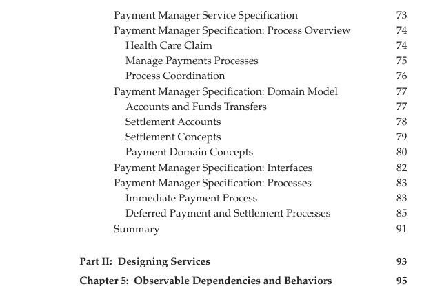

注：实验数据采用真实世界野外调查与遥感解译的滑坡编目及环境因子数据，利用多类典型深度学习模型进行模型构建与性能对比分析，同时利用可解释人工智能方法（SHAP）开展滑坡易发性的因子分析与空间建模，实现了滑坡易发性空间分布预测和制图。

**网络模型构建流程：**

- 第一阶段（输入层）：数据采集与预处理、环境因子筛选、训练样本数据集划分（训练/验证/测试）
- 第二阶段（模型构建）：CNN、LSTM、CNN-LSTM、CNN-BiLSTM、CNN-BiLSTM-Attention 等模型构建与训练
- 第三阶段（评估与预测）：精度评估与对比、可解释性分析（SHAP）、全区域滑坡易发性预测与制图

## 前言

### 关于本书

在复合应用和服务中，多个组件协同工作以提供所需功能。这些是分布式解决方案，存在多种可能的架构。其中一些将很好地服务于企业，而另一些则会导致陷入僵局的项目。

### 架构的双重角色

核心在于理解架构在分布式设计中扮演的双重角色。一个角色是作为整体设计的表达：组件如何协作来解决问题。另一个角色是作为该设计中组件和服务的规范。理解这种双重角色，有助于理解架构文档中必须包含的信息，以便有效地发挥这种双重角色。

这种对架构的双重视角是递归的：深入到一个组件或服务，你会发现它也有一个架构，必须同时发挥这两个角色。它描述了其子组件如何协作以提供组件的功能。同时，它也作为每个子组件的规范。如此等等。

这种视角对成功如此重要，以至于三个章节（1、5 和 6）的更好部分都致力于通过讨论和示例来探索它。书中所有的示例都以相同的方式记录。

### 设计模式

你定义的架构为企业提供解决方案。其中许多需要解决众所周知的问题。为了帮助你完成这项工作，本书涵盖了多种设计模式，用于解决常见挑战。这些包括划分接口和业务逻辑；将规则纳入设计；涉及多个消费者和提供者的异步交互；提供具有同步和异步协调模式的服务；在有无排序约束的情况下分配工作负载；管理复制数据；创建复合组件、服务和应用程序；容错、高可用性和站点灾难恢复；以及服务联合。这些建立在书籍 TIBCO® Architecture Fundamentals 中涵盖的基本服务和集成模式之上。¹

### 相关 TIBCO 产品

组件和服务当然需要被实现，为此需要选择合适的技术。TIBCO 提供了一系列产品，旨在在复合应用和服务中发挥特定作用。本书提供了这些产品角色的概述，包括 TIBCO ActiveMatrix® Service Bus、TIBCO ActiveMatrix® Service Grid、TIBCO ActiveMatrix BusinessWorks™、TIBCO Hawk®、TIBCO® Managed File Transfer 组件、TIBCO 大型机集成产品、TIBCO BusinessConnect™ 和 TIBCO Collaborative Information Manager™。

### 最佳实践

良好的架构是一个有生命的东西，随着企业面临的需求变化而优雅地演进。促进这种演进需要仔细考虑服务和数据结构版本控制、命名标准、模块化数据结构设计以及服务的联合。本书为每个主题各专门一章。

### 性能与调优

你的解决方案必须足够好地执行以满足企业需求。确保你已达到性能目标需要合适的基准测试，并且有一章专门讨论此类实验的进行和结果的解释。基准测试与调优相辅相成，并且有一章专门讨论 ActiveMatrix® Service Bus 和 ActiveMatrix BusinessWorks™ 的调优。

### 服务联合

服务将在企业内部和外部的许多上下文中出现。其中一些服务旨在本地使用，而另一些则旨在更广泛使用。一章专门讨论服务联合，重点关注在这些不同上下文中出现的服务的组织。

### 记录解决方案架构和服务规范

最后，你所有的架构决策必须以可以传达给所有利益相关者的形式记录下来，从发起项目的业务人员到将实现、部署和运营构成最终解决方案的组件的技术团队。一章专门讨论记录解决方案架构，另一章专门讨论记录服务规范。补充这些章节的是每个文档的在线模板和每个文档的工作示例。这些可以在 informit.com/title/9780321802057 找到。

总之，本书是成功构建采用 TIBCO 技术构建的复合应用和服务的指南。它提出了从整体解决方案到单个组件和服务的全面架构方法。它建立在书籍 TIBCO® Architecture Fundamentals 中介绍的基本设计模式和产品信息之上，并对其进行了扩展。

### TIBCO 架构书籍系列

使用 TIBCO® 构建复合应用和服务是关于使用 TIBCO 产品构建解决方案的系列中的第二本书（图 P-1）。它建立在 TIBCO® Architecture Fundamentals 中涵盖的材料之上，该材料为所有基于 TIBCO 的设计提供了通用材料。包括本书在内的每本更高级的书籍都探索了基于 TIBCO 技术的不同风格的解决方案。每本都探索了与该解决方案风格相关的额外 TIBCO 产品。每本都定义了与该风格相关的大型且更专业的架构模式，所有这些都建立在 TIBCO® Architecture Fundamentals 中介绍的基础设计模式集合之上。

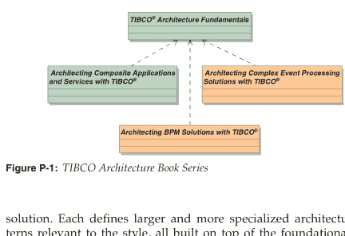

图 P-1：TIBCO 架构书籍系列

### 目标读者

项目架构师是本书的预期主要读者。他们负责定义整体解决方案并指定支持该解决方案所需的组件和服务。经验丰富的架构师会发现其中有很多有趣的内容，但写作时并未假设任何特定的架构先验知识。这是为了确保材料也对初级架构师和高级设计师可访问。然而，对于后者，强烈建议阅读 TIBCO® Architecture Fundamentals。它更详细地探讨了基本概念。本书在第 2 章中提供了该材料的摘要。

卓越中心中的 TIBCO 专家会发现感兴趣的材料，包括 TIBCO 产品堆栈的背景以及展示 TIBCO 产品最佳实践使用的设计模式。关于基准测试和调优 ActiveMatrix Service Bus 和 ActiveMatrix BusinessWorks 的材料为基于这些产品构建高性能应用程序奠定了基础。

企业架构师也会发现感兴趣的内容。关于架构文档、组件和服务规范、版本控制、命名空间设计、模块化数据结构设计，

并且基准测试可作为定义或审查这些领域企业标准的参考。设计模式的集合，结合 TIBCO® Architecture Fundamentals 中介绍的内容，为企业提供了一套基准标准设计模式的基础。

技术经理也会发现感兴趣的材料，特别是对架构文档和规范中预期内容的描述。进行基准测试的指南也将引起兴趣。

## 详细学习目标

阅读本书后，您将能够

- 创建并记录解决方案、组件和服务规范以及组件和服务实现的架构。
- 描述 ActiveMatrix Service Bus、ActiveMatrix、ActiveMatrix® Service Grid、ActiveMatrix BusinessWorks、Hawk®、TIBCO Managed File Transfer 组件、TIBCO 大型机集成产品、BusinessConnect 和 TIBCO Collaborative Information Manager 在复合应用和服务中的预期角色。
- 定义一种可管理的服务及其制品的版本控制方法。
- 建立服务及其相关制品命名的实用标准。
- 设计模块化且可管理的 数据结构。
- 进行并解读性能基准测试。
- 调优 ActiveMatrix Service Bus 和 ActiveMatrix BusinessWorks™。
- 识别并选择合适的设计模式用于
  - 分离接口和业务逻辑
  - 将规则纳入架构
  - 支持涉及多个消费者和提供者的异步交互
  - 同时支持同步和异步协调模式
  - 在有或无排序约束的情况下分发工作负载

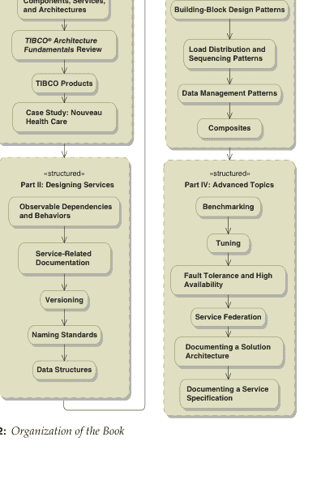

图 P-2：本书组织结构

## 致谢

有意或无意地，许多人为本书做出了贡献。其中最主要的是我在 TIBCO 的全球架构师同事，特别是 Kevin Bailey、Todd Bowman、Richard Flather、Ben Gundry、Nochum Klein、Marco Malva、Heejoon Park 和 Michael Roeschter。架构服务团队的其他许多成员也做出了贡献，包括 JenVay Chong、Dave Compton、Roger Kohler、Ed Presutti 和 Michael Zhou。感谢这些人以及架构服务组的其他成员——你们是一个很棒的团队。

TIBCO 的教育服务团队在构思本书以及随附的课程和架构师认证计划方面发挥了关键作用。更广泛地说，他们教会了我知识转移的精妙艺术，并极大地影响了本材料呈现的方式。特别感谢 Alan Brown、Michael Fallon、Mike Goldsberry、Robert Irwin、Michelle Jackson、Lee Kleir、Madan Mashalkar、Tom Metzler、Howard Okrent 和 Ademola Olateju。

TIBCO 工程部门的人员在帮助我理解其产品背后的架构方面花费了大量时间，非常慷慨，包括 Bill Brown、John Driver、Michael Hwang、Eric Johnson、Collin Jow、Salil Kulkarni、Erik Lundevall、Bill McLane、Jean-Noel Moyne、Kevin O’Keefe、Denny Page 和 Shivajee Samdarshi。我特别感谢那些纠正了我错误理解并为本书中的线程图提供基础的人：Mohamed Aariif、Praveen Balaji、Seema Deshmukh、Laurent Domenech、Tejaswini Hiwale、Sabin Ielceanu、Shashank Jahagirdar、Salil Kulkarni 和 Pankaj Tolani。

我谨感谢使本书成为可能的 TIBCO 管理团队的支持：Paul Asmar、Eugene Coleman、Jan Plutzer、Bill Poteat、Murray Rode、Murat Sonmez。

## 基于深度学习的信息抽取研究

**摘要：** 随着人工智能技术的快速发展，信息抽取作为自然语言处理领域的重要研究方向，受到了越来越多的关注。信息抽取的主要任务是从非结构化文本中抽取出结构化信息，包括实体抽取、关系抽取和事件抽取等。近年来，基于深度学习的方法在信息抽取任务中取得了显著的成果，本文对基于深度学习的信息抽取方法进行了综述和分析。

**关键词：** 深度学习；信息抽取；实体识别；关系抽取

### 1 引言

随着互联网技术的飞速发展，网络上的信息量呈指数级增长，如何从海量的非结构化文本中快速、准确地获取所需信息，已成为一个亟待解决的问题。信息抽取技术应运而生，它能够从自然语言文本中识别出实体、关系、事件等结构化信息，为信息检索、问答系统、知识图谱构建等应用提供重要的技术支持。

传统的基于规则和统计机器学习的信息抽取方法依赖于人工设计的特征模板，工作量大且可移植性差。深度学习方法通过多层神经网络自动学习文本的分布式表示，能够有效捕捉文本中的深层语义特征，已在多个自然语言处理任务中取得了最优性能。

### 2 相关工作

#### 2.1 传统信息抽取方法

早期的信息抽取方法主要基于规则模板，由领域专家手工编写抽取规则，这种方法在小规模数据集上表现良好，但规则覆盖度有限，难以适应大规模多样化的文本数据。20世纪90年代以后，基于统计机器学习的方法逐渐成为主流，如隐马尔可夫模型、最大熵马尔可夫模型和条件随机场等。

#### 2.2 基于深度学习的信息抽取方法

近年来，基于深度学习的信息抽取方法取得了显著进展。在实体抽取方面，基于LSTM-CRF、BERT等模型的方法取得了突出的效果；在关系抽取方面，基于PCNN、注意力机制和图神经网络的方法能够有效捕捉实体之间的语义关联；在事件抽取方面，基于预训练语言模型的方法展现了强大的能力。

## 作者简介


Dr. Paul C. Brown 是 TIBCO Software Inc. 的首席软件架构师，也是 *Succeeding with SOA: Realizing Business Value Through Total Architecture* (2007)、*Implementing SOA: Total Architecture in Practice* (2008) 和 *TIBCO® Architecture Fundamentals* (2011) 的作者，均由 Addison-Wesley 出版。他也是 SOA Manifesto (soa-manifesto.org) 的合著者。他的基于模型的工具架构是设计分布式控制系统、过程控制接口、内燃机和 NASA 卫星任务的多种应用的基础。Dr. Brown 在企业级信息系统方面的广泛设计工作促使他提出了整体架构概念：业务流程和信息系统如此交织，必须一起进行架构设计。Dr. Brown 在 Rensselaer Polytechnic Institute 获得计算机科学博士学位，并在 Union College 获得 BSEE 学位。他是 IEEE 和 ACM 的成员。

# 第一部分

## 入门

此页特意留空

图 1-2：流程模型示例

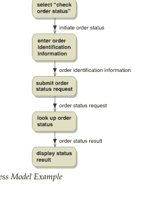

图 1-3：订单状态结果信息模型

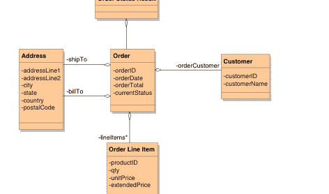

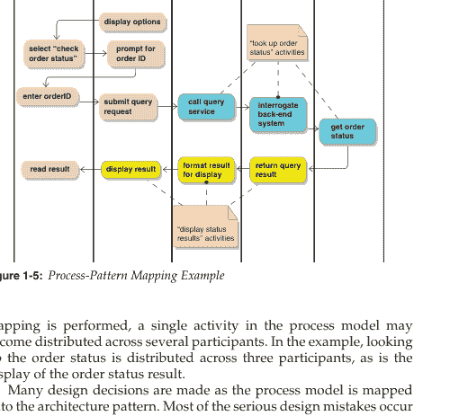

图 1-5：流程-模式映射示例

执行映射后，流程模型中的单个活动可能会分布在多个参与者中。在示例中，查询订单状态分布在三个参与者中，显示订单状态结果也是如此。

在将流程模型映射到架构模式时，会做出许多设计决策。大多数严重的设计错误都发生在这一过程中。因此，使用统一建模语言（UML）活动图或业务流程建模符号（BPMN）图记录映射非常重要。创建图表可确保设计思路完整：如果你尚未决定下一步会发生什么，就无法绘制图片。这些图表也是与业务和技术社区互动的强大沟通工具。

## 架构层次结构

在抽象层面，架构包含三个主要元素：架构模式，描述组件及其关系；一个

组件或服务是架构模式中的参与者之一。

## 解决方案架构：架构

解决方案业务流程：流程 [*]

解决方案架构模式：架构模式 [1]

解决方案行为：映射 [*]

通常存在多种交互模式。

如果这是服务，它可能支持多个解决方案架构。

仅包含正在指定的组件/服务以及与其交互的直接可观察组件

## 服务或组件规范：架构

使用流程片段：流程 [*]

可观察依赖：架构模式 [1]

组件可观察行为：映射 [*]

这些是解决方案行为的子集，通常会进行一些抽象或泛化。

图 1-8：服务或组件规范架构


## 设计模式：参考架构

图 1-6 所示的抽象架构出现的又一种情况是，在记录设计模式时（图 1-10）。设计模式描述了对常见问题的通用解决方案。它对问题进行特征描述，并在一般层面上描述解决方案。解决方案描述了构成解决方案的组件的角色和职责。该模式还阐明了以这种特定方式解决问题的好处。²

设计模式可以用抽象化的架构很好地表示，通常称为参考架构。参考架构中的流程部分定义了设计模式中工作的组织方式。架构模式描述了构成解决方案的组件，而映射则描述了这些组件如何协作以执行工作。设计模式可在架构层次结构的多个层级中适用。

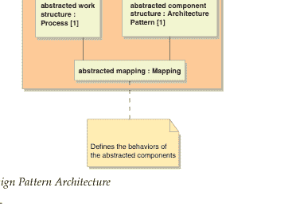

图 1-10：设计模式架构

## 解决方案架构

解决方案是对业务问题的可行答案。它包含一个或多个执行解决问题工作的业务流程，以及执行这些流程的参与者（人类和系统）。解决方案架构描述了解决方案的整体结构和组织：其业务流程、其架构模式以及流程映射到该模式的方式。

## 解决方案架构模式

当服务在解决方案中使用时，它就成为解决方案架构模式中的一个元素。图 1-11 显示了一个批发商品业务的解决方案模式，该模式利用账户管理员来跟踪客户账户余额。架构模式指出了哪些元素是服务的使用者以及使用的接口。在此示例中，订单管理员和计费管理员都是账户管理服务的使用者。

## 解决方案业务流程

解决方案实现一个或多个业务流程。正是通过这些业务流程，解决方案为企业提供价值。在批发商品示例中，我们有两个业务流程：采购商品和结算账户（图 1-12）。

每个业务流程都涉及多个活动的执行。图 1-13 显示了采购商品业务流程的活动。

## 解决方案流程映射

要完成解决方案，每个业务流程都必须映射到架构模式的元素上。当涉及服务时，流程中的某些活动由服务执行。在采购商品流程中，客户账户余额的更新由账户管理员完成（图 1-14）。该映射显示了交互中涉及的具体操作。在定义映射时，每个交互的协调模式都会被确定。

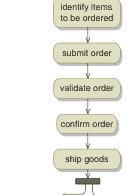

图 1-13：采购商品业务流程

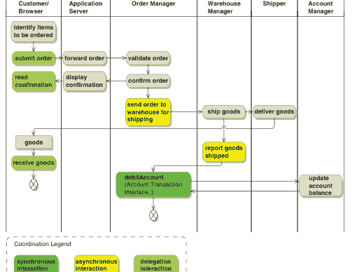

图 1-14：采购商品流程映射

## 服务利用架构模式

在架构模式中，直接与服务交互的解决方案组件或组件被抽象为通用的服务消费者（图 1-15）。该模式显示了服务与其消费者之间的交互渠道，以及通过其接口可能可见的服务的任何状态信息。架构模式最完整的图形表示显示了接口细节，但这些细节可以省略并在其他地方记录。此示例显示了维护客户账户余额的账户管理员服务以及它向其消费者提供的操作。

## 服务利用流程模型

服务执行流程以完成其工作。通常每次调用服务操作时都会启动其中一个流程，但这不是必须的。由于服务的整体思想是将其实内部工作视为黑盒，因此流程结构通常由一个接受输入并产生输出的单一活动组成（即操作是一个纯函数）。但许多服务是有状态的，其操作会读取或修改该状态。账户管理员的记账流程就是这种情况，它读取当前账户余额，添加应记账金额并更新账户余额（图 1-16）。

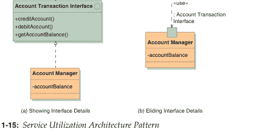

图 1-15：服务利用架构模式

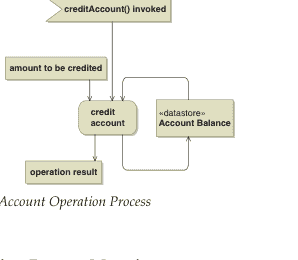

图 1-16：记账操作流程

## 服务利用流程映射

服务利用流程映射通常很简单，仅涉及服务消费者和服务提供者。它们为流程添加的主要信息是此流程的工作如何与服务提供者的工作进行协调的方式。流程映射和流程本身如此相似，以至于流程映射通常充当完整的流程表示（图 1-17）。

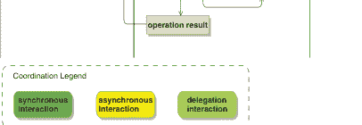

图 1-17：记账流程映射

## 复合服务架构

在复合体中，两个或多个组件（或服务）协作共同提供所需功能。复合体可能是一个完整的解决方案、解决方案的一部分，或解决方案组件或服务的内部结构。大多数解决方案都是复合体。

服务通常以复合体的形式实现，特别是当服务作为对另一个组件中实现的现有功能的包装器时。理想情况下，您希望将服务（或任何组件）视为黑盒，其内部细节可以忽略。然而，黑盒方法并不总是合适的，这将在第 5 章中讨论。目前，我们只需检查复合服务的架构，而忽略该架构的哪一部分应正确属于服务规范架构（因为它是可观察的）而不是服务实现架构（因为它不可观察）的问题。

## 复合服务架构模式

假设账户管理员实际上是围绕遗留会计系统构建的门面（图 1-18）。这对流程映射很重要：如果第三方在账户管理员获取和设置余额之间更新账户余额，则该第三方更新将被丢失。为避免这种情况，需要其他类型的协调（例如，将两个操作包含在一个事务中）。

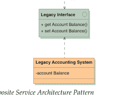

图 1-18：复合服务架构模式

## 服务利用合同

利用服务的解决方案在其内部有一个或多个服务消费者组件。每个服务消费者可能对服务提出不同的要求。服务利用合同定义了单个服务消费者与服务之间的协议，即服务将为该服务消费者提供什么。这包括

- 负责服务消费者和服务提供者的组织。
- 各种环境（开发、测试、生产）中涉及的系统和接口的具体情况。
- 为特定消费者提供的功能（接口和其他可观察行为）。这可能是对服务规范部分的引用，并且可能只是服务能力的子集。
- 对特定消费者的非功能性要求：吞吐量、响应时间、可用性、恢复点目标、恢复时间目标等。

服务利用合同将在第 6 章中详细讨论。

## 组件生命周期

在考虑生命周期治理时，人们倾向于认为服务提供者和服务消费者的生命周期是某种程度上不同的。它们不是。任何组件都可能是服务提供者、服务消费者或两者兼有。因此只有一个生命周期：架构设计、设计、实现、测试、部署和运行。

话虽如此，区分与服务提供者和服务消费者角色相关的生命周期治理问题仍然有价值（图 1-20）。存在不同的问题关联

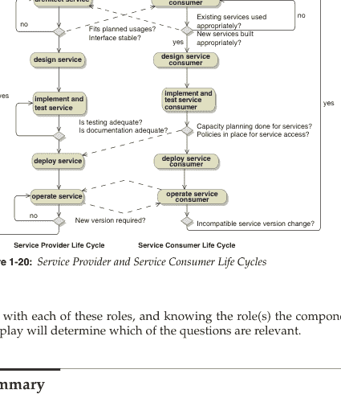

图 1-20：服务提供者和服务消费者的生命周期

每个角色都关联着一些问题，而了解组件将扮演的角色将决定哪些问题是相关的。

## 摘要

对于成功的 IT 项目，架构有三种视图至关重要：流程模型、架构模式和流程-模式映射。流程模型描述了业务流程的工作如何组织，以及所涉及的信息（和其他工件）。架构模式展示了流程中的参与者（人力和系统）、他们之间的通信渠道以及对其使用的任何约束。流程-模式映射展示了工作如何分配给参与者，以及参与者之间由此产生的交互模式。

在讨论架构时，你必须明确讨论的范围。术语“解决方案”指的是业务

## TIBCO Enterprise Message Service™

Enterprise Message Service™（EMS）产品由一个服务器和多个客户端库组成（图 2-1）。可选地，服务器可以将消息持久化到文件或数据库中。

在正常情况下，客户端使用客户端库直接与服务器交互。客户端库直接连接到服务器。作为例外情况，可以使用多播守护进程向客户端传递消息。

有多种服务器管理选项。管理工具提供了用于配置服务器的命令行界面。TIBCO Administrator™ 的管理插件也提供了相同的功能，但不要将其与 TIBCO ActiveMatrix® Administrator 混淆。可以使用 TIBCO Enterprise Message Service™ Central Administration 来管理服务器组。

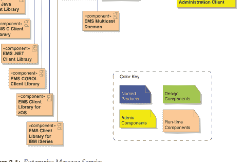

图 2-1：Enterprise Message Service

## TIBCO ActiveMatrix® 产品组合

ActiveMatrix® 产品组合中有许多产品（图 2-2）。其中有四个与本书的讨论直接相关：TIBCO ActiveMatrix® Service Bus、TIBCO ActiveMatrix® Service Grid、TIBCO ActiveMatrix BusinessWorks™ 以及 ActiveMatrix 适配器系列。

## TIBCO ActiveMatrix® Service Bus

该系列的核心产品是 ActiveMatrix Service Bus（图 2-3）。ActiveMatrix 节点为基于 ActiveMatrix Service Bus 的所有设计提供执行环境。节点内部署的功能组件可以具有不同的实现类型。ActiveMatrix Service Bus 提供一种实现类型：中介（Mediation）。它还提供 ActiveMatrix® Administrator，它本身作为一种实现类型运行在特殊节点中，该节点默认被指定为 SystemNode。

安装 ActiveMatrix Service Bus 的同时也会安装 Enterprise Message Service，但 ActiveMatrix Service Bus 的许可证仅允许消息服务用于 ActiveMatrix 内部的通信。对该消息服务的任何其他用途都需要明确的许可证。

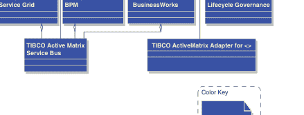

图 2-2：ActiveMatrix 产品组合

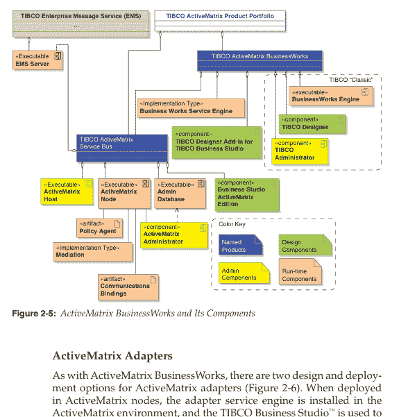

图 2-5：ActiveMatrix BusinessWorks 及其组件

## ActiveMatrix 适配器

与 ActiveMatrix BusinessWorks 一样，ActiveMatrix 适配器也有两种设计和部署选项（图 2-6）。当部署在 ActiveMatrix 节点中时，适配器服务引擎安装在 ActiveMatrix 环境中，并使用 TIBCO Business Studio™ 来配置适配器。但是，适配器不包含 TIBCO ActiveMatrix Service Bus 作为产品的一部分。因此，需要单独安装（并获得许可）ActiveMatrix Service Bus、Service Grid 或 BusinessWorks 之一。

或者，适配器可以部署在独立的适配器引擎中。在这些环境中，使用 TIBCO Designer 配置适配器，使用 TIBCO Administrator 部署和管理实例。请注意，名称中不包含“ActiveMatrix”的适配器都以这种方式部署和管理。

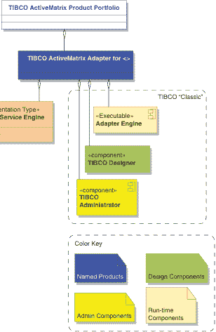

图 2-6：ActiveMatrix 适配器及其组件

## ActiveMatrix 部署选项

ActiveMatrix Service Grid 使用服务组件架构（SCA）图形表示法作为其设计界面。图 2-7 显示了一个简单的 SCA 设计，包含一个名为 OrderServiceInterface 的提升服务、一个实现该服务的名为 OrderManager 的组件，以及一个被 OrderManager 使用的名为 ProductReference 的提升引用。

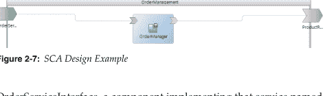

图 2-7：SCA 设计示例

SCA 设计的元素（提升服务、组件和提升引用）各自可以独立部署。图 2-8 显示了该设计的全部三个元素部署在单个 ActiveMatrix 节点上的情况。默认情况下，这些元素之间的通信发生在节点内部。

图 2-9 显示了同样的设计部署在三个独立的节点上。节点之间的交互通过 ActiveMatrix 环境私有的 EMS 服务器实例进行。

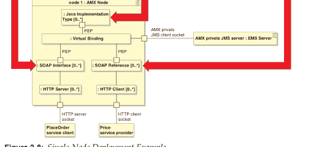

图 2-8：单节点部署示例

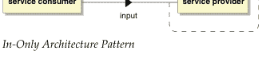

图 2-10：仅输入架构模式

在输入-输出模式中（图 2-11），服务消费者向服务提供者发送输入，并期望得到输出响应。这种模式有两种变体：同步和异步。在 ActiveMatrix Service Bus 中，同步变体由基于 HTTP 和 JMS 的 SOAP 以及基于 JMS 的 XML 绑定支持。异步变体仅由基于 JMS 的 XML 支持。

在仅输出模式中（图 2-12），服务提供者发起交互，向服务消费者发送输入。服务提供者不期望得到响应。在 ActiveMatrix Service Bus 中，可以使用基于 JMS 的 XML 绑定来近似实现此模式。

在输出-输入模式中（图 2-13），服务提供者发起交互，向服务消费者发送输入并期望得到输出响应。这种交互几乎总是异步的。在 ActiveMatrix Service Bus 中，可以使用基于 JMS 的 XML 绑定来近似实现此模式。


图 2-11：输入-输出架构模式


图 2-12：仅输出架构模式


图 2-13：输出-输入架构模式

## 事件驱动交互模式

事件驱动的交互（图 2-14）引入了第三方（通道）作为中介，将消息从发布者传递给订阅者。Enterprise Message Service 旨在扮演这一角色。

Enterprise Message Service 支持两种消息传递语义。对于队列，无论有多少订阅者，每条消息都会传递给单个订阅者（图 2-15）。当所有订阅者执行完全相同的功能时，这种语义对于负载分配很有用。

另一种消息传递模式是主题（图 2-16）。在这里，每条消息都会传递给所有订阅者。这种语义对于向多方广播信息很有用。

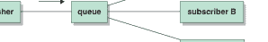

图 2-14：事件驱动交互模式

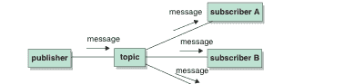

图 2-15：队列消息传递语义


图 2-16：主题消息传递语义

## 中介模式

当需要在服务消费者和服务提供者之间插入一些相对简单的逻辑时，就会出现这一类模式。ActiveMatrix Service Bus 的中介实现类型旨在扮演这一角色。

最简单的中介模式是直通模式（图 2-17）。这里的中介是从代理接口到实际服务提供者接口的直接映射。在此模式中，逻辑接口（portType）对于双方必须相同，尽管传输方式可能不同。服务接口和引用提供了可以强制执行策略的点（例如，用于管理访问控制）。

当服务消费者和服务提供者的接口不同时，可能需要进行内容转换（图 2-18）。在此模式中，代理接口上的操作与服务提供者的操作之间存在一一对应关系。此外，操作的信息内容相同。唯一的区别是数据的实际格式（结构）。

当提供给代理操作的信息不足时，可能有必要访问某个服务以获取补充信息（图 2-19）。然后使用此信息来提供所需的服务提供者输入。

有时同一服务有多个提供者，各个请求需要路由到正确的服务提供者。这就形成了图 2-20 所示的路由中介模式。

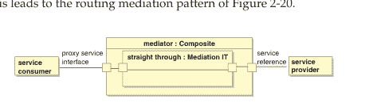

图 2-17：直通中介模式

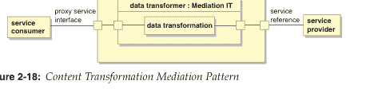

图 2-18：内容转换中介模式


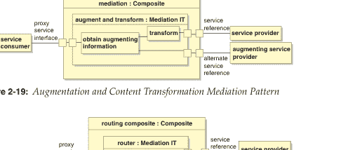

Figure 2-19: 增强与内容转换中介模式

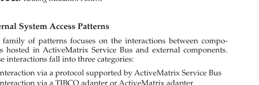

Figure 2-20: 路由中介模式

## 外部系统访问模式

该模式族专注于托管在 ActiveMatrix Service Bus 中的组件与外部组件之间的交互。这些交互分为三类：

- 1. 通过 ActiveMatrix Service Bus 支持的协议进行交互
- 2. 通过 TIBCO 适配器或 ActiveMatrix 适配器进行交互
- 3. 通过 ActiveMatrix Service Bus 不支持的协议进行交互

### 通过受支持的协议进行交互

ActiveMatrix Service Bus 直接支持多种协议，包括 SOAP over HTTP 和 JMS、XML over JMS 以及 EJB 交互。直接交互模式有两种变体，取决于哪一方发起交互。图 2-21 显示了外部系统（通常是前端系统）发起交互的情况。这是当 ActiveMatrix 组合向外部组件公开 Web 服务时所使用的模式。

图 2-22 显示了 ActiveMatrix 组合发起交互的情况。这是当外部系统（通常是后端系统）公开一个被 ActiveMatrix 组合引用的 Web 服务时所使用的模式。

## 协调模式

协调模式决定了多方工作执行的协调方式。共有六种常见的协调模式（以及许多变体）：

- 1. 发射后不管
- 2. 请求-回复
- 3. 委派
- 4. 带确认的委派
- 5. 两阶段提交的分布式事务
- 6. 使用补偿事务的流程协调器

发射后不管协调模式（图 2-27）是最简单的协调模式，但它不提供任何一方检测流程中断的机会。

为了简化在更复杂流程中识别协调模式，我们引入了发起方活动的颜色编码。在此模式中，交互是异步的；即发送方不会等待接收方的响应。

请求-回复协调模式（图 2-28）为服务消费者提供了检测流程中断的机会，但前提是建立了响应时间的服务等级协议。它还在工作执行期间占用服务消费者的资源。这里展示的是该模式的同步变体。

图 2-29 显示了该模式的异步变体。这里服务消费者不会等待响应（并且很可能在执行其他活动）。当服务提供者完成工作后，它会异步发送回复。

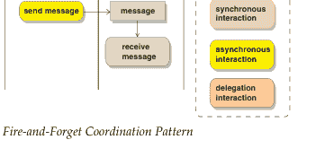

Figure 2-27: 发射后不管协调模式

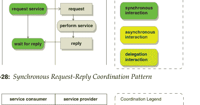

Figure 2-28: 同步请求-回复协调模式

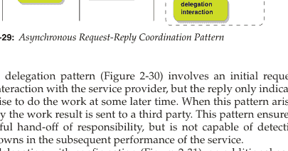

Figure 2-29: 异步请求-回复协调模式

委派模式（图 2-30）涉及与服务提供者进行初始请求-回复交互，但回复仅表示将在稍后某个时间执行工作的承诺。当此模式出现时，通常工作结果会发送给第三方。该模式确保了责任的成功移交，但无法检测后续服务执行中的中断。

在带确认的委派（图 2-31）中，与服务消费者进行的额外异步交互会通知消费者服务是否（或未）已执行。为了使其有用，必须为预期此响应的时间范围建立服务等级协议。重要的是要清楚地认识到此确认的含义。在所示示例中，它表示工作已执行且服务结果已生成。然而，由于服务结果是使用发射后不管模式发送的，因此确认并未说明该结果成功交付给第三方的任何信息。

两阶段提交的分布式事务（图 2-32）提供了协调多方工作的能力。然而，如果任何一方不可用，应用程序将无法继续。此类事务也涉及相当多的开销。请注意，应用程序程序使用同步请求-回复与事务管理器进行交互。

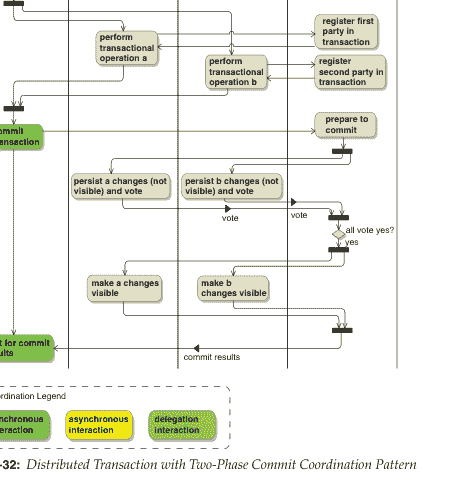

Figure 2-32: 两阶段提交分布式事务协调模式

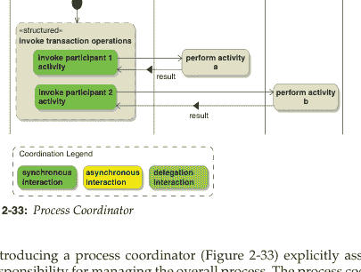

Figure 2-33: 流程协调器

引入流程协调器（图 2-33）明确指定了管理整体流程的责任。流程协调器随后使用较低级别的协调模式来启动参与方的工作并确认其成功。

流程协调器常用的工具是补偿事务。补偿事务是一种撤销先前操作净效应的操作。图 2-34 说明了补偿事务的使用。

## ActiveMatrix Service Bus 策略

ActiveMatrix Service Bus 提供了在 ActiveMatrix 节点内强制执行的策略框架。这些策略提供了与传输无关的机制，用于

- 身份验证
- 授权
- 隐私（加密）
- 数据完整性（数字签名）
- 调优（线程管理策略）
- 事务

## 摘要

*TIBCO® Architecture Fundamentals* 为本书内容提供了基础。本章对该材料进行了简要回顾。

本书中的解决方案使用了 *TIBCO® Architecture Fundamentals* 中描述的若干产品。这些包括 Enterprise Message Service、ActiveMatrix Service Bus、ActiveMatrix Service Grid、ActiveMatrix BusinessWorks，以及 TIBCO 和 ActiveMatrix 适配器组合。

基于 ActiveMatrix Service Bus 的设计可以灵活地以多种方式部署。组件、服务和引用可独立部署，如果需要可放置在不同的节点上。部署在不同节点上的元素之间的通信通过部署环境私有的 Enterprise Message Service 实例进行。

*TIBCO® Architecture Fundamentals* 涵盖了若干设计模式，这些模式构成了本书中描述的模式的构建块。这些包括组件对之间的基本交互、事件驱动交互模式、中介模式、外部系统访问模式和协调模式。它还提供了 ActiveMatrix Service Bus 提供的策略框架概述。

- TIBCO® Adapter for Files z/OS (MVS)
- TIBCO® Adapter for Files (IBM i)
- TIBCO ActiveMatrix BusinessWorks™ Plug-in for Data Conversion
- TIBCO BusinessConnect™
- TIBCO Collaborative Information Manager™

阅读本章后，您应能够描述每种产品的适当用途。

## Hawk®

### 概述

Hawk 包含一组用于监控组件（正在执行的程序）及其上运行的服务状态的组件。对于需要监控组件的每个非大型机环境（物理或虚拟），运行两个 Hawk 可执行文件：Hawk Agent 和 Hawk Microagent Adapter（HMA）。在大型机上，TIBCO Mainframe Service Tracker 执行。

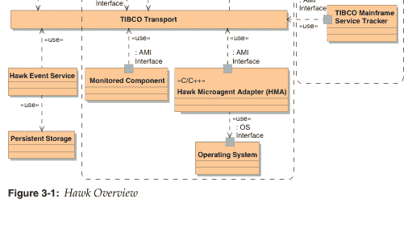

### Hawk Agent

Hawk Agent 是主力工作者。在规则库的指导下，它监控其环境中的组件（正在执行的程序），通过组件提供的应用程序微代理接口（AMI）与这些组件交互。大多数 TIBCO 产品提供 AMI 接口，并且有一个工具包可用于向其他组件添加 AMI 接口。Hawk Agent 使用 TIBCO 传输与 AMI 接口通信，即 Enterprise Message Service 或 TIBCO Rendezvous®。

Hawk Agent 还通过其自身的 AMI 接口提供功能。其中包括，代理能够通过 Rendezvous® 和 Enterprise Message Service 发送和接收任何消息。

### Hawk 规则

通常您使用 Rulebase Editor（图 3-2）创建 Hawk 规则，尽管规则库只是一个可以直接编辑的 XML 文件。规则名称（高亮的字符串）指定了规则将操作的数据来源。数据源指定了 Microagent，

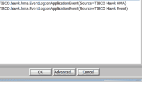

Figure 3-2: Hawk 规则库编辑器中的三个规则


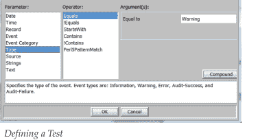

图3-4：定义测试

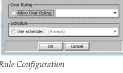

图3-5：高级规则配置

最后，一旦指定了测试，就可以定义在测试满足时要执行的操作（图3-6）。如果需要，可以指定多个操作。操作类型包括：

- 向Hawk Display（以及其他感兴趣的侦听器）发送Hawk警报。
- 执行操作系统命令行操作。
- 向Hawk Display（以及其他感兴趣的侦听器）发送Hawk通知。
- 调用微代理操作——请注意，通过这种方法可以完成许多事情，包括发送消息。
- 发送电子邮件。
- 发布一个条件，该条件可以在同一规则库中的另一条规则中作为数据源引用。

最终结果就是清单3-1中所示的Hawk规则。

```
</operator>
<dataObject class="java.lang.String" >
<![CDATA[Warning]]>
</dataObject>
<operator>
<consequenceAction>
<name>
<![CDATA[sendAlertLow
(alertMsg=Hawk Agent Warning : ${Text} )]]>
</name>
<schedule>
<microAgentName>
COM.TIBCO.hawk.microagent.RuleBaseEngine
</microAgentName>
<methodName>sendAlertMessage</methodName>
<dataElement name="message">
<dataObject class=
"COM.TIBCO.hawk.config.rbengine.rulebase.util.
AlertLow" >
<![CDATA[Hawk Agent Warning : ${Text} ]]>
</dataObject>
</dataElement>
<performOnceOnly/>
<escalationTime>0</escalationTime>
</consequenceAction>
<trueConditionPolicy>
<trueCountThreshold>1</trueCountThreshold>
</trueConditionPolicy>
<clearOn>
<clearTimer>
<second>900</second>
</clearTimer>
</clearOn>
</test>
<test>
...
</test>
</rule>
```

## Hawk微代理适配器 (HMA)

由于Hawk代理是用Java编写的，它无法直接进行获取环境状态和与文件系统交互所需的操作系统调用。因此，它无法直接与文件系统或操作系统交互来进行监控或执行操作。Hawk微代理适配器（HMA）就用于此目的。它是

订阅操作，通常采用onXxWx( )的形式，用于标识需要通知的事件。这些操作用于触发Hawk规则的执行，并且不能从Hawk Display调用。

## Hawk Display

Hawk Display是一个用户界面，显示属于特定Hawk域的所有Hawk代理的状态。该显示界面使用户能够查看正在使用的代理和规则库，并查看哪些代理正在生成警报。在显示界面中，您可以深入研究详细信息，并使用微代理方法与组件交互（图3-8）。

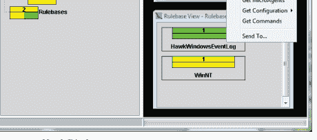

图3-8：Hawk Display

## Hawk Event Service

Hawk Event Service是一个独立的可执行程序，能够将事件记录到文件或数据库。可以记录的事件包括由代理报告的事件（通知和警报），以及围绕代理自身启动和停止的事件。

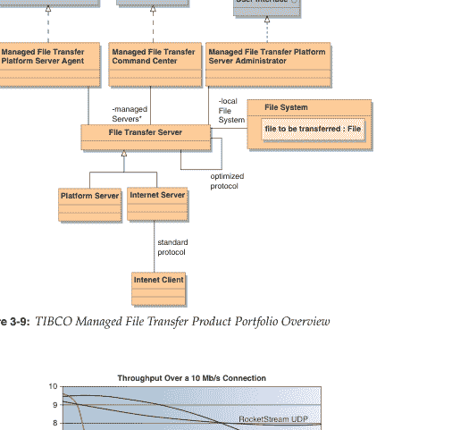

图3-9：TIBCO托管文件传输产品组合概述

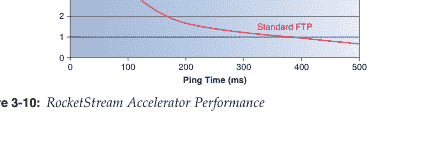

图3-10：RocketStream加速器性能

TIBCO® Managed File Transfer Command Center提供对所有Managed File Transfer组件的基于Web的管理。它提供了管理服务器及其之间的文件传输的接口，以及报告设施和以多种格式发出警报的能力。Command Center接口可供用户和程序使用。

## 大型机和iSeries集成

### 大型机和iSeries交互选项

有多种可用于与大型机交互的选项。这些选项包括：

- 平台专用产品
  - z/OS
    - Substation ES™
    - TIBCO Mainframe Service Tracker
    - TIBCO ActiveMatrix BusinessWorks™ CICS插件
    - TIBCO Adapter for Files z/OS (MVS)
  - iSeries
    - ActiveMatrix® Adapter for IBM i
    - TIBCO Adapter for Files (IBM i)
- 通用TIBCO产品
  - ActiveMatrix BusinessWorks™ 数据转换插件
  - TIBCO ActiveMatrix® Adapter for Database
  - TIBCO ActiveMatrix® Adapter for WebSphere MQ
  - TIBCO® Managed File Transfer Platform Server for z/OS
  - Enterprise Message Service客户端
  - Rendezvous客户端
- 平台原生Web服务

### 交互意图

在选择合适的大型机交互选项时，记住交互的意图非常重要。一些可能的意图包括：

- 程序到程序交互
  - 在大型机外部发起
  - 在大型机上发起
- 数据访问
  - 在大型机外部访问大型机数据
  - 在大型机上访问大型机外部数据
  - 在大型机上访问大型机数据
- 事件识别
  - 在大型机上识别和宣告事件

表3-1总结了不同大型机交互选项满足这些意图的能力。

表3-1：满足大型机交互意图

| 意图 | 方向 | z/OS选项 | IBM i选项 |
|---|---|---|---|
| 程序到程序交互 | 在大型机外部发起 | Substation ES<br>ActiveMatrix BusinessWorks™ CICS插件 | TIBCO® ActiveMatrix® Adapter for IBM i |
|  | 在大型机上发起 | Substation ES | TIBCO ActiveMatrix Adapter for IBM i |
| 数据访问 | 在大型机外部访问大型机数据 | ActiveMatrix BusinessWorks 数据转换插件<br>TIBCO Adapter for Files z/OS (MVS) | TIBCO ActiveMatrix Adapter for IBM i<br>TIBCO Adapter for Files (IBM i)<br>ActiveMatrix BusinessWorks 数据转换插件 |
| 事件识别 | 在大型机上识别和宣告事件 | TIBCO Adapter for Files z/OS (MVS)（PDS和顺序文件）<br>使用消息传递的自定义应用程序代码 | 使用消息传递的自定义应用程序代码 |

### Substation ES

Substation ES是一个托管在z/OS上的组件，支持程序到程序的交互。它支持与大型机之间的双向交互，尽管z/OS程序可能需要修改才能发起交互。

图3-11提供了Substation ES部署的概述。Substation本身运行在z/OS大型机上，可以发起或提供对CICS和IMS程序的访问。大型机外部通信可以使用Enterprise Message Service或Rendezvous作为传输。这些通信中的数据以大型机格式表示。可以通过基于浏览器的UI来管理和监控Substation ES。

ActiveMatrix BusinessWorks数据转换插件为访问此格式的数据提供了便捷的设施。该产品附带的Eclipse IDE中也提供了类似的功能。这些工具显著减少了应用程序开发时间。

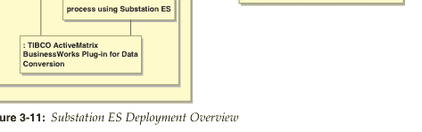

图3-11：Substation ES部署概述

### TIBCO Mainframe Service Tracker

TIBCO Mainframe Service Tracker（图3-11）是一个z/OS子系统，可以监控作业和作业步骤以及SYSLOG消息和事件。它具有一个事件客户端设施，使z/OS应用程序能够发送Hawk警报和通知，以及一个智能客户端设施，允许应用程序订阅作业监控事件。

### TIBCO ActiveMatrix BusinessWorks CICS插件

ActiveMatrix BusinessWorks CICS插件使ActiveMatrix BusinessWorks进程能够执行CICS事务（图3-12）。该插件由两部分组成：一个安装在大型机上的组件和一个随BusinessWorks安装的插件。在这种情况下，ActiveMatrix BusinessWorks数据转换插件也很有用。

### TIBCO Adapter for IBM i

TIBCO Adapter for IBM i允许UNIX或Windows应用程序与i5/OS之间的双向交互。它允许i5/OS应用程序通过数据队列与UNIX和Windows应用程序交互。反过来，它允许UNIX和Windows应用程序通过数据队列、PGM程序对象和假脱机文件与i5/OS应用程序交互。

该适配器部署在UNIX或Windows机器上，并使用Enterprise Message Service或Rendezvous传输与应用程序交互（图3-13）。ActiveMatrix BusinessWorks数据转换插件大大简化了与System i数据结构相关的工作，其使用显著减少了开发时间。

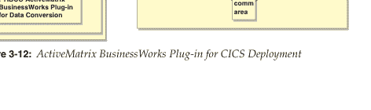


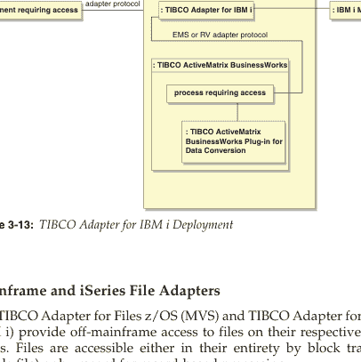

图 3-13：TIBCO Adapter for IBM i 部署

## 大型机和 iSeries 文件适配器

TIBCO Adapter for Files z/OS (MVS) 和 TIBCO Adapter for Files (IBM i) 提供对各自平台上文件的非大型机访问。文件可以通过整块传输（整个文件）整体访问，或按记录进行基于记录的处理。

两个平台上的功能略有不同。在 z/OS 平台上，应用程序可以写入 VSAM、顺序数据集（SEQs）、数据集代号组（GDGs）和分区数据集（PDSs）。应用程序可以通过发送消息来触发这些相同文件类型的发布。适配器还可以配置为轮询分区数据集（PDSs），并在文件更改时发布文件。对于 iSeries 平台，适配器可以写入和发布顺序（SEQ）文件。

两个适配器的部署相似（图 3-14）。适配器本身驻留在大型机上，通过 TIBCO 适配器协议提供服务，使用 Enterprise Message Service 或 Rendezvous 传输。TIBCO 适配器协议得到广泛产品的支持，包括 ActiveMatrix Service Grid、ActiveMatrix Service Bus 和 ActiveMatrix BusinessWorks。

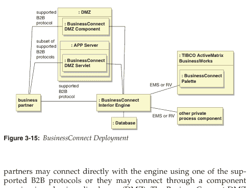

图 3-15：BusinessConnect 部署

合作伙伴可以使用其中一种受支持的 B2B 协议直接与引擎连接，或通过在隔离区（DMZ）中运行的组件连接。BusinessConnect DMZ 组件可通过任何受支持的 B2B 协议进行连接。BusinessConnect DMZ Servlet 在应用程序服务器中运行，但仅启用对受支持 B2B 协议子集的连接。

BusinessConnect Interior Engine 使用通过 Enterprise Message Service 或 Rendezvous 传输传递的 XML 消息与企业的私有流程通信。这些消息采用 BusinessConnect 的 aeRvMsg 格式。TIBCO BusinessConnect™ Palette for BusinessWorks™（作为 BusinessConnect 产品组件提供）简化了该协议的使用。

## TIBCO Collaborative Information Manager

TIBCO Collaborative Information Manager 设计用于在企业中管理参考数据（通常称为主数据）（图 3-16）。客户、合作伙伴和产品数据通常属于此类。这些信息通常分布在多个系统上，而该产品使以一致的方式管理这些信息成为可能。

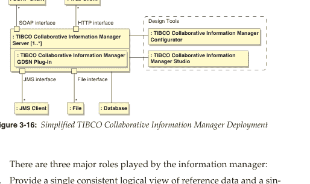

图 3-16：简化的 TIBCO Collaborative Information Manager 部署

信息管理器承担三个主要角色：

- 1. 提供参考数据的一致逻辑视图以及访问此信息的一个入口点。
- 2. 在多个系统之间维护数据一致性，检测更改并管理更新其他系统的流程以保持一致性。
- 3. 当差异无法自动解决时，启动并管理调查和解决差异所需的人工流程。

管理的信息视图既可通过用户（Web Client）界面，也可通过编程接口（SOAP、JMS 和 File）获得。这些相同的接口也可用于通知信息管理器其他系统中的数据更改，以及更新这些系统中的数据。

## 摘要

有许多专门的 TIBCO 产品常用于复合应用程序和服务中。这些包括 Hawk、TIBCO Managed File Transfer 产品、若干大型机相关产品以及 BusinessConnect。

Hawk 能够基于规则监控环境中的机器、组件和服务。在每个机器环境中运行的 Hawk Agent 使用规则监控环境。它从提供 Hawk Application Microagent Interface (AMI) 的组件获取详细的状态信息。当规则定义的条件被识别时，规则可以启动各种操作，包括执行命令行、与微代理交互以及发送 Hawk 警报、消息和电子邮件。

TIBCO Managed File Transfer 产品系列控制系统之间文件的移动。文件在访问本地文件系统的 Managed File Transfer 服务器之间传输。Internet 服务器支持使用 FTP 等公共协议与未安装 TIBCO Managed File Transfer 组件的系统交换文件。通过使用产品的 RocketStream Accelerator 版本，可以加快高延迟通信链路上的文件传输速度。

有多种机制可用于与大型机交互。每种机制提供不同的交互功能组合：程序到程序交互、数据访问和事件识别。对于 z/OS 系统，选项包括 Substation ES、ActiveMatrix BusinessWorks Plug-in for CICS、TIBCO Adapter for Files z/OS (MVS) 和 ActiveMatrix Adapter for Database。对于 System i 平台，选项包括 TIBCO Adapter for IBM i 和 TIBCO Adapter for Files (IBM i)。

BusinessConnect 使用多种协议实现企业间交互。它充当这些协议与企业私有业务流程之间的中介。它还提供不可否认性功能，并管理业务合作伙伴的注册和凭据。

TIBCO Collaborative Information Manager 提供跨多个系统分布的参考信息的一致视图。它还提供在各个系统中更新数据时维护该数据一致性所需的流程。

## 案例研究：Nouveau Health Care

### 目标

在撰写架构和架构模式时面临的挑战之一是选择示例，这些示例足够丰富以激发讨论，足够真实以代表现实世界的挑战，同时又足够简单易于解释。

Nouveau Health Care 案例研究就是为此目的而创建的虚构案例。其业务流程虽然与现实世界的对应物相比有所简化，但仍足够复杂，能够呈现现实世界对应物中大多数常见的设计挑战。现实的一个重要方面是，流程及其相应的解决方案实现并非孤立运行——它们相互交互，并与其他业务流程交互，就像在现实世界中一样。

Nouveau Health Care 示例的不同方面贯穿于本架构书籍系列。本章提供了公司及其业务流程的概念概述，然后介绍了 Payment Manager 及其相关业务流程，

这些流程用于说明本书中的许多要点和设计原则。

## Nouveau Health Care 解决方案架构

Nouveau Health Care 是一家传统医疗保健保险公司。它销售医疗保健保险单，并用其保费收入支付理赔款项。它还管理理赔的处理。

有一些因素增加了 Nouveau 业务的复杂性。在某些情况下，为 Nouveau 提供医疗保健福利的雇主也提供支付理赔的资金：Nouveau 仅管理保单。在其他情况下，专业服务（视力和牙科护理）的管理外包给其他公司。这两种变化都提出了一些有趣的设计挑战。

## Nouveau Health Care 业务流程

我们对 Nouveau 的使用集中在其四个业务流程上（图 4-1）：

- 1. Validate Membership 及其底层 Validate Membership Service
- 2. Manage Payments，管理向医疗保健服务提供者的理赔付款
- 3. Process Claim 及其发起者 Route Claim，二者共同处理保险理赔的处理
- 4. Monitor Claim Processing，一个监控理赔处理执行的流程

Validate Membership 流程由授权方（医疗保健提供者、雇主和会员）使用，以验证个人在特定日期是否被保单覆盖。该业务流程利用底层的 Validate Membership Service，该服务也由 Process Claim 业务流程使用。Validate Membership 在 TIBCO® Architecture Fundamentals 书中用作示例。

Manage Payments 流程管理因医疗保健索赔而产生的向医疗保健服务提供者的付款。¹ 是什么使得


## Nouveau 健康护理架构模式

Nouveau Health Care 的业务流程由一组组件执行（图 4-2）。索赔路由器为计费提供者提供提交索赔的接口。它通过会员服务验证会员资格，将索赔路由到索赔处理器，并向索赔跟踪器报告状态。索赔处理器（可能不止一个）裁定索赔，通过会员服务验证会员资格，通过付款管理器请求索赔付款，并向索赔跟踪器报告状态。付款管理器向服务提供者付款，从福利服务获取与计划关联的账户，从提供者服务获取与医疗服务提供者关联的账户，并使用银行服务进行付款。它还向索赔跟踪器报告状态。

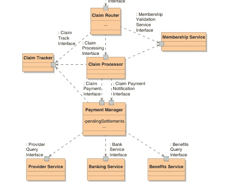

图 4-2：Nouveau 健康护理架构模式

## Nouveau 健康护理在上下文中

Nouveau Health Care 是更大环境的一部分，其中包括提交索赔的医疗服务提供者和处理部分索赔的合作公司（图 4-3）。在这里我们看到可能存在不止一个索赔处理器，这解释了索赔路由器的需求。

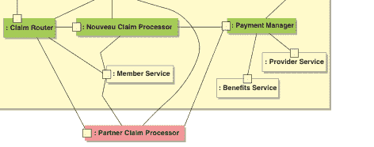

图 4-3：Nouveau 健康护理在上下文中

### 来自提供者的索赔处理

医疗保健索赔可以由医疗服务提供者或接受服务的会员提交。在 Nouveau Health Care 示例中，我们重点关注由提供者提交的索赔以及向这些提供者的付款。

图 4-4 展示了由医疗服务提供者提交的索赔的处理概述。该晴天场景显示了通过美国准标准 HIPAA 交易² 进行的提供者交互，并显示了向提供者的延期付款。流程模型显示了付款方和提供者账户引用，但未显示与福利服务和提供者服务交互以获取它们的细节。同样，它显示了会员资格的验证位置，但未显示实际执行验证的与会员服务的交互。最后，为简单起见，所有与索赔跟踪器的交互均已省略。

> 2. 实际上，每个由企业实现的 HIPAA 交易接口都会被扩展以适应该企业的特定要求。

## 付款管理器服务规范

付款管理器是一个非平凡的服务，将在本书中作为示例使用。以下是其规范的简化版本，以帮助您了解其在 Nouveau Health Care 中的预期作用。完整规范在线提供，网址为 informit.com/title/9780321802057，也是本书电子版附录的一部分。

付款管理器（图 4-5）通过索赔付款接口和索赔付款通知接口，为索赔处理器提供服务，用于向其支付医疗服务提供者的服务费用（在延期付款的情况下）并通知索赔处理器已付款。此处的索赔处理器代表处理索赔的通用组件。在计划部署中，Nouveau Health Care 索赔处理器和外部合作伙伴索赔处理器都将使用付款管理器。

付款管理器本身是索赔跟踪器、提供者服务、银行服务和福利服务通过所示接口提供的服务的消费者。

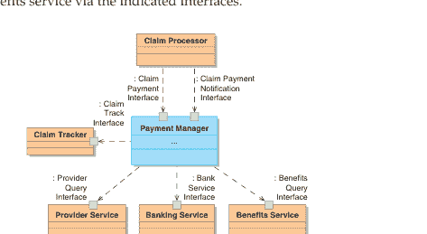

图 4-5：付款管理器使用上下文

## 付款管理器规范：流程概述

表面上看，付款管理器很简单。它具有简单的接口（图 4-6）。

它与其他流程的关系似乎也很简单。Process Claim 告诉它付款，Manage Payments 要么寄出支票，要么进行电子资金转账（图 4-7）。但这种表面上的简单性具有欺骗性。要理解这一点，让我们看一下医疗保健索赔。


图 4-6：索赔付款接口


图 4-7：管理付款流程概述

### 医疗保健索赔

医疗保健索赔涉及的一些基本概念如图 4-8 所示。索赔是对向医疗保健计划会员提供的服务进行报销的请求。它包含一项或多项需要报销的服务实例。与每个服务实例相关联的是应为该服务获得报销的医疗服务提供者（billingProvider）。由于不同的服务实例可能有不同的计费提供者，因此一次索赔付款可能导致向多个提供者付款。

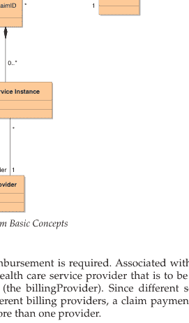

图 4-8：医疗保健索赔基本概念

### 管理付款流程

根据业务规则，在正常情况下，付款按定期（通常为每月）的方式向医疗保健提供者支付。这些被称为延期付款。定期运行一个流程来结算（支付）这些延期付款。例外情况下，索赔可以立即支付。这通常作为对因某种原因处理过度延迟的索赔的补救措施而进行。

由此可见，管理付款流程实际上由三个流程组成（图 4-9）：即时付款、延期付款和结算延期付款。

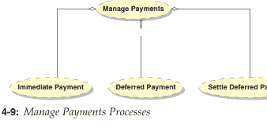

图 4-9：管理付款流程

### 流程协调

当请求即时付款时，服务消费者（例如 Process Claim）使用同步请求-回复协调模式请求付款（图 4-10）。响应指示付款是否成功完成。

对于延期付款（图 4-11），服务消费者与付款管理器之间的交换是委托与确认交互的前端。此交互部分仅返回将在未来某个时间付款的承诺。委托与确认交互的后端是结算延期付款流程，该流程由计时器触发。

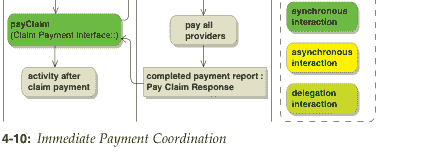

图 4-10：即时付款协调


图 4-11：延期付款与结算协调

## 付款管理器规范：领域模型

### 账户和资金转账

索赔付款流程涉及三种类型的银行账户：付款方账户、提供者账户和结算账户。每个保险单都有一个关联的付款方账户，用于支付针对该保单的索赔。每个通过资金转账支付的医疗服务提供者都有一个提供者账户。结算账户用作中间账户。当付款管理器被告知支付索赔时，无论何时向提供者付款，资金都会立即转入结算账户。提供者的资金从该账户中提取。如果提供者通过支票付款，则支票由结算账户开出。

出于审计原因，有必要跟踪账户之间资金的流动。每次转账都会创建一份资金转账记录（图 4-12）。每条记录都会跟踪转账金额、来源和目的地账户、转账状态以及转账时间。

每条资金转账记录在发起资金转账时都会复制账户引用信息，以便后续对账户信息的更改不会影响过去转账的记录。

### 结算账户

每次付款涉及两条资金转账记录：第一条记录资金从与医疗保健计划关联的付款方账户转移到结算账户的流动；第二条记录资金从结算账户转移到提供者账户的流动。


图 4-12：资金转账记录


与提供者结算相关。当支付管理器被告知支付一项索赔时，它会将服务实例与提供者结算记录关联，将相关资金转移到结算账户，并以资金转账的形式记录服务实例付款。这记录了资金从个人健康护理计划到结算账户的流动。当医疗服务提供者实际获得付款时（可能是即时或延期），会进行结算付款。付款可能通过直接资金转账进行，也可能通过支票进行并由支票记录记录。

## 支付领域概念

综合起来，我们得到了图 4-14 所示的支付领域概念的部分模型。该模型指明了哪些服务作为各种概念的记录系统。发行方是销售健康护理计划的实体。福利服务管理福利计划并跟踪在计划下谁为服务付款以及这些付款从哪个账户扣除。提供者服务跟踪医疗服务提供者以及向其付款的方式。索赔服务管理医疗索赔信息，而支付管理器负责管理对服务提供者的付款。³

请注意，从支付管理器的角度来看，计划和提供者账户的账户参考信息都来自其他服务。当支付管理器使用这些信息时，它使用的是副本。如果在信息使用前立即制作副本，通常不是问题。然而，如果副本提前很久就制作，则必须考虑如果原始信息被更新应发生什么。例如，考虑如果支付管理器在被告知支付索赔时记录提供者账户会发生什么。如果付款被延期，提供者在此时和账户结算时之间更改账户是可能的。支付管理器将如何得知账户变更？本主题将在第 12 章中讨论。

3. 在现实世界中，支付管理器还将管理为自付服务费用而向计划成员提供的报销。


图 4-14：支付领域模型（部分）

## 支付管理器规范：接口

支付管理器在索赔付款方面有两个逻辑接口（图 4-15）。索赔付款接口为索赔处理器提供指示支付管理器支付索赔的能力。索赔付款通知接口支持延期付款选项，并为支付管理器提供通知索赔处理器付款已完成的能力。⁴ 支付管理器还通过这些接口可见一些状态信息：待结算。这些是尚未进行的对医疗服务提供者的计划付款。

这些接口使用的逻辑数据结构如图 4-16 所示。索赔付款请求中的 immediatePayment 标志用于指示付款应立即进行还是应按正常延期方式付款。否则，请求对即时和延期付款是相同的。


图 4-15：支付管理器接口

4. 该接口实现细节可能因所选异步交互机制而有很大差异。这些内容在第 10 章中讨论。


图 4-16：索赔付款请求和响应

索赔付款响应在两个接口中均使用。对于即时付款，服务实例付款结果中的 paidAmount 将包含实际支付的金额。对于延期付款，该字段将为零，而 pendingAmount 将指示结算时将支付的金额。当该数据结构由索赔付款通知接口返回时，pendingAmount 将为零，而 paidAmount 将指示实际支付的金额。

## 支付管理器规范：流程

### 即时付款流程

支付管理器用于即时付款的流程概述如图 4-17 所示。在收到请求后，支付管理器获取一个结算账户。对于每个服务实例，找到付款方账户，获取提供者结算记录，并将资金从付款方账户转移到结算账户。请注意，根据业务规则，失败的转账不会阻止其他转账继续进行。关于提供者结算记录，如果在本次即时付款流程中尚未创建，则创建一条；否则使用现有记录。处理继续进行，直到与该索赔相关的所有资金都已转移到结算账户。


图 4-17：即时付款流程概述

接下来，对于每个提供者结算记录，获取提供者账户。然后将资金转移到提供者账户（如果发送支票则略有变化）。最后，更新提供者结算记录并将索赔付款响应发送回服务消费者（索赔处理器）。

该流程的细节，包括与福利服务、提供者服务和银行服务的交互，如图 4-18 所示。请注意，在该流程中与其他服务的所有交互都是同步的。

### 延期付款和结算流程

延期付款流程（图 4-19）是索赔处理器与支付管理器之间委托确认交互的前半部分。其处理与即时付款流程的第一半部分相同。它将资金从付款方账户转移到结算账户，将其记录为计划转账记录，并将每条记录与相应的提供者结算记录关联。如果结算记录已存在（即该提供者已有待付款项），则使用该记录。否则创建一条新记录。

图 4-20（第 88 页）显示了延期付款流程映射到支付管理器的架构模式，并指出了在底层服务上使用的特定接口。

结算流程（图 4-21，第 89 页）是延期付款流程开始的委托确认交互的确认部分。流程始于计时器到期，此时确定待完成的结算。对于每个待结算，计算待转账金额并启动资金转账。在一种变体（未显示）中，可能改为开具支票。流程以更新提供者结算记录并向索赔处理器发送结算报告（索赔付款响应）结束。

图 4-22（第 90 页）显示了结算流程映射到架构模式。它指出了在提供者服务、银行服务和索赔跟踪器上调用的接口操作。


协调图例
同步交互
异步交互
委托交互

## 图 4-19：延期付款流程概述

## 图 4-21：结算流程


索赔处理器

支付管理器

在（结算时间）

识别待完成的结算

pendingSettlement : 提供者结算记录

这是一个仅输出交互——需要 JMS 队列。

deferred response : 支付索赔响应

处理延期响应

发送结算报告

completedSettlement : 提供者结算记录

协调图例


图 4-22：结算流程映射

## 摘要

虚构的 Nouveau Health Care 示例提供了足够丰富的背景，用于说明 TIBCO 架构丛书中贯穿始终的主要观点。在本书中，支付管理器被用作复合应用程序的示例，为 Nouveau Health Care 及其业务合作伙伴提供索赔支付服务。

支付管理器展示了若干有趣（且现实）的复杂性：

- 处理一项医疗索赔可能涉及向多个医疗服务提供者付款。
- 医疗服务提供者通常按定期（例如每月）付款。例外情况下，索赔可以立即支付。
- 当支付管理器被指示支付索赔时，它会立即从与医疗福利计划相关的付款方账户中扣除资金，而不管提供者实际何时付款。
- 就请求索赔付款的各方而言，存在两种可能的协调模式：同步请求-回复（用于即时付款）和委托与异步确认（用于延期付款）。
- 出于审计目的，支付管理器会跟踪所有资金转账。

支付管理器具有两个逻辑接口。索赔支付接口用于指示支付管理器支付索赔。对于延期付款，索赔支付通知接口由支付管理器用于通知各方请求付款已完成。

支付管理器规范的架构模式指出了支付管理器所依赖的服务。这些包括福利服务、提供者服务、银行服务和索赔跟踪器。

本页特意留空

本页特意留空

# 第 5 章
### 可观察的依赖关系和行为
### 目标

当你将设计创建为一组交互组件（例如服务）时，能够忽略这些组件的内部结构并集中于其交互是有用的。然而，你仍然需要了解有关组件的一些信息——它如何依赖于其运行的环境以及它将如何表现。本章介绍如何描述这些依赖关系和行为。正如我们在下一章中将看到的那样，这种类型的描述构成了组件和服务规范的核心。

如果你正在将组件作为设计的一部分进行概念化（定义），你将被要求创建此描述。如果你使用的是现有组件，那么你将是该描述的消费者。无论哪种情况，你都需要了解适当描述组件所需的条件。

行为是指某物，在我们的例子中是组件，对刺激的响应方式。为了有效地在解决方案中利用组件，

你需要了解组件将如何响应其他解决方案组件提供的刺激，以及组件将向解决方案的其余部分提供什么刺激。

在本工作中，我们将使用可观察依赖关系这一术语来指组件与其所依赖的环境中组件之间的关系。我们将使用可观察行为这一术语来指由解决方案的其余部分所看到的行为——无需查看组件内部。阅读本章后，你应该能够描述可观察依赖关系和可观察行为的概念，并解释它们如何被描述。这将为随后关于组件和服务规范的讨论提供基础。

### 黑盒视角

当您拥有由协作组件（服务）组成的解决方案时，如果能够将每个组件视为黑盒而无需担心其内部情况，则更容易理解该解决方案。为此，您需要能够描述两件事：（1）黑盒的可观察依赖关系——其环境中它所依赖的组件，包括其接口和行为，以及（2）黑盒的可观察行为——它如何响应其他解决方案组件提供的刺激以及向这些组件提供哪些刺激。这就是本章的内容。

这里与人们学习其环境中事物的方式有很强的类比。当人们面对想要了解的对象时，他们倾向于拿起它，从不同角度转动它，并尝试不同的交互方式。在电子设备上，他们按下按键、拨动开关、触摸屏幕，同时观察依赖关系和由此产生的行为。他们正在对该对象进行观察。

您可以以同样的方式思考解决方案组件，只是您所做的观察不是视觉上的。它们为正常运行所依赖的其他组件表征了其依赖关系，而刺激则是触发组件响应的接口操作的调用和其他事件。观察是响应，例如返回的数据结构和其他组件接口的调用。您了解到的组件信息是其依赖关系和可观察行为。

当然，通过实验组件来了解其依赖关系和行为可能是一项耗时且容易出错的活动。最好有人告诉您组件将如何表现以及其为正常运行所依赖的组件。这种对依赖关系和行为的描述构成了组件规范的核心。

### 可观察依赖关系和行为的方面

那么，要描述组件的可观察依赖关系和行为，您需要了解组件的哪些信息？一些重要方面包括

- 由组件的接口和操作表征的对组件的外部组件依赖关系
- 组件对外部组件的依赖关系，包括这些组件的识别及其接口和操作的描述
- 使用场景：组件预期参与的业务流程的描述以及组件在这些流程中的参与情况
- 触发行为：解释组件触发器、响应、输入、可观察状态和输出之间关系的组件活动结构
- 可观察状态：组件保留的信息，其存在可通过其交互观察到
- 协调：组件活动如何与外部组件的活动进行协调的方式
- 约束：限制，特别是对触发器顺序的限制
- 非功能行为：性能、可用性等

### 示例：销售订单服务

我们将使用支持订单到交付业务流程的销售订单服务示例来说明可观察依赖关系和行为的各个方面。订单到交付业务流程的概述如图 5-1 所示。该图展示了销售订单服务的使用场景，销售订单服务是其中一个参与者


图 5-5：信用接口—obtainPayment() 操作


图 5-6：订单履行接口—fillOrder() 操作


图 5-8：销售订单状态接口—orderShipped() 操作


图 5-9：orderShipped() 触发行为


## 订单已交付

当承运商报告货物已交付时，订单履行会通过调用销售订单状态接口（图 5-10）的 `orderDelivered()` 操作，将交付通知转发给销售订单服务。这是另一个依赖关系。请注意，这是一个仅入操作，不返回响应。

图 5-11 显示了调用 `orderDelivered()` 操作所产生的触发行为。同样，订单状态更新活动的存在是从其他接口操作可见的信息中推断出来的。

## 可观察的状态信息

某些组件操作可以揭示信息已被保留在组件内部。请考虑图 5-12 中所示的销售订单服务接口的 `getOrder()` 操作。它返回有关销售订单及其行项目的信息。为了使


**图 5-10:** *销售订单状态接口—`orderDelivered()` 操作*


图 5-11：orderDelivered() 触发行为


图 5-12：销售订单服务接口---getOrder() 操作

组件能够返回此信息，它必须将其作为其状态的一部分保留。这使得该部分状态可观察。

通过此类接口通常可以观察到两种类型的信息：操作信息和里程碑级状态。

## 操作信息

图 5-13 在概念层面上展示了订购和发货货物所涉及的操作信息。它还指出了哪些组件负责管理各个信息元素。销售订单服务管理与销售订单相关的操作信息，包括销售订单、销售订单行项目、计费信息以及发货和计费地址。由于服务保留了这些信息，因此它是状态化的。服务在其接口上使这些信息（及其更改）可见这一事实使得此状态信息可观察。


图 5-13：订单到交付过程中的操作信息

当组件保留有状态信息时，组件用户需要了解接口操作与此有状态信息之间的关系，以便正确使用操作。用户需要知道哪些操作修改和揭示状态，以及状态的哪些部分被修改或揭示的细节。

## 里程碑状态

通过服务接口经常可见的另一种信息是：里程碑级状态。这通常是对整体解决方案状态的抽象汇总，其中包括源自组件外部的状态信息。

例如，销售订单的状态属性根据订单的整体状态取多个值之一（图 5-14）。被汇总的大部分状态信息位于销售订单服务的范围之外。因此，必须存在接口（以及实现或调用这些接口的系统）来提供更新此汇总所需的详细状态信息


图 5-14：订单里程碑状态

状态信息。在本例中，这些是订单履行服务调用的销售订单状态接口的 `orderShipped()` 和 `orderDelivered()` 操作。

## 可观察状态与缓存信息

销售订单服务使用了一些它并未直接管理（拥有）的状态信息：客户信息、产品信息以及有关相关发货的信息。其他服务（组件）是这些信息的主系统，但至少其中一些信息被缓存于销售订单服务中。这种情况会引发一些有趣的设计挑战，这些挑战在解决后会影响销售订单服务的 observable 行为。

一个核心设计挑战是决定如何保持通过销售订单服务查看的缓存信息与通过其实际主系统查看的相同信息之间的一致性。如果不一致可能出现（几乎总是如此），那么组件的可观察行为必须指出这种情况可能出现的场景。用户需要意识到此类不一致是可能的，以及可能出现的情形。

让我们看看这种情况如何在销售订单服务中出现。如果其他主系统具有单独的数据存储（例如，数据库），那么销售订单服务必须在其物理数据存储中保留至少部分信息的副本（图 5-15）。由于此信息是副本，如果主系统被更新而副本未被更新，则会产生不一致。复制的信息越多，出现差异并被观察到的可能性就越大。

保持缓存信息的准确性需要与信息的主系统进行交互。一种常见做法是主系统提供设施来通知感兴趣方其信息的更改。主系统为感兴趣方提供订阅此类通知的接口，以及实际通知各方更改的第二个接口。当很可能有多个方对更改感兴趣时，通常会采用这种方法。请注意，这些接口的使用构成了额外的可观察依赖关系。

在当前设计中，销售订单服务具有两种此类关系，一种用于产品信息，另一种用于


图 5-16：产品变更通知上下文

通知将被发送到哪些目的地。订阅是通过在部署时配置组件作为特定目的地的侦听器来实现的。

productChange() 操作从销售订单服务的角度引发了另一个有趣的情况：其调用触发了服务中的活动，该活动与销售订单服务本身提供的操作无关（图 5-17）。它是


图 5-17：产品变更通知流程

理解涉及组件的场景并展示其在解决方案操作中的参与。类似于图 5-1 的流程模式映射非常适合此目的。对于组件的每个触发事件，应至少有一个组件预期参与的场景示例。如果可重用性是一个问题且使用方式不同，则应提供说明每种使用类型的场景。

要充分描述组件，仅仅场景是不够的。您需要知道每个场景发生的频率、场景的预期执行时间以及场景所需的可用性。组件的相应吞吐量、响应时间和可用性特征将由此信息得出。

特别是在服务的情况下，一些场景是推测性的，代表潜在的未来使用并不罕见。尽管如此，这些场景仍需要记录在案，并附带对其相关性能和可用性特征的工作假设。

从实际角度来看，使用场景可能仅显示组件实际参与的更大业务流程的片段。然而，如果流程需要与组件进行多次交互，则使用场景应涵盖这些多次交互。如果必须支持显著不同的序列，则每个序列都必须记录。

## 触发行为

组件的行为是对其可以与所依赖的组件进行的交互序列的描述以及这些交互的细节。在大多数情况下，此行为可使用一个或多个 UML 活动图轻松记录。图表指示行为的触发器以及由此产生的响应、输入、输出和可观察的状态更改。

图 5-7 是触发行为的一个示例。其触发器是 placeOrder() 流程的调用，其初始输入是下单请求。响应包括对 validateProductID()、getCustomer() 和 obtainPayment() 的调用；返回下单响应；以及调用 fillOrder() 操作。这些操作相关的数据结构提供了交互的细节。在发送下单响应之前，订单信息被保存并成为组件可观察状态的一部分。


This, of course, is just one possible behavior for this trigger. Other scenarios are required to describe the expected behavior when one or more of the dependent components becomes unavailable or returns unexpected results.

To fully characterize a component’s behavior, a triggered behavior description is required for each possible trigger. Triggering events may include the invocation of interface operations, the receipt of notifications, the expiration of timers, and component life-cycle events such as start, stop, deployment, and un-deployment. In the Sales Order Service example, it is likely that the subscriptions to product and customer change notifications would actually be made via configuration changes implemented as part of the deployment process. Here the deployment would be the event, and one of the participants in the process is the person doing the deployment.

## Observable State

The observable state of a component reflects the information or other types of status (such as physical machine state) that can be altered or viewed by interactions among the component and other components. A model of this state information will help the user of the component understand the component’s behavior. The model should clearly distinguish between information for which the component is the system of record and information that is a cached copy of information originating in another component.

Figure 5-15 is an example of an observable state model related to the Sales Order Service. It shows the information for which the Sales Order Service is the system of record and the information that it has cached from other components. It also indicates the relationship between the cached information and the system-of-record information from which it is derived.

Some state information can be a derived summary of information that is distributed across a number of components. The status of the Sales Order is such an example. When this type of information is present, the allowed values that it can assume must be modeled (Figure 5-14), and the triggers and triggered behaviors that result in its update must also be captured (Figures 5-9 and 5-11).

## Coordination

The work of a component does not occur in isolation, and the performance of this work needs to be coordinated with that of other components in the solution. Consequently, the available coordination approaches are a significant part of the component's observable behavior.

Some coordination patterns are readily captured in the modeling of individual triggered behaviors. For example, in the placeOrder() process of Figure 5-7 it is clear that the interaction between the service consumer and the Sales Order Service uses synchronous request-reply coordination.

Other coordination patterns may involve multiple triggering events and therefore multiple triggered behaviors. For example, placeOrder() sends a fillOrder() request to the Order Fulfillment Service, but the responses from the Order Fulfillment Service are returned asynchronously. These interactions involve the Order Fulfillment Service's invocations of the orderShipped() (Figure 5-9) and orderDelivered() (Figure 5-11) operations. The overall coordination is only apparent when the usage scenario (Figure 5-1) is considered.

Capturing coordination is important because changing coordination patterns involves changes in both components. In the Sales Order Service example, shipment and delivery notices are delivered to the Sales Order Service by calling operations on its Sales Order Status Interface. This makes the design of the Order Fulfillment Service specific to the Sales Order Service.

There is an alternative approach. Consider a situation in which other components in addition to the Sales Order Service need to know about shipments and deliveries. With the present design, accommodating this requirement would necessitate an Order Fulfillment Service change to individually notify each of the additional components.

Alternatively, the Order Fulfillment Service could provide a subscription interface where any component could register to be informed about shipments and deliveries (Figure 5-19). Thus any number of components could subscribe without requiring any design changes in the Order Fulfillment Service. However, to switch to this design the Sales Order Service has to be modified to utilize the new approach to learning about shipments and notifications.


Figure 5-19: Alternative Design for Shipment and Delivery Notification

## Constraints

Usage scenarios show allowed sequences of interactions with the component, but they do not illustrate sequences that are not allowed. These need to be documented as well.

Consider the Sales Order Service Interface shown in Figure 5-20.


Figure 5-20: Full Sales Order Service Interface

This interface has some obvious constraints upon its usage. You can't get, modify, or cancel an order that hasn't been placed. However, there may be some less obvious constraints. Depending upon business rules, you may not be able to modify or cancel an order that has already shipped. Users of a component need to understand these constraints.

## Nonfunctional Behavior

A component may provide all the functionality required for a usage scenario, but still may not be suitable for nonfunctional reasons. Its throughput capability may be insufficient to support the volume of activity required by the scenario or its response time may be inadequate. The availability of the component may not be sufficient to give the usage scenario its required availability.

Nonfunctional requirements are not arbitrary—they are (or should be) derived from the business requirements. The connection between the business requirements and the individual components is established through the usage scenarios. For example, the business might require that customers be able to place orders at a peak rate of 100 per second. With reference to Figure 5-1, this means that the Sales Order Service must be able to accept order requests at this rate. If the business requires that orders be acknowledged within three seconds, this means that the Sales Order Service must be able to validate orders and obtain payment within three seconds with orders coming in at a rate of 100 per second. Similar reasoning can be used to determine the rate at which shipment and delivery notices will occur and be processed.

This same type of thinking applies to other types of nonfunctional requirements as well. If the business requires that online ordering capability be available 24/7, then this means that the Sales Order Service must be available 24/7. Availability, outage time restrictions, and security requirements must also be connected back to the business requirements via the usage scenarios.

There is another reason for establishing this connection between business requirements and component requirements: It captures the design assumptions that went into specifying the component. When a new utilization for the service comes along, this makes it easy to determine whether the new usage is consistent with the original design assumptions. If it is not, then it is necessary to open the black box and determine whether the actual design is capable of meeting the new requirements.

For all of these reasons, it is important to document the nonfunctional behavior of the component. It is an observable characteristic of the component.

## Some Composites May Not Be Suitable for Black Box Characterization

For the black box approach to work, the component must appear to be a coherent whole. For a monolithic self-contained component, that's not a problem. But for a composite, a component comprising other components (Figure 5-21), some conditions must be satisfied for it to be treated as a black box:

- It must (to all appearances) be managed as a single unit.
- It must have a single organization responsible for its operation.
- Access to the constituent parts must be exclusively through the interface(s) of the black box. Note that this does not preclude exposing a sub-component's interface as one of the composite's interfaces.


**图5-21：黑盒视角**

复合体不是黑盒的关键指标包括

- 不同组织负责操作（启动和停止）复合体的不同部分。
- 启动和停止复合体的决策与启动和停止其组成部分的决策是分开的。
- 组件部分可以通过其自身的接口直接访问，这些接口未声明为复合体接口的一部分。当构成组件是有状态时，这一点尤其重要。

一个不应被视为黑盒的组件示例是包装有状态后端系统功能的服务（接口），而其他解决方案组件直接访问该后端系统。在这种情况下，通过服务接口进行的状态更改可能通过后端系统的接口可见，反之亦然。对服务的观测行为的描述无法解释通过服务接口可见但并非源于服务交互的结果的状态更改。

任何这些条件都使得复合体的使用者有必要了解复合体的架构结构——了解那些可以独立访问或管理的组件。在这种情况下，你不能将复合体，包括其组成部分，作为单一实体——黑盒来对待。相反，每个组件本身都成为一个黑盒。“复合体”的上下文和使用场景随后表明这些支持组件如何与复合体协作。

## 摘要

当你想将组件作为解决方案的一部分使用时，你需要了解该组件的行为，以便确定其是否适合在解决方案中使用。你需要了解的是组件行为中从组件外部可观测到的方面。你将组件视为黑盒并专注于其可观测行为。

理解可观测行为需要描述多方面的内容，包括

- 上下文：组件对外部组件的依赖以及反之亦然
- 使用场景：组件预期参与的业务流程的描述
- 触发行为：解释组件的触发器、响应、输入、可观测状态和输出之间关系的活动结构
- 可观测状态（从一次触发保留到下一次触发的信息）
- 协调：组件活动如何与外部组件的活动进行协调的方式
- 约束：限制，特别是对触发器顺序的限制
- 非功能行为：性能、可用性等

有些复合体不能安全地被视为黑盒。这些包括其构成部分被独立操作或通过复合体接口以外的方式访问的组件。

本页特意留空

## 服务相关文档

### 目标

在追求面向服务架构的企业中，服务的消费者和提供者往往是不同的群体，通常在不同的组织中。在这种情况下，服务相关文档的质量、可用性和可访问性对服务的使用水平以及使用所需的工作量有重大影响。本章探讨支持服务使用所需的文档性质。

支持服务高效使用所需的文档类型有多种，包括

- 一行服务描述
- 服务简要摘要
- 服务规范
- 针对每种服务用户类型的服务使用合同
- 服务架构文档

这些文档类型在以下各节中描述。阅读本章后，你应该能够

- 列出并描述服务相关文档类型的作用。
- 描述服务规范的元素。
- 描述服务使用合同的元素。
- 描述服务架构文档的元素。

### 服务一行描述和摘要

每个服务都需要一个简单的一行描述和一个简短的（一到两段）摘要。其目的是支持正在浏览多个服务的潜在服务消费者，以便初步判断哪些服务（如果有的话）可能适合其需求。

### 服务一行描述

一行描述以尽可能简洁的摘要呈现服务意图。Nouveau 医疗保健付款管理器的示例描述为

> *Payment Manager 管理向医疗保健服务提供商支付的即时和递延索赔款项。*

一行描述的意图是帮助某人一目了然地判断是否值得花时间进一步了解该服务。

### 服务摘要

服务摘要支持对潜在有趣服务的下一级筛选。它应简要概述服务的功能，包括重要变化。描述应假设读者对服务没有任何先验知识。Nouveau 医疗保健付款管理器的示例为

> *Payment Manager 管理向医疗保健服务提供商支付的即时和递延索赔款项。在正常情况下，请求的付款会累积并定期支付。Payment Manager 会立即确认付款请求，并发送一个*

### 一行描述

这是一行描述的原始来源，该描述通常与服务规范分开发布。此描述是对服务目的最简洁的陈述，旨在帮助新手潜在用户快速识别潜在感兴趣的服务。

### 摘要

这是服务摘要的原始来源，该摘要通常与服务规范分开发布。摘要是对服务目的、功能和预期用途的简短一段描述。其目的是帮助新手潜在用户进一步细化他们对潜在感兴趣服务的识别。

### 上下文

上下文描述了服务预期适用的架构模式。它同时展示了服务的消费者以及为使服务正常执行所需支持行为的可观测组件。它总结了可观测的依赖关系。

上下文可以以不同详细程度展示。在最高抽象级别，上下文展示所有组件并标识其交互涉及的接口。完成规范还需要一些额外的上下文信息，具体包括接口操作和数据结构的细节以及交互发生的通信通道。

然而，将这些额外信息显示在上下文中还是包含在规范的其他部分中，在某种程度上是选择问题。在以下示例中，接口细节在触发行为描述中给出，而通信通道在部署细节部分给出。将接口细节放在触发行为描述中使上下文概述简洁易懂。将通信通道放在部署细节中允许为不同环境指定不同的通信通道。

### 预期使用场景

使用场景提供了服务预期如何融入更大业务流程的行为概述。在服务参与业务流程仅相当于调用单个服务操作的情况下，这些场景相当于各个操作的单独用例。另一方面，对于更复杂的服务，单个业务流程执行可能涉及与服务的多次交互。以下示例中使用的付款管理器即属此类。在这些情况下，使用场景会详细说明可能的交互序列。在所有情况下，使用场景都应明确指出服务的工作如何与其他业务流程工作协调。

### 接口定义

本节定义服务提供的接口。它详细说明每个接口的操作以及这些操作使用的数据结构。虽然某些接口的细节可以通过 SOAP WSDL 文档提供，但为了可读性，明智的做法是用 UML 类图图形表示来补充此类详细的文本表示。

### 参考

本节定义服务使用的其他外部组件的接口。这些信息通常取自这些组件的规范，但将这些接口定义实际复制到当前规范中是有用的。其原因在外部组件开始演进时变得清晰。它记录了本服务对外部组件接口定义的期望，并且以不依赖于其他组件规范的文档版本控制和可检索性的方式进行记录。

### 可观测状态

许多服务是有状态的，其中某些操作会改变状态，而其他操作会使该状态对外部组件可见。本节识别这些信息。


服务通常有状态地维护源自其他组件的信息副本。本节识别这些信息以及（如果有的话）维护其一致性所涉及的触发行为。

## Triggered Behaviors
触发行为定义了服务对触发事件的响应行为以及其对外部组件行为的依赖。本节列举这些触发事件并提供随后可观察行为的细节。这些行为可能包括与外部组件的交互以及与服务维护的内部可观察状态的交互。

需要包含的三类触发器大致有：操作调用、通知和基于时间的事件。操作调用显然可以识别：任何调用操作的组件都会触发行为。通知通常是服务对源自外部组件的通知进行某种形式订阅的结果。由于这些通知可能不涉及服务接口（它们可能是对其他组件接口的引用），因此它们作为行为触发器的出现可能对服务消费者并不明显。然而，这些行为的结果（如在可观察状态中更新信息缓存副本）可能是可观察的，或以其他方式影响服务的可观察行为。最后，服务中的某些活动可能由时间的推移触发。在这些基于时间的触发器产生可观察结果（可观察状态变化）的范围内，服务消费者也需要了解它们。

## Coordination
服务活动如何与其他组件的活动进行协调，必须由服务消费者清楚理解。在预期使用场景记录了这种协调的范围内，简单引用这些场景即可满足文档要求。否则，本节应记录可能的协调方式以及协调失败时的行为（例如请求-回复交互中缺乏响应时的可观察行为）。

## Constraints
如果对服务操作的使用存在限制，则必须记录这些限制。在某些情况下，例如允许的操作序列，使用场景可能已足够详细地捕获了这些信息。在其他情况下，特别是涉及业务规则约束时，需要明确识别。服务消费者需要了解这些限制。

## Nonfunctional Behavior
本节记录服务的非功能性能力。单个服务操作的吞吐量和相应的响应时间应予记录。所需的安全约束（身份验证、授权、加密、不可否认性）应按操作或按接口指定，具体视情况而定。可用性、停机约束和恢复时间可以按服务、按接口或按操作指定。服务是否保证按接收顺序处理请求是另一个重要的非功能性行为。

在某些情况下，用于实现容错、高可用性或负载分发的机制可能需要服务消费者采取特定操作或使用外部组件。一个常见示例是使用 IP-redirector 在多个服务实例之间分发 HTTP 负载。另一个常见示例是需要以特定方式配置 EMS 客户端以利用 EMS 的容错和负载分发功能。

在服务消费者必须了解这些机制的范围内，它们必须作为服务规范的一部分进行记录。在这些情况下，重要的是要明确性能相关规范适用于服务的单个实例还是多个实例的总体能力。

## Deployment Specifics
服务的一些可观察特性会因部署环境而异。例如，SOAP 端点在开发、测试和生产环境中可能不同。暴露的容错、高可用性和负载分发机制在不同环境之间也可能有所不同，这些差异需要记录。

## Example Service Specification: Payment Manager
示例服务规范：支付管理器
本节为 Nouveau Health Care 的支付管理器提供示例规范。为简洁起见，部分章节故意留空。

### Service One-Line Description
服务一句话描述
支付管理器管理向医疗服务提供商支付的即时和延期索赔款项。

### Service Abstract
服务摘要
支付管理器管理向医疗服务提供商支付的即时和延期索赔款项。在正常情况下，请求的付款会累积并定期支付。支付管理器返回付款请求的即时确认，并在服务提供商账户结清时发送付款的异步通知。索赔结算的安排可按提供商进行配置。在特殊情况下，可以立即向服务提供商付款，且返回的确认指示付款已完成。由于该选项给服务带来显著额外负担，应谨慎使用。相同的接口用于启动这两种形式的付款。

### Service Context
服务上下文
支付管理器的使用上下文如图 6-1 所示。该服务旨在由索赔处理器使用，其运行依赖于提供商服务、银行服务和福利服务。它还向索赔跟踪器提供输入以维护索赔处理的整体状态，因此也依赖于它。

可以有多个索赔处理器使用支付管理器。Nouveau Health Care 有自己的索赔处理器，但合作伙伴公司的索赔处理器也可能使用支付管理器。


图 6-2: 延期付款使用场景


图 6-3: 即时付款使用场景


图 6-4: 索赔付款的支付管理器服务接口

operation, which is used by claim processors (and other relevant parties) to initiate claim payment. Depending upon the value of the Claim Payment Request's immediatePayment() flag, payment will either be deferred or immediate. For deferred payment, the Claim Payment Response indicates the pending amount for each service instance. For immediate payment, it indicates the amount actually paid. Access to the Claim Payment Interface will be via SOAP over HTTP (for partners) and JMS (for Nouveau Health Care).

操作，用于由索赔处理器（及其他相关方）启动索赔付款。取决于 Claim Payment Request 的 immediatePayment() 标志的值，付款将为延期或即时。对于延期付款，Claim Payment Response 指示每个服务实例的待处理金额。对于即时付款，它指示实际支付的金额。Claim Payment Interface 的访问将通过 SOAP over HTTP（面向合作伙伴）和 JMS（面向 Nouveau Health Care）进行。

Claim Payment Notification Interface 由支付管理器用于在延期付款实际支付给医疗服务提供商时通知服务客户端。此类通知也可能作为即时付款请求失败后的恢复过程的一部分而发生。它是一个 XML over JMS 接口。对此通知的订阅在部署时通过 JMS 订阅完成。此配置的详细信息在部署特定部分中给出。

Claim Payment Interface 的其他操作如图 6-5 所示。在完整规范中，与这些操作相关的数据结构将在此处记录。

## Referenced Interfaces
引用的接口
图 6-6（取自福利服务规范）显示了本流程中使用的福利查询接口 getPayerAccount() 操作。

图 6-7 显示了本场景及后续场景中使用的银行服务接口（取自银行服务规范）。


图 6-5: Claim Payment Interface: 其他操作


图 6-6: Benefits Query Interface—getPayerAccount() 操作


图 6-7：银行服务接口


图 6-10：支付管理器可观察状态

## 触发行为

在支付管理器中有两类事件会触发行为：调用 payClaim() 接口，以及到达延期付款的结算时间。根据 immediatePayment 标志的值，payClaim() 调用的活动存在两种主要变体。

### 延期付款行为

延期付款行为如图 6-11 所示。该行为由调用索赔支付接口的 payClaim() 操作触发。该行为依赖于三项服务：福利服务、银行服务和索赔跟踪器。处理过程中的错误通过 success 标志设置为 false 以及返回数据结构中存在 Error Result 来表示。按照业务规则，能够处理的服务实例会被完成，因此可能出现部分服务实例支付结果返回成功、而其他实例失败的情况。发生失败时，由服务消费者（或任何负责错误恢复的组件）负责为未成功完成的服务实例重新提交支付请求。

### 结算延期付款行为

结算延期付款的行为如图 6-12 所示。当与提供方进行结算的时间到达时，该行为被触发。此时会检索待结算的款项。对于每笔待结算款项，检索提供方账户，并将资金从结算账户转移到提供方账户（图 6-7）。或者，如果提供方以支票方式收款，则指示银行服务在结算账户上开具支票（图 6-7）。后一种场景变体未在图中显示。最后，更新索赔状态（图 6-8）。

### 即时付款行为

即时付款行为（图 6-13）由调用索赔支付接口的 payClaim() 操作且 immediatePayment 设置为 true 时触发。该行为使用的所有接口在前文中均已描述。


图 6-11：*延期付款行为*


图 6-12：结算延期付款行为

## 协调

从服务消费者的角度来看，有两种可用的协调模式。常规选项即延期支付，遵循带确认的委托模式（图 6-2）。即时支付选项（图 6-3）是一种同步请求-应答交互。与后端系统的大多数交互都是同步请求-应答，包括福利服务、提供方服务和银行服务。与索赔跟踪器的交互使用异步 In-Only 协调。


图 6-13：即时付款行为

由于除与索赔跟踪器的交互外，所有交互都会返回确认，并且所有这些接口都有响应时间服务级别协议，因此这些交互中的故障总是可以被检测到。对于向索赔跟踪器报告索赔状态，没有故障检测机制，这使得用于该通信的通信基础设施的可靠性至关重要。

## 约束条件

对可能发生的交互存在一些限制：

- 对于尚未调用索赔支付接口的 payClaim() 操作的索赔，调用索赔支付通知接口的 claimPaid() 操作是无效的。
- 对于以下索赔，调用索赔支付接口的 cancelPendingPayments() 是无效的：
  - 尚未调用 payClaim()
  - 付款已经完成

*在完整规范中，触发行为映射将包含各种场景，以指示在这些情况下会发生什么。*

## 非功能性行为

### 性能

Nouveau Health Care 预计每天处理多达 440 万件索赔。在高峰时段，payClaim() 延期支付请求可能以 620 次/秒的速率到达。在高峰期间，该服务对平均请求的响应时间为两秒。

平均索赔支付请求包含三个服务实例，但与住院相关的请求（约占总数 1%）可能包含数百个服务实例。这些请求的响应时间为 10 秒。

即时支付请求约占总量的 1%。平均请求的响应时间为四秒，大型请求的响应时间为 60 秒。

Nouveau 关联有 140 万个提供方。每个提供方通常每月在一个工作日收款一次。因此，结算延期付款流程每天运行约 67,000 次。每次执行将在 4 秒内完成，整个批次将在四小时内完成。

在高峰时段，其余索赔支付接口操作各被调用 10 次/秒，并提供四秒的响应时间。

### 数据中心内的可用性

payClaim() 和 claimPaid() 操作在 24/7 基础上的可用性为 99.999%。此操作没有计划停机时间。每次事件的最大停机时间为 60 秒。其余索赔支付接口操作在东部时间上午 6 点至凌晨 12 点的可用性为 99.999%。每次事件的最大停机时间为 60 秒。

### 站点灾难恢复

在站点灾难恢复的情况下，支付管理器的恢复时间目标为一小时，恢复点目标为 60 秒。

### 安全

所有对索赔支付接口操作的调用都需要使用 Web 服务标准进行基于证书的身份验证和授权。在所有情况下，都将使用 WS-Security 来加密消息正文。

## 部署细节

索赔支付接口操作将通过 SOAP 在 HTTP 和 JMS 上均可访问。这些操作的端点是 SOAP WSDL 端点。索赔支付通知接口操作是利用 JMS 队列的 XML over JMS 通信。每个提交 payClaim 请求的代理都有一个单独的队列。端点如表 6-1 所示（在完整规范中，该表将被填充）。

（启动、停止、部署、取消部署、访问控制配置）、一线支持和升级均已确定。合同还规定了用于实施运营变更、与支持交互以及升级问题的程序。

当服务消费者和服务提供者由同一组人员开发和管理时，这些组织细节可能看起来显而易见且不重要，但随着这些职责分散到不同的团队，建立联系点和程序就变得越来越重要。一个例子是 Nouveau Health Care 支付管理器，它不仅为 Nouveau 的内部索赔处理提供服务，还为 Nouveau 的业务合作伙伴执行的索赔处理提供服务。

## 服务消费者和访问机制

合同指明了所涉及的服务消费者的性质和数量，以及他们将使用的访问机制的数量。当服务提供者呈现一个由所有消费者共享的单一访问点（例如，WSDL 端点）时，这似乎无关紧要，但通常出于可扩展性和管理原因，服务会为不同的服务消费者呈现不同的访问点。在 Nouveau Health Care 示例中，支付管理器呈现一个用于内部服务消费者的 SOAP over JMS 接口，以及一个用于外部合作伙伴的 SOAP over HTTP 接口。

在某些情况下，服务甚至可能为单个类别的服务消费者呈现多个访问点。这可能是为了支持负载分配和/或容错。在服务消费者需要感知多个访问点的程度上，这些访问点需要在合同中记录。例如，如果在容错配置中使用企业消息服务作为 JMS 传输，服务消费者将需要为容错对的两个成员配置连接（这将在第 16 章详细讨论）。

## 功能要求

大多数情况下，给定的服务消费者不会使用服务提供者的所有功能。服务使用合同指明了消费者将使用哪些功能。合同指明了将使用哪些接口和操作，但


引用服务规范的特定版本以获取详细信息，而不是复制该信息。

## 非功能性需求

### 性能

对于每个接口操作，合同规定了操作的峰值调用率以及已商定的响应时间。这些信息为服务提供商的容量规划提供了依据。

### 可用性

对于每个接口操作，合同规定了商定的可用性和最大停机时间。

### 站点灾难恢复

如果服务支持站点灾难恢复，则对于每个接口操作，合同规定了在站点灾难恢复情况下商定的恢复点目标和恢复时间目标。

### 安全

如果需要强制执行安全，则会详细说明特定于服务消费者的细节。

### 部署

对于合同涵盖的每个环境，它规定了服务提供者和消费者的位置、接口传输规范以及端点详细信息。

## 服务架构

有多个方必须了解服务提供者的内部架构。负责服务部署、运营和支持的组织需要了解其工作原理。解决方案架构师需要足够了解架构，以便理解其在异常情况下的局限性和行为。这在架构师评估将服务使用扩展到其当前规范范围之外是否可行的情况下尤为重要。即使是服务消费者，在负载分配和容错暴露架构的子组件时，也可能需要至少部分了解架构。

服务架构的文档化方式与任何架构类似，重点在于过程模型、服务的架构模式以及过程-模式映射。对于服务而言，流程是预期的使用场景，而映射则表明这些场景如何由架构模式的组件执行。

### 支付管理器架构模式

支付管理器的架构模式如图 6-14 所示。在顶层，支付管理器由两个组件组成：支付管理器复合体（一个 ActiveMatrix 复合体）和充当运营数据存储（ODS）的数据库。

该复合体包含三个 ActiveMatrix BusinessWorks 组件：索赔付款 BW 服务、结算递延付款 BW 流程和结算 BW 服务。索赔付款 BW 服务实现了索赔付款接口，并为每个服务操作提供一个 BusinessWorks 子流程。结算递延付款 BW 流程由计时器触发并结算递延付款。结算的实际机制被抽象到结算 BW 流程中，因为它们在两个地方使用：在即时付款情况下的支付索赔 BW 流程，以及在递延付款情况下的结算递延付款 BW 流程。请注意，获取待结算 BW 流程、获取提供商结算 BW 流程和取消待付款 BW 流程所做的引用尚未定义。

### 支付管理器行为实现

支付管理器表现出的行为是服务规范的触发行为。

### 支付管理器行为

### 即时付款行为

即时付款行为的设计如图 6-15 所示。


### 图 6-15：即时付款行为


协调图例 同步交互 异步交互 委派交互

### 图 6-16：递延付款行为


### 图 6-17：结算递延付款行为

## 摘要

支持服务的有效开发和使用需要多种不同的文档。其中一些很简单，例如一句话描述和摘要，它们旨在帮助潜在的服务消费者识别可能感兴趣的服务。服务规范从服务消费者的角度提供了服务的详细定义。除了作为一句话描述和摘要的来源外，规范还描述了：

- 预期的服务使用场景
- 服务接口
- 其所依赖的组件和接口
- 服务的可观察状态
- 每个触发事件产生的行为
- 服务活动如何与外部组件的活动协调
- 对服务操作使用的约束
- 服务的非功能性能力
- 服务消费者必须了解的部署具体事项

服务规范描述了服务的整体能力，但并未说明这些能力如何分配给不同的服务消费者。这就是服务使用合同的目的。每个合同规定了服务将为特定服务消费者提供的支持。它涵盖

- 负责服务提供者的组织与负责服务消费者的组织之间的关系
- 合同涵盖的服务消费者的范围以及用于访问服务的机制
- 将提供给服务消费者的服务的特定功能能力（通常是整体服务能力的子集）
- 针对此消费者需要满足的非功能性需求，特别是关于性能、可用性和安全性的需求
- 部署具体事项，例如各种环境中的访问点

服务架构也引起一些方的兴趣，特别是需要评估在故障检测、性能、可用性和站点灾难恢复方面将服务推向其当前规范之外是否可行的解决方案架构师。

# 第 7 章

## 版本控制

### 目标

尽管您尽最大努力构想服务以便无需修改即可使用，但总有一天不可避免地需要对其进行更改。此类更改不仅影响接口定义，还会影响服务的提供者和消费者。这使得有必要识别每个的版本并跟踪它们之间的依赖关系。

在开放服务网关计划框架（OSGi Framework¹）中，没有任何地方比这里更突出地体现了这个问题。该框架为定义和集成组件提供了一种标准化方法。重要的是，它可以在整合多个版本的接口、服务消费者和服务提供者时避免冲突。

OSGi Framework 有两个原因值得关注。一个是 ActiveMatrix Service Bus 节点的部署模型基于该框架。另一个是该框架中管理版本的最佳实践，如 OSGi Alliance 的语义版本控制技术白皮书² 中所述，是通常适用的管理版本的最佳实践。

1. www.osgi.org/About/Technology#Framework

2. OSGi Alliance, Semantic Versioning Technical Whitepaper, Version 1.0 (May 6, 2010).

本章探讨了服务版本控制时出现的问题，并提出了处理这些问题的最佳实践。阅读本章后，您应该能够描述 OSGi Alliance 的语义版本控制模型和服务版本控制的最佳实践。

### 依赖关系与兼容性

在基于组件或服务的架构中，接口是功能消费者和提供者之间的接触点（图 7-1）。消费者和提供者都依赖于接口，但方式不同。

提供者必须实现接口的所有方面。因此，接口的任何更改都要求提供者更改。另一方面，消费者可能只使用接口的一部分。只有在使用到的接口部分发生变化时，才需要对消费者进行更改。特别是，对接口的添加不需要对消费者进行任何更改。

不需要对消费者进行更改的接口更改被认为是 *backwards compatible*。任何其他更改都被认为是 *incompatible*。

### 包

在 OSGi Framework 中，装配单元是一个包含接口、消费者和提供者的包。包决定了其中哪些在包外部可见。包在表示版本依赖关系时带来了一些复杂性，如以下示例所示。

考虑图 7-2 所示的 `OSGi.org.osgi.service.eventadmin` 包中的 Event Admin 和 Event Listener 接口。当事件目标希望被通知事件时，它提供 Event Listener 接口的一个实例然后注册该


图 7-1：版本化元素及其依赖关系


`<minor>` 版本号变更表示从消费者角度来看，该变更是向后兼容的。例如，为接口 1.1 版设计的消费者仍能正常使用该接口的 1.2 版。这不仅意味着接口原有部分保持不变，还意味着与这些部分相关的可观察行为也保持不变。

`<micro>` 版本号变更是指不会给生产者或消费者带来任何向后兼容性问题的变更。这通常是错误修复。如果严格遵守 OSGi 方法的原则，这应表示可观察行为没有任何变化。

`<qualifier>` 是一个通常用于指示特定构建的编号。这些编号往往会变得非常大。

OSGi 版本编号方案不仅允许指定版本，还指明了该版本与其他版本之间关系的性质。然而，编号方案只是一种策略。其有效性取决于对该策略的严格遵守。

不幸的是，在实践中，主版本号往往用于表示大规模变更，次版本号用于表示较小规模的变更，而并未特别考虑兼容性。带有次版本号变更的发布有时并不向后兼容。更糟糕的是，微版本号变更有时也会破坏兼容性。这种做法限制了版本号在表达依赖关系方面的作用，应当避免。

## 最佳实践：版本编号

采用 OSGi 的版本号构造方法。严格遵守关于指示兼容性的准则，并将可观察行为的变化作为确定兼容性的标准。

## 使用范围表达依赖

如果你想表示一个元素对另一个元素的依赖，你需要指明另一个元素的哪些版本是可接受的。为了灵活起见，OSGi 版本方案在指定依赖时使用版本范围。

范围由用逗号分隔的一对版本号表示，并用方括号括起来。根据版本号是否包含在范围内，会使用两种类型的括号符号。方括号 [ 和 ] 用于表示包含该版本，而圆括号 ( 和 ) 表示不包含该版本。因此，范围 [1.2,2) 从版本 1.2 开始，包含直到（但不包括）版本 2 的所有版本。这可用于表示消费者的导入策略，即从 1.2 开始一直到（但不包括）2 的任何版本都是可接受的。

## 版本管理与错误修复

一种经常导致偏离理想版本管理策略的情况是，实现错误修复却导致可观察行为发生不兼容的变更。需要考虑以下几种情况：

- 该功能以前从未正常工作过。在这种情况下，可以说没有对旧行为的依赖，因此该版本变更可以适当地标示为微版本变更。
- 该功能可以工作，但其行为此前与规范不一致。在这种情况下，可以说旧实现从来都不正确，因此该版本变更可以适当地标示为微版本变更。然而，对于实施了变通方案（workaround）的消费者来说，这些变通方案与旧行为配合使用，但将不再与更新后的行为配合，这就构成了不兼容的变更。需要识别这些组件，并更新它们的版本依赖，以表明它们不能使用新版本。因此，如果旧的依赖表示为 [1,2)（注意缺少次版本号和微版本号），而新的微版本是 1.0.23，那么依赖应改为 [1.0.0,1.0.23)。
- 该功能可以工作，但其行为此前未作规定。从兼容性的角度看，这是一种模糊的情况。理想情况下，这里应做两件事：一是应更新规范，纳入所需行为的规定；二是应递增主版本号，以反映行为发生的不兼容变更。

*另一种做法是只更新微版本号，然后识别现有消费者并修改它们的依赖规范，以排除现在不兼容的版本。*

- 修复导致服务规范发生变化。严格来说，这应导致主版本号变更。*另一种做法是只更新微版本号，然后识别现有消费者并修改它们的依赖规范，以排除现在不兼容的版本。*

任何更新消费组件依赖规范的要求，都会随着使用范围的扩大而变得越来越困难。最坏的情况是被版本化的组件公开发布：无法知道消费者是谁。严格遵守版本管理指南可以清楚地标示兼容性何时被破坏，从而完全避免此问题。*如果没有严格遵守，消费者别无选择，只能在每次发布后进行全面重新测试，以确保他们仍然兼容新版本。*

## WSDL 与 XML Schema 版本管理

Web 服务的版本管理颇具挑战性，因为用于指定 WSDL 和 XML schema 的标准没有为版本做任何规定。更具挑战性的是，WSDL 或 schema 中有很多不同的内容都可能发生变化。

图 7-3 展示了 WSDL 和 XML schema 定义中涉及的主要概念。这些概念的任何组合都可能发生变化：元素、类型、消息、操作或接口（portType）。尽管你可能会想为每个定义分配一个版本号，但随后你就要面对表示定义之间依赖关系的问题，而标准并未对此提供支持。如果元素 X 1.0 版被声明为类型 Y 1.0 版，之后类型发生了变化（现在为 1.1 版），那么该元素也必须被视为发生了变化。这意味着它的版本也需要更新，但识别和执行这一过程完全是手工操作。这使得对单个概念定义进行版本管理在管理上既笨拙又容易出错——也就是说，不切实际。

或者，可以在 WSDL 或 XML schema 级别跟踪版本，将版本号应用于整个 WSDL 或 schema。这样做时，你是将整个 WSDL 或 schema 视为一个包。


图 7-3：WSDL 与 XML Schema 概念

## WSDL 范围

为了使 WSDL 级别的版本管理切实可行，你必须限制单个 WSDL 的内容范围。最佳实践是将其范围限制为单个接口（portType），WSDL 2.0 也将其作为一项要求。这将简化指定接口的提供者与消费者之间依赖关系的管理。

## 最佳实践：WSDL 范围

将 WSDL 的内容限制为单个接口（portType）。

## XML Schema 范围

在确定 schema 文件的范围时，需要考虑的因素与此类似。打算复用（即并入另一个 schema 或 WSDL 文件）的 schema 文件，其内容应限制为一小组相互关联的类型定义，并包含少量类型，用于纳入和定义其他数据类型。图 7-4 显示了一个 schema 文件的内容，该文件旨在标准化 Nouveau Health Care 中地址的表示。任何引用地址的 schema 都会导入此文件，并声明一个或多个元素的类型为 Address。请注意，导出的是 XSD 类型，而不是 XSD 元素。

## 最佳实践：导入的 XML Schema 的范围

将用于导入的 schema 的内容限制为一小组相互关联的类型，并包含少量用于定义其他 schema 的数据类型。


图 7-4：Address1.0.xsd 文件的示例内容


## WSDL 和 XML Schema 的版本号放置位置

下一个问题是版本号应放置在何处。建议将版本号放在三个位置：

1. WSDL 和 Schema 的文件名
2. WSDL 和 Schema 的命名空间名称
3. WSDL 绑定中的 soapAction 字段

虽然版本号出现在这些位置中，但更新各自的规则略有不同。

### 文件名中的版本号

文件名中的版本号应始终更新，无论更改的性质如何。文件名中的版本号应遵循前面所述的 <major>.<minor> OSGi 方案。请注意，在文件名中包含 micro 和 qualifier 值毫无意义，因为这种级别的更改永远不会出现在接口定义中。生成的文件名格式为 <path>/<filename><major>.<minor>.<fileExtension>

对于 address XSD 文件，这给出你

```
file:///C:/nouveau.com/address/schema/address1.0.xsd
```

### 命名空间名称中的版本号

另一方面，命名空间 URI 仅应包含主版本号。不包含次要（兼容性更改）版本号的原因是，命名空间 URI 包含在各方之间交换的 XML 数据结构中。保持命名空间 URI 不变将允许为旧版接口构建的消费者仍能与实现接口新版本的向后兼容提供者进行交互。由于命名空间 URI 在许多实现中会被转换为 Java 名称，而 Java 不允许标识符以数字开头，因此版本号不应与命名空间 URI 分开——应将其连接起来。因此，图 7-4 中的命名空间 URI 为

```
http://nouveau.com/address/schema/address1
```

### soapAction 名称中的版本号

在服务消费者和提供者之间交换的 XML 数据结构中，soapAction 字段指示要执行的操作。由于操作是接口的一部分，并且您正在对接口进行版本控制，因此在 soapAction 字段值中指明接口版本是良好的做法。遵循 soapAction 字段的推荐命名实践（将在下一章讨论），图 4-6 中接口主版本为 1 的 payClaim() 操作的 resulting 字段名称为

```
http://insurance.nouveau.com/paymentManager/claimPayment1/payClaim
```

### 最佳实践：WSDL 和 XML Schema 版本控制

在 WSDL 和 Schema 文件名中放置主版本号和次版本号。在命名空间 URI 中放置主版本号。在 soapAction 字段的接口名称中放置主版本号。对所有 WSDL 和 Schema 更改更新文件名版本。仅在进行主（不兼容）更改时才更新命名空间 URI 和 soapAction。

### 向后兼容的 WSDL 和 XML Schema 更改

当服务消费者和提供者独立部署时（即不在同一个 ActiveMatrix composite 中），某些类型的 WSDL 和 Schema 更改是向后兼容的。以下各节描述了其中一些更改。

#### 向 WSDL 添加定义

向 WSDL 添加消息、接口（port type）和操作定义始终是向后兼容的。服务提供者必须支持新的消息、接口或操作，但现有消费者使用的旧 WSDL 中缺少它不会干扰他们使用旧 WSDL 中定义的所有内容的能力。因此，旧消费者仍能够与升级后的服务提供者互操作。请注意，根据最佳实践，不应在 WSDL 中添加接口（portTypes）。

#### 从 WSDL 删除未使用的定义（条件）

如果定义确实未被使用；即不存在实际使用这些定义的客户端，则从 WSDL 删除未使用的消息、接口（端口类型）和操作定义是向后兼容的。在这种情况下，删除未使用的定义并更新服务提供者使其仅支持剩余定义将是向后兼容的。只有在能够明确确定没有消费者使用已删除的定义时，才应将此类删除视为向后兼容。

#### 向 XML Schema 添加定义

无论这些定义是在 XSD 文件中还是内联在 WSDL 中，向 Schema 添加元素和类型定义始终是向后兼容的。

#### 从 XML Schema 删除未使用的定义（条件）

如果定义确实未被使用，即没有其他元素和类型定义引用它们，并且它们未被任何 WSDL 消息定义引用，则从 Schema 删除未使用的元素和类型定义是向后兼容的。在这种情况下，删除未使用的定义将是向后兼容的。只有在能够明确确定没有消费者使用已删除的定义时，才应将此类删除视为向后兼容。

#### 用相同的 SimpleType 替换 SimpleType

由于 XML 文件中的简单类型值不引用确定其允许值的类型定义，因此用允许完全相同值集的另一个类型定义替换类型定义是一种向后兼容的更改。这允许某些类型的 Schema 文件重构。

考虑一种类型派生自另一种类型的情况

```xml
<xs:simpleType name="AuthorizerID">
  <xs:restriction base="ty:UserID" />
</xs:simpleType>
```

替换对派生类型 AuthorizerID 的引用：

```xml
<xs:element name="authorizer" type="AuthorizerID" />
```

用对基类型 UserID 的引用替换

```xml
<xs:element name="authorizer" type="UserID" />
```

结果是兼容的更改。请注意，无论任一类型在哪个文件中定义，这都是正确的。该技术可用于删除影响提供者或消费者的冗余类型定义。

#### 向 XML Schema 添加可选字段（条件未来）

随着 XML Schema 1.1 标准的发布，³ 成为可能的兼容更改类型[content]
## WSDL 和 XML Schema 的版本号放置位置

下一个问题是版本号应放置在何处。建议将版本号放在三个位置：

1. WSDL 和 Schema 的文件名
2. WSDL 和 Schema 的命名空间名称
3. WSDL 绑定中的 soapAction 字段

虽然版本号出现在这些位置中，但更新各自的规则略有不同。

### 文件名中的版本号

文件名中的版本号应始终更新，无论更改的性质如何。文件名中的版本号应遵循前面所述的 <major>.<minor> OSGi 方案。请注意，在文件名中包含 micro 和 qualifier 值毫无意义，因为这种级别的更改永远不会出现在接口定义中。生成的文件名格式为 <path>/<filename><major>.<minor>.<fileExtension>

对于 address XSD 文件，这给出你

```
file:///C:/nouveau.com/address/schema/address1.0.xsd
```

### 命名空间名称中的版本号

另一方面，命名空间 URI 仅应包含主版本号。不包含次要（兼容性更改）版本号的原因是，命名空间 URI 包含在各方之间交换的 XML 数据结构中。保持命名空间 URI 不变将允许为旧版接口构建的消费者仍能与实现接口新版本的向后兼容提供者进行交互。由于命名空间 URI 在许多实现中会被转换为 Java 名称，而 Java 不允许标识符以数字开头，因此版本号不应与命名空间 URI 分开——应将其连接起来。因此，图 7-4 中的命名空间 URI 为

```
http://nouveau.com/address/schema/address1
```

### soapAction 名称中的版本号

在服务消费者和提供者之间交换的 XML 数据结构中，soapAction 字段指示要执行的操作。由于操作是接口的一部分，并且您正在对接口进行版本控制，因此在 soapAction 字段值中指明接口版本是良好的做法。遵循 soapAction 字段的推荐命名实践（将在下一章讨论），图 4-6 中接口主版本为 1 的 payClaim() 操作的结果字段名称为

```
http://insurance.nouveau.com/paymentManager/claimPayment1/payClaim
```

### 最佳实践：WSDL 和 XML Schema 版本控制

在 WSDL 和 Schema 文件名中放置主版本号和次版本号。在命名空间 URI 中放置主版本号。在 soapAction 字段的接口名称中放置主版本号。对所有 WSDL 和 Schema 更改更新文件名版本。仅在进行主（不兼容）更改时才更新命名空间 URI 和 soapAction。

### 向后兼容的 WSDL 和 XML Schema 更改

当服务消费者和提供者独立部署时（即不在同一个 ActiveMatrix composite 中），某些类型的 WSDL 和 Schema 更改是向后兼容的。以下各节描述了其中一些更改。

#### 向 WSDL 添加定义

向 WSDL 添加消息、接口（port type）和操作定义始终是向后兼容的。服务提供者必须支持新的消息、接口或操作，但现有消费者使用的旧 WSDL 中缺少它不会干扰他们使用旧 WSDL 中定义的所有内容的能力。因此，旧消费者仍能够与升级后的服务提供者互操作。请注意，根据最佳实践，不应在 WSDL 中添加接口（portTypes）。

#### 从 WSDL 删除未使用的定义（条件）

如果定义确实未被使用；即不存在实际使用这些定义的客户端，则从 WSDL 删除未使用的消息、接口（端口类型）和操作定义是向后兼容的。在这种情况下，删除未使用的定义并更新服务提供者使其仅支持剩余定义将是向后兼容的。只有在能够明确确定没有消费者使用已删除的定义时，才应将此类删除视为向后兼容。

#### 向 XML Schema 添加定义

无论这些定义是在 XSD 文件中还是内联在 WSDL 中，向 Schema 添加元素和类型定义始终是向后兼容的。

#### 从 XML Schema 删除未使用的定义（条件）

如果定义确实未被使用，即没有其他元素和类型定义引用它们，并且它们未被任何 WSDL 消息定义引用，则从 Schema 删除未使用的元素和类型定义是向后兼容的。在这种情况下，删除未使用的定义将是向后兼容的。只有在能够明确确定没有消费者使用已删除的定义时，才应将此类删除视为向后兼容。

#### 用相同的 SimpleType 替换 SimpleType

由于 XML 文件中的简单类型值不引用确定其允许值的类型定义，因此用允许完全相同值集的另一个类型定义替换类型定义是一种向后兼容的更改。这允许某些类型的 Schema 文件重构。

考虑一种类型派生自另一种类型的情况

```xml
<xs:simpleType name="AuthorizerID">
  <xs:restriction base="ty:UserID" />
</xs:simpleType>
```

替换对派生类型 AuthorizerID 的引用：

```xml
<xs:element name="authorizer" type="AuthorizerID" />
```

用对基类型 UserID 的引用替换

```xml
<xs:element name="authorizer" type="UserID" />
```

结果是兼容的更改。请注意，无论任一类型在哪个文件中定义，这都是正确的。该技术可用于删除影响提供者或消费者的冗余类型定义。

#### 向 XML Schema 添加可选字段（条件未来）

随着 XML Schema 1.1 标准的发布，³ 额外类型的兼容更改成为可能。在某些条件下，向序列添加可选元素是向后兼容的。此条件是序列必须以 XML any 结束：

3. XSD 1.1 于 2012 年 4 月 5 日成为标准。

```xml
<xs:complexType name="InterestRateForTier">
  <xs:sequence>
    <xs:element name="MaxAmountForTier" type="Amount" />
    <xs:element name="InterestRate" type="Rate" />
    <xs:element name="InterestRateConfirmedIndicator" type="boolean" />
    <xs:any minOccurs="0" maxOccurs="unbounded" processContents="skip" />
  </xs:sequence>
</xs:complexType>
```

如果 any 声明出现在序列的末尾，则以下修订后的数据结构与原始结构兼容：

```xml
<xs:complexType name="InterestRateForTier">
  <xs:sequence>
    <xs:element name="MaxAmountForTier" type="Amount" />
    <xs:element name="InterestRate" type="Rate" />
    <xs:element name="InterestRateConfirmedIndicator" type="boolean" />
    <xs:element name="newElement" type="boolean" minOccurs="0" />
    <xs:any minOccurs="0" maxOccurs="unbounded" processContents="skip" />
  </xs:sequence>
</xs:complexType>
```

请注意，新元素必须声明为可选，以便数据结构保持向后兼容。这里使用任一定义创建的任何数据结构都可被任何其他组件接受，而不管该组件使用的是哪个定义。

### 不兼容的更改

通常，任何无法归类为向后兼容更改（按前一节定义）的更改，对于版本控制目的都必须视为不兼容更改。以下各节描述了一些特定的不兼容情况，但各节并未全面描述所有可能的不兼容更改。工作规则是：“有疑问时，认为更改不兼容。”

#### Schema 中的不兼容更改

以下所有更改在 Schema 中都是不兼容的：

- 在复杂数据类型中添加或删除元素。
- 更改复杂数据类型中元素的名称。
- 当类型为复杂时更改元素的数据类型。这是因为，与简单数据类型不同，复杂数据类型的名称和命名空间明确出现在 XML 文件中。

#### WSDL 中的不兼容更改

以下所有更改在 WSDL 中都是不兼容的：

- 更改消息声明中引用的元素的名称
- 在操作声明中添加或删除消息


## 版本控制的架构模式

服务通常充当组件与后端系统之间的中介。后端系统在提供和支持多个版本的能力上往往存在差异。这导致了在后端系统升级到新版本时演进服务的一系列选项。以下各节讨论了其中一些选项，所有这些选项都是图 7-5 所示架构模式的变体。

### 适应兼容性变更

如果对后端系统的变更可以通过对服务接口的兼容性变更来适应，则可以简单地将原始服务替换为呈现新版本 1.1 接口的新版本（图 7-6）。新的服务接口支持原始客户端以及使用新接口完整功能能力的客户端。服务内部会进行必要的变更以利用新的后端接口，并将后端系统替换为新版本。注意，如果服务有多个实例，则在更新任何客户端之前，必须先将所有实例升级到新版本。


图 7-5：初始架构模式


图 7-7：不兼容变更架构模式——后端支持多个接口


图 7-8：不兼容变更架构模式——后端支持单一接口

### SOAP 接口地址（端点）版本控制

出于版本管理目的，每个接口都应有自己的 SOAP 地址（端点）。为了最大灵活性，地址位置（URI 或 JMS 目标）应包含主版本号。对于 HTTP 地址，您将具有如下 URI 结构

```
http://insurance.nouveau.com/paymentManager/claimPayment1
```

对于 EMS 目标，您将有

```
com.nouveau.insurance.paymentManager.claimPayment1
```

如果进行了向后兼容的变更，则继续使用相同的端点：接口的 `<major>` 版本号未发生变化。

如果进行了不兼容的变更，则创建具有新主版本号的新地址（端点）。对于 HTTP 地址，您将有

```
http://insurance.nouveau.com/paymentManager/claimPayment2
```

对于 EMS 目标，您将有：

```
com.nouveau.insurance.paymentManager.claimPayment2
```

### 最佳实践：SOAP 地址（端点）版本控制

每个接口都应有自己的地址（端点）供访问。地址应包含接口的主版本号。如果接口的主版本号发生变化，应创建具有新版本号的新地址（端点）。

### SOAP Action 版本控制

SOAP action 名称（URI）应包含接口的主版本号。因此 Claim Payment 接口的 payClaim 操作将具有如下 SOAP action：

```
http://insurance.nouveau.com/paymentManager/claimPayment1/payclaim
```

如果接口的主版本号发生变化，则应更新与其操作关联的 SOAP actions，如下所示：

```
http://insurance.nouveau.com/paymentManager/claimPayment2/payclaim
```

### 最佳实践：soapAction 版本控制

将接口名称和接口主版本号纳入 soapAction URI。如果接口主版本号发生变化，请使用新的主版本号更新其操作的 SOAP actions。

### 应维护多少个版本？

支持多个版本的理由是为了便于服务客户端从一个版本过渡到下一个版本。这种便利体现在允许客户端在何时（而非是否！）升级到新版本方面具有一定的灵活性。其意图是避免“大爆炸”式升级，即在服务接口发生不兼容变更时需要同时更新所有（或许多）客户端。

允许多个版本引发了这样一个问题：在给定环境（开发、测试、生产等）中应支持特定接口的多少个版本。认识到目标是最小化人为的客户端发布——这些发布仅为适应因其他客户端需求而产生的服务接口变更而进行。为了最小化这些人为发布，您需要了解客户端因自身需求变化而通常多久进行一次发布。假设在此时间点升级到新的服务接口，其成本将显著低于仅为适应服务接口变更而进行人为发布。

确定必须支持的版本数量取决于客户端（服务消费者）因自身需求变化而通常部署发布的速率。不同环境下的数字会有所不同，但计算方法如下：

1. 确定客户端通常部署变更的时间间隔。例如，可能每 30 天有一个生产发布机会，但平均客户端每隔一次发布才更新一次。这意味着客户端更新之间平均间隔为 60 天。
2. 将此间隔乘以二。如果在服务接口需要变更时客户端变更已经在进行中，您不希望在中途更改客户端需求并强制其使用新接口。您希望将其作为后续发布的要求。
3. 确定服务通常部署不兼容变更的时间间隔（兼容性变更不是问题，因为它们永远不需要客户端升级）。在快速演进的环境中，此间隔可能与生产发布周期相同（我们讨论的示例中为 30 天）。
4. 通过将客户端更新间隔的两倍（示例中为 120 天）除以服务更新间隔（示例中为 30 天）来计算需要支持的版本数量。对于示例，这意味着在每个环境中需要维护四个版本的服务。

综合起来，您得到以下公式：

```
numberDeployedVersions = (2 * clientReleaseInterval) / incompatibleServiceReleaseInterval
```

其意图是最小化客户端变动并允许服务变更纳入客户端的“自然”发布周期。换句话说，您希望避免仅为适应服务接口变更而对客户端进行更改。关于适当服务版本数量的结论只能通过检查服务变更的整体影响来得出。从服务提供商的狭隘角度来看这个问题可能会导致版本数量更少（从而降低提供商的成本），但会以服务消费者额外成本为代价。应支持的版本数量应反映 IT 成本的整体优化。

此处提供的分析是简化的：它没有尝试分析客户端发布的成本与维护服务接口额外现有版本的成本。 然而，很难想象维护旧版本服务接口的成本超过一或多个服务客户端否则不必要的发布的成本的情况。在这种情况下，本分析得出的结论将为整体解决方案（客户端 + 服务）带来净成本节约，并在每个发布周期中实现简化（减少“大爆炸”）。

### 摘要

尽管您尽了最大努力，服务最终仍需要更改。当这种情况发生时，有必要跟踪接口的版本以及这些接口的提供者和消费者。也需要跟踪依赖关系。

接口的一些更改是向后兼容的：旧接口的消费者能够使用更新后的接口。向后兼容的更改主要是对接口的添加，不会影响已在使用中的接口部分。接口提供者必须实现接口的所有功能。因此，对接口的任何更改都需要对提供者进行更改。另一方面，一些提供者更改不需要接口更改。

OSGi Alliance 提供了一种标准化的方法来表示版本，表明更改是否向后兼容。这些版本号的结构为

```
<major>.<minor>.<micro>.<qualifier>
```

主要更改是指对消费者或提供者都不兼容的更改。次要更改是指从消费者角度来看向后兼容的更改。微小更改是指对提供者或消费者均不引入兼容性问题的更改。限定符通常用于指示特定的构建。

在表示依赖关系时，有用的是表示版本范围。这是通过给出一对版本号并用括号括起来该对来完成的，括号表示指定版本是否包含在范围内。`[` 和 `]` 括号用于表示版本包含在范围内，而 `(` 和 `)` 用于表示版本不包含在范围内。

为错误修复更新版本可能很复杂。如果错误修复没有引入对可观察行为的更改，则递增 `<micro>` 数字就足够了。然而，如果可观察行为发生变化，则旧行为与指定行为不同或行为以前未指定。在任何一种情况下，更改后使用该接口的客户端将不再正常运行，因此应递增 `<major>` 数字。另一种选择是找到所有服务消费者并更新其依赖关系以表明它们将无法与新版本正常运行。这只有在您能够识别所有当前服务消费者时才有效。


WSDL 和模式需要版本控制。最佳实践是在文件名中包含 <major>.<minor> 版本结构，并在命名空间 URI 中包含 <major> 结构。

访问接口所通过的地址（端点）也需要版本控制。URI 应包含接口的 <major> 版本。

当对服务进行不兼容的更改时，在一段时间内保留早期版本非常重要，以避免不必要地发布消费组件。应保留的版本数量取决于服务消费者和服务提供者的典型发布周期。

阅读本章后，您应该能够

-   描述指导名称结构设计的原则。
-   将这些原则应用于 WSDL 和模式工件的理想名称设计。
-   描述可用于解决名称结构设计中实际复杂情况的选择。

## 使用本章

本章旨在为制定命名标准提供指导。首先讨论构建名称的概念和一般原则。这些原则代表了构建名称的基本理由，作为规则，应始终遵守。

但仅有原则是不够的：在某些情况下，仅靠原则无法提供唯一的解决方案。随着这些情况在本章中出现，我们提供了指导方针，以指明处理情况的合理方式，并指导如何选择适当的方法。

接下来，讨论一些复杂的现实情况。实现技术所施加的实际约束限制了名称的结构。各种类型的组织问题带来了复杂的局面，需要制定指导方针来解决。多环境（开发、测试、生产）的存在以及灵活部署（用于容错、高可用性、站点灾难恢复或仅是为了管理方便）的需要，又增加了一些复杂性。版本控制也必须加以考虑。

本章最后提供了一些创建 SOA 命名标准的实用指导。

## 概念

### 抽象服务

任何关于服务命名标准的讨论都必须首先明确服务的定义。在这里，您会遇到更广泛的 SOA 社区中使用的工作定义与 Web 服务（即由 WSDL 模式定义）专门提供的定义之间的抽象差异。

Thomas Erl 做出了以下陈述，这通常代表了更广泛 SOA 社区的观点：

> > 每个[抽象]服务都被分配了其独特的职能上下文，并由一组与此上下文相关的功能组成。那些适合外部消费者程序调用的功能通常通过已发布的服务[接口]契约来表达（很像传统的 API）。

此陈述中的概念结构如图 8-1 所示。此处使用术语“接口契约”来强调所表示的概念是一个接口。这也强调了一个抽象服务可能具有多个接口。这种概念结构为探索名称结构提供了有用的框架。


图 8-1：抽象服务概念

1.  Thomas Erl, *SOA：服务设计原则*, Upper Saddle River, NJ: Prentice Hall (2008), p. 39.


> 在 WSDL 2.0 中，接口与服务关联，且每个服务只允许一个接口。

注意：
概念名称反映 WSDL 1.1 术语；括号中的名称反映 WSDL 2.0 术语。

[操作绑定] 是隐含的 WSDL 概念。

## 图 8-2：简化的 WSDL 概念

设计为共享的数据类型应在其自己的模式中定义，该模式的定义应位于其自己的 XSD 文件中。公共数据模型 XSD 的命名空间应反映所包含数据类型的预期使用范围（稍后详述）。

## 最佳实践：合并模式数据类型，而非元素

XML 模式定义（XSD）中出现的定义经常被合并到其他模式和 WSDL 定义中。WSDL 和 XSD 标准都为此提供了两个选项。一个是合并数据类型，在这种情况下，合并类型的 WSDL 或 XSD 会定义该类型的本地元素。另一个是合并元素定义并按原样使用——包括其名称。最佳实践是合并数据类型。

此最佳实践背后的理由是，元素的名称反映了该元素在使用它的上下文中扮演的角色。共享模式的作者无法预知这些定义将如何被使用，因此可能无法选择合适的元素名称。此外，新的用法可能需要新的名称。

考虑地址的概念，它是一个可能需要放入共享模式定义的候选者。如果共享模式定义了 Address 数据类型，那么一个消费数据结构可以轻松定义 homeAddress 元素，另一个可以定义 workAddress 元素。

这种方法是开放的：您不需要提前了解所有用法就能创建正确的元素名称。您以后可以创建其他数据结构来定义 shippingAddress、billingAddress 或任何其他您能想象到的地址角色。这种灵活性之所以存在，是因为这些角色是在新数据结构中定义的——而不是在共享模式中。

另一种做法，即在共享模式中创建元素，不仅每次添加新角色时都需要更改共享模式（这需要具有该角色名称的新元素），而且这些共享模式的更改会影响共享模式的所有其他消费者。因此，最佳实践是合并数据类型，而非元素。

## 关联抽象服务与 WSDL 定义的服务

Erl 的抽象概念与 WSDL 定义之间的对应关系如图 8-3 所示。职能上下文对应于一个职能区域，该区域可能包含许多 WSDL 定义的服务接口。职能上下文的细分，即抽象服务和功能，在 WSDL 命名空间的结构中很大程度上是隐含的（稍后将详细讨论）。接口契约包含接口定义，但正如第 6 章所讨论的，契约的內容远不止接口定义。接口契约可能包含多个 WSDL，特别是如果遵循了第 7 章中每个 WSDL 只包含一个接口的最佳实践建议。在接下来的讨论中，除非另有明确说明，术语“服务”指的是抽象服务概念，而不是 WSDL 定义。

## 为什么名称很重要？

当您使用服务时，该服务及其操作需要易于识别，并与其他服务和操作区分开来。这通过为每个抽象服务以及该服务的每个端口类型（接口）和操作指定唯一名称来实现。消息、数据结构以及服务接口定义中使用的其他工件也需要唯一名称。当您使用 JMS 目的地（队列和主题）时，将它们与其他目的地区分开来也很重要。这为您提供了将这些目的地移动到其他 EMS 服务器的灵活性。

在创建名称时，您会遇到两个重大挑战：

-   1. 确保每个名称都相当具有描述性
-   2. 确保每个名称都唯一

命名标准规定了名称的结构和组织方式，以及如何（由谁）保证唯一性，从而决定了如何处理这两个挑战。

## 名称难以更改

不幸的是，名称一旦建立，往往会深深嵌入服务提供者、服务消费者以及调解两者交互的组件中。因此，更改已建立的名称代价高昂——通常高得令人望而却步。您将在很长一段时间内被您选择的名称所束缚，因此值得投入时间来考虑管理其结构的标准。


## 名称结构定义搜索策略

在 SOA 中，名称的结构不仅标识被命名的项，而且通常指示如何找到该项。当人们查找某个工件时，往往一开始只有一个模糊的概念。虽然索引和关键字关联可能有所帮助，但名称的结构隐含地定义了定位项目的搜索策略。例如，考虑 Nouveau Health Care 支付管理器的索赔支付接口，其 WSDL 可能具有如下 URL：

```
http://insurance.nouveau.com/finance/paymentManager/claimPayment/wsdl/claimPayment.wsdl
```

这个名称不仅唯一标识了 WSDL 文件，还告诉我们在哪里找到它：前往 `insurance.nouveau.com` 指定的机器（默认端口 80），在 `finance/paymentManager/claimPayment/wsdl` 目录中查找，并获取 `claimPayment.wsdl` 文件。

## 名称结构定义路由策略

虽然端口（端点）并非正式属于 Web 服务范式的一部分，但它们通常利用名称将服务请求导向实际的服务提供者。接受服务请求的组件（通常也是机器）往往不同于实际处理这些请求的组件。恰当的命名可以帮助接收组件将请求路由到提供者。

例如，端口（端点）地址（服务请求所指向的地址）由 URI 指定，URI 是名称的一种形式。考虑 Nouveau Health Care 的索赔支付接口地址，如下所示：

```
https://insurance.nouveau.com:443/finance/paymentManager/claimPayment
```

再考虑索赔提交接口的地址，如下所示：

```
https://insurance.nouveau.com:443/claims/claimRouter/claimSubmission
```

两种请求所指向的实际组件由地址 URI 的第一部分指定，即域名和端口（不要与 WSDL 中的端口概念混淆）：

```
https://insurance.nouveau.com:443
```

这表示请求被接收到 `insurance.nouveau.com` 所指定机器的 443 端口。如果这些请求需要由另一个组件处理，则必须将它们路由到实际的服务提供者。地址中位于 Internet 域名和端口号下方的 URI 路径结构，使得可以根据该路径对到达 443 端口的请求进行路由。或者，可以忽略此信息，将所有请求路由到一个公共目的地，该目的地为共享该域名和端口的所有 Web 服务提供支持。

相比之下，两个地址也可以都写成：

```
https://insurance.nouveau.com:443
```

在这种情况下，由于路径不存在，就没有可用于路由请求的信息。

当然，使用地址结构并不是唯一的路由方式。其他信息，如 `soapAction`、WSDL 命名空间 URI 的结构以及其下的端口/操作命名结构，也可以用于路由。无论使用哪些名称，这些名称的结构以及该结构使用的一致性都能极大地简化服务请求的路由。

## 哪些东西需要命名？

在 SOA 环境中，有许多东西需要命名。这些包括：

-   WSDL 相关名称：
    -   WSDL 本身（顶层 `<definitions>` 标签中的 `name` 属性）。
    -   WSDL 文件名。
    -   WSDL 定义的 `targetNamespace`（同样位于顶层 `<definitions>` 标签中）。该名称是一个 URI，是 WSDL 中定义的每个实体名称的逻辑前缀。
    -   WSDL 定义的实体：服务、端口类型（接口）、操作、消息、绑定和端口（端点）。
    -   `soapAction`。
    -   每个导入的 XSD 文件的 `schemaLocation`。
    -   每个服务端口（端点）的地址。
-   Schema 相关名称：
    -   XSD 文件名（如果 schema 未嵌入 WSDL 中）。
    -   schema 定义的 `targetNamespace`（无论是嵌入在 WSDL 中还是独立的 XSD）。该名称是一个 URI，是 schema 中定义的每个实体名称的逻辑前缀。
    -   schema 定义的实体：类型、元素和属性。
    -   每个导入的 XSD 文件的 `schemaLocation`。
-   JMS 相关名称：
    -   静态目标（主题或队列）名称
    -   EMS 服务器名称
-   SCA 相关名称：
    -   复合名称
    -   组件类型名称
    -   服务名称

其中一些项是实际的工件，例如文件。其他项则只是定义（端口类型、消息、元素等）或定义组（命名空间 URI）的逻辑名称。服务的生产者和消费者都必须处理所有这些名称。这些名称及其定义标准是本章的重点。

## 结构化名称设计原则

### 采用从一般到具体的结构

结构化名称（想想 `www.nouveau.com`）是树状的。树的根代表整棵树。下面的每个节点代表以该节点为根的子树。Internet 的根（`com` 的父级）没有显式命名，但 Internet 命名系统中的下一层（称为顶级域）由 `.com`、`.net`、`.org` 和 `.edu` 等节点组成。在每个这样的域内，还有子域，其名称仅在父域的上下文中才有意义。因此，为了唯一性，你会使用 `nouveau.com` 而不是仅仅使用 `nouveau`（后者在 `.com`、`.net`、`.org` 等中具有不同的含义）。

由于固有的树状结构，你所定义的结构逻辑必须围绕真实的层级关系来组织，这一点很重要。服务层级结构的轮廓源于前面概念讨论中对服务的描述。从抽象概念的讨论中，我们得到：

```
<functionalContext><abstractService><abstractInterface>
```

这是一种从一般到具体的结构。一个功能上下文可以包含多个服务，每个服务可以包含多个接口。反过来，服务特定于某个功能上下文，每个接口特定于某个服务。

理想情况下，实际层级结构以从左到右、从最一般到最具体的统一字段序列来表示。这就是你在 Java 类命名中看到的模式：

```
com.nouveau.insurance.finance.paymentManager.claimPayment.payClaim
```

这里，`com.nouveau.insurance.finance` 代表功能上下文。抽象服务由 `paymentManager` 表示。抽象接口由 `claimPayment.payClaim` 表示，即用于支付索赔的接口和操作。请注意，功能上下文内部和接口内部都存在层级结构。

遗憾的是，SOA 世界中的许多名称必须采用 URI 或 URL 形式。这些包括命名空间名称以及 WSDL/SOAP 地址和 `soapAction` 字段。URI 的结构化方案并不严格遵循统一原则。每个 URI 或 URL 实际上包含两个名称层级结构，每个结构都有不同的构造规则。考虑前面的示例：

```
http://insurance.nouveau.com/finance/paymentManager/claimPayment/wsdl/claimPayment.wsdl
```

这个字符串包含三个部分，涉及两种不同的名称结构：

1.  `http://`，第一部分，表示用于访问该工件的协议。从名称结构的角度来看，我们可以忽略它。
2.  `insurance.nouveau.com`，第二部分，是一个 Internet 域名，指定 Internet 上的一台机器。在 Internet 域名中，层级结构是从右向左读取的。
3.  `/finance/paymentManager/claimPayment/wsdl/claimPayment.wsdl`，第三部分，称为路径。它表示 Internet 域名所指定机器本地的名称层级结构。路径名称层级结构是从左向右读取的。

使两种不同名称层级结构及其从右向左和从左向右读取的差异变得无歧义的，是使用了两种不同的字段分隔符。Internet 域名命名空间的字段以句点（`.`）分隔，而本地命名空间的字段以正斜杠（`/`）分隔。Internet 域名右侧出现的第一个斜杠是提示你已切换命名层级结构的线索。

如果你想让这个命名空间统一，完全从左向右读取，就必须交换 Internet 命名空间元素的顺序：

```
com.nouveau.insurance.finance.paymentManager.claimPayment.wsdl.claimPayment.wsdl
```

这当然就是用于命名 Java 类的那类结构。

### 最佳实践：从一般到具体的结构

当名称的结构尚未受到约束时，请按照以下模式为名称建立统一的从左到右、从一般到具体的层级结构：

```
<functionalContext><abstractService><abstractInterface>
```

当名称的结构受到部分约束时（例如 URL 和 URI），请将此原则应用于名称的较低层级结构（即 URL 或 URI 中的路径）。

### 采用层级命名机构

名称要有用，必须是唯一的。唯一性要求某种机构跟踪已分配的名称，以确保新发布的名称不会重复。遗憾的是，由单一机构来跟踪所有名称是不切实际的，尤其是对于具有全局范围的名称。

为解决这个问题而演化出的（在许多地方出现的）系统涉及使用层级机构。该策略包含两个要素。第一个是标准化的句法结构，用于将名称定义为字段序列。Internet 域名结构（例如 `insurance.nouveau.com`）就是一个例子。


另一个要素是建立一套策略，用于在不同层次的层级结构中维护各字段唯一性的权威机构。例如，在互联网域名结构中，顶级域名（.com、.net、.org 等）的权威机构是 ICANN（互联网名称与数字地址分配机构）。对于每个已分配的顶级域名，ICANN 还会指定一个权威机构来维护下一级名称的唯一性。对于通用顶级域名（.com、.net、.org 等），ICANN 本身即是命名权威机构。对于赞助类顶级域名（.edu、.gov、.mil），这一权威已委托给其他实体——每个赞助域名对应一个实体。例如，.edu 域由 EDUCAUSE 管理，.gov 域由美国政府总务管理局管理，.mil 域由美国国防部网络信息中心管理。

每个命名权威机构负责两件事：

-   直接管理其负责的字段层级。
-   制定管理下级字段的策略。

正是后者赋予了层级权威机构灵活性：命名权威机构可以将管理下级命名空间的职责委派出去。以我们虚构的域名为例，ICANN 不仅会将 nouveau.com 设立为域名，还会将管理层级结构下层的职责委派给 Nouveau Health Care Inc.。Nouveau Health Care 直接管理下一级名称（如 www.nouveau.com 和 insurance.nouveau.com），并且（如果需要）可以委派管理下一级命名空间的职责。

这一理念可以而且应该在企业内部推广。与其设立一个集中式权威机构来管理所有名称，不如由中央权威机构制定名称结构策略，直接管理该命名空间的顶级字段，并将管理下级字段的职责委派下去。

## 最佳实践：层级式命名权威机构

不要在企业中完全集中地管理名称。相反，应建立一个中央权威机构，负责：(a) 制定通用的名称结构；(b) 为命名空间的顶级分支赋值；(c) 指定适当的权威机构来管理各个分支的下级结构。

## 以稳定概念为基础进行命名

由于更改名称结构以及已经选定的单个名称都很困难，明智的做法是让命名空间结构和单个名称基于随时间保持稳定的概念，企业标识符除外。

## 领域概念

最有可能随时间保持稳定的概念，是那些在任何业务讨论中都会普遍出现的概念。在讨论航运业时，你往往会使用诸如包裹、货运、跟踪、费率、托运人、收件人和地点等通用术语。在银行业中，你会使用诸如客户、账户、存款、取款、付款和交易等通用术语。

应当避免的是那些可能随时间变化的术语，尤其是带有品牌化措辞的术语。因此，你应使用通用术语“claim”（索赔）而不是“expressClaim”（快速索赔），或使用“account”（账户）而不是“premierAccount”（贵宾账户）。这样做可以防范兼并、收购和市场营销变化带来的风险。

## 业务流程

同样的规则也适用于命名与业务流程相关的操作。你应当坚持使用能够随时间保持稳定的通用名称。因此，跟踪索赔的操作可简单称为“track”（跟踪），而带有市场营销品牌的过程可能被称为“Nouveau Track”（新贵跟踪）。跟踪 Nouveau Health Care 索赔的理想（且有所简化）操作名称可能是：

```
com.nouveau.insurance.claims.claimTracker.claimTrack.trackClaim
```

这里，claimTracker 服务提供了一个 claimTrack 接口，该接口包含一个 trackClaim 操作。

## 规则例外：企业标识符

在万维网环境中，名称必须是唯一的。为了保证企业发布的名称在全球范围内唯一，你需要用某种能够标识发布该名称的企业的信息来限定名称。最常见的方法是基于已分配给企业的互联网域名。

这当然违反了基于稳定概念的命名原则——你的企业可能随时更改名称。兼并和收购不断改变着这一格局。尽管存在这种变化的可能，将企业名称用作名称前缀仍然十分必要。在我们目前使用的示例中，Nouveau Health Care 的理想名称结构应以 com.nouveau 作为前缀。请注意，这种理想名称结构中字段的顺序与互联网域名顺序相反。

使用名称前缀不仅保证了名称的全球唯一性，还能防范兼并和收购。如果不引入企业特定的前缀，兼并或收购后的 IT 整合很容易产生名称冲突。两家医疗保险提供商很可能都拥有诸如 claimProcessing.claimSubmission.submitClaim 这样的名称。添加前缀可以避免不同公司使用这些名称时产生冲突。

## 最佳实践：以稳定概念为基础进行命名

命名空间结构和单个名称应基于随时间保持稳定的概念，企业标识符除外。

## 避免使用首字母缩略词和缩写

一个好的做法是让命名结构中各个字段的名称尽可能易读、明确。这意味着除非某个缩略词在整个行业中被广泛使用并普遍理解，否则应避免使用。一些常见的功能缩写（至少英文中）可能被认为是可接受的，包括：

-   HR——人力资源
-   MKTG——市场营销
-   MFG——制造
-   FIN——财务

## 最佳实践：避免使用缩略词

除非某个缩略词在行业内被普遍理解，否则应避免使用首字母缩略词和缩写。

## 区分类型与实例

在 WSDL 或 schema 中，先定义一个类型，再使用该类型定义一个元素，这种情况并不少见。例如，你可以定义一个表示账户余额的数据类型，然后创建该类型的一个实例（元素）作为账户中的字段，以显示当前余额。即使定义语言的结构允许类型名和字段名使用相同的名称，这样做也会让人类读者感到非常困惑。

因此，一个好的做法是采用标准方式来区分类型名称和实例名称。此类约定的一些示例包括：

-   使用首字母大写表示类型，首字母小写表示实例。因此，账户余额的类型名称应为 `AccountBalance`，而账户中的实例字段（元素名称）应为 `accountBalance`。
-   在类型名称末尾附加一个区分性术语。因此，账户余额的类型名称应为 `Account-BalanceType`，而账户中的实例字段名称应为 `accountBalance`。

将两种策略结合起来也并非罕见，就像第二个示例那样。请注意，你在编写代码时很可能已经有类似的标准。如果有，你应当检查这些标准，确定它们是否也适用于此。如果适用，你应当采用现有的标准，而不是另创新标准——这样在人们开发引用 WSDL 和 schema 定义的代码时，可以避免混淆。

## 最佳实践：区分类型与实例

采用一种标准方式来区分类型名称和实例名称。

## 规划多词字段

在构造名称时，能够使用多个单词通常很有用。这可以通过采用一种大小写约定来实现，该约定确保最终的多词名称


应易于阅读。满足这一标准的两种常见约定是：

- 非开头大写：字段中除第一个单词外的每个单词以大写字母开头，例如 `ClaimService`（用于类型）或 `claimService`（用于实例）。开头是否大写应由字段引用的是类型还是实例来决定（参见上一节）。
- 所有字母均大写，单词之间使用下划线（_）或其他分隔符，例如 `CLAIM_SERVICE`。这种约定几乎要求使用附加术语来区分类型和实例（参见上一节）。

应避免的一种约定是使用全大写且不允许特殊字符（例如下划线）。这种约定会产生像 CLAIMSERVICE 这样的名称，不仅难以阅读，还可能导致歧义。

## 最佳实践：规划多词字段

采用一种大小写命名约定，确保生成的多词名称易于阅读。

## 为每个接口使用独立的 WSDL 命名空间 URI

为了避免不同接口的消息、端口和操作之间的命名冲突，每个接口都应拥有自己的命名空间 URI。同样重要的是，使用独立的命名空间 URI 使得接口可以独立进行版本控制。这将有助于接口在环境中平滑演进。

## 最佳实践：为每个接口使用唯一的 WSDL 命名空间 URI

在单独的 WSDL 中定义每个接口，并为每个 WSDL 使用唯一的命名空间 URI。

## 纳入接口主版本号

根据第 7 章概述的版本控制最佳实践，在接口名称被纳入某些命名结构的地方，应在这些结构中向接口名称附加接口的 `<major>` 版本号。这会影响以下项目：

- WSDL 命名空间 URL
- 当 schema 专用于特定 WSDL 时的 Schema 命名空间 URL（参见本章后面的“特定于接口和操作的 Schema 类型”一节）
- WSDL 文件名（同时包含接口的 `<minor>` 版本号，按照版本控制最佳实践）
- 当 schema 专用于特定 WSDL 时的 Schema 文件名（同时在文件名中包含接口的 `<minor>` 版本号，按照版本控制最佳实践）
- SOAP 地址（端点）
- SOAP 操作名称

为简单起见，以下章节的示例中省略了版本号。

## 应用命名原则

## 理想化的名称结构

鉴于上文阐述的结构化名称设计原则，命名服务操作的理想化结构形式可能如下：

```
<functionalContext><abstractService><interfaceName>
<operationName>²
```

2. 在 WSDL 中，操作名称的作用域是 portType（WSDL 1.1）或 interface（WSDL 2.0）。

实际上，enterpriseID 几乎总是使用互联网域名来定义。例如，

```
nouveau.com
```

大多数情况下，企业 ID 出现在 URL 或 URI 上下文中，其形式为

```
http://nouveau.com
```

许多企业拥有不止一条业务线，每条业务线基本上都作为独立公司运营（尤其从 IT 角度来看）。在这种情况下，最佳实践是将业务线作为 `<functionalContext>` 的一部分。这有助于避免同一公司不同业务线中相似功能领域（例如销售、人力资源、财务）之间的名称冲突。结果如下：

```
<functionalContext> ::= <enterpriseID><lineOfBusiness>
<functionalArea>
```

以 Nouveau Health Care 为例，它可能拥有两条截然不同的业务线。一条是保险提供商，另一条是在线药店。那么 Nouveau 的理想化企业标识符将是

```
com.nouveau.insurance
com.nouveau.pharmacy
```

在将理想化形式转换为 URL 或 URI 所需形式时，你有两种选择，取决于你是否希望业务线名称成为互联网域名或路径的一部分。如果你希望它成为互联网域名的一部分，最终会得到

```
http://insurance.nouveau.com
http://pharmacy.nouveau.com
```

如果你希望业务线成为路径的一部分，最终会得到

```
http://nouveau.com/insurance
http://nouveau.com/pharmacy
```

实际上，这可能并非随意选择：将业务线作为互联网域名的一部分，允许使用不同的机器作为不同业务线的目标；而将业务线作为路径的一部分，则迫使同一台机器用作两条业务线的入口点。这可能涉及组织和管理问题。这些将在本章后面的“复杂现实”一节中讨论。

为了应对这种情况，许多企业采用网络设备，可以在两种格式之间进行无缝转换。虽然这增加了灵活性，但需要网络配置——这又是一项管理任务。

## 最佳实践：全局唯一性

在功能上下文中加入企业特定的限定符。如果企业有独立的业务线，也应将业务线包含在功能上下文中。

## 互联网域名的符号约定

关于理想化名称中有多少将成为互联网域名的一部分，这个问题经常出现，因此我们将采用一种约定来表示答案：理想化结构中将成为互联网域名部分的部分将用边框标出。使用此约定，业务线名称作为互联网域名一部分的示例将理想化为

```
<enterpriseID><lineOfBusiness><functionalArea>
```

业务线名称作为路径一部分的示例将理想化为

```
<enterpriseID><lineOfBusiness><functionalArea>
```

## WSDL 和 XSD 命名空间 URI

WSDL 命名空间 URI 的理想化结构形式如下：

```
<functionalContext><abstractService><abstractInterface>wsdl
<wsdlName>
```

展开功能上下文，我们得到

```
<enterpriseID><lineOfBusiness><functionalArea><abstractService>
<abstractInterface>wsdl<wsdlName>
```

通常的做法是将实际名称结构设置为 URI。对于 Payment Manager 服务的 Claim Payment 接口 WSDL，并在名称中包含主版本号，这得到

```
http://insurance.nouveau.com/finance/paymentManager/
claimPayment/wsdl/claimPayment1
```

Schema 命名空间 URI 的理想化结构形式如下：

```
<functionalContext><abstractService><abstractInterface>schema
<schemaName>
```

展开功能上下文，我们得到

```
<enterpriseID><lineOfBusiness><functionalArea><abstractService>
<abstractInterface>schema<schemaName>
```

通常的做法是将实际名称结构设置为 URI。对于与 Claim Payment WSDL 关联的 Claim Payment schema，并在名称中包含 schema 主版本号，这得到

```
http://insurance.nouveau.com/finance/paymentManager/
claimPayment/schema/claimPayment1
```

## 最佳实践：WSDL 和 Schema 命名空间 URI

在 WSDL 和 schema 命名空间 URI 中包含完整的功能上下文、抽象服务名称、抽象接口名称以及 WSDL 或 schema 名称。在 WSDL 或 schema 名称之前插入 wsdl 或 schema，以区分 WSDL 和 schema 命名空间。

## WSDL 和 XSD 文件名

最佳实践是使用 WSDL 或 schema 命名空间结构作为定义文件名（即文件路径）结构的基础。其思想是使完全限定的文件名成为 URL（或至少是 URI）。使其成为 URL 可以告诉你文件的位置。采用这种方法，文件名的理想化结构如下：

```
<enterpriseID><lineOfBusiness><functionalArea><abstractService
<abstractInterface>wsdl<filename>
<enterpriseID><lineOfBusiness><functionalArea><abstractService
<abstractInterface>schema<filename>
```


## Schema 位置

Schema 位置本质上是一个 URI，理想情况下是一个 URL。如果遵循上述关于 schema 文件名的命名规范，那么完全限定文件名就是 schema 位置。

```
http://insurance.nouveau.com/finance/paymentManager/
claimPayment/schema/claimPayment.xsd
```

## WSDL 特定的 Schema 位置

每个 WSDL 都需要一个 schema，用于定义其消息定义中使用的类型。WSDL 标准提供了两种提供 schema 的方式：导入 schema 文件，或将 schema 定义内联放置在 WSDL 文件中。后者更受青睐。这是因为 WSDL 中的导入语句需要检索该文件，这就需要能够访问该文件。在许多环境中，提供对这些文件的访问是不切实际的。因此，最佳实践是将 WSDL schema 定义直接放在 WSDL 文件中，而不是使用导入语句。

## 最佳实践：WSDL 特定的 Schema 位置

将 WSDL schema 定义放在 WSDL 文件中。

## WSDL 消息名称

在定义 WSDL 消息时，涉及两个不同的命名空间：一个用于消息本身，另一个用于定义消息中使用的元素类型的 schema。虽然技术上允许两个命名空间 URI 相同，但这会在查看 WSDL 时造成非常混乱的情况。因此，最佳实践是将 WSDL 或 schema 作为命名空间 URI 的最后一个字段，以保持它们的不同，这也是前面推荐的最佳实践。

消息本身在 WSDL 命名空间内定义。通常，每个消息都旨在针对特定操作扮演特定角色，因此最佳实践是将 <operationName> 作为消息名称的一部分。这为完全限定的消息名称提供了以下理想化结构：

```
<enterpriseID><lineOfBusiness><functionalArea><abstractService>
<interfaceName><operationName><messageName>
```

在实现这一理想化结构时有一个小问题。WSDL 文件中消息的名称是直接在 WSDL 命名空间的上下文中定义的，而不是在操作下。因此，如果两个操作具有相同的消息名称（例如 requestMessage 或 responseMessage），就会产生冲突。为了避免这种情况，只需将操作名称与消息名称连接起来作为实现，例如 PayClaimRequestMessage。对于索赔支付操作，这为我们提供了 WSDL 中的以下消息定义。

```
<message name = "PayClaimRequestMessage">
  <part name = "request" type = "ns:PayClaimRequest"/>
</message>
<message name = "PayClaimResponseMessage">
  <part name = "response" type = "ns:PayClaimResponse"/>
</message> <message name="processShipmentRequest">
```

每个消息都有部分（part），每个部分也有一个在 WSDL 命名空间中定义的名称。由于部分名称的作用域限于消息定义内部，因此实际名称并不特别重要。

每个部分都需要一个类型定义。该类型引用 WSDL 引用的 schema 命名空间中定义的数据类型。

## 端口类型、服务和绑定名称

这些名称的理想化结构如下：

```
<functionalContext><abstractService><interfaceName>
<portTypeName>
<functionalContext><abstractService><interfaceName>
<serviceName>
<functionalContext><abstractService><interfaceName>
<bindingName>
```

注意，根据最佳实践建议，这里存在一些冗余。最佳实践是为每个接口提供一个 WSDL，并将接口名称包含在 WSDL 命名空间 URL 中。portType 实际上就是接口，因此将其附加到命名空间名称是多余的。然而，由于 portType 实际上是在此命名空间内定义的，因此实际得到的就是这种结构。服务和绑定名称也存在类似情况。

以 portType 名称为例并展开功能上下文，得到：

```
<enterpriseID><lineOfBusiness><functionalArea><abstractService>
<interfaceName><portTypeName>
```

实际上，这种理想化结构永远不会以单个字符串的形式出现在 WSDL 中。相反，它被分为两部分。结构的第一部分由 WSDL 中的目标命名空间表示。根据最佳实践建议，这包括直到并包括接口名称的所有内容。第二部分是 portType 名称，它在命名空间范围内声明。服务和绑定的名称同样在命名空间内声明。以下是来自 claimPayment.wsdl 文件的一些示例片段：

```
<definitions
xmlns:tns="http://insurance.nouveau.com/finance/
paymentManager/claimPayment/wsdl/claimPayment1"
targetNamespace="http://insurance.nouveau.com/finance/
paymentManager/claimPayment/wsdl/claimPayment1"
xmlns:ns="http://insurance.nouveau.com/finance/
paymentManager/claimPayment/schema/claimPayment1">
...
<portType name="ClaimPayment">
    <operation name="payClaim">
        <input message="tns:PayClaimRequestMessage"
        name="input"/>
        <output message="tns:PayClaimResponseMessage"
        name="output"/>
    </operation>
...
</portType>

<service name="ClaimPaymentService">
    <port name="ClaimPaymentPort"
    binding="tns:ClaimPaymentPortBinding">
        <soap:address location="http://insurance.nouveau.com:5555/
        com.nouveau.insurance.finance.paymentManager.
        claimPayment.endpoint1"/>
    </port>
</service>
<binding name="ClaimPaymentPortBinding" type="tns:ClaimPayment">
    <soap:binding style="document" transport="http://
schemas.xmlsoap.org/soap/http"/>
    <operation name="payClaim">
        <soap:operation style="document" soapAction="/
        com.nouveau.insurance.finance.paymentManager.
        claimPayment1.payClaim"/>
        <input>
            <soap:body use="literal" parts="request"/>
        </input>
        <output>
```
```xml
<soap:body use="literal" parts="response"/>
</output>
</operation>
</binding>
</definitions>
```

这里有一个值得指出的细微差别：portType 并不直接与服务关联。相反，一个称为**绑定**的声明提供了 portType 实现的详细信息，然后该绑定用于在服务上定义端口（实际的接口实例或端点）。端口有自己的名称。为清晰起见，最佳实践是为端口和 portType 选择能够区分两者的名称。

## 操作名称

操作名称的理想化结构如下：

```text
<functionalContext><abstractService><interfaceName>
    <operationName>
```

展开功能上下文，得到：

```text
<enterpriseID><lineOfBusiness><functionalArea><abstractService>
    <interfaceName><operationName>
```

实际上，这种理想化结构永远不会以单个字符串的形式出现在 WSDL 中。相反，它被分为两部分。结构的第一部分由 WSDL 中的目标命名空间表示。根据最佳实践建议，这包括直到并包括接口名称的所有内容。第二部分是操作名称，它在 portType（接口）的范围内声明。

## SOAP 地址位置

SOAP 地址位置是一个 URI，指示操作请求所指向的连接点（物理目标）。根据您为分离流向不同服务的流量而选择的策略，应使用以下理想化结构之一作为此 URI：

```text
<enterpriseID><lineOfBusiness><functionalArea><abstractService>
<enterpriseID><lineOfBusiness><functionalArea><abstractService>
<enterpriseID><lineOfBusiness><functionalArea><abstractService>
    <interfaceName>
```

这些选择并非随意。如果使用第一种形式，则给定功能区域的所有请求都将发送到同一位置。


第二种形式至少提供了将不同服务的请求定向到不同组件的可能性，而第三种形式可以根据接口进行区分。

这种差异可能对后续实现产生重大的性能影响，特别是当一个接口提供涉及小型数据结构和快速响应的实时操作，而另一个接口提供涉及庞大数据结构和异步响应的批处理操作时。性能考虑促使你将此流量分离，但分离需要在位置中提供足够的信息。

另一个需要考虑的是，对于许多实现技术，使用详细路径可以方便地将不同服务和接口的请求路由。

WSDL 2.0 允许接口具有多个端点，从而提供了另一种可能性：

```
<enterpriseID><lineOfBusiness><functionalArea><abstractService>
<interfaceName><endpointName>
```

通常在位置中包含过多信息而不是过少信息是一个好主意。忽略低级细节相对容易，但你无法合成不存在的信息。

对于 JMS 绑定，理想化结构可以非常直接地转换为 JMS 目标名称：

```
enterpriseID.lineOfBusiness.functionalArea
enterpriseID.lineOfBusiness.functionalArea.serviceName
enterpriseID.lineOfBusiness.functionalArea.serviceName.interfaceName
enterpriseID.lineOfBusiness.functionalArea.serviceName.interfaceName.endpointName
```

使用 HTTP 绑定时，与位置相关的另一个实现考虑是套接字号码的选择。URL 的结构由所选传输决定。对于 http（和 https）传输，语法是

```
http://<hostIdentifier>:<socketNumber>/<path>
```

这就引出了理想化命名空间的哪些部分应映射到 <hostIdentifier>，哪些部分应映射到 <path> 的问题。回答这个问题需要认识到，组合 <hostIdentifier><portNumber> 表示一个物理目标，而 <path> 在该目标处在逻辑上用于进一步区分请求。此决策涉及架构上的权衡，其考虑因素超出了本书的范围（例如，应该有多少个套接字，以及每个套接字可以合理处理多少负载）。

为本次讨论的目的，将 socketNumber 视为 Internet 域名的一部分。假设你希望包含到接口级别的结构细节，这为位置 URL 的理想化结构提供了以下可能性：

```
<enterpriseID><lineOfBusiness><functionalArea><abstractService>
<interfaceName>
<enterpriseID><lineOfBusiness><functionalArea><abstractService>
<interfaceName>
<enterpriseID><lineOfBusiness><functionalArea><abstractService>
<interfaceName>
<enterpriseID><lineOfBusiness><functionalArea><abstractService>
<interfaceName>
<enterpriseID><lineOfBusiness><functionalArea><abstractService>
<interfaceName>
```

第一个表示单个套接字将处理整个企业的全部服务请求。这需要对端口进行集中管理，以及所有服务的共同技术接触点。通常，此处采用的技术使用 <path> 将不同请求重定向到不同的套接字。第二个结果是每个业务线一个套接字，这再次可能采用技术将请求重定向到不同的套接字。第三和第四种选择通常反映了请求被重定向到的第一或第二类型实现的结构。如果接口有多个端点，则需要在这些可能性中的每一个后面附加一个 <endpoint> 字段。

## 最佳实践：位置名称

在位置名称中包含完整的职能上下文、抽象服务和接口。

## soapAction 名称

soapAction 名称几乎与前面所述的完全限定操作名称相同，只是接口名称后附加了主版本号。soapAction 名称的理想化结构形式为

```
<functionalContext><abstractService><interfaceName+major>
<operationName>
```

扩展职能上下文后，你有：

```
<enterpriseID><lineOfBusiness><functionalArea><abstractService>
<interfaceName+major><operationName>
```

这种方法在定义端点时提供了最大的灵活性。使用这种方法，所有操作的所有请求都可以发送到单个端点（位置）而不会产生歧义：soapAction 唯一标识所需的操作。

## 最佳实践：SOAP 操作名称

SOAP 操作名称应为完全限定操作名称，并在接口名称后附加主版本号。

## 特定于接口和操作模式类型

如前一节所述，模式类型通常是为单个操作创建的。操作特定消息类型名称的理想结构为

```
<enterpriseID><lineOfBusiness><functionalArea><abstractService>
<interfaceName><operationName><typeName>
```

这导致了类似以下理想化名称：

```
com.nouveau.insurance.finance.paymentManager.claimPayment.
payClaim.Request
com.nouveau.insurance.finance.paymentManager.claimPayment.
payClaim.Response
```

在将此理想化结构简化为实现时，你会遇到模式定义语言的限制：它不支持命名空间内的层次化名称。具体来说，Request 和 Response 不能在 payClaim 操作概念包内进行限定。在此示例中，概念包名为 Address，并且根据版本控制最佳实践，附加了版本号主号。

命名空间中位于包名称之前的部分由预期使用范围决定。这为完全限定类型名称提供了以下可能性：

```
<enterpriseID><conceptPackage><schema><schemaName>
<enterpriseID><lineOfBusiness><conceptPackage><schema><schemaName>
<enterpriseID><lineOfBusiness><functionalArea><conceptPackage><schema><schemaName>
<enterpriseID><lineOfBusiness><functionalArea><abstractService><conceptPackage><schema><schemaName>
<enterpriseID><lineOfBusiness><functionalArea><abstractService><abstractInterfaceName><conceptPackage><schema><schemaName>
```

模式名称应与接口以相同方式进行版本控制，具有 <major> 和 <minor> 版本号。无论 <schemaName> 名称出现在名称结构中的何处，都应附加其主版本号。这包括模式的命名空间 URI 和 XSD 文件名。请注意，XSD 文件名还包括次版本号。

## 复杂现实

### 技术约束

现实往往限制了理想方法。名称尤其如此。理想情况下，名称对字段数量或任何单个字段的长度都没有限制。不幸的是，实际情况并非如此。所采用的各种技术既有理论限制，也有实际限制。

Internet 域名将名称中的字段数量限制为 127，并允许每个字段包含最多 63 个八位字节（字节）。整个域名（包括“.”分隔符）限制为 253 个八位字节。实际上，一些域名注册机构可能有更短的限制。

JMS 标准对名称没有限制，但厂商实现通常有。例如，Enterprise Messages Service 目标最多可有 64 个字段。单个字段不能超过 127 个字符。目标名称的总长度限制为 249 个字符。

无论建立何种命名标准，它们显然必须考虑到所选支持技术的限制。

还需考虑一个实际限制。默认情况下，每个名称的每个字节（八位字节）都必须随每条消息一起传输。因此，避免名称过长同时保持名称的可读性是一个好做法。

### 命名机构

命名层次中的每个位置都需要一个管理机构。如前所述，每个命名机构（a）直接管理其负责的字段级别，（b）制定管理低级字段的策略。

能够将低级结构的管理委托出去是层次化名称结构强大之处的一部分。在企业层面，机构必须
-   分配名称以表示每个业务线。
-   确定每个业务线中谁将管理业务线字段下方的低级结构。
-   分配名称以表示每个企业级服务。
-   确定谁将管理每个企业服务的低级结构。
-   分配名称以表示每个企业级概念包
-   确定谁将管理每个企业概念包的低级结构。

在每个业务线内部，职责类似：为业务线服务、职能领域和概念包分配名称，并确定谁将管理每个的低级结构。

## 复杂组织结构

### 职能组织

如果业务线组织在职能上是完整的（即横向集成），那么运营该业务线所需的所有服务和概念都是该组织的一部分。我们一直在讨论的命名结构反映了业务线的单一性


对所有与组织相关的服务和概念拥有清晰的权威线。

然而，许多组织是按职能而非业务线来构建的。一个组织可能设有营销、销售、物流、财务、工程、制造等职能小组。如果这样的组织跨多条业务线统一提供能力，那么顶层结构可能更适合基于职能而非业务线：

```
<企业ID><职能领域>
```

## 职能与业务线混合的组织

一些组织将这两种方法结合起来。一个业务线组织很可能在每条业务线下都有职能子结构。在这种情况下，职能上下文的结构必须扩展。这样就得到职能上下文：

```
<企业ID><业务线><职能领域>
```

较少见的情况下，将层级颠倒可能更为合适：

```
<企业ID><职能领域><业务线>
```

这里的挑战在于，实际上存在两个层级：职能层级和业务线层级。然而，表示技术（WSDL 和 schema）只允许一个层级，因此必须将两者合并为一个职能上下文。这迫使其中一个层级被或多或少地任意选择为支配另一个。

无论层级如何合并，都需要谨慎：企业往往会进行重组。由于即使在重组之后你仍要使用命名空间结构，因此为职能和业务线选择一个能随时间保持稳定的结构和名称非常重要。请记住，一个组织实际上可能服务于不止一个职能目的（例如，销售和营销可能属于同一个上级组织），也可能服务于不止一个业务线目的（例如，一个部门处理多条业务线）。在这种情况下，每个单独的目的都应在命名空间中拥有一个独特的名称。这使得命名空间结构相对于重组而言相对稳定。

## 地理分布

你可能遇到的另一个挑战是地理分布。对于跨国企业尤其如此，因为不同国家或地区的运营往往由法律上独立的实体进行。这又增加了第三种层级，用于观察企业的方式（图 8-5）。

第三种层级的出现使职能上下文更加复杂。一种可能出现的结构是：

```
<企业ID><地理区域><业务线><职能领域>
```

这只是六种可能组合中的一种，这还没有算上完全省略一个或多个层级的情况。总共有 15 种可能性。那么如何为你的企业选择一种呢？

有两个因素应驱动你的思考。第一个关注组织的现实情况。在这方面你需要考虑以下几点：

- 当前的组织结构是什么样的（即，今天实际的 organizational 层级是什么）？
- 组织之间合作的实际前景如何？
- 上级组织中是否有合适的位置来设立一个工作组，以管理跨组织边界的命名空间？
- 这样的工作组是否有足够的权威来有效管理这样的命名空间（即，其他组织是否会听从）？


图 8-5：企业中的多个层级

如果组织单位之间的合作前景看起来黯淡，那么你别无选择，只能采用将组织视为独立的命名空间结构（参见前文的命名权威）。

另一个需要考虑的因素是企业在整个组织范围内共享数据、资源、服务和业务流程的预期未来方向。如果正在进行增加共享的努力（这预设了组织之间存在合理的合作前景），那么你选择的层级应该是在所选方向上最有意义的一个。

## 环境：地址位置变量的值

每个服务在其生命周期中都会存在于多个环境中，从开发环境到多个测试环境，最后是一个或多个生产环境。因此，在访问服务时，有必要区分服务的不同实例。

进行这种区分的逻辑位置应在 WSDL 的地址位置中。不幸的是，WSDL 的结构没有为不同环境指定不同地址提供规定。更糟糕的是，更改 WSDL 以指示不同环境需要同时更改消费者和提供者。从变更管理和版本控制的角度来看，由于 WSDL 是服务接口定义，对 WSDL 的编辑可能会潜在地改变任何内容。因此，编辑 WSDL 会使已经执行的测试全部失效，从而违背了 WSDL 作为规范的目的。

为了绕过这一限制，大多数服务消费者和服务提供者实现技术允许通过一个在部署时设置值的变量来提供地址（端点）。使用这种方法，必须在为地址提供的值中区分环境。这些地址（提供的值）需要彼此不同，同时保持对其用途的描述性，以便在部署时能够准确、恰当地设置。

回顾前面关于地址的讨论，理想化地址结构的一部分映射到 hostIdentifier。这是开发、测试和生产环境之间应相互区分的层级。使用所描述的方案来定位所需服务。这种方法有助于随着时间推移灵活地重新托管实际服务提供者。

为了获得最大的灵活性，建议将接口的完整路径名用作此类查询的参数。因此，如果一个查询服务被用来支持整个企业，查询的值将具有以下结构：

```
<业务线><抽象服务><接口名>
```

如果查询服务仅支持一条业务线，则查询值为：

```
<抽象服务><接口名>
```

*为不同的环境使用相同的查询服务并非好的做法。*

基于 JMS 的 SOAP 以类似的方式利用 JNDI 查找。同样的考虑也适用。

## 制定你的标准

首先，你需要确定一个组织，它将全面负责你企业中的命名标准。如果你处于采用 SOA 的早期阶段，你可能无法强制要求遵循特定的命名结构。然而，你完全可以采用一种能够适当推广以满足更大企业需求的结构，如本章所述。

企业级权威机构有几项职责。一项是定义整体策略，包括：

- WSDL 和 schema 命名空间 URI，包括版本控制
- 位置名称，包括：
  - 版本控制
  - 将请求导向适当的环境
  - 对地址使用间接寻址（HTTP 查询或 JNDI 查找）

另一项职责是确定哪些组织将负责管理命名结构的较低层级。如果企业规模很大，这很可能意味着要在每条业务线中确定一个负责该业务线所用名称的组织。反过来，这些组织中的每一个都必须确定


它将直接管理命名结构的多少部分，以及它将把多少管理责任委托给其他组织。

## 摘要

在复杂的 IT 世界中，在构建解决方案时，事物的命名方式对组件的可用性有着重要影响。清晰、描述性的名称使您无需查找即可识别事物。名称的结构也有助于避免歧义和名称冲突。

有许多一般性原则应指导名称的创建。名称应具有层级结构。该层级结构应遵循从一般到具体的组织方式。所选名称应随时间保持稳定。除企业标识符外，应避免使用用于标识组织和系统的名称，而应使用通用名称。除非被普遍理解，否则应避免使用首字母缩略词。类型名称和实例名称应清晰可辨。应采用约定以确保多词字段易于阅读。为便于管理版本，每个接口应拥有自己的 WSDL 及其自己的命名空间。

一个理想的名称结构形式如下：

```
<functionalContext><abstractService><abstractInterface>
```

功能上下文通常展开如下，其中 `<enterpriseID>` 的存在可在发生并购时避免命名冲突：

```
<functionalContext> ::= <enterpriseID><lineOfBusiness>
<functionalArea>
```

`<abstractService>` 可能包含多个接口，每个接口都有自己的 WSDL。对于服务操作，`<abstractInterface>` 通常展开为：

```
<abstractInterface> ::= <interfaceName><operationName>
```

理想情况下，WSDL 命名空间、WSDL 文件名和 SOAP 地址（端点）应具有理想化形式：

```
<enterpriseID><lineOfBusiness><functionalArea><abstractService>
<interfaceName>
```

SOAP 操作名称应采用此形式，并在末尾附加操作名称。模式命名空间和文件名应使用此结构中描述模式预期使用范围的部分。

在定义名称时，必须考虑单个字段长度和标识符总长度的技术约束。企业应制定策略，定义要使用的名称层级结构，并确定负责建立顶层字段值的组织以及负责确保下级字段值唯一性的组织。

领域模型不会陷入细节的泥沼。对于每个概念，您通常只有少数几个属性——例如标识和驱动行动决策的关键值。对于关系，您需要识别概念彼此所扮演的角色（这些是关联端上的标签）以及关系的多重性。

关系的多重性极其重要，因为在构建数据结构时，你实际上是在围绕多重性假设浇筑混凝土。如果你在数据库中实现了一对多关系，后来发现你真正想要的是多对多关系，那么这不仅对数据库本身，而且对数据库中使用该关系的每个组件，都是一次极其痛苦的变更。

在建模关系时，你要关注现实世界中可能发生的情况。在图 9-1 所示的模型中，每个订单发货（Order Shipment）都与一个销售订单（Sales Order）相关联。这意味着你不能合并多个订单进行发货。这个假设对你的业务来说是否成立？你可能需要去业务部门确认。如果业务部门认为该假设成立，那没问题，但要让它们意识到，如果它们改变主意，这将是一个非常昂贵的变更。如果存在合并发货的任何现实可能性，则应将关联建模为多对多。这样一来，它就只是一个策略决策了。

针对这个模型还可以提出许多类似的问题。一个给定的产品可以有多个制造商吗？一个客户可以有多少个家庭和工作电话？多少个家庭和工作地址？在这个层面上厘清这些问题，日后将节省大量时间和金钱。

领域模型为理解解决方案中遇到的许多数据结构的信息内容提供了基础。领域模型反映了现实世界中可能发生的事情，这一事实使您能够理解解决方案数据结构在其表示上可能不那么完整的局限性。模型的大局观焦点（即，没有令人头脑麻木的细节）使业务人员易于理解和验证模型。领域模型在设计数据库和消息模式时也可作为指导。

领域模型相对容易维护。随着项目探索新的领域，可以随时添加新的概念和关系。在一个功能领域内建立并共享一个全面的领域模型不仅实际可行，而且是一种最佳实践。当这些领域需要交互时，这些模型可以在不同功能领域之间交换（即使无法集成）。

更多关于数据建模的信息，请参阅 Blaha 和 Rumbaugh 的*《面向对象建模与 UML 设计，第二版》*¹

## 最佳实践：领域模型

在每个功能领域内创建并共享一个公共领域模型。当功能领域之间的交互需要共享信息时，在它们之间交换领域模型。

## 信息模型

与领域模型相比，信息模型力求在表示上做到完整（图 9-2）。它们具有与领域模型相同的总体结构，但包含更多细节。然而，信息模型仍然是抽象模型，通常不指定属性数据类型等细节。要创建具体的数据结构，还需要更多信息。

指出领域模型和信息模型之间区别的原因是，几乎不可能使大规模信息模型完全保持最新。企业不断发现新的有用数据片段，或定义新的、有用的数据汇总或查看方式。`Sales Order` 概念中的 `/orderTotal` 和 `/orderStatus` 字段就是此类派生信息的示例。

因此，信息模型的范围往往较为有限。一种最佳实践是，将信息模型的范围限制在支持特定数据结构（数据库和 XML 模式）、组件或解决方案设计所需的概念和关系内。信息模型的目的是提供这些数据结构（尤其是数据库模式）信息内容的易于理解的概览。

1. Michael Blaha 和 James Rumbaugh，*《面向对象建模与 UML 设计，第二版》*，Upper Saddle River, NJ: Prentice Hall（2005 年）。


图 9-2：信息模型示例

## 最佳实践：信息模型范围

将信息模型的范围限制在支持特定模式、组件或解决方案设计所需的概念和关系内。

## 数据结构设计

领域模型和信息模型都是抽象模型。在某个阶段，您需要为可用于信息共享和存储的具体数据结构创建模式。

设计数据结构是一种折衷和权衡的练习。数据结构中所表示的信息通常具有如图 9-2 所示的网络结构，而 XML 数据结构本质上是树状结构的。信息模型，尤其是表示应用程序底层数据库的信息模型，通常包含比任何单个消息所传达的更多信息。

数据结构设计中的另一个考虑因素是它们的使用便捷性，这通常归结为它们是否易于导航。暂时假设图 9-2 的信息模型表示销售订单管理系统底层的数据库。现在问问自己，订单状态消息的信息内容应该是什么。

## 深层数据结构

一种方法就是简单地返回应用程序所保存的复杂信息集中的相关部分，如图 9-3² 所示。这是对订单相对完整的描述，甚至包括相关发货的详细信息。任何了解系统所管理信息的人都能理解该数据结构。

即使接收方可以借助这些信息回答许多关于订单的问题，但要回答一些相对简单的问题（例如订单是否已发货），他们仍需做大量工作。要知道订单是否已发货，你必须从复杂订单状态（消息根）导航到销售订单，再到每个销售订单行项目，并从那里到每个关联的发货行项目，汇总 shippedQuantity，然后确定它是否等于 quantityOrdered。最后，要得出答案，你需要汇总所有这些行项目的结果。

实际上，情况会更糟。这是一个网络数据结构，必须将其转换为树状结构才能作为……发送。

2. 为了说明这一点，本例中特意省略了销售订单（Sales Order）的 /orderStatus 派生字段。


**图9-3：** *订单状态的深层数据结构*

XML 消息。这意味着某些关系必须用与其他关系不同的方式来表示。销售订单与销售订单行项目之间的关系，以及订单发运与发运行项目之间的关系，可以很好地表示为嵌套的 XML 结构。但这会导致销售订单与订单发运之间、以及销售订单行项目与发运行项目之间的关系必须以其他方式来表示。为了表示这些关系，你不得不使用一些技巧，例如为每个发运订单分配一个 XML ID（你不能使用 shipmentID 字段！），并在销售订单中包含一个 IDREFS 列表来表示相关的发运。尽管这确实能够捕获结构，但是这些关系的导航方式与 XML 设计中原生的嵌套结构截然不同。

深层数据结构在消息中的另一个重要问题是，很难指出在给定的消息中哪些元素或字段是必填的，哪些是可选的。因此，你最终可能会得到一组信息模型，每种消息类型一个，它们仅在某些元素是否可选的细节上有所不同。这反过来又要求针对每种消息类型采用不同的导航策略。构造每种消息类型表示时也需要不同的逻辑。

基于所有这些原因，深层数据结构通常不适合用作消息模式。

## 扁平化数据结构

另一种极端是如图9-4所示完全扁平化数据。这样做有一些优点。诸如 orderID、customerName 和 dateOrdered 等简单值无需任何导航即可直接获取。这些数据结构也倾向于包含诸如 /orderStatus 之类的字段，其值提供更广泛信息的摘要。然而，这种方法也会丢失结构信息，例如地址具有公共结构，并且恰好有两个地址（发货地址和账单地址）与订单相关联。


**图9-4：** *扁平化数据结构*

扁平化数据结构的另一个问题是，列表（例如订单项）难以用扁平格式表示。为了表示它们，需要约定一个前缀来标识列表中的每个成员，例如 item1、item2、item3 等。使用该数据结构不仅要理解模式，还要理解该约定。某些操作（如统计列表中的元素个数）还需要一些相当复杂的计算。

由于这些原因，应该避免在消息中使用扁平化数据结构。

## 浅层数据结构

在深层和扁平化数据结构之间，一种可行的折中方案是浅层数据结构（图9-5）。当你了解请求订单状态时通常需要的信息后，就可以组织这些信息以便简单访问。这意味着将常用请求信息放在数据结构的顶层。如果该信息是单个字段，只需为该字段赋予所需值。如果该信息是一个结构，则包含该结构。


图9-5：简单订单状态信息模型

该数据结构包含数据库信息模型中所表示信息的一个子集，并且信息的来源是清晰的。同时，该数据结构更易于理解、构造和导航。浅层数据结构具有简单性的优点。

一个好的实践是：对消息模式使用浅层数据结构，并进一步为每条消息提供其自身独有的顶层数据类型。这样可以很容易地指出顶层数据类型中哪些元素是必需的，哪些是可选的。当需要从消息中添加或删除字段时，这也限制了影响范围——只有顶层数据类型会受到影响。

## 最佳实践：消息模式

对消息模式使用浅层数据结构，并赋予每条消息其自身独有的顶层数据类型。

## 可重用性

如果遵循关于消息模式的最佳实践，那么消息模式中的顶层数据类型显然永远不会被重用。那么，到底什么会被重用呢？答案是用于定义该顶层数据类型的数据类型。一个例证：图9-5中的 Address 数据类型。地址出现在许多地方，不仅仅是订单状态消息中。地址数据类型是可重用的，而可重用性正是公共数据模型的核心要义。

## 公共数据模型

公共数据模型的思想是尽量减少你对任何给定概念的表达方式的数量。换句话说，你希望在多个模式之间共享表达方式。

在设计公共数据模型时，你必须考虑究竟在共享什么。是单个实体的表示？还是该实体加上它与其它实体的关系？那些其它实体的其它关系呢？让我们从实体的表示开始。

关于你希望使用哪种 Product 表示的额外选择，如前所述。

在情况 (b) 中，为产品选择的表示只是 orderedProduct 字段，其简单数据类型 SKU 充当产品的标识符。情况 (c) 甚至更简单——在销售订单行项目中根本没有产品的表示。

## 设计 XML Schema

鉴于表示实体和关联的各种可用选择，你如何着手设计数据结构？该过程相对直接，包括以下步骤：

- 1. 使用领域模型，识别需要传达的实体和关联。
- 2. 对于每个实体和关联，确定将使用的表示类型。
- 3. 识别（如果使用公共数据模型）或创建数据结构的信息模型。
- 4. 考虑公共数据模型的影响，并酌情审查和细化。
- 5. 为数据结构创建 XML Schema。

当你想在数据结构中重用数据类型时，随着你考虑这些数据类型如何用于其它数据结构，你可能会迭代此设计。

让我们看一个此过程的示例。第5章讨论了 getOrder() 操作，其响应包括销售订单、shipTo 和 billTo 地址以及销售订单行项目（图9-8）。

现在假设你想实现另一个操作 getOrderDetails()，它返回更丰富的信息集——更接近图9-3中的数据集。此外，在此过程中，你希望尽可能重用数据结构。此操作的草图如图9-9所示。你的挑战是定义 Get Order Details Response。

以下各节将说明这些步骤。


**图9-8：** *getOrder() 的接口和数据结构*


**图9-9：** *getOrderDetails() 接口和数据结构的草图*

## 识别所需实体和关联

图9-10显示了销售功能领域的领域模型，其中突出显示了消息中要包含的元素。从中可以看出，需要表示大量的元素（及其关系）。


图9-10：Get Order Details Response 所需的实体和关联

## 确定实体表示

如果你只看领域模型，而忽略了你可能希望在某些其它数据结构中重用某些数据类型这一点（或者忽略了你可能希望重用的现有数据类型），你最终可能会得到表9-1中所示的 Get Order Details Response 中实体的表示类型。

类似地，你最终可能会得到表9-2中所示的关联表示。

## 创建信息模型

将所有表示放在一起并添加属性细节，你会得到图9-11所示的信息模型。

该表示值得注意的一个特征是发运行项目中包含的对销售订单行项目的嵌入式引用。由于 XML 是树状结构的，发运行项目可以


### 表 9-1：获取订单详情响应的实体表示

| 实体 | 表示 |
|---|---|
| 客户 | 人类可读引用 |
| 销售订单 | 详情 |
| 销售订单行项目 | 详情 |
| 地址 | 详情 |
| 产品 | 人类可读引用 |
| 货件 | 详情 |
| 货件行项目 | 详情 |
| 承运人 | 人类可读标识符 |
| 承运人货件 | 标识符 |

### 表 9-2：获取订单详情响应的关联表示

| 关联 | 表示 |
|---|---|
| 销售订单 – 客户 | 客户作为销售订单的嵌套子结构 |
| 销售订单 – 账单地址 | 地址作为销售订单的嵌套子结构 |
| 销售订单 – 送货地址 | 地址作为销售订单的嵌套子结构 |
| 销售订单 – 销售订单行项目 | 行项目作为销售订单的嵌套子结构 |
| 销售订单行项目 – 产品 | 产品作为销售订单行项目的嵌套子结构 |
| 销售订单 – 货件 | 货件作为销售订单的嵌套子结构 |
| 货件 – 货件行项目 | 货件行项目作为货件的嵌套子结构 |
| 货件行项目 – 产品 | 产品引用作为货件行项目的嵌套子结构 |
| 销售订单行项目 – 货件行项目 | 销售订单行项目 ID 嵌入在货件行项目中 |
| 货件 – 承运人货件 | 承运人货件 ID 嵌入在货件中 |
| 货件 – 承运人 | 承运人作为销售订单的嵌套子结构 |

只能是一种数据类型的子节点，在这种情况下是货件。嵌入引用是表示这种其他关系的一种方式。

现在将这个信息模型与图 9-8 中显示的模型进行比较。销售订单的模型几乎相同——但有一个显著例外。详细响应将货件作为销售订单的子节点，而基本获取订单则没有。这意味着要么你需要为销售订单使用两种数据类型，要么你需要将货件关联设为可选。两者都有其缺点。

为销售订单创建其他表示形式违背了尽量减少每个实体的表示数量的目标。因此，（如果事实证明可行的话）使用相同的表示形式将是更可取的。将货件关联设为可选的缺点是，数据结构的发送方和接收方都无法确定该关联是否应当存在。这不仅迫使双方查阅特定操作的规范以确定该关联是否应存在，而且还会产生运行时错误的可能性。

还有第三种选择：将货件关联设为根级“获取订单详情响应”的子节点（图 9-12）。在这里，货件与销售订单之间的关联通过嵌入在货件中的销售订单引用来表示。是否需要货件信息现在由顶级数据结构——获取订单详情响应——决定。这是合适的，因为该数据结构是该操作特有的。现在，您有了一个可重用的销售订单表示形式，并且（很可能）也有了一个可重用的货件表示形式。

## 创建模式

一旦确定了信息模型，就可以为其实现创建 XSD。但在完成之前，您需要考虑共享 XSD 将如何组织。


## 组织模式与接口

在设计命令数据模型、其他模式和接口时，您必须考虑包含类型和接口定义的 XSD 和 WSDL 应如何组织。每个定义所在的命名空间应指示该定义在哪个范围内被视为“标准”。常见的范围包括：

- 接口
- 抽象服务
- 功能领域
- 业务线
- 企业
- 公共领域

图 9-13 显示了销售订单示例中提到的数据类型和接口的范围结构。请注意使用 schema 文件夹来包含模式定义，以及使用 wsdl 文件夹来包含接口定义。这在其他方面相似的范围结构中保持了这两种定义类型之间的清晰分离。

特定于操作的数据结构（如“获取订单详情响应”）放置在它们所属的结构范围内（例如，salesOrderServiceInterface）。这避免了与其他接口中具有相似名称的数据结构发生冲突。销售订单和销售订单行项目及其各自的标识符是抽象 salesOrder 服务所特有的，但不特定于任何给定的接口。

类似地，货件和货件行项目及其各自的标识符是履行功能领域中 orderFulfillment 服务所特有的。承运人、承运人引用、承运人 ID 和跟踪号是承运人服务所特有的，该服务也是履行功能领域的一部分。制造商、制造商引用和制造商 ID 是采购功能领域中制造商服务的一部分。为简洁起见，这些服务及其他服务的接口未在此图中显示。

更通用的信息放置在处于企业范围内的高级服务中。客户、客户引用和客户 ID 位于企业级客户服务中。产品、产品引用和产品 ID 位于企业级产品服务中。

## 示例模式

与图 9-13 对应的模式和接口定义包含在附录 A 中。

## 总结

企业消息、数据库和文件中出现的数据结构通常彼此相关。由于组件通常需要将信息从一种结构映射到另一种结构，理解这些关系非常重要。这种理解也可用于指导其设计并简化这种映射。

必要的理解始于领域模型，即对现实世界中自然发生的概念和关系的表示。概念在此模型中粗略勾画，仅捕获诸如驱动主要业务流程决策的标识符和值等属性。关系侧重于现实世界中可能发生的多重性。正确把握多重性很重要，因为当您创建实际数据结构时，它会具体化。为企业维护一个全面的领域模型是一种良好实践。

信息模型比领域模型更详细。它们力求所表示信息的完整性，因此它们更难维护。在实践中，信息模型通常只覆盖领域模型的一小部分，并且用于在组件或其接口设计时捕获要在其中表示的信息。此类模型通常在准备设计实际数据结构时创建。请注意，如果两个不同的组件或数据结构正在实现领域模型中的相同概念，它们各自的信息模型可能在细节上有所不同。

在设计数据结构时，您必须决定在表示中保留多少结构。过多的结构会使数据结构的组装或信息查找变得困难。过少的结构则需要额外的规则来解释数据结构中的信息。

通用数据模型力求减少给定实体的表示数量，但通常您需要不止一种表示。通常您需要一个包含所有细节的完整表示、一个摘要表示，以及一个带有关联的表示。

# 第 III 部分

## 服务架构模式

## 构建块设计模式

### 目标

要发挥作用，服务必须成为解决方案的一部分，其中一些所需的解决方案功能由该服务提供。本章探讨了与服务提供者和使用这些服务的解决方案组件之间的职责划分相关的若干构建块设计模式。

阅读本章后，您应该能够描述与以下内容相关的设计模式：

- 分离接口和业务逻辑
- 使用服务访问后端系统
- 使用规则服务定义业务流程
- 向规则服务提供信息
- 返回变体响应
- 支持多个服务消费者


在这些设计中，前端系统包含两种逻辑：接口逻辑和业务逻辑。接口逻辑处理需要访问后端系统的用户或其他系统的交互。业务逻辑将这些交互映射到后端系统接口，决定这些交互何时合适，并在需要时协调多个交互。

这种方法的缺点是，添加一种新的前端接口（例如，提供业务服务的新渠道）不仅需要实现新接口，还需要复制业务逻辑。这不仅提高了增加业务新渠道的成本，还显著增加了业务逻辑演进的成本。

## 设计模式：分离接口与业务逻辑

演进到面向服务的架构为重构以及将业务逻辑与接口逻辑分离开来提供了机会（图10-2）。如果兼顾不同类型的前端系统，这就能让单一业务逻辑实现支持多个接口。

考虑图10-3中的网上银行示例。在这里，应用服务器（前端系统）引导银行客户完成账户间资金转账的过程。它还包含业务逻辑，用于协调与后端系统的两次交互并提供所需的事务行为。


**图10-2：** _分离接口与业务逻辑_


**图10-3：** *同时包含接口和业务逻辑的前端系统*

现在看一下图10-4的重构架构。在这种架构下，任何前端系统都可以调用银行服务的transferFunds操作。此外，银行服务可以被修改以提供对其它类型后端系统的访问（例如，属于其它银行的账户），而无需更改前端系统。


**图10-4：** *将业务逻辑分解为服务*

这种重构提供了更灵活的架构，但确实有代价：你需要修改前端系统才能获得这些好处。进行这种重构的合适时机是，当你出于业务理由无论如何都需要修改前端系统时，或者更好的是，当你需要一个新前端系统时。然后可以将重构合并到该项目中，从而降低其成本。一旦重构完成，由于服务已经存在，重构其他系统的成本将更低。

## 最佳实践：分离接口与业务逻辑

当前端系统因业务原因需要变更时，抓住机会将接口和业务逻辑分解，分离出流程协调业务逻辑。根据协调的性质，相关逻辑可能成为一个服务，也可能被整合到完整业务流程的整体编排逻辑中。

一种常见但必须竭力避免的做法是，引入一个服务，单纯用新技术（例如XML和WSDL/SOAP）重新呈现现有后端系统接口。这种努力不提供直接的业务价值，它们提供的唯一长期价值是前后端系统之间有某种程度的技术隔离。这种方法的问题在于，它没有在改进现有解决方案设计方面取得任何进展。相反，它倾向于保持前后端系统之间的紧密耦合，这种耦合使得后端系统演进时前端系统需要频繁变更。很难为这类项目找到合理的投资回报理由。

## 使用服务访问后端系统

访问后端系统的业务服务是否应该通过其他服务来实现？不一定。需要访问后端系统的业务服务已经呈现了一个抽象接口。那么问题在于，是否有理由用另一个服务来包装后端访问。

当业务流程被编排时，在这些情况下会出现两个架构问题：流程管理器与规则服务之间的关系，以及规则服务与规则所操作的数据源之间的关系。

一个例子将有助于引出讨论。在医疗保健领域，经常会出现这样的问题：某项针对特定个人的医疗程序是否在医疗保健计划的承保范围内。这个问题出现在许多业务流程中，包括医疗保健理赔处理和医疗程序预先授权。

这个例子之所以有趣有几个原因。其一，这个问题的答案决定了业务流程的走向——在这种情况下，不止一个流程。其二，回答这个问题需要访问多种信息，例如该人加入医疗保健计划的日期、服务的日期（实际或计划）、法规要求的承保扩展，以及是否存在之前的相关服务。在阅读下面每个设计模式讨论时，请记住这个例子。

## 设计模式：规则服务与流程管理器分离

使用规则管理流程有两种基本模式。这些模式在规则相对于流程逻辑的位置上有所不同。一种情况下规则被严格分离，另一种情况下规则被完全集成。让我们看看分离情况下的设计模式。

在大多数使用规则进行决策的流程中，流程中都有明确定义的决策点，每个决策点都有相对较少的结果分支（图10-5）。在这些情况下使用规则，是因为尽管可能的结果数量很少，但决定走哪个分支的决策是复杂的。在这些情况下，将规则服务（解释规则的服务）与流程管理器分离相对容易，如图所示。流程管理器请求规则服务确定决策结果，但流程管理器决定每个结果对应的流程应该是什么。

这种分离使流程定义易于理解和验证。流程决定何时应向规则服务提问，并定义每个可能结果的流程外观。流程管理器保持对流程的完全控制，这与编排流程的概念一致。


图10-5：规则服务与流程管理器分离

这种模式并非万能药。要使它的使用有意义，调用规则所涉及的延迟相对于流程执行时间必须是合理的。此外，提供规则所操作数据的开销必须可接受（稍后详述）。尽管如此，由于其简单性，只要性能可行，这是首选的设计模式。

TIBCO ActiveMatrix® Decisions 软件专为扮演规则服务的角色而设计。TIBCO BusinessEvents™ 也非常适合这个角色。

## 设计模式：规则服务作为流程管理器

与将规则服务从流程管理器中分离相对的另一极端是，规则服务成为流程管理器（图10-6）。规则确定下一个流程活动应该是什么，然后规则服务执行该活动（或至少管理其执行）。


图10-6：规则定义的流程

很难理解在各种情况下可能发生的流程流，因此很难验证流程流是否适当。因此，这种模式应被视为最后的手段，用于无法静态定义流程结构的情况。即便如此，下一节描述的混合方法之一可能更合适。

TIBCO BusinessEvents 非常适合实现规则服务和流程管理器的组合角色。

## 混合规则-流程方法

有些业务流程无法预先定义整个流程。这通常发生在业务流程包含一个活动时，该活动设计（或定义）流程的最终交付物，然后定义创建该交付物的流程，最后执行这个新定义的流程来创建交付物（图10-7）。

为了使这种方法切实可行，交付物通常是标准构建块的组合，每个构建块都有明确定义的实现标准流程（图10-8）。交付物设计描述了这些构建块如何（以及按什么顺序）组装。基于该设计，通过将标准构建块流程组织成创建交付物的整体流程，来定义创建交付物的流程。


**图 10-9：** *使用规则服务装配流程定义*

## 设计模式：规则服务指导流程管理器

另一种选择是让规则引擎实际调用每个构件流程（图10-10）。无论从规则服务还是流程管理器的角度来看，这都更为简单，因为它不涉及动态创建新的流程定义。由于规则引擎执行的是构件流程，而不是单个活动，因此与前面讨论的“规则服务作为流程管理器”模式相比，它使人们更容易理解整体流程。


**图 10-10：** *规则引擎调用构件流程*

执行此类业务流程还有许多其他可选方案。这里给出的设计模式只是说明性示例，展示了在此上下文中如何使用规则服务。它们无意全面涵盖所有设计替代方案。

## 规则服务与数据

规则需要信息来进行操作，并且反过来向业务流程的其余部分提供反映规则结论的信息。以下各节描述了两种常见的为规则提供信息访问权限的设计模式。

## 设计模式：规则客户端提供数据

向规则服务提供数据的一种常见方式是：调用服务的客户端提供规则所需的全部数据，并以服务返回的数据结构形式接收规则评估结果（图10-11）。

对于规则服务而言，这是一种架构上简单的设计，因为它完全自包含，只需要一个接口。缺点在于客户端必须组装所有必要的数据并将其传递给规则服务。如果数据集很大，尤其是如果每次调用的数据在很大程度上是重复的，那么从性能角度来看，这可能不是最优设计。你是在用性能换取简单性。

然而，这种设计模式的简单性为定义规则提供了简化的设计时机会。提供类似电子表格界面的规则引擎（包括 TIBCO BusinessEvents）通常遵循该模型，电子表格的一个轴表示输入数据的元素，另一个轴表示结果的元素。

## 设计模式：规则服务获取数据

另一种替代方案是让规则服务获取规则所需的部分或全部数据（图10-12）。在这种设计模式中，规则客户端通常会在每次


**图 10-11：** 规则客户端提供数据


**图 10-12：** 规则服务获取数据


**图 10-13：** *变体响应结构*

这是因为接收到 WSDL 故障通常会在接收组件中中断流程。例如，在 Java 和 .NET 中，你是在 `try ... catch` 结构中调用 Web 服务。WSDL 故障会导致控制权传递给该结构的 catch 块——它会将你从 try 块中的流程中跳出。

考虑图10-14中的银行示例。在此场景中，银行客户正在尝试将资金从一个账户转移到另一个账户。如果源账户的资金不足以支付该交易，银行的政策是确定客户是否有足够的信用额度来支付该交易，并使用这些资金。在此示例中，WSDL 故障仅在意外情况下才会引发，业务变化则通过变体响应进行传达。因此，账户管理服务在资金不足时不会引发异常：它只会返回一个变体响应。在此示例中，业务逻辑很容易理解。

现在考虑一下，如果服务针对变体业务条件引发 WSDL 故障，这个场景会是什么样子（图10-15）。故障会跳出构造的 try 部分中的逻辑流，这一事实使得实现优雅处理变体响应的逻辑变得困难。该示例仍然有顶层 `try ... catch` 结构 1，因为仍然需要它来定义事务范围、捕获非业务异常并回滚事务。


图 10-14：*使用变体响应处理业务变化*


图 10-15：通过引发异常处理业务变化

然而，每个需要处理业务变体响应的服务交互都需要自己的 `try ... catch` 结构来识别和处理该变体。因此，向账户管理服务发送的提款请求位于 `try ... catch` 结构 2 中，资金不足的业务变体在 catch 块中处理。但情况变得更加复杂。处理资金不足的变体需要获得信用，而信用本身也有自己的业务变体（信用不足），因此需要 `try ... catch` 结构 3。该结构有一个用于业务变体（无信用额度）的 catch 块，该块会向客户显示交易结果（甚至可能提供信用额度的提议！）。如果你想添加更多业务逻辑来处理该提议，那么也必须将其放在这个 catch 块中。

理解流程需要对 `try ... catch` 块的行为有透彻的理解。构造的 try 或 catch 块中的执行完成，除非引发未处理的异常，否则会将控制权传递给构造之后的下一条语句，因此在返回失败的事务结果后，有必要在结构 3 的 catch 块中抛出异常。但这还不够。你还需要理解，catch 块中发生的任何故障都会传播到下一个外部作用域。因此，发生在结构 3 的 catch 块（恰好位于结构 2 的 catch 块中）中的故障将传播到结构 2 的 catch 块。按照同样的规则，该故障将传播到结构 1 的 try 块，这意味着其关联的 catch 块可以处理该故障（如果它具有正确的 catch 子句……）。

这个示例的构造方式是，假设从 `try ... catch` 结构 2 正常退出表示资金已成功获取。这就要求所有其他条件引发异常，并传播回结构 1 的 catch 块。明白了吗？不明白？这正是重点所在。

比较这两个图，很容易看出如果对变体业务条件使用 WSDL 故障，业务逻辑会变得多么模糊。因此结论是：如果业务流程对业务变化有预先计划好的响应，就不要使用 WSDL 故障来传达该变化。相反，应使用能够表示所有变体的响应数据结构。

回复将被发送。在这种模式中，可以有多个包含服务消费者的组件和多个包含服务提供者的组件。

默认行为为同步交互提供了一种合理的设计模式，但不适用于异步交互。这是因为临时目标在组件与 EMS 服务器之间连接丢失时无法存活。因此，任一组件重启或它们之间的通信中断都会导致回复目标及其关联消息的丢失。通常，当您进行异步交互时，目的是确保即使参与者重启或通信暂时中断，交换也能完成。

## 异步请求-回复：单一回复目标

一种可用于异步请求-回复交互的模式是：无论有多少组件提交请求，都为所有请求创建一个单一的回复目标（图10-17）。这种模式的使用涉及三个 JMS 消息属性，其中只有两个是标准的。第一个 `JMSReplyTo` 是一个标准属性，用于指示应将回复发送到的目标。消费者设置该值，提供者使用它来确定将回复发送到哪里。第二个 `JMSCorrelationID` 是一个标准属性，用于唯一标识请求。消费者设置该值，提供者只是在回复的同名属性中返回该值。第三个 `Selector` 属性不属于 JMS 标准。其目的是使服务消费者能够识别属于它的回复，而不是其他服务消费者的回复。要使用这种模式，需要就该属性的名称以及用于标识各个服务消费者的值建立约定。消费者在请求中设置该属性的值，提供者在回复的同名属性中返回该值。请注意，提供者返回此属性值并不是 JMS 标准行为——需要在服务提供者方面进行特定编程。为了完成该模式，服务消费者使用 JMS 选择器表达式，根据 `Selector` 属性的值选择与消费者对应的回复。

1. 这里需要明确的是，我们谈论的是独立的组件（例如 ActiveMatrix BusinessWorks 引擎），而不是组件内的线程。


消费者：

-   将请求的 `JMSReplyTo` 属性设置为引用单个回复目的地。
-   将请求的 `JMSCorrelationID` 设置为能够唯一标识单个请求的值。
-   将请求的 `Selector` JMS 属性（非标准）设置为能够唯一标识该组件的值。
-   使用 JMS 选择器表达式，根据回复的 `Selector` 属性值来选择对应的回复。

所有回复都使用同一个目的地。

提供方：

-   将回复发送到 `JMSReplyTo` 属性中指定的目的地（JMS 标准行为）。
-   在回复的 `JMSCorrelationID` 中返回请求的 `JMSCorrelationID` 属性值（JMS 标准行为）。
-   在回复的 `Selector` JMS 属性中返回请求的 `Selector` JMS 属性值（**非标准行为**）。

## 图 10-17：使用单一回复目的地的异步请求-回复模式

此模式的一个缺点是，使用 `Selector` 属性并不是 JMS 标准的一部分；它是设计模式的一部分，需要强制服务消费者和服务提供者都正确使用该属性，此模式才能正常工作。另一个缺点是，如果请求量大，且某个服务消费者检索回复的速度较慢（或在一段时间内处于离线状态），则针对该慢速消费者累积的回复可能会对 EMS 服务器向其他消费者投递回复的性能产生不利影响。

此模式的一种变体可以免去对 `Selector` 属性的需求，即为 `JMSCorrelationID` 值使用特定于消费者的前缀，并基于该前缀进行选择。这样可以避免服务提供者返回 `Selector` 属性值的需要。

## 异步请求-回复：多个回复目的地

前一种模式的一种变体是为每个服务消费者组件创建单独的回复目的地²（图 10-18）。服务消费者组件创建回复目的地（或者在部署消费者时通过管理方式创建），并将其用作所有请求的 `JMSReplyTo` 目的地。它使用 `JMSCorrelationID` 来唯一标识每个请求。注意，所有服务提供者的行为都符合 JMS 标准：不涉及任何特殊编程。


图 10-18：使用多个回复目的地的异步请求-回复模式

2. 再次明确一下，我们讨论的是独立的组件（例如，ActiveMatrix BusinessWorks 引擎），而不是组件内部的线程。

此模式唯一真正的缺点是，需要为每个服务消费者创建一个回复目的地，并以某种方式将该目的地的名称告知消费者，使其能够将该名称作为 `JMSReplyTo` 属性的值，并从该目的地订阅回复。

## 支持双重协调模式

虽然用单一接口支持不同类型的服务消费者是可取的，但消费者协调模式的差异可能使这一目标难以实现。通常，期望快速响应的消费者会使用同步请求-回复模式来投递小的工作请求。另一方面，投递大型工作请求的消费者通常预期等待响应的时间更长，因此倾向于使用异步请求-回复模式。虽然不同的协调模式通常需要不同的接口，但也可以提供一个既适用于同步协调模式又适用于异步协调模式的接口。

为了同时支持同步和异步协调模式，提交给接口的请求必须指明所需协调的类型。图 10-19 显示了这样一个请求，其中包含一个布尔字段，用于指示是否需要立即响应（即同步交互）。

图 10-20 显示了对该请求的处理。根据“立即响应”标志的值，服务提供者要么立即执行工作并返回结果，要么返回一个稍后执行工作的承诺。图 10-20 中返回的数据结构是服务返回“变体业务响应”的一个示例，这在本章前面已经讨论过。


图 10-19：双重协调请求


图 10-20：双重协调模式处理

在异步交互的情况下，服务最终会执行工作，并通过第二个异步接口返回结果。为了简化操作，最好对同步响应和异步响应使用完全相同的数据结构定义。这样只需要一个数据结构定义，并且可以使用相同的服务消费者逻辑来处理同步和异步响应。Nouveau Health Care 示例中“理赔支付接口”的 `payClaim()` 操作就使用了这种设计模式。

## 总结

在着手进行基于 SOA 的解决方案架构时，项目架构师会面临许多问题。当需要支持多个前端系统时，它们是可以用单个操作支持，还是需要单独的操作？当需要访问后端系统时，是应该直接访问，还是应该将这些接口本身包装在服务中？服务是应包含所有逻辑，还是应将其拆分为多个服务，并在组合服务中进行整合？最后，哪些逻辑应合理地归属于前端和后端系统，而不是归属于服务（例如，在规则服务中获取并缓存所需信息）？即使这样做可以提高执行效率，也会在架构中引入额外的接口和依赖关系。

服务通常需要在不同的业务条件下返回不同的信息。针对不同情况使用 WSDL 故障会使服务消费者的业务逻辑难以结构化。一种最佳实践是设计正常的返回数据结构，以容纳不同情况下所需的各种信息集。

当使用 EMS 作为传输进行异步交互时，需要选择用于返回回复的设计模式。JMS 的默认行为（使用临时目的地）不适合异步交互。一种设计模式是使用单个回复目的地来接收所有响应。但是，如果有多个服务消费者，每个消费者必须使用 JMS 选择器来标识各自的响应。如果某些消费者接收响应较慢，可能会对性能产生不利影响。另一种设计模式是为每个服务消费者设置自己的回复目的地。

当服务需要为同一逻辑操作同时支持同步和异步协调模式时，这并不一定需要单独的操作。有一种设计模式，其中请求指示是否需要立即响应，而响应则指示实际响应或（在异步情况下）稍后执行工作的承诺。第二个接口用于返回异步响应，并返回与同步响应中使用的相同的数据结构。

## 负载分配和排序模式

### 目标

有时，工作量超出了组件单个实例所能处理的范围。发生这种情况时，您需要在组件的两个或多个实例之间分配负载。本章探讨可用于此目的的一些设计模式。

某些类型的工作（例如银行账户存款和取款）对活动的执行顺序很敏感。负载分配在这方面带来了挑战。本章探讨在保持排序的同时分配负载的设计模式。

读完本章后，您将能够

-   识别并选择适用于 Enterprise Message Service 和 ActiveMatrix Service Grid 的适当负载分配模式。
-   识别并选择既能分配负载又能保持排序的适当负载分配模式。


## 使用 IP 重定向器分发负载

一种常见的分发负载的方式是使用 IP 重定向器（图 11-1），该负载的请求通过基于网络的协议（如 TCP/IP）发送。这通常用于 HTTP 和通过 HTTP 的 SOAP 请求。IP 重定向器有一份候选服务提供者的列表，可以将传入请求定向到这些提供者。一些 IP 重定向器具有确定服务提供者工作负载和状态的机制，并在转发请求时使用这些信息。


图 11-1：使用 IP 重定向器分发负载

## 使用 JMS 队列分发负载

另一种常见的分发负载的方法是通过 Java 消息服务（JMS）队列发送请求（图 11-2）。JMS 队列将每条消息传递给 exactly 一个订阅者——在这种情况下是服务提供者之一。如果您使用企业消息服务作为 JMS 服务器，则需要确保队列的 exclusive 属性未设置。


图 11-2：使用 JMS 队列分发负载

## 在服务器之间划分 JMS 消息负载

当消息流量的数量超过单个 JMS 服务器的容量时，流量必须在服务器之间拆分。最简单的方法是将一些目标移动到另一个 JMS 服务器（图 11-3）。这会将消息流量分发到不同的服务器。


图 11-3：在服务器之间划分 JMS 消息负载

## 为未来分区规划

为了便于将目标从一台服务器移动到另一台服务器，良好的做法是将相关的目标分组，并为每个组使用不同的 JMS 连接工厂（图 11-4）。第 8 章中讨论的结构化名称为此组织提供了良好的基础。


图 11-4：使用连接工厂对 JMS 目标进行分组

按业务线或功能区域进行分区通常已足够，尽管具有高聚合消息量的功能区域（经验法则：企业消息服务服务器的峰值为 10,000 条消息/秒）可能希望对高流量服务进一步按服务名称甚至接口名称进行分区。JMS 客户端随后使用 JNDI 查找来定位这些连接工厂。

一旦完成这种类型的分组，只要不需要消息排序，将目标移动到另一台服务器就相对直接：

- 1. 在新的 JMS 服务器上创建所需的目的地。
- 2. 更新连接工厂的 JNDI 条目。
- 3. 停止旧的 JMS 服务器。

停止旧服务器将中断 JMS 客户端连接。JMS 客户端在使用 JNDI 查找查找连接工厂时，将被定向到新的 JMS 服务器。仍在旧服务器上的消息可以使用临时客户端移动到新服务器，该客户端订阅旧服务器上的目标并重新发布到新服务器的目标。请注意，此临时客户端不应使用 JNDI 查找！

## 按流量性质分区

给定企业消息服务服务器的所有网络通信都由单个线程处理。因此，发送到一个目标的大消息可能会对发送到同一服务器上另一个目标的小消息的传递产生不利影响。

如果您检查典型的消息利用模式，通常会发现大多数同步请求-回复交互涉及相对较小的消息，需要及时响应，并且不需要消息持久性。另一方面，单向即发即弃消息往往较大，对交付的服务水平协议（SLA）要求较长，并且需要故障安全消息持久性。

由于这些差异，考虑将非持久性同步请求-回复流量与持久性异步和即发即弃流量分离是否合适是值得的。出于类似原因，您可能希望考虑将应用程序流量与管理流量分离。

## 关于过度分区的警告

分区涉及一定程度的行政不便和手动策略执行。用于对目标进行分组并将组与连接工厂关联的约定需要记录并共享。JMS 管理员需要遵循约定，JMS 客户端需要使用正确的连接工厂访问目标。在定义分区策略之前，您需要权衡收益与管理开销。在设置策略之前，请说服自己消息分区是（或将是）必要的，并尽可能保持简单。

## 企业消息服务客户端连接负载分发

一台企业消息服务服务器可以服务的客户端连接数量存在实际限制。虽然限制在一定程度上取决于消息大小和峰值交付速率，但粗略的经验法则是单个 EMS 服务器可以服务 200 到 500 个客户端。当您看到客户端数量在此范围或以上时，您应该使用预期的消息大小和速率进行一些性能原型设计，以确定您环境中实际可行的客户端数量。

以下各节描述了在总消息量不超过单个服务器容量的假设下，在多个 EMS 服务器之间分发客户端负载的模式。如果消息量超过此限制，您将需要将这些模式与上一节的分区模式结合使用。

### 客户端负载分发：主题模式

分发主题的客户端负载的模式（图 11-5）利用了 EMS 的两个功能：路由和负载均衡。主题路由允许将消息发布到一个 EMS 服务器并传递给连接到另一个 EMS 服务器的客户端。负载均衡是客户端配置功能，允许客户端拥有可连接的 EMS 服务器列表。客户端确定哪个服务器负载最低（以客户端连接数或消息流量量为准）并连接到该服务器。要使此模式正常工作，主题必须定义为全局（目标属性）并在 EMS 服务器之间路由。此外，应设置 max_connections 服务器配置参数以限制服务器接受的连接数。有关配置详细信息，请参阅 TIBCO® Enterprise Message Service™ 用户指南。¹


图 11-5：客户端负载分发：主题模式

### 客户端负载分发：队列模式

使用队列分发客户端负载比使用主题复杂一些（图 11-6）。这是因为队列只能由一个 EMS 服务器“拥有”。可以通过其他“代理”EMS 服务器访问，但所有代理必须直接路由到拥有队列的服务器。然后扩展客户端连接需要创建多个代理 EMS 服务器并配置客户端的负载均衡参数以在它们之间选择。在此模式中，队列必须定义为全局并在服务器之间路由。与主题模式一样，应设置 max_connections 参数以限制给定代理服务器接受的连接数。


图 11-6：客户端负载分发：队列模式

1. 产品文档可在 http://docs.tibco.com 找到。

### 客户端负载分发：组合模式

客户端负载分发的主题和队列模式可以很容易地组合起来，队列模式的代理服务器充当主题 EMS 服务器（图 11-7）。请注意，主题和队列的路由配置不同。

## ActiveMatrix Service Bus 中的负载分发

可以使用多种设计模式来实现 ActiveMatrix Service Bus 的负载分发。以下各节探讨这些模式。


**图 11-7：** *客户端负载分发：组合主题和队列模式*


## ActiveMatrix Service Bus 负载分配
### 使用虚拟绑定

回顾一下，ActiveMatrix Service Bus 节点之间的通信通过 EMS 服务器进行，该服务器的配置由 ActiveMatrix Administrator 管理。这种通信通过 JMS 队列进行。如果您使用 ActiveMatrix Service Bus 虚拟化绑定，并在一台节点上部署一个服务消费者，在其他节点上部署多个服务提供者，那么工作负载将由队列在服务提供者之间进行分配（图 11-8）。

## ActiveMatrix Service Bus 负载分配
### 针对提升服务

如果 SCA 提升服务与其实现组件部署在不同的 ActiveMatrix Service Grid 节点上，则它们之间的通信将通过 JMS 队列进行。例如，图 11-9 显示了一个 LoadDistribution 复合组件，其中包含一个 promotedService 和一个 serviceProvider。如果 promotedService 部署在一个 ActiveMatrix Service Grid 节点上，而 serviceProvider 部署在另一个节点上，那么它们之间的通信将通过一个 JMS 队列进行，该队列的配置由 ActiveMatrix Administrator 管理。

由于这种通信通过 JMS 队列进行，因此可以通过在不同节点上部署多个服务提供者实例来实现负载分配（图 11-10）。这种方法无论对提升服务使用何种传输绑定都有效


**图 11-8：** *使用虚拟绑定实现 ActiveMatrix Service Bus 负载分配*

在接下来的章节中，我们将详细研究这些需求，然后探讨如何同时满足这两个需求。

## 排序

要求某些消息按特定顺序处理的情况并不少见，所需顺序由消息从单一来源最初发送的顺序来定义。图 11-11 说明了这种需求。源按特定顺序向服务发送输入 1 和输入 2，并期望相应的输出按相同顺序传送到最终目的地。

## 有限排序：偏序

在实践中，很少需要对所有消息进行全排序。更常见的是需要保持与*特定实体*相关的消息的排序。例如，*针对特定银行账户*执行的交易顺序必须保持：如果存款未在取款之前入账，则取款时账户可能会显示余额不足。另一方面，通常不要求与一个银行账户关联的交易相对于任何其他账户保持排序。这种排序形式称为*偏序*。偏序总是相对于某个实体或定义的实体集合（在此例中为银行账户）来定义的。偏序为排序与负载分配之间的两难困境提供了最强大且最高效的解决方案之一。

虽然偏序很常见，但应指出，相对于所建模的真实世界情况，偏序通常是一种简化假设。例如，在前面关于银行账户的讨论中，我们假设一个账户相关的活动与其他账户相关的活动完全无关。但同一家银行内从一个账户向另一个账户转账的情况又如何呢？如果一个账户


**图 11-11：** *排序问题*

值，并且引擎对于具有相同值的消息每次只处理一条，那么所有消息将按接收顺序被处理。

## 使用 ActiveMatrix 数据库适配器的单线程解决方案

对于单线程操作，必须将所需服务的发布线程、订阅线程和请求-响应线程（视情况而定）的数量精确设置为 1。

## 使用 ActiveMatrix 文件适配器的单线程解决方案

作为订阅者，文件适配器始终以异步模式运行：只要被请求，它就会接受文件。它本质上不是单线程的。要获得文件适配器订阅者的单线程行为，只能有一个发布者向文件适配器发布消息，而且该发布者本身必须是单线程的。换句话说，排序必须在发布端得到保持。

对于单线程发布，发布服务必须设置为同步模式，并且只能运行一个适配器实例来监听文件源。

## 使用其他适配器的单线程解决方案

对于其他适配器，请查阅相应的适配器文档，以确定保持顺序处理所需的配置要求。

## 序列管理器模式

如果需要对所有消息进行排序，并且需要多个组件来处理负载，那么负载分配就需要引入序列管理器（图 11-12）。序列管理器的作用是确保输入按正确的顺序得到处理。这里不给出此设计模式的具体实现细节，因为它们往往因应用而异。不过，该模式有一些共同的特征，值得进行一般性讨论。

序列管理器模式的基本方式是，每当一个组件准备好处理某个输入时，它都会询问序列管理器该消息是否可以处理。有几种可能的变体：一种是请求组件阻塞并等待答复，然后当管理器确定该消息可以处理时，它会发送应答。另一种是请求组件不阻塞，而是监听管理器发出的异步消息，以表明该消息现在可以处理。无论如何，序列管理器模式都要求处理组件与管理器之间采用相对复杂的协议，并且所有处理组件都必须能够参与该协议。这意味着所有参与组件都必须被明确设计为使用该协议。


**图 11-12：** *序列管理器模式*

序列管理器方法要求处理组件与管理器之间进行大量的通信。至少，每个处理组件在处理消息之前必须向管理器确认当前是否允许处理，并且必须再次通信以报告处理已完成的事实。协调通信的数量很容易超过被协调处理的应用通信数量的 2 到 3 倍。通信延迟和序列管理器本身的原始性能可能成为整个系统吞吐量的限制因素。

序列管理协议本身的设计可能很复杂，尤其是在考虑各个组件和序列管理器的故障与恢复场景时。通常要求序列管理器本身具有容错能力，这进一步增加了复杂性，而且序列管理器通常还兼作确保消息处理本身具有容错能力的代理。这种容错要求要求序列管理器持久化每条消息的处理状态，这会对序列管理器的性能产生额外的负面影响。

考虑到这些问题，序列管理器解决方案在以下条件下通常是切实可行的：

- 需要对*所有*消息进行全排序，并且需要负载分配。
- 吞吐量足够低，以至于序列管理器性能和额外的协调通信流量不会带来显著的设计问题。
- 所有需要排序的组件都可以定制为使用协调协议。

## 保持偏序的负载分配模式

如前所述，在某些情况下，只需要相对于某个实体（如客户、账户或订单）进行排序。在这些情况下，保持相对于该实体的处理顺序——即偏序——就足以满足业务需求。如果是这种情况，并且每条消息都带有足以唯一标识该实体的信息，那么就可以使用额外的负载分配模式。对于以下每种模式，都假设消息带有能够唯一标识相关实体的值。

这些模式的基本概念是，只要负载分配机制始终将给定实体相关的工作分配给同一个工作组件，并且工作组件要么以 FIFO 方式处理消息，要么使用相同的分配规则进一步分配负载，那么偏序就能得到保持。

### 在 ActiveMatrix BusinessWorks 中保持偏序排序

ActiveMatrix BusinessWorks 具有用于保持偏序排序的显式机制。在流程启动器中，有一个可选的


排序键，其值是一个返回值的 xpath 表达式。在引擎内部，对于该值相同的消息，保证按接收顺序处理。在银行账户示例中，如果 xpath 表达式引用账户号码，则所有具有给定账户号码的消息将按接收顺序处理。3

## 保留部分排序的两层负载分发

当您需要保留部分顺序排序并分发负载时，可以使用两层负载分发模式（图 11-13）。该模式要求工作线程各自保留其工作的部分排序。然后工作由保留部分排序的分发器在工作线程之间分发；也就是说，它始终将与特定实体关联的工作分发给同一工作线程。

## 实现保留部分排序的两层负载分发

保留部分排序的两层负载分发模式可以在 ActiveMatrix Service Bus 中实现，使用 ActiveMatrix BusinessWorks 作为工作线程（图 11-14），并使用 Mediation 实现类型作为分发器。分发器使用 Custom Mediation Task，该任务接受标识实体的值（即 xpath 表达式的结果）并使用哈希函数确定哪个工作线程应接收此特定请求。每个工作线程都有自己的 JMS 队列，分发器将请求发送到该队列。BusinessWorks 中实现的过程同样使用相同的 xpath 表达式作为其排序键。


图 11-13：保留部分排序的两层负载分发

3. 在撰写本文时，从服务调色板中的服务活动启动的流程尚不可用排序键。


图 11-14：实现保留部分排序的两层负载分发

要使该模式正常工作，需要遵循一些额外的约束。服务客户端必须使用 JMS 传输，即 XML over JMS 或 SOAP over JMS 来提交请求。分发器必须在其自己的 ActiveMatrix 节点中，并且该节点上的 JMS Binding Pool 大小必须设置为 1。ActiveMatrix BusinessWorks 流程必须使用 SOAP 调色板中的 SOAP Event Source 活动作为流程启动器，并使用该活动的排序键。⁴

## 摘要

当工作量超过单个组件的容量时，该工作必须在多个工作线程之间分发。一种常见

4. 如果服务调色板中的服务活动上提供排序键，也可以在此模式中使用。

本页特意留空

# 第 12 章

## 数据管理模式

## 目标

数据在业务流程中发挥关键作用。因此，您需要仔细考虑如何管理该数据。在最具体的层面上，您需要考虑单个数据片段驻留在何处以及它们是否在不同组件中被复制。总体而言，有五种模式可用于数据管理：

- 1. 系统记录
- 2. 带缓存只读副本的系统记录
- 3. 具有事务性更新的复制数据
- 4. 随处编辑稍后协调
- 5. 主数据管理

以下各节探讨这些模式。阅读本章后，您将能够描述这五种数据管理模式及其各自的优缺点。

## 系统记录模式

最简单的数据管理模式是拥有单一系统记录（图 12-1）。所有数据都驻留在单一系统中，任何使用或修改数据的组件都使用该系统的數據访问接口来读取或更新信息。从数据管理角度来看，这是最简单的方法。维护数据一致性所需的所有逻辑都驻留在系统记录中。

这种模式在企业中很少见，原因多种多样，既有概念上的也有实际上的。在概念层面上，单一系统记录可能难以扩展；可能存在太多数据和太多访问活动，以至于一个系统实际上无法管理所有数据。使用该模式还可能引入可靠性问题：如果系统记录宕机，或网络问题阻止访问它，则无法完成任何工作。

话虽如此，正在出现一些使该模式变得可行的新兴技术。例如，TIBCO ActiveSpaces™ 可以在内存中管理大型数据集（超过一 terabyte）并分布在多台机器上，同时具有内置的冗余管理（即容错）。TIBCO BusinessEvents 也提供相同的功能。

在实际层面上，企业倾向于采购商业现成软件包（COTS）来支持其运营的不同部分。可能会采购订单管理软件包来处理销售订单，并采购履行软件包来处理发货。每个软件包都管理自己的数据集，但通常存在一些重叠。在每个数据片段仅驻留在这些软件包之一的范围内，您仍然具有系统记录模式。然而，如果存在复制数据，则系统记录模式不适用。例如，履行软件包通常包含有关


图 12-1：单一系统记录模式

## DAG 编写最佳实践

在 DAG 中创建新任务或编写新的 DAG 时，您应当记住以下最佳实践，使 DAG 更稳定、清晰且易于维护。

### 创建 Airflow 连接

创建 Airflow 连接时，请使用连接 ID 标识连接。在 DAG 中使用相同连接时，避免使用不同参数重复创建同一连接，否则会让连接配置变得难以跟踪。

```python
from airflow.models import Connection
from airflow.settings import Session

conn = Connection(
    conn_id="my_prod_db",
    conn_type="postgres",
    host="postgres.internal.example.com",
    login="airflow",
    password="secret",
    schema="analytics",
)

Session.add(conn)
Session.commit()
```

> > **注意**：连接应在系统中的任何 DAG 运行之前只创建一次。不要使用同一个 `conn_id` 和不同参数创建多个连接。

- 为每个租户或环境使用独立的连接
- 不要在同一 DAG 中重复定义相同的连接
- 在自定义 hooks / operators 中使用上下文管理器来管理连接生命周期

需要保持一致性。通常会“instrument”这些系统以检测数据变化并更新其他系统。

这种模式最常见的出现涉及参考数据（客户、合作伙伴、产品等），这些数据通常出现在许多系统中。这也是不一致可能导致重大业务问题的信息。为了最大限度地减少不一致并在发生时解决它们，维护分布式参考数据的首选方法是使用主数据管理模式。

## 主数据管理模式

将多个来源之间不一致性最小化、识别和协调的问题对于参考数据（例如有关客户、产品和合作伙伴的信息）尤其重要。正如对随处编辑稍后协调模式的先前讨论所明确指出的，仅仅发布更改并让其他系统订阅这些更改并更新其数据永远无法保证一致性，也无法在出现不一致时解决不一致。

主数据管理模式（图 12-5）通常用于解决此问题。主数据管理器定义


**图 12-5：** *主数据管理模式*

一个涵盖分布在所有系统中的参考数据的统一数据模型。它还定义了每个系统的主数据子集到该模型中的映射。该模型用于多个目的。

其中一个目的是帮助维护包含主数据的各个系统中的数据。这些系统中的每一个都有两个接口：通知接口用于告知主数据管理器发生了更改，以及更新接口用于在其他地方发生更改时更新信息。当一个系统中发生更改时，主数据管理器将更改映射到统一数据模型，然后使用对其他系统的映射根据需要更新其数据。请注意，这两个接口可能是对底层系统的附加组件，以服务包装器或适配器的形式存在。

统一模型的另一个目的是向需要访问主数据的组件提供全面的逻辑视图。这不仅提供了数据的统一视图，而且还使组件与底层系统的细节隔离开来。在该模式的一些变体中，此视图严格用于查询。在其他变体中，它也可以用于更新主数据。值得注意的是，一些主数据管理产品只能在此接口上支持低量的活动。因此，它们提供的视图不适合为高量事务性业务流程提供此信息。

尽管存在主数据管理器，不一致仍可能出现，如果没有其他原因，数据最初不一致也是如此。因此，主数据管理器一个重要的方面是通过该接口识别和解决差异。这通常是人工界面，因为在大多数情况下，有人必须调查以确定冲突值中哪个是正确的。

TIBCO Collaborative Information Manager 被设计为在此模式中扮演主数据管理器的角色。它支持统一数据模型的定义及其与各个系统中子集的映射。它使处理数据更改和差异解决的过程定义成为可能。它还提供了一个查询接口，可以支持高量的活动，从而支持需要访问参考数据的事务性业务流程。


各种系统。当底层系统中的数据发生变化时，它会收到通知，并相应地更新其他系统。它还提供了接口，用于展示数据的统一视图，并允许组件通过该视图读取甚至更新数据。最后，它提供了接口，通过这些接口可以查看并解决不可避免的数据不一致问题。

- 连接（Wiring）：组件有哪些？它们如何在逻辑上连接在一起构成复合体？
- 行为管理（Behavior management）：各个组件的行为如何组合起来，以产生复合体所需的行为？
- 实现（Implementation）：复合体的逻辑结构是如何实现的，尤其是组件之间的连接是如何实现的？

## 指定复合体

复合体在更大的设计中应扮演特定角色。这对于恰好是服务的复合体（即复合服务）来说是显而易见的，但对于复合应用或复合解决方案也是如此。因此，每个复合体都必须按照第6章所述的方式进行指定。请注意，尽管该章以服务为对象来描述规格说明，但它同样适用于复合应用。真正唯一的区别在于，对于复合应用，高层级描述（一行描述和摘要）很可能用于项目的预算过程，而非用于识别适合某种特定用途的服务。

规格说明定义了复合体的“黑盒”视图，包括其接口、可观测的行为和状态，以及预期的使用场景。在进行复合体的架构设计时，设计挑战在于确保各个组成部分在连接在一起后确实符合规格说明。

在以下各节中，将使用第6章中的支付管理器规格说明作为复合体示例。

## 架构设计复合体

复合体架构包含与任何架构相同的三个要素：一个架构模式、一个或多个流程描述，以及流程到架构模式的映射。

1. 关于解决方案和应用需求及规格说明的讨论，请参见 Paul C. Brown 所著《实现SOA：实践中的总体架构》（Implementing SOA: Total Architecture in Practice），波士顿：Addison-Wesley（2008年）第8章：“需求的技艺”（The Artifice of Requirements）。

## 复合体架构模式

复合体的架构模式定义了复合体的组成部分，以及这些组件的接口之间的连接方式。复合体的连接定义了其架构模式。它标识了组件、组件的接口以及接口之间的通信通道。

图13-1展示了支付管理器的架构模式。该模式有两个主要组件：支付管理器复合体（Payment Manager Composite）和操作数据存储（ODS）。在此设计中，ODS没有显示为支付管理器复合体的一部分。当所使用的数据库物理实例并非专属于该组件时，这种做法很常见。数据库不属于复合体这一事实，实际上反映了支付管理器规格说明的一个变更，因为它引入了一个支付管理器所依赖的外部组件。ODS的逻辑和物理设计是支付管理器的一部分，但其实现依赖于一个独立于支付管理器运营的数据库。


图13-1：支付管理器架构模式

支付管理器复合体由四个组件组成：索赔支付服务实现（Claim Payment Service Implementation）、结算延迟支付实现（Settle Deferred Payments Implementation）、结算服务实现（Settlement Service Implementation）和通知路由器（Notification Router）。

索赔支付服务实现是处理索赔支付接口调用的组件。对于即时支付，它管理整个过程，利用结算服务进行实际支付。对于延迟支付，它将待结算的状态保留在ODS中。

结算延迟支付服务实现会定期结算被延迟的支付。请注意，它没有服务接口：其行为由定时器驱动，而不是由其他组件的调用来驱动。它也使用结算服务来实际执行支付。

结算服务实现体现了向医疗保健服务提供者进行支付的机制。它是一项共享服务，索赔支付服务实现和结算延迟支付服务实现都会使用它，因为这两个组件都需要这种能力。

通知路由器接收索赔支付的异步通知，并将其路由到相应的当事方。请注意，随着业务层面不断加入新的当事方，将需要增加相应的路由条目。

## 复合体行为管理：集中式编排与分散式编排

支付管理器所要展示的整体行为由其规格说明（第6章）中包含的触发行为描述来定义。支付管理器架构必须描述的是，支付管理器的各组件如何共同产生该行为。一个关键决策是采用哪种方法来协调这些组件的工作。

广义上讲，协调方式有两种选择：集中式编排（orchestration）或分散式编排（choreography）。² 采用集中式编排时，其中一个组件负责管理整体行为的交付：它指挥其他组件，明确告诉它们要采取哪些操作以及何时采取。图13-2展示了这一概念，其中服务扮演流程管理器的角色。该服务指挥每个参与者执行其任务，确保它们成功完成，并将响应返回给原始请求者。该服务负责整体复合行为。


图13-2：集中式编排设计模式示例

2. Stephen A. White 和 Derek Miers，《BPMN建模与参考指南：理解与使用BPMN》（BPMN Modeling and Reference Guide: Understanding and Using BPMN），Lighthouse Point, FL：Future Strategies Inc.（2008年），第29–31页。

尽管集中式编排示例显示参与者A和B是复合体的一部分，但即使它们不是复合体的一部分，同样的模式也适用。唯一的区别在于复合体的规格说明。如果参与者位于复合体外部，那么它们将出现在复合体规格说明中，服务与它们的交互也会出现在其中。如果它们是复合体的一部分，那么它们不会在规格说明中标明，而只会出现在服务架构文档中。

采用分散式编排时，没有总体的流程管理器。相反，组件的连接方式与每个组件的行为规格说明相结合，共同交付所需的行为。图13-3展示了这种行为。在这里，服务接受请求，指示参与者A执行任务A，然后不再参与。参与者A执行其任务，指示参与者B执行任务B，然后不再参与。参与者B执行其任务，并将结果返回给原始请求者。没有一个组件负责复合行为。


图13-3：分散式编排设计模式示例

当涉及异步事件时，分散式编排变得更加复杂（图13-4）。在这里，整个流程的执行依赖于某个异步事件的发生，例如定时器到期或另一次交互的发生。

与集中式编排一样，分散式编排模式中的参与者可能是复合体的一部分，也可能不是。唯一的区别在于这些参与者是出现在服务规格说明中，还是仅出现在服务架构中。

对于支付管理器复合体，即时支付采用集中式编排方式，而延迟支付则采用带异步事件的分散式编排方式。


## 图 13-6：结算延期付款流程映射

> 这是一个仅输出交互——需要 JMS 队列。

协调图例
异步交互
异步交互
委托交互


协调图例
异步交互
异步交互
委托交互

图 13-7：即时支付组合映射

## 完成组件规格说明

一旦组合的架构确定下来，就需要定义各个组件的规格。如果任何组件打算作为可重用服务，则必须为每个此类组件创建单独的规格文档。对于不可重用的组件，其规格信息可以直接包含在组合的架构文档中。请注意，无论哪种情况，所需的信息集都是相同的。

## 组合架构设计过程

组合的架构设计过程在本质上往往是迭代式的。它首先定义一组试验组件，定义组合架构模式，并选择行为管理风格。然后，将（来自组合规格的）触发行为逐一映射到组件上。进行映射的过程会促使组件和架构模式得到完善。

一旦所有流程都被映射（务必同时映射异常场景），就可以完成各个组件的规格了。

## 组合服务与组合应用

“组合服务”一词有两种相似但不同的含义，两种含义都成立。其一，服务本身是由组件组成的组合，如本章前面所讨论的。其二，服务利用其他不属于“组合服务”组件的服务。当你查看服务规格时，这种区别就变得明显了。当底层服务本身是组合服务的一部分时，它们不会出现在服务规格中：它们是服务架构的一部分。当底层服务是独立的时，它们会作为服务上下文的一部分出现在服务规格中：它们的接口显示为引用接口，并且触发行为映射显示了它们在组合服务行为中的参与。

组合应用是由多个组件组成的应用。换句话说，它是一个分布式应用。执行应用工作需要其组成组件的协调参与。

组合应用与组合服务之间的区别主要在于预期用途。组合服务提供的功能旨在被其他系统组件调用，以便成为应用或业务流程的一部分。另一方面，组合应用为用户提供可用的功能。该功能可能以工具的形式提供（例如，诸如 TIBCO Spotfire® 的分析引擎），也可能是整个业务流程。

## 信息检索设计模式

一些组合服务从多个来源收集信息，并将其返回给服务消费者。有两种设计模式可用于此目的：级联控制和缓存信息。

## 级联控制模式

在级联控制模式中，当组合服务被调用时，它会反过来调用底层服务以检索所需信息（图 13-8）。在构思组合服务时，这可能是首先想到的模式。但要注意性能影响。每次调用组合服务都需要调用底层服务，并且组合的响应时间取决于底层服务的性能。

## 缓存信息模式

作为级联控制模式的替代方案，缓存信息模式（图 13-9）不是由组合服务通过请求-应答接口（通常是同步的）从底层服务检索信息，而是由底层服务改为向组合服务发送通知；对于缓存信息，它们则提供通知接口。模式的选择会影响底层服务的接口设计。

fedex.com 使用缓存信息模式进行包裹状态报告。负责管理包裹从起点到目的地流转的底层系统会发布包裹状态变更通知。fedex.com 上的组合服务使用缓存信息模式订阅这些通知并缓存包裹状态信息。当客户访问 fedex.com 并想知道包裹状态时，组合服务会使用其缓存中的本地查找来提供包裹状态，而不是与后端系统进行交互。

## 查找与交叉引用

一种常见的信息检索类型是查找：使用一条数据作为键来查找对应的信息。例如，可以用货币查找当前汇率，或者使用实体在一个系统中的标识符来定位同一实体在另一个系统中的对应标识符。

频繁的查找可能会导致性能问题，尤其是在信息存储在磁盘上的情况下。使用驻留内存的缓存可以大大加快这一过程。TIBCO BusinessWorks™ SmartMapper 可以将数据缓存在 ActiveMatrix BusinessWorks 实例中，或者缓存在多个 BusinessWorks 实例都可轻松访问的单独进程中。查找由放置在需要数据的 BusinessWorks 进程中的 BusinessWorks 活动执行。通过主动监视底层参考信息并在其发生变化时更新缓存，使缓存保持最新。BusinessWorks™ SmartMapper 还提供了可以创建和管理交叉引用信息的 BusinessWorks 活动。

ActiveSpaces™ 也非常适合这项任务。用于 ActiveSpaces 软件的 TIBCO ActiveMatrix BusinessWorks™ 插件使在 BusinessWorks 进程中使用 ActiveSpaces 功能变得容易。

## TIBCO ActiveMatrix 组合实现

## 定义组合

图 13-10 显示了以 SCA 表示法表示的 Payment Manager 组合。在 TIBCO Business Studio 中创建此表示是在 TIBCO ActiveMatrix 平台中实现该组合的第一步。

## 选择实现类型

下一步是为每个组件选择实现类型（图 13-11）。在本例中，三个服务实现均选择 ActiveMatrix BusinessWorks，而 Notification Router 选择 Mediation 实现类型。


图 13-10：Payment Manager 组合的 SCA 表示


**图 13-11：** *显示实现类型的 Payment Manager 组合*

## 摘要

组合是按某种目的连接在一起的组件的集合。组合规格说明了组合的外部可观察结构和行为，而其架构则定义了该结构和行为实际是如何提供的。

组合的架构设计与任何其他组件的架构设计非常相似。你确定所需组件作为其接口的一部分，并定义描述它们如何

此页有意留白

# 第 IV 部分

### 高级主题

此页有意留白


## 基准测试

### 目标

基准（benchmark）是一种用于比较事物的标准。该术语也用于指一种标准化的测试或实验，其结果可以在该测试应用于不同系统时用来比较这些系统。

在开发环境中，这两种含义实际上密不可分。基准测试结果（即标准）只有通过了解产生该结果的测试以及被测系统的配置才能被理解。来自两个不同系统的两组结果，除非使用了相同的测试，并且清楚理解了两个系统的配置，否则无法进行公平比较。事实上，如果你没有足够的信息来重现测试结果，那么你也没有足够的信息来理解这些结果并将其应用到你所处的情况中！

本章讨论基准测试的开展，以及为使测试结果对他人有意义而需要编写的文档。阅读本章后，你将能够：

- 描述基准测试应如何开展。
- 描述基准测试结果应如何记录。
- 描述如何对复杂组件进行基准测试。
- 识别存在限制并决定组件容量的资源。

### 误导性结果

### 浴缸测试

想象一下，你想对自身的喝水速率进行基准测试。在设计测试时，你希望确保测量不会受到可用水供应限制的不利影响。因此，你设计的测试是用高压消防水带喝水。

毫无疑问，消防水带能够以比你喝水更快的速率供水，但这是否是一个公平的容量测试？当你运行测试时，你会发现自己喘不过气来，并努力避免溺水，这些行为显然会妨碍你以最佳状态喝水。这个测试在某种程度上是有缺陷的，至少在测量你的喝水容量方面是如此。

虽然这个例子有点荒谬，但它有助于说明在所谓的容量测量测试中普遍存在的一个缺陷。在基于消息的系统中，这些测试通常表现为：向消息队列中填充数百万条消息，开启消息消费者，然后观察消费者实际处理消息的速率。这通常被称为浴缸测试，而实际上，它根本不是容量测量，而是一种过载测试。让我们看看原因。

图 14-1 显示了组件的典型性能曲线。横轴表示输入呈现给组件的稳态速率，纵轴表示组件完成工作的稳态速率，这里以


图 14-1：典型性能曲线

产出一个输出来表示。在某个输入速率范围内，输出速率与输入速率完全一致：组件以接收工作的速率执行工作。

随着输入速率增加，你最终会到达一个临界点，超过该点后，组件再也无法跟上不断增长的需求。这个点就定义了组件的运行容量。

超过运行容量后，你就进入了过载区域，组件的行为会有所不同。输入到达的速度快于处理速度，它们要么被完全丢弃，要么在缓冲区中堆积。如果它们在缓冲区中堆积，那么该缓冲区容量有限，一旦达到该容量，就必定会发生不好的事情。因此，在该区域内长时间运行本质上是不稳定的。

但即使在过载区域变得不稳定之前，在其中运行也会产生后果。原本可以用于让组件执行有用工作的资源，现在被专门用于管理缓冲区。起初，这可能只是表现为输出速率下降，但随着输入速率进一步增加，输出速率会趋于平稳，然后开始下降。它通常会下降到远低于组件额定运行容量的水平。

浴缸测试（或称消防水带测试）会立即将组件推入过载区域的深处。尽管它可能有助于确定组件在过载时（至少在一段时间内）是否表现良好，但它并不能真实反映组件的运行容量。

### 禁用功能

另一个常见的误导性结果来源，是在未按生产环境配置的组件上运行基准测试。一些常见的例子有：

- 使用异步磁盘写入进行基准测试，而生产环境将使用同步交互
- 在没有安全策略的情况下运行，而生产环境将使用安全策略
- 在没有事务管理的情况下运行，而生产环境将使用事务
- 在没有日志记录的情况下运行，而生产环境将使用日志记录

### 测试工具设计

测试工具设计不当也可能导致误导性结果。例如，通常使用 Java 的 sleep() 操作在向被测组件发送输入的循环中引入延迟。然而，即使指定的时间延迟为零，该操作通常也需要一毫秒或更长时间才能执行完毕。因此，该循环生成输入的最大速率低于每秒 1,000 次。

数据收集也会对测得的测试结果产生影响。数据捕获和记录所用到的技术需要仔细考虑。如果这些活动是在被测组件所运行的机器上进行的，它们将消耗机器资源，从而降低组件的表观容量。

### 确定运行容量

为了有效确定组件的运行容量，你需要一个与图 14-2 类似的测试设置。除了被测系统之外，该测试设置还有三个基本要素：

- 1. 一种以受控速率提供输入的机制
- 2. 一种测量实际输入速率的机制
- 3. 一种测量工作完成速率（通常是结果或输出）的机制


图 14-2：用于确定运行容量的测试设置


（a）请求-应答测试设置


（b）直通处理测试设置

### 图 14-3：测试设计架构模式示例

被测对象，而不是测试工具。测试工具应运行在它们各自的专用机器上。为了给被测组件施加满负荷，或为了处理输出量，可能需要多个测试工具实例，并可能在多台机器上运行。

通信基础设施也需要考虑，尤其是当被测组件是消息服务器时。Enterprise Message Service 在适当的平台上运行时，可使 100 Mbit 和 1 Gbit 网络饱和——甚至可能使 10 Gbit 网络饱和。

测试环境的详细信息也必须记录在文档中。在这里，你需要自行判断所需的详细程度，但决定性的准则应该是所记录的细节是否可能影响测试结果。表 14-1 显示了运行被测组件的机器的一组典型细节。表 14-2 显示了运行测试工具的机器的设置，表 14-3 显示了网络细节。

### 测试工具流程映射

对于大多数测试，流程设计都很简单：发送一个请求，得到一个应答。单独记录流程本身几乎没有益处，因此注意力会立即转向将流程映射到架构模式上。图 14-4 显示了一个简单请求-应答测试场景的这种映射。


图 14-5：双线程测试框架映射

一种方法可能是为测试框架使用多线程设计（图 14-5）。或者，您可能希望部署多个测试框架实例，可能在多台机器上。然而，无论采用何种方法，测试设计者都有责任记录测试框架的设计和配置，以便测试结果的阅读者能够评估框架设计及其对测试结果的可能影响。

## 实验参数

通常实验中存在可以变化的参数。重要的变量取决于组件的性质和正在执行的测试的性质。在进行基准测试时，您必须确定哪些参数对您的基准测试很重要。一些常见示例包括

- 测试框架参数
  - 完全加载组件所需的并行度（例如，测试框架的数量或每个测试框架中的线程数）
  - 数据集大小
- 被测组件参数
  - 组件中的线程数
  - 允许的并发会话数（例如，ActiveMatrix BusinessWorks MaxJobs 参数的值）
  - 可并行发生的活动数量的限制（例如，ActiveMatrix BusinessWorks 中的排序键）
  - 缓冲区大小（例如，企业消息服务客户端上的预取设置）
  - 允许的连接数

其中一些参数在所有测试运行中保持不变，而其他参数您将有意改变以确定其对组件性能的影响。对于每次测试运行，所有参数的值都必须记录在案。

## 测试结果

测试必须记录的最后方面是收集到的数据（图 14-6）。这些数据包括测试参数设置和所做的所有测量。再次，需要做出关于测量什么的决定，而标准应该是可能影响测试结果的事情。典型测量包括（除输入和输出速率外）计算数据速率、延迟、CPU 利用率、内存利用率、磁盘访问速率、磁盘带宽利用率和网络带宽利用率。请注意，磁盘和网络数字通常是基于其他测量和设置（输入速率、消息大小）以及对组件行为的理解计算得出的。

为了使数据更有用，提供图形形式的数据也是一个好主意。图 14-7 显示了基本的输入与输出速率图。请注意，随着输入速率的上升，输出速率下降。这是一个明确表明操作容量已被识别的迹象，前提是已经完成了适当的调优调整。

**实验参数**

|  |  |
|---|---|
| 消息大小 (KB) | 5 |
| 工作线程 | 10 |

**测试数据**

| 输入消息速率 (messages/sec) | 输入数据速率 (KB/sec) | 输出消息速率 (messages/sec) | 输出数据速率 (KB/sec) | 延迟 (ms) | CPU 利用率 (% of available CPU) | RAM 利用率 (MB) | 磁盘访问速率 (accesses/sec) | 磁盘带宽利用率 (MB/sec) | 网络带宽利用率 (KB/sec) |
|---|---|---|---|---|---|---|---|---|---|
| 1 | 5 | 1 | 5 | 2 | 0% | 150 | 3 | 0 | 10 |
| 2 | 10 | 2 | 10 | 2 | 0% | 150 | 6 | 0 | 20 |
| 5 | 25 | 5 | 25 | 3 | 0% | 150 | 15 | 0 | 50 |
| 10 | 50 | 10 | 50 | 3 | 1% | 151 | 30 | 0 | 100 |
| 20 | 100 | 20 | 100 | 4 | 1% | 151 | 60 | 0 | 200 |
| 50 | 250 | 50 | 250 | 4 | 3% | 153 | 150 | 1 | 500 |
| 100 | 500 | 100 | 500 | 5 | 5% | 155 | 300 | 2 | 1,000 |
| 200 | 1,000 | 200 | 1,000 | 5 | 10% | 160 | 600 | 3 | 2,000 |
| 500 | 2,500 | 500 | 2,500 | 6 | 25% | 175 | 1,500 | 8 | 5,000 |
| 1,000 | 5,000 | 1,000 | 5,000 | 6 | 50% | 200 | 3,000 | 15 | 10,000 |
| 2,000 | 10,000 | 1,250 | 6,250 | 10 | 100% | 250 | 3,750 | 19 | 16,250 |
| 5,000 | 25,000 | 800 | 4,000 | 38 | 100% | 400 | 2,400 | 12 | 29,000 |
| 10,000 | 50,000 | 500 | 2,500 | 120 | 100% | 650 | 1,500 | 8 | 52,500 |
| 20,000 | 100,000 | 350 | 1,750 | 343 | 100% | 1,150 | 1,050 | 5 | 101,750 |
| 25,000 | 125,000 | 1 | 5 | 150,000 | 100% | 1,400 | 3 | 0 | 125,005 |

图 14-6：测试数据示例


图 14-7：输入与输出速率图

## 基准测试复杂组件

基准测试复杂组件就是，嗯，复杂！此类组件通常执行多个活动，这些活动可以是不同类型的。更复杂的是，不同类型的活动可能消耗不同级别的资源。管理流程的组件属于此类，其中 ActiveMatrix BusinessWorks 和 TIBCO ActiveMatrix® BPM 是常见示例。

使这些组件的基准测试变得复杂的原因是，活动可以以几乎无限的方式组合成流程，然后由组件执行。您的流程与给定基准流程足够相似以使基准结果有用的可能性非常小。那么，对于这些组件，您如何建立有用的基准？

答案是获取有关组件行为各个方面的的数据，然后您可以分析性地组合这些数据，以获得对您设计性能的合理估计。那么您需要什么数据？一般来说，您需要三种类型：

1. 开销基准
2. 单个活动基准
3. 常见场景基准

### 开销基准

简单地与组件交互就会产生一些开销。开销基准的想法只是了解这个开销是什么。为了进行此类测量，您希望确定组件能够执行的 simplest（最轻量级）活动。对于 ActiveMatrix BusinessWorks，这可能只是返回一条入站消息。对于 ActiveMatrix® BPM，这可能是启动一个微不足道的业务流程（只有一个活动且没有数据）或执行不做任何工作的活动。

开销测试获得的测量结果将为您提供可能性的上限。如果您发现 ActiveMatrix BusinessWorks 启动仅返回结果的微不足道流程的最大速率，向该流程添加工作只能降低速率。然而，仅了解该最大速率本身就能为您提供重要信息。如果您的解决方案需要在特定速率下完成特定工作，并且该速率超过（甚至接近）BusinessWorks 实例的最大值，您立即知道需要多个 BusinessWorks 实例来完成工作。

在设置开销基准时，您需要做的第一件事是确定要测试的基本场景。对于 ActiveMatrix BusinessWorks，这可能是运行一个微不足道的流程。对于 ActiveMatrix BPM，这可能是启动一个微不足道的流程和执行一个微不足道的活动。为了帮助您确定场景，请考虑组件将如何与其他解决方案组件交互，然后问自己涉及哪些模式以及每个场景的“最小”版本是什么。在确定场景时，请考虑交互机制：SOAP over HTTP 交互的开销与 SOAP over JMS 交互不同。

一旦您确定了相关场景，您就可以按照上一节所述为每个场景运行基线性能测试。保持数据结构最小化。

在建立基线后，确定可能影响结果的参数。这些可能是测试框架参数（例如，消息大小）或组件参数（例如，ActiveMatrix BusinessWorks 中的工作线程数）。对于每个参数，定义要测试的值范围。然后，对于每个参数值，重复整个基线性能测试。


## 单个活动基准测试

一旦基线开销已确定，您就可以开始对单个活动进行基准测试。对于每个感兴趣的活动，将其添加到您已具备基线开销基准的测试场景之一中。在添加该活动的情况下重复基线测试，初始重点是尽量减少活动中完成的工作量。基线结果与这组结果之间的差异为您提供了正在测试的活动执行的开销。

一旦确定了活动的开销，您就可以识别可能影响其执行的参数。除了之前提到的（测试框架和组件参数）之外，您可能还想查看活动本身的可能配置。例如，如果您正在查看 ActiveMatrix BusinessWorks 中的数据转换活动，您可能需要考虑改变数据结构的大小、数据结构的复杂性以及转换的复杂性。为了避免这成为一个开放式实验，您需要对该活动在解决方案中将如何使用有所了解，并确保您的实验反映了该使用的性质。

与开销测量一样，一旦您确定了相关参数，就需要为每个新的参数设置重复基线测试。这组结果将帮助您了解该活动的资源需求。

在评估依赖于其他组件的活动时要谨慎。与文件系统、数据库和消息服务的交互在很大程度上取决于这些组件的性能，而不仅仅是您试图进行基准测试的组件。确保您理解并考虑这些外部组件。

## 基准测试活动中相互作用的常见场景

随着时间的推移，您会认识到设计中反复出现的某些组件使用模式。例如，您可能有许多情况，前端系统通过 SOAP over JMS 调用在 ActiveMatrix BusinessWorks 中实现的服务，而该服务执行数据库查找并返回结果。当您查看 BusinessWorks 设计时，您有一个服务，该服务调用一个包含 JDBC 活动的流程，并在 JDBC 活动之前和之后进行数据转换。由于这是许多解决方案中出现的常见模式，因此投入时间对其性能进行基准测试是有意义的。这将为您提供在采用此模式时进行容量规划所需的数据。

## 解释基准测试结果

因此您正在运行基准测试，并通过查看输入和输出速率，识别出似乎是操作容量。首先，您想知道组件是否确实以最大容量运行，以及什么资源限制最终决定了该容量。本节为您提供一些可用于帮助回答这些问题的信息。

当您将资源利用率数据与输入速率作图时， resulting curves 给出您所需的信息以确定性能的限制因素。以下各节展示了如何使用这些曲线来识别此处列出的资源限制：

- 中央处理器
- 网络带宽
- 磁盘性能
- 内存
- 测试框架限制

### 识别容量限制

识别资源限制的第一步是根据您目前的基准测试结果确定名义操作容量。这是通过绘制输入与输出速率的图表，如图 14-7 所示，并识别输入/输出曲线开始偏离 45 度斜率的点来完成的。同时绘制延迟图（图 14-8）也可以帮助识别操作容量：当达到操作容量时，您通常会看到延迟曲线斜率发生急剧变化。

还有一个值得注意的特征：当消息速率超过操作容量时，输出和延迟曲线都会出现第二次中断。输出速率接近降至零，而延迟大幅跃升。在这一点上，数据结构必须增加到 100 KB。在图表上显示实际网络接口卡（NIC）带宽会更清楚地表明带宽限制已达到。请注意，在这种情况下，操作容量现在比以前更低。

这个例子有一个重要教训，关于测试框架和组件参数：这些参数的设置可能会改变被测组件的表观容量，通常是错误的。在这种情况下，测试从未达到被测组件的操作容量。相反，它遇到了最好被描述为测试框架限制的问题：网络带宽耗尽。

多次 TIBCO 客户报告了 Enterprise Message Service 的所谓较差基准测试结果，但在调查后才发现他们遇到了网络带宽限制，例如 10 Mbit 或 100 Mbit NIC 卡或交换机。这就是为什么在这些基准测试中绘制资源利用率图表如此重要，以便您真正了解所遇到的限制的性质。

### 识别磁盘性能限制

识别磁盘性能限制很复杂，原因多种多样。尽管如此，这仍是一个重要考虑因素。与网络带宽一样，在大多数环境中测量磁盘访问是不切实际的。您必须使用计算——估计值。

磁盘性能以多种形式表现出来。明显的情况是组件执行的文件操作。稍微不那么明显的是数据库访问。如果您有反映组件使用模式的数据库适当基准测试，您可以使用它们。然而，如果您正在设计自己的数据库，您可能必须自行进行基准测试，或者在无法进行的情况下自行估算。

有两种不同类型的测量与磁盘访问相关。其中之一是磁盘访问请求发生的速率，通常以每秒 I/O 操作数（IOPS）衡量。另一个是数据在磁盘之间传输的速率，通常称为磁盘数据传输速率，以字节/秒衡量。

组件是读取还是写入磁盘也会产生差异：读取请求可以从缓存缓冲区中回答，因此您需要估计所需结果已在缓存中的可能性。写入性能取决于写入策略：同步或异步。同步

寻道时间反映了磁盘磁头移动到正确磁道所需的时间。

avgAccessRate_accesses/sec = 1 / (avgSeekTime_sec + avgRotationalLatency_sec + dataTransferTime_sec)

作为示例使用的磁盘的寻道时间为 2 毫秒。寻道时间和平均旋转延迟之和为 5 毫秒。数据传输时间相对于该值非常小，可以忽略不计。这使得该单个磁盘的平均访问速率为每秒 200 次访问（IOPS）。

固态驱动器的规格通常给出访问时间或速率以及读写速率。在撰写本文时，典型数字为随机读取 40,000 IOPS，随机写入 50,000 IOPS，顺序读取数据速率为 415 MB/秒，写入数据速率为 260 MB/秒。

计算 RAID 阵列的访问速率非常复杂，因为它取决于磁盘类型、阵列中的转子数量、RAID 配置、读写操作的混合以及传输的数据集大小。有许多在线计算器可用于确定实际速率，例如 Marek Wolynko 的 IOPS 计算器 at http://www.wmarow.com/。有关 RAID 阵列性能的全面讨论，请参阅 Somasundaram 和 Shrivastava 的 Information Storage and Management: Storing, Managing, and Protecting Digital Information 第 3 章。¹

存储子系统的计算，特别是那些带电池备份内存的系统，完全取决于存储子系统的设计和用于访问它们的机制，因此您必须在线搜索或咨询供应商以确定您使用的系统的特性。

磁盘竞争是您需要考虑的另一个问题。磁盘往往是共享资源，很难确定磁盘利用率的实际水平。因此，关于磁盘性能的计算应被视为上限

1. G. Somasundaram and Alok Shrivastava, Information Storage and Management: Storing, Managing, and Protecting Digital Information, Indianapolis: John Wiley & Sons (2009).

## 视觉SLAM (VSLAM)

视觉SLAM（Simultaneous Localization and Mapping，同时定位与地图构建）是指利用摄像头采集的图像信息，实时估计自身位置并构建环境地图的技术。它广泛应用于自动驾驶、移动机器人、增强现实（AR）和无人机导航等领域。

### 核心流程

- 传感器数据采集
- 前端视觉里程计（VO）
- 后端优化（BA）
- 回环检测
- 建图

### 相机模型

常用的相机模型包括针孔模型和鱼眼模型。针孔模型适用于常规视角，鱼眼模型适用于广角场景。


### 特征点法

特征点法通过提取图像中的关键点（如ORB、SIFT）并进行描述子匹配来估计相机运动。

### 关键帧与BA优化

| 方法   | 精度   | 实时性 | 鲁棒性 |
|--------|--------|--------|--------|
| 特征点法 | 高 | 中 | 高 |
| 直接法 | 中 | 高 | 中 |

> VSLAM 是机器人感知与导航的核心技术之一。

```python
import numpy as np
def estimate_pose(points_2d, points_3d):
    # 调用PnP求解
    return np.eye(4)
```


bounds: 实际上你不太可能达到这一水平。由于磁盘竞争的可能性，如果你的计算表明你的组件需要占用相当一部分磁盘 I/O 能力，你可能需要对利用磁盘的组件进行实际基准测试。你还需要与负责存储的组织讨论有关磁盘性能在生产环境与进行基准测试的测试环境之间的差异。

由于开发、测试和生产环境中存储子系统之间的竞争和差异，使用你打算使用的存储子系统进行基准测试通常很困难。作为替代方案，如果你能够在被测组件中禁用（绕过）磁盘访问，你就可以针对此修改后的组件运行基准测试。还要确定你目标存储子系统的磁盘访问速率（IOPS）限制。然后，如果你将 IOPS 限制叠加到基准曲线（图 14-13）上，就能确定如果受磁盘性能限制时的运行容量。


**图 14-13：** *估算磁盘访问速率限制*

## 识别内存限制

在确定资源需求时，内存与其他资源有些不同。虽然可以用组件可用的不同内存量运行性能基准测试，但通常并不方便。此外，真正的问题通常是，这个组件需要多少内存？要回答这个问题，最好在你认为组件所需内存更多的系统上运行基准测试。作为基准实验的一部分，记录组件在每个数据点使用的内存量并绘制结果图。你可能会得到类似图 14-14 的图表。

这个图表有几个值得指出的特点。其中之一是，随着接近运行限制，内存利用率开始攀升。这很可能是堆上垃圾收集的产物：随着输入速率上升，堆上分配和释放的数据结构数量不断增加，而垃圾收集器跟不上。超出运行容量后，内存利用率的增长速度继续攀升。在此区域，输入到达的速度比


图 14-14：基准测试期间的内存利用率

最好的回答方法是弄清楚是否有足够的信息让你自行设置测试并重现结果。如果答案是否定的，那么你能否利用这些基准结果来预测正在工作的设计性能就值得怀疑了。可悲的是，许多已发布的基准测试都缺乏这种详细程度。

下一个问题当然是，基准测试场景与你正在评估的设计有何关系？理想情况下，它们是相同的，在这种情况下你可以直接应用结果。但在许多情况下，基准测试只反映了你设计的一部分——你必须进行一些插值和解释才能得出关于你设计的结论。

一个关键问题涉及基准环境和组件环境中可用资源的<|message|> 可比性。CPU、网络带宽、磁盘性能和内存是否都具有可比性？更重要的是，它们是否完全可供你的组件使用？

确保资源实际上可用往往比看起来更困难。我记得有一次在准备运行基准测试时，反复询问是否有其他人使用组件依赖的网络或数据库。答案反复都是“没有！”然而，在测试开始几秒钟后，隔壁隔间墙外传来一声惊呼：“我的数据库怎么了？”了解实际可用的资源以及获得其使用承诺（即预留其容量）的困难不容低估。然而，当你的估计表明你可能使用 10% 或更多资源时，特别重要的是要做到这一点。

通常你无法获得执行所需基准测试的资源，特别是当它需要高端多 CPU 机器时。在这种情况下，你可能需要进行缩小规模的实验并外推这些结果。如果你这样做，请确保你的实验结果能够按比例放大，以准确预测生产系统的性能。

最后，怀疑时，自己做基准测试！只有这样你才能确信你了解获得组件所需吞吐量所需的资源。这实际上应该是任何对整体解决方案性能至关重要的组件的测试计划的一部分。

## 摘要

基准测试的目的是提供参考信息，供你预测解决方案设计中各个组件的预期性能。基准测试需要不止一个数据点。所谓的提供单个数据点的基准结果希望代表组件以其标称运行容量运行，但即使如此，你也必须了解测试执行的条件才能使用该结果。

要使基准测试有用，你需要以足够的细节了解实际执行的测试，以便你能够重复测试并自行获得相同的结果。这需要了解测试设置的架构模式；测试场景映射到该模式的方式；以及组件、机器和网络配置的细节。

某些类型的测试可能导致误导性结果。用数百万条消息加载队列然后启动 supposed 处理这些消息的组件，很可能会使组件过载，从而产生不一定能反映组件实际能力的結果。

一个执行良好的基准测试要求输入速率受控，并且在不同的输入速率下进行一系列测试并进行测量。输入速率至少要逐步提高，直到组件的输出速率开始落后于输入速率为止。输出速率与之匹配的最大输入速率定义了组件的运行容量。你可能需要调整调优参数以找到真正的最大值。

对 ActiveMatrix BusinessWorks 和 ActiveMatrix BPM 等复杂组件进行基准测试需要多个测试系列。一个系列测量组件的基本开销并确定组件能够执行工作的速率的上限。额外的系列探索单个活动的性能影响。综合起来，这些结果可用于预测更复杂设计的性能。

当基准测试中达到明显的限制时，识别限制因素很重要：CPU 可用性、网络带宽限制、磁盘性能限制、内存限制，或调优参数设置等其他原因。只有当你了解限制的性质时，才能确信你已识别出组件的真实运行容量。

使用基准结果需要了解基准测试设计与组件设计之间的关系。除非你以足够的细节了解基准测试设计以便能够重现测试结果，否则可能很难确定测试结果在多大程度上可以以你的设计为解释。当有疑问时，运行自己的基准测试，特别是对于对整体解决方案性能至关重要的组件。


本页特意留空

# 第15章：调优

### 目标

最大化部署在 ActiveMatrix Service Bus 和 ActiveMatrix BusinessWorks 中的组件性能，需要理解这些产品的线程架构以及相关的调优参数。本章提供了这些产品的线程模型概述以及主要调优参数。更多细节可在各自的产品文档中找到。

阅读本章后您将能够

- 描述 ActiveMatrix Service Bus 节点中使用的线程架构和相关调优参数。
- 描述 ActiveMatrix BusinessWorks 引擎在单独部署以及作为 ActiveMatrix Service Bus 节点组件部署时使用的线程架构和相关调优参数。

### ActiveMatrix Service Bus 节点架构

在第2章中我们回顾了 ActiveMatrix Service Bus 对服务接口、组件和引用的部署选项，但未讨论这些元素如何相互作用的机制。本节探讨这些交互的细节。

需要理解的两个方面是：节点内部线程的使用，以及节点之间作为通信媒介的 JMS 队列的使用。

可部署元素（服务接口、组件和引用）之间交互的方式是可配置的。存在默认行为，将首先进行探讨，并且有两种类型的策略集可以改变该默认行为。一是 Threading 策略集，它会更改分配给服务接口或引用的线程池。另一个是 Virtualize 策略集，它会强制原本完全在节点内部进行的通信通过消息总线进行。

在查看行为之前，需要先介绍一些基础知识。

### 线程池

ActiveMatrix 节点中的线程组织成线程池。每个节点具有

- JCA¹ 线程池
- JMS Binding 线程池（JCA 线程池的子集）
- 虚拟化线程池
- 零个或多个命名线程池
- 零个或多个 HTTP Connector 线程池

#### JCA 线程池

JCA 线程池由三个节点参数配置：

1. **Core Pool Size：** JCA 线程池的目标最小大小。这些线程在节点启动时不会创建。相反，如果当前线程池包含的线程少于此数量，每个线程请求都会导致创建一个新线程，即使已有线程处于空闲状态。这将持续进行，直到池达到 Core Pool Size。截至本文撰写时，默认值是 5。
2. **Max Pool Size：** JCA 线程池中线程数量的上限。截至本文撰写时，默认值是 250。
3. **Keep Alive Time：** 空闲线程在被回收前在 JCA 线程池中保留的时间。只有超过核心池大小的线程会被回收。截至本文撰写时，默认值是 60 秒。

#### JMS Binding 线程池

JMS Binding 线程池是 JCA 线程池的子集。截至本文撰写时，此线程池只能通过在节点的 .tra 文件中设置其参数进行配置。参数如下：

- `java.property.com.tibco.amf.binding.jms.sharedresource.pool.minsize`：JMS Binding 池的最小大小。截至本文撰写时，默认值是 5。
- `java.property.com.tibco.amf.binding.jms.sharedresource.pool.maxsize`：JMS Binding 池的最大大小。截至本文撰写时，默认值是 25。

#### 虚拟化线程池

这是用于虚拟化通信的默认线程池。此线程池没有配置参数，其大小无界。通过使用线程策略，可以使用命名线程池进行虚拟化通信。

#### 命名线程池

可以在设计时或部署时创建额外的线程池。该过程涉及两个步骤。第一步是创建所谓的 Thread Pool，实际上是 Thread Pool Template。这可以在 TIBCO Business Studio 或 ActiveMatrix Administrator 中完成。模板被赋予一个名称，并具有以下重要参数：

- **Core Pool Size**：线程池的目标最小大小。这些线程在节点启动时不会创建。相反，如果当前线程池包含的线程少于此数量，每个线程请求都会导致创建一个新线程，即使已有线程处于空闲状态。这将持续进行，直到池达到 Core Pool Size。截至本文撰写时，默认值是 2。
- **Max Pool Size**：线程池中线程数量的上限。截至本文撰写时，默认值是 10。
- **Keep Alive Time**：空闲线程在被回收前在线程池中保留的时间。只有超过核心池大小的线程会被回收。截至本文撰写时，默认值是 30 秒。
- **Autostart Core Threads**：指示核心线程是否应在节点启动时预先创建。截至本文撰写时，默认值是 No。
- **Priority**：池中线程的默认优先级。截至本文撰写时，默认值是 5。
- **Rejection Policy**：当没有线程可用于任务时应用的策略。可能的值为
  - **Abort**：任务被中止并抛出异常。
  - **Blocking**：任务被阻塞，直到线程池中的线程可用并接手任务。
  - **Caller Runs**：任务在调用线程中运行。
  
  截至本文撰写时，默认值是 Blocking。

一旦池模板创建完成，您可以使用该模板在选定节点上创建此线程池的实例。节点上池的默认名称将与模板名称相同。该名称很重要，因为它是在策略中引用池的方式，而池将在策略中使用。

#### HTTP Connector 线程池

默认情况下，每个 HTTP Connector 创建自己的工作线程池。例外情况下，可以分配一个命名线程池，从中分配线程。连接器特定的线程池可以通过节点的 .tra 文件使用以下参数进行配置：

- `amf.node.connector.<connectorName>.threadpool.maxPoolSize`—最大池大小。截至本文撰写时默认为 250。
- `amf.node.connector.<connectorName>.threadpool.corePoolSize`—目标最小池大小。截至本文撰写时默认为 10。
- `amf.node.connector.<connectorName>.threadpool.keepAliveTimeInSeconds`—线程的保持活动时间，以秒为单位，不包括核心池。截至本文撰写时默认为 60。

线程数为 1。这是因为 Java socket API 同步 accept 调用，因此只有一个线程可以实际等待 accept。因此增加 acceptor 线程数没有好处。如果使用阻塞套接字，推荐的 acceptor 线程数为 20。对于与 HTTP Connector 关联的线程池，其 Max Pool Size 参数决定了可用的工作线程总数。

图 15-2 在图中添加了一个出站 SOAP over HTTP 调用。执行组件工作的线程 ② 也执行 HTTP 交互，然后恢复组件工作的执行。在组件工作完成后，线程 ② 将 HTTP 响应返回给初始请求方。


图 15-2：出站 HTTP 通信的默认线程使用情况

### 默认 JMS 线程使用情况

JMS 或 SOAP over JMS 交互的默认线程使用情况如图 15-3 所示。服务消费者将入站请求放置在 JMS 队列上。一个 JMS 客户端/会话线程（不是来自线程池之一）① 拾取请求并将其传递给来自 JMS 或 SOAP/JMS 绑定的工作线程 ②。工作线程被取用


## 图 15-3：默认 JMS 线程使用

来自 JMS Binding 线程池，它是 JCA 线程池的子集。目前没有指定不同线程池的机制。线程 ② 执行 SOAP 绑定逻辑、与组件交互所需服务虚拟化、组件逻辑，并最终将响应消息放置到响应队列上。此模式描述了 Java 和 Mediation 实现类型的线程使用情况。

如果 Java 组件发出出站 SOAP/HTTP 调用，线程 ② 将执行出站 HTTP 调用，如图 15-2 所示。图 15-4 显示了出站 JMS 通信的默认线程使用情况。默认情况下，组件的工作线程 ④ 将出站消息放置到 JMS 队列上。然后该线程被释放。JMS 客户端/会话线程（不来自任一池）③ 监听回复队列上的响应。当响应到达时，另一个工作线程 ① 从 JMS Binding 的线程池中获取。线程 ④ 然后恢复执行，最终将响应放置到原始客户端的回复队列上。


图 15-4：出站 JMS 通信的默认 JMS 线程使用情况

## 默认节点到节点通信线程使用情况

当服务及其实现组件部署在不同节点上时，消息总线用于节点之间的通信。图 15-5 显示了入站 HTTP 调用的线程利用率。在节点 1 上，工作线程 ② 将请求发布到 JMS 队列并阻塞，等待回复。在节点 2 上，JMS 客户端/会话线程 ③ 提取消息并将其交给来自节点 2 虚拟化线程池的虚拟化工作线程 ④。该线程执行 Java 或 Mediation 逻辑并将回复消息放置到响应队列上。回到节点 1，JMS 客户端/会话线程 ⑤ 提取消息并将其交给来自


响应返回后，JMS 客户端/会话线程 ⑤ 从虚拟化线程池获取一个新的工作线程 ⑥。该工作线程随后完成将客户端响应放置到响应队列的过程。

## 使用虚拟化策略集的线程使用情况

虚拟化策略集使有线元素像在不同节点上一样通信。当 Virtualize Policy Set 应用于任何有线服务或引用（或应用于整个复合体，从而将其应用于复合体中的所有服务和引用）时，有线元素之间的通信将使用消息总线进行。HTTP 启动的 resulting 线程使用情况如图 15-7 所示。请注意，线程使用情况与图 15-5 所示的相同，只是这里所有元素都部署在同一节点上。这实际上是该策略的意图：使交互像组件部署在单独节点上一样发生。

虚拟化策略集和 JMS 启动的线程利用率如图 15-8 所示。同样，请注意与图 15-6 的相似性。


**图 15-7：** *使用虚拟化策略集和 HTTP 启动的线程使用情况*


图 15-8：使用虚拟化策略集和 JMS 启动的线程使用情况

## 使用 Threading 策略集的线程使用情况

任何服务或引用都可以与其关联一个线程策略集。图 15-9 显示了当线程策略集与具有 HTTP 绑定的提升服务或与其连接的组件服务相关联时的线程利用率。HTTP Connector 工作线程 ① 将控制权移交给线程策略指定的池中的工作线程 ②。HTTP Connector


## 图 15-10：使用策略指定的池线程与 JMS 工作线程

阻塞，等待响应。当响应接收到时，它被交还给 HTTP 工作线程 ②，后者完成组件工作并将最终响应交还给 SOAP 客户端。

图 15-12 显示了当初始线程为 JMS 工作线程时，引用中策略指定线程的使用情况。JMS 工作线程 ① 将控制权移交给来自策略指定池的线程 ②，然后被释放。线程 ② 将请求放置到出站 JMS 队列上，然后它也释放。当响应返回时，JMS 客户端/会话线程 ④ 从策略指定的线程池获取线程 ③ 并将消息传递给它。该线程随后完成处理，最终将客户端的响应消息放置到 JMS 队列上。

## ActiveMatrix BusinessWorks™ 服务引擎架构

## 线程池

ActiveMatrix BusinessWorks 有三个感兴趣的线程池：

- 1. 引擎线程池
- 2. 零个或一个 Tomcat 线程池
- 3. 零个或一个 HTTP Component 线程池

ActiveMatrix BusinessWorks 服务引擎还有一个额外的线程池：

- Invoke Partner 线程池

## 引擎线程池

引擎线程池线程实际执行 ActiveMatrix BusinessWorks 进程定义。工作线程的数量由 ActiveMatrix BusinessWorks 服务引擎实例上的 Engine.ThreadCount 属性确定。

## 设置 ActiveMatrix BusinessWorks 服务引擎 HTTP 服务器类型

尽管 ActiveMatrix BusinessWorks 可以使用 Service 调色板提供可在 SCA 复合体中访问的服务，但它也可以直接提供服务接口。以这种方式提供的 HTTP 服务接口需要 HTTP 服务器配置。BusinessWorks 提供两种 HTTP 服务器选项：Tomcat 和 HTTPComponent。这些是 ActiveMatrix BusinessWorks 服务引擎实例上 bw.plugin.http.server.serverType 属性的允许值。

## Tomcat 线程池

如果选择 Tomcat 作为 HTTP 服务器，则使用两个参数进行配置：

- 1. bw.plugin.http.server.minProcessors：这确定 HTTP 服务器线程的最小数量。
- 2. bw.plugin.http.server.maxProcessors：这确定 HTTP 服务器线程的最大数量。

## HTTPComponent 线程池

如果选择 HTTPComponent 作为 HTTP 服务器，则使用一个参数进行配置：

- `bw.plugin.http.server.httpcomponents.workerThread`：这确定 HTTP 服务器工作线程的数量。

## Invoke Partner 线程池

ActiveMatrix BusinessWorks 进程中的 Partner 定义对应于 ActiveMatrix 复合体中 ActiveMatrix BusinessWorks 服务引擎组件上的引用。Partner 调用使用来自 Invoke Partner 线程池的线程。该池中的线程数量由 ActiveMatrix BusinessWorks 服务引擎实例上的 `InvokePartnerServiceActivityThreadPool.ThreadCount` 属性配置。

## ActiveMatrix BusinessWorks 内部架构

ActiveMatrix BusinessWorks 的内部引擎架构如图 15-13 所示。BusinessWorks 中的进程，称为 Jobs，由数据结构表示。这些数据结构代表作业的整个状态，包括与作业关联的所有数据。


**图 15-13：** *ActiveMatrix BusinessWorks 内部架构*

## 进程启动器

进程启动器创建作业数据结构并将其放置在内存中的 Job Pool 中或分页到磁盘（参见关于 Max Jobs 的部分）。进程启动器有各种类型，其区别在于启动作业的事件的来源。进程启动器包括

- Adapter Subscribers（来自 TIBCO Adapters 的事件）
- File Poller（识别文件系统更改）
- On Event Timeout（WaitFor 活动超时时的异常处理）
- On Notification Timeout（Notify 活动的异常处理）
- On Shutdown（引擎关闭时执行的进程）
- On Startup（引擎启动时执行的进程）
- Timer（在特定时间或定期启动进程）
- HTTP Receiver（接收 HTTP 输入）
- JMS Queue Receiver（从 JMS 队列接收消息）
- JMS Topic Receiver（从 JMS 主题接收消息）
- Receive Mail（接收电子邮件消息）
- Rendezvous Subscriber（接收 Rendezvous 消息）
- RMI Server（接收 RMI 请求）
- Service shared configuration（与 WSDL portType 相关联，作为一组进程的进程启动器，每个进程与 portType 的不同 WSDL 操作相关联）
- SOAP Event Source（接收 SOAP 请求）
- TCP Receiver（客户端请求 TCP 连接——进程管理后续对话）

对于大多数进程启动器，部署项目中每个定义的进程启动器都分配一个线程。该线程监听事件并创建作业数据结构。例外是涉及 HTTP 和 JMS 的进程启动器。

使用 HTTP 连接的进程启动器具有多个线程。这些线程取自前面讨论的 Tomcat 或 HTTPComponent 线程池。每个进程启动器引用一个指定要使用配置的 HTTP 连接。请注意，虽然作业实际上在引擎线程中执行，但 HTTP 线程会阻塞，直到作业返回所需的 HTTP 响应。

JMS 交互在下一节中描述。


## JMS 进程启动器

根据作业启动器配置，可能存在多种配置。确认模式参数是配置中的主要决定因素。当其设置为 Auto（默认值）或 Dups OK 时，只有一个 JMS 进程启动器线程（图 15-14）。该线程接收 JMS 消息，创建作业，并立即确认该消息。

另一个选项是将确认模式设置为 Client、Transactional 或 Local Transactional（图 15-15）。使用这些选项，消息不会被确认，直到某个作业活动明确指示该操作时间。然而，这也会占用 JMS 进程启动器线程。因此，当确认模式设置为这些值之一时，另一个参数会发挥作用：Max Sessions。该参数指定允许此进程启动器的 JMS 会话数（即进程启动器线程）。Max Sessions 的值决定可以并发处理的 JMS 消息数量。

确认模式还有第三个选项，仅在 JMS 服务器为企业消息服务服务器时可用。这是 TIBCO EMS 显式客户端确认模式（图 15-16）。在此情况下，进程启动器在创建作业时不会阻塞，因此单个启动器线程可以创建多个作业。


**图 15-14：** *使用自动或 Dups OK 确认模式的 JMS 进程启动器*


图 15-15：使用 Client、Transactional 或 Local Transactional 确认模式的 JMS 进程启动器

## 从 ActiveMatrix 服务总线启动作业

当 ActiveMatrix BusinessWorks 作业通过 ActiveMatrix 服务总线的服务调用启动时，运行 ActiveMatrix BusinessWorks 服务引擎的节点充当进程启动器的角色。图 15-17 显示了当 BusinessWorks 进程由 HTTP 工作线程调用时的线程使用情况。HTTP 工作线程 ① 创建 BusinessWorks 作业并阻塞，等待结果。然后 BusinessWorks 作业由 BusinessWorks 引擎工作线程 ② 执行。引擎线程完成工作并将结果交还给 HTTP 工作线程，后者随后将结果返回给原始 SOAP 客户端。

图 15-18 显示了引擎由 JMS 工作线程调用的情况。JMS 工作线程 ② 创建 ActiveMatrix BusinessWorks 作业并被释放。BusinessWorks 引擎工作线程 ③ 执行作业并将响应消息返回给 SOAP 客户端。


图 15-16：使用 TIBCO EMS 显式客户端确认模式的 JMS 进程启动器

## ActiveMatrix BusinessWorks 作业处理

默认情况下，作业被创建并放置在内存中的作业池中。准备运行的作业（如新作业）被放置在调度队列中。当引擎线程可用时（这些是前面讨论过的相同引擎线程），线程取出作业并开始执行作业活动。默认情况下，线程将继续执行活动，直到流程完成或遇到在非引擎线程中执行的活动。

以下是在引擎线程中执行的 I/O 活动的部分列表：
- JMS 发送器
- JDBC 查询


图 15-17：使用 HTTP 工作线程的 ActiveMatrix BusinessWorks 服务引擎线程使用情况

对于这些活动，引擎线程会阻塞等待 I/O 完成。请注意，即使流程允许两个或多个此类活动并行执行，实际上它们永远不会并行：线程一旦开始执行某个活动，就会一直阻塞，直到该 I/O 完成。

以下是在非引擎线程中执行的 I/O 及其他活动的部分列表：
- 适配器请求-响应调用
- JMS 主题/队列请求者
- 发送 HTTP 请求
- 发送 Rendezvous 请求


图 15-18：使用 JMS 工作线程的 ActiveMatrix BusinessWorks 服务引擎线程使用情况

- SOAP 请求/回复
- Wait、WaitFor 和 Sleep 活动
- 调用合作伙伴活动

不仅这些活动在非引擎线程中执行，而且两个或多个活动可以并行执行。如果流程将两个活动并行放置，工作线程将先启动一个然后再启动另一个。如果第一个活动花费足够长的时间完成，则两个活动将并发执行。

有关哪些活动在非引擎线程中执行的最新列表，请参阅产品文档。


图 15-19：ActiveMatrix BusinessWorks 服务引擎使用 Invoke Partner

要确定 Max Jobs 的适当设置，请先使用第 14 章中描述的程序确定 ActiveMatrix BusinessWorks 实例的运行容量。在该练习中，您可能会对引擎线程数量进行一些实验。然后，在以运行容量运行引擎稳态时，观察并发作业的数量。请注意，如果引擎配置为运行多种类型的作业，您可能希望在此阶段运行混合作业。现在观察正在运行的作业数量：这就是您的 Max Jobs 值。同时观察内存使用情况：这将告诉您在运行容量下运行所需的内存量。

设置 Max Jobs 不仅限制内存需求：当输入速率超过输出速率时，它还能提高引擎性能。它通过将处理新作业所需的工作量限制为仅创建作业数据结构并将其写入磁盘所需的工作量来实现这一点。

## 激活限制

ActiveMatrix BusinessWorks 引擎的 Activation Limit 参数决定作业开始执行后是否保留在内存中。当设置了 Activation Limit 后，作业一旦进入内存并启动，就会一直保留在内存中，直到完成。请注意，即使作业正在等待 I/O 完成，这也成立。

Activation Limit 的主要用途是在满足以下三种条件的情况下控制执行：
- 1. 存在显著的峰值负载需求，超过了 ActiveMatrix BusinessWorks 引擎的运行容量。
- 2. 作业具有在非引擎线程中执行的 I/O 活动。
- 3. Max Jobs 被用于限制内存需求。

如果您设置了 Max Jobs 但未设置 Activation Limit，可能会发生以下情况：
- 1. 当峰值超过 Max Jobs 时，新作业会被分页到磁盘。
- 2. 当前正在执行的作业，当它们遇到在非引擎线程中执行的 I/O 活动时，也会被分页到磁盘——排在已有的作业之后（这是一个队列）。与此同时，新作业仍在被分页到磁盘。
- 3. 由于某个作业刚刚被分页到磁盘，磁盘队列中的第一个准备运行的作业将被取出并加载到内存中。如果它是新作业，当它遇到非引擎线程 I/O 时，将被重新分页到磁盘——排在作业执行期间创建的任何新作业之后。
- 4. 当 I/O 完成后，I/O 的结果会添加到作业中（在磁盘上），但该作业尚未能加载到内存中。

最终发生的情况是，已完成 I/O 的作业排在尚未运行的新作业之后。直到新作业运行并达到等待其 I/O 完成的点之前，它们都不会运行。换句话说，引擎的输出速率会恶化，正如第 14 章中所述。

设置 Activation Limit 会改变这种情况。已启动的作业保留在内存中，而新作业则被分页到磁盘。


当I/O完成时，它们才结束运行。只有当它们完成后，新作业才有机会运行。这可以加快作业完成速度。请注意，Max Jobs的设置需要考虑等待I/O完成的作业数量以及正在积极运行的作业数量。

## Flow Limit

Flow Limit参数可以在大多数作业启动器上找到，但显然不适用于Service共享配置（我们稍后会讨论这种情况）。Flow Limit决定作业启动器可以创建的并发作业数。

一旦达到Flow Limit，传入请求会发生什么取决于所用协议的性质。对于具有上游缓冲区（例如JMS、电子邮件）的协议，请求只是停留在上游缓冲区中，直到活动作业数降至Flow Limit以下。对于没有缓冲区的协议（例如HTTP），多余的请求就会丢失。对于HTTP连接，Flow Limit是设置可用于处理传入HTTP连接的线程数的一种简写方式。请参阅产品手册了解更多详情。

## Step Count

默认情况下，一旦作业开始运行，它将执行所有活动，除非遇到在非引擎线程中执行的活动。Engine.StepCount参数可用于改变此行为。它决定工作线程将执行的最大活动数。如果在作业完成之前达到此限制，工作线程会将作业放置在调度队列的末尾，并从队列头部获取另一个作业。

此参数旨在用于引擎运行大型复杂作业和较小简单作业混合的情况。当设置为适当的值时，它通过强制大型作业暂停并允许其他（希望是更小的）作业获得运行机会，从而防止大型作业独占所有引擎线程。

使用此参数应谨慎，因为其使用可能导致意外行为。将其设置为过小的值会因工作线程切换更频繁而导致性能下降。将其与Max Jobs > 0结合使用并启用Activation Limit，可能导致大型作业被分页到磁盘，并等待很长时间才能再次执行。

驻留在同一节点上的服务提供者以及驻留在其他节点上的其他服务提供者。

ActiveMatrix BusinessWorks及其配套的ActiveMatrix BusinessWorks Service Engine有四个相关的线程池：

- 1. 引擎线程池
- 2. 零个或一个Tomcat线程池
- 3. 零个或一个HTTP组件线程池
- 4. 调用合作伙伴线程池

引擎线程池是在ActiveMatrix BusinessWorks引擎中执行作业的线程池。Tomcat或HTTP组件线程池用于直接连接到BusinessWorks引擎的HTTP连接（即不通过ActiveMatrix服务总线）。调用合作伙伴线程池用于从BusinessWorks到ActiveMatrix服务总线的出站调用。

有许多可用于调优ActiveMatrix BusinessWorks的引擎级参数，包括：

- Max Jobs
- Activation Limit
- Flow Limit
- Step Count

对于JMS进程启动器，还有额外的调优参数：

- Acknowledge Mode
- Max Sessions

## 容错和高可用性

### 目标

容错（FT）和高可用性（HA）是提高解决方案在组件故障情况下的可用性的技术。重要的是要认识到，实现解决方案的容错或高可用性并不一定要求解决方案的每个组件都是容错或高可用的。为解决方案选择适当的协调模式可能使其具有容错性或高可用性，即使所涉及的一些组件并非如此。延迟JMS确认模式是本章后面讨论的一个示例。

然而，大多数容错和高可用性解决方案的起点是至少让部分参与组件具有容错性或高可用性。本章首先探讨不依赖TIBCO产品功能的模式，然后探讨利用产品特定功能的模式。

阅读本章后，你将能够：

- 描述容错和高可用性的通用设计模式
- 描述TIBCO特有的容错和高可用性模式
- 识别并选择合适的通用和TIBCO特有的容错和高可用性设计模式

### 常用术语

严格来说，容错是指解决方案尽管其一个（或可能多个）组件发生故障，仍能提供不间断能力的能力。实际上，这意味着，如果服务级别协议（SLA）限制解决方案完成某项功能所需的时间，那么即使发生组件故障，该SLA仍将得到满足。

鉴于我们的许多解决方案预计提供亚秒级响应，实现容错（按此定义）是困难且昂贵的。在实践中，真正的容错通常只存在于广泛使用的基础设施中：网络、存储子系统以及一些高端数据库。大多数组件提供的是高可用性而非容错。

高可用性是指能够以比重启、替换或修复组件通常所需时间更快的速度恢复能力。很多时候还有一个额外要求，即在此恢复过程中不丢失数据。

有三个术语通常用于描述高可用性解决方案：可用性、恢复时间目标（RTO）和恢复点目标（RPO）。可用性是指组件可用时间占比的长期平均值。例如，在一年中，一个可用性为99.999%的组件预计全年只有五分钟不运行。但可用性并不限制单次中断的时间长度。

RTO规定了单次事件的最大中断时间——换句话说，你必须恢复功能的时间量。通常，RTO是可用性所允许的年停机时间的一小部分。一个可用性为99.99%的组件在一年中允许停机50分钟，但它的RTO可能限制每次单独中断不超过10分钟。这样，该组件在一年中可以停机五次（假设满足RTO）而不会违反其可用性约束。

故障切换期间的数据丢失也是一个问题。RPO规定了在发生故障时允许丢失的数据量。允许的丢失量以时间来表示——当故障发生时允许丢失多少秒（或分钟或小时）的数据。RPO为一分钟意味着每次中断允许丢失一分钟的数据。RPO为零表示不允许丢失任何数据。

在讨论高可用性时，通常有两套性能目标，一套用于数据中心内的故障恢复，另一套用于数据中心之间的故障切换。数据中心故障切换的目标往往不那么严格。站点内故障切换的RPO可能为零（无数据丢失），而站点间故障切换可能放宽到10分钟左右。

### 延迟JMS确认模式

如前所述，如果使用了正确的协调模式，高可用性解决方案并不一定要求所有组件都是高可用的。最常见的协调模式是请求-应答交互，并在至少某些故障条件下重试请求。JMS内置了这种模式。

根据JMS标准，如果消息已传递给客户端而客户端尚未确认收到该消息，那么一旦与JMS客户端的连接丢失，该消息立即有资格重新投递。

由接收JMS消息触发工作的组件可以利用此功能来避免工作丢失（图16-1）。由于组件只有在其工作完成后才确认收到JMS消息，因此如果组件发生任何故障，JMS服务器将重新投递消息。

此策略独立于组件的恢复策略运作。如果有多个组件实例订阅一个JMS队列，消息将立即传递给其中的另一个组件。另一方面，如果只有一个


**图 16-2：** *站点内集群故障转移模式——故障转移前*

名称和虚拟 IP 地址。任何正在使用的磁盘都逻辑挂载在该虚拟主机上。假设磁盘具有容错能力，也就是说，它是 RAID 阵列的一部分。任何需要在故障转移时保留的状态信息都必须驻留在磁盘上。

当发生故障时，组件会在另一台机器上以相同的虚拟身份和相同的挂载磁盘“复活”（图 16-3）。从组件的角度来看，一切都没有改变。从该组件所提供服务的消费者的角度来看，也什么都没有改变。这种简单性正是该模式如此常见的原因。


**图 16-3：** *站点内集群故障转移模式——故障转移后*


图 16-4：站点内集群故障转移管理流程

故障转移的管理过程如图 16-4 所示。集群管理器监视各机器的状态。当检测到故障时，它会从发生故障的机器上卸载磁盘，用相同的虚拟身份配置另一台机器，将磁盘挂载到新机器上，并重新启动失败的组件（这通常是运行一个脚本）。组件从磁盘读取相关状态信息，并像以前一样继续运行。许多硬件和软件供应商都提供这些功能。

使用虚拟操作系统实例（通常称为虚拟机）和虚拟磁盘也可以实现类似的方法。实例的标识包含在虚拟机中，相关状态信息包含在虚拟磁盘中。虚拟环境管理器监视虚拟机的状态。当检测到问题时，它会在另一台硬件上复活虚拟机及相关虚拟磁盘。

当然，除了整机故障之外，还有其他形式的故障。在这种模式中，可以通过为这些故障添加监视器（例如 Hawk），并让监视器将故障通知集群管理器来解决。通知随后触发故障转移过程。

## 通用站点故障转移

通过使用容错存储子系统（例如 RAID 阵列），可以防止数据中心内的数据丢失。这些子系统允许以容错方式存储数据，从而保证恢复后的组件可以访问这些数据。

站点故障转移之所以复杂，是因为在一个站点使用的容错存储子系统很可能无法用于在其他站点运行的组件。在这种情况下，防止数据丢失需要将信息从主站点复制到备份站点。复制策略的选择会影响站点间故障转移的设计模式和性能特征。

## 存储复制策略与恢复点目标

存储复制有两种可能的策略：同步和异步。采用同步存储复制时，对一个站点数据的更新会作为同一更新操作的一部分应用于另一个站点。当请求更新的组件收到更新已发生的确认时，数据保证已保存在两个站点。这种能力通常作为存储子系统的一项功能提供。例如，EMC¹ 在其 Symmetrix Remote Data Facility (SRDF) 软件系列中，当选择 Synchronous 选项（称为 SRDF/S）时，就提供了这种能力。

这显然会影响性能：任何写操作都会产生一次到远程站点的往返通信延迟，再加上在远程站点持久化数据所需的时间。只有站点之间存在高带宽、低延迟的通信时才切实可行，这通常需要物理距离较近（小于 100 英里）并使用暗光纤或类似的低延迟网络链路。然而，同步更新是唯一能够实现 RPO 为零的存储复制策略——故障转移期间不会丢失数据。

采用异步存储复制时，对本地存储子系统的更新会在一段延迟后应用到远程站点。延迟的程度由复制所用的机制决定。许多存储子系统都提供构建更新管道的能力，然后将这些更新应用到远程站点。例如，EMC 在 SRDF 中提供了带 Asynchronous 选项（SRDF/A）的功能。远程更新在本地组件被告知数据已成功存储之后应用。由于可能有数据处于传输过程中，这种方法存在一些数据丢失的风险。对于由存储子系统以这种方式管理的更新，RPO 通常在几秒到几分钟之间——但永远不会为零。

其他异步复制模式包括对磁盘进行快照或执行磁带备份。要使这些策略适用，RPO 必须大于备份之间的时间间隔。

后续章节将重点讨论涉及同步文件复制的设计模式，因为这些模式最具挑战性。当使用异步存储复制时，这些模式存在明显的变体。

## 具有不同主机标识的站点间故障转移模式

当组件在具有不同主机标识的机器上被复活时，就会出现最复杂的站点故障转移模式（图 16-5）。在这种模式中，有必要区分组件使用的数据文件和定义组件的配置文件。原因在于某些配置文件包含有关主机标识的信息。这些文件在两个站点必须不同。同样，访问此组件的其他组件的配置文件也可能需要在两个站点有所不同。

在正常操作期间，存储子系统将数据文件的更改同步复制到远程站点。但它对配置文件不做任何处理。这些文件必须手动放置在远程站点并进行管理，同时进行编辑以反映主机环境之间的差异。

图 16-6 显示了发生站点间故障转移后的配置。恢复后的组件现在正在 B 机器上运行，使用专门为该机器运行而创建的配置文件。它使用的是来自主站点的同步复制数据副本，因此不会丢失数据。

请注意，在此配置中，没有从辅助站点到主站点的数据复制。主站点恢复后，必须将辅助站点的数据复制回主站点。这可能需要采用异步复制的故障回切方案，因为截至撰写本文时，作者尚未了解有任何存储子系统支持在故障转移后反转同步复制的方向。

## 具有相同主机标识的站点间故障转移模式

具有相同主机标识的站点间故障转移稍微容易一些（图 16-7）。由于组件将以相同的主机标识恢复，因此两个站点可以使用相同的配置文件。因此，配置文件和数据文件都可以复制到远程站点。这大大简化了组件的管理。此外，访问此组件的其他组件也可以使用相同的配置。然而，这种方法确实要求两个站点能够使用相同的主机名和 IP 地址。

故障转移（图 16-8）之后，组件在远程站点以相同的主机标识运行，使用配置文件和数据文件的副本。再次注意，主站点恢复后，为了支持故障回切而进行反向文件复制仍然是一个问题。


图 16-7：具有相同主机标识的站点间故障转移——故障转移前


## EMS 基于文件的同站点故障转移模式

使用基于文件消息存储的内置故障转移方法（图 16-9），主服务器实例和辅助服务器实例会定期交换心跳——这些消息表明主服务器处于活动状态。这些消息默认每三秒发送一次。当辅助服务器在一段时间内未收到心跳，默认十秒后，它会尝试成为主服务器。

故障转移期间发生的过程如图 16-10 所示。在正常情况下，主服务器会在其使用的消息存储文件上获取文件锁。当发生故障时（主服务器进程终止），这些锁应由文件系统释放。辅助服务器注意到主服务器的心跳缺失，获取文件锁，检索未交付的消息集，并开始为 EMS 客户端提供服务。

此设计模式需要共享文件系统，以便让两个服务器都能访问消息存储文件。这种方法的问题在于，最常见的共享文件系统 NFS 并不能可靠地释放文件锁。3 如果锁未成功释放，故障转移本身就会失败。请参阅 TIBCO® Enterprise Message Service™ 用户指南中关于容错的章节，以了解共享文件系统用作共享消息存储时必须满足的标准。


图 16-9：企业消息服务基于文件的同站点故障转移

3. 尽管 NFS V4 有能力可靠地处理文件锁，但操作系统必须正确配置以使用这些功能——大多数操作系统默认并未配置为这样做。在 Linux 上，至少磁盘挂载必须使用 nfs4 和 tcp 协议，并带 “hard” 选项（无限期重试失败的 NFS 操作），并且 nfs 和 nfslock 必须作为服务运行，并在重启后自动启动。

## EMS 基于数据库的同站点故障转移模式

一种替代方法是使用数据库而不是共享文件系统来存储未交付的消息（图 16-11）。在此模式中不存在文件锁定问题。然而，与文件系统相比，在数据库中存储和检索消息通常较慢。


图 16-11：企业消息服务基于数据库的故障转移

然后可以启动 EMS 服务器实例。根据环境不同，这可能需要几分钟。

### 持久化消息读取时间

如果存在持久化消息，辅助服务器必须在开始提供服务之前读取它们。在此过程中，从文件系统读取始终比从数据库读取更快。基于文件的读取时间可以通过将消息存储拆分到多个文件中进一步减少，这些文件将并发读取。

### 文件锁定可靠性

从 RTO 角度来看，获胜策略似乎是基于文件的故障转移——但前提是有可靠文件锁定的共享文件系统可用。不要陷入试图让 NFS V2 或 V3 工作的做法（许多团队都尝试过并失败了），如果你考虑 NFS V4，则需要确保操作系统已配置为正确使用锁定（默认情况下不会）。不可靠的文件锁定机制意味着不可靠的故障转移模式。

### 管理复杂性

从管理复杂性的角度来看，通用故障转移方法无疑是赢家。只有一个服务器配置，它既可用于数据中心内部的故障转移，也可用于数据中心之间的故障转移。客户端配置也保持不变。此外，不同类型组件之间的一致性也有好处：使用集群式故障转移的所有组件的故障转移过程管理方式相同。

## ActiveMatrix BusinessWorks 故障转移

有三种主要模式可用于实现 ActiveMatrix BusinessWorks 引擎的高可用性。这些模式无论 BusinessWorks 以独立引擎运行还是嵌入在 ActiveMatrix 节点中都可用：

- 1. ActiveMatrix BusinessWorks 延迟 JMS 确认模式
- 2. ActiveMatrix BusinessWorks 内置同站点故障转移模式
- 3. ActiveMatrix BusinessWorks 集群故障转移模式

### ActiveMatrix BusinessWorks 延迟 JMS 确认模式

当 ActiveMatrix BusinessWorks 作业通过接收 JMS 消息启动时，BusinessWorks 提供了将作业对 JMS 消息接收的确认作为作业中的显式活动选项。这使得 BusinessWorks 能够实现延迟 JMS 确认模式。

接收 JMS 消息的作业启动器必须配置为使用此模式。这是通过作业启动器的 Acknowledge Mode 参数完成的，可选择 Client、Transactional、Local Transactional 或 TIBCO EMS Explicit Client Acknowledge 模式。第 15 章中的图 15-15 详细说明了 Client、Transactional 和 Local Transactional 模式下的引擎行为，同一章中的图 15-16 详细说明了 TIBCO EMS Explicit Client Acknowledge 模式下的引擎行为。这些模式在图 16-12 中进行了汇总。

这些延迟确认模式结合 JMS 消息重递的逻辑，可用于避免工作丢失。当使用这些模式并且 ActiveMatrix BusinessWorks 引擎在作业中间因任何原因终止时，与 EMS 服务器的连接会丢失，并且该消息将立即有资格重递。如果您使用 JMS 队列在多个 BusinessWorks 引擎之间分配负载（图 11-2），则该消息将


图 16-12：ActiveMatrix BusinessWorks 延迟 JMS 确认模式汇总


**Figure 16-14:** *ActiveMatrix BusinessWorks 集群故障转移——故障转移前*

ActiveMatrix BusinessWorks 引擎检索其检查点文件并恢复这些作业的执行（图 16-15）。

与内置方法相比，使用集群式故障转移具有一些优势：

- 与使用数据库存储检查点相比，使用文件系统存储检查点更快。
- 所有进程启动器将继续正常工作，因为 ActiveMatrix BusinessWorks 的备份实例在同一虚拟环境中运行。
- 同一模式可用于同站点和异站点故障转移。


**Figure 16-15:** *ActiveMatrix BusinessWorks 集群故障转移——故障转移后*

## ActiveMatrix Service Bus 故障转移

有四种故障转移模式可与 ActiveMatrix 节点一起使用，所有这些模式都已描述过：

- 1. 延迟 JMS 确认模式
- 2. ActiveMatrix BusinessWorks 内置同站点故障转移模式
- 3. 同站点集群故障转移模式
- 4. 具有相同主机标识的异站点故障转移模式

### 使用延迟 JMS 确认模式

默认情况下，ActiveMatrix 节点使用延迟 JMS 确认模式。节点仅在 JMS Binding 工作线程释放时才确认 JMS 消息的接收。因此，使用该线程执行的任何活动都将在消息被确认之前完成。

然而，利用此功能需要理解 ActiveMatrix 节点的线程模型，因为 JMS Binding 工作线程可能会将工作移交给其他线程。请参阅第 15 章中的线程模型描述以了解详情。

### 使用 ActiveMatrix BusinessWorks 内置同站点故障转移模式

ActiveMatrix 节点没有 ActiveMatrix BusinessWorks 检查点的通用等价物：没有内置机制可以保存整个节点的执行状态。因此，没有通用能力可以恢复正在进行工作的任意 ActiveMatrix 节点的状态。

然而，这并不妨碍节点中的组件显式保存和恢复状态信息。例如，ActiveMatrix BusinessWorks 组件仍可使用 ActiveMatrix

BusinessWorks 内置同站点故障转移模式。请参阅 *TIBCO ActiveMatrix BusinessWorks 服务引擎用户指南* 获取配置详细信息。

## 使用同站点集群故障转移和跨站点故障转移（相同主机标识）模式

ActiveMatrix 节点的同站点和跨站点故障转移可通过应用这些模式轻松实现。请注意，在使用此模式之前，跨站点故障转移必须满足若干基础设施约束。

## 企业消息服务 99.999% 可用性环境的示例

在适当条件下，本章中的模式可以组合以实现跨多个数据中心的高可用性环境。这些组合都需要

- 相距 100 英里以内的 数据中心。
- 站点之间提供高带宽和低延迟（<10 毫秒）网络访问的暗光纤连接。
- 跨两个站点的可靠“伸展” VLAN，允许在两个站点使用相同的 IP 地址。跨站点网络的可靠性必须接近单个数据中心网络的可靠性。
- 站点之间同步实时存储复制能力。

如果满足所有这些先决条件，则以下模式成为可能。

## EMS 跨站点无消息持久化模式

该模式是前面讨论的两种模式的组合：

- 1. EMS 基于文件的同站点故障转移模式
- 2. 跨站点故障转移（相同主机标识）模式

这些模式的组合如图 16-16 所示，展示了故障转移前的情况。部署了两个 EMS 服务器实例，每个站点一个。它们以 EMS 基于文件的同站点故障转移模式的变体部署，主服务器部署在一个站点，辅助服务器部署在另一个站点。由于没有持久化消息，因此不需要共享文件系统。同步文件复制用于在另一站点维护每个服务器配置文件的副本。


**图 16-16：** *EMS 跨站点无消息持久化——故障转移前*

请注意，有两个文件系统正在被复制，且方向相反。J 文件系统的主服务器位于主站点，并在辅助站点有副本。K 文件系统的主服务器位于辅助站点，并在辅助站点有副本。这允许在任一方向进行初始故障转移。

故障转移后但在辅助站点恢复主 EMS 服务器之前的情况如图 16-17 所示。如果 EMS 服务器配置为默认心跳设置（三秒心跳，十秒缺席触发故障转移），则此状态在十秒内达到，远低于 99.99% 可用性所需的五分钟。然而，跨站点网络的可靠性会发挥作用：故障将导致心跳的明显丢失，而辅助服务器在主服务器仍运行时接管。在这些情况下的消息传递行为未定义。


图 16-17：EMS 跨站点无消息持久化——故障转移期间

主服务器的故障还会触发相同主机标识的站点故障转移模式，导致主 EMS 服务器在辅助站点复活。完成此故障转移后，您将得到如图 16-18 所示的情况。容错的 EMS 服务器对已恢复，现在都在同一站点。然而请注意，主服务器配置文件的同步文件复制（J 文件系统）已终止。将主 EMS 服务器恢复到主站点需要额外的设计工作。

## EMS 跨站点有消息持久化模式

该模式是前面讨论的三种模式的组合：

- EMS 基于文件的同站点故障转移模式
- 跨站点故障转移（相同主机标识）模式
- EMS 客户端负载分发：队列模式（来自第 11 章）

在高可用性环境中，必须指定三个关键参数：整体可用性、允许恢复服务的时间（恢复时间目标或 RTO），以及故障发生时允许丢失的数据量。后者称为恢复点目标或 RPO，衡量的是故障发生时允许数据丢失的时间段。RPO 为零意味着不允许数据丢失。

实际上，解决方案可以容错，而不需要其所有组件都是容错的甚至是高可用的。这是通过使用协调模式实现的，该模式在单个组件故障时自动重试操作。此类模式的常见模式涉及向组件传递 JMS 消息。如果组件设计为仅在工作完成后才确认消息接收，则在确认之前组件发生故障将导致 JMS 服务器重新传递消息。这是延迟 JMS 确认模式。

最常见的高度可用性技术之一是同站点集群故障转移模式。使用此模式，组件在具有虚拟主机名和 IP 地址的环境中运行，并使用专用虚拟磁盘。如果组件发生故障，它将在另一台机器上复活，使用相同的主机名、IP 地址和磁盘。组件（以及与其交互的任何其他组件）对任何更改都不知情。这使得该模式易于为大多数组件实现，并提供可用于许多不同类型组件的统一机制。

站点之间的故障转移稍微复杂一些，需要在辅助站点复制持久信息。这里可以应用两种模式。跨站点故障转移（不同主机标识）模式在辅助站点恢复失败的组件，但由于主机名和 IP 地址不同，可能需要不同的配置文件，使用组件的客户端也可能需要替代配置。

跨站点故障转移（相同主机标识）模式与同站点集群故障转移模式非常相似。组件在辅助站点的虚拟环境中复活，使用其在主站点时相同的主机名和 IP 地址。不同之处在于，辅助站点挂载的不是相同的虚拟磁盘，而是这些虚拟磁盘的副本。磁盘复制策略决定了故障转移时可以丢失多少数据。

企业消息服务故障转移可以使用三种模式。一种是同站点集群故障转移模式。第二种是 EMS 基于文件的同站点故障转移模式，使用一对配置了共享文件系统的 EMS 服务器。主服务器的状态保存在共享文件中。当辅助服务器检测到故障（丢失来自主服务器的心跳）时，它从共享文件中读取状态信息并接管。大多数 NFS 文件系统在文件锁定方面存在问题，不应与此模式一起使用。

第三种选择是 EMS 基于数据库的同站点故障转移模式，与基于文件的模式类似，只是消息存储在数据库中而不是文件系统中。这解决了文件锁定问题，但通常比基于文件的方法慢。

对于任何 EMS 故障转移模式，EMS 客户端必须适当配置以利用故障转移。

ActiveMatrix BusinessWorks 可以使用三种模式。第一种是 ActiveMatrix BusinessWorks 延迟 JMS 确认模式，它是 ActiveMatrix 延迟 JMS 确认模式的扩展。它将消息确认延迟到工作完成为止，从而确保在此之前发生故障将导致消息重新传递。

第二种模式是 ActiveMatrix BusinessWorks 内置同站点故障转移模式，它使用 ActiveMatrix BusinessWorks 引擎的两种功能。一种是能够将正在进行的作业的状态保存为检查点，另一种是引擎能够监控其他引擎的状态并从检查点恢复作业的能力。在此模式中，BusinessWorks 引擎将检查点保存到数据库中。当备份引擎注意到主引擎已失败时，它从数据库中检索已检查点作业的状态并恢复其执行。

第三种模式是 ActiveMatrix BusinessWorks 集群故障转移模式。此模式使用基于文件的检查点与同站点集群故障转移模式结合。当引擎复活时，它检索已检查点的作业并恢复其执行。

ActiveMatrix BusinessWorks 节点可以使用四种故障转移模式：ActiveMatrix 延迟 JMS 确认、ActiveMatrix BusinessWorks 内置同站点故障转移、同站点集群故障转移和跨站点故障转移（相同主机标识）。


如果基础设施适当，可以将站内和站间故障转移模式组合起来，形成多站点高可用性模式。对于 EMS 和非持久性消息，可以将“基于文件的 EMS 站内故障转移模式”和“同主机标识的站间故障转移模式”组合，以提供跨多个站点的 99.999% 可用性解决方案。对于持久性消息，添加“EMS 客户端负载分配：队列模式”可使客户端访问达到 99.999% 的可用性，不过传输中的消息投递可能并不完全满足可用性目标。

## 促成联合的因素

服务联合的核心在于，不同的团队往往独立开发服务。例如，在不同职能领域工作的团队可能会采用面向服务的方法独立开发系统。类似地，在不同地理位置工作的团队也可能独立开发自己的服务。当一个团队需要另一个团队提供的服务时，联合便应运而生。为统一起见，无论分离的原因是职能性的还是地理性的，这些领域都将被称为服务域。

在这种情况下，一个很快变得明显的事实是，服务域中的大多数服务只打算在该域内部使用。只有一小部分服务适合供其他域使用。即使两个不同的团队开发覆盖相同职能领域的服务，情况也是如此：不同的团队很可能会以不同的方式对其职能领域进行模块化。因此，他们的大部分服务将不适合供其他域使用。

## 联合中的问题

### 访问控制

各个服务域通常使用不同的方法来管理对其服务的访问。用于身份验证、授权和加密的技术与手段通常因域而异。

当一个域需要访问另一个域的服务时，这些差异会产生问题。需要访问的域必须使用对方域所要求的访问技术与手段。提供服务的一方必须在管理上配置其访问控制，以允许对方域访问。更糟糕的是，用于域间交互的访问控制规则通常与域内交互的规则有很大不同。

解决此问题的常用方法是为联合服务创建单一的统一访问机制。只公开那些打算进行联合的服务，并对所有公开的服务应用统一的访问控制方法。


### 图 17-1：基本联合模式

将一个服务添加到联合域。在联合端点处应用适当的访问控制策略。

联合域将其端点映射到服务域的端点。作为此映射的一部分，联合域必须遵守各个域的访问控制要求。很可能需要修改各个域的访问控制规则，以授予联合域访问权限。

当服务被添加到联合域时，相关工件会被添加到联合仓库中。因此，该仓库中只呈现联合服务，从而更容易找到所需的服务。这些工件很可能是各个域仓库中已有工件的副本。

当添加联合服务的消费者时，会建立服务使用契约，并更新联合访问控制规则。使用契约确定了为该服务消费者商定的支持级别。将使用契约放在仓库中是一种良好的实践。

## 使用远程域模式的联合

在当今的全球企业中，有些服务域位于不同的地理位置并不罕见。可以使用图 17-2 所示的“使用远程域模式的联合”对这些服务进行联合。在此模式中，联合服务的消费者并不知道某些服务位于远程。实际上，所有联合服务都可能位于远程。

在此模式中，所有联合服务的访问点都位于一个站点。任何需要这些服务的消费者都必须访问该站点，而该站点可能与其所在位置相距甚远。如果远程访问需要与本地访问不同的流程，这可能会使联合访问控制规则变得复杂。另一种选择是使用“分布式联合模式”。


**图 17-2：** *使用远程域模式的联合*

## 分布式联合模式

图 17-3 展示了一种更通用的地理分布式联合模式。在此模式中，每个站点都有自己的联合服务域，为所有联合服务提供本地访问。当实际服务位于另一个站点时，会通过本地联合服务域重新公开。这种方法将所有站间例行事务整合到联合域中。

在分布式联合中，每个站点维护自己的联合服务本地仓库，或至少维护该仓库的本地接口。每个站点的仓库内容大部分相同，要么通过复制，要么使用链接引用单一站点的源材料。每个仓库所特有的，是用于访问联合服务的端点。


**图 17-3：** *分布式联合模式*

## 标准化服务域技术

尽管联合可以容纳不同服务域使用不同的技术和手段，但各种不同技术和手段的激增会使开发复杂化。实现联合域需要标准化该域将要使用的一组技术和手段。将这些技术作为各个服务域的首选标准也是一种良好的实践。通常的政策是，允许使用其他方法的现有域继续使用原有方法，但任何新创建的域都应当采用首选技术。

## 总结

联合提供了一种标准化的方式，将独立开发的服务添加到联合域中，从而在服务域之间共享这些服务。将服务添加到联合域会重新公开该服务，为访问提供新的端点，并提供访问控制能力。联合域将这些端点映射到各个服务，并遵守各自服务域特有的访问控制。ActiveMatrix Service Bus 非常适合承担这一角色。

联合还需要一个仓库，以便潜在的消费者能够找到合适的服务，并获取正确使用这些服务所需的信息。与各个服务域一样，联合仓库的内容大部分是从各个服务域仓库中提取的。例外情况是有关服务端点的信息，这些信息是联合域所特有的。ActiveMatrix® Lifecycle Governance Framework 非常适合承担这一角色。

基本联合在单个站点上是简单直接的。由于所有服务都是本地的，将联合端点映射到其实现只涉及本地重定向以及遵守服务域的访问控制策略。

当一个或多个服务域位于远程时，联合服务的映射必须处理所需的站间通信，以及站间通信所需的任何额外访问控制策略。将此功能嵌入联合域中，消除了联合服务消费者处理这些需求的必要。但是，位于其他站点的联合服务消费者仍然需要处理这些问题。

分布式联合在每个站点都部署一个完整的联合服务域，为所有联合服务提供本地访问。所需的站间路由和访问控制合规性完全包含在联合域内。由于每个站点对其联合服务有不同的端点，因此每个站点对联合仓库都有略有不同的视图。


## 记录解决方案架构

在本书中，我们展示了 Nouveau Health Care 解决方案架构的各个方面，但这些方面是为了配合主题讨论而组织的。本章提供了一个用于呈现解决方案架构的提纲。包含 Nouveau Health Care 解决方案架构的提纲示例可在 informit.com/title/9780321802057 找到。

## 业务目标与约束

为解决方案提供业务背景。

## 量化业务预期

以可衡量的方式说明该解决方案的业务目标。如果这是对现有解决方案的增量变更，则量化应反映所进行变更的预期。

## 业务约束

说明实施解决方案（或对解决方案的变更）的项目所面临的业务约束。成本和进度预期是常见约束，但也可能存在其他约束。通常，这些约束针对的是构成解决方案的业务流程。

## 业务风险

说明因每个受影响的业务流程未能正确执行而给业务带来的风险。说明单次失败的影响，以及流程在一段时间内不可用的影响。架构师使用此信息来确定每个业务流程应具备的容错级别。

## 解决方案上下文

大多数解决方案都是更大架构的一部分。概述该解决方案如何融入更大的架构。

## 业务流程清单

概述构成该解决方案的业务流程。概述业务流程之间交换的工件。包括参与工件交换的所有业务流程。即使某个业务流程不在该解决方案的范围内，只要它参与了工件交换，也必须予以展示。

## 领域模型

概述业务流程中使用的信息。重点应放在概念及其关系上，尤其要强调关系的多重性。只需对主要属性建模——即驱动业务流程决策的标识符和值。领域模型可作为执行业务流程期间所用详细数据结构的概览和指南。

## 解决方案架构模式

呈现支持该解决方案的架构模式。该模式应展示业务流程的参与者（包括人和机器）及其通信渠道。同时还应展示对参与者的任何约束。

## 业务流程 1

每个主要业务流程都在架构文档中有独立章节进行描述。

## 业务流程设计

展示业务流程的结构——其活动以及活动之间的交互。展示每个活动执行所需的全部工件以及每个活动产生的全部工件。这通常使用 UML 活动图或 BPMN 图来完成。

## 流程-模式映射

将业务流程设计映射到架构模式上。目的是展示架构模式的各个组件如何协作执行业务流程。应展示参与者之间的所有交互，并识别和建模组件之间交换的所有工件。这通常使用 UML 活动图以及一个或多个 UML 类图来建模所交换的工件。应识别并详细说明接口。

## 业务流程 2

记录该解决方案中涉及的第二个业务流程。

组件。请具体说明身份验证服务器和授权服务器的角色，以及它们与组件交互的点。请具体说明凭据将如何管理，尤其是当凭据可能过期时。

## 组件/服务 A

架构中涉及的每个组件或服务都应有一个章节。该章节总结组件在每个业务流程中的参与情况。本质上，该章节就是组件在解决方案中参与的规范。

章节的详细程度在一定程度上取决于该组件或服务是否已存在。下面是一个可能的示例。

- *现有组件和服务：* 对于无需修改或集成设计即可作为解决方案一部分使用的现有组件，该章节仅需概述组件的使用情况。如果已存在关于该组件或服务的文档，本章各节可通过引用该文档来充实。本章应重点关注使用的具体细节，识别要使用的接口，以及这些交互的使用量和所需 SLA。
- *新组件：* 对于新组件，除非目标是创建单独的规范文档，否则本章应视为该组件的规范。
- *新服务：* 对于新服务，应为每个服务创建单独的服务规范文档。本章随后在适当处引用该文档，并建立解决方案与服务之间的使用契约。特别是，本章应重点关注使用的具体细节，识别要使用的接口，以及这些交互的使用量和所需 SLA。

## 业务流程参与

说明该组件如何参与解决方案的业务流程。在大多数情况下，业务流程章节中的流程-模式映射中已有详细说明。在这种情况下，列出对这些图示的引用就足够了。

## 接口

记录解决方案使用的组件接口。此处使用 UML 类图，将文本细节（WSDL 等）放在附录中。

## 可观测架构

记录组件的可观测架构（该组件正确运行所依赖的组件）。

## 可观测状态

如果组件具有影响其可观测行为的有状态信息，请记录该状态及其影响可观测行为的方式。

## 协调

说明用于协调该组件活动与其他解决方案活动的模式。当这些模式涉及多个交互时，这一点尤为重要。

## 约束

如果某些操作的调用时机存在约束，请在此记录。有些约束显而易见：对于某个订单，如果尚未调用 placeOrder()，则 cancelOrder() 调用是无效的。其他约束则不那么明显：对于已发货的订单，不能调用 cancelOrder()。

## 非功能行为

记录该组件所需的非功能行为。这些行为可能在“处理非功能解决方案需求”一章中已有部分规定。可根据需要使用本节补充组件特定的细节。

## 性能与可扩展性

描述该组件将如何实现其性能和可扩展性要求。如果分析表明可能需要多个组件实例来处理负载，请描述用于负载分配的机制。

## 数据中心内的可用性

描述如何实现该组件的可用性要求。如果满足可用性要求需要多个组件以容错或高可用性组的形式运行，请描述该组的管理方式以及如何处理进行中的工作。

## 站点灾难恢复

描述如何实现该组件的站点灾难恢复要求（恢复点目标、恢复时间目标）。请具体说明组件状态信息如何在站点之间复制，以及如何处理进行中的工作。

## 安全性

描述如何实现该组件的安全要求。请具体说明身份验证服务器和授权服务器的角色，以及它们与组件交互的点。请具体说明凭据将如何管理，尤其是凭据可能过期时。

## 组件/服务 B

记录该组件及其在解决方案中的参与情况。

## 组件/服务 *n*

记录该组件及其在解决方案中的参与情况。


解决方案将部署在此环境中。请特别注意所需的测试框架和测试数据可重复加载的机制，以便能够精确地重复测试场景。

## 故障测试
描述将如何执行故障测试。确定将要测试的故障场景以及用于测试的解决方案部署环境。

## 性能测试
描述如何确定系统满足性能目标的能力。描述为支持此测试可能需要的组件附加要求（日志记录、时间戳等）。描述解决方案将如何在此环境中部署。如果在此环境中无法进行生产规模的测试，请描述如何推断测试结果以预测生产性能。

# 附录 A：通用数据格式规范
在此处放置通用（共享）数据格式规范的文本版本（例如，XML 模式的 .xsd 定义）。

# 附录 B：消息格式规范
在此处放置消息格式规范的文本版本（例如，XML 模式的 .xsd 定义）。

# 附录 C：服务接口规范
在此处放置 WSDL 和其他文本接口规范。

# 附录 D：数据存储规范
在此处放置数据库模式的文本定义。

此页有意留空

## 服务规范文档
服务规范有两个目的。第一，它规定了服务实施团队需要实现的内容。第二，它作为新服务用户的指南，帮助他们理解服务是什么以及它的用途。

旨在被复用的服务必须能够在不同的解决方案环境中使用。本文档应明确指出这些不同的解决方案环境，并强调它们的相似性和差异。如果该服务在不同环境中的使用方式不同，也必须明确说明。

## 服务概述

## 服务一句话描述
该描述是对服务目的最精炼的表述，旨在帮助潜在的初级用户快速识别可能感兴趣的服务。

## 服务摘要
摘要是对服务目的、功能和预期用途的简短单段描述。其目的是帮助潜在的初级用户进一步筛选出可能感兴趣的服务。

## 服务上下文
上下文描述了服务预期适配的架构模式。它展示了服务的消费者以及支持服务正常运行所需的、具有支持行为的可观察组件。它总结了可观察到的依赖关系。

上下文可以按不同的详细程度展示。在最抽象的层次上，上下文显示了所有组件，并标识了它们交互所涉及的接口。为了完善规范，还需要一些额外的上下文信息，具体包括接口操作和数据结构的细节，以及交互发生的通信渠道。

这些额外信息可以显示在上下文中，或包含在规范的其他部分。在随附示例中，接口细节在触发行为描述中给出，通信渠道在部署细节部分给出。将接口细节放在触发行为描述中使上下文概览简明易懂。将通信渠道放在部署细节部分允许为不同环境指定不同的通信渠道。

## 预期使用场景
使用场景提供了关于服务如何融入更大业务流程的行为概览。在简单情况下，服务在业务流程中的参与仅相当于调用单个服务操作，这些场景代表了各个操作的单独用例。另一方面，在更复杂的服务中，单个业务流程执行可能涉及与服务的多次交互。随附示例中使用的支付管理器（Payment Manager）即属于这种情况。在这些情况下，使用场景明确列出了可能的交互序列。在所有情况下，使用场景都应清楚地说明服务的工作如何与业务流程中的其他工作协调。

## 接口定义
本节定义服务提供的接口。它详细说明每个接口的操作以及这些操作使用的数据结构。虽然某些接口的细节可以通过 SOAP WSDL 文档提供，但为了可读性，建议使用 UML 类图对这些详细的文本表示进行补充。将图放在此处，并将 WSDL 文本放在附录中。

## 引用的组件
本节定义服务所使用的其他外部组件的接口。这些信息通常取自这些组件的规范，但在当前规范中复制这些接口定义会很有用。

## 可观察状态
许多服务是有状态的，服务的一些操作会改变状态，而另一些操作则使该状态对外部组件可见。本节识别此信息。

服务通常会以有状态的方式维护源自其他组件的信息副本。本节识别此信息以及维护其一致性所涉及的触发行为（如果有）。

## 部署
服务的某些可观察特征因部署环境而异。例如，SOAP 端点在开发、测试和生产环境中可能会有所不同。暴露的容错、高可用性和负载分配机制也可能因环境而异，这些差异需要记录在案。

## 附录 A：服务接口规范
在此处放置服务接口的文本定义（例如 WSDL）。

## 附录 B：引用的接口规范
在此处放置所引用的服务接口的文本定义（例如 WSDL）。

此页有意留空

## 后记
复合应用程序和服务的世界庞大而复杂。本书及其姊妹篇《TIBCO® 架构基础》所涵盖的内容为成功的解决方案奠定了基础，但这仅仅是一个开始。关于您将遇到的设计问题的更全面讨论，请参阅《实现 SOA：实践中的总体架构》。¹

某些问题领域会将您的解决方案推向更专门化的架构风格。复杂事件处理便是其中之一，在这种风格中，需要实时评估发生的事件，并决定采取何种操作。应用包括跟踪（例如，从机场值机到最终目的地追踪您的行李）、欺诈检测和实时优惠。这种应用程序风格将成为即将出版的《使用 TIBCO® 架构复杂事件处理解决方案》的主题，该书由 TIBCO Press 和 Addison-Wesley 出版。

另一个专业化领域是业务流程管理。这里的问题在于管理复杂流程，通常涉及人和系统参与者的混合。目标通常是优化流程的执行以及相关劳动力资源的利用。这些应用程序将成为以下主题：

1. Paul C. Brown，《实现 SOA：实践中的总体架构》，波士顿：Addison-Wesley（2008 年）。


即将出版的 *使用 TIBCO® 构建 BPM 解决方案*，同样由 TIBCO Press 和 Addison-Wesley 出版。

如需了解更多信息，您可以访问 www.tibco.com。 如需与其他 TIBCO 用户社区成员互动，请访问 www.TIBCOmmunity.com。

# 附录 A

### UML 记法参考

本附录简要概述了本书中使用的 UML 记法。 如需对记法进行全面审查，请参阅 *统一建模语言参考手册：第二版*。

1. James Rumbaugh、Ivar Jacobson 和 Grady Booch，《统一建模语言参考手册：第二版》，波士顿：Addison-Wesley（2005）。

### 类图基础

本节说明了基本的 UML 类图记法。 在大多数情况下，解释以图中的注释形式呈现。

### 类

图 A-1 显示了 UML 类的两个示例，一个表示 Person，另一个表示 Banking Service。 类可用于表示抽象或具体事物。 默认情况下，每个类都由一个包含三个区域的框表示。 上部区域包含类的名称，中间区域包含其属性，底部区域包含其操作（如果适用）。


图 A-1：类

这些区域及其内容的显示是可选的。 唯一强制性的部分是类名。 还有三个额外的可选区域可以显示，一个用于结构，一个用于信号，一个用于端口。 结构和端口将在下一节中讨论。 在本上下文中，信号未在本书记载。

### 接口

一种专门的概念，具有自己的记法，是接口（图 A-2）。 在名称区域会出现一个小圆圈以表示这是一个接口（着色仅为方便）。 通常接口仅显示操作区域。

如果您有一个实现接口的组件，可以使用实现关系来表示，如图 A-2 所示。 实现关系建立了规范（由线一端三角表示）与其实现（在线另一端）之间的关联。 在此情况下，Banking Service Interface 是接口规范，而 Banking Service 组件实现了该接口。


图 A-2：接口

### 关联

类之间的一般关联是通过在它们之间绘制实线来表示的（图 A-3）。 关联具有可选的名称。 在关联的每一端，角色名表示该端类相对于另一端类的角色。 在示例中，Person 相对于 Company 扮演 employee 的角色。 关系的多重性也有指示。 在示例中，一个 Company 可能有多个员工。


图 A-3：关联

有时需要向关联添加信息。 在这种情况下，您向关联添加一个关联类（图 A-4）。 该类与关联同名。 该类的语义是，对于关联的每个实例，都有该类的一个实例。 因此，对于每个 Person-Company Employment 关联，都有一个 Employment 类的实例。

关联类为与关联本身相关信息提供了一个位置。 在此情况下，employeeID、salary 和 position 都是关联的属性。 如果一个 Person 在另一家公司有第二份工作，那将是另一组值的不同关联。

### 整体-部分关系：聚合与组合

有时您想表示比简单关联更强的关系——您想表示两个类之间存在整体-部分关系。 在 UML 中根据部分所扮演的类是否本身有意义，有两种变体。 如果有，则使用聚合记法（图 A-5），在关联的“整体”端添加一个空心菱形。 在此示例中，Account Reference 的概念在许多上下文中都有意义，但 Deposit Funds Request 必须指明资金将被存入的账户。


图 A-4：关联类

图 A-5：聚合


聚合： “整体”端处的空心菱形表示另一端的“部分”应被视为整体的一部分（例如，每个 DepositFundsRequest 包含一个 AccountReference）。 0..1 或 0..n 的多重性表示部分是可选的。 1 的多重性表示它是必需的。

当部分脱离整体就毫无意义时，在关联的“整体”端添加一个实心菱形（图 A-6）。

### 泛化

有时您会遇到存在核心概念然后有一系列变体的情况（图 A-7）。 UML 泛化关系用于表示这种类型的关系。 泛化表示每个子类都具有父类的所有特征（属性、关系、结构等）。 如果您不是这个意思，就不要使用泛化！ 通常每个子类都有独特的额外特征。


组合： 实心菱形表示部分不仅是整体的一部分，而且部分脱离整体就毫无意义。 在此情况下，明细行如果没有对应的销售订单就毫无意义。

图 A-6：组合


图 A-7：泛化

### 结构

结构是架构的重要元素，因此您需要知道如何表示结构。 在 UML 中，结构可以通过多种方式表示。 我们已经见过两种。 一种是在类中包含属性：每个属性都是类的结构元素。 另一种是具有对端角色名的关联，特别是当关联是聚合或组合时。

### 复合结构图

UML 还有另一种用于表示结构的图形记法，称为复合结构图。 每个图表示特定概念的结构。 例如，图 A-8 是图 A-6 中所示的 SalesOrder 类的复合结构图。 图周围的框架标识其结构正在显示的概念。

在框架内，各个元素称为部件。 每个部件都有一个名称用于标识该部件，整体概念为整体。 部件名称必须唯一。 部件可以指示允许扮演该部件的对象类型以及这些对象的允许多重性。 在示例中，SalesOrder 有一个名为 orderedItems 的部件，其类型为 SalesOrderLineItem，并且可能有零个或多个 SalesOrderLineItem 实例。


**图 A-8：** *SalesOrder 类的复合结构*

该记法可递归用于显示各个部件的结构（图 A-9）。 因此您可以根据要表达的要点显示尽可能多或尽可能少的结构。

前面我们提到类图中类的结构区域。 当您打开该区域的显示时，得到的是嵌入在类框中的复合结构图（图 A-10）。 同样，您可以完全控制显示多少或多少结构。


**图 A-9：** *嵌套结构*


图 A-10：显示类的结构

### 避免常见的结构编辑错误

关于创建这些图的机制，需要说明一点：请密切注意，否则您将得到一个令人困惑的模型。 起点是记住每个概念只有一个结构，而且只有一个！ 每个图只是该结构的视图。 这对创建图的机制意味着什么？ 这意味着如果结构已经定义，您的图应显示该现有结构。

如何显示结构会因工具而异。 在 MagicDraw（用于创建本书所有 UML 图的工具）中，当您在图中选择一个元素并调出右键菜单时，有一个 Related Elements 菜单选项。 这提供了显示现有结构的手段。 学会使用它！

您不想做的是创建重复的结构。 如果两个类之间已经存在关联，请显示它——不要再创建一个！ 否则您将有两个关联。 如果已经存在一个部件，请显示它——不要再创建一个。 否则您将有两个部件。 熟悉这一点，否则您的模型会让人困惑，而不是澄清您的思路。


## 执行环境

有时你需要描述一组组件如何部署并连接在一起。UML 有一个名为执行环境的概念，非常适合此目的。图 A-11 显示了执行环境在类图中的显示方式。然而，该图所显示的只是环境存在。

### 执行环境结构

执行环境概念的实用性在你使用复合结构图（图 A-12）展示其结构时显现出来。此处显示了一个环境，包含三个部分：一个 serviceConsumer（其类型未指定）、一个 BankingService 的实例（实例未命名）以及一个 accountsDatabase。图中还显示了部分之间的连接器，这里用于表示通信通道。


**图 A-11：***类图中的执行环境*


**图 A-12：***执行环境的复合结构*

### 端口

这幅图中缺少的一点是 Bank Service Interface 以及理解这是 serviceConsumer 所使用的接口。为此，我们在部件上添加一个称为端口的东西（图 A-13），并将 Banking Service Interface 与端口关联。来自服务消费者的通道现在与端口关联，以表示该接口的使用。

你可能已经注意到该图的另一个不同之处：指示这是一个生产环境的周围框架已被移除。该框架的显示是可选的，在本书中使用的大多数图中都已移除框架显示。

在该图中添加端口不仅仅是在图中添加一个方框：它改变了 Banking Service 的定义。新添加的端口可以在类图中以两种方式显示（图 A-14）。一种是在类中打开端口区域的显示，如左侧所示。另一种是在类的边缘以正方形形式打开端口的显示，如右侧所示。

端口可用于指示服务接口的呈现或由另一个组件呈现的服务接口的引用。


Figure A-13: 在生产环境中添加端口


Figure A-14: 在 Banking Service 类上显示端口

## 活动图

### 动作与控制流

活动图用于以结构化动作序列的形式描述行为。图 A-15 显示了由控制流关联的两个动作。其语义是执行动作 A，并在其完成后执行动作 B。控制流箭头用于指示这种顺序。

### 工件

动作有时需要输入并产生输出。这些通常被称为工件，并在 UML 中表示为对象。图 A-16 显示了一个动作消耗一个工件并产生另一个工件。


Figure A-15: 活动图中的动作


Figure A-16: 动作产生的和消耗的工件

### 结构化活动

一个动作可以是结构化活动（图 A-17）。

### 调用操作动作

如果需要指示该动作是对特定接口操作的调用，请使用调用操作动作（图 A-18）。

### 决策、分支与汇合

活动图有一些专门的活动。图 A-19(a) 是一个决策活动，其中根据决策的逻辑结果执行动作 B 或 C。在 (b) 中，分支活动表示在执行动作 D 之后，动作 E 和 F 同时并行发生。在 (c) 中，汇合活动表示在动作 G 和 H 都完成后，执行动作 I。


Figure A-17: 结构化活动


Figure A-18: 调用操作动作


Figure A-19: 决策、分支与汇合


**图 A-22：***带结构的泳道*

### 带结构的泳道

泳道所表示的组件可能具有子结构。如果是这样，你可以通过为相应的泳道添加结构来指示各个子组件正在执行的动作（图 A-22）。

### 协作

协作是一组参与者之间的结构化交互——换句话说，就是一个过程。在 UML 类图中，它由一个带虚线边界的椭圆表示（图 A-23）。这使你能够指示例如各种过程生成的和消耗的工件。

协作的行为结构使用活动图显示。


**图 A-23：***协作*

## 状态机

### 状态与转换

状态机由状态和转换组成（图 A-24）。每个机器有一个初始状态、一个最终状态和一个或多个中间状态。机器在同一时间只能处于一个状态。状态之间的转换用触发状态转换的条件进行标记。

### 复合状态

状态可以是子状态的复合（图 A-25）。当状态 A 转换到复合状态时，如复合到子状态的箭头所示，将进入子状态 X。在该图中，复合状态有两个可能的退出。无论子状态如何，只要条件 1 发生，机器就会转换到状态 B。如果复合状态处于子状态 Y 时条件 2 发生，则会转换到状态 C。

### 正交状态

有时一个状态实际上是两个状态机的组合。这类状态称为正交状态（图 A-26）。在示例中，进入正交状态时，同时处于子状态 K 和子状态 X。K 与 J 之间的转换独立于 X 与 Y 之间的转换。


Figure A-24: *状态与转换*

## 示例中的 WSDL 和模式

### 销售订单示例

本附录包含来自销售订单示例的模式和 WSDL 定义的子集。此处包含的定义对应于图 9-12，除了未显示销售订单状态接口的 WSDL。

### 销售订单服务接口 WSDL

以下显示了销售订单服务接口的 WSDL，仅显示 getOrderDetails() 操作及其支持的定义。

```xml
<?xml version="1.0" encoding="UTF-8"?>
<definitions
    xmlns="http://schemas.xmlsoap.org/wsdl/"
    xmlns:ns="http://enterprise.com/salesOrder/
    salesOrderInterface/
    schema/SalesOrderInterface1"
    xmlns:tns="http://example.com/salesOrder/
    SalesOrderInterface/
    wsdl/salesOrderInterface1"
    xmlns:xsd="http://www.w3.org/2001/XMLSchema"
targetNamespace="http://example.com/sales/salesOrder/
  salesOrderInterface/wsdl/salesOrderInterface1"
<import namespace="http://example.com/sales/salesOrder/
  salesOrderInterface/schema/SalesOrderInterface1"
  location="enterprise.com/salesOrder/salesOrderInterface
  /schema/SalesOrderInterface1.xsd"/>

<message name="getSalesOrderDetailRequest">
  <part name="part1" type="ns:GetOrderDetailsRequest"/>
</message>

<message name="getOrderDetailsResponse">
  <part name="part1" type="ns:GetOrderDetailsResponse"/>
</message>

<portType name="SalesOrderInterface">
  <operation name="getOrderDetails">
    <input message="tns:getSalesOrderDetailRequest"/>
    <output message="tns:getOrderDetailsResponse"/>
  </operation>
</portType>
</definitions>
```

### 地址模式

```xml
<?xml version="1.0" encoding="UTF-8"?>
<xsd:schema
  xmlns="http://enterprise.com/address/schema/address1"
  xmlns:xsd="http://www.w3.org/2001/XMLSchema"
  targetNamespace="http://enterprise.com/address/schema/
    address1"
  elementFormDefault="unqualified"
  attributeFormDefault="unqualified">

  <xsd:simpleType name="ISOCountryCode">
    <xsd:restriction base="xsd:int"/>
  </xsd:simpleType>

  <xsd:complexType name="Address">
    <xsd:sequence>
      <xsd:element name="address1" type="xsd:string"/>
      <xsd:element name="address2" type="xsd:string"/>
      <xsd:element name="city" type="xsd:string"/>
      <xsd:element name="state" type="xsd:string"/>
      <xsd:element name="postalCode" type="xsd:string"/>
      <xsd:element name="countryCode" type="ISOCountryCode"/>
```


## 承运商 Schema

```xml
<?xml version="1.0" encoding="UTF-8"?>
<xsd:schema
    xmlns="http://enterprise.com/fulfillment/schema/carrier"
    xmlns:xsd="http://www.w3.org/2001/XMLSchema"
    xmlns:ns0="http://enterprise.com/address/schema/address1"
    xmlns:ns1="http://enterprise.com/phone/schema/phone1"
    targetNamespace="http://enterprise.com/fulfillment/schema/
      carrier"
    elementFormDefault="unqualified"
    attributeFormDefault="unqualified">
    <xsd:import
        namespace="http://enterprise.com/address/schema/address1"
        schemaLocation="http://enterprise.com/address/schema/address1.0.xsd"/>
    <xsd:import
        namespace="http://enterprise.com/phone/schema/phone1"
        schemaLocation="http://enterprise.com/phone/schema/
          phone1.0.xsd"/>

    <xsd:simpleType name="TrackingNumber">
        <xsd:restriction base="xsd:string">
            <xsd:maxLength value="50"/>
        </xsd:restriction>
    </xsd:simpleType>

    <xsd:simpleType name="CarrierID">
        <xsd:restriction base="xsd:string">
            <xsd:maxLength value="50"/>
        </xsd:restriction>
    </xsd:simpleType>

    <xsd:complexType name="Carrier">
        <xsd:sequence>
            <xsd:element name="carrierID" type="CarrierID"/>
            <xsd:element name="name" type="xsd:string"/>
            <xsd:element name="address" type="ns0:Address"/>
            <xsd:element name="phone" type="ns1:Phone"/>
        </xsd:sequence>
    </xsd:complexType>

    <xsd:complexType name="CarrierRef">
        <xsd:sequence>
            <xsd:element name="carrierID" type="CarrierID"/>
            <xsd:element name="name" type="xsd:string"/>
        </xsd:sequence>
    </xsd:complexType>
</xsd:schema>
```

## 客户 Schema

```xml
<?xml version="1.0" encoding="UTF-8"?>
<xsd:schema
xmlns="http://enterprise.com/customer/schema/customer1"
xmlns:xsd="http://www.w3.org/2001/XMLSchema"
xmlns:tns2="http://enterprise.com/address/schema/address1"
xmlns:tns3="http://enterprise.com/phone/schema/phone1"
targetNamespace="http://enterprise.com/customer/schema/
customer1"
elementFormDefault="unqualified"
attributeFormDefault="unqualified">
<xsd:import namespace="http://enterprise.com/address/schema/
address1"
schemaLocation="http://enterprise.com/address/schema/
address1.0.xsd"/>
<xsd:import namespace="http://enterprise.com/phone/schema/
phone1"
schemaLocation="http://enterprise.com/phone/schema/
phone1.0.xsd"/>

<xsd:simpleType name="CustomerID">
    <xsd:restriction base="xsd:string">
        <xsd:maxLength value="50"/>
    </xsd:restriction>
</xsd:simpleType>

<xsd:complexType name="CustomerRef">
    <xsd:sequence>
        <xsd:element name="customerID" type="CustomerID"/>
        <xsd:element name="name" type="xsd:string"/>
    </xsd:sequence>
</xsd:complexType>

<xsd:complexType name="Customer">
    <xsd:sequence>
        <xsd:element name="customerID" type="CustomerID"/>
        <xsd:element name="name" type="xsd:string"/>
```

```xml
<xsd:complexType name="Product">
    <xsd:sequence>
        <xsd:element name="productID" type="SKU"/>
        <xsd:element name="name" type="xsd:string"/>
        <xsd:element name="manufacturer"
            type="ns0:ManufacturerRef"/>
    </xsd:sequence>
</xsd:complexType>

<xsd:complexType name="ProductRef">
    <xsd:sequence>
        <xsd:element name="productID" type="SKU"/>
        <xsd:element name="name" type="xsd:string"/>
    </xsd:sequence>
</xsd:complexType>
</xsd:schema>
```

## 订单履行 Schema

```xml
<?xml version="1.0" encoding="UTF-8"?>
<xsd:schema
    xmlns="http://enterprise.com/fulfillment/orderFulfillment/schema/orderFulfillment1"
    xmlns:xsd="http://www.w3.org/2001/XMLSchema"
    xmlns:ns0="http://enterprise.com/sales/salesOrder/schema/SalesOrder1"
    xmlns:ns1="http://enterprise.com/product/schema/product1"
    xmlns:ns2="http://enterprise.com/fulfillment/carrier/schema/carrier1"
    targetNamespace="http://enterprise.com/fulfillment/orderFulfillment/schema/orderFulfillment1"
    elementFormDefault="unqualified"
    attributeFormDefault="unqualified">
    <xsd:import
        namespace="http://enterprise.com/sales/salesOrder/schema/SalesOrder1"
        schemaLocation="http://enterprise.com/sales/salesOrder/schema/salesOrder1.0.xsd"/>
    <xsd:import namespace="http://enterprise.com/product/schema/product1"
        schemaLocation="http://enterprise.com/product/schema/product1.0.xsd"/>
    <xsd:import
        namespace="http://enterprise.com/fulfillment/carrier/schema/carrier1"
        schemaLocation="http://enterprise.com/fulfillment/carrier/schema/carrier1.0.xsd"/>

    <xsd:simpleType name="ShipmentLineID">
        <xsd:restriction base="xsd:string">
            <xsd:maxLength value="50"/>
        </xsd:restriction>
    </xsd:simpleType>

    <xsd:simpleType name="ShipmentID">
        <xsd:restriction base="xsd:string">
            <xsd:maxLength value="50"/>
        </xsd:restriction>
    </xsd:simpleType>

    <xsd:simpleType name="ShipmentStatus">
        <xsd:restriction base="xsd:string">
            <xsd:maxLength value="50"/>
        </xsd:restriction>
    </xsd:simpleType>

    <xsd:complexType name="ShipmentLineItem">
        <xsd:sequence>
            <xsd:element name="quantity" type="xsd:int"/>
            <xsd:element name="shipmentLineID" type="ShipmentLineID"/>
            <xsd:element name="salesOrderLine" type="ns0:SalesOrderLineID"/>
            <xsd:element name="productShipped" type="ns1:ProductRef"/>
        </xsd:sequence>
    </xsd:complexType>

    <xsd:complexType name="Shipment">
        <xsd:sequence>
            <xsd:element name="shipmentLineItems" type="ShipmentLineItem" maxOccurs="unbounded"/>
            <xsd:element name="trackingNumber" type="ns2:TrackingNumber"/>
            <xsd:element name="shipmentID" type="ShipmentID"/>
            <xsd:element name="status" type="ShipmentStatus"/>
            <xsd:element name="salesOrder" type="ns0:SalesOrderID"/>
            <xsd:element name="carrier" type="ns2:CarrierRef"/>
        </xsd:sequence>
    </xsd:complexType>
</xsd:schema>
```

## 销售订单接口 Schema

```xml
<?xml version="1.0" encoding="UTF-8"?>
<xsd:schema
xmlns="http://enterprise.com/salesOrder/salesOrderInterface/
schema/SalesOrderInterface1"
xmlns:xsd="http://www.w3.org/2001/XMLSchema"
xmlns:ns0="http://enterprise.com/sales/salesOrder/schema/
SalesOrder1"
targetNamespace="http://enterprise.com/salesOrder/
salesOrderInterface/schema/SalesOrderInterface1"
elementFormDefault="unqualified"
attributeFormDefault="unqualified">
<xsd:import
namespace="http://enterprise.com/sales/salesOrder/schema/
SalesOrder1"
schemaLocation="http://enterprise.com/schema/
salesOrder1.0.xsd"/>

<xsd:complexType name="GetOrderDetailsRequest">
<xsd:sequence>
<xsd:element name="orderID" type="ns0:SalesOrderID"/>
</xsd:sequence>
</xsd:complexType>

<xsd:complexType name="GetOrderDetailsResponse">
<xsd:sequence>
<xsd:element name="salesOrder" type="ns0:SalesOrder"/>
</xsd:sequence>
</xsd:complexType>
</xsd:schema>
```

## 销售订单 Schema

```xml
<?xml version="1.0" encoding="UTF-8"?>
<xsd:schema
xmlns="http://enterprise.com/sales/salesOrder/schema/
SalesOrder1"
xmlns:xsd="http://www.w3.org/2001/XMLSchema"
xmlns:ns0="http://enterprise.com/address/schema/address1"
xmlns:ns1="http://enterprise.com/product/schema/product1"
targetNamespace="http://enterprise.com/sales/salesOrder/
schema/SalesOrder1"
elementFormDefault="unqualified"
attributeFormDefault="unqualified">
<xsd:import namespace="http://enterprise.com/address/schema/
address1"
schemaLocation="http://enterprise.com/address/schema/
address1.0.xsd"/>
<xsd:import namespace="http://enterprise.com/product/schema/
product1"
schemaLocation="http://enterprise.com/product/schema/
product1.0.xsd"/>
```

# 索引

- A
  - 在命名结构中避免使用缩写，188
  - 抽象架构模式
    - 概述，8
    - 作为参考架构，13
    - 用于展示依赖关系，112
  - 抽象定义，WSDL，176–177
  - 服务抽象
    - 概述，122–123
    - 服务规范内容，124
    - 服务规范文档，420
    - 服务规范示例，128
  - 抽象服务，174–175, 178–180
  - Accept Queue Size 参数，HTTP 连接器，345
  - Acceptor 线程，HTTP 连接器，345–347
  - 访问控制，服务联邦，402–403, 405–406
  - 访问点，143, 405–406
  - 访问速率，基准测试结果，332–334
  - 账户与资金转账，Payment Manager，77–81
  - Acknowledge Mode 参数，JMS 流程启动器，360–361
  - 在命名结构中避免使用首字母缩略词，188
  - 操作，Hawk 规则，51–52
  - 操作，UML 活动图，437–439
  - Activation Limit 调优参数，ActiveMatrix BusinessWorks，367–368
  - ActiveMatrix 部署选项，31–33
  - ActiveMatrix 适配器。另请参阅 TIBCO ActiveMatrix® Adapters
  - ActiveMatrix Administrator。另请参阅 TIBCO ActiveMatrix® Administrator
  - ActiveMatrix 复合实现，307–308
  - ActiveMatrix® Decisions。另请参阅 TIBCO ActiveMatrix® Decisions
  - ActiveMatrix 服务总线故障转移，390–391
  - ActiveMatrix Lifecycle Governance Framework。另请参阅 TIBCO ActiveMatrix® Lifecycle Governance Framework
  - ActiveMatrix Product Portfolio。另请参阅 TIBCO ActiveMatrix® Product Portfolio
  - ActiveMatrix® Service Bus。另请参阅 TIBCO ActiveMatrix® Service Bus
  - ActiveMatrix® Service Grid。另请参阅 TIBCO ActiveMatrix® Service Grid
  - UML 活动图
    - 记录流程模式映射，7
    - 记录触发行为，113
    - 符号参考，437–440
  - 适配器。另请参阅 TIBCO ActiveMatrix® Adapters
    - 通过适配器的外部访问交互，38–39
    - Hawk，53–54, 56
    - 使用适配器的单线程解决方案，276
    - TIBCO Adapter for Files，62–63
    - TIBCO Adapter for IBM i，61–62
  - 地址位置
    - SOAP，200–202
    - 其中变量的值，209–210
    - 对 SOAP 端点进行版本管理，168
  - 地址模式，WSDL 销售订单示例，444–445
  - AeRMsg 格式，BusinessConnect，64
  - 聚合，UML 类图符号，430–431
  - 警报，Hawk 事件服务，55
  - AMI（应用程序微代理接口）接口，Hawk Agent，56
  - 附录
    - 服务规范文档，423
    - 解决方案架构文档，417
  - 复合应用程序，304
  - 《Architecting BPM Solutions with TIBCO®》（即将出版，TIBCO Press 和 Addison-Wesley），426
  - 《Architecting Complex Event Processing Solutions with TIBCO®》（即将出版，TIBCO Press 和 Addison-Wesley），425


架构基础，TIBCO ActiveMatrix 适配器，30–31
ActiveMatrix BusinessWorks，28–30
ActiveMatrix 部署选项，31–33
ActiveMatrix 产品组合，27
ActiveMatrix 服务总线，27–28
ActiveMatrix 服务总线策略，44–45
ActiveMatrix 服务网格，28–29
设计模式，33–44
### 企业消息服务（EMS）
- 产品，26
- 概述，25
- 总结回顾，46
### 架构模式
- 作为架构视图，6
- 在组合服务架构中，20–21
- 服务文档记录，145–146
- 测试工具文档记录，317–319
- 架构层次结构与，7–11
- Nouveau Health Care 案例研究，70
- In-Only，33–34，102–104
- Out-In，34
- Out-Only，34
- 流程-模式映射执行，6–7
- 服务利用，18
- 通过抽象化显示依赖关系，112
- 解决方案架构，14–16
- 解决方案架构文档记录，411
- 本书中使用，参见设计模式，本书中使用
- 用于版本管理，165–167
### 架构
- 组件生命周期与，22–23
- 组合服务，20–22
- 设计模式，13
- 层次结构，7–11
- 区分，11–12
- 服务，17
- 服务使用契约与，22
- 服务利用模式，17–19
- 解决方案，14–16
- 总结回顾，23–24
- 视图，4–7
工件，UML 活动图，437
### 关联
- 通过识别关联设计 XML schema，228–229
- 在数据模型中表示，226–227
- UML 类图表示法，429–430
异步协调模式，261–262
异步事件，编排，298–299
异步 JMS 请求-应答交互，257–261

异步请求-应答协调模式，40–41，268
异步存储复制策略，站点故障，377–378
增强与内容转换中介模式，36–37
自动启动核心线程参数，命名线程池，344
### 可用性，另见 FT 与 HA（容错与高可用性）
- 定义，372
- 服务使用契约规定，144
- 解决方案架构文档，412

## B
B2B（企业对企业）协议，BusinessConnect，63–64
### 后端系统
- 访问，243–244
- 解决方案架构决策，240–243
### 向后兼容的变更
- 架构模式，165–166
- 定义，152
- OSGi 版本编号方案，153–154
- SOAP 接口地址的版本管理与，168
- 对 WSDL 和 XML schema 的，160–163
基本联合模式，403–405
基本交互设计模式，33–34
浴缸（或消防水带）测试，基准测试结果，314–315
### 行为，另见 可观察依赖与行为
- 组合，293–294
- 定义组件，95–96
- 非功能行为文档记录，116–117，127，140
- 服务架构文档记录，145–149
- 管理组合，296–298
- 可观察的，参见 可观察依赖与行为
- 解决方案架构文档，416–417
- 触发的。参见 触发行为
### 基准测试
- 复杂组件，324–327
- 确定运行容量，316–317
- 识别容量限制，327–328
- 识别 CPU 利用率限制，328–329
- 识别磁盘性能限制，331–334
- 识别内存限制，335–336
- 识别网络带宽限制，329–331
- 识别测试工具限制，336
- 误导性结果，314–316
- 目标，313
- 总结回顾，338–339
- 使用结果，326–327
### 基准测试，记录测试设计
- 实验参数，321–322
- 概述，317
- 测试工具架构模式，317–318
- 测试工具流程映射，318–321
- 测试结果，322–324
Benefits Service，Nouveau Health Care 案例研究，80–81
绑定名称，WSDL，198–200
### 黑盒视角
- 组合不适合，117–118
- 可观察依赖与行为的，36–42
BPMN 图，7
方括号，OSGi 版本范围，155
缺陷修复，154–156
### 构建块设计模式
- 异步 JMS 请求-应答交互，257–261
- 业务异常，252–257
- 用于双重协调模式，261–262
- 目标，239
- 管理流程的规则服务，244–250
- 规则服务与数据，250–252
- 分离接口与业务逻辑，240–243
- 解决方案架构决策，240
- 总结回顾，262–264
- 使用服务访问后端系统，243–244
业务逻辑，解决方案架构决策，240–243
### 业务流程
- 管理，425–426
- 使用规则服务管理。参见 规则服务，流程
- 基于稳定概念命名，187
- Nouveau Health Care 案例研究，68–69
- Order-to-Delivery 中的 Sales Order Service。参见 Sales Order Service 示例
- 解决方案架构，14–16
- 解决方案架构文档，409–414
业务需求，非功能行为，116–117
企业对企业（B2B）协议，BusinessConnect，62–64
预期业务变化，252–257

BusinessConnect。参见 TIBCO
### BusinessConnect™
- BusinessConnect DMZ 组件，64
- BusinessConnect 内部引擎，63–64
BusinessEvents。参见 TIBCO BusinessEvents®
BusinessWorks。参见 TIBCO ActiveMatrix BusinessWorks™
BusinessWorks™ 服务引擎
BusinessWorks SmartMapper。参见 TIBCO BusinessWorks™ SmartMapper

## C
### 缓存
- 通过嵌套检索避免，111
- 可观察状态与，108–111
- 加速查找过程，306
- System-of-Record 与缓存只读副本模式，285–286
缓存信息模式，组合服务，304–306
调用操作动作，UML 活动图，438
容量限制，基准测试，327–329
容量测量测试，314
大小写，结构化名称设计，189–190
Carrier schema，WSDL Sales Order 示例，445–446
级联控制模式，组合服务，304
案例研究。参见 Nouveau Health Care，案例研究
检查点，ActiveMatrix BusinessWorks 故障转移，387
编排设计模式，297–299
Claim Payment Service 实现，Payment Manager 组合，296
### 理赔管理，案例研究架构模式，70–71
- 支付领域概念，80–83
- Payment Manager 服务接口，129–132
类图。参见 UML 类图表示法
### 类，UML
- 之间的关联，429–430
- 类图表示法，427–428
- 两个类之间的整体-部分关系，430–431
“Classic”，TIBCO，29
客户端确认模式，JMS 流程启动器，360–361
客户端连接负载分布，EMS，269–271，393–396
客户端库，EMS，26
客户端，向规则服务提供数据，250–251

集群故障转移模式，388–390
协作，UML 表示法，440
组合模式，TIBCO EMS 客户端负载分布，271
Command Center（控制中心），TIBCO Managed File Transfer，58
命令行界面，配置 EMS 服务器，26
商业现货软件包。参见 COTS（商业现货）软件包
通信延迟，记录测试流程映射，320
兼容性，以及依赖，152
补偿事务，44–45
复杂组件，在基准测试中，324–327
### 组件
- ActiveMatrix 适配器，30–31
- ActiveMatrix BusinessWorks，28–30
- ActiveMatrix 服务总线，27–28
- ActiveMatrix 服务网格，28–29
- 架构区分与，11–12
- 复杂组件基准测试，324–327
- 组合服务架构中的，20–22，303
- 测试参数下的文档记录，321
- 实现架构，9，11
- 生命周期，22–23
- 误导性基准测试结果，315
- 监控状态。参见 TIBCO Hawk®
- Payment Manager 组合，296
- 服务使用契约，22
- 解决方案架构文档，413–416
- 规范架构，9–10
组合服务架构，20–22
### 组合服务
- 在缓存信息模式中，304–306
- 在级联控制模式中，304–305
- 概述，303–304
组合状态，441–442
组合结构图，UML，432–434
### 组合
- 实现 TIBCO ActiveMatrix，307–308
- 信息检索设计模式，304–306
- 发起交互，37–39
- 目标，293
- 服务与应用，303–304
- 指定，294
- 总结回顾，308–309
- 理解，293–294

### 组合，架构设计
- 行为管理，296–298
- 完成组件规范，303
- 组合架构模式，295–296
- 映射，299–302
- 过程，303
- 流程，298–299
组合，UML 类图表示法，430–431
### 概念
- 数据模型，216–218
- 基于稳定概念的命名，187
具体定义，WSDL，176–177
连接工厂，JMS 目的地，267–268
### 约束
- 服务规范内容，127
- 服务规范文档，422
- 服务规范示例，140–141
- 解决方案架构文档，410
- 技术性约束，命名标准，205–206
- 理解组件，115–116
### 上下文
- 为抽象服务分配，175
- 服务规范内容，124
- 服务规范文档，420
- 服务规范示例，128–129
- 解决方案架构文档记录，410
- 理解组件，111–112
契约，服务使用，22，142–144，404
控制流，UML 活动图，437
### 协调模式
- 组件行为与，114–115
- 组合行为与，296–298
- 高可用解决方案与，373
- 服务规范文档记录，126，138，140，422
- 解决方案架构文档记录，414
- 支持双协调，261–262
- 理解，40–44
### 核心池大小参数
- HTTP 连接器线程池，344
- JCA 线程池，342
- 命名线程池，343
### COTS（商业现货）软件包
- 并非为分布式事务设计，286
- 记录系统模式与，284–285
- 使用 Edit-Anywhere-Reconcile-Later 模式，287–288
CPU 利用率限制，基准测试结果，328–329，337


- 信用接口，销售订单服务，99，101
- 客户查询接口，销售订单服务，99–101
- 客户模式，WSDL 销售订单示例，446–447

## D
- 数据访问，大型机交互意图，59
- 数据中心故障转移，373
- 数据格式规范，解决方案架构，417
- 数据管理模式
  - Edit-Anywhere-Reconcile-Later（任意位置编辑-稍后协调），287–288
  - Master-Data-Management（主数据管理），288–289
  - Replicated-Data-with-Transactional-Update（带事务性更新的复制数据），286–287
  - 概要回顾，290–291
  - System-of-Record（权威记录系统），284–285
  - System-of-Record-with-Cached-Read-Only-Copies（带缓存只读副本的权威记录系统），285–286
- 数据模型
  - 设计通用，224
  - 设计 XML 模式，227–232
  - 示例模式，235
  - 为其组织模式和接口，233–234
  - 表示关联，226–227
  - 表示实体，225–226
- 数据，规则服务与，250–252
- 数据存储规范，417
- 数据结构
  - 通用数据模型，224–227
  - 设计深层，220–222
  - 设计扁平化，222–223
  - 设计浅层，223–224
  - 设计 XML 模式，227–232
  - 领域模型，215–218
  - 示例模式，235
  - 信息模型，218–219
  - 目标，215
  - 为其组织模式和接口，233–234
  - 可重用性与，224
- 数据类型
  - 使用其设计 XML 模式，227–228
  - 数据模型中使用其的实体，225–226
  - 使用其的理想化名称结构，192
  - 实例名称与名称（针对其），189
  - 在 WSDL 消息部件中，176–178
- 数据库设计的站点内故障转移模式，EMS，383–384
- 决策，UML 活动图，438
- 专用数据类型，WSDL 消息部件，176–178
- 深层数据结构，220–222
- 默认 JMS 线程使用，347–349
- 默认节点间通信线程使用，349–351
- 默认 SOAP/HTTP 线程使用，345–347
- 延迟 JMS 确认模式
  - ActiveMatrix Service Bus，390
  - ActiveMatrix BusinessWorks，386
  - 容错与高可用性，374
- 延迟付款，案例研究
  - 其复合映射，299–300
  - 记录行为，146–149
  - 管理付款流程，75–76
  - Payment Manager Composite，296
  - 流程协调，76–77
  - 流程概述，85，87–88
  - 延迟付款结算服务的实现，296
- 定义，添加到 WSDL，160–163
- 委派协调模式，41–42
- 带确认的委派协调模式，41–42
- 可交付成果
  - 规则-流程混合方法，247–248
  - 销售订单服务示例，104
  - 使用规则服务组装流程定义，248–249
- 依赖。另请参阅 可观察依赖与行为
  - 与兼容性，152
  - 对包的依赖，152–153
  - 作为 OSGi 版本控制中的范围，154–155
- 部署
  - ActiveMatrix，31–33
  - ActiveMatrix 适配器与，30–31
  - ActiveMatrix BusinessWorks，28–30
  - 高可用性与灾难恢复，210–211
  - 服务规范内容，127–128
  - 服务规范文档化，42
  - 服务规范示例，141–142
  - 服务使用契约，144
  - 解决方案架构文档化，416
- 设计模式
  - 其架构，13
  - 规则服务。参见 规则服务，流程
- 本书使用的设计模式
  - 基本交互模式，33–34
  - 协调模式，40–44
  - 事件驱动交互模式，35
  - 外部系统访问模式，37–39
  - 联合。参见 服务联合
  - 中介模式，36–37
  - 服务利用模式，17–19
- 目的地
  - 异步 JMS 请求-应答，257–261
  - 目的地名称的限制，205–206
  - JMS 分组，267–268
  - JMS 目的地名称，183，201
  - 临时 JMS 的问题，257–258
  - SOAP 地址位置指示，200
  - 订阅接口与，109–110
- 开发配置，解决方案架构文档化，416
- 磁盘性能限制，基准测试结果，331–334，337
- 调度队列，ActiveMatrix BusinessWorks 作业处理，365
- 分布式联合模式，406
- 分布式事务
  - 未针对其设计的 COTS 包，286–287
  - 使用两阶段提交协调模式，43
- DMZ 组件，BusinessConnect，64
- 文档
  - 非功能行为，127
  - 服务相关。参见 服务相关文档
  - 服务规范。参见 服务规范文档
  - 解决方案架构。参见 解决方案架构文档化
  - 测试设计。参见 测试设计文档
- 领域，基于概念进行命名，187
- 领域模型
  - 信息模型对比，218–219
  - Payment Manager，77–81
  - 解决方案架构文档化，410–411
  - 用其理解数据，215–218
- 域名
  - 从一般到特定的结构化名称设计，183–185
  - 分层命名权威，186
  - Internet 记法约定，194
  - 点分隔数字序列，OSGi 版本控制，153–154
- 双协调模式处理，261–262

## E
- Eclipse IDE，Substation ES 与，60
- Edit-Anywhere-Reconcile-Later 模式，287–288
- 编辑，避免结构错误，434–435
- EMS（企业消息服务）。参见 TIBCO Enterprise Message Service™ (EMS)
- 引擎线程池
  - ActiveMatrix BusinessWorks Service Engine，357
  - ActiveMatrix BusinessWorks Service Engine 作业处理，362
  - 设置 ActiveMatrix BusinessWorks Service Engine HTTP 服务器类型，357
- 企业标识符
  - 基于其进行命名，187–188
  - 包含功能上下文限定符，192–194
  - 命名权威的复杂性，206
  - 复杂组织中的命名复杂性，206–209
- 企业消息服务（EMS）。参见 TIBCO Enterprise Message Service™ (EMS)
- 实体，数据模型中的，225–226
- 环境
  - 服务使用契约指定，22
  - 解决方案架构文档化，416
  - 测试工具记录其详细信息，318
  - UML 执行，436–437
  - 地址位置变量的值，209–210
  - WSDL 模式位置，197
- 事件驱动交互，35，111
- 事件识别交互意图，59
- 事件服务，Hawk，55–56
- 事件
  - 复杂处理，425
  - 触发。参见 触发行为
  - 用于操作的 UML 活动图，439
- 异常，抛出，253–257
- 执行环境，UML，436–437
- 外部系统访问模式
  - 通过适配器交互，38–39
  - 通过不支持的协议交互，39
  - 通过支持的协议交互，37–38
  - 概述，37

## F
- 方面，可观察依赖与行为，97
- 故障转移。参见 FT 和 HA（容错与高可用性）
- 容错。参见 FT 和 HA（容错与高可用性）
- 联合。参见 服务联合
- Fedex.com，306
- 基于文件的站点内故障转移模式
  - 客户端配置，384
  - EMS 多站点消息持久化模式，393–396
  - EMS 多站点无消息持久化模式，391–393
  - 概述，382–383

## 文件
- 可靠的锁定机制，385
- TIBCO 文件适配器，62–63
- 传输，56–58
- WSDL 和 XSD 文件名，159–160，195–196
- FillOrder() 操作，案例研究
  - 其中的协调模式，115
  - 概述，100–102
  - 触发行为，113
- 即发即弃协调模式，40
- 扁平化数据结构，222–223
- Flow Limit 参数，ActiveMatrix BusinessWorks，368
- 分支，UML 活动图，438
- 前端，解决方案架构决策，240–243
- FT 和 HA（容错与高可用性）
  - ActiveMatrix BusinessWorks 故障转移，385–390
  - 常用术语，372–373
  - 延迟 JMS 确认模式，373–374
  - EMS 示例环境，391–396
  - EMS 故障转移，381–385
  - 通用站点故障转移，377–381
  - 站点内集群故障转移模式，374–376
  - 目标，371–372
  - 服务总线故障转移，390–391
  - 概要回顾，396–399
- 履行模式，WSDL 销售订单，449–450
- 功能上下文，命名标准，另请参阅 命名原则，192–194，205–209
- 功能需求，服务使用契约，143–144
- 资金转账
  - Payment Manager 领域模型，77–81
  - Payment Manager 跟踪所有，91
  - 结算流程，85，89

## G
- 从一般到特定的结构，结构化名称设计的，183–185
- 泛化，UML 类图符号，431–432
- 通用站点故障转移
  - EMS 策略，384–385
  - 不同主机标识模式的站点内故障转移，378–380
  - 相同主机标识模式的站点内故障转移，380–381
  - 概述，377
  - 存储复制策略与 RPO，377–378
- 地理分布，命名复杂性，207–209
- GetCustomer() 操作，案例研究，100–102，113
- GetOrder() 操作，案例研究，104–105
- GetOrderDetails() 操作，案例研究
  - 设计 XML 模式，227–232
  - 示例模式，227–232
  - 为数据模型组织模式和接口，233–234
  - WSDL 销售订单接口示例，443–444
- 图表
  - 记录测试结果，322–324
  - 识别容量限制，327–328
  - 识别 CPU 利用率限制，329
  - 识别内存限制，335
  - 识别网络带宽限制，330–331

## H
- HA（高可用性）。参见 FT 和 HA（容错与高可用性）
- Hawk。参见 TIBCO Hawk®
- Hawk 代理，49，55
- Hawk Display，51，54–55
- Hawk Microagent 适配器（HMA），53–54
- 医疗保健理赔，74–75
- 分层命名权威，185–186
- 层级结构
  - 架构，7–11
  - 从一般到特定的结构化名称，184–185
  - 复杂组织中的命名复杂性，206–209
- 高可用性。参见 FT 和 HA（容错与高可用性）
- HMA（Hawk Microagent 适配器），53–54
- 主机标识模式，站点内故障转移，378–381
- HostIdentifier
  - 针对 HA 和 DR 的部署灵活性，210–211
  - SOAP 地址位置，201–202
  - 地址位置变量的值，209–210
- HTTP
  - 通过不支持的协议交互，39
  - 位置命名原则，201
  - 设置 ActiveMatrix Service Engine，357–358
  - 使用虚拟化策略集时的线程使用，352


## H
HTTP 连接器
默认 SOAP/HTTP 线程使用情况，345–347
使用 ActiveMatrix BusinessWorks 中的进程启动器，359
从 ActiveMatrix Service Bus 启动作业，361–363
线程池，344–345
设置线程策略时的线程使用情况，353–356
工作线程分配，345
HTTPComponent 线程池，358
混合角色-流程方法，247–248

## I
I/O 活动，ActiveMatrix BusinessWorks，362–365, 367–368
I5/OS，使用 TIBCO Adapter for IBM i，61–62
IBM i 平台
TIBCO Adapter for Files，62–63
TIBCO Adapter for IBM i，61–62
ICANN（互联网名称与数字地址分配机构），186
理想化名称结构，191–192
身份模式，使用同主机进行站点间故障转移，391
即时支付，案例研究
行为，136, 139, 146–147
理赔支付服务实现，296
其复合映射，299, 302
协调，76, 138–140
管理支付流程和，75–76
非功能行为和，140
编排，298
概述，83–85
支付管理器架构模式，145–147
支付管理器服务接口，130–132
设置线程策略时的线程使用情况，354–356
利用场景，129–130
实现
TIBCO ActiveMatrix 复合，307–308
理解复合，294
实现架构
使用中介的 ActiveMatrix Service Bus，27
架构区别和，12
服务或组件，9, 11
实现 SOA：实践中的整体架构（Brown），425
内存中作业池，ActiveMatrix BusinessWorks，362
仅输入架构模式
orderDelivered() 操作，104
orderShipped() 操作，102–103
概述，33–34
输入-输出架构模式，34
不兼容变更
部署的架构模式，166–167
定义，152
导致版本控制和缺陷修复，155
版本化 SOAP 接口地址（端点），168
在 WSDL 和 XML 模式中，163–164
不一致，协调数据，287–289
单个活动基准，326
信息模型
使用 XML 模式创建，229–232
领域模型与，218–219
信息检索设计模式，304–306
信息存储与管理：存储、管理和保护数字信息（Somasundaram 和 Srivastava），333
输入速率
确定运营容量，316–317
记录测试结果，322–324
识别容量限制，327–328
误导性基准结果，314–316
实例名称，区分类型名称与，189
集成和测试，解决方案架构文档，416–417
预期利用场景
服务规范内容，125
服务规范文档，420–421
服务规范示例，129
意图，主机交互，59
站点间故障转移模式，ActiveMatrix BusinessWorks，388–389
使用不同主机身份模式的站点间故障转移，378–379
使用相同主机身份模式的站点间故障转移
ActiveMatrix Service Bus 故障转移，391
EMS 多站点与消息持久化模式，393–396
EMS 多站点与无消息持久化模式，391–393
通用站点故障转移，380–381
交互模式
基本，33–34
事件驱动，34
外部系统访问，37–39
接口定义
服务规范内容，125
服务规范文档，421
服务规范示例，129–132
WSDL，176–178
接口主版本号，结构化名称设计，191
接口
依赖关系和兼容性，152
独立的 WSDL 命名空间 URI，190
支付管理器，82–83
解决方案架构决策，240–243
解决方案架构文档，414
UML 类图表示法，428–429
内部引擎架构，ActiveMatrix BusinessWorks，358–359
互联网名称与数字地址分配机构（ICANN），186
互联网命名系统
从通用到特定的结构，183–185
层级命名机构，185–186
域名的表示约定，194
技术约束，205
Internet Server，TIBCO Managed File Transfer，56
站点内集群故障转移模式，374–376
ActiveMatrix BusinessWorks 内置，387–388, 390–391
ActiveMatrix BusinessWorks 集群，388–389
ActiveMatrix Service Bus 集群，391
使用不同主机身份模式，378–380
EMS 策略，382–384
恢复点目标，373
使用相同主机名模式，380–381
调用合作伙伴线程池，358, 365–366
IOPS（每秒 I/O 操作数），磁盘性能，331–334
IP 重定向器，负载分配，266
ISeries，58–63

## J
JCA 线程池，342–343
JDBC，通过外部访问交互，39
JMS 绑定线程池
ActiveMatrix 节点，343
默认 JMS 线程使用情况，347–349
默认节点到节点通信线程使用情况，349–351
设置线程策略时的线程使用情况，355–356
设置虚拟化策略并启动时的线程使用情况，352–353
工作线程分配，345
JMS（Java 消息服务）
ActiveMatrix BusinessWorks 服务引擎线程使用情况，361–364
异步请求-响应交互，257–261
延迟 JMS 确认模式，373–374
负载分配，服务器间分区，267–269
负载分配，两层，279–280
负载分配，使用队列，266
名称要求，183
命名约束，205
命名原则，201
JMS 进程启动器，360–361
JMSCorrelationID 属性，异步请求-响应，258–261
JMSReplyTo 属性，异步请求-响应，258–261
JNDI 查找，分区 JMS 消息负载，268
作业，ActiveMatrix BusinessWorks
激活限制参数，367–368
流程限制参数，368
最大作业数参数，365–367
处理，362–366
从 Service Bus 启动，361–364
步骤计数参数，368–369
连接，UML 活动图，438

## K
Keep Alive Time 参数，线程池，343–344

## L
许可证，消息服务，27
业务线
命名机构复杂性，206
复杂组织中的命名复杂性，206–209
WSDL 和 XSD 文件名的命名原则，196
功能上下文中的命名原则，193–194
负载分配
EMS 客户端连接，269–271
用于负载分配的 IP 重定向器，266
用于负载分配的 JMS 队列，266
目标，265–266
在服务器之间分区 JMS 消息负载，267–269
保持部分顺序的模式，278–280
保持总排序的模式，275–279
排序问题，273–275
使用 Service Bus，271–273
总结回顾，280–281
日志记录，Hawk 事件服务，55–56
查找和交叉引用，信息检索，306

## M
MagicDraw 工具，434
与主机相关的产品，以及 iSeries 交互，58–63
主版本号
命名空间名称和，159–160
OSGi 版本控制和，153–154
WSDL 和模式规则，164, 191
管理支付，案例研究
支付管理器规范，74
支付管理器规范，领域模型，77, 81
流程协调，76–77
流程，75–76
TIBCO® 托管文件传输产品组合，56–58
制造商模式，447–448
映射流程。参见流程映射
主数据管理模式，288–289
Max_connections 参数，EMS 客户端负载分配，270–271
Max Jobs 调优参数，ActiveMatrix BusinessWorks，365–367
Max Pool Size 参数
默认 SOAP/HTTP 线程使用情况，347
JCA 线程池，342
命名线程池，344
Maximum size 参数，线程池，343–344
中介模式
ActiveMatrix BusinessWorks，30
ActiveMatrix Service Bus，27–28
ActiveMatrix Service Grid，29
概述，36–37
内存限制
解释基准结果，335–336
在 ActiveMatrix BusinessWorks 中设置 Max Jobs 参数，367–368
使用基准结果，337
消息格式规范，解决方案架构，417
消息
避免深层数据结构，222
避免扁平数据结构，223
使用浅层数据结构，223–224
微版本号，OSGi，154
微代理接口，Hawk，54–55
迁移，解决方案架构文档，416
里程碑级状态，服务接口，107–108
Minimum size 参数，JMS 绑定线程池，343
次版本号
OSGi，154
WSDL 和 XML 模式的放置，159–160
WSDL 和 XML 模式版本控制规则，164
包含接口的结构化名称，191
多词字段，名称结构与，189–190

## N
命名线程池，ActiveMatrix 节点，343–344
命名空间 URL，WSDL 和模式，159–160
命名空间，下级命名空间的责任，186
命名机构
复杂性，206
层级，185–186
命名原则
功能上下文，192–194
理想化名称结构，191–192
操作名称，200
端口类型、服务和绑定名称，198–200
模式位置，197
模式共享数据类型，204–205
特定于接口和操作的模式类型，203–204
SOAP 操作名称，203
SOAP 地址位置，200–202
WSDL 和 XSD 文件名，195–196
WSDL 和 XSD 命名空间 URL，194–195
WSDL 名称，196–197
WSDL 特定模式位置，197–198
WSDL 消息名称，197–198
命名标准
抽象服务概念，174–175
避免首字母缩写词和缩略语，188
基于业务流程，187
基于领域概念，187
基于企业标识符，187–188
在复杂组织结构中，206–209
定义路由策略，181–182
定义搜索策略，181


## N

- 命名
  - 部署灵活性（用于 HA 和 DR），210–211
  - 自行开发，211–212
  - 更改名称的难度，180
  - 每个接口使用不同的 WSDL 命名空间 URI，190
  - 区分类型与实例，189
  - 从一般到具体的结构，183–185
  - 分层命名机构，185–186
  - 重要性，180
  - 接口主版本号，191
  - 多词字段，189–190
  - 命名机构，206
  - 目标，173–174
  - 概述，174
  - 关联抽象服务与 WSDL 定义的服务，178–180
  - 总结回顾，212–213
  - 技术限制，205–206
  - 需要命名的事物，182–183
  - 如何使用本章，174
  - 地址位置变量的值，209–210
  - WSDL 接口定义，176–178
- 嵌套检索，111
- 网络带宽限制，基准测试结果，329–331，337
- 网络接口卡（NICs），网络带宽限制，331
- 非功能行为
  - 特征化可观察行为，116–117
  - 服务规范内容，127
  - 服务规范文档，422–423
  - 服务规范示例，140–141
  - 解决方案架构文档，414–415
- 非功能需求
  - 服务使用契约中指定，144
  - 解决方案架构文档，412–413
- 通知路由器，支付管理器复合体，296
- 通知
  - Hawk 事件服务，55
  - 服务规范文档记录，126
- Nouveau Health Care，案例研究
  - 目标，67–68
  - 支付管理器服务规范，73
  - 支付管理器规范，领域模型，77–81
  - 支付管理器规范，接口，82–83
  - 支付管理器规范，流程概述，74–77
  - 支付管理器规范，流程，83–90
  - 服务相关文档。参见 服务相关文档
  - 解决方案架构，68–73
  - 总结回顾，91
- 编号方案，OSGi 版本控制，153–154

## O

- 面向对象建模与设计 UML，第二版（Blaha 和 Rumbaugh），218
- 可观察架构，414
- 可观察行为，定义，96
- 可观察依赖关系和行为
  - 黑盒视角，96–97
  - 不适合黑盒特征化的复合体，117–118
  - 约束，115–116
  - 上下文，111–112
  - 上下文总结，124
  - 协调，114–115
  - 方面，97
  - 非功能行为，116–117
  - 目标，95–96
  - 可观察状态，114
  - 总结回顾，119
  - 触发行为，113–114
  - 使用场景，112–113
- 可观察依赖关系和行为，销售订单服务示例
  - 使用嵌套检索避免缓存，111
  - 可观察状态与缓存信息，108–111
  - 可观察状态信息，104–108
  - 订单已交付，104
  - 订单已发货，102–103
  - 下单，98–102
- 可观察依赖关系，定义，96
- 可观察状态
  - 与缓存信息的关系，108–111
  - 信息，104–108
  - 由其特征化的可观察行为，114
  - orderShipped() 操作，102–103
  - 服务规范内容，125–126
  - 服务规范文档，421
  - 服务规范示例，134–135
  - 解决方案架构文档，414
- ObtainPayment() 操作，案例研究，101–102，113
- ODS（运营数据存储），295–296
- 一行描述
  - 定义，122
  - 服务规范内容，124
  - 服务规范文档，419
  - 服务规范示例，128
- 单向即发即弃消息，268
- 开放服务网关倡议（OSGi）框架
  - 对包的依赖，152–153
  - 概述，151
  - 版本号方案，153–154
- 运行容量
  - 确定，316–317
  - 解释基准测试结果，327–328
  - 误导性基准测试结果，315
  - 在 ActiveMatrix BusinessWorks 中设置 Max Jobs 参数，366
- 操作调用，服务规范文档记录，126
- 操作名称，WSDL，200
- 运营数据存储（ODS），295–296
- 运营信息，服务接口，106–107
- 可选字段，XML 模式，162–163
- 编排设计模式，297–298
- 订单履行接口，销售订单服务
  - 协调模式，115–116
  - orderDelivered() 操作，104
  - orderShipped() 操作，102–103
  - 概述，100–101
- 订单状态，深层数据结构，220–222
- 订单到交付业务流程。参见 销售订单服务示例
- OrderDelivered() 操作，案例研究，104–105，108，115
- OrderShipped() 操作，案例研究，102–103，108，115
- 组织
  - 为组织建立命名标准，211–212
  - 复杂组织中的命名复杂性，205–209
  - 服务使用契约指定负责方，142–143
- 正交状态，441–442
- OSGi（开放服务网关倡议）框架
  - 对包的依赖，152–153
  - 概述，151
  - 版本号方案，153–154
- Out-in 架构模式，34
- Out-Only 架构模式，34
- 输出速率
  - 确定运行容量，316–317
  - 记录测试结果，322–324
  - 识别容量限制，327–328
  - 识别 CPU 利用率限制，328–329
  - 关于输出速率的误导性基准测试结果，314–316
- 过度分区，服务器之间的 JMS 消息负载，269
- 开销基准测试，用于复杂组件，325
- 覆盖，高级 Hawk 规则，50–52

## P

- 包，版本依赖关系，152–153
- 参数
  - ActiveMatrix BusinessWorks 调优，365–369
  - 默认 SOAP/HTTP 线程使用，346–347
  - 记录测试结果，322–324
  - 记录实验性参数的测试，321–322
  - 单个活动基准测试，326
  - ActiveMatrix BusinessWorks 中的 JMS 流程启动器，360–361
  - 开销基准测试，325
  - ActiveMatrix 节点中的线程池，342–345
  - Tomcat 线程池，357
- 括号 ()，OSGi 版本控制，155
- 部分-整体关系，UML 类图表示法，430–431
- 部分顺序排序
  - 保持部分顺序的负载分配模式，278–280
  - 概述，274–275
- 分区，服务器之间的 JMS 消息负载，267–269
- 付款方账户，案例研究，77–78
- 支付领域模型，案例研究，80–81
- 支付管理器复合体
  - 行为管理，296–298
  - 复合流程，298–299
  - 实现，307–308
  - 概述，295–296
- 支付管理器规范，案例研究
  - 领域模型，77–81
  - 接口，82–83
  - 流程概述，74–77
  - 流程，83–90
  - 服务相关文档。参见 服务相关文档
  - 服务规范示例。参见 服务规范
  - 使用上下文，73
- 性能
  - 基准测试。参见 基准测试
  - 服务使用契约指定，144
  - 解决方案架构文档，412，417
  - 与存储复制策略，377–378
  - System-of-Record 模式限制，285
  - 调优。参见 调优
  - 显示典型曲线的，314–315
- 性能目标，高可用性，373
- 持久化消息读取时间，EMS 故障转移策略，385
- PERSISTENT 模式，延迟 JMS 确认模式，374
- Phone 模式，WSDL 销售订单，448
- PlaceOrder() 操作，案例研究
  - 使用嵌套检索避免缓存，111
  - 协调模式，115
  - 概述，98–102
- 平台服务器，TIBCO Managed File Transfer 产品组合，56
- 策略
  - 分层命名机构管理，186
  - 意图，45
- 端口
  - 名称结构定义路由策略，180–181
  - UML 类图表示法，436
  - WSDL 类型名称，198–200
- 优先级参数，命名线程池，344
- 流程索赔，案例研究
  - 账户和资金转账，77–81
  - 基本概念，74–75
  - 流程协调，76–77
  - 处理来自提供商的索赔，74
- 流程协调器，44–45
- 流程管理器
  - 规则服务作为，246–247
  - 规则服务组装流程定义，248–249
  - 规则服务指导，249–250
  - 规则服务与之分离，245–246
- 流程映射
  - 不兼容变更的架构模式，166–167
  - 复合体，21–22，298–299，303
  - 延迟支付案例研究，88
  - 即时支付案例研究，83–86
  - 服务利用，19
  - 结算账户案例研究，90
  - 简单测试，318–321
  - 解决方案架构，14–16
- 流程模型
  - 作为架构视图，4–6
  - 在架构层次结构中，7–11
  - 服务利用，18–19
- 流程-模式映射
  - 作为架构视图，6–7
  - 在架构层次结构中，7–11
  - 使用其显示使用场景，98，113
  - 解决方案架构文档，411
- 流程启动器
  - ActiveMatrix BusinessWorks 内部引擎架构，358–359
  - JMS，360–361
- 流程
  - 支付管理器，83–90
  - 支付管理器概述，74–77
- 产品组合。参见 TIBCO ActiveMatrix® 产品组合
- 产品查询接口，99–100
- 产品模式，WSDL 销售订单，448–449
- ProductChange() 操作，销售订单服务，110–111
- 程序到程序交互意图，大型机，39
- 提升的服务，Service Bus 负载分配，272–273
- 协议
  - BusinessConnect 促进 B2B，63–64
  - 通过不受支持的协议进行外部访问交互，39
  - 通过专有协议进行外部访问交互，38
  - 通过受支持的协议进行外部访问交互，37–38
- 提供商账户，案例研究，77–78
- 提供商结算记录，83–86

## Q

- 查询操作，Microagent，54
- 队列消息传递语义，35
- 队列模式，EMS 客户端负载分配，270–271，393–396
- 队列，JMS 负载分配，266

## R

- RAID 阵列
  - 识别磁盘性能限制，333
  - 防止数据中心数据丢失，377
- 范围，作为 OSGi 版本控制中的依赖关系，154–155
- 读取请求，磁盘性能限制，331–334
- 恢复点目标（RPO），372–374，377–378
- 恢复时间目标（RTO），372–373，390
- 递归结构，UML 表示法，433
- 重构架构，242–243
- 参考架构
  - 记录设计模式，13
  - 服务利用模式作为，17–19，24
- 参考（或主）数据，管理，64–65


引用的组件，服务规范内容，421
引用的接口
  将线程策略集应用于，354–356
  将 Virtualize 策略集应用于，351–352
  部署，32, 36
服务规范内容，125
服务规范文档，423
服务规范示例，132–134
Rejection Policy 参数，命名线程池，344
关系，数据模型，216–218
远程域模式，联合，405–406
Rendezvous。请参阅 TIBCO Rendezvous®
带事务性更新的复制数据模式，286–287
仓库问题，联合，403
表示形式
  在数据模型中表示，224–227
  使用表示形式的 XML 模式设计，228–229
请求-回复协调模式
  延迟 JMS 确认模式，373–374
  概述，40–41
  分区 JMS 消息负载，268
请求-回复测试场景，记录测试工具，317–321
结果，基准测试
  记录，322–324
  识别容量限制，327–328
  识别 CPU 利用率限制，328–329
  识别磁盘性能限制，331–334
  识别内存限制，335–336
  识别网络带宽限制，329–331
  识别测试工具限制，336
  误导性，314–316
  使用，326–327
可重用性
  XML 模式中的数据类型，227–228
  设计数据结构与，224
风险，解决方案架构文档，410
Rocket Stream® Accelerator，56–57
路由中介模式，36–37
路由策略，180
RPO（恢复点目标），372–374, 377–378
RTO（恢复时间目标），372–373, 390
规则服务，流程
  获取数据，250–252
  组装流程定义，248–249
  指导流程管理器，249–250
  混合规则-流程方法，247–248
  概述，244–245
  作为流程管理器，246–247
  规则客户端提供数据，250–251
  与流程管理器分离，245–246
规则库编辑器，Hawk 规则，49–53
规则
  Hawk，49–55
  对 WSDL 和 XML 模式进行版本控制，164

## S
销售订单接口模式，WSDL，450–451
销售订单服务示例
  应用约束，115–116
  通过嵌套检索避免缓存，111
  捕获协调，115–116
  记录非功能性行为，116–117
  可观察状态和缓存信息，108–111
  可观察状态信息，104–108
  订单已交付，104
  订单已发货，102–103
  概述，97–98
  下单，98–102
销售订单接口模式，450–451
销售订单接口 WSDL，443–444
销售订单模式，451–452
销售订单模式，WSDL，451–452
显示依赖关系，112
使用场景，112–113
WSDL 和模式。请参阅 WSDL（Web 服务描述语言）和模式
销售订单状态接口
  协调模式，115
  里程碑级状态，108
  orderDelivered() 操作，104–105
  orderShipped() 操作，102–103
  显示依赖关系，112
SCA（服务组件架构）
  设计，31–33, 183
可伸缩性，解决方案架构记录，412
场景基准，复杂组件，326–327
调度，使用 Hawk 规则，51–52
模式共享数据类型，命名原则，204–205
模式类型，命名原则，203–204
模式
  WSDL。请参阅 WSDL（Web 服务描述语言）和模式
  XML。请参阅 XML 模式
  XSD。请参阅 XSD（XML 模式定义）

范围
数据模型模式和接口，233–234
信息模型，218–219
搜索策略，按名称结构定义，180
辅助服务器启动时间，EMS 故障转移策略，384–385
安全性
解决方案架构记录，412–413
在服务使用合同中指定，144
选择器属性，JMS 请求-回复交互，258–261
序列管理器模式，276–278
排序
负载分布及其问题，273–275
保留部分顺序的模式，278–280
保留总顺序的模式，275–278
排序键，279–280
服务器
EMS，26
EMS 故障转移策略，384–385
服务摘要，服务规范记录，420
服务架构
构建块设计模式。请参阅构建块设计模式
组件生命周期与，22–23
组合，20–22
记录，144–149
概述，17
架构区分的理由，12
服务实现架构，9, 11
服务规范架构，9–10
服务组件架构（SCA）
设计，31–33, 183
服务消费者
组件生命周期治理，22–23
服务使用合同指定，143
服务上下文，服务规范记录，420
服务域，标准化技术，407
服务引擎。请参阅 TIBCO ActiveMatrix BusinessWorks™ Service Engine
服务联合
访问控制问题，402–403
基本联合模式，403–405
概念，402
分布式联合模式，406
目标，401
使用远程域模式，405–406
仓库问题，403
标准化服务域技术，407
摘要回顾，407–408
服务接口规范，记录，417, 423
服务名称，WSDL，198–200
服务一句话描述，服务规范记录，419
服务提供者，组件生命周期治理，22–23
与服务相关的文档
目标，121–122
服务摘要，122–123
服务架构，144–149
服务一句话描述，122
服务规范。请参阅服务规范
服务使用合同，142–144
摘要回顾，149–150
服务规范
摘要，124, 128
约束，127, 140–141
上下文，124, 128–129
协调，126, 138, 140
部署细节，127–128, 141–142
预期使用场景，125, 129
接口定义，125, 129–132
非功能性行为，127, 140–141
可观察状态，125–126, 134–135
一句话描述，122, 124, 128
引用的接口，125, 132–134
服务摘要，128
服务上下文，128–129
触发的行为，126, 136–139
服务规范文档
摘要，420
附录，423
约束，422
上下文，420
协调，422
部署，423
预期使用场景，420–421
接口定义，421
非功能性状态，422–423
一句话描述，419
概述，124
引用的接口，421
触发的行为，422
服务使用合同
基本联合模式，404
要素，142–144
概述，22
服务利用模式，17–19
服务
围绕后端系统构建包装器，243–244
组合，303–304
服务（续）
定义，17
作为组合实现，20
监控状态。请参阅 TIBCO Hawk®
返回变体业务响应，252–257
解决方案架构文档，413–416
结算延迟付款，案例研究
行为，136, 138, 145–146, 149
组合映射，301
组合流程，296
管理付款流程，75–76
流程协调，76–77
流程映射，299, 301
服务实现，296
使用场景，129–130
结算账户，案例研究
概念，79–80
定义，77–78
即时支付流程概述，83–86
概述，78–79
流程概述，85, 89–90
结算服务实现，296
浅层数据结构，223–224
货物运输，示例，106–107
简单类型值，在 XML 中用相同的简单类型替换，161–162
单线程设计模式，275–276
站点灾难恢复。另请参阅 FT 和 HA（容错和高可用性）
服务使用合同指定，144
解决方案架构文档，412
站点故障转移模式。请参阅通用站点故障转移
SOAP 操作名称
主要版本号，191
原则，203
版本号，160
版本控制，168–169
WSDL 接口定义与，176
SOAP 地址位置，命名原则，200–202
SOAP/HTTP 调用，线程使用，345–349
SOAP 接口地址（端点）
名称中的主要版本号，191
模式版本控制规则，164
版本控制，168–170
WSDL 接口定义与，176–178
解决方案架构
案例研究，68–73
在架构层次结构中，8
概述，14–16
架构区分的理由，11–12
服务或组件实现架构，9, 11
服务或组件规范架构，9–10
表征视图，24
解决方案架构决策
异步 JMS 请求-回复交互，257–261
业务异常，252–257
控制流程的规则服务，244–250
规则服务和数据，250–252
分离接口和业务逻辑，240–243
摘要回顾，262–264
支持双重协调模式，261–262
为后端系统使用服务，243–244
解决方案架构，文档记录
解决非功能性解决方案需求，412–413
附录，417
架构模式，411
业务目标和约束，409–410
业务流程清单，410
业务流程，411–412
组件和服务，413–416
部署，416
领域模型，410–411
集成和测试要求，416–417
解决方案上下文，410
规范架构
架构区分的理由，11–12
服务或组件，9–10, 17
规范，组合，294
赞助顶级域，186
方括号 [ ]，OSGi 版本控制中的范围，155
SRDF（对称远程数据设施），存储复制，377
标准化服务域技术，服务联合，407
状态机，UML 表示法参考，441–442
步数参数，ActiveMatrix BusinessWorks，368–369
存储复制策略，377–378
直通中介模式，36
结构，UML 类图表示法
避免常见编辑错误，434–435
组合结构图，432–434
执行环境，435–436
与泳道，440
UML 类图表示法用于，432


- TIBCO ActiveMatrix® Service Bus, *继续*
  - 负载分配, 271–273
  - 媒介实现类型, 36–37
  - 策略, 44–45
  - 与之的服务联合访问控制, 403
  - 从其启动 ActiveMatrix BusinessWorks 作业, 361–364
- TIBCO ActiveMatrix® Service Bus nodes
  - 默认 JMS 线程使用情况, 347–349
  - 默认节点到节点通信线程使用情况, 349–351
  - 默认 SOAP/HTTP 线程使用情况, 345–347
  - HTTP Connector 线程池, 344–345
  - JCA 线程池, 342–343
  - JMS 绑定线程池, 343
  - 命名线程池, 343–344
  - 概述, 341–342
  - 总结回顾, 369–370
  - 设置线程策略时的线程使用情况, 353–356
  - 设置虚拟化策略时的线程使用情况, 351–353
  - 虚拟化线程池, 343
  - 工作线程分配, 345
- TIBCO ActiveMatrix® Service Grid, 27–29, 62
- TIBCO ActiveSpaces®, 284, 306
- TIBCO® Adapter
  - 通过其与外部系统交互, 38–39
  - 用于 Files, 62
  - 用于 IBM i 部署, 59, 61–62
- TIBCO Administrator™
  - 使用其的“Classic”流程管理, 29
  - EMS 服务器, 26
  - TIBCO ActiveMatrix® Adapters, 30–31
- TIBCO 架构基础
  - ActiveMatrix BusinessWorks, 28–30
  - ActiveMatrix Adapters, 30–31
  - ActiveMatrix 部署选项, 31–33
  - ActiveMatrix 产品组合, 27
  - ActiveMatrix Service Bus, 27–28
  - ActiveMatrix Service Bus 策略, 44–45
  - ActiveMatrix Service Grid, 28–29
  - 设计模式, 33–44
  - Enterprise Message Service (EMS) 产品, 26
  - 概述, 25
  - 总结回顾, 46
- *TIBCO® Architecture Fundamentals* 书籍, 25
- TIBCO Business Studio™
  - 复合实现, 307
  - 配置 ActiveMatrix Adapters, 30
  - TIBCO Business Studio™ 的 TIBCO Designer Add-in, 28
- TIBCO BusinessConnect™, 63–64, 66
- TIBCO BusinessEvents®
  - 组合流程管理器/规则服务角色, 247
  - 其规则服务角色, 246
  - 用法, 252
  - 使用 System-of-Record 数据管理模式, 284
- TIBCO BusinessWorks™ SmartMapper, 306
- TIBCO “Classic,” 29
- TIBCO Collaborative Information Manager™, 64–65, 289
- TIBCO Designer® Add-in TIBCO Business Studio™, 28–31
- TIBCO EMS Central Administration, 26
- TIBCO Enterprise Message Service™ (EMS)
  - 其架构基础, 26
  - 可用性环境示例, 391–396
  - 客户端连接负载分配, 269–271
  - 使用 JMS 队列分配负载, 266
  - 其使用的事件驱动交互模式, 35
  - 故障转移, 381–385
  - 与 Hawk Agent 的交互, 56
  - 与 ActiveMatrix Service Bus 一起安装, 27
  - 其恢复点目标, 374
  - TIBCO Adapter for IBM i 使用, 61
  - TIBCO BusinessConnect 使用, 64
  - TIBCO Substation ES 部署使用, 60
  - TIBCO Adapter for Files 使用, 62–63
- *TIBCO® Enterprise Message Service® User’s Guide*, 270
- TIBCO Hawk®
  - 适配器, 56
  - 创建规则, 49–53
  - Event Service, 55–56
  - Hawk Agent, 49
  - Hawk Display, 55
  - Hawk Microagent Adapter (HMA), 53–54
  - Microagent 接口, 54–55
  - 概述, 48–49
- TIBCO® Managed File Transfer 产品组合, 56–58
- TIBCO Mainframe Service Tracker™, 60–61
- TIBCO products
  - 大型机和 iSeries 集成, 58–63
  - 目标, 47–48
  - 总结回顾, 65–66
- TIBCO BusinessConnect, 63–64
- TIBCO Collaborative Information Manager, 64–65
- TIBCO Rendezvous®
  - 与 Hawk Agent 的交互, 49, 56
  - TIBCO Adapter for IBM i 使用, 61
  - TIBCO BusinessConnect 使用, 64
  - TIBCO Substation ES 部署使用, 60
  - TIBCO Adapter for Files 使用, 62–63
- TIBCO Substation ES™, 60
- 基于时间的事件, 服务规范, 126
- Tomcat 线程池, 357
- 顶级域名, 命名机构, 186
- 主题消息传递语义, 事件驱动交互模式, 35
- 主题模式, EMS 客户端负载分配, 269–271
- 完整排序, 保留负载分配模式, 275–278
- 流量, 分区 JMS 消息负载, 268
- 事务性确认模式, JMS 进程启动器, 360–361
- 传输速率, 磁盘性能, 332
- 状态转换, 441
- 树, 从一般到具体的结构化名称设计, 183–185
- 触发行为
  - 建模时捕获协调, 115
  - 特征化可观察行为, 113–114
  - 复合流程执行, 298–299
  - 记录服务架构, 145–149
  - 映射到复合体的组件, 299–300
  - orderDelivered() 操作, 105
  - orderShipped() 操作, 102–103
  - placeOrder() 操作, 100, 102
  - 服务规范内容, 126
  - 服务规范文档, 422
  - 服务规范示例, 136–139
- 平凡流程, 使用开销基准, 325
- Try ... catch 构造, 业务变体, 253, 256–257
- 调优
  - ActiveMatrix Service Bus nodes. 参见 TIBCO ActiveMatrix® Service Bus nodes
  - 目标, 341
  - Service Engine. 参见 TIBCO ActiveMatrix BusinessWorks™ Service Engine
  - 总结回顾, 369–370
- 双线程测试框架映射, 321
- 双层负载分配模式, 279–280

## U

- UML 类图表示法
  - 关联, 429–430
  - 类, 427–428
  - 常见结构编辑错误, 434–435
  - 复合结构图, 432–434
  - 执行环境, 436–437
  - 泛化, 431–432
  - 接口, 428–429
  - 部分-整体关系, 430–431
  - 端口, 436
  - 结构, 432
- UML 表示法参考
  - 活动图, 437–440
  - 类图。参见 UML 类图表示法
  - 协作, 440
  - 状态机, 441–442
- Unified Modeling Language Reference Manual (Rumbaugh, Jacobson, and Booch), 426
- 唯一名称
  - 基于稳定概念, 187
  - 建立命名标准, 211–212
  - 具有分层命名机构, 185–186
  - 重要性, 180
  - 用于 WSDL 名称, 196
- UNIX, TIBCO Adapter for IBM i, 61
- 更新
  - Edit-Anywhere-Reconcile-Later 模式和, 287
  - Microagent 操作, 54
- URLs (uniform resource identifier)
  - 从一般到具体的结构化名称设计, 184–185
  - 定义路由策略的名称结构, 180–181
  - WSDL 和 XSD 的命名原则,
  - SOAP 位置名称, 200–202
  - WSDL 名称的唯一性, 196
  - WSDL 接口, 190
  - WSDL 消息名称, 197–198
- URLs (uniform resource locators)
  - 从一般到具体的结构化名称设计, 184–185
  - WSDL 和 XSD 的命名原则, 195–196
  - WSDL 名称的唯一性, 196
- 使用场景
  - 应用约束, 115–116
  - 特征化可观察行为, 112–113
  - 服务规范内容, 125
  - 服务规范文档, 420–421
  - 服务规范示例, 129–130
- <<uses>> 关系, 依赖, 112
- 利用场景。参见使用场景

## V

- ValidateProductID() 操作, 案例研究, 99-100
- 变体业务响应, 服务, 252-257
- 版本号方案
  - OSGi, 153-154
  - WSDLs 和 XML schemas, 159-160, 164
- 版本控制
  - 架构模式, 165-167
  - 依赖和兼容性, 152
  - 确定版本数量, 169-170
  - 不兼容更改, 163-164
  - 目标, 151-152
  - OSGi, 153-156
  - 包和, 152-153
  - SOAP 接口地址和, 168-169
  - 总结回顾, 171-172
  - 在名称中使用主版本号, 191
- 版本控制, WSDL 和 XML schemas
  - 向后兼容, 160-163
  - 概述, 156-157
  - 版本号放置, 159-160
  - WSDL 范围, 157-158
  - XML schema 范围, 158
- 视图
  - 基础架构, 4-7
  - TIBCO Collaborative Information Manager, 65
- 虚拟机, 使用 Intra-Site Cluster Failover Pattern, 376
- 虚拟化绑定, Service Bus 负载分配, 272
- 虚拟化线程池, ActiveMatrix 节点, 343
- 虚拟化策略集, 线程使用情况, 351-353
- WSDL (Web Services Description Language) 和 Schemas
  - 在名称中包含主版本号, 191
  - 接口定义, 176-178
  - 限制范围, 157-158
  - 命名原则。参见命名原则
  - 为数据模型组织 schema 和接口, 233-234
  - 版本控制规则, 164
  - 需要名称的事物, 182
  - 为每个接口使用不同的命名空间 URI, 190
  - 版本号放置, 159-160
  - 版本控制, 156-157
  - 地址 schema, 444-445
  - 承运商 schema, 445-446
  - 客户 schema, 446-447
  - 制造商 schema, 447-448
  - 其他履行 schema, 449-450
  - 电话 schema, 448
  - 产品 schema, 448-449
  - Sales Order Interface schema, 450-451
  - Sales Order Interface WSDL, 443-444
  - Sales Order schema, 451-452

## W

- Windows, TIBCO Adapter for IBM i for, 61
- 接线, 复合, 294
- 工作线程分配
  - ActiveMatrix 节点, 345
  - ActiveMatrix BusinessWorks Service Engine 线程使用情况, 361-364
  - 默认 JMS 线程使用情况, 347-349
  - 默认节点到节点通信线程使用情况, 349-351
  - 默认 SOAP/HTTP 线程使用情况, 345-347
  - 设置线程策略时的线程使用情况, 354-356
  - 设置虚拟化策略时的线程使用情况, 351-353
- 写入性能, 磁盘限制, 331-334
- WSDL (Web Services Description Language)
  - 向后兼容, 161-163
  - 不兼容更改, 163-164

## X

- XML schemas
  - 向后兼容, 160-163
  - 不兼容更改, 163
  - WSDLs 和 schemas 的规则, 164
  - 导入的范围, 158
  - 版本号放置, 159-160
  - 版本控制, 156-157
- XML schemas, 设计
  - 创建信息模型, 229-232
  - 创建 schema, 232
  - 识别所需实体和关联, 228-229
  - 概述, 227-228
- XSD (XML Schema Definition)
  - 创建 XML schema, 232
  - 在名称中包含主版本号, 191
  - 命名空间 URI 的命名原则, 194-195
  - 数据模型 schema 和接口, 233-234
  - 需要名称的事物, 183
  - WSDL 接口定义, 178

## Z

- Z/OS 平台, 60-63


## TIBCO 教育

### 你已经读完书了……现在就行动吧！

TIBCO 教育为 TIBCO Press 出版的架构系列中的每本书提供强化配套课程和专业认证。每门课程的发布都将与其实配书籍的出版时间同步。计划中的系列包括：

- ARC 701：TIBCO 架构基础 (现已推出)
- ARC 702：使用 TIBCO 设计复合应用程序和服务 (现已推出)
- ARC 703：使用 TIBCO 设计 BPM 解决方案
- ARC 704：使用 TIBCO 设计复杂事件处理解决方案
- ARC 705：使用 TIBCO 设计主数据管理解决方案

借助 TIBCO 认证加速你的职业生涯。

TIBCO 认证架构师认证是 TIBCO 认证专业人士计划中最高级别的认证。这些享有盛誉的资质认可那些对所选 TIBCO 产品有清晰理解、对架构概念、方法论和原则有扎实掌握，并了解如何将它们结合起来解决实际或具有挑战性的需求的人。

如需了解有关课程和认证的更多信息，请访问 TIBCO 教育网站 http://www.tibco.com/services/educational
