# Arduino：快速启动指南 (快速启动指南系列)


## 关于
*Arduino: A Quick-Start Guide*
读者的评价

我读过的关于 Arduino 平台的最全面的书籍。充满了出色的示例和参考资料，*Arduino: A Quick-Start Guide* 让初学者迅速上手，并为经验丰富的开发者提供了大量灵感，用于他们自己的项目。

► **Haroon Baig**
Twitwee Clock 的创建者，http://www.haroonbaig.com

对于那些从未尝试过电子或微控制器的人来说，节奏非常合适，并且即使对于高级 Arduino 爱好者也充满了宝贵的细节。

► **Georg Kaindl**
创建者，Arduino DHCP、DNS 和 Bonjour 库

Arduino 平台是任何人进入嵌入式系统的绝佳方式，而这本书就是路线图。从最初的婴儿步到复杂的传感器甚至游戏控制器，没有比这更好的开始 Arduino 的方式了。

► **Tony Williamitis**
高级嵌入式系统工程师

我向希望学习电子基础知识的软件开发者，以及希望将计算机与物理世界连接起来的任何人推荐这本引人入胜且信息丰富的书籍。

► **René Bohne**
软件开发者和 LumiNet 的创建者


献给 Yvonne。

地球上最棒的小妹妹。

## 致谢

写书的次数越多，并不会变得更容易——我认为永远不会有我可以独自完成的时候。我将永远依赖他人的帮助，而许多优秀的人为本书做出了贡献。

我必须首先感谢我无比才华横溢的编辑 Susannah Davidson Pfalzer。正是因为她富有洞察力的建议、她的耐心和她的鼓励，我才完成了这本书。我欠她太多！

此外，Pragmatic Bookshelf 团队再次表现出令人惊叹的专业性，而我的出版商在我经历一些艰难时期时非常体谅。我对此非常感激！

如果没有整个 Arduino 团队令人惊艳的工作，这本书就不可能存在！非常感谢你们创造了 Arduino！

我要对为本书贡献材料的所有人说一声大大的“谢谢！”：Christian Rattat 拍摄了本书的所有照片，Kaan Karaca 创建了 Blaminatr 的显示屏，而 Tod E. Kurt 慷慨地允许我使用他出色的 C 代码来通过串行端口访问 Arduino。

我使用 Fritzing¹ 创建了所有电路图，我想感谢 Fritzing 团队免费提供如此出色的工具！

对于作者来说，没有什么比反馈更能带来动力了。我要感谢我的审阅者：René Bohne、Stefan Christoph、Georg Kaindl、Kaan Karaca、Christian Rattat、Stefan Rödder、Christoph Schwaeppe、Federico Tomassetti 和 Tony Williamitis。正是因为你们富有洞察力的评论和建议，这本书才变得如此出色！我也很感谢在 beta 书期间向我发送勘误的所有读者。

当我写完本书的前半部分时，我的母亲于 2010 年 2 月去世。这是我生命中最艰难的时期之一，并且


如果没有我家人和朋友的支持，我永远也写不完这本书。妈妈，我们非常想念你！

最后，我想感谢 Tanja 在我最需要的时候给了我信心，并让我的生活重新充满了乐趣！

## 前言

欢迎来到 Arduino，欢迎来到令人兴奋的物理计算世界！Arduino² 是一个开源项目，由硬件和软件组成。它最初是为了给设计师和艺术家提供一个交互设计课程的原型平台而创建的。如今，世界各地的业余爱好者和专家都用它来创建物理计算项目，你也可以。

Arduino 让我们能够像 1980 年代那样再次亲手操作计算机，当时你可以自己组装电脑。而且 Arduino 让开发手工电子项目变得比以往更容易，从原型到复杂的[content]

如果没有我家人和朋友的支持，我永远也写不完这本书。妈妈，我们非常想念你！

最后，我想感谢 Tanja 在我最需要的时候给了我信心，并让我的生活重新充满了乐趣！

## 前言

欢迎来到 Arduino，欢迎来到令人兴奋的物理计算世界！Arduino² 是一个开源项目，由硬件和软件组成。它最初是为了给设计师和艺术家提供一个交互设计课程的原型平台而创建的。如今，世界各地的业余爱好者和专家都用它来创建物理计算项目，你也可以。

Arduino 让我们能够像 1980 年代那样再次亲手操作计算机，当时你可以自己组装电脑。而且 Arduino 让开发手工电子项目变得比以往更容易，从原型到复杂的电子小玩意。过去的日子已经一去不复返了，那时你必须在点亮一个 LED 之前先学习大量关于电子学的理论和晦涩的编程语言。你可以在几分钟内创建你的第一个 Arduino 项目，而无需高级的电气工程课程。

事实上，你不需要对电子项目有任何了解就可以阅读这本书，而且你从一开始就会亲自动手。你不仅会在前几页学会如何使用最重要的电子元件，还会学会如何编写使你的项目栩栩如生的软件。

本书摒弃了理论，始终保持动手实践。我会解释构建本书项目所需的所有基础知识，并且每一章都有故障排除部分来帮助你在出现问题时应对。这本书是一本快速入门指南，能让你迅速上手并立即创建自己的项目。

### 谁应该阅读这本书

如果你对电子学感兴趣——尤其是构建自己的玩具、游戏和电子小玩意——那么这本书适合你。虽然 Arduino 是设计师和艺术家的不错工具，但只有软件开发人员才能发挥其全部潜力。因此，如果你已经开发过一些软件——最好是使用 C/C++ 或 Java——那么你会从这本书中获益匪浅。

但还有一件事：你必须构建、尝试并修改本书中的项目。玩得开心。不要担心犯错。故障排除部分——以及你在项目中不断增强信心所获得的动手经验——会让一切都物有所值。仅阅读关于电子学的书籍而不亲自做项目甚至连一半的战斗都算不上（你知道那句老话：我们记住我们听到的 5%，写下的 10%，而我们亲身经历的 95%）。而且不要害怕：你真的不需要任何之前的电子项目经验！

如果你从未写过一段软件，先从编程课程开始或先阅读一本编程入门书籍（*Learn to Program* [Pin06] 是一个不错的起点）。然后，用 *The C Programming Language* [KR98] 学习 C 编程，或用 *The C++ Programming Language* [Str00] 学习 C++ 编程。

### 本书内容

本书分为三个部分（“Getting Started with Arduino”、“Eight Arduino Projects” 和附录）。在第一部分，你将学习构建第二部分项目所需的所有基础知识，因此请按顺序阅读章节并完成所有练习。第二部分的章节也相互关联，重复使用前面章节的技术和代码。

下面是一个简要介绍：

- 本书从 Arduino 开发的基础开始。你将学习如何使用 IDE 以及如何编译和上传程序。你会很快构建你的第一个项目——电子骰子——它会向你展示如何使用诸如 LED、按钮和电阻等基本元件。通过实现一个莫尔斯电码生成器，你会看到创建自己的 Arduino 库是多么容易。

如果你遇到任何问题，你会在每一章末尾找到一份练习列表来提升你的技能。

本书中的所有项目都已在 Arduino Uno、Arduino Duemilanove 上测试过，并使用 Arduino IDE 版本 18 到 21。如果可能，你应始终使用最新版本。

### Arduino Uno 和 Arduino 平台

在发布了多个 Arduino 板和 Arduino IDE 版本后，Arduino 团队决定指定平台的 1.0 版本。它将成为所有未来开发的参考，并在 2010 年的第一天宣布了它。³ 此后，他们发布了 Arduino Uno，并逐步改进了 IDE 及其支持库。

在撰写本文时，Arduino 1.0 的具体形态仍不完全清楚。Arduino 团队试图尽可能保持此版本向后兼容。本书针对新的 Arduino Uno 板进行了更新。所有项目也适用于较旧的 Arduino 板，如 Duemilanove 或 Diecimila。本书适用于 Arduino 平台的 21 版本。你可以在线跟踪 Arduino 平台的进展。⁴

### 代码示例和约定

尽管这是一本关于开源硬件和电子学的书籍，但你会发现很多代码示例。我们需要它们来让硬件活起来并使其按我们想要的方式工作。

我们使用 C/C++ 编写所有最终将在 Arduino 上运行的程序。对于在 PC 上运行的应用程序，我们使用 Processing，⁵ 但在第 C.2 节，Serial Communication Using Various Programming Languages，第 253 页，你还将学习如何使用多种其他编程语言与 Arduino 通信。

每当你在段落旁看到滑溜的道路图标时，请放慢速度并仔细阅读。它们会预告困难或危险的技术。


3. http://arduino.cc/blog/2010/01/01/uno-punto-zero/
4. http://code.google.com/p/arduino/issues/list?q=milestone=1.0
5. http://processing.org

### 在线资源

这本书在 http://pragprog.com/titles/msard 有自己的网页，你可以在那里下载所有示例的代码（如果你拥有本书的电子书版本，点击每个代码示例上方的灰色小方框即可直接下载该源文件）。你还可以参与讨论论坛并结识其他读者和我。如果你发现错误、错别字或其他令人烦恼的问题，请在本书的勘误页面上让我和全世界知道。⁶

在网页上你还会找到一个链接到 Flickr⁷ 照片集。它包含本书所有照片的高分辨率版本。你也可以在那里看到读者项目的照片，我们也很想看到你的项目的照片！

让我们开始吧！

### 你需要的零件

以下是完成本书所有项目所需的零件清单。此外，每一章都会列出该章项目所需的零件，因此你可以逐章尝试项目，而无需一次性购买所有组件。虽然这里看起来零件很多，但它们都相当便宜，你可以为本书中的所有项目购买所需的所有零件，约需 200 美元。

许多在线商店出售 Arduino 组件和电子零件。其中最好的有 Makershed 和 Adafruit。它们有很棒的入门套装，我强烈推荐购买其中一套。

最好的、最便宜的解决方案是购买 Makershed 的 Arduino Projects Pack（产品代码 MSAPK）。它包含构建本书示例所需的大部分零件，以及许多可用于你自己的副项目的有用零件。如果你购买了 Arduino Projects Pack，你需要单独购买以下额外零件：

- Parallax PING))) sensor
- TMP36 temperature sensor from Analog Devices
- ADXL335 accelerometer breakout board
- 6 pin 0.1" standard header
- Nintendo Nunchuk controller
- A Passive Infrared Sensor
- An infrared LED
- An infrared receiver
- An Ethernet shield


另外，Adafruit 也出售 Arduino 入门套件（产品编号 170）。它更便宜，但包含的零件较少。例如，它没有 Protoshield 或倾斜传感器。

所有商店都在不断改进其入门套件，因此仔细浏览其在线目录是个好主意。

## 完整零件清单

如果你更喜欢逐件（或按章节）购买零件，而不是购买入门套件，这里列出了书中使用的所有零件。每章还提供了该章所需零件的零件清单和照片。为方便起见，这里列出了建议的购买网站，但其中许多零件在其他地方也有售，因此请随意货比三家。

购买单个元件零件的好商店有 RadioShack、¹⁰ Digi-Key、¹¹ sparkfun、¹² 和 Mouser。¹³

- 像 Uno、Duemilanove 或 Diecimila 这样的 Arduino 板，可从 Adafruit（产品编号 50）或 Makershed（产品代码 MKSP4）购买。
- 一根用于 USB 1.1 或 2.0 的标准 A-B USB 数据线。你可能已经有几根了。如果没有，你可以在 RadioShack 订购（目录编号 55011289）。
- 来自 Makershed（产品代码 MKKN2）或 Adafruit（产品编号 64）的一块半尺寸面包板。
- 三个 LED（可选练习还需要另外四个）。一次购买一个 LED 并不是很有用；更好的做法是去 RadioShack 购买一包 20 个（目录编号 276-1622）。
- 一个 100Ω 电阻、两个 10kΩ 电阻和三个 1kΩ 电阻。购买单个电阻也不是很有用；购买一个值装包，例如 RadioShack 的目录编号 271-308。
- 两个按钮。不要购买单个按钮开关；至少购买四个，可在 RadioShack 购买（目录编号 275-002）。
- 一些导线，最好是面包板跳线。你可以在 Makershed（产品代码 MKSEEED3）或 Adafruit（产品编号 153）购买。
- 来自 Makershed 的 Parallax PING))) 传感器（产品代码 MKPX5）。
- 来自 Makershed 的被动红外传感器（产品代码 MKPX6）。
- 来自 Analog Devices 的 TMP36 温度传感器。¹⁴ 你可以从 Adafruit（产品编号 165）获得。
- 一个 ADXL335 加速度计 breakout 板。你可以在 Adafruit（产品编号 163）购买。
- 一个 6 脚 0.1" 标准排针（如果你从 Adafruit 订购 ADXL335，则包含在内）。或者，你可以从 sparkfun 订购（搜索 *breakaway headers*）。通常，你只能购买带有更多引脚的排条。在这种情况下，你必须相应地将其剪切。
- 一个 Nintendo Nunchuk 控制器。你可以在几乎每个玩具店或 http://www.amazon.com/ 等地方购买，例如。
- 来自 Makershed 的 Arduino 以太网 shield（产品代码 MKSP7）。
- 像 PNA4602 这样的红外传感器。你可以在 Adafruit（产品编号 157）或 Digi-Key（搜索 *PNA4602*）购买。
- 一个红外 LED。你可以从 RadioShack（目录编号 276-143）获得，或从 sparkfun（搜索 *infrared LED*）获得。
- 一个 5V 伺服电机，如 Hitec HS-322HD 或 Vigor Hex-tronic。你可以从 Adafruit（产品编号 155）或 sparkfun 获得。搜索工作电压为 4.8V–6V 的标准伺服电机。

对于某些练习，你需要一些可选零件：

- 来自 Adafruit（产品编号 51）或 Makershed（产品代码 MKAD6）的 Arduino Proto Shield。你还需要一个迷你面包板（Makershed 的产品代码 MKKN1）。我强烈推荐这个 shield！
- 一个压电扬声器或蜂鸣器。在 RadioShack 搜索 *piezo buzzer* 或从 Adafruit（产品编号 160）获得。
- 一个倾斜传感器。从 Adafruit（产品编号 173）获得，或在 Mouser 购买（零件编号 107-2006-EV）。

对于焊接教程，你需要以下物品：

- 一个 25W–30W 的烙铁，带烙铁头（最好为 1/16"）和烙铁架。
- 用于电子工作的标准 60/40 焊锡（松香芯）线轴。直径应为 0.031"。
- 一个海绵。

你可以在每个电子商店找到这些东西，其中许多商店为初学者提供焊接套件，其中包含一些有用的额外工具。查看 Adafruit（产品编号 136）或 Makershed（产品代码 MKEE2）。

## 第一部分：开始使用 Arduino

### 第 1 章：欢迎来到 Arduino

Arduino 最初是为设计师和艺术家——技术专业知识很少的人——而构建的。即使没有编程经验，Arduino 也能让他们创建复杂的设计原型和一些令人惊叹的互动艺术品。因此，Arduino 的第一步非常容易，对技术背景强的人来说更是如此，这也就不足为奇了。

但仍然重要的是要把基础打好。如果你熟悉 Arduino 板本身、其开发环境以及串行通信等技术，你将从使用 Arduino 中获得最大收益。

在开始之前，有一件事需要理解，即 *物理计算*。如果你以前使用过计算机，你可能会想知道这是什么意思。毕竟，计算机是物理对象，它们接受来自物理键盘和鼠标的输入。它们向物理扬声器和显示器输出声音和视频。那么，最终所有计算不都是物理计算吗？

原则上，常规计算是物理计算的一个子集：键盘和鼠标是现实世界输入的 *传感器*，而显示器或打印机是 *执行器*。但使用常规计算机控制特殊传感器和执行器是非常困难的。使用 Arduino，控制复杂甚至有点奇怪的设备轻而易举。在本书的其余部分，你将学习如何做到这一点，而在本章中，你将通过学习如何控制 Arduino、需要什么工具以及如何安装和配置它们来开始物理计算。然后我们将迅速进入有趣的部分：你将为 Arduino 开发你的第一个程序。

图 1.1. 你可以从许多不同的 Arduino 中选择。

Seeeduino、Boarduino，以及令人惊叹的 Paperduino，一块没有印刷电路板的 Arduino 仿制品。它的所有零件都附着在一张普通的纸上。

Arduino 是一个注册商标——只有官方板才被称为“Arduino”。——因此克隆版通常以“duino”结尾。你可以使用与原版 Arduino 完全兼容的每个克隆版来构建本书中的所有项目。

在下一页的图 1.2 中，你可以看到一块 Arduino Uno 板及其最重要的零件的照片。我将逐一解释它们。让我们从 USB 连接器开始。要将 Arduino 连接到你的计算机，

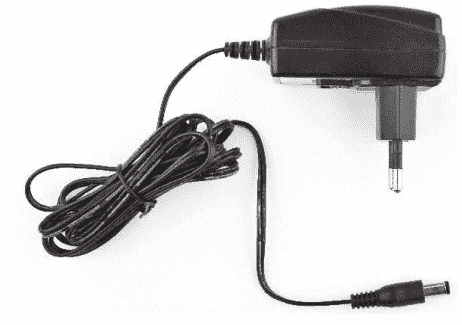

图 1.3：你可以用交流适配器为 Arduino 供电。

在这些情况下，最好的解决方案通常是交流适配器（见图 1.3），提供 9 伏电源（推荐范围为 7V 至 12V）。⁵ 你需要一个带有 2.1 毫米插头尖端且中心为正极的适配器（你现在不需要理解这意味着什么；只需在当地电子商店询问即可）。将其插入 Arduino 的电源插孔，它会立即启动，即使它没有连接到计算机。顺便说一下，即使你将 Arduino 连接到 USB 端口，如果有外部电源可用，它也会使用外部电源。

请注意，旧版本的 Arduino 板（Arduino-NG 和 Diecimila）不会在外部电源和 USB 电源之间自动切换。它们带有标记为 PWR_SEL 的电源选择跳线，你必须手动将其设置为 EXT 或 USB（见下一页的图 1.4）。

现在你知道了两种为 Arduino 供电的方法。但 Arduino 不贪心，很乐意与其他设备共享其电源。在前一页图 1.2 的底部，你可以看到与电源相关的几个插座（有时我也称它们为引脚，因为在内部它们连接到微控制器的引脚）：

- 使用标记为 3V3 和 5V 的引脚，你可以用 3.3 伏或 5 伏为连接到 Arduino 的外部设备供电。

5. http://www.arduino.cc/playground/Learning/WhatAdapter


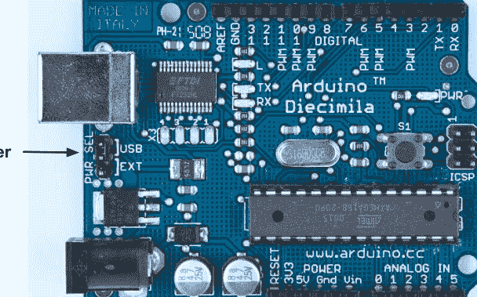

图 1.4：老版本的 Arduino 有一个电源选择跳线。

- 两个标记为 Gnd 的地线引脚可以让你的外部设备与 Arduino 共享公共地线。
- 有些项目需要便携性，因此会使用电池等便携式电源。你可以将电池组等外部电源连接到 Vin 和 Gnd 插座。

如果你将交流适配器连接到 Arduino 的电源插孔，就可以通过该引脚提供适配器的电压。

在板子的右下方，你会看到六个名为 A0–A5 的模拟输入引脚。你可以使用它们将模拟传感器连接到 Arduino。它们会获取传感器数据并将其转换为 0 到 1023 之间的数字。在第 5 章“感知周围世界”（第 102 页）中，我们将使用它们将温度传感器连接到 Arduino。

在板子的顶部有 14 个数字 IO 引脚，名为 D0–D13。根据你的需求，你可以将这些引脚用于数字输入和输出，因此你可以读取按钮或开关的状态来打开和关闭 LED（我们将在第 3.5 节“使用按钮”（第 74 页）中进行操作）。其中六个引脚（D3、D5、D6、D9、D10 和 D11）还可以充当模拟

在本节中，我们仔细了解了 Arduino Uno，这是最新的 Arduino 板。但还有其他几种类型可用，虽然它们原理相同，但在一些细节上有所不同。Arduino Mega2560⁶ 拥有比所有其他 Arduino 更多的 IO 引脚，并使用强大的 ATmega2560 微控制器；而 Arduino Nano⁷ 设计用于面包板，因此没有任何插座。根据我的经验，初学者应该从“标准”板开始，即 Uno 或 Duemilanove。

#### 1.4 安装 Arduino IDE

为了尽可能方便地开始使用 Arduino，Arduino 开发者创建了一个简单但实用的集成开发环境（IDE）。它可以在许多不同的操作系统上运行。在创建第一个项目之前，你需要先安装它。

##### 在 Windows 上安装 Arduino IDE

Arduino IDE 可以在所有最新版本的 Microsoft Windows 上运行，例如 Windows XP、Windows Vista 和 Windows 7。安装该软件很容易，因为它以独立的 ZIP 压缩包形式提供⁸，所以你甚至不需要安装程序。下载压缩包，并将其解压到你选择的位置。

在首次启动 IDE 之前，你必须为 Arduino 的 USB 端口安装驱动程序。此过程取决于你使用的 Arduino 板以及你的 Windows 版本，但你始终需要先将 Arduino 插入 USB 端口以启动驱动程序安装过程。

在 Windows Vista 上，驱动程序安装通常会自动进行。你可以向后靠着，看着硬件向导的消息依次显示，直到它提示你可以使用新安装的 USB 硬件。

Windows XP 和 Windows 7 可能无法在 Microsoft 的更新网站上自动找到驱动程序。在你告诉硬件向导跳过从 Internet 自动安装驱动程序后，它迟早会要求你提供正确驱动程序的路径。根据你的 Arduino 板，你必须将向导指向 Arduino 安装目录中的正确位置。对于 Arduino Uno 和 Arduino Mega 2560，请选择

6. http://arduino.cc/en/Main/ArduinoBoardMega2560
7. http://arduino.cc/en/Main/ArduinoBoardNano
8. http://arduino.cc/en/Main/Software

在 drivers 目录中选择 Arduino UNO.inf（或相应的 Arduino MEGA 2560.inf）。对于较老的板子，如 Duemilanove、Diecimila 或 Nano，请选择 drivers/FTDI USB Drivers 目录。

驱动程序安装完成后，你可以通过双击从压缩包的主目录启动 Arduino 可执行文件。按照屏幕上的说明安装 IDE。

请注意，USB 驱动程序的更新频率不如 Arduino IDE 高。每当你安装新版本的 IDE 时，请检查是否也需要安装新的驱动程序。通常情况下，这不是必需的。

##### 在 Mac OS X 上安装 Arduino IDE

Arduino IDE 以磁盘映像的形式提供给最新的 Mac OS X⁹。下载它，双击它，然后将 Arduino 图标拖到你的 Applications 文件夹中。

如果你使用的是 Arduino Uno 或 Arduino Mega 2560，那么你已经完成了，可以启动 IDE 了。在你将 IDE 与较老的 Arduino（如 Duemilanove、Diecimila 或 Nano）一起使用之前，你必须为 Arduino 的串行端口安装驱动程序。磁盘映像中包含一个通用二进制文件——双击适合你平台的 FTDIUSBSerialDriver_10_4_10_5_10_6.pkg 文件，然后按照屏幕上的安装说明进行操作。

安装新版本的 Arduino IDE 时，你通常不必再次安装 FTDI 驱动程序（仅当有更新版本的驱动程序时才需要）。

##### 在 Linux 上安装 Arduino IDE

Linux 发行版上的安装过程仍然不太统一。Arduino IDE 在几乎所有现代 Linux 版本上都能正常工作，但安装过程因发行版而异。此外，你通常需要安装其他操作系统预装的附加软件（例如 Java 虚拟机）。

最好查看官方文档¹⁰ 并查找适合你首选系统的说明。

现在我们已经安装了驱动程序和 IDE，让我们看看它能提供什么。

9. http://arduino.cc/en/Main/Software

10. http://www.arduino.cc/playground/Learning/Linux

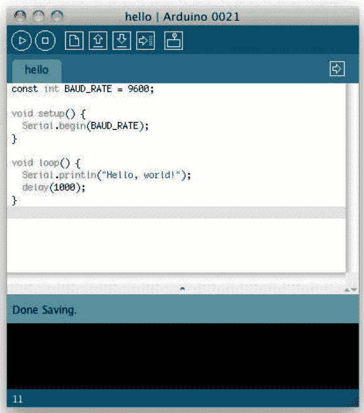

图 1.6：Arduino IDE 布局清晰。

#### 1.5 认识 Arduino IDE

如果你以前使用过 Eclipse、Xcode 或 Microsoft Visual Studio 等 IDE，你最好降低期望，因为 Arduino IDE 非常简单。它主要由编辑器、编译器、加载器和串行监视器组成（见图 1.6，或者更好的是，在你的计算机上启动 IDE）。

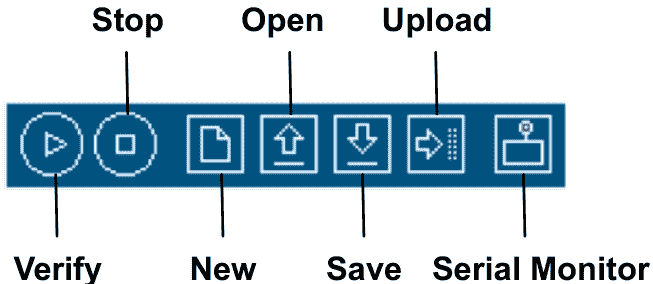

图 1.7：IDE 的工具栏让你快速访问重要功能。

它没有调试器或代码补全等高级功能。你只能更改少数偏好设置，而且作为 Java 应用程序，它并不能完全集成到 Mac 桌面中。不过它仍然可用，甚至对项目管理也有不错的支持。

在图 1.7 中，你可以看到 IDE 的工具栏，它可以让你即时访问最常用的功能：

- 使用 Verify 按钮，你可以编译当前编辑器中的程序。因此，在某些方面，“Verify”这个名称有点不恰当，因为单击该按钮不仅会在语法上验证程序，还会将其转换为适合 Arduino 板的表示形式。
- New 按钮通过清空当前编辑器窗口的内容来创建新程序。在此之前，IDE 会给你机会保存所有未保存的更改。
- 使用 Open，你可以从文件系统打开现有程序。
- Save 保存当前程序。
- 当你单击 Upload 按钮时，IDE 会编译当前程序并将其上传到你在

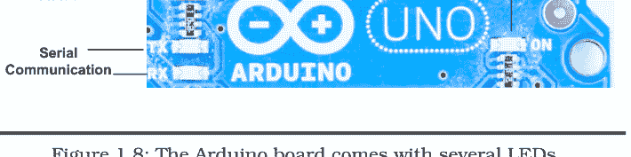

图 1.8：Arduino 板带有多个 LED。

IDE 的 Tools > Serial Port 菜单中选择的 Arduino 板（你将在第 1.6 节“编译和上传程序”（第 38 页）中了解更多相关信息）。

- Arduino 可以通过串行连接与计算机通信。单击 Serial Monitor 按钮会打开一个串行监视器窗口，允许你查看 Arduino 发送的数据，也可以将数据发送回去。
- Stop 按钮停止串行监视器。

虽然使用 IDE 很容易，但你可能会遇到问题或想查找一些特殊的内容。在这种情况下，请查看 Help 菜单。它会指向 Arduino 网站上的许多有用资源，这些资源不仅为所有典型问题提供快速解决方案，还提供参考资料和教程。

为了熟悉 IDE 最重要的功能，我们将创建一个简单的程序，让发光二极管（LED）闪烁。LED 是一种廉价而高效的光源，Arduino 已经带有多个 LED。一个 LED 显示 Arduino 当前是否通电，另外两个 LED 在通过串行连接传输或接收数据时闪烁（见图 1.8）。

在我们的第一个小项目中，我们将让 Arduino 的状态 LED 闪烁。状态 LED 连接到数字 IO 引脚 13。数字引脚起到一种开关的作用，可以处于两种状态之一：HIGH 或 LOW。如果设置为 HIGH，输出引脚被设置为 5 伏，导致电流流过 LED，从而使其亮起。如果重新设置为 LOW，电流停止流动，LED 就会熄灭。目前你不需要确切地知道电是如何工作的，但如果你好奇，可以看看第 A.1 节“电流、电压和电阻”（第 237 页）。


打开 IDE，在编辑器中输入以下代码：

```
Download welcome/HelloWorld/HelloWorld.pde
const unsigned int LED_PIN = 13;
const unsigned int PAUSE = 500;

void setup() {
  pinMode(LED_PIN, OUTPUT);
}

void loop() {
  digitalWrite(LED_PIN, HIGH);
  delay(PAUSE);
  digitalWrite(LED_PIN, LOW);
  delay(PAUSE);
}
```

让我们看看这是如何工作的，并逐段剖析程序的源代码。前两行中，我们使用 `const` 关键字定义了两个整型常量。`LED_PIN` 指的是我们使用的数字 IO 引脚编号，而 `PAUSE` 定义了闪烁周期的时间长度，单位为毫秒。

每个 Arduino 程序都需要一个名为 `setup()` 的函数，我们的程序从第 4 行开始定义它。函数定义始终遵循以下模式：

<返回值类型> <函数名> '(' <参数列表> ')'

在我们的例子中，函数名为 `setup()`，其返回值类型是 `void`：它不返回任何内容。`setup()` 不需要任何参数，所以我们让参数列表为空。在继续剖析程序之前，你应该多了解一些 Arduino 的数据类型。

##### Arduino 数据类型

你在 Arduino 程序中存储的每条数据都需要一个类型。根据你的需求，可以从以下类型中选择：

- **boolean** 值占用一个字节的内存，可以是 **true** 或 **false**。
- **char** 变量占用一个字节的内存，存储从 -128 到 127 的数字。这些数字通常表示以 ASCII 编码的字符；也就是说，在下面的示例中，c1 和 c2 具有相同的值：

```
char c1 = 'A';
char c2 = 65;
```

请注意，**char** 字面量必须使用单引号。
- **byte** 变量使用一个字节，存储从 0 到 255 的值。

Arduino 在启动时只调用一次 `setup()`，我们用它来初始化 Arduino 主板以及连接到它上面的所有硬件。我们使用 `pinMode()` 方法将 13 号引脚设置为输出引脚。这可以确保该引脚能够提供足够的电流来点亮 LED。引脚的默认状态是 `INPUT`，而 `INPUT` 和 `OUTPUT` 都是预定义的常量。¹¹

另一个必需函数 `loop()` 从第 8 行开始。它包含程序的主要逻辑，Arduino 会在一个无限循环中调用它。我们程序的主要逻辑必须先打开连接到 13 号引脚的 LED。为此，我们使用 `digitalWrite()` 并将引脚编号和常量 `HIGH` 传递给它。这意味着该引脚将输出 5 伏电压，直到另行通知，连接到该引脚的 LED 就会点亮。

然后程序调用 `delay()`，等待 500 毫秒，期间不执行任何操作。在这个暂停期间，13 号引脚保持 `HIGH` 状态，LED 继续发光。当我们再次使用 `digitalWrite()` 将引脚状态设置为 `LOW` 时，LED 最终关闭。我们再等待 500 毫秒，然后 `loop()` 函数结束。Arduino 会再次启动它，LED 就闪烁起来了。

在下一节中，你将学习如何让程序运行起来并将其上传到 Arduino。

#### 1.6 编译和上传程序

在编译程序并将其上传到 Arduino 之前，你需要在 IDE 中配置两件事：你使用的 Arduino 类型以及 Arduino 所连接的串口。

识别 Arduino 类型很容易，因为型号印在主板上。常见的类型有 Uno、Duemilanove、Diecimila、Nano、Mega、Mini、NG、BT、LilyPad、Pro 或 Pro Mini。在某些情况下，你还需要检查你的 Arduino 使用的是哪种微控制器——大多数使用 ATmega168 或 ATmega328。你可以看到微控制器类型印在微控制器本身上面。当你确定了 Arduino 的确切类型后，从“工具 > 开发板”菜单中选择它。

现在，你需要从“工具 > 串口”菜单中选择你的 Arduino 所连接的串口。在 Mac OS X 上，串口名称以 `/dev/cu.usbserial` 或 `/dev/cu.usbmodem` 开头（在我的

11. 官方文档请参阅 http://arduino.cc/en/Tutorial/DigitalPins。

MacBook Pro 上，它是 `/dev/cu.usbmodemfa141`）。在 Linux 系统上，它应该是 `/dev/ttyUSB0`、`/dev/ttyUSB1` 或类似名称，具体取决于你的计算机有多少个 USB 端口。

在 Windows 系统上，找到正确的串口会稍微复杂一些，但也并不难。打开设备管理器，在“端口（COM 和 LPT）”菜单项下查找“USB 串行端口”（参见下一页的图 1.9）。通常该端口名为 COM1、COM2 或类似名称。

选择正确的串口后，单击“验证”按钮，你应该会在 IDE 的消息区域看到以下输出（Arduino IDE 将程序称为草图）：

```
Binary sketch size: 1010 bytes (of a 32256 byte maximum)
```

这意味着 IDE 已成功将源代码编译为 1,010 字节的机器码，我们可以将其上传到 Arduino。如果你看到的是错误消息，请检查你是否正确键入了程序（如有疑问，请从本书网站下载代码）。¹² 根据你使用的 Arduino 主板，字节上限可能会有所不同。例如，在 Arduino Duemilanove 上，它通常是 14336。

现在单击“上传”按钮，几秒钟后，你应该会在消息区域看到以下输出：

```
Binary sketch size: 1010 bytes (of a 32256 byte maximum)
```

这与我们编译程序后得到的消息完全相同，它告诉我们 1,010 字节的机器码已成功传输到 Arduino。如果出现任何错误，请检查你是否在“工具”菜单中选择了正确的 Arduino 类型和正确的串口。

在上传过程中，TX 和 RX 指示灯会闪烁几秒钟。这是正常现象，每当 Arduino 和你的计算机通过串口通信时都会发生。当 Arduino 发送信息时，它会点亮 TX 指示灯。当它接收到一些数据位时，它会点亮 RX 指示灯。由于通信速度相当快，指示灯开始闪烁，你无法识别单个字节的传输（如果你能识别，那你可能是外星人）。

12. http://www.pragprog.com/titles/msard

图 1.9：在 Windows XP 上查找 Arduino 所连接的串口。

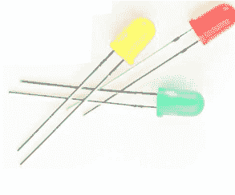

图 1.11：一组通孔 LED

这就是为什么它们通常有一根或多根长导线。首先，你将导线穿过印刷电路板上的孔。然后，你通常会将它们弯曲、焊接并剪断，以将部件固定到电路板上。在可用的情况下，你也可以将它们插入我们 Arduino 或面包板上的插座中（你将在第 64 页的 3.2 节“使用面包板”中了解更多关于面包板的内容）。

在下一页的图 1.12 中，你可以看到如何将 LED 连接到 Arduino。将 LED 的短连接脚连接到接地引脚（GND），将较长的连接脚连接到 13 号引脚。你可以让闪烁草图仍在运行时进行此操作。状态 LED 和外部 LED 都将开始闪烁。

务必确保你使用的是 13 号引脚！如果你将 LED 连接到任何其他引脚，它很可能会被烧毁。原因是 13 号引脚有一个内部电阻，而其他引脚没有（你将在第 63 页的第 3 章“构建二进制骰子”中了解更多相关信息）。


就这样！你刚刚为 Arduino 添加了第一个外部电子部件，并创建了你的第一个物理计算项目。你编写了一些代码，它让世界变得更明亮了一些。你亲手实现了数字版的“fiat lux”。¹³

你将在几乎每个 Arduino 项目中用到你在本章学到的理论和技能。在下一章中，你将看到如何更灵活地控制 LED，并学习如何充分利用 Arduino IDE 的更高级功能。

13. http://en.wikipedia.org/wiki/Fiat_lux

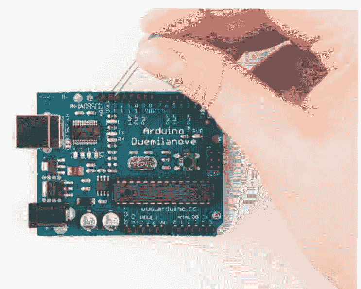

图 1.12：将 LED 连接到 Arduino。

#### 1.8 如果它不工作怎么办？

不要慌张！如果它不工作，你很可能以错误的方式连接了 LED。在组装电子项目时，部件分为两类：那些可以随意安装的，以及那些需要特定方向的。LED 有两个连接脚：阳极（正极）和阴极（负极）。它们很容易混淆，我的科学老师教了我一个助记方法：阴极是负极（cathode is necative）。记住 LED 的负极连接脚也很容易：它更短、更少、更小。如果你是一个更积极的人，那么可以将阳极视为更大、更多、更正极。你也可以通过 LED 的外壳来识别其连接脚。负极一侧的外壳是平的，而正极一侧是圆的。


选择错误的串口或 Arduino 类型也是常见的错误。如果在上传草图时收到诸如“Serial port already in use”的错误消息，请检查是否已从 Tools > Serial Port 菜单中选择了正确的串口。如果收到诸如“Problem uploading to board”或“programmer is not responding”的消息，请检查是否已从 Tools > Board 菜单中选择了正确的 Arduino 板。

你的 Arduino 程序与所有程序一样，会包含错误。拼写错误和语法错误会被编译器检测到。在下一页的图 1.13 中，你可以看到一个典型的错误消息。我们本应调用 pinMode()，却调用了 pinMod()，由于编译器找不到该名称的函数，它便停止并显示错误消息。Arduino IDE 会高亮显示该行，用黄色背景标出错误，并打印出有用的错误消息。

其他错误可能更微妙，有时你需要仔细研究代码并使用一些老式的调试技术（在 Debug It! Find, Repair, and Prevent Bugs in Your Code [But09] 中你可以找到大量关于此主题的有用建议）。

虽然很少见，但也可能发生 LED 损坏的情况。如果上述技巧都不起作用，请尝试更换另一个 LED。

#### 1.9 Exercises

- 尝试使用更多暂停并改变暂停长度来制作不同的闪烁模式（它们不一定都要相同）。另外，尝试使用非常短的暂停使 LED 以高频率闪烁。你能解释你观察到的效果吗？
- 让 LED 用摩尔斯电码输出你的名字。¹⁴

#### 2.2 Managing Projects and Sketches

现代软件开发者可以从各种自动化重复和枯燥任务的开发工具中进行选择。对于 Arduino 这样的嵌入式系统也同样如此。你也可以使用集成开发环境（IDEs）来管理你的程序。其中最受欢迎的一个是由 Arduino 团队创建的。

Arduino IDE 管理项目所属的所有文件。它还为你创建将在 Arduino 板上运行的二进制文件所需的所有工具提供了便捷的访问。方便的是，它做得毫不显眼。例如，你可能已经注意到 Arduino IDE 会自动保存你输入的所有代码。这是为了防止初学者意外丢失数据或代码（更不用说即使是专业人士也会时不时丢失数据）。

自动组织项目所属的所有文件是 IDE 最重要的功能之一。在幕后，Arduino IDE 为每个新项目创建一个目录，并将项目所属的所有文件存储在此目录中。要向项目添加新文件，请点击右侧的标签按钮打开标签弹出菜单，然后选择 New Tab（见图 2.1）。要添加现有文件，请使用 Sketch > Add File 菜单项。

从菜单项的名称你可能已经猜到了，Arduino IDE 将项目称为草图。如果你没有选择名称，它会以 sketch_ 开头命名。你可以使用 Save As 命令随时更改名称。如果你没有显式保存草图，IDE 会将其存储在预定义的文件夹中，你可以在首选项菜单中查看

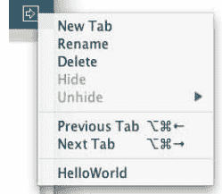

Figure 2.1: The tabs menu in action

该位置。你可以更改此行为，以便在创建新草图时 IDE 询问你名称。每当你迷路时，你可以使用 Sketch > Show Sketch Folder 菜单项检查当前草图位于哪个文件夹。

IDE 使用目录不仅用于组织项目。它还在以下文件夹中存储一些有趣的内容：

- examples 文件夹包含可作为你自己实验基础的示例草图。可通过 File > Open 对话框访问它们。花点时间浏览它们，即使你现在看不懂任何内容。
- libraries 目录包含用于各种目的和设备的库。每当你使用新传感器时，很可能需要将支持库复制到此文件夹。

Arduino IDE 通过为大量设置选择合理的默认值来让你的生活更轻松。但它也允许你更改其中大多数设置，你将在下一节中看到如何操作。

#### 2.3 Changing Preferences

对于早期项目，IDE 的默认值可能合适，但迟早你会想更改一些内容。如图 2.2 所示，在下一页中，IDE 只允许你直接更改少数首选项。但对话框中提到了一个名为 preferences.txt 的文件，其中包含更多首选项。该文件是一个 Java 属性文件，由键/值对组成。这里显示了其中一些：

```
...
editor.external.bgcolor=#168299
preproc.web_colors=true
editor.font.macosx=Monaco,plain,10
sketchbook.auto_clean=true
update.check=true
build.verbose=true
upload.verbose=true
...
```

这些属性中的大多数控制用户界面；也就是说，它们更改字体、颜色等。但它们也可以更改应用程序的行为。例如，你可以为编译或上传草图等操作启用更详细的输出。编辑 preferences.txt，并将 build.verbose 和 upload.verbose 都设置为 true。然后从第 1 章 Welcome to the Arduino，第 23 页加载闪烁 LED 草图并

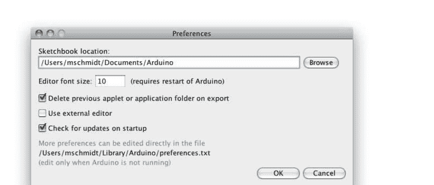

# Figure 2.2: The IDE lets you change some preferences.

再次编译它。消息面板中的输出应类似于下一页的图 2.3（在 IDE 的最新版本中，你可以通过在工具栏中点击 Verify/Compile 或 Upload 按钮时按住 Shift 键来实现相同效果）。

请注意，IDE 在关闭时会更新部分首选项的值。因此，在直接在 preferences.txt 文件中更改任何首选项之前，你必须先停止 Arduino IDE。

现在你已经熟悉 Arduino IDE，让我们做一些编程。我们将让 Arduino 与外部世界对话。

Arduino 使许多独立应用成为可能——这些项目不涉及任何额外的计算机。在这种情况下，你只需连接一次 Arduino 到计算机以上传软件，之后它只需要电源即可。更常见的是，人们使用 Arduino 通过传感器增强计算机的功能或提供对额外硬件的访问。通常，你通过串口控制外部硬件，因此学习如何与 Arduino 串行通信是个好主意。

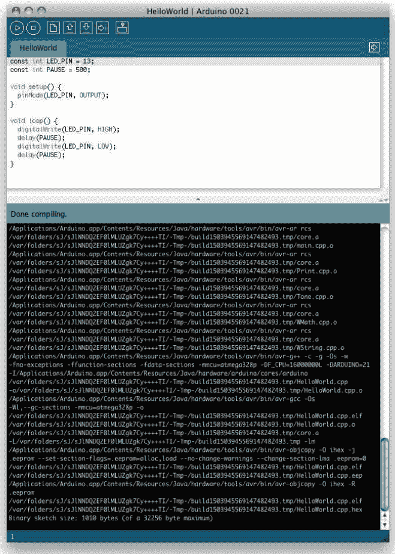

Figure 2.3: IDE in verbose mode showing output of command-line tools

用于上传软件的 Arduino 具有串口，我们也可以用它将 Arduino 连接到其他设备（在第 1.6 节 Compiling and Uploading Programs，第 38 页，你将学习如何查找 Arduino 连接的串口）。在本节中，我们将使用它通过计算机键盘控制 Arduino 的状态 LED。LED 应在你按下 1 时打开，按下 2 时关闭。我们需要的所有代码如下：

```
Download welcome/LedSwitch/LedSwitch.pde
const unsigned int LED_PIN = 13;
const unsigned int BAUD_RATE = 9600;

void setup() {
  pinMode(LED_PIN, OUTPUT);
  Serial.begin(BAUD_RATE);
}

void loop() {
  if (Serial.available() > 0) {
    int command = Serial.read();
    if (command == '1') {
      digitalWrite(LED_PIN, HIGH);
      Serial.println("LED on");
    } else if (command == '2') {
      digitalWrite(LED_PIN, LOW);
      Serial.println("LED off");
    } else {
      Serial.print("Unknown command: ");
      Serial.println(command);
    }
  }
}
```

与之前的示例一样，我们为 LED 连接的引脚定义了一个常量，并在 setup() 函数中将其设置为 OUTPUT 模式。在第 6 行，我们使用 Serial 类的 begin() 函数初始化串口，传入波特率 9600（你可以在第 C.1 节 Learning More About Serial Communication，第 251 页了解波特率是什么）。这就是在程序中发送和接收串口数据的全部内容。

那么，让我们读取并解释数据。loop() 函数首先在第 10 行调用 Serial 的 available() 方法。available() 返回串口上等待的字节数。如果有数据可用，我们使用 Serial.read() 读取它。read() 如果有数据可用则返回第一个字节的传入数据，否则返回 -1。


##### 时尚的 LED

随着普适计算和可穿戴计算在过去几年变得非常流行，带有均衡器的 T 恤仍然很酷，但不再那么令人兴奋了。* 但通过使用几个 LED，你可以为女士们制作一些惊人的配饰。例如，日本工程师已经制作了 LED 睫毛。†

这个特定的产品不使用 Arduino，但使用 Lilypad，‡ 你可以轻松地自己制作类似的东西。你必须极其小心地对待 LED，因为大多数 LED 都非常亮，会对你的眼睛造成严重损害！

* http://www.thinkgeek.com/tshirts-apparel/interactive/8a5b/
† http://blog.makezine.com/archive/2009/10/led_eyelashes.html
‡ http://www.arduino.cc/en/Main/ArduinoBoardLilyPad

如果我们读取的字节代表字符 1，我们打开 LED 并通过串口发送回消息“LED on”。我们使用 Serial.println()，它会在文本后添加回车字符（ASCII 码 13）和换行符（ASCII 码 10）。

如果我们接收到字符 2，我们关闭 LED。如果我们接收到不支持的命令，我们会发送回相应的消息以及我们不理解的命令。Serial.print() 的工作方式与 Serial.println() 完全相同，但它不会在消息后添加回车和换行字符。

让我们看看程序在实践中如何工作。编译它，将其上传到你的 Arduino，然后切换到串行监视器（可选地，你可以将一个 LED 连接到引脚 13；否则，你只能控制 Arduino 的状态 LED）。乍一看，什么都没有发生。那是因为我们还没有向 Arduino 发送命令。在文本框中输入 1，然后单击发送按钮。现在应该发生两件事：LED 被打开，并且消息“LED on”出现在串行监视器窗口中（见图 2.4，在下一页）。我们正在使用计算机键盘控制 LED！

使用命令 1 和 2 多玩一会儿，并观察发送未知命令时会发生什么。例如，如果你输入大写字母 A，Arduino 将发送回消息“Unknown command: 65”。数字 65 是字母 A 的 ASCII 码，Arduino 以其最基本的形式输出接收到的数据。

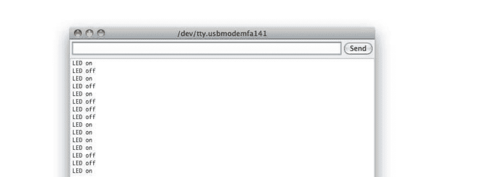

# 图 2.4：Arduino IDE 的串行监视器

这是 Serial 的 print() 方法的默认行为，你可以通过向函数调用传递格式说明符来更改它。要查看效果，将第 20 行替换为以下语句：

```
Serial.println(command, DEC);
Serial.println(command, HEX);
Serial.println(command, OCT);
Serial.println(command, BIN);
Serial.println(command, BYTE);
```

当你再次发送字符 A 时，输出如下所示：

```
Unknown command: 65
41
101
1000001
A
```

根据格式说明符，Serial.println() 会自动将字节转换为另一种表示形式。DEC 以十进制数字输出字节，HEX 以十六进制数字输出，以此类推。请注意，这样的操作通常会改变传输数据的长度。例如，单个字节 65 的二进制表示需要 7 个字节，因为它包含七个字符。

##### 编号系统

我们编号系统以 10 为基数是一个进化上的偶然。如果我们每只手只有四个手指，它可能就是八，我们可能早几个世纪就发明了计算机。

几千年来，人们一直使用位值数字系统，我们将数字 4711 表示如下：

4×10³ + 7×10² + 1×10¹ + 1×10⁰

这使得算术运算非常方便。但在处理只能解释二进制数字的计算机时，使用基于数字 2（二进制）、8（八进制）或 16（十六进制）的编号系统通常更有优势。

例如，十进制数字 4711 可以用八进制和十六进制表示如下：

- 1×8⁴ + 1×8³ + 1×8² + 4×8¹ + 7×8⁰ = 011147
- 1×16³ + 2×16² + 6×16¹ + 7×16⁰ = 0x1267

在 Arduino 程序中，你可以为所有这些编号系统定义字面量：

```
int decimal = 4711;
int binary = B100100110011;
int octal = 011147;
int hexadecimal = 0x1267;
```

二进制数字以 B 字符开头，八进制数字以 0 开头，十六进制数字以 0x 开头。

##### 使用不同的串行终端

对于琐碎的应用，IDE 的串行监视器就足够了，但你无法轻松地将其与其他应用程序结合使用，并且它缺少一些功能（例如，在较旧的 IDE 版本中，它无法发送换行字符）。这意味着你应该有一个替代的串行终端来发送数据，你可以为每个操作系统找到大量此类终端。

##### Windows 的串行终端

Putty¹ 是 Windows 用户的绝佳选择。它是免费的，并且作为无需安装的可执行文件提供。图 2.5，在下一页显示了如何将其配置为在串行端口上通信。

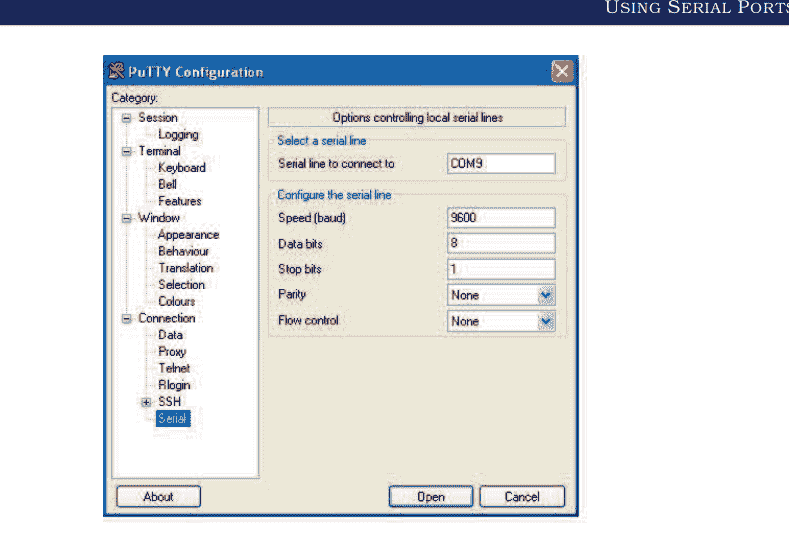

# 图 2.5：配置 PuTTY 使其与 Arduino 配合工作

配置好 PuTTY 后，你可以打开与 Arduino 的串行连接。在图 2.6，在下一页中，你可以看到相应的对话框。单击 Open，你会看到一个空的终端窗口。

现在按几次 1 和 2 来打开和关闭 LED。在图 2.7，在下一页中，你可以看到一个典型的会话。

##### Linux 和 Mac OS X 的串行终端

Linux 和 Mac 用户可以使用 screen 命令通过串行端口与 Arduino 通信。检查 Arduino 连接到的串行端口（例如，在 IDE 的 Tools > Board 菜单中），然后运行类似这样的命令（对于较旧的板，串行端口的名称可能类似于 /dev/cu.usbserial-A0007LUY，在 Linux 系统上它可能是 /dev/ttyUSB1 或类似名称）：

```
$ screen /dev/cu.usbmodemfa141 9600
```

screen 需要串行端口的名称和要使用的波特率。在图 2.8，第 58 页中，你可以看到一个典型的会话。要退出 screen 命令，按 Ctrl-a 然后按 Ctrl-k。

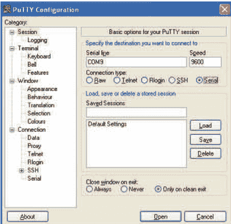

图 2.6：使用 Putty 打开与 Arduino 的串行会话

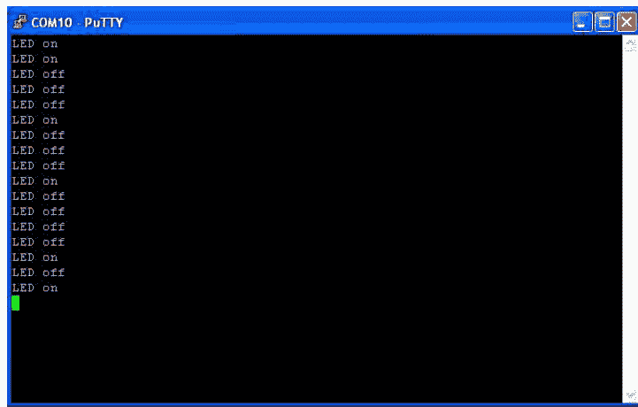

图 2.7：Putty 与 Arduino 通信。

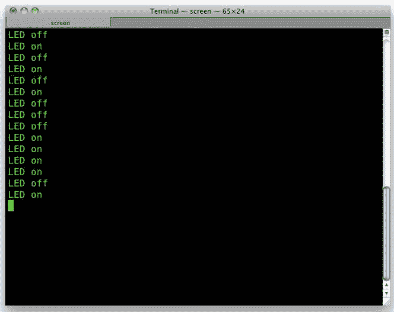

图 2.8：screen 命令与 Arduino 通信。

我们现在可以与 Arduino 通信，这具有重大意义：Arduino 控制的任何东西也可以由你的计算机控制，反之亦然。开关 LED 并不是太壮观，但试着想象现在可能实现什么。你可以移动机器人，自动化你的家庭，或创建交互式游戏。

以下是关于串行通信的更多重要事实：

- Arduino 的串行接收缓冲区最多可容纳 128 字节。在高速发送大量数据时，你必须同步发送方和接收方以防止数据丢失。通常，接收方在准备好接收新数据块时向发送方发送确认。

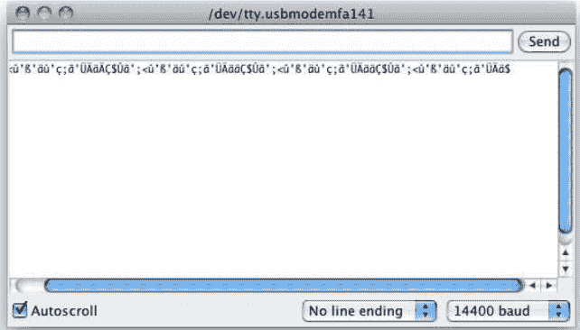

图 2.9：错误的波特率会产生大量垃圾数据。

在本章中，你看到了如何使用串行端口与 Arduino 通信，这为物理计算项目打开了全新的世界之门（有关串行通信的更多详细信息，请参阅第 C.1 节，学习更多关于串行通信的内容，第 251 页）。在下一章中，你将学习如何使用传感器收集有关现实世界的有趣事实，并学习如何通过移动物体来改变现实世界。串行通信是让你使用 Arduino 和 PC 控制所有这些操作的基础。

#### 2.5 如果它不起作用怎么办？

如果本章中的示例出现任何问题，你应该先查看第 1.8 节，如果它不起作用怎么办？，第 43 页。如果仍然遇到问题，可能是由于串行通信的一些问题。例如，你可能设置了错误的波特率；在图 2.9 中，你可以看到这种情况发生时的情况。

确保你在调用 Serial.begin() 中设置的波特率与串行监视器中的波特率相匹配。


#### 2.6 练习

- 在示例程序中添加新的命令。例如，命令 3 可以让 LED 闪烁一段时间。
- 尝试让命令更易读；也就是说，不要使用 1，而是使用命令 on，不要使用 2，而是使用 off。

如果你在解决此练习时遇到问题，请先阅读第 4 章《构建摩尔斯电码生成器库》，第 88 页。

## 第二部分

## 八个 Arduino 项目

### 第三章

### 构建二进制骰子

现在你已经学习了 Arduino 开发的基础知识，事情将会变得真正有趣起来。你现在具备创建第一个复杂、独立项目的技能。完成本章的学习后，你将知道如何使用 LED、按钮、面包板和电阻。结合这些部件与 Arduino，你几乎可以无限地进行新的有趣项目。

我们的第一个项目将是创建一个电子骰子。虽然普通骰子使用一到六个点来显示结果，但我们的骰子将使用 LED 来代替。对于我们的第一次实验，单个 LED 就足够了，但对于骰子我们需要不止一个。你需要将多个外部 LED 连接到 Arduino。由于你不能全部直接连接到 Arduino，你将学习如何使用面包板。此外，你还需要一个按钮来掷骰子，所以你也将学习如何使用按钮。为了将按钮和 LED 连接到 Arduino，你需要另一个重要的电子元件：电阻。因此，在本章结束时，你的工具箱中将拥有许多新工具。

- 1. 一个半尺寸面包板
- 2. 三个 LED（对于练习你需要额外的 LED）
- 3. 两个 10kΩ 电阻（参见第 A.1 节《电流、电压和电阻》，第 237 页，了解有关电阻的更多信息）
- 4. 三个 1kΩ 电阻
- 5. 两个按钮
- 6. 一些导线

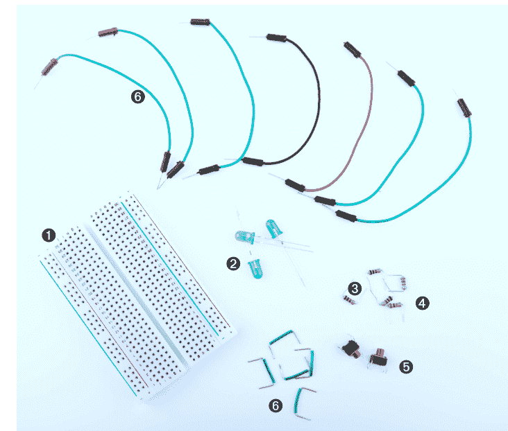

图 3.1：本章所需的全部零件

- 7. 一个 Arduino 板，如 Uno、Duemilanove 或 Diecimila
- 8. 一根用于将 Arduino 连接到计算机的 USB 数据线
- 9. 一个倾斜传感器（可选）

图 3.1 显示了构建本章项目所需的零件。你将在接下来的大部分章节中看到类似的照片。照片中的编号对应于零件清单中的编号。照片中未显示标准零件，如 Arduino 板或 USB 数据线。

#### 3.2 使用面包板

将零件如 LED 直接连接到 Arduino 只有在最简单的情况下才是一种选择。通常，你会在面包板上制作项目的原型，然后将面包板连接到 Arduino。面包板“模拟”

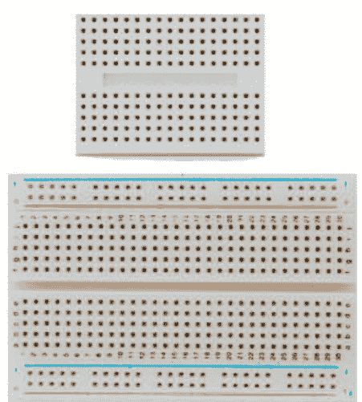

# 图 3.2：面包板集合

一个电路板。你不需要将零件焊接到板上；相反，你可以简单地将它们插入其中。

面包板有各种类型和尺寸（在图 3.2 中，你可以看到其中两种），但它们的工作方式都相同。它们有很多插座，可用于插入直插式元件或导线。仅此一点并无大碍，但插座以特殊方式连接。在下一页的图 3.3 中，你可以看到连接方式。

正如你所见，大多数插座按列连接。如果一列的某个插座连接到电源，那么该列中的所有其他插座也会自动通电。在照片中较大的板上，你还可以看到四排连接的插座。这对于更大的电路很方便。通常，你将一排连接到电源，另一排连接到地。这样，你就可以将电源和地分配到板上的任意位置。现在让我们看看如何在面包板上放置零件。

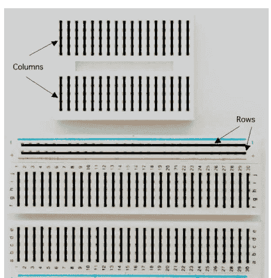

图 3.3：面包板上插座的连接方式

#### 3.3 在面包板上使用 LED

到目前为止，我们使用的是安装在 Arduino 板上的 LED，并将一个 LED 直接连接到 Arduino。在本节中，我们将把一个 LED 插入面包板，然后将面包板连接到 Arduino。

在下一页的图 3.4 中，你可以看到我们最终电路的照片。它由一个 Arduino、一个面包板、一个 LED、三根导线和一个 1kΩ 电阻组成（几分钟后会详细介绍该部件）。使用两根导线将 Arduino 连接到面包板。将引脚 12 与面包板的第 9 列连接，并将地引脚与第 10 列连接。这会自动将第 9 列中的所有插座连接到引脚 12，并将第 10 列中的所有插座连接到地。列的选择是任意的，你也可以使用其他列。

将 LED 的负极连接器（较短的那根）插入第 10 列，其正极连接器插入第 9 列。当你将零件或导线插入面包板时，必须用力按压直到它们滑入。你

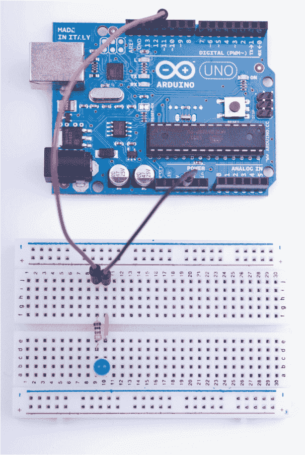

图 3.4：将面包板上的 LED 连接到 Arduino

可能需要多次尝试，尤其是在新板上，并且在将它们插入面包板之前缩短连接器通常很有用。确保在缩短后仍能识别负极和正极连接器。例如，可以将负极再缩短一点。切断连接器时也请佩戴安全眼镜以保护眼睛！

到目前为止我们所做的事情都很直接。也就是说，原则上我们只是扩展了 Arduino 的地引脚和其 IO 引脚 12。为什么我们必须添加一个电阻，电阻是什么？电阻限制了通过电气连接流动的电流。在我们的例子中，它保护 LED 不会消耗过多的功率，因为这会损坏 LED。给 LED 供电时必须始终使用电阻！在第 A.1 节《电流、电压和电阻》，第 237 页，你可以了解有关电阻及其色环的更多信息。在图 3.5 中，你可以看到一个电阻的各种阶段：常规、弯曲和切割。

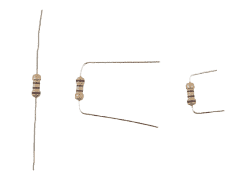

图 3.5：电阻的各种加工阶段

你可能会问自己，为什么我们直接将 LED 连接到 Arduino 时不需要使用电阻。答案很简单：引脚 13 带有一个 1kΩ 的内部电阻。现在我们使用引脚 12，就必须添加我们自己的电阻。

我们不想太费劲地处理连接器，所以我们按图 3.6 所示构建电路，即在下一页。我们通过一根短导线使用面包板的两侧。注意电阻也跨越了两侧。

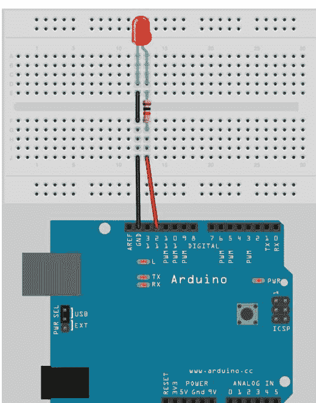

图 3.6：你可以使用面包板的两侧。

#### 3.4 二进制骰子的第一个版本

你一定熟悉普通骰子显示从一到六的结果。要用电子设备完全模拟这样的骰子，你需要七个 LED 和一些相当复杂的业务逻辑。我们走捷径，用二进制显示骰子掷出的结果。

对于二进制骰子，我们只需要三个 LED 来表示当前结果。我们将结果转换为二进制数，并为每个置位的位点亮相应的 LED。下面的图表显示了骰子结果到 LED 的映射（黑色三角形代表发光的 LED）。


我们已经知道如何在面包板上控制单个 LED。控制三个 LED 类似，只需要更多的导线、LED、1kΩ 电阻和引脚。在下一页的图 3.7 中，你可以看到二进制骰子的第一个工作版本。

最主要的区别是共用地线。当你只需要为单个 LED 提供地线时，可以直接将其连接到 LED。但现在我们需要为三个 LED 提供地线，所以我们将首次使用面包板的排。将标记为连字符 (-) 的排连接到 Arduino 的地引脚，那么该排中的所有插座也将作为地引脚工作。然后你可以使用短导线将该排的插座连接到 LED。

除此之外，电路中的其他部分应该都很熟悉，因为我们只是将上一节中的基本 LED 电路克隆了三次。注意我们已将三个电路连接到引脚 10、11 和 12。唯一缺少的是一些软件：

```
Download BinaryDice/BinaryDice.pde
Line 1 const unsigned int LED_BIT0 = 12;
const unsigned int LED_BIT1 = 11;
const unsigned int LED_BIT2 = 10;
5 void setup() {
    pinMode(LED_BIT0, OUTPUT);
    pinMode(LED_BIT1, OUTPUT);
    pinMode(LED_BIT2, OUTPUT);
10    randomSeed(analogRead(A0));
    long result = random(1, 7);
    output_result(result);
}
15 void loop() {
}
void output_result(const long result) {
    digitalWrite(LED_BIT0, result & B001);
20    digitalWrite(LED_BIT1, result & B010);
    digitalWrite(LED_BIT2, result & B100);
}
```


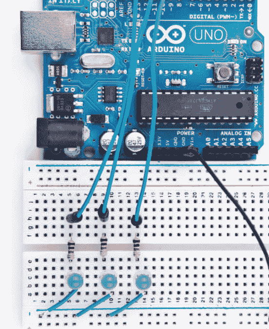

Figure 3.7: A first working version of our binary die

##### More LEDs, Dice, and Cubes

制作二进制骰子很有趣，而且即使对初学者来说也是一个容易的项目。但反过来呢——读取真正的骰子？Steve Hoefer* 使用 Arduino 制作了一个骰子读取器，效果非常令人印象深刻。他使用五对红外发射器和接收器来“扫描”骰子的表面。这是一个相当高级的项目，你可以从中学到很多东西。

另一个有趣的项目是 LED 立方体：由 LED 组成的立方体。† 控制超过几个 LED 看起来出乎意料地困难，但你可以产生惊人的效果。

这就是实现二进制骰子第一版所需的所有代码。像往常一样，我们为 LED 连接的输出引脚定义了一些常量。在 setup() 函数中，我们将所有引脚设置为 OUTPUT 模式。对于骰子，我们需要在 1 到 6 之间需要随机数。random() 函数使用伪随机数生成器在指定范围内返回随机数。在第 10 行，我们使用从模拟输入引脚 A0 读取的一些噪声来初始化生成器（请参阅下一页的边栏，了解我们为什么必须这样做）。你可能会想知道常量 A0 从何而来。自版本 19 以来，Arduino IDE 为所有模拟引脚定义了名为 A0、A1 等的常量。

然后我们实际生成 1 到 6 之间的新随机数，并使用 output_result() 函数输出它。 （对 random() 的调用中的 7 是正确的，因为它期望上限加一）。

函数 output_result() 接收一个数字并通过相应地打开或关闭我们的三个 LED 输出其低三位。这里我们使用 & 运算符和二进制字面量。& 运算符接收两个数字并按位组合它们。当两个对应的位都是 1 时，& 运算符的结果也是 1。否则为 0。B 前缀允许你直接将二进制数字放入源代码中。例如，B11 与 3 相同。

你可能已经注意到 loop() 函数被留空了，你可能会想知道这样的骰子是如何工作的。很简单：每当你重新启动 Arduino 时，它就会输出一个新数字，要再次掷骰子，你必须按下复位按钮。

##### Generating Random Numbers

一些计算问题出乎意料地困难，创建良好的随机数就是其中之一。毕竟，计算机最重要的属性之一是确定性行为。尽管如此，我们经常需要——至少看似——为各种目的提供随机行为，从游戏到加密算法。

最流行的方法（例如 Arduino 的 random() 函数使用的方法）是创建伪随机数。* 它们看起来是随机的，但实际上是公式的结果。存在不同种类的算法，但通常每个新的伪随机数都是从其前驱计算得出的。这意味着你需要一个初始化值来创建序列中的第一个随机数。这个初始化值称为随机种子，为了创建伪随机数的不同序列，你必须使用不同的随机种子。

创建伪随机数很便宜，但如果你知道算法和随机种子，你可以轻松预测它们。所以，你不应该将它们用于加密目的。

在现实世界中，你可以找到无数个随机过程，并且使用 Arduino 很容易测量它们以创建真正的随机数。通常，读取模拟引脚 0 上的一些随机噪声并将其作为随机种子传递给 randomSeed() 函数就足够了。你也可以使用这种噪声来创建真正的随机数；甚至有一个用于此目的的库。†

如果需要强随机数，Arduino 是创建它们的完美设备。你可以找到许多仅为创建随机数而观察自然过程的项目。其中一个例如使用 Arduino 观察沙漏。‡

* http://en.wikipedia.org/wiki/Pseudo-random_numbers
† http://code.google.com/p/tinkerit/wiki/TrueRandom
‡ http://www.circuitlake.com/usb-hourglass-sand-timer.html

编译代码，将其上传到 Arduino，并用你的二进制骰子玩一会儿。你已经掌握了你的第一个高级电子项目！好好享受一下！

所以，每当你想看到新结果时，你都必须重置 Arduino。这可能是你可以构建的最实用的用户界面，对于第一个原型来说，这是可以的。但通常你需要不止一个按钮，而且无论如何添加自己的按钮也更优雅。所以，我们将在下一节中这样做。

#### 3.5 Working with Buttons

在本节中，我们将为我们的二进制骰子添加自己的按钮，这样我们就不再需要滥用 Arduino 的复位按钮来掷骰子了。我们从小处着手，构建一个使用按钮控制单个 LED 的电路。

那么，按钮到底是什么？以下是可用于 Arduino 复位按钮的典型按钮的三个视图。


它有四个连接器，可以完美地安装在面包板上（至少在你用钳子将其拉直之后）。当按钮被按下时，相对的两个引脚会连接；否则，它们是断开的。

在下一页的图 3.8 中，你可以看到一个使用按钮的简单电路。将引脚 7（完全任意选择）连接到按钮，并通过 10kΩ 电阻将按钮连接到地。然后将 5 伏电源连接到按钮的另一端。

总的来说，这种方法似乎很直接，但为什么我们还需要一个电阻呢？问题是我们期望按钮在未按下时返回默认值（LOW）。但当按钮未按下时，它不会直接连接到地，并且会因静电和干扰而闪烁。有一点电流流过电阻，这有助于防止随机噪声改变输入引脚看到的电压。

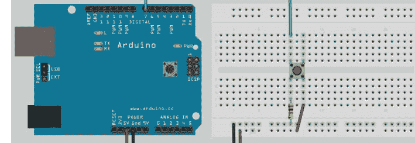

# Figure 3.8: A simple pushbutton circuit

当按钮被按下时，Arduino 的数字引脚上仍会有 5 伏电压，但当按钮未按下时，它会干净地读取到地的连接。我们称之为下拉电阻；上拉电阻则完全相反。也就是说，你必须通过按钮将 Arduino 的信号引脚连接到电源，并使用电阻将按钮的另一端连接到地。

现在我们已经消除了所有这些丑陋不稳定的现实世界行为，我们可以回到稳定而舒适的软件开发世界。下面的程序检查按钮是否被按下并相应地点亮 LED：

Download BinaryDice/SimpleButton/SimpleButton.pde

```
const unsigned int BUTTON_PIN = 7;
const unsigned int LED_PIN   = 13;

void setup() {
  pinMode(LED_PIN, OUTPUT);
  pinMode(BUTTON_PIN, INPUT);
}

void loop() {
  const int BUTTON_STATE = digitalRead(BUTTON_PIN);

  if (BUTTON_STATE == HIGH)
    digitalWrite(LED_PIN, HIGH);
  else
    digitalWrite(LED_PIN, LOW);
}
```

我们将按钮连接到引脚 7，将 LED 连接到引脚 13，并在 setup() 函数中相应地初始化引脚。在 loop() 中，我们读取连接到按钮的引脚的当前状态。如果它是 HIGH，我们打开 LED。否则，我们关闭它。

将程序上传到 Arduino，你会看到只要按下按钮，LED 就亮。松开按钮后，LED 就熄灭。这很酷，因为现在我们几乎拥有控制骰子的所有所需内容，使用我们自己的按钮。但在继续之前，我们将稍微增强我们的示例，并将按钮变成真正的电灯开关。

要构建电灯开关，我们从最简单的解决方案开始。不要更改当前电路，并将以下程序上传到你的 Arduino：

```
```
const unsigned int BUTTON_PIN = 7;

const unsigned int LED_PIN  = 13;

void setup() {
  pinMode(LED_PIN, OUTPUT);
  pinMode(BUTTON_PIN, INPUT);
}

int led_state = LOW;

void loop() {
  const int CURRENT_BUTTON_STATE = digitalRead(BUTTON_PIN);
  
  if (CURRENT_BUTTON_STATE == HIGH) {
    led_state = (led_state == LOW) ? HIGH : LOW;
    digitalWrite(LED_PIN, led_state);
  }
}
```
```

我们以通常的引脚常量开始，并在 setup() 中设置我们使用的引脚的模式。在第 9 行，我们定义了一个名为 led_state 的全局变量来存储我们 LED 的当前状态。当 LED 打开时它将为 LOW，否则为 HIGH。在 loop() 中，我们检查按钮的当前状态。当我们按下按钮时，其状态切换为 HIGH，我们切换 led_state 的内容。也就是说，如果 led_state 为 HIGH，我们将其设置为 LOW，反之亦然。最后，我们将物理 LED 的状态设置为我们当前的软件状态。

我们的解决方案非常简单，但不幸的是，它不起作用。稍微玩一下，你很快就会注意到一些令人讨厌的行为。


例如，如果你按下按钮，LED 有时会立即亮起然后熄灭。而且，如果你松开它，LED 通常会停留在一种或多或少随机的状态；也就是说，它有时亮，有时灭。

问题在于 Arduino 会一遍又一遍地执行 loop() 方法。尽管 Arduino 的 CPU 相对较慢，但这种情况也会非常频繁地发生——无论我们当前是否按下按钮。但如果你按下并保持按住按钮，其状态将始终为 HIGH，并且你会不断地切换 LED 的状态（因为这一切发生得太快，看起来就像 LED 一直亮着）。当你松开按钮时，LED 便处于一种或多或少随机的状态。

为了改善这种情况，我们不仅需要存储 LED 的当前状态，还需要存储按钮的先前状态：

下载 BinaryDice/MoreReliableSwitch/MoreReliableSwitch.pde

```
const unsigned int BUTTON_PIN = 7;
const unsigned int LED_PIN   = 13;

void setup() {
  pinMode(LED_PIN, OUTPUT);
  pinMode(BUTTON_PIN, INPUT);
}

int old_button_state = LOW;
int led_state = LOW;

void loop() {
  const int CURRENT_BUTTON_STATE = digitalRead(BUTTON_PIN);
  if (CURRENT_BUTTON_STATE != old_button_state &&
      CURRENT_BUTTON_STATE == HIGH)
  {
    led_state = (led_state == LOW) ? HIGH : LOW;
    digitalWrite(LED_PIN, led_state);
  }
  old_button_state = CURRENT_BUTTON_STATE;
}
```

在初始化按钮和 LED 引脚之后，我们现在声明两个变量：old_button_state 存储我们按钮的先前状态，led_state 存储 LED 的当前状态。两者都可以是 HIGH 或 LOW。

在 loop() 函数中，我们仍然需要读取当前的按钮状态，但现在我们不仅检查它是否为 HIGH。我们还要检查它自上次读取以来是否发生了变化。只有两个条件都满足时，我们才切换 LED 的状态。因此，只要按钮被按下，我们就不会再一遍又一遍地打开和关闭 LED。在程序结束时，我们必须将按钮的当前状态存储在 old_button_state 中。

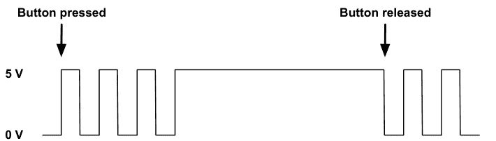

*图 3.9：机械开关必须进行去抖处理。*

上传我们的新版本，你会看到这个解决方案比旧版本效果好得多。但你仍然会发现一些边缘情况，按钮的行为不完全符合预期。问题主要出现在松开按钮的那一刻。

这些问题的原因是机械按钮在按下时会产生几毫秒的抖动。在图 3.9 中，你可以看到机械按钮产生的典型信号。刚按下按钮后，它不会发出清晰的信号。为了克服这一影响，你必须对按钮进行去抖。通常只需等待一小段时间，直到按钮信号稳定即可。去抖可以确保我们对按钮的一次按下只做出一次反应。除了去抖之外，我们仍然需要将 LED 的当前状态存储在一个变量中。具体做法如下：

下载 BinaryDice/DebounceButton/DebounceButton.pde

```
const unsigned int BUTTON_PIN = 7;
const unsigned int LED_PIN   = 13;

void setup() {
  pinMode(LED_PIN, OUTPUT);
  pinMode(BUTTON_PIN, INPUT);
}

int old_button_state = LOW;
int led_state = LOW;

void loop() {
  const int CURRENT_BUTTON_STATE = digitalRead(BUTTON_PIN);
  if (CURRENT_BUTTON_STATE != old_button_state &&
      CURRENT_BUTTON_STATE == HIGH)
  {
    led_state = (led_state == LOW) ? HIGH : LOW;
    digitalWrite(LED_PIN, led_state);
    delay(50);
  }
  old_button_state = CURRENT_BUTTON_STATE;
}
```

我们 LED 开关的最终版本与之前版本仅有一行不同：为了对按钮进行去抖，我们在第 19 行等待 50 毫秒，然后才重新进入主循环。

这就是目前你需要了解的关于按钮的全部内容。在下一节中，我们将使用两个按钮把我们的二进制骰子变成一个真正的游戏。

#### 3.6 添加我们自己的按钮

到目前为止，我们不得不借用 Arduino 的重置按钮来控制骰子。这个解决方案远非最佳，所以我们将添加自己的按钮。在图 3.10（第 81 页）中，你可以看到我们需要对当前电路进行少量修改。实际上，我们根本不需要改变现有的部件，只需要添加一些东西。首先，我们将一个按钮插入面包板，并将其连接到引脚 7。然后，我们通过一个 10kΩ 电阻将按钮连接到地线，并用一小段导线将其连接到 5 伏引脚。这就是我们需要的全部硬件。以下是相应的软件：

下载 BinaryDice/DiceWithButton/DiceWithButton.pde

```
const unsigned int LED_BIT0 = 12;
const unsigned int LED_BIT1 = 11;
const unsigned int LED_BIT2 = 10;
const unsigned int BUTTON_PIN = 7;

void setup() {
  pinMode(LED_BIT0, OUTPUT);
  pinMode(LED_BIT1, OUTPUT);
  pinMode(LED_BIT2, OUTPUT);
  pinMode(BUTTON_PIN, INPUT);
  randomSeed(analogRead(A0));
}

int current_value = 0;
int old_value = 0;

void loop() {
  current_value = digitalRead(BUTTON_PIN);
  if (current_value != old_value && current_value == HIGH) {
    output_result(random(1, 7));
    delay(50);
  }
  old_value = current_value;
}

void output_result(const long result) {
  digitalWrite(LED_BIT0, result & B001);
  digitalWrite(LED_BIT1, result & B010);
  digitalWrite(LED_BIT2, result & B100);
}
```

这是原始代码和用于控制去抖按钮的代码的完美结合。像往常一样，我们初始化所有使用的引脚：三个用于 LED 的输出引脚和一个用于按钮的输入引脚。我们还初始化了随机种子，并在 loop() 函数中等待新的按钮按下。每当按钮被按下时，我们就会掷骰子并使用 LED 输出结果。我们已经用自己的按钮替换了重置按钮！

既然我们已经知道了添加一个按钮有多么容易，我们将在下一节中再添加一个按钮，把我们简单的骰子变成一个游戏。

#### 3.7 构建骰子游戏

要想把我们基本的骰子变成一个完整的游戏，需要再添加一个按钮。使用第一个按钮，我们仍然可以掷骰子；使用第二个按钮，我们可以设定一个猜测值。当我们再次掷骰子且当前结果与我们的猜测相等时，骰子上的三个 LED 将闪烁。否则，它们将保持熄灭。

要输入猜测值，请按正确的次数按下猜测按钮。例如，如果你认为下一个结果是 3，请按三次猜测按钮，然后按开始按钮。

要向电路添加另一个按钮，请执行与第一个按钮完全相同的操作。在图 3.11（第 82 页）中，你可以看到我们又在面包板上添加了一个按钮电路。这次我们将其连接到引脚 5。

阅读网页上的安装说明和文档不会有什么坏处。

以下是我们二进制骰子代码的最终版本：

[下载 BinaryDice/DiceGame/DiceGame.pde](...)

```cpp
#include <Bounce.h>

const unsigned int LED_BIT0 = 12;
const unsigned int LED_BIT1 = 11;
const unsigned int LED_BIT2 = 10;
const unsigned int START_BUTTON_PIN = 5;
const unsigned int GUESS_BUTTON_PIN = 7;
const unsigned int BAUD_RATE = 9600;

void setup() {
    pinMode(LED_BIT0, OUTPUT);
    pinMode(LED_BIT1, OUTPUT);
    pinMode(LED_BIT2, OUTPUT);
    pinMode(START_BUTTON_PIN, INPUT);
    pinMode(GUESS_BUTTON_PIN, INPUT);
    randomSeed(analogRead(A0));
    Serial.begin(BAUD_RATE);
}

const unsigned int DEBOUNCE_DELAY = 20;
Bounce start_button(START_BUTTON_PIN, DEBOUNCE_DELAY);
Bounce guess_button(GUESS_BUTTON_PIN, DEBOUNCE_DELAY);
int guess = 0;

void loop() {
    handle_guess_button();
    handle_start_button();
}

void handle_guess_button() {
    if (guess_button.update()) {
        if (guess_button.read() == HIGH) {
            guess = (guess % 6) + 1;
            output_result(guess);
            Serial.print("Guess: ");
            Serial.println(guess);
        }
    }
}

void handle_start_button() {
    if (start_button.update()) {
        if (start_button.read() == HIGH) {
            const int result = random(1, 7);
            output_result(result);
        }
    }
}
```


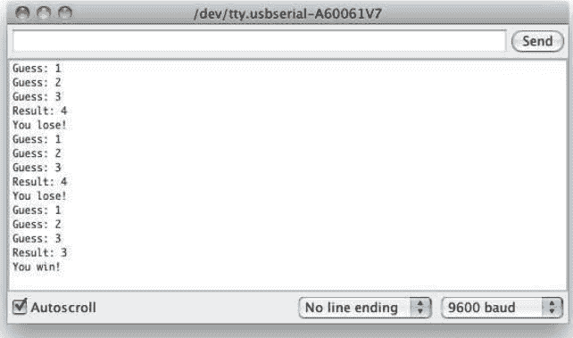

## 图 3.12：我们有赢家了！

我们第一次使用Bounce类。为了确定我们的guess_button对象的当前状态，我们必须调用它的update()方法。之后，我们用read()方法读取它的当前状态。

如果按钮被按下，其状态被设置为HIGH，我们递增guess变量。为了确保guess始终在1到6之间，我们在第33行使用取模运算符(%)。该运算符将两个值相除并返回余数。对于6，它返回0到5之间的值，因为当一个数除以6时，余数总是在0到5之间。将结果加1，就得到1到6之间的值。最后，我们使用三个LED输出当前猜测值，并将其打印到串口。

handle_start_button()中开始按钮的处理与猜测按钮完全相同。当开始按钮被按下时，我们计算一个新结果并将其输出到串口。然后我们检查用户是否输入了猜测值（此情况下guess大于零）以及用户是否猜对了结果。无论哪种情况，我们都会向串口打印一条消息；如果用户猜对了，我们还会调用hooray()方法。hooray()会让三个LED闪烁数次。

在方法结束时，我们等待两秒钟，直到游戏重新开始，并将当前猜测值重置为零。

将软件上传到Arduino后，启动IDE的串口监视器。每当你按下猜测按钮时，它都会打印guess变量的当前值。按下开始按钮，新结果就会出现。在上一页的图3.12中，你可以看到我们的二进制骰子的典型输出。

在本章中，你完成了第一个真正复杂的Arduino项目。你需要面包板、LED、按钮、电阻和导线，并编写了一段不平凡的软件，让所有硬件活了起来。

在下一章中，我们将编写一个更复杂的程序来生成摩尔斯电码。你还将学习如何创建自己的Arduino库，并轻松地与全世界分享。

#### 3.8 如果它不工作怎么办？

第一次使用面包板时，可能会遇到很多问题。最大的问题通常是部件没有正确连接。你需要花些时间才能找到将LED、导线、电阻和按钮插入面包板的正确技巧。你必须用力按压，但不能太用力——否则你会弄弯连接器，导致它们无法插入。通常在缩短连接器之后插入部件会更容易。剪短连接器时，请戴安全眼镜以保护眼睛！

在摆弄这些部件时，别忘了其中一些部件——例如LED——需要特定的方向。按钮也可能是潜在问题的来源。仔细查看第74页上的按钮，确保你以正确的方向安装它们。

即使是普通导线这样简单的东西也可能导致问题，尤其是当它们长度不合适时。如果一根导线太短，可能从插座中滑出，请立即更换。导线很便宜，不值得浪费宝贵的时间去进行不必要且烦人的调试。

#### 3.9 练习

- 当你和极客朋友玩大富翁时，二进制骰子很好用，但大多数人更喜欢熟悉的骰子。尝试将二进制骰子改成用七个LED的十进制骰子。将LED排列成普通骰子上的点数样式。

- 我们在本章中用来保护LED的1kΩ电阻相当大。阅读第239页的A.1节，*电阻*，并用更小的电阻替换它们。你能看出亮度的区别吗？

- LED的用途远不止显示二进制骰子结果。只要有足够的LED，你可以轻松构建其他东西，比如二进制时钟。²

你已经对电子和Arduino编程有了足够的了解，可以构建自己的二进制时钟。试试吧，或者想想还能用几个LED显示什么其他东西。

- 用按钮掷骰子似乎有点笨拙，不是吗？通常，你会把骰子握在双手中摇晃。你可以很容易地用倾斜传感器模拟这一动作。

倾斜传感器检测物体的倾斜状态，是模拟掷骰子的理想设备。原则上，它们的工作方式类似于按钮，但你不是按压它们，而是摇晃它们。按照Arduino网站上的教程，尝试将一个倾斜传感器添加到二进制骰子中。³

2. http://www.instructables.com/id/LED-Binary-Clock/
3. http://www.arduino.cc/en/Tutorial/TiltSensor

### 第4章

### 构建摩尔斯电码生成器库

现在你已经对Arduino开发环境和闪烁LED有了足够的了解，可以开始一个更大的项目了。在本章中，我们将开发一个摩尔斯电码生成器，它从串口读取文本，并使用LED以光信号的形式输出。

通过构建这个项目，你将加深对Arduino与计算机之间串行通信的理解。你还将了解到许多典型的Arduino开发流程：如何使用现有库，以及如何将更大的项目组织成你自己的库。最后，你将能够创建一个随时可以在互联网上发布的库。

#### 4.1 你需要什么

- 一块Arduino板，如Uno、Duemilanove或Diecimila
- 一根USB线，用于将Arduino连接到计算机
- 一个LED
- 一个扬声器或蜂鸣器（可选）

#### 4.2 学习摩尔斯电码的基础知识

摩尔斯电码是为了将文本转换为声音而发明的。¹ 原则上，它的工作原理类似于ASCII这样的字符集编码。但是ASCII将字符编码为数字，而在摩尔斯电码中，字符是点和划（也称为嘀和嗒）的序列。嘀的长度比嗒短。A编码为·–，而– – · ·是Z。

摩尔斯电码还规定了时间方案，定义了嘀和嗒的长度。它还规定了符号之间以及单词之间的停顿时间。摩尔斯电码的基本单位是一个嘀的长度，一个嗒的长度等于三个嘀。两个符号之间插入一个嘀的停顿，两个字母之间用三个嘀分隔。两个单词之间插入七个嘀的停顿。

要发送以摩尔斯电码编码的消息，你需要一种发出不同长度信号的方式。经典的方法是使用声音，但我们将使用一个LED，以不同的时间长度将其打开和关闭。水手们至今仍使用闪烁的灯光来发送摩尔斯电码。

让我们实现一个摩尔斯电码生成器吧！

#### 4.3 构建摩尔斯电码生成器

我们库的主要部分将是一个名为Telegraph的C++类。在本节中，我们将定义其接口，但我们将从一个新的草图开始，如下所示：

下载 Telegraph/telegraph.pde

```
void setup() {
}

void loop() {
}
```

这是最简化的Arduino程序。它除了定义所有必需函数外什么都不做，即使这些函数是空的。我们这样做是为了不时地编译我们正在编写的代码，并检查是否有语法错误。将草图保存为Telegraph，IDE将创建一个名为Telegraph的文件夹，并在其中创建一个名为Telegraph.pde的文件。我们库所需的所有文件和目录都将存储在Telegraph文件夹中。

现在打开一个新标签页，当要求输入文件名时，输入telegraph.h。是的，我们将创建一个老式的C头文件（准确地说，甚至是一个C++头文件）。代码清单在下一页。

```cpp
#ifndef __TELEGRAPH_H__
#define __TELEGRAPH_H__

class Telegraph {
public:
	Telegraph(const int output_pin, const int dit_length);
	void send_message(const char* message);
private:
	void dit();
	void dah();
	void output_code(const char* code);
	void output_symbol(const int length);
	int _output_pin;
	int _dit_length;
	int _dah_length;
};
#endif
```

啊，很明显，面向对象编程不再只是大型CPU的专利了！这是一个Telegraph类的接口描述，你可以用在你下一个企业项目中（当然，前提是你需要以摩尔斯电码的形式传输某些信息）。

我们从经典的防止重复包含机制开始；也就是说，头文件的主体定义了一个名为__TELEGRAPH_H__的预处理宏。我们将这个包含定义的主体封装在#ifndef中，这样只有在该宏尚未定义时，主体才会被编译。这样，你可以随意多次包含该头文件，而主体只会被编译一次。

Telegraph类的接口由一个公共部分和一个私有部分组成，公共部分可供类的用户访问，私有部分仅供类的成员使用。在公共部分，你会看到两样东西：一个构造函数，用于创建新的Telegraph对象；一个名为send_message()的方法，通过以摩尔斯电码发出消息来发送它。在你的应用程序中，你可以这样使用这个类：

```cpp
Telegraph telegraph(13, 200);
telegraph.send_message("Hello, world!");
```

在第一行中，我们创建了一个新的Telegraph对象，它在引脚13上通信，并发出持续200毫秒的嘀。然后我们发出消息“Hello, world!”作为摩尔斯电码。这样，我们就能够发送


whatever message we want, and we can change the pin and the length of a dit easily.

Now that we have defined the interface, we will implement it in the next section.

#### 4.4 Fleshing Out the Generator's Interface

Declaring interfaces is important, but it's as important to implement them. Create a new tab, enter the filename telegraph.cpp, and then enter the following code:²

**2.** Older versions of the Arduino IDE have an annoying bug that will prevent you from creating a new file this way. The IDE claims that a file having the same name already exists. See http://www.arduino.cc/cgi-bin/yabb2/YaBB.pl?num=1251245246 for a workaround.

Download Telegraph/telegraph.cpp

```
#include <ctype.h>
#include <WProgram.h>
#include "telegraph.h"

char* LETTERS[] = {
  ".-", "-...", "-.-.", "-..", ".", "..-.",  // A-E
  "..--", "....", "..", "...", "---",  // F-J
  ".--", "-.-", ".-..", "--.", "....-",  // K-O
  ".-.-", "-...", "--", "...", "-.-",  // P-T
  "..--", "...-", "-.-", "-...", "-.-",  // U-Y
  "-..-"  // Z
};

char* DIGITS[] = {
  "-----", ".----", "..---", "...--",  // 0-3
  "....-", ".....", "-....", "--...",  // 4-7
  "---..", "----."  // 8-9
};
```

Like most C++ programs, ours imports some libraries first. Because we need functions such as toupper() later, we include ctype.h, and we have to include telegraph.h to make our class declaration and its corresponding function declarations available. But what is WProgram.h good for?

Until now we haven't thought about where constants such as HIGH, LOW, or OUTPUT came from. They are defined in several header files that come with the Arduino IDE, and you can find them in the hardware/cores/arduino directory of the IDE. Have a look at WProgram.h, and notice that it includes a file named wiring.h that contains all the constants we have used so far and many more. It also declares many useful macros and the Arduino's most basic functions.

When you edit regular sketches, you do not have to worry about including any standard header files, because the IDE does it automatically behind the scenes. As soon as you start to create more complex projects that contain “real” C++ code, you have to manage everything yourself. You have to explicitly import all the libraries you need, even for basic stuff such as the Arduino constants.

After importing all necessary header files, we define two string arrays named LETTERS and DIGITS. They contain the Morse code for all letters and digits, and we'll use them later to translate regular text into Morse code. Before we do that, we define the constructor that is responsible for creating and initializing new Telegraph objects:

```
Telegraph::Telegraph(const int output_pin, const int dit_length) {
  _output_pin = output_pin;
  _dit_length = dit_length;
  _dah_length = dit_length * 3;
  pinMode(_output_pin, OUTPUT);
}
```

The constructor expects two arguments: the number of the pin the Morse code should be sent to and the length of a dit measured in milliseconds. Then it stores these values in corresponding instance variables, calculates the correct length of a dah, and turns the communication pin into an output pin.

You've probably noticed that all private instance variables start with an underscore. That is a convention that I like personally. It is not enforced by C++ or the Arduino IDE.

#### 4.5 Outputting Morse Code Symbols

After everything has been initialized, we can start to output Morse code symbols. We use several small helper methods to make our code as readable as possible:

```
void Telegraph::output_code(const char* code) {
  for (int i = 0; i < strlen(code); i++) {
    if (code[i] == '.')
    dit();
  else
    dah();
}
}

void Telegraph::dit() {
  Serial.print(".");
  output_symbol(_dit_length);
}

void Telegraph::dah() {
  Serial.print("-");
  output_symbol(_dah_length);
}

void Telegraph::output_symbol(const int length) {
  digitalWrite(_output_pin, HIGH);
  delay(length);
  digitalWrite(_output_pin, LOW);
}
```

The function output_code() takes a Morse code sequence consisting of dots and dashes and turns it into calls to dit() and dah(). The dit() and dah() methods then print a dot or a dash to the serial port and delegate the rest of the work to output_symbol(), passing it the length of the Morse code symbol to be emitted. output_symbol() sets the output pin to HIGH for the length of the symbol, and then it sets it back to LOW. Everything works exactly as described in the Morse code timing scheme, and only the implementation of send_message() is missing:

Download Telegraph/telegraph.cpp

```
void Telegraph::send_message(const char* message) {
  for (int i = 0; i < strlen(message); i++) {
    const char current_char = toupper(message[i]);
    if (isalpha(current_char)) {
      output_code(LETTERS[current_char - 'A']);
      delay(_dah_length);
    } else if (isdigit(current_char)) {
      output_code(DIGITS[current_char - '0']);
      delay(_dah_length);
    } else if (current_char == ' ') {
      Serial.print(" ");
      delay(_dit_length * 7);
    }
  }
  Serial.println();
}
```

send_message() outputs a message character by character in a loop. In line 3, we turn the current character into uppercase, because lowercase characters are not defined in Morse code (that’s the reason why you can’t implement a chat client using Morse code). Then we check whether the current character is a letter using C’s isalpha() function. If it is, we use it to determine its Morse code representation that is stored in the LETTERS array. To do that, we use an old trick: in the ASCII table all letters (and digits) appear in the right order, that is, A=65, B=66, and so on. To transform the current character into an index for the LETTERS array, we have to subtract 65 (or ‘A’) from its ASCII code. When we have determined the correct Morse code, we pass it to output_code() and delay the program for the length of a dah afterward.

The algorithm works exactly the same for outputting digits; we only have to index the DIGITS array instead of the LETTERS array, and we have to subtract the ASCII value of the character 0.

In line 10, we check whether we received a blank character. If yes, we print a blank character to the serial port and wait for seven dits. All other characters are ignored: we only process letters, digits, and blanks. At the end of the method, we send a newline character to the serial port to mark the end of the message.

#### 4.6 Installing and Using the Telegraph Class

Our Telegraph class is complete, and we should now create some example sketches that actually use it. This is important for two reasons: we can test our library code, and for users of our class it’s good documentation for how to use it.

The Arduino IDE looks for libraries in two places: in its global libraries folder relative to its installation directory and in the user’s local sketchbook directory. During development it’s best to use the local sketchbook directory. You can find its location in the IDE’s preferences (see Figure 4.1, on the next page). Create a new directory named libraries in the sketchbook directory.

To make our Telegraph class available, create a Telegraph subfolder in the libraries folder. Then copy telegraph.h and telegraph.cpp to that folder (do not copy Telegraph.pde). Restart the IDE.

Let’s start with the mother of all programs: “Hello, world!” Create a new sketch named HelloWorld, and enter the following code:

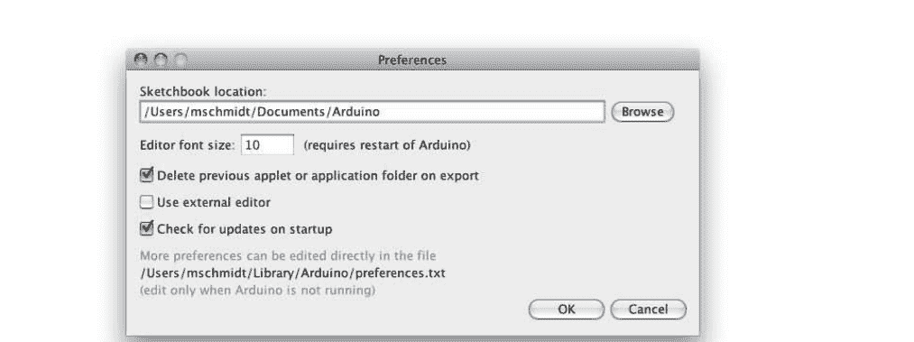

**Figure 4.1:** Find the sketchbook location in the preferences.

Download Telegraph/examples/HelloWorld/HelloWorld.pde

```
#include "telegraph.h"

const unsigned int OUTPUT_PIN = 13;
const unsigned int DIT_LENGTH = 200;

Telegraph telegraph(OUTPUT_PIN, DIT_LENGTH);

void setup() {}

void loop() {
	telegraph.send_message("Hello, world!");
	delay(5000);
}
```

This sketch emits the string “Hello, world!” as Morse code every five seconds. To achieve this, we include the definition of our Telegraph class, and we define constants for the pin our LED is connected to and for the length of our dits. Then we create a global Telegraph object and an empty setup() function. In loop(), then we invoke send_message() on our Telegraph instance every five seconds.

When you compile this sketch, the Arduino IDE automatically compiles the telegraph library, too. So if you made any syntactical errors in the library, you’ll be notified now. If you have to correct some errors, make


请确保你修改的是原始源代码文件。修复错误后，再次将文件复制到 libraries 文件夹，并且不要忘记重启 IDE。

将静态字符串转换为摩斯电码固然不错，但如果我们的程序能够处理任意字符串，那不是更好吗？因此，让我们添加一个更复杂的示例。这一次，我们将编写代码，从串口读取消息并将其送入 Telegraph 实例。新建一个名为 MorseCodeGenerator 的草图，并输入以下代码：

```
#include "telegraph.h"

const unsigned int OUTPUT_PIN = 13;
const unsigned int DIT_LENGTH = 200;
const unsigned int MAX_MESSAGE_LEN = 128;
const unsigned int BAUD_RATE = 9600;
const int LINE_FEED = 13;

char message_text[MAX_MESSAGE_LEN];
int index = 0;

Telegraph telegraph(OUTPUT_PIN, DIT_LENGTH);

void setup() {
  Serial.begin(BAUD_RATE);
}

void loop() {
  if (Serial.available() > 0) {
    int current_char = Serial.read();
    if (current_char == LINE_FEED || index == MAX_MESSAGE_LEN - 1) {
      message_text[index] = 0;
      index = 0;
      telegraph.send_message(message_text);
    } else {
      message_text[index++] = current_char;
    }
  }
}
```

同样，我们包含了 Telegraph 类的头文件，并且像往常一样定义一些常量：OUTPUT_PIN 定义了我们连接 LED 的引脚，DIT_LENGTH 包含以毫秒为单位的短音（dit）时长。LINE_FEED 设置为换行符的 ASCII 码。我们需要它来确定要转换为摩尔斯电码的消息的结束位置。最后，我们将 MAX_MESSAGE_LEN 设置为我们可以发送的消息的最大长度。

接下来，我们定义三个全局变量：message_text 是一个字符缓冲区，用于存放我们从串口接收到的数据。index 记录我们在缓冲区中的当前位置，telegraph 则是我们要用来将消息转换为“blinkenlights”³ 的 Telegraph 对象。

setup() 初始化串口；在 loop() 中，我们调用 Serial.available() 检查是否有新数据到达。如果有新数据可用，我们就读取下一个字节，并检查它是换行符还是能够放入字符缓冲区的最后一个字节。在两种情况下，我们都会把 message_text 的最后一个字节设为 0，因为 C/C++ 中的字符串以空字符结尾。我们还会重置 index，以便读取下一条消息，最后使用 telegraph 发送消息。在所有其他情况下，我们将最新字节添加到当前消息文本中，然后继续。

现在你应该编译并上传程序。打开串口监视器，在窗口底部的“行尾”下拉菜单中选择“回车”。设置好该选项后，串口监视器会自动在其发送到 Arduino 的每一行末尾追加一个换行符。输入一条消息，例如你的名字，点击“发送”按钮，观察 Arduino 如何将它变成光。

因为我们将整个摩尔斯电码逻辑封装在 Telegraph 类中，所以我们的主程序简短而精练。为嵌入式设备编写软件并不意味着我们就不能受益于面向对象编程的优势。

不过，要把我们的项目变成一个一流的库，还有一些小事要做。在下一节中，你将读到更多相关信息。

#### 4.7 最后的收尾

Arduino IDE 的一个好特性是语法着色。类名、函数名、变量等在编辑器中都有不同的颜色。这使得阅读源代码变得更加容易，而且可以为库添加语法着色。你只需在项目中添加一个名为 keywords.txt 的文件：

```
Download Telegraph/keywords.txt

##### Syntax-coloring for the telegraph library

Telegraph    KEYWORD1
send_message KEYWORD2
```

以 # 字符开头的行包含注释，将会被忽略。其余行包含库中某个成员的名字以及该成员的类型。用制表符分隔它们。类的类型为 KEYWORD1，函数的类型为 KEYWORD2。常量使用 LITERAL1。

要为 telegraph 库启用语法着色，请将 keywords.txt 复制到 libraries 文件夹，然后重启 IDE。现在，Telegraph 类的名称会显示为橙色，send_message() 会显示为棕色。

在最终发布你的库之前，你还应该添加一些东西：

- 将所有示例草图放在一个名为 examples 的文件夹中，并将其复制到 libraries 文件夹。每个示例草图都应在该文件夹内拥有自己的子目录。
- 为你的项目选择一个许可证，并将其条款复制到一个名为 LICENSE 的文件中。⁴ 你可能觉得对许多库来说这有点小题大做，但它会让你的潜在用户更有信心。
- 添加安装说明和文档。通常，用户期望在名为 README 的文件中找到文档，并会在名为 INSTALL 的文件中查找安装说明。你应该尽可能在多种操作系统上安装你的库，并为所有这些系统提供安装说明。

完成所有这些之后，你的库文件夹应该看起来像下一页的图 4.2 所示。

最后，创建一个包含项目中所有文件的 ZIP 压缩包。在大多数操作系统上，只需在资源管理器、Finder 或你正在使用的任何工具中右键单击目录，并将其转换为 ZIP 压缩包即可。在 Linux 系统和 Mac 上，你还可以使用以下命令行语句之一来创建压缩包：

```
mai k> zip -r Telegraph Telegraph
mai k> tar cfvz Telegraph.tar.gz Telegraph
```

第一个命令会创建一个名为 Telegraph.zip 的文件，第二个命令会创建 Telegraph.tar.gz。这两种格式都很常见，最好同时提供这两种格式供下载。

4. 在 http://www.opensource.org/ 上，你可以找到大量背景信息和许多标准许可证。


图 4.2：这是一个典型的 Arduino 库所需的东西。

尽管你必须执行大量手动文件操作，创建 Arduino 库仍然很容易。所以，没有任何借口：每当你觉得自己做出了很酷的东西，就把它公开发布出来。

到目前为止，我们的项目一直使用 LED（输出）和按钮（输入）与外部世界通信。在下一章中，你将学习如何使用更复杂的输入设备，例如超声波传感器。你还将学习如何将 Arduino 发送到计算机上运行的程序的数据可视化。

#### 4.8 如果它不工作怎么办？

Arduino IDE 对文件和目录的命名有严格的要求，而且它是为创建草图而构建的，不是为创建库而构建的。因此，你需要执行一些手动文件操作，把所有内容放到正确的位置。从图 4.2 中可以看到最终的目录布局。如果你安装了多个版本的 Arduino IDE，请确保你使用的是正确的 libraries 文件夹。

请记住，你必须经常重启 IDE。每当你更改库中的文件时，都要重启 IDE。

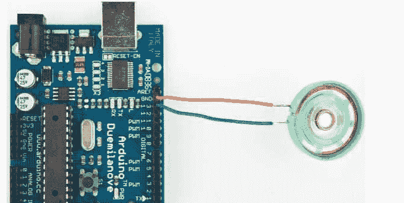

图 4.3：将扬声器连接到 Arduino 很简单。

如果语法着色不生效，请确保你的关键字文件确实名为 keywords.txt。仔细检查你是否用制表符分隔了所有对象和类型说明符！重启你的 IDE！

#### 4.9 练习

- 摩尔斯电码不仅支持字母和数字，还定义了逗号等符号。改进 Telegraph 类，使其能识别摩尔斯电码的所有字符。
- 闪烁的 LED 很棒，但每当想到摩尔斯电码，我们通常会想到哔哔声，因此用压电扬声器替换 LED，这种扬声器便宜又易用。图 4.3 展示了如何将它连接到 Arduino。它们有一个地线引脚和一个信号引脚，因此将扬声器的地线连接到 Arduino 的地线，将信号引脚连接到 Arduino 的 13 号引脚。然后用以下代码替换 output_symbol() 方法：

```
void Telegraph::output_symbol(const int length) {
  const int frequency = 131;
  tone(_output_pin, frequency, length);
}
```

这会向扬声器发送一个方波，并播放频率为 131 赫兹的音调（找到随附的“Melody”示例

使用 Arduino IDE 来了解更多关于用压电扬声器播放音符的内容）。

+   - 改进库的设计，使其更容易支持不同的输出设备。例如，你可以将某种 OutputDevice 对象传递给 Telegraph 构造函数。然后从 OutputDevice 派生一个 LedDevice 和一个 SpeakerDevice。如下所示：

```
class OutputDevice {
    public:
        virtual void output_symbol(const int length);
};

class Led : public OutputDevice {
    public:
        void output_symbol(const int length) {
            // ...
        }
};

class Speaker : public OutputDevice {
    public:
        void output_symbol(const int length) {
            // ...
        }
};
```

然后你可以按如下方式使用这些类：

```
Led led;
Speaker speaker;
OutputDevice* led_device = &led;
OutputDevice* speaker_device = &speaker;

led_device->output_symbol(200);
speaker_device->output_symbol(200);
```

其余部分由你来完成。

+   - 尝试学习摩尔斯电码。让别人在串行终端中输入一些消息，然后尝试识别他或她发送的内容。这对于学习 Arduino 开发并非必需，但非常有趣！

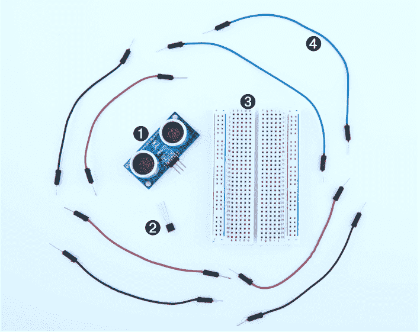

图 5.1：本章所需的所有部件

#### 5.1 你需要什么

- 1. 一个 Parallax PING))) 传感器
- 2. 一个来自 Analog Devices 的 TMP36 温度传感器
- 3. 一块面包板
- 4. 一些导线
- 5. 一块 Arduino 板，如 Uno、Duemilanove 或 Diecimila
- 6. 一根用于将 Arduino 连接到电脑的 USB 线缆
- 7. 安装了 Processing 编程语言¹

¹ http://processing.org

#### 5.2 使用超声波传感器测量距离

在许多情况下，自动且连续地测量距离会非常有用。想象一个自主寻找路径的机器人，或者一个自动防盗报警器，每当有人离你的房子或《蒙娜丽莎》太近时，它就会响铃或报警。所有这些都可以用 Arduino 实现。但在你能够制作那个防盗报警器或机器人之前，你需要理解一些关键概念。

可用于测量距离的传感器类型多种多样，Arduino 与其中大多数都能很好地配合。有些传感器使用超声波，而另一些则使用红外光甚至激光。但原则上所有传感器的工作方式都相同：它们发出信号，等待回波返回，并测量整个过程所花费的时间。因为我们知道声音和光在空气中传播的速度，所以可以将测得的时间转换为距离。

在我们的第一个项目中，我们将构建一个装置，用于测量到最近物体的距离，并将其输出到串行端口。在这个项目中，我们使用 Parallax PING))) 超声波传感器，² 因为它易于使用，附带出色的文档，并且功能丰富。它可以检测 2 厘米到 3 米范围内的物体，而且我们直接在面包板上使用它，因此无需焊接。它也是通过可变宽度脉冲提供信息的传感器的绝佳示例（稍后几段将详细介绍）。借助 PING))) 传感器，我们可以轻松构建声呐或能自动找到穿过迷宫路径而不碰墙的机器人。

如前所述，超声波传感器通常不会返回到最近物体的距离。相反，它们返回声音传播到物体并返回传感器所需的时间。PING))) 也不例外（见下一页的图 5.2），其内部相当复杂。幸运的是，它们隐藏在三个简单的引脚后面：电源、接地和信号。

这使得传感器很容易连接到 Arduino。首先，将 Arduino 的接地引脚和 5V 电源引脚连接到 PING))) 的对应引脚。然后将 PING))) 的传感器引脚连接到 Arduino 的某个数字 IO 引脚（我们使用引脚 7，并没有特别的原因）。电路图见下一页的图 5.3，实物照片见第 108 页的图 5.5。

2. http://www.parallax.com/StoreSearchResults/tabid/768/txtSearch/28015/List/0/SortField/4/ProductID/92/Default.aspx

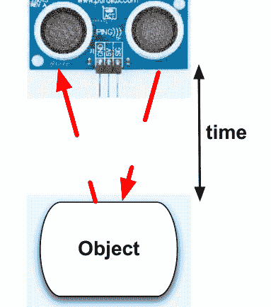

图 5.2：PING))) 传感器的基本工作原理

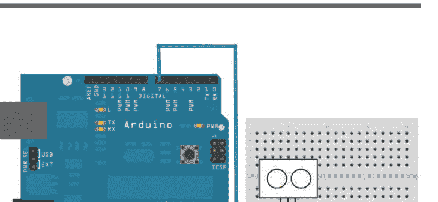

图 5.3：PING))) 基本电路

为了让电路工作起来，我们需要一些与 PING))) 传感器通信的代码：

```
```cpp
const unsigned int PING_SENSOR_IO_PIN = 7;
const unsigned int BAUD_RATE = 9600;

void setup() {
  Serial.begin(BAUD_RATE);
}

void loop() {
  pinMode(PING_SENSOR_IO_PIN, OUTPUT);
  digitalWrite(PING_SENSOR_IO_PIN, LOW);
  delayMicroseconds(2);

  digitalWrite(PING_SENSOR_IO_PIN, HIGH);
  delayMicroseconds(5);
  digitalWrite(PING_SENSOR_IO_PIN, LOW);

  pinMode(PING_SENSOR_IO_PIN, INPUT);
  const unsigned long duration = pulseIn(PING_SENSOR_IO_PIN, HIGH);
  if (duration == 0) {
    Serial.println("Warning: We did not get a pulse from sensor.");
  } else {
    Serial.print("Distance to nearest object: ");
    Serial.print(microseconds_to_cm(duration));
    Serial.println(" cm");
  }

  delay(100);
}

unsigned long microseconds_to_cm(const unsigned long microseconds) {
  return microseconds / 29 / 2;
}
```
```

首先，我们为 PING))) 传感器所连接的 IO 引脚定义一个常量。如果你想将传感器连接到其他数字 IO 引脚，就必须改变程序的第一行。在 setup() 方法中，我们将串行端口的波特率设置为 9600，因为我们希望在串行监视器上看到一些传感器数据。

真正的操作发生在 loop() 中，我们在这里实际实现 PING))) 协议。根据数据手册，³ 我们可以使用脉冲控制传感器，而它也会以可变宽度的脉冲返回结果。

> 3. http://www.parallax.com/dl/docs/prod/acc/28015-PING-v1.5.pdf

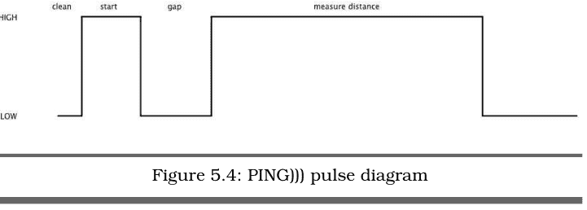

图 5.4：PING))) 脉冲图

在第 9 到 11 行，我们将传感器的信号引脚设为 LOW 并持续 2 微秒，以使其进入适当的状态。这将确保下一步所需的干净 HIGH 脉冲（在电子领域，你应始终为电源中的抖动做好准备）。

最后，是时候让传感器开始工作了。在第 13 到 15 行，我们将传感器的信号引脚设为 HIGH 并持续 5 微秒，以开始一次新的测量。之后，我们再次将引脚设为 LOW，因为传感器将在同一引脚上以可变长度的 HIGH 脉冲作为响应。

对于数字引脚，可用来传输信息的方式只有几种。你可以将引脚设为 HIGH 或 LOW，并且可以控制它保持特定状态的时间。对于许多用途来说，这完全足够，在我们的场景中也是如此。当 PING))) 传感器发出其 40 kHz 的啁啾声时，它会将信号引脚设为 HIGH，并在收到回波时将其设回 LOW。也就是说，信号引脚保持 HIGH 状态的时间恰好是声音传播到物体并返回传感器所需的时间。粗略地说，我们是在使用数字引脚测量模拟信号。在图 5.4 中，你可以看到连接 PING))) 传感器的数字引脚上的典型活动图。

我们可以手动测量引脚保持 HIGH 状态的持续时间，但 pulseIn() 方法已经替我们完成了所有这些繁琐工作。因此，在我们将信号引脚重新设置为输入模式后，在第 18 行使用它。pulseIn() 接受三个参数：

- *pin*：要从中读取脉冲的引脚编号。
- *type*：应读取的脉冲类型。可以是 HIGH 或 LOW。

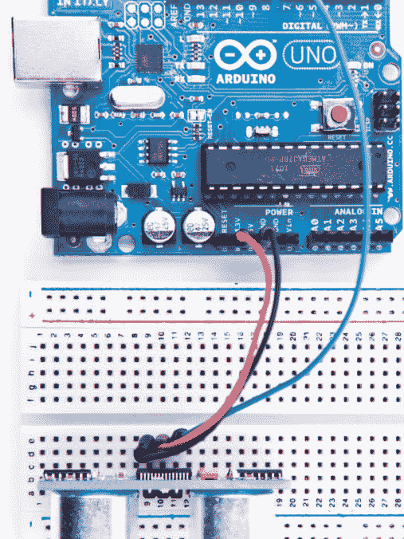

# 图 5.5：PING))) 基本电路照片

- *timeout*：以微秒为单位的超时时间。如果在超时时间内无法检测到脉冲，pulseIn() 将返回 0。此参数是可选的，默认值为一秒。

请注意，在整个过程中，只使用一个引脚与 PING))) 通信。迟早你会意识到，IO 引脚在 Arduino 上是稀缺资源，因此 PING))) 只使用一个数字引脚确实是一个很好的特性。当你可以选择不同部件来完成同一任务时，尽量使用尽可能少的引脚。


我们现在只剩一件事要做：把测得的持续时间转换成长度。声音以每秒 343 米的速度传播，这意味着每厘米需要 29.155 微秒。所以，我们必须先用 29 除以持续时间，然后再除以 2，因为声音要经过两次距离——它先到达物体，再返回 PING))) 传感器。microseconds_to_cm() 方法就是用来完成这个计算的。

根据 PING))) 传感器的规格说明，两次测量之间必须至少等待 200 微秒。对于高速测量，我们本可以通过实际测量代码运行时间来更精确地计算暂停时长。但在我们的情形下这没有意义，因为在 loop() 方法中两次测量之间执行的所有语句所需时间都远远超过 200 微秒。而且，向串口连接输出数据的开销相当大。尽管如此，我们还是添加了 100 微秒的小延时，让输出稍微慢一点。

你可能会奇怪，为什么我们如此频繁地使用 const 关键字。Arduino 语言基于 C/C++，在这些语言中，将常量值声明为 const 被视为良好实践（参见《Effective C++：改善程序与设计的 50 个具体做法》[Mey97]）。使用 const 不仅能让程序更简洁，并尽早防止逻辑错误，还能帮助编译器减小程序体积。

虽然大多数 Arduino 程序相对较小，但为 Arduino 开发软件仍然是软件开发，应当按照我们所知的所有最佳实践来做。因此，无论何时在程序中定义常量值，都要这样声明它（使用 const，而不是 #define）。这一点在其他编程语言中也一样，所以我们在 Processing 和 Java 程序中会大量使用 final（你将在第 119 页的 5.5 节“使用 Processing 将数据传回计算机”中了解更多关于 Processing 的内容）。

现在是时候摆弄一下传感器，熟悉它的长处和短处了。编译程序，上传到你的 Arduino 开发板，然后打开串口监视器（别忘了将波特率设置为 9600）。你应该会看到类似这样的内容：

```
Distance to nearest object: 42 cm
Distance to nearest object: 33 cm
Distance to nearest object: 27 cm
Distance to nearest object: 27 cm
```

```
const float SENSOR_OFFSET = MOUNTING_GAP * MICROSECONDS_PER_CM * 2;

void setup() {
  Serial.begin(BAUD_RATE);
}

void loop() {
  const unsigned long duration = measure_distance();
  if (duration == 0)
    Serial.println("Warning: We did not get a pulse from sensor.");
  else
    output_distance(duration);
}

const float microseconds_to_cm(const unsigned long microseconds) {
  const float net_distance = max(0, microseconds - SENSOR_OFFSET);
  return net_distance / MICROSECONDS_PER_CM / 2;
}

const unsigned long measure_distance() {
  pinMode(PING_SENSOR_IO_PIN, OUTPUT);
  digitalWrite(PING_SENSOR_IO_PIN, LOW);
  delayMicroseconds(2);

  digitalWrite(PING_SENSOR_IO_PIN, HIGH);
  delayMicroseconds(5);
  digitalWrite(PING_SENSOR_IO_PIN, LOW);

  pinMode(PING_SENSOR_IO_PIN, INPUT);
  return pulseIn(PING_SENSOR_IO_PIN, HIGH);
}

void output_distance(const unsigned long duration) {
  Serial.print("Distance to nearest object: ");
  Serial.print(microseconds_to_cm(duration));
  Serial.println(" cm");
}
```

这个程序和我们的第一个版本差别不大。首先，我们使用了更精确的数值 29.155 来表示声音传播 1 厘米需要的微秒数。此外，距离计算现在考虑到了传感器与外壳之间可能存在的间隙。例如，如果你把传感器插到面包板上，传感器与面包板边缘之间通常会有一个小间隙。这个间隙在第 5 行定义，稍后会用于距离计算。间隙以厘米为单位，并且会乘以 2，因为声音需要往返传播。

在某些情况下，你仍然可以两全其美：获得浮点数支持，却无需付出内存代价。你可以在通过串口连接发送浮点值之前将它们转换为整数，从而节省大量空间。要以两位小数的精度传输数值，请将它们乘以 100，并且不要忘记在接收端除以 100。稍后我们会使用这个技巧（包括舍入）。

#### 5.4 使用温度传感器提高精度

支持浮点数当然是一项改进，但它主要是提高了程序输出的精度。我们本来可以用一些整数运算技巧达到类似效果。但现在，我们将添加一个无法用软件模仿的更好改进：温度传感器。

我之前说声音在空气中以 343m/s 传播时，并不完全准确，因为声速并不是恒定的——它除了其他因素外，还取决于空气温度。如果不考虑温度，误差可能高达相当可观的 12%。我们用下面这个简单公式计算实际声速 C：

C = 331.5 + (0.6 * t)

要使用它，我们只需确定当前温度 t（摄氏度）。我们将使用 Analog Devices 公司的 TMP36 电压输出温度传感器。⁴ 它价格便宜，而且易于使用。

要将 TMP36 连接到 Arduino，请将 Arduino 的接地端和电源端分别连接到 TMP36 的对应引脚。然后将传感器的信号引脚连接到 A0 引脚，也就是模拟引脚 0（参见下页的图 5.6）。

正如你可能从它厂商的名字猜到的那样，TMP36 是一个模拟器件：它根据当前温度改变信号引脚上的电压。温度越高，电压越高。对我们来说，这是一个学习如何使用 Arduino 模拟 IO 引脚的绝佳机会。那么，让我们看一段使用该传感器的代码：

下载：temperature/sensortest/sensortest.pde

```
const unsigned int TEMP_SENSOR_PIN = 0;
const float SUPPLY_VOLTAGE = 5.0;
```

4. http://tinyurl.com/msard-analog

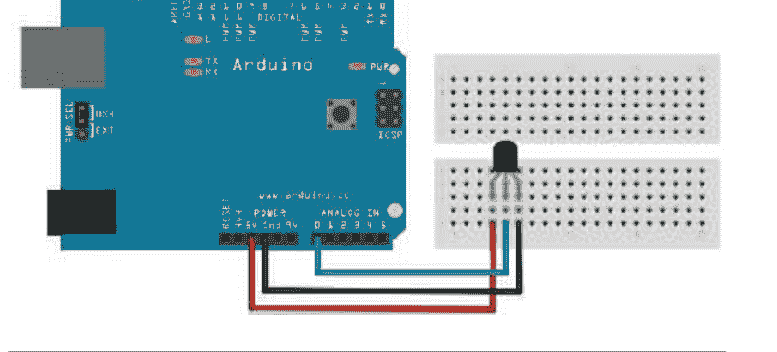

图 5.6：将温度传感器连接到 Arduino

```
const unsigned int BAUD_RATE = 9600;

void setup() {
  Serial.begin(BAUD_RATE);
}

void loop() {
  Serial.print(get_temperature());
  Serial.println(" C");
  delay(1000);
}

const float get_temperature() {
  const int sensor_voltage = analogRead(TEMP_SENSOR_PIN);
  const float voltage = sensor_voltage * SUPPLY_VOLTAGE / 1024;
  return (voltage * 1000 - 500) / 10;
}
```

在头两行中，我们定义了传感器所连接的模拟引脚常量，以及 Arduino 的供电电压常量。然后是一个相当普通的 setup() 方法，后面跟着一个每秒输出一次当前温度的 loop() 方法。整个传感器逻辑都封装在 get_temperature() 方法中。

对于 PING))) 传感器，我们只需要一个可以是 HIGH 或 LOW 的数字引脚。模拟引脚则不同，它们表示从 0V 到当前供电电压（通常是 5V）之间的电压。我们可以使用 analogRead() 方法读取 Arduino 的模拟引脚，该方法返回 0 到 1023 之间的值，因为模拟引脚的分辨率是十位（1024 = 2¹⁰）。我们在第 16 行使用它来读取 TMP36 当前提供的电压。

不过还有一个问题：我们必须将 analogRead() 返回的值转换为实际电压值，因此必须知道 Arduino 当前的供电电压。它通常是 5V，但有些 Arduino 型号（例如 Arduino Pro）只使用 3.3V。你必须相应地调整 SUPPLY_VOLTAGE 常量。

知道了供电电压，我们就可以将模拟引脚的输出转换为电压值：先除以 1024，再乘以供电电压。这正是我们在第 17 行所做的。

现在，我们必须把传感器输出的电压转换为摄氏度。在传感器的数据手册中，我们找到以下公式：

T = ((传感器输出（mV）) - 500) / 10

必须减去 500 毫伏，因为传感器总是输出正电压。这样，我们也能表示负温度。传感器的分辨率是 10 毫伏，因此我们必须除以 10。例如，750 毫伏的电压值对应 (750 - 500) / 10 = 25°C 的温度。你可以在第 18 行看到它的实现。

编译程序，上传到 Arduino，你就会在串口监视器中看到类似下面的内容：

```
10.06 C
26.64 C
28.62 C
28.50 C
28.50 C
29.00 C
29.00 C
28.50 C
29.00 C
```

如你所见，传感器需要一些时间来校准，但它的结果会很快稳定下来。顺便说一句，你总是需要在两次 analogRead() 调用之间插入一个短延时，因为 Arduino 的内部模拟系统在两次读数之间需要一些时间（0.0001 秒）。我们使用了整整一秒的延时，是为了让输出更容易阅读，也因为我们预计温度不会快速变化。否则，一毫秒的延时便足够了。


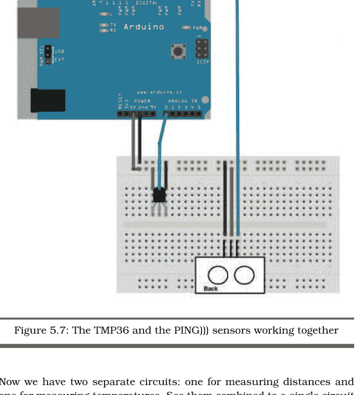

## 图 5.7：TMP36 和 PING))) 传感器协同工作

现在我们有两个独立的电路：一个用于测量距离，一个用于测量温度。参见图 5.7 以及第 120 页的图 5.8，将它们组合成一个单一电路。使用以下程序使电路运行起来：

```
Download ultrasonic/PreciseSensor/PreciseSensor.pde
Line 1  const unsigned int TEMP_SENSOR_PIN = 0;
- const float SUPPLY_VOLTAGE = 5.0;
- const unsigned int PING_SENSOR_IO_PIN = 7;
- const float SENSOR_GAP = 0.2;
5 const unsigned int BAUD_RATE = 9600;
- 
- float current_temperature = 0.0;
```

```
unsigned long last_measurement = millis();

void setup() {
  Serial.begin(BAUD_RATE);
}

void loop() {
  unsigned long current_millis = millis();
  if (abs(current_millis - last_measurement) >= 1000) {
    current_temperature = get_temperature();
    last_measurement = current_millis;
  }
  Serial.print(scaled_value(current_temperature));
  Serial.print(",");
  const unsigned long duration = measure_distance();
  Serial.println(scaled_value(microseconds_to_cm(duration)));
}

long scaled_value(const float value) {
  float round_offset = value < 0 ? -0.5 : 0.5;
  return (long)(value * 100 + round_offset);
}

const float get_temperature() {
  const int sensor_voltage = analogRead(TEMP_SENSOR_PIN);
  const float voltage = sensor_voltage * SUPPLY_VOLTAGE / 1024;
  return (voltage * 1000 - 500) / 10;
}

const float microseconds_per_cm() {
  return 1 / ((331.5 + (0.6 * current_temperature)) / 10000);
}

const float sensor_offset() {
  return SENSOR_GAP * microseconds_per_cm() * 2;
}

const float microseconds_to_cm(const unsigned long microseconds) {
  const float net_distance = max(0, microseconds - sensor_offset());
  return net_distance / microseconds_per_cm() / 2;
}

const unsigned long measure_distance() {
  pinMode(PING_SENSOR_IO_PIN, OUTPUT);
  digitalWrite(PING_SENSOR_IO_PIN, LOW);
  delayMicroseconds(2);

  digitalWrite(PING_SENSOR_IO_PIN, HIGH);
  delayMicroseconds(5);
  digitalWrite(PING_SENSOR_IO_PIN, LOW);

```

```
pinMode(PING_SENSOR_IO_PIN, INPUT);
return pulseIn(PING_SENSOR_IO_PIN, HIGH);
}
```

代码几乎是用于使 PING))) 和 TMP36 传感器工作的程序的完美合并。只做了少量改动：

- 常量 MICROSECONDS_PER_CM 已被 microseconds_per_cm() 函数取代，该函数根据当前温度动态确定声波传播 1 厘米所需的微秒数。
- 由于当前温度通常不会经常或快速变化，我们不再永久测量它，而是每秒测量一次。我们使用第 8 行的 millis() 来确定自 Arduino 启动以来经过了多少毫秒。从第 15 行到第 19 行，我们检查自上次测量以来是否已过去一秒。如果是，我们再次测量当前温度。
- 我们不再通过串口以浮点数的形式传输传感器数据，而是改用缩放后的整数值。这由 scaled_value() 函数完成，该函数将浮点值四舍五入到两位小数，并通过乘以 100 转换为 long 值。在接收端，你需要再次除以 100。

如果你将程序上传到 Arduino 并在传感器前挥动手，会看到类似以下的输出：

```
1940,2818
2914,3032
3045,34156
3005,2843
3045,2476
3085,2414
```

输出是以逗号分隔的值列表，其中第一个值表示当前温度，单位为摄氏度，第二个值是到最近物体的距离，单位为厘米。两个值都必须除以 100 才能得到实际的传感器数据。

我们的这个小项目现在有两个传感器。其中一个连接到数字引脚，而另一个使用模拟引脚。在下一节中，你将学习如何将传感器数据传回 PC 并利用它创建基于现实世界当前状态的应用程序。

##### 如何编码传感器数据

编码传感器数据是 Arduino 项目中经常需要解决的问题，因为我们收集的所有漂亮数据通常都需要由在普通计算机上运行的应用程序来解释。

在定义数据格式时，你需要考虑多个因素。例如，格式不应浪费 Arduino 宝贵的内存。在我们的例子中，我们本可以使用 XML 来编码传感器数据，例如：

```
<sensor-data>
  <temperature>30.05</temperature>
  <distance>51.19</distance>
</sensor-data>
```

显然这不是一个好的选择，因为现在我们浪费了多倍于实际数据的内存来创建文件格式的结构。此外，接收应用程序必须使用 XML 解析器来解释数据。

但你也不应走向另一个极端。也就是说，只有在绝对必要时或接收应用程序本来就期望二进制数据时，才应使用二进制格式。

总的来说，像字符分隔值（CSV）这样最简单的数据格式通常是最好的选择。

#### 5.5 使用 Processing 将数据传回你的计算机

本章中的所有程序都使用串口将传感器数据传回你的计算机。但到目前为止，我们只是在 IDE 的串口监视器中观看数据流过，并未在自己的应用程序中使用它。

在本节中，我们将构建一个图形化可视化传感器数据的应用程序。该程序将实现一种倒置的声纳：它在屏幕上绘制一个小点显示到最近物体的距离，同时该点本身会沿圆周移动（参见第 130 页的图片）。

为了实现该应用程序，我们将使用 Processing 编程语言，在图 5.9 中，第 121 页，你可以看到我们将如何组织项目。Processing 代码在我们的计算机上运行，而所有

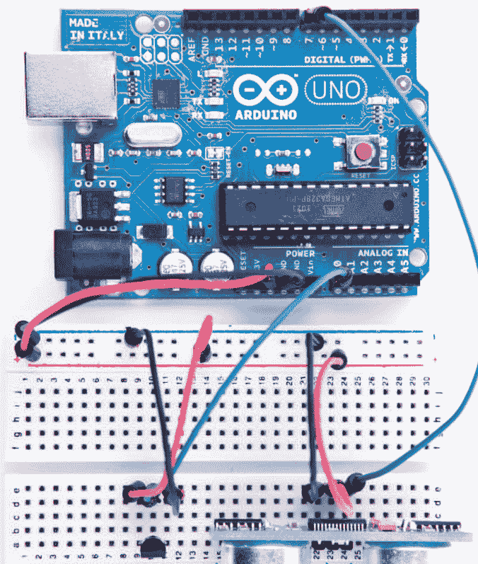

图 5.8：最终电路的照片

##### 使用声纳传感器拯救气候

来自西北大学和密歇根大学的研究人员创建了一个声纳系统，它仅使用计算机的麦克风和扬声器来检测计算机当前是否正在使用中。* 如果未使用，计算机会自动关闭屏幕，从而保护环境。

与其使用麦克风和扬声器，你也可以使用 PING))) 传感器。凭借本章中学到的知识，你可以轻松自行构建这样的系统。试试看！

* http://blog.makezine.com/archive/2009/10/using_sonar_to_save_power.html

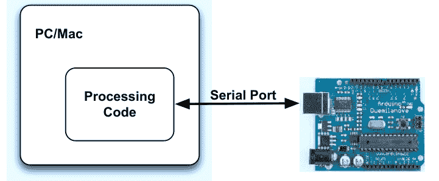

图 5.9：我们倒置声纳项目的系统架构

PING))) 传感器代码仍在 Arduino 上运行。Processing 代码与 Arduino 之间的通信通过串口进行。

Processing 是 Java 编程语言的扩展，其重点在于计算艺术。使用 Processing 创建多媒体应用程序非常容易：产生声音和动画 2D 或 3D 图像的应用程序。它对用户交互的支持也很出色，并且文档完善（例如，参见 Processing: Creative Coding and Computational Art [Gre07]）。

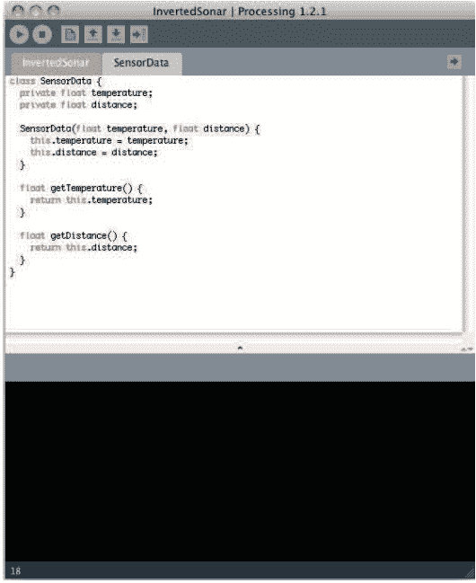

图 5.10：Processing IDE 是 Arduino IDE 的基础。

它最初是为没有太多编程经验的设计学生而构建的，但他们仍然希望使用计算机和电子设备来创建交互式艺术作品。这就是为什么 Processing 易于学习且非常适合初学者。但许多人也将其用于严肃和高级任务，尤其是以视觉吸引力的方式呈现数据。

你可以免费下载 Processing，⁵ 它为所有流行的操作系统提供一键安装程序。启动它或查看图 5.10。看起来很熟悉，不是吗？这并非巧合，因为 Arduino IDE 是从 Processing IDE 派生出来的。取而代之的是 writ-

5. http://processing.org/download/


从零开始构建一个新的编程环境，Arduino 团队决定修改 Processing IDE。这就是为什么两个 IDE 看起来如此相似，以及为什么 Arduino 草图具有文件扩展名 .pde（Processing Development Environment）的缘故，例如。

使用 Processing 作为 Arduino 项目的基础，为我们免费提供了一个良好且经过充分测试的 IDE。Processing 和 Arduino 因以下几个原因成为一对好搭档：

- Arduino 简化了嵌入式计算，而 Processing 简化了多媒体应用的创建。因此，你可以以常常令人惊叹的方式轻松可视化传感器数据。
- Processing 易于学习，尤其是如果你已经了解 Java。
- Processing 对串行通信有出色的支持。

因此，出于许多原因，Processing 非常值得一看，但在与 Arduino 协作时尤其有用。这就是为什么我们将在本书的多个示例中使用它。

#### 5.6 表示传感器数据

我们从一个 Processing 类开始，该类表示我们通过串行端口从 Arduino 返回的当前传感器数据。在 Processing IDE 中打开一个新文件，并输入以下代码：

```
class SensorData {
private float temperature;
private float distance;

SensorData(float temperature, float distance) {
this.temperature = temperature;
this.distance = distance;
}

float getTemperature() {
return this.temperature;
}

float getDistance() {
return this.distance;
}
}
```

如果你熟悉 Java 或 C++，SensorData 类对你来说会非常清晰。它将温度值和距离封装为浮点数，并通过访问方法（getTemperature() 和 getDistance()）提供对数据的访问。你可以使用构造函数创建新的 SensorData 对象，将当前温度和距离传递给它。

Processing 是一种面向对象的编程语言，允许我们使用 **class** 关键字定义新类。类具有名称，并且包含数据（通常称为 *属性* 或 *属性*）和函数（通常称为 *方法*）。我们的 SensorData 类包含两个名为 temperature 和 distance 的属性。它们都是 **float** 类型，我们都将它们声明为 **private**。现在只有 SensorData 类的成员才允许访问它们。这被认为是一种良好的风格，因为它防止了不必要的副作用，并使未来的更改变得容易得多。类绝不应该暴露其内部结构。

要设置和获取我们的属性的值，我们必须使用公共方法，我们的类有三个：SensorData()、getTemperature() 和 getDistance()。（Java 和 C++ 程序员请注意，在 Processing 中，如果未另行指定，一切都是公共的！）一个与类同名的方法称为 *构造函数*，你可以使用它来创建和初始化该特定类的新对象。构造函数没有返回值，但可以指定参数。我们的构造函数例如接受两个参数并用它们初始化我们的两个属性。

不过有一个小问题：我们的方法参数与我们类的属性具有相同的名称。如果我们像这样简单地将方法参数分配给属性会怎样：

```
temperature = temperature;
distance = distance;
```

没错：我们只是将每个方法参数分配给自身，这实际上是无操作。这就是为什么我们使用 **this** 关键字。它指的是类本身，因此我们可以区分方法参数和类的属性。或者，我们本可以使用不同的名称作为方法参数或属性，但我更喜欢使用 **this**。

在构造函数之后，我们定义了 getTemperature 和 getDistance 方法。它们的定义非常相似；我们声明方法的返回类型（**float**）、方法名称，以及括号中的参数列表。在我们的例子中，参数列表为空。在方法中，我们使用 **return** 关键字返回相应属性的当前值。**return** 停止方法并将其参数返回给方法的调用者。

现在我们可以创建和初始化新的 SensorData 对象：

```
SensorData sensorData = new SensorData(31.5, 11.76);
```

前面的语句创建一个名为 sensorData 的新 SensorData 对象。它将 temperature 设置为 31.5，将 distance 设置为 11.76。要读取这些值，我们使用相应的“get”方法：

```
sensorData.getTemperature(); // -> 31.5
sensorData.getDistance();    // -> 11.76
```

由于 getTemperature() 和 getDistance() 是 SensorData 类的成员，你只能使用该类的实例调用它们。我们的实例名为 sensorData，要调用“get”方法，我们必须使用实例名称，后跟一个点，后跟方法名称。

现在我们能够存储传感器数据，我们将在下一节继续构建我们的倒置声纳应用程序。

#### 5.7 构建应用程序的基础

在本节中，我们将通过导入一些库并定义一些全局常量和变量来为我们的应用程序创建所有样板代码：

Download ultrasonic/InvertedSonar/InvertedSonar.pde

```
import processing.serial.*;

final int WIDTH = 1000;
final int HEIGHT = 1000;
final int xCenter = WIDTH / 2;
final int yCenter = HEIGHT / 2;
final int LINE_FEED = 10;

Serial arduinoPort;
SensorData sensorData;
int degree = 0;
int radius = 0;
```

为了通过串行端口与 Arduino 通信，我们在第一行导入 Processing 对串行通信的支持。**import** 语句导入 processing.serial 包中的所有类，并在我们的程序中使它们可用。

我们的应用程序将有一个 1000x1000 像素的屏幕，因此我们为其宽度、高度和中心定义常量。我们将 LINE_FEED 常量设置为换行符的 ASCII 值，因为我们稍后需要它来解释 Arduino 发送的数据。

然后我们定义一些全局变量（是的，你们 Java 程序员：Processing 允许你定义全局变量！）：

- *arduinoPort*：Processing 的 Serial 类的一个实例。它来自我们已导入的 processing.serial 包，并封装了与 Arduino 的串行端口通信。
- *sensorData*：从 Arduino 传输到我们应用程序的当前传感器数据。我们使用在第 5.6 节 *表示传感器数据* 中定义的 SensorData 类，第 123 页。
- *degree*：我们将在一个圆上可视化到最近物体的当前距离。此变量存储我们现在在圆上的哪个度数。值范围从 0 到 359。
- *radius*：到最近物体的当前距离被解释为半径值。

#### 5.8 在 Processing 中实现串行通信

以下函数从 Arduino 连接的串行端口读取数据，并解释 Arduino 发送的数据：

Download ultrasonic/InvertedSonar/InvertedSonar.pde

```
void setup() {
  size(WIDTH, HEIGHT);
  println(Serial.list());
  String arduinoPortName = Serial.list()[0];
  arduinoPort = new Serial(this, arduinoPortName, 9600);
  arduinoPort.bufferUntil(LINE_FEED);
}

void serialEvent(Serial port) {
  sensorData = getSensorData();
  if (sensorData != null) {
    println("Temperature: " + sensorData.getTemperature());
    println("Distance: " + sensorData.getDistance());
    radius = min(300, int(sensorData.getDistance() * 2));
  }
}

SensorData getSensorData() {
```

```
SensorData result = null;
if (arduinoPort.available() > 0) {
    final String arduinoOutput = arduinoPort.readStringUntil(LINE_FEED);
    result = parseArduinoOutput(arduinoOutput);
}
return result;
}

SensorData parseArduinoOutput(final String arduinoOutput) {
    SensorData result = null;
    if (arduinoOutput != null) {
        final int[] data = int(split(trim(arduinoOutput), ','));
        if (data.length == 2)
            result = new SensorData(data[0] / 100.0, data[1] / 100.0);
    }
    return result;
}
```

setup() 是 Processing 的标准函数之一，其含义与 Arduino 的 setup() 方法相同。Processing 运行时环境仅在应用程序启动时调用一次它并初始化应用程序。通过 size() 方法，我们创建一个具有特定宽度和高度的新屏幕（顺便说一下，你可以在网上找到所有 Processing 类的优秀参考资料⁶）。

初始化屏幕后，我们准备串行端口通信。首先，我们使用 Serial.list() 打印当前连接到计算机的所有串行设备列表。然后我们将要使用的串行端口的名称设置为第一个列表项。这可能是错误的端口，因此要么将系统串行端口的名称硬编码到代码中，要么查看串行端口列表并选择正确的端口！

在第 5 行，我们创建一个新的 Serial 对象，该对象绑定到我们的应用程序（这就是 this 的用途）。我们使用来自所有串行端口列表的串行端口名称，并将波特率设置为 9600。如果你想更快地通信，你必须在此处和 Arduino 草图中同时更改波特率。

最后，我们告诉 Serial 对象我们只希望在检测到换行符时才收到新串行数据的通知。每当我们找到换行符时，我们就知道 Arduino 已传输了一整行数据。

对于我们的应用程序，我们选择了异步编程模型；也就是说，我们不在循环中轮询新数据，而是在

6. http://processing.org/reference/


#### 5.9 可视化传感器数据

现在，我们的计算机与 Arduino 之间的串行通信已经正常工作，让我们将到最近物体的距离可视化：

```
void init_screen() {
background(255);
stroke(0);
strokeWeight(1);
int[] radius_values = { 300, 250, 200, 150, 100, 50 };
for (int r = 0; r < radius_values.length; r++) {
final int current_radius = radius_values[r] * 2;
ellipse(xCenter, yCenter, current_radius, current_radius);
}
strokeWeight(10);
}
```

```
void draw() {
init_screen();
int x = (int)(radius * Math.cos(degree * Math.PI / 180));
int y = (int)(radius * Math.sin(degree * Math.PI / 180));
point(xCenter + x, yCenter + y);
if (++degree == 360)
degree = 0;
}
```

init_screen() 在第 2 行清除屏幕并将背景颜色设置为白色。它使用 stroke(0) 将绘图颜色设置为黑色，并将用于绘制形状的描边宽度设置为 1 像素。然后，它在屏幕中心周围绘制六个同心圆。这些圆将帮助我们了解最近的物体距离 PING))) 传感器有多远。最后，它将描边宽度设置为 10，这样我们就可以用一个 10 像素宽的点来显示传感器。

Processing 会以一定的帧速率（默认是每秒 60 帧）自动调用 draw() 方法，这相当于 Arduino 的 loop() 方法。在我们的例子中，我们初始化屏幕并计算位于圆上的坐标。圆的半径取决于我们与 Arduino 之间的距离，因此我们有一个在圆上移动的点。该点到圆心的距离取决于我们用 PING))) 传感器测量的数据。

##### 传感器的趣味应用

有了超声波传感器，你可以轻松检测是否有人靠近。这自然会让人联想到许多有用的应用。例如，当有人足够近时，你可以自动打开门。

或者，你也可以将先进的技术用于纯粹的娱乐。比如一些万圣节的小把戏：一个南瓜，只要你越过一条无形的线，它就会喷射出彩带？* 这可能会成为你下一次派对上一个不错的恶作剧，而且你可以用 PING))) 传感器来制作它。†

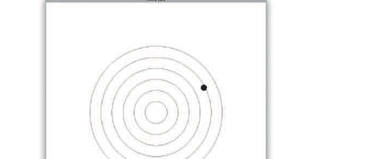

因此，我们已经看到有两种类型的传感器：数字传感器和模拟传感器。你还学习了如何将这两种类型的传感器连接到 Arduino，以及如何将它们的测量数据传输到计算机。处理这两种不同的 I/O 类型是所有物理计算的基础，几乎每一个项目——无论多么复杂——都是你本章所学内容的延伸。

> * http://www.instructables.com/id/Arduino-controlled-Silly-String-shooter/

> † http://arduinofun.com/blog/2009/11/01/silly-string-shooting-spider-contest-entry/

#### 5.10 如果它不工作怎么办？

请参阅第 86 页的 3.8 节“*如果它不工作怎么办？*”，并确保你已将所有部件正确连接到面包板上。要特别小心 PING))) 和 TMP36 传感器，因为你以前从未使用过它们。请确保已将正确的引脚连接到传感器的正确接口上。

如果软件出现任何错误——无论是 Processing 代码还是 Arduino 代码——请从本书的网站下载代码，看看它是否能正常工作。

如果你在串行通信方面遇到问题，请仔细检查是否使用了正确的串行端口和正确的 Arduino 型号。有可能你的 Arduino 连接到了另一个端口。在这种情况下，你需要相应地更改语句 `arduinoPort = new Serial(this, Serial.list()[0], 9600);` 中的索引 0。还要检查 Processing 代码和串行监视器中的波特率是否与你在 Arduino 代码中使用的波特率一致。请确保串行端口没有被其他应用程序占用，例如你忘记关闭的串行监视器窗口。

#### 5.11 练习

- 构建一个自动防盗报警器，当有人离你的计算机太近时，它会显示一个停止标志。⁷ 尽量让应用程序智能一些。例如，它应该有一个小的激活延迟，以防止在启动时立即显示停止标志。
- 声音的速度不仅取决于温度，还取决于湿度和大气压力。做一些研究，找到正确的公式和合适的传感器。⁸ 利用你的研究成果，让我们的距离测量电路更加精确。
- 使用其他技术来测量距离，例如红外传感器。尝试找到合适的传感器，阅读其数据手册，并搭建一个基本电路，这样你就可以将到最近物体的距离输出到串行端口。

7. 你可以在这里找到停止标志：http://en.wikipedia.org/wiki/File:Stop_sign_MUTCD.svg。
8. 试试 http://parallax.com。

### 第 6 章：构建动作感应游戏控制器

我们对于新技术的适应速度之快令人惊讶。十年前，没有多少人会想到有一天我们会使用设备来悄无声息地追踪我们的动作。如今，当我们想要从竖屏切换到横屏时，物理转动智能手机对我们来说已完全正常。甚至小孩子都直观地知道如何使用任天堂 Wii 等视频游戏机的动作感应控制器。你可以使用 Arduino 构建自己的动作感应设备，在本章中你将学习如何做到这一点。

我们将使用一种最广泛使用的动作感应设备：*加速度计*。加速度计能够检测所有方向的运动——无论是向上、向下、向前、向后、向左还是向右移动，它们都能感知到。许多流行的设备，如 iPhone 和任天堂 Wii 控制器，都包含加速度计。这就是加速度计价格便宜的原因。

无论是有趣的还是严肃的项目，都能从加速度计中受益。在使用计算机时，你肯定会想到游戏控制器或其他输入控制设备等项目。但你也可以在做运动时使用它们，或用来控制现实世界中的弹珠迷宫。你还可以或多或少间接地用它们来测量加速度，例如在汽车中。

你将学习如何正确解读加速度计数据，以及如何获得最准确的结果。然后，你将使用加速度计构建自己的动作感应游戏控制器，并实现一个使用它的游戏。


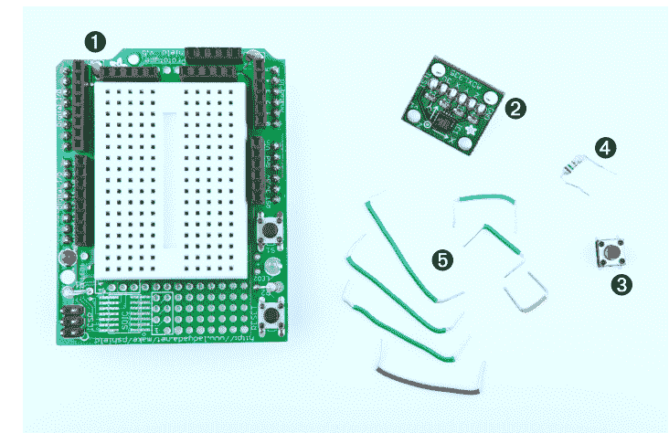

Figure 6.1: 本章所需的所有部件

#### 6.1 What You Need

- 1. 一个半尺寸面包板，或——更好的是——带有一个小型面包板的 Arduino 原型盾
- 2. 一个 ADXL335 加速度计
- 3. 一个按钮
- 4. 一个 10kΩ 电阻
- 5. 一些导线
- 6. 一个 Arduino 板，例如 Uno、Duemilanove 或 Diecimila
- 7. 一根用于连接 Arduino 到计算机的 USB 数据线
- 8. 一个 6 针 0.1" 标准排针

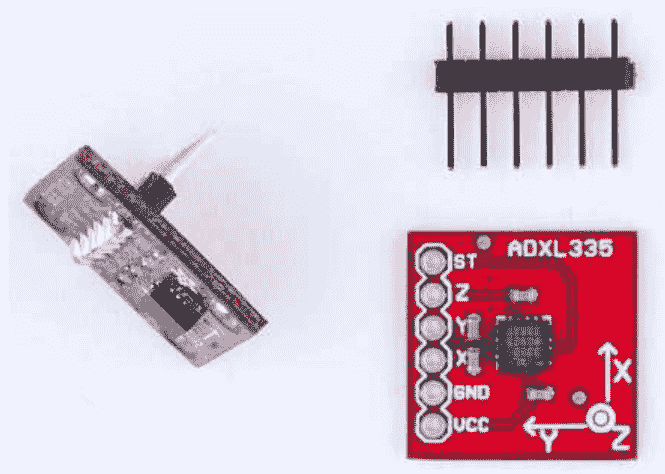

Figure 6.2: 一个安装在转接板上的 ADXL335 传感器

#### 6.2 Wiring Up the Accelerometer

加速度计有很多种，主要区别在于它们支持的空间轴数量（通常为两个或三个）。我们使用的是 Analog Devices 的 ADXL335——它使用简单且广泛可用。¹

在本节中，我们将 ADXL335 连接到 Arduino 并创建一个小型演示程序，显示传感器提供的数据。在此之后，我们将快速查看传感器的规格并解释数据。

在 Figure 6.2 中，你可以看到右侧包含一个 ADXL335 传感器的转接板。传感器是那个小黑色的集成电路（IC），其余部分只是一个载体，用于允许连接。在顶部，你可以看到一个 6 针 0.1" 标准排针。传感器有六个标记为 GND、Z、Y、X、3V 和 TEST 的连接器。要在面包板上使用传感器，请将标准排针焊接到连接器上。这不仅使将传感器连接到面包板变得更容易，而且还能稳定传感器，使其不会意外移动。你可以在照片左侧看到结果（请注意，左侧的转接板与右侧的不同，但非常相似）。如果你从未焊接过也不用担心。在第 A.2 节，学习如何焊接，第 241 页，你可以学习如何操作。

你可以忽略标记为 TEST 的连接器，其余连接器的含义应该显而易见。要为传感器供电，将 GND 连接到 Arduino 的地引脚，将 3V 连接到 Arduino 的 3.3 伏电源。X、Y 和 Z 随后将为 x、y 和 z 轴提供加速度数据。

就像我们在第 5.4 节《使用温度传感器提高精度》，第 113 页中使用的 TMP36 温度传感器一样，ADXL335 也是一个模拟设备：它以电压形式提供结果，这些结果必须转换为加速度值。因此，X、Y 和 Z 连接器必须连接到 Arduino 上的三个模拟引脚。我们将 Z 连接到模拟引脚 0，Y 连接到模拟引脚 1，X 连接到模拟引脚 2（参见下一页的 Figure 6.3，并仔细检查你使用的转接板上的引脚标签！）。

现在我们已经将 ADXL335 连接到 Arduino，让我们使用它。

#### 6.3 Bringing Your Accelerometer to Life

一种了解新设备的实用策略是将其接上并查看它提供的数据。以下程序读取三个轴的所有输入值并将其输出到串口：

```
const unsigned int X_AXIS_PIN = 2;
const unsigned int Y_AXIS_PIN = 1;
const unsigned int Z_AXIS_PIN = 0;
const unsigned int BAUD_RATE = 9600;

void setup() {
  Serial.begin(BAUD_RATE);
}

void loop() {
  Serial.print(analogRead(X_AXIS_PIN));
  Serial.print(" ");
  Serial.print(analogRead(Y_AXIS_PIN));
  Serial.print(" ");
  Serial.println(analogRead(Z_AXIS_PIN));
  delay(100);
}
```

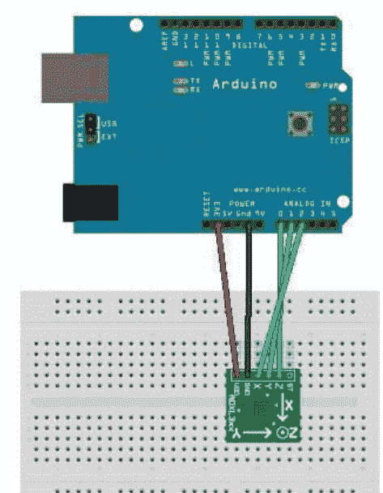

Figure 6.3: 如何将 ADXL335 传感器连接到 Arduino

我们的测试程序尽可能简单。我们为三个模拟引脚定义常量，并在 setup() 函数中初始化串口。请注意，我们没有显式地将模拟引脚设置为 INPUT，因为那本来就是默认值。

在 loop() 函数中，我们不断地将从模拟引脚读取的值输出到串口。打开串口监视器，并稍微移动传感器——围绕不同轴倾斜它。你应该会看到类似以下的输出：

```
344 331 390
364 276 352
388 286 287
398 314 286
376 332 289
370 336 301
379 338 281
```

这些值代表我们对 x、y 和 z 轴获得的数据。例如，当你仅围绕 x 轴移动传感器时，你可以看到第一个值相应地发生变化。在下一节中，我们将更仔细地查看这些值。

#### 6.4 Finding and Polishing Edge Values

物理世界往往远非完美。对许多传感器发出的数据来说尤其如此，加速度计也不例外。它们产生的最小值和最大值会略有变化，并且经常会有些抖动。即使你没有移动它们，它们也可能会改变输出值，或者它们可能不会正确地改变输出值。在本节中，我们将确定传感器的最小值和最大值，并消除抖动。

找到传感器的边缘值很容易，但很难自动化。你必须在移动传感器的同时不断读取其输出。以下程序可以完成这项工作：

```
Download MotionSensor/SensorValues/SensorValues.pde
const unsigned int X_AXIS_PIN = 2;
const unsigned int Y_AXIS_PIN = 1;
const unsigned int Z_AXIS_PIN = 0;
const unsigned int BAUD_RATE = 9600;

int min_x, min_y, min_z;
int max_x, max_y, max_z;

void setup() {
  Serial.begin(BAUD_RATE);
  min_x = min_y = min_z = 1000;
  max_x = max_y = max_z = -1000;
}

void loop() {
  const int x = analogRead(X_AXIS_PIN);
  const int y = analogRead(Y_AXIS_PIN);
  const int z = analogRead(Z_AXIS_PIN);

  min_x = min(x, min_x); max_x = max(x, max_x);
  min_y = min(y, min_y); max_y = max(y, max_y);
  min_z = min(z, min_z); max_z = max(z, max_z);

  Serial.print("x(");
  Serial.print(min_x);
  Serial.print("/");
  Serial.print(max_x);
  Serial.print(", y(");
  Serial.print(min_y);
  Serial.print("/");
  Serial.print(max_y);
  Serial.print(", z(");
  Serial.print(min_z);
  Serial.print("/");
  Serial.print(max_z);
  Serial.println(")");
}
```

我们为三个轴的最小值和最大值声明变量，并用肯定超出传感器范围的数字初始化它们（-1000 和 1000）。在 loop() 函数中，我们永久测量三个轴的加速度并相应地调整最小值和最大值。

编译并上传草图，然后在所有方向上移动带传感器的面包板，然后围绕所有轴倾斜它。缓慢移动它，快速移动它，缓慢倾斜它，快速倾斜它。使用较长的导线，并在移动和旋转面包板时小心，以免意外松动连接。

过了一会儿，最小值和最大值会稳定下来，你应该会得到类似这样的输出：

```
x(247/649), y(253/647), z(278/658)
```

记下这些值，因为我们稍后需要它们，而且当你进行自己的传感器实验时你可能也需要它们。

现在让我们看看如何消除抖动。原则上很简单。不是立即返回加速度数据，我们收集最近的读数并返回它们的平均值。这样，小变化就会被抹平。代码如下所示：

```
Download: MotionSensor/Buffering/Buffering.pde
Line 1 const unsigned int X_AXIS_PIN = 2;
const unsigned int Y_AXIS_PIN = 1;
const unsigned int Z_AXIS_PIN = 0;
const unsigned int NUM_AXES = 3;
5 const unsigned int PINS[NUM_AXES] = {
  X_AXIS_PIN, Y_AXIS_PIN, Z_AXIS_PIN
};
const unsigned int BUFFER_SIZE = 16;
const unsigned int BAUD_RATE = 9600;
10 int buffer[NUM_AXES][BUFFER_SIZE];
int buffer_pos[NUM_AXES] = { 0 };
```

```
void setup() {
    Serial.begin(BAUD_RATE);
}

int get_axis(const int axis) {
    delay(1);
    buffer[axis][buffer_pos[axis]] = analogRead(PINS[axis]);
    buffer_pos[axis] = (buffer_pos[axis] + 1) % BUFFER_SIZE;

    long sum = 0;
    for (int i = 0; i < BUFFER_SIZE; i++)
        sum += buffer[axis][i];
    return round(sum / BUFFER_SIZE);
}

int get_x() { return get_axis(0); }
int get_y() { return get_axis(1); }
int get_z() { return get_axis(2); }

void loop() {
    Serial.print(get_x());
    Serial.print(" ");
    Serial.print(get_y());
    Serial.print(" ");
    Serial.println(get_z());
}
```

像往常一样，我们首先为使用的引脚定义一些常量。这次，我们还定义了一个名为 NUM_AXES 的常量，其中包含我们测量的轴的数量。我们还有一个名为 PINS 的数组，其中包含我们使用的引脚列表。这有助于我们以后使代码更通用。

在第 11 行，我们为所有轴声明缓冲区。它们将被我们测量的传感器数据填充，这样我们就可以在需要时计算平均值。我们必须存储每个缓冲区中的当前位置，因此在第 12 行，我们定义了一个缓冲区位置数组。

setup() 只初始化串口，真正的动作发生在 get_axis() 函数中。它首先进行一个小延迟，给 Arduino 一些时间在模拟引脚之间切换；否则，你可能会得到错误的数据。然后它读取我们传递的轴的加速度并将其存储在属于该轴的当前位置。增加缓冲区位置，并在到达缓冲区末尾时将其重置为零。最后，我们返回迄今为止为当前轴收集的数据的平均值。

1. http://www.analog.com/en/sensors/inertial-sensors/adxl335/products/product.html


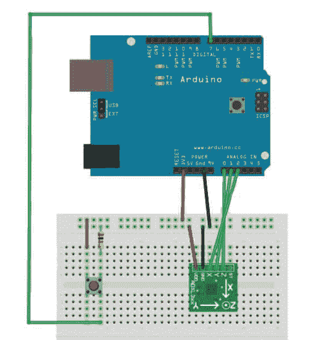

图6.4：带加速度计和按键的游戏控制器

这就是全部技巧。要观察其效果，请将传感器静置在桌上，并用不同的缓冲区大小运行程序。如果你不触碰传感器，不会期望程序输出发生变化。但如果将`BUFFER_SIZE`设为1，很快就会看到微小变化。一旦缓冲区足够大，这些变化就会消失。

我们现在测得的加速度数据已经足够精确，终于可以构建一个不会因意外动作而让用户烦扰的游戏控制器了。

#### 6.5 构建你自己的游戏控制器

要构建一个功能完整的游戏控制器，我们只需在面包板上加一个按钮。从图6.4中可以看到具体接法（请务必仔细核对扩展板上引脚的标签！）。

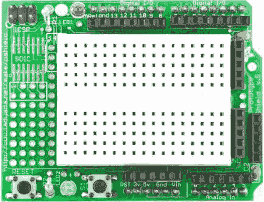

# 图6.5：一块Arduino原型扩展板

这就是典型现代游戏控制器内部的样子。我们不会为控制器制作精美的外壳，但仍需稍微考虑一下人机工程学。当前的面包板方案相当脆弱，当它连接着Arduino时，你确实无法随意挥舞这块板子。迟早会有导线脱落，控制器就会停止工作。

要解决这个问题，你可以尝试用橡皮筋将面包板固定在Arduino上。这种方法可行，但看起来不太美观，而且操作起来仍然不便。

更好的解决方案是使用一块Arduino原型扩展板（见图6.5）。它是一块可插拔的面包板，能让你快速搭建电路原型。面包板被Arduino的引脚环绕，因此不再需要长导线。扩展板是增强Arduino能力的绝佳途径，你可以找到各种用途的扩展板，例如添加以太网、声音、显示等功能。²

使用原型扩展板后，我们的游戏控制器如图6.6（见下页）所示。很整洁，对吧？

> 2. 在 http://shieldlist.org/ 上，你可以找到一份全面的Arduino扩展板清单。

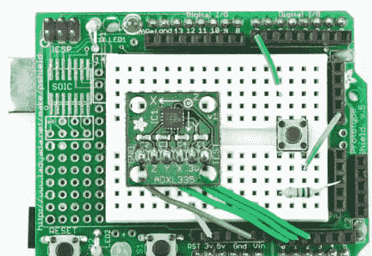

# 图6.6：基于原型扩展板的完整游戏控制器

现在硬件已完成，我们需要一版最终的游戏控制器软件。它支持我们添加的按钮，并执行了在6.4节“寻找并打磨边缘值”（第137页）中创建的抗抖动处理：

下载MotionSensor/Controller/Controller.pde

```
#include <Bounce.h>

const unsigned int BUTTON_PIN = 7;
const unsigned int X_AXIS_PIN = 2;
const unsigned int Y_AXIS_PIN = 1;
const unsigned int Z_AXIS_PIN = 0;
const unsigned int NUM_AXES = 3;
const unsigned int PINS[NUM_AXES] = {
  X_AXIS_PIN, Y_AXIS_PIN, Z_AXIS_PIN
};
const unsigned int BUFFER_SIZE = 16;
const unsigned int BAUD_RATE = 19200;

int buffer[NUM_AXES][BUFFER_SIZE];
int buffer_pos[NUM_AXES] = { 0 };

Bounce button(BUTTON_PIN, 20);

void setup() {
  Serial.begin(BAUD_RATE);
  pinMode(BUTTON_PIN, INPUT);
}
```

```
int get_axis(const int axis) {
    delay(1);
    buffer[axis][buffer_pos[axis]] = analogRead(PINS[axis]);
    buffer_pos[axis] = (buffer_pos[axis] + 1) % BUFFER_SIZE;

    long sum = 0;
    for (int i = 0; i < BUFFER_SIZE; i++)
        sum += buffer[axis][i];
    return round(sum / BUFFER_SIZE);
}

int get_x() { return get_axis(0); }
int get_y() { return get_axis(1); }
int get_z() { return get_axis(2); }

void loop() {
    Serial.print(get_x());
    Serial.print(" ");
    Serial.print(get_y());
    Serial.print(" ");
    Serial.print(get_z());
    Serial.print(" ");
    if (button.update())
        Serial.println(button.read() == HIGH ? "1" : "0");
    else
        Serial.println("0");
}
```

与3.7节“构建骰子游戏”（第80页）中一样，我们使用Bounce类来消除按钮抖动。其余代码基本是标准写法，唯一值得一提的是我们使用19200波特率来足够快地传输控制器数据。

编译并上传代码，打开串口监视器，把玩一下控制器。移动它，偶尔按一下按钮，输出应类似下面这样：

```
324 365 396 0
325 364 397 0
325 364 397 1
325 364 397 0
325 365 397 0
325 365 397 1
326 364 397 0
```

自制游戏控制器很棒，但如果我们还有一个支持它的游戏，岂不是更棒？这正是我们将在下一节构建的内容。

#### 6.6 编写你自己的游戏

为了测试我们的游戏控制器，我们将用Processing编写一个简单的打砖块³克隆。游戏目标是使用球摧毁屏幕上半部分的所有砖块。你可以通过屏幕底部的挡板控制球，围绕x轴倾斜控制器即可水平移动挡板。效果大致如下所示：

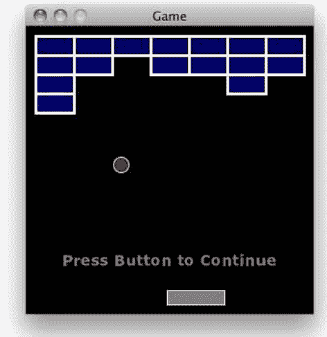

虽然这本书不是关于游戏编程的，但看看游戏内部结构也无妨，尤其是因为用Processing做游戏编程真的乐趣无穷！请从书籍网站⁴下载代码，在深入阅读代码之前先试玩一下游戏。

因为我们要将游戏控制器连接到串口，所以需要对其进行初始化：

```
import processing.serial.*;
Serial arduinoPort;
```

3. http://en.wikipedia.org/wiki/Breakout_%28arcade_game%29
4. http://www.pragprog.com/titles/msard

然后我们定义一些常量，方便轻松定制游戏：

```
final int COLUMNS = 7;
final int ROWS = 4;
final int BALL_RADIUS = 8;
final int BALL_DIAMETER = BALL_RADIUS * 2;
final int MAX_VELOCITY = 8;
final int PADDLE_WIDTH = 60;
final int PADDLE_HEIGHT = 15;
final int BRICK_WIDTH = 40;
final int BRICK_HEIGHT = 20;
final int MARGIN = 10;
final int WIDTH = COLUMNS * BRICK_WIDTH + 2 * MARGIN;
final int HEIGHT = 300;
final int X_AXIS_MIN = 252;
final int X_AXIS_MAX = 443;
final int LINE_FEED = 10;
final int BAUD_RATE = 19200;
```

这些值大多不言自明——它们定义了屏幕上出现的物体尺寸。例如，`PADDLE_WIDTH`是挡板的宽度（以像素为单位），`COLUMNS`和`ROWS`设置砖块的排列布局。你应该用6.4节“寻找并打磨边缘值”（第137页）中为传感器测量出的最小值和最大值替换`X_AXIS_MIN`和`X_AXIS_MAX`。

接下来，我们选择如何表示游戏中的对象：

```
int px, py;
int vx, vy;
int xpos = WIDTH / 2;
int[][] bricks = new int[COLUMNS][ROWS];
```

我们将球的当前x和y坐标存储在`px`和`py`中。对于其当前x和y方向的速度，我们使用`vx`和`vy`。将挡板的x位置存储在`xpos`中。

`bricks`是一个二维数组，包含屏幕上砖块的当前状态。如果数组元素为1，则对应的砖块仍在屏幕上。0表示已被摧毁。

最后，我们需要存储游戏的可能状态：

```
boolean buttonPressed = false;
boolean paused = true;
boolean done = true;
```

不出所料，当控制器上的按钮被按下时，我们将`buttonPressed`设为true，否则为false。`paused`表示游戏当前是否暂停，当当前关卡完成时（即所有砖块都被摧毁），`done`为true。

每个Processing程序都需要一个`setup()`函数，下面就是我们的：

下载MotionSensor/Game/Game.pde

```
void setup() {
  size(WIDTH, HEIGHT);
  noCursor();
  textFont(loadFont("Verdana-Bold-36.vlw"));
  initGame();
  println(Serial.list());
  arduinoPort = new Serial(this, Serial.list()[0], BAUD_RATE);
  arduinoPort.bufferUntil(LINE_FEED);
}

void initGame() {
  initBricks();
  initBall();
}

void initBricks() {
  for (int x = 0; x < COLUMNS; x++)
    for (int y = 0; y < ROWS; y++)
      bricks[x][y] = 1;
}

void initBall() {
  px = width / 2;
  py = height / 2;
  vx = int(random(-MAX_VELOCITY, MAX_VELOCITY));
  vy = -2;
}
```

`setup()`函数初始化屏幕，用`noCursor()`隐藏鼠标指针，并设置我们用来输出消息的字体（使用Processing的“工具 > 创建字体”菜单创建字体）。然后调用`initGame()`来初始化`bricks`数组以及球的当前位置和速度。为了增加趣味性，x方向的速度设为随机值。我们将y方向的速度设为-2，这样球会以合理的速度下落。

现在所有内容都已初始化，我们可以实现游戏的主循环。Processing的`draw()`方法是理想位置：⁵

5. http://processing.org/reference/ 提供了所有Processing类的优秀文档。


Download MotionSensor/Game/Game.pde
void draw() {
  background(0);
  stroke(255);
  strokeWeight(3);

  done = drawBricks();
  if (done) {
    paused = true;
    printWinMessage();
  }

  if (paused)
    printPauseMessage();
  else
    updateGame();

  drawBall();
  drawPaddle();
}

我们使用 background() 清空屏幕并将其涂成黑色。然后将描边颜色设置为白色，描边粗细设置为三像素。之后绘制剩余的砖块。如果没有砖块剩下，我们暂停游戏并打印“你赢了！”信息。

如果游戏处于暂停状态，我们打印相应的信息，如果没有，则更新游戏的当前状态。最后，我们使用以下函数在当前位置绘制球和挡板：

Download MotionSensor/Game/Game.pde
boolean drawBricks() {
  boolean allEmpty = true;
  for (int x = 0; x < COLUMNS; x++) {
    for (int y = 0; y < ROWS; y++) {
      if (bricks[x][y] > 0) {
        allEmpty = false;
        fill(0, 0, 100 + y * 8);
        rect(
          MARGIN + x * BRICK_WIDTH,
          MARGIN + y * BRICK_HEIGHT,
          BRICK_WIDTH,
          BRICK_HEIGHT
        );
      }
    }
  }
  return allEmpty;
}

void drawBall() {
    strokeWeight(1);
    fill(128, 0, 0);
    ellipse(px, py, BALL_DIAMETER, BALL_DIAMETER);
}

void drawPaddle() {
    int x = xpos - PADDLE_WIDTH / 2;
    int y = height - (PADDLE_HEIGHT + MARGIN);
    strokeWeight(1);
    fill(128);
    rect(x, y, PADDLE_WIDTH, PADDLE_HEIGHT);
}

正如你所见，球只不过是一个圆，而砖块和挡板只是简单的矩形。为了让它们看起来更吸引人，我们为它们加上了漂亮的边框。

打印游戏信息也很简单：

void printWinMessage() {
    fill(255);
    textSize(36);
    textAlign(CENTER);
    text("YOU WIN!", width / 2, height * 2 / 3);
}

void printPauseMessage() {
    fill(128);
    textSize(16);
    textAlign(CENTER);
    text("Press Button to Continue", width / 2, height * 5 / 6);
}

update() 函数非常重要，因为它更新游戏状态——检查碰撞、移动球等等：

void updateGame() {
    if (ballDropped()) {
        initBall();
        paused = true;
    } else {
        checkBrickCollision();
        checkWallCollision();
        checkPaddleCollision();
        px += vx;
        py += vy;
    }
}

当玩家没有用挡板击中球并且球掉出游戏区域时，游戏停止，用户在按下按钮后可以继续。在最终游戏中，你会减少某种生命计数器，并在计数器达到零时打印“游戏结束”信息。

如果球仍在游戏中，我们检查各种碰撞。我们检查球是否击中了一个或多个砖块，是否击中了墙壁，或是否击中了挡板。然后我们计算球的新位置。碰撞检查看起来很复杂，但它们相当简单，只比较球的坐标与屏幕上所有其他物体的坐标：

Download MotionSensor/Game/Game.pde
boolean ballDropped() {
    return py + vy > height - BALL_RADIUS;
}

boolean inXRange(final int row, final int v) {
    return px + v > row * BRICK_WIDTH &&
           px + v < (row + 1) * BRICK_WIDTH + BALL_DIAMETER;
}

boolean inYRange(final int col, final int v) {
    return py + v > col * BRICK_HEIGHT &&
           py + v < (col + 1) * BRICK_HEIGHT + BALL_DIAMETER;
}

void checkBrickCollision() {
    for (int x = 0; x < COLUMNS; x++) {
        for (int y = 0; y < ROWS; y++) {
            if (bricks[x][y] > 0) {
                if (inXRange(x, vx) && inYRange(y, vy)) {
                    bricks[x][y] = 0;
                    if (inXRange(x, 0)) // Hit top or bottom of brick.
                        vy = -vy;
                    if (inYRange(y, 0)) // Hit left or right side of brick.
                        vx = -vx;
                }
            }
        }
    }
}

void checkWallCollision() {
    if (px + vx < BALL_RADIUS || px + vx > width - BALL_RADIUS)
        vx = -vx;

    if (py + vy < BALL_RADIUS || py + vy > height - BALL_RADIUS)
        vy = -vy;
}

##### More Fun with Motion-Sensing Technologies

自从动作感应技术变得流行且廉价以来，人们用它们创造了一些难以置信的酷炫和有趣的项目。一个好笑的例子是 Brushduino.* 一位父亲为鼓励他的小孩子正确刷牙而制作了它。除了 Arduino 之外，其主要部件是一个三轴加速度计。Brushduino 使用 LED 指示下一步该刷嘴部的哪个区域，并且每当孩子成功完成一个区域时，它就会播放来自超级马里奥兄弟电子游戏的音乐。

但你不需要加速度计来检测运动并创造酷炫的新电子玩具。一个普通的倾斜传感器就足以构建一个互动的哈基球游戏，例如。† 这个哈基球在你踢它时会闪烁并发出蜂鸣声，在成功踢 30 次后，它会播放一首歌曲。

void checkPaddleCollision() {
final int cx = xpos;
if (py + vy >= height - (PADDLE_HEIGHT + MARGIN + 6) &&
px >= cx - PADDLE_WIDTH / 2 &&
px <= cx + PADDLE_WIDTH / 2)
{
vy = -vy;
vx = int(
map(
px - cx,
-(PADDLE_WIDTH / 2), PADDLE_WIDTH / 2,
-MAX_VELOCITY,
MAX_VELOCITY
)
);
}
}

请注意，碰撞检查也会在必要时改变球的速度。

既然球已经在移动了，那么移动挡板也只公平。 如前所述，你通过围绕 x 轴倾斜游戏控制器来控制挡板。 这里是通过串口获取控制器数据的代码：

Download: MotionSensor/Game/Game.pde

void serialEvent(Serial port) {
    final String arduinoData = port.readStringUntil(LINE_FEED);

    if (arduinoData != null) {
        final int[] data = int(split(trim(arduinoData), ' '));
        if (data.length == 4) {
            buttonPressed = (data[3] == 1);
            if (buttonPressed) {
                paused = !paused;
                if (done) {
                    done = false;
                    initGame();
                }
            }

            if (!paused)
                xpos = int(map(data[0], X_AXIS_MIN, X_AXIS_MAX, 0, WIDTH));
        }
    }
}

Processing 在串口上有新数据可用时调用 serialEvent() 函数。控制器逐行发送其数据。每行包含 x、y 和 z 轴的当前加速度以及按钮的当前状态。它用空格分隔所有属性。因此，在 serialEvent() 中，我们读取新行，在空格字符处将其拆分，并将 resulting 字符串转换为 int 值。这一切都在第 5 行发生。

我们检查是否确实获得了全部四个属性，然后查看玩家是否按下了游戏控制器上的按钮。如果是，我们切换暂停状态：如果游戏当前处于暂停模式，我们继续游戏；否则，我们暂停它。此外，我们检查游戏是否已结束。如果是，我们开始新游戏。

最后，我们在第 17 行读取当前的 X 加速度并将其映射到挡板可能有的 x 位置。这就是我们使用自己的游戏控制器移动挡板所需做的全部工作。而且，无论你使用控制器来控制游戏还是完全不同类型的软件都不重要。你只需要在需要时从串口读取四个整数值。

在本节中，你学到的关于游戏编程的知识比关于 Arduino 编程或硬件的知识多得多。但你也应该学到，将一个设计良好的电子项目集成到你的常规软件项目中是很容易的。我们仔细分析了加速度计返回的模拟数据，然后消除了所有不需要的抖动。这是一种你将在电子项目中经常使用的技术，我们将在下一章再次使用它。

##### Creating Games with the Arduino

你可以使用 Arduino 构建的不只是你自己的酷炫游戏控制器。你也可以用它来构建一些酷炫的游戏。凭借合适的扩展盾，你甚至可以将 Arduino 变成强大的游戏主机。* 它价格昂贵，但突然间你的 Arduino 就拥有了 320x200 像素的 OLED 触摸屏、一个模拟摇杆、两个按钮，甚至还有一个振动马达用于力反馈效果。

在寻找更便宜的解决方案时，有人用最少的硬件要求制作了一个超级马里奥兄弟克隆。† 这是 Arduino 激发难以置信创造力的完美例子。

*, http://antipastohw.blogspot.com/2009/02/getting-started-with-gamepack-in-3.html
†. http://blog.makezine.com/archive/2010/03/super_mario_brothers_with_an_arduino.html

#### 6.7 More Projects

如果你保持警惕，你会很快发现加速度计的应用比你想象的要多得多。这里有一个小型集合，包含商业和免费产品：

- Nike’s iPod Sport Kit 支持你在日常锻炼中，它也是基于加速度计的。你可以从其内部工作原理中学到很多。⁶
- 用本章中构建的游戏控制器创建一个弹珠迷宫电脑游戏会很有趣。把它做成一个真正的弹珠迷宫会更有趣吗？⁷
- 在本章中，我们只测量了直接加速度；也就是说，我们通常手持加速度计并移动它。

6. http://www.runnerplus.com/read/1-how_does_the_nike_ipod_sport_kit_accelerometer_work/
7. http://www.electronicsinfline.com/New/Everything_Else/marble-maze-that-is-remote-controlled-using-an-accelerometer.html


### 第7章：改造 Wii Nunchuk

 tinkering：拿一个现成产品并将其改造成其他用途或用于非预期目的。有时你必须打开产品并使其失去保修；有时你可以安全地将其作为自己项目的组成部分。

在本章中，你将学习如何劫持一台任天堂 Nunchuk 控制器。它是改造的完美候选：它配备了三轴加速度计、模拟摇杆和两个按钮，而且非常便宜（截至本文撰写时不到 20 美元）。更妙的是：由于其设计良好且连接器易于访问，你可以惊人地轻松地将其集成到自己的项目中。

我们将使用一台普通的 Nunchuk 控制器，并通过 Arduino 将其发出的数据传输到计算机。你将学习如何将其连接到 Arduino；如何编写读取控制器当前状态的软件；以及如何使用 Nunchuk 在屏幕上移动、旋转和缩放一个 3D 立方体。你甚至不需要一台任天堂 Wii 来完成所有这些——你只需要一个 Nunchuk 控制器即可。

#### 7.1 你需要什么

- 一个 Arduino 板，例如 Uno、Duemilanove 或 Diecimila
- 一根 USB 电缆用于将 Arduino 连接到计算机
- 一个任天堂 Nunchuk 控制器
- 四根导线

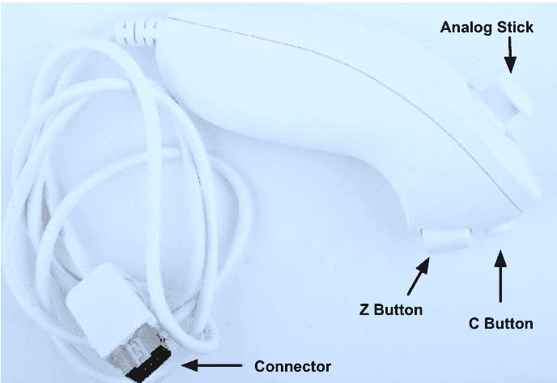

图 7.1：任天堂 Nunchuk 控制器

#### 7.2 连接 Wii Nunchuk

将 Nunchuk 连接到 Arduino 真的很简单。你不必打开 Nunchuk 或以任何方式修改它。你只需要将四根导线插入其连接器，然后将导线连接到 Arduino。以下是 Nunchuk 插头的引脚定义：

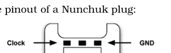

它有六个连接器，但只有四个是活动的：GND、3.3 V、Data 和 Clock。将一根导线插入每个连接器，然后将导线连接到 Arduino。将数据线连接到模拟引脚 4，将时钟线连接到模拟引脚 5。GND 线必须连接到 Arduino 的地引脚，而 3.3 V 线属于 Arduino 的 3.3 V 引脚。

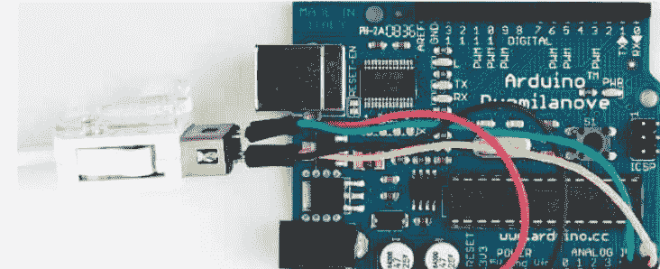

图 7.2：如何将 Nunchuk 连接到 Arduino

这就是将 Nunchuk 控制器连接到 Arduino 所需做的全部工作。在下一节中，你会看到连接到模拟引脚 4 和 5 的两根导线就是我们与控制器交互所需的所有内容。

#### 7.3 与 Nunchuk 通信

没有任何官方文档说明 Nunchuk 内部的工作原理或如何在非 Wii 环境中使用它。但互联网上的一些聪明的黑客和创客投入了大量时间来逆向工程控制器内部发生的事情。¹

总的来说，它非常简单，因为 Nunchuk 使用双线接口（TWI），也称为 I²C（Inter-Integrated Circuit）协议。² 它使设备能够仅使用两根导线通过主/从数据总线进行通信。你在一根导线上传输数据（DATA），而另一根导线同步通信（CLOCK）。

Arduino IDE 附带一个名为 Wire 的库，实现了 I²C 协议。它期望数据线连接到模拟引脚 4，时钟线连接到模拟引脚 5。我们将很快使用它与 Nunchuk 通信，但在那之前，我们先来看看控制器理解的命令。³

1. http://www.windmeadow.com/node/42
2. http://en.wikipedia.org/wiki/I2C
3. 在 http://todbot.com/blog/2010/09/25/softi2cmaster-add-i2c-to-any-arduino-pins/，你可以找到一个库，允许你使用任意一对引脚进行 I²C 通信。

> ### 用改造改善人们的生活
>
> 由于其受欢迎程度，现代游戏机的外设设备往往 unbelievably 便宜。而且，它已不再局限于经典控制器；你可以购买诸如滑雪板模拟器或摄像机之类的东西。因此，毫不奇怪，创意人士使用原本为游戏而建的硬件构建了许多有趣的项目。
>
> 一个令人印象深刻且有用的改造项目是 Eyewriter。* 它使用 PlayStation Eye（索尼 PlayStation 3 的摄像机）来跟踪人类眼睛的移动。
>
> 一群黑客为使他们的瘫痪朋友能够用眼睛绘制涂鸦而构建了它。由于疾病，这个朋友，一位艺术家，几乎完全身体瘫痪，只能移动眼睛。有了 Eyewriter，他能够再次创作令人惊叹的艺术作品。
>
> 这不是一个 Arduino 项目，但绝对值得一看。
>
> * http://www.eyewriter.org/

说实话，Nunchuk 只理解一个命令：“给我所有的数据。” 每当它收到此命令时，它会返回六个字节，其含义如下（参见图 7.3 中的数据结构，见下一页）：

- 字节 1 包含模拟摇杆的 x 轴值，字节 2 中包含摇杆的 y 轴值。两者都是 8 位数字，范围约为 29 到 225。
- x、y 和 z 轴的加速度值是三个 10 位数字。字节 3、4 和 5 包含它们最重要的八位。你可以在字节 6 中找到每个的缺失两位。
- 字节 6 必须按位解释。位 0（最低有效位）包含 Z 按钮的状态。如果按钮被按下，则为 0；否则为 1。位 1 包含 C 按钮的状态。

剩余的六位包含加速度值的缺失最低有效位。位 2 和 3 属于 X 轴，位 4 和 5 属于 Y，位 6 和 7 属于 Z。

现在我们知道了如何解释从 Nunchuk 获得的数据，我们可以开始构建一个 Nunchuk 类来控制它。

| Byte | Meaning |
| --- | --- |
| Byte 1 | Joystick x position |
| Byte 2 | Joystick y position |
| Byte 3 | X acceleration bits 9..2 |
| Byte 4 | Y acceleration bits 9..2 |
| Byte 5 | Z acceleration bits 9..2 |
| Byte 6 | Bit 7–6: Z acceleration bits 1..0; bit 5–4: Y acceleration bits 1..0; bit 3–2: X acceleration bits 1..0; bit 1: C-button status; bit 0: Z-button status |

图 7.3：Nunchuk 总是返回 6 个字节的数据。

> ### 使用 Wii 设备进行科学应用
>
> 由于 Wii 的准确性和低廉价格，许多科学家使用 Wii 设备进行游戏以外的用途。一些水文学家用它来测量水体上的蒸发量。* 通常，你需要花费超过 500 美元的设备才能做到这一点。
>
> 墨尔本大学的一些医生仔细研究了 Wii 平衡板，因为他们正在寻找一种廉价的设备来帮助中风患者康复。† 他们发表了一篇科学论文，验证该板的数据在临床上与实验室级“力平台”相当，而成本仅为其一小部分。
>
> * http://www.wired.com/wiredscience/2009/12/wilmote-science/
>
> † http://www.newscientist.com/article/mg20527435.300-wii-board-helps-physios-strike-a-balance-after-strokes.html

在第 4 行，我们为存储 Nunchuk 返回的数据所需的数组创建一个常量。我们在第 33 行定义此数组，在这种情况下，我们使用预处理器而不是 const 关键字来定义常量，因为在 C++ 中数组常量必须在编译时已知。

然后实际的 Nunchuk 类声明开始。要启动 Arduino 和 Nunchuk 之间的通信通道，你必须调用一次 initialize() 方法。然后每当你想要 Nunchuk 发送新数据时调用 update()。你将很快看到这两个方法的实现。

我们有公共方法来获取 Nunchuk 返回的所有属性：模拟摇杆的 x 和 y 位置、按钮状态以及 x、y、z 轴的加速度值。所有这些方法都操作第 33 行缓冲区中的原始数据。它们的大部分实现都很简单，只需要一行代码。只有 10 位加速度值的组装需要一些棘手的位操作（参见第 B.2 节，位操作，第 249 页）。

在类声明的末尾，你会找到我们需要实现的两个私有辅助方法：initialize() 和 update()：

```cpp
#include <Wire.h>
#include "nunchuk.h"
#define NUNCHUK_DEVICE_ID 0x52

void Nunchuk::initialize() {
    Wire.begin();
    Wire.beginTransmission(NUNCHUK_DEVICE_ID);
    Wire.send(0x40);
    Wire.send(0x00);
    Wire.endTransmission();
    update();
}

bool Nunchuk::update() {
    delay(1);
    Wire.requestFrom(NUNCHUK_DEVICE_ID, NUNCHUK_BUFFER_SIZE);
    int byte_counter = 0;
    while (Wire.available() && byte_counter < NUNCHUK_BUFFER_SIZE)
        _buffer[byte_counter++] = decode_byte(Wire.receive());
    return byte_counter == NUNCHUK_BUFFER_SIZE;
}
```


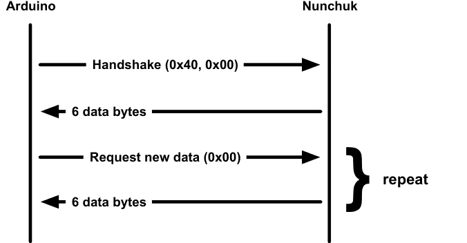

## 图 7.4：Arduino 与 Nunchuk 之间的消息流

```
void Nunchuk::request_data() {
  Wire.beginTransmission(NUNCHUK_DEVICE_ID);
  Wire.send(0x00);
  Wire.endTransmission();
}

char Nunchuk::decode_byte(const char b) {
  return (b ^ 0x17) + 0x17;
}
```

在引入我们需要的所有库之后，我们定义了 `NUNCHUK_DEVICE_ID` 常量。I²C 是一种主从协议；在我们的场景中，Arduino 是主机，Nunchuk 是从机。Nunchuk 使用特定的 ID（0x52）在数据总线上注册自己，因此我们可以在需要时随时访问它。

在 `initialize()` 中，我们通过发送握手信号建立 Arduino 与 Nunchuk 之间的连接。在第 8 行，我们调用 Wire 的 `begin()` 方法，使 Arduino 以主机身份加入 I²C 总线（如果你向 `begin()` 传入一个 ID，它会以该 ID 对应的从机身份加入总线）。然后，我们开始一次向由 `NUNCHUK_DEVICE_ID` 标识的设备（也就是我们的 Nunchuk）发起的新传输。

我们向 Nunchuk 发送两个字节（`0x40` 和 `0x00`），然后结束传输。这就是整个握手过程，现在我们可以通过调用 `update()` 来请求 Nunchuk 的当前状态。在图 7.4（前一页）中，我们看到了 Arduino 与 Nunchuk 之间的消息流。

`update()` 首先暂停一毫秒，让一切稍微稳定下来。然后我们调用 `Wire.requestFrom()` 向 Nunchuk 请求六个字节。这并不会直接返回这些字节，而是需要我们通过循环读取它们并填充缓冲区。`Wire.available()` 返回数据总线上可用的字节数，`Wire.receive()` 返回当前字节。我们不能直接使用从 Nunchuk 获取的字节，因为控制器会对它们进行一些混淆处理。正如你在 `decode_byte()` 中看到的，“解密”它们非常简单。

最后，我们调用 `request_data()` 告诉 Nunchuk 准备新数据。它向 Nunchuk 发送一个零字节，意思是“准备接下来的六个字节”。

在下一节真正使用我们的 Nunchuk 类之前，请先看一下 Wire 库的文档。在 Arduino IDE 的菜单中，选择 帮助 > 参考，然后点击 Libraries 链接。

#### 7.5 使用我们的 Nunchuk 类

让我们使用 Nunchuk 类来看看控制器实际返回什么数据：

下载 MotionSensor/NunchukDemo/NunchukDemo.pde

```
#include <Wire.h>
#include "nunchuk.h"

const unsigned int BAUD_RATE = 19200;

Nunchuk nunchuk;

void setup() {
  Serial.begin(BAUD_RATE);
  nunchuk.initialize();
}

void loop() {
  if (nunchuk.update()) {
    Serial.print(nunchuk.joystick_x());
    Serial.print(" ");
    Serial.print(nunchuk.joystick_y());
```


## 图 7.5：使用 Nunchuk 控制旋转立方体

```
下载 MotionSensor/Cube/SensorDataBuffer.pde

第 1 行
class SensorDataBuffer {
    private int _maxSamples;
    private int _bufferIndex;
    private int[] _xBuffer;
    private int[] _yBuffer;
    private int[] _zBuffer;

    public SensorDataBuffer(final int maxSamples) {
        _maxSamples = maxSamples;
        _bufferIndex = 0;
        _xBuffer = new int[_maxSamples];
        _yBuffer = new int[_maxSamples];
        _zBuffer = new int[_maxSamples];
    }

    public void addData(final int x, final int y, final int z) {
        if (_bufferIndex >= _maxSamples)
            _bufferIndex = 0;

        _xBuffer[_bufferIndex] = x;
        _yBuffer[_bufferIndex] = y;
        _zBuffer[_bufferIndex] = z;
        _bufferIndex++;
    }

    public int getX() {
        return getAverageValue(_xBuffer);
    }
```

```
public int getY() {
    return getAverageValue(_yBuffer);
}

public int getZ() {
    return getAverageValue(_zBuffer);
}

private int getAverageValue(final int[] buffer) {
    int sum = 0;
    for (int i = 0; i < _maxSamples; i++)
        sum += buffer[i];
    return (int)(sum / _maxSamples);
}
```

`SensorDataBuffer` 封装了三个缓冲区，分别用于存储 x、y、z 轴的加速度数据。它还存储一个缓冲区索引，用于记录当前在三个缓冲区中的位置。从第 8 行开始的构造函数期望接收最大样本数（缓冲区大小），并初始化缓冲区和索引。

`addData()` 方法接收三个空间轴的新值，并将它们追加到对应的缓冲区中。如果缓冲区已满，最旧的缓冲区条目将被丢弃。通过 `getX()`、`getY()` 和 `getZ()`，你可以请求每个轴当前的加速度平均值。这三个方法都将工作委托给 `getAverageValue()` 方法。

那么，现在让我们开始着手绘制一个 3D 立方体。首先，我们初始化所有与串行通信相关的内容，以便与控制 Nunchuk 的 Arduino 通信：

下载：MotionSensor/Cube/Cube.pde

```
import processing.serial.*;

final int LINE_FEED = 10;
final int MAX_SAMPLES = 16;

Serial arduinoPort;
SensorDataBuffer sensorData = new SensorDataBuffer(MAX_SAMPLES);
```

像往常一样，我们导入串行通信所需的库，并初始化一个全局的 Serial 对象，这次我们还创建了一个 `SensorDataBuffer` 对象。

现在我们需要一些常量，用于屏幕尺寸、Nunchuk 数据范围以及我们的 3D 计算：

```
final int WIDTH = 500;
final int HEIGHT = 500;
final int BAUD_RATE = 19200;
final int X_AXIS_MIN = 300;
final int X_AXIS_MAX = 700;
final int Y_AXIS_MIN = 300;
final int Y_AXIS_MAX = 700;
final int Z_AXIS_MIN = 300;
final int Z_AXIS_MAX = 700;
final int MIN_SCALE = 5;
final int MAX_SCALE = 128;
final float MX = 2.0 / (X_AXIS_MAX - X_AXIS_MIN);
final float MY = 2.0 / (Y_AXIS_MAX - Y_AXIS_MIN);
final float MZ = 2.0 / (Z_AXIS_MAX - Z_AXIS_MIN);
final float BX = 1.0 - MX * X_AXIS_MAX;
final float BY = 1.0 - MY * Y_AXIS_MAX;
final float BZ = 1.0 - MZ * Z_AXIS_MAX;
```

`X_AXIS_MIN` 和 `X_AXIS_MAX` 定义了 Nunchuk 为 x 轴返回的最小和最大加速度值。`Y_AXIS_MIN` 等也是如此。我们稍后需要其余常量（`MX`、`BX` 等）来将加速度值转换为角度，所以暂时不必太担心它们。

接下来，我们需要一些变量来存储立方体的当前状态：它的位置、不同轴的旋转角度以及当前的缩放比例：

```
int xpos = WIDTH / 2;
int ypos = HEIGHT / 2;
int scale = 90;

float xrotate = 0.0;
float yrotate = 0.0;
float zrotate = 0.0;
```

在 `setup()` 方法中，我们初始化屏幕和串口：

```
void setup() {
  size(WIDTH, HEIGHT, P3D);
  noStroke();
  colorMode(RGB, 1);
  background(0);
  println(Serial.list());
  arduinoPort = new Serial(this, Serial.list()[0], BAUD_RATE);
  arduinoPort.bufferUntil(LINE_FEED);
}
```

唯一值得提及的是第 4 行对 `colorMode()` 的调用。它决定了我们以 0 到 1 范围内的 RGB 值来指定颜色。这有助于让立方体变得非常鲜艳（这段代码中的 3D 绘制部分源自 Processing 的一个标准示例）。

你可以按照以下方式使用 Processing 绘制立方体：

```
下载 MotionSensor/Cube/Cube.pde
第 1 行 void draw() {
  background(0);
  pushMatrix();

5   translate(xpos, ypos, -30);
  rotateX(yrotate);
  rotateY(xrotate);
  rotateZ(zrotate);
  scale(scale);

10 beginShape(QUADS);
  fill(0, 1, 1); vertex(-1,  1,  1);
  fill(1, 1, 1); vertex( 1,  1,  1);
  fill(1, 0, 1); vertex( 1, -1,  1);
15 fill(0, 0, 1); vertex(-1, -1,  1);

  fill(1, 1, 1); vertex( 1,  1,  1);
  fill(1, 1, 0); vertex( 1,  1, -1);
  fill(1, 0, 0); vertex( 1, -1, -1);
20 fill(1, 0, 1); vertex( 1, -1,  1);

  fill(1, 1, 0); vertex( 1,  1, -1);
  fill(0, 1, 0); vertex(-1,  1, -1);
  fill(0, 0, 0); vertex(-1, -1, -1);
25 fill(1, 0, 0); vertex( 1, -1, -1);

  fill(0, 1, 0); vertex(-1,  1, -1);
  fill(0, 1, 1); vertex(-1,  1,  1);
  fill(0, 0, 1); vertex(-1, -1,  1);
30 fill(0, 0, 0); vertex(-1, -1, -1);

  fill(0, 1, 0); vertex(-1,  1, -1);
  fill(1, 1, 0); vertex( 1,  1, -1);
  fill(1, 1, 1); vertex( 1,  1,  1);
35 fill(0, 1, 1); vertex(-1,  1,  1);

  fill(0, 0, 0); vertex(-1, -1, -1);
  fill(1, 0, 0); vertex( 1, -1, -1);
  fill(1, 0, 1); vertex( 1, -1,  1);
40 fill(0, 0, 1); vertex(-1, -1,  1);
  endShape();

  popMatrix();
}
```


### 第 8 章：使用 Arduino 进行联网

使用独立的 Arduino，你可以创建无数有趣且实用的项目。但一旦你将 Arduino 变成网络设备，你就打开了一个充满可能性的全新世界。

现在你可以访问互联网上的所有信息，因此只需从天气服务读取数据，就能将 Arduino 变成一个酷炫的极客风格气象站。你还可以将 Arduino 变成一个 Web 服务器，为网络中的其他设备或计算机提供传感器数据。

在本章中，我们将构建一个能发送电子邮件的防盗报警器。它能够检测你客厅中的移动，当在你外出期间检测到移动时，Arduino 会向你发送电子邮件。由于这是一个较为高级的项目，我们将首先完成一些较小的项目，以学习所需的所有技术和技能。

我们将从一块没有任何网络功能的“裸”Arduino 开始。只要连接到 PC，你仍然可以让它接入互联网。

对于第二个项目，我们将通过以太网扩展板大幅改善这种状况。现在你的 Arduino 变成了一个功能完备的网络设备，可以直接访问 IP 服务，例如 DAYTIME 服务。这将使你的 Arduino 变成一个非常精确的时钟。

一旦我们能够访问 IP 服务，我们将学习如何直接从带有以太网扩展板的 Arduino 发送电子邮件。对于我们的防盗报警器，接下来只需要知道如何检测移动。为此，我们将使用一个被动红外传感器（PIR），因此在本章中，你不仅将学习各种网络技术，还将学习如何使用 PIR 传感器。

最后，我们将结合所学的一切，构建这个能发送电子邮件的防盗报警器。一旦它运行起来，你会感到安全得多。

#### 8.1 你需要什么


图 8.1：本章所需的全部部件

- 一块用于 Arduino 的以太网扩展板
- 一个 TMP36 温度传感器
- 一个 PIR 红外运动传感器
- 一块面包板
- 一些导线
- 一块 Arduino 板，如 Uno、Duemilanove 或 Diecimila
- 一条用于将 Arduino 连接到计算机的 USB 线缆

#### 8.2 使用 PC 将传感器数据传输到互联网


图 8.2：使用 PC 将 Arduino 连接到互联网。

还记得大约十五年前，你将 PC 连接到互联网的情景吗？一切始于一个 38,400 波特率的调制解调器、Netscape Navigator 3，以及你在邮件中收到的 AOL 软盘或光盘。如今，你可能通过有线电视、卫星或 DSL 使用宽带接入，而且可能通过 WiFi 在你家的每个角落都能上网。因此，我们将从使用你现有的连接将 Arduino 连接到互联网开始。

在图 8.2 中，你可以看到将 Arduino 连接到互联网的典型设置。一个程序在你的 PC 上运行，并通过串口与 Arduino 通信。当应用程序需要访问互联网时，由 PC 上的程序来处理。使用这种架构，你可以将有趣的传感器数据发推文¹。

¹ http://twitter.com

我们将构建一个系统，当你的工作室或办公室温度超过某个阈值（即 32 摄氏度（90 华氏度））时，它会自动发布一条推文。请重新构建第 113 页上的 5.4 节“使用温度传感器提高精度”中的温度传感器示例（尝试不看第 114 页上的图 5.6 来完成），并将以下代码上传到你的 Arduino：

Download Ethernet/TwitterTemperature/TwitterTemperature.pde

```
#define CELSIUS

const unsigned int TEMP_SENSOR_PIN = 0;
const unsigned int BAUD_RATE = 9600;
const float SUPPLY_VOLTAGE = 5.0;

void setup() {
  Serial.begin(BAUD_RATE);
}

void loop() {
  const int sensor_voltage = analogRead(TEMP_SENSOR_PIN);
  const float voltage = sensor_voltage * SUPPLY_VOLTAGE / 1024;
  const float celsius = (voltage * 1000 - 500) / 10;
#ifdef CELSIUS
  Serial.print(celsius);
  Serial.println(" C");
#else
  Serial.print(9.0 / 5.0 * celsius + 32.0);
  Serial.println(" F");
#endif
  delay(5000);
}
```

这与我们之前使用的代码几乎相同。请记住，如果你使用的是 3.3V 而非 5V 供电的 Arduino，则必须将第 5 行中的 SUPPLY_VOLTAGE 设置为 3.3。

我们现在同时支持摄氏度和华氏度值，你可以通过预处理器常量来控制应使用哪个单位。如果在第一行设置常量 CELSIUS，应用程序将输出摄氏度温度。如果删除第一行或将其改为注释行，则将使用华氏度。

为了改变应用程序的行为，我们使用 #ifdef 预处理器指令。它检查某个预处理器常量是否已设置，然后有条件地编译代码。在我们的例子中，仅当未设置常量 CELSIUS 时，它才会编译第 19 行中的摄氏度转华氏度公式。

上传代码后，它将每五秒钟向串口输出一次当前温度。输出如下所示：

```
27.15 C
26.66 C
27.15 C
```

现在我们需要一个在你的 PC 上运行的程序，它读取该输出，并在温度高于 32 摄氏度（90 华氏度）时发布一条推文。我们可以使用任何能够读取串口并支持 Twitter 的编程语言，但由于我们在所有其他示例中一直使用 Processing，因此我们也将在这个项目中使用它。

##### 用于发布传感器数据的 Web 服务

随着廉价开源硬件和传感器的出现，用于发布传感器数据的 Web 服务在过去几年中变得流行起来。这类服务允许你发布、读取和分析传感器数据。来自世界各地的人们发布来自其气象站、环境传感器等的数据，并在互联网上免费提供。

最流行的服务是 Pachube* 和 Sensorpedia†。原则上，它们的运作方式相同：你注册一个账户，并获得一个 API 密钥。然后，你可以使用该密钥向服务进行身份验证并上传传感器数据。

* http://pachube.com
† http://sensorpedia.com/

#### 8.3 向 Twitter 注册应用程序

在开始编码之前，我们必须先在 Twitter 网站上注册我们的应用程序，以获得一个 OAuth 访问令牌。² OAuth 是一种允许应用程序使用其他应用程序资源的身份验证方案。在我们的例子中，我们将授予我们自己的应用程序更新 Twitter 动态的权利，而无需使用我们的 Twitter 用户名和密码。

² http://en.wikipedia.org/wiki/Oauth

很长一段时间里，Twitter 支持 HTTP 基本身份验证。³ 自动化服务只需要用户名和密码即可请求或更新 Twitter 动态。但自 2010 年 8 月起，Twitter 已取消对基本身份验证的支持，现在改用 OAuth。

³ http://en.wikipedia.org/wiki/Basic_authentication

要获得 OAuth 访问令牌，请在 Twitter 网站的开发者部分注册你的新应用程序。⁴ 登录后，点击“注册应用”链接，并填写你在下一页图 8.3 中看到的表单。确保将应用程序类型设置为 Client，并将默认访问类型设置为 Read & Write。你可以将应用程序名称设置为任意字符串，每当你使用该应用程序发布推文时，它都会出现在你的 Twitter 频道上。例如，如果你将其设置为 RescueMeFromWork，你的推文将通过 RescueMeFromWork 发布。

⁴ http://dev.twitter.com


Figure 8.3: 首先注册你的新 Twitter 客户端应用。

在成功注册新应用后，进入应用的设置页面查看你的 consumer key 和 consumer secret（见下一页的图 8.4）。你需要它们以及你的 OAuth token 和 OAuth token secret 才能允许你的应用修改你的 Twitter 状态。要查看 OAuth token 和 secret，请点击 My Access Token 链接。

复制 consumer key、consumer secret、access token 和 access token secret。在下一节我们使用 Processing 发送推文时你会用到它们。

#### 8.4 使用 Processing 发送推文

Processing 没有内置的 Twitter 支持，但在 Processing 程序中，我们可以直接访问 Java 库，而且你可以找到几个不错的


Figure 8.4: Consumer 凭证位于设置页面。

用于 Java 的 Twitter 库。其中之一是 twitter4j。5 我们会使用它，因为它非常成熟并且具有出色的 OAuth 支持。

从其网站6 下载它，并解压到一个临时文件夹。根据你下载的版本，你会在文件夹中找到一个名为 twitter4j-core-x.y.z.jar 或 twitter4j-core-x.y.z-SNAPSHOT.jar 的文件。打开 Processing IDE，创建一个新草图，然后将 .jar 文件拖放到 IDE 中（.jar 文件会自动复制到名为 code 的本地文件夹）。这样就完成了赋予你的应用访问 twitter4j 库的全部工作。

5. http://twitter4j.org/
6. http://twitter4j.org/en/index.html#download

我们继续使用一些样板代码：

```java
import processing.serial.*;

final float MAX_WORKING_TEMP = 32.0;
final int   LINE_FEED = 10;
final int   BAUD_RATE = 9600;
final String CONSUMER_KEY = "<YOUR CONSUMER KEY>";
final String CONSUMER_SECRET = "<YOUR CONSUMER SECRET>";
final String ACCESS_TOKEN = "<YOUR ACCESS TOKEN>";
final String ACCESS_TOKEN_SECRET = "<YOUR ACCESS TOKEN SECRET>";

Serial arduinoPort;

void setup() {
  println(Serial.list());
  arduinoPort = new Serial(this, Serial.list()[0], BAUD_RATE);
  arduinoPort.bufferUntil(LINE_FEED);
}

void draw() {}
```

像往常一样，我们导入用于与 Arduino 通信的串口库，然后定义稍后需要使用的一些常量。其中大部分包含访问 Twitter 服务所需的凭证。通过 MAX_WORKING_TEMP，你可以定义应用开始推文的温度。这可以是摄氏度或华氏度的值。

在 setup() 方法中，我们打印出所有可用串口设备的列表，并使用我们找到的第一个设备初始化我们的 serialPort 变量，希望它是 Arduino。你也可以自动遍历列表并搜索看起来像 Arduino 端口名称的东西，但那样也很脆弱。我们不需要为应用提供任何图形输出，因此 draw() 方法保持为空。

现在让我们实现我们“带我去海滩”报警器的实际业务逻辑：

```java
void serialEvent(Serial port) {
  final String arduinoData = port.readStringUntil(LINE_FEED);

  if (arduinoData != null) {
    final String[] data = split(trim(arduinoData), ' ');
    if (data.length == 2 &&
        (data[1].equals("C") || data[1].equals("F")))
    {
      float temperature = float(data[0]);
```

```
println(temperature);
int sleepTime = 5 * 60 * 1000;
if (temperature > MAX_WORKING_TEMP) {
    tweetAlarm();
    sleepTime = 120 * 60 * 1000;
}
try {
    Thread.sleep(sleepTime);
}
catch(InterruptedException ignoreMe) {}
}
}

void tweetAlarm() {
    TwitterFactory factory = new TwitterFactory();
    Twitter twitter = factory.getInstance();
    twitter.setOAuthConsumer(CONSUMER_KEY, CONSUMER_SECRET);
    AccessToken accessToken = new AccessToken(
        ACCESS_TOKEN,
        ACCESS_TOKEN_SECRET
    );
    twitter.setOAuthAccessToken(accessToken);
    try {
        Status status = twitter.updateStatus(
            "Someone, please, take me to the beach!"
        );
        println(
            "Successfully updated status to '" + status.getText() + "'."
        );
    }
    catch (TwitterException e) {
        e.printStackTrace();
    }
}
```

在第 5.8 节《在 Processing 中实现串行通信》，第 126 页，你学习了如何在 Processing 中实现串行通信。每当串口有新数据到达时，运行时环境会调用 serialEvent() 方法。在那里我们尝试读取一行文本，然后检查它是否包含一个十进制数字，后跟一个空格和一个 C 或 F 字符。这确保我们读取的是实际的温度数据集，而不是一些数字垃圾。

如果我们得到了语法正确的温度数据集，我们将其转换为 float 对象并检查它是否大于 MAX_WORKING_TEMP（没人应该被迫在这么高的温度下工作！）。如果是，我们调用 tweetAlarm() 并推一条消息，鼓励一些关注者来营救我们。然后我们等待两个小时进行下一次检查。否则，我们等待五分钟再检查温度。


Figure 8.5: 我希望有人能看到你的求救信号。

tweetAlarm() 更新我们的 Twitter 频道，操作很简单。遵循老派的 Java 传统，我们使用 TwitterFactory 创建一个新的 Twitter 实例，并通过调用 setOAuthConsumer() 设置我们的 consumer 凭证。然后我们通过调用 setOAuthAccessToken() 设置 OAuth 凭证。最后，我们调用 updateStatus()。如果一切顺利，我们会向控制台打印一条成功消息。如果出现任何问题，updateStatus() 会抛出异常，我们会打印其堆栈跟踪以便调试。

这就是我们需要的所有代码，所以将你的 Arduino 连接到电脑并运行它！在图 8.5 中，你可以看到当我工作室的温度高于 32 摄氏度时 Twitter 上会发生什么（对于你的第一次测试，你可能需要将 32.0 改为更小的值。如果你不需要更改它，为什么你不在海滩上呢？）。

使用功能齐全的 PC 作为 Arduino 的互联网中继很方便，但对于大多数应用来说也有些过度。在下一节中，你将学习如何将 Arduino 变成真正的网络设备。

#### 8.5 使用以太网 Shield 进行网络通信

在上一节中，你学习了如何通过使用电脑的网络连接来构建具有 Arduino 的网络应用。这种方法效果不错，但也有一些缺点。最大的问题是

##### Tweeting Arduinos

最受欢迎的硬件套件之一是 Botanical.* 它检查你的植物是否需要浇水，如果需要，它会通过 http://twitter.com/ 发送提醒消息。一旦你给它浇水，它会恭敬地发送一条“谢谢”消息。虽然 Botanical 的官方版本是专用硬件，但你也可以使用 Arduino 来构建它。†

Botanical 确实让你的生活更轻松一些。Twitwee Clock‡ 是否能改善你的生活则见仁见智。这种改装的布谷鸟钟通过无线互联网连接查找 Twitter 更新。每当它找到可编程的搜索词时，它就会在显示屏上显示相应的推文，并弹出一个发出噪音的布谷鸟。你最好在建造这个项目并把它安装在客厅之前先征求家人的意见。

* http://www.botanical.com/
† http://www.botanical.com/archived_kits/twitter/
‡ http://www.haroonbaig.com/projects/TwitweeClock/

你需要一台完整的 PC，而对于许多应用来说，Arduino 的硬件能力就足够了。在本节中，你将学习如何使用以太网 Shield 解决这个问题。

你不能将裸露的 Arduino 连接到网络。不仅它的硬件能力太有限，它也没有以太网端口。这意味着你不能将以太网电缆插入其中，为克服这一限制，你必须使用以太网 Shield。这类 Shield 带有以太网芯片和以太网连接器，能立即将你的 Arduino 变为网络设备。你只需要把它插上。

你可以从多种产品中选择；它们都很好并且能很好地发挥作用。7 对于原型制作，我更喜欢“官方” Shield，8 因为它为所有引脚都提供了插座（它在图 8.6 中位于左侧，见下一页）。此外，在撰写本文时，Arduino 团队宣布了 Arduino Ethernet，这是一款自带以太网端口的 Arduino 板，无需单独的 Shield。

7. 例如参见 http://www.ladyada.net/make/eshield/
8. http://www.arduino.cc/en/Main/ArduinoEthernetShield


# 图 8.6：Arduino 的两个以太网盾

硬件只是将 Arduino 变为网络设备的一个方面。我们还需要一些用于网络通信的软件。Arduino IDE 附带了一个方便的 Ethernet 库，其中包含一些与网络相关的类。我们现在将使用它来访问互联网上的一个 DAYTIME 服务。

一个 DAYTIME 服务⁹ 会以 ASCII 字符串的形式返回当前日期和时间。DAYTIME 服务器监听 TCP 或 UDP 端口 13。你可以在互联网上找到许多 DAYTIME 服务；其中一个运行在 time.nist.gov 上。在使用 Arduino 以编程方式使用该服务之前，先看看使用 telnet 命令它是如何工作的：

```
maik> telnet time.nist.gov 13
Trying 192.43.244.18...
Connected to time.nist.gov.
Escape character is '^[A'].
55480 10-10-11 13:25:35 28 0 0 138.5 UTC(NIST) *
Connection closed by foreign host.
```

> 9. http://en.wikipedia.org/wiki/DAYTIME

首先，我们包含 Ethernet 库并为 DAYTIME 服务端口定义一个常量（我们还必须包含 SPI 库，因为 Ethernet 库依赖于它）。然后我们定义三个字节数组：

- mac 包含我们将要为以太网盾使用的 MAC 地址。MAC 地址是一个 48 位的数字，用于唯一标识网络设备。¹¹ 通常，制造商会设置此标识符，但对于以太网盾，我们必须自己设置它；我们使用一个任意数字。

重要提示：MAC 地址必须在你的网络上是唯一的。如果连接多个 Arduino，请确保它们都有不同的 MAC 地址！

- 每当你将 PC 连接到互联网时，它通常会通过动态主机配置协议（DHCP）¹² 获取一个新的 IP 地址。对于大多数 Arduino 应用来说，DHCP 实现相对昂贵，因此你通常会手动分配 IP 地址。在大多数情况下，这将是 192.168.x.y 范围内的本地地址；我们将此地址存储在 my_ip 数组中。

- 要将 time.nist.gov 等域名转换为 IP 地址，你需要访问域名系统（DNS）。Arduino 的标准库不支持 DNS，因此我们必须自己查找 IP 地址。我们将其分配给 time_server。telnet 命令已经为我们将 DAYTIME 服务域名转换为 IP 地址了。或者，你可以使用以下其中一个命令来确定域名的 IP 地址：

```
maik> host time.nist.gov
time.nist.gov has address 192.43.244.18
maik> dig +short time.nist.gov
192.43.244.18
maik> resolveip time.nist.gov
IP address of time.nist.gov is 192.43.244.18
maik> ping -c 1 time.nist.gov
PING time.nist.gov (192.43.244.18): 56 data bytes
64 bytes from 192.43.244.18: icmp_seq=0 ttl=48 time=173.598 ms

--- time.nist.gov ping statistics ---
1 packets transmitted, 1 packets received, 0.0% packet loss
round-trip min/avg/max/stddev = 173.598/173.598/173.598/0.000 ms
```

11. http://en.wikipedia.org/wiki/Mac_address
12. http://en.wikipedia.org/wiki/Dynamic_Host_Configuration_Protocol


在第 11 行，我们创建一个新的 Client 对象。此类是 Ethernet 库的一部分，允许我们创建连接到特定 IP 地址和端口的网络客户端。

现在我们必须初始化以太网盾本身；我们在 setup() 函数的第 14 行执行此操作。我们必须调用 Ethernet.begin()，并传入我们的 MAC 和 IP 地址。然后我们初始化串口，以便我们可以输出一些调试消息。此时，我们已初始化所需的所有组件，因此我们可以最终连接到 DAYTIME 服务器并读取其输出。

请注意，你也可以将网络网关的 IP 地址和子网掩码传递给 Ethernet.begin()。如果 Arduino 不是直接连接到互联网而是通过路由器或电缆调制解调器连接，则需要这样做。在这种情况下，你可以按如下方式传递网关地址：

```
// ...
byte mac[] = { 0xDE, 0xAD, 0xBE, 0xEF, 0xFE, 0xED };
byte my_ip[] = { 192, 168, 2, 120 };
byte time_server[] = { 192, 43, 244, 18 }; // time.nist.gov
// 在下方插入你的电缆或 DSL 路由器的 IP 地址：
byte gateway[] = { 192, 168, 13, 254 };

Client client(time_server, DAYTIME_PORT);

void setup() {
  Ethernet.begin(mac, my_ip, gateway);
  Serial.begin(BAUD_RATE);
}
// ...
```

我们草图的 loop() 函数以一个短暂的延迟开始，以便所有组件能够正确初始化。这是因为以太网盾是一个能够与 Arduino 并行工作的自主设备。在第 22 行，我们尝试连接到 DAYTIME 服务。如果无法建立连接，我们会打印错误消息。否则，我们等待半秒钟以给服务一些准备时间，然后我们逐字符读取并打印其输出。

请注意，客户端的接口与 Serial 类的接口类似。借助 available()，我们可以检查是否还有字节可用，而 read() 返回下一个字节。最后，我们调用 stop() 以断开与服务的连接，然后重新开始。

编译并将程序上传到 Arduino。然后打开串行监视器，你应该会看到类似这样的内容：

```
Connecting...connected.

55480 10-10-11 13:32:23 28 0 0 579.9 UTC(NIST) *
Disconnecting.
Connecting...connected.

55480 10-10-11 13:32:26 28 0 0 34.5 UTC(NIST) *
Disconnecting.
```

我们完成了！我们的 Arduino 直接连接到互联网，而且它甚至做了一些有用的事情：我们把它变成了一个非常精确的时钟。

总的来说，如果使用以太网盾，Arduino 的网络连接与 PC 的网络连接并没有太大区别。在下一节中，你将学习如何使用 Arduino 发送电子邮件。

##### 使用 Arduino 进行网络的更多乐趣

可穿戴设备和电子纺织品越来越受欢迎，它们仍然是给同事和朋友留下深刻印象的好方法。各种类型的互动 T 恤在每个品种齐全的极客商店中都有售。其中一些显示当前的 WiFi 强度，而另一些则带有全功能的均衡器，可以分析环境噪音。

使用 Arduino Lilypad、* 一个蓝牙 dongle 和一部 Android 手机，你可以制作一件显示收件箱中未读邮件数量的 T 恤。†

你不仅可以在 T 恤上显示未读邮件的数量，还可以使用桌上的指针设备显示你的当前情绪——至少只要你在用 Arduino 监控的 IRC 频道中宣布它。‡

虽然不是用 Arduino 构建的，Luminet 项目§ 非常令人印象深刻。它是一个由互联智能 LED 像素组成的网络，Luminet 团队用它制作了一件非常酷的互动夹克。

- *. http://arduino.cc/en/Main/ArduinoBoardLilyPad
- †. http://blog.makezine.com/archive/2010/03/email-counting_t-shirt.html
- ‡. http://blog.makezine.com/archive/2010/01/arduino_powered_mood_meter.html
- §. http://luminet.cc

##### 有用的网络库

Arduino IDE 附带的 Ethernet 库相当有限也不太方便。例如，它不支持 DNS 或 DHCP。因此，对于高级项目，你应该看看 Arduino Ethernet 库。

如果你想将 Arduino 变成网络服务器，你应该看看 Webduino 库。它有一些很棒的功能，而且相当成熟。

但要警告：所有这些库都会消耗大量的内存，因此留给应用程序代码的内存就不多了。此外，它们相当脆弱，因为它们通常依赖于官方 Ethernet 库的内部结构，而这些内部结构会不时发生变化。因此，它们可能无法与最新的 Arduino IDE 一起使用。

#### 8.6 从命令行发送电子邮件

现在我们知道如何访问网络服务，我们将继续构建一个更高级的项目：自动防盗报警器。如果有人在我们的客厅里移动，我们希望收到一封电子邮件，因此我们必须学习如何从 Arduino 发送电子邮件。

尽管电子邮件是一项重要的服务，但只有少数人知道它在幕后是如何实际工作的。要从 Arduino 发送电子邮件，我们可以选择简单的方法并使用 PC 作为电子邮件中继，就像我们在第 8.4 节《使用 Processing 发送推文消息》中在第 175 页所做的那样来发送推文消息。作为真正的黑客，我们将遵循更复杂的方法并实现简单邮件传输协议（SMTP）的一个子集。

SMTP 是一个典型的互联网协议。它仅使用文本，并且主要是基于行的；也就是说，你逐行交换信息。一封典型的电子邮件只包含几个属性：发件人、收件人、主题和正文。要传输一封电子邮件，你必须向 SMTP 服务器发送请求。该请求必须遵守 SMTP 规范。


在使用 Arduino 和以太网扩展板发送电子邮件之前，你应该先学习如何通过 telnet 命令从命令行发送电子邮件。为此，你必须先找到一个可用的 SMTP 服务器地址。以下说明假设你使用的是谷歌邮箱账户（http://gmail.com）。如果你使用的电子邮件服务商不同，你需要相应地调整域名。无论如何，不要滥用他们的服务！如有疑问，请阅读他们的使用条款！

打开终端，然后输入以下内容：

```text
maik> nslookup
> set type=mx
> gmail.com
Server:  192.168.2.1
Address:  192.168.2.1#53
Non-authoritative answer:
gmail.com mail exchanger = 5 gmail-smtp-in.l.google.com.
gmail.com mail exchanger = 10 alt1.gmail-smtp-in.l.google.com.
gmail.com mail exchanger = 20 alt2.gmail-smtp-in.l.google.com.
> exit
```

该命令会返回你的网络上所有可用的谷歌邮件交换服务器（MX）列表。取第一个服务器名称，并连接到 SMTP 标准端口 25（相应地替换服务器名称 gmail-smtp-in.l.google.com 以及所有电子邮件地址）：

```text
maik> telnet gmail-smtp-in.l.google.com 25
Trying 74.125.77.27...
Connected to gmail-smtp-in.l.google.com.
Escape character is '^]'.
220 mx.google.com ESMTP q43si10820020eeh.100
HELO
250 mx.google.com at your service
MAIL FROM: <arduino@example.com>
250 2.1.0 OK q43si10820020eeh.100
RCPT TO: <info@example.com>
250 2.1.5 OK q43si10820020eeh.100
DATA
354 Go ahead q43si10820020eeh.100
from: arduino@example.com
to: info@example.com
subject: This is a test

Really, this is a test!
.
250 2.0.0 OK 1286819789 q43si10820020eeh.100
QUIT
221 2.0.0 closing connection q43si10820020eeh.100
Connection closed by foreign host.
```

尽管这个会话要复杂得多，但它与我们的 DAYTIME 示例类似。我们只是发送了更复杂的命令（顺便说一句，你不一定要用大写字母书写这些命令）。首先，我们发送 HELO 命令（拼写就是如此）来与 SMTP 服务器建立会话。然后，我们通过 MAIL FROM: 告诉服务器我们想要发送一封电子邮件。服务器将使用我们在该命令中提供的电子邮件地址来接收退信。请注意，服务器会针对每个请求返回一行响应。这些响应始终以三位数字的状态码开头。

RCPT TO: 命令用于设置收件人的电子邮件地址。如果你想将电子邮件发送给多个收件人，则必须为每个收件人重复该命令。

通过 DATA 命令，我们告诉服务器现在开始传输电子邮件的属性。电子邮件属性主要是一组键/值对，键和值之间用冒号分隔。因此，在前三行中，我们分别设置了属性 “from”、“to” 和 “subject”，它们都具有你发送电子邮件时所期望的含义。

使用一个空行将电子邮件正文与属性分开。要标记电子邮件正文的结束，请发送一个只包含一个句点的行。发送 QUIT 命令结束与 SMTP 服务器的会话。

你应该会在收件箱中看到一封新邮件。如果没有，请先尝试其他 MX 服务器。仍然可能会有问题；虽然 SMTP 理论上很简单，但在实践中可能很复杂。通常 SMTP 服务器会返回有用的错误消息，这可能有助于你快速解决问题。

在成功地从命令行发送电子邮件之前，请勿继续操作，因为这是下一节学习如何使用 Arduino 发送电子邮件的基础。

#### 8.7 直接从 Arduino 发送电子邮件

为了从 Arduino 发送电子邮件，我们基本上会逐行实现上一节中的 telnet 会话。我们不会简单地将电子邮件的属性硬编码到网络代码中，而是会设计一个更高级的方案。

`Download Ethernet/Email/email.h`

```cpp
#ifndef __EMAIL__H__
#define __EMAIL__H__

class Email {
    String _from, _to, _subject, _body;

public:

    Email(
        const String& from,
        const String& to,
        const String& subject,
        const String& body
    ) : _from(from), _to(to), _subject(subject), _body(body) {}

    const String& getFrom()    const { return _from; }
    const String& getTo()      const { return _to; }
    const String& getSubject() const { return _subject; }
    const String& getBody()    const { return _body; }
};

#endif
```

这个类封装了一封电子邮件最重要的四个属性：发件人和收件人的电子邮件地址、主题和消息正文。我们将所有属性存储为 String 对象。

等等……一个 String 类？没错！自版本 19 起，Arduino IDE 自带了一个功能完备的字符串类。¹⁴ 它的功能虽然不如 C++ 或 Java 的字符串类丰富，但总比摆弄 char 指针要好得多。你将在后面的几段中看到如何使用它。

14. http://arduino.cc/en/Reference/StringObject

我们 Email 类的其余部分相当简单。在构造函数中，我们初始化所有实例变量，并且有获取每个属性的方法。我们现在需要一个 SmtpService 类来发送 Email 对象：

`Download Ethernet/Email/smtp_service.h`

```cpp
#ifndef __SMTP_SERVICE__H__
#define __SMTP_SERVICE__H__

#include "email.h"

class SmtpService {
    byte* _smtp_server;
    unsigned int _port;

    void read_response(Client& client) {
        delay(4000);
        while (client.available()) {
            const char c = client.read();
            Serial.print(c);
        }
    }

    void send_line(Client& client, String line) {
        const unsigned int MAX_LINE = 256;
        char buffer[MAX_LINE];
        line.toCharArray(buffer, MAX_LINE);
        Serial.println(buffer);
        client.println(buffer);
        read_response(client);
    }

    public:

    SmtpService(
        byte* smtp_server,
        const unsigned int port) : _smtp_server(smtp_server),
        _port(port) {}

    void send_email(const Email& email) {
        Client client(_smtp_server, _port);
        Serial.print("Connecting...");

        if (!client.connect()) {
            Serial.println("connection failed.");
        } else {
            Serial.println("connected.");
            read_response(client);
            send_line(client, String("helo"));
            send_line(
                client,
                String("mail from: <") + email.getFrom() + String(">")
            );
            send_line(
                client,
                String("rcpt to: <") + email.getTo() + String(">")
            );
            send_line(client, String("data"));
            send_line(client, String("from: ") + email.getFrom());
            send_line(client, String("to: ") + email.getTo());
            send_line(client, String("subject: ") + email.getSubject());
            send_line(client, String(""));
            send_line(client, email.getBody());
            send_line(client, String("."));
            send_line(client, String("quit"));
            Serial.println("Disconnecting.");
            client.stop();
        }
    }
};

#endif
```

不可否认，这是很多代码，但它非常简单。首先，SmtpService 类封装了 SMTP 服务器的 IP 地址及其端口。

为了与 SMTP 服务器通信，我们必须读取其响应，我们使用私有方法 read_response() 从第 10 行开始实现这一点。它会等待四秒（SMTP 服务器通常非常繁忙，因为它们必须发送大量垃圾邮件），然后读取服务器发回的所有数据，并将其输出到串行端口以进行调试。

在处理响应之前，我们必须发送请求。从第 18 行开始的 send_line() 向 SMTP 服务器发送单个命令。你必须将到服务器的连接作为 Client 实例传入，而要发送的行必须是 String 对象。

要发送存储在 String 对象中的数据，我们需要访问其引用的字符数据。在撰写本文时，Arduino 参考文档告诉你可以直接使用 toCharArray() 或 getBytes() 来检索此信息。不幸的是，文档有误。也就是说，这两个方法不会返回指针。相反，它们期望你提供一个足够大的 char 数组及其大小。因此，我们在将 line 的内容输出到串口和以太网端口之前，先将其复制到 buffer 中。发送数据后，我们读取服务器的响应并将其打印到串行端口。

在公共接口中，你找不到任何令人惊讶之处。构造函数期望 SMTP 服务器的 IP 地址及其端口。send_email() 方法是我们类中最大的一段代码，但也是最简单的之一。它完全模拟了我们的 telnet 会话，唯一值得一提的是字符串处理：我们使用 Arduino 的新 String 类，并且为了使用其连接运算符（+），我们将每个字符串转换为 String 对象。

现在让我们使用这些类来实际发送一封电子邮件：


图8.7：被动红外传感器的顶部和底部

几乎每一个物体都会发出红外线，而PIR传感器（图8.7中的那个）测量的正是这部分光线。如果你已经能够接收传感器视野中物体发出的红外辐射，那么检测运动就相对容易了。例如，如果传感器接收到墙壁发出的红外光，而突然有一个人或动物在墙壁前移动，红外光信号就会发生变化。

现成的传感器隐藏了这些细节，因此你可以使用一个数字引脚来检查是否有人在传感器视野中移动。Parallax PIR传感器¹⁶就是这类设备的一个很好的例子，我们将以它为基础来制作防盗报警器。

PIR传感器有三个引脚：电源、接地和信号。将电源连接到Arduino的5V供电，接地连接到Arduino的GND引脚之一，信号连接到数字引脚2（参见下一页的图8.8电路图）。传感器还有一个跳线，可以用来改变其行为。对于我们的项目，它必须处于H位置；也就是说，跳线必须覆盖H旁边的引脚（Lady Ada有一篇关于PIR传感器的优秀教程）。¹⁷

然后在Arduino IDE中输入以下代码：

16. http://www.parallax.com/Store/Sensors/ObjectDetection/tabid/176/ProductID/83/List/0/Default.aspx
17. http://www.ladyada.net/learn/sensors/pir.html


## 图8.8：一个极简PIR传感器电路

```
Download Ethernet/MotionDetector/MotionDetector.pde
Line 1
const unsigned int PIR_INPUT_PIN = 2;
const unsigned int BAUD_RATE = 9600;

class PassiveInfraredSensor {
  int _input_pin;

public:

  PassiveInfraredSensor(const int input_pin) {
    _input_pin = input_pin;
    pinMode(_input_pin, INPUT);
  }

  const bool motion_detected() const {
    return digitalRead(_input_pin) == HIGH;
  }
};

PassiveInfraredSensor pir(PIR_INPUT_PIN);

void setup() {
  Serial.begin(BAUD_RATE);
}

void loop() {
  if (pir.motion_detected()) {
    Serial.println("Motion detected");
  } else {
    Serial.println("No motion detected");
  }
  delay(200);
}
```

```
No motion detected
No motion detected
No motion detected
No motion detected
No motion detected
No motion detected
No motion detected
No motion detected
No motion detected
No motion detected
Motion detected
Motion detected
Motion detected
Motion detected
Motion detected
Motion detected
Motion detected
Motion detected
Motion detected
Motion detected
```

## 图8.9：PIR传感器的典型输出

使用常量PIR_INPUT_PIN，你可以定义连接PIR传感器的数字引脚。在第4行，我们开始定义一个名为PassiveInfraredSensor的类，它封装了与PIR传感器相关的所有内容。

我们定义了一个名为_input_pin的成员变量，用于存储连接传感器的数字引脚编号。然后我们定义一个构造函数，它接受引脚编号作为参数，并将其赋值给我们的成员变量。

我们需要定义的唯一方法是motion_detected()。如果当前检测到运动，它返回true，否则返回false。因此，它只需检查传感器数字引脚的当前状态是HIGH还是LOW。

编译这个草图，上传到你的Arduino上，当你开始在传感器前挥手时，你应该会看到类似于图8.9的输出。

现在我们已经构建了防盗报警器的两个主要组件，剩下要做的事就是把它们结合在一起。我们将在下一节进行这项工作。


图8.10：一个发送电子邮件的防盗报警器

#### 8.9 将一切整合在一起

有了我们的PassiveInfraredSensor和SmtpService类，构建一个发送电子邮件的防盗报警器就是小菜一碟。将PIR传感器连接到以太网扩展板，如图8.10所示，并将以下代码上传到你的Arduino：

```
Download Ethernet/BurglarAlarm/burglar_alarm.h

Line 1 #ifndef __BURGLAR_ALARM_H__
#define __BURGLAR_ALARM_H__

#include "pir_sensor.h"
#include "smtp_service.h"

class BurglarAlarm {
  PassiveInfraredSensor _pir_sensor;
  SmtpService           _smtp_service;

  void send_alarm() {
    Email email(
      "arduino@example.com",
      "info@example.net",
      "Intruder Alert!",
      "Someone's moving in your living room!"
    );
    _smtp_service.send_email(email);
  }
}
```

```
public:

BurglarAlarm(
    const PassiveInfraredSensor& pir_sensor,
    const SmtpService&           smtp_service) :
        _pir_sensor(pir_sensor),
        _smtp_service(smtp_service)
{
}

void check() {
    Serial.println("Checking");
    if (_pir_sensor.motion_detected()) {
        Serial.println("Intruder detected!");
        send_alarm();
    }
};

#endif
```

这定义了一个名为BurglarAlarm的类，它聚合了我们迄今为止编写的所有代码。它封装了一个SmtpService实例和一个PassiveInfraredSensor对象。其最复杂的方法是send_alarm()，它发送一封预定义的电子邮件。

BurglarAlarm类的其余部分非常简单。从第23行开始，我们定义了初始化所有私有成员的构造函数。check()方法检查PIR传感器是否检测到移动。如果检测到，我们就发送一封电子邮件。

让我们使用BurglarAlarm类：

Download Ethernet/BurglarAlarm/BurglarAlarm.pde

```
#include <SPI.h>
#include <Ethernet.h>
#include "burglar_alarm.h"

const unsigned int PIR_INPUT_PIN = 2;
const unsigned int SMTP_PORT = 25;
const unsigned int BAUD_RATE = 9600;

byte mac[]      = { 0xDE, 0xAD, 0xBE, 0xEF, 0xFE, 0xED };
byte my_ip[]    = { 192, 168, 2, 120 };

// Insert IP of your SMTP server below!
byte smtp_server[] = { 0, 0, 0, 0 };

PassiveInfraredSensor pir_sensor(PIR_INPUT_PIN);
SmtpService           smtp_service(smtp_server, SMTP_PORT);
```


## 图8.11：防盗报警器的输出

```
BurglarAlarm    burglar_alarm(pir_sensor, smtp_service);
```

```
void setup() {
  Ethernet.begin(mac, my_ip);
  Serial.begin(BAUD_RATE);
  delay(20 * 1000);
}
```

```
void loop() {
  burglar_alarm.check();
  delay(3000);
}
```

首先我们定义所需的所有库，并为PIR传感器引脚和MAC地址定义常量。然后我们定义SmtpService和PassiveInfraredSensor对象，并使用它们来定义一个BurglarAlarm实例。

在setup()方法中，我们定义串口和以太网扩展板。我还添加了二十秒的延迟，这让你有足够的时间在报警器开始工作前离开房间。

loop()函数也很简单。它将所有工作委托给BurglarAlarm的check()方法。在上一页的图8.11中，你可以看到当防盗报警器检测到入侵者时会发生什么。

你有没有注意到在嵌入式设备上进行面向对象编程也可以如此简单？我们显然将电子邮件和PIR传感器的复杂性都隐藏在了两个小类中。为了构建防盗报警器，我们只需编写一些胶水代码。

关于隐私说一句：不要滥用本章的项目在他人不知情的情况下观察他人。这不仅不道德，在许多国家甚至是违法的！

在本章中，你学习了将Arduino连接到互联网的不同方法。其中一些需要额外的PC，另一些则需要以太网扩展板，但它们都为一整类全新的嵌入式计算应用打开了大门。

网络是那些可能对外界产生直接影响的技术之一。在下一章中，你将学习另一种具有类似效果的技术；你将学习如何远程控制设备。

#### 8.10 如果不工作怎么办？

网络是复杂而繁琐的东西，尝试本章示例时可能有很多地方出错。最常见的问题如下：

- 你在Processing应用程序中选择了错误的串口。默认情况下，应用程序使用它能找到的第一个串口。可能你的Arduino连接到了另一个端口。在这种情况下，你必须相应地修改语句`arduinoPort = new Serial(this, Serial.list()[0], BAUD_RATE);`中的索引0。
- 你忘记将以太网电缆插入以太网扩展板。
- 你的网络路由器有MAC白名单，只允许某些MAC地址访问网络。确保你在草图中使用的MAC地址被列入白名单。请查看路由器的文档。
- 你在网络上重复使用了相同的MAC地址。


##### 备选联网技术

以太网是最流行、最强大的联网技术之一。使用以太网扩展板，你可以轻松地将 Arduino 作为客户端和服务器接入互联网。

根据项目需求，有时使用无线连接会更好。有了 WiFi 扩展板\*，你可以轻松地将 Arduino 变成一个无线联网设备。

但很多时候你并不需要以太网的全部功能，尤其是当只需要在个人局域网中进行短距离通信时。你可以从多种方案中选择，但蓝牙和 ZigBee† 可能是最受欢迎的。Arduino 有这两种方案的出色解决方案。

最后，你甚至可以让 Arduino 接入蜂窝网络。插入 GSM 扩展板‡ 和你的 SIM 卡，一切就绪。

\* WiShield (http://www.asynclabs.com/) 和 WiFly (http://www.sparkfun.com/commerce/product_info.php?products_id=9954) 都是不错的产品。

† http://en.wikipedia.org/wiki/Zigbee

‡ http://www.hwkitchen.com/products/gsm-playground/

- 你使用了网络中不允许的 IP 地址，或者该地址已被其他设备占用。请仔细检查你的 IP 地址。
- 你使用了错误的凭证访问服务（如 Twitter）。确保使用正确的 OAuth 令牌。
- Twitter 不允许重复推文。因此，当你的应用未能发送推文时，请确保最近没有发送过相同推文。
- 过去几十年中，网络已经变得非常可靠，但有时仍然有些脆弱。因此，连接失败或超时的情况很可能发生。相应地增加草图中的延迟。

### 第 9 章 创建你自己的通用遥控器

遥控器为我们的生活增添了许多便利，但也并非没有烦恼。有时遥控器没有你想要的某个功能，例如睡眠定时器。此外，遥控器似乎像兔子一样繁殖。它们很快占据你的整个咖啡桌，而当你周日晚间观看橄榄球赛需要它们时，你不得不为它们购买昂贵的电池，而家里却没有。通用遥控器稍微减轻了这种痛苦，但即使是最昂贵的产品也并非完美。

虽然我们每天使用遥控器，但很少有人了解它们的工作原理。在本章中，你将深入了解遥控器的工作原理，然后动手制作自己的通用遥控器，它将比市售产品更好，因为你可以完全根据自己的需求进行定制。你可以轻松添加所有喜爱的功能，也可以添加其他遥控器不具备的功能。如果商业产品不支持某个厂商，你通常只能束手无策。有了自己的遥控器，你可以轻松自行添加新协议。你甚至不仅可以支持红外，还可以添加蓝牙或 WiFi 等更多传输技术。

你将首先学习红外光信号的基础知识，然后快速搭建第一个项目，使用红外传感器从手头的任何遥控器获取控制码。一旦获取了控制码，就可以使用红外 LED 发射它们，然后开始构建你自己的通用遥控器。


接下来，我们甚至会将遥控器的概念更进一步。一旦我们拥有了通用遥控器，我们将使用串口或以太网连接来控制 Arduino 本身。这样，你就可以使用网络浏览器控制 Arduino，从而通过互联网控制你的电视或 DVD 录像机（见图 9.1）。

1. Arduino 以太网扩展板。
2. 一块面包板。
3. 一个红外接收器，最好使用 PNA4602。
4. 一个 100Ω 电阻。
5. 一个红外 LED。
6. 一些导线。
7. 一个或多个红外遥控器。它们可以来自你的电视、DVD 播放器或 Mac。为了遵循本章的示例，最好有一台 Mac 和一个 Apple Remote。但这不是必需的。如果你不使用 Apple Remote，请务必相应调整示例中的协议名称、位长度和控制码。例如，如果你使用的遥控器属于 Sony 电视，请将协议名称设置为 SONY（你将在第 205 页的 9.3 节“抓取遥控器控制码”中了解更多）。
8. 一块 Arduino 开发板，如 Uno、Duemilanove 或 Diecimila。
9. 一根 USB 电缆，用于将 Arduino 连接到计算机。


图 9.2：本章所需的所有零件

#### 9.2 了解红外遥控器

要无线控制电视等设备，你需要一个发送器和一个接收器。接收器通常内置于被控设备中，发送器则是独立遥控器的一部分。虽然你可以选择蓝牙或 WiFi 等多种技术，但大多数现代遥控器仍然使用红外光进行通信。

使用红外光传输信号有几个优点。它对人眼不可见，因此不会打扰你。此外，你可以用红外 LED 廉价地生成它，而且红外 LED 很容易集成到电子电路中。因此，对于诸如典型家庭中控制设备等许多用途而言，它是一个绝佳的选择。

但它也有一些缺点。它不能穿透墙壁或门，遥控器与被操作设备之间的距离也相当有限。更重要的是，红外信号容易受到其他光源的干扰。


图 9.3：PNA4602 红外传感器


图 9.4：将红外接收器连接到 Arduino 很简单。

在图 9.4 中，你可以看到如何将 PNA4602 接收器连接到 Arduino。它价格低廉、使用简单，并且工作在 38KHz 频率下，因此可以检测各种设备发出的信号。将它的接地端连接到 Arduino 的 GND 引脚之一，电源端连接到 Arduino 的 5V 引脚，信号端连接到数字引脚 11。

你可能会想编写一个草图程序来读取并输出引脚 11 上的所有传入数据，我不会阻止你。在 `loop()` 方法中调用 `digitalRead()`，并将结果输出到串口。将电视遥控器对准接收器，看看会发生什么。

你可能很难理解看到的数据。问题在于解码传入数据并不容易。即使接收器已经处理了数据，仍需要根据一些复杂的规则进行转换和解释。此外，Arduino 的 `digitalRead()` 方法并不总是足够精确，无法处理所有类型的传入信号。你必须直接访问微控制器才能获得最佳结果。

幸好，我们不必自己完成这项工作，因为 IRremote 库² 隐藏了这些繁琐的细节。它支持最流行的红外协议，并且可以接收和发送数据。下载并解压 ZIP 文件³ 后，将 IRremote 目录复制到 `~/Documents/Arduino/libraries`（Mac 上）或 `My Documents\Arduino\libraries`（Windows 机器上）。然后重新启动你的 IDE。

使用以下草图，如果 IRremote 库支持传入红外信号的编码，你就能对其进行解码：

下载 RemoteControl/InfraredDumper/InfraredDumper.pde

```
#include <IRremote.h>

const unsigned int IR_RECEIVER_PIN = 11;
const unsigned int BAUD_RATE = 9600;

IRrecv ir_receiver(IR_RECEIVER_PIN);
decode_results results;

void setup() {
  Serial.begin(BAUD_RATE);
  ir_receiver.enableIRIn();
}

void dump(const decode_results* results) {
  const int protocol = results->decode_type;
  Serial.print("Protocol: ");
  if (protocol == UNKNOWN) {
    Serial.println("not recognized.");
  } else {
    if (protocol == NEC) {
      Serial.println("NEC");
    } else if (protocol == SONY) {
      Serial.println("SONY");
    } else if (protocol == RC5) {
      Serial.println("RC5");
    } else if (protocol == RC6) {
      Serial.println("RC6");
    }
  }
}
```

2. http://www.arcfn.com/2009/08/multi-protocol-infrared-remote-library.html
3. http://arcfn.com/files/IRremote.zip


``` 
Serial.print("Value: ");
Serial.print(results->value, HEX);
Serial.print(" (");
Serial.print(results->bits, DEC);
Serial.println(" bits");
}
}

void loop() {
  if (ir_receiver.decode(&results)) {
    dump(&results);
    ir_receiver.resume();
  }
}
```

首先，我们定义一个名为 ir_receiver 的 IRrecv 对象，它从引脚 11 读取数据。我们还定义了一个 decode_result 对象，用于存储传入红外信号的属性。在 setup() 中，我们初始化串口，并通过调用 enableIRIn() 初始化红外接收器。

接着，我们定义一个名为 dump() 的方法，它能将 decode_result 对象的内容格式化后输出到串口。decode_result 是 IRremote 库的核心数据类型之一。它封装了协议类型、命令码长度以及命令码本身等数据。在第 15 行，我们读取用于编码传入信号的协议类型。每当收到新信号，我们都会将这些属性输出到串口。

loop() 方法很简单。我们调用 decode() 来检查是否收到了新信号。如果是，就调用 dump() 将其输出到串口，然后调用 resume() 等待下一个信号。

编译并上传程序到你的 Arduino，然后启动串口监视器，将遥控器对准接收器。按下遥控器上的一些按钮，观察会发生什么。在下一页的图 9.5 中，你可以看到例如将 Apple Remote 对准接收器并按下菜单、上、下、上一个、下一个和播放时会发生什么（如果你不时看到代码 0xffffffff，说明你按下了 Apple Remote 的某个键时间过长，因为它是“重复代码”，表示应重复上一条命令）。

获取到遥控器的控制码后，你可以用它们来制作自己的遥控器。你将在下一节学习如何做到。


图 9.5：捕获 Apple Remote 的红外代码

#### 9.4 制作你自己的 Apple Remote

既然你已经知道了 Apple Remote 发送给 Mac 的命令的协议和代码，你就可以制作自己的 Apple Remote 了。你只需要一个红外 LED，它与我们之前使用的 LED 差别不大。唯一的区别是它发出“不可见”的光。在下一页的图 9.6 中，你可以看到如何将其连接到 Arduino 的引脚 3（我们在本节使用的库期望红外 LED 连接到引脚 3）。请注意，你不能在没有电阻的情况下使用 LED（有关更多信息，请参阅第 237 页的 A.1 节“电流、电压和电阻”）。

我们可以尝试自己生成红外信号，但这既繁琐又容易出错。最好使用 IRremote 库中已有的实现。我们将用它来创建我们自己的 AppleRemote 类，该类封装了所有复杂的协议细节。该类如下所示：

```
public:

void menu() { send_command(MENU); }
void play() { send_command(PLAY); }
void prev() { send_command(PREV); }
void next() { send_command(NEXT); }
void up() { send_command(UP); }
void down() { send_command(DOWN); }
};
```

代码首先是一个枚举，包含我们需要的所有常量：每个控制码的长度以及控制码本身。然后我们定义一个名为 mac 的 IRsend 对象，用于通过 send_command() 方法发送命令。send_command() 使用 IRsend 的 sendNEC() 方法，因为 Apple Remote 使用 NEC 协议。

在奠定了基础之后，我们可以通过一次函数调用来实现所有命令，因此实现 menu()、play() 等函数易如反掌。

使用 AppleRemote 类也很容易。在下面的程序中，我们从 Arduino 的串口监视器控制 Mac：

下载 RemoteControl/AppleRemote/AppleRemote.pde

```
AppleRemote apple_remote;
const unsigned int BAUD_RATE = 9600;

void setup() {
  Serial.begin(BAUD_RATE);
}

void loop() {
  if (Serial.available()) {
    const char command = Serial.read();
    switch(command) {
      case 'm':
        apple_remote.menu();
        break;
      case 'u':
        apple_remote.up();
        break;
      case 'd':
        apple_remote.down();
        break;
      case 'l':
        apple_remote.prev();
        break;
      case 'r':
apple_remote.next();
    break;
case 'p':
    apple_remote.play();
    break;
default:
    break;
}
}
}
```

我们定义了一个名为 apple_remote 的全局 AppleRemote 对象，并在 setup() 函数中初始化串口。在 loop() 中，我们等待串口上的新数据，每当新的字节到达时，我们检查它是否是字符 m、u、d、l、r 或 p 之一。根据收到的字符，我们相应地发送菜单、上、下、上一个、下一个或播放的控制码。

编译并上传程序，你就可以使用任何串口监视器控制 Mac 了，这已经很酷了。但对于不太懂技术的人来说，这个界面还是有些别扭，因此下一节你将学习如何创建一个更友好的界面。

#### 9.5 使用浏览器远程控制设备

我们已经创建了许多可以使用串口监视器控制的项目。对于程序员来说，这是一个不错且方便的界面，但一旦你想向不懂技术的朋友或配偶展示你的项目，你最好拥有更友好、更丰富多彩的界面。

Seriality⁴ 插件使这成为可能。它为你的 Web 浏览器的 JavaScript 引擎添加了串口通信支持。

目前，该插件仅适用于 Mac OS X 上的 Firefox、Safari 和 Chrome，但 Windows 移植版正在开发中。Seriality 以磁盘映像形式提供，因此你可以照常下载⁵并安装。

4. http://www.zambetti.com/projects/seriality/
5. http://code.google.com/p/seriality/downloads/list

安装 Seriality 后，你可以使用下面的 HTML 和 JavaScript 代码混合体将 Web 浏览器变成 Apple Remote 模拟器：

```
Download RemoteControl/AppleRemoteUI/ui.html

Line 1
<html>
<title>Apple Remote Emulator</title>
<head>
<script type="text/javascript">
var serial;

function setup() {
serial = (document.getElementById("seriality")).Seriality();
alert(serial.ports.join("\n"));
serial.begin(serial.ports[0], 9600);
}
</script>
</head>

<body onload="setup();">
<object type="application/Seriality"
id="seriality"
width="0"
height="0">
</object>
<h2>Apple Remote Emulator</h2>
<form>
<button type="button" onclick="serial.write('m');">
Menu
</button>
<br/>
<button type="button" onclick="serial.write('u');">
Up
</button>
<br/>
<button type="button" onclick="serial.write('d');">
Down
</button>
<br/>
<button type="button" onclick="serial.write('l');">
Previous
</button>
<br/>
<button type="button" onclick="serial.write('n');">
Next
</button>
<br/>
<button type="button" onclick="serial.write('p');">
Play
</button>
<br/>
</form>
</body>
</html>
```

这是一个非常简单的 HTML 页面，我们将重点放在 JavaScript 部分。在第 4 到 12 行，我们定义了两样东西：一个名为 serial 的全局变量和一个名为 setup() 的函数。setup() 初始化 serial 并为它分配一个 Seriality 对象。我们使用 <object> 标签将 Seriality 对象嵌入到网页中。它的 ID 是 "seriality"，因此我们可以使用 getElementById() 访问它。

一旦我们获得了对对象的引用，就会调用 JavaScript 的 alert() 函数，并输出我们找到的所有串口。你需要查找你的 Arduino 所连接的串口的索引，并在接下来的 begin() 方法调用中使用它。为简单起见，我们总是传递我们能找到的第一个串行设备以及 9,600 的波特率。使用第一个串行设备只是猜测，你可能需要调整它。你从我们的 Processing 示例中已经知道了这种模式。

我们在 <body> 元素的 onload 事件处理程序中调用 setup()。然后，我们可以在六个 <button> 元素的 onclick 处理程序中访问 Seriality 对象。

将第 209 页“9.4 制作你自己的 Apple Remote”一节中的程序上传到你的 Arduino，然后将浏览器指向该 HTML 页面。在点击显示所有串口的警告框的 OK 按钮后，你应该会看到类似下一页图 9.7 所示的网页。点击任意按钮执行相应操作。这是一个连你奶奶都能使用的界面，不是吗？

请注意，你不能使用 Seriality 直接访问 Arduino 硬件。你只能访问串口，因此你希望在 Arduino 上发生的所有事情都必须通过串行通信来实现。但这无论如何都是一种常见模式，因此 Seriality 确实是一个有用的工具，可以极大地改善你项目的用户界面。

你仍然需要将 Arduino 连接到计算机的串口，才能用 Web 浏览器控制它。在下一节中，你将学习如何克服这一限制，在没有串行连接的情况下控制 Arduino。

我们之前所有的远程控制方法都有一个主要缺点：它们都依赖于与 PC 的串行连接。在本节中，你将学习如何用以太网连接替换这种连接，从而不再需要 PC，而只需要 Internet 访问。你将直接插入


图 9.8：一个可通过以太网控制的遥控器

我们将用 Arduino 以太网扩展板的 IP 地址替换 `<arduino-ip>`。元素 `<protocol-name>` 可以是受支持的协议之一（“NEC”、“SONY”、“RC5”或“RC6”）。`<command-length>` 指定命令代码的长度（以位为单位），`<command-code>` 则包含命令代码本身（十进制数）。

假设我们想发送 Apple Remote 上菜单键的代码，并且我们的 Arduino 的 IP 地址是 192.168.2.42。那么我们需要将 Web 浏览器指向以下 URL：

http://192.168.2.42/NEC/32/2011283550

在这种情况下，协议名是 NEC，命令代码长度为 32 位，命令代码是 2011283550（十六进制数 0x77E1C05E 的十进制表示）。

我们已经在第 8 章 *用 Arduino 联网*（第 170 页）中将 Arduino 用作 Web 客户端，但现在我们需要将它变成 Web 服务器。服务器会等待类似于之前展示的新的 HTTP 请求，解析 URL，并发出相应的红外信号。

我们将所有这些细节隐藏在名为 InfraredProxy 的类中。为了让事情尽可能简单和简洁，我们将同时使用 Ethernet 和 IRremote 库。InfraredProxy 类仍然是本书中最复杂的 Arduino 代码示例之一。代码如下：

下载 RemoteControl/InfraredProxy/InfraredProxy.pde

```cpp
#include <SPI.h>
#include <Ethernet.h>
#include <IRremote.h>

class InfraredProxy {
    IRsend _infrared_sender;

    void read_line(Client& client, char* buffer, const int buffer_length) {
        int buffer_pos = 0;
        while (client.available() && (buffer_pos < buffer_length - 1)) {
            const char c = client.read();
            if (c == '\n')
                break;
            if (c != '\r')
                buffer[buffer_pos++] = c;
        }
        buffer[buffer_pos] = '\0';
    }

    bool send_ir_data(const char* protocol, const int bits, const long value) {
        bool result = true;
        if (!strcasecmp(protocol, "NEC"))
            _infrared_sender.sendNEC(value, bits);
        else if (!strcasecmp(protocol, "SONY"))
            _infrared_sender.sendSony(value, bits);
        else if (!strcasecmp(protocol, "RC5"))
            _infrared_sender.sendRC5(value, bits);
        else if (!strcasecmp(protocol, "RC6"))
            _infrared_sender.sendRC6(value, bits);
        else
            result = false;
        return result;
    }

    bool handle_command(char* line) {
        strsep(&line, " ");
        char* path = strsep(&line, " ");

        char* args[3];
        for (char** ap = args; (*ap = strsep(&path, "/")) != NULL;)
            if (**ap != '\0')
                if (++ap >= &args[3])
                    break;
        const int bits = atoi(args[1]);
        const long value = atol(args[2]);
        return send_ir_data(args[0], bits, value);
    }

public:
    void receive_from_server(Server server) {
        const int MAX_LINE = 256;
        char line[MAX_LINE];
        Client client = server.available();
        if (client) {
            while (client.connected()) {
                if (client.available()) {
                    read_line(client, line, MAX_LINE);
                    Serial.println(line);
                    if (line[0] == 'G' && line[1] == 'E' && line[2] == 'T')
                        handle_command(line);
                    if (!strcmp(line, "")) {
                        client.println("HTTP/1.1 200 OK\n");
                        break;
                    }
                }
            }
            delay(1);
            client.stop();
        }
    }
};
```

在包含了所有需要的库之后，我们声明 InfraredProxy 类。我们定义了一个名为 _infrared_sender 的成员变量，它存储了一个我们需要用来发送红外控制代码的 IRsend 对象。

在第 8 行，我们定义了一个 read_line() 方法，用于读取客户端发送的一行数据。一行的结束要么是换行符（\n），要么是回车符后跟换行符（\r\n）。read_line() 需要传入要读取数据的 Ethernet Client 对象、一个用于存储数据的字符缓冲区（buffer）以及该字符缓冲区的最大长度（buffer_length）。该方法会忽略所有换行符和回车符，并将这一行的最后一个字符设置为 \0，因此被填充的缓冲区将始终是一个以空字符结尾的字符串。

下一个方法（send_ir_data()）从第 20 行开始，它发送一条由协议类型（protocol）、以位为单位的代码长度（bits）和要发送的代码值（value）指定的红外命令。根据协议名称的不同，该方法将所有实际工作委托给我们的 IRsend 实例。

handle_command() 实现了 InfraredProxy 中最困难的方面之一：解析 HTTP 请求所寻址的 URL。要理解这个方法的用途，我们必须了解 HTTP 请求是如何工作的。当你在 Web 浏览器的地址栏中输入一个 URL 并访问它时，服务器会解析它，并逐行检查该请求是否以“GET”开头。如果是，就调用 handle_command()；否则，就检查该行是否为空行，因为所有 HTTP 消息都以空行结尾。在这种情况下（即遇到空行），receive_from_server() 会发送回一个“OK”响应，等待 1 毫秒让客户端有时间处理该响应，然后通过调用 stop() 断开与客户端的连接。

不可否认，这段代码量很大，但这番努力非常值得。现在使用 InfraredProxy 确实很简单：

下载 RemoteControl/InfraredProxy/InfraredProxy.pde

```cpp
const unsigned int PROXY_PORT = 80;
const unsigned int BAUD_RATE = 9600;

byte mac[] = { 0xDE, 0xAD, 0xBE, 0xEF, 0xFE, 0xED };
byte ip[] = { 192, 168, 2, 42 };

Server server(PROXY_PORT);
InfraredProxy ir_proxy;

void setup() {
  Serial.begin(BAUD_RATE);
  Ethernet.begin(mac, ip);
  server.begin();
}

void loop() {
  ir_proxy.receive_from_server(server);
}
```

和往常一样，我们定义要使用的 MAC 地址和 IP 地址。然后，我们定义一个 Server 对象，并传入它应监听的端口 80（标准 HTTP 端口）。此外，我们初始化一个新的 InfraredProxy 对象。

在 setup() 方法中，我们初始化串口以用于调试。我们还会初始化以太网扩展板，并调用 Server 的 begin() 方法来启动服务器监听。在 loop() 中，我们只调用 InfraredProxy 的 receive_from_server() 方法，并将我们的 Server 实例传递给它。

最后，让我们测试一下代码！将以太网扩展板连接到 Arduino，并将红外 LED 电路连接到扩展板。配置 MAC 和 IP 地址，编译代码，并上传到你的 Arduino。将 Web 浏览器指向 http://192.168.2.42/NEC/32/2011283550（根据你的本地设置调整 URL！），看看你的 Mac 或任何你想控制的设备会发生什么（在下一页的图 9.9 中，你可以看到红外代理在串口监视器上的典型输出）。


虽然我们只使用了极少的硬件（一个便宜且简单的红外 LED），但本章的项目非常有用，而且相当精巧，至少从软件开发的角度来看是如此。现在我们不仅可以控制任何能理解红外信号的设备，而且可以通过计算机的串口甚至 Web 浏览器来实现控制。

此外，你不再需要将 Arduino 连接到计算机的 USB 端口。例如，红外代理只需要 USB 端口来获得电力。将交流电源适配器插入 Arduino，你就可以摆脱 USB 线了。

这是我们第一次使用 Arduino 来控制真实世界的设备。在下一章中，我们将继续这样做，你将学习如何控制电机。

#### 9.7 如果它不工作怎么办？

在本章中，我们主要使用了 LED 和以太网扩展板，因此第 3 章 *构建二进制骰子*（第 63 页）和第 8 章 *用 Arduino 联网*（第 170 页）中的所有建议也适用于本章。

此外，你还需要注意更多事项。例如，红外 LED 与其接收器之间的距离非常重要。


##### 控制一切

本章中的所有项目都基于那些你已经可以用红外遥控器控制的设备。但你也可以为现有设备添加红外接收器，或者构建带有红外接收器的全新小装置。

原则上，你可以用遥控器控制冰箱或微波炉。但你想过遥控割草机吗？* 我猜你没有。

* http://www.instructables.com/id/Arduino-RC-Lawnmower/

为了稳妥起见，应将 LED 放在接收器附近，并正对着接收器，同时确保周围环境光不要太强，以免干扰红外信号。

在调试时，偶尔用普通 LED 替换不可见的红外 LED 会很有用。这样，你就能看到电路是否原则上工作正常。

如果你试图控制 Mac，应在 Mac 系统偏好设置的安全区域中取消配对任何其他遥控器。

最后，你可能会使用某种采用 IRremote 库不支持的协议的设备。在这种情况下，你必须加入这种协议。这可能有点棘手，但 IRremote 是开源的，所以至少是可行的。

#### 9.8 练习

-   为你家里的一台遥控器构建一个模拟器。通过串口和以太网提供它的命令。
-   不使用串口监视器或浏览器控制 Arduino，而是用任天堂 Nunchuk 手柄控制它。例如，你可以上下移动模拟摇杆来控制电视音量，左右移动来切换频道。
-   设计一个基于 Arduino 的真正万能遥控器。找一块触摸屏、一个按键板、一个 SD 卡扩展板和一个蓝牙模块。我猜你以前没想到自己能造出这样的设备——但现在你已经掌握了所需的一切。

### 第 10 章

### 用 Arduino 控制电机

到目前为止，我们已经创建了对现实世界产生影响的项目。我们让 LED 发光，并用红外光控制设备。在本章中，我们将创造一种更强烈的体验：控制真正能移动物体的电机。我们不会去构建一个完整的自主机器人，但会制作一个既实用又有趣的小装置。

不过，首先你将了解不同电机类型的基础知识及其优缺点。如今，你可以为项目选择多种电机类型，本章先从它们的区别简要说起。

我们将重点介绍舵机，因为它们的用途广泛，而且便宜、易用。你将学会使用 Arduino 舵机库，并通过串口控制舵机。

在这些初步步骤的基础上，我们将构建一个更复杂的项目。这是一个指责装置，使用的硬件与本章第一个项目几乎相同，但软件更为精细。你可能会在办公室里发现它的许多用途！

#### 10.1 所需材料

-   1. 一个舵机，例如 Hitec HS-322HD
-   2. 一些导线
-   3. 一个 TMP36 温度传感器（可选，仅在练习中需要）
-   4. 一块 Arduino 板，例如 Uno、Duemilanove 或 Diecimila
-   5. 一条用于将 Arduino 连接到计算机的 USB 线


图 10.2：从左到右的电机类型：标准舵机、连续旋转舵机、步进电机

事实上，你身边到处都是步进电机。当你的打印机、扫描仪或磁盘驱动器工作时，你就能听到它们。控制步进电机不是什么高科技难题，但比控制直流电机和舵机要复杂一些。

舵机在爱好者中最受欢迎，因为它在直流电机和步进电机之间取得了很好的平衡。它们价格实惠、可靠且易于控制。标准舵机只能在 180 度范围内移动，但这已足够应对许多应用。使用连续旋转舵机，你可以将范围扩大到 360 度，但会失去易于控制的优点。

在下一节中，你将看到用 Arduino 控制标准舵机有多么容易。

#### 10.3 舵机入门

Arduino IDE 自带一个用于控制舵机的库，我们将在最初的实验中使用它。在下页的图 10.3 中，


图 10.4：将三根导线插入舵机的连接器，将其连接到 Arduino。

```
Download: Motors/SerialServo/SerialServo.pde
Line 1
#include <Servo.h>

const unsigned int MOTOR_PIN = 9;
const unsigned int MOTOR_DELAY = 15;
const unsigned int SERIAL_DELAY = 5;
const unsigned int BAUD_RATE = 9600;

Servo servo;

void setup() {
  Serial.begin(BAUD_RATE);
  servo.attach(MOTOR_PIN);
  delay(MOTOR_DELAY);
  servo.write(1);
  delay(MOTOR_DELAY);
}

void loop() {
  const int MAX_ANGLE = 3;

  char degrees[MAX_ANGLE + 1];

  if (Serial.available()) {
    int i = 0;
    while (Serial.available() && i < MAX_ANGLE) {
      const char c = Serial.read();
      if (c != -1 && c != '\n')
        degrees[i++] = c;
```

```cpp
delay(SERIAL_DELAY);
}
degrees[i] = 0;
Serial.print(degrees);
Serial.println(" degrees.");
servo.write(atoi(degrees));
delay(MOTOR_DELAY);
}
}
```

我们包含了 Servo 库，并在第 8 行定义了一个新的 Servo 对象。在 setup() 函数中，我们初始化串口，然后把 Servo 对象 attach() 到 MOTOR_PIN 定义的引脚上。之后，我们等待 15 毫秒，让舵机有足够时间处理我们的命令。然后调用 write() 将舵机移回 1 度。也可以移回 0 度，但我用过的一些舵机在这个位置会发出烦人的噪音。

loop() 函数的主要用途是从串口读取新的角度值。这些值的范围是 0 到 180，我们按 ASCII 值读取。因此，我们需要一个最多能包含四个字符的字符串（记住，C 语言中的字符串以空字符结尾）。这就是为什么我们在第 21 行将 degrees 字符串声明为长度四。

然后我们等待新的数据到达串口，并逐字符读取，直到没有更多数据或读到足够数量为止。我们用零字节终止字符串，并将读到的值打印到串口。最后，用 atoi() 把字符串转换成整数值，然后传给第 34 行 Servo 对象的 write() 方法。然后再次等待舵机执行它的任务。

编译并上传这个程序，然后打开串口监视器。舵机初始化后，发送一些角度值，如 45、180 或 10。观察电机如何移到你指定的角度。为了更清楚地看到效果，可以把一根导线或一张纸弯成箭头，固定在电机的齿轮上。

通过串口控制舵机很简单，而我们搭建的电路可以成为许多实用且有趣的项目的基... 的基础。在下一节中，我们将用它来构建一个自动指责装置。

#### 10.4 打造 Blaminatr

指责别人并不好，但它却能带来一种反常的满足感。在本节中，我们将制作一个我称之为 *Blaminatr* 的设备。与其直接指责

##### Arduino 艺术

你不仅可以用 Arduino 来制作小玩意或趣味项目，还可以用它进行艺术创作。尤其是在新媒体艺术领域，你会看到许多用 Arduino 打造的惊人项目。其中之一是 Anthros，* 它是一种响应式环境，通过网络摄像头观察一小片区域。这个区域内有一些“触手”，每当有人经过这片区域，触手就会朝那个人的方向移动。舵机驱动触手，而 Arduino 控制舵机。

对于所有对新媒体艺术感兴趣的人来说，Alicia Gibb 的论文《新媒体艺术、设计与 Arduino 微控制器：一种可塑性工具》† 是必读之作。

-   * http://www.michiganbank.com/anthros
-   † http://aliciagibb.com/thesis/

某人，不如让 Blaminatr 来做这件事。在下页的图 10.5 中，你可以看到这个设备的实际运行效果。告诉它去指责我，它就会移动一支箭头，指向“Maik”。

Blaminatr 是完美的办公室玩具，在许多场合都能派上用场。对于软件开发者来说，把它接到持续集成（CI）系统上是个好主意。像 CruiseControl.rb³ 或 Luntbuild⁴ 这样的持续集成系统，可以帮助你持续检查软件是否状况良好。

每当开发者提交更改，CI 会自动编译软件并运行所有测试，然后通过电子邮件或 RSS 源发布结果。你可以轻松编写一小段订阅这种源的软件。每当有人破坏构建，你会在源中看到一条通知，然后就可以用 Blaminatr 指向最近提交更改的开发者名字。⁵

在上一节中，你已经了解了制作 Blaminatr 所需的舵机知识。现在，我们只需要发挥一些创造力来制作设备的显示部分，还需要更精细的软件。我们从

-   3. http://cruisecontrolrb.thoughtworks.com/
-   4. http://luntbuild.javaforge.com/
-   5. 在 http://urbanhonking.com/ideasfordozen/2010/05/19/the_github_stoplight/ 上，你可以看到一个替代项目。它用红绿灯来指示你项目的当前状态。


##### 谁该被指责？


图 10.5：Blaminatr：指责从未如此简单。

一个名为 Team 的类，代表我们团队的成员；也就是说，潜在的“被指责者”：

Download Motors/Blaminat/Blaminat.pde

```
const unsigned int MAX_MEMBERS = 10;
class Team {
    char** _members;
    int _num_members;
    int _positions[MAX_MEMBERS];

public:

    Team(char** members) {
        _members = members;

        _num_members = 0;
        char** member = _members;
        while (*member++)
            _num_members++;

        const int share = 180 / _num_members;
        int pos = share / 2;
        for (int i = 0; i < _num_members; i++) {
            _positions[i] = pos;
            pos += share;
        }
    }

    int get_position(const char* name) const {
        int position = 0;
        for (int i = 0; i < _num_members; i++) {
            if (!strcmp(_members[i], name)) {
                position = _positions[i];
                break;
            }
        }
        return position;
    }
};
```

这段代码定义了若干成员变量：_members 包含一个最多十个团队成员姓名的列表，_num_members 包含团队实际人数，我们将团队成员姓名在 Blaminatr 显示屏上的位置（角度）存储在 _positions 中。

构造函数期望一个字符串数组，该数组包含团队成员姓名，并以 NULL 指针结尾。我们存储对列表的引用，然后计算团队成员数量。我们遍历数组直到找到 NULL 指针。所有这些都发生在第 13 到 16 行。

然后我们计算每个团队成员姓名在 Blaminatr 显示屏上的位置。每个团队成员在 180 度的显示区域中享有公平的份额，Blaminatr 将指向该份额的中心，因此我们将份额除以 2。我们将位置存储在 _positions 数组中，该数组与 _members 数组对应。也就是说，_positions 的第一个条目包含第一个团队成员的位置，依此类推。

通过 get_position() 方法，我们可以获取属于某个姓名的位置。我们遍历 _members 数组，并使用 strcmp() 函数检查是否找到了正确的成员。一旦找到，我们就返回 _positions 数组中对应的条目。如果找不到我们正在查找的姓名对应的团队成员，则返回 0。

现在实现一个 Blaminatr 类就很容易了：

```
#include <Servo.h>

const unsigned int MOTOR_PIN = 9;
const unsigned int MOTOR_DELAY = 15;

class Blaminatr {
    Team _team;
    Servo _servo;

public:

    Blaminatr(const Team& team) : _team(team) {}

    void attach(const int sensor_pin) {
        _servo.attach(sensor_pin);
        delay(MOTOR_DELAY);
    }

    void blame(const char* name) {
        _servo.write(_team.get_position(name));
        delay(MOTOR_DELAY);
    }
};
```

一个 Blaminatr 对象聚合了一个 Team 对象和一个 Servo 对象。构造函数初始化 Team 实例，而我们可以通过调用 attach() 方法来初始化 Servo 实例。

最有趣的方法是 blame()。它期望要指责的团队成员的姓名，计算他的位置，并相应地移动舵机。现在让我们把所有内容放在一起：

```
const unsigned int MAX_NAME = 30;
const unsigned int BAUD_RATE = 9600;
const unsigned int SERIAL_DELAY = 5;

char* members[] = { "nobody", "Bob", "Alice", "Maik", NULL };
Team team(members);
Blaminatr blaminatr(team);

void setup() {
    Serial.begin(BAUD_RATE);
    blaminatr.attach(MOTOR_PIN);
    blaminatr.blame("nobody");
}

void loop() {
    char name[MAX_NAME + 1];

    if (Serial.available()) {
        int i = 0;
        while (Serial.available() && i < MAX_NAME) {
            const char c = Serial.read();
            if (c != -1 && c != '\n')
                name[i++] = c;
            delay(SERIAL_DELAY);
        }
        name[i] = 0;
        Serial.print(name);
        Serial.println(" is to blame.");
        blaminatr.blame(name);
    }
}
```

我们定义了一个以 NULL 指针结尾的成员姓名列表。列表的第一个条目是“nobody”，因此我们不必处理没有人该被指责这种罕见的边缘情况。然后我们使用 members 初始化一个新的 Team 对象，并将此对象传递给 Blaminatr 的构造函数。

在 setup() 函数中，我们初始化串行端口，并将 Blaminatr 的舵机连接到我们在 MOTOR_PIN 中定义的引脚。此外，我们通过指责“nobody”来初始化 Blaminatr。

loop() 函数与第 225 页 10.3 节“舵机初体验”中的函数几乎相同。唯一的区别是，我们不直接控制舵机，而是在第 28 行调用 blame()。

就是这样！你现在可以开始绘制自己的显示盘并制作自己的箭头。将它们直接连接到电机上，或者更好的是，把所有东西放入一个漂亮的盒子中。编译并上传软件，然后开始指责吧。

当然，你可以将电机用于更严肃的项目。例如，你可以用它们制造轮式机器人或类似的设备。但是你不能在“裸”Arduino 上连接太多电机，因为它不是为驱动较大负载而设计的。因此，如果你有一个需要大量电机的项目，应该考虑购买电机扩展板⁶，或使用诸如 Roboduino 之类的专用扩展板。⁷

#### 10.5 如果它不工作怎么办？

使用电机出奇地简单，但仍然有很多事情可能出错。最大的问题是电机消耗大量电力，因此你不能简单地将每个电机都连接到 Arduino。此外，你也不容易驱动多个电机，尤其是在仅靠 USB 端口提供少量电力的情况下。如果你的电机运行不符合预期，请检查其规格，并在必要时为你的 Arduino 连接交流或直流适配器。

##### 更多电机项目

电机令人着迷。在网上搜索，你会发现大量将 Arduino 与电机结合的项目。一个有趣的项目是 Arduino Hypnodisk。\* 它使用舵机旋转催眠盘——一个印有螺旋图案的旋转盘，具有催眠效果。红外测距仪改变电机的速度，因此你越靠近盘子，它旋转得越快。

一个有用且令人兴奋的项目是 USB 沙漏。† 它使用 Arduino 和舵机来翻转沙漏，并使用光学传感器观察沙子下落。每当所有沙子都漏完时，该设备会自动翻转沙漏。

这一切都很好，但该设备的主要目的是生成真正的随机数。落沙是产生真正随机性的完美基础（参见第 73 页的边栏），而 USB 沙漏使用其光学传感器的信号生成随机数，并将它们发送到串行端口。

你也不应该给电机施加过多的重量。移动一个纸做的箭头没有问题，但如果你附加更大更重的物体，可能会遇到问题。此外，注意不要在电机的路径上放置任何障碍物。电机的轴必须始终能自由移动。

有些电机需要时不时进行调整，通常你必须使用非常小的螺丝刀进行。有关详细说明，请参阅电机的规格。

#### 10.6 练习

- 为 Blaminatr 添加一个以太网扩展板，这样你就可以通过互联网指责人们，而不仅仅是通过串行端口。例如，将你的 Web 浏览器指向类似 http://192.168.1.42/blame/Maik 的地址，就应该指责我。

- 基于 TMP36 温度传感器和舵机制作一个温度计。它的显示可以如图 10.6 所示；也就是说，你必须移动一个指向当前温度的箭头。

  

- 使用 IR 接收器来控制 Blaminatr。例如，你可以使用电视遥控器的频道键来让 Blaminatr 从一个名字切换到另一个名字。

## 附录 A：电子学基础

我们创建第一个 Arduino 项目时并不需要很多理论或背景知识。但如果你想构建更大、更复杂的项目，学习一些电学知识和焊接技巧是个好主意。

在本附录中，你将学习电学基础知识，并了解欧姆定律，这可能是电子学中最重要的定律。此外，你还将了解更多关于电阻的知识，并会发现焊接并没有看起来那么困难。

#### A.1 电流、电压和电阻

要构建你的第一个 Arduino 项目，你不需要了解很多电学知识。但到了某个时候，你需要理解电流、电压和电阻究竟是什么。例如，你已经知道在 LED 前总是要放一个电阻，但你可能不完全知道为什么，也不知道如何针对给定的 LED 计算电阻的大小。让我们来解决这个问题。

电路在许多方面类似于水循环。在下一页的图 A.1 中，你可以看到左侧是水循环，右侧是电路。它们如此相似，令人着迷，而且当你使用一个充当电源的水力发电机时，你甚至可以在它们之间找到联系。让我们仔细看看它们最重要的属性。

水在水循环中流动，而电子在电路中流动。电压相当于电学中的水压，以伏特（V）为单位。电压是电流产生的初始原因，电压越高，电流流动越快。


## 图 A.1：水回路与电路是相似的。

在电子学中，电流是流经电线的电量。它相当于水回路中水的实际流量。我们用升/分钟来测量水流量，而电流则用安培来测量。一安培意味着每秒大约有 6.24 × 10¹⁸ 个电子流过。

电路中的每个元件——无论是水回路还是电路——都会对电流产生一定的电阻。在水回路中，电阻来自水流经的管道，或者可能是一个水磨。在电路中，则来自导线或灯泡。电阻是一个重要的物理现象，它与电流和电压密切相关。我们以欧姆为单位测量它，其官方符号是 Ω。

德国物理学家格奥尔格·欧姆发现电流取决于电压和电阻。他提出了以下我们今天称为欧姆定律的形式：¹

- I（电流）= V（电压） / R（电阻）

这等价于以下形式：

- R（电阻）= V（电压） / I（电流）
- V（电压）= R（电阻） × I（电流）

因此，已知两个值，就可以算出第三个值。欧姆定律是你在学习电子学时必须学会的唯一公式。例如，在处理 LED 时，它可以帮助你计算所需的电阻值大小。

1. 我们用 I 作为电流的符号，这是出于历史原因。在过去，I 代表电感。

如果你查看 LED 的数据手册，通常会找到两个值：正向电压和额定电流。正向电压通常在 1.8V 到 3.6V 之间，最大电流往往是 20 mA（毫安）。假设我们有一个 LED，其最大正向电压为 2.5 伏，安全电流为 20 mA。我们还假设有一个提供 5 伏电压的电源（例如 Arduino 就是这样）。那么我们需要在 LED 前串联多大的电阻呢？

我们必须确保电阻从电路中分压 5 − 2.5 = 2.5 伏，这样 LED 上就只剩下 2.5 伏。这个值被称为*电压降*。此外，我们希望流过 LED 的电流最大为 20 mA。这意味着流过电阻的电流也应为 20 mA（0.02 A）。

既然我们知道 LED 上的电压为 2.5 V、电流为 0.02 A，就可以用欧姆定律计算电阻 R：

R = V / I

在我们的例子中：

R = 2.5V / 0.02A = 125Ω

这意味着我们需要一个 125Ω 的电阻来配合 LED。如果你没有 125Ω 的电阻，可以使用更大一点的，比如 150Ω 或 220Ω。它仍然能保护 LED，只是会略微降低亮度。这是因为电流会被进一步减小：

I = 2.5V / 150Ω = 17mA

I = 2.5V / 220Ω = 11mA

##### 电阻器

你几乎找不到不需要电阻的电子项目。因此，你会经常用到它们，应该对它们更加熟悉一些。通常你会使用碳膜电阻或金属膜电阻。金属膜电阻更精确，产生的噪声也更少，但碳膜电阻稍微便宜一些。在简单电路中，使用哪种类型通常并不重要。

电阻最重要的属性是其阻值，以欧姆为单位。由于电阻是小元件，很少有厂商会把阻值印在电阻上，因为印在上面的文字太小，难以阅读。于是他们用了一个技巧：用彩色色环来编码阻值。

| 颜色 | 编码 | 零的个数 |
|---|---|---|
| 黑色 | 0 | - |
| 棕色 | 1 | 0 |
| 红色 | 2 | 00 |
| 橙色 | 3 | 000 |
| 黄色 | 4 | 0000 |
| 绿色 | 5 | 00000 |
| 蓝色 | 6 | 000000 |
| 紫色 | 7 | 0000000 |
| 灰色 | 8 | 00000000 |
| 白色 | 9 | 000000000 |

图 A.2：电阻值用颜色编码表示。

通常你会在一颗电阻上找到四条或五条色环（至少在穿孔元件上如此；SMD电阻没有色环）。其中有一条色环与其他色环之间隔着一道间隙（见下页的图 A.3）。这条独立的色环位于电阻的右侧，它表示电阻的精度。金色代表 ±5% 的精度，银色代表 ±10%，没有色环则代表 ±20%。利用其余的色环，你可以计算出电阻值。

你从左到右读取色环，每种颜色代表一个数字（见图 A.2）。最右边的色环——也就是第三或第四条——代表要加到前面数字上的零的个数。在下页的图 A.3 中，你可以看到三个例子：

- 第一颗电阻上有四条色环：棕色（1）、绿色（5）、棕色（1 个零）、银色（±10%）。这意味着电阻值为 150Ω。
- 第二颗电阻同样有四条色环：黄色（4）、紫色（7）、橙色（3 个零）、金色（±5%）。所以，该电阻的阻值为 47000Ω = 47kΩ。
- 第三颗电阻有五条色环：棕色（1）、红色（2）、红色（2）、绿色（5 个零）、银色（±10%），所以阻值为 12,200,000Ω = 12.2MΩ。


图 A.3：彩色色环告诉你电阻值。

刚开始，色环编码似乎很复杂，但你很快就会习惯。此外，你可以在互联网上找到无数计算电阻值的工具。²

对于本书的项目，这就是你需要了解的全部电学理论。想了解更多电子学知识，可以看看《Make: Electronics》[Pla10] 或访问 http://lcamtuf.coredump.cx/electronics/。

#### A.2 学习如何焊接

本书中的几乎所有项目，你都可以通过将元件插入面包板或直接插入 Arduino 板来搭建。但如果你想成为电子学专家，迟早得学会焊接。这主要是因为从动手搭建项目中能学到最多东西，而且即使是最简单的套件也需要进行某种形式的焊接。

很多人认为焊接很难，或者需要昂贵的设备，所以他们从不尝试。事实是，焊接既便宜又相当简单。它需要一些练习，但只需焊几个焊点，你就会发现这并不复杂。

在本书中，有一个项目需要你将引脚排针焊接到 ADXL335 分线板上。在第 132 页的第 6 章“构建动作感应游戏控制器”中，我们会用到它来制作动作感应游戏控制器。在本节中，你将学习如何焊接，并且需要以下设备（如图 A.4 所示）：

- 一把 25–30 瓦的电烙铁，配有烙铁头（最好是 1/16 英寸）和一个烙铁架。
- 一卷用于电子焊接的标准 60/40 焊锡（松香芯），直径应为 0.031 英寸。
- 一块海绵。

开始焊接前，请准备好你的工作区域。确保你能方便地取用所有工具，并且有东西保护工作区域免受焊锡滴落的影响。佩戴安全眼镜总是一个好主意！即使是看似简单无害的活动，例如剪线，也可能非常危险！

将所有部件摆放到正确位置：将引脚排针连接到分线板上，并确保焊接时不会意外移动它。


图 A.4：焊接时需要这些工具。


在将部件固定到特定位置时，人们会非常有创造力。但你必须小心——不要使用易燃材料来固定部件。也不应使用导热性很好的部件，尤其是当它们与其他部件接触时。在某些情况下，管道胶带可能有用，但也要小心使用。

试着找一块高度合适的木头或类似的东西，高度与引脚排针的高度相同。然后把分线板放在它上面，再安装引脚排针。如果你打算经常焊接并制作一些电子项目，应该多留意这些能让生活更轻松的小工具。

在图 A.5 中，你可以看到我如何使用*辅助手*来准备所有部件，这是一种将部件固定到位的实用工具。它们通常带有放大镜，而且很便宜。如果你打算经常焊接，应该买一个（见下页的图 A.6）。

在准备好一切之后，就该给电烙铁加热了。焊接的主要目的是连接金属表面。在我们的例子中，我们希望将引脚排针的表面与……中的金属连接起来

2. http://harkopen.com/tutorials/using-wolfram-alpha-electric-circuits


*图 A.6：一只“帮忙的手”确实名副其实。*

breakout board。要实现这一点，我们需要加热金属部件，然后使用熔化的焊锡将它们连接起来。

这个过程取决于一定的温度，而错误的温度是最常见的焊接问题之一。如果温度过低，你的焊点可能会变得脆弱，而且你也可能需要触碰部件的时间过长，从而损坏它们。极高的温度会立即损坏你的部件。专家们可以就“正确的温度”争论数小时数天，但 600 到 650 F（315 到 350 C）是一个不错的折中方案。

润湿海绵（不要太湿），并通过几次擦拭海绵来清洁烙铁头。然后通过在烙铁头上放少量焊锡来上锡。这有助于保护烙铁头，并且还能改善向元件传热：


焊接主要关乎热分布，现在是时候加热焊点了。确保烙铁头同时接触部件（排针）和 breakout board 的焊盘：


保持约一秒钟，然后在烙铁头和引脚之间喂入少量焊锡：


一旦焊锡开始流动，你就更安全了，因为焊锡会自动分布热量。继续喂入一些焊锡（不要太多！），直到你得到一个漂亮、光亮的焊点。整个过程不应超过两到三秒。完成后，迅速移开烙铁头，让焊点冷却几秒钟。

对全部六个排针重复此操作，结果应如下所示：


通过搭建动作感应游戏控制器来测试它，并玩一段视频游戏放松一下。

恭喜！你刚刚完成了你的第一个焊接作业！

本教程只是你崭新焊接生涯的起点。至少到现在你已经知道焊接并不太困难。你现在可以尝试搭建一些初学者的套件。所有电子商店都提供它们，而且它们通常也附带焊接说明。你也可以在互联网上找到出色的教程甚至视频来提升你的技能。³

## 附录 B：高级 Arduino 编程

实际上，Arduino 编程语言不过是 C++，但它有一些限制，并且使用一套特殊的工具。在本附录中，你将了解这些限制是什么。此外，你还会找到一个简短的章节，介绍位运算符的工作原理，因为你在处理传感器和其他设备时经常需要它们。

#### B.1 Arduino 编程语言

你为 Arduino 编写的第一个草图可能看起来是用一种特殊的“Arduino 语言”编写的，但事实并非如此。要为 Arduino 编程，你通常使用普通的 C/C++，并将源代码交叉编译成适用于 Arduino 微控制器的机器代码。

这些微控制器都属于 Atmel 公司生产的 AVR 家族。为了尽可能简化 AVR 微控制器的软件开发，Atmel 开发了一整套基于 GNU 编译器工具的工具链。所有工具都像原版一样工作，但已针对为 AVR 微控制器生成代码进行了优化。

对于几乎所有 GNU 开发工具，如 gcc、ld 或 as，都有 AVR 变体：avr-gcc、avr-ld 等等。你可以在 Arduino IDE 的 hardware/tools/bin 目录中找到它们。

IDE 主要是一个图形包装器，帮助你避免直接使用命令行工具。每当你使用 IDE 编译或上传程序时，它都会将所有工作委托给 AVR 工具。作为一名认真的软件开发者，你应该打开更详细的输出，以便可以看到所有命令行工具的调用。按第 2.3 节 *更改首选项*，第 48 页所述编辑 preferences.txt，并将 build.verbose 和 upload.verbose 都设置为 true。然后加载我们的闪烁 LED 草图并编译它。消息面板中的输出应类似于第 50 页的图 2.3。

命令调用乍一看有点奇怪，因为创建了许多临时文件的名称。你仍然应该能够识别构建像我们的闪烁 LED 示例这样简单草图所需的全部编译和链接步骤。这就是 Arduino 团队做得最重要的一件事：他们很好地将所有这些讨厌的细节隐藏在 IDE 后面，这样即使没有任何软件开发经验的人也能为 Arduino 编程。对于程序员来说，使用详细模式是个好主意，因为了解所有 AVR 工具的最好方法就是亲眼看到它们运行。

现在将程序上传到 Arduino，以查看 avrdude 的运行情况。该工具负责将代码加载到 Arduino 中，也可用于编程许多其他设备。有趣的是，AVR 工具甚至使使用 Arduino IDE 进行非 Arduino 项目（如 Meggy Jr.¹）成为可能。

¹ http://www.evilmadscientist.com/article.php/meggyjr

“等等！”你说，“我是一名 C++ 程序员，我想念 main() 函数！”你说得对：这就是 Arduino 编程与普通 C++ 代码之间的另一个区别。在为 Arduino 编程时，你不需要自己定义 main()，因为它已在 Arduino 开发者提供的库中定义。正如你可能猜到的，它首先调用 setup()，然后在循环中运行 loop() 函数。

在 AVR 微控制器上用 C++ 编程时还有进一步的限制：²

- 你不能使用标准模板库（STL），因为它对于小型的 AVR 微控制器来说太大了。
- 不支持异常处理。这就是为什么在调用 avr-gcc 编译器时经常看到 `-fno-exceptions` 开关。
- 目前不支持使用 `new()` 和 `delete()` 的动态内存管理。

² http://www.nongnu.org/avr-libc/user-manual/FAQ.html#faq_cplusplus

除此之外，你还应注意性能。例如，C++ 会在后台自动创建大量函数（拷贝构造函数、赋值运算符等），而这些函数在 Arduino 上很少需要。即使有这些限制，Arduino 也支持 C++ 编程语言的一个功能强大的子集。所以，没有借口写出粗糙的代码！

#### B.2 位操作

在嵌入式计算中，你经常需要操作位。例如，有时你需要读取单个位以获取某些传感器数据。在其他情况下，你需要设置位以将设备置于某种状态或使其执行某些操作。

对于位操作，你只需要几种操作。最简单的是 NOT 操作，它反转一个位。它将 0 变成 1，反之亦然。大多数编程语言用 `~` 运算符实现 NOT 操作：

```
int x = 42; // In binary this is 101010
int y = ~x; // y == 010101
```

此外，你还会找到三种二进制操作，称为 AND、OR 和 XOR（异或）。大多数编程语言将对应的运算符称为 &、| 和 ^，其定义如下：

| a | b | a AND b (a & b) | a OR b (a \| b) | a XOR b (a ^ b) |
|---|---|---|---|---|
| 0 | 0 | 0 | 0 | 0 |
| 1 | 0 | 0 | 1 | 1 |
| 0 | 1 | 0 | 1 | 1 |
| 1 | 1 | 1 | 1 | 0 |

使用这些运算符，可以屏蔽数字中的位。例如，你可以提取某些位。如果你只对一个数字的低两位感兴趣，可以这样做：

```
int x = 42;      // In binary this is 101010
int y = x & 0x03; // y == 2 == B10
```

你也可以使用 OR 操作在数字中设置或清除一个或多个位。以下代码无论该位是 0 还是 1，都会设置 x 中的第五位。

```
int x = 42;      // In binary this is 101010
int y = x | 0x10; // y == 58 == B111010
```


位移位运算符 `<<` 和 `>>` 允许你在处理位之前将它们移动到某个位置。第一个将位向左移动，第二个将位向右移动：

```
int x = 42; // In binary this is 101010
int y = x << 1; // y == 84 == B1010100
int z = x >> 2; // z == 10 == B1010
```

移位操作可能看起来很直观，但在移动有符号值时你必须小心。³ 虽然它们看起来相似，位运算符与布尔运算符并不相同。布尔运算符如 `&&` 和 `||` 不在位级上操作，它们实现的是布尔代数规则。⁴


图 C.1：位级串行通信

一种协议，并且在图 C.1 中，你可以看到典型的串行通信是什么样子。位的不同状态由不同的电压电平表示。通常，0 位由 0 伏表示，而 5 伏代表 1 位（有些协议分别使用 -12V 和 12V）。

以下参数控制串行通信：

-   一个*起始位*表示数据字的开始，用于同步发送器和接收器。它始终为 0。
-   一个*停止位*告诉我们最后一个数据位何时被发送，并分隔两个连续的数据字。根据特定的协议约定，可能有多个停止位，但这种情况很少发生。
-   信息以二进制*数据位*的形式传输；也就是说，例如，如果你想传输字母 M，你必须先将其转换为数字。有几种字符集编码可用，但在使用 Arduino 时，ASCII 编码最合适。在 ASCII 中，大写 M 被编码为十进制数 77，即二进制中的 01001101。这就是最终被传输的位序列。
-   *校验位*指示数据中 1 的个数是奇数还是偶数。这是一种简单的错误检查算法，现在很少使用，它源于网络连接不如今天可靠的时代。

```
char pin_name[MAX_PIN_NAME + 1];

if (Serial.available()) {
    int i = 0;
    while (Serial.available() && i < MAX_PIN_NAME) {
        const char c = Serial.read();
        if (c != -1 && c != '\n')
            pin_name[i++] = c;
        delay(SERIAL_DELAY);
    }
    pin_name[i] = 0;
    if (strlen(pin_name) > 1 &&
        (pin_name[0] == 'a' || pin_name[0] == 'A'))
    {
        const int pin = atoi(&pin_name[1]);
        if (pin < NUM_PINS) {
            Serial.print(pin_name);
            Serial.print(": ");
            Serial.println(analogRead(pin));
        } else {
            Serial.print("Unknown pin: ");
            Serial.println(pin);
        }
    } else {
        Serial.print("Unknown pin name: ");
        Serial.println(pin_name);
    }
}
```

该程序等待一个模拟引脚（a0, a1, ... a5）的名称，并返回其当前值。因此，我们所有的客户端都必须向 Arduino 发送数据（引脚的名称），并且必须接收结果（在下一页的图 C.2 中，你可以看到它与 IDE 的串口监视器配合工作的效果）。

所有客户端看起来都很相似：它们期望将要连接的串口名称作为命令行参数。它们会不断向 Arduino 发送字符串“a0”，以获取模拟引脚 0 的当前值，然后将结果打印到控制台。它们都使用恒定的 9600 波特率，并且在打开串口后都会等待两秒，因为许多 Arduino 在打开串行连接时会重新启动。要更全面地了解串行通信，请参阅第 251 页的 C.1 节“深入了解串行通信”。

对于某些客户端，你需要安装额外的库。在某些情况下，你必须以机器上的管理员用户身份执行此操作。在接下来的章节中，我不会明确提及这一点。此外，你应该确保


# 图 C.2：我们的测试草图返回模拟引脚的当前值。

在运行以下部分中的任一示例时，没有打开任何串口监视器窗口。

#### C/C++

尽管你用 C++ 为 Arduino 编程，但你不需要用 C++ 或 C 编写与 Arduino 通信的客户端。不过，如果以 Tod E. Kurt 出色的 arduino_serial.c¹ 为基础，你仍然可以做到，而且很容易。

原始程序实现了一个完整的命令行工具，提供了许多有用的选项。就我们的目的而言，这没有必要，所以我将其中的四个主要函数提取到了一个 C 头文件中：

下载 SerialProgramming/c/arduino-serial.h

```
#ifndef __ARDUINO_SERIAL__
#define __ARDUINO_SERIAL__

#include <fcntl.h>
#include <sys/ioctl.h>
#include <termios.h>
```

> 1. http://todbot.com/blog/2006/12/06/arduino-serial-c-code-to-talk-to-arduino/

```
#include <stdint.h>
#include <string.h>

int serialport_init(const char* serialport, int baud);
int serialport_writebyte(int fd, uint8_t b);
int serialport_write(int fd, const char* str);
int serialport_read_until(int fd, char* buf, char until);

#endif
```

它们的含义如下：

-   serialport_init() 打开一个串口连接。它期望被打开的串口名称和要使用的波特率。如果一切正常，它返回一个文件描述符，否则返回 -1。
-   使用 serialport_writebyte()，你可以向连接到计算机串口的 Arduino 发送单个字节。只需将 serialport_init() 返回的文件描述符和要写入的字节传递给它。如果发生错误，它返回 -1。否则返回 0。
-   serialport_write() 向串口写入整个字符串。它期望一个文件描述符和要写入的字符串。如果发生错误，它返回 -1。否则返回 0。
-   使用 serialport_read_until() 从串口读取数据。向它传递一个文件描述符和一个用于填充所读取数据的缓冲区。该方法还期望一个分隔符字符。serial_port_read_until() 读取数据，直到找到该字符，并且它总是返回 0。

为了完整起见，我们来看看这四个函数的实现：

下载：SerialProgramming/c/arduino-serial.c

```
#include "arduino-serial.h"

int serialport_writebyte(int fd, uint8_t b) {
    int n = write(fd, &b, 1);
    return (n != 1) ? -1 : 0;
}

int serialport_write(int fd, const char* str) {
    int len = strlen(str);
    int n = write(fd, str, len);
    return (n != len) ? -1 : 0;
}

int serialport_read_until(int fd, char* buf, char until) {
```

```
char b[1];
int i = 0;
do {
    int n = read(fd, b, 1);
    if (n == -1)
        return -1;
    if (n == 0) {
        usleep(10 * 1000);
        continue;
    }
    buf[i++] = b[0];
} while (b[0] != until);

buf[i] = 0;
return 0;
}

int serialport_init(const char* serialport, int baud) {
    int fd = open(serialport, O_RDWR | O_NOCTTY | O_NDELAY);
    if (fd == -1) {
        perror("init_serialport: Unable to open port");
        return -1;
    }

    struct termios toptions;
    if (tcgetattr(fd, &toptions) < 0) {
        perror("init_serialport: Couldn't get term attributes");
        return -1;
    }

    speed_t brate = baud;
    switch(baud) {
        case 4800:  brate = B4800;  break;
        case 9600:  brate = B9600;  break;
        case 19200: brate = B19200; break;
        case 38400: brate = B38400; break;
        case 57600: brate = B57600; break;
        case 115200: brate = B115200; break;
    }
    cfsetispeed(&toptions, brate);

    toptions.c_cflag &= ~PARENB;
    toptions.c_cflag &= ~CSTOPB;
    toptions.c_cflag &= ~CSIZE;
    toptions.c_cflag |= CS8;
    toptions.c_cflag &= ~CRTSCTS;
    toptions.c_cflag |= CREAD | CLOCAL;
    toptions.c_iflag &= ~(IXON | IXOFF | IXANY);
    toptions.c_lflag &= ~(ICANON | ECHO | ECHOE | ISIG);
    toptions.c_oflag &= ~OPOST;
```


```c
options.c_cc[VMIN]  = 0;
options.c_cc[VTIME] = 20;

if (tcsetattr(fd, TCSANOW, &toptions) < 0) {
    perror("init_serialport: Couldn't set term attributes");
    return -1;
}

return fd;
}
```

如果你熟悉 Unix 文件处理，那么这里的一切对你来说都很好理解。如果不熟悉，也没关系，你仍然可以通过这段代码来访问连接到计算机串口的 Arduino。下面介绍如何使用这段代码与我们的模拟读取器草图（analog reader sketch）通信（注意，以下代码运行在你的 PC 上，而不是 Arduino 上）：

```c
#include <stdio.h>
#include <unistd.h>
#include "arduino-serial.h"

#define MAX_LINE 256

int main(int argc, char* argv[]) {
    if (argc == 1) {
        printf("You have to pass the name of a serial port.\n");
        return -1;
    }

    int baudrate = B9600;
    int arduino = serialport_init(argv[1], baudrate);
    if (arduino == -1) {
        printf("Could not open serial port %s.\n", argv[1]);
        return -1;
    }
    sleep(2);

    char line[MAX_LINE];
    while (1) {
        int rc = serialport_write(arduino, "a0\n");
        if (rc == -1) {
            printf("Could not write to serial port.\n");
        } else {
            serialport_read_until(arduino, line, '\n');
            printf("%s", line);
        }
    }
    return 0;
}
```

首先，我们导入所需的所有库，并为将要读取的 Arduino 数据行定义一个最大长度常量。然后，我们定义一个 `main()` 函数。

在确保命令行中传入了串口名称后，我们在第 14 行初始化一个串口。然后休眠两秒，让 Arduino 有时间做好准备。之后，我们开始一个循环，在第 23 行不断向 Arduino 发送字符串 “a0”。我们检查 `serialport_write()` 的结果，如果写入成功，就在第 27 行读取 Arduino 返回的结果。下面来编译这个小程序：

```bash
maik> gcc arduino-serial.c analog_reader.c -o analog_reader
```

确定你的 Arduino 连接到了哪个串口（我的 Arduino 连接在 `/dev/tty.usbmodemfa141`），然后像这样运行程序：

```bash
maik> ./analog_reader /dev/tty.usbmodemfa141
a0: 495
a0: 376
a0: 368
^C
```

一切如期工作，用 C 语言访问串口并没有那么难。要把这段代码嵌入到 C++ 程序中，你应该将其包装在一个名为 `SerialPort` 的类或类似的类中。

#### Java

Java 平台标准化了诸多方面，并定义了如何在 Java Communications API 中访问串口。[²](http://java.sun.com/products/javacomm/) 但该 API 只是一个规范，仍然需要实现。RXTX 项目就是一个很好的实现。[³](http://rxtx.qbang.org/)

下载最新的发行版，并按照针对你平台的安装说明进行安装。确保 `RXTXcomm.jar` 位于你的类路径中。然后在你喜欢的 IDE 或文本编辑器中输入以下代码：

下载 `SerialProgramming/java/AnalogReaderTest.java`

```java
import java.io.InputStream;
import java.io.OutputStream;
import gnu.io.CommPortIdentifier;
import gnu.io.SerialPort;

class AnalogReader {
    private InputStream _input;
    private OutputStream _output;

    public AnalogReader(
        final String portName,
        final int baudRate) throws Exception
    {
        final int timeout = 1000;
        final String appName = "analog reader client";
        CommPortIdentifier portId =
            CommPortIdentifier.getPortIdentifier(portName);
        SerialPort port = (SerialPort)portId.open(
            appName,
            timeout
        );
        _input = port.getInputStream();
        _output = port.getOutputStream();
        port.setSerialPortParams(
            baudRate,
            SerialPort.DATABITS_8,
            SerialPort.STOPBITS_1,
            SerialPort.PARITY_NONE
        );
    }

    public void run() throws Exception {
        byte[] buffer = new byte[255];
        Thread.sleep(2000);
        while (true) {
            _output.write("a0\n".getBytes());
            Thread.sleep(100);
            if (_input.available() > 0) {
                _input.read(buffer);
                System.out.print(new String(buffer));
            }
        }
    }
}

public class AnalogReaderTest {
    public static void main(String[] args) throws Exception {
        if (args.length != 1) {
            System.out.println(
                "You have to pass the name of a serial port."
            );
            System.exit(1);
        }
        AnalogReader analogReader = new AnalogReader(args[0], 9600);
        analogReader.run();
    }
}
```

该文件定义了两个类：AnalogReader 和 AnalogReaderTest。AnalogReader 实际上封装了对 Arduino 的访问。它在 `_input` 中存储一个 InputStream 对象以接收数据，并在 `_output` 中存储一个 OutputStream 对象以向 Arduino 发送数据。

构造函数初始化串口连接，并将其输入流和输出流赋给我们的成员变量。要获得串口连接，我们必须先获取一个 `CommPortIdentifier` 对象。从该对象中，我们可以创建一个 `SerialPort` 对象。这个对象让我们能够访问底层流，也允许我们设置端口参数，如波特率。

我们在 `run()` 方法中实现了 Arduino 草图的协议。在那里我们等待两秒，然后开始一个循环。在循环中，我们使用 `OutputStream` 的 `write()` 方法将字符串 “a0” 发送到串口。发送字符串之前，我们调用 `getBytes()` 将其转换为字节数组。为了给 Arduino 一些时间来生成结果，我们再等待 100 毫秒。之后，我们检查是否有可用结果，并通过调用 `InputStream` 的 `read()` 方法来读取它。

AnalogReaderTest 只是一个小型驱动程序类，它实现了 `main()` 方法，创建一个 AnalogReader 对象，并调用它的 `run()` 方法。下面介绍如何编译和使用该程序：

```bash
maik> javac AnalogReaderTest.java
maik> java AnalogReaderTest /dev/tty.usbmodemfa141
Experimental:  JNI_OnLoad called.
Stable Library
================================
Native lib Version = RXTX-2.1-7
Java lib Version  = RXTX-2.1-7
a0: 496
a0: 433
a0: 328
a0: 328
^C
```

在输出一些来自所用库的调试信息之后，AnalogReaderTest 完全按预期工作：它持续打印模拟引脚 0 的值。如果使用正确的库，在 Java 中访问串口就是小菜一碟。

#### Ruby

即使是像 Ruby 这样的动态语言，也能让你即时访问计算机的串口，以及连接到串口的 Arduino。但在此之前，你需要安装 serialport gem：

```bash
maik> gem install serialport
```

使用它，你只需 30 行代码就能连接到 Arduino。

下载 `SerialProgramming/ruby/analog_reader.rb`

```ruby
require 'rubygems'
require 'serialport'

if ARGV.size != 1
  puts "You have to pass the name of a serial port."
  exit 1
end

port_name = ARGV[0]
baud_rate = 9600
data_bits = 8
stop_bits = 1
parity    = SerialPort::NONE

arduino = SerialPort.new(
  port_name,
  baud_rate,
  data_bits,
  stop_bits,
  parity
)

sleep 2
while true
  arduino.write "a0"
  line = arduino.gets.chomp
  puts line
end
```

我们在第 15 行创建了一个新的 `SerialPort` 对象，并向它传递所有常用参数。在休眠两秒后，我们启动一个循环，并在 `SerialPort` 对象上调用 `write()`。为了从 Arduino 取回结果，我们调用 `gets()`，然后将结果打印到控制台。下面你可以看到程序的实际运行效果：

```bash
maik> ruby analog_reader.rb /dev/tty.usbserial-A60061a3
a0: 496
a0: 456
a0: 382
^Canalog_reader.rb:21:in `gets': Interrupt
  from analog_reader.rb:21
```

使用 Ruby 访问 Arduino 是一个不错的选择，因为你可以完全专注于自己的应用程序。在其他编程语言中需要处理的那些繁琐的现实世界细节，在这里都被很好地隐藏了起来。

#### Python

Python 是另一种动态编程语言，你可以用它快速创建 Arduino 客户端。要进行串口编程，请先下载并安装 pyserial 库。Windows 有一个专门的安装程序，但通常按如下方式安装就足够了：

```bash
maik> python setup.py install
```

```python
import sys
import time
import serial

if len(sys.argv) != 2:
    print "You have to pass the name of a serial port."
    sys.exit(1)

serial_port = sys.argv[1]
arduino = serial.Serial(
    serial_port,
    9600,
    serial.EIGHTBITS,
    serial.PARITY_NONE,
    serial.STOPBITS_ONE
)

time.sleep(2)

while 1:
    arduino.write('a0')
    line = arduino.readline().rstrip()
    print line
```

我们确保命令行中带有串口名称。然后在第 10 行创建一个新的 `Serial` 对象，并向它传递我们希望用于串口通信的所有参数。

休眠两秒后，我们启动一个无限循环。在循环中，我们调用 `write()` 将字符串 `"a0"` 发送到串口。我们使用 `readline()` 方法读取 Arduino 返回的结果，并将结果输出到控制台。下面是一个典型会话的示例：

```bash
maik> python analog_reader.py /dev/tty.usbserial-A60061a3
a0: 497
a0: 458
a0: 383
^C
```


这段代码漂亮吗？使用大约 20 行 Python 代码，你就可以完全控制你的 Arduino 草图。因此，Python 也是编写 Arduino 客户端的另一个优秀选择。

#### Perl

Perl 仍然是最广泛使用的动态编程语言之一，并且对串行通信有良好的支持。某些发行版附带了用于编程串行端口的库，但通常你必须先安装一个模块。

Windows 用户应查看 Win32::SerialPort.5 其余用户，Device::SerialPort 是一个不错的选择。你可以按如下方式安装它：

```
maik> perl -MCPAN -e 'install Device::SerialPort'
```

然后像这样使用它：

```
use strict;
use warnings;
use Device::SerialPort;

if ($#ARGV != 0) {
  die "You have to pass the name of a serial port.";
}

my $serial_port = $ARGV[0];
my $arduino = Device::SerialPort->new($serial_port);
$arduino->baudrate(9600);
$arduino->databits(8);
$arduino->parity("none");
$arduino->stopbits(1);
$arduino->read_const_time(1);
$arduino->read_char_time(1);

sleep(2);
while (1) {
  $arduino->write("a0\n");
  my ($count, $line) = $arduino->read(255);
  print $line;
}
```

我们检查是否在命令行上传递了串行端口的名称。然后我们在第 10 行创建一个新的 Device::SerialPort 实例。我们配置所有串行端口参数，并在第 15 行设置超时

5. http://search.cpan.org/dist/Win32-SerialPort/

## Appendix D

## Bibliography

[But09] Paul Butcher. *Debug It!: Find, Repair, and Prevent Bugs in Your Code.* The Pragmatic Programmers, LLC, Raleigh, NC, and Dallas, TX, 2009.

[Gre07] Ira Greenberg. *Processing: Creative Coding and Computational Art.* Apress, Berkeley, CA, USA, 2007.

[KR98] Brian W. Kernighan and Dennis Ritchie. *The C Programming Language.* Prentice Hall PTR, Englewood Cliffs, NJ, second edition, 1998.

[Mey97] Scott Meyers. *Effective C++: 50 Specific Ways to Improve Your Programs and Designs.* Addison Wesley Longman, Reading, MA, second edition, 1997.

[Pin06] Chris Pine. *Learn to Program.* The Pragmatic Programmers, LLC, Raleigh, NC, and Dallas, TX, 2006.

[Pla10] Charles Platt. *Make: Electronics.* O’Reilly Media, Inc., Sebastopol, CA, 2010.

[Str00] Bjarne Stroustrup. *The C++ Programming Language.* Addison Wesley Longman, Reading, MA, 2000.

## Index

### Symbols

! operator, 249
<< operator, 250
>> operator, 250
& operator, 72, 249
% operator, 85
^ operator, 249
| operator, 249
3V3 pin, 27
5V pin, 27

### A

AC adapter, 27
  see also power supply
acceleration, indirect, 153
accelerometers
  connecting, 134-140
  ideas for, 132, 152
  mouse exercise, 153
access tokens, OAuth, 174
Adafruit, 18
adding files, 47
analog versus digital signals, 29
analog pins
  connecting sensors to, 113
  constants, 72
  digital I/O pins, 30
  illustration, 25f
  input, 28
  voltage and, 114
analogRead() method, 114
AnalogReader class, 261
AnalogReaderTest class, 261
AND operator, 249
Anthros, 229
Apple remote, see remote control project
AppleRemote class, 209
archives, 98

Arduino
  about, 13, 23, 24
  configuring, 38
  identifying types, 38
  schematic, 24
  versions, 16
Arduino Ethernet, 180
Arduino Hypnodisk, 234
Arduino IDE
  error messages, 44
  file management, 47
  functions, 33
  installation, 31
  preferences, 48
  Processing IDE and, 123
  toolbar, 34
Arduino LilyPad, 24, 53, 185
Arduino Mega2560, 31
Arduino Nano, 31
Arduino Projects packs, 18
Arduino Prototyping shield, 141
Arduino Starter Pack, 19
Arduino Uno, 16
arduino_serial.c, 255
arduinoPort variable, 126
arrays, value, 37
art projects, 229
ATmega168, 30
ATmega2560, 31
ATmega328, 30
Atmel, 30, 247
authentication, Twitter, 174
available() function, 52
AVR microcontrollers, see microcontrollers
avrdude tool, 248

### B

background(), 147

battery packs, connecting, 28
baud rate, 60, 131, 253
BEDAZZLER, 59
begin() function, 52
BIN, 54
binary clock exercise, 87
binary dice project, 63–87
  further exercises, 87
  version 1, 69–74
  version 2 (with start button), 74–80
  version 3 (with guess button), 80–86
binary literals, 72
binary numbering systems, 55
binary operators, 249
bit operations, 249
bit shift operators, 250
bits, masking and moving, 249
blame() method, 232
Blaminatr project, 229–234
blinking LED project, 35–44
Bluetooth, 200
boards
  components of, 25f, 25–31
  configuring, 38
  errors uploading to, 44
  identifying, 38
  types of, 24, 38
Boarduino, 25
boolean values, 36
Botanical, 180
Bounce class, 84, 143
Bounce library, 83
Bounce object, 84
breadboards
  connecting accelerometer, 134
  connecting LEDs to, 66
  ground and, 70
  troubleshooting, 86
  types, 65
brick game, 144–152
  Nunchuk exercise, 169
Brushduino, 150
buffer, serial receive, 58
bugs error messages, 44
build.verbose setting, 48, 248
burglar alarm project, 170–200
  email, 186–192
  exercise, 131
  motion detector, connecting, 192–195
BurglarAlarm class, 197
buttons, see pushbuttons
BYTE, 54
byte maximum, 39
byte variables, 36
C
C++, 51, 92, 109, 247, 255–259
cable modem connections, 184
carriage return option, 97
cellular networks, 200
char variables, 36
circuits, see electrical circuits
classes, Processing, 124
clocks
  binary, 87
  cuckoo, 180
clones, 25
clothes, see textiles
color codes for resistor values, 240
color, drawing, 129, 167
coloring, syntax, 97, 100
CommPortIdentifier object, 261
communication, serial, see serial communication
compiler tools, 51, 247
compiling, 34, 39
configuring, 38
const keyword, 36, 109
constant values, defining, 109
constructors, 124
converting analog and digital signals, 29
converting output formats, 54
cross-compiling, 51, 247
cube project, LED, 72
cube rotation project, 163–169
cuckoo clock, 180
current, 238, 239
cursor, hiding, 146
D
dah() method, 93
data transfer, 58
data types, 36
DAYTIME services, 181
DC motors, 224
debouncing, 78, 83, 143
DEC, 54
decimals, specifying number of digits, 112
decoding infrared signals, 207

### E

edge values, 137

electrical circuits, 237
see also resistors; voltage

electronics, basic theory of, 237–241
see also resistors; voltage

email
direct, 189–192
from command line, 186–188
T-shirt, 185

### F

eXclusive OR operator, 249

exercises
binary clock, 87
blinking LEDs, 44
computer mouse, 153
controlling status LED, 61
dice, 87
Morse code, 100
motor control, 235
networking, 201
Nintendo Nunchuk, 169
remote control, 222
resistor brightness, 87
tilt sensor, 87
ultrasonic sensor, 131
see also projects

file management, 47

floating-point numbers, 37, 110–113, 118

### G

game, see brick game

game controller, motion sensing, 132–153
adding pushbutton, 140–143
brick game, 144–152
connecting accelerometer, 134–140
gaming console project, 152

gateway addresses, 184

guess button, adding, 80–86

degree variable, 126
delay() method, 38
delayMicroseconds() method, 106
delete(), 248
dice project, 63–87
further exercises, 87
version 1, 69–74
version 2 (with start button), 74–80
version 3 (with guess button), 80–86

digital I/O pins
analog output, 30
illustration, 25f
serial communication with, 59
voltage, 35

distance sensors
project, 102–131
types, 104

### M

+   Wire, 156, 162
+   libraries directory, 48
+   licenses, 98
+   light switch, pushbutton, 76
+   LilyPad, 24, 53, 185
+   Linux
+     installation, 32
+     serial port configuration, 39
+     serial terminals, 56
+   Linux Infrared Remote Control project, 205
+   long values, 37
+   loop() function, 52
+   setup() loop, 38
+   Luminet project, 185
+   MAC addresses, 183, 199
+   Mac OS X
+     installation, 32
+     remote control, 222
+     serial port configuration, 39
+     serial terminals, 56
+   main() function, 248
+   Makershed, 18
+   marble maze, 152
+   masking bits, 249
+   MAX_MESSAGE_LEN constant, 96
+   maze, marble, 152
+   measure_distance() method, 112
+   Mega2560, 59
+   Meggy Jr., 248
+   memory
+     data types and, 36
+     dynamic memory management, 248
+     encoded sensor data, 119
+     floating-point numbers and, 110, 112
+   message_text variable, 97
+   microcontrollers
+     about, 30
+     code, 51, 247
+     identifying, 38
+     illustration, 25f
+   microseconds_to_cm() method, 109, 112, 118
+   modulus operator, 85
+   Morse code, 89
+   Morse code generator, 88–101

+   motion detectors, see burglar alarm project; game controller, motion sensing
+   motion-sensing game controller, see game controller, motion sensing
+   motion_detected() method, 195
+   motor control project, 223–234
+     Blaminatr, 229–234
+     connecting servo motor, 226–228
+     exercises, 235
+     troubleshooting, 234
+   motors
+     power supply, 226, 234
+     shields, 233
+     troubleshooting, 234
+     types, 224
+     see also motor control project
+   mouse exercise, 153
+   Mouser, 19

### N

+   naming sketches, 47
+   networking project, 170–200
+     Ethernet, 180–185
+     exercises, 201
+     PC Internet relay, 170–179
+     troubleshooting, 199
+     wireless, 200
+   New Media Art, 229
+   new(), 248
+   Nike iPod Sport Kit, 152
+   Nintendo Wii Balance Board, 158
+   Nintendo Wii Nunchuk project, 154–169
+     connecting, 155–163
+     exercises, 169, 222
+     Nunchuck class, 160–163
+     rotating cube, 163–169
+     troubleshooting, 169
+   Nintendo Wii, scientific uses, 158
+   Nintendo WiiMotion, 169
+   noCursor(), 146
+   not operator, 249
+   numbering systems, 55
+   numbers, floating-point, 110–113, 118
+   numbers, random, 72, 73, 234
+   Nunchuck, see Nintendo Nunchuk project
+   Nunchuck class, 160–163


### O

- OAuth, 174, 176, 200
- 八进制（OCT）, 54
- 八进制编号系统, 55
- 欧姆定律, 238
- 欧姆，格奥尔格, 238
- 或运算符, 249
- 输出
  - 设备练习, 101
  - 边界值, 137
  - 浮点数与输出, 112
  - 字体, 146
  - 格式说明符, 54
  - 摩斯电码, 93
  - 解析, 128
  - 冗长模式, 48, 247
- _输出（_output）, 261
- 输出引脚，参见模拟引脚；数字 I/O 引脚
- output_code(), 93
- output_distance() 方法, 112
- output_result() 函数, 72
- output_symbol(), 93
- OutputStream 对象, 261

### P

- Pachube, 174
- Paperduino, 25
- Parallax PING))) 超声波传感器，参见超声波传感器
- Parallax PIR 传感器，参见PIR 传感器
- 奇偶校验位, 252
- 奇偶校验控制, 252
- parseArduinoOutput(), 128
- 零件清单, 18–21
- 被动红外传感器，参见PIR 传感器
- PC 继电器, 172–179
- Perl, 264
- 物理计算, 23
- 压电扬声器, 100
- 引脚 13，内置电阻, 42, 68
- PING))) 超声波传感器，参见超声波传感器
- pinMode() 方法, 38
- 引脚，参见模拟引脚；数字 I/O 引脚
- PIR 传感器
  - 防盗报警项目, 192–200
  - 连接, 193
  - 原理, 193
- 植物浇水报警器, 180
- PlayStation Eye, 157
- PNA4602 接收器, 206
  - 另见远程控制项目
- popMatrix(), 168
- 电源插孔, 25f
- 电源选择跳线, 27
- 电源
  - 模拟引脚的电压, 115
  - 电机与电源, 226, 234
  - 引脚, 25f, 27
  - 与其他设备共享电源, 27
- USB 端口, 26
- 偏好设置, 48
- print() 函数, 53
- println() 函数, 53
- Processing
  - 砖块游戏, 144–152
  - 约定, 124
  - 发展, 121
  - 用 Processing 绘制立方体, 167
  - IDE, 123
  - 旋转立方体项目, 163–169
  - 传感器可视化项目, 121–131
  - 串行通信, 125
  - Twitter 支持, 176
- 编程语言, 16
  - C++, 51, 92, 109, 247, 255–259
  - Java, 259–261
  - Perl, 264
  - Python, 263
  - Ruby, 261–262
  - 串行通信, 253–265
    - 另见 Processing
- 串行编程, 251–265
- 程序，参见草图
- 项目管理, 47
- 项目
  - 二进制骰子, 63–87
  - 闪烁 LED, 35–44
  - 控制状态 LED, 52, 61
  - 距离传感器, 102–131
  - 游戏控制器，运动感应, 132–153
  - 摩斯电码生成器, 88–101
  - 电机控制, 223–234
  - 网络连接, 170–200
  - Nintendo Nunchuk, 154–169
  - 远程控制, 202–222
  - 旋转立方体, 163–169
- 原型扩展板, 141

### R

- 伪随机数生成器, 72, 73
- 发布服务，传感器数据, 174
- 下拉电阻, 75
- 上拉电阻, 75
- pulseIn() 方法, 107
- 按钮
  - 添加到二进制骰子项目, 74–86
  - 添加到游戏控制器, 140–143
  - 连接, 74, 79
  - 去抖动, 78, 143
- pushMatrix(), 168
- Putty, 55
- PWR_SEL 开关, 27
- pyserial 库, 263
- Python, 263
- RadioShack, 19
- radius 变量, 126
- 随机数生成器, 72, 73, 234
- 随机种子, 73
- random() 函数, 72, 73
- randomSeed() 函数, 73
- read() 函数, 52
- 远程控制代码, 205
- 远程控制项目, 202–222
  - 浏览器控制, 212–221
  - 构建遥控器, 209–212
  - 练习, 222
  - 红外原理, 204
  - 红外代理, 215–221
  - 接口, 212–214
  - 获取代码, 205
  - 故障排除, 221
- 复位按钮, 25f, 30
- 电阻, 238, 240
- 电阻器
  - 计算阻值, 239
  - 练习, 87
  - 内置（引脚 13）, 42, 68
  - 必要性, 68, 74
  - 下拉, 75
  - 上拉, 75
  - 按钮与电阻, 74
  - 电阻值, 240
  - 类型, 239
- 资源
  - 在线资源, 17
  - 零件资源, 18–21
- return 关键字, 125
- RGB 值, 167
- Roboduino, 233
- 路由器连接, 184
- Ruby, 261–262
- RX LED, 39
- RXTX 项目, 259

### S

- 采样与采样率, 29
- 保存, 34, 47
- 缩放值, 118
- Arduino 原理图, 24
- screen 命令, 56
- 清除屏幕, 129
- Seeeduino, 25
- send_message() 方法, 90, 94
- SensorData 类, 124, 126
- Sensorpedia, 174
- 传感器
  - 加速度计, 134–140
  - 连接, 28, 104, 113, 134
  - 距离, 102–131
  - 编码传感器数据, 119
  - 浮点数, 110–113, 118
  - 红外, 131
  - 发布服务, 174
  - 温度, 113–131, 172–179, 235
  - 倾斜, 87, 150
  - 故障排除, 131
  - 通过 Twitter 发布数据, 172–185
  - 超声波, 102–131
  - 可视化器, 119–131
- 串行通信
  - 通过数字引脚, 59
  - 禁用, 59
  - 原理, 51, 251
  - Processing, 125
  - 编程语言, 253–265
  - 故障排除, 60, 131
- 串口监视器按钮, 35
- 串口监视器，LED 控制项目, 52, 61
- 串口
  - 配置, 38
  - 错误, 44
  - 初始化, 52, 261
  - 多个串口, 59
  - Perl 编程, 264
  - Processing 通信, 127
- JavaScript 的 Seriality 插件, 212
  - 另见串行编程
- 高级串行编程, 251–265
- 串行接收缓冲区, 58
- 串行终端, 55
- serialEvent() 函数, 151
- Seriality 插件, 212
- serialport 函数, 256
- SerialPort 对象, 261, 262
- Servo 库, 228
- 舵机, 225–228
- setup() 函数, 36, 38
  - 在 Processing 中, 127
- 扩展板
  - GSM, 200
  - 电机, 233
  - 原型, 141
  - 故障排除, 153
  - WiFi, 200
  - 另见以太网连接
- 移位操作, 249
- 简单邮件传输协议，参见 SMTP（简单邮件传输协议）
- 草图本目录, 94
- 草图
  - 示例文件夹, 48
  - 文件管理, 47
  - 存储示例, 98
- 表面贴装 LED（SMD LED）, 41
- SMTP（简单邮件传输协议）, 186
- SmtpService 类, 189
- SoftwareSerial 库, 59
- 焊接
  - 基础, 241–246
  - 设备, 242
  - 零件, 21
  - 温度, 244
  - 故障排除, 153
- 声纳项目，参见距离传感器项目
- spark-fun, 19
- 扬声器，参见压电扬声器
- 声速, 113, 131
- SPI 库, 183
- split 方法, 128
- 标准模板库（STL）, 248
- 起始位, 252
- 启动按钮，添加, 74–86
- 入门套件, 18
- 状态 LED 项目, 52, 61
- 步进电机, 225
- STL（标准模板库）, 248
- 停止位, 252
- String 类, 189
- 字符串语法, 37
- strsep() 函数, 219
- 超级马里奥兄弟克隆, 152
- 表面贴装器件（SMD）LED, 41
- 同步数据传输, 58
- 语法高亮, 97, 100
- 语法错误, 44
- Tabs 菜单, 47
- Telegraph 类, 89, 94
- telegraph 变量, 97
- telnet 命令, 181
- 温度传感器
  - 距离传感器项目, 113–131
  - 电机化, 235
  - Twitter 报警, 172–179
  - 电压与温度, 113
- 纺织品, 24, 53, 185
- 温度计项目, 235
- 倾斜传感器
  - 二进制骰子练习, 87
  - 沙包玩具, 150
- 时间戳练习, 201
- 镀锡, 245
- TMP36 电压输出温度传感器，参见温度传感器
- 工具栏功能, 34
- 牙刷项目, 150
- trim 方法, 128
- 故障排除
  - 板卡错误, 44
  - 面包板连接, 86
  - 以太网连接, 199
  - LED 连接, 43
  - 库, 99
  - 电机, 234
  - 网络项目, 199
  - Nunchuk 项目, 169
  - 远程控制项目, 221
  - 传感器连接, 131
  - 串行通信, 60, 131
  - 串口错误, 44
  - 扩展板, 153
  - 焊接, 153
  - 语法高亮, 100
  - tweetAlarm(), 179
- Twitter
  - 库, 176
  - 注册应用, 174
  - 故障排除, 200
  - 发布传感器数据, 172–185
- twitter4j() 方法, 176
- Twitwee Clock, 180
- 两线接口（TWI）, 156
- TX LED, 39

### U

- UART（通用异步收发器）, 59
- 超声波传感器
  - 连接, 104
  - 距离传感器项目, 102–131
  - 扩展想法, 130
  - 原理, 104
- 通用异步收发器（UART）, 59
- 通用遥控器，参见远程控制项目
- unsigned int 变量, 37
- unsigned long 值, 37
- upload.verbose 设置, 48, 248
- 上传, 35, 39
- USB 连接器, 26
- USB 沙漏, 234

### V

- 数值数组, 37
- 值，数据, 36
- 值，边界, 137
- 值，RGB, 167
- 冗长输出设置, 48, 247
- 验证按钮, 34, 39
- 版本, 16
- vertex(), 168
- Vin 引脚, 28
- 可视化器，传感器, 119–131
- void 值类型, 37
- 电压
  - 模拟引脚与电压, 114
  - 定义, 237
  - 数字引脚状态与电压, 35
  - 压降, 239
  - 正向电压, 239
  - 欧姆定律, 238
  - 电源, 27
  - 串行通信与电压, 252
  - 另见电阻器

### W

- 武器, 59
- Web 发布服务, 174
- WiFi 扩展板, 200
- Wii Nunchuck，参见 Nintendo Nunchuk 项目
- Windows
  - 安装, 31
  - 串口配置, 39
  - 串行终端, 55
- Wire 库, 156, 162
- 无线网络, 200
- WProgram.h, 91

### X

- 异或运算符, 249

### Z

- ZigBee, 200


## Pragmatic Bookshelf

我们的图书提供平装版和 DRM 免费的电子书，旨在帮助你保持领先。截至 2010 年 12 月，以下图书仍在印；请务必访问我们的网站 pragprog.com，了解更新的书目。

| 书名 | 年份 | ISBN | 页数 |
| --- | --- | --- | --- |
| 高级 Rails 配方：构建惊艳 Rails 应用的 84 种新方法 | 2008 | 9780978739225 | 464 |
| 敏捷教练 | 2009 | 9781934356432 | 248 |
| 敏捷回顾：让优秀团队更卓越 | 2006 | 9780977616640 | 200 |
| 使用 Rails 进行敏捷 Web 开发 | 2009 | 9781934356166 | 792 |
| Mac 编程入门：使用 Objective-C 和 Cocoa 开发 | 2010 | 9781934356517 | 300 |
| 闭门议事：卓越管理的秘诀 | 2005 | 9780976694021 | 192 |
| Ruby 测验精选 | 2006 | 9780976694076 | 304 |
| Cocoa 编程：开发者快速入门指南 | 2010 | 9781934356302 | 450 |
| 适用于 Mac OS X 和 iPhone 的 Core Animation：打造引人注目的动态用户界面 | 2008 | 9781934356104 | 200 |
| Core Data：苹果用于在 Mac OS X 上持久化数据的 API | 2009 | 9781934356326 | 256 |
| 数据处理：使用 Java、Python 等解决日常问题 | 2005 | 9780974514079 | 208 |
| 调试它！查找、修复并预防代码中的 Bug | 2009 | 9781934356289 | 232 |
| 设计无障碍网站：为所有受众和平台创建内容的 36 个关键 | 2007 | 9781934356029 | 336 |
| 桌面 GIS：使用开源工具绘制地球图景 | 2008 | 9781934356067 | 368 |
| 使用 Naked Objects 进行领域驱动设计 | 2009 | 9781934356449 | 375 |
| 推动技术变革：为什么团队成员对你的好想法无动于衷，以及如何说服他们采取行动 | 2010 | 9781934356609 | 200 |
| 使用 Ruby 和 Rails 的企业配方 | 2008 | 9781934356234 | 416 |
| Ruby 日常脚本：给团队、测试人员和你的实用指南 | 2007 | 9780977616619 | 320 |
| ExpressionEngine 2：快速入门指南 | 2010 | 9781934356524 | 250 |
| 从 Java 到 Ruby：每位管理者都应了解的事 | 2006 | 9780976694090 | 160 |
| FXRuby：使用 Ruby 创建精简高效的 GUI | 2008 | 9781934356074 | 240 |
| Web 开发者 GIS：为你的 Web 应用添加地理信息 | 2007 | 9780974514093 | 275 |
| Google Maps API：为你的应用程序添加位置功能 | 2006 | 仅 PDF | 83 |
| Grails：快速入门指南 | 2009 | 9781934356463 | 200 |
| Groovy 配方：为 Java 加油助力 | 2008 | 9780978739294 | 264 |
| 你好，Android：介绍 Google 的移动开发平台 | 2010 | 9781934356562 | 320 |
| 面向接口设计 | 2006 | 9780976694052 | 240 |
| iPad 编程：iPhone 开发者快速入门指南 | 2010 | 9781934356579 | 248 |
| iPhone SDK 开发 | 2009 | 9781934356258 | 576 |
| 获得你热爱的技术工作 | 2009 | 9781934356265 | 280 |
| 语言实现模式：创建你自己的领域特定语言和通用编程语言 | 2009 | 9781934356456 | 350 |
| 学习编程 | 2009 | 9781934356364 | 240 |
| 管理它！现代务实项目管理指南 | 2007 | 9780978739249 | 360 |
| 管理你的项目组合：提升能力，完成更多项目 | 2009 | 9781934356296 | 200 |
| 掌握 Dojo：打造卓越 Web 体验的 JavaScript 和 Ajax 工具 | 2008 | 9781934356111 | 568 |
| Ruby 元编程：像 Ruby 专家一样编程 | 2010 | 9781934356470 | 240 |
| 模块化 Java：使用 OSGi 和 Spring 创建灵活的应用 | 2009 | 9781934356401 | 260 |
| 图解番茄工作法：用更少时间完成更多事的简易方法 | 2009 | 9781934356500 | 144 |
| 实用编程：使用 Python 的计算机科学导论 | 2009 | 9781934356272 | 350 |
| 敏捷开发者实践 | 2006 | 9780974514086 | 208 |
| Git 实用指南 | 2010 | 9781934356722 | 168 |
| JavaScript 实用指南 | 2010 | 9781934356678 | 150 |
| Subversion 实用指南 | 2010 | 9781934356616 | 150 |
| 实用项目自动化：如何构建、部署和监控 Java 应用 | 2004 | 9780974514031 | 176 |
| 实用思维与学习：重构你的“湿件”（大脑） | 2008 | 9781934356050 | 288 |
| 使用 NUnit 进行 C# 实用单元测试 | 2007 | 9780977616671 | 176 |
| 使用 JUnit 进行 Java 实用单元测试 | 2003 | 9780974514017 | 160 |
| 使用 CVS 的实用版本控制 | 2003 | 9780974514000 | 176 |
| 使用 Git 的实用版本控制 | 2008 | 9781934356159 | 200 |
| 使用 Subversion 的实用版本控制 | 2006 | 9780977616657 | 248 |
| Clojure 编程 | 2009 | 9781934356333 | 304 |
| 使用 Ruby 进行 Cocoa 编程：利用 RubyCocoa 创建令人瞩目的 Mac 应用 | 2009 | 9781934356197 | 300 |
| Erlang 编程：并发世界的软件 | 2007 | 9781934356005 | 536 |
| Groovy 编程：Java 开发者的动态生产力 | 2008 | 9781934356098 | 320 |
| Ruby 编程：务实程序员指南 | 2004 | 9780974514055 | 864 |
| Ruby 1.9 编程：务实程序员指南 | 2009 | 9781934356081 | 944 |
| Scala 编程：应对 Java 虚拟机上的多核复杂性 | 2009 | 9781934356319 | 250 |
| Prototype 与 script.aculo.us：你从未想过 JavaScript 还能这么用！ | 2007 | 9781934356012 | 448 |
| 面向 .NET 开发者的 Rails | 2008 | 9781934356203 | 300 |
| 面向 PHP 开发者的 Rails | 2008 | 9781934356043 | 432 |
| Rails 配方 | 2006 | 9780977616602 | 350 |
| 使用 QtRuby 快速开发 GUI | 2005 | 仅 PDF | 83 |
| 发布它！设计和部署生产就绪软件 | 2007 | 9780978739218 | 368 |
| 使用 Ruby 进行脚本化 GUI 测试 | 2008 | 9781934356180 | 192 |
| 七周七语言：学习编程语言的实用指南 | 2010 | 9781934356593 | 300 |
| 交付吧！成功软件项目的实用指南 | 2005 | 9780974514048 | 224 |
| SQL 反模式：避免数据库编程的陷阱 | 2010 | 9781934356555 | 352 |
| Stripes……让 Java Web 开发重新变得有趣 | 2008 | 9781934356210 | 375 |
| 测试驱动 ASP.NET MVC | 2010 | 9781934356531 | 296 |
| TextMate：Mac 上的高效编辑 | 2007 | 9780978739232 | 208 |
| 敏捷武士：敏捷大师如何交付卓越软件 | 2010 | 9781934356586 | 280 |
| ANTLR 权威参考：构建领域特定语言 | 2007 | 9780978739256 | 384 |
| 富有激情的程序员：在软件开发中铸就非凡职业生涯 | 2009 | 9781934356340 | 232 |
| RSpec 之书：使用 RSpec、Cucumber 等实现行为驱动开发 | 2010 | 9781934356371 | 448 |
| ThoughtWorks 文集 | 2008 | 9781934356142 | 240 |
| Ubuntu 功夫：技巧、妙招、提示和黑客方法 | 2008 | 9781934356227 | 400 |
| 开发者 Web 设计：程序员的设计工具与技术指南 | 2009 | 9781934356135 | 300 |

### 调试与更优 SQL

#### 调试它！

*《调试它！》*将为你配备工具、技术和思路，帮助你自信地应对任何 Bug。这些专业调试的秘诀揭示了 Bug 生命周期的每个阶段——从构建易于调试的软件，到 Bug 的检测、重现和诊断，再到最终修复的部署。无论你是在编写 Java 还是汇编语言，面向服务器还是嵌入式微控制器，使用敏捷还是传统方法，都能学会更好地调试。


**调试它！查找、修复并预防代码中的 Bug**

Paul Butcher<br>
（232 页）ISBN：978-1-934356-28-9。34.95 美元<br>
http://pragprog.com/titles/pbdb

#### SQL 反模式

如果你正在编写存储数据的应用程序，那么你很可能正在使用 SQL，无论是直接使用还是通过映射层。但大多数被使用的 SQL 效率低下、难以维护，有时甚至完全是错误的。本书会向你展示所有常见错误，并引导你找到最佳修复方案。更重要的是，它会让你看到这些修复方案*背后*的原理，让你在此过程中学到很多关于关系数据库的知识。


**SQL 反模式：避免数据库编程的陷阱**

Bill Karwin<br>
（352 页）ISBN：978-1-934356-55-5。34.95 美元<br>
http://pragprog.com/titles/bksqa


### Agile Techniques

#### The Agile Samurai

面对史诗般规模的软件项目？
厌倦了过度承诺和交付不足？
进入敏捷武士的道场，敏捷专家 Jonathan Rasmusson 将向你展示如何启动、执行和交付你的敏捷项目。你将看到敏捷软件交付的真正运作方式，以及如何让你的团队快速敏捷，同时在过程中享受乐趣。

**The Agile Samurai: How Agile Masters Deliver Great Software**
Jonathan Rasmusson
(275 pages) ISBN: 9781934356586. $34.95
http://pragprog.com/titles/jrap


#### Driving Technical Change

同事对新技术的抵制令人费解。学习解读用户“抵制模式”——然后拆解他们的反对意见。每一位开发者都必须掌握传教的艺术。通过这些技巧和策略，你将帮助你的组织采纳你的解决方案——无需向组织政治出卖灵魂。

**Driving Technical Change: Why People On Your Team Don’t Act On Good Ideas, and How to Convince Them They Should**
Terrence Ryan
(200 pages) ISBN: 978-1934356-60-9. $32.95
http://pragprog.com/titles/trevan


### More On Languages

#### Seven Languages in Seven Weeks

在这本书中，你将亲身体验 Clojure、Haskell、Io、Prolog、Scala、Erlang 和 Ruby。无论你最喜欢的语言是否在该列表中，通过并排检查这些语言，你都将拓宽编程视野。你将从每种语言中学习到新东西，最重要的是，你将学会如何快速学习一门语言。

**Seven Languages in Seven Weeks: A Pragmatic Guide to Learning Programming Languages**
Bruce A. Tate
(300 pages) ISBN: 978-1934356-59-3. $34.95
http://pragprog.com/titles/btlang


#### Language Implementation Patterns

学习构建配置文件读取器、数据读取器、模型驱动代码生成器、源到源转换器、源分析器和解释器。你不需要计算机科学背景——ANTLR 创建者 Terence Parr 通过将其分解为最常见的设计模式来阐明语言实现。逐个模式，你将学习实现自己的计算机语言所需的关键技能。

**Language Implementation Patterns: Create Your Own Domain-Specific and General Programming Languages**
Terence Parr
(350 pages) ISBN: 978-1934356-45-6. $34.95
http://pragprog.com/titles/tpdsl


### Apple iOS & Mac

#### Beginning Mac Programming

面向没有编程经验的初学者开发者。带你通过具体、可运行的示例，给予你核心概念和开发原则的上下文，以便你准备好构建一直以来想象的应用。它以清晰易懂的课程向你介绍 Objective-C 和 Cocoa 框架，并演示如何将它们结合使用来为 Mac 以及 iPhone 和 iPod 编写程序。

**Beginning Mac Programming: Develop with Objective-C and Cocoa**
Tim Isted
(300 pages) ISBN: 978-1934356-51-7. $34.95
http://pragprog.com/titles/fibmac


#### iPad Programming

它不是 iPhone，也不是笔记本电脑：iPad 是一款开创性的新设备。你需要创建真正的 iPad 应用来利用 iPad 的所有可能性。如果你是有经验的 iPhone 开发者，*iPad Programming* 将向你展示如何编写这些出色的新应用，同时完全符合用户对该设备的期望。

**iPad Programming: A Quick-Start Guide for iPhone Developers**
Daniel H Steinberg and Eric T Freeman
(250 pages) ISBN: 978-19343565-7-9. $34.95
http://pragprog.com/titles/sfipad


### Ruby & Rails

#### Programming Ruby 1.9 (The Pickaxe for 1.9)

Pickaxe 书，以封面上的工具命名，是该语言的权威参考。

- 为 Ruby 1.9 版本更新并扩展
- 所有内置类、模块和方法的完整文档
- 所有标准库的完整描述
- 了解更多关于 Ruby 的网络工具、单元测试和编程哲学

**Programming Ruby 1.9: The Pragmatic Programmers' Guide**
Dave Thomas with Chad Fowler and Andy Hunt
(992 pages) ISBN: 978-1-9343560-8-1. $49.95
http://pragprog.com/titles/ruby3


#### Agile Web Development with Rails

Rails 不断变化。Rails 3 和 Ruby 1.9 带来了数百项改进，包括新的 API 和实质性的性能增强。本获奖经典的第四版已重新组织和聚焦，使其比以往任何时候都更有用，特别适合 Ruby 和 Rails 新手。这本书不仅仅是重做，而是一次彻底的重构。

**Agile Web Development with Rails: Fourth Edition**
Sam Ruby, Dave Thomas, and David Heinemeier Hansson, et al.
(500 pages) ISBN: 978-1-93435-654-8. $43.95
http://pragprog.com/titles/rails4


### The Pragmatic Bookshelf

The Pragmatic Bookshelf 由开发者为开发者撰写书籍。书目延续了著名的 Pragmatic Programmer 风格，并继续获得奖项和好评。随着开发变得越来越困难，Pragmatic Programmers 将会提供更多书籍和产品帮助你保持领先。

#### Visit Us Online

- **Home Page for Arduino: A Quick-Start Guide**  
  http://pragprog.com/titles/msard  
  本书的源代码、勘误表和其他资源。欢迎给我们反馈！

- **Register for Updates**  
  http://pragprog.com/updates  
  在更新和新书可用时收到通知。

- **Join the Community**  
  http://pragprog.com/community  
  阅读我们的博客，加入在线讨论，参与邮件列表，与我们的 Wiki 互动，并从其他 Pragmatic Programmers 的经验中受益。

- **New and Noteworthy**  
  http://pragprog.com/news  
  查看最新的实用发展、新书和其他产品。

#### Buy the Book

如果你喜欢这本电子书，也许你想拥有一本纸质版。可以在我们的商店购买：pragprog.com/titles/msard。

#### Contact Us

Online Orders: www.pragprog.com/catalog
Customer Service: support@pragprog.com
Non-English Versions: translations@pragprog.com
Pragmatic Teaching: academic@pragprog.com
Author Proposals: proposals@pragprog.com
Contact us: 1-800-699-PROG (+1 919 847 3884)

