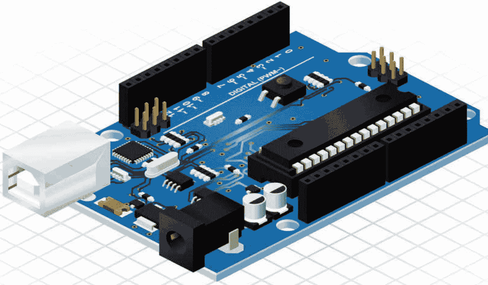
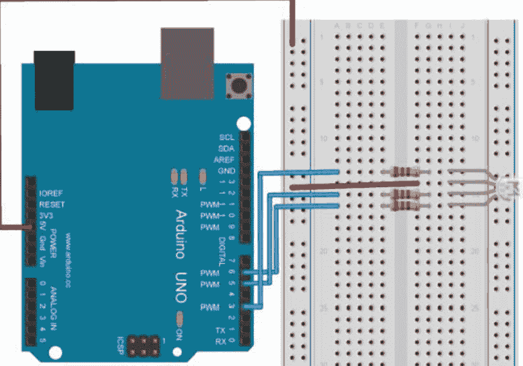
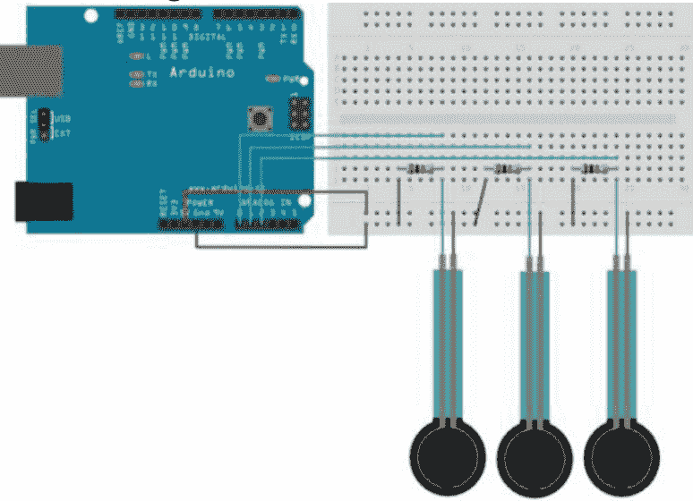
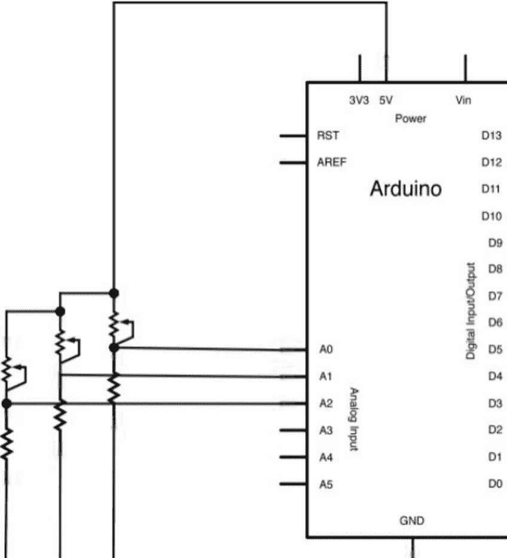
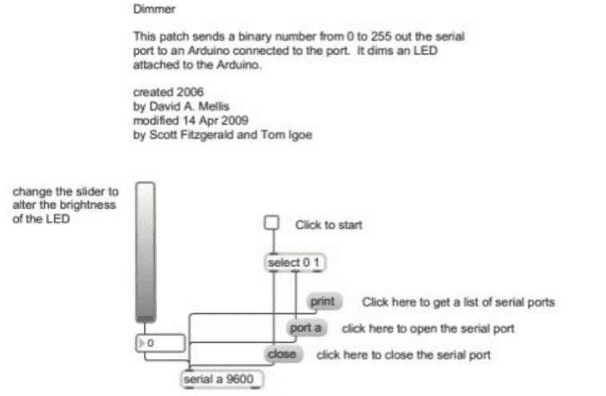
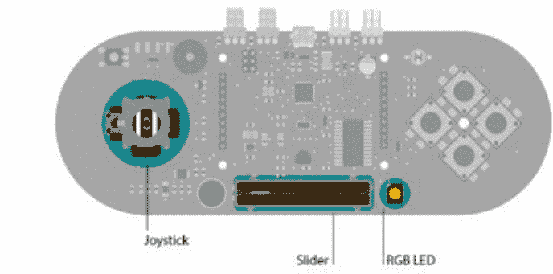
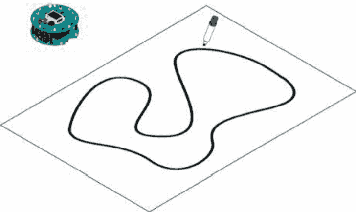

# Arduino：操作系统、编程、项目及更多 Arduino 用户指南（树莓派 2, xml, c++, ruby, html, 项目, php, 编程, 机器人... php, sql, 主机, 微型计算机）





# 引言

感谢并祝贺你购买了《Arduino 板引脚代码示例》一书。

本书包含了关于如何获取 Arduino 板以及为项目编译代码的经过的步骤和策略。你将学习如何使用 Arduino 在家中创建交互式设备，并构建一个系统内编程器。你可以与 Arduino 一工作并熟悉它。

学习操作 Arduino 板的基础知识。如果你不擅长处理和组装电子元件，可以使用预先配置好的板子。你还将获得有关各种 Arduino 热销产品的信息，你可以将它们用于个人项目。

再次感谢购买本书，希望你读得愉快！

# 第一章

## 使用 Arduino 进行交互和运行代码

Arduino 是计算机世界的最新热点。通过使用独立的编程语言营造宜宜的环境，这种交互式计算工具帮助编程人员发现并设计评估和调节各种参数的新方法。该系统设想使用微控制器来辅助物理计算。

Arduino 是一个创意工具，帮助你仅通过普通的台式电脑或电路就能构建更多内容。它能感知并帮助你控制物理世界中的事物。它将所有必要的编写开发环境与一个简单而有效的微控制器板结合在一起。在电子书中，我们将看到 Arduino 产品、Arduino 商店的热销物品以及为 Arduino 创建你自己的家庭自动化系统的方法。

# 第二章

## ARDUINO 产品

Arduino 生板子、配件、套件和扩展板。目前他们有 21 块板子、8 个扩展板、2 个套件和 5 个配件。板子命名为 Arduino Uno、Arduino Yun、Arduino Tre、Arduino Explora、Arduino Mega ADK、Arduino Robot、Arduino Mini、LilyPad Arduino Simple、Fio、Leonardo、LilyPad Arduino、Zero、Micro、Due、Arduino Ethernet、Mega 2560、LilyPad Arduino USB、Gemma、Nano、Arduino Pro Mini 和 Arduino。

扩展板有 Arduino GSM Shield、Arduino WiFi Shield、Arduino Host Shield、Arduino Wireless Shield、Arduino Ethernet Shield、Motor Shield 和 LilyPad Arduino Simple。

套件是 Arduino Starter kit。可用配件有 USB/串口适配器、TFT 屏幕、Arduino Pro 和 Motor Shield。

| 芯片名称 | 时钟频率 |
| :--- | :--- |
| AtMega328 | 8 |
| AtMega1280 | 16 |
| AtMega2560 | 16 |
| AtMega32U4 | 16 |
| SAM3X | 16 |


### NEWTC 原型板

你可以从 NEWTC 购买预装好的板子，也可以购买单个部件并自行组装。显然，后种方案更有趣，并能让你获得尝试设计实验的机会。如果遇到问题，请不要担心，Arduino 社区随时准备着支持你并回答你的所有问题。

原型板使用的 CPU 是 ATMEGA328P-PU。你还会发现芯片中已经烧录了 Arduino Uno 引导程序。该 DIY 套件的典型特性列如下：

- 原型板自组装版本已预烧录 ArduinoHeart Arduino Uno 引导程序。
- 支持 HC-06 蓝牙连接器接口
- TTL 电平 (5V) 4 针连接器
- 支持 MCU 及兼容接口
- 外部 12 V 供电，内部提供 3.3V 和 5 V 电源

获取单个部件并开始焊接。你可以在在线商店购买套件。你可以将各个部件焊接在板上，并使用 DM-USB2Serial 进行测试。从 sketch 软件中上传适用于 DM-USTYLE V1.0 DIY 版本板板的程序。插入板子并点击“编译并上传”（Program Compile and Upload）。

对于希望将该板作为 AVR 板使用的用户，你有多种编译器可选，从 WINAV、IAR 到 CodeVision AVR 和 ICC AVR。通常情况下，用户会使用板载 ISP 下载编译器生成的输出文件。你可以使用 AD-ISPRO 或 AD-USBISP 进行下载。

前者适用于并行端口类型的 STK200/300，而后者对 USB 类型的 STK500 则非常有用。

### 使用 IMAGECRAFT IDE

现在我们将介绍如何建立编译器将代码渲染为 hex 文件，以及如何将其下载到设备。此示例将向你展示如何使用适用于 AT90S23-13 的 STK200入门套装。你可以从 ImageCraft 网站获取更多详情。确保从 ICC 获取“解锁代码”，这会让你的程序获得授权。随后你把程序安装到默认驱动器（例如 C 盘），程序的快捷方式 ICC AVR 将安装在“c:\ice”目录下。在菜单（Menu）中搜索并找到 ImageCraft 开发工具组。

### 开始你的项目

当启动 ICC AVR 程序时，你会看到三个区域——项目文件、状态窗口和编辑器。刚开始，它们都是空的。所有项目文件都存储在项目文件列表中。每个具有语法感知的编辑器窗口都将在编辑器部分分配单独的标签页。在项目构建过程中，每条消息都会显示在你的状态窗口中。你可以通过不显示状态窗口或编辑器来为项目文件列表留出最大空间。

在对话框中选择 Project New（新建项目），创建一个新文件夹 c:\icctest。在文件名窗口中输入 First 作为文件名。你的项目名称现在为 First。若要编写并编译代码，你的编译器必须具备正确的选项。项目需要设置，你可以在 Projects（项目）下的 Options（选项）选项卡中选择这些选项。

在选项框中，选择 Paths（路径）选项卡。输出目录、库和头文件的目录路径将在此处指定。库路径和包含路径将自动设置为“c:\icelib”和“c:\iceinclude”。

在输出目录中，你会找到与项目相关的文件以及输出结果。除非指定为绝对路径，否则它们相对于项目目录。在编辑框中，如果你输入“objects”，IDE 将“c:\icctest\first\objects”输出文件。

### 编译器

进入对话框中的编译器页面并选择选项。在列表中，点击 **Output Format**（输出格式）并点击 **Intel HEX**。保持勾选“Accept C++ Comments”（接受 C++ 注释）旁边的复选框。

### 目标

接下来点击 **target**（目标）选项卡。在这里你可以针对特定目标设置特定选项。在本特定的教程中，你必须点击 **Device Configuration**（设备配置）选项卡并选择 2313。此 ImageCraft IDE 会变得非常简单，因为它只显示编译器中整个工具链所需的选项。这包含了链接器、汇编器和编译器。

应用说明将使用一个简单的程序来递增 PORTB，那里连接了 8 个 LED。一个 8 位定时器将为每个 LED产生延迟。

```c
#include <io2313.h>
void initialization(void);
void delay(void);

void main(void) {
    initialization();
    while (1) {
        if (TIF & 0x01) {
            TIF &= ~0x01;
            PORTB++;
        }
        delay();
    }
}

void initialization(void) {
    DDRB = 0xFF;
    TCCR0A = 0x05;
}

void delay(void) {
    // delay implementation
}
```


- 当你下次在 **Tools** 下选择 **Board** 时，它实际上意味着你正在选择你打算写入引导加载程序的开发板。这并不意味着你当前正在用于编写运行的开发板。
- 然后在 **Burn Bootloader.** 下点击 **Arduino as ISP**。

# 第 5 章

## 运行 ARDUINO 操作

### I) 桥接库的示例

以下是一些示例（更多信息请参阅 Arduino Learning Examples），它们将帮助你使用你的 Arduino。这里编写的所有示例都是为 Arduino 1.0 及更高版本准备的。这将帮助你理解 Arduino 如何适应不同的情况，以及你如何在这个方向上提高你的技能。

（本电子书根据知识产权 署名-相同共享 3.0 国际通用许可协议编写）

#### A) 检查 Arduino YUN 的 WiFi 状态

对于此示例，你需要一个 Arduino Yun 微处理器。它带有以太网、用于输入/输出编号为 20 的数字引脚以及 WiFi，因此你可以直接开始，除非你所在的国家对使用支持 WiFi 的设备有法律限制。

Arduino Yun 有一个 micro-SD 卡槽、一个 micro-USB 连接接口、3 个复位按钮和 USCP Header。你 Yun 中的 Atheros 处理器支持 Linux 发行版 OpenWrt-Yun。这让用户拥有良好的计算机网络能力以及强大的工作功能。

##### 开始检查 Yun WiFi 状态项目

当你运行 Yun 中 `/usr/bin` 文件夹下示例所示的 "pretty-wifi-info.lua" 脚本时，你将获得有关 Yun WiFi 状态的信息。但请注意，要通过串口连接 Yun，否则它将不会打印。将电脑 USB 线连接到 Yun，并在 Port 菜单中选择正确的端口。

##### 硬件与电路

此项目你不需要制作任何连接或电路。你将需要这些硬件：

- a) 无线网络
- b) Arduino Yun

##### WiFi 状态项目代码

首先，你需要在头文件中包含 Process 类。
#include <Process.h>
接下来，你需要启动 Bridge 和串口通信。如果未能通过串口连接电脑，程序将无法运行。

```cpp
void setup () {
  Serial.begin(9600);
  while (!Serial) {
    Serial.println("Starting bridge...\n");
    pinMode(13,OUTPUT);
    digitalWrite(13, LOW);
  }
  Bridge.begin();
  digitalWrite(13, HIGH); // 当桥就绪时，引脚13上的 LED 亮起
  delay(2000);
}
```

在 `loop()` 中初始化新进程。这将运行 WiFi 检查脚本。在设置脚本路径后调用 `runShellCommand()` 时会运行脚本。

```cpp
void loop () {
  Process wifiCheck;
  wifiCheck.runShellCommand("/usr/bin/pretty-wifi-info.lua");
```

检查脚本返回到串口监视器的字符。几秒后再次运行。

```cpp
while (wifiCheck.available() > 0) {
  char c = wifiCheck.read();
  Serial.print(c);
}

Serial.println();

delay(5000);
```

这里是完整的代码。

```cpp
/*
WiFi 状态

此程序运行一个名为 "pretty-wifi-info.lua" 的脚本
该脚本安装在 Yun 的 /usr/bin 文件夹中。
它将打印有关你的 wifi 连接状态的信息。

它使用 Serial 进行打印，因此你需要使用 USB 线将 Yun 连接到电脑，并在 Port 菜单中选择相应的端口

创建于 2013年6月18日
作者: Federico Fissore

此示例代码属于公有领域。
*/
```

```cpp
#include <Process.h>

void setup() {
  Serial.begin(9600); // 初始化串口通信
  while(!Serial); // 等待串口打开

  Serial.println("Starting bridge...\n");
  pinMode(13,OUTPUT);
  digitalWrite(13, LOW);
  Bridge.begin(); // 与 Linux 处理器连接
  digitalWrite(13, HIGH); // 当桥就绪时，引脚13上的 LED 亮起

  delay(2000); // 等待 2 秒
}

void loop() {
  Process wifiCheck; // 初始化新进程

  wifiCheck.runShellCommand("/usr/bin/pretty-wifi-info.lua"); // 你想运行的命令

  // 当进程返回任何字符时，将其打印到串口监视器：
  while (wifiCheck.available() > 0) {
    char c = wifiCheck.read();
    Serial.print(c);
  }

  Serial.println();

  delay(5000);
}
```

#### B) 文件写入脚本

此示例告诉你如何使用 FileIO 类在 Yun 的文件系统中写入文件。首先在 `/tmp` 中创建一个 shell 脚本。然后执行它。

##### 硬件与电路

你不需要制作任何电路，只需要你的 Arduino 板。

##### 文件写入脚本代码

为了与文件系统通信，必须包含 FileIO 头文件 `#include<FileIO.h>`。接下来，你需要在 `setup()` 中初始化 FileSystem。一旦串口连接，启动自定义函数 `uploadScript()`。

```cpp
void setup () {
  Bridge.begin();
  Serial.begin (9600);

  while (!Serial); // 等待串口连接
  Serial.println("File Script example\n\n");

  FileSystem.begin();

  uploadScript ();
}
```

另一个自定义函数将运行你的脚本。`runScript()` 将每 5 秒执行一次。

```cpp
void loop () {
  runScript();
  delay(5000);
}
```

使用 `uploadScript()` 函数创建一个文件。shell 脚本在 Linux 系统内部创建。这将检查你的 WiFi 网络流量。完成文件创建后，你可以通过创建 File 类的实例来打开它。将脚本放在内存中的 `/tmp` 中。这将保护有限的 FLASH 读写周期。

```cpp
void uploadScript() {
  File script = FileSystem.open("/tmp/wlan-stats.sh", FILE_WRITE);
```

打印头文件 `#!/bin/sh`。然后打印 ifconfig。`ifconfig` 工具控制网络接口。`grep` 工具在 ifconfig 的输出中查找 RX bytes。现在你可以关闭文件。

```cpp
script.print("#!bin/sh\n");
script.print("ifconfig wlan0 | grep 'RX bytes\n'");
script.close(); // 关闭文件
```

为了使脚本可执行，你必须实例化 Process。现在使用 `chmod` 修改文件模式；带有路径发送 `chmod`。shell 脚本现在将像应用程序一样运行。通过 `runScript()` 函数创建 Process。这将运行你的脚本并将结果打印到串口监视器。在创建它后，通过调用两个函数 `Process.begin (filepath)` 和 `Process.run()` 启动脚本。

```cpp
void runScript() {
  Process myscript;
  myscript.begin("/tmp/wlan-stats.sh");
  myscript.run();
}
```

现在使用 String 函数读取并保存输出。

```cpp
String output = "";

while (myscript.available()) {
    output += (char)myscript.read();
}
// 现在删除字符串开头或结尾的空格，并将输出打印到串口监视器。
output.trim();
Serial.println(output);
}
```

完整代码如下：
/*
使用 FileIO 类写入文件。

此程序演示了如何向 Yun 文件系统写入文件。
在 /tmp 中创建一个 shell 脚本，并在之后执行。

创建于 2010年6月7日
作者: Cristian Maglie

此示例代码属于公有领域。
*/

```cpp
#include <FileIO.h>

void setup() {
  // 设置桥接（每次与 Arduino Yun 通信时需要）
  Bridge.begin();
  // 初始化串口
  Serial.begin(9600);

  while(!Serial); // 等待串口连接。
  Serial.println("File Script example\n\n");

  // 设置文件 IO
  FileSystem.begin();

  // 用于获取网络统计的上传脚本
  uploadScript();
}

void loop() {
  // 每 5 秒运行统计脚本。
  runScript();
  delay(5000);
}
```


```cpp
// 此函数运行脚本并读取输出数据
void runScript() {
  // 运行脚本并在串口上显示结果
  Process myscript;
  myscript.begin("/tmp/wlan-stats.sh");
  myscript.run();
}
```

String output = "";

```cpp
// 读取脚本的输出
while (myscript.available()) {
  output += (char)myscript.read();
}
// 去字符串开头和结尾的空格
output.trim();
Serial.println(output);
Serial.flush();
```

### C) HTTP 客户端

本教程将展示如何使用 Arduino Yun 创建 HTTP 客户端。通过使用它，你可以上网并下载内容。在示例中，我们将访问 Arduino 网站下载 ASCII 字符格式的任意版本的 Arduino 标志。

#### 所需的硬件和电路

- Arduino Yun
- 互联网连接

此示例不需要任何其他电路。

### 代码

首先包含 HTTPClient 以及 Bridge 库。

```cpp
#include <Bridge.h>
#include <HttpClient.h>
```

开始设置 Bridge () 并确保串口连接已建立。然后你可以开始循环 ()。

```cpp
void setup() {
  pinMode(13, OUTPUT);
  digitalWrite(13, LOW);
  Bridge.begin();
  Serial.begin(9600);
  while(!Serial);
}
```

在 loop () 中创建 HTTPClient 实例。调用你选择的 URL client.get(URL) 函数。

```cpp
void loop() {
  HttpClient client;
  client.get("http://arduino.cc/asciilogo.txt");
```

检查客户端缓冲区服务器内存并读取字节以将其打印到串口监视器中。使用 5 秒的周期。

```cpp
while (client.available()) {
  char c = client.read();
  Serial.print(c);
}
Serial.flush();
```

```cpp
delay(5000);
}
```

这里提供了 sketch 的完整代码。

```cpp
#include <Bridge.h>
#include <HttpClient.h>
```

```cpp
void setup() {
pinMode(13, OUTPUT);
digitalWrite(13, LOW);
Bridge.begin();
Serial.begin(9600);
while(!Serial);
}
```

```cpp
void loop() {
HttpClient client;
client.get("http://arduino.cc/asciilogo.txt");
while (client.available()) {
char c = client.read();
Serial.print(c);
}
Serial.flush();
delay(5000);
}
```

## II) 通信示例

### A) 读取 ASCII 字符串

在在此 sketch 中，我们看到了如何使用 `Serial.parseInt()` 函数。这可以帮助你定位具有字母数字字符分隔的值。一种常见的表示方法是逗号分隔值（CSV），使用逗号来分隔不同的信息片段。你也可以使用点或空格等其他字符来实现此目的。当你传递具有如“15, 140, 220”等值的字符串时，你将改变 RGB LED 的颜色。颜色的变化是因为对整数（ints）值进行了解析。

#### 所需的硬件和电路

- Arduino 开发板
- 三个 220 欧姆电阻
- 面板
- 共阳极 RGB LED
- 邦线

要制作上述电路，取 5 根导线。使用红线将 5V 引脚连接到面包板上的一条长垂直行的一端。取一个 RGB LED 并检查数据表以识别引脚。将 LED 共阳极连接到你现在创建的电源轨。

现在使用剩余的导线配合电阻连接到引脚 5 和绿色阴极、引脚 3 和红色阴极，以及引脚 6 和蓝色阴极。如果所有 RGB LED 具有共阴极，则它们共用电源引脚。

现在，将一个引脚设为 LOW 而不是 HIGH，在该二极管上将产生某些电压差。现在，如果你使用 `analogWrite()` 使用 255，LED 将关闭，而值 0 将使其以全亮度开启。实际上上，你调用的是 `analogWrite (pin, 255-brightness)` 而不是 `analogWrite (pin, 255)`。这在数学上并不复杂。

#### 读取 ASCII 字符串的代码

你需要为连接 LED 的引脚设置全局变量。这将帮助你在移动到主程序部分时，轻松地识别出哪一个是红色、哪一个是绿色、哪一个是蓝色。



```cpp
const int redPin = 3;
const int greenPin = 5;
const int bluePin = 6;
```

串口通信将在你的电脑和 Arduino setup () 之间以每秒 9600 比特的速度开始。此外，配置引脚为输出。

```cpp
Serial.begin(9600);
pinMode(redPin, OUTPUT);
pinMode(greenPin, OUTPUT);
pinMode(bluePin, OUTPUT);
```

你需要确保串口缓冲区中的每个数据都被读取。为了这一点，我们使用函数。

```cpp
while (Serial.available() > 0) {
```

现在进入主部分。声明局部变量来存储值。

```cpp
int red;
int green;
int blue;
```

在主循环中，我们从串口缓冲区读取值并使用它们来控制 RGB LED。

```cpp
while (Serial.available() > 0) {
  red = Serial.parseInt();
  green = Serial.parseInt();
  blue = Serial.parseInt();

  analogWrite(redPin, red);
  analogWrite(greenPin, green);
  analogWrite(bluePin, blue);
}
```

这就是示例的结束。


电阻器串联并根据其值连接，它们各自都有电压。





### 代码
传感器值以 ASCII 编码的小进制数字从 Arduino 传递到计算机。使用0 到 9 每个数字的 ASCII 字符来传输数字。例如，对于数字 348，你会得到 ASCII 字节值 51、52 和 56。（3 的字节值为 51，……依此类推）。

```
/*/*
```

此示例读取三个模拟传感器（电位器最容易实现）并串行发送它们的值。底部的 Processing 和 Max/MSP 程序接收这三个值并使用它们来改变屏幕的背景颜色。

电路：
- 电位器连接到模拟输入 0、1 和 2

http://www.arduino.cc/en/Tutorial/VirtualColorMixer

创建于 2006年2月2日
作者 David A. Mellis
修改于 2011年8月30日
作者 Tom Igoe 和 Scott Fitzgerald

此示例代码属于公有领域。
*/

```
const int redPin = A0; // 控制红色的传感器
const int greenPin = A1; // 控制绿色的传感器
const int bluePin = A2; // 控制蓝色的传感器

void setup() {
  Serial.begin(9600);
}

void loop() {
  Serial.print(analogRead(redPin));
  Serial.print(",");
  Serial.print(analogRead(greenPin));
  Serial.print(",");
  Serial.println(analogRead(bluePin));
```

```
}

```

```
/* 用于此示例的 Processing 代码

// 此示例代码属于公共领域。

import processing.serial.*;

float redValue = 0; // 红色值
float greenValue = 0; // 绿色值
float blueValue = 0; // 蓝色值

Serial myPort;

void setup() {
size(200, 200);

// 列出所有可用串口端口
println(Serial.list());
// 我知道我的 Mac 上串口列表中的第一个端口
// 始终是我的 Arduino，所以我打开 Serial.list()[0]。
// 打开你正在使用的任何端口。
myPort = new Serial(this, Serial.list()[0], 9600);
// 除非收到换行符，否则不生成 serialEvent()：
myPort.bufferUntil('\n');
}

void draw() {
// 使用颜色值设置背景颜色：
background(redValue, greenValue, blueValue);
}

void serialEvent(Serial myPort) {
```

```
// 获取 ASCII 字符串：
String inString = myPort.readUntil('\n');

if (inString != null) {
 // 去除任何空白字符
 inString = trim(inString);
 // 按逗号分割字符串，并将生成的
 // 子字符串转换为浮点数组；
 float[] colors = float(split(inString, ","));
 // 如果数组至少有三个元素，你就知道
 // 你获取了完整内容。将数字放入
 // 颜色变量中：
 if (colors.length>=3) {
 // 映射到范围 0-255：
  redValue = map(colors[0], 0, 1023, 0, 255);
  greenValue = map(colors[1], 0, 1023, 0, 255);
  blueValue = map(colors[2], 0, 1023, 0, 255);
 }
}
/*
此示例的 Max/MSP 补丁

----------begin_max5_patcher----------
1512.3oc4Z00aaEE8YmeD9ktB3sXojrIaAsXX4g8xQYeoXfVh1gqRjdT
TsIn2K+PJUvP1J14444
...
... (Max/MSP 补丁代码在原始 OCR 中损坏/不完整)
```
} if (colors.length>=3) {
...（其余逻辑如下）
*/


```
// 绘制从黑色到白的渐变
for (int i = 0; i < 256; i++) {
  stroke(i);
  line(i, 0, i, 150);
}
```

```javascript
/* 将鼠标的当前 X 位置写入串口
 * 单行模式
port.write(mouse);
 */
```

### 此示例使用了 Max/MSP v5 touch

----------begin_max5_patch----------
1008.3ocXsaiaCD9r8uhA5qr4eHia0aAMaVf1S6hdoQAsDiL6JQQHQ2MnYr+2KeX4vjnjXKKKhhiGQ9QMeCNz+X9rnMp63sQvuB+MLa1OIalSjUvrC mYEmUtKuh75TKJUWyk5nE9yuSvu6SjesHu4F4MxOuUzB657sPKWvZBLXl tZxtJgt6g2vafaaT0.Bjfji.p8PukazqvcfpcpFs8mXR3pl8BBoXurIYYWKxrZP0YI.tCEH5gtF5q+wGtFXMXK6EZC3cyWzWwTdCMY.BBkidby8v0r+ST. W sD9SDukn8FsYspBqnBNFIztLyMml2Jo0vuKueuj2rvjpJLA7yiE7wRE+ow FpDpD1KAcBf4cP55Y4JqouiqDIXwt102DGZHIocKllEx+ow AdoeADks.RrRoow1Arc.R0N2J9amytjkqkvnAE01+8WnjHqK6 zmuk4IKd+Knv3jtvvsJs8mMHHmsIt25JbXbXczclI5sPVhTCTGFU nX9rUtgt7c3gY8C*+EuIJYmg8K3dkPcrQnXhb3XrY3rWqPO+qG2 unBQWFh1X7qqQ3+3.VhrMT999iR21YltP9MD9SLKQVZ260.+Sjc5j1Yk jknw29NPRL793WBA0nB926lyGrmRM4ZUF7Yfi7iA5azXhKda 4rRTRG7V4COiSbAjkdXWnnHfH0N7uBa4Ma0b1J7k+omjDMWkSVn95i1 Tokwdp7W0pRmN6sRsi4uKj5v3ckJftYXMGYgGMv448vPIIIPizrutZuSKW xGPPcmPmIoyLdh83wpjBmylwFMNHHpFTL1aNLaS9gck1tMXZC57t WIH202coxSDM00qPFRyFphsprhRG6C99ozBZ0NDW2R2y9WDA2F85jG2v5 FG4048a1c77zQnNmpPs3Y7BRYVBJMJQ1uvomtRRkWhn9R0MNZ2Yzz+5s 3WTVnToOnUydg5KHKML4qAOaJtfe2nS6XozDkRMrBRqG9j11Y8k4g8v0cmxfxVihW6a3qY9NazzUYkua9UnynadOtogW.JfsVGRNEbWF8I+eHcwJ+wLXqZeSDWLo+FQF6731Tva0BISKTx.ClwmgJsUTTVkglYsnXmxDge.CDR7x D6MyX6fMznaF7kcdzJXw.XSOORdoHNa7GMIYLZZR.+4lconMaJP6JOZ: FtCs1YWHZI30.sIxXZ5ihMSuXuZkt3ai1mXRScrczoCS32hAydeyXNEEu5HySxxqQbd3DLeralipqOxm+7SUSC
----------end_max5_patcher----------
*/

### Processing 代码

使用代码示例所示的连接。这将发送使 LED 变暗的字节。连接通过串口到 Arduino。

### Max 代码

上述代码示例显示了 Max/MSP 补丁。你需要将其复制并粘贴到新窗口。



## III) 来自 ESPLORA 库的示例

### LED 显示

### SHOW

在本教程中，我们将学习如何直接从摇杆获取值。串口监视器以 RGB LED 颜的形式输出。你可以沿着 X 轴或 Y 轴移动摇杆。每个轴控制一种 LED 颜色——X 轴显示红色，Y 轴显示绿色。线性电位计的位置将控制蓝色。

### 硬件和电路要求

此示例不需要任何电路。Esplora



### 代码

RGB 灯的亮度可以通过 Explora 库单独控制。光由三种颜色组成：红色、绿色和蓝色。

writeRed();
writeBlue();
writeGreen();

你也可以使用单个命令 `writeRGB()` 控制所有颜色。移动线性电位计可以产生新的输出。一个输出通过串口监视器，另一个显示 RGB LED。

```cpp
/*
Explora LED 显示

当摇杆移动时，RGB LED 会变亮并发光。

创建于 2012年11月22日
作者 Enrico Gueli <enrico.gueli@gmail.com>
修改于 2012年12月22日
作者 Tom Igo
*/
#include <Explora.h>
```

```cpp
void setup() {
// 初始化串口
Serial.begin(9600);
}
```

```cpp
void loop() {
// 读取传感器到变量：
int xAxis = Explora.readJoystickX();
int yAxis = Explora.readJoystickY();
int slider = Explora.readSlider();
```

```cpp
// 将传感器读取值转换为亮度：
byte red = map(xAxis, -512, 512, 0, 255);
byte green = map(yAxis, -512, 512, 0, 255);
byte blue = slider / 4;
```

```cpp
// 打印亮度：
Serial.print(red);
Serial.print(' ');
Serial.print(green);
Serial.print(' ');
Serial.println(blue);
```

```cpp
// 将亮度写入 LED。
Explora.writeRGB(red, green, blue);
```

```cpp
// 添加延迟防止 LED 闪烁：
delay(10);
}
```

## IV) 来自 ROBOT 库的示例

#### A) 寻迹

这是一个有趣的项目，你可以与其他机器人进行比赛。控制机器人的方法是在纸上画线。你的机器人将寻找线条并跟随它。有很多机器人时很有趣！

### 硬件和电路要求

Arduino Robot
大白纸
黑色标记
胶带

##### 步骤

1. 为机器人制作轨道。这些轨道在纸上。它们必须有 1 英（约 2 厘米）宽。线条不能与起点相交。
2. 使用胶带将纸固定在地面上。这将防止机器人运行时打滑。尽量保持表面清洁。（注意：不清洁会导致识别错误）
3. 上传代码，拔掉 USB 并开启电源。
4. 将机器人放在地面上并面向线条。
5. 在最初几次尝试（启动时），机器人将进行校准并调整自身检测线条。
6. 一旦机器人检测到线条，它将继续运行而不停止。更多细节请查看 `lineFollowConfig`。

##### 尝试运行




现在你的机器人准备好了！

### 代码

```cpp
/* 机器人寻迹

此 Sketch 演示了 Arduino Robot 的寻迹功能。在地上，沿着路径放置一些胶带。要指示停止点，放置另一段垂直于路径的胶带。

电路：Arduino Robot
创建于 2013年5月1日
作者 X. Yang
修改于 2013年5月12日
作者 D. Cu
此示例属于公共领域
*/
#include <ArduinoRobot.h> // 机器人库
```

```cpp
#include <Wire.h>
#include <SPI.h>

long timerOrigin; // 用于计时

void setup() {
// 初始化机器人、SD 卡、显示器和扬声器
Robot.begin();
Robot.beginTFT();
Robot.beginSD();
Robot.beginSpeaker();
}
```

```cpp
// 在 TFT 屏幕上显示 logo
Robot.displayLogos();
Robot.drawBMP("lf.bmp", 0, 0); // 显示背景图像
Robot.playFile("chase.wav"); // 从 SD 卡播放歌曲
```

```cpp
// 添加指令
Robot.text("寻迹\n将机器人放在\n轨道上\并看它运行",5, 5);
Robot.text("按下中间\n按钮开始...", 5, 61);
Robot.waitContinue();
```

```cpp
// 这些是一些适用于寻迹的通用值
// 取消其中一个以查看机器人不同的行为
//Robot.lineFollowConfig(14, 9, 50, 10);
Robot.lineFollowConfig(11, 7, 60, 5);
```

```cpp
// 将电机板设置为寻迹模式
Robot.setMode(MODE_LINE_FOLLOW);
```

```cpp
// 开始
Robot.fill(255, 255, 255);
Robot.stroke(255, 255, 255);
Robot.rect(0, 0, 128, 80); //擦除之前的文本
Robot.stroke(0, 0, 0);
Robot.text("Start", 5, 5);
Robot.stroke(0, 0, 0); // 为文本选择颜色
Robot.text("已通过:", 5, 21); // 向屏幕写入一些文本

timerOrigin = millis(); // 跟踪已通过的时间

while (!Robot.isActionDone()) { // 等待完成信号
Robot.debugPrint(millis() - timerOrigin, 5, 29); // 显示经过了多久
}
Robot.stroke(0, 0, 0);
Robot.text("Done!", 5, 45);
}
```

```cpp
void loop() {
// 这里没有内容，程序只运行一次。重置机器人
//再次运行！
}
```


```cpp
delay(250);
}
```

```cpp
void dash()
{
  digitalWrite(pin, HIGH);
  delay(1000);
  digitalWrite(pin, LOW);
  delay(250);
}
```

上述代码运行时将通过 13 号引脚闪烁 SOS 求救信号。该程序文件（sketch）除了 `dots()` 和 `dash()` 函数外，没有其他显著区别的部分，这两个函数显然负责实际的闪烁工作。现在，函数使用了 `ledPin()` 变量，它会告诉函数使用哪一个引脚。最后，通过调用 `pinMode()` 来初始化引脚为输出模式。你已经从程序开始构建你的库了！

每个库至少有两个文件——扩展名为 `.h` 的头文件和扩展名为 `.cpp` 的源文件。头文件包含了阐述该库中包含所有内容的定义。源文件包含实际代码。让我们把我们的库命名为 Morse。这将使我们的头文件变为 `Morse.h`……查看它的内容将很有趣。起初你会发现很难完全理解它，但随着学习的进行，它会变得越来越简单。

头文件的核心将由库中每个函数的单行表示组成。它以类的形式表示，并与你可能需要的任何变量放在一起。

```cpp
class Morse
{
public:
  Morse(int pin);
  void dot();
  void dash();

private:
  int _pin;
};
```

要理解类（class），你需要将其想象为与变量在一起的函数，你可以轻松地访问它。当这个组合可以被任何使用库的用户访问时，它被称为公有的（public）。当它是私有的（private）时，它只能从该类内部进行访问。

类内部存在特殊的函数构造函数，用于帮助创建类的实例。构造函数的名称将与类名相同，但它没有返回值。

为了完成头文件，你还需要 `#include` 语句，以便你访问 Arduino 语言中的常量和标准类型。在程序文件中这通常会被包含，但在库中并不包含。以下是它的写法：

```cpp
#include "Arduino.h"
```

最后，你将头文件封装在以下结构中：

```cpp
#ifndef Morse_h
#define Morse_h

// #include 语句和代码放在这里...

#endif
```

这可以帮你避免诸如两个 `#include` 导致的重复问题。在库的顶部添加一个注释来完善你的库。这将告诉人们库包含的内容、库的名称、作者姓名、日期和许可证。

完整的头文件如下所示。

```cpp
/*
Morse.h - 用于闪烁摩尔斯电码的库。
由 David A. Mellis 创建，2007年11月2日。
发布于公有领域。
*/
#ifdef Morse_h
#define Morse_h

#include "Arduino.h"

class Morse {
public:
    Morse(int pin);
    void dot();
    void dash();
private:
    int _pin;
};

#endif
```

现在让我们来看看源文件——`Morse.cpp` 的制作过程。你从 `include` 语句开始，使得你编写的代码可以访问库内部定义的 Arduino 标准函数。

```cpp
#include "Arduino.h"
#include "Morse.h"
```

之后，你编写构造函数。这允许用户选择类的特定实例。他们通过选择一个配置为输出的引脚来实现。

```cpp
Morse::Morse (int pin)
{
  pinMode(pin, OUTPUT);
  _pin = pin;
}
```

在这些代码行中，你会注意到略有不同的命名约定。一个是 `::` 运算符，它是作用域操作符。它为所选变量提供了全局可见性。你看到的另一个变化分配在引脚类之前的下划线。添加下划线有助于在破坏命名规范之前命名类或变量。你可以更清晰地看到你的代码。为了让你更容易工作，将那些类进行分组。例如，你可能需要在类名前前面加上下划线。现在，继续库的代码。

```cpp
void Morse::dot()
{
  digitalWrite(_pin, HIGH);
  delay(250);
  digitalWrite(_pin, LOW);
  delay(250);
}
```

```cpp
void Morse::dash()
{
  digitalWrite(_pin, HIGH);
  delay(1000);
  digitalWrite(_pin, LOW);
  delay(250);
}
```

你通过在顶部编写注释来完成你的代码。它帮助你理解你写的内容。

```cpp
/*
Morse.cpp - 用于闪烁摩尔斯电码的库。
由 David A. Mellis 创建，2007年11月2日。
发布于公有领域。
*/
```

现在我们有了这个库，可以在程序文件中使用它。要这样做，我们需要包含头文件并创建该类的实例。

```cpp
#include "Arduino.h"

Morse morse(13);

void setup()
{
  // 设置代码
}

void loop()
{
  morse.dot();
  delay(500);
  morse.dash();
  delay(500);
}
```


电路详情：
在模拟口 A0 处连接压电元件正极
地线连接到压电元件
在地的线和模拟口0 之间连接一个 1 兆欧姆电阻

[敲门教程](http://www.arduino.cc/en/Tutorial/Knock)

创建于 2007年3月25日
作者：David Cuartielles <http://www.0j0.org>
修改于 2011年8月30日
作者：Tom Igoe

此示例代码属于公领域。

```cpp
/*
// 这些常量不会改变：
const int ledPin = 13; // led 连接到数字引脚 13
const int knockSensor = A0; // 压电元件连接到模拟引脚 0
const int threshold = 100; // 用于判断检测到的声音是否为敲门声的阈值

// 这些变量将会改变：
int sensorReading = 0; // 用于存储从传感器引脚读取值的变量
int ledState = LOW; // 用于存储上次 LED 状态的变量，用于翻转
int light;

void setup() {
  pinMode(ledPin, OUTPUT); // 将 ledPin 声明为输出
  Serial.begin(9600); // 使用串口
}
```

```cpp
void loop() {
  // 读取传感器值并存储在变量 sensorReading 中
  sensorReading = analogRead(knockSensor);

  // 如果传感器读取值大于阈值
  if (sensorReading >= threshold) {
    // 翻转 ledPin 的状态：
    ledState = !ledState;
    // 更新 LED 引脚本身：
    digitalWrite(ledPin, ledState);
    // 将字符串 "Knock!" 发回电脑，后跟换行
    Serial.println("Knock!");
  }
  delay(100); // 延迟以避免串口缓冲区过载
}
```

## VI) 字符串示例

### A) 字符串加法运算符

拼接定义为将单个字符、多个字符或 ASCII 表示（常量或变量）组合到字符串并输出结果的过程。生成的字符串比所使用的字符长度或原始字符串要长。要相加字符串，你可以使用 `+` 运算符。

```cpp
// 与常量整数相加：
stringThird = stringFirst + 678;
```

```cpp
// 与常量长整型相加：
stringThird = stringFirst + 975312468;
```

```cpp
// 与常量字符相加：
stringThird = stringFirst + 'D';
```

```cpp
// 与常量字符串相加：
stringThird = stringFirst + "ggfd";
```

```cpp
// 将两个字符串相加：
stringThird = stringFirst + stringSecond;
```

你可以做的另一件事是将某些操作的结果添加到字符串中。
唯一的限制是字符串返回的数据类型必须有效。

```cpp
stringThird = stringFirst + millis();
```

这里 `millis()` 返回长整型，可以加到任何字符串。你也可以这样写代码。

```cpp
stringThird = stringFirst + analogRead(A0);
```

最后，`analogRead()` 返回整数，可以加到字符串。这种拼接在需要显示多个值的情况下非常有用，例如用于产品广告的 LCD 显示器。它们需要显示价格以及包括名称和包装重量在细节。

```cpp
int sensorValue = analogRead(A0);
String stringFirst = "Sensor value: ";
String stringThird = stringFirst + sensorValue;
Serial.println(stringThird);
```

这将为你提供一些传感器值的输出。然而，如果你运行下面的代码，它不会给你任何有效输出。

```cpp
int sensorValue = analogRead(A0);
String stringThird = "Sensor value: " + sensorValue;
Serial.println(stringThird);
```

由于你最初没有给 `stringThird` 赋值，结果将是不可预测的。检查另一种不当的初始化方式。

Serial.println("I want " + analogRead(A0) + " donuts");

运算符优先级错误，因此代码无法编译。下面的示例可以编译，但结果将不符合预期。

```cpp
int sensorValue = analogRead(A0);
String stringThird = "I want " + sensorValue;
Serial.println(stringThird + " donuts");
```

错误的原因再次显而易见。`stringThird` 从未被初始化。

### 硬件和电路要求

Arduino 板

此示例不需要其他电路。

 Fritzing 开发

### 代码

以下是几种拼接类型示例的代码。

```cpp
/*
将字符串相加

如何相加字符串的示例
你也可以像这里所示将多种不同的数据类型添加到字符串：

创建于 2010年7月27日
修改于 2012年4月2日
作者：Tom Igoe

[字符串加法运算符教程](http://arduino.cc/en/Tutorial/StringAdditionOperator)

此示例代码属于公领域。
*/

// 声明三个字符串：
String stringOne, stringTwo, stringThree;

void setup() {
  // 初始化串口并等待端口打开：
  Serial.begin(9600);
  while (!Serial) {
    // 等待串口连接。
  }
}
```


```cpp
else {
  Serial.println(stringOne + " does not equal " + stringTwo);
}
```

// 或者也许你想要忽略大小写：

```cpp
if (stringOne.equalsIgnoreCase(stringTwo)) {
  Serial.println(stringOne + " equals (ignoring case) " + stringTwo);
}
else {
  Serial.println(stringOne + " does not equal (ignoring case) " + stringTwo);
}
```

// 将数字字符串与它代表的数字比较：

```cpp
stringOne = "1";
int numberOne = 1;
if (stringOne.toInt() == numberOne) {
  Serial.println(stringOne + " = " + numberOne);
}
```

// 两个数字字符串比较：

```cpp
stringOne = "2";
stringTwo = "1";
if (stringOne >= stringTwo) {
  Serial.println(stringOne + " >= " + stringTwo);
}
```

// 比较运算符也可以用于对字符串进行字母顺序排序：

```cpp
stringOne = String("Brown");
if (stringOne < "Charles") {
  Serial.println(stringOne + " < Charles");
}
```

```cpp
if (stringOne > "Adams") {
  Serial.println(stringOne + " > Adams");
}
```

```cpp
if (stringOne <= "Browne") {
  Serial.println(stringOne + " <= Browne");
}
```

```cpp
if (stringOne >= "Brow") {
  Serial.println(stringOne + " >= Brow");
}
```

// compareTo() 运算符允许你比较字符串
// 它在第一个不同的字符上进行评估。
// 如果你正在比较的字符串的首字符
// 在字母数字顺序中更靠前，那么 compareTo() 的结果大于 0：

```cpp
stringOne = "Cucumber";
stringTwo = "Cucuracha";
if (stringOne.compareTo(stringTwo) < 0) {
  Serial.println(stringOne + " comes before " + stringTwo);
} else {
  Serial.println(stringOne + " comes after " + stringTwo);
}
```

delay(10000); // 因为下一部分是一个循环：

// 当字符串中也包含数字时，compareTo() 别非常好用：

```cpp
while (true) {
stringOne = "Sensor: ";
stringTwo="Sensor: ";

stringOne += analogRead(A0);
stringTwo += analogRead(A5);

if (stringOne.compareTo(stringTwo) < 0 ) {
  Serial.println(stringOne + " comes before " + stringTwo);
}
else {
  Serial.println(stringOne + " comes after " + stringTwo);
}

```

## # 第 6 章

## 硬件接口中的 ARDUINO

Arduino 用于连接作为输入、输出或用户界面的设备。它们也为通信设备和 ISP 编程器提供帮助。为了使用此套件或对其组装，你必须了解这个革命性计算设备的全部功能。

查看所有可能的可能性，并开始一个你感兴趣的项目。它们可以帮助管理物理系统和调节音频系统。你可以将它们用于复用、控制和分配电力。它们被用作电源、音频和汽车中的输入设备。

这里给出了这些项目的具体示例。科学家们在环境科学和距离传感设备中使用它们。其他用途还包括在人机交互、游戏控制器、键盘和光敏传感器中使用。在这里，我们将看到如何使用 Arduino 实现一些基本功能。

## 简单基础控制

### A) LED 渐变效果

对于这个实验，你需要以下设备。

- 面包板
- 220 欧姆电阻
- Arduino 板板
- 一个 LED

选择你 Arduino 的 9 号引脚并向其焊接一个 220 欧姆电阻。将电阻的另一端连接到阳极，即 LED 的正极。LED 中较短的阴极应直接连接到地。现在来编写代码。

首先声明 `ledPin` 为 9。这将是你代码中 `setup` 部分的全部内容。接下来是 `analogWrite()` 函数。在这里你需要传递两个参数——一个告诉引脚它必须写入什么，另一个告诉它它应该写入什么 PWM 值。

要让 LED 渐变消失，你需要将 PWM 值从 0 增加到 255。现在将该值一直减回 0。你可以使用任何变量来更改 PWM 值。在这个示例中，我们使用 `fullOrOff`。在每次循环中，增量通过变量 `goDark` 完成。

当 `fullOrOff` 处于值范围的一端（0 或 255）时，`goDark` 将变为负数。这意味着如果 `fullOrOff` 为 10，则 `goDark` 被赋值为 -10；如果它达到 250，则 `goDark` 的值被赋予 +10。`analogWrite` 将非常快地执行这些步骤。要控制渐变的速度，请在 sketch 的末尾使用 `delay`。为了实际看到差异，请更改 delay 值并检查程序的响应。这里是该程序。

```cpp
/*
渐变

你将在此示例中看到如何让 9 号引脚上的 LED 产生渐变

你使用了 analogWrite() 函数
你正在阅读的是公有领域的函数代码
*/
```

```cpp
int led = 9; // LED 连接的引脚
int fullOrOff = 0; // LED 的亮度
int goDark = 5; // LED 渐变的步长点
```

```cpp
// 当你按下重置键时，setup 程序例运行
void setup () {
  // 将引脚 9 为输出：
  pinMode(led, OUTPUT);
}
```

```cpp
// loop 将停止执行，它会一直运行
void loop () {
  // 设置 9 号引脚的 fullOrOff：
  analogWrite(led, fullOrOff);

  // 在下次循环中更改 fullOrOff：
  fullOrOff = fullOrOff + goDark;

  // 当循环到达 LED 边界时，反转其渐变方向
  if (fullOrOff == 0 || fullOrOff == 255) {
    goDark = -goDark;
  }

  // 调暗将在 30 秒后发生
  delay (30);
}
```

### B) LED 闪烁

在这个示例中，我们也使用了与之前相同的材料。你可以使用 220 Ω 到 1000 Ω 的电阻。你有时会发现 LED 已经准备好了。你可能发现 LED 已经连接到 Arduino。

为了开始代码，初始化 13 引脚为输出：

```cpp
pinMode(13, OUTPUT);
```

为了让 LED 亮起来，在主循环中使用：

```cpp
digitalWrite(13, HIGH);
```

现在通过 13 引脚关闭电压：

```cpp
digitalWrite(13, LOW);
```

当 13 引脚电压掉回零时，LED 将关闭。为了真正看到效果，设置 delay 为 1000 毫秒。在此期间什么都不会发生。看看这个程序：

```cpp
/*
闪烁
你将看到一个循环——开启一秒，关闭一秒
你正在阅读公有领域的代码
*/
```

```cpp
// 大多数 Arduino 板引脚13 连接 LED
int led = 13;
```

```cpp
// 按重置时 setup 重新开始
void setup() {
  // 初始化数字引脚为输出
  pinMode(led, OUTPUT);
}
```

```cpp
// loop 例程反复运行：
void loop() {
  digitalWrite(led, HIGH); // 打开 LED（HIGH 为电压电平）
  delay(1000); // 等待一秒
  digitalWrite(led, LOW); // 通过使电压降低关闭 LED
  delay(1000); // 等待一秒
}
```

### C) 设置按钮控制

按钮用于在按下时连接两个点。在这个示例中，我们看到如何使用按钮控制连接到 13 号引脚的 LED。对于这个示例，你需要：

- 动按钮
- 面包板
- Arduino 板板
- 10K 欧姆电阻
- 邦接线

你必须进行三线连接来开始你的按钮控制。面包板侧面有两个长且垂直的行。这将是连接 5V 地和电源的红黑线。从引2 连接一根线到按钮引脚。在同一个按钮引脚上，连接一个 10K 欧姆拉低电阻接地。按钮的另一个引脚将被赋予 5V 电源。

当按钮按下时，引脚之间的连接保持开启状态。引脚仅连接到地，因此返回低读取值。当你按下按钮时，读取现在变为 5V，因此你获得高读取值。

注意，你可以通过反转连接来反转按钮的功能。这会让 LED 按钮始终开启，但在按下按钮时会关闭。如果你完全断开 I/O 引脚，你会看到灯非常随机地闪烁。原因是输入端现在有了一个浮空值，因此随机返回高或低值。这就是我们包含拉低电阻的原因。


```cpp
/*
按钮
```

当按下连接到引脚 2 的按钮时，开启或关闭连接到数字引脚 13 的发光二极管(LED)。

电路图：

- LED 连接从引脚 13 到地 - 按钮连接从 +5V 到引脚 2
- 10K 电阻连接从引脚 2 到地

* 注意：在 Arduino 开发板上，板载上已经自带了一个连接到引脚 13 的 LED。

创建于 2005 年
作者：DojoDave <http://www.0j0.org> 
修改于 2011 年8 月 30 日
作者：Tom Igo

此示例代码属于公有领域。

```
http://www.arduino.cc/en/Tutorial/Button
*/
```

```cpp
// 常量不会改变。它们在这里被用于
// 设置引脚编号：
const int buttonPin = 2; // 按钮引脚编号 
const int ledPin = 13; // LED 引脚编号
```

```cpp
// 变量会改变：
int buttonState = 0;  // 用于读取按钮状态的变量
```

```cpp
void setup() {
// 将 LED 引脚初始化为输出：
pinMode(ledPin, OUTPUT);
// 将按钮引脚初始化为输入：
pinMode(buttonPin, INPUT);
}
```

```cpp
void loop() {
// 读取按钮的状态：
buttonState = digitalRead(buttonPin);

// 检查按钮是否被按下。
// 如果按下，buttonState 为 HIGH（高电平）：
if (buttonState == HIGH) {
// 开启 LED：
digitalWrite(ledPin, HIGH);
} else {
// 关闭 LED：
digitalWrite(ledPin, LOW);
}
}
```

### D) 简单键盘

此示例将演示使用 `tone` 函数。`tone()` 命令产生具有不同音高的声音。在这里你需要以下材料：

- 3 个力敏传感器
- 1 个 100 Ω 电阻
- 3 个 10K Ω 电阻
- 邦线
- 8 Ω 扬声器
- 面板板

将三个力敏传感器并联到 5V 电源。将每个传感器通过 10K Ω 电阻连接到引脚 0–2 和地。当你运行代码时，它将检查是否有任何力敏传感器（FSR）超过了为其分配的阈值。该程序将从音符数组为每个 FSR 分配一个音符。以下是代码。

```cpp
/*
键盘

根据模拟输入的变化播放改变的音调

电路：
* 3 个力敏电阻从 +5V 连接到模拟输入 0 到 5
* 3 个 10K 电阻从模拟输入 0 到 5 接地
* 8 姆扬声器连接到数字引脚 8

创建于 2010年1月21日
修改于 2012年4月9日
作者：Tom Igo

此示例代码属于公有领域

http://arduino.cc/en/Tutorial/Tone3
*/
#include "pitches.h"

const int threshold = 10; // 产生音符的传感器最小读取值

// 播放的音符，对应 3 个传感器：
int notes[] = {
  NOTE_A4, NOTE_B4, NOTE_C3 };
```

```cpp
void setup() {
}
```

```cpp
void loop() {
for (int thisSensor = 0; thisSensor < 3; thisSensor++) {
// 获取传感器读取值：
int sensorReading = analogRead(thisSensor);

// 如果传感器按得得足够：
if(sensorReading > threshold) {
// 播放与此传感器对应的音符：
tone(8, notes[thisSensor], 20);
}
}
}
```

你会发现有一个 `pitches.h` 文件，其中包含了每个音符的所有音高。音符通过其键名和一个根据音高升序排列的数字表示。此表最初由 Brett Hagmann 制作，他因开发 `tone()` 函数而闻名。你必须创建一个新标签并粘贴以下代码以创建该文件。
********************************************************************
# * 公共常量
********************************************************************/

```cpp
#define NOTE_B0 31
#define NOTE_C1 33
#define NOTE_CS1 35
#define NOTE_D1 37
#define NOTE_DS1 39
#define NOTE_E1 41
#define NOTE_F1 44
#define NOTE_FS1 46
#define NOTE_G1 49
#define NOTE_GS1 52
#define NOTE_A1 55
#define NOTE_AS1 58
#define NOTE_B1 62
#define NOTE_C2 65
#define NOTE_CS2 69
#define NOTE_D2 73
#define NOTE_DS2 78
#define NOTE_E2 82
#define NOTE_F2 87
#define NOTE_FS2 93
#define NOTE_G2 98
#define NOTE_GS2 104
#define NOTE_A2 110
#define NOTE_AS2 117
#define NOTE_B2 123
#define NOTE_C3 131
#define NOTE_CS3 139
#define NOTE_D3 147
#define NOTE_DS3 156
#define NOTE_E3 165
#define NOTE_F3 175
#define NOTE_FS3 185
#define NOTE_G3 196
#define NOTE_GS3 208
#define NOTE_A3 220
#define NOTE_AS3 233
#define NOTE_B3 247
#define NOTE_C4 262
#define NOTE_CS4 277
#define NOTE_D4 294
#define NOTE_DS4 311
#define NOTE_E4 330
#define NOTE_F4 349
#define NOTE_FS4 370
#define NOTE_G4 392
#define NOTE_GS4 415
#define NOTE_A4 440
#define NOTE_AS4 466
#define NOTE_B4 494
#define NOTE_C5 523
#define NOTE_CS5 554
#define NOTE_D5 587
#define NOTE_DS5 622
#define NOTE_E5 659
#define NOTE_F5 698
#define NOTE_FS5 740
#define NOTE_G5 784
#define NOTE_GS5 831
#define NOTE_A5 880
#define NOTE_AS5 932
#define NOTE_B5 988
#define NOTE_C6 1047
#define NOTE_CS6 1109
#define NOTE_D6 1175
#define NOTE_DS6 1245
#define NOTE_E6 1319
#define NOTE_F6 1399
#define NOTE_FS6 1480
#define NOTE_G6 1568
#define NOTE_GS6 1661
#define NOTE_A6 1760
#define NOTE_AS6 1865
#define NOTE_B6 1976
#define NOTE_C7 2093
#define NOTE_CS7 2217
#define NOTE_D7 2349
#define NOTE_DS7 2489
#define NOTE_E7 2637
#define NOTE_F7 2794
#define NOTE_FS7 2960
#define NOTE_G7 3136
#define NOTE_GS7 3322
#define NOTE_A7 3520
#define NOTE_AS7 3729
#define NOTE_B7 3951
#define NOTE_C8 4186
#define NOTE_CS8 4435
#define NOTE_D8 4699
#define NOTE_DS8 4978
```

### E) NewPing 超声波

你可以使用 Arduino 构建简单的超声波传感器。这种模型非常慢，不能与中断代码配合。如果绝对必要，你可以设置 1 秒的延迟。此程序返回距离（英寸），你可以对结果进行其他计算。Jason Ch 编写了这里的代码。

```cpp
unsigned long echo = 0;
int ultraSoundSignal = 9; // 超声波引脚
unsigned long ultrasoundValue = 0;
```

```cpp
void setup() {
  Serial.begin(9600);
  pinMode(ultraSoundSignal, OUTPUT);
}
```

```cpp
unsigned long ping() {
  pinMode(ultraSoundSignal, OUTPUT); // 将引脚切换为输出
  digitalWrite(ultraSoundSignal, LOW); // 发送低脉冲
  delayMicroseconds(2); // 等待2 微秒
  digitalWrite(ultraSoundSignal, HIGH); // 发送高脉冲
  delayMicroseconds(5); // 等待5 微秒
  digitalWrite(ultraSoundSignal, LOW); // 保持
  pinMode(ultraSoundSignal, INPUT); // 将引脚切换为输入
  // 注意 pulseIn 有 30000us 的超时
  ultrasoundValue = pulseIn(ultraSoundSignal, 30000);
  // 转换为英寸
  ultrasoundValue = ultrasoundValue / 58;
  return ultrasoundValue;
}
```

```cpp
void loop() {
  int x = 0;
  x = ping();
  Serial.print("Ping: ");
  Serial.print(x);
  Serial.println("cm");
  delay(250); // 等待 1/4 秒
}
```

### F) NewPing 示例程序

（每秒进行 20 次测量）
（更多信息请点击。）

```cpp
#include <NewPing.h>

#define TRIGGER_PIN 12 // 连接到超声波传感器触发脚的 Arduino 引脚
#define ECHO_PIN 11 // 连接到超声波传感器回声脚的 Arduino 引脚
#define MAX_DISTANCE 200 // 我们想要测量的距离（厘米）。传感器最大距离额定为 400-500cm。

NewPing sonar(TRIGGER_PIN, ECHO_PIN, MAX_DISTANCE); // NewPing 设置引脚和最大距离。

void setup() {
  Serial.begin(115200); // 以 115200 波特率打开串口监视器查看结果。
}
```

```cpp
void loop() {
  delay(50); // 在两次测量之间等待 50ms（约每秒20 次）。
  unsigned int uS = sonar.ping(); // 发送脉冲，获取以微秒为单位的测量时间（uS）。
  Serial.print("Ping: ");
  Serial.print(uS / US_ROUNDTRIP_CM); // 将测量时间转换为距离并打印结果（0 = 超出范围，无回声）
  Serial.println("cm");
}
```


# Arduino 伪造板学习如何识别假品

首先，检查颜色。颜色必须是青绿色（teal）。你可以翻转板子查看背面的图案。典型的标志应该是一个侧卧的数字“8”，在两个圆圈内各有一个负号和一个正号。仿制品的颜色会是蓝色到深蓝色。字体不会像原版那样是 Silk 字体。原版的打印清晰且对称。如果打印不清晰或不对称，那么它很可能是假品。你还将看到意大利的地图，这部分也必须是清晰的。

寻找 501K 元件。大多数假货会使用一种随处可买的绿色元件。而棕色的元件是为 Arduino 特别制造的。最后，检查该 Arduino 是否由授权销售商出售。

# 使用 C 语言为你的 Arduino 板板编程

Arduino 语言大部分由你调用的 C/C++ 函数组成。程序（sketch）会发生细微变化（例如，当你自动创建函数原型时），然后由 C/C++ 编译器 `avr-g++` 处理。因此，任何适用于 `avr-g++` 的 C 或 C++ 结构都可以在 Arduino 上运行。你可以在此处获取更多详细信息。

欲了解更多信息，请访问此页面。

