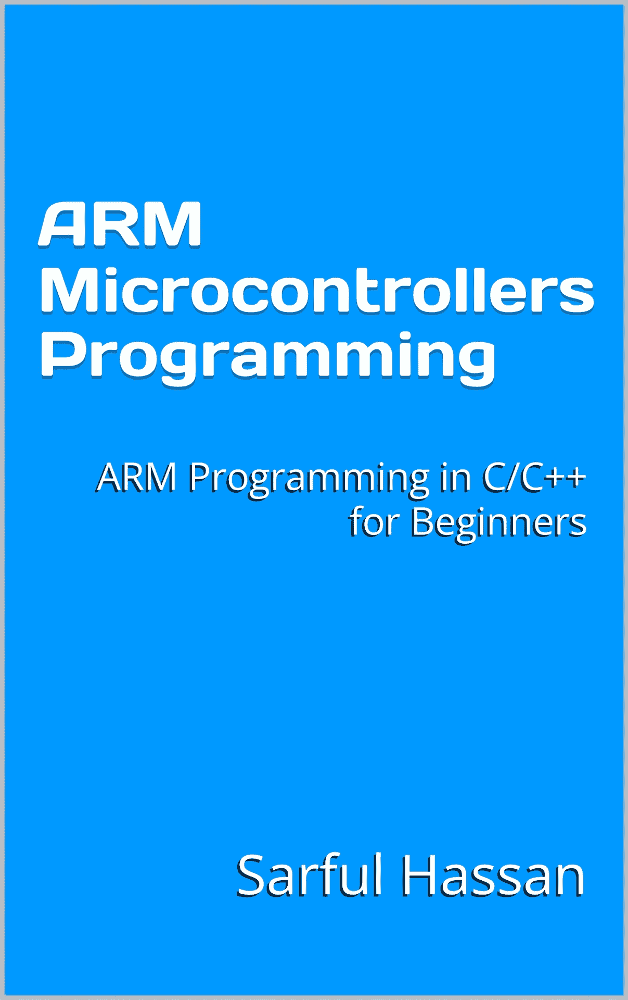
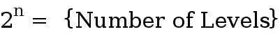

# ARM 微控制器编程：初学者 C/C++ ARM 编程指南



## 前言

本书是一本面向初学者的指南，教你使用 C/C++ 编程 ARM 微控制器。随着嵌入系统的快速发展，ARM 微控制器已成为现代技术的基石。本书旨在弥合理论知识与实际应用之间的差距，使读者能够自信地构建和编写嵌入式系统。

### 本书适合人群

本书非常适合：

* 对嵌入式系统和微控制器编程感兴趣的初学者。
* 想要提升实操编程技能的工程类学生。
* 寻求了解 ARM Cortex-M 微控制器的爱好者和专业人士。
* 教授微控制器编程和应用开发的教育者。

### 本书的结构

本书的结构设计提供了逻辑性的学习流：

1. **基础知识**：涵盖微控制器基础、ARM 架构以及开发环境的搭建。
2. **编程要点**：介绍变量、数据类型、控制结构和操作符。
3. **硬件接口**：解释数字和模拟 I/O、高级 I/O 技术以及通信协议。
4. **高级概念**：深入探讨电源管理、内存处理和 IoT 应用。
5. **实战项目**：包括实际应用，如与七段显示器、LCD 和 Wi-Fi 模块的接口。

每个章节都包含清晰的解释、代码示例和实际练习，以强化学习效果。

### 未涵盖的内容

本书专注于 ARM Cortex-M 微控制器，排除了用于高性能计算的高级 ARM 核心。重点是实用的编程和基础外设接口，而不是高级硬件设计。

### 代码风格（关于代码）

书中的代码示例遵循整洁、一致且易于初学者的编码规范：

* 使用 C 和 C++ 编写用于嵌入式应用。
* 有清晰的注释以便更好地理解。
* 在流行的 ARM 开发板上进行过测试。

### 发布说明

这是本书的第一版，设计作为 ARM 编程的入门指南。未来的版本可能会包含更高级的主题、更新的示例以及额外的真实项目。

### 关于第一版的说明

第一版优先考虑简单易用性。尽管我们已尽力确保准确性，但鼓励读者提供反馈以不断改进。

### MechatronicsLAB 在线学习

通过访问以下资源增强您的学习体验：

* 电子邮箱：`mechatronicslab@gmail.com`
* 网站：[mechatronicslab.net](http://mechatronicslab.net)

### 第一版致谢

我们感谢启发本书创作的教育者、工程师和学生。感谢 MechatronicsLAB 社区提供的宝贵支持。

---

`ARM` 微控制器基于 `RISC`（精简指令集计算机）架构，允许简化指令，从而实现高效的执行和低功耗。

```c
double varName;
```

#### 语法解释

- `double`：指明双精度浮点数，提供比`float`更高的精度。
- `varName`：变量的名称。

#### 简单代码示例

```c
double preciseValue = 3.1415926535;
```

#### 代码示例解释

● 声明了一个双精度变量 `preciseValue`，并用扩展精度的 Pi 值初始化。

### 注意事项

`double` 类型消耗更多内存，应仅在需要时使用。

### 警告

请注意内存限制，因为 `double` 占据的空间是 `float` 的两倍。

---

## 7. 固定长度整数

### 什么是固定长度整数

固定长度整数（例如 `int8_t`、`uint16_t`）在不同平台上提供了一致的内存大小，对于需要精确控制内存的嵌入式系统非常有用。

#### 用途

● 跨平台一致性：确保数据宽度在不同硬件上保持一致。
● 内存优化：通过指定精确的数据宽度来帮助控制内存分配。

#### 语法

```c
int8_t varName;
```

#### 语法解释

● `int8_t`：一个有符号的 8 位整数，定义在 `stdint.h` 中，恰好占用一个字节。
● `varName`：变量名，用于高效地存储小整数。

#### 简单代码示例

```c
int8_t smallValue = -10;
```

#### 代码示例解释

● 声明了一个有符号 8 位整数变量 `smallValue`，并初始化为 `-10`。

### 注意事项

当内存控制至关重要时（特别是跨平台代码中），请使用固定长度类型。

### 警告

选择最小的合适固定长度类型以最大化内存效率。

---

### 相关项目章节

#### 项目名称

串口监视器上的数据转换与显示

#### 项目目标

创建一个程序，将整数传感器读取值转换为浮点温度并在串口监视器上显示，以此演示多种数据类型的使用。

#### 组件

● ARM 微控制器（例如 STM32）
● 用于数据输出的串口通信接口

#### 组件连接表

| 组件 | 微控制器引脚 | 额外备注 |
| :--- | :--- | :--- |
| 串口接口 | TX, RX | 用于显示结果 |

#### 连接分析

该程序演示了数据转换和类型的使用。不需要额外的传感器，但可以处理并在串口监视器上显示模拟的传感器数据。

#### 程序软件设置

1. 在 `STM32CubeIDE` 或 `Keil uVision` 中创建一个新项目。
2. 配置串口通信以将数据输出到终端。
3. 定义不同数据类型的变量以存储和处理数据，根据需要使用整数、浮点型和固定长度类型。

#### 项目代码

```c
#include <stdio.h>
#include <stdint.h>

int main() {
    int sensorRaw = 500;           // 用于存储原始传感器数据的整数
    float temperature;             // 用于温度计算的浮点数
    const float conversionFactor = 0.1;  // 常数转换因子

    // 将原始传感器数据转换为温度
    temperature = sensorRaw * conversionFactor;

    // 将结果输出到串口监视器
    printf("Temperature: %.2f\n", temperature);

    return 0;
}
```

#### 保存并运行

1. 保存、编译并将代码上传到你的 ARM 微控制器。
2. 打开串口监视器，根据原始传感器数据查看温度输出。

#### 检查输出

● 串口监视器应以可读的格式显示转换后的温度，证明数据转换的成功使用。

## 变量管理与变量作用域

### 章节概述

在 ARM 微控制器的嵌入式编程中，变量管理和作用域控制对于高效使用内存和程序组织至关重要。变量可以是局部、全局或静态作用域，每种都有特定的用途，并提供不同级别的访问和持久性。本章将涵盖变量作用域类型、初始化、修改以及有效变量管理的最佳实践。

### 章节目标

● 理解 ARM 微控制器 C 语言编程中不同类型的变量作用域。
● 学习如何在适当的作用域内声明、初始化和使用变量。
● 应用内存高效型变量管理和优化程序组织的最佳实践。

### 规则

● 局部作用域：在函数或块内声明的变量仅在该特定函数或块内可用。
● 全局作用域：在任何函数之外声明的变量在整个程序范围内均可用。
● 静态作用域：静态变量在函数调用之间保留其值，并被限制在声明它们的文件或函数中。
● 变量管理：使用描述性名称、初始化变量并控制作用域，以提高内存效率和可读性。

### C 语言变量作用域简介

作用域决定了程序中可以访问变量的部分。局部变量局限于函数或块，全局变量可以从程序的任何地方访问，静态变量在调用之间保持其值，同时限制了它们的可见性。选择正确的作用域对于内存管理、数据隐私和防止意外更改至关重要。

### 语法表

| 序号 | 主题 | 语法 | 简单示例 |
| :--- | :--- | :--- | :--- |
| 1 | 局部变量 | `type varName = value;`（函数内部） | `int count = 0;` |
| 2 | 全局变量 | `type varName;`（函数外部） | `int counter;` |
| 3 | 静态局部变量 | `static type varName = value;` | `static int runCount = 0;` |
| 4 | 变量修改 | `varName = newValue;` | `count = 10;` |
| 5 | 常量声明 | `const type varName = value;` | `const int MAX_LIMIT = 100;` |

---

### 各命令详细详解

#### 1. 局部变量

##### 什么是局部变量

局部变量定义在函数或块内部，它仅存在于该函数或块中。局部变量的内存在函数调用时分配，并在函数退出时释放。

##### 用途

● 临时数据存储：在函数内部需要的数据。
● 封装：将数据隔离在函数内部，防止程序其他部分的访问。

##### 语法

```c
type varName = value;
```

##### 语法解释

● `type`：指定变量的数据类型（例如 `int`、`float`），决定了它使用的内存以及可以存储什么类型的值。
● `varName`：变量名，应具有描述性，因为它位于函数内部。局部变量名通常使用简洁的标识符。
● `value`：声明时赋值的初始值。如果提供了值，变量将初始化；否则它将持有未定义的值。

##### 简单代码示例

```c
void calculateSum() {
    int sum = 0; // 局部变量
    sum = 5 + 10;
}
```

##### 代码示例解释

● 这里 `sum` 是 `calculateSum` 函数内部的局部变量。它仅在该函数内可用，其他函数无法读取或修改它。当调用 `calculateSum` 时，会为 `sum` 分配内存并初始化为 0。函数完成后内存会被释放。

##### 注意事项

局部变量通过将数据隔离在特定函数中使代码模块化，提高了可读性和重用性。

##### 警告

避免对超出函数作用域的数据使用局部变量，因为它们每次调用函数时都会重新初始化。

---

#### 2. 全局变量

##### 什么是全局变量

全局变量声明在任何函数之外（通常位于程序开头），程序中的任何函数均可访问。它在整个程序运行期间保留其值并占用内存。

##### 用途

● 数据共享：允许多个函数在无需传递参数的情况下共享数据。
● 持久状态：在所有函数调用和程序执行期间保留其值。

##### 语法

```c
type varName;
```

##### 语法解释

● `type`：指明全局变量的数据类型（例如 `int`、`float`）。
● `varName`：全局变量名，应具有描述性，因为它可以从程序的任何部分访问。

##### 简单代码示例

```c
int counter = 0; // 全局变量
```

```cpp
void increment() {
    counter++;  // 修改全局变量
}
```

##### 代码示例解释

- `counter` 是一个在任何函数之外声明的全局变量，使其在 `increment` 函数和程序中的任何其他函数中被访问。变量 `counter` 初始化为 0，并在所有对 `increment` 的调用中保留其值。

##### 注意事项

全局变量可以通过消除在函数之间传递变量的需求来简化代码。然而，应该谨慎使用它们，以避免过度的内存占用并保持程序的模块化。

##### 警告

过度使用全局变量会使调试变得困难，因为任何函数都可以更改它们的值，导致意外的行为。

---

#### 3. 静态局部变量

##### 什么是静态局部变量

静态局部变量声明在函数内部，但在该函数的多次调用之间会保留其值。与普通局部变量不同，静态局部变量只初始化一次，且其值在跨函数调用时持续，而不会重新初始化。

##### 使用目的

- **持久化数据存储**：在多次调用函数时保持变量数据完整，同时不会让该变量变为全局可见。
- **内存效率**：将变量的可访问性限制在函数内，同时保留其值。

##### 语法

`static type varName = value;`

##### 语法解释

- `static`：一个关键字，使变量在函数调用之间保留值，同时将其范围限制在声明它的函数内。
- `type`：指定静态变量的数据类型（例如 `int`、`float`）。
- `varName`：变量名，应反映其在函数中的用途和目的。
- `value`：可选的初始值。除非被修改，否则变量将在函数调用中保留此初始值。

##### 简单代码示例

```cpp
void toggleState() {
    static int state = 0;  // 静态局部变量
    state = !state;
}
```

##### 代码示例解释

- 在 `toggleState` 函数中，`state` 是静态局部变量，因此它在调用之间保留其值。每当调用 `toggleState` 时，该变量会在 0 和 1 之间切换。与普通局部变量不同，`state` 只初始化一次，且其内存会在整个程序运行期间保持分配状态。

##### 注意事项

静态变量通常用于必须在跨函数调用时记住、但程序其他部分不需要的数据。

##### 警告

静态变量在程序的整个运行期间内都会占用内存，尽管它们仅在特定函数内可访问。请谨慎使用它们以避免过度的内存占用。

---

#### 4. 变量修改

##### 什么是变量修改

修改变量允许你根据程序的当前需求更新其值。这在编程中至关重要，因为许多操作依赖于数据的更改，例如计数器、传感器值和用户输入。

##### 使用目的

- **动态数据管理**：根据程序条件或用户操作更改变量值。
- **状态跟踪**：跟踪不断变化的条件，例如循环计数器、标志位或累加和。

##### 语法

`varName = newValue;`

##### 语法解释

- `varName`：你想要修改的值的变量名。它必须先在可访问的作用范围内（例如全局作用域、函数作用域）声明。
- `newValue`：分配给变量的新值，其应与 `varName` 的数据类型匹配。

##### 简单代码示例

```cpp
int counter = 5;
counter = 10; // 修改 counter 的值
```

##### 代码示例解释

- 最初，`counter` 设置为 5。下一行将 `counter` 更新为 10，演示了变量如何根据程序逻辑或输入动态变化。此新值将覆盖旧值并一直保持直到再次被更改。

##### 注意事项

变量修改对于任何需要实时更新的程序（如传感器、计数器和控制系统）都是基础。

##### 警告

确保新值在变量的范围和类型限制内，以避免潜在的溢出或数据损坏。

---

#### 5. 常量声明

##### 什么是常量声明

常量是一个其值在声明时就固定，并且在整个程序执行过程中无法更改的变量。常量常用于定义稳定的参数，例如数学常数或硬件配置，这些参数在运行期间不应更改。

##### 使用目的

- **固定参数**：适用于保持不变的值，如缓冲区大小或转换因子。
- **代码可读性**：为重要值提供有意义的名字，使代码更容易解释和维护。

##### 语法

`const type varName = value;`

##### 语法解释

- `const`：一个关键字，表示该变量是只读的，初始化后无法修改。
- `type`：指定常量的数据类型（例如 `int`、`float`）。
- `varName`：使用大写的描述性名称（通常是常量约定），以区别于可以更改的变量。
- `value`：分配给常量的初始且不可更改的值，与 `varName` 的数据类型匹配。

##### 简单代码示例

```cpp
const int MAX_LIMIT = 100; // 定义一个值为 100 的常量
```

##### 代码示例解释

- 定义了一个固定值为 100 的整数常量 `MAX_LIMIT`。此值在程序执行期间不能更改，确保在代码中每次访问 `MAX_LIMIT` 时它始终代表 100。

##### 注意事项

常量使程序更具可读性，并防止意外修改重要值。

##### 警告

尝试修改常量将导致编译错误，因为常量在设计上是只读的。

---

### 相关项目章节

#### 项目名称

带有持久化状态的按钮按下计数器

#### 项目目标

实现一个按钮按下计数器，使用局部、静态和全局变量来计数并保留多次按下的状态。该项目演示了变量管理、持久性和范围选择。

#### 项目组件

- ARM 微控制器（如 STM32）
- 连接到 GPIO 引脚的按钮
- 串口通信输出

#### 组件连接表

| 组件 | 微控制器引脚 | 备注 |
| :--- | :--- | :--- |
| 按钮 | GPIO 输入引脚 | 检测按下 |
| 串口接口 | TX, RX (可选) | 用于显示 |

#### 连接分析

按钮连接到 GPIO 输入引脚，允许程序检测每次按下。该项目使用局部、静态和全局变量来管理按下计数，并通过串口通信显示。

#### 程序软件设置

1. 在 `STM32CubeIDE` 或 `Keil uVision` 中创建一个项目。
2. 将 GPIO 引脚配置为输入，根据需要设置串口通信。
3. 在适当的作用范围内定义变量以管理按下计数。

#### 项目代码

```c
// 项目代码
```


```cpp
#include <stdio.h>
#include <stdint.h>

int pressCounter = 0; // 用于总按下次数的全局变量

void buttonPress() {
  static int localPressCount = 0; // 在函数内持久化计数的静态变量
  int currentPress = 1; // 代表按下状态的局部变量

  if (currentPress) {
    pressCounter++; // 修改全局计数器
    localPressCount++; // 修改静态局部计数器
    printf("Global Count: %d, Local Count: %d\n", pressCounter, localPressCount);
  }
}

int main() {
  // 此处假设 GPIO 和串口通信的设置代码
  while (1) {
    buttonPress(); // 按下按钮时调用函数
  }
  return 0;
}
```

### 保存并运行

1. 保存、编译并将代码上传到 ARM 微控制器。
2. 打开串口监视器，在按下按钮时查看计数。

### 检查输出

- 输出应显示全局和局部（静态）计数随每次按下而递增，说明了变量作用域如何控制内存和数据持久性。

## 数字 I/O

### 章节概述

数字输入/输出（I/O）是嵌入式系统编程的基础，它允许微控制器通过读取数字信号或控制数字输出与外部设备交互。ARM 微控制器通过`GPIO`（通用输入输出）引脚提供灵活的数字 I/O 控制，这些引脚可以配置为输入或输出。本章将探索如何在 ARM 微控制器中配置和使用数字 I/O。

### 章节目标

- 理解如何配置 GPIO 引脚用于数字 I/O。
- 学习从输入引脚读取并控制输出引脚。
- 实现一个项目，通过按钮控制 LED 来演示数字 I/O 概念。

### 规则

- 引脚模式：根据预期用途将每个 GPIO 引脚设置为输入或输出。
- 上拉/下拉电阻：启用内部上拉或下拉电阻，以获得稳定的输入读数。
- 抖动（Debouncing）：使用软件或硬件技术防止按钮按下产生虚假读数。
- 引脚状态：确保输出引脚被正确设置为 HIGH 或 LOW，并正确读取输入引脚。

### 数字 I/O 简介

数字 I/O 引脚允许 ARM 微控制器与外部硬件接口。数字输入读取 HIGH 或 LOW 信号，而数字输出则将引脚设置为 HIGH 或 LOW，从而控制 LED 或继电器等设备。GPIO 引脚必须配置为输入或输出，并配合可选的内部上拉或下拉电阻以稳定输入读数。

### 语法表

| 序号 | 主题 | 语法 | 简单示例 |
| :--- | :--- | :--- | :--- |
| 1 | 设置 GPIO 引脚为输出 | `GPIOx->MODER |= (1 << (2*pinNumber));` | |
| 2 | 设置 GPIO 引脚为输入 | `GPIOx->MODER &= ~(3 << (2*pinNumber));` | `GPIOA->MODER &= ~(3 << 6);` |
| 3 | 设置输出高电平 | `GPIOx->BSRR = (1 << pinNumber);` | `GPIOA->BSRR = (1 << 5);` |
| 4 | 设置输出低电平 | `GPIOx->BSRR = (1 << (pinNumber + 16));` | `GPIOA->BSRR = (1 << 21);` |
| 5 | 读取输入状态 | `GPIOx->IDR & (1 << pinNumber);` | `GPIOA->IDR & (1 << 5);` |

---

### 每条命令详解

#### 1. 设置 GPIO 引脚为输出

##### 什么是设置 GPIO 引脚为输出

将 GPIO 引脚配置为输出允许微控制器通过将引脚状态设置为 HIGH 或 LOW 来控制外部设备（如 LED 或电机）。

##### 用途

- 控制外部设备：设置引脚状态以控制连接的 LED 等硬件。
- 数字输出信号：允许引脚发送数字信号（HIGH 或 LOW）。

##### 语法

```cpp
GPIOx->MODER |= (1 << (2 * pinNumber));
```

##### 语法解释

- `GPIOx`：引脚所在的特定端口（例如`GPIOA`、`GPIOB`）。
- `MODER`：控制每个引脚设置为输入或输出的模式寄存器。
- `(1 << (2 * pinNumber))`：通过将 1 向左移动`2 * pinNumber`位，将所需的引脚设置为输出模式。`*2`考虑了`MODER`寄存器中每个引脚所需的两个位配置。

##### 简单代码示例

```cpp
GPIOA->MODER |= (1 << 10); // 设置 PA5 为输出
```

##### 代码示例解释

- 将`PA5`（GPIO A 口上的第 5 号引脚）配置为输出。该引脚现在可以被设置为 HIGH 或 LOW 以控制连接的 LED 等设备。

##### 注意事项

确保`MODER`中仅设置了正确的位，以避免影响其他引脚。

##### 警告

如果连接到外部电源，错误地将引脚设置为输出可能会损坏引脚。在通电前双检引脚配置。

#### 2. 设置 GPIO 引脚为输入

##### 什么是设置 GPIO 引脚为输入

将 GPIO 引脚配置为输入允许微控制器从外部组件（如按钮或传感器）读取信号。

##### 用途

- 读取数字信号：读取按钮按下或传感器输出等信号。
- 数字输入监控：允许引脚感知处于 HIGH 还是 LOW 状态。

##### 语法

```cpp
GPIOx->MODER &= ~(3 << (2 * pinNumber));
```

##### 语法解释

- `GPIOx`：引脚所在的 GPIO 口（例如`GPIOA`、`GPIOB`）。
- `MODER`：控制每个引脚模式的模式寄存器。
- `~(3 << (2 * pinNumber))`：清除指定引脚的两个位以设置为输入，其中 3 代表二进制`11`（用`~`取反用于输入模式）。

##### 简单代码示例

```cpp
GPIOA->MODER &= ~(3 << 6); // 设置 PA3 为输入
```

##### 代码示例解释

- 将`PA3`配置为输入，使其能够读取数字信号（例如按钮的状态）。

##### 注意事项

输入引脚可能需要上拉或下拉电阻来稳定信号并防止浮空状态。

##### 警告

让输入引脚浮空（未连接到稳定电压）可能会导致不可预测的行为。

#### 3. 设置输出高电平

##### 什么是设置输出高电平

将输出引脚设置为 HIGH 会向连接的设备发送电压（例如 3.3V），这可以开启 LED 或激活继电器。

##### 用途

- 激活设备：设置引脚状态以控制连接的硬件（如 LED）。

##### 语法

```cpp
GPIOx->BSRR = (1 << pinNumber);
```

##### 语法解释

- `GPIOx`：引脚所在的 GPIO 口。
- `BSRR`：位设置/清除寄存器。
- `(1 << pinNumber)`：将 1 向左移动`pinNumber`位。

##### 简单代码示例

```cpp
GPIOA->BSRR = (1 << 5); // 设置 PA5 为高电平
```

##### 代码示例解释

- 设置`PA5`为高电平，从而开启连接的 LED 等设备。

##### 注意事项

使用`BSRR`寄存器是原子操作的。

##### 警告

如果直接连接到地，避免设置高电平。

#### 4. 设置输出低电平

##### 什么是设置输出低电平

将输出引脚设置为 LOW 会使引脚接地，从而关闭 LED 等。

##### 用途

- 禁用设备：断开设备的电源或信号。
- 数字输出信号：将引脚设置为 LOW。

##### 语法

```cpp
GPIOx->BSRR = (1 << (pinNumber + 16));
```

##### 语法解释

- `GPIOx`：引脚所在的 GPIO 口。
- `BSRR`：位设置/清除寄存器。
- `(1 << (pinNumber + 16))`：将 1 向左移动`pinNumber + 16`位以清除置位。

##### 简单代码示例

```cpp
GPIOA->BSRR = (1 << 21); // 设置 PA5 为低电平
```

##### 代码示例解释

- 设置`PA5`为低电平，关闭连接的 LED 等设备。

##### 注意事项

`BSRR`寄存器仅影响指定的引脚。

##### 警告

确保引脚配置正确，设置为输出。

#### 5. 读取输入状态

##### 什么是读取输入状态

读取输入引脚的状态允许微控制器检测引脚处于 HIGH 还是 LOW 状态，这对于读取按钮按下或传感器信号非常重要。

##### 语法

```cpp
GPIOx->IDR & (1 << pinNumber);
```

##### 语法解释

- `GPIOx`：引脚所在的 GPIO 口。
- `IDR`：输入数据寄存器，存储该端口每个引脚的当前状态。
- `& (1 << pinNumber)`：与 1 向左移动`pinNumber`位进行按位与，以分离特定引脚的状态。

##### 简单代码示例

```cpp
if (GPIOA->IDR & (1 << 5)) { // 检查 PA5 是否高
    // 如果 PA5 为高则执行操作
}
```

##### 代码示例解释

- 检查`PA5`是否处于高状态。如果是，执行`if`语句中的代码。

##### 注意事项

读取输入状态是非破坏性操作，因此状态保持不变。

##### 警告

确保引脚已配置为输入；读取配置为输出的引脚可能会产生未定义的结果。

### 按钮控制 LED 项目

编写一个程序来使用按钮控制 LED，以演示数字输入和输出功能。按下按钮会切换 LED 的状态，从而展示输入读取和输出控制。

#### 所需组件

- ARM 微控制器（例如 STM32）
- 连接到 GPIO 输出引脚的 LED
- 连接到 GPIO 输入引脚的按键

#### 组件连接表

| 组件 | 微控制器引脚 | 额外备注 |
| :--- | :--- | :--- |
| LED | GPIO 输出引脚（例如 PA5） | LED 阳极连接到引脚 |
| 按键 | GPIO 输入引脚（例如 PA3） | 使用内部上拉电阻 |

#### 连接分析

LED 连接到输出引脚，该引脚将根据按钮的状态被设置为 HIGH 或 LOW。按钮连接到输入引脚，该引脚配置了内部上拉电阻，以确保输入读取的稳定。

#### 程序软件设置

1. 在 STM32CubeIDE 或 Keil uVision 中创建一个新项目。
2. 将 LED 引脚（例如 PA5）配置为输出，将按钮引脚（例如 PA3）配置为带有上拉电阻的输入。
3. 编写代码读取按钮输入并相应地切换 LED 输出。

#### 项目代码

```c
#include "stm32f4xx.h" // Include 特定设备的头文件

void configureGPIO() {
    // Enable GPIOA 钟
    RCC->AHB1ENR |= RCC_AHB1ENR_GPIOAEN;
    // Set PA5 为输出
    GPIOA->MODER |= (1 << 10); // 将位 10 置 1 以设置 PA5 为输出模式
    // Set PA3 为带上拉的输入
    GPIOA->MODER &= ~(3 << 6); // 清空位 6 和 7 以设置 PA3 为输入模式
    GPIOA->PUPDR |= (1 << 6); // 在 PA3 上设置上拉电阻
}

void toggleLED() {
    GPIOA->ODR ^= (1 << 5); // Toggle PA5
}

int main() {
    configureGPIO(); // 配置 GPIO 设置
    while (1) {
        if (!(GPIOA->IDR & (1 << 3))) { // 检查 PA3 是否为低电平（按钮按下）
            toggleLED(); // Toggle LED
            for (volatile int i = 0; i < 100000; i++); // 简单的去抖延迟
        }
    }
}
```

#### 保存并运行

1. 保存、编译并将代码上传到你的 ARM 微控制器。
2. 按下按钮切换 LED 的开启和关闭。

#### 检查输出

- 每按下按钮，LED 都应该在开启和关闭状态之间切换，演示输入和输出功能。

## 模拟 I/O

### ARM 微控制器的 C 语言模拟 I/O

### 章节概述

模拟输入/输出（I/O）对于与模拟传感器（例如温度传感器）或执行器接口的嵌入式系统至关重要。ARM 微控制器利用`ADC`（模数转换）读取模拟输入，利用`DAC`（数模转换）生成模拟输出。本章将探索配置 ADC 和 DAC、读取模拟信号、将数字值转换为模拟值，以及用于准确解释传感器值的计算。

### 章节目标

- 理解 ARM 微控制器的 ADC 和 DAC 配置。
- 学习读取模拟输入并产生模拟输出。
- 实现一个项目，通过读取传感器和控制输出设备来演示模拟 I/O。

### 规则

- ADC 分辨率：选择一个平衡精度和速度的 ADC 分辨率（例如 8 位、10 位或 12 位）。
- 参考电压：设置合适的参考电压以确保 ADC 读取准确。
- 缩放与映射：使用计算将 ADC 值转换为有意义的单位，如电压或温度。
- DAC 分辨率：选择满足应用要求的 DAC 分辨率。

### ADC 电压计算说明

ADC（模数转换器）将模拟输入电压转换为数字值。为了计算给定的 ADC 数字值对应的电压，我们使用此公式：


让我们将此公式分解为各个部分以便更好地理解。

#### 什么是 ADC？

- ADC 采样模拟信号（电压）并将其转换为数字。
- ADC 输出值的范围取决于其分辨率，而分辨率由其所使用的位数定义。

#### 示例：ADC 分辨率计算

##### 对于 10 位 ADC

ADC 的分辨率由以下公式决定：



其中：

- `n`= ADC 的位数。

对于 10 位 ADC，分辨率为`2^{10} = 1024`级（从 0 到 1023 的值）。

这意味着 ADC 有 1024 种可能的等级，范围从 0 到 1023。

##### 对于 12 位 ADC

ADC 的分辨率由以下公式决定：


其中：

- `n`= ADC 的位数。

对于 12 位 ADC，分辨率为`2^{12} = 4096`级（从 0 到 4095 的值）。

这意味着 ADC 有 4096 种可能的等级，范围从 0 到 4095。

#### 理解公式

ADC 值使用以下公式计算：

$V = \frac{ADC_{value} \times V_{ref}}{2^n}$

ADC 分辨率计算：

对于 10 位 ADC，其分辨率为`2^{10} = 1024`级（从 0 到 1023 的值）。

- 捕获模拟信号：开始模拟输入的采样并转换为数字信号。
- 触发 ADC 读取：允许微控制器从模拟传感器读取实时数据。

#### 语法

```cpp
ADCx->CR2 |= ADC_CR2_SWSTART;
```

#### 语法解释

- `ADCx`：指定执行转换的 ADC 模块（例如`ADC1`）。
- `CR2`：ADC 控制寄存器 2，用于各种 ADC 操作控制。
- `ADC_CR2_SWSTART`：`CR2`中的一个位，用于触发转换的开始。设置此位（`SWSTART`）将指示`ADC`采样已配置的输入通道并将信号转换为数字值。

#### 简单代码示例

```cpp
ADC1->CR2 |= ADC_CR2_SWSTART; // 开始 ADC1 转换
```

#### 代码示例解释

- 该行代码指示`ADC1`开始采样当前的模拟输入并进行数字转换，允许程序以数字值的形式捕获模拟数据。

#### 注意事项

在某些情况下，ADC 可以配置为连续模式下自动启动，从而无需手动触发每次转换。

#### 警告

确保输入通道已正确配置；否则，`ADC`可能会从错误的输入读取，导致数据错误。

#### 3. 读取 ADC 值

##### 什么是读取 ADC 值

在`ADC`转换完成后，可以从`ADC`的数据寄存器中获取生成的数字值。该数字值以二进制格式表示采样的模拟输入。

##### 用途

- 访问转换后的数据：从`ADC`数据寄存器检索数字结果。
- 在代码中利用模拟信息：对数字形式的模拟数据进行处理或缩放。

##### 语法

```cpp
int value = ADCx->DR;
```

##### 语法解释

- `value`：保存 ADC 读取值的变量。
- `ADCx`：指定完成转换的 ADC 模块（例如`ADC1`或`ADC2`）。
- `DR`：`ADC`的数据寄存器，存储最新转换的结果。从`DR`读取可提供代表输入电压的数字值。

##### 简单代码示例

```cpp
int adcValue = ADC1->DR; // 从 ADC1 读取结果
```

##### 代码示例解释

- 代码从`ADC1`的数据寄存器（`DR`）读取数字值。该值可以用于计算，将模拟输入解释为电压或其他有意义的测量值。

##### 注意事项

使用`ADC`分辨率（例如 10 位或 12 位）和参考电压将此数字值转换为真实的模拟电压。

##### 警告

确保在读取值之前`ADC`转换已完成；否则数据可能不准确或过时。

#### 4. 配置 DAC

##### 什么是配置 DAC

配置`DAC`（数字模拟转换器）允许其根据数字输入输出模拟电压。配置包括启用`DAC`并设置所需的辨率以确保模拟输出的精度。


#### 用途
- **激活 DAC 输出**：准备`DAC`将数字值转换为模拟电压。
- **设置分辨率以确保准确性**：确保`DAC`的配置满足应用输出精度所需的分辨率。

#### 语法
```c
DAC->CR |= DAC_CR_EN1;
```

#### 语法解释
- `DAC`：ARM 微控制器上的`DAC`模块。
- `CR`：`DAC`的控制寄存器，包含每个`DAC`通道的配置设置。
- `DAC_CR_EN1`：启用`DAC`通道 1。通过设置此位（`EN1`），激活`DAC`，允许其在通道 1 上输出模拟电压。

#### 简单代码示例
```c
DAC->CR |= DAC_CR_EN1; // 启用 DAC 通道 1
```

#### 代码示例解释
- 该代码通过设置控制寄存器（`CR`）中的`EN1`位激活`DAC`通道 1。`DAC`通道 1 现在准备好将数字值转换为模拟输出信号。

### 注意事项
某些微控制器可能支持多个`DAC`通道，如果需要，请确保每个通道独立启用并配置。

### 警告
如果`DAC`未正确配置，请注意与其他外设之间潜在的干扰。

---

### 5. 写入 DAC 值

### 什么是写入 DAC 值
向`DAC`写入数字值会指示其输出等效模拟电压。该数字值根据`DAC`分辨率和参考电压确定模拟电压水平。

#### 用途
- **生成模拟输出**：将数字值转换为真实的模拟电压，以控制外部设备。
- **精确电压控制**：为电机速度、LED 亮度或音频信号等应用提供输出电压的精确控制。

#### 语法
```c
DAC->DHR12R1 = value;
```

#### 语法解释
- `DAC`：指微控制器的`DAC`模块。
- `DHR12R1`：`DAC`通道 1 的 12 位右对齐数据保持器。该寄存器存储通道 1`DAC`转换的数字输入。
- `value`：`DAC`分辨率范围内的数字值（例如 12 位`DAC`为 0–4095）。该值根据`DAC`参考决定输出电压。

#### 简单代码示例
```c
DAC->DHR12R1 = 2048; // 向 DAC 通道 1 写入中间值
```

#### 代码示例解释
- 该代码通过设置控制寄存器（`CR`）中的`EN1`位激活`DAC`通道 1。`DAC`通道 1 现在准备好将数字值转换为模拟输出信号。

### 注意事项
使用`ADC`分辨率（例如 10 位或 12 位）和参考电压将此数字值转换为真实的模拟电压。

### 警告
确保`DAC`分辨率正确匹配写入`DHR12R1`以实现所需的输出精度。

---

### 相关章节

### 项目名称
模拟读取与输出

### 项目目标
使用 ADC 读取模拟信号并通过 DAC 输出。

### 要求
- ARM 微控制器
- 电位器（输入）
- LED（输出）

### 组件
| 组件 | 微控制器引脚 | 注意事项 |
| :--- | :--- | :--- |
| 电位器 | ADC 输入 (例如 PA0) | 模拟输入 |
| LED | DAC 输出 (例如 PA4) | 模拟输出 |

#### 软件设置
1. 在 STM32IDE 或 Keil uVision 中创建一个项目。
2. 配置 ADC 读取电位器的模拟信号。
3. 配置 DAC 输出 LED 亮度。

#### 代码
```c
#include "stm32f4xx.h" // STM32 设备头文件

void configureADC() {
    RCC->APB2ENR |= RCC_APB2ENR_ADC1EN; // 启用 ADC1
    ADC1->CR2 |= ADC_CR2_ADON; // 启用 ADC
}

void configureDAC() {
    RCC->APB1ENR |= RCC_APB1ENR_DACEN; // 启用 DAC 时钟
    DAC->CR |= DAC_CR_EN1; // 启用 DAC 通道 1
}

uint16_t readADC() {
    ADC1->CR2 |= ADC_CR2_SWSTART; // 开始 ADC 转换
    while (!(ADC1->SR & ADC_SR_EOC)); // 等待转换完成
    return ADC1->DR; // 读取 ADC 结果
}

void writeDAC(uint16_t value) {
    DAC->DHR12R1 = value; // 将值写入 DAC 通道 1
}

int main() {
    configureADC(); // 设置 ADC
    configureDAC(); // 设置 DAC
    while (1) {
        uint16_t adcValue = readADC(); // 从电位器读取模拟输入
        writeDAC(adcValue); // 将 ADC 值写入 DAC，控制 LED 亮度
    }
}
```

### 保存并运行
1. 保存、编译并将代码上传到您的 ARM 微控制器。
2. 调节电位器以改变输入电压，这应该改变 LED 的亮度。

### 检查输出
- 随着电位器的调节，LED 的亮度应随之变化，证明了 ADC 和 DAC 的功能。

高级输入/输出（I/O）技术为 ARM 微控制器与外部设备的接口提供了复杂的实现方式。这些技术包括用于电机控制的 PWM、用于响应式输入的外部中断，以及用于外设通信的 SPI/I2C 等协议。本章将介绍如何在 ARM 微控制器中配置和使用这些高级 I/O 功能。

### 章节目标
- 理解 PWM、外部中断和串行通信协议。
- 学习为各种应用设置高级 I/O 功能。
- 实现一个演示 PWM 控制和中断处理的项目。

### 规则
- **PWM 设置**：配置定时器寄存器和占空比以控制 PWM 输出。
- **中断优先级**：为外部中断设置适当的优先级以确保正确响应。
- **串行协议**：遵循 SPI 和 I2C 等串行通信的时序和同步要求。
- **ISR 效率**：保持中断服务程序（`ISR`）尽可能短，以避免其他进程出现延迟。

### 高级 I/O 简介介绍
高级 I/O 功能允许 ARM 微控制器完成超出基础数字和模拟 I/O 能力的复杂任务。PWM 通过改变占空比实现对电机或 LED 的精确控制，而中断则允许微控制器对外部事件做出即响应。SPI 和 I2C 等串行协议允许微控制器与外部传感器、显示器和存储设备通信。

### 语法表
| 序号 | 主题 | 语法 | 示例 |
| :--- | :--- | :--- | :--- |
| 1 | 配置 PWM | `TIMx->CCMR1 |= TIM_CCMR1_OC1M_PWM1;` | |
| 2 | 设置 PWM 占空比 | `TIMx->CCR1 = dutyCycle;` | `TIM3->CCR1 = 128;` |
| 3 | 启用外部中断 | `EXTI->IMR |= (1 << line);` | |
| 4 | 配置中断优先级 | `NVIC_SetPriority(IRQn, priority);` | `NVIC_SetPriority(EXTI0_IRQn, 2);` |
| 5 | 配置 SPI | `SPIx->CR1 |= (SPI_CR1_MSTR | ...)` | |

## 各命令详细详解

### 1. 配置 PWM

### 什么是配置 PWM
配置 PWM（脉宽调制）是设置一个定时器来生成 PWM 信号，该信号可以通过改变占空比来控制电机或 LED 等设备。

#### 用途
- **控制模拟输出**：PWM 可以通过改变占空比模拟对设备进行模拟控制。
- **电机和 LED 亮度控制**：调整 PWM 信号的占空比可以控制电机速度和 LED 亮度。

#### 语法
```c
TIMx->CCMR1 |= TIM_CCMR1_OC1M_PWM1;
```

#### 语法解释
- `TIMx`：生成 PWM 信号的定时器模块（例如`TIM1`、`TIM3`）。
- `CCMR1`：捕捉/比较寄存器 1，用于配置特定通道的输出模式。
- `TIM_CCMR1_OC1M_PWM1`：将通道 1 设置为 PWM 模式 1，启用 PWM 信号生成。

#### 简单代码示例
```c
TIM3->CCMR1 |= TIM_CCMR1_OC1M_PWM1;  // 将 TIM3 通道 1 设置为 PWM 模式
```

#### 代码示例解释
- 配置`TIM3`通道 1 的 PWM 输出模式，允许其在相应的输出引脚上生成 PWM 信号。

### 注意事项
设置 PWM 模式后，还应配置定时器的分频器和自动重载值以设置 PWM 频率。

### 警告
在配置 PWM 之前确保启用定时器时钟；否则设置不会生效。

---

### 2. 设置 PWM 占空比

#### 什么是设置 PWM 占空比
占空比决定了 PWM 信号在每个周期内的“开启”时间。通过调整此值，我们可以控制平均电压输出，从而影响设备性能。

#### 用途
- **控制功率输出**：改变占空比可以控制设备的功率。
- **精细控制**：允许对电机（速度）和 LED（亮度）等设备进行精确控制。

#### 语法
```c
TIMx->CCR1 = dutyCycle;
```

#### 语法解释
- `TIMx`：用于生成 PWM 的定时器模块。
- `CCR1`：捕捉/比较寄存器 1，用于存储通道 1 的占空比值。
- `dutyCycle`：代表所需占空比的值，通常在 0（0%）和定时器的最大值（100%）之间。

#### 简单代码示例
```c
TIM3->CCR1 = 128; // 在 TIM3 通道 1 设置 50% 占空比
```

#### 代码示例解释
- 此行将`TIM3`通道 1 的占空比设置为 50%（假设分辨率为 8 位，最大值为 255）。

### 注意事项
`CCR1`的最大值取决于定时器的分辨率，该分辨率通常由定时器的`ARR`（自动重载寄存器）设置。

### 警告
设置超出定时器配置范围的占空比可能会导致信号错误或意外行为。

---

### 3. 启用外部中断

### 什么是启用外部中断
启用外部中断是配置微控制器通过中断常规程序执行来响应外部信号（如按键按下）。

#### 用途
- **事件驱动响应**：允许微控制器对外部事件做出即时响应。
- **功耗效率**：减少对轮询（polling）的需求。

#### 语法
```c
EXTI->IMR |= (1 << line);
```

#### 语法解释
- `EXTI`：外部中断控制器。
- `IMR`：中断掩码寄存器，用于启用或禁用中断。
- `(1 << line)`：设置指定的行位。

#### 简单代码示例
```c
EXTI->IMR |= (1 << 0); // 启用 EXTI0
```

#### 代码示例解释
- 启用了 EXTI0 的中断。

### 注意事项
通常需要配合去抖算法。

### 警告
在同一条线上启用多个中断可能会导致冲突。

---

### 4. 配置中断优先级

### 什么是配置中断优先级
设置中断优先级可以确保关键中断优先处理，允许其他任务等待。

#### 用途
- **优先处理关键函数**：确保优先级任务完成。
- **优化系统响应**：允许微控制器以最小延迟处理事件。

#### 语法
```c
NVIC_SetPriority(IRQn, priority);
```

#### 语法解释
- `NVIC_SetPriority`：设置特定中断优先级的函数。
- `IRQn`：中断请求号。
- `priority`：优先级（数字越小，优先级越高）。

#### 简单代码示例
```c
NVIC_SetPriority(EXTI0_IRQn, 2); // 将 EXTI0 优先级设置为 2
```

#### 代码示例解释
- 此行将`EXTI0`中断的优先级设置为 2。

### 注意事项
仔细选择中断优先级以平衡响应时间和系统需求。

### 警告
错误的优先级设置可能会导致关键进程延迟。

---

### 5. 配置 SPI

#### 什么是配置 SPI
配置 SPI（串行外接口）是在 ARM 微控制器与传感器、显示器或存储模块等设备之间建立通信协议。

#### 用途
- **启用外设通信**：允许与 SPI 外设通信。
- **高效数据传输**：促进高速同步数据交换。

#### 语法
```c
SPIx->CR1 |= (SPI_CR1_MSTR | SPI_CR1_SPE);
```

#### 语法解释
- `SPIx`：指定的 SPI 模块（例如`SPI1`、`SPI2`）。
- `CR1`：SPI 控制寄存器 1，包含了配置 SPI 通信的关键设置。
- `SPI_CR1_MSTR`：将 SPI 模块设置为为主机。
- `SPI_CR1_SPE`：启用 SPI 外设。

#### 简单代码示例
```c
SPI1->CR1 |= (SPI_CR1_MSTR | SPI_CR1_SPE); // 将 SPI1 配置为主机
```

#### 代码示例解释
- 将`SPI1`配置为主设备并启用它。`SPI1`现在可以通过`SPI`总线与连接到微控制器的从设备通信。

### 注意事项
根据连接的的外围设备的规范，设置`SPI`速度、极性和相位。

### 警告
设置不当（例如错误的极性或相位）可能会导致无法与外部设备正常通信。

---

### 相关项目章节

### 项目名称
基于中断停止的 PWM 电机速度控制

### 项目目标
使用`PWM`控制电机的速度，并在按下按钮时利用外部中断立即停止电机。

### 需求组件
- `ARM 微控制器`（例如`STM32`）
- 连接到`PWM`输出引脚的`直流电机`
- 连接到外部中断引脚的`推按键`

### 组件连接连接表
| 组件 | 微控制器引脚 | 额外备注 |
| :--- | :--- | :--- |
| `直流电机` | `PWM 输出引脚`（例如`PB4`） | 控制电机速度 |
| `推按键` | `外部中断引脚`（例如`PA0`） | 按下触发电机停止 |

### 连接分析
电机连接到`PWM`输出引脚，以根据占空比控制其速度。推按键连接到外部中断引脚，该引脚触发`ISR`立即停止电机。

### 程序软件设置
1. 在`STM32CubeIDE`或`Keil uVision`中创建一个新项目。
2. 配置定时器用于`PWM`输出以控制电机的速度。
3. 在按钮引脚上设置外部中断，以便在按下时停止电机。

### 项目代码
```cpp
#include "stm32f4xx.h" // STM32 设备特定头文件

void configurePWM()  {
  RCC->APB1ENR |= RCC_APB1ENR_TIM3EN;  // 启用 TIM3 时钟
  TIM3->CCMR1 |= TIM_CCMR1_OC1M_PWM1; // 将 TIM3 通道 1 设置为 PWM 模式
  TIM3->CCR1 =  128;                 // 设置初始占空比为 50%
  TIM3->CR1 |= TIM_CR1_CEN;           // 启用 TIM3
}

void configureInterrupt()  {
  RCC->APB2ENR |= RCC_APB2ENR_SYSCFGEN;  // 启用系统配置控制器
  EXTI->IMR |=  (1  <<  0);              // 取消线 0 (PA0) 的断屏蔽
  EXTI->RTSR |=  (1  <<  0);             // 在上升沿触发中断
  NVIC_SetPriority(EXTI0_IRQn,  2);      // 设置中断优先级
  NVIC_EnableIRQ(EXTI0_IRQn);           // 在 NVIC 中启用 EXTI0 中断
}

void EXTI0_IRQHandler(void)  {
  if  (EXTI->PR &  (1  <<  0))  { // 检查是否触发了 EXTI 线 0
    TIM3->CCR1 =  0;                 // 通过将占空比置为 0 停止电机
    EXTI->PR |=  (1  <<  0);         // 清除挂起中断
  }
}

int main()  {
  configurePWM();    // 设置用于电机控制的 PWM
  configureInterrupt();  // 设置停止按钮的外部中断
  while  (1)  {
    // 主循环，如有需要可以根据其他因素调整 PWM
  }
}
```

### 保存并运行
1. 保存、编译并将代码上传到`ARM`微控制器。
2. 按下按钮停止电机，演示`PWM`和中断功能。

### 检查输出
- 电机速度最初应由`PWM`占空比设置，按下按钮应立即停止电机，表明`PWM`和外部中断使用成功。

## 控制结构

### 章节概述
控制结构允许嵌入式程序做出决策、根据条件执行代码，并根据某些条件重复操作。`ARM`微控制器使用`if`、`for`、`while`和`switch`等控制结构来创建动态、响应且高效的代码。本章将通过实际示例探索每个控制结构的语法和用处。

### 章节目标
- 理解并实现控制结构以管理程序流。
- 学习使用条件语句和循环来控制微控制器任务。
- 实现一个在真实场景中演示控制结构的实用项目。

### 规则
- **条件判断**：使用`if`进行决策。
- **循环**：使用`for`和`while`重复任务。
- **Switch**：使用`switch`处理多个条件。

### 控制结构简介绍


控制结构允许嵌入式程序做出决策、根据条件执行代码，并根据某些条件重复操作。`ARM`微控制器使用`if`、`for`、`while`和`switch`等控制结构来创建动态、响应且高效的代码。

### 语法表

|  | 主题 | 语法 |
| :--- | :--- | :--- |
| 1 | If 语句 | `if (condition)` |
| 2 | For 循环 | `for (initialization; condition; update)` |
| 3 | While 循环 | `while (condition)` |
| 4 | Do-While 循环 | `do { ... } while (condition)` |
| 5 | Switch 语句 | `switch (variable)` |

***

### 1. If 语句

#### 什么是 If 语句

`if`语句允许程序在满足条件时执行代码块。它是决策的主要工具。

#### 用途

- **条件执行**：根据条件执行代码。
- **决策**：通过评估真值控制程序流。

#### 语法

```cpp
if (condition) {
  // 执行代码
}
```

#### 语法解释

- `if`：条件结构的关键字。
- `condition`：评估为真或假的表达式。
- `{ code }`：在真时执行的块。

#### 示例代码

```cpp
if (sensorValue > 100) {
  LEDOn();
}
```

### 示例解释

如果`sensorValue`大于 100，则调用`LEDOn()`，演示基于数据的决策。

### 注意事项

`if`语句可以使用`else if`进行扩展。

### 警告

在条件中使用复杂的表达式可能会降低执行速度。

***

### 2. For 循环

#### 什么是 For 循环

`for`循环按指定的次数重复代码块，由初始化、条件和更新表达式控制。

#### 用途

- **迭代执行**：按设定次数执行代码。
- **控制循环**：适用于具有已知重复限制的任务。

#### 语法

```cpp
for (initialization; condition; update) {
  // 执行代码
}
```

#### 语法解释

- `initialization`：设置起点，通常通过声明计数器变量。
- `condition`：只要该表达式为真，循环继续。
- `update`：在每次迭代后调整计数器或变量。

#### 示例代码

```cpp
for (int i = 0; i < 10; i++) {
  toggleLED();
}
```

### 示例解释

`toggleLED()`被调用 10 次。当`i`小于 10 时循环运行，每次`i`增加 1。

### 注意事项

`for`循环对于具有精确计数的任务非常高效。

***

### 3. While 循环

#### 什么是 While 循环

`while`循环在指定条件为真时重复执行代码块，适用于根据外部因素进行无限循环。

#### 用途

- **条件循环**：在条件保持为真时重复执行代码。
- **持续监控**：适用于无设定次数的传感器或输入监控。

#### 语法

```cpp
while (condition) {
  // 执行代码
}
```

### 3. While 循环 (While Loop)

- `while`: 循环的关键字。
- `condition`: 在每次迭代之前求值的表达式，用于决定循环是否继续。

#### 简单代码示例

```cpp
while (sensorValue < 50) {
    adjustOutput();
}
```

### 代码示例说明

只要`sensorValue`小于 50，`adjustOutput()`将继续运行。当`sensorValue`达到 50 或更高时，循环退出。

### 注意事项

`while`循环适用于监控根据实时数据变化的条件。

### 警告

通过确保条件最终变为假，或者通过包含一个`break`条件来避免死循环。

***

### 4. Do-While 循环 (Do-While Loop)

#### 什么是 Do-While 循环

`do-while`循环至少执行一次代码块，只要条件为真，就会重复执行。它适用于无论条件如何都需要初始执行的任务。

#### 用途

- **保证首次执行**：确保即使条件为假，代码也至少运行一次。
- **基于条件的重复**：适用于具有变量条件的重复性任务。

#### 语法

```cpp
do {
    // 要执行的代码
} while (condition);
```

#### 语法说明

- `do`: 通过执行一次代码块开始循环。
- `condition`: 在每次迭代后进行检查，以决定循环是否继续。

#### 简单代码示例

```cpp
do {
    calibrateSensor();
} while (sensorStatus != READY);
```

### 代码示例说明

`calibrateSensor()`函数至少运行一次，并持续运行直到`sensorStatus`等于`READY`。

### 注意事项

`do-while`循环保证即使初始条件为假，代码块也会运行一次。

### 警告

确保循环具有退出条件，以防止无限重复。

***

### 5. Switch 语句 (Switch Statement)

#### 什么是 Switch 语句

`switch`语句允许程序根据变量的值执行不同的代码，它是多条件检查的理想选择。

#### 用途

- **高效的多分支处理**：降低具有多个选项代码的复杂性。
- **If-Else 链的替代**：为处理多个不同值提供更具可读性的结构。

#### 语法

```cpp
switch (variable) {
    case value1:
        // case value1 的代码
        break;
    case value2:
        // case value2 的代码
        break;
    default:
        // 所有其他情况的代码
        break;
}
```

#### 语法说明

- `switch`: 开始多分支控制结构。
- `variable`: 被`switch`求值的表达式或变量。
- `case`: 指定`variable`的每种可能值，如果匹配则执行相应的代码。
- `break`: 在执行一个 case 后退出`switch`以防止“穿透”（fall-through）。

#### 简单代码示例

```cpp
switch (buttonState) {
    case 1:
        LED_On();
        break;
    case 2:
        LED_Off();
        break;
    default:
        LED_Toggle();
        break;
}
```

### 代码示例说明

根据`buttonState`，`switch`会切换 LED、开启 LED 或关闭 LED。`break`语句确保每个 case 独立执行。

### 注意事项

`switch`语句仅适用于整数、字符或枚举类型。

### 警告

始终包含一个`default`分支，以处理意外值并防止未定义行为。

***

### 相关项目章节 (Relevant Project Section)

### 项目名称

温度控控风扇系统

### 项目目标

使用控制结构根据传感器的温度读数来管理风扇的操作。风扇速度根据温度范围进行调整，如果温度超过阈值，则触发紧急停止。

### 需求组件

- `ARM`微控制器（例如`STM32`）
- 连接到`ADC`引脚的温度传感器
- 连接到`PWM`输出引脚的风扇
- 用于紧急指示的`LED`

### 组件连接表

| 组件 | 微控制器引脚 | 备注 |
| :--- | :--- | :--- |
| 温度传感器 | `ADC`输入引脚（例如`PA0`） | 提供模拟温度输入 |
| 风扇 | `PWM`输出引脚（例如`PB4`） | 控制风扇速度 |
| LED | 数字输出引脚（例如`PC3`） | 表示紧急状态 |

### 连接分析

温度传感器向微控制器提供实时读数，微控制器根据温度范围使用`PWM`风扇速度。如果温度超过安全阈值，`LED`点亮，指示紧急状态。

### 程序软件设置

1. 在`STM32CubeIDE`或`Keil uVision`中创建一个新项目。
2. 配置`ADC`以读取温度传感器数据。
3. 设置`PWM`以控制风扇，并将`LED`配置为数字输出。

### 项目代码

```cpp
#include "stm32f4xx.h" // STM32 设备特定头文件

void configureADC() {
    RCC->APB2ENR |= RCC_APB2ENR_ADC1EN;  // 开启 ADC1 时钟
    ADC1->CR2 |= ADC_CR2_ADON;           // 启用 ADC1
}

void configurePWM() {
    RCC->APB1ENR |= RCC_APB1ENR_TIM3EN;  // 开启 TIM3 时钟
    RCC->APB2ENR |= RCC_APB2ENR_GPIOCEN; // 开启 GPIOC 时钟
    GPIOC->MODER |= (2 << (2 * 3));      // 设置 PC3 为输出
    TIM3->CCMR1 |= (6 << 4);            // 设置 PWM 模式 1
    TIM3->CCR1 = 500;                   // 设置空比
    TIM3->CR1 |= 1;                      // 开启计数器
}

int main() {
    uint16_t temperature;
    configureADC();
    configurePWM();

    while (1) {
        // ADC 读取逻辑
        ADC1->CR2 |= ADC_CR2_SWSTART;
        while (!(ADC1->SR & ADC_SR_EOC));
        temperature = ADC1->DR;

        switch (temperature) {
            case 1:
                GPIOC->BSRR = (1 << 3); // LED 开启
                break;
            case 2:
                GPIOC->BSRR = (1 << 19); // LED 关闭
                break;
            default:
                // 默认逻辑
                break;
        }
    }
}
```

### 1. 加法 (Addition)

加法运算符`+`将两个值相加，并将和存储为结果。它在嵌入式编程中广泛用于累加数值、更新计数器或合并数据。

#### 用途

- **累加数值**：用于添加传感器数据、计数或其他累加数据点。
- **计算和**：对于需要求和以及算术计算至关重要。

#### 语法

```c
result = a + b;
```

#### 语法解释

- `result`: 存储加法结果的变量。
- `a`和`b`: 要相加的操作数，可以是变量或常量。

#### 简单代码示例

```c
int total = 0;
int newValue = 5;
total = total + newValue;
```

#### 代码示例解释

将`newValue`加到`total`中，更新`total`变量。这种方法通常用于循环中累加数值。

### 注意事项

加法是一个高效的运算符，但在嵌入式系统中，确保变量有足够的范围来存储结果。

### 警告

如果和超过变量的存储限制，可能会发生整数溢出。

***

### 2. 减法 (Subtraction)

#### 什么是减法

减法运算符`-`计算两个值之间的差。它通常用于嵌入式应用中，以确定传感器值或计数器的变化或偏移。

#### 用途

- **计算差异**：用于找到两个读取值之间的差，例如目标位置和实际位置。
- **调整计数**：用于递减计数器或调整值。

#### 语法

```c
result = a - b;
```

#### 语法解释

- `result`: 存储`a`和`b`之间的差。
- `a`和`b`: 要减的值。

#### 简单代码示例

```c
int difference = 10 - 3;
```

#### 代码示例解释

`10 - 3`的结果存储在`difference`中，展示了减法如何计算偏移。

### 注意事项

减法可以与符号整数配合表示负结果。

### 警告

注意下溢，特别是使用无符号整数时，因为结果可能会发生意外的回绕。

***

### 3. 乘法 (Multiplication)

#### 什么是乘法

乘法运算符`*`计算两个值的乘积。在嵌入式应用中，它通常用于缩放数值、计算面积或转换单位。

#### 用途

- **数据缩放**：用于放大传感器读取或调整单位。
- **数学计算**：适用于需要乘积的公式。

#### 语法

```c
result = a * b;
```

#### 语法解释

- `result`: 存储`a`和`b`乘积的变量。
- `a`和`b`: 乘数（相乘的值）。

#### 简单代码示例

```c
int area = length * width;
```

#### 代码示例解释

通过`length`乘以`width`计算出`area`，适用于几何计算等应用。

### 注意事项

在没有硬件乘法支持的微控制器上，乘法速度较慢，请优化使用。

### 警告

确保结果在变量的数据范围之内，以避免溢出。

***

### 4. 除法 (Division)

#### 什么是除法

除法运算符`/`将一个值除以另一个值，返回商。它通常用于传感器数据的缩放和归一化。

#### 用途

- **数值规范化**：将值转换为所需的单位或比例。
- **计算比例**：用于计算测量值之间的关系。

#### 语法

```c
result = a / b;
```

#### 语法解释

- `result`: 存储除法的商。
- `a`: 被除数，或要除的数。
- `b`: 除数，或除数。

#### 简单代码示例

```c
int average = total / count;
```

#### 代码示例解释

通过`total`除以`count`计算平均值，演示了用于平均值的除法。

### 注意事项

对于整数除法，任何余数都会被丢弃。使用浮点数获取小数结果。

### 警告

除零会导致错误。务必验证除数不为零。

***

### 5. 取模 (Modulus / Remainder)

#### 什么是取模

取模运算符`%`返回除法运算的余数。它在嵌入式编程中常用于检查奇偶值或计数器回绕等任务。

#### 用途

- **检查奇偶**：确定一个数字是否能被另一个数字整除。
- **管理回绕**：用于循环缓冲区和周期性检查。

#### 语法

```c
result = a % b;
```

#### 语法解释

- `result`: 存储`a`除以`b`的余数。
- `a`: 被除数。
- `b`: 除数，不能为零。

#### 简单代码示例

```c
int remainder = 10 % 3; // remainder 为 1
```

#### 代码示例解释

`10 % 3`得到`1`，存储在`remainder`中。这种操作在模运算等情况下有用。

### 注意事项

取模通常用于整数，不适用于浮点类型。

### 警告

除零同样适用于取模；确保除数不为零。

***

### 6. 递增 (Increment)

#### 什么是递增

递增运算符`++`将变量的值增加一。它通常用于计数器。

#### 用途

- **累加数值**：高效地递增计数器。

#### 语法

```c
a++;
```

#### 语法解释

- `a`: 值正在递增的变量。

#### 简单代码示例

```c
int total = 0;
int newValue = 5;
total = total + newValue;
```

#### 代码示例解释

将`newValue`加到`total`中，更新`total`变量。这种方法通常用于循环中累加数值。

### 注意事项

加法是一个高效的运算符。

### 警告

确保变量有足够的范围来存储结果。

***

### 7. 递减 (Decrement)

#### 什么是递减

递减运算符`--`将变量的值减少一。它通常用于计数器。

#### 用途

- **调整计数**：用于递减计数器或调整值。

#### 语法

```c
a--;
```

#### 语法解释

- `a`: 值正在递减的变量。

#### 简单代码示例

```c
int difference = 10 - 3;
```

#### 代码示例解释

`10 - 3`的结果存储在`difference`中，展示了减法如何计算偏移。

### 注意事项

减法可以与符号整数配合表示负结果。

### 警告

注意下溢，特别是使用无符号整数时，因为结果可能会发生意外的回绕。

***

### 相关项目部分


# 项目名称：带算术运算温度数据处理

## 项目目标

使用算术运算处理传感器数据以计算平均值、检测趋势并控制 `LED` 指示。

## 要求组件

- `ARM` 微控制器（例如 `STM32`）
- 连接到 `ADC` 引脚的温度传感器
- 连接到数字引脚的 `LED`

## 组件表格

| 组件 | 微控制器引脚 | 备注 |
| :--- | :--- | :--- |
| 温度传感器 | `ADC` 输入引脚（如 `PA0`） | 模拟读取 |
| `LED` | 数字输出引脚（如 `PC3`） | 指示 |

## 连接分析

温度传感器提供模拟读取，通过算术运算转换为数字。如果平均值超过阈值，`LED` 将点亮。

## 程序软件设置

1. 在 `STM32IDE` 或 `Keil uVision` 中创建一个新项目。
2. 配置 `ADC` 用于温度传感器输入。
3. 配置 `LED` 为数字输出以进行指示。

## 项目代码

```c
#include "stm32f4xx.h" // STM32 设备特定头文件

void configureADC() {
    RCC->APB2ENR |= RCC_APB2ENR_ADC1EN; // 开启 ADC1 时钟
    ADC1->CR2 |= ADC_CR2_ADON;         // 启用 ADC1
}

void configureLED() {
    RCC->AHB1ENR |= RCC_AHB1ENR_GPIOCEN; // 开启 GPIOC 时钟
    GPIOC->MODER |= (1 << 6);           // 设置 PC3 为输出
}

uint16_t readADC() {
    ADC1->CR2 |= ADC_CR2_SWSTART; // 启动 ADC 转换
    while (!(ADC1->SR & ADC_SR_EOC)); // 等待转换完成
    return ADC1->DR; // 读取 ADC 结果
}

int main() {
    configureADC(); // 设置 ADC
}
```

```c
configureLED();   // Set up LED

int temperatureSum = 0;

int sampleCount = 10;

uint16_t temperature;

for (int i = 0; i < sampleCount; i++) {
    temperature = readADC();
    temperatureSum += temperature;  // Accumulate temperature readings
}

int averageTemperature = temperatureSum / sampleCount;
if (averageTemperature > 200) {      // Threshold example
    GPIOC->BSRR = (1 << 3);           // Turn on LED
} else {
    GPIOC->BSRR = (1 << (3 + 16));   // Turn off LED
}

while (1);
```

## 保存并运行

1. 保存、编译并将代码上传到 `ARM` 微控制器。
2. 根据平均温度读数观察 `LED` 状态。

## 检查输出

- 如果平均温度超过阈值，`LED` 点亮，这展示了算术运算符在数据处理中的应用。

# 比较运算符

## 章节概述

比较运算符在嵌入式编程中至关重要，允许我们根据值的比较来做出决策。`ARM` 微控制器使用比较运算符来比较传感器读数、输入值和控制变量。本章将涵盖每个比较运算符的语法、用途和实际示例。

## 章节目标

- 理解比较运算符的功能和语法。
- 学习如何在条件语句中使用比较运算符。
- 实现一个在真实世界应用中演示比较运算符的项目。

## 规则

- 使用适当的数据类型：确保操作数具有兼容的类型以进行准确比较。
- 避免非预期的比较：小心处理浮点数比较，因为精度误差可能会影响结果。
- 使用逻辑链连接条件：使用逻辑运算符处理更复杂的条件。
- 警惕赋值错误：避免在条件语句中使用`=`代替`==`。

## 比较运算符简介

比较运算符允许我们比较两个值，并返回一个布尔结果（真或假）。这些运算符常用于`if`语句、循环和其他控制结构，以确定程序流。常见的比较运算符包括等于（`==`）、不等于（`!=`）、大于（`>`）、小于（`<`）、大于等于（`>=`）和小于等于（`<=`）。

## 语法表

| 序号 | 主题 | 语法 | 简单示例 |
| :--- | :--- | :--- | :--- |
| 1 | 等于 | `a == b` | `if (temp == 100)` |
| 2 | 不等于 | `a != b` | `if (status != READY)` |
| 3 | 大于 | `a > b` | `if (speed > 50)` |
| 4 | 小于 | `a < b` | `if (distance < 100)` |
| 5 | 大于等于 | `a >= b` | `if (voltage >= 3.3)` |
| 6 | 小于等于 | `a <= b` | `if (count <= 10)` |

## 命令详细详解

### 1. 等于（`==`）

**什么是等于**

等于运算符（`==`）检查两个值是否相同。用于比较变量或常量，如果它们相等则返回真，否则返回假。

**用途**

- 检查相等性：用于验证两个值是否相同。
- 条件决策：在`if`语句中进行决策至关重要。

**语法**

```c
if (a == b) {
    // 如果 a 等于 b 执行的代码
}
```

**语法解释**

- `if`: 启动语句的关键字。
- `a == b`: 检查`a`是否等于`b`的比较表达式。

**简单代码示例**

```c
if (sensorValue == 100) {
    activateAlarm();
}
```

**代码示例解释**

- 如果`sensorValue`等于`100`，则调用`activateAlarm()`。这展示了如何使用`==`。

**注意**

仅在比较值时使用`==`，使用`=`进行赋值。

**警告**

避免直接使用`==`比较浮点数值。

### 2. 不等于（`!=`）

**什么是不等于**

不等于运算符（`!=`）检查两个值是否不同。如果它们不等则返回真，如果相同则返回假。

**用途**

- 确认不相等性：用于确保两个值不匹配。
- 条件检查：有助于验证并确保变量具有特定值。

**语法**

```c
if (a != b) {
    // 如果 a 不等于 b 执行的代码
}
```

**语法解释**

- `if`: 启动语句。
- `a != b`: 比较表达式，如果`a`和`b`不等则返回真。

**简单代码示例**

```c
if (status != READY) {
    delay();
}
```

**代码示例解释**

- 如果`status`不等于`READY`，则调用`delay()`，展示了如何使用`!=`处理不匹配的情况。

**注意**

使用`!=`检查不相等性，特别是在应该避免特定值的情况下。

**警告**

避免在浮点数值上使用`!=`以防止与精度相关的问题。

### 3. 大于（`>`）

**什么是大于**

大于运算符（`>`）检查第一个值是否大于第二个值。它在控制应用中的值比较中有用。

**用途**

- 比较大小：用于确认一个值是否大于另一个值。
- 条件决策：在逻辑判断中至关重要。

**语法**

```c
if (a > b) {
    // 如果 a 大于 b 执行的代码
}
```

**语法解释**

- `if`: 启动语句。
- `a > b`: 检查`a`是否大于`b`的比较表达式。

**简单代码示例**

```c
if (speed > 50) {
    // 执行操作
}
```

**代码示例解释**

- 如果`speed`大于`50`，则执行操作。这展示了大于运算符的用法。

**注意**

用于比较阈值的比较。

**警告**

在处理浮点数精度问题时要小心。

### 4. 小于（`<`）

**什么是小于**

小于运算符（`<`）检查第一个值是否小于第二个值。它在控制应用的值比较中有用。

**用途**

- 确认下限：用于确认一个值是否小于另一个值。
- 条件检查：用于设置阈值。

**语法**

```c
if (a < b) {
    // 如果 a 小于 b 执行的代码
}
```

**语法解释**

- `if`: 启动语句。
- `a < b`: 检查`a`是否小于`b`的比较表达式。

**简单代码示例**

```c
if (distance < 100) {
    // 执行操作
}
```

**代码示例解释**

- 如果`distance`小于`100`，则执行操作。这展示了小于运算符的用法。

**注意**

用于设置下限的比较。

**警告**

在处理浮点数精度问题时要小心。

### 5. 大于等于（`>=`）

**什么是大于等于**

大于等于运算符（`>=`）检查第一个值是否大于或等于第二个值。它在比较应用中非常有用。

**用途**

- 检查上限或相等：用于验证一个值是否达到或超过阈值。
- 范围确认：用于确认值在接受范围内。

**语法**

```c
if (a >= b) {
    // 如果 a 大于或等于 b 执行的代码
}
```

**语法解释**

- `if`: 启动语句。
- `a >= b`: 如果`a`大于或等于`b`则返回真。

**简单代码示例**

```c
if (voltage >= 3.3) {
    startProcess();
}
```

**代码示例解释**

- 如果`voltage`大于或等于`3.3`，则调用`startProcess()`，这展示了在决策中使用`>=`。

**注意**

适用于需要最小接受水平的应用。

**警告**

确保比较值与数据类型范围匹配以防止溢出或欠溢。

### 6. 小于等于（`<=`）

**什么是小于等于**

小于等于运算符（`<=`）检查第一个值是否小于或等于第二个值。它在范围和边界检查中非常有用。

**用途**

- 确认下限或等于：确保一个值不会超过特定的上限。
- 条件限制：通常用于循环或限制性检查。

**语法**

```c
if (a <= b) {
    // 如果 a 小于或等于 b，则执行代码
}
```

**语法解释**

- `if`: 开始开始条件语句。
- `a <= b`: 当`a`小于或等于`b`时，求值为为`true`。

**简单代码示例**

```c
if (count <= 10) {
    continueLoop();
}
```

**代码示例解释**

- 如果`count`为`10`或更少，则运行`continueLoop()`。这演示了使用`<=`作为条件中的最大边界。

**注意**

通常用于具有上限边界的循环或条件。

**警告**

确保两个值都在可比较的范围和数据类型内，以防止意外结果。

---

## 相关项目章节

### 项目名称

基于阈值的电机控制

### 项目目标

实现基于温度和速度阈值的电机控制。电机将根据传感器输入调整速度，并在温度超过关键水平时关闭。

### 需求组件

- `ARM` 微控制器（例如，`STM32`）
- 连接到`ADC`引脚的温度传感器
- 连接到`PWM`输出引脚的电机
- 用于高温指示的`LED`

### 组件连接表

| 组件 | 微控制器引脚 | 额外备注 |
| :--- | :--- | :--- |
| 温度传感器 | `ADC` 输入引脚（例如 `PA0`） | 温度的模拟输入 |
| 电机 | `PWM` 输出引脚（例如 `PB4`） | 由`PWM`控制速度 |
| `LED` | 数字输出引脚（例如 `PC3`） | 指示高温 |

### 连接分析

温度传感器提供模拟读数以确定电机的运行限制。比较运算符判断温度是否超过了安全范围，如果是，则关闭电机并开启`LED`警告。

### 程序软件设置

1. 在`STM32CubeIDE`或`Keil uVision`中创建一个新项目。
2. 为温度传感器输入配置`ADC`。
3. 配置`PWM`用于电机速度控制，并将`LED`配置为数字输出。

### 项目代码

```c
#include "stm32f4xx.h" // STM32 设备特定头文件

void configureADC() {
    RCC->APB2ENR |= RCC_APB2ENR_ADC1EN;  // 开启 ADC1 时钟
    ADC1->CR2 |= ADC_CR2_ADON;           // 开启 ADC1
}

void configureMotorPWM() {
    RCC->APB1ENR |= RCC_APB1ENR_TIM3EN;  // 开启 TIM3 时钟
    TIM3->CCMR1 |= TIM_CCMR1_OC1M_PWM1; // 将 TIM3 通道 1 设置为 PWM 模式
    TIM3->CCR1 = 128;                   // 设置初始占空比
    TIM3->CR1 |= TIM_CR1_CEN;           // 开启 TIM3
}

uint16_t readADC() {
    ADC1->CR2 |= ADC_CR2_SWSTART;      // 开始 ADC 转换
    while (!(ADC1->SR & ADC_SR_EOC));   // 等待转换完成
    return ADC1->DR;                    // 读取 ADC 结果
}

int main() {
    configureADC();         // 设置 ADC
    configureMotorPWM();     // 设置用于电机控制的 PWM
    uint16_t temperature;
    while (1) {
        temperature = readADC();  // 读取温度传感器数据
        if (temperature >= 250) {      // 关键温度
            GPIOC->BSRR = (1 << 3);     // 开启 LED
            TIM3->CCR1 = 0;             // 停止电机
        } else if (temperature >= 200) {  // 高温
            TIM3->CCR1 = 100;           // 降低电机速度
        } else {
            // (此处省略以保持逻辑)
        }
    }
}
```

### 保存并运行

1. 保存、编译并将代码上传到`ARM`微控制器。
2. 观察根据温度读数的电机速度调整，以及在达到关键温度时`LED`的开启。

### 检查输出

- 电机速度应随温度变化，如果温度超过关键阈值，`LED`应该开启。

# 布尔运算符

## 章节概述

布尔运算符（也称为逻辑运算符）允许我们在`C`语言编程中组合多个条件，从而产生更动态、灵活的控制结构。在`ARM`微控制器的嵌入式系统编程中，布尔运算符对于创建复杂的决策过程至关重要。本章将涵盖每个布尔运算符的语法、目的应用，包括`AND`、`OR`和`NOT`。

## 章节目标

- 理解布尔运算符的功能和语法。
- 学习在控制结构中组合条件以实现更精确的控制。
- 实现一个演示在现实应用中使用布尔运算符的项目。

## 规则

- 恰当使用布尔逻辑：尽可能避免冗余条件并简化表达式。
- 优先考虑短路求值：`&&`和`||`等布尔运算符使用短路机制，可以提高性能。
- 避免复杂的表达式：简化布尔表达式以提高代码可读性。

## 布尔运算符简介

布尔运算符（也称为逻辑运算符）允许我们在`C`语言编程中组合多个条件，从而产生更动态、灵活的控制结构。在`ARM`微控制器的嵌入式系统编程中，布尔运算符对于创建复杂的决策过程至关重要。本章将涵盖每个布尔运算符的语法、目的应用，包括`AND`、`OR`和`NOT`。

## 语法表

| 序号 | 主题 | 语法 | 简单示例 |
| :--- | :--- | :--- | :--- |
| 1 | 逻辑与 (`AND`) | `a && b` | `if (temp > 50 && speed < 20)` |
| 2 | 逻辑或 (`OR`) | `a \|\| b` | `if (temperature > 100 \|\| fanOn)` |
| 3 | 逻辑非 (`NOT`) | `!a` | `if (!buttonPressed)` |

---

## 各项详细详解

### 1. 逻辑与（`&&`）

**什么是逻辑与**

逻辑与运算符`&&`仅在两个条件都为真时求值结果为`true`。它通常用于检查多个条件。

**使用目的**

- 组合条件：确保多个条件同时满足。

**语法**

```c
if (a && b) {
    // 如果 a 和 b 都为真，则执行代码
}
```

**语法解释**

- `if`: 开始条件语句。
- `a && b`: 当`a`和`b`都为真时，求值为`true`。

**简单代码示例**

```c
if (temperature > 50 && speed < 20) {
    continueLoop();
}
```

**代码示例解释**

- 如果`temperature`大于`50`且`speed`小于`20`，则运行`continueLoop()`。


如果`temperature`大于 50 且`speed`小于 20，则运行`continueLoop()`。这演示了使用`&&`来处理多个边界。

### 注意事项

逻辑与`&&`使用短路求值，如果第一个条件为假，则不会计算第二个。

### 警告

简化复杂的布尔表达式以保持代码可读性。

***

#### 2. 逻辑或 (||)

##### 什么是逻辑或

逻辑或运算符`||`只要其中一个条件为真，求值结果就为`true`。它适用于只需要满足多个条件中的任一的情况。

### 使用目的

- 灵活条件：只要满足任一条件即可执行代码。

#### 语法

```c
if (a || b) {
    // 如果 a 或 b 为真，则执行代码
}
```

#### 语法解释

- `if`: 开始条件语句。
- `a || b`: 当`a`小于或等于`b`时，求值为为`true`。

#### 简单代码示例

```c
if (temperature > 100 || fanOn) {
    activateAlarm();
}
```

#### 代码示例解释

- 如果`temperature`大于 100 或`fanOn`为`true`，则触发`activateAlarm()`。这演示了在任一条件均可操作时使用或运算符。

### 注意事项

逻辑或`||`也使用短路求，所以如果第一个条件为真，则不会计算第二个。

### 警告

避免过于复杂的布尔表达式，这可能会降低可读性。

***

#### 3. 逻辑非 (!)

##### 什么是逻辑非

逻辑非运算符`!`反转条件的布尔值。如果条件为`true`，`!`会让其变为`false`，反之亦然。

### 使用目的

- **取反条件**：用于反转条件，特别是用于否定标志位或状态。
- **切换逻辑**：有助于需要相反状态的情况。

#### 语法

```c
if (!a) {
    // 如果 a 为 false，则执行此代码
}
```

#### 语法解释

- `if`：开始条件语句。
- `!a`：反转`a`的布尔值，如果`a`为`true`，则`!a`变为`false`。

#### 简单代码示例

```c
if (!buttonPressed) {
    startMotor();
}
```

#### 代码示例解释

- 如果`buttonPressed`为`false`，则调用`startMotor()`函数。这演示了使用`!`来反转`buttonPressed`条件。

### 注意事项

逻辑非 (`!`)）对于标志位或布尔变量特别有用，`!`可以简化条件。

### 警告

请谨慎使用`!`，因为否定复杂的表达式会降低代码的可读性。

***

### 相关项目章节

### 项目名称

基于布尔逻辑的应急系统控制

### 项目目标

创建一个应急系统，当违反某些安全条件时，该系统将触发报警并关闭设备。该系统使用布尔逻辑检查多个安全参数。

### 需求组件

- ARM 微控制器（例如，`STM32`）
- 连接到`ADC`引脚的温度传感器
- 连接到数字输入引脚的按钮
- 用于报警指示的 LED

### 组件连接表

| 组件 | 微控制器引脚 | 额外备注 |
| :--- | :--- | :--- |
| 温度传感器 | ADC 输入引脚（例如，`PA0`） | 提供模拟温度输入 |
| 按钮 | 数字输入引脚（例如，`PC1`） | 检测手动覆盖 |
| LED | 数字输出引脚（例如，`PC3`） | 表示报警状态 |

### 连接分析

温度传感器监控系统温度，而按钮为应急关闭提供了手动覆盖。布尔操作符组合条件以检查温度是否过高、按钮是否按下或两者同时触发报警并关闭设备。

### 程序软件设置

1. 在`STM32CubeIDE`或`Keil uVision`中创建一个新项目。
2. 为温度传感器输入配置`ADC`。
3. 为按钮配置数字输入，为报警 LED 配置输出。

### 项目代码

```c
#include "stm32f4xx.h" // STM32 设备特定头文件

void configureADC() {
    RCC->APB2ENR |= RCC_APB2ENR_ADC1EN;  // 启用 ADC1 时钟
    ADC1->CR2 |= ADC_CR2_ADON;            // 启用 ADC1
}

void configureLEDandButton() {
    RCC->AHB1ENR |= RCC_AHB1ENR_GPIOCEN;  // 启用 GPIOC 时钟
    GPIOC->MODER |= (1 << 6);               // 设置 PC3 为输出 (LED)
    GPIOC->MODER &= ~(3 << 2);             // 设置 PC1 为输入 (按钮)
}

uint16_t readADC() {
    ADC1->CR2 |= ADC_CR2_SWSTART;         // 开始 ADC 转换
    while (!(ADC1->SR & ADC_SR_EOC));       // 等待转换完成
    return ADC1->DR;                      // 读取 ADC 结果
}

int main() {
    configureADC();          // 设置 ADC
    configureLEDandButton();  // 设置 LED 和按钮
    uint16_t temperature;
    while (1) {
        temperature = readADC();  // 读取温度传感器
        // 检查温度超过阈值 或 按钮被按下
        if (temperature > 200 || !(GPIOC->IDR & (1 << 1))) {
            GPIOC->BSRR = (1 << 3);  // 打开 LED (报警)
            shutdownEquipment();      // 停止设备的自定义函数
        } else {
    }
}
```

### 应用增益或乘数

这对于涉及因子的传感器读取或计算非常有帮助。

#### 语法

```
a *= b;
```

#### 语法解释

- `a`: 需要更新的变量。
- `b`: 乘数。
- `*=`: 将`a`乘以`b`，并将结果赋值给`a`。

#### 简单代码示例

```cpp
int area = 5;
area *= 3; // 等同于 area = area * 3
```

#### 代码示例解释

- 将`area`乘以 3，并更新其值。这种复合操作在处理缩放因子时非常有用。

### 注意事项

乘法赋值通常用于循环和迭代过程，以动态地缩放数值。

### 警告

乘以大值可能会导致溢出；确保数据类型能够容纳结果。

* * *

### 4. 除法赋值 (/=)

### 什么是除法赋值

除法赋值运算符 (`/=`) 将一个变量除以一个值，并将结果赋值回该变量。它对于计算平均值、减少数值或数据归一化非常有用。

#### 用途

- **减少或取平均值**：用于除值以计算平均值或归一化数据。
- **高效除法**：通过合并除法和赋值简化代码。

#### 语法

```
a /= b;
```

#### 语法解释

- `a`: 需要更新的变量。
- `b`: 除数。
- `/=`: 将`a`除以`b`，并将结果赋值给`a`。

#### 简单代码示例

```cpp
int value = 100;
value /= 4; // 等同于 value = value / 4
```

#### 代码示例解释

- 将`value`除以 4，并更新其值。该操作对于缩小数值或取平均值有用。

### 注意事项

除法赋值简化了迭代或重复任务中减少数值的过程。

### 警告

确保除数 (`b`) 不为零，以避免除法错误。

* * *

## 5. 取模赋值 (%=)

### 什么是取模赋值

取模赋值运算符 (`%=`) 计算变量除以一个值时的余数，并将该余数赋值回该变量。它对于循环计数器、数值取回和模运算非常有用。

#### 用途

- **数值取回**：用于保持数值在指定范围内，例如循环缓冲区中的索引。
- **循环计数器**：将计数器保持在固定范围内。

#### 语法

```
a %= b;
```

#### 语法解释

- `a`: 需要更新的变量。
- `b`: 取模数。
- `%=`: 计算`a`除以`b`的余数并将结果赋值给`a`。

#### 简单代码示例

```cpp
int index = 10;
index %= 3; // 等同于 index = index % 3
```

#### 代码示例解释

- 计算余数并赋值给`a`。

### 注意事项

取模赋值简化了迭代或重复任务中减少数值的过程。

### 警告

确保模数不为零，零会导致错误。

* * *

### 相关项目部分

### 项目名称

速度控制与 LED 指示

### 项目目标

使用复合运算符控制电机速度和 LED 指示。

### 要求组件

- ARM 微控制器 (例如 `STM32`)
- 电机连接到 PWM 输出
- LED 连接到数字输出

### 组件连接表格

| 组件 | 微控制器引脚 | 备注 |
| :--- | :--- | :--- |
| 电机 | PWM 输出引脚 (例如 `PB4`) | PWM 控制 |
| LED | 数字输出引脚 (例如 `PC3`) | 速度阈值 |

### 连接分析

电机通过 PWM 输出使用复合运算符进行控制，LED 根据速度阈值提供视觉反馈。

### 程序软件设置

1. 在`STM32CubeIDE`或`Keil uVision`中创建一个新项目。
2. 配置`PWM`控制电机速度和 LED 数字输出。

### 项目代码

```cpp
#include "stm32f4xx.h" // STM32 设备头文件

void configurePWM() {
    RCC->APB1ENR |= RCC_APB1ENR_TIM3EN;  // 开启 TIM3 时钟
    TIM3->CCMR1 |= TIM_CCMR1_OC1M_PWM1; // 设置 TIM3 通道 1 为 PWM 模式
    TIM3->CCR1 = 128;                   // 设置初始占比
    TIM3->CR1 |= TIM_CR1_CEN;           // 开启 TIM3
}

void configureLED() {
    RCC->AHB1ENR |= RCC_AHB1ENR_GPIOCEN;  // 开启 GPIOC 时钟
}

void increaseSpeed(int &speed) {
    speed += 20;
}

void decreaseSpeed(int &speed) {
    speed -= 20;
}

int main() {
    configurePWM();
    configureLED();
    int speed = 100;
    while (1) {
        if (speed > 200) {
            decreaseSpeed(speed);
        }
        if (speed < 50) {
            increaseSpeed(speed);
        }
        TIM3->CCR1 = speed;
        if (speed > 150) {
            // LED 逻辑
        }
    }
    return 0;
}
```

## 处理传感器数据

- 处理传感器数据：确保值始终为正数，这可以简化计算。

#### 语法

```c
int result = abs(x);
```

#### 语法解释

- `result`：存储`x`的绝对值。
- `abs(x)`：计算`x`的绝对值，`x`应该是一个整数。

#### 简单代码示例

```c
int value = -10;
int magnitude = abs(value); // Result 为 10
```

#### 代码示例解释

- 将`value`转换为其绝对值，演示了如何仅获取数值的幅度，这在距离计算等应用中很有帮助。

### 注意

对于浮点值，请使用`fabs`而不是`abs`。

### 警告

确保`x`是整数；对浮点值使用`abs`需要使用`fabs`。

***

### 2. 幂 (pow)

### 什么是幂

幂函数`pow`将数字提升到特定的指数次方。它经常用于涉及指数增长、衰减或缩放因子的嵌入式应用。

#### 用途

- **数值幂运算**：在科学或缩放计算中计算指数值。
- **控制算法**：用于涉及非线性控制律或函数的应用。

#### 语法

```c
double result = pow(x, y);
```

#### 语法解释

- `result`：存储`x`的`y`次方的的结果。
- `pow(x, y)`：将`x`提升到`y`次方，其中`x`和`y`是浮点数。

#### 简单代码示例

```c
double voltage = pow(2, 3); // Result 为 8.0
```

#### 代码示例解释

- 计算`2`的`3`次方，适用于计算需要缩放因子或幂的情况。

### 注意

在整数值上使用`pow`可能会导致浮点结果；必要时请转换为整数。

### 警告

避免对非整数指数使用负基数，因为这会导致未定义的结果。

***

### 3. 平方根 (sqrt)

### 什么是平方根

平方根函数`sqrt`计算一个数的平方根。它通常用于几何、物理计算和归一化过程。

#### 用途

- **计算距离**：经常用于计算空间坐标应用距离。
- **归一化**：用于嵌入式控制系统中的数值缩放。

#### 语法

```c
double result = sqrt(x);
```

#### 语法解释

- `result`：存储`x`的平方根。
- `sqrt(x)`：计算`x`的平方根，`x`应该是一个非负浮点数。

#### 简单代码示例

```c
double distance = sqrt(16); // Result 为 4.0
```

#### 代码示例解释

- 计算`16`的平方根，这是距离和空间计算中的常用操作。

### 注意

`sqrt`仅适用于非负值；否则将返回`NaN`（非数字）。

### 警告

避免向`sqrt`传递负值，因为在实数范围内其结果是未定义的。

***

### 4. 三角函数 (正弦 - sin)

### 什么是正弦函数

正弦函数`sin`计算角度的正弦值，通常以弧度为单位。这对于涉及旋转、波形或振荡的应用至关重要。

#### 用途

- **波形生成**：用于信号处理或 PWM 波形。
- **角度计算**：用于三角计算，例如将角度转换为笛卡尔坐标。

#### 语法

```c
double result = sin(x);
```

#### 语法解释

- `result`：存储`x`的正弦值。
- `sin(x)`：计算`x`的正弦值，`x`应该是弧度。

#### 简单代码示例

```c
double angle = 1.57; // 约为 π/2 弧度
double sineValue = sin(angle); // Result 约为 1.0
```

#### 代码示例解释

- 计算`π/2`弧度（90 度）的正弦值，用于计算角度和振荡。

### 注意

必要时，通过乘以`π/180`将角度转换为弧度。

### 警告

确保角度是弧度而非角度，以获得准确的结果。

***

### 5. 三角函数 (余弦 - cos)

### 什么是余弦函数

余弦函数`cos`计算角度的余弦值，同样以弧度为单位。它用于波形、旋转和计算沿轴的投影。

#### 用途

- **向量计算**：用于计算投影或旋转。
- **波形分析**：经常应用于信号处理中的相位偏移或生成余弦波。

#### 语法

```c
double result = cos(x);
```

#### 语法解释

- `result`：存储`x`的余弦值。
- `cos(x)`：计算`x`的余弦值，其中`x`应该是弧度。

#### 简单代码示例

```c
double angle = 1.57; // 约为 π/2 弧度
double cosineValue = cos(angle); // Result 约为 0.0
```

#### 代码示例解释

- 计算`π/2`弧度（90 度）的余弦值，演示了余弦在基于角度的计算中的作用。

### 注意

在使用`cos`时，`sin`一样将角度转换为弧度。

### 警告

确保输入角度为弧度；错误的输入可能导致意想不到的结果。

***

### 相关项目部分

### 项目名称

机器人导航的距离与角度计算

### 项目目标

使用数学函数根据传感器输入计算运动的距离和方向。项目将使用绝对值、幂运算和平方根。

### 要求

使用绝对值、幂运算和平方根计算距离和角度。

### 组件表格

| 组件 | 微控制器 | 注意 |
| :--- | :--- | :--- |
| 超声波传感器 | PA0 | ADC 输入 |
| 舵机 | PB4 | PWM 输出 |
| LED | PC3 | 数字输出 |

### 项目代码


```c
#include "stm324xx.h"
#include <math.h>

void configureADC() {
    RCC->APB2ENR |= RCC_APB2EN_ADC1; // 开启 ADC1
    ADC1->CR2 |= ADC_CR2_ADON;
}

void configurePWM() {
    RCC->APB1ENR |= RCC_APB1EN_TIM3; // 开启 TIM3
    TIM3->CCMR1 |= TIM_CCMR1_OCM1; // 设置通道 1 为 PWM
    TIM3->CCR1 = 28; // 初始占空
    TIM3->CR1 |= TIM_CR1_CEN; // 开启 TIM3
}

void configureLED() {
    RCC->AHB1ENR |= RCC_AHB1EN_GPIOC; // 开启 GPIOC
    GPIOC->MODER |= (1 << 6); // 设置 PC3 为输出
}

uint16_t readADC() {
    ADC1->CR2 |= ADC_CR2_SWSTART; // 开始转换
    while (!(ADC1->SR & ADC_SR_EOC)); // 等待转换完成
    return ADC1->DR; // 读取 ADC 结果
}

void setServoAngle(double angle) {
    int dutyCycle = (int)(angle * 180 / M_PI); // 弧度角度
    TIM3->CCR1 = dutyCycle;
}

int main() {
    configureADC(); // 配置 ADC
    configurePWM(); // 配置舵机 PWM
    configureLED(); // 配置 LED 阈值

    double distance;
    uint16_t sensorData;

    while (1) {
        sensorData = readADC(); // 读取距离传感器数据
        distance = sqrt(pow(sensorData, 2)); // 计算距离幅度

        if (distance < 50.0) { // 阈值检查
            GPIOC->BSRR = (1 << 3); // 如果距离小于阈值则开启 LED
        } else {
            GPIOC->BSRR = (1 << (3 + 16)); // 关闭 LED
        }

        double angle = atan2(sensorData, distance); // 计算方向角度
        setServoAngle(angle); // 调整舵机到计算角度
    }
}
```

## 保存并运行

1. 保存、编译并将代码上传到 ARM 微控制器。
2. 观察舵机根据计算出的距离和角度进行调整，如果距离低于阈值，LED 将亮。

## 检查输出

- 舵机应根据计算出的角度调整方向，如果距离读数低于阈值，LED 将亮起，展示数学函数的实际应用。

# 字符

## 章节概述

C 语言编程中的字符使用 `char` 数据类型表示，该类型存储与单个字符对应的 ASCII 值。在 ARM 微控制器编程中，字符处理对于显示消息、读取用户输入和处理串口数据等任务至关重要。本章将探索基于 ARM 的嵌入式系统中处理字符的语法、用法和操作。

## 章节目标

- 理解字符在嵌入式 C 编程中的作用。
- 学习如何声明、赋值和操作字符数据。
- 实现一个使用字符操作与用户界面交互的项目。

## 规则

- 使用 ASCII 标准：确保所有字符符合 ASCII 标准，以保持表示的一致性。
- 限制字符操作：在对时间敏感的代码中避免过度的字符处理，以节省处理时间。
- 处理空字符：在处理字符数组时，记得为字符串包含空终止符。
- 使用字符数组处理字符串：处理字符串时，使用 `char` 数组而不是单个 `char` 变量。

## 字符简介介绍

C 语言中的字符由 `char` 数据类型表示，其存储 8 位的值，通常表示 ASCII 码。字符在嵌入式编程中用于管理通信、显示输出和接收设备输入。ARM 微控制器经常在串口通信中使用字符，每个字符都以字节的形式发送或接收。

## 语法表

| 序号 | 主题 | 语法 | 简单示例 |
| :--- | :--- | :--- | :--- |
| 1 | 字符声明 | `char varName;` | `char letter;` |
| 2 | 字符初始化 | `char var = 'A';` | `char letter = 'A';` |
| 3 | 字符数组（字符串） | `char str[] = "Hello";` | `char greeting[] = "Hello";` |
| 4 | 字符的 ASCII 值 | `int ascii = 'A';` | `int ascii = 'A';` |
| 5 | 空终止符 | `char str[] = "text\0";` | `char endStr[] = "Done\0";` |

## 每个命令详细拆解

### 1. 字符声明

#### 什么是字符声明

声明字符变量会预留内存来存储单个 ASCII 字符，允许我们处理单个字符。

#### 用途

- 存储单个字符：用于数据处理中的单个字符处理。
- 初始化字符变量：准备一个变量来持有字符数据。

#### 语法

```c
char varName;
```

#### 语法解释

- `char`：单个字符的数据类型。
- `varName`：字符变量的名称，遵循标准命名规范。

#### 简单代码示例

```c
char letter;
```

#### 代码示例解释

- 声明了一个名为 `letter` 的字符变量，准备好存储 `'A'` 或 `'z'` 等单个字符。

#### 注意事项

默认情况下，未初始化的字符变量在赋值之前可能包含任何值。

#### 警告

在处理数组或字符串时，确保为每个字符都分配了内存。

### 2. 字符初始化

#### 什么是字符初始化

初始化字符会为其分配一个 ASCII 值，允许我们存储特定的字符。

#### 用途

- 分配特定字符：直接分配字符值以用于通信和显示。
- 使用 ASCII 初始化：分配 ASCII 字符，用于预定义数据。

#### 语法

```c
char var = 'A';
```

#### 语法解释

- `char`：声明一个用于持有字符的变量。
- `var`：变量名。
- `'A'`：分配给 `var` 的字符，用单引号括起。

#### 简单代码示例

```c
char grade = 'B';
```

#### 代码示例解释

将变量 `grade` 初始化为字符 `'B'`，这可能用于分类输入或状态的应用程序中。

#### 注意事项

对字符字面量始终使用单引号。

#### 警告

避免为标准字符分配 ASCII 范围之外的值。

### 3. 字符数组（字符串）

#### 什么是字符数组（字符串）

字符数组或字符串字符串是存储在连续内存位置的一系列字符，并以空终止符（`\0`）结束。

#### 用途

- 存储文本数据：将多个字符作为一个单一实体（如单词或句子）存储。
- 创建用户提示或消息：在用户界面和显示中很常见。

#### 语法

```c
char str[] = "Hello";
```

#### 语法解释

- `char str[]`：声明一个字符数组。
- `"Hello"`：使用字符串 `"Hello"` 初始化数组，并带有隐式的空终止符。

#### 简单代码示例

```c
char message[] = "ARM Microcontroller";
```

#### 代码示例解释

在字符数组中存储短语 `"ARM Microcontroller"`，用于显示或串口传输。

#### 注意事项

字符串是字符数组，因此请务必考虑空终止符。

#### 警告

确保为所有字符加空终止符分配了足够的内存。

### 4. 字符的 ASCII 值

#### 什么是字符的 ASCII 值

字符的 ASCII 值是其在 ASCII 表中的数值表示。字符可以被赋值为整数，代表它们的 ASCII 码。

#### 用途

- 将字符作为整数处理：用于比较。
- 在字符和 ASCII 之间转换：允许访问数值。

#### 语法

```c
int asciiValue = 'A';
```

#### 语法解释

- `int asciiValue`：声明一个存储数值的整数变量。
- `'A'`：分配给 `asciiValue` 的字符，代表其 ASCII 码。

#### 简单代码示例

```c
int code = 'B';
```

#### 代码示例解释

将 `'B'` 的 ASCII 值赋值给 `code`。

#### 注意事项

直接给变量赋值字符。

#### 警告

确保字符在标准 ASCII 范围（0-127）内。

### 5. 空终止符

#### 什么是空终止符

空终止符（`\0`）标记字符数组的结束，在 C 语言中识别为字符串。

#### 用途

- 指定字符串结束：让函数知道何时停止。
- 防止缓冲区溢出：安全界定字符串操作。

#### 语法

```c
char str[] = "text\0";
```

#### 语法解释

- `char str[]`：声明一个字符数组。
- `"text\0"`：带有显式空终止符的字符串 `"text"`。

#### 简单代码示例

```c
char endStr[] = "Done\0";
```

#### 代码示例解释

存储带有空终止符的 `"Done"`，确保其被识别为字符串。

#### 注意事项

双引号中的字符串字面量会自动添加空终止符。

#### 警告

缺少空终止符会导致缓冲区溢出或未定义的行为。

## 相关项目章节

### 项目名称

基于字符的串口通信

### 项目目标

通过 UART 创建一个简单的用户界面，与 ARM 微控制器发送和接收字符消息。字符用于显示消息并根据用户输入做出响应。

### 项目组件

- ARM 微控制器（如 STM32）
- 用于串口通信的 USB 转串口模块
- PC 上的终端软件（如 PuTTY）

### 组件连接表

| 组件 | 微控制器引脚 | 备注 |
| :--- | :--- | :--- |
| USB 转串口模块 | UART TX/RX 引脚 | 连接微控制器与 PC |
| 终端软件 | PC USB 端口 | 允许查看和发送字符 |

### 连接分析

微控制器通过 UART 发送接收字符，显示消息并对特定命令做出响应。PC 上的终端软件通过向微控制器发送字符来实现用户交互。

### 程序软件设置

#### 步骤

1. 在 `STM32CubeIDE` 或 `Keil uVision` 中创建一个新项目。
2. 配置 `UART` 用于串口通信。
3. 编写代码处理基于字符的消息并解析命令。

### 项目代码

```c
#include "stm32f4xx.h" // STM32 设备专用头文件

void configureUART()  {
  // 针对特定 STM32 微控制器的 UART 初始化代码
  RCC->APB1ENR |= RCC_APB1ENR_USART2EN;  // 启用 USART2 时钟
  USART2->BRR = 0x0683;                 // 设置波特率
  USART2->CR1 |= USART_CR1_TE | USART_CR1_RE | USART_CR1_UE; // 启用发送、接收和 USART
}

void sendChar(char c)  {
  while (!(USART2->SR & USART_SR_TXE)); // 等待发送数据寄存器为空
  USART2->DR = c;                      // 发送字符
}

char receiveChar()  {
  while (!(USART2->SR & USART_SR_RXNE));  // 等待接收数据就绪
  return USART2->DR;                   // 返回接收到的字符
}

void sendString(char *str)  {
  while (*str) {
    sendChar(*str++);
  }
}

int main()  {
  configureUART();  // 设置用于串口通信的 UART
  sendString("Welcome to ARM UART interface!\n");
  while (1)  {
    char command = receiveChar();  // 从 UART 读取一个字符
    if (command == 'A') {
      sendString("Command A received\n");
    } else if (command == 'B') {
      sendString("Command B received\n");
    } else {
      sendString("Unknown command\n");
    }
  }
}
```

### 保存并运行

1. 保存、编译并将上传到 ARM 微控制器。
2. 在 PC 上打开终端（例如 `PuTTY`）并连接到微控制器的串口。
3. 输入字符发送命令并观察响应。

### 检查输出

- 在终端发送 `"A"` 或 `"B"` 应触发特定的响应，而任何其他字符都应收到 `"Unknown command"` 响应，这演示了通过 `UART` 处理字符输入的过程。

# 随机数

## 章节概述

随机数生成对于嵌入式系统的各种应用至关重要，例如创建不可预测的行为、生成唯一 ID 或模拟随机事件。ARM 微控制器可以使用 C 标准库中的函数产生伪随机数。本章将探索如何在基于 ARM 的系统中有效地生成和使用随机数。

## 章节目标

- 理解随机数生成在 ARM 微控制器中的作用和局限性。
- 学习如何使用 `rand` 和 `srand` 设置随机数生成。
- 实现一个演示随机数在嵌入式系统中实际应用的项目。

## 规则

- 随机数种子（种子）：使用 `srand` 为随机数生成器设置种子以获得不同的结果。
- 定义范围：将随机数限制在所需的范围内以避免过度处理。
- 避免频繁重置：每个会话仅进行一次种子，以避免可预测的模式。
- 高效使用随机数：随机生成是消耗资源的；仅在需要时使用。

## 随机数简介绍

在 C 中，`rand` 函数提供一个伪随机数，通常用 `srand` 设置种子以产生变异。ARM 微控制器可以使用这些函数在嵌入式应用中引入随机性。然而，这些不是真正的随机，而是伪随机的，遵循一个根据种子值变化的确定性序列。

## 语法表

| 序号 | 主题 | 语法 | 简单示例 |
| :--- | :--- | :--- | :--- |
| 1 | 随机种子 | `srand(seed);` | `srand(100);` |
| 2 | 生成随机数 | `int r = rand();` | `int r = rand();` |
| 3 | 范围限制 | `r % range` | `int r = rand() % 10;` |
| 4 | 带有偏移的随机范围 | `(rand() % range) + offset` | `int r = (rand() % 20) + 10;` |

## 每个命令的详细拆解

### 1. 随机种子（`srand`）

#### 什么是随机种子

`srand` 函数用一个初始值为随机数生成器设置种子，确保每个程序运行运行时都能生成不同的随机数序列。

#### 使用目的

- 初始化随机序列：为生成随机数设置起始点。
- 确保变异性：更改种子会导致产生不同的随机序列。

#### 语法

```c
srand(seed);
```

#### 语法解释

- `srand`：初始化随机数生成器。
- `seed`：一个唯一的值（通常来自定时器或传感器），用于确保不同的随机序列。

#### 简单代码示例

```c
srand(100); // 使用固定值设置种子以进行测试
```

#### 代码示例解释

- 设置了一个为 100 的固定种子值，这将产生一个可预测的随机序列。

#### 注意事项

使用 `srand` 会使结果变化。

#### 警告

重复设置种子可能会重置序列。

### 2. 生成随机数（`rand`）

#### 什么是生成随机数

`rand` 函数返回一个在 0 到 `RAND_MAX` 之间的伪随机数。

#### 使用目的

- 生成随机范围：随机范围：`rand()` 返回一个伪随机整数。
- 灵活的范围：通过将 `rand` 与取模结合来生成值。

#### 语法

```c
int r = rand();
```

#### 语法解释

- `rand()`：生成伪随机数。

#### 简单代码示例

```c
int randomValue = rand();
```

#### 代码示例解释

调用 `rand()` 生成伪随机整数。

#### 注意事项

不设置种子的 `rand()` 会产生可预测的模式。

#### 警告

重复调用可能会影响序列。

### 3. 范围限制（`%`）

#### 什么是范围限制

取模运算符（`%`）通过返回除法的余数将随机数限制在特定范围内。

#### 使用目的

- 限制范围：将随机数限制在范围内，常用于小范围。

#### 语法

```c
int r = rand() % range;
```

#### 语法解释

- `rand() % range`：`rand()` 除以 `range` 后的余数。


## 简单代码示例

```c
int number = rand() % 10;
```

## 代码示例解释

将随机数限制在定义的范围内。

### 注意事项

取模运算不会偏移范围。

### 警告

对于不整除，`rand() % range` 可能会稍微偏向较的值。

## 4. 带有偏移的随机范围

### 什么是带有偏移的随机范围

通过结合取模和加法，可以在任何自定义范围内生成随机数。例如，`(rand() % 10) + 5` 产生一个 5 到 14 之间的随机数。

### 使用目的

- 设置任意范围：定义起始点并限制范围。
- 灵活的偏移应用：适用于随机数必须从非零开始的情况。

### 语法

```c
int r = (rand() % range) + offset;
```

### 语法解释

- `rand() % range`：将随机数限制在 0 到 `range - 1` 之间。
- `+ offset`：将范围向上偏移 `offset` 值。

### 简单代码示例

```c
int r = (rand() % 20) + 10; // 10 到 29 之间的随机数
```

### 代码示例解释

生成 10 到 29 之间的随机数。

### 注意事项

始终确认范围和偏移值以确保正确的随机范围。

### 警告

避免超出整数限制的大范围。

## 相关项目章节

### 项目名称

随机 LED 闪烁模式

### 项目目标

创建一个使用随机数控制 LED 闪烁模式的项目，模拟不可预测或动态的光光效果。每次闪烁的间隔和持续时间将根据随机值发生变化。

### 要求组件

- ARM 微控制器（例如，`STM32`）
- 连接到数字输出引脚的 LED

### 组件连接表

| 组件 | 微控制器引脚 | 额外说明 |
| :--- | :--- | :--- |
| LED | 数字输出引脚（例如 `PC3`） | 控制 LED 闪烁模式 |

### 连接分析

LED 通过生成随机的时间间隔和持续时间来控制，从而创建一个动态模式。通过使用随机延迟，微控制器以伪随机序列闪烁 LED。

### 程序软件设置

1. 在 `STM32CubeIDE` 或 `Keil uVision` 中创建一个新项目。
2. 为 LED 配置数字输出。
3. 编写代码，使用随机延迟间隔来控制 LED 的闪烁模式。

### 项目代码

```c
#include "stm32f4xx.h" // 针对 STM32 的特定头文件

#include <stdlib.h>     // 包含 rand() 和 srand() 的标准库

void configureLED() {
  RCC->AHB1ENR |= RCC_AHB1ENR_GPIOCEN;  // 开启 GPIOC 时钟
  GPIOC->MODER |= (1 << 6);             // 设置 PC3 为输出
}

void delay(int ms) {
  for (int i = 0; i < ms * 4000; i++); // 简单的延迟循环
}

int main() {
  configureLED();     // 设置 LED 闪烁
  srand(100);         // 测试固定种子；生产环境请使用动态种子
  while (1) {
    int blinkDuration = (rand() % 500) + 100;  // 100ms 到 600ms 之间的随机持续时间
    int offDuration = (rand() % 1000) + 200;   // 200ms 到 1200ms 之间的随机关闭时间
    GPIOC->BSRR = (1 << 3);  // 开启 LED
    delay(blinkDuration);  // 随机闪烁时间延迟
    GPIOC->BSRR = (1 << (3 + 16));  // 关闭 LED
    delay(offDuration);       // 随机关闭时间延迟
  }
}
```

### 保存并运行

1. 保存、编译并将代码上传到 ARM 微控制器。
2. 观察 LED 以随机模式闪烁，具有不同的开启和关闭持续时间。

### 检查输出

- LED 应该以非均匀的随机模式闪烁，具有不同的开启和关闭间隔，这证明了随机数的有效使用。

# 时间与计数

## 章节概述

时间和计数函数在嵌入式编程中至关重要，它们能够实现延迟控制、事件计数以及用于 PWM 生成、间隔测量和传感器采样等任务的精确计时。ARM 微控制器提供了各种定时器功能和计数器，我们可以配置这些功能来处理与时间相关的任务。

## 章节目标

- 理解并配置定时器和计数器，以实现精确计时和事件计数。
- 学习如何有效地设置延迟和管理定时事件。
- 实现一个用于演示实际应用中时间控制的项目，例如控制 LED 闪烁模式或基于事件的计数。

## 规则

- **选择正确的定时器类型**：使用硬件定时器进行精确计时，并避免在非阻塞代码中使用延迟。
- **避免忙等待**：使用基于中断的计时，以保持处理器空闲以处理其他任务。
- **设置合适的定时器频率**：根据应用需求选择频率和预分频器。
- **谨慎使用溢出**：对于较长时间计时，管理溢出条件以扩展定时器计数。

## 时间与计数的简介介绍

在嵌入式系统中，时间控制通常通过定时器实现，定时器可以根据时钟频率递加或递减。定时器用于生成 PWM 信号、创建延迟和测量间隔。ARM 微控制器支持可以配置不同模式、预分频器和中断的定时器，为各种应用提供了灵活的时间控制。

## 语法表

| 序号 | 序列 | 语法 |
| :--- | :--- | :--- |
| 1 | 定时器配置 | `TIMx->PSC;` |
| 2 | 启动定时器 | `TIMx->ARR;` |
| 3 | 停止定时器 | `TIMx->CR1 &= ~TIM_CR1_CEN;` |
| 4 | 开启器中断 | `TIMx->DIER;` |
| 5 | 检查输出 | `TIMx->SR & TIM_SR_UIF)` |

## 详细拆解

### 1. 定时器配置

#### 什么是定时器配置

配置定时器涉及设置预分频器和自动重载值。

#### 用途

- 设置定时器频率。
- 调整计数持续时间。

#### 语法

```c
TIMx->PSC;
TIMx->ARR;
```

#### 语法解释

- `TIMx`：表示定时器。
- `PSC`（预分频器）：分频时钟。
- `ARR`（自动重载器）：定义计数限制。

#### 代码示例

```c
TIM3->PSC = 8000;
TIM3->ARR = 1000;
```

### 2. 启动定时器

#### 什么是启动定时器

启动定时器使其开始计数。

#### 用途

- 启动计数序列。
- 启用事件。

#### 语法

```c
TIMx->CR1 |= TIM_CR1_CEN;
```

#### 语法解释

- `TIMx`：表示定时器。
- `CR1`：控制寄存器，其中 `CEN`（计数器启用）被设置。

#### 代码示例

```c
TIM3->CR1 |= TIM_CR1_CEN;
```

### 3. 停止定时器

#### 什么是停止定时器

停止定时器会停止计数。

#### 用途

- 暂停计时而不重置设置。
- 在事件完成后节省功率。

#### 语法

```c
TIMx->CR1 &= ~TIM_CR1_CEN;
```

#### 语法解释

- `TIMx`：表示定时器。
- `CR1`：控制寄存器。
- `~TIM_CR1_CEN`：清除 `CEN` 位以停止计数。

#### 代码示例

```c
TIM3->CR1 &= ~TIM_CR1_CEN;
```

### 4. 开启器中断

#### 什么是开启器中断

开启定时器中断允许定时器在溢出或特定事件时触发中断。

#### 用途

- 非阻塞计时：不会阻塞主程序。
- 事件驱动计时：适用于需要周期性中断的任务。

#### 语法

```c
TIMx->DIER |= TIM_DIER_UIE;
```

#### 语法解释

- `TIMx`：表示定时器。
- `DIER`：DMA/中断启用寄存器，其中 `UIE` 位被设置。
- `TIM_DIER_UIE`：更新中断启用位，在定时器更新时触发。

#### 代码示例

```c
TIM3->DIER |= TIM_DIER_UIE;
```

- 配置 `TIM3` 在其溢出时触发中断，允许通过中断服务程序（ISR）进行非阻塞间隔处理。

#### 注意事项

中断提供了一种在停止其他代码的情况下处理定时事件的方法。

#### 警告

仅启用必要的中断以避免过度的 ISR 开销。

### 5. 检查定时器溢出

#### 什么是定时器溢出

检查溢出标志让我们判断定时器是否完成了一个计数周期，从而在每个定时间隔结束时执行操作。

#### 用途

- **监控定时事件**：检测设定的定时间隔是否通过。
- **控制溢出动作**：仅在定时器完成循环后执行代码。

#### 语法

```c
if (TIMx->SR & TIM_SR_UIF) {
    // 溢出时执行的代码
}
```

#### 语法解释

- `TIMx`：定时器模块。
- `SR`：状态寄存器，在此检查溢出标志。
- `TIM_SR_UIF`：更新中断标志，表示溢出。

#### 简单代码示例

```c
if (TIM3->SR & TIM_SR_UIF) {
    TIM3->SR &= ~TIM_SR_UIF;  // 检查后清除标志
}
```

#### 代码示例解释

- 检查 `TIM3` 是否溢出并在确认后清除标志，适用于周期性定时检查中。

#### 注意事项

清除标志是关重要的，以避免在同一次溢出上触发重复中断。

#### 警告

忘记清除标志会导致重复的、非预的操作。

## 相关项目章节

### 项目名称

基于定时器延迟的间隔 LED 闪烁

### 项目目标

使用基于定时器的方法创建定时 LED 闪烁模式，其中定时器同时控制 LED 的开启和关闭间隔。定时器配置允许对闪烁频率进行精确控制，而不会阻塞其他代码。

### 要求组件

- ARM 微控制器（例如 `STM32`）
- 连接到数字输出引脚的 LED

### 组件连接表

| 组件 | 微控制器引脚 | 额外备注 |
| :--- | :--- | :--- |
| LED | 数字输出引脚（例如 `PC3`） | 控制 LED 闪烁间隔 |

### 连接分析

LED 根据定时器控制的定时间隔进行翻转。定时器配置提供了精确的、基于中断的闪烁模式。

### 程序软件设置

1. 在 `STM32CubeIDE` 或 `Keil uVision` 中创建一个新项目。
2. 配置定时器用于周期性中断。
3. 编写代码根据定时器溢出控制 LED 翻转。

### 项目代码

```c
#include "stm32f4xx.h" // STM32 设备特定头文件

void configureTimer() {
    RCC->APB1ENR |= RCC_APB1ENR_TIM3EN;  // 开启 TIM3 时钟
    TIM3->PSC = 8000 - 1;               // 1 ms 间隔的预分器（假设时钟为 8 MHz）
    TIM3->ARR = 500;                    // 设置 500 ms 间隔的自动重载值
    TIM3->DIER |= TIM_DIER_UIE;         // 开启更新中断
    TIM3->CR1 |= TIM_CR1_CEN;           // 启动定时器
    NVIC_EnableIRQ(TIM3_IRQn);         // 在 NVIC 中开启 TIM3 中断
}

void configureLED() {
    RCC->AHB1ENR |= RCC_AHB1ENR_GPIOCEN;  // 开启 GPIOC 时钟
    GPIOC->MODER |= (1 << 6);           // 设置 PC3 为输出
}

void TIM3_IRQHandler() {
    if (TIM3->SR & TIM_SR_UIF) {           // 检查溢出
        TIM3->SR &= ~TIM_SR_UIF;           // 清除更新中断标志
        GPIOC->ODR ^= (1 << 3);             // 翻转 LED
    }
}

int main() {
    configureTimer();       // 设置闪烁的定时器
    configureLED();         // 设置 LED
    while (1) {
        // 主循环可以在 LED 在后台闪烁时执行其他代码
    }
}
```

### 保存并运行

1. 保存、编译并将代码上传到 ARM 微控制器。
2. 观察 LED 在定时器的控制下以 500 ms 的间隔闪烁。

### 保存并运行

1. 保存、编译并将代码上传到 ARM 微控制器。
2. 观察 LED 在定时器的控制下以 500 ms 的间隔闪烁。

### 输出

- 检查 `TIM3` 是否溢出并在确认后清除标志，适用于周期性定时检查中。

### 注意事项

清除标志是关重要的，以避免在同一次溢出上触发重复中断。

### 警告

忘记清除标志会导致重复的、非预的操作。

# 数据处理与转换

## 概述

数据处理和转换涉及数据的位移、掩码和类型转换。

## 主题

- **类型转换**：将数据类型更改另一种。
- **整数转字符串**：将整数格式化为字符串。
- **字符串转整数**：将文本转换为数值。

## 1. 类型转换

### 什么是类型转换

类型转换显式地将变量的数据类型更改为另一种。这在合并数据时非常有用。

### 用途

- **转换数据类型**：精确控制。
- **确保兼容性**：匹配预期的类型。

### 语法

```c
(type)variable;
```

### 语法解释

- `type`：指定目标数据类型。
- `variable`：要转换的变量。

### 简单代码示例

```c
int integerPart = (int)3.75; // 结果为 3
```

### 代码示例解释

将 3.75 转换为整数，并将整数部分存储在 `integerPart` 中，适用于需要精确整数的情况。

### 注意事项

谨慎使用类型转换以避免意外丢失精度。

### 警告

将浮点数转换为整数会导致数值截断。

## 2. 整数转字符串（使用 `sprintf`）

### 什么是整数转字符串

`sprintf` 函数将整数格式化为字符串，允许将数值显示或存储在字符数组中。

### 用途

- **显示数值**：将数值数据转换为显示。
- **格式化数据用于通信**：使用文本。

### 语法

```c
sprintf(destination, "%d", variable);
```

### 语法解释

- `destination`：存储结果字符串的字符数组或缓冲区。
- `"%d"`：值的格式说明符。
- `variable`：要转换的整数。

### 简单代码示例

```c
char buffer[10];
int value = 123;
sprintf(buffer, "%d", value); // buffer 包含 "123"
```

### 代码示例解释

将整数 123 作为字符串存储在 `buffer` 中，使其可以在文本输出中使用。

### 注意事项

确保 `destination` 有足够的空间来存储结果字符串。

### 警告

如果缓冲区太小，可能会发生溢出。

## 3. 字符串转整数（使用 `atoi`）

### 什么是字符串转整数（String to Integer）

`atoi` 函数将数字字符串转换为整数，对于从文本源解析数值输入非常有用。

### 目的

- **解析数值输入**：将数值字符串转换为整数以便处理。
- **解释用户输入**：在以文本形式输入数字的应用程序中。

### 语法

```c
int result = atoi(str);
```

### 语法解释

- `result`：用于存储转换后的整数的变量。
- `str`：包含数值的字符串。

### 简单代码示例

```c
int number = atoi("456"); // 结果为 456
```

### 代码示例解释

- 将字符串 `"456"` 转换为整数，这对于需要从字符串解释数字的应用程序有用。

### 注意事项

- 确保字符串包含有效的数字字符，以避免意外结果。

### 警告

- `atoi` 不会优雅地处理错误；考虑使用 `strtol` 进行错误检查。

## 4. 浮点数转字符串（使用 `sprintf`）

### 什么是浮点数转字符串

`sprintf` 可以将浮点数格式化为字符串，能够将文本显示和传输浮点值。

### 目的

- **显示小数值**：以人类可读的格式显示浮点数。
- **准备传输数据**：将浮点数据转换为字符串以便通信。

### 语法

```c
sprintf(destination, "%.nf", variable);
```

### 语法解释

- `destination`：用于存储格式化字符串的字符数组。
- `"%.nf"`：带有 `n` 位小数的浮点值格式说明符。
- `variable`：要格式化的浮点数。

### 简单代码示例

```c
char buffer[20];
float value = 3.14159;
sprintf(buffer, "%.2f", value); // buffer 包含 "3.14"
```

### 代码示例解释


将`3.14159`作为`"3.14"`存储在`buffer`中，保留两位小数，通常用于传感器数据显示。

### 注意事项
- 在`destination`中分配足够的空间以包含所有所需的小数。

### 警告
- 浮点数转换可能非常消耗资源；在嵌入式系统中应谨慎使用。

***

### 5. 按位与 (Bitwise AND)

### 什么是按位与
按位与运算符（`&`）比较两个数字的每一位，只有当两个对应的位都为 1 时才返回 1。

### 目的
- **位掩码**：用于从数据中提取特定位。
- **二进制标志**：检查字节或字内部的单个位。

#### 语法
```c
result = a & b;
```

#### 语法解释
- `result`：存储按位与操作的结果。
- `a & b`：比较每一位；如果`a`和`b`中的两个位均为 1，则结果位为 1。

#### 简单代码示例
```c
int masked = value & 0x0F; // 提取 value 的低 4 位
```

#### 代码示例解释
- 使用掩码（`0x0F`）仅保留低四位，这在读取传感器标志等应用程序中很有用。

### 注意事项
- 按位与通常用于提取特定范围内的位。

### 警告
- 注意位掩码值；意外的位可能会被清零。

***

### 6. 按位或 (Bitwise OR)

### 什么是按位或
按位或运算符（`|`）比较两个值的每一位，如果两个对应的位中至少有一个为 1，则将每个结果位设为 1。

### 目的
- **设置特定位**：用于在不影响其他位的情况下开启特定位。
- **二进制标志**：有助于设置寄存器内的单个标志。

#### 语法
```c
result = a | b;
```

#### 语法解释
- `result`：存储按位或操作的结果。
- `a | b`：如果`a`或`b`中至少有一个位为 1，则该位被置为 1。

#### 简单代码示例
```c
int enabled = value | 0x02; // 设置 value 的第二位
```

#### 代码示例解释
- 设置第二位，用于启用特定标志。

### 注意事项
- 按位或用于配置控制寄存器。

### 警告
- 确保设置了正确的位，以避免对值发生意外变化。

***

### 7. 左移 (Left Shift)

### 什么是左移
左移运算符（`<<`）将位向左移动，并在右侧添加 0。此操作通常用于通过 2 的幂来缩放数值。

### 目的
- **乘以 2 的幂**：高效地缩放数值。
- **位操作**：用于在寄存器内定位位。

#### 语法
```c
result = value << n;
```

#### 语法解释
- `result`：存储移位后的值。
- `value << n`：将`value`向左移动`n`位。

#### 简单代码示例
```c
int shifted = 3 << 2; // 结果为 12
```

#### 代码示例解释
- 将二进制`3`向左移动`2`位，结果为`12`，等同于乘以四。

### 注意事项
- 左移通常用于高效缩放。

### 警告
- 避免过度移位，因为可能会导致溢出或未定义的结果。

***

### 相关章节

### 项目名称
温度转换与显示

### 项目目标
读取温度传感器的数据，将其转换为浮点值，并以带一位小数精度的字符串形式显示。

### 要求
- ARM 微控制器（例如，`STM32`）
- 温度传感器

### 组件表格
| 组件 | 微控制器 | 备注 |
| :--- | :--- | :--- |
| 温度传感器 | ADC 输入 | 提供读取 |
| 串口输出 | UART TX/RX | 显示温度 |

### 分析
微控制器读取传感器数据，将其转换为浮点值，并以人类可读的格式串口显示。

### 程序设置
1. 在`STMCubeIDE`或`Keil Vision`中创建一个新项目。
2. 配置 ADC 用于串口通信。
3. 编写代码读取、处理并转换数据。

### 项目代码
```c
#include "stm32f4xx.h" // 设备特定头文件
#include <stdio.h>

void configureADC() {
    RCC->APB2ENR |= RCC_APB2ENR_ADC1; // 开启 ADC1
    ADC1->CR2 |= ADC_CR2_ADON; // 开启 ADC
}

void configureUART() {
    RCC->APB1ENR |= RCC_APB1ENR_USART2; // 开启 USART2 时钟
    USART2->BRR = 0x083; // 设置波特率
    USART2->CR1 |= USART_CR1_TE | USART_CR1_RE | USART_CR1_UE; // 启用 USART
}

uint16_t readADC() {
    ADC1->CR2 |= ADC_CR2_SWSTART; // 启动转换
    while (!(ADC1->SR & ADC_SR_EOC)); // 等待转换完成
    return ADC1->DR; // 读取 ADC 结果
}

void sendString(char*str) {
    while (*str) {
        while (!(USART2->SR & USART_SR_TXE)); // 等待发送寄存器空
        USART2->DR = *str++;
    }
}

int main() {
    configureADC(); // 初始化温度传感器 ADC
    configureUART(); // 初始化串口 UART
    char buffer[20];
    float tempCelsius;
    while (1) {
        uint16_t adcValue = readADC();
        tempCelsius = (adcValue / 4095.0) * 100; // ADC 转换为温度
        sprintf(buffer, "Temp: %.1f C\n", tempCelsius);
        sendString(buffer);
    }
}
```

### 保存并运行
1. 保存、编译并将代码上传到 ARM 微控制器。
2. 在 PC 上打开串口终端查看温度读取。

### 检查输出
- 温度将以格式化字符串显示在串口终端上，保留一位小数。
- **避免全局变量**：通过参数传递数据，而不是依赖全局变量。
- **记录参数和返回值**：使用注释解释每个函数的用途、输入和输出。

# 函数简要介绍
`C`中的函数是用于执行特定任务的代码块。函数可以接受参数、返回值，并在代码中被多次调用。在嵌入式编程中，函数有助于封装代码、管理复杂性并提高可读性。ARM 微控制器受益于使用函数来控制硬件、处理数据和处理通信。

### 语法表
| 序号 | 主题 | 语法 | 简单示例 |
| :--- | :--- | :--- | :--- |
| 1 | 函数声明 | `return_type functionName(parameters);` | `int add(int a, int b);` |
| 2 | 函数定义 | `return_type functionName(parameters) { ... }` | `int add(int a, int b) { return a + b; }` |
| 3 | 函数调用 | `functionName(arguments);` | `result = add(5, 10);` |
| 4 | 空函数 | `void functionName(parameters) { ... }` | `void blinkLED(void) { ... }` |
| 5 | 返回语句 | `return value;` | `return a + b;` |

***

### 每个命令的详细拆解

### 1. 函数声明

### 什么是函数声明
函数声明是向编译器引入一个函数，指定其名称、返回类型和参数。这一步在函数定义或调用之前告知编译器该函数的存在。

#### 用途
- **在头文件中声明函数**：用于使函数在多个文件中均可用。
- **改进代码组织**：将声明与定义分离，实现模块化代码结构。

#### 语法
```c
return_type functionName(parameters);
```

#### 语法解释
- `return_type`：函数返回的值的数据类型（例如，`int`、`void`）。
- `functionName`：函数的名称，应当描述其用途。
- `parameters`：函数接受的输入变量，包括其类型和名称。

#### 简单代码示例
```c
int add(int a, int b);
```

#### 代码示例解释
- 声明了一个函数`add`，它接受两个整数作为输入并返回一个整数。声明告诉编译器该函数存在。

### 注意事项
将函数声明放在文件开头或头文件中，以便在不同文件之间访问这些函数。

### 警告
确保声明和定义之间的参数匹配，以避免错误。

***

### 2. 函数定义

### 什么是函数定义
函数定义提供了函数的完整实现，指定了所执行的操作和返回的值。这是编写函数代码的地方。

#### 用途
- **封装代码逻辑**：函数定义包含了用于执行特定任务的代码。
- **可重用代码块**：函数可以被多次调用，减少冗余。

#### 语法
```c
return_type functionName(parameters) {
    // 函数体
    return value;
}
```

#### 语法解释
- `return_type`：指示函数将返回的数据类型。
- `functionName`：函数的名称。
- `parameters`：函数接受的变量，包括类型和名称。
- `return`：指定函数发送回调用者的值。

#### 简单代码示例
```c
int add(int a, int b) {
    return a + b;
}
```

#### 代码示例解释
- 定义了`add`函数，它将两个整数相加并返回结果。该函数可以在整个程序中使用。

### 注意事项
函数定义应该遵循声明中指定的结构和参数。

### 警告
非`void`的函数必须返回一个与其返回类型匹配的值。

***

### 3. 函数调用

### 什么是函数调用
函数调用执行一个函数，传递所需的参数并接收返回值（如果有）。函数调用通过对不同的输入重用同一份代码，实现了代码的模块化。

#### 用途
- **执行函数逻辑**：使用指定的参数运行函数的代码。
- **访问返回值**：捕获函数的结果以供后续使用。

#### 语法
```c
functionName(arguments);
```

#### 语法解释
- `functionName`：正在调用的函数名称。
- `arguments`：传递给函数的值或变量。

#### 简单代码示例
```c
int sum = add(5, 10);
```

#### 代码示例解释
- 使用参数`5`和`10`调用`add`函数，并将结果存储在`sum`中。这演示了如何在代码的其他部分使用函数的输出。

### 注意事项
确保参数与函数的参数类型和顺序匹配。

### 警告
不带必需参数或使用错误类型调用函数可能会导致错误。

***

### 4. 空函数

### 什么是空函数
空函数执行一个操作但不返回值。空函数通常用于控制硬件等任务，这些任务不需要返回结果。

#### 用途
- **执行操作**：在不返回数据的情况下执行任务。
- **控制硬件**：用于嵌入式系统控制 LED 或电机等外设。

#### 语法
```c
void functionName(parameters) {
    // 函数体
}
```

#### 语法解释
- `void`：指定函数不返回值。
- `functionName`：函数的名称。
- `parameters`：函数接受的变量。

#### 简单代码示例
```c
void blinkLED(void) {
    GPIOC->ODR ^= (1 << 3);
}
```

#### 代码示例解释
- 定义了`blinkLED`，这是一个切换 LED 状态的空函数。

### 注意事项
用于不需要数据的任务。

### 警告
空函数不能返回值。

***

### 5. 返回语句

### 什么是返回语句
返回语句退出函数并可选地向调用者发送一个值。对于非空函数，它是必需的。

#### 语法
```c
return value;
```

#### 语法解释
- `return`：退出函数的关键字。
- `value`：返回给调用者的数据。

#### 简单代码示例
```c
return a + b;
```

#### 代码示例解释
- 返回`a`和`b`的和。

### 注意事项
返回的值必须与声明的`return_type`匹配。

### 警告
非空函数中缺少返回语句会导致错误。

***

### 相关项目部分

### 项目名称
带函数的温度控制系统

### 项目目标
创建一个温度控制系统，使用函数读取温度传感器、计算平均值并根据温度控制风扇。函数将每个任务模块化，使代码易于管理和修改。

### 要求组件
- ARM 微控制器（例如`STM32`）
- 连接到 ADC 引的温度传感器
- 连接到 PWM 输出引脚的风扇
- 高温警示 LED

### 组件连接表
| 组件 | 微控制器引脚 | 备注 |
| :--- | :--- | :--- |
| 温度传感器 | ADC 输入引脚（例如`PA0`） | 温度读取模拟输入 |
| 风扇 | PWM 输出引脚（例如`PB4`） | 根据温度控制风扇速度 |
| LED | 数字输出引脚（例如`PC3`） | 温度超过阈值时开启 |

### 连接分析
温度传感器读取环境温度并进行一段时间平均。如果温度超过阈值，风扇将启动，LED 将警报高温。函数将每个任务（读取、平均化、控制）分离开。

### 程序软件设置
1. 在`STM32CubeIDE`或`Keil uVision`中创建一个新项目。
2. 配置用于温度传感器的`ADC`和用于风扇控制的`PWM`。
3. 温度读取、平均值计算、风扇控制和 LED 指示函数。

### 项目代码


```cpp
#include "stm32f4xx.h" // STM32 特定头文件

void configureADC() {
  RCC->APB2ENR |= RCC_APB2ENR_ADC1EN;  // Enable ADC1 clock
  ADC1->CR2 |= ADC_CR2_ADON;            // Enable ADC1
}

void configureFanPWM() {
  RCC->APB1ENR |= RCC_APB1ENR_TIM3EN;  // Enable TIM3 clock
  TIM3->CCMR1 |= TIM_CCMR1_OC1M_PWM1;  // PWM mode
  TIM3->CR1 |= TIM_CR1_CEN;            // Enable TIM3
}

uint16_t readTemperature() {
  ADC1->CR2 |= ADC_CR2_SWSTART;        // Start ADC conversion
  while (!(ADC1->SR & ADC_SR_EOC));    // Wait for completion
  return ADC1->DR;                     // Return ADC result
}

float calculateAverage(uint16_t readings[], int count) {
  int sum = 0;
  for (int i = 0; i < count; i++) {
    sum += readings[i];
  }
  return sum / (float)count;
}

void controlFan(float temperature) {
  if (temperature > 30.0) {
    TIM3->CCR1 = 200;  // Increase fan speed
    GPIOC->BSRR = (1 << 3);  // Turn on LED
  } else {
    TIM3->CCR1 = 0;   // Stop fan
    GPIOC->BSRR = (1 << (3 + 16));  // Turn off LED
  }
}

int main() {
  configureADC();           // Set up ADC for temperature sensor
  configureFanPWM();       // Set up PWM for fan control
  uint16_t readings[10];
  int index = 0;
  while (1) {
    readings[index] = readTemperature();  // Read temperature
    index = (index + 1) % 10;            // Update circular buffer
    float avgTemp = calculateAverage(readings, 10);  // Calculate average temperature
    controlFan(avgTemp);                  // Control fan based on average
  }
}
```

### 保存并运行

1. 保存、编译并将代码上传到 ARM 微控制器。
2. 观察基于温度的风扇控制情况，LED 将会在高温时指示。

### 检查输出

- 风扇应根据平均温度调整速度，如果温度超过阈值，LED 将开启。

## 优化与电源管理

### 章节概述

优化和电源管理对于嵌入式系统至关重要，可以最大化性能、减少资源消耗并延长电池寿命。ARM 微控制器提供了各种技术来优化代码执行和管理功耗，包括使用编译器优化、低功耗模式和高效编码实践。本章将探索这些方法并演示如何有效地实施节电技术。

### 章节目标

- 理解提高 ARM 微控制器代码效率的优化技术。
- 学习通过低功耗模式管理功耗的方法。
- 实现一个结合优化和电源管理技术的项目，用于实际应用。

### 规则

- 使用编译器优化级别：针对尺寸、速度或两者的平衡选择合适的优化级别。
- 最小化中断：仅启用必要的中断以减少 CPU 活动和功耗。
- 利用低功耗模式：在空闲期间进入低功耗状态以节省能量。
- 优化代码结构：使用高效的数据类型，避免不必要的计算，对频繁的任务优先使用内联函数（inline functions）。

### 优化与电源管理简介

优化提高了代码的执行速度和效率，而电源管理侧重于降低微控制器的能量消耗。在 ARM 微控制器中，这些通常通过调整编译器设置、使用功耗模式和优化代码结构来实现。ARM Core 支持睡眠（sleep）和停止（stop）模式等低功耗模式，通过禁用某些硬件组件来节省电源。

### 语法表格

| 序号 | 主题 | 语法 |
| :--- | :--- | :--- |
| 1 | 编译器优化级别 | `-O1, -O2, -Os, -O3` |
| 2 | 进入低功耗睡眠模式 | `__WFI()` |
| 3 | 启用外设时钟 | `RCC->APB1ENR` |
| 4 | 禁用外设时钟 | `RCC->APB1ENR &= ~RCC_APB1ENR_TIM3EN` |

### 各项详细拆解

#### 1. 编译器优化级别

什么是编译器优化级别：优化提高了代码的执行速度和效率，而电源管理侧重于降低微控制器的能量消耗。在 ARM 微控制器中，这些通常通过调整编译器设置、使用功耗模式和优化代码结构来实现。

用途：针对尺寸、速度或两者的平衡选择合适的优化级别。

语法：`-O1, -O2, -Os, -O3`

#### 2. 进入低功耗睡眠模式

什么是低功耗睡眠模式：`__WFI()`（等待中断）指令将微控制器置于低功耗模式，挂起 CPU 活动。

用途：在空闲期间节省能量。

语法：`__WFI()`

#### 3. 启用外设时钟

什么是启用外设时钟：启用外设时钟允许特定模块（如定时器或 ADC）运行。仅在需要时才为外设供电。

语法：`RCC->APB1ENR |= RCC_APB1ENR_TIM3EN`

#### 4. 禁用外设时钟

什么是禁用外设时钟：禁用外设时钟会停止向特定外设供电，在它们空闲或不需要时节省能量。

语法：`RCC->APB1ENR &= ~RCC_APB1ENR_TIM3EN`

- `~RCC_APB1ENR_TIM3EN`：清除 `TIM3` 时钟允许位，停止电源。

#### 简单代码示例

```c
RCC->APB1ENR &=  ~RCC_APB1ENR_TIM3EN; // Disable TIM3 时钟
```

#### 代码示例解释

- 禁用 `TIM3` 时钟，在不需要定时器时节省功率。

### 注意事项

在空闲时关闭外设电源以延长电池寿命。

### 警告

确保没有正在运行的进程依赖于已禁的外设。

#### 5. 禁用未使用的外设

##### 什么是禁用未使用的外设

禁用未使用的外设（如定时器）通过停止特定的硬件模块来降低功耗。

##### 用途

- **节省功率**：停止非活动模块的电源。
- **控制外设使用**：帮助管理哪些外设被供电。

##### 语法

```c
TIM3->CR1 &=  ~TIM_CR1_CEN;
```

##### 语法解释

- `TIM3`：定时器 3 外设。
- `CR1`：控制寄存器 1。
- `~TIM_CR1_CEN`：清除允许位，停止定时器。

##### 简单代码示例

```c
TIM3->CR1 &=  ~TIM_CR1_CEN; // 禁用 TIM3 定时器
```

##### 代码示例解释

- 在不需要时禁用 `TIM3` 定时器，降低功耗。

### 注意事项

禁用外设可以防止意外的资源使用并节省功率。

### 警告

注意不要停止正在执行的任务所需的外设。

## 相关项目章节

### 项目名称

低功耗传感器数据记录器

### 项目目标

开发一个数据记录器，能够周期性地读取传感器数据，并在读取之间进入低功耗模式以延长电池寿命。程序通过仅对所需的外设供电并在空闲时使用睡眠模式来优化性能。

### 组件

- ARM 微控制器（例如 `STM32`）。
- 连接到 ADC 引脚的温度传感器。
- 用于数据记录的外部存储（可选）。

### 组件连接表

| 组件 | 微控制器引脚 | 额外备注 |
| :--- | :--- | :--- |
| 温度传感器 | ADC 输入引脚（例如 `PA0`） | 提供周期读取的模拟数据 |
| 存储接口 | 通信引脚 | 用于存储记录的数据（可选） |

### 连接分析

微控制器周期性地读取温度传感器，在记录数据的同时，通过在读取之间进入低功耗睡眠模式来节省功率。控制外设时钟以减少功耗。

### 程序软件设置

1. 在 `STM32CubeIDE` 或 `Keil uVision` 中创建一个新项目。
2. 配置 `ADC` 用于温度读取以及用于数据记录的可选通信。
3. 实现代码以管理低功耗模式并优化外设使用。

### 项目代码

```c
#include  "stm32f4xx.h" // STM32 设备特定头文件

void configureADC()  {
  RCC->APB2ENR |= RCC_APB2ENR_ADC1EN;  // 开启 ADC1 时钟
  ADC1->CR2 |= ADC_CR2_ADON;              // 开启 ADC1
}

void enableLowPowerMode()  {
  // 进入低功耗模式 (WFI - 等待中断)
  __WFI();
}

uint16_t readTemperature()  {
  ADC1->CR2 |= ADC_CR2_SWSTART;       // 开始 ADC 转换
  while  (!(ADC1->SR & ADC_SR_EOC));   // 等待完成
  return ADC1->DR;                   // 返回 ADC 结果
}

int main()  {
  configureADC();  // 为传感器设置 ADC
  while  (1)  {
    uint16_t tempValue = readTemperature();  // 读取温度传感器
    // 可选：将 tempValue 记录到外部存储
    enableLowPowerMode();  // 进入低功耗模式直到下一次唤醒
  }
}
```

### 保存并运行

1. 保存、编译并将代码上传到 ARM 微控制器。
2. 通过监控温度读取期间的低功耗模式来观察功耗的减少。

### 检查输出

- 微控制器应读取温度传感器，如果适用则记录数据，然后进入低功耗睡眠模式，通过减少不必要的功耗来有效延长电池寿命。

## 内存管理与 EEPROM 使用

### 章节概述

内存管理在嵌入式系统中至关重要，可确保有效利用可用内存，特别是在处理临时数据、常量非易失性存储时。ARM 微控制器通常包含 `EEPROM`（电可擦除可编程只读存储），用于在电源周期之间保留数据。本章涵盖了有效的内存管理技术，包括 `EEPROM` 访问，以优化 ARM 微控制器中的数据存储。

### 章节目标

- 理解 ARM 微控制器中的内存管理以及在 `RAM` 和 `EEPROM` 中管理数据的技术。
- 学习从 `EEPROM` 存储和检索用于非易性存储的数据。
- 实现一个演示实际内存管理和 `EEPROM` 使用的项目。

### 规则

- 避免不必要的内存使用。
- 尽量减少 `EEPROM` 写入。
- 根据需要使用 `volatile`。
- 使用后清除内存。

### 内存管理与 EEPROM 简介介绍

ARM 微控制器的内存管理涉及 `RAM` 和 `EEPROM`。`RAM` 用于易失性。

### 语法表

| 序号 | 主题 | 语法 | 简单示例 |
| :--- | :--- | :--- | :--- |
| 1 | 在 RAM 中声明变量 | `type varName;` | `int counter;` |
| 2 | 从 EEPROM 读取 | `HAL_FLASHEx_DATAEEPROM_Unlock(); ...` | `data = *(__IO uint32_t*)address;` |
| 3 | 写入 EEPROM | `HAL_FLASHEx_DATAEEPROM_Unlock(); ...` | `*(__IO uint32_t*)address = data;` |
| 4 | 释放内存 | `free(pointer);` | `free(data);` |
| 5 | 声明变量 | `volatile type varName;` | `volatile int flag;` |

### 命令详解

#### 1. 在 RAM 中声明变量

##### 声明变量

在 `RAM` 中声明变量提供临时存储。`RAM` 变量会在重置时丢失。

##### 用途

- 临时存储：仅在执行期间持有。
- 频繁访问：适用于计数器和缓冲区。

##### 语法

```c
type varName;
```

##### 语法解释

- `type`：数据类型（例如 `int`、`float`）。
- `varName`：变量名。

##### 简单代码示例

```c
int counter;
```

##### 代码示例解释

- 在 `RAM` 中声明整数 `counter`。该变量在重置时会被清除，适用于跟踪状态。

### 注意事项

`RAM` 变量访问速度更快，但是易失性的。

### 警告

在资源受限的微控制器上过度使用内存。

#### 2. 从 EEPROM 读取

##### 从 EEPROM 读取

从 `EEPROM` 读取存储在非易失性内存中的数据，数据在掉电或重置后依然存在。`EEPROM` 读取适用于配置数据、校准常量和用户设置。

##### 用途

- 获取持久数据：访问重置后保留的数据。
- 配置设置：加载永久存储的设置。

##### 语法

```c
HAL_FLASHEx_DATAEEPROM_Unlock();
data = *(__IO uint32_t*)address;
HAL_FLASHEx_DATAEEPROM_Lock();
```

##### 语法解释

- `HAL_FLASHEx_DATAEEPROM_Unlock()`：解锁 `EEPROM` 以访问。
- `data = *(__IO uint32_t*)address;`：读取 `EEPROM` 地址的数据。
- `HAL_FLASHEx_DATAEEPROM_Lock()`：读取后锁定 `EEPROM`。

##### 简单代码示例

```c
HAL_FLASHEx_DATAEEPROM_Unlock();
int data =  *(__IO uint32_t*)0x08080000; // 从 EEPROM 地址读取
HAL_FLASHEx_DATAEEPROM_Lock();
```

##### 代码示例解释

解锁 `EEPROM`，从指定的 `EEPROM` 地址读取一个整数，然后锁定 `EEPROM`，确保数据完整性。

### 注意事项

仅对需要长期保存的数据使用 `EEPROM`，以避免频繁的读写。

确保地址在 `EEPROM` 范围内，以防止访问错误。

#### 3. 写入 EEPROM

##### 什么是写入 EEPROM

向 `EEPROM` 写入是将数据存储在非易性存储中，使其在复位后依然存在。`EEPROM` 写入用于保存配置或在掉电后仍需保留的关键数据。

##### 用途

- **存储持久化数据**：写入需要跨会话保存的数据。
- **保存配置更改**：用于永久保存设置。

##### 语法

```c
HAL_FLASHEx_DATAEEPROM_Unlock();
*(__IO uint32_t*)address = data;
HAL_FLASHEx_DATAEEPROM_Lock();
```

##### 语法解释

- `HAL_FLASHEx_DATAEEPROM_Unlock()`：解锁 `EEPROM` 以进行写入。
- `*(__IO uint32_t*)address = data;`：将数据写入指定的 `EEPROM` 地址。
- `HAL_FLASHEx_DATAEEPROM_Lock()`：在写入操作后锁定 `EEPROM`。

##### 简单代码示例

```c
HAL_FLASHEx_DATAEEPROM_Unlock();
*(__IO uint32_t*)0x08080000 = 1234; // 向 EEPROM 地址写入 1234
HAL_FLASHEx_DATAEEPROM_Lock();
```

##### 代码示例解释

- 解锁 `EEPROM`，向 `EEPROM` 中的指定地址写入 `1234`，然后锁定，以确保数据安全。

### 注意事项

`EEPROM` 的写次数有限，因此避免频繁写入以延长内存寿命。

### 警告

小心处理 `EEPROM` 地址；错误的地址可能导致数据损坏。

#### 4. 释放动态内存

##### 什么是释放动态内存

释放动态内存会释放通过 `malloc` 等函数分配的 `RAM`，通过防止内存泄漏来确保高效的内存使用。

##### 用途

- **回收内存**：释放不再需要的内存。
- **防止内存泄漏**：在 RAM 限制的系统中至关重要。

##### 语法

```c
free(pointer);
```

##### 语法解释

- `free`：释放内存的函数。
- `pointer`：指向通过 `malloc` 分配内存的指针。

##### 简单代码示例

```c
int *data = malloc(sizeof(int) * 10);
// ... 使用 data
free(data);
```

##### 代码示例解释


为整数数组分配内存，稍后释放以避免内存泄漏，这在 RAM 受限的系统中非常重要。

## 注意事项

当动态分配的内存不再使用时，务必释放它。

## 警告

尝试访问已释放的内存会导致未定义行为。

***

# 5. 声明 volatile 变量

## 什么是声明 volatile 变量

`volatile` 关键字告诉编译器变量可能会发生意外变化（例如在中断例程中），防止编译器进行假设变量是稳定的优化。

### 用途

- 确保读取准确：用于硬件或中断更改的变量。
- 禁用优化：防止对中断中的变量进行不必要的优化。

### 语法

```c
volatile type varName;
```

### 语法解释

- `volatile`：修饰符，表示变量可能会发生意外变化。
- `type`：数据类型。
- `varName`：变量名。

### 简单代码示例

```c
volatile int flag;
```

### 代码示例解释

将`flag`声明为`volatile`，确保编译器每次都直接读取其值，这在中断驱动的代码中至关重要。

### 注意事项

`volatile` 变量确保硬件控制或中断控制的变量能够被准确访问。

### 警告

不必要地使用 `volatile` 会降低效率，因此仅在需要的地方使用它。

***

## 相关项目章节

### 项目名称

基于 EEPROM 的非易失性设置存储

### 项目目标

在 EEPROM 中存储用户设置（如阈值值），允许系统在启动时检索这些设置。这演示了 EEPROM 在持久存储和适当内存管理中的用法。

### 组件

- ARM 微控制器（例如 STM32）
- EEPROM（某些 STM32 型号内置）
- 用于阈值指示的按钮和 LED

### 组件连接表

| 组件 | 微控制器引脚 | 备注 |
|:---|:---|:---|
| 触摸按钮 | 数字输入引脚（例如 PA1） | 更改阈值设置 |
| LED | 数字输出引脚（例如 PC3） | 示达到阈值 |

### 连接分析

触摸按钮更改存储在 EEPROM 中的阈值值，当当前值达到或超过阈值时，LED 亮起。系统可以在启动时检索阈值设置，实现了持久化存储和内存管理。

### 程序软件设置

1. 在 STM32CubeIDE 或 Keil uVision 中创建一个新项目。
2. 配置用于按钮输入和 LED 输出的 GPIO。
3. 实现 EEPROM 读写操作以存储阈值。

### 项目代码

```c
#include "stm32f4xx.h" // STM32 设备特定头文件

#define EEPROM_ADDRESS 0x08080000
#define THRESHOLD_DEFAULT 50

volatile int flag;

void writeEEPROM(int value) {
    HAL_FLASHEx_DATAEEPROM_Unlock();
    *(__IO uint32_t*)EEPROM_ADDRESS = value;
    HAL_FLASHEx_DATAEEPROM_Lock();
}

int readEEPROM() {
    HAL_FLASHEx_DATAEEPROM_Unlock();
    int threshold = (*(__IO uint32_t*)EEPROM_ADDRESS);
    HAL_FLASHEx_DATAEEPROM_Lock();
    return threshold;
}

int main() {
    int *data = malloc(sizeof(int) * 10);
    // ... 使用 data
    free(data);
    return 0;
}
```

| 序号 | 主题 | 语法 | 简例示例 |
|:---|:---|:---|:---|
| 1 | UART 初始化 | `USARTx->BRR = baudrate; ...` | `USART2->BRR = 0x0683;` |
| 2 | UART 发送 | `USARTx->DR = data;` | `USART2->DR = 'A';` |
| 3 | UART 接收 | `data = USARTx->DR;` | `char received = USART2->DR;` |
| 4 | I2C 起始条件 | `I2Cx->CR1 |= I2C_CR1_START;` | |
| 5 | SPI 数据传输 | `SPIx->DR = data; while (!(SPIx->SR & SPI_SR_RXNE)); data = SPIx->DR;` | `SPI1->DR = 0xA5;` |

***

# 各命令详细详解

## 1. UART 初始化

### 什么是 UART 初始化

UART（通用异步收发器）初始化通过设置波特率以及启用发送器和接收器，为微控制器配置串口通信环境。

#### 用途

- 设置串口通信：为数据传输建立串口设置。
- 定义波特率：确保与连接的设备速度匹配。

#### 语法

```c
USARTx->BRR = baudrate;
USARTx->CR1 |= USART_CR1_UE | USART_CR1_TE | USART_CR1_RE;
```

#### 语法解释

- `USARTx->BRR`: 设置波特率。
- `USARTx->CR1`: 控制寄存器，用于设置 `UE`（USART 启用）、`TE`（发送器启用）和 `RE`（接收器启用）位。

### 简易代码示例

```c
USART2->BRR = 0x0683; // 设置波特率为 9600
USART2->CR1 |= USART_CR1_UE | USART_CR1_TE | USART_CR1_RE; // 启用 UART
```

#### 代码示例解释

在`USART2`上配置 9600 波特率的串口通信，并同时启用发送和接收。

### 注意事项

选择与外部设备兼容的波特率，并确保两端设置一致。

### 警告

波特率设置不正确会导致通信错误。

***

## 2. UART 发送

### 什么是 UART 发送

UART 发送将数据从微控制器的数据寄存器发送到外部设备。这用于串行发送字符、字符串或数值数据。

#### 用途

- 发送数据：将数据传输到 PC、传感器或显示器等外部设备。
- 串口通信：实现基于 UART 的串口数据传输。

#### 语法

```c
USARTx->DR = data;
```

#### 语法解释

- `USARTx->DR`: 数据寄存器，写入要发送的数据。

### 简易代码示例

```c
USART2->DR = 'A'; // 发送字符 'A'
```

#### 代码示例解释

通过`USART2`上的`UART`发送字符 'A'。该数据可以被连接设备读取。

### 注意事项

在发送新数据之前，请等待发送数据寄存器为空。

### 警告

在上一次传输完成之前写入数据可能会导致数据丢失。

***

## 3. UART 接收

### 什么是 UART 接收

UART 接收从外部设备读取输入数据，并将其存储在微控制器的数据寄存器中。这使得微控制器能够处理外设发送的数据。

#### 用途

- 接收数据：允许微控制器从传感器或其他 UART 设备接收数据。
- 串口输入：用于从 PC 或其他控制器接收命令或数据。

#### 语法

```c
data = USARTx->DR;
```

#### 语法解释

- `data`: 存储接收到的字符的变量。
- `USARTx->DR`: 存储接收数据的寄存器。

### 简易代码示例

```c
char received = USART2->DR; // 从 UART 读取接收到的数据
```

#### 代码示例解释

读取`USART2`上的输入字符并将其存储在`received`中。随后程序可以处理这些数据。

### 注意事项

检查数据是否已就绪，以避免读取到空值。

### 警告

在不检查可用性的情况下接收数据可能导致读取错误。

***

## 4. I2C 起始条件

### 什么是 I2C 起始条件

I2C（集成电路总线）需要起始条件来启动通信。起始条件通知连接的设备数据传输即将开始。

#### 用途

- 开始通信：与 I2C 设备建立通信。
- 设备寻址：为寻和数据传输准备总线。

#### 语法

```cpp
I2Cx->CR1 |= I2C_CR1_START;
```

#### 语法解释

- `I2Cx->CR1`: I2C 的控制寄存器，通过 `START` 位启动通信。

### 简易代码示例

```cpp
I2C1->CR1 |= I2C_CR1_START; // 启动 I2C 通信
```

#### 代码示例解释

在`I2C1`上设置起始条件，开始与 I2C 设备通信。

### 注意事项

起始条件对于与 I2C 设备是必要的。

### 警告

未能发出起始条件可能导致数据无法成功传输。

***

## 5. SPI 数据传输

### 什么是 SPI 数据传输

SPI（串行外设接口）数据传输在主站和从站之间交换数据。数据通过数据寄存器发送。

#### 用途

- 数据交换：同时发送和接收。
- 高速通信：适用于各种外设。

#### 语法

```c
SPIx->DR = data;
while (!(SPIx->SR & SPI_SR_RXNE));
data = SPIx->DR;
```

#### 语法解释

- `SPIx->DR`: 数据寄存器。
- `SPIx->SR & SPI_SR_RXNE`: 状态寄存器，`RXNE` 表示数据已接收。

### 简易代码示例

```c
SPI1->DR = 0xA5;
```

## 在移动设备上打开蓝牙终端应用，连接到 `HC-05` 模块，并发送命令 `'1'`（开启 LED）或 `'0'`（关闭）。

### 检查输出

- 当通过蓝牙发送 `'1'` 时，微控制器上的 LED 应该亮起。
- 当发送 `'0'` 时，LED 应该熄灭，展示了通过蓝牙进行远程控制。

## 七段数显示器

### 章节概述

七段数显示器广泛用于嵌入式系统的数值显示。这些显示器可以通过点亮特定的段来表示数字和某些字符，使其非常适用于时钟、计数器和测量显示等应用。本章将探索如何将七段数显示器与 ARM 微控制器连接，重点介绍如何控制单个段以显示不同的数字。

### 章节目标

- 理解七段数显示器的结构和工作原理。
- 学习如何使用 ARM 微控制器上的 `GPIO` 引脚来接线并控制七段数显示器。
- 实现一个在七段数显示器上显示数字的项目。

### 规则

- 检查显示器类型：识别七段数显示器是阴极还是共阳极，因为这会影响段控制逻辑。
- 高效使用 GPIO 引脚：为各个段分配特定的 `GPIO` 引脚，确保它们能够驱动足够的电流。
- 避免过大电流：使用限流电阻保护段并防止过流。
- 使用延迟进行多复用：对于多个位数，使用延迟或基于定时器的多复用来顺序显示数字。

### 七段数显示器简介

七段数显示器由呈八字形排列的七个 LED 组成，每个标记为 `'a'` 到 `'g'`。点亮特定的段可以显示 0 到 9 的数字。ARM 微控制器可以使用 `GPIO` 引脚控制这些段，每个引脚连接到一个单独的段。显示器主要有两种：

- 共阴极：所有阴极都连接到地，在高电平驱动时段亮起。
- 共阳极：所有阳极连接到电源，在低电平驱动时段亮起。

### 语法表

| 序号 | 主题 | 语法 | 简单示例 |
|:---|:---|:---|:---|
| 1 | 将 GPIO 配置为输出 | `GPIOx->MODER |= (1 << pin*2);` | |
| 2 | 设置段高位（阳极） | `GPIOx->BSRR = (1 << pin);` | `GPIOB->BSRR = (1 << 0);` |
| 3 | 设置段低位（阴极） | `GPIOx->BSRR = (1 << (pin + 16));` | `GPIOB->BSRR = (1 << (0 + 16));` |
| 4 | 延迟函数 | `delay(time);` | `delay(500);` |

---

### 各命令详解

### 1. 将 GPIO 配置为输出

#### 什么是将 GPIO 配置为输出

将`GPIO`引脚配置为输出允许微控制器驱动引脚高低，从而控制显示器的每个段。

#### 用途

- 控制显示段：将`GPIO`引脚设置为输出以管理各个段。
- 管理 LED 电源：确保每个段都得到正确驱动。

#### 语法

```c
GPIOx->MODER |= (1 << (pin * 2));
```

#### 语法解释

- `GPIOx`: 控制显示器的`GPIO`端口（例如`GPIOB`）。
- `MODER`: `GPIO`模式寄存器，用于配置每个引脚的模式。
- `pin * 2`: 移位到正确的位将引脚配置为输出。

#### 简单代码示例

```c
GPIOB->MODER |= (1 << (0 * 2)); // 将 GPIOB 的引脚 0 设置为输出
```

#### 代码示例解释

将`GPIOB`的引脚 0 配置为输出，允许控制显示器的其中一段。

#### 注意

确保连接到段的每个`GPIO`引脚都配置为输出。

### 警告

配置错误可能会导致微控制器无法驱动显示器。

---

### 2. 设置段高位（共阴极）

#### 什么是设置段高位（共阴极）

将`GPIO`引脚置高允许电流通过相应的段，如果显示器是共阴极，则段会亮起。

#### 用途

- 点亮段：点亮用于数字显示的指定段。

#### 语法

```c
GPIOx->BSRR = (1 << pin);
```

#### 语法解释

- `GPIOx`: 控制段的`GPIO`端口。
- `BSRR`: 用于控制引脚状态的位设置/复位寄存器。
- `(1 << pin)`: 将引脚置高。

#### 简单代码示例

```c
GPIOB->BSRR = (1 << 0); // 打开连接到引脚 0 的段
```

#### 代码示例解释

打开连接到`GPIOB`引脚 0 的段，用于形成数字所需的特定段。

#### 注意

对于共阳极显示器，请设置段低位。

### 警告

验证显示器类型（共阳极 vs 共阴极）以确保控制逻辑正确。

---

### 3. 设置段低位（共阳极）

#### 什么是设置段低位（共阳极）

对于共阳极显示器，将`GPIO`引脚置低允许电流流动，从而点亮段。这与共阴极控制相反。

#### 用途

- 激活段：启用共阳极上用于数字显示的段。

#### 语法

```c
GPIOx->BSRR = (1 << (pin + 16));
```

#### 语法解释

- `GPIOx`: 控制段的`GPIO`端口。
- `BSRR`: 位设置/复位寄存器。
- `(pin + 16)`: 将引脚置低。

#### 简单代码示例

```c
GPIOB->BSRR = (1 << (0 + 16));
```

#### 代码示例解释

将`GPIOB`的引脚 0 置低。

#### 注意

无。

### 警告

匹配显示器类型。

---

### 4. 延迟函数

#### 什么是延迟函数

`delay` 函数暂停执行 `time`，用于多复用。

#### 用途

- 控制：在位数切换之间暂停。

#### 语法

```c
delay(time);
```

#### 语法解释

- `delay`: 暂停执行 `time`。
- `time`: 持续。

#### 简单代码示例

```c
delay(500);
```

#### 代码示例解释

添加 500 毫秒的延迟。

#### 注意

对于长时间延迟，使用定时器。

### 警告

阻塞 CPU。

---

## 相关项目

### 项目名称

在七段显示器上显示数字

### 项目目标

通过控制每个段在七段显示器上显示数字 0 到 9。

### 要求组件

- `ARM` 微控制器（例如 `STM32`）
- 七段显示器（共阳极或共阴极）
- 每个段的限流电阻（通常为 220Ω）
- 跳线和面包板

### 组件连接表

| 组件 | 微控制器引脚 | 备注 |
|:---|:---|:---|
| 七段显示器 (a-g) | `GPIO` 引脚（例如 `PB0-PB6`） | 每个段一个 `GPIO` |
| 七段公共端 | 地（阴极）或电源（阳极） | 取决于显示器类型 |

### 连接分析

七段显示器的段连接到微控制器的`GPIO`引脚。限流电阻保护每个段，公共端连接到地（阴极显示器）或电源（阳极显示器）。通过点亮相应的段显示每个数字。

### 程序软件设置

1. 在`STM32CubeIDE`或`Keil uVision`中创建一个新项目。
2. 将每个段的`GPIO`引脚配置为输出。
3. 实现控制段并显示数字 0 到 9 的代码。

### 项目代码

```c
#include "stm32f4xx.h" // STM32 设备特定头文件

// 定义段（假设为共阳极显示器）
#define SEG_A GPIOB->BSRR = (1 << (0 + 16))
#define SEG_B GPIOB->BSRR = (1 << (1 + 16))
#define SEG_C GPIOB->BSRR = (1 << (2 + 16))
#define SEG_D GPIOB->BSRR = (1 << (3 + 16))
#define SEG_E GPIOB->BSRR = (1 << (4 + 16))
#define SEG_F GPIOB->BSRR = (1 << (5 + 16))
#define SEG_G GPIOB->BSRR = (1 << (6 + 16))
```


void configureGPIO() {
  RCC->AHB1ENR |= RCC_AHB1ENR_GPIOBEN;  // 开启 GPIOB 时钟
  GPIOB->MODER |= (0x555555);             // 设置引 PB0-PB6 为输出
}

void displayNumber(int num) {
  // 关闭所有段
  GPIOB->BSRR = (0x7F << 16);
  switch (num) {
  case 0: SEG_A; SEG_B; SEG_C; SEG_D; SEG_E; SEG_F; break;
  case 1: SEG_B; SEG_C; break;
  case 2: SEG_A; SEG_B; SEG_G; SEG_E; SEG_D; break;
  case 3: SEG_A; SEG_B; SEG_G; SEG_C; SEG_D; break;
  case 4: SEG_F; SEG_G; SEG_B; SEG_C; break;
  case 5: SEG_A; SEG_F; SEG_G; SEG_C; SEG_D; break;
  case 6: SEG_A; SEG_F; SEG_E; SEG_D; SEG_C; SEG_G; break;
  case 7: SEG_A; SEG_B; SEG_C; break;
  case 8: SEG_A; SEG_B; SEG_C; SEG_D; SEG_E; SEG_F; SEG_G; break;
  case 9: SEG_A; SEG_B; SEG_G; SEG_F; SEG_C; break;
  }
}

int main() {
  configureGPIO();
  while (1) {
    for (int i = 0; i < 10; i++) {
      displayNumber(i);   // 显示数字 0-9
      for (volatile int j = 0; j < 1000000; j++);  // 延迟
    }
  }
}
```

### 保存并运行

1. 保存、编译并将代码上传到 ARM 微控制器。
2. 观察 7 段显示器上按顺序显示的每个数字。

### 检查输出

- 显示器应显示从 0 到 9 的数字，每秒变化一次。

# LCD

### 章节概述

字符 LCD（例如常用的 16x2 LCD）为嵌入式系统提供了一种简单的显示信息的方法。这些显示允许输出文本和数字数据，这对于调试、用户界面和反馈至关重要。本章将重点介绍如何将 16x2 LCD 与 ARM 微控制器连接、初始化 LCD 并显示字符。

### 章节目标

- 理解 16x2 LCD 的引脚连接和控制要求。
- 学习初始化和控制 LCD 以显示文本和数字。
- 实现一个在 LCD 上显示数据的项目。

### 规则

- 确保引脚连接正确：正确连接数据线和控制线。
- 使用适当的延迟：时序对于 LCD 初始化和命令至关重要。
- 正确初始化 LCD：遵循 LCD 的初始化序列以确保正常运行。
- 限制字符串长度：避免超过 LCD 的字符限制。

### 16x2 LCD 显示简介

16x2 LCD 有两行，每行都能显示 16 个字符。每个字符由 5x8 像素矩阵组成。该显示器使用 Hitachi HD44780 或兼容控制器，这需要特定的初始化和控制命令。通信通常通过 8 位或 4 位接口进行。

### 语法表

| 序号 | 主题 | 语法 | 简单示例 |
| :--- | :--- | :--- | :--- |
| 1 | 向 LCD 发送命令 | `sendCommand(command)` | `sendCommand(0x01)` |
| 2 | 向 LCD 发送数据 | `sendData(data)` | `sendData('H')` |
| 3 | 设置光标位置 | `setCursor(row, col)` | `setCursor(1, 5)` |
| 4 | 在 4 位模式下初始化 LCD | `initLCD()` | — |
| 5 | 延迟函数 | `delay(time)` | `delay(2)` |

### 每个命令的详细拆解

### 1. 向 LCD 发送命令

**什么是向 LCD 发送命令**

`sendCommand` 函数向 LCD 发送特定命令，以执行如清屏、设置光标位置或配置显示模式等操作。

**用途**

- 配置显示：控制 LCD 的模式（例如，光标开启/关闭）。
- 初始化和重置：清除显示或重置配置。

**语法**

`sendCommand(command)`

**语法解释**

- `command`: 一个十六进制值，指示 LCD 执行特定操作。

**简单代码示例**

```
sendCommand(0x01); // 清除显示
```

**代码解释**

- 通过发送 `0x01` 清除显示，这将移除屏幕上的所有字符。

**注意**

在每个命令后都需要适当的命令延迟以确保正确运行。

**警告**

错误的命令可能会导致显示故障或异常行为。

### 2. 向 LCD 发送数据

**什么是向 LCD 发送数据**

向 LCD 发送数据是将字符写入显示器，从左到右填充屏幕。数据命令与控制命令是有区别的。

**用途**

- 显示字符：向 LCD 输出文本或数字。

**语法**

`sendData(data)`

**语法解释**

- `data`: 要发送的数据。

**简单代码示例**

```
sendData('H')
```

**代码解释**

- 输出字符 'H' 到显示器。

### 3. 设置光标位置

**什么是设置光标位置**

设置光标位置允许定义在 LCD 上从何处开始显示文本。

**语法**

`setCursor(row, col)`

**语法解释**

- `row`: 行号。
- `col`: 列号。

**简单代码示例**

```
setCursor(1, 5)
```

**代码解释**

- 将光标设置在第 1 行第 5 列。

### 4. 在 4 位模式下初始化 LCD

**什么是在 4 位模式下初始化 LCD**

以 4 位模式初始化 LCD 仅需四根数据线，简化了引脚使用。

**语法**

`initLCD()`

**语法解释**

- `initLCD`: 执行初始化的函数。

**简单代码示例**

```
initLCD();
```

**代码解释**

- 以 4 位模式初始化 LCD。

### 5. 延迟函数

**什么是延迟函数**

延迟函数用于在命令和数据传输之间等待，确保 LCD 有时间处理指令。

**语法**

`delay(time)`

**语法解释**

- `time`: 延迟的时间（通常为毫秒）。

**简单代码示例**

```
delay(2);
```

**代码解释**

- 延迟 2 毫秒。

| LCD D4-D7 | GPIO 引脚 (e.g., PB0-PB3) | 用于通信的 4 位数据引脚 |
| :--- | :--- | :--- |
| LCD VSS (GND) | 地 | 连接到地 |
| LCD VDD (5V) | 5V | 连接到 +5V 电源 |
| LCD 对比度 (V0) | 电位器或电阻 | 控制显示对比度 |

### 连接分析

LCD 以 4 位模式连接到 GPIO 引脚，数据引脚 `D4-D7` 处理通信。控制引脚 `RS` 和 `EN` 允许在命令模式和数据模式之间切换。对比度引脚上的电位器可以调整可见度。

### 程序软件设置

1. 在 `STM32CubeIDE` 或 `Keil uVision` 中创建一个新项目。
2. 为每个 LCD 引脚（`RS`、`EN` 和 `D4-D7`）配置 `GPIO`。
3. 实现代码以初始化 `LCD` 并显示消息。

### 项目代码

```c
#include "stm32f4xx.h" // STM32 设备专有头文件

void delay(int ms) {
    for (volatile int i = 0; i < ms * 1000; i++); // 简单的延迟循环
}

void pulseEnable() {
    GPIOA->BSRR = (1 << 1); // 将 EN 置高
    delay(1);
    GPIOA->BSRR = (1 << (1 + 16)); // 将 EN 置低
}

void sendCommand(uint8_t cmd) {
    GPIOA->BSRR = (1 << (0 + 16)); // RS 置低表示命令
    GPIOB->ODR = (cmd & 0xF0); // 发送高 4 位
    pulseEnable();
    GPIOB->ODR = (cmd << 4); // 发送低 4 位
    pulseEnable();
    delay(2);
}

void sendData(uint8_t data) {
    GPIOA->BSRR = (1 << 0); // RS 置高表示数据
    GPIOB->ODR = (data & 0xF0); // 发送高 4 位
    pulseEnable();
    GPIOB->ODR = (data << 4); // 发送低 4 位
    pulseEnable();
    delay(2);
}

void initLCD() {
    GPIOA->MODER |= (1 << (0 * 2)) | (1 << (1 * 2)); // 设置 PA0, PA1 为输出 (RS, EN)
    GPIOB->MODER |= 0x00000055; // 设置 PB0-PB3 为输出 (D4-D7)
    delay(20); // 延迟
    sendCommand(0x02); // 以 4 位模式初始化
    sendCommand(0x28); // 2 行，5x8 字体
    sendCommand(0x0C); // 显示开启，光标关闭
    sendCommand(0x06); // 光标递增
    sendCommand(0x01); // 清除显示
}

void setCursor(int row, int col) {
    int address = (row == 0 ? 0x80 : 0xC0) + col;
    sendCommand(address);
}

int main() {
    initLCD(); // 初始化 LCD
    setCursor(0, 0); // 设置光标到第一行开头
    sendData('H'); // 显示 "Hello, World!"
    sendData('e');
    sendData('l');
    sendData('l');
    sendData('o');
    sendData(',');
    sendData(' ');
    sendData('W');
    sendData('o');
    sendData('r');
    sendData('l');
    sendData('d');
    sendData('!');
    setCursor(1, 0); // 设置光标到第二行
    sendData('A'); // 显示自定义消息第二行
    sendData('R');
    sendData(' ');
    sendData('M');
    sendData('C');
    sendData('U');
    while (1);
}
```

### 保存并运行

1. 保存、编译并将代码上传到 `ARM 微控制器` 中。
2. `LCD` 应该在第一行显示 "Hello, World!"，第二行显示 "ARM MCU"。

### 检查输出

确认 `LCD` 正确显示 "Hello, World!" 和 "ARM MCU"。如有需要，调整对比度。

## Wi-Fi IoT 应用

### 章节概述

Wi-Fi 连接性让 ARM 微控制器具备接入互联网的能力，使其能够远程控制、监控和数据记录等 IoT 功能。通过连接到 Wi-Fi 网络，微控制器可以与云服务、移动应用程序或 Web 服务器通信，使其成为智能设备的理想选择。本章提供了关于配置 Wi-Fi 模块、管理 HTTP 请求以及实现 Wi-Fi 控制项目的详尽指南。

### 章节目标

- 学习将 Wi-Fi 模块与 ARM 微控制器接口以用于 IoT 应用。
- 掌握用于发送和接收命令的 HTTP 请求基础。
- 完成通过 Wi-Fi 控制 LED 的项目。

### 规则

- **确保 Wi-Fi 模块电源稳定**：Wi-Fi 模块在传输过程中消耗功率；请确保电源稳定。
- **使用兼容的波特率**：确认微控制器与 Wi-Fi 模块之间的波特率匹配。
- **检查网络凭据**：确保 `SSID` 和密码准确以实现成功连接。
- **优雅地处理网络错误**：针对连接失败和超时实现错误检查以提高可靠性。

### Wi-Fi IoT 简介

Wi-Fi 连接性让 ARM 微控制器具备接入互联网的能力，使其能够远程控制、监控和数据记录等 IoT 功能。通过连接到 Wi-Fi 网络，微控制器可以与云服务、移动应用程序或 Web 服务器通信，使其成为智能设备的理想选择。本章提供了关于配置 Wi-Fi 模块、管理 HTTP 请求以及实现 Wi-Fi 控制项目的详尽指南。


# STM32 LCD 控制代码

```c
#include "stm32f4xx.h" // STM32 设备专有头文件

void delay(int ms) {
    for (volatile int i = 0; i < ms * 1000; i++); // 简单的延迟循环
}

void pulseEnable() {
    GPIOA->BSRR = (1 << 1); // 将 EN 置高
    delay(1);
    GPIOA->BSRR = (1 << (1 + 16)); // 将 EN 置低
}

void sendCommand(uint8_t cmd) {
    GPIOA->BSRR = (1 << (0 + 16)); // RS 置低表示命令
    GPIOB->ODR = (cmd & 0xF0); // 发送高 4 位
    pulseEnable();
    GPIOB->ODR = (cmd << 4); // 发送低 4 位
    pulseEnable();
    delay(2);
}

void sendData(uint8_t data) {
    GPIOA->BSRR = (1 << 0); // RS 置高表示数据
    GPIOB->ODR = (data & 0xF0); // 发送高 4 位
    pulseEnable();
    GPIOB->ODR = (data << 4); // 发送低 4 位
    pulseEnable();
    delay(2);
}

void initLCD() {
    GPIOA->MODER |= (1 << (0 * 2)) | (1 << (1 * 2)); // 设置 PA0, PA1 为输出 (RS, EN)
    GPIOB->MODER |= 0x00000055; // 设置 PB0-PB3 为输出 (D4-D7)
    delay(20); // 延迟
    sendCommand(0x02); // 以 4 位模式初始化
    sendCommand(0x28); // 2 行，5x8 字体
    sendCommand(0x0C); // 显示开启，光标关闭
    sendCommand(0x06); // 光标递增
    sendCommand(0x01); // 清除显示
}

void setCursor(int row, int col) {
    int address = (row == 0 ? 0x80 : 0xC0) + col;
    sendCommand(address);
}

int main() {
    initLCD(); // 初始化 LCD
    setCursor(0, 0); // 设置光标到第一行开头
    sendData('H'); // 显示 "Hello, World!"
    sendData('e');
    sendData('l');
    sendData('l');
    sendData('o');
    sendData(',');
    sendData(' ');
    sendData('W');
    sendData('o');
    sendData('r');
    sendData('l');
    sendData('d');
    sendData('!');
    setCursor(1, 0); // 设置光标到第二行
    sendData('A'); // 显示自定义消息第二行
    sendData('R');
    sendData(' ');
    sendData('M');
    sendData('C');
    sendData('U');
    while (1);
}
```

## 保存并运行

1. 保存、编译并将代码上传到`ARM 微控制器`中。
2. `LCD`应该在第一行显示 "Hello, World!"，第二行显示 "ARM MCU"。

## 检查输出

确认`LCD`正确显示 "Hello, World!" 和 "ARM MCU"。如有需要，调整对比度。

# Wi-Fi IoT 应用

## 章节概述

Wi-Fi 连接性让 ARM 微控制器具备接入互联网的能力，使其能够远程控制、监控和数据记录等 IoT 功能。通过连接到 Wi-Fi 网络，微控制器可以与云服务、移动应用程序或 Web 服务器通信，使其成为智能设备的理想选择。本章提供了关于配置 Wi-Fi 模块、管理 HTTP 请求以及实现 Wi-Fi 控制项目的详尽指南。

## 章节目标

- 学习将 Wi-Fi 模块与 ARM 微控制器接口以用于 IoT 应用。
- 掌握用于发送和接收命令的 HTTP 请求基础。
- 完成通过 Wi-Fi 控制 LED 的项目。

## 规则

- **确保 Wi-Fi 模块电源稳定**：Wi-Fi 模块在传输过程中消耗功率；请确保电源稳定。
- **使用兼容的波特率**：确认微控制器与 Wi-Fi 模块之间的波特率匹配。
- **检查网络凭据**：确保`SSID`和密码准确以实现成功连接。
- **优雅地处理网络错误**：针对连接失败和超时实现错误检查以提高可靠性。

## 警告

错误的 IP 或关闭的端口将导致连接失败。

---

# 4. 发送 HTTP 请求

## 什么是发送 HTTP 请求

发送 HTTP 请求是将数据传输到服务器。此命令指定要发送的字节数，随后是实际的 HTTP 请求数据。

### 用途

- **传输数据**：用于向服务器发送数据。
- **IoT 控制**：方便通过 HTTP 发送控制命令。

### 语法

```
AT+CIPSEND=<length>
```

### 语法解释

- `AT+CIPSEND`：启动数据传输的命令。
- `<length>`：要传输的数据长度（字节）。

### 简单代码示例

```c
sendCommand("AT+CIPSEND=20");
sendCommand("GET /LED=ON HTTP/1.1\r\n\r\n");
```

### 代码示例解释

- 准备发送一个 20 字符的 HTTP GET 请求以控制 LED。

## 注意事项

确保数据长度与实际发送的数据匹配，以防止错误。

## 警告

数据长度不匹配可能导致传输不完整。

---

# 5. 关闭连接

## 什么是关闭连接

关闭连接会释放资源，并为未来的连接做好准备。

### 用途

- **结束通信**：关闭与服务器的 TCP 连接。
- **释放资源**：确保模块可以建立新连接。

### 语法

```
AT+CIPCLOSE
```

### 语法解释

- `AT+CIPCLOSE`：关闭活动 TCP 连接的命令。

### 简单代码示例

```c
sendCommand("AT+CIPCLOSE");
```

### 代码示例解释

- 关闭连接，为新命令做好准备。

## 注意事项

始终关闭连接以有效管理资源。

## 警告

保持连接开启可能会导致网络问题和资源限制。

---

# 相关项目章节

## 项目名称

Wi-Fi LED 控制

## 项目目标

通过 HTTP 发送命令，利用 Wi-Fi 控制 ARM 微控制器上的 LED。此项目演示了 Wi-Fi 在远程控制中的应用，这是 IoT 应用的核心组件。

## 组件

- ARM 微控制器（例如`STM32`）
- 连接到`UART`的 Wi-Fi 模块（例如`ESP8266`）
- 连接到`GPIO`引脚的 LED
- 可访问的 Wi-Fi 网络以及发送 HTTP 请求的服务器或手机 App

## 组件连接表

| 组件 | 微控制器引脚 | 额外备注 |
| :--- | :--- | :--- |
| Wi-Fi 模块 | `UART TX/RX 引脚`（例如`PA2`, `PA3`） | 实现与`ESP8266`通信 |
| LED | 数字输出引脚（例如`PC3`） | 通过 Wi-Fi 命令切换 LED |

## 连接分析

ARM 微控制器通过`UART`连接到 Wi-Fi 模块，发送并接收 AT 命令。当接收到 HTTP 请求时，微控制器解析命令并切换 LED 状态。

## 程序软件设置

1. 在`STM32CubeIDE`或`Keil uVision`中创建一个新项目。
2. 配置用于 Wi-Fi 模块通信的`UART`和用于 LED 控制的`GPIO`。
3. 实现处理 HTTP 请求并根据命令切换 LED 的代码。

```c
#include "stm32f4xx.h" // STM32 设备特定头文件
#include <stdio.h>
#include <string.h>

void configureUART() {
    RCC->APB1ENR |= RCC_APB1ENR_USART2EN;  // 开启 USART2 时钟
    USART2->BRR = 0x0683;                   // 设置波特率为 9600
    USART2->CR1 |= USART_CR1_UE | USART_CR1_TE | USART_CR1_RE; // 开启 UART
}

void configureLED() {
    RCC->AHB1ENR |= RCC_AHB1ENR_GPIOCEN;  // 开启 GPIOC 时钟
    GPIOC->MODER |= (1 << 6);               // 设置 PC3 为输出
}

void sendCommand(const char *command) {
    for (size_t i = 0; i < strlen(command); i++) {
        while (!(USART2->SR & USART_SR_TXE));  // 等待 TX 就绪
        USART2->DR = command[i];             // 发送字符
    }
    while (!(USART2->SR & USART_SR_TC));       // 等待传输完成
}

void toggleLED(const char *response) {
    if (strstr(response, "LED=ON")) {
        GPIOC->BSRR = (1 << 3);             // 开启 LED
    } else if (strstr(response, "LED=OFF")) {
        GPIOC->BSRR = (1 << (3 + 16));      // 关闭 LED
    }
}

int main() {
    configureUART();  // 为 Wi-Fi 设置 UART
    configureLED();   // 设置 LED 控制
    sendCommand("AT+RST\r\n");  // 重置模块
    sendCommand("AT+CWJAP=\"HomeWiFi\",\"12345\"\r\n");  // 连接到 Wi-Fi
    sendCommand("AT+CIPSTART=\"TCP\",\"192.168.1.5\",80\r\n");  // 建立 TCP 连接

    // 等待请求；根据响应中的命令切换 LED
    char response[50];  // 响应的假设缓冲区
    // 此处为根据接收到的数据监听并填充 response 的代码
    toggleLED(response);  // 根据响应切换 LED
    sendCommand("AT+CIPCLOSE\r\n");  // 关闭连接
}
```

## 保存并运行

1. 保存、编译并将代码上传到 ARM 微控制器。
2. 使用网页浏览器或手机 App 发送 HTTP 请求（`LED=ON`或`LED=OFF`）来控制 LED。

## 检查

- 当发送命令`LED=ON`时，LED 应当开启。
- 当发送`LED=OFF`时，LED 应当关闭，演示了通过 Wi-Fi 进行远程控制。
