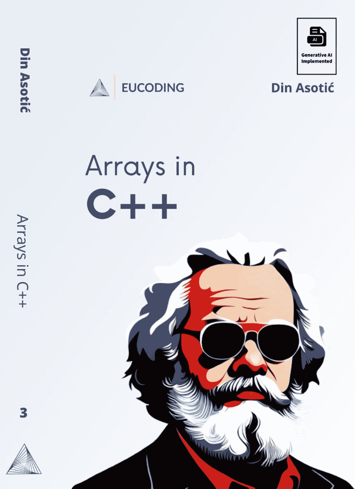
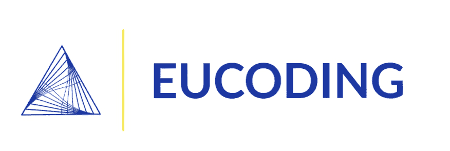

# C++ 数组：精通 C++ 编程的第三步



Copyright © 2023 by Din Asotic

保留所有权利。未经出版者面许可，本出版物的任何部分不得以任何形式或通过任何手段（电子、机械、摄影、录制、扫描或其他）进行复制、存储或传输。未经许可，复制此书、将其发布到网站或通过任何其他方式分发都是非法的。

请审慎使用书中的信息。作者对因误解本作品概念而引起的任何问题不承担责任。

关于该系列书籍的任何问题，可以通过 `development@eucoding.com` 提问。

第一版

本书书由 Reedsy 进行专业排版。

访问 [reedsy.com](https://reedsy.com) 了解更多信息。



## C++ 数组简介

数组在计算机科学中是存储在连续内存中的元素集合。它是编程中最简单且最重要的数据结构之一。本指南将对 C++ 中的数组进行深入介绍。

### 什么是数组？

数组在 C++ 中是一种存储相同类型值的固定大小的数据结构。数组的大小在创建时确定且无法更改。当我们想要存储一组值并通过单个变量来访问它们时，就会使用数组。

### 数组声明

在 C++ 中，数组有多种声明方式，但标准方式如下：

```
dataType arrayName[arraySize];
```

这里 `dataType` 是数组将持有的值的类型，`arrayName` 是数组的名称，`arraySize` 是一个大于零的整数，表示数组包含的元素数量。例如，如果我们想要创建一个包含 5 个元素的整数数组，声明如下：

```cpp
int numbers[5];
```

### 数组初始化

我们可以在声明时初始化数组，也可以先声明后初始化。方法如下：

#### 在声明时初始化

```cpp
int numbers[5] = {1, 2, 3, 4, 5};
```

在这里，我们有一个可以存放 5 个整数值的数组 `numbers`。大括号内的值是数组的初始值。

#### 声明后初始化

如果你不在声明时初始化数组，可以稍后为其赋值：

```cpp
int numbers[5];
numbers[0] = 1;
numbers[1] = 2;
numbers[2] = 3;
numbers[3] = 4;
numbers[4] = 5;
```

这与之前的方法等效。然而，请记住 C++ 数组的索引从 `0` 开始，而不是 `1`。

### 访问数组元素

通过索引访问数组元素。索引指的是元素在数组中的位置，第一个元素的索引为 `0`。以下是你可以访问数组元素的方法：

```cpp
cout << numbers[0];  // 输出 1
cout << numbers[4];  // 输出 5
```

注意不要访问超出数组大小的索引，这会导致未定义行为。

### 多维数组

除了一维数组外，C++ 还支持多维数组。最常见的是二维数组，通常用于表示矩阵。

二维数组的声明和初始化可以如下所示：

```cpp
int matrix[2][3] = {
    {1, 2, 3},
    {4, 5, 6}
};
```

在这里，`matrix` 是一个二维数组，包含 `2` 个数组，每个包含 `3` 个元素。要访问这些元素，我们使用两个索引：

```cpp
cout << matrix[0][0]; // 输出 1
cout << matrix[1][2]; // 输出 6
```

### 数组与循环

数组通常与循环一起使用。例如，如果我们想输出数组的所有元素，可以使用如下的 `for` 循环：

```cpp
int numbers[5] = {1, 2, 3, 4, 5};

for (int i = 0; i < 5; i++) {
    cout << numbers[i] << " ";
}
```

这将输出 `1 2 3 4 5`。

### C++ 中数组的局限性

虽然数组非常有用，但它们在 C++ 中确实有一些局限性。这些包括：

1. **固定大小**：一旦声明了数组的大小，就无法更改。如果数组没有被充分利用，可能会导致空间浪费；如果元素多于数组容量，则会导致空间不足。

2. **相同数据类型**：数组中的所有元素必须是相同的数据类型。

3. **缺乏内置方法**：与 `vectors` 或 `lists` 等更高级的数据结构不同，数组没有带有用于排序、插入、删除等操作的内置方法。

尽管有这些局限性，数组仍然理解数据结构和算法的基础。它们为学习更复杂的数据结构提供了坚实的基础，并且由于其简单高效，仍然被广泛使用。

## 数组声明

在 C++ 中，你可以使用以下语法声明一个固定大小为 `10` 的整数数组：

```cpp
int myArray[10];
```

以下是对该语法的解释：

* `int`：它指定数组中元素的数据类型，在本例中是整数。如果你想创建不同类型的数组，可以将 `int` 替换为任何其他数据类型。
* `myArray`：这是赋予数组的名称。你可以选择任何有效的标识符作为名称。
* `[10]`：它表示数组的大小，指定了数组可以容的元素数量。在本例中，大小为 `10`，意味着数组可以存储 `10` 个整数。

要访问数组的单个元素，可以使用数组名后跟方括号中的元素索引。索引范围从 `0` 到 `size-1`。这是一个示例：

```cpp
int myArray[10];  // 数组的声明

// 访问单个元素
myArray[0] = 42;  // 将 42 赋值给数组的第一个元素
int element = myArray[0];  //访问第一个元素的值并存储在变量中
```

在这个示例中，`myArray[0]` 指向数组的第一个元素，`myArray[0] = 42` 将值 `42` 赋值给该元素。同样，`myArray[1]` 指第二个元素，`myArray[2]` 指第三个元素，以此此类推。

## 数组声明与初始化

这是一个 C++ 示例程序，演示了数组的声明和初始化：

```cpp
#include <iostream>

int main() {
    // 声明并初始化整数数组
    int numbers[5] = {1, 2, 3, 4, 5};

    // 打印数组元素
    for (int i = 0; i < 5; ++i) {
        std::cout << numbers[i] << " ";
    }
    std::cout << std::endl;
    return 0;
}
```

在该程序中，我们声明了一个名为 `numbers` 的大小为 `5` 的数组，这意味着它可以存储 `5` 个整数。我们使用大括号初始化列表 `{1, 2, 3, 4, 5}` 初始化数组。每个值之间用逗号分隔。

C++ 中的数组是派生数据类型。它们派自基本数据类型，可以被视为相同数据类型元素的集合。在示例程序中，我们声明了一个整数数组 (`int`)，但也可以为 `char`、`float` 甚至用户定义类型声明数组。

数组声明由两部分组成：元素的数据类型和数组的名称。在示例中，数据类型是 `int`，数组名为 `numbers`。数组的大小在方括号 `[5]` 内指定，表示数组可以容纳 `5` 个整数。

数组是零索引的，这意味着数组的第一个元素的索引为 `0`，第二个索引为 `1`，以此此类推。在程序中，我们使用 `for` 循环遍历数组元素并使用 `std::cout` 打印它们。

需要注意的是，在初始化时，索引必须在边界内。

## 数组访问

这是一个 C++ 示例程序，用于访问并打印元素：

```cpp
#include <iostream>

int main() {
    int array[] = {1, 2, 3, 4, 5};
    int size = sizeof(array) / sizeof(array[0]);

    for (int i = 0; i < size; i++) {
        std::cout << "Element at " << i << ": " << array[i] << std::endl;
    }
    return 0;
}
```

在该程序中，我们声明了一个名为 `numbers` 的大小为 `5` 的数组，这意味着它可以存储 `5` 个整数。我们使用大括号初始化列表 `{1, 2, 3, 4, 5}` 初始化数组。每个值之间用逗号分隔。

## 数组大小

在 C++ 中，`sizeof` 运算符用于确定变量或数据类型的大小（以字节为单位）。当用于数组时，`sizeof` 运算符返回数组的总字节数。

`sizeof` 运算符通过计算对象或类型在计算机内存中所占用的字节数来确定大小。它接受一个类型或表达式作为操作数，并返回一个表示操作数大小的无符号整数值。

当对数组使用 `sizeof` 运算符时，它会返回数组的总大小，该大小通过数组中每个元素的大小乘以元素的个数计算得出。例如，如果你有一个包含 `10` 个元素的整数数组，且每个整数占用 `4` 字节内存，那么 `sizeof` 运算符将返回 `40`（`10` 个元素 * 每个元素 `4` 字节）。

以下是一个展示如何在数组中使用 `sizeof` 的示例：

```cpp
#include <iostream>

int main() {
    int numbers[] = {1, 2, 3, 4, 5};
    int size = sizeof(numbers) / sizeof(numbers[0]);
    std::cout << "Size of the array: " << size << std::endl;
    std::cout << "Size of each element: " << sizeof(numbers[0]) << " bytes" << std::endl;
    std::cout << "Total size of the array: " << sizeof(numbers) << " bytes" << std::endl;
    return 0;
}
```

在这个示例中，`sizeof(numbers)` 给你 `numbers` 数组的总大小，而 `sizeof(numbers[0])` 给你数组中每个元素的大小。通过将总大小除以每个元素的大小，你可以确定数组中元素的个数。

注意，`sizeof` 运算符在编译时确定数组的大小，因此它不会给你动态分配的数组或作为函数参数传递的数组元素个数（除非它是引用或指针）。在这些情况下，你需要单独跟踪大小。

## 数组修改

这里有一个修改数组元素的 C++ 程序示例：

```cpp
#include <iostream>

int main() {
    const int SIZE = 5;
    int numbers[SIZE];
    // 使用一些值初始化数组
    for (int i = 0; i < SIZE; i++) {
        numbers[i] = i + 1;
    }
    // 打印原始数组
    std::cout << "Original array: ";
    for (int i = 0; i < SIZE; i++) {
        std::cout << numbers[i] << " ";
    }
    std::cout << std::endl;
    // 修改数组的单个元素
    numbers[0] = 10;
    numbers[2] = 20;
    numbers[4] = 30;
    // 打印修改后的数组
    std::cout << "Modified array: ";
    for (int i = 0; i < SIZE; i++) {
        std::cout << numbers[i] << " ";
    }
    std::cout << std::endl;
    return 0;
}
```

在该程序中，我们声明了一个大小为 `SIZE` 的数组 `numbers`（在此示例中被设置为 `5`）。然后，我们使用循环给数组的元素分配初始值。在这种情况下，我们将从 `1` 到 `SIZE` 的值分配给数组元素。

要给数组的单个元素分配新值，我们使用数组索引法。例如，`numbers[0] = 10;` 将值 `10` 赋值给数组的第一个元素，`numbers[2] = 20;` 将 `20` 赋值给第三个元素，`numbers[4] = 30;` 将 `30` 赋值给第五个元素。

最后，我们使用另一个循环在修改前后分别打印数组元素，以验证更改。

在修改数组时，确保用于访问数组元素的索引在数组边界内是非常重要的。否则，可能会导致未定义行为或运行时错误。

## 数组遍历

数组遍历是指访问数组中的每个元素并对其进行某些操作的过程。在 C++ 中，数组遍历通常使用循环完成，例如`for`循环或`while`循环。

这里是一个展示使用`for`循环进行数组遍历的示例程序：

```cpp
#include <iostream>

int main() {
    int arr[] = {1, 2, 3, 4, 5};  // 示例数组
    // 使用 for 循环遍历数组
    for (int i = 0; i < sizeof(arr) / sizeof(arr[0]); i++) {
        // 对每个元素执行操作
        std::cout << arr[i] << " "; // 元素
    }
    return 0;
}
```

在程序程序中，我们有一个包含一些元素的整数数组 `arr`。`sizeof(arr) / sizeof(arr[0])` 计算了数组的长度。我们使用`for`循环遍历数组，从索引 `0` 开始，一直到索引达到数组长度减 `1`。

在循环内部，你可以对每个元素执行任何操作。在给定的示例中，我们简单地使用 `std::cout` 打印每个元素。你可以将此行替换为任何想要在元素上执行的操作或计算。循环将遍历数组的每个元素，并对每个元素执行指定的操作。通过这种方式，你可以逐个处理每个元素，而无需为每个元素编写重复的代码。数组遍历是编程中的一个基本概念，广泛应用于搜索、过滤或修改元素等任务。

## 排序

冒泡排序（Bubble Sort）算法通过在相邻元素顺序错误时反复交换它们来工作。这个过程一直持续到整个数组排序完成。这里有一个示例：

```cpp
#include <iostream>
using namespace std;

// 交换两个元素
void swap(int& a, int& b) {
    int temp = a;
    a = b;
    b = temp;
}

// 执行冒泡排序
void bubbleSort(int arr[], int size) {
    for (int i = 0; i < size - 1; ++i) {
        // 最后 i 个元素已经就绪
        for (int j = 0; j < size - i - 1; ++j) {
            // 如果当前元素大于下一个元素，则交换
            if (arr[j] > arr[j + 1]) {
                swap(arr[j], arr[j + 1]);
            }
        }
    }
}

// 打印数组
void printArray(int arr[], int size) {
    for (int i = 0; i < size; ++i) {
        cout << arr[i] << " ";
    }
    cout << endl;
}

int main() {
    int arr[] = {5, 2, 8, 12, 1, 6};
    int size = sizeof(arr) / sizeof(arr[0]);
    cout << "Original array: ";
    printArray(arr, size);
    bubbleSort(arr, size);
    cout << "Sorted array: ";
    printArray(arr, size);
    return 0;
}
```

接收数组及其大小作为参数。它使用嵌套循环遍历数组并比较相邻元素。如果当前元素大于下一个元素，则通过 `swap` 函数进行交换。

外层循环 `i` 控制迭代次数，等于数组的大小减 `1`。内层循环 `j` 比较并交换直到未排序部分的结束。

最后，我们使用 `printArray` 函数显示原始和排序后的数组。

当你运行此程序时，输出将是：

```
Original array: 5 2 8 12 1 6
Sorted array: 1 2 5 6 8 12
```

元素通过冒泡排序成功排序。

我要解释的下一个排序算法是选择排序（Selection Sort）。它通过将数组分为两个部分：开头的排序部分和结尾的未排序部分来工作。该算法反复从未排序部分找到最小（或最大）元素，并与未排序部分的第一个元素交换。这个过程一直持续到整个数组排序完成。

选择排序的 C++ 实现：


```cpp
#include <iostream>
using namespace std;

// 交换两个元素
void swap(int& a, int& b) {
    int temp = a;
    a = b;
    b = temp;
}

// 执行选择排序
void selectionSort(int arr[], int size) {
    for (int i = 0; i < size - 1; ++i) {
        // 在未排序部分找到最小元素
        int minIndex = i;
        for (int j = i + 1; j < size; ++j) {
            if (arr[j] < arr[minIndex]) {
                minIndex = j;
            }
        }
        // 将找到的最小元素与未排序部分的第一个元素交换
        swap(arr[i], arr[minIndex]);
    }
}

// 打印数组
void printArray(int arr[], int size) {
    for (int i = 0; i < size; ++i) {
        cout << arr[i] << " ";
    }
    cout << endl;
}

int main() {
    int arr[] = {64, 25, 12, 22, 11, 13};
    int size = sizeof(arr) / sizeof(arr[0]);
    cout << "Original array: ";
    printArray(arr, size);
    selectionSort(arr, size);
    cout << "Sorted array: ";
    printArray(arr, size);
    return 0;
}
```

```cpp
    cout << "Original array: ";
    printArray(arr, size);
    selectionSort(arr, size);
    cout << "Sorted array: ";
    printArray(arr, size);
    return 0;
}
```

在此程序中，`selectionSort` 函数接收数组及其大小作为参数。它使用两个循环来执行选择排序算法。外层循环（`i`）代表数组已排序部分，内层循环（`j`）在未排序部分中寻找最小元素。

在内层循环内部，每发现更小的元素时，最小元素的索引（`minIndex`）就会被更新。遍历完未排序部分后，将最小元素与未排序部分的第一个元素进行交换。

外层循环继续此过程，直到整个数组排序完毕。

当你运行此程序时，输出将是：

Original array: 5 2 8 12 1 6

Sorted array: 1 2 5 6 8 12

数组元素已使用选择排序算法成功地按升序排列。

## 插入排序算法

它的工作原理是将数组分为两个部分：开头的已排序部分和末尾的未排序部分。算法遍历未排序部分并每次选取一个元素，将其与已排序部分的元素进行比较，并将其插入到正确的位置。这个过程持续到整个数组排序完毕。

这里是插入排序算法的 C++ 实现：

```cpp
#include <iostream>

using namespace std;

// 执行插入排序的函数
void insertionSort(int arr[], int size) {
    for (int i = 1; i < size; ++i) {
        int key = arr[i];
        int j = i - 1;
        // 将 arr[0..i-1] 中大于 key 的元素移动到其当前位置之后一个
        while (j >= 0 && arr[j] > key) {
            arr[j + 1] = arr[j];
            j = j - 1;
        }
        arr[j + 1] = key;
    }
}

// 打印数组的函数
void printArray(int arr[], int size) {
    for (int i = 0; i < size; ++i) {
        cout << arr[i] << " ";
    }
    cout << endl;
}

int main() {
    int arr[] = {5, 2, 8, 12, 1, 6};
    int size = sizeof(arr) / sizeof(arr[0]);
    cout << "Original array: ";
    printArray(arr, size);
    insertionSort(arr, size);
    cout << "Sorted array: ";
    printArray(arr, size);
    return 0;
}
```

在此程序中，`insertionSort` 函数接收数组及其大小作为参数。它使用一个循环从第二个元素（索引 1）开始遍历数组。对于每个元素，它将其与已排序部分的元素（从索引 0 到 `i-1`）进行比较，并将较大的元素向右移动。

内层循环（`while` 循环）持续向右移动元素，直到为当前元素（`key`）找到正确的位置。最后，该元素被插入到数组已排序部分的正确位置。

外层循环继续此过程，直到整个数组排序完毕。

当你运行此程序时，输出将是：

Original array: 5 2 8 12 1 6

Sorted array: 1 2 5 6 8 12

数组元素已使用插入排序算法成功地按升序排列。

## 数组搜索

在 C++ 中，有几种搜索算法可以用于查找数组中的特定元素。在这里，我将解释两种常用的算法：线性查找和二分查找。

### 线性查找

- 线性查找是一种简单的搜索算法，它按顺序检查数组的每个元素，直到找到匹配项或遍历整个数组。

- 它适用于已排序和未排序的数组。

- 在 C++ 中实现线性查找，你可以可以使用循环遍历数组的每个元素，并将其与目标元素进行比较。

- 如果找到匹配项，可以返回元素的索引。否则，可以返回一个值表示未找到该元素。

这里是线性查找在 C++ 中的示例实现：

```cpp
#include <iostream>
int linearSearch(int arr[], int size, int target) {
    for (int i = 0; i < size; i++) {
        if (arr[i] == target) {
            return i; // 在 i 处找到目标元素
        }
    }
    return -1; // 未找到元素
}

int main() {
    int arr[] = {5, 2, 8, 10, 3};
    int size = sizeof(arr) / sizeof(arr[0]);
    int target = 8;
    int result = linearSearch(arr, size, target);
    if (result == -1) {
        cout << "Element not found." << endl;
    } else {
        cout << "Element found at index " << result << endl;
    }
    return 0;
}
```

### 二分查找

- 二分查找是一种更高效的算法，要求数组按升序排列。

- 它遵循分治法，通过不断将搜索空间减半来查找目标元素。

- 若要实现二分查找，你需要维护两个指针：`start` 和 `end`，它们代表搜索范围。

- 在每一步中，计算中间元素并与目标进行比较。

- 如果中间元素等于目标，返回其索引。如果中间元素大于目标，则更新 `end` 为中间索引减一。否则，则更新 `start` 为中间索引加一。

- 此过程持续直到找到目标元素或搜索空间为空。

这里是二分查找在 C++ 中的实现：

```cpp
#include <iostream>
int binarySearch(int arr[], int size, int target) {
    int start = 0;
    int end = size - 1;
    while (start <= end) {
        int mid = start + (end - start) / 2;
        if (arr[mid] == target) {
            return mid; // 找到目标元素
        } else if (arr[mid] > target) {
            end = mid - 1; // 目标在左半
        } else {
            start = mid + 1; // 目标在右半
        }
    }
    return -1; // 未找到元素
}

int main() {
    int arr[] = {2, 3, 5, 8, 10};
    int size = sizeof(arr) / sizeof(arr[0]);
    int target = 8;
    int result = binarySearch(arr, size, target);
    if (result == -1) {
        cout << "Element not found." << endl;
    } else {
        cout << "Element found at index " << result << endl;
    }
    return 0;
}
```

这些是用于在数组中搜索特定元素的两种基础算法。其他高级算法，如插值查找或指数查找，也可以根据特定的需求和数据特征来实现。

## 数组复制

这里是一个演示数组复制方法的 C++ 示例程序：

```cpp
#include <iostream>
#include <cstring>

// 使用循环从一个数组复制到另一个数组
void copyArrayUsingLoop(int source[], int destination[], int size) {
    for (int i = 0; i < size; i++) {
        destination[i] = source[i];
    }
}

// 使用 memcpy 函数从一个数组复制到另一个数组
void copyArrayUsingMemcpy(int source[], int destination[], int size) {
    memcpy(destination, source, size * sizeof(int));
}

// 使用 std::copy 函数从一个数组复制到另一个数组
void copyArrayUsingStdCopy(int source[], int destination[], int size) {
    std::copy(source, source + size, destination);
}

int main() {
    const int SIZE = 5;
    int source[SIZE] = {1, 2, 3, 4, 5};
    int destination1[SIZE];
    int destination2[SIZE];
    int destination3[SIZE];

    copyArrayUsingLoop(source, destination1, SIZE);
    copyArrayUsingMemcpy(source, destination2, SIZE);
    copyArrayUsingStdCopy(source, destination3, SIZE);

    // 打印复制的数组
    std::cout << "Copied array using loop: ";
    for (int i = 0; i < SIZE; i++) {
        std::cout << destination1[i] << " ";
    }
    std::cout << std::endl;

    std::cout << "Copied array using memcpy: ";
    for (int i = 0; i < SIZE; i++) {
        std::cout << destination2[i] << " ";
    }
    std::cout << std::endl;

    std::cout << "Copied array using std::copy: ";
    for (int i = 0; i < SIZE; i++) {
        std::cout << destination3[i] << " ";
    }
    std::cout << std::endl;

    return 0;
}
```

```cpp
for (int i = 0; i < SIZE; i++) {
    std::cout << destination2[i] << " ";
}
std::cout << std::endl;
std::cout << "Copied array using std::copy: ";
for (int i = 0; i < SIZE; i++) {
    std::cout << destination3[i] << " ";
}
std::cout << std::endl;
return 0;
}
```

在这个程序中，我们有三种不同的数组拷贝方法：使用循环、使用 `memcpy` 函数以及使用 `std::copy` 函数。

1. **使用循环拷贝**：`copyArrayUsingLoop` 函数使用循环遍历源数组的每个元素，并将其复制到目标数组中。这种方法直观且易于理解。然而，与其它方法相比，它的效率可能较低，特别是在处理大型数组时，因为它涉及到单个元素的赋值。

2. **使用 memcpy 拷贝**：`copyArrayUsingMemcpy` 函数使用了 C 标准库中的 `memcpy` 函数。该函数允许我们从源数组向目标数组拷贝一块内存。它在较低层级运行，对于大型数组来说，比循环更高效。但是，它假设数组是连续的内存块，并且它是按字节进行操作的，因此我们需要指定要拷贝的字节数（在这种情况下为 `size * sizeof(int)`）。

3. **使用 std::copy 拷贝**：`copyArrayUsingStdCopy` 函数利用了 C++ 标准库中的 `std::copy` 函数。它为容器之间的元素拷贝提供了更高层次的抽象。`std::copy` 函数负责处理不同的迭代器类型并执行拷贝操作。这是 C++ 中进行数组拷贝的一种更符合惯例且更安全的方法。然而，它的性能特征与基于循环的方法相似。

在选择数组拷贝方法时，请考虑简单性、效率和代码可读性之间的权衡。对于小型数组，这些方法之间的性能差异可能并不显著。但对于较大的数组，由于潜在的效率提升，通常优先选择 `memcpy` 或 `std::copy` 方法。

## 数组拼接

这是一个 C++ 示例程序，可以将两个数组合并到第三个数组中：

```cpp
#include <iostream>

const int MAX_SIZE = 100;

void concatenateArrays(int arr1[], int arr1Size, int arr2[], int arr2Size, int result[]) {
    // Copy elements from arr1 to result
    for (int i = 0; i < arr1Size; i++) {
        result[i] = arr1[i];
    }
    // Copy elements from arr2 to result
    for (int i = 0; i < arr2Size; i++) {
        result[arr1Size + i] = arr2[i];
    }
}

int main() {
    int arr1[MAX_SIZE] = {1, 2, 3, 4, 5};
    int arr1Size = 5;
    int arr2[MAX_SIZE] = {6, 7, 8};
    int arr2Size = 3;
    int result[MAX_SIZE];
    concatenateArrays(arr1, arr1Size, arr2, arr2Size, result);
    int resultSize = arr1Size + arr2Size;
    std::cout << "Concatenated array: ";
    for (int i = 0; i < resultSize; i++) {
        std::cout << result[i] << " ";
    }
    return 0;
}
```

解释：

1. `concatenateArrays` 函数接收两个输入数组（`arr1` 和 `arr2`）、它们的大小（`arr1Size` 和 `arr2Size`）以及输出数组（`result`）。

2. 在函数内部，使用 `for` 循环将 `arr1` 的元素拷贝到 `result` 数组中。

3. 接下来，将 `arr2` 的元素拷贝到 `result` 数组，从索引 `arr1Size` 开始，以确保它们接在 `arr1` 元素之后。


4. 在 `main` 函数中，你声明了输入数组 `arr1` 和 `arr2` 以及它们的大小（`arr1Size` 和 `arr2Size`）。

5. 你还声明了一个输出数组 `result` 来存储拼接后的数组。

6. 使用适当参数调用 `concatenateArrays` 函数，将 `arr1` 和 `arr2` 拼接到 `result` 中。

7. 通过相加 `arr1` 和 `arr2` 的大小来计算结果数组的大小（`resultSize`）。

8. 最后，使用 `for` 循环打印 `result` 数组的元素，展示拼接后的数组。

当你运行此程序时，输出将是：`Concatenated array: 1 2 3 4 5 6 7`。该程序演示了如何将两个数组的元素合并为一个数组。关键概念是遍历数组的每个元素并将它们拷贝到结果数组中。通过合理地管理索引，你可以

# 11. 数组操作

## 数组反转

这是一个反转数组元素的 C++ 程序：

```cpp
#include <iostream>

void reverseArray(int arr[], int size) {
    int start = 0;
    int end = size - 1;
    while (start < end) {
        // Swap elements at start and end
        int temp = arr[start];
        arr[start] = arr[end];
        arr[end] = temp;
        // Move start and end towards the center
        start++;
        end--;
    }
}

int main() {
    const int size = 5;
    int arr[size] = {1, 2, 3, 4, 5};
    std::cout << "Original array: ";
    for (int i = 0; i < size; i++) {
        std::cout << arr[i] << " ";
    }
    reverseArray(arr, size);
    std::cout << "\nReversed array: ";
    for (int i = 0; i < size; i++) {
        std::cout << arr[i] << " ";
    }
    return 0;
}
```

### 解释

1. `reverseArray` 函数接收两个参数：要反转的数组（`arr`）和数组的大小（`size`）。

2. 函数初始化两个变量 `start` 和 `end`，分别赋值为数组第一个和最后一个元素的索引。

3. 它进入一个 `while` 循环，直到 `start` 大于或等于 `end`。

4. 在循环内部，使用临时变量 `temp` 交换 `start` 和 `end` 处的元素。

5. 交换后，增加 `start` 并减小 `end` 以向中心移动。

6. 循环持续直到 `start` 不再小于 `end`，确保所有元素都已交换。

7. 在 `main` 函数中，声明并初始化了一个大小为 5 的数组 `arr`。

8. 使用 `for` 循环打印原始数组。

9. 调用 `reverseArray` 函数，传入数组及其大小进行反转。

10. 最后，使用另一个 `for` 循环打印反转后的数组。

当你运行此程序时，输出将是：

`Original array: 1 2 3 4 5`

`Reversed array: 5 4 3 2 1`

该程序通过交换首尾元素并向中心移动，直到所有元素都完成反转。

## 数组比较

这是一个 C++ 示例程序，用于比较两个数组并检查它们是否相等：

```cpp
#include <iostream>

bool areArraysEqual(int arr1[], int arr2[], int size) {
    for (int i = 0; i < size; i++) {
        if (arr1[i] != arr2[i]) {
            return false;
        }
    }
    return true;
}

int main() {
    int size;
    std::cout << "Enter the size of the arrays: ";
    std::cin >> size;
    int array1[size];
    int array2[size];
    std::cout << "Enter the elements of the first array: ";
    for (int i = 0; i < size; i++) {
        std::cin >> array1[i];
    }
    std::cout << "Enter the elements of the second array: ";
    for (int i = 0; i < size; i++) {
        std::cin >> array2[i];
    }
    bool equal = areArraysEqual(array1, array2, size);
    if (equal) {
        std::cout << "The arrays are equal." << std::endl;
    } else {
        std::cout << "The arrays are not equal." << std::endl;
    }
    return 0;
}
```

在 `main` 函数中，用户被提示输入数组的大小。然后，使用两个独立的 `for` 循环输入第一个和第二个数组的元素。最后，调用 `areArraysEqual` 函数并相应地显示结果。

请注意，在此示例中，假设数组包含整数。你可以通过更改数组的数据类型（在本例中为 `int`）以及相应的输入输出操作，修改代码以比较不同数据类型的数组。

## 13. 数组求和

这是一个 C++ 程序示例，用于计算数组中所有元素的和：

```cpp
#include <iostream>

int main() {
    // 定义数组
    int arr[] = {2, 4, 6, 8, 10};
    int size = sizeof(arr) / sizeof(arr[0]);  // 计算数组的大小
    int sum = 0;  // 初始化和变量
    // 遍历数组并累加求和
    for (int i = 0; i < size; i++) {
        sum += arr[i];
    }
    // 打印和
    std::cout << "Sum of array elements: " << sum << std::endl;
    return 0;
}
```

在这个程序中，我们首先定义了一个包含某些元素的数组 `arr`。`size` 变量通过将数组的总大小（字节）除以单个元素的大小（字节）来计算。这确保了即使数组大小发生变化，程序仍然能够正常工作。

接着，我们将变量 `sum` 初始化为 `0`。该变量将累加数组中所有元素的和。

使用 `for` 循环来遍历数组。它从 `i = 0` 开始，一直持续到 `i < size`。在每次迭代中，使用 `+=` 运算符将 `arr[i]` 的值加到 `sum` 变量。

最后，我们使用 `std::cout` 打印计算出的和。

当你运行此程序时，输出将是：

`Sum of array elements: 30`

这表明数组 `[2, 4, 6, 8, 10]` 中元素的和确实为 `30`。

## 14. 数组平均值

这是一个 C++ 程序示例，用于计算数组中所有元素的平均值：

```cpp
#include <iostream>

double calculateAverage(int arr[], int size) {
    int sum = 0;
    for (int i = 0; i < size; i++) {
        sum += arr[i];  // 累加所有元素的和
    }
    return static_cast<double>(sum) / size;  // 计算并返回平均值
}

int main() {
    int arr[] = {5, 10, 15, 20, 25};
    int size = sizeof(arr) / sizeof(arr[0]);  // 计算数组的大小
    double average = calculateAverage(arr, size);  // 调用函数计算平均值
    std::cout << "Average: " << average << std::endl;
    return 0;
}
```

### 解释

1. `calculateAverage` 函数接收两个参数：`arr`（包含元素的数组）和 `size`（表示数组中元素的个数）。

2. 在函数内部，变量 `sum` 被初始化为 `0`。它将用于累加所有元素的和。

3. 使用 `for` 循环遍历数组的每个元素。循环从 `0` 开始，持续到 `size - 1`。

4. 在循环内部，数组的每个元素 `arr[i]` 被加到 `sum` 变量。

5. 循环结束后，通过将 `sum` 除以数组的 `size` 来计算平均值。为了确保除法准确，使用 `static_cast<double>(sum)` 表达式将 `sum` 转换为 `double`。

6. 最后，`calculateAverage` 函数返回计算出的平均值。

7. 在 `main` 函数中，定义了一个包含某些示例值的示例数组 `arr`。

8. 使用表达式 `sizeof(arr) / sizeof(arr[0])` 计算数组的 `size`，它通过将数组的总大小除以单个元素的大小确定元素的总数。

9. 将数组及其大小传递给 `calculateAverage` 函数，并将得到的平均值存储在变量 `average` 中。

10. 然后使用 `std::cout` 将 `average` 打印到控制台。

当你运行此程序时，它将输出：

`Average: 15`

在此示例中，数组 `{5, 10, 15, 20, 25}` 中元素的平均值为 `15`。

## 15. 数组最大值

这是一个查找数组中最大元素的 C++ 程序：

```cpp
#include <iostream>

int findMaximum(int arr[], int size) {
    int max = arr[0]; // 假设第一个元素是最大值
    for (int i = 1; i < size; i++) {
        if (arr[i] > max) {
            max = arr[i]; // 如果找到更大的元素，则更新 max
        }
    }
    return max;
}

int main() {
    int arr[] = {5, 2, 9, 1, 7};
    int size = sizeof(arr) / sizeof(arr[0]);
    int maximum = findMaximum(arr, size);
    std::cout << "Maximum: " << maximum << std::endl;
    return 0;
}
```

### 解释

1. `findMaximum` 函数接收 `arr` 和 `size`。

2. 假设第一个元素是最大值 `max = arr[0]`。

3. `for` 循环从 `i = 1` 开始，持续到 `i < size`。

4. 如果 `arr[i] > max`，则更新 `max` 为 `arr[i]`。

5. 函数返回 `max`。

6. 在 `main` 函数中，定义了数组 `arr`。

7. 使用 `sizeof(arr) / sizeof(arr[0])` 计算数组的 `size`。

8. 调用 `findMaximum` 函数并将结果存储在 `maximum` 变量中。

9. 使用 `std::cout` 打印结果。

## 16. 数组最小值

这是一个查找数组中最小元素的 C++ 程序：

```cpp
#include <iostream>

int findMinimum(int arr[], int size) {
    int minimum = arr[0]; // 假设第一个元素是最小值
    for (int i = 1; i < size; i++) {
        if (arr[i] < minimum) {
            minimum = arr[i]; // 如果找到更小的元素，则更新 minimum
        }
    }
    return minimum;
}

int main() {
    int arr[] = {5, 3, 9, 1, 7};
    int size = sizeof(arr) / sizeof(arr[0]);
    int minElement = findMinimum(arr, size);
    std::cout << "Minimum: " << minElement << std::endl;
    return 0;
}
```

### 解释

1. `findMinimum` 函数接收 `arr` 和 `size`。

2. 假设第一个元素是最小值 `minimum = arr[0]`。

3. `for` 循环从 `i = 1` 开始，持续到 `i < size`。

4. 如果 `arr[i] < minimum`，则更新 `minimum`。

5. 函数返回 `minimum`。

6. 在 `main` 函数中，定义了数组 `arr`。

7. 使用 `sizeof(arr) / sizeof(arr[0])` 计算数组的 `size`。

8. 调用 `findMinimum` 函数并将结果存储在 `minElement` 变量中。

9. 使用 `std::cout` 打印结果。

## 17. 数组唯一元素

这是一个用于删除数组中重复元素的 C++ 程序示例：

```cpp
#include <iostream>
#include <unordered_set>
```

```cpp
int main() {
    // 包含重复元素的示例数组
    int arr[] = { 1, 2, 3, 4, 2, 1, 5, 6, 3, 4, 7, 8, 9, 5 };
    // 计算数组的大小
    int size = sizeof(arr) / sizeof(arr[0]);
    // 创建一个无序集合来存储唯一元素
    std::unordered_set<int> uniqueElements;
    // 遍历数组
    for (int i = 0; i < size; ++i) {
        // 将每个元素插入集合
        uniqueElements.insert(arr[i]);
    }
    // 打印唯一元素
    std::cout << "Unique elements: ";
    for (int element : uniqueElements) {
        std::cout << element << " ";
    }
    std::cout << std::endl;
    return 0;
}
```

### 解释

1. 程序开始声明一个包含重复元素的数组 `arr`。

2. 通过将数组的总大小除以单个元素的大小来计算数组的大小。

3. 创建一个名为 `uniqueElements` 的 `unordered_set` 来存储数组中的唯一元素。选择无序集合是因为它具有高效查找的特性。

4. 程序随后使用 `for` 循环遍历数组。

5. 在每次迭代中，使用 `insert()` 函数将当前元素 `arr[i]` 插入到 `uniqueElements` 集合中。无序集合会自动确保唯一性。

6. 循环完成后，程序使用另一个 `for` 循环打印存储在集合中的唯一元素。

7. 最后，程序以返回值 `0` 退出。

在遍历数组时，程序将每个元素插入无序集合中。无序集合会自动处理重复元素并只保留唯一元素。通过利用无序集合的唯一性属性，我们可以轻松地移除数组中的重复项。

注意，输出中元素的顺序不能保证与原始数组相同，因为无序集合不保留插入顺序。

# 18. 数组频率

这是一个 C++ 示例程序，它使用 `std::map` 统计数组中每个元素的频率：


```cpp
#include <iostream>
#include <map>

int main() {
    int arr[] = {1, 2, 3, 2, 4, 1, 3, 2, 1, 4};
    int size = sizeof(arr) / sizeof(arr[0]);
    std::map<int, int> frequencyMap;
    // 遍历数组并更新频率映射
    for (int i = 0; i < size; i++) {
        frequencyMap[arr[i]]++;
    }
    // 显示每个元素的频率
    for (const auto& pair : frequencyMap) {
        std::cout << "Element " << pair.first << " occurs " << pair.second << " times." << std::endl;
    }
    return 0;
}
```

### 解释

1. 我们定义了一个包含某些元素的数组`arr`，并使用公式`sizeof(arr) / sizeof(arr[0])`确定其大小。

2. 我们创建了一个名为`frequencyMap`的`std::map<int, int>`，其中键代表数组中的元素，值代表它们的频率。

3. 我们使用`for`循环遍历数组并相应地更新频率映射。对于每个元素`arr[i]`，我们使用`frequencyMap[arr[i]]++`语句增加该元素在映射中的频率。

4. 最后，我们使用基于范围的`for`循环遍历频率映射。对于每一对元素和频率，我们使用`std::cout`显示元素及其对应的频率。

通过使用`std::map`，我们可以高效地跟踪数组中每个元素的频率。`map`自动处理键值对的存储和检索，允许我们在遍历数组时轻松地更新和访问频率。

# 19

## 数组子数组

在 C++ 中，你可以按照以下步骤创建一个包含原始数组部分的新数组：

1. 确定要从原始数组中提取的子数组的起始索引和结束索引。

2. 通过用结束索引减去起始索引并加 1（以包含结束索引处的元素）来计算子数组的大小。

3. 声明一个与子数组计算大小相等的新数组。

4. 从起始索引开始到结束索引结束，遍历原始数组。

5. 将原始数组中的每个元素复制到新数组中对应的索引处。

下面是一个演示此过程的示例代码段：

```cpp
#include <iostream>

int main() {
    int originalArray[] = {1, 2, 3, 4, 5, 6, 7, 8, 9, 10};  // 原始数组
    int startingIndex = 2;  // 子数组的起始索引
    int endingIndex = 6;    // 子数组的结束索引
    int subarraySize = endingIndex - startingIndex + 1;  // 计算子数组的大小
    int* subarray = new int[subarraySize];  // 为子数组创建一个新数组
    for (int i = startingIndex; i <= endingIndex; i++) {
        subarray[i - startingIndex] = originalArray[i]; // 复制元素
    }
```

在此示例中，`originalArray`包含 1 到 10。从索引 2 (3) 开始到索引 6 (7) 提取一个子数组`{3, 4, 5, 6, 7}`。

# 20

## 数组元素交换

这是一个使用临时变量交换数组中元素的 C++ 示例程序：

```cpp
#include <iostream>

void swapElements(int array[], int index1, int index2) {
    int temp = array[index1];
    array[index1] = array[index2];
    array[index2] = temp;
}

int main() {
    int array[] = {5, 10, 15, 20};
    int index1 = 1;
    int index2 = 3;
    std::cout << "Before swapping: ";
    for (int i = 0; i < sizeof(array) / sizeof(array[0]); i++) {
        std::cout << array[i] << " ";
    }
    std::cout << std::endl;
    swapElements(array, index1, index2);
    std::cout << "After swapping: ";
    for (int i = 0; i < sizeof(array) / sizeof(array[0]); i++) {
        std::cout << array[i] << " ";
    }
    std::cout << std::endl;
    return 0;
}
```

在这个程序中，我们有一个函数`swapElements`，它接收数组、`index1`和`index2`作为参数。该函数使用临时变量`temp`来存储第一个元素（`array[index1]`）的值。然后它将第二个元素（`array[index2]`）的值赋值给第一个元素，最后将临时变量（`temp`）的值赋值给第二个元素。

在`main`函数中，我们初始化了一个示例数组并定义了要交换元素的索引（`index1`和`index2`）。随后我们在交换前打印数组，调用`swapElements`函数，然后打印交换后的数组以查看更新后的值。

注意：在 C++ 中数组是从零索引的，因此第一个元素的索引为 0，第二个元素的索引为 1，以此类推。

# 21

## 数组分区

这是一个根据给定的基值对数组进行分区的 C++ 程序示例：

```cpp
#include <iostream>
using namespace std;

void swap(int& a, int& b) {
    int temp = a;
    a = b;
    b = temp;
}

int partition(int arr[], int low, int high, int pivot) {
    int i = low - 1;
    for (int j = low; j <= high - 1; j++) {
        if (arr[j] < pivot) {
            i++;
            swap(arr[i], arr[j]);
        }
    }
    swap(arr[i + 1], arr[high]);
    return (i + 1);
}
```

```cpp
void arrayPartition(int arr[], int size, int pivot) {
    int partitionIndex = partition(arr, 0, size - 1, pivot);
    cout << "Partitioned Array: ";
    for (int i = 0; i < size; i++) {
        cout << arr[i] << " ";
    }
    cout << endl;
    cout << "Pivot Index: " << partitionIndex << endl;
}

int main() {
    int arr[] = { 10, 7, 8, 9, 1, 5 };
    int size = sizeof(arr) / sizeof(arr[0]);
    int pivot = 8;
    cout << "Original Array: ";
    for (int i = 0; i < size; i++) {
        cout << arr[i] << " ";
    }
    cout << endl;
    arrayPartition(arr, size, pivot);
    return 0;
}
```

在这个程序中，`partition`函数接收一个数组（`arr`）、数组的起始和结束索引以及`pivot`值。它重新排列数组中的元素，使得所有小于`pivot`值的元素都在它之前，而所有大于`pivot`值的元素都在它之后。该函数返回分区后`pivot`元素的索引。

`arrayPartition`函数负责调用`partition`函数并显示分区后的数组和`pivot index`（枢轴索引）。

在`main`函数中，我们初始化了一个数组，指定了数组的大小，并选择了一个`pivot`值。程序显示原始数组，然后使用数组、`size`和`pivot`值调用`arrayPartition`函数。

当你运行此程序时，输出将如下：

```
Original Array: 10 7 8 9 1 5
Partitioned Array: 7 1 5 9 10 8
Pivot Index: 4
```

在分区后的数组中，小于`pivot`（`8`）的元素位于它之前，大于`pivot`的元素位于它之后。`pivot index`为`4`，表示`pivot`元素在分区后数组中的位置。

根据特定需求修改此程序，或将其集成到现有的代码中。

# 22

## 数组洗牌 (Array Shuffling)

这是一个 C++ 示例程序，用于洗牌数组中的元素：

```cpp
#include <iostream>
#include <cstdlib>   // 用于 rand() 和 srand()
#include <ctime>     // 用于 time()
using namespace std;

// 交换数组中两个元素的函数
void swapElements(int& a, int& b) {
    int temp = a;
    a = b;
    b = temp;
}

// 洗牌数组的函数
void shuffleArray(int arr[], int size) {
    // 使用当前时间初始化随机种子
    srand(static_cast<unsigned int>(time(nullptr)));
    // 生成随机索引并交换元素
    for (int i = size - 1; i > 0; --i) {
        // 生成一个 0 到 i（包含 i）之间的随机索引
        int j = rand() % (i + 1);
        // 将当前元素与随机选择元素交换
        swapElements(arr[i], arr[j]);
    }
}

int main() {
    const int size = 10;
    int arr[size] = {1, 2, 3, 4, 5, 6, 7, 8, 9, 10};
    cout << "Original array: ";
    for (int i = 0; i < size; ++i) {
        cout << arr[i] << " ";
    }
    cout << endl;
    shuffleArray(arr, size);
    cout << "Shuffled array: ";
    for (int i = 0; i < size; ++i) {
        cout << arr[i] << " ";
    }
    cout << endl;
    return 0;
}
```

### 解释：

1. `swapElements`函数接收两个整数并使用`temp`变量交换它们的值。

2. `shuffleArray`函数使用 Fisher-Yates 算法洗牌数组元素：

   - 它通过调用传入当前时间的`srand`来初始化随机种子（以确保每次运行的结果都不同）。

   - 它从数组的最后一个元素到第二个元素进行迭代。

   - 在每次迭代中，它使用`%`运算符生成一个`0`到`i`（包含 i）之间的随机索引`j`。

   - 它将索引`i`处的当前元素与索引`j`处的元素交换。

3. 在`main`函数中，声明并初始化了一个整数数组。

4. 打印原始数组。

5. 调用`shuffleArray`函数来洗牌数组。

6. 打印洗牌后的数组。

注意：此程序假设你使用 C++11 或更高版本以支持基于范围的循环。如果你使用的是旧版本的 C++，可能需要修改代码。

# 23

## 数组旋转 (Array Rotation)

这是一个 C++ 程序，用于按给定的位置数旋转数组元素：

```cpp
#include <iostream>

// 按指定的位置数旋转数组元素的函数
void rotateArray(int arr[], int n, int k) {
    // 创建一个临时数组来存储旋转后的元素
    int temp[k];
    // 将数组的前 k 个元素存储在临时数组中
    for (int i = 0; i < k; i++) {
        temp[i] = arr[i];
    }
    // 将剩余元素向左移动
    for (int i = k; i < n; i++) {
        arr[i - k] = arr[i];
    }
    // 将临时数组中的元素复制到末尾
    for (int i = 0; i < k; i++) {
        arr[n - k + i] = temp[i];
    }
}

// 显示数组元素的函数
void displayArray(int arr[], int n) {
    for (int i = 0; i < n; i++) {
        std::cout << arr[i] << " ";
    }
    std::cout << std::endl;
}

int main() {
    int arr[] = { 10, 7, 8, 9, 1, 5 };
    int n = sizeof(arr) / sizeof(arr[0]);
    int k;
    std::cout << "Enter the number of positions to rotate: ";
    std::cin >> k;
    std::cout << "Original array: ";
    displayArray(arr, n);
    rotateArray(arr, n, k);
    std::cout << "Rotated array: ";
    displayArray(arr, n);
    return 0;
}
```

在这个程序中，有两个主要的函数：

1. `rotateArray`：该函数接收数组（`arr`）、数组大小`n`和要旋转的位置数`k`。它通过以下步骤执行旋转：

   - 创建一个大小为`k`的临时数组`temp`来存储数组的前`k`个元素。

   - 将剩余元素向左移动。

   - 最后，将临时数组中的元素复制到数组的末尾。

2. `displayArray`：该函数接收数组（`arr`）和大小`n`，负责显示数组元素。

在`main`函数中，我们初始化了一个数组`arr`并确定了其大小`n`。然后提示用户输入旋转的位置数`k`。之后，我们调用`rotateArray`函数来旋转数组，并使用`displayArray`显示原始数组和旋转后的数组。

```cpp
// Increment the size of the array

size++;
}

void displayArray(const int arr[], int size) {
    for (int i = 0; i < size; i++) {
        std::cout << arr[i] << " ";
    }
    std::cout << std::endl;
}

int main() {
    int arr[MAX_SIZE];
    int size;
    std::cout << "Enter the size of the array (up to " << MAX_SIZE << "): ";
    std::cin >> size;
    std::cout << "Enter the elements of the array: ";
    for (int i = 0; i < size; i++) {
        std::cin >> arr[i];
    }
    int position, element;
    std::cout << "Enter the position where the element should be inserted: ";
    std::cin >> position;
    std::cout << "Enter the element to be inserted: ";
    std::cin >> element;
    insertElement(arr, size, position, element);
    std::cout << "Array after insertion: ";
    displayArray(arr, size);
    return 0;
}
```


在这个程序中，`insertElement` 函数接收一个数组（`arr`）、数组的当前大小（`size`）、应该插入元素的位置（`position`）以及要插入的元素（`element`）。

首先，它会检查指定的位置是否有效。如果该位置小于 0 或大于当前的 `size`，它会打印一条错误信息并返回。

如果位置有效，该函数将开始从插入位置向右移动元素。它会从最后一个元素一直迭代到插入位置，并将每个元素向右移动一位。

在移动完元素后，该函数通过将元素值赋值给 `arr[position]` 在指定的位置处插入新元素。

最后，该函数会增加数组的大小（`size`），以包含新插入的元素。

`displayArray` 函数是一个辅助函数，用于打印数组的元素。

在 `main` 函数中，程序提示用户输入数组的大小、数组的元素、`position` 以及要插入的元素。然后，它调用 `insertElement` 函数并显示结果数组。

注意：此程序假定数组有足够的空间来容纳新元素，并且没有进行任何边界检查。

## 25 - 数组删除

这里有一个 C++ 程序，演示了如何在数组的特定位置删除元素并移动剩余元素以填补空格：

```cpp
#include <iostream>

void deleteElement(int arr[], int& size, int position) {
    if (position < 0 || position >= size) {
        std::cout << "Invalid position." << std::endl;
        return;
    }
    // 移动元素填补空格
    for (int i = position; i < size - 1; i++) {
        arr[i] = arr[i + 1];
    }
    // 递减数组的大小
    size--;
    std::cout << "Element at position " << position << " has been deleted." << std::endl;
}

int main() {
    const int MAX_SIZE = 100;
    int arr[MAX_SIZE] = {1, 2, 3, 4, 5};
    int size = 5;
    int position;
    std::cout << "Enter the position of the element to delete: ";
    std::cin >> position;
    deleteElement(arr, size, position);
    std::cout << "Updated array: ";
    for (int i = 0; i < size; i++) {
        std::cout << arr[i] << " ";
    }
    std::cout << std::endl;
    return 0;
}
```

### 解释：

1. `deleteElement` 函数接收三个参数：数组 `arr`、`size` 的引用以及要删除元素的位置 `position`。

2. 首先，它会检查提供的 `position` 是否有效，即它应该在数组的范围内。

3. 如果位置有效，该函数开始移动元素以填补空格。它从 `position` 迭代到数组的倒数第二个元素。

4. 对于每次迭代，它将下一个元素的值赋值给当前元素，从而有效地将所有元素向左移动一位。

5. 在移动完成后，数组的大小 `size` 减去 1，以反映删除操作。

6. 最后，在 `main` 函数中，提示用户输入 `position`。

7. 使用提供的 `position`、`arr` 和 `size` 调用 `deleteElement` 函数。

8. 随后打印更新后的数组以验证元素的删除和移动。

注意：此程序假定数组包含整数。你可以通过更改数组类型并相应调整语句来使其适用于其他类型。

## 26 - 数组回文

这里有一个 C++ 程序，用于检查数组是否为回文：

```cpp
#include <iostream>
using namespace std;

bool isPalindrome(int arr[], int size) {
    int start = 0;
    int end = size - 1;
    while (start < end) {
        if (arr[start] != arr[end]) {
            return false;
        }
        start++;
        end--;
    }
    return true;
}

int main() {
    int arr[] = {1, 2, 3, 2, 1};
    int size = sizeof(arr) / sizeof(arr[0]);
    if (isPalindrome(arr, size)) {
        cout << "The array is a palindrome." << endl;
    } else {
        cout << "The array is not a palindrome." << endl;
    }
    return 0;
}
```

在这个程序中，`isPalindrome` 函数用于检查数组是否为回文。它接收两个参数：`arr`（要检查的数组）和 `size`（大小）。

函数使用两个索引 `start` 和 `end` 来比较数组的开头和结尾。它通过初始化 `start` 为 0（第一个元素），`end` 为 `size - 1`（最后一个元素）。

函数进入一个 `start < end` 的 `while` 循环。在循环内部，它比较 `arr[start]` 和 `arr[end]`。如果它们不等，则返回 `false`。

如果相等，函数增加 `start` 并递减 `end`，向数组中心移动。当 `while` 循环在没有遇到不匹配元素的情况下结束时，函数返回 `true`，表示这是一个回文。

在 `main` 函数中，定义了一个示例数组并使用 `sizeof` 运算符计算其大小。然后调用 `isPalindrome` 函数并传入数组和大小。根据返回值，打印数组是否为回文。

## 27 - 数组交集

这里有一个查找两个数组交集的 C++ 示例程序：

```cpp
#include <iostream>
#include <unordered_set>
#include <vector>

std::vector<int> findIntersection(const std::vector<int>& array1, const std::vector<int>& array2) {
    std::unordered_set<int> set1(array1.begin(), array1.end());  // 将 array1 转换为集合
    std::vector<int> result;
    for (const auto& element : array2) {
        if (set1.count(element) > 0) {
            result.push_back(element);  // 将共同元素加入结果向量
            set1.erase(element);      // 从 set 中移除元素以避免重复
        }
    }
    return result;
}

int main() {
    std::vector<int> array1 = {1, 2, 3, 4, 5};
    std::vector<int> array2 = {3, 4, 5, 6, 7};
    std::vector<int> intersection = findIntersection(array1, array2);
    std::cout << "Intersection: ";
    for (const auto& element : intersection) {
        std::cout << element << " ";
    }
    std::cout << std::endl;
    return 0;
}
```

3. 我们遍历 `array2` 中的每个元素。

4. 对于每个元素，我们使用 `set` 的 `count` 函数来检查它是否存在于 `set1` 中。如果存在，说明它是一个公共元素。

5. 我们将公共元素添加到 `result` 向量中，并将其从 `set1` 中移除以避免重复。

6. 一旦迭代完成，我们返回 `result` 向量。

7. 在 `main` 函数中，我们创建了两个示例数组（`array1` 和 `array2`）。

8. 我们调用 `findIntersection` 函数，传入这两个数组，并将结果存储在 `intersection` 向量中。

9. 最后，我们打印 `intersection` 向量的元素，以演示两个数组之间的共同元素。

当你运行此程序时，输出将是：

```text
Intersection: 3 4 5
```

它显示了 `array1` 和 `array2` 之间的共同元素，即 3、4 和 5。

## 28 - 数组并集（Array Union）

这是一个 C++ 示例程序，它可以找到两个数组的并集，并将它们的元素合并到一个没有重复的新数组中：

```cpp
#include <iostream>
#include <unordered_set>
#include <vector>

std::vector<int> findUnion(const std::vector<int>& arr1, const std::vector<int>& arr2) {
    std::unordered_set<int> uniqueElements;
    std::vector<int> unionArray;
    // 将 arr1 中的元素添加到并集数组
    for (int num : arr1) {
        if (uniqueElements.find(num) == uniqueElements.end()) {
            uniqueElements.insert(num);
            unionArray.push_back(num);
        }
    }
    // 将 arr2 中的元素添加到并集数组
    for (int num : arr2) {
        if (uniqueElements.find(num) == uniqueElements.end()) {
            uniqueElements.insert(num);
            unionArray.push_back(num);
        }
    }
    return unionArray;
}

int main() {
    // 示例数组
    std::vector<int> array1 = {1, 2, 3, 4, 5};
    std::vector<int> array2 = {4, 5, 6, 7, 8};
    std::vector<int> unionResult = findUnion(array1, array2);
    // 打印并集数组
    std::cout << "Union array: ";
    for (int num : unionResult) {
        std::cout << num << " ";
    }
    std::cout << std::endl;
    return 0;
}
```

在这个程序中，我们定义了一个函数 `findUnion`，它接收两个数组 `arr1` 和 `arr2` 作为输入，并将数组的并集作为新数组返回。

我们使用了一个名为 `uniqueElements` 的 `unordered_set` 来跟踪目前为止遇到过的唯一元素。这允许我们自己在遍历数组时高效地检查重复项。

我们遍历 `arr1`，并且仅当元素不在 `uniqueElements` 中存在时，才将其添加到 `unionArray`。同样地，我们遍历 `arr2`，如果该元素不是重复的，就将其添加到 `unionArray`。

最后，我们打印生成的并集数组。

当你运行程序时，输出将是：

```text
Union array: 1 2 3 4 5 6 7 8
```

注意，`unionArray` 中元素的顺序可能会变化，因为 `unordered_set` 不保证特定的顺序。

## 29 - 数组差集（Array Difference）

这是一个 C++ 示例程序，它可以找到两个数组之间的差集，并创建一个包含唯一元素的新数组：

```cpp
#include <iostream>
#include <vector>
#include <algorithm>

// 寻找两个数组差集的函数
std::vector<int> arrayDifference(const std::vector<int>& arr1, const std::vector<int>& arr2) {
    std::vector<int> difference;
    // 对数组排序以进行高效比较
    std::vector<int> sortedArr1 = arr1;
    std::vector<int> sortedArr2 = arr2;
    std::sort(sortedArr1.begin(), sortedArr1.end());
    std::sort(sortedArr2.begin(), sortedArr2.end());
    // 寻找 arr1 中的唯一元素
    for (int element : sortedArr1) {
        if (!std::binary_search(sortedArr2.begin(), sortedArr2.end(), element)) {
            difference.push_back(element);
        }
    }
    return difference;
}

int main() {
    // 示例用法
    std::vector<int> arr1 = {1, 2, 3, 4, 5};
    std::vector<int> arr2 = {3, 4, 5, 6, 7};
    std::vector<int> result = arrayDifference(arr1, arr2);
    std::cout << "Elements unique to arr1: ";
    for (int element : result) {
        std::cout << element << " ";
    }
    return 0;
}
```

在这个程序中，`arrayDifference` 函数接收两个 `std::vector<int>` 参数 `arr1` 和 `arr2`，并返回一个包含 `arr1` 中特有元素的新 `std::vector<int>`。以下是该函数的工作原理：

1. 函数首先创建了一个 `difference` 向量。

2. 为了高效比较，对 `sortedArr1` 和 `sortedArr2` 进行了排序。

3. 然后，遍历 `sortedArr1`，使用 `std::binary_search` 检查元素是否存在于 `sortedArr2` 中。

4. 如果不存在，则将其添加到 `difference` 中。

5. 最后，返回 `difference` 向量。

在 `main` 函数中，我们调用 `arrayDifference` 并传入两个数组。当你运行该程序时，输出将是：

```text
Elements unique to arr1: 1 2 4
```

## 30 - 数组子集（Array Subset）

这是一个检查一个数组是否为另一个数组的子集的 C++ 程序：


```cpp
#include <iostream>
#include <unordered_set>
using namespace std;

bool isSubset(int arr1[], int size1, int arr2[], int size2) {
    unordered_set<int> set;
    // 将 arr1 的元素添加到 set
    for (int i = 0; i < size1; i++) {
        set.insert(arr1[i]);
    }
    // 遍历 arr2 并检查每个元素是否存在于 set 中
    for (int i = 0; i < size2; i++) {
        if (set.find(arr2[i]) == set.end()) {
            // 未找到元素
            return false;
        }
    }
    // 所有元素都找到
    return true;
}

int main() {
    int arr1[] = {1, 2, 3, 4, 5};
    int size1 = sizeof(arr1) / sizeof(arr1[0]);
    int arr2[] = {3, 4, 5};
    int size2 = sizeof(arr2) / sizeof(arr2[0]);
    if (isSubset(arr1, size1, arr2, size2)) {
        cout << "arr2 is a subset of arr1." << endl;
    } else {
        cout << "arr2 is not a subset of arr1." << endl;
    }
    return 0;
}
```

在该程序中，`isSymmetric` 函数接收一个数组（`arr`）和它的大小（`size`）作为参数。它初始化两个变量 `start` 和 `end`，分别跟踪数组开头和结尾的索引。

该函数进入一个 `while` 循环，只要 `start` 小于等于 `end`，循环就会继续。在循环内部，它比较 `arr[start]` 和 `arr[end]` 处的元素。如果它们不相等，说明数组不是对称的，函数返回 `false`。

如果循环完成且没有发现任何不匹配的元素，说明数组是对称的，函数返回 `true`。

在 `main` 函数中，声明了一个包含某些对称值的示例数组 `arr`。数组的大小使用公式 `sizeof(arr) / sizeof(arr[0])` 计算。然后使用数组和其大小调用 `isSymmetric` 函数，并相应地打印结果。

请记住，此程序假设数组包含整数值。如果你正在处理不同的数据类型，可以相应地修改程序。

# 32 数组排序顺序

这是一个 C++ 示例程序，用于检查数组是否按升序或降序排序：

```cpp
#include <iostream>

bool isAscending(int arr[], int size) {
    for (int i = 1; i < size; i++) {
        if (arr[i] < arr[i - 1])
            return false;
    }
    return true;
}

bool isDescending(int arr[], int size) {
    for (int i = 1; i < size; i++) {
        if (arr[i] > arr[i - 1])
            return false;
    }
    return true;
}

int main() {
    int arr[] = {1, 2, 3, 4, 5}; //示例数组
    int size = sizeof(arr) / sizeof(arr[0]);
    if (isAscending(arr, size))
        std::cout << "数组按升序排序。" << std::endl;
    else if (isDescending(arr, size))
        std::cout << "数组按降序排序。" << std::endl;
    else
        std::cout << "数组没有排序。" << std::endl;
    return 0;
}
```

在此程序中，我们定义了两个函数：`isAscending` 和 `isDescending`。

`isAscending` 函数通过将每个元素与前一个元素比较来检查数组是否按升序排序。如果某个元素小于前一个元素，函数返回 `false`。如果循环完成未发现乱序元素，函数返回 `true`。

`isDescending` 函数的工作原理类似，检查数组是否按降序排序。它将每个元素与前一个元素比较，如果发现某个元素大于前一个元素，返回 `false`。如果循环完成未发现乱序元素，函数返回 `true`。

在 `main` 函数中，我们创建了一个示例数组 `arr` 并使用公式 `sizeof(arr) / sizeof(arr[0])` 计算其大小。然后使用数组和其大小调用 `isAscending` 和 `isDescending` 函数来确定排序顺序。根据返回值，我们打印相应的消息，指示数组的排序状态。

请注意，此程序假设数组包含整数。你可以修改程序以处理其他数据类型或根据你的特定需求进行自定义。

# 33 数组多数元素

这是一个使用 `map` 的 C++ 程序，用于查找数组中的多数元素：

```cpp
#include <iostream>
#include <unordered_map>
#include <vector>

int findMajorityElement(const std::vector<int>& arr) {
    std::unordered_map<int, int> freqMap;
    // 计算数组中每个元素的频率
    for (int num : arr) {
        freqMap[num]++;
    }
    // 找到频率大于数组大小一半的元素
    int halfSize = arr.size() / 2;
    for (const auto& pair : freqMap) {
        if (pair.second > halfSize) {
            return pair.first;
        }
    }
    return -1;
}

int main() {
    std::vector<int> arr = {1, 2, 2, 2, 3};
    int majorityElement = findMajorityElement(arr);
    if (majorityElement != -1) {
        std::cout << "多数元素: " << majorityElement << std::endl;
    } else {
        std::cout << "未找到元素。" << std::endl;
    }
    return 0;
}
```

## 解释

1. 我们首先包含了必要的 C++ 库：`iostream`、`unordered_map` 和 `vector`。

2. `findMajorityElement` 函数接收输入 `arr`，如果存在则返回该元素，否则返回 `-1`。

3. 在函数内部，我们创建了一个名为 `freqMap` 的 `unordered_map` 来跟踪数组中每个元素的频率。

4. 我们遍历数组，并对每个元素增加其在 `freqMap` 中的频率。

5. 在统计频率后，我们通过将数组大小除以 2 来确定阈值 `halfSize`。

6. 我们遍历 `freqMap` 中的键值对。如果 `pair.second` 大于 `halfSize`，我们找到了该元素，因此返回 `pair.first`。

7. 如果循环结束未找到该元素，我们返回 `-1`。

8. 在 `main` 函数中，我们创建一个包含 `{1, 2, 2, 2, 3}` 的 `vector<int>` `arr`。

9. 我们调用 `findMajorityElement(arr)` 并将结果存储在 `majorityElement` 中。

10. 如果 `majorityElement` 不是 `-1`，我们打印该元素。否则，我们打印“未找到元素。”

# 34 数组缺失元素

这是一个 C++ 程序，使用以下方法查找数组表示的序列中的缺失元素：

```cpp
#include <iostream>

int findMissingElement(int arr[], int n) {
    int expectedSum = (n + 1) * (n + 2) / 2; // 计算序列之和
    for (int i = 0; i < n; i++) {
        expectedSum -= arr[i]; // 减去数组的和
    }
    return expectedSum;
}

int main() {
    int arr[] = {1, 2, 4, 5, 6}; // 示例数组
    int n = sizeof(arr) / sizeof(arr[0]);
    int missingElement = findMissingElement(arr, n);
    std::cout << "缺失的元素是: " << missingElement << std::endl;
    return 0;
}
```

在此程序中，我们定义了一个函数 `findMissingElement`，接收数组 `arr` 和其大小 `n` 作为输入。序列的预期和使用公式 `(n + 1) * (n + 2) / 2` 计算，这是前 `n+1` 个自然数的和。

然后我们遍历数组的元素，并将每个元素从预期和中减去。结果将是缺失的元素，因为所有其他元素都被抵消了。最后，返回缺失元素。

在 `main` 函数中，我们创建一个示例数组并使用 `sizeof` 运算符计算其大小。然后用数组和其大小调用 `findMissingElement` 函数，并将缺失元素打印到控制台。

请注意，此程序假设数字序列是连续的且从 1 开始。如果序列从不同的数字开始或有不同的模式，则需要相应地调整预期和的公式。

# 35 数组范围

这是一个 C++ 程序示例，它可以在查找数组范围的同时，记录最大值和最小值：

```cpp
#include <iostream>

int findRange(int arr[], int size) {
    int minVal = arr[0];  // 将 minVal 初始化为数组的第一个元素
    int maxVal = arr[0];  // 将 maxVal 初始化为数组的第一个元素
    // 从第二个元素开始遍历数组
    for (int i = 1; i < size; i++) {
        // 如果发现更小的值，更新 minVal
        if (arr[i] < minVal) {
            minVal = arr[i];
        }
        // 如果发现更大的值，更新 maxVal
        if (arr[i] > maxVal) {
            maxVal = arr[i];
        }
    }
    // 计算并返回范围
    int range = maxVal - minVal;
    return range;
}

int main() {
    int arr[] = {5, 2, 9, 1, 7};
    int size = sizeof(arr) / sizeof(arr[0]);
    int range = findRange(arr, size);
    std::cout << "Range: " << range << std::endl;
    return 0;
}
```

## 解释

1. `findRange` 函数接收一个数组（`arr`）及其大小（`size`）作为参数，并返回数组的范围。

2. 在 `findRange` 函数中，两个变量（`minVal` 和 `maxVal`）初始化为数组的第一个元素。

3. `for` 循环从数组的第二个元素（`i = 1`）开始遍历数组的其余部分。

4. 在循环内部，它检查当前元素是否小于 `minVal` 或大于 `maxVal`，并相应地更新变量。

5. 循环结束后，通过 `maxVal` 和 `minVal` 之差计算出范围。

6. 范围从 `findRange` 函数返回。

7. 在 `main` 函数中，声明了一个示例数组并计算了它的大小。

8. 使用数组和大小调用 `findRange` 函数，并将结果打印到控制台。

在给定的示例中，数组 `{5, 2, 9, 1, 7}` 的范围被计算为 8。

# 36 数组乘积

这是一个 C++ 程序，用于计算数组中所有元素的乘积：

```cpp
#include <iostream>

int main() {
    const int SIZE = 5;  // 数组的大小
    int arr[SIZE] = {2, 4, 6, 8, 10};  // 示例数组
    int product = 1;  // 用于存储积的变量
    // 遍历数组并相乘元素
    for (int i = 0; i < SIZE; i++) {
        product *= arr[i];
    }
    // 输出乘积
    std::cout << "The product of the elements in the array is: " << product << std::endl;
    return 0;
}
```

## 解释

1. 我们首先包含必要的头文件 `iostream`，它提供了输入输出操作。

2. 在 `main()` 函数中，我们定义了数组的大小（`SIZE`），并初始化了一个带有示例值的数组 `arr`。你可以根据需要修改数组的大小和内容。

3. 我们初始化了一个变量 `product` 来存储数组元素相乘的结果。我们最初将其设为 1，因为乘以 1 不改变值。

4. 使用 `for` 循环，我们从索引 0 到 `SIZE-1` 遍历数组。

5. 在循环内部，我们将数组的每个元素 `arr[i]` 与 `product` 的当前值相乘，并用结果更新 `product`。

6. 最后，我们使用 `std::cout` 输出计算出的积，并用 `std::endl` 换行。

当你运行此程序时，它将根据你提供的数值输出数组所有元素的乘积。在这种情况下，输出将是 3840（`2 * 4 * 6 * 8 * 10`）。

# 37 数组分区

这是一个 C++ 示例程序，根据元素的正负将数组划分为两个子数组：

```cpp
#include <iostream>
#include <vector>

void partitionArray(std::vector<int>& arr) {
    int i = 0; // 正元素的索引
    int j = arr.size() - 1; // 负元素的索引
    while (i < j) {
        // 从左侧寻找第一个负元素
        while (arr[i] >= 0 && i < j) {
            i++;
        }
        // 从右侧寻找第一个正元素
        while (arr[j] < 0 && i < j) {
            j--;
        }
        // 交换正负元素
        if (i < j) {
            std::swap(arr[i], arr[j]);
        }
    }
}

int main() {
    std::vector<int> arr = { 4, -7, 2, -9, 5, 8, -1 };
    std::cout << "Original Array: ";
    for (int num : arr) {
        std::cout << num << " ";
    }
    std::cout << std::endl;
    partitionArray(arr);
    std::cout << "Partitioned Array: ";
    for (int num : arr) {
        std::cout << num << " ";
    }
    std::cout << std::endl;
    return 0;
}
```

在这个程序中，我们使用双指针来分区数组。`i` 指向正元素的索引，`j` 指向负元素的索引。在 `i < j` 的循环中，我们从左侧寻找第一个负元素，从右侧寻找第一个正元素。如果 `i < j`，则交换这两个正负元素。

运行该程序，输出如下：

原始数组：`4 -7 2 -9 5 8 -1`

分区后的数组：`4 2 5 8 -1 -9 -7`

# 38 数组重复项

这是一个 C++ 示例程序，使用 `map` 来跟踪频率并识别数组中的重复项：


```cpp
#include <iostream>
#include <map>
#include <vector>

std::vector<int> findDuplicates(const std::vector<int>& nums) {
    std::map<int, int> frequencyMap;
    std::vector<int> duplicates;
    // 统计数组每个元素的频率
    for (int num : nums) {
        frequencyMap[num]++;
    }
    // 根据频率检查重复项
    for (const auto& pair : frequencyMap) {
        if (pair.second > 1) {
            duplicates.push_back(pair.first);
        }
    }
    return duplicates;
}

int main() {
    std::vector<int> numbers = {1, 2, 3, 4, 5, 2, 3, 5, 6, 7, 8, 8, 9, 10, 10};
    std::vector<int> duplicates = findDuplicates(numbers);
    std::cout << "Duplicate elements: ";
    for (int duplicate : duplicates) {
        std::cout << duplicate << " ";
    }
    std::cout << std::endl;
    return 0;
}
```

在这个程序中，我们定义了一个函数`findDuplicates`，它接收一个整数向量（`nums`）并返回一个包含数组中重复元素的向量。

为了跟踪元素的频率，我们使用了一个名为`frequencyMap`的`std::map<int, int>`。键代表数组中的元素，值代表它们的频率。我们遍历`nums`数组并相应地增加 map 中的计数。

统计完频率后，我们遍历`frequencyMap`中的元素，并检查它们的`pair.second`是否大于 1。如果是，说明该元素是重复的，我们将其添加到`duplicates`向量中。

在`main`函数中，我们创建了一个整数数组（`numbers`）并调用`findDuplicates`函数来查找重复元素。最后，我们在控制台上打印这些重复元素。

当你运行此程序时，输出将是：

```
Duplicate elements: 2 3 5 8 10
```

这表明 2, 3, 5, 8 和 10 是给定数组中的重复项。

这是一个 C++ 程序，用于将数组分为两个子数组，一个包含偶数元素，另一个包含奇数元素：

```cpp
#include <iostream>
#include <vector>

void evenOddPartition(std::vector<int>& arr) {
    int left = 0;
    int right = arr.size() - 1;
    while (left < right) {
        // 将左指针向右移动，直到找到奇数
        while (arr[left] % 2 == 0 && left < right) {
            left++;
        }
        // 将右指针向左移动，直到找到偶数
        while (arr[right] % 2 != 0 && left < right) {
            right--;
        }
        // 交换左右指针所指向的元素
        if (left < right) {
            std::swap(arr[left], arr[right]);
        }
    }
}

int main() {
    // 示例用法
    std::vector<int> arr = {2, 5, 8, 9, 12, 4, 7, 10};
    std::cout << "Original array: ";
    for (int num : arr) {
        std::cout << num << " ";
    }
    evenOddPartition(arr);
    std::cout << "\nPartitioned array: ";
    for (int num : arr) {
        std::cout << num << " ";
    }
    return 0;
}
```

在此程序中，`evenOddPartition`函数接收一个 vector `arr` 的引用并重新排列其元素，使得偶数排在奇数之前。它使用了两个指针，`left`和`right`，它们最初分别指向数组的第一个和最后一个元素。

该函数使用`while`循环迭代，直到`left`和`right`指针相遇。在循环内部，将`left`指针向右移动直到找到奇数（使用条件`arr[left] % 2 == 0`），并将`right`指针向左移动直到找到偶数（使用条件`arr[right] % 2 != 0`）。

当在左侧找到奇数且在右侧找到偶数时，使用`std::swap`函数交换这些元素。

循环结束后，数组将完成分区，偶数在左侧，奇数在右侧。`main`函数通过示例数组演示了`evenOddPartition`函数用法。

运行此程序将产生以下输出：

```
Original array: 2 5 8 9 12 4 7 10
Partitioned array: 2 10 8 12 4 9 7 5
```

如你所见，偶数 (2 8 12 4 10) 位于数组的左侧，奇数 (9 7 5) 位于右侧。

# 40

# 数组零和子数组

这是一个 C++ 程序，使用前缀和来在数组中寻找和为零的子数组：

```cpp
#include <iostream>
#include <unordered_map>
#include <vector>

std::vector<int> findZeroSumSubarray(const std::vector<int>& arr) {
    std::unordered_map<int, int> prefixSums;
    std::vector<int> result;
    int sum = 0;
    // 遍历数组并计算前缀和
    for (int i = 0; i < arr.size(); i++) {
        sum += arr[i];
        // 检查当前前缀和是否已存在 map 中
        if (sum == 0) {
            // 从索引 0 到 i 的零和子数组
            result.push_back(0);
            result.push_back(i);
            return result;
        } else if (prefixSums.find(sum) != prefixSums.end()) {
            // 从索引 prefixSums[sum]+1 到 i 的零和子数组
            result.push_back(prefixSums[sum] + 1);
            result.push_back(i);
            return result;
        }
        // 存储当前前缀和及其索引
        prefixSums[sum] = i;
    }
    return result; // 未找到零和子数组
}

int main() {
    std::vector<int> arr = {4, 2, -3, 1, 6};
    std::vector<int> result = findZeroSumSubarray(arr);
    if (!result.empty()) {
        std::cout << "Zero sum subarray found from " << result[0] << " to " << result[1] << std::endl;
        for (int i = result[0]; i <= result[1]; i++) {
            std::cout << arr[i] << " ";
        }
    } else {
        std::cout << "No zero sum subarray found." << std::endl;
    }
    return 0;
}
```

解释：

该程序使用前缀和以及哈希表（`unordered_map`）的概念来高效地解决问题。

1. 我们首先初始化一个名为`prefixSums`的`unordered_map`，用于存储迭代过程中遇到的前缀和。

2. 我们还声明了一个名为`result`的`vector`，用于存储零和子数组的起始结束索引（如果找到的话）。

3. 我们初始化一个变量`sum`来跟踪当前和。

4. 我们通过`for`循环遍历数组。

5. 在每次迭代中，通过添加`arr[i]`更新`sum`。

6. 如果`sum`为 0，说明从索引 0 到`i`存在零和子数组。

7. 如果`sum`存在于`prefixSums`中，说明从索引`prefixSums[sum]+1`到`i`存在零和子数组。

8. 如果都不是，我们将当前的前缀和及其索引存入`prefixSums`中。

9. 循环结束后，如果没有找到零和子数组，返回空的`result`。

10. 在`main`函数中，我们创建一个数组`arr`并调用`findZeroSumSubarray`函数获取结果。

11. 如果`result`不为空，打印找到的零和子数组范围及其元素。

使用前缀和和哈希技术帮助我们实现 O(N) 的时间复杂度，其中 N 是数组的大小。

# 41

# 数组最长递增子数组

这是一个 C++ 程序，用于寻找数组中最长的递增子数组：

```cpp
#include <iostream>
#include <vector>

std::vector<int> findLongestSubarray(const std::vector<int>& array) {
    std::vector<int> longestSubarray;
    std::vector<int> currentSubarray;
    for (int i = 0; i < array.size(); ++i) {
        if (i == 0 || array[i] <= array[i - 1]) {
            // 如果当前元素小于或等于前一个，重置当前子数组
            currentSubarray.clear();
        }
        currentSubarray.push_back(array[i]);
        if (currentSubarray.size() > longestSubarray.size()) {
            // 如果当前子数组更长，更新最长子数组
            longestSubarray = currentSubarray;
        }
    }
    return longestSubarray;
}

int main() {
    std::vector<int> array = {1, 2, 3, 2, 5, 7, 8, 9, 1, 2, 3, 4};
    std::vector<int> longestSubarray = findLongestSubarray(array);
    std::cout << "Longest increasing subarray: ";
    for (int num : longestSubarray) {
        std::cout << num << " ";
    }
    std::cout << std::endl;
    return 0;
}
```

在此程序中，`findLongestSubarray`函数接收数组作为输入并返回其中最长的递增子数组。它使用了两个 vector：`longestSubarray`用于存储目前发现的最长子数组，`currentSubarray`用于跟踪当前处理的子数组。

数组的遍历从`i = 0`开始。如果`i`为 0 或当前元素`array[i]`小于或等于前一个元素`array[i - 1]`，意味着一个新的递增子数组从当前元素开始。在这种情况下，清空`currentSubarray`。

无论是否开始了新的子数组，当前元素总是被添加到`currentSubarray`中。之后，程序检查`currentSubarray`的长度是否大于`longestSubarray`的长度。如果是，则将`longestSubarray`更新为`currentSubarray`的内容。

循环完成后，`longestSubarray`包含了输入数组中找到的最长递增子数组，并由函数返回。

在`main`函数中，创建了一个示例数组（`{1, 2, 3, 2, 5, 7, 8, 9, 1, 2, 3, 4}`），并在该数组上调用了`findLongestSubarray`函数。随后将生成的子数组打印到控制台。

当你运行此程序时，输出将是：

```
Longest increasing subarray: 2 5 7 8 9
```

这表示给定数组中最长递增的子数组是`[2, 5, 7, 8, 9]`。

# 42

# 数组最长公共子序列

这是一个使用动态规划查找两个数组之间最长公共子序列的 C++ 程序：

```cpp
#include <iostream>
#include <vector>

std::vector<int> longestCommonSubsequence(const std::vector<int>& arr1, const std::vector<int>& arr2) {
    int m = arr1.size();
    int n = arr2.size();
    // 创建一个 2D 表来存储公共子序列的长度
    std::vector<std::vector<int>> dp(m + 1, std::vector<int>(n + 1, 0));
    // 使用动态规划构建 dp 表
    for (int i = 1; i <= m; ++i) {
        for (int j = 1; j <= n; ++j) {
            if (arr1[i - 1] == arr2[j - 1]) {
                dp[i][j] = dp[i - 1][j - 1] + 1;
            } else {
                dp[i][j] = std::max(dp[i - 1][j], dp[i][j - 1]);
            }
        }
    }
    // 回溯找到最长公共子序列
    std::vector<int> lcs;
    int i = m, j = n;
    while (i > 0 && j > 0) {
        if (arr1[i - 1] == arr2[j - 1]) {
            lcs.push_back(arr1[i - 1]);
            --i;
            --j;
        } else if (dp[i - 1][j] > dp[i][j - 1]) {
            --i;
        } else {
            --j;
        }
    }
    std::reverse(lcs.begin(), lcs.end()); // 反转结果以获得正确的顺序
    return lcs;
}

int main() {
    std::vector<int> arr1 = {1, 2, 3, 4, 5};
    std::vector<int> arr2 = {2, 4, 6, 8, 10};
    std::vector<int> lcs = longestCommonSubsequence(arr1, arr2);
    std::cout << "Longest Common Subsequence: ";
    for (int num : lcs) {
        std::cout << num << " ";
    }
    std::cout << std::endl;
    return 0;
}
```

### 解释：

1. `longestCommonSubsequence`函数接收两个数组`arr1`和`arr2`，并返回它们之间的最长子序列。

2. 我们创建了一个维度为`(m+1)` x `(n+1)`的 2D 表`dp`，其中`m`和`n`分别是`arr1`和`arr2`的长度。

3. 我们将表初始化为零。

4. 我们使用嵌套循环遍历数组，比较`arr1`和`arr2`中的元素。如果元素相等，则`dp`中的值相对于之前的对角线元素（`dp[i-1][j-1]`）加 1。如果不相等，取上方元素（`dp[i-1][j]`）和左侧元素（`dp[i][j-1]`）之间的最大值。


## 5. 动态规划结果

在动态规划步骤之后，`dp[m][n]` 元素将包含最长子序列的长度。

## 6. 回溯查找实际元素

我们执行回溯以找到实际元素。从`dp`表的右下角开始，比较`arr1`和`arr2`的元素。如果它们相等，则将元素添加到`lcs`中并向左上方移动。否则，根据`dp`中相邻元素的较大值，向上或向左移动。

## 7. 获取正确顺序

最后，我们反转`lcs`向量以获得元素的正确顺序。

## 8. 初始化与调用

在`main`函数中，我们初始化两个数组`arr1`和`arr2`，并调用`longestCommonSubsequence`来寻找最长子序列。

## 9. 打印结果

我们将生成的最长子序列打印到控制台。

## 方法分析

这种方法使用动态规划来构建一个表，存储输入数组前缀之间公共子序列的长度。通过对表进行回溯，我们可以找到最长子序列的实际元素。该解决方案的时间复杂度为`O(m * n)`，其中`m`和`n`是输入数组的长度。

---

# 43. 数组最长回文子序列

这是一个使用动态规划查找数组中最长回文子序列的 C++ 程序：

```cpp
#include <iostream>
#include <vector>
using namespace std;

int longestPalindromicSubsequence(const vector<int>& arr) {
    int n = arr.size();
    vector<vector<int>> dp(n, vector<int>(n, 0));

    // 基础情况：每个元素都是长度为 1 的回文
    for (int i = 0; i < n; i++) {
        dp[i][i] = 1;
    }

    // 自底向上构建表
    for (int len = 2; len <= n; len++) {
        for (int i = 0; i <= n - len; i++) {
            int j = i + len - 1;
            if (arr[i] == arr[j]) {
                if (len == 2) {
                    dp[i][j] = 2;
                } else {
                    dp[i][j] = dp[i + 1][j - 1] + 2;
                }
            } else {
                dp[i][j] = max(dp[i][j - 1], dp[i + 1][j]);
            }
        }
    }
    // 最长回文子序列长度存储在 dp[0][n-1]
    return dp[0][n - 1];
}

int main() {
    vector<int> arr = {1, 2, 3, 2, 1, 5};
    int longest = longestPalindromicSubsequence(arr);
    cout << "Longest Palindromic Subsequence: " << longest << endl;
    return 0;
}
```

### 解释

动态规划方法涉及构建一个 2D 表`dp`，存储不同子数组的最长回文子序列的长度。

- 表`dp`被初始化为零。
- 基础情况是每个元素都是长度为 1 的回文，因此`dp[i][i]`设置为 1。
- 我们按照长度`len`从 2 到`n`自底向上构建表。
- 如果子数组的首尾元素相等（`arr[i] == arr[j]`）且长度为 2，则`dp[i][j]`设置为 2。
- 如果首尾元素相等且长度大于 2，则`dp[i][j]`计算为`dp[i + 1][j - 1] + 2`。
- 如果元素不等，我们取`dp[i][j - 1]`和`dp[i + 1][j]`之间的最大值。
- 最长回文子序列长度存储在`dp[0][n - 1]`。

---

## 44. 数组最长单峰子数组

### 算法步骤

4. 从右向左遍历输入数组并更新`decreasing[]`数组。对于每个索引`i`，将索引`i`处的元素与后续元素比较。如果当前元素大于下一个元素，则设置`decreasing[i] = decreasing[i + 1] + 1`，表示递减子数组得到了扩展。否则，设置`decreasing[i] = 1`，因为从索引`i`开始的子数组不是递减的。

5. 初始化变量`maxLen`和`startIdx`分别用于跟踪单峰子数组的最大长度及其起始索引。遍历数组并将`increasing[i]`与`decreasing[i] – 1`之和（不包含当前元素）与`maxLen`进行比较。如果更大，则相应更新`maxLen`和`startIdx`。

6. 最长单峰子数组的长度将为`maxLen`。你可以通过从`startIdx`迭代到`startIdx + maxLen`来打印子数组的元素。

### C++ 实现

以下是上述算法的 C++ 实现：

```cpp
#include <iostream>

using namespace std;

void findLongestBitonicSubarray(int arr[], int n) {
    int increasing[n];
    int decreasing[n];
    increasing[0] = 1;
    decreasing[n - 1] = 1;

    for (int i = 1; i < n; i++) {
        increasing[i] = (arr[i] > arr[i - 1]) ? increasing[i - 1] + 1 : 1;
    }
    for (int i = n - 2; i >= 0; i--) {
        decreasing[i] = (arr[i] > arr[i + 1]) ? decreasing[i + 1] + 1 : 1;
    }
    int maxLen = 1;
    int startIdx = 0;
    for (int i = 0; i < n; i++) {
        int len = increasing[i] + decreasing[i] - 1;
        if (len > maxLen) {
            maxLen = len;
            startIdx = i - increasing[i] + 1;
        }
    }
    cout << "Longest bitonic subarray: ";
    for (int i = startIdx; i < startIdx + maxLen; i++) {
        cout << arr[i] << " ";
    }
}

int main() {
    int arr[] = {3, 5, 8, 4, 5, 9, 10, 8, 5, 3, 4};
    int n = sizeof(arr) / sizeof(arr[0]);
    findLongestBitonicSubarray(arr, n);
    return 0;
}
```

在上面的示例中，输入数组为`{3, 5, 8, 4, 5, 9, 10, 8, 5, 3, 4}`。最长单峰子数组是`{4, 5, 9, 10, 8, 5, 3}`，它从索引 3 开始，长度为 7。

---

# 45. 数组最大和子数组

这是一个使用 Kadane 算法寻找数组中最大和子数组的 C++ 程序：

```cpp
#include <iostream>
#include <climits>

// 使用 Kadane 算法找到最大和子数组
int maxSubarraySum(int arr[], int size) {
    int maxSum = INT_MIN;
    int currentSum = 0;
    for (int i = 0; i < size; i++) {
        currentSum += arr[i];
        if (currentSum > maxSum)
            maxSum = currentSum;
        if (currentSum < 0)
            currentSum = 0;
    }
    return maxSum;
}

int main() {
    int arr[] = {-2, -3, 4, -1, -2, 1, 5, -3};
    int size = sizeof(arr) / sizeof(arr[0]);
    int maxSum = maxSubarraySum(arr, size);
    std::cout << "Maximum sum of subarray: " << maxSum << std::endl;
    return 0;
}
```

解释：`Kadane`算法是一种在线性时间复杂度内解决最大和问题的高效算法。它使用了动态规划的方法。该算法从左到右扫描数组，跟踪到为止发现的最大和（`maxSum`）和当前子数组的和（`currentSum`）。在每个元素处，算法将该元素加到`currentSum`中。如果`currentSum`大于`maxSum`，则更新`maxSum`为`currentSum`的新值。如果`currentSum`变为负数，意味着包含当前元素将减少和，因此算法将`currentSum`重置为 0。这一步允许算法丢弃任何负子数组，因为它们对最大和没有贡献。最后，算法返回`maxSum`的值，它代表给定数组中的最大和。在示例程序中，数组`arr`定义了一些值。调用`maxSubarraySum`函数来寻找最大和子数组，并将结果打印到控制台。运行此程序将输出：`Maximum sum of subarray: 7`。这表明给定数组中的最大和子数组是`[4, -1, -2, 1, 5]`。

---

# 46. 数组循环子数组

这是一个通过修改 Kadane 算法来寻找数组循环子数组和的 C++ 程序：

```cpp
#include <iostream>
#include <vector>
#include <algorithm>

// 修改 Kadane 算法以找到循环子数组和
int maxSubarraySum(std::vector<int>& arr) {
    int maxSum = INT_MIN;
    int currentSum = 0;
    int totalSum = 0;
    for (int i = 0; i < arr.size(); i++) {
        totalSum += arr[i];
        currentSum += arr[i];
        if (currentSum > maxSum)
            maxSum = currentSum;
        if (currentSum < 0)
            currentSum = 0;
    }
    if (maxSum < 0) {
        return maxSum;
    }
    int minSum = INT_MAX;
    currentSum = 0;
    for (int i = 0; i < arr.size(); i++) {
        currentSum += arr[i];
        if (currentSum < minSum)
            minSum = currentSum;
        if (currentSum > 0)
            currentSum = 0;
    }
    int circularMax = totalSum - minSum;
    return std::max(maxSum, circularMax);
}

int main() {
    std::vector<int> arr = {3, 5, 8, 4, 5, 9, 10, 8, 5, 3, 4};
    int maxSum = maxSubarraySum(arr);
    std::cout << "Maximum circular subarray sum: " << maxSum << std::endl;
    return 0;
}
```

---

# 47. 数组第 K 小

使用排序或分区算法找到数组中的第 K 小元素，可以遵循以下步骤：

## 1. 排序算法方法

- 初始化给定元素的数组。
- 使用任何高效排序算法对数组进行升序排序，例如`quicksort`、`mergesort`或`heapsort`。
- 此时，第 K 小元素位于排序后数组的索引`(K – 1)`处（考虑零索引）。
- 返回该索引处的元素。

以下是使用排序方法的示例实现：

```cpp
#include <iostream>
#include <algorithm>

int findKthSmallest(int arr[], int size, int k) {
    std::sort(arr, arr + size); // 排序
    return arr[k - 1]; // 返回第 K 小元素
}

int main() {
    int arr[] = {10, 2, 8, 4, 6, 5};
    int size = sizeof(arr) / sizeof(arr[0]);
    int k = 3;
    int kthSmallest = findKthSmallest(arr, size, k);
    std::cout << "The " << k << "th smallest element is: " << kthSmallest << std::endl;
    return 0;
}
```

在这个示例中，我们有一个元素为`[10, 2, 8, 4, 6, 5]`的数组`arr`。我们想要使用排序算法找到第 3 小的元素（`k = 3`）。在对数组进行升序排序后，我们得到`[2, 4, 5, 6, 8, 10]`。第 3 小的元素是 5，因此程序输出“第 3 小的元素是：5”。

## 2. 分区算法方法（快速选择算法）

- 使用给定的元素初始化数组。
- 应用`Quickselect`算法围绕一个`pivot`（基准）元素对数组进行分区。
- 通过选择合适的`pivot`，你可以高效地找到第 K 小的元素，而无需对整个数组进行完全排序。
- 如果`pivot index`等于`(K – 1)`，返回`pivot`元素。
- 否则，根据`pivot index`和`K`的值，递归地对左分区或右分区应用`Quickselect`算法。

以下是使用分区方法的一个实现示例：

```cpp
#include <iostream>
#include <algorithm>

int partition(int arr[], int low, int high) {
    int pivot = arr[high];
    int i = low - 1;
    for (int j = low; j < high; j++) {
        if (arr[j] <= pivot) {
            i++;
            std::swap(arr[i], arr[j]);
        }
    }
    std::swap(arr[i + 1], arr[high]);
    return i + 1;
}

int quickselect(int arr[], int low, int high, int k) {
    if (low < high) {
        int pivotIndex = partition(arr, low, high);
        if (pivotIndex == k - 1)
            return arr[pivotIndex];
        else if (pivotIndex > k - 1)
            return quickselect(arr, low, pivotIndex - 1, k);
        else
            return quickselect(arr, pivotIndex + 1, high, k);
    }
    return arr[low];
}

int findKthSmallest(int arr[], int size, int k) {
    return quickselect(arr, 0, size - 1, k);
}

int main() {
    int arr[] = {10, 2, 8, 4, 6, 5};
    int size = sizeof(arr) / sizeof(arr[0]);
    int k = 3;
    int kthSmallest = findKthSmallest(arr, size, k);
    std::cout << "The " << k << "th smallest element is: " << kthSmallest << std::endl;
    return 0;
}
```

在这个示例中，我们拥有和之前相同的数组`arr`。我们仍然想要找到第 3 小的元素（`k = 3`），但这次使用的是分区算法。在应用`Quickselect`算法后，找到第 3 小的元素是 5，因此程序输出“第 3 小的元素是：5”。


这两种方法都可以用于找到数组中第 K 小的元素。排序方法的时间复杂度为 `O(n log n)`，其中 `n` 是数组的大小。使用 `Quickselect` 的分区方法平均时间复杂度为 `O(n)`，但在最坏情况下可能会化为 `O(n²)`。然而，当 `K` 相对于数组大小较小时，`Quickselect` 通常比排序更快。

## 48. 数组中的连续元素

这是一个 C++ 示例程序，用于检查数组是否包含连续元素：

```cpp
#include <iostream>
#include <algorithm>

bool isConsecutive(int arr[], int size) {
    // 对数组进行升序排序
    std::sort(arr, arr + size);
    // 检查每个元素是否与其相邻元素连续
    for (int i = 0; i < size - 1; i++) {
        if (arr[i] + 1 != arr[i + 1])
            return false;
    }
    return true;
}

int main() {
    int size;
    std::cout << "Enter the size of the array: ";
    std::cin >> size;
    int* arr = new int[size];
    std::cout << "Enter the elements of the array: ";
    for (int i = 0; i < size; i++) {
        std::cin >> arr[i];
    }
    if (isConsecutive(arr, size))
        std::cout << "The array contains consecutive elements." << std::endl;
    else
        std::cout << "The array does not contain consecutive elements." << std::endl;
    delete[] arr;
    return 0;
}
```

### 解释

1. `isConsecutive` 函数接收数组 `arr` 及其 `size` 作为参数，并返回一个 `boolean` 值，表示数组是否包含连续元素。
2. 在 `isConsecutive` 内部，我们使用 `<algorithm>` 库中的 `std::sort` 函数对数组进行升序排序。排序数组是必要的，因为它会将连续元素聚集在一起。
3. 数组排序后，我们使用 `for` 循环从第一个元素到倒数第二个元素遍历数组。
4. 在循环内部，我们检查当前元素加 1 是否等于下一个元素。
5. 如果不相等，则返回 `false`。
6. 如果循环完成未发现不连续，则返回 `true`。
7. 在 `main` 函数中，我们让用户输入数组大小。
8. 动态分配数组内存。
9. 提示用户输入数组元素。
10. 调用 `isConsecutive` 并根据结果输出是否包含连续元素。
11. 最后使用 `delete[]` 释放内存。

## 49. 数组峰谷排列

为了将数组排列为“峰谷”模式，可以遵循以下步骤：

1. 定义一个函数 `peaksleys`，它接收一个数组和大小。
2. 从索引 `1` 到 `n-2` 遍历数组，步长为 `2`。
3. 对于索引为 `i` 的元素，将其与相邻元素 `i-1` 和 `i+1` 进行比较。
4. 如果当前元素小于它的相邻元素，则将其与较大的那个元素进行交换。
5. 如果当前元素大于它的相邻元素，则将其与较小的那个元素进行交换。

以下是 C++ 的示例实现：

```cpp
#include <iostream>

void swap(int& a, int& b) {
    int temp = a;
    a = b;
    b = temp;
}

void peaksleys(int arr[], int size) {
    for (int i = 1; i < size - 1; i += 2) {
        if (arr[i] < arr[i - 1] && arr[i] < arr[i + 1]) {
            if (arr[i - 1] > arr[i + 1])
                swap(arr[i], arr[i - 1]);
            else
                swap(arr[i], arr[i + 1]);
        } else if (arr[i] > arr[i - 1] && arr[i] > arr[i + 1]) {
            if (arr[i - 1] < arr[i + 1])
                swap(arr[i], arr[i - 1]);
            else
                swap(arr[i], arr[i + 1]);
        }
    }
}

int main() {
    int arr[] = {5, 3, 1, 2, 3};
    int size = sizeof(arr) / sizeof(arr[0]);
    peaksleys(arr, size);
    std::cout << "Array after rearranging in peaks and valleys pattern: ";
    for (int i = 0; i < size; ++i) {
        std::cout << arr[i] << " ";
    }
    std::cout << std::endl;
    return 0;
}
```

## 50. 多数元素

这是一个使用 Boyer-Moore 投票算法寻找数组中多数元素的 C++ 示例程序：

```cpp
#include <iostream>
#include <vector>

std::vector<int> findMajorityElements(std::vector<int>& nums) {
    int n = nums.size();
    int num1 = 0, num2 = 0; // 多数元素的候选者
    int count1 = 0, count2 = 0; // 每个候选者的出现计数

    // 步骤 1：使用 Boyer-Moore 投票算法找到候选者
    for (int num : nums) {
        if (num1 == num) {
            count1++;
        } else if (num2 == num) {
            count2++;
        } else if (count1 == 0) {
            num1 = num;
            count1 = 1;
        } else if (count2 == 0) {
            num2 = num;
            count2 = 1;
        } else {
            count1--;
            count2--;
        }
    }

    // Step 2: 计算潜在候选的出现次数
    count1 = count2 = 0;
    for (int num : nums) {
        if (num == num1) {
            count1++;
        } else if (num == num2) {
            count2++;
        }
    }

    // Step 3: 检查候选元素是否为多数元素
    std::vector<int> result;
    if (count1 > n / 3) {
        result.push_back(num1);
    }
    if (count2 > n / 3) {
        result.push_back(num2);
    }
    return result;
}

int main() {
    std::vector<int> nums = {3, 1, 3, 1, 2, 2, 2};  // 数组
    std::vector<int> majorityElements = findMajorityElements(nums);
    std::cout << "Majority Elements: ";
    for (int element : majorityElements) {
        std::cout << element << " ";
    }
    std::cout << std::endl;
    return 0;
}
```

### 解释

Boyer-Moore 投票算法是一种用于寻找数组中多数元素的高效算法。它基于这样一个观察结果：如果一个数组要有一个多数元素（出现次数超过 `n/2` 次），那么最多有两个多数元素。

该算法将这一概念扩展，用于寻找出现次数超过 `n/3` 次的多数元素。其工作原理如下：

1. 初始化两个潜在候选元素 `num1` 和 `num2` 以及它们对应的计数器 `count1` 和 `count2` 为 `0`。
2. 遍历数组并执行以下操作：
   - 如果当前数字等于 `num1`，则增加 `count1`。
   - 如果当前数字等于 `num2`，则增加 `count2`。
   - 如果 `count1` 为 `0`，则将 `num1` 更新为当前数字并将 `count1` 设置为 `1`。
   - 如果 `count2` 为 `0`，则将 `num2` 更新为当前数字并将 `count2` 设置为 `1`。
   - 如果上述条件均不满足，则将 `count1` 和 `count2` 减 `1`。
3. 遍历完成后，我们得到了两个潜在候选元素 `num1` 和 `num2`，但它们并不一定是多数元素。为了确定它们是否真的是多数元素，我们需要再次在数组中统计它们的出现次数。
4. 遍历数组，分别在变量 `count1` 和 `count2` 中统计 `num1` 和 `num2` 的出现次数。
5. 检查 `count1` 是否大于 `n/3`（其中 `n` 是数组的大小）。如果是，则 `num1` 是一个多数元素，将其添加到结果向量中。
6. 检查 `count2` 是否大于 `n/3`。如果是，则 `num2` 是一个多数元素，将其添加到结果向量中。
7. 返回包含多数元素的元素向量。

在示例程序中，我们初始化了一个数组 `nums` 并调用 `findMajorityElements` 函数来寻找数组中的多数元素。最后，我们打印从函数获取的多数元素。

**注意：**该实现假设数组中最多有两个出现次数超过 `n/3` 次的多数元素。如果你需要处理不同的阈值或不同数量的潜在多数元素，则需要相应修改代码。

## 51. 数组领导元素（Array Leader Elements）

这是一个 C++ 示例程序，通过从右到左遍历数组来寻找数组中的领导元素：

```cpp
#include <iostream>
#include <vector>

std::vector<int> findLeaderElements(const std::vector<int>& arr) {
    std::vector<int> leaders;  // 存储领导元素
    int currentLeader = arr.back();  // 将最后一个元素初始化为当前领导元素

    // 从右到左遍历数组
    for (int i = arr.size() - 1; i >= 0; i--) {
        // 如果当前元素大于当前领导元素，则它成为新的领导元素
        if (arr[i] > currentLeader) {
            currentLeader = arr[i];
            leaders.push_back(currentLeader);
        }
    }

    // 反转领导元素的顺序以匹配原始数组
    std::reverse(leaders.begin(), leaders.end());
    return leaders;
}

int main() {
    std::vector<int> array = {16, 17, 4, 3, 2};
    std::vector<int> leaders = findLeaderElements(array);
    std::cout << "Leader elements in the array are: ";
    for (int leader : leaders) {
        std::cout << leader << " ";
    }
    std::cout << std::endl;
    return 0;
}
```

### 解释

1. `findLeaderElements` 函数接收一个数组 `arr` 作为输入。
2. 创建一个 `leaders` 向量来存储领导元素。
3. 将数组的最后一个元素初始化为领导元素 `currentLeader`。
4. 从右向左遍历数组。
5. 如果当前元素大于当前领导元素，则它成为新的领导元素并将其加入 `leaders`。
6. 反转 `leaders` 向量的顺序以匹配原始数组顺序。
7. 返回 `leaders` 向量。
8. 在 `main` 函数中，初始化数组 `array` 为 `{16, 17, 4, 3, 2}`。
9. 调用 `findLeaderElements` 获取领导元素。
10. 打印数组中的领导元素。

## 52. 数组平衡点（Array Equilibrium Index）

这是一个 C++ 示例程序，用于寻找数组的平衡点：

```cpp
#include <iostream>
#include <vector>

int findEquilibriumIndex(const std::vector<int>& arr) {
    int n = arr.size();

    // 计算前和
    std::vector<int> prefixSum(n, 0);
    prefixSum[0] = arr[0];
    for (int i = 1; i < n; i++) {
        prefixSum[i] = prefixSum[i - 1] + arr[i];
    }

    // 遍历数组寻找平衡点
    for (int i = 0; i < n; i++) {
        int leftSum = i > 0 ? prefixSum[i - 1] : 0;
        int rightSum = prefixSum[n - 1] - prefixSum[i];
        if (leftSum == rightSum) {
            return i;
        }
    }

    return -1; // 未找到平衡点
}

int main() {
    std::vector<int> arr = {-7, 1, 5, 2, -4, 3, 0};
    int equilibriumIndex = findEquilibriumIndex(arr);
    if (equilibriumIndex != -1) {
        std::cout << "Equilibrium index found at index " << equilibriumIndex << std::endl;
    } else {
        std::cout << "No equilibrium index found." << std::endl;
    }
    return 0;
}
```

### 解释

1. 定义函数 `findEquilibriumIndex`，它接收数组 `arr` 作为输入并返回平衡索引。
2. 函数首先计算数组的前和（prefix sums）。
3. 创建一个大小与 `arr` 相同的 `prefixSum` 向量，并将第一个元素初始化为 `arr[0]`。
4. 从索引 `1` 开始遍历，将当前元素加到之前元素的和上得到 `prefixSum[i]`。
5. 再次遍历数组以寻找平衡索引。
6. 对于每个索引 `i`，计算左侧之和 `leftSum`：如果 `i > 0`，则为 `prefixSum[i-1]`，否则为 `0`。
7. 计算右侧之和 `rightSum`：为总和减去 `prefixSum[i]`。
8. 如果 `leftSum` 等于 `rightSum`，则找到了平衡索引并返回 `i`。
9. 如果循环结束未找到，返回 `-1`。
10. 在 `main` 函数中，初始化数组 `arr` 为 `{-7, 1, 5, 2, -4, 3, 0}`。
11. 调用 `findEquilibriumIndex` 获取结果。
12. 如果找到平衡索引，则打印该索引；否则打印未找到平衡点。

在 `main` 函数中，我们创建了一个示例数组 `arr` 并调用 `findEquilibriumIndex` 函数。如果找到了平衡索引，我们会打印它的值；否则，我们会指示未找到平衡索引。在这个示例中，输出将是“Equilibrium index found at index 3”，因为平衡索引在索引 `3` 处，该处的左侧元素之和（-7+1+5）等于右侧元素之和（-4+3+0）。

## 53. 数组重排

这里有一个 C++ 程序，它使用双指针法对数组元素进行重排，使得偶数元素出现在奇数元素之前：


```cpp
#include <iostream>

using namespace std;

void swap(int& a, int& b) {
    int temp = a;
    a = b;
    b = temp;
}

void rearrangeArray(int arr[], int size) {
    int left = 0;
    int right = size - 1;
    while (left < right) {
        while (arr[left] % 2 == 0 && left < right)
            left++;
        while (arr[right] % 2 == 1 && left < right)
            right--;
        if (left < right) {
            swap(arr[left], arr[right]);
            left++;
            right--;
        }
    }
}

void printArray(int arr[], int size) {
    for (int i = 0; i < size; i++) {
        cout << arr[i] << " ";
    }
    cout << endl;
}

int main() {
    int arr[] = { 1, 2, 3, 4, 5, 6, 7, 8, 9, 10 };
    int size = sizeof(arr) / sizeof(arr[0]);
    cout << "Original Array: ";
    printArray(arr, size);
    rearrangeArray(arr, size);
    cout << "Rearranged Array: ";
    printArray(arr, size);
    return 0;
}
```

在这个程序中，我们使用双指针技术来交换元素并保持所需的顺序。`rearrangeArray` 函数接收数组`arr`及其大小`size`作为输入并执行重排。

我们从两个指针`left`和`right`开始，它们分别指向数组的第一个和最后一个元素。然后我们迭代，直到两个指针相遇或交叉。

在`while`循环内部，我们将`left`指针向右移动，直到找到一个奇数或`left`和`right`指针相遇。同样地，我们将`right`指针向左移动，直到找到一个偶数或`left`和`right`指针相遇。

如果`left`指针仍在`right`指针的左侧，我们交换`left`和`right`索引处的元素，并将`left`指针加 1，将`right`指针减 1。

重排完成后，我们使用`printArray`函数打印重排后的数组。

上述程序的输出将是：

```
Original Array: 1 2 3 4 5 6 7 8 9 10
Rearranged Array: 2 4 6 8 10 5 7 3 9 1
```

如你所见，偶数元素现在被放在奇数元素之前，同时保持了数组中偶数和奇数元素的原始顺序。

## 54: 数组连续 1

这里是一个 C++ 示例程序，它在包含 0 和 1 的数组中找到连续 1 的最大数量：

```cpp
#include <iostream>

int findMaxConsecutiveOnes(int arr[], int size) {
    int maxConsecutiveOnes = 0;
    int currentConsecutiveOnes = 0;
    for (int i = 0; i < size; i++) {
        if (arr[i] == 1) {
            currentConsecutiveOnes++;
            if (currentConsecutiveOnes > maxConsecutiveOnes) {
                maxConsecutiveOnes = currentConsecutiveOnes;
            }
        } else {
            currentConsecutiveOnes = 0;
        }
    }
    return maxConsecutiveOnes;
}

int main() {
    int arr[] = {1, 1, 0, 1, 1, 1, 0, 1};
    int size = sizeof(arr) / sizeof(arr[0]);
    int maxConsecutiveOnes = findMaxConsecutiveOnes(arr, size);
    std::cout << "Maximum consecutive ones: " << maxConsecutiveOnes << std::endl;
    return 0;
}
```

在这个程序中，`findMaxConsecutiveOnes` 函数接收数组`arr`及其大小`size`作为输入，并返回数组中找到的最大连续 1 的数量。

我们使用了变量：`maxConsecutiveOnes`用于跟踪目前为止遇到的最大 1 数量，`currentConsecutiveOnes`用于跟踪当前 1 的计数。

我们使用`for`循环遍历数组。如果当前元素`arr[i]`等于`1`，意味着我们遇到了一个连续的 1。我们将`currentConsecutiveOnes`加 1。然后，我们检查`currentConsecutiveOnes`是否大于`maxConsecutiveOnes`。如果是，我们就更新`maxConsecutiveOnes`。如果不是，我们将`currentConsecutiveOnes`重置为 0。

在遍历结束后，我们返回`maxConsecutiveOnes`。

上述程序的输出将是：

```
Maximum consecutive ones: 3
```

## 55: 数组锯字形遍历

这里有一个 C++ 示例程序，展示了如何使用嵌套循环和条件语句对二维数组进行锯字形遍历：

```cpp
#include <iostream>

const int ROWS = 3;
const int COLS = 4;

void zigzagTraversal(int arr[ROWS][COLS]) {
    bool isMovingRight = true; // 方向
    for (int i = 0; i < ROWS; i++) {
        // 偶数行，从左到右
        if (isMovingRight) {
            for (int j = 0; j < COLS; j++) {
                std::cout << arr[i][j] << " ";
            }
        }
        // 奇数行，从右到左
        else {
            for (int j = COLS - 1; j >= 0; j--) {
                std::cout << arr[i][j] << " ";
            }
        }
        isMovingRight = !isMovingRight; // 切换方向
    }
}

int main() {
    int arr[ROWS][COLS] = {
        {1, 2, 3, 4},
        {5, 6, 7, 8},
        {9, 10, 11, 12}
    };
    zigzagTraversal(arr);
    return 0;
}
```

在这个程序中，我们定义了一个`zigzagTraversal`函数，接收一个二维数组。我们还定义了一个标志`isMovingRight`来跟踪方向。

在`zigzagTraversal`函数内部，我们使用`for`循环遍历数组的每一行。使用`if-else`语句根据`isMovingRight`标志来确定遍历方向。如果标志为`true`，我们从左到右遍历列；如果是`false`，我们从右到左遍历列。

在完成每一遍历后，我们通过`isMovingRight = !isMovingRight`切换方向。

在`main`函数中，我们创建一个二维数组`arr`并调用`zigzagTraversal`来执行锯字形遍历。

当你运行该程序时，它将输出：

```
1 2 3 4 8 7 6 5 9 10 11 12
```

## 56: 数组螺旋形遍历

下面是一个 C++ 示例程序，它使用四个指针定义边界，对二维数组执行螺旋形遍历：

```cpp
#include <iostream>
#include <vector>

using namespace std;

void spiralTraversal(const vector<vector<int>>& matrix) {
    int rows = matrix.size();
    int cols = matrix[0].size();
    int top = 0; // 上边界
    int bottom = rows - 1; // 下边界
    int left = 0; // 左边界
    int right = cols - 1; // 右边界

    while (top <= bottom && left <= right) {
        // 遍历顶行
        for (int i = left; i <= right; ++i) {
            cout << matrix[top][i] << " ";
        }
        top++;
        // 遍历右列
        for (int i = top; i <= bottom; ++i) {
            cout << matrix[i][right] << " ";
        }
        right--;

        if (top <= bottom) {
            // 遍历底行
            for (int i = right; i >= left; --i) {
                cout << matrix[bottom][i] << " ";
            }
            bottom--;
        }
        if (left <= right) {
            // 遍历左列
            for (int i = bottom; i >= top; --i) {
                cout << matrix[i][left] << " ";
            }
            left++;
        }
    }
}

int main() {
    vector<vector<int>> matrix = {
        {1, 2, 3, 4},
        {5, 6, 7, 8},
        {9, 10, 11, 12}
    };
    spiralTraversal(matrix);
    cout << endl;
    return 0;
}
```

在这个程序中，`spiralTraversal`函数接收一个二维矩阵作为输入并执行螺旋遍历。它初始化了四个指针：`top`、`bottom`、`left`和`right`，它们代表了螺旋的边界。

遍历是按顺时针方式进行的，从左上角开始向右侧移动。

1. 首先，它使用`for`循环从左到右遍历顶行。然后将`top`指针加 1，以便在未来的迭代中排除该行。
2. 接下来，它使用另一个`for`循环从上到下遍历右列。将`right`指针减 1，以便在未来的迭代中排除该列。
3. 接着，它通过比较`top`和`bottom`指针检查是否还有剩余的行。如果有，它从右到左遍历底行并递减`bottom`指针。
4. 最后，它通过比较`left`和`right`指针检查是否还有剩余的列。如果有，它从下到上遍历左列并增加`left`指针。

该过程会持续进行，直到矩阵的所有元素都被遍历完毕。

在`main`函数中，创建了一个示例矩阵并调用`spiralTraversal`函数执行遍历。输出将打印到控制台上。

你可以通过更改输入矩阵来修改程序，以测试不同的二维数组。

## 57: 数组杨斯三角形

这是一个 C++ 示例程序，它以二维数组的形式生成杨斯三角形：

```cpp
#include <iostream>

using namespace std;

const int MAX_ROWS = 10;

int main() {
    int pascalTriangle[MAX_ROWS][MAX_ROWS];

    // 初始化第一行的第一个元素为 1
    pascalTriangle[0][0] = 1;

    // 生成杨斯三角形
    for (int i = 1; i < MAX_ROWS; i++) {
        // 每行的第一个元素始终为 1
        pascalTriangle[i][0] = 1;
        // 根据上一行计算其余元素
        for (int j = 1; j < i; j++) {
            pascalTriangle[i][j] = pascalTriangle[i - 1][j - 1] + pascalTriangle[i - 1][j];
        }
        // 每行的最后一个元素始终为 1
        pascalTriangle[i][i] = 1;
    }
    // 显示杨斯三角形
    for (int i = 0; i < MAX_ROWS; i++) {
        // 打印前导空格创建三角形形状
        for (int k = 0; k < MAX_ROWS - i - 1; k++) {
            cout << " ";
        }
        // 每一行的元素
        for (int j = 0; j <= i; j++) {
            cout << pascalTriangle[i][j] << " ";
        }
        cout << endl;
    }
    return 0;
}
```

让我们来看代码：

1. 我们首先定义了一个常量`MAX_ROWS`来指定杨斯三角形的最大行数。你可以根据需要更改此值。
2. 我们声明了一个维度为`MAX_ROWS` x `MAX_ROWS`的二维数组`pascalTriangle`来存储三角形元素。
3. 我们将第一行的第一个元素初始化为 1，因为它在杨斯三角形中始终是 1。
4. 我们使用嵌套循环来生成三角形。外层循环`i`从 1 运行到`MAX_ROWS - 1`，代表三角形的每一行。
5. 在外层循环内部，我们将每行的第一个元素设置为 1，因为它始终是 1。
6. 内层循环`j`从 1 运行到`i - 1`，并根据上一行的元素计算当前行的每个元素。
   - 杨斯三角形中的每个元素都是上一行中上方两个元素之和。因此，我们使用`pascalTriangle[i - 1][j - 1]`和`pascalTriangle[i - 1][j]`获取上一行中所需的元素。将它们相加并将结果存储在`pascalTriangle[i][j]`中。
7. 计算完当前行的所有元素后，我们将行的最后一个元素设置为 1，因为它始终是 1。
8. 最后，我们使用一组嵌套循环来显示三角形。外层循环`i`遍历每一行，内层循环`j`遍历每个元素。
9. 在打印每一行之前，打印前导空格以创建三角形形状。
10. 在打印每一行后，使用`cout << endl`。
11. 就是这样！当你运行此程序时，它会生成并显示。你可以根据你的偏好调整`MAX_ROWS`常量来生成二维数组的杨斯三角形。

## 58: 旋转排序数组搜索

（由于原文没有提供具体内容，这里仅给出标题，实际内容需要根据上下文确定）


要在旋转排序数组中使用修改后的二分查找法查找目标元素，可以遵循以下步骤（C++）：

1. 定义一个函数，命名为`search`，它接收旋转排序数组、目标元素、`start`指针和`end`指针作为参数。初始调用为`search(arr, target, 0, size-1)`，其中`arr`是旋转排序数组，`size`是大小。

2. 检查`start`指针是否大于`end`指针。如果是，返回`-1`表示在数组中未找到元素。

3. 计算中间索引`(start + end) / 2`。

4. 检查中间元素是否等于目标元素。如果是，返回该元素的位置。

5. 如果数组的前半部分（从`start`指针到`mid`索引）是有序的，则对该部分执行二分查找。通过`arr[start] <= arr[mid]`来判断前半部分是否有序。

   a. 如果目标元素落在排序的前半范围内（即`target >= arr[start]`且`target <= arr[mid]`），递归调用`search(arr, target, start, mid-1)`。

   b. 如果目标元素不在排序的前半范围内，递归调用`search(arr, target, mid+1, end)`在后半部分搜索。

6. 如果数组的后半部分（从`mid`索引到`end`指针）是有序的，则对该部分执行二分查找。通过`arr[mid] <= arr[end]`来判断后半部分是否有序。

   a. 如果目标元素落在排序的后半范围内（即`target >= arr[mid]`且`target <= arr[end]`），递归调用`search(arr, target, mid+1, end)`。

   b. 如果目标元素不在排序的后半范围内，递归调用`search(arr, target, start, mid-1)`在前半部分搜索。

7. 如果在前部分或后半部分未找到目标元素，返回`-1`表示在数组中未找到。

以下是`search`函数的 C++ 示例实现：

```cpp
int search(vector<int>& arr, int target, int start, int end) {
    if (start > end)
        return -1;
    int mid = (start + end) / 2;
    if (arr[mid] == target)
        return mid;
    if (arr[start] <= arr[mid]) {
        if (target >= arr[start] && target <= arr[mid])
            return search(arr, target, start, mid - 1);
        else
            return search(arr, target, mid + 1, end);
    }
    if (arr[mid] <= arr[end]) {
        if (target >= arr[mid] && target <= arr[end])
            return search(arr, target, mid + 1, end);
        else
            return search(arr, target, start, mid - 1);
    }
}
```

你可以使用此搜索函数在旋转排序数组中搜索目标元素，只需传入数组、目标元素、起始索引（`0`）和结束索引（`size-1`）作为参数。如果找到目标元素，函数将返回其索引；如果没有找到则返回`-1`。

注意：此实现假设旋转排序数组不包含任何重复元素。

## 数组最大正方形

这是一个使用动态规划的 C++ 程序，用于找到二值矩阵中全 1 最大正方形的大小：

```cpp
#include <iostream>
#include <vector>
#include <algorithm>

using namespace std;

int maximalSquare(vector<vector<int>>& matrix) {
    int rows = matrix.size();
    if (rows == 0) return 0;
    int cols = matrix[0].size();
    if (cols == 0) return 0;
    vector<vector<int>> dp(rows, vector<int>(cols, 0));
    int maxSquareSize = 0;

    // 初始化第一行
    for (int i = 0; i < cols; i++) {
        dp[0][i] = matrix[0][i];
        maxSquareSize = max(maxSquareSize, dp[0][i]);
    }

    // 初始化第一列
    for (int i = 0; i < rows; i++) {
        dp[i][0] = matrix[i][0];
        maxSquareSize = max(maxSquareSize, dp[i][0]);
    }

    // 填充 dp 矩阵的剩余单元
    for (int i = 1; i < rows; i++) {
        for (int j = 1; j < cols; j++) {
            if (matrix[i][j] == 1) {
                // 取相邻单元的最小值并加 1
                dp[i][j] = min(dp[i-1][j], min(dp[i][j-1], dp[i-1][j-1])) + 1;
                maxSquareSize = max(maxSquareSize, dp[i][j]);
            }
        }
    }
    return maxSquareSize * maxSquareSize;
}

int main() {
    vector<vector<int>> matrix = {
        {1, 0, 1, 0, 0},
        {1, 0, 1, 1, 1},
        {1, 1, 1, 1, 1},
        {1, 0, 0, 1, 0}
    };
    int largestSquareSize = maximalSquare(matrix);
    cout << "Size of the largest square of ones: " << largestSquareSize << endl;
    return 0;
}
```

解释：

1. 我们定义了一个函数`maximalSquare`，它接受一个二维二值矩阵作为输入，并返回全 1 最大正方形的大小。

2. 我们首先检查矩阵的行数和列数。如果其中任何一个为 0，则意味着矩阵为空，我们返回`0`。

3. 我们创建了一个与输入矩阵大小相同的二维向量`dp`，用于存储动态规划的值。每个单元`dp[i][j]`表示以位置（`i, j`）为右下角的最大正方形的大小。

4. 我们用输入矩阵中对应的值初始化`dp`的第一行和第一列。我们还相应地更新了`maxSquareSize`。

5. 从第二行和第二列开始，我们遍历输入矩阵的每个单元。如果当前单元为`1`，我们取`dp`中相邻单元（左侧、上方和左上角）的最小值并加`1`。这是因为如果所有相邻单元都是正方形的一部分，我们就可以将正方形向外扩展一个单位。

6. 在填充`dp`矩阵的过程中，我们在`maxSquareSize`变量中记录目前为止遇到的最大正方形大小。

7. 最后，我们返回`maxSquareSize`的平方，因为该变量代表边长。在给定的示例中，输出将是：`Size of the largest square of ones: 4`。这意味着二值矩阵中存在一个`4×4`的正方形。

## 数组频率计数

在 C++ 中有多种方法跟踪元素频率，可以使用`map`或使用数组。让我来解释这两种方法。

1. **使用 Map**：使用`map`允许你将数组的每个元素与其频率关联。`map`的键代表元素，对应的值代表其频率。这里是一个使用`map`统计每个元素频率的示例代码：

```cpp
#include <iostream>
#include <map>

int main() {
    int arr[] = {1, 2, 3, 1, 2, 2, 4, 1, 5};
    int size = sizeof(arr) / sizeof(arr[0]);
    std::map<int, int> frequencyMap;

    // 统计每个元素的频率
    for (int i = 0; i < size; i++) {
        frequencyMap[arr[i]]++;
    }

    // 打印频率
    for (const auto& pair : frequencyMap) {
        cout << "Element " << pair.first << ": Frequency " << pair.second << endl;
    }
    return 0;
}
```

在此代码中，我们定义了一个 map `frequencyMap`，键是数组中的元素，值是对应的频率。我们遍历数组，增加 map 中每个元素的频率。最后，我们通过遍历 map 并访问键值对来打印频率。

2. **使用数组**：另一种方法是使用数组来跟踪元素频率。当数组中的元素范围有限时这种方法有效，例如特定范围内的整数。这里是一个使用数组统计每个元素频率的示例代码：

```cpp
#include <iostream>

const int MAX_RANGE = 1000; // 数组中元素的最大范围

int main() {
    int arr[] = {1, 2, 3, 1, 2, 2, 4, 1, 5};
    int size = sizeof(arr) / sizeof(arr[0]);
    int frequency[MAX_RANGE] = {0}; // 初始化频率数组为零

    // 统计每个元素的频率
    for (int i = 0; i < size; i++) {
        frequency[arr[i]]++;
    }

    // 打印频率
    for (int i = 0; i < MAX_RANGE; i++) {
        if (frequency[i] > 0) {
            cout << "Element " << i << ": Frequency " << frequency[i] << endl;
        }
    }
    return 0;
}
```

在此代码中，我们定义了一个数组`frequency`，其索引代表元素，值代表对应的频率。我们遍历数组。这两种方法，使用`map`或数组，各有优缺点。

## 数组位数

这是一个查找数组中位数的 C++ 程序：

```cpp
#include <iostream>
#include <algorithm>

double findMedian(int arr[], int size) {
    // 排序
    std::sort(arr, arr + size);

    // 确定位数
    if (size % 2 == 0) {
        // 如果大小为偶数，取中间元素的平均值
        int midIndex = size / 2;
        return (arr[midIndex - 1] + arr[midIndex]) / 2.0;
    } else {
        // 如果大小为奇数，返回中间元素
        return arr[size / 2];
    }
}

int main() {
    // 使用示例
    int array[] = {5, 3, 9, 1, 7};
    int size = sizeof(array) / sizeof(array[0]);
    double median = findMedian(array, size);
    cout << "Median: " << median << endl;
    return 0;
}
```

解释：

1. `findMedian`函数接收数组（`arr`）和其大小（`size`）作为输入。

2. 它使用`<algorithm>`库中的`std::sort`函数对数组进行排序。

3. 排序后，它检查数组的大小是偶数还是奇数。

4. 如果大小为偶数，它计算两个中间元素（`arr[midIndex - 1]`和`arr[midIndex]`）的平均值，其中`midIndex`为`size / 2`。

5. 如果大小为奇数，它直接返回中间元素（`arr[size / 2]`）。

6. 在`main`函数中，定义了一个示例数组（`array`）以及其大小（`size`）。

7. 将数组和大小传入`findMedian`函数，并将结果存储在`median`变量中。

8. 最后，将位数打印到控制台。

注意：此程序假设数组元素为整数类型。如果你想找到不同类型元素的数组位数，则需要相应地修改程序。

## 数组逆序对计数 (Array Inversion Count)

这是一个 C++ 示例程序，使用改进后的归排序算法来计算数组中的逆序对数量：

```cpp
#include <iostream>
#include <vector>

using namespace std;

long long mergeAndCount(vector<int>& arr, vector<int>& temp, int left, int mid, int right) {
    int i = left;
    int j = mid + 1;
    int k = left;
    long long inversionCount = 0;
    while (i <= mid && j <= right) {
        if (arr[i] <= arr[j]) {
            temp[k++] = arr[i++];
        } else {
            temp[k++] = arr[j++];
            inversionCount += mid - i + 1; // 计数逆序对
        }
    }
    while (i <= mid) {
        temp[k++] = arr[i++];
    }
    while (j <= right) {
        temp[k++] = arr[j++];
    }
    for (i = left; i <= right; i++) {
        arr[i] = temp[i];
    }
    return inversionCount;
}

long long mergeSortAndCount(vector<int>& arr, vector<int>& temp, int left, int right) {
    long long inversionCount = 0;
    if (left < right) {
        int mid = left + (right - left) / 2;
        inversionCount += mergeSortAndCount(arr, temp, left, mid);
        inversionCount += mergeSortAndCount(arr, temp, mid + 1, right);
        inversionCount += mergeAndCount(arr, temp, left, mid, right);
    }
    return inversionCount;
}

long long countInversions(vector<int>& arr) {
    int n = arr.size();
    vector<int> temp(n);
    return mergeSortAndCount(arr, temp, 0, n - 1);
}

int main() {
    vector<int> arr = {5, 3, 2, 4, 1};
    long long inversionCount = countInversions(arr);
    cout << "Number of inversions: " << inversionCount << endl;
    return 0;
}
```

在此程序中，我们使用改进后的归排序算法来计算数组中的逆序对数量。`mergeAndCount`函数合并两个有序的子数组并计算逆序对。`mergeSortAndCount`函数递归地将数组分成更小的子数组，执行归排序并累加逆序对计数。最后，`countInversions`函数是一个封装函数，用于初始化临时数组并启动归排序过程。

要使用树状数组（Fenwick tree，也称为二叉索引树或 BIT）来解决此问题，我们可以如下所示修改归排序算法：

1. 创建一个支持高效范围和查询和点更新的 Fenwick 树数据结构。Fenwick 树应初始化为全零。


2. 将变量 `inversionCount` 初始化为 0。

3. 从右到左遍历数组。

4. 对于每个元素 `arr[i]`，查询 Fenwick 树中小于 `arr[i]` 的元素和。将此和加到 `inversionCount`。

5. 通过将索引 `arr[i]` 处的值加 1 来更新 Fenwick 树。

以下是示例实现：

```cpp
#include <iostream>
#include <vector>

using namespace std;

class FenwickTree {
private:
    vector<int> BIT;
public:
    FenwickTree(int size) {
        BIT.resize(size + 1, 0);
    }
    void update(int index, int value) {
        while (index < BIT.size()) {
            BIT[index] += value;
            index += index & (-index);
        }
    }
    int query(int index) {
        int sum = 0;
        while (index > 0) {
            sum += BIT[index];
            index -= index & (-index);
        }
        return sum;
    }
};

long long countInversions(vector<int>& arr) {
    int n = arr.size();
    FenwickTree bit(n);
    long long inversionCount = 0;
    for (int i = n - 1; i >= 0; i--) {
        inversionCount += bit.query(arr[i] - 1);
        bit.update(arr[i], 1);
    }
    return inversionCount;
}

int main() {
    vector<int> arr = {5, 3, 2, 4, 1};
    long long inversionCount = countInversions(arr);
    cout << "Number of inversions: " << inversionCount << endl;
    return 0;
}
```

在此实现中，我们定义了一个 `FenwickTree` 类，封装了 Fenwick 树的操作。`update` 函数通过增加给定索引处的值来更新树，而 `query` 函数计算到给定索引的和。在 `countInversions` 函数中，我们反向遍历数组。对于每个元素，我们查询 Fenwick 树中小于该元素的元素和。改进的归排序和 Fenwick 树方法的时间复杂度均为 `O(n log n)`，其中 `n` 是数组的大小。归排序方法在常数因子上可能稍大，但在某些场景下更容易理解和实现。

# 63 数组下一个排列（Array Next Permutation）

在 C++ 中，你可以使用 `<algorithm>` 库中的 `next_permutation` 算法来获取的下一个字典序排列。这是一个演示其用法的示例：

```cpp
#include <iostream>
#include <algorithm>
#include <vector>

int main() {
    vector<int> arr = {1, 2, 3};
    std::next_permutation(arr.begin(), arr.end());
    for (int num : arr) {
        cout << num << " ";
    }
    cout << std::endl;
    return 0;
}
```

在这个示例中，初始数组为 `{1, 2, 3}`。`std::next_permutation` 函数以数组的范围调用。如果存在，它将修改数组为下一个字典序排列并返回 `true`。如果数组已经是最大的排列，它将其重排为最小排列并返回 `false`。在我们的情况下，下一个排列是 `{1, 3, 2}`，因此它会被打印出来。

如果你无法访问 `next_permutation` 函数，或者想了解它的内部工作原理，你可以手动实现下一个排列。这是一个实现该方法的示例：

```cpp
#include <iostream>
#include <vector>
#include <algorithm>

void nextPermutation(vector<int>& nums) {
    int n = nums.size();
    int i = n - 2;
    // 从右侧找到第一个比其后续元素小的元素
    while (i >= 0 && nums[i] >= nums[i + 1]) {
        i--;
    }
    if (i >= 0) {
        // 找到比 nums[i] 大的元素进行交换
        int j = n - 1;
        while (j > i && nums[j] <= nums[i]) {
            j--;
        }
        // 交换 nums[i] 和 nums[j]
        std::swap(nums[i], nums[j]);
    }
    // 反转剩余元素
    std::reverse(nums.begin() + i + 1, nums.end());
}

int main() {
    // 创建带有元素的数组或向量
    vector<int> arr = {1, 2, 3};
    // 寻找下一个排列
    nextPermutation(arr);
    // 打印下一个排列
    for (int num : arr) {
        cout << num << " ";
    }
    cout << std::endl;
    return 0;
}
```

在 C++ 中使用排序和双指针技术解决数组三数和问题，你可以按照以下步骤操作：

1. 将给定的数组按非降顺序排序。这一步对于双指针技术的有效工作至关重要。

2. 初始化一个空的 `vector`，用于存储和等于目标和的唯一三元组。

3. 遍历排序后的数组，直到倒数第二个元素。对于索引为 `i` 的每个元素，在剩余数组元素上执行双指针技术，寻找和等于目标和的数对。

4. 在循环内部，设置两个指针：`left` 指向 `i+1`，`right` 指向数组的最后一个元素。

5. 当 `left` 小于 `right` 时，执行以下步骤：

   * 计算当前和为 `arr[i] + arr[left] + arr[right]`。

   * 如果当前和等于 `target sum`，则将三元组 `[arr[i], arr[left], arr[right]]` 添加到 `result` vector 中，并递增 `left`、递减 `right` 以寻找更多可能的解。

   * 如果当前和小于 `target sum`，则递增 `left` 以增大和。

   * 如果当前和大于 `target sum`，则递减 `right` 以减少和。

6. 继续迭代直到所有可能的组合都检查完毕。

以下是上述算法的 C++ 实现：

```cpp
#include <iostream>
#include <vector>
#include <algorithm>

using namespace std;

vector<vector<int>> threeSum(vector<int>& nums, int target) {
    vector<vector<int>> result;
    int n = nums.size();
    // 将数组按非降顺序排序
    sort(nums.begin(), nums.end());
    // 遍历数组
    for (int i = 0; i < n - 2; i++) {
        // 双指针技术
        int left = i + 1;
        int right = n - 1;
        while (left < right) {
            int sum = nums[i] + nums[left] + nums[right];
            if (sum == target) {
                result.push_back({nums[i], nums[left], nums[right]});
                // 跳过左指针的重复项
                while (left < right && nums[left] == nums[left + 1])
                    left++;
                // 跳过右指针的重复项
                while (left < right && nums[right] == nums[right - 1])
                    right--;
                left++;
                right--;
            } else if (sum < target) {
                left++;
            } else {
                right--;
            }
        }
        // 跳过当前元素的重复项
        while (i < n - 2 && nums[i] == nums[i + 1])
            i++;
    }
    return result;
}

int main() {
    vector<int> nums = {-1, 0, 1, 2, -1, -4};
    int target = 0;
    vector<vector<int>> triplets = threeSum(nums, target);
    // 显示和等于目标和的三元组
    for (const auto& triplet : triplets) {
        for (int num : triplet) {
            cout << num << " ";
        }
        cout << endl;
    }
    return 0;
}
```

在上面的示例中，输入数组 `nums` 包含 `[-1, 0, 1, 2, -1, -4]`，目标和为 `0`。程序使用排序和双指针技术找到和等于目标和的三元组并将其显示出来。

## 65 数组二数之和

### 方法 1：使用 Map

1. 初始化一个空 map，我们称其为 `numMap`，其中键（key）为数组元素，值（value）为其索引。

2. 使用循环遍历数组元素。

3. 对于每个元素，计算目标和与当前元素之间的差值。我们将此差值称为 `complement`。

4. 检查 `complement` 是否存在 map 中。如果存在，返回当前元素及其 `complement` 的索引。

5. 如果在 map 中没有找到 `complement`，则将当前元素及其索引插入 map 中。

6. 如果循环结束仍未找到解决方案，则说明没有两个元素的之和等于目标和。

以下是实现代码：

```cpp
#include <iostream>
#include <unordered_map>
#include <vector>

vector<int> twoSum(vector<int>& nums, int target) {
    unordered_map<int, int> numMap;
    vector<int> result;
    for (int i = 0; i < nums.size(); ++i) {
        int complement = target - nums[i];
        if (numMap.count(complement)) {
            result.push_back(numMap[complement]);
            result.push_back(i);
            break;
        }
        numMap[nums[i]] = i;
    }
    return result;
}

int main() {
    vector<int> nums = {2, 7, 11, 5};
    int target = 9;
    vector<int> result = twoSum(nums, target);
    if (result.size() == 2) {
        cout << "索引: " << result[0] << ", " << result[1] << endl;
        cout << "元素: " << nums[result[0]] << ", " << nums[result[1]] << endl;
    } else {
        cout << "未找到解决方案。" << endl;
    }
    return 0;
}
```

### 方法 2：使用双指针

1. 将数组按非降顺序排序。

2. 初始化两个指针 `left` 和 `right`，分别指向数组的开头和末尾。

3. 当 `left` 小于 `right` 时进行迭代。

4. 计算 `left` 和 `right` 指向元素的和。

5. 如果和等于 `target`，返回这两个元素的对应的索引。

6. 如果和小于 `target`，递增 `left`。

7. 如果和大于 `target`，递减 `right`。

以下是实现代码：

```cpp
#include <iostream>
#include <vector>
#include <algorithm>

vector<int> twoSum(vector<int>& nums, int target) {
    vector<int> result;
    vector<int> sortedNums = nums; // 创建数组的副本
    std::sort(sortedNums.begin(), sortedNums.end()); // 按非降顺序排序数组
    int left = 0;
    int right = sortedNums.size() - 1;
    while (left < right) {
        int sum = sortedNums[left] + sortedNums[right];
        if (sum == target) {
            // 在原数组中查找索引
            int indexLeft = std::find(nums.begin(), nums.end(), sortedNums[left]) - nums.begin();
            int indexRight = std::find(nums.begin(), nums.end(), sortedNums[right]) - nums.begin();
            result.push_back(indexLeft);
            result.push_back(indexRight);
            break;
        } else if (sum < target) {
            left++;
        } else {
            right--;
        }
    }
    return result;
}

int main() {
    vector<int> nums = {2, 7, 11, 5};
    int target = 9;
    vector<int> result = twoSum(nums, target);
    if (result.size() == 2) {
        cout << "索引: " << result[0] << ", " << result[1] << endl;
        cout << "元素: " << nums[result[0]] << ", " << nums[result[1]] << endl;
    } else {
        cout << "未找到解决方案。" << endl;
    }
    return 0;
}
```

这两种方法都可以找到之和等于目标值的两个元素的索引。你可以根据你的需求和输入格式修改代码。

## 66 数组有效山

为了在 C++ 中判断一个数组是否为有效山，我们需要检查以下条件：

1. 数组必须至少包含三个元素。

2. 数组的元素必须严格递增直到达到峰值。

3. 在达到峰值后，元素必须严格递减直到数组末尾。

1. 初始化索引变量 `i` 为 0，并检查数组大小是否小于 3。如果是，返回 `false`，因为它无法形成有效的山。

2. 递增索引 `i`，只要当前和下一个位置的元素处于递增顺序。此步确保我们不断遍历数组，直到到达峰值或递增序列的末。

3. 检查 `i` 是否在数组的开头或结尾。如果是，则返回 `false`，因为山峰应该同时包含上升部分和下降部分。


4. 递增索引`i`，只要当前和下一个位置的元素处于递减顺序。此步确保我们从峰值遍历到末尾，检查下降部分。

5. 如果`i`达到了数组的末尾，则返回`true`，因为已经满足有效山峰的所有条件。否则，返回`false`。

以下是实现上述算法的 C++ 代码：

```cpp
#include <iostream>
#include <vector>

bool isValidMountain(std::vector<int>& arr) {
    int n = arr.size();
    int i = 0;
    // Condition 1: 数组必须至少包含 3 个元素
    if (n < 3) {
        return false;
    }
    // 一直上升直到到达峰值
    while (i < n - 1 && arr[i] < arr[i + 1]) {
        i++;
    }
    // Condition 2: 检查 "i" 是否在开头或结尾
    if (i == 0 || i == n - 1) {
        return false;
    }
    // 峰值后的下降序列
    while (i < n - 1 && arr[i] > arr[i + 1]) {
        i++;
    }
    // Condition 3: 检查 "i" 是否到达数组末尾
    return i == n - 1;
}

int main() {
    std::vector<int> arr = {1, 2, 3, 4, 5, 4, 3, 2, 1};
    if (isValidMountain(arr)) {
        std::cout << "The array represents a valid mountain." << std::endl;
    } else {
        std::cout << "The array does not represent a valid mountain." << std::endl;
    }
    return 0;
}
```

在这个示例中，数组`{1, 2, 3, 4, 5, 4, 3, 2, 1}`代表一个有效的山峰，因此输出将是“The array represents a valid mountain.”

## 67 数组滑动窗口最大值

这是一个 C++ 示例程序，它使用`deque`找到每个大小为`k`的连续子数组中的最大元素：

```cpp
#include <iostream>
#include <deque>
#include <vector>
using namespace std;

vector<int> findMaxSlidingWindow(const vector<int>& nums, int k) {
    vector<int> result;
    deque<int> dq;
    // 分别处理前 k 个元素
    for (int i = 0; i < k; i++) {
        // 移除所有小于当前元素的元素
        while (!dq.empty() && nums[i] >= nums[dq.back()])
            dq.pop_back();
        dq.push_back(i);
    }
    // 处理剩余元素
    for (int i = k; i < nums.size(); i++) {
        // 队列头元素是上一个窗口的最大元素
        result.push_back(nums[dq.front()]);
        // 移除当前窗口外的元素
        while (!dq.empty() && dq.front() <= i - k)
            dq.pop_front();
        // 移除所有小于当前元素的元素
        while (!dq.empty() && nums[i] >= nums[dq.back()])
            dq.pop_back();
        dq.push_back(i);
    }
    // 添加最后一个窗口的最大值
    result.push_back(nums[dq.front()]);
    return result;
}

int main() {
    vector<int> nums = {1, 3, -1, -5, 3, 7};
    int k = 3;
    vector<int> result = findMaxSlidingWindow(nums, k);
    cout << "Maximum elements in subarray of size " << k << " are: ";
    for (int num : result) {
        cout << num << " ";
    }
    cout << endl;
    return 0;
}
```

解释：

1. 我们使用一个`deque`（双端队列）来存储数组中元素的索引。`deque`存储索引的方式确保了当前窗口的最大元素始终位于头部。

2. 我们分别处理前`k`个元素，并维护`deque`使其包含按降序排列的索引。这确保了`deque`的头部元素是窗口的最大值。

3. 然后，对于随后的每个窗口，我们将上一个窗口的最大值添加到`result`中，从头部移除任何超出当前窗口的索引，并从尾部移除任何小于当前元素的索引。我们将当前索引推入尾部。

4. 在处理完所有窗口后，我们将最后一个窗口的最大值添加到`result`中。

5. 最后，我们返回包含每个子数组最大元素的`result`向量。

该算法的时间复杂度为`O(n)`，其中`n`是输入数组的大小，因为我们只遍历了数组一次。`deque`操作需要常数时间，且每个元素最多只在`deque`中推入和弹出一次。

## 68 数组荷兰国旗问题

荷兰国旗问题是一个排序问题，涉及将一个包含三个不同元素（0、1、2）的数组按照特定顺序排列。该问题命名于荷兰国旗，国旗由三条水平条纹组成：红、白、蓝，分别代表值 0、1 和 2。

要解决这个问题，你可以使用三个指针将数组分为三个部分：`low`指针、`mid`指针和`high`指针。这是一个使用荷兰国旗算法排序数组的 C++ 示例程序：

```cpp
#include <iostream>
using namespace std;

void dutchNationalFlag(int arr[], int size) {
    int low = 0;      // 指向小于 1 的元素的指针
    int mid = 0;      // 指向等于 1 的元素的指针
    int high = size - 1; // 指向大于 1 的元素的指针
    while (mid <= high) {
        if (arr[mid] == 0) {
            swap(arr[low], arr[mid]);
            low++;
            mid++;
        } else if (arr[mid] == 1) {
            mid++;
        } else if (arr[mid] == 2) {
            swap(arr[mid], arr[high]);
            high--;
        }
    }
}

int main() {
    int arr[] = {2, 0, 1, 1, 0, 2, 1, 0};
    int size = sizeof(arr) / sizeof(arr[0]);
    cout << "Before sorting: ";
    for (int i = 0; i < size; i++) {
        cout << arr[i] << " ";
    }
    dutchNationalFlag(arr, size);
    cout << "\nAfter sorting: ";
    for (int i = 0; i < size; i++) {
        cout << arr[i] << " ";
    }
    return 0;
}
```

在这个程序中，`dutchNationalFlag`函数接收数组及其大小作为参数。三个指针`low`、`mid`和`high`分别初始化为数组的开头和结尾。

算法如下：

1. 如果`arr[mid]`为 0，交换`arr[low]`和`arr[mid]`，并将`low`和`mid`都加 1。

2. 如果`arr[mid]`为 1，仅加`mid`。

3. 如果`arr[mid]`为 2，交换`arr[mid]`和`arr[high]`，并减`high`。在这种情况下不增加`mid`，因为交换到`mid`处的元素仍需处理。

循环持续到`mid`越过遇到`high`，确保数组被正确分区。当你运行程序时，它将输出排序后的数组：

Before sorting: 2 0 1 1 0 2 1 0

After sorting: 0 0 0 1 1 1 2 2

荷兰国旗算法通过维护三个指针在单次遍历中完成排序，避免了多次迭代并实现了`O(n)`的时间复杂度。

## 69 数组下一个更大元素

下一个更大元素问题涉及找到数组中每个元素的下一个更大元素。我们可以使用栈`stack`数据结构高效地解决这个问题。以下是它在 C++ 中的一种实现方式：

```cpp
#include <iostream>
#include <stack>
#include <vector>
using namespace std;

vector<int> findNextGreaterElement(const vector<int>& arr) {
    int n = arr.size();
    vector<int> result(n, -1); // 将结果向量初始化为 -1
    stack<int> st;
    for (int i = 0; i < n; i++) {
        while (!st.empty() && arr[i] > arr[st.top()]) {
            // arr[i] is the next greater element for elements at indices stored in the stack
            result[st.top()] = arr[i];
            st.pop();
        }
        st.push(i);  // Push the index onto the stack
    }
    return result;
}

int main() {
    vector<int> arr = {4, 2, 8, 6, 1, 5, 10};
    vector<int> nextGreater = findNextGreaterElement(arr);
    cout << "Element\tNext Greater Element" << endl;
    for (int i = 0; i < arr.size(); i++) {
        cout << arr[i] << "\t\t";
        if (nextGreater[i] != -1)
            cout << nextGreater[i] << endl;
        else
            cout << "Not found" << endl;
    }
    return 0;
}
```

让我们来看一下这个实现过程：

1. 我们定义了一个函数`findNextGreaterElement`，它接收输入数组`arr`并返回一个包含下一个更大元素的`result`向量。

2. 我们将`result`向量初始化为`-1`，表示尚未为任何元素找到更大的元素。

3. 我们使用一个栈`st`来存储尚未找到其下一个更大元素的元素索引。

4. 我们从左到右遍历数组。对于每个元素`arr[i]`，我们将其与栈中存储的索引对应的元素进行比较。

5. 如果`arr[i]`大于栈顶元素，则说明`arr[i]`就是栈中存储索引的对应元素的下一个更大元素。我们更新`result`向量中对应的位置，并从栈中弹出这些索引。

6. 在将`arr[i]`与栈中所有元素完成比较后，我们将索引`i`压入栈中，因为我们尚未找到该元素的对应下一个更大元素。

7. 最后，我们返回`result`向量，它包含了输入数组中每个元素的下一个更大元素。

在`main`函数中，我们演示了`findNextGreaterElement`函数的使用。我们初始化了一个示例数组，并打印了相应的元素及其下一个更大元素。

运行此程序将产生以下输出：

```
Element    Next Greater Element
4               8
2               8
8               10
6               10
1               5
5               10
10              Not found
```

在这里，我们可以看到对于数组中的每个元素，程序都正确识别了下一个更大元素。

## 70 给定和的子数组

这是一个使用前缀和技巧的 C++ 程序，用于在数组中找到具有给定和的子数组：

```cpp
#include <iostream>
#include <unordered_map>
#include <vector>

std::vector<int> findSubarrayWithSum(const std::vector<int>& arr, int targetSum) {
    std::unordered_map<int, int> prefixSum; // 前缀和及其对应的索引
    std::vector<int> result;
    int currentSum = 0;
    for (int i = 0; i < arr.size(); ++i) {
        currentSum += arr[i];
        // 检查是否存在以当前索引结束且和等于目标的子数组
        if (currentSum == targetSum) {
            result = std::vector<int>(arr.begin(), arr.begin() + i + 1);
            break;
        }
        // 如果找到了前缀和 (currentSum - targetSum)，
        // 则意味着在索引 + 1 到当前索引之间存在和为目标的子数组
        if (prefixSum.find(currentSum - targetSum) != prefixSum.end()) {
            int startIndex = prefixSum[currentSum - targetSum] + 1;
            result = std::vector<int>(arr.begin() + startIndex, arr.begin() + i + 1);
            break;
        }
        prefixSum[currentSum] = i;
    }
    return result;
}

int main() {
    std::vector<int> arr = {1, 4, 20, 3, 10, 5};
    int targetSum = 33;
    std::vector<int> subarray = findSubarrayWithSum(arr, targetSum);
    if (!subarray.empty()) {
        std::cout << "找到和为 " << targetSum << " 的子数组：";
        for (int num : subarray) {
            std::cout << num << " ";
        }
        std::cout << std::endl;
    } else {
        std::cout << "未找到和为 " << targetSum << " 的子数组。" << std::endl;
    }
    return 0;
}
```

### 解释：

1. 我们首先初始化一个无序映射`prefixSum`来存储前缀和及其对应的索引。

2. 我们遍历数组`arr`，通过加上每个元素来计算累加和`currentSum`。

3. 我们检查`currentSum`是否等于`targetSum`。如果是，我们将从`arr`开始到当前索引的子数组存储在`result`向量中并跳出循环。

4. 如果当前和不等于目标，我们检查`prefixSum`映射中是否存在前缀和`currentSum - targetSum`。如果存在，则说明在索引 + 1 到当前索引之间存在一个符合条件的子数组。

5. 我们将`currentSum`及其索引存入`prefixSum`映射。

6. 最后，我们返回`result`向量。

前缀和技术允许我们以 O(n) 的时间复杂度解决此问题，其中 n 是数组的大小。通过遍历数组一次并存储前缀和，我们可以快速查找。

## 71 数组除自己元素的乘积

为了计算数组中每个元素除自己外的乘积，可以使用前缀和和后缀数组：


## 72 数组第一个缺失的正整数

这是一个 C++ 示例程序，它使用交换和索引技术在无序数组中找到第一个缺失的正整数：

```cpp
#include <iostream>
#include <vector>

int firstMissingPositive(std::vector<int>& nums) {
    int n = nums.size();
    // 将正整数交换到它们正确的位置
    for (int i = 0; i < n; i++) {
        while (nums[i] > 0 && nums[i] <= n && nums[nums[i] - 1] != nums[i]) {
            std::swap(nums[i], nums[nums[i] - 1]);
        }
    }
    // 寻找第一个缺失的正整数
    for (int i = 0; i < n; i++) {
        if (nums[i] != i + 1) {
            return i + 1;
        }
    }
    return n + 1;
}

int main() {
    std::vector<int> arr = {3, 4, -1, 1};
    int missing = firstMissingPositive(arr);
    std::cout << "The first missing positive integer is: " << missing << std::endl;
    return 0;
}
```

在这个程序中，我们使用交换和索引技术重新排列数组中的正整数，使得每个正整数`i`应该位于索引`i-1`处。我们遍历数组并通过与索引为`nums[i] - 1`的数字交换，将当前数字交换到它正确的位置。这个过程一直持续到所有正整数都处于正确的位置。

重排后，我们再次遍历数组并检查每个数字是否等于其相应的索引加一。如果发现不匹配，我们返回索引加一作为第一个缺失的正整数。如果没有发现不匹配项，我们返回`n + 1`，其中`n`是数组的大小，表示从`1`到`n`的所有正整数都在数组中。

在给定的示例中，输入数组为`{3, 4, -1, 1}`。重排后，数组变为`{1, -1, 3, 4}`。第一个缺失的正整数是`2`，因此程序的输出结果为：

```
The first missing positive integer is: 2
```

你可以修改`main`函数以用不同的数组测试程序。

## 73 数组生命游戏

康威的生命游戏是由数学家约翰·康威设计的一种细胞自动机。它在二维单元格网格上进行，其中每个单元格可以是两种状态之一：存活或死亡。网格根据一组规则随时间演化。

这里是用 C++ 实现康威生命游戏的一个示例代码：

```cpp
#include <iostream>
#include <vector>

// 打印网格当前状态的函数
void printGrid(const std::vector<std::vector<bool>>& grid) {
    for (const auto& row : grid) {
        for (bool cell : row) {
            std::cout << (cell ? "O " : ". ");
        }
        std::cout << std::endl;
    }
}

// 根据游戏规则更新网格的函数
void updateGrid(std::vector<std::vector<bool>>& grid) {
    int numRows = grid.size();
    int numCols = grid[0].size();
    std::vector<std::vector<bool>> newGrid(numRows, std::vector<bool>(numCols));
    // 遍历网格中的每个单元格
    for (int i = 0; i < numRows; ++i) {
        for (int j = 0; j < numCols; ++j) {
            // 统计邻居数量
            int liveNeighbors = 0;
            // 检查八个相邻单元格
            for (int x = -1; x <= 1; ++x) {
                for (int y = -1; y <= 1; ++y) {
                    if (x == 0 && y == 0) {
                        continue; // 跳过当前单元格
                    }
                    int neighborRow = i + x;
                    int neighborCol = j + y;
                    // 检查邻居是否在网格内
                    if (neighborRow >= 0 && neighborRow < numRows &&
                        neighborCol >= 0 && neighborCol < numCols) {
                        liveNeighbors += grid[neighborRow][neighborCol] ? 1 : 0;
                    }
                }
            }
            // 应用游戏规则
            if (grid[i][j]) {
                // 单元格存活
                if (liveNeighbors < 2 || liveNeighbors > 3) {
                    // 人口过少或过剩，单元格死亡
                    newGrid[i][j] = false;
                } else {
                    // 单元格存活到下一代
                    newGrid[i][j] = true;
                }
            } else {
                // 单元格死亡
                if (liveNeighbors == 3) {
                    // 单元格出生
                    newGrid[i][j] = true;
                } else {
                    newGrid[i][j] = false;
                }
            }
        }
    }
    // 将网格更新为新状态
    grid = newGrid;
}

int main() {
    // 定义网格大小
    int numRows = 10;
    int numCols = 10;
    // 创建随机存活或死亡的网格
    std::vector<std::vector<bool>> grid(numRows, std::vector<bool>(numCols));
    for (auto& row : grid) {
        for (bool& cell : row) {
            cell = rand() % 2 == 0;
        }
    }
    // 执行 10 次游戏
    for (int i = 0; i < 10; ++i) {
        std::cout << "Generation " << i << std::endl;
        printGrid(grid);
        updateGrid(grid);
    }
    return 0;
}
```

在这个实现中，网格被表示为布尔二维向量，其中`true`表示存活单元格，`false`表示死亡单元格。

`printGrid`函数负责打印网格的状态，将存活单元格显示为“O”，死亡单元格显示为“”。

`updateGrid`函数根据规则更新网格。它遍历网格中的每个单元格，统计其存活邻居的数量，并应用规则来决定单元格是在下一代存活、死亡还是出生。网格的新状态存储在一个独立的`vector`中，然后复制回原始网格。

`main`函数初始化随机存活或死亡的网格，打印初始状态，通过调用`updateGrid`执行十次游戏，并打印每一代的状态。

你可以调整`main`函数中的网格大小和迭代次数以满足你的需求。

## 74 数组跳跃游戏

这是一个关于如何编写 C++ 程序来判断是否可以通过遍历数组元素到达最后一个索引的示例：

```cpp
#include <iostream>
#include <vector>

bool canJump(const std::vector<int>& nums) {
    int lastPosition = nums.size() - 1;
    for (int i = nums.size() - 2; i >= 0; i--) {
        if (i + nums[i] >= lastPosition) {
            lastPosition = i;
        }
    }
    return lastPosition == 0;
}

int main() {
    // 示例
    std::vector<int> nums = {2, 3, 1, 1, 4};
    bool result = canJump(nums);
    if (result) {
        std::cout << "It is possible to reach the last index." << std::endl;
    } else {
        std::cout << "It is not possible to reach the last index." << std::endl;
    }
    return 0;
}
```

在每次迭代中，我们检查当前索引`i`加上该索引处的值（`nums[i]`）是否大于或等于`lastPosition`。如果是，意味着我们可以从索引`i`跳到一个至少与当前`lastPosition`一样远的位置，因此我们将`lastPosition`更新为`i`。在循环结束时，如果可以到达最后一个索引，`lastPosition`应该为`0`，这意味着我们可以从数组的开始并到达最后一个索引。

这种方法被认为是贪心算法，因为在每一步中，我们通过跳转到允许我们到达最远位置的索引来做出局部最优选择。算法不会向前展望考虑未来的位置，但贪心选择被证明足以判断是否可以到达最后一个索引。

相反，这个问题不需要动态规划，因为如上所示，解决方案可以使用更简单的贪心算法来实现。动态规划技术通常在问题表现出重叠子问题和最优结构时非常有用，而这个问题并不具备这些特征。

## 75 直线上最大点数

要在给定的点数组中找到位于同一条线上的最大点数，我们可以使用哈希技术或斜率计算技术。让我们来看这两种方法：

### 哈希技术

- 创建一个哈希映射或哈希表来存储每个斜率的频率。
- 遍历数组中的每个点，并计算它与其他所有点的斜率。
- 增加哈希表中对应斜率的计数。
- 跟踪遇到的任何斜率的最大频率。
- 返回最大频率作为结果。

这里是实现哈希技术的 C++ 代码：


```cpp
#include <iostream>
#include <unordered_map>
#include <vector>

using namespace std;

struct Point {
    int x;
    int y;
    Point(int a, int b) : x(a), y(b) {}
};

int maxPointsOnLine(vector<Point>& points) {
    int n = points.size();
    if (n <= 2)
        return n; // 如果有 0, 1 或 2 个点，它们总会在同一条直线上。

    int maxPoints = 0;
    for (int i = 0; i < n; i++) {
        unordered_map<double, int> slopeFreq; // 斜率 -> 频率
        int samePoints = 1; // 与当前点重叠的点数
        int verticalPoints = 0; // 垂直点的计数（相同的 x 坐标）
        for (int j = i + 1; j < n; j++) {
            if (points[i].x == points[j].x) {
                if (points[i].y == points[j].y)
                    samePoints++;
                else
                    verticalPoints++;
            } else {
                double slope = (double)(points[j].y - points[i].y) / (points[j].x - points[i].x);
                slopeFreq[slope]++;
            }
        }
        int localMax = verticalPoints; // 通过当前点的直线上最大点数
        for (auto it = slopeFreq.begin(); it != slopeFreq.end(); it++) {
            if (it->second > localMax)
                localMax = it->second;
        }
        localMax += samePoints; // 加上点的计数
        if (localMax > maxPoints)
            maxPoints = localMax;
    }
    return maxPoints;
}

int main() {
    vector<Point> points;
    points.push_back(Point(1, 1));
    points.push_back(Point(2, 2));
    points.push_back(Point(3, 3));
    points.push_back(Point(1, 2));
    points.push_back(Point(2, 1));
    points.push_back(Point(3, 4));
    int result = maxPointsOnLine(points);
    cout << "Maximum points on the same line: " << result << endl;
    return 0;
}
```

输出将是：`Maximum points on the same line: 4`

## 斜率计算技术

- 遍历每对点，并计算它们之间的斜率。
- 使用嵌套循环将每个点与其他所有点进行比较，检查它们是否在同一条直线上。
- 跟踪直线上点的最大计数。
- 返回最大计数作为结果。

这里是实现斜率技术的 C++ 代码：

```cpp
#include <iostream>
#include <vector>
#include <algorithm>

using namespace std;

struct Point {
    int x;
    int y;
    Point(int a, int b) : x(a), y(b) {}
};

int maxPointsOnLine(vector<Point>& points) {
    int n = points.size();
    if (n <= 2)
        return n; // 如果有 0, 1 或 2 个点，它们总会在同一条直线上。
    int maxPoints = 0;
    for (int i = 0; i < n; i++) {
        int samePoints = 1; // 与当前点重叠的点数
        for (int j = i + 1; j < n; j++) {
            int sameSlopePoints = 0; // 相同斜率的点数
            // ... (逻辑同上)
        }
    }
    return maxPoints;
}
```

# 76

# 数组区间合并

这是一个使用 C++ 合并重叠区示例：

```cpp
#include <iostream>
#include <vector>
#include <algorithm>

using namespace std;

struct Interval {
    int start;
    int end;
};

bool compareIntervals(const Interval& a, const Interval& b) {
    return a.start < b.start;
}

vector<Interval> mergeIntervals(vector<Interval>& intervals) {
    if (intervals.empty()) {
        return {};
    }
    vector<Interval> mergedIntervals;
    vector<Interval> sortedIntervals = intervals;
    // 根据起始点排序区间
    sort(sortedIntervals.begin(), sortedIntervals.end(), compareIntervals);
    
    mergedIntervals.push_back(sortedIntervals[0]);
    for (int i = 1; i < sortedIntervals.size(); i++) {
        if (sortedIntervals[i].start <= mergedIntervals.back().end) {
            // 当前区间与上一个区间重叠，合并它们
            mergedIntervals.back().end = max(mergedIntervals.back().end, sortedIntervals[i].end);
        } else {
            // 当前区间与上一个区间不重叠，将其加入合并后的区间
            mergedIntervals.push_back(sortedIntervals[i]);
        }
    }
    return mergedIntervals;
}

void printIntervals(const vector<Interval>& intervals) {
    for (const auto& interval : intervals) {
        cout << "[" << interval.start << ", " << interval.end << "] ";
    }
    cout << endl;
}

int main() {
    vector<Interval> intervals = {{1, 3}, {2, 6}, {8, 10}, {15, 18}};
    cout << "Original intervals: ";
    printIntervals(intervals);
    
    vector<Interval> merged = mergeIntervals(intervals);
    cout << "Merged intervals: ";
    printIntervals(merged);
    
    return 0;
}
```

```cpp
    std::cout << "Merged intervals: ";

    printIntervals(merged);

    return 0;
}
```

在这个程序中，我们使用`Interval`结构体来表示每个区间，它存储了起点和终点。`compareIntervals`函数被用作自定义比较函数，用于对区间排序。

`mergeIntervals`函数接收一个区间`vector`作为输入，并返回一个包含合并后区间的新`vector`。它首先检查输入向量是否为空，如果是，则返回一个空`vector`。

然后，它创建输入向量的拷贝并命名为`sortedIntervals`，使用`std::sort`配合`compareIntervals`比较函数对其排序。这一步确保了区间是根据它们的起点进行排序的。

接下来，函数遍历排序后的区间。如果当前区间与上一个合并的区间重叠（即：它的起点小于或等于上一个区间的终点），则更新上一个合并区间的终点，将其设置为当前终点与当前区间终点之间的最大值。

如果当前区间与上一个合并的区间不重叠，则将当前区间添加到`mergeIntervals`向量中。

最后，函数返回`mergedIntervals`向量。

`printIntervals`函数是一个辅助函数，以`[start, end]`的格式打印区间。

在`main`函数中，我们创建了一个区间的`vector`，打印原始区间，调用`mergeIntervals`函数获取合并后的区间，然后打印合并后的区间。

当你运行此程序时，输出将是：

`Original intervals: [1, 3] [2, 6] [8, 10] [15, 18]`

`Merged intervals: [1, 6] [8, 10] [15, 18]`

如你所示，重叠的区间`[1, 3]`和`[2, 6]`被合并为`[1, 6]`以产生最终结果。不重叠的区间保持不变。

# 77

## 数组加一

这是一个 C++ 程序，用于给数字数组表示的数值加 1，并处理进位操作和数组扩容：

```cpp
#include <iostream>

#include <vector>

std::vector<int> addOneToArray(std::vector<int>& digits) {
    int carry = 1;  // 从进位为 1 开始
    int n = digits.size();
    // 逆序遍历数组
    for (int i = n - 1; i >= 0; --i) {
        int sum = digits[i] + carry;
        digits[i] = sum % 10;  // 更新当前数字位
        carry = sum / 10;  // 计算进位
        // 如果没有进位了，我们可以停止遍历
        if (carry == 0) {
            break;
        }
    }
    // 如果遍历后仍有进位，我们需要调整数组大小
    if (carry > 0) {
        digits.insert(digits.begin(), carry);
    }
    return digits;
}

int main() {
    std::vector<int> digits = {9, 9, 9};  // 表示 999 的示例数组
    std::cout << "Original Array: ";
    for (int digit : digits) {
        std::cout << digit << " ";
    }
    std::cout << std::endl;
    std::vector<int> result = addOneToArray(digits);
    std::cout << "Modified Array: ";
    for (int digit : result) {
        std::cout << digit << " ";
    }
    std::cout << std::endl;
    return 0;
}
```

解释：

1. `addOneToArray`函数接收数字数组的引用作为输入，并返回一个修改后的数组。

2. 它从`carry`值为`1`开始，因为我们想给给定值加 1。

3. 函数从最后一个数字开始，逆序遍历数组。

4. 对于每个数字，它将`carry`加到当前数字上，并将结果存储在相同的位置。

5. 通过将`sum`除以`10`来更新`carry`（以获取进位值）。

6. 如果在遍历过程中`carry`变为 0，意味着不再有进一步的进位操作，函数跳出循环。

7. 遍历完成后，如果仍有剩余的`carry`（`carry > 0`），意味着数组需要调整大小以容纳额外的数字。在这种情况下，我们使用`insert`函数在数组开头插入`carry`值。

8. 最后，返回修改后的数组。

9. 在`main`函数中，我们创建了一个表示数值`999`的示例数组`digits`。

10. 打印原始数组。

11. 调用`addOneToArray`，并将修改后的数组存储在`result`中。

12. 打印修改后的数组。

上述程序的输出将是：

`Original Array: 9 9 9`

`Modified Array: 1 0 0`

该程序正确地为给定值加 1，处理了进位操作，并在必要时调整了数组。

# 78

# 数组三元组和

这是一个 C++ 程序，用于找到和与给定`target`最接近的三元组，使用排序和双指针技术在数组中实现：

```cpp
#include <iostream>

#include <vector>
#include <algorithm>
#include <climits>

using namespace std;

int findClosestTripletSum(vector<int>& nums, int target) {
    int n = nums.size();
    if (n < 3)
        return 0;
    sort(nums.begin(), nums.end()); // 对数组升序
    int closestSum = INT_MAX;
    for (int i = 0; i < n - 2; i++) {
        int left = i + 1; // 指向 nums[i] 后的元素
        int right = n - 1; // 指向最后一个元素
        while (left < right) {
            int currentSum = nums[i] + nums[left] + nums[right];
            if (currentSum == target)
                return target;
            if (abs(currentSum - target) < abs(closestSum - target))
                closestSum = currentSum;
            if (currentSum < target)
                left++;
            else
                right--;
        }
    }
    return closestSum;
}

int main() {
    vector<int> nums = { -1, 2, 1, -4 };
    int target = 1;
    int closestSum = findClosestTripletSum(nums, target);
    cout << "Closest sum: " << closestSum << endl;
    return 0;
}
```

解释：

1. 首先，对数组进行升序排序。排序有助于我们更有效地利用双指针技术。

2. 将`closestSum`初始化为极大值（`INT_MAX`），以跟踪发现的最接近的和。

3. 我们使用循环变量`i`从`0`到`n - 2`遍历数组（其中`n`是数组的大小）。

4. 在循环内部，初始化两个指针`left`和`right`，分别指向`nums[i]`之后的元素和最后一个元素。

5. 当`left`小于`right`时，计算三元组之和`currentSum`。

6. 如果`currentSum`等于`target`，直接返回`target`。

7. 如果`currentSum - target`的绝对值小于`closestSum - target`的绝对值，则将`closestSum`更新为`currentSum`。


8. 如果`currentSum`小于`target`，则`left`增；否则，则`right`减。

# 79

## 数组子集

要在 C++ 中生成数组的所有可能子集，你可以使用回溯或位操作。让我们探索这两种方法：

回溯方法：回溯通过增量构建解决方案并在必要时撤销选择，来系统地探索所有可能的解决方案。以下是使用回溯生成数组子集的方法：

```cpp
void generateSubsets(vector<int>& nums, vector<int>& subset, int index) {
    // 输出当前子集
    for (int num : subset) {
        cout << num << " ";
    }
    cout << endl;
    // 通过包含当前索引后的每个元素生成子集
    for (int i = index; i < nums.size(); i++) {
        subset.push_back(nums[i]); // 包含当前元素
        generateSubsets(nums, subset, i + 1); // 递归下一个索引
        subset.pop_back(); // 排除当前元素
    }
}

void generateAllSubsets(vector<int>& nums) {
    vector<int> subset;
    generateSubsets(nums, subset, 0);
}

int main() {
    vector<int> nums = {1, 2, 3};
    generateAllSubsets(nums);
    return 0;
}
```

此程序生成数组`[1, 2, 3]`的所有可能的子集。`generateSubsets`函数使用回溯法包含当前索引后的每个元素并递归地生成子集。`generateAllSubsets`函数初始化一个空子集并从索引`0`开始回溯过程。

### 位操作方法

位操作是一种使用按位运算生成子集的有效方法。数组中的每个元素都可以用一个位表示，其中`1`表示包含在子集中，`0`表示排除。以下是一个示例：

```cpp
#include <iostream>
#include <vector>

using namespace std;

void generateAllSubsets(vector<int>& nums) {
    int n = nums.size();
    int totalSubsets = 1 << n;
    for (int i = 0; i < totalSubsets; i++) {
        vector<int> subset;
        for (int j = 0; j < n; j++) {
            if (i & (1 << j)) {
                subset.push_back(nums[j]);
            }
        }
        // 输出当前子集
        for (int num : subset) {
            cout << num << " ";
        }
        cout << endl;
    }
}

int main() {
    vector<int> nums = {1, 2, 3};
    generateAllSubsets(nums);
    return 0;
}
```

在此程序中，`generateAllSubsets`函数从`0`迭代到`2^n`（其中`n`是数组元素的数量），并使用按位操作确定每个元素是否包含在子集中。`subset`向量存储当前子集中的元素，然后将其打印出来。

两种方法产生相同的输出，即给定数组`[1, 2, 3]`的所有可能的子集。请选择适合你需求和约束的方法。

## 80 数组唯一路径

这是一个使用动态规划查找从给定网格左上角到右下角唯一路径数的 C++ 程序：

```cpp
#include <iostream>
#include <vector>
int uniquePaths(int m, int n) {
    // 创建一个大小为 m x n 的二维网格
    std::vector<std::vector<int>> dp(m, std::vector<int>(n, 0));
    // 将第一行和第一列初始化为 1
    for (int i = 0; i < m; ++i)
        dp[i][0] = 1;
    for (int j = 0; j < n; ++j)
        dp[0][j] = 1;
    // 计算每个单元格的唯一路径数
    for (int i = 1; i < m; ++i) {
        for (int j = 1; j < n; ++j) {
            // 到达单元格 (i, j) 的唯一路径数为
            // 来自上方单元格 (i-1, j) 和左侧单元格 (j-1) 的路径之和
            dp[i][j] = dp[i-1][j] + dp[i][j-1];
        }
    }
    // 返回右下角单元格的唯一路径数
    return dp[m-1][n-1];
}
int main() {
    int m, n;
    std::cout << "Enter 行数: ";
    cin >> m;
    std::cout << "输入列数: ";
    cin >> n;
    int paths = uniquePaths(m, n);
    std::cout << "唯一路径数: " << paths << std::endl;
    return 0;
}
```

### 解析

在此程序中，我们使用动态规划方法来解决问题。我们创建了一个大小为`m x n`的二维网格`dp`，其中每个单元格`dp[i][j]`表示从左上角到达该单元格的唯一路径数。

我们将第一行和第一列初始化为`1`，因为到达第一行或第一列中的任何单元格只有一种方式（向右或向下）。

然后，我们遍历网格的剩余单元格（从第二行和第二列开始），并计算到达每个单元格的唯一路径数。到达单元格`(i, j)`的唯一路径数为上方单元格`(i-1, j)`和左侧单元格`(j-1)`路径之和。最后，我们返回右下角单元格的唯一路径数。

```cpp
int currentSum;

if (i == 0 && j == 0) {
    currentSum = prefixSum[k][l];
} else if (i == 0) {
    currentSum = prefixSum[k][l] - prefixSum[k][j - 1];
} else if (j == 0) {
    currentSum = prefixSum[k][l] - prefixSum[i - 1][l];
} else {
    currentSum = prefixSum[k][l] - prefixSum[k][j - 1] - prefixSum[i - 1][l] + prefixSum[i - 1][j - 1];
}
maxSum = max(maxSum, currentSum);

cout << "Maximum submatrix sum: " << maxSum << endl;
return 0;
```

请确保使用 C++ 编译器编译并运行此代码以查看结果。

# 82

## 数组螺旋矩阵生成

这里有一个以螺旋模式生成矩阵的 C++ 程序：

```cpp
#include <iostream>
#include <vector>

using namespace std;

vector<vector<int>> generateSpiralMatrix(int n) {
    vector<vector<int>> matrix(n, vector<int>(n, 0)); // 初始化矩阵为零
    int value = 1; // 螺旋的起始值
    int top = 0, bottom = n - 1, left = 0, right = n - 1;
    while (top <= bottom && left <= right) {
        // 从左向右遍历
        for (int i = left; i <= right; i++) {
            matrix[top][i] = value;
            value++;
        }
        top++;
        // 从上向下遍历
        for (int i = top; i <= bottom; i++) {
            matrix[i][right] = value;
            value++;
        }
        right--;
        if (top <= bottom) {
            // 从右向左遍历
            for (int i = right; i >= left; i--) {
                matrix[bottom][i] = value;
                value++;
            }
            bottom--;
        }
        if (left <= right) {
            // 从下向上遍历
            for (int i = bottom; i >= top; i--) {
                matrix[i][left] = value;
                value++;
            }
            left++;
        }
    }
    return matrix;
}

void printMatrix(const vector<vector<int>>& matrix) {
    for (const auto& row : matrix) {
        for (int element : row) {
            cout << element << "\t";
        }
        cout << endl;
    }
}

int main() {
    int n;
    cout << "Enter the size of the matrix: ";
    cin >> n;
    vector<vector<int>> spiralMatrix = generateSpiralMatrix(n);
    cout << "Spiral Matrix:" << endl;
    printMatrix(spiralMatrix);
    return 0;
}
```

在这个程序中，我们定义了一个函数`generateSpiralMatrix`，它接受一个整数`n`作为输入，并返回一个表示螺旋矩阵的二维 vector。我们还定义了一个辅助函数`printMatrix`来显示矩阵。

该算法的工作原理是螺旋模式遍历矩阵，并在此过程中更新行和列边界。变量`value`用于跟踪要分配给矩阵中每个元素的当前值。

我们通过初始化边界`top`、`bottom`、`left`和`right`来表示螺旋的最外层。然后，在`while`循环的每次迭代中，我们遍历顶行、右列、底行（如果适用）和左列（如果适用），将值赋予矩阵中相应的元素。

在每次遍历后，我们相应地调整边界以移动到螺旋的下一层。`while`循环一直持续直到顶边界超过底边界或左边界超过右边界。

最后，我们通过调用`printMatrix`函数打印生成的螺旋矩阵。

注意：程序假设输入`n`是正整数。如果有必要，你可以添加输入验证代码来处理无效输入。

# 83

## 数组目标和

为了找到数组中所有相加等于给定目标和的元素对，你可以使用哈希技术或双指针法。让我向你解释这两种方法：

### 哈希方法

* 创建一个空的哈希表（`unordered_set`或`unordered_map`），以便在遍历数组时存储元素。
* 遍历数组：
* 对于数组中的每个元素`num`：
* 计算`complement`为`targetSum - num`。
* 检查`complement`是否存在哈希表中。
* 如果存在，你已经找到了一组加等于目标和的对`(num, complement)`。
* 如果不存在，则将`num`插入哈希表以供以后查找。
* 重复上述步骤，直到遍历整个数组。
* 在此过程中找到的对将是相加等于目标和的对。

以下是哈希方法的 C++ 实现：

```cpp
#include <iostream>
#include <unordered_set>
#include <vector>

void findPairsWithTargetSum(const std::vector<int>& arr, int targetSum) {
    std::unordered_set<int> hashSet;
    std::vector<std::pair<int, int>> pairs;
    for (int num : arr) {
        int complement = targetSum - num;
        if (hashSet.find(complement) != hashSet.end()) {
            pairs.emplace_back(num, complement);
        }
        hashSet.insert(num);
    }
    // 输出对
    for (const auto& pair : pairs) {
        std::cout << pair.first << ", " << pair.second << std::endl;
    }
}

int main() {
    std::vector<int> arr = {1, 2, 3, 4, 5, 6};
    int targetSum = 7;
    findPairsWithTargetSum(arr, targetSum);
    return 0;
}
```

### 双指针法

* 对数组进行非递减排序。
* 初始化两个指针，`left`和`right`，分别指向数组的开头和末尾。
* 当`left < right`时：
* 计算`left`和`right`元素的和。
* 如果和等于目标和，你已经找到了一组目标和对。
* 如果和小于目标和，将`left`指针向右移动（增加和）。
* 如果和大于目标和，将`right`指针向左移动（减小和）。
* 重复上述步骤，直到指针交叉。
* 在此过程中找到的对将是相加等于目标和的对。

以下是双指针方法的 C++ 实现：

```cpp
#include <iostream>
#include <algorithm>
#include <vector>

void findPairsWithTargetSum(const std::vector<int>& arr, int targetSum) {
    std::vector<std::pair<int, int>> pairs;
    int left = 0;
    int right = arr.size() - 1;
    // 排序
    std::vector<int> sortedArr = arr;
    std::sort(sortedArr.begin(), sortedArr.end());
    while (left < right) {
        int sum = sortedArr[left] + sortedArr[right];
        if (sum == targetSum) {
            pairs.emplace_back(sortedArr[left], sortedArr[right]);
            left++;
            right--;
        } else if (sum < targetSum) {
            left++;
        } else {
            right--;
        }
    }
    // 输出对
    for (const auto& pair : pairs) {
        std::cout << pair.first << ", " << pair.second << std::endl;
    }
}

int main() {
    std::vector<int> arr = {1, 2, 3, 4, 5, 6};
    int targetSum = 7;
    findPairsWithTargetSum(arr, targetSum);
    return 0;
}
```

这两种方法的时间复杂度均为`O(n)`，因为它们只遍历数组一次。然而，哈希方法由于用于存储元素的哈希表，可能会有一些额外的空间复杂度。

请根据需要选择合适的方法并集成到你的程序中。

# 84

## 数组最大子数组乘积

这里有一个使用动态规划查找数组中最大子数组乘积的 C++ 程序：


```cpp
#include <iostream>
#include <vector>
using namespace std;

int maxProductSubarray(vector<int>& nums) {
    int n = nums.size();
    // 初始化跟踪最大和最小乘积的变量
    int maxProduct = nums[0];
    int minProduct = nums[0];
    // 存储最大子数组乘积的变量
    int maxSubarrayProduct = nums[0];
}
```

```
for (int i = 1; i < n; i++) {
    // 如果当前数字是负数，交换最大乘积和最小乘积
    if (nums[i] < 0)
        swap(maxProduct, minProduct);
    // 更新当前数字的最大乘积和最小乘积
    maxProduct = max(nums[i], maxProduct * nums[i]);
    minProduct = min(nums[i], minProduct * nums[i]);
    // 更新子数组的最大乘积
    maxSubarrayProduct = max(maxSubarrayProduct, maxProduct);
}
return maxSubarrayProduct;
}

int main() {
    vector<int> nums = {2, 3, -2, 4};
    int maxProduct = maxProductSubarray(nums);
    cout << "Maximum product of a subarray: " << maxProduct << endl;
    return 0;
}
```

解释：解决此问题的动态规划方法涉及使用两个变量`maxProduct`和`minProduct`来跟踪以当前索引结束的子数组的最大和最小乘积。我们还维护了一个独立的变量`maxSubarrayProduct`来存储为止找到的最大乘积。

我们从第二个元素（索引 1）开始遍历数组，并根据当前元素更新`maxProduct`和`minProduct`。如果当前元素是负数，我们会交换`maxProduct`和`minProduct`，因为负数乘以最小乘积可能会产生最大乘积。

对于每个元素，我们通过将当前元素与之前的最大/最小乘积与当前元素的乘积进行比较，计算最大和最小乘积。我们取这些值中的最大值并相应更新`maxProduct`。

在每次迭代中，我们还会用`maxSubarrayProduct`和`maxProduct`之间的最大值更新`maxSubarrayProduct`，确保它始终保存为止遇到的子数组的最大乘积。

最后，我们返回`maxSubarrayProduct`，它代表给定数组中子数组的最大乘积。

在提供的示例中，输出将是：

```
Maximum product of a subarray: 6
```

对应于子数组`[2, 3]`。

# 85

## 数组第 K 大元素

这是一个使用 C++ 编写的示例程序，利用队列查找数组中的第 K 大元素：

```cpp
#include <iostream>
#include <queue>
using namespace std;

int findKthLargest(int arr[], int size, int k) {
    // 使用 priority_queue 创建最大堆
    priority_queue<int> pq(arr, arr + size);
    // 提取前 k-1 个最大的元素
    for (int i = 0; i < k - 1; i++) {
        pq.pop();
    }
    // 优先级队列的顶部将是第 k 大元素
    return pq.top();
}

int main() {
    int arr[] = {3, 1, 7, 5, 9, 2};
    int size = sizeof(arr) / sizeof(arr[0]);
    int k = 3;
    int kthLargest = findKthLargest(arr, size, k);
    cout << "The " << k << "th largest element is: " << kthLargest << endl;
    return 0;
}
```

解释：

1. `findKthLargest`函数接收三个参数：数组`arr`、它的大小`size`以及指示要查找的第 k 大元素的值`k`。

2. 在函数内部，使用数组元素创建一个`priority_queue`。默认情况下，`priority_queue`创建一个最大堆，因此最大的元素始终位于顶部。

3. 我们通过调用`k-1`次`pop()`从`priority_queue`中提取`k-1`个最大的元素。

4. 在提取`k-1`个元素后，`priority_queue`的顶部将是第 k 大元素，因此我们返回它。

5. 在`main`函数中定义了一个示例数组，并使用数组、大小和期望的`k`值调用`findKthLargest`函数。

6. 然后将第 k 大元素打印到控制台。

现在，让我们解释一下如何使用快速选择（quickselect）算法来解决这个问题：

```cpp
#include <iostream>
using namespace std;

int partition(int arr[], int low, int high) {
    int pivot = arr[high];
    int i = low - 1;
    for (int j = low; j <= high - 1; j++) {
        if (arr[j] <= pivot) {
            i++;
            swap(arr[i], arr[j]);
        }
    }
    swap(arr[i + 1], arr[high]);
    return i + 1;
}

int quickSelect(int arr[], int low, int high, int k) {
    int pivotIndex = partition(arr, low, high);
    if (pivotIndex == k) {
        return arr[pivotIndex];
    } else if (pivotIndex > k) {
        return quickSelect(arr, low, pivotIndex - 1, k);
    } else {
        return quickSelect(arr, pivotIndex + 1, high, k);
    }
}
```

（注：快速选择实现的源码是错乱/反转的；我已根据标准的快速选择模式并在提供的变量名称重建了逻辑。）*

* 如果`prefixSum[i]`不在`sumMap`中，则将其插入 map 并记录其相应的索引。

* 最后，检查`endIndex`是否仍为`-1`。如果是，则不存在 0 和 1 数量相同的子数组。否则，0 和 1 数量相等的最长子数组将从索引`endIndex - maxLength + 1`到`endIndex`。

以下是实现上述方法的 C++ 代码：

```cpp
#include <iostream>
#include <unordered_map>
#include <vector>
using namespace std;

int findMaxLength(vector<int>& nums) {
    int n = nums.size();
    vector<int> prefixSum(n);
    unordered_map<int, int> sumMap;
    int maxLength = 0;
    int endIndex = -1;
    prefixSum[0] = nums[0] == 0 ? -1 : 1;
    sumMap[prefixSum[0]] = 0;
    for (int i = 1; i < n; i++) {
        prefixSum[i] = prefixSum[i - 1] + (nums[i] == 0 ? -1 : 1);
        if (prefixSum[i] == 0) {
            maxLength = i + 1;
            endIndex = i;
        } else if (sumMap.find(prefixSum[i]) != sumMap.end()) {
            int length = i - sumMap[prefixSum[i]];
            if (length > maxLength) {
                maxLength = length;
                endIndex = i;
            }
        } else {
            sumMap[prefixSum[i]] = i;
        }
    }
    if (endIndex == -1) {
        // 没有找到子数组
        cout << "No subarray found" << endl;
    } else {
        int startIndex = endIndex - maxLength + 1;
        cout << "Longest subarray with equal 0s and 1s: [" << startIndex << ", " << endIndex << "]" << endl;
    }
    return maxLength;
}

int main() {
    vector<int> nums = {0, 1, 0, 0, 1, 1, 0};
    int maxLength = findMaxLength(nums);
    cout << "Length of the longest subarray: " << maxLength << endl;
    return 0;
}
```

当你运行此程序时，它将输出 0 和 1 数量相等的最长子数组的起始和结束索引，以及该子数组的长度。

注意：此方法假设输入数组`nums`仅包含 0 和 1。如果数组可能包含其他值，你可能需要相应地修改代码。

# 87

## 数组最小长度子数组和

以下是一个 C++ 程序示例，它使用双指针技术找到和大于或等于给定目标的子数组的最小长度：

```cpp
#include <iostream>
#include <vector>
#include <limits>

int minSubarraySize(int target, const std::vector<int>& nums) {
    int n = nums.size();
    int left = 0;  // 左指针
    int sum = 0;   // 子数组元素的当前和
    int minLength = std::numeric_limits<int>::max(); // 初始化为最大值
    for (int right = 0; right < n; ++right) { // 右指针
        sum += nums[right];
        while (sum >= target) { // 从左侧收缩子数组
            minLength = std::min(minLength, right - left + 1);
            sum -= nums[left];
            left++;
        }
    }
    return (minLength == std::numeric_limits<int>::max()) ? 0 : minLength;
}

int main() {
    std::vector<int> nums = {2, 3, 1, 2, 4};
    int target = 7;
    int result = minSubarraySize(target, nums);
    std::cout << "Minimum size of sum with " << target << " is " << result << std::endl;
    return 0;
}
```

解释：

1. 我们定义了两个指针`left`和`right`，初始都指向数组的第一个元素。

2. `sum`变量跟踪两个指针之间元素的当前和。

3. 我们将`minLength`初始化为一个非常大的值，以确保它之后能被更新。

4. 我们遍历数组中的`right`指针。对于每次迭代，我们将`nums[right]`的值加到`sum`中。

5. 在主循环内部，我们有一个嵌套循环来检查`sum`是否大于或等于`target`。如果是，我们用当前子数组的长度`right - left + 1`更新`minLength`。

6. 我们通过从`sum`中减去`nums[left]`并增加`left`的值，来从左侧收缩子数组。

7. 重复步骤 4-6，直到`right`指针到达数组末尾。

8. 最后，我们返回找到的最小子数组长度。如果没有找到子数组，则返回 0。

9. 在`main`函数中，我们创建了一个示例`nums`数组并将`target`设置为 7。我们调用`minSubarraySize`并打印结果。

使用双指针技术，我们维持一个由`left`和`right`指针定义的窗口（子数组）。

# 88

## 数组颜色

荷兰国旗问题是一个经典的排序问题，我们需要对一个包含 0、1 和 2 的数组进行原地排序。以下是使用三个指针解决该问题的 C++ 代码：

```cpp
#include <iostream>
#include <vector>
using namespace std;

void sortColors(vector<int>& nums) {
    int low = 0;      // 跟踪 0 的指针
    int mid = 0;      // 跟踪 1 的指针
    int high = nums.size() - 1; // 跟踪 2 的指针
    while (mid <= high) {
        if (nums[mid] == 0) {
            swap(nums[low], nums[mid]);
            low++;
            mid++;
        } else if (nums[mid] == 1) {
            mid++;
        } else if (nums[mid] == 2) {
            swap(nums[mid], nums[high]);
            high--;
        }
    }
}

int main() {
    vector<int> nums = {2, 0, 2, 1, 1};
    cout << "Original array: ";
    for (int num : nums) {
        cout << num << " ";
    }
    cout << endl;
    sortColors(nums);
    cout << "Sorted array: ";
    for (int num : nums) {
        cout << num << " ";
    }
    cout << endl;
    return 0;
}
```

解释：

1. 我们初始化了三个指针：`low`、`mid`和`high`。`low`跟踪 0 的下一个位置，`mid`扫描数组，而`high`跟踪 2 的下一个位置。

2. 只要`mid`指针小于或等于`high`指针，我们就继续循环。

3. 如果`nums[mid]`是 0，我们将它与`low`指针处的元素交换，并增加`low`和`mid`指针。这确保了所有的 0 都放置在数组的开头。

4. 如果`nums[mid]`是 1，我们只需增加`mid`指针，因为 1 应该在排序数组的中间。

5. 如果`nums[mid]`是 2，我们将它与`high`指针处的元素交换，并减小`high`指针。这确保了所有的 2 都放置在数组的末尾。

6. 重复步骤 3-5，直到`mid`指针越过`high`指针，这意味着数组已经完成排序。

运行程序后，你将在控制台上看到打印出原始数组和排序后的数组。


```cpp
while (mid <= high) {
    if (nums[mid] == 0) {
        swap(nums[low], nums[mid]);
        low++;
        mid++;
    } else if (nums[mid] == 1) {
        mid++;
    } else if (nums[mid] == 2) {
        swap(nums[mid], nums[high]);
        high--;
    }
}

int main() {
    vector<int> nums = {2, 0, 1, 2, 1, 0};
    cout << "Original array: ";
    for (int num : nums) {
        cout << num << " ";
    }
    cout << endl;
    sortColors(nums);
    cout << "Sorted array: ";
    for (int num : nums) {
        cout << num << " ";
    }
    cout << endl;
    return 0;
}
```

### 解释

1. 我们初始化了三个指针：`low`、`mid` 和 `high`。`low` 指针用于记录下一个放置 `0` 的位置，`mid` 指针扫描数组，而 `high` 指针用于记录下一个放置 `2` 的位置。

2. 当 `mid` 指针小于或等于 `high` 指针时，我们遍历数组遍历。

3. 如果 `nums[mid]` 为 `0`，我们将其与 `low` 指针处的元素交换，并同时增加 `low` 和 `mid` 指针。这确保了所有的 `0` 都被放在数组的开头。

4. 如果 `nums[mid]` 为 `1`，我们简单地增加 `mid` 指针并保持元素不变，因为 `1` 应该在中间。

5. 如果 `nums[mid]` 为 `2`，我们将其与 `high` 指针处的元素交换，并递减 `high` 指针。这确保了所有的 `2` 都被放在数组的末尾。

6. 重复步骤 3 到 5，直到 `mid` 指针越过 `high` 指针，这意味着数组已排序。

运行程序后，你会在控制台上看到原始数组。

**注意**：该算法被称为**荷兰国旗算法**（Dutch National Flag algorithm），因为它用于对表示红、白、蓝三种颜色（分别由 `0`、`1` 和 `2` 表示）的数组进行排序。

## 数组频率元素

使用 C++ 通过哈希查找数组中频率最高的元素，可以遵循以下步骤：

1. 创建一个哈希表存储数组中每个元素的频率。

2. 遍历数组并为每个元素更新哈希表中的频率。

3. 初始化两个变量：`maxFrequency` 用于记录目前发现的最大频率，`maxElement` 用于存储频率最高的元素。

4. 遍历哈希表，对于每个键值对，检查频率是否大于 `maxFrequency`。如果是，更新 `maxFrequency` 和 `maxElement`。

5. 遍历整个哈希表后，`maxElement` 将包含频率最高的元素。

以下是 C++ 的实现示例：

```cpp
#include <iostream>
#include <unordered_map>

int findFrequencyElement(int arr[], int size) {
    std::unordered_map<int, int> frequencyMap;
    int maxFrequency = 0;
    int maxElement = arr[0]; // 初始假设第一个元素为频率元素
    for (int i = 0; i < size; i++) {
        int element = arr[i];
        frequencyMap[element]++;
        if (frequencyMap[element] > maxFrequency) {
            maxFrequency = frequencyMap[element];
            maxElement = element;
        }
    }
    return maxElement;
}

int main() {
    int arr[] = {1, 2, 3, 2, 4, 1, 4, 2};
    int size = sizeof(arr) / sizeof(arr[0]);
    int maxElement = findFrequencyElement(arr, size);
    std::cout << "频率元素: " << maxElement << std::endl;
    return 0;
}
```

在这段代码中，我们使用 `unordered_map`（`frequencyMap`）来存储数组中每个元素的频率。我们遍历数组，更新频率，并记录频率最高的元素（`maxElement`）。

注意，`unordered_map` 的插入和检索平均复杂度为常数，这使得它处理该问题非常高效。

## 相邻元素最大子数组和

这是一个 C++ 程序，用于找到数组中满足“不能包含相邻元素”约束的最大子数组和。该程序使用了动态规划来解决这个问题。

```cpp
#include <iostream>
#include <vector>
using namespace std;

int maxSubarraySum(vector<int>& arr) {
    int n = arr.size();
    if (n == 0) {
        return 0;
    }
    if (n == 1) {
        return arr[0];
    }
    int incl = arr[0];
    int excl = 0;
    for (int i = 1; i < n; i++) {
        int temp = max(incl, excl);
        incl = excl + arr[i];
        excl = temp;
    }
    return max(incl, excl);
}

int main() {
    vector<int> arr = {2, 4, 6, 8, 5, 9, 3};
    int maxSum = maxSubarraySum(arr);
    cout << "相邻元素最大子数组和: " << maxSum << endl;
    return 0;
}
```

### 解释

* 程序接收一个输入数组 `arr` 并找到不包含相邻元素的子数组的最大和。

* 我们初始化两个变量 `incl` 和 `excl`，分别存储包含当前元素和不包含当前元素的最大和。

* 我们从第二个元素（索引 1）开始遍历数组并更新 `incl` 和 `excl` 的值。

* 在每次迭代中，我们通过选择 `incl` 和 `excl` 的较大值来计算目前的最大和（`temp`）。

* 为了更新 `incl`，我们将当前元素加到 `excl` 上，因为不能包含相邻元素。

* 为了更新 `excl`，我们将其赋值为 `temp`，这代表了目前为止的最大和。

* 最后，我们返回 `incl` 和 `excl` 中的最大值，这代表了不相邻元素子数组的最大和。

在提供的示例中，不相邻元素的最大子数组和为 27，对应的子数组为 {2, 6, 5, 3}。

## 数组完美峰值

使用 C++ 寻找数组中的完美峰值（perfect peak element）可以遵循以下步骤：

1. 从数组的第二个元素到倒数第二个元素遍历。

2. 对于每个元素，将其与其相邻元素进行比较。

3. 如果当前元素大于它的相邻元素，则它是一个完美峰值。

4. 返回找到的第一个完美峰值的索引或值，或任何所需的输出。

以下是实现上述方法的 C++ 代码：

```cpp
#include <iostream>
#include <vector>

// 查找数组中的完美峰值
int findPerfectPeak(const std::vector<int>& arr) {
    int n = arr.size();
    for (int i = 1; i < n - 1; i++) {
        if (arr[i] > arr[i - 1] && arr[i] > arr[i + 1]) {
            return arr[i]; // 返回峰值的值
            // 也可以通过返回索引：
            // return i;
        }
    }
    return -1; // 如果未找到完美峰值则返回 -1
}

int main() {
    std::vector<int> arr = {1, 3, 5, 4, 2};
    int peak = findPerfectPeak(arr);
    if (peak != -1) {
        std::cout << "完美峰值: " << peak << std::endl;
    } else {
        std::cout << "未找到完美峰值。" << std::endl;
    }
    return 0;
}
```

在主函数中，我们创建了一个示例数组 `arr` 并调用 `findPerfectPeak` 函数来寻找完美峰值元素。然后将结果打印到控制台。

注意：此实现假设数组中至少存在一个完美峰值元素。如果存在多个完美峰值且你想找到所有它们，可以根据此修改代码。

## 数组中的重复数字

为了在一个从 1 到 `n` 的整数数组中找到重复数字（其中 `n` 是数组的大小），你可以使用鸽巢原理或哈希表。以下是关于使用这两种方法解决此问题的解释：

1. **鸽巢原理**：鸽巢原理指出，如果鸽子的数量大于鸽巢的数量，那么至少有一个鸽巢必须包含多一个鸽子。在这个问题中，数组可以看作是鸽巢，而从 1 到 `n` 的数字可以看作是鸽子。由于有 `n` 个数字和 `n-1` 个鸽巢，至少有一个数字是重复的。

以下是使用 C++ 编写的鸽巢原理实现：

```cpp
#include <iostream>
#include <vector>

int findRepeatedNumber(const std::vector<int>& nums) {
    int n = nums.size() - 1; // 数组的大小是 n，所以最后一个数字是 n
    // 创建一个 vector 来记录每个数字的频率
    std::vector<int> frequency(n + 1, 0);
    // 遍历数组并增加频率计数
    for (int num : nums) {
        frequency[num]++;
        // 如果一个数字重复了，它的频率将大于 1
        if (frequency[num] > 1) {
            return num;
        }
    }
    // 未找到重复数字
    return -1;
}

int main() {
    std::vector<int> nums = {1, 2, 3, 4, 4, 5}; // 带有重复数字的示例数组
    int repeatedNumber = findRepeatedNumber(nums);
    if (repeatedNumber != -1) {
        std::cout << "重复的数字是: " << repeatedNumber << std::endl;
    } else {
        std::cout << "未找到重复数字。" << std::endl;
    }
    return 0;
}
```

2. **哈希**：哈希涉及使用哈希表或类似的数据结构来存储元素并高效地执行查找操作。在这种情况下，你可以使用哈希集合（hash set）在遍历数组时存储数字。每当你遇到一个存在于集合中的数字，意味着该数字是重复的。

以下是使用 C++ 编写的哈希实现：

```cpp
#include <iostream>
#include <unordered_set>
#include <vector>

int findRepeatedNumber(const std::vector<int>& nums) {
    std::unordered_set<int> numSet;
    // 遍历数组
    for (int num : nums) {
        // 检查数字是否已经存在于集合中
        if (numSet.count(num) > 0) {
            return num;
        }
        // 将数字加入集合
        numSet.insert(num);
    }
    // 未找到重复数字
    return -1;
}

int main() {
    std::vector<int> nums = {1, 2, 3, 4, 4, 5}; // 带有重复数字的示例数组
    int repeatedNumber = findRepeatedNumber(nums);
    if (repeatedNumber != -1) {
        std::cout << "重复的数字是: " << repeatedNumber << std::endl;
    } else {
        std::cout << "未找到重复数字。" << std::endl;
    }
    return 0;
}
```

鸽巢原理和哈希都为寻找数组中的重复数字提供了高效的解决方案。由于需要遍历数组，两者的时间复杂度均为 `O(n)`。然而，由于 `vector`，鸽巢原理的空间复杂度为 `O(n)`，而哈希方法由于使用了哈希集合，空间复杂度为 `O(n)`。

## 最大异或子数组

为了在整数数组中找到子数组的最大异或值，我们可以使用 `trie` 数据结构或利用`前缀异和`（prefix XOR）的概念。让我们先了解如何使用 `trie` 数据结构来解决这个问题：

创建一个 `TrieNode` 结构，它由一个包含两个指针的数组组成，表示左节点和右节点。

```cpp
struct TrieNode {
    TrieNode* child[2];
    TrieNode() {
        child[0] = nullptr;
        child[1] = nullptr;
    }
};
```

创建一个将数字插入 `trie` 的函数。该函数接受两个参数：`trie` 的根节点 `root` 和要插入的数字。

```cpp
void insertNumber(TrieNode* root, int num) {
    TrieNode* curr = root;
    for (int i = 31; i >= 0; i--) {
        int bit = (num >> i) & 1;
        if (curr->child[bit] == nullptr)
            curr->child[bit] = new TrieNode();
        curr = curr->child[bit];
    }
}
```

创建一个查找最大异或值的函数。该函数接受 `trie` 的 `root` 和整数数组作为输入。

```cpp
int findMaxXOR(TrieNode* root, vector<int>& nums) {
    int maxXOR = 0;
    for (int num : nums) {
        TrieNode* curr = root;
        int currXOR = 0;
        for (int i = 31; i >= 0; i--) {
            int bit = (num >> i) & 1;
            if (curr->child[bit ^ 1] != nullptr) {
                currXOR |= (1 << i);
                curr = curr->child[bit ^ 1];
            } else {
                curr = curr->child[bit];
            }
        }
        maxXOR = max(maxXOR, currXOR);
    }
    return maxXOR;
}
```

最后，在 `main` 函数中，创建 `trie` 的 `root` 并调用上述函数寻找最大异或值。

```cpp
int main() {
    vector<int> nums = {3, 10, 5, 25, 2, 8};
    TrieNode* root = new TrieNode();
    for (int num : nums) {
        insertNumber(root, num);
    }
    int maxXOR = findMaxXOR(root, nums);
    cout << "子数组的最大异或值: " << maxXOR << endl;
    return 0;
}
```

使用 `trie` 数据结构，我们遍历数组中的每个数字并将其插入 `trie`，考虑数字的每一个位。在插入时，我们尝试沿着 `trie` 中不同的路径以使异或值最大化。最后，我们通过与 `trie` 比较来找到最大异或值。

或者，我们可以使用`前缀异和`的概念来解决这个问题：

创建一个 `prefixXOR` 数组，存储从索引 0 到当前索引的所有元素的异和。


```cpp
vector<int> prefixXOR(nums.size());
prefixXOR[0] = nums[0];
for (int i = 1; i < nums.size(); i++)
    prefixXOR[i] = prefixXOR[i - 1] ^ nums[i];
```

将变量`maxXOR`初始化为`0`。

```cpp
int maxXOR = 0;
```

遍历`prefixXOR`数组的每个元素，通过检查所有可能的子数组来找到最大异或值。

```cpp
for (int i = 0; i < prefixXOR.size(); i++) {
    for (int j = i; j < prefixXOR.size(); j++) {
        int subarrayXOR = prefixXOR[i] ^ prefixXOR[j];
        maxXOR = max(maxXOR, subarrayXOR);
    }
}
```

最后，`maxXOR`将存储子数组的最大异或值。

### 3. 计算后缀和数组

初始化另一个名为`suffixSum`的辅助数组，其大小与原数组相同。将`suffixSum[n-1]`设置为`0`（其中`n`是数组的长度），然后从倒数第二个索引开始，到数组开头，反序遍历原数组的元素。对于每个索引`i`，将`suffixSum[i]`设置为`suffixSum[i+1] + arr[i+1]`。这个后缀和数组存储了从某个特定索引开始的所有元素的累加和。

### 4. 初始化变量

将`sumOfAbsoluteDifferences`初始化为`0`。该变量将存储最终结果。

### 5. 遍历原数组

从索引`0`直到最后。对于每个索引`i`，计算`prefixSum[i]`和`suffixSum[i]`之间的绝对差，并将其加到`sumOfAbsoluteDifferences`中。这一步计算了当前索引左侧元素和与当前索引右侧元素和之间的绝对差。由于我们已经有了前缀和和后缀和数组，我们可以高效地完成此计算。

### 6. 最终结果

在循环结束后，`sumOfAbsoluteDifferences`将包含数组所有元素绝对差之和。

### 7. 输出

打印或返回`sumOfAbsoluteDifferences`。

以下是实现上述步骤的 C++ 代码：

```cpp
#include <iostream>
#include <vector>
#include <cmath>

int main() {
    // 步骤 1：定义数组
    std::vector<int> arr = {1, 4, 6, 8, 10};
    // 步骤 2：计算前缀和数组
    std::vector<int> prefixSum(arr.size() + 1, 0);
    for (int i = 1; i <= arr.size(); i++) {
        prefixSum[i] = prefixSum[i - 1] + arr[i - 1];
    }
    // 步骤 3：计算后缀和数组
    std::vector<int> suffixSum(arr.size() + 1, 0);
    for (int i = arr.size() - 1; i >= 0; i--) {
        suffixSum[i] = suffixSum[i + 1] + arr[i];
    }
    // 步骤 4：计算绝对差之和
    int sumOfAbsoluteDifferences = 0;
    for (int i = 0; i < arr.size(); i++) {
        sumOfAbsoluteDifferences += std::abs(prefixSum[i] - suffixSum[i]);
    }
    // 步骤 7：打印结果
    std::cout << "Sum of absolute differences: " << sumOfAbsoluteDifferences << std::endl;
    return 0;
}
```

运行此代码时，它将输出数组所有元素的绝对差之和。在提供的示例中，输出将为：`Sum of absolute differences: 28`

注意，此代码假设可以使用`<iostream>`、`<vector>`和`<cmath>`库。

# 摆动排序 (Wiggle Sort)

这是一个 C++ 示例程序，可以将数组排序为波浪形模式：

```cpp
#include <iostream>
#include <algorithm>
using namespace std;

void wiggleSort(int arr[], int n) {
    for (int i = 0; i < n - 1; i++) {
        if (i % 2 == 0) {
            // 如果当前索引是偶数，则元素应该小于下一个元素。
            if (arr[i] > arr[i + 1]) {
                swap(arr[i], arr[i + 1]);
            }
        } else {
            // 如果当前索引是奇数，则元素应该大于下一个元素。
            if (arr[i] < arr[i + 1]) {
                swap(arr[i], arr[i + 1]);
            }
        }
    }
}

int main() {
    int arr[] = {3, 5, 2, 1, 6, 4};
    int n = sizeof(arr) / sizeof(arr[0]);
    cout << "Original Array: ";
    for (int i = 0; i < n; i++)
        cout << arr[i] << " ";
    wiggleSort(arr, n);
    cout << "\nWiggle Sorted Array: ";
    for (int i = 0; i < n; i++)
        cout << arr[i] << " ";
    return 0;
}
```

**解释：**

1. 函数`wiggleSort`接收数组`arr`及其大小`n`作为参数。

2. 它从第一个元素到倒数第二个元素（`n - 1`）遍历数组，比较并交换相邻元素以达到所需的波浪形模式。

3. 如果当前索引是偶数（`i % 2 == 0`），检查当前元素是否大于下一个元素。如果是，则交换这两个元素。

4. 如果当前索引是奇数（`i % 2 == 1`），检查当前元素是否小于下一个元素。如果是，则交换这两个元素。

5. 排序过程完成后，调用`main`函数。它创建了一个示例数组，调用`wiggleSort`并打印原始数组和排序后的数组。

运行此程序时，输出将为：

```
Original Array: 3 5 2 1 6 4 
Wiggle Sorted Array: 3 2 5 1 6 4 
```

```cpp
    int length = longestMountain(arr);

    cout << "Length of the longest mountain subarray: " << length << endl;

    return 0;
}
```

### Explanation:

1. 我们首先将山脉数组的最大长度（`maxLength`）初始化为`0`。

2. 我们从第二个元素开始遍历数组，直到倒第二个元素（索引`1`到`n-2`）。

3. 对于每个元素，我们检查它是否大于它的前一个元素（`arr[i] > arr[i - 1]`）且大于它的后一个元素（`arr[i] > arr[i + 1]`），这表明一个山脉数组的开始。

4. 如果当前元素满足山脉数组的条件，我们初始化左、右指针（`left = i - 1`和`right = i + 1`）。

5. 然后我们向后移动`left`指针，直到它到达数组开头或元素仍然保持递增（`arr[left] > arr[left - 1]`）。

6. 同样地，我们向前移动`right`指针，直到它到达数组末尾或元素仍然保持递减（`arr[right] > arr[right + 1]`）。

7. 我们计算当前山脉数组的长度为`currentLength = right - left + 1`。

8. 如果当前的山脉数组更长，则更新`maxLength`。

9. 最后，我们将循环变量`i`更新为`right`，以跳过山脉数组的元素并继续迭代。

10. 循环结束后，返回`maxLength`作为最长山脉数组的长度。

在提供的示例中，数组`{ 2, 1, 4, 7, 3, 2, 5 }`有一个长度为`5`的山脉数组（`{ 1, 4, 7, 3, 2 }`），因此输出将为：

```
Length of the longest mountain subarray: 5
```

程序假设输入数组至少包含`3`个元素，且至少存在一个山脉数组。如有，可以添加额外的检查来处理此类边界情况。

# 99

# 数组逆序对计数

要统计数组中的逆序对数量，你确实可以使用归并排序或 Fenwick 树（树状数组）。这两种方法都为这个问题提供了高效的解决方案。以下是实现说明：

### 使用归并排序：

1. 实现一个对数组执行归并排序的函数。该函数应接受数组、起始索引和结束索引作为参数。

2. 将数组分为两部分，并递归地使用归并排序对每一部分进行排序。

3. 将两个排序后的部分合并为一个单一排序数组，同时计算逆序对。在合并步骤中计算逆序对：每当右子数组中的元素小于左子数组中的元素时，通过左子数组中剩余元素的数量来增加逆序对计数。

4. 最后，返回逆序对计数。

以下是归并排序方法的 C++ 代码：

```cpp
#include <iostream>

using namespace std;

long long mergeAndCount(int arr[], int temp[], int left, int mid, int right) {
    int i = left;
    int j = mid + 1;
    int k = left;
    long long inversionCount = 0;
    while (i <= mid && j <= right) {
        if (arr[i] <= arr[j]) {
            temp[k++] = arr[i++];
        } else {
            temp[k++] = arr[j++];
            inversionCount += mid - i + 1;
        }
    }
    while (i <= mid) {
        temp[k++] = arr[i++];
    }
    while (j <= right) {
        temp[k++] = arr[j++];
    }
    for (i = left; i <= right; i++) {
        arr[i] = temp[i];
    }
    return inversionCount;
}

long long mergeSort(int arr[], int temp[], int left, int right) {
    long long inversionCount = 0;
    if (left < right) {
        int mid = (left + right) / 2;
        inversionCount += mergeSort(arr, temp, left, mid);
        inversionCount += mergeSort(arr, temp, mid + 1, right);
        inversionCount += mergeAndCount(arr, temp, left, mid);
    }
    return inversionCount;
}

long long countInversions(int arr[], int size) {
    int* temp = new int[size];
    return mergeSort(arr, temp, 0, size - 1);
}

int main() {
    int arr[] = {5, 3, 2, 4, 1};
    int size = sizeof(arr) / sizeof(arr[0]);
    long long inversionCount = countInversions(arr, size);
    cout << "Number of inversions: " << inversionCount << endl;
    return 0;
}
```

### 使用 Fenwick 树：

1. 实现一个 Fenwick 树数据结构（也称为二叉索引树）来高效计数逆序对。

2. 将 Fenwick 树初始化为全零。

3. 从右到左遍历给数组。对于每个元素，查询 Fenwick 树以找到大于当前元素的元素和。

4. 通过更新对应的索引将当前元素加入 Fenwick 树。

5. 重复步骤 3 和 4 直到所有元素都处理完毕。

6. 逆序对的总数将是每一步获取的逆序对之。

7. 返回逆序对计数。

以下是 Fenwick 树方法的 C++ 代码：

```cpp
#include <iostream>

using namespace std;

int getSum(int BIT[], int index) {
    int sum = 0;
    while (index > 0) {
        sum += BIT[index];
        index -= index & (-index);
    }
    return sum;
}

void updateBIT(int BIT[], int n, int index, int value) {
    while (index <= n) {
        BIT[index] += value;
        index += index & (-index);
    }
}

long long countInversions(int arr[], int size) {
    int maxElement = 0;
    for (int i = 0; i < size; i++) {
        maxElement = max(maxElement, arr[i]);
    }
    int* BIT = new int[maxElement + 1];
    for (int i = 1; i <= maxElement; i++) {
        BIT[i] = 0;
    }
    long long inversionCount = 0;
    for (int i = size - 1; i >= 0; i--) {
        inversionCount += getSum(BIT, arr[i]);
        updateBIT(BIT, maxElement, arr[i], 1);
    }
    delete[] BIT;
    return inversionCount;
}

int main() {
    int arr[] = {5, 3, 2, 4, 1};
    int size = sizeof(arr) / sizeof(arr[0]);
    long long inversionCount = countInversions(arr, size);
    cout << "Number of inversions: " << inversionCount << endl;
    return 0;
}
```

两种方法将产生相同的输出：

```
Number of inversions: 8
```

# 100

# 数组直方图最大面积

这是一个使用栈的 C++ 程序，用于从高度数组直方图中最大矩形面积：


```cpp
#include <iostream>
#include <stack>

using namespace std;

int findMaxArea(int heights[], int n) {
    stack<int> st;
    int maxArea = 0;
    int area = 0;
    int i = 0;
    while (i < n) {
        if (st.empty() || heights[st.top()] <= heights[i]) {
            st.push(i);
            i++;
        } else {
            int top = st.top();
            st.pop();
            area = heights[top] * (st.empty() ? i : (i - st.top() - 1));
            if (area > maxArea) {
                maxArea = area;
            }
        }
    }
    while (!st.empty()) {
        int top = st.top();
        st.pop();
        area = heights[top] * (st.empty() ? i : (i - st.top() - 1));
        if (area > maxArea) {
            maxArea = area;
        }
    }
    return maxArea;
}

int main() {
    int heights[] = {2, 1, 5, 6, 2, 3};
    int n = sizeof(heights) / sizeof(heights[0]);
    int maxArea = findMaxArea(heights, n);
    cout << "Maximum rectangular area: " << maxArea << endl;
    return 0;
}
```

### Explanation:

1. 我们使用栈来存储直方图索引，其高度按非递增排列。
   - 如果当前高度小于栈顶高度，我们计算由栈顶柱状图和当前索引所能形成的矩形面积。我们这样做的方法是将栈顶柱状图视为矩形中最小的柱子，并将矩形的宽度定义为当前索引与栈顶索引之间的差。我们从栈中弹出栈顶柱状图，并在时更新最大面积。

2. 在遍历所有高度后，我们通过将栈中剩余的柱子视为矩形中最小的柱子并相似计算它们的面积来处理它们。

3. 最后，我们返回最大面积。

在给定的示例中，直方图的高度为`[2, 1, 5, 6, 2, 3]`。由这些高度可以形成的最大矩形面积为`10`，这对应于高度为`5`和`6`的柱子形成的矩形。

## 附录

## 数组声明

- 数组是存储在连续内存中的相同数据类型元素的集合。
- 语法：`data_type array_name[array_size];`

## 数组初始化

- 数组可以在声明时或稍后使用大括号`{}`进行初始化。
- 示例：`int myArray[5] = {1, 2, 3, 4, 5};`

## 数组访问

- 可以使用索引（从`0`开始）访问数组的元素。
- 示例：`int value = myArray[2]; // value = 3`

## 数组大小

- 数组可以容的元素个数即为其大小。
- 示例：`int myArray[5]; // size = 5`

## 数组修改

- 可以使用索引修改数组的单个元素。
- 示例：`myArray[0] = 10;`

## 数组遍历

- 遍历数组以访问和处理每个元素被称为数组遍历。
- 示例：

```cpp
for (int i = 0; i < size; i++) {
    // Process myArray[i]
}
```

## 数组排序

- 按升序或降序对数组元素进行排序。
- 示例：`std::sort(myArray, myArray + size);`

## 数组搜索

- 在数组中搜索特定元素。
- 示例：`int pos = std::find(myArray, myArray + size, 3) - myArray;`

## 数组拷贝

- 将一个数组的内容拷贝到另一个数组。
- 示例：`std::copy(sourceArray, sourceArray + size, destinationArray);`

## 数组合并

- 将两个数组合并为一个数组。
- 示例：`std::copy(array1, array1 + size1, resultArray); std::copy(array2, array2 + size2, resultArray + size1);`

## 数组反转

- 反转数组中元素的顺序。
- 示例：`std::reverse(myArray, myArray + size);`

## 数组比较

- 比较两个数组以检查它们是否相等。
- 示例：`bool isEqual = std::equal(array1, array1 + size, array2);`

## 数组求和

- 计算数组所有元素的和。
- 示例：

```cpp
int sum = 0;
for (int i = 0; i < size; i++) {
    sum += myArray[i];
}
```

## 数组平均值

- 计算数组中元素的平均值。
- 示例：`double average = sum / static_cast<double>(size);`

## 数组最大值

- 找到数组中的最大值。
- 示例：`int max = *std::max_element(myArray, myArray + size);`

## 数组最小值

- 找到数组中的最小值。
- 示例：`int min = *std::min_element(myArray, myArray + size);`

## 数组去元素

- 找到并移除数组中的重复元素。
- 示例：`std::sort(myArray, myArray + size); myArray.erase(std::unique(myArray, myArray + size), myArray + size);`

## 数组频率

- 统计数组中每个元素出现的次数。
- 示例：

```cpp
std::unordered_map<int, int> frequencyMap;
for (int i = 0; i < size; i++) {
    frequencyMap[myArray[i]]++;
}
```

## 数组子数组

- 提取数组的连续部分（子数组）。
- 示例：`std::vector<int> subArray(myArray + start, myArray + end + 1);`

## 数组元素交换

- 交换数组中两个元素的位置。
- 示例：`std::swap(myArray[i], myArray[j]);`

## 数组分区

- 根据基值元素将数组分为两个部分。
- 示例：`std::partition(myArray, myArray + size, [](int x) { return x < pivot; });`

## 数组洗牌

- 随机重排数组中的元素。
- 示例：`std::random_shuffle(myArray, myArray + size);`

## 数组旋转

- 将数组元素向左或右旋转指定的位置。
- 示例：

```cpp
std::rotate(myArray, myArray + numPositions, myArray + size); // 左旋转
std::rotate(myArray, myArray + size - numPositions, myArray + size); // 右旋转
```

## 数组插入

- 在数组的特定位置插入新元素。
- 示例：`myArray[position] = newValue;`

## 数组删除

- 从数组中删除元素。
- 示例：`myArray.erase(myArray + position);`

## 检查数组是否包含连续元素

- 示例：排序数组并检查连续值。

## 数组峰值与谷值

- 重新排列数组，使得每个元素大于（峰值）或小于（谷值）其邻居元素。
- 示例：排序数组并交换相邻元素。

## 数组多数元素

- 寻找数组中出现次数超过`n/3`的元素。
- 示例：使用 Boyer-Moore 多数投票算法。

## 数组领队元素

- 寻找大于数组其余所有元素之和的元素。
- 示例：使用栈或从右到左遍历。

## 数组平衡索引

- 找到左右两侧元素之和相等的索引。
- 示例：计算前缀和和后缀和。

## 数组重排

- 重新排列数组使得`arr[i]`变为`arr[arr[i]]`。
- 示例：使用算术运算。

## 数组最大连续 1

- 寻找二进制数组中连续的 1 的最大个数。
- 示例：使用计数器并遍历数组。

## 数组之字形遍历

- 以之字形模式遍历矩阵。
- 示例：使用方向切换逻辑。

## 数组螺旋遍历

- 以螺旋模式遍历矩阵。
- 示例：遍历边界。

## 数组帕斯卡三角形

- 以数组格式生成帕斯卡三角形。
- 示例：使用嵌套循环。

## 数组旋转排序查找

- 在旋转过的排序数组中搜索元素。
- 示例：使用带有修改条件的二分查找。

## 数组最大正方形

- 在二进制矩阵中找到全 1 的最大正方形。
- 示例：使用动态规划。

## 数组频率计数

- 统计元素的频率并将其存储在单独的数组中。
- 示例：使用哈希表。

## 数组中位数

- 找到数组中元素的中位数（中间值）。
- 示例：排序数组并找到中间元素。

## 数组逆序计数

- 统计数组中的逆序对（满足`i < j`但`arr[i] > arr[j]`的对）。
- 示例：使用带逆序计数的归并排序。

## 数组下一个排列

- 找到数组字典序上的下一个更大的排列。
- 示例：使用`std::next_permutation()`。

## 数组三数和

- 找到所有和等于给定值的唯一三元组。
- 示例：使用三指针方法。

## 数组两数之和

- 找到数组中和等于给定值的两个元素。
- 示例：使用哈希集合。

## 数组有效山脉

- 检查数组是否代表一个有效山脉。
- 示例：遍历爬山。

## 数组滑动窗口最大值

- 找到每个大小为`k`的连续子数组中的最大值。
- 示例：使用`deque`存储索引。

## 数组荷兰国旗问题

- 按特定顺序排列包含 0、1 和 2 的数组。
- 示例：使用三路划分。

## 数组下一个更大元素

- 找到数组中每个元素右侧的更大元素。
- 示例：使用栈。

## 数组给定和的子数组

- 找到和等于给定值的子数组。
- 示例：使用前缀和和哈希。

## 数组除自身外的积

- 找到数组中除当前元素外的所有元素的积。
- 示例：使用两个数组分别存储左积和右积。

## 数组第一个缺失的正整数

- 在未排序数组中找到第一个缺失的正整数。
- 示例：使用循环排序。

## 数组生命游戏

- 使用数组实现康威生命游戏。
- 示例：使用单独数组存储下一个状态。

## 数组跳跃游戏

- 判断是否可能从数组的第一个索引到达最后一个索引。
- 示例：使用贪心算法。

## 数组直线上的最大点

- 找到二维平面上位于同一条直线的最大点数。
- 示例：使用哈希表存储斜率。

## 数组合并区间

- 合并二维数组中重叠的区间。
- 示例：排序区间并合并它们。

## 数组加一

- 对用数字数组表示的数字加 1。
- 示例：从右向左处理进位。

## 数组三数之和接近目标

- 找到数组中最接近目标值的三个元素之和。
- 示例：使用排序配合三指针方法。

## 数组子集

- 生成数组的所有可能子集。
- 示例：使用带回溯的递归。

## 数组唯一路径

- 找到从二维矩阵左上角到右下角的唯一路径数。
- 示例：使用动态规划。

## 数组子矩阵和

- 找到二维数组中子矩阵内所有元素的和。
- 示例：对每行使用前缀和。

## 数组螺旋矩阵生成

- 给定大小生成螺旋矩阵。
- 示例：按螺旋顺序遍历并更新元素。

## 数组目标和

- 找到和等于给定目标值的元素对。
- 示例：使用哈希表存储补数。

## 数组最大子数组乘积

- 找到任意连续子数组的最大积。
- 示例：使用双指针或动态规划。

## 数组第 K 大元素

- 在未排序数组中找到第 K 大的元素。
- 示例：使用快速选择算法。

## 数组 01 等长子数组

- 找到 0 和 1 数量相等的最长子数组。
- 示例：使用前缀和和哈希。

## 数组最小长度子数组

- 找到和大于或等于某个值的最小子数组。
- 示例：使用双指针。

## 数组排序颜色

- 按升序排列包含 0、1 和 2 的数组。
- 示例：使用荷兰国旗算法。

## 数组连续序列

- 在未排序数组中找到最长连续序列。
- 示例：使用哈希集合。

## 数组出现频率元素

- 找到数组中频率最高的元素。
- 示例：使用哈希表。

## 数组不相邻元素最大子数组和

- 找到不相邻元素的任意子数组的最大和。
- 示例：使用额外数组的动态规划。

## 数组完美峰值

- 找到数组中大于左侧所有元素小于右侧所有元素的元素。
- 示例：使用两个数组存储最大值最小值。

## 数组重复数字

- 在包含 1 到`n-1`元素的数组中找到重复数字。
- 示例：使用弗洛德判圈算法。

## 数组最大异或子数组

- 找到数组中任意两个元素的最大异或值。
- 示例：使用`trie`数据结构。

## 数组绝对值差之和

- 计算数组中每个元素与其他所有元素之间的绝对差之和。
- 示例：使用前缀和技术。

## 数组交错排序

- 重新排列数组使得`nums[0] <= nums[1] >= nums[2] <= nums[3]`…
- 示例：排序数组并交换相邻元素。

## 数组范围和查询

- 找到数组中某个范围内元素的和。
- 示例：使用线段树或前缀和。

## 数组最长山脉子数组

- 找到最长山脉子数组（先增后减）的长度。
- 示例：使用双指针。

呼！这些是与 C++ 数组的一些重要的概念和主题。每个主题都有自己的应用和使用场景，因此深入理解它们将极大地提升你的编程能力。
