# ASP.NET Core 2.0 MVC & Razor Pages 初学者指南：网站构建指南

- 关于作者............................................................................................................................... 5

## 9. 用例......................................................................................................................................................... 163
- 引言.................................................................................................................................. 163
- 用例 .............................................................................................................................. 163
- 用户界面 (MVC)...................................................................... 164
- 登录与注册用户...................................................................................... 164
- 管理员界面 (Razor Pages) ............................................................ 165
- 结论 ................................................................................................................... 165
- 登录与注册 ............................................................................................................ 165
- 用户仪表板视图 ................................................................... 166
- 课程视图 ............................................................................................................ 167
- 视频视图 ............................................................................................... 168
- 管理员仪表板 Razor Page ................................................................ 169
- 典型的管理员 Index Razor Page.................................................................. 170
- 典型的管理员 Create Razor Page......................................................................... 171
- 典型的管理员 Edit Razor Page.................................................................... 172
- 典型的管理员 Delete Razor Page.............................................................. 173

## 10. 设置解决方案 ....................................................................................... 175
- 引言.................................................................................................................... 175
- 本章使用的技术......................................................................... 175
- 概述......................................................................................................................................... 175
- 创建解决方案....................................................................................................... 175
- 安装 AutoMapper....................................................................................... 178
- 创建数据库...................................................................................... 179
- 添加数据库项目............................................................................... 180
- 添加用户类......................................................................................... 180
- 添加数据库上下文............................................................................................... 180
- 总结......................................................................................................................... 183

## 11. 登录 .......................................................................................................... 185
- 引言........................................................................................................ 185
- 本章使用的技术......................................................................... 185
- 重定向到登录视图 ................................................................ 185
- 登录视图的样式化 ....................................................................... 187
- 添加 `login.css` 样式表 ........................................................ 188
- 更改登录视图的布局 ................................................ 189
- 登录视图的样式化 ...................................................................... 193
- 总结......................................................................................................... 195

## 12. 注册用户 ........................................................................................ 197
- 引言.................................................................................................... 197
- 本章使用的技术............................................................................... 197
- 概述............................................................................................................. 197
- 更改注册视图的布局 ...................................................... 198
- 注册视图的样式化 ...................................................... 200
- 更改注册操作 ................................................................ 202
- 测试注册表 ............................................................................ 202
- 总结......................................................................................................... 204

## 13. 修改导航栏................................................................................... 205
- 引言.................................................................................................... 205
- 本章使用的技术............................................................................... 205
- 概述............................................................................................................. 205
- 导航栏的样式化 ................................................................ 206
- 注册和登录链接 ...................................................... 208
- 添加下拉菜单 ....................................................... 208
- 下拉菜单的样式化 ................................................................ 210
- 总结......................................................................................................... 211

## 14. 数据传输对象.................................................................................... 213
- 引言.................................................................................................................. 213
- 本章使用的技术............................................................................... 213
- 概述............................................................................................................................... 213
- 数据传输对象 (DTOs)....................................................................................................... 213
- 添加 DTOs........................................................................................................................... 218
- 视图模型 (View Models)...................................................................................... 221
- 添加视图模型......................................................................................................... 222
- 总结...................................................................................................................... 223

## 15. 实体类..................................................................................................... 225
- 引言.............................................................................................................. 225
- 本章使用的技术............................................................................... 225
- 概述............................................................................................................... 225
- 实体............................................................................................................... 225
- 视频实体...................................................................................................... 225
- 下载实体............................................................................................................... 226
- 讲师实体............................................................................................................ 227
- 课程实体......................................................................................................... 228
- 模块实体...................................................................................................... 228


## 用户课程实体 229

## 添加实体类 230

## 总结 233

## 16. 模拟数据仓库 235

### 引言 235

### 本章使用的技术 235

### 概述 235

### 添加 `IReadRepository` 接口和 `MockReadRepository` 类 235

### 在 `MockReadRepository` 类中添加数据 236

#### 课程列表 236

#### 用户课程列表 237

#### 模块列表 237

#### 下载列表 237

#### 讲师列表 238

#### 视频列表 238

### `GetCourses` 方法 239

### 测试 `GetCourses` 方法 240

### 测试 `Course` 方法 241

### 测试 `GetCourse` 方法 243

### `GetVideo` 方法 243

### 测试 `GetVideo` 方法 244

### `GetVideos` 方法 245

### 测试 `GetVideos` 方法 247

### 总结 248

## 17. 成员控制器与 `AutoMapper` 249

### 引言 249

### 本章使用的技术 249

### 概述 249

### 添加成员控制器 250

### 添加控制器 250

### 配置 `AutoMapper` 253

### 实现动作方法 255

#### `Dashboard` Action 方法 255

#### `Course` Action 方法 259

#### `Video` Action 方法 262

### 总结 268

## 18. 仪表板视图 269

### 引言 269

### 本章使用的技术 269

### 概述 269

### 实现仪表板视图 270

#### 添加仪表板视图 270

#### 在仪表板视图中迭代课程 272

#### 创建 `_CoursePanelPartial` 部分视图 274

#### 为仪表板视图和 `_CoursePanelPartial` 部分视图设置样式 277

### 总结 280

## 19. 课程视图 281

### 引言 281

### 本章使用的技术 281

### 概述 281

### 添加课程视图 282

#### 添加返回仪表板的按钮 284

#### 添加 `Course.css` 样式表 285

#### 在视图中添加课程信息 286

#### 为课程信息区域设置样式 288

#### 为模块和讲师简介添加列 289

#### 添加模块 290

#### 添加视频 291

#### 为 `_ModuleVideosPartial` 部分视图设置样式 295

#### 添加下载 297

#### 为 `_ModuleDownloadsPartial` 部分视图设置样式 300

#### 添加讲师简介 301

#### 为 `_InstructorBioPartial` 部分视图设置样式 303

### 总结 303

## 20. 视频视图 305

### 引言 305

### 本章使用的技术 305

### 概述 305

#### 在课程按钮上添加视频视图 307

#### 添加“返回课程”按钮 309

#### 为视频视图内容添加行和列 310

#### 添加 `_VideoPlayerPartial` 局部视图 311

#### 为 `_VideoPlayerPartial` 局部视图设置样式 315

#### 添加 `JWPlayer` 315

#### 创建一个视频播放器 317

#### 将视频播放器添加到视频视图 317

#### 为 `LessonInfoDTO` 类添加属性 318


添加 `_VideoComingUpPartial` 局部视图 ........................................................ 319

为 `_VideoComingUpPartial` 局部视图设置样式 ........................................................ 324

添加 `_InstructorBioPartial` 局部视图...................................................................... 324

总结..................................................................................................................... 326

## 21. 创建数据库表.................................................................................. 327

### 引言.................................................................................................................. 327

### 本章使用的技术................................................................................................ 327

### 概述.................................................................................................................................. 327

### 添加表............................................................................................................... 328

### 向 VODContext 添加实体类............................................................................... 328

### 创建表.................................................................................................. 329

### 添加种子数据..................................................................................................... 330

### 总结..................................................................................................................... 338

## 22. 数据库读取服务 ................................................................... 339

### 引言..................................................................................................... 339

### 本章使用的技术............................................................................................... 339

### 概述........................................................................................................................................... 339

### 添加 DbReadService 服务............................................................................... 339

### 添加服务接口和类............................................................................... 340

### 获取表中的所有记录 (Get)................................................................................ 341

### 查找实体的内在实体属性 (GetEntityNames)............................ 342

### 根据 ID 从表中获取记录 (Get)...................................................................... 345

### 从具有复合主键的表中获取记录 (Get)...................................................... 347

### 获取实体的所有记录及相关记录 (GetWithIncludes)................... 349

### 将实体列表转换为 SelectList 项目列表 (GetSelectList)........................ 351

### 总结............................................................................................................................... 353

## 23. SQL 数据仓库 ................................................................................ 355

### 引言........................................................................................................................... 355

### 本章使用的技术............................................................................................... 355

### 概述........................................................................................................................................... 355

### 添加 SqlReadRepository 类.............................................................................. 355

### 实现 GetCourses 方法............................................................................... 357

### 实现 GetCourse 方法............................................................................... 358

### 实现 GetVideo 方法............................................................................... 359

### 实现 GetVideos 方法............................................................................... 360

### 总结............................................................................................................................... 361

## 24. 添加管理员项目 ................................................................... 365

### 概述........................................................................................................................................... 365

### 本章使用的技术............................................................................... 366

### 创建管理员解决方案....................................................................... 366

### 总结............................................................................................................... 371

## 25. 管理员仪表盘 ................................................................................ 373

### 引言......................................................................................................................... 373

### 本章使用的技术.................................................................................. 373

### 修改导航菜单............................................................................... 374

### 创建仪表盘......................................................................................... 375

### 向 DbReadService 添加 Count 方法....................................................................... 376

### 添加 CardViewModel 类............................................................................... 377

### 添加 `_CardPartial` 局部视图.................................................................. 378

### 在 Index Razor Page 中调用 Count 方法...................................................................... 379

### 为 `_CardPartial` 视图设置样式 ............................................................ 382

### 修改 Index Razor Page............................................................................... 385

### 总结............................................................................................................................... 387

## 26. 管理员菜单 ................................................................................ 389

### 引言......................................................................................................................... 389

### 本章使用的技术.................................................................................. 389

### 概述............................................................................................................................... 389

### 添加 `_AdminMenuPartial` 局部视图......................................................................... 389

### 总结............................................................................................................................... 393

## 27. 自定义按钮 Tag Helper ................................................................................ 395

### 引言......................................................................................................................... 395

### 本章使用的技术.................................................................................. 395

### 概述............................................................................................................................... 396

### 实现 Page-Button Tag Helper....................................................................... 397

### 创建 Tag Helper........................................................................................... 397

### URL 参数值 .......................................................................................... 401

### Glyphicons ................................................................................ 403

### 将链接转换为按钮.................................................................. 405

### 按钮样式化 ................................................................................ 406

### 总结.................................................................................................................... 407

## 28. 数据库写入服务 (Database Write Service) ................................................................... 409

### 简介........................................................................................................ 409

### 本章使用的技术.................................................................. 409

### 概述................................................................................................................... 409


# 添加 DbWriteService 服务

## 添加服务接口和类

### `Add` 方法

### `Delete` 方法

### `Update` 方法

#### 针对复合主键实体的 `Update` 方法

### 总结

## 29. 用户服务 (User Service)

### 简介

### 本章使用的技术

### 添加用户服务

#### `UserPageModel` 类

#### 添加 `UserModel` 类

#### 添加服务接口和类

##### `GetUsers` 方法

##### `GetUser` 方法

##### `RegisterUserModel` 类

##### `AddUser` 方法

##### `UpdateUser` 方法

##### `DeleteUser` 方法

### 总结

## 30. 用户 Razor Pages

### 本章使用的技术

### 概述

#### `[TempData]` 特性

#### Users/Index Razor Page

##### 修改 `IndexModel` 类

##### 修改 Index Razor Page

#### Users/Create Razor Page

##### 修改 `CreateModel` 类

##### 修改 Create Razor Page

#### Users/Edit Razor Page

##### 修改 `EditModel` 类

##### 修改 Edit Razor Page

#### Users/Delete Razor Page

##### 修改 `DeleteModel` 类

##### 修改 Delete Razor Page

### 总结

## 31. 状态消息标签助手 (StatusMessage Tag Helper)

### 简介

### 本章使用的技术

### 添加标签助手类

### 总结

## 32. 剩余的 Razor Pages

### 概述

### 本章使用的技术

### Video Razor Pages

- `IndexModel` 类
- Index Razor Page
- `CreateModel` 类
- Create Razor Page
- `EditModel` 类
- Edit Razor Page
- `DeleteModel` 类
- Delete Razor Page

- Downloads Razor Pages
- `IndexModel` 类
- Index Razor Page
- `CreateModel` 类
- Create Razor Page
- `EditModel` 类
- Edit Razor Page
- `DeleteModel` 类
- Delete Razor Page

- Instructors Razor Pages
- `IndexModel` 类
- Index Razor Page
- `CreateModel` 类
- Create Razor Page
- `EditModel` 类
- Edit Razor Page
- `DeleteModel` 类
- Delete Razor Page

- Courses Razor Pages
`IndexModel` 类
Index Razor Page
`CreateModel` 类
Create Razor Page
`EditModel` 类
Edit Razor Page
`DeleteModel` 类
Delete Razor Page

- Modules Razor Pages


# 目录

`IndexModel` 类............................................................................. 496
`Index Razor Page` ................................................................................ 497
`CreateModel` 类............................................................................. 497
`Create Razor Page`.................................................................................. 498
`EditModel` 类.................................................................................. 498
`Edit Razor Page` ................................................................................ 499
`DeleteModel` 类.............................................................................. 499
`Delete Razor Page`............................................................................... 499
`UserCourses Razor Pages` ....................................................... 499
`IndexModel` 类............................................................................. 500
`Index Razor Page` ................................................................................ 500
`CreateModel` 类............................................................................. 501
`Create Razor Page`.................................................................................. 502
`UserPageModel` 类........................................................................... 502
`EditModel` 类.................................................................................. 503
`Edit Razor Page` ................................................................................ 506
`DeleteModel` 类.............................................................................. 507
`Delete Razor Page`............................................................................... 508
总结........................................................................................................... 508
作者其他书籍 ................................................................................ 509
作者视频课程.................................................................. 510
`MVC 5 – 如何构建会员网站（视频课程）`.......................................... 510
使用 `Azure Key Vault` 在 `.NET Core` Web 应用中存储机密数据（视频课程)... 510

欢迎阅读《初学者 ASP.NET Core 2.0 MVC & Razor Pages 教程》。本书将引导你创建自己的第一个 MVC 和 Razor Page 应用程序。为了从书中获得最大的收获，你应该对 HTML 有基础的了解，并熟悉 C# 语言。

`ASP.NET Core` 是微软推出的一个新框架。它从底层开始就被设计为快速、灵活，并支持跨平台运行。`ASP.NET Core` 是你未来开发 `ASP.NET` 应用程序的框架。

你构建的第一个应用程序将从一个空模板开始，演变为基础的 MVC 应用程序。你将逐个添加必要的部分，以很好地理解它们是如何结合。重点在于安装和配置中间件、服务和其他框架。在该应用程序中，使用 CSS 进行样式设计并不是首要任务；你将在构建的第二个应用程序中学习更多内容。

你将安装中间件来创建一个处理流水线，然后查看你已经在之前的 `ASP.NET` 版本中熟悉的 MVC（或 Web API），你会发现它们有一些相似之处。

你创建的第二个解决方案将包含三个项目：一个用于数据库和服务（供其他项目引用），一个用于用户 UI 界面的 MVC 项目，以及一个用于管理员界面的 Razor Page 项目。两个 UI 项目将使用现有的 MVC 和 Razor Page 模板。

在完成本书之前，你将能够使用 C#、HTML 和 Razor 创建简单的 `ASP.NET Core 2.0` 应用程序。

所有的应用程序将围绕 C# 构建。在一个应用程序中，你将学习如何构建一个门户网站；在另一个应用程序中，你将构建一个更复杂的应用程序。

在书中，你将使用 `Visual Studio 2017` 开发 `ASP.NET Core` 应用程序，这需要 `Visual Studio 2017` 或更高版本。你可以从 [www.visualstudio.com](https://www.visualstudio.com) 免费下载。

你将安装中间件来创建一个处理流水线。`ASP.NET Core 2.0` 应用程序可以在 Windows、Mac 和 Linux 上运行，不需要依赖 Framework。

书中的 `ASP.NET Core` 应用程序将不依赖 `.NET Framework`。你将通过 `NuGet` 包安装额外的库。

书中所有应用程序的代码可以在 GitHub 上找到。

第一个应用程序：https://github.com/charpschool/AspNetCode

第二个应用程序：https://github.com/charpschool/VideoDemand2

联系方式：charpschool@gmail.com

# 作者的其他书籍

作者编写了其他书籍并制作了你可能感兴趣的视频课程。以下是作者最新的书籍，可以在亚马逊上购买。

# 作者的视频课程

## `MVC 5 – 如何构建会员网站（视频课程）`

这是一个关于使用 `MVC 5` 构建会员网站的全面视频课程。课程包含超过24 小时的视频。

在该视频课程中，你将学习如何从零开始构建会员网站。你将使用 `Entity Framework` 代码优先创建数据库，生成管理员 UI，并使用 `HTML5`、`CSS3`、`JavaScript`、`C#` 和 `MVC 5` 构建前端 UI。本课程的先决条件是良好的 C# 语言知识，以及 `MVC 5`、`HTML5`、`CSS3` 和 `JavaScript` 的基础知识。

你可以在 Udemy 上观看此课程：www.udemy.com/building-a-mvc-5-membership-site

## 使用 `Azure Key Vault` 在 `.NET Core` Web 应用中存储机密数据（视频课程）

在课程中，你将学习如何安全地存储数据。首先，你将学习如何使用 `User Manager` 在名为 `secrets.json` 的文件中安全地存储数据。该文件存储在你的本地上，位于项目结构之外，因此不会被提交到你的代码仓库。然后你将学习如何使用 `Azure Web` 设置为特定的 Web 存储键值对。第三种也是最后的安全敏感数据的方法是使用 `Azure Key Vault`，并通过云端的 `Azure Active Directory` 进行保护。

课程使用 `Visual Studio 2015` 中的 `ASP.NET Core 1.1` Web API 解决方案进行教学。如果你是一名严肃的开发者，你真的需要了解这些。

# 初学者入门 ASP.NET Core 2.0 MVC & Razor Pages

需要说明的是，这本书并不是一本让你变得无所不知的书；它更侧重于实战和战术，你将在通过练习不断学习，并在此过程中构建真实的应用程序。因为我个人非常讨厌阅读成百数百页与当前任务无关的废话（填充材料），也认为这是对读者不负责任，所以我假设我们在这方面观点是一致的。因此，我将只包含与当前任务相关的重要信息，这使得这本书更加短小、精炼，同时也在这个过程中节省你的时间和精力的。请不要误会：我会详细描述重要内容，跳过那些与你首次接触 `ASP.NET Core 2.0` Web 应用直接无关的内容。我的目标是让你读完这本书后，能够创建一个运行的 MVC 应用程序和一个 Razor Page 应用程序。当你以后有了项目经验后，可以随时研究细节。如果你更喜欢那种通过简短示例详细描述一切的百科全书书籍，并且根据页数而不是内容来评价一本书价值，那么这本书并不适合你。

书中的示例使用了免费的 `Visual Studio 2017`（版本 15.3.3）社区版和 `ASP.NET Core 2.0`。你可以在此处下载 `Visual Studio 2017`（版本 15.3.5）：https://www.visualstudio.com/downloads

保留所有权利。内容按原样提供，出版商和作者对错误或遗漏不承担责任。对于使用书中信息或随附源代码造成的损害，也不承担任何责任。

未经作者事先书面许可，严禁以任何形式或任何方式复制或传输本书或其任何部分。

你可以通过以下邮箱联系作者：csharpschoolonline@gmail.com。

# 关于作者

`Jonas` 在 1994 年创立了一家公司，专注于 Microsoft Office 和 Microsoft 操作系统。1995 年，当他还在 Skovde 大学学习时，他写了他的第一本关于 Windows 95 的书，以及许多课程材料。

2000 年，在担任了几年微软开发顾问后，他写了第二本关于 Visual Basic 6.0 的书。

2000 年到 2004 年，他在瑞典两家教育公司之一担任微软讲师，教授 Visual Basic 6.0。当 Visual Basic.NET 和 C# 发布时，他开始教授这些语言以及 `.NET Framework`。他还参与了从初级到高级开发人员在所有级别的课程教学。

2005 年，`Jonas` 再次将职业重心转向咨询，致力于他所教的语言和框架。

`Jonas` 在 2013 年写了他的第三本书《C# 编程》，目标是初级到中级开发人员；2015 年，他的第四本书《初学者学 C# – 战术指南》出版。不久后，在 2017 年，他又写了另外三本书：《ASP.NET MVC 5 – 构建网站：战术指南》、《ASP.NET Core 1.1 Web 应用程序》、《ASP.NET Core 1.1 Web API》以及《ASP.NET Core 2.0 Web 应用程序》。

`Jonas` 还制作了一个时长超过 24 小时的视频课程，标题为《构建 ASP.NET MVC 5 会员网站》(www.udemy.com/building-a-mvc-s5-membership-website)，详细展示了如何在会员网站中构建敏感数据。

此外，Udemy 上有一门关于如何在 `.NET Core` Web 应用中安全存储数据的课程。

所有书籍和视频课程都是专门为学生编写的。

如果你还没有安装 `Visual Studio 2017 15.3.5` 或更高版本，可以在此处下载：https://www.visualstudio.com/downloads

现在你的电脑上已经安装了 `Visual Studio 2017`，是时候创建你的解决方案了。

1. 打开 `Visual Studio 2017`，在主菜单中选择**文件-新建-项目**。
2. 点击 **Web** 选项卡，在模板列表中选择 **ASP.NET Core 应用程序**（见下图）。
   a. 在 **Name**（名称）字段中将项目命名为 `AspNetCore`。
   b. 在 **Location**（位置）字段中选择解决方案的文件夹。
   c. 在 **Solution**（解决方案）字段中将解决方案命名为 `AspNetCore`。
   d. 勾选**创建解决方案目录**。
   e. 学习使用 GitHub 是课程的一部分，如果你不熟悉，请确保取消勾选**创建 Git 存储库**。
   f. 点击**确定**按钮。
3. 在项目模板对话框中：
   a. 在两个下拉框中分别选择 `.NET` 和 `ASP.NET Core 2.0`。
   b. 在模板列表中选择 **空**（Empty）。
   c. 点击向导对话框中的**确定**。
4. 当解决方案创建完成后，它将包含 `AspNetCore` 项目的所有文件。
5. 按键盘上的 `Ctrl+F5`，或在主菜单中选择**调试-开始调试**，在浏览器中运行应用程序。
6. 注意，应用程序目前只能做一，那就是显示文本 `Hello World!` 在后续，你将学习为什么这样做以及如何更改该行为。

(img/4b74569a91d8303eca7672688cf7d979_27_0.png)

(img/4b74569a91d8303eca7672688cf7d979_27_1.png)

现在你的电脑上已经安装了 `Visual Studio 2017`，是时候创建你的第一个解决方案。

注意，文字显示：应用程序运行在 `localhost:5555`。

解决方案管理器中的 `Properties` 文件夹包含一个名为 `launchSettings.json` 的文件，它包含了启动应用程序的所有设置。它包含了 IIS 设置以及项目设置，例如环境变量和应用程序 URL。


与 ASP.NET Core 1.0 相比，一个主要变化是 `project.json` 文件不再存在；取而代之的是 NuGet 包列在 `.csproj` 文件中。你可以直接从 Visual Studio 中打开并编辑它（这是另一个变化），或者使用 NuGet 包管理器更改其内容。

要打开 `.csproj` 文件，你只需在解决方案管理器中右键点击项目节点，并编辑 `AspNetVideoCore.csproj`（请根据实际项目名称将 `AspNetVideoCore` 替换为当前所在的项目名称）。

你可以通过向 `.csproj` 中添加 `PackageReference` 节点或通过打开 NuGet 包管理器来添加 NuGet 包。右键点击项目节点或 References 节点，并选择“管理程序包”（Manage Packages）以打开 NuGet 管理器。

与 ASP.NET Core 1.1 版本相比的一个变化是，创建项目时只会安装一个名为 `Microsoft.AspNetCore.All` 的 NuGet 包。它包含了对最常用 NuGet 包的引用，而这些包在 1.1 版本中是你单独添加的。

并排打开 `.csproj` 文件和 NuGet 管理器进行对比。如你所见，该包列在对话框中，也在文件中。

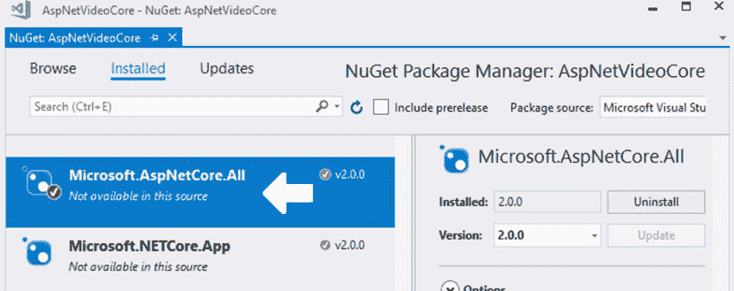

```
<ItemGroup>
  <PackageReference
    Include="Microsoft.AspNetCore.All"
    Version="2.0.0" />
  </ItemGroup>
```

在构建项目过程中，你将添加更多的 NuGet 包（框架）。

需要了解这一点是：ASP.NET 会监控文件系统，并在文件更改并保存时重新编译应用程序。由于 ASP.NET 会监控文件系统并重新编译代码，因此在构建应用程序时可以使用任何你喜欢的文本编辑器，例如 Visual Studio。你不再受限于 Visual Studio；你所需要做的只是让应用程序在 Web 服务器（IIS）中运行起来。让我们用一个例子来说明。

- 在不调试的情况下启动应用程序（Ctrl+F5），如果它尚未在浏览器中打开。
- 在 Visual Studio 之外使用记事本（或任何文本编辑器）打开 `Startup.cs` 文件。该文件负责在应用程序启动时配置它。
- 找到包含字符串 *Hello World* 的代码行。这行代码负责响应应用程序中的每一个 HTTP 请求。

`await context.Response.WriteAsync("Hello World!");`

- 将文本更改为 *Hello, from My World!* 并保存文件。

`await context.Response.WriteAsync("Hello, from My World!");`

- 在浏览器中刷新应用程序。在刷新页面之前，不要在 Visual Studio 中生成解决方案。
- 文本应该从 *Hello World!* 变为 *Hello, from My World!*。

这种方法之所以有效，是因为 ASP.NET 会监控文件系统，并在文件发生更改时重新编译应用程序。

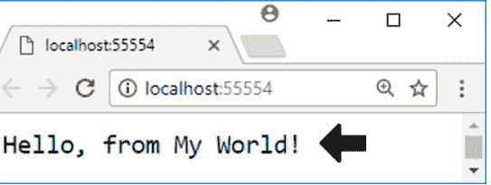

你可以使用 ASP.Net Core 2.0 创建跨平台应用程序，但这需要 .NET Core 模板。在编写本文时，该模板与 .NET Framework 模板相比具有局限性。这是因为 .NET Framework 包含了依赖于 Windows 操作系统的功能。几年后，随着 .NET Core 的演进，这种差距将不再显著。因此，如果你不需要 .NET Framework 中的额外功能，请使用 .NET Core 模板，因为它更精简且跨平台。

`web.config` 文件统治配置世界的时代已经过去了。现在 `Startup.cs` 文件包含一个 `Startup` 类，ASP.NET 将按照约定查找该类。应用程序及其配置源都在该类中配置。

`Startup` 类中的 `Configure` 和 `ConfigureServices` 方法处理大部分应用程序配置。HTTP 处理管道在 `Configure` 方法中创建，该方法位于类的末尾。管道定义了应用程序如何响应请求；默认情况下，它唯一能做的事情就是向浏览器打印 Hello World！

如果你想更改此行为，将必须在该方法的管道中添加额外的代码。如果你在 ASP.NET MVC 应用程序中有处理路由请求的实例，则你必须修改管道。

在 `Configure` 方法中，你设置了应用程序启动时调用的 HTTP 请求管道（中间件）。在本书的第二部分，你将向此方法添加一个名为 `AutoMapper` 的对象映射器。AutoMapper 将对象从一种类型转换为另一种类型。

你将在下一章中学习更多关于配置应用程序的知识。

目前，你关于依赖注入只需要知道的是：它不是显式地创建类的实例，而是在被请求时将它们传递给组件。这使得你的应用程序松耦合且灵活的。

# 添加服务

要从 `appsettings.json` 读取配置，你必须向 `Startup` 类中添加一个构造函数。你可以通过在类中输入 `ctor` 并按下 Tab 键来实现。

```csharp
public class Startup {
    public Startup() {
    }
}
```

- 你需要在构造函数中创建一个名为 `builder` 的 `ConfigurationBuilder` 类实例，并链式调用 `SetBasePath` 方法，将应用程序当前目录作为参数。如果不指定路径，应用程序将不知道去哪里搜索文件。

```csharp
var builder = new ConfigurationBuilder()
.SetBasePath(Directory.GetCurrentDirectory());
```

为了访问上一步中使用的类，你必须通过为它们添加 `using` 语句来解析两个命名空间。

```csharp
using Microsoft.Extensions.Configuration;
using System.IO;
```

- 为了读取 `appsettings.json` 文件，你需要对 `builder` 对象链式调用 `AddJsonFile` 方法，并将 `appsettings.json` 作为参数。如果你需要更多文件，可以多次调用该方法。

```csharp
var builder = new ConfigurationBuilder()
  .SetBasePath(Directory.GetCurrentDirectory())
  .AddJsonFile("appsettings.json");
```

- 在 `Startup` 类中添加一个类型为 `IConfiguration` 的 `Configuration` 属性。

```csharp
public IConfiguration Configuration { get; set; }
```

- 现在，你需要从 `ConfigurationBuilder` 对象构建配置结构，并将其存储在 `Configuration` 属性中。你通过在构造函数执行调用 `builder` 变量的 `Build` 方法。

```csharp
Configuration = builder.Build();
```

- 为了将硬编码的 Hello, from My World! 替换为存储在 `appsettings.json` 文件 Message 属性中的值，你需要对 `Configuration` 属性进行索引。在 `Configure` 方法的 `WriteAsync` 方法调用上方将值存储在变量中。

```csharp
var message = Configuration["Message"];
```

- 现在，用变量替换硬编码文本。

```csharp
await context.Response.WriteAsync(message);
```

- 保存所有文件并进入浏览器。刷新应用程序以查看新消息。

`Startup` 类类的代码如下：

```cs
public class Startup
{
    public IConfiguration Configuration { get; set; }

    public Startup()
    {
        var builder = new ConfigurationBuilder()
            .SetBasePath(Directory.GetCurrentDirectory())
            .AddJsonFile("appsettings.json");

        Configuration = builder.Build();
    }

    public void ConfigureServices(IServiceCollection services)
    {
    }

    public void Configure(IApplicationBuilder app, IWebHostEnvironment env)
    {
        {
            app.UseDeveloperExceptionPage();
        }
        app.Run(async (context) =>
        {
            var message = Configuration["Message"];
            await context.Response.WriteAsync(message);
        });
    }
}
```

与其使用一个特定的源来获取数据，你还可以根据情况使用服务从不同的源获取数据。这意味着通过通过配置，你可以根据当前的需求使用不同的数据源。

你可能在构建服务时想要从 JSON 文件获取数据，稍后切换到该服务的另一种实现，以获取真实数据。

为了实现这一点，你创建了一个由服务类实现的接口，然后在提供实例时使用该接口。因为服务类实现了相同的接口，所以来自它们的实例是可以互换的。

要从 `Startup` 类中的 `Configure` 方法（或任何其他构造函数、模型、Razor Page 或视图）访问服务，你必须使用依赖注入。也就是说，将接口作为参数传递给该方法。

你必须在 `Startup` 类的 `ConfigureServices` 方法中，在服务集合（services collection）中注册服务接口以及所需的服务类。这决定了当使用依赖注入传递实现接口的类实例时，将使用哪个类来创建该实例。

在接下来的示例中，你将把一个服务类注入到 `Configure` 方法中，但它也适用于你想要注入到构造函数、模型、Razor Page 或视图的普通类，效果同样良好。你在 `ConfigureServices` 方法中执行的相同类型的注册也可以应用于此场景，但你不需要将其实现为一种服务。

你可能会问，当在 `ConfigureServices` 方法中没有为它添加配置时，`WebApplicationBuilder` 参数如何在 `Configure` 方法中填充的。答案是，ASP.NET 会自动为接口提供某些服务对象；其中一个接口就是 `IApplicationBuilder`。另一个是 `IHostingEnvironment` 服务，它处理不同的环境，如开发、测试和生产环境。

让我们来实现一个示例，在该示例创建两个以不同方式检索数据的服务类。第一个将简单地返回一个硬编码字符串（如果你喜欢，可以假设数据是从数据库或网络服务获取的），而第二个类将返回你添加到 *appsettings.json* 文件中的 `Message` 属性的值。

你将首先添加一个名为 `IMessageService` 的接口，它将定义一个名为 `GetMessage` 的方法，该方法返回一个字符串。

然后你将在名为 `HardcodedMessageService` 的服务类中实现该接口，它将返回一个硬编码字符串。实现该类后，你将在 `ConfigureServices` 方法中为它和接口添加配置，并测试该功能。

然后你将实现另一个名为 `ConfigurationMessageService` 的类，它从 *application.json* 文件读取并返回其 `Message` 属性的值。要使用新服务，你必须更改配置。然后在浏览器中刷新应用程序，以确保返回了配置值。

1. 在解决方案资源管理器中，右键点击项目节点并选择 **Add-New Folder**（新建文件夹）。
2. 将文件夹命名为 `Services`。
3. 右键点击 `Services` 文件夹并选择 **Add-New Item**（新建项）。
4. 选择 **Interface**（接口）模板，将接口命名为 *IMessageService*并点击 **Add**（添加）按钮。
5. 为接口添加 **public** 访问修饰符（使其公共）。
6. 为接口添加一个名为 `GetMessage` 的方法，返回一个 *string*。它不应接受任何参数。
7. 保存文件。

接口的完整代码：

```cs
public interface IMessageService
{
    string GetMessage();
}
```

1. 右键点击 `Services` 文件夹并选择 **Add-Class**（添加类）。
2. 将类命名为 `HardcodedMessageService` 并点击 **Add**（添加）按钮。
3. 将接口添加到类后，通过点击悬停在接口名称上时出现的灯泡图标，在类中实现 `IMessageService` 接口。在出现的菜单中选择 **Implement interface**（实现接口）。
4. 删除带有 **throw** 语句的代码行，并返回字符串 *Hardcoded message from a service*。
5. 按键盘上的 Ctrl+Shift+S 保存所有文件。

## 初学者 ASP.NET Core 2.0 MVC & Razor Pages

`HardcodedMessageService` 类的完整代码：

```cs
public class HardcodedMessageService : IMessageService
{
    public string GetMessage()
    {
        return "Hardcoded message from a service.";
    }
}
```

### 配置并使用 HardcodedMessageService

1. 打开 `Startup.cs` 文件。
2. 找到 `ConfigureServices` 方法。
3. 为了在使用依赖注入时创建可以与 `IMessageService` 接口交换的实例，你必须在服务集合中为其添加定义。在此示例中，使用服务对象上的 `AddSingleton` 方法，指定接口作为第一个类型，第二个类型作为第二个类型：

```cs
services.AddSingleton<IMessageService, HardcodedMessageService>();
```

4. 你需要为 Services 文件夹添加使用 语句：

```csharp
using Services;
```

5. 现在你可以使用依赖注入从 `Configure` 方法访问 `IMessageService`：

```csharp
public void Configure(IApplicationBuilder app, IHostingEnvironment env, IMessageService msg)
```

6. 从 `Run` 块中删除声明消息变量的行。
7. 将 `WriteAsync` 方法中的变量名替换为对 `GetMessage` 方法的调用，这将包含一个 `HardcodedMessageService` 的实例：

```csharp
await context.Response.WriteAsync(msg.GetMessage());
```

8. 保存所有文件，切换到浏览器并刷新应用程序。应该会出现来自服务的硬编码消息。

## 初学者 ASP.NET Core 2.0 MVC & Razor Pages

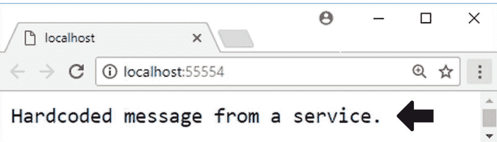

`ConfigureServices` 方法的完整代码：

```cs
public void ConfigureServices(IServiceCollection services)
{
    services.AddSingleton<IMessageService, HardcodedMessageService>();
}
```

`Configure` 方法的完整代码：

```cs
public void Configure(IApplicationBuilder app, IHostingEnvironment env, IMessageService msg)
{
    if (env.IsDevelopment())
    {
        app.UseDeveloperExceptionPage();
    }

    app.Run(async (context) => {
        await context.Response.WriteAsync(msg.GetMessage());
    });
}
```

在服务集合中添加服务时，你可以在几种 Add 方法之间选择。以下是最常用方法的概述：

- **Singleton**（单例）：创建一个在整个应用程序使用的实例。它在第一个依赖注入的对象创建时创建实例。


# ASP.NET Core 2.0 MVC & Razor Pages 初学者

**Scoped**（作用域）：生命周期服务，在每个作用域内创建一次。它在当前作用范围内等同于 **Singleton**。也就是说，在同一个 HTTP 请求内重用同一个实例。

瞬性服务（Transient services）在每次被请求时创建，且不会被重用。这种生命周期最适用于轻量级、无状态的服务。

## 添加并使用 ConfigurationMessageService 类

1. 右键点击 Services 文件夹并选择 Add-Class（添加类）。
2. 将类命名为 `ConfigurationMessageService` 并点击 Add（添加）按钮。
3. 在类中实现 `IMessageService` 接口。
4. 为类添加构造函数（你可以使用 `ctor` 代码片段）。
5. 在构造函数中注入 `IConfiguration` 接口并将其命名为 `configuration`。
6. 将配置对象保存在名为 `_configuration` 的私有类变量中。你可以通过在字段中编写变量、点击小灯泡图标并选择 Generate field...（生成字段...）来让 Visual Studio 为你创建该变量。

```
private IConfiguration _configuration;
public ConfigurationMessageService(IConfiguration configuration) {
    _configuration = configuration;
}
```

7. 你需要使用 `Microsoft.Extensions.Configuration;` 添加到 `Microsoft.Extensions.Configuration` 命名空间。
8. 从 `GetMessage` 方法中删除 `throw` 语句，并返回存储在 `appsettings.json` 文件中 `Message` 属性的字符串。你可以通过对 Configuration 对象进行索引来实现：`return _configuration["Message"];`
9. 打开 `Startup.cs` 文件并找到 `ConfigureServices` 方法。
10. 将 `HardcodedMessageService` 类型更改为 `AddSingleton` 方法调用：`services.AddSingleton<IMessageService, ConfigurationMessageService>();`
11. 使用现有的 `Configuration` 对象再次调用 `AddSingleton` 方法，并使用 Lambda 表达式将其传递给方法的提供程序。这是已拥有对象时使用 `Add` 方法的另一种方式。你必须添加此行代码为依赖注入准备配置：`services.AddSingleton(provider => Configuration);`
12. 按键盘上的 `Ctrl+Shift+S` 保存所有文件。
13. 切换到浏览器并刷新应用程序。
14. 你应该看到来自 `appsettings.json` 文件的消息“Hello, from configuration”。

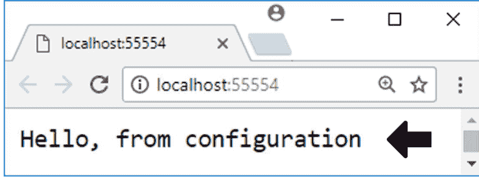

`ConfigurationMessageService` 类的完整代码如下：

```
public class ConfigurationMessageService : IMessageService
{
    private IConfiguration _configuration;

    public ConfigurationMessageService(IConfiguration configuration)
    {
        _configuration = configuration;
    }

    public string GetMessage()
    {
        return _configuration["Message"];
    }
}
```

`ConfigureServices` 方法的完整代码：

```csharp
public void ConfigureServices(IServiceCollection services)
{
    services.AddSingleton(provider => Configuration);
    services.AddSingleton<IMessageService, ConfigurationMessageService>();
}
```

## 总结

在本章中，你创建了第一个 ASP.NET 应用程序，并添加了必要的部分使其运行。在本书的第一部分，你将使用服务和中间件添加新功能。

你还添加了一个配置文件，并创建和注册了一个服务，以便通过依赖注入在应用程序的其他部分可以使用它。

在下一章中，你将学习中间件。

# 2. 中间件

在本章中，你将添加处理 HTTP 请求的中间件，例如应用程序在发生错误时的行为。中间件的一个关键方面是执行用户身份验证和授权。

在本章结束时，你将为 MVC 应用程序构建中间件管道。

## 中间件是如何工作的？

让我们来看看中间件是如何工作的以及它的用途是什么。

当一个 HTTP 请求到达服务器时，是中间件组件处理了该请求。

ASP.NET 中的每个中间件部分都是一个具有非常有限、特定功能的对象。这意味着你需要添加许多中间件使应用程序正常工作。

以下示例说明了当以 `/reviews` 结尾的 HTTP 请求到达服务器时会发生什么。

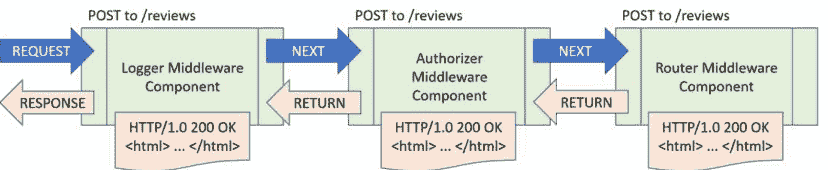

`Logger` 是一个独立的中间件组件，用于记录每个入站请求。它可以读取请求数据，例如标头、查询字符串、Cookie 和访问令牌。它不仅可以读取数据，还可以更改请求信息。

最可能的场景是，`Logger` 会记录信息并将处理传递给管道中的下一个中间件组件。

下一个中间件组件可能是授权器，它可以检查访问令牌或 Cookie 以决定请求是否继续。如果请求没有正确的凭据，授权中间件组件可以返回 HTTP 错误代码或将用户重定向到登录页面。

如果请求已授权，它将传递给下一个中间件组件，可能是路由组件。路由器将查看 URL 以确定去向。如果无法找到可以响应的内容，将返回 404 错误。

最可能的场景是，`Logger` 会记录信息并将处理传递给下一个中间件组件。这意味着中间件是按顺序执行的。

## 异常处理

让我们来看看管道是如何处理异常消息的。如之前提到的，`UseDeveloperExceptionPage` 中间件旨在帮助开发者处理可能发生的异常。为了测试这一点，你可以在 `Run` 块的顶部添加一个 `throw` 语句，并在浏览器中刷新应用程序。

1. 打开 `Startup.cs` 文件，并在 `Configure` 方法中找到 `Run` 中间件。
2. 在 `Run` 块中添加一个返回字符串 *Fake Exception!* 的 `throw` 语句。

```csharp
app.Run(async (context) =>
{
    throw new Exception("Fake Exception!");
    await context.Response.WriteAsync("Fake Exception!"); // 修复了变量的 OCR 错误
});
```

3. 为 `System` 命名空间添加 `using` 语句以访问 `Exception` 类。`using System;`
4. 如果你还没有启动应用程序，按 `Ctrl+F5` 无调试启动它。否则，切换到浏览器并刷新应用程序。
5. 将显示一个漂亮的错误消息。注意，此消息仅在开发模式下显示。在此页面上，你可以阅读有关错误的详细信息、查询字符串、cookie 信息和标头内容。

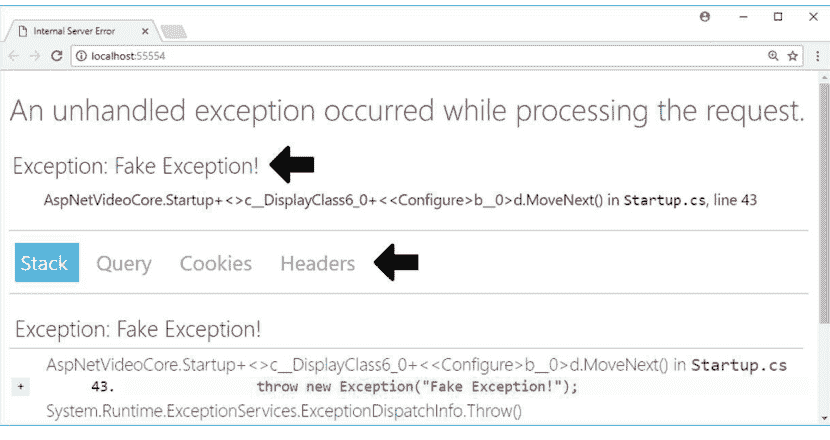

现在让我们看看如果将环境变量更改为 *Production* 并刷新页面会发生什么。

- 在主菜单中选择 Project-AspNetVideoCore Properties。
- 点击对话框左侧的 Debug 选项卡。
- 将 `ASPNETCORE_ENVIRONMENT` 属性更改为 *Production*。
- 保存所有文件 (`Ctrl+Shift+S`)。
- 在浏览器中刷新应用程序。
- 现在你将得到一个 HTTP 500 Error - This page isn't working 错误，这是普通用户会看到的内容。如果你没有看到此消息，则必须通过 `Ctrl+F5` 手动构建项目。

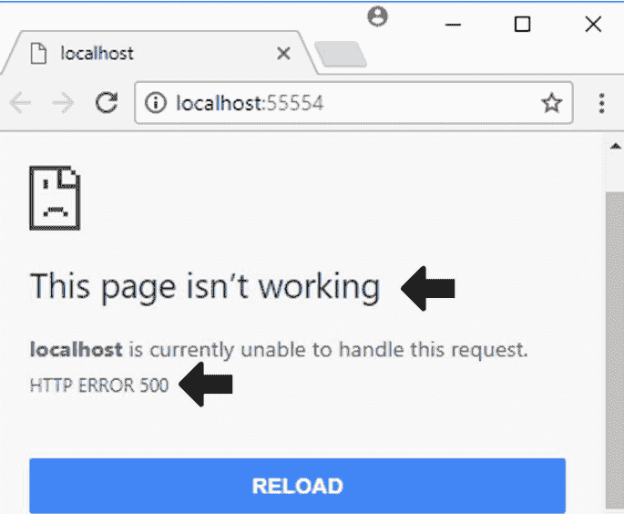

- 回到 Visual Studio 并将 `ASPNETCORE_ENVIRONMENT` 属性改回 *Development*。
- 保存所有文件。
- 在浏览器中刷新应用程序；你现在应该回到了漂亮的错误页面。

现在让我们看看如果我们注释掉 `app.UseDeveloperExceptionPage` 中间件会发生什么。

1. 打开 `Startup.cs` 文件并找到 `Configure` 方法。
2. 注释掉对 `app.UseDeveloperExceptionPage` 中间件的调用。

`//app.UseDeveloperExceptionPage();`

3. 保存文件。
4. 在浏览器中刷新应用程序。
5. 应该显示普通的 HTTP 500 错误，因为你不再加载产生漂亮错误消息的中间件。

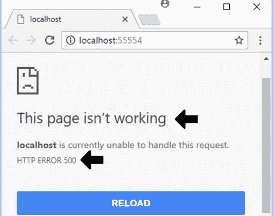

6. 再次取消注释并保存文件。
7. 最后刷新一次浏览器以确保显示漂亮的错误消息。
8. 从 `Run`-块中移除 `throw` 语句并保存文件。

`throw new Exception("Fake Exception!")`

你可以使用通过依赖传递的 `IHostEnvironment` 对象来获取有关环境的信息。你已经使用了一个 `if` 语句来判断环境变量是否设置为 Development；如果是，则将显示漂亮的错误页面。你还可以使用 `WebRoot` 属性使用项目中 `wwwroot` 目录的绝对路径。

## 提供静态文件

几乎所有的 Web 应用程序都需要提供静态文件的能力，例如 JSON、CSS 和 HTML 文件。为了允许 ASP.NET 提供文件，你必须添加一个名为 `UseStaticFiles` 方法的中间件组件，该方法位于 `Microsoft.AspNetCore.StaticFiles` NuGet 包中，该包随默认的 `Microsoft.AspNetCore.All` NuGet 包一起安装。

如果没有 `UseStaticFiles` 中间件组件，应用程序将显示来自 `Run` 中间件的消息。

让我们向 `wwwroot` 文件夹添加一个 HTML 文件并看看会发生什么以及为什么。静态文件必须添加到 `wwwroot` 文件夹中 ASP.NET 才能找到它们。

1. 右键点击 `wwwroot` 文件夹并选择 Add-New Item（添加新项）。
2. 搜索 HTML Page 模板并选择它。
3. 将文件命名为 `index.html` 并点击 Add 按钮。
4. 在 `<title>` 标签中添加文本 `An HTML Page`，并在 `<body>` 标签中添加 `Hello, from index.html`。
5. 保存所有文件并在浏览器中导航到 `/index.html` 页面。
6. 显示消息 "Hello, from configuration"，这可能不是你预期的结果。

显示 "Hello, from configuration" 的原因是因为目前没有中间件可以提供该静态文件。相反，可以访问的 `Run` 中间件将被显示。

让我们通过添加默认安装的 `Microsoft.AspNetCore.StaticFiles` NuGet 包中的新中间件来解决这个问题。

当调用 `UseStaticFiles` 方法时，ASP.NET 将在 `wwwroot` 中查找该文件。如果找到静态文件，它将被提供服务。

1. 打开 `Startup.cs` 文件并找到 `Configure` 方法。
2. 在 `Run` 中间件之上的 `app` 对象上添加 `UseStaticFiles()` 的调用。

`app.UseStaticFiles();`

`Configure` 的完整代码：

```csharp
public void Configure(IApplicationBuilder app, IHostingEnvironment env, ILogger msg)
{
    if (env.IsDevelopment())
    {
        app.UseDeveloperExceptionPage();
    }

    app.UseStaticFiles();

    app.Run(async (context) =>
    {
        await context.Response.WriteAsync("Hello World!");
    });
}
```

## 设置 ASP.NET MVC

你在这一章中将做的最后一件事是设置 ASP.NET MVC。默认安装的 `Microsoft.AspNetCore.Mvc` 包包含了你将添加到管道的 MVC 中间件，以及你将添加到服务集合的 MVC 服务。你将添加一个可以从浏览器请求的控制器和 Index 方法。你将在下一章学习更多关于 MVC 的知识。现在，让我们来看一个简单的例子。

1. 添加一个可以响应进入应用程序请求的控制器。惯例是将控制器类添加到名为 `Controllers` 的文件夹中。右键点击项目节点并选择 Add-New Folder，将其命名为 Controllers。
2. 右键点击 `Controllers` 文件夹并选择 Add-Class。
3. 将类命名为 `HomeController`（默认控制器的命名）并点击 Add 按钮。该类不需要继承任何其他类。

```csharp
public class HomeController
{
```

4. 在 `HomeController` 类中添加一个返回字符串的公共方法 `Index`。在方法中返回字符串 "Hello, from the controller!"。

```csharp
public string Index()
{
    return "Hello, from the controller";
}
```

5. 保存所有文件并运行应用程序 (`F5`)。导航到 `index.html` 页面。注意，`index.html` 文件仍然提供给用户，显示文本 Hello, from index.html。这是因为你还没有添加 MVC 服务和中间件。
6. 在 Visual Studio 中停止应用程序。
7. 删除你添加到 `wwwroot` 文件夹的 `index.html` 文件；你将不再需要它，因为你想让控制器来响应。你可以通过解决方案管理器或 Windows 文件资源管理器进行操作。
8. 打开 `Startup.cs` 文件并找到 `Configure` 方法。
9. 在 `UseStaticFiles` 中间件之后添加 MVC 方法，调用 `UseMvcWithDefaultRoute` 方法。在 `UseStaticFiles` 中间件之前添加它将赋予应用程序不同的行为。

`app.UseMvcWithDefaultRoute();`

10. 保存所有文件并运行应用程序 (`F5`)。你将收到一条异常消息，告诉你尚未添加必要的 MVC 服务。

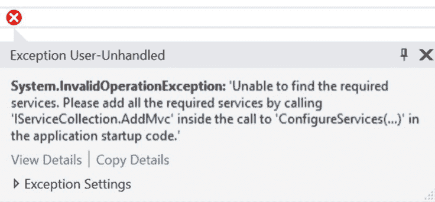

- 打开 `Startup` 类并找到 `ConfigureServices` 方法。
- 在方法的顶端将 MVC 服务添加到服务集合中。现在它将为 ASP.NET 提供运行 MVC 应用程序所需的所有内容。

```csharp
public void ConfigureServices(IServiceCollection services)
{
  ...
  services.AddMvc();
}
```

- 注释或删除 `UseStaticFiles` 方法调用。

```csharp
app.UseStaticFiles();
```

- 保存所有文件并运行应用程序 (`F5`)。现在浏览器中将显示“Hello, from the controller!”消息。这意味着 MVC 已经安装并正常工作。在下一章节中，你将实现一个更复杂的控制器。

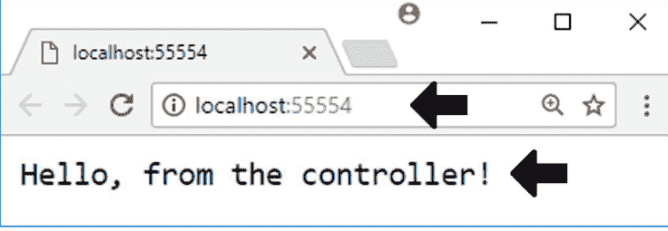


# ASP.NET Core 2.0 MVC Razor Pages 初学者教程

`ConfigureServices` 方法中的完整代码：

```csharp
public void ConfigureServices(IServiceCollection services)
{
    services.AddMvc();
    services.AddSingleton(provider => new Configuration());
    services.AddSingleton<IMessageService, ConfigurationMessageService>();
}
```

`Configure` 方法中的完整代码：

```csharp
public void Configure(IApplicationBuilder app, IHostingEnvironment env, IMessageService msg)
{
    if (env.IsDevelopment())
    {
        app.UseDeveloperExceptionPage();
    }

    app.UseMvcWithDefaultRoute();

    app.Run(async (context) =>
    {
        await context.Response.WriteAsync(msg.GetMessage());
    });
}
```

## 总结

在本章节中，你学习了如何在 `Startup` 类的 `Configure` 方法中配置中间件。

应用程序现在有了几个中间件组件，包括开发者错误页面和 MVC。MVC 中间件可以将请求转发到控制器类中的操作方法以提供内容。

在下一章节中，你将学习更多关于控制器的知识，你可以在同一个应用程序中使用许多不同的控制器，以及如何将 HTTP 请求路由到相应的控制器。

你还将创建返回 HTML 的控制器操作，而像上一个示例那样只返回字符串。

## 3. MVC 控制器

在本章节中，你将学习 MVC，这是一种用于应用程序用户界面层的流行设计模式，其中 M 代表 Model（模型），V 代表 View（视图），C 代表 Controller（控制器）。在较大的应用程序中，MVC 通常与其他设计模式（如数据访问和消息模式）结合使用，以创建一个完整的应用程序栈。本书将关注 MVC 的基础知识。

控制器负责处理发送到应用程序的任何 HTTP 请求。它可能是访问应用程序 `/videos` URL 的浏览器浏览。控制器的责任是处理并组合所有必要的数据并将其封装在模型对象中，模型对象充当到视图的数据载体。

模型被发送到视图，视图在渲染成 HTML 时使用这些数据。然后，HTML 作为 HTML 响应返回给客户端浏览器。

MVC 模式在模型、视图和控制器之间创建了关注点分离。控制器的唯一职责是处理请求并构建模型。模型的职责是在控制器和视图之间传输数据和逻辑，而视图则负责将数据转换为 HTML。

为了使这种机制生效，必须有一种方法将 HTTP 请求发送到正确的控制器。这就是 ASP.NET 路由的作用。


### ASP.NET Core 2 MVC Razor Pages 初学者教程

- 1. 用户通过输入 URL 向服务器发送 HTTP 请求。
- 2. 服务器上的控制器通过获取数据并创建模型对象来处理请求。
- 3. 模型对象被发送到视图。
- 4. 视图使用数据渲染 HTML。
- 5. 视图作为 HTTP 响应返回给用户浏览器。

### 路由

上一章节实现的 ASP.NET 中间件必须将传入的 HTTP 请求路由到控制器，因为你正在构建一个 ASP.NET Core MVC 应用程序。请求的发送取决于 URL 和你提供的配置。

可以定义多个路由，ASP.NET 会按照它们添加的顺序进行评估。如果需要，你也可以将约定路由与特性路由结合起来。特性路由在约定路由难以使用的边界情况下特别有用。

提供路由配置的一种方法是在 `Startup` 类中使用约定路由。通过这种配置，你告诉 ASP.NET 如何找到控制器的名称、操作名称以及 URL 中可能的参数。控制器是一个 C# 类，操作是控制器类中的公共方法。参数可以是任何表示为字符串的值，例如整数或 GUID。

可以使用 Lambda 表达式完成配置：

```csharp
app.UseMvc(routes => {
  routes.MapRoute(
    name: "default",
    template: "{controller}/{action}/{id?}");
});
```

### 约定路由

ASP.NET Core 2 MVC Razor Pages 初学者教程

- 1. 用户通过输入 URL 向服务器发送 HTTP 请求。
- 2. 服务器上的控制器通过获取数据并创建模型对象来处理请求。
- 3. 模型对象被发送到视图。
- 4. 视图使用数据渲染 HTML。
- 5. 视图作为 HTTP 响应返回给用户浏览器。

提供路由的一种的方法是在 `Startup` 类中使用约定路由。通过这种配置，你告诉 ASP.NET 如何找到控制器的名称、操作名称以及 URL 中可能的参数。控制器是一个 C# 类，操作是控制器类中的公共方法。参数可以是任何表示为字符串的值，例如整数或 GUID。

可以使用 Lambda 表达式完成配置：

```csharp
app.UseMvc(routes => {
  routes.MapRoute(
    name: "default",
    template: "{controller}/{action}/{id?}");
});
```

### 特性路由

ASP.NET Core 2 MVC Razor Pages 初学者教程

- 1. 用户通过输入 URL 向服务器发送 HTTP 请求。
- 2. 服务器上的控制器通过获取数据并创建模型对象来处理请求。
- 3. 模型对象被发送到视图。
- 4. 视图使用数据渲染 HTML。
- 5. 视图作为 HTTP 响应返回给用户浏览器。

实现路由的另一种方法是使用特性路由。你在控制器和操作方法上使用 `[Route]` 特性。

```csharp
[Route("controller]")]
public class HomeController : Controller
{
    [Route("index]")]
    public IActionResult Index()
    {
        return View();
    }
}
```

## 添加另一个控制器

ASP.NET Core 2 MVC Razor Pages 初学者教程

现在你已经实现了默认路由，是时候添加另一个控制器并查看你如何访问它了。

- 1. 右键点击 `Controllers` 文件夹并选择 `Add-Class`。
- 2. 将控制器命名为 `EmployeeController` 并点击 `Add` 按钮。

```csharp
public class EmployeeController
{
```

- 3. 为控制器添加另一个名为 `Name` 的操作方法，返回一个字符串。在方法中返回你的名称。

```csharp
public string Name()
{
    return "Jonas";
}
```

- 4. 再添加一个名为 `Country` 的操作方法，同样返回一个字符串。在方法中返回你的居住地。
- 5. 保存文件并切换浏览器。尝试根 URL。
- 6. 将 URL 更改为 `/Employee/Name`，这应该会在浏览器中显示你的名称。例如 *Jonas*。
- 7. 将 URL 更改为 `/Employee/Country`，这应该会在浏览器中显示你的居住地。我的情况下是 *Sweden*。
- 8. 将 URL 更改为 `/Employee`。ASP.NET 将请求传递给 `Run` 中间件，该中间件使用你之前实现的 `ConfigurationMessageService` 返回字符串 *Hello from configuration*。这是因为 `EmployeeController` 类没有名为 `Index` 的操作方法，这就是定义为之前在 `Startup` 类中添加的默认路由的默认操作名称。
- 9. 在 `EmployeeController` 类中添加一个新方法 `Index`，该方法返回字符串 "Hello from Employee"。
- 10. 保存文件并在浏览器中刷新应用程序，或者使用 `/Employee` URL。现在应该显示显示 "Hello from Employee" 文字。

`EmployeeController` 类的完整代码如下：

```csharp
public class EmployeeController {
    public string Name() {
        return "Jonas";
    }
    public string Country() {
        return "Sweden";
    }
    public string Index() {
        return "Hello from Employee";
    }
}
```

### 特性路由 (Attribute Routing)

让我们使用 `EmployeeController` 及其操作来实现一个特性路由的示例。

- 1. 打开 `EmployeeController` 类。
- 2. 如果你想让控制器通过特性路由响应 `/Employee`，请在控制器类上方添加 `[Route]` 特性，并指定 `employee` 为其参数值。你必须引入 `Microsoft.AspNetCore.Mvc` 命名空间才能使用 `Route` 特性。

```csharp
[Route("employee")]
public class EmployeeController
```

## ASP.NET Core MVC & Razor Pages 初学者教程

- 3. 保存文件并导航到 `/Employee` URL。浏览器中显示了一个异常。该异常的原因是 ASP.NET 无法确定三个操作中的哪一个是默认操作。

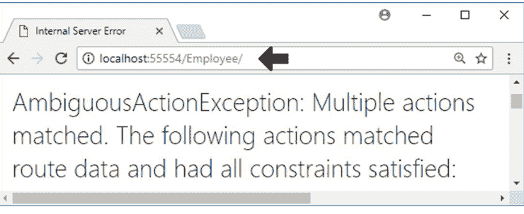

- 4. 为了解决这个问题，你可以为每个操作方法指定 `[Route]` 特性，并使用空字符串作为默认操作。让我们让 `Index` 操作成为默认操作，并将其他操作方法的路由命名为与方法名相同。

```csharp
[Route("")]
public string Index()
{
    return "Hello from Employee";
}
[Route("name")]
public string Name()
{
    return "Jonas";
}
[Route("country")]
public string Country()
{
    return "Sweden";
}
```

- 5. 保存文件并在浏览器中刷新应用程序。确保 URL 以 `/Employee` 结尾。你应该在浏览器中看到消息 *Hello from Employee*。

## ASP.NET Core 2.0 MVC & Razor Pages 初学者教程

6. 通过在 `/Employee` URL 后面标记特定操作的路由名称来导航到其他操作，例如 `/Employee/Name`。你应该能够导航到这些操作并看到信息。

7. 让我们清理控制器并让其路由更具重用性。与其使用硬编码的值作为控制器的路由，你可以使用 `[controller]` 令牌，它代表控制器类的名称（在此例中为 `Employee`）。如果你由于某些原因需要重命名控制器，这将变得更容易。

```csharp
[Route("[controller]")]
public class EmployeeController
```

8. 你可以对操作方法执行相同的操作，但要使用 `[action]` 令牌。ASP.NET 将将令牌替换为操作名称。保留 `Index` 操作上的空 `[Route]` 特性，并在第二个 `[Route]` 特性中添加 `[action]` 令牌，使其具有两个路由；这使得你可以使用基础路由 `/Employees` 或 `/Employees/Index` 来访问该操作。

```csharp
[Route("")]
[Route("[action]")]
public string Index()
{
    return "Hello from Employee";
}

[Route("[action]")]
public string Name()
{
    return "Jonas";
}
```

9. 保存文件并在浏览器中刷新应用程序。确保 URL 以 `/Employee/Name` 结尾。你应该在浏览器中看到你的名字。也测试其他 URL，以确保它们正常工作。

10. 你可以在路由中使用字面量。假设你想让 `EmployeeController` 的路由为 `Company/Employee`；那么你可以在控制器的路由前面加上 `Company`。

```csharp
[Route("company/[controller]")]
public class EmployeeController
```

11. 保存文件并在浏览器中刷新应用程序。确保你没有在浏览器中看到你的名字；相反，ASP.NET 显示了来自 `Run` 中间件的文本。其的原因是

## ASP.NET Core 2.0 MVC Razor Pages 初学者教程

不再有通 `/Employee/Name` 的路由了；它已变为 `/Company/Employee/Name`。将浏览器中的 URL 更改为 `/Company/Employee/Name`。你现在应该再次看到你的名字。如果你不想在控制器中设置默认路由，甚至可以通过删除所有操作特性并将控制器路由更改为包含 `[action]` 令牌来清理它。这意味着你不能再通过 `/Company/Employee/Name` 访问 `Index` 操作；你必须在浏览器中提供显式的 URL 来访问每个操作。

```csharp
[Route("company/[controller]/[action]")]
public class EmployeeController
```

从操作方法中删除所有的 `[Route]` 特性，并将控制器的 `Route` 更改为包含 `[action]` 令牌。保存文件并在浏览器中使用 URL `/Company/Employee/Name`。你现在应该看到你的名字。

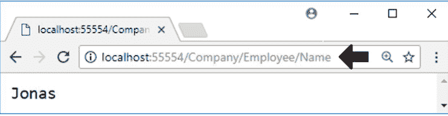

现在导航到 `/Company/Employee` URL。

`EmployeeController` 的完整代码如下：

```csharp
[Route("company/[controller]/[action]")]
public class EmployeeController
{
    public string Name() {
        return "Jonas";
    }
    public string Country() {
        return "Sweden";
    }
    public string Index() {
        return "Hello from Employee";
    }
}
```

## ASP.NET Core MVC & Razor Pages 初学者教程

### IActionResult

使用模型类，你可以将带有逻辑的对象发送到浏览器。按照惯，模型类应该存储在名为 `Models` 的文件夹中，但在较大的应用程序中，将模型存储在单独的项目中并不罕见。模型是一个 POCO（普通 CLR 对象或普通 C# 对象）类，它具有某些属性，用于指定浏览器在使用时的行为，例如检查字符串的长度或使用特定控件显示它。

让我们添加一个 `Video` 类，用于存储视频数据，例如 ID 和标题。通常，你不会在控制器操作中硬编码模型；对象通常是从数据源（如数据库）获取的（你将在另一章节中执行）。

- 1. 在解决方案管理器中右键点击项目节点并选择添加-新建文件夹。
- 2. 将文件夹命名为 `Models`。
- 3. 右键点击 `Models` 文件夹并选择添加类。
- 4. 将类命名为 `Video` 并点击添加。
- 5. 添加一个 `int` 属性 `Id`。当它作为数据库实体使用时，它是唯一 ID。


- 6. 添加一个 `string` 属性 `Title`。让我们保持简单；你稍后会添加更多属性。

```csharp
public class Video
{
    public int Id { get; set; }
    public string Title { get; set; }
}
```

- 7. 打开 `HomeController` 并继承 `Controller` 类。

```csharp
public class HomeController : Controller
```

- 8. 你需要在 `Mvc` 命名空间添加 `using` 语句以访问 `Controller` 类。

```csharp
using Microsoft.AspNetCore.Mvc;
```

- 9. 与从 `Index` 操作返回字符串相比，你把返回类型更改为 `ObjectResult`。

### 实现 ContentResult

让我们 `Name` 返回 `ContentResult`。

- 1. 打开 `EmployeeController` 类并继承 `Controller` 类。

- 2. 让 `EmployeeController` 类继承 `Controller` 类。

```csharp
public class EmployeeController : Controller
```

- 3. 将 `Name` 操作的返回类型更改为 `ContentResult`。

- 4. 修改返回语句，通过调用 `Content` 方法返回一个内容对象。

```csharp
public ContentResult Name()
{
    return Content("Jonas");
}
```

- 5. 保存所有文件，打开浏览器并导航到 `Company/Name` URL。

- 6. 你的名字应该返回到浏览器，和之前一样。

# 初学者入门 ASP.NET Core 2.0 MVC & Razor Pages

## 视图（Views）简介

在 ASP.NET Core MVC 应用中渲染视图的最流行方法是使用 Razor 视图引擎。要渲染视图，从控制器使用 **View** 方法返回一个 **ViewResult**。它携带了文件系统中视图的，如果需要，还会携带一个模型对象。

框架接收这些信息并生成发送到浏览器的 HTML。

让我们为 **Index** 操作实现一个视图，并将 **Video** 对象作为其模型传递。

- 1. 打开 **HomeController** 类。

- 2. 将 **Index** 操作的返回类型更改为 **ViewResult**：

  `public ViewResult Index()`

- 3. 调用 **View** 方法并传入之前创建的 **model** 对象：

  `return View(model);`

- 4. 保存文件并在浏览器中刷新应用程序。

- 5. 根据约定，ASP.NET 将查找与产生结果的操作同名的视图。它会在两个地方查找（均为子文件夹），都位于一个名为 Views 的文件夹下：第一个是与控制器类同名的文件夹，第二个是名为 **Shared** 的文件夹。在这种情况下，**Index** 操作没有视图，因此将抛出异常。

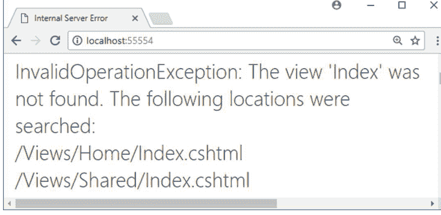

- 6. 要修复此问题，你必须添加一个名为 Index 的视图。在解决方案管理器中，右键点击项目节点，并选择“新建文件夹”。

- 7. 将文件夹命名为 **Views**。

- 8. 右键点击 Views 文件夹并选择“新建文件夹”，将其命名为 **Home**。

- 9. 右键点击 Home 文件夹并选择“添加新项”。

- 10. 选择 MVC 视图页面模板并点击添加按钮（默认名称应为 Index）。

- 11. 删除 Index.cshtml 视图中添加的所有内容。

- 12. 输入 `Html` 并按下键盘上的 Tab 键以插入视图的骨架。

- 13. 在 `<title>` 元素中添加文本 Video。

  ```html
  <title>Video</title>
  ```

- 14. 虽然你可以使用传递的模型并从实际对象进行推断，但在大多数情况下，显式指定模型可以获得 IntelliSense 智能提示和预编译错误检查。你在视图顶部使用 @model 指令来指定模型。注意，应该用小写的 m 进行声明。

  ```razor
  @model AspNetVideoCore.Models.Video
  ```

- 15. 要要在 <body> 元素中显示 Title 属性的值，你使用 @Model 对象来指定这是你的 Razor 语法。IntelliSense 将显示传递给视图的模型对象中所有可用的属性。

  ```html
  <body>@Model.Title</body>
  ```

- 16. 保存 Index 视图并在浏览器中刷新应用程序。你应该应该在浏览器中看到视频视图，并在浏览器标签页中看到文本 Video。

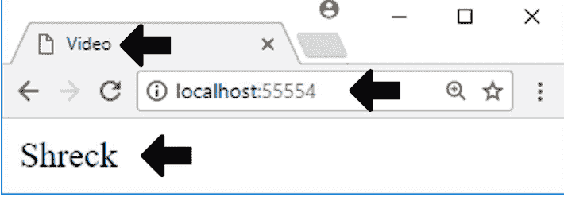

## 带数据集合的视图

现在你已经知道如何显示一个视频，是时候显示视频集合了。要实现这一点，你首先必须创建视频集合，然后将其传递给显示数据的视图。在视图中，你将使用 Razor foreach 循环将数据显示为 HTML。

- 1. 打开 **HomeController** 类。

- 2. 为 System.Collections.Generic 命名空间添加 using 语句以访问 List 集合：

  `using System.Collections.Generic;`

- 3. 将 Video 对象替换为 Video 对象列表：

  ```cs
  var model = new List<Video> { new Video { Id = 1, Title = "Shrek" }, new Video { Id = 2, Title = "Despicable" } };
  ```

- 4. 到浏览器并导航到 /Home。

- 5. 将出现错误消息，提示找不到模型。

- 6. 要解决这个问题，你将使用接口来实现不同的组件。

- 7. 当你将 @model 指令更改为 IEnumerable<Video> 时，就可以工作了。

- 8. 在 <table> 元素周围使用 @foreach 循环。

- 9. 保存所有文件，刷新应用程序，列表应该会被显示。

  ```razor
  @model IEnumerable<Video>

  <table>
      @foreach (var video in Model)
      {
          <tr>
              <td>@video.Id</td>
              <td>@video.Title</td>
          </tr>
      }
  </table>
  ```

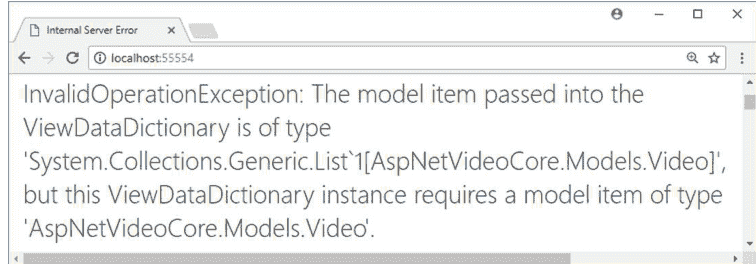

# 初学者 ASP.NET Core 2.0 MVC & Razor Pages

11. 在类中 `_videos` 字段下方添加一个构造函数。你可以使用 `ctor` 代码片段并按 `Tab` 键。

```csharp
public MockVideoData()
{
```

12. 打开 `HomeController` 类并复制视频列表，然后将其粘贴到 `MockVideoData` 构造函数中。移除 `var` 关键字并将变量 `_videos` 重命名，以便将列表赋值给你刚刚添加的字段。

```csharp
new Video Id = 1, Title = "Shrek",
new Video Id = 2, Title = "Despicable Me",
new Video Id = 3, Title = "Megamind"
```

13. 移除 `GetAll` 方法中的 `throw` 语句并返回 `_videos` 列表。

```csharp
public IEnumerable<Video> GetAll()
{
    return _videos;
}
```

14. 现在服务已经开发完成，你必须将其添加到 `Startup` 类中 `ConfigureServices` 方法的服务集合中。之前，你使用 `AddSingleton` 方法将 `IMessageService` 接口注册到服务集合中；这将确保定义的类只存在一个实例。这次让我们用另一种方法。使用 `AddScoped` 方法注册 `IVideoData` 接口；这将确保为每个 HTTP 请求创建一个对象。该 HTTP 请求可以流过许多共享相同实例的服务。`services.AddScoped<IVideoData, MockVideoData>();`

15. 打开 `HomeController` 类并为 `Services` 命名空间添加 `using` 语句。

```csharp
using AspNetVideoCore.Services;
```

16. 在类层级添加一个类型为 `IVideoData` 名为 `_videos` 的私有字段。这将持有从服务中获取的数据。

```csharp
private IVideoData _videos;
```

17. 为 `HomeController` 类添加一个构造函数并从中注入 `IVideoData` 接口。在构造函数内部将 `videos` 参数命名为 `_videos`。这将使得视频服务在整个控制器中可用。

```csharp
public HomeController(IVideoData videos)
{
    _videos = videos;
}
```

18. 将 `Index` 动作中赋值给 `model` 变量的硬编码 `List<Video>` 集合替换为对服务 `GetAll` 方法的。

```csharp
var model = _videos.GetAll();
```

19. 保存所有文件。

20. 到浏览器并刷新应用程序。你现在应该可以看到视频列表。

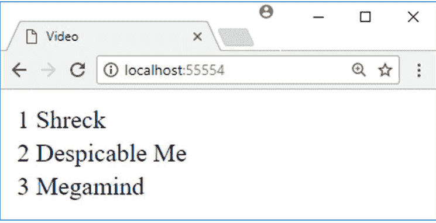

`IVideoData` 接口的完整代码：

```
public interface IVideoData {
    IEnumerable<Video> GetAll();
}
```

`MockVideoData` 类的完整代码：

```
public class MockVideoData : IVideoData
{
    private List<Video> _videos;
}
```

```csharp
public MockVideoData()
{
    _videos = new List<Video> {
        new Video { Id = 1, Genre = Models.Genres.Romance,
            Title = "Shrek" },
        new Video { Id = 2, Genre = Models.Genres.Comedy,
            Title = "Despicable Me" },
        new Video { Id = 3, Genre = Models.Genres.Action,
            Title = "Megamind" }
    };
}
```

```csharp
public IEnumerable<Video> GetAll() { return _videos; }
```

`Startup` 类中 `ConfigureServices` 方法的完整代码：

```csharp
public void ConfigureServices(IServiceCollection services)
{
    services.AddMvc();
    services.AddSingleton(provider => Configuration);
    services.AddSingleton<IMessageService, ConfigurationMessageService>();
    services.AddScoped<IVideoData, MockVideoData>();
}
```

`HomeController` 类的完整代码：

```csharp
public class HomeController : Controller
{
    private IVideoData _videos;
    public HomeController(IVideoData videoData)
    {
        _videos = videoData;
    }

    public ActionResult Index()
    {
        var model = _videos.GetAll();
        return View(model);
    }
}
```

## 总结

在本章中，你学习了 MVC（模型-视图-控制器）设计模式，以及控制器如何接收 HTTP 请求、从各种数据源收集数据并创建模型，然后由视图及其自身的标记处理为 HTML。

你将在整书中继续使用 MVC，并创建 Razor 视图以及更复杂的视图和模型，用于查看和编辑数据。

# 4. 模型 (Models)

在本章中，你将学习更多关于 MVC 框架中不同类型的模型类以及如何使用它们。

目前为止，你一直使用 `Video` 类作为 `Index` 视图的模型。在简单的解决方案中这可以，但在更复杂的解决方案中，你需要使用实体模型（entity models）和视图模型（view models）。有时你会在模型之间进行更细粒度的区分，在配合视图模型中使用数据传输对象（DTOs）。

实体模型通常用于定义数据库中的表。视图模型用于将数据从控制器传输到视图，但有时视图模型需要包含对象，这就是 DTO 发挥作用的地方。有些人人认为 DTO 就是视图模型，在某些情况下它们确实是。

你将创建一个新文件夹 `Entities` 并将 `Video` 类移动到该文件夹中。移动该文件的原因是 `Video` 类之后将用于定义一个 SQL Server 数据库中的表。创建一个名为 `Entities` 的文件夹。

### 更改文件夹结构

1. 创建 `Entities` 文件夹。

2. 将 `Models` 文件夹中的 `Video.cs` 文件移动到 `Entities`，使用拖拽完成。

3. 打开 `Video` 类并将命名空间改为 `Entities`。

4. 打开 `MockVideoData` 类并将命名空间改为 `Entities`。

5. 打开 `IVideoData` 接口并将命名空间改为 `Entities`。

6. 打开 `Index` 视图并将 `@model` 指令改为 `Entities`。

7. 打开 `HomeController` 并移除未使用的语句。

## 添加视图模型

1. 创建名为 `ViewModels` 的文件夹。

2. 在 `Models` 文件夹中添加名为 `Genres` 的类。

3. 将 `class` 关键字替换为 `enum` 并添加一些类型：

```csharp
public enum Genres
{
    None,
    Animated,
    Horror,
    Comedy,
    Romance,
    Action
}
```

4. 打开 `Video` 类并为类添加一个 `int` 类型的 `GenreId` 属性。这将持有视频类型的枚举值。

```csharp
public class Video
{
    public int Id { get; set; }
    public string Title { get; set; }
    public int GenreId { get; set; }
}
```

5. 在文件夹中添加一个名为 `ViewModel` 的类。

6. 视图模型将包含 `Id` 和 `Title` 属性，但你不想直接显示类型；显示实际类型会更好。为了实现这一点，在 `ViewModel` 类中添加一个 `string` 类型的 `Genre` 属性，但在 `Video` 类中不。

```csharp
public class ViewModel
{
    public int Id { get; set; }
    public string Title { get; set; }
    public string Genre { get; set; }
}
```

### 使用视图模型

现在视图模型已经创建，你需要将其作为模型发送到视图。这需要对 `HomeController` 和 `Index` 进行。你需要通过 ID 从 `_videos` 集合中获取视频，并将类型 ID 转换为 `Genres` 枚举中对应值的名称。

1. 打开 `HomeController` 类。

2. 为 `System.Linq` 命名空间添加 `using` 语句以访问 `Select` 方法，并为 `System` 命名空间以访问 `Enum` 类。此外，为 `ViewModels` 和 `Models` 命名空间添加 `using` 语句以访问类型枚举和你添加的视频模型。

```csharp
using AspNetVideoCore.Models;
using AspNetVideoCore.ViewModels;
using System;
using System.Linq;
```


3. 在 `Index` 动作中使用 LINQ `Select` 方法将每个视频转换为 `VideoViewModel` 对象，并将其存储在 `model` 字段中。使用 `Enum.GetName` 方法获取视频类型 ID 对应的类型方法。

# ASP.NET Core 2.0 MVC & Razor Pages 初学者教程

```sharp
public ViewResult Index()
{
    var model = _videos.GetAll().Select(video =>
    new VideoViewModel
    {
        Id = video.Id,
        Title = video.Title,
        Genre = Enum.GetName(typeof(Genres), video.GenreId)
    });
    return View(model);
}
```

- 4. 打开 Index 视图并将 `@model` 指令更改为 `IEnumerable<VideoViewModel>`。

  `@model IEnumerable<AspNetCore.Models.VideoViewModel>`

- 5. 为类型添加一个新的 `<td>` 标签。

  `<td>@@video.Genre</td>`

- 6. 切换到浏览器并刷新应用程序。如你所见，类型类型现在显示在每个视频标题的旁边。

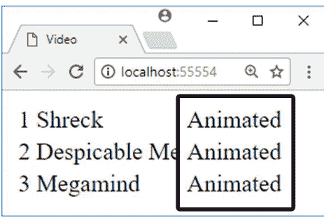

## 添加详情视图 (Details View)

现在你已经知道如何使用 `VideoViewModel` 将数据发送到 Index 视图，是时候向 Views 文件夹添加一个新视图了。

Details 视图将在浏览器中显示单个视频，这将基于你接下来要添加的 Details action 方法所发送的 `id`。

### ASP.NET Core 2.0 MVC & Razor Pages 初学者教程

- 1. 在 `HomeController` 中添加一个名为 `Details` 的新 public action 方法。它应该有一个名为 `id` 的 int 参数，该参数将匹配 URL 或请求数据中的视频 id。返回类型应该是 `IActionResult`，这使得返回不同类型的数据成为可能。

```csharp
public IActionResult Details(int id)
{
}
```

- 2. 获取与传入 id 匹配的视频，你必须在 `IVideoData` 接口中添加一个名为 `Get` 的新方法。该方法应该有一个名为 `id` 的 int 参数并返回视频对象。

```csharp
Video Get(int id);
```

- 3. 现在你需要在 `MockVideoData` 类中实现该方法，并返回与 `id` 参数值匹配的视频。使用 LINQ 的 `FirstOrDefault` 方法获取视频。

```csharp
public Video Get(int id)
{
    return _videos.FirstOrDefault(v => v.Id.Equals(id));
}
```

- 4. 为 `System.Linq` 命名空间添加语句。

```csharp
using System.Linq;
```

- 5. 在 `HomeController` 类的 Details action 中添加名为 `model` 的变量。使用 `Get` 方法获取与传入 id 匹配的视频并将其赋值给 `model` 变量。

```csharp
var model = _videos.Get(id);
```

- 6. 使用 `ObjectResult` 实例返回 `model` 变量以测试 Get 方法。

```csharp
return new ObjectResult(model);
```

- 7. 保存所有文件并切换到浏览器。导航到 `/Home/Details/2` URL。应该显示与 id 2 匹配的视频。

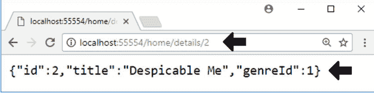

### ASP.NET Core 2.0 MVC & Razor Pages 初学者教程

- 8. 将 Details action 中的返回语句更改为返回 `View` 方法，并传递一个填充了 `model` 变量数据的 ViewModel 类实例。

```csharp
return View(new ViewModel)
{
    Id = model.Id,
    Title = model.Title,
    Genre = Enum.GetName(typeof(Genres)), model.GenreId
}
```

- 9. 在解决方案资源器的 `Views/Home` 文件夹中添加名为 `Details.cshtml` 的新 MVC 视图页面文件。

- 10. 删除 Details 视图中的所有内容。

- 11. 在标签页中输入 `html` 为视图添加 HTML 骨架。

- 12. 为视图添加单个 ViewModel 的 `@model` 指令。这使得视图能够显示关于一个视频的信息。

`@model AspNetVideoCore.Models.ViewModel`

- 13. 在 `<item>` 元素中添加文本 Video。

- 14. 在 `<body>` 元素内部为每个属性添加一个 `<div>` 元素。

```html
<div>: @Model.Id</div>
<div>Title: @Model.Title</div>
<div>Genre: @Model.Genre</div>
```

- 15. 保存所有文件并刷新到浏览器。你应该能看到与 URL 中的 id 匹配的视频数据。

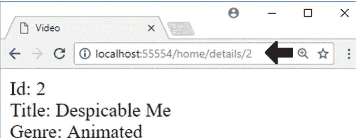

- 16. 更改 URL 中的 id 并确保显示正确的电影。

### ASP.NET Core 2 MVC & Razor Pages 初学者教程

- 17. 更改为一个不存在的 id。浏览器中应该显示错误。

错误的原因是如果视频不存在，Get 方法将返回 null，而视图可以处理模型的空空值。

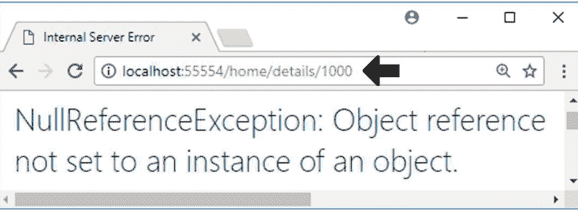

- 18. 解决此问题的方法是重定向到另一个 action；在这种情况下，Index action 是合适的。在上一个返回语句之前添加一个 `if` 语句，检查 model 是否为 null；如果是，则重定向到 Index action。实现此操作可以确保 action 不会显示错误，而是显示视频列表。

```csharp
if (model == null)
    return RedirectToAction("Index");
```

- 19. 切换到浏览器并刷新。Index 视图应该显示。

- 20. 在 Details 视图中添加指向 Index 视图的链接，以便导航回根目录。可以使用传统的 `<a>` 标签或 `ActionLink` 方法。第三种方法是使用 Tag Helpers 添加链接：`@Html.ActionLink("Home", "Index")`

- 21. 切换到浏览器并导航到 `/Home/Details/2`。视图应该有一个文本为 Home 的链接。

- 22. 现在打开 Index 视图并视频添加链接。要实现这一点，你必须传递匿名对象作为参数，并向该对象添加 `id` 属性。

```html
<td>@Html.ActionLink(video.Id.ToString(), "Details", new { id })</td>
```

- 23. 切换到浏览器并进入根目录 `/`。点击链接之一查看该视频的详情。

### ASP.NET Core 2.0 MVC & Razor Pages 初学者教程

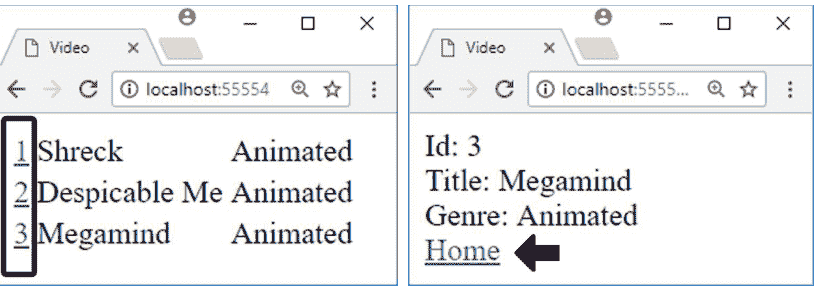

Index 视图的完整标记：

```html
@model IEnumerable<AspNetCoreVideoCore.ViewModels.VideoViewModel>
<html xmlns="http://www.w3.org/1999/xhtml">
<head>
    <title>Video</title>
</head>
<body>
<table>
    @foreach (var video in Model)
    {
        <tr>
            <td>@Html.ActionLink(video.Id.ToString(), "Details", new { id = video.Id })</td>
            <td>@video.Title</td>
            <td>@video.Genre</td>
        </tr>
    }
</table>
</body>
</html>
```

Details 视图的完整标记：

```html
@model AspNetVideoCore.ViewModels.VideoViewModel
<html xmlns="http://www.w3.org/1999/xhtml">
<head>
    <title>Video</title>
</head>
<body>
  <div>Id: @Model.Id</div>
  <div>Title: @Model.Title</div>
  <div>Genre: @Model.Genre</div>
  @Html.ActionLink("Home", "Index") />
</body>
</html>
```

Details action 的完整标记：

```csharp
public IActionResult Details(int id)
{
    var model = _videos.Get(id);

    if (model == null) return RedirectToAction("Index");

    return View(new ViewModel
    {
        Id = model.Id,
        Title = model.Title,
        Genre = Enum.GetName(typeof(Genres), model.GenreId
    });
}
```

## 添加创建视图 (Create View)

使用 Create 视图在数据源创建新记录时，必须实现两个 action 方法。第一个是使用 HTTP GET 在浏览器中渲染 Create 视图，选择需要数据的字段和控件。第二个是 HTTP POST 方法，通过 HTTP POST 请求接收客户端的数据。

从客户端提交可以通过多种方式，例如使用 JavaScript 或表单提交。在本示例中，当用户点击提交 按钮时使用表单提交回调服务器。

HTTP POST action 方法可以从发布数据的多个位置获取数据：标头、查询字符串和请求体。然后将数据与模型对象的属性（action 方法的参数）进行匹配。action 还可以处理 int 和 string 等简单类型，而无需将其封装在模型对象中。

### ASP.NET Core 2.0 MVC & Razor Pages 初学者教程

你需要注意一种命名约定，以便正确将表单数据与模型对象的属性和其他参数匹配。规则规定表单数据中的元素名称必须与要匹配的属性名称匹配。

使用 enum 的视图的默认行为将其显示为文本字段。在本节中，你删除 Video 类的 Genre 属性，并添加一个类型为 Genres 的新属性 Genre。这使得处理 enum 数据变得更容易，特别是在处理 SQL 数据库实体模型时。

你还将将 enum 作为属性添加到名为 VideoEditModel 的新视图模型中，该模型可以在创建新视频和编辑视频时使用。

### 重构应用程序 (Refactoring the Application)

- 1. 打开 Video 类。

- 2. 删除 Genre 属性。

- 3. 在 Models 命名空间添加使用 语句以使用 Genre 枚举：`using AspNetVideoCore.Models;`

- 4. 添加类型为 Genres 的新属性并命名为 Genre。该属性将持有视频的当前类型。`public Genres Genre { get; set; }`

- 5. 打开 MockVideoData 类。

- 6. 将 Genre 属性替换为 Genre 属性并直接从枚举赋值值：`new Video { Id = 1, Genre = Models.Genres.Comedy, Title = "Shrek" },`

- 7. 打开 HomeController 类。

- 8. 找到 index action 并更改 VideoViewModel 对象中 Genre 字符串的赋值，使用 Video 对象中 Genre 属性存储的值。你可以使用 ToString 方法来获取枚举的名称：`Genre = video.Genre.ToString()`

- 9. 对 Details action 方法重复第 7 步，但使用 model 变量而不是 video 参数。

### ASP.NET Core 2.0 MVC Razor Pages 初学者教程

10. 到浏览器并刷新应用程序。它的外观和工作原理应该与之前完全相同。

修改后的 Video 类完整代码：

```csharp
public class Video {
    public int Id { get; set; }
    public string Title { get; set; }
    public Genres Genre { get; set; }
}
```

修改后的 MockVideoData 类完整代码：

```csharp
public MockVideoData() {
    videos = new List<Video> {
        new Video { Id = 1, Genre = Models.Genres.Animated, Title = "Shrek" },
        new Video { Id = 2, Genre = Models.Genres.Animated, Title = "Despicable Me" },
        new Video { Id = 3, Genre = Models.Genres.Animated, Title = "Megamind" }
    };
}
```

修改后的 HomeController 类完整代码：

```csharp
public class HomeController : Controller {
    private IVideoData _videos;
    public HomeController(IVideoData videos) {
        _videos = videos;
    }

    public ViewResult Index() {
        var model = _videos.GetAll().Select(video => {
            new ViewModel {
                Id = video.Id,
                Title = video.Title,
                Genre = video.Genre.ToString()
            }
        });
    }
}
```

### ASP.NET Core 2.0 MVC & Razor Pages 初学者教程

```csharp
    ));
return View(model);
}
public IActionResult Details(int id)
{
    var model = _videos.Get(id);
    if (model == null) return RedirectToAction("Index");
    return View(new ViewModel)
    {
        Id = model.Id,
        Title = model.Title,
        Genre = model.Genre.ToString();
    }
}
```

### 添加 HTTP GET Create Action 和 Create View

HTTP GET Create Action 方法向浏览器返回 Create 视图，显示用于创建新视图并将表单提交到服务器的必要控件。

1. 打开 HomeController 类。

2. 添加一个名为 Create 的新操作方法，返回类型为 `IActionResult`。返回 `View` 方法。

```csharp
public IActionResult Create()
{
    return View();
}
```

3. 在解决方案资源器的 `Views/Home` 文件夹中添加一个 MVC 视图页面，并命名为 `Create.cshtml`。

4. 删除视图中的所有内容。

5. 为 `Models` 文件夹添加 `@using` 语句，以便访问选择列表的枚举定义。

```razor
using AspNetVideoCore.Models
```

6. 添加 `@model` 指令，并将 `Video` 类作为视图模型。

```razor
@model AspNetVideoCore.Entities.Video
```

7. 为了能够使用 Tag Helpers（标签辅助程序，这是向视图中添加 ASP.NET 特定标记的新方法），你必须在视图或共享文件中添加 `@addTagHelper` 指令。稍后我们将学习更多 Tag Helpers 的知识。


```razor
@addTagHelper *, Microsoft.AspNetCore.Mvc.TagHelpers
```

### 8. 添加一个带有文本“Create Video”的 `<h2>` 标题。

### 9. 添加一个 `<form>` 元素并使用 `asp-action` Tag Helper 来指定点击 Submit 按钮时提交的操作。通过为方法属性分配 `post` 来将表单提交到服务器。

```html
<form asp-action="Create" method="post">
```

### 10. 为模型添加一个包含两行的表格，一行用于 Title，另一行用于 Genre 枚举。

### 11. 使用 `asp-for` Tag Helper 来指定应该绑定哪些控件。为 Title 属性添加一个 `<label>` 和一个 `<input>` 元素。

```html
<tr>
    <td><label asp-for="Title"></label></td>
    <td><input asp-for="Title"/></td>
</tr>
```

### 12. 当为 Genre 枚举添加 `<label>` 和 `<select>` 元素时，使用相同的 Tag 辅助程序。要列出所有项，你必须在 `<select>` 元素上添加 `asp-items` Tag Helper，并调用 `Html` 类上的 `GetEnumSelectList` 方法。

```html
<tr>
    <td><label asp-for="Genre"></label></td>
    <td><select asp-for="Genre" asp-items="Html.GetEnumList<Genre>()"></select></td>
</tr>
```

### 13. 在表单中添加一个文本为“Create”的提交按钮。

```html
<input type="submit" value="Create" />
```

### 14. 在表单下方添加一个文本为“Back to List”的锚点链接。使用 `asp-action` Tag Helper 指定点击 Back 导航到 Index 操作。

```html
<a asp-action="Index">Back to List</a>
```

### 15. 保存所有文件并导航到浏览器的 `/Home/Create` URL。你应该能看到一个包含文本字段、列出所有类型的下拉列表、一个 Submit 按钮以及一个指向 Index 视图的链接的表单。Submit 按钮尚无法工作，因为你还没有添加所需的操作方法。

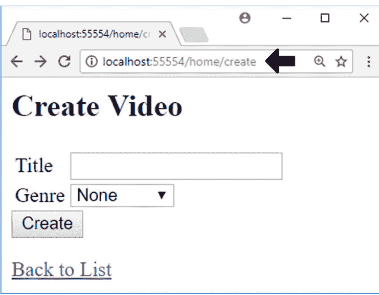

### 16. 点击链接导航到 Index 视图。

HTTP GET Create action 的完整代码：

```csharp
public IActionResult Create()
{
    return View();
}
```

Create 视图的完整标记：

```razor
using AspNetVideoCore.Models
@model AspNetVideoCore.Entities.Video
@addTagHelper *, Microsoft.AspNetCore.Mvc.TagHelpers

<h2>Create Video</h2>
<form asp-action="Create" method="post">
    <tr>
        <td><label asp-for="Title"></label></td>
        <td><input asp-for="Title"/></td>
    </tr>
    <tr>
        <td><label asp-for="Genre"></label></td>
        <td><select asp-for="Genre" asp-items="Html.GetEnumList<Genre>()"></select></td>
    </tr>
    <input type="submit" value="Create" />
</form>
<a asp-action="Index">Back to List</a>
```

# 初学者 ASP.NET Core 2 MVC & Razor Pages

```csharp
[HttpPost]
public IActionResult Create(
    VideoEditViewModel model)
{
    return View();
}
```

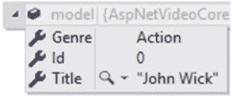

- 8. 在 Visual Studio 中停止应用程序。
- 9. 为 Entities 命名空间添加 `using` 语句，以访问 Video 实体类。

`using AspNetVideoCore.Entities;`

- 10. 因为 `Create` 方法的目的是向数据源添加新视频，你将必须创建一个 `Video` 类对象的实例。注意，你不需要为 `Id` 属性赋值。视频尚未存在于数据源中，因此它没有 id。

```csharp
var video = new Video(
    Title = model.Title,
    Genre = model.Genre
);
```

- 11. 因为你已经将 `IVideoData` 接口实现为注入到构造函数服务，你必须向它添加一个 `Add` 方法，并在 `MockVideoData` 类中实现它。这将允许你对 `_videos` 变量调用 `Add` 方法来添加新视频。让我们一步步来实现。打开 `IVideoData` 接口。
- 12. 添加一个名为 `Add` 的新方法，接受一个名为 `newVideo` 的 Video 参数。

```csharp
void Add(Video newVideo);
```

- 13. 将方法添加到 `MockVideoData` 类中。你可以悬停在接口名称上使用小灯泡按钮。
- 14. 移除方法中的 `throw` 语句。

# 初学者 ASP.NET Core 2.0 MVC Razor Pages

### 15. 因为数据源是一个无法生成新 id 的集合，你必须为视频对象创建一个新的 id。你可以使用 LINQ 的 `Max` 方法获取最高 id 并在其基础上加1 来伪造一个 id。此 id 仅用于演示，不应在生产应用程序中使用，因为生产环境中的 id 是由数据库自动创建。

```csharp
newVideo.Id = _videos.Max(v => v.Id) + 1;
```

### 16. 要将新视频添加到 `_videos` 集合，你必须将数据类型更改为 `List`。你可以向 `IEnumerable` 集合添加值。为了在 HTTP 请求之间保留值，你稍后将更改 `IVideoData` 服务的范围：`private List<Video> _videos;`

### 17. 对 `_videos` 集合调用 `Add` 方法，在你 `MockVideoData` 类中创建的 `Add` 方法中添加新视频。

```csharp
public void Add(Video newVideo)
{
    newVideo.Id = _videos.Max(v => v.Id) + 1;
    _videos.Add(newVideo);
}
```

### 18. 打开 `HomeController` 并在 HTTP POST `Create` 操作中调用你创建的 `Add` 方法，并将视频对象传递。

```csharp
_videos.Add(video);
```

### 19. 为了防止用户通过刷新页面多次提交 `Create`，你必须将 `View` 方法替换为对 `RedirectToAction` 的调用并重定向到另一个视图，例如 `Details` 视图。因为 `Details` 视图有一个必须在视图中传递的 `id` 参数，且视频被封装在一个匿名对象中。

```csharp
return RedirectToAction("Details", new { id = video.Id });
```

### 20. 打开 `Startup` 类，通过调用 `AddSingleton` 方法代替当前使用的 `AddScoped`，将 `IVideoData` 服务的范围设置为单例。这样做是为了在 HTTP 请求之间保留数据。

```csharp
services.AddSingleton<IVideoData, MockVideoData>();
```

### 21. 保存所有文件并导航到 `/Home/Create`。填写表单并点击 Create 按钮。你没有留在 `Create` 视图，而是重定向到了 `Details` 视图，显示已添加的视频。注意 URL 变为 `/Home/Details`。

# 初学者 ASP.NET Core MVC & Razor Pages

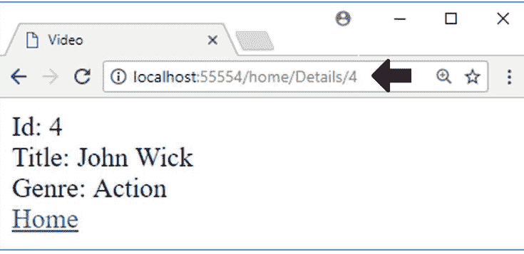

`IVideoData` 接口的完整代码：

```csharp
public interface IVideoData
{
    IEnumerable<Video> GetAll();
    Video Get(int id);
    void Add(Video newVideo);
}
```

`MockVideoData` 类中 `Add` 方法的完整代码：

```csharp
public void Add(Video newVideo)
{
    newVideo.Id = _videos.Max(v => v.Id) + 1;
    _videos.Add(newVideo);
}
```

`Create` 操作的完整代码：

```csharp
[HttpGet]
public IActionResult Create()
{
    return View();
}
```

# 初学者 ASP.NET Core MVC & Razor Pages

```csharp
[HttpPost]
public IActionResult Create(VideoEditModel model)
{
    var video = new Video
    {
        Title = model.Title,
        Genre = model.Genre
    };
    _videos.Add(video);

    return RedirectToAction("Details", new { id = video.Id });
}
```

`Startup` 类中 `ConfigureServices` 方法的完整代码：

```csharp
public void ConfigureServices(IServiceCollection services)
{
    services.AddMvc();
    services.AddSingleton(provider => Configuration);
    services.AddSingleton<IMessageService, MessageService>();
    services.AddSingleton<IVideoData, MockVideoData>();
}
```

## 数据注解 (Data Annotations)

数据注解是添加到模型属性上的特性，用于对它们实施规则。你可以指定字段是必填的，或具有最大字符限制。标签中显示的文本通常是属性名称，但可以通过 `[Display]` 特性覆盖。

许多数据注解可以在 `System.ComponentModel.Annotations` 命名空间找到。你可以每行指定一个注解，也可以在括号内用逗号分隔指定多个注解。

- `[Required]`
- `[MaxLength(80)]`

或

- `[Required, MaxLength(80)]`

# 初学者 ASP.NET Core 2.0 MVC & Razor Pages

以下是常用数据注解列表。

| 名称 | 用途 |
| :--- | :--- |
| MinLength / MaxLength | 限制字符串长度 |
| Range | 数字范围 |
| RegularExpression | 匹配模式 |
| Display | 设置属性的标签文本 |
| DataType | 决定在浏览器如何渲染控件 |
| Required | 模型值必须 |
| Compare | 比较两个输入的值 |

## 准备 Create 视图

为了在浏览器中验证注解，必须修改视图以显示错误。你可以通过添加带有 `asp-for` Tag Helper 的 `<span>` 来实现，指定它显示哪个属性。你还可以添加一个验证摘要，以 `<div>` 内无序列表显示所有所有。

## 在 Create 视图中添加验证

让我们在视图中添加两种验证查看效果。

1. 打开 **Create** 视图。
2. 在表单顶部添加验证 `<div>`。

`<form asp-action="Create" method="post"><div asp-validation-summary="All"></div>`

3. 为 **Title** 属性添加验证。在 **Title** `<input>` 下方的 `<td>` 中添加带有 `asp-for` Tag Helper 的 `<span>`。

`<td><span asp-for="Title"></span></td>`

4. 对 **Genre** 属性重复步骤 3。

# 初学者 ASP.NET Core 2.0 MVC & Razor Pages

更改后的完整 `Create` 视图：

```razor
@using AspNetVideoCore.Models
@model AspNetVideoCore.Entities.Video
@addTagHelper *, Microsoft.AspNetCore.Mvc.TagHelpers

<h2>Create</h2>
<form asp-action="Create" method="post">
  <div asp-validation-summary="All"></div>
  <table>
    <tr>
      <td>
        <label asp-for="Title"></label>
        <input asp-for="Title" />
      </td>
      <td><span asp-for="Title"></span></td>
    </tr>
    <tr>
      <td>
        <label asp-for="Genre"></label>
        <select asp-for="Genre" asp-items="Html.GetEnumList(Genres)"></select>
      </td>
      <td><span asp-for="Genre"></span></td>
    </tr>
  </table>

  <input type="submit" value="Create" />
</form>
```

## 在服务器上验证模型

由于应用程序中添加了 JavaScript 验证库，你仍然必须在服务器上验证模型。对于 HTTP POST `Create` 操作，你必须在执行任何操作之前检查模型是否有效。如果模型有效，视频将添加到数据源中；否则，将重新渲染视图，以便用户更改值并重新提交。

`ModelState` 对象的 `IsValid` 属性可以用于 HTTP POST 操作以检查模型是否有效。使用 `if` 语句包裹创建并添加视频到数据源的代码，检查 `IsValid` 属性值。如果状态无效，则在 if 块下方返回视图。

# ASP.NET Core 2 MVC & Razor Pages 入学者教程

- 1. 打开 `HomeController` 类。
- 2. 添加一个检查 `model state` 的 `if` 块；它应该包含 HTTP POST Create action 内部的所有代码。

```csharp
if (ModelState.IsValid)
{
  ..
```

- 3. 在 `if` 块下方返回视图。

`return View();`

HTTP POST Create action 的完整代码：

```csharp
[HttpPost]
public IActionResult Create(VideoEditModel model)
{
  if (ModelState.IsValid)
  {
    var video = new Video
    {
      Title = model.Title
```

在 Video 实体和 VideoEditViewModel 中添加数据注解（Data Annotations）

添加到实体类中的数据注解会影响视图中的控件以及其代表的数据库表。

在你正在构建的项目中，Video 实体被用作 Create 视图的模型视图。为了对该模型实施某些规则，你向属性上添加特性以限制或增强它们。

让我们在 Video 实体模型中实现一些注解，以更改视图中控件的渲染方式，稍后限制数据库列。

# ASP.NET Core 2 MVC & Razor Pages 入学者教程

- 1. 打开 Video 实体模型。
- 2. 为 `DataAnnotations` 命名空间添加 `using` 语句以访问数据注解特性：

`using System.ComponentModel.DataAnnotations;`

- 3. 在 `Title` 属性上添加 `Required` 注解。这将数据库表中的值限制为非空，并强制用户在控件中输入值，以使模型对象有效。

`[Required]`


`public string Title { get; set; }`

4. 打开 `VideoEditViewModel` 并重复步骤 2 和第 3 。

5. 保存所有文件并切换到浏览器。导航到 `/Home/Create` URL。

6. 在不输入标题的情况下点击 `Create` 按钮。验证消息应该出现在输入字段旁边。

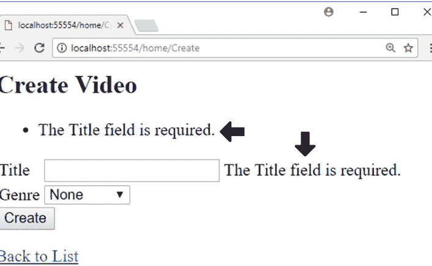

- 7. 在 Video 和 VideoEditViewModel 类中的 `Title` 属性上都添加 `MinLength` 注解，设置最小长度为 3。

`[Required, MinLength(3)]`

8. 保存所有文件并切换到浏览器。导航到 `/Home/Create` URL。

# ASP.NET Core 2.0 MVC & Razor Pages 入学者教程

- 9. 在 `Title` 输入字段中输入 2 个字符并点击 `Create` 按钮。验证消息应该提示输入字段中输入的字符太少。

- 10. 在 `Title` 输入字段中输入至少 3 个字符并点击 `Create` 按钮。视频应被成功添加到数据源。

- 11. 在 Video 和 VideoEditViewModel 类中添加 `MaxLength` 注解，设置最大长度为 80。

- 12. 在 `DbContext` 类中添加 `Display` 特性。这将 `8` 限制 ` `0` 映射到 `Title` 属性。

- 13. 保存所有文件并切换到浏览器。导航到 `/Home/Create` URL。显示 ` `。

`[Display(Name="Title")]`

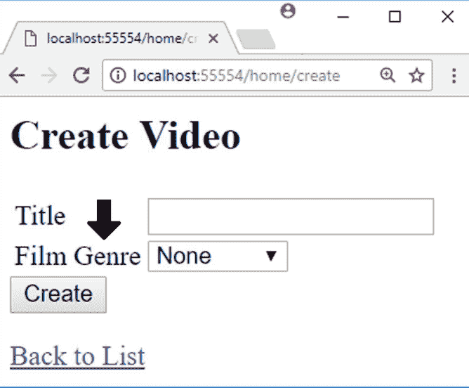

ASP.NET Core 2.0 MVC & Razor Pages 入学者

- 14. 在 `OnCreating` 方法中尝试 `DataAnnotations`。

`[DataType]`

- 15. 保存所有文件并切换到浏览器。导航到 `/Home/Create` URL。显示 ` `。

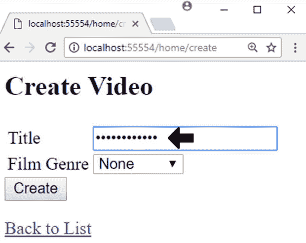

- 16. 移除 ` ` 注解并保存文件。

## 总结

在本章中，你学习了可以与 MVC 使用的不同模型，以及如何使用数据注解影响视图和控件。

你还在服务器端实现了验证并在客户端显示验证消息。

# 5. Entity Framework

在本章中，你将设置 Entity Framework `EF` 并熟悉它的工作原理。要使用 EF，你必须在 `.csproj` 文件中或通过 NuGet 管理器安装相应的服务。

在 `Startup` 类中配置好服务后，你需要添加一个继承自 `DbContext` 类的数据上下文类。这将是应用程序与数据库之间的桥梁。

Entity Framework 允许你使用 C# 对象而不是手动编写 SQL 与数据库交互。这被称为对象关系映射 `ORM`。

在后续章节中，我们将探索如何定义实体、执行迁移以及使用 Entity Framework 查询。

## 添加 VideoDbContext

现在已安装 NuGet 包，你可以添加继承自 `DbContext` 的 `VideoDbContext` 类。该类将是你的数据库连接。它将实体类定义为 `DbSet` 属性，这些属性映射为表。

- 1. 在项目中添加名为 `Data` 的文件夹。

2. 在 `Data` 文件夹中添加名为 `VideoDbContext` 的类。

3. 让 `VideoDbContext` 类继承 `DbContext` 类。`DbContext` 类位于 `Microsoft.EntityFrameworkCore` 命名空间。

`public class VideoDbContext : DbContext {}`

4. 在 `VideoDbContext` 类中为 `Video` 类添加 `DbSet`。`Video` 类位于 `AspVideoCore.Entities` 命名空间。

`public DbSet<Video> Videos { get; set; }`

5. 添加带有 `DbContextOptions<VideoDbContext>` 参数的构造函数。

`public VideoDbContext(DbContextOptions<VideoDbContext> options) : base(options) {`

- 6. 重写 `OnCreating`。

`protected override void OnCreating(ModelBuilder builder) {`

` base.OnCreating(builder);`

`}`

- 7. 保存所有文件。

`VideoDbContext` 类的完整代码：

```csharp
public class VideoDbContext : DbContext
{
    public DbSet<Video> Videos { get; set; }

    public VideoDbContext(DbContextOptions<VideoDbContext> options)
        : base(options)
    {
    }

    protected override void OnModelCreating(ModelBuilder builder)
    {
        base.OnModelCreating(builder);
    }
}
```

# 初学者 ASP.NET Core 2.0 MVC Razor Pages教程

## 在 Startup 类中配置

在应用初始迁移之前，你必须配置 Entity Framework 使用 `VideoDbContext`，并从 `secrets.json` 文件添加连接字符串。使用 `secrets.json` 文件有两个目的：它将连接字符串存储在不会被提交到源代码控制的安全位置中；它还让 `appsettings.json` 在处理敏感数据时变得过时，这是一件好事，因为后者会被提交到源代码控制中。

1. 在解决方案管理器 `Solution Explorer` 中右键点击项目节点，选择“管理用户机密” `Manage User Secrets`。

2. 添加以下连接字符串属性。注意数据库名称为 `VideoCoreDb`。连接字符串在文件中应为单行显示。

```json
"ConnectionStrings": {
  "DefaultConnection": "Server=(localdb)\\mssqldb;Database=VideoCoreDb;Trusted_Connection=True;MultipleActiveResultSetSets=true"
}
```

3. 打开 `Startup` 类并加载构造函数。

4. 如果项目中缺少 `appsettings.json` 文件，请临时为 `AddJsonFile` 方法添加 `optional:true` 参数值：`AddJsonFile("appsettings.json", optional: true);`

5. 为了能够检查环境，必须向构造函数注入 `IHostingEnvironment` 接口。

6. 添加一条语句检查是否处于开发环境，并使用 `AddUserSecrets` 方法将其添加到器对象中。将其放在 `Build` 方法上方。

```csharp
if (env.IsDevelopment())
    builder.AddUserSecrets<Startup>();
```

7. 定位到 `ConfigureServices` 方法，使用 `Configuration` 对象从 `secrets.json` 文件获取连接字符串。将连接字符串存储在名为 `conn` 的变量中。

```csharp
var conn = Configuration.GetString("DefaultConnection");
```

8. 在 `ConfigureServices` 方法开头使用 `AddDbContext` 方法添加数据库上下文和 EF 服务。在其构造函数的选项上调用 `UseSqlServer` 方法，以指定使用 SQL Server 提供程序。`UseSqlServer` 方法位于 `Microsoft.EntityFramework` 命名空间，而 `VideoDbContext` 类位于 `AspNetVideoCore.Data` 命名空间。请注意 `DefaultConnection` 是你添加到 `secrets.json` 文件中的属性名称。`services.AddDbContext<VideoDbContext>(options => (options));`

`secrets.json` 文件的完整代码：

```json
{
  "ConnectionStrings": {
    "DefaultConnection": "Server=(localdb)\\mssllocaldb;Database=VideoCoreDb;Trusted_Connection=True;MultipleActiveResultSets=true"
  }
}
```

注意 `DefaultConnection` 属性值应该是单行代码。

`Startup` 类构造函数的完整代码：

```cs
public Startup(IHostingEnvironment env)
{
  var builder = new ConfigurationBuilder()
    .SetBasePath(Directory.GetCurrentDirectory())
    .AddJsonFile("appsettings.json",
    //.AddJsonFile("appsettings.json", optional: true);

  if (env.IsDevelopment())
    builder.AddUserSecrets<Startup>();

  Configuration = builder.Build();
}
```

`Startup` 类 `ConfigureServices` 方法的完整代码：

```cs
public void ConfigureServices(IServiceCollection services)
{
    var conn = Configuration.GetConnectionString("DefaultConnection");
    services.AddDbContext<VideoDbContext>(options =>
        options.UseSqlServer(conn));

    services.AddMvc();
    services.AddSingleton<IMessageService, ConfigurationMessageService>();
    services.AddSingleton<IVideoData, MockVideoData>();
}
```

## 添加初始迁移并创建数据库

要添加初始迁移并创建数据库，你需要在包管理器控制台 `视图-其他窗口-包管理器控制台` 执行 `Add-Migration` 和 `Update-Database` 命令。

当 `Add-Migration` 命令成功执行后，项目中将出现一个新的名为 `Migrations` 的文件夹。当前和未来所有的迁移将存储在此文件夹中。

> 如果你遇到错误消息“在 'VideoDbContext' 上未找到无参数构造函数”：请为 'VideoDbContext' 添加无参数构造函数，或者在 'VideoDbContext' 所在的程序集中添加 'IDbFactory<VideoDbContext>' 的实现，然后检查 `secrets.json` 中的连接字符串是否正确且已成功加载。

- 执行 `Add-Migration`

- 执行 `Update-Database`

# 初学者 ASP.NET Core 2.0 MVC & Razor Pages

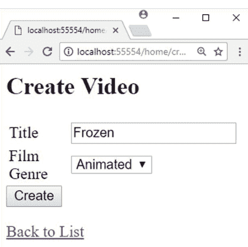

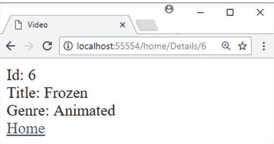

11. 点击**首页** `Home` 链接并确保视频出现在列表中。

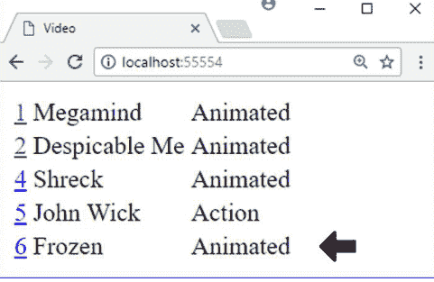

# 初学者 ASP.NET Core MVC & Razor Pages

12. 在 SQL Server 对象资源管理器中打开 Video 表，验证视频是否存在于表中。

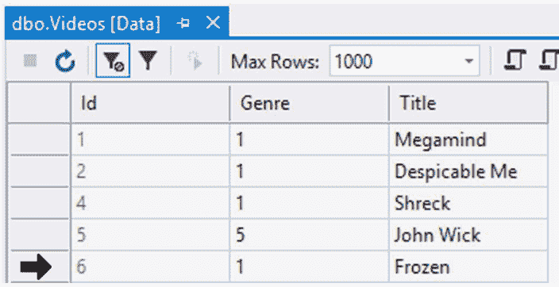

`SqlVideoData` 类中的完整代码：

```
public class SqlVideoData : IVideoData
{
    private VideoDbContext _db;

    public SqlVideoData(VideoDbContext db)
    {
        _db = db;
    }

    public void Add(Video newVideo)
    {
        _db.Add(newVideo);
        _db.SaveChanges();
    }

    public Video Get(int id)
    {
        return _db.Find<Video>(id);
    }

    public IEnumerable<Video> GetAll()
    {
        return _db.Videos;
    }
}
```

# 初学者 ASP.NET Core 2.0 MVC Razor Pages

`ConfigureServices` 方法中的完整代码：

```sharp
public void ConfigureServices(IServiceCollection services)
{
    var conn = Configuration.GetConnectionString("DefaultConnection");
    services.AddDbContext<VideoDbContext>(options =>
        options.UseSqlServer(conn));

    services.AddMvc();
    services.AddSingleton(provider => Configuration);
    services.AddSingleton<IMessageService, ConfigurationMessageService>();
    services.AddScoped<IVideoData, SqlVideoData>();
}
```

## 总结

在本章中，你在 Setup 类中安装了 Entity Framework 和 User Secrets 服务。

你还添加了与数据库通信的 DbContext 类，以及一个实现 IVideoData 接口的新类型服务组件类，从而实现了 DbContext 与应用程序之间的分离。

最后，你使用 Create 视图向数据库添加了一个新视频，并验证了它已成功添加到数据库。

# 6. Razor 视图 `Razor Views`

在本章中，你将学习用于布局的不同视图、如何包含命名空间以及在视图中渲染部分内容。

## 布局视图 `Layout Views`

`_Layout.cshtml` Razor 视图为应用程序提供了更多结构，并使其更容易显示在每个页面上都可见的数据，例如导航栏和页脚。通过此视图你可以避免代码重复。名称开头的下划线不是强制要求的，但它是开发者之间常用的一种约定。它表示该视图不应该通过控制器操作内部的 View 方法作为视图结果进行渲染。

普通视图（如 Index 视图）是在 `_Layout` 视图内部渲染的。这意味着它们不需要感知导航和页脚的信息；它们只需要渲染操作方法告诉它们渲染的内容。

如果你查看创建的视图内部，会发现它们有一些共同代码，例如 `<html>`、`<head>` 和 `<body>` 元素。因为所有视图的标记是相同的，因此它们应该移动到 `_Layout` 视图中。

共享视图（如 `_Layout`）存放在 Views 文件夹内名为 Shared 的文件夹中。这些视图在应用程序的任何地方可用。布局视图不必命名为 `_Layout`；你可以根据需要拥有多个布局视图。

`_Layout` 是一个 Razor 视图，这意味着你可以像在任何其他视图中使用一样使用 C#。它应该有一个名为 `@RenderBody` 的方法，负责渲染用户导航到的不同视图，例如 Index 和 Details 视图。

`_Layout` 视图中有一个名为 `@ViewBag` 的对象。这是一个用于从服务器向视图发送动态的动态对象。

Layout 视图中另一种方法是 `@RenderSection`。该方法可以用于渲染内容视图中的特定 HTML 部分。如果你需要这种行为，可以使用该方法的异步版本。

# 初学者 ASP.NET Core 2.0 MVC & Razor Pages 添加 _Layout 视图

- 在 Views 文件夹中添加名为 Shared 的新文件夹。

- 使用新建对话框在 Shared 文件夹中添加名为 `_Layout` 的 MVC 视图。

- 在 `<body>` 元素底部添加 `<footer>` 元素。

- 在 `<footer>` 元素中添加对 `@RenderSection` 方法的调用，并传递任何部分的名称。如果部分是可选的，传递 false。

```html
<footer>@RenderSection("footer", false)</footer>
```

`_Layout` 视图的完整标记：


```html
<!DOCTYPE html>
<html>
<head>
  <meta name="viewport" content="width=device-width" />
  <title>@ViewBag.Title</title>
</head>
<body>
  <div>
    @RenderBody()
  </div>
  <footer>
    @RenderSection("footer", false)
  </footer>
</body>
</html>
```

## 修改内容视图

有了 `_Layout` 视图，你需要移除 `<head>` 和 `<body>` 元素标记，并对 `Home` 文件夹中的视图执行相同操作。

打开 `Index` 视图并移除 `<head>` 和 `<body>` 元素，对 `Home` 文件夹中的其他视图执行相同操作。你可以使用 `Ctrl+E` 命令格式化 HTML。

# ASP.NET Core 2.0 MVC Razor Pages

由于你从视图删除了 `<title>` 元素，你可以将其作为 `Title` 属性添加到 `ViewBag` 对象中。将视图的名称赋值给该属性。由于 `ViewBag` 位于 C# 块内部，它不需要 `@`。你也可以在 C# 块中使用 `Layout` 属性告诉 MVC 框架使用哪个布局。布局必须指定以波浪号 `~` 开头的路径。C# 块适用于通常规则，例如用分号结束代码。

1. 打开 `Index` 视图并移除所有 `<html>`、`<head>` 和 `<body>` 元素，但保留表格和 `@model` 指令。

```razor
@model IEnumerable<AspNetCore.Views.ViewModel>

<table>
  @foreach (var video in Model)
  {
    <tr>
      <td>@Html.ActionLink(video.Id.ToString(), "Details", new { id = video.Id })</td>
      <td>@video.Title</td>
      <td>@video.Genre</td>
    </tr>
  }
</table>
```

2. 在 `@model` 指令下方添加 C# 块。

3. 在 C# 块为 `ViewBag` 添加 `Title` 属性并赋值（在本例中为 `Home`）。

4. 在 C# 块内添加 `Layout` 属性并分配 `_Layout.cshtml` 文件的路径。

```razor
@{
  ViewBag.Title = "Home";
  Layout = "~/Views/Shared/_Layout.cshtml";
}
```

5. 在 `Index` 视图末尾添加名为 `footer` 的 `@section` 块，并在内部放置带有文本 `"This is the footer"` 的 `<div>`。

```razor
@section footer{
<div>This is the footer</div>
}
```

6. 对 `Views/Home` 文件夹中的所有视图重复步骤1-4，但分别将 `Title` 属性改为 `Details` 和 `Create`。

7. 保存所有文件并切换到浏览器。导航到 `Index` 视图。你应该能够在视频列表看到页脚。这验证了布局视图被用于渲染 `Index` 视图。

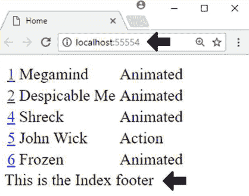

移除元素后的 `Index` 视图完整代码：

```razor
@model IEnumerable<AspNetCore.ViewModels.VideoViewModel>
@{
  ViewBag.Title = "Home";
  Layout = "~/Views/Shared/_Layout.cshtml";
}

<table>
  @foreach (var video in Model)
  {
    <tr>
      <td>@Html.ActionLink(video.Id.ToString(), "Details", new { id = video.Id })</td>
      <td>@video.Title</td>
      <td>@video.Genre</td>
    </tr>
  }
</table>
```

```razor
@section footer{
<div>This is the Index footer</div>
}
```

移除元素后的 **Details** 视图完整代码：

```razor
@model AspNetCore.Views.VideoViewModel
@{
  ViewBag.Title = "Details";
  Layout = "~/Views/Shared/_Layout.cshtml";
  <div>Id: @Model.Id</div>
  <div>Title: @Model.Title</div>
  <div>Genre: @Model.Genre</div>
}

@Html.ActionLink("Home", "Index")
```

移除元素后的 **Create** 视图完整代码：

```razor
@using AspNetCore.Core.Entities;
@model AspNetCore.Mvc.Video
@addTagHelper *, Microsoft.AspNetCore.Mvc.TagHelpers

@{
  ViewBag.Title = "Create";
  Layout = "~/Views/Shared/_Layout.cshtml";
}

<h2>Create Video</h2>
<form asp-action="Create">
<div asp-validation-summary="All"></div>
<table>
  <tr>
    <td><label asp-for="Title"></label></td>
    <td><input asp-for="Title" /></td>
    <td><span asp-validation-for="Title"></span></td>
  </tr>
  <tr>
    <td><label asp-for="Genre"></label></td>
    <td><select asp-for="Genre" asp-items=
```

# ASP.NET Core 2.0 MVC & Razor Pages 初学者

```html
<select>
    @Html.GetEnumSelectList((IEnumerable<Genre>)Model)
</select></td>
<td><span asp-validation-for="Genre"></span></td>
</tr>
```

```html
</table
<input type="submit" value="Create" />
</form>
```

```html
<div>
    <a asp-action="Index">返回列表</a>
</div>
```

## _ViewStart 文件

Razor 视图引擎有一个约定，即它会寻找一个名为 `_ViewStart.cshtml` 的文件。该引擎会在任何其他视图之前执行，但它没有 HTML 输出。它的一个作用是从视图中的代码块中移除重复代码，例如 `Layout` 声明。你不需要在每个视图中声明 `_Layout` 视图的位置，可以将其放在 `_ViewStart` 视图内部。可以通过在单个视图中添加 `Layout` 声明来覆盖 `_ViewStart` 视图中的设置。

如果你将此视图直接放置在 `Views` 文件夹中，它将对所有视图可用。将其放置在 `Views` 文件夹内的另一个文件夹中，则它对该文件夹中的视图可用。

你可以在特定视图中将 `Layout` 属性赋值为 `null`，以停止在该视图中使用任何布局视图。

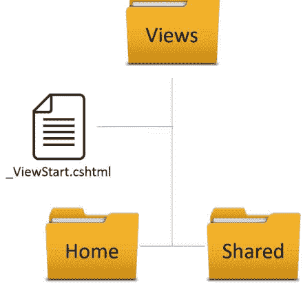

# ASP.NET Core 2.0 MVC Razor Pages 初学者

让我们在 `Views` 文件夹中创建 `_ViewStart` 视图，并在其中添加 `Layout` 声明。

- 向 `Views` 文件夹添加一个 MVC View Start Page（使用“新建项”对话框）。为了符合 MVC 约定，命名为 `_ViewStart` 非常重要。

- 从 `Index` 视图中剪出 `_Layout` 视图的路径。

- 将 `_ViewStart` 中 `Layout` 属性的当前值替换为你复制的路径。

```csharp
Layout = "~/Views/Shared/_Layout.cshtml";
```

- 从 `Views/Home` 文件夹中的所有视图中移除 `Layout` 属性。

- 保存所有文件并导航到根目录 `(/)`。你仍然应该看到文本“This is the Index footer rendered by the _Layout view.”

## _ViewImports 文件

Razor 视图引擎有一个约定，即它会寻找一个名为 `_ViewImports.cshtml` 的文件。该文件会在任何其他视图之前执行，但它没有 HTML 输出。你可以使用此文件添加所有视图使用的 `using` 语句；这消除了代码重复并清理了视图。

因此，如果你知道许多视图使用相同的命名空间，请将它们添加到 `_ViewImports.cshtml` 文件中。将该文件添加到 `Views` 文件夹。

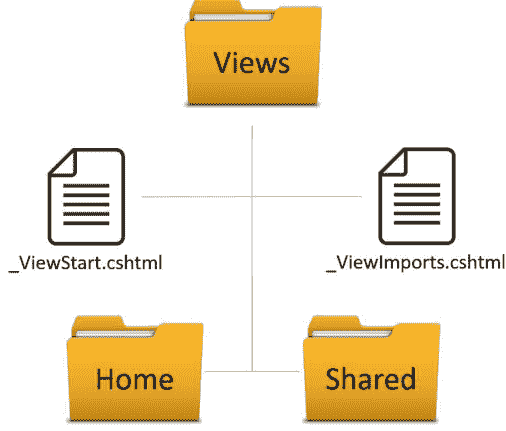

# ASP.NET Core 2.0 MVC & Razor Pages 初学者

- 1. 向 `Views` 文件夹添加名为 `_ViewImports.cshtml` 的 MVC View Imports Page。

2. 打开 `Create` 视图，剪出 `@using` 和 `@addTagHelper` 行。

3. 打开 `_ViewImports` 视图并粘贴代码。

4. 为 `AspNetCoreView.Entities` 命名空间添加一个 `using` 语句。

5. 保存 `_ViewImports` 视图。

6. 打开 `Create` 视图并移除 `@model` 指令中的名称路径。该视图应该通过 `_ViewImports` 视图中的 `using` 语句找到 `Video` 模型。

7. 打开 `Index` 视图，从 `@model` 指令中剪出 `AspNetCore.ViewModels` 命名空间路径，并将其作为 `using` 语句添加到 `_ViewImports` 视图中并保存。在 `@model` 指令中仅保留类名。

8. 打开 `Details` 视图并删除 `AspNetCore.ViewModels` 命名空间路径。在 `@model` 指令中仅保留类名。

9. 保存所有文件并导航到不同的视图，验证程序是否正常工作。

`_ViewImports` 文件的完整代码：

```razor
@using AspNetCore.Models
@using AspNetCore.Entities
@using AspNetCore.ViewModels
@addTagHelper Microsoft.AspNetCore.Mvc.TagHelpers
```

## Tag Helpers (标签辅助)

`Tag Helpers` 是 ASP.NET Core 的新特性，许多情况下可以替代旧的 HTML Helpers。`Tag Helpers` 在 HTML 中看起来就像 HTML 属性或元素。你已经在 `Create` 表单中使用了 `Tag Helpers`。在它们之间，你添加了 `asp-for` 和 `validation-for`。它们比 `LabelFor`、`TextBoxFor`、`EditorFor` 以及以前 ASP.NET 版本中其他 HTML Helpers 好用得多。你仍然可以在 ASP.NET Core 使用 `Tag Helpers`，它们有一个优势：与模型紧密结合。这意味着你可以获得 IntelliSense 并轻松重命名属性。

要使用 `Tag Helpers`，你需要在 `_ViewImports` 视图或特定的视图中添加 `@addTagHelper` 指令。第一个参数指定了命名空间下的所有 `Tag Helpers`。如果你不想导入 helpers，可以更改此处。

@addTagHelper Microsoft.AspNetCore.Mvc.TagHelpers

让我们使用 `Tag Helpers` 从 `Index` 视图调用 `Create` 操作，这样你就不需要在浏览器中输入 `Create` 视图的 URL。

# 修改 Index 视图

- 1. 打开 `Index` 视图。

2. 在 `<table>` 和 `@section` 块之间添加 `<a>` 标签。添加文本 `"Create"`。

3. 使用 `asp-action` `Tag Helper` 指定要调用的 `HomeController` 中的哪个操作。如果你想导航到视图所属的控制器，可以添加 `asp-route-id` `Tag Helper`。

4. 保存文件并导航到浏览器中的 `Index` 视图。你应该看到一个带有 `"Create"` 文本的链接。点击该链接，会出现 `Create` 视图。

5. 点击 `Back to List` 返回 `Index` 视图。

6. 在 `HomeController` 类的 GET 方法内部放置断点，并调试启动应用程序 (`F5`)。

7. 再次点击 `Create` 链接。执行将在断点处停止。这证明了 Action是通过 `Tag Helper`调用的。

8. 移除 id 属性的 AnchorLink。

9. 使用 `asp-action` `Tag Helper` 打开 `Details` 视图，使用 `asp-route-id` `Tag Helper` 传递 video id。

```html
<td>
  <a asp-action="Details" asp-route-id="@video.Id">Details</a>
</td>
```

- 11. 无调试启动应用程序 (`Ctrl+F5`)。现在你应该看到 `Details` 链接。点击一个显示视频的 `Details` 视图。

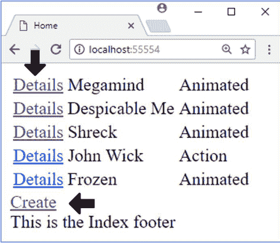

`Index` 视图的完整标记：

```razor
@model IEnumerable<ViewModel>
```

```razor
@{
  ViewBag.Title = "Home";
}
```

```html
<table>
@foreach (var video in Model)
  <tr>
    <td><a asp-action="Details" asp-route-id="video.Id">Details</a></td>
    <td>@video.Title</td>
    <td>@video.Genre</td>
  </tr>
</table>
```

```html
<a asp-action="Create">Create</a>
```

```html
@section footer{
  <div>This is the Index footer</div>
}
```

# ASP.NET Core 2.0 MVC Razor Pages 初学者

## 添加 Edit 视图及其操作

还需要两个视图来完成 CRUD 操作：`Edit` 和 `Delete` 视图。让我们通过复制 `Create` 视图并修改表单来添加 `Edit` 视图。然后重构 `IVideoData` 接口以及实现它的类。与其在编辑或删除视图时保存数据，这种重构将允许保存更改到数据库之前添加或编辑多个视图。

- 1. 复制 `Create` 视图并将其粘贴到 `Home` 文件夹。重命名视图为 `Edit`。

2. 当视图被复制、粘贴和重命名时，Visual Studio 有时会产生混乱。为了避免混淆，清除 `Edit` 后加上视频标题。再次打开它。

3. 将标题根据视频标题更改为 `Edit`。

```csharp
ViewBag.Title = "Edit " + Model.Title;
```

- 4. 对视图的标题执行相同操作；使用来自 `ViewBag` 的值。

```html
<h2>@View.Title</h2>
```

- 5. 修改 `asp-action` 标签以调用名为 `Edit` 的操作；稍后会将该操作添加到 `HomeController` 类中。还要指定表单应使用 post 方法；提交表单时比使用默认的 get 方法安全。

```html
<form asp-action="Edit" method="post">
```

- 6. 将提交按钮的文本改为 `Edit`。

```html
<input type="submit" value="Edit" />
```

- 7. 打开 `Index` 视图并添加指向 `Edit` 视图的链接，就像你在 `Details` 视图中做的那样。你可以复制并更改你添加的 `Details` 锚标签。将链接从 `Genre` 表格单元格移动，使表单看起来更美观。

```html
<tr>
<td>@video.Title</td>
<td>@video.Genre</td>
<td><a asp-action="Details" asp-route-id="@video.Id">Details</a></td>
<td><a asp-action="Edit" asp-route-id="@video.Id">Edit</a></td>
</tr>
```

- 8. 为了让 `Edit` 链接和视图工作，你必须在 `HomeController` 类中添加 HTTP GET 和 HTTP POST `Edit` 操作。让我们从 HTTP GET 操作开始。复制 HTTP GET `Details` 操作并粘贴到类中。重命名为 `Edit` 并


# 初学者 ASP.NET Core MVC & Razor Pages

```csharp
[HttpGet]
public IActionResult Edit(int id)
{
  ...
}
```

- 9. 将模型变量重命名为 `video`。
- 10. 将返回语句替换为返回 `video` 对象的视图。
`return View(video);`
- 11. 添加一个 HTTP POST 操作，包含一个 `int` 类型的 `id` 参数和一个名为 `model` 的 `VideoEditViewModel` 参数。为该操作添加 `HttpPost` 特性。

```csharp
[HttpPost]
public IActionResult Edit(int id, VideoEditViewModel model)
{
  ...
}
```

- 12. 获取与传入的 `id` 匹配的视频并将其存储在名为 `video` 的变量中。
`var video = __videos.Get(id);`
- 13. 添加一个 `if` 语句来检查模型状态是否无效或 `video` 对象是否为空。如果其中任一个为真，则返回带模型的视图。
`if (video == null || !ModelState.IsValid)`
`return View(model);`
- 14. 将模型中的 `Title` 和 `Genre` 值分配给你获取的 `video` 对象。Entity Framework 将跟踪 `video` 对象的更改。
`video.Title = model.Title;`
`video.Genre = model.Genre;`
- 15. 调用 `_Video` 上的上的 `Commit` 方法。该方法目前尚不存在，但你很快就会将其添加到 `IData` 服务类中。在你重构了 `IVideo` 服务后，该方法将能够工作并将任何更改保存到数据库中。由于 Entity Framework 会跟踪 `DbContext` 的任何更改，你不需要将 `video` 对象发送给 `Commit` 方法。
`_videos.Commit();`
- 16. 添加一个重定向到 `Details` 视图。
`return RedirectToAction("Details", new { id = video.Id });`

# 初学者 ASP.NET Core 2.0 MVC & Razor Pages

## HTTP GET Edit 操作的完整代码

```csharp
[HttpGet]
public IActionResult Edit(int id)
{
    var video = _videos.Get(id);

    if (video == null) return RedirectToAction("Index");

    return View(video);
}
```

## HTTP POST Edit 操作的完整代码

```csharp
[HttpPost]
public IActionResult Edit(int id, VideoEditViewModel model)
{
    var video = _videos.Get(id);

    if (video == null || !ModelState.IsValid) return View(model);

    video.Title = model.Title;
    video.Genre = model.Genre;

    _videos.Commit();

    return RedirectToAction("Details", new { id = video.Id });
}
```

## 重构 IVideoData 服务

其思想是，你应该能够在将更改提交到数据库之前进行多次更改并添加新视频。为了实现这一点，你必须将 `SaveChanges` 方法移动到名为 `Commit` 的独立方法。每当需要将更改持久化数据库时，必须调用 `Commit` 方法。

- 1. 打开 `IVideoData` 接口。
- 2. 定义一个名为 `Commit` 的方法，返回一个 `int`。在某些情况下，该 `int` 值反映了受提交影响的记录数。
`int Commit();`
- 3. 打开 `MockVideoData` 类并添加一个返回 `0` 的 `Commit` 方法。即使对于模拟数据来说没有必要，你也必须添加该方法。
模拟数据在内存中会即时保存。接口要求实现 `Commit` 方法。

```csharp
public int Commit()
{
    return 0;
}
```

- 4. 打开 `SqlVideoData` 类并添加一个 `Commit` 方法，返回调用 `SaveChanges` 方法的结果。

```csharp
public int Commit()
{
    return _db.SaveChanges();
}
```

- 5. 从 `Add` 方法中移除 `SaveChanges` 方法的调用。

```csharp
public void Add(Video video)
{
    _db.Add(video);
}
```

- 6. 打开 `HomeController`，验证 `Commit` 方法没有红色波浪线且运行正常。
- 7. 在 `Create` 操作中、`Add` 方法下方调用 `Commit` 方法。这是必要的，因为你已经重构了 `SqlVideoData` 服务中 `Add` 方法对 `SaveChanges` 方法的调用。
- 8. 保存所有文件并导航到根 URL。新的 `Edit` 链接应该出现在视频列表右侧，位于 `Details` 链接旁边。

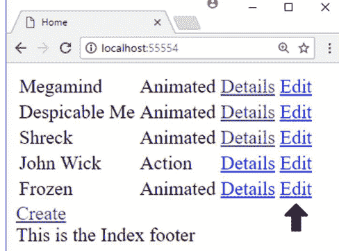

# 初学者 ASP.NET Core 2.0 MVC & Razor Pages

- 9. 点击其中一个视频的 `Edit` 链接打开新的 `Edit` 视图。
- 10. 对视频进行一些更改并点击 `Edit` 按钮。

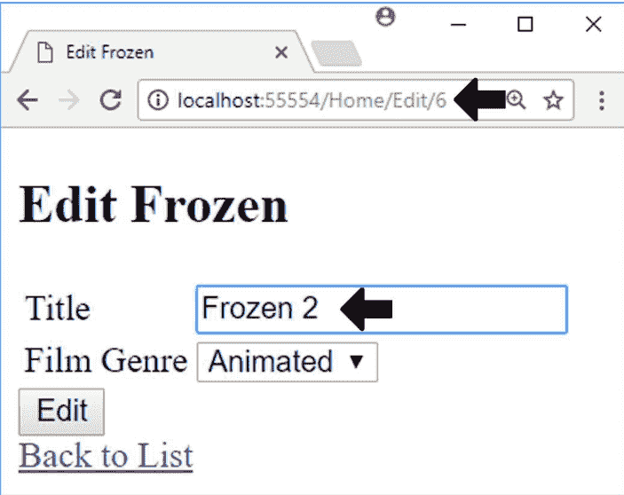

- 11. 显示视频的 `Details` 视图。点击 `Home` 链接返回 `Index` 视图中的视频列表。

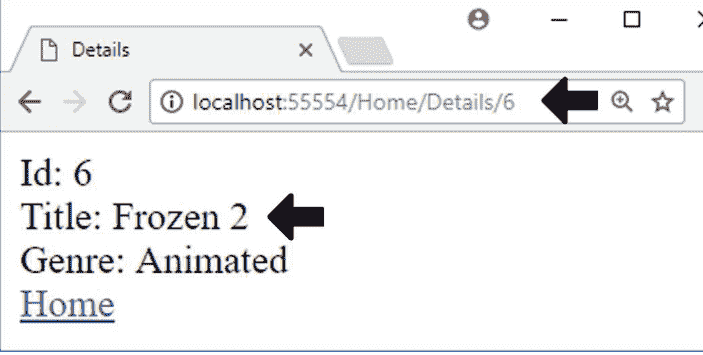

## 初学者 ASP.NET Core MVC & Razor Pages

- 12. 显示视频的 `Details` 视图。点击 `Home` 链接返回 `Index` 视图中的视频列表。


## ASP.NET Core MVC & Razor Pages 初学者

- 12. 显示视频的 `Details` 视图。点击 `Home` 链接返回 `Index` 视图中的视频列表。

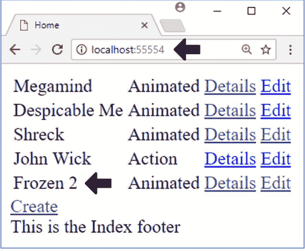

### IVideoData 接口的代码

```csharp
interface IVideoData {
    IEnumerable<Video> GetAll();
    Video Get(int id);
    void Add(Video video);
    int Commit();
}
```

### SqlVideoData 完整代码

```csharp
public class SqlVideoData : IVideoData {
    private MyDbContext _db;
    // 类的其余部分
}
```

- 5. 从 `Add` 方法中移除 `SaveChanges` 方法的调用。

```csharp
public void Add(Video video)
{
    _db.Add(video);
}
```

- 6. 打开 `HomeController`，验证 `Commit` 方法没有红色波浪线且运行正常。
- 7. 在 `Create` 操作中、`Add` 方法下方调用 `Commit` 方法。这是必要的，因为你已经重构了 `SqlVideoData` 服务中 `Add` 方法对 `SaveChanges` 方法的调用。
- 8. 保存所有文件并导航到根 URL。新的 `Edit` 链接应该出现在视频列表右侧，位于 `Details` 链接旁边。

# 初学者 ASP.NET Core 2.0 MVC & Razor Pages

- 9. 点击其中一个视频的 `Edit` 链接打开新的 `Edit` 视图。
- 10. 对视频进行一些更改并点击 `Edit` 按钮。

# ASP.NET Core 2.0 MVC Razor Pages 初学者

## 视图组件 (View Components)

视图组件（View Component）几乎是一个完整的抽象。它是一个拥有自己的模型的部分视图，该模型是从类似控制器的类中名为 `Invoke` 的方法获取的。视图组件的模型与当前视图的模型是独立的。你不应该在 `_Layout view_` 视图模型中使用带有模型的普通视图，因为它没有模型，且很难向其引入模型。你应该使用视图组件在 `_Layout view_` 视图中渲染部分内容。

在之前的 MVC 版本中，你使用 `@Html.ActionHelper` 来执行子操作。在这一版本的 MVC 中，它已被视图组件取代。

你可以将视图组件看作是一个从不路由的控制器。

视图组件始终放置在 `Views` 文件夹下的 `Components` 文件夹中。如果你将该文件夹放在 `Views/Shared` 文件夹中，则可以在任何视图中使用它。每个视图组件在 `Components` 文件夹中都有一个与组件同名的子文件夹。

## 为 IMessageService 添加视图组件

让我们实现一个使用 `IMessageService` 在每个视图中显示配置信息的视图组件。

- 1. 在项目节点下创建一个名为 `Components` 的新文件夹。此文件夹将存放视图组件运行所需的文件。
- 2. 向文件夹中添加一个名为 `Message` 的类并继承 `ViewComponent` 类。为 `Microsoft.AspNetCore.Mvc` 命名空间添加 `using` 语句以访问 `ViewComponent` 类。
`public class Message : ViewComponent { }`
- 3. 添加一个构造函数并注入 `IMessageService` 接口，参数命名为 `message`，并将其存储在名为 `_message` 的类变量中。为 `Services` 命名空间添加 `using` 语句以访问 `IMessageService` 类。
`private IMessageService _message;`
`public Message(IMessageService message)`
`{    _message = message; }`
- 4. 添加一个名为 `Invoke` 的公共方法，返回 `IViewComponentResult`。
`public IViewComponentResult Invoke()`
`}`
- 5. 在 `Invoke` 方法中添加一个名为 `model` 的变量，用于存储调用 `_message.GetMessage` 方法的结果。
`var model = _message.GetMessage();`
- 6. 使用 `View` 方法返回该模型。由于模型是一个字符串，`View` 方法会产生混义并认为它是要渲染的视图名称。为了修复此问题，将视图名称作为第一个参数，并将模型对象作为第二个参数。
`return View("Default", model);`
- 7. 在 `Views/Shared` 文件夹内部创建一个新的 `Components` 文件夹。
- 8. 在 `Components` 文件夹内部添加名为 `Message` 的文件夹。
- 9. 在 `Message` 文件夹中添加名为 `Default` 的 MVC 页面。
- 10. 删除视图中的所有代码。
- 11. 添加类型为 `string` 的 `@model` 指令。
- 12. 添加一个 `<section>` 元素并在内部包含 `<small>` 元素。将 `@Model` 值添加到 `<small>` 元素中。
`<section>`
`<small>@Model</small>`
`</section>`
- 14. 保存所有文件。
- 15. 逐一访问所有视图，验证配置文件中的消息（Hello from configuration）是否显示在每个视图的页脚中。

# ASP.NET Core 2.0 MVC & Razor Pages 初学者

### Message 视图组件的完整代码

```
public class Message : ViewComponent
{
    private IMessageService _message;

    public Message(IMessageService message)
    {
        _message = message;
    }

    public IViewResult Invoke()
    {
        var model = _message.GetMessage();
        return View("Default", model);
    }
}
```

### Default 视图的完整标记代码

```
@model string

<section>
    <small>@Model</small>
</section>
```

### Layout 视图的完整代码

```html
<!DOCTYPE html>
<html>
<head>
    <meta name="viewport" content="width=device-width" />
    <title>@ViewBag.Title</title>
</head>
<body>
    <div>
        @Body
    </div>
    <footer>
        @RenderSection("footer", false)
        @await Component.InvokeAsync("Message")
    </footer>
</body>
</html>
```

## 总结

在本章中，你学习了布局视图和部分视图。你还使用了新功能，如标签辅助程序（Tag Helpers）、视图组件以及 `_ViewStart` 和 `_ViewImport` 视图。

使用这些功能允许你复用代码并将一个大视图分解为更小、更易维护的部分。它们赋予了你编写可维护和可复用代码的能力。

# 7. 表单身份验证 (Forms Authentication)

在本章中，你将学习 ASP.NET Identity 以及如何使用它来实现应用程序中的注册和登录。你将从零开始添加身份验证，以学习所有组件是如何组合在一起的。

ASP.NET Identity 是一个框架，你可以用它来实现应用程序中的注册和登录。你将从零开始添加身份验证，以学习所有组件是如何组合在一起的。

ASP.NET Identity 是一个框架，你可以用它来实现应用程序中的注册和登录。你将从零开始添加身份验证，以学习所有组件是如何组合在一起的。

ASP.NET Identity 是一个框架，你可以用它来实现应用程序中的注册和登录。你将从零开始添加身份验证，以学习所有组件是如何组合在一起的。

ASP.NET Identity 框架。ASP.NET Identity。

ASP.NET Identity 是一个框架，你可以用它来实现应用程序中的注册和登录。你将从零开始添加身份验证，以学习所有组件是如何组合在一起的。

ASP.NET Identity 框架。ASP.NET Identity。

ASP.NET Identity 是一个框架，你可以用它来实现应用程序中的注册和登录。你将从零开始添加身份验证，以学习所有组件是如何组合在一起的。

ASP.NET Identity 框架。ASP.NET Identity。

ASP.NET Identity 是一个框架，你可以用它来实现应用程序中的注册和登录。你将从零开始添加身份验证，以学习所有组件是如何组合在一起的。

ASP.NET Identity 框架。ASP.NET Identity。

ASP.NET Identity 是一个框架，你可以用它来实现应用程序中的注册和登录。你将从零开始添加身份验证，以学习所有组件是如何组合在一起的。

ASP.NET Identity 框架。ASP.NET Identity。

ASP.NET Identity 是一个框架，你可以用它来实现应用程序中的注册和登录。你将从零开始添加身份验证，以学习所有组件是如何组合在一起的。

ASP.NET Identity 框架。ASP.NET Identity。

ASP.NET Identity 是一个框架，你可以用它来实现应用程序中的注册和登录。你将从零开始添加身份验证，以学习所有组件是如何组合在一起的。

ASP.NET Identity 框架。ASP.NET Identity。

ASP.NET Identity 是一个框架，你可以用它来实现应用程序中的注册和登录。你将从零开始添加身份验证，以学习所有组件是如何组合在一起的。

ASP.NET Identity 框架。ASP.NET Identity。

ASP.NET Identity 是一个框架，你可以用它来实现应用程序中的注册和登录。你将从零开始添加身份验证，以学习所有组件是如何组合在一起的。

ASP.NET Identity 框架。ASP.NET Identity。

ASP.NET Identity 是一个框架，你可以用它来实现应用程序中的注册和登录。你将从零开始添加身份验证，以学习所有组件是如何组合在一起的。

ASP.NET Identity 框架。ASP.NET Identity。


ASP.NET Identity 框架。ASP.NET Identity。

ASP.NET Identity 是一个框架，你可以用它来实现应用程序中的注册和登录。你将从零开始添加身份验证，以学习所有组件是如何组合在一起的。

ASP.NET Identity 框架。ASP.NET Identity。

ASP.NET Identity 是一个框架，你可以用它来实现应用程序中的注册和登录。你将从零开始添加身份验证，以学习所有组件是如何组合在一起的。

ASP.NET Identity 框架。ASP.NET Identity。

# 初学者 ASP.NET Core 2.0 MVC Razor Pages

2. 打开 `VideoDbContext` 并将其改为 `IdentityDbContext` 类，而不是 EF 默认的 `DbContext`。你可以指定它应该存储的用户类型，在此例中，即你刚刚添加的 `User` 实体类。

`IdentityDbContext` 类位于

```csharp
Microsoft.AspNetCore.Identity.EntityFrameworkCore 命名空间。
public class VideoDbContext : IdentityDbContext<User>
{
    ...
}
```

3. 打开 `Startup` 类并添加 `using` 语句以访问 `User` 和 `Identity` 命名空间，然后找到 `ConfigureServices` 方法。

```csharp
using AspNetCore.Entities;
using Microsoft.AspNetCore.Identity;
```

4. 通过调用 `AddIdentity` 方法将 Identity 服务添加到服务集合中。该方法接受两个泛型参数：第一个是你想要使用的用户，即你刚刚添加的 `User` 实体类，第二个是你想要使用的 Identity 角色，内置的 `IdentityRole` 类。如果你想实现自己的身份角色行为，可以让另一个类继承 `IdentityRole` 类。将该服务添加到 `AddMvc` 方法调用上方。

```csharp
services.AddIdentity<User, IdentityRole>();
```

5. 你还必须安装 Entity Framework Stores 服务来处理针对数据库的用户创建和验证。你需要向它提供 `VideoDbContext`，以便它知道与数据库通信时使用哪个上下文。你可以使用 Fluent API 在 `AddIdentity` 方法上调用 `AddEntityFrameworkStores`。

```csharp
.AddEntityFrameworkStores<User, IdentityRole, VideoDbContext>();
```

6. 接下来，你需要在 `Configure` 方法中安装中间件组件。中间件的位置非常重要。如果你将其放在管道中太靠后的位置，它将永远不会执行。将其放在 MVC 中间件上方，以便 MVC 框架可以使用。

```csharp
app.UseAuthentication();
```

7. 使用 `Ctrl+Shift+B` 构建应用程序，以确保其构建正确。

# 初学者 ASP.NET Core 2. MVC & Razor Pages

完整的 `User` 类：

```csharp
public class User : IdentityUser
{
}
```

`IdentityUser` 类中的属性：

```csharp
public class IdentityUser<TKey> where TKey : IEquatable<TKey>
{
    public IdentityUser();
    public virtual IdentityUser(string username);
    public virtual DateTimeOffset Lockout { get; set; }
    public virtual bool TwoFactorEnabled { get; set; }
    public virtual bool PhoneNumberConfirmed { get; set; }
    public virtual string PhoneNumber { get; set; }
    public virtual string CurrencyStamp { get; set; }
    public virtual string SecurityStamp { get; set; }
    public virtual string PasswordHash { get; set; }
    public virtual bool EmailConfirmed { get; set; }
    public virtual string Email { get; set; }
    public virtual string NormalizedEmail { get; set; }
    public virtual string UserName { get; set; }
    public virtual TKey Id { get; set; }
    public virtual bool LockEnabled { get; set; }
    public virtual int AccessFailedCount { get; set; }
    public override string ToString();
}
```

# 创建 AspNet Identity 数据库表

现在配置已经完成，是时候创建一个新的迁移 `migration`，以将必要的 AspNet identity 表添加到数据库中了。

- 打开包管理器控制台 `Package Manager Console` 并执行以下命令来创建必要的迁移文件：`add-migration IdentityTables`
- 执行以下命令在数据库中创建身份表：`update-database`
- 打开 SQL Server 对象资源管理器 `SQL Server Object Explorer`，并展开你的 `VideoDB` 数据库中的表。

# 初学者 ASP.NET Core MVC & Razor Pages

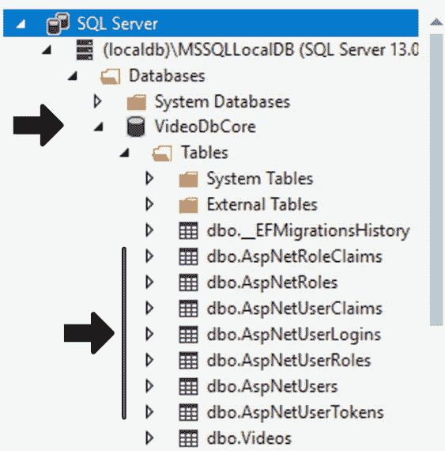

## 用户注册

现在所有配置和数据库表创建都已完成，是时候关注用户如何注册该网站了。

如果你按照目前的状态运行应用程序，Identity 中间件将重定向到 `/Account/Login` URL，该 URL 尚不存在。相反，下一个中间件将处理该请求，浏览器将显示消息 *Hello from configuration*。

要显示登录视图 `Login view`，你必须添加一个带有 `Login` 动作的 `AccountController` 类。为了登录，用户需要注册。因此，你必须在 `AccountController` 类中实现一个 `Register` 动作。

- 1. 在 `Controllers` 文件夹中添加名为 **AccountController** 的类，并继承位于 `Microsoft.AspNetCore.Mvc` 命名空间中的 `Controller` 类。

```csharp
public class AccountController : Controller
{
}
```

# 初学者 ASP.NET Core 2 MVC & Razor Pages

- 2. 为该类添加一个 HTTP GET 动作。视图不需要接收带有数据的模型，因为用户将在视图中提供所有信息。

```csharp
[HttpGet]
public IActionResult Register()
{
    return View();
}
```

- 3. 在 `Views` 文件夹中添加一个名为 `RegisterViewModel` 的类。这将将是 Register 视图的模型。

- 4. 添加对 `System.ComponentModel.DataAnnotations` 的 `using` 语句以获取必要的属性。

- 5. 添加一个名为 `Username` 的字符串，它是必填的且最大长度为 255 个字符。长度由 Identity 表可以存储的用户名的最大字符数决定。

```csharp
[Required, MaxLength(255)]
public string Username { get; set; }
```

- 6. 添加一个名为 `Password` 的字符串属性，它是必填的且具有 `Password` 类型。

```csharp
[Required, DataType(Password)]
public string Password { get; set; }
```

- 7. 添加一个名为 `ConfirmPassword` 的字符串属性，它是必填的且具有 `Compare` 属性。使用 `nameof(Password)` 将其与其进行比较。

```csharp
[Required, Compare(nameof(Password))]
public string ConfirmPassword { get; set; }
```

- 8. 在 `Views` 文件夹中添加一个 `Account` 文件夹。

- 9. 在 `Account` 文件夹中添加一个 `Register` 视图。

- 10. 在视图中添加内容。

- 11. 添加 `@model RegisterViewModel` 指令。

```razor
@model RegisterViewModel
```

- 12. 使用 `ViewBag` 设置 Register 标题。

```razor
@{ ViewBag.Title = "Register"; }
```

# ASP.NET Core 2.0 MVC Razor Pages

- 13. 添加一个 `<h1>` 标题。

- 14. 添加一个 `<form>` 表单。

```razor
<form asp-action="Register" method="post">
```

- 15. 添加一个 `<div>` 用于显示验证摘要 `validation summary`。

```razor
<div asp-validation-summary="Model"></div>
```

- 16. 添加一个 `<label>` 标签。

```razor
<label asp-for="Username"></label>
```

- 17. 添加一个 `<input>` 输入框。

```razor
<input asp-for="Username" />
```

- 18. 添加一个 `<label>` 标签。

```razor
<label asp-for="Password"></label>
```

- 19. 添加一个 `<input>` 输入框。

```razor
<input asp-for="Password" />
```

- 20. 添加一个 `<label>` 标签。

```razor
<label asp-for="ConfirmPassword"></label>
```

- 21. 添加一个 `<input>` 输入框。

```razor
<input asp-for="ConfirmPassword" />
```

- 22. 添加一个提交按钮。

```razor
<button type="submit">Register</button>
```

# ASP.NET Core 2.0 MVC & Razor Pages

- 23. 添加 `Entities` 和 `Identity` 命名空间的 `using` 语句以访问 `User`、`UserManager` 和 `SignInManager` 类。

- 24. 在 `if` 语句下方创建一个 `User` 类的实例，并将传递的 `model` 赋值给属性。

```csharp
var user = new User { Username = model.Username };
```

- 25. 为了处理用户实体，你需要通过构造函数引入 `UserManager`。为控制器添加构造函数并注入上述两个类。

```csharp
private UserManager<User> _userManager;
private SignInManager<User> _signInManager;

public AccountController(UserManager<User> userManager, SignInManager<User> signInManager)
{
    _userManager = userManager;
    _signInManager = signInManager;
}
```

- 26. 接下来你想在 HTTP POST Register 动作中使用 `UserManager` 创建新用户。将结果保存在名为 `result` 的变量中。

```csharp
var result = await _userManager.CreateAsync(user, model.Password);
```

- 27. 如果用户创建成功，你想自动登录该用户。使用 `result` 变量上的 `Created` 属性检查用户是否创建成功，并使用 `SignInAsync` 方法登录用户。方法的第二个参数决定 Cookie 是否持久会话。

```csharp
if (result.Created)
{
    await _signInManager.SignInAsync(user, false);
    return RedirectToAction("Index", "Home");
}
```

- 28. 如果用户未创建成功，你想将错误添加到 `ModelState` 对象中，以便作为模型错误发送到客户端并在验证摘要中显示。

```csharp
else
{
    foreach (var error in result.Errors)
        ModelState.AddModelError("", error.Description);
}
```

# 初初学者 ASP.NET Core MVC & Razor Pages

29. 在 `else` 块下方返回视图。

```csharp
return View();
```

30. 保存所有文件并导航到 `/Account/Register` URL。应该显示 Register 视图。用三个字母的密码填写表单，并点击 Register 按钮。验证摘要应该显示在 `Register` 动作中循环到 `ModelState` 对象的错误。

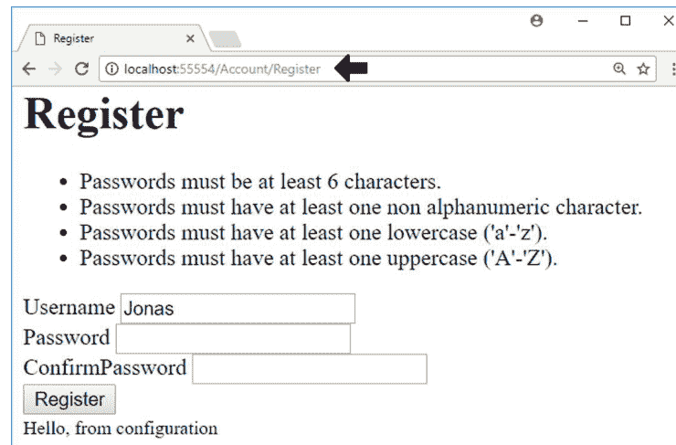

- 密码长度至少为 6 个字符。
- 密码至少包含一个非字母数字字符 `'a'-'z'`。
- 密码至少包含一个小写字母 `'a'-'z'`。
- 密码至少包含一个大写字母 `'A'-'Z'`。

用户名 Jonas

密码

确认密码

注册

来自配置的问

31. 填写表单 `这次使用正确信息`。你应该通过 `Register` 动作中的 `RedirectToAction` 方法重定向到 Index 视图。

32. 在 SQL Server 对象资源管理器中查看 `AspNetUsers` 表中的数据，以验证用户已注册。

| dbo.AspNetUsers [Data] | Id | PasswordHash | UserName |
| :--- | :--- | :--- | :--- |
| 9d1cc0a0-5a8-... | AQAAAAAEA... | Jonas |
| NULL | NULL | NULL |

# 初初学者 ASP.NET Core 2. MVC & Razor Pages

`RegisterViewModel` 类的完整代码：

```csharp
public class RegisterViewModel
{
    [Required, MaxLength(255)]
    public string Username { get; set; }
    [Required, DataType(DataType.Password)]
    public string Password { get; set; }
    [Required, DataType(DataType.Password), Compare(nameof(Password))]
    public string ConfirmPassword { get; set; }
}
```

`AccountController` 类的完整代码：


```csharp
public class AccountController : Controller
{
    private UserManager<User> _userManager;
    private SignInManager<User> _signManager;

    public AccountController(UserManager<User> userManager, SignInManager<User> signManager)
    {
        _userManager = userManager;
        _signManager = signManager;
    }

    [HttpGet]
    public IActionResult Register()
    {
        return View();
    }

    [HttpPost]
    public async Task<IActionResult> Register(RegisterViewModel model)
    {
        if (!ModelState.IsValid)
            return View();

        var user = new User { Username = model.Username };
        var result = await _userManager.CreateAsync(user, model.Password);

        if (result.Succeeded)
        {
            await _signManager.SignInAsync(user, false);
            return RedirectToAction("Index", "Home");
        }
        foreach (var error in result.Errors)
        {
            ModelState.AddModelError("", error.Description);
        }

        return View();
    }
}
```

`Register` 视图的完整代码：

```html
@model RegisterViewModel
@{ ViewBag.Title = "Register"; }
<h1>Register</h1>
<form method="post" asp-controller="Account" asp-action="Register">
    <div asp-validation-summary="ModelOnly"></div>

    <div>
        <label asp-for="Username"></label>
        <input asp-for="Username" />
        <span asp-validation-for="Username"></span>
    </div>

    <div>
        <label asp-for="Password"></label>
        <input asp-for="Password" />
        <span asp-validation-for="Password"></span>
    </div>

    <div>
        <label asp-for="ConfirmPassword"></label>
        <input asp-for="ConfirmPassword" />
        <span asp-validation-for="ConfirmPassword"></span>
    </div>

    <div>
        <input type="submit" value="Register" />
    </div>
</form>
```

# ASP.NET Core MVC & Razor Pages Razor学者

# 登录与注出

在本节中，你将在应用程序中实现登录和注销。链接将添加到名为 `_LoginLinks` 的局部视图，你需要将其添加到 `Views/Shared` 文件夹。该局部视图将由 `_Layout` 视图使用 `@Partial` 或 `@PartialAsync` 方法渲染。

当匿名用户到达网站时，可以使用登录和注册链接。当用户登录或注册后，应该显示用户名和注销链接。

你必须在 `Views/Account` 文件夹中创建一个名为 `Login` 的新视图，登录链接通过调用 `Account` 器中的 `Login` 动作打开。

为了处理用户和登录信息，你注入 `SignInManager` 和 `UserManager`，就像在方法和构造函数中使用依赖注入的方式一样。

当匿名用户点击受限链接（如 Edit 链接）时，会带上 `ReturnUrl` 参数，这样用户在成功登录后就能返回。以下是带有 `ReturnUrl` 参数的示例 URL：

`http://localhost:51457/Account/Login?ReturnUrl=%2FHome%2FEdit%2F1`

## 添加 _Login 局部视图

此局部视图将包含匿名用户访问时显示的登录和注册链接，以及用户登录后显示的注销链接和用户名。

- 在 `Views/Shared` 添加一个名为 `_LoginLinks` 的 MVC 视图。
- 删除视图中的所有代码。
- 添加 `Microsoft.AspNetCore.Identity` 命名空间的 `using` 语句以访问 `SignInManager` 和 `UserManager`。

`using Microsoft.AspNetCore.Identity`

- 在 `using` 语句下方向视图注入 `SignInManager` 和 `UserManager`。

`@inject SignInManager<User> SignInManager`

`@inject UserManager<User> UserManager`

# ASP.NET Core 2.0 MVC & Razor Pages 初学者

### 5. 添加 `if/else` 块来检查用户是否登录，使用 `SignInManager` 上的 **SignedIn** 方法并传递 **User** 对象。

```csharp
if (SignIn.IsSignedIn(User)) {
    // 用户已登录
} else {
    // 匿名用户
}
```

### 6. 在 *已登录* 用户块中添加一个 `<div>` 来显示用户名。

```csharp
if (SignIn.IsSignedIn(User)) {
    // 用户已登录
    <div>@User.Identity.Name</div>
}
```

### 7. 在 *已登录* 用户块中添加一个 `<form>` 提交到 `Logout` 动作。

```html
<form method="post" asp-controller="Account" asp-action="Logout">
    <input type="submit" value="Logout" />
</form>
```

### 8. 在匿名块中添加两个锚点，导航到 `Login` 和 `Register` 动作。

```html
<a asp-controller="Account" asp-action="Login">Login</a>
<a asp-controller="Account" asp-action="Register">Register</a>
```

### 9. 打开 `_Layout` 视图并添加一个包含 `@PartialAsync("_LoginLinks")` 方法的 `<div>`。

```html
<div>
    @await PartialAsync("_LoginLinks")
</div>
```

### 10. 在调试模式下启动应用程序。因为已经登录，应该显示用户名和注销链接。

# ASP.NET Core 2.0 MVC & Razor Pages 初学者


`_Links` 局部视图的完整代码：

```html
@using Microsoft.AspNetCore.Identity
@inject SignInManager<User> SignInManager
@inject UserManager<User> UserManager

@if (SignIn.IsSignedIn(User))
{
    <div>@User.Identity.Name</div>
    <form method="post" asp-controller="Account" asp-action="Logout">
        <input type="submit" value="Logout" />
    </form>
}
else
{
    <a asp-controller="Account" asp-action="Login">Login</a>
    <a asp-controller="Account" asp-action="Register">Register</a>
}
```

`_Layout` 视图的完整代码：

```html
<!DOCTYPE html>
<html>
<head>
    <meta name="viewport" content="width=device-width" />
    <title>@ViewBag.Title</title>
</head>
```

# ASP.NET Core 2.0 MVC & Razor Pages

```html
<body>
  <div>
    @await PartialAsync("_LoginLinks")
  </div>
  @RenderBody()
  <footer>
    @RenderSection("footer", false)
    @await Component.InvokeAsync("Message")
  </footer>
</body>
```

# 添加注销动作

点击注销按钮时，必须调用 `SignInManager` 上的 `SignOutAsync` 方法来注销用户。`Account` 控制器的 `Logout` 动作必须是异步的，因为 `SignOutAsync` 方法是异步的。

1. 打开 `AccountController` 类。
2. 添加一个返回 `Task<IActionResult>` 的异步 HTTP post `Logout`。该动作将在点击注销时被调用。
3. 在 `Logout` 动作内部调用 `_signinManager` 对象的 `SignOutAsync` 方法。

```csharp
await _signManager.SignOutAsync();
```

4. 因为用户正在注销，你希望用户在注销过程结束后到达一个安全的视图。重定向到 `Home` 控制器的 `Index` 动作。

```csharp
return RedirectToAction("Index", "Home");
```

`Logout` 动作的完整代码：

```csharp
[HttpPost]
public async Task<IActionResult> Logout()
{
  await _signManager.SignOutAsync();
  return RedirectToAction("Index", "Home");
}
```

# ASP.NET Core 2.0 MVC Razor Pages 初学者教程

## 添加 LoginViewModel 类

此模型负责将用户提供的登录信息以及 ReturnUrl 参数值传递给 HTTP POST 操作。

该模型需要四个属性：`Username`、`Password`、`RememberMe` 和 `ReturnUrl`。

`RememberMe` 属性决定 cookie 应该是会话 cookie 还是更具持久性的 cookie。

- 1. 在 ViewModels 文件夹中添加名为 `LoginViewModel` 的新类。
- 2. 为 `DataAnnotations` 命名空间添加 `using` 语句，以便访问数据注解特性。

`using System.ComponentModel.DataAnnotations;`

- 3. 添加三个名为 `Username`、`Password` 和 `ReturnUrl` 的 string 类型属性，以及名为 `RememberMe` 的 bool 类型属性。
- 4. 为 `Username` 属性添加 `Required` 特性。

`[Required]`

- 5. 为 `Password` 属性添加 `DataType.Password` 和 `Required` 特性。

`[DataType(DataType.Password), Required]`

- 6. 使用 `Display` 特性将 `ReturnUrl` 属性的标签文本更改为 Remember Me。

`[Display(Name = "Remember Me")]`

`LoginViewModel` 类的完整代码：

```csharp
public class LoginViewModel
{
    [Required]
    public string Username { get; set; }
    [DataType(DataType.Password), Required]
    public string Password { get; set; }
    public string ReturnUrl { get; set; }
    [Display(Name = "Remember Me")]
    public bool RememberMe { get; set; }
}
```

# ASP.NET Core 2.0 MVC & Razor Pages 初学者教程

## 添加 HTTP GET Login 操作

当用户点击登录链接时将调用此操作。你需要创建一个 `LoginViewModel` 实例，并将传递的返回 URL 赋值给它的 `ReturnUrl` 属性。将模型传递给视图。

- 1. 打开 `AccountController` 类。
- 2. 添加一个名为 `Login` 的 HTTP GET 操作，接收一个名为 `returnUrl` 的 string 参数并返回一个 `IActionResult`。

```csharp
[HttpGet]
public IActionResult Login(string returnUrl = "")
{
}
```

- 3. 创建 `LoginViewModel` 实例，并将传递给操作的返回 URL 赋值给它的 `ReturnUrl` 属性。

```csharp
var model = new LoginViewModel { ReturnUrl = returnUrl };
```

- 4. 带有模型返回视图。

```csharp
return View(model);
```

HTTP GET Login 操作的完整代码：

```csharp
[HttpGet]
public IActionResult Login(string returnUrl = "")
{
    var model = new LoginViewModel { ReturnUrl = returnUrl };
    return View(model);
}
```

## 添加 HTTP POST Login 操作

当用户点击登录视图中的登录按钮时，将调用 HTTP POST 。视图表单会将用户数据发送到此操作；因此，它必须有一个 `LoginViewModel` 作为参数。如果 `SignManager` 是异步的，则操作也必须是异步的。

- 1. 打开 `AccountController` 类。
- 2. 添加一个名为 `Login` 的异步 POST 操作，接收 `LoginViewModel` 实例作为参数并返回一个 `Task<IActionResult>`。

```csharp
[HttpPost]
public async Task<IActionResult> Login(LoginViewModel model)
{
}
```

- 3. 在任何 HTTP POST 操作中第一件事都是检查模型状态是否有效；如果无效，则应该重新渲染视图。

`if (!ModelState.IsValid) return View(model);`

- 4. 调用 `PasswordSignInAsync` 方法登录用户，传递用户名、密码和记住我。将结果存储在名为 `result` 的变量中。最后一个参数决定在提供错误凭据时是否应锁定用户。

`var result = await _signinManager.PasswordSignInAsync(model.Username, model.Password, model.RememberMe, false);`

- 5. 添加一个 `if` 语句检查登录是否成功。

`if (result.Succeeded)`

{

}

- 6. 在上一个内部添加另一个 `if` 语句，检查 URL 是否为空或是否为本地 URL。出于安全考虑，检查它是否为本地 URL 是重要的。如果不这样做，你的应用程序将受到攻击。

`if (!String.IsNullOrEmpty(model.ReturnUrl) && Url.IsLocalUrl(model.ReturnUrl))`

{

}

else

{

}


# ASP.NET Core 2.0 MVC & Razor Pages 初学者教程

## HTTP POST Login 操作

- 7. 如果返回 URL 存在且安全，则在 `if` 块中重定向到它。

`return Redirect(model.ReturnUrl);`

- 8. 如果 URL 为空或不是本地的，则重定向到 Home 控制器的 `Index` 操作。

`return RedirectToAction("Index", "Home");`

- 9. 添加一个 `ModelState` 错误并返回带有模型的视图。以确保只有在登录失败时才调用它。

`ModelState.AddAddModelError("", "Login failed");`

`return View(model);`

### HTTP POST Login 操作的完整代码

```csharp
[HttpPost]
public async Task<IActionResult> Login(LoginViewModel model)
{
    if (!ModelState.IsValid) return View();

    var result = await _signInManager.SignInAsync(
        model.Username, model.Password, model.RememberMe, false);
    if (result.Succeeded)
    {
        if (string.IsNullOrEmpty(model.ReturnUrl) &&
            Url.IsLocalUrl(model.ReturnUrl))
        {
            return Redirect(model.ReturnUrl);
        }
        else
        {
            return RedirectToAction("Index", "Home");
        }
    }
    ModelState.AddAddModelError("", "Login failed");
    return View(model);
}
```

## 8. 前端框架

在本章中，你将学习如何使用 Bower 安装前端库。你将安装的两种类型的库分别用于样式设置和客户端验证。

**Bootstrap**：这是最流行的用于样式设置和响应式设计的库。你将使用一些 Bootstrap CSS 类来为视频列表和导航链接设置样式。你可以在他们的网站上找到更多关于 Bootstrap 信息：http://getBootstrap.com。

**jQuery**：你将使用 jQuery 和 jQuery Validation 执行客户端验证。这将确保在数据发送到服务器操作之前，用户的输入符合验证规则。某些验证规则是由框架添加的；另一些是你作为属性添加到实体（entity）和视图模型（view model）类中的。验证规则的示例：框架设置的密码限制（可以更改），以及 **Required（必）、MaxLength（最大长度）和 DataType（数据类型）**属性。

### 安装 Bower 和框架

Bower 是 ASP.NET Core 2.0 安装前端框架的首选方式。安装完成后，必须在 `_Layout` 视图中引用以实现全局访问，或者在单个视图中引用以实现本地访问。你可以使用环境标记（environment tag）来指定库应该访问的环境。你通常希望在 **Development（开发）**环境中中使用未压缩的库以便调试，并在 **Staging（测试）**和 **Production（生产）**环境中中使用压缩版本以获得更加载速度。

很多时候，你可以通过使用内容分发网络（CDN）来实现更快的加载速度，CDN 是缓存了库版本的服务器。你可以在此处找到微软 CDN 的信息：https://docs.microsoft.com/en-us/aspnet/ajax/cdn/overview。

使用四个属性检查 JavaScript 库是否已安装：**asp-fallback-test-class**、**asp-fallback-test-property**、**asp-fallback-test-value** 和 **asp-fallback-test**。

其中两个属性用于在未安装 JavaScript 库时加载备用源：**asp-fallback-src** 和 **asp-fallback-href**。

### ASP.NET Core 2.0 MVC Razor Pages 入学者教程

- 1. 打开 `Startup` 类，并在 `Configure` 方法调用 `UseMvc` 方法之后，调用 `app.UseStaticFiles` 方法添加静态文件中间件，以启用 CSS 和 JavaScript 文件的加载。

`app.UseStaticFiles();`

- 2. 向项目节点添加 Bower 配置文件。将其命名为 `bower.json` 是非常重要的。你可以在“新建项”对话框中搜索 bower。

- 3. 使用“管理 Bower 包”指南安装 Bootstrap，或直接将依赖项输入到 `bower.json` 文件中。Bootstrap 依赖于 jQuery：`"Bootstrap": "3.3.7"`

- 4. 通过 Bower 安装 `jQuery-Validation` 和 `jQuery-Validation-Unobtrusive` 库。

`"jquery-validation": "1.17.0",`

`"jquery-validation-unobtrusive": "3.2.6"`

- 5. 展开解决方案管理器中的 `Dependencies/Bower` 节点以验证库是否已安装。

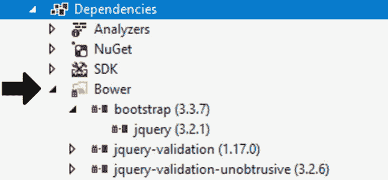

- 6. 展开解决方案管理器中的 `wwwroot` 节点。它现在应该有一个名为 `lib` 的文件夹，安装的库就位于其中。

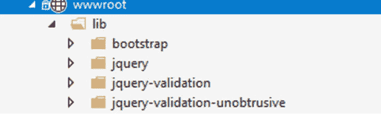

### ASP.NET Core 2.0 MVC Razor Pages 入学者教程

- 7. 打开 `_Layout` 视图，并在 `<head>` 元素内的 `<title>`元素下方添加两个 `<environment>` Tag Helper。第一个应该只包含 Development 环境，第二个应该排除 Development 环境。你可以在项目设置中更改环境。在这两个 Tag Helper 中，你指定视图加载时想要加载的 CSS 库。

```html
<environment include="Development">

</environment>

<environment exclude="Development">

</environment>
```

- 8. 为 Development 环境添加未压缩的 Bootstrap 库，为所有其他环境添加带备用的 CDN 版本。

```html
<environment include="Development">

<link href="~/lib/bootstrap/dist/bootstrap.css" rel="stylesheet" />

</environment>

<environment exclude="Development">

<link rel="stylesheet" href="https://ajax.aspnetcdn.com/ajax/bootstrap/3.3.7/bootstrap.min.css" asp-fallback-test="~/lib/bootstrap/dist/bootstrap.min.css" asp-fallback-test-class="sr-only" asp-fallback-test-property="position" asp-fallback-test-value="absolute" />

</environment>
```

- 9. 重复步骤 6，位于 `<body>` 元素的底部。在这两个 Tag Helper 中，你将 JavaScript 库（如 `jquery.js`, `jquery.validation.js` 和 `jquery.validation.unobtrusive.js` 库）及其 CDN 脚本添加到你在 `<body>` 元素中添加的 `<environment>` Tag Helper 中。

- 10. 将 `Bootstrap.js`, `jquery.js`, `jquery.validation.unobtrusive.js` 库及其 CDN 脚本添加到

```html
<environment include="Development">

<script src="~/lib/dist/jquery.js"></script>

<script src="~/lib/validation/dist/jquery.validate.js"></script>

<script src="~/lib/validation-unobtrusive/jquery.validation.unobtrusive.js"></script>

</environment>

<environment exclude="Development">

<script src="https://ajax.aspnetcdn.com/ajax/jquery/jquery-3.2.1.min.js" asp-fallback-src="~/lib/dist/jquery.js" asp-fallback-test="window.js"></script>

</environment>
```

## ASP.NET Core 2 MVC & Razor Pages 入学者

`bower.json` 文件中的完整依赖列表：

```
"dependencies": {
  "Bootstrap": "3.3.7",
  "jquery-validation": "1.17.0",
  "jquery-validation-unobtrusive": "3.2.6"
}
```

## 使用 Bootstrap 设置样式

我们在 `_Layout` 视图中添加导航栏，并使用 Bootstrap 为 Index 视图中的列表设置样式。

匿名用户的导航栏：

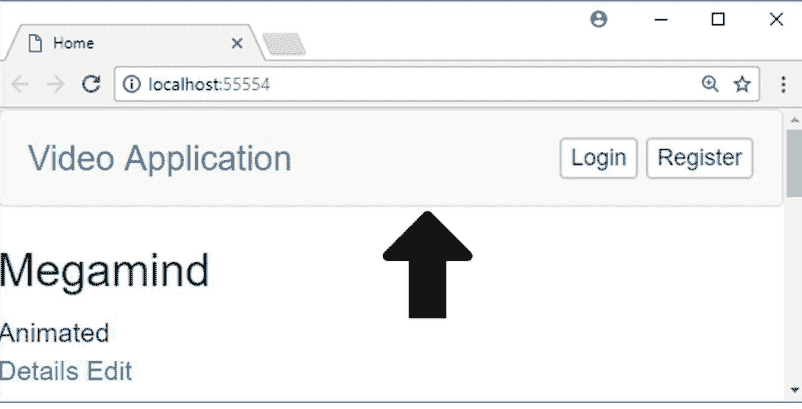

## ASP.NET Core 2.0 MVC & Razor Pages 入学者

登录用户的导航栏：

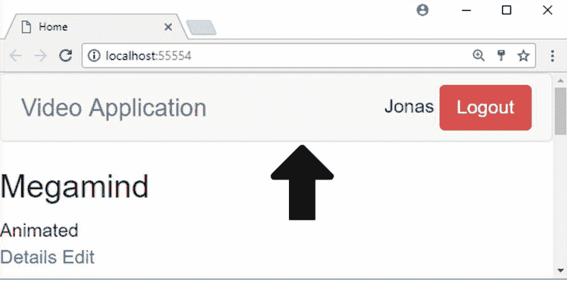

### 添加导航栏

- 1. 打开 `Startup` 类，并在 `Configure` 方法调用 `UseMvc` 方法之后调用 `app.UseStaticFiles` 方法以启用 CSS 和 JavaScript 文件的加载。

`app.UseStaticFiles();`

- 2. 向项目节点添加 Bower 配置文件。将其命名为 `bower.json` 是非常重要的。你可以在“新建项”对话框中搜索 bower。

- 3. 使用“管理 Bower 包”指南安装 Bootstrap，或直接将依赖项输入到 `bower.json` 文件中。Bootstrap 依赖于 jQuery：`"Bootstrap": "3.3.7"`

- 4. 通过 Bower 安装 `jQuery-Validation` 和 `jQuery-Validation-Unobtrusive` 库。

`"jquery-validation": "1.17.0",`

`"jquery-validation-unobtrusive": "3.2.6"`

- 5. 展开解决方案管理器中的 `Dependencies/Bower` 节点以验证库是否已安装。

- 6. 展开解决方案管理器中的 `wwwroot` 节点。它现在应该有一个名为 `lib` 的文件夹，安装的库就位于其中。

- 7. 打开 `_Layout` 视图，并在 `<head>` 元素内的 `<title>`元素下方添加两个 `<environment>` Tag Helper。第一个只包含 Development 环境，第二个排除 Development 环境。你可以在项目设置中更改环境。在这两个 Tag Helper 中，你指定视图加载时想要加载的 CSS 库。

```html
<environment include="Development">

</environment>

<environment exclude="Development">

</environment>
```

- 8. 为 Development 环境添加未压缩的 Bootstrap 库，为所有其他环境添加带备用的 CDN 版本。

```html
<environment include="Development">

<link href="~/lib/bootstrap/dist/bootstrap.css" rel="stylesheet" />

</environment>

<environment exclude="Development">

<link rel="stylesheet" href="https://ajax.aspnetcdn.com/ajax/bootstrap/3.3.7/bootstrap.min.css" asp-fallback-test="~/lib/bootstrap/dist/bootstrap.min.css" asp-fallback-test-class="sr-only" asp-fallback-test-property="position" asp-fallback-test-value="absolute" />

</environment>
```

- 9. 重复步骤 6，位于 `<body>` 元素的底部。在这两个 Tag Helper 中，你将 JavaScript 库（如 `jquery.js`, `jquery.validation.js` 和 `jquery.validation.unobtrusive.js` 库）及其 CDN 脚本添加到你在 `<body>` 元素中添加的 `<environment>` Tag Helper 中。

- 10. 将 `Bootstrap.js`, `jquery.js`, `jquery.validation.unobtrusive.js` 库及其 CDN 脚本添加到

```html
<environment include="Development">

<script src="~/lib/dist/jquery.js"></script>

<script src="~/lib/validation/dist/jquery.validate.js"></script>

<script src="~/lib/validation-unobtrusive/jquery.validation.unobtrusive.js"></script>

</environment>

<environment exclude="Development">

<script src="https://ajax.aspnetcdn.com/ajax/jquery/jquery-3.2.1.min.js" asp-fallback-src="~/lib/dist/jquery.js" asp-fallback-test="window.js"></script>

</environment>
```

## ASP.NET Core 2.0 MVC Razor Pages 入学者

- 6. 剪切包含 `_Links` 局部视图调用的 `<div>`，并粘贴到 navbar brand 下方。向 `<div>` 添加 Bootstrap 类 `navbar`, `navbar-nav` 和 `pull-right`，将链接转换为按钮并在导航栏中对齐。

```html
<div class="nav navbar-nav pull-right">
    @await Html.PartialAsync("_Links")
</div>
```

- 7. 打开获取用户名的 `_Login Razor`，将其粘贴到表单顶部。删除 `<div>`。

```html
<form method="post" asp-controller="Account" asp-action="Logout">
    @User.Identity.Name
    <input type="submit" value="Logout" />
</form>
```

- 9. 在提交按钮上添加 Bootstrap 类 `navbar-btn`, `btn` 和 `btn-danger` 以设置样式。

```html
<input type="submit" value="Logout" class="navbar-btn btn btn-danger" />
```

- 10. 为 `<a>` 元素添加 Bootstrap 类 `btn`, `btn-xs`, `btn-default` 和 `navbar-btn`，将链接转换为按钮。

- 11. 为 Index 视图中的 Create 按钮添加 10px 左边距。

```html
<div style="margin-left:10px;margin-bottom:10px;">
    <a class="btn btn-success">Create</a>
</div>
```

# ASP.NET Core 2 MVC & Razor Pages 初学者教程


```html
<input type="submit" value="Logout"
class="navbar-btn btn btn-danger"/>
</form>
else {
    // 匿名用户
    <a asp-controller="Account" asp-action="Login"
    class="btn-xs btn-default navbar-btn">登录</a>
    <a asp-controller="Account" asp-action="Register"
    class="btn-xs btn-default navbar-btn">注册</a>
}
```

*Layout 视图中的导航栏标记如下：

```html
<nav class="navbar navbar-default">
  <div class="container-fluid">
    <div class="navbar-header">
      <a class="navbar-brand" href="/">VideoApplication</a>
    </div>
    <div class="nav navbar-nav pull-right">
      @await Html.PartialAsync("__LoginLinks")
    </div>
  </div>
</nav>
```

# 为 Index 视图设置样式

让我们通过添加 Bootstrap 类来让视频列表看起来更吸引人，使其呈现出面板（panels）的外观。下图显示了结果。

1. 打开 **Index** 视图。

2. 在 **Index** 视图的链接中添加 Bootstrap 类 **btn** 和 **btn-success**。这应该会将按钮变为绿色，使用默认的 Bootstrap 主题。`<a class="btn-success" asp-action="Create">创建</a>`

3. 打开 **_Video** 视图。

4. 在 `<section>` 元素上添加 **panel** 和 **panel-primary** Bootstrap 类，将其转换为带有标题背景的面板。`<section class="panel panel-primary">`

5. 将 `<h3>` 标题替换为装饰有 `panel-heading` Bootstrap 类的 `<div>` 标签，用于标题。

```html
<div class="panel-heading">@Model.Title</div>
```

6. 将类型（genre）的结束标签 `</div>` 移动到锚点标签结束标签 `</div>` 下方。为包裹类型和锚点标签的 `<div>` 添加 `panel-body` Bootstrap 类。

```html
<div class="panel-body">
@Model.Genre
<div>
    <a class="btn btn-default" asp-action="Details" asp-route-id="@Model.Id">详情</a></a>>
    <a class="btn btn-default" asp-action="Edit" asp-route-id="@Model.Id">编辑</a></a>>
</div>
</div>
```

7. 保存所有文件并在无调试模式下启动应用程序（Ctrl+F5）。视频应该以面板的形式显示。

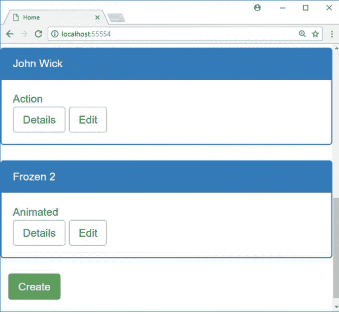

# ASP.NET Core 2.0 MVC Razor Pages 初学者教程

_Video 视图的完整标记如下：

```html
<section class="panel panel-primary">
<div class="panel-heading">@Model.Title</div>
<div class="panel-body">
@Model.Genre
<div>
  <a class="btn btn-default" asp-action="Details" asp-route-id="@Model.Id">详情</a></a>
  <a class="btn btn-default" asp-action="Edit" asp-route-id="@Model.Id">编辑</a></a>>
</div>
</div>
</section>
```

## 添加客户端验证

为了利用客户端验证，你只需要添加 `jquery`、`jquery.validate` 和 `jquery.validate.unobtrusive` JavaScript 库。你已经在之前的章节中添加了这些库，所以现在你只需要检查验证是否有效。

当你尝试输入数据并点击登录、编辑和创建按钮时，请注意浏览器中的 URL 字段。

1. 在无调试模式下运行应用程序。

2. 点击登录按钮，进入 视图。这应该显示面板。

3. 使用正确的凭据登录。

4. 清空字段并点击编辑按钮。URL 应该不会刷新。视频列表应该显示信息。

5. 尝试输入无效数据并点击登录按钮。URL 应该不会刷新。视频列表应该会显示错误信息。

6. 点击返回链接返回 Index 视图。

7. 点击视频列表下的创建链接。

8. 尝试添加一个标题的视频。URL 应该不会刷新。视频列表应该显示信息。

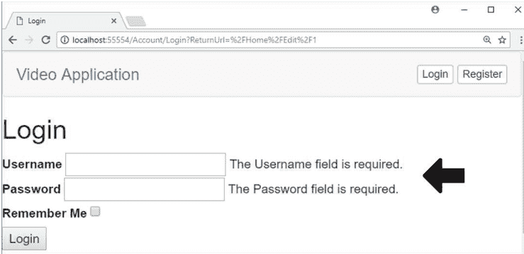

## 总结

在本章中，你使用了 jQuery 来添加客户端验证，并使用了 Bootstrap 为 Index 视图设置样式。

接下来，你将实现视频课程网站。

# 第二部分：MVC

如何构建视频课程网站

ASP.NET Core 2.0 & Razor Pages 初学者

## 9. 用例

## 引言

在本书的后续章节中，你将学习如何构建基于 ASP.NET Core 2.0 的 MVC 和 Razor Pages 的 Web 应用程序，使用 Entity Framework Core 和身份验证。

## 用例

在本书的后续章节中，你将学习如何构建基于 ASP.NET Core 2.0 的 MVC 和 Razor Pages 的 Web 应用程序，使用 Entity Framework Core 和自定义 Tag Helper。

## 用户界面 (MVC)

该 Web 应用程序应使用 MVC 模板创建。用户应该能够注册并登录。登录或注册成功后会自动重定向到网站。

登录后的第一个视图应该是仪表板，显示可用的课程。点击课程后将显示课程大纲。每个课程可以包含多个模块，每个模块包含多个视频和下载内容。下载内容应在新标签页中打开。

当用户点击视频时，将打开一个新的视图，视频播放器将加载视频但显示图像（不自动播放）。课程信息和视频描述应在视频播放器下方。视频播放器右侧应显示模块中下一个视频的缩略图，以及上一个和下一个视频的按钮。如果没有视频，按钮应被禁用。

导师简介应显示在课程、详情和视频视图中。

菜单左侧应有一个 Logo，右侧应有一个设置菜单。

不应将数据库实体类作为视图模型；相反，每个视图应使用一个视图模型，其中包含必要的数据传输对象（DTO）和其他属性。应使用 Auto Mapper 将实体转换为 DTO 并发送到视图。

# 初学者 ASP.NET Core 2.0 MVC & Razor Pages

## 管理员界面 (Razor Pages)

Web 应用程序应该使用 Razor Pages 创建。每个表都应该有用于添加和修改数据的 Razor Pages：Index（索引）、Create（创建）、Edit（编辑）、Delete（删除）。为了在下拉列表中显示数据，一组 `SelectList` 项将从其后台代码通过动态 `viewData` 对象发送到 Razor Page，并在 Razor Page 中使用 `<select>` 元素和 `ViewBag` 对象显示。在 C# 中使用 `viewData` 对象存储的数据可以通过 `viewData` 对象检索并显示在 HTML 中。

如果登录用户是管理员，Logo 右侧应该出现一个下拉菜单，包含指向对网站数据库进行 CRUD 操作的视图链接。主 Index 页面上还应该有一个仪表板，管理员可以在那里点击打开与数据库中不同表相关的 Index 页面并执行 CRUD 操作。

## 结论

经过仔细考虑，这些是应用程序正常运行所需的视图和控件。

## 登录与注册

显然，默认视图可以重用；它们只需要一些样式处理。导航栏中用于用户注册和登录的默认链接必须移除，Home 控制器的 `Index` 操作将重定向到 Login 视图而不是显示 Index 视图。这将确保在应用程序启动时显示登录面板。

下面是 Login 和 Create 视图的草图。注意文本框中的图标，它们将由 Glyphicons 表示。

当用户在网站注册时，应用程序将收集用户的电子邮件和密码，当用户登录时将向访问者请求这些信息。还会有一个复选框，询问用户是否希望在下次访问网站时保持登录状态。

# 初学者 ASP.NET Core 2.0 MVC Razor Pages

- 使用本地账户登录。

- 创建新账户。

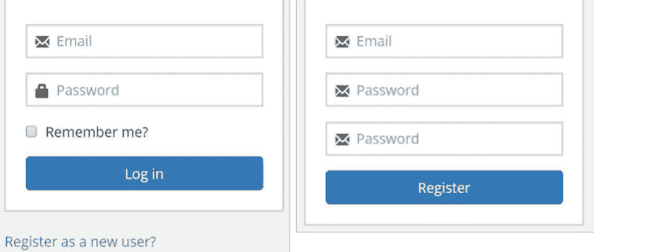

注册成为新用户？

## 用户仪表板视图

通过分析用例，你可以推断出仪表板的课程面板应该根据用户拥有的课程数量动态加载。课程将每行显示三个，以确保它们足够大。这意味着视图模型必须包含一个由课程 DTO 定义的集合集合。

每个课程 DTO 应该包含课程 ID、课程标题、描述、课程图像和横幅图像的属性。每个课程都应该以面板的形式显示，包含课程图像、标题、描述以及一个指向课程视图的按钮。

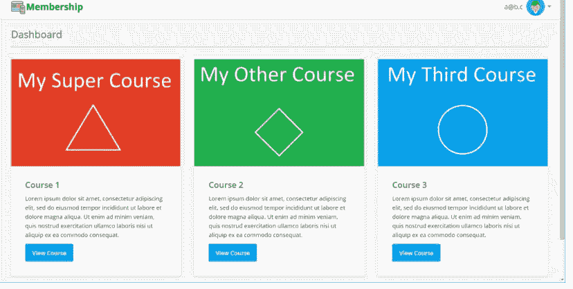

# 初学者 ASP.NET Core 2.0 MVC & Razor Pages

## 课程视图

课程视图顶部应该有一个按钮，用于返回仪表板。按钮下方应该有三个部分：概览、课程模块和讲师简介。

横幅图像、课程图像（作为横幅中的缩略图）、标题和描述应该位于顶部面板。

在顶部面板左侧，应该列出课程模块及其内容。注意，模块中有两种可能的内容类型：视频和下载。每个视频都应该显示缩略图、标题、描述和视频长度（时长）。下载以带有描述性标题的链接列出。

模块列表右侧是讲师简介，包含讲师的缩略图、姓名和描述。

为了实现这一点，课程视图模型需要包含一个 Course DTO、一个 Instructor DTO 和一个 Module DTO 列表。每个 Instructor DTO 应该包含教授课程的讲师的头像、姓名和描述。Module DTO 应该包含模块 ID、标题以及 Video DTO 列表和 Download DTO 列表。

Video DTO 应该包含视频 ID、标题、描述、时长、缩略图以及视频的 URL。点击视频时，视频应被加载并由 Video 视图显示。应禁用自动播放。

Download DTO 应该包含标题和内容的 URL。当点击链接时，内容将在新的浏览器标签页中打开。

# 初学者 ASP.NET Core 2.0 MVC & Razor Pages

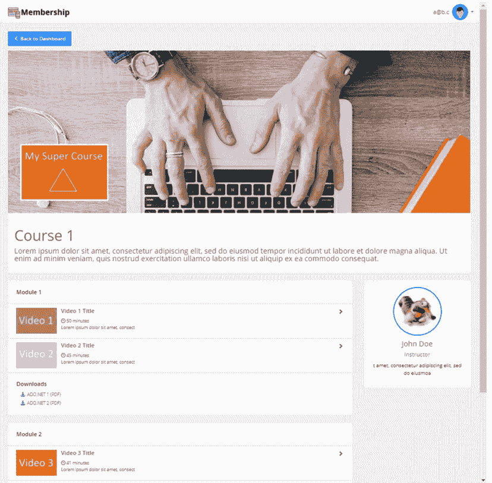

## 视频视图

在返回课程视图的按钮下方，视频视图应该有三个部分。左侧显示一个包含视频、课程和视频信息的大型视频面板。右上角是一个显示当前模块中视频图像和标题的面板，并带有“上一个”和“下一个”按钮。

在下一个视频面板下方是讲师面板。

# 初学者 ASP.NET Core 2.0 MVC

为了实现这一点，视频视图必须包含一个 Video DTO、一个 Instructor DTO、一个 Course DTO 和一个 LessonInfo DTO。LessonInfo DTO 包含课程数、课程总数、视频 ID 以及模块中上一个和下一个视频的缩略图。


## 用户仪表板

仪表板页面应该包含指向表的链接。

# 初学者 ASP.NET Core 2.0 MVC & Razor Pages


## 用户仪表板

仪表板页面应该包含指向表的链接。

# 初学者 ASP.NET Core 2.0 MVC & Razor Pages


## 用户仪表板

仪表板页面应该包含指向表的链接。

# 初学者 ASP.NET Core 2.0 MVC & Razor Pages


## 用户仪表板

仪表板页面应该包含指向表的链接。

# 初学者 ASP.NET Core 2.0 MVC & Razor Pages


## 用户仪表板

仪表板页面应该包含指向表的链接。

# 初学者 ASP.NET Core 2.0 MVC & Razor Pages


## 用户仪表板

仪表板页面应该包含指向表的链接。

# 初学者 ASP.NET Core 2.0 MVC Razor Pages

- 8. 点击“更改身份验证”按钮并在弹出对话框中选择“单个用户账户”。这将允许访问者使用电子邮件和密码在您的网站上注册并登录（见下图）。

  - a. 选择“单个用户账户”单选按钮。

  - b. 在下拉列表中选择“在应用程序中存储用户帐户”。

  - c. 点击弹出对话框中的“确定”按钮。

- 9. 点击向导中的“确定”按钮。

- 10. 打开 `appsettings.json` 并添加以下连接字符串。确保连接字符串是单行代码非常重要。

```json
"ConnectionStrings": {
  "DefaultConnection": "Server=(localdb)\mssqlocaldb\nDatabase=VideoOnDemand2;Trusted_Connection=True;\nMultipleActiveResultSets=true"
}
```


# 初学者 ASP.NET Core MVC Razor Pages


已经无法通过 `project.json` 文件管理 NuGet 包了。相反，NuGet 包列在 `.csproj` 文件中，可以直接从 IDE 中进行编辑。

理解依赖注入（Dependency Injection）的概念也很重要，因为它用于使对象实例在整个应用程序可用。如果需要资源，可以将其注入到构造函数并保存到私有的类级变量中。类本身不创建任何对象；任何需要的对象都可以通过 DI 请求。

# 初学者 ASP.NET Core 2.0 MVC & Razor Pages

## 安装 AutoMapper

AutoMapper 将用于将实体（数据库表）对象映射到数据传输对象（DTOs），这些对象用于将数据传输到视图。您可以手动将以下内容添加到 `.csproj` 文件的 `<ItemGroup>` 节点中，或者使用文件或 NuGet 包管理器来添加 AutoMapper。

```xml
<PackageReference Include="AutoMapper" Version="6.1.1" />
```

以下列表显示了如何使用 NuGet 包管理器安装包。

- 1. 在解决方案资源管理器中右键点击“依赖”节点，并在键菜单中选择“管理 NuGet 包”。


- 2. 点击对话框顶部的“浏览”链接。

- 3. 在对话框右侧的下拉列表中选择 `nuget.org`。

- 4. 在文本框中输入 `AutoMapper`。

- 5. 在列表中选择 `AutoMapper` 包；它可能是列表中的第一个包。

- 6. 确保您使用的是最新稳定版本 (6.1.1)。

- 7. 点击“安装”按钮。


要验证包是否已安装，您可以通过右键点击项目节点并选择 **Edit VideoDemand.csproj** 来打开 `.csproj` 文件，或者展开解决方案资源管理器中的 *Dependencies-NuGet* 文件夹。

## 创建数据库

创建允许用户注册和登录的数据库只需要几步。在后面的章节中，您将通过添加存储应用程序数据的表来扩展数据库。

要创建数据库，您需要创建一个迁移来告诉 Entity Framework 如何设置数据库。在包管理器控制台中执行 `add-migration` 命令。

迁移创建后，在同一控制台中执行 `update-database` 命令来创建数据库。数据库创建后，可以从 **View** 菜单打开它。

由于实体和数据库上下文将在管理 UI 和用户 UI 之间共享，您将创建一个名为 **VideoDemand.Data** 的项目。该项目将被其他项目引用。

## 添加数据库项目

- 在解决方案资源管理器中右键点击 **VideoDemand** 解决方案，并在菜单中选择“新建项目”。

- 点击“Web”选项卡并在模板列表中选择“ASP.NET Core 应用程序”。


将项目命名为 `VideoDemand.Data` 并点击“确定”按钮。

确保下拉列表中选择了 `.NET Core` 和 `ASP.NET Core 2.0`。

在模板列表中选择“空”。

点击“确定”按钮。

右键点击 `VideoDemand.Data` 项目并选择“设置为启动项目”。

## 添加用户类

为 `VideoDemand.Data` 项目添加一个名为 `Data` 的文件夹。

在 `Data` 文件夹中添加一个名为 `User` 继承自 `IdentityUser` 的类。

继承自 `IdentityUser`。

```csharp
public class User : IdentityUser
{
}
```

## 添加数据库上下文

在 `Data` 文件夹中添加一个名为 `VideoDemandContext` 的类。

使用 `IdentityDbContext` 作为基类。

```csharp
using Microsoft.EntityFrameworkCore;
using Microsoft.AspNetCore.Identity.EntityFrameworkCore;

public class VideoDemandContext : IdentityDbContext<User>
{
    public VideoDemandContext(DbContextOptions<User> options) : base(options)
    {
    }
}
```

打开 `Startup.cs` `get` `ConfigureServices` 方法中添加连接字符串。

```csharp
using Microsoft.EntityFrameworkCore;

public class Startup
{
    private readonly IConfiguration _configuration;

    public Startup(IConfiguration configuration)
    {
        _configuration = configuration;
    }

    public void ConfigureServices(IServiceCollection services)
    {
        services.AddDbContext<VideoDemandContext>(options =>
            options.UseSqlServer(_configuration.GetConnectionString("DefaultConnection")));
    }
}
```

# 初学者级 ASP.NET Core 2.0 MVC & Razor Pages

SQL Server 节点可能需要一秒或两秒的时间在 SQL Server 对象资源生成器中加载。加载完成后，展开名为 `MSSQLDB` 的服务器，然后展开 `VideoDemand` 数据库。数据库中应该已经添加了几个表。以 Aspnet 开头的表存储用户账户信息，并在用户注册和登录时使用。在这种情况下，当你在为用户实现注册和登录，并判断用户是否为管理员时，你将使用 `AspNetUsers`、`AspNetRoles` 和 `AspNetUserRoles` 表。


## 总结

在本章中，你创建了一个项目，该项目将在本书书中剩余部分用于创建用户界面（UI）。你还安装了 AutoMapper NuGet 包，它之后将用于将数据库实体对象映射到数据传输对象（DTO），从而为视图提供数据。

接下来，你将把 `Home/Index` 操作重定向到显示 `Account/Login` 视图。这将在应用程序启动时显示登录表单。然后你将对登录表单进行样式设计，使其看起来更专业。

# 11. 登录

## 引言

在本章中，你将让登录视图在访问 Web 应用程序立即可用。为了实现这一点，你将从 `Home/Index` 操作重定向到 `Account/Login` 操作。

由于登录视图只应该给尚未登录的访问者，你将使用依赖注入（Dependency Injection）在控制器中使用 `SignInManager`，以便检查用户是否已登录。

为了让访问者能够注册和登录，你必须使用与 `VideoOnDemand.Data` 项目相同的连接字符串。

# 本章使用的技术

- 依赖注入 – 将对象注入控制器的构造函数中。
- C# – 在控制器的操作和构造函数中编写代码。
- Razor – 在必要的视图中引入 C#。
- HTML 5 – 用于构建视图。
- Bootstrap 和 CSS – 用于 HTML 5 元素设置样式。
- TagHelpers – 用于添加 HTML 5 元素及其属性。

## 重定向到登录视图

ASP.NET Core 从设计之初就支持并利用依赖注入（DI）。依赖注入是一种让框架自动创建服务（类）的实例并将其注入构造函数中的方法。为什么这很重要？嗯，它在对象与其协作者之间创建了松耦合。这意味着不需要在协作者本身中创建硬编码实例；它们是被发送到其中的。

不仅可以注入内置的框架服务，你自己的对象也可以在 `Startup` 类中配置 DI。

现在，你将使用 DI 将 `SignInManager` 传递给 `HomeController` 类中的构造函数并将其存储在私有变量中。`SignInManager` 及其 `User` 类型需要两个 `using` 语句：`Microsoft.AspNetCore.Identity` 和 `VideoOnDemand.Data.Entities`。

1. 打开位于 UI 项目中 Controllers 文件夹下的 `HomeController` 类。
2. 添加以下 `using` 语句。

```csharp
using Microsoft.AspNetCore.Identity;
using VideoOnDemand.Data.Entities;
using VideoOnDemand.UI.Models;
```

3. 添加一个构造函数，通过依赖注入接收 `SignInManager` 并将其存储在私有类级变量中。

```csharp
private SignInManager<User> _signInManager;

public HomeController(SignInManager<User> signInMgr)
{
    _signInManager = signInMgr;
}
```

4. 使用你刚刚添加的类级变量检查用户是否登录，如果是匿名用户，则重定向到 `AccountController` 类中的 `Login` 操作。否则，目前打开默认的 `Index` 视图。你将在稍后的章节中更改此。

```csharp
public IActionResult Index()
{
    if (!_signInManager.IsSignedIn(User))
        return RedirectToAction("Login", "Account");

    return View();
}
```

*注：原文代码片段中此处有小错误 `_signInManager.IsSignedIn(User)`，翻译时保持代码逻辑不变*

5. 按 `F5` 运行应用程序。
6. 检查 URL，它应该指向 `/Account/Login`。
7. 检查登录视图是否显示。

# ASP.NET Core 2.0 MVC & Razor Pages 初学者


## 设置登录视图

如上所示，登录视图并不美观。我们可以通过 CSS 对其进行样式设置。


## 添加样式

为了让登录框看起来更专业，我们需要对它进行样式处理。

1. 打开 `wwwroot/css` 文件夹下的 `style.css`。
2. 添加 `.form-group` 类。
3. 添加 `.input-addon` 类。
4. 添加 `.form-control` 类。
5. 添加 `.btn` 类。
6. 添加 `.btn-primary` 类。
7. 添加 `.glyphicon` 类。
8. 添加 `.checkbox` 类。
9. 添加 `.checkbox-inline` 类。
10. 添加 `.label` 类。
11. 添加 `.input` 类。
12. 添加 `.hr` 类。
13. 添加 `.panel` 类。
14. 添加 `.panel-heading` 类。
15. 添加 `.panel-body` 类。
16. 添加 `.panel-footer` 类。
17. 添加 `.panel-default` 类。
18. 添加 `.row` 类。
19. 添加 `.col-md-12` 类。
20. 添加 `.col-md-6` 类。
21. 添加 `.col-md-4` 类。
22. 添加 `.col-md-3` 类。
23. 添加 `.col-md-2` 类。
24. 添加 `.col-md-1` 类。
25. 添加 `.col-sm-8` 类。
26. 添加 `.col-sm-6` 类。
27. 添加 `.col-sm-4` 类。
28. 添加 `.col-sm-3` 类。
29. 添加 `.col-sm-2` 类。
30. 添加 `.col-sm-1` 类。
31. 添加 `.col-xs-8` 类。
32. 添加 `.col-xs-6` 类。
33. 添加 `.col-xs-4` 类。
34. 添加 `.col-xs-3` 类。
35. 添加 `.col-xs-2` 类。
36. 添加 `.col-xs-1` 类。
37. 添加 `.pull` 类。
38. 添加 `.left` 类。
39. 添加 `.right` 类。
40. 添加 `.clearfix` 类。
41. 添加 `.text-center` 类。
42. 添加 `.text-right` 类。
43. 添加 `.text-justify` 类。

## 修改登录视图的布局

1. 打开 `Views/Account/Login.cshtml`。
2. 将登录表单包裹在 `class="panel panel-default"` 的 `div` 中。
3. 添加一个 `class="panel-heading"` 的 `div`，并包含 `<h2>Login</h2>`。
4. 将表单包裹在 `class="panel-body"` 的 `div` 中。
5. 将表单包裹在 `class="panel-footer"` 的 `div` 中。
6. 将表单包裹在 `class="col-md-6"` 的 `div` 中。
7. 将表单包裹在 `class="col-md-8"` 的 `div` 中。
8. 将表单包裹在 `class="col-md-12"` 的 `div` 中。
9. 修改 `form` 标签如下。

```html
<div class="panel panel-default">
    <div class="panel-heading">
        <h2>Login</h2>
    </div>
    <div class="panel-body">
        <form asp-action="Login">
            <div class="form-group">
                <input asp-for="Email" class="form-control" />
                <label for="Email" class="glyphicon glyphicon-envelope"></label>
            </div>
            <div class="form-group">
                <input asp-for="Password" class="form-control" />
                <label for="Password" class="glyphicon glyphicon-lock"></label>
            </div>
            <div class="form-group checkbox">
                <label class="checkbox">
                    <input asp-for="RememberMe" />
                    @Html.DisplayName(m => m.RememberMe)
                </label>
            </div>
            <button type="submit" class="btn btn-primary">Login</button>
        </form>
    </div>
</div>
```

10. 按 `F5` 运行应用程序以查看效果。

# 初学者 ASP.NET Core 2.0 MVC & Razor Pages

更改布局后，表单应该看起来如下。

# 使用本地账户登录。

```
Password
```

- 记住我？

```
Log in
```

`登录` 视图的完整代码：


```razor
@model LoginViewModel
@inject SignInManager<User> SignInManager
@{
ViewData["Title"] = "Log in";
}
<div class="row">
  <div class="col-md-4 col-md-offset-4">
    <h4 id="login-panel-heading">Use a local account to log in.</h4>
    <div class="panel login-panel">
      <div class="panel-body login-panel-body">
        <section>
          <form asp-route-returnurl="@ViewData["ReturnUrl"]" 
                class="login-form" method="post">
            <div asp-validation-summary="All" class="text-danger"></div>
            <div class="form-group add-addon">
              <div class="icon-addon">
                <input asp-for="Email" placeholder="Email" class="form-control" />
                <label for="Email" class="glyphicon glyphicon-envelope" />
              </div>
              <div class="form-group">
                <div class="icon-addon">
                  <input asp-for="Password"
                         placeholder="Password"
                         class="form-control" />
                  <label for="Password" class="glyphicon glyphicon-lock" />
                </div>
              </div>
            <div class="form-group login-form-checkbox">
              <div class="checkbox">
                <label asp-for="RememberMe">
                  <input asp-for="RememberMe" />
                  @Html.DisplayNameName(m => m.RememberMe)
                </label>
              </div>
            </</div>
          </form>
          <div class="form-group login-form-submit">
            <div class="row">
              <div class="col-md-12">
                <button type="submit" class="btn btn-primary">Log in</button>
              </div>
            </div>
          </section>
      </div>
      <p><a asp-action="ForgotPassword">Forgot your password?</a></p>
      <p><a asp-action="Register" asp-route-returnurl="@ViewData["ReturnUrl"]">Register as a new user?</a></p>
    </div>
  </div>
</div>

@section Scripts {
  @await Html.PartialAsync("_ValidationScriptsPartial")
}
```

### 为登录视图设置样式

现在你已经更改了登录视图的布局，是时候使用 CSS 对其进行样式设置了。逐向 `login.css` 文件添加 CSS 选择器，保存文件，并在浏览器中观察变化。

为标题添加 40px 的顶部内边距，使其稍微远离导航栏。

```css
#login-panel-heading {
  margin-top: 40px;
}
```

接下来，将面板宽度设置为 280px 并移除边框。

```css
.login-panel {
  width: 280px;
  border: none;
}
```

接下来，为面板边框添加深灰色并将其宽度设置为 1px，同时为面板主体添加 20px 的内边距。

```css
.login-panel-body {
  border: 1px solid #cece !important;
  padding: 20px;
}
```

表单底部的内边距和外边距需要移除。

```css
.login-form-submit {
  margin-bottom: 0px;
  padding-bottom: 0px;
}
```

Glyicons 应该显示在文本框内。

```css
.icon-addon {
  position: relative;
  color: #555;
  display: block;
}

.icon-addon .glyphicon {
  position: absolute;
  left: 10px;
  padding: 10px;
}

.icon-addon .form-control {
  padding-left: 30px;
  border-radius: 0;
}

.icon-addon:hover .glyphicon {
  color: #2580db;
}
```

**提交** 按钮应该与文本框对齐，并具有相同的宽度。

```css
.login-form button {
  width: 100%;
}
```

最后需要设置样式的是错误消息周围的内边距，使其与文本框对齐并具有相同的宽度。

```css
.login-form .validation-summary-errors ul {
  padding-left: 20px;
}
```

## 总结

在本章中，你更改了登录视图的布局并使用 CSS 对其进行了样式设置。你还学习了如何实现注册视图。

# ASP.NET Core MVC & Razor Pages 初学者教程

```html
</div>
<div class="form-group">
  <div class="icon-addon">
    <input asp-for="ConfirmPassword"
      placeholder="Password"
      class="form-control" />
    <label for="Password" class="glyphicon-envelope" />
  </div>
</div>
</div>
<button type="submit" class="register-form-button btn btn-primary">Register</button>
</form>
</div>
</div>
```

```cor
@section Scripts {
  @await Html.PartialAsync("_ValidationScriptsPartial")
}
```

# 为注册视图（Register View）设置样式

由于相同的样式已经应用于登录视图中的元素，因此 `login.css` 文件中的选择器和属性可以被重用。无需为注册视图添加新的样式表，可以将它的 CSS 选择器添加到 `login.css` 文件中现有的选择器中。

通过在 `login.css` 文件的 `.login-panel-heading` 选择器中添加 `.register-panel` 选择器，为面板添加 40px 的顶部边距。

```css
#login-panel-heading, #register-panel-heading {
  margin-top: 40px;
```

接下来，为面板添加 20px 的内边距，为面板添加 1px 的深灰色边框，并给面板设置 280px 的固定宽度。

```css
.login-panel-body, .register-panel-body {
  border: 1px solid #cecece !important;
  padding: 20px;
}
```

# ASP.NET Core 2.0 MVC & Razor Pages 初学者教程

```css
.login-panel, .register-panel {
  width: 280px;
  border: none;
}
```

让按钮的宽度与文本框一致。

```css
.login-form button, .register-form-button {
  margin-bottom: 5px;
  margin-left: 5px;
  max-width: 225px;
  width: 100%;
}
```

最后需要修改的是错误消息元素。将其与文本框对齐。

```css
.login-form .validation-summary-errors ul,
register-form .validation-summary-errors ul {
  padding-left: 20px;
}
```

样式化后的注册视图应该像下面的图片所示。

# 创建新账户。

- Email（电子邮件）字段是必填的。
- Password（密码）字段是必填的。


# ASP.NET Core 2.0 MVC Razor Pages 初学者教程

### 修改 Register Action

此更改将设置用户的 `EmailConfirmed` 标记。这样做是为了告诉应用程序用户已验证了注册。这在所有情况下可能都不是必要的，但它展示了当服务器在创建用户时需要修改用户数据该如何操作。

1. 打开 `AccountController` 类。
2. 找到 `Register` action。
3. 为 `User` 对象添加 `EmailConfirmed` 属性并将其赋值为 `true`。

```csharp
var user = new User { Username = model.Email, Email = model.Email, EmailConfirmed = true };
```

4. 保存文件。

# 测试注册

1. 启动应用程序。
2. 点击登录表单下方的 Register as new user?（新用户注册？）链接。
3. 填写电子邮件地址和密码并点击 Register（注册）按钮。如果你愿意，可以使用虚假的邮箱地址。测试时我通常使用容易记忆的邮箱地址，如 a@b.c。
4. 如果注册成功，应该显示 Home/Index 视图，并且在右侧栏中可以看到邮箱。
5. 点击导航栏最右角的 Logout（注销）链接。应该显示登录表单。
6. 尝试使用刚刚注册的邮箱登录网站。这应该带你回到 Home/Index 视图。
7. 从 Visual Studio 关闭应用程序。
8. 从 View（视图）菜单打开 SQL Server Object Explorer（对象资源管理器）。
9. 展开 MSSQLDB 节点，然后找到你的数据库。
10. 展开 Tables（表）节点并点击 `AspNetUsers` 表。见下图。
11. 右键点击该表并选择 View Data（查看数据）以在 Visual Studio 中打开该表。
12. 表中应该包含你添加的用户。见下图。

# ASP.NET Core 2.0 MVC & Razor Pages 初学者教程


| Id | Email | PasswordHash | Username |
|---|---|---|---|
| 4ad684f8-bb70-4968-85f8-458dc29c1a3 | a@b.c | AQAAAAEAC... | a@b.c |
| NULL | | NULL | NULL |

## 总结

在本章中，你更改了注册视图的布局并应用了 CSS 和 Bootstrap 类来美化其元素。你还注册了一个用户并使用该账户进行了登录。

接下来，你将更改导航栏的布局，并使用 CSS 和 Bootstrap 类对其进行样式化。你还将为注销选项创建一个下拉菜单，并从导航栏中移除它们的链接。

然后，你将修改导航栏的布局。

### 修改 Register Action

此更改将设置用户的 `EmailConfirmed` 标记。这样做是为了告诉应用程序用户已验证了注册。这在所有情况下可能都不是必要的，但它展示了当服务器在创建用户时需要修改用户数据该如何操作。

1. 打开 `AccountController` 类。
2. 找到 `Register` action。
3. 为 `User` 对象添加 `EmailConfirmed` 属性并将其赋值为 `true`。

```csharp
var user = new User { Username = model.Email, Email = model.Email, EmailConfirmed = true };
```

4. 保存文件。

# 测试注册

1. 启动应用程序。
2. 点击登录表单下方的 Register as new user? 链接。
3. 填写电子邮件地址和密码并点击 Register 按钮。如果你愿意，可以使用虚假的邮箱地址。测试时我通常使用容易记忆的邮箱地址，如 a@b.c。
4. 如果注册成功，应该显示 Home/Index 视图，并且在右侧栏中可以看到邮箱。
5. 点击导航栏最右角的 Logout 链接。应该显示登录表单。
6. 尝试使用刚刚注册的邮箱登录网站。这应该带你回到 Home/Index 视图。
7. 从 Visual Studio 关闭应用程序。
8. 从 View 菜单打开 SQL Server Object Explorer。
9. 展开 MSSQLDB 节点，然后找到你的数据库。
10. 展开 Tables 节点并点击 `AspNetUsers` 表。见下图。
11. 右键点击该表并选择 View Data 以在 Visual Studio 中打开该表。
12. 表中应该包含你添加的用户。见下图。

# 修改导航栏（Modifying the Navigation Bar）

### 引言（Introduction）

在本章中，你将更改导航栏的布局，并使用 CSS 和 Bootstrap 类对其进行样式化。你还将为注销选项创建一个下拉菜单，并从导航栏中移除它们的链接。

### 本章使用的技术（Technologies Used in Chapter）

- HTML5 – 用于结构
- CSS – 用于样式
- Bootstrap – 用于框架支持

### 概述（Overview）

你的任务是修改导航栏的外观。通过 CSS 和 Bootstrap 类更改导航栏的颜色，并在用户登录时显示特定的链接，在未登录时显示其他链接。

### 设置导航栏样式（Styling the Navigation Bar）

由于相同的样式已经应用于登录视图中的元素，因此 `login.css` 文件中的选择器和属性可以被重用。无需为注册视图添加新的样式表，可以将它的 CSS 选择器添加到 `login.css` 文件中现有的选择器中。

通过在 `login.css` 文件的 `.login-panel-heading` 选择器中添加 `.register-panel` 选择器，为面板添加 40px 的顶部边距。

```css
#login-panel-heading, #register-panel-heading {
  margin-top: 40px;
```

接下来，为面板添加 20px 的内边距，为面板添加 1px 的深灰色边框，并给面板设置 280px 的固定宽度。

```css
.login-panel-body, .register-panel-body {
  border: 1px solid #cecece !important;
  padding: 20px;
}
```

# ASP.NET Core 2.0 MVC & Razor Pages 初学者教程

```css
.login-panel, .register-panel {
  width: 280px;
  border: none;
}
```

让按钮的宽度与文本框一致。

```css
.login-form button, .register-form-button {
  margin-bottom: 5px;
  margin-left: 5px;
  max-width: 225px;
  width: 100%;
}
```

最后需要修改的是错误消息元素。将其与文本框对齐。

```css
.login-form .validation-summary-errors ul,
register-form .validation-summary-errors ul {
  padding-left: 20px;
}
```


样式化后的注册视图应该像下面的图片所示。

# 创建新账户。

- `Email`（电子邮件）字段是必填的。
- `Password`（密码）字段是必填的。


# ASP.NET Core 2.0 MVC Razor Pages 初学者教程

## 修改 Register Action

此更改将设置用户的 `EmailConfirmed` 标记。这样做是为了告诉应用程序用户已验证了注册。这在所有情况下可能都不是必要的，但它展示了当服务器在创建用户时需要修改用户数据该如何操作。

1. 打开 `AccountController` 类。
2. 找到 `Register` action。
3. 为 `User` 对象添加 `EmailConfirmed` 属性并将其赋值为 `true`。

```csharp
var user = new User { Username = model.Email, Email = model.Email, EmailConfirmed = true };
```

4. 保存文件。

## 测试注册

1. 启动应用程序。
2. 点击登录表单下方的 `Register as new user?` 链接。
3. 填写电子邮件地址和密码并点击 `Register` 按钮。如果你愿意，可以使用虚假的邮箱地址。测试时我通常使用容易记忆的邮箱地址，如 `a@b.c`。
4. 如果注册成功，应该显示 `Home/Index` 视图，并且在右侧栏中可以看到邮箱。
5. 点击导航栏最右角的 `Logout` 链接。应该显示登录表单。
6. 尝试使用刚刚注册的邮箱登录网站。这应该带你回到 `Home/Index` 视图。
7. 从 Visual Studio 关闭应用程序。
8. 从 `View` 菜单打开 `SQL Server Object Explorer`。
9. 展开 `MSSQLDB` 节点，然后找到你的数据库。
10. 展开 `Tables` 节点并点击 `AspNetUsers` 表。见下图。
11. 右键点击该表并选择 `View Data` 以在 Visual Studio 中打开该表。
12. 表中应该包含你添加的用户。见下图。


| Id | Email | PasswordHash | Username |
|---|---|---|---|
| 4ad684f8-bb70-4968-85f8-458dc29c1a3 | a@b.c | AQAAAAEAC... | a@b.c |
| NULL | | NULL | NULL |

### 总结

在本章中，你更改了注册视图的布局并应用了 CSS 和 Bootstrap 类来美化其元素。你还注册了一个用户并使用该账户进行了登录。

接下来，你将更改导航栏的布局，并使用 CSS 和 Bootstrap 类对其进行样式化。你还将为注销选项创建一个下拉菜单，并从导航栏中移除它们的链接。

然后，你将修改导航栏的布局。

# ASP.NET Core 2.0 MVC Razor Pages 初学者教程

## 移除注册和登录链接

注册和登录链接是多余的，因为登录表单可见可见，且登录表单上已有注册链接。请从 `_LoginPartial` 视图中移除这些链接。

1. 打开位于 `Views/Shared` 文件夹下的 `_LoginPartial` 视图。
2. 从视图中删除 `else` 块。
3. 保存文件并运行应用程序。
4. 验证在注销状态下链接不再显示。
5. 在 Visual Studio 中停止应用程序。

## 添加下拉菜单

为了让导航栏看起来更整洁，你将移除注销和“管理”链接（即电子邮件问候链接），并添加一个包含头像和电子邮件地址的下拉链接。

1. 打开位于 `Views/Shared` 文件夹下的 `_LoginPartial` 视图。
2. 从 `<form>` 元素中移除 `navbar-right` 类。
3. 在装饰有 `navbar-right` 的 `<ul>` 元素内部立即添加一个 `<li>` 列表元素，显示用户名（默认是电子邮件地址）：

   `<<li>@User.Identity.Name</li>`
4. 在刚刚添加的元素下方再添加另一个 `<li>`，并使用 `dropdown` 和 `pull-right` Bootstrap 类进行装饰。这将创建一个下拉菜单项，你将在其中添加选项。

   `<li class="dropdown pull-right">`
5. 在上一个 `<li>` 元素内部添加一个 `<a>` 元素。这将是打开菜单的链接。使用 `dropdown-toggle` 和 `user-dropdown` 类进行装饰，并赋予其 `id-drop-down`、设置 `data-toggle` 为 `dropdown`、`role` 为 `button` 以及 `aria-expanded` 为 `false`。这些设置将确保锚点标签作为菜单的打开/关闭按钮，并且菜单默认是关闭的。

   a. 在 `<a>` 标签内部添加头像图像，并为 `` 元素装饰 `img-circle` 和 `avatar` 类。设置图像高度为 40。
   b. 通过为 `<span>` 元素装饰 `caret`、`text-light` 和 `hidden-xs` Bootstrap 类来添加箭头符号。第二个类为箭头提供了较浅的灰色，最后一个类则在移动设备上或当下拉菜单尺寸非常小时隐藏箭头。

```html
<a href="#" id="user-dropdown"
class="dropdown-toggle" user="user-dropdown"
data-toggle="dropdown" role="button" aria-expanded="false">
  
  <span class="caret text-light hidden-xs"></span>
</a>
```

6. 在两个原始的 `<li>` 元素周围包裹一个 `<ul>` 元素，并为其分配 `dropdown-menu` 类和 `role="menu"` 属性。

   - 将第一个 `<li>` 中 `<a>` 元素中的方法和方法调用替换为文本 `Settings`（设置）。
   - 将第二个 `<li>` 元素中的 `<button>` 元素替换为调用 `submit` 方法的 `<a>` 元素。
   - 将 `<ul>` 及其 `<li>` 元素移动到之前添加的 `<li>` 元素中：

```html
<ul class="dropdown-menu" role="menu">
<<li>
  <a asp-area="" asp-controller="Manage" asp-action="Index" title="Manage">Settings</a>
</<li>>
<<li>
  <a href="javascript:document.getElementById('logoutForm').submit()'">Log off</a>
</<li>>
</ul>
```

完整的代码位于 `_LoginPartial` 视图中：

```csharp
@using Microsoft.AspNetCore.Identity
@using VideoOnDemand.Data.Entities

@inject SignInManager<User> SignInManager
@inject UserManager<User> UserManager

@if (SignInManager.IsSignedIn(User))
{
<form asp-area="" asp-controller="Account" asp-action="Logout"
method="post" id="logoutForm" navbar-bar-right">
<ul class="nav navbar-nav-right">
```

```html
<<li>@User.Identity.Name</li>
<li class="dropdown pull-right">
  <a href="#" id="user-dropdown" class="dropdown-toggle"
      user-dropdown data-toggle="dropdown"
      role="button" aria-expanded="false">
    
    <span class="caret text-light hidden-xs"></span>
  </a>
  <ul class="dropdown-menu" role="menu">
    <<li>
      <a asp-area="" asp-controller="Manage"
          asp-action="Index" title="Manage">Settings</a>
    </<li>>
    <<li>
      <a href="javascript:document.getElementById(
          'logoutForm').submit()">Log off</a>
    </<li>>
  </ul>
</</li>
</form>
}
```

## 样式化下拉菜单

目前下拉菜单在样式方面还有很大的改进空间。你需要对其元素应用 CSS，使其对用户来说清晰可见。将 CSS 样式添加到 `menu.css` 文件中。

当你完成下拉菜单的样式化后，它看起来应该是这样的。


ASP.NET Core MVC & Razor Pages 初学者教程

为了让下拉菜单更好地适应导航栏，必须使用内边距（padding）使其距离顶部和底部 7px。注意，必须使用 id 来保证特殊性。

```css
.dropdown.pull-right {
  padding-top: 0px;
}
```

```css
#user-dropdown {
  padding: 7px;
}
```

电子邮件必须向下推到头像位置。添加 20px 并设置文本。

```css
.navbar-right > li {
  padding-top: 18px;
  color: #555;
}
```

菜单项可以大一点。添加一些内边距并更改文本颜色。

```css
.dropdown-menu {
  padding: 0;
  border: 1px solid #dadada;
  border-radius: 2px;
  box-shadow: none;
}
```

```css
.dropdown-menu li > a {
  color: #66c74;
  padding: 15px 40px 15px;
}
```

### 总结

在本章中，你修改了导航栏并添加了下拉菜单，这一切都是为了使其看起来看起来专业且吸引用户。接下来，你将确定成员视图所需的 DTO。

# 14. 数据传输对象

## 引言

在本章中，你将通过确定从服务器传输到客户端所需的对象来创建成员视图。这些对象被称为数据传输对象，简称 DTO。在某些解决方案中，DTO 与创建数据库的实体相同。这些对象将通过你之前安装的 AutoMapper 进行转换。

## 本章使用的技术

C# – 用于创建 DTO。

## 概述

你的任务是确定显示三个成员视图——**仪表盘（Dashboard）**、**课程（Course）**和**视频（Video）**所需的 DTO。

## DTO

确定数据的最佳方法是回顾用例并查看模拟视图图像。这里再次提供这些图像以便参考。

ASP.NET Core MVC Razor Pages 初学者教程

### 仪表盘视图


ASP.NET Core MVC Razor Pages 初学者教程

### 课程视图


ASP.NET Core MVC Razor Pages 初学者教程

### 视频视图


## 初学者 ASP.NET Core 2 MVC & Razor Pages

该类将命名为 `CourseDTO`，具有以下属性：

| 属性名 | 类型 |
| --- | --- |
| CourseId | int |
| CourseTitle | string |
| CourseDescription | string |
| MarqueeImageUrl | string |
| CourseImageUrl | string |

第二个类是 `DownloadDTO`，它具有以下属性：

| 属性名 | 类型 |
| --- | --- |
| DownloadUrl | string |
| DownloadTitle | string |

第三个类是 `VideoDTO`，它具有以下属性：

| 属性名 | 类型 |
| --- | --- |
| Id | int |
| Title | string |
| Description | string |
| Duration | string (视频时长) |
| Thumbnail | string |
| Url | string (视频的链接) |

第四个类是 `InstructorDTO`，它具有以下属性：

| 属性名 | 类型 |
| --- | --- |
| InstructorName | string |
| InstructorDescription | string |
| InstructorAvatar | string |

第五个类是 **ModuleDTO**，它具有以下属性：

| 属性名 | 类型 |
| --- | --- |
| Id | int |
| ModuleTitle | string |
| Videos | List<VideoDto> |
| Downloads | List<DownloadDto> |

第六个类是 **LessonInfoDTO**，它用于**视频视图**中的*接下来将播放*（Coming Up）部分。

| 属性名 | 类型 |
| --- | --- |
| LessonNumber | int |
| NumberOfLessons | int |
| PreviousVideoId | int (用于**上一个**按钮的链接) |
| NextVideoId | int (用于**下一个**按钮的链接) |
| NextVideoTitle | string |
| NextVideoThumbnail | string (下一个视频的图片) |

但还有更多内容，**UserDTO**，它用于在用户与课程时。请注意，**DisplayName** 属性用于更改此模型在表单标签中显示的描述性文本。

| 属性名 | 类型 |
| --- | --- |
| UserId | string |
| CourseId | string |
| Email | string |
| CourseTitle | string |

## 添加 DTOs

现在是时候向项目添加所有 DTO 了。让我们一起完成其中一个，然后你可以自己添加剩下的。

# 初学者 ASP.NET Core 2.0 MVC & Razor Pages

1. 在 Visual Studio 中打开项目。
2. 在解决方案资源管理器中右键点击 `Modules` 文件夹并选择“添加新文件夹”。
3. 右键点击 `DTOModels` 文件夹并选择“添加类”。
4. 选择“类”模板。
5. 将类命名为 `CourseDTO` 并点击“添加”按钮。
6. 根据 `CourseDTO` 列表添加属性。
7. 对所有其他 DTO 重复步骤 3-6。

`CourseDTO` 类中的完整代码：

```csharp
public class CourseDTO
{
    public int CourseId { get; set; }
    public string CourseTitle { get; set; }
    public string CourseDescription { get; set; }
    public string MarqueeImageUrl { get; set; }
    public string CourseImageUrl { get; set; }
}
```

`DownloadDTO` 类中的完整代码：

```csharp
public class DownloadDTO
{
    public string DownloadUrl { get; set; }
    public string DownloadTitle { get; set; }
}
```

`VideoDTO` 类中的完整代码：


```c
public class VideoDTO
{
    public int Id { get; set; }
    public string Title { get; set; }
    public string Description { get; set; }
    public string Duration { get; set; }
    public string Thumbnail { get; set; }
    public string Url { get; set; }
}
```

# 初学者 ASP.NET Core 2.0 MVC & Razor Pages

`InstructorDTO` 类中的完整代码：

```c
public class InstructorDTO {
    public string InstructorName { get; set; }
    public string InstructorDescription { get; set; }
    public string InstructorAvatar { get; set; }
}
```

`ModuleDTO` 类中的完整代码：

```c
public class ModuleDTO {
    public int Id { get; set; }
    public string ModuleTitle { get; set; }
    public List<VideoDTO> Videos { get; set; }
    public List<DownloadDTO> Downloads { get; set; }
}
```

`LessonInfoDTO` 类中的完整代码：

```c
public class LessonInfoDTO {
    public int LessonNumber { get; set; }
    public int NumberOfLessons { get; set; }
    public int PreviousVideoId { get; set; }
    public int NextVideoId { get; set; }
    public string NextVideoTitle { get; set; }
    public string NextVideoThumbnail { get; set; }
}
```

注意，`DisplayName` 属性用于更改此模型在表单标签中显示的描述性文本。

```c
public class UserCourseDTO {
    [DisplayName("User Id")]
    public string UserId { get; set; }
    [DisplayName("Course Id")]
    public int CourseId { get; set; }
    [DisplayName("Email")]
    public string UserEmail { get; set; }
}
```

```c
[DisplayName("Title")]
public string CourseTitle { get; set; }
```

## 视图模型 (View Models)

第一个视图模型是 `DashboardViewModel`，它只有一个属性。第二个视图模型是 `CourseViewModel`，它包含 `CourseDTO`、`InstructorDTO` 和 `ModuleDTO` 列表。第三个视图模型是 `VideoViewModel`，它包含 `VideoDTO`、`InstructorDTO`、`CourseDTO` 和 `LessonInfoDTO`。

| 属性名 | 类型 |
| --- | --- |
| Video | VideoDTO |
| Instructor | InstructorDTO |
| Course | CourseDTO |
| LessonInfo | LessonInfoDTO |

## 添加视图模型

现在是时候向项目添加所有视图模型了。让我们一起完成其中一个，然后你可以添加剩下的。

- 在 Visual Studio 中打开 UI 项目。
- 在解决方案资源管理器中右键点击 Modules 文件夹并选择“添加新文件夹”。将文件夹命名为 MembershipViewModels。
- 右键点击 MembershipViewModels 文件夹并选择“添加类”。
- 选择“类”模板。
- 将类命名为 `CourseViewModel` 并点击“添加”按钮。
- 为上方的 `CourseViewModel` 列表添加属性。不要忘记为 DTOModels 命名空间添加 using 引用语句。
- 对所有视图模型重复步骤 3-6。

```c
public class CourseViewModel{
    public CourseDTO Course { get; set; }
    public InstructorDTO Instructor { get; set; }
    public IEnumerable<ModuleDTO> Modules { get; set; }
}
```

```c
public class DashboardViewModel{
    public List<CourseDTO>> Courses { get; set; }
}
```

```c
public class ViewModel
{
    public VideoDTO Video { get; set; }
    public InstructorDTO Instructor { get; set; }
    public CourseDTO Course { get; set; }
    public LessonInfoDTO LessonInfo { get; set; }
}
```

## 总结

在本章中，你确定了在视图中显示数据所需的数据传输对象 (`DTO`)。你还了解了如何通过一个模型（视图模型）将多个 DTO 传输到视图。

# 初学者 ASP.NET Core 2.0 MVC Razor Pages

# 15. 实体类 (Entity Classes)

## 引言

在本章中，你将添加用于在数据源中存储数据的实体类。在下一章中，你将使用在本章中定义的实体实现一个模拟数据仓库（mock data repository），之后你将根据这些实体创建数据库表。

现在你已经定义了 DTO，可以确定数据对象（即实体）应该包含什么了。DTO 和实体之间并不总是存在 1-1 的对应关系，这就是对象映射器（object mapper）大显身场的地方。在后面的章节中，你将使用 `AutoMapper` 将实体转换为 DTO。

# 本章使用的技术

- 1. C# – 创建实体类。
- 2. 特性标记（Attributes） – 用于定义实体属性的行为。

# 概述

你的任务是利用关于 DTO 的知识创建一组实体类，这些类构成数据源。记住，实体不需要包含 DTO 的所有属性，有时它甚至会包含更多属性。

## 实体 (The Entities)

让我们一个一个地回顾 DTO，并决定它们的哪些属性应该复制到实体中。某些实体需要限制：最大长度、必填（Required）以及是否为表中的主键。

## 视频实体 (The Video Entity)

`VideoDTO` 的属性：`Id`, `Title`, `Description`, `Thumbnail` 和 `URL`。

`Video` 实体需要与 DTO 相同的属性，但可能还需要多出几个。你可能想要跟踪记录相对于其他记录的位置，因此可以向类中添加一个 `Position` 属性。然后，`Video` 需要知道它属于哪个模块，这可以通过添加一个 `Module` 导航属性（navigation property）以及一个实际模块的属性来解决。你还将为轮播图（carousel）和课程（course）添加导航属性。导航属性可以避免复杂的 LINQ 连接（joins）。

在这种场景下，一个视频只能属于一个模块。如果你希望视频被多个模块使用，则需要在 `Video` 实体和 `Module` 实体之间实现一个多对多的关系实体。在本应用程序中，视频仅属于一个模块，且该模块可以关联多个视频就足够了。

你也可以添加一个 `CourseId` 导航属性，以避免冗长的连接。

`Video` 类中的属性：

| Property | Type | Attribute/Comment |
| --- | --- | --- |
| Id | int | Key (Entity Framework 中的主键) |
| Title | string | MaxLength(80) and Required |
| Description | string | MaxLength(1024) |
| Thumbnail | string | MaxLength(1024) |
| Url | string | MaxLength(1024) |
| Position | int | |
| Duration | int | |
| ModuleId | int | Navigation property |
| Module | Module | Navigation property |
| CourseId | int | Navigation property |
| Course | Course | Navigation property |

## 下载实体 (The Download Entity)

`DownloadDTO` 中的属性：`DownloadUrl` 和 `DownloadTitle`。

回看 `Video` 实体，你可以推断出 `Download` 实体需要的属性比其 DTO 类中定义的更多。它需要一个唯一 ID，以及与 `Video` 实体相同的导航属性，因为它们是与模块一起列出的。

注意，DTO 和实体中的属性名称不需要相同。`AutoMapper` 可以配置为在不同名称的属性之间进行映射。默认情况下，它使用同名属性之间的自动映射。

`Download` 实体类中的属性：

| Property | Type | Attribute/Comment |
| --- | --- | --- |
| Id | int | Key (将成为主键) |
| Title | string | MaxLength(80) and Required |
| Url | string | MaxLength(1024) |
| Moduleid | int | Navigation property |
| Module | Module | Navigation property |
| Courseld | int | Navigation property |
| Course | Course | Navigation property |

## 讲师实体 (The Instructor Entity)

`InstructorDTO` 的属性：`InstructorName`, `InstructorDescription` 和 `Instructor-Avatar`。

除了名称、描述和头像属性外，`Instructor` 实体还需要一个唯一 ID 以及一个将其与课程（Course）关联的属性。在本应用程序中，视频仅属于一个模块且该模块可以关联多个视频就足够了。

你也可以添加一个 `CourseId` 导航属性，以避免冗长的连接。

`Instructor` 实体中的属性：

| Property | Type | Attribute/Comment |
| --- | --- | --- |
| Id | int | Key (将成为主键) |
| Name | string | MaxLength(80) and Required |
| Description | string | MaxLength(1024) |
| Avatar | string | MaxLength(1024) |
| Courses | List<Course> | Navigation property |

## 课程实体 (The Course Entity)

`CourseDTO` 的属性：`CourseId`, `CourseDescription`, `CourseImageUrl` 和 `MarqueeImageUrl`。

除了 DTO 属性外，`Course` 实体还需要一个唯一 ID 和一个模块列表。在本应用程序中，视频仅属于一个模块且该模块可以关联多个视频就足够了。

| Property | Type | Attribute/Comment |
| --- | --- | --- |
| Id | int | Key (将成为主键) |
| Title | string | MaxLength(80) and Required |
| Description | string | MaxLength(1024) |
| ImageUrl | string | MaxLength(1024) |
| MarqueeImageUrl | string | MaxLength(255) |
| InstructorId | int | Navigation property |
| Instructor | Instructor | Navigation property |
| Modules | List<Module> | Navigation property |

## 模块实体 (The Module Entity)

`ModuleDTO` 的属性：`Id`, `ModuleTitle`, `Videos` 和 `Downloads`。

除了 DTO 属性外，`Module` 实体还需要一个唯一 ID 以及一个指向其所从课程的导航属性。

单个 `Course` 实体是 `Course` 实体与 `Module` 实体之间的一对多关系。一个模块只能属于一个课程，但一个课程可以有多个模块。

`Video` 和 `Download` 实体的列表是它们与 `Module` 实体之间一对多关系的一部分；换句话说，实体中的集合属性表示该类型的许多记录可以与该实体关联。例如，一个订单与其订单行之间是一对多的关系，一个订单可以有很多订单行。一个模块可以有许多视频和下载，而一个下载和一个视频只能属于一个模块。

| Property | Type | Attribute/Comment |
| --- | --- | --- |
| Id | int | Key (将成为主键) |
| Title | string | MaxLength(80) and Required |
| Courseld | int | Navigation property |
| Course | Course | Navigation property |
| Videos | List<Video> | Navigation property |
| Downloads | List<Download> | Navigation property |

# 用户实体 (The UserEntity)

`UserCourseDTO` 中的属性：`UserId`, `Courseld`, `CourseTitle` 和 `UserEmail`。

除了 DTO 属性外，`UserCourse` 实体还需要一个指向 `Course` 实体的导航属性。注意 DTO 中的 `UserEmail` 属性不会持久化到数据库中；它是从登录用户信息获取的。

| Property | Type | Attribute/Comment |
| --- | --- | --- |
| UserId | string | Key (主键的一部分) |
| User | User | Navigation property |
| Courseld | int | Key (主键的一部分) |
| Course | Course | Navigation property |

# 添加实体类

定义好实体属性后，你就可以创建它们的类了。让我们来实现一对多关系，其余部分你可以自行添加。

取决于你实现实体类的顺序，你可能会导致某些属性在添加其他实体类之前无法完全实现。例如，`Instructor`（讲师）实体有一个名为 `Courses` 的属性，它依赖于 `Course`（课程）类。

1. 在解决方案资源管理器中打开 `VideoOnDemand.Data` 项目。
2. 右键点击 `Entities` 文件夹并选择“添加类”（Add-Class）。
3. 将类命名为 `Video` 并点击“添加”按钮。
4. 添加一个类型为 `int` 的公共属性名为 `Id`。
5. 为其添加 `[Key]` 特性，使其成为主键。你将解析命名空间 `System.ComponentModel.DataAnnotations`。注意，`UserCourse` 类中的主键不应该有 `[Key]` 特性，因为它们构成复合键。

```csharp
public class Video
{
    [Key]
    public int Id {get; set; }
}
```

6. 添加另一个名为 `Title` 的公共属性，并限制在 80 个字符以内。标题也应该是必填的，因为视频需要标题。

[MaxLength(80)] public string Title {get; set;}]


7. 添加一个类型为 `string` 的名为 `Description` 的属性，并限制在 1024 个字符以内。

8. 添加一个类型为 `string` 的名为 `Thumbnail` 的属性，并限制在 1024 个字符以内。

9. 添加一个类型为 `string` 的名为 `Url` 的属性，并限制在 1024 个字符以内。

10. 添加一个类型为 `int` 的名为 `Duration` 的属性。

11. 添加一个类型为 `int` 的名为 `Position` 的属性。

12. 添加一个类型为 `int` 的名为 `ModuleId` 的属性。

13. 添加一个类型为 `int` 的名为 `CourseId` 的属性。

# ASP.NET Core 2.0 MVC & Razor Pages 入门

14. 重复步骤 4-7，为上述列出的其他实体类添加必要的属性。

15. 对其他实体重复步骤 2-5，并按照早前的描述添加相应的属性。

`Video` 实体类的完整代码：

```csharp
public class Video
{
  [Key]
  public int Id { get; set; }
  [MaxLength(80), Required]
  public string Title { get; set; }
  [MaxLength(1024)]
  public string Description { get; set; }
  public int Duration { get; set; }
  [MaxLength(1024)]
  public string Thumbnail { get; set; }
  [MaxLength(1024)]
  public string Url { get; set; }
  public int Position { get; set; }

  public int ModuleId { get; set; }
  public Module Module { get; set; }
  // 为了方便访问视频所属课程，
  // 跳出第三范式
  public int Course { get; set; }
  public Course Course { get; set; }
}
```

`Download` 实体类的完整代码：

```csharp
public class Download
{
  [Key]
  public int Id { get; set; }
  [MaxLength(80), Required]
  public string Title { get; set; }
  [MaxLength(1024)]
  public string Url { get; set; }

  public Module Module { get; set; }
  public int ModuleId { get; set; }
}
```

```csharp
// 为了方便访问视频所属课程，
// 跳出第三范式
public class Course { get; set; }
public int CourseId { get; set; }
```

`Instructor` 实体类的完整代码：

```csharp
public class Instructor
{
    [Key]
    public int Id { get; set; }
    [MaxLength(80), Required]
    public string Name { get; set; }
    [MaxLength(1024)]
    public string Description { get; set; }
    [MaxLength(1024)]
    public string Thumbnail { get; set; }

    public List<Course> Courses { get; set; }
}
```

`Course` 实体类的完整代码：

```csharp
public class Course
{
    [Key]
    public int Id { get; set; }
    [MaxLength(255)]
    public string ImageUrl { get; set; }
    [MaxLength(255)]
    public string MarqueeImageUrl { get; set; }
    [MaxLength(80), Required]
    public string Title { get; set; }
    [MaxLength(1024)]
    public string Description { get; set; }

    public int InstructorId { get; set; }
    public Instructor Instructor { get; set; }
    public List<Module> Modules { get; set; }
}
```

# ASP.NET Core MVC & Razor Pages 入门

`Module` 实体类的完整代码：

```csharp
public class Module
{
    [Key]
    public int Id { get; set; }
    [MaxLength(80), Required]
    public string Title { get; set; }

    public int CourseId { get; set; }
    public Course Course { get; set; }
    public List<Video> Videos { get; set; }
    public List<Download> Downloads { get; set; }
}
```

`UserCourse` 类的完整代码：

```csharp
public class UserCourse
{
    public string UserId { get; set; }
    public int CourseId { get; set; }
}
```

## 总结

在本章中，你发现并实现了实体类及其属性。接下来，你将创建一个接口，并使用模拟数据对其实现。

# 初学者 ASP.NET Core 2.0 MVC Razor Pages

```cs
Description = "Course 2 Description: A very very long description."
new Course { Id = 3, InstructorId = 2,
MarqueeImageUrl = "/images/laptop.jpg",
ImageUrl = "/images/course3.jpg", Title = "MVC 5 For Beginners",
Description = "Course 3 Description: A very very long description."
};
```

# UsersCourses 列表

你可以从 AspNetUsers 表中复制用户并将其作为数据中的用户。

```cs
List<UserCourse> _userCourses = new List<UserCourse>

new UserCourse { Id = "ad6484f8-bb70-4968-b5f8-458aa7dc19a3", CourseId = 1 },
new UserCourse { Id = "00000000-0000-0000-0000-000000000000", CourseId = 2 },
new UserCourse { Id = "ad6484f8-bb70-4968-b5f8-458aa7dc19a3", CourseId = 3 },
new UserCourse { Id = "00000000-0000-0000-0000-000000000000", CourseId = 1 };
```

# Modules 列表

```cs
List<Module> _modules = new List<Module>

new Module { Id = 1, Title = "Module 1", CourseId = 1 },
new Module { Id = 2, Title = "Module 2", CourseId = 1 },
new Module { Id = 3, Title = "Module 3", CourseId = 2 };
```

# Downloads 列表

```cs
List<Download> _downloads = new List<Download>

new Download { Id = 1, ModuleId = 1, CourseId = 1, Title = "ADO.NET 1 (PDF)", Url = "https://1drv.ms/b/s/Au50aH0ExAwn48rX9TZZ3kaOX6Peg" },
new Download { Id = 2, ModuleId = 1, CourseId = 1, Title = "ADO.NET 2 (PDF)", Url = "https://1drv.ms/b/s/Au50aH0ExAwn48rX9TZZ3kaOX6Peg" };
```

# 初学者 ASP.NET Core 2.0 MVC & Razor Pages

```cs
new Download{Id = 3, CourseId = 2, Title = "ADO.NET 1 (PDF)", Url = "https://1drv.ms/b/s!AuD5aH0ExAwn48rX9TZZ3kAOX6Peg"} };
```

# Instructors 列表

```cs
List<Instructor> _instructors = new List<Instructor>
{
  new Instructor{ Id = 1, Name = "John Doe", Thumbnail = "/images/Ice-Age-Scrat-icon.png", Description = "Lorem ipsum dolor sit amet, consectetur elit." },
  new Instructor{ Id = 2, Name = "Jane Doe", Thumbnail = "/images/Ice-Age-Scrat-icon.png", Description = "Lorem ipsum dolor sit amet, consectetur adipiscing." }
};
```

# Videos 列表

```cs
List<Video> _videos = new List<Video>
{
  new Video{ Id = 1, ModuleId = 1, CourseId = 1, Position = 1, Title = "Video 1 Title", Description = "Video 1 Description: A very long description.", Duration = 50, Thumbnail = "/images/video1.jpg", Url = "http://some_url/manifest" },
  new Video{ Id = 2, ModuleId = 1, CourseId = 1, Position = 2, Title = "Video 2 Title", Description = "Video 2 Description: A very long description.", Duration = 45, Thumbnail = "/images/video2.jpg", Url = "http://some_url/manifest" },
  new Video{ Id = 3, ModuleId = 3, CourseId = 2, Position = 1, Title = "Video 3 Title", Description = "Video 3 Description: A very long description.", Duration = 41, Thumbnail = "/images/video3.jpg", Url = "http://some_url/manifest" },
  new Video{ Id = 4, ModuleId = 2, CourseId = 1, Position = 1, Title = "Video 4 Title", Description = "Video 4 Description: A very long description.", Duration = 42, Thumbnail = "/images/video4.jpg", Url = "http://some_url/manifest" }
};
```

初学者 ASP.NET Core 2.0 MVC & Razor Pages

# GetCourses 方法

你将要添加到 `IReadRepository` 接口并在 `MockRepository` 类中实现的第一个方法称为 `GetCourses`。它接受用户 ID 作为参数，并返回 `Course` 对象的 `IEnumerable`。

该方法的目的是返回一个包含用户可用所有课程的列表。

- 1. 打开 `IReadRepository` 接口。
- 2. 添加一个返回 `IEnumerable<Course>` 的 `GetCourses` 方法。
- 3. 打开 `MockRepository` 类并实现该方法。
- 4. 现在，编写一个 LINQ 查询，目标是用户、连接课程并选择课程对象。
- 5. 循环遍历结果并为每个课程分配讲师。
- 6. 返回列表。

# 初学者 ASP.NET Core 2.0 MVC & Razor Pages

```cs
public IEnumerable<Course> GetCourses(string userId)
{
    var courses = _userCourses
        .Where(uc => uc.UserId == userId)
        .Join(_courses, uc => uc.CourseId, c => c.Id, (uc, c) => c)
        .Select(c => c.Course);

    foreach (var course in courses)
    {
        course.Instructor = _instructors.FirstOrDefault(i => i.Id == course.InstructorId);
    }

    return courses;
}
```

# 全初入门者的 ASP.NET Core 2.0 MVC & Razor Pages

6. 你需要获取课程模块并将结果赋值给 `Modules` 属性

`course.Modules = _modules.Where(`

`m => m.CourseId.Equals(course.Id)).ToList();`

```csharp
7. 接下来，你需要获取每个模块的下载内容和视频，并将结果分别赋值给每个模块实例的 `Downloads` 和 `Videos` 属性。
foreach (var module in course.Modules)
{
    module.Downloads = _downloads.Where(
d => d.ModuleId.Equals(module.Id)).ToList();
    module.Videos = _videos.Where(
v => v.ModuleId.Equals(module.Id)).ToList();
}
```

8. 返回课程对象。

`GetCourse` 方法的完整代码：

```csharp
public Course GetCourse(string userId, int courseId)
{
    var course = _userCourses.Where(uc => uc.UserId.Equals(userId))
        .Join(_courses, uc => uc.CourseId, c => c.Id, (uc, c) => new { Course = c })
        .SingleOrDefault(s => s.CourseId.Equals(course.Id)).Course;

course.Instructor = _instructors.SingleOrDefault(
s => s.Id.Equals(course.InstructorId));

course.Modules = _modules.Where(
m => m.CourseId.Equals(course.Id)).ToList();

    foreach (var module in course.Modules)
    {
        module.Downloads = _downloads.Where(
d => d.ModuleId.Equals(module.Id)).ToList();
        module.Videos = _videos.Where(
v => v.ModuleId.Equals(module.Id)).ToList();
    }

    return course;
}
```

# 全初入门者的 ASP.NET Core 2.0 MVC & Razor Pages

测试 `GetCourse` 方法

- 1. 打开 `HomeController` 类并找到 `Index` 动作。当用户导航到网站时，会执行此操作。
- 2. 在 `Index` 操作中找到对 `GetCourses` 方法的调用。


### 3. 在上一个方法调用下 `rep` 实例变量上调用 `GetCourse` 方法。将结果存储在名为 `course` 的变量中。不要忘记从模拟数据的 `_Users` 列表传递一个有效的用户 ID，并从 `_courses` 列表传递一个有效的课程 ID。

```csharp
var course = rep.GetCourse(
    "4ad684f8-bb70-4968-85f8-458aa7dc19a3", 1);
```

- 4. 在 `Index` 操作的下一行设置断点。

5. 按键盘上的 `F5` 调试应用程序。当命中断点时，检查 `course` 变量的内容。课程对象的属性应该有数据，包括 `Videos`、`Downloads` 和 `Modules` 集合。

6. 在 `Visual Studio` 中停止应用程序。

`Index` 操作的完整代码：

```csharp
public IActionResult Index()
{
    var rep = new MockRepository();
    var courses = rep.GetCourses(
        "4ad684f8-bb70-4968-85f8-458aa7dc19a3"
    );
    var course = rep.GetCourse(
        "4ad684f8-bb70-4968-85f8-458aa7dc19a3", 1);

    if (!_signInManager.IsSignedIn(User))
        return RedirectToAction("Login", "Account");

    return View();
}
```

# GetVideo 方法

你将添加到 `IReadRepository` 接口并在 `MockRepository` 类中实现的下一个方法称为 `GetVideo`。它接受用户 ID 和视频 ID 作为参数，并返回一个 `Video` 对象。

# 全初入门者的 ASP.NET Core 2.0 MVC Razor Pages

此方法的目的是返回用户通过点击课程视图中模块列表中的一个视频而请求的特定视频。

- 1. 打开 `IReadRepository` 接口。

2. 为 `GetVideo` 方法添加描述。它应该返回一个 `Video` 实体的实例。解决任何缺失的 `using` 语句。

`Video GetVideo(string userId, int videoId);`

3. 打开 `MockRepository` 类并添加该方法。解决任何缺失的 `using` 语句。

`public Video GetVideo(string userId, int videoId) { ... }`

4. 现在你需要使用 LINQ 查询，通过 `_videos` 和 `_userCourses` 列表获取特定视频。

`var video = _videos`

`.Where(v => v.Id.Equals(videoId))`

`.Join(_userCourses, v => v.CourseId, uc => uc.CourseId, (v, uc) => new { Video = v, UserCourse = uc })`

`.Where(uc => uc.UserCourse.UserId.Equals(userId))`

`.FirstOrDefault().Video;`

- 5. 返回视频。

`return video;`

`GetVideo` 方法的完整代码：

```csharp
public Video GetVideo(string userId, int videoId)
{ 
    var video = _videos
.Where(v => v.Id.Equals(videoId))
.Join(_userCourses, v => v.CourseId, uc => uc.CourseId, (v, uc) => new { Video = v, UserCourse = uc })
.Where(uc => uc.UserCourse.UserId.Equals(userId))
.FirstOrDefault().Video;
    return video;
}
```

## 测试 GetVideo 方法

- 1. 打开 `HomeController` 类并找到 `Index` 操作方法。

2. 在 `Index` 操作中找到对 `GetCourse` 的调用。

- 3. 在上一个方法调用下 `rep` 实例变量上调用 `Get` 方法。将结果存储在名为 `video` 的变量中。不要忘记从模拟数据的 `_userCourses` 列表传递一个有效的 ID，并从 `_videos` 列表传递一个视频 ID。

```csharp
var video = rep.GetVideo(
    "4ad684f8-bb70-4968-85f8-458aa7dc19a3", 1);
```

- 4. 在 `Index` 操作的下一行设置断点。

- 5. 按键盘上的 `F5` 调试应用程序。当命中断点时，检查 `video` 变量的内容。

- 6. 在 `Visual Studio` 中停止应用程序。

`Index` 操作的完整代码：

```csharp
var rep = new MockRepository();
var courses = rep.GetCourses(
    "4ad684f8-bb70-4968-85f8-458aa7dc19a3"
var course = rep.GetCourse(
    "4ad684f8-bb70-4968-85f8-458aa7dc19a3", 1);

if (!_signInManager.IsSignedIn(User))
    return RedirectToAction("Login", "Account");

return View();
```

# GetVideos 方法

将添加到 `IReadRepository` 接口并在 `MockRepository` 类中实现的下一个方法是 `GetVideos`。它接受用户 ID 和可选模块作为参数，并返回 `Video` 对象列表。此方法的目的是返回登录用户的所有视频并在课程视图中显示。如果传递了模块，则只返回该模块的视频。

- 1. 打开 `IReadRepository` 接口。

2. 为 `GetVideos` 添加方法描述。它应该返回 `IEnumerable<Video>` 并接受 `userId` (`string`) 和 `moduleId` (`int`) 作为参数。`moduleId` 应赋值为 `int` 的默认值。

`IEnumerable<Video> GetVideos(string userId, int moduleId = default);`

3. 打开 `MockRepository` 类并添加方法。解决任何缺失的 `using` 语句。

```csharp
public IEnumerable<Video> GetVideos(string userId, int moduleId = default) { ... }
```

4. 现在你需要编写 LINQ 查询，通过 `_videos` 和 `_userCourses` 列表获取登录用户的所有视频。将结果存储在名为 `videos` 的变量中。

```csharp
var videos = _videos
.Join(_userCourses, v => v.CourseId, uc => uc.CourseId, (v, uc) => new { Video = v, UserCourse = uc })
.Where(uc => uc.UserCourse.UserId.Equals(userId));
```

5. 如果 `moduleId` 为 `0`（`int` 的默认值），则返回视频，否则返回 `videos` 集合中匹配 `moduleId` 的视频。

```csharp
return moduleId.Equals(0)
    ? videos.Select(s => s.Video)
    : videos.Where(v => v.ModuleId.Equals(moduleId)).Select(s => s.Video);
```

`GetVideos` 方法的完整代码：

```csharp
public IEnumerable<Video> GetVideos(string userId, int moduleId = default)
{
    var videos = _videos
    .Join(_userCourses, v => v.CourseId, uc => uc.CourseId, (v, uc) => new { Video = v, UserCourse = uc })
    .Where(uc => uc.UserCourse.UserId.Equals(userId));

    return moduleId.Equals(0)
        ? videos.Select(s => s.Video)
        : videos.Where(v => v.ModuleId.Equals(moduleId)).Select(s => s.Video);
}
```

## 测试 GetVideos 方法

- 1. 打开 `HomeController` 类并找到 `Index` 操作。

2. 在 `Index` 操作中找到对 `GetVideos` 的调用。

3. 在上一个方法调用下 `rep` 实例变量上调用 `GetVideos` 方法。将结果存储在名为 `videos` 的变量中。不要忘记从模拟数据的 `_userCourses` 列表传递一个有效的用户 ID。

```csharp
var videos = rep.GetVideos(
    "4ad684f8-bb70-4968-85f8-458aadc19a3"
);
```

- 4. 在上一个方法调用下 `rep` 实例变量上调用 `GetVideos` 方法。将结果存储在名为 `videosForModule` 的变量中。不要忘记从模拟数据的 `_userCourses` 列表传递一个有效的用户 ID，并从 `_modules` 列表传递一个有效的模块 ID。

```csharp
var videosForModule = rep.GetVideos(
    "4ad684f8-bb70-4968-85f8-458aadc19a3", 1);
```

- 5. 在 `Index` 操作的下一行设置断点。

6. 按键盘上的 `F5` 调试应用程序。当命中断点时，检查 `videos` 和 `videosForModule` 变量的内容。

7. 在 `Visual Studio` 中停止应用程序。

8. 验证返回正确的数据后，从 `Index` 操作中删除所有测试变量和 `rep` 实例。

删除变量后的 `Index` 操作完整代码：

```csharp
public IActionResult Index()
{
    var rep = new MockRepository();
    var courses = rep.GetCourses(
        "4ad684f8-bb70-4968-85f8-458aadc19a3"
    );
    var course = rep.GetCourse(
        "4ad684f8-bb70-4968-85f8-458aadc19a3"
    );
    var video = rep.GetVideo("4ad684f8-bb70-4968-85f8-458aadc19a3", 1);
    var videos = rep.GetVideos(
        "4ad684f8-bb70-4968-85f8-458aadc19a3"
    );
    var videosForModule = rep.GetVideos(
        "4ad684f8-bb70-4968-85f8-458aadc19a3", 1
    );
```

# 初学者 ASP.NET Core 2 MVC & Razor Pages

```csharp

return View();

}

```

删除变量后 `Index` action 中的完整代码：

```csharp

public IActionResult Index()

{

    if (!signInManager.SignedIn(User))

        return RedirectToAction("Login", "Account");

    return View();

}

```

`IRepository` 接口的完整代码：

```csharp

public interface IReadRepository

{

    IEnumerable<Course> GetCourses(string userId);

    Course GetCourse(string userId, int courseId);

    Video GetVideo(string userId, int videoId);

    IEnumerable<Video> GetVideos(string userId, int moduleId = default);

}

```

## 总结

在本章中，你向存储库类中添加了模拟数据，创建了 `IRepository` 接口，并在 `MockReadRepository` 类中实现了它。然后，你在 `HomeController` 的 `Index` action 中测试了该存储库。

接下来，你将创建 `Membership` 控制器并添加三个 action：`Dashboard`（面板）、`Course`（课程）和 `Video`（视频）。这些 action 将用于向用户提供视图。`AutoMapper` 和 `IRepository` 实例将被注入到 `Membership` 控制器中。`AutoMapper` 将用于实体对象转换为 DTO 对象，以便发送到后续视图中。

# 17. Membership 控制器与 AutoMapper

## 简介

在本章中，你将创建一个新的 `Membership` 控制器并添加三个 action：`Dashboard`、`Course` 和 `Video`。目前，它们不会提供任何视图。你将使用 `AutoMapper` 实现实体对象与 DTO 对象之间的映射，并从你在上一章中实现的 `MockReadRepository` 中获取每个 action 的数据。

`AutoMapper` 和 `IRepository` 将注入到 `Membership` 控制器的构造函数中。另外两个对象通过依赖注入注入到构造函数中：第一个是 `UserManager`，用于从登录用户中获取用户 ID；第二个是 `HttpContextAccessor`，它包含了有关登录用户的信息。

使用 `AutoMapper` 可以消除你通常需要手动实现的将一个对象转换为另一个对象的繁琐且无聊的代码。

## 本章使用的技术

- 1. C# – 创建控制器 action、视图模型和映射对象。
- 2. AutoMapper – 将实体对象映射到 DTO 对象。

## 概述

你将从添加 `Membership` 控制器及其 action 方法开始。然后，你将使用依赖注入将上述对象注入到控制器的构造函数中，并将它们保存在私有类级变量中。

然后，你将在 `Startup.cs` 文件中设置 `AutoMapper` 的配置。完成后，你可以在 action 方法中进行实际映射。

## 添加 Membership 控制器

你希望将成员 action 与处理登录和注册的 `HomeController` 分离开。为了实现这一点，你创建了 `MembershipController` 类并将成员 action 添加到其中。

需要三个 action 方法来提供视图。第一个是 `Dashboard` action，它显示用户有权访问的课程。从 `Dashboard` 视图中的每个面板，用户可以点击按钮通过名为 `Course` 的第二个方法打开课程。`Course` 视图列出了该课程的内容。当用户点击视频项目时，视频将在 `Video` action 方法生成的 `Video` 视图中打开。

## 添加控制器

- 打开 `VideoDemand.UI` 项目。
- 在解决方案管理器中右键点击 `Controllers` 文件夹并选择“添加控制器”（Add Controller）。
- 选择“MVC 控制器 – 空模板”（MVC Controller – Empty template），并点击“添加”按钮。
- 将控制器命名为 `MembershipController` 并点击“添加”。
- 将 `Index` action 重命名为 `Dashboard` 并为其添加 `[HttpGet]` 特性。
```csharp

[HttpGet]

public IActionResult Dashboard()

{

    return View();

}

```
- 复制 `Dashboard` action 方法和特性。
- 粘贴两次并将方法重命名为 `Course` 和 `Video`。同时，为它们添加一个名为 `id` 的 `int` 参数。
```csharp

[HttpGet]

public IActionResult Course(int id)

{

    return View();

}

[HttpGet]

public IActionResult Video(int id)

{

    return View();

}

```
- 8. 为控制器添加构造函数。
```csharp

public MembershipController() { }

```

- 9. 将 `HttpContextAccessor` 注入构造函数。
```csharp

public MembershipController(HttpContextAccessor httpAccessor) {

```

- 10. 将 `UserManager` 注入构造函数并将其保存到 `user` 中。
```csharp

public MembershipController(HttpContextAccessor httpAccessor, UserManager<User> manager) {
```


- 11. 将 `IMapper` 注入构造函数并将其保存到 `userId` 变量中。
```csharp
private string _userId;
public MembershipController(HttpContextAccessor httpAccessor, UserManager<User> manager, IMapper mapper) {
```
- 12. 将 `IRepository` 注入到 `Startup.cs` 文件中的 `ConfigureServices` 方法。
```csharp
services.AddSingleton<IReadRepository, MockReadRepository>();
```
- 13. 将 `IRepository` 接口注入构造函数并将其保存到 `_db` 变量。

到目前为止的 `MembershipController` 类：
```csharp
public class MembershipController : Controller
{
    private string _userId;
    private IReadRepository _db;
    private readonly IMapper _mapper;
    public MembershipController(
        HttpContextAccessor httpAccessor,
        UserManager<User> manager,
        IMapper mapper,
        IReadRepository db)
    {
        // 获取登录用户的 userId
        var user = httpAccessor.HttpContext.User;
        _userId = manager.GetUserId(user);
        _mapper = mapper;
        _db = db;
    }
}
```
```csharp
[HttpGet]
public IActionResult Dashboard()
{
    return View();
}
```
```csharp
[HttpGet]
public IActionResult Course(int id)
{
    return View();
}
```

# 配置 AutoMapper

为了让 `AutoMapper` 正常工作，你需要在 `Startup.cs` 文件的 `ConfigureServices` 方法中添加配置。配置告诉 `AutoMapper` 如何在实体和 DTO 之间进行映射。默认映射可以通过指定要映射对象的类名来实现，无需指定特定属性。在默认匹配的情况下，两个类中名称相同的属性将被匹配。

更细粒度的映射可以通过精确指定哪些属性匹配来实现。在这种情况下，类中的属性名称可以不同。

- 打开 `Startup.cs` 文件并找到 `ConfigureServices` 方法。
- 在方法末尾，将 `AutoMapper` 的 `MapperConfiguration` 调用赋值给变量 `config`。
```csharp
var config = new AutoMapper.MapperConfiguration(cfg => {
});
```
- 在 `config` 块中为 `Video` 实体和 `VideoDTO` 类添加映射。由于感兴趣的属性在两个类中命名相同，因此不需要特定的配置。
```csharp
cfg.CreateMap<Video, VideoDTO>();
```
- 在 `config` 块中为 `Download` 实体和 `DownloadDTO` 类添加映射。由于两个类中的属性命名不同，这里需要特定的配置。
```csharp
cfg.CreateMap<Download, DownloadDTO>()
(.ForMember(dest => dest.DownloadUrl,
    src => src.MapFrom(s => s.Url))
.ForMember(dest => dest.DownloadTitle,
    src => src.MapFrom(s => s.Title)));
```

# 初学者 ASP.NET Core 2.0 MVC Razor Pages

- 5. 现在对 `Instructor`、`Course` 和 `Module` 实体及其对应的 DTO 执行相同的操作。注意，`UserCourseDTO` 和 `LessonInfoDTO` 不需要映射，因为我们不需要任何此类映射。
- 6. 在配置块下方创建一个变量 `映射器`（`mapper`）。将对之前配置的配置对象调用 `CreateMapper` 方法返回的结果赋值给该变量。`var mapper = config.CreateMapper();`
- 7. 将映射器作为单例实例添加到服务集合中，就像你之前对 `IReadRepository` 所在做的那样。`AddSingleton(mapper);`
- 8. 在 `Membership` 构造函数的末尾处设置一个断点并启动应用程序。导航到 `http://localhost:xxxx/Membership/Dashboard` 以触发构造函数，其中 `xxxx` 是 `localhost` (`IIS`) 用于提供应用程序服务的端口。你可以在项目对话框的 `Debug` 选项卡下指定特定端口。
- 9. 检查类级变量并验证 `_db` 变量是否包含所有实体的正确数据。
- 10. 停止 `AutoMapper` 并移除断点。

`ConfigurationServices` 方法中完整的 `AutoMapper` 配置：
```csharp
var config = new AutoMapper.MapperConfiguration(cfg =>
{
  cfg.CreateMap<Video, VideoDTO>();
  cfg.CreateMap<Instructor, InstructorDTO>()
    .ForMember(dest => dest.InstructorName,
      src => src.MapFrom(s => s.Name))
    .ForMember(dest => dest.InstructorDescription,
      src => src.MapFrom(s => s.Description))
    .ForMember(dest => dest.InstructorAvatar,
      src => src.MapFrom(s => s.Thumbnail));
  cfg.CreateMap<Download, DownloadDTO>()
    .ForMember(dest => dest.DownloadUrl,
      src => src.MapFrom(s => s.Url))
    .ForMember(dest => dest.DownloadTitle,
      src => src.MapFrom(s => s.Title));
  cfg.CreateMap<Course, CourseDTO>()
    .ForMember(dest => dest.CourseId, src => src.MapFrom(s => s.Id))
    .ForMember(dest => dest.CourseTitle, src => src.MapFrom(s => s.Title))
    .ForMember(dest => dest.CourseDescription, src => src.MapFrom(s => s.Description))
    .ForMember(dest => dest.MarqueeImageUrl, src => src.MapFrom(s => s.MarqueeImageUrl))
    .ForMember(dest => dest.CourseImageUrl, src => src.MapFrom(s => s.ImageUrl));
  cfg.CreateMap<Module, ModuleDTO>()
    .ForMember(dest => dest.ModuleTitle, src => src.MapFrom(s => s.Title));
});
var mapper = config.CreateMapper();
services.AddSingleton(mapper);
```

# 实现 Action 方法

现在你已经准备好了使用 `AutoMapper` 进行对象映射，现在是时候在你早之前添加到 `Membership-Controller` 的三个 `action` 方法中利用该功能了。

## Dashboard Action 方法

此操作将为 `Dashboard` 视图提供数据，该视图将在稍后的章节中添加。视图将接收一个你在早之前章节中创建的 `DashboardViewModel` 类实例。

`Dashboard` `action` 方法的目的是使用 `MockReadRepository` 类提供的内存数据库 `_db` 来填充 `DashboardViewModel` 的适当数据。`MockReadRepository` 对象通过 `IRepository` 参数注入到 `Membership` 构造函数，使用了你在 `Startup` 类的 `ConfigureServices` 方法中配置的依赖注入。

你的下一个任务将使用 `AutoMapper` 填充视图模型，将数据从 `_db` 数据库映射到 DTO 对象，这些对象可以在后续章节的视图中使用。

视图将能够显示用户权限的所有课程，但每行显示三个。这意味着你必须将课程列表划分为嵌套列表，每个子列表包含三个 `CourseDTO` 对象。这将使得在实现视图时能够轻松循环输出面板。

为了帮助你回起记忆，这是该 `action` 方法将提供的视图。


# 我的超级课程
我的其他课程
我的第三门课程

课程 1
Lorem ipsum dolor sit amet, consectetur adipiscing elit, sed do eiusmod tempor incididunt ut labore et dolore magna aliqua. Ut enim ad minim veniam, quis nostrud exercitation ullamco nisi ut ut aliquip ex ea commodo consequat.

[课程]

课程 2
Lorem ipsum dolor sit amet, consectetur adipiscing elit, sed do eiusmod tempor incididunt ut labore et dolore magna aliqua. Ut enim ad minim veniam, quis nostrud exercitation ullamco nisi ut ut aliquip ex ea commodo consequat.

[课程]

课程 3
Lorem ipsum dolor sit amet, consectetur adipiscing elit, sed do eiusmod tempor incididunt ut labore et dolore magna aliqua. Ut enim ad minim veniam, quis nostrud exercitation ullamco nisi ut ut aliquip ex ea commodo consequat.

[课程]

我的超级课程
课程 1
Lorem ipsum dolor sit amet, consectetur adipiscing elit, sed do eiusmod tempor incididunt ut labore et dolore magna aliqua. Ut enim ad minim veniam, quis nostrud exercitation ullamco nisi ut ut aliquip ex ea commodo consequat.

[课程]

# 初学者 ASP.NET Core MVC & Razor Pages

## Course 动作方法
此操作将为 `Course` 视图提供数据，你将在稍后的章节中添加该视图。视图将接收一个你在上一个章节中创建的 `CourseViewModel` 类的实例。

`Course` 动作方法的目的是使用你添加到 `MockReadRepository` 中的 `_db` 内存数据库来填充该视图模型。`MockReadRepository` 是通过依赖注入（`IReadRepository` 参数）注入到 `Membership` 构造函数中的，而该注入你在 `Startup` 类的 `ConfigureServices` 方法中配置的。

你的下个任务是使用 `AutoMapper` 填充视图模型，将数据从 `_db` 实体映射到 DTO 对象，这些对象可以用于你在后续章节中添加的视图。

视图将显示选定的课程及其关联模块。每个模块将列出与其相关的视频和下载内容。讲师视图将显示在模块列表旁边。

为了唤起记忆，这是该动作方法将提供的视图。


# 初学者 ASP.NET Core 2.0 MVC & Razor Pages

| 模块 1 |
| --- |
| 视频 1 | 视频 1 标题<br>50分钟<br>Lorem ipsum dolor sit amet, consect |
| 下载 |
| ADO.NET 1 (PDF) |
| ADO.NET 2 (PDF) |


1. 打开 `MembershipController` 类并找到 `Course` 动作方法。
2. 通过 `_db` 变量上的 `GetCourse` 方法，根据传入 `Course` 动作的 `id` 和登录用户的 `userId` 获取匹配课程。将结果存储在名为 `course` 的变量中。`var course = _db.GetCourse(_userId, id);`
3. 调用 `_mapper` 变量上的 `Map` 方法，将获取的课程转换为 `CourseDTO` 对象。将结果存储在名为 `mappedCourseDTOs` 的变量中。`var mappedCourseDTOs = _mapper.Map<CourseDTO>(course);`
4. 调用 `_mapper` 变量上的 `Map` 方法，将课程对象中的 `Instructor` 对象转换为 `InstructorDTO` 对象。将结果存储在名为 `mappedInstructorDTO` 的变量中。`var mappedInstructorDTO = _mapper.Map<InstructorDTO>(course.Instructor);`

5. 调用 `_mapper` 变量上的 `Map` 方法，将课程对象中的 `Modules` 集合转换为 `List<ModuleDTO>`。将结果存储在名为 `mappedModuleDTOs` 的变量中。
```csharp
var mappedModuleDTOs = 
_mapper.Map<List<ModuleDTO>>(course.Modules);
```
6. 遍历 `mappedModuleDTOs` 集合，获取与模块关联的视频和下载内容。使用 `AutoMapper` 将课程对象 `Modules` 集合中的视频和下载内容转换为 `List<VideoDTO>` 和 `List<DownloadDTO>` 集合。在循环中将这些集合赋值给 `courseModel` 的相应属性。
```csharp
for (var i = 0; i < mappedModuleDTOs.Count; i++) {
mappedModuleDTOs[i].Downloads = 
course.Modules[i].Downloads.Count == 0 ? null :
_mapper.Map<List<DownloadDTO>>(course.Modules[i].Downloads);
mappedModuleDTOs[i].Videos = 
course.Modules[i].Videos.Count == 0 ? null :
_mapper.Map<List<VideoDTO>>(course.Modules[i].Videos);
}
```
7. 创建一个名为 `courseModel` 的 `ViewModel` 类实例。
8. 将三个映射后的集合：`mappedCourseDTOs`、`mappedInstructorDTO` 和 `mappedModuleDTOs` 赋值给 `courseModel` 对象的 `Course`、`Instructor` 和 `Modules` 属性。
```csharp
var courseModel = new Course({
Course = mappedCourseDTOs,
Instructor = mappedInstructorDTO,
Modules = mappedModuleDTOs
});
```
9. 使用 `View` 方法返回 `courseModel`。
```csharp
return View(courseModel);
```


10. 在 `Course` 动作末尾的 `return` 语句上设置断点。
11. 使用调试模式运行应用程序 (`F5`)。
12. 导航到 `http://localhost:xxxx/Membership/Course/1` 以触发断点。
13. 检查 `courseModel` 变量，验证其是否包含一个课程、讲师以及带有视频和下载内容的模块。
14. 在 Visual Studio 中停止应用程序并移除断点。

`Course` 动作的完整代码：

```csharp
[HttpGet]
public IActionResult Get(int id)
{
    var course = _db.Course(userId, id);
    var mappedCourseDTOs = _mapper.Map<CourseDTO>(course);
    var mappedInstructorDTO = _mapper.MapInstructorDTO(course.Instructor);
    var mappedModuleDTOs = _mapper.Map<List<ModuleDTO>>(course.Modules);
    for (var i = 0; i < mappedModuleDTOs.Count; i++) {
        mappedModuleDTOs[i].Downloads =
            course.Modules[i].Downloads.Count.Equals(0) ? null :
            _mapper.Map<List<DownloadDTO>>(course.Modules[i].Downloads);
        mappedModuleDTOs[i].Videos =
            course.Modules[i].Videos.Count.Equals(0) ? null :
            _mapper.Map<List<VideoDTO>>(course.Modules[i].Videos);
    }
    var courseModel = new Course({
        Course = mappedCourseDTOs,
        Instructor = mappedInstructorDTO,
        Modules = mappedModuleDTOs
    });
    return View(courseModel);
}
```

# 初学者 ASP.NET Core MVC & Razor Pages

## Course 动作方法
此操作将为 `Course` 视图提供数据，你将在稍后的章节中添加该视图。视图将接收一个你在上一个章节中创建的 `CourseViewModel` 类的实例。

`Course` 动作方法的目的是目的是使用你添加到 `MockReadRepository` 中的 `_db` 内存数据库来填充该视图模型。`MockReadRepository` 是通过依赖注入（`IReadRepository` 参数）注入到 `Membership` 构造函数中的，而该注入你在 `Startup` 类的 `ConfigureServices` 方法中配置的。

你的下个任务是使用 `AutoMapper` 填充视图模型，将数据从 `_db` 实体映射到 `DTO` 对象，这些对象可以用于你在后续章节中添加的视图。

视图将显示选定的课程及其关联模块。每个模块将列出与其相关的视频和下载内容。讲师视图将显示在模块列表旁边。

为了唤起记忆，这是该动作方法将提供的视图。


# 初学者 ASP.NET Core 2 MVC & Razor Pages

## Course 动作方法
此操作将为 `Course` 视图提供数据，你将在稍后的章节中添加该视图。视图将将接收一个你在上一个章节中创建的 `CourseViewModel` 类的实例。

`Course` 动作方法的目的是使用你添加到 `MockReadRepository` 中的 `_db` 内存数据库来填充该视图模型。`MockReadRepository` 是通过依赖注入（`IReadRepository` 参数）注入到 `Membership` 构造函数中的，而该注入你在 `Startup` 类的 `ConfigureServices` 方法中配置的。

你的下个任务是使用 `AutoMapper` 填充视图模型，将数据从 `_db` 实体映射到 `DTO` 对象，这些对象可以用于你在后续章节中添加的视图。

视图将显示选定的课程及其关联模块。每个模块将列出与其相关的视频和下载内容。讲师视图将显示在模块列表旁边。

为了唤起记忆，这是该动作方法将提供的视图。


# 初学者 ASP.NET Core 2 MVC & Razor Pages

## Course 动作方法
此操作将为 `Course` 视图提供数据，你将在稍后的章节中添加该视图。视图将将接收一个你在上一个章节中创建的 `CourseViewModel` 类的实例。

`Course` 动作方法的目的是使用你添加到 `MockReadRepository` 中的 `_db` 内存数据库来填充该视图模型。`MockReadRepository` 是通过依赖注入（`IReadRepository` 参数）注入到 `Membership` 构造函数中的，而该注入你在 `Startup` 类的 `ConfigureServices` 方法中配置的。

你的下个任务是使用 `AutoMapper` 填充视图模型，将数据从 `_db` 实体映射到 `DTO` 对象，这些对象可以用于你在后续章节中添加的视图。

视图将显示选定的课程及其关联模块。每个模块将列出与其相关的视频和下载内容。讲师视图将显示在模块列表旁边。

为了唤起记忆，这是该动作方法将提供的视图。


# 初学者 ASP.NET Core 2 MVC & Razor Pages

## Course 动作方法
此操作将为 `Course` 视图提供数据，你将在稍后的章节中添加该视图。视图将接收一个你在上一个章节中创建的 `CourseViewModel` 类的实例。

`Course` 动作方法的目的是使用你添加到 `MockReadRepository` 中的 `_db` 内存数据库来填充该视图模型。`MockReadRepository` 是通过依赖注入（`IReadRepository` 参数）注入到 `Membership` 构造函数中的，而该注入你在 `Startup` 类的 `ConfigureServices` 方法中配置的。

你的下个任务是使用 `AutoMapper` 填充视图模型，将数据从 `_db` 实体映射到 `DTO` 对象，这些对象可以用于你在后续章节中添加的视图。

视图将显示选定的课程及其关联模块。每个模块将列出与其相关的视频和下载内容。讲师视图将显示在模块列表旁边。

为了唤起记忆，这是该动作方法将提供的视图。


# 初学者 ASP.NET Core 2 MVC & Razor Pages

视频 1 标题
50分钟
Lorem ipsum dolor sit amet, consectetur


1. 打开 `MembershipController` 类并找到 `Video` 动作方法。
2. 通过 `_db` 变量上的 `GetVideo` 方法，根据传入 `Video` 动作的 `id` 和登录用户的 `userId` 获取匹配课程。将结果存储在名为 `video` 的变量中。

```csharp
var video = _db.GetVideo(_userId, id);
```

# 初学者 ASP.NET Core 2.0 MVC & Razor Pages

3. 调用 `_db.GetCourse` 方法获取匹配 `video` 对象中的 `CourseId` 属性和登录用户 `id` 的课程。将结果存储在名为 `course` 的变量中。
`var course = _db.GetCourse(_userId, video.CourseId);`

4. 调用 `_mapper` 变量上的 `Map` 方法，将 `Video` 对象转换为 `VideoDTO` 对象。将结果存储在名为 `mappedVideoDTO` 的变量中。
`var mappedVideoDTO = _mapper.Map<VideoDTO>(video);`

5. 调用 `_mapper` 变量上的 `Map` 方法，将 `course` 对象转换为 `CourseDTO` 对象。将结果存储在名为 `mappedCourseDTO` 的变量中。
`var mappedCourseDTO = _mapper.Map<CourseDTO>(course);`

6. 调用 `_mapper` 变量上的 `Map` 方法，将课程对象中的 `Instructor` 对象转换为 `InstructorDTO` 对象。将结果存储在名为 `mappedInstructorDTO` 的变量中。
`var mappedInstructorDTO = _mapper.Map<InstructorDTO>(course.Instructor);`

7. 调用 `_db.GetVideos` 方法获取所有匹配当前模块的视频。你需要这些数据来获取模块中的视频数量，并获取当前视频的索引。将视频存储在名为 `videos` 的变量中。
`var videos = _db.GetVideos(_userId, video.ModuleId).ToList();`

8. 将视频数量存储在名为 `count` 的变量中。
`var count = videos.Count();`

9. 在视频列表中找到当前模块的索引。并将索引和视频数量显示给用户。将值存储在名为 `index` 的变量中。
`var index = videos.IndexOf(video);`

10. 创建一个名为 `videoModel` 的 `ViewModel` 类实例。

11. 将三个映射后的集合：`mappedCourseDTOs`、`mappedInstructorDTO` 和 `mappedModuleDTOs` 赋值给 `videoModel` 对象的 `Course`、`Instructor` 和 `Modules` 属性。

```csharp
var videoModel = new VideoViewModel({
    Course = mappedCourseDTOs,
    Instructor = mappedInstructorDTO,
    Modules = mappedModuleDTOs
});
```

12. 使用 `View` 方法返回 `videoModel`。

```csharp
return View(videoModel);
```

13. 在 `Video` 动作末尾的 `return` 语句上设置断点。
14. 使用调试模式运行应用程序 (`F5`)。
15. 导航到 `http://localhost:xxxx/Membership/Video/1` 以触发断点。
16. 检查 `videoModel` 变量，验证其是否包含一个课程、讲师以及带有视频和下载内容的模块。
17. 在 Visual Studio 中停止应用程序并移除断点。

`Video` 动作的完整代码：

```csharp
[HttpGet]
public IActionResult Get(int id)
{
    var video = _db.GetVideo(userId, id);
    var mappedVideoDTO = _mapper.Map<VideoDTO>(video);
    var course = _db.GetCourse(userId, video.CourseId);
    var mappedCourseDTO = _mapper.Map<CourseDTO>(course);
    var mappedInstructorDTO = _mapper.MapInstructorDTO(course.Instructor);
    var videos = _db.GetVideos(userId, video.ModuleId).ToList();
    var count = videos.Count();
    var index = videos.IndexOf(video);
    var videoModel = new VideoViewModel({
        Course = mappedCourseDTO,
        Instructor = mappedInstructorDTO,
        Modules = mappedModuleDTOs
    });
    return View(videoModel);
}
```

# ASP.NET Core 2.0 MVC Razor Pages 入学者教程

11. 通过在 `videos` 集合上调用 `ElementAtOrDefault` 方法，获取模块中视频的 ID、标题和缩略图。将值存储在变量 `nextId`、`nextTitle` 和 `nextThumb` 中。

```csharp
var next = videos.ElementAtOrDefault(index + 1);
var nextId = next == null ? 0 : next.Id;
var nextTitle = next == null ? string.Empty : next.Title;
var nextThumb = next == null ? string.Empty : next.Thumbnail;
```

12. 创建名为 `videoModel` 的 `ViewModel` 类实例。

```csharp
var videoModel = new VideoModel;{};
```

13. 将三个映射集合：`mappedCourseDTO`、`mappedInstructorDTO` 和 `mappedDTOs` 赋值给 `videoModel` 对象的 `Course`、`Instructor` 和 `Video` 属性。为 `videoModel` 对象的 `LessonInfo` 属性创建一个 `LessonDTO` 实例并将赋值赋值其属性。`LessonInfoDto` 将用于上一个和下一个按钮，并用于显示当前视频的索引。

```csharp
var videoModel = new VideoModel
{
    Video = mappedVideoDTO,
    Instructor = mappedInstructorDTO,
    Course = mappedCourseDTO,
    LessonInfo = new LessonInfo
    {
        LessonNumber = index + 1,
        NumberOfLessons = count,
        NextVideoId = nextId,
        PreviousVideoId = previousId,
        NextTitle = nextTitle,
        NextThumbnail = nextThumb
    }
};
```

14. 使用 `View` 方法返回 `videoModel` 对象。
`return View(videoModel);`

15. 在 `Video` action 结束处的 `return` 语句上设置断点。

16. 以调试模式（`F5`） 运行应用程序。

17. 导航到 `http://localhost:xxxx/Membership/Video/1` 以触发断点。

# ASP.NET Core 2.0 MVC & Razor Pages 入学者教程

18. 检查 `videoModel` 对象以验证它是否包含一个视频、一个课程、一个讲师和一个课程信息对象。

19. 在 Visual Studio 中停止应用程序并移除断点。

`Video` action 的完整代码：

```csharp
[HttpGet]
public IActionResult Video(int id)
{
    var video = _db.GetVideo(userId, id);
    var course = _db.GetCourse(userId, video.CourseId);
    var mappedVideoDTO = _mapper.Map<VideoDTO>(video);
    var mappedCourseDTO = _mapper.Map<CourseDTO>(course);
    var mappedInstructorDTO = _mapper.Map<InstructorDTO>(course.Instructor);
    // 创建一个 LessonInfo 对象
    var videos = _db.GetVideos(userId, ModuleId).ToList();
    var count = videos.Count();
    var index = videos.IndexOf(video);
    var previous = videos.ElementAtOrDefault(index - 1);
    var previousId = previous == null ? null : previous.Id;
```


```
var next = videos.ElementAtOrDefault(index + 1);

var nextId = next == null ? null : next.Id;

var nextTitle = next == null ? string.Empty : next.Title;

var nextThumb = next == null ? string.Empty : next.Thumbnail;

var videoModel = new VideoViewModel

{

    Video = mappedVideoDTO,

    Instructor = mappedInstructorDTO,

    Course = mappedCourseDTO,

    LessonInfo = new LessonInfo

    {

        LessonNumber = index + 1,

        NumberOfLessons = count,

        NextVideoId = nextId,

        PreviousVideoId = previousId,

        NextVideoTitle = nextTitle,

        NextVideoThumbnail = nextThumb

    }

};

return View(videoModel);

}
```

## 总结

在本章中，你为 AutoMapper 添加了实体和 DTO 类的配置。你配置了 `Startup` 类，并并在 `Membership` 控制器的构造函数中注入了必要的对象。你实现了 `Dashboard`、`Course` 和 `Video` 动作。接下来，你将实现 `Dashboard` 视图并渲染它。

# ASP.NET Core 2.0 MVC & Razor Pages 入学者教程

# 18. Dashboard 视图

## 引言

在本章中，你将在 `Membership` 文件夹中添加 `Dashboard` 视图。它将通过 `Dashboard` 动作进行渲染。

## 概述

在本章中，你将在 `Membership` 文件夹中添加 `Dashboard` 视图。它将通过 `Dashboard` 动作进行渲染。

## 本章使用的技术

- 1. HTML – 用于创建视图
- 2. CSS – 用于样式化视图
- 3. Razor – 用于在视图中使用 C#

## 课程

在本章中，你将在 `Membership` 文件夹中添加 `Dashboard` 视图。它将通过 `Dashboard` 动作进行渲染。

## 课程

在本章中，你将在 `Membership` 文件夹中添加 `Dashboard` 视图。它将通过 `Dashboard` 动作进行渲染。

## 课程

在本章中，你将在 `Membership` 文件夹中添加 `Dashboard` 视图。它将通过 `Dashboard` 动作进行渲染。

# 面初学者 ASP.NET Core 2 MVC & Razor Pages 教程

- 5. 在循环内部添加一个 `<div>`，并使用 Bootstrap 的 `row` 类对其进行装饰。`row` 类将该 `<div>` 样式化为浏览器中的新行。
```html
<div class="row">
</div>
```

- 6. 在 `<div>` 内部添加一个 `foreach` 循环，用于遍历该行的（三门）课程。目前，添加一个 `<h1>` 元素来显示课程标题。
```razor
@foreach (var course in dashboardRow)
{
  <h4>@course.CourseTitle</h4>
}
```

- 7. 切换到浏览器并刷新 Dashboard 视图（`/membership/dashboard`）。课程标题应该显示在视图标题下方。

到目前为止 Dashboard 视图中的标记代码如下：
```razor
@model DashboardViewModel
{
  ViewData["Title"] = "Dashboard";
}
<div class="membership top-margin">
  <h2 class="text-dark">Dashboard</h2>
  <hr class="thick-margin">
  @foreach (var dashboardRow in Model.Courses)
  {
    <div class="row">
      <h4>@course.CourseTitle</h4>
    </div>
  }
</div>
```

## 创建 CoursePanelPartial 部分视图

为了避免让课程标记弄乱 Dashboard 视图，你将创建一个名为 `_CoursePanelPartial` 的部分视图，它将为每门课程进行渲染。将使用 Bootstrap 面板来显示课程信息。

- 1. 右键点击 `Views/Membership` 文件夹并选择“添加视图”（Add-View）。
- 2. 将视图命名为 `_CoursePanelPartial`，并在点击添加按钮之前勾选“创建部分视图”（Create as partial view）复选框。


- 3. 删除视图中的所有代码。
- 4. 打开 `_ViewImports` 视图并为 `VideoOnDemand.UI.Models.DTOModels` 命名空间添加 `using` 语句。保存文件并关闭。
```razor
using VideoOnDemand.UI.Models.DTOModels
```

- 5. 为部分视图添加针对 `CourseDTO` 的 `@model` 指令。
```razor
@model CourseDTO
```

- 6. 添加一个 `<div>` 元素并使用 Bootstrap 的 `col-sm` 类对其进行装饰，使其占据 1/3 的行空间。`col-sm` 类在行中的总和必须为 12，由于每行添加了 3 门课程，因此满足了要求。
```html
<div class="col-sm-4">
</div>
```

- 7. 在之前的 `<div>` 内部添加一个 `<div>`，并使用 Bootstrap 面板类进行装饰，使其作为一个面板（即课程信息的外部容器）。同时添加一个名为 `course-listing` 的 CSS 类。它将作为一个主选择器，以提高特殊性，并将样式与其他样式分离。
```html
<div class="panel course-listing">
</div>
```

- 8. 在上一个 `<div>` 中添加一个带有 CSS 类 `thumb` 的 `` 元素。该类将用于对图像进行样式化。在视图模型中添加 `@CourseImageUrl` 属性作为图像源。
```html

```

- 9. 添加一个 `<div>` 元素包含图像，并使用 Bootstrap 的 `panel-body` 类进行装饰。这是显示视频信息的区域。
```html
<div class="panel-body">
</div>
```

- 10. 在上一个 `<div>` 内部添加一个 `<h3>` 元素，并使用名为 `text-dark` 的 CSS 类进行装饰。向其添加视图模型中的 `@CourseTitle` 属性。
```html
<h3 class="text-dark">@Model.CourseTitle</h3>
```

- 11. 在上一个 `<div>` 内部添加一个 `<p>` 元素。

- 12. 在该元素中添加视图模型中的 `@CourseDescription` 属性。添加一个 `<a>` 元素。
```html
<a class="btn-primary" href="~/membership/details/@Model.CourseId">查看详情</a>
```

- 13. 打开 Dashboard。

- 14. 使用 `PartialAsync` 方法为每门课程渲染 `_CoursePanelPartial`。

- 15. 使用 `foreach` 循环替换之前的硬编码标记。
```razor
@foreach (var dashboardRow in Model.Courses)
{
    @await Html.PartialAsync("_CoursePanelPartial", dashboardRow)
}
```

- 16. 保存文件并刷新 Dashboard。

CoursePanelPartial 视图的完整标记如下：
```razor
@model CourseDTO
<div class="col-sm-4">
  <div class="panel course-listing">
    
    <div class="panel-body">
      <h3 class="text-dark">@Model.CourseTitle</h3>
      <p>@Model.CourseDescription</p>
      <a class="btn-primary" href="~/membership/details/@Model.CourseId">查看详情</a>
    </div>
  </div>
</div>
```

## 对 Dashboard 和 _CoursePartial 进行样式化

现在，你将对 Dashboard 和 `_CoursePartial` 进行样式化。为了实现这一点，你将为 Dashboard 和 `_CoursePartial` 创建 CSS 文件。

- 1. 在 `content/css` 文件夹中创建一个 `dashboard.css` 文件。
- 2. 在 Layout 视图中引用该 CSS 文件。
- 3. 为容器和标题添加样式。
- 4. 为分割线和响应式行添加样式。

- 1. 在 `content/css` 文件夹中创建一个 `_coursepartial.css` 文件。
- 2. 在 `CoursePanelPartial` 视图中引用该 CSS 文件。
- 3. 为面板、缩略图和主体添加样式。
- 4. 为标题、描述和按钮添加样式。

- 1. 在 `dashboard.css` 中添加媒体查询以实现响应式。
- 2. 针对小屏幕调整样式。

- 1. 为应用程序添加 Google 字体链接。
- 2. 在 Layout 视图中添加字体链接。
- 3. 在 `membership.css` 文件中添加字体族。
- 4. 为 `body` 添加背景颜色。

- 1. 为容器和标题添加样式。
- 2. 为分割线和响应式行添加样式。

- 1. 为面板、缩略图和主体添加样式。
- 2. 为标题、描述和按钮添加样式。

- 1. 在 `dashboard.css` 中添加媒体查询以实现响应式。
- 2. 针对小屏幕调整样式。

## 总结

在本章中，你添加了 Dashboard 视图和 `_CoursePanelPartial` 部分，并使用 CSS 和 Bootstrap 对它们进行了样式化。

接下来，你将添加 Course 视图以及作为该视图部分的 `_ModuleVideosPartial` 和 `_InstructorBio-Partial` 部分视图。然后你将使用 CSS 和 Bootstrap 对它们进行样式化。

# 19. 课程视图 (Course View)

## 介绍

在本章中，你将添加课程视图以及三个部分视图，分别称为 `_ModuleVideosPartial`、`_ModuleDownloadsPartial` 和 `_InstructorBioPartial`，它们都是课程视图的一部分。当你查看部分视图内容时，你将使用 CSS 和 Bootstrap 对其进行样式设置。当用户点击仪表板（Dashboard）视图的课程面板按钮时，将显示课程视图。该视图包含所选课程的信息，并包含该课程所有视频的模块列表。讲师简介将显示在模块列表旁边。你将在视图顶部添加一个按钮，使用户返回仪表板视图。

## 本章使用的技术

- 1. HTML – 用于创建视图布局。
- 2. CSS – 用于视图的样式设置。
- 3. Razor – 在视图中使用 C#。

## 概述

你的任务是在 `Course` 中中使用视图模型，并渲染一个视图，该视图将在视图顶部“返回仪表板”按钮下方以单独的一行显示跑灯效果（marquee）、课程图像、标题和描述。在这一行下方，应显示一个分为两列的第二行。在左列中为课程的每个模块添加行，并列出每个模块的视频。在右列中显示讲师简介。

## ASP.NET 2.0 MVC & Razor Pages 初学者


## 课程 1

Lorem ipsum dolor sit amet, consectetur adipiscing elit, sed do eiusmod tempor incididunt ut labore et dolore magna aliqua. Ut enim ad minim veniam, quis nostrud exercitation ullamco nisi ut ut aliquip ex ea commodo consequat.

模块 1

| 视频 1 | |
| --- | --- |
| 视频 1 | 10分钟 <br>Lorem dolor sit amet, consect. |
| 视频 2 | 10分钟 <br>Lorem dolor sit amet, consect. |

下载

- ADD NET 1 (PDF)
- ADD NET 2 (PDF)

模块 2

| 视频 3 | |
| --- | --- |
| 视频 3 | 10分钟 <br>Lorem dolor sit amet, consect. |

## 添加课程视图

首先，你将导航到 `Views/Membership` 文件夹并添加课程视图。

然后，你将添加一个导航到仪表板的按钮、一个带有课程图像、课程信息、讲师简介以及带有视频和下载模块的跑灯。你需要创建三个部分视图：一个名为 `_InstructorBioPartial` 用于讲师简介，一个名为 `_ModuleVideosPartial` 用于视频，一个名为 `_ModuleDownloadsPartial` 用于下载。然后，这三个区域将使用 Bootstrap 和 CSS 进行样式设置。

## ASP.NET Core MVC & Razor Pages 初学者

- 1. 打开 Membership 控制器。
- 2. 右键点击 `Course` 操作并选择“Add-View”（添加视图）。
- 3. 确保取消勾选“Create as partial view”（创建部分视图）复选框。
- 4. 点击“Add”（添加）按钮创建视图。


- 5. 关闭并重新打开 Course 视图消除消除错误。
- 6. 在视图开头为 `CourseViewModel` 类添加 `@model` 指令。
- 7. 保存文件。
- 8. 在不调试的情况下启动应用程序（Ctrl+F5）并导航到 `Membership/Dashboard`。点击面板按钮之一打开一个课程，或导航到 `Membership/Course/1` URL。如果 Course 视图渲染正确，浏览器中应显示文本“Course”。

@model CourseViewModel

目前 Course 视图中的标记内容如下：
```
@model CourseViewModel
@{
    ViewData["Title"] = "Course";
}
```

## ASP.NET Core 2.0 MVC & Razor Pages 初学者

```
<h2>Course</h2>
```


### 添加“返回仪表板”按钮

现在，你将添加一个将使用户带回仪表板视图的按钮。该按钮应该放置在一个装饰有 `membership`、`top-margin` 和 `course-content` 三个 CSS 类的 `<div>` 中，这些类稍后将用于样式。

按钮应放置在占据全页宽的单独行中。在两个嵌套的 `<div>` 元素中添加 `row` 和 `col-sm-12` Bootstrap 类以添加行和列。

1. 打开 Course 视图。
2. `<h2>` 标题。
3. 添加一个 `<div>` 元素并使用三个 CSS 类：`membership`、`top-margin` 和 `course-content`。
```html
<div class="membership top-margin course-content"></div>
```
4. 使用 `<div>` 元素添加行，将其放在上一个 `<div>` 内部，并使用 `row` Bootstrap 类和名为 `navigation-bar` 的 CSS 类进行装饰。后者的类将用于为行添加外边距。
```html
<div class="row navigation-bar"></div>
```
5. 使用 `<div>` 元素添加列，将其放在上一个 `<div>` 内部，并使用 `col-sm-12` Bootstrap 类使其尽可能宽。
```html
<div class="col-sm-12"></div>
```
6. 使用 `<a>` 元素添加蓝色按钮，将其放置在上一个 `<div>` 内部，并使用 `btn` 和 `btn-primary` Bootstrap 类进行装饰。添加指向仪表板的路径。
```html
<a class="btn btn-primary" href="#">
```
7. 在 `<a>` 元素内部添加一个 `<span>` 并使用 `glyphicon` 类进行装饰以添加图标（箭头）。在 `<a>` 元素之后添加文本 `Back to Dashboard`。
```html
<a class="btn btn-primary" href="#">
<span class="glyphicon glyphicon-left"></span>Back to Dashboard
</a>
```
8. 保存视图并刷新。浏览器顶部应显示一个带有文本的蓝色按钮。
9. 点击按钮导航到仪表板视图。
10. 点击仪表板视图中的面板之一进入课程视图。

目前 Course 视图的标记如下：

```html
@model CourseViewModel

@{
    ViewData["Title"] = "Course";
}

<div class="membership top-margin course-content">
  <div class="row navigation-bar">
    <div class="col-sm-12">
      <a class="btn btn-primary" href="#">
        <span class="glyphicon glyphicon-left"></span>Back to Dashboard
      </a>
    </div>
  </div>
</div>
```

## ASP.NET Core 2.0 MVC & Razor Pages 初学者

### 添加 Course.css 样式表

为了课程视图及其部分视图设置样式，你需要在 `root/css` 文件夹中添加 `course.css` 并在 `_Layout` 视图中引用。

1. 右键点击 `root/css` 文件夹并选择新建项。
2. 选择样式表并将文件命名为 `course.css`。
3. 创建文件。
4. 在 `_Layout` 视图的 `<head>` 元素中添加链接。
```html
<link rel="stylesheet" href="~/css/course.css"
```
5. 在 `bundle.json` 文件中引用
```json
"course.css"
```
6. 在 `course.css` 文件中添加选择器。
7. 保存文件。

### 将信息添加到视图

现在，你将为信息面板添加标记并使用 Bootstrap 进行样式设置。

面板应放置在占据全宽的单独行中。在两个嵌套的 `<div>` 元素中添加 `row` 和 `col-sm-12` 类，创建一个行和一个列。使用 `panel` 和 `panel-body` Bootstrap 类对 `<div>` 元素进行样式设置。

在面板内部使用 `<div>` 显示跑灯图像。在 `panel-body` `<div>` 内部使用 `<h1>` 元素显示标题，使用 `<h4>` 元素显示描述。


课程 1
Lorem ipsum dolor sit amet, consectetur adipiscing elit, sed do eiusmod tempor incididunt ut labore et dolore magna aliqua. Ut enim ad minim veniam, quis nostrud exercitation ullamco nisi ut ut aliquip ex ea commodo consequat.

1. 打开 Course 视图。
2. 在上一个 `<div>` 内部添加嵌套的 `<div>` 元素。为第一个添加 `row` 类，第二个添加 `col-sm-12` 类，第三个添加 `panel` 类。

```html
<div class="row">
  <div class="col-sm-12">
    <div class="panel">
    </div>
  </div>
</div>
```
3. 在面板内部添加一个 `<div>` 并使用名为 `marquee` 的 CSS 类进行装饰。对其添加 `background-image` 样式并使用 `Course.MarqueeImageUrl` 属性获取跑灯图像。调用 `url` 方法以使用格式正确的 URL。

```html
<div class="marquee" style="background-image:
url('@Model.MarqueeImageUrl');
</div>
```
4. 在 `marquee` `<div>` 内部为 `Course.MarqueeImageUrl` 属性添加一个 `` 标签；使用名为 `cover-image` 的 CSS 类进行装饰。这是该区域：

```html
<div class="marquee" style="background-image:
url('@Model.MarqueeImageUrl');
  
</div>
```
5. 在面板 `<div>` 内部 `marquee` `<div>` 下方添加一个 `<div>`。使用 `panel-body` Bootstrap 类。这是课程标题和描述的地方。

```html
<div class="panel-body">
</div>
```
6. 在 `panel-body` `<div>` 内部为 `Course.CourseTitle` 属性添加一个 `<h1>` 元素，为 `Course.CourseDescription` 属性添加一个 `<h4>` 元素。
7. 保存所有文件并切换到浏览器并刷新视图。

课程视图中课程信息行的标记如下：

```html
<div class="row">
  <div class="col-sm-12">
    <div class="panel">
      <div class="marquee" style="background-image:
url('@Model.MarqueeImageUrl');
        
      </div>
      <div class="panel-body">
    </div>
    </div>
  </div>
</div>
```

## 初学者 ASP.Net Core 2.0 MVC & Razor Pages

```html
<h1>@Model.Course.CourseTitle</h1>
<h4 class="product-desc">@Model.Course.CourseDescription</h4>
</div>
</div
</div>
```

#### 为课程信息部分设置样式

现在，你将使用 Bootstrap 和 CSS 为课程信息面板设置样式。在每个选择器后保存 CSS 文件并刷新浏览器以查看更改。

打开 `course.css` 文件，并在按钮行上添加类，使用你为其添加的 `navigation-bar` 类。

```css
.navigation-bar {
  margin-bottom: 10px;
}
```

现在，为跑马（marquee）设置样式。让它覆盖容器的整个宽度，高度设置为 400px，并隐藏任何溢出内容。跑马的位置应该是相对于课程图片的相对，以便正确放置。让背景图片覆盖整个区域。

```css
.course-content .marquee {
  width: 100%;
  height: 400px;
  overflow: hidden;
  background-size: cover;
  /* 需要相对定位跑马，以便让封面
  图片的绝对定位生效 */
  position: relative;
}
```

现在，为封面图片设置样式，将其宽度设置为自动，高度设置为 140px。使用绝对定位将图像放置在跑马的底部。添加 30px 的边距以使图像远离跑马边界。在图像周围添加 4px 的白色实线边框，并给它一个 2px 的细微边框。

```css
.course-content .marquee .cover-image {
  width: auto;
  height: 140px;
  position: absolute;
  bottom: 0px;
  margin: 30px;
  border: 4px solid #FFF;
  border-radius: 2px;
}
```

## 初学者 ASP.NET Core 2 MVC & Razor Pages

打开 `membership.class` 文件并添加以下样式，以覆盖 Membership（会员）视图中 `<h1>` 和 `<h4>` 元素的颜色。

将 Membership 视图中 `<h1>` 和 `<h4>` 元素的颜色改为浅灰色。

```css
.membership h1, .membership h4 {
  color: #666c74;
}
```

### 为模块和讲师简介添加列

在添加模块和讲师简介之前，你需要在跑马下方创建一个分为两列的新行。将 `row`、`col-sm-9` 和 `col-sm-3` Bootstrap 类应用于嵌套的 `<div>` 元素中，以创建行和列。

- 打开课程（Course）视图，在包含跑马的上一行 `<div>` 下方添加一个声明为 `row` Bootstrap 类的 `<div>` 元素。
```html
<div class="row"></div>
```
- 在行 `<div>` 内部添加两个 `<div>` 元素。为第一个 `<div>` 装饰 `col-sm-9` Bootstrap 类，为第二个添加 `col-sm-3`。这将使得第一列占据行宽度的 3/4，第二列占据宽度的 1/4。
```html
<div class="col-md-9">
  @在此处添加模块@
</div>
<div class="col-md-3">
  @在此处添加讲师简介@
</div>
```

课程视图中行和列的标记代码：

```html
<div class="row">
  <div class="col-sm-9">@在此处添加模块@ </div>
  <div class="col-sm-3">@在此处添加讲师简介@ </div>
</div>
```

# 初学者 ASP.NET Core 2.0 MVC & Razor Pages

## 添加模块

为了显示视频和下载内容，你必须先添加与它们相关的模块。模块应该显示在跑马下方，并占据行宽度的 3/4。使用 Razor 添加一个 `foreach` 循环，遍历视图模型中的 `Modules` 集合，并为每个模块添加一个 Bootstrap 面板（panel）。在 `panel-body` 部分显示每个模块的 `ModuleTitle`。


## 初学者 C#

课程 1 描述：一段非常非常长且更长的描述

| 模块 1 |
| 模块 2 |

#### 初学者 ASP.NET MVC & Razor Pages

1. 打开课程视图。
2. 找到装饰有 `col-sm-9` Bootstrap 类的 `<div>` 并添加一个 `foreach` 循环，循环遍历视图模型的 `Modules` 集合。
```razor
@foreach (var module in Model.Modules)
{}
```
3. 添加一个装饰有 Bootstrap `panel` 类的 `<div>`，为集合中的每个模块创建一个模块容器。添加另一个名为 `module` 的 CSS 类；它将成为面板内部元素的父选择器。
```html
<div class="panel module">
</div>
```
4. 在面板 `<div>` 内部添加一个 `<div>` 并为其装饰 `panel-body` Bootstrap 类。添加一个包含 `ModuleTitle` 属性的 `<h5>` 元素。
```html
<div class="panel-body">
  <h5>@module.ModuleTitle</h5>
</div>
```
5. 保存文件并刷新浏览器。课程的模块标题应该会列出来。跑马下方的模块标题：
```html
<div class="col-sm-9">
  @foreach (var module in Model.Modules)
    <div class="panel module">
      <div class="panel-body">
        <h5>@module.ModuleTitle</h5>
      </div>
    </div>
  </div>
</div>
```

## 添加视频

为了显示视频，你首先要在课程视图中添加一个 `_ModuleVideos` 视图。

#### 初学者 ASP.NET Core 2 MVC & Razor Pages

| 模块 1 | |
| --- | --- |
| 视频 1 | 50 分钟 |
| 视频 2 | 45 分钟 |
| 视频 3 | 41 分钟 |

使用 `media` 类来显示视频信息。

1. 添加一个名为 `_ModuleVideos` 的视图。
2. 打开课程视图。
3. 添加一个 `if` 块检查模块的 `Videos` 集合是否为空。
```razor
if (module.Videos != null)
{
  @Html.Partial("_ModuleVideos", module.Videos)
}
```
4. 将视频集合传递给 `Partial` 方法。
5. 添加 `_ModuleVideos` 视图。

###### 初学者 ASP.NET Core 2 MVC & Razor Pages

6. 添加一个遍历模型的 `foreach` 循环。
```razor
@foreach (var video in model)
```
7. 添加一个装饰有 `media` 类的 `<div>`。这将左侧区域。
```html
<div class="media">
```
8. 在循环中添加一个装饰有 `media-left` Bootstrap 类的 `<div>`。
```html
<div class="media-left">
```
9. 添加一个带有 `Title` 属性的 `<a>` 元素。
```html
<a href~/Membership/@video.Id">@video.Title</a>
```
10. 添加一个装饰有 `media-body` Bootstrap 类的 `<div>`。这将右侧视频信息。
```html
<div class="media-body">
```
11. 在 `media-body` `<div>` 内部为视频标题添加 `<h5>`。
```html
<h5>@video.Title</h5>
```
12. 在标题下方添加一个装饰有 `text-light` CSS 类的 `<p>`。该 CSS 类将用于以淡色字体显示视频时长。
```html
<p class="text-light">
  <i class="glyphicon glyphicon-time"></i>
  @video.Duration minutes
</p>
```
13. 在时长下方使用 `<p>` 元素添加视频描述；使用视频的 `Description` 属性。
```html
<p>@video.Description</p>
```


进入`/path/to/xxx`目录，找到`xxx.json`。

在表达式`cvar = avar + bvar`中，加法运算符（`+`）将`avar`与`bvar`相加，得到它们的和`cvar`

在`List.of(arg0, arg1, arg2)`中，`List`接口的工厂方法`of()`接受一系列的元素，返回包含它们的只读列表。

之后我们这样调用`cmd`命令：`cmd arg0 arg1 arg2`。

```
if (condVar > someVal) {console.log("xxx")}
```

- 14. 在每个视频项目的右侧添加一个箭头图标，显示它可以打开。在视频描述下方添加一个装饰有 `media-right` 和 `hidden-xs` Bootstrap 类的 `<div>`。通过为其添加 `text-light` CSS 类使其变淡。

```html
<div class="media-right hidden-xs text-light">
  <i class="glyphicon glyphicon-chevron-right"></i>
</div>
```

# ASP.NET Core 2.0 MVC Razor Pages 初学者教程

接下来，你将对部分视图进行样式化。

_ModuleVideosPartial 部分视图的完整标记代码：

```html
@model IEnumerable<VideoDTO>
@foreach (var video in Model)
{
    <div class="panel-body module-video">
        <a href="~/Membership/Video/@video.Id">
            <div class="media-left hidden-xs">
                <div class="thumb-container">
                    
                </div>
            </div>
            <div class="media-body">
                <h5>@video.Title</h5>
                <p class="text-light">
                    <i class="glyphicon glyphicon-time"></i>
                    @video.Duration minutes
                </p>
                <p>@video.Description</p>
            </div>
            <div class="media-right hidden-xs text-light">
                <i class="glyphicon glyphicon-chevron-right"></i>
            </div>
        </a>
    </div>
}
```

## 为 _ModuleVideosPartial 设置样式

在开始处理 _ModuleVideosPartial 之前，你需要添加一个名为 `module.css` 的新 CSS 样式表。它将用于 Course 视图中模块的样式设置。

- 1. 向 `wwwroot` 文件夹中添加 `module.css` 样式表。
- 2. 在 `_Layout` 视图的 Development `<environment>` 元素中添加它的链接。
- 3. 在 `bundleconfig.json` 文件中添加它的引用。
- 4. 在 `module.css` 文件中添加以下样式。每次添加一个选择器并刷新浏览器以查看更改。

### ASP.NET Core 2 MVC & Razor Pages 初学者教程

为模块的 `panel-body` 元素添加 10px 的上下内边距和 20px 的左右内边距。

```css
.panel.module .panel-body {
  padding: 10px 20px;
}
```

将模块标题的字重设置为 600。

```css
.module .panel-body h5 {
  font-weight: 600;
}
```

为 `module-video` `<div>` 添加 1px 的实实上边框，以区分列表中的视频项目。

```css
.module-video {
  border-top: 1px solid #dadada;
}
```

隐藏缩略图容器中的任何溢出内容并将其宽度设置为 100px。这意味着图片不会比其容器宽。

```css
.module-video .thumb-container {
  overflow: hidden;
  width: 100px;
}
```

让缩略图图片在容器内尽可能变宽。

```css
.module-video .thumb {
  width: 100%;
}
```

移除视频标题的上边距。

```css
.module-video h5 {
  margin-top: 0;
}
```

### ASP.NET Core 2 MVC & Razor Pages 初学者教程

将链接颜色改为灰色，并移除视频链接的文本装饰（下划线）。

```css
.module-video a {
  color: #666c74;
  text-decoration: none;
}
```

移除 `module-video` 容器中所有段落的下边距。

```css
.module-video p {
  margin-bottom: 0;
}
```

## 添加下载内容

为了在每个模块中显示下载内容，你将创建一个名为 `_Module-DownloadsPartial` 的视图，它将为每个下载链接进行渲染。从 Course 视图的 `foreach` 循环将当前模块的 Downloads 集合传递给该部分视图。


### ASP.NET Core 2.0 MVC & Razor Pages 初学者教程

使用 Bootstrap 面类以统一的方式显示下载信息。

- 1. 在 `Views/Membership` 文件夹下添加名为 `_ModuleDownloadsPartial` 的视图。
- 2. 打开 Course 视图。
- 3. 在视频的 `if` 语句块下方添加一个 `if` 语句块，检查当前模块的 Downloads 集合是否不为空。

```csharp
if (module.Downloads != null)
{
}
```
- 4. 在 `if` 语句块内部为 Downloads 集合添加一条水平线，并使用名为 `no-margin` 的 CSS 类进行装饰，该类稍后将用于移除元素的边距。
`<hr class="no-margin">`
- 5. 在 `if` 语句块内的 `<hr>` 元素内部添加一个带有 `panel-body` Bootstrap 类装饰的 `<div>`。为 `<div>` 添加一个名为 `download-panel` 的 CSS 类；此类将在样式化部分视图时作为父选择器使用。
`<div class="panel-body download-panel"></div>`
- 6. 在之前的 `<div>` 中添加一个文本为 Downloads 的 `<h5>` 元素。
`<h5>Downloads</h5>`
- 7. 在 `<h5>` 元素下方渲染部分视图。将当前模块的 Downloads 集合传递给 `PartialAsync` 方法，该方法将渲染 `module.Downloads`。

```csharp
@await Html.PartialAsync("_ModuleDownloadsPartial", module.Downloads)
```
- 8. 打开 `_ModuleDownloadsPartial` 视图。
- 9. 为 `IEnumerable<DownloadDTO>` 添加一个 `@model` 指令。
- 10. 在 `@model` 指令下方添加一个无序列表。
- 11. 添加一个遍历 `Model` 的 `foreach` 循环。

```csharp
@foreach (var item in Model)
{
```
- 12. 在循环内部添加一个 `<li>`。

### ASP.NET Core 2 MVC & Razor Pages 初学者教程

- 13. 在 `<li>` 内部添加一个 `<a>` 元素。

```html
  <a href="@item.Url" target="_blank">
    <span class="glyphicon glyphicon-download-alt"></span>
    @item.Name
  </a>
```
- 14. 保存文件并刷新浏览器。下载内容现在应该是可用的。

### ASP.NET Core 2.0 MVC & Razor Pages 初学者教程

_ModuleDownloadsPartial 的完整标记代码：

```html
@model IEnumerable<DownloadDTO>
<ul>
  @foreach (var item in Model)
  {
    <li>
      <a href="@item.Url" target="_blank">
        <span class="glyphicon glyphicon-download-alt"></span>
        @item.Name
      </a>
  }
</ul>
```

Course 视图中 `_ModuleDownloadsPartial` 的标记代码：

```csharp
if (module.Downloads != null)
{
    <div class="panel-body download-panel">
        <h5>Downloads</h5>
        @await Html.PartialAsync("_ModuleDownloadsPartial", module.Downloads)
    </div>
}
```

### ASP.NET Core 2 MVC & Razor Pages 初学者教程

Course 视图的完整代码：

```html
<div class="col-sm-9">
  @foreach (var module in Model)
  {
    <div class="panel module">
      <div class="panel-body">
        <h5>@module.Title</h5>
        @if (module.Videos != null)
        {
          @await Html.PartialAsync("_ModuleVideosPartial", module.Videos)
        }
        @if (module.Downloads != null)
        {
          <hr class="no-margin">
          <div class="panel-body download-panel">
            <h5>Downloads</h5>
            @await Html.PartialAsync("_ModuleDownloadsPartial", module.Downloads)
          </div>
        }
      </div>
    </div>
  }
</div>
```

### 为 _ModuleDownloads 设置样式

打开 `module.css` 样式表并为 `<hr>` 元素添加 `no-margin` 选择器。它应该移除所有边距。

```css
.membership hr.no-margin {
  margin: 0;
}
```

为带有 `download-panel` 类装饰的 `<div>` 中的 `<ul>` 元素添加选择器。移除所有列表样式并添加 10px 左边边。

```css
.download-panel ul {
  list-style-type: none;
  padding-left: 10px;
}
```

为带有 `download-panel` 类装饰的 `<div>` 中的 `<li>` 元素添加选择器。添加 5px 的上边距并缩小字体。

```css
.download-panel li {
    margin-top: 5px;
    font-size: 0.87em;
}
```

## 添加导师简介

为了显示导师简介，你将创建一个名为 `_InstructorBioPartial` 的部分视图，它将显示在 Course 视图模块列表的右侧。在 Course 视图中带有 `col-sm-3` Bootstrap 类装饰的 `<div>` 内部添加 `PartialAsync` 方法。将视图模型中的 `Instructor` 对象传递给该方法。

```csharp
if (Model.Instructor != null)
{
    @await Html.PartialAsync("_InstructorBioPartial", Model.Instructor)
}
```

5. 为 `InstructorDTO` 类添加一个 `@model` 指令。
`@model InstructorDTO`

6. 添加一个带有 `panel` 类和名为 `instructor-bio` 的 CSS 类的 `<div>`。它将作为此面板的选择器。
`<div class="instructor-bio panel"></div>`

7. 在 `<div>` 内部添加一个用 Bootstrap 类 `panel-body` 装饰的 `<div>`。
`<div class="panel-body"></div>`

8. 在 `panel-body` `<div>` 内部为视图模型添加一个 `` 元素。为 `<div>` 装饰 Bootstrap 属性 `img-circle` 和名为 `avatar` 的 CSS 类。该头像将用于设置讲师缩略图。
``

9. 在视图中为 `InstructorName` 属性添加一个 `<h4>`。
`<<h4>@Model.InstructorName</h4>`

10. 一个一个带有文本 "Instructor" 的 `<h5>`。使用 Bootstrap 类 `text-primary` 对其进行装饰以使文本变为蓝色。
`<h5 class="text-primary">Instructor</h5>`

11. 为视图模型的 `InstructorDescription` 属性添加一个 `<p>`。
`<p>@Model.InstructorDescription</p>`

12. 保存文件并刷新浏览器以查看更改。_InstructorBio 局部视图的完整代码：

```html
@model InstructorDTO
<div class="instructor-bio panel">
  <div class="panel-body">
    
    <h4>@Model.InstructorName</h4>
    <h5 class="text-primary">Instructor</h5>
    <p>@Model.InstructorDescription</p>
  </div>
</div>
```

## 为 _InstructorBioPartial 局部视图设置样式

在开始为 _InstructorBio 视图设置样式之前，你需要添加一个名为 `instructor-bio.css` 的新 CSS 表。它将用于在 Course 视图中设置讲师介绍部分。

1. 在 `wwwroot/css` 文件夹中添加名为 `instructor-bio.css` 的样式表。
2. 在 `_Layout` 视图的 `<environment>` 元素中添加它的链接。
3. 在 `bundleconfig.json` 中添加它的引用 `wwwroot/css/instructor-bio.css`。

将以下样式添加到 `instructor-bio.css` 文件中。添加选择器后刷新浏览器。打开 `instructor-bio` 样式并将 `instructor-bio` 容器中的文本居中。

```css
.instructor-bio {
  text-align: center;
}
```

为头像设置样式，使其具有带有 8px 内边距的蓝色圆圈，并使图像直径为 120px。圆形是通过 Bootstrap 类 `img-circle` 创建的，该类设置了元素的边界。

```css
.instructor-bio .avatar {
  border: 2px solid #2d91fb;
  padding: 8px;
  height: 120px;
  width: 120px;
}
```


## 总结

在本章中，你创建了 `Course` 视图及其三个局部视图：`_ModuleVideosPartial`、`_ModuleDownloadsPartial` 和 `_InstructorBioPartial`。你还使用 `Bootstrap` 在响应式设计中创建了行和列，并使用 `Bootstrap` CSS 为视图设置了样式。

接下来，你将创建 `Video` 视图，可以在其中查看实际视频。

# 20. Video 视图

## 引言

在本章中，你将创建 `Video` 视图和两个名为 `_VideoComingUpPartial` 和 `_VideoPlayerPartial` 的局部视图。你还将复用已创建的 `_InstructorBioPartial` 视图。随着内容的添加，将使用 CSS 和 `Bootstrap` 对内容进行样式设置。当用户点击 `Course` 视图中的一个视频链接时，将显示 `Video` 视图，一个视频播放器、所选视频的信息、选择下一个和上一个视频的按钮，并包含一个使用户返回 `Course` 视图讲师介绍的按钮。

本章使用的技术

- HTML – 用于创建视图布局。
- CSS – 用于为视图设置样式。
- Razor – 在视图中使用 C#。
- JavaScript – 用于显示视频播放器并加载所选视频。

# 概述

你的任务是在 `Video` 操作中使用视图模型，并渲染一个视图，该视图将课程图像、视频时长、标题和描述作为单独的一列显示在新的一行中，位于视频顶部的“返回课程”按钮下方。在视频播放器列旁边，应添加第二列。上半部分应包含 `_VideoComingUpPartial` 局部视图，下半部分包含 `_InstructorBioPartial` 局部视图。

在此练习中，使用了 `JWPlayer` 视频播放器，但你可以使用任何你喜欢的可以播放 `YouTube` 视频的播放器。


## Video 1 Title

课程 1/2   50 分

课程 1

Lorem ipsum dolor sit amet, consect

# 添加 Video 视图

首先，你将向 `Views/Membership` 文件夹添加 `Video` 视图。

然后，你将添加一个导航到 `Course` 视图的按钮。视频播放器将位于按钮下方，并带有有关视频的信息。在视频播放器的右侧，将显示一个单独的列，即*即将播放* 部分，带有**下一个**和**上一个**按钮。在它们下方是 `_VideoPlayerPartial` 和 `_VideoComingUpPartial`。

1. 打开 `Membership` 视图。
2. 右键点击 `Video` 操作并选择**添加 (Add)**。
3. 在 `Video` 视图中创建元素。


# ASP.NET Core 2.0 MVC & Razor Pages 初学者


# 添加返回课程按钮

现在，你将添加一个使用户返回 `Course` 视图的按钮。

1. 打开 `Video` 视图。
2. 移除 `<h2>` 元素。
3. 添加一个带有三个类 `membership`、`top-margin` 和 `video-content` 装饰的 `<div>` 元素。你已经为前两个类添加了 CSS。最后一个类将作为 `Video` 视图内容的容器。
4. 分别添加两个带有 `row` 和 `col-sm-12` Bootstrap 类的新 `<div>` 元素。为 `row` `<div>` 添加 `navigation-bar` CSS；你之前已添加了该类的选择器，以便添加一个按钮。
```html
<div class="row navigation-bar">
<div class="col-sm-12">
</div>
</div>
```
5. 在列 `<div>` 内部添加一个元素并用 `btn btn-primary` Bootstrap 类进行装饰，以将锚点转换为蓝色按钮。使用视图模型中的 `Course.Course` 属性创建返回 `Course` 视图的 href 链接。注意 href 必须单行显示才能正常工作。
```html
<a class="btn btn-primary" href="~/Membership/Course/@Model.Course.CourseId">
</a>
```
6. 在 `<span>` 元素内部添加一个用于 `glyphicon-menu-left` 图标的 `<span>` 元素。在 span 之后添加来自视图模型 `Course.CourseTitle` 属性的文本 **Back to**。
```html
<span class="glyphicon glyphicon-menu-left">
</span>
Back to @Model.Course.CourseTitle
```
7. 在视图开头添加 `@model` 指令。
```html
@model InstructorDTO
@{
    ViewData["Title"] = "Video";
}
```
```html
<h2></h2>
```
8. 无调试启动应用程序 (`Ctrl+F5`)。点击 `Dashboard` 视图中的一个课程按钮，然后点击 `Course` 视图中的一个视频链接。

# ASP.NET Core 2.0 MVC Razor Pages 入学者教程

- 8. 页面顶部应显示一个带有“Back to xxx”文本的蓝色按钮。点击该按钮返回课程视图（Course View）。
- 9. 点击视频链接返回视频视图（Video view）。

“返回课程”按钮的完整代码：

## 为视频视图内容添加行和列

现在，你将使用 `Bootstrap` 类添加一个行和列，用于存放视频视图的内容。

- 1. 打开视频视图。
- 2. 在上一个行 `<div>` 下方添加一个带有 `row` 类的 `<div>` 元素。添加两个嵌套的 `<div>` 元素，分别带有 `col-sm-9` 和 `col-sm-3` 类。
```html
<div class="row">
  <div class="col-sm-9">
    @在此处放置视频播放器@
  </div>
  <div class="col-sm-3">
    @在此处放置“接下来播放”和讲师简介部分@
  </div>
</div>
```
- 3. 保存文件。

# ASP.NET Core 2.0 MVC & Razor Pages 入学者教程

## 添加 _VideoPlayerPartial 部分视图

此视图将显示包含视频播放器及其信息的面板。


- 1. 在 `Views/membership` 文件夹下添加一个名为 `_VideoPlayerPartial` 的部分视图。
- 2. 删除视图中的所有代码并保存。
- 3. 关闭并重新打开视图以消除任何错误。
- 4. 为 `MembershipViewModels` 命名空间添加 `using` 语句。
```csharp
@using UI.OnDemand.Models.MembershipViewModels
```
- 5. 为 `VideoViewModel` 类添加 `@model` 指令。视图需要视图模型来显示所有信息，因为数据存储在模型中的服务器对象中。
- 6. 在 `@model` 指令下方添加一个带有 `Bootstrap` `panel` 指类的 `<div>` 元素。
```html
<div class="panel">
</div>
```

# ASP.NET Core 2.0 MVC Razor Pages 入学者教程

- 7. 在面板 `<div>` 内部添加一个 `if` 块，检查视图模型中的 `Video.Url` 属性是否不空。
```html
@if (Model.Video.Url != null)
{}
```
- 8. 在 `if` 块内部添加一个 `id` 属性设置为 `video` 的 `<div>` 元素。此元素将隐藏视频播放器。
```html
<div id="video" class="video-margin">&nbsp;</div>
```
- 9. 在下方添加两个名为 `hiddenUrl` 和 `hiddenImage` 的隐藏 `<div>` 元素。将 `Video.Url` 属性添加到 `hiddenUrl` `<div>` 和上一个 `<div>` 中。将 `Video.Thumbnail` 添加到 `hiddenImage` `<div>` 中。这些隐藏值将在播放器渲染时从 JavaScript 渲染。确保 `<div>` 元素是作为单行代码添加，而不是拆分到多行，否则 URL 可能包含特殊字符。
```html
<div id="hiddenUrl" hidden="hidden">@Model.Video.Url</div>
<div id="hiddenImageUrl" hidden="hidden">@Model.Thumbnail</div></div>
```
- 10. 在 `if` 块下方添加一个带有 `panel-body` Bootstrap 类的 `<div>`。用于视频信息。
```html
<div class="panel-body"></div>
```
- 11. 在上一个 `<div>` 内部为视图模型中的 `Video.Title` 属性添加一个 `<h2>`。使用 `text-dark` CSS 类进行装饰使标题变为深灰色。
```html
<h2 class="text-dark">@Model.Video.Title</h2>
```
- 12. 为课程信息添加一个 `<p>`；使用 `text-light` CSS 类进行装饰使其变为柔和的浅灰色。添加一个视频图标（Glyph）、模块中的视频数量、一个时间图标以及以分钟为单位的视频长度。使用 `LessonInfo.LessonNumber` 和 `LessonInfo.NumberOf` 属性显示视频的位置和使用次数。使用 `Video.Duration` 属性显示视频的时长。
```html
<p class="text-light">
<i class="glyphicon glyphicon-facetime-video"></i>
课程 @Model.LessonInfo.LessonNumber/
@Model.LessonInfo.NumberOfLessons&nbsp;&nbsp;
```
```html
<i class="glyphicon glyphicon-time"></i>
@Model.Video.Duration minutes
</p>
```
- 13. 在 `<p>` 元素下方添加一个带有 `media-object` Bootstrap 类的 `<div>`。这是视频缩略图和视频标题的容器。
```html
<div class="media-object">
</div>
```
- 14. 在带有 `media-left` Bootstrap 类的 `<div>` 内部添加一个 `` 元素。将在容器的左侧显示缩略图。在 `src` 属性中使用 `Course.CourseImageUrl` 属性。
```html
<div class="media-left">

</div>
```
- 15. 在该 `<div>` 下方添加一个带有 `media-body` 和 `media-middle` Bootstrap 类的 `<div>`。这将是缩略图显示的标题的容器。在 `<div>` 内部的 `<p>` 元素中添加视图模型的 `Course.CourseTitle`。
```html
<div class="media-body media-middle">
<p>@Model.Course.CourseTitle</p>
</div>
```
- 16. 在 `panel-body` `<div>` 下方添加一条水平线，并使用你已添加选择器的 `no-margin` CSS 类对其装饰。
```html
<hr class="no-margin">
```
- 17. 在 `<hr>` 元素下方添加一个带有 `panel-body` Bootstrap 类的 `<div>`。将视图模型的 `Video.Description` 添加到其中。
```html
<div class="panel-body">
@Model.Video.Description
</div>
```
- 18. 打开视频视图。
- 19. 在带有 `col-sm-9` Bootstrap 类的 `<div>` 内部调用 `PartialAsync` 方法来渲染 `_VideoPlayerPartial` 部分视图。将视图模型传递给部分视图。用一个 `if` 块包裹该方法调用，检查视图模型、`Video`、`LessonInfo` 和 `Course` 对象是否均不空，以确保只有在有足够数据时才渲染部分视图。
```html
<div class="col-sm-9">
    @if (Model != null && Model.Video != null && Model.LessonInfo != null && Model.Course != null)
    {
        @await Html.PartialAsync("_VideoPlayerPartial")
    }
</div>
```
- 20. 保存文件并在浏览器中查看视频。你应该看到视频信息和一个巨大的缩略图。

接下来，我们将样式 `_VideoPlayerPartial` 视图。

`_VideoPlayerPartial` 视图的完整代码：
```html
@model VideoViewModel
<div class="panel">
    @if (Model.Video.Url != null)
    {
        <div id="video" class="video-margin">&nbsp;</div>
        <div id="hiddenUrl" hidden="hidden">@Model.Video.Url</div>
        <div id="hiddenImageUrl" hidden="hidden">@Model.Thumbnail</div></div>
    }
    <div class="panel-body">
        <h2 class="text-dark">@Model.Video.Title</h2>
        <p class="text-light">
            <i class="glyphicon glyphicon-facetime-video"></i>
            课程 @Model.LessonInfo.LessonNumber/
            @Model.LessonInfo.NumberOfLessons&nbsp;&nbsp;
            <i class="glyphicon glyphicon-time"></i>
            @Model.Video.Duration minutes
        </p>
        <div class="media-object">
            <div class="media-left">
                
            </div>
            <div class="media-body media-middle">
                <p>@Model.Course.CourseTitle</p>
            </div>
        </div>
    </div>
    <div class="panel-body">
        @Model.Video.Description
    </div>
    <hr class="no-margin">
</div>
```


# 初学者 ASP.NET Core 2.0 MVC & Razor Pages


# 视频 1 标题

课程 1 / 2 50 分钟

课程 1

Lorem ipsum dolor sit amet, consect

# 视频 1 标题

课程 1 / 2 50 分钟

课程 1

Lorem ipsum dolor sit amet, consect

## 初学者 ASP.NET Core 2.0 MVC Razor Pages

### 创建一个视频播放器

- 1. 访问 `www.jwplayer.com` 注册账户并登录。
- 2. 选择菜单中 Players 部分的 `Manage` 链接。
- 3. 点击 `Create New Player` 按钮创建你的视频播放器。
- 4. 在文本字段中为播放器命名；你可以称它为任何名称。
- 5. 在 Basic Setup 区域选择 `Responsive` 单选按钮。
- 6. 如果你需要，可以更改其他设置以自定义播放器标记。
- 7. 点击 `Save` 按钮。
- 8. 复制演示视频播放器下方的链接。这就是你将添加到 `*_Layout*` 视图中的链接，以便访问视频播放器。

### 将视频播放器添加到视频视图

- 1. 打开 `*_Layout*` 视图。
- 2. 将从 JWPlayer 网站复制的链接添加到 `<body>` 元素结尾的所有 `<environment>` 元素中。
- 3. 打开 Video 视图。
- 4. 在视图底部添加一个 `Scripts` 区域，在页面加载到 DOM 后立即调用 `jwplayer` 函数。注意 `jwplayer` 函数名必须使用小写字母。

```csharp
@section Scripts {
<script type="text/javascript">
$(function () {
    jwplayer("video").setup({
        file: $("#hiddenUrl").text(),
        image: $("#hiddenImageUrl").text()
    });
});
</script>
}
```
- 5. 保存所有文件。
- 6. 刷新浏览器中的 Video 视图。视频图像应该是可见的，如果你点击它，视频将开始播放。

# 初学者 ASP.NET Core 2.0 MVC & Razor Pages

### 为 LessonInfoDTO 类添加属性

有一条信息需要添加到 `LessonInfoDTO` 和 `Membership` 控制器。为了避免用户使用“Coming Up”部分中的“Next”按钮导航到最后一个视频时显示空的图像容器，应该显示当前视频的缩略图。因此，你必须在 `LessonInfoDTO` 类中包含当前视频的缩略图和标题，并将该数据添加到 `Membership` 控制器 `Video` 操作的视图模型中。

- 1. 打开 `LessonInfoDTO` 类。
- 2. 添加两个名为 `CurrentVideoTitle` 和 `CurrentVideoThumbnail` 的字符串属性。

```csharp
public string CurrentVideoTitle { get; set; }
public string CurrentVideoThumbnail { get; set; }
```
- 3. 打开 `Membership` 控制器并找到 `Video` 操作。
- 4. 将视频对象的 `Thumbnail` 和 `Title` 属性赋值给你刚刚添加到 `LessonInfoDTO` 类的属性。

```csharp
CurrentVideoTitle = video.Title;
CurrentThumbnail = video.Thumbnail
```
- 5. 在 `MockReadRepository` 中为第一个课程的第一个模块添加一个视频。第一个模块应该至少有三个视频，这样你在测试 Video 视图的“Coming Up”部分时就可以正确使用“Previous”和“Next”按钮。

完整的 `LessonInfoDTO` 类：

```csharp
public class LessonInfoDTO {
    public int LessonNumber { get; set; }
    public int NumberOfLessons { get; set; }
    public int PreviousVideoId { get; set; }
    public int NextVideoId { get; set; }
    public string NextVideoTitle { get; set; }
    public string NextVideoThumbnail { get; set; }
    public string CurrentVideoTitle { get; set; }
    public string CurrentVideoThumbnail { get; set; }
}
```

## ASP.NET Core 2 MVC & Razor Pages 初学者

### Video 操作中完整的 `LessonInfoDTO` 对象

```csharp
LessonInfo = new LessonInfoDTO
{
  LessonNumber = index + 1,
  NumberOfLessons = count,
  NextVideoId = nextId,
  PreviousVideoId = previousId,
  NextVideoTitle = next,
  NextVideoThumbnail = nextThumb,
  CurrentVideoTitle = video.Title,
  CurrentVideoThumbnail = video.Thumbnail
}
```

### 添加 _VideoComingUpPartial 部分视图

此部分视图将显示包含下一个视频缩略图、其标题以及“Previous”和“Next”按钮的面板。当显示第一个视频的信息时，“Previous”按钮应被禁用。当显示最后一个视频的信息时，“Next”按钮应被禁用。如果没有视频，则不应显示“Coming Up”面板。

# ASP.NET Core 2.0 MVC & Razor Pages 初学者教程

```html
<div class="panel-body">
  @if (Model.NextVideoId == 0)
  {
    <p>课程完成</p>
    <h<h5>@CurrentVideoTitle</h5>
  } else
  {
    <p>即将播放</p>
    <h<h5>@NextVideoTitle</h5>
  }
  <div class="btn-group" role="group">
    @if (Model.PreviousVideoId == 0)
    {
      <a class="btn btn-default" disabled href="#">
        上一个
      </a>
    } else
    {
      <a class="btn btn-default" href="~/Membership/Video/@Model.PreviousVideoId">
        上一个
      </a>
    }
    @if (Model.NextVideoId == 0)
    {
      <a class="btn btn-default" disabled href="#">
        下一个
      </a>
    } else
    {
      <a class="btn btn-default" href="~/Membership/Video/@Model.NextVideoId">
        下一个
      </a>
    }
  </div>
</div>
```

323

# ASP.NET Core 2. MVC & Razor Pages 初学者教程

## 为 _VideoComingUpPartial 局部视图设置样式

打开 `video.css` 样式表，使按钮组尽可能宽。

```css
.coming-up .btn-group {
  width: 100%;
}
```

让每个按钮占据按钮组宽度的 50%。

```css
.coming-up .btn-group .btn {
  width: 50%;
}
```

## 添加 _InstructorBioPartial 局部视图

你将在 Video（视频）视图中添加的最后一个部分是 `_InstructorBioPartial` 局部视图，它用于显示讲师的信息。


- 1. 打开 Video 视图。
- 2. 在带有 `col-sm-3` Bootstrap 类的装饰 `<div>` 内部，在上一个 `if` 块下方调用 `PartialAsync` 方法来渲染 `_InstructorBioPartial` 局部视图。

# ASP.NET Core 2.0 MVC Razor Pages 初学者教程

从视图模型（view model）将讲师对象传递到局部视图。用一个 `if` 块包裹该方法调用，检查视图模型和讲师对象是否不空。

```razor
@if (Model != null && Model.Instructor != null)
{
    @await Html.PartialAsync("_InstructorBioPartial",
    Model.Instructor)
}
```
- 3. 保存文件并在浏览器中刷新 Video 视图。`InstructorBioPartial` 局部视图应显示在 `_VideoComingUpPart` 局部视图下方。

Video 视图的完整代码：

```razor
@model ViewModel
{
ViewData["Title"] = "Video";
<div class="membership top-margin navigation-bar">
    <div class="row">
        <div class="col-sm-12">
            <a class="btn btn-primary" href="~/Membership/Course/@Model.Course.CourseId">
                <span class="glyphicon glyphicon-menu-left"></span>
                返回课程 @Model.Course.CourseTitle
            </a>
        </div>
    </div>
</div>
<div class="row">
    <div class="col-sm-9">
        @if (Model != null && Model.Video != null &&
            Model.LessonInfo != null && Model.Course != null)
        {
            @await Html.PartialAsync("_VideoPlayerPartial", Model)
        }
    </div>
}
```

# ASP.NET Core 2. MVC & Razor Pages 初学者教程

## 总结

在本章中，你添加了 Video 视图及其局部视图。你还添加了 JWPlayer以便在视图中播放视频内容。

在书的下半部分，你将使用 Entity Framework 迁移（migrations）向 SQL Server 数据库添加实体类。你还将添加一个新的数据存储仓库（repository）来与数据库交互。当仓库就绪后，你将为管理员创建一个用户界面。

## 21. 创建数据库表

### 引言

在本章中，你将创建用于存储视频数据的数据库表；你已经在之前的章节中创建了用户数据的表。虽然你可以有多个数据库上下文（contexts）来与数据库交互，但你将继续使用已经创建的那个。

在创建表之后，你还将为数据库填充初始数据。这会让你在创建各种视图时更容易跟上进度，因为这些视图将已经包含你熟悉的数据。

在创建并填充表后，你将创建一个名为 `SqlRepository` 的新数据存储仓库，并使用你在添加 `MockReadRepository` 类时使用的相同 `IRepository` 接口。一旦实现，你将在 `Startup` 类的 `ConfigureServices` 方法中，用 `SqlReadRepository` 类替换 `IRead-Repository` 服务。这将使应用程序使用来自数据库的数据而不是模拟数据。

### 本章使用的技术

- 1. C# – 在填充数据库和创建仓库时使用。
- 2. Entity framework – 用于从仓库创建并与新表交互。
- 3. LINQ – 用于查询数据库表。

### 概述

你的第一个目标是在数据库中创建存储视频相关数据的表，并填充数据。第二个目标是创建一个可以与数据库表通信的数据存储仓库。

ASP.NET Core 2 MVC Razor Pages 初学者

## 创建表

你的第一个目标是在数据库中创建存储视频相关数据的表，并填充数据。第二个目标是创建一个可以与数据库表通信的数据存储仓库。在实现这些步骤后，应用程序将使用实时数据。

ASP.NET Core 2 MVC Razor Pages 初学者

### 添加表

为了与数据库交互，你需要将实体类作为 `DbSet` 属性添加到 `VODContext` 中。你可以将 `VODContext` 注入到 `SqlRepository` 类的构造函数中以对表执行 CRUD（增删改查）操作。在 `Startup` 类中用 `SqlReadRepository` 类替换 `MockReadRepository`，将使用实时数据而不是模拟数据。

### 在 VODContext 中添加实体类

- 打开 `VideoOnDemand.Data` 项目。
- 打开 `VODContext` 类。
- 将所有实体作为 `DbSet` 属性添加到类中。

```csharp
public DbSet<Course> { get; set; }
public DbSet<Download> { get; set; }
public DbSet<Instructor> { get; set; }
public DbSet<Module> { get; set; }
public DbSet<UserCourse> { get; set; }
public DbSet<Video> { get; set; }
```
- 因为 `UserCourse` 表具有复合键（UserId 和 CourseId），你需要在 `OnCreating` 方法中指定它。在 ASP.NET Core 的早期版本中，可以通过 Lambda 表达式传递给 `HasKey` 方法。

```csharp
builder.Entity<UserCourse>().HasKey(uc => new { uc.UserId, uc.CourseId });
```
删除父记录时避免级联删除，可以在 `OnCreating` 方法中添加删除行为。级联删除将删除相关的记录；例如，如果你删除一个订单，它的行也会被删除。

```csharp
foreach (var relationship in builder.Model.GetEntityTypes()
    .SelectMany(e => e.ForeignKeys()))
{
    relationship.DeleteBehavior = DeleteBehavior.Restrict;
}
```

ASP.NET Core 2.0 Razor Pages 初学者

## VODContext 的完整代码

```csharp
public class VODContext : IdentityDbContext<User>
{
    public DbSet<Course> Courses { get; set; }
    public DbSet<Download> Downloads { get; set; }
    public DbSet<Instructor> Instructors { get; set; }
    public DbSet<Module> Modules { get; set; }
    public DbSet<UserCourse> UserCourses { get; set; }
    public DbSet<Video> Videos { get; set; }
}
```

```csharp
public VODContext(DbContext<VODContext> options)
: base(options) { }
```

```csharp
protected override void OnCreating(ModelBuilder builder)
{
    base.OnModelCreating(builder);
    // 复合键
    Entity<UserCourse>().HasKey(uc => new { uc.UserId, uc.CourseId });
    // 限制级联删除
```


```
foreach (var relationship in builder.Model.GetEntityTypes()
    .SelectMany(e => e.ForeignKeys()))
{
    relationship.DeleteBehavior = DeleteBehavior.Restrict;
}
}
```

### 创建表

要向数据库添加表，你必须创建一个新的迁移并更新数据库。

- 1. 打开程序管理器控制台，在右侧下拉菜单中选择 `VideoOnDemand.Data`。
- 2. 执行以下命令创建迁移：  
  `add-migration CreateVideoRelatedTables`
- 3. 执行以下命令将迁移更改应用到数据库：  
  `update-database`

# 初学者 ASP.NET Core MVC & Razor Pages

## 添加种子数据 (Seed Data)

为了在表创建后有数据可用，你将在表创建后向它们添加种子数据。你需要在 Data 文件夹中添加一个名为 `DbInitializer` 的类来添加种子数据。

种子数据通过名为 `Initialize` 的静态方法添加，你需要将该方法添加到类中。

如果你希望每次应用迁移（migrations）时都重建数据库，可以在 `Initialize` 方法的开头添加以下行代码。这在某些需要干净数据库的测试场景中非常有用。本次练习中不会添加它们，因为你希望在迁移之间保留已添加的数据。

```
context.Database.EnsureDeleted();
context.Database.EnsureCreated();
```

向表中添加数据，你需要创建一个实体类型的列表并添加实例。然后使用传递给 `Initialize` 方法的上下文对象，将其添加到 `VODContext` 类中的实体集合（该实体的 `DbSet`）中。

注意添加种子数据的顺序很重要，因为某些表可能与其他表关联，并且需要那些表的主键。

- 右键点击 `VideoDemand.Data` 项目并选择“设为启动项目”（Set as Startup Project）。
- 在 Migrations 文件夹中添加一个名为 `DbInitializer` 的类。
- 为类添加一个名为 `RecreateDatabase` 的公共静态方法。它应该接收 `VODContext` 作为参数。如果需要重建数据库，可以调用此方法；重建时整个数据库中的所有数据都将被删除。

```
public static void RecreateDatabase(VODContext context)
{
```

- 在上下文对象上调用 `EnsureDeleted` 和 `EnsureCreated` 方法以删除数据库并创建一个新的。
`context.Database.EnsureDeleted();`
`context.Database.EnsureCreated();`

- 5. 在类中添加一个名为 `Initialize` 的公共静态方法。它应该接收 `VODContext` 作为参数。

```
public static void Initialize(VODContext context)
{
}
```

- 6. 为了避免重复虚拟数据，将添加一个包含 Lorem 文本的变量，该变量可以在整个种子过程中复用。你可以在以下 URL 生成 Lorem 文本：http://loripsum.net/
`var description = "Lorem ipsum dolor sit amet, consectetur adipiscing elit, sed do eiusmod tincidunt incididunt ut labore et dolore magna aliqua. Ut enim minim veniam, quis nostrud exercitation ullamco laboris nisi ut aliquip ex ea consequat;";`

- 7. 添加三个用于存储邮箱、管理员角色和用户 ID 的变量。这些变量将在整个 `Initialize` 方法中使用。邮箱地址应存在于 `AspNetUsers` 表中；如果不在，请添加具有该邮箱地址的用户，或更改该值以向表中添加邮箱地址。该用户将是管理员；如果不是，请添加 `AspNetRoles` 表并使用用户 ID 和 `RoleId` 列中的 `1` 添加一条记录。

```
var email = "@b.c";
var adminRoleId = string.Empty;
var userId = string.Empty;
```

- 8. 尝试使用 `Users` 实体从 `AspNetUsers` 表中获取用户。

```
if (context.Users.Any(r => r.Email.Equals(email)))
    userId = context.Users.First(r => r.Email.Equals(email)).Id;
```

- 9. 添加一个 `if` 块来检查用户是否成功获取。所有剩余代码都应该放在此 `if` 块内部。

```
if (!userId.Equals(string.Empty))
{}
```

- 10. 使用 `Instructors` 实体在未添加数据的情况下，向数据库中的 `Instructors` 表添加导师数据。

```c
if (!context.Instructors.Any())
{
    var instructors = new List<Instructor>
    {
        new Instructor {
            Name = "John Doe",
            Description = description.Substring(20, 50),
            Thumbnail = "/images/Ice-Scrat-icon.png"
        },
        new Instructor {
            Name = "Jane Doe",
            Description = description.Substring(30, 40),
            Thumbnail = "/images/Ice-Scrat-icon.png"
        }
    };
    context.Instructors.AddRange(instructors);
    context.SaveChanges();
}
```

- 11. 使用该实体在未添加数据的情况下，向数据库中的 `Courses` 表添加课程数据。

```c
if (!context.Courses.Any())
{
    var instructorId = context.Instructors.First().Id;
    var instructorId2 = int.MinValue;
    var instructor = context.Instructors.Skip(1).FirstOrDefault();
    if (instructor != null) instructorId2 = instructor.Id;
    else instructorId2 = instructorId;
    var courses = new List<Course> {
        new Course {
            InstructorId = instructorId,
            Title = "Course 1",
            Description = description,
            ImageUrl = "/images/course.jpg",
            MarImageUrl = "/images/laptop.jpg"
        },
        new Course {
            InstructorId = instructorId2,
            Title = "Course 2",
            Description = description,
            ImageUrl = "/images/course1.jpg",
            MarImageUrl = "/images/laptop.jpg"
        },
        new Course {
            InstructorId = instructorId1,
            Title = "Course 3",
            Description = description,
            ImageUrl = "/images/course3.jpg",
            MarImageUrl = "/images/laptop.jpg"
        }
    };
    context.Courses.AddRange(courses);
    context.SaveChanges();
}
```

- 12. 从新添加的课程中获取 ID。这些 ID 将在其他表中引用。

```c
var courseId1 = int.MinValue;
var courseId2 = int.MinValue;
var courseId3 = int.MinValue;
if (context.Courses.Any())
{
    courseId1 = context.Courses.First().Id;
    courseId2 = context.Courses.Skip(1).FirstOrDefault()?.Id ?? courseId1;
    courseId3 = context.Courses.Skip(2).FirstOrDefault()?.Id ?? courseId2;
}
```

- 13. 使用 `UserCourses` 实体连接用户和课程。

```c
if (!context.UserCourses.Any())
{
    context.UserCourses.AddRange(new List<UserCourse>
    {
        new UserCourse { UserId = userId, CourseId = courseId1 },
        new UserCourse { UserId = userId, CourseId = courseId2 },
        new UserCourse { UserId = userId, CourseId = courseId3 }
    });
    context.SaveChanges();
}
```

- 14. 使用 `Modules` 实体在未添加数据的情况下，向 `Modules` 表添加模块数据。

```c
if (!context.Modules.Any())
{
    var modules = new List<Module>
    {
        new Module { CourseId = courseId1, Title = "Module 1" },
        new Module { CourseId = courseId2, Title = "Module 2" },
        new Module { CourseId = courseId3, Title = "Module 3" }
    };
    context.Modules.AddRange(modules);
    context.SaveChanges();
}
```

- 15. 从新添加的模块中获取 ID。这些 ID 将在其他表中引用。

```c
var moduleId1 = int.MinValue;
var moduleId2 = int.MinValue;
var moduleId3 = int.MinValue;
if (context.Modules.Any())
{
    moduleId1 = context.Modules.First().Id;
    moduleId2 = context.Modules.Skip(1).FirstOrDefault()?.Id ?? moduleId1;
    moduleId3 = context.Modules.Skip(2).FirstOrDefault()?.Id ?? moduleId2;
}
```

- 16. 使用 `Videos` 实体在未添加数据的情况下，向 `Videos` 表添加视频数据。

```c
if (!context.Videos.Any())
{
    var videos = new List<Video>
    {
        new Video {
            ModuleId = moduleId1,
            Title = "Video 1",
            Description = description.Substring(0, 50),
            ImageUrl = "/images/video.jpg",
            MarImageUrl = "/images/laptop.jpg"
        },
        new Video {
            ModuleId = moduleId2,
            Title = "Video 2",
            Description = description.Substring(50, 50),
            ImageUrl = "/images/video2.jpg",
            MarImageUrl = "/images/laptop.jpg"
        },
        new Video {
            ModuleId = moduleId3,
            Title = "Video 3",
            Description = description.Substring(100, 50),
            ImageUrl = "/images/video3.jpg",
            MarImageUrl = "/images/laptop.jpg"
        }
    };
    context.Videos.AddRange(videos);
    context.SaveChanges();
}
```

# 初学者 ASP.NET Core 2.0 MVC & Razor Pages

```
context.Downloads.AddRange(downloads);
context.SaveChanges();
}
```


18. 在 `Startup` 类的 `Configure` 方法中注入 `VODContext` 类。
`public void Configure(IApplicationBuilder app, IHostingEnvironment env, VODContext db) { ... }`

19. 为 `VideoOnDemand.Migrations` 命名空间添加 `using` 语句。
`using VideoOnDemand.Data.Migrations`

20. 在 `App.Run` 方法调用之前，使用 `db` 对象调用 `DbInitializer.Initialize` 方法，以便在应用程序启动时添加种子数据。
`DbInitializer.Initialize(db);`

21. 为了向表中填充种子数据，你需要启动应用程序（`Ctrl+F5`）。

22. 右键点击 `VideoOnDemand.UI` 项目并选择“设为启动项目”。

23. 打开 SQL Server 对象资源管理器（SQL Server Object Explorer）。

24. 打开数据库并确保已添加实体表。
系统表
外部表
`dbo.AspNetRoleClaims`
`dbo.AspNetRoles`
`dbo.AspNetUserClaims`
`dbo.AspNetUserLogins`
`dbo.AspNetUserRoles`
`dbo.AspNetUserTokens`
`dbo.Courses`
`dbo.Downloads`
`dbo.Instructors`
`dbo.Modules`
`dbo.UserCourses`
`dbo.Videos`


25. 右键点击这些表并选择“查看数据”以验证种子数据已添加。

| Id | Description | ImageUrl | InstructorId | MarqueeImageUrl | Title |
|---|---|---|---|---|---|
| 1 | Lorem ipsum... | /images/co... | 1 | /images/laptop.jpg | Course 1 |
| 2 | Lorem ipsum... | /images/co... | 2 | /images/laptop.jpg | Course 2 |
| 3 | Lorem ipsum... | /images/co... | 1 | /images/laptop.jpg | Course 3 |
| | NULL | NULL | NULL | NULL | NULL |

26. 如果由于某些原因数据未添加，请通过 `Startup` 类的 `Configure` 方法调用你早早添加的 `RecreateDatabase` 来重新创建数据库。记得添加一个邮箱地址为 `a@b.c` 的新用户，并将其分配给同样需要添加到数据库的 `Admin` 角色，就像你在之前的章节中做的那样。

`Startup` 类中 `Configure` 方法的完整代码：

```csharp
public void Configure(IApplicationBuilder app, IHostingEnvironment env, VODContext db)
{
  loggerFactory.AddConsole(Configuration.GetSection("Logging"));
  loggerFactory.AddDebug();
  if (env.IsDevelopment())
  {
    app.UseDeveloperExceptionPage();
  }
  DbInitializer.Initialize(db);
  app.Run(async (context) => {
    await context.Response.WriteAsync("Hello World!");
  });
}
```

## 总结

在本章中，你在数据库中创建了应用程序相关的表并填充了种子数据。

接下来，你将创建一个数据仓库服务，与数据库表进行通信，并使用它代替现有的模拟数据仓库。交换仓库后，应用程序将使用来自数据库的实时数据。

初学者 ASP.NET Core 2.0 MVC Razor Pages

# 22. 数据库读取服务

### 介绍

在本章中，你将在 `VideoOnDemand.Data` 项目中创建一个名为 `DbReadService` 的服务。该服务将在 UI 和 Admin 项目中使用，用于从数据库读取数据。由于这是一个通过依赖注入创建的服务，因此你需要为它创建一个接口。

该服务将通过 UI 项目中另一个名为 `Sql-Repository` 的服务进行调用，使用你在添加 `MockRepository` 类时使用的相同的 `IReadRepository` 接口。你将用 `SqlRepository` 替换 `MockRepository`。替换后，应用程序将使用数据库中的真实数据。Admin 项目没有服务，因此将直接使用 `DbReadService`。

## 本章使用的技术

1. C# – 用于创建服务。
2. Entity Framework – 与表交互。
3. LINQ – 用于查询数据库。
4. Reflection – 获取内部实体的名称。

### 概述

你的目标是创建一个与数据库表通信的数据服务。某些方法将使用反射来获取实体的内部属性，从而读取相关表。

## 添加 DbReadService

你需要添加一个 `IDReadService` 接口，以便在其他项目中通过依赖注入从数据库获取数据。然后，你需要在名为 `DbReadService` 的类中实现该接口，包含访问数据库的代码。方法将实现为泛型方法，可以处理任何实体并从数据库的任何表中获取数据。

## 添加服务接口和类

1. 打开 `VideoOnDemand.Data` 项目。
2. 添加一个名为 `Services` 的文件夹。
3. 右键点击文件夹，选择“新建项”，并选择“接口”。在文件夹中添加 `IDReadService`。
4. 为接口添加 `public` 修饰符，以便从任何地方访问：
`public interface IDReadService { }`
5. 在 `Services` 文件夹中添加 `DbReadService` 类。
6. 为类添加接口：
`public class DbReadService : IDReadService { }`
7. 在类中添加构造函数并注入 `VODContext` 以访问数据库。将对象存储在名为 `_db` 的类变量中：
`private VODContext _db;`
`public DbReadService(VODContext db)
{
    _db = db;
}`
8. 保存文件。

目前 `IDReadService` 接口的代码：
`public interface IDReadService { }`

目前 `DbReadService` 类的代码：
```csharp
public class DbReadService : IDReadService
{
    private VODContext _db;
    public DbReadService(VODContext db)
    {
        _db = db;
    }
}
```

## 获取表中所有记录 (Get)

此 `Get` 方法重载将返回指定表中的所有记录。就像你添加到此服务的公共方法一样，这将是一个处理任何实体的泛型方法。调用时通过定义实体来选择读取的表。

由于方法将返回表中的所有记录，因此不需要参数。结果将作为 `IQueryable<Entity>` 返回，这意味着可以使用 LINQ 扩展查询无需获取数据。

1. 打开 `IDReadService` 接口。
2. 添加 `Get` 方法定义，由实体类型定义。调用时必须将 `TEntity` 类型限制为类，因为实体可以使用类创建；如果你不这样做，方法可以使用 `int` 或 `double` 等值类型，这将产生异常。
`IQueryable<TEntity> Get<TEntity>() where TEntity : class;`
3. 在 `DbReadService` 类中添加该方法，可以手动添加或使用“快速操作”灯泡。如果你使用快速操作生成方法，则必须删除 `throw` 语句。
4. 使用 `_db` 上文的 `Set` 方法和泛型 `TEntity` 类型访问与实体相关的表。
`return _db.Set<TEntity>();`
5. 保存所有文件。

目前 `IDReadService` 接口的代码：
```csharp
public interface IDReadService
{
  IQueryable<TEntity> Get<TEntity>() where TEntity : class;
}
```

`Get` 方法的完整代码：
```csharp
public IQueryable<TEntity> Get<TEntity>() where TEntity : class
{
  return _db.Set<TEntity>();
}
```

## 查找实体的内部实体属性 (GetEntityNames)

此方法将返回实体类中所有实体属性的名称。然后这些这些这些名称实体加载这些实体。内部实体属性的示例可以在 `Course` 类中找到，它有两个：第一个是 `Instructor` 属性，第二个是 `Modules` 集合。

如果你可以直接访问数据库上下文类中的 `DbSets`，你可以使用预加载来加载数据。但在处理泛型和 `IReadRepository` 接口中的方法时，解决方案要复杂一些。解决此问题的方法之一是反射查找内部实体的名称，并使用三种方法的组合来加载它们：`Include`（作为使用数据库上下文 `Set` 方法加载的实体的扩展方法可用），或数据库上下文 `Entry` 方法可用的 `Collection` 和 `Reference` 扩展方法。

私有 `GetEntityNames<TEntity>` 方法将检查定义实体的所有属性，并返回与 `VODContext` 类中 `DbSet` 属性对应的所有属性名称（这些实体）。它不应添加到 `IDReadService` 接口中，因为它仅在 `DbReadService` 类内部使用的辅助方法。

要获取名称，你首先必须通过调用类型上的 `GetProperties` 方法找到 `VODContext` 类中的 `DbSets`。你通过对该类进行反射并获取所有公共、实例类型且属性名包含 `DbSet` 的属性名称来实现。

然后，你通过在实体类型上调用 `GetProperties` 方法获取定义 `GetEntityNames` 方法的实体的所有实例属性。

# 初学者级 ASP.NET Core 2.0 MVC & Razor Pages

```c
private (IEnumerable<string> collections, IEnumerable<string> references) GetEntityNames<TEntity>() where TEntity : class
{
  return (collections: collections, references: classes);
}
```

1. 打开 `DbReadService` 方法定义，创建一个 `GetEntityNames` 方法。该方法由调用时支持泛型 `TEntity` 的实体类型定义。该方法不应有任何参数，并应返回两个名为 `collections` 和 `references` 的字符串集合。你必须将 `TEntity` 类型限制为类，因为实体只能通过类创建；如果你对像 `int` 或 `double` 等值类型使用该方法，将会产生异常。

```c
private (IEnumerable<string> collections, IEnumerable<string> references) GetEntityNames<TEntity>() where TEntity : class
{
```

3. 在 `DbContext` 中定义的变量中添加 `DbSets`。使用类类型上的 `GetProperties` 方法，并在 `Where` LINQ 方法中使用属性的 `Property.Name` 属性，以仅获取类型名称包含 `DbSet` 的属性。将其余存储在名为 `dbsets` 的变量中。

```csharp
var dbsets = typeof(DbContext)
  .GetProperties(BindingFlags.Public | BindingFlags.Instance)
  .Where(z => z.Property.Name.Contains("DbSet"))
  .Select(z => z.Name);
```

4. 获取定义 `GetEntityNames` 方法的类型即 `TEntity` 类型中的属性。使用该类型上的 `GetProperties` 方法获取属性。
```csharp
var properties = typeof(TEntity)
  .GetProperties(BindingFlags.Public | BindingFlags.Instance);
```

5. 获取实体 (`TEntity`) 中所有的内建实体集合属性。使用之前获取的存储在 `dbsets` 集合中的实体确保该属性在 `VDbContext` 类中被定义为 `DbSet`。

```csharp
var collections = properties
  .Where(l => dbsets.Contains(l.Name))
  .Select(s => s.Name);
```

# 初学者级 ASP.NET Core 2.0 MVC Razor Pages

6. 获取实体 (Entity) 中的内建实体引用属性（一个类，而不是集合）。使用之前获取的存储在 `dbsets` 集合中的实体确保该属性在 `VODContext` 类中被定义为 `DbSet`。你需要在属性名称末尾添加“s”，因为类在实体中声明时不带复数“s”（例如 `Instructor`），但 `DbSet` 名称在 `VODContext` 类中声明时带有复数“s”。

```csharp
var classes = properties
  .Where(c => dbsets.Contains(c.Name + "s"))
  .Select(s => s.Name);
```

7. 以元组形式返回方法。冒号左侧是 `GetEntityNames` 方法定义的变量，右侧是包含你在方法中使用反射创建的名称的集合名。

```csharp
return (collections: collections, references: classes);
```

8. 保存所有文件。

`GetEntityNames` 方法的代码：

```csharp
private (IEnumerable<string> collections
```

# 通过 ID 从表中获取记录 (Get)

此 `Get` 方法的重载（版本）将通过传入的 `id` 参数从指定的表中返回单条记录。如果方法的 **includeRelatedRecords** 参数为 **true**，则返回的记录将包含相关记录。

与其他所有方法一样，你将将其添加到服务中。你通过在调用方法时定义所需的实体来选择要读取的表。

该方法的返回数据类型为 **TEntity**。

从由 **TEntity** 类型定义的表中开始获取传入的记录；这最简单的方法是先调用 **context** 对象上针对 **TEntity** 类型的 **Set** 方法以访问表，然后对 **Set** 方法上的 **Find** 方法使用标记获取记录。

```csharp
var record = _db.Set<TEntity>().Find(new object[] { id });
```

然后添加一个 `if` 块，检查 `record` 变量不为 **null** 且 **includeRelatedRecords** 参数为 true。如果满足条件，则应加载并填充内建的 `DbSet` 属性。

在 `if` 块内部调用之前添加的 **EntityNames** 方法，以获取 **TEntity** 类型中 **DbSet** 属性的名称。将这些名称存储在名为 **entities** 的变量中。

在 `if` 块内部迭代遍历方法返回的两个集合，并调用 **Entry** 方法上的 **Collection** 和 **Load** 方法来加载 `collections` 集合中名称对应的实体。对 `references` 集合中的名称执行相同操作，但要调用 **Reference** 方法而不是 **Collection** 方法。

```csharp
foreach (var entity in entities.collections)
  _db.Entry(entity).Collection.Load();
```

1. 打开 `IdDbReadService` 接口。
2. 为 **Get** 方法添加方法定义，该方法由调用时的实体类型定义。该方法应有两个参数：**includeRelatedRecords (bool)**（其默认值应为 **false**）以及用于记录 ID 的 **id (int)**。该方法应返回与定义方法相同类型 (**TEntity**) 的记录。你必须将 **TEntity** 类型限制为类，因为实体只能通过类创建；

你不能对像 **int** 或 **double** 等值类型使用该方法，这将产生异常。
```csharp
TEntity Get<TEntity>(int id, bool includeRelatedEntities = false) where TEntity : class;
```


进入`/path/to/xxx`目录，找到`xxx.json`。

在表达式`cvar = avar + bvar`中，加法运算符（`+`）将`avar`与`bvar`相加，得到它们的和`cvar`

在`List.of(arg0, arg1, arg2)`中，`List`接口的工厂方法`of()`接受一系列的元素，返回包含它们的只读列表。

之后我们这样调用`cmd`命令：`cmd arg0 arg1 arg2`。

```
if (condVar > someVal) {console.log("xxx")}
```

- 3. 将方法添加到`DbReadService`类中，可以手动添加或使用`Quick Actions`小灯泡。如果你使用`Quick Actions`生成方法，必须移除`throw`语句。

- 4. 使用`_db`类型访问与定义实体关联表，然后再次使用`Find`方法根据传入的`id`获取记录。
```csharp
var record = _db.Set<TEntity>().Find(new object[] { id });
```

- 5. 添加一个`if`块，检查`record`变量不为`null`且`includeRelatedRecords`参数为`true`。
```csharp
if (record != null && includeRelatedEntities)
{
}
```

- 6. 在`if`块内部调用`EntityNames`方法获取属性名称。将这些名称存储在名为`entities`的变量中。
```csharp
var entities = GetEntityNames<TEntity>();
```

- 7. 在`if`块内部迭代`collections`集合中的名称并加载这些名称对应的实体。
```csharp
foreach (var entity in entities.collections)
  _db.Entry(entity).Collection.Load();
```

- 8. 在`if`块内部迭代`references`集合中的名称并加载这些名称对应的实体。
```csharp
foreach (var entity in entities.references)
  _db.Entry(entity).Reference.Load();
```

- 9. 在`if`块下方返回记录（无论包含不包含相关记录）。
```csharp
return record;
```

- 10. 保存所有文件。

# 初学者 ASP.NET Core 2.0 MVC & Razor Pages

从由`TEntity`类型定义的表和传入的`ids`中获取记录；最简单的方法是首先在上下文对象上为`TEntity`类型调用`Set`方法以访问该表，然后在`Set`方法上链式调用`Find`方法来获取记录。

```csharp
var record = _db.Set<TEntity>().Find(new object[] { userId, id });
```

1. 打开`IDDbService`接口。
2. 添加一个`Get`方法定义，该方法由实体类型定义，并在调用方法时替换泛型`TEntity`类型。该方法应有两个参数：用于记录`ID`的`userId` (`string`) 和`id` (`int`)。该方法应返回与定义该方法的相同类型 (`TEntity`) 的记录。你必须将`TEntity`类型限制为类，因为实体只能使用类来创建；如果不这样做，则可以使用`int`或`double`等值类型配合方法，这将产生异常。
`TEntity Get<TEntity>(string userId, int id) where TEntity : class;`
3. 将`Get`方法添加到`DbReadService`类中，手动添加或使用快速操作灯泡图标。如果你通过快速操作生成方法，则必须移除`throw`语句。
4. 在`_db`上下文中使用泛型`TEntity`类型调用`Set`方法以访问与实体关联表，然后链式调用`Find`方法获取匹配传入`ids`的记录。
`var record = _db.Set<TEntity>().Find(new object[] { userId, id });`
5. 返回记录。
6. 保存所有文件。

目前为止`DbReadService`接口的代码为：

```csharp
public interface IDbReadService {
  IQueryable<TEntity> Get<TEntity>() where TEntity : class;
  TEntity Get<TEntity>(int id, bool includeRelatedEntities = false)
  where TEntity : class;
  TEntity Get<TEntity>(string userId, int id) where TEntity : class;
}
```

初学者 ASP.NET Core 2. MVC & Razor Pages

`Get`方法的完整代码：

```csharp
public TEntity Get<TEntity>(string userId, int id) where TEntity : class
{
    var record = _db.Set<TEntity>().Find(new object[] { userId, id });
    return record;
}
```

获取实体的所有记录和相关记录 (`GetWithIncludes`)

此方法（`GetWithIncludes`）将返回定义该方法的实体的记录集合以及其相关记录。相关记录是为实体的固有实体属性获取的。例如，`Course`实体有两个固有属性：`Instructor`和`Modules`。

`GetWithIncludes`方法应该返回一个`IEnumerable<TEntity>`，以便能够返回定义该方法的实体的记录集合。不需要参数，因为定义的实体决定了要获取哪些记录。

使用此方法的一个示例场景是：当你获取所有`UserCourse`实体时，并希望同时为所有`UserCourse`实体加载`User`和`Course`实体属性。

与你将添加到此服务的其他公共方法一样，其中一个将是一个可以处理任何实体的泛型方法。你通过在调用方法时定义所需的实体来选择要从哪个表读取数据。

首先调用你之前创建的`GetEntityNames`方法，并将结果存储在名为`entityNames`的变量中。

通过调用数据库上下文对象上的`Set`方法为实体创建一个`DbSet`。将`DbSet`存储在名为`dbset`的变量中。

合并`entityNames`变量中两个集合（`collections`和`references`）的实体名称。你可以使用`Union` LINQ方法并将结果存储在名为`entities`的变量中。

遍历`entities`变量中的名称，通过`Set`方法上的`Include`方法将每个实体包含在主实体，然后通过`Include`方法上的`Load`方法加载。

```csharp
foreach (var entity in entities)
{
    _db.Set<TEntity>().Include(entity).Load();
}
```

1. 打开`IDbService`接口。
2. 为`GetWithIncludes`添加方法定义，该方法由实体类型定义，并在调用方法时替换泛型`TEntity`类型。该方法应不带参数并返回一个`IEnumerable<TEntity>`。你必须将`TEntity`类型限制为类，因为实体只能使用类来创建；如果不这样做，则可以使用`int`或`double`等值类型配合方法，这将产生异常。
`IEnumerable<TEntity> GetWithIncludes<TEntity>() where TEntity : class;`
3. 将`GetWithIncludes`方法添加到`DbReadService`类中，手动添加或使用快速操作按钮。如果你通过快速操作生成方法，则必须移除`throw`语句。
4. 调用你之前创建的`GetEntityNames`方法获取所有固有属性的名称。
`var entityNames = GetEntityNames<TEntity>();`
5. 在`_db`上下文中使用泛型`TEntity`类型调用`Set`方法以访问与定义实体关联的表。
`var dbset = _db.Set<TEntity>();`
6. 合并来自`GetEntityNames`方法返回的集合和引用集合。你可以使用`Union` LINQ方法。
`var entities = entityNames.collections.Union(entityNames.references);`
7. 遍历`entities`变量中的名称，通过`Set`方法上的`Include`方法将每个实体包含在主实体中。
```csharp
foreach (var entity in entities)
{
    _db.Set<TEntity>().Include(entity).Load();
}
```
8. 返回记录。
`return dbset;`
9. 保存所有文件。

# 初学者 ASP.NET Core 2. MVC & Razor Pages

目前为止`DbReadService`接口的代码为：

```csharp
public interface IDbReadService {
  IQueryable<TEntity> Get<TEntity>() where TEntity : class;
  TEntity Get<TEntity>(int id, bool includeRelatedEntities = false)
  where TEntity : class;
  TEntity Get<TEntity>(string userId, int id) where TEntity : class;
  IEnumerable<TEntity> GetWithIncludes<TEntity>() where TEntity : class;
}
```

`GetWithIncludes`的完整代码：

```csharp
public IEnumerable<TEntity> GetWithIncludes<TEntity>() where TEntity : class
{
    var entityNames = GetEntityNames<TEntity>();
    var dbset = _db.Set<TEntity>();
    var entities = entityNames.collections.Union(entityNames.references);
    foreach (var entity in entities)
    {
        _db.Set<TEntity>().Include(entity).Load();
    }
    return dbset;
}
```

## 将实体转换为 ListList

此方法（`SelectList`）将从定义方法的实体返回`SelectList`集合。`SelectList`项用于在`Razor Page`或视图中显示下拉控件。

`SelectList`方法应有两个参数：`valueField` (`String`)，包含代表列表中每个项的值的属性名称，以及`textField` (`String`)，包含显示每个项的属性名称。

与你将添加到此服务的其他公共方法一样，其中一个将是一个可以处理任何实体的泛型方法。你通过在调用方法时定义所需的实体来选择从哪个表读取数据。

# 初学者 ASP.NET Core 2.0 MVC & Razor Pages

首先调用返回`IQueryable<TEntity>`的`Get`方法，并将结果存储在名为`items`的变量中。创建`SelectList`类的实例，并将`items`、`valueField`和`textField`参数传递给构造函数。

```csharp
return new SelectList(items, valueField, textField);
```

1. 打开`IdReadService`接口。
2. 为`GetSelectList`添加方法定义，该方法由实体类型定义，并在调用方法时使用泛型`TEntity`。该方法应有两个参数：`valueField` (`String`) 和`textField` (`String`)。该方法应返回一个`SelectList`实例。你必须将`TEntity`限制为类，因为实体只能使用类来创建；如果不这样做，则可以使用`int`或`double`等值类型配合方法，这将产生异常。
`SelectList GetSelectList<TEntity>(string valueField, string textField) where TEntity : class;`
3. 将`GetSelectList`方法添加到`DbReadService`类中，手动添加或使用快速操作灯泡。如果你通过快速操作生成方法，则必须移除`throw`语句。
4. 调用返回`IQueryable<TEntity>`的`Get`方法并将结果存储在名为`items`的变量中。
5. 返回`SelectList`类的实例，并将`items`变量、`valueField`和`textField`参数传递给构造函数。
6. 保存所有文件。

ASP.NET Core 2.0 MVC & Razor Pages 初学者

```
SelectList GetSelectList<TEntity>(string valueField,
string textField) where TEntity : class;
```

`Get`方法的完整代码：

```csharp
public SelectList GetSelectList<TEntity>(string valueField, string
textField) where TEntity : class
{
  var items = GetSelectList<TEntity>();
  return new SelectList(items, valueField, textField);
}
```

## 总结

在本章中，你创建了一个用于从数据库读取数据的服务。该服务将从`Admin`和`UI`项目中用于获取数据。

接下来，你将在`UI`项目中添加一个`SQL Server`存储库服务，并用它替换`MockReadRepository`以从数据库读取数据。

# 23. SQL 数据存储库

## 引言

在本章中，你将创建一个新的数据存储库类`SqlReadRepository`，使用与你在添加`MockReadRepository`类时相同的`IRepository`接口。实现完成后，你将在`Startup`类的`ConfigureServices`方法中，用`SqlReadRepository`类替换`MockReadRepository`类，来配置`IRepository`服务。这将使应用程序使用来自数据库的数据，而不是硬编码的数据。

# 本章使用的技术

- C# – 用于创建存储库。
- LINQ/Lambda – 用于查询数据库表。

# 概述

你的目标是创建一个数据存储库，它能够通过`DbReadService`服务与数据库表通信，并在`Startup`类中使用它替换现有的模拟数据存储库。然后，应用程序将基于数据库的实时数据运行。

# 添加 SqlReadRepository 类

- 使用`services`对象上的`AddTransient`方法，将来自`VideoOnDemand.Data`项目的`DbReadService`服务添加到`VideoOnDemand.UI`项目中`Startup`类的`ConfigureServices`方法中：`services.AddTransient<IDReadService, DbReadService>();`。
- 在`Repositories`文件夹中添加一个名为`SqlRepository`的类。
- 添加一个构造函数，将对象注入到名为`_db`的私有类级变量中；这将通过类中的服务访问数据库。

```csharp
public class SqlRepository
{
    private IDbReadService _db;
```

# ASP.NET Core 2.0 MVC Razor Pages 初学者

```csharp
public SqlReadRepository(IDbReadService db)
{
    _db = db;
}
```

4. 在类中实现`IReadRepository`接口。要添加所有需要实现的方法，你可以指向红色波浪线，点击灯泡按钮，并选择“实现接口”（Implement Interface）。
```csharp
public class SqlReadRepository : IReadRepository
{
...
}
```


5. 打开 `Startup` 类。
6. 复制 `ConfigureServices` 方法中的 `MockReadRepository` 服务声明，并将其粘贴到你复制的代码下方。注释掉原始的 `MockReadRepository` 类，替换为你添加的 `SqlReadRepository` 类。
```
//services.AddSingleton<IReadRepository, MockReadRepository>();
services.AddSingleton<IReadRepository, MockReadRepository>();
```

7. 你需要将 `AddSingleton` 方法更改为 `AddScoped`，以便它与 `VideoOn.Data` 项目中的 `VODContext` 配合。同时，将 `MockReadRepository` 类更改为你添加的 `SqlReadRepository` 类。
```
//services.AddSingleton<IReadRepository, MockReadRepository>();
services.AddScoped<IReadRepository, SqlReadRepository>();
```

`SqlReadRepository` 类的代码：
```csharp
public class SqlReadRepository : IReadRepository
{
    private IDbReadService _db;
    public SqlReadRepository(IDbReadService db) { _db = db; }
    public Course GetCourse(string userId, int courseId)
    {
        throw new NotImplementedException();
    }
}
```

# ASP.NET Core 2.0 MVC Razor Pages 初学者

```csharp
public IEnumerable<Course> GetCourses(string userId)
{
    throw new NotImplementedException();
}
public Video GetVideo(string userId, int videoId)
{
    throw new NotImplementedException();
}
public IEnumerable<Video> GetVideos(string userId, int moduleId = 0)
{
    throw new NotImplementedException();
}
```

# 实现 GetCourses 方法

1. 从 `SqlReadRepository` 类中的 `GetCourses` 方法中删除 `throw` 语句。
2. 使用 `_db` 服务的 `Includes` 来获取特定用户的所有课程。
   a. 调用 `UserCourses` 的 `GetWithIncludes` 方法从数据库中获取所有的课程 ID 和用户 ID 组合。
      `var courses = _db.GetWithIncludes<UserCourse>();`
   b. 现在，通过在 `GetIncludes` 方法上调用 `Where` LINQ 方法，仅选择传递给 `GetCourses` 方法的用户 ID 的组合。
      `var courses = _db.GetWithIncludes<UserCourse>().Where(uc => uc.UserId.Equals(userId));`
   c. 接下来，通过在 `Where` 上调用 `Select` LINQ 方法，选择包含在 `UserCourse` 实体中的 `Course` 对象。
      `var courses = _db.GetWithIncludes<UserCourse>().Where(uc => uc.UserId.Equals(userId)).Select(c => c.Course);`
   d. 从 `GetCourses` 方法返回课程。
      `return courses;`
3. 运行应用程序，并验证 `Dashboard` 视图中是否显示了课程。

# ASP.NET Core 2.0 MVC & Razor Pages 初学者

`GetCourses` 方法的完整代码：

```csharp
public IEnumerable<Course> GetCourses(string userId)
{
    var courses = _db.GetWithIncludes<UserCourse>()
        .Where(uc => uc.UserId.Equals(userId))
        .Select(c => c.Course);
    return courses;
}
```

# 实现 GetCourse 方法

该方法将从数据库中获取一个课程。

1. 从 `SqlReadRepository` 类中的 `GetCourse` 方法中删除 `throw` 语句。
2. 通过调用 `_db` 服务的 `Get` 方法检查用户是否有权访问该课程。使用 `UserCourse` 实体定义方法类型。将 `userId` 和 `courseId` 传递给方法并检查结果是否为空。
   `var hasAccess = _db.GetUserCourse(userId, courseId) != null;`
3. 如果用户没有权限，返回 `Course` 的默认值（null）。
   `if (!hasAccess) return default(Course);`
4. 通过调用 `_db` 服务的 `Get` 方法获取课程。传递课程参数的值和 `true` 值，以指定填充关联实体。
   `var course = _db.GetCourse(courseId, true);`
5. 遍历课程 `Modules` 属性中的模块，并添加下载内容和视频。
   ```csharp
   foreach (var module in course.Modules) 
   {
       module.Downloads = _db.GetDownload().Where(d => d.ModuleId.Equals(module.Id)).ToList();
       module.Videos = _db.Get<Video>().Where(d => d.ModuleId.Equals(module.Id)).ToList();
   }
   ```
6. 从方法返回课程。
   `return course;`
7. 运行应用程序并点击 `Dashboard` 视图中的其中一个课程，以验证显示的课程正确。

`GetCourse` 方法的完整代码：

```csharp
public Course GetCourse(string userId, int courseId)
{
    var hasAccess = _db.GetUserCourse(userId, courseId) != null;
    if (!hasAccess) return default(Course);
    var course = _db.GetCourse(courseId, true);
    foreach (var module in course.Modules)
    {
        module.Downloads = _db.GetDownload().Where(d => d.ModuleId.Equals(module.Id)).ToList();
        module.Videos = _db.Get<Video>().Where(d => d.ModuleId.Equals(module.Id)).ToList();
    }
    return course;
}
```

# 实现 GetVideo 方法

该方法将从数据库中获取一个视频。

1. 从 `SqlReadRepository` 类中的 `GetVideo` 方法中删除 `throw` 语句。
2. 通过调用 `_db` 服务的 `Get` 方法，获取传递给 `GetVideo` 方法的 `videoId` 参数匹配的视频。
   `var video = _db.Get<Video>(videoId);`
3. 检查用户是否有权查看属于视频对象中 `CourseId` 所指定课程的视频。如果用户没有权限，返回 `Video` 的默认值。
   `var hasAccess = _db.Get<UserCourse>(userId, video.CourseId) != null;`

# 初学者 ASP.NET Core 2.0 MVC Razor Pages

```csharp
if (!hasAccess) return default(Video);
```
- 4. 在 `video` 变量中返回视频。
  `return video;`

`GetVideo` 方法的完整代码：

```csharp
public Video GetVideo(string userId, int videoId)
{
 var video = _db.Get<Video>(videoId);
 var hasAccess = _db.Get<UserCourse>(userId, video.CourseId) != null;
 if (!hasAccess) return default(Video);
return video;
}
```

# 实现 GetVideos 方法

该方法获取与登录用户相关的所有视频。

- 1. 从 `SqlReadRepository` 类中的 `GetVideos` 方法删除 `throw` 语句。
- 2. 通过调用 `_db` 服务变量上的 `Get` 方法，获取传入 `GetVideos` 方法的 `moduleId` 参数匹配的模块。
  `var module = _db.Get<Module>(moduleId);`
- 3. 检查用户是否有权查看视频对象中 `Course` 属性指定的课程视频。如果用户没有访问权限，则返回 `Video` 列表的默认值。
  `var hasAccess = _db.Get<UserCourse>(userId, module.CourseId) != null;`
  `if (!hasAccess) return default(IEnumerable<Video>);`
- 4. 通过调用 `_db` 服务变量上的 `Get` 方法并使用 `Where` LINQ 方法过滤 `moduleId` 值来获取视频。
  `videos = _db.Get<Video>().Where(v => v.ModuleId.Equals(moduleId));`
- 5. 返回 `videos` 变量中的视频。
  `return videos;`

# 初学者 ASP.NET Core 2.0 MVC & Razor Pages

- 6. 应用程序并点击 `Course` 中的视频项目之一，以验证是否显示了正确的视频。

`GetVideos` 方法的完整代码：

```csharp
public IEnumerable<Video> GetVideos(string userId, int moduleId)
{
    var module = _db.Get<Module>(moduleId);
    var hasAccess =
        _db.Get<UserCourse>(userId, module.CourseId) != null;
    if (!hasAccess) return default(IEnumerable<Video>);
    var videos = _db.Get<Video>().Where(v =>
        v.ModuleId.Equals(moduleId));
    return videos;
}
```

## 总结

在本章中，你创建了一个数据仓库，它通过 `Data` 项目中的 `IdbReadService` 与数据库表通信，并用它替换了现有的硬编码数据仓库。切换仓库后，应用程序将使用来自数据库的实时数据。

接下来，你将开始为管理员构建用户界面。

# 第 3 部分：Razor Pages
## 如何构建管理员网站

# 24. 添加 Admin 项目

## 概述

在本章中，你将向解决方案添加一个名为 `VideoOnDemand.Admin` 的 Web 项目。管理员将使用该应用程序添加、删除、更新和查看数据，这些数据可以由 `VideoOnDemand.UI` 项目中的普通用户访问。为了访问数据，应用程序将共享你之前添加到 `VideoOnDemand.Data` 项目中相同的数据库上下文和数据读取。

在创建 `Admin` 项目时，你将使用 `Web` 模板；该模板在 ASP.NET Core 1.1 中是不可用的。它允许使用 `Razor Pages` 创建轻量级应用程序，而不是创建一个包含模型、视图和控制器的完整 `MVC` 应用程序。

此类应用程序的理想候选是小型公司网页，它包含几个页面的数据、一个导航菜单，可能还有几个访问者可以填写的表单。

尽管你正在使用 `Razor Pages`（而不是视图），但它们仍然是同一个 `MVC` 框架的一部分。这意味着如果你已经熟悉 `MVC`，就不需要学习一个完全全新的框架来创建 `Razor Pages`。

虽然可以将所有代码、C#、Razor 语法和 HTML 包含在同一个文件中，但这不是推荐的做法。相反，你创建两个文件：一个 `.cshtml` 代码后置 C# 文件和另一个用于 HTML 和 Razor 语法的 `.cshtml` 文件。这两个文件在解决方案资源管理器的 `Pages` 文件夹中以一个节点的形式呈现。

`Razor Page` 的外观和行为与普通视图相似；区别在于它有一个代码后置文件，该文件在某种程度上同时充当了页面的模型和控制器。

确定 `.cshtml` 文件是否为页面（而不是视图）的一种方法是查找 `@page` 指令，该指令应该存在于所有的 `Razor Pages` 中。

与视图一样，`Razor Pages` 拥有一个 `_Layout` 用于共享 HTML 以及导入的 JavaScript 和 CSS 样式表。它们还有一个 `_ViewImports` 视图，可以在其中添加 `using` 语句、命名空间和 `TagHelpers`，这些内容将在所有页面可用。

# 初学者 ASP.NET Core 2.0 MVC Razor Pages

## 本章使用的技术

- ASP.NET Core Web Application – 用于创建 MVC 应用程序的项目模板。

## 创建 Admin 解决方案

为了让实现更加顺畅，你将使用 `Web Application` 模板，而不是你在书的第一部分使用的空模板（Empty Template）。其用处是许多管道工作代码已添加到项目中，这样你就可以快速运行并处理那些有趣的事情——编码。

该模板将安装基础的 `Razor Pages` 管道工作以及在从 `Admin` 应用程序注销时使用的 `Account` 控制器。

由于项目模板添加了许多 `Admin` 应用程序中不需要的文件，因此你将在开始实现之前删除它们。你将要删除的大部分文件是数据库迁移（database migrations，你已经在 `Data` 项目中准备好了这些）以及处理本书中未涵盖的用户场景的 `Razor Pages`。

- 在 Visual Studio 2017 中打开 `VideoOnDemand` 解决方案。
- 在解决方案资源管理器中右键点击 `VideoOnDemand` 解决方案节点，并在菜单中选择文件-新建项目（File-New-Project）。
- 点击 `Web` 选项卡，并在模板列表中选择 `ASP.NET Core Web Application`。
- 在字段（Field）中将项目重命名为 `VideoOnDemand.Admin`。
- 点击 `OK`。
- 确保在下拉列表中选择了 `.NET Core` 和 `ASP.NET Core 2.0`。
- 在模板列表中选择 `Web Application`。
- 点击身份验证（Authentication）按钮，并在弹出对话框中选择 `Individual User Accounts`（个人用户账户）。这将允许访问者使用电子邮件和密码在你的站点进行注册和登录。
  - 选择 `Individual User Accounts` 单选按钮。
  - 在下拉列表中选择 `store account`（将帐户存储在身份）。
  - 点击弹出对话框中的 `OK`。
- 点击向导对话框中的 `OK`。

10. 打开 `appsettings.json` 并添加以下连接字符串。重要的是该字符串必须作为单行代码添加。

```json
"ConnectionStrings": {
  "DefaultConnection": "Server=(localdb)\\mssqllocaldb;Database=VideoDemand2;Trusted_Connection=True;MultipleActiveResultSets=true"
}
```


11. 展开 `Pages-Account` 文件夹。该文件夹包含处理用户场景的 Razor Pages。在此应用程序中，你将只实现两个，因此将删除其他页面以便找到相关页面。

12. 删除 `Pages-Account-Manage` 文件夹及其所有内容。

13. 删除 `Pages-Account` 文件夹中 `Login` 和 `Register` 页面以外的所有页面。

14. 删除 `Data` 文件夹及其所有内容。该文件夹包含已在 `Data` 项目中数据库相关文件。

15. 删除 `Extensions` 文件夹中的 `EmailSender.cs` 文件。

16. 删除 `Services` 文件夹中的 `EmailSender.cs` 和 `IEmailSender.cs`，保留该文件夹。

17. 添加对 `VideoOnDemand.Data` 项目的引用。

18. 打开 `Startup` 类并定位到 `ConfigureServices` 方法。

19. 将 `VODDbContext` 和 `EntityFrameworkStores` 方法中定义的默认 `ApplicationDbContext` 类更改为 `Data` 项目中的 `VideoDbContext`。你需要解析 `VideoOnDemand.Data.Data` 命名空间。

20. 将 `AddIdentity` 方法中定义的默认 `ApplicationUser` 类更改为 `Data` 项目中的 `User` 类。你需要解析 `VideoOnDemand.Data.Entities` 命名空间。

21. 删除 `AddRazorPagesOptions(options => { options.Conventions.AuthorizeFolder("/Account/Manage"); options.Conventions.AuthorizePage("/Account/Logout"); })`

22. 删除 `IEmailSender` 服务声明。
`services.AddSingleton<IEmailSender, IEmailSender>();`

23. 在 `Startup` 类中定位到 `Configure` 方法。

# ASP.NET Core 2.0 MVC Razor Pages 入学者教程

24. 移除数据库错误页面配置。
`app.UseDatabaseErrorPage();`

25. 移除 `VideoOnDemand.Admin.Data` 和 `VideoOnDemand.Admin` 的 `using` 语句并保存所有文件。

26. 打开 `AccountController` 类，移除所有错误的 `using` 语句，并将所有出现 `ApplicationUser` 类的地方替换为来自 `VideoOnDemand.Data` 项目的 `User` 类。你必须解决 `VideoOnDemand.Data.Entities` 命名空间。

27. 对 `Login.cshtml` 和 `Register.cshtml` 文件重复步骤 26。

28. 从 `Register.cshtml` 文件中移除 `IEmailService` 和 DI。

29. 打开 `_ViewImports` 视图，将 `VideoOnDemand.Admin.Data` 的 `using` 语句替换为 `VideoOnDemand.Admin.Data.Entities`

30. 打开 `_LoginPartial` 视图，移除 `VideoOnDemand.Admin.Data` 的 `using` 语句，并将所有出现 `ApplicationUser` 类的地方替换为来自 `VideoOnDemand.Data` 项目的类。

31. 保存所有文件。在解决方案资源管理器中右键点击 Admin 项目，选择“设为启动项目”（Set as StartUp Project），并按键盘上的 F5 运行应用程序。使用你之前添加的用户之一登录，然后注销。


## ASP.NET Core MVC & Razor Pages 入学者教程


# ASP.NET Core 2.0 MVC & Razor Pages 入学者教程

`ConfigureServices` 方法中的完整代码：

`Configure` 方法中的完整代码：

```csharp
public void Configure(IApplicationBuilder app, IHostingEnvironment env)
{
    if (env.IsDevelopment())
    {
        app.UseDeveloperExceptionHandler();
        app.UseBrowserLink();
    }
    else
    {
        app.UseExceptionHandler("/Error");
    }
    app.UseStaticFiles();
    app.UseAuthentication();
    app.UseMvc(routes =>
    {
        routes.MapRoute(
            name: "default",
            template: "{controller}/{action=Index}/{id}");
    });
}
```

## 总结

在本章中，你创建了 `VideoOnDemand.Admin` 项目，该项目将允许管理员更新、删除、添加和查看访问 `VideoOnDemand.UI` 网站的普通用户可见的数据。

接下来，你将通过添加仪表板和 Admin 菜单开始为管理员构建用户界面，这些菜单将用于导航到操作数据库数据的 Razor Pages。

# 25. 管理员仪表板 (The Administrator Dashboard)

## 引言

在本章中，你将创建一个 Admin 仪表板，其中包含指向与已添加的实体相关的所有 Index Razor Pages 的链接。由于你已知页面文件夹的名称应与其对应的实体相同，因此在创建实际文件夹和页面之前就可以添加仪表板项目。

你将使用两个部分视图来创建仪表板：一个用于仪表板的 `_DashboardPartial`，另一个用于其项目（卡片）的 `_CardPartial`。仪表板部分视图在位于 `Pages` 文件夹的主 `Index` 页面中渲染，并将限制为登录用户访问。部分视图是通过 `Html` 类中的 `PartialAsync` 方法加载的。

你还将移除 About 和 Contact 链接及页面，并将 Home 链接的文本更改为 Dashboard。然后你将菜单移动到名为 `_MenuPartial` 的部分视图中，并在 `_Layout` 视图中渲染它。最后，你将菜单限制为属于 Admin 角色的登录用户。

### 本章使用的技术

1. C# 和 Razor – 在 `_DashboardPartial` 中添加权限检查。
2. HTML – 用于创建仪表板及其项目。


Dashboard (仪表板)

ASP.NET Core 2.0 MVC Razor Pages 入学者教程

## 修改导航菜单

你将要修改的是导航栏中的菜单。默认情况下，它有三个链接：**Home**、**About**、**Contact**，由于它们在在此管理员应用程序中不会被使用，因此它们是不必要的。你将 **Home** 链接更改为 **Dashboard** 并移除另外两个。你还将删除相应链接打开的 **About** 和 **Contact** Razor Pages。

然后，你将创建一个名为 `_MenuPartial` 的部分视图，将菜单移动到其中，然后在 `_Layout` 视图中使用 `PartialAsync` 方法引用它。

1. 打开 Admin 项目中的 `_Layout` 部分视图。
2. 删除 **About** 和 **Contact** 的两个 `<li>` 元素。
3. 将 **Home** `<li>` 元素的文本更改为 **Dashboard**。
4. 从 **Pages** 文件夹中删除 **About** 和 **Contact** 页面。
5. 右键点击 **Pages** 文件夹并选择**添加新项**（Add-New Item）。
6. 添加一个名为 `_MenuPartial` 的 **MVC View** 并移除其中所有代码。你使用此模板是因为不需要 C# 代码文件。
7. 打开 `_Layout` 部分视图，剪切 `<ul>` 和 `<li>` 元素并将其粘贴到 `_MenuPartial` 视图中。

```html
<ul class="nav">    <li><a href="/">Dashboard</a></li>
</ul>
```

8. 打开 `_Layout` 视图并使用 `PartialAsync` 渲染 `_MenuPartial`。

```razor
@await Html.PartialAsync("_MenuPartial")
```

9. 刷新应用程序。导航菜单现在应该显示 **Dashboard**、**Register** 和 **Login** 链接。
10. 打开 `_MenuPartial` 并添加 `using` 语句。

```razor
@using Microsoft.AspNetCore.Identity
@using VideoOnDemand.Data.Entities
```

# ASP.NET Core 2.0 MVC Razor Pages 入学者教程

11. 在 Index 视图中注入 `IDbService`。

```razor
@inject IdbService _dbService
```

12. 在 Index 视图中添加用于仪表板显示的统计数据。

```razor
@{
    var stats = _dbService.GetDashboardStats();
}
```

13. 创建 `_CardPartial` 视图显示每个统计数据。

```razor
@model CardViewModel
<div class="card">
  <h3>@Model.Title</h3>
  <p>@Model.Count</p>
</div>
```

14. 在 Index 视图中使用循环渲染每个卡片。

```razor
@foreach (var stat in stats)
{
    @await Html.PartialAsync("_CardPartial", stat)
}
```

15. 在 `Startup.cs` 中注册服务。

```csharp
services.AddTransient<IDbService, DbDataService>();
```

# 创建仪表板 (Creating the Dashboard)

在本节中，你将在主 Index 页面创建一个仪表板。该仪表板将作为一个显示表统计信息的菜单。

第一步是在 Data 项目的 `DbDataService` 中添加一个方法，从数据库返回仪表板所需的统计数据。

第二步是创建一个名为 `_CardPartial` 的部分视图，用于渲染项目。

第三步是修改 Index 视图及其后台文件以接收来自 DataService 的数据。

## 为 DbDataService 添加 Count 方法

为了能够显示存储在数据库实体表中的记录数，你将在 Data 项目的 `DbDataService` 类中添加名为 `Count` 的方法。与其添加一个带有记录计数属性的模型类并从方法返回该类对象，不如让该方法返回一个包含这些值的元组。

在方法中使用实体的 `Count` 方法返回记录数。

1. 打开 Data 项目中的 `IDbDataService` 接口。
2. 添加一个返回每个实体计数整数的方法。使用驼峰命名法将元组参数命名为实体。`Count` 方法不接受任何输入参数。
`(int courses, int downloads, int instructors, int modules, int videos, int users, int userCourses);`
3. 打开 `DbDataService` 类并添加 `Count` 方法。
4. 返回每个实体的记录数并分配相应的元组参数。使用 `_db` 上文对象上每个实体的 `Count` 方法获取记录数。

```csharp
return (
courses: _db.Courses.Count(),
downloads: _db.Downloads.Count(),
instructors: _db.Instructors.Count(),
modules: _db.Modules.Count(),
videos: _db.Videos.Count(),
users: _db.Users.Count(),
userCourses: _db.UserCourses.Count());
```

# 初学者 ASP.NET Core MVC & Razor Pages

7. 保存所有文件。

`IDbReadService` 接口中的完整代码：

```csharp
public interface IDbReadService {
    IQueryable<T> Get<TEntity>() where TEntity : class;
    TEntity Get<TEntity>(int id, bool includeRelatedEntities = false) where TEntity : class;
    TEntity Get<TEntity>(string user, int id) where TEntity : class;
    IEnumerable<TEntity> GetWithIncludes<TEntity>()
    where TEntity : class;
    SelectList GetSelectList<TEntity>(string valueField,
    (int courses, int downloads, int instructors, int modules,
    int videos, int users, int userCourses) Count());
}
```

`Count` 方法中的完整代码：

```csharp
public (int courses, int downloads, int instructors, int modules,
int videos, int users, int userCourses) Count(){
return (
    courses: _db.Courses.Count(),
    downloads: _db.Downloads.Count(),
    instructors: _db.Instructors.Count(),
    modules: _db.Modules.Count(),
    videos: _db.Videos.Count(),
    users: _db.Users.Count(),
    userCourses: _db.UserCourses.Count());
}
```

## 添加 CardViewModel 类

`CardPartial` 视图将接收一个视图模型，该模型包含记录数、卡片的背景颜色、显示在卡片上的 Glyphicon 名称、描述以及跳转的 URL。

该视图模型将在名为 `Models` 的文件夹中实现为一个名为 `CardViewModel` 的类。

1. 为 Admin 项目添加一个名为 `Models` 的文件夹。
2. 在 `Models` 文件夹中添加一个名为 `CardViewModel` 的类。

# 初学者 ASP.NET Core 2.0 MVC & Razor Pages

3. 为上述提到的数据添加属性，名为：`Count` (int), `Description` (string), `Icon` (string), `Url` (string), `BackgroundColor` (string)。
4. 保存文件。

`CardViewModel` 类的完整代码：

```csharp
public class CardViewModel {
    public int Count { get; set; }
    public string Description { get; set; }
    public string Icon { get; set; }
    public string Url { get; set; }
    public string BackgroundColor { get; set; }
}
```


## 添加 `_CardPartial` 视图

为了保持 Index Razor 页面代码尽可能整洁，你将创建一个名为 `_CardPartial` 的部分视图，它将使用位于 `Html` 类中的 `PartialAsync` 方法进行渲染。

部分视图将使用 `CardViewModel` 作为模型来渲染来自数据库的数据。

- 1. 右键点击 `Pages` 文件夹并选择“新建项”（Add-New Item）。
- 2. 添加一个名为 `_CardPartial` 的 MVC 视图并删除其中所有代码。
- 3. 使用 `@model` 指令并将 `CardViewModel` 类作为模型添加到视图。
   `@model VideoDemand.Admin.Models.CardViewModel`
- 4. 因为仪表板卡片应作为指向其他索引视图的链接，你将将其作为 `<a>` 元素添加到 `_CardPartial` 视图中。在 `href` 属性中使用模型的 `Url` 属性，添加一个名为 `card` 的 CSS 类以便用于样式化，并使用 `BackgroundColor` 属性为卡片的背景颜色添加样式。
   `<a href="@Model.Url" class="card" style="background-color:@Model.BackgroundColor"></a>`
- 5. 添加一个装饰有 CSS 类 `card-content` 的 `<div>` 元素，用于 `<a>` 元素内部的元素进行样式化。
- 6. 添加一个带有类 `card-data` 的 `<div>` 元素，用于之前添加的 `<div>` 元素内部的元素进行样式化。
- 7. 在之前添加的 `<div>` 元素内部为模型的 `Count` 属性添加 `<h3>` 元素。
- 8. 在 `<h3>` 元素下方为模型的 `Description` 属性添加 `<p>` 元素。
- 9. 在最内层的 `<div>` 元素下方添加一个 `<span>` 元素用于 Glyphicon：使用模型的 `icon` 属性来定义显示哪个图标。

`<span class="glyphicon glyphicon-@Model.Icon.ToLower()">card-icon</span></span>`

- 10. 保存视图。

`_CardPartial` 视图的完整代码：

```razor
@model Slask.Models.CardViewModel

<a href="@Model.Url" class="card" style="background-color:@Model.BackgroundColor">
  <div class="card-content">
    <div class="card-data">
      <h3>@Model.Count</h3>
      <p>@Model.Description</p>
    </div>
    <span class="glyphicon glyphicon-@Model.Icon.ToLower()">card-icon</span>
  </div>
</a>
```

# 在 Index Razor 页面中调用 Count 方法

在将 `_Partial` 视图添加到 Index Razor 页面之前，需要从数据库获取数据并将其分配到主 Index Razor 页面后置文件（code-behind）的属性中。我们使用你在 `Data` 项目的 `DbReadService` 中添加的 `Count` 方法来获取数据，创建 `CardViewModel` 实例并将获取的数据分配给它们。此外，为其他属性赋值。

- 1. 打开 `Pages` 文件夹中的 Index Razor 页面。
- 2. 使用 DI（依赖注入）将 `Pages` 项目中的 `IDbReadService` 接口注入构造函数，并将注入的实例存储在名为 `_db` 的私有字段中。
- 3. 在类中添加元组变量 `Cards`。
- 4. 在 `OnGet` 中调用 `Count` 方法以使用注入的数据库实例。
- 5. 返回一个带有每个值参数的元组。
- 6. 保存所有文件。

`Index.cshtml cs` 的完整代码：

```csharp
public class IndexModel : PageModel {
    private IDbReadService _db;
    public (CardViewModel instructors, CardViewModel users,
        CardViewModel courses, CardViewModel modules,
        CardViewModel videos, CardViewModel downloads,
        CardViewModel userCourses) Cards;
    public IndexModel(IDbReadService db) {
        _db = db;
    }
    public void OnGet() {
        var count = _db.Count();
        Cards = (
            instructors: new CardViewModel { BackgroundColor = "#9c27b0", Count = count.instructors, Description = "Instructors", Icon = "user", Url = "/Instructors/Index" },
            users: new CardViewModel { BackgroundColor = "#f443f6", Count = count.users, Description = "Users", Icon = "education", Url = "/Users/Index" },
            courses: new CardViewModel { BackgroundColor = "#009688", Count = count.courses, Description = "Courses", Icon = "blackboard", Url = "/Courses/Index" },
            modules: new CardViewModel { BackgroundColor = "#f44336", Count = count.modules, Description = "Modules", Icon = "list", Url = "/Modules/Index" },
            videos: new CardViewModel { BackgroundColor = "#f351b5", Count = count.videos, Description = "Videos", Icon = "film", Url = "/Videos/Index" },
            downloads: new CardViewModel { BackgroundColor = "#ffcc00", Count = count.downloads, Description = "Downloads", Icon = "file", Url = "/Downloads/Index" },
            userCourses: new CardViewModel { BackgroundColor = "#176c37", Count = count.userCourses, Description = "User Courses", Icon = "file", Url = "/UserCourses/Index" }
        );
    }
}
```

# ASP.NET Core 2.0 MVC & Razor Pages 初学者教程

## 设置 `_CardPartial` 视图样式

为了给 `_CardPartial` 视图（即仪表板卡片）设置样式，你首先必须在 `Pages` 文件夹下的 Index Razor Page 中渲染一次该视图，以便在浏览器中看到它。然后，你可以通过在名为 `dashboard.css` 的新 CSS 文件中添加选择器来对视图进行样式，该文件将将其添加到 `wwwroot/css` 文件夹中。

1. 打开 `Pages` 文件夹下的 Index Razor Page。
2. 移除页面上的所有 HTML 内容，并将标题更改为 Dashboard。
3. 使用 `Html` 类中的 `PartialAsync` 方法渲染一次 `_CardPartial`。
4. 在 `wwwroot/css` 文件夹中添加一个名为 `dashboard.css` 的新样式。
5. 移除 `body` 选择器。
6. 打开 `_Layout` 视图，在现有链接下方的 `Development` 元素内拖入指向 CSS 文件的链接。
7. 打开 `bundleconfig.json` 文件并添加 `dashboard.css` 文件的路径。
8. 保存所有文件并打开 `dashboard.css` 文件。
9. 运行应用程序并查看未设置之前的卡片外观。

```cshtml
@page
@model IndexModel
{
    ViewData["Title"] = "Dashboard";
}
```

```cshtml
@await Html.PartialAsync("_CardPartial", Model.Cards.instructors)
```

```html
<link rel="stylesheet" href="~/css/dashboard.css" />
```

```json
"inputFiles": [
    "wwwroot/css/site.css",
    "wwwroot/css/dashboard.css"
]
```

# 3 位讲师


# ASP.NET Core MVC & Razor Pages 初学者教程

目前为止 Index Razor Page 的代码：

```cshtml
@page
@model IndexModel
@{
    ViewData["Title"] = "Dashboard";
}
await Html.PartialAsync("_CardPartial", Model.Cards.instructors)
```

我建议你在每次修改 `dashboard.css` 文件后刷新浏览器。

为 `.card` 类添加一个选择器。添加 `margin: 0.333rem;`；`rem` 相对于根根元素的字体大小。将元素显示为 `block` 模式并使用 `relative` 定位，然后将其浮动左侧。将宽度设置为容器的 24%，最小宽度设置为 `200px`。将文本颜色设置为白色，并移除链接上的任何文本装饰（下划线）。


```css
.card {
    margin: .3333333rem;
    display: block;
    position: relative;
    float: left;
    width: 24%;
    min-width: 200px;
    color: #fff !important;
    text-decoration: none;
}
```

接下来，通过向新的卡片选择器添加 `:hover` 选择器为卡片添加悬停效果。移除所有文本装饰并降低透明度。这看起来就像当鼠标指针悬停在卡片上时颜色发生了变化。

# ASP.NET Core 2.0 MVC & Razor Pages 初学者教程

```css
.card:hover {
  text-decoration: none;
  opacity: .8;
}
```

在卡片边界与其内容之间添加 15px 的内边距（padding）。

```css
.card-content {
  padding: 15px;
}
```

移除 `<h3>` 元素的上、下边距，以及 `<p>` 元素的下边距。

```css
.card-data h3 {
  margin-top: 0;
  margin-bottom: 0;
}
```

```css
.card-data p {
  margin-bottom: 0;
}
```


在容器内使用绝对定位对图标设置样式。将图标放置距离右侧 25px，距离顶部 30%。将字体大小更改为 35px，透明度设置为 0.2。

```css
.card-icon {
  position: absolute;
  right: 25px;
  top: 30%;
  font-size: 35px;
  opacity: .2;
}
```

# ASP.NET Core 2.0 & Razor Pages 初学者教程

# 3 位讲师

## 修改 Index Razor Page

现在是时候将所有内容整合在一起并在 Index 视图中创建仪表板了。你将使用 Bootstrap 的 `row`、`column` 和 `offset` 类来创建一个双卡片宽的可点击项列表。你将为不同的浏览器尺寸添加不同的 Bootstrap 类，使仪表板在不同设备上看起来都很良好。

你还将限制只有属于 Admin 角色的登录用户才能访问仪表板。

- 在 `PartialAsync` 方法调用下方添加一个 `<br />` 元素。
- 在 `<br />` 元素添加一个 `<div>` 元素，并使用 Bootstrap 类进行装饰以创建一个新行。
  `<div class="row"></div>`
- 在上一个 `<div>` 内部添加另一个 `<div>`，并针对极小、小和中等设备尺寸装饰列和偏移 Bootstrap 类。
- 打开 `_Layout` 视图，在现有链接下方的 `Development` 元素内拖入指向 CSS 文件的链接。
- 打开 `bundleconfig.json` 文件并添加 `dashboard.css` 文件的路径。
- 保存所有文件并打开 `dashboard.css` 文件。
- 运行应用程序并查看未设置之前的卡片样式。

```cshtml
@page
@model IndexModel
{
    ViewData["Title"] = "Dashboard";
}
```

```cshtml
@await Html.PartialAsync("_CardPartial", Model.Cards.instructors)
```

```html
<link rel="stylesheet" href="~/css/dashboard.css" />
```

```json
"inputFiles": [
    "wwwroot/css/site.css",
    "wwwroot/css/dashboard.css"
]
```

# ASP.NET Core MVC & Razor Pages 初学者教程

```cshtml
@page
@model IndexModel
@{
    ViewData["Title"] = "Dashboard";
}
await Html.PartialAsync("_CardPartial", Model.Cards.instructors)
```

我建议你在每次修改 `dashboard.css` 文件后刷新浏览器。

为 `.card` 类添加一个选择器。添加 `margin: 0.333rem;`；`rem` 相对于根元素的字体大小。将元素显示为 `block` 模式并使用 `relative` 定位，然后将其浮动到左侧。将宽度设置为容器的 24%，最小宽度设置为 `200px`。将文本颜色设置为白色，并移除链接上的任何文本装饰（下划线）。


```css
.card {
    margin: .3333333rem;
    display: block;
    position: relative;
    float: left;
    width: 24%;
    min-width: 200px;
    color: #fff !important;
    text-decoration: none;
}
```

接下来，通过向新的卡片选择器添加 `:hover` 选择器为卡片添加悬停效果。移除所有文本装饰并降低透明度。这看起来就像当鼠标指针悬停在卡片上时颜色发生了变化。

# ASP.NET Core 2.0 MVC & Razor Pages 初学者教程

```css
.card:hover {
  text-decoration: none;
  opacity: .8;
}
```

在卡片边界与其内容之间添加 15px 的内边距。

```css
.card-content {
  padding: 15px;
}
```

移除 `<h3>` 元素的上、下边距，以及 `<p>` 元素的下边距。

```css
.card-data h3 {
  margin-top: 0;
  margin-bottom: 0;
}
```

```css
.card-data p {
  margin-bottom: 0;
}
```


在容器内使用绝对定位对图标设置样式。将图标放置距离右侧 `25px`，距离顶部 `30%`。将字体大小更改为 `35px`，透明度设置为 `0.2`。

```css
.card-icon {
  position: absolute;
  right: 25px;
  top: 30%;
  font-size: 35px;
  opacity: .2;
}
```

# ASP.NET Core 2.0 & Razor Pages 初学者教程

## 3 位讲师

### 修改 Index Razor Page

现在是时候将所有内容整合在一起并在 Index 视图中创建仪表板了。你将使用 Bootstrap 的 `row`、`column` 和 `offset` 类来创建一个双卡片宽的可点击项列表。你将为不同的浏览器尺寸添加不同的 Bootstrap 类，使仪表板在不同设备上看起来都很良好。

你还将限制只有属于 Admin 角色的登录用户才能访问仪表板。

- 在 `PartialAsync` 方法调用下方添加一个 `<br />` 元素。
- 在 `<br />` 元素下方添加一个 `<div>` 元素，并使用 Bootstrap 类进行装饰以创建一个新行。`<div class="row"></div>`
- 在上一个 `<div>` 内部添加另一个 `<div>`，并针对极小、小和中等设备尺寸装饰列和偏移 Bootstrap 类。
- 打开 `_Layout` 视图，在现有链接下方的 `Development` 元素内拖入指向 CSS 文件的链接。
- 打开 `bundleconfig.json` 文件并添加 `dashboard.css` 文件的路径。
- 保存所有文件并打开 `dashboard.css` 文件。
- 运行应用程序并查看未设置之前的卡片样式。

```cshtml
@page
@model IndexModel
{
    ViewData["Title"] = "Dashboard";
}
```

```cshtml
@await Html.PartialAsync("_CardPartial", Model.Cards.instructors)
```

```html
<link rel="stylesheet" href="~/css/dashboard.css" />
```

```json
"inputFiles": [
    "wwwroot/css/site.css",
    "wwwroot/css/dashboard.css"
]
```

# ASP.NET Core MVC & Razor Pages 初学者教程

（此处省略）

```cshtml
@page
@model IndexModel
@{
    ViewData["Title"] = "Dashboard";
}
await Html.PartialAsync("_CardPartial", Model.Cards.instructors)
```

我建议你在每次修改 `dashboard.css` 文件后刷新浏览器。

为 `.card` 类添加一个选择器。添加 `margin: 0.333rem;`；`rem` 相对于根元素的字体大小。将元素显示为 `block` 模式并使用 `relative` 定位，然后将其浮动到左侧。将宽度设置为容器的 `24%`，最小宽度设置为 `200px`。将文本颜色设置为白色，并移除链接上的任何文本装饰（下划线）。


```css
.card {
    margin: .3333333rem;
    display: block;
    position: relative;
    float: left;
    width: 24%;
    min-width: 200px;
    color: #fff !important;
    text-decoration: none;
}
```

接下来，通过向新的卡片选择器添加 `:hover` 选择器为卡片添加悬停效果。移除所有文本装饰并降低透明度。这看起来就像当鼠标指针悬停在卡片上时颜色发生了变化。

```css
.card:hover {
  text-decoration: none;
  opacity: .8;
}
```

在卡片边界与其内容之间添加 `15px` 的内边距。

```css
.card-content {
  padding: 15px;
}
```

移除 `<h3>` 元素的上、下边距，以及 `<p>` 元素的下边距。

```css
.card-data h3 {
  margin-top: 0;
  margin-bottom: 0;
}
```

```css
.card-data p {
  margin-bottom: 0;
}
```


在容器内使用绝对定位对图标设置样式。将图标放置距离右侧 `25px`，距离顶部 `30%`。将字体大小更改为 `35px`，透明度设置为 `0.2`。

```css
.card-icon {
  position: absolute;
  right: 25px;
  top: 30%;
  font-size: 35px;
  opacity: .2;
}
```

# ASP.NET Core MVC & Razor Pages 入门教程

向下按钮。在 `<li>` 元素中添加一个带有文本 Admin 和箭头符号的 `<a>` 元素。添加一个带有 Bootstrap `drop-down-menu` 类样式的 `<ul>` 元素，其中包含所有作为 `<li>` 元素的菜单项。使用 `asp-page` 标记（Tag Helper）指向相应的 Razor Page。

- 1. 右键点击 Pages 文件夹并选择“添加项（Add-Item）”。
- 2. 添加一个名为 `_MenuViewPartial` 的 MVC 视图页面并删除其中所有的代码。


- 3. 在 Index Razor Page 的 `@page` 指令下方添加两个针对 `Identity` 和 `Data.Entities` 命名空间的 `using` 语句。这将允许访问 ASP.NET Core 框架以及 `VideoOnDemand.Data` 中的 `User` 实体。
```razor
@using Microsoft.AspNetCore.Identity
@using VideoOnDemand.Data.Entities
```
- 4. 在 `using` 语句下方使用 `@inject` 注入 User 实体的 `SignInManager`。这将可以使用 `SignInManager` 中的 `IsLoggedIn` 方法，该方法用于检查用户是否登录。
```razor
@inject SignInManager<User> SignInManager
```
- 6. 在 `if` 块内部添加带有 Bootstrap `nav` 和 `navbar-nav` 类的 `<ul>` 元素。这是 Admin 菜单的主容器。

# ASP.NET Core 2.0 MVC Razor Pages 入门教程

```html
<ul class="nav navbar-nav">
  </ul>
```

- 7. 在 `<ul>` 内部添加一个 `<li>` 元素并带有 Bootstrap `dropdown` 类。这将作为打开菜单按钮的容器。
```html
<li class="dropdown">
</li>
```

- 8. 为 `<li>` 元素添加一个 `<a>` 元素，并为其 `href` 属性分配 `#`，以便在点击菜单项时留在当前视图。点击使其成为菜单的切换器，使用 Bootstrap `dropdown-toggle` 类，将 `dropdown` 分配给 `data-toggle` 属性，并将 `button` 分配给 `role` 属性。为 `aria-expanded` 属性分配 `false` 以使下拉菜单默认隐藏。
```html
<a href="#" class="dropdown-toggle" data-toggle="dropdown" role="button" aria-expanded="false">
</a>
```

- 9. 在 `<a>` 元素中添加 Admin 和用于箭头符号的 `<span>` 元素；使用 `caret` 和 `text-light` 类修饰 `<span>`。
```html
Admin
<span class="caret text-light hidden-xs"></span>
```

- 10. 在 `<a>` 元素下方添加一个带有 Bootstrap `dropdown-menu` 类和 `role="menu"` 属性的 `<ul>` 元素，以创建菜单的下拉菜单部分。
```html
<ul class="dropdown-menu" role="menu">
</ul>
```

- 11. 为每个 Index Razor Page 添加一个包含 `<a>` 元素的 `<li>` 元素，你可以通过查看实体类来推断所有文件夹；文件夹名称应与 Data 项目中 `VODContext` 中的实体属性相同。`<a>` 元素上 `asp-page` 标记的 URL 路径应包含页面并在后接 `/Index`。此外，在 `<a>` 元素中提供合适的描述。
```html
<li><a asp-page="/Instructors/Index">Instructor</a></li>
```

- 12. 打开 `_Layout` 视图并使用 `PartialAsync` 方法渲染部分视图。将 `PartialAsync` 方法的调用放在渲染 `_LoginPartial` 部分视图的方法调用上方。

# ASP.NET Core 2.0 MVC & Razor Pages 入门教程

```razor
@await Html.PartialAsync("_AdminMenuPartial")
```

- 13. 保存所有文件并运行应用程序 (F5)，确保你已以管理员身份登录。点击 Admin 打开。任何菜单项都会显示空页面，因为你还没有添加必要的 Index Razor pages。

`_AdminMenuPartial` 视图中的完整标记：

```razor
@using Microsoft.AspNetCore.Identity
@using VideoOnDemand.Data.Entities
@inject SignInManager<User> SignInManager
if (SignInManager.IsLoggedIn(User) && User.IsRole("Admin")) {
  <ul class="nav navbar-nav">
    <li class="dropdown">
      <a href="#" class="dropdown-toggle" data-toggle="dropdown" role="button" aria-expanded="false">
        Admin
        <span class="caret text-light hidden-xs"></span>
      </a>>
      <ul class="dropdown-menu" role="menu">
        <li><a asp-page="/Instructors/Index">Instructor</a></li>
        <li><a asp-page="/Users/Index">User</a></li>
        <li><a asp-page="/Courses/Index">Course</a></li>
        <li><a asp-page="/Modules/Index">Module</a></li>
        <li><a asp-page="/Downloads/Index">Download</a></li>
        <li><a asp-page="/Videos/Index">Video</a></li>
        <li><a asp-page="/UserCourses/Index">UserCourse</a></li>
      </ul>
    </li>
  </ul>
}
```


## 总结

在本章中，你添加了 Admin 菜单并针对了将在书中添加的 Index Razor Pages。在下一章中，你将创建一个标记助手（Tag Helper）。

# ASP.NET Core 2.0 MVC & Razor Pages 入门教程

## 引言

你的任务是为按钮创建一个自定义标记助手。你将首先使用字符串传递值的静态方法，然后实现一种更动态的属性读取方法。标记助手将通过继承自 `TagHelper` 的类来实现 `Process` 方法。

## 本章使用的技术

- `C#` – 用于创建标记助手。
- `HTML` – 用于创建 Razor Pages。

## 概述

任务是为按钮创建一个自定义标记助手。你将首先使用字符串传递值的静态方法，然后实现一种更动态的属性读取方法。标记助手将通过继承自 `TagHelper` 的类来实现 `Process` 方法。

## 自定义标记助手

你的任务是为按钮创建一个自定义标记助手。你将首先使用字符串传递值的静态方法，然后实现一种更动态的属性读取方法。标记助手将通过继承自 `TagHelper` 的类来实现 `Process` 方法。

## 静态方法

任务是为按钮创建一个自定义标记助手。你将首先使用字符串传递值的静态方法，然后实现一种更动态的属性读取方法。标记助手将通过继承自 `TagHelper` 的类来实现 `Process` 方法。

## 动态方法

任务是为按钮创建一个自定义标记助手。你将首先使用字符串传递值的静态方法，然后实现一种更动态的属性读取方法。标记助手将通过继承自 `TagHelper` 的类来实现 `Process` 方法。

## 实现

# 初学者 ASP.NET Core 2.0 MVC & Razor Pages

```html
<page-button path="Videos/Create" Bootstrap-style="primary" description="Create New"></page-button>
```

## 实现 Page-Button Tag Helper

Tag Helper（标签助手）应该在一个名为 `PageButtonTagHelper` 的类中，该类位于项目节点直接下方的 `TagHelpers` 文件夹中。使用“新建项”对话框中的 Razor Tag Helper 模板。

你可以使用 `HtmlTargetElement` 将 Tag Helper 的范围限制到特定的 HTML 元素类型。

```csharp
[HtmlTargetElement("my-tag-helper")]
public class MyTagTagHelper : TagHelper
```

Tag Helper 将生成一个 Bootstrap 风格 `<element>` 元素。

为了在 Razor Pages 中可以使用 Tag Helper，你需要在项目程序集中添加 `@addTagHelper` 指令以包含项目程序集中的所有 Tag Helper，或者在 `_Imports` 视图中添加。

```razor
@addTagHelper *, VideoOnDemand.Admin
```

将 Tag Helper 添加到视图时，使用闭合标签非常重要，否则 Tag Helper 将无法工作。

```html
<page-button></page-button>
```

## 创建 Tag Helper

- 1. 在 `_Imports` 视图中添加一个包含项目程序集中所有 Tag Helper 的 `@addTagHelper` 指令。`VideoOnDemand.Admin`。
- 2. 向项目中添加一个名为 `TagHelpers` 的文件夹。
- 3. 向文件夹中添加一个名为 `PageButtonTagHelper` 的 Razor Tag Helper 类。右键点击文件夹并选择“添加新项”。选择 Razor Tag Helper 模板，对其命名并点击“添加”按钮。

```csharp
[HtmlTargetElement("tag-name")]
public class PageButtonTagHelper : TagHelper
{
    public override void Process(TagHelperContext context, TagHelperOutput output) { }
}
```

- 4. 将 `HtmlTargetElement` 属性更改为 `page-button`。这将是 Tag Helper “元素”名称。它不是一个真实的 HTML 元素，但它看起来像是一个，以便绑定到 HTML 标记中。然而，在渲染时它将生成一个真实的 HTML 元素。

```csharp
[HtmlTargetElement("page-button")]
```

- 5. 向类添加用于存储 `<page-button>` 元素属性值的属性。

  - `Path` (`string`): 包含目标页面的文件夹以及要打开的页面名称。元素元素的有效值示例：`Videos/Edit`。
    `public string Path { get; set; } = string.Empty;`

  - `Description` (`string`): 在按钮上显示的文本；如果你希望显示一个没有描述的按钮，则不要向元素添加此属性。默认值应为空字符串。
    `public string Description { get; set; } = string.Empty;`

  - `Glyph` (`string`): 显示在按钮上的 Glyphicon 图标。你可以跳过 `glyphicon-` 前缀；如果你希望显示一个没有 Glyphicon 的按钮，则不要向元素添加此属性。默认值应为空字符串。显示相同图标的两个元素有效值示例：`pencil` 或 `glyphicon-pencil`。
    `public string Glyph { get; set; } = string.Empty;`

  - `BootstrapStyle` (`string`): 添加到按钮上的 Bootstrap 样式名称。决定按钮的颜色；如果你希望自定义按钮样式，则不要向元素添加此属性。默认值应为字符串 `btn-default`。你可以从样式中省略 `btn-` 前缀。示例：`success` 或 `btn-success`。
    `public string BootstrapStyle { get; set; } = "btn-default";`

  - `BootstrapSize` (`string`): 用于显示按钮的 Bootstrap 尺寸。决定按钮的大小；如果你希望使用小型按钮，则不要向元素添加此属性。默认值应为字符串 `btn-sm`。你可以从尺寸中省略 `btn-` 前缀。显示相同大小按钮的两个有效值示例：`lg` 或 `btn-lg`。
    `public string BootstrapSize { get; set; } = "btn-sm";`

- 6. 在 `Process` 中添加：如果任何参数为空，则抛出异常。在基类中 `if` 语句下方调用 `Process` 方法。
```csharp
if (context == null)
    throw new ArgumentNullException(nameof(context));
if (output == null)
    throw new ArgumentNullException(nameof(output));
base.Process(context, output);
```

- 7. 为完成的 URL 添加一个有效的命名名 `href`，它将被添加到 `<a>` 元素的 `href` 属性中。
`var href = "";`

- 8. 添加一个 `if` 块检查 `Path` 属性是否有内容。
```csharp
if (Path.Trim().Length > 0)
```

- 9. 在 `if` 块内部使用 `Path` 属性构建 `href`。如果 `Path` 属性以斜杠 (`/`) 开头，则直接添加到 `href` 字符串，否则添加斜杠和 `Path` 属性。
```csharp
if (Path.Trim().StartsWith('/'))
    href = Path.Trim();
else
    href = "/" + Path.Trim();
```

- 10. 在 `if` 块内部通过调用 `output` 对象的 `AppendHtml` 将 `href` 变量添加到 `<a>` 元素中。将 `Description` 属性添加到 `<a>` 元素。
`output.Content.AppendHtml("<a href='" + href + "'>" + Description + "</a>");`

- 11. 在 `Pages` 文件夹中插入 `Index` 页面并添加。`VideoOnDemand.Admin`。

- 12. 运行程序。

- 13. 检查 Tag Helper 属性。

- 14. 停止程序。

## 初学者 ASP.NET Core 2.0 MVC Razor Pages

```csharp
if (Description.Length > 0) Description = "{Description}";
```

- 在 `<a>` 元素的 Description 属性之前，向 `<span>` 标签中添加 `glyphClasses` 变量的值。
`output.Content.AppendHtml("$@<a href` + `<span class=\"{glyphClasses}\">{Description}</span></a>");`

- 打开 Pages 文件夹中的 Index 页面，并在 Tag Helper 的 glyph 属性中添加一个 Glyphicon 类名。
`<page-button path="Videos/Edit" description="Edit" id="1" videoId="2" glyph="pencil"></page-button>`

- 运行应用程序并导航到 Pages 文件夹中的 Index 页面（仪表），），验证铅图标是否可见。

目前 Process 方法中的代码如下：

```csharp
public override void Process(TagHelperContext context, TagHelperOutput output)
{
    if (context == null)
        throw new ArgumentNullException(nameof(context));
    if (output == null)
        throw new ArgumentNullException(nameof(output));
    base.Process(context, output);
    var href = "";Trim();
    if (Path.Trim().Length > 0)
    {
        // 组装 href 参数的值
        if (Path.Trim().StartsWith("/")) href = "$@href='/{Path.Trim()}'";
        else href = "$@href='/{Path.Trim()}'";
    }
    var ids = context.AllAttributes.Where(c => 
        c.Name.StartsWith("id"));
    // 生成 Id 参数
    var param = "";
    foreach (var id in ids)
    {
        var name = id.Name;
        if (name.Contains("-"))
            name = name.Substring(name.IndexOf('-') + 1);
```

## 初学者 ASP.NET Core 2.0 MVC Razor Pages

```csharp
param += "${name}={id.Value}";
if (param.StartsWith("&")) param = param.Substring(1);
if (param.Length > 0)
    href = href.Insert(href.Length, 1, "${param}");
// 显示 Glyph 图标
var glyphClasses = string.Empty;
Glyph = Glyph.Trim();
if (Glyph.StartsWith("glyphicon-"))
    Glyph = Glyph.Substring(Glyph.IndexOfOf('-') + 1);
if (Glyph.Length > 0)
{
    glyphClasses = "class='glyphicon glyphicon-{Glyph}'";
    if (Description.Length > 0)
        Description = "${Description}";
}
output.Content.AppendHtml(@@"<a href=""""><span{glyphClasses}></span>{Description}</a>");
```


## 将链接转换为按钮

下一步将使用 Bootstrap 类和 BootstrapStyle 属性将链接显示为按钮。

- 修剪 `BootstrapStyle` 属性中的内容，如果缺失 `btn-` Bootstrap 前缀，则添加它。
  ```
  BootstrapStyle = BootstrapStyle.Trim();
  if (!BootstrapStyle.StartsWith("btn-"))
  BootstrapStyle = "$btn-{BootstrapStyle}";
  ```
- 修剪 `BootstrapSize` 属性中的内容，如果缺失 `btn-` Bootstrap 前缀，则添加它。
  ```
  BootstrapSize = BootstrapSize.Trim();
  if (!BootstrapSize.StartsWith("btn-"))
  BootstrapSize = "$btn-{BootstrapSize}";
  ```
- 添加一个名为 `BootstrapClass` 的字符串变量并对其赋值空字符串。
  ```
  var BootstrapClass = string.Empty;
  ```

## 初学者 ASP.NET Core 2.0 MVC Razor Pages

- 4. 如果 `BootstrapStyle` 和 `BootstrapSize` 属性的长度大于四个字符（这意味着它们可能有有效值），将 Bootstrap 类 `btn-sm` 和 `btn-{fetched button type}` 添加到 `BootstrapClass` 变量中。
  ```
  if (BootstrapStyle.Length > 4 && BootstrapSize.Length > 4)
  BootstrapClass = "$class='{BootstrapStyle}';"
  ```
- 5. 将按钮样式和大小添加到 `<a>` 元素。
  ```
  Output.Content.AppendHtml("<a {BootstrapClass} {href}><span>{GlyphClasses}</span>{Description}</a>\");
  ```
- 6. 为 `<a>` 元素添加样式属性，并将最小宽度设置为 30px 并显示为行内块。
  ```
  Output.Content.AppendHtml("<a style='min-width:30px; display:inline-block;'>{BootstrapClass} {href}><span>{GlyphClasses}</span>{Description}</a>\");
  ```
- 7. 为 `<page-button>` 元素添加 `Bootstrap` 和 `Bootstrap-size` 属性。添加描述并验证文本是否显示在按钮上。
  ```
  <page-button path="/Videos/Edit" Bootstrap-style="success" Bootstrap-size="lg" description="Edit" glyph="pencil" id="1"></page-button>
  ```
- 8. 运行应用程序并导航到 Pages（仪表）中的 Index Razor 页面。验证链接是否显示为 Bootstrap 按钮。

## 按钮样式化

你需要添加一个样式表 `admin.css`，可以在其中对按钮以及与管理员界面相关的 Razor Pages 进行样式设置。按钮的文本装饰（下划线）应该被移除。添加到 Index Razor Pages 中的表格按钮列需要固定宽度，并留出足够的空间给两个小按钮（`btn-sm`）。

1. 在 `wwwroot/css` 文件夹中添加样式表 `admin.css`。
2. 在 `_Layout` 视图的 Development 部分引用它。
3. 在 `_Layout` 视图的 Development 部分引用它：
   ```
   | "wwwroot/css/site.css" |
   | "wwwroot/css/dashboard.css" |
   | "wwwroot/css/admin.css" |
   ```
4. 为接口添加 `public` 访问修饰符，以便从任何项目访问。
   ```
   public interface IDbWriteService
   ```
5. 在 `Services` 文件夹中添加名为 `DbWriteService` 的类。
6. 将接口添加到类。
   ```
   public class DbWriteService : IDbWriteService
   ```
   ```
   }
   ```
7. 为类添加构造函数并注入 `VODContext` 以访问数据库。将对象存储在类级变量 `_db` 中。
   ```
   private VODContext _db;
   public DbWriteService(VODContext db)
   {
     _db = db;
   ```
8. 打开 Admin 项目中的 `Startup` 类。
9. 在 `ConfigureServices` 方法中添加 `IDbWriteService` 服务。
   ```
   services.AddTransient<IDbWriteService, DbWriteService>();
   ```
8. 保存文件。

目前 `IDbWriteService` 类的代码如下：
```
public class DbWriteService : IDbWriteService
{
private VODContext _db;
public DbWriteService(VODContext db)
{
  _db = db;
```

# ASP.NET Core MVC & Razor Pages 初学者教程

### Add 方法

`Add` 方法将在指定的表中添加新记录。与你将添加到此服务的其他所有公共方法一样，此方法将是一个异步泛型方法，可以处理任何实体。你通过在调用该方法时定义所需的实体来选择要添加数据的表。

由于该方法在数据库表中表中添加新记录，因此要添加的项必须作为与定义实体相同类型的参数传递进来。

结果将以 `bool` 形式返回，用于指定更改是否已持久化到表中。

```
public async Task<bool> AddAsync(TEntity item) where TEntity : class
{
```

- 1. 打开 `IDbWriteService` 接口。
- 2. 为 `Add` 方法添加方法定义，该方法由实体类型定义，在调用方法时该类型将优于泛型 `TEntity` 类型。你必须将 `TEntity` 限制为类，因为实体可以使用类来创建；如果不这样做，则如 `int` 或 `double` 这样的值类型也可以用于该方法，这将产生异常。该方法应返回 `Task<bool>`，以表示这是一个返回布尔值的异步方法。`Task<bool> Add<TEntity>(TEntity item) where TEntity : class;`
- 3. 手动添加或使用快速操作（Quick Actions）灯泡按钮。如果你使用快速操作生成方法，则必须移除 `throw` 语句。
- 4. 添加 `try/catch` 块，其中 `catch` 返回 `false`，表示数据无法持久化到表中。
- 5. 在 `_db` 上下文中使用泛型 `TEntity` 类型调用 `AddAsync` 方法以访问与定义实体相关的表，并从 `try` 块中传递要添加的项。`await _db.AddAsync<TEntity>(item);`
- 6. 根据更改是否已持久化到表中返回 `true` 或 `false`。`return await _db.SaveChangesAsync() >= 0;`
- 7. 保存所有文件。

# ASP.NET Core 2.0 MVC & Razor Pages 初学者教程

目前 `IDbWriteService` 接口的代码如下：

```
public interface IDbWriteService
{
    Task<bool> Add<TEntity>(TEntity item) where TEntity : class;
}
```

`Add` 方法的完整代码：

```csharp
public async Task<bool> AddAsync<TEntity>(TEntity item) where TEntity : class
{
    try
    {
        await _db.AddAsync(item);
        return await _db.SaveChangesAsync() >= 0;
    }
    catch
    {
        return false;
    }
}
```

### Delete 方法

`Delete` 方法将从指定的表中删除记录。与你将添加到此服务的其他所有公共方法一样，此方法将是一个异步泛型方法，可以处理任何实体。你通过在调用该方法时定义所需的实体来选择要删除数据的表。

由于该方法在数据库表中删除记录，因此要删除的项必须作为与定义实体相同类型的参数传递进来。

结果将以 `bool` 形式返回，用于指定更改是否已持久化到表中。

```
public async Task<bool> DeleteAsync<TEntity>(TEntity item) where TEntity : class { }
```

- 1. 打开 `IDbWriteService` 接口。
- 2. 为 `Delete` 添加方法定义，该方法由实体类型定义，在调用方法时该类型将替换泛型 `TEntity` 类型。你必须将 `TEntity` 限制为类，因为实体只能通过类来创建；如果不这样做，如 `int` 或 `double` 等值类型也可以用于该方法，这将产生异常。该方法应返回 `Task<bool>`，以表示这是一个返回布尔值的异步方法。
  ```
  Task<bool> Delete<TEntity>(TEntity item) where TEntity : class;
  ```
- 3. 在 `DbWriteService` 中添加 `Delete` 方法，手动添加或使用内置的快速操作。如果你使用快速操作生成方法，则必须移除 `throw` 语句。
- 4. 添加 `try-catch` 块，其中 `catch` 返回 `false`，表示更改无法持久化到表中。
- 5. 从 `try` 块中对 `_db` 上下文的 `Set<TEntity>` 调用 `Remove` 方法并传入要删除的项。`_db.Set<TEntity>().Remove(item);`
- 6. 根据更改是否已持久化到表中返回 `true` 或 `false`。`return await _db.SaveChangesAsync() >= 0;`
- 7. 保存所有文件。

目前 `IDbWriteService` 接口的代码如下：

```
public interface IDbWriteService
{
    Task<bool> Add<TEntity>(TEntity item) where TEntity : class;
    Task<bool> Delete<TEntity>(TEntity item) where TEntity : class;
}
```

`Delete` 方法的完整代码：

```csharp
public async Task<bool> DeleteAsync<TEntity>(TEntity item) where TEntity : class
{
    try
    {
        _db.Set<TEntity>().Remove(item);
        return await _db.SaveChangesAsync() >= 0;
    }
    catch
    {
        return false;
    }
}
```

# Razor Pages 初学者教程

### Update 方法

`Update` 方法将在指定的表中更新记录。与你将添加到此服务的其他所有公共方法一样，此方法将是一个异步泛型方法，可以处理任何实体。你通过在调用该方法时定义所需的实体来选择要更新数据的表。

由于该方法在数据库表中更新记录，因此要更新的项必须作为与定义实体相同类型的参数传递进来。

结果将以 `bool` 形式返回，用于指定更改是否已持久化到表中。

```
public async Task<bool> UpdateAsync(TEntity item) where TEntity : class
```

- 1. 打开 `IDbWriteService` 接口。
- 2. 复制 `Delete` 方法定义并粘贴进去。重命名粘贴的方法为 `Update`。`Task<bool> Update<TEntity>(TEntity item) where TEntity : class;`
- 3. 在 `DbWriteService` 中添加 `Update` 方法，手动添加。
- 4. 将粘贴的方法调用 `Update` 方法。`_db.Set<TEntity>().Update(item);`
- 5. 保存所有文件。

目前 `IDbWriteService` 接口的代码如下：

```
public interface IDbWriteService
{
    Task<bool> Add<TEntity>(TEntity item) where TEntity : class;
    Task<bool> Delete<TEntity>(TEntity item) where TEntity : class;
    Task<bool> Update<TEntity>(TEntity item) where TEntity : class;
}
```

# ASP.NET Core 2.0 MVC & Razor Pages 初学者教程

`Update` 方法的完整代码：

```csharp
public async Task<bool> UpdateAsync<TEntity>(TEntity item) where TEntity : class
{
    try
    {
        _db.Set<TEntity>().Update(item);
        return await _db.SaveChangesAsync() >= 0;
    }
    catch
    {
        return false;
    }
}
```

### 复合主键实体的 Update 方法

此 `Update` 方法通过删除原始记录并添加新记录来从指定的表中更新记录；此方法用于使用复合主键的 `UserCourse` 实体。与你添加到此服务的服务的公共方法一样，它是一个异步泛型方法，可以处理任何实体。你通过在调用该方法时定义所需的实体来选择要更新数据的表。

由于该方法更新具有复合主键的记录，上一节使用的 `Update` 方法无法使用。要更新的原始项和更新后的项必须作为与定义实体相同类型的参数传递。与其调用 `Update` 方法，不如调用 `Remove` 和 `Add` 方法。

结果将以 `bool` 形式返回，表示更改是否已持久化。

```
public async Task<bool> Update<TEntity>(TEntity originalItem, TEntity updatedItem) where TEntity : class { }
```

- 1. 打开 `IDbWriteService` 接口。
- 2. 复制方法定义并粘贴。添加一个名为 `updatedItem` 的新参数，并将 `item` 重命名为 `originalItem`。`Task<bool> Update<TEntity>(TEntity originalItem, TEntity updatedItem) where TEntity : class;`

# 初学者 ASP.NET Core 2.0 MVC & Razor Pages

- 3. 打开 `DbWriteService` 类，复制 `Update` 方法并将其粘贴。
- 4. 将 `Update` 方法的调用改为调用 `Remove` 方法，并将 `originalItem` 参数传递给它。
  `_db.Set<TEntity>().Remove(originalItem);`
- 5. 在 `Remove` 方法下方添加对 `Add` 方法的调用，并将 `updatedItem` 参数传递给它。
  `_db.Set<TEntity>().Add(updatedItem);`
- 6. 保存所有文件。

到目前为止 `IdbWriteService` 接口的代码：

```
public interface IdbWriteService
{
    Task<bool> Add<TEntity>(TEntity item) where TEntity : class;
    Task<bool> Delete<TEntity>(TEntity item) where TEntity : class;
    Task<bool> Update<TEntity>(TEntity item) where TEntity : class;
    TEntity updatedItem where TEntity : class;
}
```

异步 `Task<bool>` 方法的完整代码：

```csharp
public async Task<bool> Update<TEntity>(TEntity originalItem, TEntity updatedItem) where TEntity : class
{
    try {
        _db.Set<TEntity>().Remove(originalItem);


```csharp
_db.Set<TEntity>().Add(updatedItem);

return await _db.SaveChangesAsync() >= 0;
}
catch
{
    return false;
}
}
```

## 总结

在本章中，你创建了一个用于向数据库写入数据的服务。该服务将从 **Admin** 项目中使用以获取数据。

接下来，你将添加一个用户服务，该服务将从 **Admin** 项目中使用以管理 **AspNetUsers** 表中的用户以及 **AspNetUserRoles** 表中的角色。

## 29. 用户服务 (User Service)

### 引言

在本章中，你将在 **Admin** 项目中创建一个名为 **UserService** 的服务。该服务将用于管理 **AspNetUsers** 表中的用户以及 **AspNetUserRoles** 表中的角色。由于这是一个通过依赖注入注入的服务，因此你需要为它创建一个接口。

### 本章使用的技术

1. **C#** – 用于创建服务。
2. **Entity framework** – 用于与数据库中的表交互。
3. **LINQ** – 用于查询数据库表。

### 概述

你的目标是创建一个数据服务，对 **AspNetUsers** 和 **AspNetUserRoles** 数据库表执行添加、更新和删除操作。

### 添加 UserService 服务

你需要在 Admin 项目中名为 `Services` 的文件夹下添加名为 `IUserService` 的接口。然后，你需要在名为 **UserService** 的类中实现该接口，并编写访问数据库的代码。

这些方法不会实现为泛型方法，因为它们仅用于 **AspNetUsers** 和 **AspNetUserRoles** 数据库表。

### UserPageModel 类

该类将把从数据库获取的数据传输到 **User** CRUD Razor Pages。它将包含三个属性：第一个是 **Id (string)**，表示用户 ID。它应该用 **[Required]** 和 **[Display]** 特性修饰；第一个属性要求输入 ID，第二个属性将标签文本更改为 *User Id*。第二个属性是 **Email (string)**。它应该用 **[Required]** 和 **[EmailAddress]** 特性修饰；第一个属性要求输入地址，第二个属性将对输入的数据进行检查以确保其为有效的电子邮件地址。第三个属性是 IsAdmin(bool)，它将具有与 Id 属性相同的特性。它将以复选框的形式显示，显示用户是否已被分配 Admin 角色。

#### 添加 User 类

1. 在 Admin 项目中创建一个名为 Models 的新文件夹（如果它不存在）。
2. 在 Models 文件夹中添加一个名为 UserPageModel 的类。
3. 添加一个名为 Id (string) 的属性。
4. 添加 [Required] 和 [Display] 特性。[Display] 特性应将文本更改为 User id。
   `[Required]`
   `[Display(Name = "User Id")]`
   `public string Id { get; set; }`
5. 添加一个名为 Email (string) 的属性。
6. 添加 [Required] 和 [EmailAddress] 特性。
7. 添加一个名为 IsAdmin(bool) 的属性。
8. 添加 [Required] 和 [Display] 特性。[Display] 特性应将文本更改为 Is Admin。
9. 保存类。

UserPageModel类的完整代码：

```csharp
public class UserPageModel
{
    [Required]
    [Display(Name = "User Id")]
    public string Id { get; set; }

    [Required]
    [EmailAddress]
    public string Email { get; set; }

    [Required]
    [Display(Name = "Is Admin")]
    public bool IsAdmin { get; set; }
}
```

#### 添加服务接口和类

1. 打开 VideoOnDemand.Admin 项目。
2. 添加一个名为 Services 的新文件夹。
3. 向文件夹添加一个名为 IUserService 的接口。
4. 向 Services 文件夹添加一个名为 UserService 的类。
5. 实现 UserService 的构造函数以注入 DbContext 和 UserManager。
6. 在 UserService 类中实现 GetUsers 方法。
7. 在 UserService 类中实现 GetUser 方法。
8. 在 Startup.cs 文件中注册服务。
9. 保存文件。

到目前为止 IUserService 接口的代码：

```csharp
public interface IUserService
{
    IEnumerable<UserPage> GetUsers();
    UserPage GetUser(string userId);
}
```

到目前为止 UserService 类的代码：

```csharp
public class UserService : IUserService
{
    private readonly MyDbContext _db;
    private readonly UserManager<Identity> _userManager;
    public UserService(MyDbContext db, UserManager<Identity> userManager)
    {
        _db = db;
        _userManager = userManager;
    }
    public IEnumerable<UserPage> GetUsers()
    {
        return from user in _db.Users
            orderby user.Email
            select new UserPage
            {
                Id = user.Id,
                Email = user.Email,
                IsAdmin = _db.UserRoles.Any(ur =>
                    ur.UserId.Equals(user.Id) &&
                    ur.RoleId.Equals(1.ToString()))
            };
    }
    public UserPage GetUser(string userId)
    {
        var user = _db.Users.Find(userId);
        if (user == null) return null;
        return new UserPage
        {
            Id = user.Id,
            Email = user.Email,
            IsAdmin = _db.UserRoles.Any(ur =>
                ur.UserId.Equals(user.Id) &&
                ur.RoleId.Equals(1.ToString()))
        };
    }
}
```

### 初学者 ASP.NET Core 2.0 MVC Razor Pages

4. 返回将传入的 user id 转换为 `UserUserModel` 对象的用户。在 `AspNetUserUserRoles` 上使用 `Any` LINQ 方法判断该用户是否为管理员。

```csharp
return (from user in db.Users
where user.Id.Equals(userId)
select new UserPageModel
{
    Id = user.Id,
    Email = user.Email,
    IsAdmin = _db.UserRoles.Any(ur =>
        ur.RoleId.Equals(user.Id) &&
        ur.RoleId.Equals(1.ToString())
}).FirstOrDefault();
```

5. 保存所有文件。

目前 `IUserService` 接口的代码为：

```csharp
public interface IUserService
{
    IEnumerable<UserPageModel> GetUsers();
    UserPageModel GetUser(string userId);
}
```

`GetUser` 方法的完整代码：

```csharp
return (from user in db.Users
where user.Id.Equals(userId)
select new UserPageModel
{
    Id = user.Id,
    Email = user.Email,
    IsAdmin = _db.UserRoles.Any(ur =>
        ur.RoleId.Equals(user.Id) &&
        ur.RoleId.Equals(1.ToString())
}).FirstOrDefault();
```

### 初学者 ASP.NET Core 2.0 MVC & Razor Pages

#### RegisterUserModelPage 类

`RegisterUserModel` 类用于为 `AspnetUsers` 表创建 Razor 页面。该类应包含名为 `Email`、`Password` 和 `ConfirmPassword` 的字符串属性。这些属性应该使用有助于客户端验证的特性进行标记。

`Email` 和 `Password` 属性应该标记为 `[Required]` 属性。

`Email` 属性还应该标记为 `[EmailAddress]` 属性。

`Password` 属性应该格式化为密码，并且最大长度为 100 个字符。

`ConfirmPassword` 属性应该格式化为密码，并使用 `[Compare]` 属性与 `Password` 属性的内容进行比较。

1. 在 Models 文件夹中添加名为 `RegisterUserModel` 的类。
2. 添加一个带有 `[Required]` 和 `[EmailAddress]` 标记的 `Email` (string) 属性。
```csharp
[Required]
[EmailAddress]
public string Email { get; set; }
```
3. 添加一个带有 `[Required]`、`[StringLength]` 和 `[DataType]` 特性的 `Password` (string) 属性。
```csharp
[Required]
[StringLength(100, ErrorMessage = "The {0} 必须至少为 {2} 个字符，最多为 {1} 个字符。", MinimumLength = 6)]
[DataType(DataType.Password)]
public string Password { get; set; }
```
4. 添加一个带有 `[Display]`、`[Compare]` 和 `[DataType]` 特性的 `ConfirmPassword` (string) 属性。
```csharp
[DataType(DataType.Password)]
[Display(Name = "Confirm password")]
[Compare("Password", ErrorMessage = "The password and confirmation password do not match.")]
public string ConfirmPassword { get; set; }
```
5. 保存所有文件。

### 初学者 ASP.NET Core 2 MVC & Razor Pages

`RegisterUserPageModel` 类的完整代码：

```csharp
public class RegisterUserPageModel
{
    [Required]
    [EmailAddress]
    [Display(Name = "Email")]
    public string Email { get; set; }

    [Required]
    [StringLength(100, ErrorMessage = "The {0} 必须至少为 {2} 个字符，最多为 {1} 个字符。", MinimumLength = 6)]
    [DataType(DataType.Password)]
    [Display(Name = "Password")]
    public string Password { get; set; }

    [DataType(DataType.Password)]
    [DisplayName(Name = "Confirm password")]
    [Compare("Password", "The password and confirmation password do not match.")]
    public string ConfirmPassword { get; set; }
}
```

### AddUser 方法

`AddUser` 方法将异步在 `AspNet` 表中添加新用户，并返回从 `UserManager` 对象的 `Create` 方法返回的 `IdentityResult` 对象。该方法应接受一个名为 `user` 的 `RegisterUserPageModel` 实例作为参数。

```csharp
Task<IdentityResult> AddUser(RegisterUserPageModel user);
```

1. 打开 `IUserService` 接口。
2. 为 `AddUser` 方法添加定义，返回 `Task<IdentityResult>` 并有一个 `user` (RegisterUserPageModel) 参数。
3. 手动或使用快速操作小灯泡将 `AddUser` 方法添加到 `UserService` 类中。如果你生成了方法，必须删除 `throw` 语句。
4. 创建 `User` 类的实例，并将传入的用户对象的电子邮箱分配给新创建的 `User` 对象。同时，将 `EmailConfirmed` 属性赋值为 `true`，以表示已收到电子邮件确认。虽然在此场景中不是严格的，但如果你以后选择实现电子邮件验证，这可能是关重要的。

```csharp
var dbUser = new User { Username = user.Email, Email = user.Email, EmailConfirmed = true };
```

5. 调用 `_userManager` 实例上的 `CreateAsync` 方法来添加新用户。将结果存储在名为 `result` 的变量中。由于这是一个异步方法，你必须使用 `await` 关键字调用该方法。

```csharp
var result = await _userManager.CreateAsync(dbUser, user.Password);
```

6. 从方法返回 `result` 变量中的结果。

```csharp
return result;
```

7. 保存所有文件。

`IUserService` 接口的代码为：

```csharp
public interface IUserService
{
    IEnumerable<UserPageModel> GetUsers();
    UserPageModel GetUser(string userId);
    Task<IdentityResult> AddUser(RegisterUserUserModel user);
}
```

`AddUser` 方法的完整代码：

```csharp
public async Task<IdentityResult> AddUser(RegisterUserUserModel user)
{
    var dbUser = new User { Username = user.Email, Email = user.Email, EmailConfirmed = true };
    var result = await _userManager.CreateAsync(dbUser, user.Password);
    return result;
}
```

### UpdateUser 方法

`UpdateUser` 方法将在 `AspNet` 表中更新用户，并根据对上下文的 `SaveChanges` 调用返回一个 `bool`。该方法应接受一个名为 `user` 的 `UserModel` 参数。


`Task<bool> UpdateUser(UserModel user);`

# ASP.NET Core 2.0 MVC & Razor Pages

该方法的第一件事是根据传入参数的 id 获取用户，并将其存储在名为 `dbUser` 的变量中。

```csharp
var dbUser = await _db.Users.FirstOrDefaultAsync(u => u.Equals(user.Id));
```

如果 `dbUser` 为（用户不存在）或传入参数中的电子邮箱为空字符串，则返回 `false`。

```csharp
if (dbUser == null) return false;
if (string.IsNullOrEmpty(user.Email)) return false;
```

将传入用户的地址分配给获取到的 `dbUser`。

```csharp
dbUser.Email = user.Email;
```

使用管理员角色的 id 和传入用户的 id 创建 `IdentityRole<string>` 类的新实例。将该对象存储在名为 `role` 的变量中。你将使用该对象来判断用户是否已经是管理员。

```csharp
var role = new IdentityRole<string>() {
    RoleId = "1",
    UserId = user.Id
};
```

通过在 `UserRoles` 实体上使用 `AnyAsync` 方法查询 `AspNetUserRoles` 表，并传入你之前创建的 `role` 对象，以查找该用户是否为管理员。

```csharp
var isAdmin = await _db.UserRoles.AnyAsync(ur => ur.Equals(role));
```

添加一个 `if/else` 块：如果 UI 中未勾选管理员复选框，或者如果勾选则添加管理员角色。

```csharp
if (isAdmin && !user.IsAdmin)
    _db.UserRoles.Remove(role);
else if (!isAdmin && user.IsAdmin)
    await _db.UserRoles.AddAsync(role);
```

调用 `SaveChangesAsync` 方法来持久化更改并等待结果。如果数据已持久化则返回 `true`，否则返回 `false`。

1. 打开 `IUserService` 接口。
2. 为 `UpdateUser` 方法添加定义，返回 `bool` 并有一个 `UserModel` 参数。
3. 手动或使用快速操作小灯泡将 `UpdateUser` 方法添加到 `UserService` 类中。如果你自动生成了方法，必须删除 `throw` 语句。
4. （逻辑见上文）

调用 `SaveChangesAsync` 方法来持久化更改并等待结果。如果数据已持久化则返回 `true`，否则返回 `false`。

## ASP.NET Core 2.0 MVC & Razor Pages 初学者教程

目前 `IUUserService` 接口的代码如下：

```cs
public interface IUUserService {
    IEnumerable<UserPageModel> GetUsers();
    UserUserModel GetUser(string userId);
    Task<IdentityResult> AddUser(RegisterUserModel user);
    Task<bool> UpdateUser(UserUserModel user);
}
```

`UpdateUser` 方法的完整代码：

```cs
public async Task<bool> UpdateUser(UserUserModel user) {
    var dbUser = await _db.Users.FirstOrDefaultAsync(u => u.Id.Equals(user.Id));
    if (dbUser == null) return false;
    if (string.IsNullOrEmpty(user.Email)) return false;
    dbUser.Email = user.Email;
    var userRole = new IdentityRole<string>() {
        RoleId = "1",
        UserId = user.Id
    };
    var isAdmin = await _db.UserRoles.AnyAsync(ur => ur.Equals(userRole));
    if (isAdmin && !user.IsAdmin) {
        _db.UserRoles.Remove(userRole);
    } else if (!isAdmin && user.IsAdmin) {
        await _db.UserRoles.AddAsync(userRole);
    }
    var result = await _db.SaveChangesAsync();
    return result >= 0;
}
```

### DeleteUser 方法

`DeleteUser` 方法将异步从 `AspNetUsers` 表中删除用户，并根据 `_db` 上下文调用 `SaveChangesAsync` 方法返回的结果返回一个 `bool` 值。该方法应接受一个名为 `userId` 的 `string` 参数来表示该用户。

```cs
Task<bool> DeleteUser(string userId);
```

该方法的第一件事是从 `AspNetUsers` 表中获取与 `userId` 参数值匹配的用户。将该用户存储在名为 `dbUser` 的变量中。

然后，应该检查 `dbUser` 是否为 `null` 以确保用户存在，如果不存在则返回 `false`。

接下来，你需要在删除 `AspNetUserRoles` 表中与该用户关联的角色。使用 `UserRoles` 实体上的 `Where` LINQ 方法获取角色，并通过调用 `UserRoles` 实体上的 `RemoveRange` 方法删除该用户现有的任何角色。

然后，通过调用 `User` 实体上的 `Remove` 方法从 `AspNetUsers` 表中删除用户。

然后 `await` 来自 `SaveChangesAsync` 方法的结果，如果更改已持久化到数据库则返回 `true`，否则返回 `false`。

1. 打开 `IUserService` 接口。
2. 为 `DeleteUser` 方法添加方法定义，其返回 `bool` 并带有一个名为 `userId` 的 `string` 参数。
   `Task<bool> DeleteUser(string userId);`
3. 向 `UserService` 类中添加 `DeleteUser` 方法，可以手动添加，也可以使用 `Quick Actions`（快速操作）小按钮。如果你使用 `Quick Actions` 生成方法，必须记住加上 `throw` 语句。
4. 添加一个 try-catch 块，其中 catch 块返回 `false`。
5. 在 try 块中根据传入的 `userId` 参数获取与用户 匹配的用户。
   `var dbUser = await _db.Users.FirstOrDefault(d => d.Equals(userId));`
6. 如果 `dbUser` 为 `null`（用户不存在），则返回 `false`。
   `if (dbUser == null) return false;`
7. 获取与用户 ID 关联的角色并从 `AspNetUserRoles` 表中删除它们。
   `var userRoles = _db.UserRoles.Where(ur => ur.UserId.Equals(dbUser.Id));`
   `_db.UserRoles.RemoveRange(userRoles);`
8. 从 `AspNetUsers` 表中删除用户。
   `_db.Users.Remove(dbUser);`
9. 调用 `SaveChanges` 将更改持久化到数据库并等待结果。如果数据已持久化，则返回 true，否则返回 false。
   `var result = await _db.SaveChangesAsync();`
   `return result >= 0;`
10. 保存所有文件。

`IUserService` 接口的完整代码：

```cs
public interface IUserService {
    IEnumerable<UserPageModel> GetUsers();
    UserModel GetUser(string userId);
    Task<Identity> AddUser(RegisterPageModel user);
    Task<bool> Update(UserPageModel user);
    Task<bool> DeleteUser(string userId);
}
```

`DeleteUser` 方法的完整代码：

```cs
public async Task<bool> DeleteUser(string userId) {
    try {
        var dbUser = await _db.Users.FirstOrDefaultAsync(d => d.Id.Equals(userId));
        if (dbUser == null) return false;
        var userRoles = _db.UserRoles.Where(ur => ur.UserId.Equals(dbUser.Id));
        _db.UserRoles.RemoveRange(userRoles);
        _db.Users.Remove(dbUser);
        var result = await _db.SaveChangesAsync();
        if (result < 0) return false;
    }
    catch {
      return false;
    }
    return true;
}
```

#### 总结

在本章中，你创建了一个处理用户和角色的服务。你使用了 `DeleteUser` 方法从 `AspNetUsers` 表中删除用户。接下来，你将在下一章中学习如何显示状态消息。

### TempData 属性

`[TempData]` 属性是 ASP.NET Core 2.0 中的新功能，可以与控制器中的属性一起用于存储数据直到被读取。它在重定向时特别有用，当数据需要跨多个请求使用时。可以使用 `Keep` 和 `Peek` 方法在不删除的情况下检查数据。

后台代码（code-behind）的工作方式类似于控制器和模型的结合。如果需要，你可以使用控制器处理不需要 Razor Page 的请求，例如注销用户。

##### 本章使用的技术

- `C#` – 用于编写代码
- `HTML` – 用于显示内容
- `Entity Framework` – 执行 CRUD 操作

##### 概述

在本章中，你创建了一个处理用户和角色的服务。你使用了 `DeleteUser` 方法从 `AspNetUsers` 表中删除用户。接下来，你将在下一章中学习如何显示状态消息。

`[TempData]` 属性构建在会话状态（session state）之上，因此它可以在 Razor Pages 之间共享。当你从一个 Razor Page 向另一个 Razor Page 发消息时，可以利用这一点，并使用将在下一章实现的 `<status-message>` Tag Helper 来显示它。

### Users/Index Razor 页面

`Users` 文件夹下的 `Index` Razor 页面可以被视为用户仪表板，以表格形式列出用户，并包含有关用户的数据以及删除每个用户的按钮。它在 HTML 表格上方还有一个“创建新”按钮，用于在 `AspNetUsers` 数据库中创建新用户。

### 初学者 ASP.NET Core 2 MVC & Razor Pages

当你添加完所有页面后，`Users` 文件夹中将会有四个 Razor Pages：`Index`（索引）、`Create`（创建）、`Edit`（编辑）和 `Delete`（删除）。

为了添加、读取和修改用户数据，需要将 `IService` 服务注入到 Razor 页后端代码 `IndexModel` 类的构造函数中，并存储在名为 `_userService` 的私有字段中。

#### 修改 IndexModel 类

你想要的第一件事是使用 `[Authorize]` 特性将使用权限限制为管理员。

然后，你需要将 `UserService` 注入到你添加到类的构造函数中。将服务实例存储在名为 `_userService` 的私有类级变量中。

接着在 `OnGet` 方法中通过 `_userService` 对象的 `GetUsers` 方法获取所有用户，并将它们存储在名为 `Users` 的 `IEnumerable<PageModel>` 集合中；该集合将是 HTML Razor 页模型的一部分。

添加一个名为 `StatusMessage` 的 `string` 属性，并用 `[TempData]` 特性对其进行装饰。当获得成功结果（例如添加新用户）时，该属性将从其他 Razor 页获取值。

- 1. 在 `Pages` 文件夹中创建一个名为 `Users` 的文件夹。
- 2. 添加一个 Razor Page，使用同名的模板，并命名为 `Index`。
- 3. 展开解决方案管理器中的 `Index` 节点并打开 `Index.cshtml.cs` 文件。
- 4. 为类添加 `[Authorize]` 特性，并指定从浏览器访问该页面需要 `Admin` 角色。
```csharp
[Authorize](Roles = "Admin")
public class IndexModel : PageModel
```
- 5. 将 `IUserService` 注入构造函数并将注入的对象保存到类级变量 `_userService` 中。该变量将允许你从类中的任何方法访问该服务。
```csharp
private IUserService _userService;
public IndexModel(IUserService userService)
{
  _userService = userService;
}
```
- 6. 添加一个名为 `Users` 的 `IEnumerable<PageModel>` 类列表变量。
```csharp
public IEnumerable<PageModel> Users = new List<PageModel>();
```
- 7. 在 `OnGet` 方法中调用 `_userService` 对象的 `GetUsers` 方法，并将结果存储在你刚刚添加的 `Users` 属性中。
```csharp
public void OnGet()
{
  Users = _userService.GetUsers();
}
```
- 8. 添加一个名为 `ErrorMessage` 的公共属性并用 `[TempData]` 特性进行装饰。当获得成功结果（例如添加新用户）时，该属性将从其他 Razor 页获取值。
```csharp
[TempData]
public string StatusMessage { get; set; }
```
- 9. 保存所有文件。

`Index` 后端文件中的完整代码：

```csharp
[Authorize](Roles = "Admin")
public class IndexModel : PageModel
{
  private IUserService _userService;
  public IEnumerable<PageModel> Users = new List<PageModel>();
  [TempData]
  public string StatusMessage { get; set; }
  public IndexModel(IUserService userService)
  {
    _userService = userService;
  }
  public void OnGet()
  {
    Users = _userService.GetUsers();
  }
}
```

#### 修改 Index Razor 页

首先向 Identity 和 Entities 命名空间添加 using 语句，并注入 `SignInManager` 以确保用户拥有正确的凭据。

使用 `ViewData` 对象添加一个文本为 `Users` 的 `Title`（标题）属性。此值将显示在浏览器的标签页上。

添加一个 if 块来检查用户已登录并属于 `Admin` 角色。其余代码应放在该 if 块内，以便只有管理员可见。


`if (SignInManager.IsSignedIn(User) && User.IsInRole("Admin"))`

添加一个带有 Bootstrap `row` 类的 `<div>` 来创建页面上的新行。添加一个带有 Bootstrap `col-md-8` 和 `col-md-offset-2` 类的 `<div>` 创建一个偏移了两个列（推向左侧）的列。

在 `<div>` 内部使用 `<h2>` 元素显示文本 Users 的页面标题。


使用 `<page-button>` Tag Helper 在 `<h2>` 标题下方添加 Create 按钮。将 `Users/Create` 赋予 `path` 属性以创建稍后添加的 Razor 页，将 `primary` 赋予 `Bootstrap-style` 属性，并将 `Create New` 赋予 `description` 属性。

```html
<page-button path="Users/Create" Bootstrap-style="primary" description="Create New"></page-button>
```

添加另一个指向 Pages 文件夹中 Index（而不是 Pages/Users 文件夹中的那个）的 `<page-button>` Tag Helper 来显示主仪表板。不带文件夹的 `path` 属性将指向目标 Razor 页。

```html
@page
@model IndexModel
@using Microsoft.AspNetCore.Identity
@using YourNamespace.Data
@inject SignInManager<IdentityUser> SignInManager
@{
    ViewData["Title"] = "Users";
}
@if (SignInManager.IsSignedIn(User) && User.IsInRole("Admin")) {
  <div class="row">
    <div class="col-md-8 col-md-offset-2">
      <h2>Users</h2>
      <page-button path="Users/Create" Bootstrap-style="primary" description="Create New"></page-button>
      <page-button path="Index" Bootstrap-style="warning" glyph="list-alt" description="Dashboard"></page-button>
    </div>
    <table class="table">
      <thead>
        <tr>
          <th>Email</th>
          <th>Id</th>
          <th>Actions</th>
        </tr>
      </thead>
      <tbody>
        @foreach (var user in Users) {
          <tr>
            <td>@user.Email</td>
            <td>@user.Id</td>
            <td>
              <page-button path="Users/Edit" Bootstrap-style="success" glyph="pencil"></page-button>
              <page-button path="Users/Delete" Bootstrap-style="danger" glyph="remove"></page-button>
            </td>
          </tr>
        }
      </tbody>
    </table>
  </div>
}
```

# ASP.NET Core 2.0 MVC Razor Pages 入学者

9. 添加一个具有四列的表格，前三列的标题分别为：Email、Admin、Id。第四列标题留空。为 `<table>` 元素添加 Bootstrap `table` 类装饰。同时，在表格中添加一个 `<tbody>`。

```html
<table class="table">
  <thead>
    <tr>
      <th>Email</th>
      <th>Admin</th>
      <th>Id</th>
      <th></th>
    </tr>
  </thead>
  <tbody>
    <!-- 此处将添加行内容 -->
    <tbody>
  </tbody>
</table>
```

10. 在 `<tbody>` 元素中对 `Model.Users` 属性中的用户进行迭代，并在前三列中显示 `Email`、`IsAdmin` 和 `Id` 属性中的数据。`DisplayFor` 方法将根据属性数据类型添加相应的 HTML 元素并显示属性值。

```html
<tbody>
  @foreach (var user in Model.Users)
  {
    <tr>
      <td>@Html.DisplayFor(model => user.Email)</td>
      <td>@Html.DisplayFor(model => user.IsAdmin)</td>
      <td>@Html.DisplayFor(model => user.Id)</td>
    </tr>
  }
</tbody>
```

11. 添加一个带有 `bootstrap-col-width` CSS 装饰的 `<td>`，用于通向 Edit 和 Delete Razor Pages 的按钮。别忘了添加包含当前用户的 `id-userId` 属性以供迭代使用。

```html
<td class="bootstrap-col-width">
  <page-button path="Users/Edit" Bootstrap-style="success"
  glyph="pencil" id-userId="@user.Id"></page-button>
  <page-button path="Users/Delete" Bootstrap-style="danger"
  glyph="remove" id-userId="@user.Id"></page-button>
</td>
```

# ASP.NET Core MVC v Razor Pages 入学者

12. 运行应用程序（`Ctrl+F5`）并点击主仪表板上的 Users 卡片，或在 Admin 菜单中选择 User。确保 Razor Page 正在表格中显示用户，且按钮已存在。你还无法使用这些按钮，因为 Create、Edit 和 Delete Razor Pages 尚未创建。

Index Razor Pages 中的完整代码：

```razor
@page
using Microsoft.AspNetCore.Identity
using VideoOnDemand.Data.Entities
@inject SignInManager<User> SignInManager
@model IndexModel
{
    ViewData["Title"] = "Users";
}
@if (SignInManager.IsSignedIn(User) && User.IsInRole("Admin"))
<div class="col-md-8 col-md-offset-2">
    <h2></h2>
    <status-message message="@Model.StatusMessage
    message-type="success"></status-message>
    <page-button path="/Users/Create" Bootstrap-style="primary"
    description="Create New"></page-button>
    <page-button path="/Index" Bootstrap-style="warning"
    glyph="list-alt" description="Dashboard"></page-button>
    <table class="table">
      <thead>
        <th>Email</th>
        <th>Admin</th>
        <th>Id</th>
      </tr>
      <tbody>
        @foreach (var user in Model.Users)
        <tr>
          <td>@Html.DisplayFor(modelItem =>
          user.Email)</td>
          <td>@Html.DisplayFor(modelItem =>
          user.IsAdmin)</td>
```

# ASP.NET Core 2.0 MVC & Razor Pages 入学者

```html
<td>@Html.DisplayFor(modelItem => user.Id)</td>
<td class="button-col-width">
    <page-button path="Users/Edit"
      Bootstrap-style="success"
      glyph="pencil" id-userId="@user.Id">
    </page-button>
    <page-button path="Users/Delete"
      Bootstrap-style="danger"
      glyph="remove" id-userId="@user.Id">
    </page-button>
</td>
</tr>
</tbody>
</table>
</div>
<div class="col-md-2"></div>
```

# Users/Create Razor Page

Users 文件夹下的 Create 页面用于向数据库添加新用户。可以通过点击 Index 页面表格上方的 Create 按钮，或者导航到 `/Users/Create` 来访问该页面。

要添加新用户，需要将 `IUserService` 注入到 Razor Page 的后置代码（code-behind）中，并存储在名为 `_userService` 的私有字段中。

### 修改 Create 类

你想做的第一件事是使用 `[Authorize]` 特性限制仅管理员使用。

然后，你需要将 `UserService` 注入到类添加的构造函数中。将服务实例存储在名为 `_userService` 的私有类变量中。

显示 Create 页面不需要数据，但需要一个名为 `Input` 的 `RegisterModel` 变量，用于将表单数据传递给 `OnPost` 方法，在该方法中调用 `_userService` 的 `AddUser` 方法。

# ASP.NET Core Razor Pages 入学者

添加一个名为 `StatusMessage` 的字符串属性并用 `[TempData]` 特性装饰它。在 `OnPost` 方法成功处理表单数据并重定向到 Index 页面后，该属性将被分配一个要显示的消息。

在 `OnPost` 方法中，需要在执行任何其他操作之前检查模型状态（model state）是否有效。

如果异步 `UserService.AddUser` 方法返回结果为 true，则为 `StatusMessage` 属性分配消息，并通过返回 `RedirectTo` 重定向到该页面。遍历 `result.Errors` 集合中的错误，并使用 `AddError` 方法将其添加到 `ModelState` 对象中，以便在表单重放时在 UI 中这些错误。


# ASP.NET Core 2.0 MVC & Razor Pages 入学者

1. 使用相同名称的模板添加 Razor Page，并将其命名为 Create。
2. 扩展解决方案管理器中的 Create 节点并扩展 `Create.cshtml` 文件。
3. 为类添加 `[Authorize]` 特性，并指定需要 Admin 角色才能从浏览器访问该页面。

```csharp
[Authorize(Roles = "Admin")]
public class CreateModel : PageModel
```

4. 将 `UserService` 注入构造函数，并将注入的对象保存到类变量中。这将允许你在类的任何方法中访问该服务。

```csharp
private IUserService _userService;
public CreateModel(IUserService userService)
{
    _userService = userService;
}
```

5. 添加一个用 `[BindProperty]` 特性装饰的名为 `Input` 的 `RegisterModel` 类型。该属性将绑定到 HTML Razor Page 中的控件。

```csharp
[BindProperty]
public RegisterModel Input { get; set; } = new RegisterModel();
```

6. 添加一个名为 `StatusMessage` 的公共类属性并用 `[TempData]` 特性装饰它。当获得成功结果（例如添加新用户）时，该属性将从其他 Razor Pages 获取值。

```csharp
[TempData]
public string StatusMessage { get; set; }
```

```csharp
public async Task<IActionResult> OnPost() {
```

8. 在 `OnPost` 方法中使用 `if` 块检查模型状态是否有效。

```csharp
if (ModelState.IsValid) { }
```

9. 调用 `UserService` 中的 `AddUser` 方法并传递文件内部的 `Input` 对象。将返回的对象存储在变量 `result` 中。

```csharp
var result = await _userService.AddUser(Input);
```

# ASP.NET Core MVC & Razor Pages

10. 添加一个 `if` 块检查 `result.Succeeded` 属性是否为真，这意味着用户已成功添加到数据库。

```csharp
if (result.Succeeded) { }
```

11. 在 `Succeeded` `if` 块内部为 `StatusMessage` 属性分配一个消息并重定向到 Index Razor Page。

```csharp
StatusMessage = $"Created a new account for {Input.Email}";
return RedirectTo("Index");
```

12. 在 `Succeeded` `if` 块之后添加一个 `foreach` 循环，遍历 `result.Errors` 集合中的任何错误并使用 `AddModelError` 方法将其添加到 `ModelState` 中，以便表单提交时进行 UI 验证。

```csharp
foreach (var error in result.Errors)
{
    ModelState.AddModelError(string.Empty, error.Description);
}
```

13. 在方法末尾的 `ModelState.IsValid` `if` 块之间使用 `Create` 方法返回。这将返回显示任何验证错误的 Create Razor Page。

```csharp
return Page();
```

14. 保存所有文件。

Create 后置文件的完整代码：

```csharp
[Authorize(Roles = "Admin")]
public class CreateModel : PageModel
{
    private IUserService _userService;
    [BindProperty]
    public RegisterUserModel Input { get; set; } =
        new RegisterModel();
    // 用于将消息传回到 Index Razor Page。
    [TempData]
    public string StatusMessage { get; set; }
    public CreateModel(IUserService userService)
    {
        _userService = userService;
    }
}
```

# ASP.NET Core 2.0 MVC & Razor Pages 初学者

```csharp
public void Get()
{
}
public async Task<IActionResult> OnPostAsync()
{


```csharp
if (ModelState.IsValid)
{
    var result = await _userService.AddUserAsync(Input);
    if (result.Succeeded)
    {
        // 将消息发送回 Index Razor Page。
        StatusMessage = $"created a new account for {Input.Email}";
        return RedirectToPage("Index");
    }
    foreach (var error in result.Errors)
    {
        ModelState.AddModelError(string.Empty, error.Description);
    }
}
// 某些失败，重新显示表单。
return Page();
}
```

## 修改 Create Razor Page

首先，为 Identity 和 Entities 命名空间添加 `using` 语句，并注入 `SignInManager` 以检查用户具有正确的凭据。使用 `ViewData` 对象添加一个文本为“Create a new account”的 `Title` 属性。该值将显示在浏览器标签上。

添加一个 if 块，检查用户是否已登录并属于 Admin 角色。所有剩余代码都应放在 if 块内部，以便只有管理员才能查看。

```razor
@if (SignInManager.SignedIn(User) && User.IsInRole("Admin")) { }
```

## ASP.NET Core 2.0 MVC Razor Pages 初学者

添加一个带有 Bootstrap `row` 类的 `<div>` 以在页面上创建新的一行数据。然后添加一个带有 Bootstrap `col-md-4` 和 `col-md-offset-4` 类的 `<div>`，以便在行内创建一个被列偏移（从左侧推入）的列。

在列 `<div>` 内部使用 `<h2>` 元素添加一个显示 `ViewData` 中 `Title` 属性文本的页面标题。

- 回到列表

使用 `<page-button>` Tag Helper 在 `<h2>` 标题下方添加一个“返回列表”按钮。将 `Users/Index` 赋值给 `path` 属性以显示 Users 文件夹下的 Index Razor Page；将 `primary` 赋值给 `Bootstrap-style` 属性；将 `info-sign` 赋值给 `glyph` 属性以添加图标；并将“Back to List”赋值给 `description` 属性。

```html
<page-button path="Users/Index" Bootstrap-style="primary" glyph="info-sign" description="Back to List"></page-button>
```

添加另一个 `<page-button>` Tag Helper，指向 Pages 文件夹中的 Index Razor Page（而不是 Pages/Users 文件夹中的那个）。将 `Index` 赋值给 `path` 属性以指向主 `Index` Razor Page；将 `warning` 赋值给 `Bootstrap-style` 属性；将 `list-alt` 赋值给 `glyph` 属性以添加 Glyphicon；并将“Dashboard”赋值给 `description` 属性。

```html
<page-button path="Index" Bootstrap-style="warning" glyph="list-alt" description="Dashboard"></page-button>
```

添加一个空的 `<p></p>` 元素在按钮和表单之间创建间距。

使用 `<form>` 元素和带有 `asp-validation-summary` Tag Helper 的 `<div>` 元素创建一个验证所有验证错误的表单。

```html
<form method="post">
  <div asp-validation-summary="" class="text-danger"></</div>
</form>
```

在上一个 `<div>` 元素下方添加一个带有 `form-group` 类的 `<div>`。添加一个 `<form>` 元素。在之前的 `<div>` 内部添加一个 `<label>` 元素，其 `for` 属性赋值来自 `Input.Email` 模型属性的值。

## ASP.NET Core 2.0 MVC & Razor Pages 初学者

```html
<label asp-for="Input.Email"></label>
```

在 `<label>` 元素下方添加一个 `<input>` 元素，其 `asp-for` 属性赋值来自 `Input.Email` 模型属性的值。为 `<input>` 元素装饰 `form-control` 类。

```html
<input asp-for="Input.Email" class="form-control" />
```

添加一个 `<span>` 元素，其 `asp-validation-for` 属性赋值来自 `Input.Email` 模型属性的值，为该元素装饰 `text-danger` 类。

```html
<input asp-for="Input.Email" class="form-control" />
```

复制刚刚完成的带有 `form-group` 类的 `<div>` 并将其粘贴两次。修改代码中的部分以指向 `Password` 和 `ConfirmPassword` 模型属性。

在 `</form>` 元素之前添加一个提交按钮，并为其装饰 `btn-success` Bootstrap 类使其成为绿色的按钮。

在名为 `Scripts` 的 `@section` 块内部加载 `_ValidationScriptsPartial` 视图以加载必要的 UI 验证脚本。

1. 打开 `Create.cshtml` Razor 。
2. 为 Identity 和 Entities 命名空间添加 `using` 语句，并注入 `SignInManager` 以检查用户具有正确的凭据。
```razor
@using Microsoft.AspNetCore.Identity
@using Data.Entities
@inject SignInManager<User> SignInManager
```
3. 为 `ViewData` 添加文本为“Create a new account”的 `Title` 属性。
```razor
@{
    ViewData["Title"] = "Create a new account";
}
```
4. 添加一个 if 块检查用户是否已登录并属于 Admin 角色。
```razor
@if (SignInManager.SignedIn(User) && User.IsInRole("Admin")) {
```
5. 添加一个带有 Bootstrap `row` 类的 `<div>` 以创建新的一行数据。然后添加一个带有 Bootstrap `col-md-4` 和 `col-md-offset-4` 类的 `<div>`，以便在行内创建一个被列偏移（从左侧推入）的列。
6. 在列 `<div>` 内部使用 `<h2>` 元素添加一个显示 `ViewData` 中 `Title` 属性文本的页面标题。
7. 使用 `<page-button>` Tag Helper 在 `<h2>` 标题下方添加一个“返回列表”按钮。将 `Users/Index` 赋值给 `path` 属性以显示 Users 文件夹下的 Index Razor Page；将 `primary` 赋值给 `Bootstrap-style` 属性；将 `info-sign` 赋值给 `glyph` 属性以添加图标；并将“Back to List”赋值给 `description` 属性。
8. 添加另一个 `<page-button>` Tag Helper，指向 Pages 文件夹中的 Index Razor Page（而不是 Pages/Users 文件夹中的那个）。将 `Index` 赋值给 `path` 属性以指向主 `Index` Razor Page；将 `warning` 赋值给 `Bootstrap-style` 属性；将 `list-alt` 赋值给 `glyph` 属性以添加 Glyphicon；并将“Dashboard”赋值给 `description` 属性。
9. 添加一个空的 `<p></p>` 元素在按钮和表单之间创建间距。
10. 使用 `<form>` 元素和带有 `asp-validation-summary` Tag Helper 的 `<div>` 元素创建一个验证所有验证错误的表单。
11. 在上一个 `<div>` 元素下方添加一个带有 `form-group` 类的 `<div>`。添加一个 `<form>` 元素。在之前的 `<div>` 内部添加一个 `<label>` 元素，其 `for` 属性赋值来自 `Input.Email` 模型属性的值。
12. 在 `<label>` 元素下方添加一个 `<input>` 元素，其 `asp-for` 属性赋值来自 `Input.Email` 模型属性的值。为 `<input>` 元素装饰 `form-control` 类表示该元素属于表单。
13. 添加一个 `<span>` 元素，其 `asp-validation-for` 属性赋值来自 `Input.Email` 模型属性的值，为该元素装饰 `text-danger` 类使其变为红色。
14. 复制刚刚完成的带有 `form-group` 类的 `<div>` 并将其粘贴两次。修改代码中的部分以指向 `Password` 和 `ConfirmPassword` 模型属性。
15. 在 `</form>` 元素之前添加一个提交按钮，并为其装饰 `btn-success` Bootstrap 类使其成为绿色的按钮。
16. 在名为 `Scripts` 的 `@section` 块内部加载 `_ValidationScriptsPartial` 视图以加载必要的 UI 验证脚本。

# 初学者 ASP.Net Core 2.0 MVC & Razor Pages

```html
@if (SignManager.IsSignedIn(User) && User.IsInRole("Admin"))
  <div class="row">
    <div class="col-md-4 col-md-offset-4">
      <h2>@ViewData["Title"]</h2>
      <page-button path="Users/Index" Bootstrap-style="primary" glyph="info-sign" description="返回列表"></page-button>
      <page-button path="Index" Bootstrap-style="warning" glyph="list-alt" description="仪表板"></page-button>
      <form method="post">
        <div asp-validation-summary="All" class="text-danger"></div>
        <div class="form-group">
          <label asp-for="Input.Email"></label>
          <input asp-for="Input.Email" class="form-control" />
          <span asp-validation-for="Input.Email" class="text-danger"></span>
        </div>
        <div class="form-group">
          <label asp-for="Input.Password"></label>
          <input asp-for="Input.Password" class="form-control" />
          <span asp-validation-for="Input.Password" class="text-danger"></span>
        </div>
        <div class="form-group">
          <label asp-for="Input.ConfirmPassword"></label>
          <input asp-for="Input.ConfirmPassword" class="form-control" />
          <span asp-validation-for="Input.ConfirmPassword" class="text-danger"></span>
        </div>
        <button type="submit" class="btn btn-success">创建</button>
      </form>
    </div>
  </div>
```

## @section Scripts

```html
@await Html.PartialAsync("_ValidationScriptsPartial") }
```

## Users/Edit Razor Page

由于 Edit Razor Page 与 Create Razor Page 几乎相同，你将复制 Create Razor 页面并对其进行修改。


### 修改 EditModel 类

- 1. 复制 Users 文件夹下的 Create Razor 页面及其后代码文件（code-behind），将它们粘贴到相同文件夹，并重命名为 Edit。
- 2. 打开 `Edit.cshtml` 文件。
- 3. 将类名和构造函数改为 `EditModel`。
- 4. 将 `Input` 属性的数据类型改为 `UserPageModel`。
`public UserPageModel Input { get; set; } = new PageModel();`
- 5. 定位 `OnGet` 方法并为 `StatusMessage` 属性分配一个空字符串，以清除任何残留消息。
- 6. 调用 `_userService` 服务实例中的 `GetUser` 方法，并将获取的用户分配给 `Input` 属性。`Input` 属性是发送到 Edit 页面模型的一部分，并绑定到表单控件。

```csharp
public void OnGet(string userId)
{
    StatusMessage = string.Empty;
    Input = _userService.Get(userId);
}
```

- 7. 在 `OnPostAsync` 方法中，将对 `AddUser` 方法的调用替换为对 `UpdateUser` 方法的调用；`await _userService.UpdateUser(Input);`
- 8. 由于 `UpdateUser` 的结果是布尔值，你必须移除不存在的 `IsSucceeded` 属性。
- 10. 移除 foreach 循环及其内容。

`EditModel` 类的完整代码：

```csharp
[Authorize(Roles = "Admin")]
public class EditModel : PageModel
{
    private IUserService _userService;
    [BindProperty]
    public UserPageModel Input { get; set; } = new PageModel();
    [TempData]
    public string StatusMessage { get; set; }
    public EditModel(IUserService userService)
    {
        _userService = userService;
    }
    public void OnGet(string userId)
    {
        Input = _userService.Get(userId);
        StatusMessage = string.Empty;
    }
}
```

## 修改 Razor Page

- 1. 打开 `Edit.cshtml` 文件。
- 2. 将模型改为 `EditModel`。
- 3. 将 `ViewData` 对象的 `Title` 属性改为 `Edit User`。
- 4. 在第一个 `form-group` 上方为 `Input.Id` 属性添加一个隐藏的 `<input>` 元素。
```html
<input type="hidden" asp-for="Input.Id" />
<div class="form-group">
    <label asp-for="Input.IsAdmin"></label>
    <input asp-for="Input.IsAdmin" class="form-control" />
```


<span asp-validation-for="Input.IsAdmin" class="text-danger"></span>
</div>
```
- 5. 将第二个 form-group 的元素改为 `Input.IsAdmin` 属性。
- 6. 移除第三个 form-group 及其内容。
- 7. 将提交按钮的文本改为 Save。

Edit Razor Page 的完整代码：

```html
@page
@using Microsoft.AspNetCore.Identity
@using VideoDemand.Data.Entities
@inject SignInManager<User> SignInManager
@model EditModel
@{
    ViewData["Title"] = "Edit User";
}
@if (SignInManager.IsSignedIn(User) && User.IsInRole("Admin"))
<div class="row">
  <div class="col-md-4 col-md-offset-4">
    <h2>@ViewData["Title"]</h2>
    <page-button path="Users/Index" Bootstrap-style="primary" glyph="info-sign" description="返回列表"></page-button>
    <page-button path="Index" Bootstrap-style="warning" glyph="list-alt" description="仪表板"></page-button>
    <p></p>
    <form method="post">
      <div asp-validation-summary="All" class="text-danger"></div>
      <input type="hidden" asp-for="Input.Id" />
      <div class="form-group">
        <label asp-for="Input.Email"></label>
        <input asp-for="Input.Email" class="form-control" />
        <span asp-validation-for="Input.Email" class="text-danger"></span>
      </div>
      <div class="form-group">
        <label asp-for="Input.IsAdmin"></label>
        <input asp-for="Input.IsAdmin" class="form-control" />
        <span asp-validation-for="Input.IsAdmin" class="text-danger"></span>
      </div>
      <button type="submit" class="btn btn-success">Save</button>
    </form>
  </div>
</div>
@section Scripts {
  await Html.PartialAsync("_ValidationScriptsPartial")
}
```

# Users/Delete Razor Page

此 Razor Page 将显示用户信息以及删除用户的按钮。你将复制 Edit 页面并进行修改。


### 修改 DeleteModel 类及其后代码文件

- 1. 将 Edit 复制到相同文件夹，重命名为 Delete。
- 2. 打开 `.cshtml` 文件。
- 3. 将类和构造函数改为 `DeleteModel`。
- 4. 在 `OnPostAsync` 方法中，将对 Update 方法的调用替换为对 DeleteUser 方法的调用。将 Input id 值传递给 DeleteUser 方法以指定要删除的用户。
`var result = await _userService.DeleteUser(Input.Id);`
- 5. 将赋值给 `StatusMessage` 的文本改为：
`StatusMessage = $"Input.Email} was deleted.";`

DeleteModel 类的完整代码：

```csharp
public class DeleteModel : PageModel
{
    private IUserService _userService;
    [BindProperty]
    public UserPageModel Input { get; set; } = new UserPageModel();
    [TempData]
    public string StatusMessage { get; set; }
    public DeleteModel(IUserService userService)
    {
        _userService = userService;
    }
    public void OnGet(string userId)
    {
        Input = _userService.Get(userId);
        StatusMessage = string.Empty;
    }
    public async Task<IActionResult> OnPostAsync()
    {
        if (Model.IsValid)
        {
            var result = await _userService.DeleteUser(Input.Id);
            if (result)
            {
                StatusMessage = $"Input.Email} was deleted.";
                return RedirectToPage("Index");
            }
        }
        return Page();
    }
}
```

### 修改 Delete Razor Page

- 1. 打开 `Delete.cshtml` 文件。
- 2. 将模型类名为 `DeleteModel`。
- 3. 将 `ViewData` 对象的 `Title` 属性改为 Delete User。
- 4. 表单需要稍微宽一点，因为用户 id 在此页面显示。将第二个 `<div>` 的 Bootstrap 列类改为：

```html
<div class="col-6 col-md-3">
```

- 5. 将 `<p>` 元素替换为水平线。
`<hr />`
- 6. 在 `<form>` 元素上方水平线下方添加一个列表（而不是表格）。为 `Input` 对象中的 `Id`、`Email` 和 `IsAdmin` 属性添加 `<dt>` 和 `<dd>` 元素。`<dt>` 元素包含标签，`<dd>` 元素包含数据。`DisplayFor` 获取属性名称或 `[Display]` 特性中的名称。`DisplayFor` 获取存储在属性中的值。

```html
<dl class="dl-horizontal">
    <dt>@Html.DisplayNameFor(model.Input.Id)</dt>
    <dd>@Html.DisplayNameFor(model.Input.Id)</dd>
    <dt>@Html.DisplayNameFor(model.Input.Email)</dt>
    <dd>@Html.DisplayNameFor(model.Input.Email)</dd>
    <dt>@Html.DisplayNameFor(model.Input.IsAdmin)</dt>
    <dd>@Html.DisplayNameFor(model.Input.IsAdmin)</dd>
</dl>
```

- 7. 移除所有带有 form-group 装饰的 `<div>` 元素及其内容。由于表单不修改数据，不再需要这些控件。
- 8. 在现有的 `<input>` 下方为 `Input.Email` 和 `Input.IsAdmin` 属性添加隐藏的 `<input>` 元素。

```html
<input type="hidden" asp-for="Input.Id" />
<input type="hidden" asp-for="Input.Email" />
<input type="hidden" asp-for="Input.IsAdmin" />
```

- 9. 将提交按钮的文本改为 Delete，Bootstrap 样式改为 `btn-danger`。
`<button type="submit" class="btn btn-danger">Delete</button>`
- 10. 保存所有文件。

Delete Razor Page 的完整代码：

```html
@page
@using Microsoft.AspNetCore.Identity
@using VideoDemand.Data.Entities
@inject SignInManager<User> SignInManager
```

# ASP.NET Core 2.0 MVC & Razor Pages 初学者

```html
@model DeleteModel
{
    ViewData["Title"] = "Delete User";
}
```

```html
<dl class="dl-horizontal">
    <dt>@Html.DisplayName(model => model.Input.Id)</dt>
    <dd>@Html.DisplayFor(model => model.Input.Id)</dd>
    <dt>@Html.DisplayName(model => model.Input.Email)</dt>
    <dd>@Html.DisplayFor(model => model.Input.Email)</dd>
    <dt>@Html.DisplayName(model => model.Input.IsAdmin)</dt>
    <dd>@Html.DisplayFor(model => model.Input.IsAdmin)</dd>
</dl>
```

```html
<form method="post">
    <div asp-validation-summary="All" class="text-danger"></div>
    <input type="hidden" asp-for="Input.Id" />
    <input type="hidden" asp-for="Input.Email" />
    <input type="hidden" asp-for="Input.IsAdmin" />
    <button type="submit" class="btn btn-danger">Delete</button>
</form>
```

```html
</div>
}
```

## 总结

在本章中，你使用了 `UserService` 服务来处理你添加到 `Users` 文件夹的 Razor Pages 中对应 `AspNetUsers` 和 `AspNetUserRoles` 数据库表中的用户和用户角色。你添加的页面对上述表执行了 CRUD 增删改查操作。

接下来，你将创建一个新的 Tag Helper，用于显示你在 Razor Pages 的后置代码（code-behind）中添加的 `StatusMessage` 属性中的文本。

# ASP.NET Core 2.0 MVC Razor Pages 初学者

# 31. StatusMessage Tag Helper

# 简介

在本章中，你将创建一个 Tag Helper，它用于在数据成功添加、更新或删除时，显示从另一个页面发送的成功消息。该 Tag Helper 将使用属性和属性值来配置最终生成的 HTML 元素，例如消息内容和消息类型。

早些在 Razor Pages 中使用的 `StatusMessage` 属性将用于存储在数据修改时于 `OnPostAsync` 方法中分配的消息。你可以在下方图片的标题下看到警报消息示例。该消息是一个用 Bootstrap 警报类装饰的 `<div>` 标签。

`[TestData]` 属性是 ASP.NET Core 2.0 新引入的特性，可以与控制器和 Razor Pages 中的属性一起使用，在读取时存储数据。它在重定向时特别有用，因为数据可能跨越多个请求。可以使用 `Keep` 和 `Peek` 方法在不删除的情况下检查数据。

由于 `[TestData]` 属性构建于会话状态（session state），因此它可以在 Razor Pages 之间共享。你将用它从一个 Razor Page 发送消息到另一个，并使用你在本章中实现的 `<status-message>` Tag Helper 来显示它。


463

# ASP.NET Core 2.0 MVC & Razor Pages 初学者

本章使用的技术

- 1 C# – 用于创建 Tag Helper。
- 2 HTML – 用于创建 Tag Helper 并将其添加到 Razor Pages 中。

添加 Tag Helper 类

- 1. 在 TagHelpers 文件夹中添加名为 `StatusMessageTagHelper` 的 Tag Helper。
```csharp
[HtmlTargetElement("tag-name")]
public class StatusMessageTagHelper : TagHelper
{
    public override void Process(TagHelperContext context, TagHelperOutput output) { }
}
```
- 2. 将 `HtmlTargetElement` 属性更改为 `status-message`。这将 Tag Helper 的“元素”名称。它不是真正的 HTML 元素，但看起来像一个，以便与 TagHelper 标记混合。然而，渲染时会生成真实的 HTML 元素。
```csharp
[HtmlTargetElement("status-message")]
```
- 3. 为类添加两个名为 `Message` 和 `MessageType` 的字符串属性，并为 `MessageType` 赋值 `success`。这些属性将成为你配合 `<status-message>` 元素使用的 Tag Helper 属性。
```csharp
public string Message { get; set; }
// 可能的 Bootstrap 类: success, danger, warning, ...
public string MessageType { get; set; } = "success";
```
- 4. 如果 `Message` 属性为空，则从 Process 方法返回。
```csharp
if (string.IsNullOrEmpty(Message)) return;
```
- 5. 如果 `context` 或 `output` 方法参数为空，则抛出 `ArgumentNullException`。如果是，则无法渲染 Tag Helper 元素。
```csharp
if (context == null)
    throw new ArgumentNullException(nameof(context));
if (output == null)
    throw new ArgumentNullException(nameof(output));
```
- 6. 使用两个方法参数调用基类的 `Process` 方法。
```csharp
base.Process(context, output);
```
# ASP.NET Core 2.0 MVC Razor Pages 初学者

7. 告诉 `Process` 方法它应该输出的元素类型。使用 `output` 对象上的 `TagName` 属性来指定 Tag Helper 的主元素容器。
```csharp
output.TagName = "div";
```
8. 添加元素和样式。使用这两个属性来分配要显示的文本，并显示 `<div>` 的背景颜色。只有当 `Message` 属性不为空时才追加消息。你可以在下方图片的标题下看到警报消息示例。该消息是一个用 Bootstrap 警报类装饰的 `<div>`。
```html
<div class="alert {MessageType} alert-dismissible" role="alert">
    {Message}
    <button type="button" class="btn-close" data-dismiss="alert" aria-label="Close">
        <span aria-hidden="true">&times;</span>
    </button>
</div>
```
9. 在输出中追加 `</div>`。
```csharp


`output.Content.Append("</div>");`

10. 在 `<h2>` 标签上方添加 `<status-message>` 元素。
```html
<h2>Users</h2>
<status-message message="@Model.Message"></status-message>
```

11. 使用 `message-type` 属性（如果你想要默认成功，可以跳过）。
```html
<h2>Users</h2>
<status-message message="@Model.Message"></status-message>
```

12. 保存所有文件并启动应用程序。
13. 打开 Users/Index 页面并添加新用户。定向到 Index 页面时将显示成功消息。
14. 编辑刚刚添加的用户。定向到 Index 页面时将显示成功消息。
15. 删除你添加的用户。定向到 Index 页面时将显示成功消息。

## 总结

在本章中，你创建了一个 Tag Helper，用于显示你在上一章 Razor Pages 后置代码中添加的 StatusMessage 属性的文本。

接下来，你将利用在本章中添加的 Razor Pages 为其他实体创建新的 Razor Pages。

# ASP.NET Core 2.0 MVC Razor Pages 初学者

## 32. 其他 Razor Pages

### 简介

在本章中，你将通过复制和修改 Users 文件夹中的 Razor Pages 来创建其他实体的 Razor Pages。大多数情况下，需要对 HTML 和后置代码文件进行更改。根据页面的用途，你必须添加或删除注入构造函数的服务。

某些页面具有下拉元素，而用户页面没有。你需要通过添加 `<select>` 元素并分配 SelectList 集合为表单添加下拉列表；你可以通过调用早些添加到 Data 项目的 DbReadService 中的 `GetSelectList` 来获取此类列表。你可以使用 `ViewData` 对象将集合发送到页面，并使用 `ViewBag` 对象分配给 `<select>` 元素。

```csharp
public void OnGet()
    ViewData["Modules"] = _dbReadService.GetSelectList<Module>(
        "Id", "Title");
```

```html
<div class="form-group">
    <label asp-for="Input.ModuleId" class="control-label"></label>
    <select asp-for="Input.ModuleId" class="form-control"
        asp-items="ViewBag.Modules"></select>
</div>
```

### Video Razor Pages

- 1. 复制 Users 文件夹及其所有内容。
- 2. 将复制的文件夹粘贴到 Pages 文件夹中并重命名为 Videos。

# 初学者入门 ASP.NET Core 2.0 MVC Razor Pages

## 典型的 Index Razor Page


## 典型的 Delete Razor Page


# 初学者入门 ASP.NET Core 2.0 MVC & Razor Pages

## 典型的 Create Razor Page


# 初学者入门 ASP.NET Core 2.0 MVC & Razor Pages

## 典型的 Edit Razor Page


# 初学者入门 ASP.NET Core 2.0 MVC Razor Pages

## IndexModel 类

1. 打开 Videos 文件夹下的 IndexModel 类（`.cshtml.cs` 文件）。
2. 将命名空间更改为 Videos。
`namespace VideoOnDemand.Admin.Pages.Videos`
3. 将注入的服务更改为 IdBReadService。
`private IdBReadService _dbReadService;`
`public IndexModel(IdBReadService dbReadService)`
{
    _dbReadService = dbReadService;
}`
4. 将 `IEnumerable` 集合更改为存储 Video 对象，并重命名为 Items。
`public IEnumerable<Video> Items = new List<Video>();`
5. 将 `OnGet` 方法中的代码替换为调用读取服务中的 `GetWithIncludes`，并指定 Video 实体为方法的类型。
`public void OnGet()`
{
    Items = _dbReadService.GetWithIncludes<Video>();
}
6. 保存所有文件。

IndexModel 类的完整代码：
```csharp
[Authorize(Roles = "Admin")]
public class IndexModel : PageModel
{
    private IdBReadService _dbReadService;
    public IEnumerable<Video> Items = new List<Video>();
    [TempData] public string StatusMessage { get; set; }
    public IndexModel(IdBReadService dbReadService)
    {
        _dbReadService = dbReadService;
    }
    public void OnGet()
    {
        Items = _dbReadService.GetWithIncludes<Video>();
    }
}
```

# 初学者入门 ASP.NET Core 2.0 MVC & Razor Pages

## Index Razor Page

1. 打开 Views 文件夹下的 Index Razor Page（`.cshtml` 文件）。
2. 将 `ViewData` 标题更改为 Videos。
3. 将列从 `col-md-8 col-md-offset-2` 更改为 `col-md-12`，使列填充整行。
4. 将第一个 `<page-button>` 元素的 `path` 属性更改为 `Videos/Create`。
5. 将 `foreach` 循环更改为遍历 `Items` 集合，并将循环变量改为 `@foreach(var item in Model.Items)`。
6. 修改 `<td>` 元素以显示 item 循环中属性的值。根据需要添加或删除 `<td>` 元素。
7. 将 Edit 和 Delete `<page-button>` 元素路径属性中的 `User` 文件夹更改为 `Video`。
8. 在 Edit 和 Delete `<page-button>` 中将 `id-userid` 属性替换为 `id`。
`<page-button path="Videos/Edit" Bootstrap-style="success" glyph="pencil" id="@item.id"></page-button>`
9. 删除使用 `col-md-2` 创建的 `div`；它不再需要了，因为之前的列已经占据了整行的宽度。
10. 保存所有文件。

Index Razor Page 的完整代码：
```cshtml
@page
@using Microsoft.AspNetCore.Identity
@using VideoOnDemand.Data.Entities
@inject SignInManager<User> SignInManager
@model IndexModel
{
    ViewData["Title"] = "Videos";
}
@if (SignInManager.IsSignedIn(User) && User.IsInRole("Admin"))
<div class="row">
  <div class="col-md-12">
    <h2>@ViewData["Title"] @Model.StatusMessage</h2>
    <status-message message="@Model.StatusMessage" type="success"></status-message>
  </div>
</div>
```

# 初学者入门 ASP.NET Core 2.0 MVC & Razor Pages

```cshtml
<page-button path="Videos/Create" Bootstrap-style="primary" description="Create New"></page-button>
<page-button path="Index" Bootstrap-style="warning" glyph="list-alt" description="Dashboard"></page-button>
```

```cshtml
<table class="table">
  <thead>
    <tr>
      <th>Title</th>
      <th>Description</th>
      <th>Url</th>
      <th>Course</th>
      <th>Module</th>
    </tr>
  </thead>
```

```cshtml
<tbody>
  @foreach (var item in Model.Items)
  <tr>
    <td>@Html.DisplayFor(model => item.Title)</td>
    <td>@Html.DisplayFor(model => item.Description)</td>
    <td>@Html.DisplayFor(model => item.Url)</td>
    <td>@Html.DisplayFor(model => item.Course)</td>
    <td>@Html.DisplayFor(model => item.Module)</td>
    <td class="button-width">
      <page-button path="Videos/Edit" Bootstrap-style="success" glyph="pencil" id="@item.id"></page-button>
      <page-button path="Videos/Delete" Bootstrap-style="danger" glyph="remove" id="@item.id"></page-button>
    </td>
  </tr>
</tbody>
</table>
```

# 初学者入门 ASP.NET Core 2.0 MVC & Razor Pages

## CreateModel 类

1. 打开 Videos 文件夹下的 CreateModel 类（`.cshtml.cs` 文件）。
2. 将命名空间更改为 Videos。
`namespace VideoOnDemand.Admin.Pages.Videos`
3. 移除注入的服务并注入 `IdBReadService` 服务。
`private IdBReadService _dbReadService;`
`private IdBWriteService _dbWriteService;`
`public CreateModel(IdBReadService dbReadService, IdBWriteService dbWriteService)`
{
    _dbReadService = dbReadService;
    _dbWriteService = dbWriteService;
}
4. 将 `IEnumerable Input` 属性替换为 Video 实体。
`public Video Input { get; set; } = new Video();`
5. 在 `OnGet` 方法中调用读取服务中 Modules 实体的 `GetSelectList` 方法。指定 `Id` 属性提供值，`Title` 属性用于下拉显示。
`public void OnGet()`
{
    ViewData["Modules"] = _dbReadService.SelectList<Module>("Id", "Title");
}
6. 将代码行替换为调用 `DbReadService` 中 Module 实体的 `Get` 方法，并将课程 ID 存储在 Input 对象的 `Course` 属性中。
`Input.CourseId = _dbReadService.Get<Module>(Input.ModuleId).CourseId;`
7. 在上一个方法调用下方调用 `DbWriteService` 服务中的异步 `Add` 方法，并将 `Input` 对象作为参数。将返回的值存储在名为 `success` 的变量中。
`var success = await _dbWriteService.Add(Input);`
8. 在 `if` 语句中将 `result.Succeeded` 替换为 `success`。为 `Status` 属性分配文本“Created a new video:”后标题；使用 Input 对象的 Title 属性获取视频标题。
9. 移除 `foreach` 循环及其内容。
10. 保存所有文件。

CreateModel 类的完整代码：
```csharp
[Authorize(Roles = "Admin")]
public class CreateModel : PageModel
{
    private IDbReadService _dbReadService;
    private IDbWriteService _dbWriteService;
    [BindProperty] public Video Input { get; set; } = new Video();
    [TempData] public string StatusMessage { get; set; }
    public CreateModel(IDbReadService dbReadService, IDbWriteService dbWriteService)
    {
        _dbReadService = dbReadService;
        _dbWriteService = dbWriteService;
    }
    public void OnGet()
    {
        ViewData["Modules"] = _dbReadService.SelectList<Module>(
            "Id", "Title");
    }
}
```

# 初学者入门 ASP.NET Core 2.0 MVC & Razor Pages

1. 在 Videos 文件夹下创建 Razor Page（`.cshtml` 文件）。
2. 将 `ViewData` 标题更改为 Create Video。
3. 为列 `<div>` 添加偏移量（offset），将表单推向右侧的 `col-md-offset-4`。
`<div class="col-md-4 col-md-offset-4">`
4. 在第一个 `<page-button>` 元素中将路径从 `Users` 更改为 `Videos/Create`。
5. 修改 `form-group <div>` 元素中的内容，以显示 Input 属性的值。根据需要移除 `<div>` 元素。
6. 使用 `ViewBag.Modules` 为 Module 实体添加下拉框。在 Input 变量中存储选中的模块 ID。
`<div class="form-group">
    <label asp-for="Input.ModuleId" class="control-label"></label>
    <select asp-for="Input.ModuleId" class="form-control" asp-items="ViewBag.Modules"></select>
</div>`

# 初学者入门 ASP.NET Core 2.0 MVC & Razor Pages

## Create Razor Page 的完整代码：

```cshtml
@page
@using Microsoft.AspNetCore.Identity
@using VideoOnDemand.Data.Entities
@inject SignInManager<User> SignInManager
@model CreateModel
@{
    ViewData["Title"] = "Create Video";
}
@if (SignInManager.IsSignedIn(User) && User.IsInRole("Admin"))
{


<div class="row">
<div class="col-md-4 col-md-offset-4">
<h2>@ViewData["Title"] @Model.StatusMessage</h2>
<page-button path="/Videos/Index" glyph="inline-sign" description="Back to List"></page-button>
<page-button path="Index" Bootstrap-style="warning" glyph="list-alt" description="Dashboard"></page-button>
</div>
</div>

```html
<span class="form-control" />
<span asp-validation-for="Input.Duration">
<span class="text-danger"></span>
</div>
<div class="form-group">
<label asp-for="Input.Thumbnail">
<span class="control-label"></span>
</label>
<input asp-for="Input.Thumbnail" class="form-control" />
<span asp-validation-for="Input.Thumbnail">
<span class="text-danger"></span>
</div>
<div class="form-group">
<label asp-for="Input.Url" class="control-label">
</label>
<input asp-for="Input.Url" class="form-control" />
<span asp-validation-for="Input.Url">
<span class="text-danger"></span>
</div></div></div>
<div class="form-group">
<label asp-for="Input.Position">
<span class="control-label"></span>
</label>
<input asp-for="Input.Position" class="form-control" />
<span asp-validation-for="Input.Position">
<span class="text-danger"></span>
</div></div></div>
<div class="form-group">
<label asp-for="Input.ModuleId">
<span class="control-label"></span>
</label>
<select asp-for="Input.ModuleId" class="form-control" asp-items="ViewBag.Modules"></select>
</div>
<button type="submit" class="btn btn-success">创建</button>
</form>
</div>
</div>
}
@section Scripts {
@{await Html.RenderPartialAsync("_ValidationScriptsPartial");}
}
```

# ASP.NET Core 2.0 MVC & Razor Pages 初学者教程

# ASP.NET Core MVC & Razor Pages 初学者教程

## EditModel 类

1. 删除 `Videos` 文件夹中的两个 Edit Razor 页面（`.cshtml` 和 `.cshtml.cs`）。
2. 复制 `Videos` 文件夹中的两个 Create Razor 页面文件，并将粘贴到 `Videos` 文件夹中。将文件重命名为 `Edit.cshtml` 和 `Edit.cshtml.cs`。
3. 打开 `Videos` 文件夹中的 `Edit.cshtml` 文件，并将类和构造函数重命名为 `EditModel`。
4. 在 `OnGet` 方法中添加一个名为 `id` 的 `int` 参数。
5. 使用读取服务中的 `Get` 方法获取与你添加的参数 `id` 匹配的 `Video` 实体。将视频保存到 `Input` 属性中。

```csharp
public void OnGet(int id)
{
ViewData["Modules"] = _dbReadService.GetSelectList<Module>("Id", "Title");
Input = _dbReadService.Get<Video>(id, true);
}
```

6. 因为更新 `Video` 实体时 `Input` 对象中不需要课程对象，你应该将其赋值为 `null`。将以下代码放在分配课程 id 的之后。
`Input.Course = null;`
7. 将写入服务中的异步 `Add` 方法替换为对同一存储中 `Update` 方法的调用。将返回值存储在名为 `success` 的变量中。
`var success = await _dbWriteService.Update(Input);`
8. 将 `SuccessMessage` 属性中的文本替换为 `Updated Video:` ，后接视频标题。
`StatusMessage = "Updated Video: {Input.Title}";`
9. 保存所有文件。

EditModel 类的完整代码：

```csharp
[Authorize(Roles = "Admin")]
public class EditModel : PageModel
{
private IDbWriteService _dbWriteService;
private IDbReadService _dbReadService;
[BindProperty] public Video Input { get; set; } = new Video();
[TempData] public string StatusMessage { get; set; }
```

# ASP.NET Core MVC & Razor Pages 初学者教程

1. 打开 `Videos` 文件夹中的 Edit Razor 页面（`.cshtml` 文件）。
2. 修改 `@model` 指令以使用 `EditModel` 类。
3. 将 `ViewData` title 更改为 Edit Video。
4. 在第一个 `form-group <div>` 之上的 `Input.Id` 属性值上添加一个隐藏的 `<input>` 元素。该隐藏元素用于跟踪正在编辑的实体的 id。
`<input type="hidden" asp-for="Input.Id" />`

# ASP.NET Core MVC Razor Pages 初学者教程

5. 在包含下拉列表的 `form-group <div>` 之上，添加带有 label 和用于 `Input.Course` 中课程标题的只读 `<input>` 元素的 `form-group <div>`。
```html
<div class="form-group">
<label class="control-label">课程</label>
<input asp-for="Input.Course.Title" readonly class="form-control" />
</div>
```
6. 将提交按钮更改为保存。
`<button type="submit" class="btn btn-success">保存</button>`
7. 保存所有文件。

Edit Razor 页面的完整代码：

```html
@page
@using Microsoft.AspNetCore.Identity
@using Video.Data.Entities
@inject UserManager User
@model EditModel
@{
ViewData["Title"] = "Edit Video";
}
@if (User.IsAuthenticated && User.IsInRole("Admin")) {
<div class="row">
<div class="col-md-4 col-offset-4">
<h2>@ViewData["Title"]</h2>
<a asp-page="Index" class="btn btn-primary">返回列表</a>
<a asp-page="Index" class="btn btn-warning">仪表盘</a>
</div>
<form method="post">
<div asp-validation-summary="ModelOnly" class="text-danger"></div>
<input type="hidden" asp-for="Input.Id" />
<div class="form-group">
<label asp-for="Input.Title" class="control-label"></label>
<input asp-for="Input.Title" class="form-control" />
<span asp-validation-for="Input.Title"></span>
</div>
<div class="form-group">
<label asp-for="Input.Description" class="control-label"></label>
<input asp-for="Input.Description" class="form-control" />
<span asp-validation-for="Input.Description"></span>
</div>
<div class="form-group">
<label asp-for="Input.Duration" class="control-label"></label>
<input asp-for="Input.Duration" class="form-control" />
<span asp-validation-for="Input.Duration"></span>
</div>
<div class="form-group">
<label asp-for="Input.Thumbnail" class="control-label"></label>
<input asp-for="Input.Thumbnail" class="form-control" />
<span asp-validation-for="Input.Thumbnail"></span>
</div>
<div class="form-group">
<label asp-for="Input.Url" class="control-label"></label>
<input asp-for="Input.Url" class="form-control" />
<span asp-validation-for="Input.Url"></span>
</div>
<div class="form-group">
<label asp-for="Input.Position" class="control-label"></label>
<input asp-for="Input.Position" class="form-control" />
<span asp-validation-for="Input.Position"></span>
</div>
<div class="form-group">
<label asp-for="Input.ModuleId" class="control-label"></label>
<select asp-for="Input.ModuleId" class="form-control" asp-items="ViewBag.Modules"></select>
</div>
<button type="submit" class="btn btn-success">保存</button>
</form>
</div>
}
```

## DeleteModel 类

1. 删除 `Videos` 文件夹中的两个 Edit Razor 页面（`.cshtml` 和 `.cshtml.cs`）。
2. 复制 `Videos` 文件夹中的两个 Create Razor 页面文件，并将粘贴到 `Videos` 文件夹中。将文件重命名为 `Delete.cshtml` 和 `Delete.cshtml.cs`。
3. 打开 `Videos` 文件夹中的 `Delete.cshtml` 文件，并将类和构造函数重命名为 `DeleteModel`。
4. 在 `OnGet` 方法中添加一个名为 `id` 的 `int` 参数。
5. 使用读取服务中的 `Get` 方法获取与你添加的参数 `id` 匹配的 `Video` 实体。将视频保存到 `Input` 属性中。
6. 因为更新 `Video` 实体时 `Input` 对象中不需要课程对象，你应该将其赋值为 `null`。将以下代码放在分配课程 id 的之后。
`Input.Course = null;`
7. 将写入服务中的异步 `Add` 方法替换为对同一存储中 `Delete` 方法的调用。将返回值存储在名为 `success` 的变量中。
`var success = await _dbWriteService.Delete(Input);`
8. 将 `SuccessMessage` 属性中的文本替换为 `Deleted Video:` ，后接视频标题。
`StatusMessage = "Deleted Video: {Input.Title}";`
9. 保存所有文件。

# ASP.NET Core 2.0 MVC Razor Pages 初学者教程

DeleteModel 类的完整代码：


```csharp
[Authorize(Roles = "Admin")]
public class DeleteModel : PageModel
{
    private IDbWriteService _dbWriteService;
    private IDbReadService _dbReadService;

    [BindProperty] public Video Input { get; set; } = new Video();
    [TempData] public string StatusMessage { get; set; }

    public DeleteModel(IDBReadService dbReadService, IDBWriteService dbWriteService)
    {
        _dbWriteService = dbWriteService;
        _dbReadService = dbReadService;
    }

    public void OnGet(int id)
    {
        Input = _dbReadService.Get<Video>(id, true);
    }

    public async Task<IActionResult> OnPostAsync()
    {
        if (ModelState.IsValid)
        {
            var success = await _dbWriteService.Delete(Input);
            if (success)
            {
                StatusMessage = $"Deleted Video: {Input.Title}.";
                return RedirectToPage("Index");
            }
        }

        // If we got this far, something failed, redisplay
        return Page();
    }
}
```

# Delete Razor Page

1. 打开 `Videos` 文件夹中的 Delete Razor 页面（`.cshtml` 文件）。
2. 修改 `@model` 指令以使用 `DeleteModel` 类。

# ASP.NET Core MVC & Razor Pages 初学者

- 3. 将 `ViewData` title 更改为 `Delete Video`。
- 4. 添加一个 `<page-button>` 元素，作为指向 Edit Razor Page 的按钮。不要忘记将视频 id 添加到名为 `id` 的属性中。

```html
<page-button path="Videos/Edit" Bootstrap-style="success" glyph="pencil" description="Edit" id="@Model.Input.Id"></page-button>
```

- 5. 使用 `<li>`、`<dt>` 和 `<dd>` 元素为 `Input` 对象中的属性添加一个列表项。
- 6. 从表单中移除所有的 `form-group` `<div>` 元素及其内容。
- 7. 在现有的隐藏 `<input type="hidden" asp-for="Input.Title" />` 下方为 `Input.Title` 属性值添加一个隐藏 `<input>` 元素。
- 8. 将提交按钮的文本更改为 `Delete`，并将按钮类型更改为 `btn-danger`。

```html
<button type="submit" class="btn btn-danger">Delete</button>
```

- 9. 保存所有文件。

Delete Razor Page 的完整代码：

```cor
@page
@using Microsoft.AspNetCore.Identity
@using VideoOnDemand.Data.Entities
@inject SignInManager<User> SignInManager
@model DeleteModel
{
ViewData["Title"] = "Delete Video";
}
@if (SignInManager.IsSignedIn(User) && User.IsInRole("Admin"))
{
<div class="row">
    <div class="col-md-6 col-md-offset-2">
        <h2>@ViewData["Title"]</h2>
        <page-button path="Videos/Index" Bootstrap-style="primary" glyph="info-sign" description="Back to List"></page-button>
        <page-button path="Videos/Edit" Bootstrap-style="success" glyph="pencil" description="Edit" id="@Model.Input.Id"></page-button>
    </div>
</div
}
```

# ASP.NET Core 2.0 MVC & Razor Pages 初学者

```cor
<page-button path="Index" Bootstrap-style="warning"
  glyph="list-alt" description="Dashboard">
</page-button>
<p>
<dl class="dl-horizontal">
  <dt>@Html.DisplayNameFor(model => 
    model.Input.Title)</dt>
  <dd>@Html.DisplayNameFor(model => 
    model.Input.Title)</dd>
  <dt>@Html.DisplayNameFor(model => 
    model.Input.Description)</dt>
  <dd>@Html.DisplayNameFor(model => 
    model.Input.Description)</dd>
  <dt>@Html.DisplayNameFor(model => 
    model.Input.Duration)</dt>
  <dd>@Html.DisplayNameFor(model => 
    model.Input.Duration)</dd>
  <dt>@Html.DisplayNameFor(model => 
    model.Input.Thumbnail)</dt>
  <dd>@Html.DisplayNameFor(model => 
    model.Input.Thumbnail)</dd>
  <dt>@Html.DisplayNameFor(model => 
    model.Input.Url)</dt>
  <dd>@Html.DisplayNameFor(model => 
    model.Input.Url)</dd>
  <dt>@Html.DisplayNameFor(model => 
    model.Input.Position)</dt>
  <dd>@Html.DisplayNameFor(model => 
    model.Input.Position)</dd>
  <dt>@Html.DisplayNameFor(model => 
    model.Input.Course)</dt>
  <dd>@Html.DisplayNameFor(model => 
    model.Input.Title)</dd>
  <dt>@Html.DisplayNameFor(model => 
    model.Input.Module)</dt>
  <dd>@Html.DisplayNameFor(model => 
    model.Input.Title)</dd>
</dl>
<form method="post">
  <div asp-validation-summary="All" class="text-danger">
  </div>
  <input type="hidden" asp-for="Input.Id" />
  <input type="hidden" asp-for="Input.Title" />
  <button type="submit" class="btn btn-danger">Delete</button>
</form>
</div
</div>
```

## ASP.NET Core 2 MVC & Razor Pages 初学者

# Downloads Razor Pages

- 1. 复制 `Videos` 文件夹及其所有内容。
- 2. 将复制的文件夹粘贴到 `Pages` 文件夹中并重命名为 `Downloads`。

## IndexModel 类

- 1. 打开 `Downloads` 文件夹中的 `IndexModel` 类（`.cshtml.cs`）。
- 2. 将命名空间更改为 `Downloads`。

   `namespace VideoOnDemand.Admin.Pages.Downloads`
- 3. 将 `IEnumerable` 集合更改为存储 `Download` 对象并重命名为 `Items`。

   `public IEnumerable<Download> Items = new List<Download>();`
- 4. 将 `OnGet` 方法中的代码替换为对读取服务中 `GetIncludes` 方法的调用，并指定 `Download` 实体为方法类型。

   ```csharp
   public void OnGet()
   {
     Items = _dbReadService.GetIncludes<Download>();
   }
   ```
- 5. 保存所有文件。

## Index Razor Page

- 1. 打开 `Downloads` 文件夹中的 Index Razor Page（`.cshtml`）。
- 2. 将 `ViewData` title 更改为 `Downloads`。

等待，根据提供的碎片化 OCR 重新处理文本。

- 1. 打开 `Downloads` 文件夹中的 Index Razor Page（`.cshtml`）。
- 2. 将 `ViewData` title 更改为 `Downloads`。


# Downloads Razor Pages

- 1. 复制 `Videos` 文件夹及其所有内容。
- 2. 将复制的文件夹粘贴到 `Pages` 文件夹中并重命名为 `Downloads`。

# IndexModel 类

- 1. 打开 `Downloads` 文件夹中的 `IndexModel` 类（`.cshtml.cs`）。
- 2. 将命名空间更改为 `Downloads`。

```
namespace VideoOnDemand.Admin.Pages.Downloads
```

- 3. 将 `IEnumerable` 集合更改为存储 `Download` 对象并重命名为 `Items`。

```
public IEnumerable<Download> Items = new List<Download>();
```

- 4. 将 `OnGet` 方法中的代码替换为对读取服务中 `GetIncludes` 方法的调用，并指定 `Download` 实体为方法类型。

```
public void OnGet()
{
  Items = _dbReadService.GetIncludes<Download>();
}
```

- 5. 保存所有文件。

# Index Razor Page

- 1. 打开 `Downloads` 文件夹中的 `Index Razor Page`（`.cshtml`）。
- 2. 将 `ViewData` `title` 更改为 `Downloads`。

# ASP.NET Core MVC & Razor Pages 初学者

- 3. 将 `ViewData` `title` 更改为 `Delete Video`。
- 4. 添加一个 `<page-button>` 元素，作为指向 `Edit Razor Page` 的按钮。不要忘记将视频 `id` 添加到名为 `id` 的属性中。

```
<page-button path="Videos/Edit" Bootstrap-style="success" glyph="pencil" description="Edit" id="@Model.Input.Id"></page-button>
```

- 5. 使用 `<li>`、`<dt>` 和 `<dd>` 元素为 `Input` 对象中的属性添加一个列表项。
- 6. 从表单中移除所有的 `form-group` `<div>` 元素及其内容。
- 7. 在现有的隐藏 `<input type="hidden" asp-for="Input.Title" />` 下方为 `Input.Title` 属性值添加一个隐藏 `<input>` 元素。
- 8. 将提交按钮的文本更改为 `Delete`，并将按钮类型更改为 `btn-danger`。

```
<button type="submit" class="btn btn-danger">Delete</button>
```

- 9. 保存所有文件。

Delete Razor Page 的完整代码：

```csharp
@page
@using Microsoft.AspNetCore.Identity
@using VideoOnDemand.Data.Entities
@inject SignInManager<User> SignInManager
@model DeleteModel
{
ViewData["Title"] = "Delete Video";
}
@if (SignInManager.IsSignedIn(User) && User.IsInRole("Admin"))
{
<div class="row">
    <div class="col-md-6 col-md-offset-2">
        <h2>@ViewData["Title"]</h2>
        <page-button path="Videos/Index" Bootstrap-style="primary" glyph="info-sign" description="Back to List"></page-button>
        <page-button path="Videos/Edit" Bootstrap-style="success" glyph="pencil" description="Edit" id="@Model.Input.Id"></page-button>
    </div>
</div
}
```

# ASP.NET Core 2.0 MVC & Razor Pages 初学者

```cor
<page-button path="Index" Bootstrap-style="warning"
  glyph="list-alt" description="Dashboard">
</page-button>
<p>
<dl class="dl-horizontal">
  <dt>@Html.DisplayNameFor(model => 
    model.Input.Title)</dt>
  <dd>@Html.DisplayNameFor(model => 
    model.Input.Title)</dd>
  <dt>@Html.DisplayNameFor(model => 
    model.Input.Description)</dt>
  <dd>@Html.DisplayNameFor(model => 
    model.Input.Description)</dd>
  <dt>@Html.DisplayNameFor(model => 
    model.Input.Duration)</dt>
  <dd>@Html.DisplayNameFor(model => 
    model.Input.Duration)</dd>
  <dt>@Html.DisplayNameFor(model => 
    model.Input.Thumbnail)</dt>
  <dd>@Html.DisplayNameFor(model => 
    model.Input.Thumbnail)</dd>
  <dt>@Html.DisplayNameFor(model => 
    model.Input.Url)</dt>
  <dd>@Html.DisplayNameFor(model => 
    model.Input.Url)</dd>
  <dt>@Html.DisplayNameFor(model => 
    model.Input.Position)</dt>
  <dd>@Html.DisplayNameFor(model => 
    model.Input.Position)</dd>
  <dt>@Html.DisplayNameFor(model => 
    model.Input.Course)</dt>
  <dd>@Html.DisplayNameFor(model => 
    model.Input.Title)</dd>
  <dt>@Html.DisplayNameFor(model => 
    model.Input.Module)</dt>
  <dd>@Html.DisplayNameFor(model => 
    model.Input.Title)</dd>
</dl>
<form method="post">
  <div asp-validation-summary="All" class="text-danger">
  </div>
  <input type="hidden" asp-for="Input.Id" />
  <input type="hidden" asp-for="Input.Title" />
  <button type="submit" class="btn btn-danger">Delete</button>
</form>
</div
</div
```

# ASP.NET Core 2 MVC & Razor Pages 初学者

# Downloads Razor Pages

- 1. 复制 `Videos` 文件夹及其所有内容。
- 2. 将复制的文件夹粘贴到 `Pages` 文件夹中并重命名为 `Downloads`。

# IndexModel 类

- 1. 打开 `Downloads` 文件夹中的 `IndexModel` 类（`.cshtml.cs`）。
- 2. 将命名空间更改为 `Downloads`。

```
namespace VideoOnDemand.Admin.Pages.Downloads
```

- 3. 将 `IEnumerable` 集合更改为存储 `Download` 对象并重命名为 `Items`。

```
public IEnumerable<Download> Items = new List<Download>();
```

- 4. 将 `OnGet` 方法中的代码替换为对读取服务中 `GetIncludes` 方法的调用，并指定 `Download` 实体为方法类型。

```
public void OnGet()
{
  Items = _dbReadService.GetIncludes<Download>();
}
```

- 5. 保存所有文件。

# Index Razor Page

- 1. 打开 `Downloads` 文件夹中的 `Index Razor Page`（`.cshtml`）。
- 2. 将 `ViewData` `title` 更改为 `Downloads`。

# ASP.NET Core 2. 初学者入门：MVC 与 Razor Pages

## CreateModel 类

1. 打开 `Instructors` 文件夹中的 `CreateModel` 类（`.cshtml` 文件）。
2. 将命名空间更改为 `Instructors`。

```
namespace VideoOnDemand.Admin.Pages.Instructors
```

3. 将 `IEnumerable Input` 属性替换为讲师 `Instructor` 实体。

```
public Instructor Input { get; set; } = new Instructor();
```

4. 移除 `IDbReadService` 构造函数注入和 `_dbReadService` 变量。
5. 移除 `OnGet` 方法中的所有代码。
6. 从 `OnPostAsync` 方法中移除 `Input.Course` 属性。
7. 将 `SuccessMessage` 属性中的文本更改为 `"Created a new Instructor:"`，后跟讲师名称。

```
StatusMessage = "Created a new Instructor: {Input.Name}";
```

8. 保存所有文件。

## 创建 Razor Page

1. 打开 `Instructors` 文件夹中的 `Create Razor Page`（`.cshtml` 文件）。
2. 将 `ViewData` `title` 更改为 `Create Instructor`。
3. 将第一个 `<page-element>` 中路径属性中的 `Video` 文件夹更改为 `'Instructors'`。
4. 将 `form-group` `<div>` 元素的内容更改为显示来自 `Input` 变量属性的值。根据需要添加或删除 `form-group` `<div>` 元素。
5. 保存所有文件。

## EditModel 类

1. 打开 `Instructors` 文件夹中的 `EditModel` 类（`.cshtml` 文件）。
2. 将命名空间更改为 `Instructors`。

```
namespace VideoOnDemand.Admin.Pages.Instructors
```

3. 将 `Input` 变量的数据类型更改为 `Instructor`。

```
public Instructor Input { get; set; } = new Instructor();
```

4. 在 `OnGet` 方法中将 `Get` 方法调用的数据类型更改为 `Instructor` 并移除 `true` 参数。移除 `true` 参数是因为不需要加载相关实体。

```
Input = _dbReadService.Get<Instructor>(id);
```

5. 从 `OnGet` 方法中移除 `GetSelectList` 代码。`Instructor` 实体与 `Module` 实体没有关联。
6. 从 `OnPostAsync` 方法中移除 `Input.CourseId` 和 `Input.Course` 代码行。
7. 将 `SuccessMessage` 属性中的文本替换为 `"Updated Instructor:"`，后跟讲师名称。

```
StatusMessage = $"Updated Instructor: {Input.Name}";
```

8. 保存所有文件。

## Edit Razor Page

1. 打开 `Instructors` 文件夹中的 `Edit Razor Page`（`.cshtml` 文件）。
2. 将 `ViewData` `title` 更改为 `Edit Instructor`。
3. 将所有 `<page-button>` 元素路径属性中的文件夹部分从 `Videos` 更改为 `Instructors`。
4. 将 `form-group` `<div>` 元素的内容更改为匹配 `Input` 对象中的属性。
5. 保存所有文件。

## DeleteModel 类

1. 打开 `Instructors` 文件夹中的 `DeleteModel` 类（`.cshtml.cs` 文件）。
2. 将命名空间更改为 `Instructors`。

```
namespace VideoOnDemand.Admin.Pages.Instructors
```

3. 将 `Input` 变量的数据类型更改为 `Instructor`。

```
public Instructor Input { get; set; } = new Instructor();
```

4. 在 `OnGet` 方法中将 `Get` 方法调用的数据更改为 `Instructor` 并移除 `true` 参数。

```
Input = _dbReadService.Get<Instructor>(id);
```

5. 将 `SuccessMessage` 属性中的文本替换为 `"Deleted Instructor:"`，后跟讲师名称。

```
StatusMessage = $"Deleted Instructor: {Input.Name}";
```

6. 保存所有文件。

## Delete Razor Page

## Courses Razor Pages

- 复制 `Videos` 文件夹及其所有内容。
- 将复制的文件夹粘贴到 `Pages` 文件夹中，并将其重命名为 `Courses`。

## IndexModel 类

1. 打开 `Courses` 文件夹中的 `IndexModel` 类（`.cshtml` 文件）。
- 将命名空间更改为 `Courses`。

```
namespace VideoOnDemand.Admin.Pages.Courses
```

- 将 `IEnumerable` 集合更改为存储 `Course` 对象并重命名为 `Items`。

```
public IEnumerable<Course> Items = new List<Course>();
```

- 将定义 `GetWithIncludes` 方法的数据类型替换为 `Course`。

```
public void OnGet() {
    Items = _dbReadService.GetWithIncludes<Course>();
}
```

- 保存所有文件。

## Index Razor Page

1. 打开 `Courses` 文件夹中的 `Index Razor Page`（`.cshtml` 文件）。
2. 将 `ViewData` `title` 更改为 `Course`。
3. 将所有 `<page-button>` 元素路径属性中的文件夹部分从 `Videos` 更改为 `Courses`。


4. 更改 `<th>` 元素中的标题以匹配表格的属性值。根据需要添加或删除 `<th>` 元素。

5. 更改 `<td>` 元素以显示来自循环变量属性的值。根据需要添加或删除 `<td>` 元素。

6. 保存所有文件。

## CreateModel 类

1. 打开 Courses 文件夹中的 CreateModel 类（`.cshtml.cs`）。

2. 将命名空间更改为 `Courses`。

`namespace VideoOnDemand.Admin.Pages.Courses`

3. 将 `IEnumerable` 属性替换为 `Course` 实体。

`public Course Input { get; set; } = new Course();`

4. 重命名动态属性 `Instructors`，并将 OnGet 中显示的类型更改为 `Course`。

`public void OnGet() {

ViewData["Courses"] = _dbReadService.GetSelectList("Id", "Name");

}`

5. 从 HttpPost 方法中移除 `Input.Course` 属性。

6. 将 SuccessMessage 属性中的文本更改为 Created a Course。

`StatusMessage = $"Created a new Course: {Input.Title}";`

7. 保存所有文件。

## Create Razor Page

1. 打开 Courses 文件夹中的 Create Razor Page（`.cshtml` 文件）。

2. 将 ViewData title 更改为 Create Course。

3. 将第一个 `<page-element>` 中路径属性中的 Video 文件夹更改为 Courses。

4. 将 form-group `<div>` 元素的内容更改为显示来自 `Input` 变量属性的值。根据需要添加或删除 form-group `<div>` 元素。

5. 保存所有文件。

## EditModel 类

1. 打开 Courses 文件夹中的 Edit Page（`.cshtml` 文件）。

2. 将 ViewData title 更改为 Edit Course。

3. 将所有 `<page-button>` 元素路径属性中的文件夹部分从 Videos 更改为 Courses。

4. 更改 form-group `<div>` 元素的内容以匹配 Input 对象中的属性。

5. 保存所有文件。

## DeleteModel 类

1. 打开 Courses 文件夹中的 DeleteModel 类（`.cshtml` 文件）。

2. 将命名空间更改为 Courses。

`namespace VideoOnDemand.Admin.Pages.Courses`

3. 将 Input 变量的数据类型更改为 Course。

`public Course Input { get; set; } = new Course();`

4. 将 OnGet 方法中的 Get 方法的数据类型更改为 Course。

`Input = _dbReadService.Get<Course>(id, true);`

5. 将 SuccessMessage 属性中的文本更改为 Deleted Course:，后跟课程标题。

`StatusMessage = $"Deleted Course: {Input.Title}";`

6. 保存所有文件。

## Delete Razor Page

1. 打开 Courses 文件夹中的 Delete Razor Page（`.cshtml` 文件）。

2. 将 ViewData title 更改为 Delete Course。

3. 将所有 `<page-button>` 元素路径属性中的文件夹部分从 Videos 更改为 Courses。

4. 更改 `<dd>` 和 `<dt>` 元素的内容以匹配 Input 对象中的属性。

5. 保存所有文件。

## Modules Razor Pages

- 复制 Videos 文件夹及其所有内容。

2. 将复制的文件夹粘贴到 Pages 文件夹并重命名为 Modules。

## IndexModel 类

1. 打开 Modules 文件夹中的 IndexModel 类（`.cshtml` 文件）。

2. 将命名空间更改为 Modules。

`namespace VideoOnDemand.Admin.Pages.Modules`

3. 将 `IEnumerable` 集合更改为存储 Module 对象并重命名为 Items。

`public IEnumerable<Module> Items = new List<Module>();`

4. 将定义 GetWithIncludes 方法的数据类型更改为 Module。

`public void OnGet() {

    Items = _dbReadService.GetWithIncludes<Module>();

}`

5. 保存所有文件。

## Index Razor Page

1. 打开 Modules 文件夹中的 Index Page（`.cshtml` 文件）。

2. 将 ViewData title 更改为 Module。

3. 将所有 `<page-button>` 元素路径属性中的文件夹部分从 Videos 更改为 Modules。

4. 更改 `<th>` 元素中的标题以匹配表格的属性值。根据需要添加或删除 `<th>` 元素。

5. 更改 `<td>` 元素以显示来自循环变量属性的值。根据需要添加或删除 `<td>` 元素。

6. 保存所有文件。

## CreateModel 类

1. 打开 Modules 文件夹中的 CreateModel 类（`.cshtml cs` 文件）。

2. 将命名空间更改为 Modules。

`namespace VideoOnDemand.Admin.Pages.Modules`

3. 将 `IEnumerable` 属性替换为 Module 实体。

`public Module Input { get; set; } = new Module();`

4. 重命名动态属性 Courses 并将定义类型更改为 Course。

`public void OnGet() {

ViewData["Courses"] = _dbReadService.GetSelectList<Course>("Id", "Title");

}`

5. 从 OnAsync 方法中移除 `Input.Course` 属性。

6. 将 SuccessMessage 属性中的文本更改为 Created a new Module:

`StatusMessage = $"Created a new Module: {Input.Title}";`

ASP.NET Core MVC & Razor Pages 初学者

- 7. 保存所有文件。

## 创建 Razor Page

- 1. 打开 Modules 文件夹下的 Create Razor Page（`.cshtml` 文件）。

2. 将 ViewData title 更改为 Create Module。

3. 将第一个 `<page-button>` 元素中 path 属性的 Video 文件夹改为 Modules。

4. 更改 form-group `<div>` 元素的内容，以显示 Input 变量中属性的值。并根据需要移除 form-group `<div>` 元素。

5. 保存所有文件。

## EditModel 类

- 1. 打开 Modules 文件夹下的 EditModel 类（`.cshtml.cs` 文件）。

2. 将命名空间更改为 VideoDemand.Admin.Pages.Modules。

3. 将 Input 变量的数据类型类型更改为 Module。

`public Module Input { get; set; } = new Module();`

4. 将动态 Modules 属性重命名为 Courses，并在 OnGet 方法中将方法的定义类型改为 Course。

`Data["Courses"] = _dbReadService.SelectList<Course>("Id", "Title");`

5. 将数据类型更改为 Module，并移除 Get 方法调用中的 true 参数，因为不需要加载相关实体。

`Input = _dbReadService.Get<Module>(id);`

6. 从 OnPostAsync 方法中移除 `Input.Courseid.Course` 代码。

7. 将 SuccessMessage 属性中的文本更改为 Updated Module: 后接课程标题。

`StatusMessage = $"Updated Module: {Input.Title}";`

8. 保存所有文件。

ASP.NET Core 2. MVC & Razor Pages 初学者

## Edit Razor Page

- 1. 打开 Modules 文件夹下的 Edit Razor Page（`.cshtml` 文件）。

2. 将 ViewData title 更改为 Edit Module。

3. 将 `<page-button>` 元素 path 属性中的文件夹部分从 Videos 改为 Modules。

4. 更改 form-group `<div>` 元素的内容以匹配 Input 对象中的属性。

5. 保存所有文件。

## DeleteModel 类

- 1. 打开 Modules 文件夹下的 DeleteModel 类（`.cshtml.cs` 文件）。

2. 将命名空间更改为 VideoDemand.Admin.Pages.Modules。

3. 将 Input 变量的数据类型更改为 Module。

`public Module Input { get; set; } = new Module();`

4. 将 OnGet 方法中 Get 方法调用的数据类型更改为 Module。

`Input = _dbReadService.Get<Module>(id, true);`

5. 将 SuccessMessage 属性中的文本更改为 Deleted Module: 后接模块标题。

`ErrorMessage = $"Deleted Module:{Input.Title}";`

6. 保存所有文件。

## Delete Razor Page

- 1. 打开 Modules 文件夹下的 Delete Razor Page（`.cshtml` 文件）。

2. 将 ViewData title 更改为 Delete Module。

3. 将所有 `<page-button>` 元素 path 属性中的文件夹部分从 Videos 改为 Modules。

4. 更改 `<dd>` 和 `<dt>` 元素的内容以匹配 Input 对象中的属性。

5. 保存所有文件。

## UserCourses Razor Pages

- 1. 复制 Videos 文件夹及其所有内容。

2. 将复制的文件夹粘贴到 Pages 文件夹并重命名为 UserCourses。

ASP.NET Core 2.0 MVC & Razor Pages 初学者

## IndexModel 类

- 1. 打开 UserCourses 文件夹下的 IndexModel 类（`.cshtml.cs` 文件）。

2. 将命名空间更改为 UserCourse。

`namespace VideoOnDemand.Admin.Pages.UserCourses`

3. 将 `IEnumerable` 集合改为存储 UserCourse 对象并重命名为 Items。

`public IEnumerable<UserCourse> Items = new List<UserCourse>();`

4. 将 GetWithIncludes 方法的定义类型改为 UserCourse。

`public void OnGet()

{

Items = _dbReadService.GetWithIncludes<UserCourse>();

}`

5. 保存所有文件。

## Index Razor Page

- 1. 打开 UserCourses 文件夹下的 Index Razor Page（`.cshtml` 文件）。

2. 将 ViewData title 更改为 Users and Courses。

3. 将所有 `<page-button>` 元素 path 属性中的文件夹部分从 Videos 改为 UserCourses。

4. 更改 `<th>` 元素的标题以匹配实体的属性值。

5. 更改 `<td>` 元素以显示来自循环变量的值。根据需要添加或删除。

# ASP.NET Core 2.0 MVC Razor Pages 入门教程

`userId`, `courseId`);

- 9. 将 Input 对象中 `UserCourse` 属性的值赋值给 `UpdatedUserCourse` 属性。这两个值初始是相同的，当用户选择新值时，`UpdatedUserCourse` 属性的值会发生变化。

```csharp
Input.UpdatedUserCourse = Input.UserCourse;
```

- 10. 从数据库获取课程和用户，并将课程标题和邮箱赋值给 Input 对象的 `CourseTitle` 和 `Email` 属性。

```csharp
public void OnGet(int courseId, string userId)
{
    ViewData["Courses"] = _dbReadService.GetList<Course>("Id", "Title");
    Input.UserCourse = _dbReadService.Get<UserCourse>(courseId);
    Input.UpdatedUserCourse = Input.UserCourse;
    var course = _dbReadService.Get<Course>(courseId);
    var user = _user.GetUser(courseId);
    Input.CourseTitle = course.Title;
    Input.Email = user.Email;
}
```

- 11. 从 `OnPostAsync` 方法中移除 `Input.Course` 和 `Input.Course` 的赋值。

- 12. 将 Input 对象中的 `UserCourse` 和 `UpdatedUserCourse` 属性传递给 `OnPostAsync` 方法中的方法。

- 13. 如果代码块执行，从数据库获取更新后的用户组合，并将这些值使用在 `SuccessMessage` 属性文本中。

```csharp
if (success)
{
    var updatedCourse = _dbReadService.Get<Course>(courseId);
    Input.UpdatedUserCourse.CourseId;

    StatusMessage = $"{Input.CourseTitle} | {Input.Email} combination was changed to [{updatedCourse.Title} | {Input.Email}].";

    return RedirectToPage("Index");
}
```

- 14. 从 `OnGet` 方法复制 `ViewData` 属性并将其粘贴到 `OnPostAsync` 方法末尾的返回语句上方，以再次填充下拉列表。

```csharp
ViewData["Courses"] = _dbReadService.GetSelectList<Course>("Id", "Title");
```

```csharp
return Page();
```

- 15. 保存所有文件。

`EditModel` 类的完整代码：


```csharp
[Authorize(Roles = "Admin")]
public class EditModel : PageModel {
    private IDbWriteService _dbWriteService;
    private IDbReadService _dbReadService;
    private IUserService _userService;

    [BindProperty]
    public UserCourseModel Input { get; set; } = new UserCourseModel();

    [TempData] public string StatusMessage { get; set; }

    public EditModel(IDbReadService dbReadService, IDbWriteService dbWriteService, IUserService userService) {
        _dbWriteService = dbWriteService;
        _dbReadService = dbReadService;
        _userService = userService;
    }

    public void OnGet(int courseId, string userId) {
        ViewData["Courses"] = _dbReadService.GetSelectList<Course>("Id", "Title");
        Input.UserCourse = _dbReadService.Get<User>(userId, courseId);
        Input.UpdatedUserCourse = Input.UserCourse;
        var course = _dbReadService.Get<Course>(courseId);
        var user = _userService.GetUser(userId);
        Input.CourseTitle = course.Title;
        Input.Email = user.Email;
    }

    public async Task<IActionResult> OnPostAsync()
    {
        if (ModelState.IsValid)
        {
            var success = await dbWriteService.Update(Input.UserCourse
```

# Edit Razor

- 1. 在 `UserCourses` 文件夹中打开 Edit Razor （`.cshtml` 文件）。

- 2. 将 `ViewData` 数据更改为 "Change course for user"更改用户的课程）。

- 3. 将所有 `<page-button>` 元素的 `path` 属性的文件夹部分从 `UserCourses` 修改。

- 4. 将隐藏的 `<input>` 元素替换为四个用于以下属性的隐藏 `<input>` 元素：`Input.UserCourse.UserId`、`Input.UserCourse.CourseId`、`Input.UpdatedUserCourse.UserId` 和 `Input.UserCourse.Title`。

```html
<input type="hidden" asp-for="Input.UserCourse.UserId" />
<input type="hidden" asp-for="Input.UserCourse.CourseId" />
<input type="hidden" asp-for="Input.UpdatedUserCourse.UserId" />
<input type="hidden" asp-for="Input.UserCourse.Title" />
```

- 5. 删除所有 `form-group` `<div>` 元素，并为动态 `ViewBag` 对象中的 `Courses` 集合添加 `<select>` 元素（该对象在后台代码文件中通过 `ViewData` 对象填充）。同时，为用户的邮箱地址添加只读的 `<input>` 元素；它应该是只读的，因为管理员不应该更改用户邮箱。

```html
<div class="form-group">
    <label asp-for="Input.Email" class="control-label"></label>
    <input asp-for="Input.Email" readonly class="form-control" />
    <span asp-validation-for="Input.Email" class="text-danger"></span>
</div>
<div class="form-group">
    <label asp-for="Input.UpdatedUserCourse.CourseId" class="control-label"></label>
    <select asp-for="Input.UpdatedUserCourse.CourseId" class="form-control" asp-items="ViewBag.Courses"></select>
</div>
```

- 5. 保存所有文件。

# DeleteModel

- 1. 打开文件夹中的 `DeleteModel` 类（`.cs` 文件）。

- 2. 将 `namespace` 命名空间改为 `Delete`。

- 3. 将 `Input` 的类型改为 `UserCourseModel`。

- 4. 在构造函数中注入 `IUserService` 服务。

- 5. 在 `OnGet` 方法中添加 `string userId` 参数。

- 6. 在 `OnGet` 方法中使用 `_userService`。

- 7. 从数据库获取课程和用户。

- 8. 将课程标题和邮箱赋值给 `Input` 属性。

```csharp
public void OnGet(int courseId, string userId)
{
    var user = _userService.GetUser(userId);
    var course = _dbReadService.Get<Course>(courseId);
    Input.UserCourse = _dbReadService.Get<UserCourse>(courseId);
    Input.UpdatedUserCourse = Input.UserCourse;
    Input.CourseTitle = course.Title;
    Input.Email = user.Email;
}
```

- 9. 在 `OnPostAsync` 方法中使用 `await dbWriteService.Delete`。

```csharp
if (ModelState.IsValid)
{
    var success = await dbWriteService.Delete(Input.UserCourse);
```

- 10. 保存所有文件。

# Delete Razor

- 1. 在 `UserCourses` 文件夹中打开 Delete Razor（`.cshtml` 文件）。

- 2. 将 `ViewData` 数据更改为 "Delete user"。

- 3. 将所有 `<page-button>` 元素的 `path` 属性的文件夹部分从 `UserCourses` 修改。

- 4. 将 `<page-button>` 的 `id` 属性更改为课程 ID。

```html
<page-button path="Index" style="Back"
    id="@Model.UserCourse.UserId"
    id="@Model.UserCourse.CourseId"></page-button>
```

- 5. 将 `dd` 和 `dt` 元素的内容更改为 `Input` 对象的属性。

- 6. 将隐藏的 `<input>` 元素替换为四个用于以下属性的隐藏 `<input>` 元素：`Input.UserCourse.UserId`、`Input.UserCourse.CourseId`、`Input.UpdatedUserCourse.UserId` 和 `Input.UserCourse.Title`。

```html
<input type="hidden" asp-for="Input.UserCourse.UserId" />
<input type="hidden" asp-for="Input.UserCourse.CourseId" />
<input type="hidden" asp-for="Input.UpdatedUserCourse.UserId" />
<input type="hidden" asp-for="Input.UserCourse.Title" />
```

- 7. 保存所有文件。
