# ASP.NET Dynamic Data 完全掌握


### 主编

Greg Wiegand

### 执行编辑

Neil Rowe

### 开发编辑

Mark Renfrow

### 责任编辑

Kristy Hart

### 项目编辑

Anne Goebel

### 文字编辑

Christal White, Language Logistics, LLC

### 索引编制者

Christine Karpeles

### 校对

Sarah Kearns

### 技术编辑

Scott Hunter
David Ebbo

### 出版协调员

Cindy Teeters

### 封面设计师

Gary Adair

### 高级排版员

Gloria Schurick

## 索引 ................................................................................................... 495

## 关于作者

**Oleg Sych** 自1993年起一直担任专业软件工程师，自2000年起构建分布式企业应用程序，自2002年起领导开发团队。2009年至2011年间，Oleg 多次获得微软在 C# 和 Visual Studio ALM 类别的 MVP 奖项。他的专业兴趣包括敏捷软件架构和开发流程。在业余时间，Oleg 正在尝试学习滑雪、打网球，以及养育十几岁的男孩。

## 献辞

*致 Tanyusha、Gleb 和 Nikita。没有你们，我一无所有。*

## 致谢

如果没有 Brook Farling、Scott Hunter、David Ebbo、Neil Rowe 和 Sven Alterman 的帮助，这本书是不可能完成的。谢谢你们！

## 我们期待您的反馈！

作为本书的读者，您是我们最重要的批评者和评论者。我们重视您的意见，想知道我们做对了什么、哪些地方可以做得更好、您希望我们在哪些领域出版书籍，以及您愿意传递给我们的任何其他智慧之言。

您可以直接给我发送电子邮件或写信，告诉我您喜欢或不喜欢这本书的哪些方面——以及我们可以做些什么来让我们的书更出色。

> *请注意，我无法帮助您解决与本书主题相关的技术问题，而且由于我收到的大量邮件，我可能无法回复每一条消息。*

写信时，请务必包含本书的书名和作者，以及您的姓名和电话或电子邮件地址。我会仔细审阅您的评论，并与本书的作者和编辑分享。

电子邮件：feedback@samspublishing.com
邮寄地址：Neil Rowe
执行编辑
Sams Publishing
800 East 96th Street
Indianapolis, IN 46240 USA

## 读者服务

请访问我们的网站并在 informit.com/register 注册本书，以便便捷地获取本书可能提供的任何更新、下载或勘误。

## 前言

当今存在的大多数 Web 应用程序都与数据打交道。从个人网站上的简单留言簿页面，到在线零售商的大型产品目录，再到客户关系管理（CRM）和企业资源规划（ERP）系统——应用程序帮助人们处理数据。处理数据意味着处理 CRUD。每个数据库应用程序都必须允许用户创建、读取（或检索）、更新和删除记录。除非用户能够向目录中添加新产品、搜索和检索现有产品、更新产品信息以及从目录中删除停产的产品，否则产品目录将无法正常运行。当然，产品目录很少单独存在；它通常是更大的电子商务系统的一部分，该系统不仅要支持产品的所有 CRUD 操作，还要支持客户、供应商、运输公司、订单等。

实现每种类型的 CRUD 操作都需要某种形式的表示逻辑、业务逻辑和数据访问逻辑。在应用程序中实现它们通常需要大量重复。产品的数据访问逻辑与客户、供应商和运输公司的数据访问逻辑类似。您需要编写 SQL 或 .NET 代码（或两者）来插入、选择、更新和删除数据库记录。产品的表示逻辑也与客户、供应商和运输公司的表示逻辑类似。您需要创建带有文本框、下拉列表、验证控件、链接和按钮的 ASP.NET 页面。真正区分不同类型实体的是它们的目的——它们所代表的业务逻辑。Product 实体具有描述、价格、图片等属性，以及定义如何验证产品名称、向目录中添加新产品或停产现有产品时该如何处理的规则。Customer 实体具有不同的属性——名字、姓氏、信用卡号——以及定义客户更改账单地址或请求关闭账户时该如何处理的规则。

理解了业务逻辑，开发人员通常就能弄清楚如何实现所需的数据访问和表示逻辑。生成的应用程序可能看起来不怎么美观，但它能执行其业务功能。ASP.NET 框架提供了实现数据库应用程序所需的所有构建块，尽管它大大提高了 Web 开发人员的生产力，但在 CRUD 操作的重复编码方面提供的帮助很少，并且使开发人员很容易陷入通过复制粘贴来复用代码的陷阱。不幸的是，典型的 ASP.NET 应用程序中有大量充满验证器和代码后置文件（code-behind）的网页，其中数据访问代码与业务逻辑混杂在一起。

有许多减少代码重复的技术。在 ASP.NET 中，用户控件是从多个页面提取公共表示逻辑并复用的绝佳方式。诸如领域模型（Domain Model）和活动记录（Active Record）（Fowler, 2002）之类的模式可用于在应用程序代码中封装业务和数据访问逻辑。一些开发人员还选择使用存储过程，并在数据库代码中实现这些逻辑。将业务和数据访问代码与表示代码分离，可以使您在多个网页中复用这些代码而无需重复。然而，实现业务层和数据访问层需要开发人员更多的深思熟虑、专业知识和投入。要发挥作用，这些技术必须尽早引入应用程序架构。将它们改造到现有应用程序中需要大量的重构（Fowler 等，1999），并且成本可能非常高。这种重构工作比最初的应用程序实现本身耗时更长的情况并不少见。

对于 .NET 开发人员来说，在 3.5 版本中引入 LINQ 是一次重大飞跃。LINQ to SQL 和 Entity Framework 将*语言集成查询*的简洁性与*元数据映射*（Fowler, 2002）的复杂性相结合，使领域模型模式可用于主流 .NET 项目。在 ASP.NET 中，Dynamic Data 和 MVC 都可以利用基于 LINQ 的框架所公开的元数据，并基于领域模型在 ASP.NET 应用程序中生成控件或整个页面。这些框架共同为 Web 开发人员提供了强大、健壮且易于使用的工具和指导，用于实现数据访问、业务和表示逻辑，同时减少代码重复并提高代码复用。

ASP.NET WebForms（带有 Dynamic Data 扩展）和 MVC 是互补的框架，它们为不同类型的 Web 应用程序提供了独特的优势。Dynamic Data 非常适合具有大量相似数据导向屏幕的应用程序，而 MVC 更适合少量独特屏幕。大多数实际 Web 应用程序项目都可以从两者中受益。在项目早期，Dynamic Data 为您提供了一个可用的用户界面，您可以用它与业务用户讨论领域模型。随着您不断深化对领域的理解并更改模型，Dynamic Data 将在运行时自动重新生成用户界面，而无需您创建和维护自定义网页。当领域模型更加稳定时，您可以决定哪些页面具有独特需求并必须进行自定义。最后，您可能最终会用基于相同底层业务和数据访问逻辑构建的 MVC 视图替换部分网页。生成的 Web 应用程序可以是大量由 Dynamic Data 生成的用于维护参考数据的网页，以及少量在 MVC 中实现的独特的面向公众的页面的混合体。

ASP.NET Dynamic Data 的初始版本作为 .NET Framework 3.5 Service Pack 1 的一部分发布，它曾受到一些短期限制和长期存在的认知问题的影响。随 .NET Framework 4 发布的全功能版本几乎没有得到微软的宣传，开发社区反而将注意力集中在了 MVC 框架上。这是不幸的，因为根据微软在撰写本书时的研究，现有 ASP.NET 应用程序中有 80% 是使用 WebForms 构建的，它们可以利用 Dynamic Data 扩展提供的生产力改进，而无需用 MVC 重写。

本书旨在纠正一些认知偏差，填补信息空白，并帮助您看清 Dynamic Data 的本质——它是 ASP.NET 开发人员工具箱中的一个有用工具。第一部分深入探讨了 Dynamic Data 的构建块，展示了如何单独使用它们来简化常规的 WebForms 编程任务，以及


解释了各组件如何协同工作，从而实现整个页面和网站的动态生成。第二部分则说明如何解决实际问题——在实现业务逻辑的同时使其与表示层分离、扩展动态数据组件和元数据以使其更加强大，等等。希望本书对您有所帮助。

Oleg Sych  
2012 年 2 月  
佛罗里达州奥兹玛

## 第 1 章：入门

动态数据（Dynamic Data）是 ASP.NET WebForms 框架的一个扩展。它包含许多用于动态渲染常见 UI 元素的新控件，包括数据输入字段、表单、列表和搜索条件。这些控件补充了标准 ASP.NET 控件（GridView、FormView、DetailsView 和 ListView），并作为创建新网页或改进现有网页的构建块。

动态控件并非黑盒。它们依赖于 Web 项目中包含的模板，并且可以由开发人员进行自定义。在运行时，动态控件依靠元数据来定位并渲染适合特定模型元素的模板。例如，当为外键列渲染数据输入控件时，动态数据会选择带有下拉列表的模板。然而，当为字符串列渲染控件时，它会选择带有文本框的模板。

动态数据支持多种基于 LINQ 的数据模型，包括 LINQ to SQL 和 Entity Framework。除了强大且易于使用的数据访问功能外，这些框架还提供了丰富的元数据 API，使您能够获得有关数据模型中表的详细信息，包括其名称、属性、数据类型和关系。由于这些 API 各不相同，动态数据提供了自己的元数据 API，以隐藏不一致之处，并公开与用户界面开发最相关的信息。这种方法有助于保持用户界面代码在很大程度上独立于底层数据访问框架。除了多对多字段模板（Entity Framework 独有的功能）之外，大多数动态模板都能与 LINQ to SQL 和 Entity Framework 同样良好地配合使用，从而允许开发人员在不同的 Web 应用程序之间重用模板，或在无需重写表示逻辑的情况下更改数据访问框架。

**本章内容**

- 创建新的动态数据应用程序
- 创建数据模型
- Entity Framework 和动态数据中的元数据
- 字段模板和动态控件
- 数据注释
- 实体模板
- 网格列和动态字段
- 筛选器模板
- 页面模板和 URL 路由

除了数据输入控件之外，动态数据还利用 URL 路由，根据数据模型公开的元数据和开发人员定义的页面模板来生成整个网站。开箱即用，动态数据 Web 应用程序已经支持常见的操作，例如创建新实体、根据搜索条件显示实体列表，或者更改或删除现有实体。这些页面功能齐全并已集成到应用程序中；它们可以处理不同的列类型，并包含验证和错误处理逻辑。

动态数据向后兼容非基于 LINQ 的数据访问框架，例如传统的带 DataSets 的 ADO.NET，以及自定义业务对象。开发人员只需很少的精力，就可以扩展现有的 WebForms 应用程序，以利用丰富的字段模板功能。不幸的是，页面模板和动态搜索功能目前仅支持基于 LINQ 的框架，而如果不涉及这些框架，对动态数据的讨论将是不完整的。

> **注意**
>
> 尽管动态数据与 ASP.NET MVC 框架共享许多常见元素，包括基于 LINQ 的数据模型和数据注释属性，但它具有几个明显的优势。它可以与现有的 WebForms 应用程序一起使用，并且不需要 Web 开发人员引入一个全新的表示框架。与 MVC 不同，它不仅在字段级别，而且在实体和页面级别支持 UI 元素的动态渲染，这可以显著减少开发人员必须编写和维护的代码量。此外，动态数据能够根据用户输入的搜索条件在运行时生成复杂的 LINQ 查询，这在 MVC 中没有直接对等的功能。

动态数据非常适合在 Web 应用程序中实现维护和管理页面，因为它支持这些页面开箱即用所需的大部分功能。然而，动态数据提供的最大优势是更高程度的代码重用。由此产生的跨不同屏幕和实体的用户界面一致性，在 Web 应用程序面向客户的页面中尤为重要。

### 创建新的动态数据应用程序

Visual Studio 2010 为动态数据提供了两种不同的项目模板：

- ASP.NET 动态数据实体
- ASP.NET 动态数据 LINQ to SQL

图 1.1 显示了这些模板在 Visual Studio 的“新建网站”对话框中的样子。这些项目模板几乎相同，因此您应该根据想要使用的数据访问技术来选择。如果您的项目（像本书附带的示例项目那样）使用 Entity Framework，请选择 ASP.NET 动态数据实体项目类型。

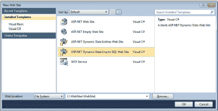

**图 1.1** 动态数据网站模板。

您可以根据自己的语言偏好选择 Visual Basic 或 Visual C# 版本的动态数据项目模板。除了在定义 lambda 表达式时 Visual Basic 比 C# 略微冗长之外，这两种语言的表现同样出色。

在 Visual Studio 中，您还可以选择创建 *Web 应用程序*项目或*网站*。网站只是一个包含页面（.aspx）、控件（.ascx）和代码隐藏文件的文件夹。这种类型的 Visual Studio 项目适用于内容主要存储在页面文件中的 Web 应用程序，因为它使开发人员能够一次更改和部署一个页面。另一方面，Web 应用程序项目更适用于内容主要存储在数据库中、页面文件仅包含检索和显示内容所需逻辑的应用程序。

尽管动态数据同时提供网站和 Web 应用程序项目模板，但其意图更符合 Web 应用程序项目模型。图 1.2 显示了 Visual Studio“新建项目”对话框中的动态数据项目模板。本书附带的示例项目基于 ASP.NET 动态数据实体 Web 应用程序项目模板。

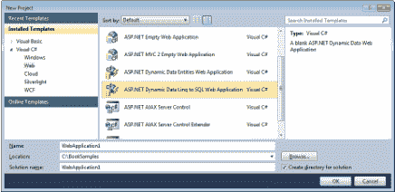

**图 1.2** 动态数据 Web 应用程序项目模板。

图 1.3 显示了一个新的动态数据 Web 应用程序项目的示例，您可以看到，它与常规的 Web 应用程序项目类似；它包括一个默认母版页（Site.master）、一个级联样式表（Site.css）和一个登录页（Default.aspx）。但是，它还不能直接运行。

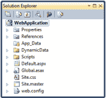

**图 1.3** 动态数据 Web 应用程序项目。

### 创建数据模型

创建新的动态数据项目后，您的首要任务是创建数据模型。由于本书中的示例项目基于 Entity Framework，因此您应该在“添加新项”对话框的“数据”文件夹中选择 *ADO.NET 实体数据模型*模板（见图 1.4）。

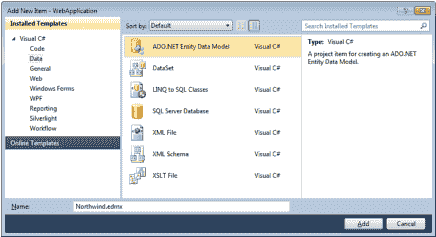

**图 1.4** 数据模型模板。

数据模型包含单个数据库中的部分或全部表，因此在命名数据模型文件时，最好使用它所代表的数据库的名称。在本书中，使用了 Northwind 示例数据库，实体数据模型文件名为 *Northwind.edmx*。

> **注意**
>
> 用于 SQL Server 的 Northwind 示例数据库可从 Microsoft 以下地址下载：
>
> http://www.microsoft.com/downloads/en/details.aspx?FamilyID=06616212-0356-46a0-8da2-eebc53a68034
>
> 它最初是为 SQL Server 2000 开发的，但也适用于 2005 和 2008 版本。

安装程序 SQL2000SampleDb.msi 会将数据库文件和脚本解压到您计算机上的“C:\SQL Server 2000 Sample Databases”目录中。您可以通过在命令提示符窗口中运行以下命令来创建 Northwind 数据库：

```text
c:
cd "SQL Server 2000 Sample Databases"
sqlcmd -S .\sqlexpress -E -i instnwnd.sql
```

请注意，在此示例中，-S .\sqlexpress 是指本地安装的 SQL Server Express 版本。如果您的计算机上安装了 Developer 版本或其他版本的默认实例，则需要将此参数更改为 . 或指定您的 SQL Server 的实际名称。


当向项目中添加新的实体数据模型时，Visual Studio 会自动打开实体数据模型向导，引导您完成模型创建过程。您可以选择创建空数据模型，在其中手动定义新的实体、指定其属性和关联，然后稍后将这些定义映射到从数据库导入的存储定义。然而，在本示例中，您选择了从数据库生成模型的选项。在提示您输入连接字符串后，向导会显示图 1.5 所示的页面，供您选择要包含在模型中的数据库表、视图和存储过程。

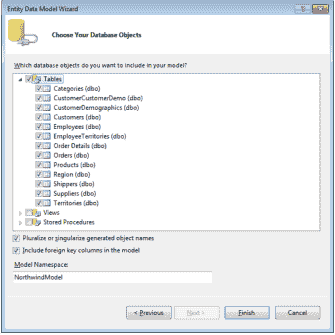

## FIGURE 1.5 实体数据模型向导。

在本示例中，您希望将所有数据库表都包含在模型中。经过一些清理以提高可读性后，生成的 Northwind 实体数据模型如 图 1.6 所示。

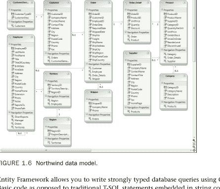

## FIGURE 1.6 Northwind 数据模型。

Entity Framework 允许您使用 C# 和 Visual Basic 代码编写强类型数据库查询，而非将传统的 T-SQL 语句嵌入到字符串常量或字面量中。请考虑清单 1.1 中的 ASP.NET 页面，该页面在 GridView 控件中显示数据库记录。

## LISTING 1.1 实体框架示例（标记）

```
<%@ Page Language="C#"
    MasterPageFile="~/Site.master" CodeBehind="SamplePage.aspx.cs"
    Inherits="WebApplication.Samples.Ch01.AdoNet.SamplePage" %>

<asp:Content ContentPlaceHolderID="main" runat="server">
    <asp:GridView ID="gridView" runat="server" />
</asp:Content>
```

除了依赖于 Dynamic Data 项目模板提供的默认母版页 Site.master 外，此页面非常简单，仅包含一个 GridView 控件。

在清单 1.2 所示的代码隐藏文件中，NorthwindEntities 类由 Visual Studio 根据项目中 Northwind.edmx 中的信息生成。该类封装了数据库连接，并允许您使用 LINQ（语言集成查询）从 Customers 表中选择记录。LINQ 类似于许多数据库开发人员熟悉的传统 SQL 语法。它通常更紧凑一些，但更重要的是，它更安全、更易于维护。Entity Framework 会自动生成参数化 SQL 查询，消除 SQL 注入漏洞，并允许编译器检查查询的正确性，并在查询在运行时执行前发现表名和列名中的拼写错误。

生成的网页如 图 1.7 所示。

## LISTING 1.2 实体框架示例（代码隐藏）

```
using System;
using System.Linq;
using DataModel;

namespace WebApplication.Samples.Ch01.EntityFramework
{
    public partial class SamplePage : System.Web.UI.Page
    {
        protected void Page_Load(object sender, EventArgs e)
        {
            using (NorthwindEntities context = new NorthwindEntities())
            {
                var query = from c in context.Customers
                            select c;

                this.gridView.DataSource = query.ToList();
                this.gridView.DataBind();
            }
        }
    }
}
```

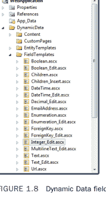

## FIGURE 1.8 Dynamic Data 字段模板。

此页面所需的最后一点“魔法”是代码隐藏中的 Page_Init 事件处理程序，用于将描述 Products 表的 MetaTable 对象与 FormView 控件关联起来，如清单 1.6 所示。

## LISTING 1.6 DynamicControl 和字段模板示例（代码隐藏）

```
using System;
using System.Web.DynamicData;

namespace WebApplication.Samples.Ch01.FieldTemplate
{
    public partial class SamplePage : System.Web.UI.Page
    {
        protected void Page_Init(object sender, EventArgs e)
        {
            MetaTable table = Global.DefaultModel.GetTable(this.dataSource.EntitySetName);
            this.formView.SetMetaTable(table);
        }
    }
}
```

## LISTING 1.8 Integer_Edit 字段模板（代码隐藏）

```csharp
using System;
using System.Collections.Specialized;
using System.Web.DynamicData;
using System.Web.UI;

namespace WebApplication.DynamicData.FieldTemplates
{
    public partial class Integer_EditField : FieldTemplateUserControl
    {
        public override Control DataControl
        {
            get { return this.textBox; }
        }

        protected void Page_Load(object sender, EventArgs e)
        {
            this.textBox.ToolTip = this.Column.Description;

            this.SetupValidator(this.requiredFieldValidator);
            this.SetupValidator(this.compareValidator);
            this.SetupValidator(this.regularExpressionValidator);
            this.SetupValidator(this.rangeValidator);
            this.SetupValidator(this.dynamicValidator);
        }

        protected override void ExtractValues(IOrderedDictionary dictionary)
        {
            dictionary[this.Column.Name] = this.ConvertEditedValue(this.textBox.Text);
        }
    }
}
```

字段模板具有极强的灵活性。此特定模板 Integer_Edit 可用于 Product 表中的其他整数列，例如 UnitsOnOrder 和 ReorderLevel，以及数据模型中所有其他表中的整数列。字段模板甚至会根据特定列的数据类型（如 Int16 或 Int32）适当的取值范围来配置 RangeValidator。您只需在页面上放置一个 DynamicControl 并指定其 DataField 和 Mode 属性即可。

## LISTING 1.9 使用数据注释扩展 Product 元数据

```
using System;
using System.ComponentModel.DataAnnotations;

namespace DataModel
{
    [MetadataType(typeof(Product.Metadata))]
    partial class Product
    {
        public abstract class Metadata
        {
            [Display(Name = "Units in Stock")]
            public object UnitsInStock { get; set; }
        }
    }
}
```

请注意，Product 类使用 partial 关键字声明。这有效地扩展了由 Entity Framework 设计器生成的 Product 实体类的定义，使此代码片段中的所有内容都成为生成的 Product 类的一部分。这是因为您无法直接将 DisplayAttribute 放置在生成的 UnitsInStock 属性上。任何手动对生成代码所做的更改在下次代码重新生成时都会丢失。相反，您定义一个单独的类（在本示例中称为 Metadata），并使用 MetadataTypeAttribute 将其与实体类 Product 关联。放置在 Metadata 类属性上的任何数据注释属性都将产生与放置在 Product 类实际属性上相同的效果，例如本示例中的 UnitsInStock。进行这些更改后，当用户在 UnitsInStock 字段中输入字母符号时，Integer_Edit 字段模板显示的错误消息将包含可读的显示名称。

## 实体模板

Dynamic Data 使用的元数据不仅包括单个列的信息，还包括整个表的信息。如果您需要构建包含 Products 表所有字段的数据输入页面，可以用单个 DynamicEntity 控件替换所有单独的 DynamicControl 实例。

## LISTING 1.10 DynamicEntity 和实体模板示例（标记）

```
<%@ Page Language="C#" MasterPageFile="~/Site.master" CodeBehind="SamplePage.aspx.cs" Inherits="WebApplication.Samples.Ch01.EntityTemplate.SamplePage" %>
<asp:Content runat="server" ContentPlaceHolderID="main">
<asp:ValidationSummary runat="server" />
<asp:FormView ID="formView" runat="server" DataSourceID="dataSource" DataKeyNames="ProductID" DefaultMode="Edit">
  <EditItemTemplate>
    <asp:DynamicEntity Mode="Edit" runat="server" />
    <tr><td>
      <asp:LinkButton Text="Update" CommandName="Update" runat="server" />
    </td></tr>
  </EditItemTemplate>
</asp:FormView>
<asp:EntityDataSource ID="dataSource" runat="server" ConnectionString="name=NorthwindEntities" EnableUpdate="true" DefaultContainerName="NorthwindEntities" EntitySetName="Products" />
</asp:Content>
```

DynamicEntity 是 Dynamic Data 提供的另一个控件。根据其所属的 FormView 控件关联的表以及其自身的 Mode 属性，控件将选择并加载适当的实体模板。在本示例中使用 Products 表时，生成的网页将类似于 图 1.11 所示。

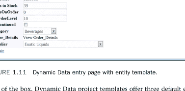

## FIGURE 1.11 带有实体模板的 Dynamic Data 输入页面。

开箱即用时，Dynamic Data 项目模板提供三种默认实体模板，实现简单的单列自上而下的表单布局。这些实体模板（见 图 1.12）默认用于所有类型的实体，除非开发人员为特定实体提供了自定义模板。


实体模板的某些视觉方面，例如列的显示名称及其顺序，可以通过元数据属性来控制。然而，默认模板的整体布局基本上是在左侧有一列标签，在右侧有数据输入控件。当这种布局不够用时，您可以创建自定义实体模板来满足需求。

## 网格列和动态字段

到目前为止，我们只讨论了数据输入窗体，其中一次显示一条记录或一个实体。然而，动态数据为显示多条记录的列表类型页面提供了极大的生产力提升。

## 清单 1.13 GridView 和 DynamicField 示例（标记）

```asp
<%@ Page Language="C#"
    MasterPageFile="~/Site.master" CodeBehind="SamplePage.aspx.cs"
    Inherits="WebApplication.Samples.Ch01.DynamicField.SamplePage" %>

<asp:Content ContentPlaceHolderID="main" runat="server">
    <asp:ValidationSummary runat="server" />
    <asp:GridView ID="gridView" runat="server" DataSourceID="dataSource"
        DataKeyNames="ProductID" AutoGenerateEditButton="true"
        AllowPaging="true" AutoGenerateColumns="false" >
        <columns>
            <asp:DynamicField DataField="ProductName" />
            <asp:DynamicField DataField="UnitsInStock" />
        </columns>
    </asp:GridView>
    <asp:EntityDataSource ID="dataSource" runat="server"
        ConnectionString="name=NorthwindEntities" EnableUpdate="true"
        DefaultContainerName="NorthwindEntities" EntitySetName="Products" />
</asp:Content>
```

DynamicField 是一种数据控件字段，可与 GridView 和 DetailsView 控件一起使用，使它们能够利用 Dynamic Data 提供的丰富字段模板功能。图 1.13 显示了该页面在运行时的外观。

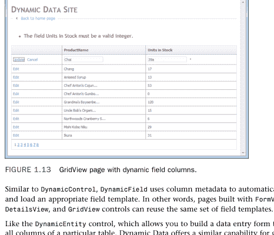

图 1.13 具有动态字段列的 GridView 页面。

与 DynamicControl 类似，DynamicField 使用列元数据自动选择和加载适当的字段模板。换句话说，使用 FormView、DetailsView 和 GridView 控件构建的页面可以重用同一组字段模板。

与 DynamicEntity 控件类似（它允许您构建包含特定表所有列的数据输入窗体），动态数据为网格列提供了类似的功能。在清单 1.14 中，ProductName 和 UnitsInStock 字段的显式定义已被删除。相反，GridView 控件的 AutoGenerateColumns 属性设置为 true。

## 清单 1.14 DefaultAutoFieldGenerator 示例（标记）

```
<%@ Page Language="C#"
    MasterPageFile="~/Site.master" CodeBehind="SamplePage.aspx.cs"
    Inherits="WebApplication.Samples.Ch01.FieldGenerator.SamplePage" %>

<asp:Content ContentPlaceHolderID="main" runat="server">
    <asp:ValidationSummary ID="ValidationSummary1" runat="server" />
    <asp:GridView ID="gridView" runat="server" DataSourceID="dataSource"
DataKeyNames="ProductID" AutoGenerateEditButton="true"
AllowPaging="true" AutoGenerateColumns="true" />
    <asp:EntityDataSource ID="dataSource" runat="server"
ConnectionString="name=NorthwindEntities" EnableUpdate="true"
DefaultContainerName="NorthwindEntities" EntitySetName="Products" />
</asp:Content>
```

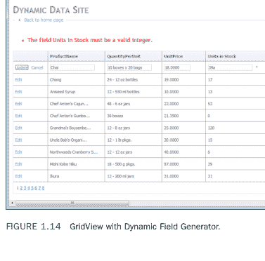

图 1.14 使用动态字段生成器的 GridView。

## 筛选器模板

在真实应用程序中，产品数量可能会超过 Northwind 示例中仅仅八页的数量。因此，如果没有某种形式的搜索功能，任何应用程序都是不完整的。考虑清单 1.16，其中网格页面已通过 DynamicFilter 和 QueryExtender 控件从先前的示例进行了扩展。

## 清单 1.16 QueryExtender 和 DynamicFilter 示例（标记）

```
<%@ Page Language="C#"
    MasterPageFile="~/Site.master" CodeBehind="SamplePage.aspx.cs"
    Inherits="WebApplication.Samples.Ch01.DynamicFilter.SamplePage" %>

<asp:Content ContentPlaceHolderID="main" runat="server">
Filter by Category:
<asp:DynamicFilter ID="categoryFilter" DataField="Category" runat="server" />
<asp:ValidationSummary runat="server"/>
<asp:GridView ID="gridView" runat="server" DataSourceID="dataSource"
    DataKeyNames="ProductID" AutoGenerateEditButton="true"
    AllowPaging="true" AutoGenerateColumns="true" />
<asp:EntityDataSource ID="dataSource" runat="server"
ConnectionString="name=NorthwindEntities" EnableUpdate="true"
DefaultContainerName="NorthwindEntities" EntitySetName="Products" />
<asp:QueryExtender runat="server" TargetControlID="dataSource">
<asp:DynamicFilterExpression ControlID="categoryFilter" />
</asp:QueryExtender>
</asp:Content>
```

QueryExtender 是一种特殊的非可视化控件。通过使用 TargetControlID 属性，它可以与基于 LINQ 的数据源控件关联，例如本例中的 EntityDataSource 或 LINQ to SQL 提供的 LinqDataSource。在运行时，QueryExtender 可以在数据源控件构造的 LINQ 查询转换为 SQL 并发送到数据库服务器执行之前修改该查询。QueryExtender 使用一个或多个数据源表达式。在此示例中，有一个 DynamicFilterExpression 与页面顶部的 DynamicFilter 控件关联。在深入探讨之前，请查看图 1.15，它显示了运行时生成的页面。

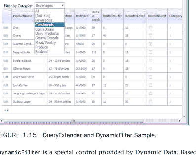

图 1.15 QueryExtender 和 DynamicFilter 示例。

DynamicFilter 是 Dynamic Data 提供的一种特殊控件。根据其 DataField 属性中指定的列名和元数据信息，它选择并呈现适当的筛选模板，用户可以在其中指定此列的搜索条件。图 1.16 显示了 Dynamic Data 项目开箱即用的筛选模板。

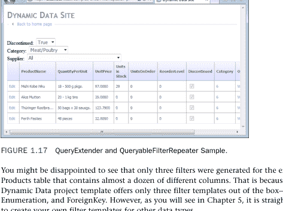

图 1.17 QueryExtender 和 QueryableFilterRepeater 示例。

您可能会失望地看到，对于包含几乎十几个不同列的整个 Products 表，仅生成了三个筛选器。这是因为 Dynamic Data 项目模板开箱即用地仅提供三个筛选模板——Boolean、Enumeration 和 ForeignKey。但是，正如您将在第 5 章中看到的，为其他数据类型创建自己的筛选模板非常简单。

## 页面模板和 URL 路由

到目前为止，您已经了解了 Dynamic Data 为创建 CRUD 页面提供的主要构建块。字段和实体模板用于构建用于插入、编辑和显示单条记录的页面。筛选模板和字段生成器用于构建允许搜索和显示多条记录的列表页面。如果您回顾一下代码示例，您可能会注意到，将它们与特定表联系在一起的唯一因素是页面标记中 EntityDataSource 控件的配置。只需更改页面以编程方式初始化 EntityDataSource 的 EntitySetName 属性（可能基于 URL 参数），您就可以将单个页面重用于任意数量的不同表。这正是 Dynamic Data 页面模板所做的。

开箱即用，Dynamic Data 项目模板提供了五个页面模板，如图 1.18 所示。

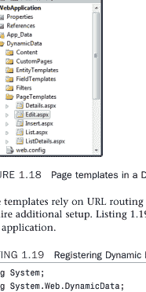

图 1.18 Dynamic Data 项目中的页面模板。

页面模板依赖于 URL 路由来确定它们需要显示的表，并且需要额外设置。清单 1.19 显示了如何在 Web 应用程序的 Global.asax 文件中完成此操作。

## 清单 1.19 在 Global.asax.cs 中注册 Dynamic Data URL 路由

```
using System;
using System.Web.DynamicData;
using System.Web.Routing;
using DataModel;

namespace WebApplication
{
    public class Global : System.Web.HttpApplication
    {
        public static readonly MetaModel DefaultModel = new MetaModel();

        void Application_Start(object sender, EventArgs e)
        {
            var modelConfiguration = new ContextConfiguration();
            modelConfiguration.ScaffoldAllTables = true;
            DefaultModel.RegisterContext(typeof(NorthwindEntities), modelConfiguration);
            RouteTable.Routes.Add(new DynamicDataRoute("{table}/{action}.aspx"));
        }
    }
}
```


具体来说，你需要创建一个 `DynamicDataRoute`，并将其注册到全局的 `RouteTable` 中。该路由对象定义了一种特殊的 URL 格式，传统 QueryString 参数会成为虚拟路径的一部分。在本例中，路由定义了 `{table}` 参数，因此无需使用类似下面的 URL：

```
http://server/DynamicData/PageTemplates/Edit.aspx?table=Products
```

你只需输入：

```
http://server/Products/Edit.aspx.
```

该路由中的另一个参数是 `{action}`。`Action` 通常与某个可用页面模板的名称匹配，例如内置的 List、Details、Edit 和 Insert。

在清单 1.19 中，你可能还注意到，这段代码将 NorthwindEntities 数据模型注册到了一个 `ContextConfiguration` 对象上。`ContextConfiguration` 允许你向 Dynamic Data 提供关于数据模型的附加信息，例如指定默认情况下应搭建所有表。搭建数据表意味着让该表在 Dynamic Data 生成的用户界面中可见。通常，你只会搭建希望用户能够直接查看和编辑的那几张小表。不过，在本例中，所有表都被搭建了，目的是演示页面模板的用法。

图 1.19 展示了 Dynamic Data 项目模板为 Web 应用程序提供的默认主页。

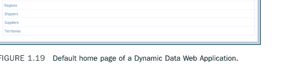

图 1.19 Dynamic Data Web 应用程序的默认主页。

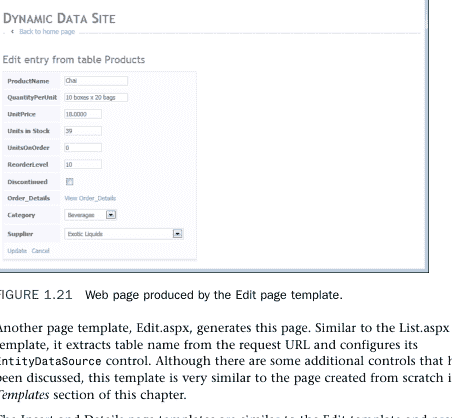

图 1.21 Edit 页面模板生成的 Web 页面。

另一个页面模板 `Edit.aspx` 生成了这个页面。与 `List.aspx` 页面模板类似，它会从请求 URL 中提取表名，并配置其 `EntityDataSource` 控件。虽然还包含一些尚未讨论的附加控件，但这个模板与本章“Entity Templates”一节中从头创建的页面非常相似。

Insert 和 Details 页面模板与 Edit 模板类似，分别负责提供用于创建新记录的用户界面，以及以只读模式显示现有记录的用户界面。

Dynamic Data 控件会利用元数据信息自动加载并显示合适的模板。`DynamicControl` 可以与 `FormView` 和 `ListView` 控件配合使用，以加载合适的字段模板。`DynamicField` 的用途与此类似，但它专用于与 `GridView` 和 `DetailsView` 控件配合使用。`DynamicEntity` 控件会自动加载合适的实体模板，`DynamicFilter` 控件则会自动加载合适的筛选模板。尽管这些控件在 Dynamic Data 模板中被大量使用，开发人员也可以在 WebForms 应用的普通页面和控件中使用它们。

本章只是简单触及了 ASP.NET Dynamic Data 所提供的功能。第一部分的其余章节会更深入地介绍其中每个方面。

## 第 2 章 Entity Framework

#### Entity Framework

## 本章内容

- 理解实体模型
- LINQ to Entities
- 实体生命周期
- 深入理解实体模型
- 存储过程

虽然也可以使用普通的 ADO.NET 数据访问组件来构建 ASP.NET Dynamic Data 应用，但其中的某些功能，例如外键模板和筛选，需要现代且支持 LINQ 的数据访问框架，例如 LINQ to SQL 或 Entity Framework。

LINQ to SQL 是在 Visual Studio 2008 和 .NET Framework 3.5 中引入的，它是 LINQ 的一种特定数据库实现。LINQ 是 C# 和 Visual Basic 中的语言集成查询功能。LINQ 允许开发人员在应用程序代码中直接使用类似 SQL 的查询，而不必调用存储过程或将 SQL 语句作为字符串传递给数据库服务器执行。在 LINQ to SQL 之后，很快又出现了 ADO.NET Entity Framework，它与 .NET Framework 3.5 Service Pack 1 一同发布。LINQ to SQL 的设计目标是简单易用，并与 Microsoft SQL Server 紧密集成；Entity Framework 的设计目标则是最大限度的灵活性和对多种数据库平台的支持。

虽然基于 LINQ 的数据访问代码比基于 ADO.NET 的传统代码简单得多，但它代表了一种重大的范式转变，与 .NET 和数据库开发人员过去十余年所习惯使用的方式截然不同。在使用基于 LINQ 的数据访问框架时，检索和操作数据的方式、提交更改的方式以及实现业务逻辑的方式都非常不同；若沿用一些旧技巧和旧习惯，可能会让你在对抗框架，而不是让框架帮助你。

由于 ASP.NET Dynamic Data 高度依赖 LINQ，开发人员需要具备底层数据访问框架的实用知识，才能理解其 Web 控件的工作方式，并有效地进行自定义。

本章将从纯粹的数据访问角度概述 ADO.NET Entity Framework，不涉及一般 ASP.NET Web 应用或 Dynamic Data 的特定细节。如果你已经熟悉 Entity Framework 或 LINQ to SQL，可以跳过本章。

## 理解实体模型

ADO.NET Entity Framework 是微软作为 .NET Framework 的一部分开发的 object-relational mapping（ORM）框架。它允许开发人员定义实体、属性和关联，并将它们映射到底层数据库表和列。在 4.0 版本中，你通常使用 Visual Studio 中的 Entity Designer 创建实体和映射，它会生成应用程序类，这些类可用于通过 LINQ 查询数据库，并以 .NET 对象的形式操作数据库记录。

## 创建实体模型

首先，你需要向项目中添加一个新的 Entity Framework 数据模型（本章使用简单的 Console Application 项目模板）。在 Visual Studio 的 Add New Item 对话框中，从 Data 模板类别中选择 ADO.NET Entity Data Model 项，如图 2.1 所示。

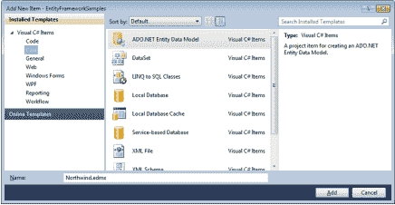

图 2.1 向项目中添加 ADO.NET Entity Data Model。

输入文件名并单击 Add 后，你会看到图 2.2 所示的 Entity Data Model Wizard，它会提示你从现有数据库生成模型，或创建空模型。如果数据库已经存在，请选择生成模型的选项。如果你足够幸运，正在从事一个“绿地”项目，项目中尚无数据库，并且希望依靠 Entity Framework 为你生成数据库，则可以选择创建空模型。在本次讨论中，我们假设第一种情况，并从 Northwind 示例数据库生成模型。

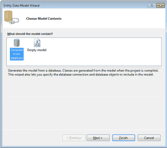

图 2.2 选择从数据库生成模型。

在 Entity Data Model Wizard 的 Choose Model Contents 页面单击 Next 后，下一步是选择用于访问数据库的连接，如图 2.3 所示。如果你已经在 Visual Studio 的 Server Explorer 中定义了与 Northwind 数据库的连接，可以从可用连接列表中选择它。否则，请创建一个指向 Northwind 示例数据库的新连接。

请注意，实体连接字符串中包含了用于连接数据库的底层数据库提供程序的信息。Entity Framework 依靠 ADO.NET 提供程序来完成底层数据库连接，你可以看到 Data Source 和 Initial Catalog 等熟悉的连接信息，它们属于“provider connection string”的一部分。

与传统的 ADO.NET 应用程序一样，你也可以选择将 Entity Framework 连接字符串存储在应用程序配置文件中。这通常是个好主意：它可以避免在应用程序代码中显式指定数据库服务器名称和其他连接信息。Entity Framework 并不能免除你保护数据库凭据的责任。在本例中，我们使用的是集成安全性，因此不必担心配置文件中出现明文的用户名和密码。如果选择指定数据库凭据，则需要适当保护配置文件，例如对连接字符串部分进行加密。


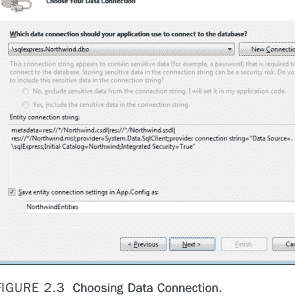

图 2.3 选择数据连接。

配置好连接，并在“实体数据模型向导”的“选择你的数据连接”页面中单击“下一步”后，系统会提示你选择要包含在模型中的数据库对象，如图 2.4 所示。你可以选择向导在数据库中检测到的任意数量的现有表、视图和存储过程。现在，请选择单个表 Products，并单击“完成”。

通常，你希望接受此页面上其余选项的默认值。“生成的对象名称复数化或单数化”选项会指示向导根据表名自动确定适当的实体名称。对于诸如 Northwind 之类的数据库，其中表名采用复数形式（Products），生成的实体名称将是单数形式（Product）。这是可取的，因为在 .NET 应用程序中，表示单个对象的类名通常采用单数形式，从而有助于将它们与可包含多个项的集合区分开来。

“在模型中包含外键列”选项决定 Products 表的 SupplierID 等列是否可在应用程序代码中使用。这对于必须无状态且无法在请求之间保留实体对象的 Web 应用程序尤其有用。.NET 3.5 SP1 中发布的 Entity Framework 的第一个版本不支持此选项，如今它仅为了向后兼容而存在，允许你将其关闭。除非你正在使用先前版本的框架创建的模型，否则请保持此选项为启用状态。

“模型命名空间”设置指的是模型本身使用的内部命名空间。它与应用程序类的命名空间无关，你可以放心地忽略它，保留工具建议的默认值。

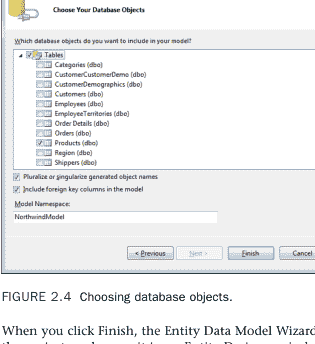

图 2.4 选择数据库对象。

单击“完成”后，实体数据模型向导会创建一个新的 EDMX 文件，将其添加到项目中，并在实体设计器窗口中打开它，如图 2.5 所示。

Entity Framework 使用的图表对于大多数数据库开发人员来说应该很熟悉，因为它们与数据库和 UML 图表非常相似。新创建的实体 Product 显示为一个矩形，其中包含源自 Products 表列的标量属性列表。

实体设计器依赖 Visual Studio 的“属性”窗口来显示并允许你修改模型的各种元素，例如实体类型的名称、其访问/可见性、属性等。通过在实体设计器中选择实体及其属性项，并观察“属性”窗口中可用的信息，来探索新的实体模型。请注意，除了名称、数据类型和其他属性外，实体设计器还允许你为模型中的每一项指定简短的“摘要”和/或“长描述”，这使得它成为存储面向开发人员的数据模型文档的一个相当不错的地方——尽管默认情况下这些信息在 Dynamic Data 应用程序中不可用。

## T-SQL

T恤是一种常见的上装，因穿着舒适、样式简单而广受欢迎。不同颜色和款式的T恤可以搭配出多样的风格。

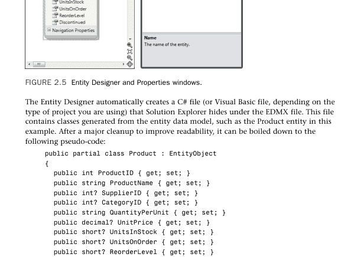

选择T恤时，可以根据领口形状、袖长、面料和颜色等要素进行挑选，以满足不同场合的穿着需求。

## ObjectContext 和简单查询

实体设计器自动生成的另一个类是 ObjectContext，名为 `NorthwindEntities`，此处以伪代码形式显示：

```
public partial class NorthwindEntities : ObjectContext
{
    public ObjectSet<Product> Products { get; }
}
```

ObjectContext 封装了数据库连接，允许你使用 LINQ（语言集成查询）查询数据库，并使用实体类而不是经典 ADO.NET 中使用的通用 DataRow 对象来操作数据行。下面是我们如何检索库存量低于再订货水平的产品列表：

```
using (NorthwindEntities context = new NorthwindEntities())
{
    var query = from p in context.Products
                where p.UnitsInStock < p.ReorderLevel
                select p;

    foreach (Product p in query)
        Console.WriteLine(p.ProductName);
}
```

NorthwindEntities 类的 Products 属性封装了 Products 数据库表。它返回 Product 实例的 ObjectSet，可用于 LINQ 查询，例如刚才示例中所示的查询。

## 关联

实体模型还可以定义实体之间的关联。在数据库中，关系表示为外键，例如 Products 表的 SupplierID 列引用 Suppliers 表的 SupplierID 列。要利用 Entity Framework 的这一功能，你需要将 Suppliers 表添加到实体模型中。对于现有数据库，最简单的方法是使用更新向导。只需右键单击实体设计器的设计图面，然后选择“从数据库更新模型...”。这将弹出一个更新向导对话框，类似于图 2.6 中所示的对话框。

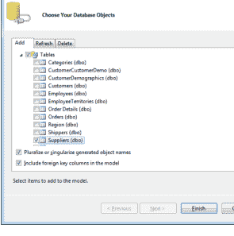

图 2.6 向模型添加数据库对象。

更新向导与你最初创建模型时使用的实体数据模型向导非常相似。它使用存储在应用程序配置文件中的连接字符串来检索目标数据库中存在于实体模型中但尚未添加的数据库表、视图和存储过程的列表。任何先前已包含在模型中的表都会自动刷新，这意味着数据库架构更改会合并到模型中。对于此示例，请添加 Suppliers 表，然后单击“完成”按钮。

> 注意
>
> 请注意，更新向导使用你创建模型时选择的复数化和外键列选项。避免更改这些选项；否则会导致实体类和对象集属性命名不一致。

当更新向导完成模型更新后，你会看到新的实体类型（在本例中为 Supplier）显示在实体设计器中，同时还有基于 SupplierID 外键创建的关联（显示为虚线），类似于图 2.7 所示。

Entity Framework 支持几种不同类型的关联。在本例中，我们拥有的是 Supplier 和 Product 实体之间的一对多关联。换句话说，对于每个 Supplier 实例，可能有零个或多个 Product 实例，如设计图面上的 * 符号所示。SupplierID 属性可为 null，因此 Product 不必指定 Supplier，这由模型中的 0..1 重数表示。如果 SupplierID 列不允许为空，则使一个

## 跨关联查询

LINQ 支持利用模型中定义的关联进行查询。下面是一个查询的写法，该查询返回供应商位于伦敦的所有产品：

```
var query = from p in context.Products
            where p.Supplier.City == "London"
            select p;
```

请注意，Product 实体的 Supplier 导航属性如何允许你基于 Supplier 实体的 City 属性进行筛选。此查询可以重写为更接近传统 SQL 查询的形式，如下所示：

```
var query = from p in context.Products
            from s in context.Suppliers
            where p.SupplierID == s.SupplierID
            && s.City == "London"
            select p;
```

虽然第一个版本的查询对于习惯使用 SQL 语句的人来说可能看起来很奇怪，但它只是用 LINQ 表达连接查询的一种更优雅、更简洁的方式。

## 修改和保存实体

要使用 Entity Framework 在数据库表中创建新行和修改现有行，你需要操作实体实例。在下面的示例中，代码检索特定的 Product 实例，更新其 UnitsInStock 属性值，然后通过调用 ObjectContext 的 SaveChanges 方法将更改提交到数据库：

```
using (NorthwindEntities context = new NorthwindEntities())
{
    var query = from p in context.Products
                where p.ProductName == "Outback Lager"
                select p;
    Product outbackLager = query.First();
    outbackLager.UnitsInStock += outbackLager.UnitsOnOrder;
    context.SaveChanges();
}
```

SaveChanges 方法使用实体模型中的信息（尤其是主键定义）来生成必要的 UPDATE SQL 语句，以修改 Products 表中行的 UnitsInStock 字段值。


要向数据库表插入新行，您需要创建新的实体实例并将其添加到上下文中，如下所示。对于新添加的实体，对象上下文会自动生成 INSERT SQL 语句。

```csharp
using (NorthwindEntities context = new NorthwindEntities())
{
    Product p = new Product() { ProductName = "Mukuzani" };
    context.Products.AddObject(p);
    context.SaveChanges();
}
```

## LINQ to Entities

语言集成查询功能并非 Entity Framework 独有。它是 C# 和 Visual Basic 编程语言的通用功能，利用 .NET 类 System.Linq 命名空间中定义的各种查询表达式和操作。Entity Framework 实现了一种 LINQ 变体，称为 LINQ to Entities，它允许将 .NET 查询转换为 Microsoft SQL Server 和其他数据库引擎的底层 SQL 查询。

## Query Execution

LINQ 查询是实现 IQueryable<T> 接口的对象，并以 LINQ 表达式的形式存储已编译的查询：

```csharp
IQueryable<Product> query = from p in context.Products
                             where p.Supplier.City == "London"
                             select p;
Console.WriteLine(query.Expression);
```

查询在实际通过枚举访问之前不会执行，如以下示例所示：

```csharp
foreach (Product p in query)
    Console.WriteLine(p.ProductName);
```

或使用 LINQ 扩展方法之一，例如 First。

```csharp
Product product = query.First();
```

查询对象本身不存储从数据库检索到的实体。这主要出于性能原因很重要——每次通过枚举其实体访问查询或调用 LINQ 扩展方法时，都会向数据库引擎发送新的 SQL 查询。如果您需要多次访问查询结果，将查询返回的实体存储在列表中并访问该列表会快得多，而访问列表不会触发查询执行：

## Lazy and Eager Loading

默认情况下，在 Entity Framework 版本 4 中，新创建的实体模型已启用延迟加载选项。这允许您遍历导航属性并查询相关实体，而无需实际编写任何查询。

```
var query = from p in context.Products
    select p;
foreach (Product p in query)
    Console.WriteLine(p.ProductName + " " + p.Supplier.CompanyName);
```

在前面的示例中，只有一个显式查询，它返回所有产品。然而，在枚举它返回的 Product 对象时，代码还会打印出每个产品的供应商名称。引用 Product 实例的 Supplier 属性的简单操作会导致 ObjectContext 从数据库加载相关的 Supplier 实体。

利用延迟加载的代码非常简洁，并且在相关实体加载不频繁时效果很好。然而，每次引用 Supplier 属性时都会向数据库引擎发送单独的查询。即使单个查询可以很小且返回的数据很少，在循环中，一次性检索所有供应商及其产品可能更快。这称为急切加载。Entity Framework 允许您通过调用 Include 方法并指定需要急切加载的导航属性的名称来实现此操作。

```
var query = from p in context.Products.Include("Supplier")
    select p;
foreach (Product p in query)
    Console.WriteLine(p.ProductName + " " + p.Supplier.CompanyName);
```

此版本的代码在 foreach 循环开始时只执行一次数据库查询。该查询从数据库检索 Product 及其关联的 Supplier 实体。在循环中打印供应商公司名称时，不会向数据库发送额外的请求。

## Projections

当查询返回实体时，它需要从数据库检索其所有属性的值。这相当于 SELECT * SQL 语句。当您只对特定列集感兴趣时，可以借助投影，或通俗地说，通过“选择”您感兴趣的列来显著减少返回的数据量并提高性能。以下代码示例只需要 Supplier 实体的 CompanyName 和 City 值，因此它不是返回整个实体，而是返回仅包含所需属性的匿名类型的实例。

```
var query = from s in context.Suppliers
             select new { s.CompanyName, s.City };
foreach (var item in query)
    Console.WriteLine(item.CompanyName + " " + item.City );
```

匿名类型是在原地声明的，其属性名称从提供值的 Supplier 属性名称推断而来。它充当数据传输对象（DTO），在实际 Supplier 实例的位置保存 Supplier 属性值。此特定代码也可以重写为使用显式定义的 DTO 类，如下所示：

```
class SupplierProjection
{
    public string CompanyName;
    public string City;
}

var query = from s in context.Suppliers
            select new SupplierProjection
            {
                CompanyName = s.CompanyName,
                City = s.City
            };
```

正如您所见，基于匿名类型的版本更简洁，并且更接近 SQL 语法。然而，匿名类型的可见性仅限于它们被定义的方法。如果您需要将 DTO 传递给另一个函数进行进一步处理，则需要显式声明投影类。

> **NOTE**
> 
> 投影对象不是实体实例。它们不参与 ObjectContext 的身份管理过程，也不能用于更改底层数据库记录。

## Sorting

orderby LINQ 关键字可用于对查询结果进行排序。以下是如何按 UnitPrice 从高到低对产品列表进行排序的方法：

```
var query = from p in context.Products
            orderby p.UnitPrice descending
            select p;
```

默认情况下，orderby 的行为类似于 SQL 中的对应项：排序按升序执行。要反转属性的排序顺序，请在之后使用 descending LINQ 关键字

```
var query = from c in context.Customers
    join s in context.Suppliers on c.City equals s.City
    select new {
        c.City,
        Customer = c.CompanyName,
        Supplier = s.CompanyName
    };
foreach (var item in query)
    Console.WriteLine(item.City + " " + item.Customer + " " +
        item.Supplier);
```

刚刚显示的示例使用 join 关键字，它模仿 SQL-92 标准引入的 JOIN 操作符。您也可以使用类似于“旧式”连接的语法：

```
var query = from c in context.Customers
    from s in context.Suppliers
    where c.City == s.City
    select new {
        c.City,
        Customer = c.CompanyName,
        Supplier = s.CompanyName
    };
```

## Composing Queries

LINQ 查询以 LINQ 表达式编译的额外好处是它们可以在执行前进一步修改。当根据用户指定的选项构建查询时，这通常是有益的。

```
string city = "London";
bool sortByContactName = true;

var query = from c in context.Customers select c;

if (city != null)
    query = from c in query where c.City == city select c;

if (sortByContactName)
    query = from c in query orderby c.ContactName select c;
else
    query = from c in query orderby c.CompanyName select c;

foreach(Customer c in query)
    Console.WriteLine(c.CompanyName + " " + c.ContactName);
```

在此示例中，查询根据两个变量的值动态返回 Customer 对象。这里的值为简单起见进行了硬编码，但在实际应用程序中它们将由用户输入。

LINQ 允许任何 IQueryable 出现在另一个查询的 from 部分中，并且此代码利用了这一点，通过添加额外的运算符来增强原始查询。请注意，原始查询只是返回所有客户。如果指定了 city 参数，代码将添加一个 where 子句来根据指定值过滤客户，并替换原始查询。您还可以根据 sortByContactName 变量的值对查询结果进行排序——如果为 true 则按 ContactName 排序，如果为 false 则按 CompanyName 排序。

由于延迟执行，最终查询仅在 foreach 语句在所有查询修改完成后枚举它时才发送到数据库一次。以这种方式组合 LINQ 查询允许您为您的场景创建最具体的查询，并有助于确保其正确性，这得益于 C# 编译器执行的彻底验证。

> **NOTE**
> 
> 也可以从包含属性名称和运算符的字符串动态创建 LINQ 查询。第 5 章“Filter Templates”对此主题提供了详细讨论。

## SQL Translation

Entity Framework 根据数据模型中的信息将 LINQ 查询转换为实际的 SQL 语句，并将其发送到数据库服务器以供执行。由于 LINQ 查询语法与 SQL 语法显著不同，您可能会发现查看 Entity Framework 应用程序执行的实际 SQL 语句很有帮助。

使用 Microsoft SQL Server 执行此操作的最简单且最不具侵入性的方法是使用 SQL Server Profiler，它是 SQL 客户端安装期间可以选择的 Management Tools—Complete 功能的一部分。或者，您也可以更改应用程序代码来实现此功能。

```
var query = from c in context.Customers
            where c.City == "London"
            orderby c.CompanyName
            select c;
ObjectQuery objectQuery = (ObjectQuery)query;
Console.WriteLine(objectQuery.ToTraceString());
```

C# 编译器在编译 LINQ to Entities 查询时生成的 IQueryable 对象实际上是 ObjectQuery 类型。此类由 Entity Framework 提供，并提供 ToTraceString 方法，可用于获取 LINQ 查询将被翻译成的实际 SQL 语句。示例中刚刚显示的 LINQ 查询被翻译成接下来显示的 SQL 语句。尽管稍微更

虽然这比手写 SQL 通常要冗长一些，但它很容易识别和阅读：

```
SELECT
[Extent1].[CustomerID] AS [CustomerID],
[Extent1].[CompanyName] AS [CompanyName],
[Extent1].[ContactName] AS [ContactName],
[Extent1].[ContactTitle] AS [ContactTitle],
[Extent1].[Address] AS [Address],
[Extent1].[City] AS [City],
[Extent1].[Region] AS [Region],
[Extent1].[PostalCode] AS [PostalCode],
[Extent1].[Country] AS [Country],
[Extent1].[Phone] AS [Phone],
[Extent1].[Fax] AS [Fax]
FROM [dbo].[Customers] AS [Extent1]
WHERE N'London' = [Extent1].[City]
ORDER BY [Extent1].[CompanyName] ASC
```

请注意，字面量 'London' 之所以会嵌入到这条 SQL 语句中，仅仅是因为它在原始 LINQ 查询中被硬编码了。如果该值来自方法参数或变量（通常是在根据用户输入执行查询时的情况），实体框架会生成参数化的 SQL 语句。

```
string city = "London";
var query = from c in context.Customers
    where c.City == city
    select c;
```

刚才展示的修改后的 LINQ 查询会转换成下面的 SQL 语句，其中 city 不再嵌入查询本身，而是作为参数传递：

```
SELECT
[Extent1].[CustomerID] AS [CustomerID],
[Extent1].[CompanyName] AS [CompanyName],
[Extent1].[ContactName] AS [ContactName],
[Extent1].[ContactTitle] AS [ContactTitle],
[Extent1].[Address] AS [Address],
[Extent1].[City] AS [City],
[Extent1].[Region] AS [Region],
[Extent1].[PostalCode] AS [PostalCode],
[Extent1].[Country] AS [Country],
[Extent1].[Phone] AS [Phone],
[Extent1].[Fax] AS [Fax]
FROM [dbo].[Customers] AS [Extent1]
WHERE [Extent1].[City] = @p__linq__0
```

生成参数化 SQL 很重要，原因有两个。一方面，它提升了应用程序性能，因为数据库服务器可以复用不同参数值的执行计划。如果参数值嵌入在 SQL 文本中，每个参数值都会构成一条独一无二的新查询，服务器必须为其重新计算并缓存执行计划，这会消耗额外的 CPU 和内存资源。另一方面，参数化 SQL 语句对 SQL 注入攻击免疫，而 SQL 注入在那些将动态 SQL 语句作为字符串生成的应用程序中非常常见。下面是一个说明该问题的示例：

```
string city = ''; drop database Northwind; select '';
string sql = string.Format(
    "select * from Customers where City = '{0}'", city);
Console.WriteLine(sql);
```

想象一下，在上面这段代码中，city 变量的值由用户提供，应用程序使用它来创建一条查询，仅返回指定城市的客户。在这种简单的实现下，恶意用户可以输入一个精心构造的字符串，修改开发人员原本打算执行的 SQL 语句，并注入一条或多条意外的 SQL 语句，从而允许其销毁数据或访问受限信息。下面是这段代码生成的 SQL 语句。请注意，我们看到的不是一条无害的 SELECT 语句，而是在原本有效的 SQL 批次中注入了 `DROP DATABASE`：

```
select * from Customers where City = '';
drop database Northwind;
select ''
```

然而，在实体框架生成的 SQL 语句中，city 值作为参数传递给数据库服务器，因此不可能修改原始 SQL 语句并注入恶意负载。即使该值像本节第一个示例那样在应用程序中被硬编码，实体框架执行的文本值自动编码仍然可以防止注入。

## 已编译查询

实体框架在执行 LINQ 查询之前，需要耗费一定的 CPU 和时间资源将其转换为等价的 SQL 语句。当某个特定查询被重复执行时，你可以通过预编译来提高应用程序性能，如下例所示：

```
static Func<NorthwindEntities, string, IQueryable<Customer>>
    customersByCity =
    CompiledQuery.Compile<NorthwindEntities, string, IQueryable<Customer>>(
        (context, city) =>
            from c in context.Customers
            where c.City == city
            select c
    );
```

在这段代码中，一个常见的 LINQ 查询借助 `CompiledQuery` 类的 `Compile` 方法进行编译，并存储在一个名为 `customersByCity` 的静态字段中。编译后的查询本身是一个 lambda 表达式，它以对象上下文作为第一个参数，以城市作为第二个参数，并返回 `Customer` 的 `IQueryable`。通常，这样的编译查询存储在某个执行数据访问的类的静态字段中，并且可以从编译查询中获益。

基于编译查询的数据访问代码与传统的 LINQ 查询类似，仍然需要创建 `ObjectContext`，比如本例中一直在用的 `NorthwindEntities`。不过，它不直接使用 LINQ 查询，而是调用一个或多个编译查询对象的 `Invoke` 方法，如下所示：

```csharp
using (NorthwindEntities context = new NorthwindEntities())
{
    var customers = customersByCity.Invoke(context, "London");
    foreach (Customer c in customers)
        Console.WriteLine(c.ContactName);
}
```

将编译后的 LINQ 查询转换为 SQL 语句所需的工作在编译查询首次执行时完成。因此，程序在 AppDomain 中首次执行编译查询时仍然会有性能损耗；不过，之后对该编译查询的所有执行都会利用实体框架首次缓存的信息，运行得更快。

查询组合会破坏实体框架使用的缓存逻辑，并使查询编译的益处化为乌有。要想保留查询编译的好处，你需要编译*整个*查询，并避免以任何方式修改它。例如，考虑下面的代码，它为前面示例中同一个编译查询添加了一个 orderby 子句：

```csharp
var customers = customersByCity.Invoke(context, "London");
customers = from c in customers
            orderby c.ContactName
            select c;
foreach (Customer c in customers)
    Console.WriteLine(c.ContactName);
```

此示例中实际执行的 LINQ 查询与编译查询不同，因此无法利用实体框架的缓存逻辑。

为避免无意中这样做，你可以将编译查询改为返回 `IEnumerable` 而不是 `IQueryable`。

```csharp
static Func<NorthwindEntities, string, IEnumerable<Customer>>
    customersByCity =
    CompiledQuery.Compile<NorthwindEntities, string, IEnumerable<Customer>>(
        (context, city) =>
            from c in context.Customers
            where c.City == city
            select c
    );
```

让编译查询返回 IEnumerable，可以强制任何与编译查询进行的组合在原始查询执行之后于应用程序内存中完成，而不是在发送到数据库服务器之前修改原始编译查询。如果查询返回的数据量很小，这种方法可以带来更好的性能。另一方面，如果查询返回大量数据并且需要大量后期处理，那么与其在查询准备上承受性能损失，不如让数据库服务器来完成繁重的工作，这样可能更快。你需要衡量实际性能才能做出好的实现选择。

## 扩展方法

C# 和 Visual Basic 语法仅覆盖了实体框架支持的查询运算符的一部分。要充分利用其查询能力，你可能需要使用 System.Linq 命名空间中静态类 Queryable 定义的一个或多个 LINQ 扩展方法。下面是一个典型的 LINQ 查询，现在应该已经很熟悉了：

```
var customers = from c in context.Customers
where c.City == "London"
select c;
```

.NET CLR 没有针对 LINQ 关键字的特殊 IL 指令。相反，编译器将 LINQ 语法转换为 lambda 表达式和对 LINQ 扩展方法的调用。下面是如何使用显式扩展方法重写这段代码：

```
var customers = context.Customers
    .Where(c => c.City == "London")
    .Select(c => c);
```

注意，这里不再是 where 关键字，而是 Where 扩展方法。

c => c.City == "London" 是一个 lambda 表达式，它接受 `Customer` 类的实例 c 作为参数，并返回一个布尔值，指示特定客户是否匹配筛选条件。Where 是 Queryable 类中为 IQueryable 接口定义的扩展方法。换言之，`Queryable.Where` 将 IQueryable 接口作为其第一个参数，并实质上是向 IQueryable 接口添加 Where 方法，从而扩展了该接口，这就是“扩展方法”一词的由来。

```
public static IQueryable<TSource> Where<TSource>(
    this IQueryable<TSource> source,
    Expression<Func<TSource, bool>> predicate)
```

你可以将 lambda 表达式视为匿名委托的一种简写形式——一种声明小型函数的紧凑方式。然而，当与 IQueryable 一起使用时，


Lambda 表达式不会直接编译成 IL 指令。相反，它们被解析为 Expression 对象并传递给 Entity Framework，后者将其翻译为 SQL 语句并发送到数据库引擎执行。

Where 只是可用于 Entity Framework 的众多 LINQ 扩展方法之一。此列表包括 Average、Min、Max、Sum 和 Count 等方法，它们名称相似且像 SQL 中的聚合函数一样工作。其他方法，如 Any 和 Contains，在 SQL 中也有直接对应项，但名称非常不同。Any 是 LINQ 中 EXISTS 运算符的等价物，而 Contains 是 SQL 中 IN 运算符的等价物。然而有些方法在 SQL 中完全没有直接对应项，例如 All 方法，如果序列中的所有元素都匹配指定的条件，则返回 true。

表 2.1 提供了 LINQ 扩展方法的摘要。花一点时间查看列表以了解可用的内容。然而，对 LINQ 运算符和扩展方法的完整讨论需要比此处能分配的更多时间和篇幅。

## 表 2.1 LINQ 扩展方法

| Method | Description |
|---|---|
| Aggregate | 对序列应用累加器函数。 |
| All | 确定序列中的所有元素是否满足条件。 |
| Any | 确定序列是否包含满足条件的任何元素。 |
| Average | 计算数值序列的平均值。 |
| Cast | 将序列的元素转换为指定类型。 |
| Concat | 连接两个序列。 |
| Contains | 确定序列是否包含指定的元素。 |
| Count | 返回序列中的元素数量。 |
| DefaultIfEmpty | 如果序列为空，则返回指定序列的元素或单例集合中的默认值。 |
| Distinct | 从序列返回不同的元素。 |
| ElementAt | 返回序列中指定索引处的元素。 |
| ElementAtOrDefault | 返回序列中指定索引处的元素，如果索引超出范围则返回默认值。 |
| Except | 返回第一个序列中的元素，但不包括也在第二个序列中的元素。 |
| First | 返回序列的第一个元素。 |
| FirstOrDefault | 返回序列的第一个元素，如果序列不包含元素则返回默认值。 |
| GroupBy | 对序列的元素进行分组。 |
| Intersect | 返回第一个序列中也在第二个序列中的元素。 |
| Join | 对两个序列执行内连接。 |
| Last | 返回序列中的最后一个元素。 |
| LastOrDefault | 返回序列中的最后一个元素，如果序列不包含元素则返回默认值。 |
| LongCount | 以 Int64 值返回序列中的元素数量。 |
| Max | 返回数字序列中的最大值。 |
| Min | 返回数字序列中的最小值。 |
| OrderBy | 按升序对序列的元素进行排序。 |
| OrderByDescending | 按降序对序列的元素进行排序。 |
| Reverse | 反转序列中元素的顺序。 |
| Select | 将序列的每个元素投影到新形式。 |
| SelectMany | 将多个序列合并为一个并将每个元素投影到新形式。 |
| SequenceEqual | 确定两个序列是否包含相等元素。 |
| Single | 返回序列的唯一元素，如果序列中元素不是恰好一个则抛出异常。 |
| SingleOrDefault | 返回序列的唯一元素，如果序列为空则返回默认值；如果序列中有多个元素，此方法将抛出异常。 |
| Skip | 跳过序列中指定数量的元素然后返回剩余元素。 |
| SkipWhile | 只要指定条件为真就跳过序列中的元素，然后返回剩余元素。 |
| Sum | 计算数值序列的总和。 |
| Take | 从序列开头返回指定数量的元素。 |
| TakeWhile | 只要指定条件为真就返回序列中的元素。 |
| ThenBy | 按升序对序列中的元素进行后续排序。 |
| ThenByDescending | 按降序对序列中的元素进行后续排序。 |
| Union | 返回两个输入序列的不同元素。 |
| Where | 返回与指定筛选条件匹配的序列元素。 |
| Zip | 将第一个序列的每个元素与第二个序列中具有相同索引的元素合并。 |

MSDN 上有大量关于 LINQ 的参考信息。以下页面是当您寻找特定扩展方法或运算符的快速示例时的一个很好的起点：

```
http://msdn.microsoft.com/en-us/vcsharp/aa336746.aspx
```

以下提供了所有可用 LINQ 扩展方法的完整参考，给出了全面但更难导航的列表：

```
http://msdn.microsoft.com/en-us/library/system.linq.queryable.aspx
```

## 实体生命周期

正如您所知，除了强大的查询功能外，Entity Framework 还帮助您实现典型的[content]
Lambda 表达式不会直接编译成 IL 指令。相反，它们被解析为 Expression 对象并传递给 Entity Framework，后者将其翻译为 SQL 语句并发送到数据库引擎执行。

Where 只是可用于 Entity Framework 的众多 LINQ 扩展方法之一。此列表包括 Average、Min、Max、Sum 和 Count 等方法，它们名称相似且像 SQL 中的聚合函数一样工作。其他方法，如 Any 和 Contains，在 SQL 中也有直接对应项，但名称非常不同。Any 是 LINQ 中 EXISTS 运算符的等价物，而 Contains 是 SQL 中 IN 运算符的等价物。然而有些方法在 SQL 中完全没有直接对应项，例如 All 方法，如果序列中的所有元素都匹配指定的条件，则返回 true。

表 2.1 提供了 LINQ 扩展方法的摘要。花一点时间查看列表以了解可用的内容。然而，对 LINQ 运算符和扩展方法的完整讨论需要比此处能分配的更多时间和篇幅。

## 表 2.1 LINQ 扩展方法

| Method | Description |
|---|---|
| Aggregate | 对序列应用累加器函数。 |
| All | 确定序列中的所有元素是否满足条件。 |
| Any | 确定序列是否包含满足条件的任何元素。 |
| Average | 计算数值序列的平均值。 |
| Cast | 将序列的元素转换为指定类型。 |
| Concat | 连接两个序列。 |
| Contains | 确定序列是否包含指定的元素。 |
| Count | 返回序列中的元素数量。 |
| DefaultIfEmpty | 如果序列为空，则返回指定序列的元素或单例集合中的默认值。 |
| Distinct | 从序列返回不同的元素。 |
| ElementAt | 返回序列中指定索引处的元素。 |
| ElementAtOrDefault | 返回序列中指定索引处的元素，如果索引超出范围则返回默认值。 |
| Except | 返回第一个序列中的元素，但不包括也在第二个序列中的元素。 |
| First | 返回序列的第一个元素。 |
| FirstOrDefault | 返回序列的第一个元素，如果序列不包含元素则返回默认值。 |
| GroupBy | 对序列的元素进行分组。 |
| Intersect | 返回第一个序列中也在第二个序列中的元素。 |
| Join | 对两个序列执行内连接。 |
| Last | 返回序列中的最后一个元素。 |
| LastOrDefault | 返回序列中的最后一个元素，如果序列不包含元素则返回默认值。 |
| LongCount | 以 Int64 值返回序列中的元素数量。 |
| Max | 返回数字序列中的最大值。 |
| Min | 返回数字序列中的最小值。 |
| OrderBy | 按升序对序列的元素进行排序。 |
| OrderByDescending | 按降序对序列的元素进行排序。 |
| Reverse | 反转序列中元素的顺序。 |
| Select | 将序列的每个元素投影到新形式。 |
| SelectMany | 将多个序列合并为一个并将每个元素投影到新形式。 |
| SequenceEqual | 确定两个序列是否包含相等元素。 |
| Single | 返回序列的唯一元素，如果序列中元素不是恰好一个则抛出异常。 |
| SingleOrDefault | 返回序列的唯一元素，如果序列为空则返回默认值；如果序列中有多个元素，此方法将抛出异常。 |
| Skip | 跳过序列中指定数量的元素然后返回剩余元素。 |
| SkipWhile | 只要指定条件为真就跳过序列中的元素，然后返回剩余元素。 |
| Sum | 计算数值序列的总和。 |
| Take | 从序列开头返回指定数量的元素。 |
| TakeWhile | 只要指定条件为真就返回序列中的元素。 |
| ThenBy | 按升序对序列中的元素进行后续排序。 |
| ThenByDescending | 按降序对序列中的元素进行后续排序。 |
| Union | 返回两个输入序列的不同元素。 |
| Where | 返回与指定筛选条件匹配的序列元素。 |
| Zip | 将第一个序列的每个元素与第二个序列中具有相同索引的元素合并。 |

MSDN 上有大量关于 LINQ 的参考信息。以下页面是当您寻找特定扩展方法或运算符的快速示例时的一个很好的起点：

```
http://msdn.microsoft.com/en-us/vcsharp/aa336746.aspx
```

以下提供了所有可用 LINQ 扩展方法的完整参考，给出了全面但更难导航的列表：

```
http://msdn.microsoft.com/en-us/library/system.linq.queryable.aspx
```

## 实体生命周期

正如您所知，除了强大的查询功能外，Entity Framework 还帮助您实现典型的[content]
Lambda 表达式不会直接编译成 IL 指令。相反，它们被解析为 Expression 对象并传递给 Entity Framework，后者将其翻译为 SQL 语句并发送到数据库引擎执行。

Where 只是可用于 Entity Framework 的众多 LINQ 扩展方法之一。此列表包括 Average、Min、Max、Sum 和 Count 等方法，它们名称相似且像 SQL 中的聚合函数一样工作。其他方法，如 Any 和 Contains，在 SQL 中也有直接对应项，但名称非常不同。Any 是 LINQ 中 EXISTS 运算符的等价物，而 Contains 是 SQL 中 IN 运算符的等价物。然而有些方法在 SQL 中完全没有直接对应项，例如 All 方法，如果序列中的所有元素都匹配指定的条件，则返回 true。

表 2.1 提供了 LINQ 扩展方法的摘要。花一点时间查看列表以了解可用的内容。然而，对 LINQ 运算符和扩展方法的完整讨论需要比此处能分配的更多时间和篇幅。

## 表 2.1 LINQ 扩展方法

| Method | Description |
|---|---|
| Aggregate | 对序列应用累加器函数。 |
| All | 确定序列中的所有元素是否满足条件。 |
| Any | 确定序列是否包含满足条件的任何元素。 |
| Average | 计算数值序列的平均值。 |
| Cast | 将序列的元素转换为指定类型。 |
| Concat | 连接两个序列。 |
| Contains | 确定序列是否包含指定的元素。 |
| Count | 返回序列中的元素数量。 |
| DefaultIfEmpty | 如果序列为空，则返回指定序列的元素或单例集合中的默认值。 |
| Distinct | 从序列返回不同的元素。 |
| ElementAt | 返回序列中指定索引处的元素。 |
| ElementAtOrDefault | 返回序列中指定索引处的元素，如果索引超出范围则返回默认值。 |
| Except | 返回第一个序列中的元素，但不包括也在第二个序列中的元素。 |
| First | 返回序列的第一个元素。 |
| FirstOrDefault | 返回序列的第一个元素，如果序列不包含元素则返回默认值。 |
| GroupBy | 对序列的元素进行分组。 |
| Intersect | 返回第一个序列中也在第二个序列中的元素。 |
| Join | 对两个序列执行内连接。 |
| Last | 返回序列中的最后一个元素。 |
| LastOrDefault | 返回序列中的最后一个元素，如果序列不包含元素则返回默认值。 |
| LongCount | 以 Int64 值返回序列中的元素数量。 |
| Max | 返回数字序列中的最大值。 |
| Min | 返回数字序列中的最小值。 |
| OrderBy | 按升序对序列的元素进行排序。 |
| OrderByDescending | 按降序对序列的元素进行排序。 |
| Reverse | 反转序列中元素的顺序。 |
| Select | 将序列的每个元素投影到新形式。 |
| SelectMany | 将多个序列合并为一个并将每个元素投影到新形式。 |
| SequenceEqual | 确定两个序列是否包含相等元素。 |
| Single | 返回序列的唯一元素，如果序列中元素不是恰好一个则抛出异常。 |
| SingleOrDefault | 返回序列的唯一元素，如果序列为空则返回默认值；如果序列中有多个元素，此方法将抛出异常。 |
| Skip | 跳过序列中指定数量的元素然后返回剩余元素。 |
| SkipWhile | 只要指定条件为真就跳过序列中的元素，然后返回剩余元素。 |
| Sum | 计算数值序列的总和。 |
| Take | 从序列开头返回指定数量的元素。 |
| TakeWhile | 只要指定条件为真就返回序列中的元素。 |
| ThenBy | 按升序对序列中的元素进行后续排序。 |
| ThenByDescending | 按降序对序列中的元素进行后续排序。 |
| Union | 返回两个输入序列的不同元素。 |
| Where | 返回与指定筛选条件匹配的序列元素。 |
| Zip | 将第一个序列的每个元素与第二个序列中具有相同索引的元素合并。 |

MSDN 上有大量关于 LINQ 的参考信息。以下页面是当您寻找特定扩展方法或运算符的快速示例时的一个很好的起点：

```
http://msdn.microsoft.com/en-us/vcsharp/aa336746.aspx
```

以下提供了所有可用 LINQ 扩展方法的完整参考，给出了全面但更难导航的列表：

```
http://msdn.microsoft.com/en-us/library/system.linq.queryable.aspx
```

## 实体生命周期

正如您所知，除了强大的查询功能外，Entity Framework 还帮助您实现典型的[content]
Lambda 表达式不会直接编译成 IL 指令。相反，它们被解析为 Expression 对象并传递给 Entity Framework，后者将其翻译为 SQL 语句并发送到数据库引擎执行。

Where 只是可用于 Entity Framework 的众多 LINQ 扩展方法之一。此列表包括 Average、Min、Max、Sum 和 Count 等方法，它们名称相似且像 SQL 中的聚合函数一样工作。其他方法，如 Any 和 Contains，在 SQL 中也有直接对应项，但名称非常不同。Any 是 LINQ 中 EXISTS 运算符的等价物，而 Contains 是 SQL 中 IN 运算符的等价物。然而有些方法在 SQL 中完全没有直接对应项，例如 All 方法，如果序列中的所有元素都匹配指定的条件，则返回 true。

表 2.1 提供了 LINQ 扩展方法的摘要。花一点时间查看列表以了解可用的内容。然而，对 LINQ 运算符和扩展方法的完整讨论需要比此处能分配的更多时间和篇幅。

## 表 2.1 LINQ 扩展方法

| Method | Description |
|---|---|
| Aggregate | 对序列应用累加器函数。 |
| All | 确定序列中的所有元素是否满足条件。 |
| Any | 确定序列是否包含满足条件的任何元素。 |
| Average | 计算数值序列的平均值。 |
| Cast | 将序列的元素转换为指定类型。 |
| Concat | 连接两个序列。 |
| Contains | 确定序列是否包含指定的元素。 |
| Count | 返回序列中的元素数量。 |
| DefaultIfEmpty | 如果序列为空，则返回指定序列的元素或单例集合中的默认值。 |
| Distinct | 从序列返回不同的元素。 |
| ElementAt | 返回序列中指定索引处的元素。 |
| ElementAtOrDefault | 返回序列中指定索引处的元素，如果索引超出范围则返回默认值。 |
| Except | 返回第一个序列中的元素，但不包括也在第二个序列中的元素。 |
| First | 返回序列的第一个元素。 |
| FirstOrDefault | 返回序列的第一个元素，如果序列不包含元素则返回默认值。 |
| GroupBy | 对序列的元素进行分组。 |
| Intersect | 返回第一个序列中也在第二个序列中的元素。 |
| Join | 对两个序列执行内连接。 |
| Last | 返回序列中的最后一个元素。 |
| LastOrDefault | 返回序列中的最后一个元素，如果序列不包含元素则返回默认值。 |
| LongCount | 以 Int64 值返回序列中的元素数量。 |
| Max | 返回数字序列中的最大值。 |
| Min | 返回数字序列中的最小值。 |
| OrderBy | 按升序对序列的元素进行排序。 |
| OrderByDescending | 按降序对序列的元素进行排序。 |
| Reverse | 反转序列中元素的顺序。 |
| Select | 将序列的每个元素投影到新形式。 |
| SelectMany | 将多个序列合并为一个并将每个元素投影到新形式。 |
| SequenceEqual | 确定两个序列是否包含相等元素。 |
| Single | 返回序列的唯一元素，如果序列中元素不是恰好一个则抛出异常。 |
| SingleOrDefault | 返回序列的唯一元素，如果序列为空则返回默认值；如果序列中有多个元素，此方法将抛出异常。 |
| Skip | 跳过序列中指定数量的元素然后返回剩余元素。 |
| SkipWhile | 只要指定条件为真就跳过序列中的元素，然后返回剩余元素。 |
| Sum | 计算数值序列的总和。 |
| Take | 从序列开头返回指定数量的元素。 |
| TakeWhile | 只要指定条件为真就返回序列中的元素。 |
| ThenBy | 按升序对序列中的元素进行后续排序。 |
| ThenByDescending | 按降序对序列中的元素进行后续排序。 |
| Union | 返回两个输入序列的不同元素。 |
| Where | 返回与指定筛选条件匹配的序列元素。 |
| Zip | 将第一个序列的每个元素与第二个序列中具有相同索引的元素合并。 |

MSDN 上有大量关于 LINQ 的参考信息。以下页面是当您寻找特定扩展方法或运算符的快速示例时的一个很好的起点：

```
http://msdn.microsoft.com/en-us/vcsharp/aa336746.aspx
```

以下提供了所有可用 LINQ 扩展方法的完整参考，给出了全面但更难导航的列表：

```
http://msdn.microsoft.com/en-us/library/system.linq.queryable.aspx
```

## 实体生命周期

正如您所知，除了强大的查询功能外，Entity Framework 还帮助您实现典型的[content]
Lambda 表达式不会直接编译成 IL 指令。相反，它们被解析为 Expression 对象并传递给 Entity Framework，后者将其翻译为 SQL 语句并发送到数据库引擎执行。

Where 只是可用于 Entity Framework 的众多 LINQ 扩展方法之一。此列表包括 Average、Min、Max、Sum 和 Count 等方法，它们名称相似且像 SQL 中的聚合函数一样工作。其他方法，如 Any 和 Contains，在 SQL 中也有直接对应项，但名称非常不同。Any 是 LINQ 中 EXISTS 运算符的等价物，而 Contains 是 SQL 中 IN 运算符的等价物。然而有些方法在 SQL 中完全没有直接对应项，例如 All 方法，如果序列中的所有元素都匹配指定的条件，则返回 true。

表 2.1 提供了 LINQ 扩展方法的摘要。花一点时间查看列表以了解可用的内容。然而，对 LINQ 运算符和扩展方法的完整讨论需要比此处能分配的更多时间和篇幅。

## 表 2.1 LINQ 扩展方法

| 方法 | 描述 |
|---|---|
| Aggregate | 对序列应用累加器函数。 |
| All | 确定序列中的所有元素是否满足条件。 |
| Any | 确定序列是否包含满足条件的任何元素。 |
| Average | 计算数值序列的平均值。 |
| Cast | 将序列的元素转换为指定类型。 |
| Concat | 连接两个序列。 |
| Contains | 确定序列是否包含指定的元素。 |
| Count | 返回序列中的元素数量。 |
| DefaultIfEmpty | 如果序列为空，则返回指定序列的元素或单例集合中的默认值。 |
| Distinct | 从序列返回不同的元素。 |
| ElementAt | 返回序列中指定索引处的元素。 |
| ElementAtOrDefault | 返回序列中指定索引处的元素，如果索引超出范围则返回默认值。 |
| Except | 返回第一个序列中的元素，但不包括也在第二个序列中的元素。 |
| First | 返回序列的第一个元素。 |
| FirstOrDefault | 返回序列的第一个元素，如果序列不包含元素则返回默认值。 |
| GroupBy | 对序列的元素进行分组。 |
| Intersect | 返回第一个序列中也在第二个序列中的元素。 |
| Join | 对两个序列执行内连接。 |
| Last | 返回序列中的最后一个元素。 |
| LastOrDefault | 返回序列中的最后一个元素，如果序列不包含元素则返回默认值。 |
| LongCount | 以 Int64 值返回序列中的元素数量。 |
| Max | 返回数字序列中的最大值。 |
| Min | 返回数字序列中的最小值。 |
| OrderBy | 按升序对序列的元素进行排序。 |
| OrderByDescending | 按降序对序列的元素进行排序。 |
| Reverse | 反转序列中元素的顺序。 |
| Select | 将序列的每个元素投影到新形式。 |
| SelectMany | 将多个序列合并为一个并将每个元素投影到新形式。 |
| SequenceEqual | 确定两个序列是否包含相等元素。 |
| Single | 返回序列的唯一元素，如果序列中元素不是恰好一个则抛出异常。 |
| SingleOrDefault | 返回序列的唯一元素，如果序列为空则返回默认值；如果序列中有多个元素，此方法将抛出异常。 |
| Skip | 跳过序列中指定数量的元素然后返回剩余元素。 |
| SkipWhile | 只要指定条件为真就跳过序列中的元素，然后返回剩余元素。 |
| Sum | 计算数值序列的总和。 |
| Take | 从序列开头返回指定数量的元素。 |
| TakeWhile | 只要指定条件为真就返回序列中的元素。 |
| ThenBy | 按升序对序列中的元素进行后续排序。 |
| ThenByDescending | 按降序对序列中的元素进行后续排序。 |
| Union | 返回两个输入序列的不同元素。 |
| Where | 返回与指定筛选条件匹配的序列元素。 |
| Zip | 将第一个序列的每个元素与第二个序列中具有相同索引的元素合并。 |

MSDN 上有大量关于 LINQ 的参考信息。以下页面是当您寻找特定扩展方法或运算符的快速示例时的一个很好的起点：

```
http://msdn.microsoft.com/en-us/vcsharp/aa336746.aspx
```

以下提供了所有可用 LINQ 扩展方法的完整参考，给出了全面但更难导航的列表：

```
http://msdn.microsoft.com/en-us/library/system.linq.queryable.aspx
```

## 实体生命周期

正如您所知，除了强大的查询功能外，Entity Framework 还帮助您实现典型的数据访问场景，例如创建新实体、查找现有实体以及修改或删除它。为此，ObjectContext 在整个生命周期中跟踪所有实体——从创建到修改再到删除。

### 跟踪更改

当新实体实例添加到 ObjectContext 时，上下文会将其状态记录为 Added。以下代码展示了如何检查实体状态更改：

```
Product p = new Product() { ProductName = "Mukuzani" };
context.Products.AddObject(p);
Console.WriteLine(context.ObjectStateManager.GetObjectStateEntry(p).State);
context.SaveChanges();
Console.WriteLine(context.ObjectStateManager.GetObjectStateEntry(p).State);
```

ObjectContext 类的 ObjectStateManager 属性返回实际对象，跟踪所有已添加到上下文的新实体或从数据库检索的现有实体。在此代码中，我们使用其 GetObjectStateEntry 方法检索表示新添加 Product 实体的 ObjectStateEntry 对象：

```
[Flags]
public enum EntityState
{
    Detached = 1,
    Unchanged = 2,
    Added = 4,
    Deleted = 8,
    Modified = 16
}
```

ObjectStateEntry 的 State 属性返回一个 EntityState 枚举值，对于新创建的对象，其值为 Added，直到我们调用 ObjectContext 的 SaveChanges 方法，此时新实体提交到数据库，实体状态变为 Unchanged。

在下一个示例中，当从数据库检索现有 Product 实体时，其状态最初为 Unchanged。然后，一旦 Category 属性被赋值，它就变为 Modified。调用 SaveChanges 方法并将更改提交到数据库后，实体状态再次变为 Unchanged：

```
Product product = context.Products.First(p => p.ProductName == "Mukuzani");
product.Category = context.Categories.First(c => c.CategoryName == "Beverages");
context.SaveChanges();
```

在下一个场景中，现有 Product 实体被删除，其状态在调用 Products 实体集的 DeleteObject 方法时立即从 Unchanged 变为 Deleted。此时，实体已被标记为删除，但数据库中尚未删除。当调用上下文的 SaveChanges 方法时，存储实体的行会被“物理”地从 Products 表中删除。已删除的 Product 实体也会从 ObjectContext 中移除，尝试获取其 ObjectStateEntry 将导致 InvalidOperationException：

```
Product product = context.Products.First(p => p.ProductName == "Mukuzani");
context.Products.DeleteObject(product);
context.SaveChanges();
```

### 乐观并发控制

大多数企业数据库应用程序需要多个同时用户访问。当许多人可以访问相同的数据记录时，总有两个人尝试修改同一记录的可能性。

以下代码通过创建 NorthwindEntities 上下文的两个不同实例、检索同一 Product 实体的两个不同副本、对其实进行不同的更改并尝试保存更改来说明此场景。显然，您不会在实际应用程序中编写这样的代码——context1 和 context2 只是说明在两台不同计算机上运行应用程序的两个不同用户执行的操作：

```
using (NorthwindEntities context1 = new NorthwindEntities())
using (NorthwindEntities context2 = new NorthwindEntities())
{
    Product product1 = context1.Products.First(p => p.ProductName == "Chai");
    Product product2 = context2.Products.First(p => p.ProductName == "Chai");

    product1.UnitsInStock = 50;
    product2.UnitsInStock = 20;

    context1.SaveChanges();
    context2.SaveChanges();
}
```


当你运行这段代码时，你可能会注意到第二个用户（由 context2 表示）最后提交更改，而第一个用户所做的更改丢失了。

为了防止数据丢失，数据库应用程序传统上依赖于记录锁定。当用户开始编辑某条特定记录时，应用程序会将其锁定，防止其他人同时修改它。在用户数量较少而记录数量较多的情况下，这种方法效果更好，因为它减少了争用的可能性。然而，物理锁定不仅会阻止其他用户更改，还会阻止他们读取被锁定的记录。这可能导致严重的性能下降，通常被认为是一种不良做法。

Entity Framework 内置了对一种替代策略的支持，称为乐观并发控制（Optimistic Concurrency Control）。在保存修改后的实体时，ObjectContext 会生成带有 WHERE 子句的 UPDATE 语句，该子句确保只有当实体自上次从数据库检索以来未发生变化时才会进行更改。换句话说，框架假设争用的可能性很低，并乐观地允许你在不锁定记录的情况下修改实体。如果在此期间有其他用户修改了同一条记录，你只需在调用 SaveChanges 方法时获得一个异常。

要利用乐观并发支持，首先需要修改 Entity Designer 中属性的定义，将其 Concurrency Mode 值设置为 Fixed，如图 2.8 所示。你需要对所有希望在保存实体前让 Entity Framework 检查修改的属性执行此操作。

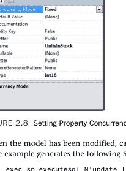

图 2.8 设置属性并发模式

模型被修改后，在前一个代码示例中为 context1 调用 SaveChanges 会生成以下 SQL 语句：

```sql
exec sp_executesql N'update [dbo].[Products]
set [UnitsInStock] = @0
where (([ProductID] = @1) and ([UnitsInStock] = @2))'
,'N'@0 smallint,@1 int,@2 smallint','@0=50,@1=1,@2=20
```

这是一个动态的参数化更新语句，它将 UnitsInStock 列设置为新值 50（由 @0 参数指定），但前提是该列的当前值（由 @2 参数指定）仍然等于从数据库中检索 Product 实体时保存的原始值 20。如果 UnitsInStock 列的当前值与原始值不匹配，则不会更新任何记录，并且 ObjectContext 类的 SaveChanges 方法会抛出 OptimisticConcurrencyException。

> **注意**
> 
> 如果你使用的是 Microsoft SQL Server，可以利用专门为乐观并发控制设计的 ROWVERSION（以前称为 TIMESTAMP）列类型。当对行进行任何更改时，服务器会自动更新其 ROWVERSION 列值。如果你的实体有一个映射到 ROWVERSION 列的属性，则只需将其 Concurrency Mode 设置为 Fixed。否则，你需要为所有实体属性设置该值，以避免部分数据丢失。

当你的应用程序遇到 OptimisticConcurrencyException 时，需要做什么？通常，你只需要让当前用户知道其他人已经修改了他正在尝试修改的记录，让他记录他试图所做的更改，然后刷新记录以查看其他用户的修改。以下代码从纯数据访问的角度说明了这种情况：

```csharp
Product product = context.Products.First(p => p.ProductName == "Chai");
product.UnitsInStock = 50;
try
{
    context.SaveChanges();
}
catch (OptimisticConcurrencyException e)
{
    context.Refresh(RefreshMode.StoreWins,
        e.StateEntries.Select(s => s.Entity));
}
```

请注意，在捕获 OptimisticConcurrencyException 之后，代码调用了 ObjectContext 的 Refresh 方法。该方法接受一个 RefreshMode 枚举，该枚举决定保留谁的更改，以及一个需要刷新的实体对象的 IEnumerable。RefreshMode.StoreWins 值表示保留其他用户所做的更改。你也可以传入 ClientWins 值，这会忽略其他用户的更改并保留当前用户所做的修改。异常对象本身提供了保存失败的实体列表——通过 StateEntries 属性获取，该属性返回熟悉的 ObjectStateEntry 对象集合，并允许访问其实体。

然而，在 Web 应用程序中，通常只需将乐观并发错误显示给用户，并要求他刷新当前页面或返回上一页即可，这将自动丢弃他所做的更改，并从数据库重新加载实体的最新版本。

## 事务

事务帮助应用程序确保任何更改都能使数据库保持一致状态。如果多个更改作为单个事务的一部分进行，数据库服务器会确保要么全部成功完成，要么将任何未完成的更改回滚到事务开始之前的状态。默认情况下，数据库服务器（尤其是 Microsoft SQL Server）会在单独的事务中执行每条 SQL 语句。虽然这种行为足以确保任何单个请求都能使数据库保持一致状态，但当需要修改多个记录时，就需要一个跨多个请求的事务。

举个例子，考虑将新产品添加到 Northwind 数据库的场景。这可能是通过自动化的库存导入过程完成的，该过程从电子表格或平面文件中读取数据。文件包含产品及其类别列表，该过程需要将每个新产品链接到现有类别，或者如果类别不存在则创建新类别。以下是使用 Entity Framework 实现此操作的方法（当然，这里的实际值是为了说明而硬编码的）：

```csharp
Category wines = context.Categories.First(c => c.CategoryName == "Wines");
if (wines == null)
{
    wines = new Category() { CategoryName = "Wines" };
    context.Categories.AddObject(wines);
}

Product p = new Product() { ProductName = "Mukuzani", Category = wines };
context.Products.AddObject(p);

context.SaveChanges();
```

请注意，这段代码可能创建两个实体，一个用于新产品，一个用于新类别。当调用 ObjectContext 的 SaveChanges 方法时，这两个实体都会被提交到数据库。然而，如果由于任何原因新产品无法保存（也许我们的数据库中已有同名的另一个产品），你不会希望留下一个没有任何产品的新类别。为了实现这一要求，你可以将新类别和新产品作为单个事务的一部分提交，这样如果新产品无法插入，新类别也会被移除。

```csharp
using (TransactionScope transaction = new TransactionScope())
using (NorthwindEntities context = new NorthwindEntities())
{
Category wines = context.Categories
.FirstOrDefault(c => c.CategoryName == "Wines");
if (wines == null)
{
    wines = new Category() { CategoryName = "Wines" };
    context.Categories.AddObject(wines);
}

Product p = new Product() { ProductName = "Mukuzani", Category = wines };
context.Products.AddObject(p);

context.SaveChanges();
transaction.Complete();
}
```

在这个新版本代码中，使用了来自 System.Transactions 程序集和命名空间的 TransactionScope 类。通过创建这个类的新实例，你启动了一个数据库事务（现在可以将其视为 SQL 中的 BEGIN TRANSACTION 语句），并通过调用 Complete 方法提交它（COMMIT TRANSACTION）。TransactionScope 类实现了 IDisposable 接口，因此当事务范围实例被释放且未调用 Complete 方法时，事务会自动回滚。通过将 TransactionScope 实例放在 using 语句中，你保证如果在操作 Category 和 Product 实例时抛出任何异常且未调用 Complete 方法，整个事务将在控制权离开此代码之前被回滚（ROLLBACK TRANSACTION）。

TransactionScope 实例可以是分层的。如果你的方法创建了一个事务范围，并调用了另一个创建自己事务范围的方法，默认情况下，第二个事务范围会成为第一个事务范围的一部分，并且在其中执行的任何更改都会作为同一数据库事务的一部分执行。TransactionScope 还支持跨多个数据库或服务器的分布式事务。只需将所有相关代码放在单个 TransactionScope 中，它会自动将事务从单个服务器提升到 Microsoft 分布式事务协调器（DTC），以执行两阶段提交。

## 只读 ObjectContext

在编写不仅需要从数据库检索数据，还需要进行更改的代码时，保留对象标识并跟踪更改是非常好的功能。然而，这要求 ObjectContext 将每个数据库行与之前具体化对象的内部字典进行核对，并存储所有实体属性的原始值和当前值。这会带来额外的 CPU 资源开销（用于执行查找）和增加的内存消耗（用于存储额外的属性值）。在典型的富客户端应用程序中，这种权衡通常是合理的，该应用程序

每次检索和操作实体的数量相对较少。然而，对于 Web 应用以及以批处理模式处理大量实体的应用来说，可以通过禁用更改跟踪和标识管理来提高性能，如下所示：

```csharp
context.Products.MergeOption = MergeOption.NoTracking;
```

```csharp
var chaiQuery = from p in context.Products
    where p.ProductName == "Chai"
    select p;
```

`MergeOption` 属性定义在 `ObjectQuery<T>` 基类中，因此可以为 `Products` ObjectSet 指定该属性。它会影响查询返回的所有实体，在本例中仅包含 Product 实体。`NoTracking` 值指示 ObjectContext 跳过对查询结果的标识和属性值跟踪，可以通过运行以下代码来说明这一点：

```csharp
Product chai1 = chaiQuery.First();
Product chai2 = chaiQuery.First();
if (!object.ReferenceEquals(chai1, chai2))
    Console.WriteLine("chai1 and chai2 are different objects");
```

运行这段代码时，请注意由同一查询的两次不同执行初始化的 `chai1` 和 `chai2` 实际上是两个不同的对象。如果你没有修改此查询的 `MergeOption`，对象上下文会检测到 Chai 实体已被检索过，并在两次查询执行时返回同一个实体。

## 深入理解实体模型

实体模型由三个不同的部分组成，每一部分描述模型的一个独立方面。最好通过在新创建的 EDMX 文件中用文本编辑器打开来理解这一点。去除实际内容后，它看起来类似于以下内容：

```xml
<?xml version="1.0" encoding="utf-8"?>
<Edmx Version="2.0" xmlns="http://schemas.microsoft.com/ado/2008/10/edmx">
    <Runtime>
        <StorageModels/>
        <ConceptualModels/>
        <Mappings/>
    </Runtime>
</Edmx>
```

## 注意

EDMX 文件包含纯 XML，与大多数现代源代码管理系统配合良好。然而，除非你正在处理一个只有少量表且只有一名开发人员的简单项目，否则最终你将需要查看 EDMX 的原始 XML 形式，而不是依赖实体设计器。如果你的团队有多名开发人员，你迟早需要合并不同开发人员同时所做的更改；即使你是唯一处理 EDMX 的开发人员，在大型模型中检入更新向导所做的更改之前，也最好检查一下这些更改。因此，开发人员熟悉实体模型 XML 模式非常重要，这也是这里介绍其部分概念的原因。

*存储模型*描述了数据库模式，它是实体设计器上次使用更新向导从数据库更新模型时捕获的。它包括表及其外键关系的定义，以及视图和存储过程。你可以借助模型浏览器来查看存储模型，这是一个工具窗口，可通过右键单击实体设计器表面并从上下文菜单中选择“模型浏览器”来打开。图 2.9 显示了 Products 表的存储模型定义示例。

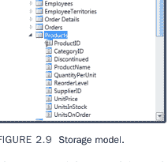

图 2.9 存储模型。

Products 表的原始 XML 定义类似于下面所示。Property 元素定义各个列，Key 元素包含主键中所有列的 PropertyRef 元素：

```xml
<EntityType Name="Products">
  <Key>
    <PropertyRef Name="ProductID" />
  </Key>
  <Property Name="ProductID" Type="int" Nullable="false" StoreGeneratedPattern="Identity" />
  <Property Name="ProductName" Type="nvarchar" Nullable="false" MaxLength="40" />
  <Property Name="SupplierID" Type="int" />
  <Property Name="CategoryID" Type="int" />
  <Property Name="QuantityPerUnit" Type="nvarchar" MaxLength="20" />
  <Property Name="UnitPrice" Type="money" />
  <Property Name="UnitsInStock" Type="smallint" />
  <Property Name="UnitsOnOrder" Type="smallint" />
  <Property Name="ReorderLevel" Type="smallint" />
  <Property Name="Discontinued" Type="bit" Nullable="false" />
</EntityType>
```

概念模型从应用程序的角度描述实体。你也可以使用模型浏览器查看概念模型。它在树视图的顶部显示概念模型（图 2.10 显示了从 Northwind 示例数据库生成的概念模型示例）。然而，实体设计器以类似 UML 的图表呈现概念模型，可能是处理概念模型的更好选择，尤其是在实体数量不多的情况下。

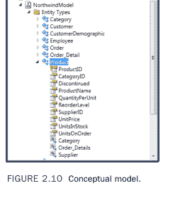

图 2.10 概念模型。

通常，概念模型中的实体与存储模型中的表和视图密切相关。但实体类型是更高级别的构造，不一定与其所表示的数据库表完全匹配。特别是，Product 实体使用单数名称，而 Products 表名是复数。它还有导航属性，允许你遍历实体关系，而不必立即在 LINQ 查询中使用联接。

以下是 Product 实体的原始 XML 定义。请注意，XML 元素名称 EntityType、Key 和 Property 与存储模型定义中使用的相似。另一方面，NavigationProperty 元素仅在概念模型中使用：

```xml
<EntityType Name="Product">
    <Key>
        <PropertyRef Name="ProductID" />
    </Key>
    <Property Name="ProductID" Type="Int32" Nullable="false" annotation:StoreGeneratedPattern="Identity" />
    <Property Name="ProductName" Type="String" Nullable="false" MaxLength="40" Unicode="true" FixedLength="false" />
    <Property Name="SupplierID" Type="Int32" />
    <Property Name="CategoryID" Type="Int32" />
    <Property Name="QuantityPerUnit" Type="String" MaxLength="20" Unicode="true" FixedLength="false" />
    <Property Name="UnitPrice" Type="Decimal" Precision="19" Scale="4" />
    <Property Name="UnitsInStock" Type="Int16" />
    <Property Name="UnitsOnOrder" Type="Int16" />
    <Property Name="ReorderLevel" Type="Int16" />
    <Property Name="Discontinued" Type="Boolean" Nullable="false" />
    <NavigationProperty Name="Supplier" FromRole="Product" ToRole="Supplier" Relationship="NorthwindModel.FK_Products_Suppliers" />
    <NavigationProperty Name="Category" FromRole="Product" ToRole="Category" Relationship="NorthwindModel.FK_Products_Categories" />
    <NavigationProperty Name="Order_Details" FromRole="Product" ToRole="Order_Detail" Relationship="NorthwindModel.FK_Order_Details_Products" />
</EntityType>
```

某些数据库表，例如 Northwind 示例数据库中的 EmployeeTerritories，可能根本没有对应的实体类型。Employees 表和 Territories 表之间的多对多关联需要第三张表（有时称为“联结表”）才能在关系数据库系统中实现。然而，在概念实体模型中，Employee 和 Territory 实体之间的多对多关联可以通过它们的 Territories 和 Employees 导航属性直接支持。

## 将实体类型映射到多个表

数据库应用程序中一个相当常见的问题是数据库表与实体类型形状不匹配。例如，一种常见的数据库优化技术是将频繁访问的列与很少访问的列分开，将它们放在两个单独的表中。其思想是减少表扫描或索引扫描操作期间必须从磁盘读取的数据量。可以通过将 Northwind 数据库中的 Customers 表拆分为 Customer 和 CustomerAddress 两个表来说明这种情况：

```sql
create table split.Customer(
    CustomerID nchar(5) not null primary key,
    CompanyName varchar(40),
    ContactName nvarchar(30) not null,
    ContactTitle nvarchar(30)
);
```

```sql
create table split.CustomerAddress(
    CustomerID nchar(5) not null primary key,
    Address nvarchar(60),
    City nvarchar(15),
    Region nvarchar(15),
    PostalCode nvarchar(10),
    Country nvarchar(15),
    Phone nvarchar(24),
    Fax nvarchar(24)
);
```

尽管 Customer 信息现在被拆分到两个表中，但概念模型中 Customer 实体的定义不必更改——它仍然同时包含联系人和地址属性。你可以将其映射到两个表而不是一个表；图 2.12 显示了这在实体设计器的“映射详细信息”窗口中的显示方式。当实体映射被修改后，你可以继续在应用程序代码中使用它，就像它仍然映射到单个表一样：

```csharp
var query = from c in context.Customers
            select c;
foreach (Customer c in query)
    Console.WriteLine(c.ContactName + " " + c.Address);
```

在底层，实体框架会自动生成所需的 SQL 联接查询，从现在的两个表中检索客户信息，使你在应用程序代码中能够保持对 Customer 实体的整体视图。


```xml
<EntitySetMapping Name="Users">
    <EntityTypeMapping TypeName="IsTypeOf(NorthwindModel2.User)">
        <MappingFragment StoreEntitySet="Customers">
            <ScalarProperty Name="ContactTitle" ColumnName="ContactTitle" />
            <ScalarProperty Name="ContactName" ColumnName="ContactName" />
            <ScalarProperty Name="CustomerID" ColumnName="CustomerID" />
        </MappingFragment>
    </EntityTypeMapping>
    <EntityTypeMapping TypeName="IsTypeOf(NorthwindModel2.Customer)">
        <MappingFragment StoreEntitySet="CustomerAddress">
            <ScalarProperty Name="Fax" ColumnName="Fax" />
            <ScalarProperty Name="Phone" ColumnName="Phone" />
            <ScalarProperty Name="Country" ColumnName="Country" />
            <ScalarProperty Name="PostalCode" ColumnName="PostalCode" />
            <ScalarProperty Name="Region" ColumnName="Region" />
            <ScalarProperty Name="City" ColumnName="City" />
            <ScalarProperty Name="Address" ColumnName="Address" />
            <ScalarProperty Name="CustomerID" ColumnName="CustomerID" />
        </MappingFragment>
    </EntityTypeMapping>
</EntitySetMapping>
```

使用这些概念模型和映射模型定义，你可以轻松查询所有用户（这将返回 User 和 Customer 实体对象）：

```csharp
var query = from u in context.Users
    select u;
```

另一方面，如果我们只对 Customers 感兴趣，可以使用 OfType 扩展方法，它只返回给定类型的实体：

```csharp
var query = from c in context.Users.OfType<Customer>()
    select c;
```

## 继承映射

将继承层次结构映射到数据库表的三种不同方法存在——表按类型、表按具体类型和表按层次。

使用表按类型方法，在前面的示例中使用，概念模型中的每个实体类型都映射到单独的数据库表。要检索 Customer 等派生实体，Entity Framework 会对存储父实体类型属性的所有表执行 SQL 连接。

使用表按具体类型方法，继承层次结构中的每个非抽象类型都有自己的表，其中包含存储实体类型本身及其所有父类型属性所需的完整列集。这允许 Entity Framework 只查询一个表即可检索任何给定类型的实体。然而，如果查询基类型的实例，例如前例中的 User，Entity Framework 必须对派生实体类型映射到的所有表执行 SQL 联合。

使用 *表按层次* 方法，从公共基类派生的所有实体类型都存储在单个表中，一个或多个列用作区分符，用于标识每个特定行中存储的实体类型。这种方法会导致在单个表中拥有存储层次结构中所有类型所有属性所需的列，随着实体类型数量的增加，该表可能会变得非常宽。

这些方法各有独特的权衡，会对应用程序的性能和数据存储需求产生重大影响。在做出决定之前请仔细评估它们。有关此高级主题的更深入介绍，请参阅第 9 章“实现业务逻辑”。

## 存储过程

尽管 LINQ to Entities 是创建数据库查询的非常强大的机制，但你可能会遇到它不够用且需要使用数据库存储过程的情况。在数据库应用程序中使用存储过程的最常见原因是为了性能优化和安全性。这两个原因仍然适用，但在经典 ADO.NET 应用程序中并不像以前那么相关，因为 Entity Framework 开箱即生成性能良好且安全的 SQL 代码。在优化性能时，你的首选应该是简化并加快 LINQ 查询。确保 LINQ 查询利用索引、返回最少的行数，并使用投影来限制结果集的大小，对提高应用程序性能大有帮助。虽然存储过程完全受 Entity Framework 支持，但它们需要额外的实施和维护工作，因此只有在用尽 LINQ 优化选项后，才应出于提高性能的目的而使用它们。

考虑以下返回需要重新订购产品的 LINQ 查询：

```csharp
var query = from p in context.Products
            where p.UnitsInStock < p.ReorderLevel
            select p;
```

类似的逻辑可以使用 T-SQL 在以下存储过程中实现：

```sql
CREATE PROCEDURE dbo.GetProductsToReorder
AS
    SELECT * FROM dbo.Products
    WHERE UnitsInStock < ReorderLevel;
```

> **注意**
>
> 此示例中的代码不会从使用存储过程受益。用原始 T-SQL 重写为存储过程所带来的任何性能改进都不会明显。这里仅为简单起见使用。

在 Northwind 数据库中定义此过程后，你可以将它的定义作为 *函数* 导入到模型中。为此，右键单击 Entity Designer 中的设计表面并从上下文菜单中选择 Update Model from Database 项，以打开前面讨论过的 Update Wizard。在 Update Wizard 的 Add 选项卡上，显示在图 2.14 中，展开 Stored Procedures，选择 GetProductsToReorder 存储过程，然后单击 Finish 按钮。

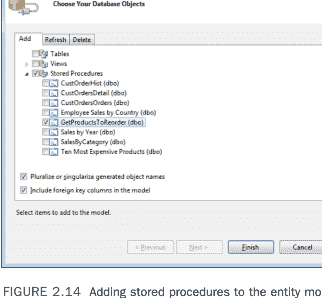

图 2.14 将存储过程添加到实体模型。

当 Update Model 向导关闭时，存储过程会添加到图 2.15 所示的实体模型的存储部分中。但是，在应用程序代码中使用之前，你必须将其作为 *函数* 导入添加到实体模型的概念部分。右键单击 Model Browser 存储部分中的存储过程并从上下文菜单中选择 Add Function Import——这会打开一个类似于图 2.16 所示的对话框。

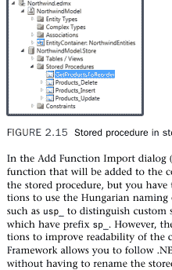

图 2.15 存储过程在实体模型的存储部分。

在 Add Function Import 对话框中（见图 2.16），你可以指定将添加到概念模型中的函数的名称。默认情况下，它将与存储过程的名称匹配，但你可以选择更改它。组织通常对存储过程名称使用匈牙利命名约定，使用 usp_ 等前缀来区分自定义存储过程和具有前缀 sp_ 的系统存储过程。然而，出于提高代码可读性的目的，匈牙利命名法在 .NET 应用程序中是不鼓励的。Entity Framework 中的函数导入映射选项允许你在不重命名存储过程的情况下在应用程序代码中遵循 .NET 命名约定。

除了函数名称之外，导入存储过程时需要做出的另一个设计决策是指定存储过程返回的对象类型。Get Column Information 按钮允许你快速查看其结果集的定义。在本例中，GetProductsToReorder 过程返回一组 Products，你可以让函数返回 Product 实体的集合。如果存储过程返回的列集与模型中定义的任何实体类型都不匹配，你可以选择返回复杂（非实体）对象的集合选项，并让工具自动创建新的复杂类型定义。返回复杂对象集合的函数导入类似于使用投影返回匿名或命名对象集合的 LINQ 查询。与投影类似，让存储过程返回特定的列集有助于减小结果集的大小，但不利用身份跟踪，而身份跟踪仅对实体受支持。


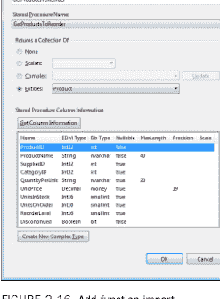

## 图 2.16 添加函数导入。

当你在“添加函数导入”对话框中单击“确定”按钮时，函数导入将被添加到模型的概念部分。你可以在模型浏览器中的“实体容器/函数导入”下找到它；图 2.17 显示了一个示例。

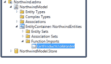

## 图 2.17 模型浏览器概念部分中的函数导入。

为每个函数导入，实体设计器会在 ObjectContext 类中生成一个强类型方法。以下是使用新添加的 GetProductsToReorder 方法列出存储过程返回的所有产品的示例：

```
using (NorthwindEntities context = new NorthwindEntities())
{
    IEnumerable<Product> products = context.GetProductsToReorder();
    foreach (Product p in products)
        Console.WriteLine(p.ProductName);
}
```

生成的 方法 返回 IEnumerable 而不是 IQueryable。虽然你可以使用熟悉的 LINQ 运算符进一步操作它，但请记住这些操作是在应用程序内存中执行，而不是由数据库服务器执行。相反，通常最好修改存储过程本身的定义，使其返回更集中的结果集。

## 插入、更新和删除存储过程

实体框架还允许你使用存储过程执行插入、更新和删除操作，而不是动态生成 SQL 语句。当与将应用程序权限限制为仅读取数据结合使用时，此技术可以帮助减少因随意浏览而导致的数据损坏和锁定，例如当开发人员或管理员使用 SQL Server Management Studio 等工具交互式地探索生产系统中的实时数据时。

以下是将新的 Product 实体插入 Products 表的存储过程示例：

```
CREATE PROCEDURE [dbo].[Products_Insert]
@ProductName nvarchar(40), @SupplierID int,
@QuantityPerUnit nvarchar(20), @UnitPrice money, @UnitsInStock smallint,
@UnitsOnOrder smallint, @ReorderLevel smallint, @Discontinued bit
AS
BEGIN
    INSERT INTO Products
    (ProductName, SupplierID, CategoryID,
    QuantityPerUnit, UnitPrice, UnitsInStock,
    UnitsOnOrder, ReorderLevel, Discontinued)
    VALUES
    (@ProductName, @SupplierID, @CategoryID,
    @QuantityPerUnit, @UnitPrice, @UnitsInStock,
    @UnitsOnOrder, @ReorderLevel, @Discontinued);
    
    SELECT SCOPE_IDENTITY() as ProductID;
END
```

请注意，此存储过程接受一组参数，每个参数代表特定的表列，例如 ProductName 和 SupplierID。存储过程执行 INSERT 语句和 SELECT 语句，以返回新插入行的 ProductID 值。

为了让实体框架利用此存储过程，它需要像前面讨论的 GetProductsToReorder 存储过程一样添加到实体模型存储部分。然而，与将其作为函数导入添加到概念模型不同，请在实体设计器中右键单击 Product 实体并从上下文菜单中选择“存储过程映射”。你将看到与图 2.18 所示类似的映射详细信息窗口。

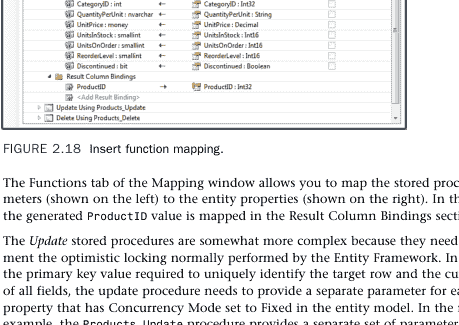

图 2.18 插入函数映射。

映射窗口的“函数”选项卡允许你将存储过程参数（显示在左侧）映射到实体属性（显示在右侧）。在此示例中，生成的 ProductID 值在“结果列绑定”部分中映射。

更新存储过程稍微复杂一些，因为它们需要实现实体框架通常执行的乐观并发控制。除了用于唯一标识目标行的主键值和所有字段的当前值之外，更新过程还需要为实体模型中并发模式设置为 Fixed 的每个实体属性提供单独的参数。在以下示例中，Products_Update 过程为所有属性提供单独的参数集，一组用于更新行的新值，另一组用于旧值，以确保实体自上次从数据库检索以来未被修改。

更新存储过程也需要添加到模型中并用于映射 Product 实体，如图 2.19 所示。Product 实体的每个属性都映射两次——首先映射到接收实体属性“旧”值的参数，即其从数据库中最初检索时的值，然后映射到接收需要持久化的“新”值的参数。请注意，存储过程的 @RowsAffected 输出参数返回存储过程实际修改的行数，在“受影响行参数”列中有复选框。实体框架使用此参数来确定乐观并发控制是否成功执行，如果返回零则抛出 OptimisticConcurrencyException。

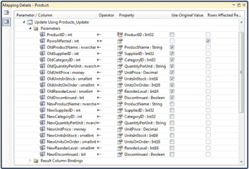

图 2.19 更新函数映射。

删除存储过程与更新存储过程类似，它们也需要实现乐观并发控制，并确保被删除的实体自上次从数据库检索以来未被修改。然而，由于没有需要持久化的新值，它们的参数列表通常要短得多。以下是 Product 实体的删除过程示例：

```sql
CREATE PROCEDURE [dbo].[Products_Delete]
    @ProductID int, @ProductName nvarchar(40), @SupplierID int, @CategoryID int,
    @QuantityPerUnit nvarchar(20), @UnitPrice money, @UnitsInStock smallint,
    @UnitsOnOrder smallint, @ReorderLevel smallint, @Discontinued bit,
    @RowsAffected int out
AS
BEGIN
    DELETE FROM Products
    WHERE
        ProductID = @ProductID AND
        SupplierID = @SupplierID AND
        CategoryID = @CategoryID AND
        QuantityPerUnit = @QuantityPerUnit AND
        UnitPrice = @UnitPrice AND
        UnitsInStock = @UnitsInStock AND
        UnitsOnOrder = @UnitsOnOrder AND
        ReorderLevel = @ReorderLevel AND
        Discontinued = @Discontinued;

    SET @RowsAffected = @@ROWCOUNT
END
```

实体框架针对每次检索和操作相对少量记录的富客户端应用程序进行了优化。然而，通过关闭对象跟踪选项，其性能可以改进，以用于多线程 Web 应用程序以及以批处理模式处理大量记录的应用程序。虽然实体框架为大多数常见数据访问场景生成高质量的参数化 SQL 代码，但它也允许使用存储过程来创建、读取、更新和删除实体/数据库记录。

实体框架支持来自 System.Transactions 命名空间的 TransactionScope 类，并在多用户场景中支持乐观并发以进行冲突检测。它开箱即用不支持悲观锁定；然而，在自定义存储过程的帮助下实现它是可能的。

实体框架代表了微软的一项长期战略投资。截至 .NET 版本 4，它是一个功能强大的框架，适用于大多数企业应用程序项目。与经典 ADO.NET 相比，它提供了显著的生产力提升，并已成为微软开发的一些新技术（包括 ASP.NET Dynamic Data）的推荐选择。实体框架正在积极开发中。版本 4.1 添加了对 Code-First 方法的支持，使得可以直接在应用程序代码中以类的形式定义实体模型。即将推出的版本 4.5 将为实体设计器带来重大增强，包括对枚举类型和多图的支持，使本章讨论的数据库优先方法以及模型优先方法的开发人员更具生产力。


## 第3章 字段模板

### 本章内容

- 只读模板
- 字段值显示格式
- 编辑与插入模式模板
- 字段值编辑格式
- 修改现有字段模板
- 数据绑定
- 创建新字段模板
- 字段模板查找规则
- 内置字段模板

企业应用程序处理员工、经理、紧急联系人、潜在客户、客户、供应商和销售商——换句话说，即人与组织，他们都有姓名、地址和电话号码。为这些属性实现数据输入逻辑是重复性的工作，多年来，ASP.NET 开发人员一直在开发用户控件以减少代码重复。如今在许多 Web 应用程序中，常见到带有文本框和验证控件的用户控件，用于输入街道、城市、州和邮政编码。

尽管用户控件是重用表示逻辑和验证逻辑的绝佳机制，但在网页上使用它们之前，仍需要一定量的管道代码。至少，用户控件必须进行注册，而且由于即使最简单的控件也需要在不同上下文中提供略有不同的功能，它们通常还需要配置一个或多个属性。随着用户控件变得越来越细粒度，应用它们所需的管道工作量也随之增加。这会迅速达到收益递减点，开发人员通常不会为单个数据输入字段实现用户控件。

字段模板是一种特殊类型的 ASP.NET 用户控件，它封装了单个字段的表示逻辑和验证逻辑。与传统用户控件不同，字段模板不需要注册。相反，放置在网页上的简单 `DynamicControl` 或 `DynamicField` 会根据列名和元数据自动加载并配置适当的字段模板。

代码隐藏文件完成了使生成的网页动态化所需的大部分工作。在这个最简单的示例中，模板重写了基类定义的 `DataControl` 属性。实体模板（参见第4章“实体模板”）在动态生成实体表单时使用此属性，以将每个字段模板与匹配的 Label 控件关联。

### 字段值显示格式

除了 `FieldValueString` 属性之外，`FieldTemplateUserControl` 类还提供了另一个名为 `FieldValue` 的属性，该属性返回原始值对象。粗略一看，`FieldValue` 属性也可用于绑定 Literal 控件。然而，使用 `FieldValueString` 属性很重要，因为它在将原始字段值转换为字符串时会自动考虑额外的显示格式属性：

- `DataFormatString` 指定一个 .NET 格式字符串，该字符串将传递给 `String.Format` 方法，以将字段值转换为显示字符串。
- `NullDisplayText` 指定一个替换字符串，当原始字段值为 null 时使用。
- `ConvertEmptyStringToNull` 是一个布尔值，确定空字符串值是否应被视为 null，以及是否将 `NullDisplayText` 用作空字符串和 null 值的替换。此属性默认为 true。
- `HtmlEncode` 是一个布尔值，确定原始字段值中的任何特殊 HTML 符号（如 '<' 或 '>'）是否将使用转义序列（如 `&lt;` 和 `&gt;`）进行编码。此属性默认为 true。

可以通过对特定列应用 `DataTypeAttribute` 或 `DisplayFormatAttribute` 在数据模型中指定显示格式属性，如清单 3.3 所示。应用于 `OrderDate` 列的 `DisplayFormatAttribute` 指定了长日期 `{0:D}` 格式字符串。应用于 `RequiredDate` 列的 `DataTypeAttribute` 没有自己的 `DataFormatString` 属性。相反，它提供了 `DisplayFormat` 属性，该属性根据指定的数据类型获取自动生成的默认 `DisplayFormatAttribute`。对于 `DataType.Date`，默认数据格式字符串将是短日期 `{0:d}`。

### 清单 3.3 使用数据注解指定显示格式

```csharp
using System.ComponentModel.DataAnnotations;

namespace DataModel
{
    [MetadataType (typeof(Order.Metadata))]
    partial class Order
    {
        public class Metadata
        {
            [DisplayFormat(DataFormatString = "{0:D}")]
            public object OrderDate;

            [DataType(DataType.Date)]
            public object RequiredDate;
        }
    }
}
```

显示格式属性也可以在页面标记中通过设置 `DynamicControl` 或 `DynamicField` 类的相应属性来指定，类似于“非动态”`BoundField` 的属性。清单 3.4 展示了一个示例，其中 `DynamicField` 用于 GridView 控件，并为 `ShippedDate` 列指定了自定义日期格式字符串 `{0:MM/dd/yy}`。

### 清单 3.4 使用 DynamicField 指定数据格式

```aspnet
<%@ Page Language="C#"
    MasterPageFile="~/Site.master" CodeBehind="SamplePage.aspx.cs"
    Inherits="WebApplication.Samples.Ch03.DataFormatString.SamplePage" %>

<asp:Content ContentPlaceHolderID="ContentPlaceHolder1" runat="server">
    <asp:GridView ID="gridView" runat="server" DataSourceID="dataSource"
        AutoGenerateColumns="false" AllowPaging="true">
        <Columns>
            <asp:DynamicField DataField="OrderDate" />
            <asp:DynamicField DataField="RequiredDate" />
            <asp:DynamicField DataField="ShippedDate" DataFormatString="{0:MM/dd/yy}" />
        </Columns>
    </asp:GridView>
    <asp:EntityDataSource ID="dataSource" runat="server"
        ConnectionString="NorthwindEntities"
        DefaultContainerName="NorthwindEntities" EntitySetName="Orders" />
</asp:Content>
```

图 3.1 显示了此代码生成的网页。如您所见，`OrderDate` 值使用模型中 `DisplayFormatAttribute` 指定的长格式；`RequiredDate` 值使用 `DataTypeAttribute` 提供的短格式；`ShippedDate` 值使用页面标记中指定的自定义格式。

编辑字段模板比只读对应模板要复杂得多。请考虑清单 3.5，它展示了 DateTime 字段模板的编辑版本。

### 清单 3.5 DateTime_Edit 字段模板（标记）

```aspnet
<%@ Control Language="C#" CodeBehind="DateTime_Edit.ascx.cs" Inherits="WebApplication.DynamicData.FieldTemplates.DateTime_EditField" %>

<asp:TextBox ID="textBox" runat="server" Text='<%# FieldValueEditString %>' Columns="20" />

<asp:RequiredFieldValidator runat="server" ID="requiredFieldValidator" ControlToValidate="textBox" Enabled="false" />
<asp:RegularExpressionValidator runat="server" ID="regularExpressionValidator" ControlToValidate="textBox" Enabled="false" />
<asp:DynamicValidator runat="server" ID="dynamicValidator" ControlToValidate="textBox" />

<asp:CustomValidator runat="server" ID="dateValidator" ControlToValidate="textBox" EnableClientScript="false" Enabled="false" OnServerValidate="DateValidator_ServerValidate" />
```

除了数据输入控件之外，编辑字段模板通常还包含一个或多个验证控件。`DateTime_Edit` 模板包括 RequiredFieldValidator、RegularExpressionValidator、DynamicValidator 和 CustomValidator 控件。请注意，除了 DynamicValidator 之外，这些控件默认情况下并未启用。它们由清单 3.6 所示代码隐藏文件中定义的 `Page_Load` 事件处理程序动态配置。

每个验证控件都通过调用 `FieldTemplateUserControl` 基类的 `SetUpValidator` 方法进行配置。如果列元数据包含适当的数据注解属性，此方法会启用并配置验证控件。特别是，当列标记为不允许空字符串的 `RequiredAttribute` 时，将启用 RequiredFieldValidator；当列标记为 `RegularExpressionAttribute` 时，将启用 RegularExpressionValidator。除了启用验证控件之外，`SetUpValidator` 方法还会为其 `ErrorMessage` 和 `ToolTip` 属性分配错误消息，该消息要么在数据注解属性中显式指定，要么根据列的显示名称生成。

DynamicValidator 是 Dynamic Data 提供的特殊验证控件。它确保应用于该列的所有验证属性都被调用来验证其值是否正确。这不仅包括众所周知的 `RequiredAttribute`、`RangeAttribute` 和 `CustomValidationAttribute`，还包括可能应用于该列且未被此字段模板中特定 ASP.NET 验证器控件覆盖的所有其他 `ValidationAttribute` 的后代。


此字段模板中的 **CustomValidator** 控件执行的是您通常期望 `DataTypeAttribute` 完成的工作。尽管 `DataTypeAttribute` 继承自 `ValidationAttribute` 类，但它实际上并不执行任何验证。它的 `IsValid` 方法总是返回 `true`，这正是 `DateTime_Edit` 模板使用 `CustomValidator` 控件来确保用户输入的值与 `DataTypeAttribute` 指定的类型相匹配的原因。`SetupCustomValidator` 方法在列标记了 `DataTypeAttribute` 时启用验证器，而 `DateValidator_ServerValidate` 方法执行实际验证。

### 代码清单 3.6 DateTime_Edit 字段模板（代码隐藏）

```csharp
using System;
using System.Collections.Specialized;
using System.ComponentModel.DataAnnotations;
using System.Web;
using System.Web.DynamicData;
using System.Web.UI;
using System.Web.UI.WebControls;

namespace WebApplication.DynamicData.FieldTemplates
{
    public partial class DateTime_EditField : FieldTemplateUserControl
    {
        private static DataTypeAttribute DefaultDateAttribute =
            new DataTypeAttribute(DataType.DateTime);

        public override Control DataControl
        {
            get { return this.textBox; }
        }

        protected void Page_Load(object sender, EventArgs e)
        {
            this.textBox.ToolTip = this.Column.Description;

            this.SetupValidator(this.requiredFieldValidator);
            this.SetupValidator(this.regularExpressionValidator);
            this.SetupValidator(this.dynamicValidator);
            this.SetupCustomValidator(this.dateValidator);
        }

        protected override void ExtractValues(IOrderedDictionary dictionary)
        {
            dictionary[Column.Name] = this.ConvertEditedValue(this.textBox.Text);
        }

        protected void DateValidator_ServerValidate(object source,
            ServerValidateEventArgs args)
        {
            DateTime dummyResult;
            args.IsValid = DateTime.TryParse(args.Value, out dummyResult);
        }

        private void SetupCustomValidator(CustomValidator validator)
        {
            if (this.Column.DataTypeAttribute != null)
            {
                switch (this.Column.DataTypeAttribute.DataType)
                {
                    case DataType.Date:
                    case DataType.DateTime:
                    case DataType.Time:
                        this.EnableCustomValidator(validator, this.Column.DataTypeAttribute);
                        break;
                }
            }
            else if (this.Column.ColumnType.Equals(typeof(DateTime)))
            {
                this.EnableCustomValidator(validator, DefaultDateAttribute);
            }
        }

        private void EnableCustomValidator(CustomValidator validator,
            DataTypeAttribute attribute)
        {
            validator.Enabled = true;
            validator.ErrorMessage = HttpUtility.HtmlEncode(
                attribute.FormatErrorMessage(this.Column.DisplayName));
        }
    }
}
```

## 字段值编辑格式

您可能已经注意到，`DateTime_Edit` 模板使用了 `FieldTemplateUserControl` 基类的 `FieldValueEditString` 属性。该属性与之前讨论的 `FieldValueString` 属性类似，在将原始列值转换为显示字符串时会遵循 `FormattingOptions`。不过，它是专门为编辑模式模板设计的，并且使用了一个附加属性来控制其行为。

-   `ApplyFormatInEditMode` 是一个布尔值，用于确定在编辑模式下是否使用 `DataFormatString`、`NullDisplayText`、`ConvertEmptyStringToNull` 和 `HtmlEncode` 显示格式属性。此属性默认值为 `false`。

与实现只读字段模板时使用 `FieldValueString` 属性类似，在实现编辑和插入模式模板时，尽可能依赖 `FieldValueEditString` 属性也很重要。这有助于字段模板保持一致的行为，并允许应用程序开发人员使用元数据属性以及页面标记中的显式配置来更改列值的呈现方面。

## 更改现有字段模板

动态数据对模型中所有匹配的列使用相同的字段模板。`DateTime_Edit` 字段模板会自动用于 Northwind 数据模型中所有 `DateTime` 类型的列，包括 Order 表的 `OrderDate`、`RequiredDate`、`ShippedDate` 列，以及 Employee 表的 `BirthDate` 和 `HireDate` 列。通过更改字段模板的定义，您将影响使用它的所有网页。图 3.2 展示了如何通过允许用户从日历下拉列表中选择日期来改进日期值的输入体验。

### 代码清单 3.7 扩展的 DateTime_Edit 字段模板（标记）

```aspx
<%@ Control Language="C#" CodeBehind="DateTime_Edit.ascx.cs" 
Inherits="WebApplication.DynamicData.FieldTemplates.DateTime_EditField" %>

<asp:TextBox ID="textBox" runat="server" Text='<%# FieldValueEditString %>'
Columns="20" />

<asp:ImageButton ID="calendarButton" runat="server"
ImageUrl="../Content/Images/Calendar.png" />

<ajax:CalendarExtender runat="server" TargetControlID="textBox"
PopupButtonID="calendarButton" />

<asp:RequiredFieldValidator runat="server" ID="requiredFieldValidator"
ControlToValidate="textBox" Enabled="false" />
<asp:RegularExpressionValidator runat="server" ID="regularExpressionValidator"
ControlToValidate="textBox" Enabled="false" />
<asp:DynamicValidator runat="server" ID="dynamicValidator"
ControlToValidate="textBox" />
<asp:CustomValidator runat="server" ID="dateValidator" ControlToValidate="textBox"
EnableClientScript="false" Enabled="false"
OnServerValidate="DateValidator_ServerValidate" />
```

请注意，此示例使用了自定义的 `ajax:` 标记前缀与 `CalendarExtender`，但实际上并未注册它。我们本可以使用 ASP.NET 的 `<%@ Register %>` 指令直接在 `DateTime_Edit.ascx` 中注册该标记前缀。但是，由于此示例项目的其他字段模板中也使用了 AJAX Control Toolkit，因此最好按照代码清单 3.8 所示在 `Web.config` 中注册它。这样，AJAX 控件就可用于 Web 应用程序的所有页面和控件，并且可以帮助您避免在多个页面和用户控件中注册相同的标记前缀。

### 代码清单 3.8 在 Web 配置文件中注册 AJAX 控件

```xml
<?xml version="1.0"?>
<configuration>
    <system.web>
        <compilation debug="true" targetFramework="4.0" />
        <pages styleSheetTheme="Default">
            <controls>
                <add tagPrefix="ajax" assembly="AjaxControlToolkit"
                    namespace="AjaxControlToolkit" />
            </controls>
        </pages>
    </system.web>
    <system.webServer>
        <modules runAllManagedModulesForAllRequests="true" />
    </system.webServer>
    <connectionStrings>
```

`FieldValueEditString` 使用数据模型或页面标记中指定的格式化选项，将字段值转换为编辑或插入模式下的字符串。它等价于调用 `FormattingOptions.FormatEditField(FieldValue)`。

在回发过程中，字段模板本身实际上并不会将新的列值保存回其 `Row` 对象。相反，`FieldTemplateUserControl` 类实现了 `IBindableControl` 接口，并依靠父级 `FormView`、`DetailsView` 和 `GridView` 控件来执行此任务。当父级控件处理 `Insert` 或 `Update` 命令时，它会遍历其子控件列表，并对每个实现了 `IBindableControl` 接口的子控件调用 `ExtractValues`。

```csharp
protected override void ExtractValues(IOrderedDictionary dictionary)
{
    dictionary[this.Column.Name] =
        this.ConvertEditedValue(this.textBox.Text);
}
```

`ExtractValues` 方法接收一个用于存储列名和值对的字典对象。刚才展示的 `DateTime_Edit` 字段模板中的 `ExtractValues` 方法是该方法的典型实现。`ConvertEditedValue` 方法由 `FieldTemplateUserControl` 基类提供。它可以根据 `ConvertEmptyStringToNull` 和 `NullDisplayText` 格式化选项自动将字段值转换为 `null`。

请注意，通过提供 `dictionary` 参数，`ExtractValues` 方法允许字段模板返回其他列的值，甚至多个列的值。此功能对于用于导航属性的外键模板非常重要，例如 Northwind 数据模型中 `Order` 类的 `Customer` 属性，它需要返回对应的基元属性（如 `CustomerID`）的值。请参阅代码清单 3.9，其中显示了 `ForeignKey_Edit` 模板的标记。

### 代码清单 3.9 ForeignKey_Edit 字段模板（标记）

```aspx
<%@ Control Language="C#" CodeBehind="ForeignKey_Edit.ascx.cs"
    Inherits="WebApplication.DynamicData.FieldTemplates.ForeignKey_EditField" %>

<asp:DropDownList ID="dropDownList" runat="server"/>

<asp:RequiredFieldValidator runat="server" ID="requiredFieldValidator"
    ControlToValidate="dropDownList" Enabled="false" />
<asp:DynamicValidator runat="server" ID="dynamicValidator"
    ControlToValidate="dropDownList" />
```

请注意，`ForeignKey_Edit` 模板使用了 `DropDownList` 控件，该控件允许用户从代码清单 3.10 所示的 `Page_Load` 方法中以编程方式创建的项列表中进行选择。`DropDownList` 中的每个 `ListItem` 对象表示一个外键，其 `Text` 属性存储来自被引用的显示列的值。


Table 和 Value 属性存储其主键列的逗号分隔列表。此代码依赖于 `FieldTemplateUserControl` 基类提供的名为 `PopulateListControl` 的便捷方法，该方法完成了查询被引用表、创建 `ListItem` 对象并将其添加到 `DropDownList` 所需的全部繁重工作。

### 清单 3.10 ForeignKey_Edit 字段模板（代码隐藏）

```csharp
using System;
using System.Collections.Specialized;
using System.Web.DynamicData;
using System.Web.UI;
using System.Web.UI.WebControls;

namespace WebApplication.DynamicData.FieldTemplates
{
    public partial class ForeignKey_EditField : FieldTemplateUserControl
    {
        public override Control DataControl
        {
            get { return this.dropDownList; }
        }

        protected void Page_Load(object sender, EventArgs e)
        {
            if (this.dropDownList.Items.Count == 0)
            {
                if (this.Mode == DataBoundControlMode.Insert || !this.Column.IsRequired)
                    this.dropDownList.Items.Add(new ListItem("[Not Set]", string.Empty));
                this.PopulateListControl(this.dropDownList);
            }

            this.SetUpValidator(this.requiredFieldValidator);
            this.SetUpValidator(this.dynamicValidator);
        }

        protected override void OnDataBinding(EventArgs e)
        {
            base.OnDataBinding(e);
            string selectedValueString = this.GetSelectedValueString();
            if (this.dropDownList.Items.FindByValue(selectedValueString) != null)
                this.dropDownList.SelectedValue = selectedValueString;
        }
    }
}
```

### 清单 3.11 PhoneNumber_Edit 字段模板（标记）

```aspx
<%@ Control Language="C#" CodeBehind="PhoneNumber_Edit.ascx.cs"
    Inherits="WebApplication.DynamicData.FieldTemplates.PhoneNumberEditField" %>

<asp:TextBox ID="textBox" runat="server" Text='<%# FieldValueEditString %>'/>

<ajax:FilteredTextBoxExtender TargetControlID="textBox" runat="server"
    FilterType="Custom" ValidChars="()+-1234567890" />

<asp:RequiredFieldValidator runat="server" ID="requiredFieldValidator"
    ControlToValidate="textBox" Enabled="false" />
<asp:RegularExpressionValidator runat="server" ID="regularExpressionValidator"
    ControlToValidate="textBox" />
<asp:DynamicValidator runat="server" ID="dynamicValidator"
    ControlToValidate="textBox" />
```

如你所见，PhoneNumber_Edit 字段模板与之前讨论的 DateTime 模板类似。它包含一个用于输入电话号码的 TextBox 控件、一个 FilteredTextBoxExtender（另一个 AJAX 控件，用于防止用户输入电话号码中无效的符号），以及若干验证控件。

尽管使用单个 DynamicValidator 控件就足以强制执行数据模型中应用于该列的所有验证属性，但该控件仅在服务器端执行验证，因此需要回发（post-back）后才能报告错误。其他 ASP.NET 验证控件（如 RequiredFieldValidator）是可选的，但由于它们还提供客户端验证逻辑，因此最好将其包含在字段模板中，以便向用户提供即时反馈，并改善数据输入体验。

清单 3.12 展示了 PhoneNumber_Edit 字段模板的代码隐藏。

### 清单 3.12 PhoneNumber_Edit 字段模板（代码隐藏）

```csharp
using System;
using System.Collections.Specialized;
using System.ComponentModel.DataAnnotations;
using System.Linq;
using System.Web;
using System.Web.DynamicData;
using System.Web.UI;
using System.Web.UI.WebControls;

namespace WebApplication.DynamicData.FieldTemplates
{
    public partial class PhoneNumberEditField : FieldTemplateUserControl
    {
        public override Control DataControl
        {
            get { return this.textBox; }
        }

        protected void Page_Load(object sender, EventArgs e)
        {
            this.textBox.ToolTip = this.Column.Description;

            this.SetUpValidator(this.requiredFieldValidator);
            this.SetUpValidator(this.dynamicValidator);
            this.SetUpRegexValidator(this.regularExpressionValidator);
        }

        protected override void ExtractValues(IOrderedDictionary dictionary)
        {
            dictionary[this.Column.Name] = this.ConvertEditedValue(this.textBox.Text);
        }

        private void SetUpRegexValidator(RegularExpressionValidator validator)
        {
            RegularExpressionAttribute attribute = this.Column.Attributes
                .OfType<RegularExpressionAttribute>().FirstOrDefault();
            if (attribute == null)
            {
                attribute = new RegularExpressionAttribute(@"^\(\d{3}\) \d{3}-\d{4}");
                attribute.ErrorMessage = "The field {0} must be a valid phone number.";
            }

            validator.Enabled = true;
            validator.Text = "*";
            validator.ValidationExpression = attribute.Pattern;
            validator.ErrorMessage = HttpUtility.HtmlEncode(
                attribute.FormatErrorMessage(this.Column.DisplayName));
            validator.ToolTip = validator.ErrorMessage;

            this.IgnoreModelValidationAttribute(attribute.GetType());
        }
```

新字段模板中的大部分电话号码验证由标准 ASP.NET 控件 RegularExpressionValidator 执行，该控件确保用户输入的值与定义有效电话号码的正则表达式模式匹配。除了基于 System.Text.RegularExpressions 命名空间中 .NET 正则表达式实现的服务器端验证外，它还可以利用 JavaScript 中的正则表达式功能在客户端工作。

```csharp
public object HomePhone;
}
}
```

应用于 HomePhone 列的 DataTypeAttribute 指定该字符串列的实际数据类型为 PhoneNumber。Dynamic Data 在为此列查找匹配的字段模板时，会利用此信息作为提示，并选择新的 PhoneNumber_Edit 模板，而不是默认的 Text_Edit。在本示例中，RegularExpressionAttribute 也应用于 HomePhone 列，以提供一个模式，该模式不仅匹配具有三位区号的美国电话号码，还匹配可能具有两位区号的英国号码。

图 3.3 展示了完成 PhoneNumber_Edit 字段模板实现后的 Employee 编辑页。虽然从该屏幕截图中无法看出，但得益于 FilteredTextBoxExtender，你无法在电话号码文本框中输入任何字母符号。一旦你跳出文本框，模式验证就会在客户端执行，例如在本例中，从原本有效的英国电话号码中删除了一位数字。

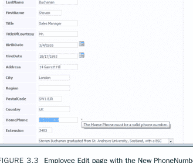

图 3.3 使用新的 PhoneNumber_Edit 字段模板的 Employee 编辑页

## 基本法律常识

### 法律的基本知识

- 法律的概念
- 法律的特征
- 法律的本质
- 法律的作用

### 宪法

- 宪法的概念与地位
- 宪法的基本原则
- 宪法规定的公民权利义务

### 刑法

- 刑法的概念与任务
- 犯罪的概念与构成
- 刑罚的种类

### 民法

- 民法的概念与调整对象
- 民事主体
- 民事权利与民事责任

### 控件模式

控件模式定义了使用字段模板的上下文。它可以是 ASP.NET `DataBoundControlMode` 枚举的成员之一：

- `ReadOnly` 模板由 `Details.aspx` 页面模板或自定义页面使用，以只读模式显示字段值。
- `Edit` 模板由 `Edit.aspx` 页面模板或自定义页面使用，以更改现有行的字段值。
- `Insert` 模板由 `Insert.aspx` 页面模板或自定义页面使用，以收集新行的字段值。

当为 Order 表的 ShippedDate 列查找 `ReadOnly` 字段模板时（该列具有 DateTime 数据类型，且在示例数据模型中没有额外的元数据属性），Dynamic Data 会找到 `DateTime.ascx` 模板。Edit 模式被认为更具体，因为它要求字段模板不仅要显示当前字段值，还要允许更改它。因此，在为 ShippedDate 列查找 Edit 字段模板时，如果存在名为 `DateTime_Edit.ascx` 的模板，Dynamic Data 会选择它。请注意，Dynamic Data 对 Edit 模板使用“_Edit”后缀，而 ReadOnly 模板没有后缀。Insert 模式甚至更具体，因为它可能需要特殊逻辑来处理尚未提交到数据库的行，如果存在名为 `DateTime_Insert.ascx` 的模板，Dynamic Data 会选择它。

### 模式回退

如果特定控件模式没有匹配的字段模板，Dynamic Data 会使用回退逻辑查找另一个用于更通用模式的模板。在正在进行的示例中，当为 ShippedDate 列查找 Insert 模板时，Dynamic Data 将首先尝试查找名为 `DateTime_Insert.ascx` 的模板。由于没有此名称的字段模板，它会从 Insert 模式回退到 Edit 模式，并最终使用名为 `DateTime_Edit.ascx` 的模板，前提是它能够同时处理 Edit 和 Insert 模式。同样，如果找不到 Edit 模式模板，Dynamic Data 会回退到只读模式。

然而，在 Dynamic Data 回退到下一个模式之前，它会执行类型回退。以 Products 表中的 `Int16` 列为例。在为该字段查找 Edit 模板时，它首先尝试使用 `System.Int16_Edit.ascx` 和 `Int16_Edit.ascx` 模板，但由于它们不存在，它回退到类型 `Int32`，检查 `System.Int32_Edit.ascx` 和 `Int32_Edit.ascx`，最终找到 `Integer_Edit.ascx`。如果 Dynamic Data 首先执行模式回退，它将跳过此模板，并改为尝试查找名为 `System.Int16.ascx` 的只读模板。


## 导航列

到目前为止，我们讨论的都是 Dynamic Data 针对*基本*类型列所使用的查找规则，这类列可以使用 Int32、String 等内置系统类型来存储。Dynamic Data 的元数据 API 使用 `MetaColumn` 类来表示它们。

而导航列则是提供对一个或多个实体的访问的列，这些实体在数据模型本身中被定义为自定义类。从 Dynamic Data 的角度来看，有三种类型的导航列：

- **MetaForeignKeyColumn** 表示一个导航属性，它返回由底层外键字段引用的单个实体。在 Northwind 示例中，Product 是 Order_Detail 实体的外键列，它表示由 ProductID 外键字段引用的 Product 实体。
- **MetaChildrenColumn** 是外键的反向关系。在 Northwind 示例中，Product 实体的 Order_Details 列返回引用特定 Product 实例的所有 Order_Detail 项。
- **多对多列（Many-to-Many column）** 是 MetaChildrenColumn 的一种特殊情况，其中 `IsManyToMany` 属性设置为 true。在 Northwind 示例中，Employees 实体的 Territories 列返回分配给特定员工的所有区域。同样，Territory 实体的 Employees 列返回分配在该特定区域中工作的所有员工。Dynamic Data 将这两个列都视为多对多列。

导航列在字段模板查找过程中会得到特殊处理。除非开发人员已经在导航属性上放置了 `UIHintAttribute`，否则 Dynamic Data 会使用表 3.3 中显示的规则来得出默认的 UI 提示。

**表 3.3 导航列规则**

| 列类型 | UI 提示 |
|---|---|
| MetaForeignKeyColumn | ForeignKey |
| MetaChildrenColumn | Children |
| MetaChildrenColumn，IsManyToMany = true | ManyToMany |

在本例中，这意味着对于 Order_Details 表的 Product 列，Dynamic Data 使用名为 ForeignKey.ascx 的模板；对于 Product 表的 Order_Details 列，它使用名为 Children.ascx 的模板；对于 Employee.Territories 和 Territory.Employees 这两个列，它使用名为 ManyToMany.ascx 的模板。

实际上，在导航列的模板查找过程中不存在类型回退。然而，Dynamic Data 确实会执行模式回退，因此如果您的页面需要在 Insert 模式下使用外键模板，它会首先尝试 ForeignKey_Insert.ascx，然后是 ForeignKey_Edit.ascx，最后在必要时使用 ForeignKey.ascx。默认的 Dynamic Data 项目模板实际上利用了这一特性，在 Insert 模式下禁用了子列的用户界面。如果您打开 `Children_Insert.aspx` 字段模板，您会看到它是空的。如果这个空字段模板不存在，则会使用 `Children.aspx` 来代替它，从而导致运行时错误，因为该模板并未准备好处理父行不存在的情况。

## 字段模板查找算法

尽管字段模板的查找规则乍看起来可能很复杂，但它们基于常识逻辑，当您理解了其背后的思路后，结果会显得很直观。只需记住，Dynamic Data 会尝试根据列定义和控件模式选择最具体的字段模板，如果此类字段模板不存在，它会逐步放宽匹配规则，直到找到匹配项或报告错误。由此产生的行为使您能够轻松添加新的字段模板，以在需要特定行为来支持特定列类型的地方进行自定义，同时允许您复用具有通用行为（如显示只读字段值）的现有模板。图 3.4 显示了 Dynamic Data 使用的实际算法。`FieldTemplateFactory` 是定义在 `System.Web.DynamicData` 命名空间中的一个特殊类，它负责执行此任务。

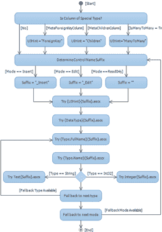

**图 3.4 字段模板查找算法。**

举个例子，考虑表 3.4，它显示了 Dynamic Data 在为 Employee 实体的 HomePhone 属性寻找匹配的字段模板时将尝试的模板文件名称序列。

**表 3.4 字符串列字段模板查找示例**

| Mode="Insert" | Mode="Edit" | Mode="ReadOnly" |
|---|---|---|
| PhoneNumber_Insert.ascx | PhoneNumber_Edit.ascx | PhoneNumber.ascx |
| System.String_Insert.ascx | System.String_Edit.ascx | System.String.ascx |
| String_Insert.ascx | String_Edit.ascx | String.ascx |
| Text_Insert.ascx | Text_Edit.ascx | Text.ascx |
| PhoneNumber_Edit.ascx | PhoneNumber.ascx |  |
| System.String_Edit.ascx | System.String.ascx |  |
| String_Edit.ascx | String.ascx |  |
| Text_Edit.ascx | Text.ascx |  |
| PhoneNumber.ascx |  |  |
| System.String.ascx |  |  |
| String.ascx |  |  |
| Text.ascx |  |  |

由于 HomePhone 属性没有 UIHintAttribute，并且在页面标记中也没有为 DynamicControl 或 DynamicField 指定 UIHint 属性，因此搜索序列不包含基于 UIHint 的文件名。但是，HomePhone 属性确实在数据模型中通过 `[DataType(DataType.PhoneNumber)]` 特性指定了 DataType。

在 Insert 模式下，FieldTemplateFactory 会依次检查 PhoneNumber_Insert.ascx、System.String_Insert.ascx、String_Insert.ascx 和 Text_Insert.ascx 字段模板是否存在，然后才会找到本章前面创建的 PhoneNumber_Edit.ascx 模板。如果该模板不存在，FieldTemplateFactory 将继续检查 System.String_Edit.ascx、String_Edit.ascx，并最终找到 Dynamic Data 项目开箱即用的 Text_Edit.ascx 字段模板。

在 Edit 模式下，FieldTemplateFactory 从 PhoneNumber_Edit.ascx 开始，由于该模板存在，它会立即使用它。同样，如果未定义此字段模板，它将继续搜索并最终找到 Dynamic Data 提供的 Text_Edit.ascx 模板。

在 ReadOnly 模式下，FieldTemplateFactory 从 PhoneNumber.ascx 开始。由于电话号码字段模板的只读版本不存在，它会继续尝试 System.String.ascx 和 String.ascx，并最终找到 Dynamic Data 开箱即用的 Text.ascx 字段模板。

表 3.5 显示了另一个字段模板查找序列的示例，这次是针对 Product 实体的 UnitsInStock 属性。此列的类型为 Int32，与前一个示例中的 HomePhone 不同，它没有应用 DataTypeAttribute。相反，此字段模板利用了 Dynamic Data 用于类型和模式的回退逻辑。

**表 3.5 整数列字段模板查找示例**

| Mode="Insert" | Mode="Edit" | Mode="ReadOnly" |
|---|---|---|
| System.Int32_Insert.ascx | System.Int32_Edit.ascx | System.Int32.ascx |
| Int32_Insert.ascx | Int32_Edit.ascx | Int32.ascx |
| Integer_Insert.ascx | Integer_Edit.ascx | Integer.ascx |
| System.String_Insert.ascx | System.String_Edit.ascx | System.String.ascx |
| String_Insert.ascx | String_Edit.ascx | String.ascx |
| Text_Insert.ascx | Text_Edit.ascx | Text.ascx |
| System.Int32_Edit.ascx | System.Int32.ascx |  |
| Int32_Edit.ascx | Int32.ascx |  |
| Integer_Edit.ascx | Integer.ascx |  |
| System.String_Edit.ascx | System.String.ascx |  |
| String_Edit.ascx | String.ascx |  |
| Text_Edit.ascx | Text.ascx |  |
| System.Int32.ascx |  |  |
| Int32.ascx |  |  |
| Integer.ascx |  |  |
| System.String.ascx |  |  |
| String.ascx |  |  |
| Text.ascx |  |  |

在 Insert 模式下，FieldTemplateFactory 从最具体的模板名称（System.Int32）和模式（Insert）开始。它依次尝试 System.Int32_Insert、Int32_Insert 和 Integer_Insert，然后回退到下一个类型——String。它继续尝试 System.String_Insert、String_Insert 和 Text_Insert，然后回退到下一个模式（Edit），并从最具体的模板名称 System.Int32 开始重复这些步骤。最终，它找到了 Integer_Edit.ascx，这是 Dynamic Data 为整数列提供的内置字段模板。

> **注意**
>
> 对于 UnitsInStock 列，Dynamic Data 在查找序列中使用了两个类型别名——Integer（代表 Int32）和 Text（代表 String）。

UnitsInStock 列的 Edit 模式查找序列与 Insert 模式非常相似。它从 System.Int32_Edit 开始，并找到内置的 Integer_Edit 模板。然而，只读模式有所不同。由于 Dynamic Data 没有为整数列提供内置的只读模板，FieldTemplateFactory 会从 Integer 数据类型回退到 String 数据类型，并最终找到 Text.ascx，这是一个可以显示所有类型字段值的只读模板。


> **注意**
>
> 尽管字段模板查找算法看似复杂且需要大量的文件存在性检查，但实际上，Dynamic Data 只在某个列首次需要字段模板时才执行该查找。查找结果会存储在哈希表中，之后对该列的所有查找都基于内存完成，速度非常快。

## 内置字段模板

Visual Studio 2010 中的 Dynamic Data Web 项目模板包含大量可直接使用的字段模板。

### Boolean（布尔）

Boolean.ascx 字段模板用于只读模式下的 Boolean 列。它包含一个禁用的 CheckBox 控件，当字段值为 true 时呈选中状态。

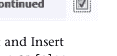

### Boolean_Edit（编辑布尔）

Boolean_Edit.ascx 字段模板用于编辑和插入模式下的 Boolean 列。它包含一个 CheckBox 控件，用户可用它来将字段值设置为 true 或 false。该字段模板不支持 null 值，并且与其他行为良好的字段模板不同，它不执行验证。

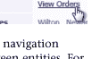

### Children（子项）

Children.ascx 字段模板用于只读和编辑模式下的导航属性，这些属性表示实体之间一对多关系的“多”端。例如，Northwind 示例数据模型中的 Customer 实体有一个名为 Orders 的子导航属性，它返回给定客户所下所有订单的集合。在只读和编辑模式下，Children.ascx 实体模板会显示一个指向动态 List.aspx 页面的超链接，该页面显示父实体的所有子行。

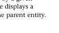

### Children_Insert（插入子项）

Children_Insert.ascx 字段模板是空的。由于动态 List.aspx 页面无法显示尚未提交到数据库的父实体的子行，因此该模板可防止 Children.ascx 字段模板在插入模式下被使用。

### DateTime（日期时间）

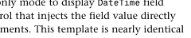

DateTime.ascx 字段模板用于只读模式下显示 DateTime 字段值。该字段模板包含一个 Literal 控件，它将字段值直接注入网页，不添加任何修饰性的 HTML 元素。此模板与后续章节中介绍的 Text.ascx 模板几乎完全相同，因此可以移除，让 Text.ascx 也负责在只读模式下显示 DateTime 字段值。

### DateTime_Edit（编辑日期时间）

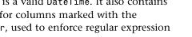

DateTime_Edit.ascx 字段模板用于编辑和插入模式下的 DateTime 列。它包含一个 TextBox 控件，并配有一个 CustomValidator，用于确保在 TextBox 中输入的值是有效的 DateTime。它还包含一个 RequiredFieldValidator，用于强制为标记了 RequiredAttribute 的列提供值；一个 RegularExpressionValidator，用于强制为标记了 RegularExpressionAttribute 的列匹配正则表达式模式；以及一个 DynamicValidator，用于强制执行应用于该列的所有其他验证特性。

### Decimal_Edit（编辑十进制）


Decimal_Edit.ascx 字段模板用于编辑和插入模式下的 Decimal、Float 和 Double 列。它包含一个 TextBox 控件，并配有一个 CompareValidator，用于确保在 TextBox 中输入的值是有效数字。它还包含一个 RequiredFieldValidator，用于强制为标记了 RequiredAttribute 的列提供值；一个 RangeValidator，用于强制为标记了 RangeAttribute 的列提供值的范围；一个 RegularExpressionValidator，用于强制为标记了 RegularExpressionAttribute 的列匹配正则表达式模式；以及一个 DynamicValidator，用于强制执行应用于该列的所有其他验证特性。

### EmailAddress（电子邮件地址）

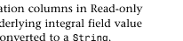

EmailAddress.ascx 字段模板是一个只读模板，用于标记了 DataType(DataType.EmailAddress) 特性的 String 列。它包含一个 HyperLink 控件，以 URL 方案“mailto:”的链接形式显示字段值。当用户单击此链接时，大多数 Web 浏览器会启动计算机上安装的默认电子邮件客户端，并创建一封新邮件，同时在“收件人”列表中自动填入该字段值。

### Enumeration（枚举）


Enumeration.ascx 字段模板用于只读模式下的枚举列。它包含一个 Literal 控件，显示将基础整型字段值转换为其对应的枚举值、然后再转换为字符串的结果。

### ForeignKey（外键）

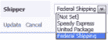

ForeignKey.ascx 字段模板用于只读模式下的外键列。它包含一个 HyperLink 控件，显示父表“显示”列的字段值。你可以通过将 DisplayColumnAttribute 应用于父实体类来显式指定显示列，也可以根据 Dynamic Data 的启发式规则自动选择。用户可以单击该控件生成的链接，导航到父表的 List.aspx 页面。

### ForeignKey_Edit（编辑外键）

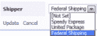

ForeignKey_Edit.ascx 字段模板用于编辑和插入模式下的外键列。它包含一个 DropDownList 控件，显示父表中的所有行。父表的显示列决定每个 ListItem 的 Text，其主键列决定其 Value。

### Integer_Edit（编辑整数）


Integer_Edit.ascx 字段模板用于编辑和插入模式下的 Byte、Int16、Int32 和 Int64 列。它包含一个 TextBox 控件，并配有一个 CompareValidator，用于确保在 TextBox 中输入的值是有效数字。它还包含一个 RequiredFieldValidator，用于强制为标记了 RequiredAttribute 的列提供值；一个 RangeValidator，用于强制为标记了 RangeAttribute 的列提供值的范围；一个 RegularExpressionValidator，用于强制为标记了 RegularExpressionAttribute 的列匹配正则表达式模式；以及一个 DynamicValidator，用于强制执行应用于该列的所有其他验证特性。

### ManyToMany（多对多）


ManyToMany.ascx 字段模板用于多对多关系中的子列，例如 Northwind 示例数据库中的 Territory 实体的 Employees 列。此模板包含一个 Repeater 控件，为每个子实体生成一个 DynamicHyperLink。在实际页面上，这看起来像是一个超链接列表，用户可单击这些链接导航到特定子实体的 Details.aspx 页面。

> **注意**
>
> 多对多关系在 Entity Framework 中受到原生支持，但在 LINQ to SQL 中不受支持。因此，只有 Visual Studio 中 Dynamic Data 项目模板的 Entity Framework 版本包含 ManyToMany 字段模板。与同样适用于两种数据访问框架的其他字段模板不同，ManyToMany 字段模板直接使用 Entity Framework API。

LINQ to SQL 原生仅支持一对多关系，并且要求你在模型中有一个显式的多对多实体。不过，按照 Eric Smith 和 Shannon Davidson 在 Code Project 上发布的文章中描述的方法，实现一个简单的编码模式就可以模拟多对多关系。该文章可在以下网址在线找到：

http://www.codeproject.com/KB/linq/linq-to-sql-many-to-many.aspx

基于这种方法，可以为 LINQ to SQL 创建 Dynamic Data 多对多字段模板。不过，这项实践超出了本章的范围。

### ManyToMany_Edit（编辑多对多）


ManyToMany_Edit.ascx 字段模板用于编辑和插入模式下的多对多子列。此模板包含一个 CheckBoxList 控件，为每个实体生成一个复选框，用户可通过勾选复选框将该实体添加到子项列表中。

### MultilineText_Edit（编辑多行文本）


MultilineText_Edit.ascx 字段模板用于编辑和插入模式下的长字符串列。它包含一个 TextBox 控件，其 TextMode 属性设置为 MultiLine。它还包含一个 RequiredFieldValidator，用于强制为标记了 RequiredAttribute 的列提供值；一个 RegularExpressionValidator，用于强制为标记了 RegularExpressionAttribute 的列匹配正则表达式模式；以及一个 DynamicValidator，用于强制执行应用于该列的所有其他验证特性。

当字符串列在数据模型中没有指定最大长度时，即被视为长字符串列，例如 Northwind 示例中 Employee 实体的 Notes 列，其类型为 NTEXT。你也可以通过将 DataType(DataType.MultilineText) 特性应用于数据模型中相应列的属性，强制 Dynamic Data 对具有最大长度的列使用 MultilineText_Edit 字段模板。

### Text（文本）


由于模板查找过程中使用的数据类型回退机制，Text.ascx 字段模板可用于只读模式下所有基元类型的列，但 Boolean 和 DateTime 列除外，Dynamic Data 为这些列提供了专门的模板。该字段模板包含一个 Literal 控件，显示转换为字符串后的字段值。


## 第4章 实体模板

#### 实体模板

### 本章内容

- 创建实体模板
- 复合实体模板
- 通用实体模板
- 动态实体模板
- 编辑和插入实体模板
- 实体模板查找规则
- 内置实体模板

大多数处理数据的 Web 应用程序都有页面用于显示单个项目的信息，同时允许用户一次创建或修改一个现有项目。图 4.1 显示了此类页面的示例，其中显示了来自 Northwind 示例数据库的单个客户记录。除了明显的视觉精致度不足（由于需要保持代码示例简单）之外，这种页面在当今内部、商业和打包的 Web 应用程序中很常见。你可以在在线零售商网站上轻松找到显示客户资料的类似页面，或在商业 CRM（客户关系管理）系统中找到客户信息。

使用 ASP.NET 实现此类页面非常简单。如图 4.1 所示的典型页面，可以使用数据源控件，例如本示例中的 EntityDataSource，从数据库中检索记录。数据源控件与演示控件关联，例如 FormView，它使用一个或多个数据绑定控件来显示字段值。

在第 3 章“字段模板”中，你看到了 Dynamic Data 如何通过提供 Field Templates（一种特殊类型的用户控件，用于封装不同列类型单个字段值的演示和业务逻辑）使创建数据驱动页面的任务变得更容易。你可以通过向页面添加 DynamicControl 实例并指定其 DataField 属性来使用字段模板，以指示需要字段模板的列。DynamicControl 根据描述列的元数据信息选择合适的字段模板，字段模板使用适当的控件来格式化和显示字段值。

## 创建实体模板

*实体模板* 是 Dynamic Data 使用的一种特殊类型的用户控件，用于封装单个实体或代表数据库表中单行的类的演示逻辑。你可以通过简单地从清单 4.1 中提取突出显示的代码，并将其放置到 Web 项目的 `DynamicData\EntityTemplates` 文件夹中的新用户控件 `Customers.ascx` 中，为 Customers 表创建一个自定义实体模板，这是 Dynamic Data 默认查找实体模板的位置。清单 4.3 显示了新实体模板的标记。

### 清单 4.3 客户实体模板（标记）

```
<%@ Control Language="C#" CodeBehind="Customers.ascx.cs"
    Inherits="WebApplication.DynamicData.EntityTemplates.CustomEntityTemplate" %>
<label>ID:</label>
<asp:DynamicControl runat="server" DataField="CustomerID" />
<label>Name:</label>
<asp:DynamicControl runat="server" DataField="ContactName" />
<fieldset><legend>Address</legend>
    <label>Street:</label>
    <asp:DynamicControl runat="server" DataField="Address" /><br />
    <label>City:</label>
    <asp:DynamicControl runat="server" DataField="City" />
    <label>State:</label>
    <asp:DynamicControl runat="server" DataField="Region" />
    <label>Zip:</label>
    <asp:DynamicControl runat="server" DataField="PostalCode" />
</fieldset>
```

除了 `<%@ Control %>` 指令外，新 Customers 实体模板的标记是清单 4.1 中代码的真实复制粘贴。

> **注意**
>
> 请注意控件文件名 Customers.ascx 很重要。文件名（不含扩展名）需要与元数据中描述 Customer 实体的 MetaTable 名称匹配，即 *Customers*（复数）。

用户控件必须继承 Dynamic Data 提供的特殊类 `EntityTemplateUserControl`，如清单 4.4 所示。这个简单的基类提供了多个属性，包括 Table，它返回描述实体的 `MetaTable` 实例，以及 Mode，它可以是只读、插入或编辑。

### 清单 4.4 客户实体模板（代码隐藏）

```csharp
using System.Web.DynamicData;

namespace WebApplication.DynamicData.EntityTemplates
{
    public partial class CustomerEntityTemplate : EntityTemplateUserControl
    {
    }
}
```

在定义了实体模板后，你可以通过用 DynamicEntity 控件替换 FormView 的全部内容来修改客户信息页面以利用它，如清单 4.5 所示。

### 清单 4.5 带实体模板的客户信息页面（标记）

```aspx
<%@ Page Language="C#"
    MasterPageFile="~/Site.master" CodeBehind="SamplePage.aspx.cs"
    Inherits="WebApplication.Samples.Ch04.ReadOnlySamplePage" %>

<asp:Content runat="server" ContentPlaceHolderID="main">
    <asp:ValidationSummary runat="server" />
    <asp:FormView ID="form" runat="server" DataSourceID="dataSource">
        <ItemTemplate>
            <asp:DynamicEntity runat="server" />
        </ItemTemplate>
    </asp:FormView>
    <asp:EntityDataSource ID="dataSource" runat="server"
        ConnectionString="name=NorthwindEntities" AutoGenerateWhereClause="true"
        DefaultContainerName="NorthwindEntities" EntitySetName="Customers">
        <WhereParameters>
            <asp:QueryStringParameter QueryStringField="ID" Name="CustomerID" />
        </WhereParameters>
    </asp:EntityDataSource>
</asp:Content>
```

DynamicEntity 是在 System.Web.DynamicData 命名空间中定义的新控件。在运行时，它会自动确定与其父 FormView 控件关联的 MetaTable，并在 Web 应用程序的 DynamicData\EntityTemplates 文件夹中查找名称匹配的模板。如果匹配的实体模板存在，DynamicEntity 将加载并将其包含在网页中，在本示例中，这使其看起来与图 4.1 所示的页面完全相同。

## 复合实体模板

没有要求每个实体只有一个实体模板。你可以为单个实体创建多个实体模板，其中每个模板包含整个实体的演示或仅其一部分。对于大型实体而言，这特别有用，在这种情况下，将信息呈现在多个页面或单个页面的多个选项卡上是有意义的。你可以通过将联系信息和地址信息分离到单独的实体模板中，进一步分解 Customer 实体模板，分别如清单 4.6 和清单 4.7 所示。

### 清单 4.6 联系实体模板（标记）

```
<%@ Control Language="C#" CodeBehind="Contact.ascx.cs" Inherits="WebApplication.DynamicData.EntityTemplates.ContactTemplate" %>

<label>Name:</label>
<asp:DynamicControl runat="server" DataField="ContactName" />
<br />

<label>Company:</label>
<asp:DynamicControl runat="server" DataField="CompanyName" />
<br />

<label>Title:</label>
<asp:DynamicControl runat="server" DataField="ContactTitle" />
<br />
```

如你所见，Contact 实体模板仅包含姓名、公司和职称字段，而 Address 实体模板仅包含地址字段。

### 清单 4.7 地址实体模板（标记）

```
<%@ Control Language="C#" CodeBehind="Address.ascx.cs" Inherits="WebApplication.DynamicData.EntityTemplates.AddressTemplate" %>

<fieldset>
<legend>Address</legend>
<label>Street:</label>
<asp:DynamicControl runat="server" DataField="Address" />
<br />

<label>City:</label>
<asp:DynamicControl runat="server" DataField="City" />
<label>State:</label>
<asp:DynamicControl runat="server" DataField="Region" />
<label>Zip:</label>
<asp:DynamicControl runat="server" DataField="PostalCode" />
</fieldset>
```

在将联系和地址字段封装到两个单独的实体模板后，是时候更新主要的 Customers 实体模板以借助 DynamicEntity 控件实例化它们，如清单 4.8 所示

### 清单 4.8 复合客户实体模板（标记）

```
<%@ Control Language="C#" CodeBehind="Customers.ascx.cs"
Inherits="WebApplication.DynamicData.EntityTemplates.CustomerEntityTemplate" %>

<label>ID:</label>
<asp:DynamicControl runat="server" DataField="CustomerID" />

<asp:DynamicEntity runat="server" UIHint="Contact" />
<asp:DynamicEntity runat="server" UIHint="Address" />
```

请注意，由于 Contact 和 Address 实体模板的名称与 Customers 表的名称不匹配，因此你需要通过指定 DynamicEntity 控件的 UIHint 属性来显式引用它们。

## 通用实体模板

如果你注意一下，除了它们显示的字段名称外，没有什么将这些新的 Contact 和 Address 模板与 Customer 实体绑定在一起。不同页面可以利用 DynamicControl 在运行时执行所有初始化任务的事实，通过为任何具有相同名称字段的其他实体重用这些模板。在 Northwind 示例数据库中，Suppliers 表与 Customers 表相似；你可以重用 Contact 和 Address 实体模板来实现 UI，如清单 4.9 所示。

### 清单 4.9 供应商信息页面（标记）

```
<%@ Page Language="C#"
MasterPageFile="~/Site.master" CodeBehind="SamplePage.aspx.cs"
Inherits="WebApplication.Samples.Ch04.GenericTemplates.SamplePage" %>

<asp:Content runat="server" ContentPlaceHolderID="main">
<asp:FormView ID="form" runat="server" DataSourceID="dataSource">
<ItemTemplate>
<asp:DynamicEntity runat="server" UIHint="Contact" />
<asp:DynamicEntity runat="server" UIHint="Address" />
</ItemTemplate>
</asp:FormView>
</asp:Content>
<asp:EntityDataSource ID="dataSource" runat="server"
ConnectionString="name=NorthwindEntities" AutoGenerateWhereClause="true"
DefaultContainerName="NorthwindEntities" EntitySetName="Suppliers">
```


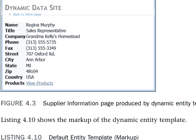

## 图 4.3 由动态实体模板生成的供应商信息页面

清单 4.10 展示了动态实体模板的标记。

## 清单 4.10 默认实体模板（标记）

```
<%@ Control Language="C#" CodeBehind="Default.ascx.cs"
Inherits="WebApplication.DynamicData.EntityTemplates.DefaultEntityTemplate" %>

<asp:EntityTemplate runat="server" ID="entityTemplate">
    <ItemTemplate>
        <tr>
            <td><asp:Label runat="server" OnInit="Label_Init" /></td>
            <td><asp:DynamicControl runat="server" OnInit="DynamicControl_Init" /></td>
        </tr>
    </ItemTemplate>
</asp:EntityTemplate>
```

动态实体模板利用了 Dynamic Data 提供的元数据信息，包括已注册数据模型中每个表的所有列的列表。此标记中使用的 EntityTemplate 控件是一个轻量级模板化控件，类似于 ASP.NET 的 Repeater。清单 4.11 中显示的 OnLoad 方法使用它以编程方式为每个实体列创建一个 Label 和一个 DynamicControl。由于所有列都使用同一个模板，DynamicControl 的 DataField 属性和 Label 的 Text 属性在各自的 OnInit 事件处理程序中以编程方式初始化。

## 清单 4.11 默认实体模板（代码隐藏）

```
using System;
using System.Collections.Generic;
using System.Web.DynamicData;
using System.Web.UI;
using System.Web.UI.WebControls;

namespace WebApplication.DynamicData.EntityTemplates
{
    public partial class DefaultEntityTemplate : EntityTemplateUserControl
    {
        private MetaColumn currentColumn;

        protected override void OnLoad(EventArgs e)
        {
            IEnumerable<MetaColumn> scaffoldColumns = this.Table.GetScaffoldColumns(
                this.Mode, this.ContainerType);
            foreach (MetaColumn column in scaffoldColumns)
            {
                this.currentColumn = column;
                NamingContainer container = new NamingContainer();
                this.entityTemplate.ItemTemplate.InstantiateIn(container);
                this.entityTemplate.Controls.Add(container);
            }
        }

        protected void Label_Init(object sender, EventArgs e)
        {
            ((Label)sender).Text = this.currentColumn.DisplayName;
        }

        protected void DynamicControl_Init(object sender, EventArgs e)
        {
            ((DynamicControl)sender).DataField = this.currentColumn.Name;
        }
    }
}
```

## 注意

注意，NamingContainer 是一个自定义控件，直接继承自内置的 Control，并实现 INamingContainer 标记接口。ASP.NET 运行时依赖该接口来确定命名边界，并生成在整个页面中唯一的控件 ID。

显示在由实体模板动态生成的 Label 控件中，并在报告验证错误时显示在 ValidationSummary 控件中。清单 4.12 中的 Supplier 示例为 ContactName、ContactTitle、CompanyName 以及其他几个列指定了显示名称。

您可以通过将 DisplayAttribute 的 AutoGenerateField 属性设置为 false，完全阻止显示特定列。或者，要达到相同的结果，可以将 ScaffoldColumnAttribute 应用于实体属性，并将其 Scaffold 属性值指定为 false。清单 4.12（Supplier 示例）展示了如何使用此方法隐藏 HomePage 列。

> **注意**
> ScaffoldColumnAttribute 是在 ASP.NET Dynamic Data 的第一个版本中引入的，该版本作为 .NET Framework 3.5 Service Pack 1 的一部分发布。DisplayAttribute 是在第二个版本（随 .NET Framework 4 发布）中引入的，同时保留了 ScaffoldColumnAttribute 以实现向后兼容。

## 清单 4.12 Supplier 元数据特性

```
using System.ComponentModel.DataAnnotations;

namespace DataModel
{
    [MetadataType(typeof(Supplier.Metadata))]
    partial class Supplier
    {
        public class Metadata
        {
            [Display(Name = "Name", Order = 1)]
            public object ContactName { get; set; }

            [Display(Name = "Title", Order = 2)]
            public object ContactTitle { get; set; }

            [Display(Name = "Company", Order = 3)]
            public object CompanyName { get; set; }

            [Display(Order = 4)]
            public object Phone { get; set; }

            [Display(Order = 5)]
            public object Fax { get; set; }

            [Display(Name = "Street")]
            public object Address { get; set; }

            [Display(Name = "State")]
            public object Region { get; set; }

            [Display(Name = "Zip")]
            public object PostalCode { get; set; }

            [ScaffoldColumn(false)]
            public object HomePage { get; set; }
        }
    }
}
```

## 编辑和插入实体模板

除了迄今已讨论的只读实体模板外，Dynamic Data 还支持 Edit 和 Insert 模式的实体模板。考虑清单 4.13 中的 FormView 控件，除了前面使用的只读 ItemTemplate 之外，它还定义了 EditItemTemplate 和 InsertItemTemplate 部分。这三个部分都使用 DynamicEntity 控件，根据与 FormView 关联的 MetaTable 和 Mode 属性（可以是 Insert、Edit 或 ReadOnly（默认值））动态加载适当的实体模板。

## 清单 4.13 支持编辑和插入模式的客户信息页面

```
<%@ Page Language="C#"
    MasterPageFile="~/Site.master" CodeBehind="SamplePage.aspx.cs"
    Inherits="WebApplication.Samples.Ch04.EditTemplates.SamplePage" %>

<asp:Content runat="server" ContentPlaceHolderID="main">
    <asp:ValidationSummary runat="server" />
    <asp:FormView ID="form" runat="server" DataSourceID="dataSource"
        DataKeyNames="CustomerID">
        <ItemTemplate>
            <asp:DynamicEntity runat="server" />
            <tr><td>
                <asp:LinkButton runat="server" CommandName="Edit" Text="Edit" />
                <asp:LinkButton runat="server" CommandName="New" Text="New" />
            </td></tr>
        </ItemTemplate>
        <InsertItemTemplate>
            <asp:DynamicEntity runat="server" Mode="Insert" />
            <tr><td>
                <asp:LinkButton runat="server" CommandName="Insert" Text="Insert" />
            </td></tr>
        </InsertItemTemplate>
        <EditItemTemplate>
            <asp:DynamicEntity runat="server" Mode="Edit" />
            <tr><td>
                <asp:LinkButton runat="server" CommandName="Update" Text="Update" />
            </td></tr>
        </EditItemTemplate>
    </asp:FormView>
    <asp:EntityDataSource ID="dataSource" runat="server"
        EnableInsert="true" EnableUpdate="true"
        ConnectionString="name=NorthwindEntities" AutoGenerateWhereClause="true"
        DefaultContainerName="NorthwindEntities" EntitySetName="Customers">
        <WhereParameters>
            <asp:QueryStringParameter QueryStringField="ID" Name="CustomerID" />
        </WhereParameters>
    </asp:EntityDataSource>
</asp:Content>
```

与字段模板类似，Dynamic Data 使用模板文件名的最后一部分来确定其模式。对于 Customer 页面，您可能需要在 Web 应用程序的 DynamicData\EntityTemplates 文件夹中放置以下三个模板：

- Customers.ascx，只读模板
- Customers_Edit.ascx，编辑模板
- Customers_Insert.ascx，插入模板

创建 Customers_Edit 和 Customers_Insert 实体模板非常简单；它们与只读 Customers 模板（见清单 4.3）几乎相同，只是 DynamicControl 实例的 Mode 属性分别设置为 Edit 和 Insert。清单 4.14 显示了 Customer 实体的 Edit 模式模板。

## 清单 4.14 Customers_Edit 实体模板（标记）

```
<%@ Control Language="C#" CodeBehind="Customers_Edit.ascx.cs" Inherits="WebApplication.DynamicData.EntityTemplates.CustomerEditEntityTemplate" %>

<label>ID:</label>
<asp:DynamicControl runat="server" DataField="CustomerID" Mode="Edit"/>
<label>Name:</label>
<asp:DynamicControl runat="server" DataField="contactName" Mode="Edit"/>
<fieldset><legend>Address</legend>
```


```
<label>Street:</label>
<asp:DynamicControl runat="server" DataField="Address" Mode="Edit" /><br />
<label>City:</label>
<asp:DynamicControl runat="server" DataField="City" Mode="Edit" />
<label>State:</label>
<asp:DynamicControl runat="server" DataField="Region" Mode="Edit" />
<label>Zip:</label>
<asp:DynamicControl runat="server" DataField="PostalCode" Mode="Edit" />
</fieldset>
```

虽然你也可以轻松地创建插入模式模板，但它们之间的唯一区别在于为 `DynamicControl` 实例指定的模式是插入模式。如第 3 章所述，当特定字段的插入模板不可用时，Dynamic Data 会自动回退使用编辑字段模板。对于 Customer 实体模板而言，这意味着 `Text_Edit` 字段模板实例将在插入和编辑两种模式下使用。因此，在这种情况下，为插入模式单独定义实体模板就有些多余。幸运的是，Dynamic Data 对实体模板也采用了类似的回退算法，这允许你在插入模式中复用编辑模板，例如 `Customers_Edit`。只有当插入实体模板需要与编辑模式对应模板在展示和工作方式上有所不同时，你才需要定义它们。

## 实体模板查找规则

查找实体模板时，Dynamic Data 会在 Web 应用程序的 `DynamicData\EntityTemplates` 文件夹中查找，并根据模板名称和模式尝试找到最佳匹配。模板文件名由模板名称后跟可选的模式后缀组成：

```
DynamicData\EntityTemplates\{TemplateName}{_Mode}.ascx
```

### 模板名称

默认情况下，模板名称由描述实体类的 `MetaTable` 名称决定。该名称通常与你用来查询实体的上下文类提供的属性名称相匹配。在 Northwind 示例中，上下文类 `NorthwindEntities` 有一个名为 `Customers` 的属性，你通常用它来查询 Customer 实体，如下所示。因此，对于 Customer 实体，表名和默认模板名为复数形式的 `Customers`：

```
using (NorthwindEntities context = new NorthwindEntities())
{
    var customers = from c in context.Customers
                    select c;
}
```

在使用继承的数据模型中，派生实体类的表示略有不同。假设一个 CRM（客户关系管理）系统有基类 `Contact` 以及派生类 `Prospect` 和 `Customer`。尽管 `Prospect` 和 `Customer` 实体可能存储在同一个名为 `Contacts` 的数据库表中，Dynamic Data 仍为每个实体类提供独立的 `MetaTable` 对象。每个 `MetaTable` 的名称与派生类名称匹配，因此对于 `Prospect` 实体，`MetaTable` 名称和默认模板名为单数形式的 `Prospect`：

```csharp
using (CrmEntities context = new CrmEntities())
{
    var prospects = from p in context.Contacts.OfType<Prospect>()
                    select p;
}
```

还可以通过设置 `DynamicEntity` 控件的 `UIHint` 特性来显式指定模板名称，此时模板名称完全不必与实体类的表名匹配：

```aspx
<asp:DynamicEntity runat="server" UIHint="Contact"/>
```

与表名相比，显式指定的模板名称是更精确的匹配。因此，如果前面的代码片段用于 Customer 实体，那么即使 `Customers.ascx` 实体模板也可用，也会使用 `Contact.ascx` 实体模板。

如果根据显式指定的模板名称或表名找不到匹配模板，则将使用 `Default`。由于 Dynamic Data 项目自带一组默认实体模板，这保证了任何实体都存在匹配的模板。

### 模板模式

与字段模板的控件模式类似，模板模式定义了实体模板将被使用的上下文。它由 ASP.NET `DataBoundControlMode` 枚举的成员定义，Dynamic Data 用它来确定模板文件名的后缀：

-   只读模板用于实现 FormView 和 ListView 控件的 `ItemTemplate`。只读实体模板的文件名没有基于模式的后缀。
-   编辑模板用于实现 FormView 和 ListView 控件的 `EditItemTemplate`。编辑模板文件名以 `_Edit` 结尾，例如 `Default_Edit.ascx`。
-   插入模板用于实现 FormView 和 ListView 控件的 `InsertItemTemplate`，文件名以 `_Insert` 结尾，例如 `Default_Insert.ascx`。

如果将 `Mode` 属性设置为 `Insert`，Dynamic Data 还将按表 4.1 所示顺序尝试插入模式模板。

注意，在插入模式下，查找算法打破了只读和编辑模式下使用的模式。它不会先针对插入模式尝试不同的模板名称（例如 `Contact_Insert.ascx`、`Customers_Insert.ascx` 和 `Default_Insert.ascx`），然后再对编辑模式重复该过程，而是针对每个模板名称依次尝试插入和编辑模式。遗憾的是，这使查找算法变得更加令人困惑且难以理解。另一方面，这种变化让你可以在插入模式中复用编辑模式模板。如果不是这样，除非你定义了 `Contact_Insert.ascx` 或 `Customers_Insert.ascx`，否则插入模式将始终使用 `Default_Insert.ascx` 字段模板。

**表 4.1** 实体模板查找示例

| Mode="Insert" | Mode="Edit" | Mode="ReadOnly" |
|---|---|---|
| `Contact_Insert.ascx` | `Contact_Edit.ascx` | `Contact.ascx` |
| `Contact_Edit.ascx` | `Customers_Edit.ascx` | `Customers.ascx` |
| `Customers_Insert.ascx` | `Default_Edit.ascx` | `Default.ascx` |
| `Customers_Edit.ascx` | `Contact.ascx` |  |
| `Default_Insert.ascx` | `Customers.ascx` |  |
| `Default_Edit.ascx` | `Default.ascx` |  |
| `Contact.ascx` |  |  |
| `Customers.ascx` |  |  |
| `Default.ascx` |  |  |

## 内置实体模板

开箱即用，Dynamic Data 项目提供了三个动态实体模板，分别对应一种模式：

-   `Default.ascx`
-   `Default_Edit.ascx`
-   `Default_Insert.ascx`

这三个动态实体模板都会生成一个两列表格，左列包含 `Label` 控件，右列包含 `DynamicControl` 实例。实体 `MetaTable` 中每个基架列都会对应生成一行表格行。除了分别将 `DynamicControl` 的 `Mode` 属性设置为 `ReadOnly`、`Edit` 和 `Insert` 之外，这三个实体模板几乎完全相同，旨在在三种不同模式下呈现一致的实体视图。

## 总结

实体模板是 ASP.NET 用户控件的一种特殊类型，Dynamic Data 使用它来封装显示单个实体实例（用数据库术语说，就是数据库表中的单行记录）的表示逻辑。实体模板用于一次显示单个项的网页，通常采用基于表单的格式。

默认情况下，Dynamic Data 期望在 Web 应用程序的 `DynamicData\EntityTemplates` 文件夹中找到实体模板。Visual Studio 2010 中的 Dynamic Data Web 项目模板会在此文件夹中默认提供一组实体模板。默认模板基于从 LINQ 数据模型（如 Entity Framework 或 LINQ to SQL）提取的元数据信息，为任何给定实体动态生成标签和控件。

元数据信息基于 `System.ComponentModel.DataAnnotations` 命名空间中的 `DisplayAttribute` 定义应显示的列列表。数据注解特性可用于更改默认实体模板所生成页面上的列显示名称和顺序。当需要对表单布局进行细粒度控制时，可以创建自定义实体模板。


## 第 5 章 筛选模板

#### 筛选模板

### 本章内容

- 使用 LINQ 进行筛选
- 创建筛选模板
- 动态 LINQ 查询
- 使用筛选模板构建搜索页面
- 筛选模板查找规则
- 内置筛选模板

搜索功能对于大多数数据库应用程序至关重要。无论是客户浏览产品目录，还是服务代表查询客户记录，用户都需要一种快速便捷的机制来查找所需信息。十多年来，ASP.NET 开发人员一直使用存储过程来实现一般的数据访问代码，特别是搜索功能。对于每个搜索屏幕，例如图 5.1 所示的客户搜索页面，都会创建一个或多个存储过程，每个存储过程接受多个表示搜索条件的参数并执行适当的 SELECT 语句。

尽管使用存储过程实现简单页面很容易，但随着搜索条件中额外参数数量的增加，复杂性会呈指数级增长。考虑图 5.1 所示的客户搜索页面。仅有 2 个搜索参数 City 和 Title，该搜索页面需要支持其值的 3 种不同组合——仅 City、仅 Title，以及 City 和 Title 均有。这需要在存储过程体中使用 IF 语句的形式，或在 SELECT 语句的 WHERE 子句中使用逻辑条件的形式放置条件逻辑，以处理这 3 种组合。使用 3 个搜索参数时，组合数跃升至 7；使用 4 个参数时，已达到 15；仅使用 5 个参数（对于典型应用程序中的高级搜索页面来说是一个非常适中的数字），可能的组合数就高达令人望而生畏的 31 种。

参数值的可能组合数之所以重要，有两个原因。一方面，它直接影响开发人员必须处理的数据库代码的复杂性

如果用户输入了 Title 的搜索字符串，则会调用第二个 Where 方法，SQL 查询如下所示：

```
select * from Customers where ContactTitle = @Title
```

只有当用户同时输入了 City 和 Title 搜索字符串时，才会调用两个 Where 方法，SQL 查询将包含两个列的条件：

```
select * from Customers where City = @City and ContactTitle = @Title
```

换句话说，在 LINQ 的帮助下，您可以构建仅包含用户提供的搜索值所需条件的聚焦查询。这有助于数据库服务器选择比典型的手工编写 SQL（如下所示）更高效的执行计划，后者试图处理两种搜索选项，通常需要数据库服务器执行全表扫描：

```
select * from Customers
where City = ISNULL(@City, City)
  and ContactTitle = ISNULL(@Title, ContactTitle)
```

### 创建筛选模板

筛选模板是一个用户控件，封装了实现单个列查询筛选所需的表示层和数据访问逻辑。在传统的搜索页面中，此逻辑通常分散在标记和代码隐藏文件中。考虑我们客户搜索页面中 City 列所需的筛选逻辑（请参阅清单 5.1 中的标记）。

**清单 5.1** 简单搜索页面（标记）

```
<%@ Page Title="" Language="C#"
    MasterPageFile="~/Site.master" CodeBehind="SamplePage.aspx.cs"
    Inherits="WebApplication.Samples.Ch05.LinqFilter.SamplePage" %>

<asp:Content ContentPlaceHolderID="main" runat="server">
    Customer City: <asp:TextBox runat="server" ID="cityFilter" />
    Title: <asp:TextBox runat="server" ID="titleFilter" />
    <asp:Button runat="server" Text="Find" OnClick="Find_Click" />
    <asp:GridView ID="gridView" runat="server" />
</asp:Content>
```

传统页面包含一个 TextBox 控件，用户可以在其中输入要在 City 列中搜索的值。基于此值筛选行的數據访问逻辑是清单 5.2 中所示的 Find_Click 事件处理程序的一部分。

## 实时数据大规模处理的分布式系统架构

现代数据密集型应用程序要求在保持容错性和水平可扩展性的同时，对高速数据流进行低延迟处理。传统的批处理架构已被证明不足以满足诸如欺诈检测、物联网遥测和推荐引擎等用例的需求，这些用例需要每秒持续摄取和分析数百万个事件。

### 1. 引言

本文探讨了一种分层架构，将摄取、处理、存储和服务解耦。摄取层充当持久缓冲区，吸收突发流量并按需重放数据。处理引擎以精确一次语义运行分布式计算，而服务层为应用程序和仪表板提供对有状态视图的索引访问。

- **关键设计目标：**
  - 低延迟（p99 < 100 ms）
  - 精确一次状态语义
  - 跨通用硬件的弹性分区
  - 自动故障转移和再平衡

### 2. 相关工作

> "根本挑战不是处理速度，而是跨分区的协调状态管理。"
> — M. Chen, 2023

Apache Flink、Kafka Streams 和 Spark Streaming 等现有框架在延迟、吞吐量和状态一致性之间采用了不同的权衡。我们的工作在这些基础上扩展，采用统一的基于日志的存储模型和自适应分区策略。

### 3. 系统概述

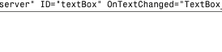

您可以使用内置或第三方 ASP.NET 控件来实现适合输入模板设计处理的数据类型搜索值的用户界面。此模板专为 String 列设计。它使用与前面示例搜索页面中使用的类似的 TextBox 控件。OnTextChanged 事件处理程序用于在用户更改搜索值时刷新查询结果。

**清单 5.4** 文本筛选模板（代码隐藏）

```
using System;
using System.Linq;
using System.Linq.Dynamic;
using System.Web.DynamicData;
using System.Web.UI;

namespace WebApplication.DynamicData.Filters
{
    public partial class TextFilter : QueryableFilterUserControl
    {
        public override IQueryable GetQueryable(IQueryable query)
        {
            if (!string.IsNullOrEmpty(this.textBox.Text))
            {
                string filter = this.Column.Name + " == @0";
                query = query.Where (filter, this.textBox.Text);
            }

            return query;
        }

        protected override void OnInit(EventArgs e)
        {
            base.OnInit(e);
            this.textBox.MaxLength = this.Column.MaxLength;
            this.textBox.Text = this.DefaultValue;
        }

        protected void TextBox_TextChanged(object sender, EventArgs e)
        {
            this.OnFilterChanged();
        }
    }
}
```

筛选模板继承自 Dynamic Data 提供的特殊基类 `QueryableFilterUserControl`。该类定义了子类需要重写的多个虚方法和属性，并提供了多个帮助方法，旨在帮助实现具体的筛选模板。

### GetQueryable 方法

GetQueryable 方法是筛选模板的核心。它在 `QueryableFilterUserControl` 基类中定义为抽象方法，所有筛选模板都必须重写它以实现数据访问逻辑。此方法接收一个查询对象，即 `IQueryable` 的实例，它需要根据用户输入的搜索值对其进行修改。如果用户未为此特定列输入任何搜索条件，则 GetQueryable 方法应返回原始查询。请注意，清单 5.4 中的代码如何检查 TextBox 控件的内容，并且仅在不为空时才修改查询。

### OnFilterChanged 方法

QueryableFilterUserControl 基类的 OnFilterChanged 方法会通知负责执行查询并从数据库获取行的数据源控件，查询可能已更改。基类在响应 OnFilterChanged 时调用 GetQueryable 方法。

在此示例中，OnFilterChanged 方法由 TextBox_TextChanged 方法调用，后者处理 TextBox 控件的 OnTextChanged 事件。这确保了在回发期间检测到文本框中输入的搜索值的任何更改，并调用 GetQueryable 方法以应用筛选器。

### DefaultValue 属性

DefaultValue 属性提供初始筛选值。当作为清单页面模板的一部分实例化时，该模板在第 6 章“页面模板”中讨论，筛选器可以通过页面请求 URL 传递列名和值来进行初始化。虽然对于新的筛选模板不是必需的，但支持此功能对于使它们的行为与 Dynamic Data 项目模板提供的内置模板保持一致非常重要。

### 动态 LINQ 查询

大多数筛选模板，例如本示例中的 Text.ascx，可以重用于任何匹配类型的列。动态筛选模板，例如此模板，不能在查询中硬编码列名。相反，使用通过 QueryableFilterUserControl 基类的 Column 属性可用的列元数据来获取列名并动态构建查询：

与其动态等价物。

```csharp
IQueryable query = // ...
query = query.Where("City == @0", "London");
```

动态 Where 方法解析字符串并创建一个强类型的 LINQ 表达式树，该表达式树可被 LINQ 启用数据访问框架使用，例如本示例中的 ADO.NET Entity Framework。以下是使用 LINQ 表达式类实现相同结果的等效代码：

```csharp
IQueryable query = // ...
```

```csharp
ParameterExpression parameter = Expression.Parameter(
    query.ElementType, string.Empty);
Expression property = Expression.PropertyOrField(parameter, "City");
Expression comparison = Expression.Equal(
    property, Expression.Constant("London"));
LambdaExpression lambda = Expression.Lambda(
    comparison, new ParameterExpression[] { parameter });

MethodCallExpression where = Expression.Call(
    typeof(Queryable), "Where",
    new Type[] { query.ElementType },
    new Expression[] { query.Expression, Expression.Quote(lambda) });

query = query.Provider.CreateQuery(where);
```

与原始表达式相比，动态 LINQ 扩展使实现筛选器模板变得容易得多、得多。然而，解析字符串需要在 Web 服务器上消耗额外的 CPU 资源，你可能需要考虑使用 LINQ 表达式实现筛选器模板作为优化。你可能还需要使用 LINQ 表达式，如果动态扩展不支持筛选器模板中需要的 LINQ 功能，例如连接。然而，这个主题过于庞大和复杂，无法在此涵盖；它将在第 12 章“Building Custom Search Pages.”中重新讨论。

## 使用筛选器模板构建搜索页面

现在你已经实现了筛选器模板 Text.ascx，并将其保存在此 Web 项目的 DynamicData/Filters 文件夹中，你可以重写示例搜索页面以利用其功能。将显示此页面新版本的标记的清单 5.5 与显示原始版本的清单 5.1 进行比较。

**清单 5.5** 使用 DynamicFilter 控件的简单搜索页面（标记）

```aspx
<%@ Page Title="" Language="C#"
    MasterPageFile="~/Site.master" CodeBehind="SamplePage.aspx.cs"
    Inherits="WebApplication.Samples.Ch05.DynamicFilter.SamplePage" %>

<asp:Content ContentPlaceHolderID="main" runat="server">
    Customer City:
    <asp:DynamicFilter runat="server" ID="cityFilter"
        DataField="City" FilterUIHint="Text" />
    Title:
    <asp:DynamicFilter runat="server" ID="titleFilter"
        DataField="ContactTitle" FilterUIHint="Text" />
    <asp:Button runat="server" Text="Find" />
    <asp:GridView ID="gridView" runat="server" DataSourceID="dataSource" />
    <asp:EntityDataSource runat="server" ID="dataSource"
        ConnectionString="name=NorthwindEntities"
        DefaultContainerName="NorthwindEntities" EntitySetName="Customers" />
    <asp:QueryExtender runat="server" TargetControlID="dataSource">
        <asp:DynamicFilterExpression ControlID="cityFilter" />
        <asp:DynamicFilterExpression ControlID="titleFilter" />
    </asp:QueryExtender>
</asp:Content>
```

在运行时，此页面的新版本看起来与图 5.1 中显示的原始版本相同。但是，请注意，使用 DynamicFilter 控件代替文本框。DynamicFilter 是 Dynamic Data 提供的新的 ASP.NET 控件。在运行时，它会为 DataField 属性指定的列动态加载适当的筛选器模板。在此页面上，你有两个 DynamicFilter 控件实例，一个用于 City 列，一个用于 ContactTitle。

每个 DynamicFilter 控件最终必须连接到一个基于 LINQ 的数据源控件，该控件查询数据库。在本示例中，使用了 Entity Framework，此页面上有一个 EntityDataSource 控件，已配置为从 Customers 表检索行。EntityDataSource 类从其基类 QueryableDataSource 继承 QueryCreated 事件。控件在创建初始 LINQ 查询（IQueryable 实例）后，但在查询转换为 SQL 并发送到数据库服务器执行之前触发此事件。在此事件期间，查询可以由 DynamicFilter 控件修改。

除了数据源控件之外，页面上还有一个 QueryExtender 控件。此控件通过在查询扩展器的 TargetControlID 属性中指定其 ID 与 QueryableDataSource 关联。在运行时，查询扩展器处理数据源控件的 QueryCreated 并将 IQueryable 实例传递给其每个数据源表达式。此页面使用两个 DynamicFilterExpression 实例将两个 DynamicFilter 控件都与 QueryExtender 关联。每个

代码隐藏只需要将所需的 `MetaTable` 对象与 `GridView` 控件关联。这允许 `DynamicFilter` 控件根据其 `DataField` 属性中指定的列名定位 `MetaColumn` 对象。

### QueryableFilterRepeater 控件

如果需要构建具有特定搜索条件的自定义搜索页面，DynamicFilter 控件是实现筛选功能的正确选择。但是，如果需要构建高级搜索页面，让用户可以使用任何受支持的列搜索数据，或构建可用于不同表的动态搜索页面，你也可以使用 QueryableFilterRepeater 控件。清单 5.7 显示了如何修改搜索页面以利用它。

**清单 5.7** 使用 QueryableFilterRepeater 控件的搜索页面（标记）

```aspx
<%@ Page Title="" Language="C#"
    MasterPageFile="~/Site.master" CodeBehind="SamplePage.aspx.cs"
    Inherits="WebApplication.Samples.Ch05.QueryableFilterRepeater.SamplePage" %>

<asp:Content ContentPlaceHolderID="main" runat="server">
    <asp:QueryableFilterRepeater runat="server" ID="filterRepeater">
        <ItemTemplate>
            <%# Eval("DisplayName") %>:
            <asp:DynamicFilter ID="DynamicFilter" runat="server" />
        </ItemTemplate>
    </asp:QueryableFilterRepeater>
    <asp:Button runat="server" Text="Find" />
    <asp:GridView ID="gridView" runat="server" DataSourceID="dataSource" />
    <asp:EntityDataSource runat="server" ID="dataSource"
        ConnectionString="name=NorthwindEntities"
        DefaultContainerName="NorthwindEntities" EntitySetName="Customers" />
    <asp:QueryExtender runat="server" TargetControlID="dataSource">
        <asp:DynamicFilterExpression ControlID="filterRepeater" />
    </asp:QueryExtender>
</asp:Content>
```

与常规 Repeater 控件类似，QueryableFilterRepeater 使你能够定义一个标记模板，它将使用该模板为表中每个受支持的列生成筛选控件。它定义的每个 ItemTemplate 实例都绑定到一个 MetaColumn 对象，该对象描述了可由 Dynamic Data 筛选的列。这允许你使用 ASP.NET 数据绑定语法 `<%# Eval("DisplayName") %>` 为每个列生成文本标签。在 ItemTemplate 内部，你还需要有一个 ID 属性设置为 "DynamicFilter" 的 DynamicFilter 控件实例。这允许 QueryableFilterRepeater 在每个 ItemTemplate 实例内部找到 DynamicFilter 控件并根据当前 MetaColumn 配置它；QueryableFilterRepeater 将在运行时初始化筛选控件。

**清单 5.8 继续**

```csharp
[FilterUIHint("Text")]
public object City { get; set; }

[FilterUIHint("Text")]
public object ContactTitle { get; set; }
}
}
```

### 筛选器模板查找规则

与字段模板的查找规则相比，筛选器模板的查找规则很简单。Dynamic Data 仅使用与列关联的 FilterUIHint，并对几种列类型具有固有知识。如果在数据模型中未指定 FilterUIHint，并且列是外键（表示子实体中多对一或一对一关联的父导航属性的列）、布尔值或枚举，Dynamic Data 会分别选择预定义的 FilterUIHint 值 ForeignKey、Boolean 或 Enumeration。拥有 FilterUIHint 值后，Dynamic Data 会尝试在 Web 应用程序项目的 DynamicData\Filters 目录中查找名称匹配的用户控件。如果用户控件不存在，查找过程结束，并且认为此列不支持筛选。图 5.4 说明了 Dynamic Data 用于筛选器模板查找的算法。


**图 5.4** 筛选器模板查找算法。


## 内置筛选器模板

也许筛选器模板的查找算法与字段模板相比之所以如此简单，是因为默认情况下，Dynamic Data Web 项目只附带三个筛选器模板。

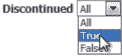

### 布尔

布尔筛选器模板用于布尔类型的列。它包含一个 DropDownList 控件，允许用户从“全部”、“True”、“False”以及（如果该列允许空值）“[未设置]”中选择筛选值。

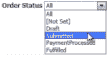

### 枚举

枚举筛选器模板用于枚举类型的列，或标记有指定枚举类型的 EnumDataTypeAttribute 的整数列。它包含一个 DropDownList 控件，允许用户从“全部”、[未设置]（如果该列允许空值）以及枚举类型中所有项的字符串名称中选择筛选值。

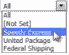

### 外键

外键筛选器模板用于外键列。它在 DropDownList 控件中显示由外键列引用的父表中的所有记录，外加“全部”，如果该列允许空值，还有“[未设置]”。每个 ListItem 代表父表中的一行。其值属性包含主键列值的逗号分隔列表。Text 属性值通过调用描述父表的元表实例的 GetDisplayString 方法来确定。如果父实体类重写了 ToString 方法，则使用该方法返回的值；否则，使用父实体类的显示列的值。显示列可以通过将 DisplayColumnAttribute 应用于实体类来显式指定，也可以通过启发式方法确定，在这种情况下使用第一个字符串属性的值。

### 总结

筛选器模板是一种特殊类型的用户控件，它封装了根据单个列的值筛选特定表的行所需的用户界面和数据访问逻辑。筛选器模板修改由数据源控件创建的 LINQ 查询，以根据用户输入的搜索参数动态应用筛选条件。同一筛选器模板的多个实例可以在应用程序中用于相同类型的不同列。Dynamic Data 包含少量现成的筛选器模板，包括用于布尔、枚举和外键列的模板。可以使用内置或第三方 ASP.NET 控件以及 LINQ 表达式或动态 LINQ 扩展来实现新的筛选器模板。

## 第6章：页面模板

### 本章内容

- 内置页面模板
- 创建新页面模板
- 自定义页面模板
- URL 路由
- 页面模板查找规则

在 Web 应用程序中，实现 CRUD（创建、读取、更新和删除）操作一直是一个持续的挑战。问题不在于它们的复杂性，而在于典型的企业应用程序中必须实现的页面数量之多。在 Web 应用程序中，通常每种类型的操作都有一个单独的网页，一个页面用于编辑特定实体类型，另一个页面用于以只读模式显示它。在企业应用程序中，拥有几十个甚至数百个实体类型时，由此产生的页面数量很快就变得难以管理。

在传统的 ASP.NET WebForms 应用程序中，开发人员有时会尝试通过创建多功能页面来解决这个问题，例如允许用户*创建*和*修改*特定实体类型实例的单个页面。Visual Studio 甚至通过为 FormView 控件生成 Item、Edit 和 Insert 模板来提供对创建多功能页面的有限支持。虽然这种方法减少了应用程序中的页面总数，但代价是显著增加了单个页面的复杂性。

ASP.NET MVC 框架试图通过 Visual Studio 中的脚手架功能来解决这个问题，该功能在设计时为给定实体生成独立的 CRUD 页面。虽然设计时脚手架有助于创建 CRUD 页面的初始版本，但维护生成的代码的任务又落到了开发人员的肩上。在某种程度上，设计时脚手架通过产生一个更大的问题来解决支持 CRUD 操作的问题，即需要维护的页面和代码量迅速增加。

在应用程序启动期间，需要注册 DynamicDataRoute。以下是一个你通常可以在 Global.asax 中找到的路由注册代码示例。

```csharp
RouteTable.Routes.Add(new DynamicDataRoute("{table}/{action}.aspx"));
```

RouteTable 类的静态 Routes 属性提供了对 Route 对象全局集合的访问。此代码使用它注册一个新的 DynamicDataRoute，该路由将 URL 定义为表名和页面操作的组合。{table} 标记定义了你在 URL 中期望找到表名的位置，{action} 标记定义了页面操作的位置。如果传入请求的 URL 符合此格式，则 Web 应用程序的默认 MetaModel 包含具有匹配名称的表，并且存在与操作匹配的页面模板，Dynamic Data 将使用此页面模板处理该请求。在以下 URL 中，Products 匹配 table 参数，List 匹配 action：

```text
http://localhost/Products/List.aspx
```

### 详细信息页面模板

详细信息页面模板生成在表单视图中显示单个实体实例的网页。图 6.2 显示了为 Product 实体生成的此类页面的示例。注意 Web 浏览器地址栏中的 URL；它包含表名（Products）和一个查询字符串，该字符串指定实体主键（ProductID）的值。详细信息页面模板使用此信息从数据库中检索相应的实体实例。

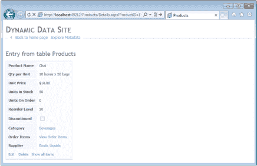

图 6.2 由详细信息页面模板生成的网页。

```asp
</ContentTemplate>
</asp:UpdatePanel>
</asp:Content>
```

EntityDataSource 控件用于从数据库中检索所需的实体实例。但是，你可能已经注意到，它没有指定通常需要让控件知道要实例化哪个 ObjectContext 以及要查询哪个对象集的 DefaultContainerName 和 EntitySetName 属性。此信息由 DynamicDataManager 提供给 EntityDataSource，DynamicDataManager 是 Dynamic Data 提供的新控件之一。

DynamicDataManager 控件有一个 DataControls 集合，用于存储一个或多个 DataControlReference 对象。在详细信息页面模板中，它存储对 FormView 控件的单个引用。在页面生命周期的初始化阶段，DynamicDataManager 使用此引用找到与 FormView 关联的 EntityDataSource 控件并对其进行配置。特别是，它从当前 URL 路由中提取表名，并获取描述该表的 MetaTable 对象。MetaTable 对象提供了初始化 EntityDataSource 所需的信息，包括 ObjectContext 的类型以及要查询的实体集的名称。

仅知道上下文类型和实体集不足以从数据库中检索特定实体。发送到数据库服务器的查询还必须包含一个 WHERE 子句，用于标识存储该实体的表行。此任务由与 EntityDataSource 关联的 QueryExtender 控件执行。在详细信息页面模板中，QueryExtender 使用一种特殊类型的数据源表达式，称为 DynamicRouteExpression。在运行时，该对象从 URL 中提取主键列的值，并修改由 EntityDataSource 生成的查询以包含适当的筛选条件。

FormView 控件定义了一个 ItemTemplate，用于在 DynamicEntityControl 的帮助下显示实体。如你所记得，该控件使用 Dynamic Data 实体模板来生成实体的通用单列视图，或者如果为实体定义了自定义模板，则生成自定义视图。在详细信息页面模板中，DynamicEntity 控件未指定 Mode 属性，因此使用只读实体模板。

除了 DynamicEntity 之外，FormView 控件的 ItemTemplate 还包含一组链接，供用户编辑或删除实体，或返回到列表页。Edit 和 List 操作由 DynamicHyperLink 控件实现。当绑定到实体实例时，DynamicHyperLink 控件会根据控件的 Action 属性值生成指向另一个动态页面的 URL。在此示例中，第一个 DynamicHyperLink 控件生成的 URL 如下所示：

```text
http://localhost:49212/Products/Edit.aspx?ProductID=1
```

在此 URL 中，Products 是描述当前实体实例的 MetaTable 的名称，Edit 是在 DynamicHyperLink 控件的 Action 属性中指定的操作名称，而 ProductID=1 是当前实体实例的主键列的名称和值。


实体实例。由于第二个 DynamicHyperLink 的 Action 属性设置为 List，因此它生成的 URL 看起来像这样：

```
http://localhost:49212/Products/List.aspx?ProductID=1
```

另一方面，Delete 操作由传统的 LinkButton 实现。该控件指定了 CommandName 属性，并利用了 FormView 内置的删除支持。当用户单击此控件生成的链接时，Delete 命令会被提交回 FormView，后者将删除请求传递给与其关联的数据源控件。为了允许删除，EntityDataSource 控件将 EnableDelete 属性设置为 true。

并非所有功能都直接在 Details 页面模板的标记中实现。你可能已经注意到，标题行依赖于代码隐藏中定义的 table 字段。

```
<h2>Entry from table <%= table.DisplayName %></h2>
```

需要额外的代码来初始化控件和处理实体删除。清单 6.2 显示了 Details 页面模板的代码隐藏。

## 清单 6.2 Details 页面模板（代码隐藏）

```csharp
using System;
using System.Web.DynamicData;
using System.Web.UI.WebControls;

namespace WebApplication.DynamicData.PageTemplates
{
    public partial class Details : System.Web.UI.Page
    {
        protected MetaTable table;

        protected void Page_Init(object sender, EventArgs e)
        {
            this.table = DynamicDataRouteHandler.GetRequestMetaTable(this.Context);
            this.Title = this.table.DisplayName;
            this.dataSource.EntityTypeFilter = this.table.EntityType.Name;
            this.dataSource.Include = this.table.ForeignKeyColumnsNames;
        }

        protected void FormView_ItemDeleted(object sender, FormViewDeletedEventArgs e)
        {
            if (e.Exception == null && !e.ExceptionHandled)
                this.Response.Redirect(this.table.ListActionPath);
        }
    }
}
```

`Page_Init` 事件处理程序通过从 URL 根中提取表名，并在默认的 `MetaModel` 中查找匹配的 `MetaTable` 对象来初始化 table 字段。表的 `DisplayName` 用于初始化页面的 `Title`，但更重要的是，这段代码执行了 `EntityDataSource` 所需的缺失初始化步骤。

`EntityDataSource` 的 `EntityTypeFilter` 属性指定了实体类型的名称。如果数据模型使用实体继承，该名称可能与实体集不同。Northwind 示例数据模型没有利用此功能，但可以想象一下，一个 Contact 表同时存储 Customer 和 Employee 信息，并使用 ContactType 列作为判别器。同一个实体集 Contacts 既可以用于检索 Customer 实体类型，也可以用于检索 Employee 实体类型，此时你需要指定 `EntityTypeFilter` 以确保 Customer 实体不会像 Employee 实体那样显示。`Page_Init` 处理程序使用从 `MetaTable` 对象检索到的实体类型名称来设置 `EntityTypeFilter` 属性。

`EntityDataSource` 的 `Include` 属性决定是否在检索主实体时同时检索相关实体。对于 Product 实体，还需要从数据库检索 Category 和 Supplier 实体，以便以可读的形式显示类别和供应商名称，而不是 CategoryID 和 SupplierID 列的原始数值。`Page_Init` 处理程序使用从 `MetaTable` 对象检索到的实体类型的外键导航属性名称来设置 `Include` 属性。

当用户单击 *删除* LinkButton 且当前实体实例已被成功删除时，将调用 `FormView_ItemDeleted` 事件处理程序。该方法不是显示一个空页面，而是将用户重定向回显示该类型所有剩余实体的 List 页面。

## 编辑页面模板

编辑页面模板生成一个用于编辑单个实体实例的网页。图 6.3 显示了为 Product 实体生成的这样一个页面。

这个页面与之前讨论的 Details 页面非常相似。URL 同样包含表名、操作名，以及当前实体实例主键列的名称和值。

```
http://localhost:49212/Products/Edit.aspx?ProductID=1
```

用户可以通过点击 Details 页面模板生成的页面上的“编辑”链接来导航到此页面，也可以通过点击稍后讨论的 List 页面模板生成的页面上的“编辑”链接。

正如你所料，Edit 页面模板的实现与 Details 页面模板类似。清单 6.3 显示了此模板的标记文件，模板之间的显著差异以粗体字标出。

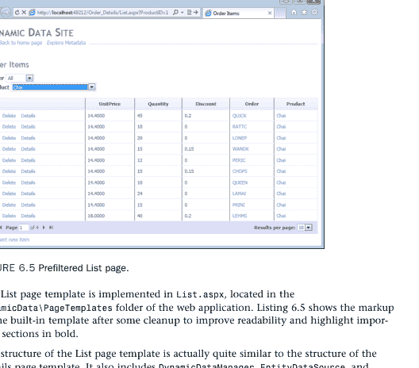

## 图 6.5 预筛选的 List 页面。

List 页面模板实现在 List.aspx 中，该文件位于 Web 应用程序的 DynamicData/PageTemplates 文件夹中。清单 6.5 显示了内置模板的标记，经过一些清理以提高可读性，并用粗体突出显示重要部分。

实际上，List 页面模板的结构与 Details 页面模板的结构非常相似。它也包含 DynamicDataManager、EntityDataSource 和 QueryExtender 控件。唯一显著的区别是 GridView 控件（此模板使用它来显示实体）以及用于生成筛选控件的 QueryableFilterRepeater。

## 清单 6.5 List 页面模板（标记）

```aspx
<%@ Page Language="C#" MasterPageFile="~/Site.master" CodeBehind="List.aspx.cs" Inherits="WebApplication.DynamicData.PageTemplates.List" %>
<%@ Register Src="~/DynamicData/Controls/GridViewPager.ascx" TagName="GridViewPager" TagPrefix="dd" %>
<asp:Content ContentPlaceHolderID="main" runat="Server">
    <asp:DynamicDataManager runat="server">
        <DataControls>
            <asp:DataControlReference ControlID="gridview" />
        </DataControls>
    </asp:DynamicDataManager>
```

```
<h2><%= table.DisplayName %></h2>

<asp:UpdatePanel runat="server">
<ContentTemplate>
<div class="DD">
<asp:ValidationSummary runat="server" HeaderText="Validation errors" />
<asp:DynamicValidator runat="server" ControlToValidate="gridView" Display="None" />

<asp:QueryableFilterRepeater runat="server" ID="FilterRepeater">
<ItemTemplate>
<asp:Label runat="server" Text='<%# Eval("DisplayName") %>' OnPreRender="Label_PreRender" />
<asp:DynamicFilter runat="server" ID="DynamicFilter" OnFilterChanged="DynamicFilter_FilterChanged" />
<br />
</ItemTemplate>
</asp:QueryableFilterRepeater>
<br />
</div>

<asp:GridView ID="gridView" runat="server" DataSourceID="dataSource" EnablePersistedSelection="true" AllowPaging="True" AllowSorting="True">
<Columns>
<asp:TemplateField>
<ItemTemplate>
<asp:DynamicHyperLink runat="server" Action="Edit" Text="Edit" />
<asp:LinkButton runat="server" CommandName="Delete" Text="Delete" OnClientClick="return confirm('Are you sure you want to delete this item?');"/>
<asp:DynamicHyperLink runat="server" Text="Details" />
</ItemTemplate>
</asp:TemplateField>
</Columns>
<PagerTemplate>
<dd:GridViewPager runat="server" />
</PagerTemplate>
</asp:GridView>

<asp:EntityDataSource ID="dataSource" runat="server" EnableDelete="true" />
<asp:QueryExtender TargetControlID="dataSource" runat="server">
<asp:DynamicFilterExpression ControlID="FilterRepeater" />
</asp:QueryExtender>

<div class="DDBottomHyperLink">
<asp:DynamicHyperLink ID="insertLink" runat="server" Action="Insert">
```

## 清单 6.5（续）

```

Insert new item
<asp:DynamicHyperLink>
</div>
</ContentTemplate>
</asp:UpdatePanel>
</asp:Content>
```

GridView 控件被配置为允许分页和排序。它包含一个 TemplateField 来定义显示操作链接（编辑、删除和详细信息）的列。实际的数据列由 DefaultAutoFieldGenerator 动态生成。在页面初始化期间，DynamicDataManager 控件使用 DefaultAutoFieldGenerator 类的新实例来设置 GridView 的 ColumnsGenerator 属性。因此，DynamicField 实例不是像下面的示例那样在页面标记中显式指定，而是根据描述当前实体类型属性的元数据信息动态创建的。

```
<Columns>
<asp:DynamicField DataField="ProductName" />
<asp:DynamicField DataField="UnitsInStock" />
</Columns>
```

分页功能由 GridViewPager 控件实现。这不是 ASP.NET 内置控件，而是包含在 Visual Studio 的 Dynamic Data 项目模板中的用户控件，在你首次创建项目时，它会被创建在 Web 应用程序的 DynamicData\Content 文件夹中。

第 5 章讨论过的 QueryableFilterRepeater 控件用于生成一组 DynamicFilter 控件，每个可通过筛选模板进行筛选的属性对应一个控件，这些筛选模板位于 Web 应用程序的 DynamicData\Filters 文件夹中。请注意，此标记没有指定 DynamicFilter 控件的 DataField 属性。当 QueryableFilterRepeater 为实体类型中的每个可筛选属性实例化其 ItemTemplate 时，这一过程会自动完成。DynamicFilter 控件的 ID 属性必须是“DynamicFilter”，这正是 QueryableFilterRepeater 默认查找的内容。

QueryableFilterRepeater 控件通过页面标记中的 DynamicFilterExpression 与 QueryExtender 关联。反过来，QueryExtender 控件与 EntityDataSource 关联，这允许各个筛选模板根据用户选择的值在运行时修改它生成的 LINQ 查询。

清单 6.6 显示了 List 页面模板的代码隐藏文件，同样进行了清理以提高可读性并突出重要要点。


## 清单 6.6 列表页模板（代码隐藏）

```csharp
using System;
using System.Collections.Generic;
using System.Web.DynamicData;
using System.Web.Routing;
using System.Web.UI.WebControls;

namespace WebApplication.DynamicData.PageTemplates
{
    public partial class List : System.Web.UI.Page
    {
        protected MetaTable table;

        protected void Page_Init(object sender, EventArgs e)
        {
            this.table = DynamicDataRouteHandler.GetRequestMetaTable(this.Context);
            this.Title = this.table.DisplayName;
            this.dataSource.EntityTypeFilter = this.table.EntityType.Name;
            this.dataSource.Include = table.ForeignKeyColumnsNames;

            IDictionary<string, object> columnValues =
                this.table.GetColumnValuesFromRoute(this.Context);
            this.gridView.SetMetaTable(this.table, columnValues);

            this.insertLink.NavigateUrl = this.table.GetActionPath(
                PageAction.Insert, new RouteValueDictionary(columnValues));
        }

        protected void Label_PreRender(object sender, EventArgs e)
        {
            var label = (Label)sender;
            var dynamicFilter = (DynamicFilter)label.FindControl("DynamicFilter");
            var template = dynamicFilter.FilterTemplate as QueryableFilterUserControl;
            if (template != null && template.FilterControl != null)
            {
                label.AssociatedControlID =
                    template.FilterControl.GetUniqueIDRelativeTo(label);
            }
        }

        protected void DynamicFilter_FilterChanged(object sender, EventArgs e)
        {
            this.gridView.PageIndex = 0;
        }
    }
}
```

Page_Init 事件处理程序执行熟悉的任务：使用 URL 路由中的信息查找描述当前实体类型的 MetaTable，用实体的显示名称更新页面标题，并配置 EntityDataSource。然而，这段代码还执行了一个重要的额外步骤，在迄今为止讨论的 Details 和 Edit 页面模板中是不必要的。

Page_Init 事件处理程序中的代码调用 MetaTable 类的 GetColumnValuesFromRoute 方法，以从请求 URL 中获取属性名称和值的字典。当用户通过在其他动态生成的页面上单击“View Children”链接导航到列表页时，这一点很重要，例如图 6.4 中产品列表页上的 View Order Items 链接。在这种情况下，父实体的主键会通过类似以下所示的请求 URL 传递给页面模板：

```
http://localhost:49212/Order_Details/List.aspx?ProductID=1
```

获取到属性名称和值的字典后，Page_Init 代码会调用 DynamicDataExtensions 类中定义的 SetMetaTable 扩展方法，将 MetaTable 对象和它所称的默认值的字典与 GridView 控件关联起来。筛选器模板依赖此信息为筛选控件提供初始值（参见 QueryableFilterUserControl 类的 DefaultValue 属性）。

> **注意**
>
> 通常如果您有一个与数据绑定控件关联的 DynamicDataManager 控件，例如本示例中的 GridView，则无需调用 SetMetaTable 扩展方法。DynamicDataManager 会自动调用此方法，但在这种情况下，模板会显式调用它以将默认值传递给筛选器模板。

Page_Init 事件处理程序中的其余代码负责初始化页面底部的插入新项目超链接。使用相同的属性名称和值字典，这段代码会生成指向动态 Insert 页面的链接，并在 URL 中包含默认值。正如您稍后会看到的，Insert 页面模板也支持通过请求 URL 传递的列值，并依赖它们来预填充某些字段值。

Label_PreRender 方法处理 QueryableFilterRepeater 生成的 Label 控件的 PreRender 事件。它将每个标签与其匹配的 DynamicFilter 生成的筛选控件关联起来。这使得生成的标签表现得像真正的控件标签，而不是页面上的普通可选择文本内容。单击 Web 浏览器中的标签会自动选择相应的控件。

DynamicFilter_FilterChanged 方法处理 DynamicFilter 控件的 FilterChanged 事件，每当用户更改筛选条件时就会触发。虽然 QueryableFilterRepeater 会自动通知 EntityDataSource 控件并导致查询重新加载，但此方法会将 GridView 翻到第一页，以避免混淆和错误，当新的筛选条件使结果集中的页数少于当前页码时就会出现这种情况。

## 清单 6.7 插入页模板（标记）

```
<%@ Page Language="C#" MasterPageFile="~/Site.master" CodeBehind="Insert.aspx.cs" Inherits="WebApplication.DynamicData.PageTemplates.Insert" %>

<asp:Content ContentPlaceHolderID="main" runat="Server">
    <asp:DynamicDataManager runat="server">
        <DataControls>
            <asp:DataControlReference ControlID="formView" />
        </DataControls>
    </asp:DynamicDataManager>
    <h2>Add new entry to table <%= table.DisplayName %></h2>

    <asp:UpdatePanel runat="server">
        <ContentTemplate>
            <asp:ValidationSummary runat="server" HeaderText="List of validation errors"/>
            <asp:DynamicValidator runat="server" ControlToValidate="formView" Display="None" />

            <asp:FormView runat="server" ID="formView" DataSourceID="dataSource" DefaultMode="Insert" OnItemCommand="FormView_ItemCommand" OnItemInserted="FormView_ItemInserted">
                <InsertItemTemplate>
                    <asp:DynamicEntity runat="server" Mode="Insert" />
                    <div class="DDFormActions">
                        <asp:LinkButton runat="server" CommandName="Insert" Text="Insert" />
                        <asp:LinkButton runat="server" CommandName="Cancel" Text="Cancel" CausesValidation="false" />
                    </div>
                </InsertItemTemplate>
            </asp:FormView>

            <asp:EntityDataSource ID="dataSource" runat="server" EnableInsert="true" />
        </ContentTemplate>
    </asp:UpdatePanel>
</asp:Content>
```

Insert（参见清单 6.8）和 Edit（参见清单 6.4）页面模板的代码隐藏之间最重要区别在于，Insert 页面模板为 FormView 控件执行了额外的初始化步骤。就像列表页模板一样，它从请求 URL 中提取实体属性的名称和值，并通过调用 SetMetaTable 扩展方法将它们与 FormView 控件关联起来。DynamicEntity 控件生成的字段模板使用此信息为其数据输入控件提供默认字段值。FieldTemplateUserControl 类的 FieldValue 和 FieldValueEditString 属性会尊重与其父数据绑定控件关联的默认值，例如本示例中的 FormView。这就是为什么图 6.6 中由 ForeignKey_Edit 字段模板生成的 Supplier 下拉列表已被预填充为 Exotic Liquids。

## 清单 6.8 插入页模板（代码隐藏）

```csharp
using System;
using System.Web.DynamicData;
using System.Web.UI.WebControls;

namespace WebApplication.DynamicData.PageTemplates
{
    public partial class Insert : System.Web.UI.Page
    {
        protected MetaTable table;

        protected void Page_Init(object sender, EventArgs e)
        {
            this.table = DynamicDataRouteHandler.GetRequestMetaTable(Context);
            this.Title = this.table.DisplayName;
            this.dataSource.EntityTypeFilter = table.EntityType.Name;
            this.formView.SetMetaTable(this.table,
                this.table.GetColumnValuesFromRoute(Context));
        }

        protected void FormView_ItemCommand(object sender, FormViewCommandEventArgs e)
        {
            if (e.CommandName == DataControlCommands.CancelCommandName)
                Response.Redirect(this.table.ListActionPath);
        }

        protected void FormView_ItemInserted(object sender, FormViewInsertedEventArgs e)
        {
            if (e.Exception == null || e.ExceptionHandled)
                Response.Redirect(this.table.ListActionPath);
        }
    }
}
```

Insert 页面模板中的 FormView_ItemCommand 事件处理程序与 Edit 页面模板中同名方法的功能相同——当用户单击 Cancel 时将用户重定向回列表页。FormView_ItemInserted 事件处理程序在新实体成功保存到数据库时也会执行相同的操作。


这个新的 Delete 模板与内置的 Details 模板之间唯一的实质性区别在于按钮和链接控件集。新的 Delete 模板使用 Button 控件而不是 LinkButton，使得删除确认在视觉上不同于仅仅请求删除。它也没有 Details 页面模板用来将用户带到 Edit 页面的 Edit 链接。

虽然它们看起来可能没有必要，但 ValidationSummary 和 DynamicValidator 控件在 Delete 页面模板中仍然扮演着重要角色。如果用户尝试删除一个下过多个订单的 Customer，由于外键约束冲突，将会发生数据库错误。如第 8 章所述，数据库错误可以作为 ValidationException 类的实例呈现给 Dynamic Data。页面顶部的 DynamicValidator 控件会自动在 ValidationSummary 中显示未处理的 ValidationException 错误，而不是生成“黄屏死机”错误页。

在实现新的 Delete 页面模板之后，你还需要修改现有模板，将用户重定向到由新模板生成的新的动态页面，而不是显示 JavaScript 提示。在 List 和 Details 页面模板中，将以下 LinkButton：

```
<asp:LinkButton runat="server" CommandName="Delete" Text="Delete" OnClientClick='return confirm("Are you sure you want to delete this item?");' />
```

替换为以下 DynamicHyperLink 控件：

```
<asp:DynamicHyperLink runat="server" Action="Delete" Text="Delete" />
```

而且，由于 Details 页面将不再删除记录，你可以从页面标记中的 EntityDataSource 控件中移除 EnableDelete 属性，并从代码隐藏文件中的 FormView 控件中移除 ItemDeleted 事件处理程序。

图 6.7 展示了 Product 实体类型动态生成的 Delete 页面的示例。实体本身（标签和字段值）看起来与动态生成的 Details 页面相似，这很好地说明了页面模板如何允许你在重用实体模板封装的通用表示逻辑的同时，实现不同的操作和数据访问逻辑。

```
<h2>Entry from table <%= ordersTable.DisplayName %></h2>
<asp:FormView runat="server" ID="formView" DataSourceID="formDataSource">
    <ItemTemplate>
        <asp:DynamicEntity runat="server" />
        <div class="DFormActions">
            <asp:DynamicHyperLink runat="server" Action="Edit" Text="Edit" />
            <asp:DynamicHyperLink runat="server" Action="Delete" Text="Delete" />
            <asp:DynamicHyperLink runat="server" Action="List" Text="List" />
        </div>
    </ItemTemplate>
</asp:FormView>

<asp:EntityDataSource ID="formDataSource" runat="server"/>

<asp:QueryExtender TargetControlID="formDataSource" runat="server">
    <asp:DynamicRouteExpression />
</asp:QueryExtender>
</td>

<td>

<h2><%= itemsTable.DisplayName %></h2>
<asp:GridView ID="gridView" runat="server" DataSourceID="gridDataSource"
    AutogenerateColumns="false" AllowSorting="True">
    <Columns>
        <asp:DynamicField DataField="Product" />
        <asp:DynamicField DataField="UnitPrice" />
        <asp:DynamicField DataField="Quantity" />
        <asp:TemplateField>
            <ItemTemplate>
                <asp:DynamicHyperLink runat="server" Action="Edit" Text="Edit" />
                <asp:DynamicHyperLink runat="server" Action="Delete" Text="Delete" />
                <asp:DynamicHyperLink runat="server" Action="Details" Text="Details" />
            </ItemTemplate>
        </asp:TemplateField>
    </Columns>
</asp:GridView>

<asp:EntityDataSource ID="gridDataSource" runat="server"
    ConnectionString="name=NorthwindEntities"
    DefaultContainerName="NorthwindEntities"
    EntitySetName="Order_Details" Include="Product"
    OnSelected="GridDataSource_Selected" />
<asp:QueryExtender TargetControlID="gridDataSource" runat="server">
    <asp:DynamicRouteExpression />
</asp:QueryExtender>
```

## 清单 6.10（续）

```
    Total: <asp:Literal ID="totalLiteral" runat="server" />
    </td>
    </tr>
</table>
</asp:Content>
```

请注意，与通用的 List 页面模板不同，此自定义页面中的 GridView 不依赖于 DynamicDataManager 控件进行初始化。主要原因是 DynamicDataManager 根据 URL 路由中的信息确定与其目标控件关联的 MetaTable。在这种情况下，URL 路由包含表名 Orders，但你需要将 GridView 控件与 Order Details 表关联，并且需要在代码隐藏文件中完成此操作，如清单 6.11 所示。

你也不希望依靠 DynamicDataManager 来初始化 GridView 控件，因为我们需要一组特定的列来显示订单详细信息。你可以通过将 DefaultAutoFieldGenerator 分配给 GridView 控件的 ColumnsGenerator 属性来显示所有列；然而，这也会包含 Order 列，你可以从图 6.8 中 Order Details 表的默认 List 页面上看到该列。由于整个 Order 已经显示在新页面上，包含此列将是多余的。尽管你可以通过操作实体元数据来隐藏它，但重要的是要记住，此自定义页面模板不一定是动态的。通过在页面标记中显式指定所需的 Columns（例如我们想要显示的 Product、UnitPrice 和 Quantity 属性的 DynamicField 实例），此任务要容易得多。

这里的另一个重要区别是，EntityDataSource 控件的 gridDataSource 实例的初始化是直接在标记中执行的，其中 ConnectionString、DefaultContainerName、EntitySetName 和 Include 属性被“硬编码”用于此自定义页面，因为你确切知道它需要查询哪个实体，并且不需要使代码动态化。然而，此代码继续依赖于第二个 QueryExtender 控件中的 DynamicRouteExpression，它方便地根据从页面请求 URL 中提取的 OrderID 列值，限制从数据库中检索到的 Order Details 实例集合。

## 清单 6.11 自定义订单详细信息页面模板（代码隐藏）

```
using System;
using System.Collections.Generic;
using System.Data.Objects;
using System.Linq;
using System.Web.DynamicData;
using System.Web.UI.WebControls;
using DataModel;
```

## URL 路由

Dynamic Data Web 应用程序依赖于 ASP.NET 内置的通用 URL 路由功能。路由通常在应用程序启动时配置，即位于 `Global.asax` 文件中的 `Application_Start` 事件处理程序中。

```
RouteTable.Routes.Add(new DynamicDataRoute("{table}/{action}.aspx"));
```

正如本章开头所讨论的，`{table}` 和 `{action}` 是两个路由参数的占位符，它们在 ASP.NET Dynamic Data 中具有特殊含义。第一个参数提供动态页面需要显示其数据的表名，第二个参数决定需要显示哪种类型的页面，或者更准确地说，如何向用户呈现表数据。Dynamic Data 期望 table 参数与描述全局 MetaModel 中注册的实体类型的某个 MetaTable 对象的名称匹配，而 action 参数则提供查找处理请求的适当页面模板所需的信息。刚刚显示的路由定义允许 Dynamic Data 确定以下页面请求 URL 适用于名为 Products 的表和名为 List 的页面模板：

```
http://localhost/Products/List.aspx
```

### 操作路由参数

路由不必在 URL 本身中包含 action 参数。相反，可以通过显式设置 DynamicDataRoute 类的 Action 属性来指定它，如下所示：

```
RouteTable.Routes.Add(new DynamicDataRoute("{table}")
{
    Action = PageAction.List
});
```

根据此路由定义，用于显示产品列表的 URL 将完全不包括页面模板的名称，而是如下所示：

```
http://localhost/Products
```

### 表路由参数

同样，table 参数也不必来自 URL；可以使用 DynamicDataRoute 类的 Table 属性来指定它。请注意，在下面的示例中，路由定义不包含任何参数，只是将 URL 硬编码为“Product”（单数），这与表的复数名称不匹配。


```
RouteTable.Routes.Add(new DynamicDataRoute("Product")
{
    Action = PageAction.Details,
    Table = "Products"
});
```

基于此路由定义，Dynamic Data Web 应用程序可以使用以下 URL：

http://localhost/Product?ProductID=1

而不必使用如下更冗长且不够友好的 URL：

http://localhost/Products/Details.aspx?ProductID=1

## URL 参数与查询参数

URL 参数可替代传统 ASP.NET WebForms 应用程序使用的查询参数。传统的查询参数要求在查询字符串中同时提供名称和值，而 URL 参数允许 Web 应用程序根据值在 URL 中的位置自动确定参数名称。请考虑以下路由，它使用位置型 URL 参数替代 ProductID 查询参数：

```
RouteTable.Routes.Add(new DynamicDataRoute("Product/{ProductID}")
{
    Action = PageAction.Details,
    Table = "Products"
});
```

此路由定义允许 Web 应用程序在不使用查询参数的情况下实现产品目录，并支持类似于下面所示的 URL。这不仅使 URL 更短、更易于用户阅读，也使搜索引擎更容易索引动态页面，这一点对于面向公众的网站非常重要：

http://localhost:49212/Product/3

Dynamic Data 仍然支持传统的查询参数，你可以通过注册一个不包含任何 URL 参数、也不显式指定参数值的路由来启用这些参数：

```
RouteTable.Routes.Add(new DynamicDataRoute("Dynamic"));
```

刚才注册的路由会让 Dynamic Data 改为使用如下形式的 URL：

http://localhost/Dynamic?Table=Products&Action=List

## 动态超链接

路由具有双重用途。除了帮助 ASP.NET 运行时确定哪个 ASPX 页面将用于处理特定的传入请求之外，它们还决定指向动态页面的超链接将如何生成。在 ASP.NET Web 应用程序中，有几种不同的方法可以生成超链接。其中一种方法使用 Dynamic Data 提供的 DynamicHyperLink 控件。该控件继承自 ASP.NET HyperLink 控件，允许你生成指向动态页面的超链接。在以下示例中，显式指定了表名和所需操作。

```aspx
<asp:DynamicHyperLink runat="server"
    ContextTypeName="DataModel.NorthwindEntities"
    TableName="Products" Action="List" Text="Show all" />
```

TableName 属性指定描述目标实体的 MetaTable 的名称，ContextTypeName 指定目标实体所在的上下文类的名称。根据路由配置方式的不同，该控件会生成不同的 URL，而无需你修改其任何标记。表 6.1 展示了不同的路由定义以及该控件基于这些定义生成的 URL 示例。

表 6.1 DynamicHyperLink 生成的 URL 示例

| 路由定义 | URL 示例 |
|---|---|
| `new DynamicDataRoute("{table}/{action}.aspx")` | `http://localhost/Products/List.aspx` |
| `new DynamicDataRoute("{table}/{action}")` | `http://localhost/Products/List` |
| `new DynamicDataRoute("{table}") { Action = PageAction.List };` | `http://localhost/Products` |

DynamicHyperLink 控件还可以数据绑定到实体实例，在这种情况下，它可以自动确定 ContextTypeName 和 TableName，并生成在地址的查询部分中包含主键列名称和值的 URL。前面讨论过的 Details 页面模板利用了这一功能，将 DynamicHyperLink 控件作为 FormView 控件中 ItemTemplate 的一部分，如下面的摘录所示：

```aspx
<asp:FormView runat="server" ID="formView" DataSourceID="dataSource">
    <ItemTemplate>
        <asp:DynamicEntity runat="server" />
        <div class="DDFormActions">
            <asp:DynamicHyperLink runat="server" Action="Edit" Text="Edit" />
            <asp:DynamicHyperLink runat="server" Action="Delete" Text="Delete" />
            <asp:DynamicHyperLink runat="server" Action="List" Text="Show all"/>
```

```html
</div>
</ItemTemplate>
</asp:FormView>
```

请注意，此示例中的 DynamicHyperLink 控件并未指定 ContextTypeName 和 TableName 属性。FormView 控件将其 ItemTemplate 数据绑定到关联的 EntityDataSource 控件提供的实体实例上。这些控件根据实体类型定位 MetaTable 对象，并生成如下所示形式的 URL：

```text
http://localhost/Products/Edit.aspx?ProductID=1
http://localhost/Products/Details.aspx?ProductID=1
http://localhost/Products/List.aspx?ProductID=1
```

借助 RouteUrl 标记表达式，也可以生成动态超链接。这是一种特殊的语法，ASP.NET 解析器会识别它，并根据你指定的参数值生成动态 URL：

```aspx
<asp:HyperLink runat="server" Text="Show all"
    NavigateUrl="<%$RouteUrl:table=Products, action=List%>" />
```

在底层，RouteUrl 标记表达式和 DynamicHyperLink 控件都依赖 ASP.NET 提供的用于路由的底层 API。下一个代码示例演示了它们如何通过编程方式创建动态超链接。它创建一个 RouteValueDictionary 来保存 Table 和 Action 参数值，然后调用全局 Routes 集合的 GetVirtualPath 方法，以虚拟路径的形式生成 URL：

```csharp
HyperLink hyperLink = // ...

RequestContext context =
    DynamicDataRouteHandler.GetRequestContext(HttpContext.Current);

RouteValueDictionary routeValues = new RouteValueDictionary();
routeValues["table"] = "Products";
routeValues["action"] = "List";

VirtualPathData pathData = RouteTable.Routes.GetVirtualPath(
    context, routeValues);

hyperLink.NavigateUrl = pathData.VirtualPath;
```

## 路由评估与约束

虽然你可能永远不需要编写代码以编程方式创建动态超链接，但了解 ASP.NET 运行时如何生成它们仍然很重要。尤其要注意，用于生成动态 URL 的是 Routes 集合，而不是某一个特定的路由对象。这一点很重要，因为 Routes 集合会按照路由注册的顺序逐一评估，查找与所提供参数值集合匹配的路由。一旦找到匹配项，就停止进一步评估，并使用匹配的路由生成 URL。

当 ASP.NET 运行时需要找到用于处理传入 Web 请求的页面模板时，也会发生类似的评估过程。它会从最先注册的路由开始，依次向下查找，直到找到第一个匹配项。在第一个匹配项之后注册的所有其他路由都将被忽略。

考虑到路由评估过程的工作原理，应首先注册最具体的路由，将更一般的路由留到最后。例如，如果你按以下顺序注册了两个路由，那么 Web 应用程序在生成动态超链接时将始终忽略第二个路由：

```csharp
RouteTable.Routes.Add(new DynamicDataRoute("{table}/{action}.aspx"));
RouteTable.Routes.Add(new DynamicDataRoute("{table}")
{
    Action = PageAction.List
});
```

换句话说，指向产品列表的超链接将始终以 http://localhost/Products/List.aspx 形式呈现给用户，而绝不会是 http://localhost/Products。然而，在处理传入请求时，第二个 URL 不会匹配第一个路由，因此会“穿透”（fall through）并仍被第二个路由捕获。

更改路由注册的顺序可以在很大程度上控制 URL 解析过程。然而，当这还不够时，你可以使用路由约束使其更加具体。路由约束在路由对象的 Constraints 字典中定义为两个字符串值的配对，第一个是参数名称，第二个是参数值必须匹配的正则表达式模式。以下示例定义了一个路由，其中 table 参数值既可以是 Products 也可以是 Orders：

```csharp
RouteTable.Routes.Add(new DynamicDataRoute("{table}")
{
    Action = PageAction.List,
    Constraints = new RouteValueDictionary(){{"table","Products|Orders"}}
});
RouteTable.Routes.Add(new DynamicDataRoute("{table}/{action}.aspx"));
```

基于最后一个示例中的路由定义，只有 Products 和 Orders 表的 List URL 会生成为 http://localhost/Products 或 http://localhost/Orders。所有其他表将使用第二个路由，并具有类似于 http://localhost/Suppliers/List.aspx 的 URL。


## ViewName 路由参数

到目前为止讨论的 URL 路由示例中，action 参数始终与配置用于处理该操作的页面模板名称匹配，例如处理 Details 页面操作的 Details.aspx 页面模板，以及处理 List 操作的 List.aspx 页面模板。让一个页面模板实现单一操作使其职责集中且易于维护。与传统的 ASP.NET WebForms 方法（单个页面通常尝试支持所有三个项目级操作——Insert、Edit 和 Details）相比，单一操作页面模板通常更简单。然而，您并不局限于操作与页面模板之间的一一对应关系。

如果这在您的应用程序中合理，您可以让单个页面模板处理多个操作。Dynamic Data Web 应用程序的 Visual Studio 项目模板包含一个名为 ListDetails.aspx 的此类页面模板示例。该模板结合了类似于 List 页面模板中的 GridView 控件，以及一个显示网格中当前选中行详细信息的 FormView 控件。可以将此页面模板注册为同时处理 List 和 Details 操作，如下例所示：

```
RouteTable.Routes.Add(new DynamicDataRoute("{table}")
{
    Action = PageAction.List,
    ViewName = "ListDetails"
});

RouteTable.Routes.Add(new DynamicDataRoute("{table}")
{
    Action = PageAction.Details,
    ViewName = "ListDetails"
});
```

实际上，决定用于处理请求的页面模板名称的是 DynamicDataRoute 类的 ViewName 属性。如果路由定义中未提供 ViewName，Dynamic Data 将假定它与 Action 参数相同。将 Action 与 ViewName 分离，使得 Dynamic Data Web 应用程序能够更改页面模板的实现，而不会破坏现有 ASPX 页面中的导航。

## 页面模板查找规则

图 6.10 总结了 Dynamic Data 用于查找合适页面模板并处理传入 Web 请求的算法。此过程中的大部分强大功能和灵活性来自 ASP.NET 路由。

生成一个网页。动态页面模板通常依赖于特殊控件，如 *DynamicEntity* 和 *DynamicFilter*，以基于描述实体类型的元数据信息生成用户界面。当动态生成的用户界面不足时，可以使用自定义页面模板来为特定实体类型创建所需的独特用户界面。页面模板不会取代常规的自定义 ASP.NET 网页，这些网页仍然需要用于主页、登录、仪表板等屏幕。

与传统的多用途 WebForms 页面相比（这些页面往往冗长且包含大量简单控件），Dynamic Data 页面模板通常要小得多，并且依赖于许多高级控件，例如 *DynamicEntity*、*DynamicFilter* 和 *QueryExtender*。就其本质而言，动态控件比传统的 TextBox 和 DropDownList 抽象得多，因此对于刚接触 Dynamic Data 的开发人员来说可能更难理解。

*动态*页面模板非常适合需要显示大量外观相似页面的应用程序，内部企业应用程序通常就是这种情况。另一方面，当特定实体类型需要独特功能时（例如实现面向公众的网站），*自定义*页面模板则更为合适。

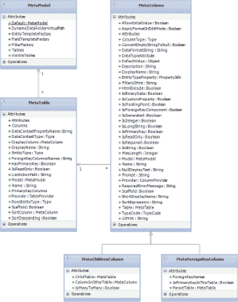

**图 7.1** 元数据 API 一览。

在最高层级，元数据 API 表示一个*元模型*——特定于 Dynamic Data 的元数据信息。此信息与 Dynamic Data Web 应用程序最为相关，并通过专门为此目的设计的 API（类、属性和方法）公开。然而，在特殊 API 中呈现 Dynamic Data 应用程序所需的*所有*信息，意味着要重新创建 `System.Reflection` 和 `System.ComponentModel` API，这些 API 设计良好且广为人知，即使不太容易使用。相反，Dynamic Data 试图在创建与动态 Web 应用程序相关的 API 和重用现有 .NET 框架 API 之间取得平衡。

下一层级包括由*数据模型*提供的元数据信息。诸如 LINQ to SQL 和 Entity Framework 等数据访问框架提供了可用于发现实体类并访问其数据的元数据信息。Dynamic Data 将这些 API 封装在定义于 `System.Web.DynamicData.Providers` 命名空间中的、与框架无关的*提供程序模型*中。提供程序模型也可以通过元数据 API 使用。然而，这是一个需要特别关注的高级主题。您可以在第 13 章“构建动态列表页面”中找到关于此主题的详细讨论。

在最低抽象层级，是由 .NET 运行时提供的元数据信息。`System` 命名空间中的 `Type` 类提供有关类、属性、方法和特性的信息；它是一个极其强大但低级的工具。`System.ComponentModel` 命名空间中的 `TypeDescriptor` 类在稍高的级别上工作，并内置了对数据注释的理解。然而，直接在一个

## SOAP API 与 REST API

SOAP（简单对象访问协议）和 REST（表述性状态转移）都是流行的 Web 服务通信协议。关于哪一个更好——SOAP 与 REST——的争论在开发者社区中仍然是一个有争议的话题。

让我们来探讨它们，以便您可以决定哪一个最适合您的需求。

- **SOAP：**
  - SOAP 是一种基于 XML 的协议，用于在 Web 服务中交换结构化数据。
  - 它依赖 WSDL（Web 服务描述语言）来描述服务。
  - 它内置了错误处理和安全机制（WS-Security）。
- **REST：**
  - REST 是一种使用标准 HTTP 方法（GET、POST、PUT、DELETE）的架构风格。
  - 它可以返回多种格式的数据，如 JSON、XML 或纯文本。
  - 它以其简单性、可扩展性和性能而著称。

| 功能 | SOAP | REST |
|---------|------|------|
| 协议 | 基于 XML 的协议 | 架构风格（使用 HTTP） |
| 数据格式 | 仅 XML | JSON、XML、HTML、纯文本 |
| 安全性 | WS-Security（内置） | HTTPS（用于传输） |
| 性能 | 较慢（XML 负载较重） | 较快（JSON 轻量） |
| 用例 | 企业、银行、电信 | Web 应用、移动应用、物联网 |

**主要区别：**

- **灵活性：** REST 比 SOAP 更灵活，因为它支持多种数据格式。
- **状态：** SOAP 是无状态的，但 REST 可以是无状态的或有状态的。
- **缓存：** REST 支持广泛的缓存；而 SOAP 不支持。

```
// Example REST request and response
GET /api/users/1 HTTP/1.1
Host: example.com
Accept: application/json

HTTP/1.1 200 OK
{
  "id": 1,
  "name": "John Doe",
  "email": "john@example.com"
}
```

```xml
<!-- Example SOAP request -->
<?xml version="1.0"?>
<soap:Envelope xmlns:soap="http://www.w3.org/2003/05/soap-envelope">
  <soap:Body>
    <GetUser xmlns="http://example.com">
      <ID>1</ID>
    </GetUser>
  </soap:Body>
</soap:Envelope>
```

## MetaModel 类

MetaModel 类充当 Dynamic Data 组件查找表信息的根访问点。特别是，动态 URL 路由功能依赖 MetaModel 来判断传入请求是否有效，并将其路由到适当的页面模板。尽管支持多个实例，但典型的 Dynamic Data 应用程序包含单个 MetaModel，在 Global.asax 中创建并初始化，如下例所示：

```
public class Global : HttpApplication
{
    public static readonly MetaModel DefaultModel = new MetaModel();
    void Application_Start(object sender, EventArgs e)
    {
        DefaultModel.RegisterContext(typeof(NorthwindEntities));
    }
}
```

## 数据模型注册

MetaModel 实例最初是空的，需要调用 RegisterContext 方法之一来用 MetaTable 对象填充它：

```
public void RegisterContext(Type contextType);
public void RegisterContext(Func<object> contextFactory);
public void RegisterContext(DataModelProvider dataModelProvider);
```

在最简单的情况下，您可以通过调用 RegisterContext 方法来初始化 MetaModel，该方法接受一个类型对象，例如刚才示例中的 typeof(NorthwindEntities)。MetaModel 内置了对 Entity Framework 和 LINQ to SQL 的支持，并期望分别派生于 ObjectContext 或 DataContext 的类型。使用此类型，Dynamic Data 会在运行时需要上下文时创建上下文类的新实例。以这种方式注册的任何上下文类都必须具有默认构造函数。

如果您的上下文类没有默认构造函数，或者您需要执行额外的初始化步骤，则可以使用将上下文工厂委托作为参数的 RegisterContext 方法：

```
public static readonly MetaModel DefaultModel = new MetaModel();
void Application_Start(object sender, EventArgs e)
{
    DefaultModel.RegisterContext(this.CreateContext);
}

private object CreateContext()
{
    NorthwindEntities context = new NorthwindEntities();
```


```
context.ContextOptions.LazyLoadingEnabled = true;
return context;
}
```

请注意，这个示例有点刻意，因为你通常更希望依赖 Entity Framework 设计器，它允许你选择默认的延迟加载选项，并将此初始化代码生成为 NorthwindEntities 构造函数的一部分。然而，在 Dynamic Data 应用程序中显式执行此操作也无妨，如果你与其他开发者共享数据模型，而他们更希望默认关闭延迟加载，那么该应用将受益于延迟加载。

当你的应用程序使用除 Entity Framework 或 LINQ to SQL 以外的支持 LINQ 的数据访问框架时，你需要使用接受 DataModelProvider 实例而非上下文类的 RegisterContext 方法。DataModelProvider 是一个对象，它可以从数据模型中提取元数据，并以 Dynamic Data 元数据 API 可以使用的格式提供给该 API。在内部，Dynamic Data 为每种 Entity Framework 和 LINQ to SQL 实现了单独的 DataModelProvider，并使你能够创建自己的提供程序来支持第三方框架，例如 SubSonic、LightSpeed 和 LinqConnect。

除了这里讨论的 RegisterContext 方法的三种重载之外，MetaModel 类还包括第二组类似的方法，每个方法都有两个参数，其中第二个参数是 ContextConfiguration 对象。在应用程序的初始开发阶段，你通常会使用这些方法，使模型中的所有表默认可见：

```
public static readonly MetaModel DefaultModel = new MetaModel();
void Application_Start(object sender, EventArgs e)
{
    var configuration = new ContextConfiguration();
    configuration.ScaffoldAllTables = true;
    DefaultModel.RegisterContext(typeof(NorthwindEntities), configuration);
}
```

将这段代码保留在生产应用程序中可能不是一个好主意，在生产应用中，你通常希望将用户界面限制为仅包含你确实希望用户访问的那些表，以防止混淆和意外的数据损坏。

## 访问 MetaTable 对象

当调用 RegisterContext 方法时，MetaModel 会使用数据模型提供程序来获取数据模型支持的表的信息，并创建 MetaTable 对象来表示这些表。注册完成后，你可以使用许多不同的属性和方法来访问这些表：

```
public ReadOnlyCollection<MetaTable> Tables { get; }
public List<MetaTable> VisibleTables { get; }
```

如果你需要访问所有表的列表，可以使用 Tables 属性。它是一个 MetaTable 实例的只读集合，你可以使用 foreach 循环遍历它，或使用 LINQ to Objects 进行查询。如果你只对当前用户可见的表感兴趣，可以使用 VisibleTables 属性。

> 注意
> 
> MetaModel 类的 VisibleTables 属性返回一个只读的表列表，尽管其类型是 List<MetaTable>，这暗示了可以更改它。你对 VisibleTables 列表所做的任何更改都会被忽略，你应该将其视为只读集合。

请记住，在运行时遍历表列表可能代价较高，因此如果需要特定表，请改用 MetaModel 类为此目的提供的方法之一：

```
public MetaTable GetTable(string uniqueTableName);
public MetaTable GetTable(Type entityType);
```

接受包含表名称的字符串的 GetTable 方法是从 MetaModel 中检索特定表的最有效方式。此方法从 MetaModel 内部维护的表名和对象字典中检索 MetaTable。在构建不依赖动态数据 URL 路由的自定义页面时，你通常会使用这些方法之一：

```
MetaTable table = Global.DefaultModel.GetTable("Products");
MetaTable table = Global.DefaultModel.GetTable(typeof(Product));
```

尽管使用接受实体类型的 GetTable 重载更优雅（因为它允许你避免使用硬编码字面量或字符串常量来指定表名），但实际上效率较低，因为它会遍历整个表列表以找到类型匹配的表。虽然单次表查找的性能影响可能不明显，但请记住，随着你的数据模型变得更加复杂以及访问应用程序的用户数量增加，这种影响会迅速增大。

> 注意
> 
> GetTable(string) 方法也被 DynamicDataRouteHandler 在将动态 URL 路由到页面模板时使用。它会从 URL 中提取表名，调用 MetaModel 的 GetTable 方法，并将返回的 MetaTable 对象存储在 HttpContext 的 Items 字典中。如果你只需要当前请求的 MetaTable 对象，最快的方式是调用 DynamicDataRouteHandler 类的静态 GetRequestMetaTable 方法，如下所示：
> 
> MetaTable table = DynamicDataRouteHandler.GetRequestMetaTable(Page.Context);

如果你指定的表名称或类型不属于当前 MetaModel，GetTable 方法会抛出 ArgumentException。在代码预期可能找不到表的少见情况下，你可以改用 TryGetTable 方法：

```
public bool TryGetTable(string uniqueTableName, out MetaTable table);
public bool TryGetTable(Type entityType, out MetaTable table);
```

TryGetTable 方法返回一个布尔值，指示是否找到了该表。MetaTable 本身通过第二个输出参数返回。如果方法返回 false，它将为 null。这遵循了常见的 .NET 模式，并模拟了泛型 Dictionary 类的 TryGetValue 方法：

```
MetaTable table;
if (Global.DefaultModel.TryGetTable("Products", out table))
{
    // 在这里使用该表 ...
}
```

## 全局模型注册

默认情况下，当创建新的 MetaModel 实例时，它会全局注册，使其可通过 MetaModel 类的 Default 属性以及其 GetModel 方法使用。两者都是静态的，因此模型可用于 Web 应用程序中的任何页面或控件：

```
public static MetaModel Default { get; }
public static MetaModel GetModel(Type contextType);
```

Default 属性提供了一种与应用程序无关的方式来访问默认模型，你通常可以通过 Global.asax.cs 中定义的 Global 类的 DefaultModel 属性来获得它。换句话说，在典型应用程序中，以下几行代码会产生相同的结果：

```
MetaModel model = Global.DefaultModel;
MetaModel model = MetaModel.Default;
```

当多个数据上下文已注册到 Dynamic Data 时，你还可以使用 MetaModel 类的静态 GetModel 方法，通过其上下文类型检索全局注册的 MetaModel：

```
MetaModel model = MetaModel.GetModel(typeof(NorthwindEntities));
```

在与多个数据库交互并具有多个模型的大型 Web 应用程序中使用 Dynamic Data 时，你可能希望避免全局注册，以减少应用程序不同部分相互影响的可能性。为此，MetaModel 类提供了一个接受布尔值作为参数的重载构造函数。向此构造函数传递 false 可防止模型被全局注册：

```
public MetaModel(bool registerGlobally);
```

## 脚手架支持

`MetaModel` 类的几个属性与元数据无关，而是为 Dynamic Data 应用程序使用的不同模板类型提供动态脚手架支持：

```csharp
public IFieldTemplateFactory FieldTemplateFactory { get; set; }
public EntityTemplateFactory EntityTemplateFactory { get; set; }
public FilterFactory FilterFactory { get; set; }
```

`FieldTemplateFactory` 属性获取或设置负责创建字段模板的对象。`EntityTemplateFactory` 负责创建实体模板，而 `FilterFactory` 负责创建筛选器模板。这三个属性都是可写的，允许你在内置工厂功能不足时替换它们。

这种替换会很有益的一个具体例子是内置筛选器工厂的局限性，它仅支持布尔、外键和枚举筛选器。然而，这个主题值得大量关注，将在第 13 章中再次讨论。

```csharp
public string DynamicDataFolderVirtualPath { get; set; }
```

`DynamicDataFolderVirtualPath` 属性确定模板工厂查找模板的位置。默认情况下，此属性设置为 "~/DynamicData"，但如有需要，可以更改为其他位置。

## MetaTable 类

`MetaTable` 类的主要目的是帮助页面模板为数据模型中的不同实体生成用户界面。单个 `MetaTable` 实例描述整个实体类，包括其类型、属性、特性、表示、数据访问逻辑和安全权限。

## 实体定义

模型中的每个表都由一个名称标识，你可以使用 `MetaTable` 类的 `Name` 属性访问该名称：

```csharp
public string Name { get; }
```

表名通常与查询数据时常用的对象上下文属性的名称匹配。在 NorthwindEntities 上下文类中，你使用 `Products` 属性从 Products 数据库表中检索 Product 实体类的实例。描述 Product 实体的 `MetaTable` 实例的名称将为 Products，与 NorthwindEntities 属性的名称相同。


你可以使用 MetaTable 类的 Columns 属性访问表列的列表：

```
public ReadOnlyCollection<MetaColumn> Columns { get; }
public MetaColumn GetColumn(string columnName);
public bool TryGetColumn(string columnName, out MetaColumn column);
```

Columns 属性返回一个只读 MetaColumn 对象的集合，这些对象将在本章后面详细讨论。当你需要在运行时获取特定的表列时，最有效的方法是调用 GetColumn 或 TryGetColumn 方法，这些方法利用了 MetaTable 类维护的列内部字典。这比典型的 foreach 循环快得多，在 CPU 是宝贵资源的 Web 应用程序中，这总是件好事。正如你所期望的，如果找不到指定名称的列，GetColumn 方法会抛出异常，而 TryGetColumn 方法则返回 false 且不抛出异常：

```
public TableProvider Provider { get; }
```

各个列对象由 MetaTable 使用表提供程序返回的定义创建，后者从底层数据访问框架中提取信息。虽然通常你应该能够直接通过 MetaTable 和 MetaColumn 对象获取所需的一切，但你也可以选择通过 MetaTable 类的 Provider 属性访问用于创建和配置表的原始提供程序：

```
public Type EntityType { get; }
```

MetaTable 类的 EntityType 属性返回一个 Type 对象，该对象描述实体类，例如 Product。Type 类提供了对描述实体类的 .NET 运行时元数据的访问，包括其属性、方法、事件等。与 MetaTable 类本身相比，通过 Type 类可用的信息非常底层，在 Dynamic Data 应用程序中你很少需要使用它：

```
public Type RootEntityType { get; }
```

另一方面，RootEntityType 属性返回一个 Type 对象，该对象描述实体的根基类。在 NorthwindEntities 数据模型中没有此示例，深入探讨该主题将超出本书范围，但你可以想象一个 CRM 系统，其中实体类 Prospect 和 Customer 从名为 Contact 的公共基类派生。在此场景中，描述 Customer 实体的 MetaTable 将返回 typeof(Customer) 作为 EntityType，并返回 typeof(Contact) 作为 RootEntityType。

> **NOTE**
>
> 在使用派生实体类时，请记住数据模型生成的上下文类没有用于查询 Customers 的单独属性，也没有用于查询 Prospects 的另一个属性。这改变了 Dynamic Data 确定描述这些实体的 MetaTable 实例名称的方式。对于 Contact 这样的基类，MetaTable 名称将是 Contacts，复数形式。然而，对于 Prospect 这样的派生类，MetaTable 名称将是 Prospect，单数形式。

## 数据注释

Entity Framework 和 LINQ to SQL 使用的实体类可以用多种不同的 .NET 属性进行装饰。其中一些属性对 Dynamic Data 有特殊含义，并在 MetaTable 类中表示为不同的属性：

```
public virtual bool Scaffold { get; }
```

MetaTable 类的 Scaffold 属性决定表是否会在 Dynamic Data 生成的页面中可见（或被脚手架化）。这不仅包括仅显示所有表列表的默认主页面，还包括可能包含指向特定表的超链接的页面。例如，如果 Suppliers 表未被脚手架化，你将无法从 Product 详细信息页面导航到它：

```
using System.ComponentModel.DataAnnotations;

[ScaffoldTable(false)]
partial class Supplier { }
```

默认情况下，Scaffold 属性的值由用于注册上下文的 ContextConfiguration 对象的 ScaffoldAllTables 属性的值决定。然而，它也可以通过将 ScaffoldTableAttribute 应用于特定实体类（如上所示）来修改：

```
public virtual bool IsReadOnly { get; }
```

MetaTable 类的 IsReadOnly 属性决定用户是否允许修改它。Visual Studio 中 Dynamic Data 项目创建的页面模板使用此属性隐藏通常允许用户插入、修改和删除表行的链接：

```
using System.ComponentModel;

[ReadOnly(true)]
partial class Supplier { }
```

默认情况下，对于没有主键的表，IsReadOnly 属性返回 true，如果 MetaTable 表示为数据库视图创建的实体类，则可能出现这种情况，对于该视图，Entity Framework 和 LINQ to SQL 无法自动确定主键列。你也可以将 ReadOnlyAttribute 应用于实体类（如上所示），以根据需要显式指定值：

```
public virtual string DisplayName { get; }
```

MetaTable 类的 DisplayName 属性决定当动态生成的网页需要表的可读名称时，Dynamic Data 页面模板显示的文本。默认情况下，DisplayName 属性返回与 Name 属性相同的值。然而，如果表名不友好，例如 Northwind 数据库中的 `Order_Details` 表，可以通过将 DisplayNameAttribute 应用于实体类（如此处所示）来更改它：

```
using System.ComponentModel;

[DisplayName("Order Items")]
partial class Order_Detail { }
```

最后，MetaTable 类有一组三个属性，用于确定从数据库表中检索的实际数据应如何由 Dynamic Data 生成的用户界面元素显示：

```
public virtual MetaColumn DisplayColumn { get; }
public virtual MetaColumn SortColumn { get; }
public virtual bool SortDescending { get; }
```

DisplayColumn 属性返回一个 MetaColumn 对象，该对象表示允许用户识别特定实体实例或表行的属性的值。在 Northwind 数据库场景中，对于 Supplier 实体类，这通常是 CompanyName 属性；对于 Product 实体类，则是 ProductName。只读 ForeignKey 字段模板使用 DisplayColumn 为其生成的超链接提供文本，以便在 Product 详细信息页面上显示 Supplier 的联系人名称。

SortColumn 属性返回一个应默认用于对从数据库检索的项目进行排序的 MetaColumn，而 SortDescending 属性指示行应按 SortColumn 值的升序还是降序排序。ForeignKey_Edit 字段模板使用这些属性对生成的下拉列表控件中的项目进行排序，使 Suppliers 按其 CompanyName 的顺序出现：

```
using System.ComponentModel.DataAnnotations;

[DisplayColumn("CompanyName", "CompanyName", false)]
partial class Supplier { }
```

默认情况下，MetaTable 使用启发式算法来猜测正确的显示列。这三个属性 DisplayColumn、SortColumn 和 SortDescending 也可以通过将 DisplayColumnAttribute 应用于实体类（如上所示）来显式指定。其构造函数接受显示列的名称、排序列的名称以及一个布尔值，该值指示是否应按降序执行默认排序。

## 数据访问支持

除了元数据信息之外，MetaTable 类在实现 Dynamic Data Web 应用程序中的数据访问逻辑方面也发挥着重要作用：

```
public Type DataContextType { get; }
public string DataContextPropertyName { get; }
```

MetaTable 类的 DataContextType 属性返回一个 Type 对象，该对象表示数据模型生成的数据上下文类。该类通常派生自 Entity Framework 中的 ObjectContext 基类和 LINQ to SQL 中的 DataContext 类。DataContextPropertyName 属性返回用于查询表行的属性的名称，例如 NorthwindEntities 对象上下文中的 Products 属性。在运行时，此信息由页面模板中的 DynamicDataManager 控件使用，以配置负责检索实体数据并将更改保存到数据库的 EntityDataSource 和 LinqDataSource 控件。

> **NOTE**
>
> DataContextType 是 MetaTable 类的属性而不是 MetaModel 属性这一点很重要。单个 MetaModel 实例可以通过对 RegisterContext 方法的单独调用注册来自不同数据上下文的表。如果不同上下文具有同名的表，你的代码需要通过将上下文类型传递给 MetaModel 类的 GetTable 方法，连同表名一起，来区分它们。

正如我们讨论 MetaModel 类的 RegisterContext 方法时可能回忆到的，如果对象上下文需要额外的初始化任务，你可以在注册时提供一个工厂方法，而不是简单地提供其类型：

```
public virtual object CreateContext();
```

MetaTable 类的 CreateContext 方法负责创建上下文对象，要么通过创建已注册类型的实例，要么通过调用上下文工厂方法，如果上下文就是这样与 MetaModel 注册的：

```
public IQueryable GetQuery();
public virtual IQueryable GetQuery(object context);
```

MetaTable 类还提供了两个重载的 GetQuery 方法，可用于动态查询任何表。这就是 ForeignKey_Edit 字段模板填充其下拉列表控件的方式。这些方法返回一个 LINQ IQueryable 对象，你可以使用它从数据库中检索行。第 14 章“Implementing Security”讨论了如何重写 GetQuery 方法来实现行级安全性。


当用户点击某个动态超链接时，页面模板通常需要从请求查询字符串中提取列值。这一操作通过 GetColumnValuesFromRoute 方法完成，该方法用于列表页模板；而 GetDataKeyFromRoute 方法则对单项模板执行相同的操作。

```
public virtual string GetDisplayString(object row);
```

当需要表示某行或某个实体的可读字符串时，可以使用 GetDisplayString 方法。ForeignKey 字段和筛选模板正是通过该方法为其 DropDownList 控件中的 ListItem 对象设置 Text 属性。该方法会考虑 MetaTable 的 DisplayColumn，以定位其值将用作显示字符串的列。

```
public string GetPrimaryKeyString(IList<object> primaryKeyValues);
public string GetPrimaryKeyString(object row);
```

如果需要使用某个字符串来唯一标识实体，以便日后从数据库检索该实体，可以使用 GetPrimaryKeyString 的重载之一。ForeignKey 字段和筛选模板正是通过这种方式为其 DropDownList 控件中的 ListItem 对象生成 Value 属性。

## 安全支持

最后但同样重要的是，MetaTable 类包含一组可用于实现表级授权的虚拟方法。这些方法的默认实现返回 true，因此只要表已搭建，所有用户都可以访问所有表。第 14 章将讨论 Dynamic Data 应用程序如何利用这一扩展机制来实现基于角色的 UI 裁剪：

```
public virtual bool CanDelete(IPrincipal principal);
public virtual bool CanInsert(IPrincipal principal);
public virtual bool CanRead(IPrincipal principal);
public virtual bool CanUpdate(IPrincipal principal);
```

## MetaColumn 类

MetaColumn 类描述实体类的单个属性。在 Northwind 数据模型中，Product 实体类表示 Products 数据库表，Dynamic Data 会为 Product 实体类定义的每个属性创建单独的 MetaColumn 类实例，包括基本属性（如 ProductID、ProductName、CategoryID 和 SupplierID）以及导航属性（如 Category 和 Supplier）。

实体类的导航属性由继承自 MetaColumn 类的 MetaForeignKeyColumn 和 MetaChildrenColumn 类表示。这些类将在本章后续部分讨论；本节重点介绍所有元列及其专用派生类的常见属性。

## 属性定义

.NET 属性由其名称、类型以及 getter 和 setter 的可访问性来定义。

```csharp
public string Name { get; }
```

MetaColumn 类的 Name 属性返回实体属性的名称。它是一个原始的内部字符串，可用于标识该列，但可能不适合直接展示给最终用户。

```csharp
public Type ColumnType { get; }
public TypeCode TypeCode { get; }
```

ColumnType 属性返回一个 Type 对象，表示实体属性的 .NET 类型。对于 Product 实体的 ProductName 属性，该值将是 typeof(string)。而 TypeCode 属性则返回 TypeCode 枚举的成员之一，对于 ProductName 列，该值将是 TypeCode.String。

```csharp
public bool IsBinaryData { get; }
public bool IsFloatingPoint { get; }
public bool IsInteger { get; }
public bool IsLongString { get; }
public bool IsString { get; }
```

还提供了一组便捷属性，用于确定属性数据类型的高层级分组。例如，IsFloatingPoint 属性对于 Float、Double 和 Decimal 列返回 true；IsInteger 属性对 Byte、Int16、Int32 和 Int64 列也有类似作用。如果字符串的 MaxLength 超过十亿个字符（确切地说是 1,073,741,819），IsLongString 属性将返回 true。实际上，这意味着 memo 列（Microsoft SQL Server 中的 TEXT 和 NTEXT），并决定默认情况下是否为此列使用 MultiLineText 字段模板。

```csharp
public int MaxLength { get; }
```

对于二进制列和字符串列，MaxLength 属性返回数据模型中列值允许的最大长度。例如，Products 表的 ProductName 列限制为 40 个字符，MaxLength 属性默认将返回 40。

```csharp
using System.ComponentModel.DataAnnotations;

[MetadataType(typeof(Product.Metadata))]
partial class Product
{
    public class Metadata
    {
        [StringLength(32)]
        public object ProductName { get; set; }
    }
}
```

不过，也可以通过代码中向实体属性应用 StringLengthAttribute 来更改 MaxLength 属性，如上所示。

```csharp
public virtual bool IsReadOnly { get; }
```

如果实体属性值无法由用户设置，MetaColumn 类的 IsReadOnly 属性返回 true。如果属性的 setter 不可访问或不存在，则该属性可能是只读的。后一种情况不适用于由 Entity Framework 和 LINQ to SQL 生成的实体类，这些类中的属性必须具有 setter，框架才能根据从数据库检索到的信息设置其值。然而，这两种框架都支持较低可见性（protected 或 internal）的属性 setter。

除了更改模型中实体属性的定义外，还可以通过应用 System.ComponentModel.DataAnnotations 命名空间中定义的 EditableAttribute 来使其成为只读。

```csharp
using System.ComponentModel.DataAnnotations;
```

```csharp
[MetadataType(typeof(Product.Metadata))]
partial class Product
{
    public class Metadata
    {
        [Editable(false)]
        public object ProductName { get; set; }
    }
}
```

您还可以通过应用 System.ComponentModel 命名空间中定义的 ReadOnlyAttribute 来达到相同的效果，并使属性对于 Dynamic Data 而言为只读。不过，EditableAttribute 还允许提供额外的元数据信息，以便在插入和更新模式下分别允许编辑。

```csharp
public PropertyInfo EntityTypeProperty { get; }
```

MetaColumn 类的 EntityTypeProperty 返回 System.Reflection 命名空间中定义的 PropertyInfo 类的实例。PropertyInfo 包含描述该属性的低级 .NET 元数据。它还允许您通过调用 PropertyInfo 类的 GetValue 和 SetValue 方法动态获取或设置实体属性的值。

```csharp
public ColumnProvider Provider { get; }
```

MetaColumn 类的 Provider 属性返回原始的 ColumnProvider，该提供程序用于根据元数据提供程序从数据模型中提取的信息创建当前 MetaColumn 实例。虽然您通常不需要直接访问底层列提供程序，但可以通过此属性访问它。

## 属性种类

除了实体属性的名称和类型之外，Dynamic Data 还需要知道它是什么种类的属性，也就是说，该属性是否在实体类中扮演特殊角色。

```csharp
public bool IsPrimaryKey { get; }
```

对于属于实体主键一部分的实体属性，MetaColumn 类的 IsPrimaryKey 属性返回 true。如今数据库设计中广泛使用代理主键，因此大多数实体类的主键只有一个属性。不过，也支持复合主键。可以使用 MetaTable 类的 PrimaryKeyColumns 属性快速访问主键列。

> **注意**
> 实体类必须具有主键，Entity Framework 和 LINQ to SQL 才能更新其数据库表中的行。在将现有数据库反向工程为数据模型时，Visual Studio 可以自动确定表的主键，但无法确定视图的主键。如果您的数据模型必须包含视图，则可能需要手动编辑模型以提供有关主键的缺失信息。

```csharp
public bool IsForeignKeyComponent { get; }
```

对于属于一个或多个导航外键属性组成部分的基本属性，MetaColumn 类的 IsForeignKeyComponent 属性返回 true。例如，Product 实体的 SupplierID 属性是 Supplier 导航属性所表示的外键的组成部分，描述 SupplierID 属性的 MetaColumn 对象的 IsForeignKeyComponent 属性返回 true。

外键组件属性在 Dynamic Data 应用程序中具有特殊含义，因为在正常情况下它们不应呈现给用户。提供一个用于以原始整数形式输入 SupplierID 值的 TextBox 并没有多大帮助。相反，导航属性（此处为 Supplier）会以 DropDownList 或其他适当的控件呈现，用户可以通过它们选择供应商，而不必输入其 ID。

```csharp
public bool IsGenerated { get; }
```

MetaColumn 类的 IsGenerated 属性对于其值由数据库服务器自动生成的属性返回 true。对于 Microsoft SQL Server，这包括 IDENTITY 列，服务器会为每一


新行、ROWVERSION 列，服务器会在每次插入和更新时生成递增值，以及数据库表级别定义的计算列。

动态数据始终选择只读字段模板来显示生成的列的值，无论实体本身是以插入模式还是编辑模式显示。

```csharp
public bool IsCustomProperty { get; }
```

MetaColumn 类的 IsCustomProperty 对于开发人员在代码中定义的属性返回 true，而非数据模型本身定义的普通属性。默认情况下，自定义属性不能用于排序或筛选目的。框架也无法验证它们是否正确持久化到数据库中。基于这些原因，动态数据稳妥起见，默认情况下不会为自定义属性创建筛选器或字段控件；尽管可以通过在代码中向属性应用 UIHintAttribute 和 FilterUIHintAttribute 来改变此行为。

> **注意**
>
> 自 .NET 4.0 版 Service Pack 1 起，用于 Entity Framework 的动态数据提供程序不支持自定义属性，你不会找到描述它们的 MetaColumn 对象。这就是为什么不可能将自定义属性用作显示列。如前所述，可以通过扩展元数据提供程序来解决此问题，这将在第 13 章中讨论。

## 数据注释

MetaColumn 公共接口的很大一部分专门用于数据注释——开发人员可以在代码中应用于实体属性的 .NET 特性。

```csharp
public AttributeCollection Attributes { get; }
```

应用于特定实体属性的所有特性都可以通过 MetaColumn 类的 Attributes 属性访问。与 MetaTable 类的 Attributes 属性类似，此属性也包括来自 System.ComponentModel 和 System.ComponentModel.DataAnnotations 命名空间的内置特性，以及你在应用程序中可能创建的任何自定义特性。

尽管可以直接通过 Attributes 集合获取所有数据注释，但这样做需要反复扫描它，这会迅速耗尽你的 Web 服务器宝贵的 CPU 资源。相反，动态数据仅在创建 MetaColumn 对象时扫描一次特性，并将它们的值存储在对象的字段中，以便以后即时访问。

## 脚手架支持

多个数据注释和 MetaColumn 属性在脚手架过程中扮演重要角色，在这个过程中，动态数据确定特定列是否需要在页面上由字段或筛选器控件表示，以及如何选择该控件的模板。

```csharp
public virtual bool Scaffold { get; set; }
```

MetaColumn 类的 Scaffold 属性确定动态数据是否会为其表示的实体属性生成字段模板。默认情况下，对于自动生成的、自定义的以及作为外键一部分的基元属性，Scaffold 返回 false。你可以通过应用 ScaffoldColumnAttribute 或指定 AutoGenerateField 属性值的 DisplayAttribute 来更改此属性的默认值。

```csharp
public virtual string UIHint { get; }
```

MetaColumn 类的 UIHint 属性返回动态数据在为实体属性生成控件时首先尝试的字段模板的名称。除非你在代码中向实体属性应用 UIHintAttribute，否则 UIHint 属性返回空字符串。

```csharp
public DataTypeAttribute DataTypeAttribute { get; }
```

DataTypeAttribute 属性返回在代码中应用于实体属性的 DataTypeAttribute。UIHint 和数据类型优先于动态数据在搜索适当字段模板时尝试的基于 .NET 类型的更通用的模板名称。

```csharp
public string FilterUIHint { get; }
```

FilterUIHint 属性与 UIHint 类似，但指定筛选器模板的名称。默认情况下它也返回空字符串，可以通过向实体属性应用 FilterUIHintAttribute 来指定。动态数据在生成筛选器控件时使用筛选器提示，通常作为 List 页面模板中 QueryableFilterRepeater 的一部分。

```csharp
public bool AllowInitialValue { get; }
```

MetaColumn 的 AllowInitialValue 属性确定实体属性是否可以在插入模式下输入值。对于生成的属性和只读属性，AllowInitialValue 返回 false。你也可以通过向实体属性应用指定了 AllowInitialValue 值的 EditableAttribute 来覆盖它。

## 业务逻辑支持

MetaColumn 类的几个属性为基于数据注释的业务逻辑提供支持。这个数字小得令人惊讶，因为它只涵盖了第 3 章“字段模板”中讨论的三个特性。

```csharp
public object DefaultValue { get; }
```

MetaColumn 类的 Description 属性返回通过在代码中向实体属性应用 DescriptionAttribute 所指定的描述。动态数据提供的内置字段模板当前不使用此属性。但是，你可以轻松修改它们，并使用此属性为字段模板中的数据控件生成工具提示。

## 格式化选项

最后值得提及的数据注释属性是与格式化选项相关的属性，可以通过向实体属性应用 DisplayFormatAttribute 来指定这些选项。DynamicControl 和 DynamicField 控件使用这些属性来实现灵活且一致的字段值格式。

```csharp
public string DataFormatString { get; }
```

DataFormatString 属性返回一个包含 .NET 格式字符串（如 "{0:C}"）的字符串，该字符串将用于通过调用 String 类的 Format 方法将字段值转换为字符串。尽管包含参数编号 0 似乎没有必要，因为只有一个字段值要格式化，但它是格式字符串正常工作的必要条件。

```csharp
public bool ApplyFormatInEditMode { get; }
```

ApplyFormatInEditMode 属性确定动态数据是否不仅会在 List 和 Details 页面的只读模式下使用 DataFormatString，还会在编辑模式下使用。

```csharp
public string NullDisplayText { get; }
```

NullDisplayText 属性指定当字段值为 null 时动态数据将显示的文本。

```csharp
public bool ConvertEmptyStringToNull { get; }
```

ConvertEmptyStringToNull 属性确定 NullDisplayText 是否也将用于空字符串。

```csharp
public bool HtmlEncode { get; }
```

HtmlEncode 属性确定字段值中可能包含的任何特殊字符是否将使用 HTML 转义序列进行编码。此属性默认为 true，使动态生成的页面免受 HTML 注入攻击。只有当你的应用程序允许用户以 HTML 表单输入格式化文本，并在保存到数据库之前对用户输入的值进行彻底清理以删除危险 HTML 标签（如 <script>）时，才应考虑更改它。

## MetaForeignKeyColumn 类

MetaForeignKeyColumn 类是 MetaColumn 类的专用后代，表示多对一和一对一导航属性，例如 Northwind 数据模型中 Product 实体的 Supplier 属性。动态数据元数据 API 中的这些“外键”列具有可以通过此类访问的附加属性。

```csharp
public MetaTable ParentTable { get; }
```

ParentTable 属性返回一个 MetaTable 对象，该对象描述外键引用的父实体。对于 Product 实体的 Supplier 属性，ParentTable 属性返回描述 Supplier 实体的 MetaTable 对象。此属性在实现筛选和导航功能方面发挥重要作用。特别是，ForeignKey 字段和筛选器模板使用它从父表中检索行，以下拉列表的形式显示。

```csharp
public ReadOnlyCollection<string> ForeignKeyNames { get; }
```

MetaForeignKeyColumn 类的 ForeignKeyNames 属性返回构成外键的基元实体属性的集合。对于 Product 实体的 Supplier 属性，此属性返回一个包含单个列名——SupplierID 的集合。只有当父表具有复合主键并且外键包含多个基元属性时，此属性返回的集合才有多个项。

### 呈现逻辑

MetaForeignKeyColumn 类的其余属性和方法为在动态数据应用程序中实现呈现逻辑提供支持。

```csharp
public bool IsPrimaryKeyInThisTable { get; }
```

MetaForeignKeyColumn 类的 IsPrimaryKeyInThisTable 属性，如果外键的任何基元组件是实体自身主键的成员，则返回 true。例如，Northwind 数据模型中的 Order_Detail 实体有一个由 OrderID 和 ProductID 属性组成的复合主键。Order 导航属性由 MetaForeignKeyColumn 表示，其 IsPrimaryKeyInThisTable 返回 true，因为 OrderID 是 Order_Detail 实体主键的一部分。

> **注意**
>
> 默认情况下，动态数据不允许编辑主键值，并使用 IsPrimaryKeyInThisTable 属性在编辑模式下为属于主键一部分的外键列显示只读字段模板。

```csharp
public IList<object> GetForeignKeyValues(object row);
```


The GetForeignKeyValues method of the MetaForeignKeyColumn class returns a list of values of the primitive entity properties that form the foreign key of a given row or entity instance. 以 Northwind 数据库的 Products 表为例，名为“Chai”的产品其 SupplierID 等于 1；对该行调用 GetForeignKeyValues 方法会返回一个包含单个 Int32 值（1）的列表。 该方法返回的值顺序与 ForeignKeyNames 属性返回的列名顺序相匹配。

```
public string GetForeignKeyPath(string action, object row);
public string GetForeignKeyPath(string action, object row, string path);
```

MetaForeignKeyColumn 类的 GetForeignKeyPath 方法通过调用 GetForeignKeyValues 方法从指定行提取外键值列表，然后将其传递给 ParentTable 的 GetActionPath 方法。 action 参数通常使用 PageAction 静态类中定义的值之一指定。 row 参数是包含外键的实体的实例。 当需要在查询字符串中指定额外的查询参数时，可以指定 path。

与 MetaTable 类的 GetActionPath 方法类似，GetForeignKeyPath 方法用于在需要从子实体导航到父实体的超链接时使用。 这就是只读 ForeignKey 字段模板生成其超链接 URL 的方式。

```
public string GetForeignKeyString(object row);
```

GetForeignKeyString 方法调用 GetForeignKeyValues 方法获取原始外键列的值，并将其转换为字符串，其中各个值用逗号分隔。 对于 Product 实体的 Supplier 外键，这将返回单个 SupplierID 值，例如“Chai”产品的“1”。

该方法作为前面讨论的 MetaColumn 类的 GetPrimaryKeyString 方法的对应方法。 ForeignKey_Edit 字段模板使用 GetPrimaryKeyString 方法为表示来自父表的行的下拉列表项生成值。 为了在下拉列表中选择外键属性的当前值，它调用 GetForeignKeyString 方法。

```
public void ExtractForeignKey(IDictionary dictionary, string value);
```

ExtractForeignKey 方法是 GetForeignKeyString 的相反操作。 它接收一个用逗号分隔的外键值列表并将其提取到字典中。 字段模板使用此方法实现数据绑定逻辑，从其 Web 控件中提取当前外键值并将其传递给数据源控件。 特别是，如果将“Exotic Liquids”选为“Chai”产品的供应商，ExtractForeignKey 方法将接收一个包含供应商 ID 的字符串 - “1”，并将值 1 以键“SupplierID”添加到字典中。

### MetaChildrenColumn 类

MetaChildrenColumn 类是 MetaColumn 类的另一个专用派生类，表示一对多和多对多导航属性。 在一对多关系中，MetaChildrenColumn 是 MetaForeignKeyColumn 的相反项。 例如，Northwind 数据模型的 Supplier 实体有一个名为 Products 的一对多属性，它返回特定供应商提供的所有产品。

```
public MetaTable ChildTable { get; }
```

MetaChildrenColumn 类的 ChildTable 属性返回一个描述由导航属性引用的子实体的 MetaTable 对象。 对于 Supplier 实体的 Products 属性，子实体是 Product，MetaChildrenColumn 对象的 ChildTable 属性将返回 Products MetaTable。

```
public bool IsManyToMany { get; }
```

IsManyToMany 属性如果列表示多对多关系则返回 true，如果关系是一对多则返回 false。 在 Northwind 数据模型中，Employee 实体与 Territory 之间存在多对多关系，描述 Territories 列的 MetaChildrenColumn 实例的 IsManyToMany 属性设置为 true。

> **NOTE**
> LINQ to SQL 不原生支持多对多关联。对于描述 LINQ to SQL 数据模型的列，IsManyToMany 属性始终为 false。

```
public MetaColumn ColumnInOtherTable { get; }
```

MetaChildrenColumn 类的 ColumnInOtherTable 属性返回一个表示关联另一端的 MetaColumn 对象。 对于 Supplier 实体的 Products 属性，此属性返回一个表示 Product 实体的 Supplier 属性的 MetaColumn。

如果子列表示一对多导航属性，例如 Supplier 实体的 Products 属性，其对应项是 Product 实体的 Supplier 属性，则此属性可以返回 MetaForeignKeyColumn 对象。 如果子列表示多对多导航属性，例如 Employee 实体的 Territories 属性，其对应项是 Territory 实体的 Employees 属性，则它也可以返回 MetaChildrenColumn 对象。 如果导航属性表示单向关联，即子导航属性在另一侧没有对应项，则此属性也可以返回 null。

```
public string GetChildrenPath(string action, object row);
public string GetChildrenPath(string action, object row, string path);
```

MetaChildrenColumn 类的 GetChildrenPath 方法用于在需要从父实体导航到其子实体的超链接时使用。 它们从指定行检索主键值并将其传递给 ChildTable 的 GetActionPath 方法。 生成的 URL 包含到子表的路由，包括基于指定操作的页面模板名称以及查询中的主键名称和值。 这就是 Children 字段模板生成超链接的方式，该超链接将用户从父实体带到按父主键过滤的子实体的列表页。

### 摘要

Dynamic Data 元数据 API 提供了 Web 应用程序动态生成页面所需的信息。 MetaModel 类用作注册数据模型和访问元数据的入口点。 MetaTable 类将单个实体描述为属性的集合，例如 DisplayName 和 SortColumn，以及描述实体属性的 MetaColumn 对象的集合。 MetaColumn 类描述原始实体属性，并有两个派生类——MetaForeignKeyColumn，描述多对一和一对一导航属性；以及 MetaChildrenColumn，描述一对多和多对多导航属性。

Dynamic Data 中的元数据 API 依赖于元数据提供程序，这些提供程序是专门设计用于从底层数据访问框架中提取元数据信息并以统一格式呈现给元模型类的特殊类。 Dynamic Data 附带了 Entity Framework 和 LINQ to SQL 的内置提供程序，并允许为其他数据访问框架创建自定义提供程序。

## 第二部分：实际应用中的 Dynamic Data

**本部分内容**

| Chapter | Title | Page |
|---|---|---:|
| CHAPTER 8 | 实现实体验证 | 217 |
| CHAPTER 9 | 实现业务逻辑 | 263 |
| CHAPTER 10 | 构建自定义表单 | 309 |
| CHAPTER 11 | 构建动态表单 | 349 |
| CHAPTER 12 | 构建自定义搜索页面 | 395 |
| CHAPTER 13 | 构建动态列表页面 | 421 |
| CHAPTER 14 | 实现安全性 | 455 |

*此页特意留空*

## 第8章：实现实体验证

**本章内容**

- 验证框架
- 自定义 Entity Framework 代码生成
- 自动化测试
- 声明式验证
- 命令式验证
- 验证多个规则
- 验证实体状态更改

实体的验证是业务逻辑的关键方面之一。 .NET Framework 在 3.5 版本的 Service Pack 1 中引入了新的验证框架，与此同时 Dynamic Data 的第一个版本发布了。 该框架实现在 System.ComponentModel.DataAnnotations 命名空间中，包含用于验证对象及其属性的一组属性和类。

Data Annotations 命名空间定义在名为 System.ComponentModel.DataAnnotations 的单独程序集中，已安装在全局程序集缓存中。 创建 Visual Studio 中的新 Dynamic Data 项目时默认引用此程序集。 但是，如果你的实体类位于单独的项目中，请确保该项目也引用此程序集。

### 验证框架

验证框架的核心是一个名为 ValidationAttribute 的抽象基类。 它定义了一个名为 IsValid 的虚方法，该方法接收要验证的对象，如果有效则返回 true，否则返回 false。 此类的具体派生类，例如 RequiredAttribute，重写 IsValid 方法以执行实际验证。

验证属性应用于它们验证的事物，例如属性、字段或整个类。 请考虑以下示例，它定义了一个简单的 Product 实体类，其中有一个名为 ProductName 的必需属性：


```csharp
public class Product
{
    [Required]
    public string ProductName { get; set; }
}
```

.NET 运行时不会自动调用验证特性。应用程序中的某些代码必须检测这些特性并显式调用验证逻辑。您可能还记得第 3 章“字段模板”和第 6 章“页面模板”中的讨论，在 ASP.NET Dynamic Data 应用程序中，当 DynamicValidator 控件用于字段模板并且其 ColumnName 属性指定了已应用验证特性的实体属性的名称时，DynamicValidator 负责执行此操作。

数据注释（Data Annotations）命名空间还提供了一个名为 Validator 的辅助类，它利用 .NET 反射，根据应用于类及其各个属性的验证特性来验证任意对象。下面演示如何验证我们刚刚定义的 Product 实体类的实例：

```csharp
var product = new Product();
var context = new ValidationContext(product, null, null);
Validator.ValidateObject(product, context, true);
```

ValidationContext 对象包含有关正在验证的对象的信息。ValidateObject 方法会将该对象以及要验证的属性值传递给每个验证特性。ValidationContext 允许实现不限于单个属性值的复杂验证逻辑。以下是在前面的示例中用于创建此对象的构造函数：

```csharp
ValidationContext(object instance, IServiceProvider serviceProvider,
IDictionary<object, object> items)
```

第一个参数 instance 是要验证的对象。构造函数的第二个参数 serviceProvider 和第三个参数 items 用于高级场景，其中一些场景将在后文讨论。对于简单的情况，它们可以为 null。

Validator 类的 ValidateObject 方法将要验证的对象作为第一个参数，并且对于第一个 IsValid 方法返回 false 的验证特性，会抛出 ValidationException。ValidateObject 方法的实际签名如下所示：

```csharp
void ValidateObject(object instance, ValidationContext validationContext,
bool validateAllProperties)
```

与名称所暗示的相反，ValidateObject 方法的 validateAllProperties 参数实际上决定了是评估所有验证特性，还是只评估 RequiredAttribute 的实例。在大多数情况下，您需要指定 true。

> **注意**
>
> 应用于属性和字段的验证特性会在应用于类的特性之前进行评估。但是，您不应依赖这两组内部的验证顺序。.NET Framework 不保证反射 API 返回的属性或特性的顺序与它们在源代码中出现的顺序一致。尽管在许多情况下，验证顺序看起来与特性顺序一致，但也会有例外。如果验证规则的顺序很重要，您需要依赖本章“*命令式验证*”一节中讨论的编码验证，而不是特性。

如果您希望在验证对象时不抛出 `ValidationException`，可以改而调用 `Validator` 类的 `TryValidateObject` 方法：

```csharp
bool TryValidateObject(object instance, ValidationContext validationContext,
    ICollection<ValidationResult> validationResults, bool validateAllProperties)
```

此方法返回一个布尔值，指示对象是否有效，并在您通过 `validationResults` 参数提供的集合中为检测到的每个错误填充一个单独的 `ValidationResult` 对象。

## 验证错误消息

除了执行验证本身之外，验证特性还负责在验证失败时生成错误消息。到目前为止讨论过的每个具体验证特性，如 `RequiredAttribute`，都提供了默认的错误消息。例如，对于下面的 `ProductName` 属性定义，`RequiredAttribute` 会生成一条错误消息：“ProductName 字段是必填字段。”

```csharp
[Required]
public string ProductName { get; set; }
```

显然，这条错误消息非常技术化，可能不适合业务用户。您可以通过应用 `DisplayAttribute`，将错误消息中字段的内部名称替换为其人类可读的形式，如下所示：

```csharp
[Required]
[Display(Name = "Product Name")]
public string ProductName { get; set; }
```

使用更新后的定义，`RequiredAttribute` 会生成错误消息“Product Name 字段是必填字段。”，在许多情况下，此消息都可以直接显示。然而，如果这仍然不够，您可以在验证特性中显式指定 `ErrorMessage` 属性，以完全替换错误消息：

要使用 Resources 类的 ProductNameRequiredErrorMessage 属性来检索错误消息：

```csharp
[Required(ErrorMessageResourceType = typeof(Resources),
    ErrorMessageResourceName = "ProductNameRequiredErrorMessage")]
public object ProductName { get; set; }
```

## Entity Framework 中的验证

从版本 4 开始，Entity Framework 对验证特性的支持有限，需要开发人员做额外的工作。一方面，Entity Data Model 设计器不允许您为实体类及其属性指定数据注释；另一方面，ObjectContext 类在实体保存之前不会对其进行验证。

> **注意**
>
> 在 4.1 版本中，Entity Framework 引入了在保存实体时进行验证的支持。遗憾的是，它还引入了一个全新的 API，该 API 目前与 Dynamic Data 不是 100% 兼容。这些差异要到 .NET Framework 4.5 版本发布后才能完全解决。如果您选择使用这个过渡版本，则需要做出本章讨论的一些相同更改。

## 为实体类指定验证特性

由于 Entity Data Model 设计器会自动生成 .Designer.cs 文件中的实体类，您不能简单地将验证特性直接应用于类和属性；否则下次更新实体模型时它们将被覆盖。相反，应该依靠 C# 和 Visual Basic 中的分部类语法来扩展生成的类。下面的代码显示了 Product 实体类的一个片段，就好像它是由 Entity Framework 生成的，因此其 ProductName 属性没有应用 RequiredAttribute：

```csharp
public partial class Product
{
    public string ProductName { get; set; }
}
```

请注意，该类被声明为 partial。这允许另一个文件扩展生成的类，并应用 MetadataTypeAttribute 来指定一个替代类型，该类型将为生成的类提供验证特性和其他数据注释：

```csharp
using System.ComponentModel.DataAnnotations;

[MetadataType(typeof(Metadata))]
public partial class Product
{
    private abstract class Metadata
    {
        [Required]
        public object ProductName { get; set; }
    }
}
```

从验证的角度来看，将任何 .NET 特性放置在元数据类的字段或属性上，与将它们放置在真实类中对应的字段或属性上具有相同的效果。从匹配的角度来看，只有字段或属性的名称才是重要的，因此元数据类可以将 ProductName 声明为 object 类型的字段，即使它在真实类中是 string 类型的属性。但是，如果元数据类具有一个在真实类中没有同名属性的属性或字段，则每当您第一次尝试访问其特性时（例如将对象传递给 Validator 类的 ValidateObject 方法时），都会收到 InvalidOperationException。

> **注意**
>
> 当分部类只包含一个定义时，编译器不会发出错误，这使得创建与生成的分部类不匹配的分部类变得很容易。您可能会拼错类本身的名称，或者将其放在不同的命名空间中。如果您注意到在元数据类型中应用的其他元数据特性似乎对 Dynamic Data 页面没有影响，请仔细检查所有分部类定义是否匹配，或者更妙的是，创建一个自动化测试来验证这一点，正如您将在本章后面了解到的。

> **注意**
>
> 请注意，Metadata 类是有意设为 abstract、private 和嵌套的。元数据类永远不会由应用程序实例化。除了违反面向对象的设计原则之外，将元数据类设为 public 还会不必要地污染 Visual Studio 中的 IntelliSense 信息。随着应用程序中元数据类数量的增长，这一点会越来越明显。

为了消除为属性指定不同类型所带来的困惑，并避免元数据类中属性名称错误所导致的错误，您可以改用元数据接口。下面是同一个 partial Product 类，使用元数据接口而非元数据类进行扩展：

```csharp
using System.ComponentModel.DataAnnotations;

internal interface IProduct
{
    [Required]
    string ProductName { get; set; }
}
```


```csharp
[MetadataType(typeof(IProduct))]
public partial class Product : IProduct
{
}
```

请注意，Product 类不仅实现了 IProduct 接口，还将其指定为元数据类型。与前一个示例中未类型化的元数据类不同，元数据接口必须声明 ProductName 属性，其类型为 string，以便与真实 Product 类中的实际实现相匹配。如果两者不同步，您会立即得到编译器错误，而不是在运行时出现 InvalidOperationException。

> > **NOTE**
> >
> > 这里讨论的两种元数据类型方法都不完美。嵌套类方法实现了最佳封装；在程序集级别不会引入额外的类型。这有助于减少混淆，并使元数据类无法被误用。接口方法使维护元数据类型变得更容易，但会导致在数据模型程序集中引入额外的接口类型。接口可以声明为 internal，但它们仍会在数据模型程序集本身中可见并可能被误用。最终，是否对数据注释使用嵌套类或接口的决定可能取决于个人喜好。

## 使用 TypeDescriptor 注册元数据提供程序

如果您尝试在与 Dynamic Data Web 应用程序分离的控制台应用程序中编译并运行以下代码，您可能会惊讶地发现使用元数据类应用于 Product 类的 ProductName 属性的 RequiredAttribute 完全被忽略了。而且 ValidateObject 方法不会抛出 ValidationException，正如您所期望的那样：

```csharp
var product = new Product();
var context = new ValidationContext(product, null, null);
Validator.ValidateObject(product, context, true);
```

在幕后，Validator 使用来自 System.ComponentModel 命名空间的静态类 TypeDescriptor 来确定需要验证的对象的每个属性上应用的属性列表。应用于 Product 类的 MetadataTypeAttribute 实际上除非已为特定对象或其整个类配置，否则不会产生任何效果。Dynamic Data 在上下文注册期间会自动为所有实体类执行此操作，但要在其他类型的应用程序中执行验证，您需要通过显式调用 TypeDescriptor 的静态 AddProviderTransparent 方法并传递 AssociatedMetadataTypeTypeDescriptionProvider 类的实例来完成，如下所示：

```
namespace Unleashed.EntityFramework
{
    public class UnleashedObjectContext : ObjectContext
    {
        private const EntityState ChangedEntityStates =
            EntityState.Added | EntityState.Modified | EntityState.Deleted;

        public override int SaveChanges(SaveOptions options)
        {
            IEnumerable<ObjectStateEntry> stateEntries = this.ObjectStateManager
                .GetObjectStateEntries(ChangedEntityStates)
                .Where(stateEntry => !stateEntry.IsRelationship);

            foreach (ObjectStateEntry stateEntry in stateEntries)
                this.BeforeSaveChanges(stateEntry);

            return base.SaveChanges(options);
        }

        private void BeforeSaveChanges(ObjectStateEntry stateEntry)
        {
            if (stateEntry.State != EntityState.Deleted)
                this.Validate(stateEntry);
        }

        private void Validate(ObjectStateEntry stateEntry)
        {
            object entity = stateEntry.Entity;
            var context = new ValidationContext(entity, null, null);
            Validator.ValidateObject(entity, context, true);
        }
    }
}
```

首先，重写的 SaveChanges 方法从跟踪 ObjectContext 中所有实体的 ObjectStateManager 获取所有已更改实体的状态条目列表。对于每个已更改的状态条目，它调用 BeforeSaveChanges 方法，该方法负责在更改保存到数据库之前执行所有需要发生的特定于实体的操作。随着我们继续扩展 Entity Framework 的功能以解决现实世界的业务问题，此方法将会增长。然而，在这一点上，它仅负责已更改实体的验证。Validate 方法从 ObjectStateEntry 中提取实际实体并调用 Validator 类的熟悉的 ValidateObject 方法。如果实体对象无效，ValidateObject 方法会抛出 ValidationException，从而阻止 SaveChanges 方法将更改保存到数据库。

> **NOTE**
> 
> BeforeSaveChanges 方法有意*排除*已删除实体的验证，因为大多数规则不适用且会引起不必要的错误。第 9 章“实现业务逻辑”对此主题进行了详细讨论。

## 自定义 Entity Framework 代码生成

本书随附的示例项目中提供了在列表 8.1 中显示的 UnleashedObjectContext 类。它定义在名为 Unleashed.EntityFramework 的单独程序集中，并包含大量通用代码，任何 Entity Framework 应用程序都可以重用。虽然您可以简单地复制其代码，但您可能希望让 Entity Framework 上下文类，例如正在进行的示例中的 NorthwindEntities，继承自它 instead。这有助于将基础结构代码保留在应用程序之外，即使对于本书中讨论的示例实体模型也是有益的。

对于 Entity Framework 模型开发的数据库优先和模型优先方法，NorthwindEntities 类由 Entity Designer 生成。默认情况下，它继承自 ObjectContext。您无法直接更改其声明，因为任何修改在代码下次重新生成时都会丢失。相反，您需要更改代码生成器本身。本节展示了如何用文本模板替换内置的 Entity Framework 代码，该模板可以自定义以更改代码的生成方式。

> **NOTE**
> 
> 自定义 Entity Framework 生成的代码也可以解决其他常见问题。例如，第 9 章依赖于这种方法来向 Dynamic Data 提供有关实体属性默认值的信息。

## 用文本模板替换内置代码生成器

要替换 Entity Designer 使用的内置代码生成器，请右键单击设计表面并从上下文菜单中选择“添加代码生成项”。在“添加新项”对话框中（见图 8.1），选择 ADO.NET 实体对象生成器，并为其指定与 EDMX 文件名称匹配的名称。

> **NOTE**
> 文本模板的完整讨论超出了本书的范围。您可以在 http://www.olegsych.com/2007/12/text-template-transformation-toolkit 上找到有关此主题的详细信息。

您可以使用任何文本编辑器修改 TT 文件，例如随 Visual Studio 提供的编辑器。为了实现立即更改生成的 NorthwindEntities 基类的目标，请在模板中搜索单词 ObjectContext 并将其替换为 UnleashedObjectContext，如图 8.3 所示。当您保存 TT 文件时，其下的 Northwind.cs 会自动重新生成，并且 NorthwindEntities 类将继承自新的基类。

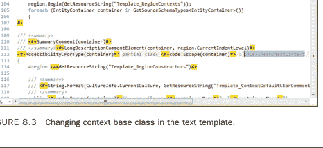

图 8.3 在文本模板中更改上下文基类。

> **NOTE**
> Visual Studio 不为 TT 文件提供颜色语法高亮和 IntelliSense。您可以下载其中一个提供这些功能的第三方插件。图 8.3 显示了可在 http://www.devart.com/t4-editor 下载的 Devart T4 Editor。

## 自定义文本模板以生成静态构造函数

示例解决方案中的 Entity Framework 文本模板已进一步自定义，以自动为每个实体类型生成静态构造函数，如“使用 TypeDescriptor 注册元数据提供程序”部分所述。以下代码现在是生成类的<|message|> 部分，无需手工编码：

```csharp
static Product()
{
    TypeDescriptor.AddProviderTransparent(
        new AssociatedMetadataTypeTypeDescriptionProvider(typeof(Product)),
        typeof(Product));
}
```

图8.4显示了文本模板被修改的位置。注意`WriteStaticConstructor`方法调用被添加到了负责生成实体类型声明的模板代码中。该方法在示例解决方案的Northwind.tt文件中的这个方法的末尾实现。

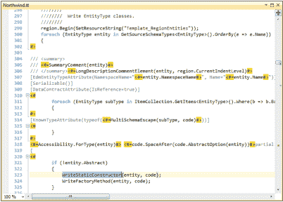

图8.4 在文本模板中生成静态构造函数。

## 自动化测试

由于其重要性和相对较低的变更频率，业务逻辑总体上是自动化测试的理想候选，特别是验证逻辑。将业务逻辑封装在由实体框架部分生成的上下文和实体类中，可以直接在业务层面进行有针对性的测试。与通过用户界面进行测试不同——用户界面测试依赖于特定的表示层（如ASP.NET WebForms），并且通常需要手动测试或使用专用工具——业务层面的测试可以通过应用程序的内部API配合通用框架（如NUnit或Visual Studio单元测试框架）来完成。

自动化测试是你可以用来改进和维护应用程序质量的最强大工具之一。然而，像许多昂贵而强大的工具一样，自动化测试很难经济高效地应用。许多团队和个人开发者尝试过自动化测试，却发现实施和维护测试所需的大量额外工作并不能证明感知到的质量改进是合理的。在许多情况下，这些尝试失败了，因为开发者试图应用那些旨在解决一些大型软件应用程序和框架的算法复杂性的“最佳实践”。这些实践无法缩小到大多数信息系统的需求，这些系统最大的挑战是领域的大小（数据库中的表数量、人工工作流数量等），而不是其单个算法的复杂性。

虽然自动化测试的主题太大，无法在此详细讨论，但本节介绍了一种可以用于开始学习的实用方法。为了强调业务逻辑自动化测试的重要性，并证明其在应用程序开发项目中的实用价值，本章其余部分的代码示例以自动化测试的形式演示了验证逻辑。

### 创建单元测试

要在项目中开始实施自动化测试，首先需要创建一个测试项目。在大多数情况下，你希望自动化测试位于单独的程序集中，以避免将它们部署到生产环境中。本示例使用Visual Studio单元测试框架，该框架在所有版本（Express除外）中均可用。Visual Studio提供了特殊的项目模板，你可以使用图8.5中显示的“添加新项目”对话框来选择它。按照惯例，测试项目与被测项目同名，后跟.Tests后缀。在本例中，被测项目是DataModel，NorthwindEntities上下文类和实体类都定义在该项目中，因此测试项目名为DataModel.Tests。


图8.5 向解决方案中添加新的测试项目。


图8.6 向项目中添加新的单元测试。

现在你可以创建第一个测试（即测试方法），以验证Product实体的UnitPrice属性在实体实例保存到数据库时是必需的。清单8.2展示了此测试的完整实现。如你所见，测试方法名为UnitPrice_IsRequired，其中下划线用作被测属性名称与测试本身描述之间的分隔符。由于你可能针对同一属性拥有多个测试，使用下划线有助于将测试方法组织成逻辑组。

**清单8.2 测试Product实体的必需UnitPrice属性**

```csharp
using System.ComponentModel.DataAnnotations;
using System.Transactions;
using Microsoft.VisualStudio.TestTools.UnitTesting;

namespace DataModel
{
    [TestClass]
    public class ProductTest
    {
        [TestMethod]
        [ExpectedException(typeof(ValidationException))]
        public void UnitPrice_IsRequired()
        {
            using (new TransactionScope())
            using (NorthwindEntities context = new NorthwindEntities())
            {
                var product = new Product();
                product.UnitPrice = null;
                context.Products.AddObject(product);
                context.SaveChanges();
            }
        }
    }
}
```

该测试创建一个新的NorthwindEntities上下文对象，并尝试在没有有效UnitPrice的情况下向数据库提交一个新的Product实例。你期望SaveChanges方法抛出ValidationException，这就是为什么对测试方法应用了ExpectedException属性。如果此测试方法抛出预期的异常，Visual Studio会报告成功。如果测试没有抛出异常或抛出了意外类型的异常，则会报告失败。

你可以借助图8.7所示“测试视图”窗口运行此测试以及此测试项目中定义的所有其他测试。你可以在Visual Studio主菜单的“测试”窗口下找到它。


图8.7 使用“测试视图”窗口运行测试。

测试执行结果显示在“测试结果”窗口中（见图8.8）。


图8.8 在“测试结果”窗口中检查执行结果。

### 测试隔离

封装不良可能导致以前成功完成的测试失败。这是开发人员放弃自动化测试的最常见原因之一。请注意，在清单8.2所示的测试中，围绕NorthwindEntities上下文的TransactionScope是

```csharp
if (memberNames != null && memberNames.Contains(this.MemberName))
    return;

string message = "ValidationException was expected";
message += " with member name " + this.MemberName;
message += ". Instead " + exception.GetType().FullName + " was thrown";
if (memberNames != null && memberNames.Any())
    message += " with member name(s) " + string.Join(", ", memberNames);
message += ".";
throw new AssertFailedException(message);
}
}
```

自定义断言属性继承自基类ExpectedExceptionBaseAttribute，该基类由Visual Studio单元测试框架在Microsoft.VisualStudio.TestTools.UnitTesting命名空间中提供。它定义了一个名为MemberName的属性，该属性指定期望出现ValidationException的属性名称。ExpectedValidationExceptionAttribute还重写了Verify方法，该方法接收测试方法抛出的实际异常，并在实际异常不是ValidationException或指定了意外的MemberName时抛出AssertFailedException。

### 集成测试与单元测试对比

熟悉自动化测试的开发人员会很快指出，使用此处描述的方法创建的测试是集成测试，而不是单元测试。测试纯粹主义者经常对这种将业务和数据访问逻辑一起测试的做法皱眉，理由是测试及其结果的精度、性能和可靠性不高。按照设计，集成测试不如单元测试精确，因为它们涉及多个代码单元，可能无法让你区分由数据访问错误导致的测试失败和由业务逻辑错误导致的测试失败。由于集成测试访问外部数据库，它们比仅访问内存中对象的单元测试慢。如果实现不当，集成测试可能依赖于共享的测试数据，从而导致不正确或不可重复的测试执行结果。

从理论上讲，使用纯单元测试单独测试业务逻辑，与数据访问逻辑分开，可以提高测试的精度、性能和可靠性。采用这种方法，需要用测试替身（如存根或模拟对象）替代数据访问逻辑，使您能够区分业务逻辑错误和数据访问错误。然而，在提高测试精度的同时，也降低了测试覆盖率。仅靠业务逻辑的单元测试，当数据访问层出现问题导致故障时，您无法得知；而在使用对象关系映射器（如实体框架）创建的应用程序中，数据访问层问题更为常见。针对这个问题的规范答案是，除了业务逻辑的单元测试外，您还应该为数据访问创建单元测试。在实践中，使用...创建的自动化测试的数量和复杂性


```csharp
{
    using (new TransactionScope())
    using (var context = new NorthwindEntities())
    {
        var product = new Product();
        product.ProductName = string.Empty;
        context.Products.AddObject(product);
        context.SaveChanges();
    }
}
```

> **注意**
>
> 在动态生成的网页中，`RequiredAttribute` 通常通过由字段模板创建的 `RequiredFieldValidator` 控件来强制实现。

从业务角度来看，要求每个产品都有一个名称，可能意味着该名称不应为空。与可在数据库列定义中使用的 `not null` 约束不同，`RequiredAttribute` 对字符串具有额外的逻辑，它不仅确保字符串值不为 null，还确保字符串不只包含空白字符。如果非 null 的空白字符串也可以作为有效的产品名称，你可以修改属性定义，将 `RequiredAttribute` 的 `AllowEmptyStrings` 属性设置为 true：

```csharp
[Required(AllowEmptyStrings = true)]
public object ProductName { get; set; }
```

有了 `ProductName` 属性的新定义，`RequiredAttribute` 会阻止 null 值，但允许将空字符串作为产品名称。刚刚展示的测试方法将失败，因为 `ProductName` 属性不会引发 `ValidationException`。

> **注意**
>
> 本部分其余部分讨论的所有其他验证属性都将 null 值视为有效值。如果属性不能为 null，则除了可能需要的任何其他验证属性外，还必须在其上放置 `RequiredAttribute` 以防止 null 值。

## RangeAttribute

`RangeAttribute` 验证一个值是否落在特定范围内，更具体地说，即该值大于或等于最小值且小于或等于最大值。在 Product 实体中，除非你付钱给客户让他们把商品拿走，否则 `UnitPrice` 属性不能小于零。你可以通过将 `RangeAttribute` 应用到该属性来实现此业务规则，如下所示：

```csharp
[Required]
[Range(0, int.MaxValue)]
public object UnitPrice { get; set; }
```

以下测试验证了该新业务规则的实现：

```csharp
[TestMethod]
[ExpectedValidationException(MemberName = "UnitPrice")]
public void UnitPrice_MustBeGreaterThanZero()
{
    using (new TransactionScope())
    using (var context = new NorthwindEntities())
    {
        var product = new Product();
        product.UnitPrice = -1;
        context.Products.AddObject(product);
        context.SaveChanges();
    }
}
```

> 注意
> 在动态生成的网页中，RequiredAttribute 通常由字段模板创建的 RangeValidator 控件强制执行。

RangeAttribute 提供了两个强类型构造函数，它们接受 Double 和 Int32 类型的范围值。这些构造函数对于大多数数值数据类型（包括 UnitPrice 属性使用的 Decimal 类型）应该是足够的。除了数值之外，Range 属性还可以验证任何可从字符串转换并实现 IComparable 接口的类型的值，例如 DateTime。下面的 RangeAttribute 验证 Employee 实体的 BirthDate 属性值是否介于 1/1/1900 和 12/31/2050 之间：

```csharp
[Range(typeof(DateTime), "1/1/1900", "12/31/2050")]
public object BirthDate { get; set; }
```

下面的测试方法通过尝试将 BirthDate 属性设置为年份 74 来验证应用于该属性的 RangeAttribute；如果用户界面代码未能将用户输入的两位年份加上世纪，这可能是一个问题：

```csharp
[TestMethod]
[ExpectedValidationException(MemberName = "BirthDate")]
public void BirthDate_Between1900And2050()
{
    using (new TransactionScope())
    using (var context = new NorthwindEntities())
    {
        var employee = new Employee();
        employee.BirthDate = new DateTime(74, 1, 1);
        context.Employees.AddObject(employee);
        context.SaveChanges();
    }
}
```

## StringLengthAttribute

SQL Server 允许您指定可存储在 CHAR 和 VARCHAR 等字符串类型列中的值的最大长度。但是，当遇到因过长而无法存储到底层数据库列且不会发生数据截断的值时，它报告的错误不包括实际的列名。这使得截断错误的调试不必要地困难。幸运的是，可以使用 StringLengthAttribute 在数据发送到数据库服务器之前验证字符串长度。下面是如何扩展 Product 实体类的 ProductName 属性：

```csharp
[Required]
[StringLength(40, MinimumLength = 2)]
public object ProductName { get; set; }
```

StringLengthAttribute 允许您指定字符串值可以具有的最小长度和最大长度。*最大*长度是必需的，并作为构造函数的第一个参数指定。*最小*长度是可选的，必须通过在构造函数中包含 MinimumLength 属性的名称来显式指定。

下面的测试方法通过使用由 41 个字符（比最长长度多一个字符）组成的字符串初始化 ProductName 属性来验证 StringLengthAttribute 的工作方式。正如你对验证属性的期望，这段代码会抛出 ValidationException，与底层 SqlException 不同，它包含导致问题的列的显示名称：

```csharp
[TestMethod]
[ExpectedValidationException(MemberName = "ProductName")]
public void ProductName_MustBe40CharactersOrLess()
{
    using (new TransactionScope())
    using (var context = new NorthwindEntities())
    {
        var product = new Product();
        product.ProductName = new String('T', 41);
        context.Products.AddObject(product);
        context.SaveChanges();
    }
}
```

由于正则表达式的强大和固有复杂性，投入更多精力来测试它们是一个好主意。特别是，你可能需要编写正向和负向测试，以确保你的正则表达式不仅拒绝无效值，而且还接受有效值：

```csharp
[TestMethod]
public void HomePage_AcceptsValidUrl()
{
    using (new TransactionScope())
    using (var context = new NorthwindEntities())
    {
        var supplier = new Supplier();
        supplier.CompanyName = "Test Supplier";
        supplier.HomePage = "http://www.contoso.com";
        context.Suppliers.AddObject(supplier);
        context.SaveChanges();
    }
}
```

```csharp
[TestMethod]
[ExpectedValidationException(MemberName = "HomePage")]
public void HomePage_RejectsInvalidUrl()
{
    using (new TransactionScope())
    using (var context = new NorthwindEntities())
    {
        var supplier = new Supplier();
        supplier.CompanyName = "Test Supplier";
        supplier.HomePage = "invalid://url";
        context.Suppliers.AddObject(supplier);
        context.SaveChanges();
    }
}
```

与大多数其他验证属性默认情况下能够生成合理错误消息不同，RegularExpressionAttribute 无法解读原始意图，而只是将整个正则表达式模式包含在错误消息中。你绝对不希望向业务用户显示这些错误消息。正如本章的“验证错误消息”一节所讨论的，你可以通过设置属性构造函数中的 ErrorMessage 属性来指定替代错误消息，例如：

```csharp
[RegularExpression(
@"(?i)(http://[a-z0-9\.\-]+\.[com|org|net|mil|edu)",
ErrorMessage = "Home Page must be a valid URL")]
public object HomePage { get; set; }
```

## EnumDataTypeAttribute

考虑示例项目中为 Order 实体定义的 OrderStatus 枚举类型（或简称 enum）：

```csharp
public enum OrderStatus: byte
{
    Draft = 0,
    Submitted = 1,
    Paid = 2,
    Fulfilled = 3
}
```

由于当前版本的 Entity Framework 中的限制，Order 实体类的 OrderStatus 属性实际上为 Byte 类型，并允许使用除枚举中定义的 0、1、2 和 3 之外的值。即使没有此限制，你也可以将任何兼容数值类型的值（例如此处 Byte 类型的 10）强制转换为枚举类型 OrderStatus，并将其存储在枚举类型的变量或属性中。

> **注意**
>
> .NET Framework 特别允许枚举类型的变量存储枚举中未定义的值。这允许类库开发人员向现有枚举类型添加新项，而不会破坏与使用类库原始版本编译的应用程序的二进制兼容性。

EnumDataTypeAttribute 验证一个值确实在指定的枚举类型中定义。你可以将其应用于 Order 类的 OrderStatus 属性，以确保只有 OrderStatus 枚举中定义的值才能存储在其中：

```csharp
[EnumDataType(typeof(OrderStatus))]
public object OrderStatus { get; set; }
```

你可以通过编写以下测试来验证该属性是否正常工作。它将 OrderStatus 属性设置为值 10，该值未在 OrderStatus 枚举中定义。如预期一样，SaveChanges 方法中的验证代码会检测到此错误并抛出 ValidationException：

```csharp
[TestMethod]
[ExpectedValidationException(MemberName = "OrderStatus")]
public void OrderStatus_RejectsInvalidValues()
{
    using (new TransactionScope())
    using (var context = new NorthwindEntities())
    {
        var order = CreateOrder();
        order.OrderStatus = 10;
        context.Orders.AddObject(order);
```


```
context.SaveChanges();
}
}
```

EnumDataTypeAttribute 不仅支持整数数据类型（例如本示例中使用的 Byte），还支持枚举和字符串数据类型。对于枚举类型的属性，EnumDataTypeAttribute 确保枚举值确实在枚举类型中定义。对于字符串属性，EnumDataTypeAttribute 会从字符串中解析枚举值，然后检查枚举类型是否定义了该值。请记住，它在字符串解析时使用区分大小写的逻辑，这可能不适用于直接验证用户输入的字符串值。

## DataTypeAttribute

虽然 DataTypeAttribute 继承自 ValidationAttribute 类，但它并不执行任何实际验证。其 IsValid 方法仅检查该特性自身的参数。Dynamic Data 在查找适合给定属性的字段模板时会使用 DataTypeAttribute。例如，Supplier 实体的 HomePage 属性存储 URL，通过如下所示的应用 DataTypeAttribute，你可以让 Dynamic Data 使用 URL 字段模板，从而生成超链接：

```
[DataType(DataType.Url)]
public object HomePage { get; set; }
```

如果你为 DataType 枚举的不同值（如 Currency、Time 或 PhoneNumber）提供适当的编辑模式字段模板，DataTypeAttribute 可以帮助你在 Dynamic Data Web 应用程序中实现客户端验证。详细信息请参阅第 3 章。

## 命令式验证

到目前为止讨论的简单声明式验证是一个良好的第一步，但通常还不够。大多数企业应用程序需要更复杂的验证逻辑，这些逻辑可能跨越多个属性、多个实体，并且需要自定义代码。

## CustomValidationAttribute

CustomValidationAttribute 允许你指定一个静态方法，该方法将被调用来验证特定属性。例如，假设在 Northwind Traders 中，所有订单都是直接通过电子方式录入系统的，因此 Order 实体的 OrderDate 属性绝不应是过去的时间。你无法使用 RangeAttribute 来表达此条件，因为今天的日期不是常量，无法在特性中指定。以下是你如何使用 CustomValidationAttribute 完成此任务的方法：

```
[Display(Name = "Order Date")]
[CustomValidation(typeof(Order), "ValidateOrderDate")]
public object OrderDate { get; set; }
```

CustomValidationAttribute 构造函数的第一个参数指定实现自定义验证方法的类的类型，第二个参数指定方法本身的名称。以下是取自 Order 类的 ValidateOrderDate 方法的定义：

```
public static ValidationResult ValidateOrderDate(
    DateTime? orderDate, ValidationContext context)
{
    if (orderDate != null && orderDate.Value < DateTime.Today)
    {
        return new ValidationResult(
            string.Format("{0} cannot be in the past", context.DisplayName),
            new string[] { context.MemberName });
    }

    return ValidationResult.Success;
}
```

验证方法必须是静态的，并且必须返回 ValidationResult。作为其第一个参数，验证方法接收需要验证的值，例如 OrderDate 属性的值。第一个方法参数的类型必须与属性的类型相同（在此示例中为 Nullable<DateTime>），或者为 object 类型。验证方法还可以有一个可选的第二个参数，类型为 ValidationContext，它提供有关正在验证的属性的附加信息。

## ValidationResult

如果值正确，验证方法应返回 ValidationResult.Success，这是一个用于 null 的特殊常量，定义为使验证方法更易于理解。如果值无效，该方法应返回一个 ValidationResult 类的实例，其中包含有关错误的详细信息。Validator 类将使用 ValidationResult 中的信息来初始化在检测到错误时抛出的 ValidationException。

ValidationResult 的 ErrorMessage 属性包含异常报告的错误消息。此属性由 ValidationResult 构造函数的第一个参数初始化。在 Dynamic Data Web 应用程序中，DynamicValidator 控件会向用户显示同样的错误消息。请注意，在此验证方法中，使用了 ValidationContext 对象的 DisplayName 属性，而不是在错误消息中硬编码属性名称。DisplayName 使用应用于实体属性的 DisplayAttribute 中指定的显示名称进行初始化，如果没有显式指定显示名称，则使用属性本身的名称。

ValidationResult 的 MemberNames 属性包含具有无效值的一个或多个属性的名称。它由 ValidationResult 构造函数的第二个参数初始化。在 Dynamic Data Web 应用程序中，DynamicValidator 控件使用这些成员名称来确定其关联列是否有效。这有助于将来自自定义验证代码的验证错误与来自声明式应用的验证特性的错误一致地报告出来。你还可以避免在此处硬编码属性名称，而是依赖 ValidationContext 对象的 MemberName 属性，该属性包含正在验证的属性的名称（在此示例中为 OrderDate）。

以下是一个测试，可用于验证 ValidateOrderDate 验证方法的初始实现。注意它如何尝试创建一个日期为五天前的订单。错误由 ValidateOrderDate 方法检测到，并且 SaveChanges 方法会抛出 ValidationException：

```csharp
[TestMethod]
[ExpectedValidationException(MemberName = "OrderDate")]
public void OrderDate_CannotBeInThePast()
{
    using (new TransactionScope())
    using (var context = new NorthwindEntities())
    {
        var order = CreateOrder();
        order.OrderDate = DateTime.Today.AddDays(-5);
        context.Orders.AddObject(order);
        context.SaveChanges();
    }
}
```

## 处理 Null 值

为可空属性创建验证方法时，请先检查值是否为 null，然后再执行其他检查。如果根据业务规则，null 值是有效的，则方法必须返回 ValidationResult.Success。否则，你需要决定是依赖 RequiredAttribute 还是在自己的自定义验证方法中实现此逻辑。如前面的示例所示，依赖 RequiredAttribute 会使 CustomValidationAttribute 的行为与声明式验证特性保持一致。

将给定属性的整个验证逻辑放在单个验证方法中通常更冗长；但是，它可能更容易理解，尤其是在验证规则变得越来越复杂的情况下。以下是你如何重写此自定义验证方法，以验证 OrderDate 不在过去且不为 null，从而无需单独的 RequiredAttribute：

```csharp
public static ValidationResult ValidateOrderDate(
    DateTime? orderDate, ValidationContext context)
{
    if (orderDate == null)
    {
        return new ValidationResult(
            string.Format("{0} is required", context.DisplayName),
            new string[] { context.MemberName });
    }
    if (orderDate.Value < DateTime.Today)
    {
        return new ValidationResult(
            string.Format("{0} cannot be in the past", context.DisplayName),
            new string[] { context.MemberName });
    }
    return ValidationResult.Success;
}
```

在自定义验证方法中处理 null 值的这两种方法各有优点。你最清楚什么对你的项目有意义；但是，你可能需要考虑从 RequiredAttribute 开始，因为它为简单的场景提供了最简单、最小的解决方案。如果以后需要，你随时可以改变主意。

## 类级验证方法

你可能已经注意到，VerifyOrderDate 方法实际上会给已下的订单带来问题。假设客户在周一晚上下了订单，周二早上，员工发货并需要将订单状态更改为 Fulfilled。由于 OrderDate 已经是过去的时间，应用程序将不允许员工更改订单。

VerifyOrderDate 最初实现中的缺陷在于，OrderDate 的值与 Order 实体的其他属性分开检查。你仍然希望确保新订单不会以过去的日期提交，但你也希望允许员工稍后更新订单状态。解决此问题的一种可能方法是仅在 OrderStatus 为 null 时检查 OrderDate 属性，这应该是新创建的 Order 实体在标记为 Submitted 之前的情况。

要执行涉及多个属性的验证检查，请更改 VerifyOrderDate 方法，使其验证整个 Order 实体实例，而不是 OrderDate 属性值。首先将 CustomValidationAttribute 从 OrderDate 属性移到 Order 实体内部的 Metadata 类中：

```
[CustomValidation(typeof(Order), "ValidateOrderDate")]
private abstract class Metadata
{
    [Required]
    [Display(Name = "Order Date")]
    public object OrderDate { get; set; }
}
```


### 注意

你也可以将 CustomValidationAttribute 直接放在 Order 类上以达到同样的效果。这主要是个人喜好问题。将数据注解特性放在私有 Metadata 类上有助于保持实体类的整洁，并避免不必要的细节泄露到你可能使用 Sandcastle 之类的工具从文档注释生成的帮助文件中。

下面是验证方法本身的更新版本：

```csharp
public static ValidationResult ValidateOrderDate(
    Order order, ValidationContext context)
{
    if (order.OrderStatus == null)
    {
        if (order.OrderDate != null &&
            order.OrderDate.Value < DateTime.Today)
        {
            return new ValidationResult(
                "Order Date cannot be in the past",
                new string[] { "OrderDate" });
        }
    }

    return ValidationResult.Success;
}
```

验证方法的新版本将 Order 作为第一个参数，并使用该实例访问 OrderStatus 和 OrderDate 属性的值。不幸的是，由于该方法现在验证的是 Order 实体，你不能再使用 ValidationContext 对象的 DisplayName 和 MemberName 属性来生成 ValidationResult。为简单起见，本示例中对它们进行了硬编码，尽管更好的做法是使用字符串常量或资源。

### 注意

自定义验证方法作为第二参数接收的 ValidationContext 对象有一个名为 ObjectInstance 的属性，它允许你在属性验证方法中访问实体实例。尽管这在编程测试中工作正常，但当 DynamicValidator 控件在网页回发期间调用属性验证方法时，原始实体实例并不存在，你唯一拥有的只是一个属性值。换句话说，如果你需要访问多个实体属性来执行验证，就必须使用类级验证方法。

## 验证多个规则

你可以使用多个验证方法和多个 CustomValidationAttribute 实例来实现不同的验证规则。然而，如果某些验证规则彼此相关，将它们合并到一个方法中实现可能会更简单。继续这个验证订单的示例，假设 Northwind Traders 公司允许客户指定他们希望订单送达的日期；但是，订单不能少于三天内送达。Order 实体的 RequiredDate 属性的验证与 OrderDate 属性的验证密切相关，因为这两个属性在订单提交时都必须进行验证。

System.ComponentModel.DataAnnotations 命名空间定义了一个特殊接口 IValidatableObject，你可以在实体类中实现该接口以同时验证多个规则。该接口定义了一个名为 Validate 的方法，它接受一个 ValidationContext 对象作为参数，并返回一个 ValidationResult 对象的集合：

```csharp
public interface IValidatableObject
{
    IEnumerable<ValidationResult> Validate(
        ValidationContext validationContext);
}
```

注意此方法与之前创建的自定义验证方法有多么相似。由于 Validate 是一个实例方法，它不需要单独的参数来接收要验证的对象，而且由于它可以验证多个规则，它返回的是 IEnumerable 而不是单个 ValidationResult。清单 8.4 展示了如何在 Order 实体类中实现它，以验证与 OrderDate 和 RequiredDate 属性相关的规则。

### 清单 8.4 实现 IValidatableObject 接口

```csharp
using System;
using System.Collections.Generic;
using System.ComponentModel;
using System.ComponentModel.DataAnnotations;

partial class Order : IValidatableObject
{
    public IEnumerable<ValidationResult> Validate(
        ValidationContext validationContext)
    {
        var results = new List<ValidationResult>();
        if (this.OrderStatus != null)
        {
            if (this.OrderDate == null)
            {
                results.Add(
                    new ValidationResult("Order Date is required", new[] { "OrderDate" }));
            }
            else
            {
                if (this.OrderDate.Value < DateTime.Today)
                {
                    results.Add(
                        new ValidationResult("Order Date cannot be in the past",
                            new[] { "OrderDate" }));
                }

                if (this.RequiredDate != null &&
                    this.RequiredDate <= this.OrderDate.Value.AddDays(3))
                {
                    results.Add(
                        new ValidationResult(
                            "Required Date must be greater than Order Date + 3 days",
                            new[] { "RequiredDate" }));
                }
            }
        }

        return results;
    }
}
```

如你所见，该方法执行了多项检查，并在 List 中返回零个或多个 ValidationResult 对象。

> **注意**
> 
> 你还可以利用 C# 迭代器，它允许使用 yield return 语句，从而无需维护 ValidationResult 对象的列表。你可以从 http://msdn.microsoft.com/en-us/library/dscyy5s0.aspx 找到有关迭代器的更多详细信息。

在验证实现了 IValidatableObject 接口的对象时，Validator 类会在调用可能应用于该类或其属性的任何验证特性之后，调用其 Validate 方法。

## 报告多个错误

正如你从清单 8.1 中回忆的那样，UnleashedObjectContext 类的 Validate 方法调用 Validator 类的静态 ValidateObject 方法来验证所有新增和修改的实体对象。该方法会在遇到第一个验证错误时抛出 ValidationException。即使 Order 类的 Validate 方法可能同时报告两个错误（一个针对 OrderDate 属性，一个针对 RequiredDate 属性），但通过异常只会报告第一个错误。

虽然一次只报告一个错误在简单页面中可能不是问题，比如示例应用程序中的订单录入表单，但随着表单中字段数量的增加，修复一个错误后又出现另一个错误对用户非常不友好。图 8.9 说明了这个问题。


图 8.9 在 Dynamic Data 网页中报告多个错误中的第一个。

这不是应用于单个属性的内置验证特性（如 RequiredAttribute 或 CustomValidationAttribute）的问题，因为它们由网页字段模板中独立的 DynamicValidator 控件直接调用。换句话说，所有属性级验证特性都被独立评估，所有错误都会同时报告给用户。然而，类级 CustomValidationAttribute 实例和 IValidatableObject 接口的 Validate 方法仅由 UnleashedObjectContext 类的 SaveChanges 方法中调用的 ValidateObject 方法调用，并且只报告第一个错误。

### IDynamicValidatorException 接口

Dynamic Data 定义了一个特殊接口 IDynamicValidatorException，它允许异常类提供有关单个操作期间可能发生的多个错误的信息。该接口定义了一个属性 InnerExceptions，它返回一个字典，包含实体属性名以及针对这些属性遇到的异常。

```csharp
public interface IDynamicValidatorException
{
    IDictionary<string, Exception> InnerExceptions { get; }
}
```

内置的 EntityDataSource 控件在报告将表单控件接收到的字段值赋给实体对象属性时发生的错误时，会利用此接口。Entity Framework 基于实体数据模型（EDMX）中直接嵌入的规则（例如阻止向不允许 null 值的实体属性分配 null 值）实现其自身有限的验证。当检测到这些错误时，EntityDataSource 控件会收集给定实体对象的所有错误，并抛出实现了 IDynamicValidatorException 接口的 EntityDataSourceValidationException。在表示层中，DynamicValidator 控件会检查数据源控件抛出的所有异常，如果某个特定异常实现了 IDynamicValidatorException 接口，验证控件就会使用其 InnerExceptions 字典来查找适用于它们所验证的实体属性的异常。

不幸的是，IDynamicValidatorException 定义在 System.Web.Extensions 程序集中，而 EntityDataSourceValidationException 定义在 System.Web.Entity 中。对于 Web 应用程序来说这不是问题；然而，对于其他类型的应用程序，使用这些类型意味着依赖 ASP.NET，而 ASP.NET 仅包含在 .NET Framework 的完整版本中，不包含在客户端配置文件（Client Profile）中。

### 修改 ObjectContext 以报告多个错误

为了避免在应用程序的业务层中增加对表示框架的依赖，你可以使用另一种内置异常类型——AggregateException。.NET Framework 4 在 System 命名空间中引入了这个类，以支持在并行任务库（TPL）中报告多个错误。AggregateException 也定义了一个名为 InnerExceptions 的属性，不过它存储的是 Exception 对象的 ReadOnlyCollection，而不是 Dictionary。以下是该类的简化形式声明：

```csharp
public class AggregateException : Exception
{
    public ReadOnlyCollection<Exception> InnerExceptions { get; }
}
```

下面是 UnleashedObjectContext 类的 Validate 方法的新版本，它在单个 AggregateException 中报告多个验证错误：

```csharp
private void Validate(ObjectStateEntry stateEntry)
{
    object entity = stateEntry.Entity;
    var context = new ValidationContext(entity, null, null);
    var results = new List<ValidationResult>();
```


```csharp
if (!Validator.TryValidateObject(entity, context, results, true))
    ThrowValidationException(entity, results);
}
```

新版本调用静态 Validator 类的 TryValidateObject 方法。与之前使用的 ValidateObject 方法不同，后者会在检测到第一个错误时抛出单个 ValidationException，TryValidateObject 方法会调用所有验证属性和 IValidatableObject 接口的实现。TryValidateObject 方法会将错误收集到作为第三个参数接收的 ValidationResult 对象列表中，并在检测到任何错误时返回 false。

接下来展示的 ThrowValidationException 方法使用验证结果创建一个 ValidationException 对象列表。如果报告了多个验证结果，它会抛出 AggregateException。否则，它会抛出 ValidationException 以模仿之前实现简单行为：

```csharp
protected static void ThrowValidationException(
    object entity, IEnumerable<ValidationResult> results)
{
    var exceptions = new List<ValidationException>();
    foreach (ValidationResult result in results)
        exceptions.Add(new ValidationException(result, null, entity));

    if (exceptions.Count == 1)
        throw exceptions[0];

    throw new AggregateException(exceptions);
}
```

> **NOTE**
> AggregateException 不继承自 ValidationException 类。现在 SaveChanges 方法可以抛出两种不同的异常类型，迄今为止编写的许多自动化测试将失败，因为它们仅期望 ValidationException。要使它们通过，请更改 ExpectedValidationExceptionAttribute 以支持两种类型的验证异常。您可以找到此属性的更新实现，位于随本书附带的源代码中。

## 将 DynamicValidator 扩展为支持 AggregateException

正如第 3 章和第 6 章所述，Dynamic Data 依赖于 DynamicValidator 控件进行异常处理。当在字段模板中使用时，此控件负责评估应用于模板实例所代表的实体属性的验证属性。在字段和页面模板中，此控件还处理 Entity Framework 可能抛出的任何异常。下面是此类实现异常处理的部分：

```csharp
public class DynamicValidator : BaseValidator
{
    protected virtual Exception ValidationException { get; set; }
    protected virtual void ValidateException(Exception exception) { }
}
```

控件在 EntityDataSource 触发其 Exception 事件时调用 ValidateException 方法。该方法接收一个 Exception 对象并确定它是否代表 DynamicValidator 控件期望的错误条件。如果是，ValidateException 方法会将异常对象分配给 ValidationException 属性。如果在页面验证期间此属性不为 null，DynamicValidator 会使用它来显示异常的错误消息。

开箱即用时，DynamicValidator 仅支持 ValidationException 以及实现 IDynamicValidatorException 接口的异常类型，例如 EntityDataSourceValidationException。由于本示例中使用的 AggregateException 未实现此接口，DynamicValidator 控件会简单地忽略它并让 ASP.NET 运行时生成黄色的死亡页面。要处理 AggregateException 以及业务层可能抛出的其他类型的预期异常，您需要对 DynamicValidator 控件进行子类化并重写其 ValidateException 方法。

重写 ValidateException 方法时，请记住单个网页可以包含多个动态验证器。由字段模板创建的验证器与特定的实体属性相关联（对于这些控件，DynamicValidator 基类中定义的 Column 属性返回描述其实体属性的 MetaColumn 对象）。这些验证器应仅报告与其各自实体属性相关的异常。然而，页面顶部的验证器与任何特定实体属性都不相关联（其 Column 属性为 null），应仅报告与整个实体相关的异常。

本示例中使用的 ValidationException 类允许您通过检查其 ValidationResult 来确定错误是否与特定实体属性相关。ValidationResult 的 MemberNames 属性如果错误与任何特定实体属性无关则可以为空，或者根据实体类如何实现验证逻辑包含多个属性名称。

有关如何扩展 DynamicValidator 控件并实现对包含多个 ValidationException 实例的 AggregateException 的支持的完整详细信息，请参阅随本书附带的示例解决方案中的 UnleashedValidator 控件。图 8.10 显示了在示例 Web 应用程序中如何报告多个验证错误，其中所有字段和页面模板均已修改为使用 UnleashedValidator 控件而不是内置的 DynamicValidator。


图 8.10 在 Dynamic Data 网页上正确报告多个错误。

## 验证实体状态更改

有时仅验证实体的当前状态是不够的。考虑 Order 实体及其 OrderStatus 属性，该属性指示订单是否已提交、已付款或已履行。如果有人可以将已履行订单的状态改回已付款并免费获得第二个产品，那就很糟糕了。下面是一个代码示例，说明了该问题：

```csharp
using (var context = new NorthwindEntities())
{
    var order = CreateOrder();
    order.OrderStatus = (byte)OrderStatus.Fulfilled;
    context.Orders.AddObject(order);
    context.SaveChanges();
    order.OrderStatus = (byte)OrderStatus.Paid;
    context.SaveChanges();
}
```

Order 类中验证逻辑的当前实现对实体的先前状态一无所知，无法区分刚处理完付款的有效订单和被篡改的恶意订单。

## 使用 ObjectStateManager 访问原始属性值

正如第 2 章所述，Entity Framework 会跟踪对实体所做的所有更改以支持乐观并发。每个 ObjectContext，例如这些示例中的 NorthwindEntities，都有一个 ObjectStateManager，它使用 ObjectStateEntry 对象来跟踪每个实体的当前和原始属性值。下面是如何利用此功能并将 OrderStatus 属性的当前值与原始值进行比较：

```csharp
using (var context = new NorthwindEntities())
{
    var order = CreateOrder();
    order.OrderStatus = (byte)OrderStatus.Fulfilled;
    context.Orders.AddObject(order);
    context.SaveChanges();
    order.OrderStatus = (byte)OrderStatus.Paid;
    var stateEntry = context.ObjectStateManager.GetObjectStateEntry(order);
    byte originalStatus = (byte)stateEntry.OriginalValues["OrderStatus"];
    if (originalStatus == (byte)OrderStatus.Fulfilled &&
        order.OrderStatus == (byte)OrderStatus.Fulfilled)
    {
        // We have a problem
    }
    context.SaveChanges();
}
```

在这个新版本中，代码首先调用 ObjectStateManager 的 GetObjectStateEntry 方法检索一个 ObjectStateEntry，通过其 OriginalValues 属性可以访问实体的原始属性值。此属性返回由 ADO.NET 框架在 System.Data 命名空间中定义的 DbDataRecord 类型的对象。您可以使用其索引器按名称访问原始属性值。检索到 OrderStatus 属性的原始值后，您可以将其与实体对象本身中的当前值进行比较。

## 在验证方法中访问原始属性值

开箱即用时，无论验证方法是通过应用 CustomValidationAttribute 定义还是实现 IValidatableObject 接口，都无法访问 ObjectStateEntry、ObjectStateManager，甚至 ObjectContext。为了在验证方法内部访问原始属性值，此信息需要由 UnleashedObjectContext 类的 Validate 方法提供给它们。幸运的是，ValidationContext（所有验证方法都可以作为参数接收）专门为此目的定义了类型为 Dictionary<object, object> 的 Items 属性。

下面是如何修改 UnleashedObjectContext 中的 Validate 方法以创建 Items 字典并在其中放置一个 ObjectStateEntry 实例，以便验证方法可以找到它：

```csharp
private void Validate(ObjectStateEntry stateEntry)
{
    object entity = stateEntry.Entity;

    var items = new Dictionary<object, object>();
    items[typeof(ObjectStateEntry)] = stateEntry;
}
```


```
var context = new ValidationContext(entity, null, items);

var results = new List<ValidationResult>();
if (!Validator.TryValidateObject(entity, context, results, true))
{
    ThrowValidationException(entity, results);
}
```

注意，ObjectStateEntry 实例以自身类型作为键存储在字典中。这并非硬性要求；你只需要一个已知的值作为键，以便验证方法能在字典中找到它。使用类型本身只是为了省去为此专门定义额外常量的麻烦。该字典作为第三个参数传递给 ValidationContext 构造函数。

在将验证基础结构改为在 ValidationContext 中存储 ObjectStateEntry 实例之后，现在可以在 Order 类中实现一个利用这一点的验证方法：

```
[MetadataType(typeof(Order.Metadata))]
partial class Order
{
    private abstract class Metadata
    {
        [CustomValidation(typeof(Order), "ValidateOrderStatus*")]
        public object OrderStatus { get; set; }
    }

    public static ValidationResult ValidateOrderStatus(
        byte? newStatus, ValidationContext context)
    {
        var stateEntry = (ObjectStateEntry)
            context.Items[typeof(ObjectStateEntry)];
        if (stateEntry.State == EntityState.Modified)
        {
            byte? oldStatus = (byte?)stateEntry.OriginalValues["OrderStatus"];
            if (oldStatus == (byte?)DataModel.OrderStatus.Fulfilled &&
                newStatus != (byte?)DataModel.OrderStatus.Fulfilled)
            {
                return new ValidationResult(
                    "Status of fulfilled orders should not be modified",
                    new string[] { "OrderStatus" });
            }
        }
        return ValidationResult.Success;
    }
}
```

```
}
```

在本例中，一个名为 `ValidateOrderStatus` 的自定义验证方法与元数据类中的 `OrderStatus` 属性相关联。验证方法首先从 `ValidationContext` 对象的 `Items` 字典中检索包含正在验证的订单实体的 `ObjectStateEntry` 实例。然后检查实体的当前 `State`，仅在实体被修改时才执行验证。由于实体状态也可能是 Added、Deleted、Detached 或 Unchanged，因此你只希望在根据业务规则判断合适时检查 `OrderStatus` 属性。此外，应该只在原始值确实可用时才访问 `OriginalValues` 属性；当实体状态为 Added 时，该属性会抛出 `InvalidOperationException`。

## 处理 DBNull 值

`ObjectStateEntry` 类的 `OriginalValues` 属性返回一个类型为 `DbDataRecord` 的对象，该类型由 Entity Framework 与经典 ADO.NET 共享。不幸的是，这意味着原始的 null 值会作为 `DBNull` 类型的对象返回，因此代码必须做好相应处理的准备。特别是，你不能简单地将原始的 `OrderStatus` 值强制转换为 `Nullable<Byte>` 类型，因为 `DBNull` 值无法转换为该类型，并会抛出 `InvalidCastException`。

解决此问题的一种变通方法是将 `OrderStatus` 值存储在 `Object` 类型的变量中，并使用静态的 `Object.Equals` 方法进行比较。由于该方法会考虑对象类型，因此可以安全地比较 `DBNull` 和 `Nullable<Byte>` 类型的值是否相等。以下是 `ValidateOrderStatus` 方法的新版本，它现在可以正确处理 `OrderStatus` 原始值为 `DBNull` 的情况：

```
public static ValidationResult ValidateOrderStatus(
    byte? newStatus, ValidationContext context)
{
    var stateEntry = (ObjectStateEntry)
        context.Items[typeof(ObjectStateEntry)];
    if (stateEntry.State == EntityState.Modified)
    {
        object oldStatus = stateEntry.OriginalValues["OrderStatus"];
        if (object.Equals(oldStatus, (byte)DataModel.OrderStatus.Fulfilled)
            && !object.Equals(newStatus, (byte)DataModel.OrderStatus.Fulfilled))
        {
            return new ValidationResult(
                "Status of fulfilled orders should not be modified",
                new string[] { "OrderStatus" });
        }
    }
    return ValidationResult.Success;
}
```

```
var order = (Order)stateEntry.Entity;
byte? oldStatus = stateEntry.OriginalValues
.Get(() => order.OrderStatus);
if ((oldStatus == (byte)DataModel.OrderStatus.Fulfilled)
&& newStatus != (byte)DataModel.OrderStatus.Fulfilled)
{
    return new ValidationResult(
        "Status of fulfilled orders should not be modified",
        new string[] { "OrderStatus" });
}
return ValidationResult.Success;
}
```

在这里，Get 扩展方法使用 () => order.OrderStatus lambda 表达式来确定属性名称 OrderStatus，并将该名称传递给 DbDataRecord 对象的索引器以检索原始属性值。如果原始值为 DBNull，Get 方法会返回属性类型的默认值——即该类型的未初始化变量所具有的值。对于 OrderStatus 属性，其类型为 Nullable<Byte>，默认值为 null；对于非可空类型（如 Byte），默认值将是 0。然而，如果从 DbDataRecord 对象检索到的原始值不是 DBNull，Get 方法会在将其强制转换为属性本身的类型后返回实际值。

Get 扩展方法有几个优点。一方面，它可以让你避免编写处理 DBNull 值的特殊逻辑。另一方面，它允许你用强类型的 lambda 表达式来指定属性，而不是使用硬编码的字符串字面量或常量。它们不仅更容易编写（借助 Visual Studio 编辑器中的 IntelliSense），而且如果你需要重命名属性，编译器会确保所有引用都被正确更新。

## 摘要

System.ComponentModel.DataAnnotations 命名空间提供了一个健壮的验证框架，允许通过放置数据注解属性以声明方式实现验证规则，或通过编写代码以命令方式实现。

验证框架已完全集成到 Dynamic Data Web 应用程序中；辅助类 Validator 也可用于将验证集成到其他框架。Entity Framework 4.0 版本没有开箱即用地支持验证框架，需要额外步骤来扩展对象上下文类，以便在实体对象提交到数据库之前自动对其进行验证。

自动化测试让你无需大量额外工作即可提高应用程序的质量。通过集成测试，你几乎可以立即开始收获自动化测试的好处。然而，应注意隔离测试，并确保它们可以重复运行且彼此独立。`TransactionScope` 是隔离访问数据库的集成测试的最简单方法。

框架开箱即用地包含许多内置验证属性，包括用于执行必填、字符串长度、范围、枚举和正则表达式检查的属性。可以通过继承 `ValidationAttribute` 类来实现其他验证属性。

命令式验证逻辑可以通过在单个属性或整个类上放置 `CustomValidationAttribute`，并实现返回 `ValidationResult` 对象的特殊验证方法来实现。类还可以实现 `IValidatableObject` 接口，以验证多条规则并返回多个验证结果。

## 第 9 章 实现业务逻辑

#### 实现业务逻辑

### 本章内容

- 实体设计
- 默认属性值
- 属性交互规则
- 实体交互规则
- 验证规则
- 保存更改
- 在 Web 应用程序中调用业务规则
- 数据库中的业务规则

业务逻辑，也称为*领域逻辑*，是代码实现开发者对业务领域的理解，其中应用程序旨在解决一个或多个问题并抓住机会。由于特定的业务领域可以从不同角度描述，因此对于什么构成业务逻辑有不同的定义。本章讨论与真实*实体*（如客户、产品和订单）相关的逻辑实现，以及决定这些实体如何相互交互的*规则*。

实体和规则并不直接与任何特定软件应用程序相关；相反，它们描述的是业务本身。就像零售商可以通过实体店直接向客户销售产品、通过电话接受订单、允许客户自行取货，或提供网站让客户提交订单并通过邮寄发货一样，不同的软件应用程序也可以实现相同的业务逻辑。实体店的销售职员可以使用基于 Windows 的销售点应用程序来销售产品，而客户可以使用基于 Web 的应用程序在线下单。在这两种情况下，都需要检查订单以确保产品有货，计算订单总额，更新产品库存，对缺货产品进行补货，等等。

部分原因是需要通过不同应用程序支持相同业务服务的共同需求，部分原因是业务逻辑相对稳定，软件开发行业已广泛认同将业务逻辑与其表示层分离是有益的，因为它允许复用


在多个应用程序中实现业务逻辑。业务逻辑与表现层的分离在 ASP.NET Dynamic Data 应用程序中尤其重要。因为 Web 应用程序的几乎整个用户界面都可以动态生成，将业务逻辑直接嵌入应用程序的网页中不仅不太吸引人，而且更加繁琐。为了利用 Dynamic Data 提供的生产力改进，作为 Web 开发人员，你需要知道如何在网页 *之外* 实现业务逻辑。

## 实体设计

实体是业务域中事物的抽象。它们在应用程序中以类实现，在数据库中以表实现。虽然存在一些相似之处，例如类属性类似于表列，但面向对象模型和关系模型非常不同。ADO.NET Entity Framework、LINQ to SQL 和其他框架通过实现对象关系映射来弥合这两种截然不同的表示信息方式之间的差距。

良好的实体设计需要同时应用面向对象和关系设计原则。试图在本章甚至本书中解决这两个庞大的主题都是愚蠢的。假设你已经知道如何创建一个代表现实世界对象或人的类，并使用封装和抽象原则将其关键属性作为属性公开。还假设你知道如何创建表在数据库中存储此信息并使用规范化技术减少重复。基于这些假设，本节重点介绍面向对象和关系设计原则的实际应用以及开发人员在使用 Entity Framework 时遇到的一些常见陷阱。

## 衡量继承对查询性能的影响

继承是面向对象设计中最强大的概念之一，允许比关系模型提供的更高级别的重用和封装。随着 Entity Framework 支持 *按类型建表*、*按具体类型建表* 和 *按层次建表* 将类层次结构映射到数据库表的方法，使用继承在实体模型中变得非常有吸引力。

当心！虽然 Entity Framework 使跨类型层次结构的 LINQ 查询看起来欺骗性地简单，但在概念模型中使用继承会带来显著的性能成本。请考虑图 9.1 所示的概念模型，其中有一个名为 User 的抽象基类，以及从它继承的两个具体类——Customer 和 Employee。Entity Framework 允许你通过编写如下简单 LINQ 查询来选择 Customer 和 Employee 实体：

```csharp
var users = from u in context.Users
            select u;
```

你还可以使用 OfType LINQ 扩展方法选择特定类型的实体，例如下一个查询返回 Customer 类型的所有实体：

```
var customers = from c in context.Users.OfType<Customer>()
    select c;
```

虽然这些 LINQ 查询适用于所有三种继承映射类型，但重要的是你要了解每种映射类型在数据库级别是如何实现的，每种 LINQ 查询是如何翻译成 SQL 的，以及它们如何影响应用程序的性能。如果你考虑在实体模型中使用继承，请仔细审查本节中描述的权衡，并通过分析来衡量继承对系统性能的影响。不要假设简单的 LINQ 查询会很快。


图 9.1 具有继承层次结构的概念模型。

## 按具体类型建表映射

使用按具体类型建表映射，继承层次结构中的每个具体类都有自己的表。图 9.2 所示的数据库图中 Employees 和 Customers 表包含用于存储具体类型 Employee 和 Customer 的列，以及抽象基类型 User。请注意，这两个表都包含 FirstName 和 LastName 列。


图 9.2 按具体类型建表映射。

由于数据库设计人员最常用这种实体建模方式，按具体类型建表看起来像是一种将共性提取到基类的好方法。然而，虽然这种映射类型对针对特定具体类型的查询具有良好的性能，但对于跨所有基类型的查询存在显著的性能惩罚，因为它依赖于 UNION 操作符来合并多个查询的结果。表 9.1 显示了示例。

**表 9.1 使用按具体类型建表映射生成的 SQL**

| LINQ | SQL |
|---|---|
| `from u in context.Users`<br>`select u;` | `SELECT * FROM Employees`<br>`UNION ALL`<br>`SELECT * FROM Customers` |
| `from c in context.Users.OfType<Customer>()`<br>`select c;` | `SELECT * FROM Customers` |

> **NOTE**
> 
> 本节中由 Entity Framework 生成的 SQL 查询示例显示了伪代码，已大幅修改以减小大小并便于与 LINQ 代码进行比较。Entity Framework 不会生成 SELECT * SQL 语句。

而在纯 SQL 中，UNION 语句必须显式使用，使用 LINQ to Entities 时，查询看起来好像只跨越一个表，使得编写由于过度使用联合而性能较差的查询变得容易。

## 按类型建表映射

使用 *按类型建表* 映射，每个类，无论是具体还是抽象，都在数据库中拥有自己的表。图 9.3 显示了这种映射类型的示例。正如你所见，User 类映射到 Users 表，而 Employee 和 Customer 类分别映射到 Users_Employee 和 Users_Customer 表。


图 9.3 按类型建表映射。

使用按类型建表映射，遍历基类 User 的实体需要与层次结构中的所有其他表进行外连接，因为 Entity Framework 需要实例化适当类型的实体 Customer 和 Employee。对派生类型 Customer 实例的查询会更有效，因为它会在存储其数据的表之间进行内连接。

表 9.2 使用按类型建表映射生成的 SQL

| LINQ | SQL |
|------|-----|
| from u in context.Users<br>select u; | SELECT * FROM Users<br>LEFT OUTER JOIN Users_Customer<br>ON Users.Id = Users_Customer.Id<br>LEFT OUTER JOIN Users_Employee<br>ON Users.Id = Users_Employee.Id |
| from c in context.Users.OfType<Customer>()<br>select c; | SELECT * FROM Users<br>JOIN Users_Customer<br>ON Users.Id = Users_Customer.Id |
| from u in context.Users<br>select new { u.FirstName, u.LastName }; | SELECT FirstName, LastName FROM Users |

同样，实际 SQL 语句的复杂性对编写 LINQ 查询的开发人员是隐藏的，使得编写由于过度连接而效率低下的查询变得容易。可以使用投影来优化这些查询，这可以减少或消除生成的 SQL 中的连接；然而，作为开发人员，你需要了解正在发生的事情。

## 按层次建表映射

使用按层次建表映射，给定层次结构中的所有类都映射到同一个数据库表，其中特定列存储区分符值以确定实体类型。图 9.4 显示了一个名为 Users 的表，它存储 Customer 和 Employee 实体，使用 UserType 列来区分它们。


图 9.4 按层次建表映射。

按层次建表映射在跨基类型查询和跨派生类型查询之间提供了良好的性能权衡。使用这种映射方法生成的 SQL 也更接近开发人员编写的原始 LINQ 代码。正如表 9.3 的第二个示例所示，OfType 扩展方法被翻译成一个简单的 WHERE 子句。


无论你选择哪种方法来开发实体模型——数据库优先、模型优先或代码优先——你都希望将花费在次要模型上的工作量降到最低。换句话说，如果你先开发数据库模型，那么你希望在维护概念模型和应用程序类上花费最少的工作量。同样，如果你先开发应用程序类，那么你希望尽可能少地花费时间调整实体框架为你生成的数据库表。

保持概念模型和存储模型在应用程序生命周期内同步的最佳方式是减少它们之间的差异。理想情况下，你希望能够在无需手动调整的情况下重新生成整个次要模型。这可能需要在类设计中引入一些数据库原则，或在设计表时考虑面向对象的原则。例如，你可能希望牺牲一些规范化规则或打破 DBA 最喜欢的命名约定，以便生成的类在 .NET 语言中更易于使用。

这种建议可能感觉违反直觉，并且与 O/R 映射框架的卖点，尤其是实体框架的卖点相悖。它基于在实际项目中吸取的教训以及认识到，额外的灵活性很少能证明因建模错误而导致的故障排除问题以及模型之间差异造成的混淆所带来的额外成本是合理的。除非你的项目预算无限，否则你希望避免支付这笔费用，直到它成为真正的必要条件。

## 默认属性值

在动态数据应用程序中设置实体属性的默认值会带来一个令人惊讶的挑战。虽然实体框架允许你在模型中直接指定默认值，但动态数据元数据 API 会忽略此信息。图 9.5 显示了在 Visual Studio 的属性窗口中将 Product 实体 UnitsInStock 属性的默认值设为零的示例。


图 9.5 使用实体设计器设置默认属性值。

基于概念模型中的此信息，实体设计器会生成特殊的初始化代码，将默认值分配给实体属性的 backing field。以下是打开生成的 `NorthwindEntities.cs` 时代码的显示方式：

```csharp
[EdmScalarPropertyAttribute(EntityKeyProperty=false, IsNullable=true)]
[DataMemberAttribute()]
public Nullable<global::System.Int16> UnitsInStock
{
    get { return _UnitsInStock; }
    set
    {
        OnUnitsInStockChanging(value);
        ReportPropertyChanging("UnitsInStock");
        _UnitsInStock = StructuralObject.SetValidValue(value);
        ReportPropertyChanged("UnitsInStock");
        OnUnitsInStockChanged();
    }
}
private Nullable<global::System.Int16> _UnitsInStock = 0;
```

当显式创建新实体时，例如在下面的单元测试中，这工作得很好，但不幸的是，在动态数据插入页面中它没有任何效果：

```csharp
[TestMethod]
public void UnitsInStock_IsZeroByDefault()
{
    var product = new Product();
    Assert.AreEqual((short)0, product.UnitsInStock);
}
```

动态数据插入页面模板实际上并没有创建新的实体实例。相反，各个字段模板会根据描述其各自属性的 `MetaColumn` 类的 `DefaultValue` 属性，在插入模式下设置其数据控件的初始值。正如你在第 7 章“元数据 API”中所回忆的那样，为了确定默认属性值，`MetaColumn` 类会检查是否已将 `DefaultValueAttribute` 应用于该属性。换句话说，实体框架在代码中初始化默认属性值，但动态数据希望通过数据注释属性提供此信息，迫使你在两个不同的位置维护属性默认值。

> **NOTE**
> 
> 动态数据 for 实体框架的当前版本会忽略模型中定义的默认属性值。解决此问题的另一种可能方案是创建自定义模型提供程序。有关更多信息，请参阅第 13 章“构建动态列表页面”。

如果你使用实体框架的数据库优先或模型优先方法，最佳解决方案是自定义代码生成器，使其不仅为 backing field 生成初始化代码，还将 `DefaultValueAttribute` 应用于实体属性。正如第 8 章“实现实体验证”中所讨论的那样，随书附带的示例 DataModel 项目中的内置代码生成器已被文本模板（`Northwind.tt`）替换。图 9.6 显示了如何修改此文本模板，以便为模型中定义了默认值的每个属性自动生成 `DefaultValueAttribute`。


**图 9.6**  修改后的实体框架文本模板，用于生成 `DefaultValueAttribute`。

你可以通过搜索 `WritePrimitiveTypeProperty` 方法来定位文本模板中负责生成原始属性声明的部分，例如 `UnitsInStock`。请注意，在 `Northwind.tt` 中，`DefaultValueAttribute` 实例由同名辅助方法生成。你可以在随书附带源代码中找到此方法的完整实现。以下是修改后的文本模板生成 `UnitsInStock` 属性的方式：

```csharp
[EdmScalarPropertyAttribute(EntityKeyProperty=false, IsNullable=true)]
[DataMemberAttribute(), DefaultValue(typeof(global::System.Int16), "0")]
public Nullable<global::System.Int16> UnitsInStock
{
    get
    {
        return _UnitsInStock;
    }
    set
    {
        OnUnitsInStockChanging(value);
        ReportPropertyChanging("UnitsInStock");
        _UnitsInStock = StructuralObject.SetValidValue(value);
        ReportPropertyChanged("UnitsInStock");
        OnUnitsInStockChanged();
    }
}
private Nullable<global::System.Int16> _UnitsInStock = 0;
```

> **NOTE**
> 
> 手动编写代码时，你通常会依赖编译器选择与默认值类型直接匹配的 `DefaultValueAttribute` 构造函数，例如 `UnitsInStock` 属性的 `DefaultValueAttribute(Int16)`。然而，以编程方式生成此代码具有挑战性。为了保持实现简单，本示例中的文本模板始终生成 `DefaultValueAttribute(Type, String)` 重载。

## 属性交互规则

信息系统通常需要跟踪有关实体状态重要变化的信息。在 Northwind Traders Web 应用程序的情况下，你可能需要在 Order 实体的 SubmittedDate 属性中跟踪每个特定订单的提交时间。以下是说明预期行为的测试：

```csharp
[TestMethod]
public void OrderStatus_SetsSubmittedDate()
{
    using (new TransactionScope())
    using (var context = new NorthwindEntities())
    {
        var order = new Order();
        order.OrderDate = DateTime.Today;
        order.OrderStatus = (int)OrderStatus.Submitted;
        context.Orders.AddObject(order);
        context.SaveChanges();
        Assert.IsNotNull(order.SubmittedDate);
        Assert.AreEqual(DateTime.Today, order.SubmittedDate.Value.Date);
    }
}
```

这种类型的逻辑是定义单个实体不同属性之间交互的业务规则的示例。此特定规则可以定义为“当 OrderStatus 从 Draft 更改为 Submitted 时，将 SubmittedDate 设置为日期和时间。”

### OnPropertyChanging 部分方法

实体框架为每个属性生成一个 partial OnPropertyChanging 方法，例如此处所示的 OrderStatus 属性的 OnOrderStatusChanging 方法：

```csharp
partial void OnOrderStatusChanging(byte? value);
```

当由开发人员实现时，此方法将实体属性的新值作为参数接收，并且可以通过实体属性本身访问原始值。起初，它看起来像是实现在 OrderStatus 属性的新值为 Submitted 时设置 SubmittedDate 的代码的理想位置。不幸的是，这种方法在依赖 EntityDataSource 控件的网页中不起作用，例如我们在动态数据 Web 应用程序中的页面模板。

数据源控件不会在页面请求之间保持实体对象的存活，也不会将对象序列化到服务器端或客户端状态存储中。相反，它将属性的原始值放入哈希表中，并在页面首次呈现时将哈希表存储在 ViewState 中。在回发期间，当数据源控件需要保存更改时，它不会从数据库重新加载原始实体，而是简单地创建一个全新的实体对象，应用来自 ViewState 的原始值，并调用其 ObjectStateEntry 的 AcceptChanges 方法。然后它进行第二次传递，应用从页面上的数据输入控件接收到的实体属性的当前值。换句话说，每当实体的任何属性发生变化时，每个 OnPropertyChanging 部分方法都会被调用。

为了举一个具体的例子，想象一下更改已提交订单的发货地址。即使 OrderStatus 属性本身没有更改，OnOrderStatusChanging 方法仍会被调用，就好像 OrderStatus 从 null 更改为 Submitted 一样。因此，如果我们尝试在 OnOrderStatusChanging 方法中设置 SubmittedDate，它将始终存储对订单所做的最后一次更改的日期。

### ISavableObject 接口

不要实现 partial OnPropertyChanging 方法，而是依赖 ObjectStateEntry 类，并显式比较它存储的原始属性值与实体属性的当前值。这种方法类似于第 8 章中讨论的基于属性值变化实现验证规则的方法。事实上，你本可以在自定义验证方法中实现此逻辑，但将更改属性值的交互逻辑与验证它们的验证逻辑混合并不是一个好主意。你无法控制验证方法被调用的顺序，并且可能会导致特定属性的验证代码在更改它的代码之前执行，从而使实体处于无效状态。


相反，应修改项目中的 ObjectContext 类，使其在实体对象保存前通知它们，并允许实体对象在执行验证前执行属性交互规则。例如，本书附带的示例解决方案中的 Unleashed.EntityFramework 程序集定义了一个名为 ISavableObject 的接口（以便与内置的 IValidatableObject 接口保持一致），实体类在需要属性交互逻辑时可以实现该接口。

```csharp
interface ISavableObject
{
    void BeforeSave(ObjectStateEntry stateEntry);
}
```

现在，您可以在 Order 实体类中实现此接口，并让 BeforeSave 方法从 ObjectStateEntry 获取 OrderStatus 属性的原始值，将其与 OrderStatus 属性本身的当前值进行比较，然后使用系统日期和时间设置 SubmittedDate 属性。

```csharp
partial class Order : ISavableObject
{
    public void BeforeSave(ObjectStateEntry stateEntry)
    {
        byte? oldStatus = (byte)DataModel.OrderStatus.Draft;
        if (stateEntry.State == EntityState.Modified)
            oldStatus = stateEntry.OriginalValues.Get(() => this.OrderStatus);

        if (this.OrderStatus == (byte)DataModel.OrderStatus.Submitted &&
            oldStatus == (byte)DataModel.OrderStatus.Draft)
        {
            this.SubmittedDate = DateTime.Now;
        }
    }
}
```

UnleashedObjectContext 类会调用每个实现了 ISavableObject 接口的实体对象的 BeforeSave 方法。

```csharp
partial class UnleashedObjectContext
{
    private void BeforeSaveChanges(ObjectStateEntry stateEntry)
    {
        var savable = stateEntry.Entity as ISavableObject;
        if (savable != null)
            savable.BeforeSave(stateEntry);

        if (stateEntry.State != EntityState.Deleted)
            this.Validate(stateEntry);
    }
}
```

如第 8 章所述，`UnleashedObjectContext` 类重写的 `SaveChanges` 方法会在将更改提交到数据库之前，为每个已添加、已修改或已删除的实体调用 `BeforeSaveChanges` 方法。该方法接收一个 `ObjectStateEntry`，其中存储了实体的当前值和原始属性值。它会检查该实体是否实现了 `ISavableObject` 接口，并调用其 `BeforeSave` 方法。

当您的对象上下文类继承自 `UnleashedObjectContext` 或具有类似功能时，属性交互规则会在实体对象保存到数据库时自动调用。换句话说，只要网页通过 `NorthwindEntities` 上下文更改 `Order` 实体，`SubmittedDate` 就会根据 `OrderStatus` 属性的值自动更新。网页本身无需进行任何更改，无论是为编辑 Order 实体创建的自定义页面，还是动态 Edit 页面模板。

> **注意**
>
> `ISavableObject` 接口及其 `BeforeSave` 方法的工作方式与 Microsoft SQL Server 和其他关系数据库管理系统中的 UPDATE 触发器非常相似。虽然您确实可以在数据库触发器中实现此逻辑，但在实体级别工作可以为您提供更大的灵活性和更好的工具来实现业务规则。您仍然可以选择将触发器作为优化步骤（请参阅本章后面的*数据库中的业务规则*）。

## 实体交互规则

复杂的交互规则可能不限于单个实体对象，甚至不限于单个实体类型。例如，当订单完成时，系统需要更新产品库存，将库存数量减去已发货给客户的数量。在 Northwind 示例中，这意味着当 Order 实体的 `OrderStatus` 属性变为 `Fulfilled` 时，需要将 `Order_Detail` 实体的 `Quantity` 属性值从相应 Product 实体的 `UnitsInStock` 属性中减去。换句话说，订单履行业务规则跨越 `Order`、`Order_Detail` 和 `Product` 三个类，属于*实体交互规则*的范畴。

使用 Entity Framework 实现实体交互规则时，有几种不同的方法可以采用，包括（但不限于）：

- 将实体交互规则实现为 BeforeSave 方法
- 将实体交互规则实现为实体方法
- 将实体交互规则实现为上下文方法

本节将讨论这些方法，以及在选择如何在应用程序中实现实体交互规则时您必须考虑的一些权衡因素。

### 在 BeforeSave 方法中实现实体交互规则

您可以使用 BeforeSave“触发器”方法不仅实现属性交互规则，还可以实现实体交互规则。例如，您可以修改 Order 实体类的 BeforeSave 方法，以检测 OrderStatus 属性是否从 Paid 变为 Fulfilled，并更新此订单中购买的所有 Product 实体的 UnitsInStock 属性。下面的代码示例说明了实现的可能方式：

```csharp
partial class Order : ISavableObject
{
    public void BeforeSave(ObjectStateEntry stateEntry)
    {
        byte? oldStatus = (byte)DataModel.OrderStatus.Draft;
        if (stateEntry.State == EntityState.Modified)
            oldStatus = stateEntry.OriginalValues.Get(() => this.OrderStatus);

        if (this.OrderStatus == (byte)DataModel.OrderStatus.Fulfilled &&
            oldStatus == (byte)DataModel.OrderStatus.Paid)
        {
            this.ShippedDate = DateTime.Now;
            foreach (Order_Detail orderItem in this.Order_Details)
                orderItem.Product.UnitsInStock -= orderItem.Quantity;
        }
    }
}
```

尽管这种方法对于诸如本例中的简单场景是可行的，但随着规则数量及其复杂性的增加，维护起来会迅速变得异常困难。发生这种情况的原因之一是代码在猜测表示层想要完成什么。当只有 OrderStatus 属性从 Paid 变为 Fulfilled 时，很容易看出发生了什么，但如果 Order 实体的另一个属性也发生了变化呢？例如，您可能有另一个与 Order 实体的 ShipVia 属性相关的业务规则，用于根据客户选择的运输选项计算运费（Freight 属性）。如果 OrderStatus 与 ShipVia 属性同时变为 Fulfilled，这是否意味着员工选择了不同的承运商以不增加额外成本的方式加快客户的订单，还是客户顺路到实体店取走订单而您需要退还运费？这个问题在应用程序的业务层中无法回答，因为它取决于表示层的实现方式。

在 BeforeSave 方法（甚至数据库触发器）中实现复杂的业务规则（例如订单履行），会让您逐渐意识到，用户所能看到的内容比操作的总时长更为重要。ObjectContext 在桌面应用程序中也可以是长生命周期对象，自动将先前已加载的实体缓存在内存中，并提高后续操作的性能。然而，在 Web 应用程序中，每个页面请求都会创建一个新的 ObjectContext，并且在所有数据访问完成且整个页面生成之前用户什么也看不到，延迟加载可能会显著影响系统所有用户的性能。为了避免单独加载各个 Product 实体所带来的性能影响，请利用 ObjectQuery 类的 Include 方法，在单个数据库查询中将所有 Order_Detail 和 Product 实体连同订单一起加载。


```
var order = context.Orders
    .Include("Order_Details")
    .Include("Order_Details.Product")
    .First(o => o.OrderID == orderId);
order.Fulfill();
```

然而，你需要将这样的代码放在每个需要执行 Fulfill 业务规则的页面中，将数据访问逻辑泄漏到表示层，这在大多数情况下不是一个好主意。避免这样做的一个原因是，Entity Framework 4 迫使你将实体类及其属性的名称硬编码为字符串字面量，这些字符串脆弱且容易出现拼写错误。即使你用字符串常量解决这个问题，它仍然意味着在表示层硬编码特定业务规则所需的所有实体和关系的知识，可能在多个调用同一方法的地方重复。

## 将实体交互规则实现为上下文方法

当性能很重要且需要封装数据访问逻辑时，将业务规则实现为对象上下文类的方法而不是实体类的方法可能是有益的。以下是在 `NorthwindEntities` 类中重新实现订单履行业务规则的方法：

```
public partial class NorthwindEntities
{
    public void FulfillOrder(int orderId)
    {
        Order order = this.Orders
            .Include("Order_Details").Include("Order_Details.Product")
            .First(o => o.OrderID == orderId);
        order.OrderStatus = (byte)DataModel.OrderStatus.Fulfilled;
        order.ShippedDate = DateTime.Now;
        foreach (Order_Detail orderItem in order.Order_Details)
            orderItem.Product.UnitsInStock -= orderItem.Quantity;
    }
}
```

`FulfillOrder` 方法以 `OrderID` 作为参数，并在一次数据库往返中检索 `Order` 实体、其所有 `Order_Detail` 对象以及相关的 `Product` 实体。当所有实体都加载到上下文中后，代码执行与之前 `Fulfill` 方法中相同的步骤——更新 `OrderStatus` 和 `ShippedDate`，并递减 `UnitsInStock`。

这个版本的 `FulfillOrder` 方法假定调用者尚未从数据库加载 `Order` 实例，因此将其主键值作为参数是最佳选择。然而，如果 `Order` 实例已经加载，你可以更改或者创建一个重载版本的 `FulfillOrder` 方法，使其改为接受*实体实例*作为参数。下面的代码示例展示了一个可能的实现。正如你所看到的，你可以查询 `Order_Details` 实体集，并将 `Include` 调用的数量减少到一个，而不是查询 `Order` 实体集：

```
public partial class NorthwindEntities
{
    public void FulfillOrder(Order order)
    {
        order.OrderStatus = (byte)DataModel.OrderStatus.Fulfilled;
        order.ShippedDate = DateTime.Now;
        IQueryable<Order_Detail> orderItems = this.Order_Details
            .Include("Product")
            .Where(od => od.OrderID == order.OrderID);
        foreach (Order_Detail orderItem in orderItems)
            orderItem.Product.UnitsInStock -= orderItem.Quantity;
    }
}
```

尽管 `FulfillOrder` 的第二个版本感觉更“面向对象”，因为它接受一个 `Order` 对象作为参数而不是原始的主键值，但你的设计方法选择应该由需要实现的具体场景驱动。如果订单将从 ASP.NET 网页上一次一个地标记为已履行，并且调用代码只有存储在页面 `ViewState` 中的主键值，那么 `FulfillOrder` 方法的第一个版本将效果最好。更优雅的第二个版本的 `FulfillOrder` 方法可能只在以下场景中效果更好：*多个*订单已经从数据库加载，并且不会产生额外数据库调用来检索订单实例的开销。换句话说，第二种风格的方法更适合实现作为更大业务流程一部分的细粒度业务规则。

> **注意**
> 
> 在对象上下文方法中实现实体交互规则并消除对延迟加载的依赖，不仅有助于提高应用程序的*性能*，还有助于提高其*正确性*。除非依赖延迟加载的代码显式检查其已启用，否则延迟加载选项可能会被意外或故意关闭，从而让订单看起来为空，而实际上其订单项和产品只是尚未从数据库加载。
> 
> 不利的一面是，将业务规则实现为上下文方法可能会让人感到别扭，这取决于你认为该方法应该属于哪里。例如，如果你强烈认为履行是 `Order` 类的行为，那么将 `Fulfill` 方法移到 `NorthwindEntities` 类中就意味着破坏其封装。

将业务规则实现为上下文方法适用于业务逻辑量较小的简单实体模型。随着模型规模和复杂性的增长，业务规则方法的数量会达到一个临界点，在单个类中维护它们将变得困难。当这种情况发生时，你可以开始将方法提取到单独的类中，按它们所适用的实体类型（表模块）或所实现的业务流程（服务）进行分组。然而，最好避免在应用程序开发的早期就做出这种设计决策。如果没有对业务领域和所需功能的扎实理解，过早的架构决策往往是错误的，会导致不必要的复杂性和更高的成本。

## 验证规则

作为业务逻辑的一种形式，验证规则也容易受到许多相同潜在问题的影响。随着验证规则数量的增加，代码的复杂性迅速增长，如果你不小心，可能会对应用程序的性能以及维护能力产生重大影响。与一般的业务逻辑一样，保持验证规则简单且封装良好是有帮助的。

为了帮助理解验证规则，可以将它们分为两大类：

- 持久化验证
- 转换验证

持久化类别中的规则决定了实体成功保存到数据库所必须满足的条件。通常，此类验证规则适用于应用程序用户直接输入的属性。例如，订单要被 Northwind Traders 接受，需要提供收货地址（`ShipAddress`、`ShipCity`、`ShipRegion` 等属性）。

另一方面，转换规则决定了允许实体从一种状态更改为另一种状态的条件。例如，如果 Northwind Traders 公司要求客户预付订单，那么 `Order` 实体必须具有 `Paid` 的 `OrderStatus`，然后才能更改为 `Fulfilled`。`OrderStatus` 属性与 `Order` 实体的其他属性不同，因为它决定了其当前状态。

实体状态不仅可能有不同的转换规则；它们通常也有不同的持久化规则。例如，在保存处于 `Submitted` 状态的订单时，你可能希望验证库存中是否有足够的产品来满足订单中的所有项目；然而，这条规则不适用于 `Fulfilled` 状态的订单，因为箱子离开仓库后，你可能在系统中保留这些订单多年。

## 验证规则设计

为了在代码复用、复杂性和性能之间找到合理的折衷方案，同时避免以后进行大量重构，请在应用程序中设计验证逻辑时尝试以下经验法则：

- 使用数据注解实现持久化验证规则
- 使实体的状态属性为只读
- 在业务规则方法中实现状态转换和验证
- 在单独的验证方法中实现特定于状态的持久化验证

## 使用数据注解实现持久化验证规则

第 8 章讨论的验证框架提供了一种很好的方式来实现持久化验证规则，通过应用预构建的验证属性或为单个属性或整个实体编写自定义验证方法。你可以快速将 `RequiredAttribute` 应用于 `Order` 实体的收货地址属性，以确保订单在保存到数据库之前是有效的。

## 使实体的状态属性为只读

你不希望应用程序的用户（无论是客户还是员工）直接编辑 `OrderStatus` 属性，即使他们发起了状态转换。客户将通过点击结账页面上的“提交”按钮来提交订单，而处理信用卡付款的后台进程会将订单标记为已付款。确保实体的状态属性不能通过应用程序的用户界面更改的最佳方法是使其为只读。

使用 Entity Framework，你可以使用实体设计器将 `OrderStatus` 属性的 setter 设置为 `internal`，如图 9.7 所示。


图 9.7 更改实体属性 setter 的可见性。

在实体设计器生成的代码中，OrderStatus 属性现在类似于以下伪代码：

```
property OrderStatus { get; internal set; }
```

将属性 setter 的可见性更改为 internal 后，该属性在其所属程序集之外变为只读。因此，表示层（示例中的 WebApplication 项目）可以继续使用只读属性进行显示和筛选。但是，只有业务逻辑层（示例中的 DataModel 项目）才能更改其值。

> **注意**
> 
> 将实体的状态属性设为只读并不能针对恶意代码提供万无一失的保护。例如，在完全信任（full-trust）的应用程序中，可以通过反射（Reflection）绕过这一特定的安全限制。然而，如果与其他安全措施（其中一些将在第 14 章“实现安全性”中讨论）结合使用，这种方法有助于提高编写良好的应用程序的安全性。

## 在业务规则方法中实现状态转换和验证

当状态属性不能在业务层之外被修改时，状态转换的验证就可以与实体持久化的验证分离。您可以在业务规则方法中验证状态转换，而将持久化验证的责任留给实体本身。

例如，由于 OrderStatus 属性现在是只读的，在验证 Order 实体时，您无需担心有人（用户）或某物（错误代码）将其从 Fulfilled 改回 Paid。为了确保订单只能被履行一次，可以让 FulfillOrder 方法检查当前的 OrderStatus 是否为 Paid：

```
public partial class NorthwindEntities
{
    public void FulfillOrder(int orderId)
    {
        Order order = this.Orders
            .Include("Order_Details").Include("Order_Details.Product")
            .First(o => o.Order_ID == orderId);

        if (order.OrderStatus != (byte)DataModel.OrderStatus.Paid)
        {
            throw new ValidationException(
                new ValidationResult(
                    "Order status must be Paid for the order to be fulfilled",
                    new[] { "OrderStatus" }),
                null, order.OrderStatus);
        }

        order.OrderStatus = (byte)DataModel.OrderStatus.Fulfilled;
        order.ShippedDate = DateTime.Now;
        foreach (Order_Detail orderItem in order.Order_Details)
            orderItem.Product.UnitsInStock -= orderItem.Quantity;
    }
}
```

业务规则方法应该报告*预期*的错误条件，并与实体保存到数据库时报告的常规验证错误保持一致。请注意，在刚才的示例中，如果订单的 OrderStatus 属性出现了意外值，FulfillOrder 方法会抛出 ValidationException。这一点很重要，因为您希望重用已在 Dynamic Data 网页中实现的现有错误处理基础结构。

同样重要的是，确保*意外*的错误条件*不会*被报告为 `ValidationException` 实例。如果发生了意外情况，您希望应用程序快速失败，在服务器上记录详细信息，并向用户显示通用错误消息，而不泄露任何可能被利用的系统技术信息。例如，如果 `orderId` 不正确，数据库中不存在匹配的订单，LINQ 扩展方法 `First` 会抛出 `InvalidOperationException`，提示“序列不包含任何元素”。这种错误在正常情况下不应该发生，需要由开发人员调查，因此将其包装在 `ValidationException` 中只会使问题更难以察觉。

## 注意

您可以在 Jim Shore 为 IEEE 撰写的一篇文章中了解快速失败方法，该文章可在 http://martinfowler.com/ieeeSoftware/failFast.pdf 在线获取。尽管这种做法起初可能看起来违反直觉，但它能让开发人员快速发现预期错误条件，并实现适当的处理逻辑，不仅看起来美观，而且从业务角度也很有意义，从而显著提高应用程序的质量。

应用程序正常执行期间，错误条件是否属于预期，取决于设计业务层的开发人员的视角。例如，刚才展示的 FulfillOrder 方法（以 OrderID 作为参数）将无效的订单状态值视为预期错误条件，其假设是该方法将从订单网页被调用，用户可能会多次点击 Fulfill 按钮。这种情况可能发生的情形是：在初始订单页面显示后，用户的网络连接中断，于是她点击浏览器的“后退”按钮再次履行订单。

然而，接下来展示的重载版本的 FulfillOrder 方法（以 Order 作为参数）假定调用方有责任在尝试履行订单之前检查当前订单状态。如果在调用方法时订单不是 Paid，它会抛出 InvalidOperationException，以表明调用代码中存在错误。

```
public partial class NorthwindEntities
{
    public void FulfillOrder(Order order)
    {
        if (order.OrderStatus != (byte)DataModel.OrderStatus.Paid)
        {
            throw new InvalidOperationException(
                "Order status must be Paid for the order to be fulfilled");
        }

        order.OrderStatus = (byte)DataModel.OrderStatus.Fulfilled;
        order.ShippedDate = DateTime.Now;
        IQueryable<Order_Detail> orderItems = this.Order_Details
            .Include("Product")
            .Where(od => od.OrderID == order.OrderID);
        foreach (Order_Detail orderItem in orderItems)
            orderItem.Product.UnitsInStock -= orderItem.Quantity;
    }
}
```

```
if (this.OrderDate.Value < DateTime.Today)
    yield return new ValidationResult("The Order Date cannot be in the past", new [] { "OrderDate" });

if (this.RequiredDate != null &&
    this.RequiredDate <= this.OrderDate.Value.AddDays(3))
    yield return new ValidationResult("The Required Date must be greater than Order Date + 3 days",
        new[] { "RequiredDate" });

Product product = this.Order_Details
    .Where(item => item.Product.UnitsInStock < item.Quantity)
    .Select(item => item.Product).FirstOrDefault();
if (product != null)
    yield return new ValidationResult(product.ProductName + " is out of stock");
}

private IEnumerable<ValidationResult> ValidatePaidOrder(ValidationContext c)
{
    // Validation logic specific to paid orders
    return new ValidationResult[0];
}

private IEnumerable<ValidationResult> ValidateFulfilledOrder(ValidationContext c)
{
    // Validation logic specific to fulfilled orders
    return new ValidationResult[0];
}
}
```

对于实体所有状态共享的验证规则，可以通过应用验证属性以声明方式实现，也可以在实体类的主 Validate 方法中实现。对于需要支持大量验证规则的复杂实体，您可能需要考虑使用策略模式（埃里克·伽马、理查德·赫尔姆、拉尔夫·约翰逊和约翰·弗利西德斯著《设计模式：可复用面向对象软件的基础》）并将特定状态特有的验证规则移到单独的验证类中。然而，对于规则数量相对较少的简单实体，此示例中展示的简单 switch 语句也能完成同样的工作，并且无需引入单独的验证类。

## 相关实体的验证

确定需要来自相关实体的信息的验证逻辑的正确实现位置可能颇具挑战性。而且，尽管看上去 Order_Detail 实体应该负责根据……验证其 Quantity 属性，


Product 的 UnitsInStock，这样做行不通，因为在订单提交时 Order_Detail 对象可能不会发生变化。相反，最好在订单状态更改为 Submitted 时一次性验证特定订单中的所有 Order_Detail 对象。不仅这种方法允许你验证未更改的 Order_Detail 对象，而且从数据库访问的角度来看通常也更高效。以下是 Listing 9.1 中执行此验证的 ValidateSubmittedOrder 方法的摘录：

```csharp
Product product = this.Order_Details
    .Where(item => item.Product.UnitsInStock < item.Quantity)
    .Select(item => item.Product).FirstOrDefault();
if (product != null)
    yield return new ValidationResult(product.ProductName + " is out of stock");
```

为了检查订单中缺货的产品，ValidateSubmittedOrder 方法会遍历订单的所有 Order_Detail 对象，将其 Quantity 与产品的 UnitsInStock 数量进行比较。如果任何订单项的可用产品单位不足，则会返回 ValidationResult 以指示错误。

此代码依赖于延迟加载来访问 Product 实体对象，而延迟加载在 NorthwindEntities 类中默认启用。正如我们之前的讨论中所回忆的那样，延迟加载使编写代码变得更容易，但代价是性能。以下是我们如何重写 Order 验证逻辑，以便在一次数据库请求中确定是否存在缺货项（请记住，context 是作为参数传递给 ValidateSubmittedOrder 方法的 ValidationContext 对象）：

```csharp
var entities = (NorthwindEntities)context.Items[typeof(ObjectContext)];
string productName = entities.Order_Details
    .Where(item => item.OrderID == this.OrderID
        && item.Product.UnitsInStock < item.Quantity)
    .Select(item => item.Product.ProductName).FirstOrDefault();
if (productName != null)
    yield return new ValidationResult(productName + " is out of stock");
```

尽管新的 LINQ 查询看起来与之前的版本相似，但关键区别在于，此新版本使用 NorthwindEntities 类的 Order_Details 属性，该属性返回 IQueryable<Order_Detail>，而不是 Order 类的 Order_Details 属性，后者返回 IEnumerable<Order_Detail>。因此，与其使用 LINQ to Objects 并在应用程序内存中迭代延迟加载的 Order_Detail 集合，现在你使用 LINQ to Entities 向数据库服务器发送单个请求，查询 Order_Details 和 Products 表，并返回第一个缺货产品的名称。

ValidateSubmittedOrder 方法从 ValidationContext 对象中检索 NorthwindEntities 对象上下文的实例。正如第 8 章中所讨论的，ValidationContext 允许 UnleashedObjectContext 将存储实体本身的 ObjectStateEntry 对象传递给验证方法。为了使 NorthwindEntities 对象上下文也可用，UnleashedObjectContext 类的 Validate 方法已进一步扩展，如 Listing 9.2 所示。

## LISTING 9.2 使 ObjectContext 可用于验证方法

```csharp
public partial class UnleashedObjectContext
{
    private void Validate(ObjectStateEntry stateEntry)
    {
        object entity = stateEntry.Entity;

        var items = new Dictionary<object, object[]>();
        items[typeof(ObjectStateEntry)] = stateEntry;
        items[typeof(ObjectContext)] = this;

        var context = new ValidationContext(entity, null, items);

        var results = new List<ValidationResult>();
        if (!Validator.TryValidateObject(entity, context, results, true))
            ThrowValidationException(entity, results);
    }
}
```

## 实体删除规则

由于持久性验证规则旨在确保实体以有效状态保存，因此大多数规则在实体删除时不适用，也不应被评估。例如，假设你有一个要求，即在订单提交后防止删除订单。即使你实现了自定义验证方法，要求 OrderDate 不在过去，从删除的角度来看，你只关心 OrderStatus 属性的值。评估 OrderDate 和其他属性的验证规则将阻止本应允许删除的实体的删除。

由于持久性验证规则不适用于实体删除，UnleashedObjectContext 类的 BeforeSaveChanges 方法仅验证已添加和已修改的实体。另一方面，ISavableObject 接口不受与验证逻辑相同的约束。UnleashedObjectContext 类调用所有实体的 BeforeSave 方法，包括已删除的实体，这使你能够在不与实体持久性验证冲突的情况下实现实体删除的验证。以下是如何在 Order 类中实现 BeforeSave 方法以仅允许删除 Draft 订单的方法：

```csharp
partial class Order: ISavableObject
{
    public void BeforeSave(ObjectStateEntry stateEntry)
    {
        if (stateEntry.State == EntityState.Deleted &&
            this.OrderStatus != (byte)DataModel.OrderStatus.Draft)
            throw new ValidationException("Only draft orders can be deleted");
    }
}
```

正如你从之前的讨论中回忆的那样，在设计验证逻辑时，一个好的经验法则是使用数据注释实现持久性验证，并使用业务规则方法实现转换验证。从验证的角度来看，删除是一个特殊情况，因为它可以根据你的观点归入这两个类别中的任何一个。然而，将实体删除视为一种状态转换形式可能是有帮助的。从这个角度来看，BeforeSave 方法成为一种特殊的业务规则方法，可用于实现属性交互规则和删除验证。

## 在业务规则方法中重用实体验证

是否可能或有益于在业务规则方法中重用实体验证规则？例如，你已经实现了验证规则以防止对缺货商品提交订单。FulfillOrder 方法是否也应在更新产品库存之前检查所有商品是否都有库存？从业务规则方法中调用实体验证规则是完全可能的，并且可能是一个好主意。

正如第 8 章中所讨论的，UnleashedObjectContext 类已扩展以在实体保存到数据库之前执行所有实体的验证。它定义了一个名为 Validate 的方法（参见 Listing 9.2），该方法以 ObjectStateEntry 作为参数并验证单个实体对象。为了使在业务规则方法中调用验证规则更加简洁方便，UnleashedObjectContext 还提供了该方法的重载版本（如下所示），该版本以实体对象作为参数。此方法从 ObjectStateManager 中检索其 ObjectStateEntry，并调用主要的 Validate 方法。

```csharp
public partial class UnleashedObjectContext
{
    protected void Validate(object entity)
    {
        ObjectStateEntry stateEntry =
            this.ObjectStateManager.GetObjectStateEntry(entity);
        this.Validate(stateEntry);
    }
}
```

有了新的 Validate 方法，你可以修改 FulfillOrder 业务规则方法，在尝试履行订单之前检查订单，并确保其根据为 Order 实体类实现的所有属性级和实体级验证属性以及编码规则有效。

```csharp
public partial class NorthwindEntities
{
    public void FulfillOrder(Order order)
    {
```

在业务规则方法内部保存更改也会使自动化测试的维护变得更加困难。虽然第 8 章中讨论的基于 TransactionScope 的强制测试隔离方法将继续有效，但从正在测试的方法中保存更改需要额外的磁盘访问并使测试变慢。随着自动化测试数量的增加，其性能变得越来越重要。通过将保存逻辑移出业务规则方法，你可以减少磁盘访问并加快测试速度。

虽然对此没有硬性规定，但通常最好将持久性逻辑移出业务规则方法和实体类。相反，最好在业务流程代码中保存更改，该代码通常在 Entity Framework 上下文之外实现并由用户调用。例如，网页或控制台应用程序是保存更改更好的位置。

## 管理事务

虽然 TransactionScope 支持分层事务，你可以在业务规则方法内部放置一个事务，但你需要记住，事务不适用于在应用程序内存中进行的更改。例如，你可以修改 FulfillOrder 方法以在 TransactionScope 内部更新 Order 和 Product 实体：

```csharp
using (var transaction = new TransactionScope())
{
    order.OrderStatus = (byte)DataModel.OrderStatus.Fulfilled;
    order.ShippedDate = DateTime.Now;
    IQueryable<Order_Detail> orderItems = this.Order_Details
        .Include("Product")
        .Where(od => od.OrderID == order.OrderID);
    foreach (Order_Detail orderItem in orderItems)
        orderItem.Product.UnitsInStock -= orderItem.Quantity;
    transaction.Complete();
}
```

然而，请记住，此处 Order 和 Product 实体并未保存到数据库中；它们仅在内存中被修改。此示例中的 TransactionScope 仅涵盖从数据库检索 Order_Detail 和 Product 实体的查询。由于 Microsoft SQL Server 和其他数据库服务器默认以事务方式执行 SQL 查询，在此处使用显式事务只会增加复杂性而不会带来任何好处。相反，最好在与持久性逻辑相同的位置实现事务逻辑——在业务规则方法之外，如以下示例所示：

```csharp
using (var transaction = new TransactionScope())
using (var context = new NorthwindEntities())
{
    int orderId = // ...
```


Details 页面模板常用的编辑、删除和显示所有项目链接。清单 9.4 展示了其代码后置。

## 清单 9.4 带有 Fulfill 按钮的自定义订单页面（代码后置）

```csharp
using System;
using System.Collections.Generic;
using System.Linq;
using System.Web.DynamicData;
using DataModel;

namespace WebApplication.Samples.Ch9.ContextMethod
{
    public partial class SamplePage : System.Web.UI.Page
    {
        protected MetaTable ordersTable;

        protected void Page_Init(object sender, EventArgs e)
        {
            this.ordersTable = MetaModel.Default.GetTable(typeof(Order));
            this.formView.SetMetaTable(this.ordersTable);
            this.dataSource.Include = this.ordersTable.ForeignKeyColumnsNames;
        }

        protected void FulfillButton_Click(object sender, EventArgs args)
        {
            using (var context = new NorthwindEntities())
            {
                int orderId = (int)this.formView.DataKey.Value;
                context.FulfillOrder(orderId);
                context.SaveChanges();
                this.Response.Redirect(
                    this.ordersTable.GetActionPath(PageAction.Details,
                    new List<object>(new object[] { orderId })));
            }
        }
    }
}
```

FulfillButton_Click 方法处理 Fulfill 按钮的 Click 事件。因为事件处理器是在回发期间调用的，页面上显示的原始 Order 实体实例不再可用。在此示例中，OrderID 是从 FormView 控件的 DataKey 属性中提取的。或者，如果这是一个自定义页面模板，且 OrderID 在 URL 中可用，则可以通过调用第 7 章讨论的 MetaTable 对象的 GetColumnValuesFromRoute 方法来获取它。

FulfillButton_Click 事件处理器的新版本在 FulfillOrder 和 SaveChanges 方法调用周围包裹了一个 try/catch 块，这些调用可能抛出验证异常。catch 块捕获所有异常，并将它们传递给 UnleashedValidator 的 HandleException 方法（该方法定义在清单 9.3 的页面顶部）。如果 HandleException 方法返回 false，代码将重新抛出该异常。

如第 8 章所述，UnleashedValidator 类继承自内置的 DynamicValidator，并扩展了错误处理以支持 AggregateException。HandleException 方法接收一个 Exception 对象作为参数，遍历页面上的所有 UnleashedValidator 控件，包括字段模板中的控件，并尝试通过将异常传递给每个验证器的 ValidateException 方法来处理该异常。如果页面上一个或多个验证器能够通过设置其 ValidationException 属性来处理该异常，则 HandleException 返回 true。有关完整细节，请参阅本书附带的 Unleashed.DynamicData 项目中的 UnleashedValidator 源代码。

图 9.8 显示了一个由于 FulfillOrder 业务规则方法中抛出的 ValidationException 而显示的错误消息示例。


图 9.8 调用业务规则方法时的验证错误。

**注意**

默认情况下，只读字段模板不包含验证器。Dynamic Data 项目默认自带的只读字段模板不足十个，你可以将 UnleashedValidator 控件添加到这些字段模板中，以改进属性特定错误的显示。但是，如果你选择这样做，请确保在没有错误时隐藏验证器；否则，生成的 HTML 和 JavaScript 体积增加可能会对应用程序中所有只读页面的性能产生显著影响。

## 数据库中的业务规则

本章讨论的部分业务逻辑与数据库存储过程、触发器和检查约束可以完成的工作类似。确实可以在数据库级别直接实现健壮的业务规则；然而，这样做会直接影响整个系统的性能和可伸缩性，而这些对于高流量的 Web 应用程序尤其重要。

当可以通过在单个物理计算机上安装更快或更多的 CPU 和 RAM 来提高系统性能时，系统进行垂直扩展。另一方面，当可以通过添加更多计算机来提高系统性能时，系统进行水平扩展。垂直扩展成本高昂；当 CPU 数量和 RAM 容量超过典型的商品化水平时，硬件和软件的成本都会呈指数级增长。在实践中，这意味着数据库服务器能提供的性能存在一个实际限制，有时称为“玻璃天花板”，要突破它需要不合理的高昂成本。水平扩展则便宜得多，因为向系统添加商品化服务器的成本仅线性增长。不幸的是，当今存在的大多数关系数据库管理系统在垂直扩展方面远优于水平扩展；事实上，不重新设计系统本身，几乎不可能对数据库服务器进行水平扩展。

通常，信息系统可以通过在应用服务器（例如我们示例中的 Web 服务器）上执行 CPU 密集型任务、在数据库服务器上执行 I/O 密集型任务来提高可伸缩性。到目前为止讨论的大多数业务规则都是 CPU 密集型的，换句话说，它们只需要 CPU 周期即可执行，不需要访问数据库。因此，在应用程序的实体类中实现这些规则，可以通过添加应用服务器来水平扩展系统，同时将数据库服务器的宝贵资源保留用于编译查询和计算执行计划。

然而，某些类型的业务逻辑（例如唯一性或引用完整性验证）是 I/O 密集型的。它们需要访问数据，并且可以在数据库服务器上更高效地实现。假设 Northwind 数据库中的所有产品都必须具有唯一的产品名称。如果在 Product 实体类中实现此验证逻辑，应用程序需要向服务器发送一个请求来查询 Products 表中具有给定名称的产品，然后再发送另一个请求来插入新记录。但是，如果在数据库中为 Products 表创建 UNIQUE KEY 约束，则应用程序只需发送一个请求来插入新记录，即可依赖数据库服务器验证新记录的 ProductName 是否唯一。两种实现需要相同数量的逻辑操作；然而，数据库实现需要更少的服务器请求，减少来回发送的数据量，并允许数据库服务器选择最佳方式执行唯一性规则。

## 在 Dynamic Data 应用程序中集成数据库验证

以下是一个 T-SQL 脚本，可用于在数据库级别实现 ProductName 唯一性验证：

```
ALTER TABLE [dbo].[Products]
    ADD CONSTRAINT [UK_Products]
    UNIQUE (ProductName)
```

如果不做额外修改，通过 Dynamic Data Web 应用程序创建具有重复名称的新 Product 的尝试将导致“死亡黄屏”，如图 9.9 所示。


图 9.9 针对数据库异常生成的默认错误页面。

显然，在生产就绪的 Web 应用程序中，“死亡黄屏”是不可接受的，你需要更改它，使其与应用程序代码中实现的其他验证结果一致地报告错误。具体来说，你需要捕获适当的异常，并重新抛出包装在 ValidationException 实例中的异常。以下是如何重写 NorthwindEntities 类的 SaveChanges 方法来实现这一点：

```
public override int SaveChanges(SaveOptions options)
{
    try
    {
        return base.SaveChanges(options);
    }
    catch (UpdateException e)
    {
        HandleSqlException(e);
        throw;
    }
}
```

SaveChanges 方法的新版本将对基类方法的调用放在 try/catch 块中，以拦截 Entity Framework 报告为 UpdateException 类实例的数据库错误。UpdateException 本身提供的错误消息非常通用，只说在尝试保存更改时发生了错误；但是，底层数据库错误仍然可以通过其 InnerException 属性获得，该属性被用于下面显示的 HandleSqlException 方法：

```
private static void HandleSqlException(Exception e)
{
    SqlException error = e.InnerException as SqlException;
    if (error != null)
    {
        if (error.Number == 547)
            HandleReferenceConstraintViolation(error);
        else if (error.Number == 2627)
            HandleUniqueKeyConstraintViolation(error);
    }
}
```

在此示例中，使用的是 Microsoft SQL Server，因此内部异常将是 System.Data.SqlClient 命名空间中定义的 SqlException 类型。你可以通过查看 SQL 错误号来确定发生了哪种错误：违反 UNIQUE KEY 约束时错误号为 2627，违反 FOREIGN KEY 约束时错误号为 547。


## 注意

Microsoft SQL Server 文档并未提供完整的错误号列表，而是建议查询 sys.messages 视图以获取详细信息。鉴于该列表对单一语言包含超过 8,000 条消息，您可能会发现基于错误类型查找错误号并不实际。通常，通过 SQL 脚本触发错误条件并从 SQL Server 报告的实际错误中获取具体错误码更容易。

如果您使用 Microsoft SQL Server 以外的数据库平台，则需要依赖数据库供应商提供的底层异常、错误消息和错误代码，因为当前版本的 Entity Framework 不允许以通用方式访问此信息。

## 注意

前面示例中的错误码（如 547 和 2627）难以理解和记忆。与任何硬编码字面量一样，通常最好使用封装它们的常量。遗憾的是，.NET SQL Client 没有提供现成的常量。在此情况下，它们作为字面量保留，因为 HandleSqlException 方法是示例应用程序中唯一使用它们的地方。它们也出现在 HandleReferenceConstraintViolation 和 HandleUniqueKeyConstraintViolation 方法旁边，这有助于解释它们的含义。

当您检测到预期的数据库异常（例如违反唯一键约束）时，可以将其包装在 ValidationException 中，应用程序网页中的 DynamicValidator 控件会向用户显示该异常。由于不同的数据库错误需要略有不同的处理逻辑，因此每种预期错误类型都有一个单独的方法，例如此处显示的 HandleUniqueKeyConstraintViolation 方法：

```
private static void HandleUniqueKeyConstraintViolation(SqlException error)
{
    throw new ValidationException(error.Message);
}
```

唯一键冲突错误处理程序的初始实现仅抛出包含数据库报告的底层错误消息的 ValidationException。虽然这样可以防止黄色错误页，但错误消息不是很有帮助，并且会显示如下内容：

```
Violation of UNIQUE KEY constraint 'UK_Products'. Cannot insert duplicate key in object 'dbo.Products'.
```

此错误消息包含技术术语（例如表名），而非应用程序用户界面所使用的业务术语。它也没有解释“重复键”对于 Products 意味着什么——是单独的 Product Name，还是特定 Supplier 的 Product Name，或者是特定 Category 中的 Product Name？最后但同样重要的是，它揭示了底层技术细节，这可能帮助攻击者直接访问数据库。

有关数据库约束的详细元数据信息（例如哪些列构成特定唯一键）可在 SQL Server 数据库中获取。您可以借助 SQL Server 客户端提供的 Microsoft.SqlServer.Smo 程序集中的 SQL Server 管理对象 API 来提取该信息。在了解数据库列后，您可以使用 Entity Framework 映射架构来确定映射到这些列的实体属性，然后借助 TypeDescriptor 确定它们的显示名称。

可以想象，元数据驱动的方法需要大量工作。除了使用 SQL Server 和 Entity Framework 的元数据 API 之外，您还必须以原始 XML 形式解析 Entity Framework 映射架构 (MSL)，因为目前它没有公共 API。即使您费尽周折，自动生成的错误消息也可能非常技术化、枯燥，并且难以让业务用户理解。相反，您可以在特定数据库约束被违反时显示自定义错误消息，这既更容易实现，又能为用户提供更有意义的消息。

> **注意**
>
> 由于数据库错误消息是特定于应用程序的，本书随附的示例解决方案将它们实现于 NorthwindEntities 类（应用程序）中，而不是 UnleashedObjectContext 基类（基础设施）中。

```
static readonly Dictionary<string, ValidationResult> ConstraintErrors =
    new Dictionary<string, ValidationResult>()
    {
        { "UK_Products", new ValidationResult(
            "Product Name must be unique.", new string[] { "ProductName" } ) },
        { "FK_Order_Details_Products", new ValidationResult(
            "Product is referenced in one or more Orders and"+
            "cannot be deleted.") }
    };
```

ConstraintErrors 是在 NorthwindEntities 类中定义的静态字典，用于存储约束名称和表示其违反错误的 ValidationResult 对象。ValidationResult 对象不仅允许您提供有意义的错误消息，还可以将其与特定属性（例如 ProductName）关联，DynamicValidator 控件可以使用该属性在有问题的字段旁边显示星号。


*图 9.10 为预期的数据库异常生成的自定义错误。*

## 在触发器中实现验证规则

通过优化 LINQ 查询，并仅在业务实体生命周期中的适当时机执行验证检查（例如，仅在订单状态从 Draft 更改为 Submitted 时验证产品库存是否充足），您应该能够在应用程序的大多数验证方法中获得足够的性能。但是，如果您发现需要进一步优化，可以在数据库触发器中重新实现 I/O 密集型验证逻辑。以下是一个在数据库级别实现产品库存检查验证规则的触发器：

```
CREATE TRIGGER [Order_CheckOutOfStockProducts]
ON [dbo].[Orders] FOR INSERT, UPDATE AS
BEGIN
SET NOCOUNT ON;

DECLARE @productName NVARCHAR(50);
SELECT @productName = product.ProductName
FROM [Order Details] AS item
JOIN inserted ON item.OrderID = inserted.OrderID
JOIN Products AS product ON item.ProductID = product.ProductID
WHERE inserted.OrderStatus = 1
  AND product.UnitsInStock < item.Quantity;

IF @productName <> null
BEGIN
    DECLARE @errorMessage NVARCHAR(MAX) = @productName + ' is out of stock';
    RAISERROR (@errorMessage, 11, 0);
END;
END;
```

与在应用程序代码中使用 LINQ 实现的最后一个版本的 Order 验证逻辑一样，此 T-SQL 代码执行单个查询，联接 Order Details 和 Products 表，以查找缺货产品的订单项。查询逻辑中唯一显著的区别是使用了 inserted 伪表，在该触发器中，它提供了对已插入或更新的 Orders 表行的访问。查询将 @productName 变量设置为缺货产品的名称，如果找到此类产品，触发器将调用 RAISERROR 系统函数。

RAISERROR 的第一个参数是报告给应用程序的错误消息。第二个参数 severity（严重级别）指示错误类型。严重级别值介于 11 和 16 之间表示用户错误，并在 .NET 应用程序中抛出 SqlException。第三个参数 state（状态）提供有关错误发生位置的附加信息，如果您不打算使用它，可以直接使用零。

以这种方式实现的自定义验证错误可以类似于处理内置错误（例如前面讨论的唯一键和外键约束冲突）一样处理。所需要做的只是更改 NorthwindEntities 类的 HandleSqlException 方法，如下所示，以处理由 RAISERROR 抛出的 SqlException 实例：

```
private static void HandleSqlException(Exception e)
{
    SqlException error = e.InnerException as SqlException;
    if (error != null)
    {
        if (error.Number == 547)
            HandleReferenceConstraintViolation(error);
        else if (error.Number == 2627)
            HandleUniqueKeyConstraintViolation(error);
        else if (error.Number >= 50000 && error.Class <= 16)
            throw new ValidationException(error.Message);
    }
}
```

HandleSqlException 方法将所有错误码大于等于 50000 且严重级别不高于 16 的 SqlException 实例包装在 ValidationException 实例中。这些错误码和严重级别可将通过调用 RAISERROR 报告的用户错误与信息性消息和系统错误区分开来。信息性消息的严重级别为 10 或更低，并且不会抛出 SqlException。系统错误的严重级别为 17 或更高，虽然它们也会抛出 SqlException，但系统错误在应用程序正常执行期间不应出现，因此不应作为验证错误报告。


> **注意**
>
> 这里描述的触发器和存储过程对于实体模型开发的*代码优先*方法更具挑战性。Entity Framework 内置的数据库管理功能不直接支持触发器和存储过程，要求您单独管理其源代码，并使数据库部署更加复杂。另一方面，*数据库优先*和*模型优先*方法依赖 SQL 脚本进行数据库部署，因此没有这个问题。

## 在存储过程中实现业务规则

与验证规则类似，可以通过在 SQL 存储过程中重新实现业务规则方法来优化它们。清单 9.5 显示了一个存储过程，它是之前实现的 FulfillOrder 业务规则方法的 T-SQL 等效版本。

### 清单 9.5 FulfillOrder 存储过程

```
CREATE PROCEDURE [dbo].[FulfillOrder]
    @orderId int
AS
BEGIN
    UPDATE Orders SET
        OrderStatus = 3,
        ShippedDate = GETDATE()
    WHERE OrderID = @orderId
        AND OrderStatus = 2;

    IF @@ROWCOUNT = 0
    BEGIN
        RAISERROR ('Order status must be Paid for the order to be fulfilled', 11, 0);
        RETURN;
    END;

    UPDATE Products SET
        UnitsInStock = UnitsInStock - od.Quantity
    FROM Products AS p
    JOIN [Order Details] AS od ON p.ProductID = od.ProductID
    WHERE od.OrderID = @orderId;
END
```

FulfillOrder 的 T-SQL 版本稍微更高效，因为它作为 UPDATE 语句的一部分检查当前订单状态，而 UPDATE 语句更改该状态。@@ROWCOUNT 系统变量指示前一条语句实际影响的行数，使此代码能够确定 UPDATE 语句是否成功。请注意，与抛出异常不同，

## 第 10 章 构建自定义表单

#### 构建自定义表单

### 本章内容

- 多模式实体模板
- 配置字段模板
- 创建自定义字段模板
- 实现字段模板之间的交互
- 改善字段模板的封装
- 使用实体模板控制字段模板

动态数据提供了两种不同且互补的方法来实现用户界面。一方面，您可以使用数据注释属性（例如 Display 和 UIHint）来修改描述数据模型中实体类型的元数据。动态实体和页面模板使用这些元数据信息来生成用于在运行时显示、插入和编辑实体实例的功能页面。另一方面，您可以使用动态数据组件构建自定义字段、实体和页面模板以及自定义页面来完成相同的任务。

自定义用户界面适用于大多数信息系统，其挑战在于为使用相对少量实体类型的用户提供良好的体验。在这个频谱的另一端是专业化应用程序，例如文档管理系统，其挑战在于以可接受的体验支持大量实体类型。这是一种不同类型的复杂性，并且以元数据为中心的方法变得更合适，因为它会产生更小的代码库和维护工作量。

尽管以元数据为中心的用户界面方法具有独特的优势，但它更加复杂且难以理解。开发人员不仅需要理解动态数据组件如何解释内置元数据，还必须理解团队中其他开发人员构建的自定义属性和模板。另一方面，以模板为中心的方法更接近传统的 ASP.NET 页面和用户控件架构。它也更容易理解，因为它为特定的实体类型生成具体的 UI 元素，而不是可以处理任何实体类型的抽象模板。

具有讽刺意味的是，当面临实现方法的选择时，大多数刚接触动态数据的 ASP.NET 开发人员倾向于过度使用元数据而忽视模板的使用。我们只能推测这种倾向存在的原因。元数据确实在动态数据应用程序中扮演着重要角色。对于某些任务，例如指定实体类型及其属性的显示名称，需要用到数据注释属性。当您知道可以在元数据中指定字段标签时，似乎也合乎逻辑地可以在元数据中指定表单上字段的顺序，尽管表单布局与业务逻辑无关，并且可以通过自定义实体或页面模板轻松实现。沿着这种思路走下去，您会尝试使用元数据来控制所有实体的所有外观方面。

本章及后续章节讨论真实 Web 应用程序项目中出现的常见挑战，以及如何使用动态数据组件解决这些挑战。本章从更容易理解和实现的具体、基于模板的解决方案开始。第 11 章“构建动态表单”展示了如何将这些具体解决方案泛化以利用元数据并动态生成用户界面。

## 多模式实体模板

如第 4 章“实体模板”所讨论的，实体模板主要负责实现表单布局。开箱即用，动态数据提供了动态实体模板，用于在只读、插入和编辑模式下将实体显示为标签和控件的单列。动态数据还允许您定义不限于单列布局的自定义模板。

### 自定义模板

清单 10.1 显示了第 4 章中为 Customer 实体类型创建的自定义编辑模式实体模板 Customers_Edit.ascx 的标记。该实体模板不是使用单列标签和控件，而是依赖 HTML fieldset 控件将地址字段分组在一起，客户 ID 和名称显示在其上方。另一个模板 Customers.ascx 在只读模式下复制了相同的 Customer 表单布局。如果比较这两个自定义模板的标记，它们之间的唯一区别是它们使用的 DynamicControl 实例的 Mode 属性。编辑模式实体模板将其设置为 Edit，而只读实体模板将其保留为 ReadOnly。

### 清单 10.1 编辑模式 Customer 实体模板（标记）

```
<%@ Control Language="C#" CodeBehind='Customers_Edit.ascx.cs' Inherits="WebApplication.DynamicData.EntityTemplates.CustomerEditEntityTemplate"%>
<label>ID:</label>
<asp:DynamicControl runat="server" DataField="CustomerID" Mode="Edit" />
<label>Name:</label>
<asp:DynamicControl runat="server" DataField="ContactName" Mode="Edit" />
<fieldset><legend>Address</legend>
<label>Street:</label>
<asp:DynamicControl runat="server" DataField="Address" Mode="Edit"/><br />
<label>City:</label>
<asp:DynamicControl runat="server" DataField="City" Mode="Edit"/>
<label>State:</label>
<asp:DynamicControl runat="server" DataField="Region" Mode="Edit"/>
<label>Zip:</label>
<asp:DynamicControl runat="server" DataField="PostalCode" Mode="Edit"/>
</fieldset>
```

这种实现自定义表单布局的方式并不理想。两个自定义模板中的每一个都重新创建相同的布局，本质上是重复实现并增加了持续维护的成本。尽管对于本例中这样简单的模板来说，这可能不是什么大问题，但随着自定义实体模板的复杂性和数量的增长，问题变得越来越明显。

因为在这种以及大多数其他场景中，DynamicControl 实例的 Mode 与实体模板本身的模式匹配，您可以在各个控件的 Init 事件处理程序中以编程方式设置它。这将允许 Customers 实体模板支持所有三种模式——只读、编辑和插入——从而使 Customers_Edit.ascx 实体模板变得不必要。清单 10.2 显示了此多模式实体模板的新版本。

### 清单 10.2 多模式 Customer 实体模板（标记）

```
<%@ Control Language="C#" CodeBehind="Customers.ascx.cs" Inherits="WebApplication.DynamicData.EntityTemplates.CustomerEntityTemplate" %>

<label>ID:</label>
<asp:DynamicControl runat="server" DataField="CustomerID" OnInit="DynamicControl_Init"/>
<label>Name:</label>
<asp:DynamicControl runat="server" DataField="ContactName" OnInit="DynamicControl_Init"/>
<fieldset><legend>Address</legend>
<label>Street:</label>
<asp:DynamicControl runat="server" DataField="Address" OnInit="DynamicControl_Init"/><br />
<label>City:</label>
<asp:DynamicControl runat="server" DataField="City" OnInit="DynamicControl_Init"/>
```


## 清单 10.2（续）

```xml
<label>State:</label>
<asp:DynamicControl runat="server" DataField="Region"
    OnInit="DynamicControl_Init"/>
<label>Zip:</label>
<asp:DynamicControl runat="server" DataField="PostalCode"
    OnInit="DynamicControl_Init"/>
</fieldset>
```

请注意，这里并不是在标记中为每个 DynamicControl 指定 Mode 属性，而是使用一个名为 DynamicControl_Init 的方法来处理所有 DynamicControl 实例的 Init 事件。清单 10.3 显示了定义此方法的代码隐藏文件。DynamicControl_Init 方法依赖其第一个参数 sender 来确定需要初始化的 DynamicControl 实例，然后将该控件的 Mode 属性设置为实体模板自身的 Mode 属性值。

## 清单 10.3 多模式客户实体模板（代码隐藏）

```csharp
using System;
using System.Web.DynamicData;

namespace WebApplication.DynamicData.EntityTemplates
{
    public partial class CustomerEntityTemplate : EntityTemplateUserControl
    {
        protected void InitDynamicControl(object sender, EventArgs e)
        {
            var dynamicControl = (DynamicControl)sender;
            dynamicControl.Mode = this.Mode;
        }
    }
}
```

新的多模式 Customers 实体模板比旧的 Edit 模式实体模板略复杂一些，后者不需要在代码隐藏中编写任何逻辑。然而，这种方法消除了之前使用两个独立模式特定模板时存在的标记重复，使得自定义实体模板的创建和维护更具吸引力。但有一个问题——它不能立刻生效。

## 动态模板

不幸的是，图 5.4 所示的动态数据用于查找实体模板的算法选择了动态 Edit 模式模板 Default_Edit.ascx，即使 Customer 实体可能存在自定义的多模式实体模板。事实证明，动态实体模板与最初版本的 Customer 实体模板存在同样的代码重复问题，你可以用完全相同的方法解决。清单 10.4 显示了动态 Edit 模式模板的标记。

## 清单 10.4 编辑模式动态实体模板（标记）

```
<%@ Control Language="C#" CodeBehind="Default_Edit.ascx.cs" Inherits="WebApplication.DynamicData.EntityTemplates.DefaultEditEntityTemplate" %>
<table class="DDDetailsTable">
<asp:EntityTemplate runat="server" ID="entityTemplate">
<ItemTemplate>
<tr>
<td class="DDLightHeader">
<asp:Label runat="server" OnInit="Label_Init" OnPreRender="Label_PreRender"/>
</td>
<td>
<asp:DynamicControl runat="server" ID="DynamicControl" Mode="Edit" OnInit="DynamicControl_Init" />
</td>
</tr>
</ItemTemplate>
</asp:EntityTemplate>
</table>
```

如你所见，Default_Edit 实体模板把 DynamicControl 实例的 Mode 属性硬编码为 Edit 值。Default_Insert 实体模板硬编码为 Insert 值，而 Default（只读）模板则保留默认的 ReadOnly 值。除此之外，这三个动态模板之间没有其他显著差异，你可以用清单 10.5 中显示的单一多模式模板替换它们。

## 清单 10.5 多模式动态实体模板（标记）

```
<%@ Control Language="C#" CodeBehind="Default.ascx.cs" Inherits="WebApplication.DynamicData.EntityTemplates.DefaultEntityTemplate" %>
<table class="DDDetailsTable">
<asp:EntityTemplate runat="server" ID="entityTemplate">
<ItemTemplate>
<tr>
<td class="DDLightHeader">
<asp:Label runat="server" OnInit="Label_Init" OnPreRender="Label_PreRender" />
</td>
<td>
<asp:DynamicControl runat="server" ID="dynamicControl"
```

## 清单 10.5（续）

```
OnInit="DynamicControl_Init" />
</td>
</tr>
</ItemTemplate>
</asp:EntityTemplate>
</table>
```

请注意，这个新版本与清单 10.4 中显示的先前版本几乎相同。DynamicControl 中删除了硬编码的 Mode 属性，但 DynamicControl_Init 事件处理程序已经就位，因为动态实体模板已经需要以编程方式初始化 DynamicControl 实例的另一个属性——DataField 属性。

清单 10.6 显示了动态多模式实体模板的代码隐藏。粗体表示这个新实现与原始 Default_Edit 和 Default_Insert 实体模板的代码隐藏之间唯一显著的区别。

## 清单 10.6 多模式动态实体模板（代码隐藏）

```
using System;
using System.Collections.Generic;
using System.Web.DynamicData;
using System.Web.UI.WebControls;

namespace WebApplication.DynamicData.EntityTemplates
{
    public partial class DefaultEntityTemplate : EntityTemplateUserControl
    {
        private MetaColumn currentColumn;

        protected override void OnLoad(EventArgs e)
        {
            IEnumerable<MetaColumn> scaffoldColumns = this.Table.GetScaffoldColumns(
                this.Mode, this.ContainerType);
            foreach (MetaColumn column in scaffoldColumns)
            {
                this.currentColumn = column;
                NamingContainer container = new NamingContainer();
                this.entityTemplate.ItemTemplate.InstantiateIn(container);
                this.entityTemplate.Controls.Add(container);
            }
        }

        protected void Label_Init(object sender, EventArgs e)
        {
```

以便包含人类可读的属性名称，而不是它们内部的 Pascal 大小写形式的值。清单 10.7 显示了一个示例，说明如何通过将 DisplayAttribute 应用于实体属性来指定显示名称。

## 清单 10.7 客户实体数据注释

```
using System.ComponentModel.DataAnnotations;

namespace DataModel
{
    [MetadataType(typeof(Customer.Metadata))]
    partial class Customer
    {
        public abstract class Metadata
        {
            [Display(Name = "Name")]
            public object ContactName { get; set; }

            [Display(Name = "ID")]
            public object CustomerID { get; set; }
        }
    }
}
```

在当前实现中，通过数据注释指定的显示名称与模板标记中硬编码的名称相匹配。然而，在现实世界的应用程序中，随着开发人员不断学习业务领域，术语发生变化是很常见的。当特定属性的显示名称发生变化时，需要更新所有硬编码了该名称的位置。动态实体模板通过根据列元数据生成标签来解决这个问题，因此显示名称只需在数据模型中指定一次。然而，在自定义实体模板中使用相同的方法会有问题，因为内置的 Label 控件不能直接与特定的 MetaColumn 关联。

这个问题可以通过一个简单的控件 UnleashedLabel 来解决，它包含在本书附带的示例 Unleashed.DynamicData 项目中。该控件继承自 Label 类，与 DynamicControl 和 DynamicHyperLink 类似，定义了一个名为 DataField 的属性，用于保存需要由模板呈现显示名称的实体属性的名称。你可以在模板标记中指定 DataField，控件会在运行时找到相应的 MetaColumn 并呈现其 DisplayName。因此，与其像这样硬编码客户名称：`<label>Name</label>`，你可以在模板标记中这样实现：`<unl:UnleashedLabel runat="server" DataField="ContactName" />`。

## 扩展 DynamicControl

到目前为止，你必须为每个多模式实体模板中的每个 DynamicControl 实例指定 Init 事件处理程序。对于自定义模板，尤其是较复杂的模板，这不仅繁琐且容易出错，还会增加模板标记的体量，降低其可读性。

为了让自定义多模式模板的实现更加容易，UnleashedControl（位于示例 Unleashed.DynamicData 项目中）扩展了内置 DynamicControl，以根据父实体模板的模式来设置自身的 Mode 属性。不是使用以下标记：

```
<asp:DynamicControl runat="server" DataField="ContactName" OnInit="DynamicControl_Init"/>
```

你只需简单地编写：

```
<unl:UnleashedControl runat="server" DataField="ContactName"/>
```

而不必担心指定 Init 事件处理程序。清单 10.9 包含了 UnleashedControl 的完整源代码。

## 清单 10.9 UnleashedControl 实现

```
using System;
using System.Web.DynamicData;
using System.Web.UI.WebControls;

namespace Unleashed.DynamicData
{
    public class UnleashedControl : DynamicControl
    {
        protected override void OnInit(EventArgs e)
        {
            if (this.Mode == DataBoundControlMode.ReadOnly)
            {
                var entityTemplate = this.TemplateControl as EntityTemplateUserControl;
                if (entityTemplate != null)
                {
                    this.Mode = entityTemplate.Mode;
                }
            }
            base.OnInit(e);
        }
    }
}
```


如您所见，UnleashedControl 中的所有工作都是通过其唯一的方法 OnInit 完成的。在基类 DynamicControl 中，这个虚方法负责查找合适的字段模板并在动态控件内部实例化它。这个重写的方法在调用继承版本之前执行额外的初始化步骤。

首先，它检查 Mode 属性是否与默认值 ReadOnly 不同；您不希望静默覆盖开发人员在模板标记中指定的值。如果未显式指定模式，代码会探测 TemplateControl 属性以查找父实体模板，即 EntityTemplateUserControl 类的一个实例。如果找到了父实体模板，代码将根据父实体模板的 Mode 属性初始化动态控件的 Mode 属性。

使用 UnleashedControl 和 UnleashedLabel 控件，您可以修改 Customer 实体的自定义多模式模板，使其类似于清单 10.10 所示。这个新版本不再需要代码后置中的额外初始化逻辑，也不会在模板标记中硬编码属性的显示名称。此时，它没有任何会不必要地模糊标记意图的管道代码——它只包含定义表单布局的逻辑，并且不会重复实体元数据中的任何信息。

## 清单 10.10 使用扩展控件的 Customer 实体模板（标记）

```
<%@ Control Language="C#" CodeBehind="Customers.ascx.cs" Inherits="WebApplication.DynamicData.EntityTemplates.CustomerEntityTemplate" %>

<unl:UnleashedLabel runat="server" DataField="CustomerID" />
<unl:UnleashedControl runat="server" DataField="CustomerID" />
<unl:UnleashedLabel runat="server" DataField="ContactName" />
<unl:UnleashedControl runat="server" DataField="ContactName" />
<fieldset>
<legend>Address</legend>
<unl:UnleashedLabel runat="server" DataField="Address" />
<unl:UnleashedControl runat="server" DataField="Address" />
<br />
<unl:UnleashedLabel runat="server" DataField="City" />
<unl:UnleashedControl runat="server" DataField="City" />
<unl:UnleashedLabel runat="server" DataField="Region" />
<unl:UnleashedControl runat="server" DataField="Region" />
<unl:UnleashedLabel runat="server" DataField="PostalCode" />
<unl:UnleashedControl runat="server" DataField="PostalCode" />
</fieldset>
```

## 配置字段模板

在创建自定义实体模板时，您可以很好地控制字段模板的放置。您可以使用 HTML table 或 div 标签以及 CSS 来安排 DynamicControl 实例（如果您更喜欢这样做）。然而，没有明显的方法来控制字段模板内控件的外观。请看图 10.1，它显示了由 Customer 实体的自定义实体模板生成的网页。


图 10.1 使用默认地址字段模板的网页。

请注意，Address 文本框截断了一个长字符串，尽管控件右侧有大量可用空间。如果此页面是使用传统的 ASP.NET 控件构建的，您可以轻松更改地址 TextBox 控件的 Columns 属性，使其更宽。如何配置由 DynamicControl 实例化的字段模板？

## 显式指定字段模板

您可以通过设置 DynamicControl 的 UIHint 属性来选择要创建的特定字段模板。在此示例中，您可能想尝试对 Address 属性使用 MultilineText 字段模板，因为它在 Edit 模式下会创建一个更宽的 TextBox：

```
<asp:DynamicControl runat="server" DataField="Address" UIHint="MultilineText"/>
```

UIHint 属性通常在页面或模板标记中赋值。但是，也可以通过处理 DynamicControl 的 Init 事件以编程方式初始化，如下所示：

```
protected void DynamicControl_Init(object sender, EventArgs e)
{
    var dynamicControl = (DynamicControl)sender;
    dynamicControl.UIHint = "MultilineText";
}
```

图 10.2 显示了当 Address 属性使用 `MultilineText` 字段模板时，Customer 编辑页面的外观。


图 10.2 使用多行地址字段模板的网页。

不幸的是，尝试使用 `MultilineText` 模板并不能提供正确的解决方案。此字段模板生成的 TextBox 控件实在太大了。由于存在多行空白，它不仅占用太多空间，还可能误导用户，让他们认为可以将整个地址（包括城市、州和邮政编码）放入同一个字段中。

## 以声明方式配置字段模板

DynamicControl 还允许您在实例化时配置字段模板。您可以通过为其父级 `DynamicControl` 指定*自定义属性*来设置字段模板的任何公共属性。

首先，您需要修改相应的字段模板以定义要赋值的属性。在此示例中，默认情况下，`Text_Edit` 字段模板用于 Customer 实体的 Address 属性。新属性将命名为 Columns，允许您设置此模板创建的 TextBox 控件的 Columns 属性。以下是从 `Text_Edit.ascx.cs` 中提取的用于定义此属性的代码：

```
public partial class Text_EditField : FieldTemplateUserControl
{
    public int Columns { get; set; }
}
```

有多种不同的方法可以初始化此字段模板创建的 TextBox 控件的 Columns 属性。最简单的方法是使用 ASP.NET 数据绑定表达式并修改标记文件 `Text_Edit.ascx`，如下所示：

```
<asp:TextBox ID="textbox" runat="server" Text='<%# FieldValueEditString %>' Columns='<%# Columns %>'/>
```

完成这些更改后，您现在可以修改自定义 Customer 实体模板，为 Address 字段指定 Columns 值：

```
<unl:UnleashedControl runat="server" DataField="Address" Columns="65"/>
```

> **注意**
> 
> 此示例使用的是本章前面创建的 UnleashedControl。但是，此技术同样适用于 Dynamic Data 提供的内置 DynamicControl。

图 10.3 显示了实施这些更改后由 Customer 实体模板生成的网页。请注意，Address 文本框现在宽了多少，可以显示整个地址值而不会截断。


图 10.3 配置了 Address 字段模板的网页。

尽管 Customer 表单的布局还远非完美，但通过这种方法，您可以继续处理 Text_Edit 字段模板，公开必要的属性以配置 TextBox 的大小，从而满足您的需求和个人偏好。这可能包括 TextBox 控件的 Width 属性，或者 CssClass 或 Style 属性。本质上，这与设计和实现一个封装了 TextBox 并需要提供足够手段来配置其外观的传统 UserControl 所遵循的过程相同。

## 以编程方式配置字段模板

您还可以以编程方式配置字段模板及其数据控件。如前一节所述，您可以使用以下方法处理此自定义 Customer 实体模板中 Address 控件的 Load 事件，而不是为 DynamicControl 指定自定义属性：

```csharp
protected void Address_Load(object source, EventArgs e)
{
    var addressControl = (DynamicControl)source;
    var template = (FieldTemplateUserControl)addressControl.FieldTemplate;
    var addressTextBox = (TextBox)template.DataControl;
    addressTextBox.Columns = 65;
}
```

给定 DynamicControl 的一个实例，您可以通过其 FieldTemplate 属性访问它创建的字段模板。不幸的是，此属性的类型为 Control，因此您必须将其返回的值向下转换为 FieldTemplateUserControl 类，才能访问 DataControl 属性，该属性返回显示地址的实际 TextBox。找到实际的数据控件后，您可以通过编程方式配置其任何属性，例如此示例中使用的 Columns 属性。

配置字段模板的声明式方法和编程式方法有不同的权衡。声明式方法要求您修改每个字段模板，以公开您需要在实体模板中配置的属性。然而，一旦属性被定义，它们在模板标记中的使用就更加简洁。不幸的是，如果您拼错或尝试将不存在的字段模板属性设置为 DynamicControl 的自定义属性，Visual Studio 和 ASP.NET 运行时都不会警告您。与字段模板属性不匹配的自定义属性会被静默忽略。

编程式方法不需要更改字段模板，但每次定制都需要更多代码。它还会不必要地增加字段模板的 ViewState 大小，从而对页面大小产生负面影响。最后，通过直接访问数据控件而不是访问字段模板公开的特定属性，您可能会破坏其内部假设，这可能在字段模板实现更改时产生意外的副作用。

## 创建自定义字段模板

假设您有一个需求，要求允许输入 Customer 信息的用户从下拉列表中选择 State 值。在示例数据模型中，State 值以字符串形式存储在 Customers 表的 Region 列中。基于此信息，Dynamic Data 为此列选择 Text_Edit 字段模板，并显示一个简单的 TextBox 控件，这不是您需要的。尽管 ForeignKey_Edit 字段模板看起来很有前途，因为它会创建 DropDownList 控件，但它需要一个引用查找表的外键列，而您的数据模型中没有这种列。

当可用内置字段模板的功能不足时，您可以创建自定义字段模板来满足需求。在示例项目中，一个名为 State_Edit 的自定义字段模板被添加到 DynamicData\FieldTemplates 目录下的

Web 应用程序项目。图 10.4 显示了使用新字段模板生成的客户编辑页面的示例；清单 10.11 显示了其标记。


## 图 10.4 使用自定义 State 字段模板的网页。

## 清单 10.11 State_Edit 字段模板（标记）

```
<%@ Control Language="C#" CodeBehind="State_Edit.ascx.cs" Inherits="WebApplication.DynamicData.FieldTemplates.StateEditField" %>

<asp:DropDownList ID="dropDownList" runat="server" />

<asp:RequiredFieldValidator runat="server" ID="requiredFieldValidator" ControlToValidate="dropDownList" Enabled="false" />
<asp:DynamicValidator runat="server" ID="dynamicValidator" ControlToValidate="dropDownList" />
```

虽然此自定义字段模板是专门为 Region 列构建的，但仍然很重要遵循通用字段模板使用的模式，并创建 RequiredFieldValidator 和 DynamicValidator 控件来验证用户在 DropDownList 中选择的值。你希望尽可能将业务逻辑排除在自定义模板之外。一方面，这使得用户界面的实现更简单——只需在模板标记中放置适当的验证器，让 Dynamic Data 处理其余部分。另一方面，将业务逻辑集中在数据模型中，并通过数据注释和在实体类中实现的自定义代码进行处理，有助于保持其可维护性和可测试性。

正如你所期望的那样，State_Edit 字段模板中的大部分繁重工作都在其代码隐藏中完成，如清单 10.12 所示。

## 清单 10.12 State_Edit 字段模板（代码隐藏）

```
using System;
using System.Collections.Specialized;
using System.Web.DynamicData;
using System.Web.UI;
using System.Web.UI.WebControls;

namespace WebApplication.DynamicData.FieldTemplates
{
    public partial class StateEditField : FieldTemplateUserControl
    {
        public override Control DataControl
        {
            get { return this.dropDownList; }
        }

        private static readonly string[] states = new string[]
        {
            "AL", "AK", "AZ", "AR", "CA", "CO", "CT", "DE", "FL", "GA",
            "HI", "ID", "IL", "IN", "IA", "KS", "KY", "LA", "ME", "MD",
            "MA", "MI", "MN", "MS", "MO", "MT", "NE", "NV", "NH", "NJ",
            "NM", "NY", "NC", "ND", "OH", "OK", "OR", "PA", "RI", "SC",
            "SD", "TN", "TX", "UT", "VT", "VA", "WA", "WV", "WI", "WY"
        };

        protected override void OnInit(EventArgs e)
        {
            base.OnInit(e);

            this.dropDownList.Items.Add(new ListItem(string.Empty));
            foreach (string state in states)
                this.dropDownList.Items.Add(new ListItem(state));

            this.SetupValidator(this.requiredFieldValidator);
            this.SetupValidator(this.dynamicValidator);
        }

        protected override void OnDataBinding(EventArgs e)
        {
            base.OnDataBinding(e);
            if (this.dropDownList.Items.FindByValue(this.FieldValueEditString) != null)
                this.dropDownList.SelectedValue = this.FieldValueEditString;
        }

        protected override void ExtractValues(IOrderedDictionary dictionary)
        {
            dictionary[this.Column.Name] =
                this.ConvertEditedValue(this.dropDownList.SelectedValue);
        }
    }
}
```

OnInit 方法使用美国州缩写的静态数组填充 DropDownList 控件中的项目列表，并通过调用 FieldTemplateUserControl 基类提供的 SetupValidator 方法来初始化验证器。OnDataBinding 方法根据数据库中先前存储的州值提供 DropDownList 的初始选择，而 ExtractValues 方法在保存客户实体到数据库时，将用户选择的新值返回给数据源控件。

<asp:DynamicControl runat="server" DataField="Region" UIHint="State" />

创建了新的自定义字段模板后，你现在可以按刚才所示修改 Customer 实体模板，以便将其用于 Region 属性，而不是默认字段模板。

> **NOTE**
>
> DynamicControl 类的 UIHint 属性的值不应包含字段模板名称中使用的 _Edit 后缀。如第 4 章所述，Dynamic Data 在查找字段模板时会将此后缀自动添加到 UIHint 值，如果你将 UIHint 设置为 State_Edit，它将查找名为 State_Edit_Edit 的字段模板。

## 在字段模板之间实现交互

不幸的是，当你开始使用新的 State 字段模板时，很快就会发现它对国际客户并不适用。Northwind Traders 也与欧洲的客户开展业务，但只有美国和加拿大在邮寄地址中使用州，或更准确地说，地区。此外，对于美国和加拿大，你还需要用户只能看到特定国家/地区对应的地区。换句话说，Customer 实体的 Region 属性的字段模板必须以某种方式与 Country 属性的字段模板协同工作，以提供所需的用户体验。

你可以通过将自定义字段模板从 State_Edit 重命名为 Region_Edit 来开始解决此问题，以更准确地反映它不仅用于美国客户，也用于其他国家的客户。由于地区列表不再是静态的，你无法假装知道所有国家/地区的所有可能地区，需要改回使用 TextBox 作为数据输入控件。然而，为了让最常见的国家/地区的数据输入更轻松，你可以使用 AJAX 控件工具包中的 AutoCompleteExtender，根据用户输入的国家/地区为其建议众所周知的地区列表。

```
<asp:TextBox ID="textBox" runat="server" Text="<%# FieldValueEditString %>"/>
<ajax:AutoCompleteExtender ID="autoCompleteExtender" runat="server"
    TargetControlID="textBox" ServicePath="/RegionCompletionService.svc"
    ServiceMethod="GetCompletionList" />
```

AutoCompleteExtender 需要一个 Web 服务方法来获取建议值的列表。此 Web 服务在清单 10.13 中显示，定义了单个方法 GetCompletionList，该方法将由 AutoCompleteExtender 根据 ServicePath 和 ServiceMethod 属性生成的客户端 JavaScript 代码调用。虽然方法名称本身在标记中配置，但参数的名称和顺序必须与 AutoCompleteExtender 实现期望的完全匹配。特别是，prefixText 参数接收用户在 Region 文本框中输入的当前值，count 指定应返回的匹配项数量，而 contextKey 将是用户在 Country 字段中输入的值。

## 清单 10.13 RegionCompletionService 实现

```
using System;
using System.Collections.Generic;
using System.Linq;
using System.ServiceModel;

namespace WebApplication
{
    [ServiceContract]
    public class RegionCompletionService
    {
        private static readonly Dictionary<string, string[]> regionsByCountry =
            new Dictionary<string, string[]>(StringComparer.InvariantCultureIgnoreCase)
        {
            { "Canada",
                new[] {
                    "ON", "QC", "NS", "NB", "MB", "BC", "PE", "SK", "AB", "NL",
                    "NT", "UT", "NU"
                }
            },
            { "USA",
                new[] {
                    "AL", "AK", "AZ", "AR", "CA", "CO", "CT", "DE", "FL", "GA",
                    "HI", "ID", "IL", "IN", "IA", "KS", "KY", "LA", "ME", "MD",
                    "MA", "MI", "MN", "MS", "MO", "MT", "NE", "NV", "NH", "NJ",
                    "NM", "NY", "NC", "ND", "OH", "OK", "OR", "PA", "RI", "SC",
                    "SD", "TN", "TX", "UT", "VT", "VA", "WA", "WV", "WI", "WY"
                }
            }
        };

        [OperationContract]
        public string[] GetCompletionList(
            string prefixText, int count, string contextKey)
        {
            var country = contextKey ?? string.Empty;
            string[] regions;
            if (regionsByCountry.TryGetValue(country, out regions))
            {
                var ignoreCase = StringComparison.InvariantCultureIgnoreCase;
                return regions
                    .Where(r => r.StartsWith(prefixText, ignoreCase))
                    .Take(count)
                    .ToArray();
            }
            return new string[0];
        }
    }
}
```

RegionCompletionService 使用 Dictionary 对象为每个已知国家/地区存储地区列表。GetCompletionList 方法在字典中执行查找以找到给定国家/地区的地区数组，并仅返回以用户输入的前缀开头的地区。字典查找和前缀过滤均实现为忽略大小写。

使用 WCF，实现服务只是战斗的一半；端点配置对于允许客户端代码（在本例中为 JavaScript）成功调用服务至关重要。在示例项目中，这是通过在 .SVC 文件的 @ServiceHost 指令中指定 WebScriptServiceHostFactory 来完成的，它负责根据 SVC 文件的位置配置 HTTP 端点并接受由 AutoCompleteExtender 生成的 JSON 格式的方法调用。

## 清单 10.14 RegionCompletionService.svc

```
<%@ ServiceHost Language="C#" Debug="true" Service="WebApplication.RegionCompletionService" CodeBehind="RegionCompletionService.svc.cs" Factory="System.ServiceModel.Activation.WebScriptServiceHostFactory" %>
```


## 访问其他列的初始字段值

下一个也是最大的挑战是弄清楚如何在 Region_Edit 字段模板内获取 Country 属性的当前值。最可靠的方法是从为 Country 属性实例化的实际字段模板中获取它。

> **注意**
> 
> 乍一看，FieldTemplateUserControl 的 Row 属性（自定义字段模板的基类）似乎可以用来访问其他属性值。逻辑上，人们会期望该属性返回正在被字段模板编辑的实体实例。这在使用 LINQ to SQL 时确实是如此。Entity Framework，或者更具体地说是 EntityDataSource 控件，会将实际的实体实例包装在 EntityDataSourceWrapper 对象中。下面的代码示例演示了如何在自定义字段模板中实现一个强类型属性，该属性返回 Customer 实例：

```csharp
private Customer Customer
{
    get
    {
        Customer customer = this.Row as Customer;
        if (customer == null)
        {
            var typeDescriptor = (ICustomTypeDescriptor)this.Row;
            if (typeDescriptor != null)
                customer = (Customer)typeDescriptor.GetPropertyOwner(null);
        }
        return customer;
    }
}
```

这段代码同时适用于 LINQ to SQL 和 Entity Framework，但不幸的是，这种方法仍然存在两个问题。FieldTemplateUserControl 类的 Row 属性仅在 ASP.NET 页面生命周期的数据绑定阶段可用。在回发期间（正是你想要检查 Country 属性值是否被修改的时候），访问此属性会抛出 InvalidOperationException。此外，当字段模板在插入模式下实例化时，此属性返回 null，因此无法确定 Country 属性的默认值。

FieldTemplateUserControl 基类提供了一个名为 FindOtherFieldTemplate 的方法，该方法以实体属性的名称作为参数，并返回为该属性实例化的字段模板。在字段模板的生命周期中，可以调用此方法的最早阶段是 Load 阶段。虽然从技术上讲可以在 Init 阶段调用它，但结果将取决于字段模板的创建顺序，并且如果其他字段模板尚未创建，该方法将返回 null。此示例演示了如何通过重写字段模板的 OnLoad 来实现这一点：

```csharp
private FieldTemplateUserControl countryFieldTemplate;
protected override void OnLoad(EventArgs e)
{
    base.OnLoad(e);
    this.countryFieldTemplate = this.FindOtherFieldTemplate("Country");
}
```

找到 Country 属性的字段模板实例后，可以使用它来访问属性值，并将国家名称存储在 AutoCompleteExtender 的 ContextKey 中，该键会将其传递给 RegionCompletionService 的 GetCompletionList。这需要在字段模板生命周期的数据绑定阶段完成，此时 Customer 实体实例已在 Load 阶段从数据库中检索到。下一个代码示例演示了如何在重写的 OnDataBinding 方法中实现这一点：

```csharp
protected override void OnDataBinding(EventArgs e)
{
    base.OnDataBinding(e);
    string country = this.countryFieldTemplate.FieldValueEditString;
    this.autoCompleteExtender.ContextKey = country;
}
```

## 访问其他列修改后的字段值

此时，当网页首次为现有的 Customer 实体实例呈现时，Region 字段模板可以显示与当前国家/地区相匹配的区域列表。但是，当字段模板在插入模式下使用且客户实体不存在时，国家名称尚未输入，区域列表将为空。当用户将 Country 值从其初始值更改时，该列表也不会更新。因此，最后一个挑战是弄清楚如何在 Country 属性值更改时重新加载区域列表。

就像在传统的 ASP.NET 应用程序中一样，您可以使用回发和事件处理程序来实现响应用户输入的代码。自定义 Region 字段模板需要响应用户在 Country 字段模板中所做的更改，这需要访问 Country 字段模板所实例化的 TextBox 控件。下一个示例显示了完成此任务的 Region_Edit 字段模板的摘录：

```csharp
protected override void OnLoad(EventArgs e)
{
    base.OnLoad(e);
    var countryFieldTemplate = this.FindOtherFieldTemplate("Country");
    var countryTextBox = (TextBox)countryFieldTemplate.DataControl;
    countryTextBox.AutoPostBack = true;
    countryTextBox.TextChanged += CountryTextBox_TextChanged;
}

private void CountryTextBox_TextChanged(object sender, EventArgs e)
{
    var countryTextBox = (TextBox)sender;
    this.autoCompleteExtender.ContextKey = countryTextBox.Text;
}
```

重写的 OnLoad 方法通过 countryFieldTemplate 的 DataControl 属性检索该字段模板创建的 TextBox 控件。然后，它将 CountryTextBox_TextChanged 方法指定为其 TextChanged 事件的事件处理程序。在此事件处理程序中，您可以访问文本框中的当前 Country 值，并将其存储在 AutoCompleteExtender 的 ContextKey 中。请注意，默认情况下，更改 TextBox 控件中的值不会触发回发。为了在用户修改 Country 字段值时立即更新区域列表，OnLoad 方法显式将 country TextBox 控件的 AutoPostBack 属性设置为 true。这样，当用户更改 Country 值后切换焦点或单击离开文本框时，就会触发回发。

## Region_Edit 字段模板的初始实现

图 10.5 显示了在将 Customer 实体模板修改为使用 Region 字段模板后生成的网页。


图 10.5 使用自定义 Region 字段模板的网页。

Region_Edit 字段模板的完整代码隐藏文件如清单 10.15 所示。

### 清单 10.15 Region_Edit 字段模板的初始实现（代码隐藏）

```csharp
using System;
using System.Collections.Specialized;
using System.Web.DynamicData;
using System.Web.UI;

namespace WebApplication.DynamicData.FieldTemplates
{
    public partial class RegionEditField : FieldTemplateUserControl
    {
        private FieldTemplateUserControl countryFieldTemplate;

        public override Control DataControl
        {
            get { return this.textBox; }
        }

        protected override void OnInit(EventArgs e)
        {
            base.OnInit(e);
            this.textBox.ToolTip = this.Column.Description;
            this.SetupValidator(this.requiredFieldValidator);
            this.SetupValidator(this.dynamicValidator);
        }

        protected override void OnLoad(EventArgs e)
        {
            base.OnLoad(e);
            this.countryFieldTemplate = this.FindOtherFieldTemplate("Country");
            var countryTextBox = (TextBox)this.countryFieldTemplate.DataControl;
            countryTextBox.AutoPostBack = true;
            countryTextBox.TextChanged += CountryTextBox_TextChanged;
        }

        protected override void OnDataBinding(EventArgs e)
        {
            base.OnDataBinding(e);
            string country = this.countryFieldTemplate.FieldValueEditString;
            this.autoCompleteExtender.ContextKey = country;
        }

        protected override void ExtractValues(IOrderedDictionary dictionary)
        {
            dictionary[this.Column.Name] = this.ConvertEditedValue(this.textBox.Text);
        }

        private void CountryTextBox_TextChanged(object sender, EventArgs args)
        {
            var countryTextBox = (TextBox)sender;
            this.autoCompleteExtender.ContextKey = countryTextBox.Text;
        }
    }
}
```

## 改进字段模板的封装

虽然 Region 字段模板的当前实现满足了您的直接需求，但它也存在一个严重的问题。通过直接访问 Country 字段模板的 DataControl 并将其转换为 TextBox 类型，Region 字段模板假设 Country 字段模板将始终使用 TextBox 作为其数据控件。虽然这一假设目前是正确的，但一旦您决定更改 Country 属性在网页上呈现的实际内部实现，它很容易被破坏。您可能决定创建一个使用 DropDownList 的自定义字段模板，以便用户可以选择国家而不是输入国家名称。您也可能决定更改 Text_Edit 字段模板，使用第三方控件而不是内置的 TextBox。任何这样的更改都会破坏 Region_Edit 字段模板。

随着动态和自定义字段模板数量的增加，改进封装有助于保持其维护的简单性。访问当前字段值并检测其变化的需求是一个常见问题。您可以通过为字段模板引入一个扩展基类来解决此问题，该基类提供了一种通用的方式来访问此信息，而无需依赖于特定模板的具体实现细节。在本书随附的示例解决方案中，这个新基类名为 UnleashedFieldTemplate；您可以在清单 10.16 中查看其完整源代码。

### 清单 10.16 UnleashedFieldTemplate 基类

```csharp
using System;
using System.Collections.Specialized;
using System.ComponentModel;
using System.Web.DynamicData;
using System.Web.UI;
using System.Web.UI.WebControls;

namespace Unleashed.DynamicData
{
    public class UnleashedFieldTemplate : FieldTemplateUserControl
    {
        private static readonly object FieldValueChangedEvent = new object();

        public virtual bool AutoPostBack { get; set; }

        public override object FieldValue
        {
            get { return base.FieldValue; }
            set
            {
                if (base.FieldValue != value)
                {
                    base.FieldValue = value;
                    this.OnFieldValueChanged(EventArgs.Empty);
                }
            }
        }
```


```csharp
}
}
}

protected override object GetColumnValue(MetaColumn column)
{
    try
    {
        return base.GetColumnValue(column);
    }
    catch (InvalidOperationException)
    {
        return this.ExtractFieldValue();
    }
}

public event EventHandler FieldValueChanged
{
    add { this.Events.AddHandler(FieldValueChangedEvent, value); }
    remove { this.Events.RemoveHandler(FieldValueChangedEvent, value); }
}

protected new UnleashedFieldTemplate FindOtherFieldTemplate(string columnName)
{
    return (UnleashedFieldTemplate)base.FindOtherFieldTemplate(columnName);
}

protected virtual void OnFieldValueChanged(EventArgs e)
{
    var eventHandler = (EventHandler)this.Events[FieldValueChangedEvent];
    if (eventHandler != null)
        eventHandler(this, e);
}

private object ExtractFieldValue()
{
    var dictionary = new OrderedDictionary();
    this.ExtractValues(dictionary);
    if (this.Column is MetaForeignKeyColumn)
    {
        var values = new object[dictionary.Count];
        dictionary.Values.CopyTo(values, 0);
        return string.Join(",", values);
    }
}

TypeConverter converter =
```

## FieldValueChanged 事件

OnFieldValueChanged 方法负责在 FieldValue 属性更改时调用 FieldValueChanged 事件处理程序（如果已分配）。遵循标准的 .NET 事件实现模式，该方法被声明为 virtual。这允许后代通过重写该方法来处理事件，这比分配事件处理程序更高效。

> **注意**
> 
> FieldValueChanged 事件显式定义了 add 和 remove 块，以利用从 ASP.NET Control 类继承的 Events 集合。该集合针对存储不经常分配的事件处理程序进行了优化，并允许您将事件处理程序存储在哈希表中，而不是为每个控件实例中的每个事件留出空间。FieldValueChangedEvent 对象被用作哈希键，用来存储和检索 FieldValueChanged 事件处理程序（如果有）。

## AutoPostBack 属性

字段模板的 AutoPostBack 属性封装了数据输入控件的 AutoPostBack 属性。使用者（如自定义的 Region 字段模板）通常需要在收到字段值更改的即时通知时设置它。不幸的是，ASP.NET 控件没有允许通用地设置其 AutoPostBack 属性的公共基类。各个字段模板负责根据该属性初始化其数据控件。

## 扩展现有字段模板

要利用新的 UnleashedFieldTemplate 基类提供的更好封装，您需要在每个现有字段模板中实现以下更改：

- 将字段模板改为继承自 `UnleashedFieldTemplate` 类。
- 使用字段模板的 `AutoPostBack` 属性的值设置数据控件的 `AutoPostBack` 属性值。
- 当数据控件的值更改时，引发 `FieldValueChanged` 事件。
- 当 `FieldValue` 更改时，更新数据控件的值。

除最后一项外，这些任务正是原始版本的 Region_Edit 字段模板所硬编码的。通过实现这些更改，您将此逻辑封装在每个通用字段模板内部，并允许自定义字段模板访问信息，而无需依赖其他模板的内部实现细节。清单 10.17 和 10.18 显示了已扩展的 Text_Edit 字段模板的标记和代码隐藏。本节的其余部分将讨论这些更改（以粗体表示）。

## 清单 10.17 扩展的 Text_Edit 字段模板（标记）

```
<%@ Control Language="C#" CodeBehind="Text_Edit.ascx.cs"
Inherits="WebApplication.DynamicData.FieldTemplates.TextEditField" %>

<asp:TextBox ID="textBox" runat="server" Text='<%# FieldValueEditString %>'
AutoPostBack='<%# AutoPostBack %>' Columns='<%# Columns %>'
OnTextChanged="TextBox_TextChanged"/>

<asp:RequiredFieldValidator runat="server" ID="requiredFieldValidator"
ControlToValidate="textBox" Enabled="false" />
<asp:RegularExpressionValidator runat="server" ID="regularExpressionValidator"
ControlToValidate="textBox" Enabled="false" />
<asp:DynamicValidator runat="server" ID="dynamicValidator"
ControlToValidate="textBox" />
```

### 更改字段模板的基类

由于字段模板的基类是在其代码隐藏文件（清单 10.18）中指定的，因此您需要将其从内置的 FieldTemplateUserControl 更改为新的 UnleashedFieldTemplate。

### 设置数据控件的 AutoPostBack 属性

Text_Edit 字段模板使用 TextBox 作为其数据控件。初始化其 AutoPostBack 属性的最简单方法是在模板的标记文件中使用 ASP.NET 数据绑定表达式 <%= AutoPostBack %>，如清单 10.15 所示。该表达式在页面首次生成时的数据绑定阶段计算。它将基类 UnleashedFieldTemplate 提供的 AutoPostBack 属性值分配给 TextBox 控件的 AutoPostBack 属性。

### 引发 FieldValueChanged 事件

Text_Edit 字段模板使用的 TextBox 控件提供 TextChanged 事件，您可以使用该事件检测用户何时更改其值。在模板标记中，TextBox_TextChanged 方法被分配为事件处理程序。其实现（如清单 10.18 所示）只是调用从 UnleashedFieldTemplate 继承的 OnFieldValueChanged 方法来引发 FieldValueChanged 事件。

## 清单 10.18 扩展的 Text_Edit 字段模板（代码隐藏）

```
using System;
using System.Collections.Specialized;
using System.Web.UI;

namespace WebApplication.DynamicData.FieldTemplates
{
    public partial class Text_EditField : UnleashedFieldTemplate
    {
public override Control DataControl
{
    get { return this.textBox; }
}

public int Columns { get; set; }

protected void Page_Load(object sender, EventArgs e)
{
    this.textBox.ToolTip = this.Column.Description;
    if (this.Column.MaxLength < 20)
        this.textBox.Columns = this.Column.MaxLength;

    this.SetupValidator(this.requiredFieldValidator);
    this.SetupValidator(this.regularExpressionValidator);
    this.SetupValidator(this.dynamicValidator);
}

protected override void ExtractValues(IOrderedDictionary dictionary)
{
    dictionary[this.Column.Name] = this.ConvertEditedValue(this.textBox.Text);
}

protected override void OnDataBinding(EventArgs e)
{
    base.OnDataBinding(e);
    if (this.Column.MaxLength > 0)
    {
        this.textBox.MaxLength = Math.Max(
            this.FieldValueEditString.Length, this.Column.MaxLength);
    }
}

protected override void OnFieldValueChanged(EventArgs e)
{
    base.OnFieldValueChanged(e);
    this.textBox.Text = this.FieldValueEditString;
}

protected void TextBox_TextChanged(object sender, EventArgs e)
{
    this.OnFieldValueChanged(e);
}
}
```

## 当 FieldValue 更改时更新数据控件

模板的 FieldValue 属性也可能因字段模板之外的其他原因而更改，也许是另一个自定义字段模板。您可以想象一个自定义 ZipCode 字段模板，当用户输入有效的美国邮编时，它可以查找该邮编所代表的城市名称，并更改通用 Text_Edit 字段模板为 City 字段显示的值。

字段模板（Text_Edit）可以通过重写 OnFieldValueChanged 方法来检测 FieldValue 属性的更改，如清单 10.18 所示。注意，这个重写方法如何使用模板的 FieldValueEditString 属性设置 TextBox 控件的 Text 属性。正如第 3 章“字段模板”中所讨论的，该属性返回为编辑模式适当格式化的 FieldValue。该属性在模板标记中用于在数据绑定时为 Text 属性提供初始值，而重写的 OnFieldValueChanged 方法需要与此逻辑保持一致。

## 利用扩展的字段模板

凭借新版本的通用 Text_Edit 字段模板，您现在可以修改前面清单 10.15 中显示的自定义 Region_Edit 字段模板，使其不再依赖 Country 数据控件为 TextBox。在下一个示例中，其 OnLoad 方法被修改为初始化模板的 AutoPostBack 属性并分配其 FieldValueChanged 事件：

```csharp
private FieldTemplate countryFieldTemplate;

protected override void OnLoad(EventArgs e)
{
    base.OnLoad(e);
    this.countryFieldTemplate = this.FindOtherFieldTemplate("Country");
    this.countryFieldTemplate.AutoPostBack = true;
    this.countryFieldTemplate.FieldValueChanged +=
        CountryFieldTemplate_FieldValueChanged;
}
```

下面显示的 FieldValueChanged 事件处理程序替换了先前版本的 Region_Edit 字段模板中的 TextChanged 事件处理程序，后者必须直接从 TextBox 数据控件中提取当前字段值。既然 Country 字段模板的 FieldValueEditString 属性在回发期间可用，此方法使用它来更新下拉列表中的区域列表。请注意，这与页面首次生成时 OnDataBinding 方法中最初填充下拉列表的方式相同：

```csharp
private void CountryFieldTemplate_FieldValueChanged(
    object sender, EventArgs e)
{
    string country = this.countryFieldTemplate.FieldValueEditString;
    this.PopulateRegionList(country);
}
```


## 再次扩展DynamicControl（续）

本章开头引入的UnleashedControl类负责根据承载它的实体模板的模式来初始化其Mode属性。该控件可以提供几个额外的属性和方法，使操作字段模板更加容易。清单10.21展示了该类的最终版本。除了OnInit方法的前半部分外，其余代码都是新添加的。

### 清单10.21 UnleashedControl的最终版本

```csharp
using System;
using System.ComponentModel;
using System.Web.DynamicData;
using System.Web.UI.WebControls;

namespace Unleashed.DynamicData
{
    public class UnleashedControl : DynamicControl
    {
        private static readonly object FieldValueChangedEvent = new object();

        public new UnleashedFieldTemplate FieldTemplate
        {
            get { return (UnleashedFieldTemplate)base.FieldTemplate; }
        }

        [Browsable(false)]
        public object FieldValue
        {
            get { return this.FieldTemplate.FieldValue; }
            set { this.FieldTemplate.FieldValue = value; }
        }

        public event EventHandler FieldValueChanged
        {
            add
            {
                this.Events.AddHandler(FieldValueChangedEvent, value);
                if (this.FieldTemplate != null)
                    this.FieldTemplate.FieldValueChanged += value;
            }
            remove
            {
                this.Events.RemoveHandler(FieldValueChangedEvent, value);
                if (this.FieldTemplate != null)
                    this.FieldTemplate.FieldValueChanged -= value;
            }
        }
    }
```

### 清单10.21（续）

```
}
protected override void OnInit(EventArgs e)
{
    if (this.Mode == DataBoundControlMode.ReadOnly)
    {
        EntityTemplateUserControl entityTemplate =
            this.TemplateControl as EntityTemplateUserControl;
        if (entityTemplate != null)
        {
            this.Mode = entityTemplate.Mode;
            this.ValidationGroup = entityTemplate.ValidationGroup;
        }
    }

    base.OnInit(e);

    var eventHandler = (EventHandler)this.Events[FieldValueChangedEvent];
    if (eventHandler != null)
        this.FieldTemplate.FieldValueChanged += eventHandler;
}
}
```

在内置的DynamicControl类中，FieldTemplate属性返回一个Control类型的对象。UnleashedControl重新定义了这个属性，使其返回UnleashedFieldTemplate类的强类型实例。这有助于减少该类以及需要直接访问字段模板的实体模板中的强制类型转换次数。

FieldValue属性提供了一种便捷的方式，可以通过编程方式获取和设置底层字段模板的FieldValue属性。该属性不用于标记中。

FieldValueChanged事件也是一个便捷的包装器。它可用于为字段模板的FieldValueChanged事件指定事件处理程序。与FieldValue属性不同，该事件主要用于标记，尽管也可以编程使用。为了支持从标记中指定事件处理程序，当字段模板尚未实例化时，事件处理程序存储在UnleashedControl本身的Events列表中。当在OnInit方法中创建字段模板后，如果有事件处理程序，则会将其分配给字段模板自身的事件。

## 在实体模板中利用UnleashedControl

使用新版本的UnleashedControl，只需要对Customer实体模板进行最少的更改。清单10.22展示了标记文件的最终版本，其中更改以粗体字突出显示。

### 清单10.22 Customer实体模板的最终版本（标记）

```
<%@ Control Language="C#" CodeBehind="Customers.ascx.cs" Inherits="WebApplication.DynamicData.EntityTemplates.CustomerEntityTemplate" %>

<unl:UnleashedLabel runat="server" DataField="CustomerID" />
<unl:UnleashedControl runat="server" DataFields="CustomerID" />
<unl:UnleashedLabel runat="server" DataField="ContactName" />
<unl:UnleashedControl runat="server" DataField="ContactName" />

<fieldset>
<legend>Address</legend>
<unl:UnleashedLabel runat="server" DataField="Address" />
<unl:UnleashedControl runat="server" DataField="Address" Columns="65" />
<br />
<unl:UnleashedLabel runat="server" DataField="City" />
<unl:UnleashedControl runat="server" DataField="City" />
<unl:UnleashedLabel runat="server" DataField="Region" />
<unl:UnleashedControl ID="regionControl" runat="server" DataField="Region" UIHint="Region" />
<unl:UnleashedLabel runat="server" DataField="PostalCode" />
<unl:UnleashedControl runat="server" DataField="PostalCode" />
<unl:UnleashedLabel runat="server" DataField="Country" />
<unl:UnleashedControl ID="countryControl" runat="server" DataField="Country" AutoPostBack="True" OnFieldValueChanged="Country_FieldValueChanged" />
</fieldset>
```

如你所见，Country和Region控件都指定了ID，以便于在代码隐藏文件中操作。Country控件还利用UnleashedControl的新功能来指定OnFieldValueChanged事件处理程序。

清单10.23中显示的代码隐藏文件执行了原先由Region字段模板实现的逻辑。现在，它不再需要直接访问Country字段模板，UpdateRegionCountry方法从Country字段模板获取当前的FieldValue，并将其赋值给Region模板的Country属性。UpdateRegionCountry方法被调用两次——第一次是在数据绑定阶段（从OnDataBinding方法），从数据库中检索Country字段的初始值；第二次是在回发期间（从Country_FieldValueChanged方法），当用户修改了这个值时。

### 清单10.23 Customer实体模板的最终版本（代码隐藏）

```
using System;
using System.Web.DynamicData;
using WebApplication.DynamicData.FieldTemplates;

namespace WebApplication.DynamicData.EntityTemplates
{
    public partial class CustomerEntityTemplate : EntityTemplateUserControl
    {
        protected override void OnDataBinding(EventArgs e)
        {
            base.OnDataBinding(e);
            this.UpdateRegionCountry();
        }

        protected void Country_FieldValueChanged(object source, EventArgs e)
        {
            this.UpdateRegionCountry();
        }

        private void UpdateRegionCountry()
        {
            var regionTemplate = (RegionEditField)this.regionControl.FieldTemplate;
            regionTemplate.Country = (string)this.countryControl.FieldValue;
        }
    }
}
```

通过将交互逻辑从Region字段模板提取到Customer实体模板中，你提高了字段模板的封装性，并使其更加灵活。总的来说，这使它成为一个更好的组件，允许你在更多场景中重用，例如在构建自定义Order实体模板时。尽管在每个自定义实体模板中实现Region和Country字段之间的交互似乎不必要地增加了开发工作量，但两个字段模板之间的内部依赖关系已被消除，这使它们更容易独立理解和维护。

将交互代码放在实体模板中，也使实体模板更容易理解和维护，因为它使字段模板之间的交互清晰可见。想象一下，在一个包含几十个字段模板的复杂表单中修复bug，其中许多字段模板在底层相互交互。事实上，这种方法实现了经典的模型-视图-控制器（MVC）模式，该模式旨在解决复杂用户界面实现中出现的常见问题。实体模板扮演控制器的角色，协调充当视图的字段模板，而实体实例则充当模型。


## 注意

MVC 设计模式不应与 ASP.NET MVC 框架混淆。ASP.NET MVC 框架仅仅是 MVC 模式众多可能实现中的一种。MVC 框架并不比其他实现更优越，也不是利用 MVC 模式好处所必需的。MVC 框架和此处描述的方法只是你可以选择用来解决不同问题的不同工具。

## 摘要

自定义实体模板非常适合在你想为数据模型中的特定实体提供最佳用户界面时实现表单布局。不幸的是，实体模板查找规则与动态实体模板的内置实现相结合，迫使你为每种自定义模板创建至少两个版本，才能在编辑、插入和只读模式下实现特定的表单布局。通过将内置动态实体模板组合到一个多模式的 Default.aspx 模板中，你可以创建支持多种模式的自定义实体模板，并显著减少实现和维护自定义模板所需的工作量。可以创建一个简单的自定义控件 `UnleashedLabel1`，根据元数据信息显示字段标签，避免在自定义实体模板中硬编码这些标签。

自定义字段模板是为特定实体属性（例如 Region 属性，它是存储地址信息的几个属性之一）实现独特展示需求的最佳方式。你可以通过为模板标记中的 DynamicControl 指定自定义属性，以声明方式配置自定义字段模板和通用字段模板的公共属性，也可以编程方式通过处理 DynamicControl 的 Load 事件来配置。

实现字段模板之间交互（例如根据用户输入的国家值筛选地区列表）的最佳位置是在自定义实体模板中。这有助于最大化字段模板的复用，并使长期理解和维护字段模板之间的依赖关系变得更加容易。Dynamic Data 提供的 DynamicControl 和 FieldTemplateUserControl 类的内置实现需要访问各个字段模板的内部实现细节，以确定当前字段值并检测其变化。通过对这些类进行简单扩展，例如示例解决方案中提供的 UnleashedControl 和 UnleashedFieldTemplate，你可以改进字段模板的封装，并更容易地访问字段值。

## 第 11 章：构建动态表单

### 本章内容

- 基本表单布局
- 配置标签外观
- 配置字段模板
- 配置值的外观
- 枚举属性和枚举模板
- 自定义数据类型和 UI 提示
- 指定字段模板参数
- 动态表单中的字段模板交互
- 创建额外的动态实体模板

Dynamic Data 提供的最大优势是极大地减少了应用程序中的代码量。考虑一下，对于 Northwind Traders 示例数据库，一个 Web 应用程序需要多少个 ASPX 文件。如果你使用 WebForms，你可以为每个实体手动创建两个 ASPX 文件——一个用于插入、编辑、显示和删除单行的多用途“表单”页，以及一个用于搜索和浏览所有行的“列表”页。Northwind 数据库中有 11 种不同的实体类型，这意味着必须创建 22 个单独的 ASPX 页面。使用 ASP.NET MVC，你通常会有独立的单一用途视图，每个实体需要五个 ASPX 文件，使 ASPX 文件总数增加到 55 个，比使用 WebForms 手写 ASPX 页面的数量多出一倍以上。而使用 Dynamic Data，它在运行时生成代码，无论实体类型的数量是多少，应用程序只需四个 ASPX 文件（页面模板）即可构建。

只要实体/数据模型的初始版本可用，Dynamic Data 就能为你提供一个可运行的应用程序。你可以立即开始与业务方共享，并收集关于可用网页的反馈，而不是 UML 图或屏幕原型。借助一套良好的动态模板，你可以在快速连续的迭代中细化实体模型并征求更多反馈，而无需维护表示逻辑的负担。如果某个特定实体需要无法动态生成的自定义用户界面，当实体模型稳定后，你可以使用 WebForms 或 MVC 框架手动编写代码。

通过帮助推迟用户界面的手写编码并缩小应用程序的规模，Dynamic Data 帮助你的项目保持敏捷，减少浪费，并使你能够专注于信息系统最重要的方面——其领域模型。毕竟，任何开发项目最大的风险是构建错误的东西。如果你的领域模型是错误的，你的应用程序将是错误的，不管它看起来有多漂亮。这是你可能想要掌握使用 Dynamic Data 进行元数据驱动的 Web 应用程序开发的最重要原因。本章重点介绍如何有效地做到这一点，指出你可能会遇到的一些陷阱和缺陷，并讨论如何解决它们。

### 基本表单布局

创建自定义表单时，你可以通过显式创建表格或其他 HTML 元素来控制其布局。通过为每个属性创建一个 DynamicControl 并将其放置在所需位置，你可以决定哪些实体属性出现在表单上以及它们显示在哪里。

使用默认实体模板时，Dynamic Data 会为任何实体类型生成单列表单，左侧是标签，右侧是数据输入字段。除非你另有指定，否则 Dynamic Data 使用启发式算法来显示它支持的所有合适的属性。具体来说，此列表不包括生成的、自定义的和外键属性。生成的属性（例如映射到 Microsoft SQL Server 数据库中标识列的属性）通常包含不适合向最终用户显示的信息。自定义属性（例如可以在联系人实体类中定义的 FullName 属性，用于连接 FirstName、LastName 和 MiddleInitial 属性）不能用于使用实体框架的 LINQ 筛选，并且会破坏列表页。外键属性（例如 CustomerId）不仅不适合用户直接查看或编辑，而且是导航属性（如 Customer）的一部分，导航属性通常已通过 ForeignKey 字段模板显示。

如果 Dynamic Data 默认选择的显示属性集不满足你的要求，你可以借助 DisplayAttribute 显式显示或隐藏特定属性。下面的代码片段说明了如何显示 Employee 实体的 EmployeeID 属性并隐藏 Orders 属性：

```
[MetadataType(typeof(Metadata))]
partial class Employee
{
    private abstract class Metadata
    {
        [Display(AutoGenerateField = true)]
        public object EmployeeID { get; set; }

        [Display(AutoGenerateField = false)]
        public object Orders { get; set; }
    }
}
```

AutoGenerateField 属性影响 Dynamic Data 生成的单项目表单和列表页。对于列表页，你还可以在 DisplayAttribute 中设置 AutoGenerateFilter 属性，以显式指定 QueryableFilterRepeater 控件是否会为此属性生成 DynamicFilter 控件实例。

### 注意

DisplayAttribute 是你用来控制 ASP.NET Dynamic Data 4.0 或更高版本中动态表单布局和外观的主要数据注解属性。它旨在取代 ASP.NET 3.5 SP1 随附的原始 Dynamic Data 版本使用的多个其他数据注解属性，包括 DisplayNameAttribute、DescriptionAttribute、ScaffoldColumnAttribute 和 ReadOnlyAttribute。这些属性仍然受支持；然而，除了极少数例外，你应该考虑使用 DisplayAttribute，因为它将多个注解合并到一个易于发现的属性类中。

默认情况下，动态表单上属性的显示顺序遵循它们在实体模型中的定义顺序。如果这不符合你的需求，理想情况下你会希望更改实体模型中属性的顺序。如果你使用代码优先方法配合实体框架，这很容易做到。如果你使用模型优先方法，可以通过在文本编辑器中编辑 EDMX 文件中的原始 XML 来完成此操作。如果你使用数据库优先方法，则需要重新排序列在数据库表中的顺序并重新生成模型。通过重新排序实体模型中的属性来控制动态表单上数据输入控件的顺序是理想的做法，因为它消除了歧义并保持了模型的简单性。毕竟，如果你有一个用 HTML 表格布局的自定义表单，你希望将某一行移动到其新位置，使标记中元素的顺序与它们在屏幕上的出现顺序保持同步。同样的想法也适用于控制动态生成表单中控件的顺序。

然而，在现实世界中，你必须处理不太理想的工具和大于理想状态的数据库。当更改实体模型中属性的顺序变得不切实际时，你可以通过设置 DisplayAttribute 的 Order 属性来显式指定。下面是一个示例，演示如何为 Employee 实体的 FirstName 和 LastName 属性执行此操作：

```
[MetadataType(typeof(Metadata))]
partial class Employee
{
    private abstract class Metadata
    {
        [Display(Order = 110)]
        public object FirstName { get; set; }

        [Display(Order = 120)]
        public object LastName { get; set; }
    }
}
```


在显式指定顺序号时，请留出一定空间，在相邻属性之间设置适当的间隔。在刚才的示例中，位于相邻位置的 FirstName 和 LastName 属性，其顺序号间隔为 10。如果将来你需要在它们之间插入另一个属性（比如 MiddleInitial），就可以做到而无需对所有属性重新编号。对于具有 20 个或更多属性的大型实体，起始间隔设为 100。这样你可以移动整组属性而无需重新编号。当实体设计稳定后，你可以将属性重新编号为统一间隔，或者创建自定义实体模板，并完全从元数据中移除顺序号。

所有具有显式显示顺序的属性都会优先显示。没有 DisplayAttribute 或未指定 Order 属性的属性将显示在列表末尾。当前此逻辑是通过为属性提供默认顺序 10,000 来实现的。在处理大型实体时请记住这一点——你不希望显式顺序号超过此数字。

尽管间隔允许你在动态页面上更改属性顺序而不必全部重新编号，但最好还是让实际源文件中的属性顺序与其顺序号顺序一致。这样更容易理解动态页面的外观，并使顺序号的维护更简单。

## 配置标签的外观

在自定义表单中，页面上显示的文本元素和标签是在其标记中显式指定的。在动态生成的页面中，Dynamic Data 默认使用实体及其属性的内部名称。当内部名称与屏幕上希望显示的内容不匹配时，你的首要选择应该是调整实体模型中的内部名称。例如，如果实体模型中有 Customer 实体（如图 11.1 所示，来自 Northwind Traders 示例），你可能会有 ContactName 和 CompanyName 等属性，它们使用 PascalCase 或其他命名约定将多个单词连接成一个标识符。


图 11.1 Entity Designer 中的 Customer 实体。

尽管业务用户能轻易理解 ContactName 这个术语，但它并不是一个规范的英文单词；在应用程序中显示它会显得不专业。从前面的章节中你已经知道，可以轻松扩展元数据信息来指定 Name 作为 ContactName 属性的适当显示名称。然而，在向模型添加 DisplayAttribute 之前，不妨借此机会停下来思考：为什么内部属性名称与其显示名称不匹配？这可能表明业务用户的领域术语与你在应用实现中使用的内部技术术语之间存在不一致。在这个例子中，你可能会推测，之所以不能使用 Name 这一术语，是因为你想区分人的姓名和他/她所在公司的名称：因此选择了 ContactName 和 CompanyName 这两个技术术语来区分它们。但为什么一开始会出现这种歧义呢？你的公司 Northwind Traders 是服务消费者还是企业？如果你是一家以消费者为中心的公司，你可以在实体模型中通过将 ContactName 属性重命名为 Name，并将 CompanyName 属性改为 Company（使其成为地址属性之一）来强化这一事实。

保持内部实体和属性名称准确非常重要。当屏幕上显示的名称与业务用户的期望不符时，首要选择应是更改实体模型以匹配业务领域的术语。理想情况下，你应该将这些名称更改一直传播到数据库级别，使表和列的名称与实体和属性的名称保持一致。如今，Visual Studio 中的重构工具使这项任务成为可能，即使存在大量 .NET 和 SQL 代码也是如此。养成在整个应用程序中应用领域术语的习惯，有助于降低持续维护的成本，并帮助整个开发团队（包括新成员）更好地理解应用程序。

当属性的内部名称与业务术语一致，但仍然不适合向用户显示时，你可以使用数据注释来指定应使用的适当名称。当然，当重命名实体模型中的属性和数据库中的列变得过于困难时，你可能也不得不采用这种方法。你可以先设置 DisplayAttribute 的 Name 属性——只要实体属性需要显示名称（包括表单标签、网格列标题和验证错误消息），Dynamic Data 都会使用此值。如果单个显示名称不够用，你还可以在 DisplayAttribute 的 ShortName 属性中指定一个单独的值，该值会自动用于网格列标题。以下代码片段展示了 Northwind 示例中 Employee 实体的 HomePhone 属性：

```csharp
[MetadataType(typeof(Metadata))]
partial class Employee
{
    private abstract class Metadata
    {
        [Display(Name = "Home Phone", ShortName = "Home #")]
        public object HomePhone { get; set; }
    }
}
```

> **注意**
> 如果 ShortName 和 Name 属性的值相同，则无需同时指定 DisplayAttribute 的 ShortName 和 Name。如果未指定 ShortName，Dynamic Data 会自动改用 Name。

## Prompt 注释

DisplayAttribute 包含几个附加属性，可用于进一步调整实体属性在动态生成页面中的外观，尽管 Dynamic Data 并非开箱即用地支持所有这些属性。特别是，DisplayAttribute 的 Prompt 属性可用于提供自定义字符串，用于表单标签中，类似于 ShortName 属性为网格列标题指定显示名称的方式。要实现这一点，只需更改动态实体模板 Default.ascx，如果指定了提示字符串就使用它，否则回退到使用显示名称字符串，如下所示：

```csharp
protected void Label_Init(object sender, EventArgs e)
{
    var label = (Label)sender;
    label.Text = this.currentColumn.Prompt
        ?? this.currentColumn.DisplayName;
}
```

> **注意**
> 此处及本章其余部分，假定动态实体模板 Default.ascx、Default_Edit.ascx 和 Default_Insert.ascx 已经合并为一个多模式模板 Default.ascx，如第 10 章“构建自定义表单”中所讨论的那样。

这段代码首次出现在清单 10.6 中，并在第 10 章中详细讨论。Label_Init 方法处理实体模板为每个实体属性生成的 Label 控件的 Init 事件。currentColumn 字段包含对 MetaColumn 对象的引用，该对象描述当前正在为其生成标签和数据输入控件的实体属性。此代码的原始版本仅使用 MetaColumn 对象的 DisplayName 属性来初始化标签的 Text。刚刚显示的新版本首先尝试使用 Prompt 初始化标签文本，如果失败则回退到 DisplayName。

> **注意**
> 如第 7 章“元数据 API”中所述，MetaColumn 类封装了应用于实体属性的数据注释属性。虽然它允许通过其 Attributes 属性访问数据注释属性，但它也提供了强类型属性来直接访问特定注释。例如，MetaColumn 类的 DisplayName 和 Prompt 属性分别返回 DisplayAttribute 的 Name 和 Prompt 属性中指定的值。使用这些属性不仅更容易，而且由于 Dynamic Data 执行的元数据缓存，也更快。

> **注意**
> ?? 运算符是 C# 的空合并运算符。它是一个强大的快捷方式，但如果你不熟悉它，可能会感到困惑。下面展示了如何用更冗长但更直观的 if 语句替换上面片段中的一行代码：

```csharp
if (this.currentColumn.Prompt != null)
    label.Text = this.currentColumn.Prompt;
else
    label.Text = this.currentColumn.DisplayName;
```

在动态实体模板中实现对 Prompt 注释的支持后，你可以进一步细化 Employee 实体的定义，并为表单标签中的 HomePhone 属性指定自定义字符串，如下所示。此外，还向 HomePhone 属性添加了 RequiredAttribute，以帮助说明 Name 注释仍然很重要，因为它用于生成验证错误消息。

```csharp
[MetadataType(typeof(Metadata))]
partial class Employee
{
    private abstract class Metadata
    {
        [Required]
        [Display(Name = "Home Phone", ShortName = "Home #",
        Prompt = "Home Phone Number:")]
        public object HomePhone { get; set; }
    }
}
```

请注意 Name、ShortName 和 Prompt 注释在图 11.2 的动态生成 UI 中的显示效果。在图片顶部，你可以看到一个动态表单片段，其中 Prompt 注释显示为电话号码文本框左侧的标签。


图片底部显示了动态网格的一个片段，其中 Home Phone 列在列标题中显示了 ShortName 注解。在右侧，您可以看到由 RequiredAttribute 生成的验证错误消息，其中包含 Name 注解。


图 11.2 动态 UI 中的 Name、ShortName 和 Prompt 注解。

## 描述注解

DisplayAttribute 还定义了 Description 属性，大多数由 Dynamic Data 提供的内置字段模板都使用它为其数据控件提供工具提示。Description 注解提供了一种在实体模型初始开发期间存储描述实体属性的文档的好方法。在积极开发期间，代码中的描述有助于我们记住不同属性的意图；用户界面中的工具提示也使我们更容易与业务用户讨论它们。当实体模型设计稳定后，您可以完善描述，使其在数据输入期间作为用户的交互式提示。下面提供的代码片段说明了最后一种情况；您可以在图 11.3 中看到它的外观：

```
[MetadataType(typeof(Metadata))]
partial class Employee
{
    private abstract class Metadata
    {
        [Display(Prompt = "Home Phone Number:",
            Description = "Please enter a 10-digit Phone Number")]
        public object HomePhone { get; set; }
    }
}
```


图 11.3 动态 UI 中的 Description 注解。

在字段模板中，此注解可通过 MetaColumn 类的 Description 属性使用。字段模板通常在 Load 事件处理程序中使用它来设置其数据控件的 ToolTip 属性，例如 TextBox 或 DropDownList。Boolean_Edit、ForeignKey_Edit 和 ManyToMany_Edit 字段模板开箱即用不支持 Description 注解。但是，通过添加类似于以下代码片段的代码，很容易解决此问题。此示例取自随本书提供的源代码中的 Boolean_Edit 字段模板：

```
protected void Page_Load(object sender, EventArgs e)
{
    this.checkBox.ToolTip = this.Column.Description;
}
```

### 注意

按设计，DisplayAttribute 不能应用于类；它包含许多根本不适用的属性。要为实体类型提供人类可读的名称，您需要使用 DisplayNameAttribute，如下所示：

```
[DisplayName("Order Items")]
partial class Order_Detail
{
}
```

## 配置字段模板

在指定实体的哪些属性应出现在动态表单上、它们应出现的顺序以及它们应显示的标签之后，您可能还需要指定将用于数据输入的字段模板以及应如何配置它们。

## 使属性只读

在应用程序中设计实体时要做的重要决定之一是某个特定属性是否可以由用户修改或由系统提供并以只读模式显示给用户。在自定义页面或模板中，您可以通过在标记中显式设置 DynamicControl 或 DynamicField 的 Mode 属性来指定将加载编辑模式还是只读字段模板：

```
<asp:DynamicControl runat="server" DataField="SubmittedDate" Mode="ReadOnly" />
```

当 DynamicControl 实例动态生成时，字段模板模式需要来自模型。如果您在实体模型中使用代码优先或模型优先方法，您首先应该在实体模型中使该属性只读。以下是使用代码优先方法执行此操作的一个示例：

```
public DateTime SubmittedDate { get; internal set; }
```

请注意，属性 setter 具有 internal 可见性，这假设您的实体模型位于单独的项目中，将使其在 Dynamic Data Web 应用程序中只读。使用模型优先方法，您可以在 Entity Designer 中更改属性可见性，并使其生成具有 internal setter 的属性。

尽管也可以使用 Entity Designer 在数据库优先方法中更改属性可见性，但您可能希望避免这样做，因为手动对生成的实体模型所做的自定义很快就会难以维护。使用数据库优先方法，当每次数据库模式更改时重新生成 EDMX 时，您最好的选择是在元数据类中将 EditableAttribute 应用于该属性。以下是如何对 Order 实体执行此操作：

```
[MetadataType(typeof(Metadata))]
partial class Order
{
    abstract class Metadata
    {
        [Editable(false)]
        public object SubmittedDate { get; set; }
    }
}
```

无论您是在实体模型中使特定属性只读还是使用 EditableAttribute，Dynamic Data（更具体地说是 DynamicControl）都会使用元数据信息加载字段模板的只读版本，即使表单本身的模式为 Edit 或 Insert。

EditableAttribute 还可用于有选择地更改特定属性是否可以在插入模式下进行编辑。例如，如果您希望客户仅在提交订单时输入订单的 RequiredDate，但以后阻止他们更改它，则可以将 EditableAttribute 的 AllowEdit 属性指定为 false，但其 AllowInitialValue 属性指定为 true。以下是一个示例：

```
[MetadataType(typeof(Metadata))]
partial class Order
{
    abstract class Metadata
    {
        [Editable(false, AllowInitialValue = true)]
        public object RequiredDate { get; set; }
    }
}
```

## 覆盖默认字段模板

Dynamic Data 根据每个属性的类型为其选择适当的字段模板。如果您发现自己需要更改 Dynamic Data 选择的字段模板，最好先停下来问问自己该属性是否具有适当的类型。例如，如果您有一个字符串属性并希望强制 Dynamic Data 使用整数字段模板，那么该属性类型很可能不正确。在这种情况下，最好的做法是在源头纠正问题——在实体模型和数据库中。

如果属性确实具有适当的类型，但 .NET 类型对于您的需求来说不够具体，那么下一个选择是在元数据类中将 DataTypeAttribute 应用于该属性。例如，Employee 实体的 HomePhone 属性的类型为 string；然而，它与另一个字符串属性 Notes 非常不同。前者存储电话号码；后者存储一行或多行文本。以下是通过应用 DataTypeAttribute 在实体模型中澄清此区别的方法：

```
[MetadataType(typeof(Metadata))]
partial class Employee
{
    private abstract class Metadata
    {
        [DataType(DataType.PhoneNumber)]
        public object HomePhone { get; set; }

        [DataType(DataType.MultilineText)]
        public object Notes { get; set; }
    }
}
```

通过应用 DataTypeAttribute，您为 Dynamic Data 提供了一个更具体的类型，它可以用它来选择更合适的字段模板，例如随 Dynamic Data 一起提供的 MultilineText_Edit 字段模板和在第 3 章“字段模板”中创建的 PhoneNumber_Edit 字段模板。

> 注意
> 
> 在许多情况下，将 DataTypeAttribute 应用于字符串属性以指定 MultilineText 类型是不必要的。Dynamic Data 足够智能，可以自动识别映射到类型为 VARCHAR(MAX) 或 TEXT 的数据库列的属性为 MultilineText。因此，请对此保持怀疑，并记住最好通过更改实体模型而不是应用数据注解属性来解决不匹配问题。

## 配置值的外观

使用 Dynamic Data 组件构建自定义表单时，您可以通过直接在标记中指定 DynamicControl 和 DynamicField 控件的 DataFormatString、NullDisplayText 和 HtmlEncode 属性来显式控制值的外观。对于基于 TextBox 的字段模板，您还可以通过设置 ApplyFormatInEditMode 和 ConvertEmptyStringToNull 属性来控制编辑和插入模式下值的外观。以下是第 3 章中使用的一个示例，该章详细介绍了此主题，用于以 MM/dd/yy 格式显示 Order 实体的 ShippedDate 属性：

```
<asp:DynamicField DataField="ShippedDate" DataFormatString="{0:MM/dd/yy}" />
```

您还可以通过将 DisplayFormatAttribute 应用于实体属性（如图所示）在元数据中指定这些值：

```
[MetadataType(typeof(Metadata))]
partial class Order
{
    abstract class Metadata
    {
        [DisplayFormat(DataFormatString = "{0:MM/dd/yy}")]
        public object SubmittedDate { get; set; }
    }
}
```

### 注意

在内部，DynamicControl 使用应用于列的 DisplayFormatAttribute 的属性来初始化其自己的属性。换句话说，如果您在元数据和标记中指定了 DataFormatString 注解，则标记中指定的值将优先，如您所期望的那样。

如果您需要在 Web 应用程序的多个页面上一致地显示特定属性的值，DisplayFormatAttribute 效果很好，因为它允许您在单个位置指定格式字符串。然而，由于此逻辑属于表示类别，您应谨慎使用此属性。您通常可以通过改用 DataTypeAttribute 来避免使用 DisplayFormatAttribute 并将表示逻辑嵌入到业务层。对于 Date、Time 和 Currency 数据类型，此属性提供默认格式字符串，在许多情况下已足够。以下是如何修改 SubmittedDate 属性的元数据以改用 DataType 注解：

```
[MetadataType(typeof(Metadata))]
partial class Order
```

```
{
    abstract class Metadata
    {
        [DataType(DataType.Date)]
        public object SubmittedDate { get; set; }
    }
}
```

对于 DataType.Date，DataTypeAttribute 提供了一个默认格式字符串 {0:d}，在英语（美国）区域设置下等效于自定义格式字符串 {0:M/d/yyyy}。如果您能接受 SubmittedDate 使用四位年份格式，那么使用 DataTypeAttribute 而不是 DisplayFormatAttribute 会更好。它不仅更简单，而且还能将展示逻辑排除在实体模型之外，并将元数据保持在（更高层次的）业务层。否则，使用 DisplayFormatAttribute 可能仍然比在应用程序的多个自定义页面中嵌入此信息更可取。

## 枚举属性和枚举模板

在实体设计中，您经常会遇到需要一个具有固定可能值列表的属性的需求。向用户展示此类属性的常见方式是下拉列表或一组单选按钮。发现对此类控件的需求是另一个让您停下来仔细考虑如何在实体模型中呈现此信息的机会。

如果某个属性的可能值列表会随时间增长，并且应用程序不需要为每个新值提供特殊逻辑，那么最好将此属性设为外键并将值存储在单独的表/实体中。Dynamic Data 会自动为外键属性使用 ForeignKey 字段模板，用户会看到一个由查找表中的值填充的下拉列表。

另一方面，如果某个属性的可能值列表是固定的，特别是如果应用程序对不同的值有不同的业务规则，那么最好将值列表定义为枚举类型，例如本示例代码中所示的 EmployeeType 枚举：

```csharp
public enum EmployeeType: byte
{
    Fulltime = 0,
    PartTime = 1,
    Temporary = 2
}
```

由于 Entity Framework 在 .NET 版本 4 中不支持枚举类型，您还必须依赖 EnumDataTypeAttribute 将枚举类型与整数实体属性关联起来，如下所示：

```csharp
[MetadataType(typeof(Metadata))]
partial class Employee
{
    private abstract class Metadata
    {
        [EnumDataType(typeof(EmployeeType))]
        public object EmployeeType { get; set; }
    }
}
```

正如您在第 3 章中所回忆的那样，Dynamic Data 会自动为所有应用了 EnumDataTypeAttribute 的属性使用 Enumeration 字段模板。在编辑模式下，枚举项会显示在 DropDownList 控件中，其外观与外键模板生成的下拉列表完全相同。

在这两种极端之间存在一个很大的灰色地带，您经常需要判断某个特定属性应为枚举还是外键。一方面，使用查找表和外键更灵活——您可以在不重新编译应用程序的情况下添加新值——并且在数据库级别实现报表更容易。另一方面，使用枚举属性要简单得多，尤其是在需要为不同值附加业务规则时。

如果有疑问，最好从最简单的解决方案开始，并在对业务领域有更好理解时再更改它。考虑到这一点，请从枚举开始，因为这种方法减少了实体模型中的实体和关系数量，以及数据库中的表和外键数量。它还简化了应用程序代码，因为无需从表中加载查找值或定义特殊常量。以后，如果您发现业务用户希望定期向列表中添加新值，则可以创建查找实体并在此时引入外键。

## 扩展枚举字段模板

不幸的是，Dynamic Data Web 应用程序开箱即用不支持枚举项的显示名称注释。例如，如果您的枚举项需要具有复合名称，例如 PartTime，则内置的 Enumeration_Edit 字段模板会向用户显示内部名称。显然，这看起来不专业，您可能会想将枚举属性转换为外键并引入查找表仅用于存储显示名称。幸运的是，通过扩展内置模板并利用数据注释属性，可以轻松解决此问题。这是一次性的小投入，将在应用程序的生命周期内持续节省成本和复杂性。

要为枚举项指定显示名称，您可以创建新的数据注释属性或重用现有属性。事实证明，DisplayAttribute 不仅可以应用于实体属性，还可以应用于枚举项。以下代码展示了如何修改 EmployeeType 枚举的定义为其所有值指定显示名称：

```csharp
public enum EmployeeType: byte
{
    [Display(Name = "Full-time")] Fulltime = 0,
    [Display(Name = "Part-time")] PartTime = 1,
    [Display(Name = "Temporary")] Temporary = 2
}
```

### 注意

当它符合您的需求时，重用现有的 .NET 框架类型总是更好的，因为它有助于保持解决方案更小、更简单。在本例中，重用 DisplayAttribute 为枚举项提供显示名称不仅与实体属性保持一致，而且还允许您利用内置的本地化支持并使用额外的显示名称属性，例如 ShortName 和 Description。然而，请始终注意重用类型用于非预期目的的副作用。DisplayAttribute 的 AutoGenerateField 和 AutoGenerateFilter 属性将不适用于枚举项，可能导致其他开发人员产生混淆。在此场景中，重用和一致性的好处超过了创建新属性的额外复杂性。但是，请自行判断在您的项目中做出类似的权衡。

在确定模型中将如何指定枚举项的显示名称后，您现在需要修改 Enumeration.ascx 和 Enumeration_Edit.ascx 字段模板以访问额外的元数据。为了使此任务更轻松，同时也为了能够在额外的字段模板中重用此逻辑（您可能需要另一个字段模板来显示单选按钮列表而不是下拉列表），示例解决方案将其实现在一个新的基类中，并让两个枚举字段模板继承自它。

列表 11.1 显示了新基类的完整源代码，名为 UnleashedEnumerationFieldTemplate，以遵循本书中建立的命名约定。此类继承自 UnleashedFieldTemplate（第 10 章中介绍的类），并重写了从字段模板的最终基类继承的属性 FieldValueString 和方法 PopulateListControl——Dynamic Data 提供的 FieldTemplateUserControl。

在审查此类实现时，请注意 BuildEnumDictionary 方法负责收集描述给定枚举类型的元数据信息。它使用反射 API 检查枚举类型中定义的每个项，确定其显示名称，并将枚举名称和值存储在 OrderedDictionary 对象中。选择此专用集合类是因为，一方面，您需要一个字典来支持基于枚举值快速查找显示名称。另一方面，您希望在下拉列表中显示其显示名称时保留枚举项的原始顺序。System.Collections.Specialized 命名空间中的 OrderedDictionary 类是 .NET 框架提供的唯一同时保留其项顺序的字典类。

GetEnumDictionary 方法负责在应用程序首次处理特定枚举类型时调用 BuildEnumDictionary 方法来提取元数据，并缓存结果以提高性能。这是在处理元数据时常见且重要的模式。您希望缓存提取的元数据，因为收集它需要多次顺序循环和反射调用。您绝对要避免不必要地执行此操作，因为它会对 Web 应用程序的整体性能产生显著的负面影响。在最坏的情况下，如果您有一个包含 GridView 控件的页面，该控件显示多个枚举列和大量行，即使只有单个用户访问系统，性能下降也可能很明显。通过将提取的元数据存储在静态 ConcurrentDictionary 对象中，UnleashedEnumerationFieldTemplate 确保任何给定的枚举类型在其应用程序生命周期内仅被处理一次，从而最大限度地减少反射的性能影响。

### 列表 11.1 UnleashedEnumerationFieldTemplate 基类

```csharp
using System;
using System.Collections;
using System.Collections.Concurrent;
using System.Collections.Specialized;
using System.ComponentModel.DataAnnotations;
using System.Linq;
using System.Reflection;
using System.Web.DynamicData;
using System.Web.UI.WebControls;

namespace Unleashed.DynamicData
{
    public class UnleashedEnumerationFieldTemplate : UnleashedFieldTemplate
    {
        private static readonly ConcurrentDictionary<Type, IOrderedDictionary>
            enumCache = new ConcurrentDictionary<Type, IOrderedDictionary>();

        public override string FieldValueString
        {
            get
            {
                object fieldValue = this.FieldValue;
                Type enumType = this.Column.GetEnumType();
                if ((fieldValue != null && enumType != null))
                {
                    fieldValue = Enum.ToObject(enumType, fieldValue);
                    IOrderedDictionary enumDictionary = GetEnumDictionary(enumType);
                    var enumName = (string)enumDictionary[fieldValue];
                    if (!String.IsNullOrEmpty(enumName))
                        return enumName;
```


**清单11.1（续）**

```csharp
}
    return base.FieldValueString;
}
}

protected new void PopulateListControl(ListControl listControl)
{
    Type enumType = this.Column.GetEnumType();
    Type underlyingType = Enum.GetUnderlyingType(enumType);
    IOrderedDictionary enumDictionary = GetEnumDictionary(enumType);
    foreach (DictionaryEntry entry in enumDictionary)
    {
        var enumName = (string)entry.Value;
        object enumValue = Convert.ChangeType(entry.Key, underlyingType);
        listControl.Items.Add(new ListItem(enumName, enumValue.ToString()));
    }
}

private static IOrderedDictionary GetEnumDictionary(Type enumType)
{
    IOrderedDictionary enumDictionary;
    if (!enumCache.TryGetValue(enumType, out enumDictionary))
    {
        enumDictionary = BuildEnumDictionary(enumType);
        enumCache.TryAdd(enumType, enumDictionary);
    }

    return enumDictionary;
}

private static IOrderedDictionary BuildEnumDictionary(Type enumType)
{
    var dictionary = new OrderedDictionary();
    FieldInfo[] enumFields = enumType.GetFields(
        BindingFlags.Static | BindingFlags.GetField | BindingFlags.Public);
    foreach (FieldInfo enumField in enumFields)
    {
        object enumValue = enumField.GetValue(null);
        DisplayAttribute annotation = enumField
            .GetCustomAttributes(typeof(DisplayAttribute), false)
            .OfType<DisplayAttribute>().FirstOrDefault();
        string enumName = annotation != null
            ? annotation.GetName()
            : enumValue.ToString();
        dictionary.Add(enumValue, enumName);
    }

    return dictionary;
}
}
```

重写的 `FieldValueString` 属性 getter 的实现非常简单。它调用 `GetEnumDictionary` 方法获取包含枚举项显示名称和值的字典，并用它来查找与当前字段值匹配的显示名称。然而，它还必须支持一些边界情况。一种是当字段值为 `null` 时，你必须调用继承的 getter 来正确处理 `null` 值的格式化选项。另一种是当字段值不匹配任何已知枚举项时，你同样调用继承的 getter，它会根据属性的格式化选项将其转换为字符串。

`PopulateListControl` 方法使用了 `new` 关键字，因为此方法在基类 `FieldTemplateUserControl` 中不是虚方法。然而，这应该不是问题，因为该方法不会被多态调用。与基类中的实现一致，`PopulateListControl` 方法也将枚举值转换为其底层整数等效值，以供列表项使用。因此，枚举项的值将只是 “1”，而不是更长的 “PartTime”。这减小了页面使用的 HTML 和回发数据的大小。

要利用新的基类，你需要修改随枚举字段模板附带的 `Enumeration.ascx.cs` 和 `Enumeration_Edit.ascx.cs` 代码隐藏文件，使它们继承自 `UnleashedEnumerationFieldTemplate`，而不是内置的 `FieldTemplateUserControl`。由于 `PopulateListControl` 是继承方法的直接替换，因此无需对 `Enumeration_Edit` 字段模板进行进一步更改。它会自动开始显示基于注解的显示名称，如图 11.4 所示。


**图 11.4 扩展的 Enumeration_Edit 字段模板。**

除了继承自 `UnleashedEnumerationFieldTemplate` 基类之外，`Enumeration` 字段模板还需要修改为使用重写的 `FieldValueString`，而不是此模板开箱即用时定义的 `EnumFieldValueString` 属性。修改后的 `Enumeration` 字段模板的标记如清单 11.2 所示。

**清单 11.2 修改后的 Enumeration 字段模板（标记）**

```aspx
<%@ Control Language="C#" CodeBehind="Enumeration.ascx.cs" Inherits="WebApplication.DynamicData.FieldTemplates.EnumerationField" %>
<asp:Literal runat="server" ID="literal" Text="<%# FieldValueString %>" />
```

总的来说，`Enumeration` 字段模板的实现变得更加简单，因为你主要是在删除不必要的代码。代码隐藏的新版本如清单 11.3 所示。

**清单 11.3 修改后的 Enumeration 字段模板（代码隐藏）**

```csharp
using System.Web.UI;
using Unleashed.DynamicData;

namespace WebApplication.DynamicData.FieldTemplates
{
    public partial class EnumerationField : UnleashedEnumerationFieldTemplate
    {
        public override Control DataControl
        {
            get { return this.literal; }
        }
    }
}
```

图 11.5 展示了修改后的 `Enumeration` 字段模板在页面上的外观；如你所见，显示的是 `EmployeeType` 的显示名称，而不是其内部（帕斯卡命名）名称。


**图 11.5 扩展的 Enumeration 字段模板。**

枚举类型有助于降低实体模型的复杂性并提高应用程序的性能。这个对内置 `Enumeration` 字段模板的简单扩展，用于支持显示名称注解，消除了开发者在应用程序中引入查找表的最常见原因之一。这使你今天能够充分利用枚举，并为即将到来的 Entity Framework 4.5 版本做好准备，该版本在实体设计器和 LINQ to Entities 中都提供了一流支持。

## 自定义数据类型和 UI 提示

`DataType` 枚举并没有定义实体模型中可能需要的所有业务数据类型。例如，`Employee` 实体的 `Region` 属性是 `string` 类型，这是一个底层技术类型；然而，从业务角度来看，你可以认为它具有高级类型 state（州），其可能值被限制为美国邮政服务使用的约 50 个州和领地的列表。你可以通过将 `DataTypeAttribute` 应用于 `Region` 属性并指定自定义类型名（而不是 `DataType` 枚举中的预定义值）来在实体模型中指示这种设计。

下面是一个例子：

```csharp
[MetadataType(typeof(Metadata))]
partial class Employee
{
    private abstract class Metadata
    {
        [DataType("State")]
        public object Region { get; set; }
    }
}
```

> **注意**
>
> 你可能想指出，你也可以创建一个枚举类型来表示 USPS 的州和领地列表。为了这个示例，我们继续假设使用字符串类型更有意义。你很快就会看到，这无论如何都不是 `Region` 属性的最终设计。

动态数据将自定义数据类型名视为一等公民。在字段模板查找期间，它会尝试查找名称与 `DataTypeAttribute` 中指定的自定义类型匹配的模板，并且仅在找不到匹配时才回退到物理类型。恰巧，在第 10 章中创建了一个名为 `State_Edit.ascx` 的字段模板，它显示一个下拉列表，允许用户选择有效的州。动态数据会根据前面示例代码中的数据注解，自动将其用于 `Employee` 实体的 `Region` 属性。


**图 11.6 由 State 字段模板生成的网页。**

> **注意**
>
> 请记住，通过使用 `UIHintAttribute`，你将表示逻辑添加到了应用程序的业务层。虽然将业务逻辑代码放在 Web 应用程序的代码隐藏文件中显然不可取，因为它很快会导致代码重复并使自动化测试变得困难，但将表示与业务模型结合起来不一定是一个坏主意。你可以争辩说，始终如一地使用 `UIHint` 而不是 `DataType` 注解有助于澄清你在模型中的设计意图——这是一个实实在在的好处。然而，每次使用 `UIHint` 注解时，就会有越来越多的表示逻辑与业务逻辑混合在一起，使模型变得更加复杂。将此作为一个机会，停下来思考：对于给定的实体，创建一个自定义页面或模板并将表示逻辑与业务模型分离，是否会使整体设计更简单、更易于维护。

## 指定字段模板参数

正如第 10 章所讨论的，`DynamicControl` 可以使用标记中指定的匹配属性来初始化字段模板的自定义属性。例如，内置的 `Text_Edit` 字段模板通过一个自定义的 `Columns` 属性进行了扩展，该属性可用于设置其包含的 `TextBox` 控件的 `Columns` 属性。如果你已经为 `Employee` 实体创建了自定义实体或页面模板，可以通过使用以下标记来使 `Address` 文本框更宽，容纳更长的地址：

```aspx
<asp:DynamicControl runat="server" DataField="Address" Columns="65" />
```

`UIHintAttribute` 还支持自定义属性值。它们通过其 `ControlParameters` 属性暴露出来以供使用，该属性返回一个 `IDictionary<string, object>`，并且必须在 `UIHintAttribute` 构造函数中指定为一系列名称和值，位于提示和表示层参数之后。用一个例子更容易解释；下面是你如何在元数据中为 `Address` 属性指定 `Columns` 参数：

```csharp
[MetadataType(typeof(Metadata))]
partial class Employee
{
    private abstract class Metadata
    {
        [UIHint("Text", "WebForms", "Columns", 65)]
        public object Address { get; set; }
    }
}
```

在这个示例中，“Text” 是提示，即字段模板的名称；“WebForms” 是 UIHint 所针对的表示层的名称；“Columns” 是第一个控件参数的名称，后面跟着 65，即其值。`UIHintAttribute` 构造函数具有


其最后一个参数是一个开放式数组，因此如果需要指定额外的控制参数，只需向该列表中添加更多名称和值即可。

## 注意

> 只有在需要为同一属性针对不同表示框架（如 MVC 和 WebForms）分别添加 UIHint 注解时，才需要在 UIHintAttribute 构造函数中将表示层指定为“WebForms”。在这种情况下，动态数据会选择表示层指定为“WebForms”的 UIHint。否则，它会使用针对“MVC”的 UIHint，或使用未指定表示层的 UIHint。如果你不打算让 UIHint 注解用于多个平台，则将其保留为 null 可能是最佳选择。

遗憾的是，内置的 DynamicControl 并不像支持它在标记中指定的自定义属性那样，支持 UIHintAttribute 中指定的自定义控制参数。不过，你可以通过扩展动态实体模板来轻松绕开这一限制。正如第 4 章“实体模板”以及后文第 10 章所讨论的，动态实体模板依赖 Init 事件处理程序来初始化其创建的每个 DynamicControl。扩展这一事件处理程序是支持自定义参数的最简单方法。下面演示如何扩展 Init 事件处理程序——它是在第 10 章创建的组合实体模板的代码隐藏文件 Default.aspx.cs 中实现的：

```csharp
protected void DynamicControl_Init(object sender, EventArgs e)
{
    var dynamicControl = (DynamicControl)sender;
    dynamicControl.DataField = this.currentColumn.Name;
    dynamicControl.Mode = this.Mode;
    dynamicControl.ValidationGroup = this.ValidationGroup;

    var hint = this.currentColumn.Attributes.OfType<UIHintAttribute>()
        .FirstOrDefault();
    if (hint != null)
    {
        foreach (KeyValuePair<string, object> p in hint.ControlParameters)
            dynamicControl.SetAttribute(p.Key, p.Value.ToString());
    }
}
```

新代码（以粗体标识）尝试找到应用于当前列的 UIHintAttribute（当前列是一个 MetaColumn 对象，描述需要创建字段模板的实体属性）。如果找到了该特性，则使用 ControlParameters 字典中的名称和值来为 DynamicControl 设置自定义特性。此时尚未创建字段模板的 DynamicControl 会负责其余工作，并使用自定义特性值来设置字段模板类定义的公共属性，比如 Text_Edit 字段模板定义的 Columns 属性。图 11.7 展示了由这段代码动态配置的 Address 文本框，它现在比其他字符串属性的文本框要宽得多。


图 11.7 带 Columns 参数的 Address 文本框。

## 扩展动态数据以支持控制参数

虽然当前的解决方案允许你继续通过元数据演进 Employee 表单，但有时你可能需要创建自定义实体或页面模板。在自定义模板中，为每个 DynamicControl 实例指定 Init 事件处理程序会变得很恼人，你宁愿避免这样做。此外，借助 GridView 控件显示数据的动态列表页面也存在一个问题：该控件没有提供访问 DynamicControl 实例的简便方法。

本节展示如何扩展动态数据控件，以实现对元数据驱动的控制参数的一致支持。

## 扩展 DynamicControl 以支持控制参数

UnleashedControl 是在第 10 章引入的，用于封装实现字段模板交互所需的部分功能。你可以进一步扩展它来支持控制参数。以下是 UnleashedControl.cs 的摘录（第 10 章中审查的其他实现与此讨论无关，故未包含）：

```csharp
protected override void OnInit(EventArgs e)
{
    // ...
    this.Init += this.InitializeControlParameters;
    base.OnInit(e);
    // ...
}

private void InitializeControlParameters(object sender, EventArgs args)
{
    MetaColumn column = this.Column ?? this.Table.GetColumn(this.DataField);
    var hint = column.Attributes.OfType<UIHintAttribute>().FirstOrDefault();
    if (hint != null)
    {
        foreach (KeyValuePair<string, object> p in hint.ControlParameters)
            this.SetAttribute(p.Key, p.Value.ToString());
    }
}
```

请注意，你不能直接在 UnleashedControl 重写的 OnInit 方法中实现此逻辑。一方面，在调用继承的 OnInit 方法之前，你不知道该控件代表哪个实体属性，因为动态实体模板中的 Init 事件处理程序还没有机会初始化 DataField 属性。另一方面，继承的 OnInit 方法完成后，字段模板已经创建，调用 SetAttribute 方法将不会产生任何效果。为解决此问题，自定义特性是在 InitializeControlParameters 方法中设置的。该方法作为最后一个处理程序添加到 Init 事件中，该事件在恰当时机触发——在动态实体模板中的初始化代码之后、字段模板创建之前。

虽然在 UnleashedControl 中实现字段模板参数的初始化稍微复杂一些，但它提供了更好的封装，并允许你简化默认实体模板的实现。当你稍后在本章开始实现其他动态实体模板时，这一点变得更加重要。请看清单 11.4 中 Default.ascx 实体模板的最终版本。

### 清单 11.4 默认实体模板的最终版本（标记）

```
<%@ Control Language="C#" CodeBehind="Default.ascx.cs" 
Inherits="WebApplication.DynamicData.EntityTemplates.DefaultEntityTemplate" %>
<table class="DDDetailsTable">
  <asp:EntityTemplate runat="server" ID="entityTemplate">
    <ItemTemplate>
      <tr>
        <td class="DDLightHeader">
          <unl:UnleashedLabel runat="server" OnInit="Label_Init" />
        </td>
        <td>
          <unl:UnleashedControl runat="server" OnInit="DynamicControl_Init" />
        </td>
      </tr>
    </ItemTemplate>
  </asp:EntityTemplate>
</table>
```

由于 UnleashedControl 和 UnleashedLabel（同样在第 10 章引入）控件旨在以最低限度的配置在自定义和动态实体模板中工作，因此你只需将各自的 DataField 属性初始化为要为其生成控件的实体属性名称即可。控件本身会负责其余工作，例如确定用作标签的属性显示名称、根据实体模板的模式初始化字段模板的模式等等。清单 11.5 显示了更新后的代码隐藏文件。请注意，Label_Init 和 DynamicControl_Init 方法是如何缩减为各一行代码的，而负责将标签与其数据控件关联起来的 Label_PreRender 方法则完全消失了。

### 清单 11.5 默认实体模板的最终版本（代码隐藏）

```csharp
using System;
using System.Collections.Generic;
using System.Web.DynamicData;

namespace WebApplication.DynamicData.EntityTemplates
{
    public partial class DefaultEntityTemplate : EntityTemplateUserControl
    {
        private MetaColumn currentColumn;

        protected override void OnLoad(EventArgs e)
        {
            IEnumerable<MetaColumn> scaffoldColumns =
                this.Table.GetScaffoldColumns(this.Mode, this.ContainerType);
            foreach (MetaColumn column in scaffoldColumns)
            {
                this.currentColumn = column;
                var container = new NamingContainer();
                this.entityTemplate.ItemTemplate.InstantiateIn(container);
                this.entityTemplate.Controls.Add(container);
            }
        }

        protected void Label_Init(object sender, EventArgs e)
        {
            ((UnleashedLabel)sender).DataField = this.currentColumn.Name;
        }

        protected void DynamicControl_Init(object sender, EventArgs e)
        {
            ((UnleashedControl)sender).DataField = this.currentColumn.Name;
        }
    }
}
```


```
field.HeaderText = column.ShortDisplayName;
else
    field.HeaderText = column.Prompt ?? column.DisplayName;
    field.ItemStyle.Wrap = false;
return field;
}
}
```

UnleashedFieldGenerator 提供了一个参数化构造函数，在创建生成器时需要指定 MetaTable 对象。它还重写了 CreateField 方法，用于创建和初始化 UnleashedField 控件的新实例。特别地，它根据新字段将要使用的上下文，使用列元数据中的不同值来设置新字段的 HeaderText 属性。如果传入了 `List` 值作为 containerType，则表示该字段将出现在 GridView 控件中，并使用列显示名称的短版本作为标题。否则，如果指定了 `Item` 容器类型，该字段将出现在 DetailsView 控件中，并且提示（如果已指定）或列的全名将显示在标签中。最后，关闭自动换行，以防止在字段模板需要报告错误时验证器出现在下一行。

对于 UnleashedFieldGenerator 类，你仍需修改 List 和 ListDetails 页面模板来使用它。在自定义页面中，你显式初始化 GridView 控件的 ColumnsGenerator 属性，只需更改代码即可显式实例化 UnleashedFieldGenerator。然而，在 Visual Studio 中随 Dynamic Data 项目提供的动态页面模板中，DefaultAutoFieldGenerator 由 DynamicDataManager 在页面的 InitComplete 事件期间创建。要替换此逻辑，你可以创建自己的 Page.InitComplete 事件处理程序，如以下代码片段所示：

```
public partial class List : System.Web.UI.Page
{
    protected MetaTable table;
    protected void Page_InitComplete(object sender, EventArgs e)
    {
        this.gridView.ColumnsGenerator = new UnleashedFieldGenerator(this.table);
    }
}
```

由于 Page_InitComplete 方法在 DynamicDataManager 用于初始化 GridView 的 ColumnsGenerator 属性的事件处理程序之后运行，此代码将其替换为 UnleashedFieldGenerator。因此，GridView 将填充完全支持元数据驱动控件参数的 UnleashedField 实例，并且在 Employee 实体的元数据中指定了 Columns 参数的 Address 文本框现在将有足够的宽度来支持更长的地址值。

## 动态表单中的字段模板交互

是否可以在动态生成的网页中实现字段模板之间的交互？可以。事实上，你已经拥有了所需的所有工具。这是否是一个好主意？大多数时候并非如此。当你发现表单中的两个或多个数据输入控件需要相互交互时，最好的做法是创建一个自定义实体或页面模板，在其中实现交互会更容易、更直接。第10章“构建自定义表单”详细讨论了如何完成此任务。

然而，你可能会在实体模型中发现反复出现的模式，其中不同的属性需要相同类型的交互。在第10章中，为 Customer 实体创建了一个自定义实体模板，通过根据用户输入的国家名称建议区域列表来帮助用户输入地址信息。在 Northwind 示例模型中，其他几个实体也包含地址属性，包括 Customer、Employee、Supplier 和 Order。在为不同实体多次实现相同模式之后，你可能会认为单一的动态实现将是有益的。

> **注意**
> 
> 请记住，在自定义代码更合适的情况下却创建动态解决方案，这种陷阱非常常见。动态方案并不优于自定义方案。不要仅仅基于一两个特定模式的实例就尝试实现动态解决方案。在如此少的案例下，你无法充分理解该模式，也无法收回实现动态解决方案所需的额外努力。即使是像 Region/Country 属性这样常见的模式，也可以通过自定义代码有效实现，例如第4章中讨论的通用 Address 实体模板。

使用元数据实现字段模板交互的关键在于，将如何交互的逻辑放在字段模板中，并将与谁交互的信息存储在元数据中。例如，可以将第10章中创建的 Region 字段模板修改为根据 Country 字段模板中的值为用户提供自动完成列表。然而，country 属性在不同实体中可能有不同的名称——在 Order 实体中称为 ShipCountry——你不想将其硬编码在 Region 字段模板本身中。相反，可以在 Region 属性的 UIHintAttribute 中指定 Country 属性名称作为控制参数，如以下代码片段所示：

```
[MetadataType(typeof(Metadata))]
partial class Employee
{
    private abstract class Metadata
    {
        [UIHint("Region", "WebForms", "CountryField", "Country")]
        public object Region { get; set; }
    }
}
```

清单 11.9 显示了 Region_Edit 字段模板的完整代码隐藏文件，该模板已更新以支持 CountryField 参数。请注意，模板类现在有一个匹配的公共属性，该属性由 UnleashedControl 基于属性元数据自动初始化。

### 清单 11.9 使用 CountryField 参数扩展的 Region_Edit 字段模板

```
using System;
using System.Collections.Specialized;
using System.Web.UI;

namespace WebApplication.DynamicData.FieldTemplates
{
    public partial class RegionEditField : UnleashedFieldTemplate
    {
        private UnleashedFieldTemplate countryTemplate;

        public string Country
        {
            get { return this.autoCompleteExtender.ContextKey; }
            set { this.autoCompleteExtender.ContextKey = value; }
        }

        public string CountryField { get; set; }

        public override Control DataControl
        {
            get { return this.textBox; }
        }

        protected override void OnInit(EventArgs e)
        {
            base.OnInit(e);
            this.textBox.ToolTip = this.Column.Description;
            this.SetupValidator(this.requiredFieldValidator);
            this.SetupValidator(this.dynamicValidator);
        }

        protected override void OnLoad(EventArgs e)
        {
            base.OnLoad(e);

            this.countryTemplate = this.FindOtherFieldTemplate(this.CountryField);

            if (this.countryTemplate != null)
            {
                this.countryTemplate.AutoPostBack = true;
                this.countryTemplate.DataBinding += this.CountryFieldValueChanged;
                this.countryTemplate.FieldValueChanged += this.CountryFieldValueChanged;
            }
        }

        protected override void ExtractValues(IOrderedDictionary dictionary)
        {
            dictionary[this.Column.Name] = this.ConvertEditedValue(this.textBox.Text);
        }

        protected void TextBox_TextChanged(object sender, EventArgs e)
        {
            this.OnFieldValueChanged(e);
        }

        private void CountryFieldValueChanged(object sender, EventArgs e)
        {
            this.Country = this.countryTemplate.FieldValueEditString;
        }
    }
}
```

重写的 OnLoad 方法将 CountryField 属性值传递给基类 FieldTemplateUserControl 提供的 FindOtherFieldTemplate 方法，以查找针对页面上 Country 属性创建的实际字段模板。如果找到了 country 字段模板，则将其 AutoPostBack 属性设置为 true，以确保当用户更改 country 值时发生回发，并相应地更新自动完成列表。该代码还为 country 模板的 DataBinding 和 FieldValueChanged 事件添加了事件处理程序。

DataBinding 事件在页面的初始呈现期间触发，此时从数据库加载 country 和 region 属性的初始值。FieldValueChanged 事件在回发期间触发，此时用户更改页面上的 country 值。在这两种情况下，你都需要获取 country 字段的当前值，并使用它提供相应的区域列表。正如你在第10章的讨论中回忆的那样，Region 模板使用来自 AJAX Control Toolkit 的 AutoCompleteExtender 来调用提供区域列表的 RegionCompletionService 方法。country 值在 Web 服务调用中用作 contextKey。


如你所见，Region 字段模板中几乎不需要更改即可支持与国家属性的动态交互。实际上，这与第 10 章中创建的初始实现类似，当时国家属性的名称是硬编码的。由于属性名称信息被提取到了字段模板之外，现在它足够通用，可以支持 Northwind 实体模型中的任何区域属性，并可复用于其他项目。

## 修复 FindOtherFieldTemplate 方法

遗憾的是，Dynamic Data 提供的 FindOtherFieldTemplate 方法在动态填充的 FormView 和 GridView 控件中并不起作用，只会返回 null。该方法可能是为 .NET Framework 3.5 Service Pack 1 中 Dynamic Data 的初始版本而创建的，尚未更新以支持 4.0 版引入的实体模板。作为一种变通方案，此方法在 UnleashedFieldTemplate 基类中重新实现。清单 11.10 显示了该类的部分代码，仅包含与当前讨论相关的代码。

### 清单 11.10 UnleashedFieldTemplate 中的 FindOtherFieldTemplate 方法

```
using System;
using System.Collections.Specialized;
using System.ComponentModel;
using System.Web.DynamicData;
using System.Web.UI;
using System.Web.UI.WebControls;

namespace Unleashed.DynamicData
{
    public partial class UnleashedFieldTemplate : FieldTemplateUserControl
    {
        protected new UnleashedFieldTemplate FindOtherFieldTemplate(string columnName)
        {
            var template = (UnleashedFieldTemplate)
                base.FindOtherFieldTemplate(columnName);

            if (template == null && !string.IsNullOrEmpty(columnName))
            {
                Control parent = this.FindParentOfAllFieldTemplates();
                template = (UnleashedFieldTemplate)
                    FindControlRecursively(parent, "__" + columnName);
            }

            return template;
        }

        private Control FindParentOfAllFieldTemplates()
        {
            Control parent = this.Parent;
            while (parent != null)
            {
                if (parent is GridViewRow ||
                    parent is FormViewRow ||
                    parent is DetailsViewRow)
                    break;
                parent = parent.Parent;
            }

            return parent;
        }

        private static Control FindControlRecursively(Control parent, string id)
        {
            Control control = parent.FindControl(id);
            if (control != null)
                return control;

            foreach (Control child in parent.Controls)
            {
                control = FindControlRecursively(child, id);
                if (control != null &&
                    0 == string.Compare(control.ID, id, StringComparison.OrdinalIgnoreCase))
                    return control;
            }

            return null;
        }
    }
}
```

重新实现的 FindOtherFieldTemplate 方法首先尝试调用继承的版本，如果该字段模板是在自定义页面中创建的，并且内置逻辑足以找到该模板，则调用会成功。如果没有找到模板，FindOtherFieldTemplate 首先定位当前实体的所有字段模板的最终父级。它通过调用 FindParentOfAllFieldTemplates 方法来实现这一点，该方法沿着父级链向上遍历，直到找到已知的容器，该容器可能是 GridViewRow、FormViewRow 或 DetailsViewRow，具体取决于用于创建 UI 的控件类型——分别是 GridView、FormView 或 DetailsView。找到最终父级后，FindOtherFieldTemplate 调用 FindControlRecursively 方法，该方法递归遍历控件层次结构，直到找到目标字段模板。

FindOtherFieldTemplate 方法中有几个奇怪的地方值得特别注意。首先，目标字段模板的 ID 是通过将两个下划线字符与列名连接起来确定的。这就是 DynamicControl 在当前版本中生成字段模板 ID 的方式，而 UnleashedFieldTemplate 不得不显式地这样做，因为该 API 不是公开可访问的。如果 Dynamic Data 的未来版本中实现发生变化，这段代码将会失效。希望到那时原始的 FindOtherFieldTemplate 能够正常工作，你只需删除这个变通方案，而无需修复它。

FindOtherFieldTemplate 方法中另一个奇怪的地方是 FindControlRecursively 方法执行的额外检查，以确保字段模板的 ID 与你正在查找的 ID 实际匹配。这样做是为了忽略 CheckBoxList 和 RadioButtonList 控件产生的误匹配，这些控件重写了 FindControl 方法，并且无论传入什么控件 ID 值，总是返回自身。

## 创建其他动态实体模板

Default 实体模板为表单提供了简单的单列布局，左侧是标签，右侧是数据控件。你可以控制此表单上属性的显示名称和顺序，也可以指定应为不同属性加载哪些字段模板。对于属性数量相对较少的简单实体，这通常就足够了。对于较大的实体，如 Employee 实体，这种简单的表单布局方法可能会生成相当长的网页，而右侧留有额外空间。通常，发生这种情况时，请考虑创建自定义实体模板，并指定更合适的布局，也许使用两列标签和数据控件。然而，也可以创建一个更复杂的实体模板，根据元数据动态地执行此操作。

DisplayAttribute 定义了一个名为 GroupName 的属性，可以使用它为动态生成的页面上的控件分组指定任意字符串。例如，你可以使用 "Contact"、"Address" 和 "Organization" 等值来生成 HTML fieldset 控件，在类似 Windows 应用程序的分组框中显示标签和数据控件。或者，你也可以使用 "Left" 和 "Right" 等组名称，将 Employee 实体的每个属性分配到并排显示的两列之一。以下是 Employee 元数据类的一个片段，展示了第二种方法的示例：

```
[MetadataType(typeof(Metadata))]
partial class Employee
{
    private abstract class Metadata
    {
        [Display(GroupName = "Left", Order = 100)]
        public object FirstName { get; set; }

        [Display(GroupName = "Left", Order = 110)]
        public object LastName { get; set; }

        [Display(GroupName = "Right", Order = 200)]
        public object Address { get; set; }

        [Display(GroupName = "Right", Order = 210)]
        public object City { get; set; }
    }
}
```

GroupName 注解与其他注解以及几种常见的表单布局类型结合使用，可以让你继续演进实体模型，即使对于单列布局已不再实用的大型实体，也无需创建自定义实体和页面模板。然而，正如你可能根据这种开放性描述所怀疑的那样，Dynamic Data 项目模板附带的 Default 实体模板并不支持 GroupName 注解。本节讨论如何实现额外的动态实体模板和表单布局。

## 扩展元数据以支持实体 UI 提示

在单个动态实体模板中实现多种表单布局通常不是一个好主意。一方面，让单个模板负责多种布局会使其很快变得过于复杂而难以维护。另一方面，你也不希望通过添加新布局来冒险破坏所有现有的动态表单。相反，更好的做法是为不同的布局使用单独的实体模板。

在创建自定义页面时，指定特定的实体模板很容易。你只需为 DynamicEntity 控件指定一个 UIHint 属性值，该值在 Dynamic Data 搜索匹配的实体模板时用作第一个候选名称。第 4 章展示了如何利用 UIHint 属性为不同的实体类型重用通用模板。

```
<asp:DynamicEntity runat="server" UIHint="Contact" />
```

然而，Dynamic Data 没有内置的功能来在实体元数据中指定 UI 提示。你可以通过定义自己的数据注解（例如示例解决方案中的 EntityUIHintAttribute）并更改动态页面模板以编程方式初始化 DynamicEntity 控件的 UIHint 属性来解决此问题。清单 11.11 显示了新属性的定义。

### 清单 11.11 EntityUIHintAttribute 实现

```
using System;

namespace Unleashed.DataAnnotations
{
```


```
[AttributeUsage(AttributeTargets.Class, AllowMultiple = false)]
public class EntityUIHintAttribute : Attribute
{
    public EntityUIHintAttribute(string entityUIHint)
    {
        this.EntityUIHint = entityUIHint;
    }

    public string EntityUIHint { get; private set; }
}
```

该属性应用于实体类或其关联的元数据类。它的构造函数接收一个字符串作为实体 UI 提示，并将其存储在 EntityUIHint 属性中，该属性由页面模板访问。以下是应用了新提示的 Employee 实体类定义的示例：

```
[MetadataType(typeof(Metadata))]
partial class Employee
{
    [EntityUIHint("TwoColumn")]
    private abstract class Metadata
    {
        [Display(GroupName = "Left", Order = 100)]
        public object FirstName { get; set; }

        [Display(GroupName = "Left", Order = 110)]
        public object LastName { get; set; }

        [Display(GroupName = "Right", Order = 200)]
        public object Address { get; set; }

        [Display(GroupName = "Right", Order = 210)]
        public object City { get; set; }
    }
}
```

与使用 UIHintAttribute 指定的字段模板提示类似，实体提示是您希望 Dynamic Data 使用而不是默认模板的特定模板的名称。在此示例中，TwoColumn 是稍后创建的新动态实体模板的名称，用于实现简单的两列表单布局。

> 注
> 因为 EntityUIHintAttribute 应用于实体类，所以它必须可从定义 EDMX（实体模型）的项目中访问。正如从命名空间声明中可以看出，该属性定义在随本书提供的示例解决方案的 Unleashed.DataAnnotations 项目中。它被包含实体模型本身的 DataModel 项目引用。

## 扩展页面模板以支持 EntityUIHintAttribute

为了支持实体 UI 提示，您需要扩展随 Dynamic Data 项目模板提供的内置页面模板，以以编程方式初始化 DynamicEntity 控件的 UIHint 属性。与其他动态控件类似，此任务必须在控件加载模板之前在 Init 事件处理程序中执行。您可以修改三个内置页面模板——Details、Insert 和 Edit，以及第 6 章中创建的 Delete 页面模板的标记，以定义 Init 事件处理程序：

```
<asp:DynamicEntity runat="server" OnInit="DynamicEntity_Init" />
```

请确保 Mode 属性保持不变（Edit 和 Insert 页面模板分别将其设置为 Edit 和 Insert）。Init 事件处理程序本身如下所示。如您所见，它尝试在描述实体类的 MetaTable 对象中查找 EntityUIHintAttribute。如果找到该属性，代码将设置 DynamicEntity 控件的 UIHint 属性：

```
protected void DynamicEntity_Init(object sender, EventArgs e)
{
    var entityUIHintAttribute = this.table.Attributes
        .OfType<EntityUIHintAttribute>().FirstOrDefault();
    if (entityUIHintAttribute != null)
        ((DynamicEntity)sender).UIHint = entityUIHintAttribute.EntityUIHint;
}
```

## UnleashedEntity 控件

您可以在所有四个动态页面模板中重新实现 DynamicEntity 初始化逻辑。对于少量页面模板来说，这不会是很大的工作量。然而，避免代码重复始终是一个好主意。实现此目的的一种方法是在示例解决方案中创建 DynamicEntity 控件的扩展版本，例如 UnleashedEntity。列表 11.12 显示了其源代码。

### 列表 11.12 UnleashedEntity 实现

```csharp
using System;
using System.Linq;
using System.Web.DynamicData;
using Unleashed.DataAnnotations;

namespace Unleashed.DynamicData
{
    public class UnleashedEntity: DynamicEntity
    {
        protected override void OnLoad(EventArgs e)
        {
            this.Load += this.InitializeFromMetadata;
            base.OnLoad(e);
        }

        private void InitializeFromMetadata(object sender, EventArgs e)
        {
            if (string.IsNullOrEmpty(this.UIHint))
            {
                MetaTable table = this.FindMetaTable();
                var attribute = table.Attributes.OfType<EntityUIHintAttribute>()
                    .FirstOrDefault();
                if (attribute != null)
                    this.UIHint = attribute.EntityUIHint;
            }
        }
    }
}
```

DynamicEntity 控件在其 OnLoad 方法中创建实体模板；UnleashedEntity 重写了它并依赖于名为 InitializeFromMetadata 的 Load 事件处理程序来初始化 UIHint 属性。因为 DynamicEntity 控件不提供 Table 属性，所以描述当前实体的 MetaTable 对象必须通过调用 FindMetaTable 扩展方法来定位。该方法实际上定义在 DynamicDataExtensions 类中，但使用扩展语法调用它可以使代码更简洁。

> 注
> 
> 仅为了初始化其 UIHint 而创建 UnleashedEntity 控件似乎与封装此功能的其他更简单方法相比有些过分。然而，扩展此控件还有其他原因。请回想一下在 UnleashedControl 中实现的从父实体模板继承其 Mode 属性的功能。UnleashedEntity 控件实现了类似的逻辑，这使得可以在第 10 章的多模式模板中使用第 4 章中讨论的通用模板，而无需实现额外的初始化。请参阅随本书提供的源代码，了解其实现方式。

将所有四个页面模板修改为使用 UnleashedEntity 而不是 DynamicEntity 控件后，您现在在 Dynamic Data Web 应用程序中获得了对基于元数据的实体 UI 提示的支持，并且可以开始像在单独的动态实体模板中一样实现额外的表单布局。

## 构建动态两列实体模板

正如您可能回忆的那样，两列实体模板的想法是使用在元数据中应用于它的 DisplayAttribute 的 GroupName 属性来指定您希望特定属性显示的列的名称。在下面的代码片段中，FirstName 和 LastName 属性需要在名为“Left”的列中，而 Address 和 City 属性需要在名为“Right”的列中。TwoColumn 实体模板的工作是定义这两个列，并根据 GroupName 注解在适当的列中实例化动态控件及其标签：

```
[MetadataType(typeof(Metadata))]
partial class Employee
{
    [EntityUIHint("TwoColumn")]
    private abstract class Metadata
    {
        [Display(GroupName = "Left", Order = 100)]
        public object FirstName { get; set; }

        [Display(GroupName = "Left", Order = 110)]
        public object LastName { get; set; }

        [Display(GroupName = "Right", Order = 200)]
        public object Address { get; set; }

        [Display(GroupName = "Right", Order = 210)]
        public object City { get; set; }
    }
}
```

TwoColumn 实体模板的标记显示在列表 11.13 中。通过将此标记与列表 11.4 中之前的 Default 实体模板进行比较，您可以看到它有一个额外的 HTML 表格，包含两个单元格，每个单元格都包含一个嵌套表格和一个 ASP.NET PlaceHolder 控件，动态实例化的控件将根据其 GroupName 注解添加到其中。

### 列表 11.13 TwoColumn 实体模板（标记）

```
<%@ Control Language="C#" CodeBehind="TwoColumn.ascx.cs" Inherits="WebApplication.DynamicData.EntityTemplates.TwoColumnEntityTemplate" %>
<asp:EntityTemplate runat="server" ID="entityTemplate">
<ItemTemplate>
<tr>
<td class="DDLightHeader">
<uni:UnleashedLabel runat="server" OnInit="Label_Init" />
</td>
<td>
<uni:UnleashedControl runat="server" OnInit="DynamicControl_Init" />
</td>
</tr>
</ItemTemplate>
</asp:EntityTemplate>
<table>
<tr>
<td style="vertical-align:top">
<table class=" DDDetailsTable">
<asp:PlaceHolder runat="server" ID="left" />
</table>
</td>
<td style="vertical-align:top">
<table class=" DDDetailsTable">
<asp:PlaceHolder runat="server" ID="right" />
</table>
</td>
</tr>
</table>
```

列表 11.14 显示了 TwoColumn 实体模板的代码隐藏文件，其中与默认实体模板的差异以粗体显示。与默认实体模板的主要区别位于 TwoColumnEntityTemplate 的 OnLoad 方法中。请注意，它不是将动态创建的控件添加到 EntityTemplate 本身，而是调用 FindGroupPlaceHolder 方法并将它们添加到其返回的 PlaceHolder 控件中。换句话说，Default 实体模板将 EntityTemplate 控件用作创建动态控件的模板和容纳它们的容器。TwoColumn 模板 however 使用 EntityTemplate 控件仅作为模板，而两个 PlaceHolder 控件则充当生成控件的容器。


### 注意

这里 EntityTemplate 控件的名称变得令人困惑，因为它与由 EntityTemplateUserControl 基类表示的实体模板概念发生了冲突。EntityTemplate 控件定义了一个标记模板，用于为单个实体属性创建 DynamicControl 和 Label，而 EntityTemplateUserControl 则为整个实体类的所有属性定义标记。也许 ColumnTemplate 会是 EntityTemplate 控件更好的名称。

### 列表 11.14 两列实体模板（代码隐藏）

```
using System;
using System.Collections.Generic;
using System.ComponentModel.DataAnnotations;
using System.Linq;
using System.Web.DynamicData;
using System.Web.UI.WebControls;

namespace WebApplication
{
    public partial class TwoColumnEntityTemplate : EntityTemplateUserControl
    {
        private MetaColumn currentColumn;

        protected override void OnLoad(EventArgs e)
        {
            IEnumerable<MetaColumn> scaffoldColumns =
                this.Table.GetScaffoldColumns(this.Meta, this.ContainerType);
            foreach (MetaColumn column in scaffoldColumns)
            {
                this.currentColumn = column;
                var container = new NamingContainer();
                this.entityTemplate.ItemTemplate.InstantiateIn(container);
                PlaceHolder placeHolder = this.FindGroupPlaceHolder(column);
                placeHolder.Controls.Add(container);
            }
        }

        protected void Label_Init(object sender, EventArgs e)
        {
            ((UnleashedLabel)sender).DataField = this.currentColumn.Name;
        }

        protected void DynamicControl_Init(object sender, EventArgs e)
        {
            ((UnleashedControl)sender).DataField = this.currentColumn.Name;
        }

        private PlaceHolder FindGroupPlaceHolder(MetaColumn column)
        {
            PlaceHolder placeHolder = null;
            var display = column.Attributes.OfType<DisplayAttribute>().FirstOrDefault();
            if (display != null && !string.IsNullOrWhiteSpace(display.GroupName))
                placeHolder = (PlaceHolder)this.FindControl(display.GroupName);
            return placeHolder ?? this.left;
        }
    }
}
```

FindGroupPlaceHolder 方法会尝试查找应用于由其接收的 MetaColumn 对象所描述的实体属性的 DisplayAttribute。如果找到 DisplayAttribute 并且指定了 GroupName 属性，它会调用从 ASP.NET 的 Control 基类继承的 FindControl 方法来查找名称匹配的 PlaceHolder。如果实体属性没有 GroupName 注解，或者找不到指定名称的 PlaceHolder，则默认返回 “left” PlaceHolder。换句话说，除非另行指定，否则 TwoColumn 实体模板会在页面的左侧显示控件。

图 11.8 显示了当 EntityUIHintAttribute 应用于实体类并且为适当的实体属性指定了 GroupName 注解时，Employee 详细信息页面的外观。


### 图 11.8 两列实体模板。

### 注意

尽管仅通过查看 TwoColumn 实体模板的 OnLoad 方法中的代码很难看出，Order 注解在这里与在 Default（单列）模板中一样相关。因为 GetScaffoldColumns 方法返回按 Order 值排序的 MetaColumn 对象，所以控件会按照元数据中指定的顺序实例化并添加到两个 PlaceHolder 控件中。请记住，实体模板（单项表单）和列表页模板都使用 Order 注解分别确定控件和列的顺序。处理大量属性时，GridView 列仍然可能很困难。

创建 TwoColumn 实体模板所使用的方法也可以用于具有比仅两个更多“区域”的高级页面布局，例如许多应用程序，包括 Visual Studio Team Explorer 中的工作项表单所使用的流行的“两列带页脚”布局。它通常具有两列，其中包含占据页面上半部分的小型数据控件，而合并的页脚区域包含大型数据控件，例如多行文本框，这些控件需要比单列允许的宽度更宽。

要支持更复杂的表单布局，您只需创建一个新的实体模板，使用适当的 HTML table（或如果您更喜欢使用 CSS，则为 div）元素结构，并在希望数据控件出现的位置放置 PlaceHolder 控件，并为其提供适当的名称，例如“Left”、“Right”、“Bottom”等。只要您在 GroupName 注解中使用匹配的名称，FindGroupPlaceHolder 方法就能找到它们，无论表单有多复杂。

## 摘要

基于元数据构建用户界面的能力是 Dynamic Data 提供的关键优势之一。它大幅减少了在应用程序生命周期内需要编写和维护的表示代码量，并且在谨慎使用时显著提高了开发速度。通过推迟用户界面的实现，Dynamic Data 使您能够专注于应用程序最重要的部分——其实体模型。然后，您可以通过短小的连续迭代来完善它，基于实际运行的应用程序而非图表从业务用户那里收集反馈，从而大大降低项目中的风险和不确定性。

开箱即用，Dynamic Data 通过元数据提供了构建单列表单的强大功能。DisplayAttribute 允许您控制表单和网格中实体属性的显示名称和顺序。DisplayFormatAttribute 提供了配置选项来控制只读和编辑模式下值的外观。DataTypeAttribute 和 UIHintAttribute 可用于覆盖 Dynamic Data 在为特定属性选择字段模板时使用的默认规则。EnumDataTypeAttribute 可以应用于整数属性，以将其与一组预定义值关联，这些值由 Enumeration 字段模板以 DropDownList 控件的形式呈现给用户。

本章详细讨论了如何克服 Dynamic Data 的一些限制。Enumeration 字段模板可以扩展以利用 DisplayAttribute 为枚举项指定人类可读的显示名称。Dynamic Data 控件也可以扩展以支持使用 UIHintAttribute 声明性指定的字段模板参数。尽管应谨慎进行，字段模板之间的交互可以通过元数据进行配置。最后，可以实现额外的动态实体模板以利用扩展的数据注解，例如本章讨论的 EntityUIHintAttribute。

## 第 12 章 构建自定义搜索页面

#### 构建自定义搜索页面

### 本章内容

- 显示来自相关实体的信息
- 构建自定义搜索页面
- 基于相关实体的筛选

Dynamic Data 提供了功能强大且灵活的构建块，用于创建列表页面和搜索屏幕——这是大多数企业应用程序中的常见功能。如第 6 章“页面模板”中所讨论的，DynamicField 可与标准的 GridView 控件一起使用，快速构建以表格格式显示数据的页面。通过依赖 DynamicControl 使用的同一套丰富的字段模板，DynamicField 允许您显著提高代码重用，并为列表和单项页面创建字段模板。DynamicFilter 以及第 5 章“筛选模板”中讨论的 QueryExtender 控件可用于快速构建强大的搜索屏幕，这些屏幕依赖于可扩展的筛选模板集并生成 LINQ 查询，由 Entity Framework 翻译为 SQL 语句并直接由数据库服务器执行。

尽管数据输入页面通常显示单个实体信息，但只读页面通常以及列表页面特别经常需要在单个页面上组合来自多个相关实体信息。例如，产品搜索页面可能需要显示并允许用户按原产国搜索产品。在 Northwind Traders 示例数据库中，这意味着在同一屏幕上组合 Product 和 Supplier 实体信息，因为在此实体模型中，产品的国家由供应商的地址决定。在本章中，您将了解如何扩展 Dynamic Data 的功能，以处理在列表页面和搜索屏幕中处理相关实体的一些常见场景。


## 显示相关实体的信息

第一个示例是一个页面，用于显示客户先前从 Northwind Traders 网站订购的商品列表。对于每个商品，页面显示产品名称、数量、订单日期和订单状态。您可以在图 12.1 中看到此页面的外观。当然，在实际应用中，此页面可能还允许用户通过点击链接或选择每个商品旁边的复选框来重新订购商品。但是，为了简化示例，此特定功能未实现。


图 12.1 包含多个相关实体列的列表页面。

此页面显示三个相关实体的属性：Order_Detail、Product 和 Order。通过查看 Northwind 实体模型可以看到，Order_Detail 实体有两个外键（也称为导航）属性，名为 Product 和 Order，分别指向各自的父实体。在图中示例页面上，第一列显示父实体 Product 的 ProductName 属性，最后两列显示父实体 Order 的 OrderDate 和 OrderStatus 属性。

考虑如何使用 Dynamic Data 提供的内置控件和字段模板实现此页面。对于 ProductName，您可以使用内置的 ForeignKey 字段模板，该模板会将产品名称显示为超链接。但是，仅使用 Dynamic Data 开箱即用的字段模板无法同时显示 OrderDate 和 OrderStatus。ForeignKey 字段模板只能显示一个属性的值，即应用于父实体类的 DisplayColumnAttribute 中指定的属性，因此您可以显示 OrderDate 或 OrderStatus，但不能同时显示两者。

为了解决此问题，示例解决方案包含一个名为 Parent 的新字段模板（与内置的 Children 模板保持一致）。此模板可用于外键列，并允许您将 DisplayField 特性设置为父实体中的任意列进行显示。以下示例演示如何使用此模板，将 Order_Detail 实体的 Order 属性与父实体 Order 的 OrderDate 属性一起显示。本节后面的清单 12.4 显示了示例页面的完整标记。

```
<unl:UnleashedField DataField="Order" UIHint="Parent"
DisplayField="OrderDate"/>
```

> 注意
>
> UnleashedField 是内置 DynamicField 的扩展版本，DynamicField 在第十一章“构建动态表单”中介绍过。就本讨论而言，它们是一样的。

清单 12.1 显示了 Parent 字段模板的标记。请注意，与内置的 ForeignKey 模板（直接确定父列的值并在 HyperLink 控件中显示）不同，Parent 字段模板使用嵌套的 UnleashedControl（回忆一下，它继承自 Dynamic Data 提供的 DynamicControl）。换句话说，Parent 字段模板使用另一个字段模板来显示父属性。该字段模板将根据描述父属性的元数据信息来定位。这使您可以重用许多内置和自定义字段模板中已经实现的逻辑，以处理不同类型的属性，包括枚举、外键和布尔值，否则您必须重新实现这些逻辑。

### LISTING 12.1 Parent 字段模板（标记）

```
<%@ Control Language="C#" CodeBehind="Parent.ascx.cs" Inherits="WebApplication.DynamicData.FieldTemplates.ParentFieldTemplate" %>
<unl:DataItemContainer runat="server" ID="container">
<unl:UnleashedControl runat="server" ID="control" OnInit="Control_Init" />
</unl:DataItemContainer>
```

字段模板依赖 ASP.NET 数据绑定，从 EntityDataSource 控件提供的实体对象中提取列的值。虽然 Parent 字段模板本身绑定到子实体（此示例中是 Order_Detail），但其 UnleashedControl 创建的嵌套字段模板需要绑定到父实体 Order 或 Product。为此，Parent 字段模板将 UnleashedControl 包装在 DataItemContainer 内部，这是一个简单控件，如清单 12.2 所示，它实现了由 ASP.NET Framework 在 System.Web.UI 命名空间中定义的 IDataItemContainer 接口，并允许为其子控件切换数据绑定上下文。

### LISTING 12.2 DataItemContainer 控件

```
using System.Web.UI;

namespace Unleashed.DynamicData
{
public class DataItemContainer: Control, IDataItemContainer
{
public object DataItem { get; internal set; }
}
```

### LISTING 12.2（续）

```
public int DataItemIndex { get; internal set; }
public int DisplayIndex { get; internal set; }
}
}
```

Parent 字段模板的代码隐藏如清单 12.3 所示。请注意公共 DisplayField 属性，它在页面标记中作为自定义特性设置，用于指定模板需要显示的父实体属性的名称。

### LISTING 12.3 Parent 字段模板（代码隐藏）

```
using System;
using System.Web.UI;
using System.Web.DynamicData;

namespace WebApplication.DynamicData.FieldTemplates
{
public partial class ParentFieldTemplate : UnleashedFieldTemplate
{
public override Control DataControl
{
get { return this.control.FieldTemplate.DataControl; }
}

public string DisplayField { get; set; }

protected void Control_Init(object sender, EventArgs args)
{
this.container.SetMetaTable(this.ForeignKeyColumn.ParentTable);
this.control.DataField = this.DisplayField;
}

protected override void OnDataBinding(EventArgs e)
{
this.container.DataItem = this.FieldValue;
base.OnDataBinding(e);
}
}
}
```

Control_Init 方法使用 DisplayField 属性来初始化嵌套 UnleashedControl 的 DataField 属性；然而，这只是定位描述父实体属性的 MetaColumn 所需信息的一半。UnleashedControl 还需要描述父实体的 MetaTable 对象，Control_Init 方法通过从 ForeignKeyColumn 对象获取 ParentTable 并将其与 DataItemContainer 关联来提供该对象。

重写的 OnDataBinding 方法负责将数据绑定上下文更改为嵌套字段模板。在数据绑定期间，与外键属性关联的字段模板的 FieldValue 属性会返回父实体对象，并在必要时借助 Entity Framework 延迟加载它。通过将父实体对象存储在 DataItemContainer 的 DataItem 属性中，此代码确保嵌套字段模板绑定到父实体对象，而不是像字段模板本身那样绑定到子实体对象。

综上所述，清单 12.4 显示了使用此新字段模板实现的示例页面的标记。此标记在前面的章节中您应该已经很熟悉。它使用 UnleashedField——在第十一章中创建的用于扩展 Dynamic Data 提供的 DynamicField 的类。然而，就本讨论而言，您也可以使用 DynamicField 实例。

### LISTING 12.4 具有多个相关实体列的列表页面（标记）

```
<%@ Page Language="C#"
MasterPageFile="~/Site.master" CodeBehind="SamplePage.aspx.cs"
Inherits="WebApplication.Samples.Ch12.ParentFieldTemplate.SamplePage" %>
<asp:Content ContentPlaceHolderID="main" runat="server">
<asp:GridView runat="server" ID="gridView" DataSourceID="dataSource"
AutoGenerateColumns="false" AllowSorting="true">
<Columns>
<unl:UnleashedField DataField="Product" HeaderText="Product" UIHint="Parent"
DisplayField="ProductName" SortExpression="Product.ProductName"/>
<unl:UnleashedField DataField="Quantity" HeaderText="Quantity" />
<unl:UnleashedField DataField="Order" HeaderText="Ordered" UIHint="Parent"
DisplayField="OrderDate" SortExpression="Order.OrderDate"/>
<unl:UnleashedField DataField="Order" HeaderText="Status" UIHint="Parent"
DisplayField="OrderStatus" SortExpression="Order.OrderStatus"/>
</Columns>
</asp:GridView>
<asp:EntityDataSource runat="server" ID="dataSource"
ConnectionString="name=NorthwindEntities"
DefaultContainerName="NorthwindEntities" EntitySetName="Order_Details"/>
</asp:Content>
```

请注意，虽然 Quantity 列直接来自 Order_Detail 实体（其数据由 EntityDataSource 控件加载），但对于 Product、Ordered 和 Status 列，UIHint 特性设置为 Parent，即新字段模板的名称。使用自定义特性 DisplayField 来指定页面需要显示的父实体的属性。


如清单12.5所示的代码后置文件，不仅执行了将 MetaTable 对象与 GridView 控件关联这一必要步骤，还初始化了 EntityDataSource 控件的 Include 属性。在动态页面模板中，这一步由 DynamicDataManager 控件完成。在此示例页面中，需要预先加载由子实体 Order_Detail 的外键属性所引用的父实体 Product 和 Order。Parent 字段模板的实现假设父实体对象在数据绑定期间可用。如果没有预先加载，那么如果延迟加载选项被关闭，将会导致错误；否则，就会向数据库发送多个查询来单独检索父实体。

## 清单12.5 显示多个相关实体列的列表页（代码后置）

```csharp
using System;
using System.Web.DynamicData;

namespace WebApplication.Samples.Ch12.ParentFieldTemplate
{
    public partial class SamplePage : System.Web.UI.Page
    {
        protected override void OnInit(EventArgs e)
        {
            base.OnInit(e);
            MetaTable table = Global.DefaultModel.GetTable(this.dataSource.EntitySetName);
            this.gridView.SetMetaTable(table);
            this.dataSource.Include = table.ForeignKeyColumnsNames;
        }
    }
}
```

可以看到，有了 Parent 字段模板，实现显示多个相关实体信息的列表页几乎与为单一实体创建自定义页面一样简单。Parent 字段模板同样适用于使用 FormView 控件和实体模板或 DetailsView 控件构建的单条目页面。但是，它只能在只读模式下使用；试图与子实体同时编辑父实体的属性，不仅实现起来很有挑战性，也会让应用程序的用户感到困惑。

## 跨相关实体的列排序

GridView 控件允许用户点击列标题，按列值的升序或降序对行进行排序。对于启用 LINQ 的数据源控件，该功能利用服务器端排序：生成 LINQ 查询，这些查询在转换为 SQL 时会包含 ORDER BY 子句。事实证明，你不需要在 Parent 字段模板中为这一逻辑实现任何额外支持。在自定义页面中，你可以利用第5章创建的 Text 筛选器模板，为 Product 实体的 ProductName 属性创建筛选控件：

```
<asp:DynamicFilter runat="server" DataField="ProductName"
FilterUIHint="Text"/>
```

你可能还希望在页面标记中指定自定义属性，并在筛选器模板中访问它们。例如，在配置 ProductName 筛选器时，你可能需要让 TextBox 控件更宽，以便用户无需滚动就能看到更长的值。在页面标记中，你可能希望编写如下代码：

```
<asp:DynamicFilter runat="server" DataField="ProductName"
FilterUIHint="Text" Columns="100"/>
```

在 Text 筛选器模板中，你可能希望定义一个名为 Columns 的公共属性，并用它来初始化模板创建的 TextBox，如下所示：

```
public partial class TextFilter
{
    public int Columns { get; set; }

    protected override void OnInit(EventArgs e)
    {
        base.OnInit(e);
        if (this.Columns > 0)
            this.textBox.Columns = this.Columns;
    }
}
```

遗憾的是，DynamicFilter 控件不支持使用自定义属性来初始化筛选器模板的公共属性。因此，如果你想从自定义页面提供更改 Text 筛选器模板中 TextBox 控件大小的功能，就不能像刚才展示的那样简单地在页面标记中指定它。相反，你必须将其放入应用到实体模型中该属性的 FilterUIHintAttribute 中，并添加代码让筛选器模板动态检索它。这不仅更加繁琐，还迫使你将特定页面的展示逻辑放入实体模型中。

考虑一下显示相关实体属性值的 Parent 字段模板。该模板使用一个 DynamicControl（是的，在此示例中是 UnleashedControl1，这在本讨论中并不重要）来定位并实例化另一个字段模板。类似的筛选器模板可以让你基于相关实体的列构建搜索页面。也许你需要创建一个页面，让用户可以根据供应商的国家/地区搜索产品。下面是你希望如何在页面标记中使用此筛选器模板的方式：

```
<asp:DynamicFilter runat="server" DataField="Supplier"
FilterUIHint="Parent" DisplayField="Country"/>
```

这个筛选器模板还需要一个嵌套的 DynamicFilter 控件来加载另一个筛选器模板，该模板适合指定的 DisplayField。以下代码片段展示了这个筛选器模板的标记可能的样子：

```
<%@ Control Language="C#" CodeBehind="Parent.ascx.cs"
Inherits="WebApplication.DynamicData.Filters.ParentFilter" %>
<asp:DynamicFilter ID="filter" runat="server" OnInit="Filter_Init"/>
```

遗憾的是，不能像这样在筛选器模板内部使用 DynamicFilter 控件。DynamicFilter 控件的内部实现依赖于 Page 类的 InitComplete 事件来实例化筛选器模板，而当嵌套的 DynamicFilter 创建时，该事件已经触发，因此嵌套的筛选器模板永远不会被创建。

## 克服动态筛选器的限制

为了与 DynamicControl 提供的功能保持一致，DynamicFilter 控件需要支持自定义属性，并且能够在其他筛选器模板内部工作。这些功能不仅为了保持一致而重要；没有它们，DynamicFilter 控件会鼓励将展示信息嵌入业务层，并限制你创建真实搜索页面所需的高级筛选器模板的能力。

遗憾的是，ASP.NET 4.0 中 DynamicFilter 的实现不允许你通过继承并扩展这个控件来修复这些问题。消除这些问题的唯一方法是与依赖它的其他控件和类一起完全重写这个控件。表12.1显示了 Dynamic Data 自带的原始控件，以及你可以在本书附带的源代码中找到的替代控件。

表12.1 替代筛选器类和控件

| 内置 | 替代 |
|---|---|
| QueryableFilterUserControl | UnleashedFilterTemplate |
| DynamicFilter | UnleashedFilter |
| DynamicFilterExpression | UnleashedFilterExpression |
| QueryableFilterRepeater | UnleashedFilterRepeater |

除了继承自 QueryableFilterUserControl 的 UnleashedFilterTemplate 之外，这些类中的其余类与 Dynamic Data 自带的内置类没有关联。然而，它们被设计为与其内置对应项完全兼容，并允许你只需在应用程序的标记和源文件中更改类名即可。图12.2展示了一个类图，提供了这些新类的高层概览。

## UnleashedFilterRepeater

UnleashedFilterRepeater 控件是内置 QueryableFilterRepeater 的替代品。正如你从第6章回忆的那样，该控件被列表页模板用来为给定实体类的所有可筛选属性自动生成筛选器。它允许你定义 ItemTemplate 标记，通常包含一个 Label1 和一个 DynamicFilter 控件，这些控件会为每个可筛选属性动态实例化。QueryableFilterRepeater 控件负责初始化它生成的 DynamicFilter 实例。由于 UnleashedFilter 与内置的 DynamicFilter 无关，QueryableFilterRepeater 无法动态初始化它，因此它必须被替换为 UnleashedFilterRepeater。为了兼容，替代控件定义了 ItemTemplate 和 DynamicFilterContainerId 属性，它们的工作方式与 QueryableFilterRepeater 中的完全相同。

与 UnleashedFilter 类似，UnleashedFilterRepeater 类定义了 DataSource 和 Table 属性，允许你以编程方式配置它。它也不依赖 Page 事件，这使得它可以在其他筛选器模板内部使用。

## UnleashedFilterExpression

UnleashedFilterExpression 是内置 DynamicFilterExpression 的替代品。正如你从第5章和第6章所回忆的，这个类在页面标记中用于将 DynamicFilter 和 QueryableFilterRepeater 控件与 QueryExtender 控件关联。DynamicFilterExpression 负责向筛选控件提供从查询扩展器接收到的 IQueryableDataSource 实例（EntityDataSource 或 LinqDataSource）。DynamicFilterExpression 与内置控件一起工作，并且和这些控件一样，不允许通过继承进行扩展，因此必须完全替换。

## UnleashedFilterTemplate

UnleashedFilterTemplate 基类是内置 QueryableFilterUserControl 的替代品。然而，与其他筛选器类不同，QueryableFilterUserControl 提供了相当多的实用方法，用于枚举和外键筛选器模板。作为设计质量与代码复用之间的折衷，UnleashedFilterTemplate 继承自 QueryableFilterUserControl，并通过 .NET 反射公开初始化所需的属性和方法。

在 Web 应用程序中使用 .NET 反射远非理想。除了在面对 .NET 框架未来可能的变化时显得脆弱之外，反射还要求 Web 应用程序以完全信任模式运行，这在共享托管环境中可能是个问题。如果这是一个顾虑，你可能需要完全重新实现 QueryableFilterUserControl。

## 使用替代筛选器控件

本节开头讨论了内置 DynamicFilter 控件实现中的几个限制，包括它依赖 Page 事件，以及不支持自定义属性和元数据驱动的控件参数。在下一节中，


你已经看到，克服第一个限制后，可以创建一个高级筛选器模板，根据父实体的属性来筛选子实体的查询。不过，为了说明其直接好处，请考虑清单12.6中的示例页面，该页面演示了如何使用UnleashedFilter控件来指定自定义属性。

### 清单12.6 产品搜索页面与宽ProductName筛选器（标记）

```
<%@ Page Title="" Language="C#"
    MasterPageFile="~/Site.master" CodeBehind="SamplePage.aspx.cs"
    Inherits="WebApplication.Samples.Ch12.UnleashedFilter.SamplePage" %>
<asp:Content ContentPlaceHolderID="main" runat="server">
    <unl:UnleashedFilter runat="server" ID="productNameFilter" FilterUIHint="Text"
        DataField="ProductName" Columns="100" />
    <asp:GridView runat="server" ID="gridView" DataSourceID="dataSource"
        AutoGenerateColumns="false">
        <Columns>
            <unl:UnleashedField DataField="ProductName" />
            <unl:UnleashedField DataField="Supplier" HeaderText="Origin"
                UIHint="Parent" DisplayField="Country" />
        </Columns>
    </asp:GridView>
    <asp:EntityDataSource runat="server" ID="dataSource"
        ConnectionString="name=NorthwindEntities" DefaultContainerName="NorthwindEntities"
        EntitySetName="Products" />
    <asp:QueryExtender runat="server" TargetControlID="dataSource">
        <unl:UnleashedFilterExpression ControlID="productNameFilter" />
    </asp:QueryExtender>
</asp:Content>
```

此示例页面演示了UnleashedFilter控件如何使您能够在页面标记中为UnleashedFilter控件设置自定义属性Columns，并使ProductName筛选器生成的文本框更宽。该自定义属性与Text筛选器模板声明的名为Columns的公共属性匹配，UnleashedFilter会负责为您初始化它。位于示例Web应用程序的DynamicData\Filters文件夹中的Text筛选器模板已被修改为继承自新的UnleashedFilterTemplate。其OnInit方法初始化实际的TextBox控件的Columns属性，用户在文本框中输入要搜索的产品名称。图12.3显示了结果页面在网格上方带有宽ProductName筛选器文本框的外观。


### 图12.3 带有宽产品名称筛选器的产品搜索页面。

请记住，为了与UnleashedFilter控件兼容，所有现有的筛选器模板都必须修改为继承自UnleashedFilterTemplate，而不是内置的QueryableFilterUserControl。本书附带的筛选器模板已经过更新；为节省篇幅，此处不再列出其源代码。

虽然目前并非严格要求，但您可能还想继续将动态页面模板（List和ListDetails）中的内置QueryableFilterRepeater和DynamicFilter控件分别替换为UnleashedFilterRepeater和UnleashedFilter控件。UnleashedFilter在FilterUIHintAttribute中提供的控件参数支持对于动态构建搜索页面至关重要，这一点将在第13章“构建动态列表页面”中讨论。

## 基于关联实体的筛选

现在构建模块已经就绪，让我们回到最初的目标：构建一个显示多个实体信息的页面。之前的示例使用了Parent字段模板，它允许在同一个GridView或DetailsView中与子实体一起显示父实体任意属性的值。然而，在构建搜索屏幕时，您通常不仅需要显示相关信息，还需要允许用户根据关联实体的信息进行筛选。请考虑图12.4中显示的网页，它列出了产品及其原产国。产品名称来自Product实体的ProductName属性，而原产国来自Supplier实体的Country属性。Supplier和Product实体通过Product实体的Supplier外键属性形成父子关系。


### 图12.4 按供应商国家筛选的产品搜索页面。

该页面使用UnleashedField和Parent字段模板显示Origin列，标记如下：

```
<unl:UnleashedField DataField="Supplier" UIHint="Parent" DisplayField="Country"/>
```

为了实现按原产国搜索产品的需求，您希望使用类似的模式，标记如下：

```
<unl:UnleashedFilter runat="server" DataField="Supplier" FilterUIHint="Parent" DisplayField="Country"/>
```

换句话说，Parent筛选器模板也与Product实体的Supplier属性关联，并为父级Supplier实体的Country属性显示筛选控件。

正如您在清单12.7中所见，Parent筛选器模板用于定位并实例化适合父属性的筛选器模板的方法，与之前实现Parent字段模板的方法类似。其标记定义了一个嵌套的UnleashedFilter控件实例，该实例将根据指定为DisplayField的父实体属性加载另一个筛选器模板。

### 清单12.7 Parent筛选器模板（标记）

```
<%@ Control Language="C#" CodeBehind="Parent.ascx.cs" Inherits="WebApplication.DynamicData.Filters.ParentFilter" %>
<unl:UnleashedFilter ID="filter" runat="server" OnInit="Filter_Init"/>
```

与Parent字段模板一样，Parent筛选器模板的大部分实现都在其代码隐藏文件中。在高层次上，它负责两件事：一是使用加载适用于父实体属性的筛选器模板所需的全部信息来初始化嵌套的UnleashedFilter控件；二是实现基于父属性值筛选子实体的查询逻辑。在接下来的两节“初始化嵌套筛选控件”和“实现查询逻辑”中，您将深入了解此筛选控件的内部机制。基于此示例，将讨论高级筛选器模板设计中一些更具挑战性的方面。当然，您也可以跳过这些内容，继续阅读本章后面的“使用Parent筛选器模板”一节。

## 初始化嵌套筛选控件

筛选控件需要一个IQueryableDataSource对象（EntityDataSource或LinqDataSource）、一个描述目标实体的MetaTable，以及目标实体属性的名称。清单12.8显示了ParentFilter实现中负责初始化的部分。

### 清单12.8 Parent筛选器模板（初始化逻辑）

```csharp
using System;
using System.Linq;
using System.Linq.Expressions;
using System.Web.DynamicData;
using System.Web.UI.WebControls;

namespace WebApplication.DynamicData.Filters
{
public partial class ParentFilter : UnleashedFilterTemplate
{
private object dataSourceContext;

public string DisplayField { get; set; }

protected void Filter_Init(object sender, EventArgs args)
{
this.filter.DataSource = this.DataSource;
this.filter.Table = this.ForeignKeyColumn.ParentTable;
this.filter.DisplayField = this.DisplayField;
((EntityDataSource)this.DataSource).ContextCreated +=
this.DataSourceContextCreated;
((EntityDataSource)this.DataSource).Selecting += this.DataSourceSelecting;
}

private void DataSourceContextCreated(object sender,
EntityDataSourceContextCreatedEventArgs e)
{
this.dataSourceContext = e.Context;
}

private void DataSourceSelecting(object sender,
```

### 清单12.8（续）

```csharp
EntityDataSourceSelectingEventArgs e)
{
    if (string.IsNullOrEmpty(e.SelectArguments.SortExpression))
    {
        e.SelectArguments.SortExpression = string.Join(",",
            this.ForeignKeyColumn.Table.PrimaryKeyColumns.Select(c => c.Name));
    }
}
}
```

Filter_Init方法处理嵌套UnleashedFilter控件的Init事件，并初始化所有必需的属性。具体来说，它用筛选器模板自身的DataSource对象设置UnleashedFilter控件的DataSource属性。它还设置嵌套UnleashedFilter控件的Table属性。通常这并非必需，因为UnleashedFilter会自动使用与数据源控件关联的MetaTable对象。但在本例中，您希望嵌套的UnleashedFilter控件与描述父实体的MetaTable对象关联。因此，使用表示外键实体属性Supplier的ForeignKeyColumn对象的ParentTable属性显式设置它，而该筛选器模板与该属性关联。

> **注意**
> 
> 在Parent字段模板中，DataItemContainer同时提供MetaTable和实体对象。在不依赖数据绑定显示初始值的筛选器模板中，其工作方式有所不同。筛选器模板并不依赖数据绑定，而是依赖QueryableFilterUserControl基类提供的DefaultValue和DefaultValues属性。

最后，Filter_Init方法设置嵌套UnleashedFilter控件的DataField属性。它根据筛选器模板自身的DisplayField属性值进行设置。在当前示例中，DisplayField属性在页面标记中作为UnleashedFilter的自定义属性指定，控件会自动初始化该属性。

Filter_Init方法执行的最后一个任务是为数据源控件设置几个事件处理程序。DataSourceContextCreated方法处理ContextCreated事件。此方法将ObjectContext（本例中为NorthwindEntities对象）保存在模板的dataSourceContext私有字段中。这对于接下来讨论的查询逻辑很重要，该逻辑依赖于join LINQ运算符，并要求两个查询都来自同一个ObjectContext。

DataSourceSelecting处理EntityDataSource控件的Selecting事件，以绕过其某些限制。EntityDataSource中的内置分页逻辑

分页控制依赖于内置的 LINQ 运算符 Skip 和 Take。Entity Framework 对 LINQ 的实现要求这些运算符前面必须有 OrderBy，通常 EntityDataSource 负责生成它。然而，当查询被 QueryExtender 修改时，它不会自动生成 OrderBy 运算符，这会导致运行时错误。过滤器模板中的 DataSourceSelecting 方法会向 EntityDataSource 控件提供默认的排序表达式，除非该表达式已由 GridView 控件在用户点击某一列标题时提供。

## 实现查询逻辑

正如你在第 5 章讨论中可能回忆起的那样，查询逻辑是通过重写从 QueryableFilterUserControl 基类继承的 GetQueryable 方法来实现的。该方法接收一个 IQueryable 对象作为参数，根据其显示的控件或控件修改查询，并返回修改后的查询。随 Dynamic Data 提供的内置过滤器模板通过动态创建 lambda 表达式，使用 LINQ Expression 对象来实现查询逻辑。借助 Dynamic LINQ，这项任务可以得到显著简化，Dynamic LINQ 是随 Visual Studio 提供的一个示例项目，允许将 LINQ 表达式作为简单字符串而不是对象进行操作。不幸的是，正如你很快会看到的，Dynamic LINQ 无法帮助实现像 Parent 过滤器模板那样复杂的逻辑，你必须求助于低级的 LINQ Expression 操作。

> **NOTE**
>
> 本节将带你逐步实现一个特定的过滤器模板。然而，从高级 LINQ 查询开始并逐步深入到更深层次的通用方法，对于开发任何自定义过滤器模板都很有效。虽然你可以直接从本书的源代码中获取 Parent 控件，但阅读本节将帮助你学习如何构建自己的高级过滤器模板，这些模板需要使用低级的 LINQ 表达式。

## LINQ 表达式机制

在你深入研究高级过滤器模板（如 Parent）的查询逻辑实现细节之前，先思考一下如果没有动态过滤器，你会如何实现它。以下是你可以编写的一个 LINQ 查询，用于检索所有从英国进口的产品：

```
using (var context = new NorthwindEntities())
{
    IQueryable<Product> query =
        from p in context.Products
        where p.Supplier.Country == "UK"
        select p;
    // ...
}
```

使用 LINQ 根据 Supplier 实体属性过滤 Product 实体，比使用纯 SQL 要容易得多。LINQ 允许你遍历 Supplier 导航属性并为父实体指定过滤条件，而无需实现显式的 join。以下是等效的查询，它更接近你如果不使用 LINQ 而必须创建的 INNER JOIN SQL 语句：

```
IQueryable<Product> query =
    from p in context.Products
    join s in context.Suppliers.Where(s => s.Country == "UK")
        on p.SupplierID equals s.SupplierID
    select p;
```

显然，这个查询更冗长且难以理解；你在实现自定义过滤逻辑时不太可能选择这种方法。然而，就动态构建查询而言，它相比前者具有一个重要的优势。通过使用显式的 join 运算符，这个新查询帮助你看到可以组合两个完全独立的查询，context.Products 和 context.Suppliers.Where(s => s.Country == "UK")，以返回一组子 Product 实体，这些实体根据应用于其父实体 Supplier 的搜索条件进行过滤。

这正是 Parent 过滤器模板为了适应 Dynamic Data 过滤架构的限制而工作的方式。模板接收子查询 context.Products，让嵌套的过滤器模板生成父查询 context.Suppliers.Where(s => s.Country == "UK")，将它们通过 join 组合起来，并使用 select 只返回子实体。

不幸的是，Dynamic LINQ 不支持 join 运算符，因此你必须使用 LINQ 表达式 API 从头开始实现此逻辑。这是在构建动态 Web 应用程序时你会遇到的、迄今为止最复杂、最容易出错且最耗时的编程任务。好的一面是，它有助于你更深刻地体会到 C# 和 Visual Basic 编译器在将看似简单的 LINQ 查询转换为表达式时为你做的繁重工作。

要动态构建 LINQ 查询，你必须熟悉构建 LINQ 查询的扩展方法语法（与语言集成语法相对）。LINQ 表达式是一个对象模型，表示使用 LINQ 扩展方法构建的查询。因为语言集成的查询语法是建立在扩展方法之上的更高级别抽象，所以从 LINQ 扩展方法到 LINQ 表达式的思维转换更容易。以下是使用 LINQ 扩展方法 Join 表达的相同查询：

```
IQueryable<Product> query = Queryable.Join(
    context.Products,
    context.Suppliers.Where(s => s.Country == "UK"),
    p => p.SupplierID,
    s => s.SupplierID,
    (p, s) => p);
```

为了消除歧义，这里显式调用了 Queryable 类的静态 Join 方法，而不是作为扩展方法。这是你用 C# 编写创建 LINQ 查询的最低级别代码，但它仍然隐藏了大量复杂性。正如下面所示的声明，你可以看到 Join 方法是泛型的：

```
public static IQueryable<TResult> Join<TOuter, TInner, TKey, TResult>(
    this IQueryable<TOuter> outer,
    IEnumerable<TInner> inner,
    Expression<Func<TOuter, TKey>> outerKeySelector,
    Expression<Func<TInner, TKey>> innerKeySelector,
    Expression<Func<TOuter, TInner, TResult>> resultSelector
)
```

试图理解如此抽象的东西有点令人不知所措。你可能会发现查看带有具体参数的 Join 方法有所帮助，你可以通过在 Visual Studio 中编写示例查询并在调试器中单步执行时将鼠标光标指向方法名称来查看工具提示来实现。以下是调试器对此示例查询的显示内容：

```
IQueryable<Product> Queryable.Join<Product, Supplier, int?, Product>(
    IQueryable<Product> outer,
    IEnumerable<Supplier> inner,
    Expression<Func<Product, int?>> outerKeySelector,
    Expression<Func<Supplier, int?>> innerKeySelector,
    Expression<Func<Product, Supplier, Product>> resultSelector)
```

为了将其分解成更小的部分，outer 参数是返回子实体的查询，而 inner 参数是返回父实体的查询——在此示例中，分别是 products 和 suppliers。当对任一查询都没有应用额外的过滤条件时，这些参数可以简单地为 context.Products 和 context.Suppliers，分别对两个完整的表执行 join。从 Parent 过滤器模板的角度来看，你无需担心使用 LINQ 表达式对象构造这些参数。GetQueryable 方法将其第一个参数作为参数接收，而嵌套的过滤器模板构建第二个查询。

outerKeySelector 参数是一个 lambda 表达式，它以 Product 实体作为参数并返回其 SupplierID 属性的值。在原始查询中，这看起来很简单，像 p => p.SupplierID；然而，使用 LINQ 表达式对象，构建键选择器会稍微复杂一些。以下是你可以这样做的方式：

```
ParameterExpression parameter = Expression.Parameter(typeof(Product));
MemberExpression property = Expression.Property(parameter, "SupplierID");
LambdaExpression productKeySelector = Expression.Lambda(
    property, parameter);
```

innerKeySelector 参数非常相似，只是它以 Supplier 实体作为参数并返回其 SupplierID 属性的值。在原始查询中，它看起来像这样：s => s.SupplierID。然而，你看不到的是，编译器会自动


将 Supplier 实体的 SupplierID 属性的 int 值转换为 Join 方法所期望的 int? 类型，以便与 Product 实体的可为空的 SupplierID 属性兼容。使用 LINQ 表达式对象，可以这样构建此键选择器：

```
ParameterExpression parameter = Expression.Parameter(typeof(Supplier));
MemberExpression property = Expression.Property(parameter, "SupplierID");
UnaryExpression converted = Expression.Convert(property, typeof(int?));
LambdaExpression supplierKeySelector = Expression.Lambda(
    converted,
    parameter);
```

最后，resultSelector 参数是一个 lambda 表达式，它接受一个 Product 对象和一个 Supplier 对象作为参数，并返回 Product 对象。在原始查询中，该 lambda 表达式如下所示：(p, s) => p。使用 LINQ 表达式对象，可以这样构造此 lambda：

```
ParameterExpression product = Expression.Parameter(typeof(Product));
ParameterExpression supplier = Expression.Parameter(typeof(Supplier));
LambdaExpression resultSelector = Expression.Lambda(
    product, product, supplier);
```

> **注意**
> 
> Expression.Lambda 方法中参数的顺序有点令人困惑。lambda 表达式的主体作为第一个参数指定，后面跟着一个参数数组（C# 关键字 params），用于指定 lambda 表达式的参数。换句话说，参数的顺序与你直觉预期的相反。记住这一点，并在 Visual Studio 调试器中仔细检查每个表达式对象，可以帮助你在编写 LINQ 表达式时避免这个陷阱。

至此，你已经知道如何为 Queryable.Join 方法提供所有参数；剩下要做的就是构造方法调用本身。请记住，Join 运算符将由实体框架转换为 SQL，并由数据库服务器执行。换句话说，Join 扩展方法不会由应用程序本身调用，你需要将其构造为 MethodCallExpression 对象。你可以借助 Expression.Call 工厂方法（更具体地说，是这个特定的重载）来完成此任务：

```
public static MethodCallExpression Call(
    Type type,
    string methodName,
    Type[] typeArguments,
    params Expression[] arguments
)
```

type 参数表示你要调用其方法的类型，在示例中是 Queryable。methodName 参数是一个包含要调用的方法名称的字符串，在此示例中是 "Join"。typeArguments 是一个类型参数数组，.NET 运行时将使用它来创建泛型 Join 方法的特定实现。arguments 参数是一个 Expression 对象数组，表示将传递给方法的参数。使用之前构建的选择器，以下是在代码中创建 Join LINQ 表达式的方式：

```csharp
MethodCallExpression joinCall = Expression.Call(
    typeof(Queryable),
    "Join",
    new Type[] {
        typeof(Product),
        typeof(Supplier),
        typeof(int?),
        typeof(Product)
    },
    new Expression[] {
        productQuery.Expression,
        supplierQuery.Expression,
        productKeySelector,
        supplierKeySelector,
        resultSelector
    }
)
```

> **注意**
> 
> typeArguments 与 arguments 很容易混淆。由于 Expression.Call 方法定义了十几种不同的重载，这会导致编译器错误几乎没有意义，也无助于理解问题。在处理 MethodCallExpression 对象时，请记住，在泛型方法调用中，typeArguments 是放在 < > 之间的内容，而 arguments 是放在 ( ) 之间的内容。

使用表达式对象构造 LINQ 查询的最后一步是将 LINQ 表达式转换为 IQueryable 对象并替换原始查询。以下是在产品和供应商示例中完成此操作的方法：

```csharp
IQueryProvider queryProvider = productQuery.Provider;
productQuery = queryProvider.CreateQuery(joinCall);
```

在这里，你使用原始产品查询的 Provider 属性返回的 IQueryProvider 对象。IQueryProvider 接口定义了一个 CreateQuery 方法，该方法接受一个 lambda 表达式对象作为参数，并返回一个表示新查询的 IQueryable 对象。通过将 MethodCallExpression 传递给查询提供程序的 CreateQuery 方法，你可以创建一个新的 IQueryable（即新的 LINQ 查询），它返回 Product 和 Supplier 查询之间联接的结果。

> 注意
> 每个支持 LINQ 的框架（例如实体框架或 LINQ to SQL）都提供了自己的 IQueryProvider 实现，这使得同一段代码可以独立于底层数据访问技术来构造 LINQ 查询。

## 父筛选器模板中的查询逻辑

与上一节中硬编码类型和属性名称不同，父筛选器模板动态构建 Join 查询，依赖于描述外键列及其关联的子表和父表的元数据信息。不过，代码的结构与刚刚讨论的具体示例类似，你应该很容易理解。清单 12.9 显示了父筛选器模板的其余实现。它包括重写的 GetQueryable 方法以及用于构建所需 lambda 表达式的辅助方法：BuildChildKeySelector 和 BuildResultSelector。

对于筛选器模板，只有在用户实际在其控件中输入了搜索条件时才修改查询，这一点很重要。在阅读此代码时，请记住 childQuery 是由页面上的 EntityDataSource 控件创建的 IQueryable 对象（在示例中是 Product 查询）。请注意，代码如何通过调用描述父实体的 MetaTable 对象的 GetQuery 方法为父实体创建一个空查询（一个返回所有 Supplier 的查询）。这个空的父查询被传递给嵌套筛选器模板的 GetQueryable 方法。只有当它返回的查询与原始空查询不同时，父筛选器模板才会生成 Join 查询。如果嵌套筛选器模板返回了空查询，而没有父表的任何筛选条件，换句话说，如果用户没有为父表输入任何筛选条件，那么向子查询添加 Join 就没有必要，并且只会降低其速度。

> 注意
> 调用 MetaTable 对象的 GetQuery 方法，而不是直接使用 ObjectContext 的相应实体集属性（例如 Suppliers），这一点对于保持与动态数据体系结构的一致性非常重要。MetaTable 类的 GetQuery 方法是虚拟的，可以重写以实现第 14 章中讨论的行级安全性。同样重要的是，将前面讨论的 ContextCreated 事件处理程序收集的同一个 ObjectContext 传递给它，以确保联接中的两个查询来自同一个 ObjectContext。

### 清单 12.9 父筛选器模板（查询逻辑）

```
using System;
using System.Linq;
using System.Linq.Expressions;
using System.Web.DynamicData;
using System.Web.UI.WebControls;
```

```
namespace WebApplication.DynamicData.Filters
{
    public partial class ParentFilter : UnleashedFilterTemplate
    {
        public override IQueryable GetQueryable(IQueryable childQuery)
        {
            MetaTable parentTable = this.ForeignKeyColumn.ParentTable;
            IQueryable emptyQuery = parentTable.GetQuery(this.dataSourceContext);
            IQueryable parentQuery = this.filter.FilterTemplate.GetQueryable(emptyQuery);
            if (parentQuery != emptyQuery)
            {
                MetaTable childTable = this.ForeignKeyColumn.Table;
                MetaColumn childColumn = childTable.GetColumn(
                    this.ForeignKeyColumn.ForeignKeyNames[0]);
                MetaColumn parentColumn = parentTable.PrimaryKeyColumns[0];

                MethodCallExpression joinCall = Expression.Call(
                    typeof(IQueryable),
                    "Join",
                    new Type[] {
                        childQuery.ElementType,
                        parentQuery.ElementType,
                        childColumn.EntityTypeProperty.PropertyType,
                        childQuery.ElementType
                    },
                    new Expression[] {
                        childQuery.Expression,
                        parentQuery.Expression,
                        BuildChildKeySelector(childQuery.ElementType, childColumn.Name),
                        BuildParentKeySelector(parentQuery.ElementType, parentColumn.Name,
                            childColumn.EntityTypeProperty.PropertyType),
                        BuildResultSelector(childQuery.ElementType, parentQuery.ElementType)
                    });

                childQuery = childQuery.Provider.CreateQuery(joinCall);
            }

            return childQuery;
        }

        private static LambdaExpression BuildChildKeySelector(
            Type entityType, string propertyName)
        {
            ParameterExpression parameter = Expression.Parameter(entityType, "child");
            MemberExpression property = Expression.Property(parameter, propertyName);
```


## 清单 12.9 续

```
return Expression.Lambda(property, parameter);
}

private static LambdaExpression BuildParentKeySelector(
Type entityType, string propertyName, Type expectedPropertyType)
{
ParameterExpression parameter = Expression.Parameter(entityType, "parent");
MemberExpression property = Expression.Property(parameter, propertyName);
if (property.Type == expectedPropertyType)
return Expression.Lambda(property, parameter);

UnaryExpression convertedProperty = Expression.Convert(property,
expectedPropertyType);
return Expression.Lambda(convertedProperty, parameter);
}

private static LambdaExpression BuildResultSelector(
Type childEntityType, Type parentEntityType)
{
ParameterExpression child = Expression.Parameter(childEntityType, "child");
ParameterExpression parent = Expression.Parameter(parentEntityType, "parent");
return Expression.Lambda(child, child, parent);
}
}
```

在阅读这段代码时，你可能已经注意到它对外键中原始列数量做了一个硬编码假设。这个父级筛选模板的实现假设父实体的主键由单个列组成。如果你的实体模型使用复合键（由多列组成的键），这种筛选逻辑将产生不正确的结果。对于静态 LINQ 查询，复合外键值通常用匿名类型表示，由编译器自动生成。而对于动态 LINQ 查询，这需要在运行时发出匿名类型，这是一个庞大而复杂的主题，很难在本书中完整讲述。

在过去十年中，复合键已基本不再受数据库架构师的青睐。即使是已有十多年历史的 Northwind 示例数据库，也没有复合外键。这一假设有助于大幅简化父级筛选模板的实现。然而，复合键在某些应用中可能具有一些重要优势。如果你的情况如此，请仔细查看 Dynamic LINQ 示例（包含在本书的源代码中）。Dynamic LINQ 提供了用于发出匿名类型的 API，这应该有助于实现一个更复杂的支持复合键的动态查询版本。

## 使用父级筛选模板

完成父级筛选模板的实现后，你终于可以创建图 12.4 中显示的示例页面。回想一下，该页面包含一个 GridView 控件，其中一列显示产品名称，另一列显示其原产国。页面顶部有两个动态筛选器，一个基于 Product 实体的 ProductName 属性，另一个基于父级 Supplier 实体的 Country 属性。清单 12.10 显示了示例页面的完整标记。

## 清单 12.10 按供应商国家/地区筛选的产品搜索页面（标记）

```
<%@ Page Title="" Language="C#" 
MasterPageFile="~/Site.master" CodeBehind="SamplePage.aspx.cs" 
Inherits="WebApplication.Samples.Ch12.ParentFilterTemplate.SamplePage" %>
<asp:Content ContentPlaceHolderID="main" runat="server">
    <unl:UnleashedFilter runat="server" ID="productNameFilter" FilterUIHint="Text" 
DataField="ProductName" Columns="100"/>
    <unl:UnleashedFilter runat="server" ID="originFilter" 
DataField="Supplier" FilterUIHint="Parent" DisplayField="Country"/>
    <asp:GridView runat="server" ID="gridView" DataSourceID="dataSource" 
AutoGenerateColumns="false">
        <Columns>
            <unl:UnleashedField DataField="ProductName"/>
            <unl:UnleashedField DataField="Supplier" HeaderText="Origin" 
UIHint="Parent" DisplayField="Country" />
        </Columns>
    </asp:GridView>
    <asp:EntityDataSource runat="server" ID="dataSource" 
ConnectionString="name=NorthwindEntities" 
DefaultContainerName="NorthwindEntities" EntitySetName="Products"/>
    <asp:QueryExtender runat="server" TargetControlID="dataSource">
        <unl:UnleashedFilterExpression ControlID="productNameFilter"/>
        <unl:UnleashedFilterExpression ControlID="originFilter"/>
    </asp:QueryExtender>
</asp:Content>
```

注意与 Product 实体的 Supplier 列关联的 UnleashedFilter 控件。其 FilterUIHint 设置为“Parent”，即新筛选模板的名称，而 DisplayField 自定义属性设置为“Country”，即父级 Supplier 实体中用于让用户筛选产品列表的属性名称。

## 本章小结

在本章中，你了解了一些用于构建自定义页面的技术，这些页面以表格格式显示信息，并允许用户通过筛选和排序来搜索信息。你回顾了动态数据开箱即用的内置模板和控件的一些限制，并重点关注了一个常见需求：在单个页面上显示来自多个相关表的只读信息。与动态数据非常擅长的单一实体数据展示不同，这种功能并非开箱即用，但实现起来并不困难。

本章创建的 UnleashedFilter 控件，以及用于筛选模板的 UnleashedFilterTemplate 基类和配套的 UnleashedFilterExpression，消除了 ASP.NET 4.0 版本中内置 DynamicFilter 控件不必要地强加的限制。特别是，通过避免使用 Page 事件，UnleashedFilter 允许你创建高级筛选模板，这些模板使用嵌套字段控件来生成跨多个相关实体的强大查询。与 DynamicControl 类似，UnleashedFilter 也接受自定义属性，并自动初始化其创建的筛选模板中匹配的公共属性。与本书前面创建的 UnleashedControl 的扩展功能保持一致，UnleashedFilter 也能识别 FilterUIHint 属性中指定的控件参数（这些参数可能应用于实体模型中的属性），并使用它们来初始化筛选模板中匹配的公共属性。

为了支持构建能够显示并允许按多个相关实体的属性进行筛选的页面，我们创建了一个字段模板和一个筛选模板（两者都称为 Parent）。这两个模板都设计用于外键导航属性，例如 Product 实体的 Supplier 属性。在自定义页面中，你可以分别通过设置 UnleashedControl 或 UnleashedFilter 控件的 UIHint 或 FilterUIHint 属性来显式使用这些模板。两个模板都定义了一个名为 DisplayField 的属性，该属性指定你希望在页面上显示的父实体中的属性名称，对于父级筛选模板而言，还允许用户按该属性进行筛选。

## 第 13 章 构建动态列表页面

#### 构建动态列表页面

## 本章内容

- 扩展筛选查找规则
- 使用自定义属性构建动态 UI
- 实现自定义属性的支持
- 自定义属性的排序
- 生成元数据特性

正如在第 11 章“构建动态窗体”中构建元数据驱动窗体时一样，在开发元数据驱动的列表页面时，目标也是基于实体模型和提供的数据注解信息，获得尽可能好（而非完美）的动态 UI。

动态窗体和列表页面依赖于大量共同的元数据。在典型的动态窗体中，实体属性以标签和控件的垂直列表形式出现；而在动态列表页面中，它们以 GridView 列的水平列表形式出现。两者都使用 DisplayAttribute 来确定人类可读的显示名称以及它们在页面上的出现顺序。使用该特性和其他数据注解特性来配置动态列表页面，与前面章节讨论的过程和技术类似。

然而，窗体和列表页面之间存在显著差异。其中一些差异是根本性的，例如没有与实体模板对应的等效物。由于 DynamicField 不继承自 Control，因此无法在独立的用户控件中放置该类的实例（除非有父级 GridView 控件）。其他差异，例如动态数据用于查找字段和筛选模板的算法，则是框架内置组件实现限制的结果。

其中一个限制已在上一章中通过引入 UnleashedFilter 控件（替代内置的 DynamicFilter）得到解决。它允许你通过对实体属性应用 FilterUIHintAttribute，直接在实体模型中为筛选模板指定自定义参数。


```
[MetadataType(typeof(Metadata))]
partial class Product
{
    private abstract class Metadata
    {
        [UIHint("Text", null, "Columns", 100)]
        [FilterUIHint("Text", null, "Columns", 100)]
        public object ProductName { get; set; }
    }
}
```

就像在第 11 章中扩展的 UnleashedControl 一样，它会根据 UIHintAttribute 中指定的控件参数自动初始化字段模板的匹配公共属性，UnleashedFilter 也会根据 FilterUIHintAttribute 中指定的信息（例如本示例中的 Columns 属性）初始化过滤器模板的公共属性。

本章主要讨论消除 Dynamic Data 中的一些不足之处，这些不足使得构建基于元数据的列表页面比实际需要更困难。它还继续讨论如何构建列表页面以显示并允许搜索来自多个相关实体的信息，这次是动态地。为实现这些目标，示例解决方案扩展了在第 7 章“Metadata API”中回顾过的元数据信息。

## 扩展过滤器查找规则

正如你在第 3 章“Field Templates”中的讨论中所回忆的那样，Dynamic Data 使用一种复杂的算法，根据描述实体属性的元数据信息来定位字段模板。它首先检查实体属性是否存在 UIHintAttribute，该属性可以显式指定字段模板的名称。如果属性没有 UI 提示，Dynamic Data 然后检查其 DataTypeAttribute，该属性可以指定属性类型的业务级名称，例如 EmailAddress 或 Date，并查找名称匹配的字段模板。如果没有高级数据类型，Dynamic Data 会使用实体属性的低级类型，例如 String 或 DateTime，来查找匹配的字段模板。如果无法立即获得直接匹配，Dynamic Data 会使用回退算法尝试越来越通用的类型，例如从 Float 到 decimal 再到 string。

用于字段模板的查找算法使开发动态页面变得更容易，因为它显著减少了实体模型中所需额外数据注释属性的数量。不幸的是，Dynamic Data 并未为定位过滤器模板实现相同的基于回退的规则。事实上，它将查找规则硬编码为开箱即用的三种过滤器模板类型——Boolean、Enumeration 和 ForeignKey。对于所有其他类型的属性——String、Int32、DateTime 等——必须显式指定过滤器模板名称。

在构建自定义搜索屏幕时，指定过滤器模板的开销并不大——你只需为需要它的 `DynamicFilter`（或 `UnleashedFilter`）控件的任何实例指定 `FilterUIHint` 属性即可。自定义页面模板封装了特定实体的表示逻辑，在那里显式指定过滤器模板并不是问题。然而，在动态构建搜索页面时，你必须直接在实体模型中指定 `FilterUIHintAttribute`。图 13.1 显示了一个 Product 列表页面，其中包含典型的内置过滤器模板选择。由于开箱即用仅支持 Boolean、Enumeration 和 ForeignKey 过滤器，这意味着必须大量使用 `FilterUIHintAttribute`，不仅增加了需要编写和维护的代码量，还迫使你在应用程序的业务层中硬编码表示逻辑。


图 13.1 使用默认过滤器查找算法的产品列表页面。

幸运的是，Dynamic Data 允许替换过滤器查找算法，并且可以将其提升到与字段模板相同的水平。`MetaModel` 类定义了一个名为 `FilterFactory` 的属性，该属性存储负责定位和实例化过滤器模板的对象。然而，在过滤器工厂介入之前，正是 `MetaTable` 类在 `GetFilterableColumns` 方法的帮助下，确定某个 `MetaColumn` 是否被视为可过滤的。在本节中，你将学习如何扩展内置的 `FilterFactory`、`MetaModel` 和 `MetaTable` 类，以实现一个与字段模板默认算法密切相似的过滤器模板回退算法。

## 扩展 FilterFactory 类

`FilterFactory` 是在 `System.Web.DynamicData` 命名空间中定义的一个简单类。除了其构造函数外，它仅定义了两个公共方法——`CreateFilterControl` 和 `GetFilterVirtualPath`：

```
public class FilterFactory
{
    public FilterFactory();
    public virtual QueryableFilterUserControl CreateFilterControl(
        MetaColumn column, string filterUIHint);
    public virtual string GetFilterVirtualPath(
        MetaColumn column, string filterUIHint);
}
```

GetFilterVirtualPath 方法负责确定与给定 MetaColumn 对象和 filterUIHint 匹配的过滤器模板的虚拟路径，例如 ~/DynamicData/Filters/Text.ascx。列包含描述实体属性的元数据信息，而过滤器提示来自页面标记。CreateFilterControl 由 DynamicFilter（在我们的例子中是 UnleashedFilter）控件调用，以创建过滤器模板的实例。内部，CreateFilterControl 调用 GetFilterVirtualPath 方法并缓存其结果，以提高后续相同列和提示组合查找的性能。因此，你只需要重写 GetFilterVirtualPath 方法，而可以保持 CreateFilterControl 方法不变。

清单 13.1 显示了 UnleashedFilterFactory 的完整实现，该类扩展了内置的 FilterFactory 以实现基于回退的过滤器模板查找算法。如你所见，它重写了刚才讨论的 GetFilterVirtualPath 方法；然而，大部分繁重的工作实际上是由 GetFilterCandidates 方法完成的。该方法返回一个 IEnumerable<string>，其中每个项都是基于给定 MetaColumn 和过滤器提示的过滤器模板的可能名称。GetFilterVirtualPath 方法尝试候选名称，直到在项目的 DynamicData\Filters 文件夹中找到现有的 .ASCX 文件。如果没有任何候选名称匹配现有的过滤器模板，GetFilterVirtualPath 会调用从 FilterFactory 继承的基方法，以处理其支持的 Boolean、ForeignKey 和 Enumeration 过滤器模板。

### 清单 13.1 UnleashedFilterFactory 实现

```
using System;
using System.Collections.Generic;
using System.Web;
using System.Web.Compilation;
using System.Web.DynamicData;

namespace Unleashed.DynamicData
{
    public class UnleashedFilterFactory : FilterFactory
    {
        private static readonly Dictionary<Type, Type> FallbackTypes =
            new Dictionary<Type, Type>
        {
{ typeof(float),      typeof(decimal) },
{ typeof(double),     typeof(decimal) },
{ typeof(short),      typeof(int) },
{ typeof(byte),       typeof(int) },
{ typeof(long),       typeof(int) },
{ typeof(char),       typeof(string) },
{ typeof(int),        typeof(string) },
{ typeof(decimal),    typeof(string) },
{ typeof(Guid),       typeof(string) },
{ typeof(DateTime),   typeof(string) },
{ typeof(DateTimeOffset), typeof(string) },
{ typeof(TimeSpan),   typeof(string) }
};

private readonly string filtersFolder;

public UnleashedFilterFactory(MetaModel model)
{
    if (model == null) throw new ArgumentNullException("model");
    this.filtersFolder = VirtualPathUtility.Combine(
        model.DynamicDataFolderVirtualPath, "Filters/");
}

public override string GetFilterVirtualPath(
    MetaColumn column, string filterHint)
{
    foreach (string candidate in this.GetFilterCandidates(column, filterHint))
    {
        string path = VirtualPathUtility.Combine(
            this.filtersFolder, candidate + ".ascx");
        if (BuildManager.GetObjectFactory(path, false) != null) return path;
    }
    return base.GetFilterVirtualPath(column, filterHint);
}

private IEnumerable<string> GetFilterCandidates(
    MetaColumn column, string filterHint)
{
    if (!String.IsNullOrEmpty(filterHint))
        yield return filterHint;
    if (!String.IsNullOrEmpty(column.FilterUIHint))
        yield return column.FilterUIHint;
    if (column.DataTypeAttribute != null)
        yield return column.DataTypeAttribute.GetDataTypeName();

    Type currentType = column.ColumnType;
```


## 清单 13.1（续）

```csharp
while (currentType != null)
{
    yield return currentType.FullName;
    yield return currentType.Name;
    if (currentType == typeof(int))
        yield return "Integer";
    if (currentType == typeof(string))
        yield return "Text";
    if (!FallbackTypes.TryGetValue(currentType, out currentType))
        break;
}
```

GetFilterCandidates 方法模拟了内置 FieldTemplateFactory 针对字段模板实现的算法。它首先返回页面标记中指定的 UI 提示，然后返回可能应用于实体模型中属性的 FilterUIHintAttribute 所指定的 UI 提示，以及 DataTypeAttribute 中指定的类型名称。如果未找到匹配的模板，GetFilterCandidates 方法会开始一个回退循环，依次尝试属性类型的完全限定名（如 System.Int32）、短名称（如 Int32）和别名（如有则为 Integer），并使用下一种类型继续该过程。

回退规则定义在类开头声明的名为 FallbackTypes 的静态字典中。通过查看初始化代码，你可以发现，对于 Int16（C# 中的 short）类型的属性，其回退类型是 Int32（C# 中的 int）；而对于 Int32，其回退类型是 String。以 Product 实体的 UnitsInStock 属性为例。该属性是 Int16 类型，在没有 FilterUIHintAttribute 和 DataTypeAttribute 的情况下，UnleashedFilterFactory 会尝试表 13.1 中所示的筛选模板名称序列，直到在 Filters 目录中找到匹配的文件。

## 表 13.1 Int16 列筛选模板查找示例

| 迭代 1 | 迭代 2 | 迭代 3 |
|---|---|---|
| System.Int16.ascx | System.Int32.ascx | System.String.ascx |
| Int16.ascx | Int32.ascx | String.ascx |
|  | Integer.ascx | Text.ascx |

图 13.2 中的示意图总结了 UnleashedFilterFactory 实现的筛选查找算法。与第 3 章讨论的字段模板查找规则类似，该算法假定所有基元数据类型都有对应的筛选模板。在第 5 章“筛选模板”中创建的 Text 筛选模板，在处理所有基元数据类型的方式上与 Text 字段模板类似；然而，这使其只能执行简单的相等性检查，而无法使用其他更有用的筛选运算符，例如“包含”或“开头是”，因为这些运算符仅适用于字符串。虽然本书附带的源代码中没有这样做，但实际应用通常拥有更大的筛选模板集合，在名为 Decimal.ascx、Integer.ascx 和 DateTime.ascx 的筛选模板中实现了针对数字和日期的额外类型特定筛选运算符。这消除了 Text 筛选模板支持多种基元数据类型的需求，并允许你转而在这个控件中实现字符串特定的筛选运算符。


图 13.2 Unleashed 筛选查找算法。

## 扩展 MetaTable 类

该算法的第二部分在 MetaTable 类中实现，用于决定哪些实体属性将动态生成筛选模板。该类定义了一个名为 GetFilteredColumns 的虚拟方法，返回 MetaColumn 对象的 IEnumerable。

```csharp
public class MetaTable
{
    public virtual IEnumerable<MetaColumn> GetFilteredColumns();
}
```

内置的 QueryableFilterRepeater 控件（以及 UnleashedFilterRepeater）会调用 GetFilteredColumns 方法，以获取可筛选的属性列表。对于它返回的每个 MetaColumn 对象，repeater 会创建一个 DynamicFilter（或 UnleashedFilter）控件，该控件进而调用刚刚实现的 FilterFactory 的 CreateFilterControl 方法，以定位并创建筛选模板。

MetaTable 类中 GetFilteredColumns 方法的默认实现假定只有 Boolean、ForeignKey 和 Enumeration 类型的属性可以被筛选。尽管 UnleashedFilterFactory 已经支持其他属性类型，但 MetaTable 的默认实现无法自动利用这一点。为了克服这一缺点，必须扩展内置的 MetaTable 以重写 GetFilteredColumns 方法。清单 13.2 展示了示例解决方案中 Unleashed.DynamicData 项目里 UnleashedMetaTable 的完整实现。

## 清单 13.2 UnleashedMetaTable 实现

```csharp
using System.Collections.Generic;
using System.ComponentModel.DataAnnotations;
using System.Linq;
using System.Web.DynamicData;
using System.Web.DynamicData.ModelProviders;
using System.Web.UI.WebControls;

namespace Unleashed.DynamicData
{
    public class UnleashedMetaTable : MetaTable
    {
        public UnleashedMetaTable(UnleashedMetaModel model, TableProvider provider)
            : base(model, provider)
        {
        }

        public override IEnumerable<MetaColumn> GetFilteredColumns()
        {
            return this.GetScaffoldColumns(
                DataBoundControlMode.ReadOnly, ContainerType.List)
                .Where(column => IsFilterable(column));
        }

        private bool IsFilterable(MetaColumn column)
        {
            if (!string.IsNullOrEmpty(column.FilterUIHint)) return true;

            DisplayAttribute display = column.Attributes.OfType<DisplayAttribute>()
                .FirstOrDefault();
            if (display != null && display.GetAutoGenerateFilter().HasValue)
                return display.GetAutoGenerateFilter().Value;

            if (column.IsCustomProperty) return false;
            if (column is MetaChildrenColumn) return false;
            return true;
        }
    }
}
```

重写后的 GetFilteredColumns 方法调用 MetaTable 的 GetScaffoldColumns 方法，获取可在只读模式的列表页中显示的所有属性列表。换句话说，只有已经显示在动态 GridView 控件中的列才是筛选的候选者。这排除了一些底层属性，例如默认情况下不在列表页中显示的生成主键以及外键的基元组成部分。从最终用户的角度来看，看到按 ProductID 或 SupplierID 列筛选 Product 页面的选项会显得很奇怪，因为这些列不在网格中显示。

通过调用 IsFilterable 方法，可以进一步缩减 GetScaffoldColumns 方法返回的初始属性列表，只保留那些 IsFilterable 方法返回 true 的 MetaColumn 对象。此方法模拟 GetScaffoldColumns 方法本身使用的规则，只不过它们应用于属性值的筛选，而非显示。例如，如果属性应用了 FilterUIHintAttribute，则假定它是可筛选的。同样，如果属性应用了 DisplayAttribute，且显式指定了 AutoGenerateFilter 值，则该值决定属性是否被视为可筛选（true 或 false）。除自定义属性和“子”导航属性外，所有其他类型的属性在默认情况下均被视为可筛选。

## 扩展 MetaModel 类

MetaModel 类充当访问 Dynamic Data Web 应用程序中元数据信息的根对象。其默认实现创建并公开内置的 FilterFactory 和 MetaTable 类。UnleashedMetaModel 扩展了内置类，转而创建 UnleashedFilterFactory 和 UnleashedMetaTable 实例。清单 13.3 展示了新类的完整实现。

## 清单 13.3 Unleashed.DynamicData\UnleashedMetaModel.cs

```csharp
using System;
using System.Web.DynamicData;
using System.Web.DynamicData.ModelProviders;

namespace Unleashed.DynamicData
{
    public class UnleashedMetaModel : MetaModel
    {
        public UnleashedMetaModel()
        {
            this.FilterFactory = new UnleashedFilterFactory(this);
        }

        protected override MetaTable CreateTable(TableProvider provider)
        {
            return new UnleashedMetaTable(this, provider);
        }
    }
}
```


如你所见，UnleashedMetaModel 类的实现很简单。它的构造函数用 UnleashedFilterFactory 类的新实例替换了内置的 FilterFactory，并重写了 CreateTable 方法以返回 UnleashedMetaTable 的新实例。这确保了 Tables 集合中的所有对象都是 UnleashedMetaModel 类型。剩下要做的就是修改 Web 应用程序的 Global.asax 文件，以使用 UnleashedMetaModel 而不是内置的 MetaModel，如清单 13.4 所示。

### 清单 13.4 修改 Global.asax.cs 以使用 UnleashedMetaModel

```
using System;
using System.Web.DynamicData;
using System.Web.Routing;
using DataModel;

namespace WebApplication
{
    public class Global : System.Web.HttpApplication
    {
        public static UnleashedMetaModel DefaultModel = new UnleashedMetaModel();

        void Application_Start(object sender, EventArgs e)
        {
            var modelConfiguration = new ContextConfiguration{ ScaffoldAllTables = true };
            DefaultModel.RegisterContext(typeof(NorthwindEntities), modelConfiguration);

            RouteTable.Routes.Add(new DynamicDataRoute("{table}/{action}.aspx"));
        }
    }
}
```

图 13.3 展示了产品列表页面在扩展筛选器查找算法下的外观。与图 13.2 中的原始版本相比，您现在可以看到它已经为文本和数字属性提供了筛选项，例如 ProductName 和 UnitsInStock。这些控件是由第 5 章开发的文本筛选器模板生成的。尽管其当前功能仅限于简单的相等性检查，但由于基于回退的算法，动态页面可以在您实现新筛选器模板时自动利用它们，而无需对页面模板本身进行额外修改。


图 13.3 使用扩展筛选器查找算法的产品列表页面。

尽管使用这种基于约定的算法为所有实体属性自动显示合适的筛选器模板与 Dynamic Data 的整体基架功能更为一致，但它确实改变了其默认行为。以前您必须应用 FilterUIHintAttribute 来启用筛选器生成，现在您必须应用 DisplayAttribute 并将其 AutoGenerateFilter 属性设置为 false 来禁用它。以下是如何防止为 Product 实体的 ProductName 属性生成默认筛选器：

```
[MetadataType(typeof(Metadata))]
partial class Product
{
    private abstract class Metadata
    {
        [Display(AutoGenerateFilter = false)]
        public object ProductName { get; set; }
    }
}
```

### 注意

内置的筛选器基架算法更接近“选择加入”模型，而替换实现的是“选择退出”模型。

## 使用自定义属性构建动态 UI

第 11 章讨论了 Dynamic Data 如何通过在运行时基于元数据信息自动生成相当不错的用户界面，从而允许您快速演化实体模型。这种方法有助于推迟展示代码的实现，同时帮助收集业务用户的反馈，这些用户使用的是真实应用程序，而不仅仅是屏幕原型或图表。

Entity Framework 和 LINQ to SQL 都允许您扩展实体类并定义自定义属性，例如计算属性或从相关实体返回数据的属性。自定义属性是一个强大的工具，允许您超越当前 Entity Framework 和 LINQ to SQL 工具所施加的限制来扩展实体模型。例如，您可以使用名为 Country 的自定义属性扩展 Product 实体类，该属性返回供应商的国家/地区：

```
partial class Product
{
    public string Country { get { return this.Supplier.Country; } }
}
```

定义了自定义属性后，您可以轻松地在产品列表页面上自动生成 Country 列。清单 13.5 显示了一个自定义页面的标记，该页面显示一个 GridView 控件，其中包含 Product 类所有公共属性的纯文本列，包括刚刚定义的自定义 Country 属性。唯一需要的特殊步骤是将 EntityDataSource 控件的 ContextTypeName 属性设置为启用延迟加载（该属性依赖于延迟加载），并将 EnableFlattening 属性设置为 false，这可以防止数据源控件为每个实体对象生成特殊的包装器。实体包装器用于 Entity Framework 的初始版本，该版本不支持外键属性。如今，它们不是必需的，并且只会阻止数据绑定控件（如 GridView）访问实体类中定义的自定义属性。

### 清单 13.5 使用纯文本列显示自定义属性的列表页面

```
<%@Page Language="C#" MasterPageFile="~/Site.master" CodeBehind="SamplePage.aspx.cs" Inherits="WebApplication.Samples.Ch13.CustomProperty.SamplePage" %>
<asp:Content ContentPlaceHolderID="main" runat="server">
    <asp:GridView runat="server" DataSourceID="dataSource" />
    <asp:EntityDataSource runat="server" ID="dataSource"
        ContextTypeName="DataModel.NorthwindEntities"
        EntitySetName="Products" EnableFlattening="False" />
</asp:Content>
```

在 Dynamic Data 中使用自定义属性有助于减少在 Web 应用程序项目中过早创建自定义页面的需求。在某些情况下，自定义属性从实体建模的角度来看是有意义的，使高度规范化的实体模型对开发人员更友好。在其他情况下，与创建新的自定义页面相比，在业务模型中创建自定义属性以实现表示逻辑是一种合理的折衷方案，因为创建新页面几乎肯定会在工作量和代码量方面投入更大。

开箱即用地，Dynamic Data 不允许您利用自定义实体属性。下一节讨论如何克服此限制。

## 实现对自定义属性的支持

第 7 章讨论的 Dynamic Data 元数据 API 确实支持自定义属性。特别是，MetaColumn 类有一个名为 IsCustomProperty 的属性，当列表示的实体属性未在 .EDMX 或 .DBML 文件中定义时，该属性返回 true。然而，问题是 Dynamic Data 不会为自定义属性创建 MetaColumn 对象。图 13.4 显示了 Product 实体的元数据页面截图。请注意，尽管 Country 属性已在类中定义，但右侧的列列表中缺少该属性。


图 13.4 Product 实体的默认元数据不包含自定义属性。

第 7 章简要提到了 Dynamic Data 依赖元数据提供程序从底层框架（例如 Entity Framework 或 LINQ to SQL）中提取有关实体和属性的信息。自定义属性无法通过元模型 API 使用的原因在于内置提供程序不提供这些属性。通过扩展内置的元数据提供程序，您可以帮助 Dynamic Data 识别

```
public class MetaModel
{
    public void RegisterContext(Type contextType);
    public void RegisterContext(DataModelProvider dataModelProvider);
}
```

为了实现对自定义属性的支持，可以应用装饰器设计模式来创建一组提供程序类，这些类包装原始的 Entity Framework 提供程序对象，并在开箱即用的功能之上提供额外的元数据信息。在示例解决方案中，一个名为 UnleashedColumnProvider 的类封装了自定义实体属性。UnleashedTableProvider 类包装 Dynamic Data 提供的内置 TableProvider 对象，并返回一个 Columns 集合，该集合包含表示 EDMX 文件中定义的属性的 ColumnProvider 对象，以及表示实体模型的分部类中定义的自定义属性的 UnleashedColumnProvider 对象。最后，UnleashedModelProvider 包装一个 DataModelProvider，使您能够用支持自定义属性的扩展提供程序替换受限的内置提供程序。

## 创建自定义属性 ColumnProvider

UnleashedColumnProvider 类继承自内置的 ColumnProvider 类，并封装有关单个自定义属性的元数据。很快您就会看到，当本章进入 UnleashedTableProvider 的实现时，它依赖于 TypeDescriptor API 来提取 .NET 运行时提供的属性元数据。您可能还记得第 7 章的讨论，TypeDescriptor API 定义在 System.ComponentModel 命名空间中。Dynamic Data 和验证框架都依赖 TypeDescriptor，而不是它扩展的低级 .NET Reflection API。

UnleashedColumnProvider 的完整源代码如清单 13.6 所示。尽管 ColumnProvider 基类中的大多数成员都是虚拟的，但它们不必被重写。相反，UnleashedColumnProvider 类的构造函数将 PropertyDescriptor 对象作为其第二个参数，并初始化属性，例如 Name 和 ColumnType。构造函数的第一个参数提供 TableProvider 对象，这是 ColumnProvider 基类中唯一可用的构造函数所要求的。

### 清单 13.6 UnleashedColumnProvider 的实现

```
using System.ComponentModel;
using System.Web.DynamicData.ModelProviders;

namespace WebApplication
{
    public sealed class UnleashedColumnProvider: ColumnProvider
    {
        public UnleashedColumnProvider(
            UnleashedTableProvider table, PropertyDescriptor descriptor)
        : base(table)
```


## 清单 13.6（续）

```
{
    this.Name = descriptor.Name;
    this.ColumnType = descriptor.PropertyType;
    this.Nullable = this.ColumnType.IsValueType == false ||
        System.Nullable.GetUnderlyingType(this.ColumnType) != null;
    this.IsReadOnly = descriptor.IsReadOnly;
    this.IsCustomProperty = true;
    }
}
```

## 扩展 TableProvider 以支持自定义属性

UnleashedTableProvider 类继承自内置的 TableProvider，并封装了描述单个实体类型（如 Product）的元数据信息。一方面，Entity Framework 和 LINQ to SQL 的模型提供程序是内部的；另一方面，它们包含相当多的逻辑，因此您不想简单地重新实现它们。相反，UnleashedTableProvider 将其大部分虚拟属性和方法的实现委托给原始 TableProvider 对象，该对象作为其构造函数中的第二个参数接收。

唯一不是简单返回原始值的属性是 Columns。相反，UnleashedTableProvider 构造函数获取由原始 Columns 属性返回的 ColumnProvider 对象集合，并将实体类中为每个自定义属性定义的 UnleashedColumnProvider 对象添加到其中。这个合并后的集合存储在一个名为 columns 的私有字段中，并由重写的 Columns 属性返回。您可以在清单 13.7 中看到 UnleashedTableProvider 的完整源代码，其中值得注意的要点以粗体显示。

## 清单 13.7 UnleashedTableProvider 实现

```
using System;
using System.Collections.Generic;
using System.Collections.ObjectModel;
using System.ComponentModel;
using System.Data.Objects.DataClasses;
using System.Linq;
using System.Security.Principal;
using System.Web.DynamicData.ModelProviders;

namespace Unleashed.DynamicData
{
    public sealed class UnleashedTableProvider: TableProvider
    {
```

```
private readonly TableProvider original;
private readonly ReadOnlyCollection<ColumnProvider> columns;

public UnleashedTableProvider(
    UnleashedModelProvider model, TableProvider original)
    : base(model)
{
    this.original = original;

    IEnumerable<PropertyDescriptor> customProperties = TypeDescriptor
        .GetProperties(original.EntityType).Cast<PropertyDescriptor>()
        .Where(p => !p.PropertyType.IsSubclassOf(typeof(EntityReference)))
        .Where(p => this.RootEntityType.IsAssignableFrom(p.ComponentType))
        .Where(p => original.Columns.All(c => c.Name != p.Name));

    this.columns = original.Columns
        .Concat(customProperties.Select(p => new UnleashedColumnProvider(this, p)))
        .ToList().AsReadOnly();
}

public override AttributeCollection Attributes
{
    get { return this.original.Attributes; }
}

public override ReadOnlyCollection<ColumnProvider> Columns
{
    get { return this.columns; }
}

public override string DataContextPropertyName
{
    get { return this.original.DataContextPropertyName; }
}

public override Type EntityType
{
    get { return this.original.EntityType; }
}

public override string Name
{
    get { return this.original.Name; }
}

public override Type ParentEntityType
```

## 清单 13.7（续）

```
{
    get { return this.original.ParentEntityType; }
}

public override Type RootEntityType
{
    get { return this.original.RootEntityType; }
}

public override bool CanDelete(IPrincipal principal)
{
    return this.original.CanDelete(principal);
}

public override bool CanInsert(IPrincipal principal)
{
    return this.original.CanInsert(principal);
}

public override bool CanRead(IPrincipal principal)
{
    return this.original.CanRead(principal);
}

public override bool CanUpdate(IPrincipal principal)
{
    return this.original.CanUpdate(principal);
}

public override object EvaluateForeignKey(object row, string foreignKeyName)
{
    return this.original.EvaluateForeignKey(row, foreignKeyName);
}

public override IQueryable GetQuery(object context)
{
    return this.original.GetQuery(context);
}

public override ICustomTypeDescriptor GetTypeDescriptor()
{
    return this.original.GetTypeDescriptor();
}
}
```

得益于 LINQ to Objects 的强大功能，UnleashedTableProvider 构造函数只用几行代码就封装了大量逻辑。将其分解为步骤……第一部分如下所示，使用静态的 TypeDescriptor 类获取表示实体类自定义属性的 PropertyDescriptor 对象列表：

```csharp
IEnumerable<PropertyDescriptor> customProperties = TypeDescriptor
.GetProperties(original.EntityType).Cast<PropertyDescriptor>()
.Where(p => !p.PropertyType.IsSubclassOf(typeof(EntityReference)))
.Where(p => this.RootEntityType.IsAssignableFrom(p.ComponentType))
.Where(p => original.Columns.All(c => c.Name != p.Name));
```

多次 Where 调用用于过滤掉不适用的属性。第一个 Where 调用消除了 Entity Framework 为每个外键属性生成的“引用”属性，例如伴随 Supplier 属性的 SupplierReference 属性。Supplier 属性返回 Supplier 类型的对象，而 SupplierReference 属性返回 EntityReference<Supplier>，出于过滤目的，它表示相同的逻辑元数据列。第二个 Where 调用移除在 EntityObject 基类或实体类继承层次结构中更高层级中声明的属性，例如 EntityKey 属性。最后一个 Where 调用移除原始表提供程序已经识别的所有实体属性：

```csharp
this.columns = original.Columns
.Concat(customProperties.Select(p => new UnleashedColumnProvider(this, p)))
.ToList().AsReadOnly();
```

获取到 PropertyDescriptor 对象后，UnleashedTableProvider 构造函数的第二部分为每个自定义属性创建一个 UnleashedColumnProvider 对象，并将它们与原始 TableProvider 返回的 ColumnProvider 对象集合“连接”起来。这个合并后的集合存储在私有字段 columns 中，并由此类中重写的 Columns 属性返回。

回顾一下，UnleashedTableProvider 类实现了装饰器（Decorator）模式，并扩展了原始表提供程序返回的列列表，以包含实体类中定义的自定义属性的 UnleashedColumnProvider 对象。UnleashedTableProvider 中重写的所有其他属性和方法都调用原始实现，从而重用并保留内置逻辑。

## 扩展 DataModelProvider 以支持自定义属性

UnleashedModelProvider 继承自内置的 DataModelProvider，并封装描述一个或多个实体类的元数据信息。每个 DataModelProvider 负责创建并返回 TableProvider 对象的集合。与本章前面讨论的 MetaModel 类一样，每当您对 TableProvider 进行子类化时，也必须对 DataModelProvider 进行子类化。

UnleashedModelProvider 也通过包装原始 DataModelProvider 实例来实现装饰器模式。此类的主要目的是更改 Tables

## 清单 13.9（续）

```csharp
{
    public class UnleashedMetaModel : MetaModel
    {
        public UnleashedMetaModel()
        {
            this.FilterFactory = new UnleashedFilterFactory(this);
        }

        protected override MetaTable CreateTable(TableProvider provider)
        {
            return new UnleashedMetaTable(this, provider);
        }

        public new void RegisterContext(
            Type context, ContextConfiguration configuration)
        {
            var model = new MetaModel(false);
            model.RegisterContext(context, configuration);
            DataModelProvider provider = model.Tables[0].Provider.DataModel;
            this.RegisterContext(new UnleashedModelProvider(provider), configuration);
        }
    }
}
```

如果在此修改后打开元数据资源管理器，您会注意到描述实体类的元数据信息现在包含自定义属性的 MetaColumn 对象。要在动态页面模板中启用对自定义属性的支持，剩下的全部工作就是修改 EntityDataSource 控件并将其 EnableFlattening 属性设置为 false。

得益于 Dynamic Data 中 Text 字段模板对字符串属性的默认支持，Product 实体中定义的 Country 自定义属性现在会显示在 Product 列表页面的 GridView 列列表中，使您无需导航到其 Supplier 页面即可查看每个产品的国家/地区。但是，Dynamic Data 为自定义属性提供的功能不仅限于简单显示。您还可以使用数据注释特性对其进行进一步自定义。

## 使用自定义属性构建动态页面

第 12 章“构建自定义搜索页面”中开发的 Parent 字段模板和筛选器模板，使得实现使用相关实体自身元数据显示相关实体信息的自定义页面变得很容易。只需向页面添加动态字段或筛选器控件，并设置提示（hint）和显示字段特性即可。既然 Dynamic Data 现在支持自定义属性，您应该能够利用 Parent 模板，而无需创建自定义页面。您可以应用 UIHintAttribute 和


将 FilterUIHintAttribute 应用于 Product 实体类的 Country 属性，如以下示例所示：

```csharp
partial class Product
{
    [UIHint("Parent", null, "DisplayField", "Country")]
    [FilterUIHint("Parent", null, "DisplayField", "Country")]
    public string Country { get { return this.Supplier.Country; } }
}
```

从编译器的角度来看，没有任何东西阻止你以这种方式使用 Parent 字段和筛选模板；然而，这些模板中的代码目前假定它们与外键属性相关联。虽然 Country（你创建的自定义属性）在内部使用 Supplier 外键属性，但此信息对模板来说并非立即可用。你可以通过传递一个额外的控件参数 ForeignKeyField，并提供外键属性的名称来提供缺失的信息，如下所示：

```csharp
[UIHint("Parent", null,
    "ForeignKeyField", "Supplier",
    "DisplayField", "Country")]
[FilterUIHint("Parent", null,
    "ForeignKeyField", "Supplier",
    "DisplayField", "Country")]
public string Country { get { return this.Supplier.Country; } }
```

为了利用新的控件参数，需要修改 Parent 模板。以下代码片段展示了如何扩展 Parent 字段模板以定义一个名为 ForeignKeyField 的公共属性，该属性与 UIHintAttribute 中指定的控件参数名称相匹配，并替换 ForeignKeyColumn 属性以根据其名称定位外键列。如果未指定 ForeignKeyField，则该属性将回退到继承的实现，该实现假定模板与外键属性相关联。筛选模板也可以以相同的方式进行扩展；你可以在随书提供的源代码中看到其实现：

```csharp
public partial class ParentFieldTemplate : UnleashedFieldTemplate
{
    private MetaForeignKeyColumn foreignKeyColumn;

    public string ForeignKeyField { get; set; }

    public new MetaForeignKeyColumn ForeignKeyColumn
    {
        get
        {
            if (this.foreignKeyColumn == null)
            {
                if (!string.IsNullOrEmpty(this.ForeignKeyField))
                    this.foreignKeyColumn = (MetaForeignKeyColumn)
                        this.Column.Table.GetColumn(this.ForeignKeyField);
                else
                    this.foreignKeyColumn = base.ForeignKeyColumn;
            }

            return this.foreignKeyColumn;
        }
    }
}
```

Parent 字段和筛选模板的这种简单增强使你能够提供生成动态列表页所需的所有元数据信息，该页面不仅显示 Product 实体本身的信息，还显示其父实体 Supplier 的信息，而无需创建自定义页面模板。图 13.6 显示了 Product 列表页的屏幕截图，其中 Country 属性既作为页面顶部的筛选控件，也作为 GridView 中的一列。在此动态生成的页面中，Country 属性值的显示和筛选效果与之前借助 Parent 字段和筛选模板创建的自定义页面一样好。


图 13.6 带有自定义 Country 属性的 Product 列表页。

请注意，网格中列的顺序已被修改，以便筛选器和网格列都能在页面上显示，而无需用户滚动。这引出了一个重要问题，当在项目中使用自定义属性以及元数据类时，你可能需要考虑这一点。以下是 Product 实体类的一个较大摘录，展示了如何将 DisplayAttribute 应用于 ProductName 和 Country 属性以更改其默认顺序：

```csharp
[MetadataType(typeof(Metadata))]
partial class Product
{
    [Display(Order = 20)]
    public string Country { get { return this.Supplier.Country; } }

    private abstract class Metadata
    {
        [Display(Name = "Product Name", Order = 10)]
        public object ProductName { get; set; }
    }
}
```

当实体类由 Entity Framework 或 LINQ to SQL 根据模型定义自动生成时，你通常使用元数据类为常规实体属性指定数据注释，例如 DisplayAttribute。另一方面，自定义属性是在 partial 类中手动创建的，你可以直接应用数据注释。哪种方法更好？

在刚才给出的示例中，将 DisplayAttribute 直接放置在 Country 属性定义上方，允许你将所有注释集中在一个位置（为使示例更简短，未显示 UIHint 和 FilterUIHint 属性）。然而，它也将属性顺序的信息分开，分别位于元数据类和实体类本身中。请注意 Country 属性在源文件中首先出现，而在动态生成的网页中排在第二位。或者，你也可以将所有属性的数据注释合并到元数据类中，如下一个代码示例所示。虽然这种方法使元数据类中属性的顺序与动态生成的页面上的顺序保持一致，但 Country 属性的定义现在被拆分到两个不同的位置：

```csharp
[MetadataType(typeof(Metadata))]
partial class Product
{
    public string Country { get { return this.Supplier.Country; } }

    private abstract class Metadata
    {
        [Display(Name = "Product Name", Order = 10)]
        public object ProductName { get; set; }

        [Display(Order = 20)]
        public object Country { get; set; }
    }
}
```

随着实体类的规模和复杂性增加，这两种方法都会变得有问题。你应该尽早确定其中一种方法，并在整个项目中始终如一地使用它，以使维护更轻松。

## 自定义属性的排序

到目前为止，你添加到 Product 实体中的 Country 自定义属性不可排序——Dynamic Data 为 Product 列表页上此属性生成的 GridView 列显示为纯文本且无法点击。这是因为模型提供程序为此属性创建的 UnleashedColumnProvider 对象的 IsSortable 属性未设置为 true。仅仅说一列可排序是不够的。因为 GridView 和 EntityDataSource 控件将排序和分页委托给数据库服务器以使列可排序，所以它必须有一个有效的排序表达式。

对于常规属性，如 ProductName，排序表达式与属性名称匹配。然而，Entity Framework 无法仅根据名称推断自定义属性到数据库表的映射，需要一个明确的排序表达式。在自定义页面内部，你可以通过在页面标记中设置 UnleashedField 的 SortExpression 属性来指定它，如以下代码片段所示。对于动态生成的页面，排序表达式必须来自元数据。

```xml
<unl:UnleashedField DataField="Supplier" UIHint="Parent" DisplayField="Country" SortExpression="Supplier.Country"/>
```

### 在实体模型中为自定义属性指定排序表达式

你可以通过在实体模型中的自定义属性上应用一个新的数据注释属性来提供排序表达式元数据。如下所示：

```csharp
partial class Product
{
    [CustomProperty(Expression = "Supplier.Country")]
    public string Country { get { return this.Supplier.Country; } }
}
```

CustomPropertyAttribute 的源代码在列表 13.10 中显示。如你所见，它非常简短。此时，其唯一目的是存储应用于该实体属性的 Expression 值。利用此信息的实际逻辑必须在 Dynamic Data 应用程序中实现。

### LISTING 13.10 CustomPropertyAttribute 实现

```csharp
using System;

namespace Unleashed.DataAnnotations
{
    [AttributeUsage(AttributeTargets.Property, AllowMultiple = false)]
    public class CustomPropertyAttribute : Attribute
    {
        public string Expression { get; set; }
    }
}
```

### 扩展 Dynamic Data 以支持排序表达式元数据

第一个任务是让 Dynamic Data 知道指定了表达式的自定义属性是可排序的。这可以在 UnleashedColumnProvider 类中完成，通过将其 IsSortable 属性设置为 true。以下代码片段展示了如何实现这一点（仅显示新代码；你可以在列表 13.6 中看到由省略号指示的其余代码）：

```csharp
public UnleashedColumnProvider(
    UnleashedTableProvider table, PropertyDescriptor descriptor)
    : base(table)
{
    // ...
    this.IsSortable = descriptor.Attributes.OfType<CustomPropertyAttribute>()
        .Any(a => !string.IsNullOrEmpty(a.Expression));
}
```

不幸的是，当前版本的 Dynamic Data 不允许你通过元数据指定实际的排序表达式。一方面，ColumnProvider 基类没有你可以设置的 SortExpression 属性。另一方面，虽然 MetaColumn 类确实有一个 SortExpression 属性，但它是不可重写的且不能被覆盖。MetaColumn 假定排序表达式始终与 ColumnProvider 返回的属性名称匹配。虽然你可以让 UnleashedColumnProvider 使用自定义属性的表达式作为其名称，但这会导致其他问题并使元数据的工作更加混乱。

幸运的是，DataControlField（GridView 控件用于表示列的基类）将其 SortExpression 属性定义为虚属性。Dynamic Data 提供的 DynamicField 类实际上重写了此属性，默认情况下从其 MetaColumn 获取 SortExpression。为了规避元数据和提供程序 API 中的限制，此属性在之前创建的 UnleashedField 中被重写以获取表达式

如果存在，则来自 CustomPropertyAttribute。清单 13.11 显示了该类的更新后源代码。

### 清单 13.11 带有 SortExpression 属性的 UnleashedField 实现

```csharp
using System.Linq;
using System.Web.DynamicData;
using Unleashed.DataAnnotations;

namespace Unleashed.DynamicData
{
    public class UnleashedField : DynamicField
    {
        public override string SortExpression
        {
            get
            {
                object obj = this.ViewState["SortExpression"];
                if (obj != null) return (string)obj;

                if (this.Column != null)
                {
                    CustomPropertyAttribute property = this.Column.Attributes
                        .OfType<CustomPropertyAttribute>().FirstOrDefault();
                    if (property != null && !string.IsNullOrEmpty(property.Expression))
                        return property.Expression;

                    return this.Column.SortExpression;
                }

                return string.Empty;
            }

            set { base.SortExpression = value; }
        }

        protected override DynamicControl CreateDynamicControl()
        {
            return new UnleashedControl();
        }
    }
}
```

为了与 DynamicField 中的内置实现保持一致，重写的 SortExpression 属性的 getter 比直接调用继承实现时的写法要冗长一些。它首先检查 ViewState，以确定是否显式设置了该值，例如在页面标记中指定了 SortExpression 特性时。否则，getter 会查找应用于该属性的 CustomPropertyAttribute 并返回其 Expression 属性，在本例中为 Supplier.Country。如果不存在 CustomPropertyAttribute，getter 会回退到 MetaColumn 提供的默认排序表达式，该表达式与实体属性的名称（Country）匹配。之所以没有调用继承的 getter 实现，是因为它无法区分显式指定的 SortExpression 和根据属性名称确定的默认值。

随着 CustomPropertyAttribute 的实现以及 UnleashedField 更新以支持它，你可以使 Dynamic Data 列表页支持基于自定义属性的列排序。图 13.7 显示了一个 Products 列表页的屏幕截图，该页面按 Country 列标题点击排序。请注意，借助 EntityDataSource 控件，排序和分页的处理仍然委托给 SQL Server。换句话说，即使你单击的是表示自定义属性的列，也无需从数据库中获取所有数据即可完成处理。


图 13.7 带有自定义属性排序的 Product 列表页。

## 生成元数据特性

数据注解（Data Annotations），或者更确切地说，数据注解特性，是为了扩展底层数据访问框架所提供的原始实体类中的元数据信息而创建的。实体类的表达能力不足以提供 Dynamic Data 生成用户界面所需的所有元数据。例如，.NET 的 String 类型不允许你指定最大长度，而这在将字符串值存储到关系表中时是一个普遍需求。因此，元数据 API 以及整个 Dynamic Data 框架通常依赖数据注解（例如 StringLengthAttribute）来获取所需的额外信息。

> 注意
> 
> 元数据限制不仅适用于由 Entity Framework 和 LINQ to SQL 生成的代码，也适用于开发人员使用代码优先方法创建实体模型时编写的代码。

在某些情况下，所需的信息（如最大字符串长度）存在于模型定义（.EDMX 或 .DBML 文件）中，但数据访问框架并未通过生成的实体类公开这些信息。为了避免两次指定相同的信息——一次在实体设计器中，第二次在元数据数据类中——Dynamic Data 提供程序可以自动生成数据注解特性。例如，如果你有一个实体属性，如 Product 类中的 ProductName，它映射到具有“not null”约束的数据库列，Dynamic Data 模型提供程序将自动向表示该属性的 ColumnProvider 的属性列表中添加 RequiredAttribute。

自定义属性也存在类似的情况。Product 类中定义的 Country 属性需要使用 UIHintAttribute 和 FilterUIHintAttribute 来使用正确的模板，还需要 CustomPropertyAttribute 来支持排序。如你在下面的代码示例中所见，所需的数据注解相当冗长，如果你需要相当数量的自定义属性，则在实体模型中指定所有这些信息很快就不如创建自定义页面实用：

```
[CustomProperty(Expression = "Supplier.Country")]
[UIHint("Parent",
    "ForeignKeyField", "Supplier",
    "DisplayField", "Country")]
[FilterUIHint("Parent",
    "ForeignKeyField", "Supplier",
    "DisplayField", "Country")]
public string Country { get { return this.Supplier.Country; } }
```

由于 UI 和 Filter 提示可以从自定义属性表达式中推断出来，你可以在模型提供程序中自动生成 UIHintAttribute 和 FilterUIHintAttribute，只需提供 CustomPropertyAttribute 即可，如下所示：

```
[CustomProperty(Expression = "Supplier.Country")]
public string Country { get { return this.Supplier.Country; } }
```

> **注意**
> 从实体模型中消除 UIHintAttribute 和 FilterUIHintAttribute 不仅减少了你必须编写的代码量，还改变了这段代码的性质。与底层提示注解不同，CustomPropertyAttribute 不包含硬编码的 UI 信息。

生成特性实际上非常简单。如果你已经创建了一个继承自内置 MetaColumn 的类，可以通过重写虚拟的 BuildAttributeCollection 方法来实现；默认情况下，该方法只是返回 MetaColumn.Provider 对象的特性集合。但是，由于示例解决方案已经拥有一个扩展的 ColumnProvider，生成特性的最简单方式是重写其 Attributes 属性。下面的代码片段展示了 UnleashedColumnProvider 源代码中一个演示如何实现此操作的片段：

```
partial class UnleashedColumnProvider : ColumnProvider
{
    public override AttributeCollection Attributes
    {
        get
        {
            var attributes = base.Attributes.Cast<Attribute>().ToList();
            var customProperty = attributes.OfType<CustomPropertyAttribute>()
                .FirstOrDefault();
            if (customProperty != null &&
                customProperty.Expression.Contains('.'))
            {
                string[] fields = customProperty.Expression.Split('.');
                string foreignKeyField = fields[0];
                string displayField = fields[1];
                if (!attributes.OfType<UIHintAttribute>().Any())
                {
                    attributes.Add(new UIHintAttribute("Parent", null,
                        "ForeignKeyField", foreignKeyField,
                        "DisplayField", displayField));
                }
                if (!attributes.OfType<FilterUIHintAttribute>().Any())
                {
                    attributes.Add(new FilterUIHintAttribute("Parent", null,
                        "ForeignKeyField", foreignKeyField,
                        "DisplayField", displayField));
                }
            }
            return new AttributeCollection(attributes.ToArray());
        }
    }
}
```

注意，重写的 getter 首先调用继承的 Attributes 属性来获取初始特性列表。这包括列提供程序已经发现的所有默认特性；对于 UnleashedColumnProvider 来说，还包括表示自定义实体属性的 PropertyDescriptor 对象返回的特性。如果特性列表包含 CustomPropertyAttribute，getter 会从它的 Expression 值中解析外键和显示字段的名称，并将 UIHintAttribute 和 FilterUIHintAttribute 添加到列表中。最后，合并后的特性列表用于创建新的 AttributeCollection 对象，并由 getter 返回。

即使在生成特性时（如本例中的 UIHintAttribute 和 FilterUIHintAttribute），仍然允许显式指定这些特性也很重要。一方面，你可能需要指定比程序化推断所能得到的更多信息。但更重要的是，想象一下，当应用程序运行时，模型提供程序静默地替换了你在代码中应用的特性，从而引起问题，而你却要尝试排查这个问题。不过，只要小心处理，自动生成特性非常适合 Dynamic Data 提供的基于约定的开发体验——开箱即用，而且你可以随意更改。

## 总结

开发元数据驱动列表页的方法类似于构建动态表单。你希望在实体模型中提供足够的信息，以动态生成相当不错的 UI，从而消除或推迟创建和维护自定义页面的需要。为此，你可以为实体模型中的实体类及其属性指定数据注解特性，例如 FilterUIHintAttribute。借助额外的元数据信息，你可以利用 Dynamic Data 控件的内置功能，或扩展框架来消除其缺陷。

Dynamic Data 对筛选模板的内置支持最大的缺陷之一是用于查找筛选模板的算法过于简单。与用于字段模板的复杂算法不同，筛选模板算法假设 Dynamic Data 开箱即用仅提供三个筛选模板。通过将内置的 FilterFactory 替换为 UnleashedFilterFactory，你可以将筛选查找功能提升到与字段模板相同的水平，并消除为实体模型中每个可筛选属性指定 FilterUIHintAttribute 的需要。


内置模型提供程序可以进行扩展，从而在动态数据中支持自定义实体属性。借助这些属性，你可以定义计算实体属性，以及从相关实体返回信息的属性。凭借动态数据中的一流支持（包括模板化、排序和筛选），自定义属性让你能够进一步推迟创建自定义页面的需求，并降低 Web 应用程序开发的时间和成本。自定义属性不仅限于列表页面；它们同样可以在动态窗体中使用。

最后，你了解了模型提供程序如何基于现有元数据自动生成数据批注特性。每当已经存在更高级别的元数据时（可能是在底层实体模型中，也可能是由开发人员作为另一个批注提供的），生成底层批注不仅有助于减少需要编写的代码量，还能提高实体模型的质量。

此页有意留空。

## 第14章 实现安全性
#### 实现安全性
### 本章内容
- 表搭建
- 路由约束
- Web.Config 授权规则
- 元数据安全性 API
- 实现行级安全性
- 安全批注

动态数据包含一个可扩展的安全系统，使你能在多个不同级别上保护元数据驱动的 Web 应用程序。在最高级别，你可以控制是否可以通过从页面模板动态生成的页面访问特定实体（如 Customer 或 Product）。在下一级别，你可以配置任意给定实体类型，以允许或拒绝用户执行特定操作，或者换句话说，访问动态生成的 List、Details、Insert 和 Edit 页面。在最低级别，框架提供对行级安全性的有限支持，并允许你限制用户通过动态生成的网页能够看到的行集，例如允许客户只看他们提交的订单，而不能看到其他人的订单。

在本章中，你将学习在动态数据应用程序中实现安全性的不同方法的具体细节。最简单直接的方法是在 Web 配置文件中指定授权规则。基于标准的基于位置的配置语法，这种方法对于构建 WebForms 和 MVC 应用程序的 ASP.NET 开发人员来说应该已经很熟悉。这种方法支持实体级和操作级访问控制。

实现安全性的第二种方法基于元数据信息。尽管基于 Web.config 的授权规则可以阻止未经授权的访问，但在动态模板中不太容易访问这些规则。如果能够通过简单的编程方式访问规则定义，动态模板不仅可以防止未经授权的访问，还可以裁剪动态生成的网页，以隐藏不可访问的信息和操作。

动态数据对访问控制的内置支持仅在*实体*级别。然而，它还提供了扩展点，你可以利用这些扩展点在*操作*级别实现更细粒度的访问控制。

实现安全性的最后一个选项是使用*代码*。实体级和操作级访问规则可以存储在自定义数据库中，并由应用程序在运行时加载。在实现行级安全性时，代码是唯一可用的选项，你将在本章最后一节中了解如何做到这一点。

## 表搭建

通过向实体类应用 `ScaffoldTable` 特性，你可以控制*所有*用户是否可以通过动态生成的网页访问特定表。以下示例显式禁用 Customer 实体的搭建：

```csharp
[ScaffoldTable(false)]
partial class Customers
{
    //...
}
```

默认情况下，搭建处于关闭状态，必须按实体启用。这是一个安全的默认设置；它可以防止你不小心让用户访问应用程序的所有数据。但是，你也可以在实体模型注册期间更改默认搭建选项。这在 Web 应用程序项目的早期阶段非常有用，因为此时你希望尽可能多地从业务方收集关于实体模型的反馈。清单 14.1 显示了 Global.asax.cs 中启用所有表搭建的代码。

### 清单 14.1 Global.asax.cs 中的搭建配置

```csharp
using System;
using System.Web;
using System.Web.DynamicData;
using System.Web.Routing;
using DataModel;
using Unleashed.DynamicData;

namespace WebApplication
{
    public class Global : HttpApplication
    {
        public static readonly UnleashedMetaModel DefaultModel;
        private void Application_Start(object sender, EventArgs e)
        {
            DefaultModel = new UnleashedMetaModel();
            var modelConfiguration = new NewConfiguration {ScaffoldAllTables = true};
            DefaultModel.RegisterContext(typeof(NorthwindEntities), modelConfiguration);
            RouteTable.Routes.Add(new DynamicDataRoute("{table}/{action}.aspx"));
        }
    }
}
```

当某个特定表的搭建被关闭时，用户无法通过动态生成的网页访问它。例如，根据清单 14.1 中的 DynamicDataRoute 注册，你通常会期望通过导航到如下所示的 URL 来访问动态 Customer 网页：

http://localhost:2103/Customers/List.aspx

但是，如果 Customer 实体的搭建被禁用，当你在浏览器中尝试访问此地址时，动态数据会返回 HTTP 错误 404（找不到资源）（见图 14.1）。


图 14.1 找不到资源错误页面。

作为一种安全机制，仅使用表搭建选项过于粗糙——它只在实体级别控制访问，并且不能区分不同的用户或角色。然而，关闭给定表的搭建只会禁用其动态路由，而不会禁用元数据。这允许你创建自定义页面，使用丰富的动态数据控件来显示无法通过动态生成的网页访问的实体的数据。对于自定义页面，你可以使用 ASP.NET 的标准身份验证和授权功能，并像为传统 WebForms 应用程序那样实现安全性。

## 路由约束

路由约束是比表搭建选项更强大、更细粒度的访问控制机制。它们不仅允许你控制对实体的访问，还允许控制对操作的访问。下面是将清单 14.1 中的路由注册代码修改为仅启用动态 List 页，且仅启用 Product 和 Category 实体的方法。

```csharp
RouteTable.Routes.Add(new DynamicDataRoute("{table}/{action}.aspx") {
    Constraints = new RouteValueDictionary {
        { "table", "Products|Categories" },
        { "action", "List" },
    }
});
```

你可能还记得第 6 章“页面模板”中的讨论，路由约束被指定为一个 RouteValueDictionary 对象，其中包含用于验证具有匹配名称的路由参数的正则表达式。在此示例中，你有一个正则表达式模式“Products|Categories”，它将用于验证“table”参数，只接受“Products”或“Categories”值，并拒绝所有其他值。“List”也是一个非常简单的正则表达式模式；它只匹配“action”参数的“List”值。

如果任何路由参数的实际值与路由约束中指定的正则表达式模式不匹配，动态数据将返回 HTTP 错误代码 404（找不到资源），用户会看到与图 14.1 中显示的类似错误页面。

与上一节讨论的搭建选项类似，路由约束可用于有选择地启用或禁用模型中特定实体的动态网页。路由约束可以与默认搭建选项结合使用。例如，在默认搭建开启的情况下，你可以使用路由约束代替 ScaffoldTableAttribute，只允许访问特定表。然而，与搭建选项一样，路由约束也缺乏基于应用程序用户的身份或角色实现授权规则的能力。

## Web.Config 授权规则

你还可以在 Web 配置文件中为动态数据生成的动态页面指定授权规则。如你所知，ASP.NET 允许你通过在其中创建 Web.config 文件并在 <authorization/> 元素内放置 <allow/> 和 <deny/> 元素，为 Web 应用程序的给定文件夹定义授权规则。以下配置文件用于防止未经身份验证的用户访问任何页面：

```xml
<?xml version="1.0"?>
<configuration>
    <system.web>
        <authorization>
            <deny users="*"/>
        </authorization>
    </system.web>
</configuration>
```


Web 配置文件是分层的；文件夹会继承其父级中的授权规则，并可通过自己的 Web.config 文件覆盖这些规则。因此，对于传统的 ASP.NET WebForms Web 应用程序，通常会通过将只能由特定用户访问的页面放置在单独的子文件夹中并为其提供自己的 Web.config 文件来实现安全性。例如，你可以创建一个名为 Customers 的子文件夹，并将其中显示客户信息的所有自定义页面放在其中，同时使用以下 Web.config 文件，仅允许 Manager 角色中的用户访问：

```xml
<?xml version="1.0"?>
<configuration>
  <system.web>
    <authorization>
      <allow roles="Manager"/>
      <deny users="*"/>
    </authorization>
  </system.web>
</configuration>
```

由于 Dynamic Data 应用程序依赖于 URL 路由，因此不存在代表实体的物理文件夹——示例应用程序中也没有 Customers 文件夹。因此，你不能简单地为它们创建新的配置文件。相反，你可以在应用程序的主 Web.config 中借助 <location> 元素指定授权规则。以下是实现相同授权规则的配置文件：仅允许已通过身份验证的用户访问应用程序根目录，且仅允许 Manager 角色中的用户访问 Customers 页面：

```xml
<?xml version="1.0"?>
<configuration>
  <system.web>
    <authorization>
      <deny users="?"/>
    </authorization>
  </system.web>
  <location path="Customers">
    <system.web>
      <authorization>
        <allow roles="Manager"/>
        <deny users="*"/>
      </authorization>
    </system.web>
  </location>
</configuration>
```

你可以通过为特定的动态生成页面创建授权规则来进一步定制 Customer 实体的访问权限。例如，通过将以下配置片段添加到此 Web.config 文件中，你可以扩展授权规则并允许 Employee 角色中的用户访问动态的 Customers/List.aspx 页面。换句话说，经理将能够访问 Customer 实体的所有动态页面，而员工只能访问其 List 页面。

```
<location path="Customers/List.aspx">
  <system.web>
    <authorization>
      <allow roles="Employee" />
    </authorization>
  </system.web>
</location>
```

在处理授权规则时，ASP.NET 从与所请求 URL 最接近的 <authorization/> 部分开始。如果找不到匹配的规则，它将继续使用下一个可用的父级配置，直到找到匹配规则为止。这对于物理 Web.config 文件和 <location/> 元素同样适用。在此特定示例中，当未经身份验证的用户尝试访问 Customers/List.aspx 时，ASP.NET 首先评估专门为此动态页面定义的 <allow roles="Employee" /> 规则。由于该规则与未经身份验证的用户不匹配，ASP.NET 将继续使用为动态 Customers 文件夹定义的 <allow roles="Manager" /> 规则。由于该规则也不匹配，它随后会评估为该文件夹定义的 <deny users="*" /> 规则。此最后一条规则匹配，ASP.NET 拒绝未经身份验证的用户访问动态 Customers/List.aspx 页面。

## 注意

如果一直到 Web 应用程序根目录都找不到匹配的授权规则，ASP.NET 默认允许访问。在动态 Web 应用程序中，可以在不创建物理文件夹的情况下添加新实体，因此更容易忽略缺失的授权规则而意外允许访问。如果你想依赖 Web.config 文件来实现安全性，作为预防措施，你可能希望默认拒绝访问。以下是一个示例：

```
<?xml version="1.0"?>
<configuration>
  <location path="Default.aspx">
    <system.web>
      <authorization>
        <allow users="*" />
      </authorization>
    </system.web>
  </location>
  <system.web>
    <authorization>
      <deny users="*" />
    </authorization>
  </system.web>
</configuration>
```

默认拒绝访问会强制你在每次想要通过动态生成的网页访问新实体时修改 Web.config。换句话说，如果你决定为 Customer 实体启用动态页面，你必须在浏览器中测试之前就在 Web.config 中为其创建授权规则。

## 基于配置的规则的局限性

Web 配置文件允许你为 Dynamic Data 应用程序实现完整的授权系统。你可以根据实体、操作、用户和角色配置访问规则。然而，这种方法也有一些显著的缺点。一方面，为庞大的实体模型配置一组规则通常非常冗长。你必须为每个实体以及可能需要不同授权规则的每个操作创建一个单独的 <location/> 元素。每个 location 元素至少需要七行 XML 配置，配置的大小很快就会达到数百行。

基于配置的方法更大的问题是，在页面级别强制执行访问规则通常不够精细。以 Product 实体的动态搜索页面为例。假设你希望所有客户甚至未经身份验证的用户都能浏览产品目录。然而，你也希望限制对 Suppliers 的访问，使只有公司员工才能看到它们。为了强制执行这些规则，你可以尝试在 Web.config 文件中实现以下授权规则：

```xml
<location path="Products">
    <system.web>
        <authorization>
            <allow users="*"/>
        </authorization>
    </system.web>
</location>
<location path="Suppliers">
    <system.web>
        <authorization>
            <allow roles="Manager,Employee"/>
            <deny users="*"/>
        </authorization>
    </system.web>
</location>
```

这些授权规则可防止客户查看 Suppliers 页面本身。然而，他们仍可在动态 Products 页面上看到供应商名称。Product 实体具有导航属性 Supplier，Dynamic Data 会自动为其生成外键字段模板。图 14.2 显示了一个示例。


FIGURE 14.2 Products page displaying inaccessible suppliers.

为了完全防止不可访问的实体信息出现在相关实体的页面中，动态页面模板必须以某种方式隐藏它。通过从 Web 配置中读取复杂的授权规则来实现此功能——有时也称为安全修剪——具有挑战性。相反，通常更实用的是为需要修剪的实体，例如本示例中的 Product，简单地创建一个自定义页面或页面模板。

## 元数据安全 API

元数据 API 为实现具有访问控制和修剪功能的实体级安全性提供了良好的基础。如第 7 章“Metadata API”所述，MetaTable 类定义了以下方法，这些方法封装了基于给定用户身份和角色的单个实体的操作级授权规则：

```
public virtual bool CanDelete(IPrincipal principal);
public virtual bool CanInsert(IPrincipal principal);
public virtual bool CanRead(IPrincipal principal);
public virtual bool CanUpdate(IPrincipal principal);
```

在内置的 MetaTable 类中实现时，权限方法始终返回 true，默认允许任何用户访问任何实体。然而，由于这些方法是虚方法，你可以重写它们并实现自己的授权规则。

最简单的形式中，你可以硬编码授权规则。以下示例演示了 CanRead 方法的实现，该方法允许所有用户访问 Product 和 Category 实体，而仅允许 Employee 角色中的用户访问 Suppliers 和其他表：


```csharp
public override bool CanRead(IPrincipal principal)
{
    if (this.Name == "Products") return true;
    if (this.Name == "Categories") return true;
    return principal.IsInRole("Employee");
}
```

在权限方法中硬编码授权规则简单直接，也有助于整合安全设置。它通常能比基于 Web.config 的方法生成更紧凑的授权规则定义（当然，紧凑程度取决于你的代码格式化风格）。另一方面，硬编码规则从定义上讲意味着它们无法在运行时更改。也许更重要的缺点是，随着实体模型规模的增大，权限方法的规模和复杂性也会不断增加。

为了允许在运行时更改授权规则，你可以为每个实体定义更细粒度的操作级角色，并要求用户执行该操作时拥有相应角色。例如，Product 实体可以具有名为 CanDeleteProducts、CanInsertProducts、CanReadProducts 和 CanUpdateProducts 的相应角色。如果为所有其他实体定义了类似角色，则 MetaTable 派生类中的 CanRead 和其他方法的实现可以非常简单，如下所示：

```csharp
public override bool CanRead(IPrincipal principal)
{
    return principal.IsInRole("CanRead" + this.Name);
}
```

通过定义细粒度的操作级角色，你可以简化权限方法，但代价是必须在运行时管理更多角色。如果你使用的是内置的 ASP.NET Web 配置工具，这种方法所需的大量角色通常难以处理。如果你的应用程序需要在运行时配置授权规则，则可能需要考虑使用 Microsoft 授权管理器 (AzMan)，它允许你将实体操作定义为低级别的“操作”（operations），而不是高级别的角色。AzMan 提供了强大的配置控制台，允许将操作映射到角色，并将角色分配给单个用户或组。

有些应用程序拥有自己的身份验证和授权系统，通常将用户信息及其访问权限存储在数据库中。如果你的应用程序属于这种情况，你可以在实现 MetaTable 权限方法时复用现有的安全系统。但请记住，对于每个页面请求，这些方法可能会被多次调用。将授权规则缓存在内存中，并避免每次都访问数据库，以尽可能快地评估规则，这一点非常重要。

## 修改动态模板以支持安全 API

Dynamic Data 对 MetaTable 权限方法提供了有限的开箱即用支持。MetaModel 类的 VisibleTables 属性仅返回其 CanRead 方法对当前用户返回 true 的 MetaTable 对象；Default 页面依赖此属性来显示当前用户可以访问的表列表。图 14.3 展示了在实现授权后，仅允许未认证用户和客户访问 Product 和 Category 实体时的页面效果。


图 14.3 默认页面仅显示可访问的表。

如果当前用户没有权限读取外键列所属的父表，MetaTable 类的 GetScaffoldColumns 和 GetFilteredColumns 方法也会排除这些外键列。因此，如果你重写 CanRead 方法，仅允许 Employee 角色中的用户读取 Supplier 实体，那么动态 Products 页面将不再向未认证用户显示 Supplier 列，其外观类似于图 14.4 所示。


图 14.4 Products 页面显示不可访问的操作。

除了使用 MetaTable 权限方法隐藏用户无权读取的外键列之外，Dynamic Data 没有提供任何其他开箱即用的功能。换句话说，它会忽略 CanInsert、CanUpdate 和 CanDelete 方法返回的值；实际上，它从不调用这些方法。例如，如果你尝试通过实现类似以下的三个权限方法来阻止未经授权的用户修改任何表：

```csharp
public override bool CanUpdate(IPrincipal principal)
{
    return principal.IsInRole("Employee");
}
```

……动态 Products 页面仍会显示图 14.4 中所示的 Edit、Delete 和 Insert new item 链接。更重要的是，如果未经授权的用户确实单击了这些链接中的任何一个，他就可以访问相应的页面。他甚至可以通过在浏览器地址栏中直接输入地址来访问动态 Suppliers 页面，即使 Products 页面可能不会为他显示 Supplier 超链接。幸运的是，只需稍作更改，你就可以让动态页面模板完全支持权限方法，并同时实现访问控制和 UI 修剪。

## 修改页面模板以防止未经授权的访问

Insert 页面模板生成的网页允许用户创建新的实体实例，或者用数据库术语来说，在特定表中插入新记录。为了确定当前用户是否有权执行此操作，需要调用描述实体类型的 MetaTable 对象的 CanInsert 方法。以下代码片段展示了如何在此模板中实现访问安全性：

```csharp
public partial class Insert : Page
{
    protected MetaTable table;
    protected override void OnPreInit(EventArgs e)
    {
        base.OnPreInit(e);
        this.table = DynamicDataRouteHandler.GetRequestMetaTable(this.Context);
        if (!this.table.CanInsert(this.User))
        {
            FormsAuthentication.RedirectToLoginPage();
            this.Response.End();
        }
    }
}
```

```csharp
public partial class Edit : System.Web.UI.Page
{
    protected MetaTable table;
    protected override void OnPreInit(EventArgs e)
    {
        base.OnPreInit(e);
        this.table = DynamicDataRouteHandler.GetRequestMetaTable(Context);
        if (!this.table.CanRead(this.User) || !this.table.CanUpdate(this.User))
        {
            FormsAuthentication.RedirectToLoginPage();
            this.Response.End();
        }
    }
}
```

第 6 章中创建的 *Delete* 页面模板与 Edit 页面模板类似，因为它允许用户执行两个不同的操作：“读取”或“删除”现有记录。实现授权检查的方式也与 Edit 页面模板类似——你需要调用与该页面关联的 MetaTable 对象的 CanRead 和 CanDelete 方法，如果其中任何一个返回 false，则将用户重定向到登录页面。

乍一看，*Details* 和 *List* 页面模板很简单。它们生成的网页允许用户“读取”现有记录，并且当从 URL 路由派生的 MetaTable 对象的 CanRead 方法返回 false 时，应阻止用户访问。你已经知道如何为执行单个操作的页面模板实现访问安全性。下面是在 Details 页面模板的代码隐藏中执行此操作的方法：

```csharp
public partial class Details : Page
{
    protected MetaTable table;
    protected override void OnPreInit(EventArgs e)
    {
        base.OnPreInit(e);
        this.table = DynamicDataRouteHandler.GetRequestMetaTable(this.Context);
        if (!this.table.CanRead(this.User))
        {
            FormsAuthentication.RedirectToLoginPage();
            this.Response.End();
        }
    }
}
```

但是，除非你的应用程序有单独的 Delete 页面模板，否则 Details 和 List 页面模板也允许用户*删除*现有记录。你不能简单地在页面的 OnPreInit 方法中检查删除权限，因为那样会使没有删除权限的用户完全无法访问该页面。相反，你可以处理 FormView 控件的 ItemDeleting 事件或 GridView 控件的 RowDeleting 事件，并在那里检查用户权限。或者，为了使 Details 和 List 页面模板之间的实现更简单、更一致，你也可以处理 EntityDataSource 控件的 Deleting 事件，该事件对这两种 UI 控件的工作方式相同。以下是标记：

```aspx
<asp:EntityDataSource ID="dataSource" runat="server" EnableDelete="true" OnDeleting="DataSource_Deleting" />
```

在事件处理程序中，你只需调用与页面关联的 MetaTable 对象的 CanDelete 方法，将没有删除权限的用户重定向到登录页面（类似于图 14.5 所示的登录页面），并终止进一步的请求处理：

```csharp
protected void DataSource_Deleting(object sender, EventArgs e)
{
    if (!this.table.CanDelete(this.User))
    {
        FormsAuthentication.RedirectToLoginPage();
        this.Response.End();
    }
}
```

## 修改页面模板以隐藏不可访问的操作

动态 List 页面显示允许用户 Insert、Edit、Delete 以及查看实体 Details 的链接。同样，Details 页面也显示允许用户 Edit 和 Delete 当前实体的链接。如果你希望应用程序的用户看到这些链接，而不论他们是否有权执行这些操作，则无需更改其他内容。开箱即用的页面模板已经显示了这些链接，如果用户尝试执行未经授权的操作，借助上一节所做的更改，他会被重定向到类似于图 14.5 所示的登录页面。但是，如果你希望实现安全修剪并隐藏用户无法执行的操作，则需要对页面模板进行一些额外更改。

在 List 页面模板中，Details 链接将用户带到 Details 页面，在那里他们可以“读取”同一实体类型的单个记录或实体实例。与 List 页面本身一样，它要求用户具有 CanRead 权限。因此，如果用户被授权查看 List 页面，她也就被授权查看 Details 页面，你无需担心动态隐藏或显示 Details 链接。然而，Edit、Insert 和 Delete 操作分别需要 CanUpdate、CanInsert 和 CanDelete 权限，如果用户无权执行这些操作，你需要隐藏这些链接。

以下是（简化的）标记，用以回顾 List 页面模板如何实现操作链接：


```
<asp:GridView ID="gridView" runat="server">
  <Columns>
    <asp:TemplateField>
      <ItemTemplate>
        <asp:DynamicHyperLink runat="server" Action="Edit" Text="Edit" />
        <asp:DynamicHyperLink runat="server" Action="Delete" Text="Delete" />
        <asp:DynamicHyperLink runat="server" Text="Details" />
      </ItemTemplate>
    </asp:TemplateField>
  </Columns>
</asp:GridView>

<asp:DynamicHyperLink ID="insertLink" runat="server">
  Insert new item
</asp:DynamicHyperLink>
```

编辑和删除超链接控件是动态生成的，GridView控件中显示的每一行都有一个单独的实例。在这种情况下操作它们的最佳方式是指定一个OnInit事件处理程序。下面是你需要如何修改编辑超链接的标记：

```
<asp:DynamicHyperLink runat="server" Action="Edit" Text="Edit" OnInit="EditLink_Init" />
```

在代码隐藏文件中，你通过事件处理程序接收到的sender参数访问动态生成的控件。若要确定用户是否应看到“编辑”链接，请调用与当前页面关联的MetaTable对象的CanUpdate方法。根据它返回的布尔值，你只需设置链接的Visible属性来显示或隐藏它：

```
protected void EditLink_Init(object sender, EventArgs e)
{
    ((DynamicHyperLink)sender).Visible = this.table.CanUpdate(this.User);
}
```

列表页模板中的“删除”和“插入”超链接也需要进行类似的修改。换句话说，在页面标记中，你需要为这两个控件指定OnInit事件处理程序。在代码隐藏文件中，创建这些事件处理程序，并分别通过调用MetaTable类的CanDelete和CanInsert方法来实现它们。由于代码与“编辑”链接的处理方式非常相似，此处不再展示；你可以在本书附带的示例项目中找到它。

## 注意

尽管“插入”超链接直接出现在页面标记中，你可以通过Visual Studio生成的页面字段访问它，但你仍然希望使用控件的OnInit事件处理程序来设置其可见性。显而易见的第一条原因是一致性——对所有操作链接以相同方式实现安全裁剪是很好的。然而，使用OnInit事件处理程序来初始化控件也很重要，以防止不必要的ViewState膨胀。

通过将控件的Visible属性设置为false，你可以将其从发送到用户Web浏览器的最终HTML中移除。对于DynamicHyperLink控件，这意味着不会生成 <a href="..."> 元素。但是，除非你在控件自身的OnInit事件处理程序中设置Visible属性，否则页面会将其值存储在ViewState中。由于列表页不希望插入链接的可见性在页面回发之间发生变化，因此该信息将不必要地增加页面大小。

同样的原则也适用于其他控件属性。在控件自身的初始化结束之后的任何时间点设置它们（例如页面的Init事件或控件的Load事件），都会导致属性值被记录在ViewState中。如果你不希望控件属性根据用户操作而更改，则可以通过在控件的Init事件处理程序中设置它们来避免不必要的ViewState开销。

图14.6展示了当当前用户没有更新、插入和删除Product实体的权限时，使用完整的列表页模板后“产品”列表页的外观。如果你将其与前面图14.4中显示的版本进行比较，你会注意到网格中不再显示“编辑”和“删除”链接，其下方的“插入”链接也不显示了。


图14.6 产品列表页隐藏了不可访问的操作。

在详细信息页模板中，“编辑”和“删除”链接是作为FormView控件的ItemTemplate中的DynamicHyperLink控件实现的：

```
<asp:FormView runat="server" ID="formView" DataSourceID="dataSource">
  <ItemTemplate>
    <uni:UnleashedEntity runat="server" />
    <tr>
      <td colspan="2">
        <asp:DynamicHyperLink runat="server" Action="Edit" Text="Edit" />
        <asp:DynamicHyperLink runat="server" Action="Delete" Text="Delete"/>
        <a href="<%= this.table.ListActionPath %>">Show all items</a>
      </td>
    </tr>
  </ItemTemplate>
</asp:FormView>
```

与列表页模板中的“编辑”和“删除”链接控件一样，详细信息页模板需要实现Init事件处理程序，分别调用MetaTable类的CanUpdate和CanDelete方法，并根据它们返回的值设置控件的Visible属性。该代码与之前针对列表页讨论的EditLink_Edit事件处理程序示例完全相同。

图14.7展示了当当前用户没有更新和删除权限时，经过裁剪后的详细信息页面的外观。请注意，通常出现在表单底部的“编辑”和“删除”链接不再显示。


图14.7 产品详细信息页隐藏了不可访问的操作。

## 实现行级安全性

除了实体级和操作级授权规则之外，元数据API也为实现行级安全性提供了有限的支持。具体而言，MetaTable类定义了以下虚方法，你可以使用它来实现针对读取操作的行级安全性：

```
public virtual IQueryable GetQuery(object context);
```

GetQuery方法接收一个ObjectContext类的实例（例如本例中的NorthwindEntities），并返回一个LINQ查询对象，动态模板将使用该对象加载实体数据以进行显示。

> **注意**
> 
> 由于Dynamic Data默认支持多种数据访问框架，包括Entity Framework和LINQ to SQL，并允许第三方供应商创建自己的提供程序，因此传递给GetQuery方法的实际上下文对象会根据应用程序所使用的框架而有所不同。这就是为什么context参数的类型是object，而不是更具体的ObjectContext类型。对于LINQ to SQL，该参数将是DataContext类型，而它与Entity Framework的ObjectContext的唯一共同祖先就是object。

与权限方法类似，你可以在MetaTable类的自定义派生类中重写GetQuery方法。下一个代码片段展示了如何实现该方法，并允许Customer角色中的用户仅访问他们自己的客户记录和订单。请注意，它如何依赖EntityType属性来确定MetaTable对象表示哪个实体类。知道了实体类，就可以将无类型的IQueryable对象转换为强类型的IQueryable<T>，并使用LINQ过滤掉用户无权访问的记录：

```
public override IQueryable GetQuery(object context)
{
    IQueryable query = base.GetQuery(context);
    IPrincipal user = HttpContext.Current.User;
    if (user.IsInRole("Customer"))
    {
        if (this.EntityType == typeof(Customer))
        {
            query = query.Cast<Customer>()
                .Where(customer => customer.EmailAddress == user.Identity.Name);
        }
        else if (this.EntityType == typeof(Order))
        {
            query = query.Cast<Order>()
                .Where(order => order.Customer.EmailAddress == user.Identity.Name);
        }
    }
    return query;
}
```

默认情况下，Dynamic Data应用程序在外键模板（包括字段模板和筛选模板）以及多对多字段模板的实现中使用MetaTable类的GetQuery方法。因此，当用户打开由ForeignKey筛选模板生成的DropDownList时，他们只会看到父表中由所提供的GetQuery方法返回的那些记录。从图14.8可以看出，当某个客户（本例中为Alfreds Futterkiste）访问该页面时，Customer筛选控件的外观。请注意，下拉列表中只包含一个项。


图14.8 订单列表页，客户筛选器显示了GetQuery方法的结果。

遗憾的是，页面模板（例如上一张截图中的List模板）并不使用GetQuery方法。即使外键筛选列表可能是正确的，页面本身仍然会显示所有记录。如果你仔细查看图14.8中的“Ship Name”列，你会注意到它列出了发给不同客户的订单，而不仅仅是GetQuery方法为应用程序当前用户返回的Alfreds Futterkiste。

## 注意

EntityDataSource和LinqDataSource控件都不允许替换创建查询的默认逻辑。这有点令人惊讶，因为这两个控件都定义了ContextCreating事件。动态页面模板处理此事件是为了让数据源控件使用元数据API返回的上下文对象，更具体地说，是MetaTable类的CreateContext方法。缺少类似的QueryCreating事件，也许可以解释为什么Dynamic Data默认忽略了GetQuery方法。


你可以借助 QueryCreated 事件（QueryExtender 控件和动态筛选器使用的正是这一事件）来绕过这一限制。该事件使你可以修改数据源控件已经创建好的查询对象；你需要将实际的行筛选逻辑从 GetQuery 方法中抽取到一个独立的方法中。为了与动态筛选器保持一致，并避免与主 GetQuery 方法产生命名冲突，在随本书附带的 UnleashedMetaTable 类中，这个新方法被命名为 GetQueryable。

```
public override IQueryable GetQuery(object context)
{
    IQueryable query = base.GetQuery(context);
    return this.GetQueryable(query);
}
```

```
public IQueryable GetQueryable(IQueryable query)
{
    IPrincipal user = HttpContext.Current.User;
    if (user.IsInRole("Customer"))
    {
        if (this.EntityType == typeof(Customer))
        {
            query = query.Cast<Customer>()
                .Where(customer => customer.EmailAddress == user.Identity.Name);
        }
        else if (this.EntityType == typeof(Order))
        {
            query = query.Cast<Order>()
                .Where(order => order.Customer.EmailAddress == user.Identity.Name);
        }
    }
    return query;
}
```

请注意，主 GetQuery 方法仍然会调用新的 GetQueryable 方法，这使外键模板和其他模板能够遵守它所实现的行级安全规则。但现在你可以修改动态页面模板，使其也能从 QueryCreated 事件处理程序中调用该方法。例如，在 List 页面模板中，你需要修改 EntityDataSource 控件的标记并挂接事件处理程序，如下所示：

```
<asp:EntityDataSource ID="dataSource" runat="server"
EnableFlattening="false"
OnQueryCreated="DataSource_QueryCreated"/>
```

你可能还记得第 5 章“筛选模板”中的讨论，QueryCreated 事件处理程序会接收 QueryCreatedEventArgs 对象作为其第二个参数。通过该对象的 Query 属性，你可以获取与页面关联的 UnleashedMetaTable 类的原始 GetQueryable 方法。这里不再重复相同的代码示例；你可以在随书附带的示例项目中找到完整的细节。

> **注意**
>
> 图 14.9 中的页面没有显示 Orders 表的 Employee 外键列的网格列和筛选器。这是通过重写前面讨论过的 MetaTable 类的 CanRead 方法所实现的实体级授权规则的结果。在此示例中，CanRead 方法只允许 Employee 角色中的用户读取 Employee 实体信息。结合刚刚实现的行级筛选，实体级和操作级授权使你能够创建一个既动态又安全的搜索页面。

## 安全注解

回顾本章目前讨论的内容，Dynamic Data 提供了两种实现安全的主要方法。通过 Web 配置，你可以基于实体和基于操作来定义授权规则，并拒绝没有适当权限的用户访问动态生成的页面。你还可以通过重写可用的 CanRead、CanInsert、CanUpdate、CanDelete 和 GetQuery 方法来扩展 Dynamic Data 的元数据 API。与单独使用 Web 配置不同，扩展元模型不仅能防止未经授权的访问，还会执行 UI 裁剪，隐藏用户无权查看的信息和命令。

扩展元数据显然是在 Dynamic Data Web 应用程序中实现安全的更优方式。然而，真实世界的应用程序通常有大量非动态页面，这些页面是使用 ASP.NET WebForms 或 MVC 实现的。任何硬编码到自定义 CanRead、GetQuery 以及 MetaTable 类其他方法中的授权规则，对应用程序的其余部分都没有用处。另一方面，使用 Web 配置实现授权又不能让你充分利用 Dynamic Data 框架，并且会迫使你比预期更早地开发自定义页面。

这种权衡并非安全所独有。在实现业务规则时你会面临类似的困境；你可以借助数据注解（data annotations）——一种可被任何表示层使用的通用 .NET 特性——来解决这个问题。你可能还记得第 8 章“实现实体验证”中的讨论，Dynamic Data 大量使用了 System.ComponentModel.DataAnnotations 命名空间中的验证特性和其他特性。MVC 框架同样支持这些验证特性，通过使用它们，你可以以一种对两者都适用的方式实现业务规则。此外，通过扩展 Entity Framework 的 ObjectContext（在此示例中是 NorthwindEntities 类），你还可以将这些好处扩展到所有可能需要访问 Northwind 数据库的应用程序。

通过将授权规则和行级安全定义为应用于实体类的数据注解特性，你可以实现一个独立于特定表示框架的安全系统，它既适用于 Dynamic Data，也适用于应用程序中的传统网页。尽管没有内置特性可以完成此任务，但创建自定义特性并不困难。在本节中，你将了解随本书附带的示例解决方案中的两个自定义特性——AuthorizationAttribute 和 CustomQueryAttribute——以及如何扩展 Dynamic Data 和 Entity Framework 来利用它们。

> **注意**
>
> 随附的示例解决方案演示了此处讨论的安全注解，以实现对 Northwind Traders 网站不同级别的访问。在阅读本节时，你可能需要参考正在运行的应用程序。
>
> 该 Web 应用程序使用 Forms 身份验证，并定义了用户可能拥有的三个角色：Customer、Employee 和 Manager。访客可以单击任意网页右上角的“Login”链接进行登录。登录页面列出了几个示例用户帐户，可用于以不同角色访问应用程序。
>
> 未经身份验证的网站访客只能看到“产品目录”——Product 和 Category 实体的动态网页。他们不能插入、更新或删除任何实体。这是通过将 AuthorizationAttribute 应用于模型中的每个实体类，并拒绝匿名用户访问除 Product 和 Category 之外的所有实体来实现的。只有这两个实体类允许所有用户执行 Read 操作。
>
> 登录后，Customer 角色中的用户不仅可以查看产品目录，还可以查看其过去的订单和个人资料信息——Order 和 Customer 实体。CustomQueryAttribute 与这两个实体一起使用，以实现行级安全。尽管 Northwind Traders 应用程序为每个订单分配了一个员工，但客户无法访问此信息，因为他们没有读取 Employee 实体的权限。客户不能修改任何信息。
>
> Employee 角色中的用户可以读取模型中的所有实体；但是，他们只能更改 Customer、Order 和 Order_Detail 实体。只有 Manager 角色中的用户才能对所有实体执行所有操作——Read、Insert、Update 和 Delete。

### AuthorizationAttribute

AuthorizationAttribute 是你可以从随本书附带的示例解决方案的 Unleashed.DataAnnotations 项目中找到的自定义 .NET 特性。它使你可以为给定的实体类或其操作定义授权规则，类似于你通常在 Web 配置文件中执行的操作。回顾本章前面的讨论，下面是在示例应用程序中配置安全设置，以仅允许 Manager 或 Employee 角色中的用户访问动态 Suppliers 页面的方法：

```
<location path="SUPPLIERS">
  <system.web>
    <authorization>
      <allow roles="Manager, Employee"/>
      <deny users="*"/>
    </authorization>
  </system.web>
</location>
```

你可以通过将 AuthorizationAttribute 应用于 Supplier 实体类来定义相同的授权规则，如下所示：

```
[Authorization(
  Allow.Roles, "Manager", "Employee",
  Deny.Users, "*")]
partial class Supplier { ... }
```

AuthorizationAttribute 构造函数接受一个参数数组，可用于定义一个或多个授权规则。规则以两种枚举类型之一的值开头——Allow 或 Deny，这两种枚举类型都定义了相同的两个项：Roles 和 Users。换句话说，规则以 Allow.Users、Allow.Roles、Deny.Users 或 Deny.Roles 开头，后面跟一个或多个字符串，分别指定用户或角色的名称。这使你可以使用看起来像这样的 C# 代码来模拟 Web 配置规则（如 `<allow roles="..."/>`）：`Allow.Roles, "..."`。虽然这不是强制要求，但按照惯例，你将不同的规则放在不同的代码行上，以便于阅读这些规则。

> **注意**
>
> 每个类只允许一个 AuthorizationAttribute 实例。不得不在单个特性中定义多个授权规则并不理想。如果你能用单独的 Allow 和 Deny 特性来定义授权规则，会清晰得多，就像这样：
>
>     [Allow(Roles = "Manager, Employee")]
>     [Deny(Users = "*")]
>     partial class Supplier { ... }
>
> 不幸的是，.NET 运行时不能保证通过反射检索到的特性的顺序与代码中特性的顺序一致。在此示例中，Deny 特性可能会先被返回，这会拒绝所有用户的访问。
>
> .NET Framework 还阻止特性包含用户定义类型的属性，因此无法将授权规则定义为自定义 Allow 或 Deny 类并以类似下面的方式使用它们：


```csharp
[Authorization(
    new Allow(Roles = "Manager, Employee"),
    new Deny(Users = "*"))]
```

如果无法使用多个特性和自定义类型，你只能使用原始类型，比如字符串和枚举，它们可以用于常量表达式。

AuthorizationAttribute 还允许你通过在规则中包含一个或多个 Actions 来定义操作级权限。例如，下面展示了如何允许员工以只读模式访问供应商，同时仍允许经理完全访问：

```csharp
[Authorization(
    Allow.Roles, "Manager",
    Allow.Roles, "Employee", Actions.Read,
    Deny.Users, "*")]
partial class Supplier { ... }
```

Actions 是下面展示的一个枚举类型。注意它表示一个位字段，使你能在同一规则中使用按位或运算符（C# 中的 `|`）指定多个操作。例如，你可以通过将操作指定为 `Actions.Read | Actions.Update` 来允许员工读取和更新供应商。除非在规则中显式指定了 Actions 值，否则 AuthorizationAttribute 会假定其为 All，这就是为什么刚描述的规则允许经理执行所有操作，而将客户限制为只读访问：

```csharp
[Flags]
public enum Actions
{
    None   = 0x00,
    Read   = 0x01,
    Insert = 0x02,
    Update = 0x04,
    Delete = 0x08,
    All = Read | Insert | Update | Delete
}
```

如你所见，AuthorizationAttribute 允许你基于每个用户或每个角色表示实体级和操作级权限。生成的注解非常类似于 `<authorization>` 配置节的结构，除了 Actions 参数，该参数在 `<allow/>` 和 `<deny/>` 元素中不可用。虽然这种差异一开始可能令人困惑，但生成的授权规则定义比典型的操作级规则所需的 Web 配置要紧凑得多，因为后者需要为每个操作创建单独的 `<location/>` 节。基于特性的授权规则还允许你更改路由配置，而无需更新 web.config 中的规则。

现在让我们仔细看看这个特性是如何实现的，以及如何使用它来扩展 Dynamic Data 元模型：

```csharp
[AttributeUsage(AttributeTargets.Class)]
public class AuthorizationAttribute : Attribute
{
    public AuthorizationAttribute(params object[] rules);
    public ReadOnlyCollection<AuthorizationRule> Rules { get; }
    public bool IsAuthorized(IPrincipal principal, Actions actions);
}
```

AuthorizationAttribute 的主要访问点是 IsAuthorized 方法。它接收一个 IPrincipal 对象（表示应用程序的用户）、用户需要执行的一个或多个 Actions，并返回一个布尔值，指示用户是否被允许执行。在首次评估给定特性中的规则之前，IsAuthorized 方法会将在构造函数中指定的对象数组解析为 AuthorizationRule 对象的集合，该集合由 Rules 属性公开。

```csharp
public class AuthorizationRule
{
    public bool Authorize { get; }
    public Actions Actions { get; }
    public ReadOnlyCollection<string> Roles { get; }
    public ReadOnlyCollection<string> Users { get; }
}
```

尽管 AuthorizationRule 类的主要目的是辅助规则评估，但在应用程序中实现管理功能时，你可能会发现它很有用。例如，示例应用程序内置的元数据资源管理器使用它来显示关于实体类型的安全信息。

> **注意**
>
> 为了模拟基于配置的授权规则的默认行为，除非一个或多个请求的操作被匹配的规则显式拒绝，否则 IsAuthorized 方法返回 true。正如本章前面所讨论的，在指定所有适当的允许规则后，包含一个通配符拒绝规则以防止未经授权的访问非常重要。

## 使用 AuthorizationAttribute 实现 MetaTable 权限方法

在自定义 MetaTable 类中重写 CanRead、CanInsert、CanUpdate 和 CanDelete 方法时，你可以利用 AuthorizationAttribute。下面展示了 UnleashedMetaTable 中如何实现 CanDelete 方法（你可以在本书配套示例解决方案的 Unleashed.DynamicData 项目中找到它）：

```csharp
public partial class UnleashedMetaTable : MetaTable
{
    private readonly AuthorizationAttribute authorizationAttribute;

    public UnleashedMetaTable(
        UnleashedMetaModel model, TableProvider provider)
        : base(model, provider)
    {
        this.authorizationAttribute = this.Attributes
            .OfType<AuthorizationAttribute>().FirstOrDefault();
    }

    private bool IsAuthorized(IPrincipal user, Actions actions)
    {
        if (this.authorizationAttribute == null) return true;
        return this.authorizationAttribute.IsAuthorized(user, actions);
    }

    public override bool CanDelete(IPrincipal user)
    {
        return base.CanDelete(user) && this.IsAuthorized(user, Actions.Delete);
    }
}
```

注意 UnleashedMetaTable 构造函数如何尝试查找可能应用于此元表对象所表示的实体类的 AuthorizationAttribute，并将其存储在 authorizationAttribute 字段中。在创建元表对象时仅执行此步骤一次对于提高应用程序性能很重要，因为权限方法在每次页面请求中都会被多次调用。

IsAuthorized 方法负责确定给定用户是否被允许执行一个或多个 Actions。该方法负责检查实体类是否应用了 AuthorizationAttribute，如果应用了，则将授权委托给该特性。如果实体类没有 AuthorizationAttribute，该方法假定所有用户都被允许对该实体执行所有操作，并返回 true。虽然这可能不是很安全，但它与 Web 配置文件中授权规则的行为一致。

重写的 CanDelete 方法只调用继承的实现和 IsAuthorized 方法，如果两者都返回 true，则返回 true。CanInsert、CanUpdate 和 CanRead 方法的实现非常相似。它们仅在传递给 IsAuthorized 方法的 Actions 值上有所不同，例如，CanRead 方法使用 Actions.Read 而不是 Actions.Delete。

```csharp
public override bool CanRead(IPrincipal user)
{
    return base.CanRead(user) && this.IsAuthorized(user, Actions.Read);
}
```

使用 AuthorizationAttribute 实现 MetaTable 权限方法，比最初在单个方法中为多个实体硬编码规则的实现要简短得多。将最后一段代码片段与你在本章前面看到的下面的代码进行比较：

```csharp
public override bool CanRead(IPrincipal principal)
{
    if (this.Name == "Products") return true;
    if (this.Name == "Categories") return true;
    return principal.IsInRole("Employee");
}
```

当然，代码并没有消失；它只是从元模型移动到了各个实体类：

```csharp
[Authorization(
    Allow.Roles, "Manager",
    Allow.Users, "*", Actions.Read,
    Deny.Users, "*")]
partial class Product { ... }
```

尽管将规则应用于实体的安全系统更加冗长，封装性也不那么强，但实际上更容易维护。对于集中式硬编码实现，你所做的任何更改总是有可能影响无关实体的规则，而且对于一个规模适中的实体模型，真实的安全实现将比我们示例中的大很多倍，也复杂得多。然而，更重要的好处是能够在动态网页、普通网页以及其他应用程序中一致地强制执行它。

## 扩展 ObjectContext 以授权 Insert、Update 和 Delete 操作

你可以扩展 Entity Framework 的 ObjectContext 类，以利用 AuthorizationAttribute 并防止未经授权的 Insert、Update 和 Delete 操作。这样做使你能够在 Web 应用程序的自定义页面中强制实施动态页面已经强制实施的相同安全规则。

在第 8 章中，我们引入了 UnleashedObjectContext 基类，用于在 ObjectContext 级别执行验证。由于授权逻辑与验证非常相似，你可以使用相同的方法来实现它。具体来说，授权需要在 ObjectContext 类的重写 SaveChanges 方法中，在调用继承实现以持久化更改之前进行。下面是示例项目中 UnleashedObjectContext 类的实现方式：


```csharp
public override int SaveChanges(SaveOptions options)
{
    IEnumerable<ObjectStateEntry> stateEntries = this.ObjectStateManager
        .GetObjectStateEntries(ChangedEntityStates)
        .Where(stateEntry => !stateEntry.IsRelationship);

    foreach (ObjectStateEntry stateEntry in stateEntries)
        this.BeforeSaveChanges(stateEntry);

    return base.SaveChanges(options);
}
```

当调用 `SaveChanges` 方法时，可能会有多个已添加、修改和删除的实体。这些修改存储在 `ObjectContext` 中，但尚未保存到数据库。`BeforeSaveChanges` 方法确保每个更改都符合实体类型定义的业务规则。授权作为业务规则的一种特殊形式，也符合这种模式，你可以扩展代码来执行授权。下面是该方法的新版本，更改部分以粗体突出显示：

```csharp
private void BeforeSaveChanges(ObjectStateEntry stateEntry)
{
    Authorize(stateEntry.Entity.GetType(),
        EntityStateToAction(stateEntry.State));

    var savable = stateEntry.Entity as ISavableObject;
    if (savable != null)
        savable.BeforeSave(stateEntry);

    if (stateEntry.State != EntityState.Deleted)
        this.Validate(stateEntry);
}
```

对于每个已添加、修改或删除的实体，`BeforeSaveChanges` 方法现在都会调用 `Authorize` 方法，将实体类型和执行的操作传递给它。请注意，`ObjectStateEntry` 的 `State` 属性将实体执行的操作定义为内置枚举类型 `EntityState` 的一个值；但是，`AuthorizationAttribute` 依赖的是自定义的 `Actions` 枚举类型。要在两种类型之间转换，你需要一个简单的函数 `EntityStateToAction`，如下所示：

```csharp
private static Actions EntityStateToAction(EntityState state)
{
    switch(state)
    {
        case EntityState.Added:      return Actions.Insert;
        case EntityState.Modified:   return Actions.Update;
        case EntityState.Deleted:    return Actions.Delete;
        default: throw new ArgumentException("state");
    }
}
```

`Authorize` 方法负责在指定实体类型的当前用户未被授权执行给定操作集时抛出 `SecurityException`（`System.Security` 命名空间中定义的内置异常类）。下面是该方法在 `UnleashedObjectContext` 类中的实现方式：

```csharp
private static void Authorize(Type entityType, Actions action)
{
    IPrincipal user = Thread.CurrentPrincipal;
    if (!IsAuthorized(user, entityType, action))
    {
        throw new SecurityException(string.Format(
            "User '{0}' is not authorized to {1} entities of type '{2}'.",
            user.Identity.Name, action, entityType.Name));
    }
}
```

为了获取表示应用程序当前用户的 `IPrincipal` 对象，`Authorize` 方法依赖于 `Thread` 类的静态属性 `CurrentPrincipal`。这与之前在动态页面模板中实现授权逻辑的方式不同。在那里，你使用了 `Page` 类的 `User` 属性；虽然 `HttpContext` 类的静态 `User` 属性是更接近的替代方案，但在 `UnleashedObjectContext` 中使用 `Thread.CurrentPrincipal` 可以避免向业务层添加对 ASP.NET 的依赖。

`Authorize` 方法将评估授权规则的任务委托给 `IsAuthorized` 方法，该方法以用户、实体类型和操作集为参数，并返回一个布尔值，指示用户是否被允许执行这些操作。此方法尝试查找可能应用于实体类的 `AuthorizationAttribute`；如果找到，则调用其 `IsAuthorized` 方法来评估授权规则。如果找不到 `AuthorizationAttribute`，`IsAuthorized` 方法将按照 ASP.NET 的约定返回 `true`，即除非明确拒绝，否则允许访问。

```csharp
private static readonly ConcurrentDictionary<Type, AuthorizationAttribute>
    authorizationAttributes = new ConcurrentDictionary<Type,
        AuthorizationAttribute>();

private static bool IsAuthorized(IPrincipal user, Type entityType,
    Actions action)
{
    var authorizationAttribute = authorizationAttributes.GetOrAdd(
        entityType,
        type => TypeDescriptor.GetAttributes(type)
            .OfType<AuthorizationAttribute>().FirstOrDefault());

    return authorizationAttribute == null
        || authorizationAttribute.IsAuthorized(user, action);
}
```

在任何性能关键的方法（如 `IsAuthorized`）中，最大限度地减少重复执行的基于反射的代码量非常重要。此代码依赖 `TypeDescriptor` API 来定位 `AuthorizationAttribute`，并为了尽量减少性能影响，将搜索结果缓存在静态的 `authorizationAttributes` 字典中。当给定实体类型的 `AuthorizationAttribute` 被定位后，下次会从字典中检索它，从而执行速度大幅度提高。

`IsAuthorized` 方法可能被多个线程同时执行，尤其是在 Web 应用程序中，因此必须保证线程安全。为了实现线程安全的缓存，此代码使用 `System.Collections.Concurrent` 命名空间中的 `ConcurrentDictionary` 类型，它提供了一个专门的 `GetOrAdd` 方法，用于安全地从字典中检索现有值，或者在字典中不存在该值时添加它。作为第二个参数，此方法接受一个函数，该函数在字典不包含给定键的值时执行；它返回的值存储在字典中，并返回给 `GetOrAdd` 方法的调用者。正是在这个匿名函数中（本示例使用更简洁的 lambda 语法来定义它），代码调用了 `TypeDescriptor.GetAttributes` 方法来查找 `AuthorizationAttribute`。

## 扩展 ObjectContext 以强制实施读取权限

`ObjectContext` 的 `SaveChanges` 方法只允许你强制实施 Insert、Update 和 Delete 权限。由于从数据库检索实体的代码不一定调用此方法，因此你无法在这里强制实施读取权限。要正确授权读取操作实际上相当具有挑战性，因为读取实体信息的方式有很多种。首先是直接通过 `ObjectSet` 属性访问，可以用如下代码来说明：

```csharp
using (var context = new NorthwindEntities())
{
    var supplierInformation = context.Suppliers;
}
```

你可以通过修改 `Suppliers` 属性的实现来为 `Suppliers` 对象集实现读取授权。下面是 `NorthwindEntities` 类中 `Suppliers` 属性的默认实现，该类由内置的 Entity Framework 代码生成器生成，已修改为调用 `UnleashedObjectContext` 基类的 `Authorize` 方法：

```csharp
public ObjectSet<Supplier> Suppliers
{
    get
    {
        Authorize(typeof(Supplier), Actions.Read);
        if (_Suppliers == null)
        {
            _Suppliers = base.CreateObjectSet<Supplier>("Suppliers");
        }
        return _Suppliers;
    }
}
private ObjectSet<Supplier> _Suppliers;
```

现在，第一个片段中的代码会执行授权检查，当应用程序尝试访问 `Suppliers` 属性且当前用户没有读取权限时，抛出 `SecurityException`。

> **注意**
>
> 你不能直接修改 Entity Designer 生成的代码中的实体集属性实现，否则下次重新生成代码时会丢失这些修改。如第 8 章所讨论的，你需要用 ADO.NET 团队提供的基于 T4 的模板替换内置生成器，并修改负责生成这些属性的模板逻辑。

不幸的是（从实现安全性的角度来看），你还可以借助 `Supplier` 导航属性通过 `Products` 对象集检索供应商：

```csharp
using (var context = new NorthwindEntities())
{
    var supplierInformation = context.Products.Select(p => p.Supplier);
}
```

如果这还不够，你还可以使用投影，以匿名类型的对象返回供应商信息：

```csharp
using (var context = new NorthwindEntities())
{
    var supplierInformation = context.Products
        .Select(p => new { p.Supplier.CompanyName, p.Supplier.Address });
}
```

最后两个示例中的代码会编译成 LINQ 表达式。你无法通过简单修改 `Product` 实体的 `Supplier` 导航属性实现来注入授权逻辑，因为在查询执行期间不会调用属性 getter。目前，你只能暂时不解决这个问题，因为在当前版本中，Entity Framework 不提供允许在所有可能场景中实现读取授权的可扩展性机制。


## 自定义查询属性

CustomQueryAttribute 是可在本书附带的示例解决方案中的 Unleashed.DataAnnotations 项目中找到的另一个特性。它使你能够在实体类级别实现有限的行级安全性。以下代码片段说明了如何使用此特性允许 Customer 角色中的用户仅查看他们自己的 Customer 记录：

```
[CustomQuery(typeof(Customer), "GetQueryable")]
partial class Customer
{
    public static IQueryable GetQueryable(IQueryable query)
    {
        IPrincipal user = Thread.CurrentPrincipal;
        if (user.IsInRole("Customer"))
        {
            query = query.Cast<Customer>().Where(
                customer => customer.EmailAddress == user.Identity.Name);
        }
        return query;
    }
}
```

与第 8 章中详细讨论的内置 CustomValidationAttribute 类似，CustomQueryAttribute 接受两个参数——静态“GetQueryable”方法名称以及其实现的类型。此方法类似于动态筛选模板中使用的 GetQueryable 方法以及前面在 UnleashedMetaTable 类中实现的方法。它接受实体查询作为参数，并根据当前用户的权限对其进行修改。在此示例中，GetQueryable 方法添加了一个 where 子句，过滤掉当前用户不应访问的客户记录。

实现 CustomQueryAttribute 非常简单。除了构造函数之外，此特性的主要 API 是 GetQueryable 方法，该方法使用反射调用特性构造函数参数中指定的实际方法：

```
[AttributeUsage(AttributeTargets.Class)]
public class CustomQueryAttribute: Attribute
{
    public CustomQueryAttribute(Type type, string method);
    public IQueryable GetQueryable(IQueryable source);
}
```

## 使用 CustomQueryAttribute 实现 MetaTable.GetQuery

可以利用 CustomQueryAttribute 来实现 MetaTable 类的 GetQuery 方法。以下代码片段说明了在本书附带的示例解决方案的 Unleashed.DynamicData 项目中的 UnleashedMetaTable 类中是如何完成的：

```csharp
public partial class UnleashedMetaTable : MetaTable
{
    private readonly CustomQueryAttribute customQueryAttribute;

    public UnleashedMetaTable(
        UnleashedMetaModel model, TableProvider provider)
        : base(model, provider)
    {
        this.customQueryAttribute = this.Attributes
            .OfType<CustomQueryAttribute>()
            .FirstOrDefault();
        // ...
    }

    public IQueryable GetQueryable(IQueryable query)
    {
        if (this.customQueryAttribute != null)
            query = this.customQueryAttribute.GetQueryable(query);
        return query;
    }

    public override IQueryable GetQuery(object context)
    {
        IQueryable baseQuery = base.GetQuery(context);
        IQueryable customQuery = this.GetQueryable(baseQuery);
        return customQuery;
    }
}
```

重写的 GetQuery 方法与本章前面讨论使用元数据 API 实现行级安全性时所留下的相同。然而，构造函数现在尝试查找可能应用于此元数据表对象所表示的实体类的 CustomQueryAttribute，并将其存储在只读的 customQueryAttribute 字段中。UnleashedMetaTable 的 GetQueryable 方法使用此字段调用特性中指定的方法（如果有），并用其返回的对象替换原始查询。

### 注意

GetQueryable 方法的新实现比以下硬编码查询逻辑的早期版本显著更短：

```csharp
public IQueryable GetQueryable(IQueryable query)
{
    IPrincipal user = HttpContext.Current.User;
```

注意 Customers 属性的类型现在是 IObjectSet<T> 接口，而不是具体的类 ObjectSet<T>。属性 getter 不再返回由 Entity Framework 提供的 CreateObjectSet 方法创建的内置对象。相反，它返回 FilteredObjectSet 的一个实例，这是一个用于修改默认 Customers 查询的自定义类。该类通过包装原始 ObjectSet<T> 实例重新实现 IObjectSet<T> 接口，将大多数属性和方法委托给原始对象，并根据 CustomQueryAttribute 增强 IQueryable 属性的功能。换句话说，FilteredObjectSet 类实现了装饰器模式，以为内置的 ObjectSet 类添加行级安全性。列表 14.2 显示了其完整的源代码，其中重要区域以粗体突出显示。

## 列表 14.2 FilteredObjectSet 实现

```
using System;
using System.Collections;
using System.Collections.Generic;
using System.ComponentModel;
using System.Data.Objects;
using System.Linq;
using System.Linq.Expressions;
using Unleashed.DataAnnotations;

namespace DataModel
{
    public class FilteredObjectSet<T> : IObjectSet<T> where T : class
    {
        private static readonly CustomQueryAttribute customQueryAttribute = TypeDescriptor.GetAttributes(typeof(T)).OfType<CustomQueryAttribute>().FirstOrDefault();

        private readonly ObjectSet<T> original;

        public FilteredObjectSet(ObjectSet<T> original)
        {
            this.original = original;
        }

        public IEnumerator<T> GetEnumerator()
        {
            return ((IEnumerable<T>)this.original).GetEnumerator();
        }

        IEnumerator IEnumerable.GetEnumerator()
        {
            return this.GetEnumerator();
        }

        public Expression Expression
        {
            get { return this.GetQueryable().Expression; }
        }

        public Type ElementType
        {
            get { return this.GetQueryable().ElementType; }
        }

        public IQueryProvider Provider
        {
            get { return this.GetQueryable().Provider; }
        }

        public void AddObject(T entity)
        {
            this.original.AddObject(entity);
        }

        public void Attach(T entity)
        {
            this.original.Attach(entity);
        }

        public void DeleteObject(T entity)
        {
            this.original.DeleteObject(entity);
        }

        public void Detach(T entity)
        {
            this.original.Detach(entity);
        }

        private IQueryable GetQueryable()
        {
            if (customQueryAttribute == null) return this.original;
            return customQueryAttribute.GetQueryable(this.original);
        }
    }
}
```

注意 FilteredObjectSet 构造函数将原始 ObjectSet 实例作为参数并将其存储在私有字段中。大多数属性和方法，例如 AddObject，只是简单地在原始实例上调用相同的方法。然而，实现 IQueryable 接口的 Expression、ElementType 和 Provider 属性则不同；它们还会考虑可能应用于实体类型的 CustomQueryAttribute。相反，这些属性不直接将实现委托给原始 ObjectSet，而是委托给 GetQueryable 方法返回的对象，该方法如果实体类型没有 CustomQueryAttribute 则返回原始对象，如果有则返回修改后的查询。

### 注意

由于 FilteredObjectSet 类重新实现了 IObjectSet 接口而不是继承内置的 ObjectSet 类，你将失去访问 Entity Framework 在普通 LINQ 之上提供的某些额外 API 的能力，例如第 2 章“Entity Framework”中讨论的 Include 方法。虽然通常可以绕过此扩展和其他扩展的缺失，但如果你在应用程序中广泛使用它们，你可能会发现这种方法不切实际。

在实现了 FilteredObjectSet 并修改 T4 模板以基于它生成对象集属性后，你现在可以在使用 NorthwindEntities 对象上下文的任何应用程序中获得行级安全性。例如，以下伪代码在应用程序的当前用户处于 Customer 角色时仅返回一个 Customer 实体，而在当前用户是 Manager 或 Employee 时返回所有实体：

```
using (var context = new NorthwindEntities())
{
    var customers = context.Customers;
}
```

自动筛选也适用于 LINQ 查询，因此以下伪代码不会允许来自纽约的客户访问伦敦客户的记录：

```
using (var context = new NorthwindEntities())
{
    var customers = context.Customers.Where(c => c.City == "London");
}
```

然而，就像上一节讨论的读取访问授权一样，这种有限的行级安全性实现可以通过不直接使用 Customers 对象集的 LINQ 查询来规避。通过导航属性或投影返回 Customer 信息的查询允许不受限制的访问，如果你计划在应用程序中利用此功能，请记住你不能完全依赖它。


**注意**

通过更改强类型对象集属性来实现行级安全性，并不免除在动态页面模板中处理 QueryCreated 事件以及调用 UnleashedMetaTable 类的 GetQueryable 方法的需要。遗憾的是，EntityDataSource 控件并不依赖于生成的 ObjectContext 类（例如本示例项目中的 NorthwindEntities）的 ObjectSet 属性。相反，它会直接调用 CreateObjectSet 方法，从而绕过你可能在属性 getter 中编写的任何逻辑。由于该方法在 ObjectContext 类中被定义为非虚方法，你无法重写它，而只能求助于事件处理程序和代码后置。

## 摘要

Dynamic Data 提供了多种实现安全性的选项。表基架功能使你可以指定所有实体或特定实体是否可以通过动态生成的网页供所有用户访问。路由约束不仅可以用来指定实体，还可以指定可访问的操作（动态页面的类型）。仅靠这两种选项中的任何一种都不足以实现真正的基于角色的安全系统。但是，它们可以与自定义页面结合使用，在这些页面中，使用标准 ASP.NET 功能（例如 Web 配置文件中的授权规则）来强制实施安全性。

Web 配置文件可以使用 `<location/>` 元素将标准授权规则应用于动态生成的 URL。这种方法使你可以为实体、操作、用户和角色指定灵活的授权规则。但是，生成的配置相当冗长，并且很快就会达到难以持续维护的规模。

Dynamic Data 提供的元数据 API 包含以安全为重点的方法，可以重写这些方法来实现基于实体、操作、用户和角色的功能完整的授权系统，并提供了对行级安全性的有限支持。使用安全 API 的一个显著优势是，不仅可以防止对整个网页的未授权访问，还可以对动态页面执行 UI 裁剪，并隐藏无法访问的信息和操作。

尽管元数据 API 是在 Dynamic Data 网页中实现安全性的最佳方式，但它并不能直接应用于自定义的 WebForms 和 MVC 页面，而大多数实际应用程序仍然需要这些页面来完成工作。借助*安全注释*（类似于数据注释的自定义属性），你可以定义安全规则，这些规则可以同样从基于 Dynamic Data 和其他 ASP.NET 框架的网页中访问。你还可以更进一步，扩展 Entity Framework 的 ObjectContext 以支持这些安全注释，并允许在其他类型的应用程序中重用相同的安全规则。

本页有意留空

## 索引

### A

- 操作属性，180
- 添加新项对话框，6
- Dynamic Data 的优点，4
- Aggregate 方法，58
- 扩展 DynamicValidator 以支持 AggregateException，254-255
- AJAX（异步 JavaScript 和 XML）控件工具包，94
- All 方法，58
- Any 方法，58
- 应用程序
  - 创建，4-6
  - 模板，4-5
  - Web 应用程序，5-6
  - 网站，5
- ASP.NET Dynamic Data Entities 模板，4
- ASP.NET Dynamic Data Entities Web 应用程序模板，5
- ASP.NET Dynamic Data LINQ to SQL 模板，4
- 关联
  - 概述，43-45
  - 跨关联查询，46
- **Web 配置文件中的授权规则**
  - 局限性，461-462
  - 概述，458-460
- **AuthorizationAttribute，477-480**
  - 实现 MetaTable 权限方法，480-482
- 扩展 ObjectContext 以授权操作，482-485
- 扩展 ObjectContext 以强制实施读取权限，485-486
- **自动化测试，230-231**
  - 不同属性的验证测试，235-237
  - 集成测试与单元测试，237-238
  - 测试隔离，235
  - 创建单元测试，231-234
- **AutoPostBack 属性，337-338**
- **Average 方法，58**
- **AzMan（Microsoft 授权管理器），463**

### B

- **向后兼容性，4**
- **BeforeSave 方法，276-277**
- **布尔编辑字段模板，111**
- **布尔字段模板，111**
- **布尔筛选器模板，151**
- **Boolean.ascx 字段模板，111**
- **Boolean_Edit.ascx 字段模板，111**
- **内置模板**
  - 实体模板，134
  - 字段模板
    - 布尔编辑字段模板，111
    - 布尔字段模板，111
    - 子项字段模板，111
    - 子项插入字段模板，111
    - 日期时间字段模板，112
    - 日期时间编辑字段模板，112
    - 十进制编辑字段模板，112
    - 电子邮件地址字段模板，112
    - 枚举编辑字段模板，113
    - 枚举字段模板，112
    - 外键字段模板，114
    - 外键编辑字段模板，114
    - 整数编辑字段模板，114
    - 多对多字段模板，114
    - 多对多编辑字段模板，115
    - 多行编辑字段模板，115
    - 文本字段模板，115
    - 文本编辑字段模板，116
    - URL 字段模板，116
  - 页面模板，154
    - 详细信息页面模板，155-159
    - 编辑页面模板，159-163
    - 插入页面模板，169-171
    - 列表页面模板，163-168
- **业务逻辑，263**
  - 在数据库级别，298-299
  - 在动态数据应用程序中集成数据库验证，299-303
  - 在存储过程中实现验证规则，306-308
  - 在触发器中实现验证规则，304-305

默认属性值，269-271
实体设计，264
  概念模型，268-269
  继承对查询性能的影响，264-268
  存储模型，268-269
实体交互规则，275
  作为上下文方法，278-279
  作为实体方法，277
  在 BeforeSave 方法中，276-277
属性交互规则，272
ISavableObject 接口，273-275
OnPropertyChanging 分部方法，273
保存更改，292-293
支持，208-209
验证规则，280
  在业务规则方法中重用实体验证，290-291
删除规则，289-290
设计，281-287
持久性验证，280
相关实体，288
转换验证，280
在 Web 应用程序中调用业务规则，294-297
**在业务规则方法中重用实体验证，290-291**

### C

**Cast 方法，58**
**子项字段模板，111**
**Children.ascx 字段模板，111**

**子项插入字段模板，111**
**Children_Insert.ascx 字段模板，111**
类继承，72-73
**类级验证方法，248-249**
**代码生成**
自定义，227
自定义文本模板以更改上下文基类，228
自定义文本模板以生成静态构造函数，230
用于替换内置代码生成器的文本模板，227
**ColumnProvider 类，435**
**列**
网格列，22-24
跨相关实体排序，400-401
**使用 LINQ to Entities 的编译查询，55-57**
**复合实体模板，122-123**
Concat 方法，58
**概念模型，68-69，268-269**
Contains 方法，58
上下文基类，228
**上下文方法，278-279**
**控件模式**
字段模板查找，106
规则，106
**控件**
数据源控件，11
DynamicControl，13-14
DynamicEntity，18-19
DynamicField，22
DynamicFilter，25-26
DynamicHyperLink，33

EntityDataSource，11
GridView 控件，22
QueryableFilterRepeater，28-29
QueryExtender，25-29

Count 方法，58
CRUD（创建、读取、更新和删除）操作，153。另请参阅页面模板
动态表单中的自定义数据类型，368-369
自定义实体模板，310-312
  动态标签控件，315
  扩展 DynamicControl，319-320
创建自定义字段模板，324-327
自定义属性，350
  使用自定义属性构建动态页面，432-433，442-446
  排序，446
  扩展动态数据以支持排序表达式元数据，447-449
  在实体模型中指定排序表达式，446
  支持，434-436，439-442
自定义搜索页面
  构建，401-402
  克服动态筛选器的局限性，403-405
  使用替代筛选器控件，406-407
  显示来自相关实体的信息，396-401
  基于相关实体进行筛选，407-409
  初始化嵌套筛选器控件，409-411
  使用父筛选器模板，419
  实现查询逻辑，411-418

CustomQueryAttribute，487
  使用其实现的 MetaTable.GetQuery，488
  扩展 ObjectContext 以强制实施行级安全性，489-492
CustomValidationAttribute，245-249

### D

数据访问支持，201
数据注释，17-18
  字段模板查找，104
  MetaColumn 类，207-210
  MetaTable 类，198-200
  使用数据注释实现的持久性验证规则，281
  规则，104
  安全性，476
    AuthorizationAttribute，477-486
    CustomQueryAttribute，487-492
Data Annotations 命名空间，218
数据绑定，96-99
数据模型，190
  创建，6-11
  命名，7
  Northwind 数据模型，8-9
  注册，12，192-193
  模板，7
数据源控件，11
数据传输对象（DTO），50


- **数据库**
  - 业务规则在，298-299
    - 动态数据应用程序，集成
      - 数据库验证在，299-303
    - 存储过程，实现
      - 验证规则在，306-308
    - 触发器，实现验证规则
      - 在，304-305
  - Northwind 示例数据库，
    - 下载，7
- **DataContextType** 属性, 201
- **DataModelProvider**
  - 概述，440-441
  - 替换内置，441-442
- **DataTypeAttribute**, 245
- **DateTime** 字段模板, 112
- **DateTime.ascx** 字段模板, 112
- **DateTime_Edit** 字段模板, 112
- **DateTime_Edit.ascx** 字段模板, 112
- **DBNull** 值, 259-261
- **Decimal_Edit** 字段模板, 112
- **Decimal_Edit.ascx** 字段模板, 112
- **声明性验证**, 238
  - DataTypeAttribute, 245
  - EnumDataTypeAttribute, 244-245
  - RangeAttribute, 239-240
  - RegularExpressionAttribute, 242-243
  - RequiredAttribute, 238-239
  - StringLengthAttribute, 241
- **声明性配置字段模板**, 322-323
- **默认字段模板，重写**, 359
- **默认属性值**, 269-271
- **DefaultAutoFieldGenerator** 类, 376-377
  - 代码隐藏, 24
  - 标记, 23
- **DefaultEmpty** 方法, 58
- **DefaultValue** 属性, 143
- **DefaultValueAttribute**, 209
- **Default_Edit** 实体模板
  - 代码隐藏, 21
  - 标记, 20
- **删除过程**, 81
- **删除规则，实体**, 289-290
- **Description 注解**, 356
- ***设计模式：可复用面向对象软件的元素* (Gamma, Helm, Johnson, and Vlissides)**, 287
- **详细信息页面模板**, 155-159
- **显示支持**, 209
- **DisplayAttribute**, 351-352
- **DisplayFormatAttribute**, 360-361
- **Distinct** 方法, 58
- **域逻辑**, 263
  - 在数据库级别，298-299
    - 动态数据应用程序，集成
      - 数据库验证在，299-303
    - 存储过程，实现
      - 验证规则在，306-308
    - 触发器，实现验证规则
      - 在，304-305
  - 默认属性值，269-271
  - 实体设计，264
  - 概念模型，268-269
  - 继承，对查询的影响
    - 性能，264-268
  - 存储模型，268-269
- 实体交互规则, 275
  - 作为上下文方法，278-279
  - 作为实体方法，277
  - 在 BeforeSave 方法中，276-277
- 属性交互规则, 272
  - ISavableObject 接口，273-275
  - OnPropertyChanging 部分方法，273
- 保存更改，292-293
- 支持，208-209
- 验证规则，280
  - 业务规则方法，在其中重用实体验证，290-291
  - 删除规则，289-290
  - 设计，281-287
  - 持久性验证，280
  - 相关实体，288
  - 转换验证，280
- Web 应用程序，在其中调用业务规则，294-297
- **DTO (数据传输对象), 50**
- **动态实体模板, 124-128, 383**
  - 多模式，313-315
    - 页面模板，扩展，386
  - 两列实体模板，388-393
  - UIHint 属性，384-385
  - UnleashedEntity 控件，386-388
- **动态字段, 22-24**
- **动态筛选器**
  - 克服其限制，403
    - UnleashedFilter 控件，404
    - UnleashedFilterExpression 控件，405
  - UnleashedFilterRepeater 控件，405
  - UnleashedFilterTemplate 控件，405
  - 使用替换筛选器控件，406-407
- **动态表单, 350-352**
  - 自定义数据类型，368-369
  - 与动态列表页面比较，421
  - Enum 属性，361-367
  - 枚举字段模板，362-367
  - 字段模板
    - 配置，357-359
    - 交互，378-383
    - 指定参数，370-377
  - 标签，配置外观，352-353
    - Description 注解，356
    - Prompt 注解，354-355
  - UIHint 注解，369-371
  - 值，配置外观，360-361
- **动态超链接, 182-183**
- **动态标签控件，创建, 315**
- **动态 LINQ 查询, 143-145, 418**
- **动态列表页面**
  - 自定义属性
    - 使用构建，432-433, 442-446
    - 排序，446-449
    - 支持，实现，434-436, 439-442
  - 与动态表单比较，421
  - 筛选查找规则，扩展，422-423
    - FilterFactory 类，扩展，424-426
- MetaModel 类，扩展，429-430
- MetaTable 类，扩展，427-429
- 元数据属性，收集，450-452
- **动态模板, 464-465**
- **DynamicControl**
  - 扩展，319-320, 343-344
  - 和字段模板示例
    - 代码隐藏，14
    - 标记，13
- **DynamicControl_Init 事件处理程序, 21**
- **DynamicDataRouteHandler 类, 33**
- **DynamicEntity 控件, 18-19, 157, 161**
- **DynamicField 控件, 22, 375**
- **DynamicFilter 控件, 25-26, 146-148, 166**
- **DynamicHyperLink 控件, 33**
- **DynamicValidator 控件, 161-162, 173, 220**

## E
- LINQ to Entities 中的急切加载，49
- **编辑字段模板, 89-92**
- **编辑模式模板**
  - 实体模板，129-131
  - 字段模板，89-91
- **编辑页面模板, 159-163**
- **EDM (实体数据模型), 66, 69-70**
  - 关联，43-46
  - 类继承，72-73
  - 概念模型，68-69
  - 创建，38-42
  - 继承映射，73-74
  - 将实体类型映射到多个表，71
  - 映射模型，70
  - 存储模型，67
- **ElementAt 方法, 58**
- **ElementAtOrDefault 方法, 58**
- **EmailAddress 字段模板, 112**
- **EmailAddress.ascx 字段模板, 112**
字段模板的封装，334
  - AutoPostBack 属性，337
  - 扩展现有字段模板，337-341
  - FieldValue 属性，336
  - FieldValueChanged 事件，337

## 实体
- 删除规则，289-290
- 生命周期，60-66
- 将实体类型映射到多个表，71
- 修改和保存，46
- 乐观并发控制，61-64
- 属性交互规则，272
  - ISavableObject 接口，273-275
  - OnPropertyChanging 部分方法，273
- 只读 ObjectContext，66
- 只读，使实体的状态属性，281
- 相关实体，验证，288
- 状态更改，验证，256
  - DBNull 值，259-261
  - ObjectStateManager 用于访问原始属性值，256
  - 验证方法，在其中访问原始属性值，259
- 跟踪更改，60-61
- 事务，64-65

## **实体数据模型 (EDM), 66, 69-70**
- 关联，43-46
- 类继承，72-73
- 概念模型，68-69
- 创建，38-42
- 继承映射，73-74
- 将实体类型映射到多个表，71
- 映射模型，70
- 存储模型，67

## **实体数据模型向导, 8, 38-41**

## **实体定义, 196-197**

## **实体设计, 264**
- 概念模型，268-269
- 继承，对查询性能的影响，264
- 每具体类型表映射，265
- 每层次表映射，267-268
- 每类型表映射，266
- 存储模型，268-269

## **实体设计器, 41**
- 上下文基类，自定义文本模板以更改，228
- 默认属性值，269-271
- 属性可见性，更改，358
- 静态构造函数，自定义文本模板以生成，230
- 文本模板用于替换内置代码生成器，227

## **实体框架, 38**
- 关联，45
- 实体的生命周期，60

## **LINQ 查询, 264**
- 每具体类型表映射，265
- 每层次表映射，267-268
- 每类型表映射，266

## **LINQ to Entities, 47**
- 编译查询，55-57
- 组合查询，52-53
- 急切加载，49
- 扩展方法，57-59
- 连接，51-52
- 延迟加载，49
- 对象标识，48
- 投影，50
- 查询执行，47
- 排序，51
- SQL 翻译，53-55
- 元数据，12
- 乐观并发控制，61-64
- 只读 ObjectContext，66

## **存储过程, 74-77**
- 删除过程，81
- 插入过程，78
- 更新过程，79
- 跟踪实体中的更改，60-61
- 事务，64-65
- 验证，221
- 代码生成，自定义，227-230
- 保存，在保存前验证实体，224-226
- 为实体类指定验证属性，222-223
- TypeDescriptor，注册元数据提供程序，223


- 实体框架示例（代码隐藏），10
- 实体框架示例（标记），9
- 实体交互规则，275
  - 作为上下文方法，278-279
  - 作为实体方法，277
  - 在 BeforeSave 方法中，276-277
- 实体方法，277
- 实体模板，18-22，310
  - 内置实体模板，134
  - 复合实体模板，122-123
  - 创建，120-121
  - 自定义实体模板，310-312
  - 动态标签控件，315
  - 扩展 DynamicControl，319-320
  - Default_Edit
    - 代码隐藏，21
    - 标记，20
  - 动态实体模板，124-128，313，383
  - 多模式，313-315
  - 扩展页面模板，386
  - 双列实体模板，388-393
  - UIHint 特性，384-385
  - UnleashedEntity 控件，386-388
- 编辑模式模板，129-131
- 受控的字段模板，341-342
  - 扩展 DynamicControl，343-344
  - UnleashedControl，345-346
- 通用实体模板，123-124
- 插入模式模板，129-131
- 查找规则，131
  - 查找算法，133-134
  - 模板模式，132
  - 模板名称，131
- 概述，120
- 基架属性，127
- EntityDataSource 控件，11
- EntityUIHintAttribute，386
- 枚举属性，361-367
- EnumDataTypeAttribute，244-245
- 枚举编辑字段模板，113
- 枚举字段模板，112，362-367
- 枚举筛选器模板，151
- Enumeration.ascx 字段模板，112-113
- Enumeration_Edit.ascx 字段模板，113
- 错误
  - 处理，296-297
  - 消息，219-221
  - 报告多个错误，252-255
- 事件处理程序
  - DynamicControl_Init，21
  - Label_Init，21
- Except 方法，58
- EXMX 文件，67
- 扩展字段模板，340
- 扩展现有字段模板，338-341
- LINQ to Entities 扩展方法，57-59
- ExtractFieldValue 方法，336

## F

- 回退逻辑，105
- 字段控件，375
- 字段模板，13，85-86
  - 设置 AutoPostBack 属性，338
  - 更改基类，338
  - Boolean.ascx，111
  - Boolean_Edit.ascx，111
  - 内置字段模板
    - 布尔编辑字段模板，111
    - 布尔字段模板，111
    - Children 字段模板，111
    - Children_Insert 字段模板，111
    - DateTime 字段模板，112
    - DateTime_Edit 字段模板，112
    - Decimal_Edit 字段模板，112
    - EmailAddress 字段模板，112
    - 枚举编辑字段模板，113
    - 枚举字段模板，112
    - ForeignKey 字段模板，114
    - ForeignKey_Edit 字段模板，114
    - Integer_Edit 字段模板，114
    - ManyToMany 字段模板，114
    - ManyToMany_Edit 字段模板，115
    - MultilineText_Edit 字段模板，115
    - Text 字段模板，115
    - Text_Edit 字段模板，116
    - Url 字段模板，116
  - 更改现有，93-96
  - Children.ascx，111
  - Children_Insert.ascx，111
  - 配置，321，357
    - 以声明方式，322-323
    - 覆盖默认字段模板，359
    - 以编程方式，324
    - 使属性只读，358
    - 指定字段模板，321-322
  - 创建，99-103
  - 创建自定义字段模板，324-327
  - 数据绑定，96-99
  - DateTime.ascx，112
  - DateTime_Edit.ascx，112
  - Decimal_Edit.ascx，112
  - 动态窗体中的交互，378，381-383
  - 编辑字段模板，89-92
  - 编辑模式模板，89-91
  - EmailAddress.ascx，112
  - 改进字段模板的封装，334
    - AutoPostBack 属性，337
    - 扩展现有字段模板，337-341
    - FieldValue 属性，336
    - FieldValueChanged 事件，337
  - 用于控制的实体模板，341-342
    - 扩展 DynamicControl，343-344
    - UnleashedControl，345-346
  - 枚举字段模板，362-367
  - Enumeration.ascx，112-113
  - Enumeration_Edit.ascx，113
  - 扩展字段模板，340
  - 字段值显示格式，87-89
  - 字段值编辑格式，93
  - FieldValue 属性更改时更新数据控件，340
  - 引发 FieldValueChanged 事件，338
  - ForeignKey.ascx，114
  - ForeignKey_Edit.ascx，114
- 插入字段模板，89-92
- 插入模式模板，89
- Integer_Edit
  - 代码隐藏，15-16
  - 标记，15
- 实现字段模板之间的交互，327-329
- 访问其他列的初始字段值，330
- 访问其他列的已修改字段值，331-332
- Region_Edit 字段模板，332
- 查找规则，104
  - 控件模式，106
  - 数据注释，104
  - 字段模板查找算法，108-110
  - 查找算法，108-110
  - 模式回退，106
  - 导航列，107-108
  - 类型别名，105
  - 类型回退，105
  - 类型名称，104
- ManyToMany.ascx，114-115
- ManyToMany_Edit.ascx，115
- MultilineText_Edit.ascx，115
- 概述，85
- 指定参数，370-377
- 父字段模板，397-400
- 只读模板，86-87
- Region_Edit 字段模板，332
- Text.ascx，115
- Text_Edit.ascx，116
- Url.ascx，116
- 字段值显示格式，87-89
- 字段值编辑格式，93
- 字段
  - 动态字段，22-24
  - 字段模板，13，85-86
    - Boolean.ascx，111
    - Boolean_Edit.ascx，111
    - 更改现有字段模板，93-96
    - Children.ascx，111
    - Children_Insert.ascx，111
    - 创建，99-103
    - 数据绑定，96-99
    - DateTime.ascx，112
    - DateTime_Edit.ascx，112
    - Decimal_Edit.ascx，112
    - 编辑字段模板，89-92
    - EmailAddress.ascx，112
    - Enumeration.ascx，112-113
    - Enumeration_Edit.ascx，113
    - 字段模板示例，13-14
    - 字段值显示格式，87-89
    - 字段值编辑格式，93
    - ForeignKey.ascx，114
    - ForeignKey_Edit.ascx，114
    - 插入字段模板，89-92
    - Integer_Edit 字段模板，15-16
    - Integer_Edit.ascx，114
    - 查找规则，104-110
    - ManyToMany.ascx，114-115
    - ManyToMany_Edit.ascx，115
    - MultilineText_Edit.ascx，115
    - 只读模板，86-87
    - Text.ascx，115
    - Text_Edit.ascx，116
    - Url.ascx，116
- FieldTemplateUserControl 类，324-327
- FieldValue 属性，336
  - 更改时更新数据控件，340
- ExtractFieldValue 方法，336
- FieldValueChanged 事件
  - 概述，337
  - 引发，338
- 扩展筛选器查找规则，422-423
  - 扩展 FilterFactory 类，424-426
  - 扩展 MetaModel 类，429-430
  - 扩展 MetaTable 类，427-429
- 筛选器模板，25-29，140
  - 内置筛选器模板
    - 布尔筛选器模板，151
    - 枚举筛选器模板，151
    - ForeignKey 筛选器模板，151
  - 创建，141-143
  - DefaultValue 属性，143
  - 动态 LINQ 查询，143-145
  - GetQueryable 方法，143
  - 查找规则，150
  - OnFilterChanged 方法，143
  - 父筛选器模板
    - 中的查询逻辑，416-418
    - 使用，419
  - 构建搜索页面，145-149
- 扩展 FilterFactory 类，424-426
- FindOtherFieldTemplate 方法，381-383
- First 方法，58
- FirstOrDefault 方法，58
- 外键属性，350
- ForeignKey 字段模板，114
- ForeignKey 筛选器模板，27，151
- ForeignKey.ascx 字段模板，114
- ForeignKey_Edit 字段模板，114
- ForeignKey_Edit.ascx 字段模板，114
- MetaColumn 类中的格式设置选项，210
- （动态）窗体，350-352
  - 自定义数据类型，368-369
  - 枚举属性，361-367
  - 枚举字段模板，362-367
  - 中的字段模板交互，378-383
  - 配置字段模板，357-359
  - 配置标签的外观，352-356
  - UIHint 批注，369-371
  - 配置值的外观，360-361
- FormView 控件，170

## G–H

- 伽马，埃里克（《设计模式：可复用面向对象软件的基础》），287
- 生成的属性，350
- 通用实体模板，123-124
- GetQueryable 方法，143
- GetRequestMetaTable 方法，33
- GetTable 方法，194
- 全局模型注册，195


## J–K–L

- **Global.asax 文件**
  - 将其与数据模型注册，1-2
  - 在其中注册 URL 路由，30
  - 网格列，22-24
- **GridView 控件**，22、164-166
- **Group By 运算符**，51
- **GroupBy 方法**，58
- Helm, Richard（*设计模式：可复用面向对象软件的基础*），287
- **IDynamicValidatorException 接口**，252
- **命令式验证**，245-249
- **信息性消息**，305
- **继承映射**，73-74
- **插入字段模板**，89-92
- **插入模式模板**
  - 实体模板，129-131
  - 字段模板，89
- **插入页模板**，169-171
- **插入过程**，78
- **Integer_Edit 字段模板**，114
  - 代码隐藏，15-16
  - 标记，15
- **Integer_Edit.ascx 字段模板**，114
- **集成测试**，237-238
- **Intersect 方法**，58
- **ISavableObject 接口**，273-275
- **IsValid 方法**，217
- **IValidatableObject 接口**，250-251
- Johnson, Ralph（*设计模式：可复用面向对象软件的基础*），287
- **Join 方法**，58
- **使用 LINQ to Entities 进行联接**，51-52
- **关键字**，partial，18
- **Label_Init 事件处理程序**，21
- **Lambda 表达式**，139
- **语言集成查询**。另请参阅 LINQ
- **Last 方法**，58
- **LastOrDefault 方法**，59
- **延迟加载**，49、288
- **LINQ**（语言集成查询），10、264
  - 关联，跨关联查询，46
  - 动态 LINQ 查询，143-145
  - 表达式机制，411-415
  - 使用（LINQ）筛选，139-140
  - 简单查询，43
  - 每具体类型一张表映射，265
  - 每层次结构一张表映射，267-268
  - 每类型一张表映射，266
- **LINQ to Entities**，47
  - 编译查询，55-57
  - 组合查询，52-53
  - 预先加载，49
  - 扩展方法，57-59
  - 联接，51-52
  - 延迟加载，49
  - 对象标识，48
  - 投影，50
- 查询执行，47
- 排序，51
- SQL 转换，53-55
- **LINQ to Objects**，194
- **LINQ to SQL**，37、115
- **列表页模板**，163-168
- 列表页（动态）
  - 自定义属性
    - 使用自定义属性构建，432-433、442-446
    - 排序，446-449
    - 实现支持，434-436、439-442
  - 与动态表单比较，421
  - 扩展筛选器查找规则，422-423
    - 扩展 FilterFactory 类，424-426
    - 扩展 MetaModel 类，429-430
    - 扩展 MetaTable 类，427-429
  - 生成元数据属性，450-452
- **LongCount 方法**，59
- **查找算法**
  - 实体模板，133-134
  - 字段模板，108-110
- **查找规则**
  - 实体模板，131
    - 查找算法，133-134
    - 模板模式，132
    - 模板名称，131
  - 字段模板，104
    - 控件模式，106
    - 数据注释，104
    - 查找算法，108-110
    - 模式回退，106
- 导航列，107-108
- 类型别名，105
- 类型回退，105
- 类型名称，104
- 筛选器模板，150
- 页模板，185

## M

- **ManyToMany 字段模板**，114
- **ManyToMany.ascx 字段模板**，114-115
- **ManyToMany_Edit 字段模板**，115
- **ManyToMany_Edit.ascx 字段模板**，115
- **映射**
  - 每具体类型一张表映射，265
  - 每层次结构一张表映射，267-268
  - 每类型一张表映射，266
  - 实体类型到多个表，71
  - 模型，70
- **Max 方法**，59
- **元模型**，190
- **MetaChildrenColumn 类**，213-214
- **MetaColumn 类**，203、355
  - 业务逻辑支持，208-209
  - 数据注释，207-210
  - 显示支持，209
  - 格式设置选项，210
  - 属性定义，204-206
  - 属性种类，206-207
  - 基架支持，208
- **元数据，12。另请参阅数据注释**
  - 生成属性，450-452
  - 排序表达式分组，447-449
- **Metadata API，190-191**
  - MetaChildrenColumn 类，213-214
  - MetaColumn 类，203
    - 业务逻辑支持，208-209
    - 数据注释，207-210
    - 显示支持，209
    - 格式设置选项，210
    - 属性定义，204-206
    - 属性种类，206-207
    - 基架支持，208
  - MetaForeignKeyColumn 类，211-212
  - MetaModel 类，192
    - 数据模型注册，192-193
    - 全局模型注册，195
    - 访问 MetaModel 对象，193-194
    - 基架支持，196
  - MetaTable 类，196
    - 数据访问支持，201
    - 数据注释，198-200
    - 实体定义，196-197
    - 表示逻辑支持，202-203
    - 安全支持，203
- 安全性，462-463
  - 为支持安全性而修改的动态模板，464-465
  - 为隐藏不可访问部分而修改的页模板，468-471
  - 为防止未经授权访问而修改的页模板，465-468
- **元数据类**，222-223
- **元数据资源管理器**，191
- **MetaForeignKeyColumn 类**，211-212
- **MetaModel 类**，192
  - 数据模型注册，192-193
  - 扩展，429-430
  - 全局模型注册，195
  - 访问 MetaTable 对象，193-194
  - 基架支持，196
- **MetaTable 类**，196
  - 数据访问支持，201
  - 数据注释，198-200
  - 实体定义，196-197
  - 扩展，427-429
  - 表示逻辑支持，202-203
  - 安全支持，203
- **访问 MetaTable 对象**，193-194
- **实现 MetaTable 权限方法**，480-482
- **Microsoft 授权管理器（AzMan）**，463
- **Min 方法**，59
- **模式回退**
  - 字段模板查找，106
  - 规则，106
- **模型提供程序**，434
  - ColumnProvider 类，435
  - 使用自定义属性构建动态页面，442-446
  - DataModelProvider，440-442
  - TableProvider 类，436、439
- **MultilineText_Edit.ascx 字段模板**，115

PlaceHolder 控件，392
表示逻辑，202-203、211-212
主键，206
以编程方式配置字段模板，324
项目模板，4-5
LINQ to Entities 中的投影，50
Prompt 注释，354-355
MetaColumn 类中的属性定义，204-206
属性交互规则，272
ISavableObject 接口，273-275
OnPropertyChanging 分部方法，273
MetaColumn 类中的属性种类，206-207
提供程序模型，190

## Q–R

LINQ to Entities 中的查询执行，47、52-53
实现查询逻辑，411-418
查询参数，与 URL 参数比较，181
QueryableFilterRepeater 控件，28-29、148-149
QueryExtender 控件，157
DynamicFilter 示例，25-26
QueryableFilterRepeater 示例，28-29

RangeAttribute，239-240
只读字段模板，86-87
只读 ObjectContext，66
只读模板，86
只读，使实体的状态属性变为只读，281
Region_Edit 字段模板，332
注册
数据模型，12
URL 路由，30
RegularExpressionAttribute，242-243
相关实体
列排序，400-401
显示来自相关实体的信息，396-400
基于相关实体筛选，407-409
初始化嵌套筛选器控件，409-411
使用父筛选器模板，419
实现查询逻辑，411-418
验证规则，288
RequiredAttribute，238-239
Reverse 方法，59
路由约束，184、457-458
路由计算与约束，184
路由，URL，29-34
行级安全性
扩展 ObjectContext 以强制实施，489-492
概述，472-475
验证规则，250-255


## S
- **SaveChanges 方法**, 46, 225-227, 292
- **保存**
  - 验证实体之前, 224-226
  - 业务规则方法中的更改, 292-293
- **脚手架属性**, 127
- **脚手架**
  - 概述, 456-457
  - 支持
    - MetaColumn 类, 208
    - MetaModel 类, 196
- **搜索功能**, 137-140. *另请参阅*
  - 过滤器模板, 137
- **搜索页面**
  - 自定义搜索页面
    - 构建, 401-407
    - 从相关实体显示信息, 396-401
    - 基于相关实体进行过滤, 407-419
  - 用于构建的过滤器模板, 145-149
- **支持**, 455-456
  - 注解, 476
    - AuthorizationAttribute, 477-486
    - CustomQueryAttribute, 487-492
  - 元数据 API, 462-463
    - 修改动态模板以支持, 464-465
    - 修改页面模板以隐藏无法访问的操作, 468-471
    - 修改页面模板以防止未经授权的访问, 465-468
  - 路由约束, 457-458
- 行级, 472-475, 489-492
- 脚手架, 456-457
- Web.config 授权规则, 458-462
- 支持, 203
- 修剪, 462
- **Select 方法**, 59
- **SelectMany 方法**, 59
- **SequenceEqual 方法**, 59
- **使用 LINQ 的简单查询**, 43
- **Single 方法**, 59
- **SingleOrDefault 方法**, 59
- **Skip 方法**, 59
- **SkipWhile 方法**, 59
- **使用 LINQ to Entities 的排序**, 51
- **使用 LINQ to Entities 的 SQL 翻译**, 53-55
- **实现业务规则方法中的状态转换和验证**, 282-285
- **实现状态特定的持久性验证在单独的验证方法中**, 285-287
- **静态构造函数**, 230
- **静态 LINQ 查询**, 418
- **存储模型**, 67, 268-269
- **存储过程**, 74-77
  - 删除过程, 81
  - 在其中实现验证规则, 306-308
  - 插入过程, 78
  - 更新过程, 79
- **StringLengthAttribute**, 241
- **Sum 方法**, 59
- **系统错误**, 305
- **System.ComponentModel.DataAnnotations 命名空间**, 238, 250

## T
- **Table 属性**, 180
- 表提供程序, 197
- 按具体类型映射的表, 73, 265
- 按层次结构映射的表, 74, 267-268
- 按类型映射的表, 73, 266
- **TableProvider 类**, 436, 439
- 表
  - 继承映射, 73-74
  - 将实体类型映射到多个表, 71
  - 脚手架, 456-457
- **Take 方法**, 59
- **TakeWhile 方法**, 59
- 模板控件, 375
- 模板模式规则, 132
- 模板名称规则, 131
- **模板**, 4-5
  - 数据模型模板, 7
  - 实体模板, 18-22, 310
    - 内置实体模板, 134
    - 复合实体模板, 122-123
    - 创建, 120-121
  - 自定义实体模板, 310-312, 315, 319-320
  - Default_Edit, 20-21
  - 编辑模式模板, 129-131
  - 由其控制的字段模板, 341-346
  - 泛型实体模板, 123-124
  - 插入模式模板, 129-131
  - 查找规则, 131-134
  - 概述, 120
  - 脚手架属性, 127
- 字段模板, 13, 85-86
  - 设置 AutoPostBack 属性, 338
  - 更改基类, 338
  - Boolean.ascx, 111
  - Boolean_Edit.ascx, 111
  - 内置字段模板, 111-116
  - 更改现有字段模板, 93-96
  - Children.ascx, 111
  - Children_Insert.ascx, 111
  - 配置, 321-324, 357-359
  - 创建, 99-103
  - 创建自定义字段模板, 324-327
  - 数据绑定, 96-99
  - DateTime.ascx, 112
  - DateTime_Edit.ascx, 112
  - Decimal_Edit.ascx, 112
  - 编辑字段模板, 89-92
  - 编辑模式模板, 89-91
  - 编辑模板, 93
  - EmailAddress.ascx, 112
  - 改进字段模板的封装, 334-341
  - 用于控制的实体模板, 341-346
  - Enumeration.ascx, 112-113
  - Enumeration_Edit.ascx, 113
  - 扩展字段模板, 340
  - 字段模板示例, 13-14
  - 字段值显示格式, 87-89
  - 字段值编辑格式, 93
  - FieldValue 属性更改时更新数据控件, 340
  - 引发 FieldValueChanged 事件, 338
  - ForeignKey.ascx, 114
  - ForeignKey_Edit.ascx, 114
  - 插入字段模板, 89-92
  - 插入模式模板, 89
  - Integer_Edit 字段模板, 15-16
  - Integer_Edit.ascx, 114
  - 实现字段模板之间的交互, 327-332
  - 查找规则, 104-110
  - ManyToMany.ascx, 114-115
  - ManyToMany_Edit.ascx, 115
  - MultilineText_Edit.ascx, 115
  - 概述, 85
  - 指定参数, 370-377
  - 只读模板, 86-87
  - Text.ascx, 115
  - Text_Edit.ascx, 116
  - Url.ascx, 116
- 过滤器模板, 25-29, 140
  - 内置过滤器模板, 151
  - 创建, 141-143
  - DefaultValue 属性, 143
  - 动态 LINQ 查询, 143-145
  - GetQueryable 方法, 143
  - 查找规则, 150
  - OnFilterChanged 方法, 143
  - 构建搜索页面, 145-149
- 页面模板, 29-34
  - 内置页面模板, 154-171
  - 创建, 172-173
  - 自定义页面模板, 174-179
  - 查找规则, 185
  - URL 路由, 180-185
- 项目模板, 4-5
- **测试（自动化）**, 230-231
  - 测试不同属性的验证, 235-237
  - 集成测试与单元测试, 237-238
  - 测试隔离, 235
  - 创建单元测试, 231-234
- **Text 字段模板**, 115
- **文本模板**
  - 内置代码生成器被替换为, 227
  - 自定义文本模板以更改上下文基类, 228
  - 自定义文本模板以生成静态构造函数, 230
- **Text.ascx 字段模板**, 115
- **Text_Edit 字段模板**, 116
- **Text_Edit.ascx 字段模板**, 116
- **ThenBy 方法**, 59
- **ThenByDescending 方法**, 59
- **ToString 方法**, 200
- 跟踪更改, 60-61
- **事务**
  - 管理, 293
  - 概述, 64-65
- **TransactionScope**, 234, 238, 293
- **转换验证**, 280
- **在触发器中实现验证规则**, 304-305
- **两列实体模板**, 388-393
- **类型别名**, 105
- **类型回退**, 105
- **类型名称**, 104
- **TypeDescriptor 类**, 223
- **URL 参数**, 181
- **ViewName 路由参数**, 185
- **Url.ascx 字段模板**, 116
- **用户错误**, 305

## U
- **UIHint 注解**, 369-371
- **UIHint 属性**, 384-385
- **UIHint 属性**, 386
- **Union 方法**, 59
- **单元测试**
  - 与集成测试比较, 237-238
  - 概述, 231-234
- **UnleashedControl**, 345-346, 372-375
- **UnleashedEntity 控件**, 386-388
- **UnleashedFilter 控件**, 404
- **UnleashedFilterExpression 控件**, 405
- **UnleashedFilterRepeater 控件**, 405
- **UnleashedFilterTemplate 控件**, 405
- **UnleashedLabel 控件**, 316-318
- 更新过程, 79
- **更新向导**, 44
- **Url 字段模板**, 116
- **URL 参数，与查询参数比较**, 181
- **URL 路由**, 29-34
  - Action 路由参数, 180
  - 动态超链接, 182-183
  - 路由评估和约束, 184
  - Table 路由参数, 180

## V
- **ValidateException 方法**, 255
- **ValidateObject 方法**, 218-219
- **验证**, 217-219
  - 自动化测试, 230-231
  - 测试不同属性的验证, 235-237
  - 集成测试与单元测试, 237-238
  - 测试隔离, 235
    - 创建单元测试, 231-234
- **类级验证方法**, 248-249
- **Data Annotations 命名空间**, 218
- **声明式**, 238
  - DataTypeAttribute, 245
  - EnumDataTypeAttribute, 244-245
  - RangeAttribute, 239-240
  - RegularExpressionAttribute, 242-243
  - RequiredAttribute, 238-239
  - StringLengthAttribute, 241
- **在动态数据应用程序中集成数据库验证**, 299-303
- **实体状态更改**, 256
  - DBNull 值, 259-261
  - 使用 ObjectStateManager 访问原始属性值, 256


- 验证方法
  - 访问原始属性值，259
  - 错误消息，219-221
  - 命令式，245-249
  - 在 Entity Framework 中，221
    - 自定义代码生成，227-230
    - 保存前验证实体，224-226
    - 为实体类指定验证属性，222-223
    - 使用 TypeDescriptor 注册元数据提供程序，223
  - 多个规则，250-255
  - 空值，247-248
- 验证规则，280
  - 在业务规则方法中重用实体验证，290-291
  - 删除规则，289-290
  - 设计，281
    - 使用数据注释实现持久化验证规则，281
  - 使实体的状态属性只读，281
  - 实现业务规则方法中的状态转换和验证，282-285
  - 在单独的验证方法中实现特定状态的持久化验证，285-287
- 持久化验证，280
- 相关实体，288
- 转换验证，280
- ValidationAttribute 类，217，220
- ValidationContext 对象，218
- ValidationResult，246-247，250-251
- Validator 类，220，252
- 配置值的外观，360-361
- ViewName 属性，185
- Vlissides, John（《设计模式：可复用面向对象软件的元素》），287

## W–Z

- Web Application 项目，5-6
- 在 Web 应用程序中调用业务规则，294-297
- Web Site 项目，5
- Web.config 授权规则，458-462
- Where 方法，59，139，145
- Zip 方法，59
