# IBM大型机汇编语言编程基础


## 1. 前言

### 1.1 目标

本书的目标是让读者从指令集的角度对 IBM 大型机架构有一个基本的了解，并作为大学计算机组成原理入门课程的汇编语言教材。本书最初是一份本科生计算机组成原理课程的教学笔记。多年来，它不断扩充和完善，最终成为您现在看到的这本教材。

在过去 50 年间，许多计算机架构兴衰更替，如今仍在生产中使用的设计已经寥寥无几。90 年代初，Sun、Apollo、Silicon Graphics、MIPS、DEC（数字设备公司）、Tandem、Prime、Data General、SDS（也称 XDS）等新计算机厂商的迅速崛起，似乎预示着一个没有大型机的世界。然而，这些厂商如今都已消亡，同样消亡的还有 NCR、Burroughs、Control Data Corporation、General Electric、Honeywell、RCA 和 UNIVAC 等老牌大型机制造商（UNIVAC 和 Burroughs 合并为 UNISYS，至今仍生产有限系列的大型机）。

在不久之前，人们曾认为微处理器和以服务器为中心的计算的兴起将终结大型机（即所谓“大铁”）的时代。

但 IBM 大型机架构不仅经受住了考验，非但没有衰落，反而越来越受欢迎，并成为云计算和虚拟化等快速新兴技术的首选平台。当世界因基于微处理器的服务器蔓延而面临能源和空间危机时，一台大型机系统就能以成本的一小部分交付数千个虚拟 Linux 平台，节省大量的资金、能源和空间。

虽然大多数计算机用户都熟悉无处不在的 Intel x86 微处理器系列，但很少有人接触过另一种广泛使用的架构——IBM 大型机。

自 1964 年 IBM 360 推出以来，婴儿潮一代的程序员编写了数十亿行大型机汇编语言代码，随着这些人开始退休，对替代程序员的需求正迅速增长，他们需要维护、支持、扩展这些应用程序，并开发新的应用。对于希望满足这一需求的人来说，本书将作为一份基本的路线图，介绍该架构的基础知识。

本书的另一个目的是为大学计算机组成原理入门课程提供另一种汇编语言平台。从学术角度来看，在教授汇编语言时选择哪种架构面临着若干挑战。曾经，答案很简单：Intel x86 汇编语言。然而，随着 Intel x86 架构逐渐演变成一个复杂笨拙、充满例外和特殊情况的集合，它作为入门课程中可行的教学平台的价值已经下降。

因此，在许多情况下，人们只好选择基于模拟器的、针对某种并不存在的抽象 RISC 架构的汇编语言。虽然这能让学生尝到机器级架构的滋味，但几乎无法提供真正有助于他们职业发展的实际经验，而且学生自己也常常认为这种练习毫无意义。

对大多数人来说，教授大型机汇编语言的基本障碍是能否真正接触到大型机。虽然许多学院和大学使用大型机，但学生很少有机会接触。

然而，本书的设计与一个免费、便携、开源、采用 GPL 许可、基于 Java 的 z390 大型机模拟器和宏汇编器配合使用，学生可以在 Windows、Linux 或 Apple 计算机上汇编和执行 IBM 大型机程序（参见：http://www.z390.org/）。其他选项还包括 Hercules System/370、ESA/390 和 z/Architecture 模拟器（参见：http://www.hercules-390.eu/）。

总的来说，本书主要集中于基本架构，以保持适中的篇幅，适合作为大学计算机组成原理课程的一个章节。虽然这里没有讨论许多指令和特性，但这些在很大程度上都是基本架构的逻辑直观扩展，或者带有更强的应用或操作系统特定性质。

### 1.2 历史与背景

当前系列的 IBM 大型机（System z13）源于 1964 年推出的 IBM 360 系列。这一系列被设计为一个满足广泛科学和商业应用需求的计算机家族。该系统旨在成为一个兼容计算机的集合，从小型基础机器到大型企业级配置。最初，该架构基于 24 位地址空间（16 MB，在当时相当巨大）和基本的 32 位字长。这一架构在最新型号中已演变为支持 64 位寻址和数据。

在 360 系列推出之前，IBM 与其他厂商一样，向不同市场销售具有不同架构和计算能力的机器。有 IBM 1620（一种常用于科学计算的小型机器）、IBM 1400 系列（旨在取代商业环境中的单元记录设备），以及用于大型商业和科学应用的高端 7000 系列。

这些架构彼此之间基本不兼容，并且使用差异很大的原始操作系统。它们基于六位字符，字长有固定也有可变的。有些在硬件上支持二进制和浮点指令，而另一些则在可变长度的二进制编码十进制数上进行计算。有些具有乘法和除法指令，另一些则没有。1620 甚至通过查找表进行算术运算！这种混乱状态在当时所有制造商中都存在。软件可移植性的概念只是概念本身。

因此，在 20 世纪 60 年代，提出一种既能满足商业用户又能满足科学用户需求的统一架构，是新颖而大胆的。设计和实现的工作量相当巨大。它需要一种全新的架构，包含许多新特性，以及大规模编程工作来创建一个全新的操作系统和相关软件。基本上，IBM 把整个公司的命运都押在了这个项目上。

但事实证明，这一实验取得了巨大成功，IBM 迅速成为大型机市场的主导者。直至今日，所有型号的 IBM 大型机，即使是最新型号，都与最早的 360 系列向后兼容。也就是说，为最古老、最小的 360 Model 20 编写的程序也能在今天的最新系统上运行。

随着每一代新产品的推出，都会增加新的功能和指令。这些被称为架构级别。目前有三个架构级别：ARCHLVL1（ESA 390 系统）、ARCHLVL2（zSeries 和 System z9 机器）以及 ARCHLVL3（System z10 机器）。这些反映了对原始设计的扩充，并且大部分都与原始设计保持一致。

z/Architecture 于 2000 年推出，由 z9 到 z13 家族中的机器代表。它是一种 64 位 CISC（复杂指令集计算机）架构，具有十六个 64/32 位通用寄存器、十六个 64 位浮点寄存器、十六个访问寄存器和十六个 64/32 位控制寄存器。访问寄存器允许程序使用多个地址空间，但由于其复杂性，本书不予讨论。在某些型号中，64 位寄存器的高 32 位可用作第二组 32 位寄存器。

内存寻址可实现为 24 位、31 位或 64 位，所有模式可根据应用程序的需求并发使用。许多遗留程序仍然在 24 位模式下运行。本书主要讨论 31 位寻址，因为这是 z390 模拟器和汇编器支持的主要模式。

在撰写本文时，z390 模拟器对应于 IBM z/Architecture Principles of Operation（文档编号：SA22-7832-03 (05/04/04)）中的系统定义，该文档可从 IBM 在线获取。

360 系列最初的型号包括 Model 20、30、40、44、50、65、67、75 以及 91、95 和 195。这些系统根据型号不同，具有多个独立的输入/输出通道、多处理器、动态地址转换（现在更常称为 MMU）、缓存内存和不同的内存带宽。内存最初由铁氧体磁芯制成，最大容量限制为 1 兆字节。有些型号采用硬连线，有些则采用微码。操作系统的范围从用于低端硬件的简单磁盘操作系统，到支持多个并发任务的主存常驻 O/S 360。所有输入/输出都通过操作系统集中管理。通过内存保护键和监管/问题状态，程序之间相互隔离。操作系统主要是优先级事件驱动的。假脱机子系统的使用使单元记录输入/输出队列由操作系统管理，而不像以前的系统那样由单独的计算机管理。最初的 360 系列支持硬件二进制、浮点（视型号可选）和十进制算术（视型号可选）。

1970 年，360 系列被 370 系列取代，370 系列在原有基础上扩展，增强了对虚拟内存的支持，增加了指令和更大的内存。80 年代和 90 年代，架构持续演进，出现了 System 390（1990 年 9 月）和 Z 系列（2000 年推出 z900 和 z990 型号），随后于 2006 年冠以 System Z 之名。

作为典型的 CISC（复杂指令集计算机）架构，IBM 大型机具有多种寻址方式和指令长度。而在 RISC（精简指令集计算机）中，指令通常只有一种大小，几乎所有操作都在寄存器之间进行。然而，在 IBM 大型机上，操作可以在寄存器到寄存器、寄存器到内存或内存到内存之间进行。


IBM 大型机架构通常使用 EBCDIC（扩展二进制编码十进制交换码 - 参见第 25 章）来表示字符，而不是更常见的 ASCII-7（信息交换用美国标准代码，7 位）。然而请注意，EBCDIC 随着时间的推移而发生变化，因此此表与其他您可能在网上找到的表之间很可能存在差异。

## 2. 编号系统的快速概述

### 2.1 二进制

IBM 大型机与所有现代数字计算机一样，内部以二进制编码所有数字、字符、指令、指针等。二进制仅基于两个数字：0 和 1。

书写数字时，每个位置从右到左读取代表一个更高的 2 的幂，如表 1 所示。此表显示了前 16 个二进制、十进制和十六进制数字（基数 16，见下一节）之间的等价关系。二进制数的值为，二进制数中每个为 1 的位置对应 2 的幂值的总和。

| 二进制 | 十进制 | 十六进制 | 2 的幂 |
|---|---|---:|---|
| 0000 | 0 | 0 | |
| 0001 | 1 | 1 | 2⁰ |
| 0010 | 2 | 2 | 2¹ |
| 0011 | 3 | 3 | 2¹+2⁰ |
| 0100 | 4 | 4 | 2² |
| 0101 | 5 | 5 | 2²+2⁰ |
| 0110 | 6 | 6 | 2²+2¹ |
| 0111 | 7 | 7 | 2²+2¹+2⁰ |
| 1000 | 8 | 8 | 2³ |
| 1001 | 9 | 9 | 2³+2⁰ |
| 1010 | 10 | A | 2³+2¹ |
| 1011 | 11 | B | 2³+2¹+2⁰ |
| 1100 | 12 | C | 2³+2² |
| 1101 | 13 | D | 2³+2²+2⁰ |
| 1110 | 14 | E | 2³+2²+2¹ |
| 1111 | 15 | F | 2³+2²+2¹+2⁰ |

**表 1 编号系统**

任意十进制整数都可以用相应的二进制数精确表示。例如，等价于十进制数 10 的二进制序列是：

1×2³ (8₁₀) + 0×2² (4₁₀) + 1×2¹ (2₁₀) + 0×2⁰ (1₁₀)

或，表示为单个数字：1010₂

### 2.2 十六进制

内部而言，大多数现代计算机存储器被组织为 8 位字节的集合，按每组 4 或 8 个字节分组为字。然而，在打印存储器内容时，用二进制数字表示字节和字会产生不便的长 1 和 0 序列。为避免这种情况，我们使用十六进制，即基数 16 的数字。

请注意，一个字节由两个 4 位字段组成，在 4 位中您可以从 0 数到 15（16 个值）。单个十六进制数字的范围也为 0 到 15。因此，您可以用恰好 2 个十六进制数字表示任何字节的内容，一个数字用于前 4 位，第二个数字用于后 4 位。由于 16 本身就是 2 的幂，因此基数 16 中的数字与其在基数 2 中的对应值之间以及反向的转换是一种平凡的替换，如表 1 所示。

为了使用基数 16，我们需要 16 个符号来表示编号系统的数字（相当于 0₁₀ 到 15₁₀）。对于前 10 个数字，我们使用与十进制编号系统相同的符号（0 到 9）。对于大于九的数字，表示 10₁₀ 到 15₁₀ 的值，我们使用大写（或小写）字母 A、B、C、D、E 和 F（见表 1）。

当我们有一个超过 4 位的二进制数时，我们将位从右到左分组，每组 4 位，然后替换等效的十六进制代码。因此，如果您有一个如下的二进制数：

```
0000 0001 1010 1011 0010 0011 0111 1000
```

使用表 1 中的值，它可以用十六进制表示为：

| 二进制 | 0000 | 0001 | 1010 | 1011 | 0010 | 0011 | 0111 | 1000 |
|---|---|---|---|---|---|---|---|---|
| 十六进制 | 0 | 1 | A | B | 2 | 3 | 7 | 8 |

然而，从十六进制数（也称为 hex）转换为其等效的十进制表示需要更多工作，因为存在基数的根本变化。当您想要十六进制数的十进制值时，您需要在十进制中对每个十六进制数字的贡献求和。为此，表 2 中的表格很有用。它为每个十六进制数字位置（最多八位十六进制数）提供了该数字以十进制表示的贡献。

因此，如果您有如下十六进制数：01 AB 23 78，则可以通过对每个十六进制数字的位置十进制等价贡献求和来将其转换为十进制，如表 3 所示。

**按位十六进制十进制等价**

| 十六进制 | 8 | 7 | 6 | 5 | 4 | 3 | 2 | 1 |
|---|---:|---:|---:|---:|---:|---:|---:|---:|
| 0 | 0 | 0 | 0 | 0 | 0 | 0 | 0 | 0 |
| 1 | 268435456 | 16777216 | 1048576 | 65536 | 4096 | 256 | 16 | 1 |
| 2 | 536870912 | 33554432 | 2097152 | 131072 | 8192 | 512 | 32 | 2 |
| 3 | 805306368 | 50331648 | 3145728 | 196608 | 12288 | 768 | 48 | 3 |
| 4 | 1073741824 | 67108864 | 4194304 | 262144 | 16384 | 1024 | 64 | 4 |
| 5 | 1342177280 | 83886080 | 5242880 | 327680 | 20480 | 1280 | 80 | 5 |
| 6 | 1610612736 | 100663296 | 6291456 | 393216 | 24576 | 1536 | 96 | 6 |
| 7 | 1879048192 | 117440512 | 7340032 | 458752 | 28672 | 1792 | 112 | 7 |
| 8 | 2147483648 | 134217728 | 8388608 | 524288 | 32768 | 2048 | 128 | 8 |
| 9 | 2415919104 | 150994944 | 9437184 | 589824 | 36864 | 2304 | 144 | 9 |
| A | 2684354560 | 167772160 | 10485760 | 655360 | 40960 | 2560 | 160 | 10 |
| B | 2952790016 | 184467456 | 11534336 | 720896 | 45056 | 2816 | 176 | 11 |
| C | 3221225472 | 201326592 | 12582912 | 786432 | 49152 | 3072 | 192 | 12 |
| D | 3489660928 | 218103808 | 13631488 | 851968 | 53248 | 3328 | 208 | 13 |
| E | 3758096384 | 234881024 | 14680064 | 917504 | 57344 | 3584 | 224 | 14 |
| F | 4026531840 | 251658240 | 15728640 | 983040 | 61440 | 3840 | 240 | 15 |

**表 2 十六进制到十进制转换表**

```
from table col 8 corresponding to 0 add 0 (0)
from table col 7 corresponding to 1 add 16777216 (1)
from table col 6 corresponding to A add 10485760 (A)
from table col 5 corresponding to B add 720896 (B)
from table col 4 corresponding to 2 add 8192 (2)
from table col 3 corresponding to 3 add 768 (3)
from table col 2 corresponding to 7 add 112 (7)
from table col 1 corresponding to 8 add 8 (8)
sum 27,992,952
```

**表 3 从十六进制到十进制的转换**

从十进制到十六进制的转换可以有几种方法。如果您有表 2，最简单的方法是依次找到表中最大的十进制值并从十进制数中减去它，直到余数为零为止。每个步骤中对应的十六进制数字保留为最终答案的一部分。如果在过程中跳过一个十六进制位置，则在跳过的位置插入零。例如，如果您有十进制数：123456789，则可以将其以十六进制表示，如表 4 所示。

```
from 123456789 subtract 117440512 7₁₆ (col 7) leaving 6016277
from 6016277 subtract 5242880 5₁₆ (col 6) leaving 773397
from 773397 subtract 720896 B₁₆ (col 5) leaving 52501
from 52501 subtract 49152 C₁₆ (col 4) leaving 3349
from 3349 subtract 3328 D₁₆ (col 3) leaving 21
from 21 subtract 16 1₁₆ (col 2) leaving 5
from 5 subtract 5 5₁₆ (col 1) leaving 0
Result: 07 5B CD 15₁₆
```

**表 4 十进制 123456789 到十六进制的转换**

当然，另一种在二进制、十进制和十六进制之间转换的方法是使用编程模式的计算器，例如许多 Linux 发行版附带的计算器。

上述讨论仅涉及正整数。负整数、带小数部分（浮点数）的数字和二进制编码十进制（BCD）数字将在后面讨论。

当文本数字从键盘或其他输入设备读取时，每个数字都以分区格式编码。因此，如果您在 EBCDIC（参见第 25 章）终端中输入 1234，内部它将被编码为四个字节：F1 F2 F3 F4（注意：在 z390 模拟器中，ASCII PC 键盘输入会自动转换为 EBCDIC）。同样，如果您向显示设备或打印机发送 F1 F2 F3 F4，十进制数字 1234 将出现。

分区十进制格式是一种字符字符串数据类型，您不能直接对其进行算术运算。要执行算术运算，分区格式的数字必须转换为压缩十进制（BCD）、二进制或浮点格式。转换为压缩格式是最简单、最快捷的，您可以直接对压缩十进制数进行算术运算。

在 IBM 大型机上，压缩格式的十进制数表示为 1 到 16 个字节的字符串。每个字节包含两个二进制编码十进制数字，除了最后一个字节，它由 4 位数字（高位）和 4 位符号（低位）组成。因此，在 IBM 大型机上，使用 BCD 可以表示长达 31 位的数字（符号必须始终存在）。最短的 BCD 数字是一个字节（一位），最长的是 31 位。十进制数字 0 到 9 在压缩格式中由其二进制等价物 0000₂ 到 1001₂ 表示（十六进制代码 0 到 9）。

在 BCD 数字中，代码 1100₂、1010₂、1111₂ 和 1110₂（十六进制数字 C、A、F 和 E）仅在符号位置合法，表示数字为正，而代码 1101₂ 和 1011₂（十六进制数字 D 和 B），也仅在符号位置合法，表示数字为负。这些很容易记住：正代码是 CAFE，负代码是 DB（如借方）。任何代码都同样有效，但 C 和 D 分别是系统使用的正负默认值。

您通过移除区域并将两个数字打包到每个字节中，将分区十进制转换为压缩十进制，最后一个字节获得一个数字和一个符号代码即可。有一种指令用于此操作，毫不奇怪，称为 PACK 指令。

表 5 给出了分区和压缩数字的几个示例（在此表中，4E₁₆ 是可打印加号的十六进制代码，60₁₆ 是可打印减号的代码）。正如您所见，压缩十进制数只是原始十进制数加上符号的编码。

| 分区十进制 | 压缩十进制 | 压缩十进制大小 |
|---|---|---|
| 4E F1 F2 F3 F4 F5 | 12 34 5C | 3 bytes |
| 60 F1 F2 F3 F4 F5 | 12 34 5D | 3 bytes |
| 4E F1 | 1C | 1 byte |


表 6：2 的幂

| 十进制 | 幂 | 二进制 |
|---|---|---|
| 4 | 2^2 | 0000 0000 0000 0000 0000 0000 0000 0100 |
| 8 | 2^3 | 0000 0000 0000 0000 0000 0000 0000 1000 |
| 16 | 2^4 | 0000 0000 0000 0000 0000 0000 0001 0000 |
| 32 | 2^5 | 0000 0000 0000 0000 0000 0000 0010 0000 |
| 64 | 2^6 | 0000 0000 0000 0000 0000 0000 0100 0000 |
| 128 | 2^7 | 0000 0000 0000 0000 0000 0000 1000 0000 |
| 256 | 2^8 | 0000 0000 0000 0000 0000 0001 0000 0000 |
| 512 | 2^9 | 0000 0000 0000 0000 0000 0010 0000 0000 |
| 1024 | 2^10 | 0000 0000 0000 0000 0000 0100 0000 0000 |
| 2048 | 2^11 | 0000 0000 0000 0000 0000 1000 0000 0000 |
| 4096 | 2^12 | 0000 0000 0000 0000 0001 0000 0000 0000 |
| 8192 | 2^13 | 0000 0000 0000 0000 0010 0000 0000 0000 |
| 16384 | 2^14 | 0000 0000 0000 0000 0100 0000 0000 0000 |
| 32768 | 2^15 | 0000 0000 0000 0000 1000 0000 0000 0000 |
| 65536 | 2^16 | 0000 0000 0000 0001 0000 0000 0000 0000 |
| 131072 | 2^17 | 0000 0000 0000 0010 0000 0000 0000 0000 |
| 262144 | 2^18 | 0000 0000 0000 0100 0000 0000 0000 0000 |
| 524288 | 2^19 | 0000 0000 0000 1000 0000 0000 0000 0000 |
| 1048576 | 2^20 | 0000 0000 0001 0000 0000 0000 0000 0000 |
| 2097152 | 2^21 | 0000 0000 0010 0000 0000 0000 0000 0000 |
| 4194304 | 2^22 | 0000 0000 0100 0000 0000 0000 0000 0000 |
| 8388608 | 2^23 | 0000 0000 1000 0000 0000 0000 0000 0000 |
| 16777216 | 2^24 | 0000 0001 0000 0000 0000 0000 0000 0000 |
| 33554432 | 2^25 | 0000 0010 0000 0000 0000 0000 0000 0000 |
| 67108864 | 2^26 | 0000 0100 0000 0000 0000 0000 0000 0000 |
| 134217728 | 2^27 | 0000 1000 0000 0000 0000 0000 0000 0000 |
| 268435456 | 2^28 | 0001 0000 0000 0000 0000 0000 0000 0000 |
| 536870912 | 2^29 | 0010 0000 0000 0000 0000 0000 0000 0000 |
| 1073741824 | 2^30 | 0100 0000 0000 0000 0000 0000 0000 0000 |
| 2147483648 | 2^31 | 1000 0000 0000 0000 0000 0000 0000 0000 |
| 4294967295 | 2^32-1 | 1111 1111 1111 1111 1111 1111 1111 1111 |

最后一行显示了可在无符号 32 位二进制整数中存储的最大值：2^32-1。同样，可在无符号 8 位字段中存储的最大数字是 2^8-1 或 255（0 到 255 共 256 个值，然而）。

```
1 0101 1010
```

左侧的额外位是一个溢出。答案不是零，这是一个问题。要对符号和大小进行算术运算，你需要更专门的硬件来考虑正负操作数的所有可能组合。

第二种可能的解决方案称为 1 的补码。在 1 的补码中，我们通过反转（取补）位来形成一个数的负数。因此，109 和 -109 如下所示：

```
0110 1101    109
1001 0010    -109
```

事实证明，在这种格式下，所有负数都有一个前导的 1 位，因此该位置仍称为符号，但数字的其余部分则大不相同。这可行吗？当我们将 +109 加到 -109 时，它解决了算术问题：

```
0110 1101
+ 1001 0010
---------
1111 1111
```

答案为零。是的，1111 1111 为零，因为 1 的补码也有两个零：

```
0000 0000    positive zero
1111 1111    negative zero
```

因此，我们仍然有两个零值的问题，但有一个解决方案：2 的补码。

2 的补码数是通过在 1 的补码上加一形成的。因此 109 变为负数的方式如下：

```
0110 1101    +109
1001 0010    1s complement
1001 0011    2s complement
```

这如何解决两个零的问题：

```
0000 0000    zero
1111 1111    1s complement
0000 0000    2s complement (overflow ignored)
```

换句话说，如果你尝试创建一个负零，你会再次得到原来的零！只有一个零！我们可以做算术运算吗？可以。这里我们将 +109 和 -109 相加：

大型机可以同时在 24 位、31 位和 64 位寻址模式下执行程序，因此这并不是真正的问题。

通用寄存器由 0 到 15 之间的数字寻址。这些是介于 0000₂（0₁₀）和 1111₂（15₁₀）之间的二进制代码。因此，在所有机器语言编码指令中，通用寄存器操作数由四位字段指定。

如果操作数在寄存器中，将给出寄存器号。如果操作数在内存中，体系结构主要使用一种称为基址/变址寻址的寻址方案（一些较新的指令格式也允许相对寻址）。在基址/变址寻址中，操作数的地址是通过将基址寄存器的内容与一个称为位移的常数相加来计算的。基址寄存器是由程序员从 1 到 15 的通用寄存器中选择的寄存器（寄存器零通常不使用），但某些寄存器使用得更频繁。

最初，位移始终是 12 位无符号整数，但在较新的系统中，某些指令中可能使用 20 位有符号位移。12 位位移始终被视为正整数，因此范围可以从 0₁₀（0000 0000 0000₂ 或 000₁₆）到 4095₁₀（1111 1111 1111₂ 或 FFF₁₆）。

基址/变址寻址方案的目的是实现程序可重定位，即能够将程序放置在内存中的任何位置。考虑一下，如果程序使用实际的内存地址常量来指定操作数地址，程序映像将始终需要在内存中的同一位置。这将使计算机同时运行多个程序变得非常困难，因为程序可能会竞争相同的内存位置。在 S360 之前设计的机器中，这通常就是这种情况。

基址/变址寻址使得可以在内存中的任何位置加载程序，因为操作数的内存地址是相对于基址寄存器的内容计算的。因此，当程序加载到内存中时，基址寄存器会加载一个内存地址，该地址通常指向程序起始点附近或起始点处的字节。由于操作数地址指定为基址寄存器地址的正偏移量，只要基址寄存器正确，它们就是正确的。如果程序被放置在内存中的其他位置，将向基址寄存器加载一个不同的值，操作数地址也会相应地重新定位。

例如，如果汇编语言程序中的一个标签位于程序开始后 1000 字节处，并且如果基址寄存器（我们假设为 R15）被认为指向程序的开始，则该标签的基址/变址地址写为 1000(R15)，即 R15 中的值与 1000 的和。如果你

当我们在高级语言中编写时，编译器将代码的每一行翻译成一个或多个（通常更多）机器指令。然而，编译器生成的指令可能并不总是最佳的：可以用更快、更短的方式完成相同的任务。在许多情况下，在汇编语言中我们可以更有效地编写程序。总的来说，高级语言可以提高程序员的生产力，但低级语言可以提高程序效率。

汇编器（或编译器）的输出是一个二进制目标模块，它是程序指令和数据的内存映像。虽然该模块几乎可以执行，但通常仍需要包含子例程以及解析子例程地址。要构建最终的可执行模块，我们使用一个称为链接编辑器或链接装载器的程序，它会添加所需的库例程并填入任何子例程地址。结果随后要么作为可执行模块写入磁盘，要么直接加载到内存中以便立即执行，但需进行一些最终调整。

宏汇编器是一种汇编器，其中汇编语言源代码最初由宏预处理器读取。源代码中的条目会导致预处理器从宏磁盘库中插入源代码模块（不要与链接编辑器包含的二进制目标模块混淆）。预处理器还可以根据宏语言命令修改和生成源代码。修改后的源代码随后传递给汇编器。IBM 宏预处理器与其他大多数预处理器一样有自己的语言，在本文中简要提及。宏允许我们为经常执行的任务创建小型代码包并将其存储以供重用。

### 4.2 汇编语言语句概述

汇编语言语句分为四类：

- 1. Instruction statements 这些是语句，每行一条，将在运行时翻译成机器语言以供执行。每个语句指定要执行的操作和要使用的数据。所有指令都有一个或多个操作数。所有指令语句都会将二进制代码添加到程序映像中。
- 2. Data Definition Instructions (DS/DC). 这些是语句，告诉汇编器在运行时程序映像中为数据保留内存。数据区域可能未初始化（DS 语句 - 声明存储）或已初始化（DC 语句 - 声明常量）。
- 3. Assembler directives 这些是语句，告知汇编器某种情况或指示汇编器采取某种操作。虽然这些语句可能会影响汇编

你的机器语言程序是由其生成的，但指令本身并不会直接导致代码或数据的生成。我们将使用的主要汇编指令如表9所示。

## 4.3 宏语句

宏是驻留在库中的小型代码模块，其中包含常用代码段。我们不必每次都重新编写代码，而是指示预处理器将宏插入到我们的程序中。从程序层面看，宏看起来很像指令。在内部，宏可能包含指令、数据分配语句、汇编调用以及宏语言本身的语句。在汇编器看到你的程序之前，它会先由宏预处理器进行处理。

| 指令 | 说明 |
|---|---|
| CSECT | 开始或继续控制段。 |
| CNOP | 对齐到边界。 |
| DSECT | 开始或继续一个虚拟段。 |
| ENTRY | 定义一个入口点。 |
| EJECT | 在列表中跳到下一页顶部。 |
| END | 源模块结束。 |
| EQU | 定义一个符号作为另一个符号的等价物。 |
| EXTERN | 标识在其他模块中定义的符号。 |
| LTORG | 字面量池的位置。 |
| ORG | 调整位置计数器。 |
| PRINT | 汇编器打印选项。 |
| SPACE | 在列表输出中插入一个换行。 |
| START | 初始化第一个或唯一的控制段。 |
| TITLE | 设置标题以显示在列表页顶部。 |
| USING/DROP | 指定/取消指定基址寄存器。 |

表9 汇编指令

### 4.4 行格式与命名约定

历史上，汇编语言程序被穿孔在80列卡片上，并遵循与该介质一致的格式。尽管近年来格式有所放宽，但大多数汇编程序员至今仍遵循原始格式。

- 1. 标签从第一列开始，长度为一到八个大写字符。
- 2. 标签的第一个字符是 A 到 Z 范围内的字母、$、# 或 @。
- 3. 标签第一个字符之后的字符可以是上述任意字符，也可以是 0 到 9 范围内的数字。
- 4. 操作码或汇编指令的助记符（简短缩写）从第十列开始。
- 5. 操作数（如果有）从第十六列开始，除非在带引号的字符串内，否则不能包含嵌入的空格。
- 6. 在操作数和一个空格之后，可以写注释。
- 7. 注释和操作数不能超过第 71 列。
- 8. 如果第 1 列是星号，则该行的其余部分是注释。
- 9. 如果操作数太长，超出第 71 列，请在第 72 列放置一个字符（通常是 X），并在下一行的第十六列继续操作数。最多允许两个续行。
- 10. 空行将被忽略。
- 11. 带引号的字符串使用单引号，而不是双引号。如果希望带引号的字符串包含单引号，则应在字符串中用两个紧邻的单引号表示，例如：'Mike''s computer'。
- 12. 如果在带引号的字符串中使用 & 字符，则必须使用两个紧邻的 &，例如：'computers && technology'

## 5. Hello World

### 5.1 z390 便携式大型机项目

本书中的示例是使用 z390 便携式大型机汇编器和模拟器开发的。这是一个基于 Java 的、采用 GPL 许可的项目，旨在“……使 z390 和 zcobol 用户能够在 Windows、Linux 以及其他支持 J2SE 运行时的平台上，以最小的源代码改动来编译、汇编、链接和执行大型机 COBOL 和汇编程序的问题状态程序……”，该描述来自网站：

http://www.z390.org/

该模拟器可以在图形用户窗口中运行，也可以在命令提示符下运行。

### 5.2 Hello World

现在该编写惯例的 Hello World 程序了，如图 1 所示。

每个汇编程序的前几行都涉及汇编指令和链接。链接是指将你的程序连接到调用它的程序的过程。它涉及保存调用程序的寄存器以便在退出时恢复，为你的程序建立基址寄存器，并在你的程序中创建保存区域。这些内容将在本书后面逐一讨论。通常这些操作通过宏（宏是预先编写好的、驻留在磁盘上的小型代码模块）来完成，因为它们在不同程序之间很少有所不同。

z390 模拟器有一个名为 SUBENTRY 的宏，它建立你的程序的链接、保存区域，并将寄存器 13 设置为基址寄存器。

当你汇编程序时，汇编器将生成一个文件，显示你的程序及其到机器语言的翻译以及其他信息。这通常被称为列表（listing），在 z390 模拟器中，它将显示为与你的程序同名但扩展名为 .PRN 的文件。

PRINT NOGEN 指令是一条汇编指令，告诉汇编器在列表中显示宏的名称，但不显示宏展开（代码）本身。如果省略 PRINT NOGEN，汇编器将显示宏展开的内容，而这些内容通常看过一次就不太有趣了。

SUBENTRY 上的标签是 HELLO。SUBENTRY 宏使用这个标签来建立你的程序的外部链接名。这是其他程序在调用时所使用的名称，后面跟着它的展开。由宏展开生成的代码前面带有加号。

```
Label        Op-code       Operands

1 HELLO      SUBENTRY
2+HELLO      CSECT
3            STM           14,12,12(13)
4            BAL           15,104(15)
5            DC            18F'0'
6            DC            CL8'HELLO'
7            DC            CL8'09/06/10'
8            DC            CL8'19.02'
9            ST            15,8(13)
10           ST            13,4(15)
11           LR            13,15
12           USING         HELLO+8,13
14           EQUIREGS
15+R0        EQU           0
16+R1        EQU           1
17+R2        EQU           2
18+R3        EQU           3
19+R4        EQU           4
20+R5        EQU           5
21+R6        EQU           6
22+R7        EQU           7
23+R8        EQU           8
24+R9        EQU           9
25+R10       EQU           10
26+R11       EQU           11
27+R12       EQU           12
28+R13       EQU           13
29+R14       EQU           14
30+R15       EQU           15
33           XPRNT         MSG,L'MSG
34           SUBEXIT
35           LA            15,0
36           L             13,4(13)
37           L             14,12(13)
38           LM            2,12,28(13)
39           BR            14
41 MSG       DC            C'Hello World'
42           END
```

图3 宏展开

第 2 到 12 行是 SUBENTRY 宏的展开，除第 2 和 12 行外，都是机器指令和数据分配。第 15 到 30 行是 EQUIREGS 宏的结果，是汇编指令（即不是机器指令或数据声明）。第 35 到 39 行是 SUBEXIT 宏的结果，是机器指令。有关此代码含义的更多细节将在后面介绍。第 1、14 和 34 行是源代码模块中原本存在的宏调用本身。它们被显示出来以供参考。

.PRN 文件的左侧部分（未显示）包含程序到十六进制的翻译以及有关可执行模块的其他信息。左侧完全使用十六进制。右侧是文本，数字通常使用十进制表示法，但也有一些例外。我们稍后将查看页面的左侧部分。

### 5.5 汇编语言程序设计快速概述

正如我们所看到的，汇编语言程序由对数据进行操作的指令序列组成。在程序中，一条指令由一个或多个字母写成，这些字母是指令名称或功能的缩写或其他指示。这些被称为助记符。

程序中的每条指令都有一个或多个操作数，用于指定指令操作的数据。操作数指定数据的位置，该位置可以在常量、寄存器、内存或这三者中。

典型指令涉及数学运算（加、减、乘、除）、对位的逻辑运算（AND、OR、异或等）、数据移动、比较（A 是否大于 B？）以及分支指令（GOTO）。

在 IBM 架构中，大多数指令有两个操作数，操作的结果通常放在第一个操作数中。在大多数情况下，第二个操作数保持不变。

在某些指令中，两个操作数都在寄存器中；在另一些指令中，第一个操作数是寄存器，第二个操作数在内存中；在少数指令中，两个操作数都在内存中。虽然大多数指令有两个操作数，但有些指令有更多。在某些指令中，一个或多个操作数是包含在指令本身中的常量。

此外，还有用于启动和控制输入/输出的指令。这些指令通常仅由操作系统执行。


程序员调用操作系统例程来执行输入/输出。

考虑到这一点，表10是我们将在后续示例中使用的几组常见指令的快速概览。大多数情况下，寄存器将以R开头表示，例如R0、R1、R2等，但仅当前面展示的EQUREGS宏已被调用时这才有效。表10中的每条指令都操作32位（4字节）。还有一些类似的指令操作更长的数据字段，将在后面介绍。

**表10 基本指令**

| 指令 | 用途 |
|---|---|
| **加载**<br>**存储** | 加载指令将数据从内存加载到一个或多个寄存器中，存储指令将数据从一个或多个寄存器存储到内存。由于许多操作要求操作数之一位于寄存器中，加载/存储指令非常方便。<br><br>例如，一条加载指令将32位（4字节）数据从内存加载到寄存器：<br><br>`L R5,LABEL`<br><br>从标签LABEL关联地址开始的四个字节被加载到寄存器5中。存储指令类似，只是数据移动方向是从寄存器到内存。 |
| **加**<br>**减**<br>**乘**<br>**除**<br>**移位**<br>**与**<br>**或**<br>**异或**<br>**取反**<br>*等等* | 有各种各样的指令用于操作和处理数据。有些计算机体系结构比其他体系结构拥有更多此类指令（例如，RISC机器通常不支持乘法和除法指令等）。<br><br>加法指令是该类指令的代表。基本加法指令将内存中存储的32位定点二进制数与寄存器内容相加。第一个操作数指定为寄存器，结果存储在第一个操作数寄存器中，替换其先前的内容。第二个操作数指向内存中的4字节。内存中的值不变。例如：<br><br>`A R7,VAR`<br><br>从标签VAR开始的内存中的4字节与R7中的4字节相加，结果保留在R7中。还有一种两个操作数都是寄存器的版本，例如：<br><br>`AR R3,R8`<br><br>R8中的4字节与R3相加。<br><br>在某些指令中，两个操作数都在内存中，但在大多数指令中，至少有一个操作数是寄存器。 |
| **比较** | 比较指令对值进行比较。比较指令的结果（第一个操作数）是：等于、小于或大于第二个操作数。这反映在所谓的条件码（Condition Code）的值中（参见7.3节）。条件码中的值被条件分支指令用来确定是否分支。<br><br>示例：<br>`C R4,LABEL`<br>R4中的4字节有符号二进制值与标签LABEL所指定内存位置中的4字节有符号二进制值进行比较。两个操作数都被视为有符号、二进制、定点值。还有一种两个操作数都在寄存器中的版本。 |
| **XPRNT**<br>**XREAD**<br>**XDECO**<br>**XDECI** | XPRNT（注意拼写）、XREAD、XDECO 和 XDECI 宏用于输入/输出。XPRNT 写入数据，XREAD 读取数据，XDECO 和 XDECI 将数据从内部二进制转换为可打印的十进制，反之亦然。<br><br>这些通常是宏，即从库中加载到程序中的短代码段，但在z390模拟器中，它们看起来像是SS指令。 |
| **BC**<br>**BCT**<br>**BXH**<br>**BXLE** | 条件分支指令根据条件码中的值决定是否分支。它们通常跟在比较指令之后。例如：<br><br>`BH LABEL`<br><br>如果之前的操作将条件码设置为与第一个操作数大于第二个操作数的比较相一致的值，则分支到LABEL。注意：BH（Branch High，高于则分支）是BC指令的一种形式。<br><br>此外，还有用于实现迭代代码的循环分支指令（BCT、BXH、BXLE）。 |

### 5.6 简单整数算术程序

```
1      PRINT           NOGEN
2      EQUREGS
3 ADD  SUBENTRY
4      L               R2,ONE
5      A               R2,TWO
6      XPRNT           MSG,L'MSG
7      XDECO           R2,OUT
8      XPRNT           OUT,L'OUT
9      SUBEXIT
10 MSG  DC              C'Adding Numbers'
11 ONE  DC              F'1'
12 TWO  DC              F'2'
13 OUT  DS              CL12
14     END
```

*图4 示例程序*

*Hello World* 程序并不是很有趣。它实际上不执行任何计算，主要依赖系统宏和伪指令，而不是真正的机器指令。然而，在图4中，我们看到了一个更高级的程序。它具备上述 *Hello World* 程序的所有基本组件，但不仅仅打印一条消息，它还添加两个二进制数，将结果转换为十进制并打印答案。

该程序与 *Hello World* 程序的区别如下：

- 1. 在第4行，我们将内存中标签ONE处的4字节（32位）有符号二进制值加载到寄存器2中。注意：尽管寄存器实际上是64位宽，但这种形式的加载指令仅加载到寄存器的低32位。高32位保持不变。
- 2. 在第5行，我们将内存中标签TWO处的4字节有符号二进制值与寄存器2的低32位内容相加。高32位保持不变。
- 3. 在第6行，我们写入标题。我们向XPRNT伪指令提供MSG起始地址及其长度。
- 4. 在第7行，我们将R2中的二进制值转换为可打印的十进制字符，并右对齐、左侧用空格填充，存储在内存中标签OUT处的12字节字符串中。R2的内容是有符号二进制，不能直接打印。XDECO是Assist包中的一个伪指令，它将二进制转换为可打印的十进制字符。
- 5. 在第8行，我们打印OUT的内容。
- 6. 在第9行，我们退出程序。
- 7. 第11和12行为两个全字（4字节，32位）二进制值保留存储，并将它们分别初始化为1₁₀和2₁₀的二进制等价形式。DC语句保留存储并初始化。代码F告诉汇编器用引号内十进制数的二进制等价形式初始化一个全字（4字节，32位）。注意，汇编器使用单引号而不是双引号。
- 8. 第13行保留了一个长度为12的字符串，但不初始化。DS与DC的不同之处在于，DS仅保留内存，不进行初始化。这12个字节的内容是随机的，直到程序在其中存储某些内容。
- 9. END语句是一个汇编器指令，表示输入程序的结束。它不生成退出代码。退出代码由SUBEXIT宏生成。

## 6. 指令格式

指令格式指的是指令及其操作数的布局。每种计算机体系结构都有自己的一套指令格式。有些非常简单，例如用于RISC（精简指令集计算机）机器（如SPARC（可扩展处理器架构））的格式；有些则非常复杂，例如用于CISC（复杂指令集计算机）机器（如Intel Pentium和现已消亡的Digital VAX架构）的格式。

指令格式可以从两个层面来看。在汇编语言层面，它们是映射指令源代码形式中不同操作数位置的语法。它们告诉我们每条指令要使用的操作数，以及如何以完全显式的表示法来编写它们。

在第二个层面，指令格式是汇编器将源代码转换为二进制时生成的实际可执行二进制指令的布局。

每条指令都属于一个指令格式族。同一指令族中所有指令的可执行二进制代码遵循相同的模式或布局。指令源代码格式的各个组成部分映射到二进制机器码格式中的特定位。

首先，我们将从汇编语言的角度讨论指令格式，然后从机器语言的角度讨论。例如，一条通用的RX格式指令具有以下完全显式的汇编语言格式：

```
OpCode R1,D2(X2,B2)
```

这就是编写完全显式RX指令的语法。它以操作码（OpCode）开头，操作码是一个简短的字符序列，指示要执行的指令。例如，A代表加法（Add），S代表减法（Subtract），L代表加载（Load），ST代表存储（Store）。接下来是操作数的布局。所有RX指令都有两个操作数。第一个在寄存器中，第二个在内存中。在上面的格式中，第一个操作数被指定为R1。在语法中，这意味着第一个操作数是一个寄存器。字母R表示寄存器，数字表示它是第一个、第二个等操作数。注意：这种表示法告诉我们如何编写RX指令的格式。指定R1并不意味着你必须使用实际的机器寄存器1，它仅仅表示第一个操作数是一个寄存器。接下来，在逗号之后，你会看到第二个操作数的布局，由每个标记上的数字2表示。RX指令的第二个操作数在内存中，其地址为


added but they are philosophically rooted in the original five. At present, there are 21 instruction formats.

### 6.1 寄存器

在原始的 IBM 360 架构中，有十六个 32 位通用寄存器 (GPR) 和四个 64 位浮点寄存器。在当前架构中，有十六个 64 位通用寄存器和十六个 64 位浮点寄存器。

来自原始架构且操作 32 位通用寄存器的指令现在使用 64 位寄存器的低 32 位。高 32 位通常不受影响。只有更新的指令才使用完整的 64 位 GPR。

此外，当前架构还包括一些控制和内存访问寄存器，因其主要面向操作系统，本书未涵盖。

### 6.2 操作数和数据寻址

指令由操作码和一个或多个操作数组成。原始架构中的操作码都是指示要执行的指令的一字节数字。在更新的架构中，操作码可以长于一字节。大多数指令都有操作数，用于确定指令操作的数据。操作数可以位于寄存器中、内存中或指令本身的一部分。当操作数在寄存器中时，只需给出寄存器编号（0 到 15）即可指定。这只需要 4 位。

然而，在原始架构中，当操作数在内存中时，内存地址被指定为基址寄存器、无符号位移以及在某些指令中可选的索引寄存器的组合。地址是通过将基址寄存器的内容、位移值以及如果存在则加上索引寄存器的内容相加计算得出。所得数字是内存中操作数的地址。

原始架构中的位移都是 12 位无符号数，取值范围为 0 到 4095。在某些更新的指令中，位移可能是 20 位有符号数。

寄存器始终用 4 位指定（范围 0 到 15）。因此，要指定内存中的操作数，指令格式至少需要 16 到 20 位（12 位位移和一个或两个各占 4 位的寄存器指定）。

在相对寻址中，操作数的地址相对于当前指令的地址计算。相对寻址主要用于分支指令和 Load Address Relative Long（LARL）指令中。相对地址值以半字为单位指定。大多数相对地址值位于立即操作数中。

### 6.3 操作数记法

对于每条指令，文档中都使用一种标准简写记法来描述该指令。此格式会告诉你助记符操作码以及操作数的数量和性质。

在这种简写中，你会看到代码字母指示指令使用何种操作数。指令可能有 1 到 3 个操作数，但大多数有 2 个。操作数可以位于寄存器中、立即数据（指令本身的一部分）或内存中。

在标准简写记法中，操作数用字母 R、I、B、X、M、L 和 D 指定。例如，32 位有符号二进制加法指令的汇编语言完全显式格式为：

```
A R1,D2(X2,B2)
```

第一个字母（A）是指令助记符（Add）。其后的代码告诉我们每个操作数或操作数组件是什么，而数字则告诉我们正在查看的是哪个操作数（第一个、第二个、第三个）。

| Notation | Meaning |
| --- | --- |
| R | 通用寄存器 |
| I | 立即字节操作数 |
| B | 基址寄存器 |
| D | 位移 |
| X | 索引寄存器 |
| M | 掩码 |
| L | 长度 |
| DH | 扩展位移的高 8 位 |
| DL | 扩展位移的低 12 位 |

表 11 操作数记法

在上面的 Add 指令中，代码 R1 表示第一个操作数是寄存器，而第二个操作数由位移（D2）、索引寄存器（X2）和基址寄存器（B2）组成。在 Add 指令的情况下，内存中的 32 位被加到指定为第一个操作数的寄存器的低 32 位上。指定 R1（或在其他指令中为 R2 或 R3）表示第一个（或第二个、第三个）操作数是寄存器。它并不一定意味着第一个

### 6.5 基本显式操作数

最简单的寻址形式是寄存器寻址。在一条指令中，如果操作数在寄存器中，只需指定寄存器编号。如果操作数在内存中，则指定基址和位移，或在 RX 指令的情况下，指定基址、位移和索引。

在 RR 格式指令中，两个操作数都是寄存器（BCR 指令是例外）。在 RX 指令中，第一个操作数通常是寄存器，第二个在内存中（BC 指令是例外）。在 RS 指令中，第一和第三个操作数是寄存器，第二个在内存中。在 SS 指令中，两个操作数都在内存中。在 SI 指令中，一个操作数在内存中，一个是指令本身的一部分的常量（立即操作数）。

有关 RR 示例，请参见图 5。请注意，RR 指令操作码的助记符始终以字母 R 结尾。助记符是一串简短的字母，用来使信息更易于记忆。

第一个示例涉及图 5 中所示的 Add Register 指令 AR。该指令将指定为第二个操作数的寄存器的内容加到指定为第一个操作数的寄存器的内容上，并将结果留在第一个操作数中。

```
AR R2,R3 *Contents of R3 added to R2, result in R2
SR R3,R4 *Contents of R4 subtracted from R3, result in R3
LR R4,R5 *Contents of R5 copied to R4
```

图 5 RR 示例

在示例中，你可以看到寄存器 2 是第一个操作数，寄存器 3 是第二个操作数，因此寄存器 3 中的值（内容）将被加到寄存器 2 中的值（内容）上，答案（结果）将留在寄存器 2 中。

注：从技术上讲，汇编器要求你仅使用数字来指定寄存器，因此示例不应在寄存器指定中使用字母 R。然而，在大多数情况下，我们假设在每个程序开始时已调用宏 EQUREGS。该宏告诉汇编器 R0 表示 0，R1 表示 1，以此类推。

在第二个示例中我们看到 Subtract Register（SR）指令。与 AR 指令类似，SR 指令从寄存器 3 的内容中减去寄存器 4 的内容，并将结果放入寄存器 3。

在最后一个示例中我们看到 LR 或 Load Register 指令。该指令将第二个操作数的内容复制到第一个操作数。

另一方面，如果操作数在内存中，通常必须通过基址、位移以及可能（在 RX 指令中）的索引寄存器来指定其位置。

```
D2(B2)       base and displacement
D2(X2,B2)    base, index and displacement
```

图 6 内存操作数

在内存操作数的最完全显式表达中，你自己填写基址寄存器和位移（以及可能的索引）。基址/位移内存操作数的语法看起来像图 6 中的示例。

在图 6 中，D2 是位移，B2 是基址寄存器，X2 是索引寄存器。每个后面的数字 2 表示这是第二个操作数的一部分。在示例中，2 显示为操作数编号，因为许多内存操作数是第二个操作数。在原始指令集中，第三个操作数永远不是基址位移类型；然而，它们可能是第一个操作数。

在原始架构中，索引寄存器仅在 RX 指令中可用。在后续版本中，密切相关的 RXE、RXF 和 RXY 格式被添加。这些也使用索引寄存器。索引寄存器通常指定为 R0。如果在寻址上下文中使用 R0，则表示无寄存器。然而请注意，寄存器 R0 可用于算术和其他操作，但在寻址时具有特殊含义。

由于索引寄存器很少使用，R0 常常出现在该位置，操作数地址实际上仅由基址寄存器和位移计算得出。

注：在不使用索引寄存器的操作数中，从技术上讲，你可以将基址寄存器号放在索引位置，并在基址寄存器位置放置零，而对计算出的地址没有影响。然而，在许多机器上这会导致轻微的性能下降。

图 7 给出了几个带或不带索引寄存器的基址/位移寻址示例。在每个示例中，位移值为 1234，基址为 R5，索引为 R6 或 R0。程序员编写的位移通常以十进制指定。


## 6.6 将结果存储到标签 K 处的内存中

假设所有值都是 32 位（4 字节）有符号定点二进制值。假设你的程序使用 R13 作为基址寄存器。假设标签 I 距离程序起始位置 400₁₀ 字节，标签 J 距离起始位置 404₁₀ 字节，标签 K 距离起始位置 408₁₀ 字节。图 8 给出了相应的代码片段（程序的其他部分已省略）。

```
1  L       R7,I
2  A       R7,J
3  ST      R7,K
... ...
4  I DC    F'10'
5  J DC    F'20'
6  K DS
```

图 8 符号寻址

第一条指令是 Load 指令的 RX 形式。它将第二个操作数标签（I）所指定地址中的 32 位值加载到第一个操作数所指定的寄存器中。因此，内存中标签 I 处的四字节值被加载到寄存器 7 中。

当汇编器遇到 Load 指令时，它会扫描并解析其操作数。第一个操作数 R7 很简单。然而，第二个操作数 I 则更复杂。

汇编器在程序中找到标签 I。然后计算该标签距离程序起始位置有多少字节。在本例中，我们假设 I 位于距离程序起始位置 400₁₀ 字节的偏移处。接下来，汇编器计算标签 I 相对于基址寄存器的偏移量（SUBENTRY 仅建立一个基址寄存器：R13）。

宏 SUBENTRY 将 R13 建立为你的基址寄存器，并将其初始化为指向程序中的第 8 个字节。注意：R13 并不指向程序的起始位置，而是指向其内部第 8 个字节！

因此，给定 R13 作为基址寄存器指向第 8 个字节，且标签 I 位于距程序实际起始位置 400₁₀ 字节处，汇编器将生成显式代码：

```
L R7,392(R0,R13)
```

偏移量是相对于基址寄存器计算的，而不是相对于程序起始位置。虽然你的标签距离程序起始位置 400₁₀ 字节，但它距离基址寄存器中的值只有 392₁₀ 字节。因此，偏移量为 392₁₀。

由于 Load 指令是 RX 指令，它具有一个变址寄存器位置，但通常我们不使用它，因此在那里放置 R0。

```
1  L  R7,392(R0,R13)
2  A  R7,396(R0,R13)
3  ST R7,400(R0,R13)
   ...
4  I  DC  F'10'
5  J  DC  F'20'
6  K  DS  F
```

图 9 显式寻址

类似地，图 9 中的其他指令将像图 8 中所示的那样被翻译成机器语言。显然，让汇编器计算偏移量比自己计算更容易。

将程序提交给汇编器的最终结果是程序被翻译成二进制机器语言。在计算技术的最早期，程序员实际上是用二进制编写程序的。幸运的是，那些日子早已一去不复返。取而代之的是，汇编器将你的符号代码翻译成可执行的二进制代码。

### 6.7 基本指令格式

我们现在来探讨实际的指令格式，从最初的指令格式开始：RR、RX、SI、SS 和 RS。原始指令集中的格式无论指令类型如何，都有以下共同点：

- 1. 每条指令以一个 8 位的操作码开始，该操作码标识要执行的指令。然而，较新的指令通常具有更长的扩展操作码。
- 2. 寄存器，无论是基址寄存器还是变址寄存器，总是用四位字段表示（这是因为共有 16 个寄存器，编号为 0 到 F，而表示其中任何一个只需要四位）。
- 3. 偏移量是十二位无符号整数。然而，某些较新的指令类型可能具有更大的有符号偏移量。
- 4. 长度规格存储在一个字节中。整个 8 位可能是长度，或者根据指令的不同，该字节可能被细分为两个四位长度字段。
- 5. 所有立即操作数都是一个字节。在某些最近添加的指令类型中，情况并非如此。

- 6. 指令的长度为两个、四个或六个字节。所有基本指令类型都是如此。

在以下各节中，我们将研究每种指令格式的二进制布局。

#### 6.7.1 RR 格式

RR 格式指令中，除了一条（SPM - 设置程序掩码）之外，其余所有指令都有两个操作数，这两个操作数要么都是通用寄存器（GPR），要么在分支指令的情况下是一个掩码和一个通用寄存器。所有 RR 指令的长度都是 16 位，由一个 8 位操作码和两个用于指定操作数的四位字段组成。RR 格式指令被称为寄存器到寄存器指令。RR 指令在汇编语言格式中表示如下：

```
OpCode R1,R2
OpCode M1,R2
```

其中 opcode 是操作码助记符。R1 字段表示第一个操作数是寄存器，R2 告诉我们第二个操作数也是寄存器。M1 告诉我们第一个操作数是一个 4 位掩码。掩码是一种 4 位模式，它告诉条件分支指令在什么条件下应该分支。一个典型的 RR 指令是：

```
AR R5,R6
```

AR 是一条有符号二进制加法指令，它将第二个寄存器（R6）的低 32 位与 R5 的低 32 位相加，结果保留在 R5 中。RR 指令助记符通常以字母 R 结尾（例如 AR、SR、LR、DR 等）。


图 10 RR 格式

RR 机器语言格式如图 10 所示，是最简单的格式。它由前八位（第 0 位到第 7 位）的操作码组成，在大多数情况下，还包括分别位于第 8 到第 11 位和第 12 到第 15 位的两个寄存器说明。由于每个寄存器字段是四位，所以它的值可以从 0000₂ 到 1111₂（R0 到 R15）。例如，考虑以下指令：

```
AR R5,R6
```

AR 指令的操作码（十六进制）是 1A，因此上述指令的机器语言翻译是两个字节：

```
1A56
```

这就是从符号格式代码到实际可执行代码的翻译。当你运行汇编器时，你会看到这个翻译显示在汇编器输出文件（z390 模拟器中的 .PRN 文件）的左侧。

在分支条件寄存器（BCR）指令中，第一个操作数的 4 位并不是寄存器，而是一个 4 位掩码，用于确定指令在什么条件下进行分支。分支地址包含在第二个操作数所指定的寄存器中。

#### 6.7.2 RX 格式

RX 格式指令有两个操作数。操作码始终是第一个字节。第一个操作数是寄存器（表示为 R1）或掩码（表示为 M1）。第二个操作数表示为 D2(X2,B2)，用于计算内存中操作数的地址。R1/M1 操作数在一个 4 位字段中指定。第二个操作数的地址由基址寄存器、偏移量和变址寄存器计算得出。偏移量是一个 12 位字段，包含一个介于 0 和 4095 之间的无符号常量。如果变址寄存器指定为寄存器零（通常是这种情况），则表示没有变址寄存器。RX 指令的长度始终为四个字节。

RX 指令在汇编语言中指定如下：

```
OpCode R1,D2(X2,B2)
OpCode M1,D2(X2,B2)
```

一个典型的 RX 指令是：

```
A R5,100(R0,R13)
```

这意味着将根据第二个操作数计算得到的地址处的内存中的 32 位值与 R5 中的 32 位值相加，结果保留在 R5 中。RX 机器语言格式如图 11 所示。

在原始架构中，地址计算的结果始终是一个正的无符号数。

RX 指令：

```
A R5,240(R0,R13)
```

被翻译为：

作为第三个操作数，后面跟着 4 位用于指定基址寄存器，然后是 12 位的偏移量。基址和偏移量构成了所谓的第二个操作数，尽管它在实际的机器语言格式中出现在第三个位置。

指令：

```
LM R1,R5,200(R13)
```

其中 LM 的操作码在机器语言中是 98₁₆，看起来像：

```
9815D0C8
```

到目前为止，你应该能够识别出操作码（98₁₆）、第一个操作数是 R1、第三个操作数是 R5、基址寄存器是 D₁₆（R13），偏移量是 0C8₁₆。

移位指令（SLA、SRA、SRDA、SLDA、SLL、SRL、SLDL 和 SRDL）都是 RS 指令，但由第二个操作数的基址/偏移量对计算得到的结果并不用于访问内存。相反，它是目标寄存器中位移动的位数。此外，在这些指令中，第三个操作数不被使用，并且在机器语言格式中始终显示为零。

#### 6.7.4 SI 格式

在 SI 格式指令中，第一个操作数是内存中单个字节的地址，该地址由基址/偏移量对计算得出。第二个操作数（如果存在）是一个单字节常量，它是指令本身的一部分，称为立即操作数。SI 指令长度为 4 个字节。

SI 指令指定如下：

```
OpCode D1(B1),I2
OpCode D1(B1)
```

一个典型的汇编语言格式示例可能是：

```
CLI 100(R13),C'A'
```

它将由偏移量和基址寄存器计算得到的内存地址处的字节与字符值 A 进行比较。

SI 指令的机器语言格式如图 13 所示。内存操作数所寻址的值和立即操作数的长度都是一个字节。


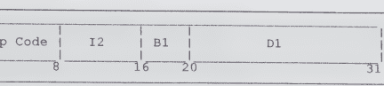

图 13 SI 格式

例如，有一种指令称为 CLI - Compare Logical Immediate。它将内存中的一个字节与立即字节进行比较，并设置 2 位称为条件码，以指示内存中的字节是否等于、小于或大于立即操作数。

因此，如果你想测试内存中的一个字节是否具有字符 A 的值，符号指令可能是：

```
CLI MEMB,C'A'
```

该指令将标签 MEMB 处的内存字节与值等于字母 A 的立即字节进行比较。在将 MEMB 转换为适当的基址和位移对之后，指令可能看起来像：

```
CLI 64(R13),C'A'
```

CLI 的操作码为 95₁₆，因此上述的机器语言指令看起来像：

```
95C1D040
```

其中 C1₁₆ 为十六进制字母 A，D₁₆ 为基址寄存器，040₁₆ 为位移。请注意，在指令中，I2 操作数实际上先出现，而第一个操作数 D1(B1) 出现在第二位。

一些 SI 指令如 Halt IO (HIO)、Set System Mask (SSM)、Start IO (SIO)、Test and Set (TS)、Test Channel (TCH) 和 Test IO (TIO) 不使用立即操作数。Diagnose 指令（无助记符）是一种没有操作数的 SI 指令。

#### 6.7.5 SS 格式

SS 指令有两种形式：一种具有一个 8 位长度字段，另一种具有两个 4 位长度字段。

##### 6.7.5.1 单 8 位长度字段

在 SS 指令中，两个操作数都在内存中，并以基址/位移计算地址指定。此外，还有一个字节字段给出目标操作数的长度。

长度字节在汇编语言格式（程序员编写的内容）中是 1 到 256 范围内的正整数。但在机器语言格式中，长度字节的值比汇编代码值少一（0 到 255）。执行期间，0 长度被解释为 1，1 为 2，依此类推。这允许长度范围为 1 到 256 而不是 0 到 255。系统设计者假设几乎不需要移动零字节。

SS 指令长度为六个字节，被称为存储-存储指令。SS-8 指令在汇编语言格式中指定为：

```
OpCode D1(L,B1),D2(B2)
```

其中 L 是一个 8 位长度代码。一个例子是 Move Character (MVC) 指令，它将从第二个操作数指定的地址开始的一个或多个字节复制到从第一个操作数指定的地址开始的字节。长度字段（在此示例中显示为 20）包含要复制的字节数：

```
MVC 1000(20,R13),2000(R13)
```

##### 6.7.5.2 两个 4 位长度字段

这实际上与上述格式相同，只是 8 位长度字节被视为两个四位字段。因此，指令有两个长度。如前所述，存储在机器语言指令中的长度值被解释为实际存在的值加一，因此 0 表示 1，1 表示 2，依此类推。每个操作数的最大长度为 16。第一个长度字段适用于第一个操作数，第二个适用于第二个。

SS-4 指令指定为：

```
OpCode D1(L1,B1),D2(L2,B2)
```

其中 L1 和 L2 分别是与操作数 1 和操作数 2 关联的 4 位长度代码。

一个典型例子是 Add Packed 指令（AP），它在两个驻留在内存的操作数之间执行 BCD 或十进制加法。操作数可以具有不同的长度，但结果存储在其中的第一个操作数必须足够大以容纳答案。在以下示例中，第一个操作数为 5 个字节，第二个为 3 个：

```
AP 1000(5,R13),2000(3,R13)
```

所有 SS 指令长度均为 6 个字节。原始 SS 机器语言格式如 图 14 所示。

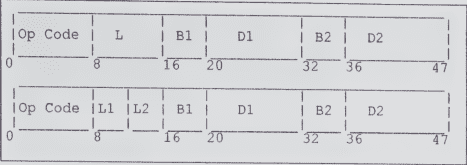

## 图 14 SS 格式

如图所示，在一种格式中，长度字节被视为无符号 8 位数字。在另一种变体中，长度字节被解释为两个无符号 4 位数字。

指令：
```
MVC 100(8,R13),200(R13)
```
其中 MVC 的操作码为 D2₁₆，在机器语言中看起来像：

```
D207D064D0C8
```

你可以看到操作码是 D2，长度是 07，第一个基址是 D₁₆，第一个位移是 064₁₆，第二个基址是 D₁₆，第二个位移是 0C8₁₆。

请注意，长度不是 8。当表示为机器语言时，长度始终少一。因此 0 表示 1，1 表示 2，依此类推。

如前所述，一些 SS 指令将长度字节分为两个 4 位字段以获得 2 个长度。这主要用于称为十进制或打包的一类算术指令。例如，助记符为 AP 的 SS 指令 Add Decimal（或 Add Packed）有两个长度。长度子字段分别给出第一个和第二个操作数的长度。因此，一个典型的 AP 指令可能看起来像：

```
AP VAL1(5),VAL2(3)
```

这意味着将第二个操作数（VAL2）的三字节字段加到指定为第一个操作数（VAL1）的 5 字节字段的内容上，并将结果留在第一个操作数中。转换为显式格式，上面的内容可能看起来像：

```
AP 32(5,R13),64(3,R13)
```

这将给出操作码为 FA₁₆ 的机器指令：
其中 FA₁₆ 为操作码，4 为第一个 4 位长度代码（比 5 少一，如前所述），2 为第二个长度，D 为第一个基址，020₁₆ 为第一个位移，D 为第二个基址，040₁₆ 为第二个位移。

##### 6.7.5.3 新增的 SS 格式

在架构的后期版本中，如图 15 所示添加了额外的 SS 格式。这些往往是不常见的指令，如 Load Multiple Disjoint (LMD)、Shift and Round Decimal (SRP)、Move to Primary (MVCP)、Move to Secondary (MVCS) 和 Move With Key (MVCK)。

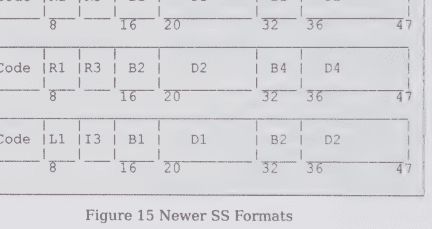

图 15 新的 SS 格式

### 6.8 新的指令格式

随着时间的推移，架构不断演进。原始的 24 位（16 兆字节）地址空间扩展到 31 位（2 千兆字节），然后扩展到 64 位（16 艾字节）；原始的 32 位通用寄存器变为 64 位，等等。为了利用这些变化，添加了指令以及新的指令格式。签名定点二进制 Add 指令的演变就是一个很好的例子。

在原始架构中，有三种指令可用于添加有符号二进制整数，如表 12 所示。其中前两种 AR 和 A 将两个 32 位有符号定点二进制值相加，产生 32 位有符号定点二进制结果。AH 指令将 16 位有符号定点二进制值加到 32 位寄存器值上，并产生有符号 32 位二进制结果。

| 助记符 | 格式 | 第一个操作数 | 第二个操作数 | 第二个操作位数移 | 结果 | 操作码 |
|---|---|---|---|---|---|---|
| AR | RR | 32 bit GPR | 32 bit GPR | N/A | 32 bit GPR | 1A |
| A | RX | 32 bit GPR | 32 bit memory | unsigned 12 bit | 32 bit GPR | 5A |
| AH | RX | 32 bit GPR | 16 bit memory | unsigned 12 bit | 32 bit GPR | 4A |

## 表 12 原始有符号加法指令

在当前架构中，然而，有几种额外的操作变体，如表 13 所示。

| 助记符 | 格式 | 第一个操作数 | 第二个操作数 | 第二个操作位数移 | 结果 | 操作码 |
|---|---|---|---|---|---|---|
| AR | RR | 32 bit GPR | 32 bit GPR | N/A | 32 bit GPR | 1A |
| AGR | RRE | 64 bit GPR | 64 bit GPR | N/A | 64 bit GPR | B908 |
| AGFR | RRE | 64 bit GPR | 32 bit GPR | N/A | 64 bit GPR | B918 |
| A | RX | 32 bit GPR | 32 bit memory | unsigned 12 bit | 32 bit GPR | 5A |
| AY | RXY | 32 bit GPR | 32 bit memory | signed 20 bit | 32 bit GPR | E3/5A |
| AG | RXY | 64 bit GPR | 32 bit memory | signed 20 bit | 64 bit GPR | E3/08 |
| AGF | RXY | 64 bit GPR | 32 bit memory | signed 20 bit | 64 bit GPR | E3/18 |
| AH | RX | 32 bit GPR | 16 bit memory | unsigned 12 bit | 32 bit GPR | 4A |
| AHY | RXY | 32 bit GPR | 16 bit memory | signed 20 bit | 32 bit GPR | E3/7A |
| AHI | RI | 32 bit GPR | 16 bit immediate | N/A | 32 bit GPR | A7/8A |

## 表 13 有符号二进制加法指令

如表 13 所示，原始的三个二进制加法指令现在已增长到十个，但实际上并没有什么变化。它们只是考虑到 32 位和 64 位操作数和结果的几种组合的可能性以及较新的有符号 20 位位移。还添加了具有立即操作数的加法指令。请注意，原始指令都具有八位操作码，而较新的指令使用要么在指令前 16 位中找到的 16 位操作码（如 AGR），要么在前 8 位中的 8 位操作码。


有符号相对寻址。用于相对寻址时，立即操作数的值以半字为单位。

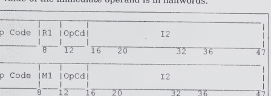

图 17 RIL 格式

#### 6.8.2 RIE 格式

RIE 格式，如图 18 所示，仅用于两条指令：按索引高位分支相对和按索引低位或相等分支相对（BRXHG/BRXLG），其中立即操作数用作以半字为倍数的有符号相对分支地址。

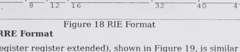

图 18 RIE 格式

#### 6.8.3 RRE 格式

RRE（寄存器-寄存器扩展），如图 19 所示，与 RR 指令类似，但操作码为 16 位长。这些指令的第 16 至 23 位未使用。此格式用于许多扩展原始 RR 格式指令集的指令，以适应两个 64 位寄存器操作数或一个 64 位和一个 32 位寄存器操作数。示例包括加法（AGR 和 AGFR）。

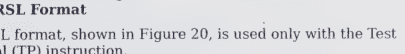

图 19 RRE 格式

#### 6.8.4 RSL 格式

RSL 格式，如图 20 所示，仅用于测试十进制（TP）指令。

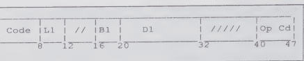

图 20 RSL 格式

#### 6.8.5 RRF 格式

RRF 格式，如图 21 所示，主要用于浮点指令。

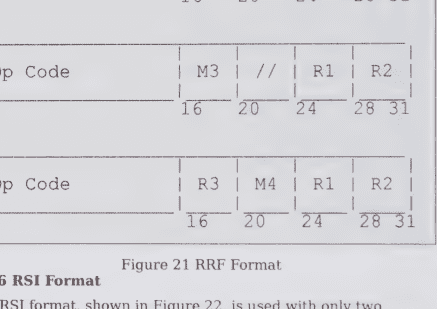

图 21 RRF 格式

#### 6.8.6 RSI 格式

RSI 格式，如图 22 所示，仅用于两条指令：按索引高位分支相对和按索引低位或相等分支相对（BRXH/BRXLE）。这些指令使用 32 位算术。立即操作数中的相对地址以半字为单位。


图 22 RSI 格式

#### 6.8.7 RSY 格式

RSY 格式，如图 23 所示，与 RS 格式类似，但具有额外的操作码信息和扩展的 20 位位移。12 位位移被视为无符号正数，而 20 位位移被视为 20 位有符号数。12 位位移的范围为 0 到 4095，而 20 位位移的范围为 -524,288 到 +524,287。

#### 6.8.8 RXE 格式

RXE 格式，如图 24 所示，主要用于浮点运算。

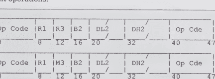

图 23 RSY 格式

#### 6.8.9 RXF 格式

RXF 格式，如图 25 所示，主要用于浮点运算。

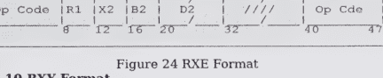

图 24 RXE 格式

#### 6.8.10 RXY 格式

RXY 指令，如图 26 所示，与 RX 指令类似，但具有 20 位有符号位移和 16 位操作码。操作数中的一个或两个是 64 位值。


图 25 RXF 格式

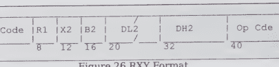

图 26 RXY 格式

#### 6.8.11 S 格式

S 格式，如图 27 所示，有一个内存驻留操作数。测试并设置（TS）是该格式中最常用的指令。最初，TS 被标记为 SI 指令，但 I 操作数从未被使用。

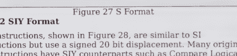

图 27 S 格式

#### 6.8.12 SIY 格式

SIY 指令，如图 28 所示，与 SI 指令类似，但使用有符号的 20 位位移。许多原始 SI 指令都有相应的 SIY 版本，例如逻辑比较（CL/CL Y）。

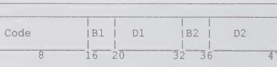

图 28 SIY 格式

#### 6.8.13 SSE 格式

SSE 指令，如图 29 所示，主要用于机器控制，而非一般编程。


图 29 SSE 格式

| 位 | 描述 |
|-----|-------------|
| 22 | 启用浮点下溢异常 |
| 23 | 启用浮点有效数异常 |

表 14 PSW 程序掩码

当该位为 1 时，异常被启用。当为 0 时，异常被忽略。如果启用，异常将中断你的程序。

### 7.5 问题态/管理态位

问题态位位于第 15 位。当为 1 时，机器处于非特权的问题态。在问题态中，并非所有指令都可以执行。当为 0 时，机器处于管理态，所有指令都可以执行。操作系统例程通常在管理态下运行，并且可以访问所有指令。

### 7.6 指令寻址

PSW 始终包含下一条要执行指令的地址。这通常被称为 PSW 的更新地址部分。当取一条指令时，在执行之前，PSW 的地址部分会被更新（递增）以指向紧接在刚取出的指令之后的字节地址，而该指令尚未执行。因此，PSW 指向下一条指令应该所在的位置。PSW 的地址部分始终指向下一条指令，而不是当前指令。如果发生错误和系统转储，PSW 地址很可能指向导致错误的指令之后的那条指令。

任何分支指令都可以改变 PSW 的地址部分。实际上，分支意味着将一个新值加载到 PSW 的地址部分。当你更改此值时，下一条要执行的指令将从该位置取出。

构造十进制掩码的一个简单方法是记住掩码中的位位置每个都有对应的十进制值。通过将位位置的十进制值相加，可以创建最终的十进制掩码。这些对应值如表 18 所示。因此，如果你想在条件代码为 0 或 3 时分支，则十进制掩码为 9（8+1）。

BCR 指令与 BC 类似。第一个操作数是四位掩码，含义与 BC 指令中相同。第二个操作数是包含分支地址的寄存器。但是，如果第二个操作数指定为 R0，则永远不会发生分支，因为在寻址上下文中 R0 表示无寄存器。

此外，还有内置的扩展助记符分支指令。这些并不是额外的指令，而是基本条件分支指令的变体，汇编器会为你填入掩码。这些如表 19 所示。其目的是使你的程序更具可读性。你使用表示用途的助记符，而不是掩码代码。汇编器将这些助记符解释为带有预定掩码的 BC 或 BCR。某些掩码设置（如 8）有不止一种扩展表示：在比较指令后使用 BE（相等则分支），在算术指令后使用 BZ（为零则分支）。由于掩码相同，它们可以互换。

#### 8.2.2 条件相对分支（BRC）

```
BRC M1,I2
```

条件相对分支指令是一种较新的 RI 格式（参见第 6.8.1 节）指令，与 BC 指令类似。但是，分支地址是通过将带符号的 16 位立即操作数值的两倍加到当前指令地址来计算的。因此其名称中有“相对”一词。由于所有指令必须从偶数内存地址开始，奇数相对偏移没有意义。将相对偏移加倍也增加了偏移的范围。相对操作数中的值以半字为单位指定。

#### 8.2.3 长条件相对分支（BRCL）

```
BRCL M1,I2
```

长条件相对分支是一种 RIL 格式（参见第 6.8.1.1 节）指令，与 BRC 指令类似，只是立即操作数为 32 位。相对操作数中的值以半字为单位指定。

第二个操作数。但对于 BALR，如果第二个操作数指定为 R0，则不会发生分支。

在两种版本的指令中，紧跟在 BAL 或 BALR 之后的字节的内存地址被放入第一个操作数指定的寄存器中。这就是链接操作：它存储返回时应返回的地址。

这些指令出现在 360 架构最早的型号上，当时地址总是 24 位。在当前机器中，寄存器为 64 位长，当程序在 24 位寻址模式下运行时，24 位更新的 PSW 指令地址被放入第一个操作数寄存器的最右边 24 位（64 位寄存器的第 40 到 63 位），而 PSW 中的以下字段存储在寄存器的第 32 到 39 位：

- 指令长度代码（第 32 和 33 位）
- 条件代码（第 34 和 35 位）
- 程序掩码（第 36 到 39 位）

这实际上模拟了早期 24 位地址机器的操作。64 位第一个操作数寄存器的低 32 位模拟了早期架构中的 32 位寄存器。其中存储了 PSW 中的八位状态信息，后跟 24 位地址。由于早期机器仅使用 24 位寻址，高 8 位可用于其他用途。在这种情况下，它们存储了进行子例程调用时程序状态的信息。这些信息可用于在返回时恢复状态。

但是，在 31 位寻址模式下，64 位第一个操作数的第 32 位变为 1，其余低 31 位（第 33 到 63 位）被加载 PSW 中的更新指令地址。

在 24 位和 31 位寻址模式下，指定为第一个操作数的 64 位寄存器的第 0 到 31 位（高位）不变。

在 64 位寻址模式下，PSW 的完整 64 位更新地址部分被放入指定为第一个操作数的 64 位寄存器。

这些指令的主要用途是分支到子例程，并在同一操作中将返回点地址加载到寄存器中，如下例所示：

```
L R15,=V(SUB1) * load address of subroutine
BALR R14,R15 * branch to subroutine
```


根据寻址模式。在 24 位寻址模式下，64 位寄存器的 32 到 39 位被设为零。在 31 位寻址模式下，第 32 位被设为 1。在 24 位和 31 位寻址模式下，第一操作数的 0 到 31 位保持不变。在 64 位模式下，作为第一操作数指定的整个寄存器接收地址。

#### 8.3.3 Branch Relative and Save (BRAS/BRASL)

```
BRAS  R1,I2
BRASL R1,I2
```

这些指令与 BAS/BASR 指令相当。第一操作数指定的寄存器以与 BAS/BASR 相同的方式加载 PSW 的更新地址部分。

在 BRAS 指令中有一个 16 位立即字段，被视为有符号二进制数。在 BRASL 中，有一个 32 位立即字段，同样被视为有符号数。BRAS 是 RI 格式指令，而 BRASL 是 RIL 格式指令（参见第 6.8.1 节）。

在两种指令中，分支地址通过将立即字段的值的两倍加到当前指令地址来计算。也就是说，立即字段被视为相对于当前指令地址跳转的半字数。所有指令必须以半字边界开始。

### 8.4 Looping Branch Instructions

循环通常涉及三个独立的操作：算术计算、比较和条件分支。例如，要循环执行一段代码十次，你需要一个计数器（通常是一个寄存器）初始化为零，一个加法指令来递增计数器，一个比较指令来检查计数器是否达到九，然后是一个条件分支指令，如果没有达到则迭代。

由于这是如此常见的事件序列，体系结构提供了几条指令来在一个指令中执行全部三个操作。

有三个循环指令族，根据分支地址的计算方式和操作数的位数有若干变化。它们是：

- 1. Branch Index Low or Equal: the loop continues so long as an index is less than or equal to a limit;
- 2. Branch Index High: the loop continues so long as the index is greater than a limit; and
- 3. Branch on Count: loop until a counter reaches zero.

这些指令中的操作数（计数、索引和限制值）可以是 32 位或 64 位，具体取决于指令。分支地址指定为寄存器、基址/位移或相对地址（相对于当前指令地址的偏移）。

#### 8.4.1 Branch Index Low or Equal (BXLE)

其中第一个是 BXLE 指令，分支于索引低或相等。该指令是 RS 指令，其显式格式为：

```
BXLE R1,R3,D2(B2)
```

该指令的操作如下：首先，将增量加到第一操作数指定的寄存器内容中。然后将第一操作数中的值与限制值进行比较，如果比较结果表明第一操作数的内容小于或等于限制值，则分支到由第二操作数指定的地址，即 D2(B2) 计算的结果。

上述第三操作数 R3 用于确定增量和限制值。如果指定为 R3 的寄存器是偶数，则它是寄存器偶奇对中的偶寄存器。在这种情况下，该对的偶寄存器包含增量，而奇寄存器包含限制值。如果指定为 R3 的寄存器是奇数，则其内容同时用作限制值和增量。

| 行 | 标签/助记符 | 操作数 |
|---|---|---|
| 1 | PRINT | NOGEN |
| 2 | EQUREGS |  |
| 3 | SUM100 | SUBENTRY |
| 4 |  |  |
| 5 | SR | R2,R2 |
| 6 | L | R3,ONE |
| 7 | L | R4,ONE |
| 8 | L | R5,HUNDRED |
| 9 | LOOP | AR R2,R3 |
| 10 | BXLE | R3,R4,LOOP |
| 11 | XDECO | R2,OUT |
| 12 | XPRNT | OUT,L'OUT |
| 13 | SUBRETURN |  |
| 14 |  |  |
| 15 | ONE | DC F'1' |
| 16 | HUNDRED | DC F'100' |
| 17 | OUT | DS CL12 |

图 32 BXLE 循环示例

有几条指令使用偶/奇寄存器对。

有效的对是：

- R0/R1
- R2/R3
- R4/R5
- R6/R7
- R8/R9
- R10/R11
- R12/R13
- R14/R15

图 32 中的程序给出了一个 BXLE 的示例。该程序将前 100 个数加到 R2 中然后打印结果。第 5 行到第 8 行我们初始化寄存器。第 5 行，R2 通过从自身中减去自身设为零。R3 将是 BXLE 的计数寄存器，设为 1。R4 将是增量寄存器，也设为 1，而 R5 是限制寄存器，设为 100。

第 9 行将 R3 的内容加到 R2 的内容中。BXLE（第 10 行）然后将 R3 增加 1（来自 R4 的内容）并将结果与 100（R5 的内容）进行比较。只要 R3 的值小于或等于 100，BXLE 就分支到 LOOP。当 R3 变成 100 时，执行继续进行 XDECO，它将 R2 中的定点二进制值转换为 12 字节字符串 OUT 中的可打印数字。XPRNT 将结果打印到屏幕上。XPRNT 的第二个操作数是字符串 OUT 的长度。

第 15 行和第 16 行的数据声明在内存中创建两个全字定点二进制值，分别初始化为值 1 和 100。第 17 行的声明为长度为 12 的字符字符串保留存储空间但不初始化它（DC 语句初始化，DS 语句仅保留内存）。

BXLE 指令的优点是它将增量、比较和条件分支合并为一条指令，因此在多次迭代的循环中，结果执行速度明显更快。缺点是它在过程中占用了多个寄存器。但在许多情况下，这是合理的。

在 BXLE 中，加法和比较操作将操作数视为 32 位有符号整数，但加法可能引起的任何溢出都被忽略。

##### 8.4.1.1 Branch Index Low or Equal 64 bit (BXLEG)

```
BXLEG R1,R3,D2(B2)
```

除了 BXLE 之外，还有更新的 BXLEG 指令。这是一种机器格式为 RSY（参见第 6.8.7 节）。在此指令中，为加法和比较目的，操作数被视为 64 位有符号整数。溢出同样被忽略。否则，该指令的行为与 BXLE 类似。请注意，RSY 指令使用更长、有符号的位移。

##### 8.4.1.2 Branch Relative on Index Low or Equal (BRXLE)

```
BRXLE R1,R3,I2
```

分支相对于索引低或相等是 RSI 格式（参见第 6.8.6 节）指令，类似于 BXLE。在 BRXLE 指令的情况下，分支地址通过将 16 位有符号立即操作数的值的两倍加到当前指令地址来计算。因此，如果该指令分支，则分支相对于当前地址。立即操作数指定要分支的半字数。索引、增量和限制被视为有符号 32 位量。

##### 8.4.1.3 Branch Relative on Index Low or Equal (BRXLG)

```
BRXLG R1,R3,I2
```

该指令的格式为 RIE，与 BRXLE 相同，只是索引、增量和限制被视为有符号 64 位量。

#### 8.4.2 Branch Index High (BXH)

```
BXH R1,R3,D2(B2)
```

与 BXLE 密切相关的是分支索引高 - BXH。BXH 操作数在范围和功能上与 BXLE 相同，只是当第一操作数指定的寄存器内容大于限制值时进行分支。如果不是，则不进行分支。

##### 8.4.2.1 Branch Index High 64 bit (BXHG)

```
BXHG R1,R3,D2(B2)
```

对应于 BXH 的是更新的 RSY 格式 BXHG 指令，其中增量、限制和索引寄存器被视为有符号 64 位量。

##### 8.4.2.2 Branch Relative on Index High (BRXH/BRXHG)

```
BRXH  R1,R3,I2
BRXHG R1,R3,I2
```

BRXH 与 BXH 相似（32 位操作数），而 BRXHG 与 BXHG 相似（64 位操作数），然而两种指令都通过将两次

16 位带符号立即操作数相对于当前指令地址的值。

#### 8.4.3 计数分支（BCT/BCTR）

```
BCT  R1,D2(X2,B2)
BCTR R1,R2
```

一组类似的循环指令是 BCT 和 BCTR（计数分支）指令。在这两条指令中，都会从第一个操作数所指定的寄存器内容中减去 1。如果结果不为零，则分支到第二个操作数指定的地址。如果结果为零，则继续执行 BCT 或 BCTR 之后的下一条指令。第一个操作数被视为 32 位带符号数量。

对于 BCTR，第二个操作数是一个寄存器，其内容为分支地址，但当第二个操作数指定为寄存器零时除外。在这种情况下，不进行分支（R0 用于寻址上下文中）。当第二个操作数为 R0 时，BCTR 实际上成为对第一个操作数所指定寄存器的减量指令。

使用 BCT 指令，图 32 中的程序变为图 33 中的程序。和之前一样，我们将 R2 的内容清零（第 5 行），并将 100 加载到 R5（计数寄存器）。在第 7 行，我们将计数寄存器加到总数（R2）中。BCT 指令使 R5 减 1，如果 R5 不为零，则分支到 LOOP。

```
1     PRINT          NOGEN
2     EQUREGS
3     SUM100          SUBENTRY
4
5     SR              R2,R2
6     L               R5,HUNDRED
7     LOOP            AR              R2,R5
8     BCT             R5,LOOP
9     XDECO           R2,DBL
10    XPRNT            DBL,L'DBL
11    SUBRETURN
12    LTORG
13    HUNDRED          DC              F'100'
14    DBL              DS              CL12
15    END
```

图 33 BCT 循环示例

##### 8.4.3.1 计数分支（BCTG/BCTGR）

```
BCTG R1,D2(X2,B2)
BCTGR R1,R2
```

这些指令与 BCT/BCTR 基本相同，但将第一个操作数视为 64 位带符号数量。BCTG 使用 20 位带符号位移，而不是像 BCT 那样使用无符号 12 位位移。

##### 8.4.3.2 计数相对分支（BRCT/BRCTG）

```
BRCT R1,I2
BRCTG R1,I2
```

BRCT 与 BCT（32 位操作数）相同，BRCTG 与 BCTG（64 位操作数）相同，不同之处在于，在这两种情况下，分支地址都是通过将带符号 16 位位移的两倍与当前指令地址相加来计算的。

## 9. 数据定义与聚合

### 9.1 定义常量和定义存储（DC 和 DS）

在汇编语言程序中，你可以通过数据声明指令静态地分配内存，这些指令告诉汇编器要分配多少字节以及数据的属性；或者通过使用系统服务动态地分配内存。在本节中，我们讨论由 DC 和 DS 指令生成的静态数据分配。

在许多情况下，你会为每个数据项关联一个标签。对于每个数据定义，汇编器会跟踪数据首字节的地址，以及数据定义语句中声明或隐含的若干属性（如长度、数据类型、对齐方式、重复因子、初始化等）。

在 IBM 汇编语言中，有两种分配和标记内存的方法。第一种是使用 DC 指令，第二种是使用 DS 指令。DC（定义常量）指令在程序中分配并初始化内存，而 DS（定义存储）指令分配内存但不初始化。实际上，“定义常量”这个术语具有误导性。DC 指令分配并初始化一块内存区域，但程序员可以在执行期间自由修改它。

DS 和 DC 指令实际上是汇编器伪指令，而不是像加法或减法那样的可执行指令。它们指示汇编器在程序的内存映像中保留用于存储数据的字节。

在这两种形式中，你通常（但并非总是）会在指令上放置一个符合汇编器命名规则的唯一标签（参见第 4.4 节）。标签从第 1 列开始。在标签之后，包含一个或多个空格，后跟 DC 或 DS，再后跟一个或多个空格，以及一系列代码，这些代码指示数据类型、初始值（如果有）、重复因子（类似于高级语言中的维数），以及（如果未另行隐含）所分配项的长度。基于这些代码，汇编器将在程序中的当前位置分配内存，并记住你定义该项时使用的属性，以供将来使用。

保留内存时，DS/DC 指令中使用的代码告诉汇编器所分配数据的类型。表 20 给出了最常用的代码。每个代码指示数据类型，以及所定义数据项的隐含长度和对齐方式。

其中一些代码可能有一个附加的类型扩展代码，用于进一步定义所分配的数据。就我们而言，只考虑类型扩展 D。它可以添加到定点二进制 F 代码和地址数据代码 A 和 V 上。D 扩展使基础数据类型成为双字（8 字节），而不是默认的 4 字节。因此，数据类型 FD 是定点二进制双字。AD 和 VD 是双字地址值。

在表 20 中，几种数据规范类型具有 1 字节的隐含长度。然而，在其他数据规范中，隐含长度更大。例如，定点二进制整数（类型 F）通常是 32 位或 4 字节，因此隐含长度为 4。

| 类型 | 隐含长度（字节） | 对齐方式 | 格式 |
|---|---:|---|---|
| C | 1 | 字节 | 字符 |
| X | 1 | 字节 | 十六进制数字 |
| B | 1 | 字节 | 二进制数字 |
| F | 4 | 字 | 定点二进制 |
| H | 2 | 半字 | 定点二进制 |
| D | 8 | 双字 | 长浮点 |
| P | 1 | 字节 | 压缩十进制 |
| Z | 1 | 字节 | 分区十进制 |
| A | 4 | 字 | 地址值 |
| V | 4 | 字 | 外部地址值 |

*表 20 基本 DS/DC 数据类型*

对齐方式指的是所分配内存可以放置的地址。某些数据类型要求其首字节地址能被 4（字对齐）、8（双字对齐）或 2（半字对齐）整除。这是出于性能原因，因为如果数据与边界对齐，某些内存操作执行得更快。字节对齐意味着该项可以从任意地址开始。

当使用具有所需对齐方式的代码分配一个内存单元时，如果下一个可用字节不满足所分配数据类型所需的对齐方式，汇编器将自动跳过一个或多个字节，以便该项正确对齐。

例如，如果下一个可用地址能被 2 整除但不能被 4 整除，而你要分配一个全字定点值（类型 F），汇编器将在分配数据之前跳过两个字节。通常你不会注意到这一点，但如果你仔细查看程序的 .PRN 文件，你会看到为实现对齐所需的额外位置计数器增量。

在某些情况下，特别是当你需要知道在原本连续的内存区域中实际使用的确切字节数时，这些额外的填充字节就很重要。由于嵌入的填充字节，简单地将所分配项的大小相加可能不准确。

如果你使用 DS 指令，则无需提供初始化（如果提供了，它将被忽略）。如果你使用 DC，则应提供程序开始时将加载到内存位置中的初始值。初始化通常是一个紧跟在数据类型之后的单引号字符串。字符串中的值必须与数据类型匹配。

图 34 给出了一些 DS 和 DC 指令的示例。前三条 DS 指令分别保留 4、2 和 8 个字节。这些标签处的数据项均未初始化，因此，在程序将值存储到它们之前，每个数据项的内容都是未定义的。

DAT4 是一个双字（8 字节）。它使用 D 扩展来指示它是一个 64 位定点二进制数。

DAT5A 和 DAT5B 都是 10 字节，但它们具有不同的属性。DAT5A 是一个长度为 10 的字符串实例，而 DAT5B 是 10 个连续的长度为 1 的字符串实例。

DAT6 是 120 字节：包含 10 个（重复因子）长度为 20 的字符串实例。数据类型前面的数字是重复因子。

| 标签 | 指令 | 数据类型 | 注释 |
|---|---|---|---|
| DAT1 | DS | F | * 全字未初始化 |
| DAT2 | DS | H | * 半字未初始化 |
| DAT3 | DS | D | * 双字未初始化 |
| DAT4 | DS | FD | * 双字未初始化 |
| DAT5A | DS | CL10 | * 10 字节 |
| DAT5B | DS | 10CL1 | * 10 字节 |
| DAT6 | DS | 10CL20 | * 120 字节 |
| LAB1 | DC | F'123' | * 二进制全字 |
| LAB2 | DC | C'Hello World' | * 字符串 |
| LAB3 | DC | B'1011101010010001' | * 位串 |
| LAB4 | DC | X'2F3C' | * 十六进制字符串 |
| LAB5 | DC | P'1234' | * 压缩十进制字符串 |
| LAB6 | DC | F'789' | * 全字 |
| * |  |  | * 定点二进制 |
| LAB7 | DC | FD'1234' | * 双字定点 |


汇编器在看到 NAME 时，将地址编码为 FIRST 的第一个字节（NAME 不占用空间，因此与 FIRST 共享相同的内存地址），但它取自 NAME 的长度属性，其长度为 75。

另一种相关用法是将较大数据项的各个组成字节映射为较小的带标签项。

例如，内存中定点二进制字段的四个字节可以分别按名称寻址。在图 37 中，标签 VAR 再次不为自身占用存储空间；然而，其后的四个独立字符数据项确实分配了所需的 4 个字节。因此，对 VAR 的 Load 或 Store 指令会加载或存储 4 个字节；然而，每个单独的字节都可以通过标签 V1、V2、V3 或 V4 按名称操作（例如在计算哈希函数时）。

```
VAR DS 0F
V1 DS C
V2 DS C
V3 DS C
V4 DS C
```

图 37 数据映射

请注意，图 37 中 VAR 的声明可能会导致位置计数器发生变化以实现对齐。如果程序中的下一个字节不在正确的内存边界上，就会发生这种情况。在这种情况下，内存地址必须能被四整除。汇编器将跳过最多三个字节，以使标签 VAR 位于完整字边界上。事实上，在代码中看到 DS 语句（可能未标记），使用 H、F 和 D 等对齐数据类型进行零次重复，仅为实现边界对齐的情况并不少见。参见表 20，基本 DS/DC 数据类型。

在另一个示例中，磁盘上可能有两个数据集（文件）。其中一个是索引文件，包含固定长度的记录，每条记录由两个指针和一个名称记录组成。另一个是数据文件，包含有关所命名人员的信息。

每条记录包含一个人的姓名（名、中间名和姓）以及指向另一文件中其数据记录的指针。它还包含指向索引文件中下一个索引记录的指针。索引文件在磁盘上作为列表结构维护，以便在添加新名称时易于保持字母顺序。磁盘指针是 32 位无符号数字，给出它们指向的记录的相对记录号。

数据声明如图所示 38。整个索引文件条目的名称为 INDEX。其组件包括两个指针，一个指向下一个索引记录（IPTR）和关联的个人数据文件记录（DPTR）。每条记录还包含一个由 FIRST、MIDDLE 和 LAST 组成的名字记录。总长度为 83 字节。

请注意初始的 DS 0F，它使后续内容对齐到完整字边界开始。如果没有 DS 0F，可能 INDEX 会被分配到非完整字边界，因为它是一个字符字符串且不需要对齐。然而，IPTR 需要一个完整字，这会导致在达到完整字边界之前插入填充字节。因此，INDEX 和 IPTR 将不会共享相同的地址。

还请注意，完整字二进制数值是首先声明的。如果它们在 NAME 的 75 个字节之后声明，汇编器会插入一个填充字节以使其在完整字边界开始，从而导致整体记录为 84 字节。由于我们可能不希望在磁盘记录中出现填充字节，因此在数据定义中注意对齐问题很重要。

| 名称 | DS | 长度 |
|---|---|---|
| INDEX | DS | 0F |
| IPTR | DS | F |
| DPTR | DS | F |
| NAME | DS | 0CL75 |
| FIRST | DS | CL25 |
| MIDDLE | DS | CL25 |
| LAST | DS | CL25 |

图 38 对齐的记录

## 10. Assist 宏输入/输出

通常，在 IBM 大型机架构上进行输入/输出涉及掌握一套相当复杂的底层操作系统宏，其中一些在第 21 章中有所介绍。然而，为本教材的目的，使用了简化的 Assist 伪指令 XREAD、XPRNT、XDECO、XDECI、XDUMP、XHEXO 和 XHEXI。

在某些系统中，Assist 包实现为宏；在其他系统（如 z390 包）中，它们是伪指令。也就是说，它们在代码中出现的样子就像实际指令一样。

这些宏或伪指令处理读取、打印、从定点二进制到可打印十进制的转换及其反向、内存转储、从定点二进制到可打印十六进制的转换以及可打印十六进制到定点二进制的转换。这些使用起来比底层系统宏简单得多。

### 10.1 使用 XREAD 和 XPRNT 进行输入/输出

在 z390 模拟器中，默认情况下，XREAD 伪指令从与包含汇编语言源程序的文件同名但扩展名为 .XRD 的文件读取。XPRNT 伪指令的输出文件与您的汇编语言源程序文件名相同，但扩展名为 .XPR。XPRNT 输出也会出现在控制台窗口中。请注意 XPRNT 的拼写。

XREAD 的一般格式为：

```
[LABEL] XREAD INFIELD,LENGTH
```

LABEL 是可选的。INFIELD 是数据将被读入的内存区域的地址。该地址可以以与 RX 指令中的第二个操作数相同的方式指定，但通常只是一个标签。长度指定为常量或用括号括起来的寄存器。如果指定为寄存器，则运行时寄存器中的值为所使用的长度。

在 PC 上，z390 模拟器将 ASCII 输入行转换为 EBCDIC，并删除回车和换行符。短记录在右侧用空格填充（EBCDIC 中为 40 十六进制），以使输入区域填满到指定的长度。长输入记录（即超过 XREAD 中所述长度的记录）将被截断。如果发生错误，程序将以 abend（异常结束）代码 S013 终止。如果您尝试读取超出文件末尾，条件码设置为 1；否则为 0。

如果省略，将使用默认值 4。这描述了要转储的内存区域的范围。如果没有给出操作数，则转储与程序关联的整个内存区域。

### 10.3 XDECO/XDECI

这些伪指令用于在二进制与可打印分区十进制之间转换及其反向。

XDECO 将定点二进制转换为可打印分区十进制，其格式为：

```
[LABEL]    XDECO R1,D2(X2,B2)
```

第一个操作数指定包含要转换为可打印十进制的有符号 32 位定点二进制数的寄存器。第二个操作数给出将接收转换后数字的 12 字节字符字段的地址。数字将右对齐，如果为负数则前面带负号，并在左侧用空格填充。标签是可选的。

XDECI 将分区十进制转换为定点二进制，其格式为：

```
[LABEL]    XDECI R1,D2(X2,B2)
```

第一个操作数指定接收转换为有符号定点二进制数的寄存器的寄存器，第二个操作数指定包含分区十进制数字的内存字段的地址。第一个操作数通常不是机器通用寄存器 R1，因为 R1 会被指令更改（见下文）。

XDECI 扫描输入字符串。如果第一个字符既不是数字也不是加号或减号，指令将停止，机器寄存器 R1 被设置为第一个字符的地址，条件码设置为 3。注意：在这种情况下，R1 指的是实际寄存器 R1，而不是第一个操作数。否则，指令将扫描输入字符字符串，直到遇到非十进制字符（例如空格）。它将非十进制字符之前的分区十进制数字转换为有符号定点二进制数，并将其放入第一个操作数。如果转换后的数字为零，则条件码设置为 0；如果数字小于零，则设置为 1；如果数字大于零，则设置为 2。如果分区十进制数字中有超过 9 位数字，则条件码设置为 3，第一个操作数保持不变。在所有情况下，机器寄存器 R1 都被设置为不是数字的第一个字符的地址。


### 10.4 XHEXO/XHEXI

这些操作与 XDECO/XDECI 类似，只是转换的是十六进制数字，且不允许使用加号或减号。

## 11. 二进制算术

### 11.1 一个加法程序

接下来，我们将分阶段修改第 5 章中的 *你好，世界！* 程序。我们的新程序将命名为 ADD.MLC，其目的是对一组数字进行求和。

首先复制 *hello.MLC* 并将其命名为 *add.MLC*。这是我们将修改的文件，首先添加一个用 1 到 5 之间的值初始化的数字表。图 40 显示了添加初始化数字表后的第一次修改。我们还将消息从 *你好，世界！* 修改为 *添加数字*。请注意，图 40 右侧显示了行号，但这些仅供参考，并不是实际源代码的一部分。

```
1 PRINT NOGEN
2 ADD SUBENTRY
3 EQUREGS
4 XPRNT MSG,L'MSG
5 SUBEXIT
6 MSG DC C'Adding Numbers'
7 ONE DC F'1'
8 TWO DC F'2'
9 THREE DC F'3'
10 FOUR DC F'4'
11 FIVE DC F'5'
12 END
```

图 40 ADD.MLC 第 1 步

第 7 行到第 11 行上的每个存储定义都分配了一个完整的字（4 字节），其内容被初始化为引号字段中十进制数字的有符号定点二进制等价物。请注意，字段使用单引号，而不是双引号。总共分配的存储空间为 20 字节。此时程序除了打印 MSG 之外什么也不做。

接下来我们需要计算我们添加的五个数字的总和。由于我们使用的是 32 位有符号定点二进制整数，因此我们需要一个寄存器来进行计算。需要寄存器是因为 32 位二进制算术指令都是 RR 或 RX 类型，因此一个或两个操作数必须是寄存器。

虽然任何寄存器都是合法的，但我们通常选择 R2 到 R12 范围内的寄存器。这是因为寄存器 R0、R1 和 R13、R14 和 R15 与程序链接有关。R2 是一个不错的选择，但要小心，它有时会被某些系统调用和指令（例如 TRT 指令）更改，但在这里不会发生这种情况，所以我们选择 R2。

R2 是我们的累加器。也就是说，我们将每个值依次加到其中，直到它具有最终总和，然后我们将打印总和。显然，我们首先需要将零放入寄存器中。这可以通过两种方式之一完成。一种方法是将完整的字常量零加载到寄存器中。这将使用 4 字节加载指令并需要在内存中有一个相应的 4 字节常量。这在图 41 中显示。

```
1        PRINT          NOGEN
2        ADD            SUBENTRY
3                       EQUREGS
4        L              R2,ZERO   *Zero R2
5        XPRNT          MSG,L'MSG
6                       SUBEXIT
7 MSG     DC             C'Adding Numbers'
8 ZERO    DC             F'0'
9 ONE     DC             F'1'
10 TWO    DC             F'2'
11 THREE  DC             F'3'
12 FOUR   DC             F'4'
13 FIVE   DC             F'5'
14                       END
```

图 41 ADD.MLC 第 2 步

加载指令（第 4 行）将第二个操作数指定的内存地址中的完整字加载到第一个操作数指定的寄存器中。它是 RX 指令，汇编器通过基址和位移计算内存地址。索引寄存器为零。SUBENTRY 宏已经将 R13 建立为基址寄存器。

或者，我们也可以使用图 42 所示的字面量，但这实际上是同样的事情，因为汇编器会为我们做出等效的存储声明。

```
 1          PRINT       NOGEN
 2     ADD  SUBENTRY
 3          EQUREGS
 4          L          R2,F'0'   *Zero R2
 5          XPRNT      MSG,L'MSG
 6          SUBEXIT
 7 MSG      DC         C'Adding Numbers'
 8 ONE      DC         F'1'
 9 TWO      DC         F'2'
10 THREE    DC         F'3'
11 FOUR     DC         F'4'
12 FIVE     DC         F'5'
13          END
```

图 42 ADD.MLC 第 3 步

首选的替代方案是简单地将寄存器从自身中减去，如图 43 所示。这是最快的方法，并且使用最少的内存（两个字节：所有 RR 指令的长度均为两个字节）。SR 指令将第二个操作数指定的寄存器的内容从第一个操作数指定的寄存器的内容中减去，并将结果留在第一个操作数中。在这种情况下，结果为零。由于我们程序中尚未使用 R2，它通常会包含上一个使用它的程序的随机值。但在 z390 模拟器中，所有寄存器字节都初始化为 F416。无论其先前的值如何，从自身中减去都会得到零。

```
 1          PRINT       NOGEN
 2     ADD  SUBENTRY
 3          EQUREGS
 4          SR         R2,R2     *Zero R2
 5          XPRNT      MSG,L'MSG
 6          SUBEXIT
 7 MSG      DC         C'Adding Numbers'
 8 ONE      DC         F'1'
 9 TWO      DC         F'2'
10 THREE    DC         F'3'
11 FOUR     DC         F'4'
12 FIVE     DC         F'5'
13          END
```

图 43 ADD.MLC 第 4 步

接下来我们需要将每个值加到 R2 中。为此，我们可以使用图 44 所示的五个加法（A）指令。加法指令是 RX 指令，它将第二个操作数指定的地址处的内存中对齐的完整字有符号二进制值添加到第一个操作数指定的寄存器中的值中，并将结果留在第一个操作数中。指定内存操作数最简单的方法是使用标签，以便汇编器计算基址/位移。因此，我们使用五个加法指令，每个指令引用一个单独的标签。

```
1          PRINT           NOGEN
2     ADD    SUBENTRY
3            EQUREGS
4     SR             R2,R2    *Zero R2
5     A      R2,ONE
6     A      R2,TWO
7     A      R2,THREE
8     A      R2,FOUR
9     A      R2,FIVE
10    XPRNT   MSG,L'MSG
11          SUBEXIT
12    MSG    DC      C'Adding Numbers'
13    ONE    DC      F'1'
14    TWO    DC      F'2'
15    THREE  DC      F'3'
16    FOUR   DC      F'4'
17    FIVE   DC      F'5'
18          END
```

图 44 ADD.MLC 第 5 步

在加法指令之后，最终总和作为有符号定点二进制数位于 R2 中。我们需要打印它，但二进制不可打印。为了打印它，我们需要将其从二进制转换为带区十进制。Assist 包有一个方便的指令可以为我们执行此操作，名为 XDECO，如图 45 所示。XDECO 取代了下面第 23.7 节中讨论的几个实际指令。XDECO 是 Assist 包中的伪 RX 指令，它将第一个操作数指定的寄存器中的有符号定点二进制整数转换为 12 字节的有符号、右对齐的十进制字符字符串（带区十进制），左侧用空格填充。它将结果放在第二个操作数指定的地址开始的内存中。

```
1    PRINT           NOGEN
2    ADD             SUBENTRY
3                     EQUREGS
4    SR              R2,R2    *Zero R2
5    A               R2,ONE
6    A               R2,TWO
7    A               R2,THREE
8    A               R2,FOUR
9    A               R2,FIVE
10   XPRNT            MSG,L'MSG
11   XDECO            R2,OUT
12   XPRNT            OUT,L'OUT
13   SUBEXIT
14   MSG             DC      C'Adding Numbers'
15   ONE             DC      F'1'
16   TWO             DC      F'2'
17   THREE           DC      F'3'
18   FOUR            DC      F'4'
19   FIVE            DC      F'5'
20   OUT             DS      CL12
21   END
```

图 45 ADD.MLC 第 6 步

请注意，标记为 OUT 的 DS 指令上的操作数是 CL12。此格式表示字符长度 12，或一个字符字符串，其长度属性为 12。另一种分配方式是使用 12C 操作数，这意味着 12 个长度为一的字符字符串（一个是字符的隐含默认值）。然而，这种后一种表示法与 XPRNT 中的 L'OUT 无法配合使用，后者计算 OUT 的长度属性。L'OUT 的值将为 1，而不是 12。以这种方式使用时，12 是重复计数，而不是长度。

我们使用以下命令组装、链接并执行图 45 中的代码：

```
assist add
```

请注意，您不包含 .MLC 后缀。该命令组装程序，如果没有错误，则运行它。assist 命令告诉汇编器使用 Assist 包的伪指令。结果如图 46 所示（长行已截断）。在 ADD 程序打印的行之前，您可以看到该过程所包含的各个步骤：组装（MZ390）、链接 LZ390 和由模拟器 EZ390 执行。请注意，答案 15 的长度为十二个字符，其中有 10 个前导空格（由于比例字体，您的阅读器可能无法准确呈现这一点）。

```
C:\Documents and Settings\user>echo off
13:13:21 add MZ390 START USING z390 V1.5.0Ib ON J2SE 1.6.0_18
13:13:21 add MZ390 ENDED  RC= 0 SEC= 0 MEM(MB)= 43 IO=733
13:13:22 add LZ390 START USING z390 V1.5.0Ib ON J2SE 1.6.0_18
13:13:22 add LZ390 ENDED  RC= 0 SEC= 0 MEM(MB)= 15 IO=35
13:13:22 add EZ390 START USING z390 V1.5.0Ib ON J2SE 1.6.0_18
Adding Numbers
     15
13:13:22 add EZ390 ENDED  RC= 0 SEC= 0 MEM(MB)= 19 IO=22
```

图 46 组装并执行 ADD.MLC

### 11.2 分析 PRN 文件

当您组装程序时，会创建一个名为 add.PRN 的文件。它包含有关程序的重要信息。它显示了您的源程序及其转换为机器语言的形式。图 46 中 .PRN 文件的一部分如图 47 所示。顶部添加了列标题（这些在实际的 .PRN 文件中不会出现——它们仅用于说明）。.PRN 文件的列为：

1. 第 1 列被称为定位计数器。它以十六进制表示，相对于位置零，给出汇编器正在创建的机器语言映像中每一行代码的起始字节地址。每次生成一条机器语言指令或分配一块内存区域时，定位计数器会按指令或数据区域的有效大小递增。为了实现内存地址对齐，有时会跳过字节，因此定位计数器的增量有时可能大于指令或数据区域的大小（所有指令必须从半字边界开始，F 类型数据定义从全字边界开始等等）。

2. 第 2 列也以十六进制表示，是第 6 列所示源代码中汇编语言语句（最多前 8 个字节）的翻译。并非所有汇编语言源语句都会生成机器语言，因此此列可能为空。

3. 第 3 列是机器语言指令第一个操作数的有效地址，相对于零，如果第一个操作数是内存地址。如果第一个操作数不是内存地址（例如寄存器），则此列为空。有效地址是定位计数器地址。

4. 第 4 列是第二个操作数的有效地址，相对于零，如果第二个操作数是内存地址。否则为空。

5. 第 5 列指示宏级别（括号中的第一个数字）、原始源代码语句行号（括号中的第二个数字），最后是考虑宏展开插入的语句后的实际行号。

6. 第 6 列包含您的原始源代码语句。

我们需要知道如何阅读 .PRN 文件的原因是它用于调试。非常经常当我们出现错误时，需要检查内存转储的内容（参见第 20 章），而 .PRN 文件是我们通向转储的路线图。

例如，查看定位计数器值为 72₁₆（省略前导零）的行。但有两个定位计数器值为 72₁₆ 的行！其中第一个，对应于原始源代码第 3 行（第 5 列），是汇编器读取 EQUIREGS 语句时定位计数器的值。

EQUIREGS 是宏的名称。汇编器会转到宏库并在此处插入 16 行宏代码。

请注意，EQUIREGS 之后的源代码行号从 15 跳到 33。这种增加表明插入了未显示的行。

| 列 1 | 列 2 | 列 3 | 列 4 | 列 5 | 列 6 |
|---|---|---|---|---|---|
| 000000 |  |  |  | (1/1)1 | PRINT NOGEN |
| 000000 |  |  |  | (1/2)2 | ADD SUBENTRY |
| 000072 |  |  |  | (1/3)15 | EQUIREGS |
| 000072 | 1B22 |  |  | (1/4)33 | SR R2,R2 +Hero |
| 000074 | 5A20DDB0 |  | 0000B8 | (1/5)34 | A R2,ONE |
| 000078 | 5A20DDB4 |  | 0000BC | (1/6)35 | A R2,TWO |
| 00007C | 5A20DDB8 |  | 0000C0 | (1/7)36 | A R2,THREE |
| 000080 | 5A20DDBC |  | 0000C4 | (1/8)37 | A R2,FOUR |
| 000084 | 5A20DDC0 |  | 0000C8 | (1/9)38 | A R2,FIVE |
| 000088 | E0200DA200B | 0000AA |  | (1/10)39 | XPRNT MSG,L'MSG |
| 00008E | 5220DCC4 |  | 0000CC | (1/11)40 | XDECO R2,DBL |
| 000092 | E0200DC4000C | 0000CC |  | (1/12)41 | XPRNT DBL,L'DBL |
| 000098 |  |  |  | (1/13)42 | SUBEXIT |
| 0000AA | C184849895874005 |  |  | (1/14)49 | MSG DC C'Adding Numbers' |
| 0000B8 | 00000001 |  |  | (1/15)50 | ONE DC F'1' |
| 0000BC | 00000002 |  |  | (1/16)51 | TWO DC F'2' |
| 0000C0 | 00000003 |  |  | (1/17)52 | THREE DC F'3' |
| 0000C4 | 00000004 |  |  | (1/18)53 | FOUR DC F'4' |
| 0000C8 | 00000005 |  |  | (1/19)54 | FIVE DC F'5' |
| 0000CC |  |  |  | (1/20)55 | DBL DS CL12 |
| 0000DB |  |  |  | (1/21)56 | END |

Figure 47 ADD.PRN

由于 PRINT NOGEN 指令，宏展开（即插入的行）未显示。

在这种情况下，EQUIREGS 插入的代码不会生成机器语言代码——语句完全由汇编器指令组成。因此，EQUIREGS 之后的行的定位计数器保持不变。

然而，大多数宏确实会生成可执行的汇编语言代码。请注意，定位计数器从程序开始时的零跳到 SUBENTRY 之后的 72₁₆。这是因为 SUBENTRY 宏生成了 72₁₆ 字节的机器语言。

下一行（第 33 行）具有机器语言代码 1B22₁₆，表示 SR 指令。作为 RR 指令，其格式由一个包含操作码的字节（2 个十六进制数字）和一个包含操作数的字节组成。操作码为 1B，根据表 40 中的指令列表确定。

关于指令的第二个字节（22₁₆），第一个操作数由前四位指定，第二个操作数由后四位指定。由于一个十六进制数字对应四位，第一位十六进制数字（2）是第一个操作数，第二位十六进制数字（2）是第二个操作数。因此，代码 1B22₁₆ 是 SR R2,R2 的机器语言结果。

由于所有 RR 指令长度均为两个字节，定位计数器从 72₁₆ 前进 2 到 74₁₆。

下一条指令是 A R2,ONE，表示获取从标签 ONE 开始的 4 个字节并将其加到寄存器 R2 中的 4 个字节，结果留在 R2 中。Add 指令是 RX 指令，与几乎所有 RX 指令（BC 除外）一样，具有上面第 6.7.2 节所示的格式（BC 在 R1 通常出现的位置有一个掩码）。

从 Add 指令我们得到十六进制机器语言代码 5A20D0B0₁₆。第一个字节（5A）是操作码。下一个字节包含第一个操作数（R2）和索引寄存器（R0）。第三个字节包含基址寄存器（D₁₆ 或 R13）和位移的前 4 位（0）。完整的位移为 0B0₁₆ 或 176₁₀。

The fully explicit notation for the Add would correspond to:

    A R2,176(R0,R13)

因为我们用标签 ONE 指定了第二个操作数，汇编器已计算出 ONE 的地址相对于寄存器 13 的内容有一个 B0₁₆（省略前导零）的位移。这意味着，当程序运行时，ONE 的地址将是 R13 的内容加上 B0₁₆（176₁₀）的总和。

那么问题就变成，R13 中有什么？如果查看定位计数器，您会看到 ONE 从程序开始的位置为 B8₁₆，但 ONE 相对于 R13 内容的位移为 B0₁₆。因此，R13 中必须有 8！

当我们汇编程序时，我们不知道它们将在内存中的什么位置放置。因此，汇编器将地址制表为好像所有程序都加载在位置零。当程序运行时，我们程序的第一个字节将位于实际的运行时地址，该地址不为零。（事实上，模拟器使其看起来我们的程序在运行时始终加载在地址位置 8000₁₆。）

在程序实际运行时，程序的前几条指令中，SUBENTRY 宏确定程序在内存中的实际位置并相应地设置基址寄存器（R13）。这可以在图 3 中看到。它显示了 SUBENTRY 宏的展开。

图 3 中发生了几件事。首先，第 4 行的 BAL 将 R15 加载为 PSW 的更新地址部分。这是程序第八个字节的实际运行时地址。第 11 行，LR 指令将此值从 R15 复制到 R13。注意：系统宏使用普通数字表示寄存器，而不是以字母 R 为前缀的数字。USING 告诉汇编器 R13 是我们的基址寄存器。

因此，当程序运行时，R13 具有我们程序第八个字节的实际、实时地址。因为 R13 被指定为基址寄存器（图 3 中的第 12 行），汇编器计算所有位移相对于字节 8，相对于运行时为 8008₁₆（在模拟器中）。因此，如果在汇编器定位计数器列表中某个标签距离字节 8 为 100 字节，则在运行时它将距离 8008₁₆ 为 100 字节。

如上所述，汇编器由于图 3 中第 12 行的 USING 而使用 R13 作为基址寄存器。USING 是一个汇编器指令，不生成代码，但告诉汇编器使用哪个寄存器作为基址寄存器以及基址寄存器指向何处。在这种情况下，它告诉汇编器 R13 指向 HELLO+8，即程序的第八个字节。由于 SUBENTRY 宏在每个程序中总是以相同的方式展开（程序名称和日期时间戳除外），如果我们使用 SUBENTRY，R13 将始终是我们的基址寄存器，它将始终指向程序的第八个字节，并且相对于基址寄存器的所有位移都将比标签的定位计数器值少八。SUBENTRY 并不是唯一的入口宏。也可以使用其他宏，它们可能会建立不同的基址寄存器。

因此，汇编器知道 R13 可以用作基址寄存器并且它指向程序中的 8 个字节，在 Add 指令中看到标签 ONE 后，正确地计算出该标签距离程序的第 8 个字节为 B0₁₆ 或 176₁₀ 字节。因此我们在机器代码中看到位移为 0B0₁₆，基址寄存器为 R13。

图 4 中 Add 指令中的索引寄存器全部指定为 R0。当 R0 在寻址上下文中使用时，表示没有寄存器。存在 R0，您可以将其用于算术运算，但如果在地址中使用它，则表示无论 R0 中的实际值如何，都不贡献任何值。通常，地址中的索引寄存器为 R0，除非您明确告诉汇编器使用它。


### 11.3 数据寻址替代方案

图45中的程序使用了多个标签来寻址数据。另一个生成完全相同机器语言代码的替代程序见图48。这里在Add指令的每个第二操作数中只使用一个标签（ONE），但带有一个增量，该增量考虑了从标签ONE到目标操作数之间的字节数。

由于F类型数据每个占用四个字节的内存，F'2'的数据从ONE+4开始，下一个F'3'在ONE+8，依此类推。由于每条DC指令恰好生成四个字节的数据，这些数据被安排在连续的内存位置。

请注意，在某些情况下，数据项之间可能会插入填充字节。这发生在下一个数据项需要地址对齐，而下一个字节不能满足该对齐要求时。在这种情况下，会跳过前一项最后一个字节之后的足够字节，以达到所需的对齐。就本例而言，由于F类型数据对齐到可被4整除的地址（字对齐），且每项长度为4，因此每个数据项都位于连续的字对齐边界上。不会出现填充字节。

```
1    PRINT           NOGEN
2    ADD             SUBENTRY
3                    EQU REGS
4    SR              R2,R2   *Zero R2
5    A               R2,ONE
6    A               R2,ONE+4
7    A               R2,ONE+8
8    A               R2,ONE+12
9    A               R2,ONE+16
10   XPRNT           MSG,L'MSG
11   XDECO           R2,DBL
12   XPRNT           DBL,L'DBL
13                   SUBEXIT
14   MSG  DC          C'Adding Numbers'
15   ONE  DC          F'1'
16       DC          F'2'
17       DC          F'3'
18       DC          F'4'
19       DC          F'5'
20   DBL  DS          CL12
21                   END
```

图48 ADD1.mlc

代码表明，比较指令发现R3中的值小于或等于16。

```
1    PRINT            NOGEN
2    ADD              SUBENTRY
3                     EQU REGS
4    SR               R2,R2    *Zero R2
5    SR               R3,R3    *Zero R3
6 LOOP A               R2,ONE(R3)
7    A                R3,=F'4'
8    C                R3,=F'16'
9    BC               B'1100',LOOP
10   XPRNT             MSG,L'MSG
11   XDECO             R2,DBL
12   XPRNT             DBL,L'DBL
13   SUBEXIT
14 MSG DC              C'Adding Numbers'
15 ONE DC              F'1'
16    DC              F'2'
17    DC              F'3'
18    DC              F'4'
19    DC              F'5'
20 DBL DS              CL12
21   LTORG
22   END
```

图49 ADD2.MLC

如果R3的内容等于16，条件码被设置为0；如果R3的内容小于16，条件码被设置为1；否则，条件码被设置为2。如果条件码为0或1，BC指令的掩码会导致分支。当R3的内容超过16时，分支不会发生，BC指令之后的指令XPRNT（第10行）将执行。

与此类似的循环代码在编程中非常常见。事实上，由于非常常见，架构中增加了几条指令，将增量/比较/分支操作合并，如8.4节所讨论的那样。

末尾的LTORG指令告诉汇编器将所有未定义的字面量放置在程序中的这个位置。这些包括=F'4'和=F'16'。注意：如果你不包含LTORG，汇编器仍会将累积的任何字面量放置在程序末尾。

### 11.5 使用扩展助记符

图50是一个类似的示例。它是一个求1到100整数和的程序。它将R2初始化为0，R3初始化为1（第4和5行）。它将R3加到R2，然后递增R3（第6和7行）。它将R3与值100进行比较（第8行），如果R3的内容小于101，则分支（第9行）回到LOOP；当R3的内容等于101时，则继续执行到下一条指令（XDECO）。

```
 1          PRINT       NOGEN
 2  SUM100   SUBENTRY
 3          EQU REGS
 4          SR          R2,R2       * zero R2
 5          L           R3,=F'1'    * init R3
 6  LOOP    AR          R2,R3
 7          A           R3,=F'1'    * incr R3
 8          C           R3,=F'101'
 9          BL          LOOP
10          XDECO       R2,DBL
11          XPRNT       DBL,L'DBL
12          SUBRETURN
13          LTORG
14  DBL     DS          CL12
15          END
```

*图50 循环示例*

在图50中，我们看到了BC指令的另一种形式：扩展助记符形式。第9行的BL（Branch Low，低于则分支）实际上是一个掩码为B'0100'的BC指令。汇编器接受多种此类形式，如表18所示。它们有助于使程序更易读，但实际上是由汇编器填入适当掩码的普通BC指令。

### 12.2 二进制运算后的条件码

所有有符号算术加法和减法指令都会设置条件码以指示操作结果，如表23所示。乘法和除法指令不设置条件码，它保持不变。

### 12.3 溢出

有符号二进制加法和减法指令可能会遇到操作结果溢出寄存器的情况。在32位加法中，当结果超过有符号32位数所允许的最大值或最小值时，即分别为+2,147,483,647和-2,147,483,648，就会发生溢出。对于64位数字，这些值为+18,446,744,073,709,551,615和-18,446,744,073,709,551,616。

**表23 条件码**

| 结果 | 条件码 |
|---|---|
| 零 | 0 |
| 小于零 | 1 |
| 大于零 | 2 |
| 溢出 | 3 |

算术左移（SLA、SLAG）和双精度算术左移（SLDA）指令也可能发生溢出（当一个与符号位不同的位被移入符号位位置（最高有效位）时）。由于这会导致符号改变，因此被视为溢出。

发生溢出时，条件码被设置为3，并引发定点溢出异常中断。这通常会导致程序终止，除非PSW的程序掩码中的第20位为1，在这种情况下，该中断被禁止。

**表24 有符号减法指令**

| 操作码 | 类型 | 第一操作数 | 第二操作数 | 结果 |
|---|---|---|---|---|
| S | RX | 32位寄存器 | 32位内存 | 32位寄存器 |
| SR | RR | 32位寄存器 | 32位寄存器 | 32位寄存器 |
| SH | RX | 32位寄存器 | 16位内存 | 32位寄存器 |
| SCR | RXE | 64位寄存器 | 64位寄存器 | 64位寄存器 |
| SGFR | RRE | 64位寄存器 | 32位寄存器 | 64位寄存器 |
| SY | RXY | 32位寄存器 | 32位内存 | 32位寄存器 |
| SG | RXY | 64位寄存器 | 64位内存 | 64位寄存器 |
| SGF | RXY | 64位寄存器 | 32位内存 | 64位寄存器 |
| SHY | RXY | 32位寄存器 | 16位内存 | 32位寄存器 |

### 12.4 减法

与加法指令A和AR类似，最初的减法指令是S和SR。S指令为RX类型，SR为RR类型。两者都从第一操作数指定的寄存器中减去第二操作数的内容，并将结果留在第一操作数中。两者都操作32位有符号（二进制补码）二进制整数。完整的减法指令集见表24。

### 12.5 无符号二进制运算

该架构提供了无符号算术，称为逻辑指令，如表26和表27所示。所有逻辑指令都将两个操作数视为无符号二进制整数。不会发生溢出。相反，条件码指示是否发生了进位，如表25所示。逻辑减法的类似表格指示是否发生了借位。这些信息可用于构造扩展精度二进制整数算术，为此专门增加了带进位逻辑加（ALCR、ALC、ALCGR和ALCG）指令。

表25 逻辑加后的条件码

| 结果 | 条件码 |
|---|---|
| 零，无进位 | 0 |
| 非零，无进位 | 1 |
| 零，有进位 | 2 |
| 非零，有进位 | 3 |

表26 逻辑加指令

| 操作码 | 类型 | 第一操作数 | 第二操作数 | 结果 |
|---|---|---|---|---|
| AL | RX | 32位寄存器 | 32位内存 | 32位寄存器 |
| ALR | RR | 32位寄存器 | 32位寄存器 | 32位寄存器 |
| ALGR | RRE | 64位寄存器 | 64位寄存器 | 64位寄存器 |
| ALGFR | RRE | 64位寄存器 | 32位寄存器 | 64位寄存器 |
| ALY | RXY | 32位寄存器 | 32位内存 | 32位寄存器 |
| ALG | RXY | 64位寄存器 | 64位内存 | 64位寄存器 |
| ALGF | RXY | 64位寄存器 | 32位内存 | 64位寄存器 |
| ALCR | RRE | 32位寄存器 | 32位寄存器 | 32位寄存器 |
| ALC | RXY | 32位寄存器 | 32位内存 | 32位寄存器 |
| ALCGR | RRE | 64位寄存器 | 64位寄存器 | 64位寄存器 |
| ALCG | RXY | 64位寄存器 | 64位内存 | 64位寄存器 |


### 12.6 乘法

原始的 32 位二进制整数乘法指令是 M 和 MR。在两者中，第一操作数指定偶数/奇数寄存器对中的偶数寄存器。在最初的体系结构中，这些是 32 位寄存器，但在当前实现中，只有 64 位通用寄存器的低 32 位参与运算。高位保持不变。被乘数是一个 32 位有符号整数，位于该寄存器对的奇数寄存器中。乘数是一个 32 位有符号整数，位于第二操作数指定的寄存器（MR）中，或位于指定的内存地址（M）中。偶数寄存器的内容被忽略。

| 操作码 | 类型 | 第一操作数 | 第二操作数 | 结果 |
|---|---|---|---|---|
| SL | RX | 32 位寄存器 | 32 位内存 | 32 位寄存器 |
| SLR | RR | 32 位寄存器 | 32 位寄存器 | 32 位寄存器 |
| SLGR | RRE | 64 位寄存器 | 64 位寄存器 | 64 位寄存器 |
| SLGFR | RRE | 64 位寄存器 | 32 位寄存器 | 64 位寄存器 |
| SLY | RXY | 32 位寄存器 | 32 位内存 | 32 位寄存器 |
| SLG | RXY | 64 位寄存器 | 64 位内存 | 64 位寄存器 |
| SLGF | RXY | 64 位寄存器 | 32 位内存 | 64 位寄存器 |
| SLBR | RRE | 32 位寄存器 | 32 位寄存器 | 32 位寄存器 |
| SLB | RXY | 32 位寄存器 | 32 位内存 | 32 位寄存器 |
| SLBGR | RRE | 64 位寄存器 | 64 位寄存器 | 64 位寄存器 |
| SLBG | RXY | 64 位寄存器 | 64 位内存 | 64 位寄存器 |

表 27 逻辑减指令

结果是一个 64 位有符号二进制数，放在偶数/奇数寄存器对的低 32 位中，结果的高 32 位放在偶数寄存器的低 32 位中，结果的低 32 位放在奇数寄存器的低 32 位中。不会发生溢出，条件码保持不变。

例如，如果 R5 包含 20₁₀，R6 包含 3₁₀，我们可以用以下指令将它们相乘：

```
MR R4,R6
```

结果将位于 R4 和 R5 中。由于答案是 60₁₀，结果实际上在 R5 中。只有当答案超过 32 位时，R6 中才会包含结果。

还有一条 MH 指令，它将内存中的 16 位有符号数与第一操作数指定的寄存器的 32 位有符号内容相乘。低 32 位

在当前实现中，只有通用寄存器的低 32 位参与运算。高位保持不变。两个寄存器的低部分被视为一个 64 位有符号二进制整数，该整数的高阶部分位于偶数寄存器中。没有半字除法指令。

| 操作码 | 类型 | 第一操作数 | 第二操作数 | 结果 |
|---|---|---|---|---|
| D | RX | 32 位寄存器 | 32 位内存 | 32 位寄存器 |
| DR | RR | 32 位寄存器 | 32 位寄存器 | 32 位寄存器 |
| DSGR | RRE | 64 位寄存器 | 64 位寄存器 | 64 位寄存器 |
| DSGFR | RRE | 64 位寄存器 | 32 位内存 | 64 位寄存器 |
| DSG | RXY | 64 位寄存器 | 32 位内存 | 64 位寄存器 |
| DSGF | RXY | 64 位寄存器 | 64 位内存 | 64 位寄存器 |

## 表 30 有符号除法指令

除数是一个 32 位有符号数，位于第二操作数（DR）指定的寄存器中，或位于第二操作数地址指定的内存位置。

| 操作码 | 类型 | 第一操作数 | 第二操作数 | 结果 |
|---|---|---|---|---|
| DL | RXY | 32 位寄存器 | 32 位内存 | 64 位寄存器 |
| DLR | RXE | 32 位寄存器 | 32 位寄存器 | 64 位寄存器 |
| DLGR | RXE | 64 位寄存器 | 64 位寄存器 | 128 位寄存器 |
| DLG | RXY | 64 位寄存器 | 64 位内存 | 128 位寄存器 |

## 表 31 无符号除法指令

结果由位于第一操作数偶数寄存器中的余数和位于奇数寄存器中的商组成。商的符号由代数规则决定，余数的符号与被除数相同，但零始终为正。如果启用，除零将引发定点除法异常。条件码保持不变。

例如，如果位置 VAR1 包含 32 位数 10，位置 VAR2 包含 32 位数 3，你可以用以下方式将 VAR1 处的值除以 VAR2 处的值：

```
L R2,VAR1
SRDA R2,32
D R2,VAR2
```

结果将是 R2 中的 1（余数）和 R3 中的 3（商）。

在 D 和 DR 指令中，只有偶数/奇数寄存器的低 32 位参与运算，并且它们被视为一个 64 位数。

我们将被除数加载到偶数寄存器中，然后执行向右移动 32 位的双算术移位。这将把被除数从偶数寄存器移动到奇数寄存器，同时在偶数寄存器中传播符号位。

SRDA 指令将每个寄存器的低 32 位视为一个 64 位寄存器进行移位。

## 13. 字符指令

### 13.1 基本字符指令

最初的体系结构具有操作长度不超过 256 字节的字符数据字符串的指令。在体系结构的后续版本中，这些指令被扩展以处理更大的字符串，但我们从最基本的开始。

#### 13.1.1 移动字符（MVC）

```
MVC D1(L,B1),D2(B2)
```

基本的字符移动指令是 MVC 指令。它是一条 SS 指令，将从第二操作数给出的地址开始的至多 256 个字节复制到第一操作数给出的地址。地址可以重叠。

在 MVC 的机器语言编码中（其他 SS 字符指令也是如此），长度用一个 8 位字段表示，其编码值比实际移动长度小 1。因此，在机器语言格式中，长度值 0 表示移动 1 个字节，长度值 255 表示移动 256 个字节，依此类推。然而，在汇编语言源代码中，编码的是实际长度（汇编器在构造机器语言翻译时会从该值中减去 1）。

```
1  MVC L1,L2      * 20 bytes from L2 copied to L1
2  MVC L1(10),L2   * 10 bytes from L2 copied to L1
3
4  LA  R2,L1
5  LA  R3,L2
6
7  MVC 0(20,R2),0(R3) * 20 bytes from L2 copied to L1
8  MVC 10(10,R2),0(R3) * 10 bytes from L2 copied to L1
9  *              * beginning at position 10
10
11 MVC L1(1),=C' '  * blank copied to 1st byte.
12 MVC L1+1(19),L1  * overlapped move; L1 is made
13 *              * all blanks
14
15 L1 DS  CL20
16 L2 DC  C'ABCDEFGHIJKLMNOPQRST'
```

图 51 MVC 示例

如果没有提供长度，则使用第一操作数的隐含长度属性。操作数指定为

## 认知智能：从感知到理解的新范式

近年来，随着深度学习技术的快速发展，人工智能系统在感知任务上取得了显著进展。然而，单纯依靠大规模数据和计算能力堆叠的感知模型，在面对复杂推理、因果理解和常识判断等认知任务时仍存在明显不足。本文旨在探讨认知智能的发展路径及其与感知智能的本质区别。

### 一、感知与认知的本质差异

感知智能关注的是从原始数据中提取有效特征并进行模式识别，主要包括计算机视觉中的目标检测、图像分类，以及语音识别中的声学建模等任务。而认知智能则要求系统具备知识表示、逻辑推理、决策规划和语言理解等高层认知能力。两者之间的关系可以类比为人类视觉系统与大脑前额叶皮层的关系——前者负责将光信号转化为视觉信息，后者则负责对这些信息进行深层次的加工与利用。

### 二、认知智能的关键技术路线

当前，认知智能的研究呈现出多条技术路线并行发展的态势。知识图谱方法强调结构化知识的表示与推理，通过实体关系和逻辑规则构建可解释的推理链条；认知架构方法借鉴人类认知过程的信息加工模型，试图在人工智能系统中模拟注意、记忆、决策等认知功能；而以大语言模型为代表的联结主义路径，则试图通过参数规模的扩大和训练范式的创新，从海量文本中隐式地习得世界知识与推理模式。

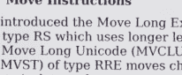

上图展示了三种主要技术路线在研究目标、知识表示方式和推理机制上的差异。值得注意的是，不同研究路线之间并非互相排斥的关系，而是呈现出互补融合的趋势。

### 三、大语言模型的认知能力分析

以GPT系列和开源模型为代表的大语言模型，在各类认知基准测试中表现出令人惊讶的能力。它们在数学推理、代码生成、逻辑演绎等任务上展现出的水平，已经超越了此前所有人工智能系统所达到的高度。然而，研究者也发现这些系统存在系统性缺陷：它们在面对分布外样本时容易产生错误推理，在需要多步规划时可能出现逻辑断裂，更重要的是，它们缺乏真正的因果理解能力，往往依赖统计关联而非因果机制进行推断。

### 四、未来研究方向与展望

认知智能的未来发展，需要在以下几个方面实现突破：其一，将符号推理与神经表示有机融合，构建兼具灵活性与可解释性的混合推理框架；其二，引入因果推断方法，使模型能够从观测数据中识别真正的因果关系而非表面相关；其三，发展持续学习能力，让系统在不断变化的环境中积累知识而不遗忘已有技能；其四，建立更加完善的评估体系，从多维度衡量模型的认知水平而不局限于传统基准测试的表现。

总之，认知智能作为人工智能发展的下一个重要里程碑，承载着从工具性智能走向类人智能的期望。虽然当前在通往通用人工智能的道路上仍面临诸多挑战，但随着多学科的交叉融合与技术范式的持续演进，认知智能有望在未来十年取得突破性进展。


- 1. 构建一个所有字节均非零的表（例如 X'01'）；
- 2. 回到表中偏移量 64₁₀ 处并将值改为 X'00'。

这在图 54 中有所展示，其中首先构建一个 256 字节的表，所有字节均初始化为 X'01'。然后，你回到表中并用 X'00' 替换对应空白偏移量的字节（40₁₆，64₁₀）。

```
TAB       DC      256X'01'
        ORG     TAB+C' '
        DC      X'00'
        ORG
```

图 54 带 ORG 的 TRT 表

ORG 指令将汇编器的位置计数器重置为我们指定的值。在此情况下，我们将位置计数器重置为 TAB 的起始位置加上 C' '，这相当于说 40₁₆ 或 64₁₀，但 C' ' 更易于理解。现在位置计数器已回到表中对应空白的偏移处。在此处放置 X'00'，它将替换原有的 X'01'。

接下来，你需要使位置计数器回跳到最初构建表之后的位置，否则后续代码会覆盖表的剩余部分。没有参数的 ORG 会将位置计数器重置为其曾经达到的最高值。因此裸 ORG（无参数形式）。

所有这些的效果是创建一个 X'01' 代码表，除了空白的偏移位置。

图 55 中的示例读取并扫描输入记录以查找第一个由空白分隔的词，并打印该词。

- 8. 第 23 行至第 32 行循环遍历非空白字符，将每个非空白字符移动到输出字段 WORD，直到遇到 REC 的末尾或找到空白。
- 9. 第 28 行将 R3 中的地址与限制地址 R4 进行比较，如果它大于或等于限制寄存器 R4 中的值（分支不低），则分支到 PRNT。
- 10. 第 30 行将 R3 指向的字节与空白（词的结束？）进行比较，如果是则分支到 PRNT。否则（第 32 行），它分支到 L1 以移动下一个字符。
- 11. 第 34 行打印从输入映像中提取的词。
- 12. 第 35 行的 MVI 在 WORD 的第一个字节中放置一个空白，然后第 36 行的 MVC 将其在字段中传播（这称为涟漪移动），从而清空 WORD。它通过将字节 1 移动到字节 2，然后字节 2 移动到字节 3，依此类推来实现，从而传播第一个字节，即空白。
- 13. 程序分支到 LOOP 以读取新行。
- 14. 示例输入行显示在图 56 中。这些行被放置在与程序同名但扩展名为 .XRD 的文件中。输出（未显示）由词 TEST1、TEST2 和 TEST3 组成，各自位于单独的行上，左对齐。

相关指令 Translate and Test Reverse（TRTR）在后续型号中被添加。它执行 TRT 的操作但方向相反。

```
TEST1       *
      TEST2       *
TEST3
```

图 56 输入行

#### 13.2.2 翻译

翻译指令（TR）的特性与 TRT 相似。它有一个源字符串，即第一个操作数，以及一个作为第二个操作数寻址的 256 字节表。像 TRT 一样，源字符串中的每个字节依次用于寻址表中偏移量等于源字符串字节数值的字节。

然而，在翻译指令中，表中的字节会替换源字符串中的字节。此外，翻译会处理整个源字符串，并且在所有字节处理完毕前不会停止。它不设置条件码也不改变任何寄存器。

TR 指令的一个示例用途是将小写转换为大写，或将某些标点字符替换为空白。

在更新的体系结构中，添加了几种变体：Translate Extended（TRE），它在遇到程序员指定的测试字节时停止。Translate One To One（TROO）、Translate One To Two（TROT）、Translate Two To One（TRTO）和 Translate Two To Two（TRTT）是操作多个字节和更长字符串长度的变体。

### 13.3 插入字符（IC/ICY）

插入字符指令 IC（格式 RX）和 ICY（格式 RXY）将第二个操作数寻址的字节加载到作为第一个操作数指定的寄存器的低 8 位中。第一个操作数寄存器的其他位保持不变。IC 指令使用无符号 12 位位移，而 ICY 使用 20 位有符号位移。两者均不改变条件码。此外，还有插入字符掩码指令（ICM），它可选择性地从内存加载最多 4 个字符到寄存器中。

### 13.4 存储字符（STC/STCY）

STC 指令将作为第一个操作数指定的寄存器的低位字节存储在第二个操作数指定的地址。它是 RX 格式。类似的 STCY 指令为 RXY 格式并使用 20 位有符号位移。相关指令 Store Characters Under Mask（STCM）存储可变数量的字节。

```
STC R1,D2,(X2,B2)
```

## 14. 加载指令

该体系结构提供了若干用于加载寄存器内容的指令，下文将详细介绍这些指令。为了编程示例的目的，仅使用基本的加载指令，但完整的列表在表 32 中给出。

### 14.1 加载（L）

基本加载指令将内存中的 32 位字加载到通用寄存器中。内存中的字应位于字边界（可被 4 整除的内存地址）。条件码保持不变。加载为 RX 格式。

```
L R5,L1
```

表 32 显示了加载指令的额外变体。这些变体在加载的数据大小和内存寻址方法上有所不同。原始体系结构中未提供的指令以阴影显示。

### 14.2 加载（LR）

作为第二个操作数指定的寄存器的内容被复制到作为第一个操作数指定的寄存器。条件码保持不变。LR 为 RR 格式。

```
LR R5,R6
```

### 14.3 多重加载（LM）

一个或多个通用寄存器从第二个操作数指定的内存地址开始的连续字中加载。条件码保持不变。LM 为 RS 类型。待加载的寄存器从作为第一个操作数指定的寄存器开始，直至并包括作为第三个操作数指定的寄存器。如果作为第一个操作数指定的寄存器大于作为第三个操作数指定的寄存器，则发生环绕。如果第一个和第三个操作数都指定相同的寄存器，则仅加载 4 个字节。

```
LM R1,R5,L1  * R1,R2,R3,R4 and R5 are loaded
LM R6,R4,L2  * R6,R7, ... R0,R1, ... R4 are loaded.
```

### 14.4 加载并测试（LTR）

作为第二个操作数指定的寄存器的内容被加载到作为第一个操作数指定的寄存器中，并且条件码被设置为反映所复制定点二进制整数字的值。通常两个操作数都指定为同一寄存器，在这种情况下唯一的效果是设置条件码。LTR 为 RR 格式。条件码设置如下：

```
CC=0 Zero;
CC=1 Negative;
CC=2 Positive.
```

### 14.5 加载正数（LPR）

作为第二个操作数指定的寄存器中的有符号二进制值的绝对值被加载到作为第一个操作数指定的寄存器中。两个操作数可以是同一寄存器。条件码被设置。LPR 为 RR 格式。最大的负数没有正数等价物，此情况可能产生溢出。条件码设置如下：

```
CC=0 Zero, no overflow
CC=1 Not possible
CC=2 Greater than zero, no overflow
CC=3 Overflow
```

### 14.6 加载负数（LNR）

作为第二个操作数指定的寄存器中包含的有符号定点二进制整数的绝对值的 2 的补码被加载到作为第一个操作数指定的寄存器中。条件码被设置。LNR 为 RR 格式。条件码设置如下：

```
CC=0 Zero
CC=1 Negative
CC=2 Not possible
CC=3 Not possible
```

### 14.7 加载补码（LCR）

LCR 将作为第二个操作数指定的寄存器的内容的 2 的补码加载到作为第一个操作数指定的寄存器中。两个寄存器指定可以相同，在这种情况下指定寄存器的内容被取补。零值保持不变（0 的 2 的补码为 0）。条件码设置如下：

```
CC=0 Result 0
CC=1 Result negative
CC=2 Result positive
CC=3 Overflow
```

### 14.8 加载地址（LA）

加载地址指令是一个 RX 指令，它计算第二个操作数指定的地址并将结果放入第一个操作数指定的寄存器中。不进行内存访问。该指令仅执行地址算术。在 24 位寻址模式下，结果为 24

在 31 位寻址模式下结果为 31 位。所有地址运算仅使用正数进行。

LA 也可作为快速将小常数加载到寄存器以及执行有限正二进制算术的一种方式。它还可用于在一操作中相加两个寄存器的正内容。示例：

- 1. 将常数 22 加载到 R5 中：LA R5,22(R0,R0) 由于 R0 不参与地址运算，地址计算的有效结果为 22，该值被加载到 R5 中。这比使用 4 字节内存操作数的加载指令快得多。
- 2. 将 R5 的内容增加 10（R5 的内容必须为正且长度不超过 24 或 31 位，具体取决于当前寻址模式）。LA R5,10(R0,R5) R5 中的值与 10 相加，结果替换 R5 的内容。同样，R0 不参与。这比使用四字节内存操作数的 Add 指令快得多。
- 3. 将 R2 和 R3 的内容相加并将结果放入 R5。假设 R2 和 R3 具有正值且不超过 24 或 31 位（取决于寻址模式），并且结果将小于 31 或 24 位（取决于寻址模式）LA R5,0(R2,R3) 对于小正值，此指令可替代 SR 和两个 AR 指令，速度非常快（地址运算是最快的运算形式）。

| 操作码 | 类型 | 第1操作数 | 第2操作数 | 结果 | 操作 |
|---|---|---|---|---|---|
| L | RX | 32 位寄存器 | 32 位内存 | 32 位寄存器 | 第2操作数被原样加载到第1操作数中，除 LGFR 和 LGF 外，结果为符号扩展。 |
| LR | RR | 32 位寄存器 | 32 位寄存器 | 32 位寄存器 |  |
| LGR | RRE | 64 位寄存器 | 64 位寄存器 | 64 位寄存器 |  |
| LGFR | RRE | 64 位寄存器 | 32 位内存 | 64 位寄存器 |  |
| LY | RXY | 32 位寄存器 | 16 位立即数 | 32 位寄存器 |  |
| LG | RXY | 64 位寄存器 | 64 位寄存器 | 64 位寄存器 |  |
| LGF | RXY | 64 位寄存器 | 32 位内存 | 64 位寄存器 |  |
| LPQ | RXY | 2 64 位寄存器 | 128 位内存 | 2 64 位寄存器 |  |

### Load Address

| 操作码 | 类型 | 第1操作数 | 第2操作数 | 结果 | 操作 |
|---|---|---|---|---|---|
| LA | RX | 64 位寄存器 | 21/31/64 位 | 64 位寄存器 | 由第2操作数计算的地址被加载到第1操作数中。 |
| LAY | RXY | 64 位寄存器 | 21/31/64 位 | 64 位寄存器 |  |

### Load and Test

| 操作码 | 类型 | 第1操作数 | 第2操作数 | 结果 | 操作 |
|---|---|---|---|---|---|
| LTR | RR | 32 位寄存器 | 32 位寄存器 | 32 位寄存器 | 第2操作数被加载到第1操作数以设置条件码 |
| LTGR | RRE | 64 位寄存器 | 64 位寄存器 | 64 位寄存器 |  |
| LTGFR | RRE | 64 位寄存器 | 32 位寄存器 | 64 位寄存器 |  |

### Load Complement

| 操作码 | 类型 | 第1操作数 | 第2操作数 | 结果 | 操作 |
|---|---|---|---|---|---|
| LCR | RR | 32 位寄存器 | 32 位寄存器 | 32 位寄存器 | 第2操作数的 2 的补码被加载到第1操作数中。 |
| LCGR | RRE | 64 位寄存器 | 64 位寄存器 | 64 位寄存器 |  |
| LCGFR | RRE | 64 位寄存器 | 64 位寄存器 | 64 位寄存器 |  |

### Load Multiple

| 操作码 | 类型 | 第1操作数 | 第2操作数 | 结果 | 操作 |
|---|---|---|---|---|---|
| LM | RS | 32 位寄存器(s) | 32 位内存字(s) | 32 位寄存器(s) | 一个或多个寄存器从内存中的位置加载。对于 LM 和 LMY，高 |
| LMY | RSY | 32 位寄存器(s) | 32 位内存字(s) | 32 位寄存器(s) |  |
| LMG | RSY | 64 位寄存器(s) | 64 位内存字(s) | 64 位寄存器(s) |  |

## Load Positive

## Load Byte

## Load Reversed

## Load Negative

## Load Logical Thirty One Bits

## Load Halfword

| 操作码 | 类型 | 第1操作数 | 第2操作数 | 结果 | 操作 |
|---|---|---|---|---|---|
| LMD | SS | 64 位寄存器(s) | 32 位内存字(s) | 64 位寄存器(s) | |
| LMH | RSY | 64 位寄存器(s) | 32 位内存字(s) | 64 位寄存器(s) | order 32 bits of the registers are |
| LPR | RR | 32 位寄存器 | 32 位寄存器 | 32 位寄存器 | 第2操作数的绝对值被加载到第1操作数中。 |
| LPGCR | RRE | 64 位寄存器 | 64 位寄存器 | 64 位寄存器 | |
| LPGFR | RRE | 64 位寄存器 | 32 位寄存器 | 64 位寄存器 | |
| LB | RXY | 32 位寄存器 | 内存字节 | 32 位寄存器 | |
| LGB | RXY | 64 位寄存器 | 内存字节 | 64 位寄存器 | |
| LRVR | RRE | 32 位寄存器 | 32 位内存 | 32 位寄存器 | 第2操作数以字节反转的方式加载到第1操作数中。 |
| LRVGR | RRE | 64 位寄存器 | 64 位内存 | 64 位寄存器 | |
| LRVH | RXY | 16 位寄存器 | 16 位内存 | 16 位寄存器 | |
| LRV | RXY | 32 位寄存器 | 32 位内存 | 32 位寄存器 | |
| LRVG | RXY | 64 位寄存器 | 64 位内存 | 64 位寄存器 | |
| LNR | RR | 32 位寄存器 | 32 位寄存器 | 32 位寄存器 | 第2操作数的 2 的补码负值被加载到第1操作数中。 |
| LNGR | RRE | 64 位寄存器 | 64 位寄存器 | 64 位寄存器 | |
| LNGFR | RRE | 64 位寄存器 | 32 位寄存器 | 64 位寄存器 | |
| LLGTR | RRE | 64 位寄存器 | 32 位寄存器 | 64 位寄存器 | 第2操作数的低 31 位被加载到第1操作数中。 |
| LLGT | RXY | 64 位寄存器 | 32 位内存 | 64 位寄存器 | |
| LH | RX | 32 位寄存器 | 16 位内存 | 32 位寄存器 | 由 |

## 15. Store Instructions

本节讨论基本的存储指令。存储指令的完整列表见表 33。

### 15.1 Store (ST)

存储指令将寄存器的 32 位内容存储到内存中的一个字。它是 RX 指令。内存地址应为字边界。条件码保持不变。ST 的格式为 RX。

```
ST R1,D2(X2,B2)
```

### 15.2 Store Multiple (STM)

一个或多个通用寄存器被存储到从第二操作数指定的内存地址开始的连续字中。条件码保持不变。STM 的格式为 RS。待存储的寄存器从第一操作数指定的寄存器开始，直至并包括第三操作数指定的寄存器。如果第一操作数指定的寄存器大于第三操作数指定的寄存器，则发生环绕。如果第一和第三操作数都指定相同的寄存器，则仅存储 4 字节。示例：

```
STM R1,R5,L1  * R1,R2,R3,R4 and R5 are stored
```

```
STM R6,R4,L2  * R6,R7, ... R15, R0,R1, ... R4 stored
```

## Table 33 Store Instructions

| 操作码 | 类型 | 第1操作数 | 第2操作数 | 结果 | 操作 |
|---|---|---|---|---|---|

2. X - RX 格式 - 由第二操作数寻址的内存字中的 32 位与指定为第一操作数的寄存器中的位进行异或，结果被置于第一操作数中。

3. XI - SI 格式 - 立即操作数中的 8 位与指定为第一操作数的内存字节的位进行异或，结果字节替换内存中的字节。

4. XC - SS 格式 - 从第二操作数指定的地址开始的 1 到 256 字节与从第一操作数指定的地址开始的对应字节进行异或，结果字节替换第一操作数的字节。

表 36 显示了异或的所有版本。后期型号中添加的版本为阴影。

| 操作码 | 类型 | 第1操作数 | 第2操作数 | 结果 | 操作 |
|---|---|---|---|---|---|
| XR | RR | 32 位寄存器 | 32 位寄存器 | 32 位寄存器 | |
| X | RX | 32 位寄存器 | 32 位内存 | 32 位寄存器 | |
| XI | SI | 8 位内存 | 8 位立即数 | 8 位内存 | |
| XC | SS | 内存字符串 | 内存字符串 | 内存字符串 | 第2操作数与第1操作数按位异或，结果保留在第1操作数中。在 NIH、NILH、NILH、NIL 中，仅更改第1操作数的 16 位。 |
| XGR | RRE | 64 位寄存器 | 64 位内存 | 64 位寄存器 | |
| XY | RXY | 32 位寄存器 | 32 位内存 | 32 位寄存器 | |
| XG | RXY | 64 位寄存器 | 64 位内存 | 64 位寄存器 | |
| XIY | SIY | 8 位内存 | 8 位立即数 | 8 位内存 | |
| XIHH | RI | 16 位寄存器 | 16 位立即数 | 16 位寄存器 | |
| XIHL | RI | 16 位寄存器 | 16 位立即数 | 16 位寄存器 | |
| XILH | RI | 16 位寄存器 | 16 位立即数 | 16 位寄存器 | |
| XILL | RI | 16 位寄存器 | 16 位立即数 | 16 位寄存器 | |

Table 36 XOR Instructions


### 16.2 移位

移位运算符将一位或多位寄存器中的位向左或向右移动。它们分为逻辑或算术两类。

逻辑移位对所有位一视同仁。符号位位置没有特殊处理。不会发生溢出。在左移和右移时，零位会替换从低位和高位移出的位。

算术移位会考虑符号位。左移时，如果与符号位不同的位被移入符号位位置，则会发生溢出。右移时，与符号位相同的位会替换被移出的位。

在原始架构中，移位操作是在单个 32 位寄存器或一对偶/奇 32 位寄存器上执行的。对于大多数移位指令而言，这仍然成立。在十二条移位指令中，只有四条操作于单个 64 位寄存器。

对于所有移位指令，第一个操作数指定要移位的寄存器，第二个操作数指示要移位的位数。

要移位的位数是根据第二个操作数的基础寄存器和位移量计算得出的。如果基础寄存器指定为零，则移位量为位移量。如果基础寄存器指定为除 R0 之外的其他寄存器，则寄存器的内容加上位移量的值决定要移位的位数。

在许多情况下仅指定位移量，例如：

```
SLL R5,10
```

在这种情况下第二个操作数的简写为：

```
10(R0)
```

因此该指令表示将 R5 的内容左移 10 位。

将二进制数左移的效果相当于乘以 2；左移 2 位相当于乘以 4；左移 3 位相当于乘以 8，以此类推。同样，将二进制数右移的效果相当于除以 2、4、8 等。

#### 16.2.1 逻辑移位 (SRL, SRDL, SLL, SLDL)

逻辑移位指令有：

- SRL - 逻辑右移（单）
- SRDL - 逻辑双右移
- SLL - 逻辑左移（单）
- SLDL - 逻辑双左移

在逻辑移位中，所有位均参与。值被视为无符号量。条件码保持不变。在两个方向上均提供零来替换被移出的位。

在单移位中，仅第一个操作数指定的寄存器的低 32 位参与。

在双移位中，第一个操作数必须指定一对偶/奇寄存器中的偶寄存器。在双移位中，偶寄存器的低 32 位和奇寄存器的低 32 位被视为单个 64 位实体。

#### 16.2.2 算术移位 (SRA, SRDA, SLA, SLDA)

算术移位指令有：

- SRA - 算术右移（单）
- SRDA - 算术双右移
- SLA - 算术左移（单）
- SLDA - 算术双左移

条件码被设置：

| CC | 含义 |
| --- | --- |
| 0 | 结果为 0 |
| 1 | 结果为负 |
| 2 | 结果为正 |
| 3 | 溢出 |

溢出只能在左移时发生，当与符号位不同的位被移入符号位位置时。在左移期间，提供零来替换被移出的位。在右移期间，提供与符号位相同的位来替换被移出的位。

单移位和双移位的第一个操作数与逻辑移位的处理方式相同。表 37 显示了所有移位操作。最近添加的版本为阴影显示。

### 16.3 按掩码测试 (TM)

TM 指令是 SI 指令。由第一个操作数寻址的内存字节中，与立即操作数中值为 1 的位相对应的位将被测试，并设置条件码。

1. 如果所有被测试的位均为 0，则条件码设为 0。
2. 如果被测试的位混合有 1 和 0，则条件码设为 1。

## 您的愿景，我们的价值

## 智能咨询有限公司

- 日期: 15 October 2026
- 项目: 客户咨询报告
- 准备给: ABC Corporation

## 1. 执行摘要

本文概述了与 ABC Corporation regarding 其数字化转型战略的初步咨询。目标是识别关键挑战并提出可行的下一步措施。

## 2. 引言

ABC Corporation 是工业设备的主要供应商，在亚太地区拥有强大的市场影响力。该公司正寻求通过数字渠道现代化其内部运营并改善客户参与度。

- 遗留系统和手动流程
- 客户数据可见性有限
- 跨平台数字体验不一致

然而，在原始架构中，存在需要修改代码映像的情况。例如，考虑 MVC 指令中的长度字节的情况。为了实现可变长度移动，您可以使用存储字符指令修改 MVC 的长度属性，然后执行 MVC；然而，这会使程序不可重入。

在程序代码在多个用户之间共享的环境中，每个用户拥有自己的数据区，但实际的可执行代码映像是共享的，您可能会遇到一种情况，即一个用户修改了 MVC，但另一个用户执行了它。例如，用户 1 将 MVC 修改为长度 10。用户 1 被操作系统中断。用户 2 最终获得控制权。用户 2 将同一 MVC 修改为长度 20。用户 2 被中断。用户 1 获得控制权并执行 MVC，而此时 MVC 中为 20 而非 10。

Execute 指令的目的是允许程序进行此类修改并保持可重入。Execute 指令在一个不可中断的操作中，复制一条指令，修改它并执行它。内存中实际的原始指令保持不变。

EX 指令是 RX 指令。第一个操作数是一个寄存器，其低位字节包含将用于修改要执行的指令副本的信息。第二个操作数是要执行的指令的地址。EX 的工作方式如下：

1. 复制第二个操作数指定的地址处的指令；
2. 将第一个操作数指定的寄存器的低位字节与要执行的指令副本的第二个字节进行或运算；
3. 带有修改后第二个字节的指令副本被执行。

在所有 SS 指令中，第二个字节是长度字节。在一些指令中，如 MVC 和 CLC，长度为整个字节。在其他指令中，如 AP、SP、MP、DP 等，字节分为 2 个四位字段，其中第一个是第一个操作数的长度，第二个是第二个操作数的长度。在 SI 指令中，第二个字节是立即操作数。EX 通常与 SS 和 SI 指令一起使用。

由 EX 指令执行的指令通常放置在程序的数据区中，因为它们不会被直接执行。EX 指令出现在代码中，即将出现要执行的指令的位置。

请注意，EX 并不是简单地替换第二个字节，而是将寄存器的低字节与指令字节进行或运算。在要执行的指令的第二个字节的所有位均为零的情况下编码时，这实际上相当于替换。

然而，考虑 AP 的第一个操作数具有基寄存器 R13 的固定长度，例如 10，但第二个操作数具有可变长度的情况。通过将指令长度字节的前半部分编码为 9（机器语言长度值始终比实际长度少 1）并将第二个 4 位字段编码为全零，可以仅修改第二个字段。在这种情况下，在 EX 的第一个操作数指定的寄存器中，寄存器的低位字节的高四位全为零，低四位为第二个操作数的长度。当 EX 执行时，来自寄存器低字节的高四位将使第一个操作数长度保持不变，但第二个操作数长度将变为来自寄存器的低四位。例如：

1. R5 包含 00 00 00 05₁₆。
2. 指令为：FA 90 D0 20 D0 40 其在汇编语言中为：AP 32(9,R13),64(0,R13)
3. AP 指令位于标签 APL 处。
4. EX 为：EX R5,APL
5. 要执行的結果为：FA 95 D0 20 D0 40

05₁₆ 与 90₁₆ 进行或运算，得出 95₁₆ 作为有效长度字节。


## 17. 十进制算术

十进制指令集由那些操作或支持打包十进制（也称为 BCD 或二进制编码十进制）数据的指令组成。

### 17.1 带区和打包十进制

IBM 大型机上的算术运算可以在定点二进制整数、打包十进制和浮点模式下进行。

最初，当数字作为字符（EBCDIC）输入读取时（在使用 z390 模拟器时，ASCII 输入会自动由模拟器转换为 EBCDIC），它们处于所谓的带区十进制格式，其中每个字节的高 4 位包含一个十六进制 F₁₆ 称为区域，低 4 位（称为数字）是字符数字在二进制中的值（0 到 9）。例如，可打印数字 1234 的内部十六进制 EBCDIC 为：

```
F1 F2 F3 F4
```

算术运算不能对数字的字符表示形式执行。相反，它们必须转换为以下其中一种数字类型：打包十进制、定点二进制或浮点。其中，转换为打包十进制是最容易的。

打包十进制数是一个由一个或多个字节组成的字符串，其中每个半字节包含一个值（以二进制表示）从 0 到 9，除了最后一个半字节。最后一个半字节包含数字的符号。十六进制代码 C、A、F 和 E 表示数字为正（CAFE），代码 D 和 B 表示其为负（DB）。因此，带区十进制数 1234（F1 F2 F3 F4）在打包格式中为：

```
01 23 4F
```

在此格式中，区域已被消除并附加了符号。所有打包十进制数在内存中占用整数个字节。必要时会在前面加上前导零。

打包十进制数最长可达 16 字节，因此可以表示多达 31 位数字（每个字节 2 位数字，最后一个字节有一个数字和符号）。打包十进制对于需要大量精度数字的商业应用特别有用。

### 17.2 PACK 指令

PACK 指令用于将可打印的带区十进制字符字符串转换为打包十进制。如上所述，所有带区数字字符的区域（每个字符的高 4 位）的值均为 F₁₆。所有带区数字字符的低位部分（称为字节的数字部分）是一个 4 位二进制数，其值介于零和九之间。PACK 指令应用于带区数字字符串时，会从除最后一个字节外的所有字节中删除区域，并将两个数字打包到每个字节中。在最后一个字节（可能是唯一字节）中，它交换数字和带区字段。结果根据需要用前导零填充，使其成为整数个字节。这在图 57 中有所说明。

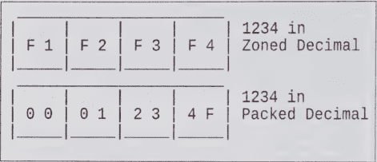

Figure 57 1234 在带区与打包格式中

在 PACK 指令中，两个操作数都位于内存中。操作数按字节从左到右逐个处理。第二操作数为源，结果替换第一操作数。条件码保持不变。

从源中从左到右读取字节，去除区域并将数字部分存储到目标中下一个可用的半字节，向右移动。源和目标的长度可能不同，但目标必须足够长以容纳答案。如果源字段较短而目标字段较长，则目标会根据需要用前导零向左填充。

然而，源的最后一个字节的处理方式不同。在这种情况下，源字节的区域和数字部分被反转并放置在目标的最后一个（最右）字节中。这始终会在符号位置产生 F₁₆ 代码。由于 F₁₆ 是打包格式中的正号指示符之一，所有数字最初都是正数，直到被程序更改为止。正号可以通过在打包结果的低位（最右）字节上执行 AND Immediate 指令，并使用立即字节（掩码）X'F0' 来更改为负号。这将保留高 4 位并将低位 F₁₆ 改为 D₁₆，从而使数字变为负数。

一旦数字处于打包格式，您就可以对其进行算术运算。虽然打包或十进制算术比二进制算术慢，但它可以处理更多精度的数字，并且不需要进一步转换。

### 17.3 将打包十进制转换为二进制

要将数字从带区十进制转换为定点二进制，您首先必须打包该数字（PACK 速度非常快），然后执行 Convert to Binary 指令。在原始架构中，这由 CVB 指令执行，该指令将打包数字转换为 32 位有符号定点二进制整数，并将结果留在寄存器中。

最近，添加了类似的 CVBY 指令，其与 CVB 的区别在于它使用有符号长位移。还添加了 CVBG，它同样使用有符号长位移，但结果占用 64 位。对于 CVB 和 CVBY 指令，第二操作数是一个 8 字节打包十进制字段，而对于 CVBG，第二操作数是一个 16 字节打包十进制字段。

反向操作，将二进制转换为打包，是由 Convert to Decimal CVD 指令完成的，该指令使用有符号 32 位源寄存器。还提供了 CVDY 和 CVDG 指令，它们使用长有符号位移，并且在 CVDG 的情况下，源是一个 64 位寄存器。指令将 8 或 16 字节有符号打包十进制数写入内存，分别对应 32 位和 64 位寄存器源操作数。

### 17.4 十进制指令集

打包十进制算术指令的基本集合如图所示 58。

| 代码 | 描述 |
|------|------|
| AP | 打包相加 |
| CP | 打包比较 |
| DP | 打包除法 |
| ED | 编辑 |
| EDMK | 编辑并标记 |
| MP | 打包乘法 |
| SP | 打包减法 |
| SRP | 移位和舍入打包 |
| TP | 测试打包 |
| ZAP | 零化和打包相加 |

Figure 58 十进制指令

图 59 中的示例说明了一些基本的打包算术运算。它读取一组带区的数字

```asm
 1      PRINT     NOGEN
 2  SUM SUBENTRY
 4  LOOP XREAD     IN,L'IN
 5       BC        B'0100',ATEND
 6       XPRNT     IN,L'IN
 7       PACK      NBR,IN+1(7)       * PACK THE NUMBER
 8       CLI       IN,C'+'
 9       BE        ADD
10       CLI       IN,C'-'
11       BNE       ERR1
12       NI        NBR+7,X'FD'       * make negative
13  ADD  TP        NBR
14       BNE       ERR2
15       AP        ACC,NBR           * ADD TO TOTAL
16       B         LOOP              * READ ANOTHER RECORD
18       * EOF - BRANCH HERE WHEN OUT OF RECORDS
20  ERR1 XPRNT     ERRM1,L'ERRM1
21       B         EXIT
23  ERR2 XPRNT     ERRM2,L'ERRM2
24       B         EXIT
26  ATEND ED        RSLT,ACC          * UNPACK AND FORMAT RESULT
27       XPRNT     RSLT,L'RSLT
28  EXIT SUBEXIT
30  IN   DS        CL8
31  NBR  DS        PL8
32  ACC  DC        PL4'0'
33  ERRM1 DC        C'SIGN ERROR'
34  ERRM2 DC        C'NUMBER ERROR'
36  RSLT DC        X'40202020202120' * EDIT PATTERN
38  END  ADD
```

示例输入数据：

1
1234
-1234
2

Figure 59 十进制算术示例

### 17.6 打包乘法 (MP)

在 MP 指令中，乘数（第二操作数）乘以被乘数（第一操作数），结果放在第一操作数中。乘数不得长于 15 位数字，并且长度必须短于被乘数。为了防止溢出发生，被乘数必须至少包含与乘数字节数相同数量的前导零字节。如果不是这种情况，则会发生数据异常。条件码保持不变。

### 17.7 打包除法 (DP)

在 DP 指令中，第一操作数为被除数，第二操作数为除数。结果为商和余数，将替换被除数。除数不得长于 15 位数字。

商占用结果的最左字节。其长度等于被除数（L1）与除数（L2）长度之差。余数占用第一操作数的剩余字节。在除以零或商太大而无法容纳在可用数字中的情况下，会发生十进制除法异常。条件码保持不变。

### 17.8 编辑 (ED)

尽管存在 Unpack 指令（UNPK），但 ED 指令是将打包十进制数转换为带区十进制、可打印字符串的首选方法。第一个操作数是一组控制格式化过程的模式代码，第二个操作数是要转换的打包数字。结果替换第一个操作数。

第一个操作数模式的第一个字节称为填充字节。它将放置在结果的前导字节中，替换不重要的前导零。

填充字节之后是一组模式字节和消息字节。

指令开始时，重要性指示器处于关闭状态。它保持关闭状态，直到遇到重要数字（即非零）或由模式字节打开。当重要性指示器关闭时，源中的零将被填充字节替换。如果重要性指示器打开，即使数字为零，源数字也会出现在结果中。

有两个主要的模式字节：20₁₆ 和 21₁₆。第一个称为数字选择器。如果在格式中遇到，则选择源字段中的下一个数字。如果源数字为零且重要性指示器关闭，则填充字节替换该数字

selector. 如果数字非零或有效性指示器打开，则该数字将被转换为带区十进制并替换数字选择器。如果选择了非零数字，则如果尚未打开，则会打开有效性指示器。

模式代码 21₁₆ 称为有效性起始符。它与上面的 20₁₆ 作用类似，只是如果尚未打开则会打开有效性指示器。打开有效性指示器会影响下一个数字，而不是当前数字。

模式中的其他字符，例如逗号和小数点，只有在有效性指示器打开时才显示。否则，它们将被填充字节替换。

当选择数字的最后一位时，会检查符号。如果符号为正（CAFE），则关闭有效性指示器。如果符号为负，则保持打开或打开。其效果是保留或替换格式中的尾随字符。例如，格式中的最后字符可能是 (DB)，表示借方或负余额。如果数字为正，(DB) 将被填充字节替换，但如果数字为负，则保留在结果中。（注意：您经常在银行对账单中看到这一点，其中负值显示在数字末尾）。例如，模式（为便于阅读添加了额外空格）：

```
40 20 20 20 6B 20 20 20 6B 20 21 20 4B 20 20 4D C4 C2 5D
```

40₁₆ 为空白。6B₁₆ 为逗号，而 4B₁₆ 为小数点。4D₁₆ 为左括号，5D₁₆ 为右括号。C4₁₆ 为字母 D，C2₁₆ 为字母 B。

填充字符为空白。在遇到非零字符之前，空白会替换选择器字节和逗号。但是，就在小数点之前，如果尚未打开，则会强制打开有效性指示器。这意味着小数点前的零以及小数点本身将被打印。如果数字为负，则会打印 (DB)，如果数字为正，则将其转换为空白。例如：

| 十六进制 | | 结果 |
|---|---|---|
| 00 00 00 00 00 0C | 变为 | 0.00 |
| 00 00 00 00 00 0D | 变为 | 0.00 (DB) |
| 00 00 00 10 00 0C | 变为 | 1.00 |
| 00 00 01 00 00 0C | 变为 | 1,000.00 |
| 00 10 00 00 00 0D | 变为 | 1,000,000.00 (DB) |

### 17.9 杂项十进制相关

### 17.10 指令

#### 17.10.1 解包 (UNPK)

UNPK 指令将每个打包十进制第二操作数转换为带区格式，但最后一位除外。源中的每一位数字在结果中都成为一个字节，并带有前导 F16 区，除最后一位外，最后一位成为最终结果字节中的数字，但其区不是 F16，而是来自源的符号。UNPK 的实用性不如 ED。

#### 17.10.2 移动数字 (MVN)

每个源字节（第二操作数）最右边的 4 位被移动到目标操作数（第一操作数）最右边的 4 位。区域保持不变。条件码保持不变。最多可参与 256 个字节。

#### 17.10.3 移动区域 (MVZ)

每个源字节（第二操作数）最左边的 4 位被移动到目标操作数（第一操作数）最左边的 4 位。数字保持不变。条件码保持不变。最多可参与 256 个字节。

## 18. CSECT、DSECT 和基址寄存器

### 18.1 CSECT

汇编语言程序由一个或多个节组成。节有三种类型：控制节（CSECTs）、公共节（COMs）和虚拟节（DSECTs）。CSECT 包含普通代码，虚拟节不生成目标代码，而是内存的布局或映射，公共节是多个目标模块共用的内存区域。

CSECT 指令用于开始或继续一个控制节。CSECT 指令上的标签是用于链接目的的节名称。START 指令仅在汇编程序开始时使用，等同于 CSECT。在具有多个 CSECT 的程序中，多个节的代码可能交错在源文件中。CSECT 指令用于标识不同代码节属于哪个节。

```
FIRST     CSECT
          .
          .                 some code for CSECT FIRST
          .
SECOND    CSECT
          .
          .                 some code for CSECT SECOND
          .
TMPLT1    DSECT
          .
          .                 some code for DSECT TMPLT1
          .
FIRST     CSECT
          .
          .                 more code for CSECT FIRST
          .
SECOND    CSECT
          .
          .                 more code for CSECT SECOND
          .
```

图 60 CSECT/DSECT 流程

在汇编语言程序中，您可能有多个 CSECT 和 DSECT（下面讨论）。它们不必是连续的。您可以开始一个 CSECT 并编写一些代码，然后开始另一个，同样编写一些代码，中断它并声明一个 DSECT，然后恢复对之前 CSECT 的编码。汇编器会将每个部分的各个部分收集到目标模块的单独节中。

图 60 给出了一个示例。最初，我们开始编码 CSECT FIRST。这被 CSECT SECOND 的一些代码中断，而该代码又被 DSECT TMPLT1 的代码中断。我们恢复编码 CSECT FIRST。这将从我们离开的地方继续编码。同样，我们接下来恢复编码 CSECT SECOND，它将继续 SECOND。汇编器会将这些组织成连续的块。

### 18.2 基址寄存器寻址

正如我们所见，在原始架构中，RX、SI、SS 和 RS 指令中的内存驻留操作数由基址寄存器、索引寄存器和 RX 格式中的位移的组合寻址，或位移和基址（在其他所有格式中）寻址。较新的架构版本在此列表中添加了格式：RSL、RSY、RXE、RXF、RXY、S、SIY 和 SSE。在原始架构和大多数较新的指令中，操作数的基址/位移寻址是常态。然而，格式 RI、RIE、RIL 和 RSI 具有有符号立即操作数，在某些指令中它们会加到当前指令地址以形成内存地址。

在格式 RX、SI、SS、RS、RSL、RXE、RXF、S 和 SSE 中，位移是一个 12 位无符号正数。在 RSY、RXY 和 SLY 中，位移是一个 2 的补码中的 20 位有符号数。

使用基址和位移寻址内存操作数时，基址寄存器（R1 到 R15 之间的任何寄存器，但通常在 R2 到 R13 范围内）包含内存中某个位置的地址。操作数地址通过将位移与基址的内容以及可选的索引寄存器内容相加来计算。

基本架构中的位移为正的 12 位数字，因此范围为 0 到 4095。在某些较新的指令中，位移为 20 位有符号数，范围为 +524,288 到 -524,289。在 20 位位移的情况下，单个基址寄存器通常足以用于整个程序。然而，许多遗留程序使用 12 位位移模型，这通常意味着程序必须使用多个基址寄存器。

通常，在汇编语言程序开始时，汇编器会被告知哪个寄存器将作为基址寄存器，然后它会被加载程序开始处或附近的地址。从这一点开始，汇编器将把标签的地址计算为相对于基址寄存器中包含地址的程序点的位移。

### 18.3 程序长度超过 4096 字节

原始架构中使用的基址-位移寻址方案的一个问题是，从基址寄存器的最大位移为 4095 字节。也就是说，汇编器无法寻址距离基址寄存器中包含的地址超过 4095 字节的字节。当字节在此可寻址窗口内时，我们说该标签在基址寄存器的使用范围内。

然而，现实世界中的程序显然长于 4096 字节。基址寄存器可寻址性问题可以通过使用多个基址寄存器部分解决，其中第二个指向第一个之后的 4096 字节，以此类推。

然而，对于大型程序，通常没有足够的空闲寄存器来允许预分配大量基址寄存器，因此必须采用其他技术。其中一种技术是 larger 程序被组织为代码块，每个块在进入块时建立自己的基址寄存器。因此，相同的寄存器或寄存器可以重复使用。

### 18.4 加载地址 - BALR / BASR

通过 BALR 或 BASR 指令可以将地址加载到基址寄存器中，其中第二操作数指定为 R0（BAL 和 BAS 指令也会将当前地址加载到寄存器中，但它们总是分支）。在 BALR 和 BASR 中，不会发生分支，因为第二操作数是 R0。第一操作数接收 BALR 或 BASR 之后字节的地址。

因此，例如，如果我们想将 R12 建立为基址寄存器，我们首先将其加载为程序中当前位置的地址。然后我们通知汇编器 R12 是基址寄存器以及 R12 内容指向的位置。这可以通过以下代码片段实现：

```
BASR R12,R0
USING *,R12
```

上述代码将 BASR 之后字节的地址加载到 R12，然后告诉汇编器使用 R12 作为基址寄存器。汇编指令 USING 的格式为地址表达式，后跟一个或多个寄存器指定。在这种情况下，地址表达式为星号，表示此处。假设寄存器包含地址表达式指示的地址。如果 USING 指定多个寄存器，则假设它们包含地址 4096、8192、

等等超出第一个寄存器中的值。注意 USING 位于 BALR/BASR 之后。这是因为加载到作为第一个操作数指定的寄存器（R12）中的地址是 BALR/BASR 之后立即的字节的地址。因此，由于星号指的是当前地址，USING 需要放在 BALR 之后。如果顺序相反，汇编器会假设 R12 中的地址是 BALR/BASR 的地址。

你也会注意到有一个 DROP 指令。这会停止使用一个基址寄存器。USING 和 DROP 的使用是汇编时指令——它们覆盖代码区域，而不是运行时的状态。也就是说，从程序中某个点或某行通过 USING 将寄存器指定为基址寄存器开始，直到该寄存器被 DROP 丢弃的点或行（或程序结束），汇编器都可以使用该寄存器来构造基址和位移地址。在该区域之外，该寄存器不是基址寄存器。

当操作数可以用有效的基址和位移组合寻址时，称其为在使用中；如果操作数超出任何基址寄存器的最大 4095 字节位移，则称该操作数超出使用范围。

### 18.5 指定多个基址寄存器

你可以通过在 USING 语句中包含多个寄存器来告诉汇编器使用多个基址寄存器，如图 61 所示。汇编器假设每个寄存器的内容是一个地址值，比列表中前一个寄存器高 4096。在较长的程序中，汇编器会选择最接近标签的基址寄存器。

由于只有十五个寄存器可以用作基址寄存器（R0 不能用作基址寄存器），大多数大型程序经常重用基址寄存器，而不是同时使用许多寄存器。然而，同时有多个基址寄存器可用于寻址并不罕见。在这种情况下，程序员需要确保正确加载每个寄存器。一个示例可见于图 61。

```
1   BALR        R12,R0
2   USING       *,R12,R11,R10
3   LA          R11,2048(R0,R12)
4   LA          R11,2048(R0,R11)
5   LA          R10,2048(R0,R11)
6   LA          R10,2048(R0,R10)
```

图 61 多个基址寄存器

图 61 中的代码首先用 BALR 之后字节的地址加载 R12。然后它告诉汇编器寄存器 12、11 和 10 可用作基址寄存器。汇编器假设这些寄存器分别相隔 4096 和 8192 字节。LA 指令用于从 R12 的值设置 R11 和 R10。请注意，由于最大位移为 4095，因此需要两个 LA 来加上 4096。

使用多个基址寄存器的简化示例，局部于代码块，给出在图 62 中，其中使用了三个基址寄存器。在此示例中，每行生成的十六进制代码显示在右侧，并且通常的 SUBENTRY 宏被更简单的入口代码形式所取代。关于此示例的说明：

- 1. CSECT（第 3 行）告诉汇编器此模块的名称，但不生成代码。
- 2. 根据操作系统约定，进入程序时，R15 始终包含入口点的第一个字节的地址，此处为开头。
- 3. 第 5 行的 STM 保存调用程序的寄存器，这些寄存器在返回前由第 15 行的 LM 重新加载。
- 4. 进入程序时，R14 包含返回地址。因此第 16 行的 BR 返回到调用者。
- 5. 第 4 行的 USING 告诉汇编器它可以使用 R15 作为基址寄存器，并假设其包含当前（*）字节的地址。由于 USING 指令不生成代码，当前字节是下一行 STM 的第一个字节，即程序的第一个字节，也是 R15 所指向的字节。
- 6. 在第 5 行可以看到，STM 使用 R15（F₁₆）作为基址寄存器，位移为 008₁₆（已高亮）来寻址标签 SAVE。同样，第 8 行的 XPRNT 使用 R15 作为基址，位移为 060₁₆（已高亮）来寻址 OUT1。
- 7. 第 9 行的 BALR 将 BALR 之后字节的地址（XPRNT 的第一个字节）加载到 R14 中，但不进行分支，因为第二个操作数是 R0。
- 8. 第 10 行的 USING 告诉汇编器 R14 是一个基址寄存器，且其内容是下一行 XPRNT 的第一个字节的地址。当使用 BALR 或类似指令加载地址时，如果使用 * 地址形式，则 USING 位于下一行。
- 9. 第 11 行有两个可能的基址寄存器：R15 和 R14。汇编器在 XPRNT 中选择 R14（E₁₆），位移为 01E₁₆（已高亮）。
- 10. 第 12、13 和 14 行重复此模式。
- 11. 第 15 行，LM 重新加载寄存器，但请注意所选的基址寄存器是 R15，位移为 008₁₆。这是因为 R15 覆盖了从第 4 行开始直至结束的程序区域并且可用。如果在 STM 之前有 DROP，就不会有基址寄存器可用。

虽然基址寄存器的加载是在运行时完成的，但基址寄存器的覆盖范围是在汇编时确定的。一旦通过 USING 建立了基址寄存器，它将一直有效，直到程序结束或遇到 DROP 指令。当汇编器遇到对标签的引用时，它会查看哪些基址寄存器当前对该标签有效，然后选择一个（如果有多个可用）可产生最小位移的基址寄存器。在原始架构中，位移只能向前（正值）。在某些更新的指令中，它们可能为负值。

```
1  000000          PRINT   NOGEN
2  000000          EQUEREGS
3  000000          DEMO    CSECT
4  000000          USING   *,R15
5  000000  90ECF008        STM    R14,R12,SAVE
6  000004  47F0F044        B      L1
7  000008                 SAVE   DS     15F
8  000044  E020F060000A    L1     XPRNT  OUT1,L'OUT1'
9  00004A  05E0           BALR   R14,R0
10 00004C                 USING   *,R14
11 00004C  E020E01E000A    XPRNT  OUT2,L'OUT2'
12 000052  05D0           BALR   R13,R0
13 000054                 USING   *,R13
14 000054  E020D020000A    XPRNT  OUT3,L'OUT3'
15 00005A  9BECF008        LM     R14,R12,SAVE
16 00005E  07FE           BR     14
17 000060  D6E4E3F14040404 OUT1   DC     CL10'OUT1'
18 00006A  D6E4E3F24040404 OUT2   DC     CL10'OUT2'
19 000074  D6E4E3F34040404 OUT3   DC     CL10'OUT3'
```

## 图 62 三个基址寄存器示例

图 63 中的程序类似，但它显示了相同的基址寄存器 R14 被使用多次。此示例更典型地代表了一个具有许多代码块的程序，每个块都重新初始化一个基址寄存器。

R15 最初被建立为基址寄存器，并且在整个程序中保持有效。它在第 8 行的 XPRNT 中使用，位移为 060_16（已高亮）。

在第 9 行和第 10 行，R14 变得可用，并且在第 11 行的 XPRNT 中使用，位移为 01E_16（已高亮）。

在第 12 行，R14 被丢弃作为基址寄存器，但在第 13 行和第 14 行重新建立，这次内容为新的（来自第 13 行的 BALR）。它在第 15 行的 XPRNT 中使用，位移为 020_16（已高亮）。

在第 16 行，对 SAVE 的引用使用 R15 和位移 008_16。R15 在整个程序中保持为基址。它在第 5、6 和 8 行中使用，因为在组装这些行代码时它是唯一生效的基址寄存器。R14 在两次情况下尚未生效。R15 在第 16 行中使用，因为它是当前生效的唯一基址寄存器，并且在看到标签 SAVE 时也在生效。

```
1 000000          PRINT   NOGEN
2 000000          EQUEREGS
3 000000      DEMO CSECT
4 000000          USING   *,R15
5 000000 90ECF008          STM     R14,R12,SAVE
6 000004 47F0F044          B       L1
7 000008          SAVE    DS      15F
8 000044 E020F060000A L1    XPRNT   OUT1,L'OUT1
9 00004A 05E0            BALR    R14,R0
10 00004C            USING   *,R14
11 00004C E020E01B000A        XPRNT   OUT2,L'OUT2
12 000052 05D0            BALR    R13,R0
13 000054            USING   *,R13
14 000054 E020D020000A        XPRNT   OUT3,L'OUT3
15 00005A 9E8CF008          LM      R14,R12,SAVE
16 00005E 07FE            BR      14
17 000060 D6E4E3F1404040 OUT1   DC      CL10'OUT1'
18 00006A D6E4E3F2404040 OUT2   DC      CL10'OUT2'
19 000074 D6E4E3F3404040 OUT3   DC      CL10'OUT3'
20 00007E                END
```


### 18.6 DSECT

DSECT 是一种代码段，包含普通的汇编语言语句，但不会生成目标代码。它们主要用作布局，以辅助编写程序。

例如，考虑一个程序包含一个按数组结构组织的电话目录。数组中的每个条目由 30 个字符的姓名、30 个字符的城市、2 个字符的州代码、5 个字符的邮政编码和 10 个字符的电话号码组成，每个条目共 77 字节。假设数组长度为 77,000 字节，足以容纳 1,000 个条目。图 64 给出了一个打印数组中每个元素的代码片段。它通过第 9 行的 BCT 循环 1,000 次，直到 R3 变为零。每个 XPRNT 语句使用相对于每个数组条目起始位置的偏移量来打印结构的一部分。R2 是一个指针，它从每个数组条目的起始位置推进到下一个条目。

```
1   LA      R2,ARRAY
2   L       R3,=F'1000'
3 LOOP    XPRNT 0(R2),30      * NAME
4        XPRNT 30(R2),30      * CITY
5        XPRNT 60(R2),2       * STATE
6        XPRNT 62(R2),5       * ZIP
7        XPRNT 67(R2),10      * PHONE
8        LA   R2,77(0,R2)     * INCR POINTER
9        BCT  R3,LOOP
```

图 64 未使用 DSECT 的表

DSECT 是数组中一个元素的布局。它实际上不会在目标模块中保留内存。

在第 8 行，我们将数据数组的地址加载到 R2 中；在第 9 行，告诉汇编器，对 DSECT ID 中所描述数据的任何引用都应以 R2 为基址。因此，当我们在第 11 至 15 行引用 DSECT 中的标签时，汇编器会生成相对于 R2 的代码，其偏移量从 DSECT 的开头计算（NAME 的偏移量为 0，CITY 的偏移量为 30，STATE 的偏移量为 60，依此类推）。

DSECT 方法有几个明显的优点，其中最重要的是可读性。还应注意，如果数据结构发生变化，例如扩大 name 字段，只需在 DSECT 本身修改，而无需在每个 XPRNT 语句中修改。

```
1  ID      DSECT
2  NAME    DS      CL30
3  CITY    DS      CL30
4  STATE   DS      CL2
5  ZIP     DS      CL5
6  PHONE   DS      CL10
7  PGM     CSECT
8         LA      R2,ARRAY
9         USING   ID,R2
10        L       R3,=F'1000'
11 LOOP    XPRNT   NAME,L'NAME      * NAME
12        XPRNT   CITY,L'CITY      * CITY
13        XPRNT   STATE,L'STATE    * STATE
14        XPRNT   ZIP,L'ZIP        * ZIP
15        XPRNT   PHONE,L'PHONE    * PHONE
16        LA      R2,77(0,R2)      * INCR POINTER
17        BCT     R3,LOOP
```

图 65 使用 DSECT 的表

## 19. 子程序调用与链接

链接指操作系统使用的一组约定，程序通过它相互调用、传递参数和返回值。IBM 大型机仍然使用许多 1964 年机器推出时建立的原始链接约定，尽管此后又增加了一些模式。就本文而言，我们主要使用 z390 模拟器提供的 SUBENTRY 和 SUBEXIT 宏所体现的传统链接。这些宏遵循传统的 31 位程序链接约定。根据寻址模式和其他与语言相关的条件（例如调用由 C/C++ 编写的程序），可能会应用其他链接约定。

SUBENTRY 将调用程序的寄存器内容保存在调用程序的保存区中，创建一个供我们程序所调用的任何程序使用的本地保存区，并设置基址寄存器。SUBEXIT 恢复调用程序的寄存器并分支返回调用程序。

### 19.1 链接寄存器

进入例程时，若干寄存器具有预定义值，如表 38 所示。

表 38 链接寄存器

| 寄存器 | 描述 |
| --- | --- |
| R1 | 参数列表的地址 |
| R13 | 调用程序中保存区的地址 |
| R14 | 调用程序中返回点的地址 |
| R15 | 被调用程序中入口点的地址 |

1. 进入例程时，R1 指向内存中的一个地址表。每个地址依次指向正在传递给子例程的一个参数。
2. 进入时，R13 指向调用程序中一个 72 字节保存区的地址，被调用程序将在此保存区中存储调用程序的大部分寄存器。这些寄存器在退出被调用程序时恢复。
3. R14 包含返回地址。也就是说，当你的程序完成时，它应分支到 R14 中包含的地址。
4. R15 包含被调用程序中入口点的地址。通常这是被调用程序中第一条指令的地址，但有些例程可以有多个入口点。无论如何，R15 是进入例程时要执行的第一条指令的地址。它也是由调用程序提供的。
5. 进入程序时，被调用程序有责任保存调用程序的寄存器，并在退出时恢复它们。
6. 程序保存寄存器有两个位置。第一个是在调用程序提供的保存区中（由 R13 指向），第二个是在系统提供的链接栈中。
7. 被调用程序的 ASC 模式决定可以使用哪种方法。主模式程序可以使用链接栈或调用程序的保存区，而 AR 模式程序则必须使用链接栈。
8. 调用程序提供的保存区可以是调用程序中静态分配的，也可以是动态分配的区域。在 31 位或 24 位寻址模式下运行的程序，其保存区长度为 18 个全字，即 72 字节。

### 19.2 静态保存区

在最初的链接模型中，每个可能调用其他程序的程序都有一个本地保存区。最底层的程序不调用其他程序，因此不需要本地保存区。如表 39 所示，保存区是一个 18 个全字（72 字节）的区域（假设为 31 位或 24 位寻址模式），用于保存寄存器内容。它还通过提供指向前一个保存区的指针链表，有助于调试。注意：有一些较新的链接模型允许在系统栈上分配保存区，从而支持递归、多线程等。

按照约定，进入例程时，R13 将包含调用程序数据区中一个保存区的地址。例程开始时，应立即将所有通用寄存器（R13 除外）的内容保存到调用程序的保存区中。然后创建自己的保存区，并在进行一些交叉链接后，将自己的程序保存区的地址放入 R13。

z390 提供了一个名为 SUBENTRY 的宏来执行基本的程序入口任务。该代码保存调用程序的寄存器并设置本地保存区。SUBENTRY 宏生成的代码示例见图 66“SUBENTRY 代码”。行号来自汇编器，每个行号后的加号表示该代码来自宏展开（非宏代码的行号没有加号）。

表 39 保存区

| 偏移量 | 字 | 内容 |
| --- | --- | --- |
| 0 | 字 1 |  |
| 4 | 字 2 | 调用程序保存区的地址 |
| 8 | 字 3 | 被调用程序保存区的地址 |
| 12 | 字 4 | 寄存器 14 |
| 16 | 字 5 | 寄存器 15 |
| 20 | 字 6 | 寄存器 0 |
| 24 | 字 7 | 寄存器 1 |
| 28 | 字 8 | 寄存器 2 |
| 32 | 字 9 | 寄存器 3 |
| 36 | 字 10 | 寄存器 4 |
| 40 | 字 11 | 寄存器 5 |
| 44 | 字 12 | 寄存器 6 |
| 48 | 字 13 | 寄存器 7 |
| 52 | 字 14 | 寄存器 8 |
| 56 | 字 15 | 寄存器 9 |
| 60 | 字 16 | 寄存器 10 |
| 64 | 字 17 | 寄存器 11 |
| 68 | 字 18 | 寄存器 12 |

在第 3 行，汇编器被告知这是控制段的开始，其名称为 ADD（来自 SUBENTRY 上的标签）。CSECT 是一条汇编器指令，不生成代码，它表示控制段。

在第 4 行，STM（多寄存器存储）将寄存器 R14、R15、R0、R1、... R11、R12 保存到连续的 4 字节全字中，从调用程序（R13）保存区的第四个全字开始。第 4 个字从调用程序保存区起始处偏移 12 的位置开始，该保存区的地址存放在 R13 中，因此 R13 之后的位移量为 12。

```
3+ADD    CSECT
4+       STM     14,12,12(13)
5+       BAL     15,104(15)
6+       DC      18F'0'
7+       DC      CL8'ADD'
8+       DC      CL8'09/14/10'
9+       DC      CL8'20.33'
10+      ST      15,8(13)
11+      ST      13,4(15)
12+      LR      13,15
13+      USING   ADD+8,13
```

图 66 SUBENTRY 代码


下一条指令 BAL（分支并链接）做了两件事：它导致分支到第 10 行的 ST（存储）指令，并将 R15 的内容重置为指向紧随其后的本地 18 个全字保存区的第一个字节。这是当前程序的保存区。注意它是以静态方式（即非动态）分配的。

第 5 行的分支地址是通过将 R15 的内容加上 104 计算得出的，该位移足以绕过保存区和固定长度的程序名信息。第 10 行的 ST 指令距离开始的 STM 为 104 字节。

R15 接收保存区第一个字节的地址（由于 BAL），但要等到分支地址计算完成后。BAL 首先计算分支目标地址。然后它将 PSW 的更新后地址部分，即 BAL 之后紧跟的字节的地址，加载到第一个操作数 R15 中。最后，它执行分支。

在指令执行时，PSW 的地址部分始终包含指令之后紧跟的字节的地址。在大多数情况下，这是下一条指令的地址。然而在本例中，它是我们的程序保存区的地址。

在第 10 行，ST 指令将我们保存区的地址存储到调用程序保存区的第三个字中，然后将调用程序保存区的地址存储到我们保存区的第二个字中。因此，调用程序的保存区指向我们，而我们的保存区指向调用程序的保存区。

R15 的内容（现在是我们保存区的地址）被复制到 R13，并指示汇编器使用 R13 作为基址寄存器，并假定它指向程序的第 8 个字节（保存区的第一个字节），确实如此。

你会注意到在 18 字保存区之后，有字符字段包含 CSECT 的名称以及汇编时的日期和时间。

幸运的是，所有这些都由 SUBENTRY 宏完成。同样，SUBEXIT 宏重新加载调用程序的寄存器并返回 R14 中最初提供的地址。

### 19.3 链接可重入和递归程序

虽然许多，如果不是大多数，遗留代码都是使用如上所述的静态保存区和链接编写的，但这种方法存在问题。其中包括程序直接或间接调用自身（递归）的问题，以及与可重入性相关的问题。在这两种情况下，静态保存区都不够用。

程序可以分为串行可重用、可重入或两者皆非。在可重用程序中，内存中加载的程序副本一次只能被一个用户使用，但在完成后，程序数据的原始状态会被恢复，另一个用户可以使用该代码。

可重入例程是可以有多个并发用户的一个。为了允许这一点，它必须是纯净的、不变的代码和数据。任何可能被修改的代码或数据都不应属于共享映像。它必须属于单个用户。

例如，编辑器的程序代码可以被多个用户并发使用。让内存中只驻留一份程序副本而不是为每个用户一份副本要高效得多。程序在多个用户之间共享。但为了使其工作，每个用户必须拥有自己的数据区和寄存器。程序本身可能只包含代码和常量。如果程序包含可更改的数据，最终会出现以下情况：

- 1. 一个执行程序的用户设置一个数据值并被中断，
- 2. 另一个用户获得控制权并将同一数据设置为不同值然后被中断，
- 3. 第一个用户获得控制权并使用实际上由另一个用户设置的数据值。

为避免这种情况，我们编写代码和数据不变的程序。硬件甚至通过 Execute 指令支持这一点，该指令允许对 SS 指令中的长度字节等进行符合可重入性的临时修改。

在多用户系统中，每个用户都有自己的私有分配数据区，由其寄存器指向。当操作系统在用户之间切换时，当前执行用户的通用寄存器、浮点寄存器和 PSW 以及其他每个用户的信息都会被保存，并在用户再次获得控制权时最终被恢复。

当代码模块在多个用户之间共享时，它使用特定用户的寄存器来寻址该用户的私有数据区。当另一个用户获得控制权时，程序使用该用户的寄存器来访问该用户的数据区。

因此，例如，图 65 中所示的电话表查找代码将其所有数据访问都基于寄存器 2 的内容，该寄存器是 DSECT ID 的基址。类似地，如果一个可重入程序将其所有数据引用都放在基于用户提供的基址寄存器的 DSECT 中，程序将为不同用户使用不同的数据区。程序本身除了常量外没有本地数据。

一个仅修改其寄存器内容以及寄存器指向的用户私有数据区中的数据的程序不会违反可重入性规则。每个用户都有自己的寄存器集合和自己的私有（未共享）数据区。

即使程序是可重入的并且每个用户都有自己的数据区，如果它使用静态分配（遗留）的保存区，程序调用自身（递归调用）时仍然存在问题。

如果程序调用自身，第二次调用将覆盖静态分配的保存区。如果程序间接调用自身也是如此。因此，我们需要一种机制来为同一函数堆叠多个保存区。

一种方法是让被调用例程每次被调用时动态分配一个新的保存区，并在最终返回时释放它。这通常使用 GETMAIN 或 STORAGE 系统宏完成。

另一种方法是使用系统栈。原始的 IBM 360 架构未提供系统支持的栈。据传工程师认为该特性更具小型计算机的特征。尽管如此，该特性最终在 1989 年引入——25 年后！系统栈和几个半特权指令支持递归调用。

#### 19.3.1 链式动态分配的保存区

如前所述，需要递归调用的程序必须是可重入的，以便后续调用不会使用或更改先前调用的中间结果（如果它们被存储）。例如，阶乘的计算通常通过一系列递归调用完成。每个实例等待一个或多个更深层调用的返回。每个调用在返回前按需存储局部值以完成其求值层级。

图 67 给出了 C 语言中阶乘的示例，其中在第 12 行，每个调用等待较低层调用返回，并最终将其结果乘以当前值 i。变量 i 必须对每个调用是局部的且不共享。

实现此程序的一种方法是使用由 GETMAIN 或 STORAGE 宏动态分配的保存区链。

子程序 FACT 在第 32 行到第 93 行。它反复调用自身每次传递 N-1，直到 N 为 1 时返回（参见图 67 中的第 12 行）。由于程序调用自身，它不能使用静态保存区。它必须在每次进入时分配一个新的保存区，并在退出时删除它。

进入时，FACT 执行通常的 Store Multiple（第 33 行），根据传统链接约定将调用程序的寄存器保存到由 R13 指向的调用程序保存区中。第 34 行和第 35 行建立一个局部基址寄存器（R12）。

现在事情偏离了通常的入口序列。首先，我们通过将其复制到 R3 来保存 R1，其内容是指向参数列表的指针。这是因为第 41 行的 GETMAIN 将分配的内存地址返回到 R1 中。

```asm
 1          PRINT   NOGEN
 2          EQUATES
 3 MAIN     SUBENTRY                 * LEGACY LINKAGE

 5          LA      R5,5             * FIND FACTORIAL OF 5
 6          ST      R5,N             * SAVE IN MEMORY
 7          LA      R1,PARMS          * ADDRESS OF PARM LIST

 9          L       R15,=V(FACT)     * CALL FUNCTION
10          BASR    R14,R15

12          L       R1,N             * LOAD ANSWER
13          XDECO   R1,OUT           * CVT TO DEC & PRINT
14          XPRNT   MSG,L'MSG+L'OUT
15          SR      R15,R15          * RETURN CODE
16          SUBEXIT                   * LEGACY RETURN
17          LTORG

19 PARMS    DC      A(N)             * PARM LIST
20 N        DS      F
21          MSG     DC      C'FACTORIAL 5
22 OUT      DS      CL12

24 *
25 * DSECT TO ADDRESS GETMAIN ALLOCATIONS
26 *
27 AUTO     DSECT
28 SAVE     DS      18F              * SAVE AREA
```

29 PARM DS F * PARM LIST
30 N1 DS F * DATA
32 FACT CSECT
33 STM R14,R12,12(R13) * SAVE REGS
34 BALR R12,R0 * EST BASE REG
35 USING *,R12 * EST BASE REG
37 LR R3,R1 * PRESERVE R1
38 * * ADDR OF PARM LIST
39 * * GETMAIN WILL ALTER R1
41 GETMAIN RU,LV=80 * GET 80 BYTES
42 * * ALTERS R1 AND R0
43 ST R1,8(R13) * PARENT -> US
44 ST R13,4(R1) * WE -> PARENT SAVE AREA
45 LR R13,R1 * ALLOC AREA NOW OUR SAVE
46 USING AUTO,R13 * POINT DSECT AT ALLOC MEM
47 LR R1,R3 * RESTORE R1
49 L R5,0(0,R1)
50 L R5,0(0,R5) * 1ST PARM -> R5
51 XDECO R5,0T1 MSG1,L'OT1+L'MS
52 XPRNT G1
53 C R5,=F'1' * END OF RECURSION?
54 BNE RECURS * NO
55 L R2,0(0,R1) * ADDR 1ST PARM -> R2
56 ST R5,0(0,R2) * STORE 1 in 1ST PARM
58 EXIT LR R1,R13 * ADDR ALLOC MEM
59 L R13,4(R13) * ADD SAVE AREA ABOVE
60 FREEMAIN RU,A=(1),LV=80 * RELEASE MEM
61 LM R14,R12,12(R13) * RESTORE REGS
62 BR 14 * RETURN
64 RECURS LR R6,R5 * COPY PARM -> R6
65 S R6,=F'1' * DECREMENT
66 ST R6,N1 * STORE AS OUR PARM
67 LA R7,N1 * ADDR OF PARM
68 ST R7,PARM * STORE ADDR TO PARM LIST
69 LR R3,R1 * PRESERVE PARENT PARM
70 LA R1,PARM * R1 -> PARM LIST

#### 19.3.2 基于系统堆栈的链接

原始的 IBM 360 既没有硬件堆栈支持，也没有独立的指令和数据地址空间。在较新的版本中，这些功能在一定程度上被添加了。

链接堆栈于 1989 年引入，是系统提供的一种保存寄存器和其他系统状态信息的方式。使用链接堆栈的指令如 图 69 所示。

链接堆栈必须用于 AR（访问寄存器）地址空间控制（ASC）程序。在主模式下，CPU 使用通用寄存器计算地址，而在 AR 模式下，则使用访问寄存器的内容以及通用寄存器。本文仅涉及主 ASC 模式编程。AR 模式用于多个地址空间。对于非 AR（主）ASC 程序，它是可选的。

当分支并堆栈（BAKR）和程序调用（PC）指令执行时，它们会将所需的寄存器和状态保存到系统堆栈上。当程序返回（PR）执行时，它会恢复寄存器和状态。BAKR 除其他操作外，还会存储通用寄存器 2 到 14，而 PR 指令则恢复它们并分支到返回地址。

| 指令 | 助记符 | 类型 |
|---|---|---|
| 分支并堆栈 | BAKR | RSE |
| 提取堆栈寄存器 | EREG/EREGG | RRE |
| 提取堆栈状态 | ESTA | RRE |
| 修改堆栈状态 | MSTA | RRE |
| 程序调用 | PC | S |
| 程序返回 | PR | E |
| 测试访问 | TAR | RRE |

图 69 堆栈链接指令

##### 19.3.2.1 系统堆栈链接示例

图 70 显示了使用系统堆栈计算的阶乘程序。用于访问堆栈的指令是分支并堆栈寄存器（BAKR）和程序返回（PR）。

BAKR 指令将通用寄存器和访问寄存器（当程序处于 AR 模式时用于访问替代虚拟内存数据空间）存储在链接堆栈上。第一个操作数包含返回地址。除非第二个操作数为零，否则会分支到第二个操作数。

PR 指令恢复调用程序的访问寄存器和通用寄存器 2 - 14，从链接堆栈中移除条目，并将控制权返回给调用程序。请注意，仅恢复通用寄存器和访问寄存器 2 到 14。

图 70 中的程序功能与图 69 中的非常相似，只是所有中间结果和最终结果都存储在寄存器中，而不是内存中。因此，该程序是可重入的。由于使用了系统堆栈，它也是递归的。

要计算阶乘的数字（5）在第 8 行加载到 R5 中，并在第 10 行和第 11 行调用 FACT 子程序。返回后，R1 中的值，即答案，被打印出来。FACT 在 R5 中接收其参数，并在 R1 中返回结果。

进入时，FACT 执行分支并堆栈寄存器，从而保存调用程序的寄存器。它建立一个基址寄存器并测试 R5 中传递的值是否为 1。如果不是，则分支到 RECURS。如果是，则将 R5（1）的内容复制到 R1 并执行程序返回（PR）指令。请注意，PR 不会改变 R1。

 1        PRINT     NOGEN
 2        EQU       
 3        MAIN      CSECT
 4        BAKR      R14,0                 * STACK CALLERS REGS
 5        BASR      R12,0                 * GET ABS ADDR
 6        USING     *,R12                 * EST BASE REG
 7
 8        L         R5,=F'5'              * FACTORIAL TO CALC
 9
10        L         R15,=V(FACT)           * CALL FCN
11        BASR      R14,R15               * CALL FCN
12
13        XDECO     R1,OUT
14        XPRNT     MSG,L'MSG'+L'OUT'
15        SR        R15,R15               * RETURN CODE ZERO
16        PR
17
18        LTORG
19 MSG    DC        C' FACTORIAL = '
20 OUT    DS        CL12
21
22 FACT   CSECT
23        BAKR      R14,0                 * STACK CALLERS REGS
24        BASR      R12,0                 * GET ABS ADDR
25        USING     *,R12                 * EST BASE REG
26
27        C         R5,=F'1'              * DONE?
28        BNE       RECURS                * NO
29        LR        R1,R5                 * ANS --> R1
30          PR
31
32 RECURS
    LR      R6,R5          * SAVE CRNT FACTOR
33    S       R5,=F'1'       * DECR FOR NEXT LEVEL
34    L       R15,=V(FACT)   * RECURSE
35    BASR    R14,R15
36
37    SR      R4,R4          * GET READY TO MULT
38    LR      R5,R6          * MULTIPLICAND
39    MR      R4,R1          * R1 RETRND FROM FCN
40    LR      R1,R5          * COPY ANS TO R1 FOR RETRN
41    PR                  * RESTORE REGS AND RETURN
42
43    LTORG
    END

输出:
5 FACTORIAL =          120

图 70 基于系统堆栈的链接

在 RECURS 处，程序将 R5 的输入值保存到 R6，递减 R5 并调用自身。返回后（第 36 行至第 40 行），它将 R4/R5 的内容乘以 R1（返回的值），将结果复制到 R1 并返回。

## 20. 调试 (XDUMP, SNAP)

转储是机器在某一瞬间状态相关的内存、寄存器、PSW 和其他信息的快照，通常以十六进制表示。转储显示的内存区域可以是当前正在运行的程序的，也可以更大。在计算的早期，转储是打印在纸上，可能长达数千页。现在它们被写入文件。

通常在程序遇到运行时异常或中断时产生转储。或者，程序员可以使用 ASSIST XDUMP 宏或系统宏 SNAP 显式请求转储。

在因错误而产生的转储情况下，程序会终止。当程序员请求转储时，通常出于诊断原因，程序是否终止由程序员自行决定。

例如，如果将图 47 中的程序修改为包含如 图 71 所示的 XDUMP，则结果是如 图 72 所示的文本（长行已截断）。

转储的内容包含以下一项或多项：

- 1. 16 个 64 位通用寄存器 R0 到 RF（R0 到 R15）的内容；
- 2. 16 个 64 位浮点寄存器 F0 到 FF（F0 到 F15）的内容；
- 3. 从地址 00000000₁₆ 到地址 000FFFFF₁₆ 的内存内容。
- 4. PSW。
- 5. 保存区回溯。

通用寄存器和浮点寄存器的内容以 16 位十六进制数字显示（对应 8 字节）。通常，每行显示四个寄存器。例如，通用寄存器的第一行显示 R0、R1、R2 和 R3，而最后一行显示寄存器 RC（R12）、RD（R13）、RE（R14）和 RF（R15）的内容。浮点寄存器（F0 到 FF）也显示类似的模式。

z390 模拟器预先将每个寄存器的每个字节初始化为 F4₁₆，因此如果程序仅使用 32 位指令，寄存器的高 32 位可能为 F4₁₆。寄存器的低 32 位在程序运行过程中未使用寄存器时将为 F4₁₆。


### 20.1 XDUMP

XDUMP 是 ASSIST 包的一部分。它转储通用目的寄存器和浮点寄存器以及用户内存区域的全部或部分。如果 XDUMP 宏没有参数，则写入整个用户内存区域；而如果用户指定两个操作数给出要转储的内存区域的起始地址和长度，则写入有限区域。在这两种情况下，寄存器的内容都会显示。在 z390 模拟器中，输出会显示在用户的控制台上，并同时写入程序的 .LOG 文件。长度，如果存在，由常量或用括号括起来的寄存器组成。

```
XDUMP * REGS AND ALL MEMORY WRITTEN
XDUMP BEGIN,LENGTH * REGS & SOME MEMORY WRITTEN
```

### 20.2 SNAP

SNAP 是一个系统宏，通常在大多数系统上可用。它与 XDUMP 宏类似，但具有额外的可选操作数选项：

- 1. ID= 是可选的。如果给出，等号后提供的数字将出现在写入的输出中，以标识程序中哪个 SNAP 写入了同一内容。
- 2. PDATA=(...) 表示以逗号列表形式显示的可选项目。其中一些是：
  - 2.1. REGS - all registers displayed;
  - 2.2. GPR - only the general purpose registers displayed;
  - 2.3. FPR - only the floating point registers displayed;
  - 2.4. CB - all control blocks;
  - 2.5. DCB - DDNAME, DCB, AND DSNAME'S
- 3. STORAGE=(BEGIN,END) where BEGIN and END are the addresses of the starting and ending points of the memory area to be displayed (usually labels).
- 4. ID=nbr - a programmer supplied number that identifies the SNAP output.

Example:

```
SNAP PDATA=(GPR),STORAGE=(LAB1,LAB2)
```

### 20.3 Dump Format

SNAP 和 XDUMP 的输出格式相似。图 71 中的程序产生了图 72 中所示的 XDUMP。

在图 71 中，我们最初看到 16 个通用目的寄存器 R0 到 RF（寄存器标识符为十六进制），每行四个 8 字节寄存器。接下来，您将看到标记为 F0 到 FF 的 16 个浮点寄存器。请注意，z390 模拟器默认将所有寄存器初始化为 F4₁₆。在真实系统中并非如此。

接下来我们看到内存的内容，以 32 个十六进制数字的行显示，分成四个各为 8 位数字的字段。每组 8 位数字对应一个字（4 字节）内存。它们之间用空白分隔以提高可读性。因此，每行显示 16 字节内存。

每行的开头是该行第一个字节的地址。右侧是对该行每个字节转换为可打印字符的尝试。如果字节代码没有可打印字符，则打印一个句点。如果字节代码有可打印的等价物，则显示它。在大多数情况下，可打印的等价物没有意义。

因此，以下行：

```
00002600 *F0F61F1 F461F1F0 00000000 0000000* *09/14/10.........*
```

表示这是从 2600₁₆ 到 260F₁₆（含）开始的 16 个内存位置的转储（16 字节数据）。因为每行有 10₁₆（16₁₀）字节数据，所以下一行的地址将增加 10₁₆。

000000
000000
000000 9E CD00C
000004 45FF0668
000008 00000000000000
000050 C1C4C440404040
000058 F0F61F1F461F1
000060 F2F0B4F3F4040
000060 40
000068 50FD0008
00006C 6DF00004
000070 18DF
(1/1)1 PRINT GEN
(1/2)2 ADD SUBENTRY
(2/77)3+ADD CSECT
(2/167)4+ STM 14,12,12(13)
(2/168)5+ BAL 15,104(15)
(2/169)6+ DC 18F'0'
(2/170)7+ DC CLB'ADD'
(2/171)8+ DC CLB'09/14/10'
(2/172)9+ DC CLB'20.33'
(2/173)10+ ST 15,8(13)
(2/174)11+ ST 13,4(15)
(2/175)12+ LR 13,15

```
000072                     (2/188)13+ USING ADD+8,13
000072                     (1/3)15 EQU REGS
000072        00000        0      (3/41)16+R0 EQU 0
000072        00000        1      (3/41)17+R1 EQU 1
000072        00000        2      (3/41)18+R2 EQU 2
000072        00000        3      (3/41)19+R3 EQU 3
000072        00000        4      (3/41)20+R4 EQU 4
000072        00000        5      (3/41)21+R5 EQU 5
000072        00000        6      (3/41)22+R6 EQU 6
000072        00000        7      (3/41)23+R7 EQU 7
000072        00000        8      (3/41)24+R8 EQU 8
000072        00000        9      (3/41)25+R9 EQU 9
000072        00000        A      (3/41)26+R10 EQU 10
000072        00000        B      (3/41)27+R11 EQU 11
000072        00000        C      (3/41)28+R12 EQU 12
000072        00000        D      (3/41)29+R13 EQU 13
000072        00000        E      (3/41)30+R14 EQU 14
000072        00000        F      (3/41)31+R15 EQU 15
000072    1B22                  (1/4)33 SR R2,R2 * zero
000074 5A20DD88        0000C0 (1/5)34 A R2,ONE
000078 5A20DD8C        0000C4 (1/6)35 A R2,TWO
00007C 5A20DDC0        0000C8 (1/7)36 A R2,THREE
000080 5A20DDC4        0000CC (1/8)37 A R2,FOUR
000084 5A20DDC8        0000D0 (1/9)38 A R2,FIVE
000088 E020D800B0E     0000B0 (1/10)39 XPRNT MSG1,'MSG'
00008E 5220DDCC        0000D4 (1/11)40 XDECO R2,DBL
000092 E020DDCC00C     0000D4 (1/12)41 XPRNT DBL,L'DBL
000098 E60000000000            (1/13)42 XDUMP
00009E                     (1/14)43 SUBEXIT
00009E 41F00000         (4/33)44+ LA 15,0
0000A2 58000004         (4/50)45+ L 13,4(,13)
0000A6 5B0DD00C         (4/51)46+ L 14,12(,13)
0000AA 982C0D1C         (4/52)47+ LM 2,12,28(,13)
0000AE 07FE             (4/53)48+ BR 14
0000B0 D5 C184849958740
0000B0 D5              (1/15)50 MSG DC C'Adding Numbers'
0000C0 00000001         (1/16)51 ONE DC F'1'
0000C4 00000002         (1/17)52 TWO DC F'2'
0000C8 00000003         (1/18)53 THREE DC F'3'
0000CC 00000004         (1/19)54 DC F'4'
```

```
0000D0 00000005
FOUR
(1/20)55
0000D4
FIVE DC F'5'
(1/21)56 DBL DS CL12
0000E0
(1/22)57 END
```

## Figure 71 Add Program Details

最右侧列是对字节的字符解释尝试。它告诉我们该行内容的第一个八个字节对应字符：09/14/10，看起来是一个日期。剩余的 8 个字节没有可打印的等价物。这由句点表示。

将图 71 中的代码与图 72 中的转储进行比较，我们可以看到程序的第一个可执行指令（第 4 行）是 Store Multiple RS 指令：

```
STM 14,12,12(13)
```

其对应的机器代码为：

```
90ECD00C
```

这对应于 RS 格式（参见图 12）：

| Op Code | R1 | R3 | B2 | D2 |
|---|---|---|---|---|
| 90 | E | C | D | 00C |
| 0 | 8 | 12 | 16 | 20 | 31 |

其中操作码为 90₁₆，E₁₆（R14）在 R1 字段中，C₁₆（R12）在 R3 字段中，D₁₆（R13）在 B2 字段中，00C₁₆ 在 D2 字段中。

如果您查看地址 8000₁₆ 的转储，您将看到 STM 指令的相同代码。位置 8000₁₆ 是程序的第一个字节。事实上，由于模拟器的原因，所有程序都将显示为从位置 8000₁₆ 开始。

继续，STM 之后的下一条指令是：

```
BAL 15,104(15)
```

这是分支并链接 RX 指令，翻译成机器语言为：

```
45FF0068
```

其中 45₁₆ 是操作码，F₁₆（R15）是 R1 字段，F₁₆（R15）是 B2 字段（基寄存器），0（R0）是 X2（索引寄存器）字段，06B₁₆ 是 D2 字段。

在内存转储区域，地址列中出现“........”表示缺失的行与上一行相同。

查看通用目的寄存器，您可以看到基寄存器 R13 的内容为 80008008₁₆。高位位为 1（因此以 8 开头），并且只有低 31 位用于寻址。这对应于保存区域开始的地址。请注意，R14 有返回地址 2018₁₆，而 R15 的内容与 R13 相同，正如预期的那样。

请注意，R2 中有 15₁₀（F₁₆），这是计算的结果。

```
Adding Numbers
15
R0-R3 FAF... FAF... FAF... FAF... FAF... FAF...
R4-R7 FAF... FAF... FAF... FAF... FAF... FAF...
R8-RB FAF... FAF... FAF... FAF... FAF... FAF...
RC-RF FAF... FAF... FAF... FAF... FAF... FAF...
R0-R3 FAF... FAF... FAF... FAF... FAF... FAF...
R4-R7 FAF... FAF... FAF... FAF... FAF... FAF...
R8-RB FAF... FAF... FAF... FAF... FAF... FAF...
RC-RF FAF... FAF... FAF... FAF... FAF... FAF...
EC-F7 FAF... FAF... FAF... FAF... FAF... FAF...
0000010 00000000 00000000 00000000 00000000 *...*...........
0000020 00000000 00000000 00000000 00000000 *...*...........
0000040 *0000000 00000000 00000000 00000000 *...*...........
0000050 *85999F1 40404040 40404040 40404040 *err1
00002010 *0008108 00000000 0A010000 00000000 *...*...........
00002020 *00000000 00000000 00000000 00000000 *...*...........
00002070 *0000000 9B000000 00000000 00000000 *...*...........
00002080 *0000000 00000000 00000000 00000000 *...*...........
00002000 *0000000 00000000 00000000 00000000 *...*...........
00002060 *0000000 00000000 00000000 00000000 *...*...........
00002100 *0000000 00000000 80008008 0002018 *...*...........
00002110 *0000000 00000000 00002300 *...*...........
00002120 *FAFAFAFA *FAFAFAFA *FAFAFAFA *FAFAFAFA *FAFAFAFA *FAFAFAFA
00002140 *FAFAFAFA *FAFAFAFA *FAFAFAFA *FAFAFAFA *FAFAFAFA *FAFAFAFA
00002150 *0000000 00000000 00000000 00000000 *...*...........
00002300 *00002304 00000000 00000000 00000000 *...*...........
00002600 *F0F61F1 *F461F1F0 00000000 00000000 *09/14/10...........
00002610 *0000000 859999F1 40404040 40404040 *...*err1
00002620 *0000000 00000000 00000000 00000000 *...*...........
00008000 *90CEB0C0 45FF0068 00000000 0000210A *...*...........
00008010 *0000000 00000000 00000000 00000000 *...*...........
00008050 *C1C4C440 40404040 40404040 40404040 *ADD *09/14/10...........
00008060 *F1F7F3F2 *F2F0F0F0 00000000 00000000 *...*...........
00008070 *1F0F1F22 *SA2000C8 *SA2000C8 *SA2000C8 *...*...........
00008080 *DOCC020 *DOCC020 *DOCC020 *DOCC020 *...*...........
00008090 *0000000 *D0450D0 *D0450D0 *D0450D0 *...*...........
000080A0 *C14849B9 *9587A0D5 *A94A925 *C9F7EFA *Adding Numbers 6*
000080B0 *0000000 *40404040 *40404040 *40404040 *...*...........
000080D0 *0000005 *40404040 *40404040 *4040F1F5 *...*...........
15*
```


## 21. 系统输入/输出宏

操作系统提供的输入/输出宏会因操作系统和数据访问方法而异。IBM 架构中有许多传统访问方法，其中包括：

- 1. VSAM - 虚拟存储访问方法
- 2. BISAM/QISAM - 基本和排队索引顺序访问方法
- 3. BPAM - 基本分区访问方法
- 4. BDAM - 基本直接访问方法
- 5. BSAM/QSAM - 基本/排队顺序访问方法

所有方法的共同点是“数据控制块（DCB）”这一概念，它由同名宏创建，建立一个关于要访问的数据集（文件）的数据表。另一个建表宏是“数据事件控制块（DECB）”，根据访问方法的不同，用于同步异步 I/O。

### 21.1 控制台输入/输出

除了上面列出的访问方法外，还有用于控制台输入/输出的宏。这些宏旨在允许程序在系统控制台上直接与系统操作员通信。

您可以使用 WTO 和 WTOR 宏直接读写控制台（在 z390 模拟器中，控制台就是您的屏幕）。这里我们演示通常可在 IBM 汇编器中使用的 WTO 和 WTOR 宏。

WTO 宏可用于向控制台（模拟器中的命令提示符窗口）写入常量字符串，也可用于写入内存驻留字符串。最简单的形式是：
WTO 'STRING TO BE WRITTEN'
上述语句将把引号内的内容（最多 119 个字符）写入控制台窗口。或者，您可以使用以下语句将存储在内存中的字符串写入控制台：
WTO MF=(E,MSG)
其中 MSG 引用一个数据区域，例如：
MSG DC AL2(MSGEND-*,0)

```
MSG1 DS CL20
MSGEND EQU *
```

第一行 MSG 由两个半字组成。第一个半字包含要写入的字符串长度（包括半字本身）。第二个半字包含零。其后是包含要写入字符串的数据区域，在本例中是一个长度为 20 的字符串，其内容将在程序中其他位置设置。

符号 MSGEND 的值是程序中该符号出现点的位置计数器值。该值用于标签为 MSG 的那一行。MSG 处第一个半字的值是 MSG 的位置计数器值与 MSG1 之后的位置计数器值之差。请记住，* 表示当前的位置计数器值（如 USING 中所见），因此 MSGEND-* 就是差值，或者在本例中，是包含初始半字在内的消息长度。

```
1        PRINT       NOGEN
2                 EQUEREGS
3 WTO    SUBENTRY
4
5                 WTO        'CONSOLE READ/WRITE'
6
7                 WTOR       'ENTER A STRING',STRING,20,EV
8                 WAIT       ECB=EV      * PAUSE
9                 WTO        MF=(E,MSG)
10
11                SUBEXIT
12
13 MSG    DC          AL2(STREND-*,0),C'YOU TYPED '
14 STRING DS          CL20
15 STREND EQU         *
16
17 EV     DC          F'0'    * ECB
18
19                 END        WTO
```

### 图 73 控制台 I/O

WTOR 是一个相关宏，它既写入消息又接收回复。其参数包括：要写入的消息、内存中用于接收回复的区域、可选输入长度，以及事件控制块（ECB）（内存中的一个全字，初始设置为零）。如果省略输入长度，则由接收输入区域的隐含长度确定。该宏后面紧跟一行使用来自 WTOR 的 ECB 的 WAIT 宏。这会使程序暂停，直到输入回复。

## 22. 宏

宏是存储在库中的代码片段，当您引用它们时，会经过处理并插入到您的程序中。当置于程序中时，内部宏语句可以根据您的特定需求定制宏。宏由预处理器提供服务，预处理器会读取您的程序并在程序传递给汇编器之前扫描所有宏引用。宏预处理器有自己的语言，用于根据您的需求定制宏代码。宏语言与宿主汇编语言不同，包括变量、数据类型、IF 语句、GOTO 等。

虽然宏预处理器在汇编语言中几乎普遍可用，但它也广泛用于许多高级语言，如 PL/I、C/C++ 等。GNU M4 宏预处理器是通用的，用于许多应用程序。本章概述 IBM 汇编语言宏预处理语言，并附有示例。

在粗略观察者看来，汇编语言程序中的宏看起来像普通指令。它们有一个可选的标签、一个操作码（宏名称）以及零个或多个操作数。

当您汇编程序时，首先由宏预处理器读取。预处理器的输出提交给实际的汇编器。在读取程序时，当预处理器遇到不是机器指令操作码或汇编语言指令的操作码，它会检查宏库中是否存在同名宏。如果存在，就在引用发生处将其插入到您的程序中。源程序标签和宏引用上的操作数（如果有）将提供给宏。这些将在宏扩展过程中用作标签、操作数和参数。

在宏扩展期间，预处理器检查宏中的每一行代码。如果一行不包含预处理器代码，通常会将这行复制到最终将由汇编器看到的输出文件中。如果一行代码中包含宏语言语句，则会处理这些语句，并将修改或生成的代码插入输出文件。

### 22.1 ADD 宏

作为示例，我们先从一个非常简单的宏开始，它将两个用户指定寄存器的内容相加，并将结果放入第三个寄存器。该宏如图 75 所示。任何宏的关键特性如下：

```
```text
1        MACRO
2        &LAB      ADD       &R1,&R2,&R3
3        &LAB      LR        &R1,&R2
4                   AR        &R1,&R3
5                   MEND
```
```

### 图 75 ADD 宏

- 1. 第一行包含单词 MACRO
- 2. 第二行是原型，给出宏名称、一个宏符号（用于接收标签，如果有）以及用于接收操作数的宏符号（如果有）。
- 3. 宏主体由模型语句组成。
- 4. 关键字 MEND（宏结束）。

在图 75 中，第 2 行是原型。标签位置的符号 &LAB 是一个符号参数，用于接收源程序标签（如果存在）。当宏被展开（插入）到程序中时，该标签通常会出现在写入输出文件的某个语句上。该宏的名称是 ADD。此名称不得与机器指令助记符、汇编语言指令或其他宏名称冲突。最后，还有零个或多个符号参数操作数，其中包含来自用户程序宏调用的值。

```
```text
1        PRINT          GEN
2                       EQUEREGS
3        MAC1  SUBENTRY
4              L             R3,=P'5'
5              L             R5,=F'10'
6        L1    ADD           R1,R3,R5
7              XDECO         R1,OUT
8              XPRNT         OUT,L'OUT
9              SUBEXIT
10             LTORG
11       OUT   DS            CL12
12             END
```
```

### 图 76 调用 ADD 宏

图 76 显示了一个调用 ADD 宏（第 6 行）的汇编语言程序。当预处理器看到 ADD 宏时，它会从宏库中读取该宏，并准备在此处将其插入到程序中。宏调用中的标签 L1 成为宏符号 &LAB1 的值，源程序中的值 R1、R3 和 R5 分别成为 &R1、&R2 和 &R3 的值。宏符号


以与号（&）字符开头。预处理器将查找宏中所有 &LAB1、&R1、&R2 和 &R3 的实例，并将找到的任何符号替换为在调用中为该符号传递的值。

```
1        PRINT      GEN
2                 EQUREGS
3        MAC1       SUBENTRY
4        L          R3,=F'5'
5        L          R5,=F'10'
6        L1         ADD        R1,R3,R5
7        +L1        LR         R1,R3
8        +          AR         R1,R5
9        XDECO      R1,OUT
10       XPRNT      OUT,L'OUT
11       SUBEXIT
12       LTORG
13       OUT        DS         CL12
14       END
```

图77 宏展开

最终结果如图77所示。注意，使用了 PRINT GEN 指令来显示宏展开。在该图中，EQUREGS、SUBENTRY 和 SUBEXIT 的展开已被移除，因此只有 ADD 的展开仍然可见。可以看出，宏中包含符号参数的那些代码行，其符号已被替换为宏调用中提供的值。

### 22.2 集合符号与序列符号

除了符号参数之外，宏语言还有称为集合符号的变量和称为序列符号的标签。这些仅对预处理器可见。与所有预处理器语句一样，它们不会出现在传递给汇编器的预处理文件中。

集合符号既可以是单个宏展开中的局部符号，也可以是整个汇编中所有其他宏都已知的全局符号。它们可以被声明为算术类型、布尔类型或字符串类型，既可以是简单变量，也可以是一维数组。所有集合符号都以与号（&）开头。还有一些预定义的系统集合符号。

宏语句 LCLA、LCLB 和 LCLC 分别用于声明局部算术、布尔和字符串集合符号。宏语句 GBLA、GBLB 和 GBLC 用于

多个调用因重复标签而相互冲突。&SYSNDX 解决了这个问题。

为此，在宏内部定义一个全局标签，将其名称后缀为 &SYSNDX。系统将向该标签附加一个对此调用唯一的数字。例如，如果你的汇编语言程序需要使用名为 AA 的内部标签，请编写 AA&SYSNDX。

图79给出了一个示例。在该图中，我们编写了一个名为 ENTRY 的入口链接宏。该宏的唯一参数是标签 &PGM，在展开的代码中，该标签位于 CSECT 语句（第4行）上。在第6和第7行，R12 被加载为紧跟在 BALR 之后的字节的地址（因为第二个操作数是 R0，所以不会发生分支）。R12 被建立为基址寄存器。符号 * 表示“当前地址”，即紧跟在 BALR 之后的字节的地址，这实际上对应于执行期间 R12 的内容。

```asm
 1                 PRINT             GEN
 2                 MACRO
 3       &PGM      ENTRY
 4       &PGM      CSECT
 5                 STM               R14,R12,12(R13)
 6                 BALR              R12,R0
 7                 USING             *,R12
 8                 B                 BB&SYSNDX
 9 AA&SYSNDX       DS                18F
10 BB&SYSNDX       LA                R14,AA&SYSNDX
11                 ST                R14,8(R13)
12                 ST                R13,4(R14)
13                 LR                R13,R14
14                 MEND
15
16                 EQUREGS
17 PGM1            ENTRY
18                 L                 R6,=F'1'
19                 A                 R6,=F'1'
20                 XDECO             R6,OUT
21                 XPRNT             OUT,L'OUT
22                 SUBEXIT
23                 LTORG
24 OUT             DS                CL12
25                 END
```

图79 &SYSNDX 示例

我们在宏的第9和第10行使用了两个标签。由于宏可能在程序中被多次调用，这些标签必须是唯一的。我们通过 &SYSNDX 来实现这一点。预处理器会在使用标签 AA&SYSNDX 或 BB&SYSNDX 的每个位置，将 &SYSNDX 部分替换为一个对每次调用唯一的数值，如图80所示。在清单文件的这个片段中，可以看到第2到第11行的 ENTRY 宏展开。注意，所有 AA&SYSNDX 实例都被替换为 AA0002，所有 BB&SYSNDX 实例都被替换为 BB0002。

```
1  PGM1      ENTRY
2  +PGM1      CSECT
3  +          STM     R14,R12,12(R13)
4  +          BALR    R12,R0
5  +          USING   *,R12
6  +          B       BB00002
7  +AA00002   DS      18F
8  +BB00002   LA      R14,AA00002
9  +          ST      R14,8(R13)
10 +          ST      R13,4(R14)
11 +          LR      R13,R14
..
```

图80 &SYSNDX 展开

### 22.8 示例：EQUREGS 宏

EQUREGS 宏的目的是生成十六行以下形式的代码：

```
R0 EQU 0
R1 EQU 1
R2 EQU 2
...
```

我们可以用16条 EQU 语句来实现，或者如图81所示，用一个宏来实现。在第3行，我们声明一个局部算术集合符号 &R，并在第4行将其初始化为零。第5到第8行构成一个循环。第6行是唯一为汇编器生成代码的行。它生成的代码行有一个标签，该标签由字母 R、集合符号 &R 的数值，后跟空格、字符串 EQU 以及 &R 的值连接而成。因此，每次预处理器处理第6行时，就会在用户程序中生成另一条 EQU 语句。

生成的第一条 EQU 对应于 &R 的值为零。而在第7行，&R 被递增。在第8行，我们测试 &R 中的值是否小于16，如果是，则分支到序列符号

## 23. 编程示例

以下各节展示了几个简短的程序，以说明正在使用的汇编语言代码。

### 23.1 简单计算器

图82中的程序是一个简单的计算器应用程序，它读取若干行，提取两个有符号定点数和一个操作码，执行操作并打印结果。该程序的功能如下：

- 1. 第7行和第8行读取一行输入，如果没有更多输入则分支到 EXIT。
- 2. 第9行将输入回显到输出文件。输出记录从 INP 开始，但长度是 INP 和 IN 的长度之和。IN 是紧跟在 INP 之后的字段。因此，XPRNT 从 INP 开始，打印 INP 和 IN 中的字节（包括两者），因为它们是连续的。
- 3. 输入行的地址被加载到 R1，并且输出字段在第10到第12行被清空。
- 4. 输入中的第一个数字在第18行被找到，并从区位十进制转换为定点二进制。如果没有找到格式正确的数字，则分支到打印错误信息，程序终止。XDECI 使 R1 前移到所扫描数字之后的空格。所扫描的数字以区位格式写入输出字段 OUT。第14到第20行以相同方式处理第二个数字，只是该数字的区位十进制版本写入输出字段 OUT 加12的位置，因为前12个字节用于第一个数字——位置0到11。
- 5. 第22到第27行扫描第二个数字之后的第一个非空白字符。R1 初始是紧跟在第二个数字之后的空格地址。它不断递增，直到找到非空白字符或超过输入字符串的长度。LIM 是输入字符串 IN 之后紧邻字节的地址。注意，它被声明为地址数据类型，其值为 *（第85行）。* 表示当前地址。
- 6. 第29和第30行将运算符和字符 => 复制到输出字段。
- 7. 第32到第72行根据运算符执行计算，将结果转换为区位十进制并打印。注意，结果放置在输出字段中偏移29字节的位置。


```asm
1 TITLE 'CALCULATOR'
2 PRINT NOGEN
3
4 CALC SUBENTRY
5 EQUEREGS
6
7 LOOP XREAD IN,40
8 BC B'0100',EXIT
9 XPRNT INP,L'INP+L'IN
10 LA R1,IN
11 MVI OUT,C' '
12 MVC OUT+1(L'OUT-1),OUT
13
14 XDECI R3,0(R0,R1) * FIRST OPERAND
15 BC B'001',ERR1
16 XDECO R3,OUT
17
18 XDECI R4,0(0,R1) * SECOND OPERAND
19 BC B'001',ERR2
20 XDECO R4,OUT+12
21
22 L5 CLI 0(R1),C' ' * FIND OPR
23 BNE L6
24 LA R1,1(R0,R1)
25 C R1,LIM
26 BH ERR4
27 B L5
28
29 L6 MVC OUT+27(1),0(R1)
30 MVC OUT+27(2),C'->'
31
32 CLI 0(R1),C'+'
33 BNE SUB
34
35 ADD AR R3,R4
36 XDECO R3,OUT+29
37 XPRNT OUT,L'OUT
38 B LOOP
39
40 SUB CLI 0(R1),C'-'
41 BNE MULT
42
43 SR R3,R4
44 XDECO R3,OUT+29
45 XPRNT OUT,L'OUT
46 B LOOP
47
48 MULT CLI 0(R1),C'*'
49 BNE DIV
50
51 MR R2,R4
52 XDECO R3,OUT+29
53 XPRNT OUT,L'OUT
54 B LOOP
55
56 DIV CLI 0(R1),C'/'
57 BNE MOD
58 LR R2,R3
59 SRDA R2,32
60 DR R2,R4
61 XDECO R3,OUT+29
62 XPRNT OUT,L'OUT
63 B LOOP
64
65 MOD CLI 0(R1),C'%'
66 BNE ERR3
67 LR R2,R3
68 SRDA R2,32
69 DR R2,R4
70 XDECO R2,OUT+29
71 XPRNT OUT,L'OUT
72 B LOOP
73
74 ERR1 XPRNT ERRMSG1,L'ERRMSG1
75 B EXIT
76 ERR2 XPRNT ERRMSG2,L'ERRMSG2
77 B EXIT
78 ERR3 XPRNT ERRMSG3,L'ERRMSG3
79 B EXIT
80 ERR4 XPRNT ERRMSG4,L'ERRMSG4
81
82 EXIT SUBEXIT
83 INP DC C'INPUT = '
84 IN DS CL40
85 LIM DC A(*)
86 OUT DS CL50
87
88 * ERROR MSGS
89 ERRMSG1 DC C'FIRST OPERAND INPUT ERROR'
90 ERRMSG2 DC C'SECOND OPERAND INPUT ERROR'
91 ERRMSG3 DC C'OPERATOR ERROR'
92 ERRMSG4 DC C'OPERATOR NOT FOUND'
93
94 END
```

示例输出：

```
INPUT = 22 33 +
  22      33  ->      55
INPUT = 22 33 -
  22      33  ->     -11
INPUT = 22 33 *
  22      33  ->     726
INPUT = 22 33 /
  22      33  ->      0
INPUT = 22 33 %
  22      33  ->     22
```

图 82 计算器程序

### 23.2 打印位串

图 83 给出了从 0 到 20 的 2 的幂的位串打印示例。它还说明了调用子程序并传递参数。

程序的主体是 CSECT BIN（请注意 SUBENTRY 宏包含一个 CSECT 语句，其标签与放置在 SUBENTRY 上的标签相同），其范围从第 4 行到第 21 行。我们将此称为主程序。子程序是包含在第 25 行到第 53 行的 CSECT BPRNT。主程序生成二进制幂，而子程序将位转换为 EBCDIC 分区十进制的 0 和 1，主程序将其打印出来。

主程序 BIN 的操作如下：

- 1. 第 6 行将 2^0 的值加载到 R6 中，第 7 行将 R2 置零。
- 2. 第 8 行到第 16 行为主循环。
- 3. R6 中包含的 2 的幂的十进制值被写入 OUT 处的输出字段。
- 4. 第 9 行将参数列表的地址加载到 R1 中。参数列表包含一项：输出字段 OUT 的地址。待转换的值通过 R6 传递。
- 5. 第 10 行将子程序的地址加载到 R15 中，并在第 11 行分支到子程序，同时将返回地址（BASR 之后指令的地址）加载到 R14 中。
- 6. 返回后，第 12 行打印结果。
- 7. R6 中的值左移一位，有效地将值乘以二并提升到下一个幂。
- 8. R2 中的计数器递增并与 31 比较。如果小于，则循环重复。

子程序在 R6 中接收一个数字。该数字是 31 个零和一个值为一的位。子程序从低位到高位检查 R6 的每一位。根据找到的内容，它设置输出字符串：

- 1. 进入 BPRNT 时，SUBENTRY 保存将在退出时恢复的寄存器。
- 2. R1 指向参数列表中的第一个（也是唯一一个）字。第 29 行的加载将参数列表中存储的值（OUT 的地址）加载到 R3 中，第 30 行将其递增 13，以指向 OUT 中已有的十进制数字之后的位置，在那里我们将放置可打印的位串。
- 3. 我们在 R3 指向的位置放置一个字符 0，然后将其传播到输出字段的其余部分（31 个位置）。现在输出字段包含可打印的十进制数字，后跟一个空格，然后是 32 个零。
- 4. 我们用 31 初始化 R5（第 36 行），并用字符一初始化 R2 的低字节。R5 将作为我们递减的计数器。R2 的低字节将根据需要存储到输出字符串中。
- 5. 第 39 行到第 46 行是一个循环，它检查 R6（由主程序传递）中的每一位，如果该位为一，则将字符一存储到 32 位二进制输出字符串的相应位置，从而将已有的 0 改为 1。
- 6. R6 中的值始终是 31 个零和一个值为一的位。此值被复制到 R4 并与 MASK 进行 AND 操作，这会将前 31 位强制为零。只有第 32 位不受影响。AND 设置条件码以反映结果。如果结果全为零，则最后一位必须是零。如果结果不为零，则最后一位必须是 1。如果最后一位为 1，则在第 42 行，我们将字符 1 存储在由 R5 和 R3 之和指向的输出位置。R3 是 OUT 中位串开始的部分的地址。R5 是我们的计数器，一个从 31 开始递减的数字。因此，R3 和 R5 内容之和是输出字符串中我们正在检查的位的地址。随着 R5 递减，我们将向左移动。我们从最右端开始。
- 7. 在第 43 行，我们将 R6 中的值右移一位。这会将 R6 中下一个更高位的位暴露给我们的 AND 掩码。我们递减 R5 并测试其是否为零。如果大于或等于，则分支到 LOOP1 并为下一位重复。

```asm
1 TITLE 'PRINT BIT STRINGS'
2 PRINT NOGEN
3
4 BIN SUBENTRY
5 EQUEREGS
6 L R6,ONE * INIT R6
7 SR R2,R2 * COUNTER
8 LOOP XDECO R6,OUT * CVT R6 TO DECIMAL
9 LA R1,PARTTAB * ADDR OF PARAMETER TABLE
10 L R15,=V(BPRNT) * ADDR OF SUB
11 BASR R14,R15 * CALL SUB
12 XPRNT OUT,L'OUT * PRINT RESULT
13 SLL R6,1 * SHIFT BIT LEFT
14 A R2,=F'1' * INC COUNTER
15 C R2,=F'31' * DONE?
16 BL LOOP * NOPE
17 SUBEXIT
18 ONE DC F'1'
19 OUT DC CL45' '
20 PARTTAB DC A(OUT)
21 LTORG
22 *
23 * SUB TO PRINT BIT STRINGS
24 *
25 BPRNT SUBENTRY
26 *
27 * INITIALIZE 2ND PART OF OUT
28 *
29 L R3,0(0,R1) * ADDRESS OF OUT
30 LA R3,13(0,R3) * OUT+13
31 MVI 0(R3),C'0' * SEED CHARACTER
32 MVC 1(31,R3),0(R3) * RIPPLE MOVE
33 *
34 * INITIALIZE REGISTERS
35 *
36 LA R5,31(0,0) * COUNT
37 IC R2,CONE * LOAD CHAR 1
38 *
39 LOOP1 LR R4,R6 * COPY TO R4
40 N R4,MASK * AND WITH MASK
41 BZ L1 * LEAVE 0 IN OUT STR
42 STC R2,0(R5,R3) * PUT 1 IN OUT STR
43 L1 SRL R6,1 * SHIFT RIGHT
44 S R5,ONE1 * DEC COUNTER
45 C R5,ZERO * AT ZERO?
46 BNL LOOP1 * NOPE
47 SUBEXIT GRACIE
48 CONE DC C'1'
49 ONE1 DC F'1'
50 N32 DC F'32'
51 ZERO DC F'0'
52 DS 0F
53 MASK DC X'00000001'
54 END
```

输出

```
1 00000000000000000000000000000001
2 00000000000000000000000000000010
4 00000000000000000000000000000100
8 00000000000000000000000000001000
16 00000000000000000000000000010000
32 00000000000000000000000000100000
64 00000000000000000000000001000000
128 00000000000000000000000010000000
256 00000000000000000000000100000000
512 00000000000000000000001000000000
1024 00000000000000000000010000000000
2048 00000000000000000000100000000000
4096 00000000000000000001000000000000
8192 00000000000000000010000000000000
16384 00000000000000000100000000000000
32768 00000000000000001000000000000000
65536 00000000000000010000000000000000
131072 00000000000000100000000000000000
262144 00000000000001000000000000000000
524288 00000000000010000000000000000000
```


| 十进制 | 二进制字符串 |
|---|---|
| 1048576 | 00000000000100000000000000000000 |
| 2097152 | 00000000001000000000000000000000 |
| 4194304 | 00000000010000000000000000000000 |
| 8388608 | 00000000100000000000000000000000 |
| 16777216 | 00000001000000000000000000000000 |
| 33554432 | 00000010000000000000000000000000 |
| 67108864 | 00000100000000000000000000000000 |
| 134217728 | 00001000000000000000000000000000 |
| 268435456 | 00010000000000000000000000000000 |
| 536870912 | 00100000000000000000000000000000 |
| 1073741824 | 01000000000000000000000000000000 |

图 83 二进制字符串打印

### 23.3 随机数

许多随机数生成器程序使用类似以下的公式：

    x = ( a * x + b ) % N

其中 x 最初是种子值，a 和 b 是常量，N 通常为 2 的幂。a 和 b 的值决定了程序的整体性能。每次迭代公式都会产生一个新的随机数，直到序列重复。% 运算符表示模运算。

```c
#include <stdio.h>

int main() {

unsigned int i, a, b, x, N;

a=214013;
b=2531011;
N=32768;
x=79; // seed

for (i=1; i<1000; i++) {
    x = ( a * x + b ) % N;
    printf("%d\n",x);
}
```

图 84 C 语言中的随机数

注意，如果 N 是 2 的幂，那么模运算可以通过移位而不是真正的除法运算来执行。例如，如果 N 是 32768 或 2^15，除以 32768 可以通过右移 15 位来完成。结果将是商。而余数则是从寄存器中移出的位，即原始数字的低 15 位。

因此，我们可以通过将所有位清零但保留低 15 位来得到二进制数的模 32768 结果。这可以通过 And 指令和适当的掩码来完成。例如，在一个 32 位的字中，获取模 32768 的掩码是：X'00007FFF'，其低 16 位为：B'0111111111111111'

图 84 包含一个简短的 C 程序，用此技术生成 1000 个随机数。a 和 b 的值分别为 214013 和 2531011。

```asm
1 PRINT NOGEN
2 EQUREGS
3 RAND SUBENTRY
4
5 WTO 'RANDOM NUMBERS'
6
7 LA R2,8(0,0) * LOAD R2 WITH 8
8
9
10 LOOP L R5,X * LOAD SEED OR LAST VALUE
11 M R4,A * MULT BY A
12
13 AL R5,B * ADD (LOGICAL) B
14 N R5,MASK * MODULO 32768
15 ST R5,X * STORE RESULT
16 XDECO R5,OUT * PRINT RESULT
17 XPRINT OUT,12
18 BCT R2,LOOP * DECR R2, BRANCH IF > 0
19
20 SUBEXIT
21
22 A DC F'214013'
23 B DC F'2531011'
24 X DC F'79'
25 MASK DC X'00007FFF'
26 OUT DS CL12
27
28 END RAND
```

输出：
RANDOM NUMBERS
6614
10561
26368
27075
11642
32341
14276
1911

图 85 随机数生成器

图 84 中程序的汇编语言等价形式见图 85。注意第 11 行的乘法指令寻址的是偶数/奇数寄存器对中的偶数寄存器。

注意第 13 行的逻辑加（Add Logical）指令。这会使数字在加法运算时被视为无符号量，因此不可能出现溢出错误。另一方面，乘法指令有 64 位结果，但我们只使用低 32 位，因此溢出问题并不重要。

### 23.4 中缀转后缀

在图 86 的示例中，我们使用一个简化算法将完全括号化的中缀表示法转换为后缀表示法。在中缀表示法中，运算符出现在操作数之间。在后缀表示法中，运算符出现在操作数之后。

该算法使用栈。当我们向栈中放入新项时，已有的项会被向下推。当我们移除一项时，剩余的项会向上弹。栈在许多算法中非常有用，是一种后进先出（last in, first out）的数据结构示例。

简化的中缀转后缀过程如下：

- 检查输入中的下一个字符。
- 如果是左括号，忽略它并转到步骤 1。
- 如果是美元符号（终止符），则完成。检查结果。
- 如果是操作数，将其复制到输出字符串。
- 如果是运算符，将其压入栈。
- 如果是右括号，将栈顶元素弹出到输出字符串。

```asm
43  L3      MVC       Q1(R3),Q(R2)
45          A         R3,=F'1'
46          A         R2,=F'1'
47          B         LOOP

49  FIN     XPRNT     OUT,L'OUT
50          SUBEXIT

52  IN      DC        C'((A+B)*(C/D))$'
54          OUT     DS        CL20
55          STACK   DS        CL20
56          END

输出：
((A+B)*(C/D))$
AB+CD/*
```

图 86 中缀转后缀

完成后，输出应包含从后缀到中缀的转换结果，并且栈应为空。例如：

`((A+B)*(C-D))$` 生成 `AB+CD-*`

在我们的例子中，我们假设所有操作数都是单个字符，输入字符串中没有嵌入空格，并且输入字符串以美元符号作为终止符结尾。

程序的工作原理如下：

- 在第 3 行，我们打印要转换的中缀表达式。XPRNT 中的 `L'IN` 告诉汇编程序计算标号 IN 处声明的数据的隐含长度并将该数字放在那里。

- 在第 4 行和第 5 行，我们将空格复制到输出字段 OUT 中。简单的方法是在第一个位置（第 4 行）放置一个空格，然后将其传播到其余 19 个位置（第 5 行）。第 5 行的 MVC 将其源位置偏移一个字节后复制到目标位置，长度为 19 而不是 20。这样，字节 0（空格）被复制到字节 1，然后字节 1 被复制到字节 2，依此类推。

- 我们在第 6 至 8 行初始化寄存器。R2 将指向输入字符串中的当前字节，R3 将指向输出字符串中的下一个可用字节，R4 将指向栈中的下一个可用字节。栈开始时为空（R4 指向 STACK 的起始处），并在添加项时向 STACK 中较高的地址增长。R4 中的地址将始终指向下一个可用位置。当从栈中移除项时，R4 中的地址将递减。

- 主要输入字符处理循环从第 13 行开始。该行及其后的几行检查输入的每个字符，以确定如何处理该字符。在第 13 行本身，我们测试 R2 指向的输入字节是否为左括号。如果不是，则分支到标号 L1。如果是，则递增 R2（第 15 行）并分支回循环顶部（实际上，我们忽略左括号）。注意第 13 行 CLI 指令的第一个操作数。它在 R2 中的地址之后零偏移。也就是说，R2 持有操作数的地址。在 SI 指令中，第一个操作数通过位移和基址的组合寻址：D1(B1)。在此示例中，基址位置由 R2 承担。

- 第 18 行测试终止美元符号，如果找到，则跳出循环以打印结果。

- 第 21 至 28 行测试输入字符是否为运算符之一。如果是，则分支到标号 OPR。如果不是，在第 29 行，则分支绕过运算符处理部分转到标号 L2。

- 在 OPR 处，我们将运算符字符移动到栈上。R2 指向输入运算符字符，R4 指向栈中的下一个可用位置。第 31 行的 MVC 将运算符字节从输入字符串复制到栈中。同样，位移为零，因为寄存器包含完整地址。第一个操作数中的 1 是长度。我们必须提供长度，因为汇编程序无法计算隐含长度（它需要标号才能做到这一点）。在第 32 至 34 行，我们递增输入和栈指针，然后分支到循环顶部处理下一个输入字符。

- 在第 36 行，我们测试输入是否为右括号。如果不是，则分支到标号 L3。如果是，则递减栈指针，并将栈中的字节复制到输出字符串中的下一个可用字节（由 R3 指向）。然后递增输入和输出指针。请注意，我们需要先递减栈指针，因为它始终指向下一个可用位置。需要将其递减以指向最后使用的位置。将栈中的字节复制到输出后，栈中的当前位置不再使用，因此栈指针（R4）是正确的。

- 最后，从第 44 行开始，剩下的唯一可能是该字符是操作数，我们将其复制到输出字符串，递增输入和输出指针，然后分支到循环顶部。

- 在第 49 行，我们写出输出字符串并退出。


```
34 LA R2,1(0,R2)
35 C R2,=F'10'
36 BL FLOOP
37 SUBEXIT
38 *
39 * TABLE OF NUMBERS TO SORT
40 *
41 TAB DC F'9'
42 DC F'7'
43 DC F'3'
44 DC F'10'
45 DC F'4'
46 DC F'1'
47 DC F'2'
48 DC F'11'
49 DC F'5'
50 DC F'0'
51
52 OUT DS CL12
53
54 END
```

### 图 8.7 冒泡排序

### 23.5 冒泡排序

图 8.7 中的程序对从标号 TAB 开始的十个全字二进制数的表执行冒泡排序。程序包含两个循环：从 OUTER 开始的外层循环和从 LOOP 开始的内层循环。

内层循环检查表从位置 0 到 9 的每个条目，并将其与上方位置的条目进行比较。也就是说，位置 0 的条目与位置 1 的条目比较，条目 1 与条目 2 比较，以此类推，直到条目 9 与条目 10 比较。

如果一个条目的值大于其上方条目的值，则两者内容互换。当一对条目被交换时，会设置一个标志以指示发生了交换。

比较完所有条目后，会检查标志。如果标志指示有一对条目被交换，则重复该过程。如果标志指示未发生交换，则排序完成并打印结果。

在程序中，R2 是从 0 到 9 的计数器，R8 是交换标志。在外层循环开始时，这两者都设置为零（第 4 行和第 5 行）。

在内层循环内部，我们将 R2 中包含的计数器转换为相对于表起始位置的偏移量并存储在 R4 中。也就是说，计数器的值是 0、1、2、...，但为了寻址条目，我们需要实际的表内偏移量。这些偏移量的形式为 0、4、8、12、...

为了将计数转换为偏移量，我们将计数加载到 R4 中，然后将值左移两位（第 7 行和第 8 行）。左移 2 位相当于乘以 4，因此该值成为我们的偏移量。

我们在第 9 行从表中加载值到 R3。请注意，第 9 行语句的格式导致使用 R4 作为索引寄存器。因此，我们加载的值位于 TAB+R4。

接下来我们将 R4 加 4 后的值加载到 R5 中（第 10 行）。我们使用 LA 指令，它将 R4 的值与位移量（4）相加并将结果放入 R5。现在 R5 是表中位于 R3 中值所在元素正上方元素的偏移量。

在第 11 行，我们比较 R3 的内容与偏移量 R5 处表中的值。如果 R3 的内容大于该元素的值，则分支到交换内容（SWAP）的代码段。

如果不交换，我们前进到第 14 行并递增 R2。我们将 R2 的内容与 9 进行比较。如果 R2 中的值小于 9，则继续并执行另一个循环周期（注意：R2 中的值将在 0 到 8 之间，即九个值——我们的第一个偏移量为零）。如果不是，则已完成内层循环的全部 9 次迭代。

接下来我们检查 R8 的内容。如果 R8 的值为零，则意味着内层循环的九次迭代均未发生交换，表现已排序。因此我们分支到打印结果的位置。如果 R8 的内容不为零，则分支到外层循环顶部并重置 R2 和 R8。

在第 16 行，我们将 R2 中的值（我们的内层循环计数器）与 R4 中的限制值进行比较。如果 R2 中的值大于或等于 R4 中的值，则分支到标号 PRIME 并打印该数字。我们已尝试了所有备选方案。

```
1  PRIME      SUBENTRY
2             EQUEREGS
3
4             L       R3,=F'3'
5
6  LOOP        A       R3,=F'1'      * CANDIDATE NUMBER TO TEST
7             C       R3,=F'1000'   * DONE?
8             BE      DONE
9
10            LR      R4,R3        * CALCULATE INNER LOOP LIMIT
11            SRA     R4,1         * DIVIDE BY 2
12
13            L       R2,=F'1'      * INNER LOOP COUNTER
14
15 INNER        A       R2,=F'1'
16            CR      R2,R4        * INNER LOOP LIMIT TEST
17            BNL     PRNT
18
19            LR      R6,R3
20            SRDA    R6,32        * PREPARE EVEN/ODD REGISTER PAIR
21            DR      R6,R2
22            C       R6,=F'0'      * CHECK THE REMAINDER
23            BE      LOOP          * NOT PRIME
24            B       INNER
25
26 PRNT         XDECO   R3,OUT
             OUT,L'OUT+L'OUT1
28            B       LOOP
29
30 DONE         SUBEXIT
31
32 OUT          DS      CL12
             DC      C' IS'
33 OUT1         DC      C'PRIME'
34
35            END
```

### 图 8.8 寻找质数

否则，我们将候选外层循环计数器加载到 R6 中，并将其双字右移 32 位到 R7 中。这会将候选值放入 R7 中，并（由于我们仅使用正数）将 R6 置零。注意：执行算术右移时，像符号位这样的位会在高位提供。由于我们的数字都是正数，符号位为零。

接下来我们在第 21 行用内层循环计数器除候选数。商将在 R7 中，余数在 R6 中。如果余数为零（第 22 行），则该数不是质数，我们分支回外层循环。如果余数不为零，则测试下一个内层循环计数器值。

如果一个数是质数，我们在第 26 行打印它，然后分支回外层循环以测试下一个候选数。

### 23.7 XDECI/XDECO 替换代码

Assist 宏/伪指令 XDECI 和 XDECO 简化了从带区十进制到二进制以及从二进制到带区十进制的转换过程。图 89 中的程序给出了一个示例，说明如何在不使用 XDECI/XDECO 的情况下读取带符号的带区十进制整数，将其转换为二进制，求和，最后转换为带区十进制并打印总和。

最初，我们将 R8 置零，它将作为累加器（第 5 行）。第 6 行到第 8 行读取一行并回显它。在输入结束时，会分支到 ATEND。

在第 9 行，一个字符零存储在 NEGFLG 中。此字节将用于确定我们从带区转换为压缩的数字是正数还是负数。最初，我们假设数字为正数（NEGFLG 为零）。如果遇到减号，NEGFLG 将被设置为一。

第 11 行到第 17 行扫描该行上的第一个非空白字节。如果未找到，则分支到 ERR1。如果找到，则分支到 L1，R1 包含其地址。

在第 19 行到第 25 行，我们将第一个非空白字节的地址从 R1 复制到 R2，并测试以确定非空白字节是否为减号。如果不是减号，则分支到 PLUS。如果是，则将 NEGFLG 设置为一，将 R1 递增以指向下一个字节，将此值复制到 R2（它现在是第一个数字）并分支到 L5。

如果该数字不是减号，我们执行第 27 行到第 30 行，在其中测试第一个非空白字节是否为加号。如果是，则将 R1 递增越过它，将 R1 复制到 R2，并转到标号 L5。如果不是，则在不递增 R1 的情况下分支到 L5。

第 32 行到第 42 行测试 R1 指向的字符。如果它在字符 0 到字符 9 的范围内，则递增 R1，测试是否未到达行尾，如果没有，则测试下一个字符。如果达到限制，则分支到 L4。如果遇到非数字字符，则分支到 L3 并测试它是否为空白。

如果它不是空白，则分支到 ERR2，打印错误消息并停止。

第 44 行到第 50 行打包数字并在必要时使其变为负数。在第 44 行，R1 成为数字的长度（R1 是输入数字的最后一个字节的地址，R2 是第一个字节的地址）。我们将长度减一，因为它将在 EX 指令中作为 PACK 指令的长度使用。当我们编写汇编语言代码时，我们使用正确的长度，但在机器语言代码中，长度字段被编码为少一，这正是 EX 将执行的。BCTR 递减第一个寄存器，但由于第二个操作数为 R0，因此永远不会分支。这是一种非常快速的递减。第 46 行的 EX 执行标号 PL 处的 PACK 指令，并用 R1 中的长度替换。打包结果在 NBR 中。如果 NEGFLG 为一，则符号变为负。

第 52 行和第 55 行将压缩十进制转换为二进制，将值累加到 R8 中，然后分支以读取下一行。

程序的其余部分将压缩十进制转换为带区十进制，在负数末尾放置 (NEG)（否则为空白），然后将数字的非空白部分左对齐。

第 60 行将 R8 中的带符号定点值转换为压缩十进制并将结果存储在 8 字节字段 SUM 中。第 61 行将编辑模式从 PAT 复制到 RSLT。第 102 行的编辑模式具有空白填充字符（40₁₆），并且还编码为在适当位置插入逗号（6B₁₆）。在倒数第二个位置，选择器字节为 21₁₆，以确保如果数字全为零，则在最右位置打印零而不是填充字符。

第 62 行的 ED 指令执行从压缩十进制到带区十进制的转换。请注意，ED 的目标，即第一个参数，从 RSLT 开始，其长度为（L RSLT+L SIGN），包括 RSLT 和紧随其后的 SIGN 字段。因此，SIGN 是目标的一部分。因此，如果数字为正，则 SIGN 部分将被更改为填充字符（空白），但如果数字为负，则 SIGN 中的值将被保留，将 (NEG) 放在数字之后。出于这个原因，许多财务报表中都可以看到类似的格式。

接下来我们搜索结果中的第一个非空白。第 63 行将 RSLT 字段的起始地址加载到 R5 中。第 64 行仅用于说明而打印 RSLT 的当前内容。第 65 行到第 68 行搜索第一个非空白并在找到时分支到 L7。在 L7 处，R5 包含 RSLT 中第一个非空白数字的地址（由于 21₁₆ 选择器，必须有一个）。


```text
64        XPRNT   RSLT,L'RSLT        after ED example
65 L6      CLI     0(R5),C' '        find 1st digit in output
66        BNE     L7                 find 1st non blank
67        LA      R5,1(0,R5)          incr R5
68        B       L6
69
70 *       Load address of last byte of string into R6
71
72 L7      LA      R6,RSLT+L'RSLT+L'SIG
73        N                       addr last byte
74        SR      R6,R5               length string to print
75        BCTR    R6,R0               decr for EX
76        EX      R6,MVC1            shift nbr to beginning
77        XPRNT   RSLT,L'RSLT        after text shifted
78        LA      R7,RSLT+1(R6)      address end of txt
79        MVI     0(R7),C' '         blank out end
80        XPRNT   RSLT,L'RSLT        after blank placed
81        LA      R6,RSLT+L'RSLT+L'SIG
82        N                       end
83        SR      R6,R7               R6 is length to end
84        BCTR    R6,R0               subtract 1
85        EX      R6,MVC2            ripple the blank
85 RET     SUBEXIT
86
87 ERR1    XPRNT   ERRMSG1,L'ERRMSG1 all blanks
88        B       RET
89 ERR2    XPRNT   ERRMSG2,L'ERRMSG2 must be bad data
90        B       RET
91
92
93        LTORG
94
95 REC     DS      CL40              actual input record
96 LIM     DC      A(*+)            addr of byte after rec
97 PK      PACK    NBR,0(0,R2)
98 MVC1    MVC     RSLT(0),0(R5)     for EX
99 MVC2    MVC     1(0,R7),0(R7)     for EX
99 NBR     DC      PL8'0'
100 NEGFLG  DC      C'0'
101 SUM     DS      PL8
102 FAT     DC      X'402020206B2020206B2020206B2020206B202120'
103 MSG     DC      C'ANS = '
104 RSLT    DS      CL20
105 SIGN    DC      C'(NEG)' blanks if nbr positive
106 ERRMSG1 DC      C'LINE ALL BLANK'
107 ERRMSG2 DC      C'ERROR - BAD DATA'
108 END ADD
```

示例输出

```text
1234
-23456
+33244
-10000000
23456

9,965,522
9,965,522
(NEG)5,522
9,965,522 (NEG) ,
522
ANS = 9,965,522 (NEG)
```

图 69 XDECI/XDECO 替代方案

### 23.8 以十六进制打印字符串

图 90 中的程序以十六进制表示法打印一串字节。例如，对于字符串 ABC123，其等效十六进制为：C1C2C3F1F2F3

图 90 中的程序逐字节遍历输入字符串。对于每个字节，它首先提取高四位，并将这些位用作可打印字符表中的索引（介于 0 和 15 之间），该表对应四位字段的值。例如，如果四位字段为 1010₂（10₁₀），则索引到表中第 11 个位置，即字符 A 所在的位置。注意：表从零开始。因此，表中的偏移 10 指向第十一个条目。

```text
1 PRINT NOGEN
2 EQUEREGS
3 HEX SUBENTRY
4
5 WTO 'HEXADECIMAL'
6
7 L R2,STRLEN * LENGTH OF STRING
8 SR R4,R4 * OFFSET INTO INPUT STRING
9 SR R5,R5 * REGISTER TO RCV STRING CHARS
10 SR R6,R6 * OFFSET INTO OUTPUT STRING
11
12 LOOP IC R5,STRING(R4) * LOAD NEXT INPUT CHAR
13 SRA R5,4 * MAKE 4 HIGH BITS the 4 LOW BITS
14 IC R5,TABLE(R5) * LOAD CHAR FROM HEX TABLE
15 STC R5,OUT(R6) * STORE CHAR IN OUTPUT STRING
16 LA R6,1(R0,R6) * INCREMENT OUTPUT OFFSET
17
18 IC R5,STRING(R4) * LOAD INPUT CHAR AGAIN
19 N R5,MASK * ZERO HIGH 4 bits
20 IC R5,TABLE(R5) * LOAD FROM HEX TABLE
21 STC R5,OUT(R6) * STORE TO OUTPUT
22 LA R6,1(R0,R6) * INCREMENT OUTPUT OFFSET
23 LA R4,1(R0,R4) * INCREMENT INPUT OFFSET
24
25 BCT R2,LOOP * DECR R2, BRANCH IF > 0
26
27 XPRNT OUT,STRX*2 * PRINT RESULTS
28 SUBEXIT
29
30 STRING DC C'THIS IS A TEST STRING 0123456789'
31 STRX EQU *+STRING
32 STRLEN DC A(STRX)
33 OUT DS CL(STRX*2)
34 MASK DC X'0000000F'
35 TABLE DC C'0123456789ABCDEF'
36
37 END HEX
```

图 90 打印十六进制等效值

程序的执行过程如下：

- 1. 输入字符串的长度被加载到 R2 中（第 7 行）。该长度由第 32 行标签 STRLEN 处存储的值派生而来。该值被声明为 A 型地址常量，包含标签 STRX 的值。STRX 的值由第 31 行的 EQU 计算得出。这是 STRX 处当前定位计数器的值与 STRING 开头定位计数器的值之差。STRX 不能直接加载，因为它在运行时不存在，它只是一个等值符号。虽然 STRX 并不是真正的地址，但 A 型地址常量经常用于此目的，因为它们允许通过计算值来初始化其运行时内容，此处就是这种情况。
- 2. 寄存器 R4 到 R6 被设为 0（第 8、9 和 10 行）。R4 将作为输入字符串中的偏移量，指向下一个要转换为十六进制的字符；R5 将是一个寄存器，我们用它加载各个输入字符以进行十六进制转换；R6 将作为输出字符串中的偏移量，我们将把结果写入其中。
- 3. 从第 12 行开始，我们循环遍历输入直到完成。循环控制是第 25 行的 BCT 指令。每次执行 BCT 时，它会将 R2（字符串长度）中的值减 1。如果 R2 中的值仍大于零，则分支到 LOOP。当 R2 为零时，不进行分支，循环结束。
- 4. 在第 12 行，我们使用“插入字符”指令从字符串中加载一个字节到 R5 的低 8 位（我们已经将 R5 的所有位清零——该指令只修改低 8 位，因此高位保持为零）。要加载的字节的地址通过位移、索引和基址格式计算。汇编器为 STRING 计算基址和位移，而 R4 作为我们到字符串的偏移量，是索引寄存器。随着循环的进行，R4 中的值每次通过循环都会加 1（第 23 行），从而遍历输入。
- 5. 现在我们在 R5 的低 8 位中有一个输入字符。我们需要 (1) 提取高四位，(2) 进行查表，(3) 将结果复制到输出，(4) 对低四位执行相同操作。第 13 行的 SRA 将 R5 的内容右移四位。这移除了低 4 位，并使原来的高四位现在处于低位位置。R5 现在由高位的 28 个零位和输入字符高位的四个位组成。R5 现在是一个介于 0 和 15 之间的数字，也是我们查表时的偏移量。
- 6. 在第 14 行，我们使用“插入字符”指令，以 R5 中的值作为索引，从 TABLE 加载一个字符。TABLE 是一个包含字符 0 到 F 的字符串，用于表示十六进制数字。因此，如果 R5 中的值是 10₁₀，我们将把 A 加载到 R5 的低字节中，同样，R5 中的任何值在 0 到 15 之间也都如此。此操作中，R5 低字节的先前内容会丢失。高 3 个字节保持为零。
- 7. 在第 15 行，我们将 R5 中的低序字节存储到输出字符串中，以 R6 的内容作为索引，并在第 16 行递增 R6。
- 8. 第 18 行到第 23 行处理原始字符的低四位。为了处理低位，我们只需要消除高四位。我们通过带掩码的 AND 指令来实现。该掩码是一个驻留在内存中的 32 位值，除最后四位外，其余位均为零，最后四位为 1。当此掩码与另一个 32 位值进行与运算时，只会保留低四位。这在第 19 行完成。第 20 行到第 24 行如前所述进行查找并存储结果。既然我们现在已经处理了输入字符的所有 8 位，第 23 行递增输入中的偏移量。第 25 行确定是否应如上所述处理更多字符。
- 9. 第 27 行写入输出。请注意，输出的长度是输入长度的两倍（每个输入字符对应两个十六进制字符）。

### 23.9 单词计数程序

下一个程序构建一个单词词典，存储最多 1000 个长度不超过 8 个字符的单词，以及每个单词出现次数的计数。单词计数有助于识别在索引应用中可能不适合用作索引词的单词。从历史上看，许多索引系统在索引词中使用有限数量的字符，因为英语单词的词干主要位于单词的前部。例如，Salton 的 SMART 系统（参见 Salton, G., *The SMART Retrieval System—Experiments in Automatic Document Processing*（Prentice-Hall, Upper Saddle River, NJ, 1971））最初基于六个字符的单词，因为早期大型机的字长可以容纳六个字符（字符为六位）。

在该程序中，每个单词的数据结构由八个字符的文本后跟一个四字节的定点二进制整数组成，该整数给出该单词在文档中出现的次数。因此，每个条目需要 12 个字节。

单词计数程序如图 91 所示，其中单词和计数的数据结构包含在一个表中，其声明在第 121 行。这是一个 12,000 字节的表，允许 1,000 个 12 字节的条目。每个单词的前八个字节是单词文本，最后四个字节是计数。

由于我们的数据结构使用全字定点二进制计数，并且这些计数必须位于全字对齐的内存中


如果要通过 Load 和 Store 指令访问，则表的初始字节因此必须位于完整的字边界上。由于第 121 行的表是用 C 数据类型代码声明的，因此无法保证第一个字节位于完整的字边界上。数据类型代码 C 没有对齐要求。

然而，我们可以确定该表实际上确实从完整的字边界开始，这是由于第 116 行的声明。DS 语句中的记号 0F 会导致汇编器分配零个完整的字二进制实例。也就是说，没有任何东西。但这会产生副作用，即强制位置计数器前进到下一个完整的字边界（能被 4 整除的地址值）。由于第 116 行的 DS 没有分配任何内容，因此这是表开始的字节。因此表 TAB 从完整的字边界开始。

在我们的程序中，表中的条目将作为相对于寄存器的偏移量进行访问。字条目将位于寄存器零字节处，而计数位于寄存器八字节处。下一个条目将位于寄存器 12 字节处。

请注意，第 121 行的表 TAB 是程序中最后一个声明的字段，并且 LTORG 出现在 TAB 之前。LTORG 会导致任何文字，例如 =F'100'，从 LTORG 出现的位置开始放置在内存中。因此，所有文字都将出现在我们对 TAB 的定义之前。

为什么要将文字放在 TAB 声明之前很重要？由于 TAB 的范围远大于 4095，而 4095 是普通 RX、RS、SS 和 SI 指令允许的最大位移，放在 TAB 之后的任何内容在只有一个基寄存器的程序中都将超出使用范围。我们可以有多个基寄存器，但这是不必要的。我们只需要 TAB 的第一个字节在可用范围内，以便我们可以将该初始字节的地址加载到寄存器中。此后，所有表寻址都将相对于该寄存器。

## 程序的工作原理

- 1. 输入由最多 80 个字符长的文本行组成。输入行在从第 7 行开始延伸至第 62 行的循环中进行处理。输入在第 7 行读入字段 IN，并在没有更多数据时分支到 EOF（第 8 行）。
- 2. 每行输入都由 Translate（TR）指令处理，以删除标点符号（除连字符和单引号字符外）和数字。TR 将所有字母字符转换为大写（检索应用中通常用于索引词的常用情况）。
- 3. TR 使用第 91 行至第 112 行声明的表。表的构建如下。我们声明一个 256 字节长的内存区域（TR 表通常如此），并将每个字节初始化为空白 - 默认值（第 91 行）。此时，查找的每个字符都将返回一个空白。

接下来，我们通过 ORG 指令回退到表中并更改一些空白。ORG 指令将汇编器的位置计数器重置回表地址空间中。一旦重新定位，DC 语句就会替换空白。

对 TAB 的第一组更改是第 92 行至第 105 行。在这些行中，我们用其大写等价物替换表中与大写和小写字符相关联的偏移处的空白。也就是说，在与字母 a 和 A 相关的表偏移处，我们用大写 A 替换空白。因此，当 TR 查找大写或小写 A 时，它将返回（并替换）大写 A。我们对所有字母都这样做。净效果是，包含大写或小写字母的输入将被转换为大写字母。由于 EBCDIC 中的字母是不连续的，因此需要多个语句来制作所有表条目。请注意，我们必须包含大写字母，否则它们将被转换为空白。

接下来，我们修改 TR 表中连字符和单引号的偏移处，它们也将在结果输入映像中保留。

没有操作数的最终 ORG 会使位置计数器跳回迄今为止的最高值，在本例中是 TR 表之后第一个字节的地址。
- 4. 在第 9 行的 TR 指令之后，输入映像仅由空白、大写字母、连字符和单引号组成。保留连字符和单引号是由于使用的测试输入，即 Dryden 对《埃涅阿斯纪》的翻译，其中这些字符很重要。
- 5. 接下来，我们扫描输入的每一行并提取其上的每个词。在第 11 行我们将输入行的地址加载到 R3 中，将行的末尾地址加载到 R4 中。在第 14 行我们测试 R3 内容指向的字节是否为空白。如果不是，我们分支到标签 L2。如果是，我们会落到第 17 行，在那里递增 R3 中的指针并将其与 R4 中的限制值进行比较。如果我们已到达输入末尾，我们分支到 LOOP 并读取新行输入。如果没有，我们分支到 L1 处理下一个字符。因此，我们忽略输入中的空白。
- 6. 到达第 22 行时，我们知道我们处于一个词的开头，其地址我们复制到 R5 以保留该词的原点。第 24 行至第 28 行通过递增输入指针（R3）、将其与行限制末尾进行测试来定位词的末尾。如果我们到达输入映像的末尾，我们分支到标签 L4。然后（第 27 行）我们测试 R3 内容指向的字符是否为空白。如果是，我们前进到第 30 行。如果不是，我们循环查看下一个字符

当我们到达第 30 行时，R5 具有词起始点的地址，R3 具有词末尾之后字节的地址。我们将 R3 复制到 R6 并从 R6 中减去 R5，从而在 R6 中留下从 R5 包含的地址开始的词的长度。这在第 32 行被递减，因为我们将在 EX 指令中使用此长度。第 33 行和第 34 行在字段 OUT 上执行重叠的空白移动（该程序假设没有词会长于 30 个字符，即 OUT 的长度）。
- 7. 在第 35 行我们使用 EX（Execute）指令将从 R5 包含的地址开始的输入中的 R6 个字节移动到 OUT。EX 使用标签 MVC 处的 数据区 MVC。这是 EX 在将 R6 的低字节（包含长度）与 MVC 处的 MVC 的第二个字节进行 OR 运算后将执行的 MVC 的映像。由于标签 MVC 处的 MVC 的第二个字节为零，这有效地将 R6 的低字节替换为 MVC 指令的长度部分，并且恰好有 R6 个字节被移动到 OUT。OUT 的剩余字节保持为空白。
- 8. 现在我们需要在表上进行查找，以查看是否已有此词。表中的词不超过 8 个字节。因此，我们截断长输入词。每个表词字段后跟一个四字节二进制整数，表示该词出现的次数。如果我们在表中找不到该词，我们将以计数 1 添加它。
- 9. 在第 36 行我们将表中现有条目的计数加载到 R5 中。最初 COUNT 为 0。在第 37 行我们将词表 TAB 的地址加载到 R6 中。尽管 TAB 的大部分超出了 using 的范围（基寄存器 + 4095），但表的开头在 using 范围内。因此，我们可以加载其地址。一旦我们将其位置放在寄存器中，我们就可以在无需大位移的情况下寻址其内容，如下所示。
- 10. 搜索表以查看 OUT 中的词是否已在表中的循环延伸到第 38 行至第 46 行。第 38 行和第 39 行测试我们是否已检查整个表。每次检查一个条目时，我们都会递减 R5 中的计数。当 R5 的内容变为零时，我们已检查所有条目，我们分支到 L6，在那里我们将 OUT 中的词作为新条目添加。
- 11. 第 41 行和第 42 行比较 OUT 中的词的前 8 个字节与表中的词。第 41 行的 CLC（Compare Logical Character）指定 8 字节长度。第一个操作数从标签 OUT 开始，第二个操作数从 R6 包含的地址开始。请注意，没有位移。R6 具有地址。如果词匹配，我们分支到 L7 以递增该词的计数。如果不匹配，我们将 R6 的内容增加 12（第 44 行），递减 R5 中的计数并分支以查看下一个条目（如果有）。
- 12. 如果我们找到该词，第 48 行至第 51 行递增其计数。我们将表中的词偏移 8 字节处的 4 个字节加载到 R5 中，即 4 字节二进制计数条目。我们将 1 加到它上面，然后将结果写回表中。然后我们分支到顶部处理下一个词（标签 L1A）。
- 13. 如果我们已查看表中的每个条目但未找到该词，我们将到达标签 L6。在标签 L6 处我们知道 R6 将指向表中下一个可用 12 字节槽的第一个字节。我们只需将 OUT 的前 8 个字节复制到我们正在创建的新条目的前 8 个字节（第 53 行），将 1 载入 R7（第 54 行）并将 4 字节二进制 1 存储在 12 字节条目的最后 4 个字节中（第 55 行）。我们加载 COUNT 的原始值，递增它，与表限制进行测试并存储它（第 56 行至第 60 行）。然后我们返回顶部处理下一个词。
- 14. 第 64 行至第 77 行使用与上面搜索表时类似的循环打印词表和计数。


1 PRINT NOGEN
2 EQUREGS
3 WORDS SUBENTRY
4
5 WTO 'WORDS'
6
7 LOOP XREAD IN,80
8 BC B'0100',EOF
9 TR IN,TRTAB * CVT TO UPPER & REM NON-ALPHAS
10
11 LA R3,IN
12 LA R4,80(R0,R3) * ADDRESS OF END OF INPUT
13
14 L1 CLI 0(R3),C' ' * BLANK?
15 BNE L2 * BRANCH IF NOT BLANK
16
17 L1A LA R3,1(R0,R3) * INCR PTR INTO INPUT
18 CR R3,R4 * AT END?
19 BNL LOOP * YES - END OF INPUT STRING
20 B L1 * NO - PROCESS NEXT CHARACTER
21
22 L2 LR R5,R3 * COPY WORD START ADDR TO R5
23
24 L3 LA R3,1(R0,R3) * INCR INPUT POINTER
25 CR R3,R4 * END?
26 BNL L4 * YES
27 CLI 0(R3),C' ' * BLANK?
28 BNE L3 * NO - CONTINUE
29
30 L4 LR R6,R3 * COPY WORD END ADDR TO R6
31 SR R6,R5 * LENGTH OF WORD IN R6
32 BCTR R6,R0
33 MVC OUT(1),BLANK * COPY BLANK TO POSITION 1
34 MVC OUT+1(29),OUT * PROPAGATE BLANK
35 EX R6,MVC * COPY WORD TO OUT
36 L R5,COUNT * NUMBER OF ENTRIES IN TABLE
37 LA R6,TAB * START OF ARRAY OF ENTRIES
38 L5 C R5,=F'0' * NO MORE ENTRIES IN TABLE?
39 BE L6 * YES
40
41 CLC OUT(8),0(R6) * COMPARE NEW WORD WITH TABLE ENTRY
42 BE L7 * FOUND WORD IN TABLE
43
44 LA R6,12(R0,R6) * INCREMENT PTR TO NEXT ENTRY
45 S R5,=F'1' * DECREMENT LOOP COUNTER
46 B L5 * CONTINUE
47
48 L7 L R5,8(R0,R6) * WORD FOUND - LOAD COUNT
49 A R5,=F'1' * INCR COUNT
50 ST R5,8(R0,R6) * STORE COUNT
51 B L1A * LOOK FOR NEXT WORD IN INPUT
52
53 L6 MVC 0(8,R6),OUT * COPY WORD TO TABLE
54 LA R7,1(R0,R0) * LOAD 1 INTO R7
55 ST R7,8(R0,R6) * STORE 1 IN COUNT FIELD
56 L R5,COUNT * MAIN COUNT OF ENTRIES
57 LA R5,1(R0,R5) * INCR COUNT
58 C R5,=F'1000' * TEST LIMIT
59 BNL ERROR * OVER LIMIT
60 ST R5,COUNT * STORE UPDATED COUNT
61
62 B L1A * PROCESS NEXT INPUT WORD
63
64 EOF LA R5,TAB * TABLE ADDRESS
65 L R6,COUNT * COUNT OF ENTRIES
66 C R6,=F'0' * EMPTY?
67 BE BYE * DONE
68 L8 MVC OUT(8),0(R5) * COPY WORD TO OUTPUT STRING
69 L R7,8(R0,R5) * LOAD WORD COUNT
70 XDECO R7,OUT+8 * CVT WORD COUNT TO CHARS
71 XPRNT OUT,20 * WRITE WORD AND COUNT
72 LA R5,12(R0,R5) * INCR TO NEXT ENTRY
73 BCT R6,L8 * DECR R6 AND REPEAT IF > 0
74
75 BYE L R5,COUNT * TOTAL NUMBER OF ENTRIES
76 XDECO R5,OUT * CVT TO PRINTABLE
77 XPRNT OUT,12 * PRINT TOTAL
78 SUBEXIT
79
80 ERROR WTO 'ERROR - TABLE OVERFLOW'
81 SUBEXIT
82
83 BLANK DC C' '
84 OUT DS CL30 * OUTPUT STRING & TEMP STORE
85 MVC MVC OUT(0),0(R5) * FOR EX INSTRUCTION
86 IN DS CL80 * INPUT STRING
87 COUNT DC F'0' * NBR ENTRIES COUNT
88
89 * TRT TABLE TO CONVERT TO UPPER CASE AND REMOVE NON-ALPHAS
90 *
91 TRTAB DC 256C' '
92 ORG TRTAB+C'a'
93 DC C'ABCDEFGHI'
94 ORG TRTAB+C'A'
95 DC C'ABCDEFGHI'
96
97 ORG TRTAB+C'j'
98 DC C'JKLMNOPQR'
99 ORG TRTAB+C'J'
100 DC C'JKLMNOPQR'
101
102 ORG TRTAB+C's'
103 DC C'STUVWXYZ'
104 ORG TRTAB+C'S'
105 DC C'STUVWXYZ'
106
107 ORG TRTAB+C'-' * RETAIN HYPHENS
108 DC C'-'
109
110 ORG TRTAB+C'!' * RETAIN SINGLE QUOTES
111 DC C''''
112 ORG
113
114 LTORG * LITERALS NEED TO BE PRIOR TO TABLE
115
116 DS 0F * FULL WORD ALIGN
117 *
118 * TABLE IS 1000 ENTRIES, EACH ENTRY IS 8 CHARS FOR WORD
119 * AND 4 BYTES COUNT.
120 *
121 TAB DS 12000C
122 END HEX

## 图 91 词计数程序

### 23.10 带 DSECT 的词计数程序

之前的程序虽然能工作，但对词/计数数据结构的处理并不很智能。相反，它将这些作为相对于寄存器的数值位移来处理，如第 68 行到第 72 行所示。第 68 行将 R5 指向的节点中的词复制到输出字段，然后第 69 行和第 70 行将计数（相对于词位移 8 字节）加载到 R7 中，将其转换为可打印的十进制，并存储在输出字段的最后 12 个字节中。即使
对于一个简单的双元素数据结构，这也不是很可读的代码。

因此，在图 92 中我们添加了一个 DSECT。DSECT 在第 85 行到第 88 行声明。当我们进入 DSECT 声明时，我们退出 CSECT。第 90 行重新加入 CSECT。第 85 行的 DSECT 语句与 CSECT 恢复之间的所有内容都属于 DSECT。需要注意的是，由于程序可能有多个 CSECT，因此 CSECT 上的标签是必需的，以告诉汇编程序我们正在继续哪个 CSECT。CSECT 可以相互交错。

DSECT 设置了一个两部分的节点。一部分是标记为 WRD 的八字节字符字符串，另一部分是标记为 FREQ 的全字定点二进制。它们共同构成了我们简单的數據结构。

DSECT 中的标签是相对于 DSECT 的基寄存器的寻址。我们以第 7 行所示的正常方式使用 USING 声明 DSECT 基寄存器。这告诉汇编程序，对 DSECT NODE 中标签的任何引用都应使用 R6 作为基寄存器进行计算。

虽然 DSECT 在代码的多个地方使用，但我们可以在第 66 行到第 75 行看到一个使用示例。这是打印词和计数的部分。第 66 行，我们将 DSECT 基寄存器加载为表 TAB 中第一个元素的地址，条目的总数计数在第 67 行加载到 R5 中。第 70 行使用 DSECT 标签 WRD 将词从表中复制到输出区域，第 71 行将词的计数加载到 R7 中。这两者都使用 R6 作为基址和适当的位移编码为机器语言。第 74 行，R6 中的值按 DSECT 的长度递增，该长度是第 88 行计算的符号 NODELEN 的值，即位置计数器在 NODE 处与 FREQ 之后的值之差。* 通常指的是位置计数器的当前值。

1 PRINT NOGEN
2 EQUREGS
3 WORDS SUBENTRY
4
5 WTO 'WORDS'
6
7 USING NODE,R6
8
9 LOOP XREAD IN,80
10 BC B'0100',EOF
11 TR IN,TRTAB * CVT UPR CASE REM NON-ALPHAS
12
13 LA R3,IN
14 LA R4,80(R0,R3) * ADDRESS OF END OF INPUT
15
16 L1 CLI 0(R3),C' ' * BLANK?
17 BNE L2 * BRANCH NOT BLANK TO PROCESS WORD
18
19 L1A LA R3,1(R0,R3) * INCR PTR INTO INPUT
20 CR R3,R4 * AT END?
21 BNL LOOP * YES - END OF INPUT STRING
22 B L1 * NO - PROCESS NEXT CHARACTER
23
24 L2 LR R5,R3 * COPY WORD START ADDR TO R5
25
26 L3 LA R3,1(R0,R3) * INCR INPUT POINTER
27 CR R3,R4 * END?
28 BNL L4 * YES
29 CLI 0(R3),C' ' * BLANK?
30 BNE L3 * NO - CONTINUE
31
32 L4 LR R6,R3 * COPY WORD END ADDR TO R6
33 SR R6,R5 * LENGTH OF WORD IN R6
34 BCTR R6,R0 * decrement R6
35 MVC OUT(1),BLANK * COPY BLANK TO POSITION 1
36 MVC OUT+1(29),OUT * PROPAGATE BLANK
37 EX R6,MVC * COPY WORD TO OUT
38 L R5,COUNT * NUMBER OF ENTRIES IN TABLE
39 LA R6,TAB * START OF ARRAY OF ENTRIES
40 L5 C R5,=F'0' * NO MORE ENTRIES TO LOOK AT?
41 BE L6 * YES
42
43 CLC OUT(8),WRD * COMPARE NEW WORD WITH TABLE ENTRY
44 BE L7 * FOUND WORD IN TABLE
45
46 LA R6,NODELEN(R0,R6) * INCREMENT PTR TO NEXT ENTRY
47 S R5,=F'1' * DECREMENT LOOP COUNTER
48 B L5 * CONTINUE
49
50 L7 L R5,FREQ * WORD FOUND - LOAD COUNT
51 A R5,=F'1' * INCR COUNT
52 ST R5,FREQ * STORE COUNT
53 B L1A * LOOK FOR NEXT WORD IN INPUT
54
55 L6 MVC WRD,OUT * COPY WORD TO TABLE
56 LA R7,1(R0,R0) * LOAD 1 INTO R7
57 ST R7,FREQ * STORE IN COUNT FIELD
58 L R5,COUNT * MAIN COUNT OF ENTRIES
59 LA R5,1(R0,R5) * INCR
60 C R5,=F'1000' * TEST LIMIT
61 BNL ERROR * OVER LIMIT
62 ST R5,COUNT * STORE UPDATED COUNT
63
64 B L1A * PROCESS NEXT INPUT WORD
65
66 EOF LA R6,TAB * TABLE ADDRESS
67 L R5,COUNT * COUNT OF ENTRIES
68 C R5,=F'0' * EMPTY?
69 BE BYE * DONE
70 L8 MVC OUT(8),WRD * COPY WORD TO OUTPUT STRING
71 L R7,FREQ * LOAD WORD COUNT
72 XDECO R7,OUT+8 * CVT WORD COUNT TO CHARS
73 XPRNT OUT,20 * WRITE WORD AND COUNT
74 LA R6,NODELEN(R0,R6) * INCR TO NEXT ENTRY
75 BCT R5,L8 * DECR R6 AND REPEAT IF > 0
76
77 BYE L R5,COUNT * TOTAL NUMBER OF ENTRIES
78 XDECO R5,OUT * CVT TO PRINTABLE
79 XPRNT OUT,12 * PRINT TOTAL
80 SUBEXIT
81
82 ERROR WTO 'ERROR - TABLE OVERFLOW'
83 SUBEXIT
84 NODE DSECT

86 WRD DS CL8
87 FREQ DS F
88 NODELEN EQU *-NODE
89
90 WORDS CSECT
91
92 BLANK DC C' '
93 OUT DS CL30 * OUTPUT STRING & TEMP STORE
94 MVC OUT(0),0(R5) * FOR EX INSTRUCTION
95 IN DS CL80 * INPUT STRING
96 COUNT DC F'0' * NBR ENTRIES COUNT
97 *
98 * TRT TABLE TO CONVERT TO UPPER CASE AND REMOVE NON-ALPHAS
99 *
100 TRTTAB DC 256C' '
101 ORG TRTTAB+C'a'
102 DC C'ABCDEFGHI'
103 ORG TRTTAB+C'A'
104 DC C'ABCDEFGHI'
105
106 ORG TRTTAB+C'j'
107 DC C'JKLMNOPQR'
108 ORG TRTTAB+C'J'
109 DC C'JKLMNOPQR'
110
111 ORG TRTTAB+C's'
112 DC C'STUVWXYZ'
113 ORG TRTTAB+C'S'
114 DC C'STUVWXYZ'
115
116 ORG TRTTAB+C'-' * RETAIN HYPHENS
117 DC C'-'
118
119 ORG TRTTAB+C''' * RETAIN SINGLE QUOTES
120 DC C''''
121 ORG
122
123 LTORG * LITERALS NEED TO BE AHEAD OF TABLE
124
125 DS 0F * FULL WORD ALIGN
126 *
127 * TABLE IS 1000 ENTRIES. EACH ENTRY IS 8 CHARS FOR WORD
128 * AND 4 BYTES COUNT.
129 *
130 TAB DS 12000C
131
132 END WORDS

### 图 92 带 DSECT 的词频统计

### 23.11 带列表的词频统计程序

接下来我们修改词频统计程序，将词的数据库从数组结构改为列表结构。程序如图所示 93 所示。此处的 DSECT 为：

```
NODE    DSECT
WRD     DS CL8
FREQ    DS F
NEXT    DS A
```

如你所见，我们添加了一项：名为 NEXT 的指针，它是一个四字节地址。每个节点现在都有一个指向下一个节点的指针，最后一个节点将具有 NULL 指针（0）。第一个节点将由 START 指针指向，该指针初始为 NULL。节点将从同一个大型数据数组中分配，尽管也可以使用系统宏进行动态内存分配。

程序的初始部分与前一个示例相同，

更改发生在第 43 行至第 55 行，在此期间我们搜索列表以查找每个新读取的词。第 43 行将第一个节点的地址加载到 R6 中。它被检查是否为 NULL，如果是，则分支到创建新节点的部分。否则，我们将输入词与表项 WRD 进行比较，如果相同则分支到 L6。如果不相等，我们将 R6，即 DSECT 基址，加载为当前节点 NEXT 指针的内容，从而使基址寄存器 R6 前进以指向下一个节点。我们在第 44 行检查 R6 的新值是否不为 NULL。如果是，则没有更多节点可测试，我们的词不在列表中。

如果我们在列表中找到该词，则在第 57 行至第 59 行递增其计数（FREQ），然后继续处理下一个输入词。

如果未找到该词，我们分配一个新节点。这在第 62 行至第 73 行完成。首先，我们将 R6 加载为指向数据数组中下一个可用字节的指针（CRNT）。字段 CRNT 是存储在内存中的地址，指向数据区 TAB 中的下一个可用字节。

我们将 R6 的内容与节点的长度相加，结果在第 63 行放入 R5。我们将 R5 中的值与 LIMIT 进行比较，LIMIT 是数据数组之外的第一个字节的地址，如果超出则生成错误消息。

接下来我们将词复制到节点并将 1 存储在 FREQ 中。我们将当前 START 节点的地址加载到 R7 并将其存储在 NEXT 中，然后将此节点的地址存储在 START 中。因此新节点成为第一个节点，之前的节点成为第二个。

输出部分（第 75 行至第 89 行）使用与上述搜索循环非常相似的技术。

```
1          PRINT    NOGEN
2                   BQREGS
3                   SUBENTR
4     WORDS         X
5
6                   WTO      'WORDS'
7
8                   USING    NODE,R6       * DSECT BASE
9     LOOP          XREAD     IN,80
10                  BC        B'0100',EOF
11
12    *
13    *              EXTRACT WORDS FROM INPUT LINE
14    *
15                               * CVT UPPER CASE & REMOVE NON-
16                  TR        IN,TRTAB      ALPHAS
17
18                  LA        R3,IN
19                  LA        R4,80(R0,R3)  * ADDRESS OF END OF INPUT
20
21    L1            CLI       0(R3),C' '    * BLANK?
22                  BNE       L2            * BRANCH IF NOT BLANK TO PROCESS
                                             WORD
23
24    L1A           LA        R3,1(R0,R3)   * INCR PTR INTO INPUT
25                  CR        R3,R4         * AT END?
26                  BNL       LOOP          * YES - END OF INPUT STRING
27                  B         L1            * NO - PROCESS NEXT CHARACTER
28
29    L2            LR        R5,R3         * COPY WORD START ADDR TO R5
30
31    L3            LA        R3,1(R0,R3)   * INCR INPUT POINTER
```

## 夏日清晨

夏日的清晨，天刚蒙蒙亮，我就悄悄起床了。

推开窗户，一阵清风扑面而来，空气中满是花草的香味。

远处传来鸟儿清脆的叫声，仿佛在唱着一支动听的歌。

```
75 *
76 * OUTPUT SECTION
77 *
78
79 L8 L R6,START * FIRST NODE ADDRESS
80 SR R8,R8 * COUNT WORDS
81 L8A CR R6,=F'0' * NO NODE?
82 BE BYE * DONE
83 L8 MVC OUT(L'WRD),WRD * COPY WORD TO OUTPUT STRING
84 L R7,FREQ * LOAD WORD COUNT
85 XDECO R7,OUT+8 * CVT WORD COUNT TO CHARS
86 XPRNT OUT,20 * WRITE WORD AND COUNT
87 L R6,NEXT * INCR TO NEXT ENTRY
88 LA R8,1(0,R8) * INCR WORD COUNT
89 B L8A
90
91 BYE XDECO R8,OUT * CVT TO PRINTABLE
92 XPRNT OUT,12 * PRINT TOTAL
93 SUBEXIT
94
95 ERROR WTO 'ERROR - TABLE OVERFLOW'
96 SUBEXIT
97
98 NODE DSECT
99 WRD DS CL8
100 FREQ DS F
101 NEXT DS A
102 NODELEN EQU *-NODE
103
104 WORDS CSECT
105
106 START DC A(0)
107 BLANK DC C' '
108 OUT DS CL30 * OUTPUT STRING & TEMP STORE
109 MVC OUT(0),0(R5) * FOR EX INSTRUCTION
110 IN DS CL80 * INPUT STRING
111 COUNT DC F'0' * NBR ENTRIES COUNT
112 *
```

* TRT TABLE TO CONVERT TO UPPER CASE AND REMOVE NON-ALPHAS
*
TRTAB DC 256C' '
ORG TRTAB+C'a'
DC C'ABCDEFGHI'
ORG TRTAB+C'A'
DC C'ABCDEFGHI'
ORG TRTAB+C'j'
DC C'JKLMNOPQR'
ORG TRTAB+C'J'
DC C'JKLMNOPQR'
ORG TRTAB+C's'
DC C'STUVWXYZ'
ORG TRTAB+C'S'
DC C'STUVWXYZ'
ORG TRTAB+C'-'  * RETAIN HYPHENS
DC C'-'
ORG TRTAB+C'''  * RETAIN SINGLE QUOTES
DC C''''
LTORG  * LITERALS AHEAD OF TABLE
DS 0F  * FULL WORD ALIGN
* TABLE IS 1000 ENTRIES. EACH IS 8 CHARS FOR WORD

143 * AND 4 BYTES COUNT.
144 *
145 CRNT DC A(TAB)
146 LIMIT DC A(TAB+16000)
147 TAB DS 16000C
148 END WORDS

### 图 93 带列表的词频统计

### 23.12 PI 的迭代计算

为了计算 PI，我们需要分数。到目前为止，我们只讨论了定点整数，而浮点计算超出了本书的范围，因为它们非常专业，在汇编语言中也不常使用。如果需要浮点运算，通常会编写并调用一个 FORTRAN 子程序。但定点数可用于计算分数。我们不需要假设二进制或十进制点位于所有数字的右侧。假设的点可能在其他位置。

任何使用过旧式机械计算器或记得早期原始电子计算器的人都熟悉定点计算的概念，其中小数点是固定的，但不一定位于数字的右端。使用此类设备时，每个输入的数字都有一个假设的小数点，通常位于最后一位数字的左侧两位。所有输入的数字都必须包含小数点右侧的一整套数字。然而，在现代计算器上，只输入有效数字。例如，在现代计算器上要计算 2.3、3、5.63 和 100 的和，你会按所示输入数字。计算器理解小数点的意义并正确对齐值以进行加法。

然而，在定点计算器上，键盘上没有小数点键，尽管显示屏上通常会点亮一个固定小数点，位于显示屏右端两个位置处。相反，在定点计算器中，你会用按键 230、300、563 和 10000 输入上述数字，计算器会将数字感知为如下对齐：

+   - 2 30
+   - 3 00
+   - 5 63
+   - 100 00

现在，加法可以通过通常的方式对列求和来正确进行，如果你设想固定小数点位于最后一位数字的左侧两位，就会得到相同的答案。通过假设每个数字中小数点位于固定位置，可以执行类似于浮点运算的算术运算。计算器上定点计算所涉及的相同原理可以扩展到我们接下来要展示的压缩十进制计算。

图 94 给出了一个使用定点压缩十进制计算 PI 的程序示例。它基于 Gregory-Leibniz 方法，可概括为级数：PI/4 = 1 - 1/3 + 1/5 - 1/7 + 1/9 ...

其右边在十进制中为：

1 - 0.3333 + 0.2000 - 0.1428 + 0.1111 ...

```
```
```c
#include <stdio.h>

int main() {
    int i,j=3;
    double pi = 1.0;
    for (i=0;i<500000; i++) {
        if (i%2==0) pi+=1.0/j;
        else pi-=1.0/j;
        j+=2;
    }
    printf("iterations=%d pi=%f\n",i,4*pi);
    return 0;
}
```

### 图 94 C 语言中的 PI 计算

如图 94 所示，一个 C 程序实现了这一点。i 的最终值乘以 4 得到 PI。该公式收敛非常缓慢，因此需要多次迭代才能获得即使是适度的准确位数。

使用浮点数（C 中的 double）时，PI 程序很简单，因为第 9 行和第 10 行的除法会产生带小数部分的结果。因此，1.0/3.0 的计算在转换为十进制并打印时产生 0.333333333333333。

然而，相同值的压缩十进制除法（DP 指令）产生 0，余数为 1，这与公式要求并不完全相同。因此，问题就变成了，如何得到 0.3333、0.2000、0.1428、0.1111 等一系列数字？

答案很简单。首先，将 PI 初始化为一个很大的整数压缩十进制数，例如 10 000 000 000。


接下来，取一个大的整数压缩十进制数，例如

10 000 000 000

并将其除以 3、5、7、9 等。结果将是

3 333 333 333
2 000 000 000
1 428 571 428
1 111 111 111

依此类推（忽略余数）。

根据级数中的相应符号，将除法结果加到候选 PI 上或从中减去。如果在每一步打印 PI，并在第一个数字后插入小数点，结果将是：

0.6666666667
0.8666666667
0.7238095239
0.8349206350

这些结果乘以 4 后，收敛到 PI。

图 95 中的程序（输出见图 96）遵循与图 94 中的程序相同的模式。

在第 5 行和第 6 行，我们使用预处理器设置要运行的级数的迭代次数（&ITER）。在预处理期间，该值被替换到第 40 行的 Compare Packed 指令中（注意：需要多次迭代才能开始获得可用的 PI 值）。

R3 寄存器在第 3 行被清零。该寄存器将在 0 和 1 之间切换，分别指示方程的下一个项是要加到近似值上还是从中减去。切换由第 23 行的 Exclusive Or（异或）指令完成，该指令还会设置条件码来表示 R3 中的结果，从而省去了一条 Compare 指令。如果 R3 为 0，与 1 异或的结果是 0。如果 R3 为 1，与 1 异或的结果是 1。条件码指示结果是否为零，这告知条件分支（BNE）。

分母 B 在第 10 行初始设置为 1。在主循环顶部的第 13 行，分母 B 增加 2。

每一项的分子 A 在第 14 行被设置为 10 的极大次幂。第 16 行用分母 B 去除它。DP 指令的结果存放在 A 中。A 的前 6 个字节是商，后 4 个字节是余数。商值将是 3 333 333 333、2 000 000 000、1 428 571 428、1 111 111 111 等等。这些值通过第 18 行的 ED 指令转换为可打印的十进制数字。模式 PAT2 包含一个小数点，因此数字将显示为
.33333333
.200000000
.142857142
.111111111

R3 被切换，根据新值，将 A 中的商加到 PI 中或从 PI 中减去。注意 AP 和 SP 指令中的长度 6。商位于 A 的前 6 个字节，而余数位于最后 4 个字节。

为便于显示，PI 的当前值被复制到 P_CRNT，乘以 4 后打印。如果第 41 行 Compare Packed 指令的结果表明尚未达到所需的迭代次数，则循环继续。

```
1  PRINT  NOGEN
2  TITLE  'Gregory-Leibniz series calculation of PI'
3  EQUEREGS
4
5  LCLA  &ITER
6  &ITER SETA  100                 * NUMBER OF ITERATIONS
7
8  PICALC SUBENTRY
9  SR    R3,R3
10 ZAP   B,=P'1'
11 XPRNT HDR,L'HDR
12
13 LOOP  AP    B,=P'2'             * INCR DENOM: 3, 5, 7
14 ZAP   A,=P'10000000000'         * INIT numerator
15
16 DP    A,B                      * 1/3, 1/5, 1/7 ...
17 MVC   DEC_FRAC,PAT2
18 ED    DEC_FRAC,A               * AMOUNT TO ADD/SUB
19
20 MVC   DENOM,PAT1
21 ED    DENOM,B                  * 3, 5, 7 ...
22
23 X     R3,=F'1'                  * TOGGLE R3
24 BNE   SUB                      * NOT ZERO -> SUBTRACT
25
26 MVI   SGN,C'+'
27 AP    PI,A(6)                  * ADD
28 B     L1
29

30 SUB   SP    PI,A(6)             * SUBTRACT
31       MVI   SGN,C'-'
32
33 L1    ZAP   P_CRNT,PI
34
35       MP    P_CRNT,P'4'         * MULT BY 4
36       MVC   P4,PAT2
37       ED    P4,P_CRNT
38
39       XPRNT DENOM,OUT_END-DENOM * LEN IS DIFF OF ADDRS
40       CP    B,=P'&ITER'         * AGAIN?
41       BNH   LOOP
42       XPRNT DENOM,OUT_END-DENOM * LEN IS DIFF OF ADDRS
43       SUBEXIT
44
45 A     DS    PL10
46 B     DS    PL4
47
48 HDR   DC    C' DENOM S AMOUNT PI'
49
50 DENOM DS    CL8
51       DC    C' '
52 SGN   DS    C                   * ADD OR SUBTRACT TERM
53 DEC_FRAC DS CL12
54       DC    C' '
55 P4    DS    CL13
56 OUT_END EQU   *
57
58 PAT1  DC    X'F02120202020202020202020202020'
59 PAT2  DC    X'4021482020202020202020202020'
60 PI    DC    PL6'100000000000'
61 P_CRNT DS   PL6
62 LTORG
63 END
```

### 图 95 PI 的迭代计算

|  |  |  |
|---|---|---|
| 00009977 + | .000100230 | 3.1417930932 |
| 00009979 - | .000100210 | 3.1413922516 |
| 00009981 + | .000100190 | 3.1417930128 |
| 00009983 + | .000100170 | 3.1419323320 |
| 00009985 + | .000100150 | 3.1417929328 |
| 00009987 - | .000100130 | 3.1413924124 |
| 00009989 + | .000100110 | 3.1417928528 |
| 00009991 + | .000100090 | 3.1413924928 |

### 图 96 PI 迭代

|  |  |  |
|---|---|---|
| 00009993 + | .000100070 | 3.1417927728 |
| 00009995 + | .000100050 | 3.1413925728 |
| 00009997 + | .000100030 | 3.1417926928 |
| 00009999 + | .000100010 | 3.1413926528 |
| 00010001 + | .000099990 | 3.1417926128 |
| 00010001 + | .000099990 | 3.1417926128 |

图 96 显示了执行 10,001 次迭代时的最后 14 行输出。

### 23.13 矩阵乘法

图 97 是一个用 C 语言编写的矩阵乘法程序。图 98 给出了该程序的汇编语言版本示例，其中穿插了来自 C 程序的注释。汇编代码与 C 代码相对应，但有一些例外。

在程序开头（第 16 行到第 30 行），有一些指针和整数计数器，与 C 程序的声明相对应。第 12 行的 Branch 指令跳过了这些内容。

基本上，程序读取一行输入，其中包含第一个（A）矩阵和第二个（B）矩阵的行数和列数（第 38 行到第 47 行）。这些值存储在内存中。

将 A 矩阵的列数与 B 矩阵的行数进行比较。如果不相等，程序将停止（第 54 行到第 59 行）。

计算结果 C 矩阵的维数（第 67 行到第 70 行）。

A 矩阵、B 矩阵和 C 矩阵的总内存需求计算为三个矩阵各自的行数乘以列数再乘以 4（每个元素是一个 4 字节定点二进制整数）之和（第 72 行到第 94 行）。最终结果存放在 R7 中，传递给第 96 行的 GETMAIN 宏。GETMAIN 向系统请求内存。结果即 GETMAIN 分配区域的地址，通过 R1 返回。分配区域的长度和地址存储在 GLEN 和 GADDR 中。

矩阵以行主序存储在分配的区域中。也就是说，第一行之后是第二行，依此类推。第 101 行到第 107 行根据先前计算的长度，确定分配区域中每个矩阵首元素的地址（APTR、BPTR 和 CPTR），并将指向这些地址的指针存储在内存中。

```
#include <stdio.h>
#include <stdlib.h>

int main() {
    int arows, acols, brows, bcols;
    int *a, *b, *c;
    int i, j, k, m;

    // read dimensions
    scanf("%d %d %d %d", &arows, &acols, &brows, &bcols);

    if (acols != brows) {
        printf("Incompatible matrices\n");
        return 16;
    }

    // allocate matrices
    a = (int *) malloc (arows * acols * 4);
    b = (int *) malloc (brows * bcols * 4);
    c = (int *) malloc (arows * bcols * 4);

    // initialize result matrix
    for (i = 0; i < arows * bcols; i++) *(c + i) = 0;

    // read a and b matrices
    for (i = 0; i < arows * acols; i++) scanf("%d", a + i);
    for (i = 0; i < brows * bcols; i++) scanf("%d", b + i);

    printf("Matrix A\n");
    for (i = 0; i < arows; i++) {
        for (j = 0; j < acols; j++) {
            printf("%3d ", *(a + i * acols + j));
        }
        printf("\n");
    }
    printf("\n");

    printf("Matrix B\n");
    for (i = 0; i < brows; i++) {
        for (j = 0; j < bcols; j++) {
            printf("%3d ", *(b + i * bcols + j));
        }
        printf("\n");
    }
    printf("\n");

    // calculate product of a and b
    for (i = 0; i < arows; i++) { // for each a row
        for (j = 0; j < bcols; j++) { // for each b column
            for (k = 0; k < acols; k++) { // sum ( a[i][k] * b[k][j] )
                *(c+ i * bcols + j) = *(c+ i * bcols + j) + *(a + i *
                + k) * *(b+ k * bcols + j);
```


```
}
}
printf("Matrix C\n");
for (i = 0; i < arows; i++) {
    for (j = 0; j < bcols; j++) {
        printf("%3d ", *(c + i * bcols + j));
    }
    printf("\n");
}
return 0;
}
```

## 图 97 C 语言中的矩阵乘法

第 112 行至第 119 行将 C 矩阵初始化为零。它通过计算元素数量（AROWS 乘以 BCOLS），然后将 C 矩阵的起始地址（CPTR）加载到 R4 中，并在 BCT 循环（第 117 行至第 119 行）中将零存储到 R4 指向的地址来实现。每次迭代时，R4 中的地址都会增加四，以便指向下一个元素。这种将二维数组视作一维向量进行初始化的技术，与第 110 行所示的 C 代码中所做的方法相同。

第 124 行至第 146 行读取 A 和 B 矩阵。它们假设每个矩阵都位于一行输入中，而 C 代码（第 122 行和第 135 行）将读取多行输入。输入假定为按行主序排列，元素被扫描、转换为二进制，并以与初始化 C 矩阵类似的方式存储在连续的数组位置中。注意：在撰写本文时，XDECI 宏未正确处理负数，因此所有示例仅显示正输入值。

第 158 行至第 198 行使用与第 150 行至第 156 行所示 C 代码类似的嵌套循环技术打印 A 和 B 矩阵。

最初，数组的地址（APTR 或 BPTR）被加载到 R3 中，行数（AROWS 或 BROWS）被加载到 R5 中。输出行通过涟漪移动被清空，并加载列数和输出打印行（ROWOUT）的地址。

对于行中的每个元素，Edit 模式被复制到 NUM，R3 指向的值被加载并转换为压缩十进制，然后编辑为带符号十进制（第 168 行至第 171 行）。结果被复制到输出行。输出行（R7）和输入矩阵（R3）的指针各增加四。该过程对行中的每个元素重复。当行的所有元素都已转换为带符号十进制并放置在输出中时，该行将被打印。整个过程通过 BCT 重复每一行。

实际的矩阵乘法发生在第 212 行至第 273 行。它遵循第 202 行至第 210 行 C 代码中的示例。

寄存器 R2、R3 和 R4 对应于 C 变量 i、j 和 k。代码由与 C 代码中相同的三重嵌套循环组成。最外层（对应 C 变量 i）在每次迭代时重新进入标签 L8，该标签会立即初始化 j 和 k。变量 j 的循环在每次迭代时重新进入标签 L9 并初始化 k。标签 L10 是涉及 k 的最内层循环的迭代入口点。

循环机制位于第 262 行至第 272 行。第 262 行至第 264 行递增 R4（C 程序变量 k）并测试其是否仍小于限制 AROWS。如果是，则重新迭代。

同样，第 266 行至第 268 行和第 270 行至第 272 行测试 R3（C 变量 j）和 R2（C 变量 i）是否已达到其限制。最内层循环迭代次数最多，最外层最少，与 C 程序相同。

第 222 行至第 260 行计算并累加构成 C 矩阵每个元素的数值。第 222 行至第 229 行计算我们正在处理的 C 矩阵元素的地址并将其存储。同样，第 231 行至第 238 行和第 240 行至第 247 行分别计算 A 矩阵和 B 矩阵中的地址。地址的计算方式与 C 程序相同，只是乘以 4 的区别。在 C 语言中，地址运算以底层数据类型为单位进行，在本例中长度为 4。在汇编语言中，我们必须将值调整为 4，因为地址运算始终以 1 为单位。

一旦组件的地址计算完成，第 249 行至第 260 行将 A 矩阵元素乘以 B 矩阵元素，并将结果加到 C 矩阵元素上并存储结果。

一旦结果 C 矩阵计算完成，它将被打印（第 284 行至第 305 行），方式与之前打印 A 和 B 矩阵时所使用的方式相同。

示例输入和输出如下所示。

```
1 * #include <stdio.h>
2 * #include <stdlib.h>
3
4        PRINT    NOGEN
5        EQUREGS
6
7 * int main()
8 * {
9
10 MAIN    SUBENTRY
11
12        B        L1
13
14 *   int arows, acols,brows, bcols;
15
16 AROWS   DS      F   * NBR ROWS A MATRIX
17 ACOLS   DS      F   * NBR COLS A MATRIX
18 BROWS   DS      F   * NBR ROWS B MATRIX
19 BCOLS   DS      F   * NBR COLS B MATRIX
20 CROWS   DS      F   * NBR ROWS C MATRIX
21 CCOLS   DS      F   * NBR COLS C MATRIX
22
23 * int *a, *b, *c;
24
25 APTR    DS      A   * A ARRAY START
26 BPTR    DS      A   * B ARRAY START
27 CPTR    DS      A   * C ARRAY START
28 AADDR   DS      A   * TEMP
29 BADDR   DS      A   * TEMP
30 CADDR   DS      A   * TEMP
31
32 * int i, j, k;
33
34 *   // read dimensions
35
36 * scanf("%d %d %d %d",&arows, &acols, &brows, &bcols);
37
38 L1      XREAD   IN,L'IN
39 LA      R1,IN
40 XDECI   R2,0(R1)
41 ST      R2,AROWS   * A ROWS
42 XDECI   R2,0(R1)
43 ST      R2,ACOLS   * A COLS
44 XDECI   R2,0(R1)
45          ST      R2,BROWS      * B ROWS
46          XDECI   R2,0(R1)
47          ST      R2,BCOLS      * B COLS
48
49 *         if (acols != brows) {
50 *         printf("Incompatible matrices\n");
51 *         return 16;
52 *         }
53
54          L       R2,ACOLS
55          C       R2,BROWS
56          BE      L2
57          XPRNT   ERR1,L'ERR1
58          SUBEXIT
59 ERR1      DC      C'Incompatible matrices'
60
61 *         // allocate matrices
62
63 *         a = (int *) malloc (arows * acols * 4);
64 *         b = (int *) malloc (brows * bcols * 4);
65 *         c = (int *) malloc (arows * bcols * 4);
66
67 L2        L       R2,AROWS
68          ST      R2,CROWS      * C ROWS
69          L       R2,BCOLS
70          ST      R2,CCOLS      * C COLS
71
72 *         CALCULATE MEMORY NEEDS
73
74          SR      R2,R2
75          L       R3,AROWS
76          M       R2,ACOLS      * AROWS * ACOLS
77          SLA     R3,2          * TIMES 4
78          LR      R4,R3        * NBR BYTES A MATRIX
79
80          SR      R2,R2
81          L       R3,BROWS
82          M       R2,BCOLS
83          SLA     R3,2
84          LR      R5,R3        * NBR BYTES B MATRIX
85
86          SR      R2,R2
87          L       R3,AROWS
88          M       R2,BCOLS
89        SLA       R3,2          * NBR BYTES C MATRIX
90        LR        R6,R3
91
92        LR        R7,R6
93        AR        R7,R5
94        AR        R7,R4          * TOT NBR BYTES NEEDED
95
96        GETMAIN   RU,LV=(R7)     * ALLOCATE MEM - RSLT in R1
97
98        ST        R1,GADDR       * ADDR ALLOC MEM
99        ST        R7,GLEN        * LEN ALLOC MEM
100
101 *      CALCULATE ADDRS OF MATRICES IN ALLOC MEM
102
103        ST        R1,APTR        * ADDR A MATRIX
104        AR        R1,R4          * ADD SIZE OF A MATRIX
105        ST        R1,BPTR        * ADDR B MATRIX
106        AR        R1,R5          * ADD SIZE OF B MATRIX
107        ST        R1,CPTR        * ADDR C MATRIX
108
109 *      // initialize result matrix
110 *      for (i = 0; i < arows * bcols; i++) * (c + i) = 0;
111
112        L         R3,AROWS       * NBR A ROWS
113        SR        R2,R2          * ZERO
114        M         R2,BCOLS       * TIMES NBR B COLS. ANS IN R3
115        L         R4,CPTR        * START OF C MATRIX
116
117 L3     ST        R2,0(0,R4)     * R2 IS ZERO
118        LA        R4,4(0,R4)     * INCR TO NXT C WORD
119        BCT       R3,L3          * MORE?
120
121 *      // read a and b matrices
122 *      for (i = 0; i < arows * acols; i++) scanf("%d", a + i);
123
124        SR        R4,R4
125        L         R5,AROWS       * NBR A ROWS
126        M         R4,ACOLS       * TIMES NBR A COLS
127        L         R6,APTR        * ADDR OF A MATRIX
128        XREAD     IN,L'IN        * READ LINE
129        LA        R1,IN          * ADDR OF INPUT REC
130 L4     XDECI     R3,0(0,R1)      * SCAN INPUT
131        ST        R3,0(0,R6)
132        LA        R6,4(0,R6)
```

133      BCT      R5,L4      * R5 IS COUNT NBR VALS TO READ
134
135 *    for (i = 0; i < brows * bcols; i++) scanf("%d", b + i);
136
137      SR       R4,R4
138      L        R5,BROWS   * NBR B ROWS
139      M        R4,BCOLS   * TIMES NBR B COLS
140      L        R6,BPTR    * ADDR OF B
141      XREAD    IN,L'IN    * READ LINE
142      LA       R1,IN      * ADDR OF INPUT REC
143 L5    XDECI    R3,0(0,R1) * SCAN INPUT
144      ST       R3,0(0,R6)
145      LA       R6,4(R6)
146      BCT      R5,L5     * R5 IS COUNT NBR VALS TO READ
147
148 *****************************************
149
150 *    printf("Matrix A\n");
151 *    for (i = 0; i < arows; i++) {
152 *        for (j = 0; j < acols; j++) {
153 *            printf("%3d ",*(a + i * acols + j));
154 *        printf("\n");
155 *    }
156 *    printf("\n");
157
158      XPRNT    MSG1,L'MSG1
159
160      L        R3,APTR
161      L        R5,AROWS
162
163 L7    MVI      ROWOUT,C' '
164      MVC      ROWOUT+1(L'ROWOUT-1),ROWOUT
165      L        R6,ACOLS
166      LA       R7,ROWOUT
167
168 L6    MVC      NUM,NUMPAT  * ED PATTERN
169      L        R8,0(0,R3)  * MATRIX VALUE
170      CVD      R8,0       * CVT TO DECIMAL
171      ED       NUM,OUT+6  * CVT TO ZONED
172      MVC      0(4,R7),NUM * ADD TO ROW
173      LA       R7,4(R7)    * ROW PTR
174      LA       R3,4(R3)    * MATRIX PTR
175      BCT      R6,L6      * FOR EACH ROW
176      XPRNT    ROWOUT,L'ROWOUT

264          BL      L10      * NO - ITERATE
265
266          LA      R3,1(0,R3)
267          C       R3,BCOLS    * j < BCOLS
268          BL      L9       * NO - ITERATE
269
270          LA      R2,1(0,R2)
271          C       R2,AROWS    * i < AROWS ?
272          BL      L8       * NO - ITERATE
273
274 ****************************************************************
275
276 *       printf("Matrix C\n");
277 *       for (i = 0; i < arows; i++) {
278 *           for (j = 0; j < bcols; j++) {
279 *               printf("%3d ", *(c + i * bcols + j));
280 *           }
281 *       printf("\n");
282 *       }
283
284          XPRNT   LINE,L'LINE
285
286 *       PRINT RESULT - SAME TECHNIQUE USED ABOVE
287
288          L       R3,CPTR
289          L       R5,CROWS
290
291 L11      MVI     ROWOUT,C' '
292          MVC     ROWOUT+1(L'ROWOUT-1),ROWOUT
293          L       R6,CCOLS
294          LA      R7,ROWOUT
295
296 L12      MVC     NUM,NUMPAT
297          L       R8,0(0,R3)
298          CVD     R8,OUT
299          ED      NUM,OUT+6
300          MVC     0(4,R7),NUM
301          LA      R7,4(0,R7)
302          LA      R3,4(R3)
303          BCT     R6,L12
304          XPRNT   ROWOUT,L'ROWOUT
305          BCT     R5,L11
306
307 *       return 0;

308 *)
    SUBEXIT

311 GADDR   DS    A       * ADDR OF GETMAIN AREA
312 GLEN    DS    F       * AMOUNT GOT
313 IN      DS    CL80
314 OUT     DS    D
315 ROWOUT  DS    CL130
316 MSG1    DC    C'A Matrix'
317 MSG2    DC    C'B Matrix'
318 NUMPAT  DC    X'40202120'
319 NUM     DS    CL4
320 LINE    DC    C'----------------------------------------'
321 TEMP    DS    CL12
         LTORG
         END

输入：
2 3 3 2
1 2 3 4 5 6
7 8 9 10 11 12

输出：
A Matrix
  1  2  3
  4  5  6
B Matrix
  7  8
  9 10
 11 12
----------------------------------------
 58  64
139 154

## 图98 矩阵乘法

## 24. 通用指令集

注意：格式列中的字母 C 表示该指令会设置条件码。

| 指令 | 助记符 | 格式 | 操作码 |
|---|---|---|---|
| 加法（扩展BFP） | AXBR | RRE C | B34A |
| 加法（长BFP） | ADGR | RRE C | B31A |
| 加法（长BFP） | ADB | RXE C | E01A |
| 加法（短BFP） | AESR | RRE C | B30A |
| 加法（短BFP） | AEB | RXE C | E00A |
| 加法（32） | AR | RR C | 1A |
| 加法（32） | A | RX C | 5A |
| 加法（32） | AY | RXY C | E35A |
| 加法（64<32） | AGFR | RRE C | B918 |
| 加法（64<32） | AGF | RXY C | E318 |
| 加法（64） | AGR | RRE C | B908 |
| 加法（64） | AG | RXY C | E308 |
| 十进制加法 | AP | SS C | FA |
| 半字加法 | AH | RX C | 4A |
| 半字加法 | ARY | RXY C | E27A |
| 半字立即数加法（32） | AHI | RI C | A7A |
| 半字立即数加法（64） | AGHI | RI C | A7B |
| 逻辑加法（32） | ALR | RR C | 1E |
| 逻辑加法（32） | AL | RX C | 5E |
| 逻辑加法（32） | ALY | RXY C | E35E |
| 逻辑加法（64<32） | ALGFR | RRE C | B91A |
| 逻辑加法（64<32） | ALGF | RXY C | E31A |
| 逻辑加法（64） | ALGR | RRE C | B90A |
| 逻辑加法（64） | ALG | RXY C | E30A |
| 带进位逻辑加法（32） | ALCR | RRE C | B998 |
| 带进位逻辑加法（32） | ALC | RXY C | E398 |
| 带进位逻辑加法（64） | ALCGR | RRE C | B968 |
| 带进位逻辑加法（64） | ALCG | RXY C | E368 |
| 规格化加法（扩展HFP） | AXR | RR C | 36 |
| 规格化加法（长HFP） | ADR | RR C | 2A |
| 规格化加法（长HFP） | AD | RX C | 6A |
| 规格化加法（短HFP） | ANR | RR C | 3A |
| 规格化加法（短HFP） | AE | RX C | 7A |
| 非规格化加法（长HFP） | AWR | RR C | 2E |
| 非规格化加法（长HFP） | AM | RX C | 6E |
| 非规格化加法（短HFP） | AUR | RR C | 3E |
| 非规格化加法（短HFP） | AU | RX C | 7E |
| 逻辑与（字符） | NC | SS C | D4 |
| 逻辑与（立即数） | WI | SI C | 94 |
| 逻辑与（立即数） | WITY | SIY C | E354 |
| 逻辑与（32） | NR | RR C | 14 |
| 逻辑与（32） | N | RX C | 54 |
| 逻辑与（32） | NY | RXY C | B254 |
| 逻辑与（64） | NGR | RRE C | B998 |
| 逻辑与（64） | NG | RXY C | B380 |
| 立即数逻辑与（高-高） | NIHH | RI C | A54 |
| 立即数逻辑与（高-低） | NIHL | RI C | A55 |
| 立即数逻辑与（低-高） | NILH | RI C | A56 |
| 立即数逻辑与（低-低） | NILL | RI C | A57 |
| 分支并链接 | BALR | RR | 05 |
| 分支并链接 | BAL | RX | 45 |
| 分支并保存 | BASR | RR | 0D |
| 分支并保存 | BAS | RX | 4D |
| 分支、保存并设置模式 | BASSM | RR | 0C |
| 分支并设置权限 | BSA | RRE | B25A |
| 分支并设置模式 | BSM | RR | 0B |
| 分支并压栈 | BAKR | RRE | B240 |
| 子空间组内分支 | BSG | RRE | B258 |
| 按条件分支 | BCR | RX | 07 |
| 按条件分支 | BC | RX | 47 |
| 按计数分支（32） | BCTR | RR | 06 |
| 按计数分支（32） | BCT | RX | 46 |
| 按计数分支（64） | BCTGR | RRE | B946 |
| 按计数分支（64） | BCTG | RXY | B346 |
| 按索引高分支（32） | BXH | RS | B6 |
| 按索引高分支（64） | BXHG | RSY | B844 |
| 按索引低或等于分支（32） | BXLE | RS | B7 |
| 按索引低或等于分支（64） | BXLEG | RSY | B845 |
| 相对分支并保存 | BRAS | RI | A75 |
| 长相对分支并保存 | BRASL | RIL | C05 |
| 按条件相对分支 | BRC | RI | A74 |
| 按条件长相对分支 | BRCL | RIL | C04 |
| 按计数相对分支（32） | BRCT | RI | A76 |
| 按计数相对分支（64） | BRCTG | RI | A77 |
| 按索引高相对分支（32） | BRXH | RSI | B4 |
| 按索引高相对分支（64） | BRXHG | RIE | EC44 |
| 按索引低或等于相对分支（32） | BRXLE | RSI | B5 |
| 按索引低或等于相对分支（64） | BRXLG | RIE | EC45 |
| 取消子通道 | XSCH | S C | B276 |
| 校验和 | CKSM | RRE C | B241 |
| 加密消息 | KM | RRE C | B92E |
| 带链接的加密消息 | KMC | RRE C | B92F |
| 清除子通道 | CSCH | S C | B230 |
| 比较（扩展BFP） | CXBR | RRE C | B349 |
| 比较（扩展HFP） | CXR | RRE C | B369 |
| 比较（长BFP） | CDBR | RRE C | B319 |
| 按掩码逻辑字符比较（低位） | CLMY | RSY C | E821 |
| 长逻辑比较 | CLCL | RR C | 09 |
| 扩展长逻辑比较 | CLCLE | RS C | A3 |
| Unicode长逻辑比较 | CLCLU | RSY C | EBBF |
| 字符串逻辑比较 | CLST | RRE C | B25D |
| 比较直到子串相等 | CUSE | RRE C | B257 |
| 压缩调用 | CMPBC | RRE C | B263 |
| 计算中间消息摘要 | KIMD | RRE C | B91E |
| 计算最终消息摘要 | KLMD | RRE C | B93F |
| 计算消息认证码 | KMAC | RRE C | B91F |
| 将BFP转换为HFP（长） | THDR | RRE C | B359 |
| 将BFP转换为HFP（短到长） | THEDR | RRE C | B358 |
| 从定点转换（32位到扩展BFP） | CXFBR | RRE | B396 |
| 从定点转换（32位到扩展HFP） | CXFR | RRE | B3B6 |
| 从定点转换（32位到长BFP） | CDFBR | RRE | B395 |
| 从定点转换（32位到长HFP） | CDFR | RRE | B385 |
| 从定点转换（32位到短BFP） | CEFBR | RRE | B394 |
| 从定点转换（32位到短HFP） | CEFR | RRE | B384 |
| 从定点转换（64位到扩展BFP） | CXGBR | RRE | B3A6 |
| 从定点转换（64位到扩展HFP） | CXG8R | RRE | B3C6 |
| 从定点转换（64位到长BFP） | CDG8R | RRE | B3A5 |
| 从定点转换（64位到长HFP） | CDG8R | RRE | B3C5 |
| 从定点转换（64位到短BFP） | CEG8R | RRE | B3A4 |
| 从定点转换（64位到短HFP） | CEG8R | RRE | B3C4 |
| 将HFP转换为BFP（长到短） | TBEDR | RRF C | B350 |
| 将HFP转换为BFP（长） | TBDR | RRF C | B351 |
| 转换为二进制（32） | CVB | RX | 4F1 |
| 转换为二进制（32） | CVBY | RXY | B306 |
| 转换为二进制（64） | CVBG | RRF | B30E |
| 转换为十进制（32） | CVD | RX | 4E |
| 转换为十进制（32） | CVDY | RXY | B226 |
| 转换为十进制（64） | CVDG | RXY | B2E8 |
| 转换为定点（扩展BFP到32位） | CXFGBR | RRF C | B3A9 |
| 转换为定点（扩展BFP到64位） | CXG8BR | RRF C | B3AA |
| 转换为定点（扩展HFP到32位） | CXFR | RRF C | B3BA |
| 转换为定点（扩展HFP到64位） | CXGR | RRF C | B3CA |
| 转换为定点（长BFP到32位） | CDFBR | RRF C | B3B9 |
| 转换为定点（长BFP到64位） | CDG8BR | RRF C | B3A9 |
| 转换为定点（长HFP到32位） | CDFR | RRF C | B3B9 |
| 转换为定点（长HFP到64位） | CDG8R | RRF C | B3C9 |
| 转换为定点（短BFP到32位） | CEFBR | RRF C | B3B9 |
| 转换为定点（短BFP到64位） | CEG8BR | RRF C | B3A8 |
| 转换为定点（短HFP到32位） | CEFR | RRF C | B3B8 |
| 转换为定点（短HFP到64位） | CEG8R | RRF C | B3C8 |
| 将Unicode转换为UTF-8 | CUUTF | RRE C | B2A6 |


| 指令 | 助记符 | 格式 | 操作码 |
|---|---|---|---|
| 将 UTF-16 转换为 UTF-32 | CU24 | RRE C | B9B1 |
| 将 UTF-16 转换为 UTF-8 | CU21 | RRE C | B2A6 |
| 将 UTF-32 转换为 UTF-16 | CU42 | RRE C | B9B3 |
| 将 UTF-32 转换为 UTF-8 | CU41 | RRE C | B9B2 |
| 将 UTF-8 转换为 Unicode | CUTFU | RRE C | B2A7 |
| 将 UTF-8 转换为 UTF-16 | CU12 | RRE C | B2A7 |
| 将 UTF-8 转换为 UTF-32 | CU14 | RRE C | B9B0 |
| 复制访问 | CPIA | RRE | B24D |
| 诊断 |  |  | 93 |
| 除法（扩展 BFP） | DXBR | RRE | B34D |
| 除法（扩展 HFP） | DXR | RRE | B22D |
| 除法（长 BFP） | DDBR | RRE | B31D |
| 除法（长 BFP） | DDB | RXE | E01D |
| 除法（长 HFP） | DDR | RR | 2D |
| 除法（长 HFP） | DD | RX | 6D |
| 除法（短 BFP） | DESBR | RRE | B30D |
| 除法（短 BFP） | DEBR | RXE | E00D |
| 除法（短 HFP） | DER | RR | 1D |
| 除法（短 HFP） | DE | RX | 7D |
| 除法（32<64） | DR | RR | 1D |
| 除法（32<64） | D | RX | 5D |
| 十进制除法 | DP | SS | FD |
| 逻辑除法（32<64） | DLR | RRE | B997 |
| 逻辑除法（32<64） | DL | RXY | E397 |
| 逻辑除法（64<128） | DLGR | RRE | B987 |
| 逻辑除法（64<128） | DLG | RXY | E187 |
| 单精度除法（64<32） | DSGR | RRE | B91D |
| 单精度除法（64<32） | DSG | RXY | E31D |
| 单精度除法（64） | DSGR | RRE | B90D |
| 单精度除法（64） | DSG | RXY | E30D |
| 单精度除法（64） | DSG | RXY | E30D |
| 除法取整（长 BFP） | DIDBR | RRF C | B35B |
| 除法取整（短 BFP） | DIESBR | RRF C | B353 |
| 编辑 | ED | SS C | DE |
| 编辑并标记 | EDMK | SS C | DF |
| 异或（字符） | XC | SS C | D7 |
| 异或（立即数） | XI | SI C | 97 |
| 异或（立即数） | XIY | SIY C | E857 |
| 异或（32） | XR | RR C | 17 |
| 异或（32） | X | RX C | 57 |
| 异或（32） | XY | RXY C | E357 |
| 异或（64） | XGR | RRE C | B992 |
| 异或（64） | XG | RXY C | E382 |
| 执行 | EX | RX | 44 |
| 提取访问 | EAR | RRE | B24F |
| 提取并设置扩展权限 | ESEA | RRE | B99D |
| 提取 EPC | EEPC | RRE | B3C8 |
| 提取主 ASN | EPAR | RRE | B226 |
| 提取主 ASN 及实例 | EPAIR | RRE | B99A |
| 提取 PSW | EPSW | RRE | B98D |
| 提取次要 ASN | ESAR | RRE | B227 |
| 提取次要 ASN 及实例 | ESAIR | RRE | B99B |
| 提取暂存寄存器（32） | EREG | RRE | B249 |
| 提取堆栈寄存器（64） | EREGG | RRE | B90E |
| 提取堆栈状态 | ESTA | RRE C | B24A |
| 停止 SIE 指令 | HSCH | S C | B231 |
| 减半（长 HFP） | HDR | RR | 24 |
| 减半（短 HFP） | HSR | RR | 34 |
| 插入地址空间控制 | IAC | RRE C | B224 |
| 插入字符 | IC | RR | 43 |
| 插入字符 | ICY | RXY | E373 |
| 按掩码插入字符（高） | ICMH | RSY C | EB80 |
| 按掩码插入字符（低） | ICM | RSY C | BF |
| 按掩码插入字符（低） | ICMY | RSY C | EB81 |
| 插入立即数（高高） | IIHH | RI | A50 |
| 插入立即数（高低） | IIHL | RI | A51 |
| 插入立即数（低高） | IILH | RI | A52 |
| 插入立即数（低低） | IILL | RI | A53 |
| 插入程序掩码 | IPM | RRE | B222 |
| 插入 PSW 键 | IPK | S | B208 |
| 插入扩展存储键 | ISKE | RRE | B229 |
| 插入虚拟存储键 | ISVK | RRE | B223 |
| 使 DAT 表项无效 | IDTE | RRE | B98E |
| 使页表项无效 | IPTE | RRE | B221 |
| 加载（扩展） | LXR | RRE | B365 |
| 加载（长） | LDR | RR | 28 |
| 加载（长） | LD | RX | 68 |
| 加载（长） | LDY | RXY | ED65 |
| 加载（短） | LER | RR | 38 |
| 加载（短） | LE | RX | 78 |
| 加载（短） | LEY | RXY | ED64 |
| 加载（32） | LR | RR | 18 |
| 加载（32） | L | RX | 58 |
| 加载（32） | LY | RXY | E358 |
| 加载（64） | LGFR | RRE | B914 |
| 加载（64←32） | LGF | RXY | E314 |
| 加载（64←32） | LGR | RRE | B904 |
| 加载（64） | LG | RXY | E304 |
| 多重加载访问 | LAM | RS | 9A |
| 多重加载访问 | LAMY | RSY | EB9A |
| 加载地址 | LA | RX | 41 |
| 加载地址 | LAY | RXY | E371 |
| 加载扩展地址 | LAE | RX | 51 |
| 加载相对长地址 | LARL | RIL | C000 |
| 加载地址空间参数 | LASP | SSE C | E500 |
| 加载并测试（扩展 BFP） | LTXBR | RRE C | B342 |
| 加载并测试（扩展 HFP） | LTXBR | RRE C | B362 |
| 加载并测试（长 BFP） | LTDBR | RRE C | B312 |
| 加载并测试（长 HFP） | LTOR | RR C | 22 |
| 加载并测试（短 BFP） | LTESBR | RRE C | B302 |
| 加载并测试（短 HFP） | LTER | RR C | 32 |
| 加载并测试（32） | LTR | RR C | 12 |
| 加载并测试（64<->32） | LTOFR | RRE C | B912 |
| 加载并测试（64） | LTGR | RRE C | B902 |
| 加载字节（32） | LB | RXY | E376 |
| 加载字节（64） | LGB | RXY | E377 |
| 加载补码（扩展 BFP） | LCXBR | RRE C | B343 |
| 加载补码（扩展 HFP） | LCXBR | RRE C | B263 |
| 加载补码（长 BFP） | LCDBR | RRE C | B313 |
| 加载补码（长 HFP） | LCDR | RR C | 23 |
| 加载补码（短 BFP） | LCEBR | RRE C | B303 |
| 加载补码（短 HFP） | LCER | RR C | 33 |
| 加载补码（32） | LCR | RR C | 1B3 |
| 加载补码（64<->32） | LCGFR | RRE C | B913 |
| 加载补码（64） | LCGR | RRE C | B003 |
| 加载控制（32） | LCTL | RS | 07 |
| 加载控制（64） | LCTLG | RSY | E92F |
| 加载 FP 整数（扩展 BFP） | FIXBR | RRF | D247 |
| 加载 FP 整数（扩展 HFP） | FIXBR | RRE | D267 |
| 加载 FP 整数（长 BFP） | FIDBR | RRF | D35F |
| 加载 FP 整数（长 HFP） | FIDBR | RRE | B37F |
| 加载 FP 整数（短 BFP） | FIEDBR | RRF | B357 |
| 加载 FP 整数（短 HFP） | FIER | RRE | B377 |
| 加载 FPC | LFPC | S | B290 |
| 加载半字（32） | LH | RX | 48 |
| 加载半字（32） | LHY | RXY | E378 |
| 加载半字（64） | LGH | RXY | E315 |
| 加载半字立即数（32） | LHI | RI | A78 |
| 加载半字立即数（64） | LGHI | RI | A79 |
| 加载扩展（长到扩展 BFP） | LXDBR | RRE | B305 |
| 加载扩展（长到扩展 BFP） | LXDB | RXE | E005 |
| 加载扩展（长到扩展 HFP） | LXDR | RRE | B325 |
| 加载扩展（长到扩展 HFP） | LXD | RXE | E025 |
| 加载扩展（短到扩展 BFP） | LXEBR | RRE | B306 |
| 加载扩展（短到扩展 BFP） | LXEB | RXE | E006 |
| 加载扩展（短到扩展 HFP） | LXER | RRE | B326 |
| 加载扩展（短到扩展 HFP） | LXE | RXE | E026 |
| 加载扩展（短到长 BFP） | LDER | RRE | B104 |
| 加载扩展（短到长 BFP） | LDEB | RRE | E004 |
| 加载扩展（短到长 HFP） | LDER | RRE | B124 |
| 加载扩展（短到长 HFP） | LDE | RXE | E024 |
| 逻辑加载（64<32） | LLGFR | RRF | B916 |
| 逻辑加载（64<32） | LLGPR | RXY | E316 |
| 逻辑加载字符 | LLGC | RXY | E390 |
| 逻辑加载半字 | LLGH | RXY | E391 |
| 逻辑加载立即数（高高） | LLIHH | RI | A5C |
| 逻辑加载立即数（高低） | LLIHL | RI | A5D |
| 逻辑加载立即数（低高） | LLILH | RI | A5E |
| 逻辑加载立即数（低低） | LLILL | RI | A5F |
| 加载逻辑三十一位 | LLOTR | RRE | B917 |
| 加载逻辑三十一位 | LLOT | RXY | E317 |
| 多重加载（32） | LM | RS | 98 |
| 多重加载（32） | LMY | RSY | E898 |
| 多重加载（64） | LMG | RSY | EB04 |
| 不相交多重加载 | LMD | SS | EF |
| 高多重加载 | LMH | RSY | E896 |
| 加载负数（扩展 BFP） | LNXR | RRE C | B341 |
| 加载负数（扩展 HFP） | LNXR | RRE C | B361 |
| 加载负数（长 BFP） | LNDBR | RRE C | B311 |
| 加载负数（长 HFP） | LNDR | RR C | 21 |
| 加载负数（短 BFP） | LNEBR | RRE C | B301 |
| 加载负数（短 HFP） | LNER | RR C | 31 |
| 加载负数（32） | LNR | RR C | 11 |
| 加载负数（64<32） | LNGFR | RRE C | B911 |
| 加载负数（64） | LNGR | RRE C | B901 |
| 从四字加载对 | LPQ | RXY | B3F0 |
| 加载正数（扩展 BFP） | LPXBR | RRE C | B340 |
| 加载正数（扩展 HFP） | LPXFR | RRE C | B360 |
| 加载正数（长 BFP） | LPDBR | RRE C | B310 |
| 加载正数（长 HFP） | LPDR | RR C | 20 |
| 加载正数（短 BFP） | LPEBR | RRE C | B300 |
| 加载正数（短 HFP） | LPER | RR C | 30 |
| 加载正数（32） | LPR | RR C | 10 |
| 加载正数（64<32） | LPGFR | RRE C | B910 |
| 加载正数（64） | LPGR | RRE C | B900 |
| 加载 PSW | LPSW | S | 82 |
| 加载扩展 PSW | LPSWE | S | B2B2 |
| 加载实地址（32） | LRA | RX C | B1 |
| 加载实地址（32） | LRA | RXY C | B113 |
| 加载实地址（64） | LRAG | RXY C | B303 |
| 加载反转（16） | LVRH | SXY | E11F |


| 指令 | 助记符 | 格式 | 操作码 |
|---|---|---|---|
| 反向加载 (32) | LRVR | RRE | B91F |
| 反向加载 (32) | LRV | RXV | B31B |
| 反向加载 (64) | LRVGR | RRE | B90F |
| 反向加载 (64) | LRVG | RXV | B30F |
| 舍入加载（扩展到长 BFP） | LXDBR | RRE | B345 |
| 舍入加载（扩展到长 HFP） | LDXR | RR | 25 |
| 舍入加载（扩展到长 HFP） | LDRR | RR | 25 |
| 舍入加载（扩展到短 BFP） | LXEBR | RRE | B346 |
| 舍入加载（扩展到短 HFP） | LEXR | RRE | B366 |
| 舍入加载（长到短 BFP） | LEDBR | RRE | B344 |
| 舍入加载（长到短 HFP） | LEDR | RR | 35 |
| 舍入加载（长到短 HFP） | LRER | RR | 35 |
| 使用实地址加载 (32) | LURA | RRE | B24B |
| 使用实地址加载 (64) | LURAG | RRE | B905 |
| 装零（扩展） | LZXR | RRE | B376 |
| 装零（长） | LZDR | RRE | B375 |
| 装零（短） | LZSR | RRE | B374 |
| 修改堆栈状态 | MSTA | RRE | B247 |
| 修改子通道 | MSCH | S C | B332 |
| 监视器调用 | MC | SI | AF |
| 移动（字符） | MVC | SS | 02 |
| 移动（立即） | MVI | SI | 92 |
| 移动（立即） | MVII | SIY | B352 |
| 逆向移动 | MVCIN | SS | B4 |
| 长移动 | MVCL | RR C | 0E |
| 扩展长移动 | MVCLE | RS C | A8 |
| Unicode 长移动 | MVCLO | RST C | B68B |
| 移动数字 | MVN | SS | D1 |
| 移动页 | MVPG | RRE C | B254 |
| 移动字符串 | MVST | RRE C | B255 |
| 移动到主存储 | MVCP | SS C | DA |
| 移动到次存储 | MVCS | SS C | DB |
| 带目标键移动 | MVCDK | SSE | E50F |
| 带键移动 | MVCK | SS C | D9 |
| 带偏移移动 | MVO | SS | F1 |
| 带源键移动 | MVCSK | SSE | E50E |
| 移动区域 | MVZ | SS | D3 |
| 乘法（扩展 BFP） | MXDBR | RRE | B34C |
| 乘法（扩展 HFP） | MXR | RR | 26 |
| 乘法（长到扩展 BFP） | MXDBR | RRE | B307 |
| 乘法（长到扩展 BFP） | MXDB | RXE | EDD07 |
| 乘法（长到扩展 HFP） | MXDR | RR | 27 |
| 乘法（长到扩展 HFP） | MXD | RX | 67 |
| 乘法（长 BFP） | MDBR | RRE | B31C |
| 乘法（长 BFP） | MDB | RXE | ED1C |

| 指令 | 助记符 | 格式 | 操作码 |
|---|---|---|---|
| 乘法（长 HFP） | MDR | RR | 2C |
| 乘法（长 HFP） | MD | RX | 6C |
| 乘法（短到长 BFP） | MDBR | RRE | B30C |
| 乘法（短到长 BFP） | MDEB | RXE | BDDC |
| 乘法（短到长 HFP） | MDER | RR | 3C |
| 乘法（短到长 HFP） | MER | RR | 3C |
| 乘法（短到长 HFP） | MDE | RX | 7C |
| 乘法（短到长 HFP） | MB | RX | 7C |
| 乘法（短 BFP） | MEEBR | RRF | B317 |
| 乘法（短 BFP） | MEEB | RXE | B017 |
| 乘法（短 HFP） | MEER | RRF | B337 |
| 乘法（短 HFP） | MEE | RXE | B337 |
| 乘法（64<32） | MR | RR | 1C |
| 乘法（64<32） | M | RX | 5C |
| 乘加（长 BFP） | MADBR | RRF | B31F |
| 乘加（长 BFP） | MADB | RXF | B01F |
| 乘加（长 BFP） | MADR | RRF | B33F |
| 乘加（长 BFP） | MAD | RXF | B013F |
| 乘加（短 BFP） | MAEBR | RRF | B30E |
| 乘加（短 BFP） | MAEB | RXF | B12E |
| 乘加（短 BFP） | MAER | RRF | B32E |
| 乘加（短 BFP） | MAE | RXF | B02E |
| 乘减（长 BFP） | MSDBR | RRF | B31F |
| 乘减（长 BFP） | MSDB | RXF | B01F |
| 乘减（长 HFP） | MSDR | RRF | B33F |
| 乘减（长 HFP） | MSD | RXF | B013F |
| 乘减（短 BFP） | MSEBR | RRF | B30F |
| 乘减（短 BFP） | MSEB | RXF | B10F |
| 乘减（短 HFP） | MSER | RRF | B32F |
| 乘减（短 HFP） | MSE | RXF | B02F |
| 十进制乘法 | MP | SS | FC |
| 半字乘法 (32) | MH | RX | 4C |
| 半字立即乘法 (32) | MHI | RI | A7C |
| 半字立即乘法 (64) | MGHI | RI | A7D |
| 逻辑乘法 (128<64) | MLGR | RRE | B986 |
| 逻辑乘法 (128<64) | MLG | RXE | B386 |
| 逻辑乘法 (64<32) | MLR | RRE | B996 |
| 逻辑乘法 (64<32) | ML | RXE | B396 |
| 单精度乘法 (32) | MSR | RRE | B252 |
| 单精度乘法 (32) | MS | RX | 71 |
| 单精度乘法 (32) | MSY | RXY | B251 |
| 单精度乘法 (64<32) | MSGFR | RRE | B91C |
| 单精度乘法 (64<32) | MSGF | RXE | B31C |
| 单精度乘法 (64) | MSGR | RRE | B90C |
| 单精度乘法 (64) | MSG | RXY | B30C |

| 指令 | 助记符 | 格式 | 操作码 |
|---|---|---|---|
| 存储字符 | STCY | RXY | E372 |
| 按掩码存储字符（高） | STCMH | RXY | E82C |
| 按掩码存储字符（低） | STCM | RS | BE |
| 按掩码存储字符（低） | STCMY | RXY | E82D |
| 存储时钟 | STCK | S C | B205 |
| 存储时钟比较器 | STCKC | S | B207 |
| 扩展存储时钟 | STCKE | S C | B278 |
| 存储控制 (32) | STCTL | RS | B6 |
| 存储控制 (64) | STCTG | RXY | E825 |
| 存储 CPU 地址 | STAP | S | B212 |
| 存储 CPU ID | STIDF | S | B202 |
| 存储 CPU 定时器 | STPT | S | B209 |
| 存储设施列表 | STFL | S | B1B1 |
| 存储 FPC | STFPC | S | B39C |
| 存储半字 | STH | RX | 40 |
| 存储半字 | STHY | RXY | E370 |
| 存储多个 (32) | STM | RS | 90 |
| 存储多个 (32) | STMY | RXY | E890 |
| 存储多个 (64) | STMG | RSY | E824 |
| 高位存储多个 | STMH | RSY | E926 |
| 存储对到四字 | STPQ | RXY | E1B8 |
| 存储前缀 | STPX | S | B211 |
| 存储实地址 | STRAG | SSE | B302 |
| 反向存储 (16) | STRVH | RXX | E313 |
| 反向存储 (32) | STRV | RXY | E33E |
| 反向存储 (64) | STRVG | RXY | E32F |
| 存储子通道 | STSCH | S C | B234 |
| 存储系统信息 | STSI | S C | B27D |
| 存储后与系统掩码 | STNSM | SI | AC |
| 存储后或系统掩码 | STOSM | SI | A0 |
| 使用实地址存储 (12) | STURA | RRE | B246 |
| 使用实地址存储 (64) | STURG | RRE | B325 |
| 减法（扩展 BFP） | SXBR | RRE C | B14B |
| 减法（长 BFP） | SDBR | RRE C | B11B |
| 减法（长 BFP） | SDB | RXE C | B01B |
| 减法（短 BFP） | SEBR | RRE C | B30B |
| 减法（短 BFP） | SEB | RXE C | B00B |
| 减法 (32) | SR | RR C | 1B |
| 减法 (32) | S | RX C | 5B |
| 减法 (32) | SY | RXY C | E15B |
| 减法 (64<32) | SGFR | RRE C | B919 |
| 减法 (64<32) | SGF | RXY C | E319 |
| 减法 (64) | SQR | RRE C | B909 |
| 减法 (64) | SQ | RXY C | E309 |

## 25. EBCDIC 表

| 十进制 | 十六进制 | 代码 |
|---:|:---:|:---|
| 0 | 00 | NUL |
| 1 | 01 | SOH |
| 2 | 02 | STX |
| 3 | 03 | ETX |
| 4 | 04 | PF |
| 5 | 05 | HT |
| 6 | 06 | LC |
| 7 | 07 | DEL |
| 8 | 08 |  |
| 9 | 09 |  |
| 10 | 0A | SMM |
| 11 | 0B | VT |
| 12 | 0C | FF |
| 13 | 0D | CR |
| 14 | 0E | SO |
| 15 | 0F | SI |
| 16 | 10 | DLE |
| 17 | 11 | DC1 |
| 18 | 12 | DC2 |
| 19 | 13 | TM |
| 20 | 14 | RES |
| 21 | 15 | NL |
| 22 | 16 | BS |
| 23 | 17 | IL |
| 24 | 18 | CAN |
| 25 | 19 | EM |
| 26 | 1A | CC |
| 27 | 1B | CU1 |
| 28 | 1C | IFS |
| 29 | 1D | IGS |
| 30 | 1E | IRS |
| 31 | 1F | IUS |
| 32 | 20 | DS |
| 33 | 21 | SOS |
| 34 | 22 | FS |
| 35 | 23 |  |
| 36 | 24 | BYP |
| 37 | 25 | LF |
| 38 | 26 | PTB |
| 39 | 27 | ESC |
| 40 | 28 |  |
| 41 | 29 |  |
| 42 | 2A | SM |
| 43 | 2B | CU2 |
| 44 | 2C |  |
| 45 | 2D | ENQ |
| 46 | 2E | ACK |
| 47 | 2F | BEL |
| 48 | 30 |  |
| 49 | 31 |  |
| 50 | 32 | SYN |
| 51 | 33 |  |
| 52 | 34 | PN |
| 53 | 35 | RS |
| 54 | 36 | UC |
| 55 | 37 | EOT |
| 56 | 38 |  |
| 57 | 39 |  |
| 58 | 3A |  |
| 59 | 3B | CU3 |
| 60 | 3C | DC4 |
| 61 | 3D | NAK |
| 62 | 3E |  |
| 63 | 3F | SUB |
| 64 | 40 | SP |
| 65 | 41 |  |
| 66 | 42 |  |
| 67 | 43 |  |
| 68 | 44 |  |
| 69 | 45 |  |
| 70 | 46 |  |
| 71 | 47 |  |
| 72 | 48 |  |
| 73 | 49 |  |
| 74 | 4A | ¢ |
| 75 | 4B | . |
| 76 | 4C | < |
| 77 | 4D | ( |
| 78 | 4E | + |
| 79 | 4F | | |
| 80 | 50 | ° |
| 81 | 51 |  |
| 82 | 52 |  |
| 83 | 53 |  |
| 84 | 54 |  |
| 85 | 55 |  |
| 86 | 56 |  |
| 87 | 57 |  |
| 88 | 58 |  |
| 89 | 59 |  |
| 90 | 5A | ! |
| 91 | 5B | $ |
| 92 | 5C | * |
| 93 | 5D | ) |
| 94 | 5E | ? |
| 95 | 5F | ~ |
| 96 | 60 | - |
| 97 | 61 | / |
| 98 | 62 |  |
| 99 | 63 |  |
| 100 | 64 |  |
| 101 | 65 |  |
| 102 | 66 |  |


|  |  |  |
|---|---|---|
| 103 | 67 |  |
| 104 | 68 |  |
| 105 | 69 |  |
| 106 | 6A |  |
| 107 | 6B | , |
| 108 | 6C | % |
| 109 | 6D | _ |
| 110 | 6E | > |
| 111 | 6F | ? |
| 112 | 70 |  |
| 113 | 71 |  |
| 114 | 72 |  |
| 115 | 73 |  |
| 116 | 74 |  |
| 117 | 75 |  |
| 118 | 76 |  |
| 119 | 77 |  |
| 120 | 78 |  |
| 121 | 79 |  |
| 122 | 7A | : |
| 123 | 7B | # |
| 124 | 7C | @ |
| 125 | 7D | ' |
| 126 | 7E | = |
| 127 | 7F | " |

|  |  |  |
|---|---|---|
| 128 | 80 |  |
| 129 | 81 | a |
| 130 | 82 | b |
| 131 | 83 | c |
| 132 | 84 | d |
| 133 | 85 | e |
| 134 | 86 | f |
| 135 | 87 | g |
| 136 | 88 | h |
| 137 | 89 | i |

|  |  |  |
|---|---|---|
| 138 | 8A |  |
| 139 | 8B |  |
| 140 | 8C |  |
| 141 | 8D |  |
| 142 | 8E |  |
| 143 | 8F |  |
| 144 | 90 |  |
| 145 | 91 | j |
| 146 | 92 | k |
| 147 | 93 | l |
| 148 | 94 | m |
| 149 | 95 | n |
| 150 | 96 | o |
| 151 | 97 | p |
| 152 | 98 | q |
| 153 | 99 | r |
| 154 | 9A |  |
| 155 | 9B |  |
| 156 | 9C |  |
| 157 | 9D |  |
| 158 | 9E |  |
| 159 | 9F |  |

|  |  |  |
|---|---|---|
| 160 | A0 |  |
| 161 | A1 |  |
| 162 | A2 | s |
| 163 | A3 | t |
| 164 | A4 | u |
| 165 | A5 | v |
| 166 | A6 | w |
| 167 | A7 | x |
| 168 | A8 | y |
| 169 | A9 | z |
| 170 | AA |  |
| 171 | AB |  |
| 172 | AC |  |

| No | Code |  |
|---|---|---|
| 173 | AD |  |
| 174 | AE |  |
| 175 | AF |  |
| 176 | B0 |  |
| 177 | B1 |  |
| 178 | B2 |  |
| 179 | B3 |  |
| 180 | B4 |  |
| 181 | B5 |  |
| 182 | B6 |  |
| 183 | B7 |  |
| 184 | B8 |  |
| 185 | B9 |  |
| 186 | BA |  |
| 187 | BB |  |
| 188 | BC |  |
| 189 | BD |  |
| 190 | BE |  |
| 191 | BF |  |

| No | Code |  |
|---|---|---|
| 192 | C0 |  |
| 193 | C1 | A |
| 194 | C2 | B |
| 195 | C3 | C |
| 196 | C4 | D |
| 197 | C5 | E |
| 198 | C6 | F |
| 199 | C7 | G |
| 200 | C8 | H |
| 201 | C9 | I |
| 202 | CA |  |
| 203 | CB |  |
| 204 | CC |  |
| 205 | CD |  |
| 206 | CE |  |
| 207 | CF |  |

|  |  |  |
|---|---|---|
| 208 | D0 |  |
| 209 | D1 | J |
| 210 | D2 | K |
| 211 | D3 | L |
| 212 | D4 | M |
| 213 | D5 | N |
| 214 | D6 | O |
| 215 | D7 | P |
| 216 | D8 | Q |
| 217 | D9 | R |
| 218 | DA |  |
| 219 | DB |  |
| 220 | DC |  |
| 221 | DD |  |
| 222 | DE |  |
| 223 | DF |  |

|  |  |  |
|---|---|---|
| 224 | E0 |  |
| 225 | E1 |  |
| 226 | E2 | S |
| 227 | E3 | T |
| 228 | E4 | U |
| 229 | E5 | V |
| 230 | E6 | W |
| 231 | E7 | X |
| 232 | E8 | Y |
| 233 | E9 | Z |
| 234 | EA |  |
| 235 | EB |  |
| 236 | EC |  |
| 237 | ED |  |
| 238 | EE |  |
| 239 | EF |  |
| 240 | F0 | 0 |
| 241 | F1 | 1 |
| 242 | F2 | 2 |

|  |  |  |
|---|---|---|
| 243 | F3 | 3 |
| 244 | F4 | 4 |
| 245 | F5 | 5 |
| 246 | F6 | 6 |
| 247 | F7 | 7 |
| 248 | F8 | 8 |
| 249 | F9 | 9 |
| 250 | FA |  |
| 251 | FB |  |
| 252 | FC |  |
| 253 | FD |  |
| 254 | FE |  |
| 255 | FF |  |

- 基本字符指令 121
- BASR 80, 163
- BC 73, 111
- BCR 73, 77
- BCT 85
- BCTG 86
- BCTGR 86
- BCTR 85
- 二进制 21
- 二进制编码十进制 21
- 二进制整数 23
- 位操作 143
- 布尔指令 143
- 布尔指令 143
- 分支并链接 78
- 分支并保存 80
- 分支并堆栈 78, 182
- 条件分支 73
- 分支索引高 84
- 分支索引高 64 位 84
- 分支索引低或相等 82
- 分支索引低或相等 64 位 83
- 根据计数分支 85, 86
- 根据索引低或相等分支 82
- 相对分支并保存 81
- 条件相对分支 77
- 条件相对分支长 77
- 计数相对分支 86
- 索引高相对分支 67, 68, 84
- 索引低或相等相对分支 67, 68, 84
- BRS 81
- BRASL 81
- BRC 77
- BRCL 77
- BRCT 86
- BRCTG 86
- BRXH 68, 84
- BRXHG 67, 84
- BRXLE 68, 84
- BRXLG 67, 84
- BXH 84
- BXHG 84
- BXLE 82
- BXLEG 83, 84
## C
- CAFE 22, 159
- CDVG 155
- CISC 13, 14
- CLC 123
- CLCL 125
- CLCLE 125
- CLCLU 126
- CLI 124
- CLM 125
- CLMH 125
- CLMY 125
- CLOSE 196
- CLST 126
- 注释 36
- 比较逻辑字符 123
- 比较逻辑字符 123
- 比较逻辑或字符长 125
- 比较逻辑立即数 61
- 复杂指令集计算机 14
- 条件码 71, 74, 114, 115
- 条件码 73
- 条件分支 73
- 续行 36
- 转换为二进制 155
- 转换为十进制 155
- CSECT 173
- CSECTS 161
- CUSE 126
- CVB 155
- CVBG 155
- CVBY 155
- CVD 155
- CVDY 155
## D
- D 117, 118
- 数据控制块 194
- DB 22
- DC 87
- DC 语句 34
- DCB 194, 195
- DDNAME 195
- 十进制算术 153
- 十进制溢出 71
- 声明常量 87
- 声明存储 87
- 递减指令 85
- 数字 21
- 数字选择器 158
- 位移 32, 55
- 除法 117
- 打包除法 158
- DL 118
- DLG 118
- DLGR 118
- DLR 118
- DP 158
- DR 118
- DROP 164
- DS 87
- DS 语句 34
- DSECTS 161
- DSG 118
- DSGF 118
- DSGFR 118
- DSGR 118
- 转储 185
- 动态地址转换 14
## E
- EBCDIC 15, 22, 95, 153
- EBCDIC 表 281
- ECB 193
- ED 23, 158
- EDIT 158
- 文件结束 95
- 入口点 171
- EODAD 195, 196
- EQU 203
- EQUIREGS 38, 203
- 偶/奇寄存器对 83
- EX 122, 150
- 异或 145
- 异或 143
- 执行 150
- 显式操作数 51
- 扩展二进制编码十进制交换码 15
- 扩展助记符 77
- 扩展助记符 111
## F
- 定点溢出 71
- 浮点数 21
- 浮点数 21
- 浮点寄存器 31
- 浮点精度 72
- 浮点下溢 72
## G
- GBLA 199
- GBLB 199
- GBLC 199
- 通用寄存器 31
- GET 195
- GETMAIN 176
## H
- Hello World 37
- 十六进制 17, 18
- 高级语言 33
## I
- IBM 360 12
- IC 131
- ICY 131
- 立即寻址 53
- 立即操作数 53
- 立即操作数。 60
- 立即操作数 90
- 索引寄存器 33, 48
- 索引寄存器 52
- 初始化 89
- 插入字符 131
- 指令寻址 72
## L
- L 100, 133
- LA 134
- 标签 35
- LARL 49
- LCLA 199
- LCLB 199
- LCLC 199
- 长度属性 102
- 行格式 35
- 链接编辑器 34
- 链接 171
- 链接寄存器 171
- 链接装载器 34
- 字面量 90, 122
- LM 133
- LNR 134
- 加载 133
- 加载地址 134
- 相对长加载地址 49
- 加载并测试 133
- 加载补码 134
- 多重加载 133
- 加载负数 134
- 加载正数 134
- 定位计数器 104
- 逻辑移位 147
- 逻辑移位指令 147
- 低级语言 33
- LPR 134
- LTORG 90
- LTR 133
## M
- M 117
- 机器语言 56
- MACRF 195
- 宏汇编器 34
- 宏汇编器 33
- 宏预处理器 34
- 宏语句 35
- 掩码 74, 111
- 掩码设置 75
- MEXIT 201
- MGHI 117
- MH 117
- MHI 117
- ML 117
- MLG 117
- MLGR 117
- MLR 117
- MMU 14
- 助记符 33, 36
- MNOTE 201
- 移动字符长 122
- 移动立即数 122
- 移动逆向 123
- 移动长扩展 123
- 移动长 Unicode 123
- 移动数字 123, 160
- 移动字符串 123
- 带偏移移动 123
- 移动区域 123, 160
- 移动字符 121
- MP 158
- MR 117
- MS 117
- MSG 117
- MSGF 117
- MSGFR 117
- MSGR 117
- MSR 117
- MSY 117
- 乘法 116
- 打包乘法 158
- MVC 121
- MVCIN 123
- MVCL 122
- MVCLE 123
- MVCLU 123
- MVI 122
- MVIY 122
- MVN 123, 160
- MVO 123
- MVST 123
- MVZ 123, 160
## N
- N 143
- 命名约定 35
- NC 143
- 负零 25
- NI 143
- NR 143
## O
- O 144
- O/S 360 14
- 目标模块 34
- OC 145
- OI 144
- OPEN 195
- 操作数表示法 49
- OR 143, 144
- ORG 127
- 溢出 114
- 溢出 114
- 低级语言 33
## P
- PACK 153
- 打包十进制 21
- 填充字节 89
- PC 78
- 二的幂 24
- PR 78, 182
- 操作原理 14
- PRINT NOGEN 37
- PRN 文件 103
- 问题状态位 72
- 程序调用 78
- 程序掩码 71
- 程序返回 78, 182
- PSW 71, 174
- PUT 195
## Q
- QSAM 194
- 队列顺序访问方法 194
- 引号字符串 36
## R
- RECFM 195
- 精简指令集计算机 14
- 可重入 151
- 寄存器-索引 46
- 寄存器-寄存器 46
- 寄存器-存储器 46


- 可重定位性 32
- 返回地址 171
- RI 格式 66
- RIE 格式 67
- RIL 格式 66
- RISC 12, 14
- RR 46
- RR 格式 57
- RRE 格式 67
- RRF 格式 68
- RS 46
- RS 格式 59
- RSI 格式 68
- RSL 格式 67
- RSY 格式 69
- RX 46
- RX 格式 58
- RXE 格式 69
- RXF 格式 69
- RXY 格式 69
## S
- S 114
- S 格式 70
- 序列符号 199
- 集合 195
- 集合符号 199
- SETA 200
- SETB 200
- SETC 200
- SG 114
- SGF 114
- SGFR 114
- SGR 114
- SH 114
- 移位 147
- 算术左移 148
- 双算术左移 148
- 双逻辑左移 148
- 逻辑左移 148
- 算术右移 148
- 双右移 147
- 双算术右移 148
- 逻辑右移 147
- SHY 114
- SI 46
- SI 格式 60
- SI 格式 60
- 符号和数值 25
- 符号位 25
- 有符号二进制整数 21
- 显著性起始符 159
- SIY 格式 70
- SL 116
- SLA 148
- SLAG 114
- SLB 116
- SLBG 116
- SLBGR 116
- SLBR 116
- SLDA 114, 148
- SLDL 148
- SLG 116
- SLGF 116
- SLGFR 116
- SLGR 116
- SLL 148
- SLR 116
- SLY 116
- SNAP 185
- SP 156
- SR 100, 114, 115
- SRA 148
- SRDA 118, 148
- SRDL 147
- SRL 147
- SS 46
- SS 格式 61
- SSE 格式 70
- ST 139
- 状态位 72
- 静态保存区 172
- STC 131
- STCM 131
- STCY 131
- STM 139, 173
- 存储 176
- 存储立即数 46
- 存储 139
- 存储字符 131
- 按掩码存储字符 131
- 多重存储 139
- SUBENTRY 37, 41, 55, 171, 172
- SUBEXIT 38, 171
- 减寄存器 51
- 减法 115
- 监督状态 72
- SY 114
- 符号寻址 54
## T
- 测试并置位 70, 150
- 按掩码测试 148
- TM 148
- TR 130, 131
- 转换 130
- 转换并测试 126
- 反向转换并测试 130
- 一到二转换 131
- 二到一转换 131
- 二到二转换 131
- TRE 131
- TROO 131
- TROT
- TRT 126
- TRTO 131
- TRTR 130
- TRIT 131
- TS 70, 150
## U
- 不可中断 150, 151
- UNPACK 160
- UNPK 23, 160
- 无符号算术 115
- 无符号二进制算术 115
- 无符号二进制整数 21
- PSW 的更新地址部分 72
- USING 54, 163, 164
## W
- WAIT 193
- WTO 194
- WTOR 193
## X
- X 146
- XC 146
- XDECI 97
- XDECI 98
- XDECO 44, 83, 97, 101
- XDUMP 96
- XHEXI 98
- XHEXO 98
- XI 146
- XPRNT 38, 44, 95
- XR 145
- XREAD 95
## Z
- Z390 12, 14
- Z390 便携式大型机 37
- ZAP 156
- 零和加正数 156

ISBN 9781463578756
9 781463 578756
90000 >
