# 基础汉语 - 读写练习册：中文汉字初学者的练习册（包含音频下载及可打印闪卡）

## 关于 TUTTLE

“连接东西方的书籍”

`Tuttle Publishing` 的核心使命是创作通过一页将人们联系在一起的书籍。`Tuttle` 于 1832 年创立于美国佛蒙特州拉特兰的一个新英格兰小镇。我们的基本价值观至今一如那时一样坚定——即出版顶级的书籍，向英语世界介绍亚洲的国家和人民。如今世界变得越来越狭小，亚洲的经济、文化和政治影响力不断扩大，但对这一多元地区进行有意义对话和获取信息的需求比所未有。自 1948 年以来，`Tuttle` 一直是亚洲文化、艺术、美食、语言和文学书籍出版领域的领导者。我们的作者和摄影师屡获殊荣，`Tuttle` 出版了涵盖从武术到纸工艺等主题的数千本书。欢迎您访问 [www.tuttlepublishing.com](http://www.tuttlepublishing.com) 探索关于亚洲的丰富信息。

## 附加材料

随附 CD-ROM 中的附加材料也可以下载。

### 如何下载本书的附加材料：

1. 您必须连接网络。
2. 在网络浏览器中输入以下 URL：

[`www.tuttlepublishing.com/basic-mandarin-chinese-reading-writing-practice-book-downloadable-cd-content`](http://www.tuttlepublishing.com/basic-mandarin-chinese-reading-writing-practice-book-downloadable-cd-content)

如需支持，请邮件至 `info@tuttlepublishing.com`。

## 给学习者的说明

在学习中文时，练习固然是必不可少的。本练习册为您练习和磨练书面中文提供了许多选择，并设计用于配合教材 `Basic Mandarin Chinese Reading & Writing` 及其配套读物 `Basic Mandarin Chinese Speaking & Listening` 和 `Basic Mandarin Chinese Speaking & Listening Practice Book` 一起使用。然而，无论您使用哪种教材或课程来学习中文，本练习册都可以用于磨练读写能力。

以下是《基础汉语读写练习册》的一些特别之处：

> - 本练习册的设计使其既可以在老师指导的课堂上使用，也可以供独立学习者自主学习。
> - 本书中同时教授并练习简体和繁体字。这意味着学生可以学习其中一种或两种字体，而无需购买另一本书；同时教师也可以灵活地开展混合教学，让一些学生读写一种字体，而另一些学生读写另一种。
> - 本练习册提供了汉字练习字帖。

最后，我要感谢 1993 年至 2010 年间威廉姆斯学院基础汉语班的学生，感谢他们的指正、建议、鼓励和启发。

`Cornelius C. Kubler`

亚洲研究系

威廉姆斯学院

马萨诸塞州，威廉斯敦，美国

# 目录

- [给学习者的说明]
- [致谢]
- [如何使用这些材料]
- [1. 汉字练习字帖]
- [2. 读写练习]
- [3. 翻译练习]
- [4. 闪卡（288 张双面卡）补充材料
  - [A 单元：数字、人名和地名]
  - [B 单元：人物、地点、街道和道路]
  - [第 1 单元：问候与常用短语]
  - [第 2 单元：自我介绍]
  - [第 3 单元：数字、日期、时间和金钱 (I)]
  - [第 4 单元：数字、日期、时间和金钱 (II)]
  - [第 5 单元：人物、地点和物品的位置]
  - [第 6 单元：个人信息 (I)]
  - [第 7 单元：个人信息 (II)]
  - [第 8 单元：在北京出行 (I)]
  - [第 9 单元：在北京出行 (II)]
  - [第 10 单元：天气]

查看补充材料音频！

## 如何使用这些材料

《基础汉语读写练习册》是专为配合《基础汉语读写》教材而设计的练习本。它为学生提供了丰富的活动，涵盖课内和课外学习，帮助你强化并“激活”你对教材中介绍的新汉字、词汇、语法及相关材料的学习。

本练习册的页面均有易撕孔，方便学生将其交给教师（对于自主学习者，可以交给家教或母语朋友）取下进行批改，之后可以存放在活页夹中参考。

## 1. 汉字练习字帖

《基础汉语读写练习册》的第一部分由 `A`、`B` 以及 `1–10` 单元中所有新汉字的练习字帖组成，供你学习、填写并提交给教师或导师进行批改和提供意见。每课的第一张字帖始终是该课六个字的简体字形式，页面的背面是相同六个字的繁体字字帖。我们建议你最终学会识别这两种类型的字，尽管如果你只学会写其中一种也足够了。

能够手写汉字不仅对写作很重要，对阅读也同样重要，因为如果你能从记忆中正确地写出一个字，你更有可能识别出它并将其与其他相似字区分开来。在随后的汉语学习中，你可能还会学习如何使用电脑处理汉字，但我们认为对于初学者来说，拥有手写汉字的经验是非常重要的。

在练习字帖上，有两种模范字供你参考。左侧的大框内是每个汉字的放大版，并配有小阿拉伯数字表示笔顺和方向。请注意，每个数字的位置表示该笔画的起始点。然后，在大字的右侧的小框内，有每个汉字的逐笔拆解过程，这进一步阐明了笔顺。手写字的目的不是作为书法范例，而是为了指导学习者准确、易读地书写汉字，就像今天中国书写者用钢笔或铅笔写的那样。

务必遵循正确的笔顺和方向。如果不这样做，你的字不仅看起来不正确，而且在查字典时可能会遇到困难，因为字典传统上是基于汉字的笔画数或偏部的。如果笔画的顺序和方向错误，手写识别软件的准确性也可能受到影响。如果你不熟悉正确的笔顺，未来在阅读和书写中文草书可能会遇到问题，因为哪些笔画可以连接哪些不能连接与单个笔画的顺序和方向密切相关。

从逐笔拆解后的第一个空框开始，你应该在每个空框内写下整个字，直到填满该字的所有框。写的时候要慢且仔细，经常参考模范字的笔画方向和笔顺。我们建议你使用 `2` 号铅笔或黑笔、蓝笔。在写每个字时，大声读出它的读音并思考它的意义。你可能需要打开教材参考。许多学习者发现，在练习帖的大字左侧写下每个字的拼音和基础英语含义很有帮助。

尽管大多数字都有公认的笔顺，但仍少数字存在常见的笔顺，例如 `方`。为了保持一致性，在简体字方面，我们遵循国家语言文字工作委员会公布、语文出版社在上海出版的《现代汉语通用字笔顺规范（第 5 版，1999 年）》。在繁体字方面，我们遵循汉语推广委员会公布、教育部在台北出版的《常用国字标准笔顺手册（第 3 修订版，2008 年）》。

## 2. 读写练习

本书为《基础汉语读写》每个单元四个部分中的每一部分提供了两页读写练习。读写练习的第一部分包含三个用于听写的短语或句子。你应该听随附的光盘相应的章节，并将听到的内容写成汉字。由于这是练习而非考试，我们鼓励你根据需要多次听写，并在需要时查阅教材或词汇表。

从第 `1` 单元开始，读写练习的第二部分包含四个需要用汉字回答的问题。前两个问题始终基于《基础汉语读写》相应课程的内容，你在回答问题时应参考教材，而最后两个问题是针对你这位学习者的，可以以任何你喜欢的方式回答。

读写练习的最后一部分包含了多种练习，涉及连词成句、对话完成、填空、回答问题、词汇学习、地图阅读、书面语向口语转换、汉字用法辨析、标点符号、笔顺、偏旁和语音，以及若干基于中国大陆、台湾和香港印刷实物的练习。

## 3. 翻译练习

《基础汉语读写》每个单元都包含了十个从英语翻译成中文的短语或句子。翻译练习的目的是为你提供书写汉字、使用语法结构和练习单元重要词汇的额外机会，并作为掌握程度的检查。完成翻译练习对你复习单元测试非常有帮助。

句子应翻译成中文，并在句子下方的空白处使用正确的标点符号。翻译练习中的英文在某些地方故意显得有些生硬，以引导你做出正确的中文翻译。在某些情况下，英文句子内部或之后添加了额外的说明（例如：为了礼貌或使用/不使用某些词汇）。如果你忘记了某个英文单词或语法模式的中文对应词，可以查阅《基础汉语读写》和《基础汉语听说》书末的各种词汇表和索引。

建议教师在相应单元的测试之前批改翻译练习题并交还给学生，以便及时发现并解决遗留问题。学生应该仔细学习教师的批改意见，确保理解错误的原因，并将修改后的练习题存档以备日后参考。

# 闪卡

闪卡是记忆的极佳辅助。它们基于间隔复习原理，即逐渐增加每次正确回忆信息之间的时间间隔。我们建议你无论去哪里，都随身携带几十张《基础汉语读写练习册》中的闪卡。利用排队、坐公交车或课前的“碎片”时间来学习闪卡。你可以看着汉字的一面，测试自己对汉字的读音和含义；也可以看着英文面，尝试以此还原出正确的读音和汉字。你的目标应该是识别出那些你仍有困难的字和词，并将它们从大集中取出进行专门学习。

《基础汉语读写》配有闪卡。这包括纸质闪卡，每张对应 288 个新字中的一个。纸质卡的正面是汉字（简体和繁体），背面是拼音和英文。每课的新字以及用这些字编写的单独单词都包含在闪卡中。每张卡片双面的左下角标有单元和部分编号，右下角是该字在课程中的编号。由于页面限制并为了控制成本，纸质闪卡包含在附赠的光盘中，用户根据需要自行打印。打印闪卡时应小心——先打印所有带汉字的页面，然后在另一面打印带拼音和英文的页面，最后用切纸刀或剪刀将每页的八张闪卡剪开。

- 如何听写练习的脚本包含在教师指南中。

## A 单元，第 1 部分：汉字练习表（简体字）

姓名 __________ 课程 __________ 日期 __________

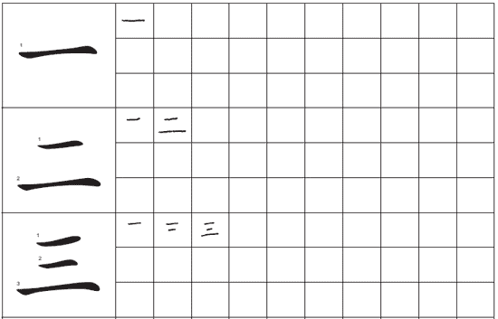

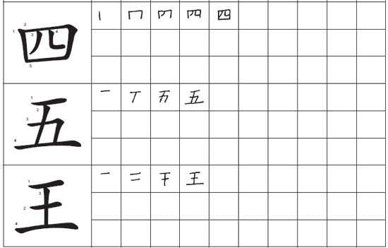

## A 单元，第 1 部分：汉字练习表（繁体字）

姓名 __________ 课程 __________ 日期 __________

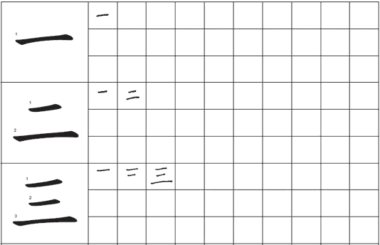

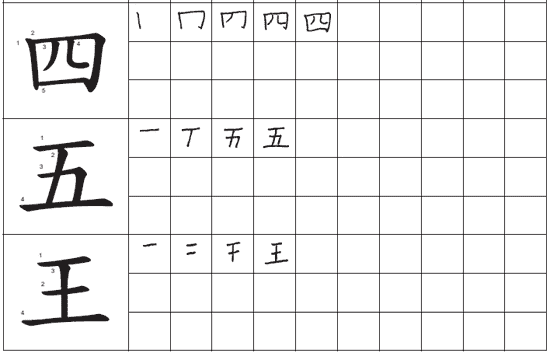

## A 单元，第 2 部分：汉字练习表（简体字）

姓名 __________ 课程 __________ 日期 __________

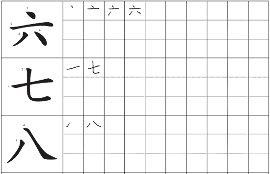

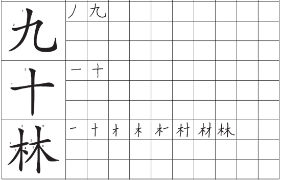

## A 单元，第 2 部分：汉字练习表（繁体字）

姓名 __________ 课程 __________ 日期 __________

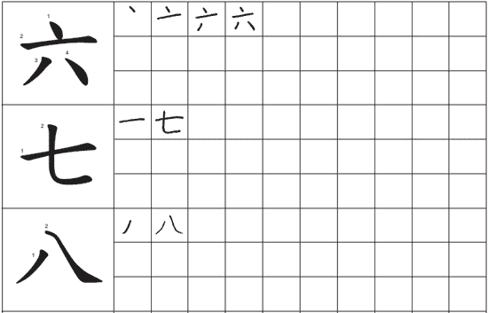

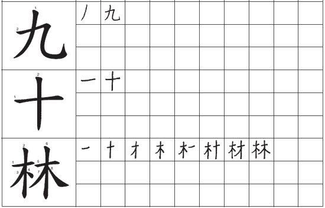

## A 单元，第 3 部分：汉字练习表（简体字）

姓名 __________ 课程 __________ 日期 __________

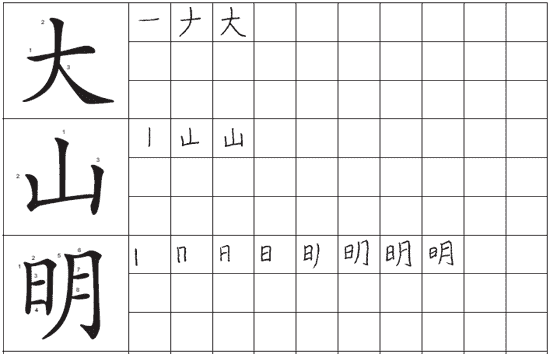

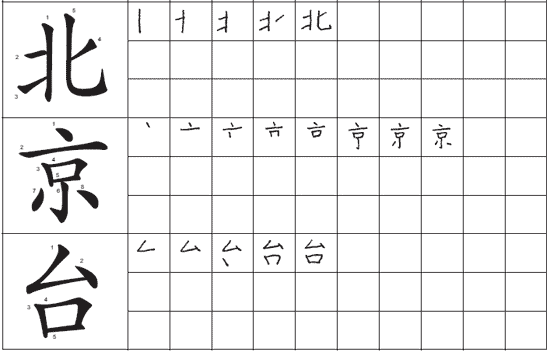

## A 单元，第 3 部分：汉字练习表（繁体字）

姓名 __________ 课程 __________ 日期 __________

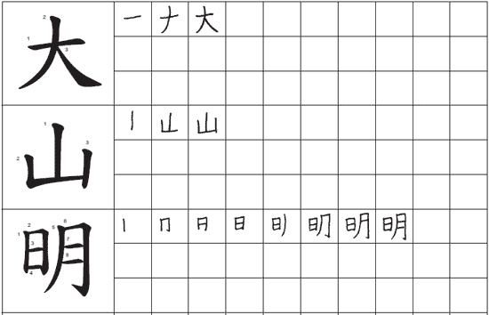

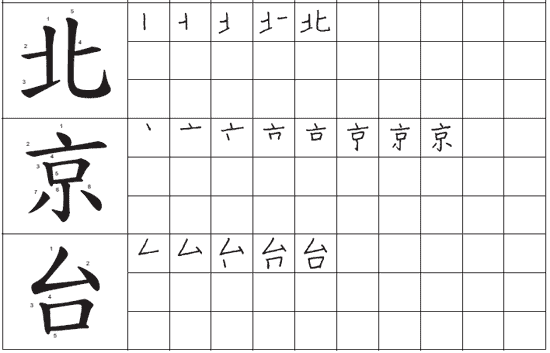

## A 单元，第 4 部分：汉字练习表（简体字）

姓名 __________ 课程 __________ 日期 __________

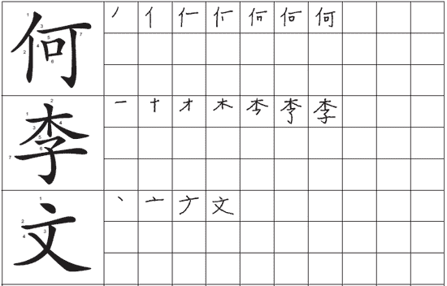

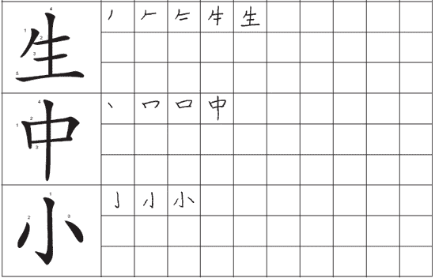

## A 单元，第 4 部分：汉字练习表（繁体字）

姓名 __________ 课程 __________ 日期 __________

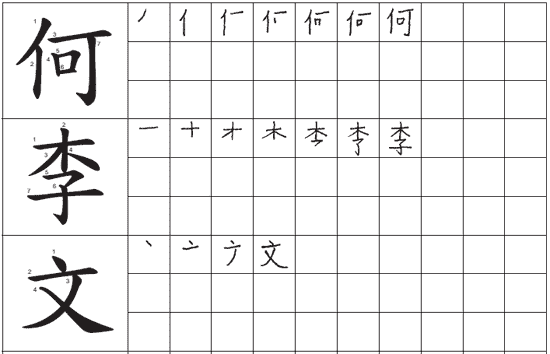

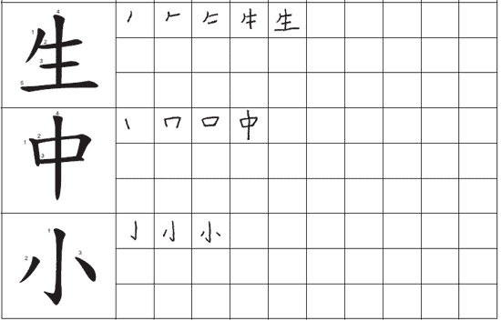

## B 单元，第 1 部分：汉字练习表（简体字）

姓名 __________ 课程 __________ 日期 __________

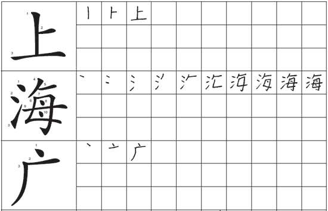

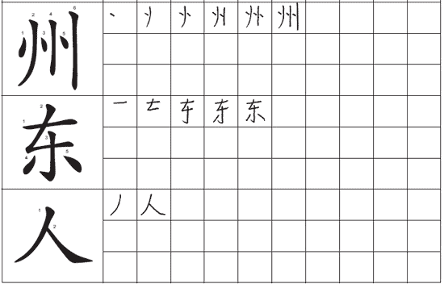

## B 单元，第 1 部分：汉字练习表（繁体字）

姓名 __________ 课程 __________ 日期 __________

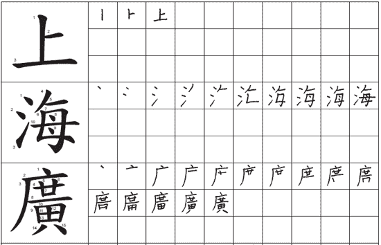

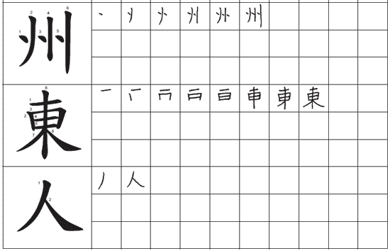

## B 单元，第 2 部分：汉字练习表（简体字）

姓名 __________ 课程 __________ 日期 __________

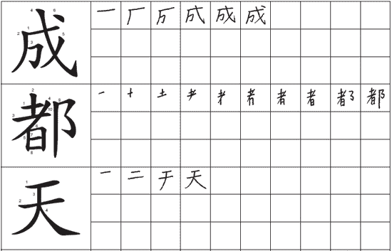

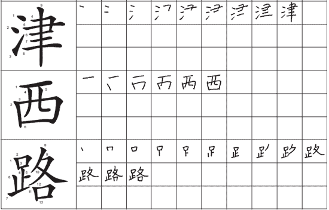

## B 单元，第 2 部分：汉字练习表（繁体字）

姓名 __________ 课程 __________ 日期 __________

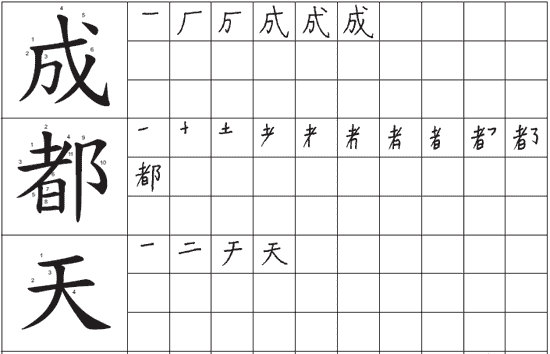

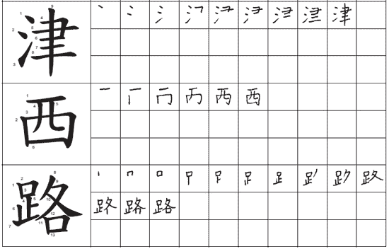

## B 单元，第 3 部分：汉字练习表（简体字）

姓名 __________ 课程 __________ 日期 __________

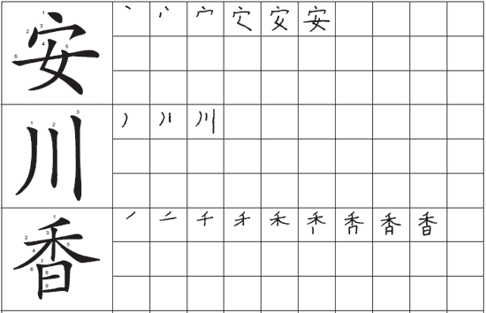

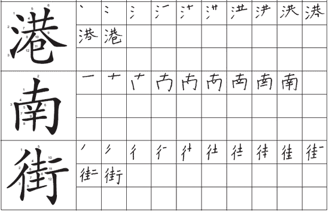

## B 单元，第 3 部分：汉字练习表（繁体字）

姓名 __________ 课程 __________ 日期 __________

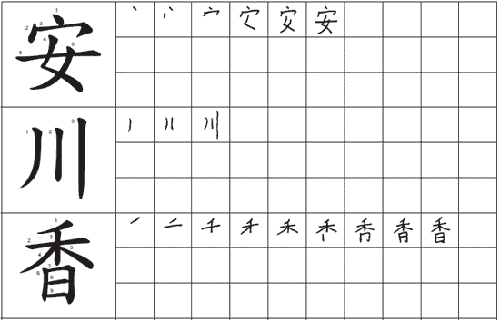

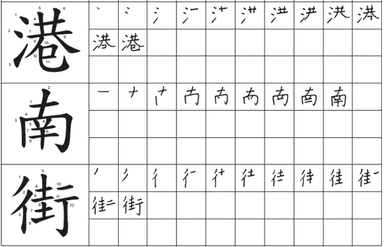

## B 单元，第 4 部分：汉字练习表（简体字）

姓名 __________ 课程 __________ 日期 __________

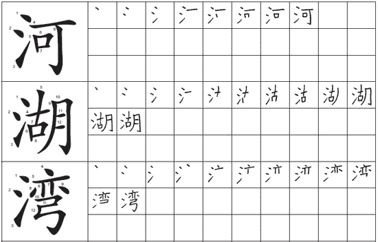

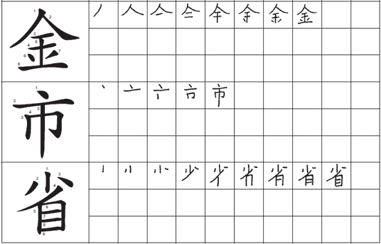

## B 单元，第 4 部分：汉字练习表（繁体字）

姓名 __________ 课程 __________ 日期 __________

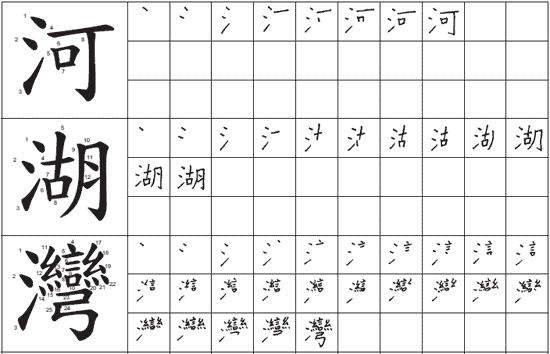

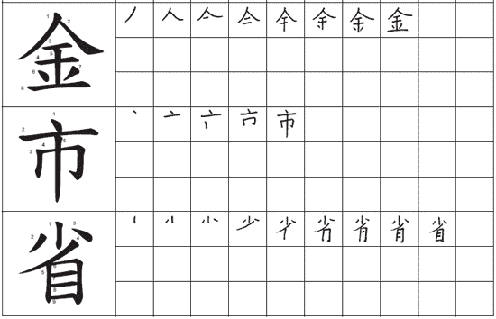

## 1 单元，第 1 部分：汉字练习表（简体字）

姓名 __________ 课程 __________ 日期 __________

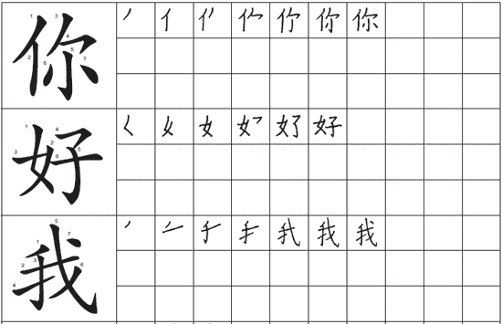

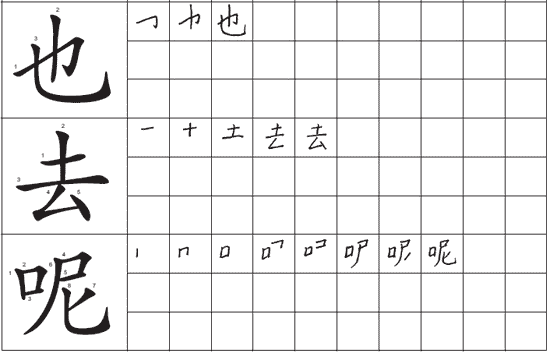

## 1 单元，第 1 部分：汉字练习表（繁体字）

姓名 __________ 课程 __________ 日期 __________

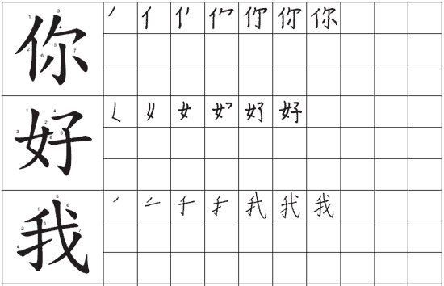

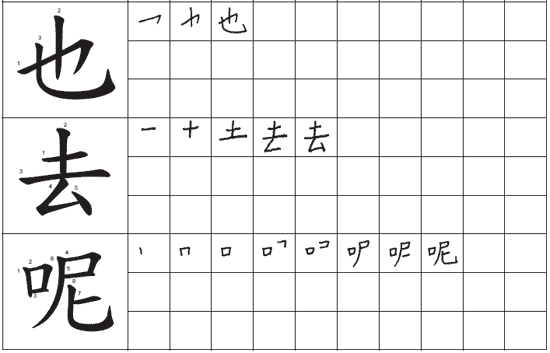

## 1 单元，第 2 部分：汉字练习表（简体字）

姓名 __________ 课程 __________ 日期 __________

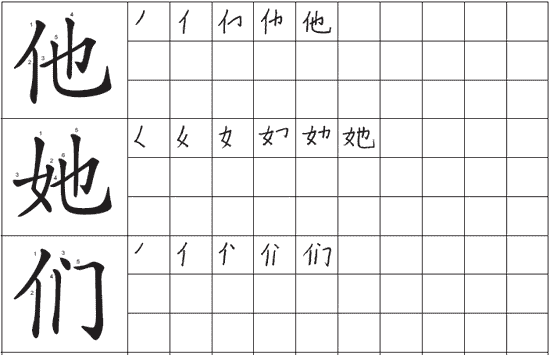

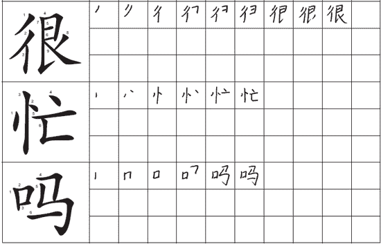

## 1 单元，第 2 部分：汉字练习表（繁体字）

姓名 __________ 课程 __________ 日期 __________

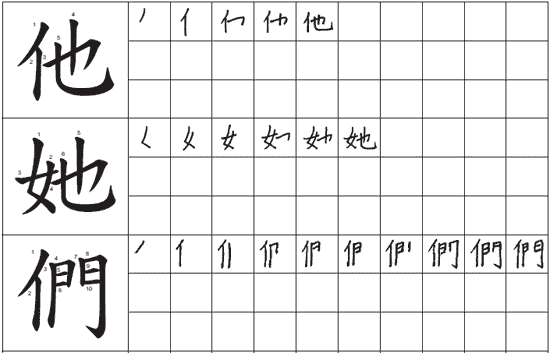

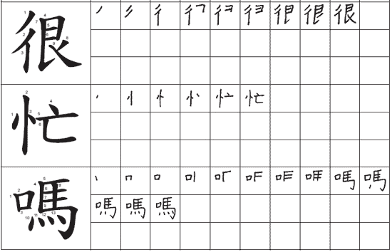

## 1 单元，第 3 部分：汉字练习表（简体字）

姓名 __________ 课程 __________ 日期 __________

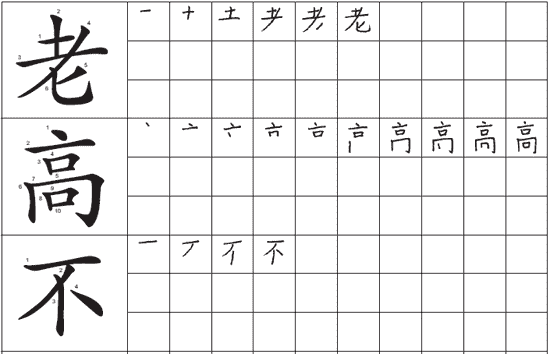

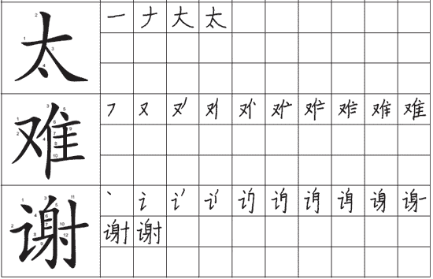

## 1 单元，第 3 部分：汉字练习表（繁体字）

姓名 __________ 课程 __________ 日期 __________

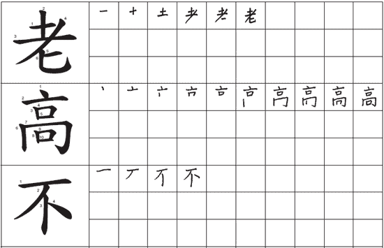

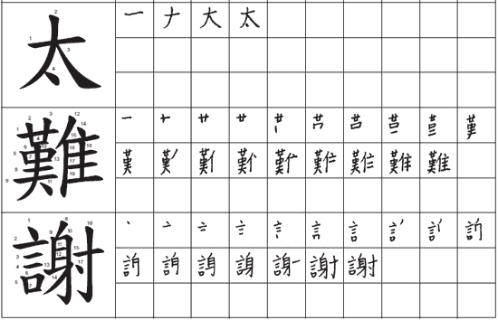

## 1 单元，第 4 部分：汉字练习表（简体字）

姓名 __________ 课程 __________ 日期 __________

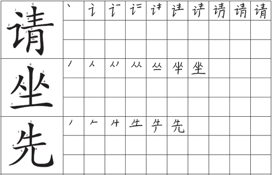

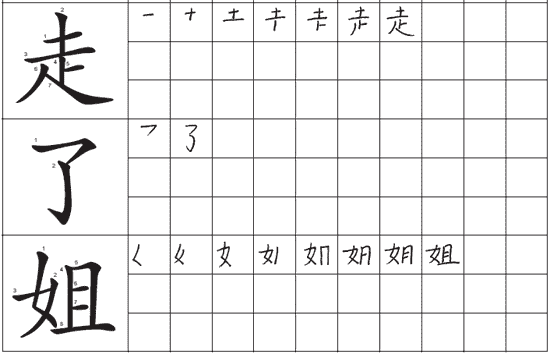

## 1 单元，第 4 部分：汉字练习表（繁体字）

姓名 __________ 课程 __________ 日期 __________

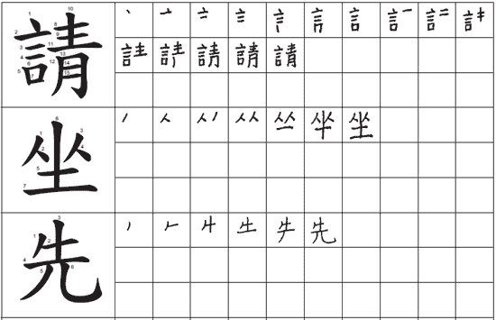

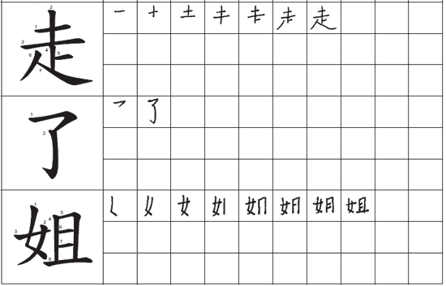

## 2 单元，第 1 部分：汉字练习表（简体字）

姓名 __________ 课程 __________ 日期 __________

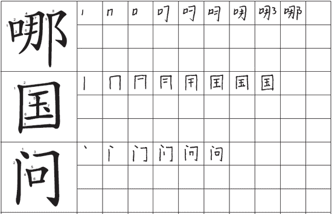

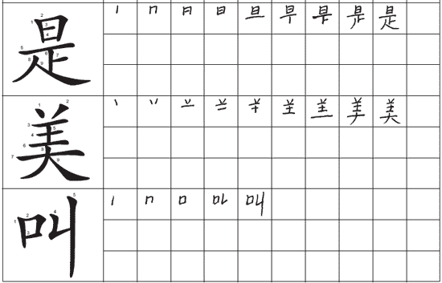

## 2 单元，第 1 部分：汉字练习表（繁体字）

姓名 __________ 课程 __________ 日期 __________

## 2 单元，第 2 部分：汉字练习表（简体字）

姓名 __________ 课程 __________ 日期 __________

## 2 单元，第 2 部分：汉字练习表（繁体字）

姓名 __________ 课程 __________ 日期 __________

## 2 单元，第 3 部分：汉字练习表（简体字）

姓名 __________ 课程 __________ 日期 __________

## 2 单元，第 3 部分：汉字练习表（繁体字）

姓名 __________ 课程 __________ 日期 __________

## 2 单元，第 4 部分：汉字练习表（简体字）

姓名 __________ 课程 __________ 日期 __________

## 2 单元，第 4 部分：汉字练习表（繁体字）

姓名 __________ 课程 __________ 日期 __________

## 3 单元，第 1 部分：汉字练习表（简体字）

姓名 __________ 课程 __________ 日期 __________

## 3 单元，第 1 部分：汉字练习表（繁体字）

姓名 __________ 课程 __________ 日期 __________

# 第 3 单元，第 2 部分：汉字练习单（简体中文）

姓名 __________ 课程 __________ 日 __________

# 第 3 单元，第 2 部分：汉字练习单（繁体中文）

姓名 __________ 课程 __________ 日 __________

# 第 3 单元，第 3 部分：汉字练习单（简体中文）

姓名 __________ 课程 __________ 日 __________

# 第 3 单元，第 3 部分：汉字练习单（繁体中文）

姓名 __________ 课程 __________ 日 __________

# 第 3 单元，第 4 部分：汉字练习单（简体中文）

姓名 __________ 课程 __________ 日 __________

# 第 3 单元，第 4 部分：汉字练习单（繁体中文）

姓名 __________ 课程 __________ 日 __________

# 第 4 单元，第 1 部分：汉字练习单（简体中文）

姓名 __________ 课程 __________ 日 __________

# 第 4 单元，第 1 部分：汉字练习单（繁体中文）

姓名 __________ 课程 __________ 日 __________

# 第 4 单元，第 2 部分：汉字练习单（简体中文）

姓名 __________ 课程 __________ 日 __________

# 第 4 单元，第 2 部分：汉字练习单（繁体中文）

姓名 __________ 课程 __________ 日 __________

# 第 4 单元，第 3 部分：汉字练习单（简体中文）

姓名 __________ 课程 __________ 日 __________

# 第 4 单元，第 3 部分：汉字练习单（繁体中文）

姓名 __________ 课程 __________ 日 __________

# 第 4 单元，第 4 部分：汉字练习单（简体中文）

姓名 __________ 课程 __________ 日 __________

# 第 4 单元，第 4 部分：汉字练习单（繁体中文）

姓名 __________ 课程 __________ 日 __________

# 第 5 单元，第 1 部分：汉字练习单（简体中文）

姓名 __________ 课程 __________ 日 __________

# 第 5 单元，第 1 部分：汉字练习单（繁体中文）

姓名 __________ 课程 __________ 日 __________

# 第 5 单元，第 2 部分：汉字练习单（简体中文）

姓名 __________ 课程 __________ 日 __________

# 第 5 单元，第 2 部分：汉字练习单（繁体中文）

姓名 __________ 课程 __________ 日 __________

# 第 5 单元，第 3 部分：汉字练习单（简体中文）

姓名 __________ 课程 __________ 日 __________

# 第 5 单元，第 3 部分：汉字练习单（繁体中文）

姓名 __________ 课程 __________ 日 __________

# 第 5 单元，第 4 部分：汉字练习单（简体中文）

姓名 __________ 课程 __________ 日 __________

# 第 5 单元，第 4 部分：汉字练习单（繁体中文）

姓名 __________ 课程 __________ 日 __________

# 第 6 单元，第 1 部分：汉字练习单（简体中文）

姓名 __________ 课程 __________ 日 __________

# 第 6 单元，第 1 部分：汉字练习单（繁体中文）

姓名 __________ 课程 __________ 日 __________

# 第 6 单元，第 2 部分：汉字练习单（简体中文）

姓名 __________ 课程 __________ 日 __________

# 第 6 单元，第 2 部分：汉字练习单（繁体中文）

姓名 __________ 课程 __________ 日 __________

# 第 6 单元，第 3 部分：汉字练习单（简体中文）

姓名 __________ 课程 __________ 日 __________

# 第 6 单元，第 3 部分：汉字练习单（繁体中文）

姓名 __________ 课程 __________ 日 __________

# 第 6 单元，第 4 部分：汉字练习单（简体中文）

姓名 __________ 课程 __________ 日 __________

# 第 6 单元，第 4 部分：汉字练习单（繁体中文）

姓名 __________ 课程 __________ 日 __________

# 第 7 单元，第 1 部分：汉字练习单（简体中文）

姓名 __________ 课程 __________ 日 __________

# 第 7 单元，第 1 部分：汉字练习单（繁体中文）

姓名 __________ 课程 __________ 日 __________

# 第 7 单元，第 2 部分：汉字练习单（简体中文）

姓名 __________ 课程 __________ 日 __________

# 第 7 单元，第 2 部分：汉字练习单（繁体中文）

姓名 __________ 课程 __________ 日 __________

# 第 7 单元，第 3 部分：汉字练习单（简体中文）

姓名 __________ 课程 __________ 日 __________

# 第 7 单元，第 3 部分：汉字练习单（繁体中文）

姓名 __________ 课程 __________ 日 __________

# 第 7 单元，第 4 部分：汉字练习单（简体中文）

姓名 __________ 课程 __________ 日 __________

# 第 7 单元，第 4 部分：汉字练习单（繁体中文）

姓名 __________ 课程 __________ 日 __________

# 第 8 单元，第 1 部分：汉字练习单（简体中文）

姓名 __________ 课程 __________ 日 __________

# 第 8 单元，第 1 部分：汉字练习单（繁体中文）

姓名 __________ 课程 __________ 日 __________

# 第 8 单元，第 2 部分：汉字练习单（简体中文）

姓名 __________ 课程 __________ 日 __________

# 第 8 单元，第 2 部分：汉字练习单（繁体中文）

姓名 __________ 课程 __________ 日 __________

# 第 8 单元，第 3 部分：汉字练习页（简体字）

姓名 __________ 课程 __________ 日期 __________

## 第 8 单元，第 3 部分：汉字练习页（繁体字）

姓名 __________ 课程 __________ 日期 __________

## 第 8 单元，第 4 部分：汉字练习页（简体字）

姓名 __________ 课程 __________ 日期 __________

## 第 8 单元，第 4 部分：汉字练习页（繁体字）

姓名 __________ 课程 __________ 日期 __________

## 第 9 单元，第 1 部分：汉字练习页（简体字）

姓名 __________ 课程 __________ 日期 __________

## 第 9 单元，第 1 部分：汉字练习页（繁体字）

姓名 __________ 课程 __________ 日期 __________

## 第 9 单元，第 2 部分：汉字练习页（简体字）

姓名 __________ 课程 __________ 日期 __________

## 第 9 单元，第 2 部分：汉字练习页（繁体字）

姓名 __________ 课程 __________ 日期 __________

## 第 9 单元，第 3 部分：汉字练习页（简体字）

姓名 __________ 课程 __________ 日期 __________

## 第 9 单元，第 3 部分：汉字练习页（繁体字）

姓名 __________ 课程 __________ 日期 __________

## 第 9 单元，第 4 部分：汉字练习页（简体字）

姓名 __________ 课程 __________ 日期 __________

## 第 9 单元，第 4 部分：汉字练习页（繁体字）

姓名 __________ 课程 __________ 日期 __________

## 第 10 单元，第 1 部分：汉字练习页（简体字）

姓名 __________ 课程 __________ 日期 __________

## 第 10 单元，第 1 部分：汉字练习页（繁体字）

姓名 __________ 课程 __________ 日期 __________

## 第 10 单元，第 2 部分：汉字练习页（简体字）

姓名 __________ 课程 __________ 日期 __________

## 第 10 单元，第 2 部分：汉字练习页（繁体字）

姓名 __________ 课程 __________ 日期 __________

## 第 10 单元，第 3 部分：汉字练习页（简体字）

姓名 __________ 课程 __________ 日期 __________

## 第 10 单元，第 3 部分：汉字练习页（繁体字）

姓名 __________ 课程 __________ 日期 __________

## 第 10 单元，第 4 部分：汉字练习页（简体字）

姓名 __________ 课程 __________ 日期 __________

## 第 10 单元，第 4 部分：汉字练习页（繁体字）

姓名 __________ 课程 __________ 日期 __________

# BMC 读写课程 A-1 到 10-4 读写练习

## A-1 课读写练习

姓名 __________ 课程 __________ 日期 __________

A. 将你在随附光盘上听到的内容写成汉字。

(1)

(2)

(3)

B. 根据教材中本课的相关部分完成完成。

(1) 用阿拉伯数字写出`B1`列出的电话号码：

(2) 用阿拉伯数字写出`B7`列出的电话号码：

(3) 用阿拉伯数字写出`B10`列出的电话号码：

(4) 用带声调的拼音写出`C1`列出的姓氏：

C. 综合练习

(1) 圈出每个字的第一个笔画。在右侧的横线上写下笔画。

三 ________________

王 ________________

五 ________________

四 ________________

一 ________________

二 ________________

(2) 在每个字后面写下它的总笔画。

二 ________________

四 ________________

一 ________________

王 ________________

五 ________________

三 ________________

(3) 在每个字后面写下带声调的拼音读音。

三 ________________

二 ________________

王 ________________

一 ________________

四 ________________

五 ________________

(4) 写下每个字的中文翻译。

四 ________________

一 ________________

二 ________________

五 ________________

## A-2 课读写练习

姓名 __________ 课程 __________ 日期 __________

A. 将你在随附光盘上听到的内容写成汉字。

(1)

(2)

(3)

B. 根据教材中本课的相关部分完成练习。

(1) 用阿拉伯数字写出`B3`列出的电话号码：

(2) 用阿拉伯数字写出`B5`列出的电话号码：

(3) 如果你看到`C2`中的数字，它们是什么意思？

(4) 用带声调的拼音写出`D1`中的姓氏，以及`D2`中的姓氏：

C. 综合练习

(1) 将以下内容写成汉字。

572419 __________________________

742356 __________________________

(2) 用汉字写你的电话号码。

___________________________________

(3) 写字完成以下序列。

a) 一二三 _______ 五

b) 十九 _______ 四

c) 一三五 _______

d) 十 _______ 二

e) 一 _______

f) 十八六

## A-3 课读写练习

姓名 __________ 课程 __________ 日期 __________

A. 将你在随附光盘上听到的内容写成汉字。

(1)

(2)

(3)

B. 根据教材中本课的相关部分完成练习。

(1) 用带声调的拼音写出`A2`中的姓名：

(2) 用带声调的拼音写出`A9`中的姓名：

(3) 用带声调的拼音写出`B1`中的地名：

(4) 用带声调的拼音写出`B2`中的地名：

C. 电梯练习

以下是某公寓楼电梯里的告示牌（它是繁体字，但即使你学习的是简体字也不会影响你完成这项练习）：

| 八楼 | 林大山 |

| 七楼 | 王明 |

| 六楼 | 白亞權 |

| 五楼 | 王立 |

| 四楼 | 李大明 |

| 三楼 | 林玉玲 |

| 二楼 | 王大鵬 |

| 地下 |   |

| 大門 |   |

根据告示上的信息回答以下问题（我们注意到上面有些字还没有介绍，但请根据已知的字来推测未知字的意思）。

(1) 林玉玲住在几楼？

_____________________

(2) 王大鹏住在几楼？

_____________________

(3) 白亚权住在几楼？

_____________________

(4) 李大明住在几楼？

_____________________

(5) 王立住在几楼？

_____________________

(6) 谁住在八楼？

_____________________

(7) 谁住在七楼？

_____________________

(8) 你认为字`樓`（读音`lóu`，简体字为`楼`）是什么意思？

_____________________

## A-4 课读写练习

# B-1 课后读写练习

## A. 将随附光盘中听到的内容记录为汉字。

(1)

(2)

(3)

## B. 根据教材中本课的相关部分按照指示操作。

(1) 将`A1`中列出的姓名写成带声调的拼音：

(2) 将`B2`中列出的姓名写成带声调的拼音：

(3) 将`C3`中列出的地名写成带声调的拼音：

(4) 将`C4`中列出的地名写成带声调的拼音：

## C. 地图阅读练习

**姓名** `__________` **课程** `__________` **日期** `__________`

(1) 在页面底部每个中文地名后面，写下对应的带声调拼音，然后是该地点在地图上的坐标（以`A-1`等形式给出坐标）。这些地方都是真实的，但其中一些较小且不那么为人知。

北京 _____________________________

台北 _____________________________

三明 _____________________________

文山 _____________________________

三台 _____________________________

九山 _____________________________

北山 _____________________________

台中 _____________________________

中山 _____________________________

大中 _____________________________

五台山 _________________________

---

# B-2 课后读写练习

**姓名** `__________` **课程** `__________` **日期** `__________`

## A. 将随附光盘中听到的内容记录为汉字。

(1)

(2)

(3)

## B. 根据教材中本课的相关部分按照指示操作。

(1) 将`A3`中列出的姓名写成带声调的拼音：

(2) 将`B2`中列出的地名写成带声调的拼音：

(3) 将`C2`中所示的内容写成带声调的拼音：

(4) 将`C4`中所示的内容写成带声调的拼音：

## C. 综合练习

(1) 圈出每个字的第一笔。将该笔画写在右侧的横线上。

上 _________________

人 _________________

州 _________________

海 _________________

东 (東) _________________

广 (廣) _________________

(2) 在每个字后面，写下总笔画数。

大 _________________

文 _________________

六 ________________

林 _________________

何 _________________

山 ________________

(3) 在每个字后面，写下带声调标记的拼音读音。

十 _________________

京 _________________

生 ________________

李 _________________

八 _________________

台 ________________

(4) 在每个字后面，写下英文翻译。

北 _________________

小 _________________

七 _________________

九 _________________

明 _________________

中 ________________

---

# B-3 课后读写练习

**姓名** `__________` **课程** `__________` **日期** `__________`

## A. 将随附光盘中听到的内容记录为汉字。

(1)

(2)

(3)

## B. 根据教材中本课的相关部分按照指示操作。

(1) 将`A1`中列出的姓名写成带声调的拼音：

(2) 将`B2`中列出的地名写成带声调的拼音：

(3) 将`C3`中所示的内容写成带声调的拼音：

(4) 将`C4`中所示的内容写成带声调的拼音：

## C. 公寓楼目录练习

你在台北的一栋公寓内看到以下目录（使用的是繁体字，但这不会影响你完成此练习的能力）：

| 一二四 | 王小文 |

| :--- | :--- |

| 一二五 | 李大林 |

| 一二六 | 張海雲 |

| 二三五 | 梅文中 |

| 二三六 | 何西天 |

| 三八七 | 李山山 |

| 三八八 | 林生明 |

| 三八九 | 路汀生 |

| 五四四 | 李香雲 |

| 五四五 | 何大生 |

| 五四六 | 王文林 |

根据以上信息，回答以下问题（如果要求提供姓名，请提供全名）。

(1) 住在`388`号房间的是谁？ _____________________

(2) 住在`236`号房间的是谁？ _____________________

(3) 住在`125`号房间的是谁？ _____________________

(4) 住在`387`号房间的是谁？ _____________________

(5) 住在`124`号房间的是谁？ _____________________

(6) 住在`545`号房间的是谁？ _____________________

(7) 李香云住在哪个号房间？ _____________________

(8) 路汀生住在哪个号房间？ _____________________

(9) 张海云住在几楼？ _____________________

(10) 梅文中住在几楼？ _____________________

---

# B-4 课后读写练习

**姓名** `__________` **课程** `__________` **日期** `__________`

## A. 将随附光盘中听到的内容记录为汉字。

(1)

(2)

(3)

## B. 根据教材中本课的相关部分按照指示操作。

(1) 将`A6`中列出的姓名写成带声调的拼音：

(2) 将`B4`中列出的地名写成带声调的拼音：

(3) 将`C1`中所示的内容写成带声调的拼音：

(4) 将`D1`中所示的内容写成带声调的拼音：

## C. 综合练习

(1) 圈出人的姓氏（xìng），在横线上写下带声调的拼音。

安南 ________________

安川 ________________

王明 ________________

都成 ________________

安京 ________________

(2) 圈出人的名字（míngzi），在横线上写下带声调的拼音。

王海 ________________

王小 ________________

李台 ________________

文大林 ________________

何山 ________________

李京 ________________

(3) 圈出每组字的共同偏旁，并将该偏旁写在下方。

八六 ________________

十南 ________________

大天 ________________

二五 ________________

川州 ________________

一三 ________________

李林 ________________

港津海 ________________

---

# 1-1 课后读写练习

**姓名** `__________` **课程** `__________` **日期** `__________`

## A. 将随附光盘中听到的内容记录为汉字。

(1)

(2)

(3)

## B. 根据教材中本课的相关部分按照指示操作。

(1) 将`A5`中列出的姓名写成带声调的拼音：

(2) 将`B6`中列出的地名写成带声调的拼音：

(3) 将`C6`中所示的内容写成带声调的拼音：

(4) 将`D10`中所示的内容写成带声调的拼音：

## C. 地图阅读练习

(1) 在页面底部每个中文地名后面，写下对应的带声调拼音，然后是该地点在地图上的坐标（以`A-1`等形式给出坐标）。

海南 ________________________________

河北 ________________________________

河南 ________________________________

湖北 ________________________________

湖南 ________________________________

山西 ________________________________

四川 ________________________________

香港 ________________________________

山东 (山東) ________________________

广东 (廣東) ________________________

广西 (廣西) ________________________

台湾 (台灣) ________________________

## D. 综合练习

根据你在 A、B 单元中学习的地理词汇，在后面后面添加合适的`省`或`市`。

北京 ________________________________

湖北 ________________________________

台中 ________________________________

成都 ________________________________

河南 ________________________________

台北 ________________________________

山西 ________________________________

上海 ________________________________

海南 ________________________________

湖南 ________________________________

京都 ________________________________

天津 ________________________________

西安 ________________________________

四川 ______________________________

南京 ______________________________

河北 ______________________________

广东 (廣東) ___________________

东京 (東京) ___________________

台东 (台東) ___________________

山东 (山東) ___________________

广西 (廣西) ___________________

广州 (廣州) ___________________

# 第 1-2 课阅读与写作练习

姓名 __________ 课程 __________ 日期 __________

### A. 将随附光盘中听到的内容转换为汉字。

(1)

(2)

(3)

### B. 如果问题后给出参考，请根据阅读练习中的参考部分进行回答。如果没有指示，你可以以任何方式回答。

(1) 王大海去台北吗？(王大海去台北嗎？) A10

(2) 何台生好吗？(何台生好嗎？) B2

(3) 你忙吗？(你忙嗎？)

(4) 你去北京吗？(你去北京嗎？)

### C. 综合练习

在左列中文表达式前面的空格处，填入右列最对应的英文字母。

| 中文表达式 | 英文对应词 |

| :--- | :--- |

| _______________ 河北 | a. she goes too |

| _______________ 很忙 | b. Sichuan |

| _______________ 西安 | c. avenue |

| _______________ 你好 | d. they |

| _______________ 四川 | e. city of Beijing |

| _______________ 香港 | f. native of Shanghai |

| _______________ 我去 | g. Shanxi Road |

| _______________ 海南 | h. Taiwan |

| _______________ 大街 | i. Hunan Province |

| _______________ 北京市 | j. hello |

| _______________ 她也去 | k. Guangzhou |

| _______________ 湖南省 | l. I go |

| _______________ 上海人 | m. very busy |

| _______________ 山西路 | n. Hainan |

| _______________ 台湾(台灣) | o. Xian |

| _______________ 广州(廣州) | p. Hebei |

| _______________ 他们(他們) | q. Hong Kong |

# 第 1-3 课阅读与写作练习

姓名 __________ 课程 __________ 日期 __________

### A. 将随附光盘中听到的内容转换为汉字。

(1)

(2)

(3)

### B. 如果问题后给出参考，请根据阅读练习中的参考部分进行回答。如果没有指示，你可以以任何方式回答。

(1) 林京生也去西安吗？(林京生也去西安嗎？) B3

(2) 台湾人很高吗？(台灣人很高嗎？) D2

(3) 你忙不忙？

(4) 中文难不难？(中文難不難？)

### C. 偏旁练习

在“汉字”下方的每个横线上，写下一个《基础汉语读写教程 A-1 至 1-3》中包含所指示偏旁的汉字。同时写下该字的拼音和基础英文含义。你可以根据需要查阅教材。

| 偏旁 | 汉字 | 拼音 | 英文 |

| :--- | :--- | :--- | :--- |

| 人或 亻 rén “person”: | ___________ | ___________ | ___________ |

| | ___________ | ___________ | ___________ |

| | ___________ | ___________ | ___________ |

| 水或 氵 shuĭ “water”: | ___________ | ___________ | ___________ |

| | ___________ | ___________ | ___________ |

| | ___________ | ___________ | ___________ |

| 口 kŏu “mouth”: | ___________ | ___________ | ___________ |

| | ___________ | ___________ | ___________ |

| | ___________ | ___________ | ___________ |

| 女 nǚ “woman”: | ___________ | ___________ | ___________ |

| | ___________ | ___________ | ___________ |

| | ___________ | ___________ | ___________ |

| 木 mù “tree”: | ___________ | ___________ | ___________ |

| | ___________ | ___________ | ___________ |

| | ___________ | ___________ | ___________ |

| 戈 gē “spear”: | ___________ | ___________ | ___________ |

| | ___________ | ___________ | ___________ |

| | ___________ | ___________ | ___________ |

| 大 dà “big”: | ___________ | ___________ | ___________ |

| | ___________ | ___________ | ___________ |

| | ___________ | ___________ | ___________ |

# 第 1-4 课阅读与写作练习

姓名 __________ 课程 __________ 日期 __________

### A. 将随附光盘中听到的内容转换为汉字。

(1)

(2)

(3)

### B. 如果问题后给出参考，请根据阅读练习中的参考部分进行回答。如果没有指示，你可以以任何方式回答。

(1) 林小姐忙不忙？ B2

(2) 王太太去不去香港？ D1

(3) 请坐﹐请坐！(請坐，請坐！)

(4) 我很忙﹐我先走了。

### C. 地图阅读练习

在本页底部每个台湾地名后，写下对应的拼音（带声调），然后是该地在地图上的坐标（以 A-1 等格式给出坐标）。

台北 ______________________________

山林 ______________________________

香山 ______________________________

台西 ______________________________

台南 ______________________________

金山 ______________________________

湖口 ______________________________

大安 ______________________________

新港 ______________________________

台中 ______________________________

东河 (東河) ______________________

台东 (台東) ___________________

# 第 2-1 课阅读与写作练习

姓名 __________ 课程 __________ 日期 __________

### A. 将随附光盘中听到的内容转换为汉字。

(1)

(2)

(3)

### B. 如果问题后给出参考，请根据阅读练习中的参考部分进行回答。如果没有指示，你可以以任何方式回答。

(1) 王大海是美国吗？(王大海是美國嗎？) A10

(2) 金小姐都是中国人？(金小姐都是中國嗎？) D2

(3) 你是不是叫王明？

(4) 请你是哪人？(請問你是哪人？)

### C. 连词成

将下列单词和短语重新排列成句子，并加上合适的标点符号。

(1) 了/何/也/太太/先生/了

(2) 人/不都/我们/广东/是 (人/不都/我們/廣東/是)

(3) 小姐/人/是/请问/你/哪国 (小姐/人/是/請問/哪國)

(4) 吗/请坐/你/你好/忙/请坐 (嗎/請坐/你/你好/忙/請坐)

(5) 我/我/人/叫/是/林美/美国 (我/我/人/叫/是/林美/美國)

(6) 是/是/我们/你们 (是/是/我們/你們)

(7) )难/你/不/忙/中文/不 (難/你/不/忙/不)

# 第 2-2 课阅读与写作练习

姓名 __________ 课程 __________ 日期 __________

### A. 将随附光盘中听到的内容转换为汉字。

(1)

(2)

(3)

### B. 如果问题后给出参考，请根据阅读练习中的参考部分进行回答。如果没有指示，你可以以任何方式回答。

(1) 小文是不是

(2) 李小明的同学是哪人？(李小明的同学是哪人？) D1

(3) 你的名字是不是林美？

(4) “Doris”是中国人的吗？「Doris」是中國人的嗎？)

### C. 综合练习

使用 `都` 将两个短句合并为一个长句。

(1) 小林是好人。小安是好人。

(2) 李先生很忙。何先生很忙。

(3) 金太太去北京。路太太去北京。

(4) 我姐姐叫美美。她姐姐叫美美。

(5) 我的同学叫王大明。你的同学叫王大明。

(6) 上海很好。广州很好。(上海很好。廣州很好。)

(7) 河北是中国省。湖北是中国省。(河北是中國省。湖北是中國省。)

# 第 2-3 课阅读与写作练习

姓名 __________ 课程 __________ 日期 __________

### A. 将随附光盘中听到的内容转换为汉字。

(1)

(2)

(3)

### B. 如果问题后给出参考，请根据阅读练习中的参考部分进行回答。如果没有指示，你可以以任何方式回答。

(1) 李文、李同学很高？(李文、李同学都很高興？) D1

(2) 谢中文、何同学都不太忙吧？(谢中文、何同学都不太忙？) D2

(3) 请问﹐您贵姓？(請問，您貴姓？)

(4) 我很高兴。你也很高兴吧？(我很高興。你也很高興？)

### C. 标点练习

为下列每个句子标点，加上一个或多个中文标点符号 ，、“？！。然后将每个句子翻译成英文。

(1) 高先生李太太何小姐都走了

(2) 老王您别叫我王先生叫我老王好了

(3) 你忙吗中文难不难 (您忙嗎中文難不難)

(4) 我姓谢请问您贵姓 (我姓謝請問您貴姓)

(5) 我很高兴您也高兴吧 (我很高興您也高興吧)

(6) 您好请问您是哪国人 (您好請問您是哪國人)

(7) 他要去广东广西贵州 (他要去廣東廣西貴州)

(8) 她问我你是不是美国人 (她問我你是不是美國人)

# 第 2-4 课阅读与写作练习

姓名 __________ 课程 __________ 日期 __________

### A. 将随附光盘中听到的内容转换为汉字。

(1)

(2)

(3)

### B. 如果问题后给出参考，请根据阅读练习中的参考部分进行回答。如果没有指示，你可以以任何方式回答。

(1) 司先生带名片了吗？(司先生帶名片了嗎？) B1

(2) 这个美国人的中文好不好？(這個美國人的中文好不好？) B2

(3) 请问﹐你带名片了吗？(請問，你帶名片了嗎？)

(4) 您好！我姓李。 这是中美公司的何小姐。 (您好！我姓李。這是中美公司的何小姐。)

### C. 对话完成

以任何方式完成以下对话。

A: 你好！

B: _________________________________________________

A: 我姓王，您贵姓？

B: _________________________________________________

A: 我叫王大山，您的名字叫……

B: _________________________________________________________________

A: 请问﹐您是哪国人？(請問，您是哪國人？)

B: _________________________________________________________________

A: 中文难不难？(中文難不難？)

B: _________________________________________________________________

A: 我先走了﹐这是我的名片。 (我先走了，這是我的名片。)

B: _________________________________________________________________

# 第 3-1 课读写练习

姓名 __________ 课程 __________ 日期 __________

### A. 将随附光盘中听到的内容写成汉字。

(1)

(2)

(3)

### B. 如果问题后给出了参考，请根据阅读练习中的参考部分进行回答。如果没有指示参考，你可以按照自己的意愿任意回答。

(1) 他们都是美国人吗？(他們都是美國人嗎？) C4

(2) 高老师是北京人﹐他的太太也是北京人吧？(高老師是北京人﹐他的太太也是北京人吧？) E

(3) 美美是男生的名字吗？(美美是男生的名字嗎？)

(4) 你的中文老师都是女的吗？(你的中文老師都是女的嗎？)

### C. 相同还是不同？

以下成对汉字的读音是完全**相同**的，还是**不同**的？请在下方正确的方框内打钩 ( √ )。

| 汉字 | 相同 | 不同 |

| :--- | :--- | :--- |

| 十 是 | | |

| 三 山 | | |

| 他 她 | | |

| 京 津 | | |

| 南 男 | | |

| 太 台 | | |

| 四 市 | | |

| 坐 走 | | |

| 先 香 | | |

| 河 何 | | |

| 街 姐 | | |

| 汉字 | 相同 | 不同 |

| :--- | :--- | :--- |

| 美 没 | | |

| 金 京 | | |

| 名 明 | | |

| 八 吧 | | |

| 五 屋 | | |

| 是 四 | | |

| 六 路 | | |

| 何 湖 | | |

| 津 金 | | |

| 司 师 (師) | | |

| 文 问 (問) | | |

# 第 3-2 课读写练习

姓名 __________ 课程 __________ 日期 __________

### A. 将随附光盘中听到的内容写成汉字。

(1)

(2)

(3)

### B. 如果问题后给出了参考参考，请根据阅读练习中的参考部分进行回答。如果没有指示参考，你可以按照自己的意愿任意回答。

(1) 东东今年几岁了？他是哪国人？(東東今年幾歲了？他是哪國人？) E2

(2) 东东的姐姐今年几岁了？她姓安﹐对不对？(東東的姐姐今年幾歲了？她姓安，對不對？) E2

(3) 你今年多大了？

(4) 中文不太难﹐对不对？(中文不太難，對不對？)

### C. 综合练习

(1) 通过写出适当的汉字完成以下数字序列。

a) 一，三，五，_______，_______，_______，_______，_______，_______， _______，_______。

b) 二，四，六，_______，_______，_______，_______，_______，_______， _______，_______。

c) 十，二十，三十，_______，_______，_______，_______，_______， _______。

d) 二，三，五，八，_______，_______，_______，_______，_______， _______，_______，_______。

(2) 将中文数字翻译成阿拉伯数字，反之亦然。

a) 五十三 ___________

b) 七十七 ___________

c) 九十九 ___________

d) 15 ___________

e) 94 ___________

f) 37 ___________

g) 十一 ___________

h) 二十九 ___________

i) 十八 ___________

j) 48 ___________

k) 79 ___________

l) 88 ___________

(3) 通过在句尾添加附加疑问句将以下陈述句变成疑问句。

她是你姐姐。 →

我们(們)去香港。 →

中文不太难(難)。 →

她八十岁(歲)了。 →

这(這)是你的公司。 →

# 第 3-3 课读写练习

姓名 __________ 课程 __________ 日期 __________

### A. 将随附光盘中听到的内容写成汉字。

(1)

(2)

(3)

### B. 如果问题后给出了参考，请根据阅读练习中的参考部分进行回答。如果没有指示参考，你可以按照自己的意愿任意回答。

(1) 那位老太太多大年纪了？(那位老太太多大年紀了？) B6

(2) 去天津贵？去上海贵？(去天津貴？去上海貴？) E

(3) 请问﹐你带多少钱？(請問，你帶多少錢？)

(4) 去中国多少钱？(去中國多少錢？)

### C. 涉及数字 1-9,999 的练习

将以下翻译成汉字。

(1) 389

(2) 401

(3) 857

(4) 1,002

(5) 7,652

(6) 9,999

(7) 700

(8) 5,589

(9) 21 岁

(10) 102 岁

# 第 3-4 课读写练习

姓名 __________ 课程 __________ 日期 __________

### A. 将随附光盘中听到的内容写成汉字。

(1)

(2)

(3)

### B. 如果问题后给出了参考，请根据阅读练习中的参考部分进行回答。如果没有指示参考，你可以按照自己的意愿任意回答。

(1) 多少钱？(多少錢？) B4

(2) 几点？(幾幾點？) E

(3) 请问，几点了？(請問，幾點了？)

(4) 多少钱？(多少錢？)

### C. 时间练习

将随附光盘中听到的时间写成汉字。

(1)

(2)

(3)

(4)

(5)

(6)

(7)

(8)

# 第 3-5 课读写练习

姓名 __________ 课程 __________ 日期 __________

### A. 将随附光盘中听到的内容写成汉字。

(1)

(2)

(3)

### B. 如果问题后给出了参考，请根据阅读练习中的参考部分进行回答。如果没有指示参考，你可以按照自己的意愿任意回答。

(1) 谁的？(誰的？) A10

(2) 谁的？(誰的？) D2

(3) 什么老师？(什麼老師？)

(4) 几门？(幾門？)

### C. 部首练习

在每个横线下方，写出一个包含该部首的汉字。同时也写出该汉字的拼音和基本含义。你可以参考教材。

| 部首 | 汉字 | 拼音 | 英文 |

| :--- | :--- | :--- | :--- |

| 亻 | | `rén` | person |

| | | | |

| 刂 | | `dāo` | knife |

| | | | |

| 口 | | `kǒu` | mouth |

| | | | |

| | | | |

| 十 | | `shí` | ten |

| | | | |

| 女 | | `nǚ` | woman |

| | | | |

| 土 | | `tǔ` | earth |

| | | | |

| | | | |

| 白 | | `bái` | white |

| | | | |

| 金 | | `jīn` | gold, metal |

| | | | |

# 第 4-2 课读写练习

姓名 __________ 课程 __________ 日期 __________

### A. 将随附光盘中听到的内容写成汉字。

(1)

(2)

(3)

### B. 如果问题后给出了参考，请根据阅读练习中的参考部分进行回答。如果没有指示参考，你可以按照自己的意愿任意回答。

(1) 什么？(什麼？) C2

(2) 几岁了？(幾歲了？) E

(3) 什么老师？(什麼老師？)

(4) 几月几？(幾月號？)

### C. 日历练习

下面是典型的中国桌面日历的四页。阅读每一页并回答下方的问题。

What is the month, day, and year?

__________________________________

What day of the week is it?

__________________________________

What is the month, day and year?

__________________________________

What day of the week is it?

__________________________________

Copy the month.

__________________________________

Transcribe into Pinyin.

__________________________________

Copy the day of the week.

__________________________________

Transcribe into Pinyin.

__________________________________

# 第 4-3 课读写练习

姓名 __________ 课程 __________ 日期 __________

### A. 将随附光盘中听到的内容写成汉字。

(1)

(2)

(3)

### B. 如果问题后给出了参考，请根据阅读练习中的参考部分进行回答。如果没有指示参考，你可以按照自己的意愿任意回答。

(1) 几天？(幾天？) B1

(2) 谁的？(誰的？) D2

(3) 什么老师？(什麼老師？)

(4) 几门？(幾門？)

(1) 下列列表来自中国大陆某酒店房间内的电视节目指南。请阅读该列表并用英文回答后续问题。（`台` 的意思是“station”。）

a) 湖北省有多少个频道？

b) 哪个频道号最可能播送粤语？

c) 来自四川的人可能会看哪个频道号？

d) 来自贵州的人可能会看哪个频道号？

e) 一个只说日语的人可能会看哪个频道号？

f) 一个只说英语的美国人可能会看哪个频道号？

(2) 下表来自一家台北银行，列出了不同期限定期存款（CDs）的利率。请阅读表格并用英文回答后续问题。

| 一個月 | 5.00% |
| 三個月 | 5.35% |
| 五個月 | 5.50% |
| 六個月 | 6.00% |
| 七個月 | 6.00% |
| 九個月 | 6.15% |
| 一年 | 6.225% |

a) 三个月的利率是多少？

b) 六个月的利率是多少？

c) 一年的利率是多少？

d) 获得 6% 以上利率的最短期限是多久？

e) 5% 是哪种期限的利率？

# 第 4-4 课读写练习

姓名 __________ 课程 __________ 日期 __________

## A. 将随附音频光片中听到的转录为汉字。

(1)

(2)

(3)

## B. 如果问题后给出了参考，请根据所引用的阅读练习进行回答。如果没有指示参考，你可以按照自己的意愿回答。

(1) 谁比较高？(誰比較高？) B5

(2) 小李的同屋姓什么？他是哪国人？(小李的同屋姓什麼？他是哪國人？) B8

(3) 请问﹐你有没有姐姐？(請問，你有沒有姐姐？)

(4) 美国的人口有多少？(美國的人口有多少？)

## C. 地图阅读练习

在本页底部每个中文地名后写下对应的拼音（带声调），然后是该地点在地图上的坐标（以 A-1 等格式给出坐标）。

五台 ________________________________

大同 ________________________________

白河 ________________________________

小金 ________________________________

三河 ________________________________

海口 ________________________________

安口 ________________________________

高台 ________________________________

金川 ________________________________

明港 ________________________________

高安 ________________________________

八都 ________________________________

南川 ________________________________

九台 ________________________________

北海 ________________________________

广安 (廣安) ______________________

东河 (東河) ______________________

东台 (東台) ______________________

# 第 5-1 课读写练习

姓名 __________ 课程 __________ 日期 __________

## A. 将随附音频光片中听到的转录为汉字。

(1)

(2)

(3)

## B. 如果问题后给出了参考，请根据所引用的阅读练习进行回答。如果没有指示参考，你可以按照自己的意愿回答。

(1) 王小姐在吗？(王小姐在嗎？) B2

(2) 万先生知不知道 IBM 公司的 CEO 是谁？(萬先生知不知道 IBM 公司的 CEO 是誰？) B4

(3) 你姓什么？叫什么名字？(你姓什麼？叫什麼名字？)

(4) 你知不知道中国的人口是多少？(你知不知道中國的人口是多少？)

## C. 词汇练习

每行四个单词，其中三个属于相同或相似的语义或语法类别。划掉（用大大的“X”）与该行中其他三个单词联系较小的单词。

| 他 | 你 | 她 | 也 |
| 坐 | 走 | 钱(錢) | 问(問) |
| 大 | 找 | 对(對) | 高兴(高興) |
| 贵(貴) | 好 | 忙 | 带(帶) |
| 省 | 市 | 门(門) | 国(國) |
| 难(難) | 老 | 去 | 高 |
| 可以 | 知道 | 同屋 | 谢谢(謝謝) |
| 六千 | 六日 | 六百 | 六万(六萬) |
| 三月 | 星期六 | 五天 | 四号(四號) |
| 老师(老師) | 学生(學生) | 大街 | 上海人 |
| 女生 | 先生 | 太太 | 姐姐 |
| 金门(金門) | 天津 | 海南 | 台湾(台灣) |
| 北京 | 成都 | 京都 | 广州(廣州) |
| 人口 | 海口 | 海南 | 河南 |
| 台北 | 台山 | 台中 | 台东(台東) |
| 四千 | 四川 | 四百 | 四万(四萬) |

# 第 5-2 课读写练习

姓名 __________ 课程 __________ 日期 __________

## A. 将随附音频光片中听到的转录为汉字。

(1)

(2)

(3)

## B. 如果问题后给出了引用，请根据引用的阅读练习部分进行回答。如果没有指示引用，你可以按照自己的意愿回答。

(1) 这个人喜欢北京，不过他的朋友比较喜欢什么地方？(這個人喜歡北京，不過他的朋友比較喜歡什麼地方？) A1

(2) 什么叫“好朋友”？(什麼叫 「好朋友」？) D1

(3) 你喜欢中文吗？(你喜歡中文嗎？)

(4) 你有没有中国朋友？(你有沒有中國朋友？)

## C. 使用 `过` 回答以下问题。

(1) 你上过高中吗？(你上過高中嗎？)

(2) 你学过中文吗？(你學過中文嗎？)

(3) 你去过海南省吗？(你去過海南省嗎？)

(4) 你在“北京饭店”吃过饭吗？(你在 「北京飯店」吃過飯嗎？)

## D. 使用 `可是` 将两个短句合并为一个长句。

(1) 小安是我的好朋友。他不是我的男朋友。

(2) 我喜欢中文。中文很难学。(我喜歡中文。中文很難學。)

(3) 小李喜欢小王。小王不喜欢小李。(小李喜歡小王。小王不喜歡小李。)

(4) 老何请我吃饭。我有事儿，不能去。(老何請我吃飯。我有事兒，不能去。)

# 第 6-2 阅读与写作练习

姓名 __________ 课程 __________ 日期 __________

## A. 将随附音频光盘上听到的内容抄成汉字。

(1)

(2)

(3)

## B. 如果问题后给出了引用，请根据引用的阅读练习部分进行回答。如果没有指示引用，你可以按照自己的意愿回答。

(1) 那个中国人是哪里人？(那個中國人是哪裡人？) B1

(2) 林东生一天学几个钟头的中文？你呢？(林東生一天學幾個鐘頭的中文？你呢？) D

(3) 你还没有三十岁吧？(你還沒有三十歲吧？)

(4) 你是在哪里出生，在哪里长大的？(你是在哪裡出生，在哪裡長大的？)

## C. 将陈述句变为疑问句

为以下答案编写问题。注意下划线部分是重音，也是你应该询问的内容。

(1) 今天是星期五。

(2) 高小姐要去上海。

(3) 小李的男朋友叫方大中。

(4) 明天是十月一号。(明天是十月一號。)

(5) 何先生是中国人。(何先生是中國人。)

(6) 那个钟要两千块钱！(那個鐘要兩千塊錢！)

(7) 我们的中文老师是左老师。(我們的中文老師是左老師。)

# 第 6-3 阅读与写作练习

姓名 __________ 课程 __________ 日期 __________

## A. 将随附音频光盘上听到的内容抄成汉字。

(1)

(2)

(3)

## B. 如果问题后给出了引用，请根据引用的阅读练习部分进行回答。如果没有指示引用，你可以按照自己的意愿回答。

(1) 为什么安老师、司老师要走了？(為什麼安老師、司老師要走了？) B2

(2) 为什么李大海的中国朋友叫他“半个广州人”？(為什麼李大海的中國朋友叫他 「半個廣州人」？) D

(3) 你为什么要学中文？(你為什麼要學中文？)

(4) 你工作过没有？在哪儿？(你工作過沒有？在哪兒？)

## C. 时间表练习

以下是美国驻北京大使馆商务处的一份日程草案，旨在协助参加贸易会的美国出口商。根据大使的要求，每天应有两名美国员工和两名中国当地员工值班（`Chang` 以及英文名字的是美国人，其余均为中国人）。请阅读时间表并用中文回答问题。

| 5 月 2 日 (一) | 5 月 3 日 (二) | 5 月 4 日 (三) | 5 月 5 日 (四) | 5 月 6 日 (五) | 5 月 7 日 (六) |
| :--- | :--- | :--- | :--- | :--- | :--- |
| Parker | Parker | Qian | Gonzales | | Wan |
| Chang | Wan | Gonzales | Donovan | | Li |
| Li | Donovan | | Chang | | |
| Wang | Qian | | | | |
| | Wang | | | | |

(1) 五月二号有几个人工作？(五月二號有幾個人工作？)

(2) 哪一天人太多？

(3) 哪一天还没有人工作？(哪一天還沒有人工作？)

(4) 星期六还要多找几个人？(星期六還要多找幾個人？)

(5) 哪一天中国人太多？(哪一天中國人太多？)

(6) 哪三天美国人太少？(哪三天美國人太少？)

# 第 6-4 阅读与写作练习

姓名 __________ 课程 __________ 日期 __________

## A. 将随附音频光盘上听到的内容抄成汉字。

(1)

(2)

(3)

## B. 如果问题后给出了引用，请根据引用的阅读练习部分进行回答。如果没有指示引用，你可以按照自己的意愿回答。

(1) 王大海在家里几？(王大海在家裡幾？) A1

(2) 高山的老师为什么不喜欢他？(高山的老師為什麼喜歡他？) D

(3) 要有人给他的名片，你也给他？(要是有人給他的名片，你也給？)

(4) 要有人给他的名片，可是你忘了带？(可是你忘了帶什麼？)

## C. 综合练习

回答以下关于家庭的问题。

(1) 你们家里个人？(你們家裡幾個人？)

(2) 有哥哥吗？(你有哥哥嗎？)

(3) 你有没有姐姐？(你有沒有姐姐？)

(4) 你几个弟弟？(你有幾個弟弟？)

(5) 你几个妹妹？(你有幾個妹妹？)

(6) 有儿子吗？(你有兒子嗎？)

# 7-1 阅读与写作练习

姓名 __________ 课程 __________ 日期 __________

## A. 将随附音频光盘上听到的内容抄成汉字。

(1)

(2)

(3)

## B. 如果问题后给出了引用，请根据引用的阅读练习部分进行回答。如果没有指示引用，你可以按照自己的意愿回答。

(1) 高先生家里几人？(高先生家裡幾個人？) D

(2) 高先生为什么开了这家工厂？(高先生為什麼開了這工場？) D

(3) 你有没有哥哥、表姐、表妹？(你有沒有哥、表姐表妹？)

(4) 现在几点？(現在幾點？)

## C. 偏旁练习

在“Character”下方的每个横线上写出一个包含该偏旁的《汉语写作 4-1》中的汉字。同时写下该字的拼音和基本含义。如有需要可以参考教材。

| 偏旁 | 汉字 | 拼音 | 英文 |
| :--- | :--- | :--- | :--- |
| 目 | | `mù` | “eye” |
| 车 | | `chē` | “vehicle” |
| 月 | | `yuè` | “moon” |
| 土 | | `tǔ` | “earth” |
| 日 | | `rì` | “sun” |
| 囗 | | `wéi` | “enclose” |
| 辶 | | `chuò` | “walk, go” |
| 纟 | | `sī` | “silk” |

# 7-2 阅读与写作练习

姓名 __________ 课程 __________ 日期 __________

## A. 将随附音频光盘上听到的内容抄成汉字。

(1)

(2)

(3)

## B. 如果问题后给出了引用，请根据引用的阅读练习部分进行回答。如果没有指示引用，你可以按照自己的意愿回答。

(1) 这个人的朋友都是男的，对不？？(這個人的朋友都是男的，對不？) A5

(2) 林老太太的女儿说什么地方的话？(林老太太的女兒說什麼的話？) D

(3) 你会不会说中国话？(你会不會中國話？)

(4) 你会写多少中国字？(你會寫多少中國字？)

## C. 多音字练习

阅读每个句子，注意上下文和含义，决定粗体字的正确读音。在句子后的空格处写下字的拼音，并在下方写下整个句子的英文翻译。

(1) 我星期一要去成都了。(都: _______)

(2) 我表哥、表姐都在那家公司工作。(都: _______)

(3) 你得学好一点。(你得好一點。)[得: _______]

(4) 我得回家了，先走了。(得: _______)

(5) 你中国话说得太好了！(你中國話說得太好了！)[得: _______]

(6) 你儿子长高了！(你兒子長高了！)[长(長): _______]

(7) 你女儿长得很好看。(你女兒長得很好看。)[长(長): _______]

(8) 我还得走很长的路。(我還得走很長的路。)[长(長): _______]

(9) 她是在哪儿长大的？(她是在哪兒長大的？)[长(長): _______]

(10) 他的名字可真长！(他的名字可真長！)[长(長): _______]

# 7-3 阅读与写作练习

姓名 __________ 课程 __________ 日期 __________

## A. 将随附音频光盘上听到的内容抄成汉字。

(1)

(2)

(3)

## B. 如果问题后给出了引用，请根据引用的阅读练习部分进行回答。如果没有指示引用，你可以按照自己的意愿回答。

(1) 那个美国人下个月又要什么地方去？(那個美國人下個月又要什麼地方去？) B2

(2) 李先生是一个人到台湾去的？(李先生是一個人到台灣嗎？) D2

(3) 你是在哪儿学的中文？(你是在哪兒學中文？)

(4) 你的中文是什么时候开始的？(你的中文是什麼時候開始的？)

## C. 旅行笔记

许多中国游客现在访问台湾，这在以前是不可能的。以下是关女士的日历，她和丈夫刚刚第一次去台湾旅行。阅读她的日历并用中文回答后续问题。

(1) 关老太太是几月几号星期几到台湾的？(關老太太是幾月幾號星期幾到台灣的？)

(2) 她第一天住在什么地方？(她第一天住在什麼地方？)

(3) 第二天她去了哪儿？(第二天她去了哪兒？)

(4) 星期四她住在哪里？(星期四她住在哪裡？)

(5) 关老太太星期五回台北？(關老太太星期五回台北，什麼時候又回台北了？)

(6) 她是几月几号去的金门？(她是幾月幾號去的金門？)

(7) 关老太太是一个人到台湾去的吗？(關老太太是一個人到台灣去的嗎？)

## B. 如果问题后面给出了引用，请根据阅读练习中的引用部分进行回答。如果没有指示引用，你可以随意意回答。

(1) 王大海的中国字写得好不好看？(王大海的中國字寫得好不好看？) A10

(2) 来美国之前﹐这个中国人在哪里工作？(來美國之前，這個中國人在哪裡工作？) B1

(3) 你知不知道你的中文老师是从哪儿来的？中国？台湾？香港？ (你知不知道你的中文老師是從哪兒來的？中國？台灣？香港？)

(4) 你以后要在哪儿工作？中国？美国？(你以後要在哪兒工作？中國？美國？)

## C. 地图阅读练习

在页面底部每个地名后，写下拼音以及该地在地图上的坐标。请注意，“兴”（興）这个字在你学过时读音为 `xìng`，如“高兴”（高興）`gāoxìng`，但在地理名中时读音为 `xīng`。

全州 _________________________________

上津 _________________________________

上高 _________________________________

三都 _________________________________

西林 _________________________________

公安 _________________________________

名山 _________________________________

大方 _________________________________

兴山 (興山) _______________________

兴国 (興國) _______________________

东川 (東川) ______________________

东方 (東方) _______________________

会同 (會同) _______________________

兴文 (興文) _______________________

大关 (大關) ______________________

天门 (天門) _______________________

四会 (四會) _______________________

海头 (海頭) _______________________

# 第 8 课阅读与写作练习

姓名 __________ 课程 __________ 日期 __________

## A. 将随附光片中听到的内容抄成汉字。

(1)

(2)

(3)

## B. 如果问题后面给出了引用，请根据阅读练习中的引用部分进行回答。如果没有指示引用，你可以随意意回答。

(1) 那个小姐怎么知道那个先生是北方人？(那個小姐怎麼知道那個先生是北方人？) B3

(2) 钱老先生先说去天安门得怎么走？(錢老先生先說去天安門得怎麼走？) D1

(3) 你住的地方离你学中文的地方远不远？(你住的地方離你學中文的地方遠不遠？)

(4) 你的中国话说得太好了！(你的中國話說得太好了！)

### C. 选择正确的同音字！

很多字是同音字，即读音相同但意义不同。即使母语者有时也会混淆，尤其是用打字时。请从下方每个句子括号给出的选项中选择正确的同音字并写在空格处。

(1) 那位是中美 _____ 司的方小姐。 [ 工 公 ]

(2) 王先生和他太太都是 _____ 方人。 [ 男 南 难(難) ]

(3) 这是他 _____ 二次去中国。 (這是他 _____ 二次去中國。) [ 地 弟 第 ]

(4) 我们 _____ 你们一起去吧。 (我們 _____ 你們一起去吧。) [ 何 河 和 ]

(5) 你觉 _____ 中国字很难写吗？(你覺 _____ 中國字很難寫嗎？) [ 的 得 ]

(6) 开关在 _____ 边﹐不在左边。 (開關在 _____ 邊，不在左邊。) [ 又 右 ]

(7) 你的中国话说 _____ 太好了！(你的中國話說 _____ 太好了！) [ 的 得 ]

(8) 对不起﹐我今天没带 _____ 片。 (對不起，我今天沒帶 _____ 片。) [ 名 明 ]

(9) 我很高 _____ 能来这儿学中文。 (我很高 _____ 能來這兒學中文。) [ 姓 兴(興) ]

(10) 从北京到长城要几个 _____ 头？(從北京到長城要幾個 _____ 頭？) [ 中 钟(鐘) ]

(11) 住北京饭店一天得多少 _____？(住北京飯店一天得多少 _____？) [ 前 钱(錢) ]

## 第 8-2 课阅读与写作练习

姓名 __________ 课程 __________ 日期 __________

### A. 将随附光片中听到的内容抄成汉字。

(1)

(2)

(3)

### B. 如果问题后面给出了引用，请根据阅读练习中的引用部分进行回答。如果没有指示引用，你可以随意意回答。

(1) 汽车公司的人要那个外国人在哪里等车？(汽車公司的人要那個外國人在哪裡等車？) B1

(2) 王先生的家离首都机场远吗？(王先生的家離首都機場遠嗎？) D2

(3) 你有没有汽车？(你有沒有汽車？)

(4) 你都会说什么外国话？(你都會說什麼外國話？)

### C. 词汇学习

(1) 使用下方打印的每个字创建三个双音节词，且这些词具有相同的第一个音节。第一项已为你做了示例。

大

概 哥 街

同

________________

好

________________

高

________________

北

________________

表

________________

外

________________

上

________________

小

________________

后(後) ________________

开(開) ________________

里(裏) ________________

(2) 现在，使用下方打印的每个字创建三个双音节词，且这些词具有相同的音节。第一项已为你做了示例。

上

面

口

子

________________

月

________________

年

________________

前

________________

西

________________

国(國) ________________

边(邊) ________________

里(裏) ________________

头(頭) ________________

后(後) ________________

(3) 用中文写出一个字的反义词。

大

__________

多

__________

左

__________

去

__________

近

__________

前面

外面(开)

## 第 8-3 课阅读与写作练习

姓名 __________ 课程 __________ 日期 __________

### A. 将随附光片中听到的内容抄成汉字。

(1)

(2)

(3)

### B. 如果问题后面给出了引用，请根据阅读练习中的引用部分进行回答。如果没有指示引用，你可以随意意回答。

(1) 班不喜欢什么时候？(班先生很不喜歡時候？)

(2) 班先生一天工作几个？(班先生一天工作小時？)

(3) 美国的公司大概几上班，几下班？(美國的公司大概幾點上班，幾點下班？)

(4) 要是你半小时打过电话，可是子到现在还没？(要是你半小時以前打過電話，可是子現在還來？)

### C. 名片阅读

对于每张名片，你应该：(1) 圈出人的姓氏并在旁边写上拼音；(2) 圈出人居住城市并在并在写上拼音；(3) 尽可能阅读名片的其余部分。

## 第 8-4 课阅读与写作练习

姓名 __________ 课程 __________ 日期 __________

### A. 将随附光片中听到的内容抄成汉字。

(1)

(2)

(3)

### B. 如果问题后面给出了引用，请根据阅读练习中的引用部分进行回答。如果没有指示引用，你可以随意意回答。

(1) 那个人为什么“我们只好走了”？(那個人為什麼 「我們只好走了？) A7

(2) 那个美国学生从他家到北京需要长时间？(那個美國學生從他家到北京需要長時間？) D3

(3) 要是你到中国去的话，会带几行李？(要是你中國去的話，會幾件行李？)

(4) 你会不会开车？要是的话，你是什么时候？(你是時候學的？)

### C. 名片起草练习

(1) 你在香港有一个美国朋友，她不懂中文但想打印一些名片。在下方画一个矩形，然后为她起草名片的中文面，确保包含以下汉字信息：

机构：中美运输 (Sino-American Transportation Company)

中文姓名：林文美

电话号码：2948 7174

地址：香港广州路 10 号

在起草名片时，你可能希望参考《基础汉语阅读与写作》8-3 以及本练习册第`Part2.xhtml_page182`。你可以水平写或竖直写。

(2) 现在创建一个你自己的名片！同样，将此草稿交给打印店。至少包含你的中文姓名、电话号码以及你想居住的中文地区城市的虚拟地址。如果你愿意，可以添加其他信息。你可以水平写或竖直写。

## 第 9-1 课阅读与写作练习

姓名 __________ 课程 __________ 日期 __________

### A. 将随附光片中听到的内容抄成汉字。

(1)

(2)

(3)

### B. 如果问题后面给出了引用，请根据阅读练习中的引用部分进行回答。如果没有指示引用，你可以随意意回答。

(1) 从 1928 年一直到 1949 年，“北京”叫什么？(從 1928 年一直到 1949 年，「北京」 叫什麼？) A2

(2) 到和平饭店差不多要走几？(到和平飯店差不多要走幾分鐘？) B1

(3) 你会不会说日本话？(你會不會說日本話？)

(4) 你的学校有多少人学中文，你清楚不清楚？(你的學校有多少人學中文，你清楚不清楚？)

### C. 练习

下面的字在《基础汉语阅读与写作》A-1 到 9-1 中某处介绍过，它们被分成若干不同的语音组，使得每组的成员与该组其他成员共享相同的语音。执行以下操作：(1) 圈出每个字中的语音；(2) 在每个字下写下其带调的拼音读音。

又友

子字

忙忘

那哪

弟第

成城

生姓星

可哥何河

几机 (幾機)

清请 (清請)

点店 (點店)

交校较 (交校較)

门们问 (門們問)

# 第 9-2 课 听力与读写练习

姓名 __________ 课程 __________ 日期 __________

### A. 将随附光片中听到的内容写成汉字。

(1)

(2)

(3)

### B. 如果问题后面给出了参考，请根据阅读练习中的参考部分进行回答。如果没有指示参考，你可以按照自己的意愿回答。

(1) 他们先去哪儿？然后去哪儿？(他們先去哪兒？然後去哪兒？) A2

(2) 我要从北京南站到动物园﹐得坐几路车？(我要從北京南站到動物園，得坐幾路車？) E

(3) 你喜欢不喜欢去动物园？(你喜歡不喜歡去動物園？)

(4) 你住的地方有没有公共汽车可以到？(你住的地方有沒有公共汽車可以到？)

### C. 部首练习

在“汉字”下方的每个横线上，写下一个来自《基础汉语读写 7-1 至 9-2》且包含所指示部首的字。同时写下该字的拼音和基本英文含义。你可以根据需要查阅教材。

| 部首 | 汉字 | 拼音 | 英文 |

| :--- | :--- | :--- | :--- |

| 手或 扌 shŏu “hand”: | ___________ | ___________ | ___________ |

| | ___________ | ___________ | ___________ |

| 水或 氵 shuĭ “water ”: | ___________ | ___________ | ___________ |

| | ___________ | ___________ | ___________ |

| 刀 or 刂 dāo “knife”: | ___________ | ___________ | ___________ |

| | ___________ | ___________ | ___________ |

| 土 tŭ “earth”: | ___________ | ___________ | ___________ |

| | ___________ | ___________ | ___________ |

| 彳(`./ “short slow step”: | ___________ | ___________ | ___________ |

| | ___________ | ___________ | ___________ |

| 讠(言) yán “speech”: | ___________ | ___________ | ___________ |

| | ___________ | ___________ | ___________ |

| 玉 yù “jade”: | ___________ | ___________ | ___________ |

| | ___________ | ___________ | ___________ |

| 辶 chuò “walk, go”: | ___________ | ___________ | ___________ |

# 第 9-3 课 听力与读写练习

姓名 __________ 课程 __________ 日期 __________

### A. 将随附光片中听到的内容写成汉字。

(1)

(2)

(3)

### B. 如果问题后面给出了参考，请根据阅读练习中的参考部分进行回答。如果没有指示参考，你可以按照自己的意愿回答。

(1) 那个外国人是什么时候上的公车？(那個外國人是什麼時候上的公車？) B1

(2) 为什么那个人以后不给她的表姐买票了？(為什麼那個人以後不給她的表姐買票了？) D1

(3) 在美国﹐一张公车票卖多少钱？(在美國，一張公車票賣多少錢？)

(4) 要是有人给你一百块钱的话﹐你会买什么东西？(要是有人給你一百塊錢的話，你會買什麼東西？)

### C. 量词练习

填入合适的量词。

(1) 一 _____ 人

(2) 一 _____ 行李

(3) 三 _____ “three days”

(4) 哪 _____？“which year?”

(5) 三 _____ 人 [不要使用 个(個) ]

(6) 两 _____ 票 (兩 _____ 票)

(7) 这 _____ 路 (這 _____ 路)

(8) 那 _____ 名片

(9) 这 _____ (這 _____ ) “this time”

(10) 第一 _____ “the first time” [不要使用 次]

(11) 一 _____ 钱 (一 _____ 錢) “a dime”

(12) 一 _____ 钟 (一 _____ 鐘) “1 minute”

(13) 一 _____ 钱 (一 _____ 錢) “one dollar”

(14) 一 _____ 钟 (一 _____ 鐘) “15 minutes”

(15) 一 _____ 钟 (一 _____ 鐘) “one o’clock”

(16) 这 _____ 老师 (這 _____ 老師) [要礼貌一点]

(17) 一 _____ 钟头 (一 _____ 鐘頭) “one hour”

(18) 二十一 _____ [years of age]

(19) 这 _____ 公司 (這 _____ 公司) [不要使用 个(個) ]

(20) 几 _____？(幾 _____？) “which day of the month?”

(21) 这 _____ (這 _____ ) [谈论电脑时]

(22) 几 _____ 车？(幾 _____ 車？) “what bus number?”

# 第 9-4 课 听力与读写练习

姓名 __________ 课程 __________ 日期 __________

### A. 将随附光片中听到的内容写成汉字。

(1)

(2)

(3)

### B. 如果问题后面给出了参考，请根据阅读练习中的参考部分进行回答。如果没有指示参考，你可以按照自己的意愿回答。

(1) 你要不要大海给你准备早饭？为什么？(你要不要大海給你準備早飯？為什麼？) A10

(2) 那个外国人找不着他的票﹐公车小姐说什么？(那個外國人找不着他的票，車小姐說什麼？)

(3) 在美国，一张公车票卖多少钱？(在美國，一張公車票賣多少錢？)

(4) 要是有人给你一百块钱的话﹐你会买什么东西？(要是有人給你一百塊錢的話，你會買什麼東西？)

*(注：原文第 9-4 课 B 部分部分为繁简混字，此处根据要求保持格式并翻译，以下为中文翻译：)*

(1) 你要不要大海给你准备早饭？为什么？(你要不要大海給你準備早飯？為什麼？) A10

(2) 那个外国人找不着他的票，公车小姐说什么？(那個外國人找不着他的票，車小姐說什麼？)

(3) 在美国，一张公车票卖多少钱？(在美國，一張公車票賣多少錢？)

(4) 要是有人给你一百块钱的话，你会买什么东西？(要是有人給你一百塊錢的話，你會買什麼東西？)

*(修正：根据指令要求，统一翻译如下：)*

### A. 将随附光片中听到的内容写成汉字。

(1)

(2)

(3)

### B. 如果问题后面给出了参考，请根据阅读练习中的参考部分进行回答。如果没有指示参考，你可以按照自己的意愿回答。

(1) 你要不要大海给你准备早饭？为什么？(你要不要大海給你準備早飯？為什麼？) A10

(2) 那个外国人找不着他的票，公车小姐说什么？(那個外國人找不着他的票，車小姐說什麼？)

(3) 在美国，一张公车票卖多少钱？(在美國，一張公車票賣多少錢？)

(4) 要是有人给你一百块钱的话，你会买什么东西？(要是有人給你一百塊錢的話，你會買什麼東西？)

### C. 广告练习

阅读以下广告：

![Images/192a.jpg]

你认为广告的主题是什么？

写出广告标题的拼音。

(1) 写出广告的汉字。

(2) 写出广告的英文含义。

(3) 永 yǒqng 的意思是“房屋”。

(4) 哪里哪儿？(哪兒？)

(5) 什么时候？(什麼時候？)

(6) 这里的在哪个地方？(在哪裡？)

(7) 这里的中文是“这次”。

(8) 第一次 (第一次)

(9) 大海给你准备早饭吗？(大海給你準備早飯嗎？)

(10) 请问在哪个儿？(請問在哪裡？)

*(注：由于原文 9-4 课 C 部分存在乱码或重复描述，此处为基于原文逻辑的规范化翻译：)*

# 第 10-1 课 听力与读写练习

姓名 __________ 课程 __________ 日期 __________

### A. 将随附光片中听到的内容写成汉字。

(1)

(2)

(3)

### B. 如果问题后面给出了参考，请根据阅读练习中的参考部分进行回答。如果没有指示参考，你可以按照自己的意愿回答。

(1) 那个外国人什么时候上的公车？(那個外國人是什麼時候上的公車？)

(2) 为什么那个人以后不给她的表姐买票了？(為什麼那個人以後不給她的表姐買票了？)

(3) 在美国，一张公车票卖多少钱？(在美國，一張公車票賣多少錢？)

(4) 要是有人给你一百块钱的话，你会买什么东西？(要是有人給你一百塊錢的話，你會買什麼東西？)

### C. 测量练习

请填入合适的量词。

(1) 一 _____ 人

(2) 一 _____ 行李

(3) 三 _____ “three days”

(4) 哪 _____？“which year?”

(5) 三 _____ 人 [不要使用 个(個) ]

(6) 两 _____ 票 (兩 _____ 票)

(7) 这 _____ 路 (這 _____ 路)

(8) 那 _____ 名片

(9) 这 _____ (這 _____ ) “this time”

(10) 第一 _____ “the first time” [不要使用 次]

(11) 一 _____ 钱 (一 _____ 錢) “a dime”

(12) 一 _____ 钟 (一 _____ 鐘) “1 minute”

(13) 一 _____ 钱 (一 _____ 錢) “one dollar”

(14) 一 _____ 钟 (一 _____ 鐘) “15 minutes”

(15) 一 _____ 钟 (一 _____ 鐘) “one o’clock”

(16) 这 _____ 老师 (這 _____ 老師) [要礼貌]

(17) 一 _____ 钟头 (一 _____ 鐘頭) “one hour”

(18) 二十一 _____ [years of age]

(19) 这 _____ 公司 (這 _____ 公司) [不要使用 个(個) ]

(20) 几 _____？(幾 _____？) “which day of the month?”

(21) 这 _____ (這 _____ ) [谈论电脑时]

(22) 几 _____ 车？(幾 _____ 車？) “what bus number?”

# 第 10-2 课 听力与读写练习

姓名 __________ 课程 __________ 日期 __________

### A. 将随附光片中听到的内容写成汉字。

(1)

(2)

(3)

### B. 如果问题后面给出了参考，请根据阅读练习中的参考部分进行回答。如果没有指示参考，你可以按照自己的意愿回答。

(1) 你要不要大海给你准备早饭？为什么？(你要不要大海給你準備早飯？為什麼？) `A10`

(2) 那个外国人找不着他的票，公车小姐说什么？(那個外國人找不着他的票，車小姐說什麼？)

(3) 在美国，一张公车票卖多少钱？(在美國，一張公車票賣多少錢？)

(4) 要是有人给你一百块钱的话，你会买什么东西？(要是有人給你一百塊錢的話，你會買什麼東西？)

### C. 广告练习

阅读以下广告：

![Images/192a.jpg]

你认为广告的主题是什么？

写出广告标题的拼音。

(1) 写出广告的汉字。

(2) 写出广告的英文含义。

(3) 永 `yǒqng` 的意思是“房屋”。

(4) 哪里哪儿？(哪兒？)

(5) 什么时候？(什麼時候？)

(6) 这里的在哪个地方？(在哪裡？)

(7) 这里的中文是“这次”。

(8) 第一次 (第一次)

(9) 大海给你准备早饭吗？(大海給你準備早飯嗎？)

(10) 请问在哪个儿？(請問在哪裡？)

# 第 10-1 课 听力与读写练习

姓名 __________ 课程 __________ 日期 __________

### A. 将随附光片中听到的内容写成汉字。

(1)

(2)

(3)

### B. 如果问题后面给出了参考，请根据阅读练习中的参考部分进行回答。如果没有指示参考，你可以按照自己的意愿回答。

(1) 那个外国人是什么时候上的公车？(那個外國人是什麼時候上的公車？)

(2) 为什么那个人以后不给她的表姐买票了？(為什麼那個人以後不給她的表姐買票了？)

(3) 在美国，一张公车票卖多少钱？(在美國，一張公車票賣多少錢？)

(4) 要是有人给你一百块钱的话，你会买什么东西？(要是有人給你一百塊錢的話，你會買什麼東西？)

### C. 匹配练习

在左列的书面形式后面填写右列对应的口语形式字母。

| | |

| :--- | :--- |

| _____ | a) 一號 |

| _____ | b) 的 |

| _____ | c) 一點 |

| _____ | d) 的 |

| _____ | e) 一時 |

| _____ | f) 一塊 |

| _____ | g) 一毛 |

| _____ | h) 一兒子、女兒)

### D. 翻译练习

根据 C 中的书面形式，将以下英文翻译成中文。

(1) fifty cents

(2) six o’clock

(3) three dollars

(4) one man and one woman

(5) the eighteenth of the month

(6) three sons and daughters

# C. 偏旁辨析练习

在每组四个字中，有一个字的偏旁与其他三个字不相同。请将其圈出来。然后，在右侧的空白处写下另外三个字的偏旁，以及该偏旁的英文含义。（本练习中的所有汉均为简体字，但即使你只学习繁体字也应该能够完成练习。）

| 件 | 街 | 行 | 很 | _______________________ |

| 学 | 字 | 店 | 定 | _______________________ |

| 住 | 往 | 何 | 低 | _______________________ |

| 字 | 安 | 写 | 定 | _______________________ |

| 你 | 他 | 们 | 忙 | _______________________ |

| 金 | 饭 | 钟 | 钱 | _______________________ |

| 家 | 定 | 买 | 实 | _______________________ |

| 海 | 没 | 津 | 准 | _______________________ |

| 轻 | 较 | 车 | 和 | _______________________ |

| 谢 | 谁 | 清 | 请 | _______________________ |

| 怎 | 忘 | 点 | 您 | _______________________ |

| 次 | 冷 | 河 | 准 | _______________________ |

| 忙 | 校 | 样 | 概 | _______________________ |

| 打 | 找 | 物 | 换 | _______________________ |

| 城 | 现 | 块 | 场 | _______________________ |

| 要 | 票 | 妹 | 姓 | _______________________ |

| 热 | 然 | 怎 | 点 | _______________________ |

| 店 | 原 | 广 | 度 | _______________________ |

# 第 10-4 课读读写练习

**姓名** __________ **课程** __________ **日期** __________

### A. 听随附带光片的内容并转录成汉字。

(1)

(2)

(3)

### B. 如果问题后给出了参考，请根据阅读练习中的参考部分进行回答。如果没有指示参考，你可以以任何你的方式回答。

(1) 万太太的儿子说现在美国年轻人都怎么样？(萬太太的兒子說現在美國年輕人都怎麼樣？) `B2`

(2) 高家的人为什么都很高兴？(高家的人為什麼都很高興？) `D1`

(3) 你刚来的时候，喜欢不喜欢本地的气候？(你剛來的時候，喜歡不喜歡本地的氣候？)

(4) 我已经吃过晚饭了，你呢？(我已經吃過晚飯了，你呢？)

### C. 用“比”进行比较：谁比谁高？

(1) 小林比李太太高吗？(小林比李太太高嗎？)

(2) 小林比小王高吗？(小林比小王高嗎？)

(3) 小王比小林高吗？(小王比小林高嗎？)

(4) 小王比李太太高吗？(小王比李太太高嗎？)

(5) 李太太比小林高吗？(李太太比小林高嗎？)

(6) 李太太比小王高吗？(李太太比小王高嗎？)

(7) 这三个人里头，谁最高？(這三個人裡頭，誰最高？)

(8) 这三个人里头，谁第二高？(這三個人裡頭，谁第二高？)

# BMC 读写单元 A、B 及 1-10 翻译练习

## 单元 A 翻译练习

**姓名** __________ **课程** __________ **日期** __________

**说明：** 将以下内容翻译成汉字。如果你忘记了单词或汉字，请查阅教材相应的章节或参考词表。

(1) 写出城市和电话号码：`Beijing 6691321`

(2) 写出城市和电话号码：`Taipei 2911-5183`

(3) 写出城市和电话号码：`Taishan 5619388`

(4) 写出城市和电话号码：`Taichung 2237-4156`

(5) 写出这个名字（你学会写法）：`Li Jing`

(6) 写出这个名字（你学会写法）：`Lin Taisheng`

(7) 写出这个名字（你学会写法）：`Wang Daming`

(8) 写出这个名字（你学会写法）：`He Jingsheng`

(9) 写出这个名字（你学会写法）：`Lin Mingshan`

(10) 写出这个名字（你学会写法）：`He Wenzhong`

## 单元 B 翻译练习

**姓名** __________ **课程** __________ **日期** __________

**说明：** 将以下内容翻译成汉字。如果你忘记了单词或汉字，请查阅教材相应的章节或参考词表。

(1) 写出城市和电话号码：`Hong Kong 2696-5437`

(2) 写出城市和电话号码：`Shanghai 53594968`

(3) 写出这个名字（你学会写法）：`Jin Tianhu`

(4) 写出这个名字（你学会写法）：`Lin Anshan`

(5) 写出以下地址：`Tianjin Avenue`

(6) 写出以下地址：`Nanjing West Road`

(7) 写出：来自台湾的人`

(8) 写出以下地理名称：`Henan Province`

(9) 写出以下地址（注意顺序！）：`Guangzhou City`

(10) 写出以下地址：`Sichuan Province`

## 单元 1 翻译练习

**姓名** __________ **课程** __________ **日期** __________

**说明：** 将以下内容翻译成汉字。如果你忘记了单词或汉字，请查阅教材相应的章节或参考词表。

(7) 我们的同事将于七月回到家乡。

(8) 我想要上面那个奔腾电脑。开关在哪里？

(9) 如果你在找一个学生但但他/她不在，你也可以问问老师。

(10) 我在上面找了，在下面找了，里面找了，外面找了，左边找了，右边找了，但无论什么情况下都不在。

# 第 6 单元翻译练习

姓名 __________ 课程 __________ 日期 __________

**说明：** 将以下内容翻译成汉字。如果你忘记了某个单词或汉字，请查阅教材相应的课文或参考词表。

(1) 她非常喜欢她的男朋友。

(2) 你 50 岁了？你看起来很年轻！

(3) 他们在中国西北公司工作。

(4) 你在哪里出生，在哪里长大的？

(5) 这里的食物很好吃！我非常喜欢吃。

(6) 你女儿上小学几年级了？

(7) 台北美国学校的校长是我的好朋友。

(8) 我姓林；我忘记给你（礼貌地！）递名片了。

(9) A: 为什么她不工作？B: 因为她的儿子还小，她不能工作。

(10) 我们家有八口人。我有一个哥哥，两个姐姐和两个妹妹。我没有弟弟。

# 第 7 单元翻译练习

姓名 __________ 课程 __________ 日期 __________

**说明：** 将以下内容翻译成汉字。如果你忘记了某个单词或汉字，请查阅教材相应的课文或参考词表。

(1) 我听过你是上海人。你什么时候到的的？

(2) 她原来在工厂工作；现在是一个大学生了。

(3) 我觉得你到达中国以后，可以学到很多东西。

(4) 你是一个人去长城的吗？是和朋友一起去的吗？

(5) 起初我不怎么喜欢日语，现在我很喜欢。

(6) 我学了大约 200 个汉字；有些我会写，有些我不会写。

(7) 我的表妹（较小的女性）不住在台中市，她住在台中县。

(8) 台湾话，我起初在美国学的。后来我又在台湾学习了几个月。

(9) 我会说口语，也会写汉字，但我写得不太好。

(10) 五年前我学过粤语，但现在我全忘了。（不要用`都`表示“all”；使用你这一课学过的词）

# 第 8 单元翻译练习

姓名 __________ 课程 __________ 日期 __________

**说明：** 将以下内容翻译成汉字。如果你忘记了某个单词或汉字，请查阅教材相应的课文或参考词表。

(1) 请问，去天安门怎么走？

(2) 她可能在首都国际机场等我。

(3) 请向南走；不要向北走。

(4) 姐姐，你想带几件行李？

(5) 我听过每人只能带一件行李。

(6) 那地方离这里很近；你为什么说离这里很远？

(7) 如果开车去，从北京到天津需要多长时间？

(8) A: 司机是谁？B: 谢先生。我一小时前给他打过电话。

(9) 这条路上车太多了；我们别得换另一条路。

(10) 因为车太多了，下班的时候，交通不太好。

# 第 9 单元翻译练习

姓名 __________ 课程 __________ 日期 __________

**说明：** 将以下内容翻译成汉字。如果你忘记了某个单词或汉字，请查阅教材相应的课文或参考词表。

(1) 谁知道北京动物园有多少种动物？

(2) 你们这里卖公交票吗？我需要买两张票。

(3) 记得明天早上七点吃早餐。

(4) 我刚到达首都国际机场；那里人太多了！

(5) 我找不到你说的那个汉语语言中心。

(6) 先找到公交站，然后上车买票。

(7) 下一站就是动物站；你应该准备下车了。

(8) 从这里请直走到交叉路口；大约 3 分钟后就到。

(9) 她不是本地人，她是日本人；因此，她也不清楚和平酒店在哪里。

(10) 以前，电车票只要十角分；后来要五角分；我听现在要一钱了。

# 第 10 单元翻译练习

姓名 __________ 课程 __________ 日期 __________

**说明：** 将以下内容翻译成汉字。如果你忘记了某个单词或汉字，请查阅教材相应的课文或参考词表。

(1) 这里的天气既干燥又热，很少下雨。

(2) 从今天晚上开始，天气可能会越来越冷。

(3) 你的越南语口语，你已经说得很准确了。

(4) 你的那个同学看起来很难过。

(5) 明天的高温是多少？最低气温是多少？

(6) 实际上，你可能看出来出来，但现在正下着小雨。

(7) 你来得正好；今天天气太好了，既不冷也不热。

(8) 最近热得简直要了命；将来，我不一定想住在这个地方。

(9) A: 早上好！请进。B: 今天天气不错；太阳出来了！

(10) 我觉得东岸的气候比西岸好，但我的室友觉得东岸的气候没有西岸那么好。（不要用`可是`；请使用你这一课学过的`可是`的同义词）

