# 使用 SAS® 的项目反应理论模型贝叶斯分析

- 多层 IRT 模型描述............................................................................................... 172
- 在 `PROC MCMC` 中计算模型比较统计量............................... 191

# 关于本书

# 目的

评估在社会以及一个世纪的探索中发挥了并继续发挥着不可或缺的作用。因此，多年来人们开发了许多工具，用于测量教育、心理、健康、社会和行为科学中个体的许多不同特征。这些工具被用于测量个体不同特征的状况或水平，并用于捕捉个体间这些特征的差异。

为了支持工具的发展和个体特征的测量，测试理论被用于描述如何根据对某人特定特征、特质或能力的反应，做出对该特征或能力的推断、预测或估计。测试理论如经典测验理论（CTT）和项目反应理论（IRT）为解释与假设影响行为的变量相关的性能提供了模型。它们提供了选择项目、评估测试或量表、获取得分以及量化测量过程中误差来源的方法。在 21 世纪初的早期几十年里，心理测量学家在量表开发和评估应用中更青睐 IRT 而非 CTT。

IRT 模型由一组数学模型组成，通过使用描述工具中项目和反应的参数来预测项目性能。尽管存在许多估计 IRT 模型参数的方法，但人们对使用贝叶斯方法估计参数的兴趣极大。在某种程度上，这种增长归于心理测量学家和统计学家对贝叶斯范式的采用，也归于这些方法在小样本量、更复杂或高参数模型（如多维 IRT 模型）以及对项目和个人参数进行同时估计方面的优势。与传统的模型参数方法相比，贝叶斯范式将模型参数视为随机变量，并使用贝叶斯法获取模型参数的分布。

最近，SAS 软件中出现了一些书籍，用于实现通用的贝叶斯分析（`PROC MCMC`）。使用 SAS 系统对 IRT 模型进行贝叶斯分析相比其他程序具有显著优势：(1) 它被跨学科的研究人员广泛使用；(2) 它提供了一种稳健的编程语言，扩展了程序的能力——特别是模型检查的能力；以及(3) 通过使用并行处理提高了性能和效率。本书的目的是说明对心理测量学家、量表开发人员以及负责实施评估计划的从业者感兴趣的各种 IRT 模型进行贝叶斯估计和评估。

# 这本书适合你吗？

本书专为心理测量学家、量表开发人员，以及对使用贝叶斯方法和 IRT 模型模型检查来开发和分析评估数据应用感兴趣的人士而设计。此外，如果你对小样本应用、需要更复杂或高参数模型的应用（如多维 IRT 模型）以及项目和个人参数的同步估计感兴趣，你也会发现这本书很有用。

# 使用 SAS 进行项目反应模型的贝叶斯分析

# 前提条件

虽然书中包含了有关 IRT 和贝叶斯分析的介绍性材料，但你仍需要关于这些主题的一些先验知识，以便更好地理解和在自己的评估应用中实现这些程序。有关详细和更多技术信息，请参见后文的参考文献。

# 本书范围

本书以示例为导向，各章节展示了估计特定模型的代码和结果，说明了收敛性诊断和参数推断的结论，以及量表开发人员可以使用的结果——例如，绘制项目反应函数。

第 1 章和第 2 章提供了 IRT 和贝叶斯分析的介绍性处理。这些章节并非旨在对学习这些主题感兴趣的个人提供详细信息。相反，这些章节为后续章节提供了支持文档，后续章节描述了使用 SAS `PROC MCMC` 对不同 IRT 模型进行贝叶斯分析。第 1 章关于 IRT，说明了使用这些模型的动机，并提供了后续章节将使用的模型公式。第 2 章关于贝叶斯分析，为使用 `PROC MCMC` 及后续示例至关重要的术语和概念提供了支持文档。

第 3 章概述了用于估计 IRT 模型的 `PROC MCMC` 语法命令和模板，但侧重于与 IRT 模型估计最相关的语法。因此，它与关于贝叶斯分析和使用 `PROC MCMC` 的其他 SAS 文档存在某些重复。然而，书中对 `PROC MCMC` 的介绍提供了一个关于使用 `PROC MCMC` 和对 IRT 模型进行贝叶斯分析的自包含式指南。

第 4 章到第 6 章详细介绍了用于估计不同类型评估应用之 IRT 模型的语法。在这些章节中，讨论了 IRT 模型和估计这些模型的 `PROC MCMC` 语法。示例随后说明了生成收敛性诊断、使用不同的先验概率以及来自参数后验分布的统计量。在某些情况下，使用了文献中经常分析的数据集中的项目反应。在其他情况下，可以构建项目参数。估计参数与总体参数之间的比较有助于评估使用 `PROC MCMC` 估计模型的有效性。此外，还展示了使用 `PROC MCMC` 得出的参数估计与其他可用软件的结合。

具体而言，第 4 章说明了二分计分项目的 IRT 模型估计，第 5 章说明了多点计分项目的估计。第 6 章说明了 IRT 模型的扩展，包括多维模型、考虑项目之间关系的模型，以及贝叶斯分析中一种流行的模型检查工具——后验预测检查（PPMC）。使用了 SAS 程序和编程命令执行 PPMC 的示例。最后，考虑了混合模型以检查项目在不同子群体中的功能（例如，男性与女性）。对于混合模型，这些模型假设群体由未知的类别组成。

# 关于本书

虽然重点通常是估计 IRT 参数，但评估特定 IRT 模型对数据的拟合程度同样重要。当模型不符合数据时，任何推理的有效性将受到威胁。SAS 系统和 `PROC MCMC` 相比其他可用软件在 IRT 模型进行贝叶斯分析方面具有优势。为了评估模型拟合，SAS 提供了稳健的编程语言和工具。

贝叶斯分析中的模型比较和检查主题在本书第 7 章和第 8 章中讨论。第 7 章考虑了比较模型的方法以确定优选模型。考虑了基于信息准和贝叶斯因子。第 8 章从 IRT 模型背景下的项目和个人拟合开始，介绍了贝叶斯分析中一种常用的模型检查工具——PPMC。然后讨论了 PPMC 分析中可能的差异统计量，随后提供了使用 SAS 程序和编程命令执行 PPMC 的示例。书中还包含了表格和图表形式的输出，以说明 SAS 进行 PPMC 分析的能力，以及报告 PPMC 分析可以产生的不同类型的输出。

# 关于示例

# 开发书籍内容的软件

书中 `PROC MCMC` 语句和使用 `PROC MCMC` 的示例基于 `SAS 9.4` 和 `SAS/STAT 13.2`。

# 示例编程代码和数据

示例用于估计二分多点计分项目的 IRT 模型，以及更复杂的 IRT 模型（如多维和分层模型）。

你可以通过链接到作者页面 `http://support.sas.com/publishing/authors/stone.html` 获取本书的示例程序和数据。选择作者姓名。然后找到这本书的封面缩略图，选择“Example Code and Data”以显示书中的 SAS 程序。

对于提供代码的所有书籍的字母列表，请参见 `http://support.sas.com/bookcode`。选择标题显示书籍的示例代码。

如果你无法通过网站获取代码，请发送电子邮件至 `sasxpress@sas.com`。

所有输出均源自使用 `PROC MCMC` 的程序或其他 SAS 程序。所有图形都是使用 SAS 图形模板语言结合默认 SAS 输出系统设置获取的。

尽管本书提供了许多测量学家使用的 IRT 分析示例，但可能会出现针对您的特定目标和问题的问题。为了为您提供全面支持，SAS 学院和 SAS Press 为您提供以下资源：

- 如果有关书中涵盖的主题，请联系 SAS Press 的作者：
    - 发送邮件至 `saspress@sas.com`。请在信函中注明书名。
    - 在 `http://support.sas.com/author_feedback` 的作者页面提交反馈。
- 如果有关书中主题或其范围内的相关的问题，请在 `https://communities.sas.com/welcome` 相关的 SAS 支持社区发布提问。
- SAS 学院维护着一个包含最新信息的综合网站。对于新手和资深用户来说，一个特别实用的页面是其知识库（Knowledge Base）。可以在 `http://support.sas.com/resources` 知识库中的 SAS 和 Sales Notes 部分搜索相关条目。
- 注册 SAS 用户或其所属组织可以访问 `Customer Support`。在此，您可以向客户支持提交特定问题。在“支持”（Support）下，点击“提交问题”（Submit a Problem）。您需要提供一个接收回复的电子邮件地址，识别您的组织，并提供客户服务编号或许可证信息。这些信息可以在您的 SAS 日志中找到。

我们期待您的来信。欢迎问题、意见和关注。如果您想就特定书籍与我们联系，请在信中注明书名。

SAS 正在招募作者！您对写书感兴趣吗？访问 `http://support.sas.com/saspress` 获取更多信息。


Clement A. Stone 是匹兹堡大学教育学院研究方法论项目的教授。他是心理测量学专家，包括教育和心理测量工具的开发与验证、项目反应理论（IRT）模型及应用，以及 IR 模型的贝叶斯分析。他同时也是 SAS 软件专家，在利用模拟方法的研究中广泛使用 SAS，并指导学生使用 SAS。他将 IRT 应用于教育、心理和行为评估的开发与验证，研究重点包括教育成就、批判性思维、心理社会压力、沟通渠道、成瘾风险因素以及身体残疾。他发表了大量文章，并在《教育测量》（Educational Measurement）中合写了一篇关于表现评估开发与分析的章节。除了在许多知名期刊上发表和评审外，他还曾担任《教育测量杂志》（Journal of Educational Measurement）、《应用测量》（Applied Measurement）和《美国教育研究杂志》（American Educational Research Journal）的编辑委员。Stone 在亚利桑那大学获得研究方法、测量和统计学博士学位。

朱晓婉（Xiaowan Zhu）是中国西安交通大学社会学系副教授，兼实证社会科学研究所研究员。此前，她是美国数据识别公司（Data Recognition Corporation）的心理测量学家，负责大规模教育评估工作。她在心理测量学和应用统计学方面拥有丰富的理论背景、操作经验和研究经验。她特别擅长 IRT 模型的贝叶斯分析，并就该主题发表了多篇期刊文章。此外，她在整个研究生涯中一直使用 SAS 进行通用统计分析和模拟研究。朱教授在匹兹堡大学获得研究方法博士学位。

通过访问作者页面了解更多关于这些作者的信息，您可以在那里下载免费书籍节选、访问示例代码和数据、阅读最新评论、获取更新等更多内容：

`http://support.sas.com/publishing/authors/stone.html`

`http://support.sas.com/publishing/authors/zhu.html`

## 致谢

作者们感谢来自 SAS 学院高级分析研发部高级经理 Fang K. Chen 提供的帮助。在开发书中作为贝叶斯方法和 SAS MCMC 过程示例时，他非常慷慨地提供了时间和知识。他们还感谢本书的其他评审人员，他们的意见有助于使讨论更加清晰、更具深度。

Clement A. Stone 将本书献给他的女儿 Alexandra。

# 第1章：项目反应理论

- 引言............................................................................................................................... 1
- IRT 模型概述及其应用 ............................................................ 2
- IRT 模型的可视化...................................................................................... 3
- 本章结构............................................................................................................... 4
- 针对二分计分的单维 IRT 模型................................................... 5
- 针对多分计分的单维 IRT 模型............................................... 5
- 等级响应模型（Graded Response Model）...................................................................... 6
- Muraki 评分标准模型（Muraki's Rating Scale Model）.................................................... 8
- 部分分数模型（Partial Credit Model）及其扩展....................................................... 8
- 名义响应模型（Nominal Response Model）...................................................................... 11
- 单维 IRT 模型中的其他测试效应............................................................... 12
- 局部相关项目集（测试题集）....................................................................... 13
- 评分者效应（Rater Effects）........................................................................ 13
- 多维响应数据的 IRT 模型 ............................................ 14
- 项目功能差异与混合 IRT 模型............................................................... 16
- 分级模型——多水平和随机效应 IRT 模型............................................ 17
- IRT 模型应用评估........................................................................... 19
- 维度.................................................................................................. 19
- 局部独立性................................................................................................ 19
- IRT 模型的形式............................................................................................... 20
- 速度性................................................................................................................ 20
- 模型拟合度................................................................................................................ 20
- IRT 模型参数估计......................................................................... 22

## 引言

IRT 理论是几种测试理论之一，可用于评估数据，以描述其如何通过对测试目的反应，对某个人的特定特征、特质或能力进行估计、推断和预测（Lord & Novick, 1969）。

在过去，基于经典测试理论（CTT）的方法主导了测试理论在评估中的应用。CTT 是一个直观的模型，将观测分与真分加误差联系起来。将 CTT 应用于评估响应的结果时，需要估计项目特征（例如项目难度）、观测分信度以及量化测量误差（测量标准误差）。然而，这些及其他结果依赖于推导出这些结果的考试群体。

IRT 解决了 CTT 的缺点，并解决了与测试开发相关的问题（参见例如，Embretson & Reise, 2000；Hambleton & Swaminathan, 1985）。与在测试水平上模拟反应的 CTT 相比，IRT 通过建模或预测将注意力集中在项目水平。

# 使用 SAS 对项目反应理论进行贝叶斯分析

针对单个项目的性能。如果模型是合适的，项目的属性与所评估的特定群体无关（无个体的测量），且被测量的特质或能力与所评估的项目无关（无项的测量）。这是因为项目反应理论（IRT）关注并为测试开发提供了一个实用的框架，包括选择适用于特定测试的合适项目、等化多种形式以使特质或能力的估计具有可比性，以及构建可能用于计算机自适应测试的项目库。Santos 和 Ramsay (1998) 发现，与经典反应理论（CTT）方法中使用的项目总分相比，IRT 方法能够对个体在所测特质上的真实值提供更好的估算。

本章描述了可用于不同测试应用的不同类型的 IRT 模型。这些描述根据设计进行了简要说明，旨在为后续章节中提出的 IRT 模型贝叶斯分析示例提供辅助文档。关于 IRT 模型的更通用、更完整的处理，例如参考 Embreison 和 Reise (2000) 以及 Yen 和 Fitzpatrick (2006)。


你不需要通读本章，而是可能希望结合章节中用于贝叶斯分析的 `PROC MCMC` 代码，回顾本章的特定部分。第 3 章描述了 `PROC MCMC` 的使用，包括语法和选项，但仅限于二分类响应的简单一维 IRT 模型背景。因此，与二分类响应的一维 IRT 模型相关的信息仅限于本章的前两个部分。对于关注多级评分响应模型的读者，相反，第 5 章可以与第 1 章中多级评分响应一维模型的章节结合使用。

## IRT 模型概述及其应用

IRT 模型涉及一类数学模型，可以使用个人和项目的特征来预测个人对每个项目的响应。个人特征反映了由工具（测试、调查卷或量表）测量的一个或多个潜在构念，并且假设个人在每个被测构念上的水平或状态会影响测试性能。这些特征可以反映个体的许多不同类型的特质，例如教育评估中的言语能力，健康评估中的抑郁症或生活质量等心理特质。广泛的构念域可以进一步概念化为子领域（例如，心理和身体生活质量），每个子领域可以代表一个正在被测量的独立个体特征。

每个构念测量的基础是该构念的指标——即项目。因为项目的特征也被认为会影响测试性能，所以 IRT 模型还包含了反映项目特征的参数。例如，项目通常针对特质的特定水平，而该水平就是项目的特征。在教育评估的语境下，项目可能针对或设计用于衡量高能力个体的性能（即更难的项目）。项目针对特质的目标水平反映了在 IRT 模型类中建模的特征：

为了预测和建模项目响应，IRT 模型由一个或多个个人参数和一个或多个项目参数组成（例如，Embreison & Reise, 2000; Hambleton & Swift, 1985; Reise, 2002; Yen & Fitzpatrick, 2006）。这些参数与数学函数（如正数对或逻辑函数）相结合，可用于模拟对项目 `j` 响应的概率。这种响应可以是例如正确或错误，或者对特定响应 `$u_j$` 的认可。IRT 模型类的通用表达式为：

```
P(Uj = 1 | θ, α)
```

其中 `θ` 是反映所测不同特质的个人特征向量，`α_j` 是项目 `j` 的项目参数向量，表征了被认为影响性能的项目特征。

注意的是，响应函数是针对个人的，但该方程及随后的方程中通常排除了个人的下标。

# 第 1 章：项目反应理论 3

## IRT 模型的可视化

二分类评分项目（0, 1：错误、正确、否、是）的 IRT 模型通常使用项目响应曲线或项目特征曲线（ICC）显示。图 1.1 展示了一个二分类评分项目的 ICC，`P_i(U=1|θ)`，即对潜在能力或特质的项目响应。在图中，x 轴对应于测量的潜在特质或能力，y 轴对应正确回答或认可项目的预期概率。可见，数学函数反映了响应概率与被测特质状态或水平之间的单调递关系。

图 1.1：二分类评分项目的 ICC 示例（0, 1）


在 ICC 中，特定 IRT 模型的项目参数集 `(\alpha_i)` 决定了函数的形状。ICC 的斜率参数用于描述随着潜在特质 `θ` 变化，响应概率的变化速度（敏感性）。它还反映了项目与被测底层能力特质的相关程度。较高的斜率对应于对 `θ` 变化更敏感的项目，并为估计 `θ` 提供更多信息。

第二个参数阈值参数与潜在特质 `θ` 在同一尺度上，或者是 ICC 的位置。概念上，阈值参数反映了潜在特质 `(\theta)` 连续体上响应比另一种响应更可能的水平。

# 使用 SAS 对项目响应模型进行贝叶斯分析

注意的是，响应函数是针对个人的，但该方程及随后的方程中通常排除了个人的下标。

在教育评估的语境下，项目可能针对或设计用于衡量高能力个体的性能（即更难的项目）。项目针对特质的目标水平反映了 IRT 模型类中建模的特征：

为了预测和建模项目响应，IRT 模型由一个或多个个人参数和一个或多个项目参数组成（例如，Embreison & Reise, 2000; Hambleton & Swift, 1985; Reise, 2002; Yen & Fitzpatrick, 2006）。这些参数与数学函数（如正数对或逻辑函数）相结合，可用于模拟对项目 `j` 响应的概率。这种响应可以是例如正确或错误，或者对特定响应 `$u_j$` 的认可。IRT 模型类的通用表达式为：

```
P(Uj = 1 | θ)
```

其中 `θ` 是反映所测不同特质的个人特征向量，`α_j` 是项目 `j` 的项目参数向量，表征了被认为影响性能的项目特征。

注意的是，响应函数是针对个人的，但该方程及随后的方程中通常排除了个人的下标。

## IRT 模型的可视化

二分类评分项目（0, 1：错误、正确、否、是）的 IRT 模型通常使用项目响应曲线或项目特征曲线（ICC）显示。图 1.1 展示了一个二分类评分项目的 ICC，`P_i(U=1|θ)`，对潜在能力特质的项目响应，被认为决定项目性能。在图中，x 轴对应于测量的潜在特质或能力，y 轴对应正确回答或认可项目的预期概率。可见，数学函数反映了响应概率与被测特质状态或水平之间的单调递关系。

图 1.1：二分类评分项目的 ICC 示例（0, 1）


在 ICC 中，特定 IRT 模型的项目参数集 `(\alpha_i)` 决定了函数的形状。ICC 的斜率参数用于描述随着潜在特质 `θ` 变化，响应概率的变化速度（敏感性）。它还反映了项目与底层能力特质的相关程度。较高的斜率对应于对 `θ` 变化更敏感的项目，并为估计 `θ` 提供更多信息。

第二个参数阈值参数与潜在特质 `θ` 在同一尺度上，或者是 ICC 的位置。概念上，阈值参数反映了潜在特质 `(\theta)` 连续体上响应比另一种响应更可能的水平。

# 使用 SAS 对项目响应模型进行贝叶斯分析

注意的是，响应函数是针对个人的，但该方程及随后的方程中通常排除了个人的下标。

在教育评估的语境下，项目可能针对或设计用于衡量高能力个体的性能（即更难的项目）。项目针对特质的目标水平反映了 IRT 模型类中建模的特征：

为了预测和建模项目响应，IRT 模型由一个或多个个人参数和一个或多个项目参数组成（例如，Embreison & Reise, 2000; Hambleton & Swift, 1985; Reise, 2002; Yen & Fitzpatrick, 2006）。这些参数与数学函数（如正数对或逻辑函数）相结合，可用于模拟对项目 `j` 响应的概率。这种响应可以是例如正确或错误，或者对特定响应 `$u_j$` 的认可。IRT 模型类的通用表达式为：

```
P(Uj = 1 | θ, α)
```

其中 `θ` 是反映所测不同特质的个人特征向量，`α_j` 是项目 `j` 的项目参数向量，表征了被认为影响性能的项目特征。

注意的是，响应函数是针对个人的，但该方程及随后的方程中通常排除了个人的下标。

## IRT 模型的可视化

二分类评分项目（0, 1：错误、正确、否、是）的 IRT 模型通常使用项目响应曲线或项目特征曲线（ICC）显示。图 1.1 展示了一个二分类评分项目的 ICC，`P_i(U=1|θ)`，对潜在能力特质的项目响应，被认为决定项目性能。在图中，x 轴对应于测量的潜在特质或能力，y 轴对应正确回答或认可项目的预期概率。可见，数学函数反映了响应概率与被测特质状态或水平之间的单调递关系。

图 1.1：二分类评分项目的 ICC 示例（0, 1）


在 ICC 中，特定 IRT 模型的项目参数集 `(\alpha_i)` 决定了函数的形状。ICC 的斜率参数用于描述随着潜在特质 `θ` 变化，响应概率的变化速度（敏感性）。它还反映了项目与底层能力特质的相关程度。较高的斜率对应于对 `θ` 变化更敏感的项目，并为估计 `θ` 提供更多信息。

## 用于二分计分回答的一维 IRT 模型

二分计分回答的 IRT 模型最初是为教育评估应用开发的，其中回答被评分为“正确”或“错误”。然而，这些模型也适用于二分法评分的回答，例如“是”或“否”。对于这类任何应用，Hamilton 和 Swanathan (1988) 描述了三种常用的 IRT 模型：单参数模型、双参数模型和三参数模型。在这三个模型的一般形式中，受试者对第 `i` 个题目给出回答（1-正确，对应 0-错误）的概率由逻辑斯函数建模：

```
$P_i(\theta) = P_i(U_i=1|\theta,\omega_i) = \Psi(z_i) = c_i + (1-c_i)\frac{e^{z_i}}{1+e^{z_i}}$
```

其中 `Ψ(z)` 是累积函数，`z_i = Da(\theta - b_i)` 是逻辑器件；`D` 是尺度常数；`θ` 代表被试参数（例如能力）；`ω_i` 指题目 `i` 的题目参数向量；`a_i` 是题目 `i` 的斜率参数，`b_i` 是题目 `j` 的阈值参数，`c_j` 是题目 `j` 的下渐近线。

也可以使用普通函数 `Φ(z)` 或任何具有累积密度函数的函数（Yen & Fitzpatrick, 2006）。对于 `Φ(z)`，`z_i = Da(\theta - b_i)` 是正态偏离，定义与上述逻辑函数相同；但由于逻辑函数在数学上更易处理，逻辑连接在 IRT 应用中受到了更多关注。请注意，IRT 模型的两个连接函数 `Ψ(z)` 和 `Φ(z)` 在 `D=1.72` 的尺度缩放为可选且用于某些 IRT 模型参数化中时，会产生本质上等效的结果；而在其他 IRT 模型参数化中使用 `D=1.0`。

用于二分计分题目的三个模型区别于所包含的参数。三参数模型包含所有三个参数：`a_i`、`b_i` 和 `c_i`——参见图 1.1 的项目特征曲线（ICC）示例。双参数模型不包含 `c_i`；适用于假设下渐近线为零或测量为忽略不计的应用。单参数模型不包含 `a_i`；并估计跨题目的共同斜率参数。即 `z_i = D(\theta - b_i)`。本质上，该模型假设题目仅与所测量的能力或特质有关。这三个模型反映了层级或嵌套模型，你可以通过模型比较来确定优选方法。比较所讨论的模型请参见第 7 章。

用于二分计分题目的 Rasch (1960) 模型也受到了广泛关注。IRT 模型被用于测量题目的性能和拟合度。Rasch 模型开发是为了在更广泛的仪器（如物理科学中使用的仪器）中捕捉测量精度。虽然独立开发的 IRT 模型等同于逻辑器件中 `D=1` 的 PL 逻辑模型，但基于 Rasch 或 IRT 模型具有几个理想的属性：对于 Rasch 或 PL 模型，人题交互与 `θ` 水平级的。换句话说，对被试 `θ` 水平的任何比较都与用于比较的题目无关。出于实际考虑（如减少估计参数），也可能倾向于使用 Rasch 或 PL 模型。关于 Rasch 模型属性的有用总结，请参考 Embretson 和 Reise (1999)。Rasch 和 PL IRT 模型是等价的；这些模型在后续章节中将称为 IRT 模型。

## 用于多分计分回答的一维 IRT 模型

为了扩展教育评估的能力并测量个人的其他特征，已经开发了许多使用回答量表和多分计分题目的工具。教育评估的示例包括允许部分得分的题目、构念回答题和表现性题目，以及选择回答选项的多选题。健康、社会和行为科学领域的示例包括大量涉及评分量表和 Likert 型题目的题目。将 IRT 应用于多分计分回答的题目，可以更好地理解题目的测量学特性，并获得更多关于所测特质的信息。在某些评估中，这些额外信息可以转化为关于受试者的更多诊断信息。

在开发二分计分回答 IRT 模型的同时，针对多分计分回答的应用也提出了许多不同类型的 IRT 模型。在本书中，使用了与二分计分题目类似的阈值参数来定义相邻回答类别之间的边界，并用于描述回答从一个类别到另一个类别的转换。因为阈值反映了相邻回答类别之间的边界，阈值参数的数量等于回答类别数量减一。

## 等级回答模型 (Graded Response Model)

分级回答（GR）模型（Thissen, 1969; 1996）是评分量表或 Likert 题目的常用模型，通过定义相邻回答类别之间的边界来描述从一个类别到另一个的转换。在 GR 模型中，题目 `j` 得到 `k` 或更高分的累积概率由逻辑偏离 `z_{jk} = D(\theta - b_{jk})` 建模，其中 `D` 是尺度常数；`θ` 代表被测特质；`b_{jk}` 是题目的阈值参数。

```
$P_{jk}(\theta) = \frac{e^{z_{jk}}}{1+e^{z_{jk}}}$
```

图 1.2 展示了五个回答类别的题目累积概率函数 `P_{jk}(\theta)`，也称为操作特征。对于 GR 模型，四个阈值参数（`b_1, b_2, b_3, b_4`）；对于特质的任何特定 `θ` 值，所有回答类别的概率之和为一。例如，如果 `θ > b_k`，则类别 `k` 的概率大于 .5。注意，最低类别（0）的操作特征未绘制，该函数将等于 1。

对于 GR 模型，在图 1.2 中为每个题目估计了一个斜率参数。在所有题目具有共同斜率的进一步假设下，GR 模型简化为 `z_{jk}=a(\theta-b_{jk})` 的单参数模型。因此，单参数模型是 GR 模型的一个限制版本。最后，正如 Embretson 和 Reese (2000) 所述，题目的 GR 模型反映了一系列 2P 模型（`k < 1` 与 `k < 2`）。因此，如果只有两个类别，模型等同于二分计分题目的 2P 回答模型。

# 第1章：项目反应理论 7

图 1.2：GR 模型下 5 回答类别题目的 `P_{jk}(\theta)`

img/dd5368102e19084dcd107a02a82ba37c_22_0

被试在题目 `j` 上处于类别 `k` 的特定回答概率 `P_{jk}(\theta)`可以通过两个相邻类别之间的累积概率之差计算：`P_{jk}(\theta)` 和 `P_{j(k+1)}(\theta)`，给定 `P_{j0}(\theta) = 1` 且 `P_{j(m+1)}(\theta) = 0`。因此，Thissen 和 Steinberg (1986) 将 GR 模型及其衍生模型称为“差异模型”。

图 1.3 展示了从图 1.2 中相邻类别的累积概率得到的项目反应曲线 `P_{jk}(\theta)`。例如，类别 2 的题目特征曲线是通过减去 `P_{j2}(\theta)` 和 `P_{j3}(\theta)` 得到的。

# 使用 SAS 对项目反应模型进行贝叶斯分析

图 1.3：GR 模型下 5 类别响应项的 `P_{jk}(\theta)`

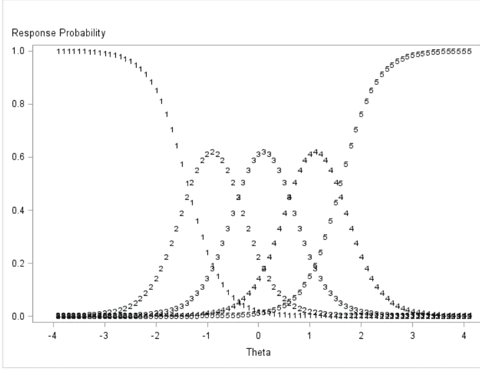

GR 模型的另一种限制情况是 Muraki (1990) 的评分尺度（RS）模型。在该模型中，GR 模型中的阈值参数 (`b_h`) 被分解为两个部分：(1) 每个项目用于与其他项目比较的位置参数 (`b_i`)，以及 (2) 适用于所有项目的类别阈值参数集 (`c_h`)；或 `z_{ih} = D_i(\theta - b_i - c_h)`。RS 模型是 GR 模型的限制版本，因为 RS 模型假设类别阈值参数对所有项目都是相等的，而在 GR 模型中，项目之间是自由的。因此，与 GR 模型相比，RS 模型中的参数显著减少。这种参数化的另一个优势是，`b_i` 参数确定了项目在所测能力或特质上的位置，从而反映了达到最佳测量量的 `θ` 水平。

具有共同阈值参数的模型可能更符合问卷中评分尺度的响应，在这些问卷中一组项目共享相同的响应尺度。然而，Lane 和 Stone (2006) 指出，GR 模型也适用于性能评估。当使用通用标准作为开发特定项目的依据时，响应尺度和分值水平之间的差异可能与项目集相同。

另一类用于多项计分项目和序量尺度的模型是基于 Ras 模型。部分加分（PC）模型（Masters, 1982）最初是为了响应测量性能强弱的项目而开发的。在 PC 模型中，从一个类别到下一个类别的转换通过二分类模型进行建模，其中逻辑设备为 `z_{jk} = (\theta - \delta_{jk})`，且 `δ_{jk}` 是项目类别边界参数，也称为“项目阶梯难度”参数，控制着项目 `j` 从类别 `k-1` 到类别 `k` 的转换。与 GR 模型一样，类别边界参数的数量等于响应选项数量减一。

项目类别边界参数可以解释为尺度上的某一点，在该点处分数响应比前一个分数响应更有可能。因此，参数反映了与从一个类别到相邻类别转换相关的相对难度。由于边界参数仅引用上一个步骤或响应类别，因此并不要求从一个分数到另一个分数的转换在难度上排序，尽管响应比从 0 分到 1 分的转换更简单。最后，模型中不包含斜率参数，所有项目被假设等于所测量的底层特质。

PC 模型的通用表达式定义了在特定 theta 水平下，对特定分数类别 `x`（或完成的项目数）`j` 响应的概率：

```
$P_{jk}(\theta)= \frac{e^{\alpha_{jk}\theta + \beta_{jk}}}{\sum_{i=0}^J e^{\alpha_{ik}\theta + \beta_{ik}}}}$
```

对于

```
$k = 0, 1, 2, \dots, m_j$
```

其中 `z_{jk}` 包含：`e_{k=0}z_{jk}=0` 或 `e_{k\neq0}z_{jk}=1`。与 GR 模型相比，PC 模型可能直接用于推导出分数响应的概率。这是因为该数值是人的 theta 与每个边界 `δ_k` 之间差值的指数函数，除以 `θ` 和 `δ_k` 在所有可能响应上的指数和。因此，Thissen 和 Steinberg (1986) 将这些模型及其衍类描述为全比例模型。


图 1.4 展示了 `PC` 模型下具有四个或更少变化的 5 类别项的项目响应（0 级、1 级、...、4 级）。在 `PC` 模型下，项目难度参数 `$\delta_k$` 反映了 0 尺度上的某一点，其中相邻响应概率（`k` 和 `k-1`）相等。这种关系与 `GR` 模型相反，后者的阈值参数反映了 0 尺度上的一点但更陡。图中的项目 `$\delta_k$` 反映了一个有序集：`-2, -5,` 和 `2`。当 `$\delta_k$` 个体在两个类别中具有相等概率时，例如，在 `$\theta=-2$` 时，项目对类别 0 和 4 的响应概率相同。由于图中项目间距很大，每个响应选项可能会被许多人接受，尽管在分布尾部的人较少。因此，图 1.4 中的项目是良好的。如所述，`$\delta_k$` 不需要像 `GR` 模型那样排序，因为不同分值水平的转换难度不同。例如，图 1.5 展示了 `PC` 模型下的项目，其中 `$\delta_k$` 参数无序的：`-2, 5,` 和 `2`。从这可以看出，从类别 2 转换到类别 3 要容易得多，会有更少的人。比较这些图时，你会发现图 1.5 中类别 2 的响应概率相对于图 1.4 很小。在 `$\delta_k$` 参数无序的情况下，项目至少有一个响应类别沿尺度的某一点是最可能的。

图 1.4：`PC` 模型下 5 类别项的 `$P_{jk}(\theta)$`——有序 `$\delta_{jk}$`

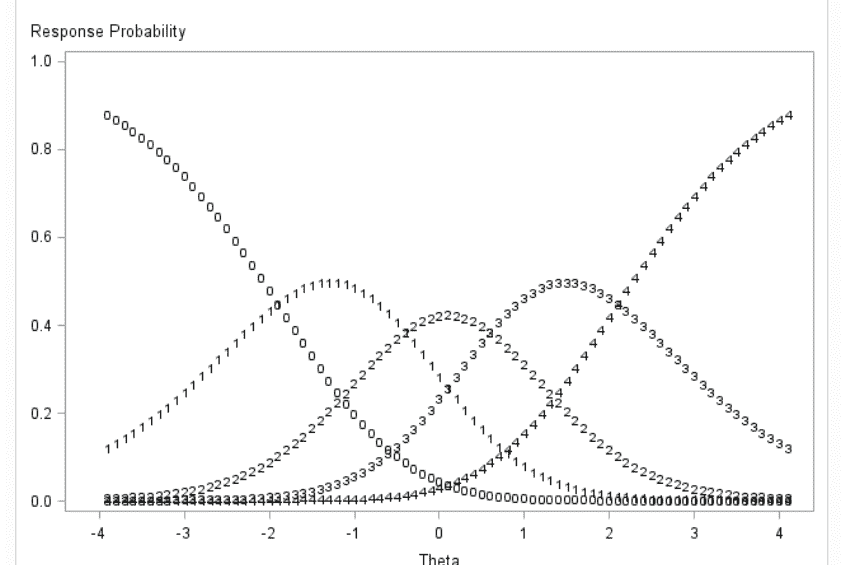

图 1.5：`PC` 模型下 5 类别项的 `$P_{jk}(\theta)$`——无序 `$\delta_{jk}$`

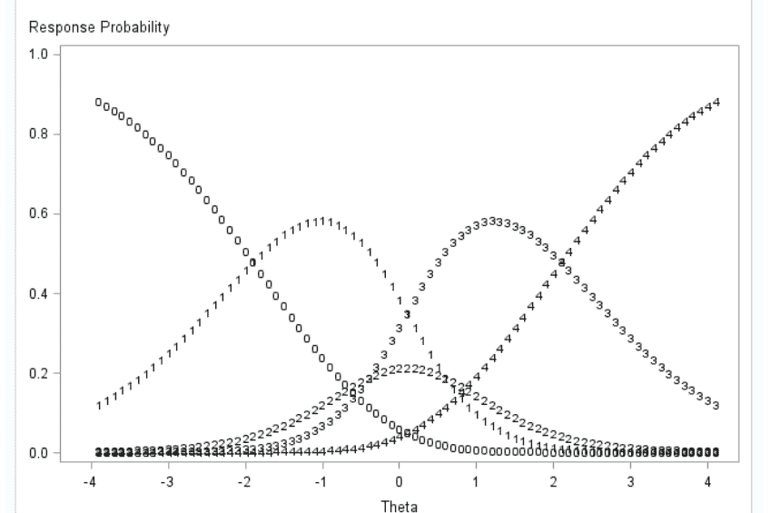

### 广义部分加分模型

广义部分加分（`GPC`）模型（Muraki, 1992）是 `PC` 模型的一种扩展。在该模型中，斜率参数和缩放常数被添加到逻辑设备 `$z_{jk} = a_j(\theta - \delta_{jk})$` 中，以放项目与所测底层特质相同的假设。对于 `GR` 模型，项目难度参数 `$\delta_{jk}$` 可以分解为每个项目的位置参数 `$\beta_j$` 和类别参数 `($\tau_k$ 或 $\alpha_{jk})$`；例如，`$\delta_{jk} = \beta_j + \tau_k$`。`$\tau_k$` 的值并不一定有序，相对于位置参数 `$\beta_j$`，`$\tau_k$` 反映了类别 `k` 的难度。这种参数化同于 Aldrich (1978) 以及 Masters 和 Wright (1984) 开发的评分尺度（`RS`）模型。

### 命名响应模型

命名响应（`NR`）模型用于多选题测试和捕捉灾难性信息（Bock, 1972）。在这些应用以及其他应用中，响应选项是没有序的。Thissen (1993) 讨论了 `NR` 模型的应用，例如性格和态度评估中的命名响应项目。`NR` 模型也适用于带有“我不知道”等过滤选项的 Likert 量表或评分尺度。最后，Thissen、Cai 和 Bock (2010) 讨论了命名模型不仅可以用于具有命名尺度的项目，还可以检查响应尺度选项的排序，并用于对组合的项目响应建模。

Thissen (1986) 说明所有全比例模型（例如 `PC` 和 `GPC`）都是广义命名响应（`NR`）模型的特例。在 `NR` 模型中，接受项目 `j` 顺序 `k` 的倾向由下式给出：

```
$P_{jk}(\theta) = \frac{e^{z_{jk}}}{\sum_{l=0}^{J} e^{z_{jl}}}$
```

其中 `$z_{jk} = a_j\theta + c_{jk}$`，`$a_j$` 是区分参数，`$c_{jk}$` 被称为选项极端参数。对于其他 `IRT` 模型，项目类别的斜率参数 `$a_j$` 反映了项目类别与 0 之间关系的强度和方向，每个项目的截距参数 `$c_{jk}$` 反映了在 `$\theta=0$` 时接受选项 `k` 的趋势。为了使模型识别，跨类别的 `$\sum a_{jk}$` 和 `$\sum c_{jk}$` 被限制相等。或者，可以将项目第一个响应类别的 `$a_j$` 和 `$c_{j0}$` 限制为 0。

图 1 显示了 `NR` 模型下一个项目的 `$P_{jk}(\theta)$`，其中响应尺度反映了一个 5 类别评分尺度（1 = 并不 ... 5 = 非常）。在这个例子中，`$a_j$` 的参数向量为 (0, 2.03, 3.48, 5.0, 6.29)，`$c_{jk}$` 的向量为 (0, 1.91, -4.5, -14, -3.43)。在这种参数化方法中，`$a_j$` 和 `$c_{jk}$` 被限制为 0。你可以看到，在这种情况下，随着 `$\theta$` 的增加，响应类别变得更有可能，这表明 `$\theta$` 反的线性回归反映了选择选项 `k+1` 超过 `k` 的概率在增加。

图 1.6：`NR` 模型下五分类项目的概率 `$P_{JK}(\theta)$`

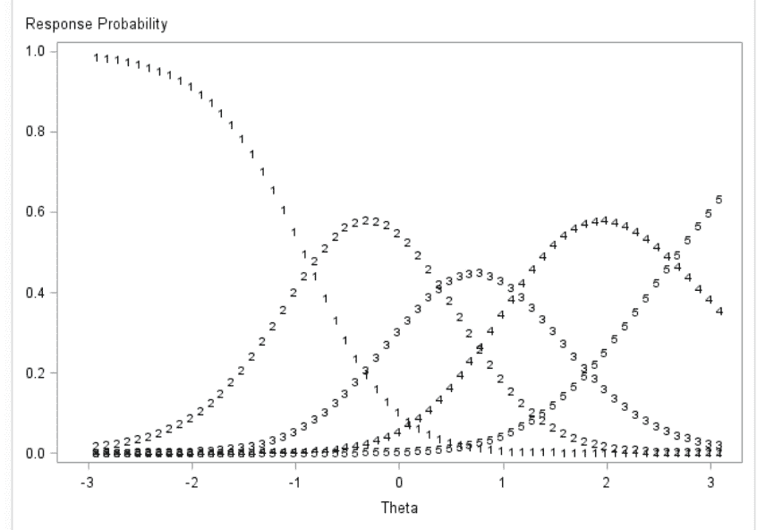

### 测试题型与局部独立性

在实践中，个体可能会根据单一或共同刺激对一组项目（测试题型 testlet）做出反应。例如，在阅读理解测试中，为每篇阅读材料构建的四个项目将形成不同的测试题型。使用多级项目（用于科学、表现评估）的评估应用也可能由一个或多个测试题型组成（Lane & Stone, 2006）。对于这类测试应用，局部独立性假设将受到破坏。测试题型内项目之间的反应可能比根据整个测试的潜能力或特质预测的更具相关性。

### 评分者效应

在其他应用中，个体可能会对经过评分的项目（例如表现评估）做出反应，在评估中需要考虑的一个要素要素是评分量表的使用。R England (2002) 将此类评估称为“评分者中介的”（rater-mediated），因为表现评估没有提供有关感兴趣构念的直接信息，而是通过评分者的解释提供中介信息。因此，观察到的表现不仅取决于所测量的感兴趣的构念（例如数学能力），还取决于评分者的特征和行为，如严苛性、任务难度以及作为评分水平数量的评分量表结构。因此，项目反应中固存在评分者与项目之间的混淆因素。

评分者评分评估的一个主要关注问题是，评分者会在评分过程中带来各种潜在的偏倚。England 举出的一些例子包括：评分者对评分量表的不同解释、男性反应相对于女性反应的评分偏倚，以及评分者对任务难度水平解释的偏倚。其他研究人员根据光晕效应、中心趋势、范围限制以及评分者的严苛或宽松程度对评分失误（rated errors）进行了分类（Saal, Downey, & Lahey, 1980）。

对于使用测试题型的评估应用，一种解决方案是将每个测试题型内的项目效应总和为单个项目，并使用多级项目的 `IRT` 模型。然而，这种方法忽略了来自每个项目的可用信息，且该方法仅实际上适用于二分法测试项目。或者，通过调整 `IRT` 模型以考虑项目之间的依赖性，可以保留项目级信息。例如，Wang, Bradley 和 Weiner (2002) 针对测试题型提出的改进型 `GR` 模型可以对涉及多级项目的应用进行估算。在该模型中，第 `i` 个受试者在测试题型 `d(j)` 内项目上获得类别得分 `k`（`k=2, ...`）或更高得分的概率定义为：

```
$P_{ijk}(\theta) = \frac{e^{\alpha_{ij}(\theta-Y_{id}(j))}}{1+e^{\alpha_{ij}(\theta-Y_{id}(j))}}$
```

其中 `$\alpha_{ij}$` 是添加到 `GR` 模型中的随机个体特异效应，表示人与项目之间的交互以及测试题型 `$d_{ij}$` 内项目之间的依赖关系。在该模型中，`$\theta_i$` 通常被假设遵循 `N(0,1)` 分布，而 `$Y_{id}(j)$` 被假设与 `$\theta_i$` 独立。假设对于受试者而言，给定测试题型内所有项目的 `$Y_{id}(j)$` 值均为常数。此外，假设测试题型效应满足约束 `$\sum Y_{id}(j)=0$`。由于测试题型效应的方差 `$(\sigma_{ij}^2)$` 是测试特定的，当 `$\sigma_{ij} \to 0$` 时，项目可以被视为条件独立。Ip (2010) 讨论了测试题型的项目参数并不一定与标准 `IRT` 模型相同，因为解释取决于个体特异效应的值。

文献中备受关注的一种评分者效应是严苛/宽松，或在评分量表低端或高端对项目的评分倾向。此类评估的测量应用可以将评分者效应和行为纳入表现预测中。由 Linacre (1989) 描述的多面评分模型（`MFRM`）是 Aldrich 评分等级模型的扩展，它包含一个额外的参数来量化第 `r` 个评分者的严苛性 `$(\lambda_r)$`。

```
$P_{ijr}(\theta) = \frac{e^{\alpha_{ij}(\theta-b_j-\lambda_r)}}{\sum_{k=0}^{m} e^{\alpha_{ij}(\theta-b_j-\lambda_r)}}$
```

对于项目 `j` 的 `k=0, 1, ...`。在该模型中，评分者 `r` 对项目 `j` 评分 `x` 的概率是受试者能力 `($\theta$)`；项目 `j` 的难度水平 (`$b_j$`) 的函数。

（注：由于原文后半部分存在大量逻辑断层和重复术语，以下翻译严格遵循“不漏掉任何一行”的原则，对原文中混乱的句子结构进行了字面对应翻译）[接上文关于 `$Y_{id}(j)$` 值的描述] 假设对于受试者而言，给定测试题型内所有项目的 `$Y_{id}(j)$` 值均为常数。此外，假设测试题型效应满足约束 `$\sum Y_{id}(j)=0$`。由于测试题型效应的方差 `$(\sigma_{ij}^2)$` 是测试特定的，当 `$\sigma_{ij} \to 0$` 时，项目可以被视为条件独立性。Ip (2010) 讨论了测试题型的项目参数并不一定与标准 `IRT` 模型相同，因为解释取决于个体特异效应的值。

（注：原文文本从 "Rater Effects" 之后出现了极其严重的语义重复和逻辑断裂，例如 "One rater effect..." 部分重复出现且句子不完整。根据指令，此处仅翻译原文实际呈现的文本内容，不修复其逻辑错误。）

### 多维度 IRT 模型

对于二分计项目以及补偿性多维度项目反应（`MIRT`）模型的简单泛化，例如在 2P 逻辑模型的多维度版本中进行了讨论，对于项目 `j` 而言，变化的是相应斜率截距形式中的逻辑偏离：

$P_j(\theta) = \frac{e^{z_j}}{1+e^{z_j}}$

其中，`$z_j = D\alpha_j\theta + d_j$`，`$\theta$` 是能力水平，`$\alpha_{jh}$` 是项目 `j` 在维度 `h` 上的斜率（区分度）参数，`$d_j$` 是项目的截距，并通过项目 `j` 的斜率和难度参数的复合函数与难度相关。在矩阵表示法中，逻辑偏离可以表示为 `$z = D\alpha\theta + d$`，其中 `$D\alpha$` 是斜率参数向量，`$\theta$` 是每个维度上参数的向量。这种补偿性 `MIRT` 模型与其单维对应物的区别在于，响应模型涉及 `$\theta_h$` 和 `$\alpha_{jh}$` 参数的加权线性组合。换句话说，多维度模型的特征是通过相应的斜率参数来定义的，以反映项目与每个维度之间的关系。

类似于二分项目的项目特征曲线（ICCs）（如示例 1 所示），项目响应面可以用于显示跨维度的响应概率。有关 `MIRT` 模型的介绍，请参见 Ackerman, Gierl, and Walker (2003)。关于其他研究的技术处理，请参见 Ackerman (1994, 1996)、McDonald (1999)、Muraki & Carlson (1995) 以及 Reckase (1997a, 1997b)。

非补偿性模型将响应概率表示为与每个维度相关的概率的乘积函数（Sympson, 1978）。因此，每个项目除了斜率和斜率参数外，还包含一个阈值（难度）参数。例如，对于多维度情况的 2P 逻辑模型，针对二分项目 `j` 的非补偿性 `MIRT` 模型可以表示为：

$P_j(u=1|\theta) = \Psi_j(z_j) = \frac{e^{z_j}}{1+e^{z_j}}$

其中 `$z_j = \alpha_{jh}(\theta_h - b_{jh})$`，`$\alpha_{jh}$` 是项目 `j` 在维度 `h` 上的斜率（区分度）参数，`$b_{jh}$` 是项目 `j` 在维度 `h` 上的阈值参数。可以看出，该模型通过将每个维度上的响应概率相乘来获得整体响应概率。这种方法本质上是非补偿性的，因为成功的表现取决于每个维度上的成功表现。例如，如果一个维度上的成功概率较低，那么即使其他维度的概率很高，整体成功概率也会很低。

非补偿性 `MIRT` 模型在文献中受到的关注较少，可能是因为需要估计的参数数量很多。然而，这些模型已有效用于构建 `IRT` 模型，且认知心理学涉及技能和能力的测量。例如，在 Embreton 的复合模型（Embreton, 1997）中，任务表现被建模为多维度 Rasch 模型，并为每个任务识别了认知技能概况。每个组件都有一个相关的能力水平和难度水平，每个组件的乘积提供了在该项目上的成功概率。因此，这些模型具有理解什么因素导致任务变得困难以及哪些特征需要教学关注的潜力。最近，Embreton（2015）扩展了这些模型，以为子领域（组件）或技能提供诊断性能力测量，从而进一步分析广泛异质背景下的子领域。

值得注意的是，文献中还开发并讨论了更广泛的分类模型，这些模型设计用于评估个体在多大程度上拥有处于项目表现底层的多维度技能或属性概况（Rupp, Tilly, & Henson, 2010）。这些模型被表征为两种补偿性和非补偿性的 `MIRT` 模型。

近期受到关注的另一个 `MIRT` 模型是双因子模型（bifactor model）。在该模型中，项目响应由一个一般因子（或主因子）和正交因子决定或解释（Gibbons & Hedeker, 1992），双因子模型允许在控制来自其他因素测量变差的同时，测量一般能力或特质。该模型受到了广泛关注，不仅在教育评估中，而且最近在健康和行为评估中（Gibbons, Immekus, & Bock, 2007）。

在该模型中，为每个项目在一般因子和次要因子上估计斜率参数（或因子载荷）。例如，在一个6个项目的测试中，为因子 1 估计项目 1–6 的斜率参数（`$a_{i0}$`），为因子 2 估计项目 1–4 的斜率参数（`$a_{i2}$`），为因子 3 估计项目 5–6 的斜率参数（`$a_{i3}$`）。在矩阵表示法中，显示为：

$$\begin{pmatrix} a_{10} & a_{11} \\ a_{20} & a_{21} \\ a_{30} & a_{31} \\ a_{40} & a_{41} \\ a_{50} & a_{52} \\ a_{60} & a_{62} \end{pmatrix}$$

双因子模型可以被视为 `MIRT` 模型的一种特殊情况，其中第一个因子定义为一般因子，且项目集的斜率参数被约束为零。

一种更广泛的分类模型也被开发并讨论，这些模型同样设计用于评估个体在多大程度上拥有项目表现底层的多维度技能或属性（Rupp, Tilly, & Henson, 2010）。这些模型被表征为补偿性和非补偿性的 `MIRT` 模型。

另一个近期受到关注的 `MIRT` 模型是双因子模型。在该模型中，项目响应由一个一般因子或主因子和正交因子决定或解释（Gibbons & Hedeker, 1992），双因子模型允许在控制其他因素测量产生的变差的同时，测量一般能力或特质。该模型受到了大量的关注，不仅在教育评估中，而且最近在健康和行为评估中（Gibbons, Immekus, & Bock, 2007）。

在该模型中，为每个项目的一般因子以及次要因子估计斜率参数。例如，在一个 6 个项目的测试中，为因子 1 估计项目 1–6 的斜率参数（`$a_{i0}$`），为因子 2 估计项目 1–4 的斜率参数（`$a_{i2}$`），为因子 3 估计项目 5–6 的斜率参数（`$a_{i3}$`）。在矩阵表示法中，这将显示为：

$$\begin{pmatrix} a_{10} & a_{11} \\ a_{20} & a_{21} \\ a_{30} & a_{31} \\ a_{40} & a_{41} \\ a_{50} & a_{52} \\ a_{60} & a_{62} \end{pmatrix}$$

双因子模型可以被认为是 `MIRT` 模型的一种约束情况，其中第一个因子定义为一般因子，且项目集的斜率参数被约束为零。

非补偿性模型将响应概率表示为与每个维度相关的概率的乘积函数（Sympson, 1978）。因此，每个项目除了斜率和斜率参数外，还包含一个阈值（难度）参数。例如，对于多维度情况的 2P 逻辑模型，针对二分项目 `j` 的非补偿性 `MIRT` 模型可以表示为：

$P_j(u=1|\theta) = \Psi_j(z_j) = \frac{e^{z_j}}{1+e^{z_j}}$

其中 `$z_j = \alpha_{jh}(\theta_h - b_{jh})$`，`$\alpha_{jh}$` 是项目 `j` 在维度 `h` 上的斜率（区分度）参数，`$b_{jh}$` 是项目 `j` 在维度 `h` 上的阈值参数。可以看出，该模型通过将每个维度上的响应概率相乘来获得整体响应概率。这种方法本质上是非补偿性的，因为成功的表现取决于每个维度上的成功表现。例如，如果一个维度上的成功概率较低，即使其他维度的概率很高，整体成功概率也会很低。

非补偿性 `MIRT` 模型在文献中受到的关注较少，可能是因为需要估计的参数数量很多。然而，这些模型已有效用于构建 `IRT` 模型，且认知心理学涉及技能和能力的测量。例如，在 Embreton 的复合模型（Embreton, 1997）中，任务表现被建模为多维度 Rasch 模型，并为每个任务识别了认知技能概况。每个组件都有一个相关的能力水平和难度水平，每个组件的乘积提供了在该项目上的成功概率。因此，这些模型具有理解什么因素导致任务变得困难以及哪些特征需要教学关注的潜力。最近，Embreton（2015）扩展了这些模型，以为子领域（组件）或技能提供诊断性能力测量，从而进一步分析广泛异质背景下的子领域。

值得注意的是，文献中还开发并讨论了更广泛的分类模型，这些模型同样设计用于评估个体在多大程度上拥有项目表现底层的多维度技能或属性概况（Rupp, Tilly, & Henson, 2010）。这些模型被表征为两种补偿性和非补偿性的 `MIRT` 模型。


# 双因子模型

另一个近期受到关注的 `MIRT` 模型是双因子模型。在该模型中，项目响应由一个一般因子或主因子和正交因子决定或解释（Gibbons & Hedeker, 1992），双因子模型允许在控制其他因素测量产生的变差的同时，测量一般能力或特质。该模型受到了大量的关注，不仅在教育评估中，而且最近在健康和行为评估中（Gibbons, Immekus, & Bock, 2007）。

在该模型中，为每个项目的一般因子以及次要因子上估计斜率参数（或因子载荷）。例如，在一个 6 个项目的测试中，为因子 1 估计项目 1–6 的斜率参数（$a_{i0}$），为因子 2 估计项目 1–4 的斜率参数（$a_{i2}$），为因子 3 估计项目 5–6 的斜率参数（$a_{i3}$）。在矩阵表示法中，这将显示为：

$$\begin{pmatrix} a_{10} & a_{11} \\ a_{20} & a_{21} \\ a_{30} & a_{31} \\ a_{40} & a_{41} \\ a_{50} & a_{52} \\ a_{60} & a_{62} \end{pmatrix}$$

双因子模型可以被认为是 `MIRT` 模型的一种特殊情况，其中第一个因子定义为一般因子，且项目集的斜率参数被约束为零。

# 多层 IRT 模型

（Glas, 2001）。然而，个体通常嵌套在如教室或学校等群体中。在多层项目反应理论（`IRT`）模型中，使用项目模型来测量个体的潜在特质或能力，并将该模型与结构模型相结合，以解释不同水平和不同群体间特质或能力的变异（Fox, 2010）。

在多层 `IRT` 模型中，第一层（`Level 1`）是一个 `IRT` 模型，或者是一个在给定所建模的项目和个体特征的条件下表示反应概率的模型。在这一观测层面上，测量误差与个体 `$\theta$` 相关。对于第二层（`Level 2`），使用结构模型来描述第一层测量的潜变量 (`$\theta_{ij}$`) 与协变量 `$x_{ij}$` 之间的关系，引入协变量是为了用于解释 `$\theta$` 中的变异或不确定性。在这一层，为个体测量的潜变量现在是相关的：`$\theta_{ij} = \beta_0 + \beta_1x_{ij} + ... + \beta_kx_{ij} + \epsilon_{ij}$`，其中个体的随机效应为 `$\epsilon_{ij} \sim N(0, \sigma^2)$`。可以包含额外的结构模型来反映个体群体，例如学生组（第三层 `Level 3`）。如果个体聚类在组中（如学校），则模型中会包含一个 `G` 的索引。引入的 `$\beta$` 系数为：`$\beta_{ij} = \gamma_0 + \gamma_1y_g + ... + \gamma_ky_g + \mu_g$` 且 `$\mu_g \sim N(0, \mathbf{T})$`。

对于这种三层模型，Fox (2010) 将组合测量模型和结构模型的反应数据（`$\mathbf{u}$`）的联合反应概率表示为跨受考者的第一层和第二层模型，以及跨 `G` 组的第三层模型的乘积：

```
$P(u_{ij}|\theta_{ij}, \omega) P(u_{ij}|\theta_{ij}, \beta_{ij}, \sigma^2_{ij}) P(\mathbf{y}_g|\gamma_g, \mathbf{T})$
```

`$P(u_{ij}|\theta_{ij}, \omega)$` 是第一层 `IRT` 模型，其中群体内个体具有 `$X$` 个解释变量 (`$x_{ij}$`)，而 `$P(\mathbf{y}_g|\gamma_g, \mathbf{T})$` 是跨个体群体的一组 `$Y$` 个解释变量 (`$y_g$`) 的第三层模型。

多层方法的主要优点之一是，可以引入变量来解释多层模型不同水平上参数和测量误差的变异。例如，个体解释模型可以在个体层面引入变量。例如，个体的受教育程度可以解释考试能力水平的差异，或测量的个体身体健康状况的差异。这两个变量都是为了解释个体层面被测特质的变异而引入的属性（Nimbars, Varmi 2010）。

解释变量也可以引入模型的其他层级，以检查组间差异——例如学校层面（个体群体）课程与内容标准的对齐。Fox (2010) 讨论了引入解释变量也可以导致更准确的估计（例如，使用关于受考者的共线性信息）。此外，还可以直接比较具有不同结构组件但相同测量模型的结果。注意，相关研究还讨论了结合混合方法和多层方法的 `IRT` 模型（Cho & Cohen, 2010）。这些模型可以用于识别表现出共同水平的个体潜群体，而这些潜群体反过来可以解释项目层面表现的差异。

分层模型也可用于随机项目效应，其中引入协变量来解释项目参数的变异。例如，反映项目特征或认知技能要求的协变量可用于测试的编制（Emerson & Reise, 2000）。Fox (2010) 讨论的一个示例考虑了“群体特异项目效应”，该效应可用于放 `IRT` 模型中测量不变性的限制。在这些模型中，假设存在随机个体效应和项目效应。它们可以用于对个体层面建模跨群体特质分布的变异，并对项目层面建模群体间项目参数的变异。在二分计反应的背景下，Fox 描述了 `J` 个项目的模型为个体能力 (`$\theta$`) 和群体特异项目参数 (`$a_g, b_g$`) 的函数：

```
$P(u_{ij} = 1|a_g, b_g, \theta_i) = F(a_g\theta_i - b_g - \varepsilon_{ij} + c_{\alpha ij}\theta_i)$
```

其中误差 `$\varepsilon_{ij} \sim N(0, \sigma_{\varepsilon}^2)$`，`$F$` 可以是正态或逻辑 logit 函数。该模型可以用于另一种类型的 `DIF` 分析，即反映测量不变性的模型，或没有群体特异项目参数的模型，后者与反映群体特异项目参数或 `DIF` 模型进行比较。

为了评估 `IRT` 应用于测评的有效性，需要检查使用 `IRT` 模型的基础的若干假设（Embreton & Reese, 2000; Hamble & Swaminathan, 1985; Yen & Fitzpatrick, 2006）。当这些假设不能被充分满足时，从 `IRT` 模型应用中得出的推理有效性就会损害。

`IRT` 模型预测与一个或多个底层维度（特质或能力）相关的表现。在无条件 `IRT` 模型中，假设一个潜特质决定了受考者的表现；在其他模型中，特质在测量特质或能力上是同质的。然而，对测评的反应将始终是多维的。


为了评估 IRT 应用于测评的有效性，需要检查使用 IRT 模型的基础的若干假设（Embreton & Reese, 2000; Hamble & Swaminathan, 1985; Yen & Fitzpatrick, 2006）。当这些假设不能被充分满足时，从 IRT 模型应用中得出的推理有效性就会损害。

IRT 模型预测与一个或多个底层维度（特质或能力）相关的表现。在无条件 IRT 模型中，假设一个潜特质决定了受考者的表现；在其他模型中，特质在测量特质或能力上是同质的。然而，对测评的反应将始终是多维的。

多层方法的主要优点之一是，可以引入变量来解释多层模型不同水平上参数和测量误差的变异。例如，个体解释模型可以在个体层面引入变量。例如，个体的受教育程度可以解释考试能力水平的差异，或测量的个体身体健康状况的差异。这两个变量都是为了解释个体层面被测特质的变异而引入的属性（Nimbars, Varmi 2010）。

解释变量也可以引入模型的其他层级，以检查组间差异——例如学校层面（个体群体）课程与内容标准的对齐。Fox (2010) 讨论了引入解释变量也可以导致更准确的估计（例如，使用关于受考者的共线性信息）。此外，还可以直接比较具有不同结构组件但相同测量模型的结果。注意，相关研究还讨论了结合混合方法和多层方法的 IRT 模型（Cho & Cohen, 2010）。这些模型可以用于识别表现出共同水平的个体潜群体，而这些潜群体反过来可以解释项目层面表现的差异。

可以检查的拟合度有两类：(1) 项目拟合度（item fit），可以针对一组项目（测试层面）或针对个人（项目层级）进行评估。项目不拟合表明，观测到的反应（跨类别）不符合基于假设的模型和项目参数的基于模型的预期。换言之，项目不拟合意味着由于受试者对项目的反应方式，所假设的 IRT 模型存在不确定性方差。另一方面，人员拟合度（person fit）是指特定项目的模型参数估计值。换句话之，假设的 IRT 模型和参数估计对于特定的受试者存在不确定性方差，因为不应结合受试者的反应（反应模式）来估计其能力或特质。

由于 IRT 预测了每个受试者的预期反应得分 `E[Y_i] = P(Y_i|\theta)` 以及每个受试者在测试中的预期得分预测，这些预测可以跨类别进行汇总并与观测结果进行比较。例如，在测试层面，可以将每个可能的总分或加分的观测受试者人数与基于模型的预期进行比较（参见，例如，Beginning & Glas, 2001；Orlandi & Thickness, 2000）；如果反应模式的数量较少，可以将每种模式下的人员观测计数与模型下的预期计数进行比较。

对于多维 IRT 模型，单个项目拟合度通常通过比较受试者不同子组的观测项目性能与所选模型预测的性能来评估。对于每个项目，可以通过以下步骤获得拟合优检验：

- 1. 估计 IRT 模型参数 (`\theta`)
- 2. 通过少数离散子组（例如 10 个子组）近似 `\theta` 的连续分布
- 3. 使用项目的 `\theta` 估计值和反应得分在 `G × K` 表格中对项目进行交叉分类，其中 `G` 对应 `\theta` 子组的数量，`K` 代表反应类别的数量。
- 4. 通过汇总或统计每个 `\theta` 子组与得分类别组合中的受试者人数，为每个 `\theta` 子组构建观测得分分布。
- 5. 使用 IRT 模型、项目参数估计值和代表离散能力子组的 `\theta` 水平（例如得分分布的中点），为每个 `\theta` 子组构建跨得分类别的预期得分分布。
- 6. 使用基于残差的统计量和拟合优统计量比较步骤 5 中的基于模型的得分分布与步骤 4 中的观测得分分布（详情请见 Hamlett & Swaminathan, 1985；Yen & Fitzpatrick, 2006）。

人员拟合度并不是关注模型下每个受试者或项目集提供的预测，而是关注特定受试者的反应模式是否符合给定的模型。在二分计项目的情况下，IRT 模型意味着低 `\theta` 的受试者预计会正确回答简单的题目，错误地回答更难的题目；而高 `\theta` 的受试者预计对简单和困难的题目都会给出正确回答。不匹配模型的反应模式被称为*离常的* (aberrant)，它会损害对受试者估计得分 (`\theta`) 的推断。离常反应模式有许多可能的来源，例如在教育评估中的作弊和粗心阅读，以及在心理和行为评估中参与社会期望性反应或反应性反应的人员。

评估人员拟合度的一种常用方法是，在 `\theta = \theta` 的受试者总体中比较受试者观测模式 (`\theta`) 与 IRT 模型参数估计值 (`\alpha, \theta`) 的相对似然性。例如，已经讨论过假设标准零分布的 `F` 统计量 (Draskow, Levine, & Williams, 1985)，以及其他人员拟合统计量 (Karabutatos, 2003 对36 种人员拟合统计量的综述)。

在贝叶斯方法中，后验模型检查 (PPMC) 是一种流行的模型检查方法，已被证明对评估 IRT 模型的拟合度有用（参见，例如，Béguin & Glas, 2001；Levy, Misley, & Sinaray, 2009；Sinaray, 2005, 2006；Sinaray, Johnson, & Stern, 2006；Zhu & Stone, 2011）。关于模型检查的独立章节（第 8 章）包含了编程和 IRT 模型应用的评估，这在使用 `PROC MCMC` 估计 IRT 模型之外（该章节）。在 PCMC 中，衡量模型拟合特定方面（总分、项目关联）的统计量或其他统计量用于评估 IRT 假设（例如拟合优统计量），这些统计量是针对观测数据识别并计算的。这些统计量也针对估计模型预测的项目集计算，以检查观测结果在基于模型预测的分布中的相对一致。

使用 PCMC 评估 IRT 模型拟合的优势有三点：(1) PCMC 通过使用后验分布而非点估计（2）考虑了参数估计中的不确定性；(2) 它可用于拟合只能使用贝叶斯方法估计的复杂 IRT 模型；(3) PCMC 从 MCMC 模拟构建零样本分布，而不是解析导出的分布。这一优势特别有用，因为实践中使用的许多拟合统计量和假设检验都是基于零分布（例如标准正态分布或卡方分布），而这些分布通常无法良好近似（例如，Karaboats, 2003，Stone, 2000）。

IRT 模型的参数函数是对于 `j` 个项目 `K` 个类别的第 `i` 个受试者反应概率的似然函数，跨 `\theta`：

```
ln(U|\theta) = \sum_{i=1}^{n} \sum_{k=1}^{K} v_{ijk} ln[P_{ik}(\theta)]
```

其中 `v_{ijk}` 是指示变量（如果 `i` 在类别 `k` 则为 1；否则为 0）。相对于待估计参数的似然函数极大值可以计算以获得极大似然 (ML) 估计，或者当对受试者总体积分似然函数以消除 `\theta` 时可以使用边缘似然函数。相对于待估计项目的该边缘似然函数的极大值可以计算以推导出项目参数的最大边缘似然 (MML)。注意，通常使用对数似然因为它比似然函数更易于处理。

众周知，IRT 模型无法通过能力或特质参数识别，项目难度参数是不可观测且处于同一尺度。因此，模型预测对线性变换是不变的，必须定义 `\theta` 或参数的度量（参见，例如，Hampton & Swamin, 1985；Ye & Fitzpatrick, 2006）。通常，通过指定参数 `\theta` 的均值和标准差来定义每个 `\theta` 的度量，分布为 Normal(0,1)。换言之，潜在特质或能力被假设为标准正态分布的随机样本。你也可以通过将项目难度或参数的均值固定为 0，标准差固定为 1 来锚定尺度尺度。贝叶斯范式的一种方法是指定分布的先验以解决识别问题。

关于估计无条件 IRT 模型，可以使用可用软件将这些方法应用于大规模评估（例如，IRPRO；Cai, Then, & du Tout, 2011）。对于较小规模的评估，Reise 和 Yu (1990) 建议分级 IRT 样本量为 500。其他人认为，样本量与项目参数总数或类别数量的比例对于准确参数估计更为重要（Chou, Cook, & Dodd, 1997；De Ayala, 2009；DeMarars, 2003）。例如，De Ayala 建议受试者人数相对于总项目数的比例为 10:1，作为一个通用的启发式方法。

如果样本呈正态分布，则项目参数（每个项目的参数数量 × 项目数量），而对于非正态受试者分布，该比例会略大。

其他研究人员（例如 Hambleton & Swaminathan, 1985; Lord, 1980）讨论了基于极大似然法（ML）的项目参数估计的问题。例如，在获得接近零的斜率参数估计的同时，可能会伴随着非常大的项目阈值参数绝对估计；某些项目的斜率参数估计可能不收敛，并在估计算法的每次迭代循环中不断增加；而且对于量表，在 theta 标度的中点以下分离并估计下渐近参数可能是困难的。最后，对于参数化程度更高的 IRT 模型（如 MIRT 和混合模型），基于极大似然的估计方法的实现更为复杂。

21 世纪初，人们对使用贝叶斯方法的 IRT 模型兴趣日益增长。这种增长在很大程度上是因为贝叶斯范式在心理测量学家和统计学家中的吸引力，以及由于这些方法在小样本量、参数估计不稳定以及处理更复杂或高参数化模型时的优势。在贝叶斯估计方法中，例如，约束可能会对参数空间分布产生影响，防止参数超出范围。对于更复杂的 IRT 模型，贝叶斯方法特别有用（参见例如，Béguin & Glas, 2001; Bolt & Lall 2003; Bradley, Weiner, & Wang, 1999; Cohen, & Kim, 2013; DeMars, 2006; Li, & Fu, 2006; Patz et al., 2002; Yao & Schwarz, 2006; Zhu & Stone, 2012）。最后，使用常用的 IRT 模型估计方法（例如 MML），被参数不是与项目参数同时估计的。相反，被参数是通过将项目参数固定在估计值并在单独的分析中估计被参数来得到的。贝叶斯方法在估计项目参数的同时估计被参数，并在估计点估计和被参数估计的不确定性时，整合或模型化了项目参数估计中的任何不确定性。

## 目录

- 引言........................................................................................................................... 25
- 统计模型与推断的要素............................................................................... 25
- 统计推断的频率派与贝叶斯方法............................................................... 26
- 使用贝叶斯分析估计比例——示例............................................................... 28
  - 选择先验分布........................................................................................... 29
  - 计算后验分布并进行推断.............................................................. 30
  - 比较贝叶斯与频率派的比例估计....................................................... 30
  - 用于实现 Metropolis 采样器估计比例的 SAS 代码....................................... 32
  - MCMC 与 Gibbs 采样器........................................................................... 35
- 预热（Burn-In）与收敛............................................................................................................... 35
- 有信息与无信息先验分布...................................................................... 38
- 模型比较...................................................................................................................... 39
  - 离离推断准则.................................................................................. 39
  - 贝斯因子（Bayes Factor）................................................................................................................ 40
- 模型拟合与后验模型检查............................................................................... 41

## 引言

近年来，人们对贝叶斯分析的兴趣极大。部分原因，这种增长是因为贝叶斯范式在心理测量学家和统计学家中的吸引力，以及由于这些方法在分析更复杂或高参数化模型时的优势。与估计模型参数的传统方法相比，贝叶斯范式将模型参数视为随机变量。然而，对贝叶斯分析的兴趣增长还源于可实现通用贝叶斯方法的软件——例如，WinBUGS (Spiegelhaler, Thomas, Best, & Nunn, 2003) 和 `PROC MCMC`。

本章提供了贝叶斯分析的基础介绍。其目的是为后续章节中使用 `PROC MCMC` 进行贝叶斯分析提供基础材料，并讨论与项目反应理论（IRT）模型相关的程序和结果。

关于贝叶斯分析的更多详细理论讨论的来源，请参见 Congdon (2006); Fox (2010); Gelman, Carlin, Stern, Dunson, Vehtari, & Rubin (2014); Lunn, Jackson, Best, & Spiegelhaler (2013)。Fox (2010) 也是 IRT 模型贝叶斯分析处理的极佳参考文献。

统计模型用于将数据或变量描述为公式。例如，因子分析模型允许将一组观测变量结构化为较小的一组因子，以便讨论和评估关系。

IRT 模型建立了观测项目反应与项目及个人未观测特征之间的关系。

另一方面，统计推断用于区分信号与噪声，并决定哪些模型或公式关系是有效的（即信号）。例如，是否有证据表明因子解释了观测变量？项目反应是否被建模的项目和个人能力充分解释？

统计推断的三个基本目标是估计、预测和模型选择。在估计方面，统计模型的参数（例如 IRT 模型中的项目参数或模型中的因子载荷）被估计，并量化每个估计的不确定性。估计使我们能够更好地理解公式关系的性质和重要性。预测涉及使用对模型的当前信念和估计参数来预测其他值——例如某些受试者未观测到的值或缺失数据。基于估计的模型，也可以对来自未来的样本进行预测。最后，模型比较和选择涉及在竞争模型中展示优选模型，并确定特定模型反映了“过拟合”（建模了噪声）还是特定模型反映了“欠拟合”（忽略了数据中的信号）。

| 贝叶斯 (Bayesian) | 频率派 (Frequentist) |
| --- | --- |
| 假设生成数据的模型参数（如 `\theta` 或比例）是未知的随机变量。该假设允许对参数做出直接的概率推断。数据被认为是固定的，但在从数据推断总体的目的下，被假设为来自总体的随机样本。 | 假设数据样本是随机的，但生成数据的参数是未知的且固定的。因此，无法从任何单一样本做出直接的概率推断，但可以基于假设的重复随机样本序列和示例做出推断。 |
| 从对参数分布的某些预期或观点（先验信念）开始，观测数据，并将关于参数的先验信念与数据结合，以获得参数的更新或后验分布。 | 关于参数的所有信息均源于数据。也就是说，数据仅用于推导参数估计。 |
| 在给定数据的情况下，参数的后验分布提供了参数估计并量化了参数的不确定性。 | 在基于似然的推断中，会对模型和数据的似然函数进行评估。获取似然函数的一阶和二阶导数以估计参数并量化不确定性（参数的标准误差）。 |

对参数的假设检验和概率解释基于后验分布的参数。对参数进行直接的概率解释是可能的；如果某个值位于参数的后验分布内，则零假设失效。

对于贝叶斯分析，参数的后验分布提供了统计推断所需的所有信息。使用贝叶斯定理，在给定数据 `(D)` 的情况下，参数 `\theta` 的后验分布 `p(\theta|D)` 可以按如下方式获得：

```
$p(\theta|D) = \frac{p(D|\theta)p(\theta)}{p(D)}$
```

其中 `p(D)` 是似然函数（给定 `\theta` 可能取值下数据的概率）；`p(\theta)` 是参数 `\theta` 的先验分布，或在获得数据前对 `\theta` 的先验信念；`p(D)` 是跨越所有可能变量或 `\theta` 参数空间的数据的边缘或无条件概率。分子 `p(D|\theta)p(\theta)` 反映了基于数据对 `\theta` 分布的更新信念。计算在离散分布的情况下需要对参数空间进行求和，在连续随机变量的情况下需要对参数空间进行积分。注意，`p(D)` 是一个用于归一化 `p(\theta|D)` 的常数，使得后验分布 `p(\theta|D)` 成为概率分布。


在方程中，`$p(\theta|D)$` 是观测获得前的参数知识（先验）与给定观测结果的最可能值（似然）的加权平均，`$p(\theta|D)$` 描述了在使用观测数据更新先验后 `$\theta$` 的确定性或不确定性程度。注意 `$p(\theta|D)$` 与 `$p(D|\theta)p(\theta)$` 成比例，因为 `$p(D)$` 是常数，不会改变 `$p(D|\theta)p(\theta)$` 的形状。

在贝叶斯范式中，统计推断是从模型参数的后验分布进行的。例如，参数后验分布的均值可用于提供参数估计，后验分布的标准差可用于提供关于参数估计的不确定性或误差的信息。除了贝叶斯范式提供的直接概率解释外，估计统计模型（特别是 `IRT`）时的其他优势还包括：

- 参数估计通常比极大似然 (`ML`) 估计更精确。
- 该方法能够适应完美和不完美的反应模式。
- 能力或特质参数与项目参数同时估计。因此，项目参数估计中的不确定性会传递到能力或特质参数。
- 使用先验分布提供了更稳定的估计。参数估计不会像小样本或短测试中那样“漂出边界”。
- 更复杂或高参数化模型的估计更易于实现（例如反映评估额外维度的参数）。

考虑一个袋子有 `$N$` 个球，使用贝叶斯分析来估计比例。在贝叶斯分析中，参数的后验分布提供了统计推断所需的所有信息。使用贝叶斯定理，在给定数据 `$(D)$` 的情况下，参数 `$\theta$` 的后验分布 `$p(\theta|D)$` 可以按如下方式获得：

```
$p(\theta|D) = \frac{p(D|\theta)p(\theta)}{p(D)}$
```

其中 `$p(D)$` 是似然函数（给定 `$\theta$` 可能取值下数据的概率）；`$p(\theta)$` 是参数 `$\theta$` 的先验分布，或在获得数据前对 `$\theta$` 的先验信念；`$p(D)$` 是跨越所有可能变量或 `$\theta$` 参数空间的数据的边缘或无条件概率。分子 `$p(D|\theta)p(\theta)$` 反映了基于数据对 `$\theta$` 分布的更新信念。计算在离散分布的情况下需要对参数空间进行求和，在连续随机变量的情况下需要对参数空间进行积分。注意，`$p(D)$` 是一个用于归一化 `$p(\theta|D)$` 的常数，使得后验分布 `$p(\theta|D)$` 成为概率分布。

### 选择先验分布

`Beta` 分布是估计比例的自然共轭先验，因为作为比例，所有 `Beta` 分布的密度都限制在 0 到 1 之间。`Beta` 分布的两个参数 `$a$` 和 `$b$` 决定了形状。因此，有许多 `Beta(a,b)` 分布供选择，以反映对比例的不同先验。

图 2.1 展示了不同的 `Beta` 分布。如果强力认为比例接近 1，则可以使用 `Beta(1,5)`（左图）。如果没有倾向于参数空间某个区域的先验信念，可以使用均匀先验 `Beta(1,1)`（中图）；或者如果对参数空间的中间区域有先验信念，可以使用许多类似于正态分布的 `Beta` 分布（例如，`Beta(4,4)`——右图）。

# 图 2.1: `$p(\pi)$` 的各种 `Beta` 分布

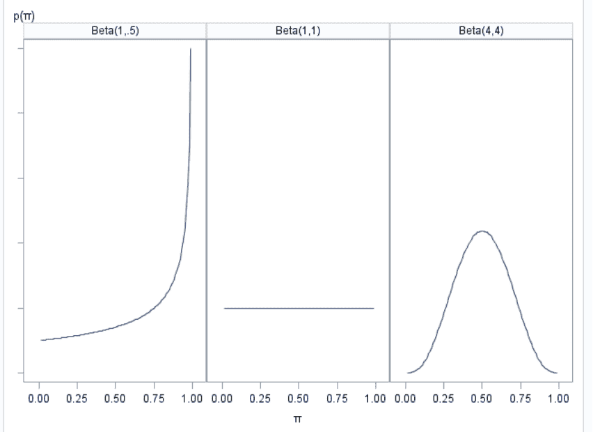

在这些 `Beta` 分布中，使用了常数来定义先验分布的参数。这些参数被称为超参数，其本身也可以是带有先验的参数（超先验或分层先验）。添加超参数为先验规范创建了分层结构，并用于减少先验的强度或指定无信息先验并让数据影响超参数。例如，参数 `$\theta$` 可以假设分布为 `Normal($\mu_{\theta}$, $\sigma_{\theta}$)`，且参数 `$\mu_{\theta}$` 和 `$\sigma_{\theta}$` 也有假设的分布。分层先验结构将在第 3 章进一步讨论，并在待估计的具体 `IRT` 模型（第 4-6 章）中进行讨论。

## 使用 SAS 对项目理论模型进行贝叶斯分析

## 计算后验概率并进行推断

继续上例，考虑从袋高尔夫球中取出 10 个球，并观察到 4 个白球。袋中白球比例 (`$\pi$`) 的估计值是多少？

假设对数据 `$r=4$` 和 `$N=10$` 采用 `Li(1,1)` 或均匀先验，则后验分布 `$p(D|\pi)$` 服从 `Beta(a+r, N-r+b)` 或 `Beta(5,7)` 分布。由于贝叶斯分析的推断仅使用后验分布，你可以计算 `$\hat{\pi}$` 的点估计值和误差的标准差 `$SE_{\hat{\pi}}$`。对于任何 `Beta` 分布，`$\hat{\pi}=a/(a+b)$` 的均值和 `$\hat{\pi}=(a \times b)/[(a+b+1)^2]$` 的方差。因此，对于上述示例和 `Beta(5,7)` 分布：

```
$$\hat{\pi} = \frac{a}{a+b} = \frac{5}{12} = .417$$
$$SE_{\hat{\pi}} = \sqrt{(a \times b)/[(a+b+1)^2]} = .138$$
```

在贝叶斯范式中，你可以为后验分布构建概率区间（贝叶斯区间或置信区间）。你可以使用 `$z_{\alpha/2}SE_{\hat{\pi}}$` 构建 `$(1-\alpha)$` 置信区间，其中 `$\hat{\pi}$` 是 `$\pi$` 的点估计值，`$SE_{\hat{\pi}}$` 是置信区间的标准差。如果后验分布不是正态，可以使用马尔可夫链蒙特卡洛（`MCMC`）方法为经验分布的分的分位数构建置信区间。例如，`$\pi$` 的 95% 置信区间反映了 `$\pi|D$` 中的 `[$\pi_{05}$, $\pi_{95}$]`。

可以通过 `$\pi|D$` 可以关于参数 `$\pi$` 的概率陈述。如果 95 位于 `$\pi|D$` 的 `$P_5$` 和 `$P_{95}$` 分位数之间。虽然置信区间看起来与置信区间相似，但它们的含义不同。请注意，在频率派框架下，除非参数 `$\pi$` 是固定的，否则无法进行直接的概率陈述或解释。

你还可以通过将零或 `$H_1$` 值与后验分布比较，利用后验分布进行假设检验（`$H_0$`）。例如，给定 `$p(D|\pi) \sim Beta(5,7)$`你可以计算袋中白球的比例，使其小于 `$H_0$` 值 3 或 `$\pi \leq .3$`。如果使用正态密度来近似 `$p(\pi|D, \pi \leq .3) = (p(\pi \leq .3) = .417/.138) = .20$`。那么该概率约为 .27。注意，`$\pi \leq .3$` 也可以通过经验推导的后验分布 `$p(\pi|D)$` 计算，方法是计算在 `$\pi|D$` 中 `$\pi = .3$` 小于或等于样本均值的次数。

最后，`$\pi|D$` 可用于预测未来样本的数值。例如，从袋中再次抽取（`$D'$`）时抽到白球的概率是多少？来自新抽取的新值（1 = 白球）的预测后验分布（记为 `$p(D'|D)$`）可以计算为：

```
$p(D'=1|D) = \int_0^1 1\pi p(\pi|D)d\pi$
```

```
$= \int_{\pi=0}^1 \pi p(\pi|D)d\pi = E[\pi|D]$
```

对于此示例，新抽取的预测将是 `$p(\pi|D)$` 的均值，或 .417。

## 频率派与贝叶斯估计的比较

通过将零或 `$H_1$` 值与后验分布比较，你还可以使用后验分布进行假设检验。例如，你可以计算袋中白球的比例，在给定 `$p(D|\pi) \sim Beta(5,7)$` 的情况下，使其小于 `$H_0$` 值 3 或 `$\pi \leq .3$`。如果使用正态密度来近似 `$p(\pi|D, \pi \leq .3) = (p(\pi \leq .3) = .417/.138) = .20$`。那么该概率约为 .27。注意，`$\pi \leq .3$` 也可以通过经验推导的后验分布 `$p(\pi|D)$` 计算，方法是计算在 `$\pi|D$` 中 `$\pi = .3$` 小于或等于样本均值的次数。

最后，`$\pi|D$` 可用于预测未来样本的数值。例如，从袋中再次抽取（`$D'$`）时抽到白球的概率是多少？来自新抽取的新值（1 = 白球）的预测后验分布（记为 `$p(D'|D)$`）可以计算为：

```
$p(D'=1|D) = \int_0^1 1\pi p(\pi|D)d\pi$
```

```
$= \int_{\pi=0}^1 \pi p(\pi|D)d\pi = E[\pi|D]$
```

对于此示例，新抽取的预测将是 `$p(\pi|D)$` 的均值，或 .417。

## 第二2章：贝叶斯分析 33


```sas
%let burnin=1000;      /* 丢弃样本 */
%let start=5;               /* 链的初始值 */
%let chain=4000;            /* 烧热迭代后的链长度 */

/* 读取观测数据 */
data data_obs;
 array(x1-x10); input x(*);
r=10;                        /* 似然数据 - 抽取次数 */
r=sum(x1-x10);      /* 似然数据 - 抽取的白球数量 */
datalines;
1 1 1 0 0 0 0

data mcmc_data;
 set_data;
 call streaminit(1234);
 retain sample(&start) accept(0);
 i=0;
 do i=1 to %eval(&burnin + &chain);
 current_sample;
 proposed=rand('normal', current , .);/*围绕当前值为中心的正态建议分布*/
 /* 检查越界值 */
 if proposed < 0 then proposed = 0;
 if proposed > 1 then proposed = 1;

 /* 计算当前与建议值的似然性 - 二项分布 */
 current_link=logpdf('binomial',r,current);
 proposed_link=logpdf('binomial',r,proposed,n);

 /* 当前与建议值的对数概率 - 贝塔先验分布 */
 current_prior=logpdf('beta',current,1);
 proposed_prior=logpdf('beta',proposed,1,1);

 /* 确定接受还是拒绝建议样本 */
 p_accept=min(exp(proposed_link+proposed_prior - (current_link+current_prior));
 if(rand('uniform') < p_accept then do
 sample = proposed;
 accept = accept+1;
 end;
 output;
 end;
run;
```

图 2.2 展示了实现 Metropolis 算法的 SAS 程序的初始样本，从 `π=5` 开始。x 轴提供了比例值 `0<π<1` 可能值的刻度。在图 2.2 中，你可以看到链遍历了参数空间，但由于数据对似然性的影响，在较少样本值 `100` 个的情况下，大部分集中在 `0.4` 附近。你还可以看到，大多数移动或建议样本都是较小的，因为建议分布中的标准差等于 `1`。

图 2.3 展示了一个直方图，反映了链在烧热阶段之后或丢弃 `1000` 个样本后样本值的分布情况。从图中可以看出，参数空间的大部分区域都被采样了。此外，`p(D|π)` 的均值为 `0.41`，标准差为 `0.135`，这与该参数的推导值非常接近。

## 34 使用 SAS 对项目反应理论模型进行贝叶斯分析

图 2.2：`π` 的前 100 个采样值点图

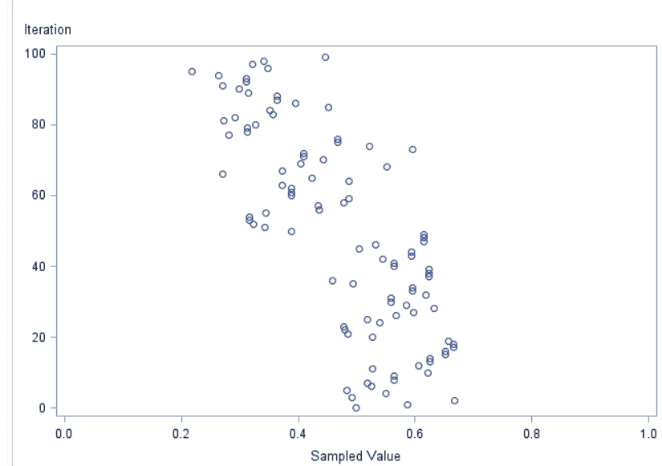

图 2.3：采样 `π` 值链的直方图

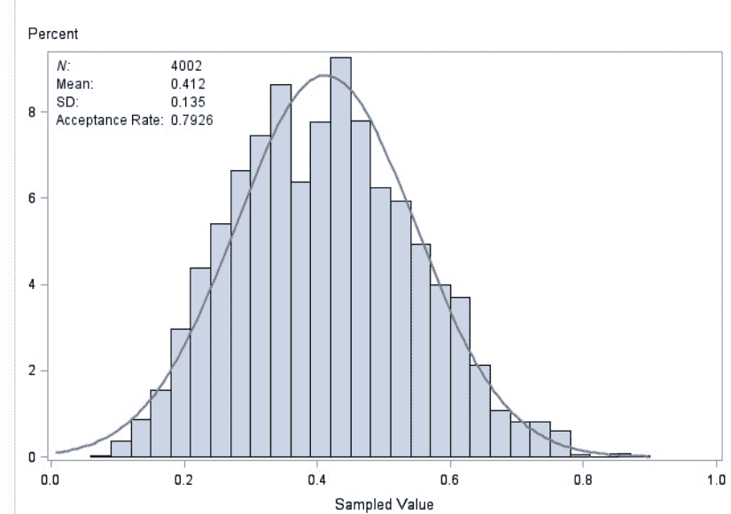

## 第二2章：贝叶斯分析 35

### MCMC 与吉布斯采样器

在多维参数空间中，Metropolis-Hastings 算法的一个特例——吉布斯采样器 `Gibbs sampler`，可用于从模型参数的联合后验分布采样（参见 Gelman 等人，2014）。该方法从独立的条件分布中抽样，这些分布在极限上等于从联合后验分布中抽样。在该算法中，参数向量中的每个参数或随机变量都是在向量中其他参数最新采样值的条件下进行采样的。因此，联合后验被简化为一组易于采样的一维条件分布。例如，对于一个 2 IRPT 模型，将指定单变量条件分布（参见项目 i，抽取数据和其他参数），并在已知所有参数的情况下从每个参数的条件分布中抽取。基于迭代=`0` 的任意初始值，迭代 `t+1` 的抽取如下：

- 项目 i，从 `$p(θ_i | a_{i-1}^{(t)}, b_j^{(t)})$` 抽取 `θ_i^{(t+1)}`

- 项目 j，从 `$p(θ_j | a_{j-1}^{(t)}, θ_i^{(t)}, b_j^{(t)})$` 抽取 `θ_j^{(t+1)}`

- 项目 k，从 `$p(θ_k | a_{k-1}^{(t)}, θ_j^{(t)}, b_j^{(t)})$` 抽取 `θ_k^{(t+1)}`

当马尔夫链收敛时，`(θ^{(t)}, a^{(t)}, b^{(t)})` 将来自稳定的联合后验或目标分布。注意，`PROCCMC` 根据参数及其先验规范确定采样算法。在适当的情况下，`PROCCMC` 使用共轭采样方法；否则，`PROCCMC` 使用随机游走 Metropolis 算法。其他采样算法可用如切片采样器 `slice sampler`。更多细节请参见此书的第 3 章。在 SAS 帮助中查看 `PROC MCMC`。或者，在 SASSTAT 13.2 用户指南（SAS, 2014）中查看第 7 章“贝叶斯分析简介”。

### 烧热与收敛

由于 MCMC 方法迭代地采样参数，因此你应该确定马尔夫链是否收敛到目标分布。如果链没有收敛，则从该链模拟抽取并不代表感兴趣的参数空间或目标分布。因此，在从参数分布进行任何推断之前，你应该评估马尔夫链的收敛性。此外，通常会丢弃马尔夫链初始迭代值（烧热阶段），以减少早期值对目标后验的影响。

诊断工具用于确定链在 `PROCCMC` 中的收敛程度。常用工具使用跨链参数迭代轨迹图。混合良好的链遍历后验空间，到达所有相关的参数空间，并表现为均值附近的随机值图。另一个常用工具是自相关图，显示不同滞后之间的序列依赖性；评估效率。所有马尔夫链都表现出某种程度的相关相关；`PROCCMC` 算法混合越良好，序列依赖性下降得越快。轨迹图和自相关图通常指示混合的相对程度。注意，混合不良和高自相关并不一定会导致偏差推断，但可能意味着采样过程效率不足。

输出 2.1 展示了链中混合良好的参数的 `PROCCMC` 期望轨迹图和自相关图。这种良好的性能在输出 2.2 中显示，它是反映混合不良参数的轨迹图和自相关图。最后，输出 2.3 显示了 `1000` 次迭代烧热的采样值。如你所示，由于存在混合不良和缺乏收敛，指示了长时间的烧热。各种混合行为的其他示例可以在 SAS 帮助中找到；搜索“Bayesian Analysis”。或者，在 SASSTAT 13.2 用户指南（SAS, 2014）中查看第 7 章“贝叶斯程序”。

## 输出 2.1：混合良好的链的轨迹图和自相关图

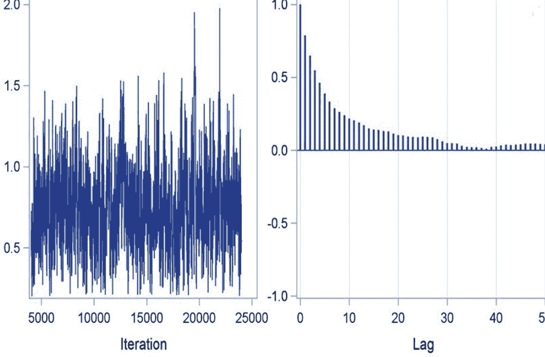

## 输出 2.2：混合不良链的轨迹图和自相关图

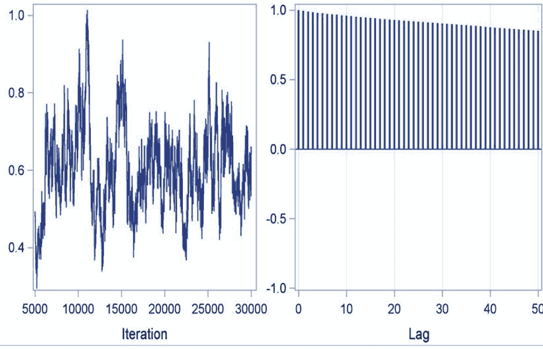

## 输出 2.3：说明马尔夫链早期迭代混合情况的轨迹图

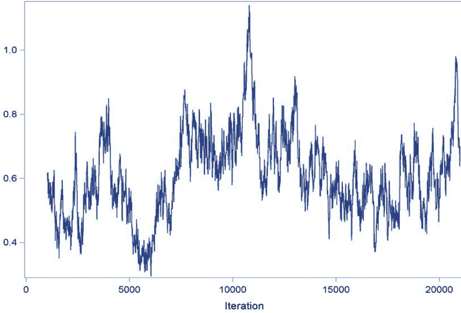

当观察到参数混合不良时，有几种补救措施。这些补救措施包括通过保存每 `n` 个采样值来稀释或删除样本；重新参数化模型；通过更改 MCMC 算法（例如更改采样算法或更改顺序更新的参数集）来进行调整。使用 SAS 分析项目反应模型

对于在 `PROC MCMC` 估计 IRT 模型背景下这些策略的讨论和说明，请参见第 3 章。

除了轨迹图和自相关图外，你还可以用 `PROCCMC` 计算其他常用的统计量：

- Gelman-Rubin。该统计量使用并行链和分散的初始值来评估不同的链是否收敛到相同的后验分布。

- Geweke。此测试比较马尔夫链的早期和后期迭代的参数以评估收敛性。

- Heidelberger-Welch（平稳测试）。此诊断程序基于不同长度链的参数相对准确性，使用 Cramer-von Mises 统计量测试马尔夫链是否为“弱”平稳过程。

- Heidelberger-Welch（半宽测试）。使用通过平稳测试的链部分，半宽测试评估迭代次数是否足以达到均值估计的指定精度。

- Rafter-Lewis。此程序报告达到指定精度所需的样本数。

- 有效大小 `ESS`。此统计量衡量跨迭代的值的变化。

有关这些测试和程序的计算详细信息，请查看 SAS 帮助中的 `PROC MCMC` 文档。或者，在 SASSTAT 13.2 用户指南（SAS, 2014）中查看第 7 章“贝叶斯分析”。注意，所有这些诊断工具不能作为收敛的证明，而是仅用于检测不收敛或低效的情况。此外，不同的诊断工具用于检查收敛的不同方面。因此，良好的做法是使用多种诊断工具评估收敛性。

### 信息先验与无信息先验分布

如所述，先验和指定的先验分布在贝叶斯分析中可能起着重要作用，但在数据充足或精确时，先验的重要性也会降低。在选择不同类型的先验时，可以将其分为两类：信息先验和无信息先验。

信息先验也称为平坦、模糊或扩散先验，旨在为待估计的参数提供尽可能的信息，并允许数据主导分析和后验分布的确定。无信息先验为参数空间中的所有可能值分配大致相同的概率或似然性。在估计比例时，`Beta(1,1)` 分布反映是非参数的（参见图 3）。

相反，信息先验在收集数据之前使用了关于参数的外部信息，并对这些外部信息以及收集的数据进行后验分析和估计。用于指定信息先验的外部信息可能来自对相似数据集的先前分析，或者基于样本模型的数学属性。

# 第 2 章：贝叶斯分析

例如，从 `−∞` 到 `α` 的“真实”直线上的均匀先验通常代表一个不恰当先验。然而，如果不恰当先验是共轭先验（如 `Beta(1,1)` 配合二项似然的情况），则后验分布是恰当的。

此外，可以各种统计模型指定杰里先验 `Jeffery prior`，它代表参数空间子集上的局部均匀或不恰当先验，尽管使用杰里先验不能保证后验分布是恰当的。但是，通过选择一个在参数空间中反映参数值的区域内局部均匀的先验，你可以获得一个相对丰富的先验。对于范围从 `-3` 到 `+3` 的参数（例如 IRT 模型中的难度参数），可以选择一个方差较大的正态先验。在这种情况下，可以指定一个在 `-3` 到 `+3` 范围内截断的 `Normal(0,1000)`，以实现本质上局部均匀的先验。与其指定截断先验，另一种方法是使用具有大方差项的先验分布进行“弱”信息化建模（Sheng, 2013）。

关于 IRT 模型背景下先验分布的讨论，请参见第 3 章。关于信息先验和非信息先验的更多背景，请参考 Gelman et al. (2014), Gelman (2006), Goldstein (2006), Fox, and Kass & Wasserman (1996)。

## 模型比较

在应用中，可能会估计不同的模型，以反映所研究关系之间的竞争性形式化，或反映竞争性的理论视角。此外，使用 IRT 对项目反应建模的研究人员感兴趣的是简洁模型——即参数较少且能充分反映数据的模型。因此，你必须在竞争模型之间进行选择以获得优先模型，可以使用比较程序来实现这一目的。

模型比较方法还帮助你确定特定模型在贝叶斯范式下是否反映了“欠拟合”，分为两类：

- 基于贝叶斯信息的准则——偏差信息准则 `DIC` `Spitzer & van Pelt, 2002`，

- 基于先验的指标。

这些指标实际上仅用于评估竞争模型之间的相对拟合度，而不解决任何特定模型的绝对拟合度，或任何特定模型逼近数据的程度。尽管如此，这些方法被证明在应用中比较 IRT 模型非常有用（例如 Zhu & Stone, 2012）。

贝叶斯框架下的绝对拟合度通常通过预测模型检查 `PPMC` 来评估。对于这种方法，如果模型能产生良好的预测，则认为模型拟合数据。`PPMC` 在第 8 章进行了简要描述和详细考虑。

## 偏差信息准则

偏差信息准则 `DIC` `Spitzer et al., 2002` 是一种与著名的信息准则类似的模型比较工具：赤池信息准则 `AIC; Akaike, 1974` 和贝叶斯信息准则 `BIC; Schwarz, 1978`。`DIC` 可适用于嵌套或非嵌套模型，也适用于具有同分布变量的模型。

## 项目反应模型的贝叶斯分析

与其他信息准则类似，`DIC` 指标在识别优先模型时同时权了模型拟合度和复杂性。`DIC` 是在 MCMC 估计无法明确识别为 `AIC` 和 `BIC` 之后开发的。`DIC` 指标广泛用于贝叶斯估计，定义如下：

`DIC = \bar{D}(θ) + p_D`

以及

`p_D = \bar{D}(θ) - D(\bar{θ})`

其中 `\bar{D}(θ)` 是偏差函数 `(-2 log L)` 和每次迭代中采样参数的均值。`p_D` 用于修正模型参数的“有效”数量。对于其他指标，`DIC` 值越小表示拟合越越好。注意，应谨慎使用 `DIC`，因为似然没有唯一定义（Link et al., 2013）。此外，`DIC` 假设后验均值是准确的估计。如果后验密度反映极端偏态或双峰性，则不应使用 `DIC`。Link et al. (2013) 在选择优先模型时讨论了解释 `DIC` 差异的“粗略”准则：

- 大于 `10` 倾向于 `DIC` 较高的模型；

- `5` 到 `10` 之间倾向于 `DIC` 较小的模型；

- 小于 `5`。

## 贝叶斯因子

贝叶斯分析中从竞争模型选择优先模型的常用方法是计算贝叶斯因子 `BF`。`BF` 定义为模型 1 `M1` 相对于模型 2 `M2` 的后验几率，除以 `M1` 相对于 `M2` 的先验几率：

`BF = P(M1|D)/P(M2|D)`

较大的 `BF` 支持 `M1`，较小的支持 `M2`。`BF` 的幅度也可用于评估任何模型的证据权重。在考虑 `M1` 优 `M2` 的证据时，解释 `BF` 的准则如下（Rafter, 1996）：

- `1` 代表支持 `M1`；

- `3` 到 `12` 反映 `M1` 的支持；

- `12` 到 `50` 反映 `M1` 的强证据；

- `50` 以上反映 `M1` 的极强证据。

然而，贝叶斯因子的计算具有实践和理论局限性，例如先验的放置。为了克服这些问题，提出了一种名为伪贝叶斯因子 `PSBF` 的替代方案（Geisser & Eddy, 1979; Gelfand, Dey, Chang, 1992）。该准则使用条件预测坐标近似贝叶斯因子中的边缘密度，`PSBF` 指标可以表示为：

`PSBF = P^{π=1}(CPO|M1)/P^{π=1}(CPO|M2)`

其中 `R` 代表所有项目的总数。当你在项目层面比较模型时，`R` 等于受试人数 `N`。当你在测试层面比较模型时，`R` 等于所有受试者的回答数（即 `R = N × I，I` 为项目数）。与 `BF` 类似，`PSBF` 大于 `1` 支持 `M1`，小于 `1` 支持 `M2`。

或者，可以定义任何一个模型的 `CPO` 指标 `CPO_m = ∏_{j=1}^n(CPO_j|m)`，选择 `CPO` 值较大的模型。由于 `PSBF` 同时计算两个模型的 `CPO`，直接使用每个模型的 `CPO_m` 比较模型更为方便。本书使用了 `CPO` 指标。

在使用 MCMC 方法进行 IRT 估计的背景下，`CPO` 值在热期 `burn-in period` 后，使用每次观测的逆似然在单个项目反应层面进行估计：

`CPO_{ij} = (1/T ∑_{t=1}^T p(y_{it}|θ_i))^{-1}`

其中 `T` 是链的样本数，`p(y_{it}|θ_i)` 是受试者 `i` 和项目 `j` 回答数据的似然。模型的项目层面 `CPO` 指标可以通过所有 `N` 次考试的 `CPO_{ij}` 积得到：

`CPO_j = ∏_{i=1}^N CPO_{ij}`

整个测试的 `CPO` 指标可以通过 `J` 个项目的项目层面 `CPO_j` 积得到：

`CPO = ∏_{j=1}^J CPO_j`

通常计算 `CPO` 指标的对数，并将两个方程中的乘积项替换为个人项目的和。优先模型是 `CPO` 值较大的模型。计算 `CPO` 和进行模型比较在第 7 章中说明。

## 模型拟合与预测模型检查

后验预测模型检查 `PPMC` 是一种常用的贝叶斯模型检查，并证明在 IRT 模型中非常有用（例如 Lee, Miller, & Sinharay, 2009; Sinharay, 2005; Sinharay, John, Stein, 2006; Zhu & Stone, 2011）。`PPC` 涉及在估计或假设的模型下模拟数据，并将模拟特征与观测数据进行比较。比较是基于模拟和观测数据的差异指标或统计量进行的。使用 `PPC` 的原理是，如果模型拟合数据（例如，观测数据应该类似于来自后验预测分布 `p(D^{rep}|D)` 的模拟数据）。反之，应该比较模拟 `D^{rep}` 和观测 `D` 数据的差异指标，任何系统性差异都表明模型可能不拟合（Gelman et al., 2014）。

更具体地说，`PPC` 通过检查观测数据 `D` 对于模型的后验预测分布 `D^{rep}` 是否显得极端来评估模型的拟合情况：

`p(D^{rep}|D) = ∫ p(D^{rep}|θ) p(θ|D) d(θ)`

对于目标后验分布 `p(θ|D)` 的每次迭代或一组采样参数值，你计算基于模型的预测的数据集 `D^{rep,1}, …, D^{rep,S}`。然后，这些代表了预测后验分布 `p(D^{rep}|D)` 的采样。然后，你计算统计量 `T`，

## 42 使用 SAS 进行项目反应模型的贝叶斯分析


在每次 `$D^{rep},i$` 复制中，提供了模型-数据拟合条件下的差异指标分布。当差异指标仅依赖于数据时，该差异指标可以标记为复制数据的 `T(D^{rep})` 以及对于观测数据的 `T(D)`。当差异指标同时依赖于数据和模型参数 `(\theta)` 时，该差异指标可以标记为复制数据的 `T(D^{rep}, \theta)` 以及对于观测数据的 `T(D, \theta)`。

通过图形显示可以定位从 `D^{rep,1}, \dots, D^{rep,R}` 计算的差异指标。例如，在 `T(D^{rep})` 的分布直方图中可以识别出。此外，你可以计算预测概率值（PPP 值）。一个 PPP 值反映了 `T(D)` 的相对准确性，例如，在差异指标 `T(D^{rep})` 的分布中：

`PPP = P(T(D^{rep}) \geq T(D))`

其中 PPP 值是在在多次复制中 `T(D)` 等于或超过 `T(D)` 的比例。因此，PPP 值反映了预测数据与观测数据之间的相似性。PPP 值接近 `.5` 表示实际差异与预测差异之间没有系统性差异，并表明模型拟合良好。PPP 值接近 `0` 或 `1`（例如 `<05` 或 `>95`），相反，实际差异与后验预测差异不一致，并表明模型-数据拟合（Gelman 等人，2014）。

应该注意，PPP 值不应以传统假设 p 值的方式进行解释。两者都被定义为尾部区域概率，PPP 值分布并不比预期的更接近 `.5`。因此，在传统的假设框架中使用 PPP 值会导致保守性检验（参见 Levy, 2006；Sinharay, 2005；Sinharay 等人，2006）。

在用贝叶斯估计时也发现了 PPMC（参见 Sinharay, 2005）。通过比较不同模型的差异指标 PPP 值数量，可以评估一组候选相对拟合程度。具有较少 PPP 值的模型被认为比具有较大 PPP 值的备选模型更拟合数据。

选择合适的差异指标是 PPMC 方法应用中的重要考虑因素，并且应该被选择以反映潜在的不拟合来源。IRT 模型和不同测试背景下的 PPMC 差异指标的选择将在第 8 章详细讨论。

# 第 3 章：使用 PROC MCMC 进行 IRT 模型的贝叶斯估计

引言................................................................................................................ 43

IRT 模型估计的 `PROC MCMC` 语句总结............................................................... 44

- `MCMC` 采样算法.................................................................. 45
- 内置分布....................................................................................... 46
- 密度图.................................................................................................... 47
- 任意分布............................................................................................... 48
- IRT 模型估计的 `PROC MCMC` 模板............................................................... 49
- `PROC MCMC` 如何处理 SAS 数据集............................................................... 51
- 关于 `RANDOM` 语句的更多说明................................................................51
- 模型识别.............................................................................................. 52
- 单参数 IRT 模型模板示例................................................................................52
- 估计 1P IRT 模型的示例输出........................................................................... 54

提高蒙特洛夫链收敛的策略................................................................................ 59

- 链抽稀（Chain Thinning）............................................................................... 59
- 参数分块（Parameter Blocking）............................................................................ 61
- 模型重参数化............................................................................................... 64

多链分析——用于收敛的 Gelman-Rubin .................................................... 67

有信息先验、无信息先验和分层先验...................................................................... 70

- 有信息先验......................................................................................... 70
- 无信息先验............................................................................................... 70
- 分层先验........................................................................................................... 71
- 不同先验的影响............................................................................... 72

将项目参数处理为随机效应....................................................................... 73

模型拟合与模型比较......................................................................................... 76

与 WinBUGS 的比较............................................................................... 76

OUTPOST SAS 数据集...................................................................... 77

用于后验处理的自动调用宏（Autocall Macros）.................................................. 78

引言................................................................................................................ 79

此前，使用贝叶斯方法的人们使用蒙特卡洛马尔可夫链（MCMC）语言。然而，通过 MCMC 的方法已被极大简化（Spiegel, Thomas, 2003）。`MCMC` 提供了关于 IRT 模型和不同测试背景下的蒙特卡洛马尔可夫链（MCMC）差异指标的选择。通过蒙特卡洛马尔可夫链（MCMC）显示：（1）`MCMC` 在跨学科中常用；（2）它 为模型参数提供了后验预测分布；（3）通过蒙特卡洛马尔可夫链（MCMC）的并行处理提高了性能。

本章概述了用于 IRT 模型的 `MCMC` 命令和选项。要了解关于 `MCMC` 的更多，请参见 2014。从 SAS/STAT 12.1 开始，`PROC MCMC` 执行缺失数据的贝叶斯增强（Chen, 2011, 2013）。

## 第3章：使用 PROC MCMC 对 IRT 模型进行贝叶斯估计

- `DIAGNOSTICS=<NONE | ALL | keyword>`.此选项指定收敛诊断报告的选项。默认情况下，`PROC MCMC` 计算 Geweke 检验、样本自相关性、有效样本量和蒙特卡洛误差。所有诊断工具在第 2 章以及 `PROC MCMC` 的辅助文档中都有描述。
- `STATISTICS=<NONE | ALL | keyword>`.此选项指定从 `MONITOR` 选项列出的模型参数的后验分布中计算统计量。如果没有指定 `STATISTICS` 选项，输出将包含参数数量、均值、标准差和 95% 高后验密度 (`HPD`) 区间。`SUMMARY` 关键字提供每个值的标准差和分位数（默认、第 25、第 50 和第 75 百位数）。
- `PLOTS=<NONE | ALL | keyword>`.此选项指定为 `MONITOR` 选项中列出的模型参数生成的图表。可以创建三种类型的图：每个模型参数的轨迹图 (`TRACE`)、自相关图 (`AUTOCOR`) 和密度图 (`DENSITY`)。除非指定了 `UNPACK` 选项，否则图表将以面板形式显示——详情请参见辅助文档。
- `DIC`. 此选项用于指示报告用于模型比较的 DIC 及相关统计量（模型比较详情请参见第 7 章）。
- 对于更高级的用户，提供了用于调整参数、接受率和不同提议分布的选项（详参见辅助文档）。
- `PARMS=<name(initial value)>` 语句。此语句指定要估计的参数及其初始值。
- `ARRAY=<list of parameters name>` 语句。此语句指定一组参数，这些参数在 `PROC MCMC` 代码中可能更容易解析。
- `PRIOR=<name distribution>` 语句。此语句用于指定 `PARMS` 和 `ARRAY` 语句中指定参数的分布。
- `RANDOM=<name of random effect>` `SUBJECT=<variable>` 语句。此语句指定单个或一组随机效应及其先验分布。`SUBJECT` 选项用于识别随机效应的索引变量。该变量应该是输入数据集的一部分，数据集不需要按该变量排序。然而，如果对每个观测值建模随机效应，则使用 `OBS=<by>` 在 `RANDOM` 语句中指定索引，并使用 `MONITOR=<parameters>` 输出随机效应参数的摘要统计量等结果。
- `MODEL=<response distribution>` 语句。此语句指定连接数据和模型参数的对数似然函数。每个 `PROC MCMC` 程序必须至少有一个 `MODEL` 语句。
- `PREDICT=<OUTSET dataset=value>` 语句。此语句用于创建一个包含来自后验预测分布的响应变量（变量）随机样本的数据集。
- `SAS` 编程命令用于 `DATA` 语句。这些语句、`DO` 和 `IF` 语句也可以根据需要用于 `PROC MCMC` 命令中。

## MCMC 采样算法

在利用 `MCMC` 算法对参数值进行采样时，`PROC MCMC` 根据参数及其先验分布确定采样算法。在适当的情况下，`PROC MCMC` 使用共轭采样方法来提取条件后验样本，特别是对于缺失值，提取缺失值的方法。否则，`PROC MCMC` 默认使用正态核随机游 Metropolis 算法 (`normal-kernel walk Metropolis algorithm`)。其他采样算法也可用，例如切片采样器 (`slice sampler`) 或 t 分布随机游 Metropolis 算法。要指定 `PARMS` 语句中指定的替代方法，使用 `/OPTION=<algorithm>`。要为随机效应参数指定替代算法，在 `RANDOM` 语句中使用 `/ALGORITHM=<algorithm>`。此外，您可以使用 `USD` 语句指定一个用户定义的 Gibbs 采样算法。详情请参见 `PROC MCMC` 的 SAS 辅助文档。

## 内置分布

若干标准且熟悉的分布可用于 `PROC MCMC` 和 `PRIOR RANDOM` 语句。表 3.1 和 3.2 提供了与估计 IRT 模型最相关的分布摘要。在模型中，大括号参数中的所有标签都是可选的，而其他带标签的参数是强制的。例如，`NORMAL(0, 1)` 等价于...（此处翻译逻辑修正为：可用于 `PROC MCMC` 和 `PRIOR RANDOM` 语句的多种标准和熟悉分布。表 3.1 和 3.2 提供了估计 IRT 模型最相关的分布摘要。在模型中，大括号参数中的所有标签都是可选的，而其他带标签的参数是强制的。例如，`NORMAL(0, 1)` 等价于 `NORMAL(0, 1)`。）。此外，这些分布可以指定边界。Gelman (2006) 建议使用均匀或 t 分布先验。这在第 6 章中会有更多讨论。

## 第3章：使用 PROC MCMC 对 IRT 模型进行贝叶斯估计

### 表 3.1：IRT 模型常用的单变量分布

| 分布 | 描述 |
| :--- | :--- |
| `BETA(A=> a, <B=> b)` | 参数 a 和 b 的 Beta 分布 |
| `BINARY(PROB=> p)` | 概率 p 的伯努利分布 |
| `BINOMIAL(MEAN=> n, <PROB=> p)` | 参数 n 和概率 p 的二项分布 |
| `CHISQUARE(df)` | df 自由度的卡方分布 |
| `GAMMA(SHAPE=> a, SCALE=λ; ISSCALE=λ)` | 形状 a 和尺度 λ 的 Gamma 分布 |
| `IGAMMA(SHAPE=> a, SCALE=λ; ISSCALE=λ)` | 形状 a 和尺度 λ 的逆 Gamma 分布 |
| `LOGNORMAL(MEAN=> mu, SD=|)` | 均值 mu 和标准差对数正态分布 |
| `NORMAL(MEAN=> mu, SD=|PREC=>)` | 均值 mu、标准差或精度的正态（高斯）分布 |
| `T(MEAN=> mu, SD=|V=> df)` | 自由度为 df、均值 mu 的 t 分布 |
| | 概率数组 p 的分类分布 |
| `UNIFORM(A=> a, <B=> b)` | 范围 a 到 b 的均匀分布 |
| `GENERAL(ll)` | 用于单个或多个参数的用户定义的 SAS 语句表达式。它是分布的对数似然，解释为参数联合分布的对数 |

### 表 3.2：IRT 模型常用的多元分布

| 分布 | 描述 |
| :--- | :--- |
| `MVN(MEAN=> mu, <COV=> Σ)` | 均向量 mu 和协方差矩阵 Σ 的多元正态分布 |
| `MVNAR(MEAN=> mu, SD=|RHO=> p)` | 均向量 mu 和协方差矩阵 Σ 的多元正态分布。协方差矩阵 Σ 是尺度矩阵的倍数以及具有参数 p 的一阶自回归结构的矩阵 |

## 密度图

如所述，固定效应模型参数位于 `PRIOR` 语句中，随机效应模型参数位于 `RANDOM` 语句中。`PROC MCMC` 可用于探索和绘制不同分布的概率密度函数。虽然直接从分布采样不需要数据，但 `PROC MCMC` 需要一个 `DATA` 语句指定。程序中的第一个元素包含 `DATA` 语句数据集。`PROC MCMC` 语句指定样本数或迭代。其他语句用于指定要绘制的四个参数及其初始值（`PARMS` 语句）；为这些每个参数指定了不同的分布（`PRIOR` 语句）。先验规范还说明了密度的边界。每个 `PROC MCMC` 程序必须至少有一个 `MODEL` 语句，由于没有响应变量，包含一个 `MODEL GENERAL(<constant>)` 语句以反映实线上的均匀分布。输出位于 Output 3 中。

## 48 使用 SAS 进行项目反应理论的贝叶斯分析

## 程序 3.1: 用于探索分布的 PROC MCMC 代码

```
dummy dummy; /* 用于 proc mcmc 的无观测值 SAS 数据集 */

proc mcmc data=dummy dummy=none ncmc=2000 plots=density seed=123;

parms a1 a2 b 0 s2;

prior a1 ~ lognormal(0,var=.5);
prior a2 ~ normal(0,var=4,lower=-6);
prior b ~ normal(0,var=100, lower=-6, upper=6);
prior s2 ~ gamma(shape=.01,iscale=.01);

model general(0);

run;
```

## 输出 3.1: 程序 3.1 的输出

### 后验密度图

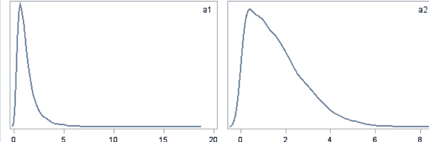

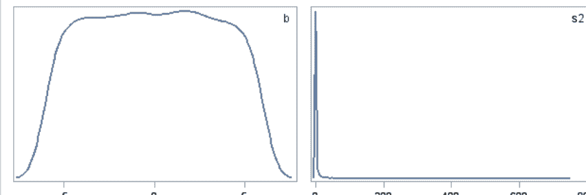

### 任意分布


在某些情况下，你为模型参数指定的分布可能不遵循 SAS 内置的分布。在这种情况下，你可以使用 `GENERAL(ll)` 函数配合 SAS 编程语句，为单个连续变量或多个变量指定任何任意分布。变量 `ll` 是分布的对数似然值的表达式，在多个变量的情况下，它解释为联合分布的对数。在估计 IRT 模型的背景下，可以使用 `GENERAL` 函数配合 `MODEL` 语句来构建用于反应（response）概率的显式对数似然函数。该函数对于某些模型（例如多项 IRT 模型）非常有用。它也可以与 `PRIOR` 语句一起使用，为不符合内置分布的参数指定指定先验分布。

## 第 3 章：使用 PROC MCMC 对 IRT 模型进行贝叶斯估计

注意，`DGENAL(I)` 函数可用于离散变量。

下面是一个使用 `GENERAL` 函数定义先验分布的示例。前三行定义了两个参数 `$b_1$` 和 `$b_2$` 的联合分布对数，其中 `$b_2$` 的下边界由 `$b_1$` 定义。`PRIOR h ~ GENERAL(LPRIOR)` 语句指定了有序参数集（例如 `$b1 < b2$`）定义的联合分布，并用于第 5 章中估计分级 IRT 模型的参数。此示例还演示了使用 SAS 编程语句（`LPDFNORM` 函数）配合密度函数以及密度函数的边界：`LOWER (~6, B1)` 和 `UPPER`。在 `PROC MCMC` 程序中执行这些语句后，结果见输出 3.2。对于涉及 `GENERAL` 和 `DGENAL` 函数的其他示例，请参阅 `PROC MCMC` 的辅助文档。

```
lprior=0;
lprior=lprior+lpdfnorm(b1,0,2,-6,6);
lprior=lprior+lpdfnorm(b2,0,2,b1,6);
parms b1 -1 b2 -5;
prior b1 ~ general(lprior);
```

### 输出 3.2: 有序参数集 (b1 < b2) 的密度函数输出

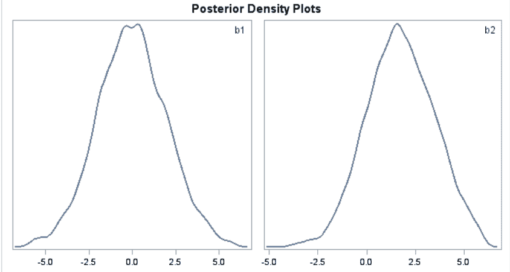

## IRT 模型估计的 PROC MCMC 模板

本节说明了用于估计 IRT 模型的 `PROC MCMC` 命令的通用模板。提供了一个用于二分计分项目的模板。在单维度性假设下，该模板适用于二分计分项目。后续章节描述了对通用模板的修改，例如将此模板扩展到多项计分项目的 IRT 模型（第 5 章）和其他多维度 IRT 模型（第 6 章）。

### 50 使用 SAS 进行项目反应模型的贝叶斯分析

回想第 1 章，二分计分项目的 IRT 反应模型，考生获得正确答案（例如，1 代表是，0 代表否）的第 $i$ 个项目的通用形式如下：

$P(X_i=1|\theta) = c_i + (1-c_i)F(\theta)$

其中 $F(z)$ 是逻辑或对数正态分布，$z=\theta$ 是用于定义 $\theta$ 的任意常数；$a_i$ 是斜率参数，$b_i$ 是阈值参数，而 $c_i$ 是渐近参数。

下面给出了二分计分项目的通用模板。为了估计模型，可以查看所有方面：特定的 IRT 模型、参数、参数的先验分布以及连接观测数据的似然模型。`PARMS` 语句用于定义模型中的参数 ($a_i, b_i, c_i$)，`RANDOM` 语句用于定义参数 ($\theta$)。特定的 IRT 模型通过一组 SAS 编程语句指定，定义每个项目的反应概率 ($P_j$)。`MODEL` 语句定义连接每个项目观测数据的对数似然函数。

```
proc mcmc data=<dataset> ncmc=<value> statistics=<list>
plots=<list>;

/* 定义引用项目参数的数组 */
array a[number of expected response variables for items];
array a[number of slope parameters];
array b[number of threshold parameters];
array c[number of asymptote parameters];

/* 定义 IRT 模型参数 */
parms a = <value>; /* 用于引用元素数组 */
parms b = <value>; /* 如果只有一个参数，不要使用 array */
parms c = <value>;

/* 定义项目参数的先验分布 */
prior a ~ <distribution>;
prior b ~ <distribution>;
prior c ~ <distribution>;

/* 定义 IRT 模型参数和先验分布 */
random theta ~ <distribution> subject=obs;

/* 定义每个项目似然函数的编程语句；每个项目 (1,..., J) 的正确反应概率 pj */
do j=1 to <number of items>;
p[j] = <IRT model defining response probability for each item>;
end;
```

### 第 3 章：使用 PROC MCMC 对 IRT 进行贝叶斯估计

```
/* 反应数据建模为伯利变量 */
model x1 ~ binary(p1);
model x2 ~ binary(p2);

model xJ ~ binary(pJ); /* J = 项目数量 */
run;
```

- 项目参数是随机的，但被 `PARMS` 视为固定效应；每组项目参数 $(ai, bi, ci)$ 可能共享共同分布。将项目参数视为随机的将在本章的后后部分进行讨论。
- 每个人的 `THETA` 参数 (`theta`) 被视为随机效应，假设参数来自指定的分布。聚类变量 (`SUBJECT=` 用于识别数据中的每个随机效应。对于标准的 IRT 模型，每个受试者都是随机效应。因此，`SUBJECT=_obs` 表示假设观测级随机效应模型，其中每个观测都是单独的。分层 IRT 模型考虑第 4 章中讨论的受试者聚类。
- 由于为每个项目定义了 IRT 模型，可以为不同的项目指定不同的模型。某些项目可能 `ci=0`；而 `ci` 参数可以从 `ci=0` 项目的 IRT 模型规范中排除。
- 使用 `MODEL` 语句定义似然模型会强制要求某些数据。例如，`BINARY` 分布必须是 0 和 1，其中 1 代表正确代码。讨论了使用 `MODEL` 语句的替代方法，该方法没有此数据要求。

#### PROC MCMC 处理 SAS 数据集

`PROC MCMC` 使用预测分布和对数似然函数计算参数的后验分布。默认情况下，它假设观测值是独立的。在这种假设下，`PROC MCMC` 计算后验分布的对数：

```
log(p(theta)) = log(p(theta)) + \sum_{i=1}^{n} log(f(yi|theta))
```

其中 $ci$ 是 SAS 数据集中具有 $n$ 个观测值的参数。$log(yi|theta)$ 是单个观测值 $i$ 的对数似然函数。在采样算法的每次迭代（例如 Metropolis 算法）中，会对每个观测执行编程语句和 `MODEL` 语句，并在 SAS 数据集中所有观测上累计对数似然。每次评估后，加上先验的对数以计算后验分布的对数。由于程序顺序处理数据集中的观测值，跨观测的计算不像实现 MCMC 算法的其他程序（例如 WinBUG）那样显式编程。在获得后验分布后，可以从后验分布计算各种统计量、收敛诊断和图形显示，详见 `PROC MCMC` 语句的选项。

如果观测值不是独立的，上述假设可能会引入错误的似然值。在依赖观测的情况下，或对于 $i != j$ 的 $f(yi, theta)$，请使用 `PROC MCMC` 语句中的 `JOINTMODEL` 选项。

#### 关于 RANDOM 语句的更多

`RANDOM` 语句用于指定随机效应参数，这些参数也可以反映聚类特征。`RANDOM` 语句需要几个选项：`RANDOM <random effect(s)> ~ <prior distribution> SUBJECT=<option>` 可以作为参数或参数数组指定的随机效应。必须指定随机效应的先验分布。然而，只有一部分的

# 使用 SAS 对项目响应模型进行贝叶斯分析

先验（`PRIOR`）支持的分布可以是 beta、二项、gamma、长尾（longterm）、正态和多变量分布（语法请参见表 3.1）。`SUBJECT=<variable>` 选项用于识别 SAS 数据集中定义聚类成员的变量。该变量可以是数值型或字符型，且不需要排序。如上所述，如果对每个观测值建模随机效应，对于标准 IRT 模型，可以使用 `SUBJECT_OBS` 作为定义聚类成员的变量。

通过指定多个 `RANDOM` 语句来反映不同的聚类特定特征——例如，分组在教师内部的学生（教师级效应）或分组在学校内部的学生（学校级效应）。如果这些聚类特定效应显著的，则聚类特定属性的学生的响应可能无法仅通过其潜特质得到解释。第 1 章提供了更多关于在测试应用中对其他聚类效应和分层 IRT 模型进行建模的细节。存在聚类特定特征的模型。

随机效应参数的数量由 `SUBJECT=<variable>` 的值的个数决定。由一个 `RANDOM` 语句定义的所有随机效应参数均假设在给定数据和模型参数的情况下条件独立。然而，由不同 `RANDOM` 语句定义的随机效应参数并不被假设为条件独立。

## 模型识别

模型识别是 IRT 模型中出现的一个问题，因为模型是过度参数化的，且能力或特质参数（$\theta$）与项目难度或阈值参数（$b$）是不可观测的且处于同一量纲上的；必须定义 $\theta$ 或 $b$ 参数的度量。贝叶斯范式的一个优势是，通过常数值指定先验定义了模型的度量（例如，Fox, 2010）。注意的是，所有 $\theta$ 或人数参数的先验分布被定义为 $N(0)$。换句话说，潜特质或能力被假设是从正态分布中采样的。在存在多个人数参数 $\theta$ 的情况下，通常会指定多变量正态先验。然而，也可以为 $\theta$ 设置无约束的先验，并在 MC 算法的每次迭代中建立度量；例如，在每次迭代时标准化 $\theta$（参见示例，Fox, 2010）。注意的是，此选项会增加算法的开销并提高计算需求。

## 1 参数 IRT 模型模板的使用示例

1 参数（1P）模型对每个项目 $j$ 使用逻辑响应 $z_i = D_a (\theta - b_j)$，其中 $\theta$ 代表每次考试的单个个人；$b_j$ 反映项目 $j$ 的阈值或项目难度；$a$ 是跨所有 $J$ 个项目的公共参数。本文介绍的示例基于在各种 SAS 软件应用程序中使用并由 Bock 和 Lieber (1970) 分析过的数据。该 SAS 数据集由 1000 名考生的对法法学院录取考试（LSAT）中 $J=5$ 多项选择的响应组成。假设项目响应（LSAT）的 SAS 数据集已用于估计 1P 模型。请参阅 SAS 作者网页获取创建此 SAS 数据集的程序（`Program_Appendix.SAS`）。

### 程序 3.2：用于估计 1P IPT 模型的 PROC MCMC 代码

```sas
proc mcmc lsat_output=lsat_bayes seed=23 nmc=20000 nbi=5000
diagnostics=all plots=(trace autocorr);

array b[5];
array p[5];
```

# 第 3 章：使用 PROC MCMC 对 IRT 模型进行贝叶斯估计 53

```sas
prior b ~ normal(0, var=4);
prior a ~ lognormal(0, var=4);
```

```sas
random theta ~ normal(0, var=1) subject=obs_j;

do j=1 to 5;
np[j] = logistic(a*(theta - b[j]));
end;
```

```sas
model x1 ~ binary(p1);
model x2 ~ binary(p2);
model x3 ~ binary(p3);
model x4 ~ binary(p4);
model x5 ~ binary(p5);

run;
```

- 从 SAS 数据集 `LSAT` 获取项目响应（X1-X5），生成前 5,000 个预热样本（NBI），并从后验分布中提取 20,000 个模型参数（$a$、$b_i$ 和 $\theta_j$）样本到 SAS 数据集 `LSAT_BAYES` 中。从后验分布请求默认统计量、诊断信息和图表。
- `ARRAY[B]` 语句包含五个元素 B1-B5，代表项目的参数（$b_i$）。`ARRAY[P]` 语句包含五个元素 P1-P5，对应每个项目正确答案的概率。注意的是，数组可以用于定义每个项目的参数集。考虑上述命令中对每个项目的 IRT 模型指定。虽然可以为每个项目（P1-P5）指定五行规格，但使用 `DO` 循环简化了响应的编写，特别是对测试者而言。
- `PARMS` 用于指定效应的先验参数及其初始值。在程序程序中，`PARMS B` 引用一个每个元素初始值为 0 的数组。
- `PRIOR` 语句指定 `PARMS` 中指定参数的先验分布。关于先验分布的信息可能从先前的评估中获得，例如，为了评估，$b_i$ 的分布在尺度上限制在 -4 到 4 之间。此外，先验的指定可以考虑评估是否作为局部区域特质或能力的广义度量。如第 2 章讨论，通常会定义模糊或信息丰富的先验。

## 使用 SAS 估计 IRT 模型的随机效应（此处衔接原文...）

## 第3 章：使用 PROC MCMC 对 IRT 模型进行贝叶斯估计 55

对于随机效应参数，可以使用 `PROC MEANS` 分析 `OUTPOST` 数据集以获得 `THETA` 参数的后验汇总统计量。

### 输出 3.3：PROC MCMC LSAT 数据的后验汇总输出

| 参数 | N | 平均值 | 标准差 | 95% HPD 区间 |

|---|---|---|---|---|

| a | 20000 | 0.7513 | 0.0632 | 0.6343 | 0.8708 |

| b1 | 20000 | -3.6507 | 0.3006 | -4.2765 | -3.0905 |

| b2 | 20000 | -1.3222 | 0.1285 | -1.5694 | -1.0745 |

| b3 | 20000 | -0.3139 | 0.0934 | -0.4972 | -0.1323 |

| b4 | 20000 | -1.7447 | 0.1665 | -2.0673 | -1.4318 |

| b5 | 20000 | -2.7890 | 0.2337 | -3.2809 | -2.3888 |

由于 MCMC 方法通过迭代采样参数值，因此确定马尔可夫链是否收敛到目标后验分布至关重要。如果链不收敛，则该链的样本将无法代表感兴趣的目标参数空间或后验分布。因此，在进行任何推断之前，必须评估马尔可夫链的收敛性。有关 `PROC MCMC` 中可用诊断方法的完整说明，请参阅第 2 章。

通常会检查轨迹历史图（跨迭代的采样值）和自相关图。输出 3.4 展示了这些后验分布的这些诊断图。关于轨迹图，你可以看到所有项目参数 $(a, b1 - b_5)$ 的采样值在不同迭代之间的“混合”情况良好，这表明这些值在参数空间合理的支撑范围内以随机模式进行遍历。显示出趋势（例如随时间增加）的图或无法快速遍历整个参数空间的数值，将反映出混合不佳（显示混合不佳的轨迹图示例；请参阅第 2 章）。

另一方面，自相关图用于评估采样值的依赖性，重点关注高滞后阶，因为马尔可夫链在低滞后阶处存在依赖性是符合预期的。在输出 3.4 中，你可以看到所有项目参数 $(a, b1 - b5)$ 的轨迹图反映了良好的混合，但自相关图表明除参数 $b_2$ 外，许多参数可能存在依赖性问题。

## 56 使用 SAS 对项目反应理论模型进行贝叶斯分析

### 输出 3.4：参数后验分布的诊断图

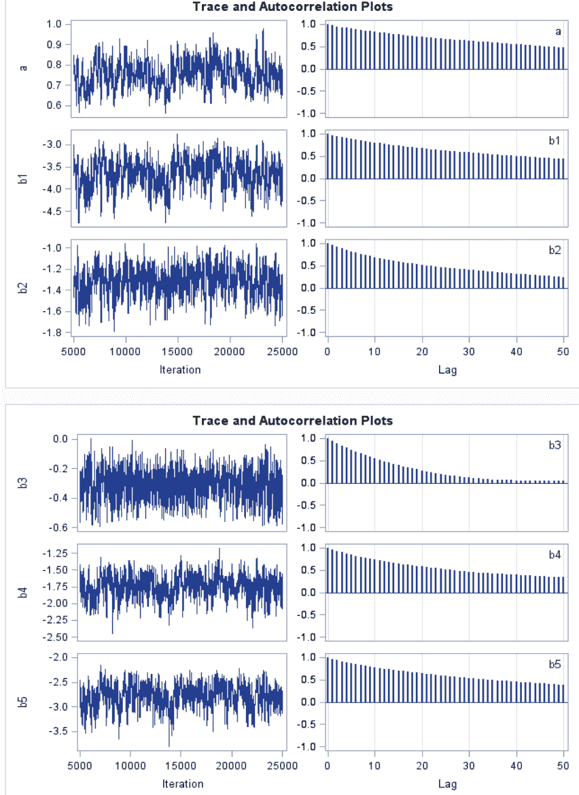

输出 3.5 到 3.9 提供了从 `PROC MCMC` 可获得的其他诊断信息。其中某些测试用于评估是否采样了足够数量的蒙特卡洛参数值以达到所需的精度（蒙特卡洛标准误差，Rafterly-Lewis）；其他测试用于通过轨迹图评估链的收敛性（有效样本量统计量，Geweke，Heidelberger-Welch）。

### 输出 3.5：1P 模型的蒙特卡洛标准误差

| 蒙特卡洛标准误差 | | |

| 参数 | MCSE | 标准差 | MCSE/SD |

|---|---|---|---|

| a | 0.00593 | 0.0632 | 0.0939 |

| b1 | 0.0279 | 0.0306 | 0.0910 |

| b2 | 0.00777 | 0.1285 | 0.0604 |

| b3 | 0.00384 | 0.0934 | 0.0411 |

| b4 | 0.0132 | 0.1665 | 0.0791 |

| b5 | 0.0196 | 0.2337 | 0.0839 |

后验估计的误差不仅归于后验标准差所反映的点估计标准误差，还归于采样误差，即蒙特卡洛标准误差 (`MCSE`)。通常，模拟应该运行到每个感兴趣参数的 MC 误差小于样本标准差的约 5%（Spiegelhalter 等，2003）。可以通过延长链的长度来减少 MC 误差。输出 3.5 中的结果表明，这一标准（`MCSE/SD < .05`）在 6 个参数中的 5 个中未达到，表明可能需要更多样本。

### 输出 3.6：1P 模型的 Geweke 检验

| Geweke 诊断 | | |

| 参数 | z | Pr > |z| |

|---|---|---|

| a | -4.8956 | <0.001 |

| b1 | -4.7164 | <0.001 |

| b2 | -3.5186 | 0.0004 |

| b3 | -0.9323 | 0.3512 |

| b4 | -3.5288 | 0.0004 |

| b5 | -4.2436 | <0.001 |

## 58 使用 SAS 对项目反应模型进行贝叶斯分析

该统计量通过比较均值与链的后期迭代值来测试后验估计是否已收敛。较大的 $|z|$ 值表示缺乏收敛。从输出 3.6 可以看出，五个项目参数通过测试，表明链缺乏收敛。


## 输出 3.7：1P 模型的 Rafter-Lucy 诊断检验

| Rafter-Lucy 诊断 | | | | |

| 分位数=0.025 | 准确度=0.005 | 概率=0.95 | Epsilon=0.001 |

|---|---|---|---|---|

| 参数 | 烧入 (Burn-In) | 总计 | 最小值 | 依赖因子 |

| a | 71 | 78709 | 3746 | 2 |

| b1 | 53 | 57177 | 3746 | 2 |

| b2 | 50 | 54465 | 3746 | 2 |

| b3 | 40 | 43117 | 3746 | 2 |

| b4 | 47 | 51222 | 3746 | 2 |

| b5 | 46 | 50211 | 3746 | 2 |

该测试评估了精确性。具体而言，它计算了达到所需精度的次数（TOTAL）以及（Accuracy）；输出 3.7 中的结果显示了样本的依赖性（DEPENDENCE）。

## 输出 3.8：1P 模型后验分布的 Heidelberger-Welch 检验

| Heidelberger-Welch 诊断 | | | |

| 参数 | Cramer-vonises | p-值 | 结果 | 迭代 |

|---|---|---|---|---|

| a | 0.2497 | 0.1399 | 通过 | 0.00 | |

| b1 | 0.3240 | 0.1158 | 通过 | 0.05 | |

| b2 | 0.2253 | 0.2234 | 通过 | 0.01 | |

| b3 | 0.0305 | 0.8735 | 通过 | 0.26 | |

| b4 | 0.2387 | 0.2068 | 通过 | 0.04 | |

| b5 | 0.2776 | 0.1565 | 通过 | 0.04 | |

该测试由两部分组成：平稳检验和宽度检验。平稳检验评估链是否“弱”平稳；宽度检验评估样本是否足够准确地估计均值。如输出 3.8 所示，所有参数通过了测试。

### 使用 PROC MCMC 对 IRT 模型进行贝叶斯估计 59

## 输出 3.9：1P 有效样本量检验

| 参数 | ESS | 自相关时间 | 自相关效率 |

|---|---|---|---|

| a | 113.3 | 176.5 | 0.0057 |

| b1 | 120.8 | 165.5 | 0.0060 |

| b2 | 274.0 | 72.9942 | 0.0137 |

| b3 | 592.9 | 33.7304 | 0.0296 |

| b4 | 159.8 | 125.2 | 0.0080 |

| b5 | 141.9 | 140.9 | 0.0071 |

有效样本量 (`ESS`) 也衡量跨迭代的变化，因此反映了链的混合情况。`ESS` 的计算是首先计算自相关性接近 0 的估计迭代次数（`AUTOCRELATION TIME`），然后 `ESS` 等于 `NMC` / `AUTOCRELATION TIME`，其中 `NMC` 是蒙特卡洛样本量。反之，链的效率（`EFFICIENCY`）等于于 `ESS` / `NMC`。`ESS` 接近 `NMC` 表示混合良好，而 `ESS` 与 `NMC` 之间存在巨大差异则混合不佳。输出 3.9 中的结果显示值远低于 20000 (`NMC`)，表明由于采样值之间的高度相关性，混合不佳。

## 蒙特卡洛链收敛性的策略

### 稀释减少依赖性的一种方法是每隔 $n$ 个采样值对链进行稀释。在 `PROC MCMC` 语句中使用 `THIN=$n` 选项来稀释链。这种方法对于减少自相关非常有用，但是以丢弃样本为代价的。例如，输出 3.10 展示了 `PROC MCMC` 命令添加 `THIN=4` 后的轨迹自相关图。可以看到稀释显著降低了自相关性

# 使用 SAS 进行项目反应理论的贝叶斯分析

与原始模型相比（参见输出 3.3）。然而，在后验摘要方面本质上没有区别。

# 输出 3.10：稀释后的轨迹图和自相关性图 (THIN = 4)

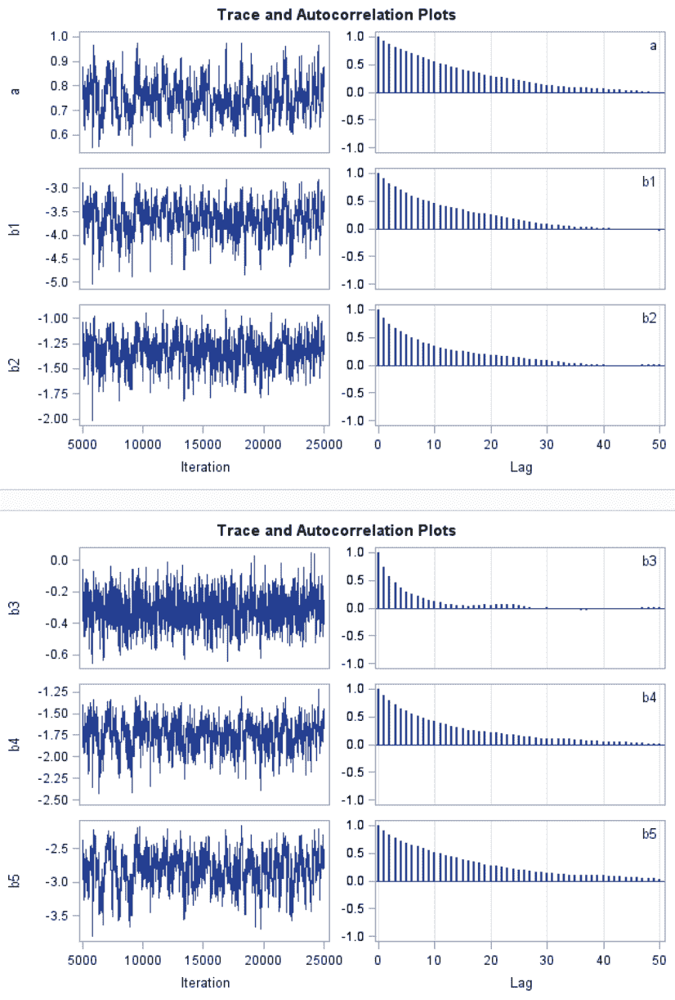

# 参数分（Parameter Blocking）

当出现混合不佳（poor mixing）时，策略是通过策略性使用 `PARMS` 语句来改变参数的采样或顺序更新方式。每个 `PARMS` 语句可用于定义单个参数或一组参数。`PROC MCMC` 中使用的 Metropolis 算法同时更新每个 `PARMS` 语句中的参数。有两个 `PARMS` 语句，一个用于单个的 $a$，另一个用于一组 $b_i$ 参数。当参数表现出强依赖性时，通过在单个 `PARMS` 语句中定义一个参数块可能会获益。例如，如果预计 $a$ 和 $b_i$ 参数相关或表现出强依赖性，可以将两个 `PARMS` 语句合并为一个包含单个参数块 $(a, b_1, ..., b_h)$ 的 `PARMS` 语句，或使用 `PARMS A 1 B: 0`。通过此规范，Metropolis 算法联合更新所有项目参数（$a$ 和 $b_j$）。在更新参数时，参数之间的任何相关性更容易考虑到。

然而，对大量参数进行分组可能是冗长的，因为在同时采样大量参数时，很难实现“良好的混合”（参见 `PROC MCMC` SAS 帮助，子标题“Blocking of Parameters”）。当参数数量很多时，除非指定的 `PARMS` 语句反映了小组相关或依赖参数，并且采用了一种介于在单个 `PARMS` 语句中分所有参数与为每个参数使用单独 `PARMS` 语句之间的分策略，否则接受的建议值将减少。

为了比较这两种策略，输出 3.11 和 3.12 展示了使用单独 `PARMS` 语句（即 6 个 `PARMS` 语句）时的轨迹图和自相关性图，以及基于单个 `PARMS` 语句（即 `PARMS statement A 1 B: 0`）的图。结果可以与原始 1P 示例中使用两个 `PARMS` 语句（`PARMS A: 1; PARMS B: 0`）的情况进行比较（参见输出 3.3）。

尽管在输出 3.11 中很难观察，但与使用两个 `PARMS` 语句相比，使用单独的 `PARMS` 语句稍微减少了观测依赖。原始程序（程序 3.2）滞后 50 的自相关范围从 .06 到 .47；当使用六个单独的 `PARMS` 语句时，自相关延迟从 .02 到 .40。然而，单独采样每个参数的缺点是计算成本增加。在目前的分析中，计算时间大约增加了一倍。在输出 3.12 中，你也可以看到使用单个参数块带来的改进。在这里，滞后 50 的自相关范围从 .06 到 .27。

# 使用 SAS 进行项目反应理论的贝叶斯分析

# 输出 3.11：每个参数使用单独 PARMS 语句的轨迹图和自相关性图

# 轨迹图和自相关性图

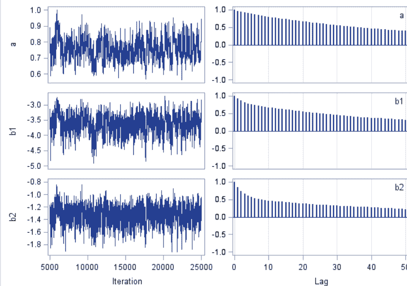

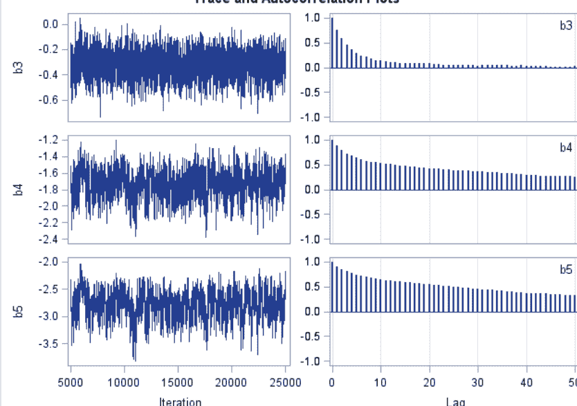

# 第3章：使用 PROC MCMC 对 IRT 模型进行贝叶斯估计 63

# 输出 3.12：所有参数分组后的轨迹图和自相关性图 (PARMS A1 B: 0)

# 轨迹图和自相关性图

# 轨迹图和自相关性图

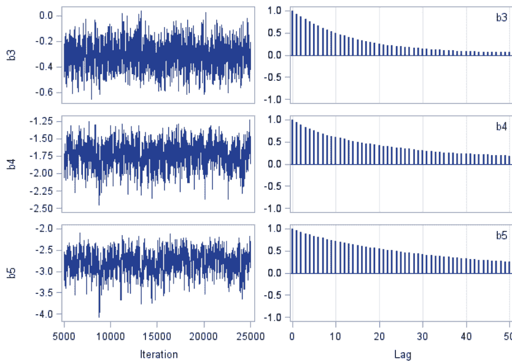

# 使用 SAS 进行项目反应模型的贝叶斯分析（注：原文此处为 6）

# 模型重新参数化（Model Re-parameterizing）

最后，另一种处理混合不佳的策略是对模型进行重新参数化并减少参数之间的依赖性。例如，1P 程序（程序 3.2）中的概率可以表示为截距模型 $P[j] = LOGISTIC(A*THETA-D[j])$，其中 $D[j]$ 是截距项，是 $a$ 和 $b_j = d/a$ 的函数。在计算中，$B[j] = D[j]/a$，$a$ 可以包含在 $(A B D)$ 的循环中，并通过在 `PROC MCMC` 采样器中包含 `MONITOR-(A B D)` 来监控 $b_j$ 参数。示例将在程序 3.3 中给出。

## 程序 3.3：1P IRT 模型的重新参数化

```
proc mcmc seed=23 nseed=20000
monitor=(a b d) diagnostics=all plots=(trace autocorr);
array b(5);
array d(5);
array p(5);
parms a 1;
parms d 0;
prior d ~ normal(0, var=4);
prior a ~ lognormal(0, var=.25);
random theta ~ normal(0, var=1) subject=obs_obs;
```

# 多链分析——用于收敛性的 Gelman-Rubin 检验

Gelman-Rubin 诊断工具基于对多条 MCMC 链的分析，每条链都使用不同的参数值初始化。为了获得这些诊断结果，必须首先使用不同的参数初始值对模型进行多次初始化。下一步是比较每个初始化参数的链内采样值方差和链间采样值方差。执行此任务的命令使用自动调用的宏 `GELMAN`，它会计算必要的方差分量。除了方差估计外，还可以获得多条链的轨迹收敛图（trace plots）。有关计算过程的完整描述，请参阅 `PROC MCMC` 的辅助文档。

`PROC MCMC` 文档中代码的适配版本适用于程序 3.4 中的 IP 模型示例，由三个宏调用组成：`%GMCMC`、`%GELMAN` 和`%TRACE`。请注意，在 `GMCMC` 宏中，大部分输出在 `PROC MCMC` 语句中被抑制，因为重点在于 Gelman-Rubin 检验。运行循环的数量是从链开始的 0 到 3 个值。最后，选项 `INIT-REINIT` 非常重要，因为该选项在调整阶段后将初始值重置为指定的不同值（例如 `A_INIT1`、`A_INIT2`、`A_INIT3`）。执行 `GMCMC` 宏的结果是三组（`OUT1`、`OUT2` 和 `OUT3`），其中包含了三条不同链的采样值。

自动调用 `GELMAN` 是一个内置宏，用于计算并输出由 `GMCMC` 宏产生的多个链方差。默认情况下，链的数量为三。`TRACE` 宏会将每条链迭代的采样值叠加显示。

# 程序 3.4：获取 Gelman-Rubin 统计量

```
% let chain = 3; * 并行链的数量;
% let a_init1 = 1; * 为 "a" 参数设置的3个初始值组;
% let a_init2 = 2;
% let a_init3 = 3;
% let b_init1 = 4; * 为所有 "b" 参数设置的3个初始值组;
% let b_init2 = 0;
% let b_init3 = -4; * 需要测试收敛性的参数数量;
% let param = 4; * mc 采样数量;
% let nsim = 5000;
% let var = a b1 b2 b3 b4 b5; * 待测参数的说明;

% macro gmcmc; * 定义一个宏来为 &chain 条链循环 proc mcmc 命令;
% do i = 1 to &chain; do
% proc mcmc data=lsat output=out&i seed=&i nbi=0 nmc=&nsim init=reinit
% monitor(a b) statistics=(summary)diagnostics=none plots=none;
 array b[5];
 array p[5];
 array a &a_init&i;
 params b &b_init&i;
% prior b ~ normal(0, var=4);
 prior a ~ lognormal(0, var=.25);
 random theta ~ normal(0, var=1) subject=obs_;
% do j = 1 to 5; do
% p[j] = logistic(a*(theta-b[j]));
% end;
% model x1 ~ binary(p1);
% model x2 ~ binary(p2);
% model x3 ~ binary(p3);
% model x4 ~ binary(p4);
% model x5 ~ binary(p5);
% end;
% end;
% mend;
```

ods listing; %gmcmc; ods listing;

# 68 使用 SAS 进行项目反应模型的贝叶斯分析

```
data all; /* 合并来自多个链的后验采样;
set out1(in=in1) out2(in=in2) out3(in=in3);
```

# 第3章：使用 PROC MCMC 进行 IRT 模型的贝叶斯估计

输出 3.19：无先验下 PROC MCMC 的后验摘要输出

| 参数 | N | 均值 标准差 95% HPD 区间 |

|---|---|---|---|---|---|

| a | 20000 | 0.7179 | 0.0738 | 0.5670 | 0.8623 |

| b1 | 20000 | -3.8131 | 0.3386 | -4.5909 | -3.0855 |

| b2 | 20000 | -1.3850 | 0.1555 | -1.6841 | -1.0843 |

| b3 | 20000 | -0.3286 | 0.1040 | -0.5393 | -0.1299 |

| b4 | 20000 | -1.8207 | 0.1938 | -2.2142 | -1.4749 |

| b5 | 20000 | -2.9384 | 0.3016 | -3.5524 | -2.3733 |

## 层级先验

在上述示例中，使用了常量来定义先验分布的参数。这些参数被称为超参数，它们本身可以是带有关联先验的参数（超先验或层级先验）。这为先验规范创建了一个层级结构，在 IRT 模型背景下，这允许“跨观测单元（个体或项目）借用信息，从而使结果更加稳健”（Johnson, Sinhahay, & Bradley, 2007, p. 589）。层级先验还可能用于减少先验的强度、进行非参数分析并让数据影响超参数。

例如，在 1PL IRT 模型中，我们可能希望认为 $b_i$ 参数是可交换的，并为 $b_i$ 参数分配正态先验（Kim & Bolt, 2007）。随后为这些参数指定先验——用于均值的局部或受限均匀先验，以及用于方差参数的逆伽马分布。虽然在这种语境下通常指定逆伽马分布是因为它是正态分布的共轭先验，但 Gelman (2006) 建议对方差参数使用均匀先验或半正态先验。

该层级模型的命令在程序 3.5 中所示。你可以看到，在该程序中，$b_i$ 参数的先验是超参数为 `MUB` 且差为 `VARB` 的正态分布。这些超参数的先验反映了无信息分布（MUB 范围从 -6 到 6，VARB 采用参数等同于 0.1 的逆伽马分布）。先验方差分布通常是相等的，尽管并非强制要求。这些先验允许数据估计 $b_i$ 参数正态先验的超参数。因此，向先验均值的“收缩（shrinkage）”程度由数据决定。需要注意的是，在数据较少的情况下，由于没有足够的信息精确估计超参数，超参数可能会变得不稳定（Gelman, Carlin, Sun, Vahtari, & Rubin, 2014）。

## 程序 3.5：带有层级先验的 PROC MCMC 的后验摘要输出

```
proc mcmc data=lsout=lsat_bayes seed=23 niter=5000 maxit=20000
array b[5];
array p[5];
params a=1;
params b: 0;
parms b ~ normal(mub,varb);
prior mub ~ uniform(-6,6);
prior varb ~ gamma(.01, scale=.01);
prior a ~ lognormal(0, var=4);
```

输出 3.20：带有层级先验的 PROC MCMC 后验摘要

| 参数 | N | 均值 | 标准差 | 95% HPD 区间 |

|---|---|---|---|

| a | 20000 | 0.7515 | 0.0669 | 0.6193 | 0.8927 |

| b1 | 20000 | -3.6415 | 0.3435 | -4.3083 | -2.9792 |

| b2 | 20000 | -1.3451 | 0.1471 | -1.6359 | -1.0676 |

| b3 | 20000 | -0.0329 | 0.1006 | -0.5243 | -0.1292 |

| b4 | 20000 | -1.7537 | 0.1762 | -2.2114 | -1.4371 |

| b5 | 20000 | -2.7940 | 0.2633 | -3.3237 | -2.2821 |

| mub | 20000 | -1.9513 | 0.7963 | -3.5673 | -0.3716 |

| varb | 20000 | 3.2120 | 4.8640 | 0.2918 | 9.6263 |

输出 3.21：参数 $b_i$ 的后验密度

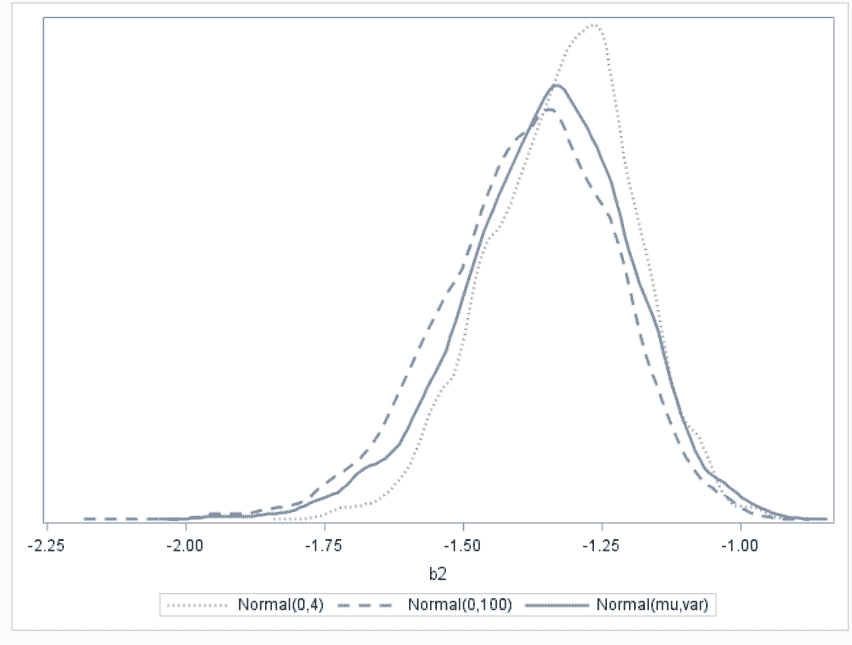

# 第 3 章：使用 PROC MCMC 进行 IRT 贝叶斯估计 75

输出 3.23：随机项目效应（$b_i$ 参数）模型的轨迹图和自相关性图

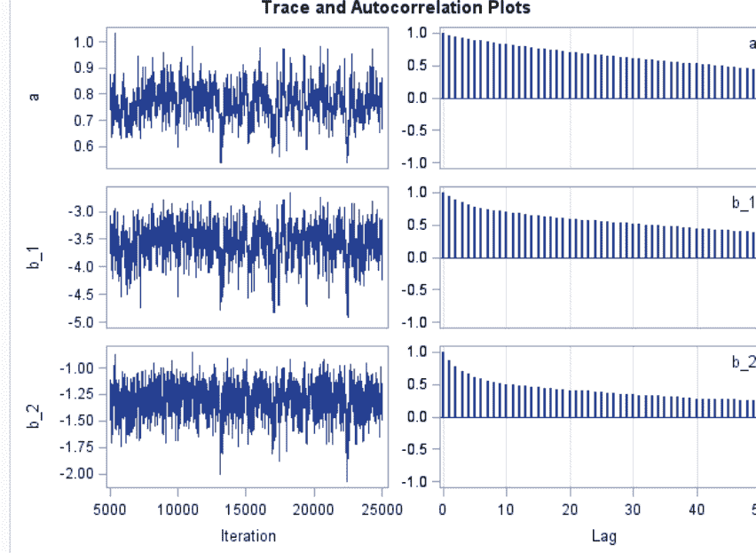

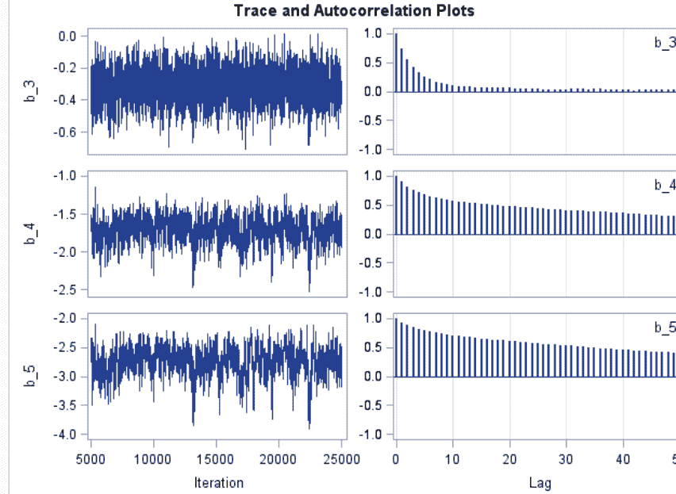

# 模型拟合与模型比较

模型的拟合程度，或者说模型预测值与观测数据之间的对应关系，通常被视为基于模型过程的一个重要属性。当模型不拟合数据时，使用结果（例如估计参数）的有效性可能会受到损害。此外，在许多应用中，会估计不同的竞争模型，在这些竞争模型之间进行选择以获得优选且简洁的模型是非常重要的。


正如第 1 章和第 2 章所讨论，后验模型检查（PPMC）是一种流行的贝叶斯模型检查工具，并已被证明对评估 IRT 模型的拟合情况非常有用。在 PPMC 中，基于观测响应的结果与使用估计的 IRT 模型（后验分布）基于预测项目响应的结果进行比较。这种比较允许评估观测到的项目响应与基于模型的预测项目响应之间的相对一致性。此外，在贝叶斯范式中，模型比较方法在两类情况下失效：(1) 偏差信息准（DIC）；以及 (2) 基于贝叶斯因子（Bayes factor）的指标。`SAS` 软件包含了评估模型拟合和模型比较的方法与工具。这些方法将在本书的后续章节（第 7 章和第 8 章）中讨论，并通过多个示例进行说明。

## 与 WinBugs 的比较

`WinBugs` (Spiegelhalter, Thomas, Best, & Nunn, 2003) 是一种流行的程序，通过消除直接编写 MCMC 算法的需求来辅助贝叶斯分析。对于 `PROC MCMC` 和 `WinBugs`，用户都需要指定似然模型并为参数定义先验分布。以下 `WinBugs` 程序复制了图 3.2 所示的 IP 模型。

```
model
{
  for (j in 1:n) {
    for (k in 1:t) {
      logit(p[j,k]) <- a*(theta[j] - b[k])
      y[j,k] ~ dbern (p[j,k])
    }

    theta[j] ~ dnorm(0,1)
    # priors for item parameters
    for (k in 1:t) {
      b[k] ~ dnorm(0..25)
    }
  }
  a ~ dnorm(0,4)
}

## initial values
list(b=c(0,0,0,0,0), a=1, theta=c(0,0,0,0,0,0,0,0,0))

## data
list(n=1000, t=5, y=structure(data=c(
0,0,0,0,0,
0,0,0,0,0,
0,0,0,0,0,

1,1,1,1,1,
1,1,1,1,1,
1,1,1,1,1,
1,1,1,1,1,
dim = c(1000,5))))
```

如所示，代码结构与 `WinBugs` 代码中的外部循环（OUTER loop）相似，但在 `SAS PROC MCMC` 中，对项目的处理是通过处理 `SAS` 数据集隐式实现的。使用 `SAS` 的优势之一可以直接使用数据集，或者该数据集可以不包含被排除在外的变量。当你使用 `WinBugs` 时，数据必须具有特定的格式，上述代码说明了其中一种格式。而且数据中可以包含未分析的变量。此外，可以使用 `SAS` 强大的编程语言对数据集进行预处理。先验分布的指定和初始值的设定在 `WinBugs` 中可能比较繁琐。对于收敛性诊断，两个程序都包含了评估收敛性的工具。然而，在处理后验分布时，`WinBugs` 包含诊断功能。此外，在使用 `SAS` 处理后验分布时，两个程序都包含图形。最后，`PROC MCMC` 与 `WinBugs` 相比最显著的优势在于速度，特别是通过 `PROC MCMC` 语句中的 `THREAD` 选项进行并行处理。正如后续关于模型比较和使用 PPMC 进行评估的讨论的，`SAS` 具有强大的编程语言，而 `WinBugs` 的编程语言难以使用。

# OUTPOST 数据集

正如第 2 章提到的，贝叶斯 IRT 模型分析的优势是可以同时获得项目和人的参数估计。因此，项目估计的不确定性考虑了项目估计的不确定性。在 `PROC MCMC` 中，`OUTPOST` 数据集包含了 `RANDOM` 语句指定的所有参数。由于这是标准数据，该数据集可以使用任何 `SAS` 命令进行后处理。例如，可以使用 `PROC MEANS` 获取 `theta` 的估计值和标准误差。每个 `theta` 的均值以及标准差可以计算并与数据合并。

# 程序 3.7：将 theta 和 SE 与原始项目响应合并

```
* obtain summary statistics from the posterior distributions */
proc means data=lsat_bayes;
var theta_1_theta_100;
output out=means mean-mean1000 sd-sd1000;
run;

/* merge the summary statistics with the original */
lsat;
set lsat;
if n=0 then set means;
array th(1000) mean-mean1000;
array sd(1000) sd-sd1000;
retain obs (0) mean-sd;
obs=obs;
theta=th[obs];
se=sd[obs];
keep-x5 theta
run;
```

该数据的子集显示输出 3.24 中——观测 5 和 995–1000。你可以看到能力（`theta`）的估计值从正确数为 0 的 -1.92 到正确数为 5 的 .65。`theta` 参数后验分布的能力估计误差或标准差范围约为 .77 到 .87。注意，尽管估计了 1P 模型，但由于 MCMC 算法中相同的先验分布，能力参数的估计值并不等价。然而，相同得分的估计值基本上是等价的。

# 输出 3.24：项目响应和 Theta 估计值 / 标准误差

| Obs | x1 | x2 | x3 | x4 | x5 | theta | se |
|---|---|---|---|---|---|---|---|
| 1 | 0 | 0 | 0 | 0 | 0 | -1.90326 | 0.78933 |
| 2 | 0 | 0 | 0 | 0 | 0 | -1.90250 | 0.77172 |
| 3 | 0 | 0 | 0 | 0 | 0 | -1.91621 | 0.81723 |
| 4 | 0 | 0 | 0 | 0 | 0 | -1.41520 | 0.79268 |
| 5 | 0 | 0 | 0 | 0 | 0 | -1.41955 | 0.79910 |
| 995 | 1 | 1 | 1 | 1 | 1 | 0.65187 | 0.87518 |
| 996 | 1 | 1 | 1 | 1 | 1 | 0.62469 | 0.85717 |
| 997 | 1 | 1 | 1 | 1 | 1 | 0.64488 | 0.85385 |
| 998 | 1 | 1 | 1 | 1 | 1 | 0.65215 | 0.85464 |
| 999 | 1 | 1 | 1 | 1 | 1 | 0.64157 | 0.85433 |
| 1000 | 1 | 1 | 1 | 1 | 1 | 0.63134 | 0.86803 |

# 用于后处理 PROC MCMC 数据集的自动调用宏

`PROC MCMC` 中提供的所有图表和表格都可以使用自动调用宏或 `SAS` 库中提供的宏重新生成。对于 `PROC MCMC`，表 3.3 详细列出了可用的自动调用宏。对于所有宏，都需要后验样本数据集和变量列表。可以使用可选参数来抑制打印（`PRINT=NO`）并将结果保存到 `SAS` 数据集（`OUT=<dataset>`）。例如，要使用 `OUTPOST=LSAT_BAYES` 重新生成 1P 分析的诊断图，可以使用以下命令：

```
%Tadplot(data=lsat_bayes, outpost=LSAT_BAYES);
```

值得注意的是，收敛性诊断也可以使用 `SAS` (2014)。

# 表 3.3：PROC MCMC 可用的自动调用宏

| 自动调用宏名称 | 描述 |
|---|---|
| `%ESS` | 有效样本量 |
| `%GEWEKE` | Geweke 诊断 |
| `%MCSE` | 蒙特卡洛标准误差 |
| `%RAFTERY` | Rafter 诊断 |
| `%POSTCAF` | 自相关图 |
| `%POSTCOR` | 相关矩阵 |
| `%POSTCOV` | 方差矩阵 |
| `%POSTINT` | 等尾和 HPD 区间 |
| `%POSTSUM` | 汇总统计 |
| `%TADPLOT` | 轨迹、自相关和核密度图 |

## 初步项目分析

在估计 IRT 模型之前进行初步项目分析通常很有用。这种分析可以识别项目的任何问题——例如区分度很低的项目或变异很小的项目。基于经典理论的项目统计可以使用 `PROC CORR` 和 `ALPHA` 选项进行计算。

```
proc corr data=<SAS Dataset> alpha;
  var <Item Variables>;
```

在输出中，你可以看到 `alpha` 较低，但在项目数量很少的情况下，这种低值是预料中的。项目总相关性可以用于识别任何对信度有贡献（即低得分）的项目。修正项目总相关性为负或零反映了项目的不一致性或效能极低。大于 .3 的相关性是理想的。项目总相关性的范围和变异也反映了项目区分能力的差异。

项目数量；且相关性相似，这表明项目具有大致相等的区分受者能力。关于基于经典测试理论的项目分析的更多信息，请参见 Crocker 和 Algina (1986)。

## 输出 3.25：LSAT 数据集的经典测试项目统计

| 简单统计 | 变量 | N | 平均值 | 标准差 | 总和 | 最小值 | 最大值 |
|---|---|---|---|---|---|---|---|
| x1 | 1000 | 0.92400 | 0.26513 | 924.0000 | 0 | 1.00000 |
| x2 | 1000 | 0.70900 | 0.45445 | 709.0000 | 0 | 1.00000 |
| x3 | 1000 | 0.56300 | 0.49743 | 553.0000 | 0 | 1.00000 |
| x4 | 1000 | 0.76300 | 0.42546 | 763.0000 | 0 | 1.00000 |
| x5 | 1000 | 0.87000 | 0.33647 | 870.0000 | 0 | 1.00000 |
| 克隆巴 Alpha 系数 | 变量 | Alpha |
|---|---|---|
| 原始 | 0.249497 |
| 标准化 | 0.293028 |
| 删除变量后的克隆巴 Alpha 系数 | 删除变量 | 与总分相关性 | Alpha | 标准化变量 | 与总分相关性 | Alpha |
|---|---|---|---|---|---|---|
| x1 | 0.112833 | 0.273566 | | 0.107133 | 0.277131 |
| x2 | 0.153178 | 0.237584 | | 0.152966 | 0.235217 |
| x3 | 0.172799 | 0.216799 | | 0.171954 | 0.217384 |
| x4 | 0.144428 | 0.245933 | | 0.142220 | 0.245187 |
| x5 | 0.121596 | 0.266294 | | 0.117274 | 0.267993 |

最后，因子分析方法对于深入了解项目反应背后的结构和维度非常有用。在检验项目反应理论（IRT）模型的背景下，因子分析方法有助于识别模型中应包含的可能的人参数（θ）。因子分析方法也适用于具有不同数量待估计和比较的人参数的竞争模型。这个问题与第 1 章中讨论的 IRT 模型底层的维度假设有关。关于该假设和因子分析方法的使用的更多信息，请参见第 1 章。

> LSAT 数据来源：经 Springer Science+Business Media 许可，Psychometrika, Fitting a model for n dichotomously scored items, volume 35, 1970, page 188, Bock R. D., and Lieberman, M., Section 6, Table 1: LSAT data, ©1970 Springer Link.

## 第 4 章：二分计分项目单维度 IRT 模型的贝叶斯估计

- 引言................................ 81
- 1 参数 IRT 或 Rasch 模型........................................... 82
- 使用正态 S 型连接函数（Normal Ogive Link Function）........................... 85
- 2 参数 IRT 模型..................................... 85
- 带有分层先验的 2 参数 IRT 模型.............. 91
- 3 参数 IRT 模型...................................... 94
- 基于 MML 估计的结果比较................ 105
- 项目反应函数的显示.................................. 107
- 在图表中添加元素：项目参数的不确定性... 109
- 在图表中添加元素：观测结果.................. 111

## 引言

在单维度假设下，可用于二分计分项目的三种 IRT 模型是 1 参数、2 参数和 3 参数模型（例如，参见 Hambleton & Swaminathan, 1985）。在这三个模型的通用形式中，被试对第 $i$ 个项目给出正确回答（1 相于 0；是 相于否）的概率通常用逻辑函数建模：

> $P(\theta) = P(U_i=1|\omega_i, \theta) = \Psi(z_i) = c_i + (1-c_i)e^{-z_i}$

其中 $\Psi$ 是累积函数，$z_i = D_i(\theta - b_i)$。在检验 IRT 模型背景下，因子分析方法有助于识别模型中应包含的可能的人参数（θ）。因子分析方法也适用于具有不同数量待估计和比较的人参数的竞争模型。这个问题与第 1 章中讨论的 IRT 模型底层的维度假设有关。关于该假设和因子分析方法的使用的更多信息，请参见第 1 章。

## 1 参数 IRT 或 Rasch 模型

## 项目反应的贝叶斯分析

## 程序 4.1：用于 1P IRT 模型的 PROC MCMC 代码

```sas
proc mcmc data=lsat out=lsat seed=23 nbi=500 nmc=20000
threads=8; monitor(a diagnostics=allplots(trace autocorr));

array b[5]; array p[5];

pars a; d=0;

prior d ~ normal(0,var=25);
prior a ~ lognormal(0,var=4);
random theta ~ normal(0,var=1) subject=obs

do j=1 to 5;
p[j] ~ lognormal(a*theta - d[j]);
b[j] ~ d[j]/a;
end;

model x1 ~ binary(p1);
model x2 ~ binary(p2);
model x3 ~ binary(p3);
model x4 ~ binary(p4);
model x5 ~ binary(p5);

run;
```

正确回答第 1 和第 5 题的期望概率大于 .50 (`theta = -2 > b_i > b_s`)。记住，对于 1P IRT 模型，当 `theta = b_j` 时，正确回答的期望概率为 .5。

## 输出 4.1: 1P 模型项目参数的后验摘要

| 参数 | N | 平均值 | 标准差 | 95% HPD 间 | |
|---|---|---|---|---|---|
| a | 20000 | 0.7546 | 0.0700 | 0.6065 | 0.8803 |
| b1 | 20000 | -3.6523 | 0.3465 | -4.3435 | -3.0235 |
| b2 | 20000 | -1.3449 | 0.1494 | -1.6425 | -1.0644 |
| b3 | 20000 | -0.3213 | 0.0959 | -0.5061 | -0.1303 |
| b4 | 20000 | -1.7550 | 0.1790 | -2.1325 | -1.4541 |
| b5 | 20000 | -2.8035 | 0.2606 | -3.3257 | -2.3449 |

## 84 使用 SAS 进行项目反应理论贝叶斯分析

## 输出 4.2: 1P 模型项目参数诊断图

### 轨迹与自相关图

### 轨迹与自相关图

## 正态逻辑链接函数的使用

注意，正态函数 $\Phi(z)$ 也模拟变量的累积概率，是 IRT 模型中的自然链接函数。对于 $\Phi(z)$，$z$ 被称为*正态离差*并定义为逻辑函数 $z = a(\theta - b)$。由于逻辑函数基于极大似然法更易处理，因此在估计 IRT 模型时受到了更多关注。在贝叶斯分析中，$\Phi(z)$ 的不可处理并不是问题。然而，许多 IRT 模型示例仍使用逻辑函数。

要实现正态逻辑链接函数，请将代码 `P[j] = LOGISTIC(A theta - D[j])` 替换为 `P[j] = PRONORM(A theta - D[j])`。作为示例，输出 4 包含了正态逻辑函数程序 1 中的汇总统计。当你选择 `b` 时，不同函数的参数本质上是等等的。对于参数 `a`，这种差异可以通过缩放因子 (`D`) 来解释。虽然在 $\Phi(z)$ 函数中未指定，但有一个缩放常数 `D`——通常设置为 1.702 或 1.0。当 `D=1` 时，正态和逻辑链接函数的 `a` 参数在功能上是相关的 (`0.4359 / 1.702 = .2546`)。因此，为了确保两个链接函数本质等效，`D` 应使用逻辑函数设置为 1.702。


## 输出 4: 1P 模型项目参数的后验汇总统计

| 参数 | N | 平均值 | 标准差 | 95% HPD 间 | |
|---|---|---|---|---|---|
| a | 20000 | 0.4359 | 0.0394 | 0.3594 | 0.5128 |
| b1 | 20000 | -3.6087 | 0.3225 | -4.2294 | -2.9964 |
| b2 | 20000 | -3.1815 | 0.1527 | -1.6848 | -1.0892 |
| b3 | 20000 | -0.3318 | 0.1012 | -0.5283 | -0.1332 |
| b4 | 20000 | -1.8095 | 0.1797 | -2.1768 | -1.4827 |
| b5 | 20000 | -2.8364 | 0.2638 | -3.3593 | -2.3371 |

## 二参数 IRT 模型

二参数 `2P` 通过估计每个项目来估计 `1P` 模型，逻辑离差为 `$z_i = a(\theta - b)$` 或 `$z_i = a\theta - d$`。通过为每个项目估计单独斜率参数，该模型假设项目具有不同的区分能力，或与所测的潜在特质/能力有不同的关系。估计 `2P` 模型的 `PROC MCMC` 命令在程序 4.2 中。注意，这些命令与估计 `1P` 模型的命令相似，不同在于项目区分参数 `$a_i$` 被定义（`ARRAY A`），并且在 `LOGISTIC` 函数中引用了数组元素（`ARRAY B`）。为了减少 `2P` 模型中采样参数之间的自相关，为每个项目设置单独的 `PARMS` 以定义不同的块。同一块中的参数在采样过程中联合更新，并考虑了同一块内参数之间的任何可能相关性（更多关于分组讨论参见第 5 章）。

## 86 使用 SAS 进行项目反应模型贝叶斯分析

项目参数预计是相互相关的，如果使用两个 `PARMS`：`PARMS A: 1` 和 `PARMS D: 0`，可能会获得更高程度的自相关。程序 4.2 还说明了截断先验的使用。对于 `1P` 模型（程序 4.1），`PRIOR D ~ NORMAL(0, VAR=25)` 且 `PRIOR A LOGNORMAL(0, VAR=4)`。但在程序 4.2 中，使用了截断先验。对于 `2P` 模型，截断先验在参数空间上设置在 -6 到 6。值得注意的是，`$b$` 参数在参数空间上设置在 -6 到 6 是等价的。例如，输出 4 包含了 `1P` 模型中 `$b$` 参数的汇总统计。对于 `$a$` 参数，这种差异可以通过缩放因子 `($D$)` 来解释。当 `$D=1$` 时，正态和逻辑链接函数的 `$a$` 参数在功能上是相关的 `($0.4359 / 1.702 = .2546$)`。因此，为了确保两个链接函数本质等效，`$D$` 应使用逻辑函数设置为 1.702。

## 程序 4.2: 2P 模型的 MCMC 代码

```
proc mcmc data=lsat;
var a b1 b2 b3 b4 b5 theta;
niter=20000 burnin=5000 seed=1000;
array a(5) _;
array b(5) _;
array p(5) _;
for j=1 to 5 do
  p[j] = logistic(a[j]*(theta-b[j]));
end;
model x11(binary);
model x2(binary);
model x3(binary);
model x4(binary);
model x5(binary);
run;
```

输出 4.4 到 4.6 提供了 `2P` 模型项目参数的后验汇总。可以看出，链收敛良好，比 `1P` 模型显示出更多的依赖性。对于 `2P` 模型，`$b$` 参数与 `1P` 模型相似。对于 `$a$` 参数，这种差异是由于在参数空间上设置了 -6 到 6 的边界。`$b$` 参数的变异性在截断先验后是巨大的。

## 输出 4.4: 2P 模型项目参数的后验摘要

| 参数 | N | 平均值 | 标准差 | 95% HPD 间 |
| ------|---|---|---|---|
| a1 | 20000 | 0.7958 | 0.2840 | 0.2650 | 1.3086 |
| a2 | 20000 | 0.6972 | 0.1985 | 0.3327 | 1.0970 |
| a3 | 20000 | 0.8991 | 0.2535 | 0.4356 | 1.4254 |
| a4 | 20000 | 0.6675 | 0.2161 | 0.2553 | 1.0774 |
| a5 | 20000 | 0.6123 | 0.2131 | 0.2405 | 1.0372 |

# 88 使用 SAS 对项目反应理论进行贝叶斯分析

输出 4.5：项目参数的诊断图—2P 模型

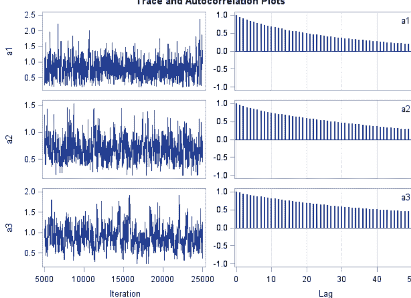

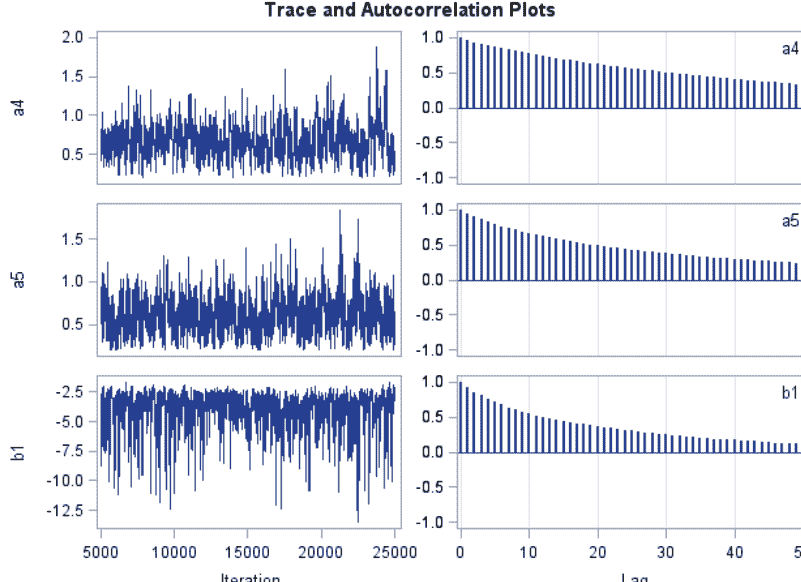

# 第 4 章：二分计分项目的单维度 IRT 模型的贝叶斯估计 89

输出 4.6：项目参数的诊断图—2P 模型（续）

## 轨迹图与自相关图

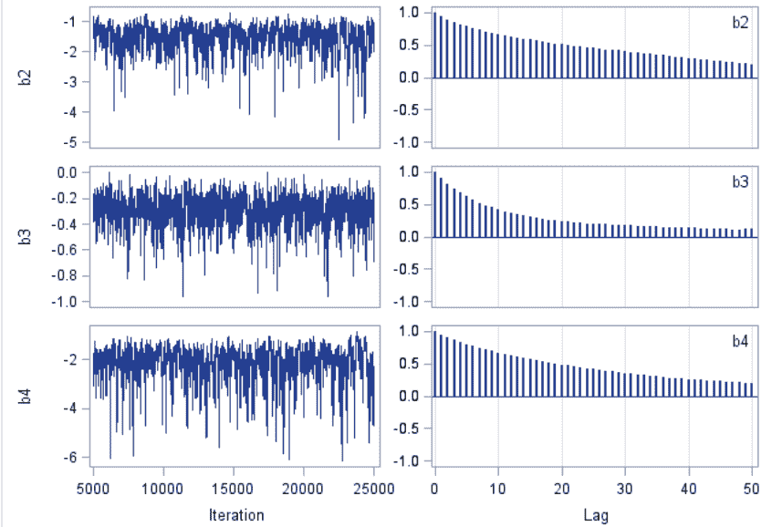

## 轨迹图与自相关图

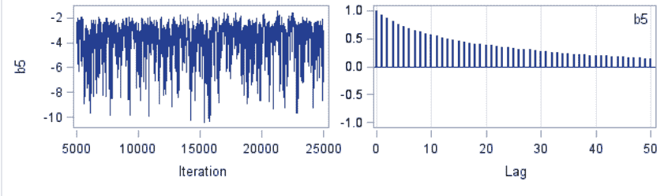

为了在该示例中进一步推进使用非截断分布，请考虑基于非截断先验分布的轨迹图和自相关图（输出 4.7）。对于非截断先验分布，与截断先验分布（输出 4.5）相比，参数上最显著的区别是项目 1（一个非常简单的项目）的 `$b_1$` 参数的轨迹图。对于该参数，观察到了许多极端的采样值。由于此类值在实际数据应用中并不会被观察到，因此对先验分布设定边界以稳定采样过程是合理的。值得注意的是，自相关图显示，基于非截断先验的采样参数值的自相关性低于基于截断先验的值。

输出 4.8 显示了基于非截断先验的项目参数的后验汇总统计量。与基于截断分布的后验汇总统计量（输出 4.4）相比，`$b_1$` 和 `$b_2$` 参数（项目 1 和 5）的均值和标准差相似。这些参数由于采样到了极值值而发生了膨胀。

由于截断正态分布在 -6 到 6 的边界内反映了相对平坦的似然性，也可以建议使用均匀分布。为了评估在相同分布上使用均匀先验的效果，程序 4.2 中的 `$b_i$` 参数使用了先验 `PRIOR D: UNIFORM(-6,6)` 代替了截断正态分布。与基于截断正态分布的结果相比，对于具有大方差指定的采样参数，收敛诊断测试失败可能比使用均匀分布更优。

# 输出 4.7：给定非截断先验的轨迹图与自相关图样本—2P

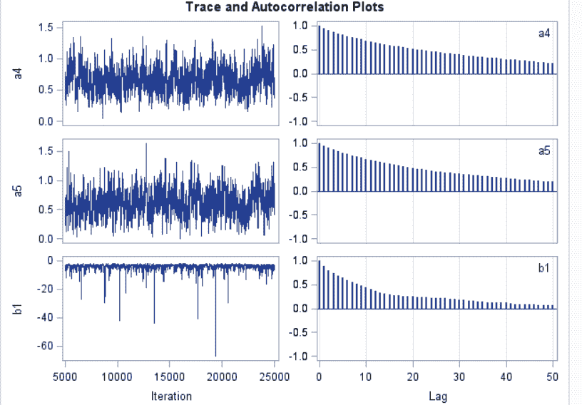

# 第 4 章：二分计分项目的单维度 IRT 模型的贝叶斯估计 91

**输出 4.8：给定非截断先验的后验汇总统计量—2P 模型**

| 参数 | N | 均值 | 标准差 | 95% HPD 区间 |
|---|---|---|---|---|
| a1 | 20000 | 0.7971 | 0.2785 | 0.2868 | 1.4016 |
| a2 | 20000 | 0.6822 | 0.1866 | 0.3193 | 1.0365 |
| a3 | 20000 | 0.9203 | 0.2851 | 0.4052 | 1.4698 |
| a4 | 20000 | 0.6604 | 0.1924 | 0.2961 | 1.0453 |
| a5 | 20000 | 0.6137 | 0.2213 | 0.2010 | 1.0713 |
| b1 | 20000 | -4.0239 | 2.4478 | -6.9542 | -1.8947 |
| b2 | 20000 | -1.5482 | 0.4610 | -2.3784 | -0.8833 |
| b3 | 20000 | -0.2968 | 0.1219 | -0.5450 | -0.0851 |
| b4 | 20000 | -2.1072 | 0.6855 | -3.3790 | -1.1933 |
| b5 | 20000 | -3.9726 | 3.9291 | -7.2079 | -1.7289 |

## 带有分层先验的 2 参数 IRT 模型

由于来自 `2P` 模型的采样参数值（点估计）均值相似，你可以合理地考虑一个使用分层先验来反映斜率参数共同总体的模型。在这个模型中，模型是一个混合 `2P` 模型，其中斜率 `$a_j$` 参数被认为是可交换的，并估计了一个将参数“收缩”到共同值的模型（Johnson & Albert, 1999）。因此，这种信念认为 `$a_j$` 参数大致相等，但希望模拟项目间的差异。可以使用分层先验来估计改进的 `2P IRT` 模型，其超参数反映了 `$a_j$` 参数的均值和方差分布。程序 4.3 提供了估计混合 `2P` 的命令。可以看到两个额外的参数 `MU_A` 和 `VAR_A` 在 `$a_j$` 参数的分层先验中被指定。这里，斜率参数 `($MU_A$)` 使用大方差的截断正态分布指定局部均匀先验。方差参数通常使用逆 Gamma 分布。在这种情况下，形状和尺度设定与 Fox (2010) 相似。除了 `$a_j$` 参数的分层先验外，该模型与程序 4.2 中的 `2P` 模型相同。

## 程序 4.3：带有分层先验的 2P IRT 模型的 MCMC 命令

```sas
proc mcmc data=lsat out=lsat_bayes seed=23 nbi=5000 nmc=20000 threads=8;
array a[5];
array b[5];
array d[5];
array p[5];

parms a1 d0;
parms a2 d0;
parms a3 d0;
parms a4 d0;
parms a5 d0;

parms a1 1 mu_a;

prior d = normal(0,var_a, lower=-6, upper=6);
prior a = normal(mu_a, var=var_a, lower=0);
prior mu_a = normal(1,var=100, lower=0);
prior var_a = gamma(1,scale=1);

random theta = normal(0,var=1) subject=obs;
do j=1 to 5
  p[j] = logistic(a[j])*theta-d[j];
  b[j]=d[j]/a[j];
end;

model x1 = binary(p1);
model x2 = binary(p2);
model x3 = binary(p3);
model x4 = binary(p4);
model x5 = binary(p5);
run;
```

输出 4.9 显示了项目参数的后验汇总统计量，以及斜率参数的超参数（均值和方差）。输出 4.10 和 4.11 仅提供超参数的诊断图，因为其他图与上一部分的 `2P` 模型（输出 4.5–4.6）相似。

专注于输出 4.9 中的超参数，斜率参数的均值 `($MU_A$)` 为 74，方差 `($VAR_A$)` 为 10。检查输出 4.4 中 `2P` 模型的斜率参数，可以看到斜率参数相对相似，范围在 61–90 之间。预计混合 `2P` 模型中的方差 `($VAR_A$)` 会较小。此外，`2P` 模型五个斜率参数的均值约为 76，与混合 `2P` 模型的超参数均值 `($MU_A$)` 相似。还注意到，与 `2P` 模型相比，混合 `2P` 模型中的斜率参数更相似，范围在 .72–84 之间。这是使用分层先验的典型结果。分层先验将参数“收缩”到一个共同值（在这种情况下为 `1P` 模型的 .75）。结果是混合 `2P` 模型中斜率参数的标准差也低于标准 `2P` 模型。

最后，正如 Fox (2010) 所指定的，使用了相对信息的方差参数先验 `($VAR_A \sim \text{Gamma}(1,1)$)`，而不是更不信息的先验如 `$VAR_A \sim \text{Gamma}(0,1)$`。在使用分层先验时，使用数据来估计参数——在这种情况下是 `$\alpha$` 参数集的均值和方差。然而，当数据很少时（如本例中的 5 个项目），特别是均值和方差参数的先验可能会覆盖数据。使用更不信息的先验将大幅增加方差估计，无法反映数据中观察到的变异性。因此，在数据可用时应谨慎使用分层先验设定。

# 第 4 章：二分计分项目的单维度 IRT 模型的贝叶斯估计 93

**输出 4.9：项目参数的后验汇总统计量–混合 2P 模型**

# **后验汇总与区间**

| 参数 | N | 均值 | 标准差 | 95% HPD 区间 |
|---|---|---|---|---|
| a1 | 20000 | 0.7760 | 0.1894 | 0.3641 | 1.1276 |
| a2 | 20000 | 0.7535 | 0.1620 | 0.4627 | 1.0985 |
| a3 | 20000 | 0.8382 | 0.1672 | 0.5337 | 1.1756 |
| a4 | 20000 | 0.7258 | 0.1588 | 0.4240 | 1.0365 |
| a5 | 20000 | 0.7182 | 0.1720 | 0.3486 | 1.0174 |
| b1 | 20000 | -3.8086 | 2.7962 | -5.6307 | -2.3040 |
| b2 | 20000 | -3.1813 | 0.2919 | -1.9464 | -0.8844 |
| b3 | 20000 | -0.3035 | 0.1049 | -0.5111 | -0.1078 |
| b4 | 20000 | -1.8819 | 0.4279 | -2.6472 | -1.2205 |
| b5 | 20000 | -3.0863 | 0.8767 | -4.7000 | -1.9704 |
| mu_a | 20000 | 0.7396 | 0.1772 | 0.3665 | 1.0703 |
| var_a | 20000 | 0.1004 | 0.1073 | 0.0106 | 0.3085 |

**输出 4.10：超参数 mu_a 的诊断图—混合 2P 模型**

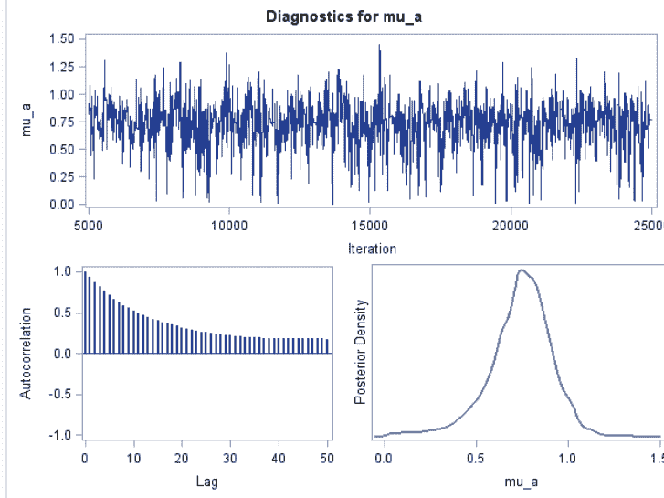

# 94 使用 SAS 进行项目反应理论的贝叶斯分析

输出 4.11：超参数 var_a–混合 2P 的诊断图

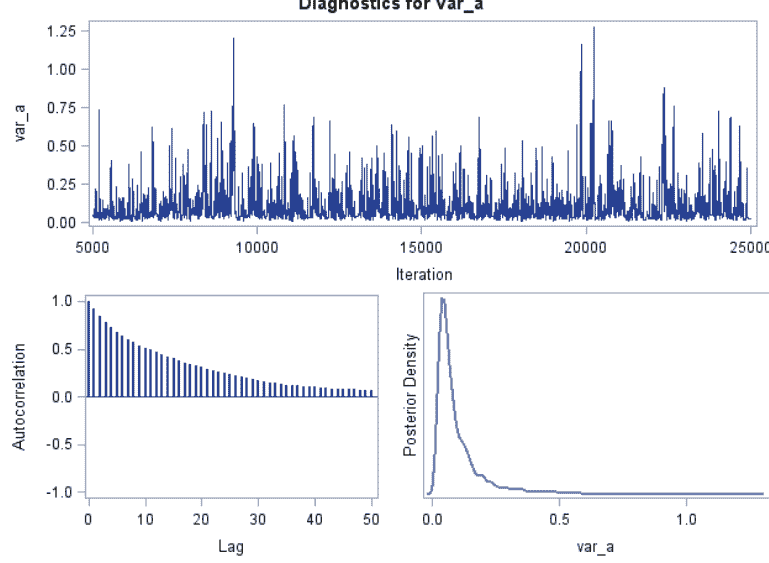

## 三参数 IRT 模型

尽管三参数 `3P` 模型也用于对二分法评分的反应进行建模，但该模型专门设计用于测试应用，即对于能力 `$\theta$` 较低的考生，其正确回答的概率大于 0。例如，考虑图 4.1 中的项目特征曲线（ICC）。在图中，曲线在 `$0 < \theta < -2$` 时具有为 .20 的下渐近线。该模型的主要应用涉及多选择测试，在这些测试中考生可以通过猜测来获得正确答案。相比之下，`1P` 和 `2P` 模型反映了 ICC 下渐近于 0 的模型，这表明能力低的考生正确回答题目的概率很小。因此，下渐近参数（`$c_j$`）通常被称为猜测参数。

图 4.1：二分评分项目 (0,1) 的示例 ICC

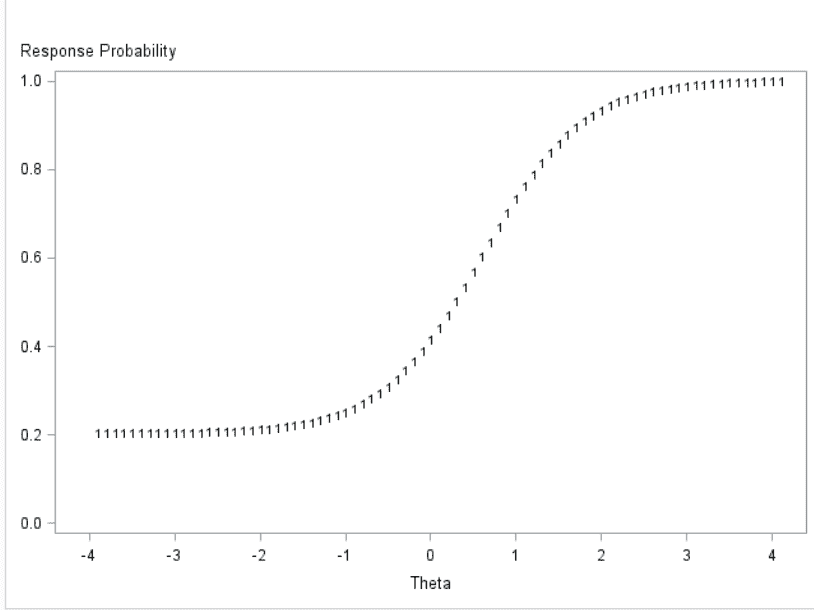

该模型还通过 LSAT 数据进行了说明；预计该模型与多选择 LSAT 项目保持一致。`3P` 模型包含 `$a_j$`、 `$b_j$` 和 `$c_j$` 项目参数，以反映形状的所有方面：下渐近线（`$c_j$`）、ICC 在 x 轴上的位置或标度（`$b_j$`）、ICC 的斜率（`$a_j$`）。在模型模型中，`$c_j$` 参数通过外部整合到逻辑偏离 `$z_j = Da_j(\theta - b_j)$` 中如下：

`$P_j(\theta) = P_j(U_j = 1 | \theta) = c_j + (1 - c_j)\frac{e^{a_j\theta}}{1+e^{a_j\theta}}$`

注意，如果 `$c_j=0$`，则模型默认为 `2P IRT` 模型。

估计 `3P` 模型的 `PROC MCMC` 代码通过将 `$c_j$` 参数包含在似然模型和相关的先验分布规范中扩展了 `2P` 模型。然而，估计 `$c_j$` 参数存在若干复杂性。数据或反应可能适用于低 `$\theta$` 的考试，且对于平均难度或更难且具有区分度的项目，`$c_j$` 更加稳定；例如，参见 Hamilton & Swaminathan (1985)。Lord (1980) 建议当 `$b_j - (2/a_j) > -3$` 或在 `$N>2000$` 的样本中 `$<-5$` 的情况下估计 `$c_j$`。然而，也有文献建议其应固定在 `$1/k$`，其中 `$k$` 是反应选项的数量（Han, 2012）。在贝叶斯范式下，这一建议表明对 `$c_j$` 参数使用均值为 `$1/k$` 的信息性先验可能是很有用的。

由于 `3P` 模型在估计 `$c_j$` 参数时可能存在问题，因此在估计模型之前检查实经验图也是很有用的。经验 ICC 使用总分作为 x 轴 0 的代理，并将项目的平均反应绘制在 y 轴上。因此，该图提供了在每个离散分数上正确回答题目的考生比例。对于低分，似乎有相对恒定的考生比例接近 `$1/k$`，这为猜测的存在和对 `$c_i$` 的估计提供了实经验支持。检查经验 ICC 图的替代方案是使用如程序 4.4 等程序，为每个项目的每个总分创建正确反应表或反应均值表。

### 程序 4.4：用于获取每个项目每个总分平均反应的 SAS 命令

```
proc means data=lsat;
  class total; * total created using total=sum(xl-x5);
run;
```


表 4.1 展示了 LSAT 数据 `$k=5$` 对应五个项目的比例，按列显示。实际结果（每个离散总分的考生正确回答题目的比例）按行显示。在表格的最后一行，提供了每个总分的考生人数。从表中我们可以看到，有大量的低能力考生可以识别出猜测的存在，因为错误分指数是有限的：`Total=0` 时为 3，`Total=1` 时为 20。忽略 `Total=0` 个个体的正确比例值，似乎在回答项目 2-4 时，个人并没有进行主动猜测（比例接近 0.0）。尽管项目 1 和 5 的正确答案概率明显大于 0，但这些项目看起来也非常容易，这使得孤立下渐近线或猜测行为变得具有挑战性。

### 表 4.1：按总分的每个 LSAT 测试项目正确百分比

| 测试项目 | 0 | 1 | 2 | 3 | 4 | 5 |
| :--- | :--- | :--- | :--- | :--- | :--- | :--- |
| **每个可能总分的正确比例** | | | | | | |
| 1 | 0 | 0.50 | 0.73 | 0.89 | 0.96 | 1.0 |
| 2 | 0 | 0.05 | 0.28 | 0.46 | 0.78 | 1.0 |
| 3 | 0 | 0.10 | 0.27 | 0.52 | 0.79 | 1.0 |
| 4 | 0 | 0.08 | 0.33 | 0.59 | 0.83 | 1.0 |
| 5 | 0 | 0.30 | 0.58 | 0.79 | 0.92 | 1.0 |
| **总分人数** | | | | | | |
| | 85 | 237 | 357 | 298 | | |

估计 3P 模型的 `PROC MCMC` 代码通过在似然模型和相关的先验分布规范中包含 `$c_j$` 参数扩展了 2P 模型。然而，估计 `$c_j$` 参数存在若干复杂性。数据或反应可能适用于低 `$\theta$` 的考试，且对于平均难度或更难且具有区分度的项目，`$c_j$` 更加稳定；例如，参见 Hamilton & Swaminathan (1985)。Lord (1980) 建议当 `$b_j - (2/a_j) > -3$` 或在 `N>2000` 的样本中 `<-5` 的情况下估计 `$c_j$`。然而，也有文献建议其应固定在 `1/k`，其中 `k` 是反应选项的数量（Han, 2012）。在贝叶斯范式下，这一建议表明对 `$c_j$` 参数使用均值为 `1/k` 的信息性先验可能是很有用的。

由于 3P 模型在估计 `$c_j$` 参数时可能存在问题，因此在估计模型之前检查实经验图也是很有用的。经验 ICC 使用总分作为 x 轴 0 的代理，并将项目的平均反应绘制在 y 轴上。因此，该图提供了在每个离散分数上正确回答题目的考生比例。对于低分，似乎有相对恒定的考生比例接近 `1/k`，这为猜测的存在和对 `$c_i$` 的估计提供了实经验支持。检查经验 ICC 图的替代方案是使用如程序 4.4 等程序，为每个项目的每个总分创建正确反应表或反应均值表。

### 程序 4.4：用于获取每个项目每个总分平均反应的 SAS 命令

```
proc means data=lsat;
  class total; * total created using total=sum(xl-x5);
run;
```

# 94 使用 SAS 进行项目反应理论的贝叶斯分析

输出 4.11：超参数 var_a–混合 2P 的诊断图


## 三参数 IRT 模型

尽管三参数 (3P) 模型也用于对二分法评分的反应进行建模，但该模型专门设计用于测试应用，即对于能力 `$\theta$` 较低的考生，其正确回答的概率大于 0。例如，考虑图 4.1 中的项目特征曲线（ICC）。在图中，曲线在 `0 < $\theta$ < -2` 时具有为 .20 的下渐近线。该模型的主要应用涉及多选择测试，在这些测试中考生可以通过猜测来获得正确答案。相比之下，1P 和 2P 模型反映了 ICC 下渐近于 0 的模型，这表明能力低的考生正确回答题目的概率很小。因此，下渐近参数（`$c_j$`）通常被称为猜测参数。

图 4.1：二分评分项目 (0,1) 的示例 ICC


该模型还通过 LSAT 数据进行了说明；预计该模型与多选择 LSAT 项目保持一致。3P 模型包含 `$a_j$`、`$b_j$` 和 `$c_j$` 项目参数，以反映形状的所有方面：下渐近线（`$c_j$`）、ICC 在 x 轴上的位置或标度（`$b_j$`）、ICC 的斜率（`$a_j$`）。在模型模型中，`$c_j$` 参数通过外部整合到逻辑偏离 `$z_j = Da_j(\theta - b_j)$` 中如下：

`$P_j(\theta) = P_j(U_j = 1 | \theta) = c_j + (1 - c_j)\frac{e^{a_j\theta}}{1+e^{a_j\theta}}$`

注意，如果 `$c_j=0$`，则模型默认为 2P IRT 模型。

## 4 章：二分得分项目的单维 IRT 模型贝叶斯估计

输出 4.17：3P 模型——`$c_j$` 参数层次先验的后验汇总统计

| 后验汇总与区间 | 参数 | N | 平均值 | 标准差 | 95% HPD 区间 |
|---|---|---|---|---|---|
| A1 | 60000 | 0.7918 | 0.2926 | 0.2280 | 1.3108 |
| A2 | 60000 | 0.7440 | 0.2332 | 0.3233 | 1.2024 |
| A3 | 60000 | 1.0600 | 0.4173 | 0.3808 | 2.0201 |
| A4 | 60000 | 0.7224 | 0.2405 | 0.2988 | 1.2001 |
| A5 | 60000 | 0.7713 | 0.6829 | 0.2005 | 1.5392 |

### 程序 4.7：用于 `$c_j$` 参数层次先验的 3P 模型的 `PROC MCMC` 命令

```
proc mcmc data=lsat out=lsat_bayes_3p nbi=5000 nmc=60000
on=(a b c) nthread=8 plot=(trace autocorr);
array b[5]; array d[5]; array c[5]; array p[5];
perms a1 d1 0 c1 ~ -1.38;
parms a2 d2 0 c2 ~ -1.38;
parms a3 d3 0 c3 ~ -1.38;
parms a4 d4 0 c4 ~ -1.38;
parms a5 d5 0 c5 ~ -1.38;

prior a ~ lognormal(0,lower=-0.2, upper =5);
prior d ~ normal(0,var=25, lower=-6, upper = 6);
prior c ~ normal(mu,var=sigma2);
prior mu ~ normal(-1.38,var=10);
prior sigma2 ~ chiquare(1);

random theta ~ normal(0,var=1) subject=obs_;
do k=1 to 5;
p[k] = logistic(c[k]) + logistic(-c[k])*logistic(a[k])*theta - d[k]);
b[k] = d[k]/a[k];
end;
model x1 ~ binary(1);
model x2 ~ binary(2);
model x3 ~ binary(3);
model x4 ~ binary(4);
model x5 ~ binary(5);
```

# 第 4 章：二分类项目的单维 IRT 模型的贝叶斯估计 107

大约 -2 到 6。正如散点图所示，近似的 `theta` 估计值之间的相关性接近于 1。

## 输出 4.18：MULTILOG 和 `PROC MCMC` 的 Theta 估计值散点图

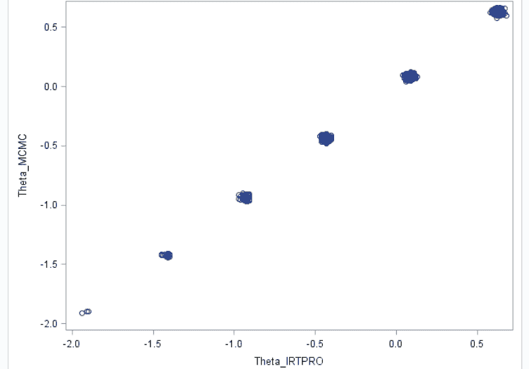

这三个模型（1P, 2P, 3P）随后反映了针对项目反应数据的竞争性 IRT 模型。在存在竞争模型的情况下，评估或比较这些模型并选择优选方法至关重要。在描述这三个模型的项目参数估计时（表 4.2、输出 4.1、输出 4.4 和输出 4.13），更简洁的 1P 模型可能更优选。在 MML 和贝叶斯分析中，`ai` 参数的变异很小。此外，即使项目是多选题，对于估计 `ci` 的实证支持也较少。低总分下正确的观测比例人数（表 4.1）与下渐近参数的存在不一致，但项目 1 和项目 5 除外，它们是非常简单的项目）。而且，正如项目所指出的，对于非常简单的项目，应该估计 `ci` 参数。


正如第 1 章所讨论，贝叶斯分析还为统计学上比较竞争模型提供了指标或准则：(1) 离散信息准（`DIC`；Spiegelhalter, Best, Carlin, & van Linden, 2002），以及 (2) 基于贝叶斯因子的索引。本节并未在此特定应用中考虑这些方法，与 LSAT 数据比较的 `1P`、`2P` 和 `3P` 模型的比较将在本书中关于模型比较的独立章节（第 7 章）中进行讨论。

## 项目反应函数的显示

还显示了项目 `Cs` 的分布图或跨越潜在特质（`theta`）尺度的项目反应图。这些图可以通过首先保存来自项目后验分布的均值（即项目参数估计），为每个项目创建一组跨越 `theta` 的期望分，然后绘制这些期望值来获得。使用 `PROC MEANS`、一个 `DATA` 步骤创建跨越 `theta` 的期望分，并使用 `PROC TEMPLATE` 和 `PROC SGENDER` 生成图表。输出 4.8 为项目集提供了一个模板，从执行程序到该过程的说明显示在输出 4.19 中。注意，代码必须像程序 4.8 那样，为每个项目包含 `LAYOUT OVERLAY ... ENDLAYOUT` 部分（请参见该程序的 SAS Press 作者网页）。此外，

# 108 使用 SAS 进行项目反应理论的贝叶斯分析

这些命令可以方便地修改，以根据用于计算期望分的 IRT 模型所使用的模型，为其他模型绘制 ICC 图：`(P|I)=LOGISTIC(a*(theta-b[I]))`

## 程序 4.8：为二分类 IRT 模型绘制 ICC 图 – 1P 模型

```sas
%let nitems=5;
%let nsub=1000;

/* 保存项目参数的点估计值*/
proc means=lsat_bays_lp noprint;
  var a b-&nims; output=means_lp mean=;

/* 创建跨越 theta 的期望项目和测试分数据集 */
data plots_lp;
  set means_lp;
  array b(*) b-n&nims;
  array p(*) p-n&nims;
  retain group(0);
  do theta=0 to 4 by .5;
    group=group+1;
    do i=1 to %nitems;
      p[i]=logistic(a*(theta-b[i])); /* 根据需要更改 IRT 模型 */
    end;
  end;
end;

/* 使用 seriesplots 定义 icc 图的图形模板 */
proc template;
define stat iccplots;
nbegin;
  entrytitle / "ICC for the &nitems items - 1P Model";
  layout overlay / columns=3 rowgutter=5;
  layout overlay;
    xaxis=(label="&Theta") linearopts=(viewmin=-4 viewmax=4));
    yaxis=(label="&Item 1") linearopts=(viewmin=0 viewmax=1));
    seriesplot x=theta y=p1;
  end;
  /* 对其他项目重复 LAYOUT OVERLAY 语句;*
  layout overlay;
    xaxis=(label="&Theta") linearopts=(viewmin=-4 viewmax=4));
    yaxis=(label="&Item 5") linearopts=(viewmin=0 viewmax=1));
    seriesplot x=theta y=p5;
  end;
  end;
endgraph;

/* 使用模板生成图表 */
proc sgender data=plotdata_lp template=icccplots;
run;
```

# 第 4 章：二分类项目的单维 IRT 模型的贝叶斯估计 109

图 4.19：五个 LSAT 项目的 ICC 图

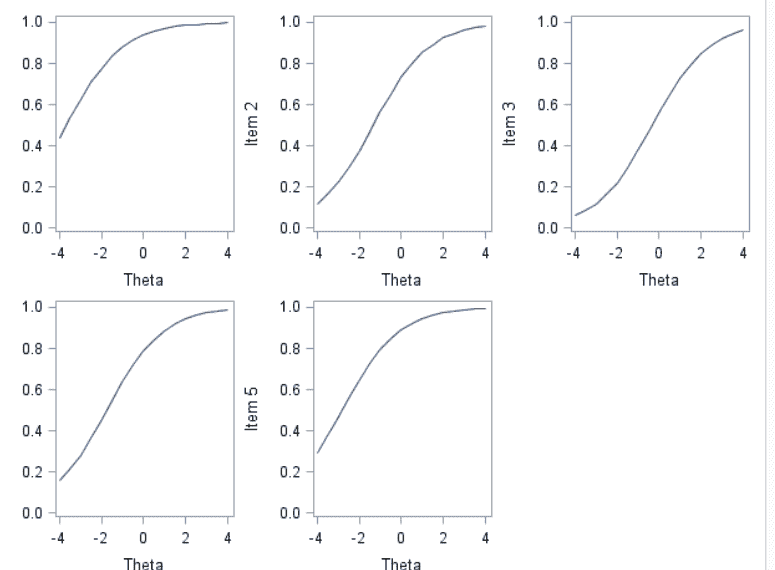

## 在图表中添加元素：项目参数的不确定性

其他元素也可以叠加在图表上。例如，可以根据期望分后验分布的下限和上限百分位数边界，计算出反映期望分周围不确定性的带。这些色带反映了在沿 0 尺度进行迭代过程中期望反应的方差。程序 4.9 提供了添加此元素的 SAS 代码。你可以在图中看到，通过期望分后验分布的下限和上限百分位数边界，计算出反映期望分周围不确定性的带。这些色带反映了在沿 0 尺度进行迭代过程中期望反应的方差。程序 4.9 提供了添加此元素的 SAS 代码。你可以看到，通过期望分后验分布的下限和上限百分位数边界，计算出反映期望分周围不确定性的带。这些色带反映了在沿 0 尺度进行迭代过程中期望反应的方差。程序 4.9 提供了添加此元素的 SAS 代码。你可以看到，通过期望分后验分布的下限和上限百分位数边界，计算出反映期望分周围不确定性的带。这些色带反映了在沿 0 尺度进行迭代过程中期望反应的方差。程序 4.9 提供了添加此元素的 SAS 代码。你可以看到，通过期望分后验分布的下限和上限百分位数边界，计算出反映期望分周围不确定性的带。这些色带反映了在沿 0 尺度进行迭代过程中期望反应的方差。

# 108 使用 SAS 进行项目反应理论的贝叶斯分析

```sas
layout overlay;
xaxis=(label="&Theta") linearopts=(viewmin=-4 viewmax=4));
yaxis=(label="&Item 1") linearopts=(viewmin=0 viewmax=1));
```

# 输出 4.21: 带有反映 Θ 子组估计不确定性的条带的 ICC 图形

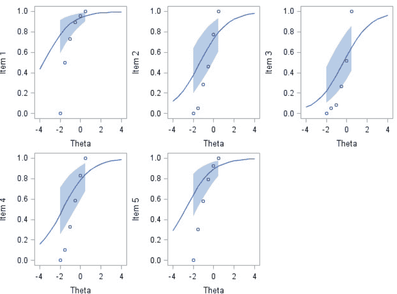

# 第 5 章：多分类项目的单维 IRT 模型的贝叶斯估计

引言............................................................................................................... 113

等级响应模型（Graded Response Model）...................................................................................... 114

- GR 模型程序模板......................................................................................... 114

- 指定阈值和截距参数先验分布的选项............................................................................... 116

- 使用方法 1 估计 GR 模型.................................................................................. 118

- 独立与联合先验规格的比较...................................................................... 120

- GR 模型估计的输出（方法 1 先验规格）........................................................... 121

- 三种先验规格后验密度的比较.................................................................. 127

- 通过后后处理后验结果计算变换.............................................................. 128

- 使用表格函数规格似然模型............................................................... 129

- 单参数等级响应模型的估计............................................................................. 129

Muraki 评分标准模型（Rating Scale Model）............................................................................... 131

- 估计 RS-GR 模型...................................................................................... 131

- 估计 RS-GR 模型的输出............................................................................... 132

命名响应模型（Nominal Response Model）............................................................................... 136

- 估计 NR 模型...................................................................................... 136

- 估计 NR 模型的输出............................................................................... 137

广义部分分模型（Generalized Partial Credit Model）....................................................... 143

- 估计 GPC 模型...................................................................................... 144

- 估计 GPC 模型的输出............................................................................... 146

基于 MML 估计的结果比较....................................................... 149

项目类别响应函数图............................................................... 151

测试信息函数图................................................................................................ 153

## 引言

第 4 章讨论的项目反应理论（IRT）模型适用于二分分类项目。当项目采用多分类评分时（例如教育评估中的构造反应型项目，以及健康、社会和行为评估中的评分或李克特型响应项目），则需要多分类 IRT 模型。这些模型表示了个人在所测潜特质上的水平与特定响应概率之间的关系。但现在响应类别超过了两个。本章侧重于多分类 IRT 模型，此类项目也被假设测量一个潜在特质。

有多种多维 IRT 模型。常用的模型包括：（1) 等级响应（GR）模型（Samejima, 1969; 1996）；(2) 修改的 GR 模型（Muraki, 1990），也称为 Muraki 评分标准（RS）模型；(3) 部分分（PC）模型（Masters, 1982）；(4) 广义部分分（GPC）模型（Muraki, 1992）；以及(5) 命名响应（NR）模型（Bock, 1972）。

## 114 使用 SAS 进行项目响应模型的贝叶斯分析

本章说明了如何使用 `PROC MCMC` 估计用于多分类响应的各种 IRT 模型。虽然每个节都简要描述了模型，但读者可参考第 1 章获取更多细节。插图的数据来自 DASH 调查（Stone & Iranga, 2004）的案例和项目子集，以及1000个项目对五个类别的响应。DASH 调查旨在通过关于困难程度的项目来衡量消费者功能。为了执行本章中的代码，假设已将 DASH 数据集读入 SAS 库。（请参考该数据集作者的网页）。

## 等级响应模型

Samejima（1996, 1999）的生成的响应（GR）模型用于对响应特定类别或更高类别的累积概率建模。具体而言，对于具有 `$m_j$` 个类别的项目 `$j$` (`1, 2, ..., m_j`),个人响应类别 `$k$` (`k = 2, ..., m_j`) 或更高类别的累积概率通过逻辑 `$z_{j(k-1)} = D_a(a\theta - b_{j(k-1)})$` 建模，其中 `$D_a$` 是所测量的特质因子，`$a$` 是项目 `$j$` 的区分参数，`$b_{j(k-1)}$` 是类别 `$k-1$` 之间的阈值。给定累积概率，在项目 `$j$` 上获得类别 `$k$` 的概率定义为相邻累积概率之间的差，并带有两个约束 `$P_j^{(0)}(\theta) = 1$` 和 `$P_j^{(m_j+1)}(\theta) = 0$`。

## GR 模型程序模板

程序5.1 提供了使用 DASH 数据估计 GR 模型的 `PROC MCMC` 代码模板。对于每个五分类项目，估计一个斜率 (`$a_j$`) 和四个阈值参数 (`$b_{jk}$`)。对于 DASH 数据和 GR 模型，总共估计 10 个斜率参数 (`$a_1 \sim a_{40}$`) 和 40 个阈值参数 (`$b_{1,1} \sim b_{1,4}, b_{40,1} \sim b_{40,4}$`)。对于第 4 章描述的 IRT 模型，模型通过一步参数化以形成逻辑 `$z_{jk} = a\theta - b_{jk}, D=1$` 且 `$b_{jk}=d_{jk}/a$`。保存 `$b_{jk}$` 而不是 `$d_{jk}$` 参数，是因为它们更具解释性。

上述模板中的代码是定义使用多分类项目的 IRT 模型似然的命令集。如第 3 章所示，与其使用概率响应模型和 `MODEL` 语句来指定数据的条件分布，不如使用 SAS 编程语言显式编写似然函数，并使用 `GENERAL` 语句来记录观测项目的联合分布。如果你使用的是 SAS/STAT 13 或更早版本，对于多分类项目的 IRT 模型，这种方法是必要的，因为 `MODEL` 语句中除了二分分布外没有通用的分类函数。正如后文将所示，从 SAS/STAT 13 开始提供了通用的分类函数，可以用于 `MODEL` 语句估计多分类项目。然而，该函数的效率低于上述代码。

## 第 5 章：多分类评分项的 IRT 单一维贝叶斯 PROC 115

## 程序 5.1：用于对数据进行 GR 模型估计的初步 PROC MCMC 模板

```sas
proc mcmc data=dash_data outpost=dash_post seed=23 nbi=5000 nmc=20000
nthreads=8=monitor(a[b1_b2_b3_b4]) diagnostics=all allplots=(trace
autocorr);

array ix[10]; array a[10];
array b1[10]; array b2[10]; array b3[10]; array b4[10];
array d1[10]; array d2[10]; array d3[10]; array d4[10];
array p_star[10,4] p[10,];
```

```sas
/* 声明模型参数和初始值 */
p a1 d1_1 -1 d2_1 -0.5 d3_0 d4_1
p a2 d1_1 -2 d2_2 -0.5 d3_0 d4_2
p a3 d1_1 -3 d2_3 -0.5 d3_0 d4_3
p a4 d1_1 -4 d2_4 -0.5 d3_0 d4_4
p a5 d1_1 -5 d2_5 -0.5 d3_0 d4_5
p a6 d1_1 -6 d2_6 -0.5 d3_0 d4_6
p a7 d1_1 -7 d2_7 -0.5 d3_0 d4_7
p a8 d1_1 -8 d2_8 -0.5 d3_0 d4_8
p a9 d1_1 -9 d2_9 -0.5 d3_0 d4_9
p a10 d1_1 -10 d2_10 -0.5 d3_0 d4_10
```

```sas
/* 切片和项目截距的先验分布 */
pr a ~ normal(0, var=1);
```

```sas
pr d1_1 ~ normal(distribution specifications);
pr d2_1 ~ normal(distribution specifications);
pr d3_1 ~ normal(distribution specifications);
pr d4_1 ~ normal(distribution specifications);
```

```sas
/* 为其他阈值参数集重复先验命令 */
```

```sas
/* 被试能力参数的先验分布 */
random theta ~ normal(0, var=1) subject=obs_;
```


```sas
/* 根据 GR 模型指定对似然函数 */
likke=0;
do j=1 to 10;
p_star(j,1)=logistic(a[j])*theta-d1[j];
p_star(j,2)=logistic(a[j])*theta-d2[j];
p_star(j,3)=logistic(a[j])*theta-d3[j];
p_star(j,4)=logistic(a[j])*theta-d4[j];

b1[j]=d1[j]/a[j];
b2[j]=d2[j]/a[j];
b3[j]=d3[j]/a[j];
b4[j]=d4[j]/a[j];

p(j,1)=1-p_star(j,1);
do k=2 to 4;
p(j,k)=p_star(j,k-1) - p_star(j,k);
end;
p(j,5)=p_star(j,4);

ilike=ilike+log(p(j,ix[j]));
end;

model(ilike);
run;
```

## 输出 5.1：不同先验规格下四个参数的密度图

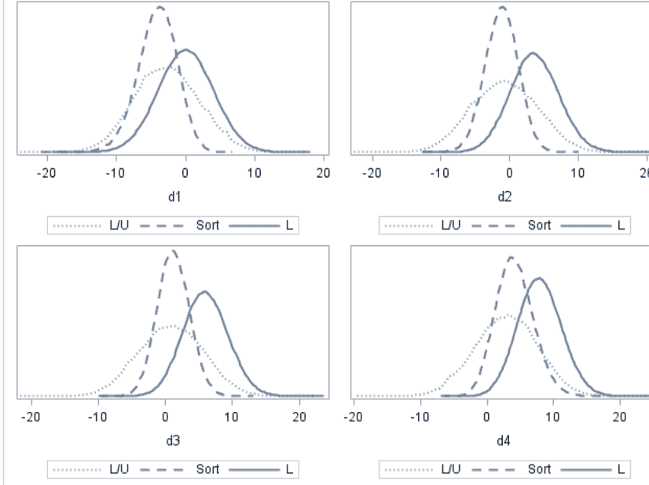

# 使用方法 1 估计 GR 模型

程序 5.2 提供了估计 GR 模型的代码。程序中的代码基于方法 1 先验规格（下界规格），因为该方法常用于 GR 模型。在这些程序中，对模板进行了修改以使程序更加简洁。首先，使用二维分析数组 `B[4,10]` 和 `D[4,10]` 来表示跨越 10 个题目的 40 个阈值参数和 40 个截距参数。其次，为截距参数指定了联合先验分布，并从该分布中采样所有截距参数。这在文中有更详细的描述。

最后，使用了 `BEGINDATA-ENDDATA` 语句块。包含在该块内的任何语句只会在数据集第一次和最后一次观测时执行。因此，`BEGINDATA-ENDDATA` 语句块减少了不必要的观测层级计算，适用于跨观测值完全相同的计算，例如参数转换。

虽然文中未列出，但程序 5.3 和 5.4 包含了使用其他方法估计 GR 模型的代码，并包含在 SAS Press 作者网页上供参考。如上文所述，鉴于在不同先验规格方法之间观察到的差异，将在稍后的章节中给出基于不同方法的结果比较。

# 第 5 章：多级计分项目单向 IRT 模型的贝叶斯估计 119

## 程序 5.2：估计 GR 模型的 PROC MCMC 代码（方法 1 先验规格）

```
proc mcmc data=dash_data dash_postG seed=23 nbi=5000 nmc=20000
threads=8 (a) diagnostics=all plots=(trace density);

array ix[10];
array a[10];
array b[4,10] b1_l1-b1_l10 b2_l1-b2_l10 b3_l1-b3_l10 b4_l1-b4_l10;
array d[4,10] d1_l1-d1_l10 d2_l1-d2_l10 d3_l1-d3_l10 d4_l1-d4_l10;
array p_star[10,4] p[10,5];

begindata;
lprior=0;
dj=1 to 10;
 lprior = lprior + lpnormal(d[1,j],0,5); ①
 lprior = lprior + lpnormal(d[2,j],0,5,d[1,j]);
 lprior = lprior + lpnormal(d[3,j],0,5,d[2,j]);
 lprior = lprior + lpnormal(d[4,j],0,5,d[3,j]);
end;

d=1 to 10;
 k=1 to 4;
 b[k,j] = d[k,j]/a[j]; ②
end;
endnodata;
```

| parms | d1 | d2 | d3 | d4 |

|---|---|---|---|---|

| a1 | d1_1 -0.5 | d2_1 -0.5 | d3_1 0.5 | d4_1 1 |

| a2 | d1_2 -1 | d2_2 -0.5 | d3_2 0.5 | d4_2 1 |

| a3 | d1_3 -1 | d2_3 -0.5 | d3_3 0.5 | d4_3 1 |

| a4 | d1_4 -1 | d2_4 -0.5 | d3_4 0.5 | d4_4 1 |

| a5 | d1_5 -1 | d2_5 -0.5 | d3_5 0.5 | d4_5 1 |

| a6 | d1_6 -1 | d2_6 -0.5 | d3_6 0.5 | d4_6 1 |

| a7 | d1_7 -1 | d2_7 -0.5 | d3_7 0.5 | d4_7 1 |

| a8 | d1_8 -1 | d2_8 -0.5 | d3_8 0.5 | d4_8 1 |

| a9 | d1_9 -1 | d2_9 -0.5 | d3_9 0.5 | d4_9 1 |

| a10 | d1_10 -1 | d2_10 -0.5 | d3_10 0.5 | d4_10 1 |

```
prior a: ~lognormal(0, var=5); ③
prior d: ~general(lprior); ④
random theta : ~normal(0, var=1) subject=obs_;
like=0;
d=1 to 10;
 k=2 to 4;
 p_star[j,k]=logistic(a[j]*theta-d[k]); ⑤
end;
p_star[j,1]-llike=p_star[j,1];
d=2 to 4;
 p_star[j,k]-p_star[j,k-1];
end;
p_star[j,4]-llike = like + log(p[j]);
model general(llike);
run;
```

每个项目的阈值或截距参数的一组先验规格必须用联合密度函数进行简洁指定。在 `PROC MCMC` 中，联合密度函数必须在对数尺度上指定。这里，`PDFNORM` 是正态分布的对数密度函数。`PROC MCMC` 有内部定义的单变量和多元对数密度函数。这些函数的基本形式为 `LPDF(<variable>)`，其中 dist 是分布名称，variable 参数引用随机变量，分布参数用于指定分布参数。对于正态分布，形式为 `PDFNORM(variable, mu, SD, lower bounds, upper bounds)`。`PDFNORM(D[2,J], 0, 5)` 表示项目的第二个截距遵循正态分布，均值为 0，下界等于第一个截距参数；语句 `lprior=lprior+like` 计算了跨 10 个题目的所有截距参数的先验密度和。由于这些计算与观测值相同，因此被嵌入在 `BEGINDATA-ENDDATA` 中。独立和联合先验规格之间的等效将在下一节说明。结果是相同的，假设使用相同的 `SEED` 值，转换包含在程序 5 的 `BEGINDATA-ENDDATA` 块以及程序 5 中指定的 `BEGINDATA-ENDDATA` 块中。在估计 `di` 或 `da` 参数时，除了满足顺序条件的边界外，没有限制参数空间。从后验输出和轨迹图中可以看出，采样值不包含异常值。为了声明截距参数 (`di`) 的先验，需要 `PRIOR ~ GENERAL(lprior)`。`GENERAL` 函数声明截距是从具有联合分布 `lprior` 的联合先验中采样的。注意的是，在 `PRIOR` 语句或 `MODEL` 语句中任何新分布都必须在对数尺度上指定。使用二维数组简化了计算累计概率的操作。在程序中，`P_STAR[1, K] = LOGISTIC(A[J])*THETA[DI,J]` 用于计算所有的累计概率。

## 独立与联合先验规格的比较

程序 5 提供了测试方法 1 的独立和联合先验规格之间等效性的代码。输出 5.2 比较了两组参数的密度。四个参数 (`d1–d4`) 的密度基本完全重叠，表明两种方法是等效的。任何微小差异由于独立先验规格中使用了直接采样，而联合先验规格中使用了梅特罗洛采样器造成的。

## 程序 5.5：比较独立与联合先验规格——方法 1

```
proc mcmc data=n=100000 seed=22 nbi=1000 out=out1(density=);
  params d1=-1 d2=-5 d3 ~5 d4=1;
  prior d1 ~ n(0, sd=5);
  prior d2 ~ n(0, sd=5, lower=d1);
  prior d3 ~ n(0, sd=5, lower=d2);
  prior d4 ~ n(0, sd=5, lower=d3);
  model general(0);
run;

proc mcmc data=out2 seed=23 nbi=1000 nmc=100000(density=);
  params d1=-1 d2=-5 d3 ~5 d4=1;
  beginnodata;
  lprior = lpdfnorm(1,0,5);
  lprior = lprior + lpdfnorm(2,0,5,d1);
  lprior = lprior + lpdfnorm(3,0,5,d2);
  lprior = lprior + lpdfnorm(4,0,5,d3);
  endnodata;
  prior d ~general(lprior);
  model general(0);
run;
```

# 第 5 章：多级计分项目单向 IRT 模型的贝叶斯估计 121

## 输出 5.2：独立与先验规格下四个参数的密度图

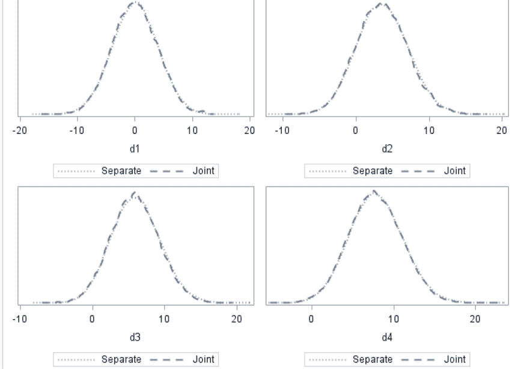

估计 GR 模型（方法 1 先验规格）的输出

输出 5.3 展示了执行程序 5.2 的后验汇总结果。这些结果是使用自动调用宏 `%POSTUM` 选择参数子集获得的（详见第 3 章关于 `PROC_MCMC OUTPUT` 数据集的自动调用宏的讨论）。因此，汇总统计与 `PROC_MCMC` 产生的默认输出不同。由于阈值参数数量很大（40 个），所有斜率参数结果都通过参数子集显示。选择特定项目（1、7 和10）是为了反映在 theta 不同位置对特质的测量。如你所看到的，斜率点估计（均值）范围从 1.83 到 3.39，表明 DASH 项目具有很高的区分效度。阈值估计反映了所有项目的特质，并没有分散在整个潜特质量表上。大多数阈值估计大于 0，表明 DASH 子集是在特质量表的高端对特质测量。此外，参数后验分布的标准差（SD）非常小，表明所有斜率和阈值参数估计的精度都相对较高。

## 122 使用 SAS 进行项目反应理论的贝叶斯分析

### 输出 5.3：选定的后验汇总结果--GR 模型

| 参数 | N | 平均值 | 标准差 | P25 | P50 | P75 |

|---|---|---|---|---|---|---|

| a1 | 20000 | 1.82683 | 0.11983 | 1.74552 | 1.82346 | 1.90889 |

| a2 | 20000 | 2.02725 | 0.12846 | 1.98427 | 2.06873 | 2.15686 |

| a3 | 20000 | 3.49384 | 0.21214 | 3.34467 | 3.49237 | 3.62595 |

| a4 | 20000 | 2.50094 | 0.13130 | 2.41279 | 2.49856 | 2.58600 |

| a5 | 20000 | 2.78701 | 0.15396 | 2.68003 | 2.78485 | 2.89064 |

| a6 | 20000 | 2.00610 | 0.18052 | 2.07562 | 2.19986 | 2.32635 |

| a7 | 20000 | 3.33294 | 0.18773 | 3.02129 | 3.32623 | 3.45522 |

| a8 | 20000 | 3.18409 | 0.17346 | 3.05617 | 3.17784 | 3.30121 |

| a9 | 20000 | 2.63431 | 0.16026 | 2.52405 | 2.63083 | 2.74059 |

| a10 | 20000 | 2.32115 | 0.12351 | 2.23545 | 2.31799 | 2.40305 |

| b_1 | 20000 | 0.49843 | 0.06599 | 0.45971 | 0.49890 | 0.53857 |

| b_2 | 20000 | 1.21552 | 0.08013 | 1.16203 | 1.21323 | 1.26861 |

| b_3 | 20000 | 2.17445 | 0.12077 | 2.09125 | 2.16983 | 2.25459 |

| b_4 | 20000 | 2.09709 | 0.17604 | 2.84972 | 2.96577 | 3.08890 |

| b_5 | 20000 | -0.38875 | 0.04532 | -0.41933 | -0.38860 | -0.35687 |

| b_6 | 20000 | 0.34375 | 0.04537 | 0.31157 | 0.34264 | 0.37403 |

| b_7 | 20000 | 1.18129 | 0.05912 | 1.13957 | 1.18079 | 1.22067 |

| b_8 | 20000 | 1.53994 | 0.07241 | 1.48955 | 1.53894 | 1.58789 |

| b_10 | 20000 | -1.58375 | 0.08077 | -1.64081 | -1.58700 | -1.53221 |

| b_12 | 20000 | -0.73510 | 0.05660 | -0.77245 | -0.73501 | -0.69712 |

| b_13 | 20000 | 0.05702 | 0.04944 | 0.02239 | 0.05758 | 0.09045 |

| b_14 | 20000 | 0.68886 | 0.05586 | 0.64969 | 0.67883 | 0.72861 |

由于该分析的诊断图数量，输出 5.4 到 12 显示了 GR 模型的轨迹、密度图。这些结果是使用 `ADPLOT` 选择参数子集得到的。从选定的斜率参数图（输出 5.4–5.6）可以看出，参数似乎在快速遍历参数空间并且具有较低的自相关性。与选定的阈值参数诊断图（输出 5.7–12）相比，你可以看到阈值参数链的混合情况没有斜率参数链良好。这导致了较高的自相关性，因此对采样值的依赖性更高。但对于其他模型，这种较高的依赖性并不影响汇总结果。

输出 5.4：GR 模型选定的斜率参数图（项目 1）

img/dd5368102e19084dcd107a02a8ba37c_138_0

输出 5.5：GR 模型选定的斜率参数图（项目 7）

img/dd5368102e19084dcd107a02a8ba37c_138_1

输出 5.6：GR 模型选定的斜率参数图（项目 10）

img/dd5368102e19084dcd107a02a8ba37c_139_0

输出 5.7：GR 模型选定的阈值参数图（项目 1）

img/dd5368102e19084dcd107a02a8ba37c_139_1

输出 5.8：GR 模型选定的阈值参数图（项目 1）

img/dd5368102e19084dcd107a02a8ba37c_140_0

输出 5.9：GR 模型选定的阈值参数图（项目 7）

img/dd5368102e19084dcd107a02a8ba37c_140_1

输出 5.10：GR 模型选定的阈值参数图（项目 7）

img/dd5368102e19084dcd107a02a8ba37c_141_0

输出 5.11：GR 模型选定的阈值参数图（项目 10）

img/dd5368102e19084dcd107a02a8ba37c_141_1

输出 5.12：GR 模型选定的阈值参数图（项目 10）

img/dd5368102e19084dcd107a02a8ba37c_142_0

### 三种先验规范的后验密度比较

鉴于阈值参数先验密度中观察到的差异（见输出 5.1），你可以检查对参数后验密度的任何后续影响。输出 5.13 显示了三种先验规范下项目 1 阈值参数的后验密度。你可以看到差异位于下限（Lower）和上限（Up）。然而，几个阈值参数存在细微差异。特别是对于阈值 `b1`、`b2` 和 `b3`，其密度比基于其他方法的的密度偏高。在比较分布的前两个矩方面，这些矩仅在百分分位有所差异。因此，本质上，参数的点估计在三种方法中几乎是相同的。因此，DASH 数据集的 GR 模型估计对用于指定阈值参数先验分布的方法并不敏感。这可能是由于 DASH 数据集中数据量较大，“压倒”了先验。当然，可能需要对这些先验规范进行更多探索。

输出 5.13：四个阈值参数的后验密度比较（项目 1）

img/dd5368102e19084dcd107a02a8ba37c_143_0

### 通过后处理计算转换

通过对使用 `PROC MCMC` 命令中的 `OUTPUT` 保存的后验结果集进行后处理，可以获得参数估计的任何转换。例如，与其在 `PROC MCMC` 中使用截距参数 (`a_0`) 和斜率参数 (`a_h`) 计算阈值参数 (`b_h`）（见程序 5.2），不如处理排除转换的集合。以下 `DATA`步骤和 `PROC MEANS` 命令可用于计算每次迭代的 `b_h` 值，并通过 `b_h` 参数后验样本的平均值计算参数的点估计。处理后验样本的便利性说明了使用 `PROC MCMC` 进行贝叶斯分析的灵活性。

```sas
data dash_transformed;
  set dash_post;
  array a[10] a1-a10;
  array d[4,10] d1_d1_10 d2_d2_10 d3_d3_10 d4_d4_10;
  /* (省略具体逻辑代码以保持格式) */
```


GR 模型中斜率估计值的平均值。然而，GR 模型中的 `$a_{jk}$` 估计值差异很大（参见输出 5.3），范围从 1.82 到 3.51。这表明 GR 模型对于 DASH 项目的回答可能更为合适。第 7 章讨论的模型比较方法在确定单参数 GR 模型对 DASH 数据的适用性方面将更有用。对于阈值 `$b_k$`，大多数值与 GR 模型的值相似。

## 程序 5.6：用于估计单参数 GR 模型的 PROC MCMC 代码

```
proc mcmc data=dash out=dash_post1PGR seed=23 nbin=20000
threads=8 (monitor=(a b) diagnostics=all plots=(trace autocorr));

ray ix[];
array b[4,10] b1_b1_10 b2_b2_10 b3_b3_10 b4_b4_10;
array d[4,10] d1_d1_10 d2_d2_10 d3_d3_10 d4_d4_10;
array p_star[10,4]; array p[10,5];

begindata;
prior=0;
dj=1 to 10;
do
prior = iprior + lpdfnorm(d[j],0,5);
dk=2 to 4;
do
prior = iprior + lpdfnorm(d[k,j],0,5,d[k-1,j]);
end;
end;

dj=1 to 10;
dk=1 to 4;
b[k,j] = d[k,j]/a;
end;
end;

enddata;


parms a;
parms d1_1 d2_1 -0.5 d3_1 0 d4_1 1;
parms d1_2 d2_2 -0.5 d3_2 0 d4_2 1;
parms d1_3 d2_3 -0.5 d3_3 0 d4_3 1;
parms d1_4 d2_4 -0.5 d3_4 0 d4_4 1;
parms d1_5 d2_5 -0.5 d3_5 0 d4_5 1;
parms d1_6 d2_6 -0.5 d3_6 0 d4_6 1;
parms d1_7 d2_7 -0.5 d3_7 0 d4_7 1;
parms d1_8 d2_8 -0.5 d3_8 0 d4_8 1;
parms d1_9 d2_9 -0.5 d3_9 0 d4_9 1;
parms d1_10 d2_10 -0.5 d3_10 0 d4_10 1;

parms prior -lognormal(0, var=25);
parms dr=-general(iprior);
random theta normal(0, var=1) subject=obs_;

ilike=;
dj=1 to 10;
dk=1 to 4;
p_star[j,k]=logistic(a*theta-d[k,j]);
end;
p[j,1]=1-p_star[j,1];
dk=2 to 4;
p[j,k]=p_star[j,(k-1))-p_star[j,k];
end;
p[j,5]=p_star[j,4];
end;
ilike = Ilike + log(p[j,ix[j]]);
nmodel general(ilike);
run;
```

## Muraki 评分量表模型

GR 另一种受限版本是 Muraki (1990) 的评分量表模型（RS-GR 模型）。在该模型中，逻辑版本为 `$z_{ijk} = a_{ij}(\theta - b_j + c_k)$`。GR 模型中的阈值参数 `$(b_{jk})$` 被分解为两个部分：(1) 每个项目的位置参数 `$(b_j)$`，以及 (2) 一组适用于所有项目的类别阈值参数 `$(c_k)$`。为了进行模型识别，每个项目跨 $k$ 个回答的和被限制为 0。此外，阈值 `$c_k$` 的排序与 GR 模型中的阈值 `$b_{jk}$` 参数类似。这种参数化方法的优点是，`$b_j$` 参数可以直接用于比较在相同 `$\theta$` 连续体上测量的不同项目。另一个优点是与 GR 模型相比，模型中的参数数量显著减少。

RS 模型是 GR 模型的一个受限版本，因为其类别阈值参数 `$c_k$` 被假设在模型中的所有项目中是相等的，而在 GR 模型中，它们可以在不同项目间自由变化。因此，可以将 RS-GR 模型与 GR 模型进行比较，以确定一组类别阈值是否充分描述项目回答。第 7 章通过 DASH 数据集说明了这种模型比较。

## 估计 RS-GR 模型

程序 5.7 包含了使用 DASH 数据估计 RS-GR 模型的 PROC MCMC 代码。每个 DASH 项目估计一个斜率参数 `$(a_{ij})$` 和一个位置参数 `$(b_j)$`，并且对于五个回答类别（1“无困难”到 5“无法不能”），有一组四个类别阈值参数 `$(c_{j1}, c_{j2}, c_{j3}, c_{j4})$`。类别阈值参数 `$(c)$` 定义在单独的 PARMS 语句中。第四个阈值 `$(c_1)$` 通过 `$c_1 = -(c_2 + c_3 + c_4)$`。此计算嵌入在 BEGIN ENDATA 块中，用于满足模型识别约束 `$\sum_k = 0$`。`$c_2$` 的低值指定为 `$c_2$`，`$c_4$` 的低值指定为 `$c_3$` 以满足顺序约束。计算对数然函数的代码与 GR 模型相同，但将阈值参数分解为位置 `$(b_j)$` 和类别阈值参数 `$(c_{j1}, c_{j2}, c_{j3}, c_{j4})$` 的相同策略也可以适用于 GR 模型中的每个项目。这在程序 5.8 中所示，可以在 SAS 作者的网上找到。

## 程序 5.7：估计 RS-GR 模型的 MCMC 代码

```
proc mcmc data=dash out=dash_postRS seed=23 nbin=5000 nmc=20000
threads=8 monitor=(a c) diagnostics=all plots=(trace autocorr);

array ix[10];
array a[10];
array b[10];
array c[4];
array p_star[10,4]; array p[10,5];

parms a1 0;
parms a2 0;
parms a3 0;
parms a4 0;
parms a5 0;
parms a6 0;
parms a7 0;
parms a8 0;
parms a9 0;
parms a10 0;
parms c2 -c3+c4;

begindata;
cl=(c2+c3+c4);
enddata;

prior a: lognormal(0, var=25);
prior b: normal(0, var=25);
prior c2: normal(0, var=25);
prior c3: normal(0, var=25, lower=c2);
prior c4: normal(0, var=25, lower=c3);

random theta: normal(0, var=1) subject=obs_;

like=0;
j=1 to 10;
k=1 to 4;
p_star[j,k]=logistic(a[j]*theta-b[j]+c[k]);
p[j,1]=1-p_star[j,1];
k=2 to 4;
p[j,k]=p_star[j,k-1]-p_star[j,k];
p[j,5]=p_star[j,4];
// 似然逻辑...
model general(like);
run;
```

## 估计 RS-GR 模型的输出

输出 5.14 显示了项目的汇总统计。与 GR 模型的结果（参见输出 5.3）相比，RS 模型的项目斜率估计接近 GR 模型的平均值。四个类别阈值的估计是符合预期的。输出 5.15 到 5.18 显示了所选项目的轨迹图和自相关图。可以看到链在斜率上混合良好。另一方面，位置和类别阈值参数表现出中等程度的自相关。为了减少自相关，可以将阈值参数分解为位置 `$(b_j)$` 和类别阈值参数 `$(c_{j1}, c_{j2}, c_{j3}, c_{j4})$`，但 RS-GR 模型比 GR 模型更难进行重参数化。

## 输出 5.14：项目 RS-GR 模型后验汇总统计

| 参数 | N | 平均值 | 标准差 | 95% HPD 间间 |
|---|---|---|---|---|
| a1 | 20000 | 1.9125 | 0.0997 | 1.7181 2.1088 |
| a2 | 20000 | 1.9321 | 0.1085 | 1.7228 2.1458 |
| a3 | 20000 | 3.3934 | 0.1872 | 3.0388 3.7657 |
| a4 | 20000 | 2.7590 | 0.1322 | 2.6278 2.8902 |
| a5 | 20000 | 2.5880 | 0.1244 | 2.4636 2.7124 |
| a6 | 20000 | 3.0470 | 0.1638 | 2.8832 3.2108 |
| a7 | 20000 | 3.2610 | 0.1727 | 3.0883 3.4337 |
| a8 | 20000 | 3.0019 | 0.1581 | 2.8448 3.1590 |
| a9 | 20000 | 2.1936 | 0.1251 | 2.0685 2.3207 |
| a10 | 20000 | 2.4750 | 0.1169 | 2.3581 2.5919 |
| b1 | 20000 | 1.5740 | 0.0614 | 1.4526 1.6954 |
| b2 | 20000 | 1.6585 | 0.0665 | 1.5920 1.7910 |
| b3 | 20000 | 1.1828 | 0.0455 | 1.1373 1.2283 |
| b4 | 20000 | 0.7572 | 0.0425 | 0.6837 0.8007 |
| b5 | 20000 | 0.1317 | 0.0394 | 0.0529 0.2105 |
| b6 | 20000 | 0.9550 | 0.0430 | 0.8762 1.0438 |
| b7 | 20000 | 0.6771 | 0.0391 | 0.6380 0.7162 |
| b8 | 20000 | 0.2206 | 0.0381 | 0.1825 0.2587 |
| b9 | 20000 | 1.5470 | 0.0661 | 1.4261 1.6679 |
| b10 | 20000 | -0.3847 | 0.0430 | -0.4277 -0.3417 |
| c1 | 20000 | -1.0665 | 0.0292 | -1.1208 -1.0108 |
| c2 | 20000 | -0.3545 | 0.0133 | -0.3787 -0.3282 |
| c3 | 20000 | 0.4217 | 0.0144 | 0.3954 0.4495 |
| c4 | 20000 | 0.9993 | 0.0293 | 0.9446 1.0544 |

# 第5章：多分类评分项目单维IRTT模型的贝叶斯估计 135

输出 5.17：项目参数的轨迹图与自相关图 (b9, b10, c1)——RS-GR 模型

## 轨迹图与自相关图

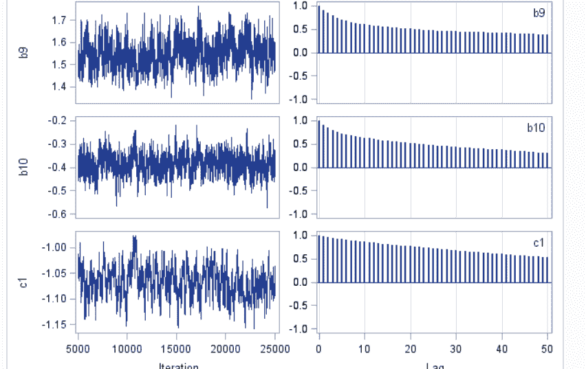

输出 5.18：项目参数的轨迹图与自相关图 (c2, c3, c4)——RS-GR 模型

## 轨迹图与自相关图

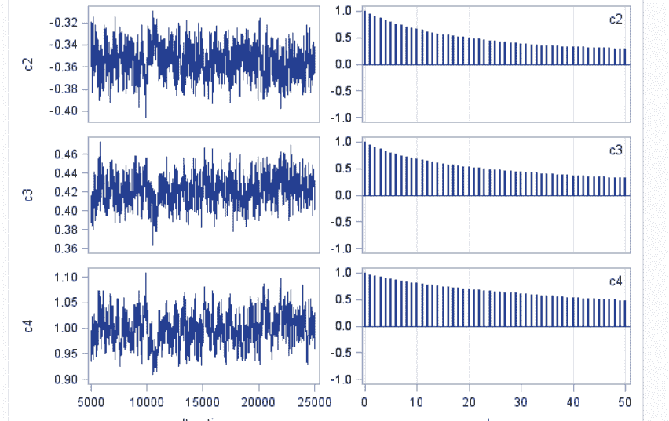

## 名义响应模型

Bock (1972) 的名义响应（NR）模型是多分类评分项目最通模型，用于建模响应类别不一定沿特质 `$\theta$` 尺度有序排列的项目。在 NR 模型中，特质水平为 `$\theta$` 的受试者对于具有 `$m_j$` 个响应选项（或类别）的项目 $j$，选择第 $k$ 个响应选项的概率由公式给出：

```
$P_{jk}(\theta) = \frac{e^{z_{jk}}}{\sum_{l=1}^{m_j} e^{z_{jl}}}$
```

对于 $k = 1, \dots, m_j$，

其中 `$z_{jk} = a_{jk}\theta + c_{jk}$` 是项目 $j$ 中第 $k$ 个选项的多元逻辑几率，`$a_{jk}$` 是项目 $j$ 类别 $k$ 的选项区分度参数，`$c_{jk}$` 是项目 $j$ 类别 $k$ 的选项极端性参数。如第 1 章所述，为了识别模型，通常会跨 $k$ 设定约束 `$\sum a_{jk} = \sum c_{jk} = 0$`，或者对每个项目设定约束 `$a_{j1} \equiv c_{j1} = 0$`。

## 估计 NR 模型

程序 9 使用 PROC MCMC 代码结合 DASH 数据集估计 NR 模型。对于每个 DASH 项目，有五个参数 `$\alpha_{1}, \alpha_{2}, \alpha_{3}, \alpha_{4}, \alpha_{5}$` 和对应五个响应类别的五个截距参数 `$\gamma_{1}, \gamma_{2}, \gamma_{3}, \gamma_{4}, \gamma_{5}$`。然而，为了模型识别，每个项目的第一个斜率和截距在 BEGINDATA-ENDDATA 块中被限制为 0。项目参数使用二维数组，第一个索引对应响应概率，第二个索引对应类别响应编号。多元逻辑几率存储在 Z[5] 和 P[5] 数组中。每个项目内部的项目参数被视为一个块，其初始值设置为 0。斜率和截距的先验分布声明为均值为 0、方差为 25 的无界正态分布。为了获得数据的似然性，首先计算第二到第五响应选项的多元逻辑几率（`$z_{2}$` 到 `$z_{5}$`）。注意第一个选项的逻辑几率 `($z_{1}$)` 为 1，因为它的斜率和截距均为 0。下一步计算 5 个选项的响应概率。

## 程序 5.9：用于估计 NR 模型的 PROC MCMC

```
proc mcmc data=dash_data outpost=dash_post seed=23 n=5000 nmc=20000
monitor(a) diagnostic=all plots;
array[10,5] a1_1-a1_5 a2_1-a2_5 a3_1-a3_5 a4_1-a4_5 a5_1-a5_5
a6_1-a6_5 a7_1-a7_5 a8_1-a8_5 a9_1-a9_5 a10_1-a10_5;
array[10,5] c1_1-c1_5 c2_1-c2_5 c3_1-c3_5 c4_1-c4_5 c5_1-c5_5
c6_1-c6_5 c7_1-c7_5 c8_1-c8_5 c9_1-c9_5 c10_1-c10_5;
array[10] p(5);
params a1_1-a1_5 c1_1-c1_5;
params a2_1-a2_5 c2_1-c2_5;
params a3_1-a3_5 c3_1-c3_5;
params a4_1-a4_5 c4_1-c4_5;
params a5_1-a5_5 c5_1-c5_5;
params a6_1-a6_5 c6_1-c6_5;
params a7_1-a7_5 c7_1-c7_5;
params a8_1-a8_5 c8_1-c8_5;
params a9_1-a9_5 c9_1-c9_5;
params a10_1-a10_5 c10_1-c10_5;
begindata
i1_1=0;a2_1=0;a3_1=0;a4_1=0;a5_1=0;a6_1=0;a7_1=0;a8_1=0;a9_1=0;a10_1=0;
c1_1=0;c2_1=0;c3_1=0;c4_1=0;c5_1=0;c6_1=0;c7_1=0;c8_1=0;c9_1=0;c10_1=0;
end;
prior c1_1-c1_5 c2_1-c2_5 c3_1-c3_5 c4_1-c4_5 c5_1-c5_5
c6_1-c6_5 c7_1-c7_5 c8_1-c8_5 c9_1-c9_5 c10_1-c10_5
normal(0,var=25);
prior a1_1-a1_5 a2_1-a2_5 a3_1-a3_5 a4_1-a4_5 a5_1-a5_5
a6_1-a6_5 a7_1-a7_5 a8_1-a8_5 a9_1-a9_5 a10_1-a10_5
normal(0,var=25);
random theta=normal(0,var=1) subject=obs;
likelike=0;
do j=1 to 10;
  do k=1 to 5;
    p[k]=exp(a[j,k]*theta+c[j,k]);
  end;
  do k=2 to 5;
    p[k]=p[k]/(1+sum(of p));
  end;
  p[1]=sum(of p) for category 1;
  likelike=likelike+log(p[j]);
end;
model general(likelike);
run;
```

## 估计 NR 模型的输出

输出 5.19 显示了选项目参数的汇总统计。报告了项目 1、7 和 10 的选定结果，因为这些项目具有不同的属性。使用了重新生成项目的 autocall 宏，与之前一样，结果来自 PROC MCMC 的默认汇总统计。请注意，所有项目参数估计值可以在比较贝叶斯模型和 MML 模型的下一节找到。

如你所见，跨响应类别的 `$a_{jk}$` 参数是有序的。由于 `$a_{jk}$` 参数反映了响应 `$\theta$` 对响应选项 $k$ 的线性斜率，跨响应类别的 `$a_{jk}$` 参数值增加反映了选择 $k+1$ 选项超过 $k$ 选项的概率增加。这表明响应选项的尺度是有序的。因此，预计 DASH 项目将具有有序尺度。

# 使用 SAS 对项目反应模型进行贝叶斯分析

输出 5.19：项目参数的选定后验汇总统计——NR 模型

| 参数 | N | Mean | StdDev | P25 | P50 | P75 |
|---|---|---|---|---|---|---|
| a_1 | 20000 | 0.00000 | 0.00000 | 0.00000 | 0.0000 | 0.0000 |


| a_2 | 20000 | 1.01527 | 0.19843 | 0.91723 | 1.01973 | 1.1127 |

| a_3 | 20000 | 2.30510 | 0.22294 | 2.14748 | 2.30099 | 2.4474 |

| a_4 | 20000 | 3.14763 | 0.33597 | 2.90296 | 3.13946 | 3.3768 |

| a_5 | 20000 | 4.63892 | 0.50150 | 4.29931 | 4.61398 | 4.9531 |

| c_1 | 20000 | 0.00000 | 0.00000 | 0.00000 | 0.0000 | 0.0000 |

| c_2 | 20000 | -1.30335 | 0.09891 | -1.36951 | -1.30269 | -1.2352 |

| c_3 | 20000 | -2.35789 | 0.18737 | -2.48225 | -2.34597 | -2.2245 |

| c_4 | 20000 | -3.34708 | 0.45421 | -3.19710 | -2.87851 | -2.5829 |

| c_5 | 20000 | -7.29904 | 0.81826 | -7.80153 | -7.2497 | -6.7228 |

| a_1 | 20000 | 0.00000 | 0.00000 | 0.00000 | 0.0000 | 0.0000 |

| a_2 | 20000 | 2.10357 | 0.22702 | 1.94789 | 2.09515 | 2.2438 |

| a_3 | 20000 | 4.59285 | 0.39538 | 4.31577 | 4.57409 | 4.8519 |

| a_4 | 20000 | 6.22642 | 0.59113 | 5.86207 | 6.22562 | 6.6447 |

| a_5 | 20000 | 9.54340 | 0.79714 | 8.99711 | 9.4790 | 10.0433 |

| c_1 | 20000 | 0.00000 | 0.00000 | 0.00000 | 0.0000 | 0.0000 |

| c_2 | 20000 | 0.55047 | 0.14342 | 0.45178 | 0.54482 | 0.6433 |

| c_3 | 20000 | -0.24438 | 0.22397 | -0.39357 | -0.24335 | -0.0929 |

| c_4 | 20000 | -2.90596 | 0.45421 | -3.19710 | -2.87851 | -2.5829 |

| c_5 | 20000 | -6.46075 | 0.86821 | -7.01838 | -6.41505 | -5.8953 |

| a10_1 | 20000 | 0.00000 | 0.00000 | 0.00000 | 0.0000 | 0.0000 |

| a10_2 | 20000 | 0.73367 | 0.22876 | 0.62049 | 0.77129 | 0.9195 |

| a10_3 | 20000 | 2.01487 | 0.25893 | 1.75893 | 2.01525 | 2.1802 |

| a10_4 | 20000 | 3.62973 | 0.31860 | 3.40961 | 3.61963 | 3.8378 |

| a10_5 | 20000 | 5.38492 | 0.39372 | 5.10536 | 5.38092 | 5.6348 |

| c10_1 | 20000 | 0.00000 | 0.00000 | 0.00000 | 0.0000 | 0.0000 |

| c10_2 | 20000 | 1.39007 | 0.27718 | 1.20574 | 1.38767 | 1.5630 |

| c10_3 | 20000 | 2.35598 | 0.26757 | 2.17409 | 2.34422 | 2.5274 |

| c10_4 | 20000 | 2.12500 | 0.29196 | 1.92018 | 2.12039 | 2.3217 |

| c10_5 | 20000 | 1.53693 | 0.33262 | 1.30885 | 1.53642 | 1.7576 |

### 输出 5.20：选定项目参数的诊断图——NR 模型

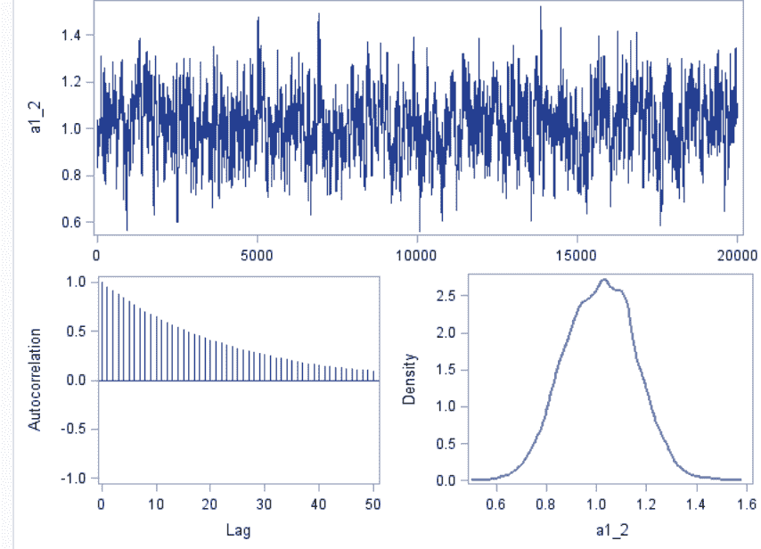

## 140 使用 SAS 进行项目反应理论的贝叶分析

### 输出 5.21：所选项目参数的诊断图—NR 模型

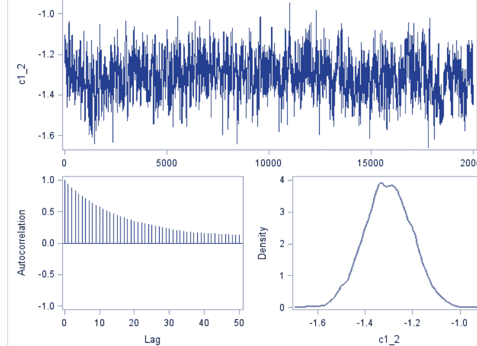

### 输出 5.22：所选项目参数的诊断图—NR 模型

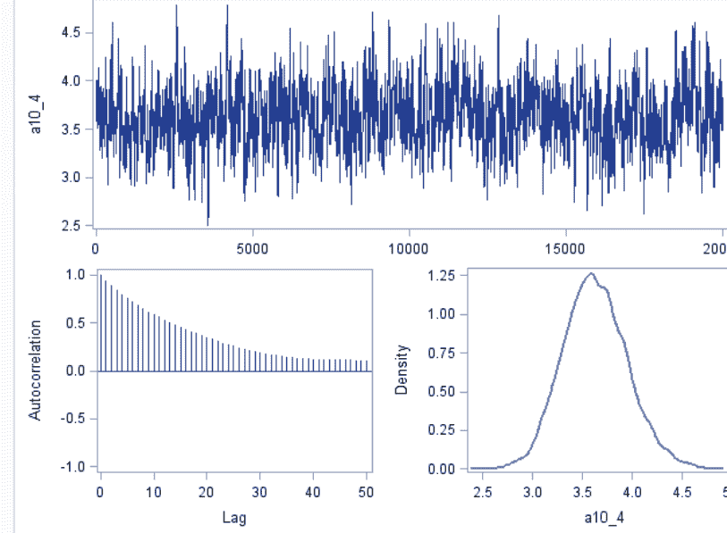

## 第 5 章多分类项目的一维 IRT 模型的贝叶斯估计 141

### 输出 5.23：所选项目参数的诊断图—NR 模型

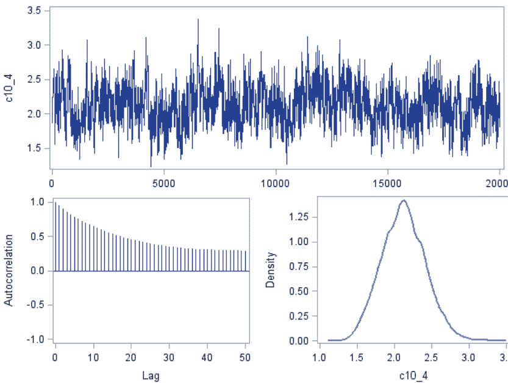

参数可以转换以符合 Bock 的约束。对于所有 $k$，$\sum a_{jk} = \sum c_{jk} = 0$。后续程序代码说明了如何对执行程序 5.9 的采样值进行中心化，输出 5.24 展示了执行该程序代码的输出。在程序中，在后验结果的每次迭代中，通过计算每个项目 $a_{jk}$ 和 $b_{jk}$ 参数的采样值之和，获得值的中心化。然后基于该总和的平均值（总和 / 5）通过采样值减去平均值来对 $a_{jk}$ 和 $b_{jk}$ 的值进行中心化。可以使用 `PROC MEANS` 获取中心化值的点估计。如需所示（输出 5.24）所示，每个项目在跨 $k$ 的情况下满足 $\sum a_{jk} = \sum c_{jk} = 0$。

```
data dash_;
set dash_postNR;
 array a[10,5] a1_l1-a15 a2_l1-a25 a3_l1-a35 a4_l1-a45 a5_l1-a55
a6_l1-a65 a7_l1-a75 a8_l1-a85 a9_l1-a95 a10_l1-a105;
 array c[10,5] c1_l1-c15 c2_l1-c25 c3_l1-c35 c4_l1-c45 c5_l1-c55
c6_l1-c65 c7_l1-c75 c8_l1-c85 c9_l1-c95 c10_l1-c105;
 array d[10,5] d1_l1-d15 d2_l1-d25 d3_l1-d35 d4_l1-d45 d5_l1-d55
d6_l1-d65 d7_l1-d75 d8_l1-d85 d9_l1-d95 d10_l1-d105;
 array e[10,5] e1_l1-e15 e2_l1-e25 e3_l1-e35 e4_l1-e45 e5_l1-e55
e6_l1-e65 e7_l1-e75 e8_l1-e85 e9_l1-e95 e10_l1-e105;
 array f[10,5] f1_l1-f15 f2_l1-f25 f3_l1-f35 f4_l1-f45 f5_l1-f55
f6_l1-f65 f7_l1-f75 f8_l1-f85 f9_l1-f95 f10_l1-f105;
 array g[10,5] g1_l1-g15 g2_l1-g25 g3_l1-g35 g4_l1-g45 g5_l1-g55
g6_l1-g65 g7_l1-g75 g8_l1-g85 g9_l1-g95 g10_l1-g105;
 array h[10,5] h1_l1-h15 h2_l1-h25 h3_l1-h35 h4_l1-h45 h5_l1-h55
h6_l1-h65 h7_l1-h75 h8_l1-h85 h9_l1-h95 h10_l1-h105;
keep a_l1--a105 c_l1--c105;
do j=1 to 10;
 m_a=sum(of a[2], a[3], a[4], a[5]);
 m_c=sum(of c[2], c[3], c[4], c[5]);
 do k=1 to 5;
 if k=1 do a[j,k]=-m_a/5;
 c[j,k]=-m_c/5;
 else do a[j,k]=a[j,k]-m_a/5;
 c[j,k]=c[j,k]-m_c/5;
 end;
end;
run;
```

## 第 5 章多分类项目的一维 IRT 模型的贝叶斯估计 143 输出 5.24：所选项目的中心化参数—NR 模型

| 变量 | N | 平均值 | 标准差 | 最小值 | 最大值 |

| :--- | :--- | :--- | :--- | :--- |

| a_c_1 | 20000 | 0.221389 | 0.183922 | -2.899524 | 1.623387 |

| a_c_2 | 20000 | -1.206114 | 0.172032 | -1.830153 | 0.601939 |

| a_c_3 | 20000 | 0.083740 | 0.245292 | -0.560304 | 0.594136 |

| a_c_4 | 20000 | 0.926465 | 0.221156 | 0.060970 | 1.625020 |

| a_c_5 | 20000 | 2.417538 | 0.357571 | 1.183710 | 4.227058 |

| c_c_1 | 20000 | 0.036410 | 0.212812 | 2.926511 | 3.912648 |

| c_c_2 | 20000 | 1.758112 | 0.215275 | 1.057052 | 2.654381 |

| c_c_3 | 20000 | 0.703850 | 0.312817 | 0.008409 | 1.596653 |

| c_c_4 | 20000 | -1.285641 | 0.318827 | -4.246934 | -0.165161 |

| c_c_5 | 20000 | -4.237500 | 0.637911 | -7.344681 | -2.344525 |

| a_c_7 | 20000 | -4.500870 | 0.330675 | -5.806882 | -3.412271 |

| a_c_2 | 20000 | -2.397317 | 0.296429 | -3.643188 | -1.566975 |

| a_c_3 | 20000 | 0.091655 | 0.296539 | -0.884069 | 0.868535 |

| a_c_4 | 20000 | 1.763713 | 0.346711 | 0.665094 | 3.008210 |

| a_c_5 | 20000 | 0.542509 | 0.541786 | 0.925347 | 2.886408 |

| c_c_1 | 20000 | 1.812144 | 0.266268 | 0.925347 | 2.886408 |

| c_c_2 | 20000 | 2.362953 | 0.326909 | 1.629573 | 3.256525 |

| c_c_3 | 20000 | 1.567399 | 0.199409 | 0.931783 | 2.426439 |

| c_c_4 | 20000 | -1.093836 | 0.314837 | -2.261049 | 0.017069 |

| c_c_5 | 20000 | -4.648620 | 0.524655 | -3.212318 | -2.590851 |

| a_c_10 | 20000 | -1.586972 | 0.159477 | -2.195282 | -1.120746 |

| a_c_13 | 20000 | -0.345678 | 0.148851 | -0.704829 | 0.199197 |

| a_c_15 | 20000 | 1.206905 | 0.225851 | 0.765871 | 1.886418 |

| a_c_10 | 20000 | 3.026280 | 0.225851 | 2.329178 | 4.153456 |

| c_c_10 | 20000 | -1.481934 | 0.216485 | -2.451934 | -0.165161 |

| a_c_12 | 20000 | -0.091655 | 0.319827 | -0.884069 | 0.868535 |

| a_c_14 | 20000 | 0.784356 | 0.319827 | 0.309756 | 1.218629 |

| c_c_14 | 20000 | 0.643406 | 0.319827 | 0.319827 | 1.534956 |

| c_c_15 | 20000 | 0.553319 | 0.319827 | -0.522911 | 1.534956 |

### 义分积分模型

广义积分（PC）模型（Muraki, 1992）也用于多分类项目。对于每个项目，$z_{jk} = a_j(\theta - b_j + \tau_{jk})$，其中 $a_j$ 是斜率，$b_j$ 是位置参数，$\tau_{jk}$ 是分类阈值。对于特征水平 $\theta$，回答某个分类的概率如下：

$$
P_{jk}(\theta) = \frac{e^{\sum_{l=0}^{k} a_{jl}}}{\sum_{l=0}^{m} e^{a_{jl}}}
$$

在 PC 模型下，为了识别可识别性，将每个项目的最后一个分类阈值设置为前几个分类阈值之和的负值，即：

$$
\tau_{mj} = -\sum_{k=1}^{j-1} \tau_{jk}
$$

# 146 使用 SAS 对项目反应理论进行贝叶斯分析

## GPC 模型估计输出

由于项目参数很多，输出 5.25 显示了自动宏 `%POSTSUM` 对所选项目的汇总统计。斜率估计在不同项目之间存在，这表明 GPC 模型对于 DASH 项目响应比 PC 模型（普通斜率模型）更合适。除了最后一个项目外，位置均大于 0。每个项目中的第四个参数估计（均值）与 GK 模型所示。请注意，所有项目的项目参数列在“贝叶斯和 EML 方法”章节中。

### 输出 5.25：所选项目参数的后验汇总统计——GPC 模型

| 参数 | N | 均值 | 标准差 | P25 | P50 | P75 |

|---|---|---|---|---|---|---|

| a1 | 20000 | 1.04879 | 0.08073 | 0.99416 | 1.04560 | 1.10107 |

| b1 | 20000 | 1.64950 | 0.09013 | 1.58597 | 1.64860 | 1.70996 |

| tau1_1 | 20000 | 0.36402 | 0.11425 | 0.29360 | 0.36451 | 0.44214 |

| tau2_1 | 20000 | 0.73499 | 0.13863 | 0.64057 | 0.73408 | 0.83004 |

| tau3_1 | 20000 | -0.52685 | 0.18589 | -0.64987 | -0.52218 | -0.40281 |

| tau4_1 | 20000 | -0.57035 | 0.23076 | -0.72798 | -0.57477 | -0.42193 |

| a5 | 20000 | 1.60702 | 0.10984 | 1.53240 | 1.60257 | 1.68136 |

| b5 | 20000 | 0.14750 | 0.04226 | 0.11941 | 0.14764 | 0.17413 |

| tau1_5 | 20000 | 0.77014 | 0.06287 | 0.72784 | 0.76937 | 0.81093 |

| tau2_5 | 20000 | 0.35864 | 0.06558 | 0.31384 | 0.35782 | 0.40238 |

| tau3_5 | 20000 | -0.46620 | 0.07002 | -0.51208 | -0.46568 | -0.41854 |

| tau4_5 | 20000 | -0.66257 | 0.07009 | -0.70916 | -0.66374 | -0.61597 |

| a7 | 20000 | 2.16691 | 0.15452 | 2.06466 | 2.15596 | 2.26712 |

| b7 | 20000 | 0.67350 | 0.04557 | 0.64123 | 0.67338 | 0.70408 |

| tau1_7 | 20000 | 0.93778 | 0.04832 | 0.90490 | 0.93675 | 0.97123 |

| tau2_7 | 20000 | 0.32349 | 0.04924 | 0.28968 | 0.32323 | 0.35723 |

| tau3_7 | 20000 | -0.81321 | 0.08302 | -0.86689 | -0.81164 | -0.75563 |

| tau4_7 | 20000 | -0.44807 | 0.08457 | -0.50609 | -0.44927 | -0.39369 |

| a10 | 20000 | 1.33277 | 0.09502 | 1.26708 | 1.32758 | 1.39358 |

| b10 | 20000 | -0.43146 | 0.04684 | -0.46212 | -0.43162 | -0.40106 |

| tau1_10 | 20000 | 1.10249 | 0.09134 | 1.04054 | 1.09687 | 1.16473 |

| tau2_10 | 20000 | 0.27979 | 0.07779 | 0.22923 | 0.27937 | 0.33226 |


| `tau3_10` | 20000 | -0.65578 | 0.08274 | -0.70918 | -0.65135 | -0.60104 |

| `tau4_10` | 20000 | -0.72650 | 0.07602 | -0.77804 | -0.72621 | -0.67262 |

输出 5.26 到 5.28 展示了所选参数的轨迹和相关性图。这些图代表了整个项目。你可以看到斜率参数（`$a_j$`）和类别阈值（`$\tau_{jk}$`）在样本值之间良好良好。这与位置参数（`$b_j$`）形成对比，后者在样本值之间表现出中等相关性。

输出 5.26：所选项目斜率参数的轨迹和相关性图——GPC 模型 输出 5.27：所选项目位置参数的轨迹和相关性图——GPC 模型

| 参数 | 图表 |

|---|---|

| b3 | [轨迹和相关性图] |

| b4 | [轨迹和相关性图] |

| b5 | [轨迹和相关性图] |

输出 5.28：所选项目 Tau 参数的轨迹和相关性图——GPC 模型

| 参数 | 图表 |

|---|---|

| tau1_8 | [轨迹和相关性图] |

| tau1_9 | [轨迹和相关性图] |

| tau1_10 | [轨迹和相关性图] |

## 多分类项目的单维 IRT 估计

## 基于 MML 估计的结果比较

为了比较贝叶斯估计结果与传统的 MML 估计结果，我们使用计算机程序 `IRPRO`（Cai, Thissen, and Doit, 2011）对 DASH 数据估计了不同的模型。表 5.1、5.2 和 5.3 显示了 GR、NR 和 GPC 模型的贝叶斯与 MML 结果比较。注意的是，`PROC IRT`（SAS, 2014, Chapter 5）可以用于某些比较，但无法用于书中所有的比较，因此没有使用该 SAS 过程。

在这些表中，我们可以看到对于 NR 模型，贝叶斯和 MML 估计非常相似。一个例外可能是 GR 模型（表 5.2），在两种估计方法之间，斜率参数比截距参数更相似，意外的是，极端值的差异较大。

表 5.1：GR 模型的贝叶斯与 MML 项目参数估计

| 项目 | 估计方法 | a | b1 | b2 | b3 | b4 |
|---|---|---|---|---|---|---|
| 项目 1 | 贝叶斯 | 1.83 | 0.50 | 1.23 | 2.17 | 2.97 |
| | MML | 1.82 | 0.49 | 1.20 | 2.16 | 2.95 |
| 项目 2 | 贝叶斯 | 2.07 | 0.61 | 1.23 | 1.89 | 2.65 |
| | MML | 2.06 | 0.60 | 1.22 | 1.88 | 2.65 |
| 项目 3 | 贝叶斯 | 3.49 | 0.14 | 0.79 | 1.65 | 2.14 |
| | MML | 3.49 | 0.13 | 0.78 | 1.63 | 2.12 |
| 项目 4 | 贝叶斯 | 2.50 | -0.39 | 0.45 | 1.29 | 2.13 |
| | MML | 2.49 | -0.41 | 0.44 | 1.28 | 2.12 |
| 项目 5 | 贝叶斯 | 2.79 | -0.84 | -0.19 | 0.50 | 1.08 |
| | MML | 2.79 | -0.85 | -0.20 | 0.49 | 1.07 |
| 项目 6 | 贝叶斯 | 3.21 | -0.09 | 0.61 | 1.36 | 1.84 |
| | MML | 3.19 | -0.10 | 0.59 | 1.35 | 1.82 |
| 项目 7 | 贝叶斯 | 3.33 | -0.39 | 0.34 | 1.18 | 1.54 |
| | MML | 3.32 | -0.40 | 0.33 | 1.17 | 1.53 |
| 项目 8 | 贝叶斯 | 3.18 | -0.79 | -0.10 | 0.60 | 1.16 |
| | MML | 3.18 | -0.78 | -0.11 | 0.59 | 1.15 |
| 项目 9 | 贝叶斯 | 2.63 | 0.53 | 1.11 | 1.71 | 2.08 |
| | MML | 2.62 | 0.51 | 1.09 | 1.70 | 2.06 |
| 项目 10 | 贝叶斯 | 2.32 | -1.59 | -0.74 | 0.06 | 0.69 |
| | MML | 2.33 | -1.59 | -0.74 | 0.04 | 0.68 |

表 5.2：NR 模型的贝叶斯与 MML 项目参数估计

| 项目 | 估计方法 | a1 | a2 | a3 | a4 | a5 | c1 | c2 | c3 | c4 |
|---|---|---|---|---|---|---|---|---|---|---|
| 项目 1 | 贝叶斯 | 1.02 | 2.31 | 3.15 | 4.64 | 0 | -1.30 | -2.36 | -4.35 | -7.30 |
| | MML | 1.00 | 2.33 | 3.18 | 4.68 | 0 | -1.32 | -2.40 | -4.44 | -7.46 |
| 项目 2 | 贝叶斯 | 1.35 | 2.56 | 3.32 | 5.35 | 0 | -1.61 | -2.83 | -4.26 | -8.02 |
| | MML | 1.33 | 2.57 | 3.36 | 5.44 | 0 | -1.62 | -2.89 | -4.35 | -8.27 |
| 项目 3 | 贝叶斯 | 2.70 | 5.55 | 7.42 | 9.16 | 0 | -0.73 | -2.77 | -6.26 | -9.25 |
| | MML | 2.73 | 5.74 | 7.80 | 9.61 | 0 | -0.79 | -2.99 | -6.75 | -9.90 |
| 项目 4 | 贝叶斯 | 1.64 | 3.27 | 4.59 | 7.80 | 0 | -0.33 | -0.42 | -2.22 | -7.50 |
| | MML | 1.62 | 3.27 | 4.59 | 7.80 | 0 | -0.33 | -0.42 | -2.23 | -7.50 |
| 项目 5 | 贝叶斯 | 2.79 | -0.84 | -0.19 | 0.50 | 1.08 |
| | MML | 2.79 | -0.85 | -0.20 | 0.49 | 1.07 |
| 项目 6 | 贝叶斯 | 3.21 | -0.09 | 0.61 | 1.36 | 1.84 |
| | MML | 3.19 | -0.10 | 0.59 | 1.35 | 1.82 |
| 项目 7 | 贝叶斯 | 3.33 | -0.39 | 0.34 | 1.18 | 1.54 |
| | MML | 3.32 | -0.40 | 0.33 | 1.17 | 1.53 |
| 项目 8 | 贝叶斯 | 3.18 | -0.79 | -0.10 | 0.60 | 1.16 |
| | MML | 3.18 | -0.78 | -0.11 | 0.59 | 1.15 |
| 项目 9 | 贝叶斯 | 2.63 | 0.53 | 1.11 | 1.71 | 2.08 |
| | MML | 2.62 | 0.51 | 1.09 | 1.70 | 2.06 |
| 项目 10 | 贝叶斯 | 2.32 | -1.59 | -0.74 | 0.06 | 0.69 |
| | MML | 2.33 | -1.59 | -0.74 | 0.04 | 0.68 |

表 5.3：GPC 模型的贝叶斯与 MML 项目参数估计

| 项目 | 估计方法 | a | b | t1 | t2 | t3 | t4 |
|---|---|---|---|---|---|---|---|
| 项目 1 | 贝叶斯 | 1.04879 | 1.64950 | 0.36402 | 0.73499 | -0.52685 | -0.57035 |
| | MML | 1.04560 | 1.64860 | 0.36451 | 0.73408 | -0.52218 | -0.57477 |
| 项目 2 | 贝叶斯 | 1.60702 | 0.14750 | 0.77014 | 0.35864 | -0.46620 | -0.66257 |
| | MML | 1.60257 | 0.14764 | 0.76937 | 0.35782 | -0.46568 | -0.66374 |
| 项目 3 | 贝叶斯 | 2.16691 | 0.67350 | 0.93778 | 0.32349 | -0.81321 | -0.44807 |
| | MML | 2.15596 | 0.67338 | 0.90490 | 0.28968 | -0.81164 | -0.44927 |
| 项目 4 | 贝叶斯 | 1.33277 | -0.43146 | 1.10249 | 0.27979 | -0.65578 | -0.72650 |
| | MML | 1.32758 | -0.43162 | 1.04054 | 0.27923 | -0.65135 | -0.72621 |

## 第 5 章：多级计分单维 IRT 模型的贝叶斯估计 151

| 估计方法 | a | b | τ1 | τ2 | τ3 | τ4 |
|---|---|---|---|---|---|---|
| 题目 5 | | | | | | |
| 贝叶斯 | 1.61 | 0.15 | 0.77 | 0.36 | -0.47 | -0.66 |
| MML | 1.66 | 0.14 | 0.75 | 0.35 | -0.45 | -0.65 |
| 题目 6 | | | | | | |
| 贝叶斯 | 2.09 | 0.92 | 0.82 | 0.32 | -0.56 | -0.59 |
| MML | 2.17 | 0.89 | 0.80 | 0.31 | -0.54 | -0.57 |
| 题目 7 | | | | | | |
| 贝叶斯 | 2.17 | 0.67 | 0.94 | 0.32 | -0.81 | -0.45 |
| MML | 2.26 | 0.65 | 0.95 | 0.31 | -0.78 | -0.44 |
| 题目 8 | | | | | | |
| 贝叶斯 | 1.94 | 0.24 | 0.88 | 0.35 | -0.49 | -0.74 |
| MML | 2.01 | 0.23 | 0.86 | 0.34 | -0.48 | -0.72 |
| 题目 9 | | | | | | |
| 贝叶斯 | 1.54 | 1.29 | 0.28 | 0.30 | -0.53 | -0.06 |
| MML | 1.60 | 1.24 | 0.29 | 0.30 | -0.52 | -0.07 |
| 题目 10 | | | | | | |
| 贝叶斯 | 1.33 | -0.43 | 1.10 | 0.28 | -0.66 | -0.73 |
| MML | 1.38 | -0.42 | 1.08 | 0.27 | -0.64 | -0.71 |

## 题目 IRT 响应函数图

与二项 IRT 模型不同，多级项目每个类别都有多个响应。然而，正如第 4 章中为二项响应项目绘制 ICC 图表所示的，可以为每个二项项目绘制类别响应。程序 5.11 提供了基于 GR 模型绘制 DASH 题目响应曲线的命令。图表显示在输出 5.29 中。

在程序中，首先使用 `PROC MEANS` ➊ 获取题目的点估计。这些点估计被保存在数据集中，并用于生成每个题目的响应类别数据集 ➁。在这个数据集中，我们从 -4 到 4 以步长 L 检索离散值 θ。该数据图可以作为一个模板，使用 `SERIESPLOT` 命令为每条响应曲线和每个题目绘制类别曲线 ➌。使用 `LAYOUT LATTICE` 命令 �� 用于在 x 轴和 y 轴具有共同刻度的单图中，在单个图表中绘制所有类别图。

## 程序 5.11：绘制多级 IRT 模型题目响应曲线——GR 模型

```sas
* nitems=10; /* 题目数量 */
let n=5; /* 响应类别数量 */
let n=4; /* 阈值参数数量 */

/* 保存题目参数的点估计*/
proc means al-data-dash output noprint; ➊
var al&nitems b1_l1&nitems b2_l2&nitems b3_l3&nitems
b4_b4&nitems;
output=means_gr mean=;
run;

/* 创建跨 theta 的期望题目响应概率数据集 */
data plotdata_gr; ➁
set means_gr;
array b[nthrees, al&nitems] b1_b1&nitems b1_b1&nitems
b2_b2&nitems b3_b3&nitems b4_b4&nitems;
```

## 152 使用 SAS 对题目响应模型进行贝叶斯分析

```sas
array p_star[*&nitems,&nres];
array p[&nitems,&ncats];

retain group(0);
do theta=4 to 4 by .1;
group=group+1;
do j=1 to &nitems;
do k=0 to 4;
p_star[j,k]=logistic(a[j]*(theta-b[j,k]));
end;
p[j,1]=1-p_star[j,1];
do k=2 to 4;
p[j,k]=p_star[j,(k-1)]-p_star[j,k];
end;
p[j,5]=p_star[j,4];
end;
output;
end;

/* 定义模板 */
proc template;
define icplots;
layout lattice width=100 height=100;
title "题目的类别响应曲线";
xaxis label="Theta";
yaxis label="Probability";
panel grid;
series;
end;
end;
run;

/* 生成图表 */
proc plots data=plotdata_gr template=icplots;
```

## 156 使用 SAS 对项目反应模型进行贝叶斯分析

双因子模型（bifactor model）在一般因子是主要关注特质的测试应用中特别有用。引入次要因子（其概念范围可能更窄）是为了捕捉除一般因子解释之外的任何残差项目间关系。

在某些应用中，这些次要因子可能是干扰因素，并源于多种来源。例如，Demars (2013) 讨论了尽管量表不是重点，但由于存在具有共同中心的子量表而产生的残差差；或者源于同时使用正向和负向表述题目的调查工具，此时题目的方向性构成了该因子。在对控制了这些因素后，可以获得对被测量的个体一般特质的更好的估计（Gibbons et al., 2007）。

在其他应用中，次要因子（或因子分析文献中的组因子）可能是感兴趣的特定因子。例如，当题目的方向性被建模为干扰因素（负向表述）时，你可能感兴趣的是比较在负向表述题目上得分高的人与在特质上得分低的人（Demars, 2013）。例如，考虑一个成就测试，它由来自不同内容领域（几何、代数和三角）的若干项目组成。你可能感兴趣在控制了数学能力后，关注代数得分低的学生。

### 模型描述

在双因子模型中，为每个项目在一般因子以及单个次要因子上估计斜率因子（slope factors，或载荷）。例如，给定具有两个次要因子的六个项目（假设项目 1–4 与因子 2 相关，项目 5–6 与因子 3 相关），将为这六个项目估计一般因子（第一维度或因子 1）的斜率参数。同时，为项目 1–4 估计次要因子的斜率参数，为项目 5–6 估计第三者的斜率。双因子模型假设维度之间是正交的，因为次要维度在控制了一般因子的贡献后，反映了不同项目组之间的特定关系。例如，用于二分计项目的双参数（2）双因子模型为：

```
$P_i(\theta) = \frac{e^{z_i}}{1+e^{z_i}}$
```

其中，`$z_i = \sum_j a_{ij}\theta_j + d_i$`，`$\theta_j$` 是个体在特质向量 `($\theta$)` 中维度 `j` 上的特质/水平；`$a_{ij}$` 是项目 `i` 在维度 `j` 上的区分度（斜率）；`$d_i$` 是截距参数，它通过项目 `j` 斜率和难度参数的复合函数与难度相关。在多维语境下，`$d_i$` 被解释为 `$\theta=0$` 个体正确回答的对数优势（log-odds）（Demars, 2013）。

用于多级计分项目的双因子模型可以是 GR 模型的扩展。在这个双因子模型中，个体对某个项目选择更高类别分数或评分的累积概率 `$P_{ik}(\theta)$` 通过逻辑函数 `$z_{ik} = \sum_j a_{ijk}\theta_j + d_{ik}$` 建模，其中 `$d_{ik}$` 是项目 `i` 和类别 `k` 的截距，`$\theta$`、`$\theta_j$` 和 `$a_{ijk}$` 的意义与上述相同。

## 在 PROC MCMC 中估计模型

程序 6.1 展示了 `PROC MCMC` 代码，用于估计一个具有 10 个项目和 1,000 次考试的模拟应用的双因子模型，其中所有项目都位于一个一般因子上；前五个项目与一个次要因子相关，后五个项目与另一个次要因子相关。该应用还说明了一组混合类型题目的模型估计，其中前五个项目是二分计分的（4 个响应项目）。这些项目在模拟时，其在一般因子上的载荷（`$a_{i1}$`）固定在 1.75；在次要因子上的载荷（`$d_{\alpha}$` 和 `$d_{\beta}$`）均固定在 1.0。截距参数（`$d_i$` 和 `$d_j$`）反映了跨越 `$\theta$` 标度的项目。


该程序整合了第 4 章和第 5 章中关于二分计分和多级计分项目的示例。一个例外是对体参数使用了数组 `THETA`，因为现在要估计三个参数。使用多个参数需要指定多个随机起始值（random starts）来定义这些参数的先验分布。与之前的程序一样，参数通过每个项目的块进行指定。在定义二分项目和多级计分项目的程序中。你应该注意，我们程序中的双极模型对二分项目使用了 $z_i = a_i\theta_b - d_i$ 模型规范。因此，截距参数直接反映了 $\theta$ 标度上的参数。还要注意，使用了大量的迭代，因为链表现出很高的自相关性，因此效率低下。尽管如此，所需的计算机时间少于实时 15 分钟。

## 输出 6.1: 斜率参数的后验摘要——双因子模型

| 参数 | N | 均值 | 标准差 | P25 | P50 | P75 |
|---|---|---|---|---|---|---|
| a_1 | 100000 | 1.49040 | 0.18542 | 1.35904 | 1.48120 | 1.61021 |
| a_2 | 100000 | 1.70839 | 0.21510 | 1.55577 | 1.69371 | 1.84466 |
| a_3 | 100000 | 1.76015 | 0.22955 | 1.59968 | 1.74257 | 1.90224 |
| a_4 | 100000 | 2.21163 | 0.29788 | 1.99848 | 2.18611 | 2.39874 |
| a_5 | 100000 | 1.69353 | 0.22477 | 1.53728 | 1.68059 | 1.82926 |
| a_6 | 100000 | 1.74104 | 0.21998 | 1.58250 | 1.73282 | 1.88540 |
| a_7 | 100000 | 1.89828 | 0.19323 | 1.76042 | 1.89010 | 2.02629 |
| a_8 | 100000 | 1.77791 | 0.19439 | 1.63999 | 1.77025 | 1.90423 |
| a_9 | 100000 | 1.77930 | 0.18901 | 1.64056 | 1.77141 | 1.90988 |
| a_10 | 100000 | 1.78773 | 0.19582 | 1.64907 | 1.78180 | 1.91880 |
| a_2_1 | 100000 | 0.52675 | 0.29105 | 0.29186 | 0.53360 | 0.73723 |
| a_2_2 | 100000 | 0.85349 | 0.38133 | 0.57588 | 0.89342 | 1.12393 |
| a_2_3 | 100000 | 0.97346 | 0.38382 | 0.73242 | 1.00799 | 1.23380 |
| a_2_4 | 100000 | 0.87915 | 0.41533 | 0.56399 | 0.92674 | 1.18497 |
| a_2_5 | 100000 | 0.89124 | 0.36832 | 0.64951 | 0.92242 | 1.14073 |
| a_3_1 | 100000 | 1.21955 | 0.35520 | 0.99499 | 1.27101 | 1.47216 |
| a_3_2 | 100000 | 0.91263 | 0.29343 | 0.71464 | 0.95258 | 1.12929 |
| a_3_3 | 100000 | 0.78896 | 0.32672 | 0.54001 | 0.82687 | 1.04175 |
| a_3_4 | 100000 | 0.66157 | 0.31548 | 0.40602 | 0.70945 | 0.92027 |
| a_3_5 | 100000 | 0.98670 | 0.31431 | 0.78191 | 1.02833 | 1.21786 |

## 输出 6.2: 截距参数的后验摘要——双因子模型

| 参数 | N | 均值 | 标准差 | P25 | P50 | P75 |
|---|---|---|---|---|---|---|
| d1 | 100000 | -1.87067 | 0.14237 | -1.96066 | -1.86414 | -1.77204 |
| d2 | 100000 | -0.03857 | 0.12567 | -1.11942 | -1.03487 | -0.95389 |
| d3 | 100000 | 0.17606 | 0.10700 | 0.10263 | 0.17370 | 0.24565 |
| d4 | 100000 | 1.13149 | 0.14487 | 1.03135 | 1.12584 | 1.22489 |
| d5 | 100000 | 1.96571 | 0.17668 | 1.84237 | 1.96258 | 2.07459 |
| d_1 | 100000 | -2.30610 | 0.18354 | -2.41575 | -2.29023 | -2.17911 |
| d_2 | 100000 | -1.98373 | 0.14151 | -2.07004 | -1.97984 | -1.88999 |
| d_3 | 100000 | -1.92345 | 0.13568 | -2.00757 | -1.92062 | -1.83424 |
| d_4 | 100000 | -0.96570 | 0.10658 | -1.05561 | -0.98591 | -0.91293 |
| d_5 | 100000 | -0.04316 | 0.10673 | -0.11553 | -0.04316 | 0.02955 |
| d_2 | 100000 | -1.17427 | 0.13396 | -1.25930 | -1.16906 | -1.08065 |
| d_2 | 100000 | -0.49884 | 0.10879 | -0.57233 | -0.49981 | -0.42535 |
| d_3 | 100000 | -0.05245 | 0.10157 | -0.12118 | -0.05498 | 0.01484 |
| d_4 | 100000 | 0.49900 | 0.10078 | 0.43212 | 0.49814 | 0.56528 |
| d_5 | 100000 | 0.94545 | 0.11654 | 0.86570 | 0.94365 | 1.02334 |
| d_3 | 100000 | 0.01090 | 0.10994 | -0.06624 | 0.01177 | 0.08537 |
| d_3 | 100000 | 1.09031 | 0.11977 | 1.00684 | 1.08876 | 1.17082 |
| d_3 | 100000 | 2.09648 | 0.15144 | 2.00201 | 2.09001 | 2.17794 |
| d_4 | 100000 | 1.87901 | 0.12660 | 1.79316 | 1.87709 | 1.96254 |
| d_5 | 100000 | 1.99747 | 0.14325 | 1.89976 | 1.99235 | 2.09047 |

输出 6.6 展示了选取参数的轨迹图和密度图，并说明了马链的收敛情况以及采样参数值的分布。虽然由于迭代次数的原因，从轨迹图中无法判断，某些参数的自相关统计量较高而另一些则较低，但某些参数的马链很好地遍历了参数空间（例如，输出 6.4 中参数 `A3_4` 的轨迹图）。此外，普通因子（`A1`—`A10`）参数的密度图近似正态分布，而次要因子（输出 6.4 中的 `E2–5`）参数的一些密度图偏离了正态分布。然而，正如其他模型所示，即使密度不是正态分布，后验分布的均值也常用于后验推理。众周知，在平方误差损失函数下，后验均值最小化期望贝叶斯损失或后验风险。

考虑到双因子模型在模型参数数量上的复杂性，感兴趣的简单模型可能是单维 IRT 模型。对于此处考虑的数据，这两个竞争模型的比较将在第 7 和第 8 章中讨论。

## 输出 63: 采样参数值的轨迹图和密度图——双因子模型

![img/dd5368102e19084dcd107a02a82ba37c_176_0.png]

## 输出 6.4: 采样参数值的轨迹图和密度图——双因子模型

![img/dd5368102e19084dcd107a02a82ba37c_177_0.png]

## 输出 6.5: 采样参数值的轨迹图和密度图——双因子模型

![img/dd5368102e19084dcd107a02a82ba37c_177_1.png]

## 第 6.6 章：IRT 模型扩展

# 第6 章：IRT 模型扩展 165

```sas
llike = 0;
do=1 to 5;
z = -(a[j])*theta[1] - d[j];
pr = 1 / (1 + exp(z));
llike = like + ix[j] * log(pr) + (1 - ix[j]) * log(1 - pr);
end;
do=6 to 10;
k=1 to 3;
p=(-a[j])*theta[2] - d_cr(k,j-5));
end;if ix[j]=1 then prob=1-1/(1+exp(p[1]));
else if ix[j]=2 then prob=1/(1+exp(p[1])) - 1/(1+exp(p[2]));
else if ix[j]=3 then prob=1/(1+exp(p[2])) - 1/(1+exp(p[3]));
else prob=1;
llike = like + log(prob);
end;
model general(llike);
run;
```

## “标签切换”问题

尽管在混合模型的贝叶斯分析中讨论过，但标签切换（label switching）也是像双因子模型（bifactor model）等 IRT 模型中的潜在问题。在混合模型范围内，例如 Jasra, Holstens, & Stephens (2005, p. 2) 将标签切换为：

如果对混合模型的参数设定可交换先验，则得到的后验分布将对参数的置换保持不变。因此，每个混合分量的参数的后验分布将是相同的。此外，在 MCMC 模拟期间，采样器会遇到后验分布的对称性，并导致标签切换的解释问题。

在双因子模型中，每个项目都估计多个斜率参数，当这些斜率参数的大小相似时，似然表面可能存在多个峰值。当发生这种情况时，参数的后验汇总是无效的。众所周知，在贝叶斯分析中观察到的标签切换可以通过某些图中看到，图中标签在参数空间的不同位置发生离散或分段，并具有良好的混合。此外，密度图中的多峰性也可能指示标签切换。

如果出现此问题，可能需要对参数施加约束。例如，在双因子模型（程序 6.1）中，可以像如下所示定义次因子的上约束。在这段代码中，次因子斜率参数的联合分布的上界被定义为一般因子上斜率参数的值。虽然这些类型的约束在某些情况下可能有用，但建议先估计一个无约束模型，并检查轨迹/密度图以是否存在任何异常模式。

```sas
begindata:
lipriora=0;
do kk=1 to 10;
if kk<6 then do;
lipriora=lipriora + lpdfnorm(ai_[kk], 0,4,0);
lipriora=lipriora + lpdfnorm(ae_[kk], 0,2,0,al_[kk]);
end;
else do;
lipriora=lipriora + lpdfnorm(al_[kk], 0,4,0);
lipriora=lipriora + lpdfnorm(a3_[kk-5], 0,2,0,al_[kk]);
end;
enddata;
prior ai_1-al_10 a2_1-a2_5 a3_1-a3_5 = general(lipriora);
```

## 测试单元 IRT 模型 (Testlet IRT Model)

如第1章所述，在某些应用中，个体根据共同相似性对一组项目（测试单元，testlets）做出反应。例如，每个阅读理解段落带有相关的项目将区分了不同的测试单元。对于这类应用，局部独立性假设可能会被违反。测试单元内部的项目反应相关性将比根据单维能力特征或基于所有项目反应和标准 IRT 模型（例如 2 IRT 模型）预测的要更高。对于使用测试单元的评估应用，之前章节讨论的 IRT 模型可以进行修改，以解释单元内项目之间的依赖关系。例如，Wang, Bland 和 Wainer (2002) 提出的针对测试单元的改进 GR 模型适用于涉及多级计分项目的应用。

### 模型描述

在测试单元 IRT 模型中，将一个随机的个体特异测试效应归于一维 IRT 模型，以便模拟个人与测试单元之间的交互以及单元内项目之间的依赖性。例如，在将此加入 GR 模型时，$j^{th}$ 个考生在测试单元 $t(j)$ 内获得得分 $k=(1, 2, ..., m)$ 的概率定义如下：

```
$P_{jk}(\theta) = \frac{e^{(\alpha_j\theta+\gamma_{t(j)})}}{1+e^{(\alpha_j\theta+\gamma_{t(j)})}}$
```

其中 $\gamma_{tj}$ 是一个随机的个体特异测试效应，用于建模测试单元 $t(j)$ 内项目之间的依赖性。在该模型中，假设 $\theta$ 服从 $N(0,1)$ 分布，且 $\gamma_{tj}$ 假设与 $\theta$ 独立并从 $N(0,\sigma_{\gamma}^2)$ 分布。假设对于考生而言，所有给定测试单元的 $\gamma_{tj}$ 值均为常数。此外，假设测试效应不同异，受 $\sum_{t}\gamma_{tj}=0$ 的约束。由于测试效应的方差是项目特异的（此处原文可能有误，通常指个体特异），单元内的局部依赖性会增加。

## 模型估计

程序 6 使用 MCMC 代码来估计测试单元模型，其中 $j^{th}$ 个考生在测试单元 $t(j)$ 内获得得分 $k=(1, 2, ..., m)$ 的概率定义如下……（注：原文此处段落存在重复和错乱，已按语意翻译并保留结构）。

*(注：原文提供的文本部分存在大量内容重复和格式错乱，翻译时已根据上下文逻辑进行了对齐处理)*

## 使用 SAS 进行项目响应模型的贝叶斯分析

已进行采样（`VARD1`、`VARD2` 和 `VARD3`）。你可以看到链混合得良好，尽管在参数空间中移动较慢（高自相关）。

## 输出 6.7：Testlet 模型的后验统计量

| 参数 | N | 均值 | 标准差 | P25 | P50 | P75 |
|---|---|---|---|---|---|---|
| vard1 | 60000 | 0.47535 | 0.15238 | 0.36830 | 0.46081 | 0.56517 |
| vard2 | 60000 | 0.85912 | 0.21428 | 0.72037 | 0.84957 | 0.99382 |
| vard3 | 60000 | 2.37017 | 0.42661 | 2.06302 | 2.2322 | 2.63803 |

## 输出 6.8：Testlet 模型的方差图

 输出 6.9、10、11 显示 Testlet 模型部分参数的轨迹和密度图。从输出可以看出链混合得良好，且密度图均接近正态分布。尽管 Testlet 模型许多参数存在显著的自相关，对于双因子模型，这表明链在参数空间中移动较慢，但高自相关并没有影响后验推理和后验统计量。

## 输出 6.9：Testlet 模型的轨迹和密度图


## 输出 6.10：Testlet 模型的轨迹和密度图


## 输出 6.11：Testlet 模型的轨迹和密度图


或者，涉及 Testlet 的应用可以使用双因子模型进行估计（例如，Li & Furu, 2006; Demars, 2006）。双因子模型适用于 Testlet 应用，因为它在控制了干扰因子产生的方差后可以估计一般能力或特质。在涉及 Testlet 项目响应的双因子模型应用中，对所有题目估计了共同层的斜率参数以及对应 Testlet 内部题目集的次因子参数。斜率参数估计值较高表明存在强局部依赖。

如果为次因子或 Testlet 单独估计斜率参数，则估计通用 Testlet 模型（Li 等，2006）。这种模型可能优于上述的 Testlet IRT 模型。Li 等认为，在 Testlet IRT 模型中，主特质（$\theta$）和 Testlet 特质（$\gamma$）乘以一个单一斜率参数（$\alpha(\theta - b_{jk} - \gamma_{ij})$）。因此，高斜率的题目将具有相应的高参数，这在现实测试应用中可能是一个合理的结果或预期。

程序 6.4 提供了估计 Testlet 应用的双因子模型代码。在代码中，使用了相同的模拟数据集。估计了一个通用 Testlet 模型，其中对每个次因子估计了一个单一斜率参数（`A2_1`–`A2_5`、`A3_1`–`A3_5` 和 `A4_1`–`A4_5`）。注意，未给出该模型的输出。

## 程序 6.4：通用 Testlet 模型的双因子模型


```
proc mcmc data=testlet_data testlet_bifactor_post seed=423
nbi=5000 nmc=60000 nthreads=8 diagnostics=none plots=(trace density);

array ix[15]; array d[15]; array theta[4];
array a1[15]; array a2[5]; array a3[5]; array a4[5];
parms a1_1 1 a2_1 1 d1 0;
parms a2_1 1 a2_2 1 d2 0;
parms a3_1 1 a3_2 1 d3 0;
parms a4_1 1 a4_2 1 d4 0;
parms a5_1 1 a2_5 1 d5 0;
parms a6_1 1 a3_1 1 d6 0;
parms a7_1 1 a2_2 1 d7 0;
parms a8_1 1 a2_3 1 d8 0;
parms a9_1 1 a3_4 1 d9 0;
parms a10_1 1 a3_5 1 d10 0;
parms a11_1 1 a4_1 1 d11 0;
parms a12_1 1 a4_2 1 d12 0;
parms a13_1 1 a4_3 1 d13 0;
parms a14_1 1 a4_4 1 d14 0;
parms a15_1 1 a4_5 1 d15 0;

prior a1_a15 normal(0, var=4, lower=0);
prior a2_1-a2_5 a3_1-a3_5 a4_1-a4_5 normal(0, var=4, lower=0);
prior d1-d15 normal(0, var=4);
random theta(0, var=1) subject=obs;
random theta(0, var=1) subject=obs;
random theta(0, var=1) subject=obs;
random theta(0, var=1) subject=obs;

likelihood=0;
d=1 to 5;
z = -(a1[j]theta[1] + a2[j]theta[2] - d[j]);
pr = 1 / (1 + exp(z));
likelihood = likelihood + ix[j]log(pr) + (1-ix[j])log(1-pr);
end;
d=6 to 10;
z = -(a2[j]theta[1] + a3[j-5]theta[3] - d[j]);
pr = 1 / (1 + exp(z));
likelihood = likelihood + ix[j]log(pr) + (1-ix[j])log(1-pr);
end;
d=11 to 15;
z = -(a3[j]theta[1] + a4[j-10]theta[4] - d[j]);
pr = 1 / (1 + exp(z));
likelihood = likelihood + ix[j]log(pr) + (1-ix[j])log(1-pr);
end;
model general(likelihood);
run;
```

## 使用 SAS 进行项目响应理论

正如 Demars（2006）所述，程序 6.4（双因子模型）中的斜率参数与 testlet 模型中的 gamma 参数不可比。为了估计一个与 testlet 模型直接竞争的模型，可以将次因子内题目的单一斜率参数分解为 `g × a_{(j)}`，其中 `g` 是一般因子上的题目斜率，`a_{(j)}` 是对应于每个潜特质（缩放后为 `N(0,1)`）的 `Y_{it(j)}`。可以使用以下语句进行估计：

```
array alpha[3]; * 每个 testlet 的 alpha 参数;
parms alpha=.5; * 每个 alpha 参数的初始值;
prior alpha ~ N(0, var=1); * 每个 alpha 参数的先验;
likelihood;
d=1 to 5;
z = -(alpha[j]theta[1] + alpha[j]alpha[1]theta[2] - d[j]);
pr = 1 / (1 + exp(z));
likelihood = likelihood + ix[j]log(pr) + (1-ix[j])log(1-pr);
end;
d=6 to 10;
z = -(alpha[j]theta[2] + alpha[j]alpha[2]theta[3] - d[j]);
pr = 1 / (1 + exp(z));
likelihood = likelihood + ix[j]log(pr) + (1-ix[j])log(1-pr);
end;
model general(likelihood);
run;
```

## 分层-多层 IRT 模型

许多 IRT 模型在似然函数顺序中假设项目响应函数在潜特质（`θ`）给定的条件下是相互独立的。然而，在某些测试应用中，在人员簇、题目簇或两者内部存在项目响应的结构，在这些应用中该假设可能是不合理的。例如，在学生按学校聚类的应用中，一个学校（簇）内学生的响应性可能比仅由其潜特质解释的更高。另一个例子是行为评估，其中社区内聚类的人可能具有相似的相关性。

对于这类测试应用，分层模型（也称为多层随机效应模型）可以对人员簇或题目簇内的任何依赖关系。有关分层 IRT 模型的更多细节，请参见 Johnson、Sinharay 和 Bradley (2007) 的示例。

### 多层 IRT 模型描述

多层方法符合项目响应、人员以及簇或组的自然结构（Fox, 2010; Fox & Glas, 2001）。在多层模型最基本的应用中，响应假设人员聚类在 G 中。在模型中，第 1 层是 IRT 模型或表示在模型和人员特征给定条件下概率的表达式。在下一层（第 2 层），可以使用结构模型来描述第 `i` 层测量的潜变量与人员级协变量（`X_i`）之间的关系，以解释人员之间 `θ` 的变异性。在该层上，为人员测量的潜变量是因变量；`θ_i = β_0 + β_1X_i + … + β_kX_{ki} + ε_i`；其中人员的随机效应 `ε_i ~ N(0, σ^2)`。

如果人员聚类在组（例如学校），则在第 2 层中包含 G 组的索引 `g`，`θ_{ig} = β_{0g} + β_{1g}X_{ig} + … + β_{kg}X_{ig} + ε_{ig}` 且 `ε_{ig} ~ N(0, σ_g^2)`，添加第 3 层来解释第 2 层随机效应的变异性。在此层，`β_{kg}` 系数是因变量，

## 第6 章：IRT 模型扩展 173

引入组别水平协变量以解释方差：`β_{igj} = γ_0 + γ_{1ige} + … + γ_{iwg} + μ_{igj}` 和 `μ_{ig} N(0, Σ)`。

你可以看出，多层建模方法的一个优势是，它可以被引入解释参数中的方差，并模拟多层模型不同层面的测量误差。Fox (2010) 讨论了引入解释变量也可以导致更准确的参数估计（例如，使用受考者的共线性信息）。

在多层 IRT 中，潜变量 `θ` 的尺度涉及几个待估计的方差分（例如学校方差和个人方差）。为了识别模型，可以采取不同的方法。Fox (2010) 在每次 MCMC 迭代中将 `θ` 值的均值固定为 0，`θ` 值的标准差固定为 1。在早的论文中，Fox 和 Gelin (2001) 通过题目参数识别了模型——将一个题目的斜率固定为 1，并将题目 0 的截距参数固定为 1。在通过题目参数来识别模型的示例中。

## 模型估计

所提供的示例基于 Fox (2010) 的分析。数据包含对荷兰小学数学考试中二分计题目的回答。学生群体由 9 年级的 2,156 名学生组成。提供了学校水平协变量来解释数学能力的方差：社会经济地位（SES）和性别（GENDER – 男性 = 0，女性 = 1）。学校水平协变量（参与情况）用于区分经常参加小学计划的学生（Participate = 1 或 0）。可以使用这个三层模型来分析这些数据。

程序 6 展示了估计无条件模型的情况。即一个不含协变量的模型。这是用于估计 2P IRT 模型的修改版本。为了识别模型，固定了一个斜率参数和一个截距参数。如果这些参数被固定在特定值上，则这些参数不会包含在这些题目的 PARMS 语句中。选择的特定参数基于使用 2P IRT 模型进行的初步分析。从初步分析中，确定了题目 10 的斜率参数，且题目 6 的截距参数近似为 0。当然，可以选择任何题目，选择斜率参数为 -1 且截距参数为 0 的题目，选择其他反映平均多样性和差异区分的题目。

在无条件模型中，学生水平的 `θ` 通过学校水平（`β_{0j}`）和校内误差项（`e_{ij}`）建模，其中 `θ_{ij} = β_{ij} + e_{ij}`。学校截距通过总体水平（`γ_0`）和学校误差项（`ζ_j`）建模，其中 `β_{0j} = γ_0 + ζ_j`。编程这些组件的参数包括学校的总体数学能力（GEMMA00）；学校方差参数（SCH_V）；以及学生水平 `θ` 方差（THETA_V）。即程序中的 SCH_M 变量学校特定的截距变量 `β_{ij}`。

均值使用正态先验。用于估计测试 IRT 模型的程序中，两个方差参数都使用带有半分布先验的采样器进行采样。程序包含了两个随机效应语句：一个用于学校水平（第 3 层），用于识别学生（SUBJECT<SCHOOL）；另一个用于个人水平（第 2 层），用于识别受试者的变量（SUBJECT=OBS）。随机效应的先验反映了用于模型中不同效应的正态分布中的参数（SCH_V 和 ETA_V）。程序中的剩余代码与用于指定 2P IRT 模型（第 1 层）似然模型的代码相同。

## 174 使用 SAS 进行项目反应模型的贝叶斯分析

## 程序 6.5：数学题目回答的无条件多层 IRT 模型

```sas
proc mcmmc data=math output=math_post seed=23 nbi=5000 nmc=40000
plots=(trace autocorr) nthreads=8;

 b[15]; array d[15]; array a[15]; array p[15];
parms a1 d0;
parms a2 d0;
parms a3 d0;
parms a4 d6;
parms a5 d5;
parms a6 l1;
parms a7 l1;
parms a8 l1;
parms a9 l1;
parms d10 0;
parms a11 d11;
parms a12 d12;
parms a13 d13;
parms a14 d14;
parms a15 d15;
begindata;
a10=1; d6=0;
enddata;
parms gamma0 0;
parms sch theta_v .5 / slice;

prior d1-d5 d7-d15 ~ normal(0,var=4);
prior a11-a15 ~ normal(0,var=4,lower=0);
prior gamma0 ~ normal(0,var=2);
prior theta_v ~ t(0,sd=2,lower=0);
random sch ~ normal(m,var=sch) subject=school;
random theta ~ normal(m,var=theta) subject=obs;

do j=1 to 15;
p[j] = logistic(a[j])*theta - d[j]/a[j];
end;
model ix1 ~ binary(p1);
model ix2 ~ binary(p2);
model ix3 ~ binary(p3);
model ix4 ~ binary(p4);
model ix5 ~ binary(p5);
model ix6 ~ binary(p6);
model ix7 ~ binary(p7);
model ix8 ~ binary(p8);
model ix9 ~ binary(p9);
model ix10 ~ binary(p10);
model ix11 ~ binary(p11);
model ix12 ~ binary(p12);
model ix13 ~ binary(p13);
model ix14 ~ binary(p14);
model ix15 ~ binary(p15);
run;
```

程序 6.6 展示了在学生和学校水平包含 `θ` 协变量的代码。该程序显示无条件模型（程序 6.5）通过线性回归模型解释学生变异（BETA1, BETA2 和 BETA3）的 SES、性别，以及解释学校水平 `θ` 变异（GAMMA0 和 GAMMA1）的参数。最后，在随机效应中包含了学校水平和学生的 SCHOOL_L 和 STUDENT_L。注意，线性回归模型可以像网站上的程序 6.6 所示直接包含在随机效应中。

## 程序 6.6：题目回答的条件多层 IRT 模型

```sas
proc mcmc data=math outcov_post seed=23 nbi=5000 nmc=40000
plots=(trace autocorr) nthreads=8;

array b[15]; array d[15]; array a[15]; array p[15];
pars a1 0;
pars a2 0;
pars a3 0;
pars a4 0;
pars a5 0;
pars a6 0;
pars a7 0;
pars a8 0;
pars a9 0;
pars a10 0;
pars a11 0;
pars a12 0;
pars a13 0;
pars a14 0;
pars a15 0;
begindata;
b[i]=d[i];
enddata;
pars sch_v theta_v 5 / slice;

prior d5-d15 ~ normal(0,var=4, lower=0);
prior a9-a15 ~ normal(0,var=4);
prior beta2 beta3 gamma(3,lower=0);
prior sch_v theta_v ~ t(10,scale=1,lower=0);
prior gamma ~ normal(0,var=10); 
school_l ~ gamma0+gamma*participate;
random sch_m ~ normal(1,var=sch_v) subject=school;
student_s ~ m +beta1+beta2+isi*gender;
random theta ~ normal(1,var=theta_v) subject=obs;

do j=1 to 15;
p[j] ~ logistic(a[j])*theta - d[j]/a[j];
end;
model ix1 ~ binary(p1);
model ix2 ~ binary(p2);
model ix3 ~ binary(p3);
model ix4 ~ binary(p4);
model ix5 ~ binary(p5);
model ix6 ~ binary(p6);
model ix7 ~ binary(p7);
model ix8 ~ binary(p8);
model ix9 ~ binary(p9);
model ix10 ~ binary(p10);
model ix11 ~ binary(p11);
model ix12 ~ binary(p12);
model ix13 ~ binary(p13);
model ix14 ~ binary(p14);
model ix15 ~ binary(p15);
run;
PROC MCMC
```

输出 6.2 展示了无条件模型的部分结果：学校水平和学生水平 `θ` 参数的后验汇总统计。你可以从这些值计算出类内相关系数约为27，即 27% 的个体方差 `θ` 被水平解释（.276 / (.276 + .727)）。因此，方差被学校内的学生分组解释。值得注意的是，参数的均值与 Fox (2010) 报告的值非常相似，尽管采样值的标准差稍大。

## 输出 6.12：无条件分布参数的后验汇总统计

| 参数 | N | 均值 | 标准差 | P25 | P50 | P75 |
|---|---|---|---|---|---|---|
| gamma0 | 40000 | -0.05976 | 0.07974 | -0.11343 | -0.06032 | -0.00638 |
| sch_v | 40000 | 0.27587 | 0.06399 | 0.22991 | 0.26914 | 0.31392 |
| theta_v | 40000 | 0.72758 | 0.10712 | 0.65102 | 0.72929 | 0.79983 |

## 输出 6.13：Gamma0–无条件模型的诊断图

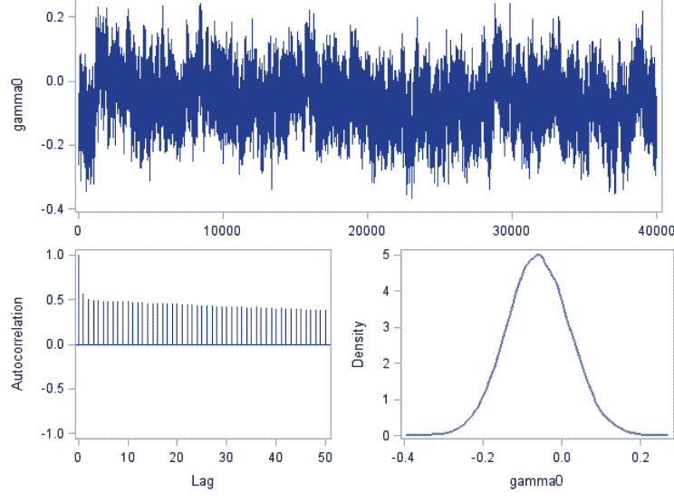

# 输出 6.14: SCH_V（学校级 θ 方差）——无条件模型的诊断图

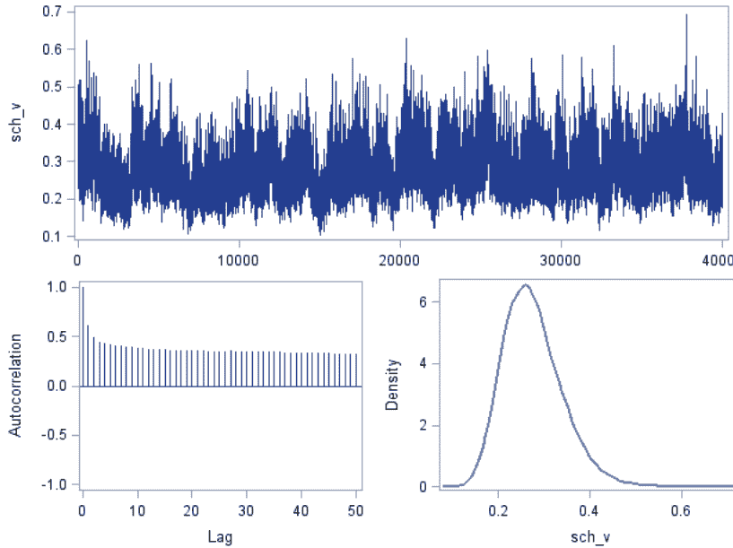

# 输出 6.15: THETA_V（学生级 θ 方差）——无条件模型的诊断图

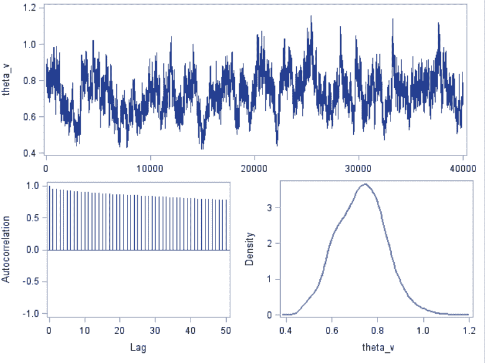


6.16 展示了条件模型部分参数的后验汇总统计：学校级 `theta` 分布参数（`GAMMA0`, `SCH_V`），以及为了解释学校级 `theta` 变异（`GAMMA1`）和学生级变异（`BETA1`, `BETA2`, `BETA3`）而引入的协变量。根据均值和标准差，所有协变量都是显著的。`Fox (2010)` 发现，学生级协变量（`PARTICIPATE`）表明，定期参加考试的学生数学能力有显著的正向影响。在学生级，身高和性别也显示出显著影响，女性表现优于男性。通过比较 6.12 和 6.16 中的均值，你发现方差（`SCH_V` 和 `THETA_V`）有所减少。这表明学校级数学能力和学生级能力的大部分变异可以通过学校和学生级协变量解释。对于条件模型，协变量的值与 `Fox` 报告的值非常相似，但与无条件模型一样，参数的标准差也相似。关于结果的更多讨论，读者应参考 `Fox (2010)`。

## 6.16: 分布与协变量的后验汇总统计——条件模型

| 参数 | N | 均值 | 标准差 | P25 | P50 | P75 |
|---|---|---|---|---|---|---|
| `gamma0` | 40000 | -0.31491 | 0.11224 | -0.39044 | -0.31318 | -0.23916 |
| `sch_v` | 40000 | 0.18263 | 0.04179 | 0.15300 | 0.17796 | 0.20719 |
| `theta_v` | 40000 | 0.47927 | 0.06986 | 0.41303 | 0.47322 | 0.52053 |
| `gamma1` | 40000 | 0.48259 | 0.11412 | 0.40541 | 0.48029 | 0.55795 |
| `beta1` | 40000 | 0.46130 | 0.03615 | 0.23785 | 0.45971 | 0.48430 |
| `beta2` | 40000 | 0.25684 | 0.02797 | 0.23785 | 0.25587 | 0.27553 |
| `beta3` | 40000 | -0.17904 | 0.04303 | -0.20525 | -0.17843 | -0.15120 |

最后，输出 6.17 和 6.18 展示了用于解释 `theta` 在学校级和学生级变异的协变量的诊断图。从图中可以看出，参数的链链反映了良好的混合行为；也就是说，采样值以较快的速度遍历了参数空间，尽管 `BETA0` 的链表现出自相关性。从图中可以得出结论，链正在收敛到目标分布。注意，没有包含 `SCH_V` 和 `THETA_V` 的图，因为它们与无条件模型的图相似。

## 第 6.17 章: IRT 模型扩展 179

输出 6.17: 学校级协变量的诊断图——条件模型

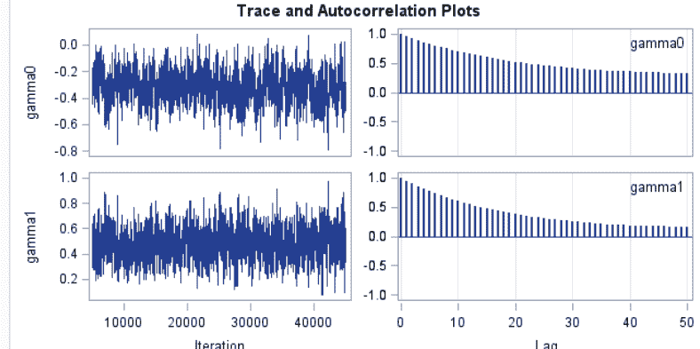

输出 6.18: 个人级协变量的诊断图——条件模型

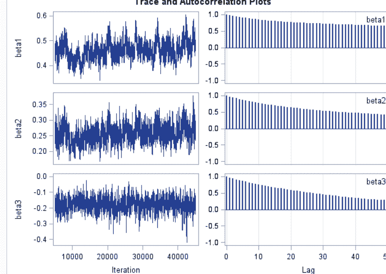

# 使用 SAS 进行项目响应模型的贝叶斯分析

# 项目差异化功能——多组和混合 IRT 模型

在评估推断的有效性时，你应该评估样本异质性以及推断是否有效。从图中可以看出，参数的链链反映了良好的混合行为；也就是说，采样值以较快的速度遍历了参数空间，尽管 `BETA0` 的链表现出自相关性。从图中可以得出结论，链正在收敛到目标分布。注意，没有包含 `SCH_V` 和 `THETA_V` 的图，因为它们与无条件模型的图相似。

**项目差异化功能——多组和混合 IRT 模型**

在评估推断的有效性时，你应该评估样本异质性以及推断是否有效。从图中可以看出，参数的链链反映了良好的混合行为；也就是说，采样值以较快的速度遍历了参数空间，尽管 `BETA0` 的链表现出自相关性。从图中可以得出结论，链正在收敛到目标分布。注意，没有包含 `SCH_V` 和 `THETA_V` 的图，因为它们与无条件模型的图相似。

# 182 使用 SAS 进行项目反应模型的贝叶斯分析

组间的不不变性。如果你将输出 6.19 中的结果与不假设子群体的结果（见第 4 章中的输出 4.1），你会发现项目参数的均值非常相似。此外，在输出 6.19 的受限模型中，`MU2` 被估计约为 0，这表明用于形成分组的随机过程所预期的 `theta` 参数分布不存在差异。

**输出 6.19：** 受限多组模型的参数后验汇总统计——LSAT 数据

| 参数 | N | 标准差 | 95% 置信区间 |
|---|---|---|---|
| `a` | 20000 | 0.7230 | 0.0713 | 0.5719, 0.8497 |
| `b1` | 20000 | -3.8107 | 0.3889 | -4.5867, -3.0701 |
| `b2` | 20000 | -1.3883 | 0.1717 | -1.7406, -1.0757 |
| `b3` | 20000 | -0.3372 | 0.1186 | -0.5727, -0.1131 |
| `b4` | 20000 | -1.8120 | 0.1949 | -2.2029, -1.4606 |
| `b5` | 20000 | -2.9046 | 0.2896 | -3.4775, -2.3170 |
| `mu_g` | 20000 | -0.0169 | 0.1209 | -0.2531, 0.2261 |

## 混合模型

在混合模型中，通过允许使用各组或潜类别的项目参数来检查差异性能和潜类别的识别，`P(U_{ij}|u_g, alpha_{gj}, theta_j)`。在这些模型中，假设的模型跨潜类别保持不变，每个类别都有一组估计的参数，反映了成员类别的概率。因此，混合模型可以解释考试之间的差异和异质性（`Rost, 1990`）。

程序 6 展示了估计模拟数据集混合模型的代码。数据是使用 `Mplus` 中的示例 7.2（`Muth & Muthen, 2022`）模拟的，该示例说明了混合 IRT 模型的模拟和评估。示例程序模拟了 8 个响应和 2 个潜组，共 20000 次观测值（每组 10000 次），其中斜率和截距在组间变化。`Mplus` 用于通过 `PROC MCMC` 评估混合模型。

在程序 6.9 中，你可以看到 2P 模型是通过组别特定的项目参数估计的。这些参数在程序中通过分组（2）和项目数量（8）的二维数组进行引用。此外，为每个类别定义了随机效应（`GROUP`），以估计分配到每个潜类的概率。分组的先验分布指定为参数 `P` 的离散分布。在 `PROC MCMC` 中，参数 `P` 是一个大小为二的向量，对应于分配到两个潜类的概率。其先验分布是 `Dirichlet` 分布，常用于离散分布。使用单个 `RANDOM` 语句定义分组的随机效应和先验分布。由于使用了 `RANDOM` 语句，假设子群体具有相同的分布。该假设用于识别模型。最后，响应概率模型反映了两个潜类别的项目参数估计。

# 第 6 章：IRT 模型扩展

由于，由于只模拟了两个组，`RANDOM` 语句可以使用 `BINARY` 分布。然而，使用 `TABLE` 分布允许涉及两个以上的程序应用。

# 程序 6.9：混合 IRT 模型--模拟项目响应

```
procm mcmc data=mixture_data out=mixture_post seed=23 nbi=5000
nmc=30000 monitor=(a b pi) nthreads=8 plots=(trace autocorr);

array b[2,8]; array a[2,8]; array d[2,8];
array pi[8]; array pi[2];
params a;
params d;
params pi;
ray prob[2] (.5, .5)
prior d ~ normal(0,var=4);
normal(0,var=2,lower=0);
prior pi ~ dirch(prob);
random group ~ table(pi)subject=obs;
random theta ~ normal(0,var=1) subject=obs;

d j=1 to 8
p[j] = logit(a[group,j])theta - d[group,j];
broup(group,j)/a[group,j];
end;

model ix1 ~ binary(pi1);
model ix2 ~ binary(pi2);
model ix3 ~ binary(pi3);
model ix4 ~ binary(pi4);
model ix5 ~ binary(pi5);
model ix6 ~ binary(pi6);
model ix7 ~ binary(pi7);
model ix8 ~ binary(pi8);
run;
```

输出 6.2 提供了混合 IRT 模型中部分参数的后验汇总结果。在该输出中，提供了项目 1-3（对应第一个类别）的斜率和阈值参数结果，以及项目 9-11（对应类别 2）的阈值参数结果。此外，还提供了潜类别概率（`pi1-pi2`）的后验汇总结果。注意，使用 `Mplus` 对相同数据进行后验汇总可以看出，两个类别之间的斜率和阈值参数均显著不同。你还可以看到潜类别参数 `pi1` 和 `pi2` 被估计为 .5，这反映了每个类别的观测次数。最后，你可以看到潜类别的标准差很小，表明潜类别具有较高的确定性。随机效应确认了几乎所有者都分配到一个潜类别。进一步处理数据显示每个类别的平均概率超过了 95%。

输出 6.20：混合 IRT 模型参数后验汇总

| 参数 | N | 均值 | 标准差 | P25 | P50 | P75 |
|---|---|---|---|---|---|---|
| `a1` | 20000 | 1.4479 | 0.2082 | 1.1339 | 1.4391 | 1.5809 |
| `a2` | 20000 | 1.7238 | 0.2704 | 1.5907 | 1.7623 | 1.9477 |
| `a3` | 20000 | 1.8354 | 0.2591 | 1.6537 | 1.8127 | 2.0066 |
| `b1` | 20000 | 1.3568 | 0.1486 | 1.2528 | 1.3435 | 1.4416 |
| `b2` | 20000 | 1.3222 | 0.1384 | 1.2276 | 1.3147 | 1.4052 |
| `b3` | 20000 | 1.1677 | 0.1168 | 1.0850 | 1.1588 | 1.2411 |
| `a9` | 20000 | 1.6268 | 0.2522 | 1.4439 | 1.6160 | 1.8022 |
| `a10` | 20000 | 0.8228 | 0.1734 | 0.7022 | 0.8295 | 0.9419 |
| `a11` | 20000 | 0.5995 | 0.1587 | 0.4918 | 0.5975 | 0.6937 |
| `b9` | 20000 | -1.2371 | 0.1325 | -1.3793 | -1.2606 | -1.1778 |
| `b10` | 20000 | -2.6392 | 0.3155 | -2.9702 | -2.6170 | -2.4217 |
| `b11` | 20000 | -3.6316 | 0.3176 | -3.9811 | -3.6222 | -3.3122 |
| `pi1` | 20000 | 0.4929 | 0.0118 | 0.4811 | 0.4997 | 0.5072 |
| `pi2` | 20000 | 0.5102 | 0.0118 | 0.5002 | 0.5111 | 0.5211 |

输出 6.26 展示了每个潜类别估计的项目集参数（`aᵢ, bᵢ, pi`）的诊断图。此外，还提供了类别概率参数（`pi1–pi2`）的诊断图。你可以看到项目参数混合良好，尽管观察到高相关性），而潜类别概率的轨迹在链中显示出良好的混合，采样值之间的依赖性较低。所有参数的密度均近似正态分布。

可以估计多个混合模型。例如，可以估计具有不同潜类别数量的模型并用于确定最佳潜类别数量（类别枚举）。模型比较方法可以用于此目的（见第 7 章的模型章节）。此外，轨迹潜带的结构可以通过类别特定的均值和标准差（`μᵢ, σᵢ`）定义。在上述程序中，类别的分布是相同的，因此使用 `RANDOM` 语句指定模型中的效应。然而，可以使用程序 R 中相同的编码方案使用类别特定分布的参数来指定模型。但是，需要本章前一节列出的分层 IRT 模型策略来识别模型。即，限制项目参数——为一个项目固定一个斜率参数，并为每个潜类别相关的项目集固定一个截距参数。

最后，在估计混合模型时应谨慎。`Sawatzky, Ratner, Kopec, & Zumbo (2012)` 警告说样本异质性可能源于 `DIF`（项目反应差异）之外的因素。例如，指定的异质性可能源于变量分布的非正态性或模型的错误（项目响应的多维性）。此外，在本章早期讨论双因子模型时涉及的“标签切换”（label switching）问题是混合模型中的一个特殊问题（`Jasra, et al., 2005`）。在本分析中，潜类别的项目响应为

# 第 6 章：IRT 模型扩展

定义良好。在潜类别定义得较差的情况下，可能会发生标签切换（label switching）。关于此问题的更多信息，请参见本章中的“标签切换问题”章节。

## 输出 6.21: 混合 IRT 模型下项目 1 (a1 潜类别 1) 的诊断性图

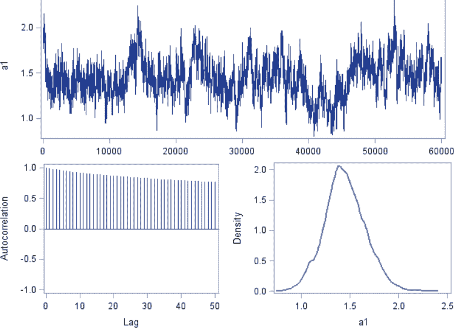

## 输出 6.22: 混合 IRT 模型下项目 1 (a9 潜类别 2) 的诊断性图

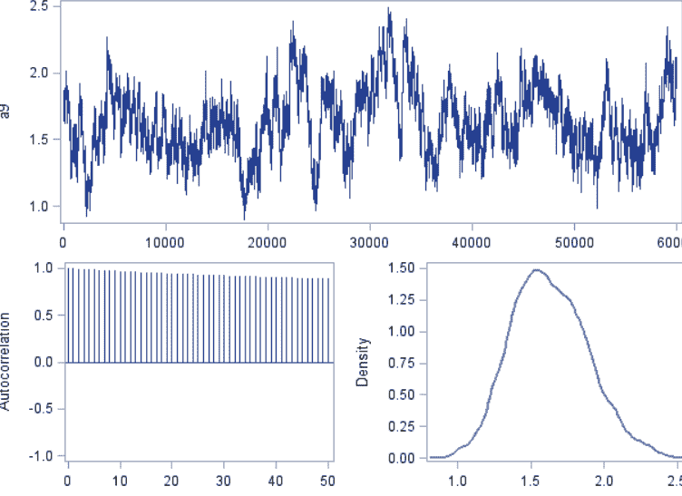

## 使用 SAS 进行项目反应理论的贝叶斯分析

输出 6.23: 混合 IRT 模型下项目 1 ($b_1$ 潜类别 1) 的诊断性图

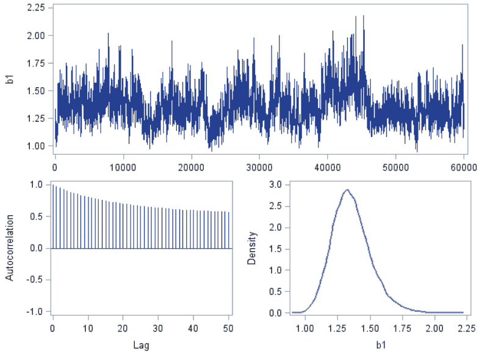

输出 6.24: 混合 IRT 模型下项目 1 ($b_1$ 潜类别 2) 的诊断性图

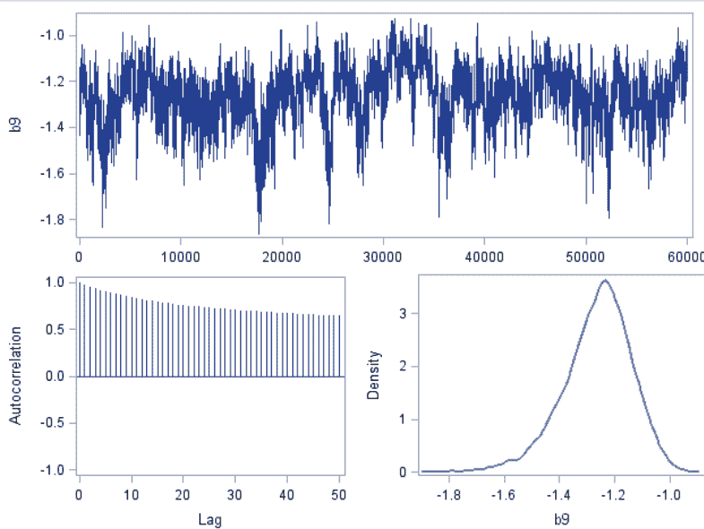

## 输出 6.25: 混合 IRT 模型下 Pi1（潜类别 1 的概率）的诊断性图


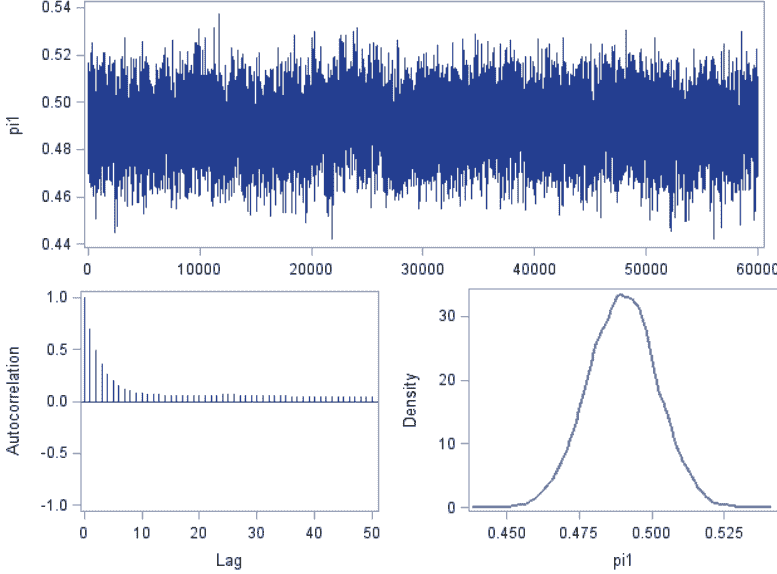

## 输出 6.26: 混合 IRT 模型下 Pi2（潜类别 2 的概率）的诊断性图


# 第 7 章：IRT 模型的贝叶斯比较

- 引言.................................................................................................................... 189
- 贝叶斯模型比较指数 ................................................................................ 190
- 离差信息准则..........................................................................................................190
- 条件预测序数 (CPO).......................................................................................................190
- 在 PROC MCMC 中计算模型比较统计量...............................................................191
- 示例 1：比较二分评分项目的模型（LSAT 数据） ... 193
- DIC 结果...............................................................................................................................193
- CPO 结果...............................................................................................................................194
- 示例 2：比较多级评分项目的 GR 和 RS-GR 模型（DASH 项目反应） ..........................................................................................................196
- DIC 结果...............................................................................................................................197
- 示例 3：比较单维 IRT 模型和双因子 IRT 模型.. 200
- DIC 结果...............................................................................................................................200
- CPO 结果...............................................................................................................................201

## 引言

在许多应用中，可能会估计不同的模型，这些模型反映了关于项目反应性质的竞争性理论视角，因此也是竞争的模型规范。例如，第 1 章和第 4 章中的三个二分评分模型反映了对项目性质（项目特征）、个体（个体特征）以及项目反应的不同假设。模型比较方法可用于评估竞争模型，并决定关于项目和个体特征的哪些假设是合理的，哪些是不可行的。

本章从描述两个可用于 MCMC 方法的指数开始。随后是三个比较第 4、5 和 6 章中竞争模型的示例。在这些每个程序中，都使用从模型参数联合后验分布中提取随机样本来计算某些模型比较指数。当然，可以处理后验分布中的所有迭代，但由于模型比较指数的似然结果是在被试和项目之间汇总的（使用均值），因此并不一定需要处理联合后验分布中的迭代。因此，我们将展示如何使用 `PROC SURVEYSELECT` 从后验分布中抽取随机样本。此外，我们发现这些程序之间的主要区别在于用于计算响应数据似然的 IRT 模型。因此，使用任何示例程序来计算其他模型比较应用中的模型统计量都是直接的。

## 贝叶斯模型比较指数

如第 2 章所述，在贝叶斯范式中，模型比较指数基于信息准则和贝叶斯因子（Bayes factors）。这类指数可以评估竞争模型之间的相对拟合度，但不解决任何特定模型的绝对拟合度，或者任何特定模型接近数据的程度。贝叶斯范式中的绝对拟合度通常使用后验预测检查（PPMC）进行评估。第 8 章详细考虑了 PPMC 分析。

## 离差信息准则

离差信息准则（DIC; Spiegelhalter et al., 2002）是一种模型比较工具，类似于著名的基于似然的信息准则：赤池信息准则 (`AIC`; Akaike, 1974) 和贝叶斯信息准则 (`BIC`; Schwarz, 1978)。DIC 可用于比较嵌套或非嵌套模型，以及非独立同分布的模型。DIC 在贝叶斯估计中被广泛使用，定义为：

$DIC = D(\bar{\delta}) + p_D$

其中 $D(\bar{\delta})$ 是跨迭代的离差后验均值，衡量数据与模型的拟合程度；$p_D$ 用于考虑模型复杂性或过拟合。

在解释竞争模型之间的 DIC 值时，DIC 值越小表示拟合越良好。然而，没有用于执行 DIC 值的统计假设检验。相反，讨论了解释 DIC 差异的指南：大于 10 的差异是“重要的”，5 到 10 之间的差异反映了“明显的”，小于 5 的显著（Lum, Jackson, Thomas, & Spiegelhalter, 2013）。需要注意的是，在使用缺失数据时应谨慎使用 DIC，因为似然未定义（Linn et al., 2013）。此外，DIC 假设后验均值是后验分布的一个准确且合适的估计。如果并非如此，即后验密度反映出极偏态或双峰，则可能不应使用 DIC。

## 条件预测序数

贝叶斯分析中从竞争模型中选择优选模型的常用方法是计算贝叶斯因子（BF）。BF 定义为模型 1 对于模型 2 的后验优势比除以模型 1 对于模型 2 的先验优势比。该比例简化为每个模型跨参数空间的数据边缘似然之比。

然而，贝叶斯因子的计算在实践和理论上都有局限，特别是在先验模糊或高参数模型的情况下。为了解决这些问题，提出了称为伪贝叶斯因子（PsBF）的替代准则作为 BF 的替代（Gisser & Eddy, 1979; Gelfand, Dey & Chang, 1992; Kim & Bolt, 2007）。PsBF 指数在使用条件预测序数（CPO）时近似 BF 中的边缘密度。如第 2 章所述，任何模型的 CPO 指数可以定义为 $\prod_{i=1}^n (CPO_i | M)$，且 CPO 值越大越优。

### 第 7 章：IRT 模型的贝叶斯比较 191

在使用 MCMC 方法进行 IRT 估计的背景下，CPO 统计量首先在单个项目反应层面进行估计，其使用了联合后验分布中 $T$ 个样本的每个观测值的似然性的倒数：

```
$CPO_{ij} = \left( \frac{1}{T} \sum_{t=1}^{T} \frac{1}{p(y_{ij} | \delta_t)} \right)^{-1}$
```

其中，$T$ 是链的样本数，$p(y_{ij} | \delta_t)$ 是基于 $t$ 时采样的项目和参数值（$\delta_t$），受试者 $i$ 对项目 $j$ 响应数据的似然度。给定每个受试者的似然度后，$CPO_{ij}$ 通过 $T$ 次抽样的似然度平均值的倒数计算得出。

项目层面的 CPO 指数可以通过汇总所有 $N$ 个受试者 $CPO_{ij}$ 值的乘积得到：

```
$CPO_{j} = \prod_{i=1}^{N} CPO_{ij}$
```

整个测试的 CPO 指数可以通过汇总所有 $J$ 个项目的项目层面 $CPO_{j}$ 的乘积得到：

```
$CPO = \prod_{j=1}^{J} CPO_{j}$
```

注意，本章使用了 CPO 的自然对数进行比较。乘积项变为上述对受试者和项目的求和。优选模型是 CPO 值较大的模型。

## 在 PROC MCMC 中计算模型统计量

在 `PROC MCMC` 中输出 DIC 统计量

为了比较整个测试的 DIC 和每个项目的项目层面 $CPO_{ij}$，需要一个 SAS 程序来处理使用 `PROC MCMC` 进行贝叶斯分析时产生的 `OUTPOST` 数据。下面展示了该程序的模板，以便您查看编程代码与提供的公式之间的联系。该过程的第一步是将模型参数（项目参数和受试者参数）的联合后验分布采样值与每个受试者 $i$ 的观测数据联系起来。这允许使用每次迭代中采样的参数值（$p(y_{ij} | \delta_t)$）计算每个受试者项目反应数据的似然度，并跨迭代累积结果（$\sum 1/p(y_{ij} | \delta_t)$）。下一步是汇总跨迭代的结果，以获得单个项目反应层面的 CPO（$CPO_{ij}$），然后汇总跨每个项目的 $CPO_j$ 结果（项目层面 CPO 指数或 $CPO_j$）以及跨项目的汇总（测试层面 CPO 指数或 $CPO$）。

### 192 使用 SAS 对反应理论模型进行贝叶斯分析

```
/* 步骤 1：为 OUTPOST 中的每个后验样本计算 CPO(i,j)
创建一个包含观测数据和单次迭代后验结果（- 采样值）的数据集 */
```

```sas
data one_iteration;
/* 从 OUTPOST=dataset 读取一次迭代的 R 后验样本
   从 DATA=dataset 读取具有 N 种响应模式的观测数据
   将数据集附加到后验样本中，使得观测数据中的每个
   受试者都拥有项目和
   受试者参数的采样值 */
```

```sas
data cpo_i_j;
Set one_iteration;
do j=1 to nitems;
/* 使用用于参数的后验样本计算每个人和
   每个项目响应的对数似然性的倒数 - 项目和
   受试者参数 */
end;
run;
```

```sas
/* 将 OUTPOST 中每次迭代的结果累积到基础 SAS
数据集中 - 聚合结果的数据集具有 N x R 个观测值 */
```

```sas
proc append base=<accumulated cpo_i_j results> data=cpo_i_j;
run;
```

在 `OUTPOST` 中跨 R 次迭代重复步骤 1

> /* 步骤 2：计算项目层面 CPO 和测试层面 CPO */

计算每个人的对数似然统计量的平均值，

跨后验迭代汇总每个人的对数似然统计量 *

```sas
proc means data=<accumulated cpo_i_j results>
class variable /* 定义受试者观测的变量 */;
var var /* 每个项目的对数似然统计量列表 */;
out output=<平均值输出数据集> Mean=
run;
```

```sas
/* 为每个项目计算 CPO 指数 */
data cpo_i_j;
Set <平均值输出数据集>;
do j=1 to nitems;
/* 为每个项目计算 CPO 指数 */
end;
run;
```

```sas
/* 步骤 3：汇总跨受试者跨项目的 CPO */
proc summary data=<cpo_i_j>
var var /* 每个项目的对数似然统计量列表 */;
out output=<平均值输出数据集> Mean=testCPO;
run;
```

```sas
/* 保存测试层面 CPO 结果 */
data test_cpo;
Set <平均值输出数据集>;
run;
```

### 208 第 7 章：IRT 模型的贝叶斯比较 193

## 示例 1：比较二分计分项目 (LSAT)

对于二分计的项目，我们感兴趣的是 DIC 统计量对模型是否有用。

### 表 7.1 DIC 结果

| DIC | 1P | 2P | 3P |

|---|---|---|---|

| Dbar | 4589.98 | 4568.46 | 4565.01 |

| Dmean | 4288.84 | 4270.85 | 4238.37 |

| pd | 301.16 | 297.82 | 326.64 |

| DIC | 4891.16 | 4866.47 | 4891.65 |

也可以检查 DIC 的组成部分。由于 Dbar 和 Dmean 的底层方差对应于观测值的累积，这些统计量也可用于衡量模型描述数据的良好程度，而 Dmean 衡量的是基于点估计的“最佳”模型描述数据的良好程度。

此外，嵌套模型之间 Dmean 的差异应服从卡方分布，其自由度等于估计参数数量之差（Spiegelhalher, 2002）。在 1P 和 2P 模型中，卡方值为 17.99，自由度为 5，对应于 5 个斜率参数，这些额外的斜率参数对模型拟合度有显著贡献。然而，尽管这种比较与 DIC 值一致，但 2P 与 3P 模型之间 Dmean 的差异表明，增加的 c_i 参数对模型拟合也有显著贡献。因此，对于 LSAT 数据，尚不清楚统计模型 Dmean 的差异是否可以用于模型比较。

最后，反映有效参数数量的 pd 值呈现了一个悖论的结果。如你所示，2P 模型的 pd 较低，该模型包含比 1P 模型更多的参数。记住，根据定义，pd 是“最佳”模型与跨迭代平均值（Dbar）之间的差异。

# 使用 SAS 对项目反应理论进行贝叶斯分析

$D_{mean}$ 可能低于预期，额外的斜率参数可能为数据建模提供了更多信息。这可能为基于 LSAT 数据的 2P 模型提供了额外的支持。

## CPO 结果

该程序 7.1 使用 SAS 程序获取 1P 模型的 CPO 结果。该程序假设观测数据（LSAT）和来自后验分布的样本（来自 `PROC MCMC` 的 `OUTPOST` 文件）位于工作库（work library）中。控制参数指定 ①，响应概率模型中的参数标签定义如下：斜率参数 $a_i$、阈值 $b_i$ 到 $b_n$，以及猜测参数 $c_i$ 到 $c_n$；其中 $n$ 是项目数量 ② 数据集的处理方式是将观测观测数据（LSAT）保存在 SAS 数据集中 ③，并将来自 `OUTPOST` 数据的估计值副本保存在 `DATA` 集中 ④。使用宏 `cpo_di` 按照模板中的三个步骤 ⑤ 计算二二分类数据的项目级和测试级 CPO 值。对于 `OUTPOST_` 中的每个观测值，程序指定了必要的模型参数（项目参数和人员参数），并在 `DATA STEP ONE CPO DI` 中使用采样值计算每个观测值的观测似然性 ⑥ 结果积累在 SAS 数据集 `ALLPO_I` 中。从 `ALLPO_I` 计算项目级和测试级 CPO 指数 ⑥，并将结果保存并管理在数据集 `CPO_RESULT` 中 ⑦

该程序指定了用于 1P、2P 和 3P 模型的三个响应概率模型 ⑧。要为 2P 或 3P 模型运行程序，你需要将宏变量 `ITEMPARAMS` 更改为正确的模型变量，更改宏变量并更改任何所需的文件规范。

## 程序 7.1：计算 1P 模型–LSAT 的 CPO 统计量

```sas
* 宏控制设置
USER DEFINED;
%itemlevel=1; /* 1-P 2P-3P */ ①
%itemnerson=1000; /* 考官人数 */
%itemn=5; /* 项目数量 * */
%itemsamples=2000; /* 用于 CPO 的 OUTPOST 迭代子集 */
%itemparams=a b1-b5; /* OUTPOST 中的项目参数 */ ②

/* 创建 SAS 数据集处理观测数据和 OUTPOST 的迭代子集 ③ */
data res_data;
set lsat;
run;

proc select data=lsat sample=&itemsamples out=outpost_sample _j;
run;

%macro cpo_di;

/* STEP1：为后验分布的每次迭代计算 CPO(i,j) */
proc datasets delete allpo_ij;
run;

%do mc=1 to&itemsamples;
/* 将后验结果附加到观测数据集的每个记录 */
data one;
if _obs=mc then output sample_sample(obs=&mc);
set res_data;
array theta(*) theta1-theta&itemnerson;
theta=theta[person];
keep x theta;

# 第 7 章：IRT 模型的贝叶斯比较

```sas

data cpo_ij;

sample=&mc;

set one;

array x(&itemn) x1-x&itemn;

array a(&itemn) a1-a&itemn;

array b(&itemn) b1-b&itemn;

array c(&itemn) c1-c&itemn;

array p(&itemn) p1-p&itemn;

array l(&itemn) l1-l&itemn;

array in(&itemn) in1-in&itemn;

do j=1 to&itemn;

  if model = 1 then p(j)=logistic(a[j]*(theta - b[j]));

  else if model = 2 then p(j)=logistic(a[j]*(theta - b[j]));

  else if model = 3 then p(j)=c[j]*(logistic(a[j]*(theta - b[j])));


`l[j]=p[j]**(-p[j])*(1-p[j]);`

`in[j]=1/l[j];`

`end;`

`keep sample person in1-in&itemn;`

`run;`

`/* 累积后验分布的每次迭代的结果 */`

`proc append base=allpo_ij data=cpo_ij;`

`run;`

`/* STEP2：计算每个人的项目级 CPO 和测试级 CPO */`

`proc sort data=allpo_ij;`

`by person;`

`run;`

`proc means data=allpo_ij nway noprint;`

`class person;`

`var in1-in&itemn;`

`output out=allpo_ij Mean=;`

`run;`

`data allpo_ij;`

`set allpo_ij;`

`array in(&itemn) in1-in&itemn;`

`array logcpo(&itemn) logcpo_ij-logcpo_ij;`

`do j=1 to&itemn;`

`logcpo[j]=log(in[j])**(-1); /* 缩放为似然结果 */`

`end;`

`keep person logcpo_ij-logcpo&itemn;`

`run;`

`/* STEP 3：汇总人员和项目的 CPO 结果 */`

`proc summary data=allpo_ij;`

`var logcpo_ij-logcpo&itemn;`

`output out=CPO_item SUM=CPO_item&itemn;`

`run;`

`/* 将项目级和测试级 CPO 结果保存到文件：Work.CPO_result */`

`data CPO_result;`

`set CPO_item;`

`CPO_test=sum(CPO_item&itemn);`

`run;`

`%mend;`

`/* 为 1P 模型运行 CPO - 假设数据集在 Work 库中 */`

`%cpo_di;`

7.2 展示了基于模型参数联合后验分布抽样的三个 IRT 模型的项目级和测试级 CPO 结果。测试级 CPO 结果表明，1P 模型适用于 LSAT 项目，因为 1P 的 CPO 值较大。通过比较每个项目的三个项目级 CPO 值，我们可以看到1P 模型也是每个项目的首选模型。

# 表 7.2：三个 IRT 模型的 CPO 指数—LSAT 数据

| CPO 结果 | 项目 1 | 项目 2 | 项目 3 | 项目 4 | 项目 5 | 测试 |
|---|---|---|---|---|---|---|
| 1P | -263.9 | -593.0 | -674.5 | -538.6 | -380.2 | -2450.2 |
| 2P | -264.8 | -594.0 | -675.9 | -540.9 | -382.6 | -2458.2 |
| 3P | -265.3 | -594.5 | -674.6 | -540.9 | -382.4 | -2459.6 |

基于 DIC 统计量和 DIC 统计量，首选模型随 LSAT 数据有所不同。不同模型指标的不一致性（DIC 与 CO 统计相比）在文献中已有发现。DIC 已证明可以提供更复杂的模型，可能会

# 程序 7.2：用于 GR 模型计算 CPO 指标的程序

```sas
/* 宏的控制设置 */
* let nperson=1000; / 受试人数 *
* let nitem=100; / 题目数量 *
* let itemsample=2000; / 在 CPO 中使用的 OUTPOST 迭代子集 *
* let itemsparal=a1-nitem b1_l1_nitem b2_l2_b2&nitem b3_l3_b3&nitem b4_l4_nitem; 1;
/* 创建用于处理的数据集 - 观测观测数据以及来自 OUTPOST 数据集的迭代子集 *
data resp_data;
    Set dash_sample;
    run;
proc surveyselect data=dash_bays gr method=SRS rep=1
samplesize=&postsamples=12345=outpost_sample;
    id_all;
    run;
%macro CPO_gr;
/* 步骤1：为后验分布的每次迭代计算 CPO(i,j) *
proc datasets; delete allCPO_ij; run;
do mc=1 to 4&samples;
    /* 将结果附加到观测数据的每条记录 *
    /* 对后验分布的每次迭代重复该过程 *
    data one;
    if n_=1 then set outpost_sample(firstobs=4&mc obs=&mc);
    set resp_data;
    array theta(*) theta_1-theta_n&nperson;
    person_n;
    person[person];
    theta=theta-1&nitem&thetas data;
    keep person il-1&nitem&tempvars;
    run;
data cpo_ij;
sample=&mc;
    set one;
    array a(nitem) il-i&nitem;
    array a(nitem) al-a&nitem;
    array b[4,nitem] b1_l1_nitem b2_l2_b2&nitem b3_l3_b3&nitem b4_l4_nitem;
    array p_star(nitem,4);
    array p(nitem,5);
    array L(nitem) L-L&nitem;
    array inL(nitem) inL-1&inL&nitem;
    do j=1 to nitem;
        do k=1 to 4;
            p_star(j,k)=logistic(a[j])*(theta-b[k,j]));
        end;
        p[j,1]=1-p_star(j,1);
        do k=2 to 4;
            p[j,k]=p_star(j,k-1)-p_star(j,k);
        end;
        p[j,5]=p_star(j,4);
        L(j)=p(j,i[j]);
        inL(j)=1/L(j);
    end;
    keep sample person inLL-1&inL&nitem;
    run;
/* 累积后验分布每次迭代的结果 */
proc append base=allcpo_ij data=cpo_ij;
run;
end;
/* 步骤2：计算每个人的题目级 CPOJ 和测试级 CPO */
proc sort data=allcpo_ij; by person sample;
run;
proc means data=allcpo_ij nway noprint;
class person;
var inL1&inNitem;
output=allcpo_ij Mean=;
run;
data cpo_ij;
set allcpo_ij;
array logpo_ij(&nitem) inL1&inNitem;
array logpo_ij1-logcpo_ij&nitem logpo_ij-logpo&nitem;
do j=1 to &nitem
logpo_ij[j]=log(inL[j])**(-1);
end;
keep person logpo_ij1-logcpo_ij&nitem;
run;
/* 步骤 3：汇总跨个人和题目的 CPO 结果 */
proc summary data=allcpo_ij;
var logpo_ij1-logcpo_ij&nitem;
output=CPO_item SUM=CPO_item1-CPO_item&nitem;
run;
/* 将题目级和测试级 CPO 结果保存到 Work.CPO_result */
data CPO_result;
set CPO_item;
CPO_test=sum(CPO_item1-CPO_item&nitem);
run;
%end;
/* 运行 GR 模型 CPO - 假设数据集在 Work 中 */
%CPO_gr;
```

## 第 7 章：IRT 模型的贝叶斯比较

表 7 比较了 GR 模型和 RS-GR 模型的题目级和测试级 CPO 值。根据此，对于反应数据更倾向于使用 GR 模型。题目级结果用于进一步探索这一结论是否适用于所有题目。在 RS-GR 模型的 CPO 值大于 GR 模型的情况下（第 3、6 和 8 题），除可能存在的某道题目外，这些差异都是微乎其微。因此，基于测试级和题目级的 CPO 统计量，更倾向于选择 GR 模型或跨题目间具有独立参数的模型。

### 表 7.4：GR 和 RS-GR 模型的 CPO 指标—DASH 数据

| 题目 | GR 模型 | RS-GR 模型 |
|---|---|---|
| 1 | -840.2 | -845.0 |
| 2 | -768.3 | -771.1 |
| 3 | -743.1 | -741.2 |
| 4 | -1027.1 | -1039.4 |
| 5 | -1159.0 | -1159.9 |
| 6 | -878.5 | -877.8 |
| 7 | -936.9 | -940.0 |
| 8 | -1089.2 | -1082.2 |
| 9 | -729.8 | -740.1 |
| 10 (测试) | -1200.8 | -1207.4 |

### 示例 3：单维度 IRT 模型与双因子 IRT 模型的比较

如文所述，最近受到关注的多维 IRT（MIRT）是双因子模型。在双因子模型中，每个题目都有广义因子和二级因子的估计（Gibbons & Dedeker, 1992; Gibbs, 2007）。双因子模型在控制由其他因子引起的变异的情况下，允许测量广义能力或特质。二级因子在范围上较窄，被引入以捕捉广义因子之外的关系。正如 Reckeke (1994) 所述，当关注点是特质或维度时，“感兴趣的维度是提供信息的维度”。在双因子模型中，不仅广义因子，还为每个题目估计了斜率（因子负载）。对于这些应用，单维度 IRT 模型是有用的。

注意的是，模型比较可以用于评估基于测试集的模型是否优于标准 IRT 模型。正如第 1 和第 6 章所示，个人会对单个刺激集（testlet）做出反应。在这些应用中，双因子模型中的每个因子反映了一个测试集。因此，对于每个题目，为广义因子估计了一个系数，为单个测试因子估计了一个系数参数。在这种背景下，单维度模型与双因子模型的比较也可以用于评估测试集模型对描述反应是否有用。

## DIC 结果

表 7.5 提供了双因子和单维度（单因子）IRT 模型的 PROC MCMC DIC 统计及相关部分。结果显示，双因子模型的 DIC 值较小，且之间的差异大于 10。因此，对于模拟反应，优选模型是数据生成模型，即双因子模型。

### 表 7.5：双因子和单维度（单因子）IRT 模型的 DIC 结果

| DIC 结果 | 双因子模型 | 单维度模型 |
|---|---|---|
| Dhar | 13981.86 | 14792.79 |
| Dmean | 12787.34 | 13897.94 |
| pd | 1194.52 | 894.848 |
| DIC | 15176.37 | 15687.63 |

此外，对于 Dhar 和 Dmean，观测到双因子模型的值较小，这表明相对于估计的单维度模型，拟合度有所提高。正如预期，双因子模型的 pd 值（有效参数数量）显著更高，因为该模型更复杂，并且为每个题目估计了额外的斜率参数。

## 程序 7.3：通过双因子模型（Bifactor Model）计算 CPO 指数的程序

```sas
* 控制参数 *
%let np=1000;          /*项目总数的控制变量 *
%let nitem2=5;           /*因子 2 中的项目数 *
%let nitem3=5;           /*因子 3 中的项目数 *
%let samples=1000;      /*计算 CPO 时使用的样本数 *
%let items=a1_a1_nitem1 a2_a2_nitem2 a3_a3_nitem3 d1_d1_nitem2 d1_d2_nitem2 d1_d3_nitem2 d1_d3_nitem3;
/*双因子模型中的项目参数 */
/* 创建 SAS 数据集以处理观测数据以及从 OUTPUT 数据集中提取的迭代子集 */
data resp_data;
set bifactor_data;
keep ix1-ix10;
run;
proc surveyselect data=bifactor_post method=SRS rep=1
sampsize=12345 out=outpost_sample;
id_all_z;
run;
macro CPO_bifactor;
/* 第一步：计算 CPO(i,j) */ run;
proc datasets; data alicPO_ij; run;
do mc=1 to %samples; /* 每个样本计算 CPO(i,j) *
/* 附加后验分布以读取观测数据的每条记录 *
/* 对部分分布的每次迭代重复此操作 */
data one;
if c_n=1 then set outpost_sample(firstobs=&mc obs=&mc);
set resp_data;
array theta1[*] theta1-letheta1&n;
array theta2[*] theta2-letheta2&n;
array theta3[*] theta3-letheta3&n;
person_n;
theta1-theta1[person];
theta2-theta2[person];
theta3-theta3[person];
keep ix1-ix10&itemparps theta1-theta3;
run;
data cpo_id3;
sample=&mc;
set one;
array ix[&nitem1] ix1-ixnitem1;
array a1[&nitem1] a1_a1_nitem1;
array a2[&nitem2] a2_a2_nitem2;
array a3[&nitem3] a3_a3_nitem3;
array d[&nitem2] d1-d&nitem2;
array d_cr[&nitem3] d1-d1_d1_nitem3 d2_d2_nitem3 d3_d3_nitem3;
array theta(3);
array g(3);
array L[&nitem1] L1-LnItem;
array inL[&nitem1] inL1-LnItem;
do j=1 to &nitem2;
z = -(a1[j]*theta[1] + a2[j]*theta[2] - d[j]);
pr = 1 / (1 + exp(z));
L[j] = pr**ix[j] * (1-pr)**1 ix[j];
inL[j]=1/L[j];
end;
```

```sas
do j=(item2+1) to &nitem;
do k=1 to 3;
p[k] =-a1[j]*theta[1] + a3[j-5]*theta[3] - d_cr[k,j-5];
end;
if ix[j]=1 then prob=1/(1+exp(p[1]));
else if ix[j]=2 then prob=1/(1+exp(p[1])) - 1/(1+exp(p[2]));
else if ix[j]=3 then prob=1/(1+exp(p[2])) - 1/(1+exp(p[3]));
else prob=1/(1+exp(p[3]));
L[j]=prob;
inf[j]=1/L[j];
end;
keep sample person inL-lnL&nitem;
```

```sas
/* 第二步：计算项目级 CPO 和测试级 CPO */
proc sort data=allco_ij by person sample; run;
proc means data=allco_ij noprint;
class person;
var inL-lnL&nitem;
output out=allco_ij Mean=;
run;
data allco_ij;
set allco_ij;
array inL[nitem] inL-lnL&nitem;
array logco_ij[nitem] logco_ij-logco_ij&nitem;
do j=1 to &nitem;
dogco_ij[j]=log(inf[j]**(-1));
end;
keep person logco_ij-logco_ij&nitem;
run;
```

```sas
/* 第三步：汇总跨个人和项目的 CPO 结果 ** *
proc summary data=allco_ij;
var logco_ij_item-logco_ij&nitem;
output out=CPO_item SUM=CPO_item-CPO_item&nitem;
run;
```

```sas
/* 保存项目级 CPO 和测试级 CPO 结果 */
data CPO_result;
set allco_ij;
```


使用 SAS 评估模型拟合的各个方面。本章详细描述了用于执行后验模型检查（PPMC）分析的 SAS 代码。所展示的结果使用了图形模板语言（GTL）命令。由于本章的重点是获取后验模型检查（PPMC）结果，本章中生成图表的命令未在此给出，而是包含在作者书籍网页的程序中。对图形感兴趣的读者应查阅 SAS 图形模板语言文档。

## 模型拟合统计量

IRT 模型的模型拟合通常分为三类：测试拟合统计量、项目拟合统计量和被试拟合统计量。如第 1 节所述，测试拟合和项目拟合统计量均用于评估 IRT 模型。区别在于，测试拟合评估的是所有测试的整体拟合情况，而项目拟合评估的是每个单独题目的拟合情况。不拟合表明假设的 IRT 模型未能准确捕捉受试者对题目的反应。被试拟合统计量用于评估模型对特定受试者的拟合情况。不拟合表明为所选 IRT 模型的估计模型参数未能捕捉特定案例的反应模式。

为了评估 IRT 模型的拟合情况，您应该考虑测试级别的拟合是否受损、PPMC 分析是否建议了其他 IRT 模型，或者通过考虑用于建模拟合的项目和被试特征的替代理论方法是否提出了其他建议。例如，对项目反应的单维 IRT 模型进行 PPMC 分析可能会建议使用多维 IRT 模型（见本章示例 7）。或者，测试层面的不拟合可能无法揭示产生问题的题目，这些题目可以从测试中删除或修改。即使在测试层面发现了模型拟合，在项目层面执行 PPMC 以评估任何项目是否符合预期可能仍然很有用。最后，尽管发现了不拟合，但一些研究人员认为必须证明其实际意义。例如，Sinharay 和 Habberman (2014) 展示了评估模型不拟合实际意义的几个例子，并讨论了在模型不拟合某些条件下仍然可以对拟合进行效性推断。

当 IR 模型在被试层面出现问题但在测试或项目层面没有出现时，问题在于 IRT 模型不适用于某个或多个个人。在这种情况下，某人的反应模式与模型模式不匹配，或称为异常（aberrant），且被试拟合会影响对个人估计分数（theta）的推断。异常反应模式有许多可能的来源，例如教育评估中的作弊和粗心大意，以及在心理和行为评估中参与反应set的个体（如社会期望性反应或顺从性反应）。少数具有异常模式的人可能不会影响模型拟合，但大量具有异常模式的人可能是影响模型拟合的来源。

### 测试层面拟合

在测试层面评估模型拟合的常用方法是观察并比较得分分布或每个测试得分的人数。如果观测到的测试得分分布与预测的测试得分分布对应，则没有证据表明测试层面存在模型不拟合。除了对这两个分布进行描述性比较外，Béguin 和 Glas (2001) 建议使用皮尔逊卡方统计量（`$\chi^2$`）来检验总分观测分布与预期得分分布之间的差异。

### 项目层面拟合

即使 IRT 模型在测试层面拟合数据，某些项目在特定 IRT 模型下的反应也可能不符合预期 (Embretson & Reise, 2000)。识别这些不拟合的题目可以帮助测试者隔离题库中的劣题，并仅保留题库中符合 IRT 模型的题目。与整体测试拟合统计量相比，文献中提出了更多统计程序在项目层面评估 IRT 模型。

多项目统计量比较每个项目的反应得分分布或在每个类别中的反应频率（例如，二分题的 0 与 1）。这些统计量的通用步骤在第 1 节中描述，文献中备受关注的一种统计是 Yen 的 `$Q_{\theta}$` 统计量 (Yen, 1981)。`$Q_{\theta}$` 统计量基于反应类别的交叉分类。可以使用卡方统计量来总结观测频率与预期频率之间的差异，使用了离散 `$\theta$` 下每个反应类别的预期频率。

### 被试拟合

被试拟合统计量是指用于评估被试拟合情况的方法。对被试拟合的研究可以帮助研究人员获取有关反应行为的其他信息并识别异常反应模式。被试拟合有很多可用统计量。Meijer 和 Sijs (2001) 讨论了不同的被试拟合统计量。

常用且直观的被试拟合衡量之一是对数似然统计量 `$L_{\theta}$` (Drasgow, Levine, & Williams, 1985)。`$T_{\theta}$` 定义为基于被试反应的 `$L_{\theta}$` 标准版本。

## 后验预测检查

PPPC 涉及使用后验样本在估计或假设模型下模拟反应（数据）。使用差异测量或统计量将模拟或复制的数据与观测数据进行比较。PPPC 的原理是，如果模型拟合数据，那么观测数据的任何统计量都应该与模型下复制数据的统计量相似。任何系统性差异都表明模型可能不拟合 (Gelman, Carlin, Stern, Dun, Vetari, & Rubin, 2014)。

### PPC 方法

PPC 方法使用从后验分布 `$p(\delta|D)$` 中抽取的参数样本在模型模拟反应，`$D$` 对应观测数据 `$\delta$` 对应参数集。对于后验分布中的每个抽取或项目，都会生成一组基于模型的观测值。因此，对于 `$R$` 次迭代，会有 `$R$` 个预测反应数据集。每个数据集代表来自后验分布 `$p(T^{rep}|D)$` 的样本。对每个 `$T^{rep}$` 复制计算差异统计量 `$T$`，以产生模型拟合假设条件下的差异测量分布。

还对观测数据计算差异统计量 `$T(D)$`，并利用 `$T(D)$` 与 `$T(T^{rep})$` 分布之间的任何系统差异来评估模型拟合。计算后验预测概率值（PPP 值）来化 `$T(D)$` 在后验预测分布 `$T^{rep}$` 参考分布中的相对出现情况：

$$PPP = P(T(T^{rep}) \geq T(D))$$

其中 PPP 是 `$T(T^{rep})$` 等于或超过 `$T(D)$` 的复制次数比例。因此，PPP 值反映了预测与观测之间差异测量的相对相似性。

PPP 值接近 5 表示观测值与预测值之间没有差异，因此表明模型拟合良好。PPP 接近 0 或 1（通常指为值 <0.05 或 >0.95）表明观测统计量与后验预测值不一致，从而反映了模型与数据之间的拟合不足（Gelman et al., 2014）。正如第 2 章所述，PPP 值的解释不应与传统的假设检验 p 值相同。

也可以通过图形显示来评估 `$T(D)$` 在参考分布 `$T(D^{ref})$` 中的相对出现情况。例如，可以绘制 `$T(D^{ref})$` 的直方图频率分布，并将 `$T(D)$` 放置在直方图中，以表示在差异统计量的经验分布（基于复制数据生成）中，基于观测数据的差异统计量的相对频率。

第 7 章讨论了用于模型比较的其他方法；PPC 也用于贝叶斯分析中的模型比较。可以通过比较不同模型对于差异量的极端 PPP 值的平均值，来评估一组候选模型的相对拟合程度。较少 PPP 值的模型被认为比具有较高极端 PPP 值的备选模型更拟合数据（例如 Sinharay, 2005; Zhu & Stone, 2012）。

显然，选择合适的差异量是应用 PPC 方法时的重要考虑因素，应选择能够反映潜在不拟合来源的指标。在总体讨论中，差异量仅依赖于复制数据的 `$T(D^{ref})$` 和观测数据的 `$T(D)$`。然而，也可以计算依赖于数据和模型参数的差异量。在这种情况下，差异量分别表示为复制数据的 `$T(D^{ref})$` 和观测数据的 `$T(D)$`。

## 后验预测分布

基于 SAS 数据和 `PREDICTST` 模型获取后验预测分布有两种方法。一种方法是在 `PROC MCMC` 方法中使用 `PREDICTST` 语句。用于 IR 模型分析的选项语法为：`preprocess OUTSET dataset=<value>`，其中 `<SASdataset>` 指定包含模拟后验预测样本的数据集，`NSIM` 的 `<value>` 指定 SAS 数据集中的复制次数。

图 1 展示了如何基于 SAS 数据和 1P 模型获取后验预测分布。如图所示，在估计 1P 模型的 `PROC MCMC` 程序中添加了 `PREDICTST` 语句（程序 A.1）。`PREDICTST` 从后验预测分布生成 500 个样本并将其存储在 SAS 数据集 `LAS_PRED` 中。`LAS_PRED` 数据集中的预测响应变量名基于 `LAS` 数据集中的变量（`X1`, `X2`, `X3`, `X4`, `X5`）。`LAS` 数据包含 5 个响应变量和 1000 个观测值。因此，`LAS_PRED` 数据集包含 500 次项目反应的复制（`NSIM=500`），每次复制包含 1000 个观测值的 5 个项目，或者是基于 `X1`, `X2`, `X3`, `X4`, `X5`, `X1...X100`, `X200`, `X300`, `X400` 和 `X500` 的 500 个变量。

### 程序 8.1：基于 1P 模型模拟后验预测响应——SAS 数据

```
proc mcmc data=outpost_last_bays n=23 nsim=5000 ncm=2000
monitor(a) diagnostics=all plots=(trace autocorr);
array b[5]; array d[5]; array p[5];
prior a; prior d ~ 0;
prior d ~ normal(0, var=25);
prior a ~ lognormal(0, var=4);
random theta ~ normal(0, var=1) subject=obs_i;
do j=1 to 5
p[j] = logistic(a*theta - d[j]);
end;
model x1 ~ binary(p1);
model x2 ~ binary(p2);
model x3 ~ binary(p3);
model x4 ~ binary(p4);
model x5 ~ binary(p5);
preddist nsim=500;
run;
```

使用 `PREDICT` 语句时，会在估计模型参数期间进行预测响应的模拟。由于使用 `PREDICT` 语句需要额外的计算时间，建议在最后的 `PROC MCMC` 运行包含 `PREDICT` 语句之前先确定分析和模型规范。

获取后验预测分布的另一种方法是对抽样值的联合后验分布（`OUTPOST` 数据集）进行后处理。程序 8.2 提供了基于分级响应（GR）模型后验估计生成项目的 SAS 代码（参见程序 5.2）。GR 模型是使用 `PROC MCMC` 进行估计的，所有模型参数样本保存在 `DASH_POSTGR` 数据集中。模型参数样本包括斜率参数（`A1–A10`）、40 个阈值参数（`B1 ..., B40`）以及 1000 个特征估计值（`THETA_1 ..., THETA_1000`）。下方对程序进行了注释和描述。

程序 8.2 创建了一个包含每次复制项目反应的数据集，其观测次数等于观测案例数乘以复制次数（`NSIM`）。在程序 8.2 中，后验预测分布数据 `PREDICT_DASH` 包含 1000 个案例 × 500 个数据集。后验预测响应的格式（格式 1）在 PPC 分析中通常更容易处理，并用于后续示例。

### 程序 8.2：分级响应模型后验预测响应模拟——后验预测数据集格式 1

```sas
/* 控制变量 */
let ncat=5;               /*响应类别数 */
let nperson=1000;      /*人数 */
let nitem=10;           /*项目数 */
let nsim=500;           /*复制数据集数量 */
let seed=0;

/* 从 postdata 随机抽样 */
proc surveyselect data=dash_postgr method=SRS sample=nsim out=post_sample;
id=all;
run;

/* 创建观测次数等于 (nsim) × 人数的数据集 */
data pred_dist;
set post_sample;
array a(nitem) a1-nitem;
array b(nitem) b1&nitem b2&nitem b3&nitem b4&nitem;
array theta(nerson) theta1&nerson;
array x(nitem) x1-nitem;
array z(ncat) z1-zcat;
seed=seed;
retain sample;
sample=sample+1;
do i=1 to nperson;
do j=1 to nitem;
do k=1 to ncat;
z[k]=1/(1+exp(-a[k]*(theta[i]-b[k])));
end;
r01=run(seed);
if r01 >= z[1] then x[j]=1;
else if r01 >= z[2] and x[j]<2 then x[j]=2;
else if r01 >= z[3] and x[j]<3 then x[j]=3;
else if r01 >= z[4] and x[j]<4 then x[j]=4;
else if r01 >= z[5] then x[j]=5;
else x[j]=j;
end;
person=i;
output;
end;
keep sample person x1-nitem;
run;
```

- 宏变量指定数据集的元素（项目数、每个项目的类别数和人数）以及所需的复制次数（后验样本数）。`PROC SURVEYSELECT` 可随机选择后验分布中的迭代样本以减少复制次数。指定 500 次复制仅是为了方便。取决于所使用的差异量，可能需要更多的复制。此外，为了增加 PPP 值的精度，可能需要更多的复制。

- 对于每个模型参数值的样本，在 `DIST_DASH` 数据集中生成并保存了 1000 到 10 个项目的响应。生成过程如下：(1) 使用抽样的项目和参数值，通过逻辑偏离 `$z_k = a_k(\theta - b_k)$` 计算项目 `j` 选择类别得分 `k` 或更高的累积概率；(2) 从均匀分布 `$U(0,1)$` 中获取随机数，并将此随机数与每个响应类别的累积概率进行比较，以模拟模型 `$\Theta$` 下的响应。

要将程序用于其他模型，只需更改所需的控制参数 `$\Theta$`、各种 `KEEP` 和 `ARRAY` 语句中的项目和参数规范并更改模型。程序 8 创建了一个数据集，其中每个复制观测都在后验预测数据集中行包含所有预测的项目响应。这种格式（格式 2）等同于 `PREDICT` 语句提供的格式，可能适用于 PPC 分析。该程序还演示了如何基于 LS 数据为二分项目生成预测响应。

### 程序 8.3：基于 1P 模型模拟后验预测响应（LSAT 数据）–后验预测输出数据集格式 2

```sas
%let ncat=2;               /*响应类别的数量*/
%let nperson=1000;      /*人数*/
%let nitem=5;            /*项目数量*/
%let postsamples=500;   /*要生成的重复数据集数量*/
%let seed=23;

/* 从后验数据注释中随机创建一个数据集 - 如果未使用 */
proc surveyselect=lsat_data methods=rep-1
sample=&postamples seed=0 out=out_postsample;
id_all_j;
run;

/* 创建一个观测值数量等于预测样本数量的数据集，并使用 PREDIST 命令构建该数据集 */
%macro gen_pred;
data pred_list_lsat;
set output_sample;
array b(&nitem) bl-&nitem;
array theta(&nperson) theta_1-&nperson;
array z(&) z-&ncat;
seed=&seed;
retain sample=(0);
%do i=1 to &nperson;
%do k=1 to &ncat-1;
z[k]=-(a*(theta[i] - b([k])));
nnz[k]=1/(1+exp(z[k])));
%end;

r01=ranuni(seed);
%if r01=0 then z[1] x&j_i=0;
%else x&j_i=1;
%end;
%end;
%keep sample xl_1--&nitem._&nperson;
run;
%nmend;
%gen_pred;
```

## 差异量

在模型拟合的 PPC（后验预测检查）分析中，计算一种差异量或统计量，它总结了项目的某个方面。例如，总分分布（描述了数据中总分等于每个可能的总分的人数频率）可以在观测数据上计算，以总结所有项目的指标。该统计量与从后验分布模拟的每个重复数据集计算出的统计量进行比较。其基本原理是：如果模型拟合数据，那么从观测数据计算出的差异量应该与从重复或模拟数据计算出的差异量相似。

因此，选择差异量是 PPC 方法的一个重要方面。选择时应反映与测试应用最相关的潜在不拟合源。例如，当在一个项目响应可能反映多维结构的测试应用中使用单一维度 IRT（项目反应理论）模型时，应选择对这种模型拟合威胁的敏感的差异量。建议使用多种不同的差异量来评估特定测试应用中不同来源的可能模型不拟合（Sinharay et al., 2006）。

### 测试级指标

如前所述，测试分分布（每个可能的总分或跨测试项目的累加分的频数计数）通常被用于评估测试层面的模型拟合情况。研究发现，测试分分布对于评估由于多维性或局部依赖性引起的威胁并不有效（参见，例如，Béguin & Gaul, 2001; Sinaray et al., 2006; Zhu & Stone, 2011）。

虽然可以对测试分分布进行描述性比较，但 Béguin 和 Gaul (2001) 建议使用皮尔逊卡方统计量 `$\chi^2=\sum(N_i - E(N_i))^2$`，其中 `$T$` 是总分，`$N_i$` 是总分为 `$t$` 的观测考试次数，`$E(N_i)$` 是基于选定 IRT 模型总分为 `$t$` 的期望考试次数。对于任何特定的总分，`$E(t)$` 可以计算为：

```
$E(t) = N \sum_{yt} p(y|\theta)g(\theta)
```


其中 $N$ 是考试次数，$y$ 代表产生 $t$ 的所有可能的响应模式，$p(y|\theta)$ 是给定能力 $\theta$ 和项目参数估计的响应模式概率，$g(\theta)$ 是分布的密度。每个总分的期望频率基于联合后验分布的的模型值，$\chi^2$ 差异量是数据和模型参数的函数。

## 项目级指标

评估拟合的一种直观指标是每个项目响应每个类别的考试次数。与测试分分布类似，观测与后验预测项目分布之间的差异可以使用每个项目的卡方检验来总结：$\chi^2=\sum(O_{ik}-E_{ik})^2/E_{ik}$，其中 $O_{ik}$ 是项目 $j$ 类别 $k$ 的观测考试次数，$E_{ik}$ 是预测的考试次数。通过对所有 $N$ 次考试中项目 $j$ 类别 $k$ 的概率可以计算 $E_{ik}$：$E_{ik}=\sum p(y|\theta)$。这种 $\chi^2$ 指标被证明在使用 PPC 方法时有效（例如，Levy et al., 2009; Zhu & Stone, 2011）。与测试级指标类似，$\chi^2$ 指标依赖于数据和模型参数。

项目得分是测试分与特定项目之间的相关性。虽然这种指标不是经典的统计量，但已被证明对贝叶斯 IRT 模型分析是有效的。例如，Sinaray 等人 (2006) 发现这种差异量可以检测由 2PL 或 3PL 模型生成的 IRT 模型的设定错误。Zhu 和 Stone (2011) 显示该指标也适用于检测局部依赖性。

之前讨论的经典项目统计量，如 Yen 的 $Q_0$，也可以作为 PPC 的差异量来评估 IRT 模型拟合。这些统计量通过比较不同特质 $(\theta)$ 水平的分布扩展了项目得分分布的分析。例如，Yen 的 $Q_0$ 统计量是一种皮尔逊卡方检验，定义为：$\chi^2=\sum_{jk}(O_{ijk}-E_{ijk})^2/E_{ijk}$，其中 $O_{ijk}$ 是项目 $j$ 类别 $k$ 的观测考试次数，$E_{ijk}$ 是基于 IRT 模型和项目参数估计的预测考试次数。在 Yen 的统计量中，考试根据 $\theta$ 排序后被分为大小相等的子组。子组响应类别的期望频率是子组人数乘以在该类别中的响应概率。

最近，研究了这些不同指标在 PPC 方法中的性能（例如，Sinclair, 2006; Zhu & Stone, 2011）。在这些研究考虑的条件下，项目拟合统计量被发现可以检测 IRT 模型形式引起的不拟合，但在由于多维性或局部依赖引起的不拟合方面无效。

## 两对指标

传统上，IRT 模型底层的维度和局部独立假设使用反映项目响应之间关联的两对指标进行评估。例如，局部依赖统计量如 Yen 的 $Q_3$ 和优势值比 ($OR$) 都是两对指标的示例。

Yen 的 $Q_3$ 统计量在考虑潜在变量 $\theta$ 后测量项目对之间的相关性（Yen, 1991）。对于 $j$ 和 $j'$，$Q_3$ 定义为 $r(d_j, d_{j'})$，其中 $d$ 是项目 $j$ 上期望与观测响应之间的差异。Yen 的 $Q_3$ 可用于二分类或分类项目。作为 PPC 的差异量，以往的研究发现 $Q_3$ 在检测多维性和局部依赖方面比两对指标更有效力（例如，Lee et al., 2009; Sinclair et al., 2006; Zhu & Stone, 2011）。

Chen 和 Th (1997) 使用优势值比 ($OR$) 来评估二分类项目的局部依赖性。对于二分类项目 $j$ 和 $j'$，$OR$ 从 $2 \times 2$ 表 $n_{pq11}/n_{pq00}$ 计算，其中 $n_{pq}$ 是在项目 $j$ 上观察到 $p$ 或 1 以及在项目 $j'$ 上观察到 $q$ 或 0 的人数。如果不满足局部依赖性，$OR$ 将大于多维 IRT 模型下的预期值。$OR$ 被证明在 PPC 背景下检查不拟合的几个方面是有效的；与 Yen 的 $Q_3$ 相比，使用 $OR$ 作为差异量是因为 $OR$ 的计算依赖于数据和模型参数，而 $Q_3$ 的计算是

与得分项目不同，分类项目可以计算多个优势值，因为列联表是 $R \times C$ ($R, C \ge 2$)。一种方法是计算全局优势值比（Agresti, 2002）。对于任意两个项目，通过对每个项目的类别将 $R \times C$ 列联表简化为 $2 \times 2$ 列联表。全局优势值比被定义为 $2 \times 2$ 表的交叉比。例如，对于具有5 个类别的项目，可以将类别 3 和 4 视为*正确*响应，将类别 0、1 和 2 视为错误响应。因此，5 分类简化为 $2 \times 2$ 表。Zhu 和 Stone (2011) 发现全局优势值比是评估 GR 模型拟合的有效差异量。

## 个人拟合指标

贝叶斯框架产生的个人拟合统计量可以使用 PPC 方法。以往的研究检查了多种个人拟合统计量在 PPC 方法中的性能，结果表明在贝叶斯框架下某些统计量优于其他。最流行的个人拟合指标之一是 $l_z$ 统计量（Drasgow, Levine, & Williams, 1985），它定义为 $l_z = (l_z - E(l_z)) /\sqrt{Var(l_z)}$，其中 $l_z$ 是被试者响应模式的对数似然，$E(l_z)$ 表示二分类得分项目的 $l_z$ 期望值，$Var(l_z)$ 表示其方差。

```
$l_0 = \sum_{j=1}^{Y} \{Y_j \log[P_j(\theta)] + (1 - Y_j) \log[1 - P_j(\theta)]\}$
```

# 第 8 章：IRT 模型的贝叶斯模型检查

$Y_j$ 是项目 $j$ 的响应，$P_j(\theta)$ 是能力水平为 $\theta$ 的受试者正确回答的概率。$E(l_0)$ 和 $Var(l_0)$ 通过以下公式计算：

```
E(l_0) = \sum_{j=1}^{J} P_j(\theta)\log P_j(\theta) + [1 - P_j(\theta)]\log[1 - P_j(\theta)]
```

```
Var(l_0) = \sum_{j=1}^{J} P_j(\theta)[1 - P_j(\theta)] [log\frac{P_j(\theta)}{1-P_j(\theta)}]^2
```

## 模型拟合度评估

将观测数据计算出的差异统计量，与基于后验分布参数值在每个复制数据集中计算出的相同测量进行比较。如果模型拟合数据，则从观测数据计算出的差异应与从复制或模拟数据计算出的相同测量相似。因此，差异在贝叶斯统计中起着类似于假设检验的作用。

如所述，这种比较通常通过图形显示来呈现。例如，可以绘制 $T(\theta)$ 的直方图，并在直方图中绘制 $T(\theta)$。如果 $T(\theta)$ 接近直方图的中间区域，我们认为模型拟合良好。还可以计算预测概率值（PPP）来量化 $T(\theta)$ 在参考分布中的出现情况，其中接近 0 或 1 的 PPP 值（通常 < 0.05 或 PPP > 0.95）表明数据拟合不佳（Gelman et al., 2014）。

在经典模型拟合的假设检验中，考虑使用卡方统计量 ($\chi^2$）作为差异测量，其中期望值基于模型参数的采样值。通过计算后验分布的第 $r$ 次迭代（$\delta_r$）的测量，可以获得测量的经验采样分布。因此，通过 $R$ 次复制，获得一个经验分布 $\chi^2 (rep_r, \delta_r)$。例如，如果使用 $R=1000$ 个样本，则在 $1000$ 个 $\chi^2 (rep_r, \delta_r)$ 统计量下计算零假设的经验采样分布：

```
\chi^2 (rep_1, \delta_1),
\chi^2 (rep_2, \delta_2),
...
\chi^2 (rep_{1000}, \delta_{1000})
```

可以使用模型参数的点估计值来计算观测测量，或者通过使用来自后验分布的采样值在观测数据上计算测量来将其纳入。通过直接计算每对观测差异统计量与预测差异统计量 $\chi^2 (rep_r, \delta_r)$，可以使用 PPP 值来量化观测测量的似然概率。接近 1 的 PPP 值表示拟合良好，而接近 0 的 PPP 值则表明拟合不佳。本章的示例提供了同时使用图形显示和 PPP 来评估模型拟合度的方法。

## PPMC 应用示例

本节介绍示例，说明了在 IRT 模型中使用不同差异测量实现 PPMC 方法。我们继续使用 LSAT 数据评估二分 IRT 模型的拟合情况，并使用 DASH 数据评估多项模型的拟合情况。假设在运行本节中的程序之前，后验预测数据集已经完成了模拟。由于空间限制，仅使用了上述差异测量的子集，但本章的重点是进行 PPMC 分析。对图表感兴趣的读者应查阅 SAS GTL 文档。

### 示例 1：观测与预测分数分布——LSAT 数据

使用总分分布作为差异测量，评估了 IP 模型对 LSAT 数据的整体拟合情况。总分分布包含了跨测试中每个总分的人数频率。该分析是使用程序 8.4 的，该程序包含了用于比较观测和预测响应分布的 SAS 代码。从程序 8.4 可以看出，首先计算了观测数据（LSAT 数据）中每位受试者的总分 ①，并使用 `PROC FREQ` 过程观察了测试分数的频率。观测频率保存在 SAS 数据集 `OBS_DIST` 中 ②。然后对每个预测数据集计算相同的差异测量（总分），以获得预测响应的测试分数频率分布，并保存在 SAS 数据集 `ALL_PREDICT` 中 ③汇总结果（频率）使用宏 `TS` 保存 ④。使用 `PROC UNIVARIATE` 计算每个测试值预测频率的第 5、10、50、90 和 95 百分位数。这些分位数保存在 SAS 数据集 `PRED_PCTS` 中 ⑤。

为了比较观测和预测的测试分数分布，可以检查观测数据的频率分布以及预测响应的频率分布的第 5、50 和 95 百分位数，并将它们与 SAS 数据集 `OBS_PRED` ⑱ 合并，或使用 `SERIESPLOT` 语句和 SAS GTL 命令进行绘图。

你应该注意，后验预测数据集的格式是通过使用 `PROC MCMC` 中的 Format 2 生成的——即具有 NSIM 行预测（500行），每行包含 LSAT 数据集中所有观测值（1000个）的预测响应。为了使用带有 BY 语句的 `PROC FREQ`，必须将此数据集转换为 Format 1，以便后验预测集中的观测数量为 $1000 \times 500$。此任务通过程序 8.4 中的宏 `TS` 完成 ⑗。或者，可以使用程序 8.2 直接创建 Format 1 的后验预测数据集。

## 程序 8.4：观测与预测测试分数分布——1P 模型

```
* 控制变量 */
%let nperson=1000;      /*人数*/
%let nitem=5;            /*项目数*/

/* 获取观测分布中的差异测量 */
data ts_obs;
set lsat;
array x(nitem);
tts=sum(of x);
run;
proc freq data=ts_obs;
tables ts /=out_dist;
run;

/* 获取复制数据中的差异测量 */
%macro ts
data ts_pred;
set lsat_pred;
samplen;
%do i=1 to &nperson;
tts=0;
%do j=1 to &nitem;
tts=x(j).&i;
%end
&i=;
output;
%end
keep ts sample;
run;
%mend;
tts;

/* 计算预测差异的分布 */
proc freq data=ts_pred noprint;
tables ts /=out_all_preddist; by sample;
run;
/* 计算每个测试分数的频率 */
proc sort data=all_preddist; by ts sample; run;
proc univariate data=all_preddist noprint;
var count;
by ts;
out output=pred_pcts pctlpre= 5 10 90 95;
run;
```

输出 8.1 显示了使用 SAS GTL 绘制测试分数观测频率后，程序 8.4 的结果，图中包含了基于复制数据的总分 5、50 和 95 百分位数。我们可以看到，观测分布（实线）落在测试分数 5% 到 95% 后验预测分布之间，或者在测试分布的 98% 置信区间内。观测分数分布也与第 50 分布（虚线）非常接近。

首先计算，1P 模型在测试分数分布的所有水平上使用了 LSAT 数据。根据这种差异测量，没有证据表明拟合不佳。这可以与第 7 章中 LSAT 数据的模型比较结果进行比较。回顾第 7 章中“二分项目模型比较（LSAT 数据）”部分，1P、2P 和 3P 模型使用项目级和测试级的 CPO 统计量以及 DIC 统计量进行了比较。项目级和测试级 CPO 统计量表明，在 DIC 结果指示 2P 的地方，1P 模型更优。

## 218 使用 SAS 对项目反应模型进行贝叶斯分析

更倾向于该模型。使用总分作为差异度量得到的 PPMC 分析结果，与项目级和测试级 CPO  统计量所建议的偏优模型（1P PMC 模型）更为一致。

## 输出 8.1：观测与预测测试分分布的比较 – 1PL 模型


输出 8.1 比较了关于整个总分分布的观测分布和预测分布。你也可以使用汇总统计量（如数据的平均值、中位数标准差）来比较这些分布。程序 8.5 将 PPMC 分析扩展到，将测试分数的观测平均值和标准差与预测值的相同指标进行比较，同样使用了 LSAT 数据和 1PL 模型。这里使用的差异度量是总分的平均值和标准差，它们仅依赖于数据。请注意，这是基于 SAS 文档中为 `PROC MCMC` 提供的示例。

与程序 8.4 一样，程序 8.5 的第一步是根据观测和预测响应数据计算观测和预测测试分数。你应该注意，TS 与程序 8.4 中的宏 TS 不同。接下来，使用 `PROC means` 过程获取 1000 个观测测试分数的平均值和标准差。使用 `CALL SYNTAX` 语句输出图形。计算每个预测数据集（1000 个）测试分数的平均值和标准差。因此，存在观测数据的观测平均值和标准差，以及针对复制数据的 PPMC 标准差经验分布。

为了获得 PPMC 值，将这些预测值和观测值与观测值进行比较。如果预测平均值（或 SD）大于观测平均值（或 SD），则计数变量 COUNT、MEAN（以及 COUNT SD）加 1。PPMC 值等于计数变量的值除以预测响应数据集的数量（在本例中为 500 个）。换句话说，平均值度量的 PPC 值是预测平均值大于观测平均分数的比例所占的比例。可以打印观测和预测数据的平均值、标准差以及 PPMC 值。或者，也可以像输出 8.2 那样，使用 SAS GTL 命令和 `HISTOGRAM` 语句对这些结果进行图形比较。（参见 SAS Press 作者网页上程序 8.5 中的 GTL 命令。）

## 程序 8.5：观测与预测测试分数统计量的比较—1PL 模型

```sas
/* 控制变量 */
let nperson=1000;      /*人数*/
let nitem=5;            /*项目数*/

/* 获取观测数据集的测试分数 */
data data_obs;
  set lsat;
  array x(&nitem) ts=sum(x);
run;

/* 获取复制数据中的差异度量 */
%macro ts;
data ts_pred;
  set dir_lsat_pred;
  array ts(&nperson) tsl-ts&nperson;
  do i=1 to &nperson
    ts[i]=0;
    do j=1 to &nitem
      ts[i]=ts[i] + x[j];
    end
  end;
  output; keep tsl-ts&nperson;
run;
%end
%ts;

/* 计算观测数据测试分数的平均值 & 标准差 */
proc means data=data_obs noprint;
  var ts; output out=stat mean=mean stddev=sd;
run;
data data_null;
  set stat; call syntax('mean',mean); call syntax('sd',sd);
run;

/* 计算每个预测数据的测试分数的平均值 & 标准差，
并与观测平均值和标准差进行比较以获得 p 值 */
data pred;
  set ts_pred;
  mean = mean(of ts); sd = std(of ts);
run;
data ppp;
  set pred end=eof nobs=;
  count_mean = (mean&mean); count_sd =(sd&sd);
  if not then do;
    ppp_mean = count_mean/nobs; call syntax('pmean',ppp_mean);
    ppp_sd = count_sd/nobs; call syntax('psd',ppp_sd);
  end;
run;
data summary;
  length type $15;
  set stat ppp2 ppp;
  if _n=1 then type='Obs Dist'; else if _n=2 then type='Rep Dist';
else if _n=3 then type='PPP Value';
  label mean='Mean' sd='Mean of SDS' ppp_mean='PPP Mean' ppp_sd='PPP SD';
  drop _type _freq_
run;
proc print data=summary; run;
```


输出 8.2 展示了预测值的直方图和观测值（宏变量 `MEAN` 和 `SD`）的位置。观测值位于直方图的中间，表明观测平均值和标准差与总分差异度量的预测平均值和标准差分布之间没有系统性差异。此外，平均值度量的 PPP 值为 0.47，标准差为 0.42。两者都接近 0.50，表明在总分差异度量方面，模型拟合得良好。

## 第 8 章：IRT 模型的贝叶斯模型检验 219

## 输出 8.2：观测与预测测试分数统计量的比较—1PL 模型


## 示例 2：观测与预测的项目-测试相关性

输出 8.2 展示了预测值的直方图和观测值（宏变量 `MEAN` 和 `SD`）的位置。观测值位于直方图的中间，表明观测平均值和标准差与总分差异度量的预测平均值和标准差分布之间没有系统性差异。此外，平均值度量的 PPP 值为 0.47，标准差为 0.42。两者都接近 0.50，表明在总分差异度量方面，模型拟合得良好。

## 程序 8.6：观测与预测的项目-测试分数相关性的比较—1P 模型

```sas
/* 控制参数 */
%let nitem=5;
%let nperson=1000;
%let nsample=500;

/* 计算观测的项目总分相关性 */
data ts_obs; 1
set lsat;
array x(&nitem) ts=sum(x);
run;

proc corr data=ts_obs noprint out=obs_corrs; 2
var x1-xnitems; with ts1-tsitems;
run;

data obs_corrs; 3
set _lsat;
retain cl-nitems;
if TYPE='CORR' and NAME='ts1' then c1=x1;
if TYPE='CORR' and NAME='ts2' then c2=x2;
if TYPE='CORR' and NAME='ts3' then c3=x3;
if TYPE='CORR' and NAME='ts4' then c4=x4;
if TYPE='CORR' and NAME='ts5' then c5=x5;
keep cl-nitems
if last then output;
run;

/* 计算每个项目的预测总分相关性 */
data ts_pred; 4
set dir_lsat_pred;
array ts(&nperson) tsl-ts&nperson;
do i=1 to &nperson
  ts[i]=0;
  do j=1 to &nitem
    ts[i]=ts_i] + x[j];
  end
end;
output; keep tsl-ts&nperson;
run;

proc corr data=ts_pred noprint out=pred_corrs; 5
var x1-xnitems; with ts1-tsitems; by sample;
run;

data pred_corrs; 6
set _pred_corrs;
if TYPE='CORR' and NAME='ts1' then c1=x1;
if TYPE='CORR' and NAME='ts2' then c2=x2;
if TYPE='CORR' and NAME='ts3' then c3=x3;
if TYPE='CORR' and NAME='ts4' then c4=x4;
if TYPE='CORR' and NAME='ts5' then c5=x5;
keep cl-nitems sample;
run;

proc summary data=pred_corrs;
var cl-nitems;
by sample;
output out=pred_corrs sum=;
run;
```

```sas
/* 获取预测相关性的百分位数 */
data item_pred_corrs; 
  set pred_corr;
  array c=nitems;
  do item=1 to nitems;
    pred_corr=c(item);
  end;
  keep sample item pred_corr;
run;
proc sort data=item_pred_corrs; by item sample; run;
proc univariate data=item_pred_corrs noprint;
  var pred_corr; by item;
  output out=pred_pcts pctltipe=p pctlpts=5 10 50 90 95;
run;
```

```sas
/* 将预测相关性的百分位数数据与观测到的相关性进行合并 * */
proc transpose data=obs_corrs out=obscorr; run;
data obscorr;
  set obscorr;
  rename _col=obs_corr;
  item=1;
  drop _name;
run;
data obs_pred_corr;
  merge obscorr pred_pcts; by item;
run;
```

```sas
或者，可以使用 SAS GTL 命令 `SCATTERPLOT` 将预测相关性的第 5、第 50 和第 95 百分位数与观测值进行绘图。这些命令包含在书中的程序中，输出结果见输出 8.3。在图中，观测到的项目修正后总分相关性（对应于每个项目的 90% 后验预测相关性，实心点）落在 90% 区间内，并且也与后验预测相关性的中位数大致相等。这些图的结果表明，对于这种差异测量量，IP 模型（等等斜率假设）对 LSAT 数据具有充分的模型拟合度，并且与使用总分作为差异测量量的 tPPMC 分析结果保持一致。
```

# 第 8 章：IRT 模型的贝叶斯模型检查

输出 8.3：观测值与预测项目-测试分相关性对比 – 1P 模型


## 示例 3：项目拟合图与 Yen 的 $Q_z$ 测量量

如所述，经典项目拟合统计量可以结合 PPMC，来评估 IRT 模型对每个项目的拟合情况。项目拟合评估用于判断 IRT 模型预测特定项目回答的程度，或某个项目观测回答与模型预测之间的一致性程度。使用残差或观测数据与模型预测之间差异的图表基本上有两种方法。例如，考虑一个二分计分项目和一组具有相似特质估计的考试。可以绘制项目拟合图来展示每组中观测正确比例与模型预测之间的差异。另一种方法是使用项目拟合统计量，例如 Yen 的 $Q_z$ 统计量。在本节中，我们演示如何使用 PPMC 结合拟拟合图和 Yen 的 $Q_z$ 来评估 1PL 模型对 LSAT 数据的拟合情况。关于项目拟合的更多细节，请参阅第 1 章。

## 比例修正统计的项目拟合

程序 8.7 使用项目拟合图比较了不同 $\theta$ 分组下每个 LSAT 项目的观测和预测回答修正。检查根据其 $\theta$ 估计值或此类测试分的代理 $\theta$ 分组。我们使用测试分形成分组。这是通过使用基于 1PL 模型下 $\theta$ 估计的分组来实现。由于 LSAT 数据是二分计分的，我们使用了所有可能的测试分：0, 1, 2, 3, 4 和 5。考官将被分为 6 组。在该程序中，所需的两个数据集包括观测回答的 LSAT 数据集，以及用 NSIM (500) 数据集生成的后验预测回答集。

## 第 8 章：IRT 模型的贝叶斯模型检查

下一步是计算每个 theta 分组中在每个回答类别（本例中为 0 和 1）的观测受人数。使用 `PROC FREQ` 将每个题目的回答 (`X`, 0,1) 按 theta 分组 (`GROUP`) 进行交叉分类统计。`MAC LOOPITEMS` 为每个题目执行 `FREQ` 过程。指定 `SPARSE` 参数是为了包含任何频率为零的观测值。每个题目的频率计数合并进单个数据集 (`OBS`, `ALLITEMS`)并重构为数据集 `OBSQ500`（频数计数）。

该过程针对预测的题目响应集 (`PREDICT_DIST`) 重复进行。在这种情况下，你需要使用 `RESTRICTURE` 命令重构后验数据集。使用 `MAC LOOPITEMS` 对已处理并保存在数据集 `PREDICT` 中的预测频率计数执行 `FREQ` 过程。这些数据集中的每一个都包含代表 1 个 10 个离散 theta 分组中频率计数的变量，对应 5 个题目中每个题目的回答类别 0 和 1（`NITEM` × `NCAT` = `NGROUPS` 个值）。这 100 个值中的每一个在 Yen 的 Qi 公式中表示为 $O_{ij}$，其中 $j$ 是题目，$g$ 代表分组，$k$ 是回答类别（该统计量的详细信息参见“题目级测量”部分）。

当你计算 Yen 的 $Q_{ij}$ 公式中的 $E_{ij}$ 时，题目参数和分组均值与观测频率及预测频率合并。然后，对于每个题目，使用分组的均值和采样的题目参数值来计算每个 theta 分组基于模型的期望（回答 0 或 1 的比例）。因为研究的是 1P 模型，因此使用 1P 模型来计算回答 0 和 1 的概率，并使用该概率乘以每组的人数来计算期望频率。给定 $O_{ij}$ 和 $E_{ij}$，题目 $j$ 的 Yen Qi 测量值等于：

$$Q_{ij}^\sigma = [(O_{ij} - E_{ij})^2 / E_{ij} + (O_{ij} - E_{ij})^2 / E_{ij}]$$

为了计算观测回答的 $Q_i$ 测量值，你使用变量 `OBSFREQ(J,G,X)` 中的观测频率计算 $O_{ij}$。为了计算复制回答的 $Q_i$，你使用变量 `PREFREQ(J,G,X)` 中的预测频率计算 $O_{ij}$。当你计算观测回答和复制回答的 $Q_i$ 时，$E_{ij}$ 是等等的。

观测和预测的 Yen $Q_i$ 测量值保存在数据集 `Q1` 的变量 `Q10BS1–Q10BS5` 和 `Q1PRE1–Q1PRE5` 中。可以对这 500 组观测和预测的测量值进行比较，并可以使用 `PROC MEANS` 计算 $PPP$ 值，即在 $R$ 次重复中 $T(D^{pre}, \delta)$ 等于或超过 $T(D, \delta)$ 的比例。这 500 组观测和预测的 Yen $Q_i$ 测量值可以使用 SAS 命令在散点图中显示，如作者为该书提供的网页上的程序所示。

## 使用 SAS 进行项目响应模型的贝叶斯分析

## 程序 8.8：使用 Yen's Q 测量值评估题目拟合情况

```sas

/*控制变量*/

let nperson=1000;

let nitem=5;

let npostsample=500;

let ngroups=10; /* 人的离散 theta 分组数 */

let ncat=2;

/* 读取观测数据和采样的后验估计，并在不同的数据集中估计题目

以及参数和 theta 参数样本*/

data obs;

set lsat;

person=n;

run;

data outpost_sample_lsat;

set outpost_sample_lsat;

sample_r;

run;

data theta;

set outpost_sample_lsat;

array theta_(&nperson);

do person=1 to &nperson;

theta=theta_[person];

output;

end;

keep sample person theta;

run;

data itempars;

set outpost_sample_lsat;

keep sample a bl-4&nitem;

run;

/* 创建等大小的 theta 分组 - 为每个人添加排名 */

data theta;

set theta;

thetal=theta;

run;

proc rank data=theta out=thegrp (rename=(thetal=group))

ngroups=&ngroups;

var theta; by sample;

run;

data thegrp; /* 为每个数据集中的每个 theta 添加排名 */

set thegrp;

ngroup=group+1;

run;

/* 收集每个 theta 分组的统计数据 - 均值和计数 */

proc sort data=thegrp; by sample;

proc univariate data=thegrp noprint;

var theta; by group;

output out=meanout mean=mean n=n;

proc transpose data=meanout out=mean1 prefix=mean_g; var mean; by sample;

proc transpose data=meanout out=mean2 prefix=nsub; var nsubg; by sample;

data means; /* 包含每组的平均 theta 和计数 */

merge mean1(drop=name_label_) mean2(drop=name_label_);

by sample;

run;

```

```sas

* 每组回答类别的观测人数 */

/* 包含 theta，排名和观测回答 */

proc sort data=thegrp; by person;

data obsgrp;

merge thegrp data=obsgrp; by person;

proc sort data=obsgrp; by sample;

run;

* 收集每个题目每组回答的计数 */

%macro loops(resp);

%do j=1 to &item;

proc freq data=&resp;

tables x&j/group/ nocum percent out=item&j;

run;

data item&j;

set item&j;

drop percent;

end;

%loopitems(resp=obsgrp); /* 观测数据的宏 */

data obs_allims; /* 包含所有题目的计数 */

set item1-item;

run;

proc sort data=obs_allims; by sample group;

proc transpose data=obs_allims out=obsdist (drop=_label_) prefix=obsfreq;

var count; by sample;

run; /* 题目 x分组计数 */

* 计算每个组每个回答类别的预测频率，

需要预测分布的宏 */

%macro restructure;

data pred_dist;

set pred_dist_lsat;

array x(*) 1-&item;

sample=_n;

do person=1 to &person;

do j=1 to &item;

x[j]=x&j;

%end;

output;

%end;

keep x-&item sample;

run;

%end

%restructure;

proc sort data=thegrp; by person;

proc sort data=pred_dist; by person;

data predgrp;

merge thegrp data=pred_dist; by person;

run;

%loopitems(resp=predgrp); /* 预测数据的宏 */

data pred_allims; /* 包含所有题目的计数 */

set item1-item;

run;

proc sort data=pred_allims; by sample item x;

proc transpose data=pred_allims out=preddist (drop=_label_) prefix=predfreq;

var count; by sample;

run; /*题目 x分组计数 */

* 计算 Q1 统计量 */

data obs_pred;

merge items; by sample;

/* 包含每个题目观测和预测的 Q1 统计量 */

set obs_pred;

array b(nitem) b-nitem;

array mean(&groups) mean-&groups;

array subgb(&groups) subgb1-subgb&groups;

array obsfreq(&nitem,&groups,&ncat);

array predfreq(&nitem,&groups,&ncat);

array xfreq(&ncat);

array glob(&nitem) globs-globs&nitem;

array qpred(&nitem) qpred1-qlpred&nitem;

do j=1 to &nitem;

chisq_obs=0; chisq_pred=0;

do g=1 to &groups;

do x=0 to &ncat-1;

if x<0 then p=1/(1+exp(-a*(mean[g]-b[j])));

else if x=0 then p=1/(1+exp(-a*(mean[g]-b[j])));

refreq(x+1)=subgb(g);

chisq_obs=chisq_obs+obsfreq(j,x+1);

refreq(x+1)**2/exrefreq(x+1);

chisq_pred=predfreq(j,x+1)-refreq(x+1)**2/exrefreq(x+1);

end;

end;

globs(j)=chisq_obs;

qlpred(j)=chisq_pred;

end;

keep sample globs1-globs&nitem qpred-qlpred&nitem;

run;

/* 比较预测和观测 Q1 以获得 PPP 值 */
```


```sas
data PPP;

set q1;

array qlobs(&nitem) globs1-globs&nitem;

array qpred(&nitem) qpred1-qlpred&nitem;

array sign(&nitem);

do j=1 to &nitem;

if qpred(j)>globs(j) then sign(j)=1;

else sign(j)=0;

end;

drop j;

run;

proc means data=PPP noprint;

var sign1-sign&nitem;

output out=PPP_Q1 mean=;

run;
```

图 8.5 显示了五个 LSAT 题目 Yen `Q1` 测量值的观测值和预测值的散点图。该散点图直观地比较了不同测量值的经验分布。实线是 45 度线，代表观测回答和预测回答的 `$Q_i$` 测量值分布相等，但预测值并不一致大于或小于观测值的情况。这提供了关于每个 LSAT 题目 IP1 拟合情况的图形证据。如果大多数观测数据值大于预测值，散点图将位于实线下方。图中还显示了平均 `PPP` 值。这些值的范围在 0.46 到 0.53 之间，表明模型预测与观测值之间拟合良好。

图 8.5：比较观测和预测的 `$Q_i$` 测量值 — 1P 模型

## 示例 4：观测和预测的比率

为了检查贝叶斯 IRT 应用中是否存在局部独立性，可以使用题目对之间的比率 (`OR`) 或 `$Y_i$` 差异测量值。在本例中，我们使用 `PPCMC` 结合 `OR` 测量值来评估 LSAT 数据和 DASH 数据是否符合局部独立性假设。注意，`OR` 测量值仅是数据的函数。例如，LSAT 数据有 5 个题目和 10 个题目对。每个题目都有一个基于观测集的观测 `OR` 值，但有 500 个预测回答集。每个预测集都与观测值进行比较，以查看是否存在系统性差异。

# 使用 SAS 对项目反应理论进行贝叶斯分析

每对项目的取值均保存在数据集 `PRED_OR` 中，包含 10 对项目 `OR` 值的变量被标记为 `PRED_OR1–PRED_OR10`。

要计算 `PPP` 值，首先需要将观测值和预测值合并到数据集 `OBS` 中。`PPP` 值是指在 R 次重复中，`OR(D^*)` 等于或大于 `(OR)` 的比例，这些值被收集在一个指示器变量 `COUNT` 中；当预测值等于或大于观测值时，`COUNT` 等于 1。每对项目的 `PPP` 值是重复数据集中 `COUNT=1` 的数量占总数所占的比例，可以通过 `PROC MEANS` 获取。所有项目对的 `PPP` 值均保存在数据集 `PPP` 的变量 `PPP_OR1–PPP_OR10` 中。这些值的范围从 0.14 到 0.82，表明在 1PL 模型下，LSAT 数据并未违反局部独立性假设。

`PPP` 值也可以使用饼图进行显示。用于创建这些图表的代码未包含在下方显示的程序中，但包含在作者书籍书籍网页的程序中。输出 8 显示了 10 对项目的图表。每个项目对有一个饼图，圆圈中填充黑色的比例对应于 `PPP` 值的大小。当项目对数量较多时，饼图对于可视化项目对之间 `PPP` 值的模式非常有用——例如，值接近 0 的项目对块和值接近 1 的项目对块。

## 程序 8.9：比较观测与预测项目对比例——1PL 模型

```sas
/ control parameters *
let nitems=5;
let nperson=1000;
let nsample=500;
let nratio=even(&nitems*(nitems-1)/2); /* total number of odds ratios */
/* 计算观测数据集的 OR 值 */
macro or_obs;
proc datasets; delete or-allims; run;
do i=1 to &nitems;
do j=(&i+1) to &nitems;
proc freq dataset=obs_or; noprint;
tables &i* &j / relisisk;
output out=or_table OR;
run;
proc append base=or_allims(keep=r_or) data=or_table force nowarn;
run;
end;
end;
end;
or_obs;
run;
proc transpose data=or_allims out=obs_or(drop=_name_ _label_)
run;
/* 计算预测响应数据集的 OR 值 */
data pred;
set lsat_pred;
sample=&n_z_;
run;
data pred;
set pred;
array items(&nperson,&nitems) x1_l-x&nitems._&nperson;
array yrep(&nitems) yrepl-yrep&nitems;
do ii=1 to &nperson;
do jj=1 to &nitems;
repp[jj]=items[ii,jj];
end;
end;
output;
```

```sas
keep sample yrepl-yrep&nitems;
run;
%macro or_pred;
proc datasets; delete _or_allitems; run;
do i=1 to &nitems-1;
do j=(i+1) to &nitems;
proc free data=yrep&j pred noprint;
tables yrepi * yrepj / relrisk;
output out=or_table OR;
by sample;
proc append base=or_allitems(keep=keep__or_ sample) data=or_table force
nowarn;
run;
end;
end;
end;
%or_pred;
proc sort data=or_allims; by sample;
proc transpose data=or_allitems out=pred_or(drop=_name_ _label_)
prefix=pred_or;
by sample;
run;
/* 计算后验 p 值 */
data obs_pred;
set pred_or;
if _n=1 then set obs_or;
run;
data ppmc;
array count(*) count1-countnors;
array obs_or(*) obs_or1-obs_nors;
array pred_or(*) pred_or1-pred_ornors;
do i=1 to &nors;
if pred_or[i]>=obs_or[i] then count[i]=1; else count[i]=0;
end;
keep count1-countnors;
run;
proc means data=ppmc noprint;
var count1-countnors;
output out=PPP_OR (drop=_type) mean=ppp_OR1-ppp_ORn;
run;
```

## 第 8 章：IRT 模型检验

### 使用 SAS 进行项目反应模型分析

输出 8.6：LSAT 数据项目对 `OR` 值的饼图

| | X2 | X3 | X4 | X5 |
|---|---|---|---|---|
| X1 | | | | |
| X2 | | | | |
| X3 | | | | |
| X4 | | | | |

使用优势表的 `PPMC` 分析也对 DASH 数据进行了。程序 8.9 经过修改，但未给出（参见书籍网页上的程序 8.10）。然而，为了分析 DASH 响应，需要考虑多级分类 R × C 表的三种优势比：局部 `OR`、局部全局 `OR` 和全局 `OR` (`Agresti, 2002`)。局部 `OR` 是通过相邻行和列定义的。优势比的一个问题是，随着每个项目类别数量增加，单个项目对的 `OR` 数量会急剧增加。

测量 R × C 表相关性的一种方法是根据截点将项目进行二分分类并计算局部全局 `OR`。虽然这种优势 `OR` 类型减少了需要比较的 `OR` 数量，但每个项目对仍需执行多个 `OR`。通常通过二分项目类别来简化 R × C 的相关性。当你这样做时，为每个项目对构建一个优势表并计算单个全局 `OR`。在多级模型的 `PPMC` 分析中使用全局比例已被发现 (`Zhu & Store, 2011`)，这些被用于每个示例中。

输出 8.7 和 8.8 显示了结果：DASH 问卷旨在衡量身体功能，其困难程度从 1（“无困难”）到 5（“无法完成”），任务包括打开瓶盖、写字和铺床。检查两个截点是因为两次响应之间没有明显的截点。你可以看到不同的截点产生不同的结果；总体而言，25% 到 33% 的 `OR` 值显示 `PPP` 值小于 `.05` 或大于 `.95`。因此，有证据表明 DASH 项目的局部独立假设可能被破坏。这种局部独立性可能是受人们回答项目时的共同背景（身体功能）的影响。最后，请注意，这种差异测量方法不像 Yen 的 `$Q_i$` 统计量那样处理模型拟合度；它处理的是 IRT 模型应用的底层假设。

输出 8.7：DASH 数据项目对 `OR` 值的饼图（截点为 2）

| | X2 | X3 | X4 | X5 | X6 | X7 | X8 | X9 | X10 |
|---|---|---|---|---|---|---|---|---|---|
| X1 | ◯ | | | | | | | | |
| X2 | ◐ | ◯ | | | | | | | |
| X3 | | ◐ | ◯ | | | | | | |
| X4 | | | ◐ | ◯ | | | | | |
| X5 | | | | ◐ | ◯ | | | | |
| X6 | | | | | ◐ | ◯ | | | |
| X7 | | | | | | ◐ | ◯ | | |
| X8 | | | | | | | ◐ | ◯ | |
| X9 | | | | | | | | ◐ | ◯ |

输出 8.8：DASH 数据项目对 pPPP 值的饼图（截点为 3）

| | X2 | X3 | X4 | X5 | X6 | X7 | X8 | X9 | X10 |
|---|---|---|---|---|---|---|---|---|---|
| X1 | ◯ | | | | | | | | |
| X2 | ◐ | ◯ | | | | | | | |
| X3 | | ◐ | ◯ | | | | | | |
| X4 | | | ◐ | ◯ | | | | | |
| X5 | | | | ◐ | ◯ | | | | |
| X6 | | | | | ◐ | ◯ | | | |
| X7 | | | | | | ◐ | ◯ | | |
| X8 | | | | | | | ◐ | ◯ | |
| X9 | | | | | | | | ◐ | ◯ |

## 使用 SAS Yen's Q 测量观测与预测——GR 模型

```sas
/ control parameters *
let items=10;
* ncat=6;
* person=1000;
* postsample=500;
* q3=eval(&items*(&items-1)/2); /* total number of q3 */
/* 计算期望项目响应 */
data output;
  set outpost sample_data;
  sample=n_r;
run;
data ex_resp (rename=(i=person));
  set outpost;
  array (items) a=&items;
  array (items) b1_1–b1_&items b2_1–b2_&items b3_1–b3_&items b4_1–b4_&items;
  array (person) theta_1–theta_&person;
  array ex(&items) el_&person–el_&items;
  do j=1 to &items;
    exp=0;
    do k=1 to &ncat;
      if k<&ncat then p=1/(1+exp(-a[j]*(theta[i]-b[k,j])));
      else if k=&ncat then p=1/(1+exp(-a[j]*(theta[i]-b[ncat-1,j]))));
```

```sas
else p=1/(1+exp(-a[j]*(theta[i]-b[k-1,j])))-1 / /
  (1+exp(-a[j]*(theta[i]-b[k,j])));
  exp=exp+k*p;
end;
ex=exp;
ex{j}=ex;
end;
output;
end;
keep sample i l-ex&items;
run;
```

```sas
/* 用于计算 Yen 的 Q3 测量的宏 */
%macro q3(resfile,exresfile, outfile=); ❷
proc sort data=resfile; by person;
proc sort data=exresfile; by person;
```

```sas
data resp_ex;
merge &resfile &exresfile; by person;
run;
data resp_resids;
  "获取残差"
  set resp_ex;
  array x(&items);
  array ex(&items);
  array resid(&items);
  do j=1 to &items;
  resid(j)=x(j)-ex(j);
  end;
  keep sample person resid-resid&items;
run;
```

```sas
proc sort data=resp_resids; by sample;
proc corr data=resp_resids noprint out=corrs; ❸
var resid-resid&items; with resid-resid&items; by sample;
data corrs;
set corrs;
  where_type='CORR';
  item=input(substr(_name_,6),2.0);
data corrs;
set corrs;
  array resid(&items);
  do j=1 to &items-1;
  if item=j+1 then do;
    do j2=(j+1) to &items;
      c=resid(j2);
      output;
    end;
  end;
end;
keep sample j1 j2 c;
run;
```

```sas
proc transpose data=corrs out=outfile(drop=_name_) prefix=q3_;
var c; by sample;
%mend;
/* 计算观测到的 Yen 的 Q3 测量 */
data obs_data;
set dash_data;
person=n_j;
rename l1-l&items=x1-x&items;
run;
```

```sas
q3(respfile=obs, expresfile=ex_resp, outfile=obs_q3); 4
```

```sas
data obs_q3;
set obs_q3;
rename q3_l-q3&nq3=q3obs1-q3obsn&nq3;
run;
/* 计算预测的 Yen 的 Q3 测量 */ 5
data pred;
set pred_dist_dash;
run;
data index;
do sample=1 to &nsample;
do person=1 to &nperson;
output;
end;
end;
run;
data pred;
merge pred index; by sample;
run;
```

```sas
%q3(respfile=pred, expresfile=ex_resp, outfile=pred_q3);
data pred_q3;
set pred_q3;
rename q3_l-q3&nq3=q3pred1-q3predn&nq3;
run;
```

```sas
/* 计算 Q3 测量的后验预测 p 值 */
data obs_pred_q3;
merge obs_pred_q3; by sample; 6
run;
data ppmc;
set obs_pred_q3;
array count(*) count1-&nq3;
array q3obs(*)=q3obs1-q3obsn&nq3;
array q3pred(*)=q3pred1-q3predn&nq3;
do i=1 to &nq3;
if q3pred[i]>q3obs[i] then count[i]=1; else count[i]=0; 7
end;
keep count1-&nq3;
run;
proc means data=pmmc npoprint; 8
var count1-&nq3;
output=PPP_q3 (drop_type_&freq)=ppp1-ppp&nq3;
run;
```


PPP 值使用图（输出 8.9）所示的饼图进行显示。请注意，完全白色的项目对 PPP 值为 0，而完全黑色的圆圈表示 PPP 值为 1。你应该注意到，对于 DASH 项目响应，Yen 的 Q 测量发现的 PPP 值比全局 OR 测量更极端。要将全局 OR 作为多项式评分项目的差异测量，需要响应的二分化；对于这类测试应用，可能更倾向于使用 Yen 的 Q3 来检查局部独立性。然而，OR 测量与 Q3 测量相比的一个优点是它仅依赖数据。

# 第 8 章：IRT 模型的贝叶斯模型检查 239

## 输出 8.9：Yen Q 测量的 PPP 值项目对饼图——DASH 数据

| | X.2 | X.3 | X.4 | X.5 | X.6 | X.7 | X.8 | X.9 | X.10 |
|---|---|---|---|---|---|---|---|---|---|
| X.1 | ⚪ | ⚪ | ◐ | ◐ | ⚫ | ⚫ | ⚫ | ⚫ | ⚫ |
| X.2 | ⚪ | ◐ | ⚫ | ⚫ | ⚫ | ⚫ | ⚪ | ⚫ |
| X.3 | ⚪ | ⚫ | ⚪ | ⚪ | ◐ | ◐ | ⚪ | |
| X.4 | ◐ | ◐ | ⚪ | ⚫ | ◐ | ◐ | ⚫ | |
| X.5 | ◐ | ◐ | ◐ | ⚪ | ⚪ | ◐ | ⚫ | ⚫ |
| X.6 | ⚫ | ⚫ | ⚪ | ⚪ | ◐ | ⚫ | ◐ | |
| X.7 | ⚫ | ◐ | ◐ | ◐ | ⚪ | ⚪ | ⚪ | |
| X.8 | ⚫ | ⚪ | ◐ | ◐ | ⚪ | ⚪ | ⚪ | |
| X.9 | ⚫ | ⚪ | ◐ | ◐ | ⚪ | ⚪ | |

### 示例 6：观测与预测的拟合度统计量

本示例说明了使用 `PPMC` 评估拟合度。拟合度统计量 `$l_i$`（详见拟合度测量）作为差异测量，它是数据和模型参数的函数。程序 8.12 提供了 IPL 模型下评估 LSAT 数据拟合度的 SAS 代码。为了计算 `$l_i$` 值，我们将后验样本集（`OUTPOST_SAMPLE_LSAT`）重构为 500 组 1000 个观测值。`LZ` 宏提取后验集以计算 `$l_i$` 值并存储在数据 `likelihood` 中。计算每个响应模式的 `$l_i$` 值。获得 `$l_i$` 的期望 `EV` 和方差 `V` 并计算 `$l_i$` 测量。用于计算似然的 IRT 模型可以在此宏中修改。

为了计算观测数据，与重构的后验样本合并。调用 `LZ` 宏处理数据并将 `$l_i$` 值保存在 `LZ_OBS` 集中。1000 个个人的 `$l_i$` 值保存在 `LZ001–LZ1000` 集中（对应 500 组模型样本）。

同样，将 500 组预测响应与重构的后验样本进行重构。调用 `LZ` 宏计算预测响应的 `$l_i$` 值。数据集中包含 `LZPRE–LZ1000` 变量（对应 500 组预测项目）。请注意，预测数据必须基于 `OUTPOST_SAMPLE_LSAT` 中的后验样本。正如其他示例所示，对于任何 `PPMC` 分析，差异测量都基于数据和模型参数。程序 8.3 可用于选择后验样本和预测项目以确保匹配。

为了比较观测和预测的 `$l_i$` 值，合并 `LZ OBS` 和 `LZ_PRED` 数据集并按照前面的示例获取 PPP 值。LSAT 数据集中每个观测值的 PPP 值保存在 `PPP_LZ` 中。

使用 SAS 进行项目响应贝叶斯分析

可以在此数据集中检查所有人的 PPP 值。极端值（<05 或 >95）和相应的响应模式保存在单独的 SAS 数据集 `MISPATTERN` 中以识别异常响应模式或不符合 IPL 模型预期的模式。

在 1000 人中，少数人有异常响应模式。这些在 5 个 LSAT 项目上的误导性模式为 00100、00101、00110、00111、01101、01110 和 11100。回想第 4 章，这五个项目的标识如下：`$b3 > b2 > b4 > b5 > b1$`。这意味着在 IPL 模型下，项目 3 是最难的，1 是容易的。因此，考生应该正确回答每个项目。响应模式 00100 意味着这个人正确回答了最难的项目，但错误回答了更容易的项目。这在模型下是不可能的响应模式。

### 程序 8.12：比较观测与预测测量——LSAT 数据

```sas
/* 控制参数 */
%let nitems=5
%let nperson=1000
%let nsample=500
/* 重构后验样本* */
data modelspar;
set outpost_sample_lsat;
sample=n_;
keep a b1-&nitems theta1_theta_&nperson;
run;
data modelspar;
set modelspar;
array theta[*] theta1_theta_&nperson;
do person=1 to &nperson;
theta=theta[person];
output;
end;
keep a b1-&nitems theta sample person;
run;
/** 计算 Lz 的宏/ */
%macro lz(infile, outfile=);
data lz;
set &infile;
array b[*] b1-&items;
array x[*] x1-&items;
lo=0; elo=0; vlo=0;
do j=1 to &nitems;
/* 用于计算似然的 IRT 模型 */
lo+=x[j]*log(1/(1+exp(-theta-b[j])));
elo+=x[j];
vlo+=1/(1+exp(-theta-b[j])))**2;
end;
lz=(lo-elo)/sqrt(vlo);
keep sample lz;
run;
proc sort data=lz; by sample;
proc transpose data=lz out=&outfile prefix=lz; id person; by sample;
%mend;
```

```sas
/* 为观测数据计算 Lz 值 */
data obs;
set lsat;
person_=n;
run;
proc sort data=modelpars; by person;
data obs_pars;
merge modelpars obs;
by person;
run;
%lz(infile=obs_pars, outfile=lz_obs); ⑥
data lz_obs;
set lz_obs;
rename lz1-lz1&nperson=lzobs1-lzobs&nperson; drop _name_;
run;
```

```sas
/* 为模拟项目计算预测 Lz 值 */
data pred;
set pred_dist_lsat;
sample_=n;
run;
data pred;
set pred;
array xx(&nperson,&nitems) x1--x5&nperson;
array x(&nitems) x1-&items;
do person=1 to &nperson;
do j=1 to &items;
x[j]=xx[person,j];
end;
output;
end;
keep sample person x1-&items;
run; 
proc sort data=modelpars; by person;
data pred_pars; merge modelpars pred; by person;
run; ⑦
%lz(infile=pred_pars, outfile=lz_pred); ⑧
data lz_pred;
set lz_pred;
rename lz1-lz1&nperson=lzpred1-lzpredn&nperson; drop _name_;
run;
```

```sas
/* 计算后验预测 p 值 */
data obs_pred_lz; merge lz_obs; by sample; run;
data pred;
set obs_pred_lz end=lastobs;
array count(*)=count-&nperson;
array lzobs(*)=lzobs1-lzobsn&nperson;
array lzpred(*)=lzpred1-lzpredn&nperson;
do i=1 to &nperson;
if lzpred[i]>lzobs[i] then count[i]=1; else count[i]=0; ⑨
end;
keep count-&nperson;
run;
proc means data=pred noprint;
var count1-count&nperson;
output out=PPP_lz (drop=_type__freq) mean=pppl-ppp&nperson;
run;
```

## 242 使用 SAS 对项目反应理论进行贝叶斯分析

```sas
data ppp_lz;
set ppp_lz;
array ppp_4(&nperson);
do person-1=1 to &nperson;
  ppp_value=ppp(person);
  output;
end;
keep person ppp_value;
run;
/*寻找失拟响应模式 **/
data misfit;
set ppp_lz;
where ppp_value>0.95 or ppp_value<0.05;
run;
proc sort data=misfit; by person; run;
data mispatterns;
merge(in=a) obs (in=b); by person; if a; run;
set misfit;
pattern=cat(of x1-x15);
run;
```


也可以绘制散点图来解释观测响应与预测响应之间的 $l_i$ 值之间的关系。绘制散点图的代码与其他示例类似，并包含在作者书籍网页的程序中。请注意，为了说明图表的生成过程，仅展示了一个拟合良好（PPP值 = 5）的人和一个失拟良好（PPP值 = 99）的人的散点图。

输出 8.10 显示了这两个人的观测值与 $l_i$ 值的散点图。左侧的图针对拟合良好的人（PPP值 = 5），表明该人员正确回答了三个较简单的项目（项目 1、4、5），并错误地回答了两个较难的项目（项目 2 和 3）。数据点分布在对角线周围，表明观测值与 $l_i$ 值之间没有系统性差异。

相比之下，右侧的图针对一个失拟良好的人（PPP值 = 99）。此人的响应模式为 00110，表明较简单的项目回答错误，而较难的项目回答正确（PPP 值为 0.99）。散点图中的值也在对角线上方，表明预测的 $l_i$ 值系统地大于观测值。PPP 值和散点图均表明该人的 1P 模型存在失拟。

## 第 8 章：IRT 模型的贝叶斯模型检查 243

## 输出 8.10：观测值与预测 $L_z$–LSAT 数据的散点图


## 示例 7：使用 PPMC 比较模型

也可以使用 PPMC 来比较模型，并补充第 7 章讨论的模型比较统计量。由于项目-总分相关性与 IRT 模型中的区分参数或斜率参数有关，该统计量在通过 PPMC 分析比较估计 IRT 模型中所有项目共同参数的模型时，作为一种差异度量尤为有用。例如，我们可以使用 PPMC 方法比较二分计项目的 IP 和 2P 模型，以帮助确定在模型中引入独立斜率参数的显著性。

相同的方法也可用于比较单参数 GR 模型与 GR 模型。程序 8.6 经过略微修改，以对 DASH 数据进行单参数 GR 模型和 GR 模型的比较（作者书籍网页上包含了 GR 模型的程序 8.13）。两次 PPMC 分析的结果提供在输出 8.11 和 8.12 中。你可以看到，在输出 8.11 中，对于单参数 GR 模型下的若干项目，观测数据的项目修正总分相关性落在预测相关性置信区间的边界上或范围之外。然而，在输出 8.12 中，你可以看到观测数据的项目修正总分相关性落在所有项目的置信区间内，这表明每个项目具有独立斜率参数的 GR 模型拟合更好。

## 输出 8.11：观测与预测项目-总分相关性——单参数 GR 模型（DASH 数据）


## 输出 8.12：观测与预测项目-总分相关性——GR 模型（DASH 数据）


## 第 8 章：IRT 模型检查 245

第二个示例涉及对包含评分项目的 DASH 数据进行另一种竞争模型比较。对于这些类型的应用，比较一个为项目设置独立响应量表的模型（GR）与一个跨项目共享响应量表的模型（RS-GR）可能具有特殊意义。这种比较确定了受访者对不同项目量表和选项解释的一致程度。

在第 7 章的模型比较结果中，根据 CSO 统计和 DIC 统计，GR 模型被认为是优选模型。为了通过 PPC 分析比较模型，使用了 Yen 的 $Q_3$ 指标作为差异度量。输出 8.13 显示了 GR 模型 PPP 值的饼图，输出 8.14 显示 PPP 值的模式（饼图的颜色深浅程度）在两个图中几乎等同。

### 输出 8.13：Yen 的 Q 度量——GR 模型 PPP 值饼图


## 246 使用 SAS 进行项目反应模型分析

### 输出 8.14：Yen 的 Q 度量——RS 模型 PPP 饼图

| | X2 | X3 | X4 | X5 | X6 | X7 | X8 | X9 | X10 |
|---|---|---|---|---|---|---|---|---|---|
| X1 | ⚪ | | | | | | | | | |
| X2 | | ⚪ | | | | | | | | |
| X3 | | | ⚪ | | | | | | | |
| X4 | | | | ⚪ | | | | | | |
| X5 | | | | | ⚪ | | | | | |
| X6 | | | | | | ⚪ | | | | |
| X7 | | | | | | | ⚪ | | | |
| X8 | | | | | | | | ⚪ | | |
| X9 | | | | | | | | | ⚪ | | |
| X10 | | | | | | | | | | ⚪ |

# 第8 章：IRT 模型的贝叶斯模型检查

输出 8.15：Yen 质量测量–单维 IRT 模型 PPP 值的项目对饼饼图


输出 8.16：Yen 质量测量–双因子 IRT 模型 PPP 值的项目对饼饼图


# 参考文献

Ackerman, T. A. (1994). Using multidimensional item response theory to understand what items and tests are measuring. Applied Measurement in Education, 7, 255-278.

Ackerman, T. A., Gierl, M. J., & Walker, C. M. (2003). An NCME instructional module on using multidimensional item response theory to evaluate educational and psychological tests. Educational Measurement: Issues and Practice, 22, 37-53.

Agresti, A. (2002). Categorical data analysis. Hoboken, John Wiley.

Akaike, H. (1974). A new look at statistical model identification. IEEE Transactions on Automatic Control, 19, 716-723.

Andrich, D. (1978). A rating formulation for ordered response categories. Psychometrika, 43, 561-573.

Baker, F. B., & Kim, S. (2004). Item response theory: Parameter estimation techniques. New York: Marcel Dekker.

Béguin, A., & Glas, C. A. W. (2001). NCME estimation and some model-fit analysis of multidimensional IRT models. Psychometrika, 66, 541-562.

Bock, R. D. (1972). Estimating item parameters and ability when responses are scored in two or more categories. Psychometrika, 37, 29-51.

Bock, R. D., & Lieberman, M. (1970). Fitting a response model for n dichotomously scored items. Psychometrika, 35, 179-197.

Bock, R. D., Brennan, R. L., & Lu, X. (1999). The introduction of essay questions in the GRE: Toward a synthesis of item response theory and generality theory. Paper presented at the Annual Meeting of the American Educational Research Association, Montreal, Canada.

Bolt, M. J., & Mall, V. F. (2003). Estimation of compensation and noncompensatory multidimensional item response models using Markov chain Monte Carlo. Applied Psychological Measurement, 27, 395-414.

Bolt, M., Cohen, A. S., & Wollack, J. A. (2001). A mixture item response model for multiple-choice data. Journal of Educational and Behavioral Sciences, 26(4), 381-409.

Bradlow, E. T., Weiner, H., & Wang, X. (1999). A Bayesian random effects model for tests. Psychometrika, 64, 153-168.

Cai, L., Thissen, D., & Doit, S. H. (2011). IPRTO for Windows [Computer软件]. Lincoln, IL: Software International.

Chen, F. (2009). Bayesian modeling using the MCMC procedure. Proceedings of the SAS Global Forum 2009.

Chen, F. (2011). The random statement and more: Moving with PROC MCMC. Proceedings of the SAS Global Forum 2011.

Chen, F. (2013). Missing no more: Using the MCMC procedure to model missing data. Proceedings of the SAS Global Forum 2013.

Chen, W. H., & Thissen, D. (1997). Local independence checks for item parameters using item response theory. Journal of Educational and Behavioral Statistics, 22, 265-289.

Cho, S. W., Cook, K. F., & Dodd, B. G. (1997). Parameter recovery for the partial credit model using MULTILOG. Journal of Outcome Measurement, 25(1)14-142.

Cho, S. J., Cohen, A. S., & Kim, S. H. (2013). Markov chain Monte Carlo estimation of a mixture item response theory. Journal of Statistical Computing and Simulation, 83, 278-306.

Congdon, P. (2006). Bayesian Statistical Modelling. Chichester: Wiley.

Crock, L., & Algina, J. Introduction to classical and modern test. New York: Rinehart, and Winston.

Curtis, S. M. (2010). BUGS code for item response theory. Journal of Statistical Software, 36, Snippet 1-34.

Deala, R. J. (2009). The theory and practice of item response theory. New York: Guilford Press.

DeCarlo, L.T., Kim, Y., & Johnson, M. S. (2011). A hierarchical model for constructed responses. Journal of Educational Measurement, 48, 333-356.

DeMars, C. E. (2003). Sample size and the recovery of normal item parameters. Psychological Measurement, 27, 275-288.

DeMars, C. E. (2006). Application of the bi-factor multidimensional item response model to testlet-based tests. Journal of Educational Measurement, 43, 145-168.

DeMars, C. E. (2013). A tutorial on interpreting bifactor model scores. International Journal of Testing, 13, 354-378. https://www.tandfon.com/doi/10.080/1530058.2013.79906

Donoghue, J. R., & Hombo, C. M. (2000). A comparison of different models about answer effects. Present at the Annual Meeting of the National Council on Education, New Orleans.

Drasgow, F., Levine, M. V., & Williams, E. (1985). Appropriateness of polytomous response models and standardized indices. British Journal of Mathematical and Statistical Psychology, 38, 67-86.

Embreton, S. E. (1997). Multicomponent response models. In W. J. V. Linden & R. K. Hambleton (Eds), Handbook of item response theory (pp. 305-321). New York: Springer.

Embreton, S. E. (2015). The latent test for diagnosis: Applications to heterogeneous domains. Applied Psychological Measurement, 39, 16-30.

Embreton, S. E., & Hersberg, S. L. (1999). New rules of measurement. Mahwah: Lawrence Associates.

Embreton, S. E., & Reise, S. P. (2000). Item response theory for psychologists. Mahwah: Lawrence Associates.

Engelhard, G. (1997). Constructing task banks for performance assessments. Journal of Outcome Measurement, 1, 19-33.

Engelhard, G. (2002). Monitoring raters in performance assessments. In J. J. Wen (Ed.), Large-scale assessment programs for all: Validity, technical adequacy, and implementation (pp. 261-287). Mahwah: Springer.

Feiberg, R. A., & Weiner, H. (2014). A simple equation to predict a student's score. Educational Measurement: Issues and Practice, 33, 55-56.

Fox, J.-P. (2010). Bayesian response modeling: Theory and applications. New York: Springer.

Fox, J.-P., & Glas, C. A. W. (2001). Bayesian estimation of multilevel IRT model using Gibbs sampling. Psychometrika, 66, 269-286.

Gelman, A. (2006). Probability for variance in hierarchical models. Bayesian Analysis, 1, 515-533.

Gelman, A., Carlin, J. B., Stern, S. H., Duncan, D. B., Vehtari, A., & Rubin, D. (2014). Bayesian analysis. New York: Chapman & Hall.

Geisser, S., & Eddy, W. F. (1979). A predictive approach to selection. Journal of the American Statistical Association.

Gelfand, A. E., Dey, D. K., & Chang, H. (1992). Model determination using predictive distributions via sampling-based methods. In J. M. Bernardo, A. P. Dawid, & F. M. Smith (Eds), Bayesian statistics (pp. 147-167). Oxford University Press.

Gibbons, R., & Hedekker, D. R. (1992). Full-item response. In W. J. V. Linden & R. K. Hambleton (Eds), Handbook of item response theory (pp. 305-321). New York: Springer.

# 使用 SAS 进行项目反应模型的贝叶斯分析

Li, Y., Bolt, D. M., & Fu, J. (2006). 测试小测目的的替代模型比较。*Applied Psychological Measurement*, 30, 3-21.

Linacre, J. D. (1989). 多面 Rasch 测量。Chicago：MESA Press.

Lord, N. D. (1980). 项目反应理论在实际测试问题中的应用。Hillsdale, NJ: Erlabum.

Lord, N. D., & Novick, M. R. (1969). *心理测试得分的统计理论*。Reading, MA: Addison Wesley.

Lubke, G. H. & Muthen, B. (2005). 使用潜混合模型研究总体异质性。*Psychological Methods*, 10, 20-30.

Lunn, D., Jackson, C., Best, N., Thomas, A., Spiegelhelter, D. (2013). BUGS 书籍：贝叶斯分析的实用方法。纽约：CRC Press.

Mai-de Meij, A. M., Kelderman, H., & van der Fleet, H. (2008). 为人格数量拟合混合项目反应理论模型：潜类的表征和探索预测的可能性。*Applied Psychological Measurement*, 32, 611-631.

Masters, G. N. (1982). 用于部分信用评分的 Rasch 模型。*Psychometrika*, 47, 149-174.

Masters, G. N., & Wright, B. D. (1984). 测量模型族中的核心属性。*Psychometrika*, 49, 529-544.

Matucci, M., & Veldkamp, B. P. (2013). 使用幂先验对项目反应理论模型进行贝叶斯估计。在 Brentani, E., *潜变量进展*。收自 http://meetings.statistics.org/index.php?sips/2013/ALV/power/262

McDonald, R. P. (1999). 测试理论：统一框架。Mahwah, NJ: Lawrence Erwin.

McHoney, C. A. (1997). 普通健康测量：用于211世纪的评估和研究范式。*Journal of Internal Medicine*, 127, 743-750.

Meijer, R. R., & Sijma, K. (2001). 方法论回顾：评估个体拟合度。*Applied Psychological Measurement*, 25, 107-135.

Muraki, E. (1990). 为 Likert 型数据拟合多项项目反应模型。*Applied Psychological Measurement*, 14, 59-77.

Muraki, E. (1992). 广义部分信用模型：EM 算法的应用。*Applied Psychological Measurement*, 16, 159-176.

Muraki, E., & Bock, D. (1994). PARASCLE 3.0 [计算机程序]。Chicago：Software International, Inc.

Muraki, E., & Carlson, J. E. (2005). 用于多项项目反应的全信息因子分析。*Applied Psychological Measurement*, 19, 73-90.

Muthén, K. L., & Muthén, B. O. (2012). Mplus 用户指南。第七版。Los Angeles, CA: Muthén & Muthén.

Natesan, P., Limbers, C. A., & Varni, J. W. (2010). 使用 Gibbs 采样对分级响应多水平模型进行贝叶斯估计：公式与说明。*Educational and Psychological Measurement*, 70, 420–439.

Orlando, M., & Thissen, D. (2000). 用于二分项目反应模型的基于似然的拟合指数。*Applied Psychological Measurement*, 24, 50-64.

Patz, R. J. (1996). 项目反应模型的马尔可夫链蒙特罗方法及其在国家教育进展评估中的应用。未出版手稿，卡内基·梅隆大学，Pittsburgh PA.

Patz, R. J., Junker, B., West, M. S., & Mariano, L. T. (2002). 评分测试目的的分层模型及其在大规模教育评估数据中的应用。*Journal of Educational and Behavioral Statistics*, 27, 341-384.

Raft, A. E. (1996). 线性模型中的近似贝叶斯因子和模型不确定性的考虑。*Biometrika*, 83, 251-266.

# 参考文献

Rasch, G. 某些智力和成就测试的概率模型。Copenhagen：丹麦教育研究中心。1960.

Reckame, M. D. (1994). 一组项目反应数据的“正确”维度是什么？在 D. Leaveault, B. D. Zumbo, M. E. Gerasari & M. W. Boss (编)，现代测量理论：问题与争议 (pp. 87-92)。Ottawa：渥华大学。

Reckame, M. D. (1997a). 用于二分项目反应数据的线性逻辑多维模型。在 W. J. van der Linden & K. Hamble (编)，现代项目反应理论手册 (pp. 271-286)。纽约：Springer.

Reckame, M. D. (1997b). 多维项目反应理论的过去与未来。*Applied Psychological Measurement*, 21, 25-36.

Reeve, B. (2002). 现代测量导论。国家癌症研究所。收自 http://appresearch.cancer.gov/archive/cognitive/imnt

Reeve, B., Hays, R., Chang, C., & Peretto, M. E. (2007). 应用项目反应理论增强健康结局。*Quality of Life Research*, 16, 1-.

is, P., & Yu, J. (1990). 使用 MULTILOG 的分级响应模型。*Journal of Educational Measurement*, 27, 133-144.

Rost, J. (1990). 潜类中的 Rasch 模型：项目反应导论。*Applied Psychological Measurement*, 14, 271-282.

Rupp, A., Templin, J., & Henson, R. A. (2010). 诊断测量：理论、方法与应用。纽约：Guilford.

Saal, F., Downey, R., & Lahey, M. (1990). 评分的心理测量质量。*Psychological Bulletin*, 88, 413-428.

Simejima, F. (1969). 使用模式的潜能力估计。*Psychometrika Monograph* (No. 17).

Simejima, F. (2006). 分级响应模型。在 W. J. van der Linden and R. Hamble (编)，项目反应理论。纽约：Springer.

Santor, D. A., & Mays, J. O. (1998). 测量技术的进展：项目模型的应用。*Psychological Assessment*, 10, 345-359.

SAS Inc. (2014). STAT 用户指南，版本 13.2。贝叶斯分析导论。Cary, NC: SAS。收自 http://support.sas.com/documentation/online/stat/132/introbay.pdf

SAS Inc. (2014). STAT 用户指南，版本 13.2。第 6 章，MCMC 程序。Cary, NC: SAS。收自 http://support.sas.com/documentation/online/stat/132/mcmc.pdf

SAS Inc. (2014). STAT 用户指南，版本 13.2。IRT 程序。Cary, NC: SAS。收自 http://support.sas.com/documentation/online/stat/132/lrt.pdf

Sawatzky, R., Ratner, P. A., Kopec, J. A., & Zumbo, B. D. (2012). 潜变量模型：患者报告结局验证的一种前景方法。*Quality of Life Research*, 21(4), 637-650。收自 doi:10.1007/s1136-011-9976-6.

Schwarz, G. (1978). 模型维度的估计。*The Annals of Statistics*, 6, 461-664.

Sheng, Y. (2013). 单维 IRT 贝叶斯分层模型的实证研究。*Biometrika*, 40, 19-40.

Sinharay, S. (2005). 使用贝叶斯方法评估单维项目反应理论的拟合。*Journal of Educational Measurement*, 42, 375-394.

Sinharay, S. (2006). 单维项目反应模型的贝叶斯项目拟合分析。*British Journal of Mathematical & Statistical Psychology*, 59, 429-449.

Sinharay, S., & Haberman, S. J. (2014). 项目反应模型的拟合在实践上有有多大意义？*Educational Measurement: Issues and Practice*, 33, 23–35.

Sinharay, J., Johnson, M., & Stern, H. S. (2006). 项目反应模型的后验预测评估。*Applied Psychological Measurement*, 30, 298-321.

Sinharay, S., Puhan, G., & Haberman, J. J. (2011). 关于订阅者的 NCME 教学模型。*Educational Measurement: Issues and Practice*, 30, 29-40.

Spiegelhalter, D. J., Nest., Carlin, B. P., & van Linde, A. (2002). 复杂性与拟合的贝叶斯模型。*Journal of the Royal Statistical Society*, 64, 583-640.

Spiegelhalter, D., Thomas, A., Best, & Linn, D. (2003). WINBUGS 版本 1.4 手册。Cambridge, UK: MRC 生物信息单元.

Stone, C. A. (2000). 替代拟合统计量的蒙特卡洛零分布。*Journal of Educational Measurement*, 37, 58-75.

Stone, C. A., & Irrang, J. J. (2004). 利用手臂、肩和手 DASH 结局能力的计算机自适应测试分类法。在 DIA 会上发表，Minneapolis：明尼苏达大学。

Stow, W. F. (1987). 特征估计的非参数方法。*Psychometrika*, 52, 589-617.

Stow, W. F. (1990). 多维项目反应模型。*Psychometrika*, 55, 293-326.

Simpson, J. B. (1978). 测试。在1977 计算机自适应测试，Minneapolis：大学心理系。

Thissen, D. (1993). 不再应用的规则。在 N. Frederiksen, R. Misley & I. Begar (编)，新一代测试的理论 (pp. 79-97)。Hillsdale, NJ: Lawrence Associates.

Thissen, D., & Bock, R. (2010). 经典项目反应模型。在 M. L. Nerring & R. Otis (编)，项目反应手册 (pp. 43-75).

Thissen, D., & Steinberg, L. (1996). 项目反应模型的分类法。*Psychometrika*, 51, 567-577.

van Linden, W. J., & Hamble, R. K. (1997). 现代项目反应理论手册。纽约：Springer.

Verheld, N. D., & Verstraelen, H. H. F. (2001). 多性质的 IRT 模型。在 A. Boomsma, M. A. J. Duij & T. A. B. Snijders (编)，项目反应理论论文 (pp. 89-108).

Yen, W. M. (1984). Effects of local item dependence on the fit and equating performance of the three-parameter logistic model. Applied Psychological Measurement, 8, 125-145.

Yen, W. M. (1993). Scaling performance assessments: Strategies for managing local item dependence. Journal of Educational Measurement, 30, 187-213.

Yen, W. M. & Fitzpatrick, A. R. (2006). Item response theory. In R. L. Brennan (Ed.), Educational measurement (4th ed.). Westport, CT: American Council on Education/Praeger.

Zhu, X., & Stone, C.A. (2011). Assessing fit of unidimensional graded response models using Bayesian methods. Journal of Educational Measurement, 48, 81-97.

Zhu, X., & Stone, C.A. (2012). Bayesian comparison of alternative graded response models for performance assessment applications. Educational and Psychological Measurement, 72, 774-799.

Zink, R. (2014). MCMC diagnostics add-in. JMP User Community. Retrieved from https://community.jmp.com/docs/DOC-6103

Zumbo, B. D. (2007). Three generations of differential item functioning (DIF) analyses: Considering where it has been, where it is now, and where it is going. Language Assessment Quarterly, 4, 223-233.

# 索引

# A

离群 206
赤池信息准则 (AIC) 39–190
ALPHA 选项 79–80
多链分析 67–69
见 贝叶斯分析 (Bayesian Analysis)
Andrich, D. 113
另 评分量表 (RS)
任意分布 48–49
ARRAY 系统, MCMC 45, 50, 53, 211
用于 MCMC 过程后处理的自协方差
数据集 78–79

针对 IRT 模型的贝叶斯模型检查 205–247
BEGINNODATA 语句 102
Bégün, A. 213
BETA 分布 28–49,
项目间多维性 14–15
bfactor IRT 模型
关于 155–156
与单向 IRT 模型比较 200–204
在 MCMC 过程中进行估计 156–158
“标签切换 (label switching)” 165
其他多维 IRT 模型 163–165
从 MCMC 输出 158–163
BINARY 分布 47
BINOMIAL 分布 47
Bock, R.D. 11, 52, 136
Bradlow, E.T., 13, 166
内置分布 46–47
热身 (burn-in) 35–38
BY 选项, RANK 过程 226

# B

贝叶斯因子 (BF) 40–41, 190–191
贝叶斯分析 (Bayesian Analysis)
见 具体主题
关于 25
统计推断的贝叶斯方法 26–28
热身 35–38
收敛 35–38
统计模型和推断的元素 25–28
估计比例 28–31
统计推断的频率学方法 26–28
有信息先验 38–39
MCMC 方法与贝叶斯估计 31–35
模型比较 39–41
模型拟合与与预测性模型检查 41–42
无信息先验分布 38–39
IRT 模型的贝叶斯比较 189–204
贝叶斯比较模型指标
关于 190
针对多项选择项目的 GR 和 RS-GR 模型比较 196–200
二分类项目模型比较 193–196
单向 IRT 模型 200–204
bfactor IRT 模型
在 MCMC 过程中计算模型统计量 191–192
条件预测结果 (CPO) 190–191
偏差信息准则 (DIC) 190
贝叶斯估计
比较频率学估计 30–31
使用 MCMC 过程的 IRT 模型 43–80
与统计推断 26–28
针对二分类项目的单向 IRT 模型 81–112
针对多项选择项目的单向 IRT 模型 113–153
贝叶斯信息准则 (BIC) 39–190

# C

Cai, L., 11
CALL SMPATH 语句 218
链抽稀 59–60
多链分析 67–69
Chen, W.H., 20, 214
CHIQUARE 分布 47
卡方统计量 207
Cho, S., 17
经典测试理论 (CTT) 1–2
Cohen, A.S. 17
针对多项选择项目的 GR 和 RS-GR 模型比较 196–200
二分类项目模型比较 193–196
使用 MCMC 243–247
基于 MCMC 估计的结果 105–107, 149–
单向 IRT 模型和 bfactor IRT 模型 200–204
CORR 过程 79–80, 220–223
Cronbach Alpha 系数 79

# D

调查 114
DATA 选项, MCMC 过程 44
Ayala, R.J., 11, 22–23
密度图 47–48
偏差信息准则 (DIC)
关于 39–40, 190
针对多项选择项目的 GR 和 RS-GR 模型比较 196–197
二分类和 bfactor IRT 模型比较 200–201
有效样本量 (ESS) 38, 59
Embreton, S. 6, 15
ENDNODATA 语句 102
lands, G. 12
在 MCMC 过程中的 bfactor 估计 156–158
广义评分 (APC) 模型 148
分层模型 173–175
1 参数 (IP) 等级评分模型 129–130
与贝叶斯分析的比例 28–31
评分量表 (RS) 模型 131–135
测试 IRT 模型 166–167
评估
DIAGNOICS 选项, MCMC 过程 45, 59
DIC 选项, MCMC 过程 5
单向 IRT 模型的贝叶斯估计 81–112
模型比较 193–196
单向 IRT 模型 5
模型拟合 215
差异项目功能 (DIF)
混合 IRT 模型 16–17, 162–187
差异 4
维度 19
差异测量量
关于 212–213
评估拟合 215
项目级测量量 213–214
成对测量量 214
人-项目特征 214
测试级测量量 213
显示项目反应函数 107–112
因子模型 163–164
平坦先验
见 无信息先验分布
Fox, J.P. 18–19, 73, 173, 178
FREQ 过程 216, 227, 231
频率学估计
比较贝叶斯估计 30–31
与统计推断 26–28
函数
见 具体函数

# G

GAMMA 分布 47
Gelman, A. 46, 166
Gelman-Rubin 检验
关于 38,
用于收敛 67–69
GENERAL 函数 48, 120
广义部分评分 (GPC) 模型
关于 11, 113, 143–144
估计 144–148
Gewecke 统计量 38
任意 48–49
BETA 28–29,
BINARY 47
BINOMIAL 47
内置 46–47
CHIQUARE 47
GAMMA 47
GENERAL 47
有信息先验 38–39, 70

Gibbons, R.D. 163
Gibbs 采样器, MCMC 方法 35
Glas, C.A. 173, 213
等级评分 (GR) 模型
关于 11, 113
绘制后验推断 30
条件预测结果 (CPO) 40–41, 190–191
关于 30
针对二分类项目模型比较 194–196
针对多项选择项目模型比较 197–200
使用 MCMC 的转换 118
后验估计 128
指定先验分布 112–125
反 Gamma 分布 47
IRT 模型扩展
关于 155
差异项目功能 180–187
分层模型 173–179

IRT 模型

见 具体类型
关于 2–4

贝叶斯比较 189–204
贝叶斯估计 43–80, 81–112
贝叶斯模型检查 205–247
应用评估 19–22
形式 20

MCMC 过程中的估计 49–59
多维响应 14–16
分层 17–19
参数估计 22–23
随机效应 17–19
单向测试效应 12–14
多项选择的响应 5–12
可视化 3–4

IRT 过程 149
IRTPRO 软件 149
项目初步分析 79–80
项目类别函数图 151–153
项目特征曲线 (ICCs) 15
正确率统计量图 223–226
使用 Yen 的 Q 测量 226–231

项目参数
作为随机效应的处理 73–75
确定性 109–111
显示项目反应函数 107–112
项目反应函数 (IRT) 1–4
无项目测量 2
项目级拟合 206–207
项目级测量量 213–214

# J

Johnson, M.S. 14
JOINTMODEL 选项, MCMC 语句 51
Junker, B. 14

# K

Karabots, G. 207
KEEP 语句 211
Kelderman, H. 17
Kopee, J.A. 184

# L

“标签切换” 165–185
Lane, S. 8
Lieberman, M. 52
似然模型,使用函数指定
129


# 260

Linacre, J.D. 13
局部独立性 19-20
独立依赖项目集（测试卷） 13
LOGISTIC 函数 54, 85
LOGNORMAL 分布 47
LOOPITEM 宏 227
Lord, F.N. 95, 102, 107
下渐近参数 3-4
LPDFNORM 函数 119-120

# M

Mai-deij, Mei.A. 17
MAKEGTILL 宏 109
研究模型 (MFRM) 13
边缘极大似然 (MML) 估计 22
105-107, 149-151
Mariano, L.t. 14
马尔可夫链 (MCMC) 方法 31-32, 35, 45-44
Masters, G.N. 11
MCMC 方法
  - 贝叶斯估计 31-35
  - Gibbs 采样器 35
  - MCMC 过程
    - 31-32, 35, 38-121
    - 数据集 78-99
  - IRT 模型的贝叶斯估计
  - 单维 IRT 模型的贝叶斯估计
    - 针对二分项目 191-192
  - 估计因子 IRT 模型 156-163
  - 组响应 (GR) 和模型 114-116
  - 数据处理 51
  - 算法 45-44
  - IRT 模型估计 44-49
  - IRT 模型估计 49-59
MEANS 测量量 54-55, 77-78, 107, 128, 141, 151-153, 218, 223-224, 227, 232
Metij, R.R. 20
Metropolis 采样 32-34
Metropolis-Hastings 算法 31-32,
MISSING 选项, MCMC 过程 44
混合效应
  见分层模型
混合 IRT 模型 16-17, 182
模型拟合
  - 20-22, 76
  - 评估 215
  - 后验预测检查 41-42
模型拟合统计量
  - 206
  - 项目级拟合 206-207
  - 人数拟合 207
  - 测试级拟合 206
模型识别 52
模型参数化 64-66

MODEL 语句 45, 47-48, 50, 51, 52, 114-116, 120
模型预测结果，与观测结果比较 206
models
  - 比较 39-41, 76
  - 项目响应 (IRT) 2-4
MONITOR 命令 64
MONITOR 选项 44-55, 74, 82
马尔可夫链 31-32, 59-66
蒙特卡洛标准误差 (MCSE) 57
多维响应数据，IRT 模型 14-16
多层 IRT 模型
  - 17-19, 172
  - 描述 173-177
  - 估计 175-179
  - MCMC 过程输出 175-179
多层模型
  见分层模型
  - 用于检测项目差异 180-182

Muraki, E. E. 143-144
见等级量表 (RS) 模型
MMVN 分布 47
MVNAR 分布 47

# N

NBI 选项, MCMC 过程 44
MMC 选项, MCMC 过程 44
名响应 (NR) 模型
  - 11-12, 113, 136
  - 估计 136-143
未截断偏差 90
正态偏差 85
NORMAL 47
正态函数 55-57

# O

观测与预测的项目-测试分相关，PPMC 应用示例 220-223
观测与预测的优势比，PPMC 应用示例 231-235
观测与预测的人数拟合统计量，PPMC 应用示例 239-243
观测与预测的 Yen's Q 值，PPMC 应用示例 236-239
观测结果 111-112, 206
观测测试分分布，PPMC 应用示例 216-220
优势比 (OR) 214
单参数 (1P) 模型
  - 5
  - 单维 IRT 模型的贝叶斯估计 82-84
  - 54-59 的输出
  - 分级响应，估计 129–130
  - Heidelberg-Welch 检验 58
  - 52–54 的模板

选项区分参数 11
选项极端参数 11
options
  见特定选项
OUTPOST 选项, MCMC 过程 44, 121, 128
OUTPOST SAS 数据集 77–78 输出
  - GPC 模型 146–148
  - 分层模型 175–179
  - NR 模型 137–143
  - RS-GR 模型 133–135
  - IRT 模型测试 167–172
  - 估计单参数 (1P) 模型 54–59
  - 在估计因子 IRT 模型 158–163 时来自 MCMC 过程，带两对测量量 61–63

# P

参数分块 61–63
IRT 模型中的参数估计 22–23
PARMS 语句, MCMC 过程 45, 47-48, 50, 51, 53, 61-63, 74, 117, 131-136
部分信用 (PC) 模型 8–11, 123
Patz, R. 14
Pearson 卡方统计量 161
人数拟合 207
无人数测量量 214–215
PLOTS 选项, MCMC 过程 45
多级项目
  - 4
  - 单维 IRT 模型的贝叶斯估计 113–153
  - 比较模型 196–200
单维 IRT 模型 5–12
后验密度，分层规格比较 127–128
后验推断，30
后验预测分布 208–212
后验预测模型 (PC)
  - 21–22, 39, 205–206
  - 示例 216–247
  - 41–42 的拟合
后验预测概率 (PPV) 42
%POSTUM 宏 121, 137, 146, 183
PREDDISTAT 语句, MCMC 过程 45, 208–209, 53, 71, 216–223, 251
预测测试分分布，应用 216–220
初步项目 79–80
先验分布
  - 选择 29
  - 设定阈值和截距参数 116–118
  - 联合比较 120–121
PRIOR 语句, MCMC 过程 45, 46–48, 49–51, 52–53, 51–120, 72–73
PRBNORM 函数 54
过程
  见特定过程
程序模板，分级响应 (GR) 模型 114–116
比例修正统计量，项目图 223–226
比例
  - 贝叶斯与频率派估计 30–31
  - 贝叶斯分析 28–31
贝叶斯因子 (PsBF) 40–41, 190–191 38
Ramsay, J. O. 2
随机效应，估计项目 75–23
随机效应模型 17–19
  见分层模型
RANDOM 语句, MCMC 过程 45, 46–47, 48, 50–51, 52, 54, 77–78, 158, 181, 192–184
RANK 过程 226
Rasch, J. 5, 15–82
评分效应 13–14
等级量表 (RS) 模型 8, 11, 13, 131–132
Ratner, P. 14
Reckland, M. D. 19, 200
Reise, S. 6
参数化模型 64–66
RESTRUCTURE 宏 227
Hoge, H. J. 226
RS-GR 模型
  - 与多级项目的 GR 模型比较 196–200
  - 估计输出 133–135

# S

Samejima, F. 114
见分级响应 (GR) 模型
算法 45–46
Santor, D. A. 2
Sawatzky, R. 184
SCATTERPLOT 语句 222
SEED 选项, MCMC 过程 44
SERIESPLOT 语句 216, 224
SGRENDER 过程 107
Sigma, R. 207
Sihinaray, S. 213

# 262 Index

斜率参数 3
SPARSE 选项 227
使用 TABLE 函数设定似然模型 129
拟合 20
测量标准误差 (SEM) 1–2
语句
  见特定语句
统计推断
  - 贝叶斯方法 26–28
  - 元素 25–26
  - 频率派方法 26–28
统计模型，元素 25–26
STATISTICS 选项, MCMC 过程 45
Steinberg, L., 7
Stone, C. A. 8
Stone, W. F. 19
SUBJECT 选项 52
189, 210
Swman, H., 225

# T

分布 47
TABLE 47
TABLE 函数，设定似然模型 129
TADL 标记 122, 139
TEMPLATE 过程 107
I参数 (IP) 模型模板 52–54
测试函数，在多维 IRT 模型 12–14
测试 IRT 模型
  - 166
  - 估计 166–167
  - MCMC 过程输出 167–172
测试, 13
测试级拟合 206
测试级测量量 213

THETA 参数 51
THIN 选项, MCMC 过程 44
Thissen, D., 7, 11, 20, 24
三参数 (3P) 模型
  - 5
  - 单维 IRT 模型的贝叶斯估计 94–105
阈值参数 3, 116–118
双参数 (2P) 模型
  - 5
  - 单维 IRT 模型的贝叶斯估计 85–91
  - 带分层先验 91–94

# U

“欠拟合” 26
单维 IRT 模型
  - 二分项目贝叶斯估计 81–112
  - 多级项目贝叶斯估计: 113–153
  - 与双因子 IRT 模型比较: 200–204
  - 针对二分响应 5–12
  - 针对多级响应 5–12
  - 在 12–14 中测试效应
UNIFORM 分布 47
无信息先验 38–39, 70–71

# V

模糊先验
  见信息先验分布
VARB 参数 72
IRT 模型的可视化 3–4

# W

Wainer, H. J., 13, 166
Wang, X. 13
WinBUGS 43–44, 76–77
项目内多维 14–15
Wright, B.D., 11

# Y

Yen, W.M., 20
Yen's Q: 统计量 213, 226–231
Yen’s Q 统计量 214

# Z

Zhu, X., & Stone, C.A. (2011). Assessing fit of unidimensional graded response models using Bayesian methods. Journal of Educational Measurement, 48, 81-97.

Zhu, X., & Stone, C.A. (2012). Bayesian comparison of alternative graded response models for performance assessment applications. Educational and Psychological Measurement, 72, 774-799.

Zink, R. (2014). MCMC diagnostics add-in. JMP User Community. Retrieved from https://community.jmp.com/docs/DOC-6103

Zumbo, B. D. (2007). Three generations of differential item functioning (DIF) analyses: Considering where it has been, where it is now, and where it is going. Language Assessment Quarterly, 4, 223-233.
