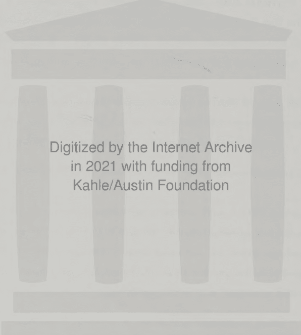
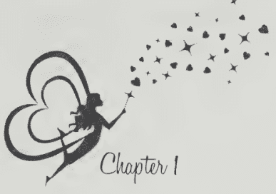
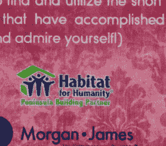

# 美好的野心：我的爱、幸福与成功的秘诀

塔拉是一个极好的例子，证明无论你的童年有多么艰难你依然可以拥有一颗温暖仁的心、对生活的热爱以及一种引导你成为一个优秀的人的精神之光……就像塔拉今天成为的一样！

> — 迈克尔·金，King World Productions 首席官

King World 是全球领先的首播节目发行商，涵盖了两档收视率最高的分发节目《幸运轮盘》（Wheel of Fortune）和《危险边缘》（Jeopardy）、OPRA（奥普拉·温弗妮秀）、电视收视率最高的综合新闻杂志《内部编辑》（Inside Edition）、《菲尔博士》（Dr. Phil）、《每个人都爱雷蒙》（Everybody Loves Raymond）、《好莱坞广场》（Hollywood Squares）、《宝贝》（The Little Rascals）等。

塔拉·布鲁克·博里科承诺，遵循一个精确的计划——一个她详细列出所有准则和禁忌的计划——将带给你一个“快乐、坚韧且乐观的生活。”在读了她的书《美丽野心》后，我相信她是正确的！当你想要一本将什么、何时、为什么和如何做完美融合在一个易于遵循的指南中的手册时，选择《美丽野心》准没错。塔拉展现出的那种纯真的脆弱感让人焕目一新并鼓励人们信任。如果成功有一个蓝图，塔拉就是一位出色的建筑师！

> — 埃尔登·泰勒，博士，FAPA，脱口主持人，《纽约时报》畅销书《选择与幻象》及《心理编程》作者

尊重且庄重的叙述，为**每个人**释放了更多、未来和成功的潜力。它为渴望带来改变、转型和影响的意愿观众带来了笑容和温暖人心的诚实。

> — 特莉里·莱维恩，博士，畅销作家及商业导师专家

每个女性都可以成为不凡的女性，过上一种富有影响力和意义的人生。通过塔拉富有创意地编织在一起的故事和接地气的建议，解锁你自己的“美丽野心”和潜力；她将用以前所未有的幽默、坦诚和洞察力触动并启发“你”，并提供一个可以遵循的行动计划蓝图！

> — 布黛拉·L·莫森，国际励演讲作家。MsMorrisonSpeaks.com

塔拉大师级地带领读者开启了一场冒险，字面上从封面到封底，穿过被称为生活的所有曲折、路径、挑战和机会！这是一本对所有人都有启发且用的书籍，绝对是你阅读清单、礼物清单和愿望清单中的必备之！

> — 迈克尔·塔斯纳，畅销书作家，《当下营销》作者

我强烈向每一位渴望不凡生活的女性推荐《美丽野心》。无论你的背景如何，塔拉的核心信息都非常明确——成功并不只属于少数精英——它属于每一个拥有梦想的人。

— 珍妮·布斯，五次世界总冠军洛杉矶湖人队业务运营执行副总裁，《湖人女孩》作者



https://archive.org/details/beautifulambitio0000broo


- 需要避免的事项 161
- 戒掉快餐 184
- 你应该从这一章中学习到什么 202

## 关于作者 217

## 前言

我记得在1997年遇到拉拉（Tara），因为她是一个美丽且引人注目的模特，充满动力且雄心勃勃，真正令人难忘。1998年，我惊讶地发现她在遇到未来的丈夫杰森（Jason）后，正离开她蓬勃发展的职业。现在，在经历了 13 多年的婚姻并拥有两个漂亮的孩子之后，我并不意外拉拉回了风口，带着新的梦想和激情：她的使命是帮助所有女性实现个人梦想。在她的书《伟大的雄心：我的爱情、幸福与成功秘诀》中，拉拉坦诚且真实地分享了她从小就开始应对的挣扎。她的故事写得充满热情和自信，显而易见，早年的岁月不仅是生存的练兵场，也塑造了她日后的人格。

在《伟大的雄心》中，拉拉为年轻或成熟的诚实女性提供了一种循序渐进的方法来设定明确目标，最终赋予她们实现梦想的力量。这种坦率令人充满活力，而她专注于最困难、最具挑战性局面的能力确实令人鼓舞。在拉拉的引导下，她将启发并激励你，并根据她自己的亲身经历，为你提供一些关键的内部技巧，可以为你节省时间并避免挫败。

### xiv 前言

这本书不仅仅是另一本关于如何满足你欲望的手册。它是一份关于自我赋能的真实行动计划，也是能带来结果的坚持工具。我强烈向每一位想要过不生活的女性推荐《伟大的雄心》。无论你的背景如何，拉拉的核心信息都非常明确：成功并不只属于少数精英群体——它属于每一个拥有梦想的人。如果你现在的愿景还不清晰，不确定想要采取的方向或该从何处开始，这本书将将推动你向前，并帮助你照亮实现目标的独特道路。成功属于任何愿意为此努力的人！

> —珍妮·布斯（Janie Buss），五届世界总冠军洛杉矶湖人队业务运营执行副总裁，《湖人女孩》作者



## 第 1 章

## 我的生活：早期岁月

> “生活是唯一的真正导师；未经过个人经验过滤的智慧无法成为道德组织的一部分。”
> 
> — 埃迪丝·华尔顿（Edith Wharton）

当我决定写这本书时，是因为有很多原因的。第一个原因是，我觉得自己在这些话题上有着许多生活经验和知识可以分享，并且有意愿和热情将其传给他人。

我非常期待与你们分享我的生活经历，因为我知道你们现在可能正处于困难时期，或者刚刚开始。如果你能从他人的错误和成就中学习，一切将会变得容易得多。

## 我的生活：早期岁月

我的家庭并不完美。道路上有很多错误，但每个人都有挑战面对。然而，有一点至关重要——我的父母总是确保我知道自己是被爱的，并一直告诉我我可以成为任何我想成为的人。我和父母双方的关系都非常好。我理解他们以及我们正在经历的一切。相信我，我感受到了！事实上，今天他们在我生活中都扮演着重要的角色。我爸爸很棒！他拥有不可思议的幽默感（不开玩笑，我觉得我是遗传了他的——哈哈）。

另一方面，我的妈妈美丽、温柔且充满爱心。我们非常亲密，有着特殊的关系。

作为一个女孩，我就知道想要过不起的生活。我想环游世界，当模特，嫁给帅气的王子并从此过上幸福的生活。我想过梦想，过童话般的生活——我想要一切（甚至更多）。即使在当时，这也是一项艰巨的任务，但我一直知道并坚信我可以做到，触及并实现这一切。这是我的梦想、我的生活、我的未来、我将实现的现实。即使需要，我也会创造它。我是坚定的！

在本书的生活旅程中，我将告诉你们如何触向星辰——如何成为你梦想中的样子。

这一切中最重要的成分是相信！它是实现所有这一切的关键因素！（请继续关注！）

当我进入高中时，我越发地感觉到，生活成功的责任完全掌握在我自己的双肩上。我不会让任何人替我获得成功，也不会让别人为我铺路……而对我来说，那条路既长又上坡！

## 第4章 第一章 我的生活：早期岁月

这一次，掌握权在我自己手中，我心里清楚。我必须让它发生，没有任何任何借口或推辞——没有人会替我去做。

回首这一切，我现在知道这是对我来说最好的事情。我们生活在一种相互依赖和“理所当然”的文化中。今天有这么多孩子成长过程中期待父母为他们做一切，并对父母产生依赖，以至于他们无法想象独立为自己去做（任何）事情。父母在那里是为了照顾我们、爱我们、喂养我们，并为我们提供一个安全的避风港。然而，涉及到我们的理想、希望和梦想时，我们必须自己去争取。简而言之就是如此。

现在，如果你正在读到这里，而且你的家庭为你实现梦想提供了一个非常棒的跳板，并在财务上提供了帮助，那太棒了！要知自己的幸运并心怀感激。

但对于你们中可能对我的成长经历和我的生故事产生共鸣的人，或者你可能正面临着无人陪伴、没有人照顾你、或者没人支持和助你一把（像许多其他人一样——你并不孤单！），我向你保证，是有希望的。振作起来！知道努力和付出**将会**带你到达那里。

## 你可以的！

你必须相信你自己！

人生的每一天，你的脑海中都需要那个愿景和提醒。专注于渴望，并开始规划你将如何实现它。

我知道当我十六六岁时，我买了我的第一辆车！我在 Long 的药店每周工作四十小时，坐公交车上高中，直到我攒够了钱买车。后来，我在晚上和周末还兼了第二份工作，当服务员，为了出人头维持生计，同时为了实现梦想而努力。我付出了切努力并让它成功。

## 美丽的野心 5

我读了一所表演艺术高中，去学习我深爱和珍视的所有事物。这包括舞蹈、戏剧和音乐。我是一个中等水平、可以说是“还可以”的学生。我总是白日梦着我的未来、我的明天以及毕业后的生活，所以我很难集中注意力。

我不想上大学。我想毕业后搬到洛杉矶，并大展拳脚。我在高中期间没有惹过麻烦，主要是因为我一直都在工作，这让我远离了派对。此外，我并不是真的有兴趣成为学校里的社交蝴蝶。

在经历了了成长过程中孩子们的嘲讽、各种形式的欺凌和耻后，当事情真的很困难时，这些事件实际上开开了我的眼界，让我看到了学校里的现实和挑战，因此对我来说，这一切都是离开并继续我的生活。

我在十一年级时真的只有一个男朋友，我们约会了一段时间。我和父亲住在一起，他坚决不准我谈恋爱，因为他觉得交男朋友会阻碍我实现目标。对我来说一直重要的一件事就是向父母证明我可以成功。我想让他们为我自豪。

对他们来说，生活并不容易，我想向他们证明我可以为了任何事付出一切。相信我，我可不是一个完美的天使，但在大多数时候，我都没有惹过麻烦，而且真的从未“反叛”。我有一个非常明确的目标……确保我毕业并搬到洛杉矶，而我**恰恰**做到了！在多年的等待之后，我终于准备好让它发生了！

我搬到了洛杉矶并租了公寓。我攒的钱如果节约的话，足够我用大约 12 个月。这将给我足够的时间去那里安顿，找工作，并走上实现我梦想的道路。

我的首要任务是找一家经纪公司并整理好我的作品集。我找到了一位合作过无数模特的摄影摄影师。他拍摄了我创作的第一本作品的大部分内容。我有了入场券，现在我开始了我的赛跑！

## 第6章 第一章 我的生活：早期岁月

我立刻开始参加试镜。这个行业不是弱小者能胜任的。你不能决定想当模特然后就被拒绝。拒绝是模特职业配方和过程中的主要成分。你只需要能够理解它，并从现实的角度来看待它。底线是，如果你不是他们追求的那种“长相”，也许你的长相会适合下一个。你继续坚持下去……

洛杉矶充满了陷阱和圈套。如果你是一个美丽的年轻女性，世界对你是这样的，但如果你不小心，也会付出沉重的代价。

我在所有合适的地方都站稳了脚，并享受其中的每一分钟。但我必须**首先**照顾好自己，所以早起、健身、保持良好形象并随时准备待命非常重要。在这些类型的试镜中，如果你/当你宿醉时，你不可能也无法被录用。

专注于你为什么在那里是至关重要的。我在前六十天内拿到了我的第一个杂志封面。我感到非常开心，有一种真正的成就感和目标感。这让我觉得一切变得真实了，我觉得我可以做任何事情！我的模特生涯似乎正在起飞，并正转入健身和泳装领域（这是我喜欢的）。

必须全年保持比基尼身材帮助我坚持健身和健康饮食。我一路上遇到了一些人。很快，我开始在那上面赚了许多钱！随着时间的推移和事情的发展，对我来说，我可以旅行，遇到伟大的人，并有一系列新的机会和挑战可以充分利用，拥抱这一切的一部分。正当我主演三部自己的健身录像带时，我遇到了我的白王子。告诉女士们：**不要**听那些说他们不存在的女性的话，因为他们确实存在！我刚满二十三岁。我是独立的，照顾着自己。更棒的是，我已经实现了成为一名职业模特的的目标，现在成为了别人可以仰仰的代言人——我现在可以为那些别人提供声音，而他们以前没有声音。

事实上，我当时在一家公司担任代言模特，该公司为另一个机构（后者由我很快就要结婚的丈夫）创作了一种减肥产品。

我的老板要求我飞往拉斯维加斯与某家营养公司开会。嗯，当我走进百乐园酒店参加会议时，一个非常高且极其帅的男人走过来对我说：“你是我们组的吗？”

我肯定了并说是。然后他带我来到会议餐厅的桌旁。他让我坐在他的对面，在整个会议期间，他一直踢我的脚。每当他这样做时，我都会抬头微笑，所以他显然得到了他想要的反应。（很久之后我才发现我的老板一直试图在我们之间做媒红娘。我对此完全毫无头绪，直到后来！）

# 第一章：我的生活：早期岁月

我正处于人生的哪个阶段？我的需求是什么？杰森以及他的需求、想要和渴望又是怎样的？这是否是我人生中这个阶段所需要的（还是不需要）？

另一个事实是，我当时并没有真的想建立一段严肃的恋爱关系，更不用说是异地恋了。无论是在个人还是职业上，我刚刚踏上通往成功的道路，一步步向前，而我那蓬勃发展的梦想事业也开始真正腾飞。从任何意义上来说，我都不想要这种干扰。

另一个（对我而言）更复杂的复杂因素是，杰森住在亚利桑那州，而我住在洛杉矶。当我们生活都都很忙时，这要如何行得通呢？但是，今天我可以告诉你们……杰森以极大的决心追求我，而我有时并没有让他过得轻松。

我基本上把梦想中的男人近在咫尺，却我差点让他就此溜走或让他从我的指缝溜溜。

好消息是，最后一切结果都变得非常好。不久后我们就开始了专属约会。他会在周末过来，或者我飞过去。这种远地恋这种事对我们两个来说进展顺利。

我们才约会了三十天，就在2月13日的晚上，杰森邀请我参加他公司的活动。（我当时**毫无察觉**！）。当我走进房间时，他租下了总统套房。

房间里摆满了美丽的花束——紫色玫瑰和白色卡斯卡巴玫瑰（我最喜欢的）。它们到处都是——万千的梦想！火炉开着。

我完全不知道那天晚上是他将向我求婚的夜晚。我们来到阳台，那里点满了长长的白色蜡烛和鲜花。

我的头脑在眩晕。回答他的问题花了我对他来说感觉过了一个永恒那么久，但最后我还是回答了并说：“是的，我愿意嫁给你！”于是就这样。就此了！从那一刻起，一切似乎都像是一场梦——一个完美的梦！我的梦！我们在3月1日结婚了，就在两周后，在家人朋友的见证下，在纽约加利福尼亚州帕萨迪纳的里思卡尔酒店举行了一场黑领结婚礼。这太不可思议了。这简直是成真的童话！

杰森有一个了不起的团队（主要是他当时非常了不起的助理，现在对我来说就像家人一样），帮助我们策划了最不可思议的婚礼。我们办成了，而且非常完美。我穿着一件薇拉·王设计的婚纱，我真的感觉自己就像灰姑娘一样。在夏威夷蜜月之后，我们在美国加利福尼亚州的纽波特滩找到了我们的家，我们现在一直住在那里。

现在时间快进一点……我们就要庆祝结婚13周纪念日了，我们有两个了不起的双胞胎宝宝，儿子杰登·布鲁克斯（Jaden Brooks）和我们可爱的女儿天空·伊莎贝拉（Skye Isabela）。他们带给我们这么多快乐，我们的家庭完整了，我可以告诉你们梦想会成真。你的过去并不重要！

重要的是你决定改变什么，如何向前，不断前进，你是唯一能真正定义自己的生活以及你将多么幸福的人。

在这书中，我将向你展示利用你所拥的天赋的最佳方法，帮助你拿出勇气，让你充满动力，并在我们共同的旅程途中启发你。我最深的愿愿是，每一个读这本书的人都能得到祝福，并拥有内心所有的渴望。

记住，我们都带着自己的目标来到这里。它们就像我们所走的道路和所做的决定一样各不同。所有这些都有它们的影响、代价和后果——有些朝着更好的方向发展，有些则朝着不那么理想的方向。

在经营生活的同时，考虑到这两条道路，是什么让生活充满了这么多可能性和机会。

这两条人生之路——在旅途中学习——保持信仰并爱着生活中的人——将不断推着你前进。旅程本身与目的地同样重要，甚至更重要！

尽管有时在人生的道路上，过程看起来很艰辛，但这正是能获得最多回报的。你永远不要停止学习，如果你致力于我在书中为你列出的挑战和原则，你将有能力在一生中收获巨大的成功。

所以，现在你已经对我稍微了解了一点点，让我们一起继续这段旅程，并找到你阅读这本书的真正原因，那就是……这一切都关乎你！所以，让我们玩得开心吧，发现这意味着什么，以及它将带你去向何方！

## 第二章：我全都要，而且现在就要

> “当你变得充满动力、设定目标并以不可阻挡之势追求它们时，生活就有了意义。”
> 
> ——莱斯·布朗 (Les Brown)

专家和像你这样的女性分享了获得你内心渴望的任何事的简单贴士，无论是舒适的鞋子，还是属于你的一份美国饼。但有时，知道——真正知道——**你**想要什么才是最困难的部分！

我想，让这个过程对所有女性来说进一步复杂的因素是，我们的共情能力……我们对照顾人的倾向。是的，除非我们在为别人（除了我们自己的人）做些什么，否则我们似乎无法真正满足。

我发现自己想要拯救和救援我周围的人，我总是要提醒自己，我能做的是有限的，而且我爱的人对自己的生活和行为负责任。

然而，这并不意味着在你可以帮助时变得不愿意帮助。尽管如此，帮助心爱的人与试图从他们的选择中拯救或救援他们之间有着巨大的区别。

我们慷慨的天性往往是我们身上最棒的一点，但如果这种慷慨变成了殉道主义和怨恨，我们就会遇到麻烦。正是在此时，我们对所爱之人的善意让我们听不见内心那个微弱的欲望的呼唤。我们都必须专注于自己的梦想（们），并理解我们自己的价值，我们自己的生活也重要，而且非常重要！

追求内心的渴望涉及风险。无论是创业、坠入爱河、写小说、第一次跑马拉松……你都必须尝试，而且你必须愿意失败。

在我的生活中，我有过许多“失败或较不成功的尝试”，非常实心且残忍地说，当我获胜或命中我为自己设定的要实现或超越的目标或目标时，这确实让那些时光变得甜蜜得多。

毕竟，如果我不理解失败或力不足而带来的痛苦和失望，我怎么可能写出一本关于实现梦想的书呢？是的，他们说：“跌倒并不难，难的是你如何反弹（我已成为反弹的大师，你也会的！）”理解生活就是坚持下去，即使在变得艰难时也能找到旅程中的快乐。你总可以在每种情况下发现并看到积极的一面。

在经历了所有的自省、自我怀疑和对怀疑的最终驱逐之后，执行这些计划似乎是最容易的部分。

一旦让你知道自己真正想要的是办一家餐饮业务，你就去 Kinko's 制作名片和传单，寻找厨房空间的招租广告，给那些总是夸赞你厨艺的朋友打电话，看看他们愿意投资多少。如果你一直想写小说但有三个6岁以下的孩子，就去寻找托儿，向你的姐姐寻求帮助，并将闹钟定在凌晨 3 点。

## 14 第二章 我想要得切，而且现在就想要

她对表演产生了兴趣（而不是因为她的父亲和/或他的遗产、影响或他选择的职业）。

在做出这个决定后，由于她的家人方便地搬到了洛杉矶，安杰莉娜就读了李·斯特拉斯格剧院学院，在那里接受了两年的训练，并出演了多部舞台剧。尽管她在整个学校时代一直觉得自己像个局外人（特别是在贝弗利利山高中），因为长相与众、消瘦、戴牙箍和穿二手衣服而受到嘲笑，但她对电影的野心持续增长并绽放。

她尝试过模特，但完全失败了，这让她的自尊心大幅下降。这导致她变得不快乐，觉得自己毫无价值，并开始了危险的自残习惯——割伤自己。


她在十四岁时就放弃了表演课，转而梦想成为一名葬礼师——这是一个更阴暗的追求，符合她的自厌和对黑色衣物的喜爱。她和男朋友住在一起，但内心似乎知道表演是她需要的。高中毕业后，她回到了剧院。从那时起，她的表演事业逐渐发展，并达到了大片级热门的地位。

然而，安杰莉娜从不让生活盲目地在身边流逝。在柬埔寨拍摄第一部拉拉·克罗夫电影时，安杰莉娜被这个贫困但思想开开的国家所震撼。这让她大开眼界，看到了世界的完全不同侧面，一个新的目标被加入了安杰莉娜的优先事项中。

自2001以来，安杰莉娜一直致力于推广人道主义以及通过联合国难民署（UNHCR）开展难民工作。

从那时起，她一直是联合国难民署形象大使，并因记者协会颁发的“世界公民奖”对其工作表示认可。由于她在2005年8月所做的环保保护工作，柬埔寨国王诺多姆·西哈莫尼授予了她柬埔寨国籍。那年的10月，她获得了美国联合国分会（UNA-USA）全球人道主义奖。今天，我们都知道她是一个超级明星级的美国人物。

## 美好的野心 15

以及名流贵族。但在这一切世界之巅童话生活之前呢？她的真实故事是什么？*注：（有关更多关于安杰莉娜·乔莉的人生故事，请阅读：安德鲁·莫顿撰写的《安杰莉娜：未经授权的传记》（2010年8月出版），在她所做的其他事情中——拍摄电影、做慈善工作、成为全职母亲和父母，以及等等！）

从出演像大片“拉拉·克罗夫”系列这样的角色，到幕后的国际慈善项目（与联合国的难民工作合作），她经常位居最有成就、引领潮流的榜单之列。*（注：此处原文翻译似乎存在逻辑混乱或重复，已根据语意调整）

（注：由于原文文本存在多处重复和逻辑中断，以下为基于逻辑的翻译）

从出演像大片“拉拉·克罗夫”系列这样的角色，到幕后的国际慈善项目（与联合国的难民工作合作），她经常出现在最有成就、引领潮流的榜单上。

她经常位居最有成就……（注：在她所做的其他事情中——拍摄电影、做慈善工作、成为全职母亲和父母，以及等等！）

从扮演像大片“拉拉·克罗夫”系列这样的角色，到幕后的国际慈善项目（与联合国的难民工作合作），她经常位居最有成就、引领潮流的榜单上。

（注：由于原文文本存在多处重复和逻辑中断，以下为根据语意的翻译）

（注：由于原文文本包含大量重复的段落，以下将继续翻译剩余核心内容）

# 第二章 我要一切，且现在就要

## 你想要什么？

> “让你的生活成为一项使命——而不是一次中场休息。”
>
> —阿诺德·H·格拉斯哥

选择。这关乎自由——即选择和做出更好决定的自由，即权衡优先级并在不同选项中取舍的自由。停下来思考这个关键问题：“你正在选择你想要的生活吗？”

“噢，不，”回答道，“我做不到，因为……我的教育程度不够……我需要照顾家庭……我没有足够的钱……我没有时间。”

所以，让我直开布公地问你：**你的**借口是什么？上面列出的所有内容也是我必须处理和解决的问题。难以置信吗？是的，但事实如此！毕竟，我只有高中学历，成长过程中家里面临着财务挑战（也就是说，我们那时穷得叮当！），如果我听从周围负能量人士的话，甚至听从我自己的恐惧，我永远无法走到今天，甚至无法达到我现在的高度。现实是：借口就像消弱意志的恐惧一样，会让你停滞不前，夺走所有的希望和梦想。

事实是，我们生活的每一刻都有选择。然而，对于那些贫困的人来说，生活中的选择更少、更乏且更稀少（如果有的话！）。但对于我们其他人……让我们来明确一点！我们认为自己没有自由，仅仅是因为我们还没有主张行使不同选择的力量！

你通常是如何做决定的？你是基于……吗？

- “应该”——做你认为你应该做的事。
- 讨悦他人——做别人想要或期待你做的事。
- 恐惧——因为害怕做不同的事情而选择安全路线。
- 习惯和反应——你甚至不思考自己在做什么——你一直都是这样做的？

另一方面，你拥有自己的选择权……当你基于……基础做出决定时……

- 欲望——选择你想要的东西
- 需要——响应更深层的欲望
- 真实性——你知道自己是谁以及你代表什么
- 创造性表达——你追求卓越。

那么，你如何才能对选择“不同”且“更好”的事开放？这一次，明确你**到底**想要什么。要有目标感。有了目标，你就会知道什么最适合你。

这里有一些你会觉得非常有趣的东西！它应该永远加深这一点。每年都有成千上万的哈佛毕业生犯这个错误……并付出代价！（看看你是否知道答案）……

为了确保你从生活中获得真正想要的，你必须采取的**一个**步骤是什么？不仅仅是财富，还有良好的人际关系、生活方式、精神财富和幸福？如果你知道，请写下来！（97% 的哈佛毕业生每年都会在这道题上出错！）

原因在于！！哈佛不教这个！**生活**教！事实上，你不会在任何大学的课程目录中找到它，在高中水平的课程中发现它也很不寻常，然而它却显而易见地“缺失”。你的父母或朋友可能也不知道答案。也许它只是太简单了：一个极其简单的步骤！！！

20 第二章 我要一切，且现在就要

3% 的哈佛毕业生采取了一个简单的步骤，做了一**件**稍微……**不同**的事！那是其他 97% 的人没做或没想过的**件事**……

这导致了**巨大的**差异，并将继续区分成功与超越预期。正因如此，他们赚的钱比 97% 的人总和还要多，而且他们在个人和职业上都过得更快乐、更健康、更成功。

注意：这些数字源于 60 年代对数万哈佛毕业生的一项研究。（该研究重复过几次，结果相似）。

这种真正成功的人所采取的极其简单的步骤，是在纸上详细地规划生活（从开始）……**然后**，他们实际上执行他们的计划。当我说细节时——我是**每一个**细节。他们为生活的每一个方面都写下了计划，然后付诸行动。一步一步、一步一步、再一步一步！！

现在让我们进入正题！这里有一个棘手的问题。你是否在按照别人的计划过你的生活？如果你**没有**得到你想要的生活，可能是因为你允许别人设计了你的生活计划。这可能是你的父母、配偶、老板、政府，甚至你的朋友也可能乐意并乐于**为你**规划和规划生活。但是，这不是通往成功的捷径——如果说有的话，它是通往平庸的慢船。成功是一个自我命：设计你想要且值得的生活，然后采取重大行动来实现它。

## 你能学会前 3% 人的生活规划技能吗——绝对可以！！！！

停下来问自己一些深入的、现实的问题，例如：“我为什么要这样做？我想要实现什么？”

写下你的答案。使用日记本。把日记本当作工具，要有意识地去度过时间，这会帮助你

美好的雄心 21

- 将目标表述为积极陈述（“做”而不是“不”）：例如：“我要赚到 15 万美元”而不是“我不会赚得那么少的钱”。
- 将目标具体化（设定日期和可衡量的成就，以便你知道何时达到了目标）。
- 设定优先级（这样当你有多个目标时，你不会感到不知所措，你知道哪些是重要的）。
- 写下你的目标（这会让它们固化，并让你觉得更重要）。
- 保持执行目标尽可能小（许多小目标比一个大目标好，因为你更容易看到进展并保持动力）。
- 不要设定结果，要设定过程目标（这样一来，你对成就有了控制权，而不是由于你无法控制的因素而失败，例如环境恶劣或纯粹的运气不佳）。
- 对你的目标保持现实（设定你能够实现的目标，不要受那些试图设定超出你能力目标的人影响）。你

22 第二章 我要一切，且现在就要

## 设定目标并实现它们

理论上，设定目标是一个非常简单的任务。例如，“我想学吉他。”然而，尽管这个目标很好，但它并没有为你提供实现目标的方法。

以下是帮助你实现目标的指南：

- 将目标表述为积极陈述（“做”而不是“不”）：例如：“我要赚到 15 万美元”而不是“我不会赚得那么少的钱”。
- 将目标具体化（设定日期和可衡量的成就，以便你知道何时达到了目标）。
- 设定优先级（这样当你有多个目标时，你不会感到不知所措，你知道哪些是重要的）。
- 写下你的目标（这会让它们固化，并让你觉得更重要）。
- 保持执行目标尽可能小（许多小目标比一个大目标好，因为你更容易看到进展并保持动力）。
- 不要设定结果，要设定过程目标（这样一来，你对成就有了控制权，而不是由于你无法控制的因素而失败，例如环境恶劣或纯粹的运气不佳）。
- 对你的目标保持现实（设定你能够实现的目标，不要受那些试图设定超出你能力目标的人影响）。

如果你发现第一个目标没有达到足够的高度，可以随时设定另一个目标。

- 不要把目标定得太低（否则，你会减慢进度，变得懒惰，并且无法发挥出最大的潜力）。
- 当你实现一个目标时，要确保你已经留出时间来享受完成愿望的满足感，通过给自己一个应得的休息或奖励。（这可以很小，比如下午假去看你想看的那部电影）。
- 确保你吸收了实现目标后的意义，并回顾你所取得的进展也是重要的。你还应该看看自己在其他目标上取得的进展。如果该目标特别值得关注，请确保给予自己适当的奖励。

通过实现目标的经历，审视你其余的目标计划：

- 如果你的目标实现得太简单，且利润甚微，请确保下一次目标定得更高，并承担更多风险以扩大机会。
- 如果你的目标似乎无法启动，你发现自己变得很沮丧，这可能是因为你设定的目标出了你的能力范围，或者你并不感兴趣。如果发生这种情况，是时候追求新目标了。
- 如果在实现第一个目标的途中，你学了一些可以让你改变第二个目标的东西——那就改变它吧！

## 24 第二章 我全都要，而且现在就要

如果你在实现目标的过程中，注意到自己缺少某项（或几项）技能，请决定是否应该设定新目标来弥补这一点。记住，仅仅因为没有达到目标并不意味着你没有成功。你可以从经验中学习，并将这些教训融入你未来的目标设定计划中。

- 如果你发现自己无法在原定时间内完成目标，你也可以选择更改截止日期。
- （我这样做过很多次了。如果某件事对我来说很重要，我只会保持专注，并在必要时更改日期。记住要保持那种专注，不要对日期太松懈。你可能需要更改日期，但你仍然到达终点！）。

此外，你的目标会随着经历的增加和技能的发展而改变。因此，你应该定期调整目标，使其反映你希望实现的愿景。

让你的目标持续对你具有吸引力是非常关重要的，否则你将没有动力去继续寻找它们。如果你的目标不再吸引你，就放手它们，设定一个新目标。一个目标应该在你达成时带给你快乐、满足感和成就感。

正如史蒂芬·柯维所说，实现目标的另一个伟大方法是“以终为始”。成功的雄心需要一个专注的目标。因此，思考你想完成什么，并去追求它。

事实是，无论你的目标是什么，要到达那里你必须正确开始，即以终为始。结果是非常反直觉的。如果你没有这样做，你只是在盲目地徘荡。如果你不知道自己去哪里，哪条路都会带你去那里。问问自己：“我所有的努力是为了去向哪里？”

如果你无法回答这个问题，你就无法走多远……仅仅因为你将不知道实现目标的最佳方式，也不会在达成后识别出它。

因此，为了确保你始终在取得最大的进展，问问自己你想呆在哪里并到达那里，紧盯着你的目标。如果你不知道问题“我所有的努力是为了去向哪里？”的答案，那么你现在的首要任务就是有意识地、专注地去考虑它，直到你能够给出一个合理的答案——然后你就可以据此设定目标。

这可能需要大量的思考，你需要花一段时间来苦思、反思（必要的话可以闭上眼睛躺着，切不要分心！），或者你可能会发现这个答案是自然而然，只是你之前从未考虑过它。

拿出你的日记，在上面随意涂写、乱画和“涂鸦”。自由地绘画并表达自我。这倾向于开启大脑的右脑（更具创造力的一侧）。它将刺激并产生创意想法，让你从不同的角度去思考和考虑它们。**记住，你的日记是一个强大的工具。要充分利用它的能力和可能性！**

你对问题的回答并非完美至关重要。毕竟，随着你的进展，你随时可以修改或改变答案。但如果你从一开始就没有目标，你就不知道它对你来说是对还是是错。

你将无法回答这些关键问题：

- 你将如何到达那里？
- 你的计划是什么？
- 这是一个好计划吗？
- 你如何知道它是一个好计划？
- 你确定吗？
- 你每天是否在做一些让你离终点更近的事？

我知道写下目标的力量对我来说是无价的，这是我现在正在做的事……并在余生中将继续这样做。（注：OCR 文本存在大量重复，已根据上下文进行了清理）。

提示：这是我仍然在使用的一种技巧。在不同色的卡片上，在一种颜色上我写下短期目标；在另一种颜色上我写下长期目标。然后我把它们贴在浴室镜子上。

（注：OCR 文本此处有重复，已根据周围句子进行了整合）。

以下是我每天用来肯定自己的几个例子。这些看起来很简单，但它们非常有效！

尝试对自己重复以下内容：

- 我每天都在实现我的梦想和愿望。
- 我喜欢我在镜子中看到的自己，我是一个好人。
- 我很容易交朋友，别人喜欢我。
- 我做出明智财务决策。
- 我的身体健康强壮。
- 我的大脑敏锐灵活。
- 我能做到一切。

在尝试之前，不要嘲笑它！是的，只要你说出这些话并相信它们——无论情况多么糟糕，无论你是如何陷入的——你的大脑都会努力摆脱出来。这是通过你告诉自己一切都会好起来，这一切很快就会结束。

## 28 第二章 我要全部，而且现在就要

自然地，上述示例并不是你用于自言自语或内心独白时唯一可以使用的话语。你应该创造属于自己的话语来重复执行这项工作，作为你的个人格言，针对你所能到的任何糟糕处境。

对 (i) 你自己以及 (ii) 你可能面临的任何**“问题”（无论是积极的还是负面的）保持诚实。这是你可以展现真实和诚实的地方。没有人会评判你，因为这完全是私事。因此，你可以思考你需要听到的话。列一个清单，每天对自己重复一遍。爱你自己，开始建立你自己的自尊心。这种积极的自我对话也不限于糟糕的处境。它还能让有利的局面变得更好。

在构思积极的自我对话短语时，既要考虑一个理想的情况，也要考虑你能想象的最糟糕的情况之一。当你思考每种情况时，尝试创造两个或三个可以鼓励你做得更好的短语。接下来，当你冒险并把目标付诸行动时，测试一下，看看它们是否有效以及如何起作用。

如果你发现它们并不太奏效，就继续想新的短语并练习它们，直到你发现最适合你的那一个。

如果你还没有在使用积极的自我对话，那么那些在使用它的人比你具有实质性的优势。只有**你**可以改变这一事实。这些人是正在利用一种强大的宇宙真理：言语。

世界上每一个成功的人都清楚这一点，因此以某种形式将积极的自我对话（使内心独白）融入到他们的志向中，因为他们知道这是行之有效的！

使用可视化这一强大的工具，帮助你用心眼去想象你的梦想和目标是什么……然后一直思考它们。让它们停留在你的脑海中。

每天花时间做这件事。找一个安静的空间，让你可以独自地做梦并想象你对生活想要的一切。（也许拿出你的个人日记，随手涂鸦一下——创造性的自我表达）。

专注于梦想变成现实。**敢于梦想！**去幻想它吧。这是我整个童年所做的事情。我会进入自己的思想、可能性和精神世界，然后去梦想一种美好的生活。利用你拥有的那种不可思议的想象力来创造你的未来！一旦你知道了想做什么，你就可以专注于如何实现它的细节了！

侧栏：这个方法对我非常有效的一个例子是……当我从高中毕业时，我知道我想去洛杉矶（L.A.），我梦想成为一名模特，但我必须真正专注于实现这一目标需要采取哪些步骤。

当然，这意味着要工作、攒钱，并坚持我的道路，这样我才能够真正给自己一个机会。这需要时间，我不得不做一些我真的并不喜欢的工作（这和世界上其他地方一样！）。然而，当我感到沮丧时，我会思考我的目标，并提醒自己为什么必须留在轨道上。我曾有过想要放弃的日子！我们大家都是如此！这很正常，所以不要过分责备自己——记住你会有好日子和坏的日子。

生活是一场权衡的交易，是一场给予与获得。你想要某东西，但为了得到它，你必须放弃其他东西。（当这种情况发生时，你会发现哪些目标对你来说真正重要。保持意识，一切都会好好的）。

当你度过糟糕的一天时，允许自己有糟糕的一天。不要沉溺其中，而是对自己说、肯定自己：早晨将会很棒，你醒来时将焕然一新，并对自己的道路充满期待。思考你想要的，结合你使用的词汇并写下你的目标，将改变你的生活。这是有效的，相信我！看看我的生活吧！

正如你所看到的，有许多方法可以成功实现你的目标。所有的工具已经存在于你内心了。你只需要发现，

## 30 第二章 我要全部，而且现在就要

发掘，并充分利用它们。你需要勇气去**有力地**且**不同地**去使用它们！

记住，你是唯一一个能决定自己成败的人。从一开始以结果为导向，相信你的直觉，尽管去做了吧！

## 你应该从这一章中学到什么

来自第 2 章的关键提示和见解，亮点如下：

- 女性经常在天生的慷慨与追随内心渴望以实现个人/职业梦想和目标之间挣扎平衡。
- 追求你的梦想始于理解你真正从生活中想要什么。
- 只有当你采取特定的努力来设定并实现目标时，目标才能实现。（这包括许多重要的技术，例如具体地定义你的目标，并拥有实现目标的清晰策略）。
- 当你把目标写下来时，你实现目标的概率会大大增加。（这使你能够清晰表达你的目标，并给你一个清晰、具体的引导）。
- 永远不要低估自我对话的价值。你将避免自我破坏，同时获得克服可能出现在道路上的障碍的优势。
- **可视化**来创造你的未来。专注于你想实现的事情，花时间思考它们，帮助你到达那里的步骤。现在让我们继续……


> “最后的谜是你自己。”奥斯卡·王德

发现你是谁以及你从生活中想要什么并不像表面看起来那么简单。我们许多人的生活中都有试图（无论意图如何）鼓励我们走向某些方向——例如职业和关系。

然而，尽管这些朋友、父母、兄弟姐妹、老师等可能是为了我们，但他们的选择并不一定适合我们（这意味着对**你**而言）。

回想一下，回想你的童年。你有多少次改变过“长大以后，我想成为……”这句话的结尾？概率是这个数字很大！而且它并没有随着童年结束。它一直持续到青少年时期，可能一直伴随你直到今天。你确定你正处于生命中对你最好的道路上吗？一条能让你最快乐的路？如果你的答案是“是”，那么你确实是一个稀有的个体。然而，如果你的答案是“否”，你并不孤单！我们大多数人对生活的某些部分仍然充满怀疑和不安全感。更令人沮丧的是，通常当我们觉得快要弄清一切时，结果什么都没有发生！

所以，我们注定坐在那里等待命运引导我们走向正确的方向吗？当然不是。是时候开始了解你自己了，这需要大量的耐心、力和注意力。然而，如果你真的想找到自己的道路并在生活中获得幸福，让你自己经历这个自我发现的过程是非常关重要的。你将发现关于自己的许多以前从未察觉到的事情，甚至无法将其转化为连贯的思想，更不用付诸行动。在这段探索中，你将发现

- 价值观
- 兴趣领域
- 能力
-   优先事项
-   目标
-   优势
-   缺点
-   思维过程

当然，尽管你即将发现自己是如此优秀，但你很可能也会发现自己**既有**优势也有缺点。这些对你所能做出的决定以及生活中让你获得幸福的事情有着巨大影响。请仔细、长时间地审视你所拥有的一切。这包括你的技能、天赋以及你真正发光发亮的时刻。


即使是那些看似微不足道的极小能力，对你的生活也会变得非常重要（影响他人）。记住：大多数伟大的想法都始于非常小的事，然后成长变得真正非凡。手握纸笔，深入审视你的内心，列出所有定义了你的优秀品质。

你还会想要发现自己的性格类型。这对于你在个人生活、人际关系、职业以及生活中所有其他重要方面能够成功取得的道路，将起着巨大的作用。

自然，我们每个人都有自己的性格，无论你是多么独特，你的性格很有可能属于某种特定的类型，这可以帮助你确定你最喜欢做的事情。

- 你是否是一个开朗、喜欢与人相处并偏好领导的外向型者？
- 你是否是一个宁愿保持安静、只留几个亲密朋友、并宁愿在幕后工作而非处于灯下的内向型者？

回答这类问题将增加你做出正确人生选择的机会。然而，你没有理由急于寻找答案。只有当你花时间真正探索内在自我时，这些答案才会出现在你面前。

那么，你究竟如何才能很好地审视自己并了解自己呢？这是一个好问题；答案就在七个重要的步骤中。

在我们开始这些步骤之前，我想看看几个我认为在生活中做得非常出色的女性的经历；她们不仅实现了美国梦，还成为了我们的“榜样”。话虽如此，也让我明确一点，我们所有人都会犯错，名流也不例外。然而，在某种程度上，我所描述的这些每一个女性都能够从争议中走出来，并过上幸福、充实的生活。让我们近距离观察另一个故事。

## 佳例：贝塔尼·哈密尔顿（BETHANY HAMILTON）

贝塔尼出生于一个冲浪狂热者家庭，在夏威夷海岸和凯考伊岛外充满诱人的浪花中，贝塔尼在水中遇到了改变她生活的对手。从她年幼时第一次被放在冲浪板上起，她对冲浪的热爱与增长；5岁时信奉耶稣基督；连年获得职业冲浪比赛冠军（8-13岁）。作为一名业余且有成就的冲浪运动员，在NSSA国家锦标赛中获得女子公开组第二名，通往职业冲浪的道路充满希望地开启。

## 美好的壮心 37（BEAUTIFUL AMBITION 37）

但一次与鲨鱼的挑战性遭遇改变了一切，至少起初似乎如此！

2003年10月31日，她在冲浪时，一只14英长的虎鲨发起了报复性攻击，在她平躺在板上时切断了她的左臂。她的失血非常严重（到达岸边时已失血60%），朋友和家人来营救她，并因止血救回了她的命而受到认可。

她的积极态度是“感恩的心态让你获得高度”这句话的缩影。这也是过去和现在救了她生命的因素。经过多次手术，没有发生感染且愈合正在顺利进行，她是许多人继续坚持、深挖和追求更高目标的灵感！她依然坚定要实现梦想，继续前进，不断前进，过好自己的生活。她不再仅仅是一个鲨鱼袭击的青少年受害者。她从未想过自己能否再次冲浪，但在事故和遭遇鲨鱼后不到一个月，她就带着坚韧和决心再次回到水里。

单手冲浪对她来说是一个巨大的挑战，但她坚持了下来！很快，她进入了赛场，并不需要同情或特殊对待，她只是关注。她在2004年NSSA国家锦标赛获得女子公开组第二名；2005年获得女子组冠军；2008年获得NSSA国家锦标赛获得第三名；她在Roxy Pro冲浪节获得第一名。她继续激励

## 第三章：我是谁？（CHAPTER THREE Who Am I?）

有些人可能会将她描述为“复出的运动员”，但她想要与不同。用她自己的话来说：“我无法改变”

由于她被描述为传奇运动员，但她关注周围周围的人。关于她的故事，她并不想要。

自我意识不是你可以立即发现的东西，而是一个通常需要七个步骤的过程。这些步骤并不像最初看起来那样是有定义的；相反，你可能会打破顺序进行，并且你会发现它们经常重叠。

请记住，无论我们如何，我们都是不断发展的。虽然这七个步骤将帮助你开启了解自己的道路，但自我发现是一个一生的过程。

### 第一步：每天给自己留一些高质量的时间

> “只有面对真相时，你才能找到自己。”
> —— 珍珠·贝莉（Pearl Bailey）

为了了解你自己，你需要为自己留出高质量的时间。诚然，我们都很忙，并不总是容易为自己留时间，但请将其视为必做之事。每个人都需要花时间独处，执笔列出生活中想要的一切。

当我读高中时，我想成为模特。然而，我也意识到为了让这个梦想变成现实，我需要几件事。所以，我做了你现在要采取执行的事（这也是我现在仍在做的！）我列出了一份成为模特需要的所有物品。

这个过程不仅让你识别出在达到目标之前需要经过的不同阶段，还能让你深入审视内心，发现你把时间花在了哪里、如何花、以及和谁一起花。

识别自己的行为模式是了解自己的重要部分。然而，同样重要的是观察你身边人的类型。人们对你的道路有巨大的影响，他们可以在过程中帮助你成长，也可能击垮你，阻碍你实现更大的潜力和梦想。

我一直意识到的是，你想要的生活质量在很大程度上取决于你生活中身边的人。环顾四周，考虑你的朋友，以及所有你选择待在身边的人。

- 这些人是那些对生活持有积极态度、并且始终支持你的人吗？
- 他们是那些态度消极的人吗，宁愿抱怨生活也不愿采取行动去改变？
- 你的朋友是否分享并尊重你的梦想，帮助你实现梦想，并在你情绪低时支持你？
- 你的朋友是否会让你怀疑自己做出的决定，并让你对自己的生活选择感到内疚？

在你了解自己的过程中，学会倾听内心的声音（或通常说的直觉）是非常重要的。在我人生命的大部分时间里，我一直在使用并倾听自己的内心声音，通过视觉化我想要的生活来实现。

大多数人会认为这是在白日梦或完全是浪费时间，但我会再次挑战这种观点。不要外表看人！仅仅因为看起来你没有在做些什么，并不意味着这项活动没有价值。它是一个强大的工具；只要你在正确的时间和地点恰当地使用它即可。你的内心声音可以帮助你明确你想要的生活蓝图，以及为了到达那里你需要做什么。

在倾听内心声音时，永远不要怀疑它，这是重要的。我从不怀疑，因为我理解它的存在是为了引导我。如果你选择**不**倾听你的内心声音，可能只是因为你根本不想听，或者害怕它要说的话，而单凭这一点并不意味着或证明了你不应该倾听！

**侧边栏：** 例如，根据我自己的经历，在我二十出头时，我有一个对我并不好的朋友。我为她的行为寻找许多借口，坚信我能够帮助她。过了很久以后，我才让自己意识到她并不是我真正的朋友，她并没有同样关心对我来说什么最好。这并不是一条双行道，也不是一种互惠、平衡、积极且互利的关系。这完全是单方面的。

要做出将她完全从我的生活中移除的决定，需要巨大的力量。要采取必要的行动真正将她赶出我的生活则更加困难。如果我一直倾听内心的声音，事情就不会发展到这一步。我的内心声音告诉我，她不是一个我适合相处的人。但我必须像许多人一样，亲身经历并艰难地学到这个教训。

我想明确的是，这可能非常困难。别误会！当你决定从你的生活中剔除某人时，这并不容易，而且你会产生许多不同的情绪。这是正常的。

然而，如果你发现生活中有几个像这样的人，不要试图一次性完成所有的转变，因为这会耗尽你的情感。从限制与这些人的通话和往来开始。久而久之，这对你来说会变得容易。你可能需要更改邮箱地址，此外还有新的家庭和手机号码。这听起来可能极端，但在大多数情况下，这是不再听到他们声音最简单的方法。

你将开始看到这是一个正确的决定，由于你释放了他们的能力，你完全可以见证不断的积极变化。你甚至会开始结交对你更有健康影响和伴侣的新朋友。我现在知道，我拥有一群任何人渴望的最不可思议的朋友群体。这些人是我深切关心的人，他们希望彼此最好，同时以一种积极、鼓舞的方式互相支持。在生活中拥有这样的朋友是巨大的幸运！

我们被赋予了这种内心指南作为罗针，通过学会了解我们自己，我们可以学会使用这个指南针并做出相应的行为。利用你的罗针来全面考虑你是谁，你生命中有谁。然后，立即决定这些人每一个人是否对你是有利的！

通过学会倾听自己并信任我内心声音所说的话，我开始自然地吸引适合我的朋友。这些人是真正关心我的快乐、并在梦想和目标上支持我的人。

这包括任何你选择度度余时光的人。它可能是朋友、男朋友、家庭成员或其他和你拥有边界感和共同控制感、有来有往的人。起初可能看起来很难，但你需要剔除生活中的负面人物，以便让自己能够前进、遵循你的内心声音，并实现你的梦想和目标。

保持积极的态度不仅是你对周围环境做的事，它必须是你带入内心的。通过这种努力，你应该每天早上醒来时心中都带着微笑。如果起初很困难，请大声说出这些话来安慰自己：

> “这将是非常棒的一天，会有奇妙发生在我身上。”

**栏：** 我个人每天早上都会和丈夫一起说这句话，这样我们甚至下床之前就能肯定这一天将是很棒的。这帮助我以积极的心态开始，开启良好的一天。通过每天从关注它将是多么美好开始，你会发现生活要好得多。

你的下一步是找到一种表达你想法的方法。这将帮助你与内心声音建立联系并清理大脑。这可能包括写作、绘画，甚至是大声说出来。无论你选择哪种方法，只要你坚持如一，你就会看到结果。

把自己自己自己生活的学生。这意味着愿意观察自己的思想、感受和行动，而不立即做出判断。通过这样做，你可以识别出那些对你没有帮助的模式，并做出有意识的选择，使其与你真实的自我保持一致。

让你写下那些引导你的信念、思想和行为模式，那些让你陷入困局的事情，以及你所发展出的新事物。

你甚至可以使用日记给那些伤害过你的人写信——这些信永远不会寄出去——即便这些事已经发生了很久。当你经历过情感创伤时，时间是失去意义的，你可能会困在那种情绪中。通过写下你所感受到的挫败、愤怒、痛苦、悲伤和受伤的情绪，你实际上是在帮助自己从创伤、时间、痛苦的事件、感受和过去中解脱，回到当下和此时此刻，回到新的领域，在那里，你可以用新的清晰度和解读来理解这种处境。

这是意识到自我、并将你的经历整合为对“我是谁”以及“我能成为谁”的认知的最有效的方法之一。在开始写日记没多久，你就会发现自己的生活中存在某些重复的模式。这可能包括不同的想法、行为和启示（有些甚至让你联想到父母以及生活中的其他重要的人）。

通过在日记中写出来，你将更敏锐地察觉到以前隐藏的信念和模式，尽管它们在潜意识层面仍在影响着你。通过将它们写出来，它们对你来说变得可见，并让你能够处理它们并治愈自己。

**侧栏：** 我生命中的许多多年我都在写日记。我有大量的记忆和经历都记录在简单笔记本的页面上，这让我能够回顾并反思我的生活。这些时光真正帮助我发生了蜕变。

写日记似乎是一个非常简单的步骤，但它也是非常重要的一步。我通常会记录我生活中发生的一切事。这包括艰难的时刻，比如友谊的破裂；也包括感到备受启发的良好时光。我在日记里写什么没有任何规则。基本上，我把任何事、一切都包含在内。

我不仅在写日记时发现它很有帮助，我还可以回顾自己写下的内容，看看自己成长了多少。这真的帮助我坚持目标和个人的成长。

我发现发现那些在当时看起来非常重要的事情（重要到让我把它们写下来）数量多得惊人，而现在它们看起来其实非常滑稽——我已经能够向前，并能从自己的行为中看到幽默。毕竟，日记不是写给别人看的，所以它们不需要除了你/我以外的任何人的理解。只需确保你将日记放在家里安全的地方，远离任何诱惑的、好奇的手或眼睛即可。

每天给自己留出足够的时间或分配，投入到你的日记中。通常情况下，每天二十分到三十分钟就足够了。如果你以前从未写过日记，这听起来可能像是一项巨大的时间投入，但如果你尝试一个月，你会发现这对于把事情记录在纸上来说是一个完全自然的时间长度。

记住，由于你是在写日记，你可以通过回顾写下的内容看到自己成长了多少。这真的帮助我保持在目标和个人成长的轨道上。

### 第五步：阅读与倾听

“相信你自己。你比你想象的要懂得多。”

——本杰明·斯波洛博士

通过阅读智智导师和灵感缪斯的书籍，倾听他们的磁带和 CD，去研究影响你的具体问题、关系、精神成长和疗愈。你是很幸运的，因为你生活在一个信息爆炸、每个人都能轻松获取信息的时代。

随你所见之处，到处都是自助书籍、网站、工作坊以及讲座，你可以现场参加、在线学习，或者选择录制后以后观看。世界上有很多老师，他们研究并处理了你所想象的各种问题和生活困境！

无论我们住在何处，无论是在国内另一端还是在全球，我们不再被孤立或被那些帮助我们改善生活的共享信息和资源隔在门外。

让你的自我认知更进一步，投资在你你自己的独特性上。一旦你意识到自己所面临的问题，就尽可能多地了解这些问题，以便为自己做出最理想的选择。

**侧边栏：** 这正是我所做的。我决定阅读我能拿到的所有不同材料。我深知知识通过信息力量所带来的潜力。只有当我们知道要寻找什么时，机会才会显现。

我任何时候都会同时看三四本不同的参考书。我觉得这让我在处理每天面对的各种情况（无论是积极还是消极的）时更有优势。知识极其重要。你对你自己、你的生活以及你的运作方式了解得越多，在一生中做决定时准备得就越充分——无论这些决定有多么重要，或者看起来多么微不足道。

信息无处不在，我们只需要做的就是想要接收它。我们必须考虑是否想要利用它所提供的价值。记住，生活中任何值得拥有的东西，都值得为此付出努力。

学习是这项工作的一部分，你为学习付出的每份努力都会向你想要的生活近一步。

### 第六步：承担积极风险

> 探索自我。这需要眼光和胆。
> ——亨利·大卫·梭梭

一旦你收集了关于自己以及如何处理特定问题的信息，就机会与他人谈论你自己和你的问题。你已经通过日记表达了自我，审视了你的目标、梦想、价值观、洞察等，现在是时候将这种意识提升到一个新高度了！

这一步通常需要巨大的勇气。独自发现自我仍然是相对安全的，但如果不将你的想法付诸实践，并将其交给他人以获得新的视角并让它们为你效力，你就无法利用你所有的发现和自我启示的洞察。

你的每一个新选择将帮助你更好地了解哪些对你有效，哪些无用。因此，是时候承担一些积极的风险，允许自己继续前行了。

当你发现自己寻找网站或购买书籍的速度超过了你实际阅读和处理它们的速度时，你就知道自己已经准备好承担这些积极的风险了。

学会走出舒适区是很重要的。这是成长过程的一部分，让你在每一次都能实现跨越越式的学习和发展。

**侧边栏：** 我个人在大群体面前演讲感到非常不自在。我更倾向于面对摄像头说话。然而，这一事实并没有阻止我频繁地进行演讲。我知道每当我上台上演讲时，我就离克服恐惧又近了一点点。否则，我只会让那些恐惧夺走我宝贵的经历。

承担风险是生活的关键部分。然而，有些风险是应该承担的，而有些风险避开更为明智。听听你内心的声音，知道哪些风险对你的生活来说是正确的。

> 决心寻找你自己；并要知道那个找到自我的他，将失去他的痛苦。
> ——马修修·阿诺德

奇怪的是，尽管*自我认知*是一项高尚的追求，但当我们开始了解自己，并达到可以将生活推向积极改变或改进的方向时，我们所有人似乎都有产生罪疚的倾向。当你实际上能够有意识地创造自己的生活，从而获得你想要的结果。

这通常会引起他人的评价，例如“你太幸运了”和“事情总能对你顺利”。由于你并没有刻意宣扬自己在自我认知方面的努力，这看起来确实像运气突然降临在了你身上。然而，你会知道你的人生发生了非常巨大的变化，这意味着你更准备好去实现适合你的事情。

人们会看到你拥有的并想要它，而不必付出你为得到它而付出的努力。不要让这些人阻止你享受你的自我认知，以及你通过发现它而获得的成就。

相反，要与那些热爱并支持这份来不易的新成长的人共度时光！

**侧边栏：** 我以前说过很多次，我还会说一遍：女性对于她们所做、成就、努力追求和实现的一切，并没有给予自己应得的足够赞誉。意识到你有时需要让自己放过自己，永远不要忘记为你自己的成就喝彩。

这非常重要，它会让你的自尊心蓬勃发展。有了良好的自尊心，你会更好地了解自己，并确保你正在成为最好的“你”。

现在你已经知道了寻找自我所需要采取的步骤，你可能已经准备好开始了。然而，你必须记住，这是一个过程，而不是一种立刻或明天就能给你结果的东西。它不是那样！

为了开始并为这七步提供动力，请通过以下测试开始了解你的性格类型。这不会让你了解真实的、独特的自我，但它能让你对自己有一个大致的了解，以及你可能从哪里开始。

请在提供的处写下你的答案，以免在获得结果之前忘记。

记住，这个测试没有标准对错。按照你的感觉诚实回答，并了解你的一些本性。

#### 问题 1

你今晚完全有空，你的好朋友提议去打保龄球。你：

- 打开电脑，创建一个逻辑最合理的拼车路线，然后决定每个人的轮换顺序。
- 说“太棒了！”，开始吹嘘你的保龄球技术有多厉害——尽管其实并没有。
- 大笑，然后打电话、发邮件并告诉你认识的人你和朋友要去打保龄球。
- 这是一个结识那个让你心心不已的男子的绝佳机会。
- 翻了个白眼，告诉朋友你不喜欢保龄球，他们可以不用你。

#### 问题 2

今天是你的生日。你希望收到什么？

- 一件漂亮的皮夹克。
- 一个巨大的生日蛋糕配上冰淇淋。电影和配套的收藏品是额外奖励。
- 我从不在生日时收到任何礼物，但一本书之类的会很好。
- 一个可爱的毛绒玩具。
- 与你爱的人共度夜晚。

你忙碌了一整天，正准备瘫在晚上的沙发上休息，但你需要先选择一种零食。你会：

- 泡一壶茶，并在盘子里放几把饼干。
- 拿一大包家庭装的薯片和一瓶汽水。
- 倒一杯水，享受一些全麦饼干和一串葡萄。
- 把几块饼干、一些薯片、芝士泡泡和一些果汁混合在一起。
- 选什么都可以。这并不重要。

考虑你对幸福的看法。它是：

- 永远不要过度沉溺，否则结束时会摔得很惨。
- 真正的幸福必须分享。
- 它是我们所有人应该为之努力的目标。
- 它随手指一动挥来去去。
- 它是那种我们在失去它之前永远无法真正珍惜的东西。

你决定去看电影。你最可能选择哪种类型的？

- 一部优秀的喜剧片。
- 你从不去电影院。
- 一部非常肉麻的爱情片。
- 一部关于女性领导者为获得权力而奋斗的纪录片。
- 一部纯动作片的惊悚片。

#### 问题 6

当你下班回家时，你最喜欢什么？

- 和你最亲的朋友和/或家人一起出去吃饭。
- 参加运动，如足球、网球、篮球或你最喜欢的任何运动。
- 缩在沙发上，吃一包饼干看一部“女性爱情电影”。
- 补觉。
- 读一本好的厚书。

你对占星术、看相手、占命师和塔罗牌怎么看？

- 玩玩很有趣，但不应该太认真。
- 愚蠢地浪费时间。
- 为即将发生的事情准备的有效方法。你阅读每日运势，你的灵媒甚至不需要使用超异能力就知道你的名字。
- 骗局。那仅仅是一群想掏你钱的人。
- 你会和朋友一起举行自己的灵会。

你需要在所有最重要的客户面前主持一场研讨会。你会：

- 在接到任务的第一晚就开始考虑，然后一直忘记，直到最后一刻才临时凑内容。
- 创建一个巨大的演示文稿，包括`PowerPoint`、小册、讲义材料和嘉宾。
- 列出你研究的主要观点，然后在站在小组面前时顺其自然发挥。
- 举行一个互动讨论，并准备上点心、咖啡、茶和进口水以增加额外的“魅力”。
- 收集大量极佳信息，然后将所有内容放入一个基础演示文稿中，让其内容本身说明一切。

在任何给定一天，你的家里是：

- 一个灾难现场。由于到处是杂物，简直是一个火灾隐患。


- 完美整洁。有配套的家具，并有个人特色作为点缀。它们可以拍成杂志封面。

- 相对空旷。必需品都有，但墙上什么也没有，缺乏让它变得温暖舒适的东西。

- 全都是你的风格。当然，这可能不是专业装饰师想要的，但你家里的每个角落对你来说都有意义，代表了你自己的品味。

白墙，白家具，很少的墙面装饰。它是相对中性的，你并不真正优先考虑装饰。

# 问题 10

如果你有一百万美元，你会：

- 立即花光。
- 给自己一次疯狂购物，但存下剩下的钱。
- 全部投资。
- 买你真正需要的，然后存下剩下的。
- 为你真正关心的人买件很棒的东西，然后把剩下的藏起来。

检查你的答案，并在下表中圈出对应的数字：

| 答案 (a) | (b) | (c) | (d) | (e) |
|---|---|---|---|---|
| 问题 1 | 5 | 4 | 3 | 2 | 1 |
| 问题 2 | 1 | 3 | 5 | 2 | 4 |
| 问题 3 | 2 | 4 | 5 | 3 | 1 |
| 问题 4 | 1 | 4 | 3 | 2 | 5 |
| 问题 5 | 3 | 1 | 2 | 5 | 4 |
| 问题 6 | 4 | 3 | 2 | 1 | 5 |
| 问题 7 | 5 | 1 | 4 | 3 | 2 |
| 问题 8 | 4 | 5 | 3 | 2 | 1 |
| 问题 9 | 2 | 5 | 3 | 4 | 1 |
| 问题 10 | 3 | 2 | 5 | 1 | 4 |

现在加总你的答案得到 1, 2, 3, 4, 或 5 的次数。

# 1 的个数 # 2 的个数 # 3 的个数 # 4 的个数 # 5 的个数

你在哪一个组中得分最高？

# 第 5 组

如果你的答案中大多数都得了“5” 分，那么你可能是一个非常有自我驱动力的人，对于你所做的每件事都非常努力想要做到最好。你可能不是一个工作狂，但你可能具有某些这类倾向。你可能倾向于拥有一两个非常亲密的朋友，而不是关系并不那么紧密的群体。你在做事时会花时间确保它们被完成得恰当。

# 第 4 组

如果你的大多数答案都得了“4” 分，那么你最可能是一个自由思想者。你是一个很有个性的人，不会把他人的行为作为自己行事标准的榜样。有些人可能认为你傻，但你只是没有把生活看得太严肃，仅此而已。你很慷慨，和你相处很有趣。然而，你可能无法意识到自己是一个多么优秀的人。

# 第 3 组

如果你的大多数答案都是“3”，那么你可能是一个热爱生活的人。你喜欢生活提供的一切。尽管你可能会再次感到低落，但这种情绪不会持续多久。你充满活力且充满爱。

宏伟野心 59

# 第 2 组

如果你的得分大部分是“2”，那么你可能是一个友好、善良的人。你喜欢玩乐，并希望每个人都加入。你一直在寻找表达自己的新方法。

# 第 1 组

如果你得分大部分部分是“1”，那么你非常独立。你可以独立工作，也可以小小组工作，但你更倾向于将任务分配给每个个人。你吸引了很多人。

## 你应该从这一章中学到什么

第三章的要点提醒和见解，重点：

- 为了在生活中获得幸福和成功，首先了解你自己至关重要。然后，你将能够发现自己想要、能够实现什么，以及如何到达那里。
- 了解自己是一个过程，而不是你可以简单发现的东西。好好审视自己，并使用本章的 7 个步骤来实现自我认知。
- 听从内心的声音，永远不要怀疑它所说的话。将其视为你生命的指南针。
- 问自己问题，从宽泛、通用的问题开始，缩小到你生活中非常具体的问题。花时间寻找诚实真实的答案。
- 学习笔和纸笔的力量，写下你的想法、感受、印象和灵感。你会发现，仅仅通过将你的一天或目标变成文字，这种变化会让你惊讶。
- 意识到，即使这是一场自我发现的旅程，你也不能与世界隔绝，在没有帮助和支持的情况下生活。

## 62 第四章 你今天所做的决定...

当你做决定时，你非常依赖过去的经验来引导你，经历一个由不同想法和影响组成的完整过程。然而，有许多规则可以遵循，以帮助你走上正确的道路做出更高质量的决策。

关于良好的决策，你从一开始就应该知道有两个首要点。

**良好的决策源于自律的思考。** 如果你遵循决策的基本法则，你的大多数计划都能取得成功。在做决定时随心所欲，你计划的内容很少能付诸现实。“思考”是这里的关键词。我每天至少花一小时的静心时间，回顾我的生活目标以及我目前所处的位置

生活中总有需要做出的决定，我想确保为自己的生活做出正确的选择。唯一的方法是让我的生活变得安逸、宁静和“静静地欢迎”。这包括关闭电脑、任何手机和电视，花上高质量的时间独处，思考并考虑可能出现的每种情况。这也非常放松，你会发现它在日常生活中非常有价值（我知道，你越是花时间坚持下去，就越会珍惜你的独处时光并开始享受它！）。

养成良好的习惯让正确的决策变成自动。今天就养成一个好习惯。每当你做出正确的决定，你就获得了必要的自信心来继续做出良好的决定。这就是为什么遵循决策法则至关重要的原因。

因此，如果你为自己设定某些规则，通过自律思考来做出良好的决策，并形成习惯，你将不断改进你的决策过程，并频繁地做出良好的决定。

换句话说，这并不意味着你不会犯任何错误，而是你会发现...

- (i) 你所做的选择至少比最坏的情况要好！
## 宏伟雄心 63
(ii) 你为生活做出的最重要的决定都是正确的。
- (iii) 希望错误的选择在你生活的整体蓝图中是更小且不那么重要的。通过建立这种自律思考的新习惯，你会发现每当你需要做决定时，它都会变得更容易。

## 一个伟大的例子：希拉莉·斯旺克

我们并不是都能为自己做出完美的决定，但保持清楚自己想要是非常重要的。这是为了确保我们正在做的决定以及过去做出的决定，能够继续为我们发挥魔力。

希拉莉·安·斯旺克（Hilary Ann Swank）有一个值得分享和激励的精彩故事，特别是对于那些生活起步艰难、处境重重不利的人来说！

她是一个极好的典范，她在一生中做出了对她非常有效的决策，通过一次又一次的帮助，积极地服务于她的梦想。

她从小就开始学习，小小的步骤、克服错误并坚持下去、逆境而上去发声、产生影响，并能改变一切。从这位鼓舞人心的女孩身上有很多值得学习的地方。当她以优雅、个人热情、投入和风度对待生活和事业时，事实更是如此！

她1974年7月30日出生于美国华盛顿州的贝勒汉姆，这位年轻的童星出道后，被认为是历史上第三位位获得两次奥斯卡“最佳女主角”奖的最年轻女性。电影影评人迷恋这位姑娘，让她拿了许多配角，也包括与克林特·伊德伍、摩尔根·弗里曼等许多影星并肩戏的角色。

即使在离婚期间和之后，她依然保持积极和自我，在面对动荡和麻烦面前深挖！在与丈夫、她一生的爱人度过8多年的共同生活后，婚姻破裂，希拉莉和查德·洛维的关系就此终结。

## 64 第四章 你今天所做的决定...

尽管面临一些个人挫折和挑战，她仍然是《人物》杂志评选“年度50美美女”的票选冠军（分别为2000年、2004年和2005年）。她因许多原因受到赞誉，但她成名的原因之一是自16岁起就是一名成功的演员。直到今天，她依然在即兴发挥，并完全投入到她的角色和工作中，超越职责范围（例如，剃光，打扮得像个男孩（在公共场合），为了角色，或者增加体重，专业训练，保持身材，令人信服）。

她是一个全能型运动员，在游泳和体操领域获得了巨大的成就和冠军。今天，她的生活与这些贫困的起点相去甚远，在一个地方，和她的母亲（朱迪·斯旺克）挣扎度日，在街头赚取美元，带着自信和从容走上红毯，从未回头。

斯旺克是第一位获得两次奥斯卡奖的女性，加入了薇薇恩·李、海伦·海斯和路易斯·雷纳等人的行列，这属于她自己的类别！

去某处或成为某人，在生活中，相信自己的梦想，努力实现它，最终获得了丰厚的回报。这意味着采取了正确的道路（在公园，或者那条铺金之路），这经常为你发生，提醒了其他人！

生活中有很多事情可能在情感或身体上让人无所措。然而，她又一次一次发放异彩！希拉莉采取了一种新方法，

## 宏伟雄心 65

激励他人，拥有非常明确的方向，并坚持计划和生活梦想。受欢迎且广受赞誉，她不断获得新的电影合约和银幕角色。她在1992年出道，从那时一直表现强劲。

即使决定很难做出并看起来极其困难，有计划地地做出决定也会取得成效。这对你也有帮助！记住：她证明了自己是成功的，没有让别人的话阻碍她。她是一个勇敢的女士，这也是我喜欢她的原因之一！作为演员...

用她自己的话：

> “在生活中，你的思想可能是最大的障碍或工具，取决于你如何使用它。我发现许多生活上成功的人都说‘我能做到，我会去做这个’；而人们醒来时说‘噢，我做不到’，他们的思想阻碍了他们去完成梦想所需的事情。”

## 决策的七条规则

以下是你应该执行的七条基本规则，以帮助建立良好的决策习惯：

**关注最重要的事情**——这似乎显而易见，但它是最常被违反的决策原则。人们用许多变量过载决策过程，导致真正重要的事情往往丢失了。知道生活中的“为什么”是非常重要的。

你想要这个或那个？它带给你什么？理解这背后的原因将让你专注于眼前的目标。

例如：大多数决定只需要你回答一个是或问题，例如，我真的喜欢他吗？我想要这份工作吗？我们要发布这个产品吗？但有人会说：“这个呢？”另一个人说：“那个呢？”

## 66 第四章 你今天所做的决定...

本该是简单的决定却被微小的考虑所困扰。你失去了做决定所需的专注力。如果你知道自己为什么要做某事，知道目标背后的理由或逻辑，你将会专注于到达那里，你所做出的决定也将引导你找到目标的最短路径。

一个说明性的、具体的例子是完成大学。当然，你想去玩玩，是的，我确定你上大学会让你你的父母感到自豪，但上大学的“为什么”应该是你的学术或职业目标。当然，快乐和享受旅程也是其中，但你的“为什么”是你现在可以成为老师、律师或你感兴趣的任何领域。

在每一个决定中，有一个因素是最重要的，高于一切。闭上眼睛，专注于那个元素，忘记所有其他。当你只专注于最重要的事情时，你很有可能做出正确的决定。其他一切都是细节。

**将大决定转化为一系列小决定——有些决定看起来让人无所措从。你想专注于最重要的事情，但有许多未知数，导致你的注意力变得模糊。这就是每天的静心时间发挥作用的地方。你可以把事情写下来，并花时间去回顾并仔细思考。**

*例子：* 接受新工作意味着学习新技能、搬到一个新城市等等。有这么多变量要处理，你最终会做出一个大决定——或者根本不做决定。计划是让你所做出的决定取得成果的关键。一旦你知道自己正在做出正确的选择，你就必须有一个伟大的计划来执行到达目标的每一步。

**将那个大决定分解成更小、更容易管理的决定。**

花时间深入研究新雇主。决定这是否是一个你真正想要工作的公司。在新城市待几天。决定你是否要

## 美丽的抱负 67

住在那里。你是单身吗？那里安全吗？你有小孩子吗，需要考虑确保他们能上好学校吗？研究一下你想住的地方……简而言之，多问一些关键问题。在网上了解那个城镇，看看它能提供什么。

当你做完所有小决定后，大决定基本上就做决定了。

基于自我接纳来做决定——自我接纳涵盖了非常广泛的范围……

- 你喜欢的。
- 你感兴趣的。
- 你擅长的。
- 在你人生的这个阶段认为对你最好的。

任何基于你真实本我的决出的决定——例如，你真实是如何工作的，以及你真正喜欢什么——可能都会顺利并朝着更好的方向发展。

问题：人们认为一个决定会把他们从现在的自己转变为他们想成为的人。工作机会的衡量标准不是匹配度——尽管它们本应这样衡量的——而是取决于它们是否能让他们变得更好。他们的未来就成了这种缺乏自我接纳的质质。在这种情况下做出的决定，很可能是一场迫在眉睫的灾难！

问自己你真正喜欢什么，什么让你感到舒适。如果这个决定不能增加你的舒适感，它可能证明是一个糟糕的决定。听听你内心的声音，正如书前面讨论的那样。你的直觉（你的内在本能）对这种情况说了了什么？很有可能你已经知道答案了，你只需要决定做出正确的选择。

考虑你的决定能带给你所有好处——对许多人来说，决策是一场避免灾的练习。

## 68 第四章 你今天所做的决定……

与其做一个可能导致美妙发生的决定，我们往往会做出我们希望伤害最小的决定，或者说，是阻力最小的路径。

我们做出情感决定有时基于我们希望发生的事情，而不是对我们真正有利的事情。例如，你被一个男人非常吸引，但他住在你的城市并工作，而你要搬走去上大学，或者因为一个非常有吸引力的工作机会。对你来说，正确的事情可能仅仅与这个男人保持朋友关系，让自己追求教育或职业，同时在此过程中遇到其他人。

然而，很容易因为情感原因而试图尝试困难的远恋。这真的并不是对你来说*最好*的，或者符合你自己的利益。

现实检查：在做决定时，考虑可能的负面结果完全没有问题。如果在假设什么事都不会出错的情况下做决定，那将是愚蠢的。当你没有检查积极的情景时，决定也会变得变质。我在脑海中推演每一个可能的场景，以帮助我决定应该做什么。再次，我心中有我的目标和我的“初衷”——这似乎一直帮助我理解事情。**必须**检查尽可能多的可能性，以确保正确的的结果！

**侧栏：** 假设你的朋友向你借钱，你决定你有钱可以给她，并且你信任她还会钱给你。你需要考虑这样一个事实：可能会发生事情导致她无法还钱给你，而你可能正需要那笔钱。你需要考虑她可能决定完全不还。在这种情况下，你必须告诉她：“没问题，我会借钱给你。但是，我需要为你起草借条让你签字。我相信你有能力偿还这笔钱，但我的会计师为了税务考虑向我建议这么做。”这就是你需要说的。如果她犹豫不签字，那就简单的**不要**把钱借给她。现在你节省了自己的时间、金钱、挫败感，而且极可能还挽救了你们的友谊！

然而，在考虑了负面结果后，决策过程必须由你的决定可能导致某些美好事物的可能性来驱动——一个新的职业、更稳固的关系或婚姻等。

不断重新完善这个决定，直到你看到它通向某些美好的事情。如果你重新完善了决定但没有出现任何美好的事情，你就面临着做出错误决定的风险。真的这么简单！

**获取让你决定成功的所需的要素**——特别是在商业领域，这这条规则被一次又一次地打破。

会议以决定做某事而结束，但没有制定执行该决定的计划。把它写下来，并创建一个随后的行动策略。如果涉及其他人，在纸上写下他们的名字和职责。如果你负责，你需要确保他们完成了任务。通过写下来，你就有了可以遵循的东西，这会让你保持在正轨并专注（我怎么强调这一点都不为过！）。

如果没有执行决定的职位——或者你预先知道你需要的资源无法到位——你什么都没有决定。那只是为了满足某人的自尊心，或者是包含在报告中显示你的部门正在跟进的面子！

出现，发现你的热情，并将其应用到你承担的一切工作中。工作或学校的项目可能来去去，但如果你能在每个新项目中找到你的热情，你将热爱你所做的事。他们也会认可你的领导力和积极的观点。这将激励他们去做同样的事。带着激情生活，**不要**站在旁观……永远不要！

## 从你将**如何**执行你的决定开始，并向后推。

## 70 第四章 你今天所做的决定……

保持尽可能简单——即使是聪明也会违反这条法则。因为他们看到了大局，他们想涵盖每一个问题。检查哪些会顺利，哪些会出错。但请记住，简单总是最好的。

现实：出错的事情越多，出错的可能性就越大。尽早停止做出糟糕的选择，你就能脱身。风险投资人对复杂的计划保持警惕。易于理解的商业计划最有可能获得资金。为一个新产品进行过度解释已经足够困难了。我从未见过任何没有检查所有选项的决策者——无论好坏。我总是能发现一些从未考虑过的选项。

## 积极决策态度

积极的生活态度会让决策变得更容易、压力更小。在做出选择之前，你需要做的一些态度转变：

- 消除心理障碍。
- 放弃认为你所面临的问题/困境只有一个“正确答案”的观念。
- 不要害怕犯错。
- 将问题视为生活的正常部分。
- 不要把自己看作是一个优柔寡决的人；而是一个偶尔表现犹豫不决的人。
- 用你的语言创造你的未来。对你的生活和计划进行积极的评价。
- 培养你的直觉和逻辑，但听听你的内心说了什么。
- 具体化。
- 在做决定之前，先做好功课并收集所有事实。
- 从你信任的他人那里获得意见和反馈，但**不要**让他们为你做决定。如果你喜欢他们过的生活，那么他们很可能为了达到那种状态做出了伟大的决定。
- 学习并模仿这些“生活方式导师”的积极准则，这些这些可以加入你的生活。尝试它们，看看是否对你有效。
- 建立优先级并进行“灵魂拷问”（寻找“灵魂伴侣”）。问问自己关键因素是什么？唯一最重要的考虑因素是什么？
- 相信你的直觉，你的“直感”。（**不要**忘记第2章中讨论过的内心声音。）根据对你来说**真正**正确的事来做决定，而不是根据那些虽然正确但更容易或更具吸引力的感性决定。这一切通常只是在推迟了不可避免的结果。
- 当你做出决定时，要意识到改变结果可能需要多年时间。这里有一个例子：如果你嫁错了人，那可能需要多年才能解决。如果你决定和这个人要孩子，那么在某种意义上，你已经把这个人无限期留在了你的生命中。这是你可以做出的最关键的决定之一。在错误道路上做出的其他决定，如果没那么重要，处理起来会更容易。你很可能克服困难并进行修正。但我见过太多我认识的人在内心深处已经知道不应该嫁那个人时，却已经嫁错了人。他们的一生现在必须在一个他们拥有并会后悔的航线上规划。
- 然而，要意识到，有些错误将为你提供最可能需要的学习经验。你永远不会做正确的事。我们中没有人能。当你犯错时，利用这个机会从中学习，这样你就不会反复犯同样的错误。在每一个决定中寻找机会。每一个“错误”都是一个学习的机会。当你犯错时，**不要**因此责备自己。只需对自己说：“好吧，我搞砸了！我再也不会那样做了……”然后继续前进。
- 对你的决定承担全部责任。责任不是指责——所以不要埋怪别人让你陷入这种困境地。这种态度有助于缓解你的愤怒或怨恨，并带来平静。接受责任并不总是容易的，但这将帮助你成长和成熟，别人也会因此对你产生尊重。
- 如果你的策略不起作用，请改变方向——你的生活质量正面临风险。学习何时纠正方向。记住，飞行员在飞行路径上90%的时间都在偏离航线，因为他们一直在不断修正以到达最终目的地……在开车时，你也在不断进行细小的修正。注意这一点。这样，你能够在错误发生时尽早对其进行修正。
- 做好在生活中承担一些风险的准备。留意机会。每一个成功的业务或事业都始于一个带有风险的想法。没有什么是万无一失的。自己能够应对任何出现的情况的认知，是你允许自己冒险的关键。安全是一种心态。它不是*拥有*东西，而是*处理*事情。做出一个深思熟虑的信仰之跃。
- 展望未来——过去已经过去。将前前的道路看作是一场对未知的冒险和挑战。去尝试吧！带着**热情**生活吧！热情是感染力的！

## 自信心

要成功，你需要自尊。幸运的是，如果你采取正确的步骤，自尊很容易获得。如果你觉得自己缺乏自信……不要害怕！**你可以培养它！**


每个人在生命中的某个时刻都做过错误的决定：选择在背后捅刀子的朋友、对配偶说错话、不理智地花钱。然而，要成功并拥有自信，你必须做出高质量且**最佳**的决定。

**提示：** 当你害怕决定时，你会产生压力、制造混乱并让别人等待。当你推迟决定时，你会错过重要的机会。

如果你在做决定方面遇到困难，请与你尊重且拥有你想要的生活的人交谈。然而，要根据你*想要*的做决定，而不是根据他们告诉你的什么是正确的事。有时候，意见太多会产生更大的压力。因此，你应该限制针对特定决定获得的意见数量，并尽量将这些意见保持在对该主题提供信任建议的人身上。归根结底，对一切听从你的直觉！

做决定就像玩牌。如果你知道每个玩家手里拿着什么牌，你就能做出极佳的决定并赢得所有的钱。要做出良好的决定，你只需要足够的信息。

生活会向你投来许多挑战，你不会总是做对。然而，这将建立你的决策肌肉。你将开始发现自己在做出良好选择方面形成了一种积极模式。

## 决定前需要回答的15个问题

你可以独立做出你所有的决定。从创业到改变职业，买房到选择假期。遵循几个简单的步骤，任何决定都可以且确实可以很轻松地做出！

首先，列出你所有的选项。一旦你列出了所有选项，为每个选项找到这16个问题的答案。你将知道其中一些答案，并发现其他的（随着时间的推移）。

- 在某个阶段，你最正确的决定将变得显而易见。
- 每个选项的目标或目的是什么？
- 每个选项的如何与你的目标一致？
- 每个选择的统计数据是什么？你的每个选项都有统计数据。
- 财务？两个关键问题：每个选项将花费多少？每个选项将产生多少收益？如果预测回报大于成本，成本就不是障碍。
- 顺序？大多数人忘记查看每个解决方案涉及的具体步骤。例如，你收到一封邮件通知：“祝喜！你赢得了一台豪华AM/FM收音机、500美元现金、一台60英寸电视或阿拉斯加巡轮之旅！”你决定去领取奖品。你从未阅读过细则，也没有问过涉及哪些步骤。
- 12. 潜在的收益和好处是什么？为每个选择列出这些类别。
- 13. 潜在的损失和责任是什么？最坏的情况和风险是什么？对于每种风险，看看你可以如何保护自己。
- 14. 每个选择的所有障碍和困难是什么？什么阻碍了每个选择的道路？缺钱？没有其他人想要？时间不够？恐惧？
- 15. 每个选择中哪些是容易且毫不费费力的？有些选择完全没有障碍。
- 16. 我真正想要什么？我愿意做什么？什么让我感兴趣？哪种选择让我兴奋并感到最快乐？我为什么觉得要做这件事？


# 第五章：宽恕 —— 更幸福、更长寿的关键

> 宽恕是释放了一个囚犯，并发现那个正是你自己。
> 
> — 刘易斯·B·斯梅德斯 (Lewis B. Smedes)

对伤害过你的人说“我原谅你”很容易。然而，发自内心不容易！很多时候，我们脱口而出这句话是为了解决眼下的短期问题，但当我们仅仅为了结束争论而说这句话时，其影响是持久的：伤口依然没有愈合，你的生活质量和生活方式随之受损！

宽恕是你生活中不可或缺的一部分……它本应该是。你的大脑不是为了怀恨不去的记忆，你的情感也不应该停留在愤怒中。但是，如果缺乏宽恕作为生活中不可或缺的一部分，如果你拒绝放下别人对你造成的伤害（不是忘记，而是为了自己的利益而接受），那么就会发生这种情况：你永远无法体验生活的快乐。你会被愤怒所吞噬。

你必须学会宽恕，培养一种善意的生活方式。这并不是说你应该经历阴暗的情绪；它们是你身上的一部分。但让这些情绪控制你和你的行为绝非不是正确的方法。相反，你必须学会控制它们。只有这样，你才能收获“宽恕”生活的益处：

- **生理上**：不要冷笑。怀着负面的想法和愿望会对你的身体产生负面影响。从字面上说，这些感受会让你生病。通过专注于对你造成的伤害，你没有给大脑机会去吸收其他刺激，甚至没有让身体有机会放松。你正在给自己的身体带去不必要的压力。这将产生不可否认的影响，并带来长远的后果。然而，通过宽恕的态度，你让身心放松，然后向前迈。这至关重要。
- **情感上**：过“宽恕生活”最明显的益处是你将达到并展现出的情感品质和成熟度。如果你继续怀恨，或只考虑报复，你将毁掉你的情感自我（是的，确实有这么回事！）。你的生活质量将受到污染。然而，通过宽恕，你可以学会从世界的各个方面来体验它，让自己拥有情感能力去欣赏它。

## 美丽的抱负 81

宽恕是一种选择，而且不是一个容易的选择。毕竟，如果已经犯了错，为什么要宽恕它？这不简单是纵容这种行为吗？

不！

你并不是在许可这种错误继续；你并不是告诉某人他们可以在不用担心后果的情况下继续这样做。你并没有忘记发生在你身上的事情。你只是学会了远离它，从中成长。

## 一个伟大的例子：奥普拉·温妮瑞 (OPRAH WINFREY)

一个利用这种积极生活方式充分享受生活的宽恕女性的非常著名的例子，是奥普拉·温妮瑞。今天，我们知道她是多次获得艾美奖的《奥普拉·温妮瑞秀》主持人，也是一位奥斯卡奖提名演员、富有影响力的书评人和杂志出版商。然而，请记住她并不是出生在这种成功的生活中，她是世界上唯一的黑人亿万富翁。她自己创造了这一切，在途中克服了许多困难和挫折。

她从一轮圈批评和争议中战斗出来，并允许自己宽恕，以便以一种健康、积极且获胜的方式继续前进。

除了成长过程中遇到的问题，比如童年一部分时间生活在底层、混乱的社区，并因为缺乏支持系统而受苦，甚至遭受表哥的性侵待，奥普拉在整个职业生涯中也经历了许多挑战性的障碍。

事实上，当她在成功中期改变节目的重心时，导致许多批评者指责她普及了“小报式口播秀”。这些批评者指责奥普拉，让她像《珍妮·琼斯秀》(The Jenny Jones Show)、《瑞基·湖》(Ricki Lake) 甚至《杰里·斯普格秀》(The Jerry Springer Show) 这样的节目如此受欢迎。然而，奥普拉坚持了自我，保持了自己的重心，并接受当她在公众面前如此活跃时，人们会批评她。她允许自己承认，像她这样成功且名声的人注定会被批评，并偶尔因人的行为而被指责——这些都是她个人无法控制的。

当奥普拉在美利领导入侵伊拉克之前的节目中展示她的反战观点时，本·沙普罗 (Ben Shapiro) 曾对她进行过攻击。他针对她的观点和她本人写了尖锐的言辞和贬低的陈述。他声称她是一个“危险的政治力量……对当重大问题具有不可预测和反复无常的属性”。然而，奥普拉继续保持优雅和宽恕。这位极具影响力的女性拥有她受欢迎的杂志和电视节目，并没有让自己降格到可以用她可能的许多方式反击沙普罗先生的水平。相反，她让自己的正直为自己说话，并继续以她认为正确的方式继续进步。

直到最近的2006年，像冰块 (Ice Cube)、50美分 (50 Cent) 和卢达瑞斯 (Ludacris) 这样的歌手曾批评奥普拉，声称她是反嘻哈文化的态度。温妮瑞确实在接受《GQ》杂志采访时对对哈哈文化发表过评论，并引用了卢达瑞斯的歌词来证实她的观点。

## 82 第五章 宽恕……

## 美丽的抱负 83

宽恕是一种选择，而且不是一个容易的选择。毕竟，如果已经犯了错，为什么要宽恕它？这不简单是纵容这种行为吗？

不！

你并不是在许可这种错误继续；你并不是告诉某人他们可以在不用担心后果的情况下继续这样做。你并没有忘记发生在你身上的事情。你只是学会了远离它，从中成长。

## 保持积极的态度

> “吹灭别人的蜡烛不会让你的蜡烛变得更亮。”
> 
> — 匿名

对伤害过你的人说“我原谅你”很容易。然而，发自内心不容易！很多时候，我们脱口而出这句话是为了解决眼下的短期问题，但当我们仅仅为了结束争论而说这句话时，其影响是持久的：伤口依然没有愈合，你的生活质量和生活方式随之受损！

宽恕是你生活中不可或缺的一部分……它本应该是。你的大脑不是为了怀恨不去的记忆，你的情感也不应该停留在愤怒中。但是，如果缺乏宽恕作为生活中不可或缺的一部分，如果你拒绝放下别人对你造成的伤害（不是忘记，而是为了自己的利益而接受），那么就会发生这种情况：你永远无法体验生活的快乐。你会被愤怒所吞噬。

你必须学会宽恕，培养一种善意的生活方式。这并不是说你应该经历（er 阴暗的情绪；它们是你身上的一部分。但让这些情绪控制你和你的行为绝非不是正确的方法。相反，你必须学会控制它们。只有这样，你才能收获“宽恕”生活的益处：

- **生理上**：不要冷笑。怀着负面的想法和愿望会对你的身体产生负面影响。从字面上说，这些感受会让你生病。通过专注于对你造成的伤害，你没有给大脑机会去吸收其他刺激，甚至没有让身体有机会放松。你正在给自己的身体带去不必要的压力。这将产生不可否认的影响，并带来长远的后果。然而，通过宽恕的态度，你让身心放松，然后向前迈。这至关重要。
- **情感上**：过“宽恕生活”最明显的益处是你将达到并展现出的情感品质和成熟度。如果你继续怀恨，或只考虑报复，你将毁掉你的情感自我（是的，确实有这么回事！）。你的生活质量将受到污染。然而，通过宽恕，你可以学会从世界的各个方面来体验它，让自己拥有情感能力去欣赏它。

## 84 第五章 宽恕……

## 82 第五章 宽恕……

## 84 第五章 宽恕……

## 一个伟大的例子：奥普拉·温妮瑞 (OPRAH WINFREY)

一个利用这种积极生活方式充分享受生活的宽恕女性的非常著名的例子，是奥普拉·温妮瑞。今天，我们知道她是多次获得艾美奖的《奥普拉·温妮瑞秀》主持人，也是一位奥斯卡奖提名演员、富有影响力的书评人和杂志出版商。然而，请记住她并不是出生在这种成功的生活中，她是世界上唯一的黑人亿万翁。她自己创造了这一切，在途中克服了许多困难和挫折。

她从一轮圈批评和争议中战斗出来，并允许自己宽恕，以便以一种健康、积极且获胜的方式继续前进。

除了成长过程中遇到的问题，比如童年一部分时间生活在底层、混乱的社区，并因为缺乏支持系统而受苦，甚至遭受表哥的性侵待，奥普拉在整个职业生涯中也经历了许多挑战性的障碍。

事实上，当她在成功中期改变节目的重心时，导致许多批评者指责她普及了“小报式口播秀”。这些批评者指责奥普拉，让她像《珍妮·琼斯秀》(The Jenny Jones Show)、《瑞基·湖》(Ricki Lake) 甚至《杰里·斯普格秀》(The Jerry Springer Show) 这样的节目如此受欢迎。然而，奥普拉坚持了自我，保持了自己的重心，并接受当她在公众面前如此活跃时，人们会批评她。她允许自己承认，像她这样成功且名声的人注定会被批评，并偶尔因人的行为而被指责——这些都是她个人无法控制的。

本·沙普罗 (Ben Shapiro) 当奥普拉在美利领导入侵伊拉克之前的节目中展示她的反战观点时，曾对她进行过攻击。他针对她的观点和她本人写了尖锐的言辞和贬低的陈述。他声称她是一个“危险的政治力量……对当重大问题具有不可预测和反复无常的属性”。然而，奥普拉继续保持优雅和宽恕。这位极具影响力的女性拥有她受欢迎的杂志和电视节目，并没有让自己降格到可以用她的许多方式反击沙普罗先生的水平。相反，她让自己的正直为自己说话，并继续以她认为正确的方式继续进步。

直到最近的2006年，像冰块 (Ice Cube)、50美分 (50 Cent) 和卢达瑞斯 (Ludacris) 这样的歌手曾批评奥普拉，声称她是反嘻哈文化的态度。温妮瑞确实在接受《GQ》杂志采访时对嘻哈文化发表过评论，并引用了卢达瑞斯的歌词来证实她的观点。

## 宽恕的生活对你有处！

宽恕应该被看作是你送给自己的礼物。这使得宽恕成为一种内在行为，而不是外行为（仅仅是为了某人的利益）。虽然你宽恕的人可能会感觉好一些，但他们的感受无法比你通过乐意宽恕而带给自己的快乐。

很多时候，我们认为作为受伤害的一方，我们有权听到犯者请求宽恕。也许真正的责任在于受伤害的一方。如果我们

当我们宽容地原谅那些未被请求的原谅时，我们可能会更容易地放下心中愤怒的负担。

然而，这可能仍然说起来容易做起来难。愤怒和怨恨很容易产生并维持。宽恕则需要努力和想象力。如果你能想象一个没有愤怒的未来，你就可以开始感受到宽恕。一颗没有伤痛和愤怒的心，更容易去接受和表达积极的情绪。

这并不是说你应该永远不要感到愤怒或表达愤怒。如果你觉得了委屈，表达你的感受会对你有益——即使不是对冒犯者说，也可以对一个愿意倾听的第三方说。将情绪发出来被称为“宣泄”，就像释放蒸汽、释放压力。如果你无法强自己对某人开口，可以考虑把感受写下来，或者对着录音笔或语音录音器说话（仅供你自己听！）。

忘掉那句“原谅并忘记”吧。没有人期望你忘记发生过的事，也不期望冒犯方忘记他们做过的事。你们都必须记得问题的发生，这样才能避免反复发生同一事件。*记住哪里出了错，并记住你是如何克服痛苦的。*

重要的是说出你的感受，不要让情绪闷在心里。否认问题无于解决问题。否认只会导致情绪压抑，长期来看会导致生理和心理问题。其一，你面临着让自己永远处于受害者角色的风险。如果你拒绝放下负面情绪，也会损害你的关系，使这些关系无法变得健康和高效。如果你想增加长寿和健康生活的概率，就必须处理每一个威胁你健康的问题。

一旦你表达了自己的感受，你就准备好应对宽恕这项更困难的任务了。这一切取决于是否做出宽恕的意识选择。放下负面情绪是一个治愈过程，它能释放内在压力，并从字面上减轻心灵负担。

## 86 第五章 宽恕……

## 过宽恕的生活将增加你的寿命！

如果你想过上更长、更健康的生活，从拥抱宽恕的概念开始。你可能会对自己的感觉变好多少感到惊讶。

怀怀积恨的人更容易患头痛、溃疡和其他生理疾病，因为未释放的负面情绪实际上会在体内产生毒素。新研究表明，怀有背叛感可能与高血压有关，最终可能导致中风、肾脏或心脏衰竭，甚至死亡。

实现宽恕有一个简单的三步计划。一切从正面对面问题开始，允许自己感受并表达愤怒，而不是否认你的情绪。换位思考他人的立场。

- 冒犯行为的动机是什么？
- 是否有任何减轻的情况？

虽然不要求你为别人找理由，但你无法不从理解另一个观点中受益。

重要的是说出你的感受，不要让情绪闷在心里。否认问题无于解决问题。否认只会导致情绪压抑，这会让你生病！

## 不宽恕对健康的影响：即使你的医生可能不知道的事

宽恕是你日常生活中极其重要的一部分。你从小可能就一直被告诉过这一点，但我们中有多少人真正将其应用到成年后的生活方式中？

## 美好的志向 87

在当今飞速发展的社会，人们总是要求更多，对我们的耐心施加巨大的压力和负担，保持那种宽恕的人生观变成了一项巨大的挑战。好吧，如果你需要更多动力来尝试，研究人员现在发现，过一贯宽恕的生活实际上对身体健康有好处。

研究发现，过宽恕生活的人患心脏病、癌症和自身免疫性疾病（仅举几例）的比例也较低，这是因为通过意识地选择宽恕而非苦涩、怨恨或怀恨愤怒，经历了较低水平的压力。

正如你所见，减少你持有的积恨，并开始尽可能养成宽恕人的习惯，对你的健康非常有益。这并不是说你应该变成一个“受气垫”，因为那并不是宽恕的意义。它的意思是，当某人道歉而你相信他们是真心的时，原谅他们，既要告诉他们被原谅了，又要发自内心地那样说。

## 88 第五章 宽恕……

我们并不完美。没有完美的方法。事情并不总是容易。生活并不总是公平。但是，如果你能遵循这些简单的步骤，就可以以更清醒的头脑和更轻松的心面对。

## 学习宽恕作为愤怒管理的一部分

> “你们若宽恕人的过犯，你们的天上的父也必宽恕你们。” —— 马太福音 6:14

我们都会生气；这是人类中永恒不灭的真理。我们都知道应该宽恕，但这也是我们许多人没有付诸行动的另一个真理。

## 第五章：原谅……

在别处发泄愤怒（无论是去跑步、开始一个新项目等）——通过其他方式宣泄你的挫败感。

一旦你放下了愤怒，就可以以更冷静的目光面对问题的根源。你所做的最糟糕的事情是在愤怒时试图争论对错问题。相反，你应该保持镇定进行交谈。当然，你可能不想与这个人交谈——或者根本没有机会——但，如果你确实想与他们交谈，必须冷静地进行。解释你的立场：你为什么生气？你为什么受了伤？注意前一个句子中的“were”（过去式）。你可能仍然对所发生的一切事感到心心，但愤怒应该正在消散。

原谅。无论那些伤害过你的人是否在寻求原谅，你都需要这样做。这不仅仅是他们提供道歉并由你接受，而是放过过去。原谅将带给你平静。怀怀怨恨、拒绝让记忆消失，只会伤害你自己。它会让你对任何事物都感到愤怒，因为你会不断地想起它。相反，要学会忽略愤怒的起因。接受它们，表达它们，然后继续前进。

## 原谅能治愈家庭的伤口

> 我们读到应当原谅敌人；但我们没有读到应当原谅朋友。
> 
> ——弗朗西斯·培根爵

原谅的需求影响着我们生活中所有的关系。这不仅仅是缓解情感困扰的良药。我们也会与父母、兄弟姐妹、朋友和同事产生冲突。这些关系需要与我们可能陷入的任何情感纠葛同等的关注和投入。

## 美丽的志向

我们无法选择家庭，但我们可以选择如何处理家庭动态。健康的家庭关系依赖原谅的力量。

在许多家庭中，父母与孩子之间（无论年龄大小）会产生冲突。长期积累的怨恨源于童年的伤害，并影响成年后的行为。通过探索我们与父母的关系，我们可以学会理解并争取原谅。

童年的问题可能很“简单”，如父母的一句批评性评论，也可能复杂如持续几年的儿童虐待。无论如何，其影响将远超并持续到童年之后。

那些难以维持健康关系，或在职业上没有取得成功的成年人，往往发现他们的问题与根源于童年的个人问题有关。

正如任何关系中一样，家庭中的原谅是维持健康互动的关键。每一个所谓的功能失调的家庭都可以通过学会放下伤害来克服问题。

> 否认问题无法带来解决方案。否认只会导致情绪压抑和健康问题。如果你想重新建立健康的家庭动态，你必须处理每一个威胁其稳定性的问题。

被冒犯方感到自己像受害者，他们唯一的想法就是扭转局面并掌握控制权。不予原谅是对施加者施权的一种手段。然而，从长远来看，这种立场对双方都是有害的。本质上，施加者处于永久的忏悔状态，而受害者则抓着对生理和心理上都有害的愤怒。

一旦你表达了自己的感受，你就准备好应对原谅这项更困难的任务了。这一切归根于做出原谅的意识选择。放下负面情绪是一个治愈过程，它能释放内在压力，并从字面上减轻心灵负担。

## 原谅将增强你的关系

> “原谅是爱最高、最美的形式。作为回报，你将获得无法比拟的和平与幸福。”
> 
> ——罗伯特·穆勒

原谅与无条件的爱在我们的关系中并肩同行。特蕾莎修女在总结这一信念时说：*如果我们真的想要爱，就必须学会原谅。*

原谅的需求影响着我们生活中所有的关系。这不仅仅是缓解情感困扰的良药。我们也会与父母、兄弟姐妹、朋友和同事产生冲突。这些关系需要与我们可能陷入的任何情感纠葛同等的关注和投入。

拥有关系意味着我们容易受伤。我们认识并关心的人越多，他们某人在某个时刻冒犯我们的概率就越大。这并不代表你的朋友眼味不好，或者你出生家庭运气不好。相反，这仅仅说明了人性的基本真理。我们是有缺陷的生物，完全有能力伤害我们爱的人，无论是否有意。


我们也是个体。没有两个人的言行或欲望是完全相同的。我们都有自己的优先事项和偏好。当一个或多个人的优先级不一致时，就会产生冲突。我们不能总是通过妥协来解决问题。即使我们这样做，部分或全部参与者可能会放弃某些，或者被迫做他们不想做的事情！

例如，朋友可能会为了如何度过周六晚上而争吵，而同事可能在办公室程序上陷入僵局。直接处理冲突；坚定而公正地表达你的观点。接下来，找到一种继续前进的方法。毕竟，在冲突失去实际意义很久之后，你仍然需要与这些人互动。真正的朋友不会离开的，同事也会留下——除非有人换了工作——所以不要无限地纠结冲突。

如果一段关系对你来说真的重要，难道不值得付出的努力让它变好吗？只要你允许原谅的可能性，你就能克服与最亲的人之间的冲突。

## 职场中的原谅

你听到笑声和低声的交谈；从隔间探出头来，看看是什么让许多你的……让你感到低落。当你选择原谅伤害过你的同事（或同事们）时，你让自己放下了这个问题。你不再受愤怒的负担，也不再浪费时间去报复；相反，你可以将精力投入到需要完成和处理的项目上。

原谅意味着你可以远离一个问题。生气，通过积极的方式表达这种愤怒，然后关注其他事情。你不再需要心怀阴暗的想法。你可以清晰地审视局面。而这在职场中是必要的。

当你与人打交道时，会出现问题。这是你必须接受的真理。这就是为什么原谅如此至重要。为什么要为了别人说的话而浪费你的职业呢？是的，这痛苦。是的，你值得生气。但在最初的感觉之后，你必须学会原谅他们的愚蠢并继续前进。否则，你只会伤害自己。

## 你从本章中学到了

本章的关键提示和见解：

- 原谅不是一件容易的事，但它是生活中非常重要的部分。
- 原谅是实现最佳情绪和生理健康的关键。
- 你可以做很多事情来帮助获得积极的观点，使原谅成为生活的自然的一部分。
- 通过过宽容的生活方式，你可能会增加寿命。相反，通过拒绝做一个宽容的人，你正在让自己陷入面临许多健康问题的风险，例如心脏问题、癌症和其他压力相关问题。
- 过上宽容生活方式的首步之一是，意识到生活总会发生，而且并不总是那么美好。因此，最好的办法是采取行动和态度来准备自己，帮助你接受你的生活以及生活中的人并不总是完美的，但这并不并不意味着他们不值得被原谅。
- 原谅会对你的人际关系、家庭和工作生活产生极其积极的影响。

# 个人练习

写下伤害过你以及你需要原谅的人的名字。在每个名字下方留出一些空间，思考如果你决定现在就原谅那个人，你的生活会有什么不同。

# 第6章

## 姐妹谊

现在，女士们。我们能完全和谐相处吗？

> “因为没有人像姐妹那样的人，在平静或风暴天气中都能鼓励你，当一个人偏离正道时拉她一把，让她重新站稳。” —— 莉里斯蒂娜·罗塞蒂 (Christina Rossetti)

坏女孩。蜜蜂……

有许多不同的方式描述女性如何产生嫉妒、愤恨并互相伤害。当一个女孩十一岁时，她聪明吗？她是运动员吗？她是受欢迎的吗？这些标签或这种刻板印象，会直接影响女性的心理和自尊，包括在她们进入职场或找到工作时。女孩们很早就学到，周围有很多种方式让每个人变得受欢迎或美丽。这是社会信息的传递方式，无论正确错误，似乎如此。

当资源有限时，我们会竞争！这在每个角落创造了竞争和嫉妒。

如果一个人处于阶梯的顶端，留在那里非常困难。任何处于顶端的人总是准备好把别人挤下去。可以说，这是我们成长过程中这种竞争文化的现实，这一点不容否认。**事实：** 这种想法也可能让我们互相敌对。在我们的生活中，当我们认为女性是敌人时，实际上是由于自己的不安全感在作祟。这些事情让我们错过了最伟大、最有回报的关系。

作为女性，我认为我们需要学习相互支持梦想和野心。这并不是说你应该原谅你遇到的每一个女性，因为你不能！然而，现在当你采取了书中的所有步骤来改善自己时，你将开始阅读并了解他们的性格。拥有了这些知识，你可以更容易地决定原谅某个人，只要你了解他们的动机、意图以及他们的情况。

最后，作为女性，我们拥有许多同样的挣扎和担忧，这能更好地帮助彼此，而不是像那些“女王”一样，传播负面信息并最终伤害他人（包括我们自己）。

记住，善有善报！只要你希望在生活中拥有伟大的女性，你必须现在开始妥善地对待其他女性，给予她们应有的尊重。如果你开始这样做，你将注意到积极的人会迁移到你的生活中，你会感到更加自信，并与她们成为朋友。

**事实：** 男性和女性之间的主要差异在于我们思考的方式。通常，女性会选择与他们产生情感纽带的人，男性会选择兴趣相似的人。在两种情况下，情感连接是以不同的方式表达的。这些不同的驱动因素很容易被忽视或被错误地解读——虽然很容易假设女性在男性主导的行业中是竞争性的，但事实上，被发现女性是最中最刻刻（catty）的，这涉及到传统的角色时。

另一方面，当进入传统上由男性担任的角色时——女性会经常采取某种“男性化”的姿态或竞争态度，以保持与他们竞争并超越任何关于她们能力的刻板印象，从而攀爬那道阶梯。

关于名额化（tokenism）也可以这样说。女性都了解这些被搁置的位置，并采取一种“男性化”的本性，以与他们竞争并超越任何关于她们能力的刻板印象，从而有能力攀爬那道阶梯。

（注：由于原文中存在大量重复段落，译文已根据要求处理了核心内容并保持了格式一致性。）

## 第六章 百二页 姐妹情

现在，有处理这类行为的方法。

首先，要意识到这**并不是**你的错（除非你确实表现得不当）。但如果你正试图表现得善良却无法与他们达成共识，请后退一步，祝福他们，然后继续前进。

意识到你**无法**赢得每个人的友谊，而且并不是所有人都能看到你的优点。（有时候，人们会刻意寻找缺点，或者在脑海中创造出一个虚假的假象并深信不疑，以此让自己对自己的身份——以及他们渴望成为的样子——感觉良好）。

再次，这与你完全无关，而与他们有关。如果你发现此人是你的家人或家人的朋友，你可能会发现与他们相处非常困难。如果是这样，请尽力减少与他们的接触；在他们身边时，只需保持礼貌并试着不要关注他们。相反，去享受与你真正合得来的其他的人。

**有时候，人们会发现他们对你的判断是错的。** 也许那时，你们可能会建立一段友谊。但如果没有，也没有理由诋低他们。保持高姿态。记住，你是一个有品格、有尊严的人，你**不需要**降低自己去适应他们的处世或生活标准！

想想你是如何对待你的女性朋友的。你是忠诚的，还是背后捅刀的？你是帮助朋友，还是为了让自己感觉良好而以牺牲他们为代价进行些许八卦？

当别人谈论他们时，你是加入其中，还是为他们辩护？这些都是重要的性格问题，而这种行为——无论是好的、坏的（还是难看的）——都将伴随你进入职场！

现在女性拥有的机会比以往任何时候都多，事实确实如此。然而，能够征服职场并建立长久的友谊也同样重要，这样你才能与女性保持同伴、友谊并成为“姐妹会”的一员，而不是成为女性的对手！

是的，我认为健康的竞争是极好的，只要方式得当。它可以帮助激励你和你的朋友成熟和发展，将事情提升到新的高度。你们将能够相互激励，为了下一个目标付出更高的努力。

**小贴士：** 你**绝不**应该利用权力去伤害或阻碍他人的成长。这**并不能**给你的生活带来健康、快乐和繁荣。这会阻碍你成长为你能成为的最强大的人！最终，你们应该始终相互丰富、赋能并促进进步！

成功的人生是有目标感且幸福的。是的，我们都想拥有美好的物品、看起来很棒、获得关注；这些不言而喻。然而，我也知道并意识到，你可以在生活中拥有想要的一切，同时拥有站在你身边并仰慕你的女性朋友……那些将你视为他们的幸运的人。现在听起来难道更像你想要的生活（和朋友）吗？

以下是一个处理女性关系非常出色的个人案例说明。她成功地让自己的生活和梦想成真，超越了时尚行业（且往往是挑战性的）局限性或短板。在这里，女性在最高水平上竞争，显然，她在关系方面做得很对。让我们近距离观察这位强大的女企业家。

## 伟大的例子：

## 金莫拉·李·西蒙斯 (KIMORA LEE SIMMONS)

**金莫拉·李·西蒙斯**（姓金莫拉·珀金斯），前时尚模特（13岁时开始成为香奈儿的模特），现在是非常成功的 *Baby Phat* 的设计主管。

## 百六四页 第六章 姐妹情

她是一个巨大的典范，她面对、处理并克服了生活中的障碍，实现了她想要的目标，甚至更多。她非常成功、野心勃勃且勤奋。

毕竟，尽管除了模特职业外，她在时尚行业几乎没有经验，也没有时尚设计背景，但她能够利用以前的职业以及与拉塞尔·西蒙斯（来自著名的 Def Jam 唱）的婚姻，创造了一个极具人气、规模和深度的时尚业务，并取得了巨大的成功。

金莫拉的人生从出生起就充满挑战。她在这样一个家庭长大：她的父亲是一名定罪的惯犯，因毒品犯罪和指控在联邦监狱服刑。这导致她家中不断出现财务问题，尽管她的母亲在社会保障局有一份高薪工作。她当时不知道，自己的双种族背景和极高身高——10岁时5英尺10英寸，14岁时身高6英尺——将帮助她开启丰丰的模特事业！

这份事业始于13岁，为了帮助母亲解决财务困难。当她在14岁达到成年身高时，她成为了卡尔·拉格斐尔（香奈儿品牌）的缪斯。

尽管她只拥有高中学历——她的学业生涯被模特生涯中断了——但她是终身教育的热烈倡导者，并向致力于克服教育缺陷的慈善捐赠了资金。

她与拉塞尔·西蒙斯的婚姻以及他们的两个孩子，成为了 Kimora Baby Phat 童装系列的灵感来源。然而，金莫拉并非许多人所认为的 Baby Phat 创始人。这家名为 Phat 的公司实际上已经存在，是由拉塞尔·西蒙斯创立的。Baby Phat 的设计是由金莫拉创作的，她是该服装线、标签和品牌的创意总监。

金莫拉真正的成就就是她从局面中发现潜的能力。她承担可以接受的风险，并能够从他人陷入困境的局面中获得成功。

## 美好的野心 百五页

让其他人挣扎。并不很难把金莫拉来作为一个成功女性的榜样。她的坚韧、创造力和毅力持续激励着时尚界内外的的人。

在整个职业生涯中，她必须面对嫉妒和敌意，但她能够维持真实的关系和友谊，尽管存在这些复杂性和挑战。

仅仅因为你能够登上生活/事业的顶端，**并不**意味着你必须伤害或破坏周围的人，当你向上攀登时！

金莫拉以身作则，展示了强大的职业道德和忠诚、工作与生活的平衡，抚养儿子肯佐·李·西蒙斯（2009年5月30日出生，父亲为演员兼模特吉蒙·西蒙斯），庆祝并享受她的新生活。她在2008年3月申请离婚（2009年1月定案），这也有它自己的挑战。

作为《美国模特秀》（America's Next Model）的评委，她在 E 频道节目（2007年），同时也养着三个孩子。她还是 Amfar、G&P Foundation、Keep a Child Alive、Hetrick-Martin Institute 和 Rush Philropic 等组织的支持倡导者和发言人。

从某种意义上说，她真的是现代成功女性的缩影！大亨、模特、母亲、许多人的朋友，她的光芒闪耀！

让我们彼此之间享受一点爱吧。找机会告诉你的朋友他们对你来说意味着什么。

- 当女孩们聚在一起时，安排一个特别的夜晚。
- 如果你发现生命中没有人可以打电话，那么可能你需要审视自己的行为，看看是什么阻碍了你成为朋友（不要被欺骗，认为你不需要好朋友就能度过这种生活）。

## 你将大失良机！

## 自尊与自信：

## 如何获得

自尊是每个女孩（以及广义上的女性——无论年龄大小）需要的最重要的东西之一。然而，似乎我们许多人不仅**没有**它，而且**不知道如何**获得

**好消息是：** 自尊和自信是可以学习和获得的……你所做的就是将这些技巧应用到日常生活中，你就会开始培养它们。

**侧边栏：** 就像浇灌你喜爱的植物一样，你需要将积极的思维注入日常生活中。努力滋养你的自尊并增强信心。如果不这样做，你的信心将会枯萎或完全消失，只留下低自尊。

## 宏大的抱负 107

当我们不尊重自己（无论是充分还是完全不尊重！），没有给生活赋予足够的自我价值时，事情就会悄悄进入我们的生活。这只会导致灾难！

你必须做的第一件事是预期并接受：你是一个居住在人类体内的灵性。尽管我们可以通过饮食和/或运动来改变对自己在身体上不喜欢的很多地方——当然，还可以通过更极端的选择性美容手术（谢天，不要因为错误的原因去这样做！）——但我们所有人，每一个人都必须理解，有些事情是你根本无法改变的！例如：你的体型。

如果你腿短，你真的无法把它们拉长到超模的长度。这是你无法控制的，所以你应该决定从现在开始起，仅仅去爱你拥有的这双腿。现在，你可以提高它们的紧致度和线条，但是你**无法**你的骨骼结构！那是上帝、自然和基因意图并赋予你的礼物！

我首先谈论的是生理特征和挑战，因为我们从小就被教导，人的价值一部分是通过你的外表来衡量的！例如，在留下第一印象时。我们的“价值”根本不是通过外表来衡量的！我认识很多美得动魄的女性，她们也是自我毁灭性最强的人之一；不仅在于她们对待别人的方式，还体现在她们私下对待自己的方式。

这是一个令人悲痛的遗憾。“内在美”这句老话现在和第一次说出来时一样真实。你可以外表美丽但行为恶劣，你也可以通过可爱的行为成为一个整体上美丽的人。你可以学会爱你的外表，也爱你对自己的感受，因为这会创造健康的自尊和自信。

## 108 第六章 姐妹情

今天，女性们，我们正受到媒体的轰炸，被让我们觉得就像在世界选美大赛中接受评审一样！我们不断地互相比较，并感到自己不符合标准。这是今天女性缺乏自尊的主要原因之一。她们仅仅是**不**觉得自己足够漂亮、足够年轻，甚至不够吸引人。

**那么，女孩该怎么办？** 我们都知道，媒体**永远**不会停止向我们展示新的最火的阵容、当年的新面孔和身材。首先，你必须明白这样一个观点：美容行业的整个目的就是为公司产生销售额并赚钱。他们越是炫耀当月的当红女孩，你就得花更多的钱来看起来像她一样——或者至少尝试那样。他们正在为此计算、下注并讨价还价！

因此我们作为女性（以及一些男性），变得痴迷于花费我们没有的钱，我们许多人陷入了不健康的饮食习惯和/或障碍中，因为我们没有简单的自律，或者没有以正确方式做事的方法门道、实践知识！

我们继续或开始让生活陷入危险，而最终我们仍然对自己不满意——无论是在**内心**还是在**表面**。当你为了错误的原因参与不健康的行为、习惯或模式时，你永远无法获得完美的外表或无法让自己感觉最好！

这是一个非常重要的讨论话题，因为如果你理解你所做的某些选择源于缺乏自尊和低落或没有自信，那么你就可以意识到你需要进行心理转变，并从今天开始尝试不同的做法！

**不要**因为你刚刚发现我是在谈论你而感到心心！意识到你现在意识到，感到毫无价值或觉得自己真的不配得上好事是有危险的。现在注意这些事情，这样你就可以开始修复它们……**相信我，它们是可以修复的！** 永远都有希望和帮助（比你想象的要近！）。

## 宏大的抱负 109

我知道对我来说，由于处于模特行业，我们承受着最高水平的评判和竞争——**不断地**！被拒绝是模特一直必须经历的事情（是的，姑娘们，这并不会变得更容易！）。

**侧边栏：** 我必须在很早就做决定——并在脑海中明确——如果我没有得到模特工作，并不是因为我不够漂亮，或不够瘦，而是因为客户对他们寻找的东西有不同的想法。那是处理模特世界的**唯一方法**。你不能把它视为个人攻击！**这不针对个人！**

我和你们中的许多人一样，不得不处理从女孩时期就开始的问题。这可能是家人说的一句话，或者是在你听到某人谈论你时，而他们并不知道你在听。

因为父母离婚，我有太多的的问题了。我确实觉得是我的错（尽管事实如此）。当我爸爸谈论美丽的女性时，我开始对自己的外表感到不安全。我总是想，外表是否真的有那么重要。我也知道我对其他事情感兴趣；而不仅仅是我的外表。我想变得聪明，为自己创造一个美好的生活。

长得好在人生中只能让你进步，然后你必须向他人展示，除了第一眼看到的，你还有更多东西。如果你不在其他领域成长——如果你只关注肤浅的事物——那么你的回报将只有这些。

带着这种念头，我从很小就开始阅读自助书籍（像这本这样的）。我积极寻找那里任何有用的信息，以更好地理解我正在思考或经历的一些事情。

我并不总是告诉家人我所面对的事情，因为我天性上是一个非常注重隐私的人。我把大多数事情留在了心里。我以为我可以自己解决。但并不是每个人都能自己做到。在几乎

## 110 第六章 姐妹情

在几乎在所有情况下，与他人一起处理想法、问题和困难，比试图独自征服一切要更好也更有效。（我读了所有关于自尊和如何获得它的书。我意识到我可以拥有它，并学会了获得它的技巧，就像你现在学习的一样！）

我学会培养自己的自尊的方法是珍惜上帝赋予我的天赋和才华。我决定感激我所拥有的，而不是关注我所没有的。

# 宏大的抱负 111

周围的人可以影响你，但归根结底，这是你自己的决定！你是否掌握控制权并做对你最好的选择，完全取决于你自己。这本身就让人感到非常安心和肯定！

每当你醒来并宣布今天将是极好的一天，今天会有妙的事情发生在你身上时；每当你紧接着写下你的目标和自我肯定言，并大声说出它们时——你将开始感到充满力量，并开始相信好事真的会发生在你身上。

一旦你开始相信自己，你也会开始意识到你值得拥有好事。没有什么能阻挡你！世界，当心，我来来了！！！听听我的咆哮声！！

一旦你开始激活这些强大的宇宙法则，你将开始改变和成长。再次，把你的自尊和自自信看作一株需要照料才能成长的新植物。

你必须成为一个有纪律的思考者，不要让自己陷入负面情绪的陷阱。你会有某些感觉糟糕、沮丧或愤怒的日子——我们都会这样，生活本就是这样——**这是正常的！** 然而，尽力让自己拥有更多快乐的日子，这会让你保持在正确的轨道上。

以下是一些自尊心低的人会做的事情例子。我想把它们列出来，让你看看它们**是否**适用于你。（一旦你意识到自己的这一点，你就可以开始改变了）。

- 负面自我自语——“我永远没好能做这件事”。
- 归咎于运气不好——她总是运气最好，而我总是陷入这团乱子”。
- 归咎于过去——如果我从没有遇到那个把我一切都搞乱的某人，我本会过得很好”。
- 只有幻想没有行动——我希望我有一份好工作。噢算了……我又要去那份我讨厌的工作了”。
- 等待不可能的事情发生改变——只要我中了彩票，我就能把一切理顺……”。

现在，这里是一些你**现在**就可以做的事情，用来开始建立你的自尊心：

写下十件你喜欢自己的事情（可以是从你的眼睛到你的幽默感等任何事情。列清单时要发挥创意，并认真思考）。

现在你已经有了清单，对着镜子大声对自己说以下话：

- 我是美丽的。
- 我很有抱负。
- 开始每天对自己说出你清单上的所有事情（注意：一个月后，你将开始发现对自己的感受发生了变化）。
- 这完全不是傲慢。你正在开始发展并意识到自己的价值。不要**自我破坏**或让任何人夺走你的东西；尤其是你自己！
- 开始赞美别人身上看到的**优秀**特质——即使你并不认识他们。


进入`/path/to/xxx`目录，找到`xxx.json`。

在表达式`cvar = avar + bvar`中，加法运算符（`+`）将`avar`与`bvar`相加，得到它们的和`cvar`

在`List.of(arg0, arg1, arg2)`中，`List`接口的工厂方法`of()`接受一系列的元素，返回包含它们的只读列表。

之后我们这样调用`cmd`命令：`cmd arg0 arg1 arg2`。

```
if (condVar > someVal) {console.log("xxx")}
```


进入`/path/to/xxx`目录，找到`xxx.json`。

在表达式`cvar = avar + bvar`中，加法运算符（`+`）将`avar`与`bvar`相加，得到它们的和`cvar`

在`List.of(arg0, arg1, arg2)`中，`List`接口的工厂方法`of()`接受一系列的元素，返回包含它们的只读列表。

之后我们这样调用`cmd`命令：`cmd arg0 arg1 arg2`。

```
if (condVar > someVal) {console.log("xxx")}
```

**示例：** 如果你在储蓄账户中有 100 美元，年单利利率为 2%，那么到第一年底，你将获得 2 美元的利息。

$100 x 0.02 x 1 = $2

两年后，你将赚得 4 美元。尽管在第一年底账户里已有 102 美元，账户仍将以每年 2 美元的速度增长。

### 复利计算

使用复利计算法，利息是根据存款的原始金额加上任何赚取的利息支付的。

公式为：

(原始金额 + 赚取的利息) x 利率 x 时间长度 = 收益金额

**示例：** 如果你在储蓄账户中有 100 美元，年复利利率为 2%，第一年你将获得 2 美元的利息。第一年的计算方式如下：

$100 x 0.02 x 1 = $2（第一年的利息）

$100 + $2 = $102（年底账户内的总金额）

通过复利，在第二年底你将获得 2.04 美元的利息——比第一年多，因为利息是根据你新的总额 102 美元计算的，而不是像单利示例那样只根据原始存款计算。到第三年底，你总共将获得 6.12 美元的利息。第二第三年的计算如下：

第二年：$102 x 0.02 x 1 = $2.04（第二年底赚取的利息）

第三年：$104.04 x 0.02 x 1 = $2.08（第三年底赚取的利息）

$104.04 + $2.08 = $106.12（第三年底账户内的总金额）

# 72 法则

有时，在为特定目标储蓄时，记住简单的数学规则会有帮助。这里有一个规则，被称为“72 法则”。72 法则”可以帮助计算资金翻倍需要多少年。在这里，你将 72 除以你获得的利率。答案将告诉你你的原始存款翻倍需要多少年，无论其金额是多少。

72 / 利率 = 投资翻倍所需的年数

例如，在年利率为 2.5% 的情况下，资金翻倍需要 28.8 年。

你也可以使用“72 法则”来计算为了在规定的年限内让资金翻倍需要多少利率。

72 / 投资翻倍所需的年数 = 所需利率

例如，这项计算将告诉你，如果你想在 10 年内让资金翻倍，你需要获得 7.2% 的年利率。

# 信用卡

在人生的某个阶段，我们大多数人都会借钱。即使你没有房贷或车贷款，只要你使用信用卡，你就是在借钱。事实上，信用卡是借钱最常见的形式之一。例如，通过信用卡，消费者可以进行购买，并推迟支付这些购买费用。

因为这是一种便利服务，如果每个月没有全额清偿余额，你就必须向为你发卡的金融机构支付利息。

## 信用卡入门 101

信用卡有优点，当使用得当时，可以成为不可或缺的财务管理工具。

拥有信用卡有很多优点。信用卡让你能够立即购买所需物品，只要你在截止日期前全额偿还余额，它就能让你获得一笔“无利息”贷款。

信用卡还可以在你需要应急资金时充当安全网，它们比比写支票更方便，提供可以兑换成产品或服务的奖励积分，并允许你通过互联网或电话购买产品或服务。

## 选择信用卡

这是一种便利吗？许多消费者选择每个月全额偿还信用卡款。这是了解你开支的最好方式，并能让你掌控账单。此外，由于你是按时按额还款，你将获得非常良好的信用评分。良好的信用评分绝对是非常值得的目标。当你将来想要买房、买车或任何需要贷款的物品时，你会省下钱。

许多人也使用信用卡，是因为用信用卡支付比担心手头有现金更容易。对于这些人来说，卡片的利息可能并不太重要。（更重要的是年费的大小和卡片的特殊功能！）

你提前有计划吗？有些信用卡在头几个月提供低利率。对于那些计划进行大额购买并快速还款的人来说，这些是很好的选择。但你必须坚持这个计划，因为这些卡的低利率通常适用于一段设定且较短的时间。

你计划保留余额吗？有些信用卡用户并不是每个月都清还余额。如果你计划保留余额，寻找利率最低的卡就非常重要。这样你就能减少每个月需要支付的利息金额。但如果你的平均余额低于 1,000 美元，注意年费！

有时，信用卡的年费可能比你在高息卡上支付的利息还要多。如果你计划保持小余额，请寻找一张免年费且利率最低的卡。

## 信用卡成本！

当你使用信用卡时，你实际上是从你的金融机构为你的购买行为贷款。作为回报，银行可能会向你收取利息或其他费用，例如年费。

如果你总是在还款截止日期之前付清信用卡欠款，你就不需要支付利息。

如果你没有在还款截止日期前全额偿还信用卡欠款，你被收取的利息将取决于卡片余额

# 140 第七章 明智的财务管理

……是一项新购买的、你过去购买但从未付清的物品、现金预支或余额转账。

请注意你正在购买的内容，并记住你正处于财务生活的建设阶段。专注于领先这一目标，避免在账单和信用卡还款上落后。

## 每月 50 美元的力量

虽然你并不总是需要在每个月都清还信用卡的全部余额，但你确实需要支付某些费用。这被称为“最低还款额”。有时人们并没有意识到，如果他们每月只还最低金额，清还债务需要多长时间。如果你能负担得起每月比最低还款额多付一点——比如多付 50 美元——这将对你清还所有债务的速度产生巨大影响。

## 债务

负债额（Debt load）是一个用来描述一个人负多少债的术语。它通常用于判断你承担的债务是否处于“安全”或合理的范围内。贷款人会根据你的收入水平对比债务情况，这被称为“债务收入比”。债务收入比是每月计算的，它向债权人展示了你财务状况的好坏。

你可以通过加总所有的每月支出（与住房、公用事业或税收相关的除外）计算这一比例。这就是你的每月债务。

接下来，将你的年度总收入（扣除任何费用之前）除以 12，得到你的月总收入。然后将你的每月债务除以你的月总收入。这就是“每月非住房债务收入比”。它通常以百分比形式表示，所以将小数点向右移动两位。

## 美丽的雄心 141

经验法则——如果你的非住房债务是你收入的 10% 或更低，你的财务状况非常好。如果你的非住房债务在 10% 到 20% 之间，那么你可能获得信贷。但你越接近 20%，就越接近合理负债额的边缘。

## 你的净值是多少钱？

资产是你拥有的东西。即使你对这些东西还欠着钱，它们也是资产。这些可以是你你的汽车、房子、娱乐系统、露台家具和珠宝。你的资产列表还包括银行账户里的存款、钱包里的现金以及投资。

要计算你的总资产，你必须知道列表上每样物品的价值。考虑你预期能以什么价格卖掉它们——并对你的猜测保持诚实。记住，在你购买时，理解所购物品的真实价值是关键。

例如，如果你正在买第一辆车，考虑二手车可能比新车更符合你的利益，因为新车一旦开出展厅价值就会损失百分之二十。

如果你正在购买房地产，请关注市场。你购买的时机对吗？市场处于高位吗？如果是，你会买高吗？市场正在放缓吗？在这种情况下，你可能决定再等一段时间看看事态发展，以及利率如何走向。

你的房子可能是你一生中过的最大的一笔支出，因此你会希望确保买得划算。这很重要，这样当你决定出售它时，你将获得相当可观的净值。

如果你在市场高位时买入，市场有自我修正的可能性。这意味着当你决定出售它时，你只冒着极小部分资金的风险，保本甚至亏损。学会关注利率等问题，并在情况合理时买入。

## 142 第七章 明智的财务管理

不要仅仅因为你想要并且正拼命地和你的朋友群竞争而购买！从小做起循序渐进更好。总有一天，你会得到你想要的一切。毕竟，这正是本书的主题！拥有一切——如何获得它，以及如何获得！

负债（Liabilities）是你欠的，包括财务费用。例如，你的负债不是汽车的成本，而是需要偿还的汽车贷款总额——包括利息。你可以通过将还款金额乘以剩余还款期数来计算这一点。

理想情况下，你的资产列表价值高于你的负债列表。如果不是，记住这只是一个时间点的快照。一切——你的资产和负债——可能一直在变化中。

## 借贷

当你考虑借钱时，有几点需要考虑。你应该能够：

- 识别不同的贷款来源和机构
- 理解可用贷款的描述
- 知道如何计算信贷成本
- 计算你自己的债务限额

大多数消费贷来自：银行、信托公司、金融公司和其他贷款机构。此外，许多人向亲戚或其他个人借钱。无论你向哪里借钱，务必获得签署的合同并**仔细阅读细则**。

承认自己遇到债务问题是非常困难的。承认自己没有规划好支出可能会感到不舒服。以下是一些可能表明你正走向麻烦的信号：

- 下个月的账单在你支付上个月的账单之前就寄到了
- 你不知道自己欠多少钱
- 你申请了一笔新贷款来偿还旧债
- 你只支付最低金额
- 你的支出超过了净收入（支付房贷后）的 20%
- 债务比你想象的要
- 你知道逾期情况是什么
- 你很少查看信用卡
- 你在使用信用卡余额

## 摆脱债务

改变债务收入比有两种绝佳方法：减少支出和增加收入。

减少支出可能是减少债务最快的方法，除非你有额外的工作。将其看作是对金钱的手术。但随着你财务状况的恢复，你可能会注意到你的态度、人际关系和幽默感都提高了。

你不需要通过买东西不断增加债务。记住，即使要三年还清也不重要。这些改变中的任何一项都是改善财务生活的良好开始。你未来的丈夫会感激你的。每个男人都爱家的菜。

## 144 第七章 明智的财务管理

家用音响系统

避免冲动购物。这些是你进入商店时从未打算购买，但在收银台买下的东西。你会对这可能带来的变化感到惊讶。午休休息时远离购物中心。不要告诉自己你只是在逛逛；这是带走你不需要的香水的最快方式。

如果你和朋友出去吃午餐，分享一些食物。我们现在的食物完全足够分享。而且，这对你的腰有好处！让你的好朋友知道你在省钱，你更希望他们来家里吃晚餐，而不是去餐厅。

更好的是每人带一种不同的东西，你们一起租部电影。你们会花更多时间大笑，比在高级餐厅玩得愉快得多。此外，出去吃似乎总是涉及更多热量和我们需要的酒精。你不认同吗？

如果你不会做饭，这是你应该学习的。看烹饪节目并做笔记，或者在网上找你喜欢的菜谱。你可以在网上找到很好的食谱。然后你可以做饭，带午餐去上班。对比一周餐厅午餐费用和一周自带午餐的差异。这种差异可能会让你惊讶。

考虑增加额外收入的方法：要么是兼职，要么是一份薪水更高的主职。第二份工作可以在周末为真正需要帮助的好朋友做一些秘书工作。这并不总是意味着被另一位主雇佣。考虑一些可以在家里做、帮助你增加额外收入的事。

# 与催收员交谈

早说不如晚。不要等催收员打电话给你。当你陷入财务困境时，尽快与债权人交谈非常重要。为什么？因为在此期间，你的债权人可能会向你收取更多费用。

立即处理你的财务困难，而不是忽视它们，会让你获得更严肃的对待。

催收员的工作是要求你尽快支付你欠的所有款项。考虑到这一点，请遵循以下建议：

- 不要发脾气
- 如果时间不方便，记下催收员的电话，预约一个时间并回电
- 准备好欠款金额的细节
- 将你的表格信息放在手机旁，以便进行理智的交流
- 准备好一个处理债务的计划
- 听取催收员的建议
- 如果你与某位催收员沟通困难，请要求换一位

## 你的权利

债务并不赋予你的债权人骚扰你的许可。他们必须按照某些规则行事。

催收员需要：

字体 书面形式告知你债务金额和债权人的名称

- 给你有关你争议债务权利的信息
- 如果你对债务提出异议，给你提供债务的书面证明

金钱并不总是一个轻松的话题。事实上，对大多数人来说，它是他们生活中最大的担忧之一。然而，只要你学习并练习适当的财务管理，你就能确保自己的处境好得多。你也将能够保持目标不偏离，并看到自己的成就！

## 你应该从这一章中学到什么

第7章的关键要点和见解强调了：

- 无论你的收入状况如何，你都可以掌控自己的财务状况。
- 预算是你获得财务稳定能力的主要部分，也是规划未来和目标的绝佳方式。
- 债务是一个严重的问题，应该现在就处理。处理债务有很多方法，也有许多不同的服务可以帮助你减少或消除债务，同时保持你所获得的最优信用评分。
- 关于金钱最重要的部分是了解你的权利——你能够做什么和不能做什么，以及别人可以对你做什么或不能对你做什么。

# 第8章

# 找到你的真命天子并留住他

> “真正的爱情不是找到一个完美的人，而是学会完美地看待一个不完美的人。”

—— 杰森·乔丹 (Jason Jordan)

不言而喻，我们现在处于似乎每个人都是单身且正在寻找完美伴侣的时代。如果你是一个单身女性，你就会理解寻找真命天子的过程可能是多么令人沮丧，因为你现在可能已经说服自己他不存在。你会告诉自己，唯一看起来过得很好的人只有这个世界上的芭比娃娃和那些有钱有权势的人。

好了，让我现在就戳破这个神话吧，因为我们都知道，好莱坞充满了美丽而孤独的女星，她们似乎无法留住丈夫，甚至自己也找不到真爱。

所以，你不可避免地问自己：*如果他们都找不到真命天子，我怎么能找到呢？*

让我们都花一分钟读读一个长大后找到了白王子的女孩的故事。

# 一个极佳的例子：菲丝·希尔 (Faith Hill)

菲丝·珀（Faith Perry）出生于密西比州的杰克逊，但在附近的星城（Star）长大。她从很小就开始唱歌。在短读上大学后，她搬到纳什维尝试开启歌艺生涯。

菲丝的声音引起了华纳兄弟唱片高管的注意，他们热切地给了她一份唱片合约。在此期间，她嫁给了高管兼词曲作家丹·希尔（Dan Hill），他们在1988年至1994年间保持着夫妻关系。

不幸的是，这段关系结束了，但她保持了力量并维持了生活。在与华纳签约后，希尔获得了为同为乡村超级巨星提姆·麦格拉（Tim McGraw）开场的机会。你永远不知道命运何时会将机会敲开你的门，对菲丝来说，事实确实如此。

希尔与乡村歌手提姆·麦格拉开始了“自发燃烧巡演”，随后在见到他后，取消了与前制作人斯科特·亨德里克斯（Scott Hendricks）的婚约。当麦格拉在巡演拖车里向她求婚时，他必须立刻去演出，于是她用永久性马克笔在镜子上写下了她的答案。希尔在与麦格拉巡演后，于1996年10月6日嫁给了他。他们三个三个女儿：格蕾丝·凯瑟琳（Gracie Katherine，1997年出生）、玛姬·伊丽莎白（Maggie Elizabeth，1998年出生）和奥德丽·卡罗琳（Audrey Caroline，2001年出生）。

# 美好的野心

2000年在演唱会方面也非常成功，因为希尔和提姆·麦格拉共同举办了“灵魂2灵魂”巡演（Soul2Soul Tour），这是2000年票房最高的演唱会之旅之一。2006年4月，希尔和丈夫提姆·麦格拉开始了“2006灵魂2灵魂II”巡演，这是迄为止票房最高的乡村音乐巡演，总收入达8900万美元。

菲丝不仅仅是被幸运眷顾。她努力实现自己的目标，尽情生活，并结了许多人。因此，她遇到提姆·麦格拉并非偶然，这个男人对她来说是完美的，她既可以在浪漫中爱上他，也可以作为一个极佳的工作伙伴和他共处！

要明白，你并不总是第一次就做。我们都对完美的婚礼、蜜月以及之后所有美好的事充满梦想，但生活会抛来挑战，有时你会做出错误的选择。

如果你在跌倒后继续站起来，你将开始获胜，而你在经历艰难时期所获得的知识可以成为你最伟大的的人生课。它将在一路上帮助你，让你避开重复这些模式、错误和选择，希望下一次（每一次！）认清你人生的正确道路！

# 遇见你的真命天子

我知道我的许多单身朋友会公开谈论他们在生活的这方面以及这个话题上遇到的挫败感。他们中的许多人都在在线约会。

让我们快速地谈论这个。一切似乎都是同样的场景——你发现自己暗自希望这能是“那个人”，然后你们约出来喝咖啡，开始分享自己为什么单身的故事。你谈论你的前任以及哪里出了问题。他可能告诉你同样的内容，然后你问他过得怎么样？这听起来熟悉吗？

# 找到你的真命天子并留住他

我的一位亲密朋友告诉我：“我听厌了听自己讲述同一个故事。就好像我知道他们都会问什么一样。当我遇到他们时，我想的只有他们长得是否够帅、有趣。然后我开始思考：我想知道这个男生睡过几个女孩？”

她不断提到，如果她决定和见过的男生继续发展，她不知道该给多少信任。在涉及到互联网和在线约会时，信任和安全感才是真正相关的问题。

关于“在线”的另一个问题是，除了他们对身高、年龄和体重撒谎之外！你无法确定你最终同意见面的男生是否真的结婚了！反过来说，当你面对面遇到一个男人时情况也是如此。

因此，你应该对约会网站上一个人的描述与现实不符的任何“夸大”保持警惕。不过，不要失去希望，因为相信我，那里有很多很棒的男人正在寻找一段美妙的忠诚关系！

重要的是保持清醒，不要过于信任。忠实自我，拥抱机会，但同时不要变得冷酷无情。这是一种微妙、脆弱且需要谨慎的平衡。

这就是你上用场的地方！听从你的直觉，如何吸引他们的注意力，当然，如何留住它。

虽然很老派，但我仍然认为获得你真命天子的最好方式是走出去“生活”。想想当你去商店时：你看起来什么样？我确定你们大多数人并不会想着化好妆、理好头发、看起来很好地去商店，但猜怎么着？也许你应该开始考虑这件事了！这很重要！

利用好你现在为止可能一直忽略的所有机会。你不知道超市是最受欢迎的地方之一

# 美丽的野心 151

那些为了见女性而出去的男人吗？这很务实、有效，而且合乎逻辑（至少从他们的角度来看是这样的！）你可能并不知道，很多单身男会在水果蔬菜区徘徊，寻找比一个成熟西红柿更有意义的东西。

单身男性也得去超市，而当他们去超市时，相信我，他们会摇摇摆摆地穿梭在过道间，寻找“今日大大鱼”，女士们，我指的可不是三文鱼！

当你出门在外生活时，无论是在书店——这也是男人们喜欢的另一个去处的地方——你都需要让自己看起来体面且有吸引力。

我不是说你需要昂着头走进去试图长得像帕梅拉·安德森那样——完全不是——但你应该一直为自己的外表感到自豪**不要在自己身上吝啬！**不要随手套上一件旧运动服。穿上合身的牛仔裤和漂亮的鞋子。如果是露趾鞋，请确保你做过精美的修脚甲，因为很多男人会盯着你的脚趾。很多男人喜欢脚，这不仅包括你的脚和脚趾，还包括你穿的鞋。

男人喜欢性感的脚，你最需要理解的一点是，男人在视觉上会被“点燃”。这就是为什么当一个漂亮的女人走过时，他们永远都会偷看。这是他们的天性；无论喜欢还是讨厌，都是简单的事实。所以既然知道了这一点，你需要明白，尽可能保持最佳状态只会对你赢得游戏有所帮助。

知道什么衣服适合你很重要。无论你的体型或大小如何，总有一种类型的衣服让你看起来很棒——这完全取决于能否找到适合你的正确风格。

学会如何穿衣，让你**自己**看起来最好！最重要的是，请记住，我们都喜欢可爱又性感的“Juicy”风格运动套装，但仅仅因为它们有你的尺码，并不意味着你应该穿着它们出门。

确保你凸显了身体的优点，并忽略那些让你感到不舒服的地方。尽管如此，无论你看起来如何，紧身贴合的永远不应该是一个选择！它只会放大负面因素，对正面因素起的作用微其微。女性会生气

# 152 第八章 寻找真命天子并留住他

因为她们觉得男人关心的只有她们的外表……额，猜怎么着？这部分是事实！

让我解释一下：他们想要一个他们觉得有吸引力的、自信的、生活打理得很好且处于正轨的女性。如果他们觉得你情感上缺失且需要被“拯救”，男人会逃得**非常快**。


他们`并不`想要一个饮食糟糕、体重正在增加、不照顾自己或倾向于不关心自己卫生的人。他们也不想要一个负债累累且信用记录糟糕的人。你又会想要？

如今的女性比以往任何时候都更好，她们努力想要拥有一切，竞争非常激烈。下定决心要做尽可能最好的自己……`无论是在健康方面还是在外表上！``如果你`感觉良好，你就会抬头挺胸，自信心会飙升。也许你需要做些改变；换个新形象，并更新你的化妆方式。

就像时尚潮流一样，发型和化妆也是如此，如果你还穿着大学时穿的同一种颜眼线，是时候创造一种清新的面貌了。你会感到性感又年轻。当你散发出那种感觉时，你的身体会发出一个男人无法忽视的信号。

因为我当过模特，人们自然地认为我没有什么好担心的，而且总是毫不费力地保持完美。事实是，看起来很好需要很多努力。我是从积极的角度这么说的。

我个人花了大量的时间和精力以特定的方式展示自己。如果我们能分发一种神奇药丸，让我们不需要做任何事情就能变成完美的十分分，那就太棒了，除了喝一杯水。

Men love sexy feet and the most important thing for you to understand that men are “turned on” visually. That is why they will always and forever take a peak at a pretty woman when she walks by. That is how they are wired; it love or hate it that is the simple truth. So with that knowledge, you need to understand that looking your best as often as possible, will only help you game.

It is important to know what looks good on you. No matter your shape or size, there is a type of outfit that looks great on you—it is all a matter of finding the right style to suit you.

Know how to dress so YOU look your best! Above all, please remember we all love cute and sexy “Juicy” sweat suits, but just because they make it in your size, does not mean you should wear it out the house.


Make sure that you highlight the positive things about your body and underestimate the things that you feel you uncomfortable. No matter how you look, though, skin-tight fit should never even be an option! It only accentuates the negative, and does little for the positive. Women get mad

# 152 CHAPTER EIGHT Finding Mr. Right and Keeping Him

because they feel that all men care about is the way they look... well, guess what? It is partly true!

Let me explain: they want a woman that they find attractive, that is self confident, one that has her life together and on track. Men will run away FAST, if they feel that you are emotionally needy and need “rescuing”.

They DO NOT want someone that eats badly and is gaining weight and does not take care of herself or tends to have a lack of concern for her own hygiene. They also do not want someone with loads of debt and bad credit. Would you?

Today women are better than ever and they work hard to have it all, the competition is fierce. Make a decision that you are going to be the best you can... BOTH in your health and the way that you look! IF YOU feel good, you will hold your head high and your confidence will soar. Maybe you need to make a change; get a makeover change and update the way you wear your make up.

Just like fashion trends, do so hair and make-up, so if you are wearing the same color eyeliner you wore in college it’s time to create a fresh look. You will feel sexy and youthful. When you exude that kind of feeling, your body sends off a signal that men cannot ignore.

Because I have been a model, people just assume that naturally I do not have anything to worry about and that I effortlessly good all the time. The truth is, that it takes a lot of effort to look good. I mean this in a positive way.

I personally put a lot of time and energy into presenting myself in a certain way. It would be fantastic if we could all pass out the magic pill for being a perfect 10 without having to do anything, except get the glass of water. (Wait, the user's input text has massive repetitive loops/glitches. I will translate the narrative flow once.)

**Corrected translation of the intended narrative:**

# 美丽的野心 151

那些为了见女性而出去的男人吗？这很务实、有效，而且合乎逻辑（至少从他们的角度来看是这样的！）你可能并不知道，很多单身男会在水果蔬菜区徘徊，寻找比一个成熟西红柿更有意义的东西。

单身男性也得去超市，而当他们去超市时，相信我，他们会摇摇摆摆地穿梭在过道间，寻找“今日大鱼”，女士们，我指的可不是三文鱼！

当你出门在外生活时，无论是在书店——这也是男人们喜欢的另一个去处的地方——你都需要让自己看起来体面且有吸引力。

我不是说你需要昂着头走进去试图长像帕梅拉·安德森那样——完全不是——但你应该一直为自己的外表感到自豪。**不要在自己身上吝啬！**不要随手套上一件旧运动服。穿上合身的牛仔裤和漂亮的鞋子。如果是露趾鞋，请确保你做过精美的修脚甲，因为很多男人会盯着你的脚趾。很多男人喜欢脚，这不仅包括你的脚和脚趾，还包括你穿的鞋。

男人喜欢性感的脚，你最需要理解的一点是，男人在视觉上会被“点燃”。这就是为什么当一个漂亮的女人走过时，他们永远都会偷看。这是他们的天性；无论喜欢还是讨厌，都是简单的事实。所以既然知道了这一点，你需要明白，尽可能保持最佳状态，只会对你赢得游戏有所帮助。

知道什么衣服适合你很重要。无论你的体型或大小如何，总有一种类型的衣服让你看起来很棒——这完全取决于能否找到适合你的正确风格。

学会如何穿衣，让你**自己**看起来最好！最重要的是，请记住，我们都喜欢可爱又性感的“Juicy”风格运动套装，但仅仅因为它们有你的尺码，并不意味着你应该穿着它们出门。

确保你凸显了身体的优点，并忽略那些让你感到不舒服的地方。无论你看起来如何，紧身贴合的永远不应该是一个选择！它只会放大负面因素，对正面因素起的作用微其微。女性会生气

# 152 第八章 寻找真命天子并留住他

因为她们觉得所有男人关心的只有她们的外表……额，猜怎么着？这部分是事实！

让我解释一下：他们想要一个他们觉得有吸引力的、自信的、生活打理得很好且处于正轨的女性。如果他们觉得你情感上缺失且需要被“拯救”，男人会逃得**非常快**。

他们**并不**想要一个饮食糟糕、体重正在增加、不照顾自己或倾向于不关心自己卫生的人。他们也不想要一个负债累累且信用记录糟糕的人。你又会想要？

如今的女性比以往任何时候都更好，她们努力想要拥有一切，竞争非常激烈。下定决心要做尽可能最好的自己……**无论是在健康方面还是在外表上！****如果你**感觉良好，你就会抬头挺胸，自信心会飙升。也许你需要做些改变；换个新形象，并更新你的化妆方式。

就像时尚潮流一样，发型和化妆也是如此，如果你还穿着大学时穿的同一种颜色的眼线，是时候创造一种清新的面貌了。你会感到性感又年轻。当你散发出那种感觉时，你的身体会发出一个男人无法忽视的信号。

因为我当过模特，人们自然地认为我没有什么好担心的，而且总是毫不费力地保持完美。事实是，看起来很好需要很多努力。我是从积极的角度这么说的。

我个人花了大量的时间和精力以特定的方式展示自己。如果我们能分发一种神奇药丸，让我们不需要做任何事情就能变成完美的十分分，那就太棒了，除了喝一杯水。

## 美好的雄心 155

我在这里是为了为你提供帮助，并且我想对这个话题保持诚实。我也想明确的是，我完全没有暗示你必须成为完美的 2 码或 4 码！完全不是！请理解，我们每个人都有理想的体型，我们中的某些人可能不需要维持那个体重，依然有精力去工作、照顾朋友，也许你还有需要照顾的孩子。你需要的是**对你而言**的“健康”体重！由于我们每个人的构造都不同，你会知道什么方法适合你。

美国女性的平均尺码在 10 到 12 码之间。所以要为此努力，但在任何情况下**不要**开始任何类型的疯狂节食或（不安全的）不健康习惯，这些习惯从长期来看会损害健康。

这里的真正理念是让你动起来，并在身体、情感和心理上都感到健康、自信和强大。

没有捷径！事实就是如此。只需制定一个适合自己、你能够坚持的计划即可。请记住这一点：你并不是在和好莱坞一线明星竞争。他们有大量的资金可以支配，还有助理、私人教练、导师以及各种帮助他们保持最佳状态的资源。而且，他们实际上是“为了钱”的，拥有那种外貌和自律符合他们的自身利益！这是他们工作的一部分！

但**你不是**，尽管看他们很有趣，你可能也有自己喜欢的偶像，但在**任何情况下都不要**把这种压力加在自己身上！我们追求的是完美的**你**。你并不是在尝试成为某位名人。话虽如此，让我们继续寻找真命天子吧！

## 找到真命天子时可以期待什么

就像你并不完美一样，真命天子也不会完美！这里的诀窍在于找到一个缺点恰好弥补你自身的人（你们双方都能接受！）。找到一个让你觉得他的优点远大于那些微小怪癖和差异的人。（毕竟，这无论现在还是以后都是让他与众不同的原因，不是吗？）

在女性在找到潜在的真命天子时最常见的抱怨和挣扎的问题之一，就是（正如我在本章前面提到的，我稍后还会提到），游移的目光。

不言而喻，男人是生理生物，是的，他们永远会爱看美丽的女性。我不在乎你是已婚还是单身，男人们永远会看。这就是现实。

让我们在这里严酷地诚实吧：你能责怪他们吗？女性是美的，如果一个人足够有吸引力，你会注意到她，你能责怪一个男人做同样的事吗？那个家伙又没死，如果他不能欣赏另一个女性的美，那么他也没有立场欣赏你的美了！

你必须这样看待这个问题：看一眼并没有错——只有动情才会让他（以及可能让其他人）陷入**大麻烦**。所以，每当你的男人看一个迷人的女性时——当然，没有采取任何额外的行动——你**不需要**简单地发表某些刻薄或贬低的言论。

否则，你最终看起来只是在嫉妒和占有欲。你会表现得像一个自尊心极低的厌女女性。无论你做什么，**不要**发表那种尖酸的评论，比如：“你能相信那个女孩穿得那么露骨吗？”他很可能喜欢——或者至少不在乎——她穿的那件衣服，尽管他永远不会告诉你。对他来说，这番话不仅告诉他你缺乏安全感，还让他知道他不需要指望你很快穿类似的衣服（这令他很懊恼！）！即使你一百年也**绝不会**（保佑！）穿那种东西，他仍然喜欢幻想！**记住**，并利用这一点作为你的优势。

男人不明白的是，所有女性都是嫉妒型的（本能地）。这简单而真实的是是我们女性的本性。然而，我们也可以控制自己的想法。话如此，我们也可以控制、忽略、微笑并继续对话。

当你觉得一个女性很漂亮时，赞美她也是非常美好且成熟的表现。你可以直接告诉她她很美。为什么**不**让她过开心的一天呢？当一个女性告诉你她喜欢你的包包，或者觉得你穿的那件毛衣很好看时，难道不会让你感觉良好吗？这对你是非常善良且自信的表现，你的男人反过来也会觉得很性感。听我的吧。

如果你的新男朋友在偷看，随他去；如果他发表了让你感到不安全或伤害了你感受的评论，随它过去吧。由你决定理解这并不一定与真命天子有关（或者有关！）！

确保你**不要**因为认为自己**会**找到另一个人就宽容或妥协糟糕的行为。知道自己的价值，你的男人会相应的对待你。如果他没有这样做，直接离开吧！

你必须学会让事情顺其自然、滑过去一点。

## 男人感知美的方式

许多女性觉得自己没有达到她们认为男性正在寻找的“理想美”。首先，你需要知道，如果你在和他们在一起时让他们感到自己很好，他们就会被你吸引并永远留在你身边。这是这里真正的秘密和成功的关键。

如果你唠叨、抱怨气和抱怨，他就不会留在身边。如果你自给自足，他就不会为你倾倒。事实是，很多男人想要一个甜美、善良且友好的女性——你也想要同样的！多么伟大的发现！

你可以为了寻找真命天子的所有新要求而想得疯狂，但不要忘记后退一步，并记住，如果你正在练习书中的内容，你已经领先了你的

# 宏伟雄心 159

游戏。面面兼顾是一场平衡术，你难免会力不从心。

这些都是生活的一部！然而，你可以在第二天重新开始，并回到正轨。这就是“明天”的魅力所在。如果你决定遵循书中设计的计划，来帮助**你**将生活提升一个境界，那么**你**也可以开始实现目标，过上梦想的生活。你不需要花太长时间去寻找你的真命天子；毕竟，他已经在寻找你了！

当你过得风生水起、世界在你的掌控之中时，男人会更愿意接近你，并更被你吸引，因为待在你身边他们会感觉很好。

**侧边栏：** 例如，我想起了遇到我丈夫的时候。当时我 22 岁，做一名模特。现在回想起来，我遇到他时，手头的事情非常多……是的，我非常被他吸引，但同时他也让我感到害怕，因为我想如果我敢于投入，就会失去对事业的专注！我不想放弃为了为止付出的努力取得的任何东西。我不想让自己偏离实现目标的计划。我那时还很年轻，有很多想要实现的梦想。

然而，正当我让自己的生活进入正轨、甚至没有在寻找真命天子时，真命天子出现在我面前。现在你可能会对自己说：“塔拉，你那时那么年轻，你在想什么？”嗯，我的情况完全不同。首先，我丈夫比我大 11 岁，这很好，因为我一直和比我大的人相处很舒服。此外，他具备我想要的所有品质，所以我不想让恐惧之类的事情错过可能成为“那个他”的人（而他确实）。

他英俊、富有魅力且非常成功，而且还是白手起家，我认为这非常性感且力。他为了成功付出了努力，这让我着迷。

# 160 第八章 寻找真命天子并留住他

他也像公主一样对待我。所以对我来说，我必须决定是让恐惧破坏我们的关系，还是直视恐惧并勇敢迈出信赖的一步。我迈出了那一步，此后已经经历了近十三年的婚姻“幸福”。我们还拥有同样的信仰，这让我们的生活保持了平衡并走在正轨上。

在我们所做的每一件事上都是伴侣。我们一起笑，在一起度过愉快的时光，当然，他是我最好的朋友。然而，我也有自己的孩子生活、闺蜜以及我仍然喜欢处理的专业项目。

当我告诉杰森（Jason）我真的想为年轻的女性写这本书，以帮助并赋能她们实现自己的全部潜力和梦想时，他完全支持我。

我曾感到害怕，但他一直让我保持在正轨上，提醒我我的热情和承诺，要做“最好”的自己，并在我所做的每件事中付出最大的努力和表现。

当你找到真命天子时，与一个能激发出你最好品质而非你缺点的人在一起尤为重要。我们人的性格中都有优秀的一面，也有不那么积极的一面；确保你身边的人是能激励你发挥最大潜力，而不是拖你后腿的人。

采取同样的行动取决于你自己！

不要做梦想的杀手——要做梦想的建设者。

你希望你伴伴的人过上充实幸福的生活。不要对这一事实感到恐惧或不安全。我们的生命如此珍贵，在地球上只有一次机会；所以要彼此照顾，要爱与善良。说好话，不要使用有害或伤害性的言语。互相成就！

我曾听一位我非常尊重的人说，一段长久幸福且经得起时间考验的关系的秘诀，就是简单的“努力去爱彼此”。我非常崇拜这个概念！努力比你的伴侣更爱，他也会想要同样回报。如果他没有，那么脑子里就会浮现那句简单的话：“下一个！”

我将尽力让你开始思考、行动并想要**更多**、期待**最好**！你永远不应该“将就”，这意味着反过来你必须像对待国王一样对待你的**真命天子**，如果你想感觉像女王一样。

## 需要避免的事

用你的直觉来判断一个男人是否真的对你有意，或者是否适合你。对自己诚实，特别是当危险信号（red flags）出现时。不要仅仅因为希望最好的结果就忽视某些事情。对你的情感诚实。

不要允许自己被利用，或者仅仅成为他人满足欲望或生理需求的“约炮”。如果男人认为你只是他们醉酒后在俱乐部或外游时没约到人时的“备胎女孩”，他们永远不想和你长久相处。

你必须表现出一些感激和自尊。当你选择与一个男人亲密时，保护自己免受性传播疾病和意外怀孕也主要取决于你。在与某人发生接触之前，要有意识并做出明智的选择。为了你的健康和生活做出正确的保护选择其实很容易。这不是一个微小但聪明的决定，值得你用一生去守护和珍惜吗？

不要成为那些认为可以通过怀孕来诱捕和困住男人的女性之一。这对你自己、那个男人，尤其是对未出生的孩子都是残酷的。这不是你想要走的路。如果你真的很喜欢一个男人，而他对你没有这种感觉，请振作起来离开。这在任何方面都不容易，你越早转变为这种想法，就越快能治愈并找到新的道路。

当时机合适时，你会在那里找到那个对的人。

# 162 第八章 寻找真命天子并留住他

你还会还要留意那些不想把介绍介绍给家人和朋友的男人。如果他们不让你参与社交活动，把这视为警告信号，并问自己以及他：为什么不？

这看起来可能不可能，但这是欺骗或不诚实的巨大迹象。他可能已经结婚，或者已经有一个无法完全满足他的女友。他可能只是在找一个约炮，或者在免费嫖白，赖在你的钱上。

留意你的相处和举止。他会为和你在一起而感到自豪吗？真正被你吸引——甚至爱你的男人——很难掩饰这一点。

如果他真的不想和你在一起，不要为了留他在你的生命里而欺骗自己。如果你没有获得正确的氛围或连接，请勇敢地离开。

不要因为害怕孤独而和错误的男人在一起，虚度生命中美好的年华。对关系诚实。事实证明，如果你没有得到你想要的对待，如果你必须为了他的时间而讨价，或者如果你不断告诉他你希望如何被对待以及在这段关系中寻找什么，那么你正处于一个并不认为你是“那个他”的人身边，但他留下来更多是出于放纵或自私的原因。

正因如此，他绝对在寻找他真正的“那个他”，当他找到时，他就会离开你，而你将心碎破碎。某一天你醒来，发现已经过去了十年，那是你永远无法挽回的。在决定你现在是否与正确的人在一起时，让自我诚实成为你的指南。现在就开始开始和珍视你自己。

不言而喻的是，你不应该允许任何人对你动手、打你或伤害你，无论是在身体上、情感上、言语上还是性上。如果这种情况发生，现在离开，永远不要回头。这种男人有极端的情绪问题和性格问题，你

你并不需要参与其中。你并不欠他陪他一起走到底。

然而，你确实欠自己一个机会在情况良好时及时抽身。你不是他的治疗计划的一部分！


我认为，现在的人是因为对“被爱”的极度渴望而陷入了糟糕的关系中。大多数人甚至没有去观察自己的伴是否具备他们寻找的所有特质。例如，在决定与某人结婚之前，你应该真正了解他们的财务状况和健康（包括债务！）。你正准备承担部分负担、责任和/或债务——如果有的话——所以在在认真对待、更不用说结婚之前，要明智地谈谈这些问题。

如果你发现自己处于订婚状态，那么你现在应该能够公开地讨论这些事情，因为如果你现在不能这样做，等结婚后绝对**不会**变得更容易！（恰恰相反）。向他坦诚你的处境，并在财务上保持独立。

如果你们都背有很多债务且信用评分较低，那么请制定一个行动策略，在结婚**之前**尽可能还清债务并提高信用分。

如果你你们都有很多债务且信用评分较低，请制定一个行动策略，在结婚**之前**尽可能还清债务并提高信用分。关于这个话题还有很多可以说的。如果你们能建立目标并实现它们，就证明了你们可以像团队一样共同工作。财务问题是导致离婚的主要原因，所以要明智。在结婚前要确保你自己的处境并采取行动策略。不要在结婚后才发现对方背负着债务，这太糟糕了。在结婚前发现由于由于财务习惯太糟糕，你忽略了这些问题。哦，在结婚前发现这些是有多傻了？在结婚前要关注这些细节。我无法反复强调这一点！

## 关于男人的趣事

男人喜欢的女性特质：

- 自信且有风格的女性。
- 一个爱笑且充满活力的女性。
- 身体健康且注重身材的女性。
- 注重个人外表的女性。
- 积极向上且成熟的女性。
- 诚实且负责任的女性。
- 值得信赖且体贴的女性。
- 懂得照顾自己且幽默的女性。
- 热爱生活且有情趣的女性。
- 能够鼓励他人而不是贬低别人的女性。

## 女性容易让男人反感的行为

女士们，以下是一些在结婚前会让男人反感的行为：

- 总是抱怨、爱指责别人。
- 在财务上极不理智。
- 总是在乎自己的需求而不考虑对方。
- 在结婚前就让男人感到压力巨大。
- 缺乏耐心且情绪不稳定。

168 第八章 寻找真命并留住他

## 男性自尊

男性的自尊就像一个精心放置、整齐排列的书架。如果其中一件东西掉落或翻倒，可能会导致整个高大建筑倒塌！

男性自尊是一个谜团，而且极其复杂。首先，你需要理解，这是他们自信心的来源。可以说，是这让他们成为了“男人”。如果你开始建立这种自尊心，你与他们的相处将会进展得顺利。在谈论男性敏感的问题时，要手法温柔。

例如，**千万不要**将他们与刚拿到 5000 万美元合同的最火四分卫进行比较。他们在许多方面感受到的压力与我们一样。他们想要拥有六块腹肌、让女性侧目、变得幽默，而在职业和财务能力方面，他们感受着巨大的压力。

在处理问题时，总是尝试从积极的角度入手。你不希望让他们得出结论（当然，是让他们自己得出！）你认为他们是个失败者。当你使用严厉的词汇时，会摧毁他们，让他们自尊心受伤。他们可能比你更脆弱、更敏感，或者他们想要相信或承认这一点！这并不是说男人们无法听听真相或处理敏感问题。这完全取决于你如何接近以及如何措辞——这真的很简单。

男人想要被视为“权势人物”、“大人物”或“老唐纳德”（唐纳德·特朗普）。他们希望认为每一个看着他们的女性都非常渴望与他们“做爱”、把他们视为征服对象或是服务他们。这些是他们脑海中不断出现的自言自语的内容。他们希望自己可以在任何时候拥有任何女性。他们希望在你、在同龄人以及家人眼中是成功的。如果你理解了男性的自尊，你将更好地知道如何开启话题、开始对话，并获得你们双方幸福所需。

## 美丽的雄心 169

总是要夸奖他而不是贬低他。如果你这样做，他在你身边会感觉极了。如果你不这样做，那么健身房里那个理解并拥抱、利用并杠男性自尊、经常抚摸这种自尊心的女性，就会开始吸引他的目光。这种发生是因为她在她身边时让他感觉良好。我的建议是？不如让他做自己！

永远不要谈论他的腰围变粗或发际线后移。如果他在增重和掉发，他自己很清楚，一想到你也注意到了，他会感到惊恐万分。

相反，决定每天一起散步，利用这段时间不仅是为了锻炼，更是为了增进感情，谈论你们以及你们梦想的目标。

**侧边栏：** 我丈夫和我们三只狗已经这样做九年了。我们每天一起起来一起散长路。这给了我们机会回顾自己的一天，并让我们保持亲近。简单的事情能为关系增加很多亲密感。你总是可以抽出时间做的，即使这意味着要少看一会儿电视或减少上网时间。

正如我开头提到的，这取决于你让他们感觉如何，而不仅仅是你的外表。但想象一下，现在你正在采取所有的建议并付诸行动，锻炼，让自己看起来和感觉都很棒，在一起时你阳光且有趣，你夸奖他并大笑，我亲爱的朋友们，这比任何事情都能带你走向祭坛。当你们到达那里并成为夫妻后，不要安于现状而懈怠。

当你们是一对夫妻时，恰恰且具体来说，你们应该对待彼此比以往任何时候都更好。确保你们定期进行良好的性生活，频率以你们双方都感到舒适为准。

170 第八章 寻找真命并留住他

愿意一起实验，并一起尝试新事物。保持你的外表，这样他就会告诉你觉得你有多漂亮，因为你确实漂亮！（不是为了对他有什么好处！）。

如果他看到你仍然受到其他男人的关注，他会喜欢的，因为他知道你很有魅力。不要安逸就开始吃他盘子里的食物，用贬低性的昵称称他，并穿上……或是新婚 15 斤肉。大学已经结束了，女士们！你现在是已婚妇女，所以要像那样表现。

为你你的男人变得火辣性感。在里面穿上性感内衣并照顾他。当他看到那些维多利亚秘密的热力广告时，不要让他想模特有多热，让他想你穿上那件睡衣或那件性带带蕾丝的短装会什么样。如果你这样做，他一定会报答你的！

我还想补充去教堂对我有多重要。无论你是否相信上帝，我都想鼓励你这是一件好事。我是基督徒，我丈夫也是。我们发现这让我们专注于对我们重要的事情上。它提供了一个积极的氛围，让我们双方保持专注。这对家庭来说也是一件很棒的事。这证明了如果你们这样做，婚姻的幸福感会大大增加。

# 华美的雄心 173

如此非凡。

非凡的女性，

那是我。

男人们也曾好奇

他们从我身上看到了什么。

他们付出了巨大努力

却无法触及

我内心的奥秘。

当我试图向他们展示时

他们说他们仍然看不懂。

我说。

那在我背部的弧度中，

在我笑容的阳光里，

在我胸部的起伏中，

在我风格的优雅中。

我是一个女性

非凡。

非凡的女性，

那是我。

## 你从这一章应该学到什么

第 8 章的核心要点和见解强调：

- 即使是对你非常感兴趣的男人，目光也会游移。看一眼迷人的女性并没有错——只要这种看止于此即可。
- **遇到真命可能发生在任何地方**。像杂超市这样简单的地方就是结识新人的绝佳场所。
- **每当你踏出门门，都要保持最好的状态。** 这并不意味着你需要为了去买牛奶而花几个小时打扮，但也意味着你不能刚从床上爬起来就穿上一件旧运动服。保持整洁、修饰体面且穿着有魅力，意味着你在意如何照顾自己以及你的形象。这是自信的表现。
- **理解男性的自尊心至关重要。** 你一句关于头发或体重的简单评论就能伤害男人的自尊心。男人非常清楚自己的缺点，他们不需要别人再揭他们的伤疤。
- 一段关系并不是你因为结婚了就可以停止经营的。

## 第 9 章

### 吃还是不吃？

吃吧！只要方法得对！

无论你住在哪里，是大城市还是农村社区，无论你的职业是 CEO 还是家庭主妇和母亲，积极的自我形象对于获得个人幸福至关重要。

在我担任时尚和健身模的职业生涯，我遇到了各行各业的女性。尽管她们的年龄、外貌和财务状况各异，但至少有一个共同点。可以非常肯定的是，如果你和一位女性谈论起她的外貌，她会告诉你一些她希望能够改变的身体部位。当你停下来思考时，这就不难怪了！

首先，我们依赖媒体来规定什么是美和令人渴望的标准。如果我们没有达到他们的定义，我们的自尊就会受到很大打击。无论你是否意识到，糟糕的自我形象最终会反映在你生活的其他领域，并从长远来看，成为你必须克服才能真正获得幸福的障碍。

对你（读者、观众）来说，可能难以置信我行业内的人也是这些不现实标准的受害者，但我们确实是，有时甚至比行业之外的人更严重。

竞争是激烈的，我很早就学会了为了获得真正的快乐，我必须设定并遵循自己的标准。我停止了与他人比较，不再用他人的尺子来衡量我的成功。

我练习那些对我有效、对我健康且能让我快乐的事物，而不是像我的许多朋友和同事那样落入媒体的陷阱。

通过评估对你重要的事物来设定你自己的标准。我全心支持支持并鼓励那些努力实现自身潜力的女性，但我敦促她们在过程中千万不要忘记真实的自我。与其挣扎着成为别人眼中的完美，不如关注你个人的天赋和长处，努力改进你想要改变且能够改变的领域。

你可能有你母亲的大腿和父亲的鼻子，你可能没有 5 英尺10 英子高、纤细如芦，或者天生拥有完美的头发和皮肤。尽管如此，这绝不应该让你认为自己不美。这听起来可能像句陈词滥调，但美确实在于观者眼中，在别人开始认为你美之前，你必须先这样看待自己。

我们都遇到过那个表现得完全完全自信的女孩，以至于我们在自动（不准确的）想法中质疑：“她并不那么漂亮，而且很胖；她有什么好自信的？”猜猜吧，要么她完全理解了自己的长处并专注于此，要么她完全理解了自己的长处。那个在我们自动（不准确的）想法中质疑的、完全自信的女孩。

192。

## 华美的雄心 177

### 佳例：詹妮弗·洛佩斯

## 178 第九章 吃还是不吃？

## 华美的雄心 193

詹妮弗·洛佩斯出生并成长于纽约市布朗克斯区的卡斯尔山社区。她出生于波多黎裔父母家庭，一直被鼓励学习英语，并要求说得清晰自然。她的父母还强调了文化同化的重要性，以便融入环境。

17 岁时，洛佩斯强烈的自我提升意识让她能够自费负担歌唱和舞蹈课程。尽管她就读了巴鲁克学院，但这只持续了一个学期。相反，洛佩斯在在法律事务所工作、上舞蹈班以及晚上在曼哈顿的夜总部表演之间调配时间。她的决心帮助她度过了几个月失败的舞蹈试镜期，直到她最终被选为一位说唱歌手的音乐录带舞者。这让她获得了在美国音乐奖上登场的机会。很快，她也成为了詹妮弗·杰克斯逊的伴舞，并出演了 1993 年的音乐录带《That’s the Way Love Goes》。

尽管她签了合同并被安排参加詹妮弗·杰克斯逊的世界巡演，但她知道自己必须向前迈进，并请求这位巨星歌手释放她的合同，以追求她的演员梦。

如今，她不仅在舞者、演员和歌手领域取得了成功，还是一家价值超过 3 亿美元的时尚和香水帝国的头。

在整个职业生涯，洛佩斯一直受到持续媒体关注的困扰，因为她并没有经典的身材。通过这些以及媒体无休止的审视，洛佩斯战胜了一切，并接受了自己的身体，因为她的状态非常好。她在洛杉矶有一位教练，并参加瑜伽课程以保持体形和线条。

尽管她以前觉得运动很难，但现在她发现这能带给她思想、身体和精神的平衡。她会做一些力量训练和有氧运动，但是以一种更柔和、更女性化的方式。她强调，她对自己的锻炼计划绝非狂热。

洛佩斯（Lopez）现在对自己的身体感到非常自豪，因为她知道自己看起来和别人一样……不是那种为了职业而形象的外形模特，而是反映出普通女性的面貌。当她知道自己处于巅峰状态时，**为了她自己**，她感到最快乐，并会为了偶尔的偷懒而自责——就像其他人一样！（和我们也没一样！）。

詹妮弗还注意自己的饮食，并坚持健康的饮食。她知道什么对她好，什么对她有害，并努力避开有害事物。虽然她偶尔会纵情吃点甜点，但她不会为了再次减肥而跳进新的节脂饮食。在接下来的一段时间里，她会更加谨慎，因为她知道自己需要再次恢复状态。

洛佩斯并没有在饮食中禁止任何食物。她既不切断碳水化合物，也不拒绝脂肪或糖。她适量食用，坚持均衡的多样食物。詹妮弗严格的一点是不吃药、不抽烟、不喝酒——永远不。此此完止！

她极大的享受是放松并花一些高质量的时间来焕发生活力。她热爱SPA护理、按摩和面部护理；尽管她并非总是做这些。这些是在工作特别辛苦的时候的奖励。她还喜欢跳舞、睡个好觉、放松以及获得健康的阳光。

产前健康、卓越的营养以及对体育活动的投入都关重要并会产生影响。J.Lo提倡了这一切，特别是在她怀上异龙双胞时。她从不羞于展示自己的孕态！埃姆·马里贝尔·穆尼兹（Emme Maribel Muñiz）于2008年2月22日凌晨12:12出生，体重5磅7盎司；马克西米利安“麦克斯”大卫·穆尼兹（Maximilian “Max” David Muñiz）于凌晨12:13出生，体重5磅13盎司，在纽约长岛通过剖腹产出生。

在登上2008年3月11日《人物》杂志封面时（当时他们才4周大），J. Lo 计划等到孩子们有15个月大时才复工，而她目前正在主演《备胎计划》（The Back-up Plan，2010）。她和丈夫马克（Marc）也是迈阿密海豚队的明星股东兼共同所有者。她为自己的身份、外貌以及选择的生活方式感到自豪，没有任何借口或道歉！如果我们能从詹妮弗·洛佩斯身上学到什么，那就是我们都以自己的方式变得美丽。充分发挥外貌优势的关键在于努力保持健康，并且不要忘记偶尔犒劳自己。

用我们自己的话来说……

> “我们有过过一生的挚爱，也有过失败的恋情。我是一个大浪漫主义者——这真的很忧伤。我告诉人们这些，但没有人听。
> 我一直非常害怕死亡或生病。然而，我最害怕的是孤独，我认为很多表演者都害怕这一点。这就是为什么我们追求光焦点——这样我们就不孤单，我们被崇拜。我们被爱，所以人们想待在我们身边。对孤独的恐惧驱动着我的生活。
> 在每部电影里，他们都想让你看起来尽可能瘦。而对于莉娜（Selena），情况完全相反：“我们如何才能拍她的臀部，让它看起来像莉娜的那样？”
> 我只听从直直觉的。我认为听取别人的建议是明智的，但归根结底，只有你自己能告诉你什么适合你。
> 我的业务大部分是关于保持身材和外表良好的。在这方面你不能对自己撒谎。但在运动方面，我不再是以前那个魔鬼了。过了20多岁，有了孩子……你会变得有点……”

**保持健康并感觉活力**

保持健康，保持身材和外表良好是我的业务的一部分。在这方面你不能对自己撒谎。但在运动方面，我不再是以前那个魔鬼了。过了20多岁，有了孩子……你会变得有点……

# 第九章 吃还是不吃

## 戒掉快餐

如果说你的饮食中有一种东西是你绝对不需要的，那就是快餐！诚然，它在你奔忙时时提供了一定的便利，但其带来的后果远大于它可能提供的好处。

事实是，快餐并不含有你均衡饮食中所需的营养，但它含有许多你不应该摄入体内的有害元素。

这些元素包括防腐剂和调味增强剂等化学物质、糖分、钠（盐），以及高到难以置信的反式脂肪，后者是导致全国范围内心脏问题和肥胖的主要诱因之一。

吃快餐真的没有任何理由。世界上有许多其他美味食物，吃起来也同样快捷方便。这更多是一个如何如何打破去吃汉堡、薯条、汽水的习惯的问题，而不是实际上在寻找某种美味又方便的东西。

问题通常始于学校。他们提供快餐是因为它们廉价且受学生欢迎。然而，这为这些孩子余生的生活养成埋下了糟糕的饮食习惯！这就是为什么全国范围内以及全球的许多学校正在重新思考它们的食堂策略。从长远来看，这非常有意义。

帮自己个忙吧，戒掉生活中的快餐习惯。自带午餐，并让它们变得有趣，这样就永远不会去别处寻找诱惑了。

或者，和五个同事聚在一起，每周每人负责提供一份健康的午餐。这样一来，你每周只需要准备一次午餐。在其他日子你会有惊喜，而且你总有健康又美味的东西吃！

## 均衡饮食

当然，如果你不知道买什么，就很难建立一个健康的饮食。关键并不一定在于你吃了什么，而在于你摄入了多少。当你努力维持一个健康的饮食时，关键不在于你吃了什么，而在于你摄取的频率和量。你需要适量饮食，了解你的身体需要什么。你的身体需要某些基础原料，如脂肪、碳水化合物和蛋白质，以处于最佳健康状态。不幸的是，我们许多人从小养成了糟糕的饮食习惯，想要改变它们非常困难。这就是为什么许多人的体重会反复波动，没有真正的结果。

你需要做的是在周期间做出更好的选择，确保戒掉那些额外的碳水化合物和脂肪。多喝大量的水并保持水分充足，补充营养，每天摄入大量的蔬菜。


在周末，你可以奖励自己一顿大餐，和朋友一起去，或者喝杯葡萄酒、吃点甜点。偶尔可以放纵一下（在合理范围内且适量），听着，我也是人！所以，一次吃一两口就足够了。我喜欢肉类！我希望自己能成为素食者，但那行不通。吃肉时我感觉更强壮、更有精力。所以，我尝试每月吃几次红肉。其余时间，我专注于瘦肉，如火鸡（所有种类）和有机鸡肉。这些是我远离的：白面粉和精制面粉，包括所有烘焙食品。现在，我偶尔会放纵一下吃吃饼干。在90%的时间里，我都是健康饮食者。与其吃充满糖和淀粉的碳水化合物（如白米饭和土豆），我尝试吃全谷物和糙米，即便如此，我也少量食用。说实话，你真的不需要那么多。在分量方面，我使用“手部法”，规则如下：看你的手。手掌（内侧）决定了你餐中所需的蛋白质量。接着是手指，它们决定了碳水化合物的摄入量——意味着蔬菜和全谷物——所以你可以看到，这里不需要很多。大拇指代表了餐中应该含有的脂肪。

记住这一点，当你坐下用餐或装盘时，将你的手作为一种“作弊指南”和视觉提醒。如果你的餐点比手大，就带一半回家以后再吃。这样做，你将会减轻并保持体重稳定，不会反复波动。这些是我为了保持苗条和强壮而做的简单事情。

光想是不够的，你还要保持健康。如果你精力不足并发现自己总是疲累，大多数情况下问题出在你的饮食上。你吃的全是错的东西。今天就抓住机会扭转那些糟糕的习惯。

清理冰箱和储藏室。把你的食物捐出去或送人。停止目前购物的超市买食物；而是找一家新的健康食品商店。

### 脂肪

饮食脂肪对健康非常重要。这听起来可能有些不可思，甚至很奇怪，但事实如此。

等等。早在1929年，饮食脂肪就被发现是我们饮食中“不可或”的。平衡是让脂肪发挥作用的关键。有两个重要的考虑因素：

- 摄多种健康脂肪。这些包括未精炼油，如葵花油和芝麻油。来自黄油、肉、蛋和乳制品的脂肪也是好的，只要它们是均衡饮食的一部分。

- 避免氢化（或部分氢化）脂肪。这些包括人造奶油和许多制作面包和其他产品的脂肪（看标签）。氢化脂肪会干扰体内脂肪的代谢。同样，由于类似原因，应避免油炸或烹饪过的脂肪。

为什么脂肪这么好？

- 能量来源

- 对支持激素系统维持重要

- 天然绝缘体

- 支持并保护你的身体免受压力和损伤

- 对前列腺素细胞功能至关重要

- 调节维生素和矿物质

- 对怀孕及哺乳期间宝宝的健康至关重要

- 帮助身体免受X射线的危害

- 对良好的消化非常重要

- 味道好，让一餐变得值得吃！

# 美丽的志 189

- 含有适量碳水化合物的饮食可能有助于防止体脂堆积。

- 淀粉和糖为身体活动提供易于获取的燃料（只需确保少量摄入即可）。

- 膳食纤维是一种碳水化合物，有助于保持肠道功能正常。

- 除了碳水化合物对身体的直接益处外，它们还存在于许多食物中，这些食物本身能为饮食带来许多其他重要的营养素。因此，建议从多种食物来源获取碳水化合物，以确保整体饮食含有充足的营养。

- 中枢神经系统、肾脏、大脑、肌肉（包括心脏）正常运作需要碳水化合物。

- 碳水化合物对于肠道健康和废物排出非常重要。

- 同样重要的是，碳水化合物有助于食物的味道、质地和外观，帮助让饮食变得更加丰富和愉快。

碳水化合物是我们需要量最大的宏量营养素。

根据美国农业部（USDA）发布的饮食参考摄入量，热量的 45% - 65% 应来自碳水化合物。它们主要存在于淀粉食物（如谷物和土豆）、水果、牛奶和酸奶中。其他食物如蔬菜、豆类、坚果、种子和乡村奶也含有碳水化合物，但含量较少。

各种形式的碳水化合物对你的健康都有好处。它们有助于控制体重，特别是与运动结合时；对于良好的肠道功能至关重要，也是大脑和活跃肌肉的重要燃料。

## 190 第九章 吃还是不吃

### 蛋白质

蛋白质的构建块是氨基酸。当你吃蛋白质时，你的消化系统和过程会将其分解为氨基酸，氨基酸进入血液并运送到全身。然后你的细胞就可以选择它们构建新的机体组织、抗体、激素、酶和血细胞所需的氨基酸。

蛋白质不是一种物质，而是字面上的成千上万种不同的物质。饮食中必须摄入必需氨基酸，因为人体无法产生它们。

含有八种必需氨基酸的完全蛋白来自肉类、禽类、鱼类、蛋、牛奶——所有的乳制品、奶酪和大豆。它们基本上是任何来自动物谱系的的食物。坚果和豆类（豌豆和豆类）含有一些但并非所有的必需氨基酸；（这些被称为不完全蛋白）。

蛋白质对于组织修复和构建新组织是必需的。每个细胞都需要蛋白质来维持其生命。蛋白质也是用于“替换”磨损或死亡细胞的主要物质：

- 大多数白细胞每十天更换一次。

- 胃肠道内壁细胞和血小板每四天更换一次。

- 皮肤细胞每24天更换一次。

- 身体内超过98%的分子每年都会完全替换！

你的肌肉、头发、指甲、皮肤和眼睛是由蛋白质组成的。组成肝脏、肾脏、心脏、肺、神经、大脑和性腺的细胞也是如此。身体最活跃的蛋白质使用者是各种腺体分泌的激素——甲状腺的甲状腺素、胰腺的胰岛素以及垂体分泌的各种激素——以及软组织和高工作的主要器官及肌肉。它们都需要最丰富的蛋白质储备。

了解蛋白质在我们饮食中的价值非常重要。蛋白质是维持稳定血糖水平的最佳营养素，因为它的代谢持续时间很长。如果需要，蛋白质可以转化为葡萄糖，可以说是为我们的引擎提供燃料。

### 让你感觉极佳的事情

- 25% 水（减少咖啡因摄入，并尝试消除软饮料和果汁）。

- 25% 力量训练（为了保持紧致和年轻——你的骨骼在以后会感谢你，而且当身体拥有更多瘦肌肉时，你每小时会燃烧更多热量）。

- 25% 有氧运动（对于良好的肠道功能至关重要，也是大脑和活跃肌肉的重要燃料）。每周至少进行3-5次，步行、跑步或骑行。

- 25% 放松活动（为了保持心理健康，我建议练习如瑜伽或皮拉提）。每周进行45-60分钟。

- 25% 睡眠与恢复（身体最活跃的蛋白质使用者是各种腺体分泌的激素）。你需要每天保证8小时睡眠，这会让你感觉良好！

# 194 第九章 吃还是不吃

去网上搜索一些你最喜爱的食物，并自学如何制作它们。你可能会对自己如此喜欢这个过程感到惊讶。如果你经常在家吃，你的身材会保持得更加苗条，因为你完全控制了食物的制作方式。这最终也会为你省下钱。当你决定出去吃时，你大可以大霍一把了。

这本书是关于帮助你在生活的各个方面找到平衡。我祝你拥有我所知道你值得的所有健康与幸福。如果你对自己好，别人也会对你好。**

## 塔拉的厨房内部

品味食物的香气、味道和口感是生活中最大的快乐之一。进食健康饮食绝并不意味着要剥夺自己如此巨大的快乐。你只需要一些营养知识和几本非常棒的食谱。**

这些是我最喜欢的食谱。这些以及更多食谱，可以在 Linda West Eckhardt 和 Katherine West Defoy 编写的《高蛋白食谱》（Clarkson Potter Publishers, New York, 2000）中找到。**这些食谱以及其他健康理念食谱中的菜谱，可以帮助你在享受地道扑蕾、令人回味无穷的美味美食的同时，妥善平衡营养。**

#### 大蒜柠檬鸡肉

用大蒜和柠檬的味道腌制鸡胸肉，可以创造出美味的风味对比。当鸡肉在户外或室内烤架上烹饪时，焦烤的痕迹（肉中焦糖化的糖）给这种鸡肉增添一丝酸甜。非常适合放在蔬菜泥上。

# 倒计时：

准备时间：5 分钟

腌制时间：20 分钟

烹饪时间：10 分钟

# 你需要：

- 2 汤匙低钠酱油

- 1 个柠檬的皮屑和果汁

- 1 茶匙伍斯特酱

- 1 瓣大蒜，切末

- 2 块无骨无皮鸡胸肉（共10 盎司），切开并拍成 ¼至¼ 英寸厚

- ½ 茶匙现磨黑椒

- ½ 茶匙芥末

# 制作方法：

在玻璃碗或可密封的塑料袋中，将酱油、柠檬汁和皮屑、伍斯特酱、大蒜和芥末混合。加入鸡肉，翻动使其裹上酱料。盖住鸡肉，冷藏 20 分钟。

从腌料中取出鸡肉，充分撒上黑胡椒。丢弃腌料。

用中火预热烤架或平底锅。刷上橄榄油。烹饪鸡肉直到两面呈金黄色、不透明且完全熟透，总共约10 分钟。

热吃或室温食用，并用额外的柠檬皮屑装饰。

# 营养分析：

- 302 卡路里

- 11 克脂肪

- 44 克蛋白质

- 3 克碳水化合物

# 烹饪课程：

有时，战斗的胜利的一半取决于耐心。只需让鸡肉在这种香气四溢的腌料中浸泡，味道会好得多。

# 菜单建议：

这顿饭你可以负担得起一份甜美的诱惑。购买或制作无糖蛋白霜饼，搭配 ½ 杯浆果一起食用。蛋白霜只会增加 3.5 克碳水化合物，而 ½ 杯覆盆子或草莓则会增加 5 克左右。

# 柑橘尼斯寿沙拉

这道来自蔚罗岩岸的快速沙拉装满了橄榄、番茄、芦笋和金枪鱼。你可以添加任何其他绿色蔬菜或剩余蔬菜。选择这些食材是为了提供多种质地、颜色和味道：清脆的淡绿色生菜；熟透的红色番茄；柔软的粉色金枪鱼；深绿色的芦笋。以这个食谱为基础，创造你自己的版本的经典菜。

# 倒计时：

- 制作酱料

- 焯水芦笋

- 组装沙拉

# 你需要：

- 1/4 杯 红酒醋

- 2 汤匙第森尔芥末

- 1/4 杯切丁红洋葱

- 2 汤匙水

- 2 汤匙橄榄油

- 盐和现磨黑椒，适量

- 2 个（6 盎司）罐装金枪鱼（或新鲜金枪鱼）

- 1/4 杯 红酒醋

- 切红洋葱

- 1/4 杯 橄榄

- 准备芦笋

- 准备番茄

- 准备的生菜

# 制作方法：

在玻璃碗或可密封的塑料袋中，混合红酒醋、第森尔芥末、切丁红洋葱、水、橄榄油、盐和现磨黑胡椒调味。

（注：此处原文似乎缺失了具体步骤，但根据格式要求仅翻译现有内容）

# 倒计时：

- 制作酱料

- 焯水芦笋

- 组装沙拉

# 你需要：

- 1/4 杯 红酒醋

- 2 汤匙第森尔芥末

- 1/4 杯 切丁红洋葱

- 2 汤匙水

- 2 汤匙橄榄油

- 盐和现磨黑胡椒，适量

- 2（6 盎司）罐装金枪鱼

- 1/4 杯 红酒醋

- 切红洋葱

- 1/4 杯 橄榄

- 准备芦笋

- 准备番茄

- 准备的生菜

# 制作方法：

在玻璃碗或可密封的塑料袋中，混合红酒醋、第森尔芥末、切丁红洋葱、水、橄榄油、盐和现磨黑胡椒调味。

（注：原文从此开始出现大量重复和乱码，以下将基于原文提供的文本流进行翻译）

- 今天的女性必须投入 100% 的精力，才能维持她们忙碌且多任务的生活方式。这 100% 由水分、力量训练、心血管运动以及休息和恢复组成。

## 宏伟雄心 203

- 照顾身体的外表与照顾身体内部同样重要。建立一套健康的卫生和个人护理习惯，让你自己感觉更好、看起来更佳。

- 健康饮食并不困难，也不耗费时间。只要你有正确的食谱，它并不贵。购买一两本非常棒的健康食谱书，享受生活中最好的部分。

## 第 10 章

## 圆满

> “生命中唯一不变的是变化。”

> 弗朗索瓦·德·拉·谢福古德

你现在已经学习了许多关于为了充实生活而可以采取的关键步骤，从发现你是谁、知道你生活想要什么，到过健康的生活方式，甚至是财务管理。

但你如何将所有这些概念转化为一个你实际上可以使用的计划呢？

这才是关键问题，是我们需要做的核心：**协同效应！** 将这一切都整合在一起。

这就是本章的全部：将你所学的一切应用到你的生活中，成为你想要成为的那个快乐、健康且全面的人。

## 206 页 第十章 圆满

### 30 天试验计划：一场通往健康的冒险

你正在尝试培养任何新生活方式习惯的真正测试在于“30 天试验”这个概念。就像那些“电视购物”的产品一样，它们经常打出 30 天保证，让你在测试产品时不必担心买到劣质而损失资金；你也可以在全力以赴、热情投入执行完整版**之前**，尝试 30 天新的自我提升习惯！

然而，有一条**黄金法则**是：在这三十天里，你需要全身投入到你的技巧和目标中，不要作一次赖。（毕竟，你这样做是为了你自己！如果你在自我提升的努力上作弊，你只是在欺骗自己，让你失去了如此渴望的结果！）

记住，建立新习惯的最初几周是最困难的——无论是健康饮食、开始运动计划、写日记还是坚持预算——这些都是最艰难的。只要坚持完前 30 天，你就已经度过了最困难的部分，并建立了一些惯性，这会让坚持下去变得容易得多！相信我的……它会变得更容易！

现实情况是，有时我们在还没有开始之前，就在心理上把这种改变看作是永久性的，从而自我破坏或绊倒了自己。一一要做出巨大的改变并在余生的每一天都坚持下去，似乎太太大了。当你仍然习惯于做相反的事情时，这一点尤为如此。

真正的两性困境是：你越是把这种改变看作是永久的，你就越停不下来！但如果你只考虑做出改变——比如持续 30 天——然后你就可以回到旧习惯？这听起来就不那么难了。

如果有帮助的话，每天运动只需 30 天（不需要很极端的，即使是散步也可以），然后利用你所学到的知识制定一个最适合你的日程。

坚持 30 天健康饮食，然后你就会知道写日记需要多少时间，以及你何时最享受它。这仍然需要一些自律和投入，但当你把目标设定为只开始 30 天——作为试运行时——它不像做出永久性改变那样令人生畏。

现在，如果你真的完成了 30 天的试验，会发生什么？首先，你建立的习惯已经足够稳固，维护起来比开始时更容易。其次，你会在在此期间打破旧的习惯循环。第三，你将拥有三十天的成功经验，这将带给你更大的信心继续下去。最后，你将获得 30 天的成果，这将为你对于如果继续下去可以期待什么提供实际反馈，让你处于更好的位置做出明智的长期决策。

因此，一旦你达到了 30 天试验的终点，你将习惯永久化的能力将大大增加。即使你还没有准备好将其永久化，也可以选择将试验期延长到 60 或 90 天。

## 208 页 第十章 圆满

试验期持续得越长，越容易将新习惯锁入终身。

这种方法的另一个好处是，你可以用它来测试那些你并不确定是否想要长期为之的新习惯。也许你想尝试一种新的健康饮食，但不知道是否会觉得它太刻板。在这种情况下，进行 30 天的试验，然后重新评估。

如果你知道新习惯不适合或对你不起，在 30 天后停止完全没有耻辱。很有可能你不需要完全停止；你只需要重新审视你接触新习惯的方式，并用不同的方式去做。用你自己的方式。没害！

这种 30 天方法对于日常习惯效果最好，但并没有规定你不能对你每周想要建立的 3-4 次的习惯使用它，例如有氧运动。如果你在前 30 天每天应用，之后再减少，效果也很好。例如，这就是我开始一项新运动计划时的做法。记住，日常习惯是最容易建立的，所以从一个以后可以减少的每日习惯开始，总是比尝试从每周少数几天开始要好。

以下是一些你每天可以承担的任务示例，以建立新习惯，帮助你实现自我提升以及通往更好、更健康的身体和生活方式的程：

- 吃早餐

- 每天开始时，大声地对自己说这将会是极棒的一天

- 写日记

- 与自己共度高质量的时光

- 采取步骤以更好地了解自己

## 宏伟雄心 209

- 努力你的目标

- 给支持小组的某人打电话，进行一次愉快舒适的交谈

- 尝试新事物

- 洗澡、做发型、化妆

- 吃一顿非常健康的餐

- 去散步

- 练习瑜伽/普拉提

当然，根据你在这本书中的发现，还有几十种其他你可以在 30 天内做来改善生活的事情。这种方法的力量在于它的简单。尽管每天做某项活动可能比遵循更复杂的日程表效率低——力量训练就是一个很好的例子，因为充足的休息是成功的关键要素。

你通常更有可能坚持日常习惯。当你承诺每天都做某事而毫无例外时，你很难为漏掉一天寻找借口。

# 210 第十章 完满轮回

例如，如果你打算每天至少吃一顿健康的饭，就请清理你的厨房，扔掉（或捐赠）所有的垃圾食品，并找一家可以定期购买新鲜、健康食物的商店。

为了给你的日常运动计划做准备，你将希望确保有用于力量训练的哑铃、适合有氧运动的鞋（可能还需要一段视频），以及一张供你每周进行一两次的瑜伽或普拉提而准备的瑜伽垫。（或者，你可能会发现在健身房锻炼更简单，那里其他人可以激励你，你也可以尝试一些新课程。健身房需要你的客户，多比较几家，你一定能找到一个可以低低费用加入的地方。这笔钱花得非常值。）

由于你每天都要写日记，所以去出去买一本你觉得写起来舒服的笔记本。螺旋笔记本很好用，因为它们可以向后折叠，而且当你不用用另一只手按住打开时，它们不会自动弹上。去当地的文具店或办公用品店挑选笔记本和日记，找到最能激励你的那一个。

> **侧边栏：** 我喜欢找漂亮的日记本，因为我是个小女生，当我的书有漂亮的封面和水印纸页时，会让我的写作变得更加愉快。我把写日记变成一种完全放松和治愈的体验。我喜欢泡壶我最喜欢的茶，花时间和自己的思想在一起。对我来说，这是一个非常舒适的仪式，这个过程是我每天期待的事情。

开始思考你想要实现的不同目标，并开始为实现这些目标写下某些要点。你可能不知道每一个细节，但它会给你提供额外的思考时间，在此期间你可以填补空白。

通过提前准备，让你的 30 天尝试尽可能顺利。

# 美丽的志向 211

这将大大增加你的成功率，并让你有更好的机会以有效且积极的方式建立那些良好习惯。

## 创建一个“习惯养成”环境

确保你在自己的空间里感到快乐。这意味着它应该是一个干净的空间，让你感到舒适，同时又充满动力且高效。（好吧……你不一定非要能可以直接坐在地板上吃饭，但要清除污垢和杂物！）。

在你周围创造一个充满爱的空间。仅仅是家的色彩、点缀和组织就能彻底改变你的生活观。这并不意味着如果你的家不完美，你就需要进行大规模的装修。

它的意思是，你需要确保你的家——或者至少是家里某个特定的房间——是一个你可以去那里获得快乐的地方。它不应该增加悲伤、沮丧或抑郁的情绪。它应该在你进门的那一刻就让你感觉更好！

对我来说至关重要，尤其是在写这本书期间。从这个来看，我把办公室漆成了深绿色。当然，你现在可能在想我一点品味也没有。确实，很多人不喜欢绿色，更不用说把它作为办公室的墙色了，或者他们认为绿色是“厨房”或“浴室”的颜色（因为它被认为是清洁、新鲜和健康的颜色）。然而，尽管每个人对每种颜色的反应相似，但我们对每种不同深浅的颜色也有独特且非常个人的反应。


深绿色给我一种力量感，所以我觉得它在办公室里效果很好。但当我在这个空间工作时，我发现我不喜欢那种感觉，于是我决定把它重新我最喜欢的颜色：粉色。我挂了华丽的水灯，增加了一把黑白相间的发椅。现在这个空间让我感到完全被爱着！我必须说，它是定制的，符合我自己的个人风格和喜好。其他人可能不喜欢或“看不懂”它，但对我来说它是完美的！

# 212 第十章 完满轮回

我的办公室里有鲜花和植物（通常是每周采摘的），这些是我丈夫摘的，因为他知道我有多喜欢花。这让我非常开心。我还包含了我喜欢的香薰蜡烛和一个喷泉。

我创造了一个激励我的环境。你也可以。以下是让你开始创造“爱之空间”的清单。

通过这七个简单的步骤，在你周围创造一个爱的空间。

- 1. 色彩：从墙壁到家具、枕头到地毯可以是任何。
- 2. 照明：你可能喜欢有华丽吊灯的房间，或者更喜欢香薰蜡烛闪烁。
- 3. 生活：在房间里加入你喜爱的植物和花，为家带来活力，让心情变好。
- 4. 音：在播放器或 `iPod` 上创建一个你所有喜欢的歌曲的音乐库。但不要只是储存音乐，让它在整个家里播放！
- 5. 睡眠：新的床单和床用品（400 股及以上是最好的）。你需要一张夏天凉爽、冬天暖和的舒适床。为了额外的舒适，去尝试羽绒垫吧！
- 6. 配饰：稍微改变一下。给你的枕头换上新罩，或者买一套配套的“日常”餐具。不需要太贵，与众不同即可。
- 7. 准备：为这一天做好准备！

# 美丽的志向 213

这将大大增加你的成功率，并让你有更好的机会以有效且积极的方式建立那些良好习惯。

## 美丽的雄心 215

多喝水。注意咖啡因摄入量，戒掉果汁或软饮料（无糖汽水也可以，只要你每天限制在不超过一杯）。

- 晚餐应该是一份精美的小沙拉、新鲜蔬菜和 4 盎司的蛋白质。如果是鸡肉，请尝试购买有机的。每周尝试吃几种不同类的鱼。你仍然可以吃红肉，只需将摄入量限制在每周最多一次。也尝试在你的计划中加入火鸡肉。一旦你习惯了这种吃法，你就会爱上它，并被新发现的能量所鼓舞。
- 晚上，如果你能抽出时间，洗一个舒服的热水澡（不是热水）对你非常有好处。与其看几个小时电视，不如从一本能教你知识的书书中阅读 15-20 分钟。

[BEAUTIFUL AMBITION 215]

多喝水。注意咖啡因摄入量，戒掉果汁或软饮料（无糖汽水也可以，只要你每天限制在不超过一杯）。

- 晚餐应该是一份精美的小沙拉、新鲜蔬菜和 4 盎司的蛋白质。如果是鸡肉，请尝试购买有机的。每周尝试吃几种不同的鱼。你仍然可以吃红肉，只需将摄入量限制在每周最多一次。也尝试在你的计划中加入火鸡肉。一旦你习惯了这种吃法，你就会爱上它，并被新发现的能量所鼓舞。
- 晚上，如果你能抽出时间，洗一个舒服的热水澡（不是热水）对你非常有好处。与其看几个小时电视，不如从一本能教你知识的书书中阅读 15-20 分钟。

# 激情生活

是《美丽的抱负》`Beautiful Ambition` 这部瑰宝般书籍的格言和灵感所在，该书由作者、模特兼企业家塔拉·布鲁克 `Tara Brooket` 亲笔撰写。

她敞诚地分享了自己成长过程中的个人磨炼、挣扎与挑战，表现得优雅而从容，旨在激励并鼓励他人对自己的生活、未来、梦想和机会产生全新的视角。书中传递的信息新颖且富有鼓舞：努力和奉献能够实现超出最狂野预期和想象的梦想。

塔拉是一个极佳的榜范，无论你的童年多么艰难……你依然可以拥有一颗温暖的心、对生活的热爱以及一束引导你成为优秀者的精神光芒……就像塔拉今天成为的那样！

> -迈克尔·金 `Michael King`
>
> `King World Productions` 首席执行官

这本书是必读之作，它提供了一种循序渐进的方法，告诉你什么是以及如何生活，如何拥抱、成为并去做你以及你想成为的人。在保持真实自我的同时，致力于实现你一直梦想以求的生活，使其成为现实。核心信息是：你在生活中可以做到任何事，只要你投入头脑、心灵和意志！（附言：也要记住，寻找并利用那些已经实现了你渴望并钦佩的事物所提供的捷径和坚实建议也是很有意义的！）

自助类 / 通用

ISBN `978-1-60037-978-9`

51795


