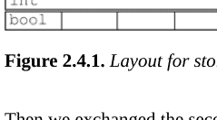
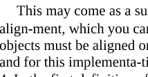
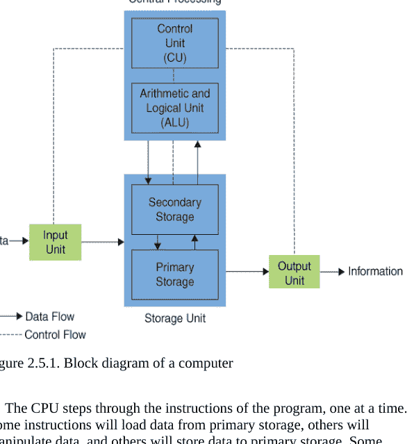

# C++ 之美：编写干净、安全且快速代码的 30 条核心准则

## 使用太赫兹FMCW反射计对热障涂层进行非破坏性孔隙率测量

Christian J. Brandtén1, 2, Adrian Dathe1, 3, Simonas Krotkus1, 3, Mirco Panzner1, 3, Hans-Michael Stübling4, 5, Martin Bastian4, 5, and Martin Koch4, 5

1 弗劳恩霍夫材料与光束技术研究所IWS，德累斯顿，德国

2 德累斯顿工业大学材料科学研究所，德累斯顿，德国

3 弗劳恩霍夫陶瓷技术与系统研究所IKTS，德累斯顿，德国

4 马尔堡大学物理系，马尔堡，德国

5 卡塞尔大学纳米结构技术与分析研究所，卡塞尔，德国

### 摘要

热障涂层（TBCs）广泛用于燃气轮机发动机中，以保护金属部件免受高温影响。TBCs的孔隙率是影响其隔热性能和寿命的关键参数。本文提出了一种使用太赫兹调频连续波（FMCW）反射计非破坏性测量TBCs孔隙率的方法。该方法基于涂层的有效折射率与其孔隙率之间的相关性。太赫兹FMCW反射计提供深度分辨信息，能够测量TBC的折射率和厚度。然后使用有效介质近似从有效折射率确定TBC的孔隙率。所提出的方法在具有不同孔隙率水平的等离子喷涂YSZ涂层上进行了验证。结果表明，太赫兹FMCW反射计可以非破坏性、非接触地准确测量TBCs的孔隙率。该方法有望用于工业应用中TBCs的质量控制和寿命评估。

**关键词：** 太赫兹，FMCW，热障涂层，孔隙率，非破坏性测试

## 前言

编写C++的复杂性随着每一个新标准和每一部教学文献而逐渐降低。会议、博客和书籍层出不穷，这是件好事。世界上没有足够高质量的工程师来解决我们面临的非常现实的问题。

尽管语言不断简化，仍有许多关于如何编写优秀C++的知识需要学习。C++的发明者Bjarne Stroustrup和维护C++的标准机构召集人Herb Sutter投入了大量资源来创建教学材料，既用于学习C++，也用于编写更好的C++。这些著作包括《C++程序设计语言》¹ 和《C++之旅》²，以及《Exceptional C++》³ 和《C++编码标准》⁴。

- 1. Stroustrup, B, 2013. *The C++ Programming Language*, Fourth Edition. Boston: Addison-Wesley.
- 2. Stroustrup, B, 2018. *A Tour of C++*, Second Edition. Boston: Addison-Wesley.
- 3. Sutter, H, 1999. *Exceptional C++*. Reading, MA: Addison-Wesley.
- 4. Sutter, H, and Alexandrescu, A, 2004. *C++ Coding Standards*. Boston: Addison-Wesley.

书籍的问题，即使这本薄薄的小册子也不例外，在于它们代表了某一时刻事务状态的快照，而C++是一门不断发展的语言。1998年的好建议可能不再那么明智。一门不断发展的语言需要一份不断发展的指南。

一个在线资源——C++核心准则⁵，由Bjarne Stroustrup和Herb Sutter在2015年的CppCon大会上，在他们两次⁶主题⁷演讲期间推出。该准则提供了优秀、简洁的建议，用于改进你的C++风格，使你能够一次就写出正确、高性能且高效的代码。这是C++从业者所需要的不断发展的指南，作者们将乐意审查包含更正和改进的拉取请求。从初学者到资深人士，每个人都应该能够遵循其建议。

无需过多思考正在发生的事情而编写代码。它们引导生成良好的惯用C++，你的同事将能够理解并欣赏。

在整本书中，正如任何优秀文本一样，主题会浮现并发展。写这本书的部分乐趣——我希望这也能转化为阅读的乐趣——在于观察是什么在推动这些准则，并反思这些动机的更广泛应用。许多准则，在阳光合适、仔细眯眼观察时，以不同方式重申了软件工程的一些基本真理。提取这些真理将大大提升你的编程实践。

我们真心希望你喜欢这本书并从中获益。

### 访问代码

所有代码都可以在Compiler Explorer网站上获取。Matt Godbolt为每章保留了稳定的链接，链接由 https://godbolt.org/z/cg30-ch 和章节号组成。例如，https://godbolt.org/z/cg30-ch1.3 将带你到第1.3章的完整代码。我们建议你从 https://godbolt.org/z/cg30-ch0.0 开始，获取关于如何使用该网站以及与代码交互的说明。

——Guy Davidson, @hatcat01 hatcat.com
——Kate Gregory, @gregcons gregcons.com
2021年10月

在InformIT网站上注册你的*优美C++*副本，以便在更新和/或更正可用时方便地获取。要开始注册过程，请前往informit.com/register并登录或创建账户。输入产品ISBN（9780137647842）并点击提交。在Registered Products标签中查找“Access Bonus Content”链接，点击该链接以访问任何可用的附加材料。如果你想收到有关新版本和更新的独家优惠通知，请勾选接收我们的电子邮件。


## 关于作者

**J. Guy Davidson** 于 1980 年通过 Acorn Atom 首次接触计算。他青少年时期的大部分时间都花在各种家用计算机上编写游戏，包括 Sinclair Research 的 ZX81 和 ZX Spectrum，以及 Atari ST。在萨塞克斯大学取得数学学位、涉足戏剧并在一支灵魂乐乐队中担任键盘手之后，他在 20 世纪 90 年代初开始编写演示文稿应用，并于 1997 年进入游戏行业，加入 Codemasters 的伦敦办公室。

1999 年，他加入 Creative Assembly，如今担任工程实践负责人。他参与《Total War》系列产品，负责维护旧版本产品，同时致力于提升工程团队的编程水准。他是 IGGI 咨询委员会、BSI C++ 小组和 ISO C++ 委员会的成员；担任 ACCU 委员会的标准官员，并服务于 ACCU 会议的计划委员会。他还是 #include<C++> Discord 服务器的版主，并担任多个组织的行为准则负责人。你经常可以在 C++ 会议和聚会上听到他的演讲，尤其是关于将线性代数加入标准库的主题。

在充裕的业余时间里，他通过 Prospela 和 BAME in Games 提供 C++ 辅导；通过 UKIE、STEMNet 以及视频游戏大使身份面向学校、学院和大学发表演讲；练习并教授吴式太极拳；学习钢琴；在布莱顿音乐节合唱团唱第一男低音；运营一个本地电影俱乐部；是 BAFTA 的投票会员；两次代表英格兰和威尔士绿党参加地方议会选举（均未当选）；并且正在学习西班牙语。你偶尔能在牌桌上看到他打桥牌，一分一英镑。大概还有别的事，他不是那种会让时间白白流逝的人。

**Kate Gregory** 于 1977 年在滑铁卢大学分别遇见了编程、她最亲密的一些朋友，以及她后来所嫁的人，此后她再也没有回头

其他地方则暴露在头文件中，因此代码应该这样写：

2. https://stackoverflow.com/questions/41600981/how-do-i-check-if-a-key-is-pressed-on-c

点击此处查看代码图片

```
auto a_pressed = key_state('A');
```

`key_state` 函数封装了这一扩展，是一个接口。相关实现会根据合适的平台做正确的事，同时脱离你的控制流，也不会带来预处理宏的额外负担。将各个实现分别放入不同文件，进一步支持了这种抽象。

## C++ 语言级别和编译器的差异

C++ 编译器实现者如果想要宣称其编译器符合标准，就必须完整、精确地支持该标准。然而，这并没有完全束缚他们的手脚，也为他们添加额外特性或扩展留出了空间。例如，GCC 在 `__has_trivial_constructor` 和 `__is_abstract` 这类类型特性被加入标准之前，就已经提供了它们。自 C++11 起，这两个特性都以不同名称出现在类型特性库中：`std::is_trivially_constructible` 和 `std::is_abstract`。

注意，`__is_abstract` 前面有两个下划线：双下划线由标准保留给实现者使用。实现者不得向 `std` 命名空间添加新标识符。这样做非常糟糕，因为将来这些标识符可能以完全不同的含义被加入标准。对 C++ 开发者而言，这在实际中的意义是：你可能无意中写出看起来像使用标准特性的代码，但实际上误用了编译器专属特性。一个很好的防范方式是，在多个编译器和操作系统上构建并测试代码，以便发现非标准代码。

提供这两个特性是有充分理由的：它们是有用的元编程工具。事实上，它们非常有用，以至于后来被加入了标准。标准中的许多部分，无论是语言部分还是库部分，

如果不谨慎处理，可能随时被修改或修正（尽管也可以参考海勒姆定律⁴）。在这种情况下，核心指南建议不要使用 `#pragma once`，而是按照 SF.8 使用头文件保护：为所有 `.h` 文件使用 #include 保护。使用头文件保护后，我们确切知道会发生什么。

4. 2021 年。可访问：https://www.hyrumslaw.com/ [访问日期：2021 年 7 月 16 日]。

## 基本类型的差异

操作系统实现并非唯一的系统差异来源。你可能知道，`int` 和 `char` 等算术类型的宽度并没有标准化。你可能觉得 `int` 是 32 位宽，但我记得有个时期 `int` 是 16 位宽。当时我需要一个恰好 32 位宽的类型，由于担心错误地假设 `int` 永远是 32 位宽（它已经变过一次，为什么不会再次改变？），我使用实现头文件来查明哪个类型具有这个宽度，并为该类型创建了一个别名：

```
typedef __int i32; // older way of doing this: do not use now
```

我引入了一个名为 `i32` 的标识符，作为该平台对名为 `__int` 的类型定义的别名。如果项目被移植到另一个平台，我完全安全：可以查明目标平台如何定义 32 位有符号整型，然后按需更新该平台的 `typedef` 定义。

当然，当下一个标准发布时，也就是 C++11，`<cstdint>` 头文件中的库引入了新类型，用于定义定宽整型。我可以用两种不错的方式来更新这个定义：

```
using i32 = std::int32_t;
```

首先，我可以用这个新类型让我的定义面向未来：被别名的类型属于标准的一部分，极不可能发生变化，因为向后兼容性对这门语言非常重要。这

## C++ 的向后兼容性

记住这门语言的来源，以及推动其发展的动力，是很重要的。我当前项目里有我在 2005 年编写的代码。在今天的人看来，它有点古怪，因为它使用了早已废弃的范式，没有 `auto`，没有 lambda：它既是源代码，也是活生生的历史课。

然而，它仍然可以工作。它仍然可以顺利编译和运行。在你的职业生涯中，你会遇到不同年代的代码。重要的是尽量使用最新标准，并尽可能用最新的编译器构建；但同样重要的是了解这门语言的来源，并为未来做好规划。

> *数十年的稳定性是一种特性。*

有时无法使用最新版本的标准。在嵌入式开发、法规要求、系统认证或老旧基础设施中，你可能不得不使用 C++11，甚至 C++98。C++ 依赖向后兼容性。它向后兼容 C，也向后兼容此前的标准。数十年的稳定性是一种特性。这是它最大的优势之一：全世界数以亿计的代码仍然可以用现代编译器构建，有时只需要一点微调。某个时候，你可能会被要求维护这样的代码。

## 面向未来的兼容性与“Y2K”

反过来，也要编写经得起时间考验的代码。上世纪末，世界各地大量老旧计算机软件暴露出一个问题：年份只用了两位数字表示。⁶当时内存非常珍贵，更高效的做法是只存储 74，而不是 1974。开发者当时不以为意：“这个软件 25 年后不会还在运行吧；到时肯定已经被替换了。”

6. https://www.britannica.com/technology/Y2K-bug

啊，这种想法究竟是悲观还是乐观，取决于你的视角。当然，一旦日期滚动到 2000 年，年份就会表示为 00，从而破坏时间间隔计算、利息支付计算，事实上是任何与时间流逝有关的计算。


这就是所谓的 Y2K 漏洞，或称千年虫问题。事实证明，这对年长的承包商来说是一笔意外之财，他们周游世界，以高昂的费用维修使用已有 25 年之久的系统。灾难得以基本避免，是因为问题被及时发现，并且有足够的工程师能够修复问题。

然而，如果工程师们当初能够面向未来做规划，假设他们的代码会“永远”运行，并且在编写代码时，四位整数与两位整数占据相同空间，那么这个问题本来可以避免。显然，两位数字不足以表示所有可能需要的日期，至少需要三位数字，而实际上，为了迎接千禧年的到来，使用四位数字在所有方面都更为简单。

顺便说一句，这并不是唯一的日期问题。Linux 也有类似的问题，它以自 1970 年 1 月 1 日以来的秒数来计量时间。该值存储为 32 位有符号整数，这意味着它将在 2038 年 1 月 19 日发生回绕。我说“曾经是”：从 Linux 5.6 开始，这个问题已经解决。

因此，一对重要的职业技能就是：为未来编写代码，以及学会阅读过去的代码。

## 紧跟标准的发展

C++ 一直在发展。每发布一个新标准，都会带来大量新的语言特性和库补充。单纯使用最新颖的特性并无特别之处；它们应该在能够带来明确而具体益处的地方使用。然而，C++ 社区非常幸运，有许多优秀的老师随时准备为我们展示和揭示所有这些新事物。通过以下四种方式，可以更容易地找到这些资源。

### IsoCpp

首先，是 isocpp.org。这是 C++ 在 Web 上的家园，由标准 C++ 基金会运营。这是一个华盛顿 501(c)(6) 非营利组织，其目的是支持 C++ 软件开发人员社区，并促进在所有编译器和平台上对现代标准 C++ 的理解和使用。在这个网站上，你可以找到

## 第 1.2 章

### F.51：当存在选择时，优先使用默认参数而不是重载

#### 引言

API 设计是一项宝贵的技能。当你将问题分解为其组成抽象时，你需要识别这些抽象并为它们设计接口，以一组完全明显且精心命名的函数的形式，向客户端提供清晰且无歧义的使用说明。有句谚语说，代码应该是自文档化的。虽然这是一个崇高的目标，但正是在 API 设计中，你应最努力地实现这一目标。

代码库会增长。它们就是会增长。这是无法避免的。随着时间流逝，更多的抽象被发现并被编码，更多的问题被解决，问题域本身也在扩展以适应更多的用例。这是正常的，完全正常。这是开发和工程常规操作的一部分。

随着这些额外的抽象被添加到代码库中，无歧义命名的问题便暴露出来。命名很难。这句话在你的编程生涯中会经常出现。有时，你想让客户端（通常是你自己）做同样的事情，但方式略有不同。

这时，重载似乎是个好主意。两个抽象之间的区别可能仅仅在于传递给它们的参数；在其他所有方面，它们在语义上是相同的。函数重载允许你使用一组不同的参数复用函数名。但如果它们在语义上确实相同，你能用默认参数来表达这种区别吗？如果可以，你的 API 将更容易理解。

## 2025年6月 KS2 第1章课后测

姓名：____ 班级：____ 学号：____

### 一、选择题（每题2分，共10分）

1. 下列最能体现我国社会主义民主政治的本质属性的是（ ）
   - A. 全过程人民民主
   - B. 选举民主
   - C. 协商民主
   - D. 基层民主

2. 下列属于我国基本政治制度的是（ ）
   - A. 人民代表大会制度
   - B. 中国共产党领导的多党合作和政治协商制度
   - C. 社会主义市场经济体制
   - D. 民族区域自治制度

3. 以下公民参与民主生活的做法中，不正确的是（ ）
   - A. 参加公交价格调整听证会
   - B. 在选举中投出自己神圣的一票
   - C. 在网络平台上随意发表言论
   - D. 通过人大代表反映小区停车难问题

### 二、简答题（5分）

1. 为什么说全过程人民民主是最广泛、最真实、最管用的民主？（5分）


```cpp
office make_office(float floor_space, int staff, bool two_floors = false);
```

一次快速的重新编译之后，一切又恢复正常。不幸的是，领域扩展的魔鬼还没有放过你：事实表明，单层办公室有时需要说明它们所在的建筑物名称。你，这位始终乐于助人的工程师，再次扩展了函数的参数列表：

```cpp
office make_office(float floor_space, int staff, bool two_floors = false,
                   std::string const& building_name = {});
```

你重新实现了函数，但它让你感到恼火。这里有四个参数，最后一个参数只有在第三个参数为 false 时才需要，这一切看起来混乱而复杂。你决定重载你的函数：

```cpp
office make_office(float floor_space, int staff, bool two_floors = false);
office make_office(float floor_space, int staff,
                   std::string const& building_name);
```

现在你拥有所谓的函数重载集，由编译器根据传入的参数来决定调用该集合中的哪个成员。当必须标识建筑物时，客户端被迫调用正确的函数。标识意味着单层办公室。

例如，某些客户端代码可能希望创建一个面积为 24,000 平方米、可供 200 人使用的办公室。该办公室位于一栋名为“Eagle Heights”的建筑内的一层。因此，正确的调用是

整型提升，而 `float` 类型的对象可以提升为 `double` 类型的对象，称为浮点提升。

转换与提升的不同之处在于，转换可能会改变值，这可能会损失精度。例如，浮点值可以转换为整数，四舍五入到最接近的整数值。此外，整型和浮点值、无作用域枚举、指针以及指向成员的指针类型都可以转换为 `bool`。这三个等级是 C 的概念，如果要保持与 C 的兼容性，它们是无法避免的。

这部分涵盖了标准转换序列。用户自定义转换以两种方式进行：要么通过非显式构造函数，要么通过非显式转换运算符。这正是我们在示例中所期望发生的：我们期望 `char const*` 通过接受 `char const*` 的非显式构造函数转换为 `std::string`。这是显而易见的事情。我们为什么要把你拖入这场关于重载的阐述中呢？

### 回到示例

在上面的示例中，客户端期望 `char const*` 参与用户自定义转换为 `std::string`，并且该临时值参数作为对 `const` 的引用传递给第二个函数的第三个参数。

然而，用户自定义转换序列相对于标准转换序列优先级较低。在前面的关于转换的段落中，我们确定了从指针到 `bool` 的标准转换。如果你见过旧代码在代码库中传递原始指针，你会看到类似这样的写法：

```cpp
if (ptr) {
    ptr->do_thing();
}
```

`if` 语句的条件是一个指针，而不是 `bool`，但指针在为零时可以转换为 false。这是一种简短而惯用的写法。


## 第1.3章

### C.45：不要定义仅初始化数据成员的默认构造函数；改用类内成员初始化器

#### 为什么还需要默认构造函数？

我们将从一个优美的绕道开始本章。考虑核心指南 NR.5：“不要使用两阶段初始化。”这是指先构造对象、再调用初始化函数的习惯。这种实践可以追溯到上个世纪，当时 C 语言正大行其道，人们会在栈上声明一个对象，或从自由存储区分配一些内存，然后初始化它。如果你确实精通其事，你会定义一个接受指向结构体指针的函数，并称之为 `my_struct_init` 或类似的名称。

两个阶段分别是分配，然后初始化。各种问题都可能出现：你可能会在分配和初始化之间插入越来越多的代码，然后突然发现自己是在初始化之前使用对象。接着，C++ 和构造函数出现了，这个问题就永远消失了。

对于具有静态存储期的对象，链接器会创建一个构造函数列表，以便在 `main()` 之前执行，并提供一个遍历该列表的函数。链接器完全了解这些对象将占用多少空间，因此该函数可以为这些对象分配一些地址空间，通过在该地址空间中构造它们来全部初始化，然后调用 `main()`。

对于具有自动存储期的对象，编译器会分配一些栈空间，并在该内存中初始化对象。对于具有动态存储期的对象，`new` 运算符会调用 `operator new` 分配一些内存，然后调用构造函数在该内存中初始化对象。线程局部存储期这一类别在 C++11 中引入，其行为与静态存储期非常相似，区别在于对象是每个线程一个实例，而不是每个程序一个实例。

我们希望你能在这里看到一个清晰且一致的模式，它消除了一整类 bug：即在对象准备好之前就使用它。通过将分配和初始化组合为单个操作，两阶段初始化问题完全消失了。

当然，除了一点——问题根本没有完全消失。工程师们仍然习惯于实例化一个对象，然后在构造之后修改它。类会设计一个默认值，客户端会根据上下文对该值进行专门化。

这只是把问题转移了。默认构造函数并不总是适合一个类。遗憾的是，在很长一段时间里，某些 C++ 供应商实现的容器只有在所包含的类可默认构造时才可用。默认构造函数之所以被提供，不是因为问题域需要，而是因为解决方案域需要。当然，这意味着它也会在问题域中被使用，从而模糊了类的正确用法。

有些类应该有默认构造函数。例如，你如何声明一个空字符串？没有有意义的 API 可做到这一点，除非你决定为空字符串提供一个带有特殊标签参数的构造函数重载。`std::string` API 认识到了这一点，并提供了一个默认构造函数来创建零长度的字符串。默认构造函数显然是解决方案。事实上，所有标准容器都提供了默认构造函数，表示容器以空状态开始。

然而，不要假设你的类需要可默认构造。确保你清楚允许用户在没有任何说明的情况下创建类实例意味着什么。

#### 如何初始化数据成员？

让我们回到主路，看看初始化的过程。当构造对象时，会根据存储类别保留适当的内存。然后调用构造函数，尽管对于内置类型对象，规则略有不同。如果没有定义构造函数，则类的成员会被默认初始化。如果存在任何内置类型的成员，则它们默认不会被初始化。

这是一件坏事：如果你不确保类的每个成员都被初始化，那么你的程序就会面临引入非确定性行为的风险。祝你好运调试这个问题。多年前，我开发一个游戏时使用了一种 C++ 实现，在涉及动态存储期时它非常有帮助。它附带了两个运行时库，一个用于开发，一个用于零售。开发版的运行时库是在未定义 `NDEBUG` 的情况下构建的，因此断言会触发，并且标准库可提供各种调试信息。当调用 `operator new` 时，它会用值 `0xcd` 初始化内存。当调用 `operator delete` 时，它会用值 `0xdd` 覆盖内存。这对于识别悬空指针的解引用非常有用。出于速度原因，零售库没有这样做，在分配后和释放后只是让内存保持原样。

这个游戏是一款多人游戏。每个玩家的机器会在眨眼之间通过互联网发送他们的动作，每台机器都必须以相同的方式解析这些动作。这就要求每台机器在游戏模型方面处于相同的状态；否则，各机器上的模型会发生分歧，导致结果混乱和游戏崩溃。这种不一致在使用开发版运行时库构建的游戏版本中出现频率较低，因为未初始化数据在底层的内存值都是相同的 `0xcd`。这导致了仅出现在零售版中的崩溃，调试起来极为困难，因为任何分歧都要在发生很久之后才会被玩家注意到。

在此之前，说服团队重视在每个构造函数中初始化每个数据成员一直是一场艰苦的战斗。当这个特别的教训被领悟时，就不再需要更多说服了。在调试方面，确定性是你的盟友，因此要通过确定性地构造所有对象并初始化每个成员数据项来确保确定性。

有三处地方可以初始化成员数据。我们首先来看构造函数体。考虑这个类：

对每个类来说都是如此。你应该优先在初始化列表中初始化，而不是在函数体内初始化。

让我们适当地修改构造函数：

``` 
piano::piano()
  : number_of_keys(88)
  , mechanical(true)
  , manufacturer("Yamaha")
{}
```

还有第三个位置可以提供默认定义，它甚至更接近核心：在类本身的定义中。默认成员初始化器在没有其他值提供给构造函数时，为对象提供默认值。让我们回到类的定义，看看实际效果：

``` 
class piano
{
public:
  // piano(); // no longer needed

private:
  int number_of_keys = 88;
  bool mechanical = true;
  std::string manufacturer = "Yamaha";
};
```

这样好多了。你成功去掉了一个多余的成员函数，并且也指定了你期望的默认钢琴的样子：一架 88 键的机械雅马哈钢琴。但有一个无法忽视的代价：

``` 
: number_of_keys(number_of_keys_)
, mechanical(mechanical_)
, manufacturer(std::move(manufacturer_))
{}
piano(int number_of_keys_) {
    number_of_keys = number_of_keys_;
    mechanical = false;
    manufacturer = "";
}

private:
    int number_of_keys;
    bool mechanical;
    std::string manufacturer;
};
```

> 默认构造函数应该是一种主动选择。

这是一个示例类，但我在实际代码中见过类似的东西。通常，这些构造函数被许多行隔开。也许它们都定义在类定义中，所以并不容易看出有三个非常相似的构造函数，因为它们被许多实现行掩盖了。确实，你可以看出不同维护者的一些特点。第三个构造函数的实现者似乎不知道初始化列表。此外，将空字符串赋给 manufacturer 成员是多余的，所以他们可能不知道构造函数和默认初始化是如何工作的。

不过更重要的是，第一个和第三个构造函数具有不同的默认值。虽然你在这个简单示例中可能已经发现了这一点，但我们相信你能想象出不那么明显的情况。调用代码可以传入一个、两个或三个参数，但行为却意外地不同，这不是任何用户想要的。构造函数重载中默认参数的存在也应该让你担忧。


维护默认值的技术债务。然而，你需要认识到这是需要偿还的技术债务，理想情况下，通过添加一个接受所有必需参数的额外构造函数，并弃用现有构造函数。

### 总结

默认构造函数应该是一种有意识的选择。并非所有类都有有意义的默认值。成员数据的初始化可以发生在三个位置：构造函数函数体、构造函数初始化列表，以及成员数据声明处，即所谓的默认成员初始化器。

默认成员初始化器在声明处定义一个默认值。如果某个成员无法以这种方式定义，则表明可能不存在可以定义默认构造函数的合法机制。这没关系。如前所述，默认构造函数并非必需。

构造函数提供了与默认情况的差异。提供默认成员初始化器使得每种差异具有更高的特异性。这对客户端来说是一个额外的好处，因为他们需要担心的对象状态更少：对象可以更贴近他们的需求进行定制。

这些是平凡的函数。它们只是为直接访问 `x` 设置了一个路障。该指南建议不要采用这种方法。然而，对于像 `x_wrapper` 这样无意义的类，无法理解为什么这是糟糕的设计，所以我们稍后将展示一些更现实的例子。不过，首先我们需要讨论抽象，它的用途是什么，以及为什么它对 C++ 编程如此重要。在此过程中，我们将回顾一些历史，遇到类不变量，并考虑在成员函数标识符上，优先使用名词和动词而非 get 和 set 的重要性。

### 抽象

语言的目的是抽象。那么，当我们使用 C++ 编程语言进行抽象时，我们实际上在做什么？

我们将包含数字的内存块，转化为存在于我们问题领域中的事物的表示。这是 C++ 的核心优势之一，也是其主要动机之一。

一栋房子可以表示为一系列数字。这些数字可能包括其所处地块的尺寸；高度；建筑面积的大小；楼层、房间和窗户的数量；以及阁楼的数量。最后一项很可能为零或一，除非你的房子特别宏伟。

这种抽象实现为一系列数字或字段，排列成一条记录。记录决定了字段的排列顺序，这意味着如果你有一组连续存储在内存中的记录，那么通过一些简单的算术，你可以轻松地从第一条记录导航到任何一条记录，以及该记录中的任何字段。

在计算早期，大量时间都花在处理这些记录或表的集合上。简单的数据处理涉及要么收集一些数据并制作一些记录，要么读取一些记录并生成更多数据。那些是快乐而简单的日子。

如果你对 C++ 有所了解，你会认识到 `struct` 是记录，成员数据是字段，表是结构体数组。对于简单的数据处理，直接读写记录似乎是合理的。

然而，当你想做的不仅仅是处理记录时，会发生什么？在类出现之前，你会将数据保存在结构体中，并调用函数来处理这些数据。在拷贝构造函数和赋值运算符出现之前，你不能将结构体的实例传递给函数，只能传递指向这些实例的指针。在访问级别出现之前，你可以直接修改结构体中的任何字段。了解你对数据所做的操作以及其他人对数据的期望，真的非常重要。这可能是一个相当大的认知负担。

重要的是，对于不在当前执行函数作用域内的数据，通常可以直接修改。数据通过在文件作用域中放置来在函数之间共享，允许一个函数写入数据，其他函数从数据读取。看起来像这样：

点击此处查看代码图像

```c
int modifying_factor;

void prepare_new_environment_data(int input)
{
    int result = 0;
    /* ... prepare the new environment data using input */
    modifying_factor = result;
}

int f2(int num)
{
    int calculation = 0;
    /* ... perform f2-relevant calculations */
    return calculation * modifying_factor;
}
```

如果工程师足够幸运，是唯一被期望修改这些数据的人，他们就能以宝贵的确定性来推理这些数据。他们知道数据在哪里被修改，而且他们知道在哪里

尝试生成自文档化代码。例如，如果数据是海平面以上的海拔，他们可能会这样命名函数：

点击此处查看代码图像

```
/* elevation.h */
void change_height(int new_height);
int height();

/* elevation.c */
int height_ = 0;

void change_height(int new_height)
{
    height_ = new_height;
}

int height()
{
    return height_;
}
```

这并不能阻止人们在整个代码库中不合时宜地随意更改高度，但至少它会表明他们在做什么，并且可能通过为查询值的函数使用名词、为修改值的函数使用动词来提高客户端的可读性。以这种方式对数据进行把关，使你可以搜索其用途，并且获得额外的益处：你可以在调试器中设置断点，以便仔细监视它。

然而，那是黑暗时代。

### 仅仅封装

随着 C++ 的到来，带来了类、访问级别和成员函数。访问级别！终于，数据属于我了。我可以通过将其声明为私有来使其成为我的。然后除了通过某个公共成员函数之外，没有人能碰它。成员函数！在 C 中，可以将任意函数的指针存储在结构体中，但成员函数将隐式实例指针作为第一个函数参数，在可用性上是一个飞跃。世界变得更加光明、闪亮。

将数据隐藏在成对函数之后的编程风格不再仅仅是一个好主意：它变成了正常实践，并且由语言本身强制执行。新的建议被响亮而清晰地提出：“将所有数据成员设为私有。”添加了一个新关键字 `class`，以区别于 `struct`。为了向后兼容，`struct` 的成员默认保持公有，而 `class` 的成员默认是私有的，这强化了数据应该是私有的观念。

有了将数据保存在私有接口中的能力，就获得了轻松阻止人们干扰这些数据的机会。你可以创建一个对象并提供 get/set 函数来访问数据。简而言之，这就是封装。

封装是面向对象编程的核心原则之一：限制对对象各部分的访问，并将数据与操作该数据的函数结合起来。这是一个安全特性，能够轻松提高工程师以及封装用户推理正在发生的事情的能力。突然间，C 工程师也可以使用封装了，于是出现了这样的情况：

之前：

点击此处查看代码图像

```
struct house
{
    int plot_size[2];
    int floor_area;
    int floor_count;
    int room_count;
    int window_count;
};
```

之后：

点击此处查看代码图像

```
class house
{
public:
    int get_plot_x() const;
    int get_plot_y() const;
    int get_floor_area() const;
    int get_floor_count() const;
    int get_room_count() const;
    int get_window_count() const;

    void set_plot_size(int x, int y);
    void set_floor_area(int area);
    void set_floor_count(int floor_count);
    void set_room_count(int room_count);

    void set_window_count(int window_count);

private:
    int plot_size[2];
    int floor_area;
    int floor_count;
    int room_count;
    int window_count;
};
```

> 如果你只是要通过其他方式暴露数据，那么将数据设为私有就没有意义。


编码规范往往伴随着这样的命令式要求而出现：“所有数据都应该是私有的，并且应该有 get 和 set 方法。”甚至可能有人坚持认为 get 函数应该用 `const` 限定。看似无 Bug 代码的美好高地仿佛就在下一座山丘之后，连酒水都由别人请客。

但等等，我们到底真正得到了什么？这听起来和以前遇到的问题没有什么不同。我们仍然不得不担心数据会被其他人修改。那么，用函数去获取数据又有什么意义呢？

这正是本条准则的核心。不要这样做。不要编写只负责在调用点和对象之间转发数据的 getter 和 setter。如果你只是要通过其他方式暴露数据，那么把数据设为私有就没有意义。你还不如直接让数据公有。把数据藏在 get 和 set 函数后面，并不会增进用户对你这个类的理解。如果我们只是对一切数据都做 get 和 set，那么我们就没有充分利用 C++ 的全部能力。更糟糕的是，我们用一个臃肿的 API 换掉了一个紧凑、虽然可能有些危险的 API，也就是 `struct house` 的公有成员数据。后者让人一眼就很难看清。

而且，改变楼层数到底意味着什么？这听起来是一件非常奇怪的事。

添加 get 和 set 函数并不会让这个接口更安全，也不会减少出错的可能性。它只是为 Bug 又多开了一扇门。

你需要问自己的问题是，你为什么会担心别人修改数据。对成员数据的随意修改会不会让你的类实例失效？你的数据是否存在某些限制？如果存在，那么你的 setter 函数就需要做一点工作。例如，楼层面积不能超过地块面积：

点击此处查看代码图片

```cpp
void house::set_floor_area(int area)
{
    floor_area = area;
    assert(floor_area < plot_size[0] *
    plot_size[1]);
}
```

现在，这个 setter 函数不再是无意义的，它有了存在的理由。

再看另一个例子：银行账户。错误的做法如下：

点击此处查看代码图片

```
class account
{
public:
    void set_balance(int);²
    int get_balance() const;

private:
    int balance;
};
```

2. 请永远不要用浮点数来处理金额。舍入误差和表示误差会不断传播，最终降低你的输出质量。

更好的做法是引入业务逻辑：

点击此处查看代码图片

```
class account
{
public:
    void deposit(int);
    void withdraw(int);
    int balance() const;

private:
    int balance_;
};
```

现在，你通过业务逻辑所规定的方式改变余额。`deposit` 函数会增加余额，`withdraw` 函数会减少余额。

### 类不变量

楼层面积不能超过地块面积这个条件被称为类不变量。更一般地说，类不变量是一个必须对类所有有效实例都成立的条件。它在构造时建立，并在公有成员函数的调用之间得到维护。对于 `account` 类，类不变量可以是余额不能低于 0，也可以是所有存入和取出金额的总和等于余额。对于 `house` 类，类不变量是地块面积必须大于楼层面积，正如 `void house::set_floor_area(int area)` 函数所表达的那样。正是对这个类不变量的表达，让 setter 不再是无意义的。

看看你能否在下面的示例中找到类不变量。

点击此处查看代码图片

```
class point
{
public:
    void set_x(float new_x) {
        x_ = new_x; }
    void set_y(float new_y) {
        y_ = new_y; }
    float get_x() const {
        return x_; }
    float get_y() const {
        return y_; }

private:
    float x_;
    float y_;
};
```

这里一个都没有。改变 x 坐标与 y 坐标没有任何关系。它们可以独立变化，而点仍然是点。这些成员函数没有给类增加任何东西。这正是这条准则告诉你不应该做的事。

试试这个例子：

点击此处查看代码图片

```
class team
{
public:
    void add_player(std::string name) {
        if (players_.size() < 11)
            players_.push_back(name);
    }
    std::vector<string> get_players() const {
        return players_;
    }

private:
    std::vector<string> players_;
};
```

这里的类不变量是，一支队伍不能有超过 11 名球员。

访问级别允许类设计者轻松维护类不变量：通过检查操作对成员数据的影响，并确保所有数据都保持有效值。

这条准则给出的理由是：“无意义的 getter 或 setter 不会增加任何语义价值；数据项完全可以设为公有。”从 `house` 示例和 `point` 示例可以看出，情况正是如此。`struct house` 和 `class house` 之间没有语义差异。`class point` 中的成员函数是多余的。在操作层面确实有区别，因为可以在成员数据被读取和写入的位置设置断点，但这并不会影响 `house` 抽象或 `point` 抽象的语义本质。

在创建类并设计其接口时，我们很自然地会用数字来思考被建模的抽象方面：毕竟，你是在为计算机编写程序。于是，很容易就把这些方面直接变成数值型成员数据。如果客户端想要修改某样东西，他们就会调用 set 函数来设置新值，经过一些检查以维护类不变量后，相应的成员数据就会被适当修改。

### 名词与动词

但这样做其实错失了良好类设计的重点。类是对一种想法的抽象，而不是一堆数据。`change_height` 和 `height` 之所以是好的函数标识符，是因为它们用英文传达了正在发生的事情。客户端工程师并不关心他们正在改变某个 `int` 的值；他们关心的是自己正在改变对象的高度。他们不想知道 `height_member` 的值是多少，只想知道对象的高度。这两件事处于不同的抽象层次，而泄露抽象细节是一种糟糕的实践，会不必要地增加客户端工程师的认知负担。

私有数据，也就是实现，承担了为抽象建模的职责。公有成员函数应该具有与抽象相关、而非与抽象实现相关的含义。get 和 set 函数恰恰没有做到这一点。公有/私有之间的分界，正体现了不同抽象层次的区别。

尤其是，这种方法有助于体现 Model-View-Controller（模型-视图-控制器，MVC）思想。举一个现实中的例子：假设有一座老旧的核反应堆，它有一个反应堆堆芯，还有一个可能有大量控制面板的控制室，面板上有成排的按钮、开关、滑块，以及一行行的指示灯和仪表。指示灯和仪表向你提供关于反应堆堆芯的信息，它们是视图。按钮、开关和滑块会以某种方式改变反应堆堆芯，它们是控制器。

这一点在 API 设计中也有体现。用 `const` 限定的成员函数为你提供对象的视图。其他成员函数则控制对象。成员数据对对象进行建模。在为视图函数和控制器函数选择标识符时，合理的选择是前者用名词、后者用动词，而不是使用 get 和 set 形式的函数。

由于私有成员数据承担了模型角色，这种实现可以随着设计的发展而更新。用 get/set 对很难做到这一点：更新实现意味着要更新所有调用 get/set 函数的调用点。设计正确的公有接口有一个重要好处，就是它比私有接口稳定得多，这意味着当抽象的实发生变化时，客户端代码更有可能不需要修改。

当然，说了这么多，有时候你只是想轻松地把打包好的数据传来传去，而不想费力气构建一个类：这可能没有必要，因为这些数据可能只是从文件或网络套接字读出的字节。这时你就应该使用 `struct`。数据是公有的，getter 和 setter 既没有必要，也不相关。

### 总结

总而言之：

- 无意义的 getter 和 setter 不会给接口增加任何价值。
- 非无意义的 setter 应该维护类不变量。
- 名词和动词能提供更好的函数标识符，能更好地反映抽象。
- 没有类不变量的无关数据可以打包进 `struct` 中。


## 第1.5章
### ES.10：每个声明只声明一个名字
#### 让我来介绍

声明将一个名字引入程序中。它也可以重新引入一个名字：多个声明是完全允许的，因为没有它们，我们将无法进行前置声明。定义是一种特殊的声明，因为它提供了足够的细节，以便能够使用已命名的对象。

声明类型的数量惊人。你可以声明函数，像这样：

```
int fn(int a);
```

这是声明的一个非常常见的用途。引入了一个名字 fn，其类型是“接受一个整数并返回一个整数的函数”。你可以在代码中使用这个函数，而不必先定义它。你可以声明函数或类模板，像这样：

点击此处查看代码图像

```
template <class T, class U>
int fn(T a, U b);

template <class T>
class cl {
public:
cl(T);

private:
T t;
};
```

这是一个接受任意类型 T 和 U 并返回 int 的函数，以及一个用任意类型 T 构造的类。你还可以声明部分特化和显式模板特化，以及显式模板实例化：

点击此处查看代码图像

```
template <class T> int fn(T a, int b); // Partial specialization
template <> int fn(float a, int b); // Explicit specialization
template class cl<int>; // Explicit instantiation
```

你可以声明命名空间：

点击此处查看代码图像

```
namespace cg30 {
... // more declarations
}
```

你可以声明链接性，以便与其他语言互操作：

```
extern "C" int x;
```

你可以声明属性：

点击此处查看代码图像

```
// Warn if the return value is discarded rather than assigned
[[nodiscard]] int fn(int a);
```

还有一组只能在块内部进行的声明；例如，在函数体内。这些包括 asm 声明，在这里你可以为编译器指定要插入到输出流中的显式汇编语言指令：

点击此处查看代码图像

```
asm {
    push   rsi
    push   rdi
    sub    rsp, 184
}
```

类型别名声明可以为冗长的类型引入简短的名称：

```
using cl_i = cl<int>;
```

命名空间别名可以缩短冗长的嵌套命名空间：

点击此处查看代码图像

```
namespace rv = std::ranges::views;
```

using 声明可以将其他命名空间中的名字引入当前块：

点击此处查看代码图像

```
using std::string; // Now you no longer need to
// type the
// std:: prefix in this block for
// string
```

using 指令与 using 声明不同，它将整个命名空间注入当前块：

点击此处查看代码图像

```
using namespace std; // Never do this at global namespace scope. Ever.
```

还有使用相同限定符的独立声明。例如：

```
int a, b, c, d;
```

这里有四个整数实例，分别命名为 a、b、c 和 d。

#### 向后兼容性

看这个：

```
int* a, b, c, d;
```

这些对象是什么类型？

我们希望你已经发现了陷阱，并说出 a 是指向 int 的指针，而 b、c、d 是 int（这就是为什么你经常看到指针声明时将星号放在标识符旁边而不是类型旁边的原因之一）。当然，你能发现它，是因为你在故意寻找问题；历史上我曾发现过编译错误，其中程序员假设它们都是指向 int 的指针。

这是合法的，但并不明智。这是一个等待发生的事故，应该从语言中剔除。至少，当我告诉一位同事这件事时，他就是这样说的。不幸的是，出于向后兼容的原因，这是合法的。C 编程语言允许这样做，因为它曾经要求你在函数顶部声明所有对象。这告诉编译器栈应该增长多少，并在函数入口处为所有数据提供地址。这是一个方便的优化。然而，更明智的做法是像这样将声明写在单独的行上：

```
int* a;
int b;
int c;
int d;
```

`std::auto_ptr`，而 `std::unique_ptr` 是其直接替代品。

#### 编写更清晰的声明

回到本指南的主题，要求早期声明可能会导致一些相当繁忙的函数前奏。该指南给出了以下示例：

点击此处查看代码图像

```
char *p, c, a[7], *pp[7], **aa[10];
```

如果不允许每个声明有多个名字，这将扩展为

点击此处查看代码图像

```
char *p; char c; char a[7]; char *pp[7]; char **aa[10];
```

或者更可能的是：

```
char *p;
char c;
char a[7];
char *pp[7];
char **aa[10];
```

这将消耗五行认知空间，而不是一行。

> “但是，”你可能会想，“如果我的函数有很多状态怎么办？那我该怎么做？一条一条地列出来，占半个屏幕？我需要把相关部分组合在一起，而不是让它们在不同行上，它们之间还需要一整个空行。在到达实际函数之前会有太多东西。这不利于可读性。这是个愚蠢的想法。”

关键在“把相关部分组合在一起”，这在我看来很像“形成一种抽象”。如果你已经以某种方式关联了状态，那么通过定义一个结构体来形式化这种关系，并以一种能够捕捉和识别这种关系的方式为其命名。将相关功能推入结构体。然后你可以用一条声明替换那几行声明：该结构体的一个实例。你应该时刻保持警惕，寻找创建有用抽象的机会。

#### 结构化绑定

本指南有一个例外，即涉及结构化绑定的使用。这一创新在 C++17 中引入，允许你将数组或非联合类类型绑定到一组名字。例如，最简单的情况：

点击此处查看代码图像

```
int a[2] = {1, 2};
auto [x, y] = a; // x = a[0], y = a[1]
```

绑定到类似 tuple 的类型也很简单：

点击此处查看代码图像

```
std::unordered_map<std::string, int> dictionary;
auto [it, flag] = dictionary.insert({"one", 1});
// it points to the element
// flag signals whether the insertion was successful
```

绑定到结构体以解包它的工作方式相同：

点击此处查看代码图像

```
struct s {
    int a;
    float b;
};

s make_s();

auto [sa, sb] = make_s(); // sa is an int
// sb is a float
```

在每种情况下，你都会看到每个声明中有多个名字。然而，我们可以通过将名字声明在单独的行上来减少任何混淆，如下所示：

点击此处查看代码图像

```
std::unordered_map<std::string, int> dictionary;
auto [it,    // it points to the element
      flag]   // flag signals whether the
// insertion was successful
    = dictionary.insert({"one", 1});
```

一个人的简化可能是另一个人的复杂化，所以这当然是个品味和风格问题。

#### 总结

这是一个相当简单的指南，针对的是旧习惯。许多核心指南都引导你编写更易读、能快速理解的代码。本指南归结为三点考虑。

- 声明有很多种。
- 名字可以在任何地方引入。
- 除非语言要求，否则不要通过每行引入多个名字来混淆声明。

## 第1.6章
### NR.2：不要坚持函数中只能有一个 return 语句
#### 规则在演变

令我惊讶的是，在21世纪已经过去了20%的时候，人们仍在争论这个问题。核心指南的这一部分被称为“非规则和神话”。一个非常普遍的建议是函数中应该只有一个 return 语句，这正好属于这一类。

强制要求单一 return 语句是一个很老很老的规则。人们很容易忘记编程领域已经取得的进步。我买了我的第一台计算机，或者更确切地说，是我的父母在1981年买的。那是一台 Sinclair ZX81，由运行在3.25MHz的 NEC Z80 CPU 驱动。操作系统存储在8KB的只读存储器（ROM）中，包含一个 BASIC 解释器，使我能够在可怜的1KB RAM中编写简单的程序。

当然，我当时14岁，我想编写游戏，我发现最好的方法是完全绕过 BASIC 解释器，直接用原生 Z80 汇编语言编写。在托尼·贝克¹的*精通ZX81机器代码*、罗德奈·扎克斯²的*Z80编程*以及一个汇编器的帮助下，我得以编写我的第一批游戏并卖给学校的同学们。

1. Baker, T, 1982. *精通ZX81机器代码*. Reston, VA: Reston Publishing Company, Inc.

2. Zaks, R, 1979. *Z80编程*. Berkeley, CA: Sybex.

我发现用 Z80 汇编语言编写东西比用 BASIC 困难得多。特别是，BASIC 有行号和子程序的概念。我可以通过执行 GOTO 来分支，也可以分支通过


我毕业时用上了一台 Atari ST，搭载 8MHz 的 Motorola 68000 CPU，以及真正非凡的 512MB 内存。我那套组织良好的编程风格让我保持清醒。一段代码只有一个且唯一的起始点，并且你总是会回到你来的地方。我告诉所有人这是唯一正确的方式：我满怀宗教般的狂热。

事实证明，并不是只有我一个人这样写代码。如果 FORTRAN 和 COBOL 程序员决定不采取同样的小心谨慎，他们也可能会把自己缠进类似的死结。这带来了一条简单的智慧：“单入口、单出口。”一个函数应当有且只有一个入口点。它应当只有一个返回之处：即它被调用的地方。

单入口、单出口是结构化编程哲学的一部分，它源于艾兹赫尔·戴克斯特拉（Edsger Dijkstra）写给编辑的信，标题为“GOTO 语句被认为有害”。³《结构化编程》⁴ 至今仍是一本极好的读物，你应该考虑把这两篇都读一读。它们影响了十余年的编程实践。

3. www.cs.utexas.edu/users/EWD/ewd02xx/EWD215.PDF

4. 《Structured Programming》，作者：Ole Johan-Dahl、Edsger W. Dijkstra 和 Charles Anthony Richard Hoare。

不幸的是，旧习难改。不仅如此，这些习惯背后的动机会随着时间流逝而从记忆中消退。新的创新削弱了旧智慧的重要性。C++ 中的函数让“单入口”这个理念变得不再需要关注。C++ 的语法使你不可能跳入一个函数的中途。同样，除了调用点之外，你也没有办法返回到任何其他地方（异常处理和协程除外）。

你可能会问自己，这与多个返回语句有什么关系。唉，不幸的是，程序员社区在对介词的理解上出现了混淆，“单出口”逐渐变成了“只从一个地方返回”，而不是“只返回到一个地方”。灾难。

### 确保清理

让我们来看一个例子，演示单个返回语句的智慧。假设这个函数正在调用一个旧 C 库，该库导出了一些基于整数标识符来获取、操作和显示资源的函数：

```cpp
int display(int ID)
{
    auto h = get_handle_to_resource(ID);
    if (h == 0) {
        return 0;
    }
    auto j = manipulate_resource(h);
    if (j < 0) {
        release_handle(h);
        return 0;
    }
    auto k = supply_resource_to_system(h, j);
    if (k < 0) {
        return 0; /* forgot to release handle */
    }
    display_resource(h);
    release_handle(h);
    return 1;
}
```

在这段代码中，我们看到了一个非常常见的情况：获取了一个资源的句柄，并且随后必须在句柄超出作用域之前释放它。工程师忘记在第三个返回语句处释放句柄。一种解决方案是使用单一的返回语句，并在其之前释放句柄，如下所示：

```cpp
int display(int ID)
{
    auto result = 0;
    auto h = get_handle_to_resource(ID);
    if (h != 0) {
        auto j = manipulate_resource(h);
        if (j >= 0) {
            auto k = supply_resource_to_system(h, j);
            if (k >= 0) {
                display_resource(h);
                result = 1;
```

啊，不对，等等，这是错的。只有当句柄成功获取后，才应该调用 `release_handle`。让我们再试一次：

```cpp
int display(int ID)
{
    auto result = 0;
    auto h = get_handle_to_resource(ID);
    if (h != 0) {
        auto j = manipulate_resource(h);
        if (j >= 0) {
            auto k = supply_resource_to_system(h, j);
            if (k >= 0) {
                display_resource(h);
                result = 1;
```

与其使用流程控制来确保代码被执行，更安全的做法是使用一种称为“资源获取即初始化”（Resource Acquisition Is Initialization，RAII）的惯用法。在这种情况下，我们将获取和释放函数与句柄捆绑到一个结构体中：

```cpp
int display(int ID)
{
    struct resource {
        resource(int h_) : h(h_) {}
        ~resource() { release_handle(h); }
        operator int() { return h; }

    private:
        int h;
    };

    resource r(get_handle_to_resource(ID));
    if (r == 0) {
        return 0;
    }
    auto j = manipulate_resource(r);
    if (j < 0) {
        return 0;
    }
    auto k = supply_resource_to_system(r, j);
    if (k < 0) {
        return 0;
    }
    display_resource(r);
    return 1;
}
```

请注意，这段代码并不是通过抛出异常来报告错误，而是通过多个返回语句返回不同的值来表示成功与否。如果这是一个 C++ 库而不是 C 库，我们可能会期望这些函数抛出错误而不是返回。那么我们的示例会是什么样子呢？

```cpp
void display(int ID)
{
    struct resource {
        resource(int h_) : h(h_) {}
        ~resource() { release_handle(h); }
        operator int() { return h; }

    private:
        int h;
    };

    resource r(get_handle_to_resource(ID));
    auto j = manipulate_resource(r);
    supply_resource_to_system(r, j);
    display_resource(r);
}
```

当然，我们还可能期望函数接受用户自定义类型而不是 int，但为了这个示例，请允许我暂且不论。

现在我们完全没有显式返回。这是意料之中的；毕竟，这个函数只是做了某件事，甚至不表明成功或失败。当使用异常来指示失败时，就不需要返回语句：代码假定成功，如果失败则无形地抛出异常。它不会计算一个值并将其返回。

这个结构体非常有用，应该把它从该函数中提取出来，提供给其他用户使用。事实上，我见过许多与 C 库交互的代码库，它们都包含类似这样的东西：

```cpp
template <class T, class release_fn>
struct RAII
{
    RAII(T t_) : t(t_) {}
    ~RAII() { release_fn{}(t); }
    operator T() { return t; }

private:
    T t;
};
```

其中 T 通常是一个内置类型或其他平凡类型。

我有责任承认，异常并没有在 C++ 代码库中得到普遍采用。抛出异常需要程序展开栈；也就是说，要销毁在 try 点和 catch 点之间创建的每个自动对象。这给程序引入了额外的簿记工作，而这会占用内存。C++ 被用于极其多样的环境，其中一些环境对内存限制或执行时间极为敏感。我曾在停车场亲眼目睹一场争吵，起因是有人通过巧妙的优化突然释放出了一个 1KB 的缓冲区。

> *我曾在停车场亲眼目睹一场争吵，起因是有人通过巧妙的优化突然释放出了一个 1KB 的缓冲区。*

编译器通常提供禁用异常处理的选项，这会产生更小、更快的二进制文件。但这样做很危险。首先，这会让你付出错误处理不完整的代价。如果对引用的转换失败，`dynamic_cast` 会抛出异常。如果分配失败，标准库会抛出异常。错误地访问 `std::variant` 对象也会生成异常。

其次，你并不能保证得到更小、更快的二进制文件。引入复杂的、显式的错误处理代码可能会耗尽你的全部优势，并带来额外的成本。然而，如果这足够重要，如果值得进行这种权衡，工程师们就会编写代码来适应没有异常处理的情况。这并不好看，但事已至此，也只好如此。

然而，如果你的代码库确实允许异常处理，那么用单个返回语句将成功计算出的值带回调用点就会成为常态。多个返回语句可能表明某个函数试图做太多事情。

### 编写良好的函数

关于函数的核心指南（Core Guidelines）有近五十条。我们为其中两条单独设了章节，但在这里结合多个返回语句的上下文来考虑其他几条是值得的。例如，核心指南 F.2：“函数应当执行单一逻辑操作。”尽管这条指南谈的是将较大的函数拆分为较小的组成函数，并以怀疑的眼光看待大量参数，但遵循这条建议的一个副作用是，你的函数很可能只有一个返回指令，也就是函数的计算结果。

同理，核心指南 F.3：“保持函数简短而简单。”作为反例的那个函数，正文超过了 27 行，并且包含了三个返回语句。然而，最后一个示例将部分逻辑放入了两个辅助函数中，体量缩减到近三分之一，但其中仍然包含三个不同的返回指令，具体由输入参数决定。

核心指南 F.8：“优先使用纯函数。”这是一个很高的要求，但也是极好的建议。纯函数是指不引用其作用域之外状态的函数。这使得它们可以并行化、易于推理、更适合优化，而且同样可能简短而简单。

重要的一点是，极少有绝对一成不变的规则。这类规则最终往往会被编码到语言本身中。例如，“不要泄漏资源”被编码在析构函数特性和库的智能指针中。单个返回语句可能是以下情况的征兆：

其他良好的实践正在被遵守，但这并不是一条通用规则。这是品味和风格的问题。请考虑下面的函数：

点击此处查看代码图片

```
int categorize1(float f)
{
    int category = 0;
    if (f >= 0.0f && f < 0.1f) {
        category = 1;
    }
    else if (f >= 0.1f && f < 0.2f) {
        category = 2;
    }
    else if (f >= 0.2f && f < 0.3f) {
        category = 3;
    }
    else if (f >= 0.3f && f < 0.4f) {
        category = 4;
    }
    else {
        category = 5;
    }

    return category;
}
```

现在将其与此函数进行比较：

点击此处查看代码图片

```
int categorize2(float f)
{
    if (f >= 0.0f && f < 0.1f) {
        return 1;
    }
    if (f >= 0.1f && f < 0.2f) {
        return 2;
    }
    if (f >= 0.2f && f < 0.3f) {
        return 3;
    }
    if (f >= 0.3f && f < 0.4f) {
        return 4;
    }
    return 5;
}
```

这些中哪一个“更好”？两者都做同样的事情。任何编译器都可能为两者生成相同的输出。第二个包含多个 return 语句但字符更少。第一个包含额外的状态，但明确标识了一系列互斥的条件，而不是将该信息隐藏在缩进之后。根据你的编程经验，你接触过哪些编程语言，你在职业生涯中已经吸收了哪些编码建议，以及一大堆其他条件，你会对其中一个有轻微的偏好。两者都不是客观上更好；“每个函数只能有一个 return 语句”也不是一条合理的规则。

### 摘要

我们都想要无需思考的硬性快速规则，但这些黄金法令寥寥无几，而且通常最终还是会被编码到编程语言中。单返回规则已经过时，在 C++ 的上下文中已到了退休的时候。

- 理解既定智慧的来源。
- 区分返回结果和抛出异常。
- 识别属于品味范畴的规则。

## 第 2.1 章

### P.11：封装混乱的结构，而不是将其散布到代码中

在本章的进程中，我们将学习封装，以及与之密切相关的信息隐藏和抽象概念。这三个概念经常被互换使用，通常以牺牲清晰度为代价。在开始之前，我们想通过构建一个解析器来设定场景。我们稍后会回到这三个概念。

#### 一口气全部

一个标志着伟大工程师的品质是能够注意到事情开始失控的能力。我们都很擅长发现事情已经完全失控的时候：谁没有在代码评审时用这句话开头，“这里发生的事情相当多，我很难跟上。”遗憾的是，这种技能很少能延伸到预见到混乱代码的滋生。

让我们通过一个例子来说明。我的程序执行早期，我想从命令行指定的外部文件中读取一些选项。它们被声明为键值对。只有十几种可能的选项，但作为一个聪明的工程师，我决定为此创建一个单独的函数。我将把它命名为 parse_options_file。它将接受一个文件名，我会从命令行中提取出来。如果未声明，我将不会调用该函数。这就引出了函数签名：

点击此处查看代码图片

```
void parse_options_file(const char*);
```

函数体很简单：打开文件，按行读取每个选项，并相应地更新状态，直到文件末尾。它可能看起来像这样：

点击此处查看代码图片

```
void parse_options_file(const char* filename)
{
    auto options = std::ifstream(filename);
    if (!options.good()) return;
    while (!options.eof())
    {
        auto key = std::string{};
        auto value = std::string{};
        options >> key >> value;
        if (key == "debug")
        {
            debug = (value == "true");
        }
        else if (key == "language")
        {
            language = value;
        }
        // and so on...
    }
}
```

太棒了！我可以在一个地方轻松添加新选项，并在没有任何麻烦的情况下撤回旧选项。如果文件包含无效选项，我只需要在最终的 else 声明中通知用户即可。

几天后，定义了一个新选项，其值可能包含多个词。那也没问题，我只需要在该选项中读到行尾即可。我会创建一个 500 字符的缓冲区并从中制作一个字符串。它看起来像这样：

点击此处查看代码图片

```
else if (key == "tokens")
{
    char buf[500];
    options.getline(&buf[0], 500);
    tokens = std::string{buf};
}
```

我太厉害了。我想出了一个简单、灵活的解析选项的方法。我只需为每个选项添加代码！太棒了！

下周，一位同事告诉我，如果用户设置了 debug 标志，则某些标记才有效。那也没问题：我在函数顶部设置了 debug 标志，因此我可以在函数后面查询它，并确保我只在适用时应用标记。顺便说一下，我现在正在跟踪状态，这是一个需要注意的事情。

嗯……

下个月，错误的偏好文件引起了骚动。我被要求仅在所有偏好都有效时才应用它们。我叹了口气。那没问题。我可以创建一个包含所有新状态的偏好对象，如果它有效就返回它。std::optional 在这里会很有用。我去修改函数时发现，我那可爱、整洁、干净、优雅、美丽、特别的函数已经成为其他工程师投放其偏好标记的重点关注对象。现在有 115 个偏好正在被检查。这将是一个相当大的维护问题，但没关系，它只是一组值，我将在函数中设置，然后在调用点逐块传输……

停。立刻停。看看你自己。你有一个 600 行的函数，充满了大量状态和无数个条件语句。你真的是新的 Donald Knuth？1 这里发生了什么？

1. https://en.wikipedia.org/wiki/Donald_Knuth

你已经创建了，或者允许创建了一个混乱的结构。一个函数，长度数屏深，数层缩进，而且还在稳步增长，这正是此类事物的定义。这个函数遭受了可怕的范围蔓延，你需要在它全部崩塌之前找到一种方法来实现范围收缩：你很清楚，距离 bug 开始涌入并让你沦为这头怪兽的持续维护的奴隶，只是一个时间问题。你必须恳求时间进行重构，否则灾难将吞噬代码库和你的职业生涯。

#### 什么是封装混乱的结构

我们在本条目的开始提到了封装、信息隐藏和抽象。正如承诺的那样，我们现在将看看这些概念。

封装是将一个或多个事物封闭到单一实体中的过程。令人困惑的是，该实体被称为封装。C++ 提供了多种封装机制。类是最明显的：取一些数据和一些函数，将它们包在一对大括号中，并在前面加上 class（或 struct）和一个标识符。当然，还有枚举：取一堆常量，将它们包在一对大括号中，并在前面加上 enum 和一个标识符。函数定义也是一种封装：取一堆指令，将它们包在一对大括号中，并在前面加上一个标识符和一对括号，可选地包含参数。

命名空间呢？取一堆定义和声明，将它们包在一对大括号中，并在外部加上 namespace 和一个可选的标识符。源文件的工作方式类似：取一堆定义和声明，将它们放在一个文件中，并以一个名称保存到你的文件系统中。模块是长期以来第一个新的封装机制。它们的工作方式与源文件类似：取一堆定义和声明，将它们放在一个文件中，在顶部添加 export 关键字，并以一个名称保存到你的文件系统中。

封装只是故事的一部分，任何有模块经验的人都会告诉你。在这些示例中，我们所做的只是把东西聚集在一起并命名为单一实体。如果我们聪明，我们会把相关的事情聚集在一起。信息隐藏是一种更微妙的活动，需要你做出更谨慎的决定。除了聚集之外，你必须决定哪些项目要向外部世界揭示，哪些要隐藏。信息隐藏意味着正在进行某种封装，但封装并不意味着信息隐藏正在进行。


> 信息隐藏意味着某种封装正在发生，但封装并不意味着信息隐藏正在发生。

C++ 的一些封装机制支持信息隐藏。类为我们提供了访问级别。私有实现中的成员对结构体的客户端是隐藏的。这就是我们减轻客户端强制执行类不变量负担的方式：通过隐藏实现，从而防止客户端破坏它们。枚举不提供信息隐藏：没有办法只暴露枚举的某些成员。函数完美地隐藏信息，仅通过暴露标识符和返回类型，同时隐藏实现。命名空间可以通过分布在多个文件上来暴露声明并隐藏定义。头文件和源文件也做同样的事情，模块也是如此。

考虑手头的问题。封装将如何帮助我们？我们有很多很多选项都在单个函数中处理。也许我们可以为每个选项提供一个不同的函数。然后我们在检查键的 if 语句中调用正确的函数。该函数可以根据参数数据是否有效返回一个 bool。

看起来不错：我们已将所有不同的选项封装在其各自的函数中，并且可以轻松地为新选项添加更多函数；我们只需为每个选项扩展解析函数即可。我们甚至可以捕获返回值来验证选项文件。我们仍然需要创建一个对象来在所有选项都有效时应用它们，因此在添加新选项时需要更新它，但这很容易记录，而且无论如何，其他工程师在查看这些选项函数的其他示例时也会理解这种模式。

嗯...

你的蜘蛛感应应该在这些可能出错的地方启动。你仍然依赖其他工程师在添加新选项时做正确的事情。他们可能会误解验证过程的性质，或忘记在 if 语句中检查函数，或拼错选项文本。你已经大大改善了情况，但有时封装和信息隐藏是不够的。为了解决这些剩余问题，我们不得不祭出大招：抽象。

### 语言的目的与抽象的本质

抽象是一个棘手的词。问题在于抽象的结果是一个抽象，就像封装的结果是封装一样，这并没有帮助。让我们以同样的方式来考虑抽象的过程，就像我们刚才考虑封装和信息隐藏的过程一样。

从字面上讲，抽象意味着抽离。在编程上下文中，它意味着识别并分离问题的关键部分，将其抽离，并丢弃其余部分。我们将它们与实现细节分离。我们用标识符为抽象命名。再次考虑函数的本质：我们将一组指令打包成一个单一实体并为其命名。函数是一个具有对问题域有意义的名称的抽象。类也是如此：类是一个具有对问题域有意义的名称的抽象，包含相关的功能来模拟名称所暗示的行为。

然而，抽象的艺术在于决定什么应该在抽象的范围内，什么应该在范围之外。这就是它与单纯封装不同的地方。另外，我们谨慎地使用“艺术”这个词：没有机械方法来决定抽象的相关内容与不相关内容的界限。这种能力来自实践和经验。

回到我们的问题，我们正试图解析一个键值对文件，并在它们有效时将结果应用到环境中。该函数命名得很好：`parse_options_file`。我们的问题是如何安全地添加任意键值对。完整的键值对集合的身份对 `parse_options_file` 实际上相关吗？它在范围内吗？我们可以将选项与函数分离吗？

目前我们只是从文件中提取键，并在不断增长的 if-else 语句中检查每个键，因为我们无法对字符串进行 switch-case。这听起来像是一个关联容器。事实上，键与函数指针的映射在这里听起来很完美。突然间，我们的函数失去了大量重复，被一次对映射的查询和相应的函数调用所取代。

我们可以添加一个验证函数并执行验证阶段，然后是提交阶段。一切似乎都在逐渐成形。

```cpp
auto options_table = std::map<std::string,
command*> {};

class command {
public:
    command(std::string const& id) {
        options_table.emplace(id, this);}
    virtual bool validate(std::string const&) = 0;
    virtual void commit(std::string const&) = 0;
};

class debug_cmd : public command {
public:
    debug_cmd() : command("debug"s) {}
    bool validate(std::string const& s) override;
    void commit(std::string const& s) override;
};
debug_cmd debug_cmd_instance;

class language_cmd : public command {
public:
    language_cmd() : command("language"s) {}
    bool validate(std::string const& s) override;
    void commit(std::string const& s) override;
};
language_cmd language_cmd_instance;
```

接下来呢？虽然我们正在解析选项文件，但我们只是在读取一系列字符。它们不必来自文件：它们可以来自命令行本身。我们应该重命名函数为 `parse_options` 并将输入参数更改为 `std::istream`。如果找不到键，它可以被视为文件名并尝试打开文件。然后我们可以简单地递归。

```cpp
void parse_options(std::istream& options) {
    while (options.good()) {
        auto key = std::string{};
        auto value = std::string{};
        options >> key >> value;
        auto fn = options_table.find(key);
        if (fn != options_table.end()) {
            if ((*(fn->second)).validate(value)) {
                (*(fn->second)).commit(value);
            }
        } else {
            auto file = std::ifstream(key);
            parse_options(file);
        }
    }
}
```

现在我们为每个键提供了单独的函数对象，我们就不再局限于初始化数据。我们可以将每个键视为一个命令，突然间，我们就拥有了一个基本的脚本功能。而在本章开始时，工程师必须以无界的方式扩展一个函数，现在他们所要做的只是从 `command` 派生一个新类并重写 `validate` 和 `commit`。

我们现在已从单个、可能庞大的解析函数转移到一个小而有界的函数和一个解析对象字典。我们还以极小的成本额外获得了命令行解析。这一切都是通过考虑什么与问题的哪个部分相关而实现的。原本杂乱无章的结构现在变成了一个干净且易于维护的脚本设施，并附带额外功能。每个人都受益。

### 抽象层次

从单个解析函数转向更小的功能集合的另一种方式可能是将相关活动分组到单独的函数中，像这样：

```cpp
void parse_options_file(const char* filename)
{
    auto options = std::ifstream(filename);
    if (!options.good()) return;
    while (!options.eof())
    {
        auto key = std::string{};
        auto value = std::string{};
        options >> key >> value;
        parse_debug_options(key, value);
        parse_UI_options(key, value);
        parse_logging_options(key, value);
        // and so on...
    }
}
```

这确实解决了封装杂乱结构的问题：你现在有几个函数，每个都按类别标记。然而，这只是将问题转移了，而不是改善了情况。未来的维护者必须决定将他们的解析器添加到哪个正确的函数中。当这些函数变得太大时，需要做出决定如何进一步划分它们。这种方法不尊重抽象层次。


为了说明抽象层次，请考虑七层 OSI 模型。² 该模型将通信系统划分为抽象层。每一层都向下一层暴露接口，但不向上一层暴露。工程师在适合其专业领域的层中工作。例如，我是软件工程师而不是电子工程师。我在第 1 层物理层工作会感到非常不舒服，而在第 7 层应用层工作则会更开心。你可能听说过“全栈工程师”这个术语。这类工程师在所有层都游刃有余。他们是神话生物。

2. https://en.wikipedia.org/wiki/OSI_model

解析问题中的抽象层次可以这样描述：

1. 流层，它将数据流传递给...
2. 解析层，它将单个符号传递给...
3. 词典层，它将符号匹配为标记并传递给...
4. 标记层，它验证输入并更新值

这些抽象都是问题的各自分明且不重叠的部分。

### 通过重构和划定界限实现抽象

抽象的关键在于知道在哪里划定分隔不同层的界限。正如我们之前所说，这是一门艺术，而非科学，但有三点可以留意。首先，过度细节。代码是否花费时间执行与当前任务似乎毫无关联的任务？本章的核心准则以一个繁忙的 for 循环为例，该循环涉及读取文件、验证和执行重新分配：里面发生了太多事情。人们也可以考虑为本地使用专门设计巴洛克式的数据结构。这个数据结构在该上下文之外有任何用途吗？将来会有吗？如果答案是肯定的，就将这个数据结构从正在检查的代码中移出，放到更通用的库中。将细节分离到不同的库中是一种抽象形式，既适用于准则示例，也适用于抽取数据结构的想法。

其次，冗长的重复。你能看到什么样模式？是否进行了一些狡猾的复制粘贴？你能将它们表达为单个函数或函数模板吗？将那段代码抽取到一个函数中，给它命名，并为你识别出一个抽象而欢欣鼓舞。

第三，我们很希望能为此找到更好的词，轮子重造。这与重复略有不同，是前两项的结合。人们花费了大量时间来识别和命名计算的基本算法。确保你熟悉它们是什么，以及它们如何通过标准库提供。

重复是提示有算法等待被发现的线索，而一个好的算法仅仅是对一段代码所做之事的简洁描述。2013 年 Sean Parent 发表了一场名为 C++ Seasoning³ 的演讲，其中前半部分大部分时间都在讨论“不要使用原始循环”的信条。他的建议是使用现有的算法，例如 `std::find_if`，或将已知算法实现为函数模板并贡献给开源库，或设计全新的算法，撰写论文，并在演讲中成名。这是非常好的建议，会指导你消除混乱代码的道路。

3. https://www.youtube.com/watch?v=W2tWOdzgXHA

### 摘要

混乱的代码会阻止读者一目了然地理解发生了什么。通过以下方式避免这种情况：

- 识别现有代码或现有算法的模式，最好是在它们出现时，将其从混乱中提取出来并抽象为自己的函数
- 识别不同的抽象层次
- 识别如何封装所有这些部分

## 第 2.2 章

### I.23：保持函数参数数量低

#### 他们应该赚多少？

这里有一个函数声明：

```cpp
double salary(PayGrade grade, int location_id);
```

在代码行的开头看到“double salary”很不错；遗憾的是，这个函数的目的不是加倍你的薪水，而是报告特定职级在特定地点的薪水。另外，正如之前所说，你应该对货币使用整数类型，因此我们将重新声明此函数，如下：

```cpp
int salary(PayGrade grade, int location_id);
```

你可能会在政府合同中看到这种东西：公务员的薪水通常与职级挂钩，但会因地点而异。例如在英国，一些伦敦的公务员因首都生活成本增加而获得更高薪酬。

这是一个完全正常、普通的函数。它似乎不依赖外部信息，很可能只是查询数据库表以检索数据。它具有函数初次尝试的样子：简单、无歧义、安静、低调。

然后有一天，通过议会法案或其他不可阻挡的进步的巨大不可移动物体，需求发生了变化，薪水现在不仅基于职级和地点，还基于服务年限来计算。也许为了帮助留任，已决定为长期服务的员工包含一个小的乘数因子。

这不是问题：我们可以简单地向函数添加一个参数来表示服务年限。这以年为单位，所以一个 `int` 就够了。

我们现在有

```cpp
int salary(PayGrade grade, int location_id, int years_of_service);
```

你可能会看着这对 int 并用“参数颠倒”来回答“会有什么问题”这个问题。你在心里记下要查看有多少个不同的地点，以便创建枚举，使第二个参数可以转换为更专注的类型。

时间流逝，随着令人震惊的必然性，薪酬机制再次发生变化，另一个考虑因素出现了。这个因素基于团队规模。有抱怨称管理职级的薪酬没有反映管理超过 10 人的团队的额外负担。而不是增加一个新的职级，这将代表大量的官僚谈判，为管理职级的员工增加了一条新规则，与长期服务一样，增加一个小的乘数因子。这只是传递下属人数的简单问题，因此我们添加第四个参数。

```cpp
int salary(PayGrade grade, int location_id, int years_of_service,
           int reports_count, bool* large_team_modifier);
```

`reports_count` 的边界取决于职级。在某个职级以上，乘数对管理较大团队的经理生效。然而，关于是否应用乘数的信息对其他函数很重要。在关于返回 `std::pair<int,bool>` 与函数根据员工详细信息计算薪水的优点的冗长邮件线程中进行了广泛讨论。仔细反思，一旦第三个参数出现在函数签名中，明智的做法本应将参数封装成一个单一抽象并称之为 `SalaryDetails`。

> 一旦你有一组服务于特定目的的状态，可能它们之间存在一些关系，那么你很可能发现了一个抽象。将这些状态集合到一个单一类中，给它命名，并将这些关系形成类不变式。

这就是错过抽象的含义。一旦你有一组服务于特定目的的状态，可能它们之间存在一些关系，那么你很可能发现了一个抽象。将这些状态集合到一个单一类中，给它命名，并将这些关系形成类不变式。

将此过程应用于 salary 函数，我们现在有一个名为 `SalaryDetails` 的结构体，看起来像这样：

```cpp
struct SalaryDetails
{
    SalaryDetails(PayGrade grade_, int location_id_,
                  int years_of_service_,
                  int reports_count_);

    PayGrade pay_grade;
    int location_id;
    int years_of_service;
    int reports_count;
};
```

以及一个看起来像这样的函数签名：

```
int salary(SalaryDetails const&);
```

这仅是一种部分改进。构造函数中仍有三个 int 参数，随时准备让粗心者上当。实际上，Core Guideline 中有一条针对此实践的警告 I.24：“避免相邻参数可由相同参数以任意顺序调用但含义不同。”然而，确实存在一些技术（如强类型）可以缓解此问题，因此并非全无希望。

随着对原始 salary 需求函数进行修改，这些修改可以改为反映在 SalaryDetails 结构体中。实际上，您可能会决定将 salary 作为 SalaryDetails 抽象类的成员函数。您还可以将 large_team_modifier 设为谓词，即一个返回真或假的函数，并创建一个类：

点击此处查看代码图像

```
class SalaryDetails
{
public:
    SalaryDetails(PayGrade grade_, int location_id_,
int years_of_service_,
            int reports_count_);
    int salary() const;
    bool large_team_manager() const;

private:
    PayGrade pay_grade;
    int location_id;
    int years_of_service;
    int reports_count;
};
```

客户端代码现在将如下所示：

点击此处查看代码图像

```
auto salary_details =
SalaryDetails(PayGrade::SeniorManager, 55, 12,
17);
auto salary = salary_details.salary();
auto large_team_manager =
salary_details.large_team_manager();
```

如果您决定不采用成员函数方式，那么成员数据将是公共的，客户端代码将如下所示：

点击此处查看代码图像

```
auto salary_details =
SalaryDetails(PayGrade::SeniorManager, 55, 12,
17);
auto salary = calculate_salary(salary_details,
&large_team_manager);
```

让我们重申一下这里发生了什么。原本需要从某种状态中产生一个值的功能。状态的数量增加了。该状态被抽象为一个类，并添加了成员函数以反映最初对该函数的需求。

这里值得花点时间思考用于调用函数的数据来自哪里。我们在示例中明确提供了 55、12 和 17，但这是不太可能的使用场景。更有可能存在一个包含这些信息的 Employee 类，并且它只是被传递给 salary 函数，也许像这样：

点击此处查看代码图像

```
for (auto const& emp : employees)
auto final_salary = calculate_salary(
PayGrade::SeniorManager, emp.location,
emp.service, emp.reports);
```

当我看到这样的函数调用时，我立刻会想为什么它不是数据源类的成员函数。在这种情况下，我会问：

> “为什么 salary 不是 Employee 类的成员函数？”

也许作者无法修改 Employee 类；它可能位于第三方代码中。在这种情况下，最好将整个 Employee 类通过 const 引用传递给 salary 函数，让函数查询该类，而不是由工程师在调用函数时提供各个字段，如下所示：

点击此处查看代码图像

```
for (auto const& emp : employees)
auto final_salary =
calculate_salary(PayGrade::SeniorManager, emp);
```

这两种方案都减少了 salary 函数接受的参数数量，这正是本指南的目标。

### 尽可能少做，但不要少做

这是否意味着您应该始终将一组参数转换为一个类？

并非如此。该指南要求保持函数参数数量较低。如果您在 x64 ABI 下工作，默认情况下采用四寄存器快速调用约定。四参数函数的执行速度会比按引用接收类的函数略快。是否值得进行这种权衡取决于您。当然，如果您有十几个参数，那么创建一个类来封装状态是显而易见的选择。没有硬性规定，只是一个应根据您工作环境来解释的指南。

指南讨论的第二部分聚焦于违反“单一函数、单一职责”规则的问题。这是一个简单的规则，即一个函数只应做一件事，这样才能把它做好。违反这一原则的典型代表是 realloc 函数。如果您是一个规范的 C++ 程序员，您很有可能从未遇到过这个庞然大物。它存在于 C 标准库中，在 <stdlib.h> 头文件中声明，签名如下：

点击此处查看代码图像

```
void* realloc(void* p, size_t new_size);
```

它做了很多事情。主要来说，它调整 p 指向的内存大小。更准确地说，它会把 p 指向的原始内存块扩展或收缩到 new_size 字节，如果无法扩展现有块，则分配新块，然后将旧内存块的内容复制到新内存块。这种复制忽略了复制构造的语义，只是简单地复制字节，这正是规范的 C++ 程序员不太可能遇到它的原因。

如果您向 new_size 参数传递零，行为由实现定义。您可能会认为它会简单地将整个块释放，但情况未必如此。

该函数返回新内存块的地址，或扩展后内存块的地址。如果请求更大的块，但没有足够的内存来分配这个新块，则返回值为空指针。

这里涉及两件事。内存被调整大小，内容可能被移动。不同的抽象级别被混在一起，而第二个操作取决于第一个操作的失败。如果我需要从头提供这个功能，我会提供一个名为 resize 的单一函数，如下所示：

点击此处查看代码图像

```
bool resize(void* p, size_t new_size);
```

这个函数只会尝试增长或收缩块。如果失败，我可以自己分配一个新块并将所有内容移过去。这样就无需依赖实现定义的行为了。通过将重新分配与移动内容分离，我尊重了抽象级别。

“单一函数、单一职责”原则与内聚性相关。在软件工程中，内聚性指的是事物相互关联的程度。我们希望上面的示例能展示函数中的高内聚性。高内聚性是一件好事。它有助于提高可读性和可复用性，同时降低复杂性。当您无法为函数起一个好名字时，很可能它做了太多的事情。命名是困难的，尤其是当您为复杂事物命名时。

对于类而言，高内聚意味着成员函数和数据密切相关。当成员函数用一小部分相关数据而不是大量不相关数据执行少量相关活动时，内聚性就会提高。高内聚和低耦合常常相伴而行。您可以在《结构化设计》¹ 一书中了解更多，这本书已有四十多年历史，但今天仍值得一读。

1. Yourdon, E., 和 Constantine, L., 1978. 《结构化设计：计算机程序与系统设计学科基础》（第 2 版）。纽约：Yourdon Press。

### 现实示例

如果你以正确的方式眯起眼睛，你会发现第二个指南讨论实际上是第一个指南的另一种表达方式。当一个函数累积了多项职责时，它就会消耗抽象，成为问题领域词汇表中一个非常具体的条目。让我们看看指南本身展示的示例。

第一个示例是 merge 函数。这个庞然大物的签名如下：

点击此处查看代码图像

```cpp
template <class InIt1, class InIt2, class OutIt,
class Compare>
constexpr OutIt merge(InIt1 first1, InIt1 last1,
    InIt2 first2, InIt2 last2,
    OutIt dest, Compare comp);
```

虽然这个签名可以说是可读的，但我不得不稍微缩写它以适应页面，多次输入，纠正几个错误，并仔细校对后才使其正确——即使是在从 cppreference.com 复制的情况下也是如此。

这里存在识别抽象的空间。该函数接收一组迭代器，标记一对范围。自从 C++20 以来，我们

由一对迭代器、一个指针和计数、以及一个指针和哨兵构成。

### 摘要

构建抽象的方式有很多，但常常会出现客户端希望从其函数中获得更多功能的时候。我们不能简单地说，“不，我不会再添加参数，这违反了核心准则 I.23”，然后双臂交叉，怒视他们。这对你的同事并不友好。那么，当再也无法归纳出有意义的抽象时，我们该怎么办？

参数过剩的存在是一个信号，表明复杂性正在失控，需要引起注意。如果从中无法再归纳出更多抽象，那么问题可能出在函数标识符本身。如果它被要求做很多事情，那么它显然是在问题域中一个非常重要的标识符。与其试图将这种重要性封装在单一抽象中，也许是时候考虑扩展函数了。也许函数应根据其使用意图进行重载，或者可以使用不同的函数名来适应不同类型的操作。也许需要一个函数模板。除了添加额外参数之外，总是还有其他选择。

无论出于何种原因向函数添加额外参数，重要的是要记住，这不应轻易进行，应被视为最后的手段，也是重新考虑函数本身本质的起点。保持参数数量低，分离相似参数，最小化复杂性，并在发现抽象时感到欣喜。

- 多个参数增加了用户理解的负担。
- 将参数聚集在结构体中，或许是为了发现潜在的抽象。
- 将多个参数视为函数可能试图做太多事情的信号。

## 第 2.3 章

### I.26：如果想要跨编译器 ABI，请使用 C 风格子集

#### 创建库

在 C++ 中编写库是一件简单的事情。编译你的源文件，将它们粘合到一个库中，在头文件或如果编译器支持则在模块中公开你的导出，并向你的客户端提供库文件和头文件或模块定义。

不幸的是，这并不是故事的全部。有很多细节需要处理正确。本准则的目的是向你展示一种最小化这种开销的方法，防止在未来的某个随机时间点有一大堆令人难以承受的工作落在你的桌上，并使你能够创建能够为社区服务多年的库。

回想一下链接器的操作。它将对象文件或库中缺失的符号与其它对象文件或库导出的符号进行匹配。头文件中的声明指向库文件中的定义。

例如，想象一下你编写了一个库，其中包含（除其他项目外）函数

点击此处查看代码图片

```
id retrieve_customer_id_from_name(std::string const& name);
```

以及声明它的头文件。这是一种方便的做法：它允许你用头文件创建一个功能包，而你的用户无需花费时间重新编译。也许你的源代码是专有的，不允许共享。

该函数的可能操作是，它将从字符串引用中检索字符缓冲区，用它查询云中的某个数据库，并返回由查询结果形成的 id。字符串实现可能包含一个长度后跟指向缓冲区的指针，因此检索字符缓冲区并将其传递给数据库是一件微不足道的事情。

现在，想象一下你的库变得极其流行：也许数据库充满了特别有用的信息，每个人都想要一份。你有数百，然后数千，然后数万名客户，他们都愉快地用现金交换这种功能。突然间，传来一些投诉，称库在执行此函数期间崩溃。涓涓细流变成洪流，然后变成真正的愤怒洪水。你进行调查，注意到工具链已经升级：编译器、链接器和标准库都已更改。

接下来你做的就是用新工具链重建库和单元测试并运行所有内容。全部通过。没有崩溃。你尝试重现错误报告，但徒劳无功。发生了什么？

答案是 std::string 的定义已更改。当你首次发布库时，std::string 被实现为长度后跟指针。不幸的是，你的客户端已升级到新工具链，现在将 string 实现为指针后跟长度。他们现在向你的函数提供一个 std::string const&，其内存布局与函数期望的不同。在尝试解引用指针时，它实际上是在解引用长度，深入到禁止的内存中，并导致匆忙退出。

当然，当你重新编译库和单元测试时，它们都是用新工具链构建的，因此 std::string 的定义在整个过程中一致，即指针后跟长度。一切都通过了。只有当新代码调用你的旧代码时，事情才出错。

#### 什么是 ABI？

发生的事情是 ABI 发生了变化。你的库的 API 没有改变，但 ABI 改变了。“ABI”这个术语对你来说可能是新的。它代表应用程序二进制接口。正如 API，即应用程序编程接口，是关于你可以用库做什么的人类指南，ABI 也是关于库如何交互的机器指南。把它想象成 API 的编译版本。

ABI 定义了几件事：不仅仅是标准库中对象的布局方式，还包括事物如何传递给函数。例如，System V AMD64 ABI¹ 规定前六个整数或指针参数通过寄存器 RDI、RSI、RDX、RCX、R8 和 R9 传递。此 ABI 由 Unix 和类 Unix 操作系统遵循。其他考虑因素包括异常如何被处理和传播、函数序言和尾声代码、虚表布局、虚函数调用约定等等。

1. https://wiki.osdev.org/System_V_ABI

> *一个不使用其他库类型在其函数签名中的库，如果该库发生变化就不会遭受 ABI 破坏。最终，所有库都会发生变化，这是一个相当成问题的开发事实。*

ABI 的需求是编译用于一个操作系统的代码无法与另一个操作系统一起工作的原因之一：尽管它们可能具有相同的处理器架构，例如 x86，但它们可能具有不同的 ABI。当然，如果有一个统一的 ABI，这就不重要了，但 ABI 与硬件的性能特征密切相关。将所有内容固定到一个 ABI 上会带来性能成本。一个不使用其他库类型在其函数签名中的库如果该库发生变化就不会遭受 ABI 破坏。最终，所有库都会发生变化，这是一个相当成问题的开发事实。

因此，保持 ABI 稳定很重要。以任何方式更改函数，返回类型或类型、参数的数量和顺序，或 noexcept 规范，都是一次 ABI 破坏。这也是一次 API 更改。更改私有接口中数据类型或数据结构的定义不是 API 更改，但它确实是 ABI 破坏。

即使是名称修饰也不能免受 ABI 破坏的影响。ABI 可以定义一种标准方式来唯一标识函数名称，以便用不同语言（例如 C 和 Pascal）构建的库可以链接在一起。如果你曾经在头文件中看到声明 `extern "C"`，那就是向编译器发出的信号，表明声明中的函数名应使用该平台上 C 编译器会使用的相同命名方案插入到导出表中。

之前关于接受 `std::string` 的库的假设问题不太可能困扰你。今天的链接器将简单地阻止不同标准库的客户端链接。有多种方法可以做到这一点：ABI 版本可以嵌入到符号的修饰名称中，或者编译器可以将 ABI 版本插入到对象文件中，并在有人尝试链接冲突版本时发出错误。处理冲突 ABI 的劳动并没有被消除，但它被暴露出来并加到了工程师的盘子里。

回想一下准则：“如果你想要跨编译器 ABI，请使用 C 风格子集。”我们现在已经解释了跨编译器 ABI 的本质，以及为什么遵守它对今天和未来都很重要。让我们现在转向 C 风格子集。

#### 精简到绝对最小

那么，C 风格子集由什么组成？C 类型通常被称为内置类型。它们是未由任何其他类型构成的类型。我会说它们是原子类型，但遗憾的是在 C++ 中它有另一个含义。然而，你可以把它们看作所有类型的根本构建块。列表包括²

2. https://en.cppreference.com/w/cpp/language/types

```
void
bool
char
int
```

float
double

其中一些类型可以通过符号或大小进行修改。关键字 signed 和 unsigned 可以应用于 char 和 int。关键字 short 可以应用于 int。关键字 long 可以应用于 int 和 double。该关键字也可以应用于 int 两次。事实上，关键字 int 完全可以省略，并用符号或大小修饰符替代。修饰符也可以以任何顺序应用：类型 long unsigned long 完全有效。

乍一看这似乎有点繁琐，虽然如果我在任何提交审查的代码中看到 long unsigned long，我会要求提供理由。大小修饰符的存在引发了我最喜欢的面试问题之一：“How big is an int?” 其答案是，“It depends.” 标准提供了一些保证。

- short int 和 int 至少为 16 位宽。
- long int 至少为 32 位宽。
- long long int 至少为 64 位宽。
- 1 == sizeof(char) <= sizeof(short) <= sizeof(int) <= sizeof(long) <= sizeof(long long)。

实现决定这些宽度。这个选择集合被称为数据模型。有四种模型获得了广泛认可：

- LP32 或 2/4/4（int 为 16 位，long 和指针为 32 位），用于 Win16 API
- ILP32 或 4/4/4（int、long 和指针均为 32 位），用于 Win32 API 和某些 Unix 系统
- LLP64 或 4/4/8（int 和 long 为 32 位，指针为 64 位），用于 Win64 API
- LP64 或 4/8/8（int 为 32 位，long 和指针为 64 位），也用于某些 Unix 系统

这凸显了准则中“cross-compiler”一词的重要性。你的库需要在今天的编译器上工作，但也需要在一年后以及客户使用的编译器上工作。如果编译器对 int 或指针的大小有不同看法，那么它们的行为将以你未预期的方式不同。

浮点类型比整数类型更简单，因为它们是参照另一个标准定义的，特别是 ISO/IEC/IEEE 60559:2011，即 IEEE 754-2008。这使得它们在平台之间完全可靠。char 可以是有符号、无符号或两者皆非；这三种都是不同的类型。unsigned char 用于处理原始内存。

由此可以清楚地看出，更改数据模型就是一次 ABI 破坏：我第一次遇到 ABI 破坏是在 20 世纪 90 年代初在我 Windows 3.11 机器上首次安装 Win32s 时。突然间，我所有的 ints 都占用了两倍的内存，一些程序崩溃了。更近期的，LLP64 和 LP64 之间细微的差异（long 的宽度）让我在为 Windows 和 MacOS 编写代码时感到痛苦，前者使用 LLP64，后者使用 LP64。

你现在可以放松，深呼吸，并挑一下眉毛。建议是“If you want a cross-compiler ABI, use a C-style subset”而我们刚刚演示了内置类型的脆弱性。然而，这种脆弱性只在你尝试在数据模型之间移动时才会出现。此外，有一种方法可以克服数据模型风险，那就是使用固定宽度整数类型。这些类型将宽度嵌入到标识符中，名称如 int32_t 和 uint8_t。在 C 中它们在头文件 <stdint.h> 中定义，在 C++ 中在头文件 <cstdint> 中定义。

明确地说，本章开头的原始函数声明不应在 ABI 边界上传递 std::string，因为 string 的定义可能会改变。它应该接受 char* 和 int，或者更好的是 uint8_t，因为这些永远不会改变。

异常传播

这听起来工作已经完成：传递和返回固定宽度的内置类型就不会有问题了。然而，数据在函数之间传递的另一种方式是通过异常处理机制。当抛出异常时，编译器会为异常分配空间，然后通过对标准库实现中的特殊函数调用开始展开栈。在某些平台上，该函数会通过编译器对应每个函数体插入的数据遍历每个 catch 语句。它正在寻找一个能够处理已抛出异常类型的 catch 语句。

有两种可能的结果：要么找到匹配的 catch 语句，要么找不到匹配的 catch 语句。在后一种情况下，标准库实现会调用 std::terminate，默认情况下它会调用 std::abort。这会将控制权返回给主机环境而不进行清理。如果栈展开器幸运地找到了匹配的 catch 语句，它将随后回溯栈并清理每个函数，调用析构函数并恢复栈，然后在该匹配的 catch 语句处恢复执行。catch 语句执行后，为异常分配的内存将被释放。

撇开因内存不足而抛出异常时可能发生的情况不谈，这种行为在很大程度上是实现特定的。用于为异常分配空间的机制，以及编译器在每个函数体后插入的数据格式，将取决于实现方式，同样，每个 catch 语句向栈展开函数描述的方式也会如此。所有这些信息都是在编译时由工具集写入的，如果两个由版本号甚至不同的编译器构建的库在同一程序中共存，就存在 ABI 不兼容的风险。然而风险相当小：异常处理信息格式由平台 ABI 定义，异常类型由库定义，厂商会竭尽全力不去更改这些东西。然而，如果你特别谨慎，这里唯一的办法就是确保异常不会离开你的库，并根据本地风格用 noexcept 或 noexcept(true) 装饰 API 中的每个函数。

正如你所见，确保库的跨编译器 ABI 需要一些工作。这体现了二进制依赖的危险。你可以决定以源代码或预构建的形式分发或使用库

- 3. https://www.technologyreview.com/2015/08/06/168822/what-is-the-oldest-computer-program-still-in-use

C 已经伴随我们 50 年，C++ 已经伴随我们 40 年。C 的普遍性导致 C 接口被其他语言如 Perl、Python、Lua、PHP、Ruby、Tcl 等发出和消费。C 接口已成为语言互操作性的事实上的通用语。存在着具有“ancient”血统的库和程序。例如，我经常使用的一个库 libcurl，于 1997 年首次发布。我在 2000 年代初首次使用它。它至今仍是我自 2000 年以来参与的游戏系列基础设施的关键部分。Windows 开发者可能熟悉 MFC，即 Microsoft Foundation Classes。它是一组用于使用 Windows SDK 开发的类。该库的第 1 版于 1992 年发布，至今仍被广泛使用。任何编写图像处理软件的人很可能都在使用 libjpeg。初始发布是在 1991 年 10 月。iostreams 库写于 1985 年。尽管它在 C++20 标准中已被 fmt 库部分取代，但它仍然被广泛使用。似乎不太可能在发布时，任何作者都认为他们的作品会在 20、30 或 60 年后仍在使用。我们要求你以未来为导向进行开发，并消除未来使用你的库的任何可能障碍。遵循此准则，你的库可能会加入 C++ 生态系统的长者行列。你的名声将被保证，因为你将被授予传奇地位。避免 ABI 问题并从 C 风格子集构建你的 ABI。


## 第 2.4 章

### C.47：在成员声明的顺序中定义并初始化成员变量

只有一种成员数据的初始化顺序，那就是声明的顺序。你无法改变这一点。这一规则不可更改是有非常好的理由的，我们将在本章中描述。

但首先，举个例子。Bryn 是大型公司的一名新工程师，被要求编写一个人口服务，用于查询建筑物内有多少人。建筑物深处的一个服务器处理入场和离场。它老旧且缓慢。正面用红色字刻着一家早已被人遗忘的硬件公司的名字，该公司很久以前被一家贪婪且资金充足的初创公司收购。查询相当繁琐且耗时。新安全法规要求人数必须即时可用，但由于有人在前台签到大约需要一分钟，因此认为可以安全地查询服务器、缓存该值并保留 30 秒。这样可以防止查询堆积得比处理速度更快。

我知道你在笑。这是真实的故事，虽然我改了名字。Bryn 制作了这个简单的解决方案：

点击此处查看代码图像

```
class population_service {
public:
    population_service(std::string query);
    float population() const;

private:
    mutable float current_population;
    mutable std::time_t expiry;
    std::string query;
};
```

该类使用服务器查询进行构造。对 population 的调用会检查人口值的过期时间，并在必要时使用查询进行更新。这种延迟求值是 mutable 的典型用例。

Bryn 编写了构造函数：

点击此处查看代码图像

```
population_service::population_service(std::string query_)
{
    query = std::move(query_);
    expiry = std::chrono::system_clock::to_time_t(

    std::chrono::system_clock::now());
    current_population = population();
}
```

population 函数很简单。所有测试都通过了，Bryn 将其提交进行代码评审。他被要求将初始化从构造函数体迁移到初始化列表。为了给人留下好印象，Bryn 很快就完成了并制作了这个：

点击此处查看代码图像

```
population_service::population_service(std::string query_)
    : query(std::move(query_))
    , expiry(std::chrono::system_clock::to_time_t(

    std::chrono::system_clock::now()))
    , current_population(population())
{}
```

他提交后，他的负责人 Beth 敲了门。
“Bryn，”她问道，“你测试过吗？”
“嗯，全是绿色，”他天真地回答。
“你在迁移到初始化列表之后测试过吗？”她坚持道。
“嗯，没必要吧？”他回应道。“我只是把所有东西都移到了大括号之前。”
Beth 在内心死了一点。她脑海中正在准备“自动化你的测试并在提交前始终测试”的讲座，以面对这个回答。她不需要运行代码就能看出有问题。

不幸的是，将所有内容移上去改变了代码的行为。现在发生的第一件事是 current_population 通过调用 population 进行初始化。撇开从初始化列表中调用成员函数的 questionable 智慧不谈，这并不是工程师的本意。他希望先初始化 query 和 expiry 时间。在这些值正确初始化之前，对 population 的调用几乎不可能成功。

要绝对明确，成员数据是按照声明的顺序进行初始化的。那是唯一的顺序。没有神奇的选择，也没有任何可供你选择的变体。在这种情况下，current_population 首先被声明，因此它由对成员函数 population 的调用进行初始化。expiry 成员接下来被初始化，但 std::time_t 没有构造函数，通常由内置的整数类型组成，因此它没有被初始化为确定值。最后，query 通过移动构造进行初始化。

有两种方法可以修复这个问题。正确初始化此对象的方法是先将 current_population 初始化为零，将 expiry 初始化为 now()，然后移动构造 query，如下所示：

点击此处查看代码图像

```
population_service::population_service(std::string query_)
  : current_population(0)
  , expiry(std::chrono::system_clock::to_time_t(
std::chrono::system_clock::now()))
, query(std::move(query_))
{}
```

你可以选择在构造函数体中调用 **population**。不过由于它是一个需要缓存的昂贵函数，我们不会在值需要之前调用它。

另一种修复问题的方法是重新排列类定义中的成员数据，如下所示：

[点击此处查看代码图像](#)

```
class population_service {
public:
    population_service(std::string query_);
    float population() const;

private:
    std::string query;
    mutable std::time_t expiry;
    mutable float current_population;
};
```

有了这种排序，**population** 可以安全地在初始化列表中调用，尽管出于同样的原因我不会这样做。

这引出了一个关于类布局和对齐的有趣旁注。考虑这个程序：

[点击此处查看代码图像](#)

```
#include <iostream>
struct int_two_bools {
    bool m_b1;
    int m_i;
    bool m_b2;
};
int main() {
    std::cout << sizeof(int_two_bools);
}
```

你会期望看到什么答案？

我们使用 x64 MSVC 19.28 在 Compiler Explorer 上构建并运行了此程序，得到了答案 12。每个成员占用四个字节。



图 2.4.1. 存储整数和两个布尔值的布局

然后我们交换了第二个和第三个成员，如下所示：

点击此处查看代码图像

```
struct int_two_bools {
    bool m_b1;
    bool m_b2;
    int m_i;
};
```

现在你会期望看到什么答案？你可以在 Compiler Explorer 上检查输出并观察答案是 8。


图 2.4.2. 存储整数和两个布尔值的优化布局

的确，如果你在 m_b2 之后添加第三个 bool，如下所示：

点击此处查看代码图像

```
struct int_two_bools {
    bool m_b1;
    bool m_b2;
    bool m_b3;
    int m_i;
};
```

你仍然会得到答案 8。



图 2.4.3. 存储整数和三个布尔值的优化布局

这可能令人惊讶。标准对对齐有一些说法，你可以在 [basic.align] 中找到。¹ 总之，单个对象必须在其大小匹配的边界上对齐。在此示例中，对于此实现，sizeof(bool) 为 1，sizeof(int) 为 4。在 int_two_bools 的第一个定义中，第一个 bool 成员占用一个字节。然后添加三个字节的填充，以便 int 成员位于四字节边界上。在第二个定义中，两个 bool 成员是连续的，只需在一字节边界上对齐。这意味着在 int 成员之前只需要两个字节的填充。在第三个定义中，只需要一个字节的填充，因为所有三个 bool 成员都可以容纳在四个字节中。

1. https://eel.is/c++draft/basic.align

这表明布局顺序对于类实例的大小很重要。如果你在受限大小的情况下有一百万个对象：那额外的四个字节可能非常宝贵。解决初始化顺序问题可能不如

正确的析构函数。

你现在似乎在随口编造。这个解决方案的问题在于你现在为一个很少使用的功能向类添加了另一个字段。你为每个类引入了运行时的开销。你创建了一个无论是否使用都必须付费的抽象。这违背了语言设计的基本原则之一：不要为你不使用的东西付费。外面的 C++ 代码有数十亿行。如果你在语言中引入此功能，那么你将对数百万个项目产生负面影响。它不会发生。不会有多个析构函数，也不会有可指定的初始化顺序。成员是按照它们声明的顺序初始化的，且仅按该顺序。我们希望这一点很清楚。

在我看来，C++ 的突出特性是确定性析构。外面的语言很多，其中很多会为你管理生命周期。使用 C++ 你决定对象的生命周期何时结束，以及何时释放其所有资源。当自动存储期对象的名称超出作用域时，其析构函数将被调用，并且其成员的析构函数将被调用。当你显式删除动态存储期对象时，其析构函数将被调用，并且其成员的析构函数将被调用。当程序结束时，所有静态存储期对象都按构造的相反顺序销毁：它们的析构函数被调用，并且它们的成员的析构函数被调用。当线程被销毁时，所有线程本地对象实例都按构造的相反顺序销毁：它们的析构函数被调用，并且它们的成员的析构函数被调用。

你可能会觉得我们在这里啰嗦，但这是语言的一个极其宝贵的特性，如果你之前接触过托管生命周期，你会明白为什么。例如，想象你将对数据库的连接存储为对象的成员，并且连接是有限资源。你依赖于在析构函数被调用时关闭该连接。它不应在对象被销毁之前关闭；它只应在确定不再需要时才关闭。这正是析构函数的用途。它是在对象生命周期结束时调用的函数。它保证在作用域退出时被调用，而垃圾回收根本无法做到


编写构造函数的写法可能包括将所有内容都放在类定义内的同一行，或采用更自然的标点方式，并在每一行的末尾放置逗号和冒号。优势在于，使用前置标点风格时，可以通过上下移动整行轻松重新排序成员，而不会在列表末尾留下尾随逗号。这只是一件小事，但却是一个令人烦恼的编译错误，容易被捕获。

你可能会担心这会带来编译开销：如果在初始化列表中初始化一个成员，然后在构造函数体中修改它，肯定会生成冗余代码吧？幸运的是，我们有“as-if”规则。这在标准中于[intro.abstract],2中有描述，其中写道：“...符合要求的实现必须模拟（仅）抽象机的可观察行为...”这允许编译器为优化目的进行代码转换。在上面的示例中，current_population 成员可以在初始化列表中初始化为零，然后在构造函数体中调用 population 函数，如果编译器能够看到 population 函数的定义，它就会知道第一次初始化是冗余的。

2. https://eel.is/c++/draft/intro.abstract

不要害怕在初始化列表中放置看似冗余的代码。如果它是冗余的，编译器在可能的情况下会将其消除。编写代码的目的是告诉编译器该做什么，并尽可能多地提供信息和上下文。通过最大化这一点，你给编译器提供了生成最优代码的最佳机会。构造函数应该创建一个完全初始化的对象，准备就绪且安全使用，没有任何成员处于未定义状态。如果构造函数无法做到这一点，你的抽象存在缺陷，应尽快解决。这是一个需要立即处理的警告，要么重新设计类，要么缩小抽象范围，以便类能够完全初始化。

有一些技巧——我们谨慎地使用这个词——如果你确实需要在初始化列表中执行某种较为奇特的初始化，可以使用。回想一下，初始化列表由一系列初始化表达式组成。在示例中，current_population 简单地初始化为 0，expiry_time 使用对 std::chrono::system_clock::to_time_t(std::chrono::system_clock::now()) 的调用进行初始化，而 query 则从构造函数参数 move-initialized。你不允许在初始化列表中执行任意代码，只能调用现有函数。由于三元运算符也是一个表达式，因此使用它也是允许的。

这在历史上导致在类中声明私有静态函数作为构造辅助。这令人失望：接口充斥着仅用于一次的函数，增加了认知负担和维护成本。

C++11 随着 lambda 表达式的引入改变了格局。有一种称为 IILE 或立即调用 Lambda 表达式的技术，看起来像这样：

点击此处查看代码图片

```
example::example(int a, int b, int c)
  : x([&](){
...function body...
    }())
{}
```

示例类构造函数接受三个参数，并通过先声明一个 lambda 表达式然后在其后添加一对括号立即调用它来初始化 x。这种技术对于初始化 const 对象很有用：有时你需要进行大量的初始化计算，而这些计算无法逐步应用于 const 值。

然而，就初始化而言，这只不过是将问题转移了。曾经的私有静态辅助函数现在变成了初始化 lambda。你用一把闪亮的新锤子解决了旧问题，但正确的解决方案仍然是重新考虑你的抽象。如果在初始化时需要大量状态操作，那么数据中可能隐藏着某种伴随抽象。在对核心准则 I.23：“保持函数参数数量低”的回顾中，我们讨论了最小化函数参数的数量，也许可以通过形成一个结构体传递给构造函数。编写代码时不要忽视这类线索。发现抽象是在开发软件时你能做的最好的事情。

### 摘要

总结：

- 构造函数体比初始化列表的限制更少。
- 成员初始化对声明顺序敏感，支持确定性析构。
- 通过重新排序成员声明来解决依赖关系，除非对齐是考虑因素。
- 避免通过堆砌代码来解决问题：将依赖问题视为未发现抽象的路标。

## 第 2.5 章

### CP.3：最小化可写数据的显式共享

#### 传统执行模型

核心准则中的并发与并行部分指出了 C++ 开发者编程生活中一个众所周知的事实：多线程编程比单线程编程更难。它引入了一类独特的错误，容易让 unwary 的人困惑。调试多个执行线程极其困难，因为调试的主要工具——逐行逐步执行代码——是一个严格的串行过程。

让我们考虑我们是如何走到这一步的。你几乎肯定见过如图 2.5.1 所示的图表。



图 2.5.1. 计算机框图

CPU 会逐条执行程序的指令。某些指令会从主存储加载数据，其他指令会操作数据，还有一些指令会将数据存储到主存储。某些指令会控制处理器执行后续指令的顺序。

这是一种教授编程基础的绝佳方式。数据检索、操作、存储和控制流是你编写程序所需的一切。

当然，一旦开始处理实际硬件，情况就会略有变化。例如，不同类型的存储具有不同的性能特征。你不能假设从任意位置检索数据所需的时间相同。1990 年代主流桌面处理器引入缓存凸显了处理器在加载和存储时等待的大量时间。更糟的是从外部存储（如磁盘驱动器或 SSD）读取和写入数据。更糟的是通过网络电缆或 Wi-Fi 从任意存储读取和写入数据。

通常，在程序运行期间，存在一些存储在主内存之外、远程设备上的数据。还存在打开与这些设备连接的操作系统调用。我们将考虑本地磁盘驱动器上的一个文件。

程序将创建一个内存缓冲区来接收数据，然后指示操作系统打开本地磁盘驱动器上的文件，将数据读入缓冲区并关闭文件。如果程序能够让操作系统自行处理，然后在磁盘驱动器数据填满缓冲区时收到通知，那就理想了。事实上，所有现代操作系统都提供这种功能。存在两个执行线程，一个创建缓冲区，一个填充缓冲区。

这种并发相对简单。如果正确处理 I/O 错误，如果不提前读取缓冲区，并且定期检查完成情况，一切都很好。过早读取缓冲区是一类称为数据竞争的错误。精确地说，当满足以下条件时就会发生数据竞争：

- 两个或多个线程并发访问同一内存位置。
- 其中一个线程正在写入该内存。
- 线程没有使用任何东西来控制或调度对该内存的访问。

不幸的是，随着程序复杂度的增加，创建数据竞争变得太容易了。代码的某个分支可能没有检查缓冲区是否已填满。也许代码库的新人并不意识到 I/O 是这样处理的，认为一旦请求文件，程序就会等待或阻塞，直到文件被读入缓冲区。

这里的错误是将未填满的缓冲区暴露给两个线程，允许创建缓冲区的线程在数据准备好之前访问数据。解决此问题的一种方法是隐藏缓冲区直到它填满：指示 I/O


创建并填充缓冲区的线程，待填充完成后将其交还给调用线程。

### 等等，还有更多

20世纪90年代初，我刚从大学毕业，成为了一名Windows开发者，在Windows机器上工作。我写了很多多媒体软件：我真的很想写游戏，但有什么做什么。这很有趣。

那时开发者生活的一个特点就是系统突然、意外地死机。一个编写糟糕的程序会使你的会话崩溃，如果你无法调出任务管理器并杀掉肇事进程，唯一的选择就是按下重置按钮。遗憾的是，我所处的环境意味着，实际上在死机时我很少能调出任务管理器。虽然我很快学会了经常保存，但这是软件开发中一个相当令人抓狂的方面。

我为工作站制造商（以及其他企业）编写演示文稿，以协助他们的销售团队。有一天，一台配备两个英特尔奔腾处理器的Windows NT 3.51工作站出现在了我的桌上。我习惯了多处理器服务器，但不习惯桌面机器。这种转变令人惊叹。大约花了一天时间安装我的开发环境后，我就开始运行了，而我注意到的第一件事就是，我能频繁地调出任务管理器并杀掉卡住的进程。我可以安心做我的工作了。在上面开发简直是一种纯粹的乐趣。

当然，作为一个好奇的开发者，我做的第一件事就是看看能否在单个程序中使用两个处理器。我决定写一个解码器，用于解压来自网络的备份并把它们写入本地磁盘。一个处理器负责读写，另一个负责解压。

我花了不到一个小时就让我的程序完全卡死了。我不知道为什么。我非常小心地等待缓冲区填满后再解压它们：每个缓冲区都有自己的锁，填满时释放。我花了很长时间想弄清楚是什么导致了问题。令人抓狂的是，如果我在代码上单步执行，一切都能正常工作。更糟糕的是，当我在其他机器上运行代码时，它也正常工作。

我不打算详细描述接下来12天（和夜晚）我试图弄清楚究竟发生了什么时经历的疯狂。结果证明，这个问题是时序的产物，两个线程都在等待对方线程拥有的缓冲区。事实证明，这种时序产物是多处理器机器独有的。在整个大楼里，我在其他地方都无法重现这个问题。

我遇到了我的第一个死锁。

死锁发生在两个执行线程都在等待对方持有的资源时。每个线程都在等待另一个缓冲区，然后才能完成工作并释放自己的锁。在单处理器机器上，一切按预期进行：一个缓冲区填满并释放锁，允许另一个线程继续。而在双处理器上，很可能（实际上很常见）同时阻塞两个线程，每个线程都在等待对方完成。

一旦我意识到发生了什么，我重新审视了自己的逻辑，修复了一切。但这还不是结束。我早先写的其他代码在这台机器上也会失败。在单处理器机器上非常罕见的情况，在这台多处理器机器上突然变得频繁暴露出来。

我清楚地认识到，多处理器机器的用途是运行多个进程，让Windows变得更好用。在单个程序中运行多个线程显然不值得费这个劲。这是一个有趣的学术练习，但我已经被咬得很惨，不打算再回到那种特定的编程范式。

20世纪90年代开发的一个特点是处理器速度的稳步增长。我的第一台工作电脑配备的是运行在8MHz的英特尔80286处理器。那是1992年，它性能稍显不足，但仍被广泛使用。到这个十年末，奔腾III的运行速度可达1.13GHz。我非常习惯了处理器“只会变得越来越快”。我甚至发现这有名字：摩尔定律，它指出芯片上的晶体管数量每两年翻一番。¹

1. https://www.intel.com/content/www/us/en/silicon-innovations/moores-law-technology.html

当然，这不是一条定律。这是对工程实践的一种观察。不幸的是，所有美好的事物都会结束，最终物理规律占了上风。2004年12月，C++核心指南的作者之一Herb Sutter写了一篇题为“免费午餐已结束”的文章。² 他指出了摩尔定律的问题，预测软件必须向并发性硬性转变，以充分利用即将到来的、核心数量越来越多的CPU的全部潜力。他观察到大多数程序员缺乏对并发的理解，以及效率和优化将变得比以往任何时候都更加重要。

2. www.gotw.ca/publications/concurrency-ddj.htm

将越来越多的晶体管塞进处理器不再是实现更快计算速度的选择。大约在2006年底，我遇到了我的第一个双核处理器。处理器可能无法变得更快，但它们可以同时做更多事情，这同样很好，对吧？

当然不是。两个内核只有在互不等待的情况下，才会以两倍速度执行你的代码。我的心微微一沉。我知道会发生什么，而且果然没有让我失望。当我们试图从处理器中榨出越来越多性能时，竞态条件和死锁成为开发者生活的一部分。我已经习惯了I/O线程：现在世界开始充满计算线程。多线程程序已经成为新常态，尤其是在我的游戏领域。拥有几十个内核的处理器很常见。核心指南CP.1：“假定你的代码将作为多线程程序的一部分运行”承认了这一事实。

### 避免死锁和数据竞争

死锁和数据竞争由“轮流”机制的中断引起。两个线程在竞争一个单一资源：对一块数据的访问。这正是本指南的动机。如果可写数据不被共享，那么竞争和死锁就不是问题。不幸的是，线程需要相互通信。我们需要的是一种读写数据的方式，并保证不受其他线程的干扰。

C++11引入了std::atomic，一个支持这一点的库类型。特别是，如果一个线程写入一个原子对象，而另一个线程读取它，行为是良好定义的，一切都相安无事。但如果两个线程都想写入该对象呢？现在我们需要一个标志来警告其他线程：该对象正在被写入，其他线程不应尝试写入它。这有问题：我们怎么知道写入这个标志是安全的？两个线程可能会同时写入标志，从而搞砸一切。

幸运的是，我们有互斥量（mutex）的概念。它是单线程访问标志的一种抽象。C++11还引入了std::mutex，一种允许你获得对某物的独占访问的库类型。API很简单：有两个锁定函数，lock()和try_lock()，以及一个解锁函数unlock()。一旦一个线程成功锁定了互斥量，其他线程就不能再这样做了。

问题解决了！那还费什么劲？遗憾的是，你很容易陷入两个线程都在等待对方释放互斥量的境地。

```cpp
void thread1()
{
    // Lock writing mutex
    // Lock logging mutex
    // Do writing
    // Do logging
    // Unlock writing mutex
    // Unlock logging mutex
}

void thread2()
{
    // Lock logging mutex
    // Lock writing mutex
    // Do writing
    // Do logging
    // Unlock writing mutex
    // Unlock logging mutex
}
```

如果两个线程同时启动，线程1可以锁定写入互斥量，而线程2可以锁定日志互斥量。现在两个线程都在等待对方解锁各自的互斥量，然后才能继续。

> “这太蠢了，”你说。“他们应该简单地锁定需要的互斥量，做需要做的事，然后在锁定下一个互斥量之前解锁它。”

```cpp
void thread1()
{
    // Lock writing mutex
    // Do writing
    // Unlock writing mutex
    // Lock logging mutex
    // Do logging
    // Unlock logging mutex
}

void thread2()
{
    // Lock writing mutex
    // Do writing
    // Unlock writing mutex
    // Lock logging mutex
    // Do logging
    // Unlock logging mutex
}
```

> “当然，现在不会出错了。指南应该这样写：‘一次不要锁定多个互斥量。’说实话，我能写出这种东西。”

嗯，是的，那会是一条有用的指南，但你会如何执行它呢？如果写入函数锁定了另一个互斥量怎么办？你是说我们需要一种修饰函数的方式，就像const关键字那样，让函数不锁定互斥量？这在多线程软件开发中强制执行难道不是一种相当严苛的限制吗？事实上，还有另一条核心


准则 CP.22：“持有锁时（例如回调）不要调用未知代码”，正是对这种情况的说明。

不幸的是，这并不是一个已解决的问题。你可以调用 `std::lock()`，或使用 `std::scoped_lock` 类，但作为一种编程风格，共享可写数据就是一场等待发生的事故，因此应尽可能将其最小化甚至完全避免。事实上，所有这些互斥量基础设施都在解决错误的问题：我们不应通过共享内存进行通信，而应通过通信来共享内存。

### 搁置锁和互斥量

短语“不要通过共享内存进行通信；通过通信来共享内存”是第一条 Go 格言：它是一条与并发一样古老的智慧。在 C++ 中应用这一智慧需要完全摒弃互斥量和相关数据，并采用不同方式在线程间进行通信。这是通过传递消息实现的。

消息是按值传递给消息队列的小对象。每个线程将维护一个消息队列并定期检查是否有新消息，并据此采取适当行动。当一个线程完成某项工作并需要通知另一个线程其活动结果现已可用时，就会发送消息。结果可以由 `std::unique_ptr` 对象引用——而不是 `std::shared_ptr` 对象，因为那样会违背该方法的目的。

当然，我们只是把问题转移了。最终，我们无法避免在某处共享一些数据，但我们在这里所做的是将其抽象为队列对象。队列对象是唯一会出现任何写入共享花招的地方，这使你免于自伤的风险。

然而，通过使用 `std::unique_ptr` 对象作为数据的句柄，并通过消息队列在线程间移动它们³，我们可以将每个线程视为一个自包含的工作单元，将共享可写数据最小化到队列的管理上。

3. 截至撰写时，尚无标准并发队列，尽管已有论文在开发数年之久；请参阅 www.open-std.org/jtc1/sc22/wg21/docs/papers/2017/p0059r4.pdf。

因此，总结如下：

- 共享可写数据可能导致数据竞争和死锁
- 正确的同步是一个难题
- 通过例如交换消息来最小化共享

尽管这是本准则的结束，但这并不是本章的结束。我们已经进行了一段抽象之旅，但尚未完全结束。

我们的第一个抽象是原子对象：一个对象不能被两个不同的线程同时写入。下一个抽象是互斥量：一个表示访问资源权限的原子对象。我们的第三个抽象是消息队列：一种在线程间安全通信的机制。我们的最终抽象将线程转变为任务，也是核心准则 CP.4 的主题：“以任务为思考对象，而非线程。”

考虑从 I/O 设备填充缓冲区的早期任务。与多线程相关的复杂性的核心在于共享内存的问题。如果一个线程完全与程序其余部分隔离，那么就不会出错。使线程安全非常容易：在缓冲区填满之前不要共享正在填充的缓冲区。该任务可以描述为“给定一个文件名，返回一个填充了该文件内容的缓冲区”。这可以很容易地封装在单个类中，如下所示：

```
class file_contents
{
public:
    file_contents(std::string const& filename);
    ~file_contents();
    std::pair<std::byte*, size_t> buffer() const;

private:
    ...
};
```

该类使用文件名构造。构造函数查看文件，确定其大小，创建缓冲区，并启动一个线程，在完成时请求通知。在完成之前，buffer() 将返回 {nullptr, 0}。完成之后，buffer() 将返回缓冲区的地址及其包含的字节数。错误处理可能很棘手：你可以在调用 buffer() 时抛出异常以表示错误，或添加 good() 断言。

还有私有实现需要考虑，但很明显这里不存在数据竞争或死锁的范围：对缓冲区的访问由 I/O 完成仔细排序，且没有任何互斥量会造成麻烦。

一个更复杂的例子是典型的手机、主机或 PC 游戏。在游戏运行时，有不同的硬件需要留意。游戏从控制器收集输入，可能还从网络端口收集输入。它收集图形数据、音频数据以及来自离线存储的文本等形式的数据。它运行游戏发生的世界的模型，以特定频率更新。这些任务都并发运行。模型不断推进，检查输入，同时视频渲染器绘制其快照，音频渲染器播放音效。输入任务将数据发送给模型任务，模型任务再将数据发送给渲染器。全部都是任务，一直到最底层。

考虑双处理器工作站：操作系统能够将每个进程视为单独的“任务”，它们之间没有通信（除了剪贴板、动态数据交换、OLE 等，由操作系统调度）。如果某个任务失败，系统可以轻松恢复。它不依赖于任何一个任务。

创建和销毁线程可能是一项昂贵的操作。一种更优的线程间消息传递方法是创建一组线程池，它们只是等待、休眠。定期用指令和数据的捆绑包通知线程池，随后它唤醒一个线程。该线程使用数据执行指令，将值返回给发送方，然后再次休眠。

除了节省线程创建和销毁的开销外，这还是一种极具可扩展性的方法。我最初在两个各有一个核心的处理器上开始并发计算。今天我可以购买核心数量达到两位数甚至更多的处理器。利用所有这些核心只能通过将问题完全分解为可以相互独立运行的任务来实现。

秘诀在于停止以线程为思考对象——线程属于解决方案域——而以任务为思考对象——任务属于问题域。特别是，核心准则说，“线程是一个实现概念，是思考机器的一种方式。任务是一个应用概念，是你想要做的事情，最好与其他任务并发执行。应用概念更容易推理。”

任务是程序的实质，是你希望程序实现的一组事物。使你的任务独立，并将它们描述为指令和数据的捆绑包。核心准则 CP.4：“以任务为思考对象，而非线程”正是针对此问题。标准最终会将线程池添加到并发支持库中，到那时你就无需再考虑线程了。在此之前，只在适当的抽象层级涉及线程，并且不要共享可写数据。

### 总结

这里有几件事需要思考。并发编程仍然是 C++ 软件开发中最耗费精力的领域。数据竞争和死锁是难以解决的棘手问题，而迁移到任务将使你的生活更轻松。在此之前：

- 谨防同时持有多个互斥量。
- 构建松耦合的抽象，以反映你想要执行的任务。
- 最大限度地减少使用并发库最低层抽象的需求。

## 第 2.6 章

### T.120：只有在真正需要时才使用模板元编程

我曾担任多个年度 C++ 大会的程序委员会成员。这意味着我参与从众多提交的演讲中挑选大会演讲。选择以投票形式进行：通常情况下委员会约有十几名成员。有一个话题 guaranteed 能获得高分，那就是模板元编程，我今后将称其为 TMP。这是在 C++ 中令人兴奋的发展领域，因为它承诺很多，但往往弊大于利：这又是光鲜锤子综合征的又一次体现。

有几件事使 TMP 相当复杂，同时对会议组织者和开发者都有吸引力，但对工程经理来说却是不受欢迎的提议。

首先，TMP 在编译时发生，而编译时编程的特性意味着没有可变状态可用。这意味着它更像函数式编程，这是一种难以掌握的范式。

其次，除了通过递归之外，没有流程控制。同样，递归需要一些努力才能理解；事实上，有一句说法“迭代是人类的，递归是神圣的。”

第三，调试无法通过常规手段进行。如果你的代码失败，你只能盯着问题看，直到答案出现。没有其他选择。如果运气好，你会得到一些编译器错误输出，这些输出会迅速膨胀成数百字符长的消息。

第四，我必须极其宽容才能将一段 TMP 描述为自文档化。实现 TMP 所需的构造

它们不透明，并且需要广泛理解语言和标准库中一些冷门角落。

第五，对编译时间的影响可能非常显著。模板实例化需要时间，如果它发生在头文件内部，那么这种时间成本将被多次重复计算。当然，函数模板和类模板需要内联定义才能运作，所以这是常见情况。

不幸的是，让一段 TMP 代码成功运行所带来的纯粹兴奋感难以抗拒。此外，TMP 能够为手头的问题域提供更优的表示，交付通用且可复用的解决方案。在并非必要的情况下，人们很容易忍不住使用 TMP。

但究竟什么是元编程，TMP 又是如何实现它的呢？

简而言之，元编程通过将代码视为数据，模糊了状态与执行之间的界限。程序能够查看并理解自己的代码，对其推理，并根据自身的结构和内容做出决策。这导致了诸如自修改代码之类的现象。例如，早在多年前，我对 Z80 汇编语言的了解就使我能修改运行中的代码。我能在代码运行时改变跳转目标，从而在运行时改变算法的行为。

就 C++ 而言，编译器了解这门语言，并将所有声明视为数据。它基于这些数据来生成最终程序。这意味着存在元编程的空间，而元编程通过模板实现。模板是语言的定制点，根据实例化的方式产生新类型。这些类型可以看作是根据程序员输入进行计算的结果。例如，给定函数模板声明：

```
template <class T> void fn(T);
```

声明

```
fn<int>(17);
```

可以看作是向函数模板应用 `int` 的结果。这使得 C++ 成为自身的元语言，这种能力称为反射。正如我们将看到的，C++ 提供的反射设施尽管是图灵完备的，却相当晦涩，与其说澄清代码，不如说使代码更加混乱。

这里有一个简单的例子，用于生成从 1 到 N 的所有整数之和：

```
// Recursive calculation delivers iteration
template <int N> struct sum_integers {
    static constexpr int result = N + sum_integers<N-1>::result;
};
```

```
// Explicit specialization forms the recursion base case
// Note that if constexpr may also suffice
template <> struct sum_integers<1> {
    static constexpr int result = 1;
};
```

```
int main () {
    return sum_integers<10>::result;
}
```

这将直接返回 55：该值将在编译时计算。

你可以亲自尝试，看看在编译失败之前 N 能有多大，并研究失败的原因。

状态包含在 `result` 成员中，它是一个常量值。通过对 `sum_integers` 反复使用逐个递减的参数进行显式实例化，实现了所需的递归。如果你注释掉基础情形，编译器应该会发出与实例化上下文复杂度相关的错误。以下是使用 clang 12.0.0 时的输出（为便于展示稍作编辑）：

```
<source>:3:37: fatal error:
recursive template instantiation exceeded maximum
depth of 1024
    static constexpr int result = N +
sum_integers<N-1>::result;
                            ^

<source>:3:37: note:
    in instantiation of template class
'sum_integers<-1014>' requested here
<source>:3:37: note:
    in instantiation of template class
'sum_integers<-1013>' requested here
<source>:3:37: note:
    in instantiation of template class
'sum_integers<-1012>' requested here
<source>:3:37: note:
    in instantiation of template class
'sum_integers<-1011>' requested here
<source>:3:37: note:
    in instantiation of template class
'sum_integers<-1010>' requested here
<source>:3:37: note:
(skipping 1015 contexts in backtrace;
use -ftemplate-backtrace-limit=0 to see all)
<source>:3:37: note:
    in instantiation of template class
'sum_integers<6>' requested here
<source>:3:37: note:
    in instantiation of template class
'sum_integers<7>' requested here
<source>:3:37: note:
    in instantiation of template class
'sum_integers<8>' requested here
<source>:3:37: note:
    in instantiation of template class
'sum_integers<9>' requested here
<source>:12:10: note:
    in instantiation of template class
'sum_integers<10>' requested here
    return sum_integers<10>::result;
        ^
<source>:3:37: note:
    use -ftemplate-depth=N to increase recursive
    template instantiation depth
    static constexpr int result = N +
    sum_integers<N-1>::result;
                    ^

1 error generated.
Compiler returned: 1
```

以下是使用 GCC 11.1 时的输出：

```
<source>:
In instantiation of 'constexpr const int
sum_integers<-889>::result':
<source>:3:56:
    recursively required from 'constexpr const int
sum_integers<9>::result'
<source>:3:56:
    required from 'constexpr const int
sum_integers<10>::result'
<source>:12:28:
    required from here
<source>:3:56: fatal error:
template instantiation depth exceeds maximum of
900
(use '-ftemplate-depth=' to increase the maximum)
3 | static constexpr int result = N +
sum_integers<N-1>::result;
| 
^~~~~
compilation terminated.
Compiler returned: 1
```

MSVC 编译器在 Compiler Explorer 上超时了，但值得一提的是，在编译正确的源代码时，它生成了最好的汇编代码：

```
main PROC
    mov eax, 55                 ; 00000037H
    ret 0
main ENDP
```

如果你熟悉递归和基础情形，或者熟悉归纳证明，这应该不难理解，但文档在这里很有帮助。

有很多资源展示了如何使用偏特化进行条件编译，以及如何使用类型来返回值。这两个特性加上通过递归实现的迭代，使 TMP 达到图灵完备，这坦白说是一个可怕的想法。

这是一个简单的例子，让我们来看一个真实的使用场景：表达式模板¹。这些有时用于线性代数实现。考虑这个 vector 类，这里所说的 vector 指的是数学对象，而不是标准容器。它很可能用于三维几何中。我们将其称为 `vector_f`，因为它是一个浮点数的向量：

1. 我很高兴感谢我的委员会同事 Daveed Vandevoorde 以及 Todd Veldhuizen，详情请参阅 https://en.wikipedia.org/wiki/Expression_templates。

```
template <size_t N>
class vector_f {
public:
    vector_f();
    vector_f(std::initializer_list<float> init);
    float operator[](size_t i) const; // read-only accessor
    float& operator[](size_t i); // read-write accessor
    size_t size() const; // extract the size parameter
private:
    std::array<float, N> data;
};
```

我们希望能够将 `vector_f` 对象相加。这意味着我们需要一个加法运算符函数模板：

```
template <size_t N>
vector_f<N> operator+(vector_f<N> const& u, vector_f<N> const& v) {
    vector_f<N> sum;
    for (size_t i = 0; i < N; i++) {
        sum[i] = u[i] + v[i];
    }
    return sum;
}
```

这里并不高深。这是一个原始循环，但我们要强调一点：代码创建返回值、填充它并返回它。对于较小的 N 值，编译器可以进行一些循环展开。我们无法使用初始化列表构造函数来初始化返回值，但它似乎完全够用。

处理向量时，一个常见的操作是将多个向量一次性相加：

```
vector_f<3> v = a + b + c;
```

这将导致两次循环迭代和一个被丢弃的临时对象，即 `a + b` 的结果。随着 N 变大，这个代价将越来越明显。解决方案是尽可能推迟加法运算符的生成。实现方式是通过让加法运算符返回一个特殊类型，该类型在需要时而不是立即计算加法。这是一种惰性求值。系好安全带……

首先，我们需要一个表达式类：

```
template <class E> class vector_expression {
public:
    float operator[](size_t i) const {
        return static_cast<E const&>(*this)[i];
    }
    size_t size() const {
        return static_cast<E const&>(*this).size();
    }
};
```

这使用了奇异递归模板模式（curiously recurring template pattern），可能是发表的第一篇 TMP 作品。它将方括号运算符和 `size` 调用委托给该模板类的参数所对应的类。

我们现在需要从这个类派生 `vector_f`：

```
template <size_t N> class vector_f
: public vector_expression<vector_f<N>> {
public:
    vector_f();
    vector_f(std::initializer_list<float> init);
```


```cpp
template <class E>
vector_f(vector_expression<E> const& e);
float operator[](size_t i) const; // read-only accessor
float& operator[](size_t i); // read-write accessor
size_t const size(); // extract the size parameter
private:
    std::array<float, N> data;
};
```

我们新增了一个构造函数，它以父表达式作为参数。在这里，我们从表达式类型（而非值列表）构造实例。如下所示：

```cpp
template <size_t N>
template <class E>
vector_f<N>::vector_f(vector_expression<E> const& e)
  : data(e.size()) {
  for (size_t i = 0; i != e.size(); ++i) {
    data[i] = e[i]; //(1)
  }
}
```

这就是进行求值的地方。最后一部分是实际的加法表达式类。如下所示：

```cpp
template <class E1, class E2> class vector_sum
  : public vector_expression<vector_sum<E1, E2>> {
    E1 const& u;
    E2 const& v;

public:
    vector_sum(E1 const& u, E2 const& v);
    float operator[](size_t i) const { return u[i] + v[i]; } //(2)
    size_t size() const { return v.size(); }
};
```

```cpp
template <typename E1, typename E2>
vector_sum<E1, E2> operator+(vector_expression<E1> const& u,
                             vector_expression<E2> const& v) {
    return vector_sum<E1, E2>(*static_cast<E1 const*>(&u),
                              *static_cast<E2 const*>(&v));
}
```

这就是加法所需的全部。表达式

a + b + c

现在不再是 `vector_f<3>` 类型，而是

```cpp
vector_sum<vector_sum<vector_f<3>, vector_f<3>>>
```

当这个表达式被赋值给一个 `vector_f<3>` 对象时，接受 `vector_expression` 的构造函数会被调用，它会将表达式的元素赋值给数据元素（1）。`vector_sum` 的方括号运算符返回两个对象的和（2），该运算符会递归到另外两个 `vector_sum` 对象的和，最终展开为三个元素的和。

如你所见，这不需要临时变量，只需一次循环，这正是我们想要的。这种惰性求值也用于 ranges 库：表达式类型在编译期间构建，并在赋值时求值。

现在，这个例子耗费了大量篇幅。很明显，要解释清楚所发生的事情需要大量的文档，而我在代码审查中遇到的最大问题就是缺乏文档，这意味着像这样的技巧得到充分文档的机会很低。然而，这是一个能带来益处的流行模式，所以如果你打算使用它（因为你确实需要），请确保你使用它时带着详尽的文档。同时，确保你真的需要部署这种模式。编译器编写者很聪明。检查是否确实存在性能缺陷。在修改前后查看生成的汇编代码。测量性能。测量构建时间。三年前有优势的东西可能不再有优势，所以三思而后行，或者更确切地说，在提交之前先检查。

### 从 std::enable_if 到 requires

让我们看看另一种流行的技术。

当 C++98 出现时，我做的第一件事就是研究容器与算法的交互。当时我效力于伦敦一家游戏公司，试图说服一些工程师相信 C++ 是可行之路（我可能有点操之过急）。我演示了一些小函数，它们可以在我们的各种对象集合中搜索和排序。但最大的问题是 `std::vector`。每当它的容量被超出并触发重新分配时，它就会用 for 循环将内容逐个复制到新位置，然后销毁旧版本。它当然会这样做：标准要求内容被复制构造到新位置，然后调用它们的析构函数。但在大多数情况下，存在一个明显的优化，那就是使用 `memcpy` 而不是逐项复制。

`memcpy` 是一个你不应该直接使用的 C 函数，因为它只是简单地将内存内容复制到其他地方，完全不考虑复制构造函数。这意味着尽管数据是正确的，但任何额外的初始化（例如向通知服务注册对象）或销毁（例如从通知服务注销）都会被跳过。`memcpy` 是一个实现细节，不应成为你日常使用的一部分。

我的同事们转身走开了。我垂头丧气，决定编写一个使用 `memcpy` 而不是按应然方式进行复制构造和析构的 vector。我把它叫做 `mem_vector`。它只用于没有构造函数或析构函数的类型，效果非常好。大家都对它兴奋不已，把它与算法结合得很好。我得意了大约三天，直到有人给一个类型添加了构造函数，把一切都搞砸了。在这种情况下，`mem_vector` 不再适用，并且很快大家就明白，除非代码已经完成，否则它就不适用——而到那时，反正也已经遵循了老一套做法。

我真正需要的是一种在 `memcpy` 和逐元素复制-销毁之间进行选择的方法。这有点让人头疼，因为它意味着要提供一个成员函数重载，该重载是针对类型族而非具体类型进行选择的。我希望能这样声明：

```cpp
template <class T>
void mem_vector<T>::resize(size_type count);
```

（这是在 C++11 之前），同时还有：

```cpp
template <class Trivial>
void mem_vector<Trivial>::resize(size_type count);
```

并让编译器根据模板参数的性质（而非模板参数的具体类型）来调用合适的 `mem_vector`。有一天我听说 SFINAE（替换失败并非错误，Substitution Failure Is Not An Error），突然灵光一现：我可以在所有合适的类型中嵌入一个名为 `trivial` 的空结构体。然后我可以重新声明第二个 resize 函数：

```cpp
template <class T>
void mem_vector<T>::resize(size_type count,
                           T::trivial* = 0);
```

如果 `trivial` 成员结构体不存在，那么这个函数就不会被考虑。但所有这些只是把问题转移了。仍然没有办法确保如果类不再是平凡的，`trivial` 成员结构体会被移除。当结构体从其他平凡结构体继承，而父结构体变为非平凡时，这一点尤为明显。我绝望了。

事情并非全无希望：我们借助编译器特有的内建函数勉强拼凑了一些东西，然后 C++11 到来了。突然间，一切都被 `std::enable_if` 和 `type_traits` 头文件的强大威力解决了。哦，多么美妙的日子！

不过有一个小小的（teensy）问题：代码几乎难以阅读。像这样的类型：

```cpp
std::enable_if<std::is_trivially_constructible<T>::value>::type
```

（是的，这是一个类型）散布在整个代码库中，引入了更多的认知负担。

再说一次，这种 TMP（模板元编程）技术的问题在于它让代码变得晦涩，阻碍了快速理解正在发生的事情。坦白说，在我看来它就像传输噪声。是的，经过练习，我们能够轻松阅读它，但对新程序员来说有一个很大的学习阶段。

这种复杂性并没有阻止该技术的广泛采用。快速浏览一下较旧的 GitHub 仓库，就会发现大量精心制作的函数重载，它们通过不同冗长程度的 `std::enable_if` 子句来区分。不过，委员会并没有忽视这个问题，在 C++17 中，语言中添加了一个新设施：`constexpr if` 语句。

这个漂亮的功能解决了几类以往会让你求助于 `enable_if` 的问题。它允许你在编译时对表达式求值，并根据结果选择执行路径。你可以像这样使用它：

```cpp
if constexpr(sizeof(int) == 4)
{
    // ints are 32 bits wide.
}
```

但尤其可以在你原本可能使用 `enable_if` 的地方使用它，例如：

```cpp
if constexpr(std::is_move_constructible_v<T>)
{
    // the function template is being specialized for a move-constructible type
}
```

与为不同类型提供函数模板重载不同，你现在可以在单个函数中表达这种差异。例如，下面这对重载：

```cpp
template <class T, typename = std::enable_if<std::is_move_constructible_v<T>>::type>
```


```
void do_stuff()
{
  ...
}
template <class T, typename =
std::enable_if<!std::is_move_constructible_v<T>
>::type>
void do_stuff()
{
  ...
}
```

可以替换为：

点击此处查看代码图片

```
template <class T>
void do_stuff()
{
  if constexpr(std::is_move_constructible_v<T>)
  {
    ...
  }
  else
  {
    ...
  }
}
```

不过，委员会并未止步于此。经过漫长的孕育期，概念被添加到语言中，随之带来了约束和 requires 子句。这使得为特化指定类型限制变得清晰得多。requires 子句如下所示：

点击此处查看代码图片

```
template <class T>
requires std::is_move_constructible_v<T>
void do_stuff()
{
  …
}
```

此函数仅对可移动构造的类型可用。这在概念上与 `std::enable_if` 相同，但更容易理解。这为我们提供了一种避免 TMP 并明确表达意图的方式。

仍有更多内容。委员会的一个研究组 SG7 致力于反射。这正是 TMP 中的许多尝试所追求的。其意图是将使用 TMP 手工打造的许多设施添加到语言中，并最终消除对 TMP 的需求。反射是元编程的重要组成部分，研究组正在汇集许多想法以提供连贯的元编程策略和解决方案。还有更多依赖于反射的功能正在开发中，其中之一是元类。这使程序员能够定义类的形状，而不仅仅是可替换的类型，使元类的客户端能够在无需担心样板代码的情况下实例化类类型。

所有这些特性将为每个人带来更好的清晰度：与其增加沉重的学习负担，它将使大量现有代码得到简化，并消除不必要的尖括号。

我们希望本指南已让你认识到 TMP 的复杂性以及为何应将其作为最后手段部署。当然，有些地方元编程只能通过模板的谨慎使用来实现。以这种方式解决问题带来的黑客之乐很强烈，但随着时间的推移，你应该能够提供更清晰的代码。

有一句格言每个工程师都应铭记于心。聪明的代码是容易的。容易的代码是聪明的。

最好的代码是呈现给读者后，读者在审视时说：“这有什么特别的？它显而易见。” 当有人这样对我说时，我会得到黑客之乐。很少有人会对模板元编程说这样的话。

### 摘要

总之：

- C++ 中的元编程通过函数和类模板建模。
- 这种自我意识提供了反射。
- 元编程技术虽然有用，但已被更明确地纳入语言。
- 这一轨迹仍在继续，使通过模板进行元编程的需求变得多余。

## 第 3 节

### 停止使用这些

- **第 3.1 章** I.11: 切勿通过原始指针 (T*) 或引用 (T&) 转移所有权
- **第 3.2 章** I.3: 避免单例
- **第 3.3 章** C.90: 依赖构造函数和赋值运算符，而非 memset 和 memcpy
- **第 3.4 章** ES.50: 不要移除 const
- **第 3.5 章** E.28: 避免基于全局状态（例如 errno）的错误处理
- **第 3.6 章** SF.7: 在头文件中全局作用域不要写 using namespace

## 第 3.1 章

### I.11：切勿通过原始指针 (T*) 或引用 (T&) 转移所有权

#### 使用自由存储

所有权很重要。它意味着责任，在 C++ 中意味着清理好自己。如果你创建了某物，你就清理它。对于静态存储期和自动存储期的对象而言，这完全是微不足道的事，但对于从自由存储分配的动态存储期对象而言，这是一个雷区。

一旦内存从自由存储分配，它很容易丢失。它只能通过分配给它的指针归还到自由存储。该指针是访问内存的唯一可用句柄。如果该指针在未被复制的情况下超出作用域，则内存永远无法恢复。这被称为内存泄漏。例如：

点击此处查看代码图片

```
size_t make_a_wish(int id, std::string owner) {
    Wish* wish = new Wish(wishes[id], owner);
    return wish->size();
}
```

在函数结束时，Wish 指针超出作用域，导致内存无法恢复。我们可以通过返回指针稍微修改函数，使调用者可以接管所有权并在稍后删除对象，从而释放内存。

点击此处查看代码图片

```
Wish* make_a_wish_better(int id, std::string owner) {
    Wish* wish = new Wish(wishes[id], owner);
    return wish;
}
```

这完全是格式良好的代码，尽管在惯用意义上我们不会称其为现代。不幸的是，它带来了一个负担：调用者必须接管对象的所有权，并在使用完毕后通过 delete 运算符确保其被销毁，从而释放内存。也有在所有人都使用完它所指向的对象之前就删除它的危险。如果 make_a_wish 从另一个对象获取指针，应如何发出信号表明另一个对象已完成使用它并且不再需要它？

历史上，这种类型的函数导致自由存储被僵尸对象耗尽，这些对象的所有权没有明确标识，并且必要的删除从未进行。这种标识可能有多种形式。函数作者可能会将函数命名为 allocate_a_wish，暗示客户端已发生分配，现在由其负责。

这是一种相当薄弱的所有权信号方式；它无法强制执行，并且依赖于客户端记住他们有此责任并适当履行。它还要求作者将实现嵌入接口。这是一种坏习惯，因为它隐式地向客户端暴露实现细节，并阻止你在不引入混淆的情况下更改它们。

虽然受限的命名似乎很薄弱，但它并不像在某个遥远、阴暗且不友好的服务器上的某些文档中提及那样薄弱。它也不像在头文件中无人阅读的注释那样薄弱。虽然它是较小的恶，但肯定不是万无一失的。

更糟糕的是通过引用而非指针返回一个值。调用者如何知道对象何时被销毁？调用者对这样一个值能做的全部就是希望在中间没有其他线程销毁它，并确保在调用可能触发其销毁的另一个函数之前使用该对象。这是在编写代码时需要记住大量上下文。

如果你处理特别老旧的代码库，你可能会看到 `std::auto_ptr` 的实例。这是解决此问题的首次尝试，最终在 C++98 中标准化。`std::auto_ptr` 将包含指针本身并提供重载的指针语义，作为对象的句柄。`std::auto_ptr` 可以被传递，在被复制时释放所有权。当它在仍保留所有权的情况下超出作用域时，它会删除包含的对象。然而，这些不寻常的复制语义意味着 `std::auto_ptr` 对象不能安全地包含在标准容器中，并且该类在第二个标准（C++11）中被弃用，并在第三个标准（C++14）中被移除。

不过，委员会不会在没有替代方案的情况下弃用事物，而移动语义的引入使得创建指针拥有对象成为可能，这些对象的包含不是问题。随着 `std::auto_ptr` 在 C++11 中被弃用，`std::unique_ptr` 和 `std::shared_ptr` 被引入。它们被称为“智能”指针或“花哨”指针，完全为你解决了所有权问题。

当你接收到一个 `std::unique_ptr` 对象时，你就成为对象所指向内容的所有者。当其名称超出作用域时，它会删除包含的对象。然而，与 `std::auto_ptr` 不同，它不包含标识所有权的标志，因此可以安全地包含在标准容器中。它不需要标志的原因是它不能被复制，只能被移动，因此关于谁当前负责它包含的对象没有歧义。

> *你持有动态存储期对象的默认选择应为 `std::unique_ptr`。你只有在关于生命周期和所有权的推理极其困难时才应使用 `std::shared_ptr`，即使如此，你也应将其视为因未能遵守适当抽象而导致的即将到来的技术债务的征兆。*

当你接收到一个 `std::shared_ptr` 对象时，你对对象所指向的内容产生兴趣。当它超出作用域时，该兴趣被撤回。一旦没有任何东西再对该对象感兴趣，它就会被删除。所有权在对

被包含的对象。在没有任何对象仍对它持有兴趣之前，该对象不会被销毁。

你保存动态存储期对象的默认选择应该是 `std::unique_ptr`。只有在根本无法理清生命周期和所有权时，才应使用 `std::shared_ptr`，即便如此，你也应将其视为即将到来的技术债务的征兆，这种债务源于未能遵循适当的抽象。一个这样的例子可能是将推文组织成不同栏目的 Twitter 查看器。推文可能包含图片，使其体积庞大，而且可能跨栏目共享。一条推文只需要在某个栏目中可见时继续存在，但用户通过将其滚动离开所有栏目来决定何时不再需要它。你可能会决定保留一个推文容器并使用计数，实际上是手动进行引用计数，但这只是在另一层间接性上重复了 `std::shared_ptr` 的抽象。不过，特别要注意的是，决定推文生命周期的是用户，而不是程序。这种情况应该很少出现。

### 智能指针的性能成本

有时候你可能会决定不想使用智能指针。复制 `std::shared_ptr` 并非没有代价。`std::shared_ptr` 需要是线程安全的，而线程安全需要消耗时钟周期；`std::shared_ptr` 只有控制块是线程安全的，资源本身并不是。它可能实现为一对指针，一个指向被包含的对象，另一个指向簿记机制。就内存搬移而言，复制它仍然很廉价，但在复制时，簿记机制必须获取互斥锁并递增引用计数。当它离开作用域时，必须再次获取互斥锁并递减引用计数，如果计数达到零，就销毁该对象。

`std::unique_ptr` 则是一个更简单、更廉价的家伙。由于它只能被移动，不能被复制，因此只能存在一个实例，所以当它离开作用域时，它必须删除它所包含的对象。不需要任何簿记。不过，它仍然需要包含一个指向删除该对象的函数的指针，这带来了开销。`std::shared_ptr` 也包含这样一个指针，作为簿记的一部分。

这不是你应该担心的事情，除非它在你性能分析测量中成为热点。智能指针的安全性是你工程投入中非常有价值的一部分。然而，如果你发现智能指针的使用出现在你的性能分析中，你可以看看在哪里传递它们，并发现共享或转移所有权是不必要的。例如：

```cpp
size_t measure_widget(std::shared_ptr<Widget> w) {
    return w->size(); // (We're assuming that w is non-null)
}
```

这个函数不需要任何所有权方面的考虑。它只是调用一个函数并返回该值。下面这个函数同样可以工作：

```cpp
size_t measure_widget(Widget* w) {
    return w->size(); // (We're still assuming that w is non-null)
}
```

请特别注意 w 发生了什么，或者更确切地说，w 没有发生什么。它没有被传递给另一个函数，也没有被用于初始化另一个对象，甚至没有以任何方式延长其生命周期。如果函数变成这样：

```cpp
size_t measure_widget(Widget* w) {
    return size(w); // (You guessed it...)
}
```

那么就是另一回事了。你不拥有 w，所以它不是你可以随意传递的。size 函数可能会复制一份 w 并缓存起来供以后使用，所以除非你确定该函数的实现，并且你也能掌控它可能发生的变化，否则传递 w 是不安全的。如果 w 指向的对象稍后被销毁，那么 w 的那个副本将不指向任何对象，解引用它可能是灾难性的。

这个函数通过指针接收一个对象，然后将其传递给另一个函数。这隐含了所有权，但函数签名并未传达这一点。不要通过原始指针转移所有权。

实现这个函数的正确方式是：

```cpp
size_t measure_widget(std::shared_ptr<Widget> w) {
    return size(w);
}
```

现在你给了 size() 函数对 `std::shared_ptr` 的一份兴趣。如果调用函数随后销毁了 w，size() 函数仍然可以保留一份副本。

### 使用朴素的引用语义

原始指针并不是按引用而非按值传递对象的唯一方式。你还可以使用引用来实现。使用引用是按引用传递的首选机制。考虑这个版本的 measure_widget：

```cpp
size_t measure_widget(Widget& w) {
    return w.size(); // (References cannot be null without evil intent)
}
```

这更优越，因为检查对象是否存在的负担转移给了调用者。调用者必须解引用对象，并承担解引用空指针的代价。然而，如果 w 被继续传递，同样的所有权问题依然存在。如果该引用被存储为另一个对象的一部分，而被引用对象被销毁，那么该引用将不再有效。

函数签名应该告诉调用者他们需要知道的关于所有权的一切。如果签名包含 `T*`，那么调用者可以传递指向对象的指针或空指针，而不必担心其生命周期。调用者只是将对象按引用的方式传给函数，然后继续做自己的事。如果签名包含 `T&`，那么调用者可以传递对对象的引用，而不必担心其生命周期。同样的好处也适用。

如果签名包含 `std::unique_ptr<T>`，则调用者必须交出对象的所有权。如果签名包含 `std::shared_ptr<T>`，则调用者必须与该函数共享对象的所有权。这意味着调用者无法确定对象何时会被销毁。

如果你偏离这些规则，你可能会在代码库中引入极其微妙的 bug，导致关于所有权和责任的令人疲惫的争论。对象最终可能过早被销毁，或者根本不被销毁。不要通过原始指针或引用转移所有权。如果你的函数接收指针或引用，在没有理解这样做的责任之前，不要将其传递给构造函数或另一个函数。

### gsl::owner

我们已经讨论了通过原始指针和引用传递及返回值，并看到这不是一个好主意。用户可能在不应该的时候推断出所有权。用户可能在无法获得所有权时想要所有权。正确的做法是使用智能指针来表示所有权。

不幸的是，你可能在无法大幅修改的遗留代码中工作。它可能是其他依赖 ABI 的遗留代码的依赖项。将指针换成智能指针会改变任何包含它们的对象的布局，从而破坏 ABI。

是时候正式介绍 Guidelines Support Library（GSL）了。这是一个旨在支持 Core Guidelines 的小型设施库。Core Guidelines 中有很多条目，其中一些非常难以强制执行。原始指针的使用就是一个典型的例子：如果你不能使用智能指针，你如何表明指针的所有权？GSL 提供了类型来帮助强制执行。

GSL 分为五个部分。

- GSL.view：这些类型允许用户区分拥有型和非拥有型指针，以及指向单个对象的指针和指向序列第一个元素的指针。
- GSL.owner：这些是所有权指针，包括 `std::unique_ptr` 和 `std::shared_ptr`，以及 `stack_array`（栈上分配的数组）和 `dyn_array`（堆上分配的数组）。
- GSL.assert：这些通过提供两个宏 `Expects` 和 `Ensures` 来预示契约提案。
- GSL.util：没有哪个库是完整的，除非它有一个装满了各种有用东西的杂货袋。
- GSL.concept：这是一组类型谓词。

GSL 早于 C++17，GSL 的某些部分，特别是 concept 部分，已被标准 C++ 取代。它可以在 GitHub 上获取：https://github.com/Microsoft/GSL。只需 `#include <gsl/gsl>` 即可获得全部对象。

本章最关注的是视图类型之一 `gsl::owner<T*>`。让我们看一个例子：

```cpp
#include <gsl/gsl>

gsl::owner<int*> produce()      // You will become the proud owner
{
```


```cpp
gsl::owner<int*> i = new int;  // You're the owner
    return i;                // Passing ownership out of the function
}
```

```cpp
void consume(gsl::owner<int*> i) // Taking on ownership
{
    delete i;                // It's yours, you can destroy it
}
```

```cpp
void p_and_c()
{
    auto i = produce();      // create...
    consume(i);              // ...and destroy
}
```

正如你所见，用 owner<> 包裹指针表示所有权正在建立。让我们稍微改变一下：

点击此处查看代码图片

```cpp
int* produce()                // Just a raw pointer
{
    gsl::owner<int*> i = new int;
    return i;
}
```

现在会发生什么？

你可能会被原谅认为编译器会警告你将一个表示所有权的对象的指针传递给未拥有指针。遗憾的是，情况并非如此。owner 的定义是：

点击此处查看代码图片

```cpp
template <class T,
    class =
std::enable_if_t<std::is_pointer<T>::value>>
using owner = T;
```

正如你所见，这里没有魔法。gsl::owner 的定义非常简单：如果 T 是指针类型，则 gsl::owner<T> 是 T 的别名，否则未定义。

这种类型的目的不是强制执行所有权，而是提示用户正在发生所有权变更。与将其信息嵌入函数名不同，它被嵌入到类型中。虽然完全可以创建一个名为 owner 的类型来执行所有必要的强制以正确跟踪和维护所有权，但没有必要：std::shared_ptr 和 std::unique_ptr 已经完全足够胜任这项工作。gsl::owner 类型只是一种语法糖，可以在不影响代码、ABI 或执行的情况下加入现有代码库，但对可读性和理解力有很大影响，同时也有助于提高静态分析器和代码审查的有效性。

随着 GSL 得到更广泛的使用，我们可能会期望 IDE 学习其类型，并在编辑器中通过信号（如红色下划线或浮动灯泡提示）警告所有权滥用。在此之前，不要将 gsl::owner 用作强制类型，而应作为文档类型。最终，只有在真正无法使用更高级别的所有权抽象时，才应将 gsl::owner 视为最后的手段。

### 摘要

总结如下：

- 拥有某物意味着对某物负责。
- C++ 具有智能指针，可明确表示所有权。
- 使用智能指针来表示所有权，或 `gsl::owner<T>`。
- 不要从原始指针或引用假设所有权。

## 第 3.2 章

### I.3：避免单例

#### 全局对象很糟糕

全局对象很糟糕，明白吗？你会一直听到这一点，来自年轻和年长的程序员，作为一种信仰的信条反复吟诵。让我们来看看为什么会这样。

全局对象存在于全局命名空间中。只有一个这样的对象，因此得名“全局”。全局命名空间是翻译单元的最外层声明区域。具有全局命名空间作用域的名称称为全局名称。任何具有全局名称的对象都是全局对象。

全局对象不一定对程序的每个翻译单元都可见；单一定义规则意味着它只能在一个翻译单元中定义。然而，声明可以在任意数量的翻译单元中重复。

全局对象没有访问限制。如果能看到它，就能与之交互。全局对象除了程序本身之外没有所有者，这意味着没有单一实体对其负责。全局对象具有静态存储期，因此在启动时（或静态初始化）初始化，在关闭时（或静态去初始化）销毁。

这是有问题的。所有权是推理对象的基础。由于没有东西拥有全局对象，你如何能在任何时候推理其状态？你可能正在调用该对象的函数，然后突然且毫无预警地，另一个实体可能在你不知情的情况下调用该对象的其他函数。

更糟的是，由于没有东西拥有全局对象，它们的构造顺序不受标准规定。你无法知道全局对象将以何种顺序构造，这导致了一类相当令人沮丧的错误，我们稍后会介绍。

#### 单例设计模式

在说服你全局对象对代码库造成的危害后，让我们把注意力转向单例。我第一次遇到这个术语是在 1994 年《Design Patterns》¹ 这本书出版时。这本久负盛名的巨著在当时是极具吸引力的读物，如今仍然是一本放在书架或电子阅读器上非常有用的书。它描述了在软件工程中反复出现的模式，就像在传统建筑中反复出现的模式一样，例如穹顶、门廊或回廊。这本书如此受欢迎的原因在于它识别出了编程中的常见模式并为其命名。命名很难，有人替我们命名是一大福音。

1. Gamma, E, Helm, R, Johnson, R, and Vlissides, J, 1994. Design Patterns. Reading, MA: Addison-Wesley.

该书将模式分为三种，即创建型、结构型或行为型模式。单例就属于创建型分类，它将类的对象创建限制为仅一个实例。当然，有这样一本精彩的文本阐述如此常用的模式，使用单例被视为理所当然的好事。毕竟，我们多年来一直在使用类似单例的东西，只是尚未为其取一个大家都能同意的名字。

单例的一个流行例子是主窗口。主窗口是所有操作发生的地方，收集用户输入并显示结果。你应该只创建一个主窗口，因此阻止创建另一个窗口可能是有意义的。另一个例子是管理器类。其特征是在标识符中包含名称“manager”。这是一个强烈的信号，实际上创建了一个单例，并且在决定所管理事物的所有权方面存在问题。

#### 静态初始化顺序灾难

单例容易出现静态初始化顺序灾难²。这一术语由 Marshall Cline 在他的 C++ FAQ 中提出，描述了依赖对象构造顺序错误的问题。考虑两个全局对象 A 和 B，其中 B 的构造函数使用 A 提供的某些功能，因此 A 必须先构造。在链接时，链接器识别出具有静态存储期的对象集合，为它们预留内存区域，并创建在调用 main 之前要调用的构造函数列表。在运行时，这称为静态初始化。

2. “Fiasco” 可能是对这一情况不公平的描述。静态初始化从未打算提供初始化的拓扑排序。在 1980 年代的分离编译、增量链接和链接器的情况下这是不可行的。C++ 必须适应现有的操作系统。那是一个系统程序员习惯于使用锋利工具的时代。

现在，虽然你可以识别出 B 依赖于 A，因此 A 必须先构造，但没有标准方法向链接器发出信号表明这一点。确实，你怎么能做到这一点呢？你需要找到某种方法在翻译单元中暴露依赖关系，但编译器只知道它正在编译的翻译单元。

我们可以听到你眉头紧皱。“那么，如果我告诉链接器按什么顺序创建它们呢？链接器能否被修改来适应这一点？”事实上，这已经被尝试过。很久以前我使用过 Metrowerks 的一个名为 Code Warrior 的 IDE。我使用的版本公开了一个属性，允许我指定静态对象的构造顺序。它工作得很好，一段时间后，直到我无意中创建了一个微妙的循环依赖，花了我将近二十个小时才追踪下来。

> 通过将对象依赖关系保持在单个翻译单元中，你可以避免所有这些问题，同时保持目的清晰和关注点分离。

你并不信服。“循环依赖是工程开发的一部分。仅仅因为你搞错了关系而创建了一个循环依赖，不应排除在静态初始化时指定创建顺序的选项。”的确，我确实解决了问题并继续进行，但随后我需要将代码库移植到另一个


工具链不支持该特性。我当时正在编写非标准的 C++ 代码，并因此在尝试实现可移植性时付出了代价。

“尽管如此，”你接着说，“这确实是委员会可以标准化的内容。链接规范已经在标准的管辖范围内。为什么不能制定初始化顺序规范呢？”然而，静态初始化顺序的另一个问题是，没有什么能阻止你在静态初始化期间启动多个线程，并在对象创建之前就请求该对象。全局静态对象之间的依赖关系，实在是太容易让你搬起石头砸自己的脚了。

委员会没有将自伤陷阱标准化的习惯。依赖初始化顺序充满危险，正如前文所述，允许程序员控制该机制充其量是不明智的。此外，它也不利于模块化设计。静态初始化顺序在单个翻译单元内确实按声明顺序指定。但在翻译单元之间，这种指定就完全失效了。通过将对象依赖关系保持在单个翻译单元内，你可以避免所有这些问题，同时保持目的的清晰性和关注点分离。

“链接器”一词在标准中只出现过一次。[^3] 链接器并非 C++ 独有；链接器会将任何合适格式的内容绑定在一起，无论它是由什么编译器生成的，无论是 C、C++、Pascal 还是其他语言。要求链接器仅仅为了推广某一种语言中的一种危险编程实践而突然支持一个新特性，这是一个过分的要求。把标准化初始化顺序的念头从脑海中抛开吧。那是徒劳无益的。

话虽如此，还是有办法绕过静态初始化顺序的困境的，那就是将对象移出全局作用域，以便安排它们的初始化时机。最简单的方法是创建一个简单的函数，其中包含一个所需类型的静态对象，并通过引用返回该对象。这有时被称为迈耶斯单例（Meyers Singleton），以斯科特·迈耶斯的名字命名，他在其著作 *Effective C++* 中描述了这种方法。[^4] 该技术本身远比这更古老，早在 1980 年代就已使用。例如：

构造函数）。这需要对你的代码库进行完整的、手动的、逐类的审计。有时单例是偶然创建的。可能引入了一个抽象并从中形成了一个类，并且可能创建了管理该类生命周期及交互所需的全部脚手架，例如特殊函数、公共接口等等，但该对象在任何时候都只能存在一个实例。创建单例可能并非工程师的本意，但事实就是如此；对所有实例进行计数后，发现数量为一。

最后一个想法是：“如果类 X 有一个公共静态函数，其中包含类类型 X 的函数局部静态对象，并返回指向它的指针或引用，那就禁止这种做法。”这正是上述用于解决静态初始化顺序困境的技术。该类可能拥有以下接口的超集：

```cpp
class Manager
{
public:
    static Manager& instance();

private:
    Manager();
};
```

这里的破绽在于私有构造函数。除了静态成员或友元之外，什么都不能创建这个对象，而我们看不到任何友元声明。除非在非私有接口中添加另一个构造函数，否则任何类都无法从它派生。私有构造函数表明“我的构造过程由我的接口中的其他函数严格控制”，瞧！看哪！公共接口中包含一个返回实例引用的静态函数。你无疑可以通过查看上面的 manager() 示例函数来猜出这个成员函数的大致内容。

这种模式的一个微妙变体是引用计数单例。设想一个类，它是个巨大的资源消耗者。你不仅不希望同时存在两个实例，还希望它在不再需要时立即被销毁。这管理起来有点复杂，因为你需要一个共享指针、一个互斥锁和一个引用计数器。然而，这仍然是一个单例，并且遵循“避免使用单例”的准则。

你可能会看着那个公共静态成员函数，对自己说：“当然，这条准则应该说是‘避免使用静态存储期对象。’毕竟它们都是单例。”先记住这个想法。

### 但这些中只应存在一个

在整个 C++ 教学中，有一些流行的例子来描述面向对象。加油站有汽车、油泵、收银台、运送燃料的油罐车、价格等等，构成了一个足够丰富的生态系统，足以描述多种类型的关系。同样，餐厅有餐桌、顾客、菜单、供餐窗口、服务员、厨师、食品配送、垃圾回收以及其他特色。在今天的教科书里，它们可能还有一个网站和一个 Twitter 账户。

这两个例子有一个共同点：一个只能单独存在的抽象。加油站只有一个收银台。餐厅只有一个供餐窗口。这些肯定是单例吗？如果不是，那该怎么办？

我们看到的针对这个问题的一种解决方案是创建一个具有完全静态接口的类。所有的公共成员函数和私有数据都是静态的。现在我们想岔开话题，给你讲讲 W. 希思·罗宾逊（W. Heath Robinson）。这位英国漫画家于 1872 年出生在伦敦的芬斯伯里公园，他最为人熟知的是那些荒谬复杂精巧的机器画作，这些机器不遗余力地去解决简单的问题。第二次世界大战期间，为协助解密德国情报通信而为布莱切利庄园建造的自动分析机之一，被命名为“希思·罗宾逊”以向他致敬。我小时候得到过一本他的漫画书，并惊叹于他那些装置运作的复杂精妙。他有一位美国同行，鲁布·戈德堡（Rube Goldberg），1883 年 7 月出生于旧金山，他也画过过度复杂的装置，并启发了棋盘游戏《捕鼠器》（Mouse Trap）。他们的名字在英语中已成为描述过度工程的常用词汇。

这正是具有完全静态接口的类的一个典型例子。当你创建一个类时，你创建了一个用于查看和控制抽象的公共接口，以及一堆用于建模抽象的数据和非公共函数。然而，如果所有数据只有一个实例，你还有必要把它挂在一个类上吗？你完全可以在一个源文件中实现所有公共成员函数，并将数据的唯一实例和所有非公共函数放在一个匿名命名空间中。

事实上，你何必还要用一个类呢？

我们以一个自我参照且迂回曲折的方式得出的，正是单例（小写 s）问题的正确解决方案。它们应该实现为命名空间而不是类。与其这样：

```cpp
class Manager
{
public:
    static int blimp_count();
    static void add_more_blimps(int);
    static void destroy_blimp(int);

private:
    static std::vector<Blimp> blimps;
    static void deploy_blimp();
};
```

你应该这样声明：

```cpp
namespace Manager
{
    int blimp_count();
    void add_more_blimps(int);
    void destroy_blimp(int);
}
```

实现不需要像希思·罗宾逊的某种奇妙而迷人的复杂画作那样暴露给客户端。它可以隐藏在私有实现文件的幽深角落中。这还有一个额外的好处，即提高了声明该命名空间所在文件的稳定性，从而最大限度地减少大规模依赖重编译。当然，用于建模抽象的数据不会由对象拥有，因此它将是静态的。当心上文所述的静态初始化顺序困境。

### 等一下……

你可能会看着这个命名空间解决方案，心中暗想：“但这仍然是单例模式。”

它不是单例模式。它是一个单例。这条准则警告的问题在于单例模式，而不是单实例抽象的存在。事实上，在 2009 年接受 InformIT 采访时，*Design Patterns* 的四位作者之一埃里希·伽玛（Erich Gamma）表示，他希望从目录中移除单例模式。[^6]

对于 C++ 的建议，我们有两个问题。第一个是，曾经明智的建议可能不会永远明智。

目前，C++ 每三年发布一个新版本。2011 年引入的 `std::unique_ptr` 和 `std::shared_ptr` 改变了我们如何匹配 new 和 delete 的建议（“不要在创建对象的不同模块中删除该对象”），使得完全不使用原始的 new 和 delete 变得完全可行，正如核心指南 R.11 所建议的那样：“避免显式调用 new 和 delete。”学习一组建议然后继续前行是不够的：随着语言的发展变化，你需要不断重新审视这些建议。

> *曾经明智的建议可能不会永远明智。*

[^3]: https://eel.is/c++draft/lex.name
[^4]: Meyers, S., 1998. *Effective C++*. Reading, MA: Addison-Wesley.
[^6]: https://www.informit.com/articles/article.aspx?p=1404056


这个问题的直接表现是，你可能有一个使用广泛的喜爱框架，其中可能包含已被弃用的 C++ 惯用法。也许它包含一个 Singleton 用于捕获和操作环境变量，或由命令行参数决定的设置，这些设置可能会发生变化。你可能会觉得自己喜爱的框架无懈可击，但事实并非如此。正如科学观点随着新信息的到来而改变，最佳的 C++ 实践也是如此。你今天阅读的这本书可能包含一些永恒的建议，但如果我暗示整本书都是流传千古的智慧，关于你应该如何编写 C++ 的石刻诫命，那将是极其傲慢和愚蠢的。

第二个问题是，建议是对多种动机的提炼，这些动机往往完全隐藏在我们即时记忆中的简洁易记的短语背后。“Avoid singletons” 比“avoid overengineering single-instance abstractions into a class and abusing access levels to prevent multiple instantiations.” 更容易记住。学习建议是不够的。你必须学习其动机，以便知道为什么采取某种方法，以及在何时可以安全地不这样做。

C++ Core Guidelines 是一个活文档，拥有一个 GitHub 仓库，你可以在上面提交 pull request。它包含数百条动机程度各异的建议，而本书的目的是突出其中 30 条建议的更深层次动机。

之前我们提到过，你可能认为所有静态对象都是 Singletons，因此所有静态对象都应避免。现在你应该能看出，静态对象并不是 Singleton，也未必是单例。它们是对象的一个实例，其生命周期贯穿整个程序的持续时间。它们也不一定是全局的：静态数据成员具有类作用域，而不是全局作用域。

同样，“Globals are bad, m’kay?” 并非普遍成立。会伤害你的其实是全局可变状态，正如 Core Guideline I.2 所揭示的：“Avoid non-const global variables。” 如果你的全局对象是不可变的，那么它仅仅是程序的一个属性。例如，在为太空游戏编写物理模拟时，我们完全可以合理地在全局命名空间中声明一个名为 G 的 float 类型对象，它是重力常数，像这样：

```cpp
constexpr float G = 6.674e-11; // Gravitational constant
```

毕竟，它是一个通用常数。没人应该更改它。当然，你可能会决定全局命名空间不是放置此类东西的合适位置，并声明一个名为 universe 的命名空间，像这样：

```cpp
namespace universe {
    constexpr float G = 6.674e-11; // Gravitational constant
}
```

有一定可能你想尝试一个具有不同重力常数的宇宙；在这种情况下，你可能希望使用一个简单返回值的函数，然后根据你疯狂的实验需求更改接口背后的逻辑。

关键在于你知道 WHY globals are bad，出于前面列举的原因，并且你可以在充分理解所承担的技术债务的情况下，决定何时适当打破该规则。

### 总结

In summary:

- 避免单例：指模式，而非单实例抽象。
- 优先使用命名空间而不是类来建模这种类型的抽象。
- 在实现单例时谨慎使用静态数据。
- 理解 Core Guidelines 的动机。
- 随着 C++ 语言的增长和演进，审查 Core Guidelines。

which made my transition to C rather smooth. I was reasoning about my code like it was assembly language, except that it was faster to write and easier to test and debug. I was producing excellent code much more quickly than when I was using 68000 assembly.

当我开始转向 C++ 时，我对语言的某些方面有点怀疑。稍加检查通常会消除我的疑虑。例如，虚函数看起来像黑魔法，直到我意识到它们是结构体顶部的函数指针，尽管它们比我期望的位置多了一层间接。函数重载和函数模板很不错，因为我能够消除大量符号，并且我学会了将实现从接口中分离出来，从而使代码更易读。

我最喜欢语言中的特性是允许我编写更清晰代码的语法糖。会拖慢我的东西在航行中绝对是不受欢迎的。

构造函数嘛。它们是最糟糕的。

### 构造函数高昂的开销

当我学习汇编语言时，我学会了为工作隔离一块内存，用一条汇编指令将其填零，然后继续生活。如果我特别自信，我甚至不会清零，我会根据上下文进行初始化，尽管这偶尔会使调试复杂化，因为我会失去对已设置地址和尚未设置地址的跟踪。

在 C 中，我很快学会在函数顶部声明所有的 int、float 和结构体，并在调试构建中调用 <string.h> 中的 memset 库函数，一次性将所有内容初始化为零。我只是简单地增加（或减少）栈指针并用零回填空间。

使用 C++ 我必须改掉这个习惯。我必须习惯默认构造函数的存在。我必须学会它们无论如何都会被调用，我无法抑制它们。我必须查看生成的汇编代码并微微皱眉。没有什么比旧方法更快。我能想到的最好缓解措施是在构造函数体中调用 memset。初始化列表根本行不通：我会直接用一条汇编指令将所有内容设为零。

你可以想象我对赋值运算符和拷贝构造函数的感受。为什么它们不调用 memcpy？这种精致、纤细的逐成员操作是怎么回事？我可以在构造函数体中确实需要做些事情的情况下理解这一点，但当我只是划出一块内存时，为什么会有如此浪费？

我咬牙坚持下来，咒骂这些低效之处，并将其与其它特性带来的更易理解的代码进行权衡。有时我会用 C 编写真正性能关键的部分，并利用两种语言对链接器来说是相互可理解的这一事实。

奇美拉是一种神话中的喷火野兽，头部像狮子，身体像山羊，尾巴像龙。1990 年代我写的就是这些可怕的代码奇美拉。花了我很长时间才意识到我的错误在于在函数中过早声明对象，而它们尚未准备好被使用。此外，那是在标准化之前以及 as-if 规则引入之前。花了我更长的时间才意识到那项精妙立法真正的价值。让我们更仔细地看看关于构造的规则。

标准用超过 12 页的 standardese 描述了类的初始化，从 [class.init],¹ 开始，如果没有构造函数，还会引用 [dcl.init]² 的另外八页。这真的不是解析所有这些内容的地方，所以我们保持简单并总结，从聚合开始。

1. https://eel.is/c++draft/class.init
2. https://eel.is/c++draft/dcl.init

### 最简单的类

Aggregates are classes with

- 没有用户声明或继承的构造函数
- 没有非静态的非公开数据成员
- 没有虚函数
- 没有非公开或虚基类

Here is an example:

```cpp
struct Agg {
    int a;
    int b;
    int c;
};
```

聚合是有用的东西。你可以用大括号像这样初始化它们：

```cpp
Agg t = {1, 2, 3};
```

初始化规则是每个元素从对应的元素复制初始化。在上面的例子中，这看起来像：

```cpp
t.a={1};
t.b={2};
t.c={3};
```

如果没有显式初始化任何元素，则每个元素按声明顺序使用默认初始化器初始化或从空初始化器复制初始化。如果其中一个成员是引用，则会失败，因为它们必须在实例化时绑定。例如：

```cpp
auto t = Agg{};
```

像这样声明 t 会导致 t.a 用 {} 初始化，然后是 t.b，然后是 t.c。然而，由于这些都是 int，这种初始化将是无操作：内置类型没有构造函数。“Ah!” we hear you exclaim. “So, this is where I call memset, obviously. The contents of the struct are nondeterministic and that is a bad thing, so I shall simply zero them. It’s clearly the right thing to do.”


不，不是。正确的做法是添加一个执行此初始化的构造函数，如下所示：

```cpp
struct Agg {
    Agg() : a{0}, b{0}, c{0} {};
    int a;
    int b;
    int c;
};
```

“‘现在它不再是聚合体了，’”你正确地指出。“‘我想要大括号初始化特性以及 memset，请。’”

那么，你可以这样做，使用成员初始值设定项，如下所示：

```cpp
struct Agg {
    int a = 0;
    int b = 0;
    int c = 0;
};
```

现在如果你声明

```cpp
auto t = Agg{};
```

t.a 将被初始化为 = 0，t.b 和 t.c 也是如此。更好的是，你可以使用 C++20 新增的指定初始化器，它允许对象的部分以不同的值进行初始化，如下所示：

```cpp
auto t = Agg{.c = 21};
```

现在，t.a 和 t.b 仍将初始化为 0，但 t.c 将初始化为 21。

“好吧，是的，指定初始化器很不错，而且它又回到了聚合体的状态，” （我能感觉到你的意识中正在形成一个“但是”） “但是成员仍然是一次一个地初始化！我想使用 memset 在一条指令中初始化它们。”

这真是个很糟糕的主意。你将对象的初始化与其定义分离了。当你向聚合体添加成员时会发生什么？你的 memset 调用只会覆盖对象的一部分。C++ 允许你将对象的整个生命周期收集到一个单一抽象——类中，这价值巨大。你不应该试图破坏它。

“我将使用 sizeof 来确保我独立于类的任何更改。”

仍然不是好主意。如果引入一个不默认零初始化的成员呢？那么你必须确保你的 memset 调用尊重该成员的值，也许需要将其拆分为两部分。这只是在等待发生的事故。

“我不接受这个！我拥有这个聚合体，它定义在私有实现文件中，而不是头文件中，它在未经我知晓的情况下不会被修改，本质上调用 memset 是完全安全的！这里发生了什么？为什么我不应该调用 memset？”

事实是，你实际上不需要调用 memset。让我们谈谈抽象机器。

### 标准到底在谈论什么？

P.2：“编写 ISO 标准 C++”是首批核心准则之一。标准规定了符合规范的 C++ 实现的行为。任何偏离都不是标准 C++。针对众多平台存在许多 C++ 实现，它们的行为各不相同，取决于机器字长等目标特定特性。某些平台不具备磁盘驱动器形式的离线存储。其他平台不具备标准输入。标准如何容纳所有这些变化？

标准的头三个条款是范围³、规范性引用⁴和术语和定义⁵。在第 10 到 12 页，第四个条款、总则⁶精确地解释了这个问题。这只是为什么阅读前言（RTFM，Read The Front Matter）很重要的一点原因。

- 3. https://eel.is/c++draft/intro.scope
- 4. https://eel.is/c++draft/intro.refs
- 5. https://eel.is/c++draft/intro.defs
- 6. https://eel.is/c++draft/intro

构成前言的头四个条款告诉你文档的结构是什么，约定是什么，“未定义行为”是什么意思，“格式错误的程序”是什么：事实上，整个参考框架在这里描述。在总则条款中，特别是在 section [intro.abstract]⁷，你会找到以下文字：

- 7. https://eel.is/c++draft/intro.abstract

> “本文件中的语义描述定义了一个参数化的非确定性抽象机器。本文件不对符合规范的实现的结构做任何要求。特别是，它们不必复制或模拟抽象机器的结构。相反，符合规范的实现只需要模拟抽象机器的可观察行为，如下所述。”

该段落附有一个脚注，其中写道：

> “这一规定有时被称为‘as-if’规则，因为实现可以忽略本文件中的任何要求，只要结果就好像该要求已被遵守一样，至少在从程序的可观察行为可以确定的范围内。例如，实际实现不必计算表达式的一部分，如果它能推断出其值未被使用，并且不会产生影响程序可观察行为的副作用。”

这是一个美妙的脱身条款（更准确地说，是脱身段落）。实现所需要做的只是模拟可观察行为。这意味着它可以查看你的代码，检查其执行的結果，并做任何必要的事情来匹配该结果。这就是优化的工作方式：通过查看结果并替换实现它所需的最优指令集。

这对我们的示例聚合类意味着什么？

由于成员初始值设定项全为零，编译器会看到 Agg 对象的默认实例化会将三个 int 设置为零。这与调用 memset 相同，因此它很可能会调用 memset。手动调用 memset 是不必要的。

但是等等！该类仅由三个整数组成。在典型的 64 位平台上使用 32 位整数，这意味着只需要将 12 字节设置为零。这可以在 x64 平台上用两条指令完成。你为什么要调用 memset 呢？我们可以通过访问 Compiler Explorer 网站并尝试一些代码来检查这一点：

```cpp
struct Agg {
    int a = 0;
    int b = 0;
    int c = 0;
};
void fn(Agg&);

int main() {
    auto t = Agg{}; // (1)
    fn(t);          // (2)
}
```

(2) 处的函数调用阻止编译器优化掉 t。

使用优化标志设置为 -O3 的 x86-64 gcc 编译器，生成的如下：

```asm
main:
    sub rsp, 24
    mov rdi, rsp
    mov QWORD PTR [rsp], 0   // (1)
    mov DWORD PTR [rsp+8], 0
    call fn(Agg&)            // (2)
    xor eax, eax
    add    rsp, 24
    ret
```

我们可以看到两条 mov 指令完成了将三个 int 置零的工作。编译器编写者知道这是设置三个 int 为零的最快方式。如果有更多成员需要置零，MMX 指令集将被启用。Compiler Explorer 网站的乐趣在于你可以非常轻松地自己尝试。

我们希望这能说服你不要使用 memset。

### 那 memcpy 呢？

正如我在 C 程序中使用 memset 将结构体置零一样，我也会使用 memcpy 将其赋给另一个实例。C++ 赋值与初始化非常相似：默认情况下，它按声明顺序逐成员复制，使用该成员类型的赋值运算符。你可以编写自己的赋值运算符，而且与构造函数不同，它不会隐式地先执行逐成员复制。你可能会认为在这里调用 memcpy 的理由更充分，但出于同样的原因，这既不是好主意也不必要。我们可以回到 Compiler Explorer 网站并对源代码做一个小的修改：

```cpp
struct Agg {
    int a = 0;
    int b = 0;
    int c = 0;
};

void fn(Agg&);

int main() {
    auto t = Agg{}; // (1)
    fn(t);        // (2)
    auto u = Agg{}; // (3)
    fn(u);        // (4)
    t = u;        // (5)
    fn(t);        // (6)
}
```

这现在生成以下内容：

```asm
main:
    sub     rsp, 40
    mov     rdi, rsp
    mov     QWORD PTR [rsp], 0          // (1)
    mov     DWORD PTR [rsp+8], 0
    call    fn(Agg&)                    // (2)
    lea     rdi, [rsp+16]
    mov     QWORD PTR [rsp+16], 0       // (3)
    mov     DWORD PTR [rsp+24], 0
    call    fn(Agg&)                    // (4)
    mov     rax, QWORD PTR [rsp+16]     // (5)
    mov     rdi, rsp                    // (6)
    mov     QWORD PTR [rsp], rax        // (5)
    mov     eax, DWORD PTR [rsp+24]
    mov     DWORD PTR [rsp+8], eax
    call    fn(Agg&)                    // (6)
    xor     eax, eax
    add     rsp, 40
    ret
```

如你所见，编译器生成了相同的 QWORD/DWORD 技巧，并在四条指令中直接复制了原始对象的内存。再次问，为什么你要调用 memcpy？


请注意，如果你降低优化级别，则生成的代码将更明确地按照标准的规定行为，并会更少地使用 as-if 规则。这种代码生成速度更快，在一般情况下也更容易单步调试。如果你考虑使用 memset 和 memcpy，那么我们假设优化是你的首要优先级，你会乐于生成最优化的代码。在上面的汇编中，你可以看到发生了一些意外的重排序。编译器作者对这些指令的执行特性了如指掌，并已适当重排序代码：所要求的一切就是模拟可观察的行为。

### 切勿低估编译器

要充分发挥编译器的作用，就是要以最高可用的抽象级别明确告诉它你想要它做什么。正如我们所见，memset 和 memcpy 有更高的抽象级别可用：构造和赋值。作为最后一个例子，考虑 std::fill。与使用单个值设置一段内存的范围，或将多字对象复制到一段内存中相比，std::fill 解决了将多字对象复制到内存范围的问题。

> 要充分发挥编译器的作用，就是要以最高可用的抽象级别明确告诉它你想要它做什么。

朴素的实现方法将是创建一个原始循环并迭代地就地构造或为现有对象赋值：

```
#include <array>

struct Agg {
    int a = 0;
    int b = 0;
    int c = 0;
};

std::array<Agg, 100> a;

void fn(Agg&);
int main() {
  auto t = Agg{};
  fn(t);
  for (int i = 0; i < 1000; ++i) { // Fill the array
    a[i] = t;
  }
}
```

std::fill 会为你完成此操作，因此代码更少，更容易阅读，而且你不太可能插入错误，就像上面发生的那样。（你看到了吗？检查数组的大小和 for 循环的迭代次数。）

```
int main() {
  auto t = Agg{};
  fn(t);
  std::fill(std::begin(a), std::end(a), t); // Fill the array
}
```

编译器编写者花费了大量精力来生成最佳代码。std::fill 的典型实现将包含 SFINAE 机制（或更可能现在是 requires 子句），以便为可平凡构造和可平凡复制的类型启用简单的 memcpy，在这些类型中 memset 是安全的且不需要构造函数调用。

本指南背后的动机不仅仅是为了劝阻你使用 memset 和 memcpy。它是为了说服你使用语言的设施，为编译器提供最佳可能的信息以生成最优代码。不要让编译器猜测：它在问你“你希望我做什么？”，并且对正确且最完整的答案响应最好。

### 摘要

总结：

- 使用构造和赋值而不是 `memset` 和 `memcpy`。
- 使用最高可用的抽象级别与编译器进行通信。
- 帮助编译器为你完成最好的工作。

## 第 3.4 章

### ES.50: 不要去掉 const

#### 故事时间

当被问到我最喜欢的 C++ 特性时，除了确定性析构，const 总是榜上有名。它允许我将接口划分为视图和控制，让用户在学习如何使用时先行一步。这种分离无数次拯救了我，但从未像在我的第一个大型游戏项目中那样明显。

在世纪之交，我的雇主开始了一项宏大的工作，一款名为 Rome: Total War 的电脑游戏。这是一款设定在罗马帝国时代的实时战略游戏。游戏以数百名士兵在骑兵、步兵和炮兵部队中作战的战场战斗为特色，并配有在战场上引导他们的广泛控制选项。你可以将单个单位排列成队形，将单位组合在一起，派他们与狡猾的 AI 对手控制的敌军作战，并观看整个戏剧在精美渲染、辉煌的 3D 中展开。

事实证明这是一项相当大的工作，比我们预期的要多得多。其中一个原因是希望将其制作成多人游戏。与 AI 对手作战不同，我们希望提供与另一名人类玩家竞争的机会。这带来了一系列相当大的问题，其中最不重要的就是如何在两台机器上保持相同的世界状态。

这是多人游戏中的普遍问题。如果你正在玩赛车游戏，那么所有汽车在所有玩家机器上都必须出现在相同的位置很重要。如果两辆不同的汽车率先冲过终点线，游戏就被毁了。克服这个问题的一种方法是指定一台机器作为权威的世界服务器，确保所有客户端机器定期向该服务器发送其游戏实例的更新，让服务器将这些更新解析为新的世界状态，然后将新状态发送回客户端机器。

在赛车的情况下，这意味着向客户端机器发送例如 20 个新的汽车位置和加速度。这不是很大的负担：只需要 x 和 y 分量（除非你的赛道有桥梁），因此对于 20 辆汽车，每个分量为浮点类型的 4 个字节，解析为 4 个分量，即 320 字节每世界更新。

当时，每秒 30 帧是一个完全可以接受的帧率，但你不需要为每一帧更新世界，只需更新世界的视图即可。你的世界模型包括每个车辆的位置和加速度，因此你可以通过牛顿运动方程可靠地估计每个车辆将去哪里。你只需要比人脑能识别的速度更快世界的更新。10赫兹就足够了，这意味着服务器必须每秒向每个客户端广播 3,200 字节。在 1990 年代最后十年将它挤过互联网并不是问题。每个人都使用 56Kb/s 调制解调器，因此大约 26Kb/s 是可管理的带宽块。

#### 处理更多数据

不幸的是，对于我们的游戏来说，这种方法不可行。汽车只做一件事，那就是移动。游戏中的士兵执行各种各样的动作。行走、小跑、奔跑、冲刺、投掷长矛、挥舞剑，以及推动攻城器械向城墙只是他们可以做的事情的一小部分，每种都有其独特的动画。这意味着每个士兵有六个分量而不是四个分量，因为我们需要包含他们的动作以及他们在动作中的进展。这相当于每个士兵 18 字节。

更糟的是，士兵远不止 20 个。事实上，为了让事情有意义，我们需要容纳 1,000 名士兵。这使得算术变得不吸引人：

```
10 Hertz *
1,000 soldiers *
18 bytes *
8 bits =
1,440,000 bits per second
```

在本世纪初，这是一个巨大的不行。我们刚刚看到 ADSL 网络向家庭推出，上行带宽超过 1Mb/s 非常罕见。唯一的解决方案是向每个客户端发送在该更新中已应用于士兵的命令列表，并确保每个客户端应用该命令列表。由于命令每隔几秒只对少数士兵的单位发出一次，这是一个更容易承受的负载。当然，这依赖于每个客户端维护一个相同的世界副本，称为同步状态。

这是一个相当棘手的问题。为了保持确定性，一切都必须完全相同地初始化。如果向结构体添加新的数据成员，它必须被确定性地初始化。随机数必须确定性。不能有任何遗漏。会冒出奇怪的事情，比如图形驱动程序更改浮点模式，这会在不同机器上改变计算结果。最大的问题是防止世界的视图干扰世界的模型。

每个客户端将拥有对世界的不同窗口。渲染器将查看世界并调用每个事物的 const 成员函数，以获取执行工作所需的信息。调用 const 函数意味着渲染器不会干扰世界。不幸的是，const 只能起作用到一定程度。看这个类：

```
class unit {
public:
    animation* current_animation() const;

private:
```

```
animation* m_animation;
};
```

渲染器可能持有 unit const* 对象，调用 current_animation() 函数，并在返回对象时对其进行修改。单位不一定拥有自己的动画：有时特定单位中的所有士兵会共享一个动画，有时他们会有自己的动画，例如在行军队列中被长矛击中时。const 限定的成员函数按值返回一个常量指针对象，而不是按指针返回一个常量动画对象。

### const 防火墙

对此有几种解决方案，例如设置成对的函数，其中 const 函数返回 animation const*，而非 const 函数返回 animation*，但关键在于 const 的滥用是微妙且灾难性的。一个小的改动会向外扩散到整个世界，直到为时已晚才会被注意到，无法回溯。这就是放大的蝴蝶效应。

const 接口，或我们称之为 const 防火墙，对至关重要。它在代码中、在语言本身中标明了哪些函数属于视图部分，哪些函数属于控制器部分。滥用 const 防火墙是对团队其他成员的极大不公。弄清世界为何不同步所需的时间在整个生产过程中不断累积。

如你所想，代码中任何地方出现 const_cast 都会拉响警报。痛苦而繁琐的对象间交互可以用 const_cast 解决，程序员必须不断被提醒等待他们的可怕命运。将某物宣传为 const 安全然后对其进行修改，是对客户最糟糕的欺骗。

例如，想象这个函数：

点击此处查看代码图像

```
float distance_from_primary_marker(soldier const&
s);
```

任何人都可以安全地为每个士兵调用此函数，而不会干扰世界模型。它被宣传为一个完全不改变士兵的函数。想象一下，如果在执行过程中发生了这种情况会怎样：

点击此处查看代码图像

```
float distance_from_primary_marker(soldier const&
s) {
    ...
    const_cast<soldier&>(s).snap_to_meter_grid(); // Oh, the humanity...
    ...
}
```

通过在米级尺度上工作，计算性能得到了改善，但作者并没有缓存当前值并进行所有必要的算术运算，而是简单地将士兵移动了几厘米，可能意图稍后恢复其位置。

这是多么灾难性的方法。

### 实现双接口

代码库最终到处散布着双接口，其中一个是 const，另一个是非 const。成员函数会通过 const 限定进行重复，如下所示：

点击此处查看代码图像

```
class soldier {
public:
    commander& get_commander();
    commander const& get_commander() const;
};
```

每个士兵都有一个指挥官，但要找出是谁需要遍历相当多的对象并进行几次查询。与其重复代码并承担随之而来的维护负担，更诱人的是转发到 const 限定的重载，如下所示：

点击此处查看代码图像

```
commander& soldier::get_commander() {
    return const_cast<commander&>(
        static_cast<soldier const&>
        (*this).get_commander());
}
```

尽管你正在对返回类型进行 const_cast，但由于这是一个非 const 函数，可以合理地假设这不是一件危险的事情。不过它违背了准则的精神。幸运的是，自 C++11 引入尾随返回类型以来，有更好的解决方案：

点击此处查看代码图像

```
class soldier {
public:
    commander& get_commander();
    commander const& get_commander() const;

private:
    template <class T>
    static auto get_commander_impl(T& t)
        -> decltype(t.get_commander) {
        // do the work
    }
};
```

这是一项非平凡的任务，因此让我们考虑尝试为稍后快速恢复而保留该值。

点击此处查看代码图像

```
class soldier {
public:
    commander& get_commander();
    commander const& get_commander() const;

private:
    commander* m_commander;

    template <class T>
    static auto get_commander_impl(T& t)
        -> decltype(t.get_commander());
};
```

规则是这样的，如果指挥官已死亡，将建立新的指挥官。get_commander_impl 函数会被多次调用，而指挥官在整个游戏中可能只死亡几次，因此用额外的指针换取多次相同计算的权衡是合理的。

函数首先会检查当前指挥官是否还活着。如果是，函数可以快速退出，返回该缓存值。如果不是，函数会艰难地遍历代表世界的对象，确定指挥官是谁并将值写回 m_commander 成员，然后解引用指针并返回对相关实体的引用。这是一个非常昂贵的过程。我们谨慎地使用“trudges”一词：由于构成世界的对象众多，且需要维护和监控的关系各不相同，有时感觉就像走在户外节日中，大声喊出朋友的名字希望他们能快速回应。它是缓存的理想候选者。

不幸的是，这个函数模板需要同时适用于 soldier const 类型和 soldier 类型的对象。在前一种情况下，指针的更改不被允许。唯一的解决方案似乎是对 t 进行 const_cast：

点击此处查看代码图像

```
template <class T>
auto soldier::get_commander_impl(T& t) ->
decltype(t.get_commander) {
    if (!t.m_commander->is_alive()) {
        ... // Find the new commander
        const_cast<soldier&>(t).m_commander =
new_commander;
    }
    return *t.m_commander;
}
```

这并不好看。

### 两种类型的 const

有两种方式来理解“constness”。const 带来的好处是，在调用 const 限定的成员函数后，对象的性质没有可观察到的差异。如果对象完全自包含且不引用其他对象，就像纯函数不引用其作用域外部的数据一样，对 const 限定成员函数的连续调用将始终产生相同的结果。

这并不意味着对象的表示将保持不变。那是在考虑错误的抽象层级。实现不是你的关注点：你应该关心的是可见的接口。

事实上，这触及了类设计的一个重要方面。你的类拥有什么，共享拥有什么，又仅仅关心什么？在 unit 类的例子中，部分成员数据是指向另一个对象的指针，而该对象完全由其他东西拥有。在这种情况下，const 限定对客户端意味着什么？

它唯一能意味着函数不会以任何可观察的方式改变它所绑定的对象。这被称为逻辑 const。另一种 const 类型被称为位 const。这就是通过对成员函数进行 const 限定而强加给函数作者的内容。这意味着在函数执行期间，对象的表示的任何部分都不得被更改；这是由编译器强制执行的。

在 const 限定的成员函数内部出现 const_cast 至少应该让你感到有点不适。你在欺骗你的客户端。不幸的是，懒惰求值的缓存示例并不是你可能需要使用 const_cast 的唯一地方。如果想保证你的类是线程安全的怎么办？

实现此目的的一种方法是，在成员数据中包含一个互斥锁，并在函数执行时锁定它。我们不能让你在不提醒的情况下忽略上一句话：你应该最小化互斥锁的作用范围：尽可能少的数据应被它覆盖，并且它应成为尽可能小的抽象的一部分。这与 Core Guidelines ES.5：“保持作用域小”和 CP.43：“最小化在临界区花费的时间”相呼应。话虽如此，使用成员互斥锁带来一个问题：如何在 const 限定的成员函数中锁定它？这需要更改互斥锁。

现在我们已经确定了逻辑 const 和位 const 之间的区别，可以引入 mutable 关键字。这个关键字的特定目的是尊重对象的逻辑 const 性质，而不尊重位 const 性质。它不是一个现代关键字：你会在相当旧的代码库中找到它。这个关键字装饰成员数据，表示它可以在 const 限定成员函数执行期间被修改。

回到 unit 示例，以下是它可能的使用方式：

点击此处查看代码图像

```
class soldier {
public:
    commander& get_commander();
```


```
commander const& get_commander() const;

private:
    mutable commander* m_commander; // Immune from const constraint

    template <class T>
    static auto get_commander_impl(T& t)
        -> decltype(t.get_commander()) {
        if (!t.m_commander->is_alive()) {
            ... // Find the new commander
            t.m_commander = new_commander; // Always amenable to change
        }
        return *t.m_commander;
    }
};
```

m_commander 成员现在是 mutable。这意味着它可以从 const 引用中被修改。

### const 的惊讶

显然，mutable 不应在你的类中随意散布。它应用于装饰用于记账的数据，而不是用于建模抽象的数据。在装饰互斥锁成员的情况下，我们可以看到这是一个合理的策略。不过在上面的例子中，这就不那么清楚了。原始指针是令人困惑的东西，它们模糊了所有权的界限，如核心准则 I.11 中所述：“不要通过原始指针 (T*) 或引用 (T&) 转移所有权，”并且它们在将视图与控制器分离的 API 设计时也会造成困扰。

例如，这段代码是合法的：

点击此处查看代码图片

```
class int_holder {
public:
    void increment() const { ++ *m_i; }

private:
    std::unique_ptr<int> m_i;
};
```

这会让典型用户感到惊讶，因为他们期望无法更改 std::unique_ptr 对象及其所包含的内容。事实上，const 仅延伸到 std::unique_ptr 对象本身。解引用该对象是一个 const 操作，因为它不会对 std::unique_ptr 产生任何更改。这凸显了认识 const 指针与指向 const 的指针之间差异的重要性。指向 const 的指针可以被修改，但它所指向的对象不能被修改。const 指针不能被修改，但它所指向的对象可以被修改。这与引用的行为 somewhat 相似：它们不能被重新绑定，这意味着在其生命周期内它们不能引用不同的对象，但它们所引用的对象可以被修改。

> *mutable 不应在你的类中随意散布。它应用于装饰用于记账的数据，而不是用于建模抽象的数据。*

说到这个，引用就没有同样的惊喜：

点击此处查看代码图片

```
class int_holder {
public:
    void increment() const { ++ m_i; }

private:
    int& m_i;
};
```

这将无法编译。然而，在类中通过引用存储对象很少是一个好主意：它完全禁用了默认赋值，因为引用不能被重新绑定。

需要的是“pImpl”惯用法的某种形式，将指向对象的指针捆绑在单个类内部并传播 const 语义。这样的实体已被提议标准化，并且在撰写本文时，可在库基础 v2 中以 std::experimental::propagate_const 的名称获得。还有其他解决方案正在等待中：拭目以待。

### 总结

总之：

- const 关键字对你的接口设计和你的客户端来说价值极高，它清晰地将 API 分为视图和控制两部分。
- 不要通过 const_cast 移除 const 而对 const 说谎。
- 理解逻辑 const 与位 const 之间的区别。
- 在适当时使用 mutable，通常用于记账成员数据而不是建模成员数据。
- 注意 const 会传播多远，并注意 const 指针与指向 const 的指针之间的区别。

## 第 3.5 章

### E.28：避免基于全局状态的错误处理（例如 errno）

#### 错误处理很困难

也许有些人的代码永远不会出错，在任何时候都完美无缺。遗憾的是，对于我们这些凡人来说，有时事情并不按计划进行。这可能是由于多种原因：问题被错误地指定，或输入范围超出，或硬件出现故障。通常不允许程序只是耸耸肩，嘟囔一句“meh”然后停止工作，也不能仅仅尽力继续运行。程序不是人：它们是机器，有活动部件而没有良知。它们在执行被告知的事情方面非常出色，尽管有时你可能很难相信这一点。

错误处理有着悠久、多样且坎坷的历史。“多样”一词的存在应提醒你，存在许多处理错误的方式，且尚未出现通用实用的设施。

#### C 与 errno

本准则关于避免在全局状态中发出错误信号，因此我们从这里开始。当我们想到全局状态时，两个问题应立即浮现：

- 1. 线程所有权
- 2. 错误引用

线程所有权问题足够简单：在当今的多线程世界中，全局错误对象需要包含有关哪个线程发出错误的线程信息。你可能会尝试使用具有线程局部存储期的对象，但这意味着超出特定线程的相关错误将被隐藏。或者，你可以创建一个包含每个线程错误信息的单一对象，这需要一些谨慎的同步。这并非不可克服，但它会降低这种方法在我偏好的错误处理方案排名中的位置。

当然，并非一直如此，遗留代码确实会包含对名为 errno 的对象的引用。这是 C 标准的一部分，仅仅是一个 int。自 C++11 起它是一个具有线程局部存储期的对象；在此之前它是静态的。这不一定是糟糕的方法：如果出了问题，你希望能够调用错误处理函数来处理它。单一的错误代码意味着无论错误发生在何处，错误处理函数都可以识别出了什么问题。错误代码可以划分为位组：某些位指错误域，其他位指错误的性质，还有其他位提供上下文。

不过它并非没有问题。如果在你导航到错误代码时又发生了另一个错误会怎样？你的错误代码只能保存最近的错误，这使得恢复变得棘手。此外，它的可扩展性很差。所有代码在函数调用后都需要检查错误状态，以防该函数发出错误信号。即使没有记录错误信号，这也不意味着函数不会更改并开始发出错误信号。最后，无论你在文档中多么强烈地告诫，客户端都会忽略或忘记错误代码。

这让人想起“全局变量很糟糕，明白吗？”由于 errno 没有所有者，在异常情况下无法控制其管理方式。如果错误恢复本身出现错误会怎样？正如准则所述，全局状态很难管理。

不幸的是，如上所述，errno 是标准的一部分，C 标准库的某些部分使用 errno 来表示失败。例如，如果你尝试通过调用 sqrt 计算负数的平方根，errno 将被设置为 EDOM。

自 C++ 出现之前就已长期知道，errno 有问题。已经考虑了大量替代方案，成功程度不一，它们渗透到世界各地的代码库中，其中一些已被采纳为标准做法。让我们看看错误处理的其他方法。

#### 返回码

发出错误信号最常见的方式就是直接告知调用者。你可以用返回值来实现这一点。如果你的函数有明确定义的结果域，你可以使用该域之外的值来发出错误信号。例如，scanf 返回成功赋值的接收参数数量，这是一个大于或等于零的数字。然而，它通过返回 EOF（一个负值）来发出错误信号。

这种方法有一个明显的缺点，即返回类型必须容纳结果域和错误域。考虑用于求数自然对数的标准库函数：

```
double log(double);
```

从概念上讲，结果域完全耗尽了该类型。没有办法发出错误信号。标准中有这样的函数并返回表示出了问题的特殊值；它可以这样做是因为有几个 double 值被保留来表示错误条件。这对新程序员来说可能相当令人惊讶。

更实际的缺点是，除非函数被标记为 [nodiscard]，否则调用者可以忽略返回码。即使如此，调用者仍可以选择忽略包含返回码的对象。虽然这悄悄地把责任转移给了调用者，但允许错误在没有后果的情况下被吸收不符合任何人的利益。

返回错误码的另一种方式是将错误报告目标传递给函数。这导致 API 看起来像这样：

```
double log(double, int&);
```

调用者提供一个地方来报告错误，并在调用后检查是否报告了错误。这个解决方案也有几个问题。首先，它很难看。可读的 API 会简单地告诉你发生了什么：如果你想要一个对数，你期望传入一个数字并得到一个数字。额外的参数会增加一点认知负担。

其次，在您非常有信心传递给函数的数字范围的情况下，它代表了额外的开销。这种方法通常会导致双函数 API，其中每个函数都有一个匹配的重载，包含一个额外的错误返回参数。这相当不优雅。

### 异常

随着 C++ 的到来，构造函数也出现了。这些特殊函数不返回任何内容，并且在某些情况下不接受参数。在这里，任何签名把戏都无济于事：除非你牺牲默认构造函数，否则你无法发出错误信号。更糟糕的是，析构函数只有一个函数签名，不接受参数且不返回任何内容。重载运算符也受到类似影响。

异常被引入来处理这个问题。它们创建了一个额外的返回路径，可以在发生错误时遵循，称为抛出，它绕过了通常的返回路径，并执行通常在函数末尾所需的所有必要清理。此外，异常可以在调用栈中的任何位置被捕获，而不是精确地在函数的调用点，从而使程序员能够在可能的地方处理错误，或者简单地忽略它们，否则让它们通过调用栈向上冒泡。

这是有代价的。函数的结束非常明显：有一个 return 语句或一个最终右花括号。异常可能发生在任何调用期间，这需要大量额外的代码来管理。每当你调用一个函数时，都可能抛出异常，因此编译器必须插入在该事件中清理栈上内容所需的所有代码。这种额外的代码不仅带来执行速度上的代价，还带来空间上的代价。这个代价如此之大，以至于所有编译器都提供一个选项来禁用异常展开，代价是无法使用 `try/catch` 块。

这确实是一件非常糟糕的事情。在 C++ 基金会 2019 年的一项调查中，¹ 结果表明，大约一半的 C++ 项目完全或部分禁止异常。这意味着社区被分成了两派。更糟糕的是，禁止异常使项目无法使用标准库中使用异常来发出错误信号的那些部分。

1. https://isocpp.org/files/papers/CppDevSurvey-2019-04-summary.pdf

### <system_error>

第二个 C++ 标准 C++11 引入了 `std::error_code` 和 `std::error_condition`，它们可以在 `<system_error>` 头文件中找到。这是一个错误信号机制，提供了一种标准化错误报告的方式，这些错误报告来自操作系统或在无宿主系统情况下的底层接口。它不仅包含错误代码，还包含一个指向错误类别的指针。这一创新允许程序员通过从 `error_category` 基类派生来创建新的错误族。

这解决了让错误看起来更相似的问题。大量错误代码定义在一个名为 `errc` 的枚举中，这些错误代码从 POSIX 导入，并被赋予了更易理解的名称。例如，ENOENT 被翻译为 `no_such_file_or_directory`。预定义的错误类别包括 `generic_category`、`system_category`、`iostream_category` 和 `future_category`。

不幸的是，这仅仅是对 `errno` 的升级。它仍然是一个需要以某种方式返回给调用者的对象。它不会持久存在于全局状态中，也不会通过栈传播，除非你把它作为异常抛出，所以虽然它为你提供了一种停止使用 `errno` 的好方法，但它仍然给你留下了许多错误处理固有的问题。

该怎么办呢。

### Boost.Outcome

自然，其他人也试图解决错误处理这个难题，并提出了替代方案。你可以在 boost.org 找到其中一个，² 这是一个提供有用类来改进代码的丰富来源。Boost 中有两个类与错误处理问题相关。

2. https://www.boost.org/doc/libs/develop/libs/outcome/doc/html/index.html

第一个是 `result<T, E, NoValuePolicy>`。第一个参数是返回对象的类型。第二个参数是当函数失败时包含失败原因信息的对象类型。`result` 的实例将包含 T 的实例或 E 的实例。在这方面，它更像是一个变体（variant）。第三个参数你可以在 Boost 文档中阅读；对于大多数用途来说，默认值就足够了，而且文档相当复杂。

通过创建一个用于返回结果的对象，你可以提供一个 `bool` 转换，指示结果是成功还是遇到错误，并提供用于查询错误性质的函数。由于它要么是 T 要么是 E，在正常的无错误情况下，它不会带来任何成本。你可以这样使用它：

点击此处查看代码图片

```
outcome::result<double> log(double); // function prototype

r = log(1.385);
if (r)
{
    // Proceed as normal
}
else
{
    // Handle error
}
```

这很好：有一种一致的错误测试方式，在失败的情况下，错误信息被封装在对象中。一切都是本地的。不幸的是，仍然有可能忘记测试。

第二个感兴趣的类是 outcome<T, EC, EP, NoValuePolicy>。其中 result 类表示简单的成功或与上下文捆绑的失败，而 outcome 类以两种方式暴露失败：预期失败和意外失败，分别由第二个和第三个参数指定。预期失败是可以恢复的，而意外失败则不能。这种不可恢复的失败就是异常在该语言中通常会出现的地方。

这个类是一种将异常安全性改造到代码库的方法。它可以在从未考虑异常安全性的程序层之间传输异常。

虽然 boost::outcome 是 Boost 库的一个有用部分，但它尚未标准化（稍后会详细说明），因此只在允许使用 Boost 的代码库中可用。令人惊讶的是，在许多环境中并非如此，这让你只剩下三种错误处理选项：抛出并捕获异常、通过调用栈传播错误代码，或者自己编写更优秀的、特定于解决方案领域的错误处理机制。这似乎不太令人满意。

### 为什么错误处理这么难？

第一个问题是不同类型的错误需要以不同的方式处理。让我们识别三种类型的错误。

考虑一个将字符串转换为数字的函数。如果字符串不包含数字且不仅仅是数字，它将失败。这是一个可恢复的错误，你应该向调用者报告：调用代码中存在逻辑错误，导致输入不满足函数作者确定的约束。这是最简单的一种错误：“我期望的是这个，你提供的是那个，那不对，请去想想你做了什么。”它违反了前置条件，应该始终告知调用者。

下一种错误是编程缺陷（bug）。不是调用者出错，而是被调用者出了错，例如解引用了不应该解引用的内存。这些缺陷的问题在于它们使程序处于损坏状态，一切应该停止。你无法再推理程序正在发生什么，向调用者报告这个也没有价值。他们能对此做什么呢？程序处于损坏状态，无法恢复。

最后一种错误稍微微妙一些。当程序环境崩溃时就会发生这种情况。如果你读过标准的前言，你会在了解 as-if 规则的地方了解到关于“抽象机”的所有内容。你可以在标准的 [intro.abstract] 中找到它。³ 有几种方式可以破坏抽象机：耗尽自由存储区或耗尽栈是最常见的两种。两者都是内存不足的情况。在 32 位机器上请求一个包含十亿个 double 的 vector 会耗尽自由存储区。无限递归会耗尽栈。

3. https://eel.is/c++draft/intro.abstract

只有在第一种错误，即可恢复错误的情况下，你才应该通过抛出异常或返回错误值来通知调用代码。否则，你应该简单地停止程序，并通过断言（assert）或写入日志文件或 stdout 来告诉程序员。如果你破坏了抽象机，你告知程序员的方式就非常有限了。

> *你不知道你的调用代码将如何响应错误。你不能指望调用者处理错误。*

第二个问题是，你不知道你的调用代码将如何响应错误。你不能指望调用者处理错误。他们可能会故意完全丢弃错误值，继续我行我素，或者他们可能干脆忘了这件事。

例如，你的字符串转换函数可以返回一个 double，并且除了要转换的字符串之外，还接受一个错误码的引用。


该错误代码可能被完全忽略。在一般情况下忽略返回代码的问题已通过添加 [[no_discard]] 属性部分得到解决，但这只有在你专门使用返回值来返回错误时才有用。即便如此，调用者也可能存储返回值而忘记考虑它。无论如何，强迫用户检查错误都是一个坏主意：如何处理失败应由他们决定，而不是你。

问题在于代码出错的方式比正确执行的方式更多。就像人体一样，我们可以识别出它处于良好工作状态时，但识别其可能失败的无数种方式是一项艰巨的任务。

### 隧道尽头的光明

我们提到 Boost 解决方案尚未标准化，并且仅在允许使用 Boost 的地方可用。委员会正在考虑几篇论文以改善现状。其中第一篇提出 std::expected<T, E>，它是一种可能包含类型为 T 的值，或类型为 E 的值的类型，后者表示类型为 T 的值不存在的原因。它有点像 std::variant 的特化版本。它是在 C++14 完成不久后首次提出的，因此已被考虑了很长时间。你可以通过查看论文 P0323.4 来检查进展。

4. www.open-std.org/jtc1/sc22/wg21/docs/papers/2021/p0323r10.html

接下来，我们有零开销确定性异常，它们抛出值而不是类型。这篇论文通过使异常处理更易接受来解决分裂的 C++ 社区。特别是，被抛出的值是栈分配且静态类型的，这意味着不需要堆分配并且不使用 RTTI。它们就像一种特殊的返回类型。你可以通过查看论文 P0709.5 来检查进展。请注意 Boost.Outcome 是这一想法的部分、仅限库的实现。完全实现它需要进行语言更改。

5. www.open-std.org/jtc1/sc22/wg21/docs/papers/2019/p0709r4.pdf

正在考虑的第三篇论文提出了一个新的 status_code 和标准错误对象。它与零开销确定性异常一起运行。它在 <system_error> 头文件之上提供了一些改进，例如不包含 <string> 头文件，后者带来了大量额外的机制，如分配器和算法，大大增加了构建和链接时间。

我们尚未提及的一个错误处理方面是 assert 宏的使用。这是一种发现上一节所述第二种错误实例的方法。它强调程序员期望抽象机器在特定时刻的状态，并在该状态不同时指示程序停止执行。这与损坏的抽象机器不同：这是程序员弄错了。

作为这一想法的进一步发展，正在考虑的还有另一项提案，它几乎进入了 C++20。事实上，它已经进入工作草案，但在最后一刻被撤出。我们说的是契约。这些通过用程序员定义的期望装饰函数定义，在语言中而非作为库宏来定义前置条件和后置条件。

不幸的是，在撰写本文时，这一堆语言和库的升级尚未全部纳入 C++ 标准工作草案。今天，在 C++ 用户社区中，情况多年来基本保持不变。程序员仍在使用旧的 C 风格错误处理策略，因为缺乏更好的选择。未来看起来光明，但尚未到来。

### 总结

总结：

- 全局状态是处理错误的糟糕位置。保持错误状态局部并注意它。
- 如果你能抛出并捕获异常，就这样做。
- 在不同类型的错误之间进行区分：错误输入、错误逻辑、错误环境等等。
- 如果你无法使用异常处理，请考虑使用 Boost.Outcome，但请注意标准的即将到来的变化；Core Guidelines 未涵盖这种方法，因为它超出了标准的范围。

## 第 3.6 章

### SF.7：不要在头文件的全局作用域中编写 using namespace

#### 不要这样做

请，不要这样做。永远不要。

从不。绝不。一次也不行。

请。

Core Guidelines 文档提供了以下示例：

点击此处查看代码图片

```cpp
// bad.h
#include <iostream>
using namespace std; // bad <- "You're not kidding," says Guy

// user.cpp
#include "bad.h"

// some function that happens to be named copy
bool copy(/*... some parameters ...*/);

int main()
{
    // now overloads local ::copy and std::copy,
    could be ambiguous
```

```
copy(/*...*/);
}
```

“糟糕” 只是轻描淡写。我们知道这似乎是在啰嗦，但这个例子只暴露了恐怖的一部分。

### 消除歧义

只有一个全局命名空间。根据标准，[basic.scope.namespace]¹：

1. https://eel.is/c++draft/basic.scope.namespace

> “翻译单元的最外层声明区域也是一个命名空间，称为全局命名空间。在全局命名空间中声明的名称具有全局命名空间作用域（也称为全局作用域）。此类名称的潜在作用域始于其声明点，终于其声明区域所在的翻译单元的末尾。具有全局命名空间作用域的名称被称为全局名称。”

> 不要污染全局命名空间：它是一个宝贵的资源。

不要污染全局命名空间：它是一个宝贵的资源。
命名空间是一种有用的封装工具，将相关符号收集在单个作用域内并允许重用名称。我最喜欢的例子是 vector。在我的领域中它有两个含义：一种是自动调整大小的连续容器，另一种是表示数学量的数字元组。前者位于命名空间 std 中，而后者位于其他地方。在我的例子中，它位于命名空间 gdg::maths 中。命名空间 gdg 是我在所有代码中使用的个人命名空间，而命名空间 maths 包含在其中，由数学类型和函数组成，如 matrix、vector、normalize、intersect，以及你可能需要的其他所有类型，用于

geometry. 我是英国人，所以我说“maths。” 如果你敢的话，有一天问我吧。

拥有两个名为 vector 的类不是问题，因为我们可以简单地对符号应用命名空间作用域解析，并在想要在 maths 命名空间中包含事物时键入 std::vector，并在想要在 maths 命名空间之外操作几何对象时键入 gdg::maths::vector。

std:: 并不是很多输入以消除歧义。另一方面，gdg::maths:: 有点长。它干扰了对代码的快速理解。过多的冒号会稍微干扰阅读。幸运的是，我们可以键入

```
using gdg::maths::vector;
```

在作用域中更早地输入，编译器在尝试解析符号时会选择该 vector 而非 std::vector。这被称为 using-declaration。它与键入以下内容不同

```
using namespace gdg::maths;
```

这是 using-directive。

在头文件全局作用域中引入 using-directive 的问题显而易见：你隐藏了用户关于命名空间中的所有符号都已引入到每个函数和类定义的父作用域这一事实。更糟的是，如果你在另一个头文件中引入不同的 using-directive 并包含这两个头文件，它们就会变得依赖于顺序。如果你改变它们的顺序，你会得到细微不同的编译结果。

不幸的是，这只是疯狂的开始。

### 使用 using

关键字 using 有四种用法。第一种是别名。例如：

点击此处查看代码图片

```
using vector_of_vectors =
std::vector<gdg::maths::vector>;
```

这非常具体。我们引入一个新名称作为另一个名称的缩写。在这里，我们引入名称 vector_of_vectors 直接映射到我的 maths 向量的标准向量。我们以这种方式使用 using 来减少输入并提高清晰度。

第二种是导入类成员。例如：

点击此处查看代码图片

```
struct maths_vector : std::variant<vector<float,
2>, vector<int, 2>> {
    using variant::variant;
}
```

在这里，我们将基类的成员引入派生类。这允许我使用 variant 构造函数构造 maths_vector 对象。

第三种是将别处定义的名称引入 using-declaration 的声明区域。例如：

点击此处查看代码图片

```
namespace gdg::maths {
    using std::inner_product;
}
```

我们现在可以在 gdg::maths 命名空间内调用标准版本的 inner_product，而无需用 std 前缀。如果该名称已存在于外部作用域，则会被此新声明隐藏。如果我们想调用不同的 inner_product 函数，我们就必须限定它。

using-declarations 比 using-directives 更具体。它们将单个符号引入当前作用域。尽管如此，using-declarations 仍应谨慎使用，在最窄的舒适作用域内使用。进行 using-declaration 也可能创建重载集合，因此请确保它始终

对客户端工程师来说很容易可见。将它们放在文件作用域的风险小于在文件作用域放置 using-directive 的风险，但风险仍然存在。

第四种是用于创建 using-directive。这些用途非常有限：也许你正在为演示文稿写幻灯片，并且想向观众表明你在某些示例代码中使用了特定命名空间。例如：

点击此处查看代码图片

```
#include <iostream>
using namespace std;

int main() {
    cout << "Hello, world!";
    return 0;
}
```

与其输入 std::cout，你就依赖于 <iostream> 头文件中迄今为止声明的 std 命名空间中所有符号的引入。这非常方便。

非常、非常方便。

这是一个非常简单的 using-directive 用法，适用于琐碎的代码。在更复杂的代码中会发生令人惊讶的事情，因为 using-directive 不仅将新符号引入当前作用域。

我们再说一遍：using-directive 不仅将新符号引入当前作用域。它做了更令人惊讶的事情，我们需要介绍一点图论来弄清楚发生了什么。

### 符号去哪了？

首先，我们需要了解有向无环图，或 DAG 的概念，这个术语由 Bjarne Stroustrup 的办公室同事 Al Aho 提出。图是一组节点及其之间的关系。有向图是一组节点及其之间仅在一个方向上起作用的关系。例如，类层次结构是一个图，其中类之间存在 is-child-of 和 is-parent-of 关系，这些是节点。这些关系遵循不同的方向。如果我们去掉 is-child-of 关系，我们就得到一个有向图，因为关系只在一个方向上起作用。无环图有一个入口和一个出口；沿着关系走永远无法回到起点。父关系的类层次结构不仅是有向的，而且也是无环的。

同样的事情也可以说命名空间和包含关系。命名空间可以嵌套另一个命名空间，但嵌套的图是一个 DAG。例如：

点击此处查看代码图片

```
namespace World {
    namespace Buildings {
        namespace Municipal {}
        namespace Business {}
    }
}
```

我们可以通过检查嵌套命名空间从 World 到 Municipal，但不能以同样的方式从 Municipal 到 World。

其次，我们需要了解最低公共祖先（LCA）。一对节点的 LCA 是两者共有的最深节点。在上面的命名空间示例中，namespace World 和 namespace World::Buildings 都是 namespace World::Buildings::Municipal 和 namespace World::Buildings::Business 的公共祖先，但 namespace World::Buildings 是 LCA。

你现在应该对 DAG 和 LCA 的概念感到熟悉了，所以让我们来仔细看看 using-directive 到底做了什么。这在标准中 [namespace.udir.]² 的三页中有所涵盖。总结一下，using-directive 将其新含义引入到当前作用域和目标命名空间自身作用域的 LCA 所对应的作用域中。这可能相当令人惊讶，随着代码库的增长和获得更多命名空间，惊讶程度会更大。让我们用上面的命名空间层次结构来尝试一个现实世界的例子。

首先，using namespace Municipal 将 int signal_result (Result::DecisiveVictory) 注入到 Municipal 和 Business 的 LCA 中。记住，这会隐藏 signal_result 的先前含义。你能识别出它隐藏了什么吗？

它隐藏了 gdg::signal_result 和 World::signal_result。记住这一点。

下一个 using-directive 将 gdg::signal_result 引入到全局命名空间。这是 namespace gdg 和 namespace Business 的 LCA。然而，它本身已被 World::signal_result 隐藏，而 World::signal_result 本身又被 Municipal::signal_result 隐藏。那么在测试函数的末尾调用的是哪个 signal_result？

Municipal::signal_result 是唯一可用的选择。即使它接受的是 DecisiveVictory 而不是 CrushingVictory，它也是最佳匹配，因为它是唯一匹配。

你跟上了吗，正确回答了问题并推断出正确的函数？

现在，我理解这可能看起来很牵强且过于复杂。然而，这与一个让我困扰了整整一周的现实世界例子并不太相似。我去掉了所有与 bug 无关的额外内容以帮助说明。想象一下这段代码分布在几千行代码中，通过少数几个源文件。想象一下这段代码通过静默记录错误类型的胜利而表现出来，而这种胜利与正确类型的胜利并不太远。想象一下你认为这个 bug 与胜利的质量无关，而与胜利的细节如何传递给系统的其余部分有关。为什么你会认为 CrushingVictory 不会被记录？它就在代码里，就在那里。解决方案只在我单步执行代码时才出现，我突然意识到我去了错误的地方。我责怪调试器，并花了太多时间与任何愿意倾听的人争论优化器。也许 COMDAT 被错误地折叠了。但不，错误是我不了解 using-directive 的工作原理。

### 一个更加阴险的问题

也许你仍然不信服。也许你从事小型项目并且不嵌套你的命名空间。你还可以陷入另一个陷阱。考虑一下 2005 年的这段代码片段：

点击此处查看代码图片

```
// numerical_maths.h
namespace maths {
    float clamp(float v, float max, float min);
}
using namespace maths;
```

```
// results.cpp
#include "numerical_maths.h"
#include <algorithm>
using namespace std;
```

results.cpp 包含大量类似这样的调用：

```
int x = clamp(12, 6, 4);
```

即使没有接受 int 而不是 float 的重载，现有函数也是合适的候选，因为 int 可以转换为 float，尽管在较高数值时会损失精度。从技术上讲，这是一个 bug，但它在任何代码中都没有表现出来，因为值总是相当小。

一件重要的事情发生在 2017 年：clamp 函数被添加到 std 命名空间中。因此，results.cpp 包含了一个 clamp 的额外重载。不幸的是，作为一个函数模板，如果参数都是 int 类型，它是 maths::clamp() 的更优选择，因为它不需要参数转换。幸运的是，它做的事情与 maths::clamp() 相同。不幸的是，它以相反的顺序接受 max 和 min 参数。幸运的是，实现会在 max 参数小于 min 参数时警告你。不幸的是，我们禁用了所有发出此警告的内容，因为它使调试变得非常缓慢。

因此，奇怪而微妙的 bug 开始出现。不正确的钳位结果会传播到代码中意想不到的部分，这些部分不一定是灾难性的，但与意图不完全匹配。这也不仅限于 results.cpp：clamp 是一个被广泛使用的函数。幸运的是，有足够的时间修复所有 bug，在那场灾难结束时大家都长舒了一口气。

实际上，最后那句话不是真的。

那不是一段快乐的时光，直到有人在浏览 cppreference.com 时才了解到 std::clamp 的引入，注意到参数顺序不同，并感到一种可怕的 realization 淹没了他们的注意力。随着代码库中散布着数千个 clamp 用法，需要进行令人沮丧的详细代码库搜索，以确保调用的是预期的 clamp，并且工程师的参数方向正确。

仅仅将 using-directive 从头文件移出并放入包含它的每个源文件中是不够的：同样的问题会出现，尽管至少命名空间的存在会宣传另一个符号来源。同样，在每个源文件顶部使用 using-declaration 也不足够，因为在 C++17 升级后，工程师在某些地方编写了代码，无意中颠倒了参数，但调用了 std::clamp 函数而不是 maths::clamp 函数。那些用法中的每一个都会失效。

首先抵御这种恐怖的唯一防御措施是在源文件中使用 using-declaration，而不是 using-directive，最好在最窄的作用域内，或者完全限定 clamp 的用法。当你在源代码中放置 using-directive 时，你就暴露在不合适的时刻在其他命名空间中对你的符号静默引入新含义的风险之下。如果你幸运的话，你会得到一个“ambiguous symbol”编译器错误。最坏的情况是，会出现一个更优的重载，其与你预期的选择有细微差别。

我们邀请你回顾本章的第一部分。


### 解决作用域解析运算符泛滥的问题

在全局作用域使用 using-directive 所带来的便利，是非常难以舍弃的。没有它，我们就不得不在代码中大量散布作用域解析运算符 `::`。当命名空间是 std 时，这或许还可以忍受。但当命名空间是 World::Buildings::Business 时，代码就变得相当难以阅读和理解了。让我们回顾一下命名空间的正确用法。

请回想一下，存在且仅存在一个全局命名空间。你应该在全局命名空间中声明的内容严格限定为其他命名空间、main 函数以及 extern "C" 声明。因此，你应该将所有符号声明在自己的命名空间中。

命名空间可以封装符号，同时也提供抽象能力。将抽象保持在足够小的范围内，使其能够一眼理解，是一种值得称道的策略：将相关的类集中到同一个命名空间中，就是一种抽象形式。然而，随着项目不断发展，类的数量会增加；如果你确实在合理地使用小型抽象，那么命名空间的数量也必然会增加。这会导致出现上面所述的声明形式，例如 World::Buildings::Business。这样需要输入大量字符，也正是工程师容易受到 using-directive 诱惑的原因。

幸运的是，还存在一种更细粒度的方法。命名空间同样支持别名。这使你能够将 World::Buildings::Business 缩写成更容易接受的形式：

单击此处查看代码图像

```
namespace BizBuild = World::Buildings::Business;
```

这个命名空间别名不会将任何符号导入当前作用域、父作用域，或任何类似那样不方便且令人困惑的作用域。它只是引入了另一个名称，该名称是某个命名空间的别名。根据上面的命名空间声明，你可以输入：

```
auto x = BizBuild::compete();
```

而不是

单击此处查看代码图像

```
auto x = World::Buildings::Business::compete();
```

在命名空间出现之前，人们普遍采用一种命名模式，试图将领域嵌入标识符中，例如：

```
int BizBuild_compete();
```

它表示 Business Buildings 领域中的 compete 函数。如今，仍然很常见看到工程师选择使用下划线来分隔领域和上下文标识符，但如果你拥有命名空间和别名这些工具，就没有必要这样做了。只需多输入一个字符，即使用双冒号代替单个下划线，你就能实现领域与标识符、上下文与符号之间的语义分离。这种语义分离对 C++ 解析器是可见的，并且能够为编辑器工具提供帮助，例如自动符号补全、列出命名空间成员等。

#### 诱惑与陷阱

我们必须给出最后一个警告。一旦你开始走上这条路，就很难回头。

理想情况下，大型代码库由许多库组成，每个库都声明自己的命名空间。这种方式能够方便地划分问题领域，也是一种有用的抽象技术。每个库都会提供一组头文件，通过设计良好的 API 暴露其功能。如果你决定在这些声明之后使用 using-directive，那么代码的客户端就不需要限定任何符号。你可能会认为，通过替他们省去额外的输入，自己是在帮他们的忙。

这看起来可能是个好主意，但随着代码库规模扩大、符号数量开始激增，意外创建重载集合的可能性也会增加。最终，常识会占据上风，你将不得不删除所有 using-directive。此时，编译将突然彻底失败，成千上万个未知符号会纷纷向编译器显现。唯一的解决方案是将 using-directive 迁移到头文件的客户端中，然后进一步迁移到实现文件中，最后再用更加具体的 using-declaration 替换它们。这不会是一项令人愉快、有成就感或特别有教育意义的工作。

总有一天，工具会替我们解决这个问题。我们将能够查看源文件，并通过界面选项轻轻一按，打开或关闭符号的完整命名空间限定。当在最宽泛的作用域中遇到 using-directive 时，工具会发出警告，并建议适当的替代方案，用于修改有问题的源代码。在那之前，请务必遵循核心指南 SF.7 的建议：“不要在头文件的全局作用域中写 using namespace。”

#### 总结

总而言之：

- 在宽泛作用域中使用 using-directive 具有风险且代价高昂，可能创建意外的重载集合。应优先使用 using-declaration。
- 忽略这条指南会随着代码库的增长而变得更加危险，修复成本也会更高。
- 应在最窄且舒适的作用域中使用 using-declaration，例如类定义和函数定义中。

## 第 4 节

### 正确使用这个新事物

- 第 4.1 章 F.21：要返回多个“输出”值时，优先返回结构体或元组
- 第 4.2 章 Enum.3：优先使用类枚举，而不是“普通”枚举
- 第 4.3 章 ES.5：保持作用域较小
- 第 4.4 章 Con.5：对能够在编译期计算的值使用 constexpr
- 第 4.5 章 T.1：使用模板提升代码的抽象层次
- 第 4.6 章 T.10：为所有模板参数指定概念

## 第 4.1 章

### F.21：要返回多个“输出”值时，优先返回结构体或元组

#### 函数签名的形式

当我们学习函数时，会了解到函数接收参数、处理这些输入，并返回一个值，即输出。函数可以接收任意数量的参数，但只能返回一个东西。

这可能会带来问题。如何传达错误状态？正如其他地方所讨论的，这个问题至今仍没有令人满意的解决方案，但历史上一种流行的做法是接收一个错误参数并向其中写入错误信息，同时返回结果。

这就产生了两种函数参数：输入参数和输出参数。输入参数用于函数求值，而输出参数则用于在返回值之外报告其他值。

因此，人们通常按照以下顺序排列函数中的参数：

单击此处查看代码图像

```
Return-value, identifier(input-parameters, output-parameters);
```

例如，一个接收字符串数据并返回该字符串，同时返回添加到字符串中的数据量的函数，可能如下所示：

单击此处查看代码图像

```cpp
int amend_content(std::string const& format,
std::string& destination);
```

返回值是 int 类型，输入参数是 format，而输出参数是 destination。调用者必须在调用函数之前创建自己的字符串，并将该字符串作为第二个参数传入。

这会带来一个潜在陷阱。你如何知道输入参数在哪里结束、输出参数从哪里开始？作者需要提供额外文档，以确保用户能够正确排列参数。函数声明应该类似于下面这样：

单击此处查看代码图像

```cpp
int amend_content(std::string const& format,
                /*output parameter*/
std::string& destination);
```

在这个例子中，你可能认为非常量引用已经明确提示用户，该参数将被写入。然而，你不应该对用户做任何假设；而且，这类文档也是一种随时可能被忽略的维护负担。添加更多输入参数和输出参数，例如额外的格式细节或错误通道，都要求及时更新文档。

此外，还需要决定哪些输出值应该作为返回值，而不是输出参数。有些人可能希望函数返回修订后的字符串，而不是添加的数据量。当编程团队针对各种用例进行讨论时，这可能导致极其令人厌烦且毫无意义的争论，最终决策往往取决于谁的诉求最强烈。

另一方面，单一返回值具有自文档性：根据定义，它就是一个输出值。

#### 文档与注释


回到世纪之交，微软提出了一个解决方案，用于记录函数参数的性质。它被称为源代码注释语言（SAL），位于头文件 sal.h 中，作为供应商实现的一部分。¹ 它以函数签名中的注释形式描述参数的来龙去脉。例如，你可能熟悉 memcpy 的函数签名：

1. https://docs.microsoft.com/en-us/cpp/code-quality/using-sal-annotations-to-reduce-c-cpp-code-defects

```
void* memcpy(
    void* dest,
    const void* src,
    size_t count
);
```

点击此处查看代码图像

```
void* memcpy(
    _Out_writes_bytes_all_(count) void* dest,
    _In_reads_bytes_(count) const void* src,
    size_t count
);
```

这些关键字提供关于参数性质的额外机器可读信息。在此示例中，_Out_writes_bytes_all_(count) 表示输出写入 count 字节，而 _In_reads_bytes_(count) 表示读入 count 字节。有大量可用的注释，这使得它成为消除参数精确性质歧义的非常丰富的方法。

这些注释是宏，会在预处理阶段消失，但 Microsoft Visual Studio IDE 中的工具确保函数被正确使用。如果你使用 Visual Studio，可以尝试一下，并受益于额外的代码分析。

然而，SAL 并没有消除维护文档的负担。它可能提供更好的错误和滥用报告，但只是将参数描述问题转移到了别处。这个问题继承自 C，虽然 SAL 对装饰 C 函数很有用，但在 C++ 中还有其他方法可以让你的函数签名更具表现力，这些方法涉及语言本身的使用。这具有更接近自文档化代码目标的优势。

### 现在你可以返回一个对象了

你可以做的一件有用的事情是返回一个结构体或类的实例。函数计算的所有值都可以捆绑到一个实体中并交回给调用者，而不是在函数签名中散布输出参数。能够返回对象对清晰性是一大好处，这得益于复制和移动构造函数的引入。然而，这个功能有着曲折的历史。

当我第一次开始使用 C++ 时，我对按值返回对象的代价感到绝望。我通常看到调用复制构造函数返回对象，然后调用赋值运算符来赋值调用结果。在标准化之前的几年里，不同的编译器会以不同且不可靠的方式对此进行优化。

一种简单的优化是向函数传递一个输出参数，这样就不必这样：

点击此处查看代码图像

```
BigObj create_big_obj(); // Function prototype
BigObj big_obj = create_big_obj();
```

你可以这样做：

点击此处查看代码图像

```
void create_big_obj(BigObj&); // Function prototype
```

```
BigObj big_obj;
create_big_obj(big_obj);
```

与其返回并赋值一个 BigObj，不如直接构造和修改。如果类包含容器，这尤其占优势，因为复制成本将包括复制该容器的内容两次。

在 20 世纪 90 年代，复制省略开始出现。这将返回和赋值合并为单个操作。然而，不同的编译器在不同情况下启用不同的省略，因此可移植地返回对象不可行。例如，省略返回和赋值的一个问题是，每个操作可能有副作用，而现在这些副作用会消失。

看看这个类：

点击此处查看代码图像

```
class SmallObj {
public:
    SmallObj() {}
    SmallObj(SmallObj const&) {std::cout <<
"copying\n";}
};
```

复制构造函数有一个副作用，将文本发送到标准输出。

看看这段代码：

点击此处查看代码图像

```
SmallObj so() {
    return SmallObj(); // RVO (see below)
}
int main() {
    std::cout <<"Testing...\n";
    SmallObj s = so();
}
```

它们。这使得返回对象成为一个更有吸引力的选择，因为移动构造函数会被调用来返回对象，所以即使没有发生省略，至少成本可以降低，复制容器也会很便宜。

为了尽可能频繁地让返回对象尽可能廉价，人们做出了巨大的努力。自 C++17 起，当返回的对象是与函数返回类型相同的纯右值时，编译器被要求省略类对象的复制和移动构造，即使这意味着省略可观察的副作用。在 C++17 之前，这是大多数编译器的现有实践，但将此实践标准化使用户放心。

这意味着 RVO 是稳妥的保证，你应该始终尽力确保从函数返回对象时使用构造函数调用，如上面的 RVO 示例所示。你可能也见过 return 与初始化列表一起使用：

点击此处查看代码图像

```cpp
std::pair<int, int> f(int a, int b) {
    return {a + b, a * b};
}
```

这也是一个纯右值，将使编译器生成 RVO 风格的代码。NRVO 不是必需的，因为该对象没有名称。这个要求并不依赖于优化或编译器标志：由于 C++17 对临时值和纯右值规范的根本性变化，这将会自然发生。

这可能会让老程序员措手不及（无辜地吹着口哨），因为这意味着编译器会优先选择省略而不是副作用，所以如果你在移动构造函数或析构函数中记录日志，你可能会因为它们的缺失而感到惊讶。然而，这是标准应该优先选择的正确做法，也符合 C++ 提供零开销抽象的目标。不应轻易放弃性能机会。

### 你也可以返回元组

鉴于你可以放心地依赖按值返回而不会损失性能，我们不仅消除了输出参数的一个用例，而且现在还可以考虑完全消除输出参数。

输出参数和返回值的一个非常常见的用例是信号错误。让我们为本节详细说明 BigObj：

点击此处查看代码图像

```cpp
class BigObj {
public:
    BigObj(int a, int b);

private:
    // implementation
};
```

你可能遇到过如下所示的函数原型：

点击此处查看代码图像

```cpp
BigObj do_stuff(int a, int b, error_code& err);
```

该函数接受一些输入数据和一个错误收集对象的引用，并返回一个对象。调用者可以通过查询错误代码来检查对象是否被正确创建，或者是否根本未被创建。也许作者不愿意或无法在 BigObj 创建过程中出现错误时抛出异常。

这是一种不太优雅的做法。有两种方式可以将数据返回给调用者：通过返回对象和通过 error_code 引用。关于错误处理，第 3.5 章还讨论了其他准则，这些准则不赞成这种做法。一种建议是返回 BigObj 和 error_code 的变体。然而，也许你想要指示返回对象的有效性，为此你会使用一个特殊的零错误代码来表示没有错误。

鉴于你可以安全地按值返回对象，你也可以安全地按值返回 pair。这将使函数看起来像这样：

点击此处查看代码图像

```cpp
std::pair<BigObj, error_code> do_stuff(int a, int b) {
    // validate inputs
    return { {a, b}, {error} };
}
```

return 语句构造一个纯右值，因此复制和赋值可以像 RVO 一样被省略。标准库在几个地方使用这种技术。关联容器上的 insert 成员函数返回一个 std::pair<iterator, bool>，用于指示插入是否发生以及插入的位置。

事实上，你并不局限于 std::pair：你可以返回任意大小的 std::tuple。有一个有用的库工具可以将 std::tuple 的元素绑定到各个对象，称为 std::tie，它在 C++11 中引入。它允许你声明对象，然后将它们绑定到 std::pair 或 std::tuple，如下所示：

点击此处查看代码图像

```cpp
BigObj bo;
error_code ec;

std::tie(bo, ec) = do_stuff(1, 2);
```

但我们知道你在想什么。这只是声明一个对象，然后赋值给它；我们又回到了构造然后赋值的糟糕旧时代，而不是复制省略。

你完全正确，这正是 C++17 引入结构化绑定的原因。通过在语言和库中都支持该特性，你可以选择将返回的值直接放入新对象中，如下所示：

点击此处查看代码图像

```cpp
auto [bo, ec] = do_stuff(1, 2);
```


这里你可以看到 tie 是如何被消除，并被 auto 和方括号形式的语法糖所取代的。

结构化绑定是我最喜欢的 C++17 特性。你甚至可以用它来绑定数组或结构体：

点击此处查看代码图片

```
int a[2] = {1, 2};
auto [b, c] = a; // b and c are ints, where b = 1
and c = 2

struct S {
    int a;
    int b;
};
S make_s();

auto [d, e] = make_s(); // d = the first member of
the returned struct
                        // e = the second member.
```

输出参数的使用场景很少。虽然返回元组是一种巧妙的手法，但不要忽视返回结构体。如果你的返回值在某种意义上是相关的，你可能正在发掘一个抽象。返回元组的技巧同样适用于返回结构体。复制省略意味着值将在调用者需要它们的地方被创建。

当你仅仅返回一个元组时，务必检查你是否丢弃了一个抽象。一对 BigObj 和一个错误码并不合理地适合被组合成一个新的抽象，但一个由若干相关对象组成的元组很可能需要为各个部分命名。想想字符串和字符计数：有一个名为 modified_string 的小抽象正等待被实现。

> 当你仅仅返回一个元组时，务必检查你是否丢弃了一个抽象。

### 通过非 const 引用传递和返回

在本章开头，我们讨论了输入参数和输出参数。还有第三种类型的参数，称为输入-输出参数。与输出参数一样，它也是指向非 const 对象的引用或指针。通常，输入-输出参数在函数声明中位于输入参数和输出参数之间，因此我们可以将开头描述的原型函数扩展如下：

点击此处查看代码图片

```
Return-value, identifier(input-parameters, input-output parameters,
                                output-parameters);
```

这条准则的要旨是将输入与输出分离，使输入位于函数声明的括号内，而输出则仅限于返回类型。我们能否将这种智慧应用于这种参数风格呢？

考虑一个从各种来源收集数据的报告对象。每个来源都公开一个函数，该函数接收一个报告对象和一些附加参数，并返回添加到该对象的条目数。例如：

点击此处查看代码图片

```
class Report { ... };

int report_rendering(int, int, Report&); // input parameters...
int report_fileIO(int, int, int, Report&); // then in-out parameter

std::pair<Report, int> collect_report(const char* title) {
    auto report = Report(title);
    int item_count = report_rendering(1, 2, report);
    item_count += report_fileIO(0, 0, 1024, report);
    return {report, item_count};
}
```

如果我们要将输出值作为单个对象返回，就必须将文件签名改为：

点击此处查看代码图片

```
std::pair<Report, int> report_rendering(int, int, Report&);
std::pair<Report, int> report_fileIO(int, int, int, Report&);
```

这会对代码产生一点令人不快的影响：

点击此处查看代码图片

```
std::pair<Report, int> collect_report(const char* title) {
    auto report = Report(title);
    int item_count = report_rendering(1, 2, report).second;
    item_count += report_fileIO(0, 0, 1024, report).second;
    return {report, item_count};
}
```

末尾的 .second 很丑陋，而且 pair 中的第一项被丢弃了。调用者已经拥有了该对象，因为是他们传入的，那么为什么要返回它呢？

事实上，如果我们恢复函数原型的返回类型，并把输入-输出参数移到输入参数之前的位置，就会得到：

点击此处查看代码图片

```
int report_rendering(Report&, int, int);
int report_fileIO(Report&, int, int, int);
```

这些函数接收一个对象，并根据一些输入参数对其进行修改。这听起来像是一个成员函数，尤其是如果我们看一下可能的成员函数签名：

点击此处查看代码图片

```
int Report::report_rendering(int, int);
int Report::report_fileIO(int, int, int);
```

除了输入参数之外，再传递输入-输出参数的技术，实际上只是在不创建新成员函数的情况下扩展类 API 的一种方式。对于类的客户来说，这是一种有价值的技术，因为它不需要你找到原作者并缠着他们要求额外功能。对于作者来说，这也是一种有价值的技术，因为它支持核心准则 C.4：“只有函数需要直接访问类的表示时才将其设为成员。”

这条准则有助于保持接口最小且完整。如果一个函数可以通过这种方式作为非成员函数实现，那么你的类接口就少一个函数。或者，如果你有一组非成员友元函数，或者一组 getter 和 setter，而这些 getter 和 setter 只被少数几个本可以是友元函数的函数调用，那么你就找到了扩展接口的候选者。如果你能纠正这种不平衡，就这样做。

话虽如此，事实证明，通过非 const 引用接收对象并返回它确实有一种用例：iostream 库。用于输出字符的尖括号运算符如下所示：

点击此处查看代码图片

```
template<class Traits>
std::basic_ostream<char, Traits>& operator<<(
```

最后，我们会注意到，如果你发现自己向函数传递多个输入-输出参数，那么很有可能是你缺少了一个抽象。你可能正在尝试某种双重（或更多重）分派，并试图拼凑一种对多个类之间的交互进行建模的方式。请放心，这里不是做这种事情的地方。

### 摘要

早期关于按 in、in-out、out 的顺序排列参数的建议，已被 C++ 的进步所取代。

- 强制复制省略（用于返回纯右值）意味着仔细设计构造函数 API 可以促进最优的按值返回。
- 多个值应作为结构体或元组返回。
- 结构化绑定优于 tie，因为它是一种语言设施而非库设施。此外，它免去了对要与返回值绑定（tie）的对象进行默认构造的需要。
- 输入-输出参数可以单独扩展类的 API，并且应放在输入参数之前。
- 返回输入-输出参数可用于以尖括号运算符的风格链式调用函数，尽管需要付出努力才能使其清晰易读。
- 多个输入-输出参数需要特别小心，并且可能暗示缺少抽象。

## 第 4.2 章

### Enum.3：优先使用类枚举而不是“普通”枚举

#### 常量

常量很棒。类型很棒。特定类型的常量真的很棒。这就是为什么类枚举非常出色。

历史上，常量是作为预处理器宏定义的，我们希望您不再需要这样做。您可能在与几何相关的源文件中看到过类似这样的代码：

点击此处查看代码图片

```
#define PI 3.1415926535897932385
```

如果不幸的话，在另一个文件中您可能会看到类似这样的内容：

点击此处查看代码图片

```
#define PI 3.1415926 // fine for float,
insufficient for double
```

或者这样：

点击此处查看代码图片

```
#define PI 3.1415926535987932385 // mis-transcribed
```

或者这样：

点击此处查看代码图片

```
#define Pi 3.1415926535897932385 // Slightly
different name
```

它们甚至可能被定义在头文件中，真是让人头疼。这些预处理器符号没有类型，也没有作用域。它们只是在预处理阶段被词法替换。C++ 早期的一个胜利是意识到你可以声明具有 const 限定类型的作用域对象（请永远不要称它们为 const 变量）。一个单独且位置恰当的 pi 定义是受欢迎的景象。事实上，自 C++20 起，我们有了标准的 pi 定义。你可以在 <numbers> 头文件的 std::numbers 命名空间中找到它：

点击此处查看代码图片

```
template <>
inline constexpr double pi_v<double> =
3.141592653589793;
inline constexpr double pi = pi_v<double>;
```

有些常量很重要，但它们的值是任意的。与 PI、E 或 MONTHS_IN_YEAR 不同，有时我们需要一些命名值来表示某些概念。这些值通常采用小整数的形式，例如 1 表示编辑，2 表示浏览，-1 表示退出，等等。仍然存在大量使用宏来定义相关整数的代码。下面来自 Windows SDK 中的 WinUser.h：

点击此处查看代码图片

```
#define WM_CTLCOLORSCROLLBAR      0x0137
#define WM_CTLCOLORSTATIC         0x0138
#define MN_GETHMENU               0x01E1

#define WM_MOUSEFIRST             0x0200
#define WM_MOUSEMOVE              0x0200
#define WM_LBUTTONDOWN            0x0201
```


为什么从 0x01E1 跳到 0x0200？很可能在 MN_GETHMENU 之后发生了域的变更，并且无法保证不会有进一步的添加。通过查看第二位半字节很容易识别出域。或者它可能完全是任意的。我们永远无法得知。我们无法用简单的预处理器定义来捕获这些信息。

枚举类型提供了一种将常量聚集在一起的方式，这使得它们非常适合用于标识，例如错误值，从而创建特定的错误抽象。与其声明：

```cpp
#define OK = 0
#define RECORD_NOT_FOUND = 1
#define TABLE_NOT_FOUND = 2
```

你可以改为定义一个枚举：

```cpp
enum DB_error {
    OK,
    RECORD_NOT_FOUND,
    TABLE_NOT_FOUND
};
```

枚举器的值与预处理器常量相同，因为枚举默认从零开始，每个枚举器递增一。它们使用大写字母拼写，因为它们直接替换了那些预处理器常量。这应该是例外而非规则，枚举器通常应使用小写字母拼写。这属于风格问题而非标准的一部分：遵循这种风格可以防止与预处理器符号冲突，而预处理器符号通常使用大写字母拼写。

不幸的是，enum 关键字既不定义作用域，也不定义底层类型。这可能导致一些有趣的问题。考虑一个用于美国州的两字母代码的枚举。以下是片段：

```cpp
enum US_state {
    ...
    MP, // Great quiz question...
    OH,
    OK, // Uh-oh...
    OR,
    PA,
    ...
};
```

由于大括号并不像通常预期那样定义作用域，OK 现在成为一个模棱两可的标识符。如果枚举本身定义在不相关的[content]
为什么从 0x01E1 跳到 0x0200？很可能在 MN_GETHMENU 之后发生了域的变更，并且无法保证不会有进一步的添加。通过查看第二位半字节很容易识别出域。或者它可能完全是任意的。我们永远无法得知。我们无法用简单的预处理器定义来捕获这些信息。

枚举类型提供了一种将常量聚集在一起的方式，这使得它们非常适合用于标识，例如错误值，从而创建特定的错误抽象。与其声明：

```cpp
#define OK = 0
#define RECORD_NOT_FOUND = 1
#define TABLE_NOT_FOUND = 2
```

你可以改为定义一个枚举：

```cpp
enum DB_error {
    OK,
    RECORD_NOT_FOUND,
    TABLE_NOT_FOUND
};
```

枚举器的值与预处理器常量相同，因为枚举默认从零开始，每个枚举器递增一。它们使用大写字母拼写，因为它们直接替换了那些预处理器常量。这应该是例外而非规则，枚举器通常应使用小写字母拼写。这属于风格问题而非标准的一部分：遵循这种风格可以防止与预处理器符号冲突，而预处理器符号通常使用大写字母拼写。

不幸的是，enum 关键字既不定义作用域，也不定义底层类型。这可能导致一些有趣的问题。考虑一个用于美国州的两字母代码的枚举。以下是片段：

```cpp
enum US_state {
    ...
    MP, // Great quiz question...
    OH,
    OK, // Uh-oh...
    OR,
    PA,
    ...
};
```

由于大括号并不像通常预期那样定义作用域，OK 现在成为一个模棱两可的标识符。如果枚举本身定义在不相关的作用域中，这不是问题。否则，我们需要修改枚举器以消除歧义。OK 显然是一个非常有用的标识符，因此不能允许它赤裸存在。在 C++11 之前，你会遇到像 S_OK、R_OK、E_OK 等这样的枚举器，导致代码有些难以阅读。事实上，使用单个字母是只有最大玩家才能享受的奢侈。在上面的例子中，你更可能使用 DBE_OK 或 USS_OK。一旦你装饰了一个枚举器，你就觉得有义务装饰所有其他枚举器，结果你的代码会散布着 TLA 和下划线前缀。

幸运的是，尽管丑陋且不便，这种阻碍会在编译时以简单的错误形式表现出来，只需稍微丑化一下冲突的枚举器即可解决。另一个更隐蔽的问题是隐式转换。函数可以愉快地返回像 OK 这样的枚举器，或更可能的是 DBE_OK，而该值可以自由转换为 int。反过来也一样：函数可以接受 int 但传入枚举器。这会导致有趣的错误，其中你传递一个枚举的枚举器，而它可能被解释为另一个枚举的枚举器。

except this will not compile since the left- and right-hand sides of the != sign are of different types, requiring an explicit operator != overload.

关于何时使用 struct 或 class 并没有指导。个人而言，当我在枚举上定义了其他操作时，我会使用 class。例如，考虑一个星期几的枚举：

```cpp
enum class Day {
    monday,
    tuesday,
    wednesday,
    thursday,
    friday,
    saturday,
    sunday
};
```

也许你想要能够循环遍历星期几，因此你可能会决定定义一个前置递增运算符：

```cpp
constexpr Day operator++(Day& d) {
    switch (d) {
    case Day::monday:   d = Day::tuesday;   break;
    case Day::tuesday:  d = Day::wednesday; break;
    case Day::wednesday: d = Day::thursday;  break;
    case Day::thursday:  d = Day::friday;    break;
    case Day::friday:    d = Day::saturday;  break;
    case Day::saturday:  d = Day::sunday;    break;
    case Day::sunday:    d = Day::monday;    break;
    }
    return d;
}
```

不幸的是，有时不能明智地依赖同事们的最好努力，最安全的方法是寻求澄清。

### 总结

优先使用类（作用域）枚举而非“普通”（非作用域）枚举，以获得可靠的默认底层类型并实现符号的消歧。

只需将 class 关键字添加到所有 enum 声明中即可，成本很低，通过禁止隐式转换提高安全性，同时让你能够通过移除仅为使其唯一而添加的“装饰”来提高可读性。

### 结束语

十年前左右，我安排了我的团队接受 Scott Meyers 提供的 C++ 培训。对我们来说这是一件大事，他也确实做到了。其中一件让我记忆深刻的事情是，这是我第一次听到有人把 enum 的发音和我不一样。我是英国人，我只听过这个词的发音与“bee-come”押韵。他把它与“resume”押韵，就好像他要开始说“enumeration”但在第二个音节后就失去了兴趣。

`std::shared_ptr` 对象超出作用域时，它指向的对象将被销毁。我们在讨论核心准则 I.11 时探讨过这一点：“Never transfer ownership by a raw pointer (T*) or reference (T&).” 引用计数用于完成所有簿记工作。当名称绑定到 `std::shared_ptr` 对象时，引用会增加；如果名称超出作用域，则引用会减少。

重要的是要记住名称有作用域，而不是对象。对象有生命周期，更准确地说是有存储期。有四种存储期：静态、动态、自动和线程本地。你能说出多少个作用域？超过两个？事实上，有六个。它们是：

- Block
- Namespace
- Class
- Function parameter
- Enumeration
- Template parameter

我们现在将逐一查看它们。

### 块作用域

块作用域可能是你首先想到的，尽管你可能不知道它的名字。块或复合语句是由大括号括起来的语句序列，如以下示例所示：

```cpp
if (x > 15) {
    auto y = 200;
    auto z = do_work(y);
    auto gamma = do_more_work(z);
}
```

在嵌套作用域结束时重新进入作用域，这意味着其作用域被打断，或不连续。

这个例子不如第一个健康。完全合法，尽管最好不要这样做，在嵌套作用域中重用名称。这就是从其他位置粘贴代码时发生的事情，也是为什么粘贴代码是最后手段的又一个原因。作用域和嵌套作用域占用不到十几行代码，读起来尚可，但只是时间问题，代码会被修改和扩展。一旦发生这种情况，作者将两个名为 y 的对象混淆的可能性就会增加。

一些实现会在你以这种方式屏蔽名称时发出警告。事实上，我选择的实现引入了这一点，并在很大程度上干扰了我们的无警告策略。我坚持拒绝禁用警告，这意味着升级到这个新版本的编译器的最大部分是修复所有这些实例，在此过程中发现了令人惊讶数量的错误。

### 命名空间作用域

与块作用域类似，命名空间作用域在打开大括号后开始。特别是，它是在命名空间标识符之后的大括号，因此：

```cpp
namespace CG30 { // Scope begins here
```

在匹配的闭合大括号之前声明的任何符号都从其声明点可见。与块作用域不同，它在闭合大括号之后在同一命名空间的所有后续定义中仍然可见，例如：

```cpp
namespace CG30 {
    auto y = 76; // Scope of y begins here
} // Scope of y is interrupted here
```

在名称与对象之间。名称具有作用域，决定在无需作用域解析的情况下该名称何时可见。对象具有存储期，决定对象的生命周期。对象绑定到名称。

具有静态或线程局部存储期的对象还具有链接，链接为内部或外部。内部链接使对象无法从另一个翻译单元访问。具有自动存储期的对象没有链接。

具有动态存储期的对象既不绑定到名称，也没有链接。它们绑定到一个指针，而该指针绑定到名称。这种间接性导致了许多内存泄漏问题，但它也是 C++ 性能优越的原因之一：工程师可以精确地安排对象的生命周期，而不必依赖垃圾回收。

如果你在全局命名空间作用域打开一个匿名命名空间，那么所有符号都将在翻译单元结束前保持在作用域内。如果在头文件中打开匿名命名空间，这会特别不愉快：翻译单元通常会在 `#include` 指令结束很久之后才结束。此外，如果你重复使用该头文件，你将得到同一定义实体的多个实例，这可能不是你想要的。如果要在全局命名空间作用域打开匿名命名空间，不要在头文件中这样做。

```cpp
namespace CG30 {
    auto y = 76;
    namespace {
        auto x = 67;
    } // x is still in scope
    auto z = x;
} // Scope of x is interrupted here.
```

```cpp
namespace {
    constexpr auto pi = 3.14159f;
} // pi is still in scope
```

```cpp
public:
    static constexpr int SeventyEight = 78;
    int RotorMax(int x, int y = LP);
}; // RotorMax, LP, Single and SeventyEight remain
   // in scope within member function bodies of RPM
```

```cpp
int RPM::RotorMax(int x, int y)
{
    return LP + x + y;
}
```

虽然 `SeventyEight` 的作用域被中断，但由于它是类的公共成员，你仍然可以通过显式解析作用域来引用它。这是通过再次使用 `::`、作用域解析运算符，并写成 `RPM::SeventyEight` 来完成的。作用域解析运算符缩小了编译器搜索名称的范围。

保持类作用域小意味着什么？它意味着保持接口最小且完整。随着接口的增长，它会失去连贯性。我们都见过史诗般的接口：项目中那个成为流浪者收容所的类，名字像 `Manager` 或 `Globals` 或 `Broker`，绰号叫 The Blob。糟糕命名的类会招致糟糕设计的 API。名称宽泛的类会招致 API 宽泛。`Manager` 既是糟糕的也是宽泛的类名。大型 API 的代价越来越大，即意义的丧失以及它对开发施加的阻碍：每当你被迫与 The Blob 交互时，你需要解析满屏的接口，运气好的话，还需要阅读许多页的文档。

> *糟糕命名的类会招致糟糕设计的 API。*

有几种保持类作用域小的方法。事实上，其中一些已作为 Core Guidelines 表达出来。C.45：“不要定义仅初始化数据成员的默认构造函数；改用成员初始化器”以及第一部分讨论的 C.131：“避免平凡的 getter 和 setter”，其副作用是减小类作用域大小。对于 C.45，减少一个函数意味着作用域更小，因为类定义更小，并且成员函数定义也少一个，而这也是类作用域的一部分。对于 C.131，同样适用同样的推理：成员函数越少，作用域越小。

Core Guideline C.4：“仅在函数需要直接访问类的表示时才将其设为成员”通过在可能的情况下用非成员非友元函数替换成员函数来减小作用域。这些函数可以声明在类附近，但不需要声明在类的作用域内。当然，这会增加命名空间作用域的大小，但任何声明都会在某个作用域产生影响。

简单地拒绝让类的接口超过一定大小增长，将保持类作用域小。你可能会决定，只要公共接口超过 10 个函数，就该检查抽象，看看内部是否还有两个可以实现的抽象。也许类的不变量可以划分为两部分，从而提炼出更精细的一对抽象。

同样的方法也可以用来缩小 The Blob。检查不变量（通常一个类会从少数几个不变量开始，其数量会随时间缓慢增长），收集它们并对其进行划分，将突出显示建模其中包含的广泛概念集合的抽象集合。

我们希望这些准则的重叠能让你明白，遵循保持作用域小的准则是一条黄金法则，会让你获得多倍回报。

### 函数参数作用域

还有三个作用域需要讨论。函数参数作用域有点像块作用域，但加上了函数签名。函数参数的作用域从其在函数签名内的声明点开始，到函数声明结束为止；如果函数正在被定义，则到函数体结束为止。例如：

```cpp
float divide(float a, // Scope of a begins here
            float b); // Scope of a ends here
```

```cpp
float divide(float a, // Scope of a begins here
            float b) {
    return a / b;
} // Scope of a ends here
```

还有另一种变体，涉及使用函数 try 块：

```cpp
float divide(float a, // Scope of a begins here
            float b)
try {
    std::cout << "Dividing\n";
    return a / b;
} catch (...) { // Scope of a continues beyond here
    std::cout << "Dividing failed, was the denominator zero?\n";
} // Scope of a ends here
```

函数参数作用域在最后一个 catch 子句结束时结束。

这与块作用域很相似，这也是可以预期的，因为函数就像一个大的复合语句。这里又是准则的重叠。考虑 F.3：“保持函数简短且简单。” 这通过保持函数作用域小来实现。事实上，遵守 F.2：“函数应执行单一的逻辑操作”通常会产生作用域小的函数。

### 枚举作用域

```cpp
// Element lightweight = H;          // H not in scope
Element lightweight = Element::H;   // H in scope
```

虽然 `H` 的作用域被中断，但你仍然可以通过显式解析作用域来引用它。这是通过，你猜对了，使用 `::`、作用域解析运算符，并写成 `Element::H` 来完成的。作用域解析运算符告诉编译器“我指的是这个，就在这里，看！”

也许名称 `Element` 本身就在一个命名空间中。的确，我们希望是这种情况，因为在全局命名空间作用域声明除命名空间之外的任何东西都是个坏主意。在这种情况下，你通过解析其作用域来指示编译器 `Element` 名称，例如 `Chemistry::Element::H`。你可以在这与全球域名系统之间画出平行关系，其中顶级域名如 `.com`、`.net` 和国家代码解析作用域；例如 google.ie 与 google.fr。

在上面的例子中我们又有另一个准则的重叠。Enum.3：“优先使用类枚举而不是‘普通’枚举” 的动机在于枚举数很容易转换为 int，导致如前一章所述的令人震惊的后果。然而，优先使用 enum class，更准确地称为作用域枚举，将使枚举的作用域最小化到其定义。它会保持作用域小。这对于单字符标识符特别有利，例如氢的 `H`。

### 模板参数作用域

为完整起见，我们将回顾模板参数作用域。模板参数名称的作用域从其声明点开始，到引入它的最小模板声明结束。例如：


```cpp
template< typename T,          // T 的作用域从这里开始
        T* p >                  // T 仍处于作用域内
class X : public std::pair<T, T> // T 仍处于作用域内
{
        ...
        T m_instance;           // T 仍处于作用域内
        ...
};
// T 的作用域在此结束
```

这是另一个大小取决于外部因素的作用域，例如所定义类的大小。如果不缩小类的作用域，就不可能保持该作用域较小，因此这部分内容几乎没有更多需要补充的。

### 作用域即上下文

如你所见，保持作用域较小会给你带来多方面的回报。从根本上说，作用域是我们思考事物各部分的方式。作用域与相关性这两个概念紧密相连。你可以把代码想象成一个由章节组成的故事，每个章节就是不同的作用域。代码中的所有声明都出现在某个作用域中，理想情况下不是全局作用域，而将相关声明归入同一作用域、并在最小作用域中精确定位关联，显然是一个值得采取的步骤。

> 作用域是抽象被识别和封装的方式。

作用域是抽象被识别和封装的方式。它们是名称的集合，无论是类作用域、函数作用域还是命名空间作用域。

-   优先使用有作用域枚举，以保持作用域较小。
-   维护最小而完整的接口，以保持作用域较小。
-   保持作用域较小，以优化抽象。

## LLaVA-UHD：一种感知任意宽高比和高分辨率图像的大语言多模态模型

Yuechen Zhang, Rui Huang, Yaxian Wang, Jinzheng He, Rui Hou, Shweta Bhardwaj, Anh Dinh, Chun-Ming Feng, Li Xiao, Chunfeng Yuan, Changhu Wang, Yifan Zhang, Hailin Jin

中国科学技术大学、亚马逊、百度、悉尼大学

### 摘要

大型多模态模型（LMM）在视觉理解方面取得了显著进展，但处理具有任意宽高比的高分辨率图像仍然是一个挑战。本文提出了 LLaVA-UHD，一种能够高效感知任意宽高比高分辨率图像的 LMM。它包含一个视觉编码器，可自适应地调整图像大小并将其分割为子图像；一个视觉令牌压缩模块，用于降低计算成本；以及一个空间模式，用于建模子图像的排列方式。在多个基准测试上的实验表明，LLaVA-UHD 在更高效率下实现了具有竞争力的性能。

索引词——大型多模态模型、高分辨率图像、视觉令牌压缩

### I. 引言

大型多模态模型（LMM）的快速发展在各种视觉语言任务中展现了巨大潜力。然而，大多数 LMM 以固定的低分辨率处理图像，这使它们无法捕捉细粒度的细节。在本工作中，我们旨在通过提出 LLaVA-UHD 来解决这一局限，它可以接受任何宽高比的高分辨率图像……

我们确信你对此很熟悉。你可能也熟悉关键字 `mutable`，它可以使非静态成员数据免受 `const` 限制，尤其是如果你读过第 3.4 节 ES.50：“不要去掉 `const`”。就其适用于限定为 `const` 的成员函数而言，这是 `const` 机制的一部分。

C++11 新增了关键字 `constexpr`。其背后的理念是，通过允许极有限的函数在编译时求值，来改进编译期编程。工程师们此前一直以不愉快的方式使用预处理宏来做这件事。随着 `constexpr` 的出现，这些宏可以被消除，并被适当的、类型安全的函数所取代。能够从预处理器中消除又一个使用场景，这种感觉很不错。

不过，它并非没有限制。每个函数只允许一个表达式，这导致了递归的复兴以及大量三元运算符的使用。与模板元编程一样，标准的示例是生成阶乘和斐波那契数，不过也有很多数学函数可用，例如三角展开。单一表达式极具限制性，但也让每个人都对函数式编程有了更深刻的认识。

下面是一个阶乘示例：

点击此处查看代码图片

```cpp
constexpr int factorial(int n) {
    return n <= 1 ? 1 // 基本情况
        : (n * factorial(n - 1)); // 递归情况
}
```

当然，所有这些递归也让每个人都看清了编译器的极限；12! 是适合 32 位表示的最大阶乘。

它非常受欢迎，而 C++14 进一步拓宽了其范围。单表达式限制被解除，`constexpr` 库开始出现。尤其是，可靠的编译期哈希成为可能。精灵真正从瓶子里放了出来，没有什么能阻止 `constexpr` 在整个语言中的扩展以及约束的放宽。

> *`constexpr` 工具正逐渐成为语言中的语言，在许多地方用类型安全、感知作用域的变体取代了预处理器。*

现在，你可以使用普通的 if-then 语句来编写阶乘函数：

点击此处查看代码图片

```cpp
constexpr int factorial(int n) {
    if (n <= 1) return 1; // 基本情况
    return n * factorial(n - 1); // 递归情况
}
```

C++17 带来了更多创新。Lambda 可以是 `constexpr` 的。这看起来可能有点奇特，但如果你将 lambda 表达式视为带有函数调用运算符的类的语法糖，那么 `constexpr` lambda 就具有 `constexpr` 函数调用运算符。此外，还引入了一种新结构：`if constexpr`。这使你可以消除一些 `std::enable_if` 的使用情形，并减少函数模板的重载数量。它进一步简化了代码，并通过消除部分 SFINAE 的开销，缩短了编译时间并减轻了代码理解负担。

C++20 引入了在 10 年前会显得非常怪异的东西：`constexpr` 虚函数、`constexpr` 函数中的 try/catch 块、`constexpr` STL 算法，以及 `constexpr` 动态分配，进而带来了 `constexpr std::string` 和 `constexpr std::vector`。现在你在编译时可以使用的功能非常丰富。你可以创建完全 `constexpr` 的大型库。Hana Dusíková 在 2017 年 CppCon 上用一个编译期正则表达式库震惊了整个社区。¹

1. https://www.youtube.com/watch?v=3WGsN_Hp9QY

`constexpr` 工具正逐渐成为语言中的语言，在许多地方用类型安全、感知作用域的变体取代了预处理器。² 这条准则最早可以追溯到

```cpp
cin >> val; // 这在编译时能产生什么？
    return val;
}
```

显然，作为一个 `constexpr` 函数，这是没有意义的，因为其求值的一部分只能在运行时进行：与用户的交互。

你可能会问自己：“为什么现在整个标准库不直接全部变成 `constexpr` 呢？”

主要有两个原因。首先，标准库并非完全适合 `constexpr` 装饰。例如，文件流访问依赖于客户端文件系统，将 `std::fopen` 装饰为 `constexpr` 在大多数情况下毫无意义，就像一个从标准输入收集数据的函数一样。像 `std::uninitialized_copy` 这样的函数也存在同样的问题。在 `constexpr` 上下文中，未初始化内存意味着什么？

其次，在某些情况下，提案尚未提出。要提交一篇题为“让标准库变成 constexpr”的论文，需要对标准进行大量的措辞修改。C++20 的 1,840 页中有 1,161 页用于标准库。这样的论文在委员会审议期间尚未进入严肃考虑阶段就会被否决。

此外，仅仅找出哪些函数可以成为 `constexpr` 就是一项艰巨的任务。任何被 `constexpr` 函数调用的函数也必须是 `constexpr`，这意味着你最终会不断追踪 `constexpr`，直到遇到叶子函数或无法成为 `constexpr` 的函数，然后再从那里返回到起点。构建这棵树并不是一件愉快的事。当 `const` 最初开始成为一种严肃的编程工具时，在你的调用图中追踪 `const` 并遇到无法成为 `const` 的函数是很常见的。一旦你走上这条路，就无法停止，因为 `const` 和 `constexpr` 都具有传播性，会蔓延到它们触及的一切，这既是它们的美妙之处，也是它们的代价。

然而，仍然存在一些确实可以成为 `constexpr` 的候选容器。你完全可以编写自己的 `constexpr` 映射和哈希映射，其 API 与


```
--term_count;
}
return result;
}
```

term_count 值是一个精度请求。每个后续项都小于前一项，最终其贡献将可以忽略不计。引入此参数还有另一个原因，我们稍后会提到。我们可以用一个 main 函数来完成示例：

点击此处查看代码图片

```
#include <numbers>

int main()
{
    return sin(std::numbers::pi / 4.0, 5) * 10000;
}
```

为了说明，我们调用该函数然后将其转换为整数，以便可以返回。

如果你在本章的 Compiler Explorer 页面上查看，你会看到两行汇编代码：

```
mov eax,7071
ret
```

sin π/4（弧度）是 1/√2，约为 0.7071，因此我们可以确信该函数的正确性。如果你对函数的精度感兴趣，可以尝试将标量乘数增加到 100 万，或者尝试增加项数。

增加项数时事情变得有趣起来。截至撰写时，使用 gcc trunk，如果将项数增加到 6，则会为 pow 函数生成代码。pow 函数不再适合编译时求值，计算被推迟到执行时。pow 函数必须计算 π/4 的十三次幂，which cached, but best of all they can be invoked concurrently without synchronization. This is an excellent burden to be relieved of.

这正是我们应该谈论 `constexpr` 的时候。不过，首先我们要谈谈 inline。

### 内联

`inline` 关键字是一个古老、古老的关键字。它早于 C。在 C++ 中，该说明符可以应用于函数或对象。它表示定义可以在翻译单元中找到。它还告诉编译器该函数是内联替换而非函数调用的合适候选对象。这使其成为优化的目标：为什么要付出函数调用的代价，而不能简单地替换代码呢？

事实上，有几个原因你可能不想这样做。

当函数被调用时，必须保留一些 CPU 上下文，以便调用函数在返回后可以继续执行。寄存器值通常会被放到栈上，然后在函数执行完毕后恢复。调用约定的选择决定了这是由调用方还是被调用方完成。用于上下文保存的这些指令的执行会在程序大小和执行速度上产生成本。理想情况下，内联替换会比所有这些簿记工作更便宜。然而，如果被替换的函数特别大，它可能会使程序变大。尽管如此，你可能希望进行内联替换，因为它会产生更快的代码：你用几字节的可执行大小来换取不保存寄存器和跳转到别处的性能提升。

在上个世纪，这是一个相当合理的评估。然而，现在我们有了指令缓存。如果我们进行替换，就有填满指令缓存并导致缓存未命中的危险。如果我们在循环中并且内联函数只偶尔被调用，将其移出循环可能更有意义。编译器比你更了解处理器的行为特征，因此这最好留给编译器决定。此外，as-if 规则允许编译器对任何可能提高性能的函数执行内联替换。毕竟，函数的全部意义在于它们是 Somewhere Else 的不可见且方便的代码块。它们的位置无关紧要。它们可以存在于调用点内，也可以远离它。这应该导致认识到 inline 关键字在很大程度上是多余的。它是向编译器提示该函数是替换候选，但它不是要求，也不应该是要求。事实上，它可能需要使用的唯一地方是如果它指定的函数可能出现在多个翻译单元中。如果它在头文件中定义，这很可能是这种情况。

一些实现提供了一个名为 __forceinline 的自定义说明符；这意味着“这是我的决定。我完全清楚我可能正在自寻死路。我认为我拥有编译器所不具备的额外知识。”通常，如果函数无法内联，编译器会发出错误并告诉你，你事实上是完全错误的。

需要记住的重要一点是 inline 是一个提示，而 __forceinline，如果由实现提供，则是一个命令。

### constexpr

正如你在尝试 constexpr sin 函数时可能已经看到的那样，你可以给编译器施加足够的压力，使其放弃并将计算推迟到运行时。就像 inline 是提示编译器用指定函数的整个函数体替换对该函数的调用一样，constexpr 也是提示编译器尝试编译时计算的提示。它不是要求，如果失败会静默失败。该关键字仅意味着它可以在编译时求值，而不是必须。如果传递的值只能在运行时知道，那么它只会将求值推迟到运行时。

可能不希望发生这种情况的原因。某些情况下你可能有可能会失控的东西；例如从不稳定化的迭代函数系统。能够依赖编译器仅在它可以安全执行时调用函数会更安全。

这就是 consteval 的目的。它指定一个函数是即时函数，这意味着对该函数的每次调用都必须产生可在编译时计算的值。这与 __forceinline 类似，因为如果指定的函数无法产生此类值，编译器会发出错误。

consteval 应谨慎处理。它不是向用户保证表达式将在编译时求值。它是对用户施加的要求，即他们必须限制其输入，以便不烧毁编译器。这完全不可移植，也不是对用户来说其约束的实际表现形式可能是什么总是显而易见的。如果你广泛地在 Compiler Explorer 中尝试 sin 函数，你可能已经看到某些实现从不进行编译时计算。将这些函数标记为 consteval 会给你的用户带来痛苦的世界。你可能决定先将函数标记为 constexpr；然后，如果你观察到你更希望在编译时发生的运行时求值，你可以将其修改为 consteval。

### constinit

我们将用 constinit 关键字完成本章。为此，我们需要明确零初始化和常量初始化。初始化是一个令人遗憾的巨大主题，值得一本书，因此我们只关注 C++ 初始化的这两个方面。

零初始化是良好命名的一个很好的例子。它意味着将对象的初始值设置为零。C++ 中有一个小问题，即没有用于零初始化的特殊语法。它发生在各种情况下，例如：

```
static int j;
```

通常，如果你在不初始化的情况下声明一个对象，那么除非有默认构造函数，否则你无法保证其值。由于 int 没有构造函数，你可能会期望 j 是随机位。然而，对于静态持续时间的对象有一个特殊例外：它们作为静态初始化的一部分在 main() 被调用之前进行零初始化。特别是，该值是显式转换为该类型的零。

```cpp
}
spin_cards(write, next_read, last);
return write;
}
```

此时我向 Beth 提出了三个问题。第一个是，“你有没有想过对 `write`、`next_read` 和 `read` 使用 `auto`？”她翻了翻白眼并问道，“为什么？”我们随后就关于使用接口而非类型进行编程进行了对话。最终我请她开个玩笑并做出更改：

点击此处查看代码图片

```cpp
UIComponent* spin_cards(UIComponent* first,
                         UIComponent* n_first,
                         UIComponent* last) {
  if (first == n_first) return last;
  if (n_first == last) return first;
  auto write = first;
  auto next_read = first;
  auto read = n_first;
  while (read != last) {
    if (write == next_read) {
      next_read = read;
    }
    std::iter_swap(write++, read++);
  }
  spin_cards(write, next_read, last);
  return write;
}
```

然后我问，“在这个函数中你使用 UIComponent 接口的哪一部分？”她仔细地看着我。在此过程中，我们用 `std::swap` 替换了手动交换，然后用 `std::iter_swap` 替换了它。我在等待她恍然大悟，并等待 Beth


### 提升抽象层次

工程学中我最喜欢的一点就是消除代码。更少的代码行可以减轻认知负担，让代码库更容易理解。工程师的目标应该是尽可能简单、轻松地表达解决方案域。按代码行数给工程师付酬，是毁掉项目的必由之路。

想一想编译器输入与输出之间的差异。你通常会传入一个包含数百行代码的翻译单元，然后得到一个封装在目标文件中的数千条汇编指令。这些汇编指令每一条都会在 CPU 上触发更复杂的活动。汇编比 C++ 源代码更复杂、更详细。CPU 的活动又比汇编指令更复杂。软件工程和语言设计的全部努力，就在于降低复杂性和细节。

20 世纪 80 年代我学习这门手艺时，接触到了诸如 Sinclair BASIC 和 BBC BASIC 这样的高级语言，以及 Z80 汇编和 6502 汇编这样的低级语言。这里所说的“级别”是指抽象层次。BASIC 与汇编之间的差距是巨大的。在我吸收了 BASIC 和汇编之后，刚开始学习 C 时，C 被呈现为一种低级语言，尽管不像汇编那么低级。我把它当作一种汇编宏编程语言。我能看出哪些 C 结构会生成哪些汇编指令。我既拥有汇编的即时性，又拥有 BASIC 的命名清晰性。我可以像在 BASIC 中那样为变量命名，而且能轻松推断它们会占用多少内存。我可以创建循环控制结构，而无需费心摆弄正确的标志测试来决定是跳回还是继续。

> *更少的代码行可以减轻认知负担，让代码库更容易理解。工程师的目标应该是尽可能简单、轻松地表达解决方案域。按代码行数给工程师付酬，是毁掉项目的必由之路。*

看不出有什么意义。UIComponent 是一个平凡对象，交换它是微不足道的，为什么要调用一个函数呢？

我立刻回答说“这是意图声明”。对此有一条核心指南，P3：“表达意图。” 是的，当时发生的事情很明显；我们都曾手动通过赋值给临时变量等方式编写过交换。用一个词 swap 替换后，我们以零成本使代码更加清晰。即使最简单的编译器也会将函数调用替换为实现代码。此外，如果 UIComponent 不再是平凡对象，并且值得拥有自己的 swap 特化版本，代码也会从这一细节变化中受益。消除那一点细节并用函数模板替换它，降低了复杂度，提升了抽象层次，也增强了代码的表达力。它还提供了一些面向未来的保障。

当然，标准库中已经有了大量有用的函数模板，特别是 `<algorithm>` 头文件中的那些。如果你发现自己在写循环，那么你很有可能可以用这个头文件中定义的某个函数模板来替换该循环。事实上，如果你做不到这一点，也许是你发现了一个新算法。你应该把它分享给全世界。

我们真的是认真的。

`<algorithm>` 头文件中可能有一些遗漏。例如，C++20 对 `std::shift_left` 和 `std::shift_right` 进行了标准化。它们用于移动范围内的元素，而且这是我发现自己经常做的事情。我从未想到，很多其他人可能也在做这样基础的事情。当我看到提案提交到委员会面前时，我觉得自己很傻：那一刻我恍然大悟，意识到自己会多么频繁地使用这个函数。

`<algorithm>` 头文件中的一些函数模板会使用同一头文件中的其他函数。例如，`std::minmax` 会使用 `std::min` 和 `std::max`。所有机会都被用来提升抽象层次，从而实现代码复用，并因此尽可能少地增加新代码行。

一旦你开始用现有的函数模板替换循环，你的代码就会变得更加富有表现力，也更不容易出错。如果你无意中试图编写 `std::find_if`，那么请用经过测试和调试的版本来替换你的尝试，这个版本由拥有

```
std::projected<ranges::iterator_t<R>,Proj>> Pred >
constexpr bool all_of( R&& r, Pred pred, Proj proj = {} );
```

的人编写。

对于编程社区而言，`all_of` 这个名字比 `all_matching` 更熟悉，也更抽象。不要重复发明这个特定的轮子，同时要警惕裸循环。我不是第一个这么说的人：Sean Parent 在 2013 年发表了一场传奇演讲，题目是《代码调味》。¹

1. https://channel9.msdn.com/Events/GoingNative/2013/Cpp-Seasoning

特别是，请考虑核心指南 T.2：“使用模板来表达适用于多种参数类型的算法。” 标准算法正是这种方法完美无瑕的范例。

### 类模板与抽象

> 当我发现一个抽象时，我会非常高兴。这意味着我已经把问题域的一部分分离出来，并且能够为它命名。如果我特别成功，这个名字就会以各种形式出现在代码库中。

除了函数模板，标准库还包含一些有用的类模板。它们的数量远少于函数模板。最广泛使用的可能是 std::vector、std::string 和 std::unordered_map。有一些提案正在酝酿中，试图添加额外的容器，但这类提案出现的频率远低于函数模板。

在任何编程课程中，你都应该接触到数据结构与算法模块。这是编程的基本功。通过识别程序员词汇中广泛的数据结构和算法，你可以学会何时创建一种新的结构

-   函数模板和类模板将细节（以及复杂性）隐藏在富有意义的名字后面。
-   标准库中的许多函数模板可以替代循环。
-   标准库中的许多算法可以影响现有的数据结构。
-   将抽象表达为类模板能够实现更广泛的复用，尤其当命名良好时。

## 第 4.6 章

### T.10：为所有模板参数指定概念

#### 我们是如何走到这一步的？

概念（Concepts）是 C++20 的重头戏之一。它们花了很长时间才进入标准。标准化它们的第一次尝试始于 C++98 之后，而概念的一个版本几乎进入了 C++11（当时称为 C++0x）。然而，概念在最后一刻从工作草案中被撤回，并放入技术规范（TS）中。技术规范用于积累实现经验。概念 TS 于 2015 年底发布，让编译器实现者得以试水，检查该特性的可靠性。

C++17 在 2016 年经历了特性冻结，此时概念尚未得到充分验证，不足以安全地加入语言。然而，在 2017 年夏天于多伦多举行的 C++20 发布周期的第一次委员会会议上，第 11 号动议“将 P0734（措辞文件，C++ 概念扩展）中的变更应用于 C++ 工作草案”在欢乐的掌声中获得通过。

顺便说一句，这是我第一次参加委员会会议。我以前参加过研究组会议和国家机构会议，但这是我第一次与那些制定标准的人同处一室。概念并不是唯一取得重大进展的事物。第 12 号动议将模块推进到各国家机构投票，第 13 号动议推进了协程 TS，第 22 号动议任命了一个编辑委员会（包括我）来验证 Ranges TS 的正确性。显然，C++20 将是一次巨大的飞跃。这并非我第一次参会所期待的，但历史是由那些到场的人创造的。如果你有朝一日参加自己的第一次委员会会议，来找我，然后自愿承担一切。


回到概念上，让我们通过检查以下函数模板来考虑它们试图解决的问题：

点击此处查看代码图片

```cpp
template <typename T>
T const& lesser(T const& t1, T const& t2) {
    return t1 < t2 ? t1 : t2;
}
```

幸运的话，你以前从未写过这段代码，始终使用 <algorithm> 头文件中的 std::min。我们使用名称 lesser，因为 min 在每个实现中都被极度重载了。

棘手之处在于此函数只能用某些类型调用：如果将几个 std::unordered_map<string, string> 引用传递给此函数，编译器会毫不含糊地告诉你这行不通。这些操作数类型没有 operator< 的匹配项。错误输出有点冗长，但我们可以看到发生了什么。以下是 GCC 的一些错误输出的编辑示例：

点击此处查看代码图片

```text
<source>: In instantiation of 'const T&
lesser(const T&, const T&)
    [with T = std::unordered_map<int, int>]':
<source>:14:31: required from here
<source>:6:15: error: no match for 'operator<'
(operand types are
'const std::unordered_map<int, int>' and 'const
std::unordered_map<int, int>')
  6 |     return t1 < t2 ?t1 : t2;
    |     ~~~~~^~~~~
In file included from ...:
<filename>:1149:5: note: candidate:
  'template<class _IteratorL, class _IteratorR,
```

```
bool> = true>
T const& lesser(T const& t1, T const& t2);
```

名称 std::is_arithmetic 位于 <type_traits> 头文件中，与 std::is_const 和 std::is_trivially_constructible 等其他特性一起。此重载将为任何算术类型（整数或浮点）选择。除非你熟悉这种惯用法，否则这并不明显。我认为这是“expert-level”编程；在教学时，我会等到学生完全熟悉默认模板参数和 Substitution Failure Is Not An Error，即 SFINAE 原则后再讲。

我们在这里不会详细介绍这种技术。我们现在可以做得更好。

### 约束你的参数

std::enable_if 惯用法的[content]
回到概念上，让我们通过检查以下函数模板来考虑它们试图解决的问题：

点击此处查看代码图片

```cpp
template <typename T>
T const& lesser(T const& t1, T const& t2) {
    return t1 < t2 ? t1 : t2;
}
```

幸运的话，你以前从未写过这段代码，始终使用 <algorithm> 头文件中的 std::min。我们使用名称 lesser，因为 min 在每个实现中都被极度重载了。

棘手之处在于此函数只能用某些类型调用：如果将几个 std::unordered_map<string, string> 引用传递给此函数，编译器会毫不含糊地告诉你这行不通。这些操作数类型没有 operator< 的匹配项。错误输出有点冗长，但我们可以看到发生了什么。以下是 GCC 的一些错误输出的编辑示例：

点击此处查看代码图片

```text
<source>: In instantiation of 'const T&
lesser(const T&, const T&)
    [with T = std::unordered_map<int, int>]':
<source>:14:31: required from here
<source>:6:15: error: no match for 'operator<'
(operand types are
'const std::unordered_map<int, int>' and 'const
std::unordered_map<int, int>')
  6 |     return t1 < t2 ?t1 : t2;
    |     ~~~~~^~~~~
In file included from ...:
<filename>:1149:5: note: candidate:
  'template<class _IteratorL, class _IteratorR,
```

```
bool> = true>
T const& lesser(T const& t1, T const& t2);
```

名称 std::is_arithmetic 位于 <type_traits> 头文件中，与 std::is_const 和 std::is_trivially_constructible 等其他特性一起。此重载将为任何算术类型（整数或浮点）选择。除非你熟悉这种惯用法，否则这并不明显。我认为这是“expert-level”编程；在教学时，我会等到学生完全熟悉默认模板参数和 Substitution Failure Is Not An Error，即 SFINAE 原则后再讲。

我们在这里不会详细介绍这种技术。我们现在可以做得更好。

### 约束你的参数

std::enable_if 惯用法的[content]
回到概念上，让我们通过检查以下函数模板来考虑它们试图解决的问题：

点击此处查看代码图片

```cpp
template <typename T>
T const& lesser(T const& t1, T const& t2) {
    return t1 < t2 ? t1 : t2;
}
```

幸运的话，你以前从未写过这段代码，始终使用 <algorithm> 头文件中的 std::min。我们使用名称 lesser，因为 min 在每个实现中都被极度重载了。

棘手之处在于此函数只能用某些类型调用：如果将几个 std::unordered_map<string, string> 引用传递给此函数，编译器会毫不含糊地告诉你这行不通。这些操作数类型没有 operator< 的匹配项。错误输出有点冗长，但我们可以看到发生了什么。以下是 GCC 的一些错误输出的编辑示例：

点击此处查看代码图片

```text
<source>: In instantiation of 'const T&
lesser(const T&, const T&)
    [with T = std::unordered_map<int, int>]':
<source>:14:31: required from here
<source>:6:15: error: no match for 'operator<'
(operand types are
'const std::unordered_map<int, int>' and 'const
std::unordered_map<int, int>')
  6 |     return t1 < t2 ?t1 : t2;
    |     ~~~~~^~~~~
In file included from ...:
<filename>:1149:5: note: candidate:
  'template<class _IteratorL, class _IteratorR,
```

```
bool> = true>
T const& lesser(T const& t1, T const& t2);
```

名称 std::is_arithmetic 位于 <type_traits> 头文件中，与 std::is_const 和 std::is_trivially_constructible 等其他特性一起。此重载将为任何算术类型（整数或浮点）选择。除非你熟悉这种惯用法，否则这并不明显。我认为这是“expert-level”编程；在教学时，我会等到学生完全熟悉默认模板参数和 Substitution Failure Is Not An Error，即 SFINAE 原则后再讲。

我们在这里不会详细介绍这种技术。我们现在可以做得更好。

### 约束你的参数

std::enable_if 惯用法的[content]
回到概念上，让我们通过检查以下函数模板来考虑它们试图解决的问题：

点击此处查看代码图片

```cpp
template <typename T>
T const& lesser(T const& t1, T const& t2) {
    return t1 < t2 ? t1 : t2;
}
```

幸运的话，你以前从未写过这段代码，始终使用 <algorithm> 头文件中的 std::min。我们使用名称 lesser，因为 min 在每个实现中都被极度重载了。

棘手之处在于此函数只能用某些类型调用：如果将几个 std::unordered_map<string, string> 引用传递给此函数，编译器会毫不含糊地告诉你这行不通。这些操作数类型没有 operator< 的匹配项。错误输出有点冗长，但我们可以看到发生了什么。以下是 GCC 的一些错误输出的编辑示例：

点击此处查看代码图片

```text
<source>: In instantiation of 'const T&
lesser(const T&, const T&)
    [with T = std::unordered_map<int, int>]':
<source>:14:31: required from here
<source>:6:15: error: no match for 'operator<'
(operand types are
'const std::unordered_map<int, int>' and 'const
std::unordered_map<int, int>')
  6 |     return t1 < t2 ?t1 : t2;
    |     ~~~~~^~~~~
In file included from ...:
<filename>:1149:5: note: candidate:
  'template<class _IteratorL, class _IteratorR,
```

```
bool> = true>
T const& lesser(T const& t1, T const& t2);
```

名称 std::is_arithmetic 位于 <type_traits> 头文件中，与 std::is_const 和 std::is_trivially_constructible 等其他特性一起。此重载将为任何算术类型（整数或浮点）选择。除非你熟悉这种惯用法，否则这并不明显。我认为这是“expert-level”编程；在教学时，我会等到学生完全熟悉默认模板参数和 Substitution Failure Is Not An Error，即 SFINAE 原则后再讲。

我们在这里不会详细介绍这种技术。我们现在可以做得更好。

### 约束你的参数

std::enable_if 惯用法的[content]
回到概念上，让我们通过检查以下函数模板来考虑它们试图解决的问题：

点击此处查看代码图片

```cpp
template <typename T>
T const& lesser(T const& t1, T const& t2) {
    return t1 < t2 ? t1 : t2;
}
```

幸运的话，你以前从未写过这段代码，始终使用 <algorithm> 头文件中的 std::min。我们使用名称 lesser，因为 min 在每个实现中都被极度重载了。

棘手之处在于此函数只能用某些类型调用：如果将几个 std::unordered_map<string, string> 引用传递给此函数，编译器会毫不含糊地告诉你这行不通。这些操作数类型没有 operator< 的匹配项。错误输出有点冗长，但我们可以看到发生了什么。以下是 GCC 的一些错误输出的编辑示例：

点击此处查看代码图片

```text
<source>: In instantiation of 'const T&
lesser(const T&, const T&)
    [with T = std::unordered_map<int, int>]':
<source>:14:31: required from here
<source>:6:15: error: no match for 'operator<'
(operand types are
'const std::unordered_map<int, int>' and 'const
std::unordered_map<int, int>')
  6 |     return t1 < t2 ?t1 : t2;
    |     ~~~~~^~~~~
In file included from ...:
<filename>:1149:5: note: candidate:
  'template<class _IteratorL, class _IteratorR,
```

```
bool> = true>
T const& lesser(T const& t1, T const& t2);
```

名称 std::is_arithmetic 位于 <type_traits> 头文件中，与 std::is_const 和 std::is_trivially_constructible 等其他特性一起。此重载将为任何算术类型（整数或浮点）选择。除非你熟悉这种惯用法，否则这并不明显。我认为这是“expert-level”编程；在教学时，我会等到学生完全熟悉默认模板参数和 Substitution Failure Is Not An Error，即 SFINAE 原则后再讲。

我们在这里不会详细介绍这种技术。我们现在可以做得更好。

### 约束你的参数

std::enable_if 惯用法的[content]
回到概念上，让我们通过检查以下函数模板来考虑它们试图解决的问题：

点击此处查看代码图片

```cpp
template <typename T>
T const& lesser(T const& t1, T const& t2) {
    return t1 < t2 ? t1 : t2;
}
```

幸运的话，你以前从未写过这段代码，始终使用 <algorithm> 头文件中的 std::min。我们使用名称 lesser，因为 min 在每个实现中都被极度重载了。

棘手之处在于此函数只能用某些类型调用：如果将几个 std::unordered_map<string, string> 引用传递给此函数，编译器会毫不含糊地告诉你这行不通。这些操作数类型没有 operator< 的匹配项。错误输出有点冗长，但我们可以看到发生了什么。以下是 GCC 的一些错误输出的编辑示例：

点击此处查看代码图片

```text
<source>: In instantiation of 'const T&
lesser(const T&, const T&)
    [with T = std::unordered_map<int, int>]':
<source>:14:31: required from here
<source>:6:15: error: no match for 'operator<'
(operand types are
'const std::unordered_map<int, int>' and 'const
std::unordered_map<int, int>')
  6 |     return t1 < t2 ?t1 : t2;
    |     ~~~~~^~~~~
In file included from ...:
<filename>:1149:5: note: candidate:
  'template<class _IteratorL, class _IteratorR,
```

```
bool> = true>
T const& lesser(T const& t1, T const& t2);
```

名称 std::is_arithmetic 位于 <type_traits> 头文件中，与 std::is_const 和 std::is_trivially_constructible 等其他特性一起。此重载将为任何算术类型（整数或浮点）选择。除非你熟悉这种惯用法，否则这并不明显。我认为这是“expert-level”编程；在教学时，我会等到学生完全熟悉默认模板参数和 Substitution Failure Is Not An Error，即 SFINAE 原则后再讲。

我们在这里不会详细介绍这种技术。我们现在可以做得更好。

### 约束你的参数

std::enable_if 惯用法的[content]
回到概念上，让我们通过检查以下函数模板来考虑它们试图解决的问题：

点击此处查看代码图片

```cpp
template <typename T>
T const& lesser(T const& t1, T const& t2) {
    return t1 < t2 ? t1 : t2;
}
```

幸运的话，你以前从未写过这段代码，始终使用 <algorithm> 头文件中的 std::min。我们使用名称 lesser，因为 min 在每个实现中都被极度重载了。

棘手之处在于此函数只能用某些类型调用：如果将几个 std::unordered_map<string, string> 引用传递给此函数，编译器会毫不含糊地告诉你这行不通。这些操作数类型没有 operator< 的匹配项。错误输出有点冗长，但我们可以看到发生了什么。以下是 GCC 的一些错误输出的编辑示例：

点击此处查看代码图片

```text
<source>: In instantiation of 'const T&
lesser(const T&, const T&)
    [with T = std::unordered_map<int, int>]':
<source>:14:31: required from here
<source>:6:15: error: no match for 'operator<'
(operand types are
'const std::unordered_map<int, int>' and 'const
std::unordered_map<int, int>')
  6 |     return t1 < t2 ?t1 : t2;
    |     ~~~~~^~~~~
In file included from ...:
<filename>:1149:5: note: candidate:
  'template<class _IteratorL, class _IteratorR,
```

```
bool> = true>
T const& lesser(T const& t1, T const& t2);
```

名称 std::is_arithmetic 位于 <type_traits> 头文件中，与 std::is_const 和 std::is_trivially_constructible 等其他特性一起。此重载将为任何算术类型（整数或浮点）选择。除非你熟悉这种惯用法，否则这并不明显。我认为这是 "expert-level" 编程；在教学时，我会等到学生完全熟悉默认模板参数和 Substitution Failure Is Not An Error，即 SFINAE 原则后再讲。

我们在这里不会详细介绍这种技术。我们现在可以做得更好。

### 约束你的参数

std::enable_if 惯用法的[content]
回到概念上，让我们通过检查以下函数模板来考虑它们试图解决的问题：

点击此处查看代码图片

```cpp
template <typename T>
T const& lesser(T const& t1, T const& t2) {
    return t1 < t2 ? t1 : t2;
}
```

幸运的话，你以前从未写过这段代码，始终使用 <algorithm> 头文件中的 std::min。我们使用名称 lesser，因为 min 在每个实现中都被极度重载了。

棘手之处在于此函数只能用某些类型调用：如果将几个 std::unordered_map<string, string> 引用传递给此函数，编译器会毫不含糊地告诉你这行不通。这些操作数类型没有 operator< 的匹配项。错误输出有点冗长，但我们可以看到发生了什么。以下是 GCC 的一些错误输出的编辑示例：

点击此处查看代码图片

```text
<source>: In instantiation of 'const T&
lesser(const T&, const T&)
    [with T = std::unordered_map<int, int>]':
<source>:14:31: required from here
<source>:6:15: error: no match for 'operator<'
(operand types are
'const std::unordered_map<int, int>' and 'const
std::unordered_map<int, int>')
  6 |     return t1 < t2 ?t1 : t2;
    |     ~~~~~^~~~~
In file included from ...:
<filename>:1149:5: note: candidate:
  'template<class _IteratorL, class _IteratorR,
```

```
bool> = true>
T const& lesser(T const& t1, T const& t2);
```

名称 std::is_arithmetic 位于 <type_traits> 头文件中，与 std::is_const 和 std::is_trivially_constructible 等其他特性一起。此重载将为任何算术类型（整数或浮点）选择。除非你熟悉这种惯用法，否则这并不明显。我认为这是 "expert-level" 编程；在教学时，我会等到学生完全熟悉默认模板参数和 Substitution Failure Is Not An Error，即 SFINAE 原则后再讲。

我们在这里不会详细介绍这种技术。我们现在可以做得更好。

### 约束你的参数

std::enable_if 惯用法的[content]
回到概念上，让我们通过检查以下函数模板来考虑它们试图解决的问题：

点击此处查看代码图片

```cpp
template <typename T>
T const& lesser(T const& t1, T const& t2) {
    return t1 < t2 ? t1 : t2;
}
```

幸运的话，你以前从未写过这段代码，始终使用 <algorithm> 头文件中的 std::min。我们使用名称 lesser，因为 min 在每个实现中都被极度重载了。

棘手之处在于此函数只能用某些类型调用：如果将几个 std::unordered_map<string, string> 引用传递给此函数，编译器会毫不含糊地告诉你这行不通。这些操作数类型没有 operator< 的匹配项。错误输出有点冗长，但我们可以看到发生了什么。以下是 GCC 的一些错误输出的编辑示例：

点击此处查看代码图片

```text
<source>: In instantiation of 'const T&
lesser(const T&, const T&)
    [with T = std::unordered_map<int, int>]':
<source>:14:31: required from here
<source>:6:15: error: no match for 'operator<'
(operand types are
'const std::unordered_map<int, int>' and 'const
std::unordered_map<int, int>')
  6 |     return t1 < t2 ?t1 : t2;
    |     ~~~~~^~~~~
In file included from ...:
<filename>:1149:5: note: candidate:
  'template<class _IteratorL, class _IteratorR,
```

```
bool> = true>
T const& lesser(T const& t1, T const& t2);
```

名称 std::is_arithmetic 位于 <type_traits> 头文件中，与 std::is_const 和 std::is_trivially_constructible 等其他特性一起。此重载将为任何算术类型（整数或浮点）选择。除非你熟悉这种惯用法，否则这并不明显。我认为这是 "expert-level" 编程；在教学时，我会等到学生完全熟悉默认模板参数和 Substitution Failure Is Not An Error，即 SFINAE 原则后再讲。

我们在这里不会详细介绍这种技术。我们现在可以做得更好。

### 约束你的参数

std::enable_if 惯用法的[content]
测试中文输出

由问题“我如何定义领域特定概念？”的答案所强调。

例如，如果你有一批用于处理工资单的有用函数模板，它们可能都要求模板类型参数的实例能够执行相应的工资单查询。关键字requires用于定义类似这样的基本概念：

点击此处查看代码图像

```cpp
template <typename T>
concept payroll_queryable =
requires (T p) { p.query_payroll(); };

void current_salary(payroll_queryable auto
employee);
```

概念是从可做的事情中抽象出来的，而不是类型的属性。它描述的是行为，而非属性。不过要当心过度约束。考虑一下，如果函数是这样实现的：

点击此处查看代码图像

```cpp
void current_salary(payroll_queryable auto
employee)
{
    std::cout << "unimplemented\n";
}
```

此调用将产生编译错误：

```cpp
current_salary("Beth");
```

即使函数模板实现并未使用该概念所提供的满足条件，编译器仍会告诉你相关的约束未被满足。

> *概念存在于算法中，而非类型中。*

在实现解决方案并发现抽象时，你不仅可以用类型和函数来描述它们，还可以用类型和行为来描述。概念的美妙之处在于，它们能让你为解决方案领域建立一套分类体系。正如你不受标准所定义类型的限制，你也不受标准所定义概念的限制。你可以像定义自己的类型一样定义自己的概念，并用它们来阐明库的设计，传达其完整含义与效用。将解决方案领域分解为可管理的部分、找出要素的过程，会因拥有一种既能识别类型也能识别行为的机制而大大受益。

唯一比命名更难的是分类学，即为名称寻找名称。概念允许你将解决方案领域中的行为标识符带到表面。当然，你不需要疯狂地识别一切，也不应该这样做。概念约束模板参数，因此除非你的程序完全由函数模板组成，否则你无法全部使用它们。这让人想起反对面向对象编程的论点，即不要对每一个细节都建模。然而，为了获得最佳清晰度，请以概念的形式为所有模板参数指定约束。

### 小结

每当我开始讲授C++时，我首先会提到两件需要关注的事情：状态（state）和执行（execution）。在类声明、访问级别、函数模板特化和const限定等所有语法噪声背后，C++源文件定义的是对象和函数。链接器将对象和函数链接成单个二进制文件。操作系统将文件和进程绑定在一起。计算机科学课程教你数据结构和算法。现在还有另一对需要思考的东西：类型和概念。

在编写函数模板时，审视你对参数所做的操作，并从中抽象出约束。识别这些需求，复用现有概念，或形成新概念，以便在接收参数时对它们进行描述。

## 第5节

- **第5.1章** P.4：理想情况下，程序应该是静态类型安全的
- **第5.2章** P.10：优先使用不可变数据而非可变数据
- **第5.3章** I.30：封装违规行为
- **第5.4章** ES.22：在获得用于初始化的值之前，不要声明变量
- **第5.5章** Per.7：设计以支持优化
- **第5.6章** E.6：使用RAII防止泄漏

## 第5.1章

### P.4：理想情况下，程序应该是静态类型安全的

#### 类型安全是C++的一项安全特性

在我最喜欢的C++特性中，我把类型安全排在确定性析构附近。类型安全告诉程序的不同部分某个位模式的含义。例如，以下是1,729作为32位整数时的位模式：

点击此处查看代码图像

```cpp
std::int32_t Ramanujan_i =
0b0000'0000'0000'0000'0000'0110'1100'0001;
```

以下是1,729作为32位无符号整数时的位模式：

点击此处查看代码图像

```cpp
std::uint32_t Ramanujan_u =
0b0000'0000'0000'0000'0000'0110'1100'0001;
```

如你所见，两者完全相同。然而，考虑1,729作为浮点数时的位模式：

点击此处查看代码图像

```cpp
float Ramanujan_f =
0b0100'0100'1101'1000'0010'0000'0000'0000;
```

如果将此位模式解释为32位整数，将得到值1,155,014,656。相反，如果将Ramanujan_i解释为浮点数，将得到值2.423 * 10^-42。

其他语言使用所谓的鸭子类型（duck typing）。鸭子类型从这样一个前提出发：程序员始终确切地知道自己在做什么。基于这一事实，如果他们想把字符串和颜色相乘，他们应该能够这样做，而解释器将竭尽全力满足这一请求，如果失败则在运行时发出错误。编译期错误优于运行期错误，因为它们无需通过代码覆盖率测试就能暴露。强制类型安全消除了整整一类错误。

> *强制类型安全消除了整整一类错误。*

C++标准不遗余力地帮助你编写既类型安全又易读的代码。如果你调用一个接受long参数的函数，却传入short参数，编译器知道如何生成代码来适应这一点而不会产生错误。如果你传入float参数，编译器会静默插入一个运行时函数调用，将数字四舍五入到最接近的整数，并将位模式转换为相应的整数表示。然而，这是一个耗时的函数。在我的职业生涯中，有一段时间我会在编译器输出中grep这个函数的供应商实现_ftol，以确保它从未被隐式调用。

更进一步，函数重载允许你为不同类型创建函数版本，函数模板则允许你独立于类型来指定算法。正如我们在第1.2章看到的，重载决议特别微妙，甚至允许类型之间的某些转换，以确保正确的参数传递给函数参数。_ftol函数就是这种行为的一个例子。

auto关键字通过从你编写的代码中推断类型，消除了类型方面的顾虑。如果你编写

```cpp
auto Ramanujan = 1729;
```

编译器会将Ramanujan视为整数，并用正确的位模式填充该定义所占用的内存。类似地，如果你编写

```cpp
auto Ramanujan = 1729u;
```

或者

```cpp
auto Ramanujan = 1729.f;
```

编译器将从赋值（分别为unsigned int和float）中推断出类型，并正确地填充内存。

所有这些机制的存在都是为了让你不必担心表示方式。你花在面向类型编程上的时间越少，花在面向接口编程上的时间越多，你的代码就越安全。

### 联合体

有多种方式可以破坏类型安全，其中大部分是C语言的遗留问题。考虑一下union关键字。

```cpp
union converter {
    float f;
    std::uint32_t ui;
};
```

这声明了一种类型，其内容既可以被解释为float，也可以被解释为unsigned int。正如上面所示，这是一条通往遗憾的道路，也是一条通向毁灭的途径。程序员需要始终知道当前表示的是哪种类型。他们完全有权利编写这样的代码：

点击此处查看代码图像


更改对象的类型可能会损害静态类型安全性。有时这是完全安全的，如下例所示：

```
short f2();
```

```
long result = f2();
```

在这里，对 f2 的调用结果通过隐式转换从 short 转换为 long。这是一种整型提升，其表示形式只是简单地加宽。short 类型对象可以表示的每个值也都可以由 long 类型对象表示。从 float 提升到 double 时也是如此。

并非所有转换都像那样安全。考虑以下情况：

点击此处查看代码图像

```
long f2();
```

```
short result = (short)f2();
```

这是一个显式转换，其中指定了目标类型。如果你知道 f2 的返回值位于 short 对象的表示范围之内，那么这是有条件的安全。然而，它并不完全安全：函数可能会更改规范并开始返回更大的数字。编译器没有要求必须发出诊断信息来告诉你正在执行有风险的转换，尽管大多数编译器会发出警告。

这种转换风格通常称为 C 风格强制转换。其语法直接来自 C 编程语言。转换对于 C 编程语言非常重要。考虑以下函数签名：

```
long max(long, long);
```

如果我们用 long 类型的对象和 short 类型的对象调用此函数，而我们没有可用的转换，那么我们将收到错误，并且需要编写一个不同的函数：

```
long max_ls(long, short);
```

（由于 C 没有重载，当你编写一个接受不同参数类型的函数版本时，你需要使用不同的名称。）幸运的是，我们从这种冗长的表述中解脱了出来。不过，在今天的 C++ 中，我们更没有理由担心。借助函数重载和函数模板，我们可以更加注重强制转换的细节。

强制转换确实可能相当危险。事实上，它是如此危险，以至于引入了繁琐的新关键字来突出显示正在发生危险的事情。它们是：

点击此处查看代码图像

```
static_cast<T>(expr)    // Behaves like a C-style cast
dynamic_cast<T>(expr)    // Casts to a type inherited from the expression
const_cast<T>(expr)      // Eliminates the const qualification
reinterpret_cast<T>(expr) // Reinterprets the bit pattern
```

核心指南 ES.48：“避免强制转换”警告你不要这样做。看到这些应该让你心生恐惧。一些编译器提供了一个命令行开关，可以警告你显式的 C 风格强制转换，以便你能快速发现正在发生不好的事情。通常，这种情况发生在你调用另一个库中的函数时，而这个库的代码质量不如你的代码。用 static_cast 调用替换所有 C 风格强制转换将突出显示一切变得混乱的地方。当 static_cast 没有意义时，编译器会告诉你，例如从 int 强制转换为 std::pair<std::string, char>。就像 C 风格强制转换一样，你在说：“我知道值的范围，这没问题。”

随着列表向下移动，事情变得更加危险。dynamic_cast 允许你通过继承层次结构强制转换为子类。仅仅听到这种描述就应该让你担心。当你键入 dynamic_cast 时，你就是那种在争论中说“我就是知道，我不需要证据”的人。dynamic_cast 当然可能失败，尤其是当作者的确定性情有可原地搞错了时。在这种情况下，要么返回空指针，要么在将 dynamic_cast 应用于引用的情况下抛出异常，你将不得不惭愧地捕获该异常并收拾烂摊子。这是一种设计坏味道：你在问“你是 X 类型的对象吗？”但这是类型系统的职责范围。如果你明确地询问，你就是在隐式地颠覆它。

使用 const_cast，我们正在进入“彻头彻尾的邪恶”领域。const_cast 允许你去除 const 限定，或者更罕见地，强制转换为 const volatile。我们在第 3.4 章中已经介绍过这一点，所以你已经知道这是一个坏主意。如果你在获得（例如）某个对象的 const 限定引用后消除 const 限定，你就是在抽掉调用者脚下的地毯。你在 API 中宣传：“你可以安全地按引用而不是按值将对象传递给此函数，省去复制的开销，并且它将保持不变。”这是一个谎言：如果你需要剥离 constness，那么这表明你将以某种方式修改该对象，与你宣传的承诺相矛盾。这样做不会为你赢得朋友。再一次强调，只有在调用一个写得很差的库时（在本例中是一个不遵循 const 正确性的库），你才应该使用它。const_cast 也用于消除 volatile 限定；关于 volatile 关键字有好几个弃用计划，所以这可能成为一个可接受的用例。

最后，使用 reinterpret_cast，我们完全进入了自伤武器的领域。自伤武器是用来朝自己脚上开枪的，这是使用 reinterpret_cast 关键字时常见的后果。它只是声明位模式现在应该被解释为其他东西，从而在类型之间进行转换。它不会消耗 CPU 周期（不像 static_cast 或 dynamic_cast 会插入一个运行时函数来执行转换），并且只是说：“现在这是我的表演了。这部分我不需要类型安全。”有些东西是无法改变的：你不能使用 reinterpret_cast 去除 const 或 volatile。为此，你需要执行两个连续的强制转换，看起来像这样：

点击此处查看代码图像

```
int c = reinterpret_cast<int>(const_cast<MyType&>
(f3()));
```

看到所有这些标点符号应该让你停下来反思。你可能会调用这样的东西来为任意类型创建句柄，但老实说，有更安全的方法可以做到这一点。

我们在本章前面已经遇到过 `std::bit_cast`。这个更糟糕，但它不是语言级操作，而是一个库设施。`reinterpret_cast` 不能用于的一件事是在指针或引用类型之间强制转换。为此你需要使用 `std::bit_cast`。这是堕落的最终级别，是你所能达到的最远离静态类型安全的状态。

类型安全是一项安全功能。强制转换可能会破坏类型安全。在发生强制转换的地方突出显示它，并在可能的情况下避免它。

### 无符号

`unsigned` 关键字是一个奇怪的家伙。它修饰整型以表示它们将具有无符号表示。特别是，它表示类型不使用二进制补码表示。在阅读了关于强制转换的内容之后，这种表示上的变化应该让你感到有些不安。

根据我的经验，`unsigned` 最常见的错误应用源于对类不变量的误解。工程师可能需要表示一个永远不小于零的值，因此会选择无符号类型来实现。然而，他们如何断言这个不变量？下面这个永远不会失败：

[点击此处查看代码图像](#)

```
void f1(unsigned int positive)
{
  ... assert(positive >= 0);
}
```

你会注意到我们使用了显式类型而不是 `auto`。如果我们改用 `auto`，`five` 的类型将是 `int`。要使其成为 `unsigned int`，我们必须这样写：

```cpp
auto five = 5u;
```

默认是 `signed`。这是 C++ 做对的一个默认设置。

如果你自己尝试编译这个代码，你几乎肯定会遇到第 5 行的警告，指出存在有符号/无符号不匹配。你完全有权编写此代码（这不是错误），但可能会有麻烦。这就是为什么你应该注意所有警告并消除每一个警告的原因。

> 如果你在进行任何算术运算（包括比较），请使用有符号类型。
> 如果你使用无符号类型来获得额外的表示位，
> 那么你是在使用错误的类型，你应该扩大范围，或者认识到
> 你正在进行一项非常危险的优化。

问题在于，如果你尝试混合有符号和无符号算术，将会发生不需要的、完全可预测的事情。你的有符号值将被提升为无符号值，任何比较都可能产生错误结果。在较大的代码库中，你的某个库可能会导出无符号结果，这将影响纯处理有符号值的库。灾难迫在眉睫。

更糟糕的是，一些代码团队通过创建更短的别名来掩盖 `unsigned` 的使用，例如：

```cpp
using u32 = unsigned int;
```

看到 `unsigned` 关键字，就像看到霓虹灯闪烁，告诉你踩下刹车，并极其小心地驶过前方危险的道路。

还有更多情况下 `unsigned` 是正确的选择。核心指南 ES.101：“对位操作使用无符号类型”强调了其中一个情况。不过，它们非常有限：

-   如果你正在建模保存无符号值的硬件寄存器
-   如果你处理的是大小而不是数量；例如 `sizeof` 返回的值
-   如果你在用掩码进行位操作，因为你不会对这些值做算术运算

规则如下：如果你在做任何算术运算，包括比较，使用有符号类型。如果你使用无符号类型是为了多获得一位表示范围，那么你选错了类型；你应该用更宽的类型，或者认识到自己在进行一种非常危险的优化。如果迟早有一种位域类型进入该语言，甚至使那种情况变得多余，我也不会感到惊讶。

不幸的是，标准库中有一个相当大的错误。容器上所有 size 成员函数返回 `size_t`，这是一个无符号类型。这是对“数量”和“总量”之间差异的误解。容器的大小是它包含的元素的数量。对象的大小是它占用的内存总量。

幸运的是，自 C++20 起，我们迎来了 `std::ssize` 函数，它是 signed size 的缩写。它返回一个有符号值。摒弃对 `size` 成员函数的一切使用，改用这个非成员函数，如下所示：

```
auto collection = std::vector<int>{1, 3, 5, 7, 9};
auto element_count = std::ssize(collection);
```

### 缓冲区与大小

继续讲大小，考虑缓冲区。处理缓冲区时需要记住两件重要的事情：缓冲区的地址和缓冲区的长度。如果你不使缓冲区溢出，一切都没问题。缓冲区溢出是一类运行时错误，可能极难发现。

例如，请看下面这段代码片段：

在开发函数时，你会遇到需要将 write 限定为 mutable 的情况，因为你正在写入它，而写入会违反不可变性。想象一下，如果你完成了函数，却注意到 write 仍然是 immutable 的。这立刻就会显示出存在 bug 的证据。为什么你会给一个东西起名叫 write，却从不修改它呢？

这个找 bug 的技巧很简单：把所有东西都声明为 const，只有在需要修改对象时才修改那种限定。你可以定期地重新将所有对象限定为 const，并检查那些确实应该被写入的对象是否会让编译器抱怨它们的 const 限定。这对代码清晰度来说是一个很好的胜利。

然而，这并不是偏好不可变数据的主要原因。

我有一辆车，我有一副太阳镜放在车里。它们从不离开汽车。我还有一副太阳镜，供我不在车上的时候使用。迎着阳光开车而没有太阳镜，对我来说是一种危险，我会尽可能避免这种情况。这意味着太阳镜只在两个地方：我的脸上，或者我专门在车门里存放它们的特殊口袋里。我已经习惯了打开车门时只是检查它们是否在应该在的地方。我真的不需要去想这件事。

遗憾的是，我的车不是电动汽车。我希望它是我最后一辆耗油车。当我开始一段旅程时，我必须决定是否有足够的燃料。制造商已经费了不少心思让这变得尽可能简单。仪表盘上有燃油表，还有一个预估续航里程，告诉我还能开多远才需要加油。这里面有安全余量，所以通常情况下我不会耗尽燃料，因为我能做必要的算术。不过有时也会出问题。在英国，有些很长的路段没有加油站，比如穿过荒原的路。如果我把油箱里的油耗得太少，遇到那种情况堵车，对车里每个人来说都会很紧张。

对我来说，思考太阳镜比思考油箱容易得多。我的太阳镜固定在一个地方，我可以不用思考就能拿到。油箱里的燃油量是一个不断变化的量，它给我的驾驶体验带来了认知负担。推理位置始终固定的太阳镜，要比推理燃油量变化的油箱容易得多。

考虑这个函数：

```
double gomez_radius(double cr, double x1, double x2,
                    double y1, double y2, double rh)
{
    assert(rh > 1.0f);
    auto lt1 = lovage_trychter_number(cr, x1, y1);
    auto lt2 = lovage_trychter_number(cr, x2, y2);
    auto exp = 1;
    while (lt1 > lt2) {
        lt2 *= rh;
        ++exp;
    }
    auto hc = haldwell_correction(cr, lt1, lt2);
    auto gr = (lt1 * lt2 * sqrt(hc)) / rh * exp;
    return gr;
}
```

你可以想象这个函数直接从教科书中复制而来。通过撒上一点 const，理解这个函数就简单了：

```
double gomez_radius(double cr, double x1, double x2,
                    double y1, double y2, double rh)
{
    assert(rh > 1.0f);
    auto const lt1 = lovage_trychter_number(cr, x1, y1);
    auto lt2 = lovage_trychter_number(cr, x2, y2);
    auto exp = 1;
    while (lt1 > lt2) {
        lt2 *= rh;
        ++exp;
    }
    auto const hc = haldwell_correction(cr, lt1, lt2);
    auto const gr = (lt1 * lt2 * sqrt(hc)) / rh * exp;
    return gr;
}
```

可变部分的数量减少到了两个：第二个 Lovage-Trychter 数和指数。

想象一下，如果地球引力产生的加速度在地球各处显著变化，建筑学会变得多么复杂。想想 20 世纪科学的进步，它们是在光速被揭示为常数后出现的。常量是好的！它们的不变性质让我们少一件需要思考的事情。在你能固定某个值的地方，就应该这样做。

### 函数声明中的 const 限定

虽然我们不能在默认情况下隐式地将对象设为 const，但我们可以在创建它们时随时限定它们。成员函数默认也是可变的。同样，明智的做法是，在它们需要修改某些东西之前，将它们限定为 const。

不过，这里的情况要微妙一些。正如第 3.4 章所讨论的，有两种 const：逻辑 const 和位级 const。当你决定一个 const 函数需要修改某些内容时，你需要问自己：是不应该对该函数进行 const 限定，还是应该将成员数据标记为 mutable，从而免除“在 const 成员函数中不能修改成员数据”的规则。

这是 API 设计的问题。const 限定的目的是告诉用户：“在连续调用 const 函数之间，对象的状态不会有可观察到的差异。”如果你的函数实际上改变的是抽象的状态，而不是私有实现细节的状态，那么你的函数就不应该被 const 限定。

例如，你可能想设计一个用于消息传递的线程安全队列。这是学习线程安全时常见的练习：与其通过共享内存来同步线程进度，不如通过在线程之间通信来同步，这样更安全。这就引出了前面提到的格言：“不要通过共享内存来通信，要通过通信来共享内存。”你们可以自己争论传递消息是否算作共享内存。

一个消息传递队列可能有这样的公共接口：

```
template <typename T>
class message_queue {
public:
    ... // definitions for iterator &c.
    void push(T);
    T pop();
    const_iterator find(const T&) const;

private:
    mutable std::mutex m_lock;
    ... // other implementation details
};
```

通常，你有两个线程：一个生产者和一个消费者。生产者推送消息，消费者弹出消息。push 和 pop 函数当然会修改对象，但 find 函数（在队列中搜索特定对象）不应该。当这个函数执行时，它需要锁定互斥锁，而互斥锁是一个

非 const 操作。如果 find 不是一个 const 函数，它可以更改任何成员数据。因为它是 const，它唯一能更改的值就是已被标记为 mutable 的互斥锁。仅阅读类声明就能告诉你这一点。事实上，互斥锁成员数据不需要是 mutable 的唯一情况是如果没有 const 成员函数。即便如此，将互斥锁设为 mutable 也是一个良好的习惯。

函数参数默认情况下也是可变的。它们的行为类似于局部变量。函数修改其参数的情况并不常见：它们用于告知其操作。当然，`<algorithm>` 中接受输入迭代器的函数是对此的一个显著例外。然而，鉴于函数参数本身也很少被声明为 const，你可以考虑避免对函数参数进行 const 限定。例如：

点击此处查看代码图片

```
void f(char const* const p);
void g(int const i);
```

可能显得过于吹毛求疵而非正确。这是一个风格和品味的问题。关于 const 还有另一个相关的风格和品味问题，那就是把它放在哪里。

- 引用不能被 const 限定。
- 指针是向右 const 限定。
- 成员函数是向右 const 限定。
- 类型可以在类型的右侧或左侧进行 const 限定。这被称为 East const 和 const West。

引用不能被 const 限定，因为引用不能被重新绑定；也就是说，其引用对象不能被更改。用 const 限定引用不会提供任何额外信息。

指针位于类型名称的右侧。如果指针可以向左进行 const 限定，那么就会存在歧义的可能性：

点击此处查看代码图片

```
int const * j; // is the int being qualified, or the pointer?
```

对成员函数也是如此：

点击此处查看代码图片

```
int const my_type::f1(); // is the return type const-qualified
// or the member function?
```

只有类型才提供 const 限定的位置选择。关于 const 应该出现在哪一侧持教条主义可能是不明智的；然而，我倾向于 East const，正如你从阅读本文中可能已推断出的那样。我喜欢这种一致性，并且我发现像这样声明我的对象会带来额外的清晰度：

点击此处查看代码图片

```
int const& a = ...;   // a is an int const-reference
int const* b;         // b is a pointer-to-const int
int & c = ...;        // c is a reference to an int
int const d;          // d is a const-int
```

英语在这里帮助不大，遗憾的是它把形容词放在被限定物的左侧，所以把 const 写在右侧会产生一定的不协调。话虽如此，一致性可以提高可读性，但这并不是一成不变的规则。我的编辑提到她正在成功地训练大脑将 int 以及 const 都视为形容词，后者描述了名称的性质。形容词顺序是一个有趣的 digression（我们为什么说“big friendly dog”而不是“friendly big dog”？）但超出了本文的范围。最终，始终优先考虑可读性而非一致性，更广泛地说，优先考虑实用主义而非教条主义，尤其是在工程领域。

除了参数之外，思考返回值也很有价值。当函数返回一个值时，它是一个右值。对其进行 const 限定是无关紧要的，因为它即将被赋值、构造或销毁。既然如此，是否有任何理由对返回类型进行 const 限定？

这个问题应该告诉你，事实上是有原因的。虽然返回的对象是一个右值，但它不会立即被销毁，并且可以对其调用函数。看一下这个类：

点击此处查看代码图片

```
template <typename T>
class my_container {
public:
...
T operator[](size_t);
T const operator[](size_t) const;
};
```

下标运算符，或更准确地说方括号运算符，被用来按值返回对象而不是按引用返回，后者更为常见。这种容器可能具有非常不稳定的迭代器；也许它们会被另一个线程上的操作使失效。在这种情况下，按值返回是安全导出值的唯一方式。这个运算符有两个重载，以便在 const 和非 const 对象上使用 [] 时使用正确的那个。考虑这段代码：

点击此处查看代码图片

```
my_container<Proxies> const p = {a, b, c, d, e};
p[2].do_stuff();
```

如果成员函数 Proxies::do_stuff() 通过 const 限定被重载，那么在调用 p[2] 返回的右值上将调用正确的函数。

我们希望你心里想的是这是一个相当牵强的例子，我们同意这一点。这种牵强本身应该让你明白，对返回类型进行 const 限定应该是一个刻意且不寻常的步骤。

最后，对函数参数进行 const 限定有一个例外，那就是当它们通过指针或引用传递时。默认情况下，你应该通过引用到 const 或指针到 const 来接受此类参数。这向调用者表明你不会更改传入的对象。这强化了输入和输入-输出参数的概念，如第 4.1 章所述，这里类型与 const、引用和指针限定的分离变得更有用。例如：

点击此处查看代码图片

```
int f1(std::vector<int> const& a, int b,
std::vector<int> & c);
```

在这里可以立即清楚地看出，函数使用两个输入 a 和 b 来修改另一个输入 c（考虑哪些值可以被修改并传播回调用点）。返回值很可能是一个错误码。将 const& 与类型和标识符分离突出了限定，它让我们了解我们期望对象在函数中扮演什么角色。

### 摘要

按照此准则简单地在任何地方撒上 const 并自言自语“工作完成”是很诱人的。然而，需要比这更细致一些。const 限定没有正确的默认值。确实，在大多数情况下你希望将对象创建为 const 限定，然后随着开发的进行再更新它们，但这不仅仅是把 const 放在类型旁边的问题：有些地方 const 并不是合适的。话虽如此，该准则的偏好方向绝对是正确的。

- 不可变数据比可变数据更容易推理。
- 在任何可以的地方使对象和成员函数 `const`。
- 考虑是否使用 East `const` 或 `const` West 来帮助可读性。
- 按值传递和按值返回的函数参数不会因被 `const`-限定而受益，除非在某些特定情况下正确传播 `const` 性。

你当面对来自更低抽象层面的不可避免的侵入时。这条准则敦促你最大限度地减少此类恐怖的可见性。

回想一下第 2.1 章中的代码示例，其中解析选项文件的问题展示了事情如何通过范围蔓延失控。解决方案是仔细分离关注点，并在设计良好的接口后面进行抽象。事后看来，该解决方案能够从任何可以作为流呈现的源进行解析。但是，如果该功能是一开始的要求会怎样？

Core Guidelines 中与此项一起呈现的示例在性质上是相似的。这里，程序被告知从哪里获取输入，并必须捕获适当的流。通常，程序将从命令行运行并接受多达两个命令行参数。有三种可能的输入源：标准输入、命令行和外部文件。因此，第一个参数将是输入源的标识符，也许是 0、1 或 2，而第二个参数将是命令或文件名。这将导致如下命令行：

点击此处查看代码图片

```
```
sample.exe 0          Read commands from
standard input
sample.exe 1 help      Run the help command
sample.exe 2 setup.txt Run the commands in
setup.txt
```
```

我们在这里重现了第 2.1 章的示例代码，略有修改：

点击此处查看代码图片

```
```
enum class input_source { std_in, command_line,
file };

bool owned;
std::istream* input;

switch (source) {
```


### 保持外观

我们已经了解了立即调用 Lambda 表达式（IILE）模式，让我们尝试一下：

```
auto input = [&]() -> std::pair<bool,
                          std::istream*> {
    auto source = input_source_from_ptr(argv[1]);
    switch (source) {
    case input_source::std_in:
        return {false, &std::cin};
    case input_source::command_line:
        return {true, new std::istringstream{argv[2]}};
    case input_source::file:
        return {true, new std::ifstream{argv[2]}};
    }
}();
```

如果你熟悉这个惯用法，这是一个改进。

然而，这里还忽略了另一条指南，即 I.11：“永远不要通过原始指针（T*）或引用（T&）传递所有权。”问题很清楚：作者必须记住函数是否拥有流。他们当然不应该尝试销毁标准输入。原始指针不能提供足够的所有权信息，因此被拥有的对象必须提供额外的上下文。然后作者必须确保他们编写

```
if (input.first) delete input.second;
```

并且确保它在每个代码路径中都执行。这听起来像是资源获取即初始化[^1]（RAII）的任务，我们可以使用类来建模。

[^1]: RAII 在第 5.6 章中讨论。

我们将这个类称为 `command_stream`。它需要可选地拥有一个 `std::istream`，所以我们可以这样开始：

```
class command_stream {
private:
    bool owned;          // Possibly owns the std::istream
    std::istream* inp;   // Here is the std::istream
};
```

里面没有多少内容。析构函数很简单：

```
class command_stream {
public:
    ~command_stream() {
        if (owned) delete inp;
    }

private:
    bool owned;          // Possibly owns the std::istream
    std::istream* inp;   // Here is the std::istream
};
```

构造函数应该接受一个参数来指示它应该转发到哪个输入流，以及一个可选的文件名或命令。幸运的是，我们已经有一个可用的枚举，所以我们的类现在看起来像这样：

```
class command_stream {
public:
    command_stream(input_source source, std::string token) {
        switch (source) {
        case input_source::std_in:
            owned = false;
            inp = &std::cin;
            return;
        case input_source::command_line:
            owned = true;
            inp = new std::istringstream{ token };
            return;
        case input_source::file:
            owned = true;
            inp = new std::ifstream{ token };
            return;
        }
    }

    ~command_stream() {
        if (owned) delete inp;
    }

private:
    bool owned;          // Possibly owns the std::istream
    std::istream* inp;   // Here is the std::istream
};
```

然而，我们似乎将枚举与 `command_stream` 类耦合了。我们真的需要这样做吗？在早期花一点时间解耦总是值得的。

当然，我们不需要将 `input_source` 枚举导入到类中。我们可以直接创建三个构造函数。最简单的

```
std::istream
};
```

最后，我们需要它表现得像 `std::istream`，这意味着要提供一个转换运算符：

```
class command_stream {
public:
    struct from_command_line {};
    command_stream() = default;
    command_stream(std::string filename)
        : owned(true)
        , inp(new std::ifstream(filename))
    {}
    command_stream(std::string command_list, from_command_line)
        : owned(true)
        , inp(new std::istringstream(command_list))
    {}
    ~command_stream() {
        if (owned) delete inp;
    }

    operator std::istream&() { return *inp; }

private:
    bool owned = false;             // Possibly owns the std::istream
    std::istream* inp = &std::cin;  // Here is the std::istream
};
```

就是这样。一切都被整齐地隐藏在公共接口后面。`owned` 和 `inp` 的默认值为 `false` 和 `std::cin`。当实例用默认构造函数初始化时，这些保持不变。其他构造函数用于从字符串流或文件流初始化。我们现在可以这样重写我们的代码片段：

```
auto input = [&]() -> command_stream {
    auto source = input_source_from_ptr(argv[1]);
    switch (source) {
    case input_source::std_in:
        return {};
    case input_source::command_line:
        return {{argv[2]}, command_stream::from_command_line{}};
    case input_source::file:
        return {argv[2]};
    }
}();
```

这更清晰了。转换运算符允许我们像对待 `std::istream&` 类型的对象一样对待这个对象，因此我们可以使用重载的尖括号运算符（`operator >>` 和 `operator <<`）来获得舒适且熟悉的语法。当名称超出作用域时，`command_stream` 对象将被销毁，所有权标志将确保 `std::istream` 对象被适当地销毁。这是一个相当复杂的实现，但它被抽象在一个简单的接口后面。

#### 总结

我们希望你已经注意到，抽象是贯穿本书的一个主题：抽象局部化并最小化复杂性。在第 2.1 章中，我们看到了抽象不仅仅是封装和数据隐藏：它允许我们创建复杂度层次，并且只暴露与对象交互所需的最少信息。

在第 2.2 章中，我们看到了参数数量如何增加，并观察到这可能是因为缺少抽象。理解许多参数的复杂性隐藏在描述这些参数所扮演角色的抽象背后。

> *抽象局部化并最小化复杂性。*

在第 4.1 章中，我们进行了类似的转换，将一堆杂乱的数据收集到一个抽象中，返回它而不是接受多个输出参数。

核心指南在某些情况下明确地以抽象为动机。在 C.8：“如果任何成员不是公共的，使用类而不是结构体，”这样做的原因是为了明确某些东西正在被抽象。由于类成员默认是私有的，类向你发出信号，表明有些事情你不需要看到。

在核心指南 ES.1：“优先选择标准库而非其他库和‘手工代码’，”中指出，库代码往往具有更高的抽象级别。正如我之前所说，我参加过代码评审，其中工程师在没有意识到的情况下重写了 `std::rotate` 或 `std::mismatch`，而且做得更糟。

在核心指南 ES.2：“优先选择合适的抽象而非直接使用语言特性，”抽象的使用在标题中就很明确。这条指南表明，应用概念距离原始语言比距离库特性的适当组合更远。

甚至“抽象基类”一词也描述了一个通过仅暴露公共 API 来隐藏复杂性的实体，将客户端与实现细节隔离开来。抽象是使用 C++ 开发软件的基础。

当指南违规似乎不可避免时，存在一些设施来最小化和隐藏违规。C++ 的驱动原则之一是零成本抽象，因此要利用这一点来最大化代码的清晰度和可理解性。

## 第 5.4 章

### ES.22：在你有值初始化变量之前不要声明变量

#### 表达式和语句的重要性

这是核心指南中 ES 部分（表达式和语句）的第四条指南，我们为它专门写了一个章节。原因之一是这部分很大（超过六十条），但更重要的是它触及了 C++ 的核心。这部分以如下内容开头：

> “表达式和语句是表达动作和计算的最底层、最直接的方式。”

这条指南与 ES.5：“保持作用域较小”和 ES.10：“每条声明只声明一个名称”相关联。正如你在 ES.5 中看到的，保持作用域较小对可读性有很大改进，因为作用域创造了上下文。小作用域还改善了资源管理，因为它们的释放由确定性析构支持，从而最小化它们的保留时间。在 ES.10 中，你看到了将声明分离为独立对象而不是按 C 风格分组的重要性。将声明分组在单个类型背后的能力是向后兼容的特性，仅此而已。它不会给 C++ 程序员带来任何优势，实际上反而会造成混淆和复杂化。

另一种提高可读性的方法是将对象的声明推迟到最后一刻。函数会增长和变化。它们就是这样。通常，我们无法及时注意到它们疯狂膨胀，结果留下一堆笨重的对象和逻辑。当我们意识到发生了什么时，我们会寻求将函数划分为有用的部分，将其抽象为更小的函数，隐藏复杂性，恢复源文件的有序性。这个过程受到阻碍


如果声明和初始化分散在多行中，尤其是在源代码中彼此不相邻时。让我们快速回顾三种编程风格。

### C 风格声明

C 曾经要求你在函数中执行任何代码之前将所有变量声明在顶部。无意中声明比函数中实际使用的变量更多的变量是相当正常的。随着函数算法的改变、目的的改变，实际上以任何方式突变，执行它所需的上下文就会改变，而不可避免地有些变量将不再需要。例如：

```
int analyze_scatter_data(scatter_context* sc) {
    int range_floor;
    int range_ceiling;
    float discriminator;
    int distribution_median;
    int distribution_lambda;
    int poisson_fudge;
    int range_average;
    int range_max;
    unsigned short noise_correction;
    char chart_name[100];
    int distribution_mode;
    ... // and on we go
}
```

这个函数是在 10 年前首次编写的，并经历了大量修改。五年前，distribution_median 被 distribution_mode 作为汇总值替换，但两者都是在不考虑是否需要中位数的情况下计算的。没有人撤回为算法中未使用的部分声明的状态。视而不见，忘却于心。此外，工程师的习惯是追加到列表而不是找到合适的位置，因此 range_average 和 range_max 与 range_floor 和 range_ceiling 分开了。

如果程序员足够专注、敏锐且不急于求成，那些变量就会从函数中撤回，从而提高其清晰度，其余部分也会适当集中在一起，以突出状态各部分之间的关联。如果程序员手头有 Lint，一种于 1979 年公开发布的静态代码分析工具，它会警告未使用的对象，使这项任务更容易。否则，函数会在栈上消耗一些额外的不必要字节。今天这甚至不会被注意到，因为编译器会根据 as-if 规则消除未使用的变量，但在 1970 年代受限的环境中，离线文件的大小可能超过机器中的 RAM，这可能是显著的。

这带来的另一个问题是变量重用。函数可能会重用一个 int 作为循环计数器，或用于存储函数调用的结果。同样，随着函数的突变，被重用的变量可能会获得意外的新的含义，其重用可能是不合适的。所做的权衡是以可读性换取资源限制。

早期声明的进一步影响是初始化有些随意。很容易在变量之间引入依赖关系，并在它们被初始化之前使用它们。每个函数都必须仔细检查变量耦合。每当一行代码被移动时，都必须确保任何依赖关系得到尊重。

这不是一种愉快的写代码方式。声明一批变量，然后逐一仔细初始化它们，是痛苦的、容易出错的，而且会让你牙龈酸痛。C++ 引入了延迟声明，首先发生的事情是结构体和内置类型被声明，然后以安全顺序初始化。这是一次重大的飞跃。无需担心结构体是否准备好初始化，你可以先声明其所有依赖数据，初始化它，然后安全地初始化结构体，无需担心。

### 先声明后初始化

当我接触 C++ 时，代码仍然看起来像 C，尽管这是一种新的编程风格。我会看到类似这样的内容：

```
class Big_type {
    int m_acc;
    int m_bell;
    int m_length;

public:
    Big_type();
    void set_acc(int);
    void set_bell(int);
    void set_length(int);
    int get_acc() const;
    int get_bell() const;
    int get_length() const;
};

void fn(int a, int b, char* c)
{
    Big_type bt1;
    bt1.set_acc(a);
    bt1.set_bell(b);
    bt1.set_length(strlen(c));
    ...
    Big_type bt2;
    bt2.set_acc(bt1.get_bell() * bt1.get_acc());
    bt1.set_bell(bt2.get_acc() * 12);
    ...
}
```

这段代码有一些优点。数据在私有接口中，函数变量在需要时声明，但 get 和 set 函数让我感到不舒服。为什么要费尽心思将实现细节放在私有接口中，却又通过 get 和 set 函数暴露它们？此外，为什么要把私有接口放在定义顶部，而大多数客户端只想看到公共接口呢？

我们在 C.131 中讨论过这个问题：“避免平凡的 getter 和 setter”：这是先声明后初始化时代的遗留问题。构造函数很可能会将所有值设为零（如果它存在的话）。我遇到过本地编码规则，例如“确保每个数据成员都有 getter 和 setter”，这些规则是为了支持这种编程风格而制定的。即使在 2000 年代初期，我也会遇到对声明构造函数的抵触，因为其相关的开销是先将所有内容初始化为零，然后再覆盖这些值。只有在需要严格确定性时，我才能说服同事编写和使用构造函数。

我们当然是在谈论默认构造函数，其中类设计者会规定初始值是什么（通常是全零）。巨大的转变发生在程序员开始使用非默认构造函数，甚至完全消除默认构造函数时。这就是第三种编程风格。

### 最大限度延迟声明

默认构造函数有其用途，但它们预设了默认值的存在。一些早期的 C++ 实现要求如果类要包含在 std::vector 中，则必须具有默认构造函数。这一要求会通过成员数据传播，要求这些类型也具有默认值，或者包含类的默认构造函数能够以有意义的值构造它们。幸运的是，这已不再是这种情况，我们始终建议有意且谨慎地添加默认构造函数。

你可能想知道这与本指南标题有何关系。简单来说，如果构造函数要求一组完整的初始条件，你

现在 bt1 和 bt2 都可以声明为 const，这比可变状态更可取。setter 已被保留，但很可能现在它们不再必要。这段代码立即变得更易理解。

延迟声明直到首次使用之前还有另一个原因，那就是消除冗余。看这段代码：

```
class my_special_type {
public:
    my_special_type(int, int);
    int magical_invocation(float);
...;
};

int f1(int a, int b, float c) {
    my_special_type m{a, b};
    if (a > b) return a;
    prepare_for_invocation();
    return m.magical_invocation(c);
}
```

很明显，m 不需要在 prepare_for_invocation() 函数调用返回之前声明。事实上，根本不需要声明一个命名值。如果我们在遵守 ES.5：“保持作用域小”的前提下重写此函数，我们可能会得到以下结果：

```
int f2(int a, int b, float c) {
    if (a > b) return;
    prepare_for_invocation();
    return my_special_type{a,
    b}.magical_invocation(c);
}
```

我们希望将 const_var 设为常量值，但如果我们在条件语句中为其赋值，名称就会超出作用域。这个例子可以用以下方式解决：

```
int const_var;

if (first_check()) {
    const_var = simple_init();
} else {
    const_var = complex_init();
}
```

```
int const_var = first_check() ? simple_init() :
complex_init();
```

但显然这种方法无法很好地扩展。

此外，考虑这个类：

```
class special_cases {
public:
    special_cases(int, int);
...
private:
    my_special_type m_mst;
};
```

正如你可能从上面的函数 f2 中推断出的那样，my_special_type 的构造包括一些相当特定的条件必须得到满足。我们如何构造成员数据 m_mst？你可能会立即建议：

```cpp
special_cases::special_cases(int a, int b)
: m_mst(f2(a, b))
{}
```

但是除非 f2 还有其他用途，否则你创建了一个专门供构造函数调用的特殊函数。对维护者来说这不是一件好事，而维护者很可能就是未来的你。这正是立即调用 Lambda 表达式，或 IILE 的用例。IILE 是一个简单的惯用法，看起来像这样：

```cpp
special_cases::special_cases(int a, int b)
: m_mst([=](){ // Capture by value, taking no parameters
    int const x = perform_f2_related_checks(a, b);
    int const y = perform_boundary_checks(a, x);
    int const z = perform_initialization_checks(b, y);
    return my_special_type{y, z};
}())            // Immediately invoke the lambda expression
{}
```

我们声明 Lambda 表达式，然后立即调用它。
命名很难，有时候你只能说出自己在做什么，把它变成缩写，然后接受它（另见 RAII）。现在我们的初始化函数集中在了一处。

我们也可以将其应用于另一个示例：

```cpp
int const var = []() {
    if (first_check()) return simple_init();
    return complex_init();
}();
```

用于初始化对象的单一功能片段通常会导致创建临时状态，而该状态的实用性在相关对象的声明之后就会过期。由于临时状态是对象的一个依赖项，因此必须在同一作用域中声明。将它打包到 Lambda 表达式中会创建一个本地作用域，该作用域可以导出一个值。

### 消除状态

```cpp
void accumulate_mst(std::vector<my_special_type>& vec_mst,
                    std::vector<int> const& source) {
    auto source_it = source.begin();
    while (source_it != source.end()) {
        auto s_it = source_it++;
        my_special_type mst{*s_it, *s_it};
        vec_mst.push_back(mst);
    }
}
```

在 while 循环内部，会构造一个 my_special_type 的实例并将其推入向量。你可以考虑完全避免构造，而是改推回一个右值实例：

```cpp
void accumulate_mst(std::vector<my_special_type>& vec_mst,
                    std::vector<int> const& source) {
    auto source_it = source.begin();
    while (source_it != source.end()) {
        auto s_it = source_it++;
        vec_mst.push_back(my_special_type{*s_it, *s_it});
    }
}
```

在未优化的构建中，这将创建一个临时对象并调用 push_back(my_special_type&&)，从而可以使用移动构造函数而不是拷贝构造函数。但我们可以通过使用 emplace_back 进一步改进：

```cpp
void accumulate_mst(std::vector<my_special_type>& vec_mst,
                    std::vector<int> const& source) {
    auto source_it = source.begin();
    while (source_it != source.end()) {
        auto s_it = source_it++;
        vec_mst.emplace_back(*s_it, *s_it);
    }
}
```

> *在用处处声明可以提高代码的可读性，而完全不声明状态则会进一步改善。推理状态需要全面的记忆，而这随着代码库的扩展会成为一种日益减少的资产。*

我们已经从函数中消除了一些状态。现在，你可能会认为这样做提高了程序的性能。然而，这些函数都做同样的事情，编译器很可能会为每个函数生成相同的汇编代码。在第一个示例中，编译器可以看到 my_special_type 的实例不会超出 while 循环的范围，因此能够调用 push_back(my_special_type&&) 而不是 push_back(my_special_type const&)。在第三个函数中，我们进一步推迟了构造，但这只是移动了拷贝省略位置的情况。对象将只构造一次，在正确的位置，得益于拷贝省略。事实上，emplace_back 比 push_back 更昂贵地编译：它是一个类模板成员函数模板，而不是类模板成员函数。这可能会影响你使用它的决定。

这些示例假设移动构造函数和拷贝构造函数已被默认并且是平凡的。如果没有移动构造函数，或者执行成本很高，那么你可能考虑使用 emplace_back。默认情况下，使用 push_back 并就地构造。

### 总结

你可能会问自己，“嗯，如果它们都生成相同的代码，有什么区别？我为什么要选择其中一个而不是另一个？”答案是，此准则不是关于性能，而是关于维护。在用处处声明可以提高代码的可读性，而完全不声明状态则会进一步改善。推理状态需要全面的记忆，而这随着代码库的扩展会成为一种日益减少的资产。

尽可能晚地推迟声明会带来多项好处。不必要的状态可以减少甚至消除。作用域被最小化。对象不会在初始化之前被使用。可读性得到改善。所有这些加起来会提高安全性，有时还会改善性能特征。我认为这是一条应尽可能遵循的黄金法则。

## 第 5.5 章

### Per.7：为优化而设计

#### 最大化帧率

我靠做游戏为生。更准确地说，如今我帮助做游戏为生，因为我在一支由数百人组成、拥有不同专业领域的团队中工作。除了动画师、艺术家、音频工程师、QA 和制作人员外，还有一支庞大的工程师团队。

并非一直如此。我在 1980 年代曾独自制作游戏，游戏的生死取决于帧率。在英国，家用电脑会使用家庭 PAL 电视机进行显示，连接到 50Hz 的电网。CRT 显示器在交替帧上产生隔行图像，因此你会希望整个游戏循环在 40 毫秒内运行，每秒产生 25 帧。

这是一个不可动摇的数字，受物理定律或至少家庭供电的限制。我为 Sinclair ZX Spectrum 开发，该机运行在 Z80 处理器上。我知道每条指令执行需要多少微秒。通过仔细记账，我知道在每个块中会扫过多少条扫描线（我不愿使用“函数”这个词）。当我达到 625 时，我就知道时间到了。

当然，任何向美国市场销售的想法都是不可能的。电力供应为 60Hz，但处理器运行速度相同。做事的时间更少，我必须削减功能以实现更高的帧率。高清电视兴起的一个优势是分辨率和帧率的一致性：1920 x 1080 像素，60Hz。不幸的是，随着市场再次在 4K 电视和 HDTV 之间分裂，这一一致性时期已经结束。希望硬件军备竞赛最终会稳定在 4K。

回到 1980 年代的视频游戏开发，优化意味着一件事，而且只有一件事：用更少的空间更快地执行。没有只为速度优化：固定的 RAM 容量意味着循环展开是在拆东墙补西墙。同样，只为大小优化意味着显示一帧所需的时间会增加。

常见的技巧包括手工指定的内联。一旦函数编写并调试完成，你可以自行决定是进行函数调用还是将代码插入调用点。掌握每条指令执行所需的时间以及这种替换将花费多少 RAM，这可以非常精确地找到速度提升。

这种替换与循环展开不同。展开时，循环体会被复制一次或多次以减少返回循环开始处的跳转次数。这当然会占用空间成本。然而，用函数体替换函数调用有时可以节省空间，因为通过简单地复制函数，可以消除调用函数所需保存寄存器的开销。

堆栈操作是特别喜欢的。当处理器遇到调用指令而不是跳转指令时，它会在堆栈上存储程序计数器并将程序计数器更改为调用操作数。当处理器遇到返回指令时，它会将堆栈内容弹出到程序计数器中。虽然这完美地支持单一入口、单一返回的想法，但它可以被巧妙地破坏以创建跳转表。如果你知道一组函数必须按特定顺序执行，你可以按所需执行顺序的逆序将它们的地址压入堆栈然后返回。每个函数都会执行，并“返回”到堆栈中的下一个函数。这是一种宝贵的节省空间的方法，但调试起来非常困难且完全不可移植。

我发现优化是制作游戏最有趣的部分。你可以不断地改进，直到决定已经到达尽头，然后你会宣布你的函数是最优的。优化依赖于对平台的深入而亲密的了解。当我使用 Z80 处理器工作时，我必须知道寄存器加载指令位于 0x40 到 0x7f 之间，条件返回指令从 0xc、0xd、0xe 或 0xf 开始并以 0x0 或 0x8 结束，并且 xor 指令从 0xA8 运行到 0xAF，顺序为 b、c、d、e、h、l、(hl)、a。


### 进一步接近底层

现在对我来说情况不同了。C++ 让我非常接近底层，但并非直接操作硬件。编译器弥合了这层差距，并承载了我曾经对 Z80 处理器所拥有的全部详细知识。在我当前的情况下，这些知识涉及 x86-64 架构，它包含了多种处理器。我不可能指望靠自己掌握所有必要的细节。这也是我转向 C++ 的原因之一。

优化是一门艺术，但开发出能够被良好优化的代码也是一门艺术。你无法优化完全僵化的代码，而优化后的代码往往最终会陷入这种状态。可优化的代码为优化者（无论是人还是编译器）保留了选择空间。能够被优化的代码就是留有改变余地的代码。事实上，“优化”（optimize）和“选项”（option）这两个词有着相同的拉丁词根 *optare*，意为“选择”。

工程师们往往通过两种方式优化代码：要么改进设计，要么改进性能。改进设计意味着提高代码的可理解性和可复用性，或者响应需求的细化。改进性能意味着向编译器提供关于你意图的最大信息量，以及为提升性能提供最大范围的选择。

Core Guidelines 页面提供了一个来自 C 标准的很好的例子，我们在此复现：

```c++
void qsort(void* base, size_t num, size_t size,
    int(*comp)(const void*, const void*));
```

这个函数接受一个指向内存的指针、要排序的元素数量、要排序的元素大小，以及一个用于确定排序顺序的函数。

让我们从优化这个函数的设计开始。第一个问题是，我们似乎是在对内存进行排序，而不是对事物进行排序。这是错误的抽象层级。如果你要给一个函数命名为“sort”（排序），那么言下之意就是你在对事物进行排序。对内存进行排序的想法毫无意义。此外，通过使用 `void*`，这个函数丢弃了调用点已知的信息：对象的类型。

我们可以立即通过跳到 C++ 并将 `void*` 替换为模板参数来修复这个问题：

```c++
template <typename T>
void sort(T* base, size_t num, size_t size,
    int(*comp)(const T*, const T*));
```

这种优化通过将一个典型错误从运行时提前到编译时捕获来改进设计：即传入一个无意义的比较函数。`void*` 可以指向任何东西，而 `T*` 必须指向一个 `T` 的实例。如果你有一组浮点值想要排序，而你的比较函数却用于字符排序，那么调用 `sort` 可能会产生错误的结果。

接下来，考虑那两个 `size_t` 参数。首先，它们是迟早要发生的意外。客户端必须小心地以正确的顺序传入这些参数；如果弄错了顺序，编译器不会给出任何警告。然而，`size` 参数现在是冗余的。既然被排序的类型已成为函数签名的一部分，其大小在编译时就是已知的。签名现在变成了这样：

```c++
template <typename T>
void sort(T* base, size_t num, int(*comp)(const T*, const T*));
```

针对类型特化函数会给编译器提供更多信息。如果被排序对象占用的总内存量小于（例如）L1 缓存的大小，可能会有可用的优化。

最后一个参数是函数指针。这是一个回调函数。当 `sort` 函数需要决定两个对象的顺序时，它会调用这个函数。在这方面很难实现优化，但由于 `sort` 现在是一个函数模板，我们有理由期望该函数在编译时被实例化。如果回调函数的定义对 `sort` 函数可见，那么它可能会被内联到函数模板特化中。

有一个更好的解决方案，即将回调函数作为模板参数。考虑这个签名：

```c++
template <typename T, typename F>
void sort(T* base, size_t num, F fn);
```

对于 `F` 会有一些限制。它需要可调用，接受两个 `T*`，如果第一个参数排在第二个之前则返回负整数值，相等则返回零，否则返回正整数值。毕竟，这正是原始函数指针所做的。然而，我们现在可以传递一个 lambda 函数而不是函数指针，这使得内联的可能性大大增加。我们还可以传递 `std::function` 对象，甚至成员函数指针。

当然，既然我们知道值会被传递到这个函数中，我们可以进一步有效地约束该函数，改为接受一对 `T const&`，从而允许传递更广泛的函数，并消除测试空指针的需要。这又为编译器提供了更多可供使用的信息，也带来了更多优化的机会。

接下来呢？嗯，前两个参数现在有点可疑了。`qsort` 函数要求被排序的元素位于连续内存中。这给我们带来了一些优势。首先，我们可以简单地传递一对迭代器。很可能你本来就是从一对迭代器开始的，并使用 `std::distance` 来计算元素数量。在正确的抽象层级上工作，你应该传入你想要排序的范围：

```c++
template <typename InIt, typename F>
void sort(InIt first, InIt last, F fn);
```

这种写法更安全，因为你不必操心任何算术。你只需要告诉函数范围的端点即可。这通过减少出错机会提供了设计优化，同时也通过直接声明首尾元素的地址（而不是要求编译器发出代码来计算它们）提供了编译优化。既然我们身处 C++20 的勇敢新世界，我们还可以通过添加 `requires` 子句来进一步改进设计。事实上，我们还能做得更好，将迭代器对换成范围：

```c++
template <typename R, typename F>
void sort(R&& r, F fn);
```

现在我们可以通过使用 `random_access_range` 概念添加有意义的约束，进一步简化设计并给编译器更多信息：

```c++
template <std::ranges::random_access_range R,
         typename F>
void sort(R&& r, F fn);
```

正如我们确信你已经猜到的那样，我们在这里所做的就是跟随 `sort` 从 C 之前的化身进化到 C++20 化身的过程。你仍然可以在标准库中找到 `qsort`，但在遗留环境之外几乎没有什么理由使用它。上面引用的函数签名并非来自标准；范围与投影（projection）配合工作，这超出了本章的讨论范围。为完整起见，下面是其中一个重载的样子：

```c++
template <std::ranges::random_access_range R,
         typename Comp = std::ranges::less,
         typename Proj = std::identity>
requires std::sortable<std::ranges::iterator_t<R>, Comp, Proj>
constexpr std::ranges::borrowed_iterator_t<R>
sort(R&& r, Comp comp={}, Proj proj={});
```

这个函数：

- 接受一个范围、一个比较函数和一个投影
- 要求该范围可以用所提供的类型实例进行排序
- 是一个 `constexpr` 函数
- 返回一个指向最后一个元素的迭代器

这个函数比 `qsort` 给编译器提供了更多的信息，并使得调用点更加清晰。

然而，你可能会看着那一大堆字符，感叹声明体量的大幅增加。不幸的是，你还会经历编译时间的增加。与 `qsort` 不同，编译器不会简单地在调用点插入一个函数调用，而是首先要推断模板参数、核实约束、实例化并优化函数模板，并考虑内联的价值。你是在用运行时的执行换取编译时的执行。

让事情变得更快需要时间。花这些时间吧：这是一项明智的投资。准备好改变你的设计以促进性能改进。然而，不要拿着虚拟秒表一头扎进去，逐个函数地梳理。让我们先确定你是否需要做这项投资。

### 通过抽象实现优化

回顾本章的标题：“以设计促成优化”。刚才采取的一系列步骤完全可以编入一章关于抽象的内容中。我们不仅可能改善了函数的性能特征，还改善了函数的抽象层次。


函数，这两种现象通常会同时出现。但必须提出的问题是：这种优化是否为时过早？

在20世纪90年代，“过早优化是万恶之源”是我经常听到的警告。通常，当有人在需求稳定之前花时间手工优化函数时，这句话就会被说出来。这句话要么归功于唐纳德·克努特，要么归功于托尼·霍尔：其中一位可能是在引用另一位的话。他们都是卓越的计算机科学家；我们甚至可以说他们是传奇人物，是站在他们肩膀上的巨人。霍尔发明了快速排序。克努特发明了TeX。我们需要关注他们所说的话，但我们也需要理解这些话，并知道这句话何时被误用。

唐纳德·克努特在1974年12月出版的*《计算调查》*第6卷第4期中发表的《带有go to语句的结构化编程》一文中写道：

> “毫无疑问，效率这一圣杯会导致滥用。程序员浪费大量时间思考或担心其程序中非关键部分的速度，而当考虑到调试和维护时，这些追求效率的尝试实际上会产生强烈的负面影响。我们应当忘记小的效率，大约在97%的时间里都应如此：过早优化是万恶之源。”

> “然而，我们不应错过那关键的3%中的机会。优秀的程序员不会因为这样的推理而自满，他会明智地仔细检查关键代码；但前提是这些代码已被识别出来。预先判断程序中哪些部分真正关键往往是一个错误，因为使用测量工具的程序员的普遍经验是，他们的直觉猜测会失败。在使用这些工具七年之后，我确信从现在开始编写的所有编译器都应被设计为向所有程序员提供反馈，指出他们程序的哪些部分花费最多；事实上，这种反馈应该自动提供，除非被专门关闭。”

一种常见的误用源于帕累托原理，该原理认为80%的执行时间会发生在20%的代码中。既然如此，优化的时机是在开发结束时，那时这20%可以被识别出来。然而，如果这20%分散在整个源码中，那么安全修改几乎是不可能的。此外，正如克努特所言，审视一个程序并估计性能热点所在的位置是极其困难的。这使工程师不愿改进某些代码段，因为他们无法判断在特定代码段上花费时间是否会对性能产生影响。

优化应随着需求的稳定与重构一起进行。全程序优化是徒劳之举。选择正确的算法将对性能产生最大影响，而让你的代码易于替换算法将使优化成为可能。曾有一段时间，你只需等待CPU变得更快，但那个时代早已过去。

思考一下“3%”这个数字意味着什么：也就是说每一百行代码中有三行。你的函数有多长？你的简短五行函数很可能状况良好，但正是较长的函数能从更仔细的检查中受益。你能做的最好的优化是那些提高你手头工作的清晰度，并最大化你提供给编译器的信息的优化，例如将你手写的循环替换为现有算法。

回到排序示例，qsort 和 std::ranges::sort 之间的一个区别是返回类型。与 qsort 返回 void 不同，std::ranges::sort 返回一个等于范围末尾的迭代器。这不是必需的，但在某些情况下很有用。一种支持优化的设计方式是提供一组返回不同信息量的函数，所有这些函数都使用相同的基本算法实现。

标准算法支持这一点。函数 std::is_sorted 接受一个范围和一个比较函数，并返回一个 bool，告诉你元素是否已排序。std::is_sorted_until 返回一个迭代器，指示范围停止排序的位置。std::is_sorted 可以实现为对 std::is_sorted_until 的调用，并检查返回值是否为范围的末尾。

类似地，std::mismatch 比较两个范围，寻找第一对不满足谓词的对应元素。std::equal 是它的一个特化：谓词是相等运算符，如果 std::mismatch 返回范围的末尾，则两个范围相等。

这展示的是一对支持同一思想的函数，但它们在不同抽象层次上工作。你可以根据当前工作的层次选择正确的函数，这样做，你向编译器提供的关于手头任务的信息，恰好是它生成最优代码所需要的信息，不多也不少。

### 小结

优化是编译器最擅长做的事情。你可能对源代码将生成何种代码有所了解，但真正执行这项工作的是编译器。尽可能完整且精确地向编译器传达你的意图，是最大限度地利用它的关键。

专注于设计你的接口以支持组合。在开发一个函数时，问问自己，它的组成部分是否可以表达为可能具有一些辅助用途的独立函数。手工优化不是改进代码的唯一方法，而且很可能是过早优化。仔细组合函数和正确泛化将支持更优越的优化机会。

一切都是有代价的。你可能知道一条CPU指令需要多少纳秒，一次线程上下文切换需要多少微秒，将一个1KB缓冲区发送到地球另一端需要多少毫秒，等等。在不同数量级之间进行比较，比跨数量级进行比较对您更有帮助；将同数量级内的工作留给编译器。

## 第 5.6 章
### E.6：使用 RAII 防止泄漏
#### 确定性析构

在本文中，我们已经对确定性析构大唱赞歌，但值得重复的是，它是C++最伟大的特性。不幸的是，关于对象存储期我们有一个小问题。

存储期有四种。具有静态存储期的对象将在 main() 执行之前创建，并在 main() 返回之后销毁。具有自动存储期的对象在声明时即创建，并在其名称离开作用域的瞬间销毁。具有线程局部存储期的对象在线程开始时创建，在线程结束时销毁。

动态存储期意味着用户指定的行为。具有动态存储期的对象将使用 new 运算符创建，并使用 delete 运算符销毁。这些运算符是源代码的一部分，由用户编写。这意味着它容易出错。有两类错误：在对象被销毁后仍使用它，以及完全丢失对象（因为忘记使用 delete）。我们在这里关注的是后一种错误。丢失对象被称为泄漏。

下面是最简单的泄漏：

```
#include <vector>
int main() {
  new std::vector<int>;
}
```

这是完全合法的代码。我刚刚在 Compiler Explorer 上用几个编译器试过，它们都能无警告地编译。执行时，new 运算符将调用 std::operator new，请求创建 std::vector<int> 实例所需的内存量，通常是三个字。这块内存将被分配并返回给 new 运算符，然后后者将调用 std::vector<int> 的默认构造函数来填充这三个字。然后 main() 将退出。

该对象没有绑定到名称。它也无需如此。new 运算符按照指令完成了它的工作。由于没有将 new 运算符的结果绑定到名称，它无法被删除，因此泄漏立即发生。当 main() 退出时，内存并不会自动释放，尽管操作系统很可能在进程结束时执行了适当的清理。它不会调用任何析构函数，但会回收内存。

下一个最简单的泄漏如下：

点击此处查看代码图片

```
#include <vector>
int main() {
    auto vi = new std::vector<int>;
}
```

如你所见，我们将 new 运算符的结果绑定到了一个名称。遗憾的是，在我们删除对象之前，该名称就离开了作用域。当该名称离开作用域时，被销毁的不是 std::vector<int> 对象，而是一个指向它的指针。vi 的类型是 `std::vector<int>*`，当这样的对象离开作用域时，所指向的对象不会被销毁，只有指针本身会被销毁。

在 C++11 引入智能指针之前，这是一个非常常见的问题。现在我们可以这样写：

点击此处查看代码图片

```
#include <vector>
#include <memory>
int main() {
    auto vi = std::unique_ptr<std::vector<int>>(new
```


```cpp
std::vector<int>);
}
```

这确实有些拗口。自从 C++14 引入 `std::make_unique` 以来，我们就可以这样写了：

```cpp
#include <vector>
#include <memory>

int main() {
  auto vi = std::make_unique<std::vector<int>>();
}
```

我们希望你也同意，这样要清晰得多。`vi` 的类型不再是 `std::vector<int>*`。它现在是 `std::unique_ptr<std::vector<int>>` 类型的对象。

现在 `vi` 的生命周期也有很大不同。它不再是在创建时用一个内存地址初始化，并在名字超出作用域时简单地消失；它初始化时不仅带有内存地址，还带有如何销毁该对象的指令。当 `vi` 超出作用域时，它会调用所绑定对象的析构函数，而该析构函数又会销毁 `std::vector<int>` 对象。

这种在创建对象的同时也包含如何销毁它的细节的惯用法，被称为“资源获取即初始化”（Resource Acquisition Is Initialization，即 RAII）。内存的生命周期与某个对象的生命周期绑定在一起。这一说法由 Bjarne Stroustrup 首创，并首次出现在他的著作 *《C++ 程序设计语言》* 中。

RAII 概念是析构函数带来的一个极其有用的好处。它不仅适用于内存，也适用于任何生命周期需要显式管理的资源。本章剩余部分，我们将考察一个示例。

我们应该指出，前面的例子是人为构造出来演示内存泄漏的。所有这些例子原本都可以通过在栈上创建 vector 来修复，从而让对象具有自动存储期。

你应该始终优先选择自动存储期，而不是动态存储期。只有当你要创建的对象的生命周期必须超出当前作用域时，才需要使用动态存储期。如果你对 C++ 还比较陌生，想必这会让你觉得有点惊讶，也有点奇特。你可能从未接触过 new 运算符，而是一直使用智能指针来创建可以廉价传递的大型对象。你可能听说，避免使用裸指针就可以避免内存泄漏。然而，内存泄漏并不是唯一一种泄漏。

### 文件泄漏

Windows 程序员应该很熟悉 `CreateFile` 函数。这个函数创建或打开一个文件或 I/O 设备，并返回该对象的句柄。该句柄的类型为 `HANDLE`，它是 `void*` 的别名。所有涉及该文件的函数调用都会使用这个句柄：`ReadFile`、`WriteFile`、`SetFilePointer` 等等。当不再需要该对象时，调用 `CloseHandle` 就会把资源释放回操作系统。

标准库中的文件处理也是如此。如果你选择不使用流库，`std::fopen` 函数会创建或打开一个文件或 I/O 设备，并返回一个指向名为 `FILE` 的实现定义类型的指针。所有涉及该文件的函数调用都会使用这个指针：`std::fread`、`std::fwrite`、`std::fseek` 等等。当不再需要该对象时，调用 `std::fclose` 就会把资源释放回操作系统。

你可以在这里看到一组非常相似的操作。`std::fread` 将 `FILE` 指针作为最后一个参数，而 `ReadFile` 把它作为第一个参数；`std::fread` 读取若干个给定大小的对象，而 `ReadFile` 读取若干个字节，但原理是一样的：这是一个操作系统给出的句柄，供你在进行文件操作时使用。

这些句柄也会泄漏，就像内存一样。回到我们的示例，下面是最简单的一种泄漏：

```cpp
#include <cstdio>

int main() {
    std::fopen("output.txt", "r");
}
```

我们也可以重复第二个示例：

```cpp
#include <cstdio>

int main() {
    auto file = std::fopen("output.txt", "r");
}
```

这个 `FILE` 依然泄漏了。在这个示例中，它被绑定到了一个名字上，但没有调用 `std::fclose` 把资源释放回操作系统。

幸运的是，C++ 标准库借助 iostreams 库前来解围。这个库提供了一系列生命周期得到正确管理的对象。正如 `std::unique_ptr` 在超出作用域时会释放内存资源一样，iostream 库的对象也会如此。例如：

```cpp
#include <fstream>

int main()
{
    auto file = std::fstream{ "output.txt" };
}
```

要打开文件，你要向 `std::fstream` 对象的构造函数传递一个文件名。这会打开文件，允许你调用 `read`、`write`、`seekp`、`seekg` 等成员函数，并在析构函数被调用时关闭文件。

iostreams 库并不合所有人的口味。它设计时采用了抽象基类，这使它背上了性能低效的包袱。它是属于它那个时代的库，那个时代是 1990 年代初。自那以后，我们学到了很多关于 C++ 库设计的知识，比如组合的价值；如果能重新开始，我想我们会采取不同的方法。它仍然是一个相当不错的库，能兑现其承诺，但许多程序员还是忍不住要采用自己的方法，从头编写自己的文件处理库。

解决文件泄漏问题还有一些更简单的方法。其中一种是创建一个类似 `std::unique_ptr` 的对象，但它不是持有一个指向内存的指针，而是持有文件。例如：

```cpp
#include <cstdio>

class FILE_holder {
public:
    FILE_holder(std::FILE* f) : m_f(f) {}
    ~FILE_holder() { std::fclose(m_f); }
    operator std::FILE*() { return m_f; }

private:
    std::FILE* m_f;
};

int main()
{
    auto file = FILE_holder(std::fopen("output.txt", "r"));
}
```

这里没有泄漏。当然，还有另一个问题：将这个对象赋值出去，可能会导致其被过早关闭。事实上，我们想要的是一种与 `std::unique_ptr` 几乎一样的东西，只不过它是针对通过 `std::fopen` 创建的对象，而不是通过 new 运算符创建的对象。

幸运的是，委员会想到了这一点。`std::unique_ptr` 是一个类模板，它有两个参数，而不是一个。第一个参数是被包含对象的类型，第二个参数是删除器。第二个参数默认为 `std::default_delete`，这是一个非常简单的对象，带有一个构造函数和一个括号运算符。一个朴素的实现可能如下所示：

```cpp
template<class T>
struct default_delete {
    constexpr default_delete() noexcept = default;
    template<class U>
    default_delete(const default_delete<U>&) noexcept {}
    void operator()(T* p) const { delete p; }
};
```

与其编写自己的删除器并在创建 `std::unique_ptr` 实例时使用它，不如直接对 `std::FILE` 进行模板特化。如下所示，这很简单：

```cpp
#include <memory>
#include <cstdio>

template <>
struct std::default_delete<std::FILE> {
    void operator()(std::FILE* f) { std::fclose(f); }
};

int main()
{
    auto file = std::unique_ptr<std::FILE>(std::fopen("output.txt", "r"));
}
```

这个特化只是将括号运算符替换为对 `std::fclose` 的调用，而不是调用 delete 运算符。当 `file` 超出作用域时，包含 `std::FILE*` 的 `std::unique_ptr` 对象被销毁，并在销毁过程中关闭了 `std::FILE*` 对象，使其归于湮灭。

### 我们为何要费心？

理想情况下，所有与任何资源关联的类都应该具有构造函数和析构函数，以正确管理这些资源的生命周期。正如我们在 `std::FILE*` 上看到的，对于不符合规范的对象，我们有一个逃生通道；但当我们的资源不是以指针形式暴露时，我们又该怎么办呢？

你可能已经想到，我们似乎在这里费尽周折地自我清理，而操作系统肯定会为我们做这一切。当一个进程终止时，与该进程关联的所有句柄都会被关闭，所有内存都会被释放，一切都会被留待重用。既然环境无论如何都会替我们处理，我们又何必在意资源泄漏呢？

原因有几个。第一，如果你泄漏资源的速度足够快，总有一天你会遇到这样的情况：当你请求某个资源时，操作系统会拒绝你的请求，并警告你，你所请求的资源已经没有剩余了。如果你的程序寿命很长，被设计为在所部署计算机的整个运行期间持续运行，这种情况尤其可能发生。

第二，这是值得养成的好习惯。如果你认为自我清理是可选的，那就意味着你在开发周期中引入了一个决策点。每当你创建可能泄漏的东西时，你

需要花费时间来决定是否要花费时间去想办法防止它泄漏。养成总是清理自己留下的东西的习惯。

第三，特别是在文件的情况下，在某些操作系统上，如果正在运行的应用程序保持文件打开，用户将无法在程序结束前修改、移动或删除该文件。这可能导致极大的恼怒——有时甚至迫使用户重启机器来删除一个不需要的文件。

最后，不能不加怀疑地认为操作系统会完成所有清理工作。如果你使用的是遗留的第三方库，泄漏资源可能会产生长期后果。请考虑以下片段：

点击此处查看代码图片

```
int open_database(const char*);
void close_database(int);

int main()
{
    auto db =
open_database("//network/customer.db");
}
```

在你的机器的某个远程位置存在一个数据库。这段代码打开了一个连接然后泄漏了它。操作系统不知道如何清理这次泄漏。万幸的话，数据库服务器是一段写得很好的软件，它会分配一个连接，如果连接在超时时间内未使用则关闭连接。但这并不是一个安全的假设。

然而，我们不能特化 std::default_delete，因为 open_database 没有返回指针。你可能会想用 reinterpret_cast 把 int 转换成指针，但那样在代码评审时你会得到一个严厉的注视，因为你是在公然对编译器撒谎。正确的解决方案是创建一个代理，像这样：

点击此处查看代码图片

```
#include <memory>

int open_database(const char*);
void close_database(int);

struct DATABASE_PROXY {
    DATABASE_PROXY(int db_) : db(db_) {}
    operator int() { return db; }
    int db;
};

template <>
struct std::default_delete<DATABASE_PROXY> {
    void operator()(DATABASE_PROXY* p) {
close_database(*p); }
};

int main()
{
    auto db = std::unique_ptr<DATABASE_PROXY>
        (new
DATABASE_PROXY(open_database("//network/customer.db")));
}
```

DATABASE_PROXY 类包装了返回的值，允许你从自由存储区分配一个副本并将其传递给 std::unique_ptr 构造函数。这对于比 int 更大的对象也适用，尽管如果一个结构体是从函数返回的，人们希望其适当资源管理会在其设计中作为一部分进行。

前三个类对于单个作用域内的 RAII 很有用。如果一个函数异常地长，退出作用域的方式可能有很多，这些类确保无论如何退出作用域，清理工作都可以进行。如果你想区分异常退出和成功退出，这个选项在 std::experimental::scope_fail 和 std::experimental::scope_success 中可用。例如：

点击此处查看代码图片

```
void grow(vector<int>& v) {
    std::experimental::scope_success guard([]{
        std::cout << "Good!" << std::endl; });
    v.resize(1024);
}
```

从这个函数中存在两种退出方式：要么 v.resize(1024) 成功，要么它抛出异常。std::experimental::scope_success 对象只有在 resize 成功时才会向标准输出写入内容。

std::experimental::unique_resource² 与 std::unique_ptr 非常相似。然而，与 std::unique_ptr 不同，std::experimental::unique_resource 不要求资源是一个指针。

2. std::experimental 命名空间用于存放 C++ 标准委员会批准的实验性特性。诞生于此的实体如果获得足够积极的反馈，可能会进入 std 命名空间。

重新审视 std::fopen 示例：

点击此处查看代码图片

```
#include <experimental/scope>
#include <cstdio>

int main()
{
```

```
using std::experimental::unique_resource;
auto file = unique_resource(
    std::fopen("output.txt", "r"),
    [](auto fp){ std::fclose(fp); });
}
```

这里有一个问题：万一 std::fopen 失败了怎么办？我们需要一种方法来表示 std::fopen 的结果的无效值，或者实际上是我们想要以这种方式包装的任何资源。

还有一个与 std::make_unique 函数模板类似的模拟，其函数签名有点冗长：

点击此处查看代码图片

```
template <class R, class D, class S=decay_t<R>>
std::experimental::unique_resource<decay_t<R>,
decay_t<D>>
    std::experimental::make_unique_resource_checked
        (R&& resource, const S& invalid, D&& d)

noexcept(std::is_nothrow_constructible_v<decay_t<R>, R> &&

std::is_nothrow_constructible_v<decay_t<D>, D>);
```

这是一个函数模板，它接受一个资源类型、资源类型的无效值以及一个析构函数对象，返回一个 std::experimental::unique_resource 对象。如果资源与无效值匹配，则析构函数对象将不会被调用。

以下是我们如何重写 std::fopen 示例：

点击此处查看代码图片

```
#include <experimental/scope>
#include <cstdio>
```

```
int main()
{
    auto file =
    std::experimental::make_unique_resource_checked(

    std::fopen("potentially_nonexistent_file.txt",
    "r"),
        nullptr,
        [](auto fptr){ std::fclose(fptr); });
}
```

逐步分析这个示例，我们调用 std::experimental::make_unique_resource_checked 并传入 std::fopen 的结果，意图是在文件成功打开时调用 std::fclose。如果 std::fopen 返回的值为 nullptr，则会避免调用 std::fclose。

### 你可以在哪里获得它？

这些是工具箱中非常有用的工具。不幸的是，它们不一定由你的实现厂商提供。我偏好的厂商不提供 <experimental/scope>，尽管实验目录中有一些条目。

这并不能阻止你自己实现它。完整的规范在技术规范中提供，该规范链接在之前的脚注中。搜索 [scopeguard]；方括号中的标签被称为稳定索引。在那里你会找到这些四个类和非成员函数应该如何工作的完整规范。阅读它应该不到 15 分钟。实现它所需的时间比你想象的要少。

自己实现它有三个好处。首要好处是你现在就可以开始使用这些对象，如果它们被采纳进标准，而这很可能发生，你只需要对你的源代码做最小的改动。

其次的好处是你将开始学习标准是如何指定的，以及如何实现库特性。第三个好处是如果你在技术规范中遇到任何错误或歧义，你可以将这些信息反馈给编辑，使他们能够在它被采纳进标准之前进行修复。一旦某物进入标准，修复它就非常困难。当然，最好在部署之前提前发现所有错误。

最后，如果你认为这是对语言的有用补充，你应该让委员会知道并请他们优先将其纳入。如果认为这是过度设计、过于繁琐、不必要或不值得进入标准，你也可以通过写一篇论文阐述你的论点来让委员会知道。委员会由来自许多国家和公司的代表组成，他们自愿花费时间改进 C++ 标准。他们在合理辩论可取性、可行性和达成共识的范围内，做全世界要求他们做的事情，以提供支持 C++ 社区需求的 C++ 标准。请注意进展可能非常缓慢：让来自数十家公司、行业和国家的上百人达成一致是一个缓慢的过程。

必须强调这项工作的自愿性质。没有会员测试，没有私人邀请，没有秘密握手：参与仅仅是通过参加委员会会议并帮助推进流程来实现的。行为准则规范了所有行为并保持程序开放透明。

有几种参与途径。就我而言，作为英国居民，我联系了英国标准协会并请求加入 BSI C++ 小组的信息。 （在加拿大，Kate 居住的地方，你联系的是加拿大标准委员会。在美国是 INCITS。）每个国家都有自己国家标准发展组织（SDO）的名称，以及自己的成本结构，有些参与是免费的，有些收取会员费。你可能能够联系你自己的标准机构进行咨询。即使你不想完全参与，你也应该能够向你的国家机构表达你的观点。

并非世界上的每个国家都在 C++ 委员会中代表，但新的国家总是受欢迎的，正式参与可以由任何准备好与其本国标准机构接触的人发起和进行。有时一个人就可以带来


将国家机构组建起来。2017年，Hana Dusíková 访问了 CppCon 并就她开发的编译时正则表达式解析器做了闪电演讲。她引起了几位委员会常客的注意，随后组建并召集了捷克国家机构，并现任 Study Group 7，Reflection 的主席。

你可以通过访问 http://isocpp.org/std 了解更多关于标准化过程的信息。在那里，你可以了解如何联系你的国家机构，如何参与标准开发和委员会会议，如何报告缺陷，以及如何提交提案。你还可以找到描述“事物是如何运作的”的常设文件。你可以查看 ISO 编程语言委员会的此页面：https://www.iso.org/committee/45202.html。在此页面的“参与成员”链接下，你将看到哪些国家参与了、每个国家的 SDO 名称以及其参与状态。特别是，P 成员拥有投票权，而 O 成员没有。如果你的国家不在名单上，那么要么你的国家没有 SDO，要么 SDO 没有加入该 ISO 标准委员会。现在你就知道面前有多少工作了。

与委员会互动并塑造标准将有助于 C++ 继续成为你解决软件工程问题的首选语言。

## 尾声

当 Kate 和我开始开发这本书时，我不知道途中会揭示什么。写作的乐趣之一就是发现你并不完全了解的东西。在我担任 Creative Assembly 工程实践主管的日常工作中，我经常撰写关于如何使用语言或库功能的短文，而在写作中澄清它的过程迫使我在思维中进行更深的澄清。

写九万字而不是一千字极大地放大了这种体验。我从这本书中带走的唯一一点就是抽象的重要性以及在正确的抽象层级上工作的重要性。许多准则可以被视为改善抽象服务的建议。我在第 5.3 章末尾列出了一些。

我日常工作中的另一部分是面试寻求加入我们毕业生程序员计划的应届大学毕业生。在学习 C++ 的初期，学生通常会专注于编写有条件地从程序中的对象读取和写入状态的函数。他们会把类当作存储状态的容器，而不是由不变量形成的抽象。

我衷心希望，在读完这本书后，你会更关注程序是一组对当前问题建模的小抽象这一思想，而较少关注程序是一系列脚本化动作这一思想。C++ 的特点是零开销抽象设施与裸机性能机会的结合。如果你只利用性能机会而抛弃抽象设施，你的代码将难以维护且难以整合到其他代码库中。

我也希望你对剩余的核心准则产生了兴趣。随着语言的发展，准则也必须发展，作者欢迎带有改进和证据的拉取请求。同样，我希望你有动力更仔细地关注 C++ 标准的开发，甚至参与语言或库的开发。

随着 C++ 基金会的成立，C++ 社区在过去十年中蓬勃发展，最终交付了 C++20，这是该语言历史上最大的更新。如果没有通过会议、聚会和博客实现的社区稳步增长，这一切都不会发生。我热爱这种语言并非常享受用它解决问题。因此，我最后的希望是你将增加对这个社区的参与，并与我们所有人分享你所学到的知识，因为这就是社区得以维系和成长的方式。

Cheers,
G

## 后记

“Beautiful C++” 不仅是一个朗朗上口的标题，也是我个人的目标，以及我在 C++ 演进中最欣赏（并希望看到的）。虽然 C++ 确实很复杂，但以现代风格编写 C++ 已经能产生比使用旧的 C++98 或“C with Classes”风格编写时更干净——而且是的，更美观——的代码。

但以现代风格编写 C++ 到底意味着什么？在权威的地方记录该问题的答案，是 Bjarne Stroustrup 和我创建 C++ 核心准则的主要原因之一——包括设计它们时加入了 Enforcements，以便你可以选择性地要求静态分析工具帮助你保持在 C++ 代码的“现代风格”中。

这些准则必然像百科全书一样组织——你可以用来查阅全面的一组事物中任何一个原因的参考资料。然而，使一本好百科全书的特质，会使一本可以从头到尾轻松阅读的教科书或小说变得糟糕。

Beautiful C++ 在提炼关键准则的精髓并以讲述现代 C++ 故事的方式呈现该精髓方面表现出色。Kate 和 Guy 提供了令人愉悦易读的叙述，每个章节都进一步推进情节，并带我们读者踏上一段愉快、启发性和令人满意的旅程。现在你已经愉快地读完了这本书，你可能和我一样欣赏他们如何将自己的深厚专业知识和经验融入这套准则中。他们理解，随着 C++ 的演进和发展，许多新增特性确实让我们能够使 C++ 代码更易于阅读、编写和维护，因为它们让我们能够直接表达我们想要做的事情。这就导致了美丽的代码——而且它也是可读的、可维护的、健壮的和专业的。

正如 Bjarne Stroustrup 几十年来所说，C++ 内部有一个小巧、优雅的语言在努力挣脱出来。以现代方式使用 C++ 是今天体验在那种小巧、优雅语言中写作的重要一步。随着 C++ 在未来继续演进，我希望它能继续发展

## 索引

### A

- ABI（应用程序二进制接口）
  - 跨编译器，79–85
  - 目的，80–81
- 抽象机器，143–145，165
- 抽象
  - 别名命名空间，176–177
  - 在 API 设计中，13–14
  - 缓冲区，256
  - 与类模板，231–233
  - 概念的，240–242
  - 与声明，45
  - 在枚举中，269–273
  - 使用示例，273–274
  - 与函数模板，229–231
  - 历史，32–34
  - 层级，68–69
  - 混乱构造示例，65–68
  - 最小化函数参数，73–75
  - 在多线程编程中，104–105
  - 命名，难度，233
  - 名词/动词，39–40
  - 通过优化，290–292
  - 目的，32，65，273
  - 通过模板提升层级，225–233
  - 通过重构，69–70
  - 与作用域，210
  - 单实例，135
- ACCU（C和C++用户协会），11
- 无环图，172
- 聚合
  - 抽象机器优化，144–145
  - 初始化，141–143
- <algorithm> 头文件，230–231
- 算法，重复与，69–70
- 别名
  - 命名空间，176–177
  - 使用 using 关键字，171
- 对齐，类布局与，89–91
- *注释参考手册*（Ellis 和 Stroustrup），4
- 函数签名中的注释，182–183
- 匿名命名空间，204–205
- ANSI（美国国家标准学会），4
- API 设计
  - 抽象，13–14
  - 自文档化，13
- 应用程序二进制接口（ABI）
  - 跨编译器，79–85
  - 目的，80–81
- 参数
  - 默认与重载，13–21
  - 函数签名，181–182
  - 最小化数量，71–78
  - 参数与，13–14
  - 模板参数，概念，235–243
  - 默认的无歧义性，18–19
- ARM。参见 *注释参考手册*（Ellis 和 Stroustrup）
- 数组衰减，256


- as-if 规则, 94, 143–145, 185
- asm 声明, 42
- 汇编语言, 抽象层次与, 227–228
- assert 宏, 166
- 赋值运算符, 优先于 memcpy, 139–148
- C 和 C++ 用户协会（ACCU）, 11
- 原子对象, 101
- 属性, 声明, 42
- auto 关键字, 8, 248
- auto_ptr, 122
- 自动存储期, 293, 295

### B
- C++ 的向后兼容性, 9, 43–45, 215–216
- BASIC 语言, 49–50
- 位操作, 255
- 位模式, 247
- 位级 const, 155–156, 261–262
- 块作用域, 202–203
- 用于错误处理的 Boost 类, 163–164
- 缓冲区大小, 255–257
- 内建类型, 82–83

### C
- C++ 编程语言. 另见 ISO 标准 C++
  - 默认行为, 215–216, 259–261
  - 历史, 3–4
  - 性能, 139–140
- 《C++ 编程语言》（Stroustrup）, 3
- 《C++ Seasoning》（Parent）, 69–70
- C++ 标准委员会, 参与, 303–304
- 缓存, const 关键字与, 154–155
- 类型转换
  - const, 避免, 149–158
  - 枚举, 199–200
  - 类型安全与, 250–253
- Cfront, 3
- 类封装, 63
- 类枚举, 优于无作用域枚举, 193–200
- 类不变量
  - 最小化函数实参, 73–75
  - 目的, 37–39
- 类布局, 对齐与, 89–91
- 类成员, 导入, 171
- 类作用域, 206–207
- 类模板, 抽象与, 231–233
- Cline, Marshall, 130–131
- 内聚, 76
- 编译器
  - 抽象机器, 143–145
  - 正确使用, 147–148
  - 差异, 5–6
- 编译期计算, 213–223
  - consteval 关键字, 221–222
  - constexpr 使用示例, 216–220
  - constinit 关键字, 222–223
  - 默认 C++, 215–216
  - constexpr 关键字历史, 213–215
  - inline 关键字, 220–221
- 概念
  - 抽象, 240–242
  - 通过概念分解, 242–243
  - 在 ISO 标准 C++ 中, 235
  - 参数约束与, 237–240
- 声明
  - 抽象与, 45
  - 向后兼容性, 43–45
  - 声明中的 const 关键字, 261–265
  - C 风格, 276–277
  - 先声明后初始化, 277–278
  - 延迟, 275–283
  - 最大程度延迟, 278–280
  - 多重声明, 避免, 41–46
  - 初始化顺序, 87–95
  - 目的, 41
  - 结构化绑定, 46
  - 类型, 41–43
- 先声明后初始化风格, 277–278
- 默认实参
  - 与重载对比, 13–21
  - 无歧义性, 18–19
- 默认 C++, 215–216, 259–261
- 默认构造函数
  - 多重, 27–28
  - 目的, 23–24
- 默认成员初始化器, 26, 28
- 构造函数中的默认参数, 29
- 延迟声明, 275–283
  - 与 C 风格声明对比, 276–277
  - 先声明后初始化, 277–278
  - 特定上下文功能的本地化, 280–282
  - 最大程度延迟, 278–280
  - 状态, 消除, 282–283
- 为优化而设计, 285–292
- 设计模式, 130
- 《设计模式》, 130, 135
- 确定性析构, 92–93, 201, 293–295
- Dijkstra, Edsger, 51
- 有向无环图（DAG）, 172–173
- 有向图, 172
- Discord 聊天, 11
- 使用 SAL 进行文档注释, 182–183
- 双接口实现, 152–154
- 鸭子类型, 247
- Dusíková, Hana, 303–304
- 动态分配, 8
- 动态存储期, 293, 295
- dynamic_cast 关键字, 252

### E
- 《编程元素》（Stepanov）, 239–240
- Ellis, Margaret, 4
- enable_if 子句, 114–117
- 封装
  - 使用概念, 240
  - 信息隐藏与, 64–65
  - 使用命名空间, 170–171
  - 目的, 34–37, 63–64
  - 违规行为的封装, 267–273
- 枚举作用域, 208–209
- 枚举
  - 抽象, 269–273
  - 常量与, 194–195
  - 封装, 63
  - 隐式转换, 198–200
  - 有作用域枚举的目的, 196–197
  - 有作用域与无作用域, 193–200
  - 底层类型, 197–198
- errno 对象, 159–160
- 错误处理, 186–188
  - 避免基于全局状态, 159–166
  - Boost 类, 163–164
  - errno 对象, 159–160
  - 异常, 162
  - 提案, 166
  - 返回码, 161
  - <system_error> 头文件, 162–163
  - 错误类型, 164–165
- 精确匹配标准转换序列, 16
- 异常处理
  - 异常传播, 84–85
  - RAII, 53–55
- 异常传播, 84–85
- 异常
  - 在错误处理中, 162
  - 零开销确定性异常, 166
- 交换消息, 103–104, 262
- <experimental/scope> 300–303
- 枚举的显式转换, 199–200
- 可写数据的显式共享, 最小化, 97–105
- 表达式模板, 110–113
- 表达式, 重要性, 275–276
- C++ 的扩展, 6

### F
- 通过概念分解, 242–243
- 文件处理, 295–298
- 文件作用域, 32–33
- C++ 的前向兼容性, 9–10
- 帧率, 最大化, 285–286
- “免费午餐已经结束”（Sutter）, 100
- 自由存储区, 121–123
- 函数实参。参见 arguments
- 函数重载
  - 替代方案, 19–20
  - 默认实参与之对比, 13–21
  - 必要性, 20–21
  - 重载决议, 15–17
- 函数参数作用域, 207–208
- 函数签名
  - 注解, 182–183
  - 输入输出参数, 188–191
  - 输入/输出参数, 181–182
  - 对象, 返回, 183–186
  - 元组, 返回, 186–188
- 函数模板
  - 抽象与, 229–231
  - 实参, 概念, 235–243
  - 参数约束, 237–240
  - 概念解决的问题, 236–237
- 函数体初始化, 25–26
- 函数
  - 抽象, 65–68
  - 清理, 51–53
  - 编译期计算, 213–223
  - 链式调用, 190–191
  - 声明, 41, 261–265
  - 封装, 63
  - 异常处理, 53–55
  - 良好编码实践, 56–57
  - 输入/输出参数, 181–182
  - 复杂结构示例, 61–63, 268–269

- 抽象的历史, 33–34
- 头文件守卫, 7
- 隐藏单例, 132–134
- 历史
  - 抽象的历史, 32–34
  - C++ 的历史, 3–4
  - constexpr 关键字的历史, 213–215
- Hoare, Tony, 290
- Hyrum 定律, 33

### I
- IILE（立即调用的 lambda 表达式）, 94, 269, 281–282
- 不可变数据, 优于可变数据, 259–265
- 枚举的隐式转换, 198–200
- 隐式转换序列, 排序, 16–17
- 导入类成员, 171
- 信息隐藏, 64–65
- 初始化
  - 聚合体的初始化, 141–143
  - constinit 关键字, 222–223
  - 在 C 风格声明中, 276–277
  - 先声明后初始化, 277–278
  - 默认成员初始化器, 26, 28
  - 延迟声明, 275–283
  - 函数体, 25–26
  - 重要性, 24–25
  - 在初始化列表中, 26
  - 最大程度延迟声明, 278–280
  - 顺序, 87–95
  - RAII, 53–55, 270–273, 293–303
  - 静态初始化顺序惨剧, 130–132
  - 两阶段, 目的, 23–24
- 初始化列表, 初始化, 26
- inline 关键字, 220–221
- 内联命名空间, 205–206
- 内联, 286
- 输入输出参数, 188–191
- 输入参数, 181–182
- int 类型
  - 枚举与, 198–200
  - 用于货币, 71
  - 差异, 7–8
- 意图, 声明, 229
- 接口
  - 类作用域, 206–207
  - 双接口实现, 152–154
  - 静态, 134
- iostream 库, 190, 296–297
- ISO 标准 C++
  - 抽象机器, 143–145
  - 向后兼容性, 9, 43–45
  - C++ 标准委员会参与, 303–304
  - 概念, 235
  - 前向兼容性, 9–10
  - C++ 历史, 3–4
  - 信息资源, 10–11
  - 差异封装, 4–8
- IsoCpp, 10

### K
- 关键字
  - auto, 8, 248
  - const。参见 const 关键字
  - const_cast, 149–158, 252
  - consteval, 221–222
  - constexpr, 213–215
  - constinit, 222–223
  - dynamic_cast, 252
  - inline, 220–221
  - mutable, 156–157
  - reinterpret_cast, 252–253
  - requires, 242
  - static_cast, 251–252
  - union, 249–250
  - unsigned, 253–255
  - using, 8, 171–172
  - virtual, 44–45
- Knuth, Donald, 290–291

### L
- lambda 表达式
  - 约束, 238
  - IILE, 269, 281–282
  - 初始化, 94–95
- 语言级别, 差异, 5–6
- 后期函数绑定, 44–45
- LCA（最低公共祖先）, 173–174
- 前导标点风格, 93–94
- 泄漏
  - 在文件处理中, 295–298
  - 未来预防可能性, 300–303
  - 内存, 121, 293–295
  - 预防的原因, 298–300
- Lenkov, Dmitry, 4
- 抽象层次, 68–69
  - 目的, 227–228


- 使用模板提升抽象层级，225–233
- 库
  - ABI 与库，80–81, 84–85
  - 创建库，79–80
  - 调试库，79–80
- 对象的生存期，202, 204–205, 293–295
- 链接性
  - 声明，42
  - 作用域和存储期与链接性，204–205
- 链接器，132
- 上下文特定功能的本地化，280–282
- 锁定互斥量，101–103, 156
- 逻辑const，155–156, 261–262
- 循环展开，286
- 最低公共祖先（LCA），173–174

### M

- *在ZX81上精通机器码*（Baker），49
- 尽可能延迟声明，278–280
- 最大化
  - 帧率，285–286
  - 性能，139–140
- 合同管理服务机械化（MOCAS），85
- Meeting C++，11
- 成员数据初始化
  - 在聚合体中，142–143
  - 默认成员初始化器，26, 28
  - 函数体内，25–26
  - 重要性，24–25
  - 在初始化列表中，26
  - 顺序，87–95
- 成员函数
- 多个构造函数，27–28
- 避免多重声明，41–46
- 多处理器上的多线程编程，99–101
- 多个返回语句，49–57
- 多线程编程，97–105
  - 抽象，104–105
  - 避免数据竞争和死锁，101–103
  - 消息交换，103–104
  - 与多处理器，99–101
  - 传统模型，97–99
- 可变数据，优先不可变数据而非可变数据，259–265
- mutable关键字，156–157
- 互斥量，锁定，101–103, 156

### N

- 名字改编，81
- 命名返回值优化（NRVO），185–186
- 命名空间别名，声明，42
- 命名空间作用域，203–206
- 命名空间
  - 别名，176–177
  - 声明，42
  - 封装，63–64, 170–171
  - 全局，129
  - 嵌套，172–174
  - 其中的重载函数，175–176
  - 单例作为命名空间，135
  - 避免在全局作用域使用using指令，169–178
- 命名
  - 概念，240
  - 难度，233, 239
  - 函数，34

### O

- 嵌套命名空间，172–174
- 嵌套作用域，203
- [[no_discard]]属性，215–216
- 抽象中的名词/动词，39–40
- NRVO（命名返回值优化），185–186
- 对象
  - 声明，43
  - 全局，129, 136–137
  - 生存期（存储期），202, 204–205, 293–295
  - 返回，183–186
- “一个函数，一个职责”，75–76
- 不透明枚举声明，43
- 优化
  - 抽象机器与优化，143–145
  - 编译器使用与优化，147–148
  - 为优化而设计，285–292
  - 最大化帧率，285–286
  - RVO和NRVO，185–186
  - 排序函数示例，286–290
  - 通过抽象进行优化，290–292
- 初始化顺序，87–95
- OSI模型，68
- 输出参数
  - 在函数签名中，181–182
  - 返回对象，183–186
  - 返回元组，186–188
- 重载决议，15–17
- 重载
  - 替代方案，19–20
  - 与默认实参对比，13–21
- 命名空间函数中的重载，175–176
- 必要性，20–21
- 所有权转移，121–128, 269
  - 自由存储区，121–123
  - GSL（指南支持库），126–128
  - 智能指针，122–125
  - 朴素的引用语义，125–126

### P

- 参数
  - 抽象，73–75
  - 与实参对比，13–14
  - 约束，237–240
  - 构造函数中的默认参数，29
  - 使用SAL文档化，182–183
  - 函数参数作用域，207–208
  - 输入输出参数，188–191
  - 输入/输出，181–182
  - 作为可变参数，262–263, 264–265
  - 模板参数作用域，209–210
- Parent, Sean，69–70
- 帕累托原则，291
- 性能
  - 构造函数开销，140–141
  - 最大化性能，139–140
  - 性能优化，285–292
  - 返回对象，183–186
- 指针
  - const指针，157–158
  - 作为可变指针，263
  - 原始指针，17
  - 智能指针，122–125
- 转移所有权，121–128, 269
- 可移植性，抽象层级与可移植性，227–228
- #pragma once，7
- 预处理器宏，193–195
- 防止泄漏，298–300
- 数据隐私
  - 在抽象中，39–40
  - 通过封装，34–37
- 私有构造函数，133
- 处理器指令，139–140
- 编程缺陷，164–165
- 《Z80编程》（Zaks），49
- 标准转换序列中的提升，16
- 抽象中的公共数据，39–40
- 纯函数，56

### Q

- Qt，6

### R

- 竞争条件
  - 避免，101–103
  - 定义，98–99
- RAII（资源获取即初始化），53–55, 270–273, 293–303
  - 文件处理泄漏，295–298
  - 未来可能性，300–303
  - 内存泄漏，293–295
  - 防止泄漏的原因，298–300
- 识别范围，77–78
- 隐式转换序列排序，16–17
- 原始指针，17, 121–128, 269
- realloc函数，75–76
- 可恢复错误，164
- 通过重构进行抽象，69–70
- 引用
  - 作为可变引用，263
  - 转移所有权，121–128, 269
- 引用计数单例，133–134
- 反射，117
- 法规约束，8
- reinterpret_cast关键字，252–253
- 重复，算法与重复，69–70
- requires子句，116–117
- requires关键字，242
- 资源获取即初始化。参见RAII（资源获取即初始化）
- 信息资源，10–11
- 返回码，161
- 返回语句
  - 清理，51–53
  - const限定，264
  - 在函数签名中，181–182
  - 返回对象，183–186
  - 避免单一返回规则，49–57
  - 返回元组，186–188
- Robinson, W. Heath，134
- 规则违规的封装，267–273
- 运行时环境的变化，4–5
- RVO（返回值优化），185–186

### S

- SAL（源代码注释语言），182–183
- 作用域
  - 块作用域，202–203
  - 类作用域，206–207
  - 上下文，210
  - 枚举作用域，208–209
  - 函数参数作用域，207–208
  - 未来的泄漏预防可能性，300–303
  - 最小化作用域，201–210, 275
  - 命名空间作用域，203–206
  - 嵌套作用域，203
  - 目的，201–202
  - 模板参数作用域，209–210
  - 类型，202
- 范围蔓延示例，61–63, 268–269
- 作用域解析运算符，176–177, 204
- 有作用域枚举
  - 优先于无作用域枚举，193–200
  - 目的，196–197
- 自文档化，13, 34
- 自修改代码，108–110
- setters。参见 getter/setter
- SFINAE（替换失败不是错误），115
- shared_ptr，122–125
- 简单声明，43
- 单入口、单出口，50–51
- 单实例抽象，135
- 避免单一返回规则，49–57
- 单例
  - 避免单例，129–137
  - 作为设计模式，130
  - 隐藏单例，132–134
  - 作为命名空间，135
  - 静态初始化顺序混乱，130–132
  - 静态接口，134
  - 何时使用，135–137
- 智能指针，122–125
- 排序函数的优化，286–290
- 源代码注释语言（SAL），182–183
- 源文件，封装，63–64
- ssize函数，255
- 栈操作，286
- 标准C++。参见ISO标准C++
- 标准转换序列，16–17
- 状态
  - 消除状态，282–283
  - 基于状态的错误处理，159–166
  - 跨平台维护状态，149–151
- 语句的重要性，275–276
- 静态初始化顺序混乱，130–132
- 静态接口，134
- 静态存储期，293
- static_assert声明，43
- static_cast关键字，251–252
- Stepanov, Alex，239–240
- 对象的存储期，202, 204–205, 293–295
- 字符串字面量，78
- Stroustrup, Bjarne，3–4, 307
- 结构化绑定，46, 187–188
- 《结构化设计》（Yourdon和Constantine），76
- 《结构化编程》（Johan-Dahl、Dijkstra、Hoare），51
- “使用go to语句的结构化编程”（Knuth），290–291
- C风格子集，82–83
- 替换失败不是错误（SFINAE），115
- Sutter, Herb，100, 307–308
- 跨平台维护同步，149–151

### T

- <system_error> 头文件，162–163
- 标签，272–273
- 任务，线程作为任务，104–105
- 类型分类学，239–240
- TCPL。参见《C++编程语言》（Stroustrup）
- 模板实例化，声明，42
- 模板元编程（TMP），107–117
  - 复杂性，107–108
  - 表达式模板，110–113
  - memcpy，114–115
  - 自修改代码，108–110
- 模板参数作用域，209–210
- 模板
  - 模板实参的概念，235–243
  - 类模板，231–233
  - 函数模板，229–231
  - 命名的难度，233
  - 提升抽象层级，225–233
- 线程局部存储期，293
- 线程
  - 多线程编程，97–105
  - 作为任务，104–105
- TMP。参见模板元编程（TMP）
- ISO标准C++的“火车模型”，4
- 转移所有权，121–128, 269
  - 自由存储区，121–123
  - GSL（指南支持库），126–128
  - 智能指针，122–125
  - 朴素的引用语义，125–126
- 平凡的getter/setter


- 避免, 31–40
- 封装和数据隐私, 34–37
- 元组，返回, 186–188
- 两阶段初始化，目的, 23–24
- 类型别名，声明, 42
- 类型双关, 250
- 类型安全
  - 缓冲区大小, 255–257
  - 强制转换, 250–253
  - 目的, 247–248
  - union 关键字, 249–250
  - unsigned 关键字, 253–255
- 类型
  - 内置, 82–83
  - 用于枚举, 197–198
  - 用于货币, 71
  - 作为可变, 263
  - 分类, 239–240
  - 变化, 7–8

### U
- 枚举的底层类型, 197–198
- union 关键字, 249–250
- unique_ptr, 122–124, 297–298
- 无作用域枚举
  - 隐式转换, 198–200
  - 优先使用有作用域枚举而非无作用域, 193–200
- unsigned 关键字, 253–255
- 用户定义的转换序列, 17
- using 声明, 42, 171–172
- using 指令, 43
  - 在全局作用域，避免, 169–178
  - 在嵌套命名空间中, 172–174
  - 重载的命名空间函数与, 175–176
  - 目的, 172
- using enum 声明, 43
- using 关键字, 171–172, 307–308

### V
变量

C 风格声明, 276–277

先声明后初始化, 277–278

延迟声明, 275–283

最大程度延迟声明, 278–280

variant 对象, 249

变化封装

C++ 的扩展, 6

基本类型, 7–8

头文件, 7

语言级别和编译器, 5–6

监管约束, 8

运行时环境, 4–5

向量, 233

抽象中的动词/名词, 39–40

virtual 关键字, 44–45

### W
可写数据，最小化显式共享, 97–105

### Y
千年虫问题, 9–10

### Z
Z80 汇编语言, 49–50, 285–286

零初始化, 222–223

## C/C++ 编程
图书、电子书和视频


无论您是编程新手、刚开始学习 C 或 C++ 的程序员，还是多年来一直使用 C 或 C++ 编程，InformIT 都为您提供所需的 C/C++ 图书、电子书和视频课程。

- 来自语言创建者的官方指南
- 入门读物和教程
- 参考书
- 关于编码和设计的实用指南

访问 informit.com/cplusplus 阅读样章、购物并观看精选产品的视频课程。


## 在 informit.com/register 注册您的产品

获取额外福利，并在下次购买时节省 35%

- 自动收到一张下次购买 35% 优惠券，有效期为 30 天。请查看您的 InformIT 购物车或账户页面上的“管理代码”部分找到您的代码。
- 下载可用的产品更新。
- 访问可用的附加资料。*
- 勾选复选框以接收我们的消息，并获得新版本和相关产品的独家优惠。

*注册福利因产品而异。福利将列在您账户页面的“已注册产品”下。

## InformIT.com——值得信赖的技术学习来源

InformIT 是 Pearson 旗下信息技术品牌的在线家园，Pearson 是全球领先的教育公司。在 InformIT.com，您可以：

- 购买我们的图书、电子书、软件和视频培训
- 利用我们的特别优惠和促销活动 (informit.com/promotions)
- 注册接收特别优惠和内容通讯 (informit.com/newsletters)
- 访问数千个免费章节和视频课程

与 InformIT 联系——访问 informit.com/community

## 代码片段

许多图书包含编程代码或配置示例。为了优化这些元素的显示，请在单列、横向模式下查看电子书，并将字体大小调整为最小设置。除了以可重排文本格式呈现代码和配置外，我们还包含了模仿纸质书呈现效果的代码图像；因此，当可重排格式可能影响代码清单的显示时，您会看到“单击此处查看代码图像”链接。单击该链接可查看与印刷版一致的代码图像。要返回上一页，请单击设备或应用上的“后退”按钮。

```
#if defined WIN32
auto a_pressed = bool{GetKeyState('A') & 0x8000 != 0};
#elif defined LINUX
auto a_pressed = /*really quite a lot of code*/
#endif
```

```
typedef __int i32; // older way of doing this: do not use now
```

```
office make_office(float floor_space, int staff);
```

```
office make_office(float floor_space, int staff, bool two_floors = false);
```

```
office make_office(float floor_space, int staff,bool two_floors = false,
    std::string const& building_name = {});
```

```
office make_office(float floor_space, int staff, bool two_floors = false);
office make_office(float floor_space, int staff,
    std::string const& building_name);
```

```
auto eh_office = make_office(24000.f, 200, "Eagle Heights");
```

```
auto eh_office = make_office(24000.f, 200, "Eagle Heights"s);
```

```
enum class floors {one, two};
office make_office(float floor_space, int staff,
    floors floor_count = floors::one);
office make_office(float floor_space, int staff,
    std::string const& building_name);
```

```
office make_office(float floor_space,int staff,bool two_floors = false,
    std::string const& building_name = {});
```

```
office make_office(float floor_space, int staff,bool two_floors,
std::string const& building_name = {});
```

```
office make_office(float floor_space, int staff,bool two_floors = false,
    std::string const& building_name);
```

```
office make_office(float floor_space, int staff, floors floor_count);
office make_office(float floor_space, int staff,
    std::string const& building_name);
```

```
office make_office_by_floor_count(float floor_space, int staff,
    floors floor_count);
office make_office_by_building_name(float floor_space, int staff,
    std::string const& building_name);
```

```
new_string = string1 + string2;
```

```
new_string = concatenate(string1, string2);
```

```
class piano
{
public:
    piano();

private:
    int number_of_keys;
    bool mechanical;
    std::string manufacturer;
};
```

```
piano::piano()
{
    number_of_keys = 88;
    mechanical = true;
    manufacturer = "Yamaha";
}
```

```
piano::piano()
  : number_of_keys(88)
  , mechanical(true)
  , manufacturer("Yamaha")
{}
```

```
class piano
{
public:
    // piano(); // no longer needed

private:
    int number_of_keys = 88;
    bool mechanical = true;
    std::string manufacturer = "Yamaha";
};
```

```
class piano
{
public:
    piano()
        : number_of_keys(88)
        , mechanical(true)
        , manufacturer("Yamaha")
    {}
    piano(int number_of_keys_, bool mechanical_,
          std::string manufacturer_ = "Yamaha")
        : number_of_keys(number_of_keys_)
        , mechanical(mechanical_)
        , manufacturer(std::move(manufacturer_))
    {}
    piano(int number_of_keys_) {
        number_of_keys = number_of_keys_;
        mechanical = false;
        manufacturer = "";
    }

private:
    int number_of_keys;
    bool mechanical;
    std::string manufacturer;
};
```

```
class piano
{
public:
    piano() = default;
    piano(int number_of_keys_, bool mechanical_, std::string manufacturer_)
    : number_of_keys(number_of_keys_)
    , mechanical(mechanical_)
    , manufacturer(manufacturer_)
    {}
    piano(int number_of_keys_) {
        number_of_keys = number_of_keys_;
    }

private:
    int number_of_keys = 88;
    bool mechanical = true;
    std::string manufacturer = "Yamaha";
};
```

```
class x_wrapper
{
public:
    explicit x_wrapper(int x_) : x(x_) {}
    int get_x() const { return x; } // this is a getter
    void set_x(int x_) { x = x_; } // this is a setter

private:
    int x;
};
```


```cpp
int modifying_factor;

void prepare_new_environment_data(int input)
{
    int result = 0;
    /* ... prepare the new environment data using input */
    modifying_factor = result;
}

int f2(int num)
{
    int calculation = 0;
    /* ... perform f2-relevant calculations */
    return calculation * modifying_factor;
}
```

```cpp
/* elevation.h */
void change_height(int new_height);
int height();

/* elevation.c */
int height_ = 0;

void change_height(int new_height)
{
    height_ = new_height;
}

int height()
{
    return height_;
}
```

```cpp
struct house
{
    int plot_size[2];
    int floor_area;
    int floor_count;
    int room_count;
    int window_count;
};
```

```cpp
class house
{
public:
    int get_plot_x() const;
    int get_plot_y() const;
    int get_floor_area() const;
    int get_floor_count() const;
    int get_room_count() const;
    int get_window_count() const;

    void set_plot_size(int x, int y);
    void set_floor_area(int area);
    void set_floor_count(int floor_count);
    void set_room_count(int room_count);
    void set_window_count(int window_count);

private:
    int plot_size[2];
    int floor_area;
    int floor_count;
    int room_count;
    int window_count;
};
```

```cpp
void house::set_floor_area(int area)
{
    floor_area = area;
    assert(floor_area < plot_size[0] * plot_size[1]);
}
```

```cpp
class account
{
public:
    void set_balance(int);
    int get_balance() const;

private:
    int balance;
};
```

```cpp
class account
{
public:
    void deposit(int);
    void withdraw(int);
    int balance() const;

private:
    int balance_;
};
```

```cpp
class point
{
public:
    void set_x(float new_x) {
        x_ = new_x; }
    void set_y(float new_y) {
        y_ = new_y; }
    float get_x() const {
        return x_; }
    float get_y() const {
        return y_; }

private:
    float x_;
    float y_;
};
```

```cpp
class team
{
public:
    void add_player(std::string name) {
        if (players_.size() < 11) players_.push_back(name); }
    std::vector<string> get_players() const {
        return players_; }

private:
    std::vector<string> players_;
};
```

## 空气的有趣性质

### 关于气体液化的新观察

### 某些气体在远高于其临界温度的温度下的冷凝

气体的临界温度是指，超过该温度后，无论施加多大压力，仅靠压力都无法使其液化。在低于这一临界点的温度下，气体可以被冷凝，并且如果压力足够高，就会变成液体。这里所探讨其性质的气体，是指在普通条件下仍保持气态的气体，因此通常被称为不沸腾气体。

下表列出了当压力降至极低点时，这些气体中较重要的几种停止沸腾的温度。可以注意到，这些温度通常远低于这些物质的普通沸点，并且常常远高于相应气体的临界温度。

**表 I.**

**不沸腾气体的温度。**

| 气体 | 温度 |
| --- | --- |
| 二氧化碳 | 31° C. |
| 氧气 | -118.8° C. |
| 氮气 | -146.9° C. |
| 氢气 | -240.3° C. |
| 氦气 | -267.9° C. |

这些数字表明，所谓的永久气体在常温下离冷凝状态有多么遥远。然而，开篇标题中描述的最新观察表明，在适当条件下，某些气体可以在远高于其临界温度的温度下冷凝。这一显著结果具有重大的理论意义，有望为我们对气态物质物理性质的认识带来许多启发。

关于气体在真空中的冷凝，已经开展了进一步的实验。人们相信，这些实验不仅将解释已经观察到的事实，还将引导我们发现空气及构成大气的其他气体的许多新性质。

```cpp
template <class T> int fn(T a, int b); // Partial specialization
template <> int fn(float a, int b); // Explicit specialization
template class cl<int>; // Explicit instantiation
```

```cpp
namespace cg30 {
... // more declarations
}
```

```cpp
// Warn if the return value is discarded rather than assigned
[[nodiscard]] int fn(int a);
```

```asm
asm {
    push rsi
    push rdi
    sub rsp, 184
}
```

```cpp
namespace rv = std::ranges::views;
```

```cpp
using std::string; // Now you no longer need to type the
// std:: prefix in this block for string
```

```cpp
using namespace std; // Never do this at global namespace scope. Ever.
// Ever, ever. Not with ANY namespace.
```

```cpp
static_assert(sizeof(int) == 4); // Assert that an int is four bytes big
```

```cpp
enum struct country : short;
```

```cpp
using flump_fn_ptr = void(*)(int);

struct flumper {
    flump_fn_ptr flump;
    ...
};

void flump_fn(int);

void fn()
{
    flumper fl { flump_fn };
    fl.flump(7);
}
```

```cpp
char *p, c, a[7], *pp[7], **aa[10];
```

```cpp
char *p; char c; char a[7]; char *pp[7]; char **aa[10];
```

```cpp
int a[2] = {1, 2};
auto [x, y] = a;  // x = a[0], y = a[1]
```

```cpp
std::unordered_map<std::string, int> dictionary;
auto [it, flag] = dictionary.insert({"one", 1});
    // it points to the element
    // flag signals whether the insertion was successful
```

```cpp
struct s {
    int a;
    float b;
};

s make_s();

auto [sa, sb] = make_s();  // sa is an int
                          // sb is a float
```

```cpp
std::unordered_map<std::string, int> dictionary;
auto [it,    // it points to the element
    flag]   // flag signals whether the insertion was successful
    = dictionary.insert({"one", 1});
```

```cpp
int display(int ID)
{
    auto h = get_handle_to_resource(ID);
    if (h == 0) {
        return 0;
    }
    auto j = manipulate_resource(h);
    if (j < 0) {
        release_handle(h);
        return 0;
    }
    auto k = supply_resource_to_system(h, j);
    if (k < 0) {
        return 0; /* forgot to release handle */
    }
    display_resource(h);
    release_handle(h);
    return 1;
}
```

```cpp
int display(int ID)
{
    auto result = 0;
    auto h = get_handle_to_resource(ID);
    if (h != 0) {
        auto j = manipulate_resource(h);
        if (j >= 0) {
            auto k = supply_resource_to_system(h, j);
            if (k >= 0) {
                display_resource(h);
                result = 1;
            }
        }
    }
    release_handle(h);
    return result;
}
```

```cpp
int display(int ID)
{
    struct resource {
        resource(int h_) : h(h_) {}
        ~resource() { release_handle(h); }
        operator int() { return h; }

        private:
            int h;
    };

    resource r(get_handle_to_resource(ID));
    if (r == 0) {
        return 0;
    }
    auto j = manipulate_resource(r);
    if (j < 0) {
        return 0;
    }
    auto k = supply_resource_to_system(r, j);
    if (k < 0) {
        return 0;
    }
    display_resource(r);
    return 1;
}
```

```cpp
void display(int ID)
{
    struct resource {
        resource(int h_) : h(h_) {}
        ~resource() { release_handle(h); }
        operator int() { return h; }

        private:
            int h;
    };

    resource r(get_handle_to_resource(ID));
    auto j = manipulate_resource(r);
    supply_resource_to_system(r, j);
    display_resource(r);
}
```

```cpp
template <class T, class release_fn>
struct RAII
{
    RAII(T t_) : t(t_) {}
    ~RAII() { release_fn r; r(t); }
    operator T() { return t; }

private:
    T t;
};
```


```
int categorize1(float f)
{
    int category = 0;
    if (f >= 0.0f && f < 0.1f) {
        category = 1;
    }
    else if (f >= 0.1f && f < 0.2f) {
        category = 2;
    }
    else if (f >= 0.2f && f < 0.3f) {
        category = 3;
    }
    else if (f >= 0.3f && f < 0.4f) {
        category = 4;
    }
    else {
        category = 5;
    }
    return category;
}
```
```
int categorize2(float f)
{
    if (f >= 0.0f && f < 0.1f) {
        return 1;
    }
    if (f >= 0.1f && f < 0.2f) {
        return 2;
    }
    if (f >= 0.2f && f < 0.3f) {
        return 3;
    }
    if (f >= 0.3f && f < 0.4f) {
        return 4;
    }
    return 5;
}
```
```
void parse_options_file(const char*);
```
```
void parse_options_file(const char* filename)
{
    auto options = std::ifstream(filename);
    if (!options.good()) return;
    while (!options.eof())
    {
        auto key = std::string{};
        auto value = std::string{};
        options >> key >> value;
        if (key == "debug")
        {
            debug = (value == "true");
        }
        else if (key == "language")
        {
            language = value;
        }
        // and so on...
    }
}
```
```
else if (key == "tokens")
{
    char buf[500];
    options.getline(&buf[0], 500);
    tokens = std::string{buf};
}
```
```
auto options_table = std::map<std::string, bool(*)(std::string const&)>
{{"debug"s, set_debug},
{"language"s, set_language}}; // Extend as appropriate

void parse_options_file(const char* filename) {
    auto options = std::ifstream(filename);
    if (!options.good()) return;
    while (!options.eof()) {
        auto key = std::string{};
        auto value = std::string{};
        options >> key >> value;
        auto fn = options_table.find(key);
        if (fn != options_table.end()) {
            (*(fn->second))(value);
        }
    }
}
```
```
void parse_options(std::istream& options) {
    while (options.good()) {
        auto key = std::string{};
        auto value = std::string{};
        options >> key >> value;
        auto fn = options_table.find(key);
        if (fn != options_table.end()) {
            if ((* (fn->second))->validate(value)) {
                (* (fn->second))->commit(value);
            }
        } else {
            auto file = std::ifstream(key);
            parse_options(file);
        }
    }
}
```
```
void parse_options_file(const char* filename)
{
    auto options = std::ifstream(filename);
    if (!options.good()) return;
    while (!options.eof())
    {
        auto key = std::string{};
        auto value = std::string{};
        options >> key >> value;
        parse_debug_options(key, value);
        parse_UI_options(key, value);
        parse_logging_options(key, value);
        // and so on...
    }
}
```
```
double salary(PayGrade grade, int location_id);
```
```
int salary(PayGrade grade, int location_id, int years_of_service);
```
```
int salary(PayGrade grade, int location_id, int years_of_service,
    int reports_count, bool* large_team_modifier);
```
```
int salary(PayGrade grade, int location_id, int years_of_service,
    int reports_count, bool* large_team_modifier);
```
```
struct SalaryDetails
{
    SalaryDetails(PayGrade grade_, int location_id_, int years_of_service_,
                int reports_count_);

    PayGrade pay_grade;
    int location_id;
    int years_of_service;
    int reports_count;
};
```
```
int salary(SalaryDetails const&);
```
```
class SalaryDetails
{
public:
    SalaryDetails(PayGrade grade_, int location_id_, int years_of_service_,
        int reports_count_);
    int salary() const;
    bool large_team_manager() const;

private:
    PayGrade pay_grade;
    int location_id;
    int years_of_service;
    int reports_count;
};
```
```
for (auto const& emp : employees)
auto final_salary = calculate_salary(
    PayGrade::SeniorManager, emp.location, emp.service, emp.reports);
```
```
for (auto const& emp : employees)
auto final_salary = calculate_salary(PayGrade::SeniorManager, emp);
```
```
template <class InIt1, class InIt2, class OutIt, class Compare>
constexpr OutIt merge(InIt1 first1, InIt1 last1,
    InIt2 first2, InIt2 last2,
    OutIt dest, Compare comp);
```
```
template <class InRng1, class InRng2, class OutIt, class Compare>
constexpr OutIt merge(InRng r1, InRng r2, OutIt dest, Compare comp);
```
```
population_service::population_service(std::string query_)
  : current_population(0)
  , expiry(std::chrono::system_clock::to_time_t(
          std::chrono::system_clock::now()))
  , query(std::move(query_))
{}
```
```
```cpp
class population_service {
public:
    population_service(std::string query_);
    float population() const;

private:
    std::string query;
    mutable std::time_t expiry;
    mutable float current_population;
};
```
```
```
struct int_two_bools {
    bool m_b1;
    bool m_b2;
    int m_i;
};
```
```
example::example(int a, int b, int c)
  : x([&](){
    ...function body...
  }())
{}
```
```
void thread1()
{
    // Lock writing mutex
    // Lock logging mutex
    // Do writing
    // Do logging
    // Unlock writing mutex
    // Unlock logging mutex
}

void thread2()
{
    // Lock logging mutex
    // Lock writing mutex
    // Do writing
    // Do logging
    // Unlock writing mutex
    // Unlock logging mutex
}
```
```
template <class T> void fn(T);
```
```
```cpp
// Recursive calculation delivers iteration
template <int N> struct sum_integers {
    static constexpr int result = N + sum_integers<N-1>::result;
};

// Explicit specialization forms the recursion base case
// Note that if constexpr may also suffice
template <> struct sum_integers<1> {
    static constexpr int result = 1;
};

int main () {
    return sum_integers<10>::result;
}
```
```
```
template <size_t N>
class vector_f {
public:
    vector_f();
    vector_f(std::initializer_list<float> init);
    float operator[](size_t i) const; // read-only accessor
    float& operator[](size_t i); // read-write accessor
    size_t const size(); // extract the size parameter

private:
    std::array<float, N> data;
};
```
```
template <size_t N>
vector_f<N> operator+(vector_f<N> const& u, vector_f<N> const& v) {
    vector_f<N> sum;
    for (size_t i = 0; i < N; i++) {
        sum[i] = u[i] + v[i];
    }
    return sum;
}
```
```
template <struct E> class vector_expression {
    public:
        float operator[](size_t i) const {
            return static_cast<E const&>(*this)[i]; }
        size_t size() const {
            return static_cast<E const&>(*this).size; }
};
```
```
template <class E1, class E2> class vector_sum
: public vector_expression<vector_sum<E1, E2>> {
E1 const& u;
E2 const& v;

public:
    vector_sum(E1 const& u, E2 const& v);
    float operator[](size_t i) const { return u[i] + v[i]; } //(2)
    size_t size() const { return v.size(); }
};

template <typename E1, typename E2>
vector_sum<E1, E2> operator+(vector_expression<E1> const& u,
    vector_expression<E2> const& v) {
    return vector_sum<E1, E2>(*static_cast<E1 const*>(&u),
        *static_cast<E2 const*>(&v));
}
```


```cpp
vector_sum<vector_sum<vector_f<3>, vector_f<3>>>
```

```cpp
template <class T>
void mem_vector<T>::resize(size_type count);
```

```cpp
template <class Trivial>
void mem_vector<Trivial>::resize(size_type count);
```

```cpp
template <class T>
void mem_vector<T>::resize(size_type count, T::trivial* = 0);
```

```cpp
std::enable_if<std::is_trivially_constructible<T>::value>::type
```

```cpp
if constexpr(sizeof(int) == 4)
{
    // ints are 32 bits wide.
}
```

```cpp
if constexpr(std::is_move_constructible_v<T>)
{
    // the function template is being specialized for a move-constructible type
}
```

```cpp
template <class T>
void do_stuff()
{
    if constexpr(std::is_move_constructible_v<T>)
    {
        ...
    }
    else
    {
        ...
    }
}
```

```cpp
size_t make_a_wish(int id, std::string owner) {
    Wish* wish = new Wish(wishes[id], owner);
    return wish->size();
}
```

```cpp
Wish* make_a_wish_better(int id, std::string owner) {
    Wish* wish = new Wish(wishes[id], owner);
    return wish;
}
```

```cpp
size_t measure_widget(Widget* w) {
    return size(w); // (You guessed it...)
}
```

```cpp
size_t measure_widget(Widget& w) {
    return w.size(); // (References cannot be null without evil intent)
}
```

```cpp
#include <gsl/gsl>

gsl::owner<int*> produce()      // You will become the proud owner
{
    gsl::owner<int*> i = new int;  // You're the owner
    return i;                      // Passing ownership out of the function
}

void consume(gsl::owner<int*> i) // Taking on ownership
{
    delete i;                      // It's yours, you can destroy it
}

void p_and_c()
{
    auto i = produce();            // create...
    consume(i);                    // ...and destroy
}
```

```cpp
int* produce()                  // Just a raw pointer
{
    gsl::owner<int*> i = new int;
    return i;
}
```

```cpp
template <class T,
    class = std::enable_if_t<std::is_pointer<T>::value>>
using owner = T;
```

```cpp
class Manager
{
public:
    static Manager& instance();

private:
    Manager();
};
```

```cpp
class Manager
{
public:
    static int blimp_count();
    static void add_more_blimps(int);
    static void destroy_blimp(int);

private:
    static std::vector<Blimp> blimps;
    static void deploy_blimp();
};
```

```cpp
namespace Manager
{
    int blimp_count();
    void add_more_blimps(int);
    void destroy_blimp(int);
}
```

```cpp
constexpr float G = 6.674e-11; // Gravitational constant
```

```cpp
struct Agg {
    Agg() : a{0}, b{0}, c{0} {};
    int a;
    int b;
    int c;
};
```

```asm
main:
    sub rsp, 24
    mov rdi, rsp
    mov QWORD PTR [rsp], 0   // (1)
    mov DWORD PTR [rsp+8], 0
    call fn(Agg&)            // (2)
    xor eax, eax
    add rsp, 24
    ret
```

```asm
main:
    sub rsp, 40
    mov rdi, rsp
    mov QWORD PTR [rsp], 0    // (1)
    mov DWORD PTR [rsp+8], 0
    call fn(Agg&)    // (2)
    lea rdi, [rsp+16]
    mov QWORD PTR [rsp+16], 0    // (3)
    mov DWORD PTR [rsp+24], 0
    call fn(Agg&)    // (4)
    mov rax, QWORD PTR [rsp+16]    // (5)
    mov rdi, rsp    // (6)
    mov QWORD PTR [rsp], rax    // (5)
    mov eax, DWORD PTR [rsp+24]
    mov DWORD PTR [rsp+8], eax
    call fn(Agg&)    // (6)
    xor eax, eax
    add rsp, 40
    ret
```

```cpp
int main() {
    auto t = Agg{};
    fn(t);
    std::fill(std::begin(a), std::end(a), t); // Fill the array
}
```

```text
10 Hertz *
1,000 soldiers *
18 bytes *
8 bits =
1,440,000 bits per second
```

```cpp
class unit {
public:
    animation* current_animation() const;

private:
    animation* m_animation;
};
```

```cpp
float distance_from_primary_marker(soldier const& s);
```

```cpp
float distance_from_primary_marker(soldier const& s) {
    ...
    const_cast<soldier&>(s).snap_to_meter_grid(); // Oh, the humanity...
    ...
}
```

```cpp
class soldier {
public:
    commander& get_commander();
    commander const& get_commander() const;
};
```

```cpp
commander& soldier::get_commander() {
    return const_cast<commander&>(
        static_cast<soldier const&>(*this).get_commander());
}
```

```cpp
class soldier {
public:
    commander& get_commander();
    commander const& get_commander() const;

private:
    template <class T>
    static auto get_commander_impl(T& t)
    -> decltype(t.get_commander()) {
        // do the work
    }
};
```

```cpp
class unit {
public:
    animation* current_animation();
    animation const* current_animation() const;

private:
    animation* m_animation;
};
```

```cpp
class soldier {
public:
    commander& get_commander();
    commander const& get_commander() const;

private:
    commander* m_commander;

    template <class T>
    static auto get_commander_impl(T& t)
        -> decltype(t.get_commander());
};
```

```cpp
class soldier {
public:
    commander& get_commander();
    commander const& get_commander() const;

private:
    mutable commander* m_commander; // Immune from const constraint

    template <class T>
    static auto get_commander_impl(T& t)
        -> decltype(t.get_commander()) {
        if (!t.m_commander->is_alive()) {
            ... // Find the new commander
            t.m_commander = new_commander; // Always amenable to change
        }
        return *t.m_commander;
    }
};
```

```cpp
class int_holder {
public:
    void increment() const { ++ *m_i; }

private:
    std::unique_ptr<int> m_i;
};
```

```cpp
class int_holder {
public:
    void increment() const { ++ m_i; }

private:
    int& m_i;
};
```

```cpp
outcome::result<double> log(double); // function prototype

r = log(1.385);
if (r)
{
    // Proceed as normal
}
else
{
    // Handle error
}
```

```cpp
// bad.h
#include <iostream>
using namespace std; // bad <- "You're not kidding," says Guy

// user.cpp
#include "bad.h"

// some function that happens to be named copy
bool copy(/*... some parameters ...*/);

int main()
{
    // now overloads local ::copy and std::copy, could be ambiguous
    copy(/*...*/);
}
```

```cpp
using vector_of_vectors = std::vector<gdg::maths::vector>;
```

```cpp
namespace gdg::maths {
    using std::inner_product;
}
```

```cpp
namespace World {
  namespace Buildings {
    namespace Municipal {}
    namespace Business {}
  }
}
```

```cpp
namespace Result {
    struct Victory {};
    struct DecisiveVictory : Victory {};
    struct CrushingVictory : DecisiveVictory {};
}

namespace gdg {
    int signal_result(Result::CrushingVictory);
}
namespace World {
    int signal_result(Result::CrushingVictory);
    namespace Buildings {
        namespace Municipal {
            int signal_result(Result::DecisiveVictory);
        }
        namespace Business {
            int compete() {
                using namespace Municipal;
                using namespace gdg;
                return signal_result(Result::CrushingVictory());
            }
        }
    }
}
```

```cpp
// numerical_maths.h
namespace maths {
    float clamp(float v, float max, float min);
}
using namespace maths;

// results.cpp
#include "numerical_maths.h"
#include <algorithm>
using namespace std;
```

```cpp
namespace BizBuild = World::Buildings::Business;
```

返回值, 标识符(输入参数, 输出参数);

```cpp
int amend_content(std::string const& format, std::string& destination);
```


int amend_content(std::string const& format,
    /*输出参数*/ std::string& destination);

void* memcpy(
_Out_writes_bytes_all_(count) void* dest,
_In_reads_bytes_(count) const void* src,
size_t count
);

BigObj create_big_obj(); // 函数原型
BigObj big_obj = create_big_obj();

SmallObj so() {
    return SmallObj(); // RVO（见下文）
}
int main() {
    std::cout <<"Testing...\n";
    SmallObj s = so();
}

std::pair<int, int> f(int a, int b) {
    return {a + b, a * b};
}

BigObj do_stuff(int a, int b, error_code& err);

std::pair<BigObj, error_code> do_stuff(int a, int b) {
    // 验证输入
    return { {a, b}, {error} };
}

BigObj bo;
error_code ec;

std::tie(bo, ec) = do_stuff(1, 2);

auto [bo, ec] = do_stuff(1, 2);

int a[2] = {1, 2};
auto [b, c] = a; // b 和 c 是整数，其中 b = 1，c = 2

struct S {
    int a;
    int b;
};
S make_s();

auto [d, e] = make_s(); // d = 返回的结构体的第一个成员
                        // e = 第二个成员。

返回值，标识符（输入参数、输入-输出参数、
输出参数）；

class Report { ...};

int report_rendering(int, int, Report&);  // 输入参数..
int report_fileIO(int, int, int, Report&); // 然后是输入-输出参数

std::pair<Report, int> collect_report(const char* title) {
    auto report = Report(title);
    int item_count =  report_rendering(1, 2, report);
    item_count += report_fileIO(0, 0, 1024, report);
    return {report, item_count};
}

std::pair<Report, int> collect_report(const char* title) {
    auto report = Report(title);
    int item_count = report_rendering(1, 2, report).second;
    item_count += report_fileIO(0, 0, 1024, report).second;
    return {report, item_count};
}

int report_rendering(Report&, int, int);
int report_fileIO(Report&, int, int, int);

int Report::report_rendering(int, int);
int Report::report_fileIO(int, int, int);

std::cout << "Hello, world!" << std::endl;

operator <<(std::cout, "Hello, world!").operator <<(std::endl);

if (x > 15) {
    auto y = 200;
    auto z = do_work(y);
    auto gamma = do_more_work(z);
    inform_user(z, gamma);
}

if (x > 15) {
    auto y = 200;
    auto z = do_work(y);
    {
        auto y = z;                 // 新作用域
        // 下一个 y 的作用域从这里开始
        y += mystery_factor(8);     // 仍然指向下一个 y
        inform_user(y, 12);         // 仍然指向下一个 y
    }                               // 下一个 y 的作用域在这里结束
    y = do_more_work(z);            // 第一个 y 的作用域从这里恢复
    inform_user(z, y);
}

namespace CG30 { // 作用域从这里开始

```cpp
namespace CG30 {
    auto y = 76; // Scope of y begins here
} // Scope of y is interrupted here

...

namespace CG30 { // Scope of y resumes here
    auto x = y;
}
```

namespace CG30 {
    auto y = 76;
    namespace {
        auto x = 67;
    } // x 仍在其作用域内
    auto z = x;
} // x 的作用域在这里中断。

namespace {
    constexpr auto pi = 3.14159f;
} // pi 仍在其作用域内

namespace CG30 {
    auto y = 76;
    inline namespace version_1 {
        auto x = 67;
    } // x 仍在其作用域内
    auto z = x;
} // x 的作用域在这里中断

class RPM {
    static constexpr int LP = 33;
    static constexpr int Single = 45;

public:
    static constexpr int SeventyEight = 78;
    int RotorMax(int x, int y = LP);
}; // RotorMax、LP、Single 和 SeventyEight 仍在其作用域内
    // 在 RPM 的成员函数体内

int RPM::RotorMax(int x, int y)
{
    return LP + x + y;
}

float divide(float a, // a 的作用域从这里开始
    float b); // a 的作用域到这里结束

float divide(float a, // a 的作用域从这里开始
    float b) {
  return a / b;
} // a 的作用域到这里结束

float divide(float a, // a 的作用域从这里开始
            float b)
try {
    std::cout << "Dividing\n";
    return a / b;
} catch (...) { // a 的作用域在此之后仍然持续
    std::cout << "Dividing failed, was the denominator zero?\n";
} // a 的作用域到这里结束

enum US_state_abbreviation { // 无作用域枚举
  ...
  VT,
  VA,
  VI,
  WA,
  WV,
  WI,
  WY
}; // VI（美属维尔京群岛）的作用域不会在这里结束。

enum class Element { // 有作用域枚举
  ...
  Nh,
  Fl,
  Mc,
  Lv,
  Ts,
  Og
}; // Lv（鉝）的作用域在这里结束。

US_state_abbreviation southernmost = HI; // HI 在其作用域内
// Element lightweight = H;               // H 不在作用域内
Element lightweight = Element::H;         // H 在其作用域内

template< typename T,           // T 的作用域开始
          T* p >                // T 仍在其作用域内
class X : public std::pair<T, T> // T 仍在其作用域内
{
    ...
    T m_instance;              // T 仍在其作用域内
    ...
};                              // T 的作用域结束

UIComponent* spin_cards(UIComponent* first,
    UIComponent* n_first,
    UIComponent* last) {
    if (first == n_first) return last;
    if (n_first == last) return first;
    UIComponent* write = first;
    UIComponent* next_read = first;
    UIComponent* read = n_first;
    while (read != last) {
        if (write == next_read) {
            next_read = read;
        }
        std::iter_swap(write++, read++);
    }
    spin_cards(write, next_read, last);
    return write;
}

UIComponent* spin_cards(UIComponent* first,
                        UIComponent* n_first,
                        UIComponent* last) {
    if (first == n_first) return last;
    if (n_first == last) return first;
    auto write = first;
    auto next_read = first;
    auto read = n_first;
    while (read != last) {
        if (write == next_read) {
            next_read = read;
        }
        std::iter_swap(write++, read++);
    }
    spin_cards(write, next_read, last);
    return write;
}

```cpp
template <typename T>
T* spin_cards(T* first, T* n_first, T* last) {
    if (first == n_first) return last;
    if (n_first == last) return first;
    auto write = first;
    auto next_read = first;
    auto read = n_first;
    while (read != last) {
        if (write == next_read) {
            next_read = read;
        }
        std::iter_swap(write++, read++);
    }
    spin_cards(write, next_read, last);
    return write;
}
```

UIComponent* spin_cards(UIComponent* first,
    UIComponent* n_first,
    UIComponent* last) {
    if (first == n_first) return last;
    if (n_first == last) return first;
    UIComponent* write = first;
    UIComponent* next_read = first;
    UIComponent* read = n_first;
    while (read != last) {
        if (write == next_read) {
            next_read = read;
        }
        UIComponent tmp = *write;
        *write++ = *read;
        *read++ = tmp;
    }
    spin_cards(write, next_read, last);
    return write;
}


```cpp
bool all_matching(std::vector<int> const& v, int i) {
    for (auto it = std::begin(v); it != std::end(v); ++it) {
        if (*it != i) {
            return false;
        }
    }
    return true;
}
```

```cpp
template< class InputIt, class UnaryPredicate >
constexpr bool all_of( InputIt first, InputIt last,
    UnaryPredicate p );
```

```cpp
template< ranges::input_range R, class Proj = std::identity,
    std::indirect_unary_predicate<
        std::projected<ranges::iterator_t<R>, Proj>> Pred >
constexpr bool all_of( R&& r, Pred pred, Proj proj = {} );
```

```cpp
namespace std {
    template<
        class CharT,
        class Traits = std::char_traits<CharT>,
        class Allocator = std::allocator<CharT>
    > class basic_string;
    using string = basic_string<char>;
}
```

```cpp
template <typename T>
T const& lesser(T const& t1, T const& t2) {
    return t1 < t2 ? t1 : t2;
}
```

```text
<source>: In instantiation of 'const T& lesser(const T&, const T&)
    [with T = std::unordered_map<int, int>]':
<source>:14:31: required from here
<source>:6:15: error: no match for 'operator<' (operand types are
'const std::unordered_map<int, int>' and 'const std::unordered_map<int, int>')
  6 |     return t1 < t2 ? t1 : t2;
    |           ^~~~~
In file included from ...
<filename>:1149:5: note: candidate:
'template<class _IteratorL, class _IteratorR, class _Container>
  bool __gnu_cxx::operator<(
    const __gnu_cxx::__normal_iterator<_IteratorL, _Container>&,
    const __gnu_cxx::__normal_iterator<_IteratorR, _Container>&)'
1149 |   operator<(const __normal_iterator<_IteratorL, _Container>& __lhs,
    |   ^~~~~~~~
```

```cpp
template <typename T,
    std::enable_if_t<std::is_arithmetic<T>::value, bool> = true>
T const& lesser(T const& t1, T const& t2);
```

```cpp
template <typename std::is_arithmetic T>
T const& lesser(T const& t1, T const& t2);
```

```cpp
template <typename T>
where std::is_arithmetic<T>::value
T const& lesser(T const& t1, T const& t2);
```

```cpp
template <typename T>
requires std::is_arithmetic_v<T>
T const& lesser(T const& t1, T const& t2);
```

```cpp
template <typename T>
requires std::is_trivially_constructible_v<T>
and std::is_nothrow_move_constructible_v<T>
T f1(T t1, T t2);
```

```cpp
T f2(std::is_arithmetic<T> t1, std::is_arithmetic<T> t2);
```

```cpp
auto f3(std::equality_comparable auto t1, std::equality_comparable auto t2);
```

```cpp
auto f3(std::equality_comparable auto t1, decltype(t1) t2);
```

```cpp
auto f4(std::copyable and std::default_initializable auto t);
```

```cpp
template <typename T>
concept cdi = std::copyable<T>
and std::default_initializable<T>;

auto f4(cdi auto t);
```

```cpp
template <typename InIt>
void sort(InIt begin, InIt end)
{
    while (begin != end)            // (1)
    {
        auto src = begin;           // (2)
        auto next = std::next(begin);   // (3)
        while (next != end)
        {
            if (*next < *src) {     // (4)
                std::iter_swap(src++, next++);
            }
        }
        --end;
    }
}
```

```cpp
template <typename R, typename T, typename U>
concept sort_concept = std::equality_comparable<T, U>
and std::copy_constructible<T>
and std::incrementable<T>
and std::indirectly_readable<T>
and std::swappable<T>
and std::strict_weak_order<R, T, U>;

void sort(sort_concept auto begin, sort_concept auto end);
```

```cpp
void sort(sortable auto begin, sortable auto end);
```

```cpp
template <typename T>
concept payroll_queryable =
requires (T p) { p.query_payroll(); };

void current_salary(payroll_queryable auto employee);
```

```cpp
void current_salary(payroll_queryable auto employee)
{
  std::cout << "unimplemented\n";
}
```

```cpp
std::int32_t Ramanujan_i = 0b0000'0000'0000'0000'0000'0110'1100'0001;
```

```cpp
float Ramanujan_f = 0b0100'0100'1101'1000'0010'0000'0000'0000;
```

```cpp
void f1(int);
void f2(float);

void bad_things_happen() {
    converter c;
    c.ui = 1729;
    f1(c.ui);
    f2(c.f);
}
```

```cpp
#include <variant>

std::variant<int, float> v;
v = 12;
float f = std::get<float>(v); // Will throw std::bad_variant_access
```

```cpp
float reciprocal_square_root(float val) {
    union converter {
        float f;
        std::uint32_t i;
    };
    converter c = {.f = val};
    c.i = 0x5f3759df - (c.i >> 1);
    c.f *= 1.5f - (0.5f * val * c.f * c.f);
    return c.f;
}
```

```cpp
float Q_rsqrt(float val)
{
    auto half_val = val * 0.5f;
    auto i = std::bit_cast<std::uint32_t>(val);
    i = 0x5f3759df - (i >> 1);
    val = std::bit_cast<float>(i);
    val *= 1.5f - (half_val * val * val);
    return val;
}
```

```cpp
long f2();
short result = (short)f2();
```

```cpp
static_cast<T>(expr)    // Behaves like a C-style cast
dynamic_cast<T>(expr)    // Casts to a type inherited from the expression
const_cast<T>(expr)      // Eliminates the const qualification
reinterpret_cast<T>(expr) // Reinterprets the bit pattern
```

```cpp
int c = reinterpret_cast<int>(const_cast<MyType&>(f3()));
```

```cpp
void f1(unsigned int positive)
{
    ... assert(positive >= 0);
}
```

```cpp
for (unsigned int index = my_collection.size(); index >= 0; --index)
{
    ... // your program will never leave this loop
}
```

```cpp
#include <iostream>
int main() {
    unsigned int five = 5;
    int negative_five = -5;
    if (negative_five < five) // signed/unsigned mismatch
        std::cout << "true";
    else
        std::cout << "false";
    return 0;
}
```

```cpp
auto collection = std::vector<int>{1, 3, 5, 7, 9};
auto element_count = std::ssize(collection);
```

```c
void fill_buffer(char* text, int length)
{
    char buf[256];
    strncpy(buf, text, length);
    ...
}
```

```cpp
void fill_n_buffer(char*);

void src(std::ifstream& file)
{
    char source[256] = {0};
    ... // populate source from file
    fill_n_buffer(source);
}
```

```cpp
void f1(std::string id)
{
    auto write = id_destination(); // write is immutable
    ...
}
```

```cpp
double gomez_radius(double cr, double x1, double x2,
    double y1, double y2, double rh)
{
    assert(rh > 1.0f);
    auto lt1 = lovage_trychter_number(cr, x1, y1);
    auto lt2 = lovage_trychter_number(cr, x2, y2);
    auto exp = 1;
    while (lt1 > lt2) {
        lt2 *= rh;
        ++exp;
    }
    auto hc = haldwell_correction(cr, lt1, lt2);
    auto gr = (lt1 * lt2 * sqrt(hc)) / rh * exp;
    return gr;
}
```

```cpp
double gomez_radius(double cr, double x1, double x2,
    double y1, double y2, double rh)
{
    assert(rh > 1.0f);
    auto const lt1 = lovage_trychter_number(cr, x1, y1);
    auto lt2 = lovage_trychter_number(cr, x2, y2);
    auto exp = 1;
    while (lt1 > lt2) {
        lt2 *= rh;
        ++exp;
    }
    auto const hc = haldwell_correction(cr, lt1, lt2);
    auto const gr = (lt1 * lt2 * sqrt(hc)) / rh * exp;
    return gr;
}
```

```cpp
template <typename T>
class message_queue {
public:
    ... // definitions for iterator etc.
    void push(T);
    T pop();
    const_iterator find(const T&) const;

private:
    mutable std::mutex m_lock;
    ... // other implementation details
};
```

```cpp
void f(char const* const p);
void g(int const i);
```

```cpp
int const * j; // is the int being qualified, or the pointer?
```

```cpp
int const my_type::f1(); // is the return type const-qualified
// or the member function?
```

```cpp
int const& a = ...; // a is an int const-reference
int const* b;      // b is a pointer-to-const int
int & c = ...;     // c is a reference to an int
int const d;       // d is a const-int
```

```cpp
template <typename T>
class my_container {
public:
    ...
    T operator[](size_t);
    T const operator[](size_t) const;
};
```


```
my_container<Proxies> const p = {a, b, c, d, e};
p[2].do_stuff();
```

```
int f1(std::vector<int> const& a, int b, std::vector<int> & c);
```

| sample.exe 0 | 从标准输入读取命令 |
|---|---|
| sample.exe 1 help | 运行 help 命令 |
| sample.exe 2 setup.txt | 运行 setup.txt 中的命令 |

```
enum class input_source { std_in, command_line, file };

bool owned;
std::istream* input;

switch (source) {
case input_source::std_in:
    owned = false;
    input = &std::cin;
    break;
case input_source::command_line:
    owned = true;
    input = new std::istringstream{argv[2]};
    break;
case input_source::file:
    owned = true;
    input = new std::ifstream{argv[2]};
    break;
}
std::istream& in = *input;
```

```
auto input = [&]() -> std::pair<bool, std::istream*> {
    auto source = input_source_from_ptr(argv[1]);
    switch (source) {
    case input_source::std_in:
        return {false, &std::cin};
    case input_source::command_line:
        return {true, new std::istringstream{argv[2]}};
    case input_source::file:
        return {true, new std::ifstream{argv[2]}};
    }
}();
```

```
if (input.first) delete input.second;
```

```
class command_stream {
private:
    bool owned;     // Possibly owns the std::istream
    std::istream* inp;  // Here is the std::istream
};
```

```
class command_stream {
public:
    ~command_stream() {
        if (owned) delete inp;
    }

private:
    bool owned;     // Possibly owns the std::istream
    std::istream* inp;  // Here is the std::istream
};
```

```
```cpp
class command_stream {
public:
    command_stream(input_source source, std::string token) {
        switch (source) {
        case input_source::std_in:
            owned = false;
            inp = &std::cin;
            return;
        case input_source::command_line:
            owned = true;
            inp = new std::istringstream{ token };
            return;
        case input_source::file:
            owned = true;
            inp = new std::ifstream{ token };
            return;
        }
    }
    ~command_stream() {
        if (owned) delete inp;
    }

private:
    bool owned;      // Possibly owns the std::istream
    std::istream* inp;  // Here is the std::istream
};
```
```

```
class command_stream {
public:
    command_stream()
    : owned(false)
    , inp(&std::cin) {}
    ~command_stream() {
        if (owned) delete inp;
    }

private:
    bool owned;     // Possibly owns the std::istream
    std::istream* inp; // Here is the std::istream
};
```

```
class command_stream {
public:
    command_stream() = default;
    ~command_stream() {
        if (owned) delete inp;
    }

private:
    bool owned = false;        // Possibly owns the std::istream
    std::istream* inp = &std::cin;  // Here is the std::istream
};
```

```
class command_stream {
public:
    struct from_command_line {};
    command_stream() = default;
    command_stream(std::string filename)
        : owned(true)
        , inp(new std::ifstream(filename))
    {}
    command_stream(std::string command_list, from_command_line)
        : owned(true)
        , inp(new std::istringstream(command_list))
    {}
    ~command_stream() {
        if (owned) delete inp;
    }

private:
    bool owned = false;        // Possibly owns the std::istream
    std::istream* inp = &std::cin;  // Here is the std::istream
};
```

```
class command_stream {
public:
    struct from_command_line {};
    command_stream() = default;
    command_stream(std::string filename)
    : owned(true)
    , inp(new std::ifstream(filename))
    {}
    command_stream(std::string command_list, from_command_line)
    : owned(true)
    , inp(new std::istringstream(command_list))
    {}
    ~command_stream() {
        if (owned) delete inp;
    }
    operator std::istream&() { return *inp; }

private:
    bool owned = false;        // Possibly owns the std::istream
    std::istream* inp = &std::cin;  // Here is the std::istream
};
```

```
auto input = [&]() -> command_stream {
    auto source = input_source_from_ptr(argv[1]);
    switch (source) {
    case input_source::std_in:
        return {};
    case input_source::command_line:
        return {{argv[2]}, command_stream::from_command_line{}};
    case input_source::file:
        return {argv[2]};
    }
}();
```

```
int analyze_scatter_data(scatter_context* sc) {
    int range_floor;
    int range_ceiling;
    float discriminator;
    int distribution_median;
    int distribution_lambda;
    int poisson_fudge;
    int range_average;
    int range_max;
    unsigned short noise_correction;
    char chart_name[100];
    int distribution_mode;
    ... // and on we go
}
```

```
class Big_type {
    int m_acc;
    int m_bell;
    int m_length;

public:
    Big_type();
    void set_acc(int);
    void set_bell(int);
    void set_length(int);
    int get_acc() const;
    int get_bell() const;
    int get_length() const;
};

void fn(int a, int b, char* c)
{
    Big_type bt1;
    bt1.set_acc(a);
    bt1.set_bell(b);
    bt1.set_length(strlen(c));
    ...
    Big_type bt2;
    bt2.set_acc(bt1.get_bell() * bt1.get_acc());
    bt1.set_bell(bt2.get_acc() * 12);
    ...
    -
```

```
class Big_type {
    int m_acc;
    int m_bell;
    int m_length;

public:
    Big_type(int acc, int bell, int length);
    void set_acc(int);
    void set_bell(int);
    void set_length(int);
    int get_acc() const;
    int get_bell() const;
    int get_length() const;
};

void fn(int a, int b, char* c)
{
    Big_type bt1(a, b, strlen(c));
    ...
    Big_type bt2(bt1.get_bell() * bt1.get_acc(), bt2.get_acc() * 12, 0);
    ...
}
```

```
```cpp
class my_special_type {
public:
    my_special_type(int, int);
    int magical_invocation(float);
...;
};

int f1(int a, int b, float c) {
    my_special_type m{a, b};
    if (a > b) return a;
    prepare_for_invocation();
    return m.magical_invocation(c);
}
```
```

```
int f2(int a, int b, float c) {
    if (a > b) return;
    prepare_for_invocation();
    return my_special_type{a, b}.magical_invocation(c);
}
```

```
my_special_type f2(int a, int b) {
    int const x = perform_f2_related_checks(a, b);
    int const y = perform_boundary_checks(a, x);
    int const z = perform_initialization_checks(b, y);
    return {y, z};
}
```

```
int const_var;

if (first_check()) {
    const_var = simple_init();
} else {
    const_var = complex_init();
}
```

```
int const var = first_check() ? simple_init() : complex_init();
```

```
class special_cases {
public:
    special_cases(int, int);
...
private:
    my_special_type m_mst;
};
```

```
special_cases::special_cases(int a, int b)
  : m_mst(f2(a, b))
{}
```

```
special_cases::special_cases(int a, int b)
: m_mst([=](){ // Capture by value, taking no parameters
    int const x = perform_f2_related_checks(a, b);
    int const y = perform_boundary_checks(a, x);
    int const z = perform_initialization_checks(b, y);
    return my_special_type{y, z}; }
    ()            // Immediately invoke the lambda expression
{})
```

```
int const var = [](){
    if (first_check()) return simple_init();
    return complex_init();
}();
```

```
void accumulate_mst(std::vector<my_special_type>& vec_mst,
                    std::vector<int> const& source) {
    auto source_it = source.begin();
    while (source_it != source.end()) {
        auto s_it = source_it++;
        my_special_type mst{*s_it, *s_it};
        vec_mst.push_back(mst);
    }
}
```

```
```cpp
void accumulate_mst(std::vector<my_special_type>& vec_mst,
                    std::vector<int> const& source) {
    auto source_it = source.begin();
    while (source_it != source.end()) {
        auto s_it = source_it++;
        vec_mst.push_back(my_special_type{*s_it, *s_it});
    }
}
```
```


```cpp
void accumulate_mst(std::vector<my_special_type>& vec_mst,
                    std::vector<int> const& source) {
    auto source_it = source.begin();
    while (source_it != source.end()) {
        auto s_it = source_it++;
        vec_mst.emplace_back(*s_it, *s_it);
    }
}
```

```cpp
void qsort(void* base, size_t num, size_t size,
int(*comp)(const void*, const void*));
```

```cpp
template <typename T>
void sort(T* base, size_t num, size_t size,
    int(*comp)(const T*, const T*));
```

```cpp
template <typename T>
void sort(T* base, size_t num, int(*comp)(const T*, const T*));
```

```cpp
template <typename T, typename F>
void sort(T* base, size_t num, F fn);
```

```cpp
template <typename InIt, typename F>
void sort(InIt first, InIt last, F fn);
```

```cpp
template <typename R, typename F>
void sort(R&& r, F fn);
```

```cpp
template <std::ranges::random_access_range R, typename F>
void sort(R&&, F fn);
```

```cpp
template <std::ranges::random_access_range R,
    typename Comp = std::ranges::less, typename Proj = std::identity>
requires std::sortable<std::ranges::iterator_t<R>, Comp, Proj>
constexpr std::ranges::borrowed_iterator_t<R>
sort(R&& r, Comp comp={}, Proj proj={});
```

```cpp
#include <vector>
int main() {
    auto vi = new std::vector<int>;
}
```

```cpp
#include <vector>
#include <memory>
int main() {
    auto vi = std::unique_ptr<std::vector<int>>(new std::vector<int>);
}
```

```cpp
#include <vector>
#include <memory>
int main() {
    auto vi = std::make_unique<std::vector<int>>();
}
```

```cpp
#include <cstdio>
int main() {
    std::fopen("output.txt", "r");
}
```

```cpp
#include <cstdio>
int main() {
    auto file = std::fopen("output.txt", "r");
}
```

```cpp
#include <fstream>
int main()
{
    auto file = std::fstream{ "output.txt" };
}
```

```cpp
#include <cstdio>
class FILE_holder {
public:
    FILE_holder(std::FILE* f) : m_f(f) {}
    ~FILE_holder() { std::fclose(m_f); }
    operator std::FILE*() { return m_f; }

private:
    std::FILE* m_f;
};

int main()
{
    auto file = FILE_holder(std::fopen("output.txt", "r"));
}
```

```cpp
template<class T>
struct default_delete {
    constexpr default_delete() noexcept = default;
    template<class U>
    default_delete(const default_delete<U>&) noexcept {}
    void operator()(T* p) const { delete p; }
};
```

```cpp
#include <memory>
#include <cstdio>

template <>
struct std::default_delete<std::FILE> {
  void operator()(std::FILE* f) { std::fclose(f); }
};

int main()
{
  auto file = std::unique_ptr<std::FILE>(std::fopen("output.txt", "r"));
}
```

```cpp
int open_database(const char*);
void close_database(int);

int main()
{
    auto db = open_database("//network/customer.db");
}
```

```cpp
#include <memory>

int open_database(const char*);
void close_database(int);

struct DATABASE_PROXY {
    DATABASE_PROXY(int db_) : db(db_) {}
    operator int() { return db; }
    int db;
};

template <>
struct std::default_delete<DATABASE_PROXY> {
    void operator()(DATABASE_PROXY* p) { close_database(*p); }
};
int main()
{
    auto db = std::unique_ptr<DATABASE_PROXY>
        (new DATABASE_PROXY(open_database("//network/customer.db")));
}
```

```cpp
template <class EF> class scope_exit;
template <class EF> class scope_fail;
template <class EF> class scope_success;
template <class R, class D> class unique_resource;
```

```cpp
void grow(vector<int>& v) {
    std::experimental::scope_success guard([]{
    std::cout << "Good!" << std::endl; });
    v.resize(1024);
}
```

```cpp
#include <experimental/scope>
#include <cstdio>

int main()
{
    using std::experimental::unique_resource;
    auto file = unique_resource(
        std::fopen("output.txt", "r"),
        [](auto fp){ std::fclose(fp); });
}
```

```cpp
#include <experimental/scope>
#include <cstdio>

int main()
{
    auto file = std::experimental::make_unique_resource_checked(
        std::fopen("potentially_nonexistent_file.txt", "r"),
        nullptr,
        [](auto fptr){ std::fclose(fptr); });
}
```
