# Visual Studio 中 C# 编程初学者指南：实用方法


谨以此书献给我敬爱的祖母……


C# 与一个称为“.NET Framework”的概念密切相关。.NET Framework 是一个平台，可以在其上开发各种类型的应用程序，如桌面应用程序、移动应用程序或动态网站。让我们概述一下 .NET 的概念：

在计算机中，诸如 Windows 之类的操作系统管理系统资源和硬件。运行在计算机上的应用程序与操作系统通信，并按照操作系统的指示访问计算机资源。在基于 .NET 的应用程序（例如用 C# 编写的应用程序）中，.NET Framework 提供了应用程序与操作系统之间的通信层。应用程序可以借助 .NET Framework 使用硬件和软件资源。.NET Framework 还包含一个庞大的库，使我们开发 C# 应用程序更加轻松。运行在 .NET Framework 之上的程序也称为“托管应用程序”。在托管应用程序中，内存管理由 .NET Framework 执行，因此程序员无需手动处理内存分配。

.NET Framework 会自动安装在 Windows 中，因此可以直接使用。

关于 .NET Framework，你可能经常听到的另一个术语是 CLR。它代表公共语言运行时（Common Language Runtime）。它是 .NET Framework 的一部分，负责管理运行时任务，如内存分配和错误处理。

除了 CLR 之外，.NET Framework 还有另外两个主要组件，称为 CLS 和 CTS。CLS 是公共语言规范（Common Language Specification）的缩写，CTS 表示通用类型系统（Common Type System）。CLS 是一组规则，使不同语言开发的各种应用程序能够在同一个 .NET 平台上运行。类似地，CTS 使基于 .NET Framework 的不同语言的变量类型具有兼容性。这些概念之间的关系如图 1.1 所示。

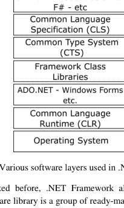

图 1.1. .NET 应用程序中使用的各种软件层

如前所述，.NET Framework 还包含大量库。软件库是一组现成的代码。例如，有一个名为 Math 的类库，其中包含用于执行数学运算的函数。Math 库有数百个数学函数。当我们需要在程序中执行 2^x 运算时，我们无需为此开发和实现算法。我们只需使用以下代码：

```
Math.Pow(2, x)

代码 1.1
```

通过这段代码，我们表示要使用 Math 库的 Pow（幂）函数。我们想要执行 Pow(2, x) 运算，即 2^x。

编写完 C# 程序代码后，在运行之前应先进行编译。在 .NET 平台上，当 C# 代码被编译时，它会转换为一种称为 Microsoft 中间语言（IL）的格式。然后，从此文件生成可执行文件（机器代码），并由 CLR 执行。此过程总结在图 1.2 中。


在确保你理解基础知识之前，我不会引入复杂的内容，因为学习一门新的编程语言时，你很容易迷失方向。而阅读本书，你不会遇到这种情况。我会尽量以最简单的方式讲解新概念。请别忘了，学习编程语言是一个永不停歇的过程，本书将帮助你轻松入门。

现在，你已了解本书的目标和方法。下一章我们将继续在个人电脑上安装 Visual Studio 集成开发环境。

请注意，你可以从本书网站 www.yamaclis.com/csharp 下载本书中包含的完整项目文件和彩色图。

# 第 2 章 设置开发环境

## 2.1. 下载并安装 Visual Studio

请在浏览器中访问 https://www.visualstudio.com/downloads/。你将看到如图 2.1 所示的下载页面。

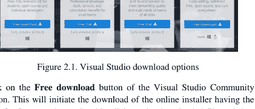

图 2.1. Visual Studio 下载选项

单击 Visual Studio Community 版的“免费下载”按钮。这将开始下载大小为几兆字节的联机安装程序。双击下载的文件，然后你将看到以下提示：

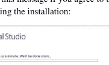

图 2.2. Visual Studio 安装——第一条提示

如果你同意条款，请在此提示中单击“继续”，安装程序将开始准备安装：

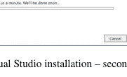

图 2.3. Visual Studio 安装——第二条提示

几分钟后将出现 Visual Studio 安装选项窗口，如下所示：

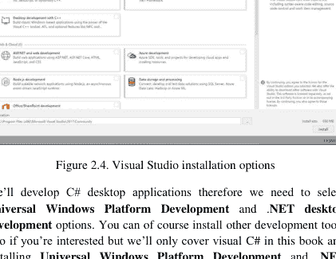

图 2.4. Visual Studio 安装选项

我们将开发 C# 桌面应用程序，因此需要选择**通用 Windows 平台开发**和 **.NET 桌面开发**选项。如果你感兴趣，当然也可以安装其他开发工具，但本书只讲解 Visual C#，安装**通用 Windows 平台开发**和 **.NET 桌面开发**选项就足够了，如图 2.5 中的箭头所示。

我没有更改此图左下角矩形框内显示的默认安装位置。在右下角，安装程序告诉我们，本次安装将占用约 8GB 硬盘空间。如果你接受这些设置，请单击右下角的**安装**按钮，随后 Visual Studio 安装将开始。请注意，这是一个联机安装程序，因此它会下载实际的安装文件并进行安装。这需要一些时间，具体取决于你的网络连接速度（ADSL 约 30 分钟，光纤连接约 5 分钟）。在此过程中将出现如图 2.6 所示的安装窗口。

Visual Studio 具有多项优点，例如在不同计算机之间同步你的工作。在此阶段是否登录，由你自己决定。

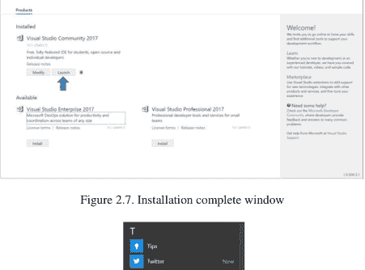

图 2.7. 安装完成窗口

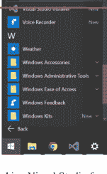

图 2.8. 从“开始”菜单启动 Visual Studio

单击此窗口右下角的“启动 Visual Studio”按钮。随后将出现如图 2.11 所示的起始页。

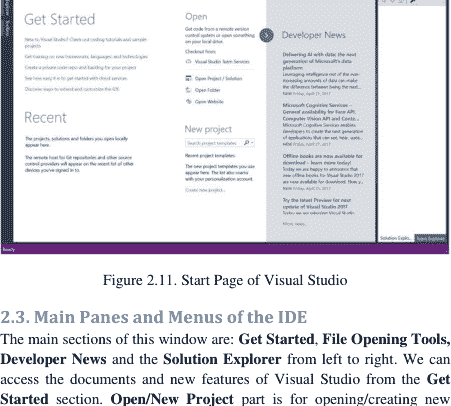

图 2.11. Visual Studio 起始页

## 2.3. IDE 的主要窗格和菜单

此窗口的主要区域从左到右依次为：“入门”、“文件打开工具”、“开发人员新闻”和“解决方案资源管理器”。我们可以从“入门”区域访问 Visual Studio 的文档和新功能。“打开/新建项目”部分用于打开/创建新文件或新项目。“开发人员新闻”区域显示来自 Microsoft 网站的开发人员新闻。“解决方案资源管理器”列出项目的文件；由于我们尚未打开任何项目，它目前是空的。

顶部菜单栏中的菜单也可以归纳如下：

- 在“文件”菜单中，有与创建新项目、打开现有项目和打印相关的项。

# 第 3 章 试运行：Hello World 项目


开始学习编程语言和开发环境时，一个很好的惯例是尝试 Hello World 示例，也就是在屏幕上显示“Hello World”字样。好吧，我知道这算不上一个能让你的家人或朋友刮目相看的程序，但它的用处在于测试你的编程环境是否正常工作，并确认你是否准备好开始真正的项目。在我们的第一个 Visual C# 项目中，我们将把 **Hello, World!** 文本写入程序窗口中间，并使用我们喜欢的任何颜色和字体。

## 3.1. 创建新项目

当 Visual Studio 正在运行时，请选择**文件 → 新建 → 项目**，如下所示：

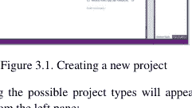

图 3.1. 创建新项目

将出现一个显示可能项目类型的窗口。首先，从左侧窗格中选择 **Visual C#**：

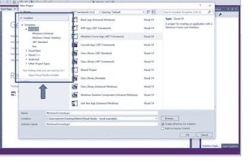

图 3.2. 选择 Visual C# 模板

然后，中间窗格将出现各种 C# 项目类型：

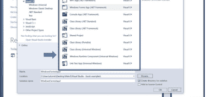

图 3.3. Visual Studio 中的 Visual C# 项目类型

下面总结了常用的 Visual C# 项目类型：

在这里，我们可以双击中间窗格中的项目，以打开它们进行编辑。

- “解决方案资源管理器”正下方是**“属性”**窗口。我们可以在这里更改图形用户界面（GUI）元素的属性。目前，Form1 以 [设计] 模式打开，因此属性窗格显示 Form1 的属性。大多数窗体元素都有几十个属性。因此，**“属性”**窗口有不同的模式来显示这些属性，如下所示：

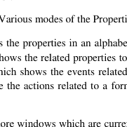

图 3.6. “属性”窗口的几种模式

按字母顺序视图按从 A 到 Z 的字母顺序列出属性。分类视图将相关属性显示在一起。另一种视图是**事件**视图，它显示与所选窗体组件相关的事件。事件是与窗体组件相关的操作，例如单击按钮。

还有三个窗口当前隐藏在左侧，如图 3.7 中的椭圆内所示。它们是服务器资源管理器、工具箱和数据源窗口。

- **服务器资源管理器**是服务器管理区域，使我们能够登录服务器并在项目中使用它们的数据库。
- **工具箱**窗口包含我们可以在窗体上使用的窗体控件和组件。这些将在下一章详细说明。

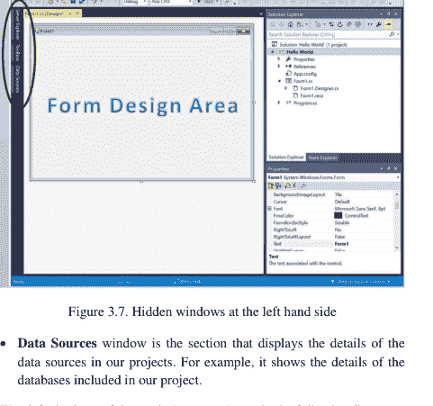

图 3.7. 左侧隐藏的窗口

- “数据源”窗口是显示项目中数据源详细信息的区域。例如，它显示项目中包含的数据库的详细信息。

这些窗口的默认视图如下图所示：

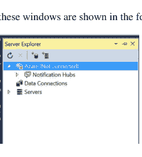

图 3.8. 服务器资源管理器窗口

## 3.3. 项目中包含的文件

让我们也在 Windows 资源管理器中概览一下项目文件。请导航到为项目创建的文件夹，并在 Windows 中打开它，查看如下内容：

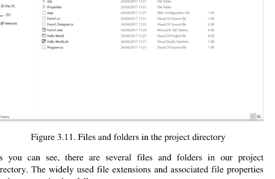

图 3.11. 项目目录中的文件和文件夹

如你所见，项目目录中有多个文件和文件夹。常用的文件扩展名及相关文件属性可总结如下：

- **.cs 文件：**这些是 C# 项目的源代码文件。cs 是 c sharp 的缩写。
- **.sln 文件：**这些是**解决方案**文件，包含项目信息。保存的项目通过其 .sln 文件打开。
- **.resx 文件：**这些是资源文件，保存有关我们添加到项目中的资源（如字符串）的信息。

## 3.4. 在窗体上添加标签控件

我们的目标是在应用程序中显示“Hello, World!”文本。因此，我们需要在窗体上添加一个能够在窗体上显示文本的窗体控件。


将在窗体上水平和垂直居中，这意味着 Label 将位于窗体的中间位置。

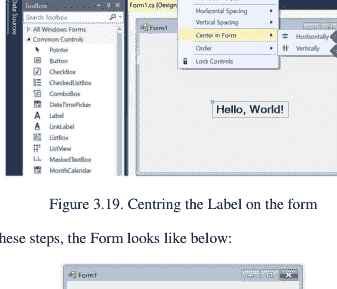

图 3.19. 将 Label 在窗体上居中

完成这些步骤后，窗体如下所示：

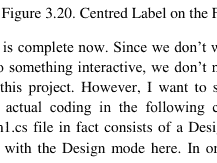

图 3.20. 窗体上居中的 Label

我们的 GUI 设计现在完成了。由于我们不希望 Hello World 应用程序具有交互性，因此不需要在这个项目中编写一行代码。然而，我想向您展示我们将在后续章节中进行实际编码的文件。正如我之前所说，Form1.cs 文件实际上由设计模式和代码模式组成。我们在这里处理了设计模式。为了在其中查看它，

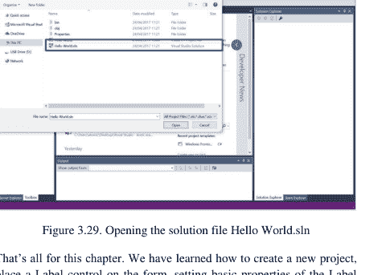

图 3.29. 打开解决方案文件 Hello World.sln

本章就到这里。我们学习了如何创建一个新项目。在窗体上放置一个 Label 控件，以可视化方式设置 Label 的基本属性并将其居中。然后我们生成了项目并创建了可执行文件。

正如你可能已经从工具箱中注意到的，有很多控件可以用于 Windows 窗体。由于我们的目标是同时学习 GUI 设计和 C# 编程，所以需要了解如何使用其他控件类型，如 Button 或 TextBox。在接下来的两章中，我们将学习常用窗体控件的使用，以及相关的基础 C# 编程，然后进入后续章节的实际编程教学。

| 参考编号 | 名称 | 图像 | 说明 |
|---|---|---|---|
| 10 | MaskedTextBox | MaskedTextBox | 强制以指定格式输入文本的文本框 |
| 11 | MonthCalendar | MonthCalendar | 可从其中选择日期的日历控件 |
| 12 | NotifyIcon | NotifyIcon | 通知区域中的图标元素 |
| 13 | NumericUpDown | NumericUpDown | 提供一个可通过点击箭头更改的数值 |
| 14 | PictureBox | PictureBox | 用于显示图像 |
| 15 | ProgressBar | ProgressBar | 显示操作进度 |
| 16 | RadioButton | RadioButton | 允许从多个选项中选择一项 |
| 17 | RichTextBox | RichTextBox | 带有段落格式等的高级文本框 |
| 18 | TextBox | TextBox | 允许用户输入文本 |
| 19 | ToolTip | ToolTip | 当鼠标悬停时显示简短信息 |
| 20 | TreeView | TreeView | 显示分层项目 |
| 21 | WebBrowser | WebBrowser | 在窗体上显示网页 |

表 4.1. 常用控件（续）

你可以在工具箱的“公共控件”部分找到这些控件，如下所示：

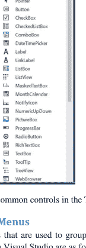

图 4.2. 工具箱中的公共控件

## 4.2. 容器和菜单

容器是用于对窗体中的其他元素进行分组的控件。Visual Studio 提供的容器类型如下：

| 参考编号 | 名称 | 图像 | 说明 |
|---|---|---|---|
| 1 | FlowLayoutPanel | FlowLayoutPanel | 提供流式布局 |
| 2 | GroupBox | GroupBox | 对其中的元素分组并绘制边框 |
| 3 | Panel | Panel | 仅对其元素进行分组 |

| 参考编号 | 名称 | 图像 | 说明 |
|---|---|---|---|
| 4 | SplitContainer | SplitContainer | 为容器提供两个可调整大小的垂直区域 |
| 5 | TabControl | TabControl | 提供选项卡区域以放置元素 |
| 6 | TableLayoutPanel | TableLayoutPanel | 表格形状的容器 |

表 4.3. 用于分组控件的容器（续）

容器在工具箱中列出，如下所示：

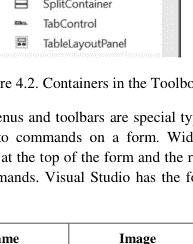

图 4.2. 工具箱中的容器

另一方面，菜单和工具栏是特殊类型的控件，可在窗体上提供对命令的快捷访问。常用的例子包括窗体顶部的“文件”菜单，以及用于复制、粘贴等命令的右键菜单。Visual Studio 具有以下菜单和工具栏选项：

| 参考编号 | 名称 | 图像 | 说明 |
|---|---|---|---|
| 1 | ContextMenuStrip | ContextMenuStrip | 右键菜单 |
| 2 | MenuStrip | MenuStrip | 按功能对命令分组，如“文件”菜单 |

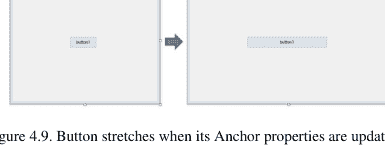

图 4.9. 当 Anchor 属性更新为 Top、Left、Right 时，按钮会拉伸

17. Dock：用于将控件停靠在窗体上的五个区域之一。停靠选项如下图所示。注意，与其他属性一样，单击右侧的箭头即可打开其选项框。

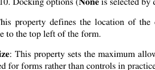

图 4.10. 停靠选项（默认选择 None）

18. Location：此属性定义控件相对于窗体左上角在窗体上的位置。

19. MaximumSize：此属性设置控件的最大允许大小。实践中用于窗体而不是控件。

20. MinimumSize：这设置控件的最小允许大小。

21. Size：以像素为单位设置控件的尺寸。

选择一个属性后，属性的简短说明会出现在属性窗口的底部空间中，如图 4.11 所示。

控件和其他窗体元素的属性也可以在运行时通过编程方式实时更改。

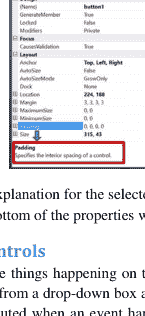

图 4.11. 所选属性的简短说明出现在属性窗口的底部

## 4.6. 控件的事件

事件处理窗体上发生的事情。单击按钮或从下拉框中选择选项都是事件的示例。事件发生时将要执行的代码写在项目的 .cs 文件中。

每种控件类型都有一个默认事件，只需双击控件即可在代码中创建该事件。例如，让我们通过拖放将 CheckBox 放到窗体上，如图 4.12 所示。Form1 处于 [Design] 模式，如椭圆内所示。当我们双击此窗体上的 checkBox1 时，编辑器中会打开 Form1 的代码视图，如图 4.13 所示。

CheckBox 的默认事件是 CheckChanged 事件，当 CheckBox 的选中状态改变时（即被选中或取消选中时）触发（执行）。当在窗体上双击 checkBox1 时，会创建名为 checkBox1_CheckChanged(...) 的默认事件处理方法，如图 4.13 中的矩形所示。

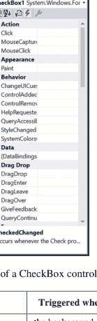

图 4.14. 按类别列出的 CheckBox 控件的所有事件

| 参考编号 | 名称 | 触发时机 | 方法格式 |
|---|---|---|---|
| 1 | BackColorChanged | 背景颜色更改时 | ControlName_BackColorChanged(...) |
| 2 | BackgroundImageChanged | 背景图像更改时 | ControlName_BackgroundImageChanged(...) |
| 3 | CursorChanged | 光标类型更改时 | ControlName_CursorChanged(...) |
| 4 | KeyPressed | 控件处于活动状态时按下键盘上的某个键 | ControlName_KeyPressed(...) |
| 5 | Load | 加载窗体时（程序开始执行时） | FormName_Load(...) |

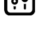

# 第 5 章 常用控件

### 常用控件

在本章中，我们将详细研究常用控件，因为它们是 GUI（窗体）设计的支柱。我们将在小项目中使用它们，并对其属性和事件进行编程。这将是我们 C# 编程之旅的温和开端。

## 5.1. Button

按钮用于触发操作。

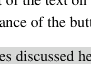

图 5.1. 一个按钮

按钮具有以下属性：

- **Image**：按钮的前景图像。
- **TextAlign**：按钮上文本的对齐方式。
- **FlatStyle**：设置按钮的外观。

> 请注意，这里讨论的属性是上一章讨论的公共属性之外的附加属性。

一个简单的 Button 示例：让我们逐步创建一个包含 Button 的小项目：

- 1. 在 Visual Studio 中创建一个新的 C# 项目。
- 2. 在窗体上放置一个 Button。
- 3. 将 Button 的 Text 属性设置为 Change。
- 4. 将 Button 的 Name 属性设置为 changeButton。


5. 将 Button 的 FontSize 属性设置为 12 磅。

这些步骤完成后，我们的窗体将如下所示：

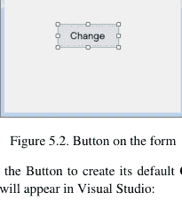

图 5.2. 窗体上的按钮

6. 双击 Button，创建其默认的 Click 事件方法。

Visual Studio 中将出现代码编辑器：

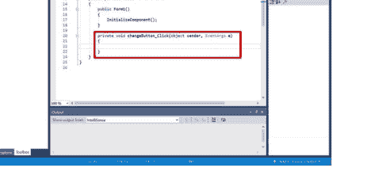

图 5.3. 代码文件中的按钮 Click 事件方法

如你所见，编辑器中已经有几行 C# 代码。我们将逐步解释每一行。不过现在，让我们重点关注矩形内显示的按钮事件处理程序方法。当我们双击窗体上的按钮时，会自动创建此方法。我们可以在此方法的大括号之间编写任意 C# 代码，这些代码将在用户单击按钮时（即按钮的 Click 事件被调用时）执行。

7. 让我们在 changeButton_Click(...) 方法中添加以下代码行：

```
changeButton.Text = "Clicked!";
this.BackColor = Color.White;
```

代码 5.1

首先，你会注意到，在键入这些代码行时，Visual Studio 会尝试理解你想要编写的内容并进行补全，如下所示。你可以按键盘上的 Tab 键，让 Visual Studio 补全你的代码行。这被称为“IntelliSense 技术”。

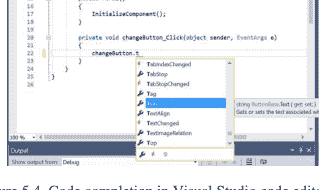

图 5.4. Visual Studio 代码编辑器中的代码补全

现在让我们试着理解这些代码行的含义。第一行 `changeButton.Text = "Clicked!";` 的意思是“将名为 changeButton 的控件的 Text 属性设置为 "Clicked!" ”。可以看到，在 C# 中，文本写在双引号内。此外，每一行代码都应以分号结尾。这些是重要的规则。

第二行 `this.BackColor = Color.White;` 的意思是“将 this 的背景颜色设置为白色”。这里，`this` 指的是窗体本身。因此，当按钮的 Click 事件发生时，这两行代码会将按钮的文本改为“Clicked!”，并将窗体的背景颜色改为白色。

为方便起见，下面还给出了完整的 Form1.cs 代码：

```csharp
using System;
using System.Collections.Generic;
using System.ComponentModel;
using System.Data;
using System.Drawing;
using System.Linq;
using System.Text;
using System.Threading.Tasks;
using System.Windows.Forms;

namespace Button
{
    public partial class Form1 : Form
    {
        public Form1()
        {
            InitializeComponent();
        }

        private void changeButton_Click(object sender, EventArgs e)
        {
            changeButton.Text = "Clicked!";
            this.BackColor = Color.White;
        }
    }
}
```

代码 5.2

6. 现在让我们双击窗体上的 CheckBox，创建其默认事件处理程序 CheckedChanged。该事件在 CheckBox 被选中或取消选中时触发：

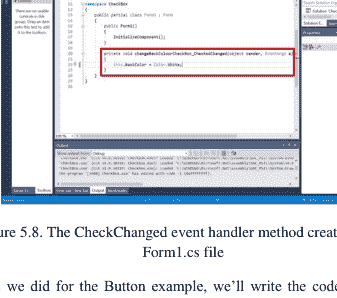

图 5.8. 在 Form1.cs 文件中创建的 CheckedChanged 事件处理程序方法

就像我们在 Button 示例中所做的那样，我们将把代码写在大括号内。让我们添加一行 `this.BackColor = Color.White;`，这样 `changeBackColourCheckBox_CheckedChanged(...)` 事件处理程序方法将如下所示：

```
changeBackColourCheckBox_CheckedChanged(object sender,
EventArgs e)
{
    this.BackColor = Color.White;
}
```

代码 5.3

添加完代码后，我们可以生成并运行项目。当我们勾选 CheckBox 时，窗体的背景颜色将变为白色，如图 5.9 和图 5.10 所示。

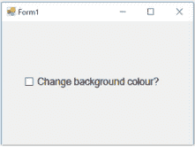

图 5.9. 勾选 CheckBox 之前的程序

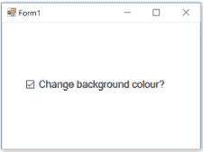

图 5.10. 勾选 CheckBox 之后背景颜色发生变化

在此示例中，代码行 `this.BackColor = Color.White;` 的执行与 CheckBox 的状态无关。换句话说，我们无法判断 CheckBox 是否被选中；`this.BackColor = Color.White;` 在两种情况下都会执行。为了做出这种区分，我们需要在 C# 中使用条件语句。因此，我们将在学习条件语句之后，在接下来的章节中再来处理这个问题。

> 值得注意的是，一个窗体可以包含多个可独立选择的 CheckBox，也就是说，可以同时选中多个 CheckBox。

## 5.3. CheckedListBox

这是一个包含多个条目的列表，这些条目可以独立勾选/取消勾选。CheckedListBox 中的条目可以在开发期间添加，也可以在运行期间以编程方式添加。

像往常一样，让我们在 Visual Studio 中创建 CheckedListBox 示例：

1. 在 Visual Studio 中创建一个新的 C# 项目。
2. 在窗体中间放置一个 CheckedListBox。
3. 将此控件的 Name 属性设置为 pcCheckedListBox（这里的 *pc* 代表 *编程概念*）。
4. 放置 CheckedListBox 后，默认情况下它没有任何条目。若要添加条目，请单击 CheckedListBox 顶部的小箭头，如下方圆圈内所示：

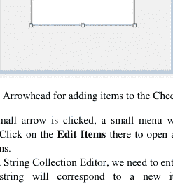

图 5.11. 用于向 CheckedListBox 添加条目的箭头

5. 单击那个小箭头时，将出现一个小菜单，如图 5.12 所示。单击其中的**编辑条目**，打开一个用于添加条目的窗口。
6. 在打开的“字符串集合编辑器”中，我们需要每行输入一个字符串。每个字符串都对应 CheckedListBox 中的一个新条目。我输入了图 5.13 中显示的字符串，但你可以输入任意需要的字符串。
7. 单击“确定”按钮后，我们的 CheckedListBox 将填充这些条目，如图 5.14 所示。

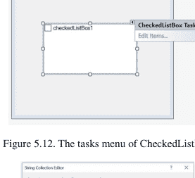

图 5.12. CheckedListBox 的任务菜单

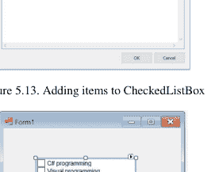

图 5.13. 向 CheckedListBox 添加条目

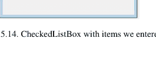

图 5.14. 带有我们输入条目的 CheckedListBox

表达式 pcCheckedListBox.SelectedItem.ToString() 表示“获取 pcCheckedListBox 控件中选中项的 Text，并将其转换为字符串格式”。因此，当我们从 CheckedListBox 中选择一个条目时，它的文本将显示在消息框中。

现在我们可以生成并运行程序。它将如下所示：

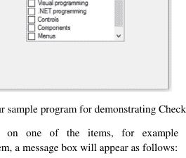

图 5.16. 用于演示 CheckedListBox 的示例程序

当我们单击其中一个条目时，例如 C# programming 条目，将出现如下消息框：

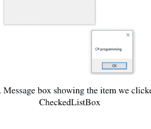

图 5.17. 显示我们在 CheckedListBox 中所单击条目的消息框

该消息框只有一个“确定”按钮，单击此按钮后，消息框就会消失。消息框是一种**对话框**，稍后我们会更详细地研究。

你可能已经注意到，单击条目时，它并没有被勾选。这是因为对于 CheckedListBox，**CheckOnClick** 属性的默认值为 False。我们可以按如下方式将该属性设置为 True：

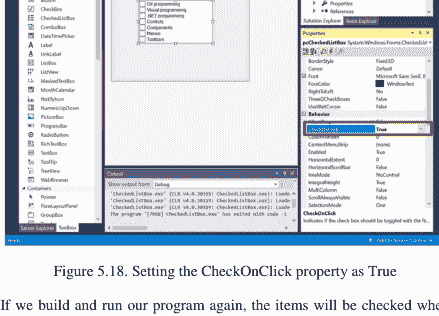

图 5.18. 将 CheckOnClick 属性设置为 True

如果我们再次生成并运行程序，当我们单击条目时，条目将被勾选，同时会弹出消息框，如图 5.19 所示。

与 CheckBox 的情况一样，一个窗体可以包含多个可独立选择的 CheckedListBox。

6. 双击 ComboBox 控件，创建其默认事件处理程序 SelectedIndexChanged()，当用户更改所选条目时，会执行该事件处理程序。

7. 将以下代码添加到 genderComboBox_SelectedIndexChanged() 方法体（大括号之间的部分）中，以显示一个消息框：`MessageBox.Show(genderComboBox.SelectedItem.ToString());`，如下所示：

```
private void genderComboBox_SelectedIndexChanged(object sender, EventArgs e)
{
    MessageBox.Show(genderComboBox.SelectedItem.ToString());
}
```

代码 5.5

8. 现在我们可以生成并运行项目：

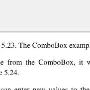

图 5.23. ComboBox 示例

当我们从 ComboBox 中选择一个值时，它会显示在消息框中，如图 5.24 所示。

我们可以通过 ComboBox 的 DropDownStyle 属性来设置用户是否可以向 ComboBox 输入新值。如果将此属性设置为 Simple，则允许向 ComboBox 输入额外值。此外，我们还可以通过 Add() 和 Remove() 方法以编程方式向 ComboBox 添加或删除条目。


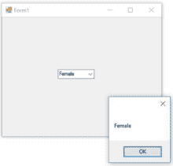

图 5.24. 显示所选项目的消息框

## 5.5. DateTimePicker

此控件使用户能够选择日期和时间值。它有三个主要属性：

- **MinDate:** 用于选择的最小显示日期。
- **MaxDate:** 可供选择的日期最大值。
- **Format:** 控件中显示的日期和时间格式。

让我们看看如何在简单项目中使用 DateTimePicker 并从中获取日期和时间值：

1. 请在 Visual Studio 中创建一个新的 C# 项目。
2. 将 DateTimePicker 和一个 Button 放置在窗体上，如下所示：

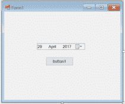

图 5.25. 窗体的布局

3. 对于 Button：将其 Text 属性设置为 **显示所选日期**，其 Name 设置为 **showDateButton**。
4. 将 DateTimePicker 的 Format 属性保持不变（**Long**）。

窗体应如下所示：

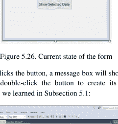

图 5.26. 窗体的当前状态

5. 当用户单击按钮时，消息框将显示所选日期。为此，双击按钮以创建其默认事件处理程序 **Click**，如我们在 5.1 小节中所学的：

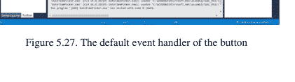

图 5.27. 按钮的默认事件处理程序

6. 为了在消息框中显示所选日期，我们将在按钮的事件处理程序中按如下方式获取 DateTimePicker 的 Value 属性：

```
private void showDateButton_Click(object sender, EventArgs e)
{
    MessageBox.Show(dateTimePicker1.Value.ToLongDateString());
}
```

代码 5.6

由于 DateTimePicker 控件的 Name 属性默认为 dateTimePicker1，我们获取其 Value 属性并使用方法 `ToLongDateString()` 将其转换为字符串，以便在消息框中显示。

7. 现在，构建并运行项目：

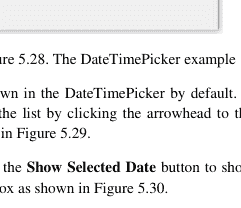

图 5.28. DateTimePicker 示例

DateTimePicker 默认显示当前日期。我们可以通过单击 DateTimePicker 右侧的箭头从列表中选择另一个日期，如图 5.29 所示。

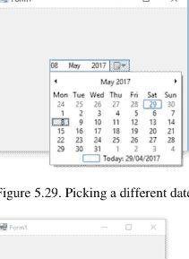

图 5.29. 选择不同的日期

现在我们可以单击 Show Selected Date 按钮以在消息框中显示所选日期，如图 5.30 所示。

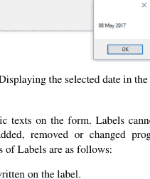

图 5.30. 在消息框中显示所选日期

## 5.6. Label

标签只是窗体上的静态文本。标签不能由用户编辑，但可以通过编程添加、删除或更改。标签的重要属性如下：

- **Text**: 标签上写入的文本。
- **AutoSize**: 根据文本长度按比例调整 Label 大小。
- **TextAlign**: 将文本对齐到 Label 的左侧、中心或右侧。

一个简单的 Label 示例：在本示例中，我们将一起使用 Label、Button 和 CheckBox。

1. 在 Visual Studio 中创建一个新的 C# 项目。
2. 将 Label、Button 和 CheckBox 放置在窗体上，如下所示：

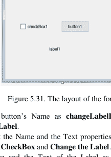

图 5.31. 窗体的布局

3. 将按钮的 Name 改为 changeLabelButton，Text 改为 Change the Label。
4. 同样，将 CheckBox 的 Name 和 Text 属性分别设置为 changeLabelCheckBox 和 Change the Label。
5. 将 Label 的 Name 和 Text 分别设置为 changingLabel 和 Default。

进行这些更改后，窗体应如下所示：

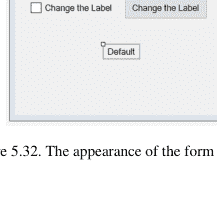

图 5.32. 更改后的窗体外观

6. 我们现在将为 CheckBox 和 Button 创建事件处理程序，以更改 Label 的 Text 属性。为此，双击 Button 并添加代码行 `changingLabel.Text = "Button clicked";`，这将把 Label 的 Text 设置为 Button clicked。

7. 现在，双击 CheckBox 以创建其默认事件处理程序方法，并在该方法体中添加 `changingLabel.Text = "Checkbox checked/unchecked";`。进行这些更改后，这些事件处理程序将如下所示：

```
private void changeLabelButton_Click(object sender, EventArgs e)
{
    changingLabel.Text = "Button clicked";
}

private void changeLabelCheckBox_CheckedChanged(object sender, EventArgs e)
{
    changingLabel.Text = "Checkbox checked/unchecked";
}
```

代码 5.7

8. 当我们构建并运行项目时，Label 将显示 Default，然后在我们单击 Button 或选中 CheckBox 时会更改，如下所示：

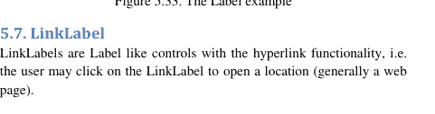

图 5.33. Label 示例

## 5.7. LinkLabel

LinkLabel 是具有超链接功能的类似 Label 的控件，即用户可以单击 LinkLabel 以打开位置（通常是网页）。

LinkLabel 的主要属性如下：

- **LinkColor**: 设置 LinkLabel 的文本颜色。
- **VisitedLinkColor**: 用户访问链接后 LinkLabel 的颜色。
- **LinkBehavior**: 设置链接是否下划线。

### 一个 LinkLabel 示例：

1. 在 Visual Studio 中创建一个新的 C# 项目。
2. 将 LinkLabel 放置在窗体上，如下所示：


图 5.34. 窗体上的 LinkLabel

3. 将 LinkLabel 的 Text 属性设置为 **访问主页**。
4. 将 LinkLabel 的 Name 属性从 linkLabel1 改为 **visitHomepageLinkLabel**。窗体应如图 5.35 所示。
5. 现在，双击 LinkLabel 以创建其默认事件 **LinkClicked**。
6. 在事件处理程序方法体中插入以下代码：`System.Diagnostics.Process.Start("www.msdn.com");` 此代码行用于打开括号内给出的链接。当用户单击 LinkLabel 时，Web 浏览器将打开 Microsoft Developer Network（MSDN）网站。事件处理方法 `visitHomepageLinkLabel_LinkClicked()` 将如下所示：

## 5.8. ListBox

ListBox 显示项目列表。它用于向用户显示项目并让用户从中选择项目。项目可以在开发期间以可视方式添加到 ListBox，也可以在运行时以编程方式添加。

ListBox 常用属性和方法如下：

> 我们到目前为止多次提到过 **methods**。如您所注意到的，它们用于执行功能。请注意，方法在其后使用括号，如下所示。

- **Items**: 用于访问 ListBox 中的项目。
- **Add()**: 用于添加新项目。
- **Remove()**: 删除一个项目。
- **SelectedItem**: 返回所选项目的名称。
- **SelectedIndex**: 返回所选项目的索引。
- **Count**: 返回 ListBox 中项目的数量。
- **Clear()**: 从 ListBox 中删除所有项目。

让我们开发一个包含 ListBox 的项目。我们将使用 Buttons 向 ListBox 添加/删除项目并在消息框中显示用户选择的项目。

1. 在 Visual Studio 中创建一个新的 C# 项目。
2. 将 ListBox 和三个 Buttons 放置在窗体上，如图 5.37 所示。


图 5.37. 窗体的布局

每次用户单击 Add random 按钮时，因此会向 ListBox 添加不同的随机数。

7. 同样，双击 Remove selected 按钮以创建其事件处理程序，并添加必要的代码以使用以下代码删除所选项目：

```
private void removeSelectedButton_Click(object sender, EventArgs e)
{
    listBox1.Items.Remove(listBox1.SelectedItem);
}
```

代码 5.10

Remove() 方法删除括号内写入的项目。在此代码中，我们将所选项目作为 Remove(listBox1.SelectedItem) 传递给方法，以便该方法删除用户选择的项目。

8. 最后，双击 Show item count 按钮以生成其事件处理程序，并在其中放置以下代码，以便消息框显示 ListBox 中的项目数量：

```
private void itemCountButton_Click(object sender, EventArgs e)
{
    MessageBox.Show("Number of items: "+listBox1.Items.Count.ToString());
}
```

代码 5.11

在此代码中，listBox1.Items.Count.ToString() 以文本形式返回（给出）ListBox 的项目数量。与其只在消息框中显示一个数字，我们使用 + 运算符将其与文本 "Number of items: " 合并。因此，如果 ListBox 中的项目数为 5，消息框将显示：The number of items: 5。

9. 构建并运行项目后，ListBox 将为空，如图 5.39 所示。多次单击 Add random 按钮后，ListBox 将填充随机数，如图 5.40 所示。


## C# 编程初学者指南


图 5.39. 程序初始状态


图 5.40. 已填充的 ListBox

- 10. 现在我们可以通过单击选中 ListBox 中的某个项。然后，我们可以点击“删除选中项”（Remove Selected）按钮来移除选中的项，如图 5.41 所示。该项将被移除，如图 5.42 所示。请注意，如果同一项在 ListBox 中出现多次并被选中删除，该项将从上到下逐个移除。

- 11. 最后，当用户点击“显示项目计数”（Show item count）按钮时，将出现一个消息框显示项目数量，如图 5.43 所示。


图 5.41. 从 ListBox 中选中一个项


图 5.42. 选中的项已从 ListBox 中移除


图 5.43. 消息框中显示项目计数


图 5.46. 添加新列

- 5. 再添加两列，并将其 Name 属性分别设置为 **Surname** 和 **Age**。

- 6. 由于 ListView 处于 **大图标**（LargeIcon）视图，这些列还不会显示。我们需要将该属性切换到 **详细信息**（Details），如下所示：


图 5.47. 设置 View 属性

现在这些列将可见。但是，它们仍未正确对齐。我们可以拖动列以使其在 ListView 控件中适当适应，如下所示：


图 5.48. 调整列的宽度

此操作后，列将适合内部显示，如图 5.49 所示。

此外，通过将 GridLines 属性设置为 True，可以使 ListView 控件的网格线可见，如图 5.50 所示。


图 5.49. 列适应 ListView 内部


图 5.50. 显示网格线

- 7. 向 ListView 添加项不像分配属性那样简单。相反，我们需要创建一个对象来保存要传递给 ListView 的数据。以下代码片段创建了一个 ListViewItem 对象，用于临时保存我们要写入 ListView 的数据：

```csharp
ListViewItem listvi = new ListViewItem("John");
listvi.SubItems.Add("Cardie");
listvi.SubItems.Add("35");
```

代码 5.12

然后，我们将 listvi 项的内容添加到 ListView 控件，如下所示：

```csharp
listView1.Items.Add(listvi);
```

代码 5.13

这些代码行不会自动执行，我们需要将它们插入到事件方法中。我们可以将它们写在窗体 Form1 的 Load 方法中，这样这些代码行将在窗体加载时（即程序开始运行时）执行。为此，请双击

- 8. 为了指定 MaskedTextBox 的输入格式，我们应该设置掩码。为此，单击 MaskedTextBox 顶部的箭头并选择“设置掩码”（Set Mask），如图 5.54 和 5.55 所示：


图 5.54. 打开 MaskedTextBox 菜单


图 5.55. 为 MaskedTextBox 设置掩码

在“设置掩码”菜单中，我们可以在各种规范中进行选择。对于本例，我们将选择“电话号码”（Phone number）掩码，如图 5.56 所示。


图 5.57. 程序初始视图

我们只能在 MaskedTextBox 中输入电话号码。当我们点击“添加”（Add）按钮时，电话号码将被添加到 ListBox 中，如下所示：


图 5.58. 添加两个电话号码后的程序

## 5.11. MonthCalendar

该控件以月格式显示日历，以便用户从中选择日期。MonthCalendar 与 DateTimePicker 类似。它们的区别在于，MonthCalendar 的日历视图始终打开以选择日期，而用户需要单击 DateTimePicker 才能打开视图选择日期。

MonthCalendar 的属性如下：

- **MinDate**：MonthCalendar 将显示的最小日期。
- **MaxDate**：MonthCalendar 将显示的最大日期。
- **BoldedDates**：用于以粗体显示特殊日期。
- **ShowToday**：设置是否在日历底部显示今天的日期。
- **SelectionStart**：保存选定的开始日期。
- **SelectionEnd**：保存选定的结束日期。
- **SelectionRange**：保存选定的开始日期和结束日期之间的天数范围。

### MonthCalendar 示例：在本例中，让我们在 Label 上显示 MonthCalendar 中选定的开始日期与结束日期之间的天数范围。

- 1. 在 Visual Studio 中创建一个新的 C# 项目。
- 2. 在窗体上放置一个 MonthCalendar 和一个 Label，如下所示：


图 5.59. 窗体布局

- 3. 将 Label 的 Name 设置为 **rangeLabel**，并将其 Text 设置为 **SelectionRange:**。
- 4. 将 MonthCalendar 的 Name 设置为 **selectDates**。
- 5. MonthCalendar 的默认事件是 **DateChanged** 事件，当选定的日期发生变化时触发。因此，双击 MonthCalendar 以创建其默认事件处理方法 `selectDates_DateChanged(...)`。

- 6. 添加以下代码行，以在用户选择日历上的日期范围时显示 SelectionRange：`rangeLabel.Text = selectDates.SelectionRange.ToString();`。添加后，默认事件处理方法将如下所示：

```csharp
private void selectDates_DateChanged(object sender,
DateRangeEventArgs e)
{
    rangeLabel.Text = selectDates.SelectionRange.ToString();
}
```

代码 5.17

- 7. 让我们生成并运行项目。默认情况下，MonthCalendar 控件将自动选中今天的日期，Label 将显示其默认文本：


图 5.60. 程序初始视图

现在我们可以从日历中选择日期。为此，单击开始日期，按住鼠标按钮，将鼠标指针拖到结束日期。选定的日期将以灰色背景显示，同时 Label 将显示选择范围，如图 5.61 所示。

值得注意的是，默认最大选择范围为 7 天。您可以通过设置 MonthCalendar 控件的 MaxSelectionCount 属性来更改它。


图 5.61. 显示所选范围的 Label

## 5.12. NotifyIcon

该控件用于在 Windows 的通知区域中显示图标。通知区域位于任务栏的右侧，如下所示：


图 5.62. 通知区域

NotifyIcon 的重要属性如下：

- **Icon**：NotifyIcon 的 Icon 属性指定在通知区域中使用哪个图标文件（*.ico）作为应用程序图标。
- **ContextMenuStrip**：指定 NotifyIcon 的右键菜单。

> ContextMenuStrip 是一个菜单组件，用于为右键单击指定菜单，如前一章所述。NotifyIcon 控件通常与 ContextMenuStrip 一起使用。

让我们通过一个示例看看如何在 NotifyIcon 中结合使用 ContextMenuStrip：

- 1. 在 Visual Studio 中创建一个新的 C# 项目。
- 2. 在窗体上放置一个 NotifyIcon 和一个 ContextMenuStrip。当您将这些元素拖放到窗体上时，您会看到它们没有出现在窗体上。这是因为这些元素在后台运行，不显示给用户。拖放操作后，您将在窗体设计窗格下方看到这些元素：


图 5.63. 窗体的 NotifyIcon 和 ContextMenuStrip 元素

- 3. 单击 contextMenuStrip1 菜单（如图 5.63 所示），然后它将临时出现在窗体上，以便输入右键菜单，如图 5.64 所示。让我们为本例插入一个“退出”（Exit）项，如图 5.65 所示。

- 4. 现在我们将设置“退出”菜单将执行的操作。为此，双击“退出”项，以便在编辑器中创建其事件处理方法 `exitToolStripMenuItem_Click(...)`，如图 5.66 所示。

- 5. 在此事件处理方法中添加代码行 `Application.Exit();`，这将在执行时导致应用程序退出：

```csharp
private void exitToolStripMenuItem_Click(object sender,
EventArgs e)
{
    Application.Exit();
}
```

代码 5.18


图 5.64. ContextMenuStrip 在用于输入菜单项的窗体上出现


图 5.65. 向 ContextMenuStrip 添加 Exit 项

ContextMenuStrip 目前已设置好。现在我们需要将此菜单分配给 NotifyIcon 控件。单击窗体设计器上的 notifyIcon1 并导航到其属性。在属性窗格中，将 ContextMenuStrip 属性设置为 contextMenuStrip1，如图 5.67 所示。


图 5.66. 编辑器中显示的 Exit 项的事件处理程序


图 5.67. 为 notifyIcon1 设置 ContextMenuStrip 为 contextMenuStrip1

- 6. 现在我们需要为 NotifyIcon 分配一个图标，以便它出现在通知区域中。再次在属性窗口中，单击 Icon 属性旁的省略号，如下所示：


图 5.68. 为 NotifyIcon 添加图标

这将打开一个文件对话框，以便您可以为 NotifyIcon 选择一个图标文件。请注意，仅接受 .ico 文件。您可以从互联网上找到一个或使用从本书附带网站下载的文件。选择 .ico 文件后，它将在属性窗格中显示，如图 5.69 所示。

- 7. 现在我们可以构建并运行项目。由于我们在窗体上没有放置任何可见控件，应用程序窗口将为空，如图 5.70 所示。然而，其 NotifyIcon 将位于通知区域中，如图 5.71 所示。请注意，如果您使用了不同的图标文件，它将在通知区域中显示。
- 8. 当我们右键单击通知图标时，ContextMenuStrip 将显示。我们只添加了一个 Exit 项；因此，它将如图所示 5.72。
- 9. 当我们单击 Exit 项时，代码 5.18 中给出的 方法将被执行，这将退出应用程序。请注意，我们可以在右键菜单中添加任意多的项。


图 5.69. NotifyIcon 的图标已分配


图 5.70. 空的应用程序窗口


图 5.71. 应用程序的通知图标


图 5.73. 窗体的布局

- 3. 将 NumericUpDown 和 ListBox 的 FontSize 属性都设置为 12 单位，以便数字显示得更大（默认字体大小为 8 单位）。
- 4. 将 NumericUpDown 控件的 Name 设置为 evenNumericUpDown。
- 5. 将 ListBox 的 Name 设置为 numbersListBox。
- 6. 在窗体上双击空白处以创建 Form1 的默认事件处理程序 Form1_Load(...)，如我们之前所用。在内部添加以下代码行，以便应用程序启动时立即配置 NumericUpDown：

```csharp
private void Form1_Load(object sender, EventArgs e)
{
    evenNumericUpDown.Minimum = 0;
    evenNumericUpDown.Maximum = 200;
    evenNumericUpDown.Increment = 2;
}
```

代码 5.19

在此方法中，NumericUpDown 的值的限制设置为 0 和 200；显示值不会低于或高于这些值。在第三行代码中，增量步长设置为 2。由于 NumericUpDown 的起始值为 0，其值将按 2、4、6、8 等递增。因此，此 NumericUpDown 只会显示偶数。

- 7. 同样，双击 NumericUpDown 控件以创建其默认事件处理程序 evenNumericUpDown_ValueChanged(...)。当 NumericUpDown 的值更改时，将调用此方法：

```csharp
private void evenNumericUpDown_ValueChanged(object sender,
EventArgs e)
{
    numbersListBox.Items.Add(evenNumericUpDown.Value.ToString());
}
```

代码 5.20

在此代码行中，读取 evenNumericUpDown 控件的 Value 并转换为字符串。然后将此字符串表示形式传递给 numbersListBox.Items 的 Add() 方法，以便每次 evenNumericUpDown 的值更改时，evenNumericUpDown 中显示的值都会添加到 numbersListBox。

- 8. 现在我们可以构建并运行项目。程序将如下所示出现：


图 5.74. 程序首次启动时

当我们增加/减少 NumericUpDown 控件的值时，其值将添加到 ListBox 中，如图 5.75 所示。


图 5.75. 在 NumericUpDown 的值连续更改后，ListBox 由偶数填充

## 5.14. PictureBox

PictureBox 用于显示图像。PictureBox 中显示的图像要么在开发期间设置，要么在运行时以编程方式设置。PictureBox 的主要属性如下：

- **Image**：用于设置要显示的图像。
- **SizeMode**：设置图像如何在 PictureBox 内部插入。它有三个常用选项：**Normal**、**Stretch** 或 **CenterImage**。

让我们开发一个简单示例，其中通过单击相应的按钮来设置图像的 SizeMode：

- 1. 在 Visual Studio 中创建一个新的 C# 项目。
- 2. 在窗体上放置一个 PictureBox 和三个 Buttons，如下所示：


图 5.76. 窗体的布局

将图像添加为本地资源并使用 Import 按钮从计算机中选择图像。您可以使用本书附带网站提供的图像作为此示例（seaview.jpg）。


图 5.79. 将图像导入项目

- 9. 当我们选择图像时，它将按如下方式预览：


图 5.80. 预览导入的图像

单击 OK 后，图像将在窗体上可用。

- 10. 现在我们可以为 Buttons 设置操作，以便相应地调整图像大小。双击 Buttons 以创建它们的默认 Click 事件。然后，分别向 normalButton、stretchButton 和 centreButton 添加以下代码行。

```csharp
private void normalButton_Click(object sender, EventArgs e)
{
    resizePictureBox.SizeMode = PictureBoxSizeMode.Normal;
}

private void stretchButton_Click(object sender, EventArgs e)
{
    resizePictureBox.SizeMode = PictureBoxSizeMode.StretchImage;
}

private void centreButton_Click(object sender, EventArgs e)
{
    resizePictureBox.SizeMode = PictureBoxSizeMode.CenterImage;
}
```

代码 5.21

图像分别在这些方法内部调整为正常、拉伸和居中模式。

- 11. 现在我们可以构建并运行项目。默认情况下，图像将以 Normal 模式出现，如下所示：


图 5.81. 初始时图像处于 Normal 模式

当单击 **Stretch** 按钮时，图像将在 PictureBox 内被拉伸：


图 5.82. 图像处于 Stretch 模式

最后，当单击 Centre 按钮时，图像将在 PictureBox 内居中：


图 5.83. 图像处于 Centre 模式

## 5.15. ProgressBar

ProgressBar 用于在操作期间显示进度。它具有以下常用属性：

- **Minimum**：ProgressBar 的最小值。
- **Maximum**：ProgressBar 的最大值。
- **Step**：ProgressBar 的增量值。

让我们在一个简单示例中看看 ProgressBar 的实际效果：

- 1. 在 Visual Studio 中创建一个新的 C# 项目。
- 2. 在窗体上放置一个 ProgressBar、一个 Button 和一个 ListBox，如下所示：


图 5.84. 窗体的布局

- 3. 将按钮的 Name 和 Text 分别设置为 **incrementButton** 和 **Increment**。
- 4. 将 ProgressBar 的 Name 设置为 **incrementProgressBar**。
- 5. 将 ListBox 的 Name 设置为 **currentValueListBox**。
- 6. 当我们单击按钮时，ProgressBar 的值将增加，并且 ProgressBar 的当前值将添加到 ListBox。在实际代码之前，让我们将 ProgressBar 的 Minimum、Maximum 和 Step 属性分别设置为 0、100 和 1。在这种情况下，ProgressBar 的值将从 0 开始并以 1 递增直到 100。ProgressBar 将直观地显示此进度。我们将在 Form1 的 Load 方法内部设置 ProgressBar 的这些属性，以便它们在程序开始时设置。为此，双击窗体的空白区域以创建其默认 Load 方法。然后添加以下代码行：


```csharp
private void Form1_Load(object sender, EventArgs e)
{
    incrementProgressBar.Minimum = 0;
    incrementProgressBar.Maximum = 100;
    incrementProgressBar.Step = 1;
}
```

代码 5.22

- 7. 双击按钮并创建其单击事件处理方法。

每次用户单击按钮时，ProgressBar 的值将增加 1。当前值也会添加到 ListBox 的项目中。以下代码执行此操作：

```csharp
private void incrementButton_Click(object sender, EventArgs e)
{
    incrementProgressBar.Value += 1;
    currentValueListBox.Items.Add(incrementProgressBar.Value);
}
```

代码 5.23

代码行 `incrementProgressBar.Value += 1;` 将 1 加到 incrementProgressBar 的 Value 属性上。下一行获取 ProgressBar 的 Value 并将其传递给 Add() 方法，该方法将此 Value 添加到 ListBox。

- 8. 让我们构建并运行项目。最初，我们的程序将如下所示：


图 5.85. 单击“递增”按钮之前的程序

单击按钮几次后，ProgressBar 将被填满，其值将写入 ListBox 如下所示：


图 5.86. ProgressBar 为 21%

## 5.16. 单选按钮

RadioButton 用于在不同选项中进行选择。

> RadioButton 类似于 CheckBox，然而在一个窗体或组中一次只能选择一个 RadioButton。

RadioButton 经常使用的属性如下：

- **Checked:** 设置 RadioButton 是否初始被选中。
- **AutoCheck:** 设置 RadioButton 在被单击时是否自动被选中。
- **Enabled:** 设置 RadioButton 是否可供选中。

以下简单示例演示了项目中 RadioButton 的使用。用户将使用 RadioButton 选择窗体的背景颜色。由于不能同时将背景颜色设置为多种颜色，因此在此示例中使用 RadioButton 是有意义的。

- 1. 在 Visual Studio 中创建一个新的 C# 项目。
- 2. 在窗体上添加五个 RadioButton，如下所示：

```csharp
private void whiteRadioButton_CheckedChanged(object sender, EventArgs e)
{
    this.BackColor = Color.White;
}

private void brownRadioButton_CheckedChanged(object sender, EventArgs e)
{
    this.BackColor = Color.Brown;
}
```

代码 5.24（续）

如前所述，this.BackColor 指的是窗体的背景颜色。因此，在此代码片段中，每个 RadioButton 都为窗体的背景分配不同的颜色。

- 6. 构建并运行项目。由于第一个 RadioButton 默认会被选中，因此窗体的背景颜色初始为红色，如下所示：


图 5.88. 程序的初始状态

当我们选中不同的 RadioButton 时，窗体的背景颜色将相应改变，如图 5.89 所示。

当可选选项具有单一且离散的性质时，使用 RadioButton 是很有用的。


图 5.89. 选择白色 RadioButton 时的程序

## 5.17. 富文本框

RichTextBox 用于输入具有段落和多行文本格式等格式功能的文本。RichTextBox 的重要属性如下：

- **DetectUrls**: 设置是否自动将 URL 转换为链接。
- **MultiLine**: 设置是否允许多行文本输入。
- **MaxLength**: 可在 RichTextBox 中输入的字符数。

在我们的示例中，我们将在窗体上放置一个 RichTextBox。当我们单击按钮时，RichTextBox 中输入的文本将显示在消息框中。

- 1. 在 Visual Studio 中创建一个新的 C# 项目。
- 2. 在窗体上放置一个 RichTextBox 和一个 Button，如图 5.90 所示。
- 3. 将 RichTextBox 的 Name 设置为 **inputRichTextBox**。
- 4. 将 Button 的 Name 和 Text 分别设置为 **showButton** 和 **Show in MessageBox**。
- 5. 双击 Button 以创建其事件处理方法 **showButton_Click()**。
- 6. 在此方法中添加代码 `MessageBox.Show(inputRichTextBox.Text);`。


图 5.90. 窗体的布局

```csharp
private void showButton_Click(object sender, EventArgs e)
{
    MessageBox.Show(inputRichTextBox.Text);
}
```

代码 5.24

- 7. 让我们构建并运行项目。我们可以在 RichTextBox 中输入格式化的文本。当我们单击“显示在消息框中”按钮时，RichTextBox 中输入的文本将显示在消息框中。请注意，文本的格式在消息框中显示时得以保留。


图 5.91. 在消息框中显示格式化的文本

## 5.18. 文本框

TextBox 可能是 Windows Forms 应用程序中仅次于 Button 最常用的控件。TextBox 简单用于从用户收集文本输入。它具有以下重要属性：

- **MultiLine**: 设置文本输入是否可跨越多行。
- **WordWrap**: 如果文本超出单行，则会自动换行到下一行。
- **ScrollBars**: 设置文本滚动条是否可见。

在我们的示例中，我们将从多个 TextBox 收集文本并在添加到 ListBox 之前合并它们。

- 1. 在 Visual Studio 中创建一个新的 C# 项目。
- 2. 在窗体上放置三个 Label、三个 TextBox、一个 Button 和一个 ListBox，如下所示：


图 5.92. 窗体的布局

- 3. 从上到下将 Label 的 Texts 设置为 **Name:**、**Lesson:** 和 **Grade:**。
- 4. 从上到下将 TextBox 的 Name 属性设置为 **nameTextBox**、**lessonTextBox** 和 **gradeTextBox**。
- 5. 分别将 Button 的 Text 和 Name 设置为 **Add Info** 和 **addInfoButton**。
- 6. 将 ListBox 的 Name 设置为 **infoListBox**。进行这些更改后，窗体将如下所示：


图 5.93. 更改后的窗体布局

- 7. 当单击“添加信息”按钮时，将读取 TextBox 的 Texts、合并并添加到 ListBox。为此，通过双击它创建按钮的默认事件处理程序 addInfoButton_Click(...) 并添加以下代码：

```csharp
private void addInfoButton_Click(object sender, EventArgs e)
{
    infoListBox.Items.Add(nameTextBox.Text + "-" + lessonTextBox.Text + "-" + gradeTextBox.Text);
    nameTextBox.Clear();
    lessonTextBox.Clear();
    gradeTextBox.Clear();
}
```

代码 5.26

在第一行中，合并后的文本被传递给 Add() 方法以执行向 ListBox 的添加操作。在此操作中，+ 运算符合并文本。此外，文本之间放置了连字符（-）。值得注意的是，连字符写在双引号内，以告诉 Visual Studio 将连字符视为文本。

将合并后的文本添加到 ListBox 后，通过应用 Clear() 方法清除 TextBox。因此，所有 TextBox 在无需用户干预的情况下被清除，使其准备好输入新输入。

- 8. 现在我们可以构建并运行项目。当我们向 TextBox 输入文本并单击按钮时，这些文本将被合并并添加到 ListBox，如图 5.94 所示。

> 请注意，TextBox 中写入的文本被视为文本（字符串）。因此，在将这些输入写入 ListBox 时，我们不需要进行任何转换。


图 5.94. 使用 TextBox 进行文本输入（新条目尚未添加到 ListBox）

## 5.19. 工具提示

ToolTip 用于为窗体上的控件添加提示（小信息）。当鼠标指针位于关联控件上方时，其 ToolTip 被激活并显示相关信息。

ToolTip 常用属性如下：

- **InitialDelay**: 鼠标指针停留在控件上以使 ToolTip 显示信息所需的时间。
- **ToolTipIcon**: 指定将与信息一起显示的图标。
- **IsBalloon**: 设置信息是否在气球内显示。


让我们在一个简单的项目中添加一个 ToolTip（工具提示）来显示提示信息。

- 1. 在 Visual Studio 中新建一个 C# 项目。
- 2. 在窗体上添加一个 TextBox、一个 Button 和一个 ToolTip。请注意，ToolTip 不会显示在窗体上，但会出现在下方的窗格中：


图 5.95. 添加到窗体上的 ToolTip 显示在底部

- 3. 将 Button 的 Text 属性设置为 Show。
- 4. 将 ToolTip 的 Name 属性设置为 newToolTip。
- 5. 要为 Button 添加提示，请选中它，然后在属性窗格中导航到“杂项 (Misc) → newToolTip 上的 Tooltip”。添加信息“Click to display a message box.”，如图 5.96 所示。
- 6. 这个示例我们不需要编写代码。在此阶段，我们只需生成并运行项目即可。当我们将鼠标指针移到 Button 上时，将显示 ToolTip 消息，如图 5.97 所示。


图 5.96. 使用 ToolTip 控件为 Button 添加提示


图 5.97. 当鼠标悬停在按钮上时显示按钮的提示

## 5.20. TreeView（树视图）

TreeView 控件用于以层次结构的方式显示项目。

TreeView 具有以下重要属性：

- **CheckBoxes**（复选框）：设置项目旁边是否显示复选框以供选择。
- **ShowLines**（显示连线）：设置是否显示连接节点的线条。
- **ShowPlusMinus**（显示加减号）：用于设置是否显示 + 和 – 符号以展开/折叠节点列表。
- **GetNodeCount**（获取节点数）：返回 TreeView 中节点的数量。

在我们的 TreeView 示例中，我们将在 TreeView 中创建两个父节点并为其添加子节点：

- 1. 在 Visual Studio 中新建一个 C# 项目。
- 2. 将 TreeView 控件放在窗体的中间位置，如下所示（请注意，您可以按需调整 TreeView 的大小）：


图 5.98. 窗体上的 TreeView 控件

- 3. 单击 TreeView 顶部的箭头：


图 5.99. 打开 TreeView 的“任务 (Tasks)”菜单

- 4. 单击“任务”菜单中的“编辑节点 (Edit Nodes)”按钮，如下所示：


图 5.100. 打开**“编辑节点”**窗口

- 5. 将出现如图所示的 TreeNode 编辑器。我们可以在此窗口中直观地编辑 TreeView 的项目。在此窗口中，我们需要单击**“添加根节点 (Add Root)”**按钮来添加一个根节点：


图 5.101. 添加根节点

- 6. 添加第一个根节点后，我们可以从该窗口的右侧窗格编辑其属性。让我们将其文本更改为 **Soups**，以便稍后可以将不同的汤作为子节点列在该节点下：


图 5.102. 更改新添加节点的 Text 属性

- 7. 现在我们将在该父节点下添加子节点。为此，请单击“添加子节点 (Add Child)”按钮添加子节点，然后将其文本更改为 Lentil soup，如下所示：


图 5.103. 添加子节点并更改其 Text 属性

- 8. 同样，让我们再添加两个子节点，并将其 Text 属性设置为 Tomato soup 和 Cabbage soup。请注意，子节点会添加到选中的节点下，因此添加这些子节点时我们需要选中 Soups 节点。
- 9. 让我们再添加一个名为 Pizzas 的父节点。然后添加其子节点：Margherita、Margherita Extra 和 Marinara。完成这些添加后，TreeNode 编辑器应如下所示：


图 5.104. 输入条目后的 TreeNode 编辑器

- 10. 输入数据后，单击 TreeView 编辑器中的“确定”，然后生成并运行项目。TreeView 将在我们的程序中显示如下：


图 5.105. 运行时的 TreeView

我们可以通过单击 + 号展开父节点以查看其子节点，如下所示：


图 5.106. TreeView 控件中的节点

## 5.21. WebBrowser（Web 浏览器）

WebBrowser 控件允许在应用程序中显示网页。它具有以下常用属性和方法：

- **Url**（网址）：返回当前显示的网页的地址。
- **ScrollBarsEnabled**（启用滚动条）：设置滚动条是否默认可见。
- **GoBack()**（后退）：导航到上一个网页。
- **GoForward()**（前进）：导航到下一个网页。
- **Navigate()**（导航）：加载指定地址的网页。
- **Stop()**（停止）：停止加载网页。
- **GoHome()**（主页）：导航到主页。

让我们看看 WebBrowser 控件的实际应用。我们将开发一个应用程序，用户可以在其中导航到网页，并通过单击按钮使用基本的浏览器功能。

- 1. 在 Visual Studio 中新建一个 C# 项目。
- 2. 在窗体上放置一个 WebBrowser 控件、一个 TextBox 和四个 Button，如下所示：


图 5.107. 窗体的布局

- 3. 用户将在 TextBox 中输入网址，并单击其旁边的 Button 导航到该地址。因此，让我们将 TextBox 的 Name 设置为 addressTextBox，将其旁边的 Button 的 Name 设置为 goButton，并将此 Button 的 Text 属性设置为 Go。
- 4. 类似地，中间的 Button 将用作“后退 (Back)”、“前进 (Forward)”和“主页 (Go Home)”操作的导航按钮。因此，我们可以将它们的 Name 设置为 goBackButton、goForwardButton 和 goHomeButton。它们的 Text 将分别设置为 Back、Forward 和 Home。我们还可以将 WebBrowser 的 Name 设置为 smallWebBrowser。完成这些更改后，窗体将如图 5.108 所示。
- 5. 双击 Go 按钮以创建其默认事件处理程序 goButton_Click(...)。我们将在此方法内编写以下代码，该代码将获取 addressTextBox 的 Text 属性并将其传递给 WebBrowser 的 Navigate() 方法，以便在 WebBrowser 中显示地址在 TextBox 中写入的网页：


图 5.108. 更改后的窗体布局

```
private void goButton_Click(object sender, EventArgs e)
{
    smallWebBrowser.Navigate(addressTextBox.Text);
}
```

代码 5.27

- 6. 同样，通过双击中间的 Button 创建事件处理程序方法，并插入以下代码行以导航到后退、前进和主页页面：

```
private void goBackButton_Click(object sender, EventArgs e)
{
    smallWebBrowser.GoBack();
}

private void goForwardButton_Click(object sender, EventArgs e)
{
    smallWebBrowser.GoForward();
}
private void goHomeButton_Click(object sender, EventArgs e)
{
    smallWebBrowser.GoHome();
}
```

代码 5.28（接上页）

值得注意的是，goHome() 方法将导航到用户在 Internet Explorer 设置中保存的默认主页。

- 7. 让我们生成并运行项目。当我们输入网址并单击 Go 按钮时，网页将显示在 WebBrowser 控件中，如下所示。


图 5.109. WebBrowser 控件在实际运行中

如果你足够冷静地读完了本章，恭喜你。你现在已经掌握了常用控件功能的基础知识。在下一章中，我们将看到其他窗体控件的使用，例如菜单、对话框窗口和容器。别担心；下一章会比本章短一些 ☺。

如上所示，**Change colour（更改颜色）** 和 **Exit（退出）** 菜单项（按钮）位于 **File** 菜单下。在这些名称中插入 & 符号的原因是为这些项目分配快捷键。当用户按下键盘上的 **Alt+（快捷键字母）** 时，相应的菜单项将被激活。在此示例中，当用户按下 **Alt+F** 时，File 菜单将打开；然后如果按下 **Alt+C**，将选中 **Change colour** 项，使用 **Alt+X** 组合键，**Exit** 项将被激活。如图 6.2 所示，快捷键字母显示为带下划线。我们可以分配任意字母作为快捷键。按照惯例，在桌面应用程序中，**X** 字母分配给 **Exit** 项，就像我们在本示例中所做的那样。

5. 创建菜单项（按钮）后，照常双击它们以创建其默认的 **Click** 事件处理方法，以便我们可以分配它们的功能：

```csharp
private void changeColourToolStripMenuItem_Click(object sender, EventArgs e)
{
}

private void exitToolStripMenuItem_Click(object sender, EventArgs e)
{
}
```

代码 6.1

请注意，菜单项的名称由 Visual Studio 自动分配。

6. 当用户选择 **Change colour** 项时，背景颜色将设置为白色。正如我们之前学到的，我们可以通过代码行 `this.BackColor = Color.White;` 来实现。类似地，`Application.Exit();` 行用于终止应用程序。我们现在需要将这些代码行插入菜单项的事件处理方法中，如代码 6.2 所示。


```csharp
private void changeColourToolStripMenuItem_Click(object sender, EventArgs e)
{
    this.BackColor = Color.White;
}

private void exitToolStripMenuItem_Click(object sender, EventArgs e)
{
    Application.Exit();
}
```

代码 6.2

- **7.** 现在我们可以生成并运行项目。程序将显示如下：


图 6.3. 包含 MenuStrip 的程序

- **8.** 我们可以使用 **Alt+F** 组合键打开文件菜单，或像平常一样使用鼠标。当我们选择**更改颜色**项时，窗体的背景色将变为白色，如图 6.4 所示。同样，如果我们选择**退出**项，应用程序将退出。


图 6.4. 通过菜单项更改背景色

### 6.1.2. ContextMenuStrip

ContextMenuStrip 用于提供右键菜单。它可以添加到窗体本身或控件上。其属性与 MenuStrip 的属性类似。

让我们在一个简单示例中，将 ContextMenuStrip 添加到 RichTextBox 上，实现复制、粘贴和清除功能：

- 1. 在 Visual Studio 中创建一个新的 C# 项目。

- 2. 在窗体上添加一个 RichTextBox 和一个 ContextMenuStrip。与 MenuStrip 一样，ContextMenuStrip 将出现在窗体下方，如下所示：


图 6.5. 添加到窗体上的 ContextMenuStrip

- 3. 如图 6.6 所示，像在 MenuStrip 示例中那样，将**复制**、**粘贴**和**清除**项添加到 ContextMenuStrip。

- 4. 将 RichTextBox 的 Name 设置为 **rClickRichTextBox**。

- 5. 我们需要创建 ContextMenuStrip 项的默认 Click 事件处理程序。为此，像通常一样双击每个项，然后生成代码 6.3 中所示的事件处理方法。


图 6.6. 向 ContextMenuStrip 添加项

```csharp
private void copyToolStripMenuItem_Click(object sender, EventArgs e)
{
}

private void pasteToolStripMenuItem_Click(object sender, EventArgs e)
{
}

private void clearToolStripMenuItem_Click(object sender, EventArgs e)
{
}
```

代码 6.3

- 6. 现在，我们将为复制、粘贴和清除功能添加所需的代码行。代码行 `rClickRichTextBox.Copy();` 和 `rClickRichTextBox.Paste();` 分别执行复制和粘贴操作。请注意，这些代码行不会复制和粘贴 RichTextBox 的全部内容，而只会复制和粘贴选中的文本。代码行 `rClickRichTextBox.Clear();` 清除 RichTextBox，正如方法名 `Clear()` 所示。我们将这些代码行插入到事件处理方法中，如下所示：

```csharp
private void copyToolStripMenuItem_Click(object sender,
    EventArgs e)
{
    rClickRichTextBox.Copy();
}

private void pasteToolStripMenuItem_Click(object sender,
    EventArgs e)
{
    rClickRichTextBox.Paste();
}

private void clearToolStripMenuItem_Click(object sender,
    EventArgs e)
{
    rClickRichTextBox.Clear();
}
```

代码 6.4

- 7. 我们创建了 ContextMenuStrip，但没有将它分配给任何窗体控件。为了在 RichTextBox 中使用它，我们必须将 RichTextBox 的 ContextMenuStrip 属性设置为 contextMenuStrip（本例中使用的 ContextMenuStrip 的 Name），如下所示：


图 6.7. 设置 RichTextBox 的 ContextMenuStrip

- 8. 现在我们可以生成并运行项目。将出现以下程序窗口：


图 6.8. 程序窗口

右键菜单没有按预期出现在窗体上。让我们像图 6.8 所示，向 RichTextBox 中输入一些文本。现在，我们可以使用右键菜单的复制、粘贴和清除功能，分别如图 6.9、图 6.10 和图 6.11 所示。


图 6.9. 填充了格式化文本的 RichTextBox


图 6.10. 通过右键菜单选中并复制了一些文本


图 6.11. 使用右键菜单粘贴选中的文本


图 6.12. 使用右键菜单项“清除”清空 RichTextBox

### 6.1.3. StatusStrip

StatusStrip 用于向用户提供信息，通常位于窗体的底部。StatusStrip 可以包含各种项类型，例如 StatusLabel、ProgressBar 和 DropDownButton。当我们将 StatusStrip 放置在窗体上时，它会位于其默认位置：窗体底部。

让我们在一个简单示例中利用 StatusStrip：

- 1. 在 Visual Studio 中创建一个新的 C# 项目。

- 2. 在窗体上添加一个 StatusStrip。默认情况下，它将出现在窗体的底部。

- 3. 现在，我们可以通过单击 StatusStrip 的箭头来添加内容，如下所示：


图 6.13. 向 StatusStrip 添加 StatusLabel

- 4. 当我们添加 StatusLabel 时，它会出现在 StatusStrip 上，等待设置：


图 6.14. 添加到 StatusStrip 的 StatusStripLabel

- 5. 按如下所示，将 StatusStripLabel 的 Text 属性设置为 **这是一个 StatusStripLabel**：


图 6.15. 设置 StatusStripLabel 的 Text 属性

- 6. 现在我们可以生成并运行项目。StatusStrip 及其项 StatusStripLabel 将出现在程序的状态栏中，如下所示：


图 6.16. StatusStrip 及其 StatusStripLabel 出现在窗体底部


图 6.18. 添加到 ToolStrip 的各种项

- 5. 将 Label 的 Text 设置为“这是一个 ToolStrip 标签”。

- 6. 向 MenuStrip 添加“文件”项。这仅用于演示目的；我们之前已经学习了如何使用 MenuStrip。

- 7. 生成并运行项目。程序应如下所示，ToolStrip 位于 MenuStrip 控件下方：


图 6.19. 示例程序中的 MenuStrip 和 ToolStrip

### 6.1.5. ToolStripContainer

ToolStripContainer 提供一个可以包含多个 ToolStrip 的区域。
让我们在一个示例中使用它：

- 1. 在 Visual Studio 中创建一个 C# 项目。

- 2. 将一个 ToolStripContainer 拖放到窗体上，默认情况下它将浮动，如图 6.20 所示。


图 6.20. 将 ToolStripContainer 添加到窗体

- 3. 我们可以将其停靠在窗体上，这意味着它将跨越整个窗体，其中间面板将包含窗体中使用的其他控件。从 Tasks 菜单中选择“在窗体中停靠填充”，即可使其填充窗体；该菜单可通过单击 ToolStripContainer 顶部的箭头打开：


图 6.21. 使用 ToolStripContainer 填充窗体

- 4. 现在，我们可以通过单击相应的箭头来打开区域，将 ToolStrip 插入 ToolStripContainer 的顶部、左侧、右侧或底部区域，这些区域将包含 ToolStrip，如下所示：


图 6.22. 在 ToolStripContainer 上打开右侧 ToolStrip 区域

- 5. 现在，我们可以将 ToolStrip 拖放到已打开的区域，并按通常方式使用该 ToolStrip：


图 6.23. 将 ToolStrip 添加到已打开的区域

由于可以向 ToolStrip 中的按钮添加图像，因此可以轻松创建具有专业外观的应用程序，这些应用程序在 ToolStripContainer 中拥有用于打开文件、保存文件、剪切、复制、粘贴等功能的图像按钮。

## 6.2. 对话框类型控件

对话框类型控件为用户提供用于进行选择的小型对话框。

### 6.2.1. ColorDialog

ColorDialog 用于选择颜色。它具有以下重要属性：

- **DialogResult**：返回的颜色值的类型。
- **ShowDialog**：用于显示对话框窗口。

让我们在一个示例中使用 ColorDialog 来设置窗体的背景颜色：

- 1. 在 Visual Studio 中创建一个 C# 项目。

- 2. 将一个 ColourDialog 拖放到窗体上。它将出现在窗体下方的窗格中。将其 Name 属性设置为 selectColourDialog。

- 3. 在窗体上添加一个 Button。将 Button 的 Name 和 Text 属性分别设置为 selectColourButton 和“选择背景颜色”。窗体应如下所示：


图 6.24. 窗体及其控件的当前状态


- 4. 双击 Button 以创建其默认事件处理方法 `selectColourButton_Click()`，如下所示：

```
private void selectColourButton_Click(object sender,
EventArgs e)
{
}
```

代码 6.5

- 5. 当用户点击按钮时，我们希望 ColorDialog 出现。我们使用方法 `ShowDialog()` 来触发 ColorDialog。我们按以下方式使用此方法：

```
DialogResult colourResult = selectColourDialog.ShowDialog();
```

代码 6.6

在此代码行中，selectColourDialog 的对话框通过 `ShowDialog()` 方法打开。当用户从 ColorDialog 中选择一种颜色并点击 OK 时，colourResult 对象将被设置为 OK。我们现在需要将所选颜色应用到背景颜色，如之前所做：

```
this.BackColor = selectColourDialog.Color;
```

代码 6.7

通过此代码，背景颜色被设置为 ColorDialog 控件的 Color 属性中存在的颜色。我们需要将这些代码行插入到 Button 的事件处理程序中：

```
private void selectColourButton_Click(object sender,
EventArgs e)
{
    DialogResult colourResult = selectColourDialog.ShowDialog();
    this.BackColor = selectColourDialog.Color;
}
```

代码 6.8

- 6. 构建并运行项目。图 6.25 所示的程序窗口将会出现。


图 6.27. 在 ColorDialog 上选择白色后，背景颜色变为白色

### 6.2.2. 字体对话框

FontDialog 遵循与 ColorDialog 相同的原理，用于从对话框窗口中选择字体属性。它的属性与 ColorDialog 相似。

让我们在示例中使用 FontDialog 选择按钮文本的字体属性：

- 1. 在 Visual Studio 中创建 C# 项目。
- 2. 向窗体添加 FontDialog。将 FontDialog 的 Name 属性设置为 `selectFontDialog`。
- 3. 在窗体中间添加一个 Button。将 Button 的 Name 和 Text 属性分别设置为 `fontButton` 和 `Select font properties`。

窗体应如下所示：


图 6.28. FontDialog 示例

- 4. 我们现在将创建 Button 的 Click 事件处理方法。为此，双击按钮，将创建以下方法：

```
private void fontButton_Click(object sender, EventArgs e)
{
}
```

代码 6.9

- 5. 与 ColorDialog 相同，我们将使用 `ShowDialog()` 方法按如下方式显示 FontDialog：

```
DialogResult fontResult = selectFontDialog.ShowDialog();
```

代码 6.10

当用户从 FontDialog 中选择字体属性并点击 OK 时，fontResult 对象将被设置为 OK。现在我们将 Button 文本的字体属性设置为 selectFontDialog 控件的 Font 属性：

```
fontButton.Font = selectFontDialog.Font;
```

代码 6.11

- 6. 让我们将这些代码行插入到按钮的事件处理方法中：

```
private void fontButton_Click(object sender, EventArgs e)
{
    DialogResult fontResult = selectFontDialog.ShowDialog();
    fontButton.Font = selectFontDialog.Font;
}
```

代码 6.12

- 7. 构建并运行项目。程序将如 图 6.29 所示出现。点击 Select font properties 按钮，FontDialog 将如 图 6.30 所示显示。我在 FontDialog 中选择了粗体和下划线。当点击 OK 按钮时，此对话框将关闭，Button 的文本将相应更改，如 图 6.31 所示。


图 6.29. 带有 FontDialog 的示例程序


图 6.30. FontDialog 窗口


图 6.31. Button 的字体属性设置为在 FontDialog 中选择的设置


图 6.33. 窗体的布局

- 5. 双击按钮以创建其 Click 事件处理程序：

```
private void fbdButton_Click(object sender, EventArgs e)
{
}
```

代码 6.13

- 6. 为了显示 FolderBrowserDialog，我们将对其应用 `ShowDialog()`。返回值将为 `DialogResult` 类型，如之前的对话框示例中所示：`DialogResult fbdResult = selectFolderBrowserDialog.ShowDialog();`

- 7. 我们将使用以下代码更新 Label 的 Text 以显示所选文件夹：`selectedFolderLabel.Text = selectFolderBrowserDialog.SelectedPath;`。我们取 FolderBrowserDialog 的 `SelectedPath` 属性并将其分配给 Label 的 Text 属性。我们将按如下方式将这些代码行插入到按钮的 Click 事件处理方法中：

```
private void fbdButton_Click(object sender, EventArgs e)
{
    DialogResult fbdResult =
        selectFolderBrowserDialog.ShowDialog();
    selectedFolderLabel.Text =
        selectFolderBrowserDialog.SelectedPath;
}
```

代码 6.14

- 8. 构建并运行项目。以下程序将会出现：


图 6.34. 程序窗口

点击 Select a folder 按钮，FolderBrowserDialog 将启动：


图 6.35. FolderBrowserDialog 等待文件夹选择

当我们从对话框中选择一个文件夹并点击 OK 按钮时，所选文件夹的完整路径将显示在 Label 中，如 图 6.36 所示。

- 3. 在窗体上添加一个 Button，用于启动 OpenFileDialog。将 Button 的 Name 和 Text 属性分别设置为 `openFileButton` 和 `Click to open a text file`。
- 4. 在窗体上 Button 下方添加一个 RichTextBox。我们将在此控件中显示所选文本文件的内容。将其 Name 设置为 `fileRichTextBox`。完成这些步骤后，窗体将如下所示：


图 6.38. 窗体的布局

- 5. 我们只想打开文本文件，因为大多数其他文件类型（如图像、视频和格式化的文本文件）的内容无法在 RichTextBox 中显示。我们需要为 OpenFileDialog 设置一个筛选器，仅打开扩展名为 .txt 的文件。为此，选择 `textFileOpenFileDialog` 并将其 Filter 属性设置为 `Text Files | *.txt`，如 图 6.39 所示。

- 6. 当点击 Button 时，OpenFileDialog 窗口将会出现。因此，双击窗体上的 Button 以生成其默认事件处理方法，如 代码 6.15 所示。


图 6.39. 设置 OpenFileDialog 的 Filter 属性

```
private void openFileButton_Click(object sender, EventArgs e)
{
}
```

代码 6.15

- 7. 首先，我们将添加代码行 `DialogResult openFileResult = textFileOpenFileDialog.ShowDialog();`，它将启动文件打开对话框。
- 8. 当用户在文件打开对话框中选择一个文本文件并点击 OK 时，OpenFileDialog 的 FileName 属性将被分配给所选文件名。我们将取此 FileName 并使用代码行 `string fileName = textFileOpenFileDialog.FileName;` 将其分配给一个新的字符串。变量 fileName 然后将包含所选文件的名称。
- 9. 然后，我们将使用特殊方法 `ReadAllText()` 来读取文本文件的内容。此方法读取文本文件并将文本文件的内容分配给字符串变量。代码行 `string text = File.ReadAllText(fileName);` 将完成此工作。请注意，方法 `ReadAllText()` 未包含在 Form1.cs 文件中已有的默认库中。因此我们需要在源代码顶部添加包含此方法的库，使用行：`using System.IO;`
- 10. 最后，我们将使用代码行：`fileRichTextBox.Text = text;` 将 RichTextBox 的 Text 设置为从文件中读取的文本。完成这些步骤后，Form1.cs 文件将如下所示：

```
using System;
using System.Collections.Generic;
using System.ComponentModel;
using System.Data;
using System.Drawing;
using System.Linq;
using System.Text;
using System.Threading.Tasks;
using System.Windows.Forms;
using System.IO;

namespace OpenFileDialog
{
    public partial class Form1 : Form
    {
        public Form1()
        {
            InitializeComponent();
        }

        private void openFileButton_Click(object sender, EventArgs e)
        {
            DialogResult openFileResult = textFileOpenFileDialog.ShowDialog();
            string fileName = textFileOpenFileDialog.FileName;
            string text = File.ReadAllText(fileName);
            fileRichTextBox.Text = text;
        }
    }
}
```

代码 6.16

- 11. 构建并运行项目。图 6.40 所示的程序窗口将被启动。我们需要一个用于读取的文本文件。为此目的，您可以使用计算机上已有的文本文件。我为此示例在记事本中创建了一个新的文本文件 `test.txt`。当点击 `Click to open a text file...` 按钮时，它将显示文本文件，如 图 6.41 所示。


图 6.40 程序窗口


图 6.41 仅显示文本文件的 OpenFileDialog

当 OpenFileDialog 中显示文件 test.txt 并单击“确定”后，我们的程序会读取该文件，并将其内容显示在 RichTextBox 中，如图 6.42 所示。


图 6.42 程序读取并显示 test.txt 文件的内容

值得注意的是，我们可以使用 OpenFileDialog 配合各种文件读取方法读取所有类型的文件，我们将在后面的章节中学习更多 C# 编程知识后看到这一点。

### 6.2.5 SaveFileDialog

SaveFileDialog 的工作方式与 OpenFileDialog 类似，但功能相反：将数据保存到文件。让我们在一个项目中使用 SaveFileDialog，将 RichTextBox 中输入的文字保存到文件中：

- 1. 在 Visual Studio 中创建一个 C# 项目。
- 2. 在窗体上添加一个 SaveFileDialog。它将出现在窗体下方的窗格中。将 SaveFileDialog 的 Name 属性设置为 textSaveFileDialog，如图 6.43 所示。
- 3. 如图 6.43 所示，向项目添加一个 Button 和一个 RichTextBox。
- 4. 将 Button 的 Name 和 Text 设置为 saveButton 和“单击保存到文件...”。
- 5. 将 RichTextBox 的 Name 设置为 inputRichTextBox。完成这些设置后，窗体应如图 6.44 所示。
- 6. 单击 Button 时，将出现 SaveFileDialog 窗口。因此，双击窗体上的 Button 以生成其默认事件处理方法，如代码 6.16 所示。

- 7. 我们将使用 ShowDialog() 方法显示对话框。代码行：
DialogResult sfDialog = textSaveFileDialog.ShowDialog(); 将显示对话框，并让用户选择要保存输入文本的文件名和路径。

- 8. 我们之前创建并使用过随机数生成器对象。类似地，我们将定义一个 StreamWriter 对象，它能够将数据保存到文件。我们使用以下代码行定义该对象：
StreamWriter save = new StreamWriter(textSaveFileDialog.FileName);。在这段代码中，括号中的表达式 textSaveFileDialog.FileName 是用户在文件保存对话框中选择的文件名。请注意，我们必须使用代码行 using System.IO; 包含 System.IO 库，才能使用 StreamWriter 类，就像我们为 OpenFileDialog 所做的那样。

- 9. 实际的文件写入将由以下行执行：
save.Write(inputRichTextBox.Text);，该行对上一代码行创建的 StreamWriter 类型对象 save 应用了 Write() 方法。这一行将 inputRichTextBox 的内容写入指定文件。

- 10. 最后，写入后我们需要关闭文件，以便其他应用程序能够访问已保存的文件。我们通过代码行 save.Close(); 来实现这一点。完整的 Form1.cs 文件如下：

```
using System;
using System.Collections.Generic;
using System.ComponentModel;
using System.Data;
using System.Drawing;
using System.Linq;
using System.Text;
using System.Threading.Tasks;
using System.Windows.Forms;
using System.IO;

namespace SaveFileDialog
{
    public partial class Form1 : Form
    {
        public Form1()
        {
```

```
    InitializeComponent();
}
private void saveButton_Click(object sender, EventArgs e)
{
    DialogResult sfDialog = textSaveFileDialog.ShowDialog();
    StreamWriter save = new StreamWriter(textSaveFileDialog.FileName);
    save.Write(inputRichTextBox.Text);
    save.Close();
}
}
```

代码 6.17（续）

- 11. 我们现在可以生成并运行项目。程序将如下所示：


图 6.45 文件保存程序

我们现在可以在 RichTextBox 中输入文本。然后当我们单击“单击保存到文件...”按钮时，SaveFileDialog 将如图 6.46 所示出现。我已将文件名设置为 test2.txt，并选择“桌面”作为文件夹。在文件保存对话框中单击“确定”按钮后，我们输入的文本将保存到指定文件中，如图 6.47 所示。请注意，使用 Write() 方法写入文件时，文本格式会丢失。

## C# 编程初学者指南


图 6.46 启动 SaveFileDialog，选择文件名为 test2.txt


图 6.47 在记事本中打开已保存的文件

## 6.3 容器

容器用于对其他控件进行分组，并以稳健、美观的方式布局窗体。容器有六种类型，本小节将逐一介绍。

### 6.3.1 Panel

Panel 控件用于分组和编辑其他控件。Panel 中包含的控件可以一起移动到窗体上的其他位置，而无需改变它们的相对位置。此外，这些控件的公共属性可以一起编辑。Panel 还用于对 RadioButton 进行分组。因此，我们可以使用 Panel 在窗体上对 RadioButton 进行分组，以便从每个 Panel 中选择一个 RadioButton。

让我们在示例中在一个窗体上添加三个 Panel，每个 Panel 包含三个 RadioButton：

- 1. 创建一个 C# 项目。
- 2. 在窗体上添加三个 Panel，并将窗体垂直划分为这三个 Panel，如下所示：


图 6.48 在窗体上添加三个 Panel

请注意，Panel 控件默认没有边框。我们可以通过将其 BorderStyle 属性从 None 改为 FixedSingle 或 Fixed3D 来改变这一点。我已将示例中 Panel 的 BorderStyle 属性设置为 FixedSingle，程序窗口的外观变化如下：


图 6.51 将 Panel 的 BorderStyle 设置为 FixedSingle

类似地，BorderStyle 属性的 Fixed3D 选项也会显示边框，但带有 3D 效果，如下所示：


图 6.52 将 Panel 的 BorderStyle 设置为 Fixed3D

### 6.3.2 GroupBox

GroupBox 与 Panel 控件具有相同的功能。它们的区别在于 GroupBox 控件的名称写在左上角。

在示例中，我们将使用 GroupBox 对“甜点”和“饮料”的选择进行分组：

- 1. 创建一个 C# 项目。
- 2. 添加两个 GroupBox，并在这两个 GroupBox 中各添加三个 CheckBox。将这两个 GroupBox 的 Text 属性分别设置为“甜点”和“饮料”。
- 3. 将“甜点”GroupBox 中的 CheckBox 的 Text 属性分别设置为“冰淇淋”、“纸杯蛋糕”和“曲奇”。
- 4. 类似地，将“饮料”GroupBox 中的 CheckBox 的 Text 属性分别设置为“苏打水”、“橙汁”和“草莓莫吉托”。
- 5. 生成并运行项目。程序窗口将如下所示：


图 6.53 使用 GroupBox 的程序示例

请注意，我们可以根据需要在该 Panel 和 GroupBox 控件内使用任何控件类型。

### 6.3.3 TabControl

TabControl 提供类似于 Internet 浏览器中选项卡的选项卡式布局。TabControl 的优点是我们能够有效利用窗体区域，同一区域可多次使用。此外，与在应用程序中打开和关闭不同窗体相比，用户可以更轻松地在不同选项卡之间切换。TabControl 的常用属性如下：

- **SizeMode**：设置选项卡的大小。它可以采用以下值：**Normal**、**FillToRight** 和 **Fixed**。
- **MultiLine**：设置是否允许多行选项卡。
- **TabPages**：设置选项卡的名称。

让我们在简单示例中使用 TabControl。我们将在第一个选项卡的 TextBox 中输入文本，该文本将在第二个选项卡的 Label 上以全大写字母显示。

- 1. 创建一个 C# 项目。
- 2. 向窗体添加一个 TabControl。单击 TabControl 的 **TabPages** 属性处的省略号按钮，以编辑选项卡，如下所示：


图 6.54 打开 TabPages 对话框


- 3. 在 TabPage 集合编辑器中将选项卡的 Text 属性设置为 **输入** 和 **输出**：


图 6.55. 设置第一个选项卡的 Text 属性


图 6.56. 设置第二个选项卡的 Text 属性

- 4. 在第一个选项卡中添加一个 TextBox。将 TextBox 的 Name 设置为 **inputTextBox**。

- 5. 在第二个选项卡中添加一个 Label。将 Label 的 Name 设置为 **outputLabel**。

- 6. 我们将在 inputTextBox 的 Text 发生变化时触发使用转换后的文本更新 Label。为此我们将使用名为 **TextChanged** 的事件。选择 TextBox 并通过点击事件（⚡）按钮在右下窗格中导航以检查其事件，如下所示：


图 6.57. 选择 TextBox 的事件

- 7. 如上图所示双击 **TextChanged** 事件。TextChanged 事件处理程序将在 Form1.cs 文件中生成，如下所示：

```
private void inputTextBox_TextChanged(object sender,
EventArgs e)
{
}
```

代码 6.17

- 8. 当 inputTextBox 的 Text 发生变化时，outputLabel 的 Text 将会被更新。代码行 outputLabel.Text = inputTextBox.Text.ToUpper(); 完成了所需的工作。它获取 inputTextBox 的 Text，通过 ToUpper() 方法将其转换为全大写，然后将结果赋给 outputLabel 的 Text。我们将把这行代码写入 inputTextBox_TextChanged() 方法中，如下所示：

```
private void inputTextBox_TextChanged(object sender,
EventArgs e)
{
    outputLabel.Text = inputTextBox.Text.ToUpper();
}
```

代码 6.18

- 9. 构建并运行项目。以下带有选项卡的程序窗口将会出现：


图 6.58. 带有 TabControl 的程序

当我们在 Input 选项卡的 TextBox 中输入文本时，该文本将被转换为大写，然后分别如 图 6.59 和 6.60 所示写入 Output 选项卡的 Label 上。请注意，我们不需要放置一个按钮来触发转换过程，因为只要更改 inputTextBox 的文本，inputTextBox_TextChanged() 方法就会自动执行。

- 2. 在窗体上添加一个 TableLayoutPanel。TableLayoutPanel 默认有两个行和两列。

- 3. 点击 TableLayoutPanel 顶部的箭头打开任务窗口，在此我们可以添加/删除行和列，如下所示：


图 6.61. TableLayoutPanel 任务窗口

- 4. 各点击一次 Add Column 和 Add Row 按钮，使我们的 TableLayoutPanel 拥有 3 行 3 列。执行这些操作后，TableLayoutPanel 将具有不对称的行和列：


图 6.62. 具有不对称单元格的 TableLayoutPanel

- 5. 打开 TableLayoutPanel 的任务对话框并选择 编辑行和列... 如下所示：


图 6.63. 打开 编辑行和列 对话框

- 6. 当选择 Columns 时，将 Column1、Column2 和 Column3 的 Size Types 设置为 Per cent，并分别将它们的百分比设置为 33%、33% 和 34%，如 图 6.64 所示，以便我们几乎均等地划分它们。


图 6.64. 设置列大小

## C# 编程初学者指南

- 7. 同样地，选择 Rows，然后将 Row1、Row2 和 Row3 的大小分别设置为 33%、33% 和 34%，如图 6.65 所示。
- 8. 现在我们可以调整窗体上的 TableLayoutPanel 大小，列和行大小的百分比将保持不变，如 图 6.66 所示。


图 6.65. 设置行大小


图 6.66. 调整大小后的 TableLayoutPanel

- 9. 让我们构建并运行项目。程序将如下所示出现：


图 6.67. TableLayoutPanel 默认不可见

正如我们从此窗口可以看到的，TableLayoutPanel 默认没有边框。由于我们尚未在 TableLayoutPanel 内添加任何控件，整个窗体看起来是空的。我们可以通过其 CellBorderStyle 属性更改 TableLayoutPanel 的边框样式。例如，如果我们将此属性设置为 Single，边框将显示为单线，如下所示：


图 6.68. 将 CellBorderStyle 设置为 Single 后的 TableLayoutPanel

### 6.3.5. SplitContainer

SplitContainer 用于将窗体分为两个垂直或水平的面板。这些分隔面板的大小可调整。

让我们使用一个 SplitContainer 在示例中将窗体分开：

- 1. 创建一个 C# 项目。
- 2. 向窗体添加一个 SplitContainer。SplitContainer 将按如下方式将窗体分为两个面板：


图 6.69. SplitContainer 默认将窗体分为两个垂直面板

- 3. SplitContainer 默认将整个窗体分为两个垂直面板。我们可以通过点击 SplitContainer 上的箭头打开的 SplitContainer 任务对话框来更改这些设置，如下所示：


图 6.70. SplitContainer 的任务对话框

- 4. 当我们点击 Horizontal Splitter Orientation 时，SplitContainer 将水平分割窗体：


图 6.71. SplitContainer 水平分割窗体

- 5. 此外，我们可以通过在任务对话框中点击 Undock in Parent Container 来取消停靠 SplitContainer，这意味着它可能不会覆盖整个窗体：


图 6.72. 从窗体取消停靠的 SplitContainer

值得注意的是，我们也可以通过拖放分隔线来调整 SplitContainers 的面板大小。

- 5. 分别将这些按钮的 Text 属性设置为 **LeftToRight**、**TopDown**、**RightToLeft** 和 **BottomUp**。

- 6. 通过双击每个按钮创建它们的默认 Click 事件，如下所示：

```
private void lrButton_Click(object sender, EventArgs e)
{
}

private void tdButton_Click(object sender, EventArgs e)
{
}

private void rlButton_Click(object sender, EventArgs e)
{
}

private void buButton_Click(object sender, EventArgs e)
{
}
```

代码 6.19

- 7. 当点击 **LeftToRight** 按钮时，**changeFlowLayoutPanel** 的 **FlowDirection** 属性将通过代码行 changeFlowLayoutPanel.FlowDirection = FlowDirection.LeftToRight; 设置为 **LeftToRight**。对于其他三个按钮，我们以类似的行设置 FlowLayoutPanel 的 FlowDirection 属性。插入相应的代码行后，按钮的事件处理程序如下所示：

```
private void lrButton_Click(object sender, EventArgs e)
{
    changeFlowLayoutPanel.FlowDirection = FlowDirection.LeftToRight;
}

private void tdButton_Click(object sender, EventArgs e)
{
    changeFlowLayoutPanel.FlowDirection = FlowDirection.TopDown;
}
```


图 6.76. 点击 TopDown 按钮后的布局


图 6.77. 点击 BottomUp 按钮后的窗体

我们通过此示例完成了本章。

到目前为止，我们学习了使用 Windows 窗体和控件为程序设计图形用户界面。我们在示例中使用了每个控件来为 GUI 设计创建坚实的基础。我们根据需要加入了 C# 代码片段来控制窗体元素的行为。然而，我们尚未详细学习 C# 编程语言。从下一章开始，我们将通过实践项目以系统的方式学习 C#。


# 第 7 章：变量和常量


我们将在本章系统地学习 C# 编程语言。我们的第一个主题是编程中的一个基本概念：变量和常量。

## 7.1. 变量

变量用于在程序执行期间临时保存数据。我们可以将变量视为存储在随机访问内存（RAM）中的临时数据的地址（或指针）。在某些编程语言中，编译器理解变量的类型并为其在 RAM 中分配所需的空间。这些称为动态类型语言。另一方面，在 C# 等静态类型语言中，变量的类型必须在能够存储数据之前明确定义。在 C# 中，当变量的类型声明时，C# 编译器会在内存中为该变量分配所需的空间。

### 7.1.1. 声明变量

变量以其类型和名称按以下形式定义：

```
variable_type variable_name;
```

C# 中有几种变量类型，每种都有特定的长度。当变量按上述方式声明时，为变量分配内存空间但尚未填充。因为变量尚未被赋予值。下面是一个整数类型变量的定义：

```
int a;
```

代码 7.1

在这一行代码中，我们请求 C# 编译器“在内存中分配空间以存储一个整数，并且该数字将在程序中以后被称为 a”。编译器用这一行分配空间，换句话说变量 a 被创建了。然而它仍然是空的。如果我们尝试在程序中使用这个变量，程序会大喊大叫，对不起，它会给出一个错误，提示变量 a 已声明但未赋值。变量的值使用 = 运算符赋值。是的，它就是通常的等号，但在 C# 中有一个时尚的名字：赋值运算符。我们可以按如下方式将数字 3 赋给变量 a：

```
a=3;
```

代码 7.2

值也可以在声明期间赋值。这称为变量的初始化：

```
int a=3;
```

代码 7.3

因此，这行代码与代码 7.1 和 7.2 的组合做同样的事情：声明一个整数变量 a 并将 3 赋给这个变量。

我们可以在一行中按如下方式声明同一类型的多个变量：

```
int a, b, c;
```

代码 7.4

我们使用逗号之间声明了三个整数变量 a、b 和 c。同样，我们也可以在一行中初始化这些变量：

```
int a=3, b=4, c=8;
```

代码 7.5

除了 int 之外还有几种变量类型，我们稍后会看到。但在此之前，让我们研究一下关于变量名称需要遵循的规则。

### 7.1.2. 变量命名规则

我们不能随意使用任何名称作为变量名。以下是变量命名的基本规则：

- 变量名不能包含空格。例如，声明：

  ```
  int my integer;
  ```

  代码 7.6

  由于变量名中 y 和 i 字符之间存在空格，因此是非法的。如果我们想使用这样的名称，我们可以使用连字符 (-) 或下划线 (_) 来实现，如下所示：

  ```
  int my_integer;
  int my-integer;
  ```

  代码 7.7

- 变量名不能以数字或特殊字符开头。它们必须以字母开头。声明：

  ```
  int 8segment;
  ```

  代码 7.8

  是错误的。但是我们可以在变量名的第一个字符之后包含数字或特殊字符，如下所示：

  ```
  int segment8to2_a;
  ```

  代码 7.9

- C# 中的变量名区分大小写。变量 my_integer 和 My_integer 指的是不同的变量。

- 变量名不能从 C# 关键字中选择。例如，关键字 continue 不能用作变量名。C# 大约有 75 个关键字。因此通常不太可能选择其中一个作为变量名。当对此有疑问时，您可以参考网站 https://docs.microsoft.com/en-us/dotnet/articles/csharp/language-reference/keywords/ 上的 C# 关键字列表。

- 变量名最多可由 255 个字符组成。这是一个 255 个字符名称的示例：

  ```
  Lorem-ipsum-dolor-sit-amet-nonummy-ligula-volutpat-hac-integer-nonummy-Suspendisse-ultricies-congue-etiam-tellus-erat-libero-_nulla-eleifend-mauris-pellentesque-Suspendisse-integer-praesent-vel-integer-gravida-mauris-fringilla-vehicula-lacinia-non
  ```

  因此，无论如何使用 255 个字符的变量名是非常不可能的 ©。

### 7.1.3. 变量类型

变量类型定义了变量的类型以及为这些变量在内存中分配的空间量。C# 中的变量类型可分为三类：数值变量类型、字符变量类型和其他变量类型。首先，让我们分别在三个表格中查看这些变量组：

| 数据类型 | 值范围 | 分配内存 |
|---|---|---|
| byte | 0-255 | 1 字节 (8 位) |
| sbyte | -128-127 | 1 字节 (8 位) |
| short | -32768-32767 | 2 字节 (16 位) |
| ushort | 0-65535 | 2 字节 (16 位) |
| int | -2,147,483,648 - 2,147,483,647 | 4 字节 (32 位) |
| uint | 0-4,294,967,295 | 4 字节 (32 位) |
| long | -9,223,372,036,854,775,808 - 9,223,372,036,854,775,807 | 8 字节 (64 位) |
| ulong | 0-18,446,744,073,709,551,615 | 8 字节 (64 位) |
| float | ±1.5×10⁻⁴⁵ ~ ±3.4×10³⁸ | 4 字节 (32 位) |
| double | ±5×10⁻³²⁴ ~ ±1.7×10³⁰⁸ | 8 字节 (64 位) |
| decimal | ±1×10⁻²⁸ ~ ±7.9×10²⁸ | 16 字节 (128 位) |

表 7.1. C# 中的数值变量类型

| 数据类型 | 值范围 | 分配内存 |
|---|---|---|
| char | 保存单个 Unicode 字符 | 2 字节 (16 位) |
| string | 保存多个 Unicode 字符 | 取决于其内容长度 |

表 7.2. C# 中的字符类型变量

| 数据类型 | 值范围 | 分配内存 |
|---|---|---|
| bool | 真或假 | 1 字节 (8 位) |
| DateTime | 保存日期时间值 | 2 字节 (16 位) |

表 7.3. 其他变量类型

#### 7.1.3.1. 数值变量类型

现在让我们逐一研究这些数值变量类型的细节：

- **byte**：这种变量类型用于保存 0 到 255 之间的数字。每个 byte 类型变量分配一个字节（8 位）的内存空间。名为 `myNumber` 的 byte 类型变量可以按如下方式定义：

  ```
  byte myNumber = 128;
  ```

  代码 7.10

- **sbyte**：这种类型也使用一个字节的内存空间，并且可以像 byte 类型一样取 256 个不同的值之一。不同之处在于 sbyte 类型变量可以保存 -128 到 127 范围内的负数和正数。sbyte 中的 s 字母表示 **有符号**。可以按如下方式定义具有 sbyte 类型的变量：

  ```
  sbyte mySignedNumber = -125;
  ```

  代码 7.11

- **short**：short 类型变量保存 -32768 到 32767 之间的整数数字。每个 short 变量分配 2 字节的空间。名为 `myShort` 的变量可以按如下方式声明：

  ```
  short myShort = 23819;
  ```

  代码 7.12

- **ushort**：这种类型与 short 的大小相同，但不能用于存储负数。ushort 类型变量用于存储 0 到 65535 之间的整数数字。具有 ushort 类型的 `myUnsignedShort` 声明如下：

  ```
  ushort myUnsignedShort = 40001;
  ```

  代码 7.13

- **int**：这是一种广泛使用的变量类型，用于存储整数数字。为 int 类型分配 4 字节的内存空间，它可用于存储 -2,147,483,648 到 2,147,483,647 之间的整数。这些限制乍一看可能很奇怪，但它们不是随机选择的。它们源于分配的空间量 4 字节 = 32 位。在计算机科学中，32 位数据可用于存储 2^32 个不同的值。当这个数字除以 2 并包含零时，就达到了上面提到的看起来很奇怪的限制。我们无论如何都不需要记住这些限制！下面是一个 int 类型变量的声明：

  ```
  int populationOfIndia = 131100000;
  ```

  代码 7.14

- **uint**：它在内存中的数据长度与 int 相同，但不能保存负数。因此，其限制为 0 和 4,294,967,295。可以按如下方式声明 uint 变量：

  ```
  uint populationOfChinaAndIndia = 2691000000;
  ```

  代码 7.15

- **long**：它用于存储长数字 ☺。限制为：-9,223,372,036,854,775,808 和 9,223,372,036,854,775,807。下面是一个 long 类型变量声明的示例：

  ```
  long numberOfInternetSearchesPerYear = 120000000000;
  ```

  代码 7.16

- **ulong**：无符号长整数数字。因此，限制为 0 和 18,446,744,073,709,551,615。long 变量的声明如下：

  ```
  ulong numberOfAtomsInHalfGramOfGold = 15286591865000000000;
  ```

  代码 7.17

我们到目前为止研究的这些类型都用于存储整数，即没有小数点的数字。以下变量类型可用于存储十进制数字：


请注意，当给 char 类型变量赋值时，字符需要用单引号括起来。

- **string（字符串）**：这是一种字符串类型，用于存储多个字符。字符串类型属于**引用类型**变量，即变量实际上存储的是对其内容的引用。与属于**值类型**的其他变量类型不同，**引用类型**可能指向内存中相同的内容，意味着对一个变量的修改可能会导致另一个变量也发生变化。如果你对此感到困惑，不用担心。我们很快会在项目中用到这些概念。以下是一个字符串变量的声明：

```
string todaysSong = "Careless Whisper";
```

代码 7.22

字符串中的每个字符占用 2 字节的内存。因此，字符串 "Careless Whisper" 占用 16 × 2 = 32 字节的内存空间，因为它包含 16 个字符（包括空格字符）。

#### 7.1.3.3. 其他变量类型

还有其他几种类型，但以下两种是广泛使用的：

- **bool（布尔型）**：这种变量类型仅用于存储两种不同值之一：true 或 false。我们可以将它们视作是/否问题的答案。以下是一个 bool 类型变量的声明：

```
bool isBackgroundWhite = true;
```

代码 7.23

- **DateTime（日期时间）**：此类型用于保存介于 1/1/0001 12:00:00 和 31/12/9999 23:59:59 之间的日期和时间数据。每个 DateTime 变量分配 8 字节的内存空间。在下面这行代码中，当前时刻的日期时间数据被赋值给名为 currentDateTime 的 DateTime 类型变量：

```
DateTime currentDateTime = DateTime.Now;
```

代码 7.24

### 7.1.4. 常规类型转换

有时我们需要转换数据类型。类型转换实际上是将变量中的数据类型取出，然后放入另一个在内存中具有不同分配空间的变量中。

**一个类型转换的例子：** 如果用户在 TextBox 中输入一些数字，在 C# 中它会以字符串形式被读取。如果我们需要对该输入进行数学运算，**我们首先要将其转换为数值数据类型**，然后执行所需的操作。之后，在显示到 Label 或 TextBox 上之前，**还需要将结果转换为字符串**。

C# 中有两种转换方式：**隐式**转换和**显式**转换：

- **隐式转换：** 在这种转换中，一种变量类型的内容可以转换为另一种分配空间更大的类型。假设我们有一个 int 类型变量，它分配了 4 字节的空间。这意味着我们可以将 int 类型转换为任何分配空间为 4 字节或更多的类型，这样就不会丢失信息。例如，int 类型变量可以转换为 long 类型变量。但是，我们不能隐式地将 int 转换为 byte 类型变量，因为 byte 只分配了 1 字节的空间，int 变量的内容无法放入这 1 字节空间中。如果我们尝试这样做，C# 编译器将发出错误提示，并且不会生成可执行文件。允许的隐式转换在表 7.4 中列出。以下是一个隐式转换的示例：

```
int myInteger = 4500;
long myLong = myInteger;
```

代码 7.25

在第一行中，我们声明了一个名为 myInteger 的 int 类型变量，并将其初始化为 4500。在第二行中，我们声明了一个名为 myLong 的 long 类型变量，并将 myInteger 的值赋给 myLong。请注意，myInteger 不会被清除，最后两个变量会同时存在。

| 源类型 | 目标类型 |
|---|---|
| byte | short, ushort, long, ulong, float, int, uint, double, decimal |
| sbyte | int, float, decimal, short, long, double |
| short | int, float, long, double, decimal |
| ushort | int, uint, long, ulong, double, float, decimal |
| int | float, double, long, decimal |
| uint | float, double, long, decimal, ulong |
| long | float, decimal, double |
| float | double |
| char | int, float, double, long, decimal, uint, ulong |

表 7.4 允许的隐式转换

- **显式转换：** 显式转换使我们能够将一种数据类型转换为另一种分配空间更小的类型。请记住，正如上面所述，这在隐式转换中是不被允许的操作。我们通过告知编译器即将发生显式转换来执行显式转换，如下所示：

```
double myDouble = 1.25;
short newShort = (short) myDouble;
```

代码 7.26

在第一行中，我们声明了名为 myDouble 的变量并将其初始化为 1.25。在第二行中，我们声明了一个名为 newShort 的 short 类型变量。请记住，short 类型变量占 2 字节空间，而 double 类型占 8 字节空间，因此将 double 类型隐式转换为 short 类型是不合法的。因此，我们通过 `(short)` 表达式告知编译器，我们将把 myDouble 的内容转换为 short 类型。最终，我们将 1.25 转换为 short 类型并赋值给 newShort 变量。然而，newShort 将只保存 1，而不是 1.25，因此显式转换会丢失一些信息。

### 7.1.5. 字符串转换

我们经常需要将字符串类型变量与其他类型相互转换，因为窗体控件通常使用字符串类型的输入和输出。示例包括 TextBox 和 Label。从它们那里读取的数据是字符串，我们也需要使用字符串来更新它们的 Text 属性。另一方面，字符串类型变量不能隐式或显式地转换为其他类型，因为字符串类型变量的大小不是固定的。因此，我们使用特殊方法将字符串类型转换为其他类型，并将其他类型转换为字符串。

#### 7.1.5.1. 从字符串到其他类型

将字符串类型数据转换为其他类型有两种方法：Parse() 方法和 Convert 类的方法。

- **Parse()：** 此方法的使用方式如下：

```
variable_type.Parse(string to be converted)
```

代码 7.27

让我们在一个小型 C# 项目中使用此方法。我们将从用户那里获取两个数字，将它们相乘，并在窗体上显示乘积：

1. 创建一个 C# 项目。
2. 在窗体上添加三个 TextBox。将它们的 Name 设置为 **input1**、**input2** 和 **output**。
3. 在第二个和第三个 TextBox 之间添加一个 Button。将其 Name 和 Text 设置为 **multiplyButton** 和 **Multiply**。窗体布局将如图 7.1 所示。
4. 双击 Button 以生成其默认事件处理程序 Click，如下所示：

```
private void multiplyButton_Click(object sender, EventArgs e)
{
}
```

代码 7.28


图 7.3 乘法程序运行界面

如果我们在其中一个 TextBox 中没有输入任何内容，程序将会崩溃，因为 Parse() 方法无法对 null（空）字符串进行操作。为了处理此类错误，可以使用一个类似的方法 TryParse()。如果字符串为 null，TryParse() 方法会保护程序免于崩溃，而是返回零作为转换后的值。

- Convert 类的方法：这些方法的操作与 Parse() 方法类似，但它们会自动处理 null 字符串。我们可以使用 Convert 类的以下方法将字符串转换为各种数据类型。

| 方法 | 操作 |
|---|---|
| Convert.ToByte(string to be converted) | 将字符串转换为 byte 类型变量 |
| Convert.ToSByte(string to be converted) | 将字符串转换为有符号 byte 类型变量 |
| Convert.ToInt16(string to be converted) | 将字符串转换为 16 位整数类型变量 |
| Convert.ToUInt16(string to be converted) | 将字符串转换为无符号 16 位整数类型变量 |
| Convert.ToInt32(string to be converted) | 将字符串转换为 32 位整数类型变量 |
| Convert.ToUInt32(string to be converted) | 将字符串转换为无符号 32 位整数类型变量 |
| Convert.ToInt64(string to be converted) | 将字符串转换为 64 位整数类型变量 |
| Convert.ToUInt64(string to be converted) | 将字符串转换为无符号 64 位整数类型变量 |
| Convert.ToSingle(string to be converted) | 将字符串转换为 float 类型变量 |
| Convert.ToDouble(string to be converted) | 将字符串转换为 double 类型变量 |


| 方法 | 操作 |
|---|---|
| Convert.ToDecimal(string to be converted) | 将字符串转换为十进制类型变量 |
| Convert.ToChar(string to be converted) | 将字符串转换为字符类型变量 |

表 7.5. Convert 类的常用方法（续）

我们在前面的示例中对字符串到双精度转换使用了 Parse() 方法。我们可以使用 Convert.ToDouble() 方法按如下方式修改其事件处理程序代码：

```csharp
private void multiplyButton_Click(object sender, EventArgs e)
{
    string input1String = input1.Text;
    string input2String = input2.Text;
    double input1Double = Convert.ToDouble(input1String);
    double input2Double = Convert.ToDouble(input2String);
    double product = input1Double * input2Double;
    string productString = product.ToString();
    output.Text = productString;
}
```

代码 7.35

修改后乘法程序按预期工作：


图 7.3. 使用 Convert.ToDouble() 方法的乘法程序

#### 7.1.5.2. 其他类型到字符串

正如我们在乘法程序中所使用的，ToString() 方法可以轻松地将数值数据类型转换为字符串。我们按如下方式对要转换的变量应用此方法：

```
int myInteger = 3;
outputTextBox.Text = myInteger.ToString();
```

代码 7.36

在第一行，我们声明了一个整数变量 myInteger 并将其初始化为 3。在第二行，ToString() 方法应用于此变量以将其转换为字符串，然后将其分配为 outputTextBox 的 Text。

## 7.2. 常量

常量是仅分配一次值的数据类型。常量在声明时初始化。我们可以把它们看作特殊的“非变化”变量，其值在代码中保持不变。它们是通过在变量声明前使用 const 关键字来声明的，如下所示：

```
const variable_type variable_name = initial_value;
```

代码 7.37

让我们在一个小型项目中使用常量，我们将在其中计算圆的面积。我们将在全局区域中将 pi 数字定义为常量，并在按钮的事件处理程序中使用它：

- 1. 创建一个 C# 项目。
- 2. 在窗体上添加一个 TextBox，我们将在其中输入圆的半径。将其 Name 和 Text 分别设置为 radiusInput 和 Enter radius here...。
- 3. 在 radiusInput TextBox 下方添加一个 Button。将其 Name 和 Text 分别设置为 calculateButton 和 Calculate the area。
- 4. 在按钮下方添加另一个 TextBox，我们将在其中显示面积。将其 Name 和 Text 分别设置为 areaTextBox 和 Area appears here...。窗体将如下图 7.4 所示。


图 7.4. 表单的布局

- 5. 双击按钮以创建其 Click 事件处理程序。Form1.cs 文件将如下所示：


图 7.5. Form1.cs 文件中的全局区域

- 6. 我们通常在方法内部创建和使用变量和常量。但是，如果我们计划在各种方法内部使用相同的变量或常量，我们需要在图 7.5 所示的全局区域中定义它。由于 pi 数字是一个常量，将其声明在全局区域中是良好的做法。由于它将作为常量而不是变量定义，因此不会因编程错误而在方法内部意外更改它的风险。我们可以按如下方式将其定义为常量 double：

```csharp
const double pi = 3.14;
```

代码 7.38

- 7. 让我们在 calculateButton_Click 处理程序方法中实现公式 Area=pi*radius²：

```csharp
private void calculateButton_Click(object sender, EventArgs e)
{
    double radius = Convert.ToDouble(radiusInput.Text);
    areaTextBox.Text = (pi * radius * radius).ToString();
}
```

代码 7.39

在第一行，我们将 radiusInput TextBox 的 Text 转换为 double 类型并将其分配给名为 radius 的 double 类型变量。在第二行，根据上述公式计算面积，将其转换为字符串并分配为 areaTextBox 的 Text。

请注意，pi 数字已在全局区域中声明，因此我们不需要在此方法内部声明 pi 数字。完整的 Form1.cs 文件如下所示：

```csharp
using System;
using System.Collections.Generic;
using System.ComponentModel;
using System.Data;
using System.Drawing;
using System.Linq;
using System.Text;
using System.Threading.Tasks;
using System.Windows.Forms;

namespace Calculate_area
{
public partial class Form1 : Form
{
    public Form1()
    {
        InitializeComponent();
    }
    const double pi = 3.14;
    private void calculateButton_Click(object sender, EventArgs e)
    {
        double radius = Convert.ToDouble(radiusInput.Text);
        areaTextBox.Text = (pi * radius * radius).ToString();
    }
}
}
```

代码 7.40（续）

- 8. 构建并运行项目。程序窗口如下所示：


图 7.6. 面积计算程序

当我们输入半径值并单击按钮时，程序成功计算面积：


图 7.7. 面积计算成功

目前关于变量和常量的内容就这些。我们将在下一章学习条件语句，它们用于分支。

# 第 8 章 条件语句


### 条件语句

条件语句使程序能够根据给定条件进行分支。在学习实际的条件语句和关键字之前，最好先概述在条件语句中使用的运算符

## 8.1. 运算符

运算符对操作数进行操作，操作数存在于操作数的左侧和右侧。事实上，我们在之前的章节中进行加法和乘法时就已经使用了操作数。那些是算术运算符。C# 是一种灵活的语言，提供比较、算术和增量/减量类别的运算符。

### 8.1.1. 比较运算符

逻辑运算符比较其两个操作数并生成逻辑结果。由于逻辑结果只能为 true 或 false，因此逻辑运算符的结果始终是布尔类型变量。C# 中的比较运算符显示在下表中：

| 运算符 | 比较 |
|---|---|
| == | 检查其操作数是否相等 |
| != | 检查其操作数是否不相等 |
| > | 检查第一个操作数是否大于第二个操作数 |
| < | 检查第一个操作数是否小于第二个操作数 |
| >= | 检查第一个操作数是否大于或等于第二个操作数 |
| <= | 检查第一个操作数是否小于或等于第二个操作数 |

表 8.1. 比较运算符

- 6. 我们将从上面创建的每个事件处理程序中的 TextBoxes 读取输入并将其转换为数值类型变量。考虑到用户可能输入小数，将其转换为 double 类型更好：

```
double input1 = Convert.ToDouble(input1TextBox.Text);
double input2 = Convert.ToDouble(input2TextBox.Text);
```

代码 8.2

- 7. 我们将在 equalsButton 的事件处理程序中按如下方式比较这些数值是否相等：

```
bool result = input1 == input2;
```

代码 8.3

我们将比较结果放入名为 result 的布尔变量中。然后，我们将像往常一样将结果写入 resultLabel：

```
resultLabel.Text = "Are they equal? " + result.ToString();
```

代码 8.4

在这一行中，我们将 bool 类型的结果转换为字符串，以便能够在 Label 上显示。此外，我们将 Are they equal? 文本与结果字符串组合，以将比较结果与其问题一起显示。

- 8. 同样地，greaterButton 事件处理程序中的代码将使用大于运算符 > 检查 input1 是否大于 input2，如下所示：

```
double input1 = Convert.ToDouble(input1TextBox.Text);
double input2 = Convert.ToDouble(input2TextBox.Text);
bool result = input1 > input2;
resultLabel.Text = "Is the first one greater? " + result.ToString();
```

代码 8.5

- 9. 我们使用以下代码采用相同的策略来检查第一个数字是否小于第二个数字：

```csharp
double input1 = Convert.ToDouble(input1TextBox.Text);
double input2 = Convert.ToDouble(input2TextBox.Text);
bool result = input1 < input2;
resultLabel.Text = "Is the first one lower? " + result.ToString();
```

### 代码 8.6

为方便起见，下面也给出了完整的最终事件处理程序：

```csharp
private void equalsButton_Click(object sender, EventArgs e)
{
    double input1 = Convert.ToDouble(input1TextBox.Text);
    double input2 = Convert.ToDouble(input2TextBox.Text);
    bool result = input1 == input2;
    resultLabel.Text = "Are they equal? " + result.ToString();
}
private void greaterButton_Click(object sender, EventArgs e)
{
    double input1 = Convert.ToDouble(input1TextBox.Text);
    double input2 = Convert.ToDouble(input2TextBox.Text);
    bool result = input1 > input2;
    resultLabel.Text = "Is the first one greater? " + result.ToString();
}
private void lowerButton_Click(object sender, EventArgs e)
{
    double input1 = Convert.ToDouble(input1TextBox.Text);
    double input2 = Convert.ToDouble(input2TextBox.Text);
    bool result = input1 < input2;
    resultLabel.Text = "Is the first one lower? " + result.ToString();
}
```

### 代码 8.7

10. 生成并运行项目。我输入了以下数字，当点击比较按钮时，比较结果会显示出来，如图 8.2、图 8.3 和图 8.4 所示。

请注意，相等和不相等比较也可以应用于字符串类型变量，而其余的比较运算符则不能。

# 第 8 章 条件语句


图 8.2. 相等比较结果


图 8.3. 第一个数更大？比较结果


图 8.4. 第一个数更小？比较结果

### 8.1.2. 算术运算符

算术运算符对数值操作数进行运算并生成数值结果。以下是 C# 中常用的算术运算符：

表 8.2. 算术运算符

| 运算符 | 操作 |
|---|---|
| + | 将操作数相加 |
| - | 从第一个操作数中减去第二个操作数 |
| * | 将操作数相乘 |
| / | 将第一个操作数除以第二个操作数 |
| % | 取模运算符：返回第一个操作数除以第二个操作数后的余数 |

> 通常的数学运算优先级规则适用：* 和 / 是优先执行的操作，而 + 和 - 其次执行。我们可以像在普通算术运算中一样，使用括号轻松改变运算顺序。

让我们构建一个简单的计算器来展示这些运算符在项目中的使用：

- 1. 创建一个 C# 项目。
- 2. 添加两个 TextBox，用户将在其中输入数字。将它们的 Name 属性设置为 **input1TextBox** 和 **input2TextBox**。
- 3. 添加五个按钮，单击它们时将执行算术运算。将它们的 Text 属性分别设置为 +、-、*、/ 和 %。将它们的 Name 属性分别设置为 **addButton**、**subtractButton**、**multiplyButton**、**divideButton** 和 **modButton**。
- 4. 添加另一个用于显示结果的 TextBox。将它的 Name 属性设置为 **resultTextBox**。窗体布局可能类似于图 8.5 所示的布局。
- 5. 双击按钮以创建它们的事件处理程序。
- 6. 我们首先编写 addButton 的 Click 事件处理程序代码。首先，我们将 **input1TextBox** 和 **input2TextBox** 的 Text 输入转换为 double 类型变量，就像我们在上一个示例中所做的那样，并将这些变量相加得到加法结果。然后通过 **toString()** 方法转换为字符串后，在 **resultTextBox** 中显示该结果。这些代码行显示在代码 8.8 所示的事件处理程序中。


图 8.5. 窗体布局

```csharp
private void addButton_Click(object sender, EventArgs e)
{
    double input1 = Convert.ToDouble(input1TextBox.Text);
    double input2 = Convert.ToDouble(input2TextBox.Text);
    double result = input1 + input2;
    resultTextBox.Text = result.ToString();
}
```

### 代码 8.8

7. 我们如下所示，在其按钮的 Click 事件处理程序中使用相应的运算符执行剩余操作：

```csharp
private void subtractButton_Click(object sender, EventArgs e)
{
    double input1 = Convert.ToDouble(input1TextBox.Text);
    double input2 = Convert.ToDouble(input2TextBox.Text);
    double result = input1 - input2;
    resultTextBox.Text = result.ToString();
}
private void multiplyButton_Click(object sender, EventArgs e)
{
    double input1 = Convert.ToDouble(input1TextBox.Text);
    double input2 = Convert.ToDouble(input2TextBox.Text);
    double result = input1 * input2;
    resultTextBox.Text = result.ToString();
}
private void divideButton_Click(object sender, EventArgs e)
{
    double input1 = Convert.ToDouble(input1TextBox.Text);
    double input2 = Convert.ToDouble(input2TextBox.Text);
    double result = input1 / input2;
    resultTextBox.Text = result.ToString();
}
private void modButton_Click(object sender, EventArgs e)
{
    double input1 = Convert.ToDouble(input1TextBox.Text);
    double input2 = Convert.ToDouble(input2TextBox.Text);
    double result = input1 % input2;
    resultTextBox.Text = result.ToString();
}
```

### 代码 8.9（续）

请注意，这些事件处理程序中唯一变化的是算术运算符。

8. 生成并运行项目。在输入 TextBox 中输入任意数字，然后点击相应的按钮执行算术运算。我们的计算器按预期运行，如下图所示：


图 8.6. 加法运算

- - 当算术运算使用 `int` 类型变量和 `float/double` 类型变量执行时，结果将为 `double` 类型。
- - 当算术运算使用 `double` 类型变量和 `float` 类型变量执行时，结果将为 `double` 类型。


图 8.7. 减法运算


图 8.8. 乘法运算


图 8.9. 除法运算

- 3. 为四个递增/递减运算符添加四个按钮。将它们的 Name 属性分别设置为 **incrementButton**、**decrementButton**、**addButton** 和 **subtractButton**。将它们的 Text 属性分别设置为 ++、--、+= 和 -=。

- 4. 在此项目中，我们将不添加用于显示结果的 Label 或 TextBox。而是使用结果更新输入 TextBox。窗体布局如下所示：


图 8.11. 窗体布局

- 5. 单击按钮以创建它们的 Click 事件处理程序。在这些事件处理程序中，我们需要读取这些 TextBox 的最新值。我们像往常一样执行此操作：

```csharp
double number1 = Convert.ToDouble(number1TextBox.Text);
double number2 = Convert.ToDouble(number2TextBox.Text);
```

### 代码 8.10

我们通过这些代码行获得了输入的数值。对于 ++ 按钮，让我们使用关联的 ++ 运算符将每个数字加 1，如下所示：

```csharp
number1++;
number2++;
```

### 代码 8.11

然后，使用最新值更新 TextBox：

```csharp
number1TextBox.Text = number1.ToString();
number2TextBox.Text = number2.ToString();
```

### 代码 8.12

6. 我们对其余按钮执行类似的操作。这些操作之后，我们将得到以下事件处理程序方法：

```csharp
private void incrementButton_Click(object sender, EventArgs e)
{
    double number1 = Convert.ToDouble(number1TextBox.Text);
    double number2 = Convert.ToDouble(number2TextBox.Text);
    number1++;
    number2++;
    number1TextBox.Text = number1.ToString();
    number2TextBox.Text = number2.ToString();
}
private void decrementButton_Click(object sender, EventArgs e)
{
    double number1 = Convert.ToDouble(number1TextBox.Text);
    double number2 = Convert.ToDouble(number2TextBox.Text);
    number1--;
    number2--;
    number1TextBox.Text = number1.ToString();
    number2TextBox.Text = number2.ToString();
}
private void addButton_Click(object sender, EventArgs e)
{
    double number1 = Convert.ToDouble(number1TextBox.Text);
    double number2 = Convert.ToDouble(number2TextBox.Text);
    number1 += number2;
    number1TextBox.Text = number1.ToString();
    number2TextBox.Text = number2.ToString();
}
private void subtractButton_Click(object sender, EventArgs e)
{
    double number1 = Convert.ToDouble(number1TextBox.Text);
    double number2 = Convert.ToDouble(number2TextBox.Text);
    number1 -= number2;
    number1TextBox.Text = number1.ToString();
    number2TextBox.Text = number2.ToString();
}
```

### 代码 8.13

> 请注意，在本例中，应用运算符 += 和 -= 后，第二个操作数 number2 不会改变。结果只写入 number1。我们在这里更新 number2 的 TextBox 只是为了演示。


- 7. 构建并运行项目。按如下方式在文本框中输入一些数字：


Figure 8.12. 我们的增减程序

首先，当我们点击 ++ 按钮时，数字会递增 1，因为在关联的 incrementButton_Click() 方法中对它们应用了 ++ 运算符：


Figure 8.13. 应用增量运算符后的数字

现在，点击 – 按钮以应用递减运算符。此操作后，数字再次取值为 9 和 2，如图 8.14 所示。

现在，点击 += 按钮。你会看到，number2 将被加到 number1 上，number1 会被改变。然而，number2 不会被改变。这在图 8.15 中显示。

## 8.2. If-Else 语句类型

代码行在 C# 程序中从上到下执行。然而，有时需要程序根据变量或输入的状态跳过某些代码行或跳转到特定行。例如，想象一下用户需要在程序中输入用户名和密码来访问数据库。当用户输入其用户名和密码并点击登录按钮时，程序会将输入的用户名/密码与自己的记录中的进行比较。如果用户名/密码组合正确，则会向用户显示数据库。否则，程序会显示错误消息并告诉用户重试。我们使用 C# 中的两种语句类型来执行这些比较和分支操作：if-else 和 switch-case。

在本小节中，我们将学习 if-else 结构如何用于条件检查和分支。If-else 语句有三种变体：if、if-else 和 if-elseif-else。

### 8.2.1. The If Statement

if 语句用于检查条件是否满足。如果条件满足，则 if 块内的代码行将被执行：

```
if(condition)
{
    Here is the if block between the curly brackets. The code written here is executed if the condition is satisfied.
}
Code 8.14
```

让我们在一个用户将输入用户名和密码的示例中使用 if 语句。我们的程序将检查它们是否有效：

- 1. 创建一个 C# 项目。
- 2. 在窗体上添加三个 Labels、两个 TextBoxes 和一个 Button，如图 8.17 所示。
- 3. 将第一个 Label 的 Text 设置为 Login window。
- 4. 将第二个和第三个 Labels 的 Texts 设置为 Username: 和 Password:。


- 5. 将 TextBoxes 的 Name 属性分别设置为 **usernameTextBox** 和 **passwordTextBox**。
- 6. 将 Button 的 Name 和 Text 设置为 **Login** 和 **loginButton**。
- 7. 双击 Button 以像往常一样创建其 Click 事件处理程序方法。我们将在此方法中使用 if 语句。我们还没有数据库，因此让我们将用户名和密码与常量值 **csharpprogrammer** 和 **abc456** 分别进行比较。我们在 if 语句中按如下方式执行此操作：

```csharp
if (usernameTextBox.Text == "csharpprogrammer" &&
    passwordTextBox.Text == "abc456")
{
    MessageBox.Show("Login successful");
}
```

Code 8.15

> 请注意，if 结构的括号在 Visual Studio 中会在我们输入 if 然后 **按键盘上的 Tab 键两次** 时自动形成。

在第一行代码中，我们使用比较运算符检查 usernameTextBox 和 passwordTextBox 中输入的 Texts 是否具有值 **csharpprogrammer** 和 **abc456**。这里唯一的新运算符是 &&。它表示“AND”。因此，在此 if 语句中我们检查条件：**输入到 usernameTextBox 中的文本是否为 csharpprogrammer 且输入到 passwordTextBox 中的文本是否为 abc456？** 如果满足此条件，则 if 块内的代码行，即本例中的 `MessageBox.Show("Login successful");` 将被执行。请记住，我们需要将此代码插入 loginButton 的 Click 处理程序方法中：

```csharp
private void loginButton_Click(object sender, EventArgs e)
{
    if (usernameTextBox.Text == "csharpprogrammer" &&
        passwordTextBox.Text == "abc456")
    {
        MessageBox.Show("Login successful");
    }
}
```

Code 8.16

- 8. 构建并运行项目，登录窗口将如下所示出现：


Figure 8.18. 登录程序

如果我们在 TextBoxes 中输入随机的用户名和密码值并点击登录按钮，什么都不会发生，因为语句中的 if 条件不会得到满足。然而，如果我们输入正确的用户名和密码然后点击登录按钮，则程序将显示相应的消息框：


Figure 8.19. 使用正确的用户名和密码成功登录

类似于用于逻辑 AND 的 &&，我们可以使用字符串 ||（通过按键盘上的 Alt+< 键输入）来实现 if 语句中的逻辑 OR。

顺便说一下，我们可以隐藏密码字符，因为这是登录窗口的惯例。我们通过将 passwordTextBox 控件的 PasswordChar 属性设置为我们选择的任何字符来实现这一点。我已将其设置为 * 字符，如下所示：


Figure 8.20. 为密码输入设置 PasswordChar

设置 PasswordChar 后，密码在 TextBox 中输入的内容将被隐藏：


Figure 8.21. 登录窗口中隐藏的密码

### 8.2.2. The If-Else Statement

If-else 语句的工作方式与 if 语句相同。然而它们具有 else 块，当条件不满足时执行。if-else 语句的模板如下所示：

```
if(condition)
{
    Here is the if block between the curly brackets. The code written here is executed if the condition is satisfied.
}
else
{
    Here is the else block between the curly brackets. The code written here is executed if the condition is NOT satisfied.
}
```

Code 8.17

让我们通过添加 else 块按如下方式修改之前的 if 示例（请记住，您可以复制粘贴整个项目文件夹以创建用于修改的新项目）：

```csharp
if (usernameTextBox.Text == "csharpprogrammer" && passwordTextBox.Text == "abc456")
{
    MessageBox.Show("Login successful");
}
else
{
    MessageBox.Show("Username/password incorrect");
    usernameTextBox.Clear();
    passwordTextBox.Clear();
}
```

Code 8.18

当用户输入错误的用户名/密码组合时，if 语句的条件将为 true。在这种情况下，else 块将被执行。它将显示消息 Username/password incorrect，然后使用 Clear() 方法清除用户名和密码 TextBoxes，如图 8.22 所示

> 请注意，else 块没有单独的条件。它也依赖于 if 语句的条件。

让我们创建一个新示例，我们将在其中检查学生的考试分数并以字母形式显示相应的等级。我们可以遵循下表中显示的规则：

| Exam point | Grade |
|---|---|
| [90, 100] | A |
| [75, 89] | B |
| [60, 74] | C |
| [45, 59] | D |
| [0, 44] | E |

Table 8.4. 等级与考试分数

- 1. 创建一个新的 C# 项目。
- 2. 在窗体上添加两个 Labels、一个 TextBox 和一个 Button，如下所示：


Figure 8.24. 窗体的布局

- 3. 将顶部 Label 的 Text 设置为 Grade Mapper。
- 4. 将中间 Label 的 Text 设置为 Enter the exam point:。
- 5. 将 TextBox 的 Name 设置为 pointsTextBox。
- 6. 将 Button 的 Name 和 Text 分别设置为 gradeButton 和 Show grade。
- 7. 将底部 Label 的 Text 和 Name 设置为 Grade appears here... 和 gradeLabel。
- 8. 双击按钮以创建其默认事件处理程序名为 gradeButton_Click()。我们将在此事件处理程序中插入我们的代码。
- 9. 首先，获取 TextBox 的 Text 并将其转换为名为 points 的整数变量，如下所示：


```csharp
int points = Convert.ToInt32(pointsTextBox.Text);
```

代码 8.20

10. 现在我们将使用 if - else if - else 链来检查分数，并将相应的等级赋给 grade 变量：

```csharp
string grade;
if (points>=90)
{
    grade = "A";
}
else if (points>=75)
{
    grade = "B";
}
else if (points>=60)
{
    grade = "C";
}
else if (points>=45)
{
    grade = "D";
}
else
{
    grade = "E";
}
```

代码 8.21

在这段代码中，我们声明了一个 string 类型的 grade 变量，用于以字母形式存储等级信息。然后，我们将分数与表 7.4 中给出的界限进行比较。

> 在 if - else if - else 结构中，条件会从上到下依次检查。请注意，如果满足其中任何一个条件，则其下方的其余条件不再检查。

11. 最后，我们需要用所分配的等级更新 gradeLabel 的 Text。可以按如下方式完成：

```csharp
gradeLabel.Text = "Grade: " + grade;
```

代码 8.22

12. 现在我们可以按如下方式生成并运行项目：


图 8.25. 考试成绩等级程序

我们可以输入一个介于 0 和 100 之间的考试分数，然后程序将使用条件语句显示相应的等级，如下所示：


图 8.26. 考试成绩等级正确显示

## 8.3. Switch-Case 语句

Switch-case 结构的运作方式与 if - else if - else 语句类似。主要区别在于，在 switch-case 语句中，我们只能将变量与精确值进行比较；不能使用比较语句作为条件。switch-case 语句的模板如下所示：

```csharp
switch(variable)
{
    case x:
        The code written here is executed if the variable is equal to x.
    case y:
        The code written here is executed if the variable is equal to y.
    .
    .
    default:
        The code written here is executed if the variable is NOT equal to either of x, y and other conditions written above (as in the else statements).
}
```

代码 8.23

让我们创建一个新示例，在示例中我们将 TextBox 中给出的字符串与两个用户名进行匹配，如果用户名匹配则显示一个消息框：

- 1. 创建一个新的 C# 项目。
- 2. 向项目中添加一个 Label、一个 TextBox 和一个 Button。
- 3. 将 Label 的 Text 设置为“用户名”。
- 4. 将 TextBox 的 Name 设置为 usernameTextBox。
- 5. 将 Button 的 Name 和 Text 分别设置为 checkButton 和 Check。窗体将如下所示：


图 8.27. 窗体的布局

- 6. 双击 Button 以创建其 Click 事件处理方法。我们将照例把代码插入到此方法中。首先获取 usernameTextBox 的 Text，然后将其赋值给名为 input 的 string 类型变量，如下所示：

```csharp
string input = usernameTextBox.Text;
```

代码 8.24

- 7. 我们将在 switch 语句中将 input 变量与我们在此示例中确定的用户名进行匹配。让我们使用字符串 John 和 James 作为 switch 语句中的参考用户名，如下所示：

```csharp
switch (input)
{
    case "John":
        MessageBox.Show("Successful entry");
        break;
    case "James":
        MessageBox.Show("Successful entry");
        break;
    default:
        MessageBox.Show("Username not found");
        break;
}
```

代码 8.25

> 请注意，当我们在 Visual Studio 中编写 switch，然后按键盘上的 Tab 键两次时，switch-case 结构会自动生成。

在这段代码中，我们将 input 变量与两个 case 进行比较。如果 input 为 "John"，则执行 case "John": 语句内的代码块。请注意，case 语句没有花括号，而是仅使用分号来界定代码块。还要注意每个 case 代码块中 break 关键字的使用。它们表示中断，即在相应的 case 满足时退出。我们需要在 case 代码块中使用 break 关键字，否则编译器将报错。如果所有 case 都不满足，则将执行 default 代码块。因此，如果用户输入的用户名不是 John 或 James，程序将显示一个文本为 "Username not found" 的消息框。

- 8. 现在让我们生成并运行项目。将出现以下程序窗口：


图 8.28. 程序窗口

当我们输入可接受的用户名之一（即 John 或 James）时，程序将显示成功输入消息：


图 8.29. 成功输入

如果我们输入其他用户名，程序将显示相应的消息框：


图 8.30. 不成功的输入尝试

# 第 9 章 循环


## 循环

当某行代码或某个代码块需要根据条件多次执行时，可以使用循环。例如，假设有一个包含名称条目的数据库。如果我们想逐个显示所有名称，可以按以下方式实现：

```csharp
MessageBox.Show(entry 1);
MessageBox.Show(entry 2);
MessageBox.Show(entry 3);
.
MessageBox.Show(entry n-1);
MessageBox.Show(entry n);
```

代码 9.1

在这段代码中，entries 指数据库中的数据。如你所见，代码行数将变得难以处理。相反，我们可以使用循环以更优雅、更简单的方式完成同样的工作：

```csharp
for(each entry in the database)
{
MessageBox.Show(current entry);
}
```

代码 9.2

C# 中有四种循环结构：for、foreach、while 和 do-while。在本章中，我们将通过在小型项目中使用它们来学习这些结构：

## 9.1. For 循环

for 循环的通用结构如代码 9.3 所示。只要 for 关键字旁边的括号内编写的循环条件为真（满足），for 代码块中的代码行就会执行。

```csharp
for(variable_type loop_variable = initial_value;
    looping_condition; change_loop_variable)
{
    The code to be repeated is written here.
}
```

代码 9.3

让我们创建一个使用 for 循环的项目，看看它的实际运行效果：

- 1. 创建一个新的 C# 项目。
- 2. 在窗体上添加一个 Button、一个 TextBox 和一个 ListBox。
- 3. 将 Button 的 Name 和 Text 分别设置为 loopButton 和 Loop!。
- 4. 将 TextBox 的 Name 设置为 finalValue。
- 5. 将 ListBox 的 Name 设置为 valuesListBox。窗体将如下所示：


图 9.1. 窗体的布局

- 6. 双击按钮以创建其 Click 事件处理方法。照例，所有代码都将放在此方法中。我们将获取在 finalValue TextBox 中输入的值，并从 0 循环到此值。随着循环的持续进行，我们将把循环变量的当前值插入到 ListBox 中。让我们获取 TextBox 中写入的 Text，并将其转换为 int 类型变量，如下所示：

```csharp
int finalValueInteger = Convert.ToInt16(finalValue.Text);
```

代码 9.4

- 7. 然后，我们将编写 for 循环来执行实际的循环操作。与前面的代码块一样，当我们编写关键字（在此示例中为 for），然后按键盘上的 Tab 键两次时，结构会自动生成，如下所示：

```csharp
for (int i = 0; i < length; i++)
{
}
```

代码 9.5

现在，我们将根据自己的目标修改此模板。循环变量在 for 循环中定义为 i 并初始化为 0，这没有问题。默认循环条件 i < length 将被修改为 i <= finalValueInteger。

- 通过此修改，只要 i 小于或等于 finalValueInteger，循环就会继续。
- 等价地，当此条件不满足时，即循环变量 i 大于 finalValueInteger 时，循环将结束。

此外，循环变量必须在每次循环中递增 1，代码中已有 i++ 来实现这一点。对于每个循环状态，循环变量 i 的当前值都将插入到 ListBox 中。经过这些修改后，for 循环将如下所示：

```csharp
for (int i = 0; i <= finalValueInteger; i++)
{
    valuesListBox.Items.Add(i);
}
```

代码 9.6

> 请注意，我们不需要将整数类型变量 i 转换为字符串即可将其添加到 ListBox。

添加这些代码行之后，Click 事件处理方法也如下所示：


```csharp
private void loopButton_Click(object sender, EventArgs e)
{
    int finalValueInteger = Convert.ToInt16(finalValue.Text);
    for (int i = 0; i <= finalValueInteger; i++)
    {
        valuesListBox.Items.Add(i);
    }
}
```

代码 9.7

8. 构建并运行项目。程序将如下所示：


图 9.2. 程序窗口

当我们向 TextBox 输入一个整数并单击 Loop! 按钮时，for 循环会将从 0 到我们输入的数字的数字插入到 ListBox 中：


图 9.3. for 循环列出了从 0 到 7 的数字

> 我们应格外注意循环条件。如果循环条件始终成立，则循环永远不会停止，被称为无限循环，这会导致程序崩溃。例如，如果我们将示例中的循环条件从 i <= finalValueInteger 修改为 i > 0，则该条件将始终成立，循环变为无限循环。

## 9.2. foreach 循环

foreach 循环与 for 循环类似。foreach 循环遍历集合或数组的元素，集合或数组是包含多个相同类型且有序元素的數據结构。foreach 结构会自动逐一遍历集合或数组的元素。其一般结构如下：

```
foreach(variable_type variable in collection/array)
{
    The code to be repeated is written here.
}
```

代码 9.8

我们尚未学习集合和数组。然而，我们可以将字符串作为示例中的集合样本。字符串实际上是单个字符（chars）的集合，正如我们之前所学。让我们开发一个项目，其中我们将从 TextBox 获取 Text 并使用 foreach 循环遍历该字符串的字符。

- 1. 创建一个新的 C# 项目。
- 2. 在窗体上添加一个 TextBox、一个 Button 和一个 ComboBox。
- 3. 将 TextBox 的 Name 属性设置为 inputText。
- 4. 将 Button 的 Name 和 Text 分别设置为 splitButton 和 Split。
- 5. 将 ComboBox 的 Name 设置为 charComboBox。窗体的布局将如 图 9.4 所示。
- 6. 双击 Button 以创建其 Click 方法。我们将像往常一样在此方法内部插入代码。
- 7. 首先，让我们取出 TextBox 中输入的 Text 并将其分配给名为 inputString 的字符串类型变量，如 代码 9.9 所示。


图 9.6. 窗体的布局

```
string inputString = inputTextBox.Text;
```

8. 我们将遍历 inputString 的元素，即字符，并将每个字符作为元素插入到 ComboBox 中。我们通过 foreach 循环来实现这一点。当我们在编辑器中输入 foreach 并按两次 Tab 键时，以下 foreach 模板会自动形成：

```
foreach (var item in collection)
{

}
```

我们字符串 inputString 中的项（元素）为 char 类型。因此，我们将按如下方式修改 foreach 循环：

```
foreach (char item in inputString)
{
}
```

此循环遍历 inputString 中找到的所有字符（项），然而，我们必须对每个项执行某些操作。我们将在 foreach 块内通过代码行 charComboBox.Items.Add(item); 将每个项插入到 ComboBox 中：

```
foreach (char item in inputString)
{
    charComboBox.Items.Add(item);
}
```

代码 9.12

正如我们之前所述，所有这些代码都将放在 splitButton_Click() 方法内部：

```
private void splitButton_Click(object sender, EventArgs e)
{
    string inputString = inputTextBox.Text;
    foreach (char item in inputString)
    {
        charComboBox.Items.Add(item);
    }
}
```

代码 9.13

9. 构建并运行项目。程序窗口将如下启动：


图 9.5. 程序窗口

让我们在 TextBox 中输入一个字符串并单击 Split 按钮。ComboBox 将由我们输入的字符串的字符填充，如 图 9.6 所示。


图 9.6. 字符串的字符已添加到 ComboBox

## 9.3. while 循环

while 循环与 for 循环类似：只要循环条件满足，循环就会循环。其区别在于，在 while 循环中，循环变量及其增量/减量语句不是写在括号中的循环条件旁边，而是分别写在循环之前和循环内部。其一般结构如下：

```
loop variable initialization
while(loop condition)
{
    The code that will be repeated will be written here.
    Loop variable is varied here.
}
```

代码 9.14

从此模板可以看出，循环变量应在 while 循环开始前声明并初始化。循环变量在 while 循环内部变化，以便在某一点使循环条件变为 false。否则，循环条件将始终满足，这将导致无限循环从而导致程序崩溃。

让我们开发一个小型项目，该项目将使用 while 循环：

- 1. 创建一个新的 C# 项目。
- 2. 在窗体上添加一个 Button、一个 TextBox 和一个 ComboBox。
- 3. 将 Button 的 Name 和 Text 分别设置为 populateButton 和 Populate。
- 4. 将 TextBox 的 Name 设置为 stopValue。
- 5. 将 ComboBox 的 Name 设置为 numbersComboBox。窗体可能如下所示：


图 9.7. 窗体布局

6. 双击 Button 以创建其 Click 事件处理程序方法。在此方法内部，我们将取出 stopValue TextBox 中输入的值并从 0 循环到该值。同时，我们将循环变量的值插入到 ComboBox 中。让我们取出 TextBox 中写入的 Text 并将其转换为 int 类型变量，如下所示：

```
int stopValueInt = Convert.ToInt32(stopValue.Text);
```

代码 9.15

7. 我们必须在 while 循环之前声明循环变量。让我们声明一个整数变量 i 并将其初始化为 0：

```
int i = 0;
```

代码 9.16

8. 然后是 while 循环。当我们输入关键字 while 然后在键盘上按两次 Tab 键时，其模板会自动形成如下：

```
while (true)
{
}
```

代码 9.17

我们现在将修改此模板。循环条件将检查循环变量是否小于或等于 stopValueInt。因此条件将在 C# 中更改为 i <= stopValueInt。

- 通过此修改，只要 i 小于或等于 stopValueInt，循环就会继续。
- 等价地，当此条件不满足时，即当循环变量 i 大于 stopValueInt 时，循环将结束。

更新循环条件后，while 循环将如下所示：

```
while (i <= stopValueInt)
{
}
```

代码 9.18

注意与 for 循环示例的相似性。

9. 对于循环状态的每个值，循环变量将通过循环内的代码添加到 ComboBox 中：

```
numbersComboBox.Items.Add(i);
```

代码 9.19

10. 此外，循环变量 i 应在循环内部使用递增运算符 i++ 增加 1。将所有这些组合起来，Click 事件处理程序方法将填充如下：

```csharp
private void populateButton_Click(object sender, EventArgs e)
{
    int stopValueInt = Convert.ToInt32(stopValue.Text);
    int i = 0;
    while (i <= stopValueInt)
    {
        numbersComboBox.Items.Add(i);
        i++;
    }
}
```

代码 9.20

11. 构建并运行项目，程序窗口将如下所示：


图 9.8. 程序窗口

当我们在 TextBox 中输入一个数字并单击 Populate 按钮时，ComboBox 将借助 while 循环填充从 0 到该数字的数字，如 图 9.9 所示。

- 我们不应忘记在循环开始前声明循环变量。
- 循环变量应在 while 循环内部更改，否则循环将无限，导致程序崩溃。


图 9.9. 用 0 到 10 的数字填充的 ComboBox

## 9.4. Do-While 循环

Do-while 循环与 while 循环类似。它们的区别在于，在 do-while 结构中，循环条件是在循环块结束时检查的，如下所示：

```
loop variable initialization
do
{
    The code that will be repeated will be written here.
    Loop variable change (usually increment/decrement).
}
while(loop condition)
```

代码 9.21

从此模板可以看出，当 do-while 循环开始时，循环块会执行一次，然后再检查循环条件。如果该条件得到满足，循环会继续。并且与 while 循环一样，当循环条件不满足时循环结束。从此代码结构可以看出，do-while 循环至少执行一次。

让我们为本项目修改 while 循环示例：

- 1. 复制 while 循环项目文件夹并将其重命名为 do-while 项目。
- 2. 在 populate_Click(...) 方法中删除 while 循环部分，并将循环变量 i 的初始值设为 2：

```csharp
private void populateButton_Click(object sender, EventArgs e)
{
    int stopValueInt = Convert.ToInt32(stopValue.Text);
    int i = 2;
}
```

代码 9.22

- 3. 输入 do 并双击 Tab（在键盘上按两次 Tab），形成如下的 do-while 模板：

```csharp
private void populateButton_Click(object sender, EventArgs e)
{
    int stopValueInt = Convert.ToInt32(stopValue.Text);
    int i = 2;
    do
    {
    } while (true);
}
```

代码 9.23

- 4. 在 do-while 块内添加将循环变量当前值插入 ComboBox 的代码行并将 i 增加 1：

```csharp
private void populateButton_Click(object sender, EventArgs e)
{
    int stopValueInt = Convert.ToInt32(stopValue.Text);
    int i = 2;
    do
    {
        numbersComboBox.Items.Add(i);
        i++;
    } while (true);
}
```

代码 9.24

- 5. 最后，如前所述设置循环条件：

```csharp
private void populateButton_Click(object sender, EventArgs e)
{
    int stopValueInt = Convert.ToInt32(stopValue.Text);
    int i = 2;
    do
    {
        numbersComboBox.Items.Add(i);
        i++;
    } while (i <= stopValueInt);
}
```

代码 9.24（续）

- 6. 构建并运行项目。会出现以下程序窗口：


图 9.11. 程序窗口

当我们输入一个大于 2 的数字并单击 Populate 按钮时，ComboBox 将从 2 填充到该数字：


图 9.12. 由值填充的 ComboBox

程序的操作与在 TextBox 中输入大于或等于 2 的 while 循环示例相同。但是，如果我们输入一个小于 2 的数字，例如 2，则 do-while 循环的差异就会显现出来：


图 9.13. 输入数字为 1 时程序的输出

根据循环条件 i <= stopValueInt，循环条件从未得到满足（开始时 i=2 且 stopValueInt=1）。然而，由于 do-while 块中的代码行在检查此条件之前执行一次，因此 ComboBox 被 2 填充，代码行 numbersComboBox.Items.Add(i); 中的 i=2 为循环变量的起始值。

## 9.5. Break 和 Continue 关键字

我们已在条件语句中使用过 break 关键字。它也可以以相同的方式用于循环中。当 break 关键字在循环块内部执行时，循环立即结束，即 break 关键字中断循环。

循环中还有另一个关键字：continue。continue 关键字的工作与 break 关键字类似。它停止当前循环块的执行并跳到循环开始处。break 和 continue 关键字都与循环中的条件语句一起使用。

让我们在我们的 while 循环示例中使用这些关键字。

- 1. 打开 while 循环项目并找到 populateButton_Click(...) 方法，如代码 9.25 所示。

```csharp
private void populateButton_Click(object sender, EventArgs e)
{
    int stopValueInt = Convert.ToInt32(stopValue.Text);
    int i = 0;
    while (i <= stopValueInt)
    {
        numbersComboBox.Items.Add(i);
        i++;
    }
}
```

代码 9.25（续）

- 2. 让我们使用 continue 关键字在循环变量为 3 时跳到开头：

```csharp
private void populateButton_Click(object sender, EventArgs e)
{
    int stopValueInt = Convert.ToInt32(stopValue.Text);
    int i = 0;
    while (i <= stopValueInt)
    {
        if (i==3)
        {
            continue;
        }
        numbersComboBox.Items.Add(i);
        i++;
    }
}
```

代码 9.26

- 3. 构建并运行项目。在 TextBox 中输入一个大于 3 的数字，例如 10，然后单击 Populate 按钮。你会注意到程序停止响应，因为出现了无限循环！：

Stops responding...


图 9.14. 程序处于无限循环中

我们无法通过单击其右上角的关闭按钮退出程序，因为形成了一个无限循环。我们可以从 Windows 的任务管理器中关闭程序，或单击 Visual Studio 中的停止按钮：


图 9.15. 在无限循环中停止程序

### 为什么程序会进入无限循环？

当 i=3 时，if 条件得到满足并执行 continue 命令。程序跳到循环开始处，i=3，if 条件再次以 i=3 得到满足，continue 关键字再次执行，将程序跳回循环开始处，i=3... 此过程反复进行导致无限循环。我们只需在 if 块内在 continue 命令之前更新循环变量即可消除此编程错误，如下所示

```csharp
private void populateButton_Click(object sender, EventArgs e)
{
    int stopValueInt = Convert.ToInt32(stopValue.Text);
    int i = 0;
    while (i <= stopValueInt)
    {
        if (i==3)
        {
            i++;
            continue;
        }
        numbersComboBox.Items.Add(i);
        i++;
    }
}
```

代码 9.27（续）

经过此修改后，我们可以运行程序，它工作正常。当 i=3 时，if 语句的条件得到满足，循环变量增加到 4，然后程序跳到循环开始处，使用此新的循环变量值。值 3 没有添加到 ComboBox，因为程序在 i=3 时跳到循环开始处，而没有执行 if 语句下面的代码行：


如果我们将此程序中的 continue 关键字更改为 break 会怎样：

```csharp
private void populateButton_Click(object sender, EventArgs e)
{
    int stopValueInt = Convert.ToInt32(stopValue.Text);
    int i = 0;
    while (i <= stopValueInt)
    {
        if (i==3)
        {
            i++;
            break;
        }
        numbersComboBox.Items.Add(i);
        i++;
    }
}
```

代码 9.28

在这种情况下，当循环变量取值为 3，即 i=3 时，if 块内的 break 命令执行，导致循环完全退出。因此，3 和大于 3 的数字不会添加到 ComboBox：


图 9.17. 循环在 i=3 处被中断

我们现在已在 C# 中学习了变量、条件语句和循环。在进入方法（函数）之前，我们将在下一章学习数组，数组用于保存同一变量类型的多个值。

# 第 10 章 数组和集合


## 数组和集合

数组是用于保存相同类型多个数据的数据结构，而集合则能够将不同类型变量一起存储。

## 10.1. 数组

数组通过以列表格式保存相同类型的数据使我们的生活更轻松，这样我们就可以使用索引轻松访问它们。我们可以想象数组的结构如下：

| 索引 | 0 | 1 | 2 | 3 | 4 | ... | n-1 |
| 元素 | 第1个元素 | 第2个元素 | 第3个元素 | 第4个元素 | 第5个元素 | ... | 第n个元素 |

表 10.1. 典型的数组结构

如你所见，数组的每个元素都有一个从 0 开始的索引。这是规则，因此对于一个 n 个元素的数组，其元素的索引将取值为 0、1、2、...、n-1。

### 10.1.1. 声明数组

数组的定义与变量类似很容易。变量类型附近的方括号告诉 C# 编译器我们正在声明一个数组：

```
variable_type[] newArray;
```

代码 10.1

在此代码行中，我们声明了一个名为 newArray 的数组，但未对其进行初始化或指定其元素数量。在这种情况下，还未为此数组分配内存位置。我们必须指定数组的元素数量才能实际创建它，如下所示：

variable_type[] newArray = new variable_type[number_of_elements]

代码 10.2

例如，以下代码行创建了一个具有整数类型元素的三元素数组：

```
int[] myIntArray = new int[3];
```

代码 10.2

我们也可以在声明时初始化数组。例如，让我们创建一个包含元素 4、55、102 的整数数组：

```
int[] myNewArray = {4, 55, 102};
```

代码 10.3

由于我们在此代码中初始化了数组，因此无需显式指定其元素数量。

让我们在一个项目中声明一个数组并在 ListBox 中显示其元素。

- 1. 创建一个新的 C# 项目。
- 2. 在窗体上添加一个 Button 和一个 ListBox。
- 3. 分别将 Button 的 Name 和 Text 设置为 showButton 和 Show。
- 4. 将 ListBox 的 Name 设置为 showListBox。窗体将如下所示：


图 10.1. 窗体的布局

- 5. 双击 Button 以创建其事件处理程序 `showButton_Click(...)`。我们所有的代码都将进入此方法。
- 6. 让我们按如下方式声明并初始化一个名为 myIntArray 的数组：

```csharp
int[] myIntArray = { 3, 5, 7, 8, 10 };
```

代码 10.4

这是一个包含 5 个元素的整数数组，如下所示：

| 索引 | 元素 |
|---:|---:|
| 0 | 3 |
| 1 | 5 |
| 2 | 7 |
| 3 | 8 |
| 4 | 10 |

表 10.1. 已声明数组元素的索引

- 7. 我们将在 showListBox 中显示此数组的元素。我们需要遍历数组中的所有元素。一种方法是获取数组的元素数量，然后构造一个 **for** 循环进行遍历。然而，**foreach** 循环一次完成所有这些操作。以下 foreach 循环遍历数组中的所有元素并将它们插入到 ListBox 中：

```csharp
foreach (int item in myIntArray)
{
    showListBox.Items.Add(item);
}
```

代码 10.5

在此代码中，整数变量 item 在循环中一次持有数组元素的数值。然后，在每次循环中，此值被插入到 ListBox 中。Click 事件处理程序方法的完整代码如下：

```csharp
private void showButton_Click(object sender, EventArgs e)
{
    int[] myIntArray = { 3, 5, 7, 8, 10 };
    foreach (int item in myIntArray)
    {
        showListBox.Items.Add(item);
    }
}
```

代码 10.6（续）

8. 构建并运行代码。当单击 Show 按钮时，我们的数组元素将显示在 ListBox 中，如图 10.2 所示。


图 10.2. 使用 foreach 循环将数组元素插入到 ListBox 中

9. 我们可以修改数组以保存字符串元素，并相应地修改 foreach 循环的变量类型，如下所示：

```csharp
private void showButton_Click(object sender, EventArgs e)
{
    string[] myStringArray = { "John", "James", "Joseph" };
    foreach (string item in myStringArray)
    {
        showListBox.Items.Add(item);
    }
}
```

代码 10.7

构建项目并单击 Show 按钮后，字符串数组的元素现在将显示在 ListBox 中：

相关联的数组元素 myStringArray[i, jj] 由代码行 arrayListBox.Items.Add(myStringArray[i, jj]); 添加到 ListBox 中。

8. 构建并运行项目。程序窗口将如 图 10.5 所示。当单击 List elements 按钮时，数组的元素将写入 ListBox，如 图 10.6 所示。


图 10.5. 程序窗口


图 10.6. 数组元素列在 ListBox 中

注意 ListBox 中元素的顺序。它们类似于 [0, 0]、[0, 1]、[0, 2]、[1, 0]、...、[1, 2]。从此顺序可以看出，i) 第一个循环

3. 分别将 Button 的 Name 和 Text 属性设置为 **resizeButton** 和 **Resize**。

4. 将 ListBox 的 Name 设置为 **elementsListBox**。窗体可能如下所示：


图 3.10. 窗体布局

5. 双击 Button 以创建其 Click 事件处理程序方法，然后在此方法中插入代码行 10.13、10.14 和 10.15。让我们也使用 foreach 循环来在 ListBox 上显示数组的元素。添加这些内容后，事件处理程序方法将如下所示：

```csharp
string[] myArray = {"Water", "Soda water", "Orange juice",
"Lemonade" };
private void resizeButton_Click(object sender, EventArgs e)
{
    Array.Resize(ref myArray, 5);
    myArray[4] = "Tea";
    foreach (string item in myArray)
    {
        elementsListBox.Items.Add(item);
    }
}
```

代码 10.15

请注意，我们在事件处理程序之前声明并初始化了数组，即全局区域，这样我们就可以在其他事件处理程序中也使用此数组。

6. 构建并运行项目。当单击 Resize 按钮时，数组将被调整大小，并且元素 "Tea" 将被追加并显示在 ListBox 上：


图 10.8. 调整大小后的数组元素

#### 10.1.3.2. Copy() 方法

此方法用于从一个数组复制单个元素到另一个数组。

Copy() 方法的使用方式如下：

```
Copy(original_array, index, destination_array, index, number_of_elements_to_be_copied);
```

代码 10.16

如果我们将 number_of_elements_to_be_copied 指定为 1，则只复制一个元素，否则我们可以在单行代码中复制多个元素。让我们在最近为 Resize() 方法开发的项目中使用此方法：

- 1. 在窗体上 Resize 按钮下方添加一个 Button。
- 2. 将 Button 的 Name 和 Text 属性分别设置为 copyButton 和 Copy。窗体将如下所示：


图 10.11. 窗体的布局

- 3. 双击 **Set and Get** 按钮并创建其事件处理程序方法。我们将在此方法中使用 `setValue()` 和 `getValue()` 方法。
- 4. 让我们首先使用 `setValue()` 方法将 myArray 的第二个元素设置为 "Coffee"，如下所示：

```
myArray.SetValue("Coffee", 1);
```

代码 10.21

- 5. 我们可以使用 for 循环在 ListBox 上显示数组元素：

```csharp
for (int i = 0; i < myArray.Length; i++)
{
    elementsListBox.Items.Add(myArray.GetValue(i));
}
```

代码 10.22

在此代码中，我们使用 `getValue()` 方法按 `myArray.GetValue(i)` 读取索引 `i` 处的值。整个事件处理程序方法将如下所示：

```csharp
private void setGetButton_Click(object sender, EventArgs e)
{
    myArray.SetValue("Coffee", 1);
    for (int i = 0; i < myArray.Length; i++)
```

```
newHt.Add("Physics", 10);
newHt.Add("Maths", 9);
newHt.Add("Literature", 9);
newHt.Add("History", 7);
```

代码 10.25

9. 我们将在 ListBox 中显示键值对。为此，让我们首先获取 Hashtable 的键：

```
ICollection keys = newHt.Keys;
```

代码 10.26

10. 我们现在可以使用 foreach 循环遍历这些键：

```
foreach (string key in keys)
{
    displayListBox.Items.Add(key + "->" + newHt[key]);
}
```

代码 10.27

正如您从此代码中看到的，Hashtable newHt 的值是通过表达式 newHt[key] 访问的，类似于访问数组元素。从这个角度来看，我们可以将数组视为具有固定键 0、1、2 等的 Hashtable。键值对将作为 key -> value 写入 ListBox，这得益于表达式 key + "->" + newHt[key] 设置的字符串连接。

整个事件处理程序方法将由以下这些代码行填充：

```csharp
private void keyValueButton_Click(object sender, EventArgs e)
{
    Hashtable newHt = new Hashtable();
    newHt.Add("Physics", 10);
    newHt.Add("Maths", 9);
    newHt.Add("Literature", 9);
    newHt.Add("History", 7);
    
    ICollection keys = newHt.Keys;
    foreach (string key in keys)
    {
        displayListBox.Items.Add(key + "->" + newHt[key]);
    }
}
```


代码 10.28（续）

- 11. 生成并运行项目。当我们点击**显示键和值**按钮时，键及其对应的值将显示在列表框中：


图 10.14。列表框中显示的键值对

### 10.2.2. ArrayList

ArrayList 是一种集合类型，是普通数组的灵活替代方案。ArrayList 具有两个主要优点：它们可以存储不同的数据类型，并且会在添加或删除新元素时自动调整大小。由于 ArrayList 的长度是动态的，因此在声明时不需要指定其长度。ArrayList 的另一个优点是，它提供了各种有用的方法，使我们能够动态地改变该结构中元素的顺序。

ArrayList 具有从 0 开始的整数索引，与普通数组一样。

让我们在一个小型项目中声明并使用 ArrayList。

- 1. 创建一个新的 C# 项目。
- 2. 在窗体上添加一个文本框、两个按钮和一个列表框。
- 3. 将文本框的 Name 属性设置为 `inputTextBox`。
- 4. 将第一个按钮的 Name 和 Text 设置为 `addButton` 和 `Add`。
- 5. 将第二个按钮的 Name 和 Text 设置为 `displayButton` 和 `Display`。

`myArrayList`。我输入了“Adam”、“Joseph”、“Peter”和“Benjamin”。当我点击 Display 按钮时，ArrayList 的内容将显示在列表框中：


图 10.17。列表框中显示的 ArrayList 元素

如果我们在 `inputTextBox` 中添加另一个字符串并点击 Add，它将被添加到 ArrayList 的末尾。当我们点击 Display 按钮时，它将显示如下：


图 10.18。添加到 ArrayList 中的新字符串“Britney”

- 11. 使用 ArrayList 的另一个优点是，可以通过 `ArrayList.Sort()` 方法轻松地对其元素进行排序。让我们再添加一个按钮，用于对 ArrayList 进行排序。在窗体上添加一个按钮，并将其 Name 和 Text 属性设置为 `sortButton` 和 `Sort`：


图 10.19。添加到窗体上的 Sort 按钮

- 12. 双击 Sort 按钮以创建其事件处理程序。我们将在此事件处理程序中使用 `Sort()` 方法，如下所示：

```csharp
private void sortButton_Click(object sender, EventArgs e)
{
    myArrayList.Sort();
}
```

代码 10.33

- 13. 再次生成并运行项目。我输入了与之前相同的字符串，然后点击 Sort 按钮。当点击 Display 按钮时，排序后的元素将显示在列表框中：


图 10.20。通过 Sort() 方法排序后的 ArrayList 元素

关于数组和集合，目前就介绍到这里；在接下来的项目中，我们将使用这些数据结构。下一章中，我们将了解如何通过在方法中使用重复代码来缩短程序。

## 11.2. 访问修饰符

如上所述，方法可以被调用的位置由其访问修饰符指定。访问修饰符可以采用以下值之一：

- 1. **private 关键字**：如果方法的访问修饰符设置为 private，则只能在该方法所属的类中调用它。例如，如果方法是在 Click 事件处理程序内部声明的，那么它只能在此事件处理程序内部调用，而不能从其他方法（如窗体默认的 Load 事件处理程序）中调用。
- 2. **public 关键字**：在这种情况下，可以从程序中的任何位置调用该方法。
- 3. **protected 关键字**：如果方法的访问修饰符为 protected，则还可以从其所属类的子类（派生类、子类）中调用该方法。
- 4. **internal 关键字**：在这种情况下，可以从其所属程序集（即 `.exe` 或 `.dll` 文件）中调用该方法。

## 11.3. 返回值方法示例

让我们在一个简单的项目中声明一个方法，该方法返回给定两个数字中较大的一个。

- 1. 创建一个新的 C# 项目。
- 2. 在窗体上添加三个文本框和一个按钮。
- 3. 将文本框的 Name 属性分别设置为 `input1`、`input2` 和 `output`。
- 4. 将按钮的 Name 和 Text 分别设置为 `findGreaterButton` 和 `Find the greater one`。窗体布局如下：


图 11.1。窗体布局

- 5. 首先声明方法。我们的方法将接收两个整数变量，确定这两个变量中较大的一个，并将该值作为整数返回。方法名称可以任意指定，我将其命名为 `FindGreater`。此时的问题是：我们应该在 `Form1.cs` 代码文件中的什么位置编写方法？虽然有几种可能性，但最方便的方式是将方法声明在代码中已经存在的 `public Form1()` 方法内部。在窗体上的空白处右键单击，然后选择 View Code，以打开 `Form1.cs` 文件的代码视图：


图 11.2。打开代码视图

如下所示，该方法将在 `Form1()` 方法内部声明：


图 11.3。声明方法的位置

- 6. 由于该方法只会在此窗体内部使用，因此可以将其声明为 public 或 private。让我们将其声明为 public：

```csharp
public int FindGreater(int number1, int number2)
```

代码 11.2

由于该方法将输出一个整数值，因此在 public 关键字之后将其返回类型设置为 int。然后写出方法名称：`FindGreater`。在名称之后声明方法的参数（输入）`number1` 和 `number2`，它们都是整数类型的变量。我们将在花括号内编写方法的内容，从而构成方法体：

```csharp
public int FindGreater(int number1, int number2)
{
    int greater;
    if (number1 > number2)
    {
        greater = number1;
    }
    else
    {
        greater = number2;
    }
    return greater;
}
```

代码 11.3

我们在方法内部声明了一个名为 `greater` 的整数变量，用于保存较大值。然后使用简单的 if-else 结构确定较大的数字，并将其赋值给变量 `greater`。最后，在代码行 `return greater;` 中使用 `return` 关键字返回变量 `greater`。请注意，我们使用 `return` 关键字从方法中返回（输出）一个值。完整的 `Form1.cs` 文件如下：

```csharp
using System;
using System.Collections.Generic;
using System.ComponentModel;
using System.Data;
using System.Drawing;
using System.Linq;
```

## 斯坦福大学发布2024年AI指数报告

近日，斯坦福大学以人为本人工智能研究所（Stanford HAI）发布了《2024年人工智能指数报告》（Artificial Intelligence Index Report 2024）。这份长达500页的报告是斯坦福大学迄今为止最全面的AI报告之一，追踪了2023年全球人工智能的发展趋势。

从研发到政策，从经济到教育，报告涵盖了AI在多个领域的进展和影响。以下是该报告的十大要点解读：

- 1. **AI在图像分类、视觉推理和英语理解等领域击败了人类，但在竞赛级数学、视觉常识推理和规划等更复杂的任务上仍落后于人类。**
- 2. **AI成为高薪职位的有力助推器。** 自2023年以来，AI相关职位的招聘数量持续增长，AI工程师和AI研究科学家等高技能职位的薪酬也因此水涨船高。
- 3. **生成式AI投资激增。** 2023年，全球对生成式AI的投资达到了创纪录的252亿美元，是2022年的约九倍。
- 4. **英伟达成为AI芯片领域的最大赢家。** 作为AI计算能力的核心供应商，英伟达凭借其在GPU市场的绝对主导地位，实现了利润的惊人增长。
- 5. **美国在顶级AI模型研发上领先全球。** 2023年，全球共诞生了51个著名的机器学习模型，其中美国贡献了27个，远超欧盟的15个和中国的8个。
- 6. **AI入门级壁垒正在降低。** 近年来，AI模型训练成本呈明显下降趋势，使得更多研究机构和个人开发者能够进入AI领域。
- 7. **美国AI相关法规数量显著增加。** 2023年，美国与AI相关的法规数量从2022年的1项增加到25项，增长幅度巨大。
- 8. **AI为普通民众带来更多实惠。** 由于技术进步和市场竞争，AI服务的价格正在大幅下降，让普通用户也能以更低成本使用先进的AI技术。
- 9. **中国在AI专利领域领先世界。** 2023年，中国在全球AI专利来源中占比超过60%，位居世界第一，显示出其在AI技术创新方面的强劲实力。
- 10. **AI的“智能化”与“情绪化”并存。** 报告指出，AI系统在理解复杂场景和人类情绪方面取得了巨大进步，但也引发了关于AI伦理和监管的更深层次讨论。


```csharp
{
    public partial class Form1 : Form
    {
        public Form1()
        {
            InitializeComponent();
        }

        public int FindGreater(int number1, int number2)
        {
            int greater;
            if (number1 > number2)
            {
                greater = number1;
            }
            else
            {
                greater = number2;
            }
            return greater;
        }

        private void findGreaterButton_Click(object sender, EventArgs e)
        {
            int input1Int = Convert.ToInt32(input1.Text);
            int input2Int = Convert.ToInt32(input2.Text);
            int outputValue = FindGreater(input1Int, input2Int);
            output.Text = outputValue.ToString();
        }
    }
}
```

代码 11.9（续）

- 11. 生成并运行项目。当我们输入两个整数并点击 Find the greater one 按钮时，程序将调用我们的方法，查找并返回较大的值，并将该值显示在 output 文本框中，如图 11.4 所示。

- 我们可以像在本项目中所做的那样，使用逗号作为分隔符，向方法传递任意数量的输入。
- 同样，如果需要，方法也可以返回多个以逗号分隔的值。


5. 我们将在 `Form1()` 方法中创建我们的方法，就像在前一个示例中所做的那样。我们可以将方法命名为 `switchToReadingMode()`。由于我们的方法不返回值，因此其返回类型关键字将为 `void`，如下所示：

```
public void switchToReadingMode()
{
}
```

代码 11.10

请注意，我们不会向此方法输入任何变量，因此方法括号内为空。我们将更改 Label 的 `BackColor` 和 `ForeColor` 属性，使其更利于阅读。我分别选择了 Maroon 和 White 颜色：

```
public void switchToReadingMode()
{
    readingText.BackColor = Color.Maroon;
    readingText.ForeColor = Color.White;
}
```

代码 11.11

6. 我们将在单击 Button 时调用我们的方法。为此，首先通过双击创建 Button 的 Click 事件处理程序：

```
private void readingModeButton_Click(object sender,
EventArgs e)
{
}
```

代码 11.12

然后在此事件处理程序内调用该方法，如下所示：

```
private void readingModeButton_Click(object sender,
EventArgs e)
{
    switchToReadingMode();
}
```

代码 11.13

完整的 `Form1.cs` 文件将如下所示：

```
```csharp
using System;
using System.Collections.Generic;
using System.ComponentModel;
using System.Data;
using System.Drawing;
using System.Linq;
using System.Text;
using System.Threading.Tasks;
using System.Windows.Forms;
namespace Methods2
{
    public partial class Form1 : Form
    {
        public Form1()
        {
            InitializeComponent();
        }
        public void switchToReadingMode()
        {
            readingText.BackColor = Color.Maroon;
            readingText.ForeColor = Color.White;
        }
        private void readingModeButton_Click(object sender,
            EventArgs e)
        {
            switchToReadingMode();
        }
    }
}
```
```

代码 11.14

7. 生成并运行项目。程序窗口将如下所示：


图 11.6. 程序的初始视图

当单击 Reading mode Button 时，我们的方法将执行并更改 Label 的颜色：

7. 生成并运行项目。当单击 Show Button 时，将出现一个消息框，如下所示：


图 11.9. 显示 myString 初始值的消息框

当我们在此消息框中单击 OK 时，将调用我们的 `CallByValue()` 方法，然后再次显示 myString 的当前值：


图 11.10. myString 传递给我们的方法之后的值

从这些消息框可以看出，myString 的值在传递给 `CallByValue()` 方法后并没有改变。当 myString 作为输入传递给该方法时，会在内存中创建它的副本。这个副本随后在方法中被修改，因此原始变量的值得以保留。

### 11.5.2. 按引用调用

当变量按引用传递给方法时，传递的是原始变量本身（而不是其副本）。因此，如果在方法中修改了它，原始变量的值也会受到影响。变量默认按值传递。如果我们想按引用传递，需要在方法中的这些变量前面使用 `ref` 关键字：

```
CallByReference(ref myString);
MessageBox.Show("Value of the string after passed to CallByReference() method: " + myString);
}
}
```

代码 11.22（续）

我们现在可以再次生成并运行项目。当我们单击 Show Button 时，将像之前一样显示 myString 的初始值：


图 11.11. myString 的初始值显示如前

当我们在消息框中单击 OK 按钮时，myString 变量将按引用传递给我们的 `CallByReference()` 方法，然后其当前值将显示在消息框中：


图 11.12. myString 的当前值

如消息框所示，当 `callByReference()` 方法按引用调用它时，原始变量 myString 的值被修改了。因此，我们通过这些简单的示例清楚地看到了按值调用和按引用调用的区别。

## 11.6. 向方法传递数组

当编程时参数（输入）的数量未知时，这些参数将以数组的形式传递。关键字 `params` 用于此操作。让我们在一个简单的项目中使用这个特性。我们将声明一个乘法方法，它将乘以用户输入的任何数量的数字。

- 1. 创建一个新的 C# 项目。
- 2. 向项目添加一个 TextBox 和一个 Button。
- 3. 将 TextBox 的 Name 设置为 **inputTextBox**。
- 4. 将 Button 的 Name 和 Text 分别设置为 **multiplyButton** 和 **Multiply**。窗体可能如下所示：


图 11.13. 窗体的布局

5. 我们将像往常一样在 `Form1()` 方法内部声明一个名为 `Multiply()` 的方法。由于我们不知道用户将输入的实际数字个数，我们将一个数组传递给我们的方法，如下所示：

```
```csharp
public int Multiply(params string[] inputArray)
{
}
```
```

代码 11.23

我们将在方法内部使用一个 foreach 循环来将传递的字符串数组元素转换为整数并相乘：

```
```csharp
public int Multiply(params string[] inputArray)
{
    int product = 1;
    foreach (string item in inputArray)
```
```

```
```csharp
{
    product = product * Convert.ToInt32(item);
}
return product;
}
```
```

代码 11.23

我们在 foreach 循环内的乘法过程中对每个元素进行转换。最后返回存储在 product 变量中的乘法结果。

6. 我们将对 TextBox 中输入的数字进行乘法运算。如上面的方法输入所示，我们应该传递一个字符串数组。为此，我们需要从用户输入的逗号分隔数字创建一个字符串数组。为此，通过双击创建 Button 的 Click 事件处理程序，然后使用 C# 的 `Split()` 方法从 TextBox 输入创建字符串数组，如下所示：

```
```csharp
private void multiplyButton_Click(object sender, EventArgs e)
{
    string[] str = inputTextBox.Text.Split(',');
}
```
```

代码 11.24

`Split(',')` 方法根据分隔符（在本例中为逗号）拆分 Text 输入。然后我们可以将 str 数组传递给我们的 `Multiply()` 方法，并在消息框中显示乘法结果：

```
```csharp
private void multiplyButton_Click(object sender, EventArgs e)
{
    string[] str = inputTextBox.Text.Split(',');
    int methodResult = Multiply(str);
    MessageBox.Show("The multiplication result is: " +
                    methodResult);
}
```
```

代码 11.25

完整的 `Form1.cs` 也给出如下：

```
```csharp
using System;
using System.Collections.Generic;
```
```

## C# 编程初学者指南

我们可以在 TextBox 中输入任意数量的数字进行乘法运算。
让我们输入两个数字：


图 11.15. 使用我们的 `Multiply()` 方法计算两个数字的乘积

然后让我们再输入一个数字并再次单击 Multiply 按钮。
我们的方法将如预期那样将所有输入相乘：


图 11.16. 使用相同方法计算三个数字的乘积

在本章中，我们学习了创建和使用几种类型的方法，这为下一章学习类和对象奠定了基础。类-对象概念是面向对象编程的支柱，因此在继续下一章之前最好先喝杯咖啡。


在 C# 中，可以通过以下三种方式之一来声明和使用类：

- 在程序所在的源代码文件中声明，例如 `Form1.cs`。
- 向项目中添加一个单独的 `.cs` 文件，然后在该文件中声明并编写新类。
- 在 Visual Studio 中创建一个完全独立的库文件来声明类，该库文件会保存为 `.dll` 文件，可供分发并在任何 C# 项目中使用。

类结构的通用模板如下：

```csharp
class name_of_the_class
{
    variable_type variable_1;
    variable_type variable_2;
    .
    .
    variable_type variable_n;

    return_type method_1(params_1)
    {
        method_1 code here
    }
    return_type method_2(params_2)
    {
        method_2 code here
    }
    .
    .
    .
    return_type method_m(params_m)
    {
        method_m code here
    }
}
```

代码 12.1

在该模板中，类内部包含多个变量（成员变量）和方法。

## 12.2. 在同一文件中声明类

在本示例中，我们将在主程序中声明一个类，该类中包含一个执行加法运算的方法。

- 1. 创建一个新的 C# 项目。
- 2. 在窗体上添加三个 TextBox 和一个 Button。
- 3. 将 TextBox 的 Name 分别设置为 `input1`、`input2` 和 `output`。
- 4. 将 Button 的 Name 和 Text 属性分别设置为 `addButton` 和 `Add`。此时窗体如下图所示：


图 12.2 窗体布局

- 5. 右键单击窗体上的空白处，选择“查看代码”，如下所示：


图 12.3 打开 Form1.cs 的代码视图

- 6. 我们将在 `Form1.cs` 文件中添加名为 `AddClass` 的新类。如图 12.4 所示，`Form1.cs` 中已经有一个名为 `Form1` 的类。因此，我们的新类将放在该类声明结束位置的下方，如图 12.5 所示。

```csharp
private void addButton_Click(object sender, EventArgs e)
{
    int input1Num = Convert.ToInt32(input1.Text);
    int input2Num = Convert.ToInt32(input2.Text);
}
```

代码 12.4

- 10. 为了使用该类的变量和方法，我们需要声明一个该类的对象。我们需要为这个对象命名，比如 `myObject`：

```csharp
private void addButton_Click(object sender, EventArgs e)
{
    int input1Num = Convert.ToInt32(input1.Text);
    int input2Num = Convert.ToInt32(input2.Text);
    AddClass myObject = new AddClass();
}
```

代码 12.5

请注意最后一行代码中如何使用 `new` 关键字声明对象。

- 11. 对象 `myObject` 现在拥有 `AddClass` 类所有的变量和方法的副本。我们将使用点号表示法把 `input1Num` 和 `input2Num` 变量传递给对象的 `num1` 和 `num2` 变量：

```csharp
private void addButton_Click(object sender, EventArgs e)
{
    int input1Num = Convert.ToInt32(input1.Text);
    int input2Num = Convert.ToInt32(input2.Text);
    AddClass myObject = new AddClass();
    myObject.num1 = input1Num;
    myObject.num2 = input2Num;
}
```

代码 12.6

通过这些代码行，我们将 `myObject` 的 `num1` 和 `num2` 变量分别设置为 `input1Num` 和 `input2Num`。

- 12. 最后，我们将调用 `myObject` 的 `AddMethod()` 方法，该方法将返回 `myObject` 中 `num1` 和 `num2` 的和：

```csharp
private void addButton_Click(object sender, EventArgs e)
}
}
```

代码 12.8

- 13. 生成并运行项目。程序窗口将如下图所示：


图 12.6 程序窗口

当我们输入两个数字并单击 Add 按钮时，程序会使用 `myObject`（派生自 `AddClass` 类）的 `AddMethod()` 方法进行加法运算，然后计算结果将显示在输出 TextBox 中：


图 12.7 使用我们声明的方法正确执行了加法运算

## 12.3. 在新文件中声明类

当我们有多个类时，最好将它们放在单独的文件中，并在需要时添加到项目中。在单独的文件中定义类很容易，但有一条重要规则：类名和文件名必须相同。让我们开发一个小项目，在一个新文件中创建一个类。

- 1. 创建一个新的 C# 项目。
- 2. 在窗体上添加两个 Button 和一个 Label。
- 3. 将 Button 的 Name 分别设置为 **firstMessageButton** 和 **secondMessageButton**，Text 分别设置为 **First message** 和 **Second message**。
- 4. 将 Label 的 Name 和 Text 分别设置为 **messageLabel** 和 **Message will appear here**。窗体可能如下图所示：


图 12.8 窗体布局

- 5. 当第一个 Button 被单击时，第一条消息将显示在 Label 上。同样，第二个 Button 会在 Label 上显示另一条消息。我们将使用一个类的某个方法来实现这些功能，该类定义在一个单独的文件中。要向项目添加类，请单击“项目”→“添加类...”，如下所示：


图 12.9 向项目添加新类

- 6. Visual Studio 将要求输入类文件的名称。我将其命名为 `MessageClass.cs`：


图 12.10 命名类文件

单击“添加”后，新文件将被创建并在编辑器中打开：


图 12.11 在编辑器中打开的类文件

```csharp
using System;
using System.Collections.Generic;
using System.Linq;
using System.Text;
using System.Threading.Tasks;

namespace Classes2
{
    class MessageClass
    {
        public string FirstMessage()
        {
            return "This is the first message coming from the " +
                   "FirstMessage method of the MessageClass.";
        }
        public string SecondMessage()
        {
            return "This is the second message coming from the " +
                   "SecondMessage method of the MessageClass.";
        }
    }
}
```

代码 12.14 – MessageClass.cs 文件

- 10. 生成并运行项目。Label 的 Text 将根据单击的 Button 而改变。将调用 `FirstMessage()` 或 `SecondMessage()` 方法，并在 Label 上显示第一条或第二条消息：


图 12.13 使用 `FirstMessage()` 方法返回的字符串在 Label 上显示第一条消息


图 12.14 使用 `SecondMessage()` 方法返回的字符串在 Label 上显示第二条消息

## 12.4. 构造方法

构造方法是在创建类的实例（即对象）时执行的特殊方法。即使我们不显式声明，所有类在后台都有各自的默认构造函数。类的构造方法在创建对象时只会执行一次。构造方法的主要职责是为成员变量分配内存并初始化这些变量。

构造方法的名称必须与类名相同。回想一下，我们在前面的示例（代码 12.13）中是如何从 `MessageClass` 创建 `firstObject` 对象的：

```csharp
MessageClass firstObject = new MessageClass();
```

代码 12.15

在这行代码中，我们创建了 `MessageClass` 的一个实例：名为 `firstObject` 的对象。为此，我们使用了 `new` 关键字，后跟构造方法 `MessageClass()`。

尽管所有类都像本示例中那样自动拥有默认的不可见构造方法，但我们也可以显式声明构造方法，主要用于向成员变量传递参数。


我们可以像声明普通方法一样声明构造函数，但构造函数必须与类同名。

值得注意的是，一个类可以有多个构造函数，它们允许以不同的方式向成员变量传递参数。

让我们开发一个小项目，在这个项目中，我们将使用构造函数向成员变量传递值。

- 1. 创建一个新的C#项目。
- 2. 在窗体上添加两个TextBox和一个Button。
- 3. 将TextBox的Name设置为input1和input2。
- 4. 将Button的Name和Text分别设置为showButton和Show。窗体将如下所示：


图 12.15. 窗体布局

- 5. 像之前一样，在窗体的空白区域右键单击，然后点击“查看代码”，在编辑器中打开Form1.cs。
- 6. 我们将像第12.2小节中那样，在Form1.cs文件中插入我们的类。在Form1.cs文件中声明名为ShowText的自定义类，如下所示：

```csharp
public class ShowText
{
}
```

代码 12.16

请记住，我们在Form1.cs文件中Form1类下面、命名空间内声明类。

7. 由于我们的类名为ShowText，因此它的构造函数也应命名为ShowText。让我们声明两个不同的构造函数。其中一个将接受一个字符串参数，另一个将接受两个参数。在第一个构造函数中，我们将显示一个消息框，其中显示传入的字符串；第二个构造函数将在消息框中显示由其参数连接而成的字符串。我们可以按如下方式声明这些构造函数：

```csharp
public class ShowText
{
    public string memberString1, memberString2;

    public ShowText(string passedString1)
    {
        memberString1 = passedString1;
        MessageBox.Show(memberString1);
    }

    public ShowText(string passedString1, string passedString2)
    {
        memberString1 = passedString1;
        memberString2 = passedString2;
        MessageBox.Show(memberString1+ " - " + memberString2);
    }
}
```

代码 12.17

- 我们的类有两个成员变量，名为memberString1和memberString2。这些变量在声明时未初始化。
- 在第一个构造函数中，传入的字符串被赋值给第一个成员变量memberString1，然后显示在消息框中。
- 在第二个构造函数中，传入两个字符串变量，然后将它们赋值给memberString1和memberString2。然后在消息框中显示它们，两者之间带一个连字符。
- 请记住，构造函数在使用它们创建对象时只会执行一次。因此，当使用其中一个构造函数从该类创建对象时，将显示对应的一个消息框。

8. 让我们返回窗体，然后双击Button创建其单击事件。我们将获取TextBox中输入的Text，并在构造函数中使用它们创建两个不同的对象，如下所示：

```csharp
private void showButton_Click(object sender, EventArgs e)
{
    string input1Text = input1.Text;
    string input2Text = input2.Text;
    ShowText object1 = new ShowText(input1Text);
    ShowText object2 = new ShowText(input1Text, input2Text);
}
```

代码 12.18

创建object1时使用单个参数的构造函数，创建object2时使用两个参数的构造函数。因此，这些构造函数（代码 12.17）中相应的代码行将依次执行。

9. 生成并运行项目。程序将如下所示：


图 12.16. 程序窗口

当我们向TextBox输入两个字符串并单击Show按钮时，将使用我们在类块内声明的两个构造函数创建object1和object2。随后，在创建对象期间，将按顺序显示相应的消息框，如图12.17和图12.18所示。


图 12.17. 创建object1期间显示的第一个消息框


图 12.18. 创建object2期间显示的第二个消息框

值得强调的是，只要它们具有不同数量/类型的输入参数，我们就可以声明任意多个构造函数。

## 12.5. 属性结构

我们可以使用属性结构向类发送值并从类读取值。
属性结构中有两个块：set和get。set块设置变量，而get块读取同一变量的值。
典型属性结构的模板如下：

```csharp
public string property_name
{
    get
    {
        return code; // The value of the property read here
    }
}
```

```csharp
public class FactCalc
{
    int n, factorial;
}
```

代码 12.21

7. 现在我们将在类中声明一个属性。为此，我们可以像之前处理其他结构一样，编写prop关键字并按两次Tab键。属性模板将自动放置：

```csharp
public class FactCalc
{
    int n, factorial;
    public int MyProperty { get; set; }
}
```

代码 12.22

我们可以根据需要更改属性的名称。我将其命名为prop1。此外，由于我们将设置（数字n）和获取（阶乘）的值都是整数，因此属性的类型将保持为int。

```csharp
public class FactCalc
{
    int n, factorial;
    public int prop1 { get; set; }
}
```

代码 12.23

我们将把输入数字的值发送给该属性。因此，我们将在set块内将发送的值设置为n：

```csharp
public class FactCalc
{
    int n, factorial;
    public int prop1
    {
        get;
        set
        {
            n = value;
        }
    }
}
```

代码 12.24

```csharp
private void calcButton_Click(object sender, EventArgs e)
{
    int enteredNum = Convert.ToInt32(inputNum.Text);
    FactCalc calculate = new FactCalc();
}
```

代码 12.27

10. 我们将使用代码行 calculate.prop1 = enteredNum; 将enteredNum的值发送到该属性，如下所示：

```csharp
private void calcButton_Click(object sender, EventArgs e)
{
    int enteredNum = Convert.ToInt32(inputNum.Text);
    FactCalc calculate = new FactCalc();
    calculate.prop1 = enteredNum;
}
```

代码 12.28

通过添加这一行，我们将输入的数字值发送到了prop1属性。

11. 现在我们将使用代码行 int factorialResult = calculate.prop1; 读取阶乘的结果：

```csharp
private void calcButton_Click(object sender, EventArgs e)
{
    int enteredNum = Convert.ToInt32(inputNum.Text);
    FactCalc calculate = new FactCalc();
    calculate.prop1 = enteredNum;
    int factorialResult = calculate.prop1;
}
```

代码 12.29

请注意，我们从prop1的get块读取返回值，并将其赋值给新创建的整数变量factorialResult。

12. 现在我们将在消息框中显示阶乘结果：

```csharp
private void calcButton_Click(object sender, EventArgs e)
{
    int enteredNum = Convert.ToInt32(inputNum.Text);
    FactCalc calculate = new FactCalc();
    calculate.prop1 = enteredNum;
    int factorialResult = calculate.prop1;
    MessageBox.Show("Factorial is: " + factorialResult);
}
```

代码 12.30

完整的Form1.cs如下所示：

```csharp
using System;
using System.Collections.Generic;
using System.ComponentModel;
using System.Data;
using System.Drawing;
using System.Linq;
using System.Text;
using System.Threading.Tasks;
using System.Windows.Forms;

namespace Class4
{
    public partial class Form1 : Form
    {
        public Form1()
        {
            InitializeComponent();
        }

        private void calcButton_Click(object sender, EventArgs e)
        {
            int enteredNum = Convert.ToInt32(inputNum.Text);
            FactCalc calculate = new FactCalc();
            calculate.prop1 = enteredNum;
            int factorialResult = calculate.prop1;
            MessageBox.Show("Factorial is: " + factorialResult);
        }
    }

    public class FactCalc
    {
        int n, factorial;
        public int prop1
        {
            get
            {
                factorial = 1;
                for (int i = 1; i <= n; i++)
                {
                    factorial = factorial * i;
                }
            }
        }
```


```
return factorial;
}
set
{
    n = value;
}
}
}
```

代码 12.31（续）

13. 构建并运行项目。程序窗口将如下所示：


图 12.20. 程序窗口

程序按预期计算了阶乘：


图 12.21. 阶乘计算结果

我们可以根据需要使用任意多个属性。当需要在类中处理大量变量时，它们非常方便。

# 第 13 章 C# 中常用类


## C# 中常用类

自本书开始以来，我们一直在项目中使用与事件、变量和操作相关的各种方法。我们还在前几章学习了创建自定义方法和类。在本章中，我们将研究 C# 应用程序开发中非常有用的流行内置类的常用方法，以缩短编程时间。

## 13.1. String 类

如前所述，字符串是由 Unicode 字符组成的集合。基本上，有两个类可以让我们操作字符串：String 类和 StringBuilder 类。

我们将用于操作字符串对象的第一个类是 String 类。String 类位于 .NET 框架的 System 命名空间下，因此在创建新的 C# 项目时即可在代码中使用。换句话说，我们不需要添加新的命名空间即可使用 String 类提供的方法。String 类的常用方法总结在表 13.1 中：

| 方法 | 模板 | 说明 |
|---|---|---|
| Copy() | new_string=String.Copy(string_to_be_copied) | 复制字符串到另一个字符串 |
| Empty() | string_to_be_cleared.Empty() | 清空字符串的内容 |
| Join() | string_to_be_populated =String.Join(separator, array) | 使用指定的分隔符字符将数组的元素复制到字符串中 |
| Split() | string_to_be_split.Split(separator) | 根据分隔符字符拆分字符串 |
| IndexOf() | string_name.IndexOf(searched_character) | 返回字符串中搜索字符的索引 |
| SubString() | string_name.Substring(start, length) | 返回由起始索引和长度指定的子字符串 |
| ToString() | variable.ToString() | 将变量转换为字符串 |
| Concat() | String.Concat(string1, string2) | 合并 string1 和 string2 |

表 13.1. String 类的常用方法（续）

我们现在将在示例项目中使用这些方法。

- 1. 在窗体上添加三个 TextBoxes 和五个 Buttons。
- 2. 将 TextBoxes 的 Name 设置为 string1、string2 和 output。
- 3. 将 Buttons 的 Name 设置为 copyButton、concatButton、substringButton、splitButton 和 emptyButton。
- 4. 分别将 Buttons 的 Text 属性设置为 Copy、Concatenate、Substring、Split 和 Empty。窗体将如下所示：


图 13.1. 窗体布局

```csharp
private void splitButton_Click(object sender, EventArgs e)
{
    string[] outputString = input1.Text.Split('-');
    foreach (string item in outputString)
    {
        MessageBox.Show(item);
    }
}
```

代码 13.4

请注意，Split() 方法的结果是一个拆分字符串的数组，因此分配给字符串数组。然后，在 foreach 循环中，message box 会逐个显示该数组的元素。

- 10. 最后，将实现 **Empty Button** 的事件处理程序。

我们将清空从 input1 TextBox 获取的字符串，然后将其显示在 output TextBox 中。

```csharp
private void clearButton_Click(object sender, EventArgs e)
{
    string inputString = input1.Text;
    input1String = String.Empty;
}
```

代码 13.5

- 11. 我们已实现所有 Buttons 的方法，并准备构建和运行项目。以下程序窗口将出现：


图 13.2. 程序窗口

让我们在输入 TextBoxes 中输入两个字符串并单击 Copy Button。input1 TextBox 的字符串将被复制到一个新字符串中，然后该字符串将显示在 output TextBox 中：


图 13.3. 输出 TextBox 中显示的已复制字符串

当我们单击 Concatenate Button 时，两个输入字符串将被连接并显示在输出中：


图 13.4. 输出处的连接字符串

然后，单击 Substring Button 以在输出中查看由 input1 的前三个字符组成的子字符串：


图 13.5. 输出中显示的子字符串

为了测试 Split Button，我们需要在 input1 TextBox 中有一个带连字符的字符串。因此我将其修改为 Simon-Peter，然后单击 Split Button。字符串将以连字符作为分隔符进行拆分，拆分后的部分将在消息框中显示：


图 13.6. 拆分字符串的第一部分


图 13.7. 拆分字符串的第二部分

最后，当我们单击 Empty Button 时，字符串将被清除并分配给 output TextBox。由于字符串为空，output TextBox 也将为空：


图 13.8. 分配给输出的已清空字符串

## 13.2. StringBuilder 类

StringBuilder 类也有各种操作字符串的方法。然而，与通常的 String 类相比，对于大量字符串元素，它可以更快地执行这些操作。我们需要添加


图 13.9. 窗体的布局

请注意，我们需要在 Form1.cs 文件中包含代码行 `using System.Text;` 才能使用 StringBuilder 类。

在处理程序方法正上方的代码行中，创建了一个名为 sbobject 的 StringBuilder 对象。请注意，此代码行位于全局区域，以便可以在代码中的任何位置访问 sbobject。它是通过 StringBuilder() 构造函数方法创建的，这意味着在声明时该对象将为空（即不包含任何字符串）。

在下一行代码中，我们将一个字符串（"John"）追加（添加）到此 StringBuilder 对象。

在最后一行，使用 ToString() 方法将 sbobject 的内容转换为常规字符串以在 output TextBox 中显示。

8. Clear Button 的事件处理程序方法的内容将利用 Clear() 方法清除 sbobject 的内容：

```
private void clearButton_Click(object sender, EventArgs e)
{
    sbObject.Clear();
    displayTextBox.Text = sbObject.ToString();
}
```

代码 13.7

在此事件处理程序方法中，sbobject 的内容被清空，然后显示在 output TextBox 中。

9. 我们将在 Insert Button 的事件处理程序方法中在 sbobject 的指定索引处插入一个字符串。我们将为此目的使用 Insert() 方法：

```csharp
private void insertButton_Click(object sender, EventArgs e)
{
    sbObject.Insert(4, "+");
    displayTextBox.Text = sbObject.ToString();
}
```

代码 13.8

我们在 sbobject 的索引 4 处添加 "+" 字符串，然后在 output TextBox 中显示其内容。

10. 最后，我们将填充 Remove Button 的事件处理程序。我们将按如下方式使用 Remove() 方法：

```csharp
private void removeButton_Click(object sender, EventArgs e)
{
    sbObject.Remove(1, 1);
    displayTextBox.Text = sbObject.ToString();
}
```

代码 13.9

11. 构建并运行项目。程序将如下所示：


图 13.10. 程序窗口


现在，点击创建按钮创建 StringBuilder 对象，追加给定的字符串然后在输出 TextBox 中显示：


图 13.11. StringBuilder 对象的内容显示在 TextBox 中

点击清除按钮使用 Clear() 方法清除 sbObject 的内容：


图 13.12. 清空后的 StringBuilder 对象显示在输出中

现在，让我们再次点击创建按钮将字符串 "John" 追加到 sbObject。然后点击插入按钮在其第 4 个索引处插入 "+" 字符串：


图 13.13. 在第 4 个索引处添加了 "+" 字符串

最后，点击清除、创建然后删除按钮以从 StringBuilder 对象中删除索引为 1 的元素：


图 13.14. 从 StringBuilder 对象中移除了索引 1 处长度为 1 的字符串（即 "o" 字符）

## 13.3. Math 类

Math 类提供了执行数学运算所需的必要方法。本类中经常使用的方法如下所示：

| 方法 | 模板 | 说明 |
|---|---|---|
| Abs() | Math.Abs(number) | 返回给定数字的绝对值 |
| Ceiling() | Math.Ceiling(number) | 返回大于或等于给定数字的最小整数 |
| Cos() | Math.Cos(number) | 返回给定数字的余弦值 |
| Exp() | Math.Exp(number) | 返回 e^number，其中 e 为自然对数的底数（e=2.71...） |
| Floor() | Math.Floor(number) | 返回小于或等于给定数字的最大整数 |
| Log() | Math.Log(number) | 返回给定数字的自然对数 |
| Log10() | Math.Log10(number) | 返回给定数字以 10 为底的对数 |
| Max() | Math.Max(number1, number2) | 返回 number1 和 number2 中的较大值 |
| Min() | Math.Min(number1, number2) | 返回 number1 和 number2 中的较小值 |
| Pow() | Math.Pow(number1, number2) | 返回 number1^number2 |
| Round() | Math.Round(number) | 将给定数字四舍五入到最接近的整数 |
| Sign() | Math.Sign(number) | 返回给定数字的符号 |
| Sin() | Math.Sin(number) | 返回给定数字的正弦值 |
| Sqrt() | Math.Sqrt(number) | 返回给定数字的平方根 |
| Tan() | Math.Tan(number) | 返回给定数字的正切值 |

表 13.3. Math 类中经常使用的方法

我们现在将开发一个小型项目，其中将使用这些方法中的一些。

- 1. 创建一个新的 C# 项目。
- 2. 在窗体上添加三个 TextBoxes、三个 Labels 和五个 Buttons。
- 3. 将 TextBoxes 的名称分别设为 input1、input2、output。
- 4. 将 Labels 的文本分别设为 x=、y= 和 Output=。
- 5. 将 Buttons 的名称分别设为 sinButton、ceilingButton、maxButton、PowButton 和 piButton。
- 6. 将 Buttons 的文本分别设为 Sin(x)、Ceiling(x)、Max(x,y)、x^y 和 Pi number。请放置这些控件，使窗体如下所示：


图 13.15. 窗体的布局

- 7. 双击 Buttons 以创建它们的默认事件处理程序方法。
- 8. 当用户点击 Sin(x) 时，sin(x) 的值将被写入输出 TextBox。因此我们在 Click 事件处理程序方法中按如下方式执行所需操作：

```csharp
private void sinButton_Click(object sender, EventArgs e)
{
    double x = Convert.ToDouble(input1.Text);
    output.Text = Math.Sin(x).ToString();
}
```

代码 13.10

在此事件处理程序方法中，我们首先获取第一个 TextBox 中输入的数字的 double 类型表示，然后通过第二行代码在输出 TextBox 中显示 sin(x) 的值。

- 9. 我们以类似的方式获取 ceiling(x)：

```csharp
private void ceilingButton_Click(object sender, EventArgs e)
{
    double x = Convert.ToDouble(input1.Text);
    output.Text = Math.Ceiling(x).ToString();
}
```

代码 13.11

- 10. 我们将使用 x 和 y 输入的 double 类型表示来按如下方式计算 max(x, y) 函数：

```csharp
private void maxButton_Click(object sender, EventArgs e)
{
    double x = Convert.ToDouble(input1.Text);
    double y = Convert.ToDouble(input2.Text);
    output.Text = Math.Max(x, y).ToString();
}
```

代码 13.12

- 11. 同样地，x^y，即 x 的 y 次幂，将通过 Pow(x, y) 方法计算：

```csharp
private void powButton_Click(object sender, EventArgs e)
{
    double x = Convert.ToDouble(input1.Text);
    double y = Convert.ToDouble(input2.Text);
    output.Text = Math.Pow(x, y).ToString();
}
```

代码 13.13

- 12. 最后，当点击 Pi 按钮时，我们将显示 Math 类中存在的 pi (π) 数字：

```csharp
private void piButton_Click(object sender, EventArgs e)
{
    double pi = Math.PI;
    output.Text = pi.ToString();
}
```

代码 13.14

- 13. 我们现在可以构建并运行项目。程序窗口将如 图 13.16 所示。让我们为 x 和 y TextBoxes 输入一些数字。我分别输入了 2 和 4。首先，点击 Sin(x) 按钮计算 sin(2)，如 图 13.17 所示。


图 13.16. 程序窗口


图 13.17. sin(2) 的值被计算并显示

然后，点击 Ceiling(x) 按钮，最小且大于或等于 2 的整数（仍为 2）将显示在输出 TextBox 中，如 图 13.18 所示。


图 13.18. ceiling(2) 的值即 2 显示在输出中

然后，点击 Max(x, y) 按钮以在输出中显示 2 和 4 中的较大值：


图 13.19. 2 和 4 的最大值显示在输出 TextBox 中

Pow(2, 4) 即 2^4 是在点击 x^y 按钮时计算的：


图 13.20. 2^4 的值显示在输出中

最后，点击 Pi number 按钮以显示 π 数字：


图 13.21. 从 Math 类获取的 π 数字

```csharp
int result = 2 * inputNum;
output.Text = result.ToString();
}
```

代码 14.3（续）

- 6. 构建并运行项目。当我们输入一个整数并点击按钮时，乘法结果将按预期无问题地显示：


图 14.2. 整数的乘法无问题

- 7. 如果我们向输入 TextBox 输入浮点数会怎样？让我们通过输入 7.5 来试试：


图 14.3. 输入十进制数时程序崩溃

程序崩溃了，Visual Studio 在代码编辑器中显示了错误，提示 "Input string was not in a correct format"。由于程序已崩溃，我们无法通过点击其右上角的关闭按钮退出。相反，我们必须使用 Visual Studio 中的常规停止按钮关闭。Visual Studio 显示错误并允许从中退出崩溃的程序是件好事。然而，如果用户在 Visual Studio 外部通过双击运行此程序，他/她将没有这些机会。他/她必须进入任务管理器并手动尝试关闭程序。此外，程序不会显示任何关于错误原因的线索。这就是 try-catch 语句发挥作用的地方。

- 8. 我们将通过按如下方式修改代码 14.3 的事件处理程序方法，将代码行包含在 try-catch 块中：

```csharp
private void multiplyButton_Click(object sender, EventArgs e)
{
    try
    {
        int inputNum = Convert.ToInt32(input.Text);
        int result = 2 * inputNum;
        output.Text = result.ToString();
    }
    catch (Exception exceptionObject)
    {
        MessageBox.Show(exceptionObject.ToString());
    }
}
```

代码 14.4

当我们在键盘上输入 try 并按两次 Tab 键时，try-catch 结构会自动形成。

在此代码中，程序将尝试执行所需操作。如果出现问题，错误将在 catch 块中捕获。catch 关键字的参数是 exceptionObject，它是 Exception 的一个实例。有关错误的详细信息记录在此对象中。借助这一点，我们可以通过代码行 MessageBox.Show(exceptionObject.ToString()); 显示错误的內容。


9. 再次生成并运行项目。当我们再次尝试处理小数时，程序这次不会崩溃，而是捕获错误并在消息框中显示有关错误的信息，如图14.4所示。


图14.4 捕获并显示的异常（错误）

请注意，捕获错误后程序会继续正常运行。可以输入新的数字进行乘法运算。

## 14.2. try-catch-finally结构

在try-catch-finally语句中，除了try和catch块之外，还有一个finally块。无论是否发生错误，finally块中的代码都会执行。换句话说，无论我们写在try块中的主代码是正常执行还是出错执行，finally块中的代码行都会运行。try-catch-finally块的模板如下：

```
try
{
    //Code with possible error source
}
catch (Exception)
{
    //Code to be executed when an error occurs above
}
finally
{
    //Code to be executed regardless of the error
}
```

> try-catch-finally语句用于程序结束时有一些代码行需要执行，并且这些代码行的执行与是否出错无关的情况。这些情况包括关闭数据库或关闭已打开的文件。

下面我们修改try-catch示例，添加finally语句，如下所示：

```
private void multiplyButton_Click(object sender,
EventArgs e)
{
    try
    {
        int inputNum = Convert.ToInt32(input.Text);
        int result = 2 * inputNum;
        output.Text = result.ToString();
    }
    catch (Exception exceptionObject)
    {
        MessageBox.Show(exceptionObject.ToString());
    }
    finally
    {
        input.Clear();
        output.Clear();
        MessageBox.Show("TextBoxes are cleared.");
    }
}
```

代码14.5

生成并运行项目。当我们尝试输入整数或小数进行乘法运算时，由于finally块在所有情况下都会执行，文本框将被清空，并显示相应的消息：


图14.5 finally块中的代码在无错误和有错误两种情况下都会执行

当我们向输入文本框输入一个整数（无错误情况）或一个小数（有错误情况）进行乘法运算时，文本框会被清空，并显示消息框。

## 14.3. Throw关键字

throw关键字使我们可以将计划中的异常抛出到程序中。当异常被抛出时，它会被catch块捕获，与通常的try-catch语句一样。

让我们在示例项目中使用throw关键字。

- 1. 创建一个新的C#项目。
- 2. 在窗体上添加三个文本框和一个按钮
- 3. 将文本框的名称设置为input1、input2和output。
- 4. 将按钮的Name和Text设置为divideButton和Divide。

窗体将如下所示：


图14.6 窗体的布局

- 5. 双击按钮以创建其事件处理方法。我们将用input1除以input2，并将结果显示在output文本框中。我们将使用try-catch结构，如下所示：

```csharp
private void divideButton_Click(object sender, EventArgs e)
{
    try
    {
        double input1Num = Convert.ToDouble(input1.Text);
        double input2Num = Convert.ToDouble(input2.Text);
        double result = input1Num / input2Num;
        output.Text = result.ToString();
    }
}
```

## 15.1. 创建Access数据库

Microsoft Access包含在Microsoft Office套件中。Access提供了一种关系数据库，基本上保存在一个Access文件中。Access文件既可以使用Microsoft Access程序本身读写，也可以使用用C#或其他支持Access数据库的语言编写的外部程序读写。对于我们的应用规模而言，Access的性能已经足够好。

我们必须先在计算机上安装Access软件，才能创建供C#程序使用的Access数据库。开发阶段结束后，我们将拥有独立的程序和数据库文件。之后，我们可以在没有安装Access软件的计算机上使用这些独立的程序和数据库文件。

如果你目前计算机上没有Access软件，可以从Microsoft官方网站 https://products.office.com/en/try 下载限时试用版Microsoft Office，以便能够创建本章所使用的Access数据库。

现在让我们创建第一个Access数据库。

- 1. 选择一个你想在其中创建Access数据库的文件夹。我在桌面上新建了一个名为 **databases** 的文件夹。
- 2. 打开你创建的文件夹，右键单击以查看菜单。选择 **新建 → Microsoft Access 数据库**，如下所示：


图15.1 创建新数据库

## C#编程初学者指南

我们确信这个文件没有问题，因为它刚刚才创建。因此，单击 **启用内容** 打开该文件。

- 4. 该文件显示为空，因为我们还没有在其中创建任何表：


图15.4 空的数据库文件

在数据库中，数据存储在相关的表中。因此，现在我们将在数据库文件中创建表。为此，单击 **创建** 选项卡和 **表设计** 按钮：


图15.5 打开表设计视图

- 5. 数据库表有两个基本属性：字段名和数据类型：


图15.6 表属性

例如，如果我们要创建一个保存公司员工数据的数据库，数据库表将包含员工id（标识号）、姓名、姓氏和年龄等字段。id将是每个人的唯一键，通常为整数值。姓名和姓氏显然是字符串，年龄也是整数值。请注意，两个人的姓名、姓氏或年龄可能相同，但每个人的id是不同的。

让我们在数据库中创建这个表。字段名将是id_field、name_field、surname_field和age_field。数据类型将分别是AutoNumber、Text、Text和Number。定义这些字段和类型后，我们的数据库结构将如图15.7所示。

我们将id_field的类型设置为AutoNumber，这意味着当向表中插入新数据时，它会自动递增。因此，最好将此字段设置为访问表中数据的关键字段。为此，选择id_field单元格，并单击主键按钮，如图15.8所示。随后，字段左侧会出现一个小钥匙图标，如图15.9所示。

## C#编程初学者指南


图15.7 我们表的字段名和数据类型


图15.8 将id_field设置为主键

- 6. 单击常规的保存按钮保存数据库文件。Access会要求你给新表命名。我保留了默认名称Table1。然后右键单击表选项卡，选择关闭，如图15.10所示。你会看到该表将显示在左侧窗格中，名称为Table1，如图15.11所示。

# 第 15 章 使用 ADO.NET 进行数据库连接


图15.9 将id_field设置为主键


图15.10 关闭表设计视图


图15.11 左侧窗格中显示的Table1

- 7. 双击Table1打开其内容。由于我们尚未向此表添加任何数据，它将显示为空：


图15.12 空表

- 8. 我们可以像在Excel中一样在表的列中添加/删除数据。让我们向这张表添加一些随机数据：


图15.13 已添加到我们数据库表中的数据


请单击 Save 按钮。现在，我们已经创建了示例数据库，并直接在 Access 中向其中添加了一些数据。接下来，我们将从自己的 C# 程序连接到此数据库。

## 15.2. 从 C# 程序读取数据库条目

我们的程序可以通过 Access Database Engine 连接到 Access 数据库。如果你的计算机安装的是 2007 年之后发布的 Office 套件，则 Access Database Engine 已经安装在计算机上。否则，你可以从 https://www.microsoft.com/en-us/download/details.aspx?id=13255 下载此工具（或者直接在 Google 中搜索“Access Database Engine”），然后将其安装到计算机上。

C# .NET 程序通过数据库命令访问数据库。首先，打开与数据库的连接。然后，使用数据库命令对数据库表执行读写操作。完成数据库操作后，关闭连接。

我们可以使用以下对象访问和操作 Access 数据库：

- **OleDbConnection**：用于打开或关闭与数据库的连接。其构造函数接受文件路径以及与数据库类型相关的连接字符串。
- **OleDbCommand**：用于向数据库发送查询，以选择和操作数据。
- **DataReader**：用于从数据库读取数据。它与 OleDbCommand 对象结合使用。
- **OleDbDataAdapter**：将数据传输到 DataSet 对象。
- **DataSet**：临时存储数据，以便进行显示和操作。

下面通过一个典型示例，看看如何使用这些对象连接到 firstDatabase.accdb。

1. 创建一个新的 C# 项目。
2. 在窗体上添加两个 Button 和一个 ListBox。
3. 按以下顺序，将两个 Button 的 Name 和 Text 分别设置为 **connectDisconnectButton**、**viewEntriesButton**、**Connect-disconnect** 和 **View Entries**。
4. 将 ListBox 的 Name 设置为 **displayListBox**。窗体布局如下所示：


图 15.14。窗体布局

5. 双击 Connect-disconnect Button，创建其 Click 事件处理程序 `connectDisconnectButton_Click(...)`。在此方法中，我们将打开和关闭数据库连接，以便进行测试。首先，将以下命名空间引用代码行添加到 Form1.cs 顶部：

```csharp
using System.Data;
using System.Data.OleDb;
```

代码 15.1

我们将在 `connectDisconnectButton_Click(...)` 方法中创建一个 OleDbConnection 对象。OleDbConnection 对象使用以下构造函数模板创建：

```csharp
OleDbConnection myConn = new OleDbConnection(@connection string; Data Source= full path of the database file);
```

代码 15.2

临时存储在通过此 `readCommand` 对象创建的 OleDbDataReader 对象中：

```csharp
OleDbDataReader reader = readCommand.ExecuteReader();
```

代码 15.9

我们将在 ListBox 中显示读取到的数据。首先清空 ListBox：

```csharp
displayListBox.Items.Clear();
```

代码 15.10

然后使用 while 循环将读取到的数据插入 ListBox：

```csharp
while (reader.Read())
{
    displayListBox.Items.Add(reader["name_field"].ToString() + " - " + reader["surname_field"] + " - " + reader["age_field"]);
}
```

代码 15.11

只要 `reader` 对象中还有数据，while 循环就会继续运行，因此 Table1 中的所有数据都会显示在 ListBox 中。最后，不要忘记关闭连接：

```csharp
myConn.Close();
```

代码 15.12

下面给出了完整的 `viewEntriesButton_Click()` 方法：

```csharp
private void viewEntriesButton_Click(object sender, EventArgs e)
{
    string path = Environment.CurrentDirectory;
    string databasePath = path + "\\firstDatabase.accdb";
    OleDbConnection myConn = new OleDbConnection(@"Provider=Microsoft.ACE.OLEDB.12.0;Data Source=" + databasePath);
    myConn.Open();
    OleDbCommand readCommand = new OleDbCommand("SELECT name_field, surname_field, age_field FROM Table1", myConn);
    OleDbDataReader reader = readCommand.ExecuteReader();
    displayListBox.Items.Clear();
    while (reader.Read())
    {
        displayListBox.Items.Add(reader["name_field"].ToString() + " - " + reader["surname_field"] + " - " + reader["age_field"]);
    }
    myConn.Close();
}
```

代码 15.13（续）

7. 生成并运行项目。此时将出现以下程序窗口：


图 15.15。程序窗口

首先，单击 Connect-disconnect Button。程序将显示与这些操作相关的消息框。如果程序出现错误，请仔细检查连接字符串，并确保数据库文件与可执行文件位于同一文件夹中。


图 15.16。打开数据库连接的消息


图 15.17。关闭数据库连接的消息

这些消息表明我们的连接对象已正确创建，即连接字符串正确，并且数据库文件位于正确的位置。现在，单击 View entries Button，从数据库中读取数据。ListBox 将显示我们在 firstDatabase.accdb 文件中输入的数据：


图 15.18。ListBox 中显示的数据库读取数据

我们可以在 Access 中更新、添加或删除数据库条目，然后再次单击 View entries Button，以显示更新后的数据。我向 Table1 中输入了新数据，并在 ListBox 中显示了更新后的数据，如图 15.19 所示。


图 15.19。ListBox 中显示的更新后数据

## 15.3. 从 C# 程序添加、更新和删除数据库条目

我们已经在 Access 中操作了数据库中的数据，并在程序中显示了更新后的数据。问题在于，用户的计算机上可能没有安装 Access；或者，我们可能需要在程序中以系统化的方式操作数据库条目。使用 OleDbCommand 对象的相应命令，我们可以在自己的程序中添加新数据、删除条目或更新数据。下面开始开发示例项目，学习如何操作数据库条目。

1. 创建一个新的 C# 项目。
2. 按照图 15.20 所示的布局，在窗体上添加六个 TextBox、六个 Label、四个 Button 和一个 ListBox。
3. 从上到下，将 TextBox 的 Name 分别设置为 insertNameTextBox、insertSurnameTextBox、insertAgeTextBox、updateNameTextBox、updateSurnameTextBox 和 updateAgeTextBox（我知道，这些名称有点令人困惑！）。
4. 按顺序将 Button 的 Name 设置为 insertButton、updateButton、listButton 和 deleteButton。
5. 将 Button 的 Text 分别设置为 Insert、Update、List entries 和 Delete selected。
6. 将 Label 的 Text 分别设置为 Name:、Surname:、Age:、Name:、Surname: 和 Age:。
7. 最后，将 ListBox 的 Name 设置为 displayListBox。完成这些修改后，窗体将如图 15.21 所示。


图 15.20。窗体布局


图 15.21。设置 Text 属性后的窗体

8. 将示例 Access 数据库文件 firstDatabase.accdb 复制到项目文件夹下的 `/bin/debug` 文件夹中。
9. 由于我们已经编写了在 ListBox 中显示数据的代码，因此可以借用前面示例中的代码来实现 List entries Button 的事件处理程序方法。双击 List entries Button，创建其事件处理程序方法。将代码 15.13 复制并粘贴到 `listButton_Click()` 中，以便在 ListBox 中显示数据库条目。不过，这里需要进行一处小修改。这次，除了 name 之外，我们还将显示 id_number，


姓氏和年龄字段，因为我们将需要这些信息用于其他操作。我们只需要创建如下所示的readCommand，使其也包含id_number：

```
OleDbCommand readCommand = new OleDbCommand("SELECT
    name_field, surname_field, age_field FROM Table1",
    myConn);
```

代码 15.14

另外，在while循环中使用下面的Add()方法添加数据库条目，以同时添加id_number：

```
displayListBox.Items.Add(reader["id_number"] + "-" +
    reader["name_field"].ToString() + "-" +
    reader["surname_field"] + "-" +
    reader["age_field"]);
```

代码 15.15

经过这些小幅修改后，我们的listButton_Click()方法如下所示：

```csharp
private void listButton_Click(object sender, EventArgs e)
{
    string path = Environment.CurrentDirectory;
    string databasePath = path + "\\firstDatabase.accdb";
    OleDbConnection myConn = new OleDbConnection(@"Provider=Microsoft.ACE.OLEDB.12.0;Data Source=" + databasePath);
    myConn.Open();
    OleDbCommand readCommand = new OleDbCommand("SELECT id_number, name_field, surname_field, age_field FROM Table1", myConn);
    OleDbDataReader reader = readCommand.ExecuteReader();
    displayListBox.Items.Clear();
    while (reader.Read())
    {
        displayListBox.Items.Add(reader["id_number"] + "-" + reader["name_field"].ToString() + "-" + reader["surname_field"] + "-" + reader["age_field"])
    }
    myConn.Close();
}
```

代码 15.16

10. 让我们生成并运行项目，看看我们的List entries按钮是否正常工作。当点击List entries按钮时，条目应该连同id_number一起列在ListBox中：


图15.22. 数据条目列在ListBox中

如果你看不到数据，或者程序报错，请在继续之前仔细检查前面的步骤。

11. 现在让我们为Delete按钮开发代码。用户将在ListBox中选择一行，然后点击此按钮以从数据库中删除所选条目。首先，双击Delete按钮以创建其事件处理方法deleteButton_Click(...)。

12. 首先，我们将打开连接：

```
string path = Environment.CurrentDirectory;
string databasePath = path + "\\firstDatabase.accdb";
OleDbConnection myConn = new
OleDbConnection(@"Provider=Microsoft.ACE.OLEDB.12.0;Data Source=" + databasePath);
myConn.Open();
```

代码 15.17

13. 然后我们将获取ListBox中选中的条目，并通过以下代码行取得其id_number：

```csharp
string selectedEntry = displayListBox.SelectedItem
    .ToString();
int selectedEntry_id_number = int.Parse(selectedEntry
    .Split('-')[0]);
MessageBox.Show("The entry with id_number: " + 
    selectedEntry_id_number + " will now be deleted.");
```

代码 15.18

在第一行中，我们获取ListBox中所选行的完整文本。然后解析该文本，以获取连字符前的第一部分，也就是id_number。我们显示一个消息框，告知用户将要删除的条目。

14. 然后我们将构建执行删除所需的查询，如下所示：

```csharp
OleDbCommand cmd = new OleDbCommand("DELETE FROM Table1
    WHERE id_number=?", myConn);
cmd.Parameters.AddWithValue("?", selectedEntry_id_number);
```

代码 15.19

我们用查询行（"DELETE FROM Table1 WHERE id_number=?"，该查询将作用于myConn）构造一个全新的OleDbCommand对象。我们传入之前获取的id_number。我们使用“?”符号，通过将其作为参数添加到查询中来传递id_number。

15. 最后，我们按如下方式执行cmd对象：

```csharp
int cmdResult = cmd.ExecuteNonQuery();
MessageBox.Show("Number of deleted entries: " + 
    cmdResult.ToString());
myConn.Close();
```

代码 15.20

ExecuteNonQuery()是实际运行查询的方法。它返回受查询影响的条目数。我们将此结果存储在名为cmdResult的变量中。然后显示受影响条目数的信息，并关闭连接。完整起见，下面也给出了完整的deleteButton_Click(...)：

```
private void deleteButton_Click(object sender, EventArgs e)
{
    string path = Environment.CurrentDirectory;
    string databasePath = path + "\\firstDatabase.accdb";
    OleDbConnection myConn = new
        OleDbConnection("Provider=Microsoft.ACE.OLEDB.12.0;Data Source=" + databasePath);
    myConn.Open();

    string selectedEntry =
        displayListBox.SelectedItem.ToString();
    int selectedEntry_id_number =
        int.Parse(selectedEntry.Split('-'));

    MessageBox.Show("The entry with id number: " +
        selectedEntry_id_number + " will now be deleted.");

    OleDbCommand cmd = new OleDbCommand("DELETE FROM Table1
        WHERE id_number=?", myConn);
    cmd.Parameters.AddWithValue("?",
        selectedEntry_id_number);

    int cmdResult = cmd.ExecuteNonQuery();
    MessageBox.Show("Number of deleted entries: " +
        cmdResult.ToString());
    myConn.Close();
}
```

代码 15.21

16. 生成并运行项目，看看目前一切是否正常。首先点击List entries按钮，将数据库条目显示在ListBox中：


图15.23. 数据库条目列在ListBox中

点击选择ListBox中的一个条目。我选择了第二个：


图15.24. 第二个条目被选中

现在，点击Delete selected按钮。程序将弹出关于要删除条目的id_number的消息，如图15.25所示。然后该条目将从数据库中删除，随后将显示受影响条目数的信息，如图15.26所示。


图15.25. 显示删除信息的消息框

# 第 15 章 使用 ADO.NET 进行数据库连接


图15.26. 显示已删除条目数的消息框

点击List entries按钮，查看所选条目是否真的从数据库中删除。它被成功删除，证明我们的Delete按钮按预期工作，如下所示：


图15.27. 删除第二个条目后显示的数据库条目

17. 我们现在准备实现插入操作。当点击Insert按钮时，我们将获取Name、Surname和Age输入，并将它们作为新条目插入数据库。双击Insert按钮以创建其Click事件处理方法insertButton_Click()。

我们将编写insertButton_Click()方法的代码。首先，复制并粘贴我们之前实现的标准数据库连接部分：

```csharp
string path = Environment.CurrentDirectory;
string databasePath = path + "\\firstDatabase.accdb";
OleDbConnection myConn = new
OleDbConnection(@"Provider=Microsoft.ACE.OLEDB.12.0;Data Source=" + databasePath);
myConn.Open();
```
代码 15.22

现在，创建一个OleDbCommand对象，它将保存插入查询，如下所示：

```csharp
OleDbCommand cmd = new OleDbCommand("INSERT INTO Table1(name_field,surname_field,age_field) VALUES (?,?,?)", myConn);
```
代码 15.23

我们将利用“?”参数，从insertNameTextBox、insertSurnameTextBox和insertAgeTextBox传递name_field、surname_field和age_field字符串：

```csharp
cmd.Parameters.AddWithValue("?", insertNameTextBox.Text);
cmd.Parameters.AddWithValue("?", insertSurnameTextBox.Text);
cmd.Parameters.AddWithValue("?", insertAgeTextBox.Text);
```
代码 15.24

最后，像我们在Delete按钮中所做的那样，使用ExecuteNonQuery()方法执行查询命令：

```csharp
int cmdResult = cmd.ExecuteNonQuery();
MessageBox.Show("Number of inserted entries: " + cmdResult.ToString());
myConn.Close();
```
代码 15.25


消息将显示已插入的条目数，然后连接将关闭。

添加这些内容后，完整的 insertButton_Click 事件处理方法如下：

```
private void insertButton_Click(object sender, EventArgs e)
{
    string path = Environment.CurrentDirectory;
    string databasePath = path + "\\firstDatabase.accdb";
    OleDbConnection myConn = new OleDbConnection(@"Provider=Microsoft.ACE.OLEDB.12.0;Data Source=" + databasePath);
    myConn.Open();

    OleDbCommand cmd = new OleDbCommand("INSERT INTO Table1(name_field, surname_field, age_field) VALUES (?,?,?)", myConn);
    cmd.Parameters.AddWithValue("?", insertNameTextBox.Text);
    cmd.Parameters.AddWithValue("?", insertSurnameTextBox.Text);
    cmd.Parameters.AddWithValue("?", insertAgeTextBox.Text);

    int cmdResult = cmd.ExecuteNonQuery();
    MessageBox.Show("Number of inserted entries: " + cmdResult.ToString());
    myConn.Close();
}
```

代码 15.26

18. 生成并运行项目，以检查“插入”按钮是否正常工作。首先，单击“列出条目”按钮查看数据库中的当前条目：

## C# 编程初学者指南


图 15.28 插入前的数据库条目

现在，在插入文本框（TextBox）中输入 Name、Surname 和 Age 字符串，然后单击“插入”按钮。程序将显示插入的条目数为 1：


图 15.29 插入消息

现在，单击**列出条目**按钮以显示数据库中的当前条目：


图 15.30 插入后的数据库条目

从 ListBox 中可以看到，新条目已成功插入数据库。

- 19. 最后，我们将实现更新操作。用户将从 ListBox 中选择一个条目，在更新文本框（TextBox）中输入新信息，然后单击**更新**按钮。所选条目随后将由新值在数据库中进行更新。我们将首先双击“更新”按钮以创建其 updateButton_Click() 方法。我们将像往常一样在此方法内编写代码。

我们首先像之前一样打开数据库连接：

```csharp
string path = Environment.CurrentDirectory;
string databasePath = path + "\\firstDatabase.accdb";
OleDbConnection myConn = new OleDbConnection(@"Provider=Microsoft.ACE.OLEDB.12.0;Data Source=" + databasePath);
myConn.Open();
```

代码 15.27

然后获取所选条目的 id_number：

```
string selectedEntry = displayListBox.SelectedItem.ToString();
int selectedEntry_id_number =
int.Parse(selectedEntry.Split('-')[0]);
```

代码 15.28

正如我们在“删除”按钮的方法中所做的那样。我们可以显示一条关于正在更新的条目的信息消息：

```
MessageBox.Show("The entry with id_number: " + selectedEntry_id_number + " will now be updated.");
```

代码 15.29

现在，我们将创建 OleDbCommand 对象来执行更新操作。带有 UPDATE 命令的查询将使用以下形式：

```
OleDbCommand cmd = new OleDbCommand("UPDATE Table1 SET
name_field =?, surname_field =?, age_field=? WHERE
id_number = ?", myConn);
```

代码 15.30

然后，依次传递由问号指定的所需参数：

```
cmd.Parameters.AddWithValue("?", updateNameTextBox.Text);
cmd.Parameters.AddWithValue("?", updateSurnameTextBox.Text);
cmd.Parameters.AddWithValue("?", updateAgeTextBox.Text);
cmd.Parameters.AddWithValue("?", selectedEntry_id_number);
```

代码 15.31

最后，使用 ExecuteNonQuery() 方法执行查询并显示信息消息：

```
int cmdResult = cmd.ExecuteNonQuery();
MessageBox.Show("Number of updated entries: " + cmdResult.ToString());
myConn.Close();
```

代码 15.32

下面还给出了完整的“更新”按钮：

```
private void updateButton_Click(object sender, EventArgs e)
{
    string path = Environment.CurrentDirectory;
    string databasePath = path + "\\firstDatabase.accdb";
    OleDbConnection myConn = new OleDbConnection("Provider=Microsoft.ACE.OLEDB.12.0;Data Source=" + databasePath);
    myConn.Open();

    string selectedEntry = displayListBox.SelectedItem.ToString();
    int selectedEntry_id_number = int.Parse(selectedEntry.Split('-')[0]);

    MessageBox.Show("The entry with id_number: " + selectedEntry_id_number + " will now be updated.");

    OleDbCommand cmd = new OleDbCommand("UPDATE Table1 SET name_field =?, surname_field =?, age_field=? WHERE id_number = ?", myConn);
    cmd.Parameters.AddWithValue("?", updateNameTextBox.Text);
    cmd.Parameters.AddWithValue("?", updateSurnameTextBox.Text);
    cmd.Parameters.AddWithValue("?", updateAgeTextBox.Text);
    cmd.Parameters.AddWithValue("?", selectedEntry_id_number);

    int cmdResult = cmd.ExecuteNonQuery();
    MessageBox.Show("Number of updated entries: " + cmdResult.ToString());
    myConn.Close();
}
```

代码 15.33

为方便起见，完整的 Form1.cs 也提供如下：

```
using System;
using System.Windows.Forms;
using System.Data;
using System.Data.OleDb;

namespace AccessDatabaseManipulation
{
    public partial class Form1 : Form
    {
        public Form1()
        {
            InitializeComponent();
        }
    }
}
```

```
private void listButton_Click(object sender, EventArgs e)
{
    string path = Environment.CurrentDirectory;
    string databasePath = path + "\\firstDatabase.accdb";
    OleDbConnection myConn = new OleDbConnection(@"Provider=Microsoft.ACE.OLEDB.12.0;Data Source=" + databasePath);
    myConn.Open();
    OleDbCommand readCommand = new OleDbCommand("SELECT id_number, name_field, surname_field, age_field FROM Table1", myConn);
    OleDbDataReader reader = readCommand.ExecuteReader();
    displayListBox.Items.Clear();
    while (reader.Read())
    {
        displayListBox.Items.Add(reader["id_number"] + "-" +
            reader["name_field"].ToString() + " " +
            reader["surname_field"] + " - " +
            reader["age_field"]);
    }
    myConn.Close();
}

private void deleteButton_Click(object sender, EventArgs e)
{
    string path = Environment.CurrentDirectory;
    string databasePath = path + "\\firstDatabase.accdb";
    OleDbConnection myConn = new OleDbConnection(@"Provider=Microsoft.ACE.OLEDB.12.0;Data Source=" + databasePath);
    myConn.Open();
    string selectedEntry = displayListBox.SelectedItem.ToString();
    int selectedEntry_id_number = int.Parse(selectedEntry.Split('-')[0]);
    MessageBox.Show("The entry with id_number: " + selectedEntry_id_number + " will now be deleted.");
    OleDbCommand cmd = new OleDbCommand("DELETE FROM Table1 WHERE id_number=?", myConn);
    cmd.Parameters.AddWithValue("?", selectedEntry_id_number);
    int cmdResult = cmd.ExecuteNonQuery();
    MessageBox.Show("Number of deleted entries: " + cmdResult.ToString());
}
```

```
myConn.Close();
}
private void insertButton_Click(object sender, EventArgs e)
{
    string path = Environment.CurrentDirectory;
    string databasePath = path + "\\firstDatabase.accdb";
    OleDbConnection myConn = new OleDbConnection(@"Provider=Microsoft.ACE.OLEDB.12.0;Data Source=" + databasePath);
    myConn.Open();
    OleDbCommand cmd = new OleDbCommand("INSERT INTO Table1(name_field,surname_field,age_field) VALUES (?,?,?)", myConn);
    cmd.Parameters.AddWithValue("?", insertNameTextBox.Text);
    cmd.Parameters.AddWithValue("?", insertSurnameTextBox.Text);
    cmd.Parameters.AddWithValue("?", insertAgeTextBox.Text);
    int cmdResult = cmd.ExecuteNonQuery();
    MessageBox.Show("Number of inserted entries: " + cmdResult.ToString());
    myConn.Close();
}
private void updateButton_Click(object sender, EventArgs e)
{
    string path = Environment.CurrentDirectory;
    string databasePath = path + "\\firstDatabase.accdb";
    OleDbConnection myConn = new OleDbConnection(@"Provider=Microsoft.ACE.OLEDB.12.0;Data Source=" + databasePath);
    myConn.Open();
    string selectedEntry = displayListBox.SelectedItem.ToString();
    int selectedEntry_id_number = int.Parse(selectedEntry.Split('-')[0]);
    MessageBox.Show("The entry with id_number: " + selectedEntry_id_number + " will now be updated.");
    OleDbCommand cmd = new OleDbCommand("UPDATE Table1 SET name_field =?, surname_field =?, age_field=? WHERE id_number =?", myConn);
    cmd.Parameters.AddWithValue("?", updateNameTextBox.Text);
```


```csharp
cmd.Parameters.AddWithValue("?", updateSurnameTextBox.Text);
cmd.Parameters.AddWithValue("?", updateAgeTextBox.Text);
cmd.Parameters.AddWithValue("?", selectedEntry_id_number);

int cmdResult = cmd.ExecuteNonQuery();
MessageBox.Show("Number of updated entries: " + cmdResult.ToString());
myConn.Close();
}
}
}
```

代码 15.34（续）

20. 构建并运行项目。点击 List entries 按钮查看数据库的当前条目：


图 15.31. 数据库的当前条目显示在 ListBox 中

现在，选择一个条目，例如第一个，如图 15.32 所示。


图 15.34. 更新操作后的消息框

现在，点击 List entries 按钮，查看第一个条目是否已实际在数据库文件中更新：


图 15.35. 数据库的当前条目 – 第一个条目已更新

我们在本章学习了将 C# 程序连接到 Access 数据库以实现永久且有组织的存储。如前所述，连接其他类型的数据库也是可能的。然而，Access 数据库通过提供易用性下的最佳性能，非常适合我们的当前用途，正如本章中所见。在下一章（也是最后一章）中，我们将利用我们的 C# 背景在 Unity 中开发一个 2 维平台游戏。

# 第 16 章 使用 C# 在 Unity 中开发 2D 游戏


## 使用 C# 在 Unity 中开发 2D 游戏

我们现在已经具备了开发各种程序的 C# 背景。我们将在本章中投入我们的知识和精力来开发一个平台游戏。

游戏是最受欢迎的应用之一。一旦玩家对游戏上瘾，游戏开发者就能赚到好钱。然而，开发游戏并不是一项简单的任务，因为一个好的游戏应该有一个激动人心的故事、良好的图形、逼真的物理规则以及将所有这些粘合在一起的高效代码。幸运的是，游戏开发框架使这项任务变得更容易。有许多使用各种编程语言的游戏开发工具。Unity 是最受欢迎的游戏开发工具之一，我们可以在其中使用 C# 编程。Unity 让我们可以开发 2 维（2D）和 3 维（3D）游戏。我们将在本章中使用 Unity 和 C# 开发一个简单的 2D 平台游戏。

我们将要开发的游戏的名字是 **Random Platformer**。想法很简单：主角将在平台上行走。他将在尝试完成关卡的同时收集 **黄色硬币** 并避开 **红色怪物**。当他收集到一枚硬币时，该物品会消失并且 **分数将增加一个介于 0 和 5 之间的随机数**。当用户不小心触碰到怪物时，分数将 **减少一个介于 0 和 10 之间的数字**。正如你可能猜到的那样，我们将使用 C# 中著名的 Random 类来生成这些随机的分数增量或减量。当角色从平台上掉落时，关卡将重新开始，分数重置。

## 16.1. 下载和安装 Unity

首先，我们需要下载和安装 Unity。为此，请导航到他们的官方网站 https://store.unity.com。你将看到以下选项：


图 16.1. Unity 下载选项

由于我们是初学者，选择个人版是可以的。因此，点击 Try Personal 链接导航到以下页面：


图 16.2. 安装程序的下载页面

点击 Download Installer 链接下载将管理安装的小程序。名为 UnityDownloadAssistant-5.6.1f1.exe 的可执行文件将被下载（请注意，随着你阅读本文，文件名可能已更改）。在计算机上下载后点击此可执行文件。下载助手将被启动：


图 16.3. Unity 下载助手

当你点击 Next 时，安装程序将连接到他们的服务器并显示最新的许可协议。如果你接受协议条款，请勾选相应的框并点击 Next：


图 16.4. 许可协议窗口

选择 64 位选项并点击 Next：

development. 当然，如果你想将游戏安装到手机或平板电脑上，你也可以安装对移动平台的支持。安装程序显示下载量为 2.5GB，具体等待时间取决于你的连接速度。点击 Next 选择安装路径：


图 16.7. 选择安装路径

点击 Next 后，安装助手将下载设置：


图 16.8. 安装助手正在下载设置文件

下载完成后，安装助手将自动安装程序：


图 16.9. 自动安装下载的设置文件

最后，安装将完成，我们可以启动 Unity：


图 16.10. 安装完成对话框


图 16.15. Unity 主窗口

强烈建议从本书网站 www.yamaclis.com/csharp 下载本章的彩色图并配合这些图阅读本章。因为印刷版的黑白图不易跟随；有些对象根本看不到。抱歉，但我不得不将本书印成黑白以提供合理的价格标签。

## 16.3. 向项目添加资源

Unity 为我们在游戏中提供现成的资源。我们可以使用它们或创建自己的资源。对于我们的平台游戏，最好添加提供的免费 2D 资源，然后按需对其进行操作。为此，点击 Assets → Import Package → 2D，如下所示：


图 16.16. 导入 2D 资源

将显示一个用于选择导入资源的对话框。默认情况下所有资源都被选中。点击 **导入** 按钮将这些资源导入到我们的项目中：


图 16.17. 导入所有 2D 资源

导入的资源将被放置在 **标准资源** 文件夹中并显示在项目浏览器中：


图 16.18. 标准资源文件夹中的资源

我们可以通过点击圆圈内指示的 Play 按钮来测试项目。Game 视图将出现，我们的角色会迅速从视图中掉落：


图 16.22. 游戏视图

当我们点击 Play 按钮时，我们的项目将被构建，并且 Game 视图（椭圆内显示的标签）将显示在中间窗格中。默认情况下，重力作用于我们的角色，因此他立即掉落。这是因为此角色来自标准资源，被定义为 **刚体 2D**，其默认的 **重力缩放** 为 3。我们可以通过选择角色并打开右侧窗格中的 **检视器** 标签来查看和更改它，如图 16.23 所示。

我们可以通过检视器查看/更改游戏对象的全部属性。例如，如果我们将 RoboBoy 的重力缩放更改为 0，那么再次运行游戏时它将保持在原地，如图 16.24 和 16.25 所示。


## C# 编程初学者指南


图 16.23. RobotBoy 角色的默认参数


图 16.24. RobotBoy 角色的重力缩放值已更改为 0

- 请注意，在 Inspector 中，更改的参数以粗体显示。

# 第16章 使用 C# 在 Unity 中开发 2D 游戏


图 16.25. 重力缩放值为 0 时角色悬浮在空中

让我们将重力缩放值恢复到默认值 3，因为我们正在开发一款平台游戏，角色需要在平台上前进，如果跳跃不当则需要掉落。

现在，如下图所示，将 Platform04x01 放置在角色正下方：


图 16.26. 在角色下方放置平台

现在我们有了主角、平台、黄色金币和红色怪物精灵，并准备在 Unity 中可视化设计关卡并编写所需的 C# 代码。我将在此设计一个简短的示例关卡来展示如何完成一个游戏项目，但在掌握这些基础知识后，你可以根据想象力设计自己的完整关卡和游戏。

首先，让我们使用平台模板在场景中放置各种平台。我们只需复制粘贴场景中已放置的平台即可。我们的 RobotBoy 将在这些平台上行走，并在平台之间有间隙时跳跃：


图 16.30. 平台的定位

当然，你也可以以不同的方式定位平台或按需调整大小。现在测试项目时，我们将看到类似下图的场景：


图 16.31. 测试场景

我们可以使用左右箭头移动 RobotBoy，并通过空格键跳跃。然而，当我们从右侧第二个平台跳跃时，RobotBoy 会向右移动，但我们将无法再看到他：


图 16.32. 主角从摄像机视野中消失

这是因为我们的主摄像机未设置为跟随角色。我们需要为此向项目中添加一个脚本。请在项目资源管理器中导航到 Assets → Standard Assets → 2D → Scripts。然后将名为 Camera2DFollow.cs 的第一个脚本拖放到层级视图中的 Main Camera 对象上：


图 16.33. 为主摄像机添加所需的脚本

现在，从层级中选择 Main Camera，并在 Inspector 中查找其属性，我们将看到一个新添加的名为 **摄像机 2D 跟随（脚本）：** 的部分：


图 16.34. Inspector 中新添加的 2D Follow 脚本

矩形内标示有一个 **目标** 部分。该变量是摄像机的目标，在本项目中将是 **RootBoy**。为了将其设置为 RootBoy，请从层级中将 **CharacterRobotBoy** 拖放到目标框中：


图 16.35. 设置摄像机目标

执行此操作后，目标框将显示 CharacterRobotBoy (Transform)。如果现在测试游戏，我们将看到主摄像机在角色向右前进时跟随角色：


图 16.36. 摄像机跟随我们的角色

太好了，现在是放置红色怪物和黄色金币的时候了。如同为角色和平台所做的那样，我们将从 Prefabs 文件夹中将 red_monster 和 yellow_coin 对象拖放到场景中。让我们放置一个 red_monster 和一个 yellow_coin 来设置其属性。设置好属性后我们再复制粘贴它们。我通过拖放操作放置了一个 red_monster 和一个 yellow_coin，如下所示：


图 16.37. 向场景中添加 red_monster 和 yellow_coin


图 16.38. 已向场景中添加红色怪物和黄色金币

现在测试游戏时，我们会看到红色怪物和黄色金币只是停留在原地：


图 16.39. 红色怪物和黄色金币停留在其位置

为红色怪物和黄色金币添加一些动作会更好。例如，我们可以让它们落在平台上并弹回。让我们先为红色怪物做此操作。选择 red_monster 并点击 Component → Physics 2D → Rigidbody 2D 为此资源添加刚体属性：


图 16.40. 添加 Rigidbody 2D 属性

然后，选择 Component → Physics 2D → Box Collider 2D 使其与平台发生碰撞：


图 16.41. 为 red_monster 添加碰撞属性

现在测试游戏时，我们会看到 red_monster 会落在平台上并停留在那里：


图 16.42. red_monster 停留在平台上（请在线参考彩色图，因为怪物在黑白印刷书中不可见）

我们希望怪物从平台上弹开。我们将把 BouncyBox 材质添加为怪物的 Collider 材质。为此，在项目资源管理器中导航到 Assets → Standard Assets → 2D → PhysicsMaterials 并将其拖放到怪物的 Box Collider 2D 属性的 Material 中：


图 16.43. 将 BouncyBox 添加到怪物的 Collider 属性

然后 Material 将被设置为 BouncyBox：


图 16.44. 红色怪物的 Material 已设置为 BouncyBox

现在运行游戏时，红色怪物会从平台上弹跳三次然后停留在平台上。这是因为它由于 BouncyBox 材质的默认摩擦力和弹性值而损失动能。为了让怪物无限弹跳，我们将设置这些值。请双击图 16.44 矩形内显示的 BouncyBox 文本以打开 BouncyBox 材质的属性：


图 16.45. BouncyBox 的默认参数

请将 Friction 和 Bounciness 的值分别设置为 0 和 1。这些值将使怪物在不损失任何能量的情况下弹跳，因此可以无限弹跳：


图 16.46. BouncyBox 材质参数的新值

## C# 编程初学者指南

现在运行游戏时，我们会看到红色怪物持续弹跳。请也将这些步骤（从第 406 页开始）应用于黄色金币。然后，我们的场景中将有一个弹跳的怪物和一个金币：


图 16.47. 场景中红色怪物和黄色金币弹跳

由于我们最初将它们放置在不同的高度，它们的运动将不同步，因此为我们的简单游戏增加了某种难度。

另一方面，我们需要为这些对象设置标签，以便在 C# 代码中访问它们。为此，在场景中选择红色怪物，并在 Inspector 菜单中找到 Add Tag 部分：


图 16.48. 添加新标签

# 第16章 使用 C# 在 Unity 中开发 2D 游戏

找到并点击如下所示的加号 (+) ：


图 16.49. 添加新标签

将新标签设置为 red_monster 并点击保存按钮：


图 16.50. 设置新标签的名称

通过点击加号按钮再次添加一个新标签，并将其名称设置为 yellow_coin：


图 16.51. 为 yellow_coin 设置另一个标签

不要忘记点击保存按钮。

现在再次在场景中选择 red_monster，并从 Inspector 面板将其标签设置为 red_monster：


图 16.52. 为 red_monster 设置标签


我们将创建一个新的方形精灵来构成地面精灵。为此，请点击 **Project** 选项卡正下方的 **创建** 按钮：


图 16.55. 创建菜单

然后，从创建菜单中选择 **精灵 → 方形**：


图 16.56. 创建一个方形精灵

新的方形精灵将被添加到当前项目文件夹中。如图 16.57 所示，将其重命名为 ground。然后，如图 16.58 所示，将其拖放到场景中平台的下方。


图 16.57. 新添加的精灵被重命名为 ground


图 16.58. 将地面精灵添加到场景中

现在，通过拖动边缘来拉伸 ground 精灵，使其覆盖场景底部，如图 16.59 中矩形内所示。

现在，我们将为 ground 精灵添加一个标签。如果尚未选中 ground 精灵，请将其选中，然后像我们在第 410 页所做的那样，从检查器中找到标签菜单。添加一个名为 ground 的新标签，然后将 ground 精灵的标签设置为 ground，如图 16.60 所示。请记住，我们需要标签才能从 C# 代码中访问这些对象。

ground 精灵默认显示为白色。让我们将其颜色改为红色，以区别于普通平台。我们可以从检查器窗格的 Sprite Renderer 部分更改其颜色。点击 Color 属性以打开颜色选择对话框：


图 16.62. 将 ground 的颜色设置为红色

现在，我们将放置终点精灵（终点旗）。当 RobotBoy 触碰到该精灵时，关卡将被完成。像创建 ground 一样创建一个方形精灵，并将其命名为 finish。将它放在场景的末端：


图 16.63. 添加终点精灵

通过拖动其边缘使其更长，并将其颜色设置为绿色：


图 16.64. 将 finish 精灵拉长并将其颜色设置为绿色

最后，像之前一样在检查器中添加一个名为 finish 的新标签，并将 finish 精灵的标签设置为 finish：


图 16.65. 设置 finish 精灵的标签

不要忘记为 finish 精灵添加 Box Collider 2D 组件，以便我们的 RobotBoy 能够与它碰撞。

现在我们可以测试我们这款简单平台游戏的视觉界面了。当 RobotBoy 撞到红色怪物或黄色金币时，它们会以有趣的方式散开。然而，我们的目标是避开怪物并收集金币。当 RobotBoy 碰到怪物时，怪物将消失，并且分数将随机减少。类似地，当他收集到一枚金币时，金币将消失，并且分数将随机增加。此外，当 RobotBoy 掉落在红色地面上时，关卡将重新开始。我们将使用我们的 C# 技能来实现这个逻辑。

## 16.4. 使用 C# 实现游戏逻辑

我们将在 Unity 中使用 C# 来实现游戏逻辑。幸运的是，Unity 为此提供了各种有用的类和方法。当我们考虑游戏的目标和逻辑时，很容易看出游戏玩法实际上将基于触碰（碰撞）：

-   如果我们的主角 RobotBoy **与怪物碰撞**，分数将减少，怪物将消失。
-   如果 RobotBoy **与金币碰撞**，分数将增加，金币将消失。
-   如果 RobotBoy **与红色地面精灵碰撞**，关卡将重新开始。
-   如果 RobotBoy **与绿色终点精灵碰撞**，关卡将被完成。

正如你可能已经猜到的那样，我们将使用几个条件语句（if-else 或 switch-case 结构）来检查这些碰撞。

现在，我们将为项目创建一个新的 C# 文件，并在此文件中编写必要的碰撞检测代码。为此，请点击项目窗格中的 **创建** 按钮：


图 16.66. 项目窗格中的创建按钮

然后，从菜单中选择 **C# 脚本**：


图 16.67. 创建一个新的 C# 脚本

将新 C# 文件命名为 GameScript：


图 16.68. 新的 C# 文件命名为 GameScript

现在，在项目资源管理器中双击打开这个 C# 文件。你会看到它已在 Visual Studio 中打开：


图 16.69. GameScript.cs 已在 Visual Studio 中打开

> 请注意，我们不会在 Visual Studio 中构建项目；我们将使用 Visual Studio 作为编辑器来编写和管理 C# 代码。游戏项目将在 Unity 中构建。

如上图所示，GameScript.cs 文件默认包含两个方法：Start() 和 Update()。我们可以在需要时在这些方法内部编写有关初始化和更新操作的代码。

Unity 中有一些用于实现游戏机制的特殊方法。其中之一是 OnCollisionEnter2D 方法，当游戏过程中发生碰撞时，它会自动被调用。现在，让我们在 Update() 方法下方实现这个方法。当我们让 Visual Studio 自动补全 OnCollisionEnter2D 方法时，它还会将其参数添加为 (Collision2D collision)：

```csharp
using System.Collections;
using System.Collections.Generic;
using UnityEngine;

public class GameScript : MonoBehaviour {

    // Use this for initialization
    void Start () {
    }

    // Update is called once per frame
    void Update () {
    }

    void OnCollisionEnter2D(Collision2D collision)
    {
        // Collision code will be written here
    }
}
```

代码 16.1

我们需要声明一个变量来保存分数。我们可以将此声明放在新方法之前，以便在需要时可以从其他方法访问它：

```csharp
using System.Collections;
using System.Collections.Generic;
using UnityEngine;

public class GameScript : MonoBehaviour {

    // Use this for initialization
    void Start () {
    }

    // Update is called once per frame
    void Update () {
    }
```

需要检查。为此，将 GameScript.cs 从项目资源管理器拖放到层级窗格中的 CharacterRobotBoy 上：


图 16.70. 将 GameScript.cs 附加到 RobotBoy

我们现在已经准备好测试我们的代码了。首先，点击项目窗格中“创建”按钮旁边的“控制台”选项卡，打开控制台。通过 print(score) 代码行，我们将在控制台窗口中看到收集金币时更新的分数：


图 16.71. 在 Unity 中打开控制台

现在，点击 Unity 中的“播放”按钮，开始在此阶段测试我们的游戏。当你收集金币时，你会看到控制台中显示的分数将随机增加，并且被收集的金币将消失：


图 16.72. RobotBoy 收集金币时分数随机增加

类似地，当 RobotBoy 与红色怪物碰撞时，我们将减少分数。我们将检查标签，看看它是否是 red_monster，并且分数将随机减少 1 到 10 之间的一个数字：

```csharp
if (objectTag == "red_monster")
{
    int randomDecrement = UnityEngine.Random.Range(1, 10);
    score = score - randomDecrement;
    print(score);
    Destroy(collision.collider.gameObject);
}
```

代码 16.5

在我们的 GameScript.cs 文件中添加这些条件语句后，点击“播放”按钮重新启动游戏。不要忘记打开“控制台”选项卡。当 RobotBoy 碰到怪物时，分数将随机减少 1 到 10 之间的数量。


# 第16章 使用 C# 在 Unity 中开发 2D 游戏


图 16.73. RobotBoy 触碰怪物时分数减少

现在我们可以增加和减少分数了，很好。现在，让我们实现代码，当 RobotBoy 从平台上掉落时重新开始关卡，也就是当 RobotBoy 触碰地面时。首先，通过代码行 using UnityEngine.SceneManagement 添加所需的命名空间。然后在 OnCollisionEnter2D 方法内添加以下代码，该代码会检查被触碰的对象是否为地面：

```
if (objectTag == "ground")
{
SceneManager.LoadScene(SceneManager.GetActiveScene().name);
}
```

代码 16.6

条件语句中的代码行会重新加载场景，从而重置分数。

直到现在，我们一直使用 print() 方法在 Console 窗口中显示分数。然而，当我们将此游戏作为 .exe 文件分发时，玩家不会在 Unity 内部游玩，而是在没有 Console 的独立程序中游玩。因此，在场景中显示分数非常重要。数值可以在场景中的 UI Text 中显示。让我们通过点击 GameObject 菜单然后 UI → Text 来添加一个 UI Text 对象：


图 16.74. 在场景中添加 UI Text

添加 UI Text 后，最好将其移动到画布的左上角，这样在游戏过程中分数会显示在那里：


图 16.75. 将 UI Text 移动到画布的左上角

现在，为 UI Text 添加一个标签，就像我们之前为各种精灵所做的那样。将文本的标签设置为 scoreText：


图 16.76. 设置 UI 文本的标签

此外，从层级面板更改 UI Text 组件的名称，将其设置为 scoreText：


图 16.77. 更新 UI Text 的名称

现在我们可以在 C# 代码中访问 UI Text。我们需要在关卡开始时将 scoreText 设置为 Score: 0。因此，我们将在 GameScript.cs 文件中的 Start() 方法内放置以下代码：

```
GameObject.Find("scoreText").GetComponent<Text>().text = "Score: " + score;
```

代码 16.7

由于 score 变量在开始时初始化为 0，因此游戏开始时分数会显示为 Score: 0：


图 16.78. 分数显示在左上角

由于背景是蓝色的，让我们将 scoreText 的颜色从黑色更改为白色以使其清晰。我们通过选择 scoreText 并从 Inspector 设置其颜色来实现这一点：


图 16.79. 将 scoreText 的颜色设置为白色

现在重新启动游戏，你会看到分数可以轻松阅读：


图 16.80. scoreText 的颜色已更改

我们需要在角色与怪物或硬币碰撞时更新 scoreText。我们将在 if 语句中添加代码 16.7 中给出的分数更新代码行：

```
if (objectTag == "yellow_coin")
{
    int randomIncrement = UnityEngine.Random.Range(1, 5);
    score = score + randomIncrement;
    print(score);
    GameObject.Find("scoreText").GetComponent<Text>().text =
    "Score: " + score;
    Destroy(collision.collider.gameObject);
}
if (objectTag == "red_monster")
{
    int randomDecrement = UnityEngine.Random.Range(1, 10);
    score = score - randomDecrement;
    print(score);
    GameObject.Find("scoreText").GetComponent<Text>().text =
    "Score: " + score;
    Destroy(collision.collider.gameObject);
}
```

代码 16.8

在这些添加之后，点击 Play 按钮运行游戏。你会看到分数会成功更新并显示，当我们的角色触碰怪物或收集硬币时：


图 16.81. 分数显示在场景左上角

剩下的唯一事情是在角色成功触碰绿色终点旗帜时显示 Level complete! 消息。由于我们已经将其标签设置为 finish，因此我们可以通过一个简单的 if 语句检查角色是否触碰到终点线：

```
if (objectTag == "finish")
{
}
```

代码 16.9

我们将在此语句内编写必要的代码以在屏幕上显示 Level Complete 文本。为此，从 GameObject 菜单添加一个新的 UI Text 并将其重命名为 levelCompleteText：


图 16.82. 画布上的 levelCompleteText

请将此 UI Text 放置在画布中间，以便在关卡完成时它会显示在屏幕中间。让我们将此文本的字体大小增加到 56 单位并将其颜色更改为白色。此外，从 Inspector 将水平和垂直对齐方式设置为中间：


图 16.83. 设置新 UI Text 的字体属性

当我们开始游戏时，我们会看到我们的新 UI Text 出现在中间：


图 16.84. 场景中间的新 UI Text

我们不希望在关卡完成之前显示关卡完成文本，即直到 RobotBoy 触碰到终点精灵。因此，我们将在 GameScript.cs 文件的 Start() 方法中将 levelCompleteText 设置为空。我们将添加代码行：

```
GameObject.Find("levelCompleteText").GetComponent<Text>()
.text = "";
```

代码 16.10

进入 Start() 方法：

```
void Start ()
{
GameObject.Find("scoreText").GetComponent<Text>()
.text = "Score: " + score;
GameObject.Find("levelCompleteText").GetComponent<Text>()
.text = "";
}
```

代码 16.11

现在重新启动游戏时，我们不会在屏幕上看到新的 UI Text，而只会在左上角看到分数文本，如图 16.85 所示。


图 16.85. 新的 UI Text 不可见

正如我们之前所说，当 RobotBoy 触碰到终点精灵时，这意味着关卡已完成，并且 levelCompleteText 将相应显示。我们将在代码 16.9 中显示的 if 语句内实现此功能。

当 RobotBoy 触碰到终点旗帜时：

- RobotBoy 的重力将被移除，这样他会保持附着在绿色旗帜上。
- Level Complete! 文本将显示在屏幕中间。
- 关卡将在 5 秒延迟后重新开始，这将提供足够的时间查看最终分数。

这些将通过以下代码行在 if 条件内完成：

```
if (objectTag == "finish")
{
    GetComponent<Rigidbody2D>().gravityScale = 0.0f;
    GameObject.Find("levelCompleteText").GetComponent<Text>()
        .text = "Level Complete!";
    StartCoroutine(restartLevel());
}
```

代码 16.12

在第一行中，访问 Rigidbody2D，RobotBoy，并将其重力设为零。在第二行中，访问 levelCompleteText 并将其文本设置为 Level Complete! 在最后一行中，调用名为 restartLevel() 的协程，以便在另一个线程中执行 restartLevel() 方法。我们可以按如下方式声明此方法：

```
public IEnumerator restartLevel()
{
    yield return new WaitForSeconds(5f);
    SceneManager.LoadScene(SceneManager.GetActiveScene()
        .name);
}
```

代码 16.13

在第一行中，调用方法 WaitForSeconds(5f)，这会使游戏暂停 5 秒。第二行在此延迟结束后重新开始关卡。

我们现在已完成 C# 代码，其中我们实现了游戏逻辑。下面也给出了完整的 GameScript.cs 以供您方便（请记住，您也可以从本书网站下载整个项目文件夹）：

```
using System.Collections;
using System.Collections.Generic;
using UnityEngine;
using System;
using UnityEngine.SceneManagement;
using UnityEngine.UI;

public class GameScript : MonoBehaviour
{
    void Start()
    {
        GameObject.Find("scoreText").GetComponent<Text>()
            .text = "Score: " + score;

        GameObject.Find("levelCompleteText").GetComponent
            <Text>().text = "";
    }
    void Update()
    {
    }

    int score = 0;

    void OnCollisionEnter2D(Collision2D collision)
    {
        string objectTag = collision.collider.gameObject.tag;
        if (objectTag == "yellow_coin")
```


```csharp
{
    int randomIncrement = UnityEngine.Random.Range(1, 5);
    score = score + randomIncrement;
    print(score);
    GameObject.Find("scoreText").GetComponent<Text>().text = "Score: " + score;
    Destroy(collision.collider.gameObject);
}
if (objectTag == "red_monster")
{
    int randomDecrement = UnityEngine.Random.Range(1, 10);
    score = score - randomDecrement;
    print(score);
    GameObject.Find("scoreText").GetComponent<Text>().text = "Score: " + score;
    Destroy(collision.collider.gameObject);
}
if (objectTag == "ground")
{
    SceneManager.LoadScene(SceneManager.GetActiveScene().name);
}
if (objectTag == "finish")
{
    GetComponent<Rigidbody2D>().gravityScale = 0.0f;
    GameObject.Find("levelCompleteText").GetComponent<Text>().text = "Level Complete!";
    StartCoroutine(restartLevel());
}
public IEnumerator restartLevel()
{
    yield return new WaitForSeconds(5f);
    SceneManager.LoadScene(SceneManager.GetActiveScene().name);
}
```

代码 16.14（续）

现在，我们可以在 Unity 中点击 Play 按钮来运行完成的游戏。虽然目前这个游戏还很简单，但我们可以运用本章学到的概念，为游戏添加新的关卡，从而获得更好的游戏体验。

## 16.5. 将游戏导出为独立程序

我们已经开发出了随机平台游戏，并且可以在 Unity 中运行它。不过，我们还需要能够将游戏作为可执行文件进行分发，这样任何玩家都可以运行它。在 Unity 中导出游戏非常简单。为此，请点击 File → Build Settings：


图 16.86。启动“Build Settings”对话框

在对话框中，将平台选择为 PC, Mac, Linux Standalone，并将目标平台设置为 Windows。然后，点击 Build 按钮：


图 16.87。构建设置

# 第 16 章：使用 C# 在 Unity 中开发 2D 游戏

点击 Build 按钮后，Unity 会显示文件保存对话框。在该对话框中，指定要将可执行游戏保存到计算机上的位置，并为文件命名。我将游戏保存为桌面上的 Random Platformer.exe。双击游戏可执行文件后，会显示一个对话框，我们可以在其中调整图形和输入设置：


图 16.88。配置设置

我在 Windows 模式下设置了 800x600 的分辨率：


图 16.89。图形设置

点击 Play! 按钮后，很快就会出现“Made with Unity”动画，随后游戏将开始运行：


图 16.90。独立游戏

现在是时候运行游戏，看看我们能否获得尽可能高的分数了，最高分为 15 分（你能看出为什么最高分是 15 分吗？）。

本章中，我们学习了使用 C# 编程在 Unity 中进行游戏开发的基础知识。我们可以添加新的关卡并扩展随机平台游戏，使其成为一个完整的游戏；也可以利用当前掌握的 Unity 和 C# 知识开发类似的 2D 游戏。请记住，在编程世界中，我们唯一受到的限制就是自己的想象力！

# 后记

感谢你使用我的书开启 C# 编程之旅！我真心希望你喜欢本书，并在使用 C# 开发程序方面获得了一些信心。如果你想分享意见和建议，欢迎随时发送电子邮件至 syamacli@gmail.com；或者，你也可以在本书网站 www.yamaclis.com/csharp 的评论区公开发表。

本书旨在成为一本初学者指南。如果你认真学习了本书的全部内容，那么你应该已经准备好进一步学习 C# 应用程序开发，而这方面的首要资料来源当然是互联网。我推荐以下网站来学习高级主题：

- https://www.tutorialspoint.com/csharp/
- http://www.completecsharptutorial.com/
- http://www.c-sharpcorner.com/beginners/

我想用下面这些引语结束本书，我认为它们蕴含着深刻的含义：

> “信息是不确定性的消解。”
>
> 克劳德·香农

> “时间就是一切；五分钟之差可能决定胜负。”
>
> 霍雷肖·纳尔逊

> “我的原则始终是：当天的事情当天完成。”
>
> 威灵顿第一公爵

下一页将列出参考资料和密码

# 参考资料

- 1. https://docs.microsoft.com/en-us/dotnet/csharp/programming-guide/
- 2. https://msdn.microsoft.com/en-us/library/aa288463(v=vs.71).aspx
- 3. http://www.tiobe.com/tiobe-index/
- 4. https://www.tutorialspoint.com/csharp/
- 5. Rod Stephens，《C# 24 小时培训教程》，Wrox，2015 年。
- 6. Benjamin Perkins、Jacob Vibe Hammer 和 Jon D. Reid，《Beginning C# 6 Programming with Visual Studio 2015》，Wrox，2016 年。
- 7. Joseph Albahari 和 Ben Albahari，《C# 6.0 Pocket Reference: Instant Help for C# 6.0 Programmers》，O’Reilly Media，2015 年。

你可能会对我在“Yamacli 初学者指南系列”中的其他编程书籍感兴趣：

- 1. S. Yamacli，《使用 Swift 3 开发 iOS 10 应用程序初学者指南：Xcode、Swift 与应用程序设计基础》，ISBN-13：978-1540452153，2017 年。
- 2. S. Yamacli，《Android 应用程序开发初学者指南：面向初学者的实用方法》，ISBN-13：978-1548088163，2017 年。

**可从本书网站** www.yamaclis.com/csharp **下载的压缩项目文件和图片的密码是：**27A56。

