# 嵌入式C编程初学者指南 第三卷：创建SimpleC函数库


CHIPAXE.com 提供的克隆编程器，供那些想要以折扣价购买第二台编程器的人使用。如果你想使用新的 PICkit 3，你也可以将其与这些模块一起使用。

本书将向你展示我如何创建我所称的“SimpleC 库”中的实用函数，然后展示多个项目来演示如何使用该库。我发现这个库非常有用，现在我将其用于大多数 HI-TECH C 项目中。我不会声称这是最好的 C 代码，但我认为你会看到这些函数在开发快速原型或开发项目时能为你节省大量时间和精力。它们构成了一个优秀的函数库，全部开源，因此你可以根据需要对其进行修改。使用该库也不会妨碍你使用 HI-TECH 编译器的核心功能。我在前两本书中教授的所有代码也可以应用于此设置。

本书还涵盖了前两本未涉及的一个主题，那就是 I2C 通信。PIC16F886 具有改进的通信外设端口，使 I2C 控制变得更加容易。第 2 章将在本书深入探讨 SimpleC 库之前介绍这一点。

本书中的软件可以从我的网站 www.elproducts.com/cbook3files 下载。任何错误修正也可以在我的网站（www.elproducts.com）上找到。尽管多次编辑并尝试捕捉错误，但没有一本书是完美的，但我们尽最大努力将其降到最低。如果你遇到问题或对本书内容有疑问，可以通过 chuck@elproducts.com 联系我。我会尝试回复所有收到的邮件，尽管有些会被垃圾邮件过滤器拦截。如果你没有收到我的回复，请再次发送邮件，因为我可能第一次没有看到。

我希望你能从本书中获得更多嵌入式 C 知识，并经常访问我的网站，看看我接下来在做什么。我希望能不时添加更多信息，因为它致力于帮助读者学习如何开发自己的有趣电子产品。

Chuck Hellebuyck

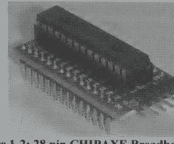

图 1-2：28 引脚 CHIPAXE 面包板模块

我接触到了一种与流行的 Arduino 模块尺寸相匹配的 CHIPINO 模块早期原型（图 1-3）。该设置提供了一个即插板，顶部包含一个小型面包板，因此你可以再次构建电路，然后将其拔下以供以后参考。我能够参与改进该模块的团队，使其成为 chipaxe.com 网站上所示的当前形式。该板具有带内置 5V 和 3V 调节器的电源端口，因此我可以轻松地将 9V 电源适配器或 9V 电池连接到此设置。所有 I/O 都引出到边缘的排针上，因此定制板可以轻松插入主板顶部。对于样式相似的 Arduino 模块，已经有很多即插板，或称为扩展板。许多 Arduino 扩展板可以插入此 CHIPINO 板。这将使未来的书籍和项目设置变得更加容易，因为硬件已经创建好了。

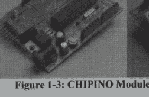

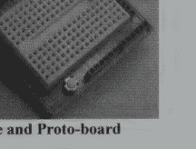

图 1-3：CHIPINO 模块和原型板

不过对于本书，我想要更大的面包板空间来构建电路。这就是我非常喜欢 CHIPAXE 风格模块的原因，它可以插入任何尺寸的面包板。尽管我也很喜欢

CHIPINO/Arduino 风格的引脚编号，并内置固定频率振荡器。图 1-4 所示的 CHIPINO-mini 模块是一种折中方案，可在 chipaxe.com 获取。它是一款 CHIPAXE 风格的板子，引脚编号与 CHIPINO 模块匹配。板上内置了一个 16 MHz 谐振器，以及一个 10kΩ 的复位引脚上拉电阻。这块板子可以插入大型面包板，使我有机会在独立的面包板上搭建电路。

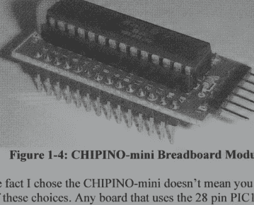

图 1-4：CHIPINO-mini 面包板模块

尽管我选择了 CHIPINO-mini，但这并不意味着你必须拘泥于这些选择。任何使用 28 引脚 PIC16F886 的板子都可以配合本书中的项目使用。

无论你选择哪一种，它们都有一个共同点：需要一组简单的预写函数来让它们更易于使用。因此，我决定创建一个函数库，基于本系列第 1 卷和第 2 卷开发的代码，外加一些新的实用函数。这也给了我一个理由，让代码改进得更具通用性。

创建 SimpleC 库是本书的重点。在前两本书中，我已经介绍了硬件、编译器和编程软件的设置，但我意识到有些人可能会先读这本第 3 卷。对于这些读者，我会更详细地再次介绍硬件编程器这一主题，以便你了解如何将这些模块用于本书中的项目。

与图 1-8a 所示类似。MPLAB 会安装许多文件，然后当安装即将完成时，它会询问你是否要安装 HI-TECH C 编译器。点击“是”选项，编译器将显示与图 1-8b 类似的窗口。适用于 PIC10F、12F 和 16F 的编译器在安装过程中会带你浏览几个窗口。当被询问安装密钥时，选择 Lite 版本，这样你就可以无需密钥免费运行它。当 MPLAB 和 HI-TECH 编译器安装完成后，你就可以运行本书中的项目了。

在我的第一本书《嵌入式C编程初学者指南》中，我描述了如何使用项目向导创建项目，因此这里不再赘述，但我会在第 4 章中简要介绍。你还可以从 MPLAB IDE 用户指南中获取有关使用 MPLAB 的信息，该指南可在 www.microchip.com/mplab 下载。

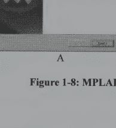

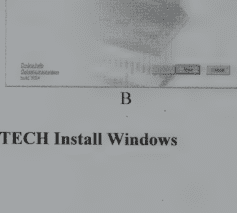

图 1-8：MPLAB 和 HI-TECH 安装窗口

### 最终设置

我用来创建这些项目的最终设置如图 1-9 所示。图中开发板连接到了一台小型上网本电脑。这是我的便携式便捷设置，让我可以在旅途中写这本书，同时我可以在午餐时间或某个家人找不到我的隐蔽地方开发代码。我花不到 250 美元购买了一台翻新上网本，所以整套设备大约花费了我 275 美元。作为一套完整的开发配置，这已经很不错了。

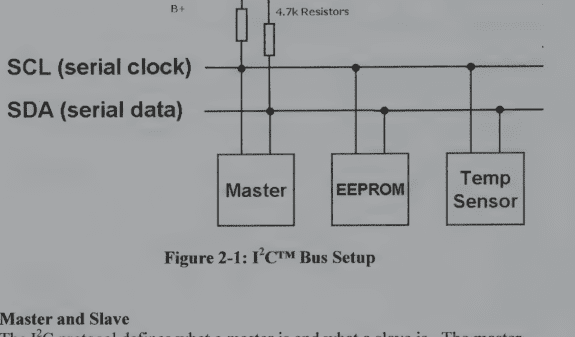

图 2-1：I²C™ 总线设置

### 主设备与从设备

I²C 协议定义了什么是主设备、什么是从设备。主设备控制总线。它产生时钟信号，并发送构成完整 I²C 消息的起始和停止信号。从设备必须监听发送的每一条消息，如果收到自己的控制字节，就进行响应。然后从设备向主设备回应数据。有些系统支持多主设备，但在本书中，我只会专注于单主设备配置。

如前所述，I²C 总线有两条线——一条数据线和一条时钟线。如果你熟悉移位寄存器的工作原理，那么这就很容易理解。主设备通过将数据线拉低或让外部电阻将数据线拉高来在数据线上放置一个位。然后，主设备通过将时钟线拉低，再释放回高电平来产生时钟脉冲。从设备端的电路接收该数据位的方式与移位寄存器移入一个位的方式相同。数据和时钟线的这种脉冲过程一直持续到 I²C 消息的第一部分传输完毕。图 2-2 显示了数据线上的 I²C 消息格式。

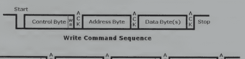

#### 写命令时序

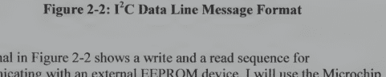

#### 读命令时序

图 2-2：I²C 数据线消息格式

图 2-2 中的信号显示了与外部 EEPROM 器件通信的写和读时序。我将使用 Microchip 24LC01B EEPROM 器件来演示如何使用 I²C 作为通信协议，在外部 EEPROM 中存储和读回数据。

控制字节是一个 7 位宽的值，第 8 位在写操作时为 0，在读操作时为 1。如你所见，读时序需要两个控制字节，而写时序只需要一个。这是因为读操作要求主设备先将存储器地址字节写入 EEPROM，以便 EEPROM 定位数据，然后再从 EEPROM 读取数据。在写操作期间，主设备将地址和数据字节都发送给 EEPROM，因此只发送一个写控制字节。另请注意，图 2-2 显示了一个可选的复数“数据字节”。这是因为你可以通过一次读或写控制字节命令发送或接收一串字节。

ACK 位是应答位。从设备在主设备仍在脉冲时钟线时将数据线拉低。主设备在发送下一个命令字节之前会查找该 ACK 位。这是从设备告诉主设备它已成功收到该信息字节的唯一方式。

I²C 不像其他通信技术（如我在第 2 卷中介绍的串行外设接口 (SPI)）那样快，但它仍然很快。典型的时钟速度通常为 10 kHz 或 100 kHz。高速模式运行在 400 kHz。你必须确保你的从设备部件能够承受主时钟的速度。

| 位 3-0 | SSPM<3:0>：同步串口模式选择位 |
|---|---|
| 0000 | SPI 从模式，时钟 = Fosc/4 |
| 0001 | SPI 主模式，时钟 = Fosc/16 |
| 0010 | SPI 主模式，时钟 = Fosc/64 |
| 0011 | SPI 主模式，时钟 = TMR2 输出/2 |
| 0100 | SPI 从模式，时钟 = SCK 引脚，SS 引脚控制使能 |
| 0101 | SPI 从模式，时钟 = SCK 引脚，SS 引脚控制禁用，SS 可用作 I/O 引脚 |
| 0110 | I²C 从模式，7 位地址 |
| 0111 | I²C 从模式，10 位地址 |
| 1000 | I²C 主模式，时钟 = Fosc / (4 * (SSPADD+1)) |
| 1001 | 加载功能 |
| 1010 | 保留 |
| 1011 | I²C 固件控制的主模式（从设备空闲） |
| 1100 | 保留 |
| 1101 | 保留 |
| 1110 | I²C 从模式，7 位地址，使能起始和停止位中断 |
| 1111 | I²C 从模式，10 位地址，使能起始和停止位中断 |

位 4 在主模式下不使用，因此我们将其清零或置 0。我们希望使能时钟，因此将 SSPEN 位（即第 5 位）设置为 1。

| 位 5 | SSPEN：同步串口使能位 |
|---|---|
|  | 在两种模式下，使能时，这些引脚必须正确配置为输入或输出 |
| 在 SPI 模式下 |  |
| 1 | 使能串口，并将 SCK、SDO、SDI 和 SS 配置为串口引脚来源 |
| 0 | 禁用串口，并将这些引脚配置为 I/O 端口引脚 |
| 在 I²C 模式下 |  |
| 1 | 使能串口，并将 SDA 和 SCL 引脚配置为串口引脚来源 |
| 0 | 禁用串口，并将这些引脚配置为 I/O 端口引脚 |

| 位 4 | CKP：时钟极性选择位 |
|---|---|
| 在 SPI 模式下 |  |
| 1 | 时钟空闲状态为高电平 |
| 0 | 时钟空闲状态为低电平 |
| 在 I²C 从模式下 |  |
|  | SCK 释放控制 |
| 1 | 使能时钟 |
| 0 | 保持时钟为低电平（时钟拉伸）。（用于确保数据建立时间。） |
| 在 I²C 主模式下 |  |
|  | 此模式下不使用 |

位 6 和位 7 是状态位，因此在设置中我们只需将它们保持为零。将所有这些加起来，你会得到一个十六进制值 0x38。因此，在我们的软件中，我们将把 SSPCON 寄存器设置为 0x38。

下一个寄存器是 SSPCON2 寄存器，它有许多状态位和一些设置位。我们将它的所有位都初始化为零，因为我们稍后会在发送数据的过程中修改或读取这些位。


然后读取部分会放慢速度，以二进制格式从 9 倒数到 1。

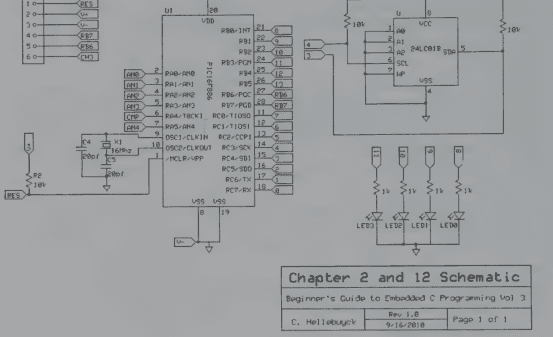

| 第2章和第12章原理图 |  |  |  |
|---|---|---|---|
| 嵌入式C编程初学者指南 第3卷 |  |  |  |
| C. Halls... | Rev 1.0 | 9-16-2018 | 第1页，共1页 |

图2-3：I2C EEPROM 项目

### 硬件
本项目的原理图如图2-3所示。原理图展示了 CHIPINO 模块的所有连接，以及 I2C EEPROM 24LC01B 和四个 LED。LED 串联了 1kΩ 电阻来限制电流。在 24LC01B 上，A0、A1 和 A2 引脚接地，使该 EEPROM 的控制字节地址为 000。如果我们要使用多个 EEPROM，可以将其中一个引脚（如 A0）连接到 5V，使地址变为 001。这就是如何在同一条 I2C 总线上挂接多个 EEPROM 的方法。

图2-4中的图片展示了在面包板上搭建的电路，以及连接到 CHIPINO-mini 模块的接线。这张图片应该能让你在自己的设备上轻松复现。5V 和地线由 PICkit 2 编程器提供。如果你更喜欢带有板载稳压器的 CHIPINO 模块，那么图2-5就是你的搭建方式。该模块允许你使用 9V 电源适配器为电路供电。

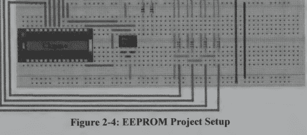

#### 图2-4：EEPROM 项目搭建

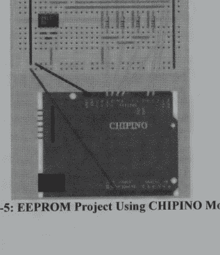

#### 图2-5：使用 CHIPINO 模块的 EEPROM 项目

```
/*
 * I2C External EEPROM example using SimpleC
 * This code will write 10 bytes to the EEPROM and
 * then read them back and display binary value on LEDs.
 *
 * Connections:
 * Pin 8(B0) - LED Anode - LED Cathode - 1k ohm - Ground
 * Pin 9(B1) - LED Anode - LED Cathode - 1k ohm - Ground
 * Pin 10(B2) - LED Anode - LED Cathode - 1k ohm - Ground
 * Pin 11(B3) - LED Anode - LED Cathode - 1k ohm - Ground
 *
 * Pin 3(C4) - 24LC01B SDA - 10k pullup - 5v
 * Pin 4(C3) - 24LC01B SCL - 10k pullup - 5v
 * 24LC01B Vss - Ground
 * 24LC01B Vdd - 5v
 */

#include <htc.h>
#include <stdio.h>
__CONFIG (HS & WDTDIS & MCLREN & UNPROTECT & LVPDIS);

//***********************************************
// Initialize Microcontroller Setup
//***********************************************

void init_micro(void)
{
    ANSEL = 0;          //Analog ports set to digital
    ANSELH = 0;
    CM1CON0 = 0;        //Comparators Shut off
    CM2CON0 = 0;
    INTCON=0;           // purpose of disabling the interrupts
}

/* *******************************************
 * msecbase - 1 msec pause routine
 * The External oscillator is set to 16 Mhz and the
 * internal instruction clock is 1/4 of the oscillator.
 * This makes the internal instruction clock 4 Mhz or
 * 0.25 usec per clock pulse.
 * Using the 1:16 prescaler on the clock input to Timer0
 * slows the Timer0 count increment to 1 count/4 usec.
 * Therefore 250 counts of the Timer0 would make a one
 * millisecond delay (250 * 4 usec). But there are other
 * instructions in the delay loop so using the MPLAB
 * stopwatch we find that we need Timer0 to overflow at
 * 243 clock ticks. Preset Timer0 to 13 (0D hex) to make
 * Timer0 overflow at 243 clock ticks (256-13 = 243).*********/

void msecbase(void)
{
    OPTION = 0b00000011;    //Set prescaler to TMR0 1:16
    TMR0 = 0xD;             //Preset TMR0 to overflow on 243 counts
    while(!T0IF);           //Stay until TMR0 overflow flag equals 1
    T0IF = 0;               //Clear the TMR0 overflow flag
}
```

```
{
    i2c_start();
    i2c_write(0xa0);
    i2c_write(address);
    i2c_write(data);
    i2c_stop();
    pause(1);
}

// *******************************************************
// I2C_EEIN function to read from an 8-bit address Microchip
// EEPROM part (i.e. 24LC01) with 8 byte address (2K bit max)
// *******************************************************

unsigned char I2C_EEIN(unsigned char address)
{
    unsigned char data;

    i2c_start();
    i2c_write(0xa0);
    i2c_write(address);
    i2c_repStart();
    i2c_write(0xa1);
    data=i2c_read(0);
    i2c_stop();
    return(data);
}

// *******************************************************
//  Main Program Loop
// *******************************************************

void
main(void)
{
    init_micro();// Initialize I/O
    i2c_init();        // Initialize I2C
    PORTB=0x00;        // All LEDs off
    TRISB=0x00;        // All PORTB outputs

    unsigned char cnt=0;        // Create variable and initialize to zero

    while(cnt<=10)  /* write 10 numbers to eeprom */
    {
        PORTB=cnt;              // The cnt value will display on the LEDs
        I2C_EEOUT(cnt,10-cnt);  // Store 9 at address 1, 8 at address 2, ...
        cnt=cnt+1;              // Increment cnt variable
        pause(255);             // Delay 255 milliseconds
    }

    cnt=0;

    while(cnt<=10)
    {
        PORTB = I2C_EEIN(cnt); // Display data read from EEPROM on LEDs in binary
        pause (1000);         // Delay for 1 second to read LEDs
        cnt=cnt + 1;           // Increment cnt variable
    }
}
```

### 工作原理
程序的顶部有一个标题块，编译器将其识别为注释。标题块以 `/*` 开头，在较远处以 `*/` 结束。这表示两者之间的所有内容都只是注释，而不是代码。

程序将快速地向外部 EEPROM 发送 10 个数据字节，并将每个存储的值以二进制形式显示在四个 LED 上。然后，它将从 EEPROM 读回每个字节，并将该值以二进制形式显示在四个 LED 上。写入部分会快速地从 1 到 9 以二进制计数，然后读取部分会放慢速度，以二进制格式从 9 倒数到 1。

```
/*
 * I2C External EEPROM example using SimpleC
 * This code will write 10 bytes to the EEPROM and
 * then read them back and display binary value on LEDs.
 *
 * Connections:
 * Pin 8(B0) - LED Anode - LED Cathode - 1k ohm - Ground
 * Pin 9(B1) - LED Anode - LED Cathode - 1k ohm - Ground
 * Pin 10(B2) - LED Anode - LED Cathode - 1k ohm - Ground
 * Pin 11(B3) - LED Anode - LED Cathode - 1k ohm - Ground
 *
 * Pin 3(C4) - 24LC01B SDA - 10k pullup - 5v
 * Pin 4(C3) - 24LC01B SCL - 10k pullup - 5v
 * 24LC01B Vss - Ground
 * 24LC01B Vdd - 5v
 */
```

接下来的部分包含了 HI-TECH 编译器所需的头文件 `htc.h`。`stdio.h` 文件对于本项目来说是可选的，但用于 HI-TECH 编译器内置的一些库函数。接下来是 CHIPINO 的 PIC16F886 的配置设置。这些设置包括：

- HS – 高速振荡器设置
- WDTDIS – 看门狗定时器禁用
- MCLREN – 使能主清除引脚作为复位引脚
- UNPROTECT – 允许从芯片读取程序
- LVPDIS – 禁用低压编程

```
#include <htc.h>
#include <stdio.h>
__CONFIG (HS & WDTDIS & MCLREN & UNPROTECT & LVPDIS);
```

下一部分创建了一个简单的函数，将端口初始化为数字模式，并关闭模拟和比较器功能。它还在启动时禁用中断。我会将这个相同的函数包含在 SimpleC 库中。

```c
/************************************************
// Initialize Microcontroller Setup
/************************************************

void init_micro(void)
{
        ANSEL = 0;          //Analog ports set to digital
        ANSELH = 0;
        CM1CON0 = 0;        //Comparators Shut off
        CM2CON0 = 0;
        INTCON=0;           // Disable the interrupts
}
```

如果你读过本系列的第1卷或第2卷，那么接下来的部分应该很熟悉。它是一个毫秒基准函数，然后是一个暂停函数，用于创建简单的延迟。这里使用了 Timer0，这些函数也将包含在 SimpleC 库中。此版本针对 CHIPINO 上的 16 MHz 晶振进行了调整。

```c
/************************************************
* msecbase = 1 msec pause routine
* The oscillator is set to 16 Mhz and the
* internal instruction clock is 1/4 of the oscillator.
* This makes the internal instruction clock 4 Mhz or
* 0.25 usec per clock pulse.
* Using the 1:16 prescaler on the clock input to Timer0
* slows the Timer0 count increment to 4 usec.
* Therefore 250 counts of the Timer0 would make a one
* millisecond delay (250 * 4 usec). But there are other
* instructions in the delay loop so using the MPLAB
* stopwatch we find that we need Timer0 to overflow at
* 243 clock ticks. Preset Timer0 to 13 (0D hex) to make
* Timer0 overflow at 243 clock ticks (256-13 = 243).
************************************************/

void msecbase(void)
{
        OPTION = 0b00000011;       //Set prescaler to TMR0 1:16
        TMR0 = 0x0d;               //Preset TMR0 to overflow on 243 counts
        while(!T0IF);              //Stay until TMR0 overflow flag equals 1
        T0IF = 0;                  //Clear the TMR0 overflow flag
}

/************************************************
//Pause - millisecond delay routine 1 to 65,535 milliseconds
/************************************************

void pause( unsigned long usvalue )
{
```

```
i2c_write(data);
i2c_stop();
pause(11);
}
```

下一个函数由前面的构建模块组合而成，用于创建一个自定义函数，该函数从特定地址的EEPROM读取数据。

```
// *******************************************
// I2C_EEIN function to read from an 8-bit address Microchip
// EEPROM part (i.e. 24LC01) with 8 byte address (2k bit max)
// *******************************************
unsigned char I2C_EEIN(unsigned char address)
{
    unsigned char data;

    i2c_start();
    i2c_write(0xA0);
    i2c_write(address);
    i2c_repStart();
    i2c_write(0xA1);
    data=i2c_read(0);
    i2c_stop();
    return(data);
}
```

之前的所有函数都将成为SimpleC库的一部分。本项目的主代码循环是这一切汇集之处。首先调用init_micro()函数，然后设置B端口用于驱动LED指示灯。

```
// *******************************************
// Main Program Loop
// *******************************************

void main(void)
{
    init_micro(); // Initialize I/O
    i2c_init();      // Initialize i2c
    PORTB=0x00;      // All LEDs off
    TRISB=0x00;      // All PORTB outputs
```

创建了一个变量“cnt”用作计数器，以便在while循环中向EEPROM发送10个数据值。正在存储的值也会以二进制形式显示在四个LED上。

```
unsigned char cnt=0;    // Create variable and initialize to zero

while(cnt<=10)  /* write 10 numbers to eeprom */
{
    PORTB=cnt;          // The cnt value will display on the LEDs
    I2C_EOUT(cnt,10-cnt);  // Store 9 at address 1, 8 at address 2, ...
    cnt=cnt+1;          // Increment cnt variable
```

```
pause(255);      // Delay 255 milliseconds
}

cnt=0;
```

同样的变量“cnt”也被用作计数器，以便在while循环中从EEPROM读取10个数据值。读取的值将以二进制形式显示在LED上。

```
while(cnt<=10)
{
PORTB = I2C_EEIN(cnt); // Display data read from EEPROM on LEDs in binary
pause(1000);           // Delay for 1 second to read LEDs
cnt=cnt + 1;           // Increment cnt variable
}
```

所创建的所有这些函数都用于运行这个仅约16行代码的主循环。将所有函数放入一个库文件，正是SimpleC让C编程变得更简单的方式。

### 后续步骤

这个项目有很多可以更改的选项。您可以更改存储的数据，但根据您选择的数据，用四个LED以二进制形式读取可能会很困难。一个很好的改进是用LCD显示屏替换LED，这样会更容易理解。我使用LED是为了让硬件部分保持简单。说到简单，SimpleC会让为这个项目添加LCD变得非常容易。本书的最后一个项目将展示如何使用SimpleC库完成同样的项目，所以还等什么呢？让我们开始创建SimpleC库，让嵌入式C编程对初学者来说更加容易。

现在很明显，这只是我个人的观点，即单个库文件更容易让初学者理解，而我的这个系列书籍正是为这一读者群而写的。我相信会有更多有经验的程序员或学者给我各种理由来证明我是错的，而且很可能会在亚马逊上留下负面评论，但我仍然坚持我的信念：SimpleC仅仅是帮助更多初学者学习嵌入式C编程的垫脚石。如果我错了，SimpleC文件是开源的，任何用户都可以将其拆分为单独的.c和.h文件，以优化程序存储空间的使用。我甚至在完成这本书之前就修改了它。我最初从1.0版本开始，但在分发了一些测试版之后，我发现需要进行一些小的修改，因此我发布了1.1版本，也就是本书中使用的版本。

## SimpleC软件说明

SimpleC库由两个文件组成：simplec1.1.h和simplec1.1.c。数字1.1是版本级别，因此未来当我添加新函数时，版本号将从1.1增加到1.2、1.3，依此类推。这些文件已开源，可以在本书的软件下载和chipino.cc下载页面中找到，因此向此库添加内容可以成为一个社区项目，任何人都可以改进其功能。

在本节中，我想简要介绍每个函数的工作原理，以便您在使用库或需要针对特定应用进行修改时可以参考本章。稍后，我会为那些想要修改这些函数的人深入讲解每个函数的实际代码。

*注意：所有SimpleC函数都是区分大小写的，这意味着如果它们在simplec.c文件中以小写形式编写，那么您也需要在程序中使用小写形式。某些特定函数是以大写形式编写的，请务必注意这一点。*

### 初始化和时间延迟

SimpleC库中的第一组函数处理微控制器初始化、时基和基本I/O控制。配置设置和部分I/O定义位于simplec1.1.h文件中，我将在稍后介绍。其余的初始化由这些函数负责，下面我来总结一下。

#### high(pin)

将指定的引脚（pin）置为高电平。该引脚会自动被设置为输出模式。pin可以是常量（0-13）或包含0-13数字的变量。

示例：

```
while()
{
  high(5); // Make pin5 (C2) an output and set it high (~5 volts)
}
```

或

```
#define led 8 // Define Pin 8 (RB0) as connected to LED

while()
{
  high(led);  //Make LED pin an output and set it high (~5 volts)
}
```

#### low(pin)

将指定的引脚（pin）置为低电平。该引脚会自动被设置为输出模式。pin可以是常量（0-13）或包含0-13数字的变量。

示例：

```
while()
{
  low(5); // Make pin5 (C2) an output and set it low (~0 volts)
}
```

或

```
#define led 8 // Define Pin 8 (RB0) as connected to LED

while()
{
  low(led);  //Make LED pin an output and set it low (~0 volts)
}
```

#### input(pin)

将指定的*pin*设为输入，并返回该引脚的状态。该函数前必须有接收状态的变量。*pin*可以是常量（0–13）或包含0–13数字的变量。

**示例：**

```
while()
{
char var = input(8);  // Store a 1 (high) or 0 (low) in the variable per pin 8 level
}
```

#### pulseout(pin,period)

pulseout在指定的*pin*上生成指定*period*的脉冲。通过先将引脚置高、延时、再置低来生成脉冲。*pin*自动被设为输出。*pin*和*period*可以是常量（0–13）或包含0–13数字的变量。

pulseout的分辨率为10微秒增量。因此，*period*值为25时会产生250微秒长的脉冲。

```
while()
{
pulseout(5,100); // Send a pulse 1000 microseconds long (1 msec) on pin5
}
```

#### adcin(pin)

adcin函数将模拟引脚上感测到的电压转换为0到255（8位分辨率）的数字值。参数*pin*指定要感测和转换的模拟引脚。SimpleC支持编号为0到4的5个模拟引脚。这与Microchip PIC的AN0至AN4引脚相对应。该函数实际用于一个等式中，将结果存入变量。电压范围可为0v至5v，但绝不能超过此范围。

示例

```
while()
{
char var = adcin(1)    // Convert voltage on AN1 pin and store in variable var
}
```

### LCD字符模块控制

2x16 LCD是一种常见的显示微控制器消息的方式。使用SimpleC库中的函数可以简化2x16 LCD的设置和控制。

#### lcd_init()

lcd_init函数为PORTB（引脚8-13）控制的2x16 LCD字符模块建立连接。LCD的DB0-DB3引脚分别连接到B0至B3（引脚8-11）。RS引脚连接到B4（引脚12），EN引脚连接到B5（引脚13）。

在使用任何LCD命令之前，必须先调用lcd_init()。最好将其放在程序顶部。

示例：

```
void
main(void)
{
init_micro();    // Initialize I/O
lcd_init();      // Initialize LCD Display
lcd_clear();     // Clear LCD screen

while (1==1)
{
lcd_goto(0);            // Select first line
lcd_text("Simple C Make");  // Display Hello World
lcd_goto(0x40);         // Select second line
lcd_text("Programming Easy");// Display message between quotes
pause(1000);            // Delay for 1 second to read display
}
}
```

#### lcd_clear()

lcd_clear函数将清除2x16 LCD字符模块的屏幕。光标也会位于显示器的左上角，通常称为零位置。

lcd_clear()函数通常放在程序顶部开始处，但也可以在程序中的任何位置使用，在写入新消息之前清除屏幕。

示例：

```
void
```


## 

白内障是眼睛的晶状体发生混浊、透明度下降，导致光线无法正常投射到视网膜上，从而引起视力模糊甚至失明的一种常见眼科疾病。本病多见于中老年人，也可由外伤、代谢异常、药物或先天性因素引起。

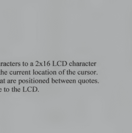

### 

- 视力进行性模糊，像隔着一层雾
- 出现重影或眩光，尤其夜间明显
- 对光线和颜色敏感度下降
- 佩戴眼镜度数频繁变化
- 暗光环境下视物困难

当出现上述症状时，建议及时到医院眼科就诊，通过裂隙灯等专业设备检查晶状体的混浊程度，明确诊断并制定合适的治疗方案。

PORTC.7）。为了正常通信，需要电平转换电路。这可以是 max232 芯片或 FTDI UART 转 USB 芯片。这些 SimpleC 命令有助于简化设置和通信。

### init_serial（波特率）

init_serial 函数通过板载 UART 外设建立 RS232 串行通信的设置。Tx 和 Rx 引脚分别固定为引脚 0（C6）和引脚 1（C7）。在此 init_serial 函数中，波特率可以设置为 2400 或 9600。

示例：

```
void main(void){
    init_micro();     // Setup micro ports
    init_serial(9600); // set up the USART baud rate (2400 or 9600)
    // *** Serial Communication Main Loop
    while(1)
    {
        // *********** Send a decimal numbers from 1 to 9 ***********
        for (char count = 0x31; count <= 0x39; count = count +1)
        {
            putch(count);     // Send Count 1-9 in ASCII
            pause(100);       // Delay 100 msec
        }
    } //End While
} //End Main
```

### putch（字符）

putch 函数不一定是仅 SimpleC 的函数。它是 HI-TECH 编译器附带的独立标准库的一部分。此函数用于通过串行端口发送一个字节的数据。字符可以是字符串值的十六进制 ASCII 值。

### getch（）

getch 函数不一定是仅 SimpleC 的函数。它是 HI-TECH 编译器附带的独立标准库的一部分。此函数用于通过串行端口接收一个字节的数据。该语句需要一个变量来存储接收到的数据。

示例：

```
void main(void){
    init_micro();      // Setup micro ports
    init_serial(9600); // set up the USART baud rate (2400 or 9600)

    // **** Use printf command to ask for input and echo it back ******
    while(1)
    {
        printf("Press a key and I will echo it back:\r\n");
        char input = getch(); // read a response from the user
        printf("I detected [%c]\r\n",input);  // echo it back
    }
}//end main
```

### printf（字符）

printf 函数不一定是仅 SimpleC 的函数。它是 HI-TECH 编译器附带的独立标准库的一部分。此函数用于格式化发送到指定外设或在其上打印的数据。在此 SimpleC 库中，它用于格式化发送到终端程序的串行端口数据。以下是在 printf 字符区域中可以使用的一些选项。

格式字符及其含义如下：

- \" 双引号
- \\ 反斜杠
- \a 警报（BEL）
- \b 退格
- \c 不再产生输出
- \f 换页
- \n 换行
- \r 回车
- \t 水平制表符
- \v 垂直制表符
- %% 单个百分号
- %Wd 整数，宽度为“W”位
- %s 字符串字符

示例：

```
void main(void){
init_micro();    // Setup micro ports
init_serial(9600);   // set up the USART baud rate (2400 or 9600)

// *** Serial Communication Main Loop
while(1)
{

// ********* Use printf command to ask for input and echo it back *********
    while(1)
    {
    printf("Press a key and I will echo it back:\r\n");
    char input = getch();  // read a response from the user
    printf("I detected [%c]\r\n",input);    // echo it back
    }//end while
}//end main
```

### SPI 通信

串行外设接口（SPI）通常用于与外部电路通信。PIC16F886 上的 SPI 端口是一个在后台运行的硬件外设。因此，使用下面的 SimpleC 库函数可以简化其设置和运行。该外设仅设置为 SPI 主机，而非从机。

#### spi_init（）

spi_init 函数将 SPI 端口设置为串行通信的主机。SPI 连接在外设中预设。引脚 4（C3）是时钟，引脚 3（C4）是主机输出从机输入（MOSI 或 SDO），引脚 2（C5）是主机输入从机输出（MISO 或 SDI）。为了使用 SPI 外设，spi_init 必须位于主循环的顶部。

示例：

```
//*****Sample code to control an MCP23S08 SPI I/O Expander***
void main(void)
{
init_micro();
spi_init();
WR_MCP23S08 (IODIR, 0x01);    // Setup pins
while (1==1)
{
char y = 1;
y = RD_MCP23S08 (GPIO); // Read switch
y = y & 0x01;           // Mask all but bit 7
if (y==0)
{WR_MCP23S08 (OLAT, 0x40);} // If switch idle light LED
else
{WR_MCP23S08 (OLAT, 0x80);} // If switch pressed LED off
pause(10);
} //End While
} //End Main
```

#### spi_output（字节）

spi_output 函数将字节值存储在 SPI 外设缓冲区中，以便外设将其发送到 SPI 从设备。此函数也用于从 SPI 从机接收一个字节，因为每次 SPI 外设发送一个字节时，它也会接收一个字节。因此，此函数始终用于同时发送和接收一个字节的数据。如果只想接收，则发送一个虚拟或无意义的字节。如果只想发送，则接收到的字节不使用。

示例：

```
/*** Read a byte of data from an EEPROM function ****
char RD_BYTE ( char EE_address )
{
    char dummy;
    char spi_received = 0;
    CS = 0;     // Set chip select low
    dummy = SPI_OUTPUT (0x03);        // Send read command
    dummy = SPI_OUTPUT( EE_address ); // Send Address
    spi_received = SPI_OUTPUT( 0x00 ); // Receive Stored Value
    CS = 1;                         // Bring chip select high to terminate
                                    // the read command
    return spi_received;
}
```

#### WR_BYTE（地址，数据字节）

WR_BYTE 函数使用 spi_output 函数将一字节数据写入基于 SPI 的 EEPROM 芯片。可以将该字节写入特定的存储器位置。地址是 0 到 255 之间的值，因此此函数仅限于 2k 位 EEPROM 存储芯片。Microchip 25LC020A 或 25AA020A 是与此命令配合良好的 2k 位器件。

特别说明：请注意函数名称全部大写。这是因为该函数是针对特定组件的 SPI 特定例程。

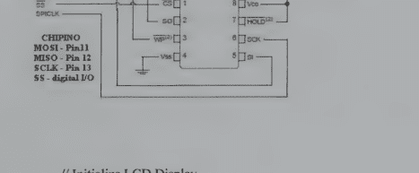

```
void
main(void)
{
    lcd_init();    // Initialize LCD Display
spi_init();          // Initialize SPI Peripheral

//*** Load Data in EEPROM ***
while (1==1)
{
    for( addr = 0; addr < 10; addr = addr + 1 )   // Loop 10 times
    {
        data = addr;                // addr value is data for SEEPROM
        WR_BYTE (addr,data);        // Write to SEEPROM
        pause (10);                 // Delay 10ms after each write
    } // End For

//*** Continuous Loop to Read and Display Data ***
    for( addr = 0; addr <10; addr = addr + 1 )   // Loop 10 times
    {
        lcd_clear();                // Clear LCD screen
        lcd_goto(0);                // select first line
        lcd_text("Address / Value"); // Display header
        b0 = RD_BYTE (addr);        // Read from SEEPROM
        lcd_goto(0x40);             // Select second line
        lcd_number(addr);           // Display address location
        lcd_text(" /");
        lcd_number(b0);             // Display value read from EEPROM
        pause (250);                // Delay 250 msec to see count
    } //End For

} //End While
} //End Main
```

#### RD_BYTE（地址）

RD_BYTE 函数使用 spi_output 函数从基于 SPI 的 EEPROM 芯片读取一个字节的数据。可以从特定的存储器位置读取该字节。地址是 0 到 255 之间的值，因此此函数仅限于 2k 位 EEPROM 存储芯片。Microchip 25LC020A 或 25AA020A 是与此命令配合良好的 2k 位器件。

特别说明：请注意函数名称全部大写。这是因为该函数是针对特定组件的 SPI 特定例程。


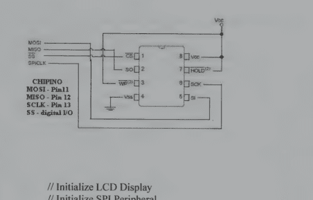

CHIPINO
- MOSI - 引脚11
- MISO - 引脚12
- SCLK - 引脚13
- SS - 数字 I/O

```c
void
main(void)
{
    lcd_init();        // Initialize LCD Display
    spi_init();        // Initialize SPI Peripheral

    //*** Load Data in EEPROM ***
    while (1==1)
    {
        for(addr = 0; addr < 10; addr = addr + 1)    // Loop 10 times
        {
            data = addr;        // addr value is data for EEPROM
            WR_BYTE(addr,data);    // Write to EEPROM
            pause(10);        // Delay 10ms after each write
        } // End For

        //*** Continuous Loop to Read and Display Data ***
        for(addr = 0; addr <10; addr = addr + 1)    // Loop 10 times
        {
            lcd_clear();            // Clear LCD screen
            lcd_goto(0);            // select first line
            lcd_text("Address / Value");    // Display header
            char b0 = RD_BYTE(addr);    // Read from EEPROM
            lcd_goto(0x40);        // Select second line
            lcd_number(addr);    // Display address location
            lcd_text(" / ");
            lcd_number(b0);        // Display value read from EEPROM
            pause(250);        // Delay 250 msec to see count
        } //End For
    } //End While
} //End Main
```

#### WR_MCP23S08 (register, databyte)

WR_MCP23S08 函数使用 spi_output 函数将一个字节的数据写入基于 SPI 的 Microchip I/O 扩展器部件编号 MCP23S08。databyte 可以写入特定的寄存器位置。寄存器值基于 MCP23S08 的数据手册。主要寄存器如下：

**表 1-2：寄存器地址**

| 地址 | 访问： |
|---|---|
| 00h | IODIR |
| 01h | IPOL |
| 02h | GPINTEN |
| 03h | DEFVAL |
| 04h | INTCON |
| 05h | IOCON |
| 06h | GPPU |
| 07h | INTF |
| 08h | INTCAP (Read-only) |
| 09h | GPIO |
| 0Ah | OLAT |

寄存器位置中输入的值以十六进制形式写入（例如 INTCON 寄存器的 0x04）。WR_MCP23S08 函数还为最常见的三个寄存器提供了一些别名，因此您可以使用这些名称代替实际的地址值：

- IODIR // 数据方向寄存器地址 0x00
- OLAT // 输出锁存寄存器地址 0x0A
- GPIO // 端口寄存器地址 0x09


特别说明：请注意函数名全部为大写。这是因为该函数是针对特定组件的 SPI 特定例程。

Example:

```c
void main(void)
{
 init_micro();
 spi_init();
 WR_MCP23S08 (IODIR, 0x01);   // Setup pins
 while (1==1)
 {
   char y = 1;
   y = RD_MCP23S08 (GPIO); // Read switch
   y = y & 0x01;           // Mask all but bit 7
   if (y==0)
   {WR_MCP23S08 (OLAT, 0x40);} // If switch idle light LED
   else
   {WR_MCP23S08 (OLAT, 0x80);} // If switch pressed LED off
   pause(10);
 } //End While
} //End Main
```

#### RD_MCP23S08 (register)

RD_MCP23S08 函数使用 spi_output 函数从基于 SPI 的 Microchip I/O 扩展器芯片编号 MCP23S08 的寄存器中读取一个字节的数据。字节可以从特定的寄存器位置读取。寄存器值基于 MCP23S08 的数据手册。主要寄存器是：

**表 1-2：寄存器地址**

| 地址 | 访问： |
|---|---|
| 00h | IODIR |
| 01h | IPOL |
| 02h | GPINTEN |
| 03h | DEFVAL |
| 04h | INTCON |
| 05h | IOCON |
| 06h | GPPU |
| 07h | INTF |
| 08h | INTCAP (Read-only) |
| 09h | GPIO |
| 0Ah | OLAT |

寄存器位置中输入的值以十六进制形式写入（例如 INTCON 寄存器的 0x04）。RD_MCP23S08 函数还为最常见的三个寄存器提供了一些别名，因此您可以使用这些名称代替实际的地址值：

- IODIR // 数据方向寄存器地址 0x00
- OLAT // 输出锁存寄存器地址 0x0A
- GPIO // 端口寄存器地址 0x09

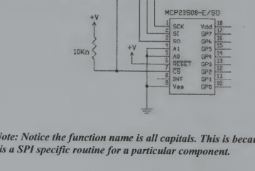

*特别说明：请注意函数名全部为大写。这是因为该函数是针对特定组件的 SPI 特定例程。*

Example:

```c
void main(void)
{
init_micro();
spi_init();
WR_MCP23S08(IODIR, 0x01);   // Setup pins
while (1==1)
{
    char y = 1;
    y = RD_MCP23S08(GPIO);   // Read GPIO port
    y = y & 0x01;            // Mask all but bit 7
    if (y==0)
    {WR_MCP23S08(OLAT, 0x40);} // If switch idle light LED
    else
    {WR_MCP23S08(OLAT, 0x80);} // If switch pressed LED off
    pause(10);
} //End While
} //End Main
```

### I2C Communication

正如我在上一章中所示，I2C 通信对于与外部电路通信非常有用。I2C 外设在 PIC16F886 上与其 SPI 外设共享许多通信 I/O。因此您将使用 SPI 或 I2C，但不能同时使用两者。这些 SimpleC 函数使使用 I2C 外设变得更容易。

#### i2c_init()

i2c_init 函数将 i2c 端口设置为作为主设备的串行通信。i2c 连接预设在外设中。引脚 4（C3）为时钟，引脚 3（C4）为数据线。为了使用 i2c 外设，i2c_init 必须位于 main 循环的顶部。

Example:

```c
#include <simplec_1.0.h>

void
main(void)
{
init_micro();    // Initialize I/O
i2c_init();      // Initialize i2c
PORTB=0x00;      // All LEDs off
TRISB=0x00;      // All PORTB outputs
```

#### i2c_restart()

i2c_restart() 函数用于在 i2c 信号中发送新的起始位。这用于新 i2c 通信消息的开始。这通常用于第一个起始位用于发送请求返回数据的消息时。下面示例显示了该函数在 SimpleC 库函数之一中的使用。

Example:

```c
unsigned char I2C_EEIN(unsigned char address)
{
unsigned char data;
i2c_start();
i2c_write(0xa0);
i2c_write(address);
i2c_repStart();
i2c_write(0xa1);
data=i2c_read(0);
i2c_stop();
return(data);
}
```

#### i2c_stop()

i2c_stop() 函数用于在 i2c 信号结束时发送停止位。这用于指示 i2c 通信消息的结束。下面示例显示了该函数在 SimpleC 库函数之一中的使用。

Example:

```c
unsigned char I2C_EEIN(unsigned char address)
{
unsigned char data;
i2c_start();
i2c_write(0xa0);
i2c_write(address);
i2c_repStart();
i2c_write(0xa1);
data=i2c_read(0);
i2c_stop();
return(data);
}
```

```c
PORTB =I2C_EEIN(cnt); // Display data read from EEPROM on LEDs in binary
pause (1000);           // Delay for 1 second to read LEDs
cnt=cnt + 1;            // Increment cnt variable
}
```

#### I2C_EEIN ( address )

I2C_EEIN() 函数用于从 Microchip I2C 串行 EEPROM 接收数据。它专门编写用于从具有 8 位地址的部件读取。

Example:

```c
#include <simplec_1.1.h>

void
main(void)
{
    init_micro();        // Initialize I/O
    i2c_init();          // Initialize i2c
    PORTB=0x00;          // All LEDs off
    TRISB=0x00;          // All PORTB outputs

    unsigned char cnt=0;

    while(cnt<=10)  /* write 10 numbers to eeprom */
    {
        PORTB=cnt;        // The cnt value will display on the LEDs
        I2C_EEOUT(cnt,10-cnt);  // Store 9 at address 1, 8 at address 2, ...
        cnt=cnt+1;        // Increment cnt variable
        pause(255);       // Delay 255 milliseconds
    }

    cnt=0;

    while(cnt<=10)
    {
        PORTB=I2C_EEIN(cnt); // Display data read from EEPROM on LEDs in binary
        pause (1000);        // Delay for 1 second to read LEDs
        cnt=cnt + 1;         // Increment cnt variable
    }
}
```

### simplec1.1.h – How it Works

头文件包含每个项目应具有的常见元素。让我详细讲解此文件。首先是头部的描述，然后是包含文件。htc.h 文件被包含并且是 HI-TECH 编译器所必需的。stdio.h 文件是 HI-TECH 库的内部标准输入/输出头文件。stdio 库处理 printf 函数以及 getch 和 putch 函数。

```c
/*
 * Library of common functions
 * For the readers of the Beginner's Guide to Embedded C book series
 * by Chuck Hellebuyck
 * Copyright 2010
 * Version 1.1 - Written for Chipino with 16F886
 */

#include <htc.h>
#include <stdio.h>
```

接下来包含 PIC16F886 的配置设置。这些设置了 CHIPINO 模块的各种功能。CHIPINO 使用 16 MHz 晶振，因此选择 HS 模式。看门狗定时器关闭，外部复位在 MCLR 引脚上启用。代码未受保护，并且低压编程模式被禁用，因为 CHIPINO 使用 PICkit 2 编程。PIC16F886 可以在 16 MHz 晶振失效时运行内部振荡器，但该选项已通过配置设置关闭。数据手册中 CONFIG1 寄存器部分显示在 __CONFIG 行下方以供参考。

```c
__CONFIG (HS & WDTDIS & MCLREN & UNPROTECT & LVPDIS & IESODIS & FCMDIS);
```

PIC16F886 的配置设置在数据手册中列出，并在下一页中重现。编译器实际使用的设置来自 HI-TECH 编译器包含目录中的 PIC16F887.h 文件。该头文件由 SimpleC1.1.h 文件顶部包含的 htc.h 文件调用。


#### 寄存器 14-1：CONFIG1：配置字寄存器 1

| 位 15 | 位 14 | 位 13 | 位 12 | 位 11 | 位 10 | 位 9 | 位 8 |
| --- | --- | --- | --- | --- | --- | --- | --- |
| — | — | DEBUG | LVP | FCMEN | IESO | BOREN1 | BOREN0 |

| 位 7 | 位 6 | 位 5 | 位 4 | 位 3 | 位 2 | 位 1 | 位 0 |
| --- | --- | --- | --- | --- | --- | --- | --- |
| CPD | CP | MCLRE | PWRTE | WDT | FOSC2 | FOSC1 | FOSC0 |

- 位 15-14 未实现：读为 '1'
- 位 13 DEBUG：在电路调试器模式位
  - 1 = 在电路调试器已禁用，RB6/ICSPCLK 和 RB7/ICSPDAT 为通用 I/O 引脚
  - 0 = 在电路调试器已启用，RB6/ICSPCLK 和 RB7/ICSPDAT 专用于调试器
- 位 12 LVP：低电压编程使能位
  - 1 = RB3/PGM 引脚具有 PGM 功能，低电压编程已启用
  - 0 = RB3 引脚为数字 I/O，必须在 MCLR 上使用 HV 进行编程
- 位 11 FCMEN：失效保护时钟监控使能位
  - 1 = 失效保护时钟监控已禁用
  - 0 = 失效保护时钟监控已启用
- 位 10 IESO：内部外部切换位
  - 1 = 内部外部切换模式已禁用
  - 0 = 内部外部切换模式已启用
- 位 9-8 BOREN1:0 - 褐色输出复位选择位
  - 11 = 运行期间 BOR 已启用，睡眠时已禁用
  - 10 = BOR 由 PCON 寄存器的 SBOREN 位控制
  - 01 = BOR 已禁用
  - 00 = BOR 已禁用
- 位 7 CPD：数据代码保护位
  - 1 = 数据存储器代码保护已禁用
  - 0 = 数据存储器代码保护已启用
- 位 6 CP：代码保护位
  - 1 = 程序存储器代码保护已禁用
  - 0 = 程序存储器代码保护已启用
- 位 5 MCLRE：MCLR 使能位
  - 1 = MCLR 引脚功能为 MCLR
  - 0 = RE3 引脚为数字输入，MCLR 内部连接到 VDD
- 位 4 PWRTE：上电定时器使能位
  - 1 = PWRT 已禁用
  - 0 = PWRT 已启用
- 位 3 WDT：看门狗定时器使能位
  - 1 = WDT 已启用
  - 0 = WDT 已禁用
- 位 2-0 FOSC2:0 - 振荡器选择位
  - 111 = RC 振荡器，RA6/OSC2/CLKO 引脚上为 CLKO 功能，RA7/OSC1/CLKI 上为 RC
  - 110 = RC 振荡器，RA6/OSC2/CLKO 引脚上为 I/O 功能，RA7/OSC1/CLKI 上为 RC
  - 101 = INTOSC 振荡器，RA6/OSC2/CLKO 引脚上为 CLKO 功能，RA7/OSC1/CLKI 上为 I/O 功能
  - 100 = INTOSC 振荡器，RA6/OSC2/CLKO 引脚上为 I/O 功能，RA7/OSC1/CLKI 上为 I/O 功能
  - 011 = INTOSC 振荡器，RA6/OSC2/CLKO 引脚上为 I/O 功能，RA7/OSC1/CLKI 上为 I/O 功能
  - 010 = EC 振荡器，RA6/OSC2/CLKO 引脚上为 CLKO 功能，RA7/OSC1/CLKI 上为 CLKI
  - 001 = HS 振荡器，RA6/OSC2/CLKO 和 RA7/OSC1/CLKI 上为高速晶振
  - 000 = LP 振荡器，RA6/OSC2/CLKO 和 RA7/OSC1/CLKI 上为低功耗晶振

头文件下一部分为库中使用的不同 I/O 引脚建立各种别名。此部分的一些内容被注释掉了，例如晶振频率显示设置为 16 MHz，但事实证明这仅对需要时间基准设置的 HI-TECH 宏是必需的。我没有使用它们，所以这一行是为了参考和将来使用而保留的，但现在不需要。

```
// Hardware Defines and Settings
//#define _XTAL_FREQ 16MHZ    //-- Define the crystal frequency
```

LCD 引脚首先定义为使用 PORTB。我重写了来自我第二卷书籍的 LCD 函数。第二卷例程需要两个独立的端口，但我为此库重写了它，使其仅使用一个。我将其设置为使用

```
// SCK - RC3 SPI Clock Connection
// SDI - RC4 SPI Data Into PIC Connection
// SDO - RC5 SPI Data Out of PIC Connection
```

用于控制 Microchip MCP23S08 I/O 扩展器的库函数使用了一些预定义名称来表示微控制器将控制的寄存器。这组定义是为该部分代码准备的。

```
// ****************************************
// External MCP23S08 I/O Expander Write
// ****************************************

#define IODIR 0x00  // Data Direction Register
#define OLAT  0x0A  // Output Latch Register
#define GPIO  0x09  // Port Register
```

头文件这一最后部分包含了 SimpleC1.1.c 文件中所有函数的原型。

```
// ****************************************
// Simple C Prototypes
// ****************************************
void init_micro(void);
void usecbase(void);
void pauseus ( unsigned int usvalue );
void msecbase (void);
void pause( unsigned long usvalue );
void high(char pin);
void low(char pin);
char input(char pin);
void pulseout(char pin, unsigned long per);
void lcd_write(unsigned char c);
void lcd_clear(void);
void lcd_text(const char * s);
void lcd_symbol(char c);
void lcd_goto(unsigned char pos);
void lcd_number(char c);
void lcd_init();
void init_serial(int baud);
void putch(unsigned char byte);
unsigned char getch();
void spi_init(void);
char SPI_OUTPUT ( char spi_byte );
void WR_BYTE ( char EE_address, char EE_data );
void RD_BYTE ( char EE_address );
void WR_MCP23S08 ( char regist, char data );
char RD_MCP23S08 ( char regist );
void pwmout1 (char duty, int freq);
void pwmout2 (char duty, int freq);
char adcin (char chan);
void i2c_init();
void i2c_waitForIdle();
void i2c_start();
void i2c_repStart();
void i2c_stop();
int i2c_read( unsigned char ack );
unsigned char i2c_write( unsigned char i2cWriteData );
void I2C_EEOUT (unsigned char address, unsigned char data);
unsigned char I2C_EEIN(unsigned char address);
```

### simplec1.1.c – 如何工作

我已经介绍了 SimpleC 库的基础知识以及 SimpleC.h 文件的核心内容。对于想要了解此库核心的人，我现在将深入代码的核心。这就是本系列第一卷和第二卷中创建的所有函数以及我为本书编写的一些新函数汇聚的地方。我将逐块介绍并尝试解释我在做什么。

simplec1.1.c 文件的第一部分是包含头文件。

```
#include "simplec1.1.h"
// Library Functions
```

第一个函数是 init_micro()。寄存器被设置为使模拟引脚变为数字并关闭比较器。我还包含了使用内部振荡器的设置，但现在将其注释掉了。这将要求一切都针对较慢的内部时钟进行调整。最后未注释的步骤是禁用任何中断。

```
//*******************************
// Initialize Microcontroller Setup
//*******************************

void init_micro(void)
{
    ANSEL = 0;        //Analog ports set to digital
    ANSELH = 0;
    CM1CON0 = 0;      //Comparators Shut off
    CM2CON0 = 0;
    // IRCF0 = 0;      // Set internal Oscillator to 4 MHz
    // IRCF1 = 1;
    // IRCF2 = 1;
    // SCS = 1;         // Config bits define clock
    INTCON=0;          // purpose of disabling the interrupts
}
```

接下来的几个函数处理时间延迟。我在头文件中解释了计算。请注意，时间延迟依赖于 Timer 0，因此这在某种程度上排除了 Timer 0 的使用，除非你不想使用这些函数。

微秒版本与毫秒版本类似，但最小值为 10 usec。这是因为代码不够快，无法处理小于该值的延迟。

```
/****************************************************
 * usecbase - 10 usec pause routine
 * The internal oscillator is set to 16 MHz and the
 * internal instruction clock is 1/4 of the oscillator.
 * This makes the internal instruction clock 4 MHz or
 * 0.25 usec per clock pulse.
 * Using the 1:1 prescaler on the clock input to Timer0
 * slows the Timer0 count increment to 1 count/.25 usec.
 * Therefore 40 counts of the Timer0 would make a ten
 * usec delay (40 * .25 usec). But there are other
 * instructions in the loop so using the MPLAB
 * stopwatch we find that we need Timer0 to overflow at
 * 9 clock ticks. Preset Timer0 to 247 (F7 hex) to make
 * Timer0 overflow at 9 clock ticks (256-9 = 247).
 * This results in a 10.0 microsecond delay.
 ****************************************************/

void usecbase(void)
{
        OPTION = 0b00010000;       //Set prescaler to TMR0 1:1
        TMR0 = 0xF7;               //Preset TMR0 to overflow on 250 counts
        while(!T0IF);              //Stay until TMR0 overflow flag equals 1
        T0IF = 0;                  //Clear the TMR0 overflow flag
}
```

```
//****************************************************
//pauseus - microsecond delay routine 1 to 65,535 in 10 usec steps
//****************************************************

void pauseus ( unsigned int usvalue )
{
        unsigned int x;

        for (x=0; x<=usvalue; x++) //Loop through a delay equal to usvalue
        {
                usecbase();        // in microseconds.
                                   //Jump to microsecond delay routine
        }
}
```

```
/****************************************************
 * msecbase - 1 msec pause routine
 * The External oscillator is set to 16 MHz and the
 * internal instruction clock is 1/4 of the oscillator.
 * This makes the internal instruction clock 4 MHz or
 * 0.25 usec per clock pulse.
 * Using the 1:16 prescaler on the clock input to Timer0
 * slows the Timer0 count increment to 1 count/4 usec.
 * Therefore 250 counts of the Timer0 would make a one
 * millisecond delay (250 * 4 usec). But there are other
 * instructions in the delay loop so using the MPLAB
 * stopwatch we find that we need Timer0 to overflow at
 * 243 clock ticks. Preset Timer0 to 0D (hex) to make
 * Timer0 overflow at 243 clock ticks (256-13 = 243).
 ****************************************************/


```c
void msecbase(void)
{
        OPTION = 0b00000011;       //Set prescaler to TMR0 1:16
        TMR0 = 0xD;                 //Preset TMR0 to overflow on 243 counts
        while(!T0IF);               //Stay until TMR0 overflow flag equals 1
        T0IF = 0;                   //Clear the TMR0 overflow flag
}

//*******************************************************
//pause - millisecond delay routine 1 to 65,535 milliseconds
//*******************************************************

void pause( unsigned long usvalue )
{
        unsigned long x;
        for (x=1; x<=(usvalue); x++)       //Loop through a delay equal to usvalue
        {                                  // in milliseconds.
                msecbase();                //Jump to millisec delay routine
        }
}
```

`high()` 和 `low()` 函数实际上是为真正初学者提供的一种将端口引脚置高或置低的方法。如果你不想学习或者还没有学会如何设置 TRIS 寄存器以及随后的 PORT 寄存器，这个命令会帮你处理。它会为你想要使用的引脚设置相应的位。它还简化了端口引脚的定义，使其与 CHIPINO 板上的编号一致。这些功能虽然方便，但当你尝试控制 CHIPINO 环境之外的端口时，可能会养成坏习惯。直接控制端口是更推荐的编程方法。

```c
// *******************************************************
// High Command to set a port high
// *******************************************************

void high(char pin)
{
switch(pin)
{
        case 0:
                TRISC7 = 0;              // Make RC7 an Output
                RC7 = 1;                 // Set RC7 High
                break;

        case 1:
                TRISC6 = 0;              // Make RC6 an Output
                RC6 = 1;                 // Set RC6 High
                break;

        case 2:
                TRISC5 = 0;              // Make RC5 an Output
                RC5 = 1;                 // Set RC5 High
                break;
```

```c
// Low Command to set a port low
// ***************************************************************
void low(char pin)
{
switch(pin)
{
case 0:
TRISC7 = 0;                  // Make RC7 an Output
RC7 = 0;                     // Set RC7 low
break;
case 1:
TRISC6 = 0;                  // Make RC6 an Output
RC6 = 0;                     // Set RC6 low
break;
case 2:
TRISC5 = 0;                  // Make RC5 an Output
RC5 = 0;                     // Set RC5 low
break;
case 3:
TRISC4 = 0;                  // Make RC4 an Output
RC4 = 0;                     // Set RC4 low
break;
case 4:
TRISC3 = 0;                  // Make RC3 an Output
RC3 = 0;                     // Set RC3 low
break;
case 5:
TRISC2 = 0;                  // Make RC2 an Output
RC2 = 0;                     // Set RC2 low
break;
case 6:
TRISC1 = 0;                  // Make RC1 an Output
RC1 = 0;                     // Set RC1 low
break;
case 7:
TRISC0 = 0;                  // Make RC0 an Output
RC0 = 0;                     // Set RC0 low
break;
case 8:
TRISB0 = 0;                  // Make RB0 an Output
RB0 = 0;                     // Set RB0 low
break;
case 9:
TRISB1 = 0;                  // Make RB1 an Output
RB1 = 0;                     // Set RB1 low
break;
case 10:
TRISB2 = 0;                  // Make RB2 an Output
RB2 = 0;                     // Set RB2 low
break;
case 11:
```

```c
case 3:
TRISC4 = 1;                  // Make RC4 an input
if (RC4 == 1)                // Test RC4 pin
{val = 1;}
else
{val = 0;}
break;

case 4:
TRISC3 = 1;                  // Make RC3 an input
if (RC3 == 1)                // Test RC3 pin
{val = 1;}
else
{val = 0;}
break;

case 5:
TRISC2 = 1;                  // Make RC2 an input
if (RC2 == 1)                // Test RC2 pin
{val = 1;}
else
{val = 0;}
break;

case 6:
TRISC1 = 1;                  // Make RC1 an input
if (RC1 == 1)                // Test RC1 pin
{val = 1;}
else
{val = 0;}
break;

case 7:
TRISC0 = 1;                  // Make RC0 an input
if (RC0 == 1)                // Test RC0 pin
{val = 1;}
else
{val = 0;}
break;

case 8:
TRISB0 = 1;                  // Make RB0 an input
if (RB0 == 1)                // Test RB0 pin
{val = 1;}
else
{val = 0;}
break;

case 9:
TRISB1 = 1;                  // Make RB1 an input
if (RB1 == 1)                // Test RB1 pin
{val = 1;}
else
{val = 0;}
break;

case 10:
TRISB2 = 1;                  // Make RB2 an input
if (RB2 == 1)                // Test RB2 pin
{val = 1;}
else
{val = 0;}
```

```c
// ***************************
// Pulseout Command to set a port high for period of time
// ***************************

void pulseout(char pin, unsigned long per)
{
switch(pin)
{
case 0:
    TRISC7 = 0;          // Make RC7 an Output
    RC7 = 1;             // Set RC7 High
    pauseus(per);        // delay
    RC7 = 0;             // Set RC7 Low
    break;

case 1:
    TRISC6 = 0;          // Make RC6 an Output
    RC6 = 1;             // Set RC6 High
    pauseus(per);        // delay
    RC6 = 0;             // Set RC6 Low
    break;

case 2:
    TRISC5 = 0;          // Make RC5 an Output
    RC5 = 1;             // Set RC5 High
    pauseus(per);        // delay
    RC5 = 0;             // Set RC5 Low
    break;

case 3:
    TRISC4 = 0;          // Make RC4 an Output
    RC4 = 1;             // Set RC4 High
    pauseus(per);        // delay
    RC4 = 0;             // Set RC4 Low
    break;

case 4:
    TRISC3 = 0;          // Make RC3 an Output
    RC3 = 1;             // Set RC3 High
    pauseus(per);        // delay
    RC3 = 0;             // Set RC3 Low
    break;

case 5:
    TRISC2 = 0;          // Make RC2 an Output
    RC2 = 1;             // Set RC2 High
    pauseus(per);        // delay
    RC2 = 0;             // Set RC2 Low
    break;

case 6:
    TRISC1 = 0;          // Make RC1 an Output
    RC1 = 1;             // Set RC1 High
    pauseus(per);        // delay
    RC1 = 0;             // Set RC1 Low
    break;

case 7:
    TRISC0 = 0;          // Make RC0 an Output
    RC0 = 1;             // Set RC0 High
    pauseus(per);        // delay
    RC0 = 0;             // Set RC0 Low
    break;
}
```

```c
char init_value = 0x3;
pause(15);    // wait 15mSec after power applied,
char temp = init_value;
LCD_DATA = LCD_DATA & 0xF0;
LCD_DATA = LCD_DATA + temp;
LCD_STROBE();
pause(10);
pause(10);
LCD_STROBE();
pause(10);
LCD_STROBE();
pause(10);
char temp = 2;  // Four bit mode
LCD_DATA = LCD_DATA & 0xF0;
LCD_DATA = LCD_DATA + temp;
LCD_STROBE();
// lcd_write(0x28); // Set interface length
// lcd_write(0x0C); // Display On, Cursor Off, Blink Off
// lcd_write(0x0F); // Display On, Cursor On, Cursor Blink
// lcd_clear(); // Clear screen
// lcd_write(0x06); // Set entry Mode
}
```

接下来的一组函数适用于硬件通用同步/异步收发器（USART）外设。使用这一功能对初学者来说可能非常令人困惑，有时甚至对经验丰富的程序员也是如此，因此拥有一个可用的库函数来处理它会非常有用。为此我创建的第一个函数是初始化例程 `init_serial()`。该函数选择波特率（2400 或 9600）并定义 Rx 和 Tx 引脚的状态。需要设置几个寄存器，如 RXSTA 和 TXSTA，`init_serial()` 例程会完成这些设置。你只需选择波特率并将其放入参数部分即可。

```c
// *******************************************
// Initialize Hardware USART
// The serial commands all work with the hardware USART
// and is limited to 2400 baud or 9600 baud. Formula for
// baud rate calculation is FOSC/(64(SPBRG + 1)).
// *******************************************

void init_serial(int baud)
{
RX_PIN = 1;
TX_PIN = 0;
if (baud == 2400)
{SPBRG = 103;}          // 2400 Baud value
else                    // 9600 Baud value
{SPBRG = 25;}

// Continuous 8 bit asynchronous non inverted low speed communication
RCSTA = 0x90;           // SPEN and CREN bit = 1, RX9EN = 0
TXSTA = 0x20;           // TXEN = 1, BRGH = 0, SYNC = 0
BAUDCTL = 0;            // BRG16 = 0
}
```


HI-TECH 编译器已在 stdio 库中包含了一些预建函数，如果在编译时包含 stdio.h 文件，该库会自动包含。其中之一是 printf() 函数。这在 HI-TECH 手册中有描述，可用于所有 USART 通信，但我还希望为 SimpleC 库提供几个特定的字节控制函数。第一个是 putch()，用于将 ASCII 字符从 USART 发送出去。该函数确保发送缓冲区为空，然后用函数头参数部分中的 ASCII 字节填充它。

// ****************************************
// Send ASCII Character from Hardware USART
// ****************************************

void
putch(unsigned char byte)
{
    /* output one byte */
    while(!TXIF); /* set when register is empty */
    TXREG = byte;
}

第二个是接收字节的 getch() 函数，它检查接收寄存器中的数据，然后返回函数调用接收到的字节。这些使得串行通信变得非常简单。

// ****************************************
// Receive ASCII Character from Hardware USART
// ****************************************

unsigned char
getch()
{
    /* retrieve one byte */
    while(!RCIF); /* set when register is not empty */
    return RCREG;
}

另一种通信形式是通过串行外设接口（SPI），它通常用于与 EEPROM、温度传感器、I/O 扩展器以及许多其他外部外设芯片通信。初次使用硬件 SPI 也可能有点令人困惑，因此在库中提供这些例程很有帮助。第一个是设置函数 spi_init()。该函数控制 SSPCON 和 SSPSTAT 寄存器位，用于 250 Khz SPI 通信。这不是最快的 SPI 速度，但确实是一个可靠的 SPI 通信速度。

// ****************************************
// Hardware SPI Setup
// ****************************************

/* SPI Peripheral Setup */
void spi_init(void)
{
// *** 16F886 Settings ***
TRISC5 = 0; // SDO pin set to output
TRISC3 = 0; // SCK pin set to output (Master Mode)
TRISA5 = 0; // CS pin set to output

/* SSPCON Settings */
// *** FOSC = 4Mhz ***
// SSPCON = 0b00000001; // SPI Clock Frequency set to FOSC/16 = 250khz

// *** FOSC = 16Mhz ***
SSPCON = 0b00000010; // SPI Clock Frequency set to FOSC/64 = 250khz
CKP = 0; // Idle state of clock is low

/* SSPSTAT Settings */
SMP = 1; // Sampled at end of data pulse
CKE = 1; // Data Transfered on rising edge of clock

/* SPI Peripheral on */
SSPEN = 1; // Enable SPI peripheral
pause(1); // Allow SPI to Stabilize
}

SPI 外设会通过 SDO 引脚（主出从入）发送一位，同时在 SDI 引脚（主入从出）时钟输入数据。因此一个函数可以处理所有操作。SPI_OUTPUT() 就是该函数，它首先将函数参数部分定义的字节存储在内部 SPI 缓冲寄存器中。然后 SPI 硬件会自动发送该字节，并在接收缓冲区中接收一个字节。该函数将接收到的字节返回给调用它的例程。

// ****************************************
// Hardware SPI Output
// ****************************************

char SPI_OUTPUT ( char spi_byte )
{
SSPBUF = spi_byte;
do {
}
while(!IBF);
return SSPBUF;
}

如我所说，SPI 通常用于与外部 EEPROM 芯片通信。WR_BYTE() 函数是为了与基于 SPI 的

// External I/O Expander Write
// ****************************************
void WR_MCP23S08 ( char regist, char data )
{
    char dummy;
    CS = 0;                     // Select MCP23S08 by pulling CS low
    dummy = SPI_OUTPUT ( 0x40 ); // Send Device Opcode, select Write mode
    dummy = SPI_OUTPUT ( regist ); // Send Register Address location
    dummy = SPI_OUTPUT ( data ); // Send Data byte
    CS = 1;                     // Release EEPROM to allow byte to be written
}

从 MCP23S08 读取是通过 RD_MCP23S08() 函数完成的。

// ****************************************
// External I/O Expander Read
// ****************************************

char RD_MCP23S08 ( char regist )
{
    char dummy;
    CS = 0;                     // Set chip select low
    dummy = SPI_OUTPUT (0x41); // Send Device Opcode, select Read mode
    dummy = SPI_OUTPUT (regist); // Send Address
    char data = SPI_OUTPUT ( 0x00 ); // Receive data byte
    CS = 1;                     // Bring chip select high to terminate
    return data;
}

*特别说明：请注意，我对特殊的 SPI 函数使用了全大写字母。我这样做是为了将特定部件的函数与通用库函数区分开来。使用这些函数时，请确保使用大写字母。*

我在之前的书籍中收到的最受欢迎的请求之一是更简单地控制硬件 PWM 端口的方式。PIC16F886 有两个，因此我创建了两个 PWM 函数；pwmout1 () 和 pwmout2 ()。函数的参数定义占空比和频率。由于 PIC16F886 上的两个 PWM 必须使用相同的时钟源，因此它们必须具有相同的频率。所有寄存器设置都在函数中处理，因此您无需调用 pwm_init 函数。不过一旦打开，PWM 会持续运行。如果您想关闭它们，请将 CCP1CON = 0 以关闭 PWM 1，将 CCP2CON = 0 以关闭 PWM 2。

// ****************************************
char adcin (char chan)
{
switch(chan)
{
case 0:
    TRISA0 = 1;            // Make RA0/AN0 an Input
    ANS0 = 1;              // Configure RA0 to Analog to Digital input
    ADCON0 = 0b11000000;   // Configure A/D to use AN0, left justified
    break;

case 1:
    TRISA1 = 1;            // Make RA1/AN1 an Input
    ANS1 = 1;              // Configure RA1 to Analog to Digital input
    ADCON0 = 0b11000100;   // Configure A/D to use AN1, left justified
    break;

case 2:
    TRISA2 = 1;            // Make RA2/AN2 an Input
    ANS2 = 1;              // Configure RA2 to Analog to Digital input
    ADCON0 = 0b11001000;   // Configure A/D to use AN2, left justified
    break;

case 3:
    TRISA3 = 1;            // Make RA3/AN3 an Input
    ANS3 = 1;              // Configure RA3 to Analog to Digital input
    ADCON0 = 0b11001100;   // Configure A/D to use AN3, left justified
    break;

case 4:
    TRISA5 = 1;            // Make RA5/AN4 an Input
    ANS4 = 1;              // Configure RA5 to Analog to Digital input
    ADCON0 = 0b11010000;   // Configure A/D to use AN4, left justified
    break;

default:
    break;
}

ADON = 1;                // A/D Converter on;
GODONE = 1;              // Start A/D conversion on AN0
pause(1);               // Sample Time
while(GODONE == 1);      // Wait for conversion to complete
char value = ADRESH;
return value;
}

在第一章中，我展示了如何使用 I2C 外设。这些函数现在是 SimpleC 库的一部分。第一个是 i2c_init ().
// ****************************************
// Hardware I2C single master routines for PIC16F886
// for HI-TECH PIC C COMPILER.
//
// i2c_init - initialize I2C functions
// i2c_start - issue Start condition
// i2c_repStart- issue Repeated Start condition
// i2c_stop - issue Stop condition
// i2c_read(x) - receive unsigned char - x=0,
// don't acknowledge - x=1, acknowledge
// i2c_write - write unsigned char - returns ACK
//
//**********************************************************
void i2c_init()
{
TRISC3=1;      // set SCL and SDA pins as inputs
TRISC4=1;
SSPCON = 0x38;  // set I2C master mode
SSPCON2 = 0x00;
// Formula for SSPADD register value: SSPADD = [(Fosc/4)/BitRate] - 1
SSPADD = 0x27;   // 100K at 16Mhz clock
                 // [(16Mhz/4)/100khz]-1 = 39 or 0x27 hex

SMP=1;           // disable slew rate control for 100khz operation
SSPIF=0;         // clear SSPIF interrupt flag
BCLIF=0;         // clear bus collision flag
}

您必须确保 I2C 总线已准备好进行发送或接收，因此使用 i2c_waitForIdle 例程来处理测试状态位的函数。

//**********************************************************
void i2c_waitForIdle()
{
while ((SSPCON2 & 0x1F ) | RW ){}; // wait for idle and not writing
}

I2C 起始位由 i2c_start( ) 函数创建。

//**********************************************************
void i2c_start()
{
i2c_waitForIdle();
SEN=1;
}

I2C 重复起始位由 i2c_repstart( ) 函数创建。

//**********************************************************
void i2c_repStart()
{
i2c_waitForIdle();
RSEN=1;
}

停止位的情况与此类似。使用 i2c_stop() 函数时，它会等待总线空闲后再发送该位。

```c
//***********************************************
void i2c_stop()
{
    i2c_waitForIdle();
    PEN=1;
}
```

I2C 的主要工作在于发送和接收字节。接收部分由 i2c_read() 函数负责。如果 ack 参数为零，它会发出一个 ACK 位。

```c
//***********************************************
int i2c_read( unsigned char ack )
{
    unsigned char i2cReadData;
    i2c_waitForIdle();
    RCEN=1;
    i2c_waitForIdle();
    i2cReadData = SSPBUF;
    i2c_waitForIdle();
    if ( ack )
    {
        ACKDT=0;
    }
    else
    {
        ACKDT=1;
    }
    ACKEN=1;      // send acknowledge sequence
    return( i2cReadData );
}
//***********************************************
```

i2c_write() 函数将参数字节存储到 I2C 外设缓冲区中，然后发送该字节。如果接收到 ACK 位，该函数返回 1，表示通信正常进行。

```c
unsigned char i2c_write( unsigned char i2cWriteData )
{
    i2c_waitForIdle();
    SSPBUF = i2cWriteData;
    return ( ! ACKSTAT ); // function returns '1' if transmission is acknowledged
}
```

```c
// ******************************************
// I2C EEOUT function to write to an 8-bit address Microchip
// EEPROM part (i.e. 24LC01) with 8 byte address (2k bit max)
// ******************************************
```

也许 I2C 最常见的用途是与 EEPROM 通信，因此我编写了 I2C_EEOUT() 和 I2C_EEIN() 函数，利用先前描述的函数来处理这种通信。由于这些函数你都很熟悉，你可以将它们用作将来 I2C 通信的参考格式。

```c
void I2C_EEOUT(unsigned char address, unsigned char data)
{
    i2c_start();
    i2c_write(0xa0);
    i2c_write(address);
    i2c_write(data);
    i2c_stop();
    pause(11);
}
```

```c
// ******************************************
// I2C EEIN function to read from an 8-bit address Microchip
// EEPROM part (i.e. 24LC01) with 8 byte address (2k bit max)
// ******************************************
```

```c
unsigned char I2C_EEIN(unsigned char address)
{
    unsigned char data;

    i2c_start();
    i2c_write(0xa0);
    i2c_write(address);
    i2c_repStart();
    i2c_write(0xa1);
    data=i2c_read(0);
    i2c_stop();
    return(data);
}
```

现在，你已经对使用 SimpleC 库时有哪些选项有了基本的了解和参考。接下来，我将用本书的其余部分向你展示这个库让 CHIPINO 模块中的 PIC16F886 编程变得多么简单。其中一些项目是本书系列第 1 卷和第 2 卷中项目的重复，但你会看到它们编写起来更快，也更容易理解。

## 第 4 章 – SimpleC 数字输出

如果你已经读过本书系列的第 1 卷，这可能看起来像在重走老路，但我们必须从基础开始，以确保一切都能正常工作。最好的方法就是做一个 LED 闪烁项目。你可以轻松地用晶体管驱动继电器或任何可数字控制的器件来替换 LED。关键在于展示如何使用 SimpleC 库函数 high() 来驱动端口引脚。对于刚接触 MPLAB 的读者，我将在本章中逐步讲解如何创建一个软件项目。在以后的项目章节中，你可以将其作为参考，因为我不可能每个项目都这样详细讲解。一旦你学会了一个项目，它就适用于所有项目。

### 在 MPLAB 中创建项目

软件已经预先编写好，可从我的网站 http://www.elproducts.com/ebook3files 下载。要在 MPLAB 中开始创建项目，我们使用项目向导。你的桌面上应该有 MPLAB 图标，双击它打开 MPLAB。你应该会看到下面的界面。


图 4-1：MPLAB 初始界面

正如你所看到的，MPLAB 并没有太多东西可看，但一切从这里开始。现在我将带你一步步在 MPLAB 中创建一个项目。每次你想要开始一个新的软件设计时，你都要创建一个项目。该项目将包含你所有的 C 文件和头文件，以及你可能包含的任何支持文件。当项目完全设置好后，MPLAB 会以“.mcp”和“.mcw”后缀保存两个文件（例如 project1.mcp）。

“.mcp”文件将链接你所有的软件文件，“.mcw”文件将链接你在 MPLAB 设置中打开的所有窗口。如果你打开了任何模拟器窗口或 MPLAB 内置的众多功能中的任何一个，你都不必再次这样做，因为所有这些都会保存在“.mcw”文件中，因此如果你不得不关闭项目，你可以轻松回到原来的状态。

为了简化项目的创建过程，MPLAB 提供了一个“向导”功能，它会一步步引导你完成项目创建。我们将在这里用第一个项目来演示，让你了解如何使用向导来设置项目。图 4-2 显示了第一步。

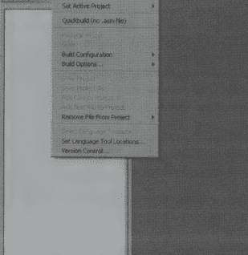

图 4-2：选择 MPLAB 项目向导

在 MPLAB 界面中，点击 “Project” 菜单选项即可找到 Project Wizard（项目向导）选项。它是第一个可选项。点击该 Project Wizard 子菜单选项，将打开如图 4-3 所示的窗口。

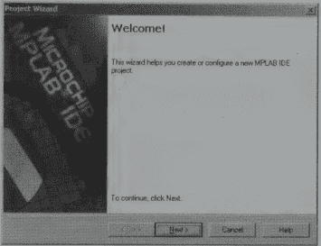

图 4-3：MPLAB 项目向导界面 1

现在，MPLAB 环境中应该会有一个独立的窗口，欢迎你进入项目向导。点击 “Next”（下一步）按钮继续。

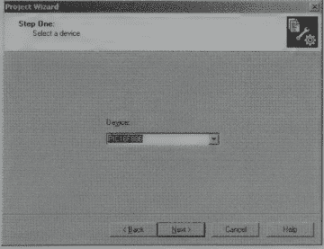

图 4-4：MPLAB 项目向导界面 2

项目设置过程的第四步是添加任何预先写好的 C 文件。通常你会修改现有文件以节省时间，而不是从头开始。在左侧窗口中，滚动找到 LED 闪烁文件。点击该文件以高亮选中，然后点击 “Add >>”（添加）按钮。它应该会出现在屏幕右侧。如果你找不到 LED 文件，请从我的网站下载这些文件，并将它们存储在你计算机上的已知位置。

在所选文件旁边，你会看到一个大的“A”。如果你多次点击它，你会看到旁边出现一个“C”。“C”将强制把该文件的副本保存到你在第三个界面中创建的目录中。我喜欢这样做，这样我就可以将所有修改保存在一个目录中，同时保持原始文件不变。图 4-8 显示了最终结果。

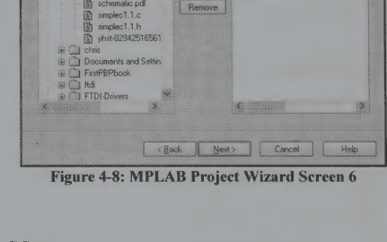

图 4-8：MPLAB 项目向导界面 6

### SimpleC 设置

这里就是添加 SimpleC 文件的地方。如果你不想使用 SimpleC 库，可以点击“下一步”继续。如果你确实想使用 SimpleC 库，则需要将 simplec1.1.h 和 simplec1.1.c 文件添加到项目中。在第四步界面的左侧，找到 SimpleC 文件并将它们添加到右侧。对于这两个 SimpleC 文件，点击“A”直到它变为“C”。这会将这些文件的副本保存到与你的项目相同的目录中，同时保持原始 SimpleC 文件不变。

图 4-9 中的界面是项目设置中的最后一个界面。当你看到这个界面时，说明你已经成功创建了项目。只需点击“完成”，MPLAB 窗口就会显示项目中的所有文件。

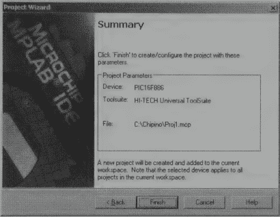

图 4-9：MPLAB 项目向导最终界面

图 4-10 中显示的项目界面最初可能是空白的，因此要显示项目和输出窗口，请从顶部菜单中点击 视图>项目（View>Project）选项。你会看到一个复选标记出现，同时窗口也会弹出，通常位于左上角，并显示你的项目文件。

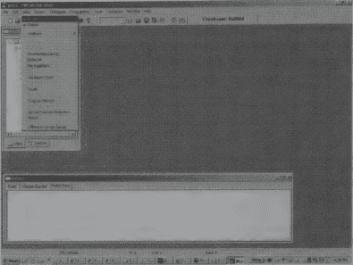

图 4-10：MPLAB 项目界面

点击菜单中的 视图>输出（View>Output）选项，输出窗口通常会出现在屏幕底部。项目窗口将显示你之前选择的 C 文件。双击项目中的 C 文件，MPLAB 编辑器窗口应会打开并显示代码清单。图 4-11 显示了编辑器界面打开程序文件后的样子。

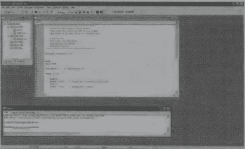

图 4-11：MPLAB 编辑器窗口

你通常会在编辑器窗口中修改文件，以使程序按照你想要的方式编写。当文件修改完成后，你就可以使用 HI-TECH 编译器对其进行编译了。MPLAB 使


只需单击屏幕顶部的“全部构建”按钮即可轻松完成，如图4-12所示。

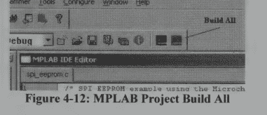

#### 图4-12：MPLAB 项目全部构建

如果代码中有任何错误，它们会在此步骤中出现。“全部构建”的结果将显示在输出窗口中。我对示例项目执行了此操作，构建成功，如图4-13所示。

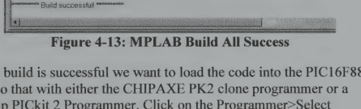

#### 图4-13：MPLAB 全部构建成功

构建成功后，我们需要将代码加载到 PIC16F886 中。为此，可以使用 CHIPAXE PK2 克隆编程器或 Microchip PICkit 2 编程器。单击“编程器>选择编程器>PICkit 2”菜单选项以启用 PICkit 2，如图4-14所示。如果您有 PICkit 3 或 ICD3，也可以使用它们。只需从下拉菜单中选择它们，而不是选择 PICkit 2。

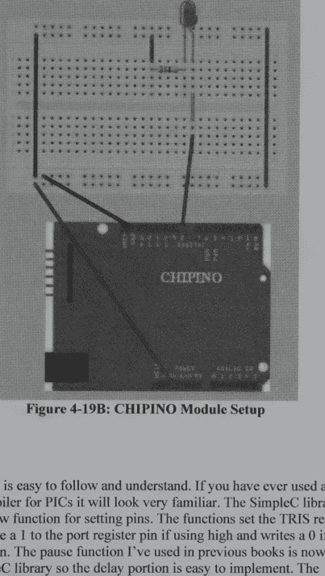

图4-19B：CHIPINO 模块设置

### 软件

这部分软件易于学习和理解。如果您曾经使用过 PIC 的 BASIC 编译器，那么这里会非常熟悉。SimpleC 库提供了用于设置引脚的 high 和 low 函数。这些函数设置 TRIS 寄存器，如果使用 high 函数，则向端口寄存器引脚写入 1；如果使用 low 函数，则写入 0。我在之前书籍中使用过的 pause 函数现在已纳入 SimpleC 库，因此延迟部分很容易实现。该程序只是循环设置和清除 LED 端口引脚。

```
/*********************************
Flash an LED example using SimpleC
This code will drive an LED on pin 8(RB0)
and flash it on and off at a 1 second rate.
Connections:
PIN 8(RB0) to LED Anode
LED Cathode to 1k ohm
1k ohm to Ground
*********************************/
```

```
#include "simplec1.1.h"
```

```
void
main(void)
{
    init_micro();    // Initialize I/O
    while (1==1)
    {
        high(8);
        pause (1000);    // Delay for 1 second (1.0000 sec)
        low(8);
        pause (1000);    // Delay for 1 second
    }
}
```

### 工作原理

程序的第一部分只是包含一个描述性头部，说明代码的功能，然后描述电气连接。

```
/*********************************
Flash an LED example using SimpleC
This code will drive an LED on pin 8(RB0)
and flash it on and off at a 1 second rate.
Connections:
PIN 8(RB0) to LED Anode
LED Cathode to 1k ohm
1k ohm to Ground
*********************************/
```

SimpleC 库通过包含 simplec1.1.h 文件来设置。所有配置设置以及 SimpleC 库使用的一些宏定义都在这个头文件中设置，因此所有 SimpleC 文件都需要包含它。

```
#include "simplec1.1.h"
```

主循环代码以 init_micro 函数开始。该函数将模拟引脚配置为数字模式并关闭所有比较器。这是我之前的书中每个项目都添加的标准代码，因此我将其缩减为 SimpleC 库中的一个函数。不用说，这也应该是每个 SimpleC 项目文件的一部分。

```
void
main(void)
{
    init_micro();    // Initialize I/O
}
```

主循环代码包含 high 和 low 函数，以及两个 pause 函数，它们延迟 1000 毫秒，产生一秒开、一秒关的闪烁。high 和 low 的一个优点是它们控制参数定义的位。这些函数是针对 CHIPINO 模块的编号引脚编写的。允许使用 1 到 13 的值，因为这些是 CHIPINO 的引脚编号。不能用引脚名称（如 RB0）代替数字，必须遵循编号系统。

```
while (1==1)
{
    high(8);
    pause(1000);    // Delay for 1 second (1.0000 sec)
    low(8);
    pause (1000);   // Delay for 1 second
}
```

### 后续步骤

这个简单项目能做什么，确实取决于您的想象力。high 和 low 函数一次只操作一个引脚，因此控制多个引脚会使程序非常容易编写，但也会很长。我发现当您只需要一种简单的方法来控制一个引脚时，这些函数效果最好。考虑到这一点，也许可以更改硬件来控制继电器，或者使用这个简单的闪烁程序创建一个脉冲来控制伺服电机。这可以很好地演示数字引脚控制是微控制器一切工作的核心。

## 第5章 – SimpleC 数字输入

正如我在之前的书中展示的，在 C 语言中读取输入并不困难，但我仍然决定创建一个函数，通过设置 TRIS 或方向寄存器，然后读取特定端口引脚的状态，来轻松读取端口引脚。本项目通过监视一个瞬时开关来演示这一点：按下开关时点亮一个 LED，开关空闲时点亮另一个 LED。

### 硬件

本项目的电路如图5-1所示，显示了与 PIC16F886 的所有连接。端口引脚名称显示在芯片的原理图符号上，而 CHIPINO Mini 的编号引脚名称显示在标签上。开关连接到引脚 8，也就是 RB0。开关在其常开空闲状态下被上拉到 V+。当开关被按下时，RB0/8 引脚将检测到低电平或接地值。LED 连接到 CHIPINO Mini 模块的引脚 9 和 10。

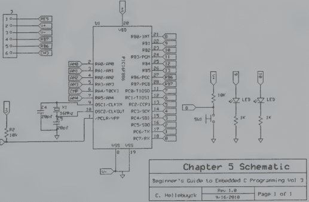

#### 图5-1：SimpleC 输入原理图

图5-2A中的面包板设置显示了连接方式，您可以将其与自己的面包板设置对应起来。模块偏移到面包板底部，这样所有端口导线都可以穿过顶部。电源通过连接到 CHIPINO Mini 模块的编程器进入，并通过两个跳线为电源轨供电。上部的电源轨负极为外侧一排，内侧一排为正极。在面包板底部，内侧一排通过从上到下的长跳线连接为负极。图5-2B显示了使用 CHIPINO 模块的相同设置。

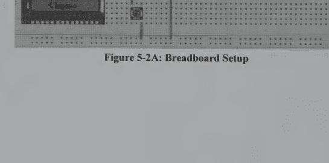

#### 图5-2A：面包板设置

既然我们已经存储了开关的状态，就可以测试它来执行不同的操作。如果值为 1 或开关空闲，则使用 high 和 low 函数打开一个 LED 并关闭另一个。如果开关被按下，则 LED 的亮灭相反。此操作连续运行，因此我们可以快速看到开关的任何按下或释放。

```
if (value == 1)
{
    //*** Switch is idle ***
    high(11);     // Pin 11 LED on
    low(10);      // Pin 10 LED off
}
else
{
    //*** Switch is Pressed ***
    low(11);      // Pin 11 LED off
    high(10);     // Pin 10 LED on
}
}
```

### 后续步骤

一个明显的下一步是更改按下开关时发生的情况。随着您对 SimpleC 库更加熟悉，您会发现当开关被按下时，在 LCD 上显示内容或发送 SPI 或 I2C 信号非常容易。

## 第6章 – SimpleC LCD 控制

用一行命令控制 2x16 LCD 字符模块将非常有用。我见过在 BASIC 编译器中，一行命令有大量不同的参数选项。我没有提供多个选项，而是决定创建一组简单的函数，用于在 2x16 LCD 上显示字符和数字。本章详细介绍了如何使用 SimpleC 库的这一功能，并提供了两个独立的软件项目，共用一个通用硬件设置。

### 硬件

硬件连接在 simplec1.1.h 文件中定义，使用 PORTB 引脚，即 CHIPINO 上的第 8 到第 13 引脚。这六个引脚控制 LCD 模块的 E、RS 和 DB4-DB7 引脚，这正是 4 位模式操作所需的全部引脚，而 4 位模式是最常见的 LCD 控制方式。图6-1中的原理图显示了连接，图6-2A显示了面包板布局。图6-2B适用于使用 CHIPINO 模块的用户。

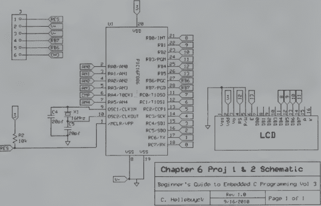

图6-1：LCD 原理图


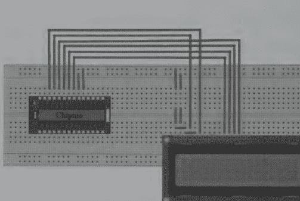

#### 图 6-2A：LCD 面包板设置

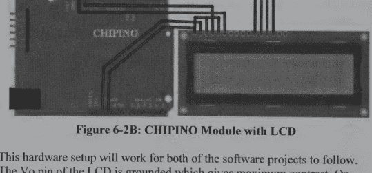

#### 图 6-2B：带 LCD 的 CHIPINO 模块

此硬件设置适用于接下来的两个软件项目。LCD 的 Vo 引脚接地，可获得最大对比度。在某些 LCD 上，这会使显示难以阅读，因此您可能希望在该引脚上添加电阻分压器或电位器输出，以便调节电压，从而调节对比度。

### 软件项目 1

第一个项目演示了如何使用 `lcd_symbol()` 函数。这个 SimpleC 函数用于在 LCD 上显示 ASCII 字符。只要知道 ASCII 值，就可以创建任何字符。本项目将循环使用字符 0 到 9 的 ASCII 值，在 LCD 上生成从 0 到 9 的计数。本章的“工作原理”部分将介绍其实现方法。

```c
/*
This project displays a zero to nine count on the LCD using
the lcd_symbol() function.

LCD
PIN 1 - Gnd
PIN 2 - 5v
PIN 3 - Gnd
PIN 4 - RB4/CHIPINO Pin 12 (RS)
PIN 5 - Gnd
PIN 6 - RB5/CHIPINO Pin 13 (EN)
PIN 7 - NC
PIN 8 - NC
PIN 9 - NC
PIN 10 - NC
PIN 11 - RB0/CHIPINO Pin 8 (DB4)
PIN 12 - RB1/CHIPINO Pin 9 (DB5)
PIN 13 - RB2/CHIPINO Pin 10 (DB6)
PIN 14 - RB3/CHIPINO Pin 11 (DB7)
*/

#include "simplec1.1.h"

void
main(void)
{
init_micro();   // Initialize I/O
lcd_init();     // Initialize LCD Display
lcd_clear();    // Clear LCD screen

while (1==1)
{
for (char x=0;x<10;x=x+1)    // Create count of 0 thru 9
{
lcd_goto(0);        // Select first line
lcd_symbol(0x30+x); // Display decimal value
pause(1000);        // Delay to read display
}
} //End While
} //End Main
```

使用 `lcd_clear` 函数清除 LCD 屏幕。这会清除屏幕并将光标置于起始位置或第一个字符块位置。

```c
lcd_clear();    // Clear LCD screen
```

现在我们进入真正在 LCD 上显示计数的主 while 循环。该 while 循环包含一个 for 循环，用于创建并递增一个 8 位变量。当变量等于 10 时，for 循环结束。

```c
while (1==1)
{
    for (char x=0;x<10;x=x+1)    // Create count of 0 thru 9
    {
```

for 循环中的第一个 SimpleC 函数是 `lcd_goto` 函数。此函数的参数为 0，因此它将光标置于 LCD 的第一个位置。这在清除屏幕时已经完成，但在循环中我们需要每次都重新定位光标。

```c
lcd_goto(0);    // Select first line
```

我们使用的下一个 SimpleC 函数是 `lcd_symbol` 函数。它将参数部分中的 ASCII 值发送到 LCD。在本例中，我们将循环变量值（0–9）发送到 LCD，但首先加上十六进制值 30，以生成要发送的正确 ASCII 值。数字 1 的 ASCII 值为十六进制 31，数字 2 为十六进制 32，依此类推。

```c
lcd_symbol(0x30+x);    // Display decimal value
```

然后程序使用 SimpleC 的 `pause` 函数延迟 1000 毫秒，即 1 秒，然后再递增变量。这使数字以每秒一次的速度变化。此后 while 循环结束，主循环也随之结束，因此此代码会反复运行。

```c
pause(1000);    // Delay to read display
} //End While
} //End Main
```

### 软件项目 2

向 LCD 写入 ASCII 字符很有用，但通常您可能更想显示完整的文本消息。逐个发送每个 ASCII 字符可以实现这一点，或者您也可以使用 SimpleC 的 `lcd_text` 函数。下一个项目将使用该函数在 2x16 LCD 的第一行和第二行上显示消息。

```c
/*
This project creates a message on a 2x16 LCD module
using the lcd_text() function.

LCD
PIN 1 - Gnd
PIN 2 - 5v
PIN 3 - Gnd
PIN 4 - RB4/CHIPINO Pin 12 (RS)
PIN 5 - Gnd
PIN 6 - RB5/CHIPINO Pin 13 (EN)
PIN 7 - NC
PIN 8 - NC
PIN 9 - NC
PIN 10 - NC
PIN 11 - RB0/CHIPINO Pin 8 (DB4)
PIN 12 - RB1/CHIPINO Pin 9 (DB5)
PIN 13 - RB2/CHIPINO Pin 10 (DB6)
PIN 14 - RB3/CHIPINO Pin 11 (DB7)

*/

#include "simplec1.1.h"

void main(void)
{
    init_micro();    // Initialize I/O
    lcd_init();      // Initialize LCD Display
    lcd_clear();     // Clear LCD screen

    while (1==1)
    {
        lcd_goto(0);                 // Select first line
        lcd_text("Simple C Makes");  // Display Hello World

        lcd_goto(0x40);              // Select second line
        lcd_text("Programming Easy");

        pause (10000);               // Delay for 1 second to read display
    } //End While
} //End Main
```

SimpleC 的 `lcd_text` 函数为我们完成了这项工作。该函数的参数放在引号之间，因此它知道这是一个字符串。然后每个字母都作为 ASCII 值发送到 LCD 模块。这会在 LCD 的第一行显示消息“Simple C Makes”。

```c
lcd_text("Simple C Makes");    // Display Hello World
```

现在 LCD 光标通过参数十六进制值 40 定位到第二行。这是第二行起始位置的值。`lcd_goto` 负责处理表明这是命令字符的代码。此函数运行后，光标将位于第二行的开头。

```c
lcd_goto(0x40);                 // Select second line
```

现在使用 `lcd_text` 函数写入第二条消息，即“Programming Easy”。

```c
lcd_text("Programming Easy");
```

我们暂停一秒钟，然后循环回去再次写入消息。

```c
pause (10000);           // Delay for 1 second to read display
```

```c
} //End While
```

```c
} //End Main
```

### 后续步骤

您可以更改第二个项目中的消息，甚至可以摆弄 `lcd_goto` 函数来移动消息的位置。如果您愿意，第一个项目可以通过增加循环计数并从较低的值开始，来遍历整个 ASCII 库。您还可以将两者结合起来，在第一行显示消息，在第二行显示数字。事实上，下一章将使用另一个 SimpleC LCD 函数来实现这一点。让我们进入下一章，使用相同的硬件并添加一些额外的连接。

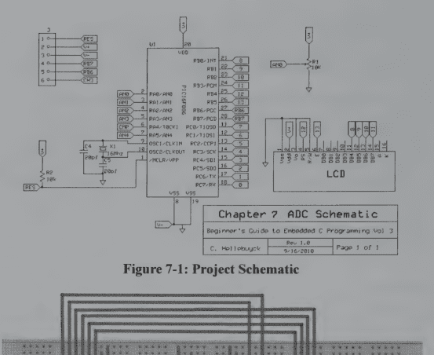

#### 图 7-1：项目原理图

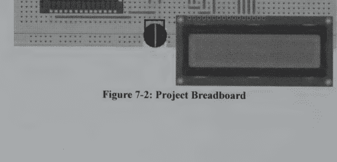

#### 图 7-2：项目面包板

```c
*****************************/

#include "simplec1.1.h"

void
main(void)
{
    init_micro();    // Initialize I/O
    lcd_init();      // Initialize LCD Display
    lcd_clear();     // Clear LCD screen

    while (1==1)
    {
        lcd_goto(0);              // Select first line
        lcd_text("ADCin Reading"); // Display Hello World
        char value = adcin(0);    // Get ADC reading and store in value
        lcd_goto(0x40);           // Select second line
        lcd_number(value);       // Display ADC reading on LCD
        pause (10);              // Delay 10 milliseconds between samples
    }
}
```

### 工作原理

程序以一个描述硬件连接的头部块开始。

```c
/****************************
Analog to Digital converter (ADC) example using SimpleC
This code will read the voltage on RA0 pin with the
ADC and then display it on the LCD.
```

#### 电位器

- 引脚 1 - Gnd
- 引脚 2 - RA0/CHIPINO 引脚 AN0
- 引脚 3 - 5v

#### LCD

- 引脚 1 - Gnd
- 引脚 2 - 5v
- 引脚 3 - Gnd
- 引脚 4 - RB4/CHIPINO 引脚 12 (RS)
- 引脚 5 - Gnd
- 引脚 6 - RB5/CHIPINO 引脚 13 (EN)
- 引脚 7 - NC
- 引脚 8 - NC
- 引脚 9 - NC
- 引脚 10 - NC
- 引脚 11 - RB0/CHIPINO 引脚 8 (DB4)
- 引脚 12 - RB1/CHIPINO 引脚 9 (DB5)

十六进制）。这个函数对于在 LCD 上显示数值非常有用。

```c
lcd_goto(0x40);    // Select second line
lcd_number (value);    // Display ADC reading on LCD
```

我们在程序中添加了 `pause (10)`，以延迟读取电压，从而使显示看起来更稳定一些。电位器的电压相当稳定，因此这不是必需的，但如果您想使用本项目读取任何在 0 伏到 5 伏之间循环的输入电压，这会有所帮助。这个 `pause` 函数也结束了循环，因此我们循环回去再次读取电位器，并在 while 循环中持续执行此操作。

```c
pause (10);    // Delay 10 milliseconds between samples
}
```

### 后续步骤

您可以用 LED 替换 LCD，创建一个随电位器转动而变化的条形图光显示。您还可以添加其他函数，例如 PWM 库函数，让电位器控制电机速度或 LED 亮度，同时仍在 LCD 上显示数值。您还可以用光敏传感器替换电位器，让光线改变电阻，从而改变电压。这将成为一个简易的测光表。这个项目很容易改编以适应许多不同的模拟传感器。有了 LCD 读数，就可以轻松查看传感器结果。


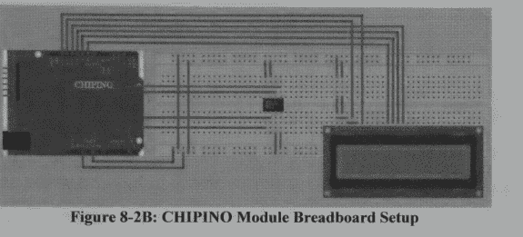

图8-2B：CHIPINO模块面包板搭建

### 软件

软件首先向EEPROM写入10字节数据，然后读回这10字节数据显示在LCD上。如果第一部分无法工作，第二部分将显示这些EEPROM位置上残留的任何数据。

```
/* SPI_EEPROM example using the Microchip 25LC020
The program writes to the first 10 locations
and then reads back those writes and displays
them on the LCD.
```

- SPI EEPROM
- 引脚1 - RA5（CHIPINO AN4引脚）
- 引脚2 - RC4（CHIPINO 引脚3）
- 引脚3 - V+
- 引脚4 - Gnd
- 引脚5 - RC5（CHIPINO 引脚2）
- 引脚6 - RC3（CHIPINO 引脚4）
- 引脚7 - V+
- 引脚8 - V+

- LCD
- 引脚1 - Gnd
- 引脚2 - V+
- 引脚3 - Gnd
- 引脚4 - RB4/CHIPINO 引脚12（RS）
- 引脚5 - Gnd
- 引脚6 - RB5/CHIPINO 引脚13（EN）
- 引脚7 - NC
- 引脚8 - NC
- 引脚9 - NC
- 引脚10 - NC
- 引脚11 - RB0/CHIPINO 引脚8（DB4）
- 引脚12 - RB1/CHIPINO 引脚9（DB5）
- 引脚13 - RB2/CHIPINO 引脚10（DB6）

```
PIN 14 - RB3/CHIPINO Pin11 (DB7)
*/

#include "simplec_1.1.h"
#define number 0x30

void
main(void)
{
init_micro();    // Initialize PIC16F886
spi_init();      // Initialize SPI Peripheral
lcd_init();      // Initialize LCD Display

//*** Load Data in EEPROM ***
while (1==1)
{
    for( char addr = 0; addr < 10; addr = addr + 1) // Loop 10 times
    {
        char data = addr;      // addr value is data for SEEPROM
        WR_BYTE (addr,data);   // Write to SEEPROM
        pause (10);            // Delay 10ms after each write
    } // End For

//*** Continuous Loop to Read and Display Data ***
    for( char addr = 0; addr <10; addr = addr + 1) // Loop 10 times
    {
        lcd_clear();           // Clear LCD screen
        lcd_goto(0);           // select first line
        lcd_text("Address / Value"); // Display header
        char b0 = RD_BYTE (addr); // Read from SEEPROM
        lcd_goto(0x40);        // Select second line
        lcd_symbol(addr + number); // Display value read from
                           //EEPROM on LCD
        lcd_text(" / ");
        lcd_symbol(b0 + number); // Display value read from
                           //EEPROM on LCD
        pause (250);           // Delay 250 msec to see count
    } //End For
} //End While
} //End Main
```

### 工作原理

头部注释块描述了项目内容，也描述了连接方式。

```
/* SPI_EEPROM example using the Microchip 25LC020
The program writes to the first 10 locations
and then reads back those writes and displays
```

代码做的第一件事是将数据加载到EEPROM中。这是在一个循环10次的for循环中完成的。

```
//*** Load Data in EEPROM ***
while (1==1)
{
    for( char addr = 0; addr < 10; addr = addr + 1) // Loop 10 times
    {
```

在for循环内，发送到EEPROM的数据与地址相同，也与for循环计数器的值相同。

```
char data = addr;    // addr value is data for SEEPROM
```

这就是SimpleC库发挥作用的地方。WR_BYTE函数接收参数并将其发送到EEPROM。第一个参数是地址，第二个是数据字节。该函数处理与EEPROM的所有通信。外部EEPROM完成写入需要时间，因此增加了10毫秒的延迟。这样就完成了对EEPROM的初始写入。

```
WR_BYTE (addr,data);    // Write to SEEPROM
pause (10);             // Delay 10ms after each write
} // End For
```

现在我们循环遍历存储器，读取刚刚写入EEPROM的每个字节。我们再次使用相同计数10的for循环来完成。这个循环的大部分包含控制LCD的函数。

```
//*** Continuous Loop to Read and Display Data ***
for( char addr = 0; addr <10; addr = addr + 1) // Loop 10 times
{
```

LCD被清除并定位到第1行的开头。然后屏幕在第一行显示数据标题“地址/值”。这些都是用SimpleC函数完成的。

```
lcd_clear();            // Clear LCD screen
lcd_goto(0);            // select first line
lcd_text("Address / Value");  // Display header
```

现在执行SimpleC的读数据函数。在同一行创建了一个char变量b0，同时执行RD_BYTE函数。该函数从EEPROM中地址参数指定的地址读取数据。接收到的字节存储在b0变量中。

```
char b0 = RD_BYTE( addr);   // Read from SEEPROM
```

现在我们有了数据，并且已经知道地址，将LCD定位到第二行，然后使用单独的lcd_symbol函数显示地址值和数据值。这些值被加到常量“number”上，因此发送到LCD的值是该值的ASCII值。这种方法可行是因为所有值都是个位数值。

```
lcd_goto(0x40);          // Select second line
lcd_symbol(addr + number);   // Display value read from
                           //EEPROM on LCD
lcd_text(" / ");
lcd_symbol(b0 + number);   // Display value read from
                           //EEPROM on LCD
```

添加一个延迟，以便我们可以轻松读取在LCD上显示的值。

```
pause (250);          // Delay 250 msec to see count
} //End For
} //End While
} //End Main
```

### 后续步骤

你可以修改第一个循环来改变存储的数据，并通过观察显示来验证其是否正常工作。你还可以扩展项目以存储更多数据，但你必须修改LCD上显示数据的方式，因为数据量更大意味着地址值大于个位数。

### 项目2——来自MCP23S08的输入

MCP23S08是一款SPI I/O扩展器，非常适合为项目增加多达八个数字引脚，代价是占用四个SPI引脚。本项目并未使用全部八个引脚，但使用了其中一些来演示如何用MCP23S08检测开关，然后根据开关状态控制LED。PIC16F886与MCP23S08之间的通信通过SPI外设完成。SimpleC库有针对MCP23S08芯片的专用函数，因此代码更容易编写。

#### 硬件

原理图如图8-3所示，显示了与PIC的所有连接，以及连接到MCP23S08的两个LED和开关。面包板版本如图8-4A（使用CHIPINO Mini）和图8-4B（使用CHIPINO模块）所示。这里我只展示CHIPINO Mini版本的面包板搭建。电源轨通过CHIPINO Mini模块供电，而该模块由PICkit 2编程器供电（图中未显示）。上电源轨的外侧是地，内侧是5V。下电源轨则相反。两个正电源轨在面包板右侧连接在一起。连接到开关的10k电阻似乎与导线共用一个孔，在这张图片中确实如此。实际上，电阻应该高一个孔，但绘图软件不允许，所以我让它们共用一个孔。

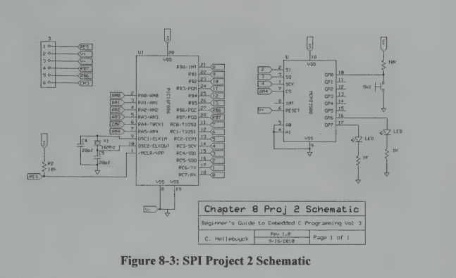

图8-3：SPI项目2原理图

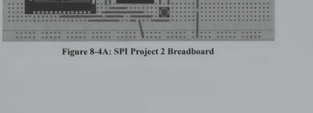

图8-4A：SPI项目2面包板

```
PIN 12 to NC
PIN 13 to NC
PIN 14 to NC
PIN 15 to NC
PIN 16 to LED1 Anode
PIN 17 to LED2 Anode
PIN 18 to 5v

Switch connected ground and 10k resistor, 10k resistor to 5v.
LED1 and LED2 each Cathode to ground through 1k ohm resistor.
*/

#include "simplec_1.1.h"

void
main(void)
{
init_micro();
spi_init();
WR_MCP23S08 (IODIR, 0x01);   // Setup pins
while (1==1)
{
char y = 1;
y = RD_MCP23S08 (GPIO); // Read switch
y = y & 0x01;           // Mask all but bit 7
if (y==0)
{WR_MCP23S08 (OLAT, 0x40);}  // If switch idle light LED
else
{WR_MCP23S08 (OLAT, 0x80);}  // If switch pressed LED off
pause(10);
} //End While
} //End Main
```

#### 工作原理

软件的第一部分位于两个注释指示符之间，因此这部分构成了信息头。其中描述了操作以及电气连接。

```
/***********
PIC16F886 SPI - MCP23S08 I/O expander
The program reads a switch connected to the MCP23S08 GP0 pin.
It lights the LED connected to GP7 if the switch is idle and
lights the LED connected to GP6 if the switch is pressed.

Connections
MCP23S08
PIN 1 to CHIPINO PIN 4 (SCK/RC3)
PIN 2 to CHIPINO PIN 2 (SDO/RC5)
PIN 3 to CHIPINO PIN 3 (SDI/RC4)
PIN 4 to Gnd
```


```
PIN 5 to Gnd
PIN 6 to Vdd
PIN 7 to CHIPINO PIN SS (A5)
PIN 8 to NC
PIN 9 to Gnd
PIN 10 to Switch/Resistor Connection
PIN 11 to NC
PIN 12 to NC
PIN 13 to NC
PIN 14 to NC
PIN 15 to NC
PIN 16 to LED1 Anode
PIN 17 to LED2 Anode
PIN 18 to 5v

Switch connected to ground and 10k resistor, 10k resistor to 5v.
LED1 and LED2 each Cathode to ground through 1k ohm resistor.

*/
```

SimpleC 的头文件接下来使用引号包含，因为该文件与我们的主 C 文件位于同一目录中。

```
#include "simplec1.1.h"
```

代码的主循环接下来开始，并使用 SimpleC 库中的两个初始化函数。init_micro 函数建立 I/O 设置，然后 spi_init 函数为使用硬件 SPI 端口创建必要的设置。

```
void
main(void)
{
init_micro();
spi_init();
}
```

专门用于 MCP23S08 的第一个函数通过控制 IODIR 寄存器来将引脚设置为其正确输入/输出状态。此标签 IODIR 在 simplec1.1.h 文件中定义。设置与 PIC 类似，其中 1 为输入，0 为输出。因此 MCP23S08 上的 8 个引脚被设置为使 GP0 引脚为输入，其余为输出。

```
WR_MCP23S08 (IODIR, 0x01);    // Setup pins
```

代码的连续循环包含在 while 循环中。第一步是创建本地 8 位变量 y 并将其预设为 1。

```
while (1==1)
{
    char y = 1;
```

SimpleC 库中的 RD_MCP23S08 函数用于测试开关的状态。它实际上读取所有引脚的状态，因此我们必须使用二进制 AND 函数来仅查看 GP0 位。之后 y 变量将包含开关的状态。

```
y = RD_MCP23S08 (GPIO); // Read switch
y = y & 0x01;           // Mask all but bit 7
```

我们测试 y 变量以查看其是否为零，表示开关被按下。如果开关被按下，我们使用 WR_MCP23S08 函数写入在 simplec1.1.h 文件中定义的锁存寄存器 OLAT。我们将 GP6 位设置为 1 以点亮该 LED，如果开关被按下。如果 y 变量为 1 表示开关空闲，则 OLAT 寄存器被设置为使 GP7 位为 1 并点亮另一个 LED。

```
if (y==0)
    {WR_MCP23S08 (OLAT, 0x40);}  // If switch idle light LED
else
    {WR_MCP23S08 (OLAT, 0x80);}  // If switch pressed LED off
```

我们使用 SimpleC 库中的 pause 函数延迟 10 毫秒，然后循环回到 while 循环的开头。

```
    pause(10);
} //End While
```

最后我们用主循环的大括号结束这个简短程序。

```
} //End Main
```

### 项目 3 – 来自 MCP23S08 的输出

这个项目只是前一个项目的变体，因为它只驱动 MCP23S08 的输出。我们在前一个项目中是基于开关状态来做的。这个项目使用相同的 LED 连接，用 LED 作为指示器创建一个快速的二位二进制计数器。

#### 硬件

硬件只是前一个项目的简化版本。你可以使用之前的面包板设置，因此这是对 SPI 示例的快速补充。MCP23S08 可以直接驱动 LED，因为每个引脚都有较高的输出电流驱动。这可能很有用，因为 LED 可以被驱动继电器线圈的晶体管取代。

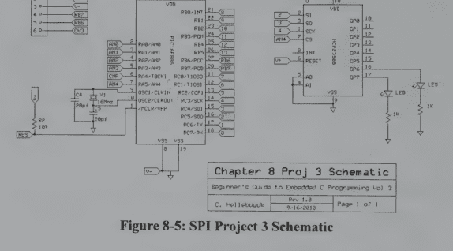

图 8-5：SPI 项目 3 电路图

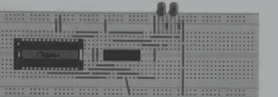

图 8-6A：SPI 项目 3 面包板

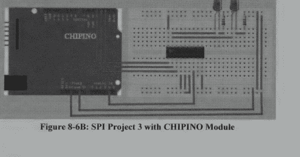

图 8-6B：带 CHIPINO 模块的 SPI 项目 3

#### 软件

软件也与前一个项目非常相似。软件只使用 WR_MCP23S08 函数而不使用 RD 函数。这使程序更短，并显示 SimpleC 如何使向项目添加输出变得容易。

```
/******************
PIC16F886 SPI - MCP23S08 I/O expander
The program controls two LEDs connected to the MCP23S08 GP6 and GP7 pin.
It binary counts from zero to three on the LEDs.

Connections
MCP23S08
```

```
PIN 1 to CHIPINO PIN 4 (SCK/RC3)
PIN 2 to CHIPINO PIN 2 (SDO/RC5)
PIN 3 to CHIPINO PIN 3 (SDI/RC4)
PIN 4 to Gnd
PIN 5 to Gnd
PIN 6 to Vdd
PIN 7 to CHIPINO PIN SS (A5)
PIN 8 to NC
PIN 9 to Gnd
PIN 10 to NC
PIN 11 to NC
PIN 12 to NC
PIN 13 to NC
PIN 14 to NC
PIN 15 to NC
PIN 16 to LED1 Anode
PIN 17 to LED2 Anode
PIN 18 to 5v

LED1 and LED2 each Cathode to ground through 1k ohm resistor.
*/

#include "simplec1.h"

void
main(void)
{
init_micro();
spi_init();
WR_MCP23S08 (IODIR, 0x00);    // Setup pins as outputs
while (1==1)
{
    for(char x = 0; x<4; x++)
    {
        WR_MCP23S08 (OLAT, x*64);    // Turn on LEDs
        pause(1000);
    }
} //End While
} //End Main
```

#### 工作原理

该程序不需要太多来自前一个项目的解释。头文件非常相似，但描述和连接不同。

```
/***********************
PIC16F886 SPI - MCP23S08 I/O expander
The program controls two LEDs connected to the MCP23S08 GP6 and GP7 pin.
It binary counts from zero to three on the LEDs.

Connections
MCP23S08
PIN 1 to CHIPINO PIN 4 (SCK/RC3)
PIN 2 to CHIPINO PIN 2 (SDO/RC5)
PIN 3 to CHIPINO PIN 3 (SDI/RC4)
PIN 4 to Gnd
PIN 5 to Gnd
PIN 6 to Vdd
PIN 7 to CHIPINO PIN SS (A5)
PIN 8 to NC
PIN 9 to Gnd
PIN 10 to NC
PIN 11 to NC
PIN 12 to NC
PIN 13 to NC
PIN 14 to NC
PIN 15 to NC
PIN 16 to LED1 Anode
PIN 17 to LED2 Anode
PIN 18 to 5v

LED1 and LED2 each Cathode to ground through 1k ohm resistor.
*/

添加 SimpleC 包含文件，然后是此项目的主循环和初始化函数。

```
#include "simplec1.1.h"

void
main(void)
{
init_micro();
spi_init();
}
```

WR_MCP23S08 函数用于通过向 IODIR 寄存器写入全零来将所有引脚设置为输出。

```
WR_MCP23S08 (IODIR, 0x00);  // Setup pins as outputs
```

while 循环包含一个 for 循环，循环计数 4 次。每次循环将变量 x 增加一。然后该变量乘以 64 以将位移至 MCP23S08 的 GP6 和 GP7 引脚。WR_MCP23S08 函数可以在写入值到 OLAT 寄存器之前在其参数部分处理数学运算。添加一秒延迟以创建一个一秒二进制计数器。

```
while (1==1)
{
    for(char x = 0; x<4; x++)
    {
        WR_MCP23S08 (OLAT, x*64);    // Turn on LEDs
        pause(1000);
    }
} //End While
} //End Main
```

#### 后续步骤

这些项目展示了 SimpleC 如何使使用硬件 SPI 外设变得容易。我将经常使用它，我经常想在许多项目中使用 MCP23S08 及其 16 I/O 兄弟 MCP23S16，但真的不想阅读数据手册并处理所有寄存器，而我可以用更大的 PIC 来获得更多 I/O。但现在我花时间为 MCP23S08 创建了一个函数，我将更多地使用它们。

作为下一步，你可以扩展项目以控制 MCP23S08 上的更多 I/O 并创建一串 LED 或多个开关。这可以通过对这些项目的少量修改轻松实现。现在如果你真的想更进一步，那么也许可以为每个设备连接 EEPROM 并使用单独的片选 (CS) 控制线。这将要求你修改 SimpleC 文件，但应该不会太困难。然后你可以从 PIC 控制多个 SPI 设备。

## 第 9 章 – SimpleC 脉宽调制

在本章中，我将向你展示 SimpleC 如何使使用硬件 PWM 外设变得极其容易。你可以在一行命令中设置频率和占空比。由于 SimpleC 是为固定的 16MHz 振荡器编写的，我能够在 SimpleC PWM 函数内完成所有计算并预设所有寄存器。因此，SimpleC 用户唯一需要做的就是决定频率和占空比。如果你想了解外设内部工作原理的更多细节，我在我的第二卷书籍中涵盖了这一点，并展示了用于计算寄存器设置的公式。在这里，我们将走简单路线并使用 SimpleC。

这个项目将使用 5 KHz 频率信号驱动两个 PWM 输出。微控制器将使用模拟引脚读取电位器，然后相应地调整 PWM1 的占空比。该项目还将以与 PWM1 相同的频率驱动 PWM2 引脚，但在 PWM2 上为恒定的 50% 占空比信号。输出将驱动 LED 以提供视觉反馈。我还在示波器上捕获了信号以显示信号（图 9-3）。

### 硬件

该项目的硬件非常简单易建。图 9-1 中的原理图显示了连接。PWM 1 在 CHIPINO 引脚 5 (C2) 上，PWM 2 在 CHIPINO 引脚 6 (C1) 上，并连接了 LED。电位器在其滑动端引脚上产生 V+ 和 V- 之间的可变电压，该电压介于 5V 和地之间。模拟引脚 AN0 将监测电位器。CHIPINO 具有 16 MHz 晶体，可驱动微控制器和内部 PWM 信号。


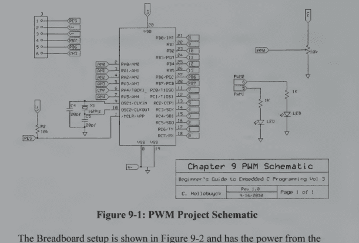

## 
初学者嵌入式C编程指南 第3卷
C. Helli... | Rev. 1.0 | 9/16/2010 | 第1页，共1页

#### 图9-1：PWM项目原理图

面包板设置如图9-2所示，电源由编程器通过两根跳线馈送到导轨。上导轨为地，内导轨为V+。电位器直接插入面包板，然后跳线提供电源、地以及连接到AN0引脚的连接。


#### 图9-2A：PWM面包板设置

### 软件

完整软件列表如下。你可以看到它非常简短。该程序使用SimpleC库中的adcin函数以及pwmout函数来创建此项目。

```
/*********************************
PWM Example
This program reads the value on a potentiometer and drives
the PWM1(CHIPINO pin5/C2) with a duty cycle to match.
It also drives the PWM2(CHIPINO pin6/C1) with a 50% duty cycle
signal.
POT
PIN 1 - Gnd
PIN 2 - CHIPINO Analog pin 0 (AN0)
PIN 3 - 5v

CHIPINO Pin 5 - PWM1 output to 1k resistor
1k resistor to LED Anode
LED Cathode to ground

CHIPINO Pin 6 - PWM2 output to 1k resistor
1k resistor to LED Anode
LED Cathode to ground
*********************************/

#include "simplec1.1.h"

void main(void)
{
init_micro();       // Initialize I/O
char dc = (adcin(0)/10) * 4;  // Convert Pot value to 0-100% Duty Cycle

// **** Both PWM must use the same frequency!******
pwmout1 (dc, 5000);     //Drive variable duty cycle at fixed 5000Hz
pwmout2 (50, 5000);     //Second PWM output 50% Duty Cycle
pause(100);                 // Pause 100msec
}
```

### 工作原理

程序以注释块开始，描述操作和面包板上的连接。

```
/*********************************
PWM Example
This program reads the value on a potentiometer and drives
the PWM1(CHIPINO pin5/C2) with a duty cycle to match.
It also drives the PWM2(CHIPINO pin6/C1) with a 50% duty cycle
signal.
POT
PIN 1 - Gnd
PIN 2 - CHIPINO Analog pin 0 (AN0)
PIN 3 - 5v

CHIPINO Pin 5 - PWM1 output to 1k resistor,
1k resistor to LED Anode
LED Cathode to ground

CHIPINO Pin 6 - PWM2 output to 1k resistor,
1k resistor to LED Anode
LED Cathode to ground
*****************************/
```

第一步编码是包含simplec1.1.h文件，其中包含所有SimpleC设置，例如配置位和一些#define。

```
#include "simplec1.1.h"
```

现在进入主循环，首先使用init_micro SimpleC函数将比较器初始化为关闭，并将所有模拟引脚初始化为数字。

```
void main(void)
{
    init_micro();            // Initialize I/O
}
```

adcin函数用于读取电位器。此函数会自动将所选引脚设置为模拟输入模式。在此情况下为AN0（在参数区域显示为0）。此行还显示你可以在将结果存储到变量“dc”之前对读数进行操作，“dc”是duty cycle的缩写。我们从电位器读取的值将是0到255的8位分辨率值。我们需要将其缩放到0-100以供pwmout函数使用，因此我们将其除以10（得到0-25），然后将该结果乘以4。这将给出0-100的值存储在变量“dc”中。

```
char dc = (adcin(0)/10) * 4;  // Convert Pot value to 0-100% Duty Cycle
```

pwmout函数编号为1和2，用于控制CHIPINO模块上的每个PWM通道。PWM外设使用内部Timer 2时钟来控制PWM外设。因此PWM必须以相同的频率运行。pwmout1函数使用“dc”变量作为占空比参数，因此变量发生变化，占空比将发生变化。频率设置为5000 Hz或5 kHz。pwmout2函数设置为5 kHz下的固定50%占空比。如果你查看图9-3中的示波器图，你可以看到右下角的频率读数。它显示的值为4.98669 kHz，非常接近5 kHz，因此SimpleC代码工作正常。

```
// **** Both PWM must use the same frequency!*****
pwmout1 (dc, 5000);    //Drive variable duty cycle at fixed 5000Hz
pwmout2 (50, 5000);    //Second PWM output 50% Duty Cycle
```

添加了一个短暂的暂停，但实际上并非必需。它只是延迟我们下一次读取电位器的频率。

```
pause(100);            // Pause 100msec
}
```

### 后续步骤

从这里开始有很多种方法。非常容易的更改是调整频率和占空比，以确保你理解PWM功能的工作原理。你也可以用PWM驱动LED以外的器件。你可以用它驱动蜂鸣器发声，或用于控制直流电机的速度，如果你让PWM控制接地电机的晶体管。PWM非常方便，SimpleC库使其易于实现。

SimpleC计算基于运行CHIPINO模块的16 MHz振荡器。在此时钟速度下，PWM外设将频率范围限制在1kHz到32kHz，因此你可以将频率参数调整为1000到32000。你可以在循环中这样做以获得固定占空比下的可变频率。这将是一个很好的项目，可以在同一设置上尝试。

## 第10章 – SimpleC创建脉冲

PWM功能对于连续频率输出非常有用，但有时你想要创建一个脉冲或脉冲突发，并且可能运行得比PWM外设所能达到的更慢。出于这个原因创建了pulseout函数。它对于创建驱动机器人伺服电机的所需脉冲非常有用。在本章中，我将展示如何使用SimpleC pulseout命令创建两个脉冲，驱动伺服电机完全逆时针旋转，然后完全顺时针旋转。如果是连接到机器人轮子的连续旋转伺服，则该项目可用于驱动轮子向前然后向后。这种简单的运动可以扩展为创建机器人驱动程序。让我们将此保存到后续步骤部分，只看硬件设置。

### 硬件

该项目使用的硬件包括一个连续旋转伺服电机。任何能在4.5v下运行的都可以使用。当驱动像电机这样嘈杂的电气设备时，最好将微控制器与电机分开供电。出于这个原因，我们使用由三节AA电池组成的4.5v电池组。伺服电机控制线连接到CHIPINO引脚0（PIC16F886的C7）。CHIPINO地和4.5v电池组地连接在一起以保持公共参考。伺服连接器的电源引脚然后连接到4.5v电池组的正极引线。这在图10-1中显示为原理图，然后是图10-2A和10-2B中的面包板设置。

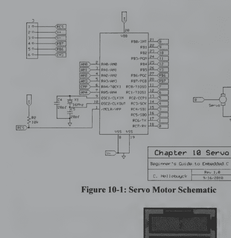

| 第10章舵机原理图 |  |  |
|---|---|---|
| 初学者嵌入式C编程指南 第3卷 |  |  |
| C. Helli... | Rev. 1.0 | 第1页，共1页 |
|  | 9/16/2018 |  |

Figure 10-1: Servo Motor Schematic

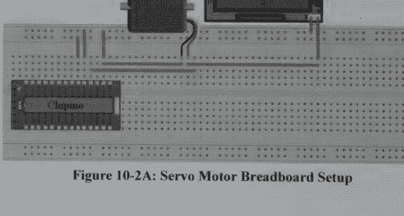

Figure 10-2A: Servo Motor Breadboard Setup

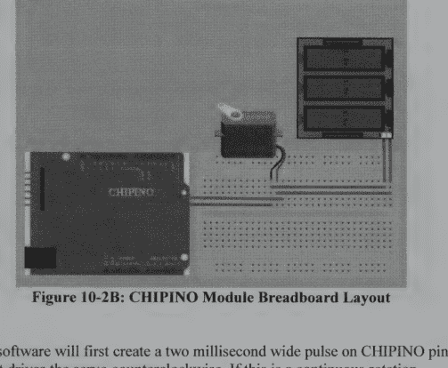

Figure 10-2B: CHIPINO Module Breadboard Layout

软件将首先在CHIPINO引脚0上创建一个宽度为两毫秒的脉冲，驱动伺服电机逆时针旋转。如果这是连续旋转伺服，则连接到伺服的轮子将在此脉冲存在时继续逆时针驱动。你可以在图10-3的示波器图上看到该脉冲。

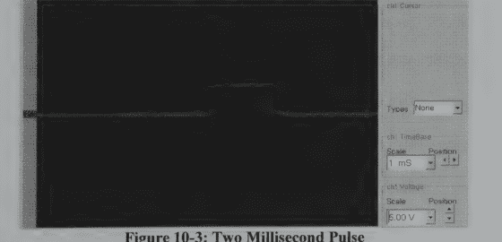

Figure 10-3: Two Millisecond Pulse

软件然后将在CHIPINO引脚0上创建一个一毫秒的脉冲，以驱动伺服电机顺时针旋转，从而反转轮子。你可以在图10-4中看到一毫秒的脉冲。

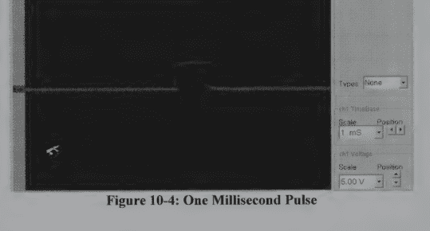

Figure 10-4: One Millisecond Pulse

### 软件

项目软件非常简短简单，我将在工作原理部分进行讲解。以下是驱动伺服电机前后移动的完整代码。其核心是pulseout命令。它本质上是一个简单的高-暂停-低例程，创建脉冲，如果你查看simplec1.1.c文件就可以看到。始终在你的MPLAB项目中包含simplec1.1.h和simplec1.1.c。

```
/***********************
Drive a Servo Motor example using SimpleC.
This code will drive a servo on pin 0 (RC7)
clockwise for a short time, and then
counterclockwise for a short time.

Connections:
CHIPINO PIN 0(RC7) to Servo Signal line
Servo + to 4.5v battery pack
Servo - to Common Ground

Note:
CHIPINO and Battery Pack Grounds are Connected
*************************/

```
#include "simplec1.1.h"
void
main(void)
{
init_micro();   // Initialize I/O
while (1==1)
{
for(char x=0; x<100; x++)
{
pulseout(0,200);      //Turn Servo Counterclockwise
pause(10);
}
for(char x=0; x<100; x++)
{
pulseout(0,100);      //Turn Servo Clockwise
pause(10);
}
}//end while
}//end main
```

### 工作原理

整体程序包含同类型的头文件，用于描述操作和连接。

```
/************************************************
    Drive a Servo Motor example using simpleC.
    This code will drive a servo on pin 0(RC7)
    clockwise for a short time, and then
    counterclockwise for a short time.

    Connections:
    CHIPINO PIN 0(RC7) to Servo Signal line
    Servo + to 4.5v battery pack
    Servo - to Common Ground
    Note:
    CHIPINO and Battery Pack Grounds are Connected
    ************************************************/
```

SimpleC 库头文件与主功能循环以及 SimpleC 库的 init_micro( ) 函数一起包含在内。

```
#include "simplec1.1.h"
void
```

### 后续步骤

最合理的下一步是扩展此代码以控制两个伺服电机并实际驱动由它们组成的伺服机器人。如果你对伺服电机不太熟悉，使用 1.5 毫秒脉冲驱动伺服电机应可使伺服电机暂停或使机器人停止。

pulseout 函数提供的另一个优点是可以驱动任何数字 CHIPINO 引脚。通过少量额外代码，你可以在任何数字引脚上创建 PWM 信号。下面代码片段创建了一个缓慢的 100 Hz 信号，其占空比从 20% 扫到 80%，然后再从 80% 回扫到 20%。只需用这些代码替换伺服代码中的 for 循环，你应该就能得到我所描述的效果。

```
/*
Create a slow PWM signal on CHIPINO pin 2 using the pulseout function
*/

for(int dc=200; dc<800; dc++)
{
    pulseout(2,dc);      //Send increasing Duty Cycle
    pauseus(1000-dc); //Send low delay to create 100hz
}

for(int dc=800; dc>200; dc--)
{
    pulseout(2,dc);      //Send decreasing duty cycle
    pauseus(1000-dc); //Send low delay to create 100hz
}
```

2.6.1. 我称之为 PICkit 2 独立编程软件。它依赖于 Microsoft .net 框架，许多 PC 已预先安装了该框架。该软件可从 www.microchip.com/pickit2 免费下载。

运行 PICkit 2 软件时，其外观将如 图 11-4 中的屏幕截图所示。

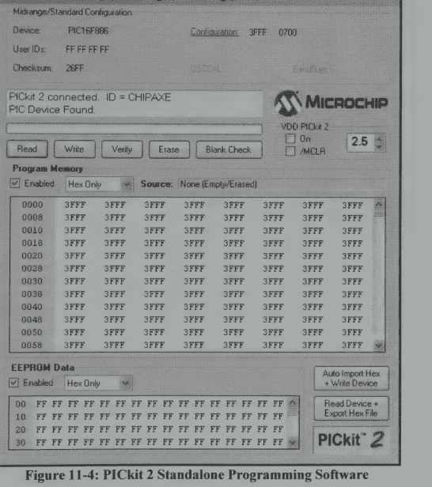

图 11-4：PICkit 2 独立编程软件

独立软件的一个功能是内置的 UART 工具。这是一个终端程序，使用 PICkit 2 编程器作为 PIC 到 USB 的通信通道。你可以从工具菜单启动该软件，如 图 11-5 所示。

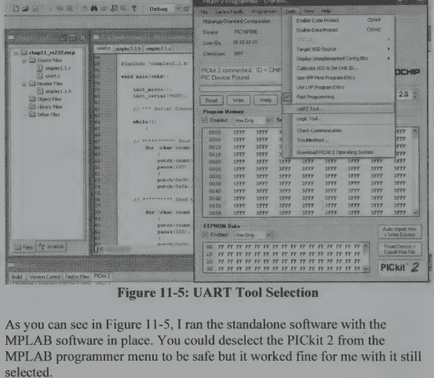

#### 图 11-5：UART 工具选择

如 图 11-5 所示，我在安装了 MPLAB 软件的情况下运行了独立软件。你可以为安全起见在 MPLAB 编程器菜单中取消选择 PICkit 2，但我保持选中状态时也能正常工作。

运行 UART 工具时，你会看到 图 11-6 中的屏幕。右上角显示波特率为 9600。屏幕显示在捕获时 CHIPINO 中正在运行软件，因为它显示了 CHIPINO 通过 PICkit 2 连接发送到 UART 屏幕的文本。

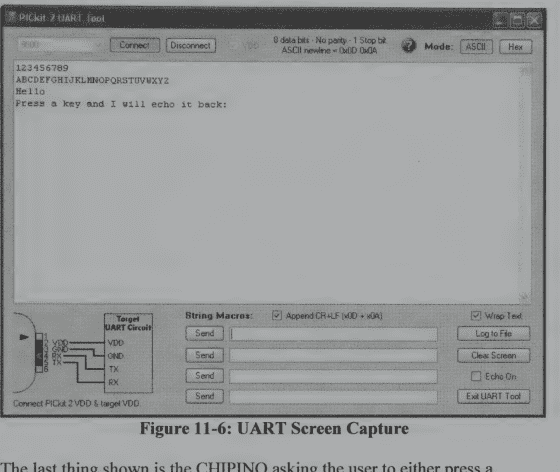

#### 图 11-6：UART 屏幕截图

最后显示的是 CHIPINO 提示用户按下键盘键或在屏幕下中部的 Send 框中输入一个字符。该字符将被 CHIPINO 读取然后发回，以演示双向通信。图 11-7 显示了从 Send 窗口向 CHIPINO 发送大写字母 A 时的结果。

此操作将一直持续，直到按下屏幕左上角的 Disconnect 按钮。你还可以在左下角看到 PICkit 2 的连接，这在将来使用此工具时忘记连接方案会很有帮助。

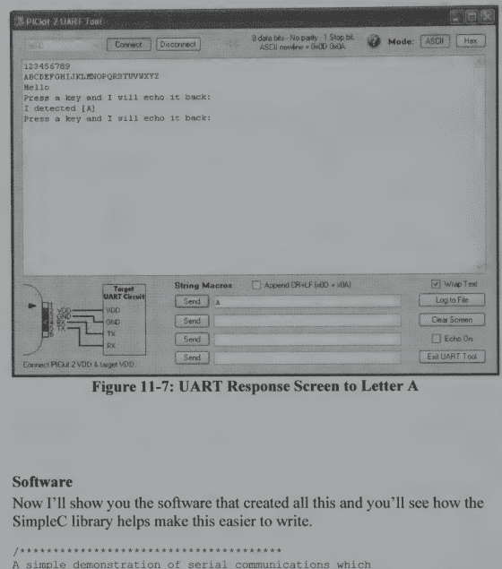

图 11-7：发送字母 A 时的 UART 响应屏幕

### 软件

现在我将向你展示创建所有这些内容的软件，你会看到 SimpleC 库如何使编写变得更简单。

```
/*******************************
A simple demonstration of serial communications which
incorporates the on-board hardware USART of the Microchip
PIC16F886 device.
1) The project sends ASCII numbers 1-9 out to the terminal once
followed by a carriage return and new line command.
2) Then it sends the ASCII values for A-Z once followed by
a carriage return and new line command.
3) Then it will send the word "Hello" out once.
4) Then it will use the printf command to send phrases and
ask for you to send it something via the keyboard and it will
echo it back.
The program will keep asking for input until power is lost.

Option 1: Hyperterminal and USB to RS232 module

Pin 0(C7) Rx - to Tx of USB/RS232 module
Pin 1(C6) Tx - to Rx of USB/RS232 module

Hyperterminal settings
Bits per second: 9600
Data bits: 8
Parity: None
Stop bits: 1
Flow control: None

Option 2: PICKit 2 as interface and running UART tool
C7 to PICKit 2 pin 5
C6 to PICKit 2 pin 4
Vdd to PICKit 2 pin 2
Gnd to PICKit 2 pin 3
*****************************/
```

```
#include "simplec1.1.h"

void main(void){
    init_micro();    // Setup micro ports
    init_serial(9600); // set up the USART baud rate (2400 or 9600)
    // *** Serial Communication Main Loop
    while(1)
    {
        // *********** Send a decimal numbers from 1 to 9 ***********
        for (char count = 0x31; count <= 0x39; count = count +1)
        {
            putch(count);       // Send Count 1-9 in ASCII
            pause(100);         // Delay 100 msec
        }
        putch(0x0D);        // Send ASCII value for
                            // carriage return
        putch(0x0A);        // Send ASCII value for new
                            // line
        // *********** Send the alphabet from A to Z ***********
        for (char count = 0x41; count <= 0x5A; count = count +1)
        {
            putch(count);       // Send Count 1-9 in ASCII
            pause(100);         // Delay 100 msec
        }
        putch(0x0D);        // Send ASCII value for
                            // carriage return
        putch(0x0A);        // Send ASCII value for new
                            // line
        // *********** Send a string of characters ***************
        char txt[] = "Hello";
        for (char x = 0; x<5; x++)
        {
            putch (txt[x]);
        }
        putch (0x0D);    // Send ASCII value for carriage return
        putch (0x0A);    // Send ASCII value for new line

        // ****** Use printf command to ask for input and echo it back ******
        while(1)
        {
            printf("Press a key and I will echo it back:\r\n");
            char input = getch();    //read a response from the
                                     // user
            printf("I detected [%c]\r\n",input); //echo it back
        }
    }
}
```

### 工作原理

该头文件在操作和连接选项的描述方面非常完整。它描述了 USB 到 USART 连接选项以及我选择使用的 PICkit 2 选项。

```
/************************************************
A simple demonstration of serial communications which
incorporates the on-board hardware USART of the Microchip
PIC16F886 device.
1) The project sends ASCII numbers 1-9 out to the terminal once
   followed by a carriage return and new line command.
2) Then it sends the ASCII values for A-Z once followed by
   a carriage return and new line command.
3) Then it will send the word "Hello" out once.
4) Then it will use the printf command to send phrases and
   ask for you to send it something via the keyboard and it will
   echo it back.
The program will keep asking for input until power is lost.

Option 1: Hyperterminal and USB to RS232 module

Pin 0(C7) Rx - to Tx of USB/RS232 module
Pin 1(C6) Tx - to Rx of USB/RS232 module

Hyperterminal settings
Bits per second: 9600
Data bits: 8
Parity: None
Stop bits: 1
Flow control: None

Option 2: PICKit 2 as interface and running UART tool

C7 to PICKit 2 pin 5
```


```
C6 to PICkit 2 pin 4
Vdd to PICkit 2 pin 2
Gnd to PICkit 2 pin 3
*******************************/
```

simplec1.1.h 文件与通常的 init_micro 函数一起包含。

```
#include "simplec1.1.h"

void main(void){
    init_micro();    // Setup micro ports
```

USART 的第一个 SimpleC 库函数是 init_serial 函数，它有一个参数为 2400 或 9600，用于选择波特率。目前仅支持这两种。

```
init_serial(9600); // set up the USART baud rate (2400 or 9600)
```

现在代码的主循环开始，你会看到一些其他函数被使用，这些函数实际上是 HI-TECH C 编译器中标准库的一部分。它们与 USART 完美配合工作。putch() 发送一个由参数定义的 ASCII 字符。它可以是 ASCII 字符或 ASCII 字符值。这个第一个 for 循环使用它们来发送一个数字，然后发送回车加换行。

```
// *** Serial Communication Main Loop
while(1)
{
// ********** Send a decimal numbers from 1 to 9 **********
for (char count = 0x31; count <= 0x39; count = count +1)
{
    putch(count);        // Send Count 1-9 in ASCII
    pause(100);          // Delay 100 msec
}
putch(0x0D);           // Send ASCII value for
                       // carriage return
putch(0x0A);           // Send ASCII value for new
                       // line
```

第二个 for 循环使用 PUTCH 函数以 ASCII 字符的形式发送从 A 到 Z 的字母。

```
// *********** Send the alphabet from A to Z ************
for (char count = 0x41; count <= 0x5A; count = count +1)
{
```

串行通信也更容易。此外，这也成为一个很好的调试工具，如果你只是想发送一些状态数据。PICkit 2 软件还可以收集和存储接收到的字符。

### 下一步

我首先建议你尝试 PICkit 2 和 USB 转 TTL 转换器模块两种通信方法。即使我没有展示如何使用 USB 转换器方法，我也测试过它，效果相当不错。有很多不同的 USB 转换器板可供选择，所以我在这里不会特别指出其中一个。

更改发送的消息是一个简单的下一步，但让 PICkit 2 收集数据然后在 EXCEL 或任何电子表格程序中打开该文件，可以成为本项目的[content]
```
C6 to PICkit 2 pin 4
Vdd to PICkit 2 pin 2
Gnd to PICkit 2 pin 3
*******************************/
```

simplec1.1.h 文件与通常的 init_micro 函数一起包含。

```
#include "simplec1.1.h"

void main(void){
    init_micro();    // Setup micro ports
```

USART 的第一个 SimpleC 库函数是 init_serial 函数，它有一个参数为 2400 或 9600，用于选择波特率。目前仅支持这两种。

```
init_serial(9600); // set up the USART baud rate (2400 or 9600)
```

现在代码的主循环开始，你会看到一些其他函数被使用，这些函数实际上是 HI-TECH C 编译器中标准库的一部分。它们与 USART 完美配合工作。putch() 发送一个由参数定义的 ASCII 字符。它可以是 ASCII 字符或 ASCII 字符值。这个第一个 for 循环使用它们来发送一个数字，然后发送回车加换行。

```
// *** Serial Communication Main Loop
while(1)
{
// ********** Send a decimal numbers from 1 to 9 **********
for (char count = 0x31; count <= 0x39; count = count +1)
{
    putch(count);        // Send Count 1-9 in ASCII
    pause(100);          // Delay 100 msec
}
putch(0x0D);           // Send ASCII value for
                       // carriage return
putch(0x0A);           // Send ASCII value for new
                       // line
```

第二个 for 循环使用 PUTCH 函数以 ASCII 字符的形式发送从 A 到 Z 的字母。

```
// *********** Send the alphabet from A to Z ************
for (char count = 0x41; count <= 0x5A; count = count +1)
{
```

串行通信也更容易。此外，这也成为一个很好的调试工具，如果你只是想发送一些状态数据。PICkit 2 软件还可以收集和存储接收到的字符。

### 下一步

我首先建议你尝试 PICkit 2 和 USB 转 TTL 转换器模块两种通信方法。即使我没有展示如何使用 USB 转换器方法，我也测试过它，效果相当不错。有很多不同的 USB 转换器板可供选择，所以我在这里不会特别指出其中一个。

更改发送的消息是一个简单的下一步，但让 PICkit 2 收集数据然后在 EXCEL 或任何电子表格程序中打开该文件，可以成为本项目的[content]
```
C6 to PICkit 2 pin 4
Vdd to PICkit 2 pin 2
Gnd to PICkit 2 pin 3
*******************************/
```

simplec1.1.h 文件与通常的 init_micro 函数一起包含。

```
#include "simplec1.1.h"

void main(void){
    init_micro();    // Setup micro ports
```

USART 的第一个 SimpleC 库函数是 init_serial 函数，它有一个参数为 2400 或 9600，用于选择波特率。目前仅支持这两种。

```
init_serial(9600); // set up the USART baud rate (2400 or 9600)
```

现在代码的主循环开始，你会看到一些其他函数被使用，这些函数实际上是 HI-TECH C 编译器中标准库的一部分。它们与 USART 完美配合工作。putch() 发送一个由参数定义的 ASCII 字符。它可以是 ASCII 字符或 ASCII 字符值。这个第一个 for 循环使用它们来发送一个数字，然后发送回车加换行。

```
// *** Serial Communication Main Loop
while(1)
{
// ********** Send a decimal numbers from 1 to 9 **********
for (char count = 0x31; count <= 0x39; count = count +1)
{
    putch(count);        // Send Count 1-9 in ASCII
    pause(100);          // Delay 100 msec
}
putch(0x0D);           // Send ASCII value for
                       // carriage return
putch(0x0A);           // Send ASCII value for new
                       // line
```

第二个 for 循环使用 PUTCH 函数以 ASCII 字符的形式发送从 A 到 Z 的字母。

```
// *********** Send the alphabet from A to Z ************
for (char count = 0x41; count <= 0x5A; count = count +1)
{
```

串行通信也更容易。此外，这也成为一个很好的调试工具，如果你只是想发送一些状态数据。PICkit 2 软件还可以收集和存储接收到的字符。

### 下一步

我首先建议你尝试 PICkit 2 和 USB 转 TTL 转换器模块两种通信方法。即使我没有展示如何使用 USB 转换器方法，我也测试过它，效果相当不错。有很多不同的 USB 转换器板可供选择，所以我在这里不会特别指出其中一个。

更改发送的消息是一个简单的下一步，但让 PICkit 2 收集数据然后在 EXCEL 或任何电子表格程序中打开该文件，可以成为本项目的[content]
```
C6 to PICkit 2 pin 4
Vdd to PICkit 2 pin 2
Gnd to PICkit 2 pin 3
*******************************/
```

simplec1.1.h 文件与通常的 init_micro 函数一起包含。

```
#include "simplec1.1.h"

void main(void){
    init_micro();    // Setup micro ports
```

USART 的第一个 SimpleC 库函数是 init_serial 函数，它有一个参数为 2400 或 9600，用于选择波特率。目前仅支持这两种。

```
init_serial(9600); // set up the USART baud rate (2400 or 9600)
```

现在代码的主循环开始，你会看到一些其他函数被使用，这些函数实际上是 HI-TECH C 编译器中标准库的一部分。它们与 USART 完美配合工作。putch() 发送一个由参数定义的 ASCII 字符。它可以是 ASCII 字符或 ASCII 字符值。这个第一个 for 循环使用它们来发送一个数字，然后发送回车加换行。

```
// *** Serial Communication Main Loop
while(1)
{
// ********** Send a decimal numbers from 1 to 9 **********
for (char count = 0x31; count <= 0x39; count = count +1)
{
    putch(count);        // Send Count 1-9 in ASCII
    pause(100);          // Delay 100 msec
}
putch(0x0D);           // Send ASCII value for
                       // carriage return
putch(0x0A);           // Send ASCII value for new
                       // line
```

第二个 for 循环使用 PUTCH 函数以 ASCII 字符的形式发送从 A 到 Z 的字母。

```
// *********** Send the alphabet from A to Z ************
for (char count = 0x41; count <= 0x5A; count = count +1)
{
```

串行通信也更容易。此外，这也成为一个很好的调试工具，如果你只是想发送一些状态数据。PICkit 2 软件还可以收集和存储接收到的字符。

### 下一步

我首先建议你尝试 PICkit 2 和 USB 转 TTL 转换器模块两种通信方法。即使我没有展示如何使用 USB 转换器方法，我也测试过它，效果相当不错。有很多不同的 USB 转换器板可供选择，所以我在这里不会特别指出其中一个。

更改发送的消息是一个简单的下一步，但让 PICkit 2 收集数据然后在 EXCEL 或任何电子表格程序中打开该文件，可以成为本项目的[content]
```
C6 to PICkit 2 pin 4
Vdd to PICkit 2 pin 2
Gnd to PICkit 2 pin 3
*******************************/
```

simplec1.1.h 文件与通常的 init_micro 函数一起包含。

```
#include "simplec1.1.h"

void main(void){
    init_micro();    // Setup micro ports
```

USART 的第一个 SimpleC 库函数是 init_serial 函数，它有一个参数为 2400 或 9600，用于选择波特率。目前仅支持这两种。

```
init_serial(9600); // set up the USART baud rate (2400 or 9600)
```

现在代码的主循环开始，你会看到一些其他函数被使用，这些函数实际上是 HI-TECH C 编译器中标准库的一部分。它们与 USART 完美配合工作。putch() 发送一个由参数定义的 ASCII 字符。它可以是 ASCII 字符或 ASCII 字符值。这个第一个 for 循环使用它们来发送一个数字，然后发送回车加换行。

```
// *** Serial Communication Main Loop
while(1)
{
// ********** Send a decimal numbers from 1 to 9 **********
for (char count = 0x31; count <= 0x39; count = count +1)
{
    putch(count);        // Send Count 1-9 in ASCII
    pause(100);          // Delay 100 msec
}
putch(0x0D);           // Send ASCII value for
                       // carriage return
putch(0x0A);           // Send ASCII value for new
                       // line
```

第二个 for 循环使用 PUTCH 函数以 ASCII 字符的形式发送从 A 到 Z 的字母。

```
// *********** Send the alphabet from A to Z ************
for (char count = 0x41; count <= 0x5A; count = count +1)
{
```

串行通信也更容易。此外，这也成为一个很好的调试工具，如果你只是想发送一些状态数据。PICkit 2 软件还可以收集和存储接收到的字符。

### 下一步

我首先建议你尝试 PICkit 2 和 USB 转 TTL 转换器模块两种通信方法。即使我没有展示如何使用 USB 转换器方法，我也测试过它，效果相当不错。有很多不同的 USB 转换器板可供选择，所以我在这里不会特别指出其中一个。

更改发送的消息是一个简单的下一步，但让 PICkit 2 收集数据然后在 EXCEL 或任何电子表格程序中打开该文件，可以成为本项目的[content]
```
C6 to PICkit 2 pin 4
Vdd to PICkit 2 pin 2
Gnd to PICkit 2 pin 3
*******************************/
```

simplec1.1.h 文件与通常的 init_micro 函数一起包含。

```
#include "simplec1.1.h"

void main(void){
    init_micro();    // Setup micro ports
```

USART 的第一个 SimpleC 库函数是 init_serial 函数，它有一个参数为 2400 或 9600，用于选择波特率。目前仅支持这两种。

```
init_serial(9600); // set up the USART baud rate (2400 or 9600)
```

现在代码的主循环开始，你会看到一些其他函数被使用，这些函数实际上是 HI-TECH C 编译器中标准库的一部分。它们与 USART 完美配合工作。putch() 发送一个由参数定义的 ASCII 字符。它可以是 ASCII 字符或 ASCII 字符值。这个第一个 for 循环使用它们来发送一个数字，然后发送回车加换行。

```
// *** Serial Communication Main Loop
while(1)
{
// ********** Send a decimal numbers from 1 to 9 **********
for (char count = 0x31; count <= 0x39; count = count +1)
{
    putch(count);        // Send Count 1-9 in ASCII
    pause(100);          // Delay 100 msec
}
putch(0x0D);           // Send ASCII value for
                       // carriage return
putch(0x0A);           // Send ASCII value for new
                       // line
```

第二个 for 循环使用 PUTCH 函数以 ASCII 字符的形式发送从 A 到 Z 的字母。

```
// *********** Send the alphabet from A to Z ************
for (char count = 0x41; count <= 0x5A; count = count +1)
{
```

串行通信也更容易。此外，这也成为一个很好的调试工具，如果你只是想发送一些状态数据。PICkit 2 软件还可以收集和存储接收到的字符。

### 下一步

我首先建议你尝试 PICkit 2 和 USB 转 TTL 转换器模块两种通信方法。即使我没有展示如何使用 USB 转换器方法，我也测试过它，效果相当不错。有很多不同的 USB 转换器板可供选择，所以我在这里不会特别指出其中一个。

更改发送的消息是一个简单的下一步，但让 PICkit 2 收集数据然后在 EXCEL 或任何电子表格程序中打开该文件，可以成为本项目的[content]
```
C6 to PICkit 2 pin 4
Vdd to PICkit 2 pin 2
Gnd to PICkit 2 pin 3
*******************************/
```

simplec1.1.h 文件与通常的 init_micro 函数一起包含。

```
#include "simplec1.1.h"

void main(void){
    init_micro();    // Setup micro ports
```

USART 的第一个 SimpleC 库函数是 init_serial 函数，它有一个参数为 2400 或 9600，用于选择波特率。目前仅支持这两种。

```
init_serial(9600); // set up the USART baud rate (2400 or 9600)
```

现在代码的主循环开始，你会看到一些其他函数被使用，这些函数实际上是 HI-TECH C 编译器中标准库的一部分。它们与 USART 完美配合工作。putch() 发送一个由参数定义的 ASCII 字符。它可以是 ASCII 字符或 ASCII 字符值。这个第一个 for 循环使用它们来发送一个数字，然后发送回车加换行。

```
// *** Serial Communication Main Loop
while(1)
{
// ********** Send a decimal numbers from 1 to 9 **********
for (char count = 0x31; count <= 0x39; count = count +1)
{
    putch(count);        // Send Count 1-9 in ASCII
    pause(100);          // Delay 100 msec
}
putch(0x0D);           // Send ASCII value for
                       // carriage return
putch(0x0A);           // Send ASCII value for new
                       // line
```

第二个 for 循环使用 PUTCH 函数以 ASCII 字符的形式发送从 A 到 Z 的字母。

```
// *********** Send the alphabet from A to Z ************
for (char count = 0x41; count <= 0x5A; count = count +1)
{
```

串行通信也更容易。此外，这也成为一个很好的调试工具，如果你只是想发送一些状态数据。PICkit 2 软件还可以收集和存储接收到的字符。

### 下一步

我首先建议你尝试 PICkit 2 和 USB 转 TTL 转换器模块两种通信方法。即使我没有展示如何使用 USB 转换器方法，我也测试过它，效果相当不错。有很多不同的 USB 转换器板可供选择，所以我在这里不会特别指出其中一个。

更改发送的消息是一个简单的下一步，但让 PICkit 2 收集数据然后在 EXCEL 或任何电子表格程序中打开该文件，可以成为本项目的[content]
```
C6 to PICkit 2 pin 4
Vdd to PICkit 2 pin 2
Gnd to PICkit 2 pin 3
*******************************/
```

simplec1.1.h 文件与通常的 init_micro 函数一起包含。

```
#include "simplec1.1.h"

void main(void){
    init_micro();    // Setup micro ports
```

USART 的第一个 SimpleC 库函数是 init_serial，参数为 2400 或 9600 用于选择波特率，目前仅支持这两种。

```
init_serial(9600); // set up the USART baud rate (2400 or 9600)
```

现在主循环开始，会用到 HI-TECH C 编译器标准库中的其他函数，它们与 USART 配合良好。putch() 发送参数定义的 ASCII 字符，可为字符或字符值。第一个 for 循环用它发送数字后发送回车和换行。

```
// *** Serial Communication Main Loop
while(1)
{
// ********** Send a decimal numbers from 1 to 9 **********
for (char count = 0x31; count <= 0x39; count = count +1)
{
    putch(count);        // Send Count 1-9 in ASCII
    pause(100);          // Delay 100 msec
}
putch(0x0D);           // Send ASCII value for
                       // carriage return
putch(0x0A);           // Send ASCII value for new
                       // line
```

第二个 for 循环用 PUTCH 发送 A 到 Z 的 ASCII 字符。

```
// *********** Send the alphabet from A to Z ************
for (char count = 0x41; count <= 0x5A; count = count +1)
{
```

串行通信也更简单，也可作为调试工具发送状态数据。PICkit 2 软件还能收集和存储接收字符。

### 下一步

建议同时尝试 PICkit 2 和 USB 转 TTL 转换器模块通信。未展示 USB 转换器用法，但已测试效果不错。USB 转换器板种类很多，不作具体推荐。

更改发送消息很简单，让 PICkit 2 收集数据后用 EXCEL 或电子表格打开也是很好的用途。可结合模拟传感器读取程序做数据记录器。串口在嵌入式领域仍很流行，尽管 PC 端已转向其他接口。

## 第 12 章 – SimpleC I2C 通信

本书以 I2C 通信项目开篇，也以此收尾，这次使用 SimpleC 库使软件更易编写。硬件和操作与第 2 章相同，演示 SimpleC 如何简化该项目。

### 硬件

若仍保留第 2 章的硬件即可直接进行软件开发。否则 24LC01B 芯片连接 CHIPINO 引脚 3 和 4（RC4 和 RC3），LED 连接引脚 8 至 11（RB0 至 RB3）。其余部分集成在 CHIPINO 中。

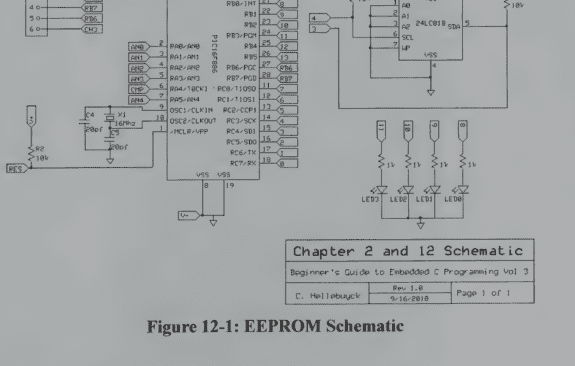

图 12-1：EEPROM 示意图

洞洞板布局和 CHIPINO 模块连接如图 12-2 和 12-3 所示，可自行选择。


图 12-2：I2C EEPROM 洞洞板布局


图 12-3：I2C EEPROM CHIPINO 模块连接

```
} //End Main
```

### 工作原理

熟悉的头部块描述了程序。头部之后是 simplec1.1.h 的 #include。

```
/*
 *  I2C External EEPROM example using SimpleC
 *  This code will write 10 bytes to the EEPROM and
 *  then read them back and display binary value on LEDs.
 *  Connections:
 *  Pin 8(B0) - LED Anode - LED Cathode - 1k ohm - Ground
 *  Pin 9(B1) - LED Anode - LED Cathode - 1k ohm - Ground
 *  Pin 10(B2) - LED Anode - LED Cathode - 1k ohm - Ground
 *  Pin 11(B3) - LED Anode - LED Cathode - 1k ohm - Ground
 *
 *  Pin 3(C4) - 24LC01B SDA - 10k pullup - 5v
 *  Pin 4(C3) - 24LC01B SCL - 10k pullup - 5v
 *  24LC01B Vss - Ground
 *  24LC01B Vdd - 5v
 */

#include "simplec1.1.h"
```

接下来是主循环，包含 init_micro 和设置 I2C 引脚的 i2c_init。

```
void
main(void)
{
    init_micro();    // Initialize I/O
    i2c_init();      // Initialize i2c
```

LED 端口通过将 I/O 拉低使所有 LED 关闭。

```
PORTB=0x00;    // All LEDs off
TRISB=0x00;     // All PORTB outputs
```

创建变量 cnt 用于 while 循环计数，初始化为零。

```
unsigned char cnt=0;
```

while 循环运行十次并在 EEPROM 中存储递减计数。LED 以二进制显示 cnt 值，整个端口等于变量值。由于仅使用 PORTB 的低四位（CHIPINO 引脚 8-11），此控制方式也会影响模块的引脚 12、13、B6 和 B7。由于这些引脚未连接，工作正常，但改编代码时可能需要单独控制每个 LED。

```
while(cnt<=10)    /* write 10 numbers to eeprom */
{
PORTB=cnt;        // The cnt value will display on the LEDs
```

I2C_EEOUT 完成所有 EEPROM 通信工作。第一个参数为地址，第二个为数据。此处 cnt 为地址，数据为 10 减去 cnt。地址 1 存 9，地址 2 存 8，依此类推。

```
I2C_EEOUT(cnt,10-cnt);// Store 9 at address 1, 8 at address 2, ...
cnt=cnt+1;           // Increment cnt variable
```

添加 pause 命令以便有足够时间看到 LED 显示的值。

```
pause(255);          // Delay 255 milliseconds
}
```

将 cnt 重置为零，然后用另一个 while 循环读回数据。这次使用 I2C_EEIN 读取数据。参数为地址，读回的数据送入变量。此处使用 PORTB 标签作为变量。HI-TECH 编译器允许这样做，因为寄存器名在 PIC16F886 的特定头文件中被设为 volatile 变量并自动包含。此行使 LED 以二进制形式显示从 EEPROM 读回的值。

```
cnt=0;
while(cnt<=10)
{
PORTB =I2C_EEIN(cnt); // Display data read from EEPROM on
                       // LEDs in binary
```

pause 函数参数为 1000，产生 1 秒延迟以便读取 LED 二进制值。写入 EEPROM 的延迟较短，因此可通过 LED 变化速度区分读写。

```
pause (1000);    // Delay for 1 second to read LEDs
```

为 while 循环下一次测试递增 cnt 变量。计数达到 10 时循环结束，程序跳回主循环开头，整个过程重新开始。

```
cnt=cnt + 1;    // Increment cnt variable
} 
} //End Main
```

### 下一步

用 LCD 替换 LED 是最合理的下一步，我已展示 SimpleC 如何轻松实现。也可添加 ADCIN 函数读取传感器，对多次读数取平均后存入 EEPROM，可为几乎任何可测模拟传感器创建简单数据记录器。

### 结论

如果你完成了我的《Beginner’s Guide to Embedded C Programming Volume 2》中的项目，现在应能理解 SimpleC 库节省了多少输入工作。本书旨在为人们通过邮件询问的常见函数提供起点。

SimpleC 可加快项目开发或更快验证概念。我认为多个项目可组合成更复杂项目。组合 LCD、EEPROM 和 RS232 通信项目是构建数据记录器的良好起点。ADC 可读取传感器并在 LCD 上显示测量值，同时存入 EEPROM。之后可通过将串口连接到数据记录器模块的 Rx 和 Tx 引脚，用计算机检索数据。所有这些都可用少量 SimpleC 函数完成。这只是组合方式的一个例子，也可作为构建更复杂项目的起点。

与 C 程序员交流时发现，很多人依赖函数库构建项目。这些函数可能是自己创建的，也可能是“借用”的。我也见过许多可在网上找到并修改以满足需求的代码示例。本书和我之前的嵌入式 C 书籍的重点是教授足够的基础知识，以便理解这些来源中的函数。并没有标准方法，因此一个人的代码可能非常有帮助，而同一主题的另一份代码可能难以理解，以至于自己重写函数更好。这是程序员需要做出的决定。

感谢阅读我前两本嵌入式 C 书籍并继续阅读本书的读者。是这种忠诚让撰写书籍的漫长过程——无数个夜晚的打字——变得值得。这是一个非常漫长的过程。


## 附录 A – CHIPINO 电路板原理图


CHIPINO 原理图
嵌入式 C 语言编程初学者指南 第 3 卷
C. Hellebuyck	修订版 1.0	2018-9-16	第 1 页，共 1 页

- pwmout1(占空比, 频率)
- pwmout2(占空比, 频率)
- RD_BYTE (地址, 数据字节)
- RD_MCP23S08 (寄存器)
- spi_init()
- spi_output (字节)
- usecbase()
- WR_BYTE (地址, 数据字节)
- WR_MCP23S08 (寄存器, 数据字节)

显示, 17, 28, 31, 36, 37, 43, 44, 52, 53, 54, 55, 56, 57, 73, 77, 78, 133, 136, 137, 139, 140, 142, 145, 146, 147, 148, 149, 151, 155, 156, 201, 202, 203, 204, 205
do, 112, 116, 119, 121
占空比, 58, 103, 168, 170, 171, 172, 173, 174, 183

## E

EEPROM, 4, 10, 21, 23, 27, 28, 29, 30, 31, 35, 36, 37, 42, 43, 44, 65, 66, 67, 68, 73, 76, 77, 78, 100, 101, 102, 103, 108, 109, 149, 150, 151, 152, 153, 154, 155, 156, 167, 199, 200, 201, 202, 203, 204, 205, 206

## F

for, 119, 120, 121

## G

getch, 61, 62, 63, 78, 83, 99, 193, 196, 197
GPIO, 64, 69, 70, 71, 72, 82, 158, 159, 161

## H

高, 21, 22, 23, 47, 48, 49, 50, 51, 58, 65, 82, 86, 89, 92, 101, 102, 103, 111, 123, 124, 125, 126, 128, 131, 133, 162, 170, 179
HI-TECH, 2, 3, 7, 8, 16, 17, 21, 33, 37, 39, 60, 61, 62, 78, 79, 80, 99, 106, 114, 119, 149, 195, 196, 197, 204
HI-TECH PICC PRO C Compiler, 17, 30

## I

I2C, 3, 5, 8, 10, 19, 21, 22, 23, 24, 27, 28, 29, 30, 31, 33, 35, 36, 37, 39, 40, 42, 43, 44, 72, 73, 74, 75, 76, 77, 78, 83, 106, 107, 108, 109, 133, 199, 200, 201, 202, 203, 204, 205
I2C_EIN, 109, 201
I2C_EEOUT, 109, 201
i2c_init, 30, 33, 35, 39, 40, 43, 72, 73, 77, 78, 83, 106, 201, 202, 203
i2c_read, 31, 33, 34, 35, 39, 41, 43, 74, 75, 76, 83, 106, 108, 109
i2c_restart, 74, 107
i2c_stop, 31, 33, 35, 39, 40, 42, 43, 73, 74, 75, 76, 83, 106, 107, 109
i2c_start, 31, 33, 35, 39, 40, 42, 43, 73, 74, 75, 76, 83, 106, 107, 109
i2c_waitforidle, 75, 76
i2c_write, 31, 33, 34, 35, 39, 42, 43, 74, 75, 76, 83, 106, 108, 109
ij, 112
在线串行编程, 11
init_serial, 59, 60, 61, 63, 83, 98, 192, 195, 197
初始化, 3, 46
输入, 21, 24, 32, 38, 39, 50, 51, 61, 62, 63, 78, 83, 84, 85, 89, 90, 91, 105, 128, 131, 132, 133, 148, 161, 172, 192, 193, 194, 196, 197
中断, 128
IODIR, 64, 69, 70, 71, 72, 82, 158, 159, 161, 164, 166

## L

LCD, 3, 4, 10, 44, 47, 52, 53, 54, 55, 56, 57, 66, 67, 68, 80, 81, 94, 95, 96, 97, 98, 133, 134, 135, 136, 137, 138, 139, 140, 141, 142, 143, 144, 145, 146, 147, 148, 155, 156, 205, 206
lcd_clear, 47, 52, 53, 54, 55, 56, 57, 66, 68, 83, 95, 98, 136, 138, 140, 141, 145, 147, 152, 155
lcd_goto, 47, 52, 53, 54, 55, 56, 57, 66, 68, 83, 96, 137, 138, 140, 141, 142, 146, 147, 148, 152, 155
lcd_init, 47, 52, 53, 54, 56, 57, 66, 67, 68, 81, 83, 94, 97, 136, 138, 140, 141, 145, 147, 152, 154
lcd_number, 56,57,66,67,68,83,96,97,143,145,146,147,148
lcd_symbol, 54,55,83,96,136,137,138,139,152,155,156
lcd_text, 47,52,53,54,56,57,66,67,68,83,95,139,140,141,142,146,147,152,155,156
LED, 31,37,43,50,58,64,70,72,91,111,116,122,123,124,128,130,131,132,133,148,158,159,160,161,162,164,165,169,171,172,202,203,204,205
低, 7,10,11,15,21,22,23,38,47,48,50,51,65,79,82,86,87,88,89,92,98,100,101,102,103,123,124,125,126,128,131,133,179,183,203

## M

主机, 10,22,25,37,64,100
MCP23S08, 4,64,68,70,71,72,82,83,102,103,156,157,158,159,160,161,162,163,164,165,166
MCP23S16,166
Microchip,2
微控制器,114
MPLAB,2,3,14,16,17,32,38,45,84,85,111,112,113,114,115,116,117,118,119,120,121,132,179,187,189
MPLAB 安装,17
msecbase,31,32,33,38,39,47,82,85,86
MSSP,10,24,27

## N

上网本,18

## O

OLAT,64,69,70,71,72,82,158,159,161,162,164,166
输出,118,119,120,121

## P

pause,31,32,35,36,38,39,42,43,44,47,48,52,53,54,55,56,57,59,60,64,66,67,68,70,72,73,77,78,81,82,84,85,86,94,95,97,98,100,101,109,123,124,125,137,139,140,142,146,148,152,155,156,159,162,164,166,171,173,179,182,192,193,195,196,202,204,205
pauseus,48,82,85,92,93,94,181,183
PIC16F690,7,10,15,119,120,121,149,168
PIC16F886,7,8,10,13,15,24,27,30,33,37,39,58,59,63,72,79,81,82,103,106,109,114,121,128,143,149,152,154,156,158,160,165,176,187,191,194,197,205
PICkit 2,7,10,11,14,15,16,18,29,79,119,120,121,157,185,187,188,189,190,192,194,197
PICkit 2 编程器应用程序,187
PICkit 3,8,11,14,15,18,119,185
PK2,15,16,18,119
PORTA,49
PORTB,35,36,43,44,49,52,73,77,78,80,81,134,202,203,204,205
PORTC,49,59,81
电位器,135,143,148,168,169,170,171,172,173
printf,61,62,63,78,99,191,193,194,196,197
编程器,7,10,11,13,14,15,16,29,98,119,120,121,129,157,169,185,187,188,189,206
脉冲宽度调制,5,58,91,168
pulseout,51,83,91,92,176,179,182,183
putch,59,60,61,78,83,99,192,193,195,196
PWM,3,58,91,103,104,148,168,169,170,171,172,173,174,176,182,183
pwmout1,58,83,103,104,171,173
pwmout2,58,83,103,104,171,173

## 查看 Chuck Hellebuyck 的其他优秀图书


您可以直接在以下网址购买：
www.elproducts.com

## 嵌入式 C 语言编程初学者指南
第 3 卷
创建 SimpleC 函数库

在他的“嵌入式 C 语言初学者指南”和“嵌入式 C 语言初学者指南 – 第 2 卷”中，Chuck Hellebuyck 带领读者从零开始学习如何使用 Microchip PIC 微控制器和 Microchip HI-TECH C 编译器，以 C 语言对嵌入式微控制器进行编程。

在“嵌入式 C 语言编程初学者指南 – 第 3 卷”中，Chuck Hellebuyck 再次向前迈进，向读者展示了创建 SimpleC 函数库的步骤，使 C 语言编程更加容易。这种方法向读者展示了如何创建自己的函数并扩展 SimpleC 库，从而比直接编写原始 C 代码更快地创建微控制器项目。对于希望构建电子小装置而无需费心编写每一条 C 语句的未来程序员来说，这本书无疑将成为他们的参考，使他们能够用更少的时间和精力完成可运行的项目。

SimpleC 库将使以下功能像一行命令一样简单：

- 控制数字输出
- 读取数字输入
- 监测模拟电压
- 驱动液晶显示模块
- 驱动数字 PWM 信号
- 通过 SPI 和 I2C 通信发送/接收
- 写入/读取外部 EEPROM
- 写入/读取外部 I/O 扩展器
- 等等！

本书使用基于开源 PIC16F886 的 CHIPINO 模块作为硬件，并构成一个平台，使未来的电子项目和小装置更容易构建。

