# PIC24/dsPIC33 编程初学者指南：PIC24 和 dsPIC33 的 Microstick 和 Microchip C Compiler 使用指南 (第1卷)


嵌入式设计周期首先从为目标应用设计和输入源代码开始，然后处理与该目标代码软件语言相关的任何源代码语法错误，以使源代码达到可执行的形式。这种可执行形式的源代码被指定为目标代码。在此周期中，下一个关键步骤是将目标代码编程到微控制器原型中，以测试和验证原始代码设计。在周期的这一点上，需要外部工具设备来对微控制器进行编程。这种工具类型，如 Microchip 的 Microstick II，允许“在电路编程”，使您能够在微控制器位于原型中时对其进行编程，而无需将其取出。

好的，我们假设在嵌入式设计周期中已经走得足够远，现在已经在原型中编程了可执行的目标代码。接下来我们开始测试源代码设计的下一步。十有八九，最初设计的代码都会包含需要识别和修复的潜在逻辑错误。作为设计者，我们都“太人性化了”，因此难免会犯错。在此阶段，错误不是源代码的语法错误，而是原始源代码设计中隐含的逻辑错误。这些逻辑错误最终总是与您作为设计者可能对应用或微控制器硬件所做的任何假设相关。这就是调试“挺身而出”的地方。

在调试中，我们需要测试和验证那些原始假设，并发现它们是否正确。IDE 在这里帮助我们，并在外部调试器的支持下，允许在“电路”中对微控制器进行操作测试和控制，并能够以调查研究的方式查看其操作。例如，您应该能够实时检查存储器、单步执行微控制器操作，或在代码指定点暂停操作。当您应用这些工具，加上自己的仔细思考时，您就开始发现设计中潜在的错误或“缺陷”。

现在真正的苦差事变成了重新编写源代码，对源代码进行修改以修复问题，然后通过再次运行整个周期来验证修复。事实上，该过程依赖于嵌入式设计周期的多次迭代。在每次迭代中，您将继续发现缺陷并修复它们，最终收敛到一个希望没有缺陷的基线解决方案。有些专家认为，所有设计在达到产品成熟时仍会带有一定程度的潜在缺陷（我倾向于相信他们）。您在迭代上花费的时间取决于多种因素，例如设计的总体复杂性、您对所设计应用的完整理解、您使用工具的技能、您对微控制器的了解，以及最后、也是最重要的一点——您在以上所有方面所做假设的数量。随着经验和技能的积累，以及技术知识的增长，其中许多因素肯定会逐渐减少。

## 第 1 章 – 入门

在本章中，我们将指导您完成 Microchip MPLAB、Microchip 'C' 编译器和 Microstick II 编程器/调试器的安装过程。我们将使用演示项目“FLASH_LED”测试整个安装，以确保安装的所有元素都正确且完整。然后，我们将介绍工具套件的一些重要硬件元素，首先概述 Microchip 的 16 位微控制器系列，然后更详细地介绍 PIC24H，最后讨论 Microstick II 及其操作。本章将作为所有其他章节的基础，并为我们提供必要的开发工具套件和硬件概述，供后续所有章节的讨论和实验使用。

特别说明：本书中描述的硬件设置和项目是为 PIC24H 编写的。只需几个简单步骤即可轻松配置为 PIC24F 和 dsPIC33。详情见本章末尾。

### Microchip MPLAB IDE 简介

在此重申，Microchip MPLAB IDE 是一个基于 Windows 的程序，运行在 PC 上，用于开发 Microchip 微控制器的应用。作为 IDE，它提供了一个单一的集成“环境”来开发和测试代码，这是所有微控制器嵌入式设计周期的一部分。该环境帮助设计者推进“嵌入式设计周期”，而无需在各种不同工具之间切换分心，并允许设计者专注于完成应用，而无需被这些独立工具及其各自不同的操作模式所打断。

同样，MPLAB IDE 作为一个框架，充当“包装器”的作用，它通过一个图形用户界面协调所有工具。例如，一旦编写了代码，就必须将其转换为可执行的指令集（目标代码），然后下载并编程到微控制器中，以确定其运行效果。在此过程中需要多种工具：编写代码的编辑器、组织文件和设置的项目管理器、将源代码转换为目标代码的编译器，以及用于测试目标代码在微控制器上运行的硬件编程器/调试器。MPLAB 与 Microstick II 编程器/调试器一起满足了所有这些要求，并将作为本书中的基本开发环境。

MPLAB 的基本组件和功能如图 1-1 所示。在接下来的章节中，我们将继续讨论和说明这套集成工具集的具体使用，作为每章“动手”实验的一部分。

### MPLAB® 集成开发环境

- 基于 GUI
- 集成项目管理器
  - 组织和维护项目文件空间
  - 保留工作区布局
  - 提供所有函数/符号的快速视图
  - 自动构建操作（单按钮）
- 语法源代码编辑器
  - 颜色语法辅助的汇编和 C 代码输入/审查
- 语言工具
  - MPASM 汇编器、MPLINK 链接器、MPLIB 库工具
  - C30 C 编译器（免费学生版）
  - 广泛的库支持（音频、无线、图形、以太网、USB）
- 编程和调试能力
  - 与 Microstick 完全兼容
- 调试
  - 仿真（MPLAB SIM 软件模拟器）或使用 Microstick 进行电路内调试
  - 广泛的工具集
  - 断点、单步和动画操作
  - 秒表、逻辑分析仪、变量监视、DCM、内存仪表


到目前为止还不错，但还不太令人兴奋。MPLAB 运行良好——但实质内容在哪里？我们需要加大筹码。让我们关闭这个配置（点击 IDE 右上角的红色 X 按钮），然后直接启动一个演示项目。在这种新场景下，我们应该会看到 MPLAB 中填充了特定演示项目的组件，并在工作区中按上次保存的状态显示这些功能组件。

导航到存储演示文件夹的位置，打开该文件夹并找到项目文件夹 FLASH_LED。在 Windows 下，你应该会看到以下项目文件内容（见图 1-6）。项目文件内容包括 C 源代码（.C）和目标代码（.O），一个用于显示微控制器存储器中代码和数据分配位置的 MAP 文件，以及一个可执行文件（.HEX）。目前对我们来说最重要的文件是项目文件（.MCP）和工作区文件（.MCW）。最后提到的这两个文件都带有 MPLAB IDE 的徽标。双击标记为 .MCP 文件的项目图标，MPLAB 将根据该项目的最后保存的工作区重建项目。工作区捕获了打开了哪些窗口、微控制器如何配置以及设置了哪些调试选项。工作区由 .MCW 文件捕获。图 1-6 展示了整个过程。

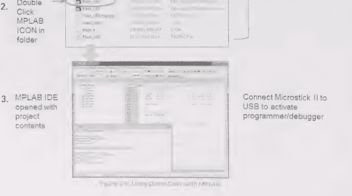

接下来，我们使用这个项目进一步仔细查看 MPLAB 的内容，以便更好地理解 MPLAB 的可视化环境。在这个项目工作区中，有几个窗口是打开的。首先是整体项目窗口，该窗口以树状结构显示属于此项目源代码构建的所有相关用户文件或支持文件。这里只出现了两个源代码文件。你可以通过双击项目窗口中的特定文件来查看任何文件的内容。另一个打开的窗口是源代码窗口（图 1-7）。

请注意，这个窗口是带选项卡的，项目中的所有源代码文件都已打开供查看，但一次只能查看一个文件。你可以通过单击与特定源代码文件对应的选项卡来切换源代码视图。工作区中另一个可见的窗口是输出窗口。输出窗口有许多选项卡，你也可以在调试器状态、构建/编译错误以及其他几个选项之间切换视图（我们稍后将在本书中学习所有这些功能）。最后，主窗口顶部还有 MPLAB 面板和工具栏。在这里，你可以指示 MPLAB 执行你想要的操作。

如果你此时尚未连接 Microstick II，输出窗口应该会显示此信息（这是因为 Microstick II 调试器作为原始工作区配置的一部分处于活动状态）。如果 Microstick II 尚未连接，请立即连接。首次连接 Microstick II 时，会自动安装 Microchip USB 驱动程序。完成后，Windows 操作系统应该会自动识别 Microstick II 连接。一旦 Microstick II 已连接且驱动程序已安装，输出窗口应显示调试器已连接。Microstick II 的调试 LED 应保持常亮。

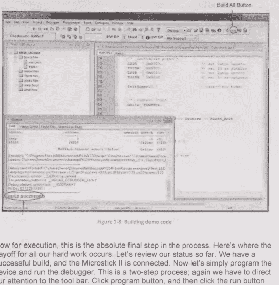

图 1-8：构建演示代码

现在进行执行，这是整个过程中绝对的最后一步。我们所有辛勤工作的回报就在这里。让我们回顾一下目前的状态：我们已经成功构建，并且 Microstick II 已连接。现在只需对设备进行编程并运行调试器。这是一个两步过程；我们再次需要将注意力转向工具栏。单击编程按钮，然后单击运行按钮（图 1-9）。

构建全部按钮

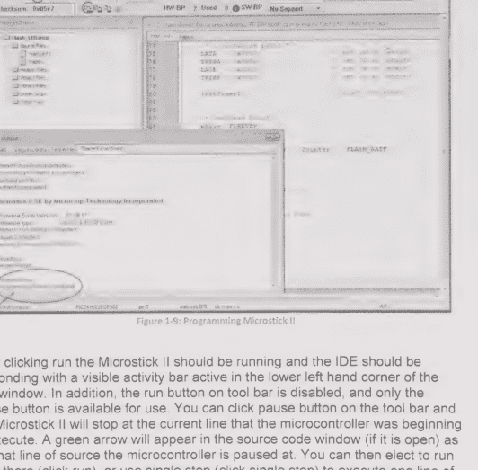

图 1-9：对 Microstick II 编程

单击运行后，Microstick II 应开始运行，IDE 应在窗口左下角显示一个可见的活动栏。此外，工具栏上的运行按钮将变为禁用状态，只有暂停按钮可用。你可以单击工具栏上的暂停按钮，Microstick II 将停止在微控制器正要开始执行的当前行。源代码窗口（如果打开）中将出现一个绿色箭头，指示微控制器暂停在哪一行源代码处。然后你可以选择从那里继续运行（单击运行），或使用单步执行（单击单步）一次执行一行源代码，或复位（单击复位），微控制器将从代码开头重新开始执行。

这里，简要介绍到目前为止讨论过的、位于 IDE 工具栏中的一些重要调试功能会很有帮助（参见下面的要点列表和图 1-10）：

- Make——仅重新构建新代码
- Build All——重新构建项目窗口中的所有代码
- 对设备编程（在此情况下用于调试功能）
- Run——运行程序
- Pause——停止程序
- Single Step——从你先前暂停的位置执行一行代码，并在执行后暂停。
- Reset——复位设备，使下一次运行或暂停执行从代码开头开始

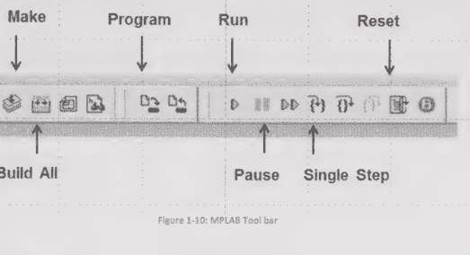

恭喜——你现在拥有了一个功能完整的微控制器开发系统！借助这套工具，你现在可以开始进行本书中的练习，并逐渐为 16 位微控制器嵌入式设计技术做好准备和训练。

在接下来的章节中，我们将更详细地介绍 MPLAB 的功能和特性。现在，让我们讨论 Microstick II 和 PIC24H 微控制器的一些重要硬件特性，以便更好地理解这些重要资源及其全部能力。

### 安装错误

- 1. 源代码编译错误——如果出现编译错误，你可能无意中在源代码窗口中键入或输入了文本，IDE 会将其视为构建的新代码。如果出现这种情况，请关闭 IDE 并且不要保存工作区，重新加载演示代码并重新开始。
- 2. 'C' 编译器未安装——如果编译操作根本没有发生，并且输出窗口报告找不到编译器；你可能覆盖了编译器的默认位置。你现在有两个选择。第一个选择是直接将编译器重新安装到 IDE 的默认位置

数字控制器操作，如电机控制、数字电源转换、数字滤波。该系列以其专用的 MAC（乘法累加单元）为标志，以执行高速数学运算。该系列还使用 40 位累加器以确保数学运算不会溢出。dsPIC30 是 +5V 器件。dsPIC33 是 +3.3V 器件。Microchip 专门为这些器件免费提供自己的信号处理和高速度数学库。在本书中，我们将重点介绍 PIC24H 的实验和操作，这些内容也可用于理解 PIC24F 和 dsPIC33。

Microstick II 带有插座，可支持 PIC32（32 位微控制器）、PIC24H、PIC24F 和 dsPIC33（16 位微控制器）等目标器件。它出厂时插座中装有 PIC32。需要将其移除并替换为 PIC24H 器件。我们在本书中关注的是高端 16 位微控制器，而不是 32 位微控制器。该插座仅支持 28 引脚 Skinny DIP 封装。你的 Microstick II 附带四个此类器件：PIC32MX220F032、PIC24HJ128GP502、dsPIC33FJ128MC802 和 PIC24FJ64GB002。所有这些器件均为 +3.3VDC 逻辑，并具有相似的引脚配置。PIC24H 和 dsPIC33 具有 128K Flash 和 8K Ram 的存储容量，两者都可以高达每秒 4000 万条指令（MIPS）的满速率运行。PIC24H 的存储容量减少为 64K Flash 和 8K Ram，速率为 32 MIPS。

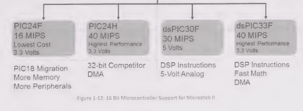

图 1-12：Microstick II 的 16 位微控制器支持

为什么要使用 Microchip 16 位器件？毕竟，Microchip 的 8 位器件种类繁多，已经存在一段时间，并且都得到了很好的支持。为了便于做此决定，最好将新款 16 位处理器与 8 位机器并排仔细比较其性能和功能。提供了一个表格，用于

说明这一点。让我们将 PIC24HJ128GP502 部件与 Microchip 家族中一个众所周知的 8 位成员 PIC16F887 进行比较。

我们将比较数据大小、内存大小、时钟频率以及以 MIPS（每秒百万条指令）衡量的最终指令速度。比较显示，PIC24H 的 Flash 内存容量是 16 倍，RAM 容量超过 20 倍，MIPS 速率是 PIC16F887 的 8 倍。如果我们还比较外设内容，我们会发现 16 位在数值上超过了 8 位内部外设的大多数部分，比例为 2:1，并引入了新的外设。最后，由于 16 位数据总线是 8 位数据总线的 2 倍大小，因此在任何一条指令期间处理的 数据量是两倍。凭借这种类型的处理能力和外设能力，您可以处理 8 位世界单独无法处理的更广泛的应用。我们在介绍中简要讨论了这些内容，但可以包括具有 TCP/IP 堆栈的网络连接、高分辨率图形、ZIGBEE、802.11b 等无线堆栈、SD-CARD 容量为 2GB+ 且格式化为 WINDOWS 兼容文件 I/O，等等。

| | PIC24HJ128GP502 | PIC16F887 |
|---|---|---|
| 数据总线 | 16 位 | 8 位 |
| Flash 大小 | 128K Flash | 8K Flash |
| RAM 大小 | 8K RAM | 368 RAM |
| 时钟频率 | 80 MHZ | 20 MHZ |
| MIPS | 40 MIPS | 5 MIPS |
| 供电电压 | 3.3V 工作 | 5 V 工作 |

### PIC24HJ128GP502 微控制器

让我们更深入地探讨一下 PIC24HJ128GP502 微控制器。如前所述，该器件预封装在“细长 DIP”中。如前所述，PIC24HJ128GP502 是一款 +3.3VDC 逻辑器件，支持 40 MIPS 的运行速度，同时具有 128K FLASH、8K RAM。尽管该器件是 +3.3V 逻辑，但它也可以在某些引脚上支持 +5V 输入（参见 +5V 输入容忍引脚），并且可以通过在输出电平上使用器件可配置的开漏设置来驱动 +5VDC 输出逻辑电平。中断处理和响应时间是使用微控制器进行任何实时操作时需要考虑的重要因素。PIC24H 在这方面配备齐全。它具有内部中断控制器，对中断的响应保证 5 个周期延迟，最多可用的中断源为 45 个，七个优先级级别，五个陷阱用于任何处理器异常处理（例如除以零）和三个外部中断。

PIC24H 具有内置的直接内存访问（DMA）外设，支持 8 个 DMA 通道，具有独立的双端口 2KB RAM

作为 PIC24H 的最后说明，您不仅使用目标代码对其闪存进行编程，而且还通过对其内部“配置字”进行编程来对其配置设置进行编程。配置字设置可以使用 MPLAB GUI 设置，也可以在源代码中作为编译器指令集成。配置字本身驻留在闪存中，但它是一个保留位置，不被视为代码区域的一部分。配置字控制时钟设置，例如时钟源（即外部时钟、内部时钟、时钟类型），或器件是否在调试模式下进行编程，或者器件是否配置为最终发布模式（程序模式）。配置字还设置用于 ICSP 的引脚，最后设置看门狗计时器的使用。我们将在后面的章节中介绍这些具体细节，但在本章中介绍的演示 LED_FLASH，其特定配置设置为禁用外部振荡器，使用驻留在 PIC24H 中的内部 8MHz 振荡器，选择 PIC24HJ128GP502 的引脚 14 和 15 作为 ICSP 数据和时钟，并禁用看门狗计时器。

### Microstick II 硬件描述

现在让我们进入 Microstick II 的操作细节。重申一下，Microstick II 旨在为用户提供易于使用、经济的 16 位数字信号控制器和微控制器的编程/调试器，并完全集成到 Microchip 的 MPLAB 集成开发环境中。

Microstick II 支持编程/调试所需的所有基本功能。它可以独立使用或插入原型板。一旦您对设计感到满意并且认为所有错误都已修复，您就会将微控制器从调试模式中取出，然后为独立操作（发布模式）对器件进行编程。在发布模式下，不再需要 MPLAB。这里唯一的<|message|>要求是保留对 Microstick II 的 USB 连接以保持微控制器的供电。

另一个选项是从 Microstick II 中取出微控制器并将微控制器直接插入原型中，而不使用 Microstick II。为此，您需要为独立微控制器提供自己的电源、地线和主复位。我们将在后面的一些章节中介绍此过程。

让我们从器件的框图开始讨论 Microstick II 硬件的详细操作（参见图 1-15）。

图 1-18 显示了 Microstick II 安装在无焊面包板上并通过 USB 连接供电。调试 LED 根据 MPLAB 是否与板载调试器通信而亮起或闪烁。

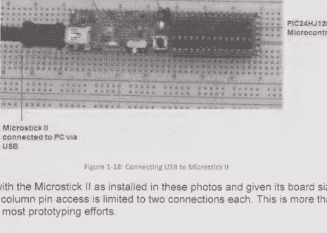

绿色调试 LED 亮起（已连接 MPLAB）

用户红色 LED 因程序运行而闪烁

PIC24HJ128GP502 微控制器

Microstick II 通过 USB 连接到 PC

图 1-18：连接 USB 到 Microstick II

请注意，如这些照片中所示安装 Microstick II，并且其板尺寸为 20x76 mm，列引脚访问每个连接仅限于两个连接。这对于大多数原型制作工作来说已经足够了。

### 16 位微实验器（可选）

Microstick II 开发系统是本书的主要重点。Microstick II 充当低成本的入门开发系统。随着您进一步发展实验范围并希望包含内置电源、LCD、EEPROM、按钮等元素时，大量的重复布线可能会很麻烦。超越 Microstick II 的替代方案是 16 位微实验器。本书的每一章都会讨论 16 位微实验器选项。实验器的完整描述在附录 A 中给出。实验器可通过 www.Kibacorp.com 购买。实验器促进了 Microchip 16 位

PIC24H/PIC24J/dsPIC33 微控制器的原型探索和测试，具有完整的板载支持和外设功能。这些功能支持广泛的原型电路环境，而无需重建任何电子设备。与 Microstick II 一样，实验器可直接插入无焊面包板。实验器采用插座式设计，可轻松支持多种 Microchip 16 位 SDIP 部件，如 PIC24FJ128GP502（随 Microstick II 提供）。实验器随附 PIC24FJGA002。

显示了 16 位实验器放置在无焊面包板上的照片。实验器板载支持具有 16x3 LCD。4 个用户按键、板载电源调节（带电源指示 LED 和电源开关）、32KB EEPROM、电源复位按钮、ICSP（在线串行编程和调试器接口），最后是一个 I/O 扩展连接器。

显示了 16 位实验器放置在无焊面包板上的照片。

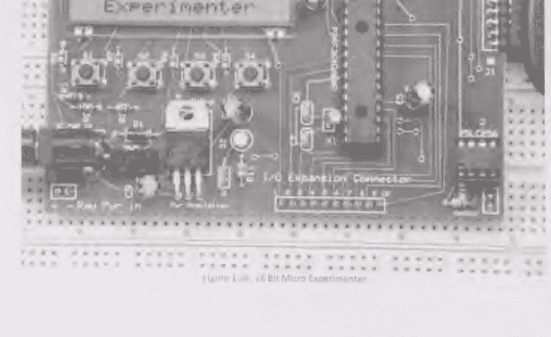

### 16 位实验器功能集：

- 插入式模块格式，内置 3.3V 调节器，可用于更大的无焊面包板。
- 16x3 低轮廓 LCD 显示屏和 4 个用户定义按键
- 用于在线编程和调试的 ICSP 接口
- 标准 I/O 扩展总线，可通过面包板访问 PIC24F/PIC24H 外设集
- 板载 32KHz 定时晶体，用于精确计时
- 板载 32KB EEPROM
- 配备 PIC24FJGA002，但可使用 PIC24HJ128GP502
  - +3.3 V 工作 40 MIPS，具有一定的 +5 伏逻辑兼容性
  - 128K Flash 8K RAM
  - 主芯片外设众多：ADC、可编程 I/O、双 UART、双 SPI、I2C、模拟比较器、捕获/比较模块
- 带电源指示 LED 的开关——由墙壁变压器或直接连接供电。+3.3V 输出也可用于面包板。
- 以套件格式提供，使用全套通孔元件便于组装的装配和操作说明（见 www.kibacorp.com）

### MPLAB 关键功能回顾：

- Microchip 微控制器的集成开发环境
- 使用集成项目管理器组织和维护项目文件和用户工作区
- 使用支持 'C' 和汇编语言的语法源代码编辑器
- 单按钮构建和编程功能
- 支持使用外部设备如 Microstick II 对微控制器进行编程和调试
- 调试操作期间的运行、暂停、单步工具栏。

### Microstick II 关键功能回顾：

- 低成本
- 集成 USB 编程器/调试器 – 无需外部调试器
- USB 供电 – 易于使用，无需外部电源
- 插座式 dsPIC/PIC24/PIC32 – 灵活，易于更换器件


- 0.025" 排针 – 可插入面包板并为跳线留出空间
- 可轻松探针访问所有设备信号
- 小尺寸 - 尺寸为 20 x 76mm，比口香糖还小 – 便于携带
- 板载调试 LED、实用 LED 和复位开关

### 16 位实验器关键特性回顾：
- 插拔模块格式，内置 3.3V 稳压器，可用于更大的无焊面包板。
- 16x3 低轮廓 LCD 显示屏和 4 个用户自定义按键
- ICSP 接口用于在线编程和调试
- 标准 I/O 扩展总线，可通过面包板访问 PIC24H 外设集
- 板载 32KHz 定时晶振，用于精确计时
- 板载 32KB EEPROM

### 使用 dsPIC33 或 PIC24F 的特别说明
1. 在源代码中删除（通常位于 Main 函数之前）#include "p24hxxxx.h"。将其替换为 dsPIC33 的 #include "p33Fxxxx.h" 或 PIC24F 的 #include "p24Fxxxx.h"。
2. 使用 MPLAB IDE 配置菜单选择来选择要使用的确切 dsPIC 或 PIC24F 型号。
3. 保存、重新构建项目并运行。

### 练习：
1. MPLAB 环境支持哪些关键工具？
2. ICSP 是什么意思？Microstick II 如何使用它？
3. 熟悉 Microchip 的 16 位产品系列及其目标应用。前往并查看 Microchip 网站 http://www.microchip.com/en_US/family/16bit/ 上的资料
   a. 有哪些应用？
   b. 有哪些免费库可用？
   c. 该系列列出了哪些更具创新性的外设？PIC24H 如何支持它们？
4. 熟悉 PIC24H 应用笔记。前往网址 http://www.microchip.com/stellent/dd... 并选择 PIC24H 作为处理器进行搜索。目前列出了多少份应用笔记？
5. PIC24HJ128GP502 支持多少个 +5V 容忍引脚？
6. PIC24H 的 PPS 功能是什么？如何使用？
7. 微控制器的配置字是什么意思？如何使用？如何设置？

### 8. 探索 MPLAB
a. 打开演示项目 FLASH_LED
b. 关闭所有窗口
   i. 关闭项目视图
   ii. 关闭源代码视图
   iii. 关闭输出窗口
c. 打开所有窗口（仅应存在基本的 IDE 面板和工具栏）
   i. 在 IDE 面板上选择 view 并从下拉菜单中选择 project——项目窗口应打开且项目树可见
   ii. 双击 FLASH_LED.c（这是主函数）——源代码应打开且源代码可见。使用编辑工具查找 Main 函数。
   iii. 在工具栏上单击构建按钮——注意输出窗口中的构建选项卡会自动打开并显示构建结果。
   iv. 连接 Microstick II 并注意输出窗口。它会从构建选项卡切换到调试选项卡并自动识别连接。
   v. 单击运行，然后暂停，然后单步执行并跟随源窗口中的绿色箭头，指示执行停止的位置以及下一行代码的执行位置。现在按下复位并注意箭头位置，按下单步执行并注意绿色箭头现在位于源代码的开头。单击运行，Microstick II 应闪烁用户 LED。

## 第 2 章 – 驱动 LED

在本章中，我们将为 LED 开发原型硬件和软件。我们将使用第 1 章中创建的已安装开发系统。对于我们的第一个实验，我们将首先只使用一个 LED。这让人想起 'C' 程序 "Hello World!"。在这里，程序员努力编写他们的第一个应用程序，将 hello world 消息输出到控制台。我们的微控制器没有控制台——所以我们只能将闪烁 LED 作为一种 "Hello World"。在这里，我们将逐步进行硬件和软件构建，并使用仿真进行软件调试，最后使用 Microstick II 进行硬件调试。在第二个练习中，我们通过将 LED 数量增加到十个来扩展硬件原型功能，并增强软件以执行二进制计数显示。

### 实验 1- 硬件

PIC24H 具有用户可编程引脚。这些引脚可配置为数字输入、数字输出、模拟，或分配为特定外设输入/输出。框图（见图 2-1）突出了单个 PIC24H 引脚的内部组织，以展示其工作原理。该图仅描述了引脚的外设和数字功能，未显示模拟功能。

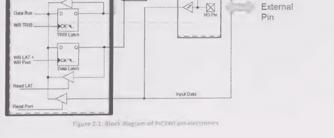

引脚的输出可以来自外设侧或数字侧。两者都有各自独立的数据路径和使能信号，通过输出多路复用器决定哪一侧成为引脚的输出。必须启用外设才能使用其输出。要启用引脚的数字输出，必须清除该引脚的 TRIS 信号。同一时间只能有一侧（外设或数字）输出，如果两者都启用，则优先级更高的外设获胜！在输入侧不存在多路复用器，因此输入信号连接到两侧。本章我们仅使用数字输出。

每个引脚都有一个对应的 TRIS 控制位来设置引脚的数字方向。零使引脚成为输出；一使引脚成为输入。每个引脚还具有一个 PORT 位，允许读取或写入该引脚。对于我们的 PIC24H 器件，我们有两个 PORT 寄存器 PORTA 和 PORTB，两者均为 16 位宽。然而，由于 28 引脚 DIP 封装尺寸，并非所有这些 PORT 位都可用作引脚。

PORTA 允许对引脚 RA0、RA1、RA3、RA4 进行读写，这些引脚对应于 PORTA 的位 0、1、3、4（其余位未分配）。

PORTB 允许对引脚 RB0、RB1、RB2、RB3、RB4、RB5、RB6、RB7、RB8、RB9、RB10、RB11、RB12、RB13、RB14、RB15 进行读写，每个引脚都对应寄存器中的一个位位置。

如前所述，每个 PORT 都有一个 TRIS。因此该器件中具有 TRISA 和 TRISB。PORT 和 TRIS 在 PIC24H 中都存在为“特殊功能寄存器”或简称为 SFR。它们是 PIC24H 中专用于数字引脚操作的 RAM 内存位置。PORT 中的引脚位位置与其 TRIS 中的相同。例如，如果 RB2 要作为输出，则将 TRISB 寄存器中的位位置 2 写入零，然后通过向 PORTB 中对应的位位置写入一（+3.3VDC 输出）或零（接地）来设置该引脚的输出值。

还有一个用于数字 I/O 的第三个 SFR，称为 LAT 或锁存器。它的工作方式与 PORT 类似，不过使用 LAT 我们可以锁存输出或输入，而不是直接使用 PORT 进行读写。我们同时具有 LATA 和 LATB，两者均为 16 位。在 C 代码中访问特殊功能寄存器（如 TRIS、PORT 和 LAT）有多种软件技术，我们在讨论软件时将进一步讨论。

对于实验 1，我们希望将单个 LED 连接到 PORTB 的位 5 或 RB5，并将 RB5 设置为数字输出。RB5 在 PIC24HJ128GP502 上是引脚号 14。该器件为 28 引脚 DIP，因此芯片每侧有 14 个引脚。俯视芯片时，封装上有一个缺口表示引脚 1，所有引脚编号为 1 到 28，并在器件上逆时针排列。这将使引脚 14 或 RB5 成为芯片右下方的最后一个引脚。

实验 1 的原理图如下所示。PIC24H 数字输出可在数字输出上驱动高达 25 毫安的电流。我们不需要这么大的电流来点亮 LED（3 毫安已经足够），因此我们在 LED 串联使用限流电阻（1K）。电路基本上是一个串联电路，其中 RB5 连接到电阻的一侧，电阻的另一侧连接到 LED 的阳极，最后 LED 的阴极连接到地。这样，当我们使 RB5 = 1 时，LED 会亮起，如果我们使 RB5 = 0，LED 会熄灭。确保原型电路的地电位与 Microstick II 使用的同一地参考相同，因此将无焊面包板的地连接到 Microstick II 的引脚 8。

组装好的电路如图 2-3 所示。请注意，地是从引脚 8 取出并连接到原型板上的公共地总线。同一地用于 LED 阴极。LED 阴极必须接地才能工作。你需要能够区分 LED 的阳极和阴极，以便正确连接。阴极通常是器件上较短的引线，也由器件上的平面边缘标记。

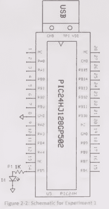


#### 1. 源代码 - 项目视图
-   源代码实际上是主要的设计。它是一个 .C 文件扩展名，符合 ANSI C 标准，唯一例外是对 Microchip 处理器特定功能寄存器（SFR）设置和控制的操作
-   你可以通过在项目视图中双击源代码列表来查看源代码的内容。源代码窗口将会打开。
-   源代码窗口会根据语言语法对源代码内容进行颜色编码。例如注释为绿色，C 语言元素为深蓝色。
-   在源代码窗口中，你有一个编辑器，可以修改代码或添加新代码
-   在此源代码中有几个主要组件。通用头文件、配置字、一个附加函数（我们加入以帮助模块化代码），最后是 Main 函数

#### 2. 通用头文件
```
#include "p24hxxxx.h"  /* generic header for PIC24H family */
```
-   此文件在源代码中被引用。它被称为头文件（具有 .H 扩展名）。它由 Microchip 开发并提供。对于我们的工作，其内部定义在 C 语言环境中支持对 PIC24H 微控制器外设和 I/O 的读写操作时是必需的。
-   实际文件存在于项目之外，位于 MPLAB C30 目录中。
-   此文件包含对所有特定 Microchip 外设功能和寄存器定义的引用。此引用使我们能够以无缝的方式使用符合 ANSI C 的语言组件访问 Microchip SFR 功能。

#### 3. 配置字
-   这些是 C 语言宏（自定义 C 语言脚本），用于设置配置字。这些宏是 .H 文件的一部分而定义。在此情况下，使用单独的脚本将 PIC24H CPU 时钟源固定为内部 RC 振荡器并禁用主主晶振振荡器。
```
_FOSCSEL(FNOSC_FRC);
_FOSC(FCKSM_CSDCMD & OSCIOFNC_ON & POSCMD_NONE);
_FWDT(FWDTEN_OFF);
```

#### 5. 延时函数
-   为了使 LED 闪烁，我们需要在打开和关闭时有一定的延时，以便在我们的视野中保持为“闪烁”。此函数提供了此功能。它配置为固定延时，仅空闲并消耗 CPU 周期时间，约为 ½ 秒。延时配置为循环嵌套循环。循环次数由 lend 和 jend 值确定。总延时约为 lend 乘以 jend 个周期，即 400 x 1000 或 400,000 个周期，以实现 500 毫秒延时。
```c
void delay(void); // 501 msec

int i,j;
for (i=0; i<lend; i++)
    for (j=0;j<jend; j++);
}
```

#### 6. 主代码
-   每个 C 程序必须有一个名为 "main" 的单一函数。用户执行的开始位置在此处，仅在编译器设置配置字、初始化处理器堆栈指针并初始化所有变量之后。一次 C 语言应用程序中只能存在一个 main 函数。正如我们将看到的，main 函数通常分为初始化部分和连续循环部分。初始化完成后，微控制器进入其操作的连续（“无限”）循环。这由 while (1) { ...... } 标记。微控制器通常不会离开 main 的这一部分，除非发生电源复位或看门狗超时。
```c
// main entry point
...................
int main(void)
/* Initialize ports */
AD1PCFGL = 0x0fff;    // reset all pins that others initialized make them digital
LATB = 0x0000;        // set latch levels for ports
TRISB = 0x0000;       // set IO as outputs for ports
/* endless loop */
while (1) {
    delay();
    led = !led;
}
```
-   通常基于 PC 的 C 应用程序会运行，然后在 main 函数完成后返回到 PC 操作系统。对于微控制器应用程序，没有操作系统，因此如果 main 终止，编译器会通过从头开始执行来复位处理器

#### 7. I/O 初始化
-   这在 main 函数内部，如前所述，是 main 中专门用于在应用程序开始使用它们之前初始化所有微控制器端口和外设（SFR）的部分。初始化通常在 main 中只发生一次，然后进入连续运行循环。我们的应用程序涉及三个特殊功能寄存器（SFR）。AD1PCFGL 用于配置并关闭具有模拟内容的引脚的所有模拟相关功能。LATB 是与 PORTB 引脚输出相关联的所有引脚的锁存输出设置。在此情况下，所有锁存设置都被清零——启动时输出上不会出现高电平。TRISB 是 PORTB 的方向设置，在此情况下使其全部为输出。
```
AD1PCFGL = 0xFFFF
LATB = 0x0000
TRISB = 0x0000
```

#### 8. 连续循环
-   这是微控制器应用程序的主要工作段。连续循环是所有工作完成的地方。在我们的循环中，我们调用延时函数，之后我们 'toggle' LED 的当前值（定义为 LATB 位 5 或 RB5 引脚）。通过 'toggle'，如果当前 RB5 的值为 1 则设为 0，如果为 0 则设为 1。这样在每次延时后，连接到 RB5 的 LED 将闪烁。
```
while(1)
    delay()
    led = !led
```

#### 9. Microstick II 状态
-   IDE 提供一个输出窗口，显示 Microstick II 调试器的状态（如果它已在您保存的工作区中配置为首选调试器）。请注意，输出窗口具有选择标签，允许您选择查看哪个输出。查看选项包括编译器构建、文件搜索结果、版本控制和调试器状态。所示的图假设您的 Microstick II 已连接到运行 MPLAB 的 PC 的 USB 端口。

#### 10. 调试器具体信息
-   这是 IDE 系统的一个组成部分，突出显示处理器类型、处理器状态以及当前使用的调试器。

### 实验 1 - 工作原理
该应用程序使用单个 C 源文件（main_led.c），其中包含一个 main 函数，引用通用 PIC24H 头文件/外设使用（#include "pic24Hxxx.h"）。此头文件将确定使用的特定 PIC24H 处理器。处理器配置使用预定义的 C 库宏设置（也在头文件中引用）。这些设置是内部 CPU 时钟选择为 8MHz，无外部振荡器，无时钟切换，无看门狗操作，最后将 RA3 用作数字/模拟引脚而不是外部晶振引脚输入。

在 main 函数中，应用程序执行 I/O 初始化，然后进入连续循环交替打开然后关闭 LED。此特定 LED 显示应用程序的流程图如图 2-5 所示。

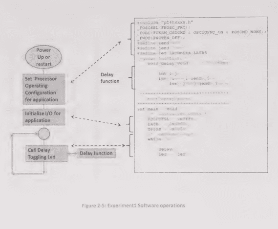

图 2-5：实验1 软件操作

### 实验 1 执行
让我们开始调试。在此阶段，鉴于原型硬件配置正确，且源代码和处理器配置良好，我们对执行期间会发生什么有相当好的了解。PIC24H 将使连接到 Microstick II 的 14 号引脚 RB5 的 LED 闪烁。

让我们验证延时时间并确保其足以产生良好的闪烁频率。一种快速方法是使用仿真工具“秒表”来测量此延时时间。在仿真下，有一些工具优势可以进行详细分析。秒表就是一个例子。在“秒表”下，我们可以进行实际时间测量。让我们先设置仿真，然后使用秒表验证延时时间，然后再进行实时调试和 Microstick II 的工作。

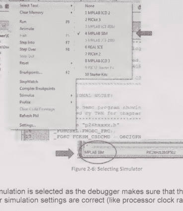

图 2-6：选择仿真器

一旦仿真器被选为调试器，请确保调试器的特定仿真设置正确（如处理器时钟频率）。

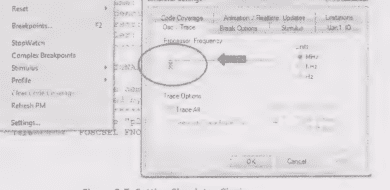

图 2-7：设置仿真器时钟


Make sure we are set to 8MHz. This is the clock rate for the internal RC, which matches configuration. We want to be sure that simulation matches the real world condition.

Ok, at this point we should be good to go with our delay measurement. Go to the source code. Position the cursor at the exact line where delay function is called in the main loop. Move the cursor to the grey left side column in the source and double click your mouse. A red breakpoint icon should appear aligned with source code that calls the delay. The toolbar and associated buttons are shown for review.


Figure 2-8: Tool bar Button definitions

- Position cursor over line in text
- Select break point on tool bar
- Select stopwatch

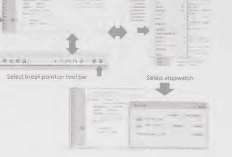

Ok, we have the stopwatch and the breakpoint set correctly. We want to measure the delay between successive calls to the delay function. This should be good enough to determine blink rate. Hit reset and the processor will run to first breakpoint. This first reading includes execution time from the beginning; this is not what we are interested in. Clear stopwatch by "clicking" zero button and continue to run (click on the run button) without resetting. We will then break again when the delay function breakpoint is reached a second time. Here we have captured an accurate time for the delay function. The stop watch shows elapsed time of approximately 500 milliseconds. This means that the LED "on" time and the LED "off" time are both 500 milliseconds, meaning the LED has a blink rate at about 1 second, slow enough for us to see.

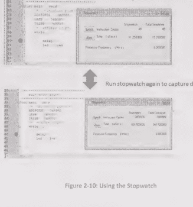

Figure 2-10: Using the Stopwatch

One other thing we can do under simulation is to check the toggle of RB5 using watch. Let’s leave the breakpoint where it is and do this. We select "view" from the tool bar, scroll down to watch and invoke the watch window. In this window we can view any named variable in our code or any SFR. Here we wish to add LATB to our viewing. By watching LATB between the breakpoints we should be able to see the RB5 turn on and off.

Ok, we should now have confidence that our source code is working as designed. RB5 does in fact toggle and it toggles at a blink rate of every ½ second. All design elements check out. Let’s now check it out for real with the prototype.

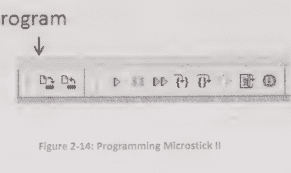

Figure 2-14: Programming Microstick II

Congratulations! You have your first working prototype! If you are tired of the blinking LED you can stop at any time by clicking pause. To continue, click run or reset. The simulation tools also work under Microstick II debug. For instance you can still set breakpoints and watch as needed, stopwatch only works under simulation. Let's move on to Experiment 2.

### 实验 2

Let's expand on what we have and add some new functionality. Here we use the same software structure as in Experiment 1 but modify the software and add hardware to demonstrate a eleven LED digital counter. Let's start with the hardware first. The schematic shown in Figure 2-16 adds ten LEDs and series resistors to the prototype. RB15 on the Microchip board already has its own LED (not shown in schematic). Here we are now using most of the LATB associated pins. Also included is a photo of the new assembly below.


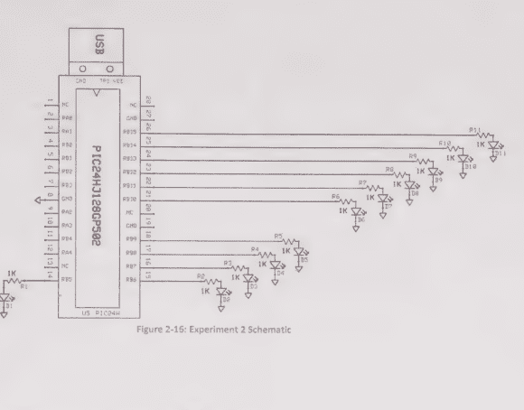

Figure 2-16: Experiment 2 Schematic

The objective here is to blink all the LEDs. We will use a binary counter. With a binary counter each successive LED in the LATB port will blink at a rate twice as slow as the previous LED. Besides the hardware addition very little change needs to happen in software or the MPLAB workspace settings to make this happen.

First let's modify example 1 by replacing the existing source code file with a new source code file. The Figure 2-17 shows this process in five steps.

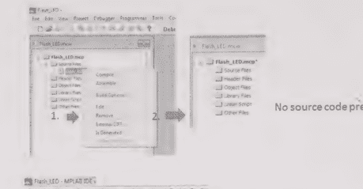

No source code present

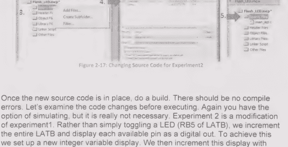

Figure 2-17: Changing Source Code for Experiment2

Once the new source code is in place, do a build. There should be no compile errors. Let's examine the code changes before executing. Again you have the option of simulating, but it is really not necessary. Experiment 2 is a modification of experiment1. Rather than simply toggling a LED (RB5 of LATB), we increment the entire LATB and display each available pin as a digital out. To achieve this we set up a new integer variable display. We then increment this display with each cycle through the continuous loop and then output the entire display value to LATB. Note that TRISB in initialization set all LATB pins to output.

We have available to us 11 LEDs on PORTB starting with RB5 to RB15 and designated as the 'user LED'). To increment we do so with a value of 0x2f. This treats RB5 as the least significant bit in our binary counter.

```
#include "p24xxxx.h"                 /* generic header for PIC24 family */
_FOSCSEL(FOSC_PRC);                     // set configuration mode ...
_FOSC(FCKSM_CSDCMD & OSCIOFCN_ON & FCKSM_NONE); // use OSCIO pin for RA...
_FWDT(FWDTEN_OFF);                      // turn off watchdog
#define lend 25 //delay loop is lend times lend instruction cycles
int display
void delay(void)  // 100 msec
{
    int i,j;
    for(i=0;i<...;i++)
        for(j=0;j<lend;j++);
}
int main (void)
{
    /* Initialize ports */
    AD1PCFG = 0xFFFF;   // set all pins that ... and make them digital
    LATB = 0x0000;      // set latch level for PORTB
    TRISB = 0x0000;     // set RB as outputs for PORTB
    while(1)
    {
        delay();
        display = display + 0x002f;
        LATB = display;
    }
```

Figure 2-18: Experiment 2 Code

Make the project, program the Microchip and then watch the binary counting light show. Any problems at this point must be attributed to hardware so double check with the provided schematic and assembly photos.

### 16 位微实验器（可选）

This is the LED experiment for the 16 bit Micro Experimenter. This operates in an identical fashion to Experimenter 1 in this chapter and in fact uses the same source code. You need to build the code and uses either PICKIT2/3 as debugger/programmer. The Experimenter can be used with or without an external power supply if the PICKIT2 is used (the PICKIT2 senses power and automatically supplies power if not sensed). In addition the Experimenter needs an external LED with series resistor to be added to J3 PIN3 (see hookup diagram).

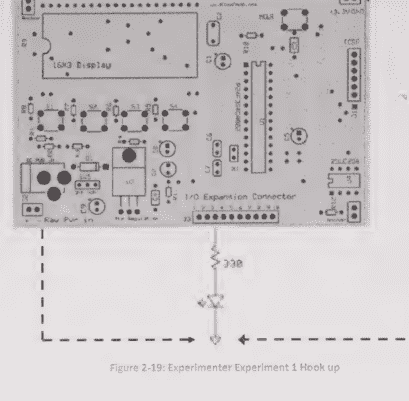

Figure 2-19: Experimenter Experiment 1 Hook up

A more elaborate light show demo using the 16 Bit experimenter LCD library and J3 I/O Expansion is shown in Figure 2-20. Use LIGHTSHOWDEMO project in Chapter2 source code. The Demo configures pins 1-8 of J3 I/O expansion bus as digital outputs where only one of the eight outputs is a high level at a time in rapid succession in random. To actually see the demo you must add eight LED's and eight current limiting resistors (330 ohms each) to the I/O bus pin as shown. Each pin will have a 330 ohm resistor in series with an LED where the LED cathode is tied to ground. Enjoy the show!

### 练习：

- 1. Expand on Exercise 2
- d. Use same hardware configuration
- e. Modify source code to do an arbitrary LED light pattern
- i. Hint use a 'C' array with LATB patterns and index lookup to move individual LATB light patterns to LEDs during each loop delay
- ii. Solution: a source code file named 'array.c' existing within the current project space. Use techniques established in experiment 2 to introduce this new source. Examine this source for code example. Try modifying the light pattern for something different.


图 3-1：机械开关抖动

### 实验 1 - 硬件

如第 2 章所述，PIC24H 具有用户可编程引脚。这些引脚可以配置为数字输入、数字输出、模拟输入，或分配给特定外设。

在本章中，我们利用第 2 章学到的知识，开始使用数字输入。您可能还记得，每个引脚都有对应的 TRIS 控制位来设置引脚的数字方向。置 0 使引脚成为输出；置 1 使引脚成为输入。每个引脚还有一个 PORT 位，用于读取或写入该引脚，以及一个 LAT，其工作方式与 PORT 类似，但使用 LAT 我们可以锁存输出或输入，而不是直接通过 PORT 读取或写入。LAT、PORT 和 TRIS 都是特殊功能寄存器（SFR）。这些寄存器都是 16 位的，但在我们与 Microstick II 一起使用的 28 引脚“细型”DIP 封装中，并非所有这些 SFR 位都被使用。

在 C 代码中访问 TRIS、PORT 和 LAT 等特殊功能寄存器有多种软件技术，我们已在第 2 章中介绍过，后面讨论软件时还会进一步扩展。对于实验 1，我们将一个 LED 连接到 PORTB 的第 5 位，即 RB5（PIC24H 的第 14 引脚），然后将 RB5 设置为数字输出，通过限流电阻驱动 LED。一个按钮开关连接到 RB3，即 PIC24H 的第 7 引脚。该引脚将被设置为数字输入。

让我们简要讨论一下开关是如何连接的。这个开关是一个小型触觉按钮开关，称为 SPST（单刀单掷）开关。其触点显示为常开状态，开关上没有电气导通。当您按下按钮时，开关两端接通。使用该开关时，我们将一端接地，另一端连接到 RB3 数字输入。当开关被按下时，输入将读取到接地状态，即零。


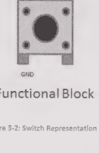

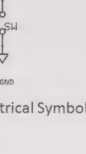

物理开关

功能框图

电气符号

图 3-2：开关的表示形式

当开关未被按下时，它处于断开状态，RB3 引脚将处于悬空状态（与地或 +3.3VDC 之间没有直接连接）。在这种情况下，微控制器读取到的状态是不确定的。为了解决这个问题，我们需要通过一个电阻将 +3.3VDC 连接到开关的常开端（NO）端子。这样，当开关未被按下时，RB3 将读取到 1 或高电平；当开关被按下时，开关将该点连接到地，RB3 读取到的值将为 0。

与其使用外部电阻来搭建电路，PIC24H 有一个很好的特性：它可以通过内部一个 100K 电阻将引脚配置为内部上拉。这被称为弱上拉，因为它使用 100K 电阻，所以可提供的电流不大，但在这里已经足够了。通过设置 SFR 中相应的位可以启用上拉控制。在本例中，该 SFR 是 CNPU1（变化通知上拉）。参见图 3-3。

当您查看 PIC24HJ128GP502 的引脚排列时，第 7 引脚 RB3 显示它与 CN7 共用引脚，因此这就是我们要在 CNPU1 SFR 中设置的控制位。通过设置该位，RB3 引脚将通过内部 100K 电阻上拉到 +3.3VDC（即微控制器电源），从而无需外部上拉电阻。

这可以在没有任何延迟的情况下完成。这里确实不需要延迟，因为我们希望尽可能立即响应开关闭合，并通过 LED 报告。

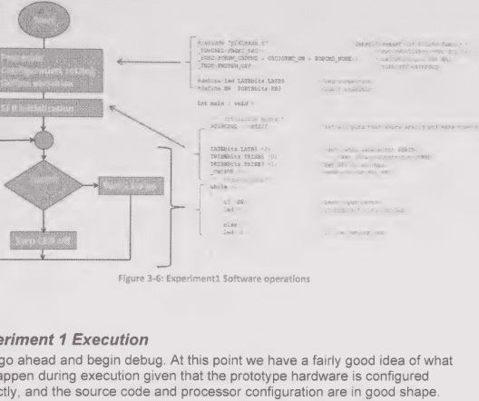

图 3-6：实验 1 的软件操作

### 实验 1 执行

让我们开始调试吧。此时，假设原型硬件配置正确，源代码和处理器配置也正常，我们已经很清楚执行过程中会发生什么。当按钮被按下时，PIC24H 将点亮连接到 Microstick II 第 14 引脚 RB5 的 LED。由于我们使用了实际的硬件输入，仿真在这里帮助不大。

因此，将调试器设置为“starter kit”。（见图 3-7）。

1.  设置断点
2.  并设置监视变量为 PORTB
3.  在 SW 未按下时运行，您应该在以下设置处中断（RB3=1）
4.  在 SW 按下时运行，您应该在以下设置处中断（RB3=0）

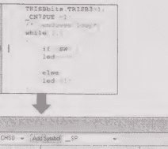

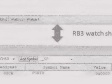

RB3 监视窗口显示开关按下状态

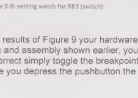

图 3-9：设置 RB3（开关）的监视变量

好的，如果您的监视窗口捕捉到了图 9 所示的结果，说明您的硬件工作正常。如果没有，请返回查看前面给出的原理图和装配图，说明存在硬件接线错误。假设一切正常，只需使用工具栏关闭断点设置并运行。每次您按下按钮时，LED 都应该点亮。

### 实验 2 - 硬件

让我们继续实验 2。在这里，我们必须考虑开关抖动，以便准确计数开关闭合次数。我们将构建一个五级 LED 计数器。该计数器将对手动按钮按下的次数进行计数。对于五级计数器，我们应该能计数 32 次按钮按下后才溢出。对于这个实验来说，这应该足够了。同样，按钮连接到 RB3。LED 通过 1K 限流电阻连接到 RB5、RB6、RB7、RB8 和 RB9。下面提供了原理图。

### 实验 2 - 软件

好的，硬件已经就绪，让我们讨论一下软件。导航到第 3 章的代码文件夹，打开练习 #2 文件夹，然后双击 MPLAB 项目图标 Flash_LED.MCP。

该应用程序再次使用单个 C 源文件（main_led.c），与练习 1 相同，其中包含一个主函数，引用通用的 PIC24H 头文件/外设（#include "pic24Hxxxx.h"）。该头文件将确定所使用的具体 PIC24H 处理器。处理器配置使用预定义的 C 库宏（也在头文件中引用）进行设置。这些设置包括：内部 CPU 时钟选择为 8MHz，无外部振荡器，无时钟切换，无看门狗操作，最后将 RA3 用作数字/模拟引脚而非外部晶振引脚输入。

使用一条 define 语句将开关 SW 标记为 PORTBbits.RB3。这是连接到按钮的输入引脚。其他 define 与延迟函数中使用的限制值相关。我们再次使用延迟函数，它将对按钮去抖起到重要作用。

在主函数中，应用程序执行 I/O 初始化。我们首先通过将 AD1PCFGL 设置为全 1，将所有引脚从模拟模式转换为数字模式。我们清零 LATB，并首先将 PORTB 的所有引脚设置为数字输出。请记住，RB5、RB6、RB7、RB8、RB9 连接到 LED，将代表我们的二进制计数器。然后我们设置 TRISbits.TRISB3 = 1，将 RB3 使能为输入。最后一个设置是 _CN7PUE = 1，为 RB3 输入设置相应的弱上拉。

然后，主代码进入一个连续循环，测试第 7 引脚 RB3（SW）是否为低电平，以表示按钮被按下。如果是低电平，则延迟并递增一个去抖计数器。如果经过 3 次计数后 SW 仍为低电平，我们将其解释为一次最终稳定的按钮按下，然后执行二进制计数。该二进制计数随后输出到 LATB 以驱动 LED。图 3-11 显示了该应用程序的流程图。

主连续循环使用了三个嵌套的判断结构。第一个 IF 语句测试 SW 条件，第二个嵌套的 IF ELSE 测试去抖计数，然后决定是否递增二进制计数。第三个嵌套 IF 检查递增后的计数，如果超过最大计数 1024 则重置计数。请注意，还有一个 view count 变量。该变量是为了调试而设置的，使用监视窗口测试二进制计数是否正常工作。实际的计数器“binarycount”按 0x2f 递增（请记住我们的最低有效位是 RB5），这看起来直接监视有点令人困惑。


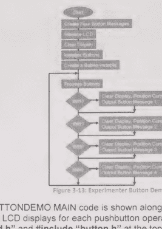

图 3-13：实验者按钮演示

BUTTONDEMO MAIN 代码的副本显示在下方，同时显示每次按键操作对应的实验者 LCD 显示。现在我们在文件顶部有 #include "lcd.h" 和 #include "button.h"，以便引用 LCD 库和 BUTTON 库。再次尝试跟随代码并与流程图进行比较。在所有这些演示中，我们通过逐一添加和使用一个库函数来逐步为实验者构建功能。


BUTTONDEMO MAIN 代码


SW1 按下时的消息显示

SW2 按下时的消息显示

SW3 按下时的消息显示

SW4 按下时的消息显示

实验者显示

每次按下和释放都会产生一定数量的计数。

- 2. 设置一个 WATCH 来查看计数并检查二进制计数值是否正确，对应发生的按键激活次数。
- 3. 尝试在 RB2 上添加第二个按钮，并使用该按钮递减运行计数。

图 4-1 中显示了模拟环境（典型的输入传感器值）随时间变化的连续电压输出。随着环境条件变化，传感器输出值也会平滑地、无中断地变化。然而，微控制器是一个数字设备；它仅使用数字进行操作，并且只能定期进行测量（作为正常处理循环的一部分）。从微控制器的角度来看，连续的传感器信号现在变成以固定速率采样的离散值集合。这些值是相对于真实模拟值的近似值，原因很简单，数字本身的大小在分辨率或位数上是有限的。对于 PIC24H，ADC 可以生成 10 位或 12 位值（用户可选择）。

10 位分辨率提供 1/1024 *3.3VDC 的电压分辨率或 3 毫伏（请记住 PIC24H 是 +3.3VDC 器件）。12 位更好，1/4096 * 3.3VDC 或 0.8 毫伏。在这两种情况下，ADC 都根据 ADC 转换的大小为输入传感器值提供固定的分辨率。PIC24H ADC 分辨率精度达到数字字长 +-1 LSB。通过对连续读数进行平均（假设平均期间输入不变），精度可以提高到优于 1 LSB。对于该技术的一个经验法则是确保信号（通过动态调整其幅度）尽可能大地进入 ADC，并且不超过满量程，以实现采样测量期间的最佳信号分辨率。在我们的实验中，我们不会控制任何信号幅度，只直接测量原始输出。

让我们现在讨论固定的测量速率或采样速率。如前所述，使用固定采样速率意味着您会定期测量信号。使用周期性采样时存在风险，即信号可能在周期性采样之间显著变化，而微控制器将“看不到”，因此无法测量和响应这些变化。工程上的经验法则是采样率应足够高以捕获信号的最高频率。更精确地说，该规则指出采样率 = 2X 最高输入频率（也称为 Shannon 规则）。在大多数情况下（音频除外），传感器输出通常频率含量非常低，因此不需要高采样率。然而，PIC24H 在 10 位 ADC 下的最高采样率为 1.1MSPS（每秒百万次采样），在 12 位 ADC 下为 500 KSPS（每秒 50 万次采样）。

生活中没有免费的午餐，就像其他一切一样，用户也存在权衡，您本质上可以以转换速度（1.1 MSPS 或 500KSPS）换取电压分辨率（10 或 12 位）。选择由您决定，应根据实现最高精度和最及时传感器读取的需求来决定。在我们的实验中，我们只使用 12 位。

在继续实验之前，让我们再介绍一些基础知识。图 4-2 显示了 ADC 操作涉及的一些离散步骤，超出采样率和数字分辨率。ADC 操作分为

两个离散步骤：采集时间（采样并保持信号）然后是转换（对采样并保持的信号执行 ADC 过程）。为了收集并保持模拟信号以便转换，使用了采样保持电容。该电容内部于 PIC24H 电子器件中。电容跟随模拟输入信号，然后在采样命令后存储模拟值的电压捕获以供转换过程使用。这被表示为采样保持过程。

在信号保持在电容中时，模拟到数字转换过程会进行。转换使用确切数量的 CPU 时钟周期（相当于结果输出字长）来执行转换。这种类型的转换过程称为逐次逼近，其中使用内部比较器来测量模拟采样输入与内部生成的斜坡比较器之间的差异。斜坡输出电压大小由转换时钟的数量决定。对于每个时钟（10 或 12 中的一个），会做出数字决策并生成数字位值并存储为最终数字字结果的一部分。


图 4-2：ADC 采样时间

PIC24H ADC 外设是一个极其多功能的部分，具有许多可通过设置外设特定 SFR（特殊功能寄存器）配置的操作模式。其中一种模式是分辨率，可从 10 位选择到 12 位。另一种是您可以使用采样保持（S/H）通道的数量。选择 10 位时，总 S/H 数量为四个，使用 12 位 ADC 时

- 可选缓冲填充模式 - DMA 辅助结果存储

ADC 模块总共有十个 SFR 控制和状态寄存器，其中一部分将在我们即将进行的实验中使用。让我们回顾一下 SFR 内容。我们希望在实验中能够将 ADC 设置为 12 位单通道模式操作，无扫描，整数输出和手动模式触发。

在此类配置的 ADC 框图显示如下。这里只有一个 S/H 处于活动状态，12 位 ADC 仅使用一个输入通道且无扫描。我们的特定 PIC24H，硬件预配置为 Microstick II，并没有 16 个模拟通道，而是限制为 8 个。这些八个通道为 AN0、AN1、AN4、AN5、AN9、AN10、AN11 和 AN12。

使用 SFR 设置为 12 位整数无符号格式，信号数字输出格式将从 0x0000 变到 0x0FFF。这对于大多数单电压输入传感器值是典型的，其中 0 表示 0.0 伏特，0X0FFF 表示 +3.3 伏特。

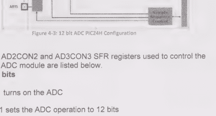

下面列出了用于控制 ADC 模块操作的 AD1CON1、AD2CON2 和 AD3CON3 SFR 寄存器。

### AD1CON1 SFR 位

- ADON =1 打开 ADC
- AD12B =1 将 ADC 操作设置为 12 位
- FORM 位
  - 01 输出格式为有符号
  - 00 输出格式无符号

- CH0NA 通道 A =0 负输入为 –REF
- CH0SB 通道 B =000 – 未使用
- CH0SB 通道 B =0 负输入为 –REF - 未使用

### AD1CSSL SFR 位 – 输入扫描选择低

- CSS = 0x0001 对应 AN0

### AD1PCFGL SFR 位 - 模拟输入选择

- PCFG =0xFFFE 初始为 AN0，但在库中也可以设置其他可用通道

### 硬件描述

硬件原理图在图 4-4 中给出。这里我们使用一个模拟 10K 电位器作为可设置输入模拟源，用于模拟输入通道 0 或 PIC24HJ128GP502 的 AN0 引脚 2。10K 电位器有一个端子连接到外部 +3.3 VDC 电压源。Microstick II 有两个裸焊盘 GND 和 VDD（或原理图上的 TP1）。您的选择是经由板上 TP1 连接 +3.3VDC 或为此实验提供该供电电压。使用 TP1 时需要注意的是，该连接可提供的电流有限。请记住，微控制器本身也使用该连接。其需求会根据振荡器设置和输出驱动电流而变化。作为经验法则，当您的原型实验超过 100ma 标记时，您可能希望使用外部电源作为电源。在本练习中，由于我们仅使用电位器，我们将连接到 VDD（TP1）以提供电位器的 +3.3VDC，并将 Microstick II 的引脚 8 接地连接到电位器的接地。电位器的滑动端连接到 AN0 输入引脚 2。您必须移除跳线 J3 以断开该引脚的用户 LED。使用电位器，我们可以将 AN0 的输入电压在 +3.3VDC 到地之间变化，以进行 ADC 实验。


### 项目视图

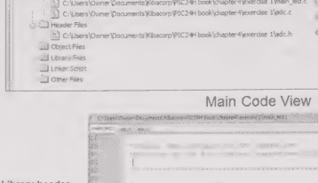

主源代码

库源代码

库头文件

### 主代码视图

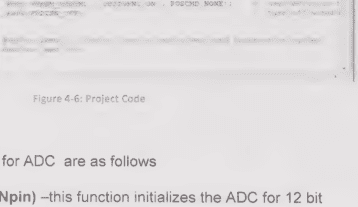

主代码中引用的库头文件

图4-6：项目代码

ADC 的实际库函数如下：

- void initADC(int ANpin) – 此函数使用“ANpin”作为单一输入引脚，将 ADC 初始化为 12 位手动转换。ANpin 可能的设置为 AN0、AN1、AN4、AN5、AN9、AN10、AN11、AN12
- int readADC(int ANpin) – 此函数在指定的 ANpin 上强制进行手动 ADC 转换。
- void binary_to_ASCII_convert(int n) – 此函数将 n 的二进制值转换为其 ASCII 等效值。ASCII 等效值存储在下文列出的 BCD 变量中。
- int averagevalue(int ANpin) – 此函数是一个高级函数，自动连续执行四次 ADC 转换并对总和取平均值。

此外，库为二进制到 ASCII 转换的输出保留了五个变量位置：

- char bcd10000 – 万位的 ASCII 数据值
- char bcd1000 – 千位的 ASCII 数据值
- char bcd100 – 百位的 ASCII 数据值
- char bcdtens – 十位的 ASCII 数据值
- char bcdunits – 个位的 ASCII 数据值

完整的主软件流程和代码如图4-7所示。

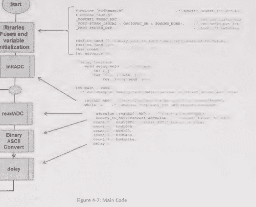

图4-7：主代码

### 运行实验

将 Microstick II 插入无焊面包板。按原理图所示将电位器添加到电路中。将电位器的一端接地，另一端接 +3.3VDC 外部电源。确保接地端也连接到 Microstick II 的引脚 8。将 Microstick II 连接到 PC 的 USB 端口。

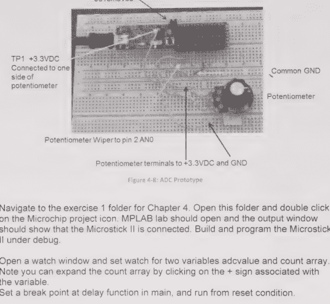

图4-8：ADC 原型

导航到第 4 章的练习 1 文件夹。打开此文件夹并双击 Microchip 项目图标。MPLAB lab 应打开，输出窗口应显示 Microstick II 已连接。在调试模式下构建并编程 Microstick II。

打开一个监视窗口，并设置监视两个变量 adcvalue 和 count 数组。注意，您可以通过单击与变量关联的 + 符号来展开 count 数组。在主函数中的 delay 函数处设置断点，并从复位状态运行。

为了快速检查，PIC24H 应停在 delay 函数处，监视变量应被填充。调整电位器并再次运行程序，变量值应发生变化。如果变量没有变化，请对照原理图检查接线。您的接线存在错误。

让我们进行一些最终验证。将您的 adcvalue 与 count 数组值进行比较。您可以使用计算器对 adcvalue 进行十六进制到十进制的转换，或者在监视窗口中右键单击 adcvalue 并将属性设置为十进制，然后直接进行比较。

另一种更完整的验证方式是使用电压表，并将该电压表连接在电位器滑片与地之间进行电压测量。

## 第5章 – 将 LCD 显示器与 Microstick II 配合使用

在本章中，我们将使用 Microstick II 与一个外部 LCD（液晶显示器）。需要考虑软件（以库的形式）和硬件接口两个方面。LCD 通过显示状态、提供重要的应用反馈以及促进与用户的操作控制，真正增强了微控制器的操作能力。

我们将使用的 LCD 支持多行文本显示：3 行 × 16 字符，共 48 个字符。LCD 带有集成内置控制器，负责处理显示操作中较为繁琐的大量“繁重工作”。例如，LCD 控制器驱动显示器上的各个显示段；为 ASCII 文本输入自动生成显示字符段；最后，响应与外部微控制器（在本例中为 Microstick II）之间的固定命令和数据接口。

在本章中，我们将采用一种易于在您未来项目中复用的接线方案和软件库。为了巩固理解，我们将使用此配置进行几个实验。第一个实验将只关注首次设置和操作 LCD。在第二个实验中，我们将把 LCD 与第 4 章介绍的 ADC 库结合使用，使其充当简单的电压表；以电压格式输出并显示 ADC 数据。让我们开始吧！

### 硬件描述

该 LCD 是一款由 Electronic Assembly Corporation 制造的 +3.3VDC 供电的 16x3 字符液晶显示器。它在控制方式上与其他标准 LCD 非常相似，但具有内置对比度控制的扩展功能（无需任何外部电位器）。此外，它的功耗非常低（通常在 +3.3VDC 下为 250 微安）。该 LCD 专为紧凑型手持设备而设计；它也非常紧凑、超薄，并支持“类 DIP”引脚排列，非常适合面包板原型制作。

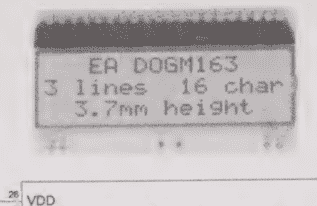

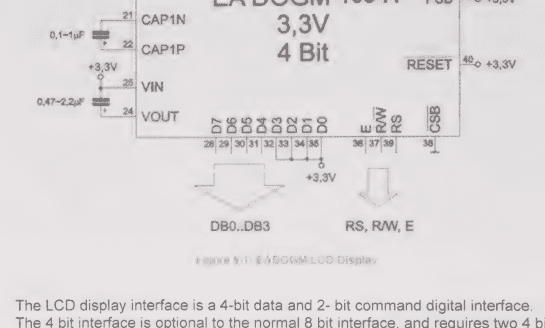

图5-1 EA DOGM LCD 显示器

LCD 显示接口是一个 4 位数据和 2 位命令的数字接口。4 位接口是相对于正常 8 位接口的可选方案，需要向 LCD 写入两次 4 位半字节，而不是一个字节。选择此接口是为了简化与 Microstick II 的原型接线和引脚需求。另一个简化是让 Microstick II 不从 LCD 读取数据，而只向其写入数据。为此，LCD 库强制 Microstick II 的 PIC24H 在与 LCD 控制器进行命令/数据事务之间延迟足够长的时间，让 LCD 有时间响应，而无需读取和检查其忙状态。

图5-2 展示了 Microstick II 与 LCD 连接的原理图。

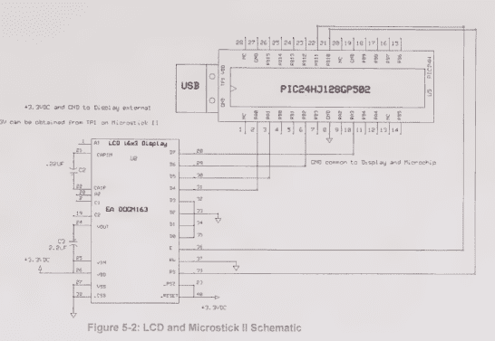

图5-2：LCD 与 Microstick II 原理图

请注意，驱动 LCD 需要单独的 +3.3VDC 电源，因为 Microstick II 本身不提供外部电源。另一种获取 +3.3VDC 的方式是连接到 Microstick II 上的 TP1 过孔，因为 LCD 的电流需求非常小。LCD 与 Microchip 之间的接地必须共地，并按图示连接到引脚 8。

LCD 确实需要使用单独的电子元件才能运行。对比度控制和 LCD 内部电压调节需要 2.2uF 和 .22uF 两个电容（C3、C2）（见图5-2）。请注意，2.2uF 电容是有极性的——因此请遵循其标记，确保正极连接到引脚 25 和 26。

如前所述，LCD 引脚排列配置为 40 引脚 DIP（底部一行引脚大多缺失）。从显示器顶部看，左下角引脚为引脚 1，右下角为引脚 20。顶部一排引脚从左到右为引脚 40 至 21。请按照原理图中显示的所有连接进行操作，并与原型图片进行目视比较。另请注意，Electronic Assembly LCD 显示器在显示面带有保护膜。应将其撕掉（剥下）以便无障碍观看。

总之，LCD 与 Microstick II 的 4 位并行数据接口如下：

- LCD D7 连接到 Microstick II 引脚 RA3
- LCD D6 连接到 Microstick II 引脚 RB2
- LCD D5 连接到 Microstick II 引脚 RA1
- LCD D4 连接到 Microstick II 引脚 RA0

命令接口由两条命令线实现：

- LCD 命令/数据控制 RS 连接到 Microstick II 引脚 RB10
- LCD 选通输入 E 连接到 Microstick II 引脚 RB11

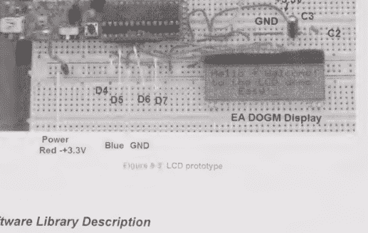

图5-3：LCD 原型

### 软件库描述

硬件部分就到此为止，现在是有趣的部分。让我们学习驱动 LCD 的软件函数以及如何使用它们。这里我们将使用五个函数。它们的名称基本说明了它们的功能。请记住，LCD 的数据只接受 ASCII 字符。如前所述，LCD 组织为具有 0-47（48）个字符位置的显示器，或者类似地，一个 16x3 显示矩阵。同样，这指的是 16 列 × 3 行。第一行包含位置 0-15，第二行 16-31，第三行 32-47。该库允许完全自由地将字符放置在显示矩阵中的任何位置。当您一次接一个字符（如字符串）写入时，它还会自动递增字符位置。


- LCD_Initialize () - 初始化 LCD 显示屏，使其准备好进行输出。在调用任何其他 LCD 函数之前，都必须调用此函数。请注意，初始化是一个两步过程：首先，PIC24H 必须初始化其端口，以便与 LCD 建立输出连接；完成此操作后，它才会执行 LCD 初始化命令序列。还需注意，此库专门用于支持原理图中所示的连接方式。任何与该接线方式的偏差都会导致 LCD 库无法正常工作。

LCD 需要特定的初始化序列才能正常运行。此外，PIC24H 与 LCD 交互时也有严格的命令集，用于写入命令和数据，以及定位 LCD 光标。这些功能通过所提供的“C”库函数实现。下面展示了使用“C”库中相关元素的初始化序列和命令接口示例。建议查看此代码（位于项目中的 Graphics.c 文件内），并将其与显示屏随附的 LCD 数据手册进行对照（参见图 5-4）。

#### Graphics 库中的初始化定义（Graphics.c）

```
//LCD Hardware Interface
#define LCDPORT LATB
#define E LATBbits.LATB11
#define RS LATBbits.LATB10
//Table for Initialization Instructions 8 bits 3.3V
#define FUNC1 0x20 // LCD 4bits 2 lines Table select 1
#define BIAS 0x15 // BIAS 1:3 / line LCD
#define PWRCNTRL 0x95 // Power control on, booster on, contrast 64
#define FOLLOW 0xC0 // Boost converter follower and pass
#define CONTRAST 0x72 // Set contrast 0x72
#define FUNC2 0x28 // Switch back to table
#define DISPLAY 0x0F // Display on/off - Display on, cursor on, cursor blink
#define CLEAR 0x01 // Clear display - return home
#define ENTRY 0x06 // Increment automatically
```

#### Graphics 库中的初始化序列（Graphics.c）

```
//FUNC1
LCDWrite(FUNC1); // 0x20
// BIAS
LCDWrite(BIAS); // 0x15
//PWRCNTRL
LCDWrite(PWRCNTRL); // 0x95
//FOLLOW
LCDWrite(FOLLOW); // 0xC0
//CONTRAST
LCDWrite(CONTRAST); // 0x72
//FUNC2
LCDWrite(FUNC2); // 0x28
//DISPLAY
LCDWrite(DISPLAY); // 0x0F
//CLEAR
LCDWrite(CLEAR); // 0x01
//ENTRY
LCDWrite(ENTRY); // 0x06
```

图 5-4：用于初始化的 LCD 代码

## 细胞能量转换
- **细胞能量转换**
  - **能量转换**
    - 光能
    - 化学能
  - **光合作用**
    - 吸收CO₂
    - 释放O₂
    - 合成有机物（葡萄糖）
    - 储存能量
  - **细胞呼吸**
    - 消耗O₂
    - 释放CO₂
    - 分解有机物
    - 释放能量（ATP）

第 5 章。打开此文件夹，然后打开电压表文件夹。双击 PIC24HVOLTMETERDemo 项目。MPLAB 实验项目应会打开。

在调试模式下构建并编程 Microstick II，输出窗口应显示 Microstick II 已连接，然后单击 RUN。此时应该会看到类似图 5-9 的显示，其中同时显示 ADC 计数值以及与该计数值对应的电压。尝试改变电位器的值以改变读数——电位器完全逆时针旋转时，计数值应为 0，电压应为 0 V；完全顺时针旋转时，计数值应为 4096，电压应为 +3.3 V。如果读数不稳定，则说明电位器接线错误，或者使用了错误的模拟输入引脚。

恭喜你，现在已经具备了简单的 ADC 电压表功能。

### 16 位实验器（可选）

提供了一个基于 LCDDEMO 的 Experimenter 示例项目。无需接线图，因为 Experimenter 已经在板载完成了所有 LCD 连接。由于 Experimenter 与 Microstick II 的 LCD 连接方式不同，Microstick II 的实验项目未经修改无法在 Experimenter 上运行。

在这个 Experimenter 项目中，我们将展示如何使用上述每个 LCD 函数，以及如何从 MAIN 文件中调用这些函数。下面先介绍流程图，然后讲解代码。LCDDEMO 首先声明两个字符串：消息 #1 和消息 #2。每条消息都设置为少于 16 个字符，以使显示内容整齐美观，也就是说，每条消息都限制在单行显示范围内。下一步是在使用 LCD 之前对其进行初始化并清除显示内容。之后，将光标定位到第一行的开头（光标位置 = 0），并写入消息 #1。然后，将光标定位到第二行的开头（光标位置 = 16），并写入消息 #2。

为了增加一些趣味性，接着将光标定位到第三行的中间位置（光标位置 = 36），并写入五个字符。如果你到现在还没有弄清楚，那么 LCD 显示屏的光标位置 0 到 15 对应第一行，即顶行。位置 16-31 对应第二行，位置 32-47 对应底行，即第三行。LCD 初始化时，光标本身不可见；当数据写入显示屏后，光标位置会自动移动到下一个位置。写入 LCD 并显示的任何数据都必须采用 ASCII（美国信息交换标准代码）格式。

### 使用 LCD 的关键应用回顾：
- LCD 是一种可配置的智能设备，在应用程序运行期间由 PIC24H 发出命令进行控制。

### 源代码关键特性回顾：
- 使用 include 指令可以使代码高度模块化，在本例中引入了 ADC 驱动程序库。
- 项目为每个驱动程序分别包含多个文件，其中驱动程序函数的声明位于 .h 文件中，函数主体位于 .c 文件中。
- Main 只需包含所需的 .h 文件，即可直接访问所有驱动程序代码。
- 在 main 函数之前声明的全局变量可被所有代码访问。
- 在本例中，我们又引入了一个库函数：LCD。

### 练习：
- 1. 尝试将第一个实验中的消息修改为自定义内容，然后重新运行实验。
- 2. 确定 BCD1000 在源代码中的位置。main 如何访问它？
- 3. 让实验 2 使用电位器滑动端连接到另一个模拟输入。
- 4. 尝试在实验 2 中使用 ADC 库中的平均函数。注意，使用平均功能后，显示读数会更加稳定。

中断控制器；最后，还必须有一个特定的函数调用，该函数被指定为中断服务程序，并会在中断发生后被调用和执行。关于服务程序的具体细节、其构造方式以及它至少必须执行的操作，还有一些需要说明的内容。我们稍后会介绍这些内容。

一旦发生定时器中断条件，CPU 的当前状态（程序计数器、状态寄存器和标志位）就会被保存，或称为“压入”堆栈（PIC24H 内部的先进先出 RAM 缓冲区）。随后，定时器中断服务程序会被调用并由 CPU 执行，以处理定时器中断条件。当 CPU 退出服务程序后，中断发生之前的 CPU 状态会从堆栈中恢复，或称为“弹出”。然后，CPU 继续执行正常操作。从某种意义上说，这种中断机制允许外设处理服务按需执行。

### 硬件说明

我们在第 2 章中已经见过这种特定的硬件设置，现在将再次使用它。这是熟悉的 LED 闪烁原型，但在本实验中，软件完全不同。我们将使用定时器的新技术。所有实验都会采用相同的软件 I/O 设置。在这些实验中，我们希望将一个 LED 连接到 PORTB 的第 5 位，即 RB5，并将 RB5 设置为数字输出。

RB5 是 PIC24HJ128GP502 上的第 14 号引脚。该器件采用 28 引脚 DIP 封装，因此芯片两侧各有 14 个引脚。从芯片顶部向下看，封装上有一个缺口，用于指示第 1 号引脚；所有引脚从 1 到 28 逆时针编号。因此，第 14 号引脚，即 RB5，应当是芯片右下方的最后一个引脚。

图 6-2 展示了原理图。PIC24H 的数字输出端每个最多可以提供 25 毫安电流。点亮 LED 并不需要这么大的电流（3 毫安已经足够），因此我们在 LED 串联回路中使用一个限流电阻（1K）。该电路基本上是一个串联电路：RB5 连接到电阻的一端，电阻的另一端连接到 LED 的阳极，最后将 LED 的阴极接地。这样，当我们将 RB5 = 1 时，LED 就会点亮；当我们将 RB5 = 0 时，LED 就会熄灭。


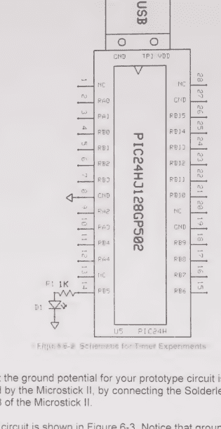

Figure 6-3 Schematic for Timer Experiments

确保原型电路的接地电位与 Microstick II 使用的接地参考相同，通过将无焊面包板的地连接到 Microstick II 的 8 号引脚。

已组装的电路如图 6-3 所示。注意地是从 8 号引脚取出的并连接到原型板上的公共地总线。同一接地也用于 LED 阴极。LED 阴极必须接地才能工作。你需要能够区分 LED 的阳极和阴极以便正确连接。阴极通常是器件上较长的引脚，并且在器件上也由平边标记。

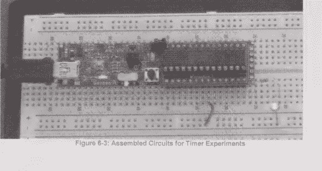

Figure 5-3: Assembled Circuits for Timer Experiments

### Timer 1 Experiment – Non-Interrupt

有一段代码片段显示了定时器 1 如何初始化。外设时钟是 CPU 内部时钟除以 2。在我们的情况下这是 8MHz / 2 或 4MHz。在此片段中，T1CON 的控制位设置为内部，预分频器为 256，给我们最终时钟为 (4MHz/256) 或 15625 KHz。预设值设为 24999，定时器将每 1.6 秒产生一次中断 (1/15625)*24999。此时间延迟足以满足许多应用需求。

```
```c
TMR1 = 0;    // clear the timer
PR1 = 25000-1;  // set the period register
T1CON = 0x8030; // TMR1 on, prescale 1:256 Tclk/2
_T1IF =0;
```
```

Figure 6-4: Timer initialization

定时器初始化通过写入定时器 SFR（特殊功能寄存器）非常直接。这里的 SFR 有 TMRX-- 运行计数器，PRX -- TMRX 将与之比较的预设值，以及 TXCON-- 定时器控制寄存器。其中 X =1, 2, 3, 4, 5 取决于你选择使用哪个定时器。

TXCON 包含 TCS、TON 和预分频器以及其他几个控制。TXCON 的快照显示于此处。请跟随位分配及其特定分配。

### T1CON =0x8030

bit15  R/W-0  U-0  R/W-0  U-0  U-0  U-0  U-0  bit8
TON    —     TSIDL —    —    —    —
bit7   U-0   R/W-0 R/W-0 R/W-0 U-0  R/W-0 R/W-0 U-0
—      TGATE TCKPS<1:0> —    —    TSYNC<1> TCS —  bit0
TCKPS<1:0> Timer Input Clock Prescaler Select bits
11 = 1:256
10 = 1:64
01 = 1:32
00 = 1:1
TCS: Timer Clock Source Select bit
1 = External clock from pin T1CK on the rising edge
0 = Internal clock Fosc/2

Legend:
R = Readable bit    W = Writable bit    U = Unimplemented bit, read as ‘0’

### Figure 6-5: Timer Control

对于我们的 PIC24H，由于我们有五个定时器，X 可以是 1、2、3、4 和 5。让我们回顾初始化步骤

- Clear the actual timer counter TMRX
- Set PRX register for preset value
- Set T1CON for setting needed (this also turns on the timer with TON =1).

这里是主代码的快照。它被分解为三个独立的部分 Initialize I/O

- Initialize analog/digital complement for pin settings
- Initialize Timer 1
  - Sets TMR, PR and T1CON for timer
- Main Loop
  - Wait on time out
  - Toggle Led

这里的重要一点是，所使用的定时器取代了早期章节中的原始延迟软件函数。然而，在本设计中，我们仍然在等待一个定时条件（定时器比较数学和 T1IF =1）之前

整个过程应该相当直接，鉴于早期章节（见第 2 章）已涵盖的基础知识。

在主代码中 LED 切换指令处设置断点。重置处理器并运行。第一次通过秒表将捕获错误的时间 –因为它将捕获初始化时间以及第一次循环的时间。让我们将秒表归零然后点击运行。现在时间应该精确。将此时间与之前捕获的时间进行比较 –它们应该一致。最后将调试器从模拟器更改为 Starter kit。为此新的调试器选择重新构建代码并在不设置断点的情况下运行，LED 现在应该在闪烁。

### Timer 1 - 16 bit Experiment using Interrupt

中断在 PIC24H C 代码中作为唯一的函数声明出现，如使用 Timer1 的以下模板所示（见 Figure 6-7）。你需要遵循此模板，以便 MPLAB 'C' Compiler C30 将函数代码识别为特定的中断向量。

```
void __attribute__((interrupt, no_auto_psv)) _T1Interrupt(void)

led = led ...
_T1IF
...
```

Figure 6-7 Interrupt Service Routine

中断函数不接受参数也不返回参数（注意 void 的使用），并且每个中断源都有其自己的特定函数调用。在中断函数期间执行的代码称为“interrupt service routine”。编写中断服务的一般建议是；首先，执行服务所需的最小必要处理（即-- 快速进入和退出），其次，在服务期间不要调用任何其他函数。最后，中断服务必须在退出前重置引发中断的原始中断标志。如果中断服务与其他程序部分通信，则此通信必须通过使用共享变量进行。

现在让我们查看整个主代码。这里有一个快照。它被分解为我们当前讨论的四个独立部分。这些部分应与之前的非中断部分进行比较。

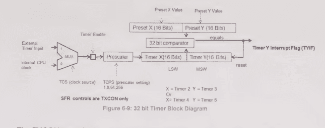

SFR controls are TXCON only

Figure 6-9: 32 bit Timer Block Diagram

TXCON 设置如图（Figure 6-10）所示。请注意，在一对中只需要设置 X 定时器，但 X 和 Y 预设也需要初始化。

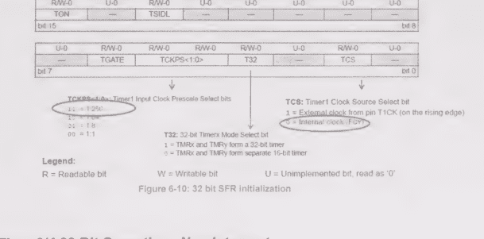

Legend:
R = Readable bit
W = Writable bit
U = Unimplemented bit, read as '0'

Figure 6-10: 32 bit SFR initialization

### Timer3/4 32 Bit Operation – Non Interrupt

这与我们之前仅使用 Timer 1 看到的单个 16 位非中断操作类似的练习。然而这里我们使用 Timer 2 和 Timer 3 对进行 32 位操作。最终目标如前所述是闪烁 LED。事实上

与 16 位操作一样使用了相同的硬件配置。主源代码已显示。这里我们使用 SFR 结构格式（见 Chapter 1）来设置/重置某些控制的 SFR 位。

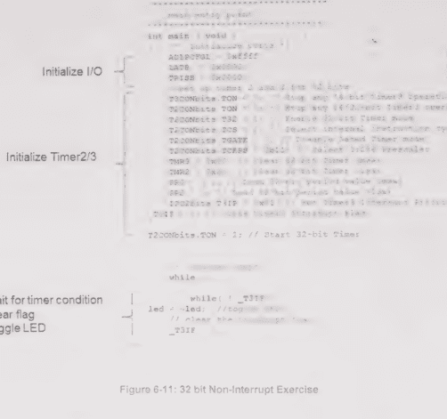

Figure 6-11: 32 bit Non-Interrupt Exercise

导航到第 6 章文件夹第三个实验中的 MPLAB 项目图标 Flash_LED.MCP。让我们开始调试。连接 Microstick II。双击项目图标以调出整个工作区。此时我们对执行期间将发生的情况有相当好的了解。PIC24H 将闪烁连接到 Microstick II 的 14 号引脚 RB5 的 LED。请注意，闪烁时间比 16 位情况显著更长。让我们进行计算。

外设时钟是 CPU 内部时钟除以 2。在我们的情况下这是 8MHz/2 或 4MHz。在此片段中，T2CON 的控制位设置为内部，预分频器为 256，给我们输入的最终时钟为 (4MHz/256) 或 15625 KHz。预设值设为 0x30000 或 196608，定时器将每 12.6 秒产生一次中断 (1/15625)*196608。

### Timer3/4 32 Bit Operation Interrupt

这与我们之前看到的单个 32 位非中断操作类似的练习，但在这种情况下我们将使用中断。最终目标如前所述是闪烁 LED。事实上与所有之前的练习一样使用了相同的硬件配置。主源代码已显示，其中关键部分已突出显示。

导航到第 6 章文件夹第四个实验中的 MPLAB 项目图标 Flash_LED.MCP。让我们开始调试。连接 Microstick II。双击项目图标以调出整个工作区。此时我们对执行期间将发生的情况有相当好的了解。PIC24H 将闪烁连接到 Microstick II 的 14 号引脚 RB5 的 LED。

Interrupt Service Routine Timer3

- Toggle LED
- Clear flag

Initialize I/O

Initialize Timer2/3 and Timer 3 interrupt

Idle – do nothing

```
// 1. Timer3 interrupt service routine
void __attribute__((interrupt, no_auto_psv)) _T3Interrupt(void)
{
  led = !led;    // toggle LED
  // clear the interrupt flag
  _T3IF = 0;
}
// ...
main entry point
int main(void)
{
  // Initialize ports
  AD1PCFG = 0xFFFF;
  LATE = 0x0000;
  TRISE = 0x0000;
  // Set up Timer 2 and 3 for 32 bit operation
  T3CONbits.TON = 0;  // Stop any 16-bit Timer3 operation
  T2CONbits.TON = 0;  // Stop any 16-bit Timer2 operation
  T2CONbits.T32 = 1;  // Enable 32-bit Timer mode
  T2CONbits.TCS = 0;  // Select internal instruction cycle clock
  T2CONbits.TGATE = 0;
  T2CONbits.TCKPS = 0b11;
  TMR3 = 0;
  TMR2 = 0;  // Clear 32-bit Timer value
  PR3 = 0xFFFF;  // Load 16-bit Timer3 period value
  PR2 = 0xFFFF;  // Load 16-bit Timer2 period value
  IFS0bits.T3IF = 0;  // Clear Timer3 interrupt flag
  IEC0bits.T3IE = 1;  // Enable Timer3 interrupt
  T2CONbits.TON = 1;  // Start 32-bit Timer
  _T3IP = 1;  // Set priority
  while(1)
  {
    // do nothing
  }
}
```

Figure 6-12 32 bit Timer Operations


### 16 位微实验器（可选）

这是一个针对 16 位微实验器的定时器实验。它的操作方式与本章节中的实验 1 和实验 2 完全相同，实际上使用了相同的源代码。你需要构建代码，并使用 PICKIT2/3 作为调试器/编程器。如果使用 PICKIT2，实验器可以在使用或不使用外部电源的情况下工作（PICKIT2 会感应电源，如果检测不到电源，会自动供电）。此外，实验器需要将一个带有串联电阻的外部 LED 连接到 J3 的 PIN3（参见接线图）。

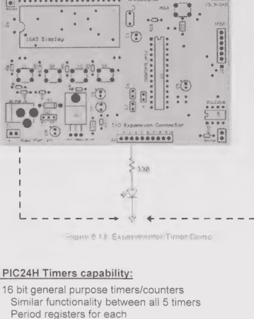

### PIC24H 定时器能力概述：

-   五个 16 位通用定时器/计数器
  - 所有 5 个定时器功能相似
  - 每个都有周期寄存器
  - 与周期匹配时产生中断
  - 匹配时复位
-   其中四个定时器（定时器 2+3 和 4+5）可以组成两个 32 位定时器/计数器
-   在 32 位操作中：定时器 2+3 或定时器 4+5 分别作为最低有效字和最高有效字

## 第 7 章 – 串行通信

在本章中，我们将介绍使用 UART（通用异步收发器）进行 RS-232 和 USB 应用的串行通信。我们将使用 PIC24H 的可配置外设引脚分配系统（称为外设引脚选择，PPS）来应用 PIC24H UART 外设。让我们首先讨论串行通信。

### 串行通信概述

串行通信通过每次一位地发送和接收数据字节来实现。传输的位不仅包含完整的数据字节，还包括用于起始、停止和错误检查的帧位。这种通信类型可能是微控制器使用的最古老的通信方式之一，至今仍被广泛应用。串行通信可应用于微控制器之间、微控制器与 PC 或显示器之间，甚至无线收发器之间。

PIC24H 有两个完全独立的 UART：UART1 和 UART2。在我们的实验中，我们将使用 PIC24H 的 UART2 与 PC 通信。每个 UART 外设都有独立的发送和接收硬件。发送部分从 PIC24H CPU 接收并行数据（字节），并以固定的比特率或波特率逐位串行发送出去。这样，发送硬件充当 PISO（并行输入串行输出）数字寄存器。接收硬件接收串行数据，并形成并行数据（字节）以供 PIC24H CPU 取用。接收部分充当 SIPO（串行输入并行输出）数字寄存器。完整的 UART 外设不仅包含这些功能，还包含内部位时钟发生器、帧逻辑和数据缓冲区，这些都是在两个设备之间进行串行数据传输所必需的，无论这两个设备之间是否使用共享时钟。

当不使用共享时钟时，我们将采用一种称为“异步”的串行通信方式。如果使用共享时钟，则通信称为同步通信。异步通信能够工作的原理是，通信系统中的每个 UART 都预先配置了相同的比特率时钟或波特率时钟。在 PIC24H 中，波特率时钟由内部时钟源产生。在系统通信期间，发送方向接收方发出有字节要传输的提示。它通过将串行数据线拉低一个位时间来实现这一点（这被称为起始位）。接收方将其内部波特率发生器与起始位同步，以开始接收数据。随后，构成数据字节的 8 个数据位从发送方逐位传送到接收方。

除了 8 个数据位之外，还可以发送纠错位或校验位（可选）。通信的最后一部分是停止位，即在校验位之后，串行通信线路保持高电平一个或两个位时间（长度也是可选的）。请参见下面的图 7-1。

注意，要使此通信正常工作，每个发送器输出线必须直接连接到接收器输入线。具体来说，一方的发送器必须连接到另一方的接收器，而另一方的发送器必须连接到一方的接收器（如果需要在两个方向上进行通信）。

当只允许一个 UART 在某一时刻传输数据时，这种通信被称为“半双工”。然而，当配置允许两个 UART 同时传输数据时，这种通信被称为“全双工”。

### 串行通信

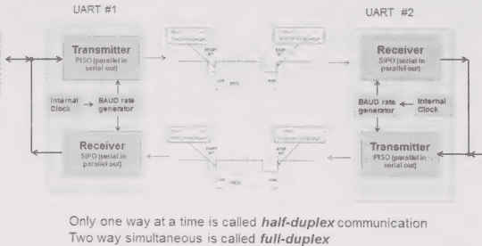

图 7-1 UART 半异步通信

UART 自然地扩展到无线和有线通信。图 7-2 显示了 UART 在无线应用中的示例。无线发射器通常共享相同的载波频率，这迫使通信采用半双工模式（一次只能有一个发射器开启）。这确保了通信避免数据冲突。通信协调通常借助驻留在该“底层”数据链路上的“高层”软件协议来完成，以确定谁可以在何时发送数据。

### 串行无线通信

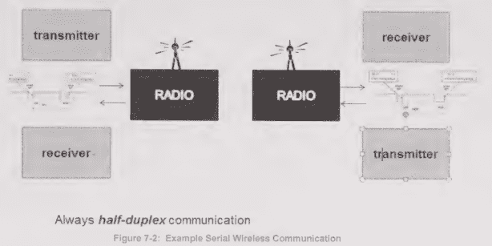

始终为半双工通信

图 7-2：串行无线通信示例

### RS-232 和 RS-485 行业标准串行通信

有几种用于连接具有 UART 的设备的传统行业标准。其中一种用于点对点通信的标准是 RS-232。该标准规定了连接器类型、波特率、引脚排列和电压电平。RS-232 规定，PIC24H UART 输出的 +3.3V 至 0V 电压电平必须转换为 -12V 至 +12V 才能符合标准。这意味着需要电平转换电子器件。RS-232 标准还使用一组常见的 9 针公头和母头连接器对。对于 RS-232，通信的一方必须配置为 DCE（数据通信设备），另一方配置为 DTE（数据终端设备）。这种划分确定了每一方的发送/接收引脚排列和连接器类型。PC 预配置为 DTE。这迫使 PIC24H 或 Microstick II 成为 DCE。

图 7-3 显示了使用 RS-232 将 Microstick II 连接到 PC 的完整端到端接线图。PC 上运行一个名为 HyperTerminal（超级终端）的软件应用程序，它可以将串行数据通信流显示在 PC 屏幕上。我们的实验中将需要这个软件。Microstick II 需要电平转换硬件和一个 RS-232 DCE 连接器。我们将使用一个 ACRONAME 模块；它把这两者都集成在一块方便的可插拔电路板上。然后我们将一根标准的 DCE 转 DTE RS-232 电缆与 PC 连接起来，以便进行调试。最后需要说明的是，通信的数据速率和串行格式需要设置。这对 PIC24H UART 初始化和 HyperTerminal 配置都很重要。需要考虑的因素包括波特率、停止位数、数据位大小、是否使用校验位，以及是否使用硬件握手。就我们的目的而言，我们将使用 1200 波特、8 位数据、无校验、1 位停止位且无硬件握手。其简写表示法为 1200-8-N-1。

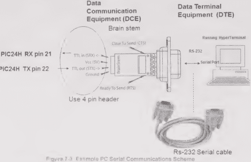

### 美国信息交换标准码（ASCII）

实际上，用户可以选择传输任何类型的数字字节，但超级终端只能显示 ASCII（美国信息交换标准码）格式的数据。图 7-4 显示了一个表格。该表格包含 128 个不同的字符，包括控制字符、数据字符（大写/小写 A-Z）、数字（0-9）、特殊字符（如引号、感叹号、问号和井号）。在我们的串行通信实验中，我们将使用 ASCII 数据编码。


我们关注的类别是 CDC。我们将使用一个 UART 转 USB 桥接器，它在微控制器侧提供 UART 接口，在 PC 侧提供符合 USB CDC 规范的设备接口。ACRONAME 为其 S22 提供了一个可插拔模块。S22 模块为桥接芯片提供相同的四针连接器用于微控制器侧，并在另一侧提供一个 USB 设备连接器。你可以使用常见的 USB Host A 型到 Device B 型连接线连接到 PC。USB 支持“即插即用”。

每个设备在连接到 USB 时都会被 PC“枚举”，这意味着设备向 PC 标识其类别类型、操作需求和驱动要求。PC 会检查自己是否满足操作需求，以及该设备标识的驱动程序是否存在于当前软件注册表中。只有当所有这些都完成后，才允许进行通信。然后我们可以在 PC 上打开超级终端（HyperTerminal），识别与 S22 关联的 COM 端口，配置该 COM 端口，并开始通信。

对于 USB CDC，我们将使用 ACRONAME 提供的注册表文件 (.INF) 向操作系统注册通信端口，并使用 ACRONAME 提供的 S22 驱动程序。首次连接到 PC 时，系统会将 S22 视为 USB 上的“新硬件”，并尝试检索驱动程序信息。此时，你需要在 PC 上指定 ACRONAME 驱动程序的存储位置。这是一次性配置要求，之后每次重新连接都会自动完成。USB 是 +5V 总线，但是我们只需要使用微型 USB（通用串行总线）上可用的 +3.3V 为 S22 供电。

### 串行通信回顾

串行通信的一些重要提醒和经验法则：

- 消息的大小等于一个起始位、停止位个数、数据位个数、校验位（如果存在）（图中显示 10 位）
- 波特率
  - 消息期间的位传输速率，最高可达 115K
- 数据位
  - 消息中传输的数据位个数
- 校验位
  - 消息中存在的可选奇偶校验错误检查位

- 五个 16 位定时器（5 个输入引脚）
- 五个输入捕获——自动脉冲捕获和测量（5 个输入引脚）
- 五个输出比较/PWM 模块——自动脉冲生成（5 个输出引脚）
- 两个 UART（通用异步收发器），具有地址能力（4 个引脚（2 个输入和 2 个输出））
- 两个 SPI（同步外设接口）（6 个引脚（2 个数据输出，2 个数据输入，2 个时钟（输入/输出）））
- I2C（集成电路间通信）接口（2 个引脚（1 个输入和 1 个输出））

显然，外设引脚的总需求很大，事实上，对于这些 28 引脚的 PIC24H 器件，内部外设数量多于可用引脚数量。作为折衷方案，PIC24HJ128GP502 28 支持 PPS，具有 16 个可重新映射的引脚。这些可重新映射的引脚可以配置为上述任何外设的输入或输出。这些引脚被指定为“RP”，表示可重新编程引脚。这几乎等同于自行布局设计自己的器件。

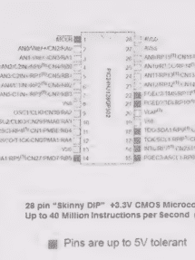

| 引脚 | RP | 模拟 | 变更通知 | 数字 |
|---|---|---|---|---|
| 2 |  | AN0 | CN2 | RA0 |
| 3 |  | AN2 | CN3 | RA1 |
| 4 | RB0 | AN3 | CN4 | RB0 |
| 5 | RB1 | AN4 | CN5 | RB1 |
| 6 | RB2 | AN5 | CN6 | RB2 |
| 7 | RP3 |  | CN7 | RB3 |
| 8 |  |  | CN30 | RA2 |
| 9 |  |  | CN? | RA3 |
| 10 |  |  | CN20 | RA5 |
| 11 | RP4 |  | CN1 | RB4 |
| 12 |  |  | CN? | RB5 |
| 13 | RP5 |  | CN27 | RP6 |
| 14 | RP6 |  | CN24 | RB6 |
| 15 | RP7 |  | CN25 | RB7 |
| 16 | RP8 |  | CN22 | RB8 |
| 17 | RP9 |  | CN21 | RB9 |
| 18 | RP10 |  | CN? | RB10 |
| ... | ... | ... | ... | ... |

Microstick 底部可用的 PIC24HJ128GP502 引脚
接地引脚 8/19 也可用
未显示固定 I/O 分配

### 图 7-6：PIC24HJ128GP502 PPS 引脚集

### 初始化 PPS

外设引脚选择（Peripheral Pin Select，PPS）必须被初始化，一旦初始化后就不能被意外更改。为了实现这一点，Microchip 制定了一系列特定的步骤来配置 PPS。

基本思路如下：在主程序开始时，你可以解锁并配置指定外设的 PPS，先配置输出，再配置输入。完成此操作后，PIC24H 被锁定并保持该引脚状态配置。为此，需要设置 OSCON SFR 寄存器中的 IOLOCK 位。一旦设置，PPS 除非发生复位，否则无法解除。PPS 锁定和解锁控制实际上是通过特殊代码序列来实现对 OSCON SFR 的访问。这确保了随机的代码读写无法访问和污染固定的 PPS 设置。总体软件流程如图 7-7 所示。

### 外设锁定与解锁

- 复位后初始化设备
- 为了最大程度保护设备，设置 IOL1WAY
  - PPS 无法解锁
- PPS 在运行期间提供灵活性
- 持续监控设备以检测意外变化

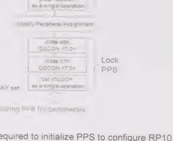

设置 IOL1WAY 后，PPS 寄存器无法解锁

图 7-8 为外设初始化 PPS

图 7-8 展示了初始化 PPS 所需代码的示例，这些代码将 RP10 配置为 UART2 输入接收，将 RP11 配置为 UART2 输出发送。注意使用 'C' 库宏来设置和复位 OSCON SFR 中的锁。该宏执行特定的 PPS 锁定和解锁代码序列。

外设代码（在我们的例子中，UART2 TX 为 5），然后设置适当的输出 PPS SFR 寄存器以进行写入。在我们的例子中，对于 RP11 分配，这里是 RPOR5。因此，我们将代码写入 RPOR5 的低位，如图所示。参见图 7-10。

### 可重新映射输出

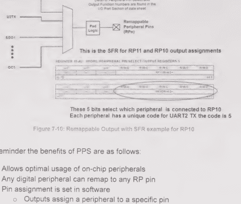

图 7-10：RP10 的带 SFR 示例的可重新映射输出

提醒一下，PPS 的优点如下：

- 允许最佳使用片上外设
- 任何数字外设都可以重新映射到任何 RP 引脚
- 引脚分配在软件中设置
  - 输出将外设分配到特定引脚
  - 输入将引脚分配到特定外设
  - 支持一个引脚上的多个输入外设功能

### 实验 1 “使用 PC 实现串行接口”

第一个实验将使用 PIC24H 的 UART2，通过 RS-232 与运行超级终端软件的 PC 进行通信。该实验遵循图 7-3 的连接方案。

图 7-11 显示了从用户代码（通过微控制器 UART 到 RS-232）到带有 Windows 驱动程序并使用超级终端的 PC 之间完整的端到端通信框图流程。应用程序发送在 PC 键盘上键入的 ASCII 字符，然后使用超级终端显示窗口显示这些字符。在 PC 键盘上键入的 ASCII 字符通过串行通信发送到 Microstick II 的 UART，并在接收后被“回显”（或传输）到 PC 进行超级终端显示。

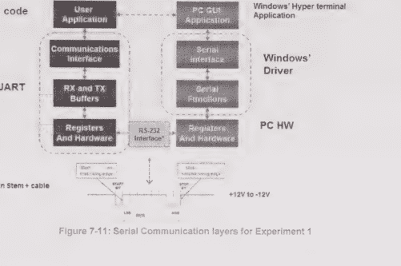

图 7-11：实验 1 的串行通信层

#### 软件配置

该实验在 MAIN 中包含 `#include "CONU2.H"`，并在项目中包含 CONU2.C 驱动程序源代码，允许从用户应用程序代码侧使用 UART2 串行端口。串行通信中使用的 CONU2 库函数有：

- `initU2 ()` – 使用 PIC24H 的 UART2 初始化串行端口，对应 Microstick II 的 RB11 和 RB10，或引脚 22 和 21。引脚 21 是 Microstick II UART2 的输入接收（RX），引脚 22 是 Microstick II UART2 的输出发送（TX）。UART2 配置为 1200 波特率、8 位数据、无校验、1 位停止位，简写为 1200 8N1。
- `putU2( character)` – 将一个字符写入串行端口
- `putsU2( string)` – 将一个完整字符串写入串行端口
- `Clrscr()` – 此宏使用已知的 VT100 转义序列清除屏幕
- `Home()` – 使用已知的 VT100 转义序列将光标定位到屏幕的起始位置
- `Character getU2 ( )` – 等待新字符到达串行端口并返回该字符。

#### 硬件配置

UART2 通过适当的物理接口支持 RS-232 串行端口。ACRONAME (http://www.acroname.com/) 提供了理想的物理接口，而且价格相当便宜。ACRONAME RS-232 接口如图 7-12 所示。使用该设备只需要四个连接：来自 UART2 的 RX 和 TX，以及 +3.3V 和 GND。图中显示了 Microstick II 上 ACRONAME 一侧串行接口的原理图。（参见图 7-13）

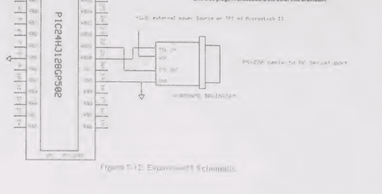

图 7-12：实验 1 示例


ACRONAME接口，即“Brainstem”，有两种格式：RS-232和USB。我们将同时使用这两种。

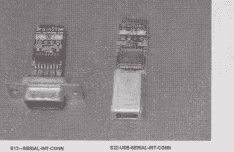

813—SERIAL-RXT-CONN 823-USB-SERIAL-RXT-CONN

图7-13：ACRONAME电气接口

ACRONAME 4引脚接口位于0.100英寸中心间距，是一个直插式母连接器。将其连接到我们的原型板的一种方法是使用两个4引脚公排针，以直角焊接在一起，一端插入无焊面包板，另一端连接ACRONAME（参见图7-14中的原型）。


图7-14：RS-232原型

按照连接图（图7-12）和图7-14中所示的原型结构组装硬件。请注意，ACRONAME需要+3.3V直流外部电源。确保ACRONAME、Microstick II（引脚8）和外部电源之间的所有接地端都是公共的。

#### 执行代码

导航到第7章文件夹，打开UART实验1。构建并下载到Microstick II。确保提供外部+3.3V电源。使用ACRONAME S13电气接口和RS-232电缆连接到PC串口。

打开HyperTerminal应用程序。将HyperTerminal配置为1200 8N1，无硬件握手。参考图7-15和图7-16。所示配置为COM1、1200 8N1。一切连接好且HyperTerminal运行后，运行Microstick II UART程序，你应该会看到屏幕介绍，然后可以在PC的HyperTerminal窗口中输入内容，并看到你输入的内容被回显（参见图7-17）。

恭喜！你已拥有一个可用的串口接口。

#### 在PC上设置HyperTerminal


1. 程序 -> 附件 -> 通信 -> HyperTerminal
2. 输入TESTPC作为连接名称 -> 确定
3. 输入COM端口 -> COM1 -> 确定

图7-15：HyperTerminal屏幕截图（第1部分）

## 2025/26秋冬女装色彩趋势预测

### 洋红色

洋红色在2025/26秋冬依然保持了较高的热度，它将接替2023年度代表色Viva Magenta继续散发魅力。应用于斜纹西装、宽松呢料、精致皮衣等单品，带来强烈的视觉冲击力，醒目且充满力量，展现出自信、张扬的独立女性气质。

| 色名 | 洋红色 |
|---|---|
| Pantone | 19-2140 |
| 应用建议 | 款式：西装、大衣、皮衣 |
|  | 面料：羊毛混纺、丝绸、皮革 |

- **关键色彩组合**：
  - 洋红色 + 黑色
  - 洋红色 + 深蓝
  - 洋红色 + 金米色


### 刚果咖啡色

刚果咖啡色自带温暖优雅的特质，是2025/26秋冬重要的日常风色彩。咖色色调为日常装和正装提供了更多灵感，外套、针织衫、西装长裤等单品推荐全身同色或同色系穿搭，轻松打造冬季高级感。

| 色名 | 刚果咖啡色 |
|---|---|
| Pantone | 19-0916 |
| 应用建议 | 款式：外套、针织衫、长裤 |
|  | 面料：羊毛、羊绒 |

- **关键色彩组合**：
  - 刚果咖啡色 + 米白
  - 刚果咖啡色 + 焦糖色
  - 刚果咖啡色 + 森林绿


### 可可果色

可可果色融合了天然可可的浓郁与醇厚，相比基础棕色的保守，它更给人一种充满复古感和高级调的腔调。极具包容度，适用于男女同款的设计，在西装外套、大衣以及冬季配饰上有更多的发挥空间。

图7-19显示了主循环。其中还显示了home和clear函数，以及初始“启动画面”的设置。之后，代码进入一个连续循环，该循环简单地接收来自PC的传入字符，并将该字符原样输出。

```
#define FCY 7372800
#define BAUDRATE 1200
#define BRGVAL (FCY/BAUDRATE/4)-1
#define U_ENABLE 0x8000  // enable the UART
#define U_TX 0x0400      // enable transmission

// init the serial port (UART2, 1200, 8, N, 1)
void initU2( void)
{
    U2BRG = BRGVAL; // BAUD Rate Setting for 9600
    U2MODE = U_ENABLE;
    U2STA = U_TX;
    U2MODEbits.BRG16 = 1; // high Speed mode
}
```

图7-18：UART2初始化

```
// Hyperterminal Startup Init Screen
clrscr(); // clear upper terminal screen
home();
putsU2("The MicroStick UART2 Experiment");
putU2(0x0a); // carriage return / line feed
putU2(0x0d);
putsU2("Type a character and watch the return");
putU2(0x0a); // carriage return / line feed
putU2(0x0d);

// -- endless loop --
while (1)
{
    rxchar = getU2();
    putU2(rxchar);
    Nop();
}
```

图7-19：主循环

### 使用USB代替RS-232

使用合适的接口，UART仍可用于USB以及RS-232。如果你的PC没有RS-232端口——别担心。USB（通用串行总线）端口可以轻松适应你的串行通信需求。同样，ACRONAME提供了一个解决方案（S22），带有UART转USB的Brainstem。所有PIC24H到ACRONAME的连接都与RS-232相同。我们需要使用一根主机到设备的USB电缆将PC连接到ACRONAME。

还需要额外的软件配置。对于USB，需要在PC上安装软件INF文件和USB驱动程序——ACRONAME再次提供了其产品所需的全部软件。USB原型参见图7-20。


图7-20：USB原型

首次连接USB转UART S22 ACRONAME接口时，Windows会提示你提供驱动程序。导航到产品随附的ACRONAME提供的驱动程序，并将其下载到你的计算机。安装完成后，除了之前选择的COM1之外，它实际上会表示一个新的COM端口（参见图7-21）。使用这个新的COM端口，然后使用前面给出的相同HyperTerminal配置过程。

### 16 位微实验器（可选）

这是16位Micro Experimenter的UART实验。它的操作方式与本章实验1和实验2完全相同，实际上使用了为J3 I/O连接器上不同引脚组修改的类似源代码。使用源代码UARTDEMO Experimenter。你需要构建代码，并使用PICkit 2/3作为调试器/编程器。如果使用PICkit 2，Experimenter可以在有或没有外部电源的情况下使用（PICkit 2会检测电源，如果未检测到电源，则自动供电）。此外，Experimenter需要一个带串联电阻的外部LED，连接到J3引脚3（参见连接图）。


图7-23：Experimenter UART演示连接

### 回顾PIC24H UART功能

问题：

1. 定义UART。
2. 定义RS-232。
3. 定义DCE。
4. 定义DTE。
5. 什么是波特率？
6. 1200 8N1是什么意思？
7. HyperTerminal的用途是什么？
8. 我们如何让输出为0至+5V的PIC符合RS-232的-12至+12V标准？
9. PIC可实现的最高波特率是多少？需要什么时钟？
10. 实现双向通信所需的最少RS-232引脚连接数量是多少？
11. 起始位和停止位的作用是什么？
12. 奇偶校验的作用是什么？
13. PIC24H有多少个UART？
14. 半双工是什么意思？
15. 全双工是什么意思？
16. RS-485与RS-232有何不同？
17. PPS有哪些优点？
18. PIC24HJ128GP502有多少个可重新编程的引脚？
19. PPS在代码中的什么位置出现？
20. 定义USB。
21. USB能否替代传统的RS-232通信？如果可以，请说明方式。

### 练习：

1. 在当前练习中配置UART1以替代UART2。
2. 将波特率改为1200。

让我们仔细看看SPI接口。它需要三个信号：SDO（串行数据输出）、SDI（串行数据输入）和SCLK（串行时钟）。SPI通常用于一对通信实体之间。一个实体的SDO连接到另一个实体的SDI。时钟源自“主”侧，即发起并维持通信的实体。“从”通信是对主设备的响应（参见图8-2）。没有协议，只有数据移动。双方都用作移位寄存器，公共时钟用于将数据从一个发送寄存器（SPI BUF）移入接收寄存器（SPI BUF）。可选地，还可以使用第四个信号：CS，即片选。该信号用于使能从设备进行通信，并且可以复制以允许SPI通信接口在一个主设备和多个从设备之间共享（但一次只能一个从设备）。总结如下：

- 简单的接口
- 使用3到4个信号
  - CS、SDO、SDI、CLK
- 基于移位寄存器概念
- 非常高的速度（使用PIC24H时最高可达20 MHz）
- 稳健且具有很强的抗噪性


图8-2：SPI串行通信

### 介绍串行EEPROM

我们的实验将使用串行EEPROM来演示SPI操作。具体来说，我们将使用Microchip 25LC256 EEPROM器件，它支持256 kbit（即32K x 8字节）的非易失性存储器。EEPROM是一种存储技术，允许我们在程序控制下存储数据，并保留

即使断电时仍可保留内容。这对于需要设置密码、存储校准数据或像日志功能那样存储数据测量的用户应用非常有用。25LC256 使用 SPI 接口与 Microstick II PIC24H 微控制器通信。在我们的实验中，我们使用一个软件 'C' 库，其中 SPI 通信得到支持，并提供易于使用的 API。

对于此库，每个 25LC256 存储字为两个字节。鉴于 25LC256 的字节大小，这意味着我们最多可以存储 16K 个字。总共。双字节存储和检索是有意义的，因为 PIC24H 是一款 16 位机器。一般来说，对于你的实验，你需要确定要存储的数据以及该数据如何在 16K 字上组织。图 8-3 显示了物理 EEPROM。它是一个 8 引脚 DIP。你已经可以识别基本 SPI 信号 /CS、SCK、SI 和 SO。此外，对于此 EEPROM，还有额外的控制信号。有写保护 (/WP) 控制线，可物理锁定微控制器对 EEPROM 的写入。/HOLD 暂停命令/数据序列，并将设备置于暂停状态，一旦 /HOLD 释放，无需重新启动序列。

- CS – 芯片选择
- SCK – 串行时钟
- SI – 串行输入
- SO – 串行输出
- WP – 写保护
- HOLD – 保持使能


图 8-3：SPI EEPROM

### 实验 1- 硬件

PIC24H 具有用户可编程 PPS 引脚，可将任何内部数字外设的 I/O 放置到这些引脚中的任何一个。我们将配置引脚 18、17 和 16 以用作 SPI2 的接口，即 SO、CLK 和 SI。引脚 15 将配置为 /CS 的普通数字输出。/HOLD 和 /WP 不是必需的，因此接高以禁用。最终硬件原理图如图 8-4 所示。图 5、6、7 显示了 25LC256 EEPROM 指令集以及使用 SPI 的读/写字节序列。请注意，EEPROM 的所有地址都是 16 位的。当 /CS 变为活动状态时，微控制器首先向 EEPROM 发送特定命令（见图 8-5），然后是地址。接下来发生什么取决于命令是读操作还是写操作；如果是读操作，EEPROM 将向主设备输出数据以供读取，如果是写操作，主设备将向 EEPROM 输出数据以存储。大多数 EEPROM 通常不是高速设备，内存写入周期可能需要几毫秒。API 处理此事。


+5V 外部电源或从 TP1 取电

图 8-4 原理图

| 指令名称 | 指令格式 | 描述 |
|---|---|---|
| READ | 0000 0011 | 从选定地址开始从存储器阵列读取数据 |
| WRITE | 0000 0010 | 从选定地址开始向存储器阵列写入数据 |
| WDI | 0000 0100 | 重置写使能锁存器（禁用写操作） |
| WREN | 0000 0110 | 设置写使能锁存器（使能写操作） |
| RDSR | 0000 0101 | 读取状态寄存器 |
| WRSR | 0000 0001 | 写入状态寄存器 |

图 8-5：Microchip 25LC256 EEPROM 指令集


图 8-6：25LC256 EEPROM 字节读取序列


图 8-7：25LC256 EEPROM 字节写入序列

### 实验 1- 软件

好的，硬件已经讨论过，现在让我们讨论软件。EEPROM 库相当简单，使用 16 位数据作为其参数（2 字节读或 2 字节写）。快速查看下面列出的函数。使用 EEPROM 库函数，我们可以执行 SPI2 的基本初始化以访问 EEPROM，然后在初始化后对其进行读写。

- **InitNVM ()** - 使用 SPI2 初始化 EEPROM 以供访问。在调用任何其他 EEPROM 库函数之前必须先调用此函数。NVM 代表“非易失性存储器”。
- **iReadNVM ( address)**- SPI2 在地址处读取 EEPROM 并返回该位置存储的 16 位值
- **iWriteNVM (address, data)** – SPI2 在指定地址为 EEPROM 写入 16 位数据值。

示例项目 EEPROM.MCW 将用于我们的实验。它使用 PPS 为引脚 18、17、16 配置 SPI2 接口。它为正确操作初始化 SPI2 特殊功能寄存器 SPI2CON1（控制）和 SPI2STAT（状态），最后它将 16 位值写入 EEPROM 中的偶数地址（位于 16 位边界上），然后从 EEPROM 读取该值并比较值。提供了流程图。


// PIC24H 原型 I/O 定义
#define CS EE _RB6 // 串行 EEPROM 选择线
#define TCS EE _TRISB6 // CS EE 引脚的 tris 控制 引脚 11
#define SPI_MASTER 0x0122 // 选择 8 位主模式，CKE=1，SMP=0，4MHz
#define SPI_ENABLE 0x8000 // 使能 SPI 端口，清除状态
void InitNVM(void)
{ // 初始化 SPI 外设
 CS EE = 1; // 选择串行 EEPROM
 TCS EE = 0; // 使 CS EE 引脚为输出
 SPI2CON1 = SPI_MASTER; // 选择模式
 SPI2STAT = SPI_ENABLE; // 使能外设
}
//InitNVM

图 8-11：CS 和 SPI2 初始化

SPI2STAT 和 SPI2CON1 的内容和设置如图 8-11 所示。SPI2CON1 设置为 0x0122，SPI2STAT 设置为 0x8000。这些设置及其含义在图 8-12 和 8-13 中详细说明。

### SPI2STAT SFR 位图

| RW0 | U-0 | RW0 | U-0 | U-0 | U-0 | U-0 | U-0 |
| SPEN | -- | SPISIDL | -- | -- | -- | -- | -- |
| bit 15 |  |  |  |  |  |  | bit 8 |
| U-0 | R/WC-0 | U-0 | U-0 | U-0 | U-0 | R-0 | R-0 |
| -- | SPIROV | -- | -- | -- | -- | SPITBF | SPIRBF |
| bit 7 |  |  |  |  |  |  | bit 0 |
图例：
C = 可清除位   R = 可读位   W = 可写位   U = 未实现位，读为“0”
'-' = 上电复位值   '1' = 位被置位   '0' = 位被清除   'x' = 位未知

SPI2STAT = 0x8000
SPEN =1 使能 SPI

图 8-12：SPI2STAT SFR 设置和位图

### SPI2CON1 SFR 位图

| U-0 | U-0 | U-0 | RW-0 | RW-0 | RW-0 | RW-0 | RW-0 |
| -- | -- | -- | DISSCK | DISSDO | MODE16 | SMP | CKE[1] |
| bit 15 | | | | | | | bit 8 |

| RW-0 | RW-0 | RW-0 | RW-0 | RW-0 | RW-0 | RW-0 | RW-0 |
| SSEN[?] | CKP | MSTEN | SPRE<2:0>[?] | | | PPRE<1:0>[?] | |
| bit 7 | | | | | | | bit 0 |

图例：
R = 可读位    W = 可写位    U = 未实现位，读为“0”
-n = 上电复位值    '1' = 位被置位    '0' = 位被清除    x = 位未知

```
SPI2CON1 = 0x0122
MODE16 = 8 bit mode
SMP =0 (data sample control )
CKE =1 (clock edge)
CKP =0 { clock polarity}
MSTEN =1 (Master Mode Enabled)
SPRE =0 (secondary pre-scale =8:1)
PPRE =2 (primary pre-scale = 4:1)
```

图 8-13：SPI2CON1 SFR 设置和位图

### 实验 1 执行

使用图 8-4 中的原理图构建原型。需要一个 10 k 电阻和一个 25LC256 8 引脚 DIP EEPROM。此外，还需要一个外部 +3.3V DC 电源为 EEPROM 供电（请记住 Microstick II 不提供外部电源）。确保 EEPROM 的地与 Microstick II 的地共用。图 8-14 显示了示例原型装配。将 Microstick II 连接到 PC 的 USB 端口。


图 8-14：组装好的原型

打开第 8 章练习 1 的文件夹并双击 EEPROM.MCW。打开工作区，然后构建并将代码下载到 Microstick II。主代码的快照如下所示。

```
data1 0xAA55; //data values
data2
InitNVM();
iWriteNVM(); data1
data2 ReadNVM 0x1234;

if ( data1 == data0)
Nop(); //break print data compare
else
Nop(); //breakpoint data don't compare

while ... //infinite compare
```

设置数据值

初始化 SPI2 写入到然后从位置 0x1234 读取

比较写入和读取值

无限循环

图 8-14：主线

使用调试器为 data0 和 data1 设置监视。设置所示的两个断点。Nop () 是一个宏，本质上是一个无操作指令。


图 8-16：实验板 EEPROMDEMO 流程图

为了更好地理解，请查看下面所示的 EEPROMDEMO 代码，以及在 EEPROMDEMO 操作过程中出现的一些实验板显示。这种用实时数据更新 LCD 显示的程序结构，对于你未来任何实验板应用来说都可能是重要的一部分。

EEPROM DEMO 主代码（代码截图）


### EEPROM DEMO 主代码

### 实验板显示

图 8-17：实验板 EEPROM DEMO 主代码及结果

### SPI 关键特性回顾：

- 支持四根线：SDO、SDI、SCLK、/CS
- 数据可以同时双向传输
- 主机提供时钟并启动数据传输
- 简单的同步接口，广泛用于微控制器外设通信
- 能够进行高速传输（取决于时钟频率）
- SPI 外设功能相当于数字移位寄存器

### EEPROM 关键特性回顾：

- EEPROM 在断电时保留存储内容
- 用于设置密码、访问代码和校准数据

### PIC24H SPI 关键特性回顾：

- PIC24H 有两个可用的 SPI 外设：#1 和 #2
- 使用 PPS 配置 SPI 接口的可编程引脚
- 通过设置两个 SFR 寄存器 SPI2CON1 和 SPI2STAT 中的位来对 SPI 进行编程


图 9-1：输出比较外设

OCx 模块可以使用 PIC24HJ64GP502 的 16 位定时器 2（TMR2）或定时器 3（TMR3）作为时基，并设置输出脉冲波形的周期。PR2 是定时器 2 的周期设置，PR3 是定时器 3 的周期设置。在我们的示例中，我们将使用定时器 2。OCxRS 和 OCxR 寄存器中加载一个 16 位值，用于控制输出周期内生成的脉冲宽度。该值在每个周期内与定时器进行比较。OCx 输出初始为高电平，当发生匹配时，OCx 逻辑会在输出端产生低电平。这将按周期重复进行（见图 9-2）。

这就是 OCx 脉冲宽度调制（PWM）模式。在考虑 PWM 时，一个重要的概念是它允许动态改变施加到负载上的直流电压电平。等一下，你可能会说——这里的直流电压在哪里？把直流电压想象成波形周期内脉冲直流电压的平均值。例如，如果脉冲在一个周期内持续 50% 的时间为高电平，且脉冲为 +3.3V，那么我们向负载提供的平均电压为 3.3V 的 50%，即 1.65V。为了在系统运行期间改变脉冲宽度，我们只需写入 OCxRS，它会在下一个周期自动加载到 OCxR 中。

- void turnon (int setting) - 打开 RB2 引脚输出、定时器 2 时钟以及该引脚上的 PWM OC1 配置。定时器 2 的周期预设为 0x7FF，即 12 位 ADC 的最大值。setting 是电位器 ADC 设置的 0-0x7FF 之间的任意值，用于调整 PWM 占空比。如果 setting 为 0，则占空比为零；如果 setting 为 0x3FF，则占空比为 50%；如果 setting 为 0x7FF，则占空比为 100%
- void setPWM (int setting) - 该函数通过一次调用执行 turnoff (void) 和 turnon (int setting) 的相同功能。它在设置 PWM 之前先将 PWM 关闭。

我们还会使用几个 ADC 函数。这些函数在第 4 章中介绍过，并包含在 ADC 库中。如果需要，请回顾第 4 章以了解 ADC。

- void initADC (int ANpin) – 此函数将 ADC 初始化为 12 位手动转换，使用“ANpin”作为单一输入引脚。ANpin 可能的设置为 AN0、AN1、AN4、AN5、AN9、AN10、AN11 和 AN12。在本实验中，我们将使用 AN0。
- int readADC (int ANpin) – 此函数强制对指定的 ANpin 进行手动 ADC 转换，同样我们将使用 AN0。

连接原理图如图 9-4 所示。需要 10K 电位器、LED、1K 电阻以及用于 10K 另一侧的外部 +3.3V 电源。确保 Microstick II 与外部元件之间的所有地线公共。按照原理图搭建原型，原型如图 9-5 所示，以供参考。


图 9-4：LED 调光器原理图

### 运行实验

我们已经涵盖了硬件和软件，因此你可以准备运行原型了。连接到 PC 的 USB 端口。连接外部 +3.3V 电源以供电位器使用。确保电位器和 LED 电路的地线与 Microstick II 的地线公共。打开第 9 章文件夹中的 PWM.MCP。双击图标打开工作区，然后进行编译并下载。

运行程序，当你顺时针或逆时针转动电位器时，应该会看到 LED 亮度发生变化。如果没有发生这种情况，请参考原理图和原型图片，因为你的接线有误。

### 16 位微实验器（可选）

这是 16 位微型实验板的 PWM 实验。其操作方式与本实验 1 和实验 2 完全相同，事实上使用了类似的源代码，只是针对 J3 I/O 连接器上的不同引脚组进行了修改。使用源代码 PWMDEMO Experimenter。你需要编译代码，并使用 PICKIT2/3 作为调试器/编程器。如果使用 PICKIT2，实验板可以使用外部电源，也可以不使用外部电源（PICKIT2 会检测电源，如果未检测到电源会自动供电）。此外，实验板需要外接一个带串联电阻的 LED 和 10K 电阻，添加到 J3 上（参见连接图）。

### 练习：

1. PWM 代表什么？
2. 它是如何使用的？
3. 运行实验 1，将电位器转到两个极端。使用观察窗口捕获这些值。
    读取并记录这些值。它们是什么？它们从哪里来？
4. 描述一个可以使用 PWM 的应用
5. 将实验 1 配置为使用 OC2 而不是 OC1
    a) 更改 OC2 引脚的 PPS
    b) 重写库以使用 OC2 SFR 进行操作

## 第 10 章 – RTCC（实时时钟日历）

在本章中，我们将使用 PIC24H 上的 RTCC（实时时钟日历）外设。建议仅在 16 位微型实验板（参见附录 A）上使用本实验，因为所有必要的支持硬件（即时钟晶体、LCD 和四个按钮）都已就位。

### 实时时钟日历

我们一直在谈论实验板的时钟，现在它来了。它是一个实时时钟和日历（RTCC）功能，适用于需要在长时间内以最少甚至无需 CPU 干预的情况下保持精确时间的应用。该外设针对低功耗使用进行了优化，以便在跟踪时间的同时延长电池寿命。它具有 100 年时钟和日历功能，并具有自动闰年检测功能。时钟范围为 2000 年 1 月 1 日 00:00:00（午夜）到 2099 年 12 月 31 日 23:59:59。小时以 24 小时制（军用时间）格式提供。时钟提供一秒的精度。

RTCC 与 PIC24H 微控制器的内部寄存器接口使用二进制编码十进制（BCD）格式实现。这简化了软件读取和写入模块的操作，因为每个数字值都包含在各自的 4 位值中。


LCD 和按钮。要操作这些，你必须首先调用库函数 RTCCInit()。我们将讨论的两个函数使用 RTCC 库，但位于其外部的 MAIN.C 中。

- Set_ALARM(alarm) – 此函数初始化 RTCC 的报警功能，并根据传入的 alarm 值设置报警（在数据记录器中我们称之为速率）。它在速率设置菜单中调用。其设置如下：
    - 如果 (alarm = 0)，则每 10 秒报警一次
    - 如果 (alarm = 1)，则每分钟报警一次
    - 如果 (alarm = 2)，则每 10 分钟报警一次
    - 如果 (alarm = 3)，则每小时报警一次
    - 如果 (alarm = 4)，则每天报警一次
    - 如果 (alarm = 5)，则每周报警一次
    - 如果 (alarm = 6)，则每月报警一次
    - 如果 (alarm = 7)，则每年报警一次

一旦设置了报警，此函数将启用 RTCC，以便在报警条件发生时中断 PIC24H。然后，RTCC 中断服务程序可以执行报警应用所需的任何功能。设置报警和 RTCC 中断的代码片段如图 10-5 和图 10-6 所示。请注意中断中有一条注释，你可以在此处添加自己的代码，以执行因报警条件而希望执行的任何功能（默认为切换 LED）。

- clock_Setup() – 此例程在显示屏上以 ASCII 格式显示当前 RTCC 时间设置，并允许操作员使用显示屏和按钮接受或修改 RTCC。
    - 按钮 SW1 - 在时钟设置模式和时钟接受模式之间切换。在接受模式下按两次 SW1 会退出该函数，并将 RTCC 设置为显示的时间。
    - 按钮 SW2 - 如果在时钟设置模式下，则递增当前数据字段
    - 按钮 SW3 - 如果在时钟设置模式下，则递减当前数据字段
    - 按钮 SW4 - 前进到下一个允许的数据字段

### 时钟和报警实验

本实验使用 RTCC 库以及 clock_Setup() 和 set_alarm() 函数作为 main 的一部分。实验板本质上执行的是时钟演示


```
void __attribute__((interrupt, no_auto_psv)) _RTCCInterrupt( void)

    toggle_LED(); // alarm activity LED pin 3 J3 RB5

    // your alarm specific application code here

    _RTCIF = 0;    // clear flag
    _ALRMEN = 1; // reissue the alarm

end of RTCC interrupt service routine
```

图10-8：报警中断服务例程

### RTCC回顾：
- RTCC为PIC24H提供实时时钟和日历功能，支持百年日历。
- RTCC外设操作只需进行软件设置，然后在硬件上独立于PIC24H运行。
- RTCC通过中断支持报警。
- 有多个RTCC特殊功能寄存器（SFR）设置用于初始化时钟。这些设置使用BCD（二进制编码十进制）完成。
- 需要外部32 KHz晶振和两个33 pF电容来支持RTCC。

### 源代码回顾：
- RTCC.C和RTCC.H库函数必须作为项目的一部分包含在内。
- Main中的较大函数集clock_Setup()可用于通过按钮和LCD初始化RTCC。
- 报警通过RTCC中断服务例程进行服务。

### 练习
- 1. 解释RTCC如何基于32Khz振荡器执行计数功能。
- 2. 使用不同的设置重新编程报警，并监测结果。
- 3. 在中断服务例程中，还可以实现哪些其他类型的应用程序功能来支持不同的报警动作？


图3-1：I2C配置

### 通用I2C消息协议
I²C定义了几种基本消息类型，每种消息都以START开始，以STOP结束。这里有两个示例：
- 主设备向从设备写入数据的单条消息；
- 主设备从从设备读取数据的单条消息；

### I2C物理层
在物理层，SCL和SDA线均采用开漏设计，因此需要上拉电阻。将线路拉低到地被视为逻辑0，而让线路悬空则为逻辑1。这用作信道访问方法。数据位的转换始终在时钟为低电平时进行；时钟为高电平时的转换是界定总线事务的“开始”和“停止”标记。

空闲时，两条线均为高电平。要开始一次事务，SDA被拉低而SCL保持高电平。开始之后，下一步是将SCL拉低。仲裁确保同一时间只有一个发送器。当SCL为低电平时，发送器（最初是主设备）将SDA设置为所需值，并（经过一小段延迟让值传播后）让SCL变为高电平。然后主设备等待SCL实际变为高电平，当SCL为高电平时，接收器锁存该位，主设备等待最短时间后再将其拉低。这样就完成了一个位的传输。

每向一个方向传输8个数据位后，会在另一个方向传输一个“确认”位。发送器和接收器交换一个位，原接收器返回一个0位（ACK）。确认位之后，主设备可以执行几种操作之一。这里有两个示例：
- 1. 准备传输另一个数据字节：将SDA设置为所需的位值，并将SCL脉冲为高电平。


图11-3：I2C实验

### 实验应用程序库
应用程序库支持低密度和高密度EEPROM。低密度指的是那些只需要8位地址且容量低于256字节的设备。高密度设备为512到64K字节，需要16位地址。该库支持字节读/写以及页（多字节）读/写。提供的代码不需要额外库。固件由两个.c文件（main.c、i2c_Func.c）和一个.h文件组成，分为九个部分：
- 初始化
- 低密度字节写入
- 低密度字节读取
- 低密度页写入
- 低密度顺序读取
- 高密度字节写入
- 高密度字节读取
- 高密度页写入
- 高密度顺序读取

在我们的实验中，我们将使用24LC256的高密度顺序读/写功能，在Microstick II和EEPROM之间读写32字节页。

程序还包括确认轮询功能，用于在字节写入和页写入操作后检测写周期的完成。读操作紧随每次写操作之后，从而可以验证数据是否正确写入。

### 实验I2C总线活动
了解I2C总线上的信号变化始终是个好主意。下面给出一些单字节写入和多字节传输的总线活动示例。这些仅用于说明，并不代表所有可能的事务类型。

### 单字节写入


### 多字节操作


图11-4：I2C示例

### 运行实验
按照前面所示构建硬件原型。打开第十一章的exercise 1 I2C文件夹，双击I2C工作区。使用调试器在Microstick II中构建并下载代码。工作区应如下所示。


图11-6：16位Micro实验器连接

### I2C主要特性回顾：
- 只需要两条总线线路（SCL – 时钟，SDA – 数据）
- 没有严格的波特率要求，例如与RS232不同，主设备生成总线时钟
- I2C通信是半双工的，这意味着同一时间只能进行发送或接收。
- I2C使用同步通信，因为通信双方使用相同的串行时钟信号。
- I2C支持同一总线接口上所有组件之间的简单主/从关系。

### 练习：
- 1. I2C代表什么？
- 2. 它是如何使用的？
- 3. 使用库函数将练习1配置为单字节读/写模式
- 4. 配置软件库以在PIC24H的两个不同I/O引脚上运行

## 附录A – 16位实验器板
如第1章所述，可选的16位Micro实验器有助于对Microchip 16位PIC24HJ64GP502微控制器进行原型探索和测试，它具备板载电源、编程/调试接口和外设支持能力。与Microstick II一样，实验器插入无焊面包板环境中。16位实验器既提供套件形式，也可以购买组装好的成品。文中展示了组装好的套件照片和框图。可通过www.Kibacorp.com购买实验器。


图A-1：安装在无焊面包板上的16位实验器（带PIC...）

电源可通过2.1mm正极+6V至+9V墙式变压器施加到直流电源插孔，或者可选地通过位于模块左下角标有raw power的引脚组供电。输入电源通过板载+3V线性稳压器进行开关控制。电源开启状态由绿色LED指示。+3.3V稳压器输出也可通过板上方右侧引脚组提供给无焊环境。

要使用的软件开发工具集与Microstick II所用和所讲解的MPLAB集成开发环境（IDE）相同。但是，对实验器进行编程和调试需要不同的硬件（该功能内置于Microstick II中）。

Microchip PICKIT 2或PICKIT3调试器/编程器是推荐的低成本解决方案。需要安装过程，但一旦安装完成，PICKIT2或3就会集成到IDE的编程和调试流程中。实验器套件CD-ROM中附带一份快速“设置”指南。PICKIT2/3需要在线串行编程器（ICSP）接口。在实验器上，ICSP接口方便地位于模块最右侧，便于插入。

### PICkit™ 2 Debug Express
- 编程器和调试器！
- 限制为一个断点
- 低成本


*在实验器上使用在线串行编程器（ICSP）！*

图A-3：PICKIT2/3介绍


- 将 PICKIT2 连接到 Experimenter
- 设置释放
- 选择编程器为 PICKIT2
- 输出窗口应如下所示
- 如果未向 Experimenter 施加输出电源，则屏幕将显示
- 否则，它将显示检测到电源


Figure A-4: PICKIT2/3 shown integral to IDE environment

与 Microstick II 不同，Experimenter 专用了一些 PIC24H 引脚来支持板载电子设备。这些专用引脚及其在相关 Experimenter 电路原理图中的用途如图 A-5 所示。


Figure A-5: Schematic part (next pins)

可能的设置有 AN0、AN1、AN4、AN5、AN9、AN10、AN11 和 AN12。在本实验中，我们将使用 AN0。

- `int readADC(int ANpin)` — 此函数在指定的 ANpin 上强制进行手动 ADC 转换；同样，我们将使用 AN0。

EEPROM 库非常简单。请快速查看下面列出的函数。

- `InitNVM()` — 初始化 Experimenter EEPROM 以供访问。在调用任何其他 EEPROM 库函数之前必须先调用此函数。NVM 代表“非易失性存储器。”
- `iReadNVM(address)` — 在指定地址读取 EEPROM 并返回该位置存储的 16 位值。
- `iWriteNVM(address, data)` — 在指定地址向 EEPROM 写入 16 位数据值。

数据记录器中使用的 UART 库函数如下：

- `initU2()` — 使用 PIC24F 的 UART2 初始化串行端口，用于 Experimenter 扩展总线的 8 号和 9 号引脚，波特率为 9600，8 位数据，无奇偶校验，1 个停止位，或简写 9600 8N1。
- `putU2(character)` — 向串行端口写入一个字符。
- `putsU2(string)` — 向串行端口写入整个字符串。
- `char getU2()` — 等待新字符到达串行端口并返回它。

以下是 LCD 驱动程序中的五个函数。它们的标题基本概括了它们的功能。

- `LCD_Initialize()` — 初始化 LCD 显示屏并使其准备好输出。在调用任何其他 LCD 函数之前需要调用此函数。
- `clear_display()` — 清除显示屏并将光标置于第 1 行第 1 列（左上角）。
- `position_cursor(position)` — 将光标置于指定位置，编号为 0–47。
- `write_string_LCD(string name)` — 在当前光标位置向显示屏写入字符串（见正文中说明）。
- `write_character_LCD(character)` — 在当前光标位置向显示屏写入单个字符。

以下是两个按钮函数。我们再次尽量保持简单明了。

- **`RTCCProcessEvents()`** — 该函数从 RTCC 获取当前时间并将其转换为字符串。必须定期调用它以刷新时间字符串 `_time_str` 和日期字符串 `_date_str`。每个字符串为 16 个 ASCII 字符。

上述函数直接与 RTCC 配合工作，没有 LCD 和按钮的优势。使用 LCD 和按钮使 RTCC 的操作变得容易得多，本书第 10 章对此进行了介绍，适用于 16 Experimenter。

### Demos That Come with PIC24F

Experimenter 配备了预先编程了以下内置演示的 P24FJ64GA002。这些演示使用 Microchip 免费的 MPLAB 和 PIC24 C 代码编写。PIC24 C 编译器、MPLAB C30 v3.11b（或更高版本）学生版是免费的，并用于此演示。下面的链接可用于下载并查看编译器的完整说明。

http://www.microchip.com/C30

源代码和完整的演示说明，以及套件装配说明，都包含在随套件提供的 Experimenter CD-ROM 上。演示以一系列循环的十一个不同闪屏开始，每个闪屏持续约 4 秒。用户通过按下其中一个按钮来调用特定的功能演示。随套件提供的两个入门功能演示（数字温度计和 RGB LED）需要一些额外的硬件和连接，如图所示。第三个功能演示（Clock）不依赖任何额外硬件。

这些功能演示旨在让用户熟悉 Experimenter 并确保套件组装后其正常运行。如前所述，它们可以在闪屏显示期间随时使用按钮调用，然后只需按下按钮 S4 即可返回闪屏显示。

### Digital Thermometer Demo

### Thermometer

### Thermal Sensor LM34Z

- Sensor VDD → RAW + (+5 VDC)
- Sensor GND → RAW − (GND)
- Sensor Out → I/O bus pin 1


Figure A-6: Digital Thermometer Demo

您需要按图 A-6 所示将热传感器连接到 Experimenter。PIC24F 已在工厂为此演示预先编程。按下按钮 S1 初始化温度计演示。这将 I/O 扩展总线的 1 号引脚配置为模拟输入，然后使用 PIC24F 内部的 10 位 ADC 连续数字化该输入。结果以华氏度显示。您需要按图所示连接 LM34Z 传感器。请使用 +5 VDC 的原始输入为传感器供电。这可以通过通过 RAW + 和 − 输入向板供电来完成，而无需使用墙壁变压器。

### One Hundred Year Clock Calendar Demo


Figure A-10: Clock Demo

按下按钮 S3 初始化 Clock 演示。此演示进入一种模式，其中按钮承担内部百年实时时钟日历的时钟设置和控制操作。用户选项为：从时钟显示模式更改为时钟设置模式并输入时钟更改，停留在时钟模式仅显示时钟，或退出时钟模式返回“Flash Screens”。为了使此演示正常工作，您必须在 PIC24F 的 11 号和 12 号引脚上连接 32 kHz 晶体和两个 33 pF 电容。Experimenter 提供了此功能。指定的按钮功能如下：

- 按钮 S1 在时钟运行模式和时钟设置模式之间切换。
- 按钮 S2，如果处于时钟设置模式，则递增当前数据字段。
- 按钮 S3，如果处于时钟设置模式，则递减当前数据字段。
- 按钮 S4，如果处于时钟设置模式，则进入下一个允许的数据字段；如果在时钟运行模式下按下，则退出到“Flash Screens。”

## Index

- `#include`: 85
- `#include "lcd.h"`: 100
- `.HEX`: 16
- `.MCP`: 16
- `.MCW`: 16
- 10-bit: 25, 78, 79, 80, 91, 92, 196
- 12-bit: 25, 78, 79, 80, 81, 82, 86, 91, 100, 162, 193, 195
- 16-bit timer: 25, 107
- 24LC256: 181, 182, 184
- 25LC256: 146, 147, 148, 149, 151, 153, 155, 158, 188
- 32-bit Timer: 4, 115, 117, 119
- 32 kHz: 174, 176, 195, 198
- 8 MHz: 48
- ACK: 180
- acknowledge: 180, 182
- AD1CHS0: 82, 92
- AD1C1S12: 83, 92
- AD1CON1: 81, 91
- AD1CSSL: 83, 92
- AD1PCFGL: 44, 58, 70, 83, 92
- AD2CON2: 81, 91
- AD3CON3: 81, 91
- ADC: 3, 25, 28, 77, 78, 79, 80, 81, 82, 83, 85, 86, 88, 89, 90, 91, 92, 93, 100, 101, 102, 103, 105, 121, 162, 164, 165, 193, 195, 196
- ADC resolution: 78
- Analog to Digital Converter: 77, 100
- anode: 39, 109, 111, 197
- ASCII: 4, 77, 85, 86, 93, 96, 99, 103, 126, 127, 135, 172, 173, 195
- ASCII data: 126
- asynchronous: 123
- Baud rate: 129
- BCD: 86, 171, 176
- Binary Coded Decimal: 171
- bounce: 61, 68, 74
- brainstem: 126
- breakpoint: 48, 49, 50, 52, 59, 68, 114, 121
- Build All: 20, 48
- C file: 41
- cathode: 39, 57, 64, 109, 111, 197
- CCP: 161, 164, 165, 194
- CDG: 128
- chip select: 146
- CN7PUE: 63, 70, 74
- CNPUP1: 63
- Compiler: 13, 14, 22, 114
- Conversion speed: 80
- CPU: 25, 42, 43, 46, 65, 70, 79, 82, 107, 108, 111, 115, 118, 123, 171
- CS: 146, 147, 151, 157
- Data bits: 129
- DCE: 125, 126, 143
- debounce: 69, 70, 74
- debugger: 7, 8, 11, 17, 19, 22, 28, 45, 47, 52, 53, 56, 66, 67, 72, 90, 114, 120, 143, 154, 155, 167, 183, 184, 189
- Debugger: 22, 28, 45
- Delay: 43, 59
- DTE: 125, 126, 143
- duplex: 124, 127, 144, 145, 179, 185
- duty cycle: 159, 161, 162, 168, 195


## R

- 接收器 : 123, 124, 130, 180
- 可重映射引脚 : 25, 26, 131
- 复位 : 21
- RS-232 : 4, 28, 123, 125, 130, 134, 136, 137, 141, 143, 144
- RS-485 : 4, 125, 127, 130, 144
- RTCC : 5, 25, 171, 172, 173, 176, 177, 188, 195
- 运行 : 20

## S

- 采样保持 : 79
- SCL : 179, 180, 181, 185
- SCLK : 146, 157
- SDA : 179, 180, 181, 185
- SDI : 146, 157
- SDO : 146, 157
- 串行时钟 : 146
- 串行通信 : 123, 135
- 串行数据输入 : 146
- 串行数据输出 : 146
- SFR : 39, 41, 42, 43, 44, 50, 59, 62, 63, 65, 67, 74, 79, 80, 81, 82, 83, 91, 108, 111, 116, 117, 118, 120, 132, 133, 134, 139, 152, 153, 157, 158, 165, 166, 169, 176
- 香农定律 : 78
- 模拟器 : 22, 52, 114
- 单步执行 : 21
- 软件库 : 4, 96
- SPI : 5, 25, 28, 131, 145, 146, 147, 157, 191
- SPI2 : 145, 147, 149, 150, 151, 158
- SPI2CON1 : 150, 151, 153, 158
- SPI2STAT : 150, 151, 152, 157
- 秒表 : 46, 49, 52, 113, 114, 121
- 逐次逼近 : 79
- 开关 : 3, 28, 61, 62
- 同步 : 123, 145, 157, 179, 185
- 同步外设接口 : 5, 25, 131, 145

## T

- T1CON : 108, 111
- 定时器 : 25, 27, 42, 59, 107, 108, 109, 111, 112, 113, 115, 116, 117, 118, 120, 121
- 定时器3 : 116, 117, 160
- 定时器3/4 : 4, 117, 160
- TMRX : 111, 112, 119
- 发送器 : 123, 124, 180
- TRIS : 38, 39, 43, 62
- TRISA : 39, 58
- TRISB : 39, 43, 45, 58
- TRISD : 55
- TXCON : 111, 112, 117

## U

- UART : 25, 28, 123, 124, 125, 126, 127, 129, 130, 131, 134, 138, 139, 141, 143, 144, 145, 191, 192, 194
- UART2 : 123, 132, 133, 134, 135, 136, 139, 140, 144, 194
- 通用异步收发传输器 : 123
- USB : 4, 7, 17, 22, 28, 45, 52, 87, 99, 102, 123, 128, 129, 130, 137, 141, 142, 144, 153, 167

## V

- VDD : 83

## PIC24/dsPIC33 编程初学者指南

托马斯·基巴洛（Thomas Kibalo）曾为《Nuts & Volts》杂志撰写多篇文章，他带来了许多人一直期待的初学者书籍：《PIC24/dsPIC33 编程初学者指南》。基巴洛使用低成本的 Microchip Microstick 模块（搭载 PIC24HJ128GP502）以及免费下载的 MPLAB C 编译器精简版（适用于 PIC24 MCU 和 dsPIC MCU），一步步带你学习 PIC24H 编程的基础知识，这些知识同样适用于 dsPIC33。他对内部工作原理的清晰解释使学习 PIC24/dsPIC33 16 位架构变得容易。他的代码示例演示了如何实现大多数应用所需的功能。硬件采用简单的面包板搭建方式展示，即使是初学者也能跟着搭建，而且几乎不需要额外元件。

- 驱动 LED
- 读取瞬时开关
- 模数转换
- 驱动 LCD 显示屏
- 定时器与定时器中断
- 外部 EEPROM 的写入/读取
- RS232 串行通信
- SPI 通信
- I2C 通信
- 脉冲宽度调制
- 控制 PIC24H 实时时钟和日历

对于不想在面包板上搭建电路的人，基巴洛还展示了如何使用他的 Experimenter 板。Experimenter 板（Kibacorp.com）是他自己设计的，内置了 LCD、开关和其他功能。你也不必使用这个硬件。这本书可以作为你选择的任何 PIC24H 甚至 dsPIC33 开发板的指南。如果你想进阶到 Microchip 16 位架构，这本书能让你轻松走上这条路。

