# ASP.NET 4 入门指南（C# 和 VB）


## 中国古代城市规划与建设

中国古代城市规划有着悠久的历史和独特的传统，其核心理念体现了中华民族的智慧与文化精髓。从最早的聚落布局到都城的系统规划，逐步形成了一套完整的理论体系和实践方法。

### 一、城市规划的起源

中国古代城市起源于原始社会的聚落形态，随着生产力的发展和阶级的产生，城市逐渐成为政治、经济、文化的中心。夏商时期出现了具有初步功能分区的城市，西周时期形成了较为完善的王城规划制度。

### 二、传统规划思想

- **礼制思想**：强调等级秩序，城市规模、道路宽度、建筑形制均有严格规定
- **天人合一**：追求人与自然的和谐，重视选址和风水
- **防御功能**：注重城墙建设和军事防御体系

### 三、典型城市布局

| 城市 | 朝代 | 布局特点 |
|------|------|----------|
| 长安 | 唐 | 里坊制，棋盘式路网 |
| 汴梁 | 宋 | 开放的街巷制 |
| 北京 | 明清 | 中轴线对称布局 |

中国古代城市规划在世界城市规划史上占有重要地位，其因地制宜、以人为本的理念对现代城市建设仍有重要的借鉴意义。

## 相关Wrox图书

### 《Beginning ASP.NET 4：C#和VB版》

ISBN: 9780470502211
这本入门书籍提供了实用的示例和循序渐进的编排方式，代码示例分别使用C#和Visual Basic编写。通过本书，你将逐步构建一个网站示例，完整体验构建基础ASP.NET网页、使用预置服务器控件添加功能、设计风格统一的页面、展示数据等全过程。

### 《Beginning Microsoft Visual Basic 2010》

ISBN: 9780470502228
本书不仅教你如何使用Visual Basic 2010编写Windows应用程序、基于ASP.NET的Web应用程序以及Windows移动和嵌入式CE应用程序，还会让你牢固掌握编写优质代码的基本功。你将接触到最新的VB工具和技术，涵盖Visual Studio 2010和.NET 4两个版本。

### 《Beginning Microsoft Visual C# 2010》

ISBN: 9780470502266
使用本书，你将首先学习变量、流程控制和面向对象编程等基础知识，然后逐步提升Web和Windows编程、Windows窗体以及数据访问的技能。书中提供了循序渐进的指导，并在每个阶段都邀请你“动手试一试”。学完本书，你将能够按照这本内容全面、实用性强的书中所学的步骤，编写出有用的程序代码。如果你一直想精通Visual C#编程，本书将是完美的一站式资源。

### 《Professional ASP.NET 4：C#和VB版》

ISBN: 9780470502204
本书由三位备受认可的ASP.NET专家撰写，全面覆盖ASP.NET 4，并采用C#和VB双语示例的独特方式，对核心ASP.NET内容进行了无与伦比的深入讲解。在快速复习服务器控件等基础知识之后，本书深入探讨了ASP.NET 4的所有最新功能。你将学习站点导航、个性化、成员资格、角色管理、安全性等丰富内容。

### 《Professional Visual Basic 2010和.NET 4》

ISBN: 9780470502242
如果你已经掌握了基础知识，并希望深入学习专业程序员最常用的VB和.NET主题，本书就是你的最佳指南。你将探索Visual Studio 2010的所有新功能以及所需的所有基本功能，包括LINQ to SQL、LINQ to XML、WCF等.NET特性。此外，你还将学习异常处理和调试、Visual Studio功能以及ASP.NET Web编程。

### 《Visual Basic 2010程序员参考》

ISBN: 9780470499832
《Visual Basic 2010程序员参考》既是一本语言教程，也是Visual Basic 2010版本的参考指南。教程部分提供了适合初学者的基础知识，同时也包含了面向高级开发者的深入内容。

### 《Professional Visual Studio 2010》

ISBN: 9780470548653
本书由资深程序员和开发人员组成的作者团队编写，将帮助你快速了解Visual Studio 2010的功能。这本全面的指南包含大量实用示例，深入剖析了Visual Studio 2010的各项功能，并带你全面了解集成开发环境（IDE）的方方面面——从常见任务和功能到其强大的工具。

### 《WPF程序员参考：使用C# 2010和.NET 4的Windows Presentation Foundation》

ISBN: 9780470477229
本书由Microsoft图形编程领域的顶尖专家撰写，图文并茂，介绍了WPF开发的基础知识，并讲解了WPF的核心概念。


卡尔利·沃森（KARLI WATSON）是 Infusion Development（www.infusion.com）的顾问、Boost.net（www.boost.net）的技术架构师，同时也是一名自由IT专家、作者和开发人员。在大多数情况下，他专注于.NET（尤其是C#，最近则是WPF），并在该领域撰写了大量书籍。他擅长将复杂的思想传递给任何有学习热情的人，并花费大量时间研究新技术，以寻找可以教授他人的新东西。

在那些（看似很少的）没有做上述工作的时候，卡尔利可能正希望自己在滑雪板上飞驰下山。或者可能正在试图出版他的小说。无论如何，你都会通过他色彩鲜艳的衣服认出他。你也可以在 www.twitter.com/karlequin 上找到他的推文，也许有一天他会有空为自己建一个网站。


摩根·斯金纳（MORGAN SKINNER）在年轻时就开始接触电脑，当时在学校有一台Sinclair ZX80，老师编写的一些代码让他印象深刻，于是他开始用汇编语言编程。从那以后，他使用了各种语言和平台，包括VAX宏汇编、Pascal、Modula2、Smalltalk、X86汇编语言、PowerBuilder、C/C++、VB，当然目前是C#。他从2000年PDC发布时就开始使用.NET进行编程，非常喜欢，因此在2001年加入了微软。他现在从事开发者高级支持工作，大部分时间都在帮助客户解决C#问题。你可以通过 www.morganskinner.com 联系摩根。

## 关于技术编辑

阿列克谢·戈尔科夫（ALEXEI GORKOV）是EPAM Systems（www.epam.com）的首席软件工程师，该公司是中欧和东欧领先的软件开发外包公司。他从2004年开始使用.NET工作，作为前端开发人员参与了使用Microsoft技术开发门户网站和业务线Web应用程序。在过去四年中，他为Wiley Publishing编辑了十多本关于ASP.NET、Ajax、JavaScript、CSS和XML的编程书籍。他居住在俄罗斯萨拉托夫。

米切尔·塞勒斯（MITCHEL SELLERS）是IowaComputerGurus Inc.的首席执行官。他在软件开发方面拥有丰富的经验，因此专注于交付解决方案的正确架构、性能、稳定性和整体成本效益。他是《Professional DotNetNuke Module Programming》一书的作者，并撰写了多篇技术文章，目前正在撰写下一本书《Visual Studio 2010 and .NET 4 Six-in-One》，计划于2010年初由Wiley出版。他经常在用户组和会议上发表演讲。

米切尔是微软C# MVP和微软认证专家（MCP），积极参与.NET和DotNetNuke开发者社区，并且是DotNetNuke核心团队成员。有关更多信息，请参阅他在MitchelSellers.com上的简历。

## 制作人员

**策划编辑**
Paul Reese

**项目编辑**
Sara Shlaer

**内容编辑**
Susan Cohen

**技术编辑**
Alexei Gorkov
Mitchel Sellers

**制作编辑**
Kathleen Wisor

**文案编辑**
Tricia Liebig
Foxxe Editorial Services

**编辑总监**
Robyn B. Siesky

**编辑经理**
Mary Beth Wakefield

**营销经理**
David Mayhew

**制作经理**
Tim Tate

**副总裁兼执行集团出版人**
Richard Swadley

**副总裁兼执行出版人**
Barry Pruett

**副出版人**
Jim Minatel

**封面项目协调员**
Lynsey Stanford

**校对**
Word One New York

**索引编制**
Robert Swanson

**封面设计**
Michael E. Trent

**封面图片**
© Punchstock/Corbis

## 致谢

**感谢Wiley的所有人**，感谢你们在我比预期和计划更晚开始写这本书时的耐心。特别感谢Sara Shlaer，她在时间压力和Wrox风格变化方面给予了大力支持。她与作者一样，为了按时出版这本书，许多周末都在工作。
非常感谢！

——克里斯蒂安·内格尔（CHRISTIAN NAGEL）

**感谢Sara Shlaer**、Paul Reese和Jim Minatel给我参与这本优秀图书的机会，也感谢技术编辑Alexei Gorkov和Mitchel Sellers的出色工作。除了合著者之外，我还要感谢我的家人忍受了所有的写作工作。谢谢Tuija、Sofia、Henri和Kalle！

——比尔·埃文（BILL EVJEN）

**我想感谢** Sara Shlaer、Paul Reese以及Wrox团队其他成员提供的所有帮助。我还要感谢我的妻子和儿子忍受了我那些被电脑夺走的夜晚和周末。他们是我灵感的源泉。

——杰伊·格林（JAY GLYNN）

**感谢Wiley的所有人**在这个项目上的支持和帮助，以及他们对一个似乎总没有足够时间写作的作者的理解和灵活处理。特别感谢Sara Shlaer——她是我有幸共事过的最优秀、最友好的编辑之一。同时，也感谢朋友、家人和同事理解我最近为什么没有太多时间社交，并且一如既往地感谢donna的支持和忍受那些深夜。

——卡尔利·沃森（KARLI WATSON）

### 3.2.1 缩放点积注意力

注意力函数可以描述为将查询和一组键值对映射到输出，其中查询、键、值和输出都是向量。输出是值的加权和，其中分配给每个值的权重由查询与相应键的兼容性函数计算得出。

在实践中，我们同时在一组查询上计算注意力函数，这些查询打包成一个矩阵 Q。键和值也分别打包成矩阵 K 和 V。输出矩阵的计算方式如下：

**Attention(Q, K, V) = softmax( QKᵀ / √dₖ ) V**

两种最常用的注意力函数是加性注意力和点积（乘性）注意力。点积注意力与我们的算法相同，只是多了缩放因子 1/√dₖ。加性注意力使用具有单个隐藏层的前馈网络来计算兼容性函数。

虽然两者在理论复杂度上相似，但点积注意力在实践中更快、更节省空间，因为它可以使用高度优化的矩阵乘法代码来实现。

在我们的模型中，我们使用 dₖ = dᵥ = 64。虽然对于较小的 dₖ 值，这两种机制表现相似，但对于较大的 dₖ 值，加性注意力优于未缩放的点积注意力。我们推测，在大维度下，点积的幅值会增大，将 softmax 函数推入梯度极小的区域。

| 分组项目 | OC275 |
| 存储过程 | OC276 |
| 小结 | OC277 |
| 第57章：Windows Workflow Foundation 3.0 | OC279 |
| Hello World | OC280 |
| 活动 | OC281 |

## 目录
- IfElseActivity OC281
- ParallelActivity OC282
- CallExternalMethodActivity OC283
- DelayActivity OC283
- ListenActivity OC284
- 活动执行模型 OC285
- **自定义活动** OC285
  - 活动验证 OC287
  - 主题和设计器 OC288
  - ActivityToolboxItem 和图标 OC289
  - 自定义复合活动 OC291
- **工作流** OC296
  - 顺序工作流 OC297
  - 状态机工作流 OC297
  - 向工作流传递参数 OC299
  - 从工作流返回结果 OC300
  - 将参数绑定到活动 OC300
- **工作流运行时** OC301
- **工作流服务** OC302
  - 持久性服务 OC303
  - 跟踪服务 OC305
  - 自定义服务 OC306
- **与 Windows Communication Foundation 集成** OC307
- **承载工作流** OC309
- **工作流设计器** OC310
- **从 WF 3.x 迁移到 WF 4** OC311
  - 将活动代码提取到服务中 OC311
  - 移除代码活动 OC311
  - 并行运行 3.x 和 4 OC312
  - 考虑将状态机迁移到流程图 OC312
- **小结** OC312

## 简介

如果我们把 C# 语言及其关联环境 .NET Framework 描述为当下对开发人员最重要的技术，那一点也不夸张。.NET 旨在提供一个环境，让你可以在其中开发几乎任何要在 Windows 上运行的应用程序，而 C# 则是专门为使用 .NET Framework 而设计的编程语言。使用 C#，你可以编写动态网页、Windows Presentation Foundation 应用程序、XML Web 服务、分布式应用程序的组件、数据库访问组件、经典 Windows 桌面应用程序，甚至支持在线/离线功能的新型智能客户端应用程序。本书涵盖 .NET Framework 4。如果你使用的是任何先前版本，本书中有些部分可能不适用于你。我们会尽量提醒你哪些内容是 .NET Framework 4 新增的特定内容。

不要因为 Framework 名称中的 “.NET” 标签而误以为这是一个纯粹面向 Internet 的框架。名称中的 NET 部分是为了强调 Microsoft 的信念：将处理分布在客户端和服务器之间的分布式应用程序是未来发展方向。同样重要的是要理解，C# 不仅仅是一种用于编写 Internet 或网络感知应用程序的语言。它为你提供了一种手段，可以用它编写你需要在 Windows 平台上编写的几乎任何类型的软件或组件。C# 和 .NET 共同彻底改变了开发人员编写程序的方式，使 Windows 上的编程比以往任何时候都更加容易。

那么 .NET 和 C# 究竟有什么了不起的？

## .NET 和 C# 的意义

要理解 .NET 的意义，有必要提醒自己回顾过去 18 年左右出现的许多 Windows 技术的本质。尽管它们在表面上可能看起来截然不同，但从 Windows 3.1（1992 年推出）到 Windows 7 和 Windows Server 2008 R2，所有 Windows 操作系统的核心都是同一个熟悉的 Windows API。随着新版本 Windows 的推出，API 中增加了大量新函数，但这一过程是不断演进和扩展 API，而不是替换它。

我们用来开发 Windows 软件的许多技术和框架也是如此。例如，COM（组件对象模型）起源于 OLE（对象链接与嵌入）。最初，它主要是一种链接不同类型 Office 文档的手段，例如，你可以在 Word 文档中放置一个小型 Excel 电子表格。从那以后，它演变为 COM、DCOM（分布式 COM），并最终演变为 COM+ —— 一种复杂的技术，构成了几乎所有组件通信方式的基础，同时也实现了事务、消息服务和对象池。

Microsoft 选择这种软件演进方式，原因显而易见：它关心向后兼容性。多年来，大量第三方软件都是为 Windows 编写的，如果每次 Microsoft 推出新技术都会破坏现有代码库，Windows 就不可能取得如今的成功。

尽管向后兼容性一直是 Windows 技术的一个重要特征，也是 Windows 平台的优势之一，但它有一个很大的缺点。每当某项技术演进并添加新功能时，它最终都会比以前更复杂一些。

很明显，必须做出改变。Microsoft 不可能永远扩展相同的开发工具和语言，为了满足跟上最新硬件和维护 20 世纪 90 年代初 Windows 开始流行时已有环境的向后兼容性这些相互冲突的需求，总是让它们变得越来越复杂。如果你想要一套简单而精密的语言、环境和开发工具，使开发人员能够轻松编写最先进的软件，那么你就必须从一张白纸开始。

这种全新的开始正是 C# 和 .NET 首次出现时的全部意义所在。粗略地说，.NET 是一个框架——一个 API——用于在 Windows 平台上进行编程。与 .NET Framework 一起，C# 是一种从头开始设计用于与 .NET 配合使用的语言，同时也利用了过去 25 年开发人员环境以及我们对面向对象编程原则的理解所取得的所有进步。

在继续之前，我们应该明确一点：向后兼容性在这个过程中并没有丧失。现有程序将继续工作，并且 .NET 的设计初衷就是能够与现有软件协同工作。目前，Windows 上软件组件之间的通信几乎完全使用 COM。考虑到这一点，.NET Framework 确实能够为现有 COM 组件提供包装，以便 .NET 组件可以与它们通信。

诚然，你不需要学习 C# 就能为 .NET 编写代码。Microsoft 扩展了 C++，并对 Visual Basic 进行了重大改动，使其成为一种更强大的语言，以便用这两种语言中的任何一种编写的代码都可以面向 .NET 环境。然而，这些其他语言受到了多年来一直演进而非从一开始就考虑到当今技术的遗留问题的阻碍。

本书将使你能够使用 C# 进行编程，同时提供有关 .NET 架构如何工作的必要背景知识。我们不仅介绍 C# 语言的基础知识，还会继续给出使用各种相关技术的应用程序示例，包括数据库访问、动态网页、高级图形和目录访问。

## .NET 的优势

- **面向对象编程** — .NET Framework 和 C# 从一开始就完全基于面向对象原则。
- **良好的设计** — 一个从头开始以高度直观的方式设计的基础类库。
- **语言无关性** — 使用 .NET，所有语言——Visual Basic、C# 和托管 C++——都编译为一种通用的中间语言。这意味着语言之间的互操作性达到了前所未有的水平。
- **对动态网页更好的支持** — 尽管经典 ASP 提供了很大的灵活性，但由于它使用解释型脚本语言，效率也很低，而且面向对象设计的缺乏常常导致 ASP 代码混乱。.NET 使用 ASP.NET 提供对网页的集成支持。使用 ASP.NET，页面中的代码会被编译，并且可以用 C# 或 Visual Basic 2010 等面向 .NET 的高级语言编写。.NET 现在通过出色地支持 Ajax 和 jQuery 等最新 Web 技术，进一步做到了这一点。
- **高效的数据访问** — 一组统称为 ADO.NET 的 .NET 组件提供了对关系数据库和各种数据源的高效访问。还提供了可用于访问文件系统和目录的组件。特别是，XML 支持内置于 .NET 中，允许你操作可能从非 Windows 平台导入或导出到非 Windows 平台的数据。


-   代码共享 — .NET 完全重新设计了应用程序之间共享代码的方式，引入了程序集的概念，它取代了传统的 DLL。程序集具有正式的版本控制机制，并且不同版本的程序集可以并存。
-   改进安全性 — 每个程序集还可以包含内置的安全信息，可以精确地指出哪些用户或用户/进程类别被允许在哪些类上调用哪些方法。这为您提供了对已部署程序集使用方式的非常精细的控制。
-   零影响安装 — 程序集有两种类型：共享和私有。共享程序集是所有软件可用的通用库，而私有程序集仅用于特定软件。私有程序集完全自包含，因此安装过程很简单。没有注册表项；相关文件只需放置在文件系统中的适当文件夹中。
-   Web 服务支持 — .NET 完全集成了 Web 服务的开发支持，其易用性与开发任何其他类型的应用程序一样。
-   Visual Studio 2010 — .NET 附带了一个开发环境 Visual Studio 2010，它可以同样很好地处理 C++、C# 和 Visual Basic 2010，以及 ASP.NET 或 XML 代码。Visual Studio 2010 整合了这个令人惊叹的 IDE 所有先前版本各自语言特定环境中的所有最佳功能。
-   C# — C# 是一种功能强大且流行的面向对象语言，专为 .NET 设计。

我们在第 1 章“.NET 架构”中更详细地探讨了 .NET 架构的优势。

## .NET Framework 4 中的新增内容

.NET Framework 的第一个版本（1.0）于 2002 年发布，引起了极大的热情。.NET Framework 2.0 于 2005 年推出，被认为是该框架的一个主要版本。.NET Framework 4 是该产品的另一个主要版本，具有许多出色的新功能。

每次发布框架时，微软一直努力确保对开发的代码的破坏性更改最小。到目前为止，微软在这方面取得了很大的成功。

以下部分详细介绍了 C# 2010 和 .NET Framework 4 的一些新变化。

## 动态类型

编程世界见证了 JavaScript、Python 和 Ruby 等动态语言的巨大增长。由于这种编程类型的日益流行，微软在 C# 中发布了新的动态类型功能。并非总是可以在静态时知道对象最终会是什么。无需使用 object 关键字并将所有内容设为此类型，我们现在可以让动态语言运行时（DLR）在运行时自行判断。

使用 C# 的新动态功能，您现在拥有更好的互操作性。您能够与各种动态语言互操作，并更轻松地处理 DOM。现在使用 Microsoft Office COM API 也变得很简单。

在此版本的 .NET Framework 4 中，微软包含了动态语言运行时。DLR 建立在通用语言运行时（CLR）之上，以提供将所有动态语言交互联系起来的能力。

C# 通过使用新的 dynamic 关键字提供对新 DLR 的访问。这是对编译器的标志；每当遇到此关键字时，编译器就会意识到这是一个动态调用，而不是典型的静态调用。

## 可选参数和命名参数

可选参数和命名参数在 Visual Basic 中已存在一段时间，但在 .NET 4 发布之前一直未在 C# 中提供。可选参数允许您为方法的某些参数提供默认值，并允许消费者进行一种类型的重载，即使只有一个方法来处理所有变体。以下是一个示例：

```
public void CreateUser(string firstname, string lastname,
bool isAdmin, bool isTrialUser)
{
}
```

如果您想重载它并为两个 bool 对象设置默认值，那么您可以轻松地再创建几个方法，为消费者填充这些值，然后调用主方法来实际创建用户。现在有了可选参数，您可以这样做：

```
public void CreateUser(string firstname, string lastname,
bool isAdmin = false, bool isTrialUser = true)
{
}
```

查看这段代码，参数 firstname 和 lastname 没有设置默认值，而 isAdmin 和 isTrialUser 已设置默认值。作为此类功能的使用者，您现在可以执行以下操作：

```
myClass.CreateUser("Bill", "Evjen");
myClass.CreateUser("Bill", "Evjen", true);
myClass.CreateUser("Bill", "Evjen", true, false);
myClass.CreateUser("Bill", "Evjen", isTrialUser: false);
```

最后一个示例使用了命名参数，这也是 .NET Framework 此次发布中 C# 的新功能。命名参数可能会改变您编写代码的方式。此新功能将使您的代码更易于阅读和理解。作为实际应用的示例，请查看 System.IO 命名空间的 File.Copy() 方法。通常，它会构造如下：

```
File.Copy(@"C:\myTestFile.txt", @"C:\myOtherFile.txt", true);
```

在这种情况下，这个简单的方法使用三个参数，但实际传递给 Copy() 方法的是什么？除非您对该方法了如指掌，否则仅凭 glance 就很难看出发生了什么。使用命名参数，您可以在提供值之前在代码中使用参数名称，如以下示例所示：

```
File.Copy(sourceFileName: @"C:\myTestFile.txt", destFileName: @"C:\myOtherFile.txt", overwrite: true);
```

现在有了命名参数，您可以更轻松地阅读和理解这行代码的含义。使用命名参数对最终的编译没有任何影响；它们仅用于应用程序的编码。

## 协变和逆变

协变和逆变已包含在 .NET Framework 的早期版本中，但在 .NET 4 中已得到扩展，以便在处理泛型、委托等时表现更好。在 .NET 的早期版本中，您可以使用对象和数组的逆变，但例如，您无法对泛型接口使用逆变。在 .NET 4 中，您可以做到这一点。

## 勘误

我们尽最大努力确保文本或代码中没有错误。然而，没有人是完美的，错误确实会发生。如果您在我们的书籍中发现错误，例如拼写错误或有缺陷的代码，我们将非常感谢您的反馈。通过发送勘误，您可能会为另一位读者节省数小时的挫败感，同时您也在帮助我们提供更高质量的信息。

要查找本书的勘误页面，请访问 http://www.wrox.com 并使用搜索框或其中一个书目列表查找标题。然后，在图书详情页面上，单击 Book Errata 链接。在此页面上，您可以查看已提交给本书并由 Wrox 编辑发布的全部勘误。完整的书目列表，包括指向每本书勘误的链接，也可在 www.wrox.com/misc-pages/booklist.shtml 获取。

如果您在 Book Errata 页面上没有发现“您的”错误，请访问 www.wrox.com/contact/techsupport.shtml 并在那里填写表格向我们发送您发现的错误。我们将检查信息，如果合适，将在图书勘误页面上发布消息，并在后续版本中修复问题。

## P2P.WROX.COM

如需作者和同行讨论，请加入 p2p.wrox.com 上的 P2P 论坛。论坛是一个基于 Web 的系统，您可以在此发布与 Wrox 书籍和相关技术相关的消息，并与其他读者和技术用户互动。论坛提供订阅功能，当论坛发布新帖子时，会向您发送您感兴趣的主题。Wrox 作者、编辑、其他行业专家以及您的同行读者都活跃于这些论坛。

在 http://p2p.wrox.com 上，您会找到许多不同的论坛，它们不仅在您阅读本书时有所帮助，也有助于您开发自己的应用程序。要加入论坛，只需按照以下步骤操作：

-   1. 访问 p2p.wrox.com 并单击 Register 链接。
-   2. 阅读使用条款并单击 Agree。
-   3. 填写加入所需的必要信息以及您希望提供的任何可选信息，然后单击 Submit。
-   4. 您将收到一封电子邮件，其中包含有关如何验证您的帐户并完成加入流程的信息。


加入后，您可以发布新消息并回复其他用户发布的消息。您可以在任何时候通过网络阅读消息。如果您希望将特定论坛的新消息通过电子邮件发送给您，请在论坛列表中论坛名称旁单击 Subscribe to this Forum 图标。

有关如何使用 Wrox P2P 的更多信息，请务必阅读 P2P 常见问题解答，以了解论坛软件的工作方式以及 P2P 和 Wrox 书籍的许多常见问题。要阅读常见问题解答，请单击任何 P2P 页面上的 FAQ 链接。


## 第一部分

## C# 语言

- 第 1 章：.NET 架构
- 第 2 章：C# 核心
- 第 3 章：对象与类型
- 第 4 章：继承
- 第 5 章：泛型
- 第 6 章：数组与元组
- 第 7 章：运算符与强制转换
- 第 8 章：委托、Lambda 表达式和事件
- 第 9 章：字符串与正则表达式
- 第 10 章：集合
- 第 11 章：语言集成查询
- 第 12 章：动态语言扩展
- 第 13 章：内存管理与指针
- 第 14 章：反射
- 第 15 章：错误与异常

## .NET 架构

### 本章内容包括

- 编译并运行面向 .NET 的代码
- 微软中间语言（MSIL）的优势
- 值类型与引用类型
- 数据类型化
- 理解错误处理与特性
- 程序集、.NET 基类与命名空间

在本书中，我们强调 C# 语言必须与 .NET Framework 结合起来考虑，而不是孤立地看待。C# 编译器专门面向 .NET，这意味着用 C# 编写的所有代码都将始终在 .NET Framework 中运行。这对 C# 语言有两个重要影响：

- 1. C# 的架构和方法论反映了 .NET 的底层方法论。
- 2. 在许多情况下，C# 的特定语言功能实际上依赖于 .NET 或 .NET 基类的功能。

由于这种依赖关系，在开始 C# 编程之前，先了解 .NET 的架构和方法论是非常重要的。这正是本章的目的。

### C# 与 .NET 的关系

C# 是一门相对较新的编程语言，其重要性体现在两个方面：

- 它是专门为 Microsoft 的 .NET Framework（一个用于开发、部署和执行分布式应用程序的功能丰富的平台）设计并面向其使用的。
- 它是一门基于现代面向对象设计方法的编程语言，而且在设计它时，微软从大约 20 年前面向对象原则兴起以来出现的所有其他类似语言中吸取了经验。

有一点必须澄清：C# 是一门独立的语言。尽管它被设计为生成面向 .NET 环境的代码，但它本身并不是 .NET 的一部分。有些功能由 .NET 支持但不被 C# 支持，而且你可能还会惊讶地发现，有些 C# 语言功能并不被 .NET 支持（例如，某些运算符重载的实例）！

然而，由于 C# 语言旨在与 .NET 一起使用，如果你想有效地用 C# 开发应用程序，就必须了解这个框架。因此，本章会花一些时间深入挖掘 .NET 的表面之下。让我们开始吧。

### 公共语言运行时

.NET Framework 的核心是其运行时执行环境，称为公共语言运行时（CLR）或 .NET 运行时。在 CLR 控制下运行的代码通常称为托管代码。

但是，在 CLR 执行之前，你开发的任何源代码（用 C# 或其他语言编写）都需要被编译。在 .NET 中，编译分两步进行：

- 1. 将源代码编译为微软中间语言（IL）。
- 2. 由 CLR 将 IL 编译为特定于平台的代码。

这个两阶段编译过程非常重要，因为微软中间语言的存在是提供 .NET 诸多优势的关键。

IL 与 Java 字节码有一个共同点：它是一种低级语言，语法简单（基于数字代码而非文本），可以非常快速地转换为本机机器码。拥有这种定义良好的通用代码语法具有显著优势：平台无关性、性能提升和语言互操作性。

### 平台无关性

首先，平台无关性意味着包含字节码指令的同一个文件可以被放在任何平台上；在运行时，编译的最后阶段可以很容易地完成，从而使代码能在该特定平台上运行。换句话说，通过编译为 IL，你就能获得 .NET 的平台无关性，这与编译为 Java 字节码使 Java 获得平台无关性的方式非常相似。

请注意，.NET 的平台无关性目前只是理论上的，因为在撰写本文时，.NET 的完整实现仅适用于 Windows。不过，已有部分实现可用（例如，参见 Mono 项目——一个致力于创建 .NET 开源实现的项目，网址为 www.go-mono.com）。

### 性能提升

尽管我们之前与 Java 做过比较，但 IL 实际上比 Java 字节码更有野心。IL 总是采用即时编译（称为 JIT 编译），而 Java 字节码则常常被解释执行。Java 的缺点之一是，在执行时，从 Java 字节码转换为本机可执行文件的过程会导致性能损失（除了较新的情况，如 Java 在某些平台上采用 JIT 编译）。

JIT 编译器并不是一次性编译整个应用程序（这可能会导致启动缓慢），而是只在代码被调用时（即时地）编译每一部分代码。代码一旦被编译，生成的本机可执行文件会被存储起来，直到应用程序退出，这样下次运行这段代码时就不需要重新编译。微软认为，这一过程比在一开始就编译整个应用程序代码更高效，因为在任何一次运行中，应用程序代码的很大一部分很可能实际上并不会被执行。使用 JIT 编译器，这类代码永远不会被编译。

这就解释了为什么我们可以预期托管 IL 代码的执行速度几乎与本机机器码一样快。但它没有解释微软为什么期望我们获得性能提升。对此给出的理由是，由于编译的最后阶段发生在运行时，JIT 编译器将确切地知道程序将在哪种处理器类型上运行。这意味着它可以优化最终的可执行代码，以利用该特定处理器提供的任何功能或特殊机器码指令。

传统编译器也会优化代码，但它们只能执行与代码将要运行的特定处理器无关的优化。这是因为传统编译器在软件发布之前就编译为本机可执行代码。这意味着，除了基本信息（如代码将运行在 x86 兼容处理器或 Alpha 处理器上）之外，编译器不知道代码将在什么类型的处理器上运行。

### 语言互操作性

使用 IL 不仅能实现平台无关性，还能促进语言互操作性。简单地说，你可以用一门语言编译为 IL，然后这段编译后的代码应该可以与用另一门语言编译为 IL 的代码进行互操作。

你现在可能想知道除了 C# 之外，还有哪些语言可以与 .NET 互操作；下面几节将简要讨论其他一些常见语言如何融入 .NET。

### Visual Basic 2010

Visual Basic .NET 2002 对 Visual Basic 6 进行了彻底改造，以使其跟上 .NET Framework 第一版的步伐。Visual Basic 语言本身也已从 VB6 发生了巨大演变，这意味着 VB6 并不是运行 .NET 程序的合适语言。例如，VB6 与组件对象模型（COM）深度集成，并且只向开发人员暴露事件处理程序作为源代码——大部分后台代码并不以源代码形式提供。不仅如此，它还不支持实现继承，而且 Visual Basic 6 使用的标准数据类型与 .NET 不兼容。

Visual Basic 6 在 2002 年升级为 Visual Basic .NET，而对语言所做的更改非常广泛，你完全可以把 Visual Basic 当作一门新语言。现有的 Visual Basic 6 代码无法编译为当前的 Visual Basic 2010 代码（就此而言，也无法编译为 Visual Basic .NET 2002、2003、2005 和 2008 的代码）。将 Visual Basic 6 程序转换为 Visual Basic 2010 需要对代码进行大量更改。不过，Visual Studio 2010（为了用于 .NET 而升级的 Visual Studio）可以为你完成大部分更改。如果你尝试在 Visual Studio 2010 中读取 Visual Basic 6 项目，它会为你升级该项目，这意味着它会将 Visual Basic 6 源代码重写为 Visual Basic 2010 源代码。虽然这意味着你需要做的工作大幅减少，但你仍需要仔细检查新的 Visual Basic 2010 代码，以确保项目仍能按预期工作，因为转换可能并不完美。

这次语言升级的一个副作用是，Visual Basic 2010 再也无法编译为本机可执行代码。Visual Basic 2010 与 C# 一样，只编译为 IL。如果你需要继续使用 Visual Basic 6 编写代码，也可以这样做；但生成的可执行代码将完全忽略 .NET Framework，而且如果你想继续在这个开发环境中工作，就需要保留 Visual Studio 6 的安装。

### Visual C++ 2010

Visual C++ 6 在 Windows 上已经拥有大量微软专用扩展。借助 Visual C++ .NET，又增加了支持 .NET Framework 的扩展。这意味着现有的 C++ 源代码可以继续无需修改地编译为本机可执行代码。然而，这也意味着，


### 对面向对象和接口的支持

.NET 的语言无关性确实存在一些实际限制。IL 不可避免地要落实某种特定的编程方法，这意味着面向它的语言需要与该方法兼容。微软为 IL 选择的具体路线是经典的面向对象编程，并采用类的单一实现继承。

> *如果你不熟悉面向对象的概念，请参阅网络下载章节第 53 章“C#、Visual Basic、C++/CLI 和 F#”了解更多信息。*

除了经典的面向对象编程，IL 还引入了接口概念；接口在 Windows 上最早的实现正是 COM。使用 .NET 构建的接口与 COM 接口并不相同。它们无需支持任何 COM 基础结构（例如，它们不派生自 `IUnknown`，也没有关联的全局唯一标识符，通常称为 GUID）。不过，它们与 COM 接口一样，也会提供一种契约：实现某个接口的类必须提供该接口所规定的方法和属性的实现。

现在你已经看到，使用 .NET 意味着编译为 IL，而这又意味着你需要采用传统的面向对象方法。然而，仅凭这一点还不足以实现语言互操作性。毕竟，C++ 和 Java 都使用相同的面向对象范式，但它们仍不被视为可互操作。我们需要更仔细地探讨语言互操作性的概念。

那么，语言互操作性究竟是什么意思？

毕竟，COM 允许用不同语言编写的组件以调用彼此方法的方式协同工作。那它哪里不足呢？COM 作为一种二进制标准，确实允许组件实例化其他组件并对它们调用方法或属性，而无需关心相应组件是用什么语言编写的。然而，要实现这一点，每个对象都必须通过 COM 运行时实例化，并通过接口访问。根据相关组件的线程模型，可能产生很大的性能损失，原因可能是在单元之间封送数据、在不同线程上运行组件，或上述两种情况同时存在。在组件以可执行文件而非 DLL 文件形式托管的极端情况下，还需要创建单独的进程来运行它们。这里的重点是，组件可以彼此通信，但只能通过 COM 运行时进行。在 COM 中，用不同语言编写的组件绝不可能直接相互通信或实例化彼此，而是始终以 COM 作为中介。不仅如此，COM 架构不允许实现继承，这意味着它失去了面向对象编程的诸多优势。

一个相关问题是，调试时你仍然需要分别调试用不同语言编写的组件，无法在调试器中跨语言单步执行。因此，我们所说的语言互操作性，真正含义是：用一种语言编写的类应该能够直接与用另一种语言编写的类通信。具体而言：

- 用一种语言编写的类可以继承用另一种语言编写的类。
- 一个类可以包含另一个类的实例，无论这两个类各自使用什么语言。
- 一个对象可以直接调用用另一种语言编写的另一个对象的方法。
- 对象（或对象的引用）可以在方法之间传递。
- 在跨语言调用方法时，你可以在调试器中于方法调用之间单步执行，即使这意味着要在用不同语言编写的源代码之间切换。

这是一个相当宏大的目标，但令人惊讶的是，.NET 和 IL 已经实现了这一点。至于在调试器中跨方法单步执行，这一能力实际上由 Visual Studio 集成开发环境（IDE）提供，而不是由 CLR 本身提供。

### 值类型与引用类型的区别

与任何编程语言一样，IL 提供若干预定义的基本数据类型。然而，IL 的一个特点是明确区分值类型和引用类型。值类型是指变量直接存储其数据的类型；引用类型则是指变量只存储对应数据所在地址的类型。

用 C++ 的术语来说，使用引用类型类似于通过指针访问变量；而对于 Visual Basic，引用类型最贴切的类比是对象，在 Visual Basic 6 中对象总是通过引用访问。IL 还对数据存储作出了规定：引用类型的实例总是存储在称为托管堆的内存区域中，而值类型通常存储在栈上（不过，如果值类型被声明为引用类型中的字段，它们将内联存储在堆上）。第 2 章“Core C#”讨论了栈和堆以及它们的工作方式。

### 强数据类型

IL 一个非常重要的方面是它基于极其严格的强数据类型。这意味着所有变量都被明确标记为特定且具体的数据类型（例如，IL 中不存在 Visual Basic 和脚本语言所识别的 `Variant` 数据类型）。尤其是，IL 通常不允许任何会导致数据类型不明确的操作。

例如，Visual Basic 6 开发人员习惯于在传递变量时不太担心其类型，因为 Visual Basic 6 会自动执行类型转换。C++ 开发人员则习惯于在不同类型之间例行地转换指针。能够执行这类操作有时对性能很有好处，但会破坏类型安全。因此，在编译为托管代码的某些语言中，这类操作只在特定情况下才被允许。实际上，指针（与引用相对）在 C# 中只允许用于标记的代码块，在 Visual Basic 中则完全不允许（不过在托管 C++ 中允许）。在代码中使用指针会导致代码无法通过 CLR 执行的内存类型安全检查。你应该注意，某些与 .NET 兼容的语言（如 Visual Basic 2010）仍然允许在类型上保持一定宽松度，但这之所以可行，只是因为在幕后，编译器确保了生成的 IL 中会强制执行类型安全。

- 语言互操作性
- 垃圾回收
- 安全性
- 应用程序域

以下各节将更详细地说明，为什么强数据类型对 .NET 的这些特性特别重要。

### 强数据类型是语言互操作性的关键

如果一个类要派生自其他类或包含其他类的实例，它就需要知道其他类使用的所有数据类型。这正是强数据类型如此重要的原因。事实上，过去一直没有一套约定俗成的系统来指定这类信息，这始终是跨语言继承和互操作性的真正障碍。这类信息根本不存在于标准的可执行文件或 DLL 中。

假设 Visual Basic 2010 类中的一个方法被定义为返回 `Integer` —— `Integer` 是 Visual Basic 2010 提供的标准数据类型之一。C# 根本没有同名的数据类型。显然，只有当编译器知道如何将 Visual Basic 2010 的 `Integer` 类型映射到 C# 中定义的某个已知类型时，你才能从 C# 代码中派生该类、使用该方法并使用其返回类型。那么，.NET 是如何绕过这个问题的？

### 通用类型系统

.NET 使用通用类型系统（CTS）解决了这个数据类型问题。CTS 定义了 IL 中可用的预定义数据类型，因此所有面向 .NET Framework 的语言生成的编译代码最终都会基于这些类型。

对于前面的示例，Visual Basic 2010 的 `Integer` 实际上是一个 32 位有符号整数，它正好映射到 IL 中称为 `Int32` 的类型。因此，这将是在 IL 代码中指定的数据类型。由于 C# 编译器知道这个类型，所以没有问题。在源代码层面，C# 使用关键字 `int` 来指代 `Int32`，因此编译器会把 Visual Basic 2010 的方法视为返回 `int`。

CTS 不仅规定基本数据类型，还规定了一个丰富的类型层次结构，其中包含明确定义的节点，允许代码在这些节点上定义自己的类型。CTS 的层次结构体现了 IL 的单继承面向对象方法，如图 1-1 所示。

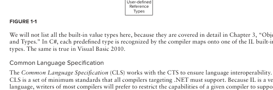

图 1-1

此处不会列出所有内置值类型，因为第 3 章“Objects and Types”会详细介绍它们。在 C# 中，编译器识别的每个预定义类型都会映射到某个 IL 内置类型。Visual Basic 2010 也是如此。

### 公共语言规范

公共语言规范（CLS）与 CTS 配合工作，以确保语言互操作性。CLS 是所有面向 .NET 的编译器都必须支持的一组最低标准。由于 IL 是一种非常丰富的语言，大多数编译器开发者倾向于限制特定编译器的能力，只支持 IL 和 CTS 所提供的功能的一个子集。只要编译器支持 CLS 中定义的所有内容，这样做就没有问题。

例如，以大小写敏感性为例。IL 是区分大小写的。使用区分大小写语言的开发人员在选择变量名时，通常会利用这种大小写敏感性带来的灵活性。然而，Visual Basic 2010 不区分大小写。CLS 对此的处理方式是规定：符合 CLS 的代码不应公开任何两个仅大小写不同的名称。因此，Visual Basic 2010 代码可以与符合 CLS 的代码协同工作。


可从代码访问的对象是指那些具有引用指向它们的对象。任何未被引用的对象都被视为不再可从代码访问，因此可以被移除。Java 使用的垃圾回收系统与此类似。

垃圾回收之所以能在 .NET 中工作，是因为 IL（中间语言）在设计时就考虑了对此过程的支持。其原则要求，除了复制现有引用之外，你不能获取对现有对象的其他引用，并且 IL 必须是类型安全的。在此语境下，我们的意思是，如果存在对某个对象的任何引用，那么该引用中就包含足够的信息来精确确定该对象的类型。

例如，在使用非托管 C++ 这类语言时，就不可能使用垃圾回收机制，因为 C++ 允许指针在类型之间自由转换。

垃圾回收的一个重要特性是它不具备确定性。换句话说，你无法保证垃圾回收器何时会被调用；它将在 CLR 认为需要时被调用，不过你也可以覆盖此过程，在代码中自行调用垃圾回收器。

有关垃圾回收过程的更多信息，请参阅第 13 章“内存管理和指针”。

### 安全

.NET 在补充 Windows 提供的安全机制方面确实表现出色，因为它可以提供基于代码的安全性，而 Windows 实际上只提供基于角色的安全性。

基于角色的安全性基于运行进程的账户身份（即谁拥有并正在运行该进程）。相比之下，基于代码的安全性则基于代码实际执行的操作以及代码的受信任程度。得益于 IL 强大的类型安全性，CLR 能够在运行代码之前对其进行检查，以确定所需的安全权限。.NET 还提供了一种机制，通过该机制，代码可以预先表明其运行所需的安全权限。

基于代码的安全性的重要性在于，它降低了运行来源可疑代码（例如从互联网下载的代码）所带来的风险。例如，即使代码在管理员账户下运行，也可以使用基于代码的安全性来指示该代码仍不应被允许执行管理员账户通常可执行的某些类型的操作，例如读写环境变量、读写注册表或访问 .NET 反射功能。

安全问题将在第 21 章“安全”中更深入地讨论。

### 应用程序域

应用程序域是 .NET 中的一项重要创新，旨在减轻运行需要相互隔离但又需要能够相互通信的应用程序时所产生的开销。一个典型的例子是 Web 服务器应用程序，它可能同时响应多个浏览器请求。因此，它可能会同时运行多个负责处理这些请求的组件实例。

在 .NET 之前的日子里，选择要么是允许这些实例共享一个进程（这样做的风险是，一个运行中的实例出现问题可能会导致整个网站崩溃），要么是将这些实例隔离在单独的进程中（带来相关的性能开销）。

到目前为止，隔离代码的唯一手段是通过进程。当你启动一个新应用程序时，它会在一个进程的上下文中运行。Windows 通过地址空间将进程彼此隔离。其理念是，每个进程拥有 4GB 的虚拟内存可用于存储其数据和可执行代码（4GB 是针对 32 位系统；64 位系统使用更多内存）。Windows 施加了额外的间接层次，通过这种间接层次，虚拟内存映射到实际物理内存或磁盘空间的特定区域。每个进程获得不同的映射，虚拟地址空间块映射到的实际物理内存之间没有重叠（见图 1-2）。

### 程序集

程序集是包含针对 .NET Framework 编译的代码的逻辑单元。本章不会详细讨论程序集，因为第 18 章“程序集”会对它们进行深入介绍，但我们在此总结一下要点。

程序集是完全自描述的，并且是逻辑单元而非物理单元，这意味着它可以跨多个文件存储（实际上，动态程序集存储在内存中，根本不存储在文件上）。如果程序集存储在多个文件中，那么会有一个主文件，其中包含入口点并描述程序集中的其他文件。

请注意，可执行代码和库代码使用相同的程序集结构。唯一真正的区别在于，可执行程序集包含主程序入口点，而库程序集则不包含。

程序集的一个重要特征是，它们包含描述相应代码中定义的类型和方法的元数据。然而，程序集还包含描述程序集本身的程序集元数据。这些程序集元数据位于称为清单的区域中，允许对程序集的版本及其完整性进行检查。

> ildasm 是一个基于 Windows 的实用工具，可用于检查程序集的内容，包括清单和元数据。第 18 章将讨论 ildasm。

程序集包含程序元数据这一事实意味着，调用给定程序集中代码的应用程序或其他程序集无需引用注册表或任何其他数据源即可了解如何使用该程序集。这与旧的 COM 方式形成了显著突破，在 COM 方式中，必须从注册表中获取组件和接口的 GUID，在某些情况下，还需要从类型库中读取所公开的方法和属性的详细信息。

数据分布在最多三个不同位置，这意味着存在数据不同步的明显风险，这可能会阻止其他软件成功使用该组件。而使用程序集，这种风险不会发生，因为所有元数据都与程序可执行指令存储在一起。请注意，即使程序集跨多个文件存储，数据不同步的问题也不会出现。这是因为包含程序集入口点的文件还存储了其他文件的内容详细信息和哈希值，这意味着如果其中一个文件被替换或以任何方式被篡改，几乎肯定会被检测到，并且程序集将拒绝加载。

程序集有两种类型：私有程序集和共享程序集。

#### 私有程序集

私有程序集是最简单的类型。它们通常随软件一起提供，并且仅打算与该软件一起使用。你通常会提供私有程序集的场景是，当你以可执行文件和多个库的形式提供应用程序时，其中这些库包含仅应与此应用程序一起使用的代码。

系统保证私有程序集不会被其他软件使用，因为应用程序只能加载位于主可执行文件所在文件夹或其子文件夹中的私有程序集。

由于你通常会预期商业软件总是安装在自己的目录中，因此不存在一个软件包覆盖、修改或意外加载供另一个软件包使用的私有程序集的风险。而且，由于私有程序集只能由它们所面向的软件包使用，因此你可以更好地控制哪些软件使用它们。那里


因此，由于不存在风险，例如其他商业软件用新版本覆盖你的程序集（除了专门设计用于恶意破坏的软件），所以需要采取的安全预防措施较少。也不存在名称冲突的问题。如果你的私有程序集中的类恰好与其他人的私有程序集中的类同名，那也没关系，因为任何给定的应用程序只能看到一组私有程序集。

由于私有程序集是完全自包含的，因此部署过程很简单。只需将适当的文件放入文件系统中适当的文件夹即可（无需注册表项）。此过程称为零影响（xcopy）安装。

#### 共享程序集

共享程序集旨在作为任何其他应用程序都可以使用的公共库。由于任何其他软件都可以访问共享程序集，因此需要针对以下风险采取更多预防措施：

- 名称冲突，即另一家公司的共享程序集实现了与你的共享程序集中类型同名的类型。由于客户端代码理论上可以同时访问两个程序集，这可能是一个严重的问题。
- 同一程序集的不同版本覆盖程序集的风险——新版本与某些现有客户端代码不兼容。

解决这些问题的方法是将共享程序集放置在文件系统中的一个特殊目录子树中，称为全局程序集缓存（GAC）。与私有程序集不同，这不能通过简单地将程序集复制到适当的文件夹来完成——它需要专门安装到缓存中。此过程可以由多个.NET实用程序执行，并且需要对程序集进行某些检查，以及在程序集缓存中设置一个小的文件夹层次结构，以确保程序集的完整性。

为了防止名称冲突，共享程序集基于私钥加密法命名（私有程序集仅与其主文件名同名）。此名称称为强名称；它保证是唯一的，并且引用共享程序集的应用程序必须引用它。

与覆盖程序集风险相关的问题通过在程序集清单中指定版本信息并允许并行安装来解决。

### 反射

由于程序集存储元数据，包括程序集中定义的所有类型以及这些类型的成员的详细信息，因此可以通过编程方式访问这些元数据。完整细节参见第14章。这种称为反射的技术带来了有趣的可能性，因为它意味着托管代码实际上可以检查其他托管代码，甚至可以检查自身，以确定有关该代码的信息。这最常用于获取属性的详细信息，尽管你也可以将反射用作间接实例化类或调用方法的方式，前提是给出这些类或方法的名称作为字符串。通过这种方式，你可以根据用户输入在运行时而不是编译时选择要实例化的类或要调用的方法（动态绑定）。

### 并行编程

.NET Framework 4引入了利用当今所有双核和四核处理器的能力。新的并行计算功能提供了分离工作操作并在多个处理器上运行这些操作的方法。新的并行编程API使得编写安全的多线程代码变得如此简单，但重要的是要认识到你仍然需要考虑竞争条件以及锁等问题。

新的并行编程功能提供了新的任务并行库以及PLINQ执行引擎。并行编程将在第20章“线程、任务和同步”中介绍。

## 

## 2 C# 核心

### 本章内容

- 声明变量
- 变量的初始化和作用域
- 预定义的C#数据类型
- 使用条件语句、循环和跳转语句控制C#程序中的执行流
- 枚举
- 命名空间
- Main()方法
- 基本的命令行C#编译器选项
- 使用System.Console执行控制台I/O
- 使用内部注释和文档功能
- 预处理器指令
- C#良好编程的指南和约定

现在你已经更了解C#能做什么，你会想学习如何使用它。本章通过为你提供C#编程基础知识的基本认识，为你提供了一个良好的开端，后续章节将在此基础上构建。到本章结束时，你将掌握足够的C#知识来编写简单程序（尽管不使用继承或其他面向对象功能，这些将在后面的章节中介绍）。

### 你的第一个C#程序

让我们从编译和运行最简单的C#程序开始——一个简单的控制台应用程序，由一个向屏幕写入消息的类组成。

### 代码

在文本编辑器（如记事本）中键入以下内容，并以`.cs`扩展名保存（例如`First.cs`）。此处显示了`Main()`方法（有关更多信息，请参阅本章后面的“Main方法”部分）：

```
using System;

namespace Wrox
{
    public class MyFirstClass
    {
        static void Main()
        {
            Console.WriteLine("Hello from Wrox.");
            Console.ReadLine();
            return;
        }
    }
}
```

### 编译和运行程序

你可以通过简单地对源文件运行C#命令行编译器（`csc.exe`）来编译此程序，如下所示：

`csc First.cs`

如果你想使用`csc`命令从命令行编译代码，你应注意，包括`csc`在内的.NET命令行工具仅在设置了某些环境变量时才可用。根据你安装.NET（和Visual Studio 2010）的方式，你的机器上可能有也可能没有这些环境变量。

> 如果你没有设置环境变量，你有以下两个选项：第一个是在运行`csc`之前，从命令提示符运行批处理文件`%Microsoft Visual Studio 2010%\Common\Tools\vsvars32.bat`，其中`%Microsoft Visual Studio 2010%`是Visual Studio 2010安装到的文件夹。第二种也是更简单的方法是使用Visual Studio 2010命令提示符而不是通常的命令提示符窗口。你可以在“开始”菜单的“程序”、“Microsoft Visual Studio 2010”、“Visual Studio Tools”下找到Visual Studio 2010命令提示符。它只是一个命令提示符窗口，打开时会自动运行`vsvars32.bat`。

编译代码会生成一个名为First.exe的可执行文件，你可以像其他任何可执行文件一样从命令行或Windows资源管理器运行它。试一试：

```
csc First.cs
Microsoft (R) Visual C# 2010 Compiler version 4.0.20506.1
Copyright (C) Microsoft Corporation. All rights reserved.

First.exe
Hello from Wrox.
```

### 深入探讨

首先，关于C#语法的一些一般性评论。在C#中，与其他C风格语言一样，大多数语句以分号（;）结尾，并且可以跨越多行而无需续行符。语句可以使用花括号（{}）组合成块。单行注释以两个正斜杠字符（//）开头，多行注释以斜杠和星号（/*）开头，并以相同的组合反转（*/）结尾。在这些方面，C#与C++和Java相同，但与Visual Basic不同。正是分号和花括号使C#代码在视觉上与Visual Basic代码如此不同。如果你的背景主要是Visual Basic，请特别注意在每条语句末尾记住分号。省略分号通常是刚接触C风格语言的开发人员编译错误的最大原因。另一件要记住的事情是C#区分大小写。这意味着名为myVar和myVar的变量是两个不同的变量。

前面代码示例中的前几行与命名空间有关（本章后面会提到），这是一种将相关类分组在一起的方式。namespace关键字声明你的类应该关联的命名空间。其后的花括号内的所有代码都被视为位于该命名空间内。using语句指定编译器应查找的命名空间，以查找在代码中引用但未在当前命名空间中定义的任何类。其作用与Java中的import语句和C++中的using namespace语句相同。

```
using System;
namespace Wrox
{
```

First.cs文件中存在using语句的原因是你将使用一个库类System.Console。using System语句允许你仅将此类引用为Console（对于System命名空间中的任何其他类也是如此）。如果没有using，我们将不得不完全限定对Console.WriteLine方法的调用，如下所示：

```
System.Console.WriteLine("Hello from Wrox.");
```

标准的System命名空间是大多数常用.NET类型所在的位置。重要的是要认识到你在C#中所做的一切都依赖于.NET基类。在这种情况下，你使用System命名空间中的Console类来写入控制台窗口。C#没有自己的输入或输出内置关键字；它完全依赖于.NET类。

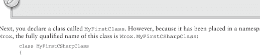

接下来，你声明一个名为MyFirstClass的类。但是，因为它被放置在名为Wrox的命名空间中，所以此类的完全限定名称是Wrox.MyFirstCSharpClass：

```
class MyFirstCSharpClass
{
```


### 变量作用域

变量的作用域是从中可以访问该变量的代码区域。通常，作用域由以下规则确定：

- 类的字段（也称为成员变量）在其包含的类处于作用域内时一直处于作用域中。
- 局部变量的作用域持续到闭合大括号指示其声明所在的块语句或方法的结束为止。
- 在 for、while 或类似语句中声明的局部变量在该循环的主体中处于作用域内。

#### 局部变量的作用域冲突

在大型程序中，为不同部分的变量使用相同的变量名是很常见的。只要这些变量的作用域限定在程序的完全不同部分，从而不存在歧义的可能性，这就是可以的。然而，请记住，名称相同的局部变量不能在同一作用域中声明两次。例如，不能这样做：

```
int x = 20;
// some more code
int x = 30;
```

请考虑以下代码示例：

```
using System;
namespace Wrox.ProCSharp.Basics
{
    public class ScopeTest
    {
        public static int Main()
        {
            for (int i = 0; i < 10; i++)
            {
                Console.WriteLine(i);
            } // i goes out of scope here
            // We can declare a variable named i again, because
            // there's no other variable with that name in scope
            for (int i = 9; i >= 0; i--)
            {
                Console.WriteLine(i);
            } // i goes out of scope here.
            return 0;
        }
    }
}
```

代码片段 Scope.cs

这段代码仅使用两个 for 循环将数字从 0 到 9 打印出来，然后再从 9 到 0 打印回去。需要注意的重要一点是，你在这段代码中、在同一个方法内声明了变量 i 两次。你可以这样做，因为 i 在两个独立的循环中声明，因此每个 i 变量都仅限于其自己的循环。

接下来的几节将详细讨论值类型和引用类型的语法。从概念上讲，区别在于值类型直接存储其值，而引用类型存储对值的引用。

这些类型存储在内存的不同位置；值类型存储在称为栈的区域中，而引用类型存储在称为托管堆的区域中。由于每次赋值的效果不同，因此了解类型是值类型还是引用类型非常重要。

例如，int 是值类型，这意味着以下语句会导致内存中的两个位置存储值 20：

```
// i and j are both of type int
 i = 20;
 j = i;
```

然而，请考虑以下代码。对于此代码，假设你已定义了一个名为 Vector 的类。假设 Vector 是引用类型，并且有一个名为 Value 的 int 成员变量：

```
Vector x, y;
 x = new Vector();
 x.Value = 30; // Value is a field defined in Vector class
 y = x;
 Console.WriteLine(y.Value);
 y.Value = 50;
 Console.WriteLine(x.Value);
```

需要理解的关键点是，执行此代码后，只有一个 Vector 对象存在。x 和 y 都指向包含此对象的内存位置。因为 x 和 y 是引用类型的变量，声明每个变量只是保留一个引用——它不会实例化给定类型的对象。在任何一种情况下都不会实际创建对象。要创建对象，必须使用 new 关键字，如图所示。因为 x 和 y 引用同一个对象，所以对 x 所做的更改会影响 y，反之亦然。因此代码将显示 30 然后是 50。

> C++ 开发者应注意，此语法类似于引用，而不是指针。你使用 . 记法，而不是 ->，来访问对象成员。从语法上看，C# 引用看起来更像 C++ 引用变量。然而，在表面语法之外，真正的相似之处在于 C++ 指针。

如果一个变量是引用，可以通过将其值设置为 null 来表示它不引用任何对象：

```
y = null;
```

如果引用被设置为 null，那么显然不可能对其调用任何非静态成员函数或字段；这样做会在运行时导致异常抛出。

在 C# 中，bool 和 long 等基本数据类型是值类型。这意味着如果声明一个 bool 变量并将其赋值为另一个 bool 变量的值，内存中将有两个独立的 bool 值。稍后，如果更改原始 bool 变量的值，第二个 bool 变量的值不会改变。这些类型按值复制。

相反，大多数更复杂的 C# 数据类型，包括你自己声明的类，都是引用类型。它们在堆上分配，具有可以跨越多个函数调用的生命周期，并且可以通过一个或多个别名访问。公共语言运行时（CLR）实现了一种复杂的算法来跟踪哪些引用变量仍然可达，哪些已被遗弃。定期地，CLR 会销毁被遗弃的对象，并将它们曾经占用的内存归还给操作系统。这是由垃圾回收器完成的。

在 .NET 中，short 不再那么短；它现在长 16 位。int 类型长 32 位。long 类型为值保留 64 位。所有整数类型变量都可以以十进制或十六进制表示法赋值。后者需要 0x 前缀：

```
long x = 0x12ab;
```

如果整数是 int、uint、long 还是 ulong 存在任何歧义，它将默认为 int。要指定值应采用其他哪种整数类型，可以在数字后附加以下字符之一：

```
uint ui = 1234U;
long l = 1234L;
ulong ul = 1234UL;
```

你也可以使用小写的 u 和 l，尽管后者可能与整数 1（one）混淆。

### 浮点类型

尽管 C# 提供了大量整数数据类型，但它也支持浮点类型。

| 名称 | CTS 类型 | 描述 | 有效数字 | 范围（近似） |
|---|---|---|---|---|
| float | System.Single | 32 位单精度浮点数 | 7 | ±1.5 × 10⁻⁴⁵ to ±3.4 × 10³⁸ |
| double | System.Double | 64 位双精度浮点数 | 15/16 | ±5.0 × 10⁻³²⁴ to ±1.7 × 10³⁰⁸ |

float 数据类型用于较小的浮点值，其中所需的精度较低。double 数据类型比 float 数据类型更大，但提供两倍的精度（15 位数字）。

如果你在代码中硬编码一个非整数数字（如 12.3），编译器通常会假设你希望该数字被解释为 double。如果你想指定该值是 float，可以在其后附加字符 F（或 f）：

```
float f = 12.3F;
```

### 十进制类型

decimal 类型表示更高精度的浮点数，如下表所示。

| 名称 | CTS 类型 | 描述 | 有效数字 | 范围（近似） |
|---|---|---|---|---|
| decimal | System.Decimal | 128 位高精度十进制表示 | 28 | ±1.0 × 10⁻²⁸ to ±7.9 × 10²⁸ |

CTS 和 C# 的一大优点是为财务计算提供了专门的 decimal 类型。decimal 类型提供的 28 位数字如何使用由你决定。换句话说，你可以更精确地跟踪较小的美元金额的 cents，或对较大的美元金额在小数部分进行更多舍入。然而请记住，decimal 在底层并不是作为原始类型实现的，因此使用 decimal 会对你的计算产生性能影响。

要指定你的数字是 decimal 类型而不是 double、float 或整数，可以在值后附加字符 M（或 m），如下例所示：

```
decimal d = 12.30M;
```


### 布尔类型

C# 中的 `bool` 类型用于包含布尔值 `true` 或 `false`。

| 名称 | CTS 类型 | 说明 | 有效位数 | 范围（近似） |
|---|---|---|---|---|
| `bool` | `System.Boolean` | 表示真或假 | 不适用 | true false |

不能隐式地将 `bool` 值与整数值相互转换。如果变量（或函数返回类型）声明为 `bool`，则只能使用 `true` 和 `false` 值。如果试图用零表示 `false`，用非零值表示 `true`，将会出现错误。

### 字符类型

为了存储单个字符的值，C# 支持 `char` 数据类型。

| 名称 | CTS 类型 | 值 |
|---|---|---|
| `char` | `System.Char` | 表示单个 16 位（Unicode）字符 |

`char` 类型的字面量用单引号括起来表示，例如 `'A'`。如果试图将字符用双引号括起来，编译器会将其视为字符串并引发错误。

除了用字符字面量表示 `char`，还可以用四位十六进制 Unicode 值（例如 `\u0041`）、带强制转换的整数值（例如 `(char) 65`）或十六进制值（`\x0041`）表示。也可以使用转义序列表示，如下表所示。

| 转义序列 | 字符 |
|---|---|
| `\'` | 单引号 |
| `\"` | 双引号 |
| `\\` | 反斜杠 |
| `\0` | 空字符 |
| `\a` | 警报 |
| `\b` | 退格 |
| `\f` | 换页 |
| `\n` | 换行 |
| `\r` | 回车 |
| `\t` | 制表符 |
| `\v` | 垂直制表符 |

### 预定义引用类型

C# 支持两种预定义引用类型：`object` 和 `string`，如下表所述。

| 名称 | CTS 类型 | 说明 |
|---|---|---|
| `object` | `System.Object` | 根类型。CTS 中的所有其他类型（包括值类型）都派生自 `object`。 |
| `string` | `System.String` | Unicode 字符串 |

然而，为了保持一致性，许多程序员在使用 if 语句时都习惯使用花括号。

这里展示的 if 语句还说明了一些 C# 中比较值的运算符。请特别注意，C# 使用 `==` 来比较变量是否相等。不要为此使用 `=`。单个 `=` 用于赋值。

在 C# 中，`if` 子句中的表达式必须计算结果为布尔值。不能直接测试整数（例如，从函数返回的整数）。必须将返回的整数转换为布尔值 `true` 或 `false`，例如，将值与零或 `null` 进行比较：

```csharp
if (DoSomething() != 0)
{
    // 返回了非零值
}
else
{
    // 返回了零
}
```

### switch 语句

`switch...case` 语句适合从一组互斥的分支中选择一个执行分支。它采用 switch 参数后跟一系列 case 子句的形式。当 switch 参数中的表达式计算结果为某个 case 子句旁的值之一时，紧接该 case 子句之后的代码将执行。这是一个不需要使用花括号将语句连接成块的示例；相反，使用 `break` 语句标记每个 case 代码的结束。还可以在 switch 语句中包含 `default` 分支，如果表达式未匹配任何其他 case，则执行该分支。以下 switch 语句测试 `integerA` 变量的值：

```csharp
switch (integerA)
{
    case 1:
        Console.WriteLine("integerA =1");
        break;
    case 2:
        Console.WriteLine("integerA =2");
        break;
    case 3:
        Console.WriteLine("integerA =3");
        break;
    default:
        Console.WriteLine("integerA is not 1,2, or 3!");
        break;
}
```

请注意，case 的值必须是常量表达式；不允许使用变量。

尽管 C 和 C++ 程序员应该熟悉 `switch...case` 语句，但 C# 的 `switch...case` 比其 C++ 版本更安全。具体来说，它几乎在所有情况下都禁止贯穿（fall-through）条件。这意味着，如果某个 case 子句在块中较早触发，则后续子句不能被触发，除非使用 `goto` 语句标记也希望它们被触发。编译器通过将每个未配备 `break` 语句的 case 子句标记为错误来强制执行此限制，类似于：

```text
Control cannot fall through from one case label ('case 2:') to another
```

```
{
    case TimeOfDay.Morning:
    Console.WriteLine("Good morning!");
    break;
    case TimeOfDay.Afternoon:
    Console.WriteLine("Good afternoon!");
    break;
    case TimeOfDay.Evening:
    Console.WriteLine("Good evening!");
    break;
    default:
    Console.WriteLine("Hello!");
    break;
}
}
```

C# 中枚举的真正强大之处在于，在幕后它们被实例化为派生自基类 `System.Enum` 的结构体。这意味着可以对它们调用方法以执行一些有用的任务。请注意，由于 .NET Framework 的实现方式，将枚举在语法上视为结构体并不会带来性能损失。实际上，在代码编译后，枚举将以原始类型存在，就像 `int` 和 `float` 一样。

可以像下面这个示例一样检索枚举的字符串表示形式，使用之前的 `TimeOfDay` 枚举：

```
TimeOfDay time = TimeOfDay.Afternoon;
Console.WriteLine(time.ToString());
```

这将返回字符串 `Afternoon`。

或者，可以从字符串获取枚举值：

```
TimeOfDay time2 = (TimeOfDay) Enum.Parse(typeof(TimeOfDay), "afternoon", true);
Console.WriteLine((int)time2);
```

这段代码示例既说明了如何从字符串获取枚举值，也说明了如何转换为整数。要从字符串转换，需要使用静态的 `Enum.Parse()` 方法，如所示，该方法接受三个参数。第一个参数是要考虑的枚举类型。语法是关键字 `typeof` 后跟方括号中的枚举类名。（第 7 章将更详细地探讨 `typeof` 运算符。）第二个参数是要转换的字符串，第三个参数是一个 `bool`，指示进行转换时是否应忽略大小写。最后，请注意，`Enum.Parse()` 实际上返回一个对象引用——需要显式将其转换为所需的枚举类型（这是一个取消装箱操作的示例）。对于前面的代码，这将以对象形式返回值 1，对应于 `TimeOfDay.Afternoon` 的枚举值。显式转换为 `int` 时，再次产生值 1。

`System.Enum` 上的其他方法可以完成诸如返回枚举定义中的值数量或列出值的名称等操作。完整细节请参阅 MSDN 文档。

### 命名空间

正如本章前面所见，命名空间提供了一种组织相关类和其他类型的方法。与文件或组件不同，命名空间是逻辑分组而非物理分组。当在 C# 文件中定义类时，可以将其包含在命名空间定义中。稍后，当在另一个文件中定义另一个执行相关工作的类时，可以将其包含在同一个命名空间中，从而创建一个逻辑分组，向使用这些类的其他开发人员表明它们之间的关系和用法：

```
namespace CustomerPhoneBookApp
{
    using System;

    public struct Subscriber
```

如前所述，几乎所有 C# 源代码都会有 `using System;` 语句，仅仅是因为微软提供的许多有用的类都包含在 `System` 命名空间中。

如果两个由 using 语句引用的命名空间包含同名类型，则需要使用完整（或至少更长）的名称形式，以确保编译器知道要访问哪个类型。例如，假设名为 `NamespaceExample` 的类同时存在于 `Wrox.ProcSharp.Basics` 和 `Wrox.ProcSharp.OOP` 命名空间中。然后，如果在 `Wrox.ProcSharp` 命名空间中创建一个名为 `Test` 的类，并在此类中实例化其中一个 `NamespaceExample` 类，则需要指定所指的是这两个类中的哪一个：

```
using Wrox.ProcSharp.OOP;
using Wrox.ProcSharp.Basics;
namespace Wrox.ProcSharp
{
    class Test
    {
        public static int Main()
        {
            Basics.NamespaceExample nsEx = new Basics.NamespaceExample();
            // do something with the nsEx variable.
            return 0;
        }
    }
}
```

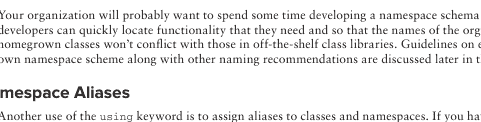

您的组织可能希望花一些时间来制定命名空间方案，以便其开发人员能够快速找到所需功能，并确保组织自行开发的类的名称不会与现成的类库中的名称冲突。有关建立自己的命名空间方案以及其他命名建议的指导将在本章后面讨论。

### 命名空间别名

`using` 关键字的另一个用途是为类和命名空间分配别名。如果有一个非常长的命名空间名称，希望在代码中多次引用，但又不想在简单的 `using` 语句中包含它（例如，为了避免类型名称冲突），则可以为该命名空间分配一个别名。其语法如下：

```
using alias = NamespaceName;
```

以下示例（前一个示例的修改版本）为 `Wrox.ProcSharp.Basics` 命名空间分配别名 `Introduction`，并使用此别名实例化在该命名空间中定义的 `NamespaceExample` 对象。请注意命名空间别名限定符（`::`）的使用。这会强制搜索从 `Introduction` 命名空间别名开始。如果在同一作用域中引入了名为 `Introduction` 的类，则会发生冲突。`::` 运算符允许即使存在冲突也能引用该别名。`NamespaceExample` 类有一个方法 `GetNamespace()`，该方法使用每个类公开的 `GetType()` 方法访问表示类类型的 `Type` 对象。使用此对象返回类命名空间的名称：

```
using System;
using Introduction = Wrox.ProcSharp.Basics;
```


```
class Test
{
    public static int Main()
    {
        Introduction::NamespaceExample NSEx =
            new Introduction::NamespaceExample();
        Console.WriteLine(NSEx.GetNamespace());
        return 0;
    }
}

namespace Wrox.ProcSharp.Basics
{
    class NamespaceExample
    {
        public string GetNamespace()
        {
            return this.GetType().Namespace;
        }
    }
}
```

### Main() 方法

如本章开头所述，C# 程序从名为 Main() 的方法开始执行。该方法必须是类（或结构体）的静态方法，并且返回类型必须是 int 或 void。

虽然通常显式指定 public 修饰符（因为按定义该方法必须从程序外部调用），但实际上为入口点方法分配什么可访问性级别并不重要——即使将方法标记为 private，它也会运行。

### 多个 Main() 方法

在编译 C# 控制台或 Windows 应用程序时，默认情况下编译器只查找一个与刚才描述的签名匹配的 Main() 方法，并使该类的那个方法成为程序的入口点。如果有多个 Main() 方法，编译器将返回错误消息。例如，考虑以下名为 DoubleMain.cs 的代码：

```
using System;

namespace Wrox
{
    class Client
    {
        public static int Main()
        {
            MathExample.Main();
            return 0;
        }
    }

    class MathExample
    {
        static int Add(int x, int y)
        {
            return x + y;
        }

        public static int Main()
        {
            int i = Add(5,10);
            Console.WriteLine(i);
            return 0;
        }
    }
}
```
代码片段 DoubleMain.cs

这段代码包含两个类，它们都有 Main() 方法。如果尝试以通常方式编译这段代码，将得到以下错误：

```
csc DoubleMain.cs
Microsoft (R) Visual C# 2010 Compiler version 4.0.20506.1
Copyright (C) Microsoft Corporation. All rights reserved.

DoubleMain.cs(7,25): error CS0017: Program
'DoubleMain.exe' has more than one entry point defined:
'Wrox.Client.Main()'. Compile with /main to specify the type that
contains the entry point.
DoubleMain.cs(21,25): error CS0017: Program
'DoubleMain.exe' has more than one entry point defined:
'Wrox.MathExample.Main()'. Compile with /main to specify the type that
contains the entry point.
```

但是，可以通过使用 /main 开关，并指定 Main() 方法所属类的完整名称（包括命名空间），来显式地告诉编译器使用哪个方法作为程序的入口点：

```
csc DoubleMain.cs /main:Wrox.MathExample
```

### 向 Main() 传递参数

到目前为止，示例仅展示了不带任何参数的 Main() 方法。然而，当程序被调用时，可以通过包含一个参数让 CLR 将任何命令行参数传递给程序。该参数是一个字符串数组，传统上称为 args（尽管 C# 接受任何名称）。程序可以使用该数组来访问程序启动时通过命令行传递的任何选项。

```
using System;
namespace Wrox
{
    class ArgsExample
    {
        public static int Main(string[] args)
        {
            for (int i = 0; i < args.Length; i++)
            {
                Console.WriteLine(args[i]);
            }
            return 0;
        }
    }
}
```
代码片段 ArgsExample.cs

```
<summary>
The Add method allows us to add two integers.
</summary>
<returns>Result of the addition </returns>
<param name="x">First number to add</param>
<param name="y">Second number to add</param>
</member>
</members>
</doc>
```
代码片段 MathLibrary.xml

注意编译器实际上已经为你做了一些工作；它创建了一个 <assembly> 元素，并为文件中的每个类型或类型成员添加了一个 <member> 元素。每个 <member> 元素都有一个 name 属性，其值为成员的完整名称，并带有一个前缀字母，指示这是类型（T:）、字段（F:）还是成员（M:）。

### C# 预处理器指令

除了通常的关键字（其中大部分你已经遇到）之外，C# 还包含许多称为预处理器指令的命令。这些命令实际上永远不会被翻译为可执行代码中的任何命令，而是影响编译过程的某些方面。例如，可以使用预处理器指令阻止编译器编译代码的某些部分。如果你打算发布两个版本的代码——一个基本版本和一个具有更多功能的企业版本，可能会这样做。可以在编译软件的基本版本时，使用预处理器指令阻止编译器编译与附加功能相关的代码。另一种情况是，你可能编写了一些用于提供调试信息的代码片段。在真正发布软件时，你可能不希望这些代码部分被编译。

所有预处理器指令都以 # 符号开头，以此区分。

> C++ 开发人员会认识到预处理器指令在 C 和 C++ 中扮演着重要角色。然而，C# 中的预处理器指令没有那么多，而且使用频率也不那么高。C# 提供了其他机制，例如自定义属性，可以实现与 C++ 指令相同的某些效果。另外，请注意 C# 实际上并不像 C++ 那样有单独的预处理器。所谓的预处理器指令实际上由编译器处理。尽管如此，C# 仍保留了“预处理器指令”这一名称，因为这些命令给人的感觉像是存在一个预处理器。

#### #define 和 #undef

#define 的使用方式如下：

```
#define DEBUG
```

这所做的是告诉编译器一个具有给定名称（此处为 DEBUG）的符号存在。这有点像声明一个变量，只是这个变量实际上没有值——它只是存在。而且这个符号不是你实际代码的一部分；它只为了编译器的利益而存在，在编译器编译代码时存在，并且在 C# 代码本身中没有意义。

```
// do something else
#else
// code for the leaner version
#endif
```

> 请注意，与 C++ 的情况不同，使用 #if 并不是条件编译代码的唯一方式。C# 通过 Conditional 属性提供了一种替代机制，这将在第 14 章“反射”中探讨。

#if 和 #elif 也支持有限范围的逻辑运算符，可以使用运算符 !、==、!=、&& 和 ||。如果符号存在，则被视为 true；如果不存在，则被视为 false。例如：

```
#if WIZ && (ENTERPRISE==false)   // if WIZ is defined but ENTERPRISE isn't
```

#### #warning 和 #error

另外两个非常有用的预处理器指令是 #warning 和 #error。当编译器遇到它们时，会分别引发警告或错误。如果编译器看到 #warning 指令，它会在 #warning 之后向用户显示任何文本，然后继续编译。如果遇到 #error 指令，它会将后续文本作为编译错误消息显示给用户，然后立即放弃编译，因此不会生成任何 IL 代码。

你可以使用这些指令作为检查，确保你没有对 #define 语句做任何愚蠢的事情；也可以使用 #warning 语句提醒自己做某事：

```
#if DEBUG && RELEASE
#error "You've defined DEBUG and RELEASE simultaneously!"
#endif

#warning "Don't forget to remove this line before the boss tests the code!"
Console.WriteLine("I hate this job.*");
```

#### #region 和 #endregion

#region 和 #endregion 指令用于指示某个代码块被视为具有给定名称的单个块，如下所示：

```
#region Member Field Declarations
int x;
double d;
Currency balance;
#endregion
```

这本身看起来并不是很有用；它不会以任何方式影响编译过程。然而，真正的优势在于这些指令会被一些编辑器识别，包括 Visual Studio .NET 编辑器。这些编辑器可以使用这些指令在屏幕上更好地布局代码。你将在第 16 章中看到它是如何工作的。

#### #line

#line 指令可用于更改编译器在警告和错误消息中输出的文件名和行号信息。你可能不会想经常使用这个指令。当你与其他某个包一起编码，而这个包在将你输入的代码发送给编译器之前会修改代码时，它最有用。在这种情况下，编译器报告的行号或文件名可能与你正在编辑的文件中的行号或文件名不匹配。#line


|  |  |  |  |  |
|---|---|---|---|---|
| char | hex | foreach | protected | ulong |
| checked | goto | public | unchecked |  |
| class | if | readonly | unsafe |  |
| const | implicit | ref | ushort |  |
| continue | in | return | using |  |
| decimal | int | sbyte | virtual |  |
| default | interface | sealed | volatile |  |
| delegate | internal | short | void |  |
| do | is | sizeof | while |  |
| double | lock | stackalloc |  |  |
| else | long | static |  |  |
| enum | namespace | string |  |  |

如果您需要将其中一个词用作标识符（例如，如果您正在访问用其他语言编写的类），您可以将标识符前加上 @ 符号，以指示编译器将后续内容视为标识符，而不是 C# 关键字（因此 abstract 不是有效的标识符，但 @ abstract 是）。

最后，标识符还可以包含 Unicode 字符，使用语法 \uXXXX 指定，其中 XXXX 是 Unicode 字符的四位十六进制代码。以下是一些有效标识符的示例：

- Name
- Überfluß
- _Identifier
- \u005FIdentifier

此列表中的最后两项是相同的，可以互换使用（因为 005F 是下划线字符的 Unicode 代码，因此显然这两个标识符不能同时在同一作用域中声明）。请注意，虽然在语法上允许在标识符中使用下划线字符，但大多数情况下并不推荐这样做。这是因为它不符合微软编写的命名变量的指南，旨在确保开发人员使用相同的约定，使阅读彼此的代码变得更容易。

### 使用约定

在任何开发语言中，通常会出现某些传统的编程风格。这些风格不是语言本身的一部分，而是关于例如变量如何命名或某些类、方法或函数如何使用的约定。如果使用该语言的大多数开发人员遵循相同的约定，就更容易让不同的开发人员理解彼此的代码——这反过来通常有助于程序的可维护性。然而，约定确实取决于语言和环境。例如，在 Windows 平台上编程的 C++ 开发人员传统上使用前缀 psz 或 lpsz 来表示字符串——char *pszResult; char *lpszMessage;——但在 Unix 机器上，更常见的是不使用此类前缀：char *Result; char *Message。

您会注意到，本书中的示例代码显示，C# 的约定是为变量命名时不加前缀：string Result; string Message;

您被建议使用的唯一其他大小写方案是驼峰命名法。驼峰命名法与帕斯卡命名法类似，只是名称中第一个单词的首字母不大写：`employeeSalary`、`confirmationDialog`、`plainTextEncoding`。以下是您被建议使用驼峰命名法的三种情况：

- **类型中所有私有成员字段的名称：**
  `public int subscriberId;`
  然而请注意，通常约定为成员字段名称加上下划线前缀：
  `public int _subscriberId;`
- **传递给方法的全部参数的名称：**
  `public void RecordSale(string salesmanName, int quantity);`
- **区分否则会同名的项。常见示例是属性包装字段时：**
  `private string employeeName;`
  ```csharp
  public string EmployeeName
  {
      get
      {
          return employeeName;
      }
  }
  ```

如果您这样做，应始终为私有成员使用驼峰命名法，为公共或受保护成员使用帕斯卡命名法，这样使用您代码的其他类只会看到帕斯卡命名法（参数名称除外）。

您还应注意大小写敏感性。C# 是区分大小写的，因此在 C# 中名称仅按大小写不同在语法上是正确的，如前面的示例所示。然而，您应记住，您的程序集可能在某个时候被 Visual Basic .NET 应用程序调用——而 Visual Basic .NET 不区分大小写。因此，如果您确实使用仅按大小写不同的名称，则应仅在两种名称永远不会在程序集外部可见的情况下使用。（前面的示例被认为是可接受的，因为驼峰命名法用于附加到私有变量的名称。）否则，您可能会阻止用 Visual Basic .NET 编写的其他代码正确使用您的程序集。

## 命名样式

您应保持名称样式的一致性。例如，如果类中的一个方法名为 `ShowConfirmationDialog()`，那么就不应为另一个方法命名为 `ShowDialogWarning()` 或 `WarningDialogShow()`。另一个方法应命名为 `ShowWarningDialog()`。

## 命名空间名称

命名空间名称的设计尤其重要，须仔细设计以避免出现与他人命名空间同名的风险。请记住，命名空间名称是 .NET 区分共享程序集中对象名称的唯一方式。因此，如果您为软件包使用与另一个包相同的命名空间名称，并且两个包都安装在同一台计算机上，就会出现问题。因此，几乎总是明智的做法是创建一个以公司名称为顶级命名空间，然后嵌套后续命名空间，以缩小您正在工作的技术、组或部门，或您类所针对的包的名称。Microsoft 建议命名空间名称以 `<CompanyName>.<TechnologyName>` 开头，如以下两个示例所示：

```
WeaponsOfDestructionCorp.RayGunControllers
WeaponsOfDestructionCorp.Viruses
```

## 名称和关键字

名称很重要，不要与任何关键字冲突。事实上，如果您尝试用恰好是 C# 关键字的词为代码中的项命名，您几乎肯定会收到语法错误，因为编译器会假设该名称指的是一个语句。然而，由于您的类可能被其他语言编写的代码访问，因此也很重要不要使用在其他 .NET 语言中是关键字的名称。一般来说，C++ 关键字与 C# 关键字相似，因此与 C++ 混淆的可能性不大，而那些常见且 Visual C++ 独有的关键字往往以两个下划线字符开头。与 C# 一样，C++ 关键字以小写拼写，因此如果您遵循使用帕斯卡风格名称为公共类和成员命名的约定，它们的名字中总至少有一个大写字母，就不会有与 C++ 关键字冲突的风险。然而，您更可能遇到 Visual Basic .NET 的问题，它比 C# 有更多的关键字，并且不区分大小写意味着您不能依赖帕斯卡风格的名称来命名类和方法。

下表列出了 Visual Basic .NET 中的关键字和标准函数调用，您应尽可能在任何大小写组合中避免将其用于公共 C# 类。

| Abs | Do | Loc | RGB |
|---|---|---|---|
| Add | Double | Local | Right |
| AddHandler | Each | Lock | RmDir |
| AddressOf | Else | LOF | Rnd |
| Alias | ElseIf | Log | RTrim |
| And | Empty | Long | SaveSettings |
| Ansi | End | Loop | Second |
| AppActivate | Enum | LTrim | Seek |
| Append | As | Erase | Mid | SetAttr |
| Asc | Err | Minute | SetException |
| Assembly | Error | MIRR | Shared |
| Atan | Event | MkDir | Shell |
| Auto | Exit | Module | Short |
| Beep | Exp | Month | Sign |
| Binary | Explicit | MustInherit | Sin |
| BitAnd | ExternalSource | MustOverride | Single |
| BitNot | False | MyBase | SLN |
| BitOr | FileAttr | MyClass | Space |
| BitXor | FileCopy | Namespace | Spc |
| Boolean | FileDateTime | New | Split |
| ByRef | FileLen | Next | Sqrt |
| Byte | Filter | Not | Static |
| ByVal | Finally | Nothing | Step |
| Call | For | Catch |  |


## 对象和类型

### 本章内容

-   类与结构之间的差异
-   类成员
-   按值和按引用传递值
-   方法重载
-   构造函数和静态构造函数
-   只读字段
-   部分类
-   静态类
-   从所有其他类型派生的 `Object` 类

到目前为止，你已经了解了 C# 语言的一些构建块，包括变量、数据类型和程序流程语句，并且你已经看到了一些非常简短的完整程序，其中包含的几乎只有 `Main()` 方法。你尚未真正看到的是如何将所有这些组合起来形成一个更长、完整的程序。关键在于使用类——本章的主题。请注意，我们在第 4 章“继承”中介绍继承以及与继承相关的特性。

> > 本章介绍了与类相关的基本语法。然而，我们假设你已经熟悉使用类的底层原理——例如，你知道什么是构造函数或属性。本章主要局限于在 C# 代码中应用这些原理。

### 类和结构

类和结构本质上是从中可以创建对象的模板。每个对象都包含数据，并且具有操作和访问该数据的 方法。类定义了该类的每个特定对象（称为实例）可以包含的数据和功能。例如，如果你有一个表示客户的类，它可能会定义诸如 `CustomerID`、`FirstName`、`LastName` 和 `Address` 之类的字段，用于保存有关特定客户的信息。它可能会

```
}
public static int GetSquareOf(int x)
{
    return x*x;
}
public static double GetPi()
{
    return 3.14159;
}
}
```

代码片段 MathTest.cs

运行 MathTest 示例会产生以下结果：

```
Pi is 3.14159
Square of 5 is 25
Value field of math variable contains 30
Square of 30 is 900
```

从代码中可以看到，MathTest 类包含一个包含数字的字段，以及一个用于查找该数字平方的方法。它还包含两个静态方法，一个用于返回 pi 的值，一个用于查找作为参数传入的数字的平方。

该类的一些特性并不是 C# 程序设计的良好示例。例如，GetPi() 通常会实现为 const 字段，但在遵循良好的设计时，这意味着使用我们尚未介绍的一些概念。

### 向方法传递参数

通常，参数可以按引用或按值传递给方法。当变量按引用传递时，被调用的方法会获得实际变量——因此在方法内部对变量所做的任何更改在方法退出时仍然存在。但是，当变量按值传递时，被调用的方法会获得变量的相同副本——这意味着所做的任何更改在方法退出时都会丢失。对于复杂的数据类型，按引用传递更有效，因为按值传递时必须复制大量数据。

在 C# 中，除非你特别说明，否则所有参数都是按值传递的。然而，你需要小心理解这对引用类型的含义。因为引用类型变量只保存对对象的引用，所以被复制的是这个引用，而不是对象本身。因此，对底层对象所做的更改将持续存在。相比之下，值类型变量保存实际数据，因此数据本身的副本将被传递到方法中。例如，int 按值传递给方法，并且方法对该 int 值所做的任何更改都不会更改原始 int 对象的 值。相反，如果数组或任何其他引用类型（如类）传递给方法，并且方法使用引用更改该数组中的值，则新值会反映在原始数组对象中。

下面是一个示例，ParameterTest.cs，演示了以下内容：

```
using System;
namespace Wrox
{
    class ParameterTest
    {
        static void SomeFunction(int[] ints, int i)
        {
            ints[0] = 100;
            i = 100;
```

构造函数遵循与其他方法相同的重载规则（也就是说，只要它们在签名上明显不同，你就可以为构造函数提供任意多的重载）：

```
public MyClass()  // zero-parameter constructor
{
    // construction code
}
public MyClass(int number)  // another overload
{
    // construction code
}
```

然而请注意，如果你提供任何带参数的构造函数，编译器将不会自动提供默认构造函数。只有在你根本没有定义任何构造函数时才会这样做。在下面的示例中，因为定义了一个单参数构造函数，编译器假定这是你唯一希望可用的构造函数，因此它不会隐式提供其他任何构造函数：

```
public class MyNumber
{
    private int number;
    public MyNumber(int number)
    {
        this.number = number;
    }
}
```

此代码还说明了 this 关键字的典型用法，用于区分与参数同名的成员字段。如果你现在尝试使用无参数构造函数实例化一个 MyNumber 对象，你将得到编译错误：

```
MyNumber numb = new MyNumber();  // causes compilation error
```

我们应该提到，可以将构造函数定义为 private 或 protected，以便它们对不相关类中的代码也不可见：

```
public class MyNumber
{
    private int number;
    private MyNumber(int number)  // another overload
    {
        this.number = number;
    }
}
```

此示例实际上并未为 MyNumber 定义任何 public 甚至任何 protected 构造函数。这实际上会使 MyNumber 无法由外部代码使用 new 运算符实例化（尽管你可以在 MyNumber 中编写一个 public 静态属性或方法来实例化该类）。这在两种情况下很有用：

-   如果你的类仅用作某些静态成员或属性的容器，因此永远不应被实例化
-   如果你希望类只能通过调用某些静态成员函数来实例化（这是所谓的类工厂方法来实例化对象）

### 静态构造函数

C# 的一个新颖特性是也可以为类编写静态无参数构造函数。这样的构造函数只执行一次，而与迄今为止编写的构造函数相反，后者是实例构造函数，每当创建该类的对象时就会执行。

```
class MyClass
{
    static MyClass()
}
```

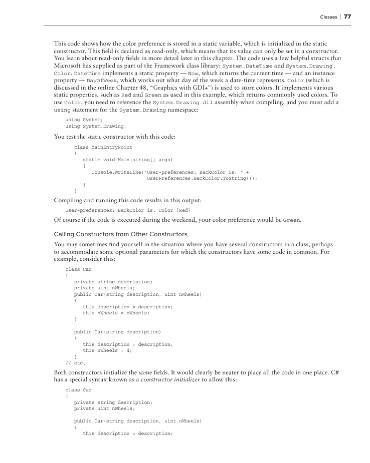

```
    this.nWheels = nWheels;
}

public Car(string description): this(description, 4)
{
}
// etc
```

在这种情况下，`this` 关键字只是导致具有最近匹配参数的构造函数被调用。请注意，任何构造函数初始化程序都在构造函数体之前执行。假设运行以下代码：

```
Car myCar = new Car("Proton Persona");
```

在此示例中，双参数构造函数在单参数构造函数的体中的任何代码之前执行（尽管在这种特殊情况下，因为单参数构造函数的体中没有代码，所以没有区别）。

C# 构造函数初始化程序可能包含对同一类中另一个构造函数的调用（使用刚才介绍的语法）或对直接基类中构造函数的调用（使用相同的语法，但使用关键字 `base` 而不是 `this`）。在初始化程序中不可能放置多个调用。

### readonly 字段

常量作为包含不可更改值的变量的概念是 C# 与大多数编程语言共有的。然而，常量不一定满足所有要求。有时，你可能有一些变量，其值不应更改，但该值要到运行时才知道。C# 提供了另一种在这种情况下有用的变量类型：`readonly` 字段。

`readonly` 关键字比 `const` 提供了更多的灵活性，允许在你希望字段为常量但也需要进行一些计算来确定其初始值的情况下使用。规则是，你可以在构造函数内部为 `readonly` 字段赋值，但不能在其他任何地方。`readonly` 字段也可以是实例而不是静态字段，每个类实例都有不同的值。这意味着，与 `const` 字段不同，如果你希望 `readonly` 字段为静态，则必须将其声明为静态。

假设你有一个编辑文档的 MDI 程序，出于许可原因，你希望限制同时可以打开的文档数量。现在假设你正在销售软件的不同版本，并且客户可以升级许可证以同时打开更多文档。显然，这意味着你不能在源代码中硬编码最大数量。你可能需要一个字段来表示此最大数量。此字段必须在程序每次启动时读取——也许是从注册表项或其他文件存储中读取。因此，你的代码可能看起来像这样：

```
public class DocumentEditor
{
    public static readonly uint MaxDocuments;

    static DocumentEditor()
    {
        MaxDocuments = DoSomethingToFindOutMaxNumber();
    }
}
```

在这种情况下，字段是静态的，因为最大文档数每个正在运行的程序实例只需要存储一次。这就是为什么它在静态构造函数中初始化的原因。如果你有一个实例 `readonly` 字段，你将在实例构造函数中初始化它。例如，presumably 每个你编辑的文档都有一个创建日期，你不会希望允许用户更改它（因为那将是重写过去！）。请注意，该字段也是 public——你通常不需要将 `readonly` 字段设为 private，因为根据定义它们不能在外部修改（相同的原则也适用于常量）。


```
{
    static void Main(string[] args)
    {
        Money cash1 = new Money();
        cash1.Amount = 40M;
        Console.WriteLine("cash1.ToString() returns: " + cash1.ToString());
        Console.ReadLine();
    }
    public class Money
    {
        private decimal amount;
        public decimal Amount
        {
            get
            {
                return amount;
            }
            set
            {
                amount = value;
            }
        }
        public override string ToString()
        {
            return "$" + Amount.ToString();
        }
    }
}
```

此示例仅用于说明 C# 的语法特性。C# 已内置一个用于表示货币金额的预定义类型 decimal，因此在实际应用中，除非你想为其添加各种其他方法，否则不会编写一个类来重复此功能。而且在许多情况下，由于格式要求，你可能会使用 String.Format() 方法（将在第 8 章介绍）而不是 ToString() 来显示货币字符串。

在 Main() 方法中，你首先实例化一个 Money 对象。然后调用 ToString() 方法，该方法实际上执行的是重写版本。运行此代码会得到以下结果：

```
cash1.ToString() returns: $40
```

### 扩展方法

扩展类的方法有很多。如果拥有该类的源代码，那么继承（将在第 4 章介绍）就是为对象添加功能的好方法。如果源代码不可用怎么办？扩展方法可以通过允许你在不要求提供类源代码的情况下更改类来提供帮助。

扩展方法是静态方法，它们看似是类的一个部分，但实际上并不在类的源代码中。假设前一个示例中的 Money 类需要一个方法 AddToAmount(decimal amountToAdd)。然而，出于某种原因，程序集的原始源代码无法直接更改。你所需要做的就是创建一个静态类，并将 AddToAmount 方法作为静态方法添加。代码如下所示：

```
namespace Wrox
{
    public static class MoneyExtension
    {
        public static void AddToAmount(this Money money, decimal amountToAdd)
```


## 继承

### 本章内容

- 继承类型
- 实现继承
- 访问修饰符
- 接口

第 3 章“对象和类型”研究了如何在 C# 中使用单个类。该章的重点是如何定义单个类（或单个结构体）的 方法、属性、构造函数和其他成员。虽然你已了解到所有类最终都派生自类 `System.Object`，但你尚未学习如何创建继承类的层次结构。继承是本章的主题。在本章中，你将了解 C# 和 .NET Framework 如何处理继承。

### 继承类型

让我们先回顾一下 C# 在继承方面究竟支持什么、不支持什么。

### 实现继承与接口继承

在面向对象编程中，有两种不同的继承类型——实现继承和接口继承：

- **实现继承** 意味着一个类型从基类型派生，获取基类型的所有成员字段和函数。在实现继承中，派生类型采用基类型的每个函数的实现，除非在派生类型的定义中指明要重写某个函数实现。这种继承类型在你需要为现有类型添加功能，或多个相关类型共享大量通用功能时最有用。
- **接口继承** 意味着一个类型只继承函数的签名而不继承任何实现。这种继承类型在你想要指定一个类型提供某些功能时最有用。

C# 同时支持实现继承和接口继承。两者都从框架和语言的基础构建而成，从而允许你根据应用程序的架构决定使用哪一种。

### 多重继承

某些语言如 C++ 支持所谓的 *多重继承*，即一个类派生自多个其他类。使用多重继承的好处是值得商榷的：一方面，毫无疑问，多重继承可以用来编写极其复杂但紧凑的代码，正如 C++ ATL 库所展示的那样。另一方面，使用多重实现继承的代码通常难以理解和调试（这一点同样由 C++ ATL 库很好地证明）。如前所述，使编写健壮代码变得容易是 C# 开发的关键设计目标之一。因此，C# 不支持多重实现继承。它确实允许类型派生自多个接口——多重接口继承。这意味着一个 C# 类可以派生自另一个类，以及任意数量的接口。事实上，我们可以更精确地说：由于存在 *System.Object* 作为通用基类型，每个 C# 类（*Object* 除外）都有且仅有一个基类，并且可能还有任意数量的基接口。

### 结构体和类

第 3 章区分了结构体（值类型）和类（引用类型）。使用结构体的一个限制是，结构体不支持继承，除非每个结构体自动派生自 *System.ValueType*。事实上，我们应该更谨慎。确实不可能对结构体进行类型层次结构编码；然而，结构体可以实现接口。换句话说，结构体实际上不支持实现继承，但支持接口继承。我们可以对你定义的任何类型的情况总结如下：

- 结构体始终派生自 System.ValueType。它们还可以派生自任意数量的接口。
- 类始终派生自你选择的另一个类。它们还可以派生自任意数量的接口。

### 实现继承

如果你想声明一个类派生自另一个类，请使用以下语法：

```
class MyDerivedClass: MyBaseClass
{
    // functions and data members here
}
```

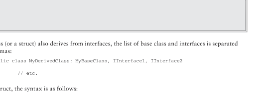

如果一个类（或结构体）还派生自接口，则基类和接口的列表用逗号分隔：

```
public class MyDerivedClass: MyBaseClass, IInterface1, IInterface2
{
    // etc.
}
```

对于结构体，语法如下：

```
public struct MyDerivedStruct: IInterface1, IInterface2
{
    // etc.
}
```

| 修饰符 | 应用于 | 描述 |
|---|---|---|
| new | Function members | 该成员隐藏具有相同签名的继承成员。 |
| static | All members | 该成员不作用于类的特定实例。 |
| virtual | Function members only | 该成员可以被派生类重写。 |
| abstract | Function members only | 一个虚拟成员，定义了成员的签名，但不提供实现。 |
| override | Function members only | 该成员重写了继承的虚拟或抽象成员。 |
| sealed | Classes, methods, and properties | 对于类，类不能被继承。对于属性和方法，该成员重写了继承的虚拟成员，但不能被任何派生类中的成员重写。必须与 override 一起使用。 |
| extern | Static [DllImport] methods only | 该成员在其他语言中外部实现。 |

### 接口

如前所述，通过派生自接口，类声明它实现了某些函数。由于并非所有面向对象语言都支持接口，本节将详细研究 C# 对接口的实现。

本节通过展示微软预定义的一个接口的完整定义来说明接口——System.IDisposable。IDisposable 包含一个方法 Dispose()，旨在由类实现以清理代码：

```
public interface IDisposable
{
    void Dispose();
}
```

这段代码表明，声明接口在语法上与声明抽象类几乎相同。然而，你应该注意，不允许为接口的任何成员提供实现。一般来说，接口只能包含方法、属性、索引器和事件的声明。

你永远无法实例化一个接口；它只包含其成员的签名。接口既没有构造函数（你如何构造一个无法实例化的东西？）也没有字段（因为那将意味着某种内部实现）。接口定义也不允许包含运算符重载，虽然这并不是因为声明它们有任何问题——没有问题；这是因为接口通常旨在作为公共契约，而拥有运算符重载会导致与其他 .NET 语言（如不支持运算符重载的 Visual Basic .NET）的不兼容问题。

也不允许在接口定义中对成员声明修饰符。接口成员始终隐式为 public，并且不能声明为 virtual 或 static。这由实现类决定。因此，实现类声明访问修饰符是可以的，就像本节示例中所做的那样。


例如，来看 IDisposable。如果一个类想要公开声明它实现了 Dispose() 方法，它必须实现 IDisposable —— 在 C# 术语中，这意味着该类派生自 IDisposable。

```csharp
class SomeClass: IDisposable
{
    // This class MUST contain an implementation of the
    // IDisposable.Dispose() method, otherwise
    // you get a compilation error.
    public void Dispose()
    {
        // implementation of Dispose() method
    }
    // rest of class
}
```

在此示例中，如果 SomeClass 派生自 IDisposable 但不包含与 IDisposable 中定义完全相同的签名的 Dispose() 实现，就会得到编译错误，因为该类违反了其同意实现 IDisposable 的契约。当然，编译器对于一个类拥有 Dispose() 方法但未派生自 IDisposable 并没有问题。问题在于，其他代码将无法识别 SomeClass 已同意支持 IDisposable 功能。

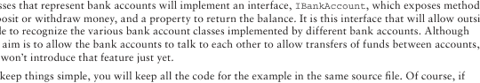

### 定义和实现接口

本节通过开发一个遵循接口继承范式的简短程序来说明如何定义和使用接口。示例基于银行账户。假设您正在编写最终将允许银行账户之间进行计算机化转账的代码。并且假设在本示例中，可能有许多公司实现银行账户，但它们已相互约定，任何代表银行账户的类都将实现一个接口 IBankAccount，该接口公开存款或取款的方法，以及一个返回余额的属性。正是通过此接口，外部代码才能识别由不同银行账户实现的各种银行账户类。虽然目标是允许银行账户相互通信以在账户之间转账资金，但我们暂时不会引入该功能。

为了保持简单，您将把示例的所有代码保留在同一个源文件中。当然，如果像示例这样的东西在现实生活中使用，您可以推断不同的银行账户类不仅会被编译到不同的程序集中，而且还会被托管在不同银行拥有的不同机器上。这对于我们的目的来说太复杂了。然而，为了保持一定的真实性，您将为不同的公司定义不同的命名空间。

首先，您需要定义 IBankAccount 接口：

```csharp
namespace Wrox.ProCSharp
{
    public interface IBankAccount
    {
        void PayIn(decimal amount);
        bool Withdraw(decimal amount);
        decimal Balance
        {
            get;
        }
    }
}
```

类型为 T。泛型类型也可以被返回和设置，因此属性 Next 和 Prev 现在的类型为 LinkedListNode<T>：

```csharp
public class LinkedListNode<T>
{
    public LinkedListNode(T value)
    {
        this.Value = value;
    }

    public T Value { get; private set; }
    public LinkedListNode<T> Next { get; internal set; }
    public LinkedListNode<T> Prev { get; internal set; }
}
```

代码片段 LinkedListSample\LinkedListNode.cs

在下面的代码中，类 LinkedList 也被更改为泛型类。LinkedList<T> 包含 LinkedListNode<T> 元素。LinkedList 中的类型 T 定义了属性 First 和 Last 的类型 T。方法 AddLast() 现在接受类型为 T 的参数并实例化一个 LinkedListNode<T> 对象。除了接口 IEnumerable 之外，还有一个泛型版本：IEnumerable<T>。IEnumerable<T> 派生自 IEnumerable 并添加了返回 IEnumerator<T> 的 GetEnumerator() 方法。LinkedList<T> 实现泛型接口 IEnumerable<T>。

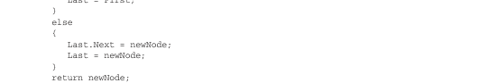

```csharp
public class LinkedList<T>: IEnumerable<T>
{
    public LinkedListNode<T> First { get; private set; }
    public LinkedListNode<T> Last { get; private set; }

    public LinkedListNode<T> AddLast(T node)
    {
        var newNode = new LinkedListNode<T>(node);
        if (First == null)
        {
            First = newNode;
            Last = First;
        }
        else
        {
            Last.Next = newNode;
            Last = newNode;
        }
        return newNode;
    }

    public IEnumerator<T> GetEnumerator()
    {
        LinkedListNode<T> current = First;

        while (current != null)
        {
            yield return current.Value;
            current = current.Next;
```

让我们从一个泛型文档管理器开始示例。文档管理器用于从队列读取和写入文档。首先创建一个名为 DocumentManager 的新控制台项目并添加类 DocumentManager<T>。方法 AddDocument() 将文档添加到队列。只读属性 IsDocumentAvailable 如果队列不为空则返回 true：

```csharp
using System;
using System.Collections.Generic;

namespace Wrox.ProCSharp.Generics
{
    public class DocumentManager<T>
    {
        private readonly Queue<T> documentQueue = new Queue<T>();

        public void AddDocument(T doc)
        {
            lock (this)
            {
                documentQueue.Enqueue(doc);
            }
        }

        public bool IsDocumentAvailable
        {
            get { return documentQueue.Count > 0; }
        }
    }
}
```

代码片段 DocumentManager/DocumentManager.cs

### 默认值

现在向 DocumentManager<T> 类添加一个 GetDocument() 方法。在此方法内部，类型 T 应该被赋值为 null。然而，不可能将 null 分配给泛型类型。原因是泛型类型也可以实例化为值类型，而 null 仅允许用于引用类型。为规避此问题，您可以使用 default 关键字。使用 default 关键字，会将 null 分配给引用类型，将 0 分配给值类型：

```csharp
public T GetDocument()
{
    T doc = default(T);
    lock (this)
    {
        doc = documentQueue.Dequeue();
    }
    return doc;
}
```

> default 关键字根据使用上下文具有多种含义。switch 语句使用 default 来定义默认情况，而在泛型中，default 用于将泛型类型初始化为 null 或 0，具体取决于它是引用类型还是值类型。

### 约束

如果泛型类需要调用泛型类型的某些方法，您必须添加约束。

### 继承

之前创建的 LinkedList<T> 类实现了接口 IEnumerable<out T>：

```csharp
public class LinkedList<T>: IEnumerable<T>
{
    //...
}
```

泛型类型可以实现泛型接口。通过从类派生也可以实现同样的功能。泛型类可以从泛型基类派生：

```csharp
public class Base<T>
{
}

public class Derived<T>: Base<T>
{
}
```

要求是必须重复接口的泛型类型，或指定基类的类型，如本例所示：

```csharp
public class Base<T>
{
}

public class Derived<T>: Base<string>
{
}
```

这样，派生类可以是泛型类或非泛型类。例如，您可以定义一个抽象泛型基类，并在派生类中使用具体类型实现它。这允许您对特定类型进行特化：

```csharp
public abstract class Calc<T>
{
    public abstract T Add(T x, T y);
    public abstract T Sub(T x, T y);
}

public class IntCalc: Calc<int>
{
    public override int Add(int x, int y)
    {
        return x + y;
    }

    public override int Sub(int x, int y)
    {
        return x - y;
    }
}
```

### 静态成员

泛型类的静态成员需要特别注意。泛型类的静态成员仅与类的一个实例化共享。让我们看一个示例，其中类 StaticDemo<T> 包含静态字段 x：

```csharp
public class StaticDemo<T>
{
    public static int x;
}
```


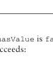

## 2024年度组织生活会
### 民主评议党员登记表

姓名：___________  部门：___________  岗位：___________  日期：___________

| 序号 | 姓名/职务 | 评议要点 | 存在问题 | 整改措施 | 评议等次 | 备注 |
|------|-----------|----------|----------|----------|----------|------|
| 1 | | | | | | |
| 2 | | | | | | |
| 3 | | | | | | |
| 4 | | | | | | |
| 5 | | | | | | |
| 6 | | | | | | |
| 7 | | | | | | |
| 8 | | | | | | |
| 9 | | | | | | |
| 10 | | | | | | |
| 11 | | | | | | |
| 12 | | | | | | |

注：此表一式两份，一份存党委组织部，一份存所在党支部。

## 6 数组和元组
### 本章内容

- 简单数组
- 多维数组
- 锯齿数组
- Array 类
- 数组作为参数
- 枚举
- 元组
- 结构比较

如果您需要处理同一类型的多个对象，可以使用集合（请参阅第 10 章）和数组。C# 有一种特殊的记法来声明、初始化和使用数组。在幕后，Array 类发挥作用，它提供了多种方法来排序和筛选数组内部的元素。使用枚举器，您可以遍历数组中的所有元素。

此外，.NET 4 引入了一种新的类型 Tuple，可用于组合不同类型的多个对象。请参阅本章后面的“Tuples”部分。

### 简单数组

如果您需要使用同一类型的多个对象，可以使用数组。数组是一种数据结构，包含多个相同类型的元素。

#### 数组声明

数组的声明方式是先定义数组内部元素的类型，然后加上空括号和变量名。例如，包含整数元素的数组声明如下：

```csharp
int[] myArray;
```

但是，您必须注意，如果数组中的元素是引用类型，则必须为每个数组元素分配内存。如果您使用数组中未分配内存的项，将抛出 `NullReferenceException`。

> 有关错误和异常的信息，请参阅第 15 章。

您可以使用从 0 开始的索引器为数组的每个元素分配内存：

```csharp
myPersons[0] = new Person { FirstName="Ayrton", LastName="Senna" };
myPersons[1] = new Person { FirstName="Michael", LastName="Schumacher" };
```

图 6-2 显示了托管堆中与 Person 数组相关的对象。myPersons 是存储在栈上的变量。该变量引用存储在托管堆上的 Person 元素数组。该数组有足够的空间容纳两个引用。数组中的每个项都引用存储在托管堆中的 Person 对象。

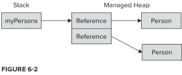

与 int 类型类似，您也可以使用自定义类型的数组初始化器：

```csharp
Person[] myPersons2 =
{
    new Person { FirstName="Ayrton", LastName="Senna" },
    new Person { FirstName="Michael", LastName="Schumacher" }
};
```

### 多维数组

普通数组（也称为一维数组）由单个整数索引。多维数组由两个或多个整数索引。

图 6-3 显示了具有三行三列的二维数组的数学表示法。第一行包含值 1、2 和 3，第三行包含值 7、8 和 9。


使用 C# 声明此二维数组时，需在括号内放置逗号。数组通过指定每个维度的大小（也称为秩）进行初始化。然后可以使用索引器中的两个整数访问数组元素：

```csharp
int[,] twodim = new int[3, 3];
twodim[0, 0] = 1;
twodim[0, 1] = 2;
twodim[0, 2] = 3;
twodim[1, 0] = 4;
twodim[1, 1] = 5;
twodim[1, 2] = 6;
twodim[2, 0] = 7;
twodim[2, 1] = 8;
twodim[2, 2] = 9;
```

_代码片段 Sample1/Program.cs_

> 在声明数组后，您无法更改其秩。

```csharp
for (int row = 0; row < jagged.Length; row++)
{
    for (int element = 0; element < jagged[row].Length; element++)
    {
        Console.WriteLine("row: {0}, element: {1}, value: {2}",
            row, element, jagged[row][element]);
    }
}
```

迭代的结果显示行以及行内的每个元素：

```
row: 0, element: 0, value: 1
row: 0, element: 1, value: 2
row: 1, element: 0, value: 3
row: 1, element: 1, value: 4
row: 1, element: 2, value: 5
row: 1, element: 3, value: 6
row: 1, element: 4, value: 7
row: 1, element: 5, value: 8
row: 2, element: 0, value: 9
row: 2, element: 2, value: 10
row: 2, element: 3, value: 11
```

### 数组类

使用括号声明数组是使用 Array 类的 C# 记法。在幕后使用 C# 语法会创建一个派生自抽象基类 Array 的新类。这使得可以使用 Array 类定义的方法和属性来操作每个 C# 数组。例如，您已经使用过 Length 属性或使用 foreach 语句遍历数组。通过这样做，您正在使用 Array 类的 GetEnumerator() 方法。

Array 类实现的其它属性包括 LongLength，用于项目数量不适合整数的数组，以及 Rank，用于获取维数。

让我们通过了解各种功能来查看 Array 类的其它成员。

#### 创建数组

Array 类是抽象的，因此您无法使用构造函数创建数组。然而，除了使用 C# 语法创建数组实例外，还可以使用静态 CreateInstance() 方法创建数组。如果您事先不知道元素的类型，这非常有用，因为类型可以作为 Type 对象传递给 CreateInstance() 方法。

以下示例展示了如何创建大小为 5 的 int 类型数组。CreateInstance() 方法的第一个参数需要元素的类型，第二个参数定义大小。您可以使用 SetValue() 方法设置值，使用 GetValue() 方法读取值。

```csharp
Array intArray1 = Array.CreateInstance(typeof(int), 5);
for (int i = 0; i < 5; i++)
{
    intArray1.SetValue(33, i);
}
for (int i = 0; i < 5; i++)
{
    Console.WriteLine(intArray1.GetValue(i));
}
```

您也可以将创建的数组强制转换为声明为 int[] 的数组：

```csharp
int[] intArray2 = (int[])intArray1;
```

CreateInstance() 方法有许多重载，可用于创建多维数组，也可用于创建非 0 基的数组。以下示例创建了一个包含 2 × 3 个元素的二维数组。第一个维度是 1 基；第二个维度是 10 基。

```csharp
int[] lengths = { 2, 3 };
int[] lowerBounds = { 1, 10 };
Array racers = Array.CreateInstance(typeof(Person), lengths, lowerBounds);
```

设置数组元素时，SetValue() 方法接受每个维度的索引：

```csharp
racers.SetValue(new Person
{
    FirstName = "Alain",
    LastName = "Prost"
}, 1, 10);
racers.SetValue(new Person
{
    FirstName = "Emerson",
    LastName = "Fittipaldi"
}, 1, 11);
racers.SetValue(new Person
{
    FirstName = "Ayrton",
    LastName = "Senna"
}, 1, 12);
racers.SetValue(new Person
{
    FirstName = "Ralf",
    LastName = "Schumacher"
}, 2, 10);
racers.SetValue(new Person
{
    FirstName = "Fernando",
    LastName = "Alonso"
}, 2, 11);
racers.SetValue(new Person
{
    FirstName = "Jenson",
    LastName = "Button"
}, 2, 12);
```

尽管该数组不是 0 基的，但您仍可使用常规 C# 记法将其分配给变量。您只需注意不要超出边界。

```csharp
Person[,] racers2 = (Person[,])racers;
Person first = racers2[1, 10];
Person last = racers2[2, 12];
```

#### 复制数组

由于数组是引用类型，将数组变量分配给另一个变量只会得到两个引用同一数组的变量。对于复制数组，数组实现了 ICloneable 接口。该接口定义的 Clone() 方法创建数组的浅拷贝。

如果数组的元素是值类型，如以下代码段所示，所有值都会被复制，如图 6-5 所示。

```csharp
int[] intArray1 = { 1, 2 };
int[] intArray2 = (int[])intArray1.Clone();
```

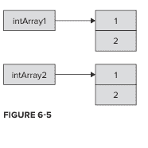

图 6-5

应用程序的输出显示了数组的排序结果：

- Beyonce
- Christina Aguilera
- Gwen Stefani
- Shakira

如果您在数组中使用自定义类，则必须实现 IComparable 接口。该接口仅定义一个方法 CompareTo()，它必须在要比较的对象相等时返回 0，如果实例应位于参数对象之前则返回小于 0 的值，如果实例应位于参数对象之后则返回大于 0 的值。

将 Person 类更改为实现 IComparable<Person> 接口。比较是基于 LastName 的值进行的。因为 LastName 的类型为 string，而 String 类已经实现了 IComparable 接口，因此在实现中您可以依赖 String 类的 CompareTo() 方法。如果 LastName 的值相同，则比较 FirstName：

```
public class Person: IComparable<Person>
{
    public int CompareTo(Person other)
    {
        if (other == null) throw new ArgumentNullException("other");

        int result = this.LastName.CompareTo(
            other.LastName);
        if (result == 0)
        {
            result = this.FirstName.CompareTo(
                other.FirstName);
        }
        return result;
    }
    //...
}
```

_代码片段 SortingSample/Person.cs_

现在可以按姓氏对 Person 对象数组进行排序：

```
Person[] persons = {
    new Person { FirstName="Damon", LastName="Hill" },
    new Person { FirstName="Niki", LastName="Lauda" },
    new Person { FirstName="Ayrton", LastName="Senna" },
    new Person { FirstName="Graham", LastName="Hill" }
};

Array.Sort(persons);
foreach (var p in persons)
{
    Console.WriteLine(p);
}
```

_代码片段 SortingSample/Program.cs_

使用 Person 类的排序，输出返回按姓氏排序的名称：

- Damon Hill
- Graham Hill
- Niki Lauda
- Ayrton Senna

如果 Person 对象应按不同方式排序，或者如果您没有更改用作数组元素的类的选项，则可以实现 IComparer 或 IComparer<T> 接口。这些接口定义了 Compare() 方法。其中一个接口必须由应被比较的类实现。IComparer 接口独立于要比较的类。因此 Compare() 方法定义了两个应比较的参数。返回值与 IComparable 接口的 CompareTo() 方法类似。

PersonComparer 类实现了 IComparer<Person> 接口，用于按 firstName 或 lastName 对 Person 对象进行排序。枚举 PersonCompareType 定义了 PersonComparer 可用的不同排序选项：FirstName 和 LastName。比较应如何进行是在 PersonComparer 类的构造函数中定义的，其中设置了 PersonCompareType 值。Compare() 方法使用 switch 语句实现，以按 LastName 或 FirstName 进行比较。

```
public enum PersonCompareType
{
    FirstName,
    LastName
}

public class PersonComparer: IComparer<Person>
{
    private PersonCompareType compareType;

    public PersonComparer(PersonCompareType compareType)
    {
        this.compareType = compareType;
    }

    public int Compare(Person x, Person y)
    {
        if (x == null) throw new ArgumentNullException("x");
        if (y == null) throw new ArgumentNullException("y");

        switch (compareType)
        {
            case PersonCompareType.FirstName:
                return x.FirstName.CompareTo(y.FirstName);
            case PersonCompareType.LastName:
                return x.LastName.CompareTo(y.LastName);
            default:
                throw new ArgumentException(
                    "unexpected compare type");
        }
    }
}
```

代码片段 SortingSample/PersonComparer.cs

现在可以将 PersonComparer 对象传递给 Array.Sort() 方法的第二个参数。这里 persons 按名字排序：

```
Array.Sort(persons,
    new PersonComparer(PersonCompareType.FirstName));
foreach (var p in persons)
{
    Console.WriteLine(p);
}
```

代码片段 SortingSample/Program.cs

```
}
Console.WriteLine();
Console.WriteLine("reverse");
foreach (var title in titles.Reverse())
{
    Console.WriteLine(title);
}
Console.WriteLine();

Console.WriteLine("subset");
foreach (var title in titles.Subset(2, 2))
{
    Console.WriteLine(title);
}
```

### 使用 yield return 返回枚举器

使用 yield 语句还可以执行更复杂的操作，例如从 yield return 返回枚举器。

在 TicTacToe 游戏中，玩家轮流在九个字段中的一个放置一个叉号或一个圆圈。这些移动由 GameMoves 类模拟。方法 Cross() 和 Circle() 是用于创建迭代器类型的迭代器块。变量 cross 和 circle 在 GameMoves 类的构造函数内部设置为 Cross() 和 Circle()。通过设置这些字段，方法不会被调用，但它们被设置为迭代器块定义的迭代器类型。在 Cross() 迭代器块内，移动的信息被写入控制台并且移动编号递增。如果移动编号高于 8，则迭代以 yield break 结束；否则，每次迭代都会返回 circle yield 类型的枚举器对象。Circle() 迭代器块与 Cross() 迭代器块非常相似；它只是每次迭代都返回 cross 迭代器类型。

```
public class GameMoves
{
    private IEnumerator cross;
    private IEnumerator circle;

    public GameMoves()
    {
        cross = Cross();
        circle = Circle();
    }

    private int move = 0;
    const int MaxMoves = 9;

    public IEnumerator Cross()
    {
        while (true)
        {
            Console.WriteLine("Cross, move {0}", move);
            if (++move >= MaxMoves)
                yield break;
            yield return circle;
        }
    }

    public IEnumerator Circle()
    {
        while (true)
        {
            Console.WriteLine("Circle, move {0}", move);
            if (++move >= MaxMoves)
                yield break;
```

以下代码展示了如何调用 Divide() 方法。元组的项可以通过 Item1 和 Item2 属性访问：

```
var result = Divide(5, 2);
Console.WriteLine("result of division: {0}, remainder: {1}",
    result.Item1, result.Item2);
```

如果您需要在元组中包含超过八个项，则可以使用具有八个参数的 Tuple 类定义。最后一个模板参数命名为 TRest，以表示您必须传递一个元组本身。这样您就可以创建具有任意数量参数的元组。

为了演示此功能：

```
public class Tuple<T1, T2, T3, T4, T5, T6, T7, TRest>
```

在这里，最后一个模板参数本身就是一个元组类型，因此您可以创建具有任意数量项的元组：

```
var tuple = Tuple.Create<string, string, string, int, int, int, double,
    Tuple<int, int>>(
    "Stephanie", "Alina", "Nagel", 2009, 6, 2, 1.37,
    Tuple.Create<int, int>(52, 3490));
```

### 结构比较

数组和元组都实现了 IStructuralEquatable 和 IStructuralComparable 接口。这些接口在 .NET 4 中新增，不仅比较引用，还比较内容。此接口是显式实现的，因此在使用时需要将数组和元组强制转换为此接口。IStructuralEquatable 用于比较两个元组或数组是否具有相同的内容；IStructuralComparable 用于对元组或数组进行排序。

在演示 IStructuralEquatable 的示例中，使用了实现 IEquatable 接口的 Person 类。IEquatable 定义了一个强类型的 Equals() 方法，其中比较 FirstName 和 LastName 属性的值：

```
public class Person : IEquatable<Person>
{
    public int Id { get; private set; }
    public string FirstName { get; set; }
    public string LastName { get; set; }

    public override string ToString()
    {
        return String.Format("{0}, {1} {2}", Id, FirstName, LastName);
    }

    public override bool Equals(object obj)
    {
        if (obj == null) throw new ArgumentNullException("obj");
        return Equals(obj as Person);
    }

    public override int GetHashCode()
    {
        return Id.GetHashCode();
    }

    public bool Equals(Person other)
    {
        if (other == null) throw new ArgumentNullException("other");

        return this.Id == other.Id && this.FirstName == other.FirstName &&
```


```csharp
this.LastName == other.LastName;
}
```

代码片段 StructuralComparison/Person.cs

现在创建了两个包含 Person 项的数组。两个数组都包含变量名为 `janet` 的同一个 Person 对象，以及两个内容相同但不同的 Person 对象。比较运算符 `!=` 返回 `true`，因为确实有两个不同的数组分别由两个变量名 `persons1` 和 `persons2` 引用。由于 Array 类没有重写带一个参数的 `Equals()` 方法，因此与使用 `==` 运算符比较引用时的情况相同，它们并不相同：

```csharp
var janet = new Person { FirstName = "Janet", LastName = "Jackson" };
Person[] persons1 = {
    new Person
    {
        FirstName = "Michael",
        LastName = "Jackson"
    },
    janet
};
Person[] persons2 = {
    new Person
    {
        FirstName = "Michael",
        LastName = "Jackson"
    },
    janet
};
if (persons1 != persons2)
    Console.WriteLine("not the same reference");
```

代码片段 StructuralComparison/Program.cs

调用 `IStructuralEquatable` 定义的 `Equals()` 方法，即第一个参数类型为 `object`、第二个参数类型为 `IEqualityComparer` 的方法，你可以通过传递实现 `IEqualityComparer<T>` 的对象来定义比较方式。`EqualityComparer<T>` 类提供了 `IEqualityComparer` 的默认实现。该实现会检查类型是否实现了 `IEquatable` 接口，如果实现了则调用 `IEquatable.Equals()` 方法；如果类型未实现 `IEquatable`，则调用基类 `Object` 的 `Equals()` 方法进行比较。

`Person` 实现了 `IEquatable<Person>`，其中比较的是对象的内容，而两个数组确实包含相同的内容：

```csharp
if ((persons1 as IStructuralEquatable).Equals(persons2,
    EqualityComparer<Person>.Default))
{
    Console.WriteLine("the same content");
}
```

接下来你将看到如何使用元组完成相同的事情。这里创建了两个具有相同内容的元组实例。当然，因为引用 `t1` 和 `t2` 引用两个不同的对象，所以 `!=` 比较返回 `true`：

```csharp
var t1 = Tuple.Create<int, string>(1, "Stephanie");
var t2 = Tuple.Create<int, string>(1, "Stephanie");
if (t1 != t2)
    Console.WriteLine("not the same reference to the tuple");
```

| 类别 | 运算符 |
|---|---|
| 赋值 | `= += -= *= /= %= &= |= ^= <<= >>=` |
| 成员访问（用于对象和结构） | `.` |
| 索引（用于数组和索引器） | `[]` |
| 强制转换 | `()` |
| 条件（三元运算符） | `?:` |
| 委托串联和移除（在第 8 章“委托、Lambda 和事件”中讨论） | `+ -` |
| 对象创建 | `new` |
| 类型信息 | `sizeof is typeof as` |
| 溢出异常控制 | `checked unchecked` |
| 间接寻址和地址 | `* -> &` |
| 命名空间别名限定符（在第 2 章“C# 核心”中讨论） | `::` |
| 空合并运算符 | `??` |

但请注意，四个特定运算符（`sizeof`、`*`、`->` 和 `&`，如下表所列）仅可在不安全代码（绕过 C# 类型安全检查的代码）中使用，这将在第 13 章“内存管理和指针”中讨论。还需要注意，`sizeof` 运算符关键字在与 .NET Framework 1.0 和 1.1 的早期版本一起使用时，需要不安全模式。自 .NET Framework 2.0 版本起，这不再是必需的要求。

| 类别 | 运算符 |
|---|---|
| 运算符关键字 | `sizeof`（仅用于 .NET Framework 1.0 和 1.1 版本） |
| 运算符 | `* -> &` |

使用 C# 运算符时需要小心的最大陷阱之一是，与其他 C 风格语言一样，C# 对赋值（`=`）和比较（`==`）使用不同的运算符。例如，以下语句表示让 `x` 等于 3：

```csharp
x = 3;
```

如果现在要将 `x` 与某个值进行比较，则需要使用双等号 `==`：

```csharp
if (x == 3)
{
}
```

幸运的是，C# 严格的类型安全规则可防止在逻辑语句中执行赋值而非比较这一非常常见的 C 错误。这意味着在 C# 中，以下语句将生成编译错误：

```csharp
if (x = 3)
{
}
```

习惯于使用与号（`&`）字符连接字符串的 Visual Basic 程序员需要做出调整。在 C# 中，使用加号（`+`）进行连接，而 `&` 符号表示两个不同整数值之间的按位与。符号 `|` 允许你在两个整数之间执行按位或。Visual Basic 程序员可能还不认识取模运算符（`%`）。

### 比较运算符（`==`）

最好将比较运算符视为严格值比较和严格引用比较之间的中间选项。在大多数情况下，编写以下代码意味着你在比较引用：

```csharp
bool b = (x == y); // x, y object references
```

然而，人们公认有些类如果被视为值，其含义会更直观。在这些情况下，最好重写比较运算符以执行值比较。重写运算符将在下文中讨论，这方面的一个明显例子是 `System.String` 类，Microsoft 已为其重写了该运算符，以比较字符串的内容而不是其引用。

### 比较值类型的相等性

在比较值类型的相等性时，与引用类型的原理相同：`ReferenceEquals()` 用于比较引用，`Equals()` 用于值比较，而比较运算符被视为中间情况。然而，最大的区别在于，值类型需要装箱转换为引用，以便在其上执行方法。此外，Microsoft 已经在 `System.ValueType` 类中重载了实例 `Equals()` 方法，以测试适用于值类型的相等性。如果你调用 `a.Equals(sB)`，其中 `a` 和 `sB` 是某个结构的实例，返回值将为 true 或 false，具体取决于 `a` 和 `sB` 在其所有字段中是否包含相同的值。另一方面，对于你自己的结构，默认情况下没有可用的 `==` 重载。在任何表达式中编写 `(sA == sB)` 都将导致编译错误，除非你在代码中为相关结构提供了 `==` 重载。

另一点是，`ReferenceEquals()` 应用于值类型时总是返回 false，因为要调用此方法，值类型需要装箱为对象。即使你编写以下代码，仍然会得到 false 的结果：

```csharp
bool b = ReferenceEquals(v, v); // v is a variable of some value type
```

原因是每次转换参数时 `v` 都会被单独装箱，这意味着你会得到不同的引用。因此，调用 `ReferenceEquals()` 来比较值类型确实没有意义。

尽管 `System.ValueType` 提供的 `Equals()` 默认重写几乎肯定足以满足你定义的大多数结构，但你可能希望为自己的结构再次重写它以提高性能。另外，如果值类型包含引用类型作为字段，你可能希望重写 `Equals()` 为这些字段提供适当的语义，因为默认的 `Equals()` 重写只会比较它们的地址。

### 运算符重载

本节介绍你可以为类或结构定义的另一类成员：运算符重载。

运算符重载对于 C++ 开发人员来说应该很熟悉。然而，由于这个概念对 Java 和 Visual Basic 开发人员来说都是新的，我们在这里进行解释。C++ 开发人员可能更愿意跳到主要的运算符重载示例。

运算符重载的意义在于，你并不总是只想调用对象上的方法或属性。通常，你需要将数量相加、相乘，或执行逻辑操作（如比较对象）。假设你定义了一个表示数学矩阵的类。那么，在数学世界中，矩阵可以像数字一样相加和相乘。因此，你想编写如下代码是完全合理的：

```csharp
Matrix a, b, c;
// assume a, b and c have been initialized
Matrix d = c * (a + b);
```


将向量乘以标量仅仅意味着将每个分量单独乘以该标量：例如，2 * (1.0, 2.5, 2.0) 返回 (2.0, 5.0, 4.0)。相关的运算符重载看起来类似这样：

```csharp
public static Vector operator * (double lhs, Vector rhs)
{
    return new Vector(lhs * rhs.x, lhs * rhs.y, lhs * rhs.z);
}
```

代码下载 VectorStructMoreOverloads.sln

然而，仅凭这一点是不够的。如果 a 和 b 被声明为 Vector 类型，它允许你编写如下代码：

b = 2 * a;

编译器会将整数 2 隐式转换为 double 以匹配运算符重载的签名。然而，像下面这样的代码将无法编译：

b = a * 2;

问题在于编译器将运算符重载完全视为方法重载。它会检查给定运算符的所有可用重载以找到最佳匹配。前面的语句要求第一个参数为 Vector，第二个参数为整数，或可隐式转换为整数的类型。你没有提供这样的重载。编译器不能开始交换参数的顺序，因此你提供的接受 double 后跟 Vector 的重载是不够的。你还需要显式定义一个接受 Vector 后跟 double 的重载。实现这一点有两种可能的方式。第一种方式是将向量乘法运算分解，就像迄今为止对所有运算符所做的那样：

```csharp
public static Vector operator * (Vector lhs, double rhs)
{
    return new Vector(lhs.x * rhs, lhs.y * rhs, lhs.z * rhs);
}
```

然而，由于你已经编写了代码来实现本质上相同的操作，你可能更喜欢通过编写以下代码来重用该代码：

```csharp
public static Vector operator * (Vector lhs, double rhs)
{
    return rhs * lhs;
}
```

这段代码通过有效地告诉编译器，如果它看到 Vector 与 double 的乘法，就可以简单地反转参数并调用另一个运算符重载。本章的示例代码使用第二个版本，因为它看起来更简洁并且体现了这一思想。该版本也使代码更易于维护，因为它避免了在两个单独的重载中重复执行乘法运算的代码。接下来，你需要重载乘法运算符以支持向量乘法。数学提供了几种将向量相乘的方法，但我们这里感兴趣的是称为点积或内积的方法，它实际上产生一个标量作为结果。这就是此示例的原因，为了演示算术运算符不必返回与它们所属类相同的类型。在数学术语中，如果你有两个向量 (x, y, z) 和 (X, Y, Z)，那么内积被定义为 x*X + y*Y + z*Z 的值。这看起来可能是一种奇怪的相乘方式，但它实际上非常有用，因为它可用于计算各种其他量。当然，如果你最终编写显示复杂 3D 图像的代码，例如使用 Direct3D 或 DirectDraw，你几乎肯定会发现你的代码需要在计算屏幕上放置对象的位置时经常作为中间步骤计算向量的内积。我们关心的是，我们希望使用你的 Vector 的人能够编写 double X = a*b 来计算两个 Vector 对象 (a 和 b) 的内积。相关的重载如下所示：

```csharp
public static double operator * (Vector lhs, Vector rhs)
{
    return lhs.x * rhs.x + lhs.y * rhs.y + lhs.z * rhs.z;
}
```

现在你已经了解了算术运算符，可以使用一个简单的测试方法来检查它们是否正常工作：

```csharp
static void Main()
{
    // stuff to demonstrate arithmetic operations
    Vector vect1, vect3;
    vect1 = new Vector(1.0, 1.5, 2.0);
    vect2 = new Vector(0.0, 0.0, -10.0);

    vect3 = vect1 + vect2;

    Console.WriteLine("vect1 = " + vect1);
    Console.WriteLine("vect2 = " + vect2);
    Console.WriteLine("vect3 = vect1 + vect2 = " + vect3);
    Console.WriteLine("2*vect3 = " + 2*vect3);
    vect3 += vect2;

    Console.WriteLine("vect3+=vect2 gives " + vect3);

    vect3 = vect1*2;

    Console.WriteLine("Setting vect3=vect1*2 gives " + vect3);

    double dot = vect1*vect3;

    Console.WriteLine("vect1*vect3 = " + dot);
}
```

运行此代码 (Vectors2.cs) 会产生以下结果：

## VECTORS2

```
vect1 = { 1, 1.5, 2 }
vect2 = { 0, 0, -10 }
vect3 = vect1 + vect2 = { 1, 1.5, -8 }
2*vect3 = { 2, 3, -16 }
vect3+=vect2 gives { 1, 1.5, -18 }
Setting vect3=vect1*2 gives { 2, 3, 4 }
vect1*vect3 = 14.5
```

这表明运算符重载给出了正确的结果，但如果你仔细查看测试代码，你可能会惊讶地注意到它实际上使用了未被重载的运算符——加法赋值运算符，+=

```
vect3 += vect2;

Console.WriteLine("vect3 += vect2 gives " + vect3);
```

虽然 += 通常被视为单个运算符，但它可以分解为两个步骤：加法和赋值。与 C++ 语言不同，C# 实际上不允许你重载 = 运算符，但如果你重载了 +，编译器将自动使用你的 + 重载来确定如何执行 += 操作。相同的原理适用于所有赋值运算符，例如 -=、*=、/=、&= 等等。

你还需要重写 != 运算符。简单的方法是：

```csharp
public static bool operator != (Vector lhs, Vector rhs)
{
    return ! (lhs == rhs);
}
```

像往常一样，你应该快速使用一些测试代码检查你的重写是否有效。这次你将定义三个 Vector 对象并比较它们：

```csharp
static void Main()
{
    Vector vect1, vect2, vect3;

    vect1 = new Vector(3.0, 3.0, -10.0);
    vect2 = new Vector(3.0, 3.0, -10.0);
    vect3 = new Vector(2.0, 3.0, 6.0);

    Console.WriteLine("vect1==vect2 returns " + (vect1==vect2));
    Console.WriteLine("vect1==vect3 returns " + (vect1==vect3));
    Console.WriteLine("vect2==vect3 returns " + (vect2==vect3));

    Console.WriteLine();

    Console.WriteLine("vect1!=vect2 returns " + (vect1!=vect2));
    Console.WriteLine("vect1!=vect3 returns " + (vect1!=vect3));
    Console.WriteLine("vect2!=vect3 returns " + (vect2!=vect3));
}
```

代码片段 Vectors3.cs

编译此代码（代码下载中的 Vectors3.cs 示例）会生成以下编译器警告，因为你没有为 Vector 重写 Equals()。就我们这里的目的而言，这无关紧要，所以我们将忽略它。

```
Microsoft (R) Visual C# 2010 Compiler version 4.0.21006.1
for Microsoft (R) .NET Framework version 4.0
Copyright (C) Microsoft Corporation. All rights reserved.

Vectors3.cs(5,11): warning CS0660: 'Brox.ProcSharp.OOCSharp.Vector' defines
    operator == or operator != but does not override Object.Equals(object o)
Vectors3.cs(5,11): warning CS0661: 'Brox.ProcSharp.OOCSharp.Vector' defines
    operator == or operator != but does not override Object.GetHashCode()
```

运行此示例会在命令行产生以下结果：

## VECTORS3

```
vect1==vect2 returns True
vect1==vect3 returns False
vect2==vect3 returns False

vect1!=vect2 returns False
vect1!=vect3 returns True
vect2!=vect3 returns True
```

### 可以重载哪些运算符？

并非所有可用运算符都可以重载。可以重载的运算符列在下表中。

对于某些值出现错误——也许会丢失数据或抛出异常——那么你应该将转换定义为显式的。

定义转换的语法与本章前面讨论的重载运算符的语法类似。这并非巧合——转换被视为一种运算符，其作用是从源类型转换为目标类型。为了说明语法，下面摘自稍后在本节中介绍的名为 Currency 的示例结构体：

```csharp
public static implicit operator float (Currency value)
{
    // processing
}
```

运算符的返回类型定义了转换操作的 目标类型，单个参数是转换的源对象。此处定义的转换允许你将 Currency 的值隐式转换为 float。请注意，如果转换被声明为 implicit，编译器将允许隐式或显式使用它。如果它被声明为 explicit，编译器将只允许显式使用它。与其他运算符重载一样，转换必须同时声明为 public 和 static。

### 实现用户定义的转换

本节通过名为 SimpleCurrency 的示例说明了隐式和显式用户定义转换的使用（与往常一样，可在代码下载中获得）。在此示例中，你定义一个结构体 Currency，它保存一个正的美元 ($) 货币值。C# 为此目的提供了 decimal 类型，但如果你想执行复杂的财务处理并且因此想在此类上实现特定方法，你可能仍希望编写自己的结构体或类来表示货币值。

> > *转换的语法对于结构体和类是相同的。此示例恰好针对结构体，但如果你将 Currency 声明为类也同样适用。*

最初，Currency 结构体的定义是：

```csharp
struct Currency
{
    public uint Dollars;
    public ushort Cents;

    public Currency(uint dollars, ushort cents)
    {
        this.Dollars = dollars;
        this.Cents = cents;
    }
}
```

```
uint bal = 350;
Currency balance = bal;
uint bal2 = (uint)balance;
```

答案不是 350 而是 3！而且这一切都是合乎逻辑的。你将 350 隐式转换为 Currency，结果为 balance.Dollars = 3，balance.Cents = 50。然后编译器会像往常一样计算回转转换的最佳路径。Balance 最终会被隐式转换为 float（值为 3.5），然后显式转换为值为 3 的 uint。

当然，也存在其他情况，将数据转换为另一种数据类型再转换回来会导致数据丢失。例如，将包含 5.8 的 float 转换为 int 再转换回 float 会丢失小数部分，结果为 5，但从原则上讲，丢失数字的小数部分与将整数除以 100 以上是有细微差别的。Currency 突然变成了一个相当危险的类，对整数做了奇怪的事情！

问题在于你的转换对整数的解释存在冲突。Currency 与 float 之间的转换将整数值 1 解释为对应一美元，但最新的 uint 到 Currency 转换却将该值解释为一美分。这是一个非常糟糕设计的例子。如果你希望你的类易于使用，就应该确保所有转换的行为相互兼容，即它们直观上给出相同的结果。在这种情况下，解决方案显然是重写 uint 到 Currency 的转换，使其将整数值 1 解释为一美元：

```
public static implicit operator Currency (uint value)
{
    return new Currency(value, 0);
}
```

顺便说一下，你可能会想知道这个新的转换是否完全必要。答案是它可能有用。没有这个转换，编译器执行 uint 到 Currency 转换的唯一方式就是通过 float。直接转换在这方面效率更高，因此拥有这个额外的转换可以带来性能优势，不过你需要确保它给出与通过 float 相同的结果，而你现在已经做到了。在其他情况下，你可能会发现为不同的预定义数据类型分别定义转换可以使更多转换变为隐式而不是显式，不过这里并非如此。

判断你的转换是否兼容的一个好方法是问：无论转换走哪条路径，是否会给出相同的结果（除了像 float 到 int 转换那样可能损失精度之外）。Currency 类对此提供了一个很好的例子。看这段代码：

```
Currency balance = new Currency(50, 35);
ulong bal = (ulong) balance;
```

目前，编译器实现此转换只有一种方式：先隐式将 Currency 转换为 float，然后显式转换为 ulong。float 到 ulong 的转换需要显式转换，但这没问题，因为你在这里指定了显式转换。

然而，假设你随后添加了另一个转换，隐式地将 Currency 转换为 uint。你实际上会通过修改 Currency 结构体并添加到 uint 和从 uint 的转换来实现这一点。此代码作为 SimpleCurrency2 示例提供：

```
public static implicit operator Currency (uint value)
{
    return new Currency(value, 0);
}

public static implicit operator uint (Currency value)
{
    return value.Dollars;
}
```

现在编译器有了另一种可能的路径将 Currency 转换为 ulong：先隐式将 Currency 转换为 uint，然后隐式转换为 ulong。它会选择哪一条路径？如果存在多种可能性，C# 对编译器的最佳路径有一些精确的规则。（本书中未详细介绍这些规则，但如果你感兴趣，详细信息可在 MSDN 文档中找到。）最好的答案是，你应该设计你的转换，使所有路径给出相同的答案（除了可能的精度损失），在这种情况下，编译器选择哪一个其实并不重要。（碰巧的是，在本例中，编译器更倾向于选择 Currency 到 uint 再到 ulong 的路径，而不是 Currency 到 float 再到 ulong。）

要测试 SimpleCurrency2 示例，请将此代码添加到 SimpleCurrency 的测试代码中：

```
try
{
    Currency balance = new Currency(50,35);
    Console.WriteLine(balance);
    Console.WriteLine("balance is " + balance);
    Console.WriteLine("balance is (using ToString()) " + balance.ToString());
    uint balance3 = (uint) balance;
    Console.WriteLine("Converting to uint gives " + balance3);
}
```

代码片段 SimpleCurrency2/Program.cs

现在运行该示例会得到以下结果：

## SIMPLECURRENCY2

```
50
balance is $50.35
balance is (using ToString()) $50.35
Converting to uint gives 50
After converting to float, = 50.35
After converting back to Currency, = $50.34
Now attempt to convert out of range value of -$50.50 to a Currency:
Result is $4294967246.00
```

输出显示转换到 uint 已成功，尽管在进行此转换时你已丢失 Currency 的美分部分。将负 float 转换为 Currency 也产生了预期的溢出异常，因为 float 到 Currency 的转换本身现在定义了 checked 上下文。

然而，输出也演示了在使用转换时你需要了解的最后一个潜在问题。输出的第一行并未正确显示 balance，显示的是 50 而不是 $50.35。考虑以下这些行：

```
Console.WriteLine(balance);
Console.WriteLine("balance is " + balance);
Console.WriteLine("balance is (using ToString()) " + balance.ToString());
```

只有最后两行才正确地将 Currency 显示为字符串。发生了什么？这里的问题是，当你将转换与方法重载结合使用时，会产生另一个不可预测的来源。我们将按相反顺序查看这些行。

第三个 Console.WriteLine() 语句显式调用 Currency.ToString() 方法，确保 Currency 以字符串形式显示。第二个没有这样做。然而，传递给 Console.WriteLine() 的字符串字面量 "balance is" 使编译器清楚地知道参数应被解释为字符串。因此，Currency.ToString() 方法将被隐式调用。

然而，第一个 Console.WriteLine() 方法只是简单地将原始 Currency 结构体传递给 Console.WriteLine()。现在，Console.WriteLine() 有许多重载，但其中没有一个接受 Currency 结构体。因此，编译器会开始尝试寻找可以将 Currency 转换为什么类型以匹配 Console.WriteLine() 的某个重载。碰巧的是，Console.WriteLine() 的其中一个重载设计用于快速高效地显示 uint，并接受 uint 作为参数——你现在提供了一个将 Currency 隐式转换为 uint 的转换。

你像这样调用这些方法：

```csharp
using System;

namespace Wrox.ProCSharp.Delegates
{
    delegate double DoubleOp(double x);

    class Program
    {
        static void Main()
        {
            DoubleOp[] operations =
            {
                MathOperations.MultiplyByTwo,
                MathOperations.Square
            };

            for (int i=0; i < operations.Length; i++)
            {
                Console.WriteLine("Using operations[{0}]: ", i);
                ProcessAndDisplayNumber(operations[i], 2.0);
                ProcessAndDisplayNumber(operations[i], 7.94);
                ProcessAndDisplayNumber(operations[i], 1.414);
                Console.WriteLine();
            }

            static void ProcessAndDisplayNumber(DoubleOp action, double value)
            {
                double result = action(value);
                Console.WriteLine(
                    "Value is {0}, result of operation is {1}", value, result);
            }
        }
    }
}
```

代码片段 SimpleDelegate/Program.cs

在这段代码中，你实例化了一个 DoubleOp 委托数组（记住，在定义委托类后，你基本上可以像普通类一样实例化实例，因此将它们放入数组中没有问题）。数组的每个元素都被初始化为引用 MathOperations 类实现的不同操作。然后，你遍历数组，将每个操作应用于三个不同的值。这说明了使用委托的一种方式——你可以使用它们将方法组合到数组中，以便在循环中调用多个不同的方法。

此代码中的关键行是实际将每个委托传递给 ProcessAndDisplayNumber() 方法的行，例如：

```
ProcessAndDisplayNumber(operations[i], 2.0);
```

在这里，你传递的是委托的名称但没有参数。鉴于 operations[i] 是一个委托，从语法上讲：
- operations[i] 表示委托（即委托所代表的方法）。
- operations[i] (2.0) 表示实际调用此方法，将括号中的值作为参数传入。


```
sortArray[i + 1] = temp;
swapped = true;
}
} while (swapped);
}
```

代码片段 BubbleSorter/BubbleSorter.cs

要使用此类，您需要定义另一个类，可用它来设置需要排序的数组。例如，假设 Mortimer Phones 手机公司有一份员工名单，希望按薪水对其进行排序。每个员工都由 Employee 类的一个实例表示，其结构类似如下：

```
class Employee
{
    public Employee(string name, decimal salary)
    {
        this.Name = name;
        this.Salary = salary;
    }

    public string Name { get; private set; }
    public decimal Salary { get; private set; }

    public override string ToString()
    {
        return string.Format("{0}, {1:C}", Name, Salary);
    }

    public static bool CompareSalary(Employee e1, Employee e2)
    {
        return e1.Salary < e2.Salary;
    }
}
```

代码片段 BubbleSorter/Employee.cs

请注意，为了匹配 Func<T, T, bool> 委托的签名，您必须在此类中将 CompareSalary 定义为接受两个 Employee 引用并返回布尔值。在实现中会执行基于薪水的比较。

现在您可以编写一些客户端代码来请求排序：

```
using System;

namespace Wrox.ProCSharp.Delegates
{
    class Program
    {
        static void Main()
        {
            Employee[] employees =
            {
                new Employee("Bugs Bunny", 20000),
                new Employee("Elmer Fudd", 10000),
                new Employee("Daffy Duck", 25000),
                new Employee("Wile Coyote", 1000000.38m),
                new Employee("Foghorn Leghorn", 23000),
                new Employee("RoadRunner", 50000)
            };
```

```
ProcessAndDisplayNumber called with value = 1.414
Multiplying by 2: 1.414 gives 2.828
Squaring: 1.414 gives 1.999396
```

如果您使用多播委托，应注意将方法链接到同一委托的调用顺序在形式上是未定义的。因此，您应避免编写依赖于这些方法按特定顺序调用的代码。

由一个委托调用多个方法可能会导致更大的问题。多播委托包含一组委托，按顺序依次调用。如果委托调用的方法之一抛出异常，整个迭代就会停止。请看下面的 MulticastIteration 示例。这里使用了返回 void 且无参数的简单委托 Action。该委托旨在调用满足委托参数和返回类型要求的方法 One() 和 Two()。请注意方法 One() 会抛出异常：

```
using System;
namespace Wrox.ProCSharp.Delegates
{
    class Program
    {
        static void One()
        {
            Console.WriteLine("One");
            throw new Exception("Error in one");
        }

        static void Two()
        {
            Console.WriteLine("Two");
        }
    }
}
```

代码片段 MulticastDelegateWithIteration/Program.cs

在 Main() 方法中，委托 d1 被创建以引用方法 One()；接下来，方法 Two() 的地址被添加到同一委托中。调用 d1 以调用这两个方法。异常在 try/ catch 块中被捕获。

```
static void Main()
{
    Action d1 = One;
    d1 += Two;
    try
    {
        d1();
    }
    catch (Exception)
    {
        Console.WriteLine("Exception caught");
    }
}
```

委托只调用第一个方法。因为第一个方法抛出异常，委托的迭代在此停止，方法 Two() 从未被调用。结果可能不同，因为调用方法的顺序未定义。

```
One
Exception caught
```

```
```csharp
param += " and this was added to the string.";
return param;
);
Console.WriteLine(anonDel("Start of string"));
}
}
}
```
```

代码片段 AnonymousMethods/Program.cs

委托 Func<string, string> 接受一个字符串参数并返回一个字符串。anonDel 是此委托类型的一个变量。不是将方法的名称赋给此变量，而是使用一个简单代码块，以 delegate 关键字开头，后跟一个字符串参数。

如您所见，代码块使用了一个方法级字符串变量 mid，该变量在匿名方法外部定义，并将其添加到传入的参数中。然后代码返回字符串值。当委托被调用时，会传入一个字符串作为参数，并将返回的字符串输出到控制台。

使用匿名方法的优点是可以减少需要编写的代码量。您不必仅为了与委托一起使用而定义一个方法。在为事件定义委托时这一点尤为明显。（事件将在本章后面讨论。）这有助于降低代码的复杂性，尤其是在定义了多个事件时。使用匿名方法并不会使代码运行更快。编译器仍然会定义一个方法；该方法只是有一个自动分配的名称，您无需知道。

使用匿名方法时必须遵循一些规则。您不能在匿名方法中有一个跳转语句（break、goto 或 continue），其目标位于匿名方法之外。反之亦然——匿名方法之外的跳转语句不能以匿名方法内部为目标。

匿名方法内部无法访问不安全代码。此外，在匿名方法外部使用的 ref 和 out 参数也无法访问。其他在匿名方法外部定义变量可以使用。

如果您必须多次编写相同的功能，请不要使用匿名方法。在这种情况下，与其重复代码，编写命名方法是首选方式。您只需编写一次，然后通过其名称引用它。

从 C# 3.0 开始，您可以使用 Lambda 表达式代替编写匿名方法。

### Lambda 表达式

自 C# 3.0 起，您可以使用一种新的语法为委托分配代码实现：Lambda 表达式。每当您有委托参数类型时都可以使用 Lambda 表达式。这里使用匿名方法的先前示例已更改为使用 Lambda 表达式。

```
```csharp
using System;

namespace Wrox.ProCSharp.Delegates
{
    class Program
    {
```
```

```
```csharp
static void Main()
{
    string mid = ", middle part,";
    Func<string, string> lambda = param =>
    {
        param += mid;
        param += " and this was added to the string.";
        return param;
    };
    Console.WriteLine(anonDel("Start of string"));
}
```
```

Lambda 运算符 => 的左侧列出了所需参数。Lambda 运算符后面的右侧定义了分配给变量 lambda 的方法的实现。

#### 参数

使用 Lambda 表达式有几种定义参数的方法。如果只有一个参数，只需参数名称即可。下面的 Lambda 表达式使用名为 s 的参数。因为委托类型定义了字符串参数，所以 s 的类型为 string。实现调用 String.Format() 方法返回一个字符串，当委托被调用时该字符串最终会写入控制台：change uppercase TEST。

```
```csharp
Func<string, string> oneParam = s => String.Format(
    "change uppercase {0}", s.ToUpper());
Console.WriteLine(oneParam("test"));
```
```

如果委托使用多个参数，可以将参数名称组合在括号内。这里参数 x 和 y 的类型为 double，如 Func<double, double, double> 委托所定义：

```
```csharp
Func<double, double, double> twoParams = (x, y) => x * y;
Console.WriteLine(twoParams(3, 2));
```
```

为了方便，您可以在括号内向变量名添加参数类型：

#### 多行代码

如果 Lambda 表达式只包含一个语句，则不需要使用大括号的方法块和 return 语句。编译器会添加隐式返回：

```
```csharp
Func<double, double> square = x => x * x;
```
```

完全可以合法地添加大括号、return 语句和分号。通常不加会更容易阅读：

```
```csharp
Func<double, double> square = x =>
{
    return x * x;
}
```
```

但是，如果您需要在 Lambda 表达式的实现中使用多个语句，则需要大括号和 return 语句：


```csharp
Func<string, string> lambda = param =>
{
    param += mid;
    param += " and this was added to the string.";
    return param;
};
```

### Lambda 表达式外部的变量

使用 Lambda 表达式，可以访问 Lambda 表达式块外部的变量。这是一个强大的功能，但若使用不当，也可能非常危险。

在下例中，类型为 Func<int, int> 的 Lambda 表达式需要一个 int 参数并返回一个 int。该 Lambda 表达式的参数使用变量 x 定义。其实现还会访问 Lambda 表达式外部的变量 someVal。只要你不认为 Lambda 表达式创建了一个在稍后调用 f 时才会使用的新方法，这看起来就一点也不令人困惑。查看此代码块，调用 f 的返回值应该是 x 的值加 5，但事实可能并非如此：

```csharp
int someVal = 5;
Func<int, int> f = x => x + someVal;
```

假设变量 someVal 之后被修改，然后再调用 Lambda 表达式，此时会使用 someVal 的新值。此处调用 f(3) 的结果是 10：

```csharp
someVal = 7;
Console.WriteLine(f(3));
```

特别是，当 Lambda 表达式由独立线程调用时，你可能无法知道调用发生在何时，因此也无法知道外部变量当前是什么值。

现在你可能想知道，在 Lambda 表达式内部怎么可能访问其外部的变量。要理解这一点，请看定义 Lambda 表达式时编译器会做些什么。对于 Lambda 表达式 x => x + someVal，编译器会创建一个匿名类，该类有一个构造函数用于传递外部变量。构造函数取决于你从外部访问了多少个变量。在这个简单示例中，构造函数接受一个 int。匿名类包含一个匿名方法，其实现由 Lambda 表达式定义，并带有参数和返回类型。

```csharp
public class AnonymousClass
{
    private int someVal;
    public AnonymousClass(int someVal)
    {
        this.someVal = someVal;
    }
    public int AnonymousMethod(int x)
    {
        return x + someVal;
    }
}
```

使用 Lambda 表达式并调用该方法时，会创建匿名类的一个实例，并传递调用发生时变量的值。

> Lambda 表达式可用于类型为委托的任何位置。Lambda 表达式的另一种用途是类型为 Expression 或 Expression<T> 时。此时编译器会创建表达式树。这一特性将在第 11 章“语言集成查询”中讨论。


### 弱事件

对于事件，发布者和侦听器是直接连接的。这可能会给垃圾回收带来问题。例如，如果某个侦听器不再被直接引用，发布者那里仍然存在一个引用。垃圾回收器无法清理侦听器的内存，因为发布者仍然持有引用并向侦听器触发事件。

这种强连接可以通过使用弱事件模式来解决，并将 WeakEventManager 作为发布者与侦听器之间的中介。

前面以 CarDealer 作为发布者、Consumer 作为侦听器的示例，将在下一节中修改为使用弱事件模式。

#### 弱事件管理器

要使用弱事件，你需要创建一个派生自 WeakEventManager 的类。WeakEventManager 定义在程序集 WindowsBase 的 System.Windows 命名空间中。

WeakCarInfoEventManager 类就是用于管理 NewCarInfo 事件的发布者与侦听器之间连接的弱事件管理器类。该类实现了单例模式，因此只会创建一个实例。静态属性 CurrentManager 会在 WeakCarInfoEventManager 类型的对象不存在时创建该对象，并返回对它的引用。WeakCarInfoEventManager.CurrentManager 用于从 WeakCarInfoEventManager 访问该单例对象。

在弱事件模式中，弱事件管理器类需要静态方法 AddListener() 和 RemoveListener()。通过这些方法，侦听器与发布者的事件连接和断开，而不是直接使用发布者的事件。侦听器还需要实现稍后展示的 IWeakEventListener 接口。在 AddListener() 和 RemoveListener() 方法中，会调用基类 WeakEventManager 的方法来添加和移除侦听器。

对于 WeakCarInfoEventManager 类，你还需要重写基类的 StartListening() 和 StopListening() 方法。当添加第一个侦听器时会调用 StartListening()，当移除最后一个侦听器时会调用 StopListening()。StartListening() 和 StopListening() 会订阅和取消订阅弱事件管理器的一个方法，以侦听来自发布者的事件。如果弱事件管理器类需要连接到不同的发布者类型，可以在进行强制转换之前检查 source 对象的类型信息。然后，通过调用基类的 DeliverEvent() 方法将事件转发给侦听器，该方法进而会调用侦听器中 IWeakEventListener 接口的 ReceiveWeakEvent() 方法：

```csharp
using System.Windows;

namespace Wrox.ProCSharp.Delegates
{
    public class WeakCarInfoEventManager : WeakEventManager
    {
        public static void AddListener(object source, IWeakEventListener listener)
        {
            CurrentManager.ProtectedAddListener(source, listener);
        }

        public static void RemoveListener(object source,
            IWeakEventListener listener)
        {
            CurrentManager.ProtectedRemoveListener(source, listener);
        }

        public static WeakCarInfoEventManager CurrentManager
        {
            get
            {
```

### 深入研究 System.String

在深入研究其他字符串类之前，本节将快速回顾 String 类本身的一些可用方法。

System.String 是一个专门设计用于存储字符串并允许对字符串执行大量操作的类。此外，由于该数据类型的重要性，C# 提供了自己的关键字和关联语法，使得使用此类操作字符串特别容易。

可以使用运算符重载来连接字符串：

```csharp
string message1 = "Hello"; // returns "Hello"
message1 += ", There"; // returns "Hello, There"
string message2 = message1 + "!"; // returns "Hello, There!"
```

C# 还允许使用类似索引器的语法提取特定字符：

```csharp
string message = "Hello";
char char4 = message[4]; // returns 'o'. Note the string is zero-indexed
```

这使你能够执行诸如替换字符、移除空白和大小写转换等常见任务。下表介绍了关键方法：

| 方法 | 说明 |
|---|---|
| Compare | 比较字符串内容，在评估某些字符之间的等价性时会考虑区域性（区域设置）。 |
| CompareOrdinal | 与 Compare 相同，但不考虑区域性。 |
| Concat | 将多个独立的字符串实例合并到单个实例中。 |
| CopyTo | 从选定索引开始，将指定数量的字符复制到一个全新的数组实例中。 |
| Format | 格式化一个字符串，该字符串包含各种值以及用于指定每个值如何格式化的说明符。 |
| IndexOf | 查找给定子字符串或字符在字符串中首次出现的位置。 |
| IndexOfAny | 查找字符串中一组字符中任意一个字符首次出现的位置。 |
| Insert | 在指定索引处将一个字符串实例插入另一个字符串实例中。 |
| Join | 通过合并一个字符串数组来生成新的字符串。 |
| LastIndexOf | 与 IndexOf 相同，但查找最后一次出现的位置。 |
| LastIndexOfAny | 与 IndexOfAny 相同，但查找最后一次出现的位置。 |
| PadLeft | 通过在字符串左侧添加指定的重复字符来填充字符串。 |
| PadRight | 通过在字符串右侧添加指定的重复字符来填充字符串。 |
| Replace | 将字符串中出现的给定字符或子字符串替换为另一个字符或子字符串。 |
| Split | 将字符串拆分为一个子字符串数组；拆分位置出现在给定字符出现的每个位置。 |
| Substring | 检索从字符串中指定位置开始的子字符串。 |
| ToLower | 将字符串转换为小写。 |
| ToUpper | 将字符串转换为大写。 |
| Trim | 移除前导和尾随空白字符。 |


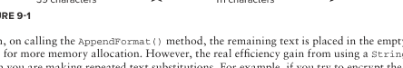

图 9-1

然后，在调用 `AppendFormat()` 方法时，其余文本被放入空白处，无需再分配内存。然而，使用 `StringBuilder` 的真正效率提升在于进行重复文本替换时。例如，如果尝试以与之前相同的方式加密文本，可以在不分配任何更多内存的情况下完成整个加密：

```csharp
StringBuilder greetingBuilder =
    new StringBuilder("Hello from all the guys at Wrox Press. ", 150);
    greetingBuilder.AppendFormat("We do hope you enjoy this book as much as we " +
    "enjoyed writing it!");

Console.WriteLine("Not Encoded:\n" + greetingBuilder);

for(int i = 'z'; i >= 'a'; i--)
{
    char old1 = (char)i;
    char new1 = (char)(i+1);
    greetingBuilder = greetingBuilder.Replace(old1, new1);
}

for(int i = 'Z'; i >= 'A'; i--)
{
    char old1 = (char)i;
    char new1 = (char)(i+1);
    greetingBuilder = greetingBuilder.Replace(old1, new1);
}

Console.WriteLine("Encoded:\n" + greetingBuilder);
```

这段代码使用了 `StringBuilder.Replace()` 方法，它做的事情与 `String.Replace()` 相同，但在此过程中不会复制字符串。上述代码中用于保存字符串的总内存分配为 `StringBuilder` 实例的 150 个字符，以及最终 `Console.WriteLine()` 语句内部执行的字符串操作期间分配的内存。

通常，您希望使用 `StringBuilder` 来执行任何字符串操作，并使用 `String` 来存储或显示最终结果。

### StringBuilder 成员

您已经看到了一个 `StringBuilder` 构造函数的演示，它接受一个初始字符串和容量作为参数。还有其他构造函数。例如，您可以仅提供一个字符串：

```csharp
StringBuilder sb = new StringBuilder("Hello");
```

或者您可以创建一个具有给定容量的空 `StringBuilder`：

```csharp
StringBuilder sb = new StringBuilder(20);
```

```csharp
// This will both set initial capacity to 100, but the max will be 500.
// Hence, this StringBuilder can never grow to more than 500 characters,
// otherwise it will raise exception if you try to do that.
StringBuilder sb = new StringBuilder(100, 500);
```

您还可以随时显式设置容量，不过如果将其设置为小于字符串当前长度或超过最大容量的值，则会引发异常：

```csharp
StringBuilder sb = new StringBuilder("Hello");
sb.Capacity = 100;
```

下表列出了主要的 `StringBuilder` 方法。

| 方法 | 用途 |
|---|---|
| `Append()` | 将字符串追加到当前字符串。 |
| `AppendFormat()` | 追加根据格式说明符处理后的字符串。 |
| `Insert()` | 在当前字符串中插入子字符串。 |
| `Remove()` | 从当前字符串中移除字符。 |
| `Replace()` | 将当前字符串中某个字符的所有匹配项替换为另一个字符，或将某个子字符串的所有匹配项替换为另一个子字符串。 |
| `ToString()` | 返回当前字符串作为 `System.String` 对象（重写自 `System.Object`）。 |

这些方法中的许多方法都有多个重载。

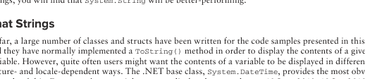

没有从 `StringBuilder` 到 `String` 的强制转换（无论是隐式还是显式）。如果要将 `StringBuilder` 的内容作为 `String` 输出，则必须使用 `ToString()` 方法。

现在您已经了解了 `StringBuilder` 类，并了解了使用它提高性能的一些方法，但您应该意识到，这个类并不总是能提供您所期望的性能提升。基本上，`StringBuilder` 类应在操作多个字符串时使用。但是，如果只是执行两个字符串连接这样简单的操作，您会发现 `System.String` 的性能更好。

### 格式字符串

到目前为止，本书中的代码示例已经编写了大量类和结构，它们通常实现了 `ToString()` 方法以显示给定变量的内容。然而，很多时候用户可能希望变量内容以不同的、通常依赖于文化和区域设置的方式显示。.NET 基类 `System.DateTime` 提供了最明显的例子。例如，您可能希望将同一日期显示为 2010 年 6 月 10 日、10 Jun 2010、6/10/10（美国）、10/6/10（英国）或 10.06.2010（德国）。

类似地，第 7 章“运算符和强制转换”中的 `Vector` 结构实现了 `Vector.ToString()` 方法，以 `(4, 56, 8)` 格式显示向量。然而，还有另一种非常常见的向量写法，向量会显示为 `4i + 56j + 8k`。如果您希望自己编写的类对用户友好，它们需要支持以用户可能希望使用的任何格式显示其字符串表示形式的功能。.NET 运行时定义了一种标准方式：`IFormattable` 接口。本节的主题是展示如何将这个重要功能添加到您的类和结构中。

您可能知道，在调用 `Console.WriteLine()` 时，需要指定变量显示所用的格式。因此，本节以该方法为例，尽管大部分讨论适用于任何需要格式化字符串的情况。例如，如果要在列表框或文本框中显示变量的值，通常需要使用 `String.Format()` 方法来获取变量的适当字符串表示形式。但是，您用来请求特定格式的实际格式说明符与传递给 `Console.WriteLine()` 的完全相同。因此，我们将重点以 `Console.WriteLine()` 为例。我们首先检查当您向基元类型提供格式字符串时实际会发生什么，然后由此了解如何为您的类和方法插入自定义的格式说明符。

第 2 章“核心 C#”在 `Console.Write()` 和 `Console.WriteLine()` 中使用了格式字符串，如下所示：

```csharp
double d = 13.45;
int i = 45;
Console.WriteLine("The double is {0,10:E} and the int contains {1}", d, i);
```

格式字符串本身主要由要显示的文本组成，但只要存在要格式化的变量，其参数列表中的索引就出现在花括号中。您还可以在花括号中包含有关该项格式的其他信息。例如，您可以包含：

- 该项表示所占用的字符数，以逗号作为前缀。负数表示该项应左对齐，正数表示应右对齐。如果项实际占用的字符数超过请求的字符数，它仍将完整显示。
- 格式说明符，以冒号作为前缀。这表示您希望如何格式化该项。例如，您可以指示希望将数字格式化为货币还是科学记数法。

下表列出了数值类型的常用格式说明符，这些说明符已在第 2 章中简要讨论过。

| 说明符 | 应用于 | 含义 | 示例 |
|---|---|---|---|
| C | 数值类型 | 区域设置特定的货币值 | $4834.50（美国）£4834.50（英国） |
| D | 仅整数类型 | 常规整数 | 4834 |
| E | 数值类型 | 科学记数法 | 4.834E+003 |
| F | 数值类型 | 定点小数 | 4384.50 |
| G | 数值类型 | 常规数字 | 4384.5 |
| N | 数值类型 | 通用区域设置特定数字格式 | 4,384.50（英国/美国）4 384,50（欧洲大陆） |
| P | 数值类型 | 百分比表示法 | 432,000.00% |
| X | 仅整数类型 | 十六进制格式 | 1120（如果要显示 0x1120，则需要单独写出 0x） |

如果希望整数用零填充，可以使用格式说明符 `0`（零）重复所需数字长度次数。例如，格式说明符 `0000` 将使 3 显示为 `0003`，99 显示为 `0099`，依此类推。

不可能给出完整列表，因为其他数据类型可以添加自己的说明符。展示如何为自己的类定义自定义说明符是本节的目标。


## FormattableVector 示例

现在你已经了解格式字符串是如何构造的，在本节中你将扩展第 7 章中的 Vector 示例，以便以多种方式格式化向量。你可以从 www.wrox.com 下载此示例的代码；文件名是 FormattableVector.cs。掌握了现在所涉及的原理的新知识后，你会发现实际编码相当简单。你需要做的只是实现 IFormattable 并提供该接口所定义 ToString() 重载的实现。

格式说明符你将支持的是：

- **N** — 应被解释为请求提供一个称为 Vector 的 Norm 的量。这只是其分量的平方和，对于数学爱好者来说，这恰好等于 Vector 长度的平方，通常显示在双竖线之间，像这样：||34.5||。
- **VE** — 应被解释为请求以科学格式显示每个分量，就像应用于 double 的说明符 E 所指示的那样（2.3E+01, 4.5E+02, 1.0E+00）。
- **IJK** — 应被解释为请求以 23i + 450j + 1k 的形式显示向量。
- 其他任何内容都应简单地返回 Vector 的默认表示形式（23, 450, 1.0）。

为了保持简单，你将不会实现以组合 IJK 和科学格式显示向量的任何选项。然而，你会确保以不区分大小写的方式测试说明符，以便允许使用 ijk 而不是 IJK。请注意，你用来指示格式说明符的字符串完全由你决定。

为此，你首先修改 Vector 的声明，使其实现 IFormattable：

```csharp
struct Vector: IFormattable
{
    public double x, y, z;
    // Beginning part of Vector
}
```

现在你添加两参数 ToString() 重载的实现：

```csharp
public string ToString(string format, IFormatProvider formatProvider)
{
    if (format == null)
    {
        return ToString();
    }

    string formatUpper = format.ToUpper();

    switch (formatUpper)
    {
        case "N":
            return "|| " + Norm().ToString() + " ||";
        case "VE":
            return String.Format("{0:E}, {1:E}, {2:E}", x, y, z);
        case "IJK":
            StringBuilder sb = new StringBuilder(x.ToString(, 30));
            sb.AppendFormat(" i + ");
            sb.AppendFormat(y.ToString());
            sb.AppendFormat(" j + ");
            sb.AppendFormat(z.ToString());
            sb.AppendFormat(" k");
            return sb.ToString();
        default:
            return ToString();
    }
}
```

Microsoft 将其移植到 Windows，在此之前它主要与脚本语言一起使用。如今，正则表达式由 `System.Text.RegularExpressions` 命名空间中的多个 .NET 类支持。你也可以在 .NET Framework 的各个部分找到正则表达式的使用。例如，你会发现它们在 ASP.NET 验证服务器控件内部使用。

如果你不熟悉正则表达式语言，本节将介绍正则表达式及其相关的 .NET 类。如果你已经熟悉正则表达式，你可能只想快速浏览本节以挑选出对 .NET 基类的引用。你可能想知道 .NET 正则表达式引擎设计为与 Perl 5 正则表达式大部分兼容，尽管它有一些额外功能。

### 正则表达式简介

正则表达式语言专门为字符串处理而设计。它包含两个特性：

- 一组 `escape codes` 用于识别特定类型的字符。你可能熟悉在 DOS 表达式中使用 * 字符来表示任何子字符串。（例如，DOS 命令 `Dir Re*` 列出以 `Re` 开头的文件名。）正则表达式使用许多类似的序列来表示项目，例如任意一个字符、单词分隔符、可选的一个字符等等。
- 在搜索操作期间对子字符串和中间结果的部分进行分组的系统。

使用正则表达式，你可以对字符串执行相当复杂和高层次的操作。例如，你可以：

- 识别（并可能标记或删除）字符串中的所有重复词（例如，“The computer books books” 变为 “The computer books”）
- 将所有单词转换为标题大小写（例如，“this is a Title” 变为 “This Is A Title”）
- 将长度超过三个字符的所有单词转换为标题大小写（例如，“this is a Title” 变为 “This is a Title”）
- 确保句子正确大写
- 分离 URI 的各个元素（例如，给定 `http://www.wrox.com`，提取协议、计算机名称、文件名等等）

当然，所有这些任务都可以在 C# 中使用 `System.String` 和 `System.Text.StringBuilder` 上的各种方法来执行。然而，在某些情况下，这需要编写相当多的 C# 代码。如果你使用正则表达式，此代码通常可以压缩到只有几行。基本上，你实例化一个 `System.Text.RegularExpressions.Regex` 对象（或者，更简单地，调用静态 `Regex()` 方法），将要处理的字符串传递给它，并传入一个正则表达式（包含正则表达式语言中指令的字符串），就完成了。

正则表达式字符串乍一看很像普通字符串，但其中穿插着转义序列和其他具有特殊含义的字符。例如，序列 `\b` 表示单词的开始或结束（单词边界），因此如果你想表示你在查找单词开头的字符 th，你将搜索正则表达式，`\bth`（即序列单词边界–t–h）。如果你想查找单词结尾处所有 th 的出现，你将写 `th\b`（序列 t–h–单词边界）。然而，正则表达式比这复杂得多，例如包括存储在搜索操作中找到的文本部分的设施。本节仅触及正则表达式强大功能的表面。


假设你的应用程序需要将美国电话号码转换为国际格式。在美国，电话号码的格式为：314-123-1234，通常写为 (314) 123-1234。将此国家格式转换为国际格式时，你必须包含 +1（美国的国家代码）并在区号周围添加括号：+1 (314) 123-1234。作为查找和替换操作，这并不太复杂。如果你打算使用 String 类来实现此目的，仍然需要一些编码工作（这意味着你必须使用 System.String 提供的 方法编写代码）。正则表达式语言允许你构造一个短字符串来实现相同的结果。

本节仅 intended 作为一个非常简单的示例，因此它集中于搜索字符串以识别某些子字符串，而不是修改它们。

## RegularExpressionsPlayaround 示例

在本节的其余部分，你将开发一个名为 RegularExpressionsPlayaround 的简短示例，它通过执行和显示一些搜索的结果来说明正则表达式的一些特性以及如何在 C# 中使用 .NET 正则表达式引擎。你将用作示例文档的文本是 Wrox Press 关于 ASP.NET 的一本书的介绍（Professional ASP.NET 4.0 in C# and VB, Wiley Publishing, 2010, ISBN 978-0-4705-0220-4）。

```csharp
const string myText =
@"This comprehensive compendium provides a broad and thorough investigation of all
aspects of programming with ASP.NET. Entirely revised and updated for the fourth
release of .NET, this book will give you the information you need to
master ASP.NET and build a dynamic, successful, enterprise Web application.";
```

> 这段代码是有效的 C# 代码，尽管有所有换行。它很好地说明了以 @ 符号为前缀的逐字字符串的实用性。

此文本被称为输入字符串。为了熟悉并习惯 .NET 类的正则表达式，你从一个不包含任何转义序列或正则表达式命令的基本纯文本搜索开始。假设你想找到字符串 ion 的所有出现。此搜索字符串被称为模式。使用正则表达式和之前声明的 Text 变量，你可以这样写：

```csharp
const string pattern = "ion";
MatchCollection myMatches = Regex.Matches(myText, pattern,
    RegexOptions.IgnoreCase |
    RegexOptions.ExplicitCapture);

foreach (Match nextMatch in myMatches)
{
    Console.WriteLine(nextMatch.Index);
}
```

此代码使用 System.Text.RegularExpressions 命名空间中 Regex 类的静态方法 Matches()。此方法将一些输入文本、一个模式以及从 RegexOptions 枚举中获取的一组可选标志作为参数。在这种情况下，你指定所有搜索都应不区分大小写。另一个标志 ExplicitCapture 修改了匹配的收集方式，以使搜索对你的目的来说更高效一些——你稍后会看到原因（尽管它还有其他用途，我们这里不探讨）。Matches() 返回一个对 MatchCollection 对象的引用。匹配是找到表达式中模式实例结果的技术术语。它由类 System.Text.RegularExpressions.Match 表示。因此，你返回一个包含所有匹配的 MatchCollection，每个匹配由一个 Match 对象表示。在前面的代码中，你只需遍历集合并使用 Match 类的 Index 属性，该属性返回输入文本中


下表列出了一些可以使用的主要特殊字符或转义序列。此表并不详尽，更完整的列表可在 MSDN 文档中查看。

| 符号 | 含义 | 示例 | 匹配 |
|---|---|---|---|
| ^ | 输入文本的开头 | ^B | B，但仅当它是文本中的第一个字符时 |
| $ | 输入文本的结尾 | x$ | X，但仅当它是文本中的最后一个字符时 |
| . | 除换行符（\n）外的任意单个字符 | i.ation | isation、ization |
| * | 前面的字符可以重复零次或多次 | ra*t | rt、rat、raat、raaat 等 |
| + | 前面的字符可以重复一次或多次 | ra+t | rat、raat、raaaa 等，但不包括 rt |
| ? | 前面的字符可以重复零次或一次 | ra?t | 仅 rt 和 rat |
| \s | 任意空白字符 | \sa | [空格]a、\ta、\na（\t 和 \n 与 C# 中的含义相同） |
| \S | 任意非空白字符 | \SF | aF、rF、cF，但不包括 tF |
| \b | 单词边界 | ion\b | 任何以 ion 结尾的单词 |
| \B | 任意非单词边界的位置 | \B X \B | 单词中间出现的任意 X |

如果你想搜索某个元字符，可以通过在相应字符前加上反斜杠来对其进行转义。例如，.（单个句点）表示除换行符外的任意单个字符，而 \. 表示句点本身。

你可以通过将可选字符括在方括号中来请求包含备选字符的匹配。例如，[1|c] 表示一个字符，可以是 1 或 c。如果你想搜索单词 map 或 man 的任何出现位置，可以使用序列 ma[n|p]。在方括号内，你还可以指定一个范围，例如 [a-z] 表示任意单个小写字母，[A-Z] 表示 A 到 Z 之间的任意大写字母（包括 A 和 Z 本身），或者 [0-9] 表示单个数字。如果你想搜索一个整数（即仅包含 0 到 9 字符的序列），可以写成 [0-9]+。

> 使用 + 字符表示必须至少有一位这样的数字，但也可以有更多位——因此这可以匹配 9、83、854 等。

### 显示结果

在本节中，你将对 `RegularExpressionsPlayaround` 示例进行编码，以便了解正则表达式的工作方式。

该示例的核心是一个名为 `WriteMatches()` 的方法，它会以更详细的格式输出 `MatchCollection` 中的所有匹配。对于每个匹配，它显示匹配项在输入字符串中的索引、匹配的字符串，以及一个稍长的字符串，该字符串由匹配项及其前后最多十个周围字符组成——匹配项前最多五个字符，匹配项后最多五个字符。（如果匹配项出现在输入文本开头或结尾的五个字符范围内，则前后字符数会少于五个。）换句话说，在前文引用的输入文本中，靠近末尾出现的单词 messaging 的匹配将显示为“g and messaging of d”（匹配前后各五个字符），

但最后一个单词 data 的匹配将显示为“g of data.”（匹配后仅一个字符），因为之后就到了字符串的末尾。这个较长的字符串让你能更清楚地看到正则表达式定位匹配的位置：

```
static void WriteMatches(string text, MatchCollection matches)
{
    Console.WriteLine("Original text was: \n\n" + text + " \n");
    Console.WriteLine("No. of matches: " + matches.Count);

    foreach (Match nextMatch in matches)
    {
        int index = nextMatch.Index;
        string result = nextMatch.ToString();
        int charsBefore = (index < 5) ? index : 5;
        int fromEnd = text.Length - index - result.Length;
        int charsAfter = (fromEnd < 5) ? fromEnd : 5;
        int charsToDisplay = charsBefore + charsAfter + result.Length;

        Console.WriteLine("Index: {0}, \tString: {1}, \t{2}",
            index, result,
            text.Substring(index-charsBefore, charsToDisplay));
    }
}
```

此方法中的大部分处理逻辑都用于计算较长子字符串中可以显示多少个字符，同时避免超出输入文本的开头或结尾。请注意，你使用了 Match 对象的另一个属性 Value，它包含匹配项的字符串。除此之外，`RegularExpressionsPlayaround` 还包含许多方法，名称如 Find1、Find2 等，它们基于本节中的示例执行一些搜索。例如，Find2 查找任何在单词开头包含 a 的字符串：

```
static void Find2()
{
    string text = @"This comprehensive compendium provides a broad and thorough investigation of all aspects of programming with ASP.NET. Entirely revised and updated for the 3.5 Release of .NET, this book will give you the information you need to master ASP.NET and build a dynamic, successful, enterprise Web application.";
    string pattern = @"\b a";
    MatchCollection matches = Regex.Matches(text, pattern, RegexOptions.IgnoreCase);
    WriteMatches(text, matches);
}
```

与此配套的还有一个简单的 Main() 方法，你可以编辑它以选择某个 Find<n>() 方法：

```
static void Main()
{
    Find1();
    Console.ReadLine();
}
```

代码还需要使用 RegularExpressions 命名空间：

```
using System;
using System.Text.RegularExpressions;
```

使用前面所示的 Find2() 方法运行该示例会得到以下结果：

RegularExpressionsPlayaround
原始文本为：

This comprehensive compendium provides a broad and thorough investigation of all aspects of programming with ASP.NET. Entirely revised and updated for the 3.5

## 

## 10 集合

### 本章内容

- 理解集合接口和类型
- 使用列表、队列和堆栈
- 使用链表和有序列表
- 使用字典和集合
- 使用位数组和位向量
- 评估性能

在第 6 章“数组和元组”中，你了解了数组以及 Array 类实现的接口。数组的大小是固定的。如果元素数量是动态的，则应使用集合类。

List<T> 是一个可以与数组进行比较的集合类。但还有其他种类的集合：队列、堆栈、链表和字典。

> .NET Framework 1.0 版本包含非泛型集合类，如 ArrayList 和 Hashtable。CLR 2.0 增加了对泛型和泛型集合类的支持。本章的重点是较新的一组集合类，并且主要忽略旧的集合类，因为新应用程序很少需要它们。

### 集合接口和类型

大多数集合类可以在 System.Collections 和 System.Collections.Generic 命名空间中找到。泛型集合类位于 System.Collections.Generic 命名空间中。专门针对特定类型的集合类位于 System.Collections.Specialized 命名空间中。线程安全的集合类位于 System.Collections.Concurrent 命名空间中。

当然，还有其他方式对集合类进行分组。根据集合类实现的接口，集合可以分为列表、集合和字典。

以下示例使用 Racer 类的成员作为要添加到集合中的元素，以表示一级方程式赛车手。此类有五个属性：Id、FirstName、LastName、Country 和 Wins 的数量。通过该类的构造函数，可以传递赛车手的姓名和获胜次数来设置成员。ToString() 方法被重写以返回赛车手的姓名。Racer 类还实现了泛型接口 IComparable<T> 以对赛车手元素进行排序，以及 IFormattable

```csharp
[Serializable]
public class Racer : IComparable<Racer>, IFormattable
{
    public int Id { get; private set; }
    public string FirstName { get; set; }
    public string LastName { get; set; }
    public string Country { get; set; }
    public int Wins { get; set; }
    public Racer(int id, string firstName, string lastName, string country = null, int wins = 0)
    {
        this.Id = id;
        this.FirstName = firstName;
        this.LastName = lastName;
        this.Country = country;
        this.Wins = wins;
    }

    public override string ToString()
    {
        return String.Format("{0} {1}", FirstName, LastName);
    }

    public string ToString(string format, IFormatProvider formatProvider)
    {
        if (format == null) format = "N";
        switch (format.ToUpper())
        {
            case "N": // name
                return ToString();
            case "F": // first name
                return FirstName;
            case "L": // last name
                return LastName;
            case "W": // Wins
                return String.Format("{0}, Wins: {1}", ToString(), Wins);
            case "C": // Country
                return String.Format("{0}, Country: {1}", ToString(), Country);
            case "A": // All
                return String.Format("{0}, {1} Wins: {2}", ToString(), Country, Wins);
            default:
                throw new FormatException(String.Format(formatProvider, "Format {0} is not supported", format));
        }
    }

    public string ToString(string format)
    {
        return ToString(format, null);
    }

    public int CompareTo(Racer other)
```


```
{
    int compare = this.LastName.CompareTo(other.LastName);
    if (compare == 0)
        return this.FirstName.CompareTo(other.FirstName);
    return compare;
}
```

### 创建列表

你可以通过调用默认构造函数来创建列表对象。 使用泛型类 List<T> 时，必须在声明时指定列表值的类型。 代码展示了如何声明一个包含 int 的 List<T> 以及一个包含 Racer 元素的列表。 ArrayList 是一个非泛型列表，可接受任何 Object 类型的元素。

使用默认构造函数会创建一个空列表。 一旦向列表中添加元素，列表的容量就会扩展以容纳四个元素。 如果添加第五个元素，列表将被调整大小以容纳八个元素。 如果八个元素不够，列表将再次调整大小以包含 16 个元素。 每次调整大小时，列表的容量都会翻倍。

```
var intList = new List<int>();
var racers = new List<Racer>();
```

如果列表的容量发生变化，整个集合将被重新分配到新的内存块。 在 List<T> 的实现中，使用了类型为 T 的数组。 在重新分配时，会创建一个新数组，并且 Array.Copy() 将元素从旧数组复制到新数组。 为了节省时间，如果你事先知道列表中元素的数量，可以使用构造函数定义容量。 这里创建了一个容量为 10 个元素的集合。 如果容量不足以容纳添加的元素，容量将被调整为 20 和 40 个元素——再次翻倍。

```
List<int> intList = new List<int>(10);
```

你可以使用 Capacity 属性获取和设置集合的容量：

```
intList.Capacity = 20;
```

容量与集合中的元素数量不同。 集合中的元素数量可以通过 Count 属性读取。 当然，容量始终大于或等于项目数量。 只要没有向列表中添加元素，计数就是 0。

```
Console.WriteLine(intList.Count);
```

如果你已完成向列表添加元素并且不再添加任何元素，可以通过调用 TrimExcess() 方法来释放未使用的容量。 然而，由于重新定位需要时间，如果项目计数超过容量的 90%，TrimExcess() 不会执行任何操作。

```
intList.TrimExcess();
```

### 集合初始化器

你还可以使用集合初始化器为集合赋值。 集合初始化器的语法与数组初始化器相似，数组初始化器已在第 6 章中解释过。 使用集合初始化器时，在集合初始化时用大括号将值赋给集合：

```
var intList = new List<int>() {1, 2};
var stringList = new List<string>() {"one", "two"};
```

### 插入元素

你可以使用 Insert() 方法在指定位置插入元素：

```
racers.Insert(3, new Racer(6, "Phil", "Hill", "USA", 3));
```

InsertRange() 方法提供了插入多个元素的能力，与前面展示的 AddRange() 方法类似。

如果设置的索引大于集合中的元素数量，将抛出 ArgumentOutOfRangeException 类型的异常。

### 访问元素

实现 IList 和 IList<T> 接口的所有类都提供索引器，因此你可以通过使用索引器并传递项目编号来访问元素。 第一个项目可以使用索引值 0 访问。 通过指定 racers[3]，你将访问列表的第四个元素：

```
Racer r1 = racers[3];
```

使用 Count 属性获取元素数量后，你可以执行 for 循环遍历集合中的每个项目，并使用索引器访问每个项目：

```
for (int i = 0; i < racers.Count; i++)
{
    Console.WriteLine(racers[i]);
}
```

> 对集合类的索引访问可用于 ArrayList、StringCollection 和 List<T>。

因为 List<T> 实现了 IEnumerable 接口，所以你也可以使用 foreach 语句遍历集合中的项目：

```
foreach (Racer r in racers)
{
    Console.WriteLine(r);
}
```

> 编译器如何解析 foreach 语句以使用 IEnumerable 和 IEnumerator 接口在第 6 章中有解释。

除了使用 foreach 语句外，List<T> 类还提供了一个 ForEach() 方法，该方法声明了一个 Action<T> 参数：

```
public void ForEach(Action<T> action);
```

ForEach() 的实现如下所示。ForEach() 遍历集合中的每个项目，并对每个项目调用作为参数传递的方法。

```
public class List<T>: IList<T>
{
    private T[] items;
    //...
    public void ForEach(Action<T> action)
```

```
public class FindCountry
{
    public FindCountry(string country)
    {
        this.country = country;
    }
    private string country;
    public bool FindCountryPredicate(Racer racer)
    {
        if (racer == null) throw new ArgumentNullException("racer");
        return racer.Country == country;
    }
}
```

使用 FindIndex() 方法，你可以创建一个 FindCountry() 类的新实例，将国家字符串传递给构造函数，并传递 Find 方法的地址。FindIndex() 成功完成后，index2 包含第一个 Country 属性设置为 Finland 的赛车手项目的索引。

```
int index2 = racers.FindIndex(new FindCountry("Finland").FindCountryPredicate);
```

除了创建带有处理程序方法的类外，你也可以在此处使用 Lambda 表达式。结果与之前完全相同。现在 Lambda 表达式定义了搜索 Country 属性设置为 Finland 的项目的实现。

```
int index3 = racers.FindIndex(r => r.Country == "Finland");
```

与 IndexOf() 方法类似，使用 FindIndex() 方法时，你还可以指定搜索开始的索引以及应遍历的项目数。为了从集合的最后一个元素开始进行索引搜索，可以使用 FindLastIndex() 方法。

FindIndex() 方法返回找到项目的索引。除了获取索引外，你还可以直接获取集合中的项目。Find() 方法需要一个类型为 Predicate<T> 的参数，与 FindIndex() 方法类似。此处的 Find() 方法正在搜索列表中 FirstName 属性设置为 Niki 的第一个赛车手。当然，你也可以执行 FindLast() 来查找满足谓词的最后一个项目。

```
Racer racer = racers.Find(r => r.FirstName == "Niki");
```

为了获取不仅一个，而是满足谓词要求的所有项目，你可以使用 FindAll() 方法。FindAll() 方法使用与 Find() 和 FindIndex() 方法相同的 Predicate<T> 委托。FindAll() 方法不会在找到第一个项目时停止，而是遍历集合中的每个项目并返回谓词返回 true 的所有项目。

```
List<Racer> bigWinners = racers.FindAll(r => r.Wins > 20);
```

在此处调用 FindAll() 方法后，将返回 Wins 属性设置为超过 20 的所有赛车手项目。bigWinners 列表中引用了赢得超过 20 场赛事的所有赛车手。

使用 foreach 语句遍历 bigWinners 变量会得到以下结果：

```
foreach (Racer r in bigWinners)
{
    Console.WriteLine("{0}:A", r);
}
```

Michael Schumacher, Germany Wins: 91
Niki Lauda, Austria Wins: 25
Alain Prost, France Wins: 51

结果未排序，但接下来会进行排序。

### 排序

List<T> 类允许使用 Sort() 方法对元素进行排序。Sort() 使用快速排序算法，其中所有元素都会被比较，直到整个列表排序完成。

你可以使用 Sort() 方法的多个重载。可以传递的参数包括泛型委托 Comparison<T>、泛型接口 IComparer<T>，以及一个范围和泛型接口 IComparer<T>：

```
public void List<T>.Sort();
public void List<T>.Sort(Comparison<T>);
public void List<T>.Sort(IComparer<T>);
public void List<T>.Sort(Int32, Int32, IComparer<T>);
```

仅当集合中的元素实现 IComparable 接口时，才可以使用不带参数的 Sort() 方法。

Racer 类实现了 IComparable<T> 接口以按姓氏对赛车手进行排序：

```
racers.Sort();
racers.ForEach(Console.WriteLine);
```

如果你需要执行除项目类型默认支持之外的排序，则需要使用其他技术，例如传递实现 IComparer<T> 接口的对象。

RacerComparer 类为 Racer 类型实现了 IComparer<Racer> 接口。此类允许你按名字、姓氏、国家或获胜次数进行排序。应执行的排序类型由内部枚举类型 CompareType 定义。CompareType 由 RacerComparer 类的构造函数设置。IComparer<Racer> 接口定义了排序所需的 Compare 方法。在该方法的实现中，使用了 String 和 int 类型的 CompareTo() 方法。

```
public class RacerComparer: IComparer<Racer>
{
    public enum CompareType
    {
        FirstName,
        LastName,
        Country,
        Wins
    }

    private CompareType compareType;
    public RacerComparer(CompareType compareType)
    {
        this.compareType = compareType;
    }

    public int Compare(Racer x, Racer y)
    {
        if (x == null) throw new ArgumentNullException("x");
        if (y == null) throw new ArgumentNullException("y");

        int result;
        switch (compareType)
        {
            case CompareType.FirstName:
                return x.FirstName.CompareTo(y.FirstName);
            case CompareType.LastName:
                return x.LastName.CompareTo(y.LastName);
            case CompareType.Country:
                if ((result = x.Country.CompareTo(y.Country)) == 0)
                    return x.LastName.CompareTo(y.LastName);
```


DocumentManager 类是 Queue<T> 类的薄封装层。DocumentManager 类定义了如何处理文档：通过 AddDocument() 方法将文档添加到队列，通过 GetDocument() 方法从队列获取文档。

在 AddDocument() 方法内部，使用 Enqueue() 方法将文档添加到队列末尾。在 GetDocument() 内部，使用 Dequeue() 方法从队列中读取第一个文档。由于多个线程可以并发访问 DocumentManager，因此使用 lock 语句锁定对队列的访问。

> 关于线程和 lock 语句将在第 20 章“线程、任务和同步”中讨论。

IsDocumentAvailable 是一个只读布尔属性，如果队列中有文档则返回 true，否则返回 false：

```csharp
public class DocumentManager
{
    private readonly Queue<Document> documentQueue = new Queue<Document>();

    public void AddDocument(Document doc)
    {
        lock (this)
        {
            documentQueue.Enqueue(doc);
        }
    }

    public Document GetDocument()
    {
        Document doc = null;
        lock (this)
        {
            doc = documentQueue.Dequeue();
        }
        return doc;
    }

    public bool IsDocumentAvailable
    {
        get
        {
            return documentQueue.Count > 0;
        }
    }
}
```

代码片段 QueueSample/DocumentManager.cs

ProcessDocuments 类在单独的线程中处理队列中的文档。唯一可以从外部访问的方法是 Start()。在 Start() 方法中，实例化一个新线程。为了启动线程，创建一个 ProcessDocuments 对象，并将 Run() 方法定义为线程的启动方法。ThreadStart 是一个委托，它引用要由线程启动的方法。创建 Thread 对象后，通过调用 Thread.Start() 方法启动线程。

使用 ProcessDocuments 类的 Run() 方法定义了一个无限循环。在此循环中，使用 IsDocumentAvailable 属性来查看队列中是否有文档。如果队列中有一个文档

```csharp
{
    Console.Write(item);
}
Console.WriteLine();
```

因为项的顺序是从最后添加的读取到最先添加的，所以产生了以下结果：

CBA

使用枚举器读取项不会更改项的状态。使用 Pop() 方法时，每个被读取的项也会从堆栈中移除。这样，您可以使用 while 循环遍历集合，并通过 Count 属性验证是否仍有项存在：

```csharp
var alphabet = new Stack<char>();
alphabet.Push('A');
alphabet.Push('B');
alphabet.Push('C');

Console.Write("First iteration: ");
foreach (char item in alphabet)
{
    Console.Write(item);
}
Console.WriteLine();

Console.Write("Second iteration: ");
while (alphabet.Count > 0)
{
    Console.Write(alphabet.Pop());
}
Console.WriteLine();
```

结果两次给出 CBA，每次迭代一次。第二次迭代后，堆栈为空，因为第二次迭代使用了 Pop() 方法：

First iteration: CBA
Second iteration: CBA

### 链表

LinkedList<T> 是一个双向链表，其中一个元素引用下一个元素和前一个元素，如图 10-3 所示。

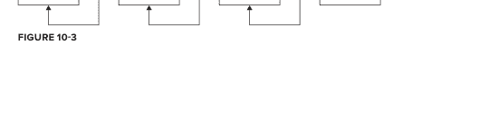

图 10-3

链表的一个优点是，如果项插入到列表中间，链表的速度非常快。插入项时，只需更改前一项的 Next 引用和下一项的 Previous 引用，使其引用插入的项。对于 List<T> 类，当插入元素时，所有后续元素都必须移动。

当然，链表也有缺点。链表的项只能一个接一个地访问。要找到列表中位于中间或末尾的某个项需要很长时间。

链表不能只存储列表中的项；连同每一项，链表还必须具有关于下一个和前一个项的信息。这就是为什么 LinkedList<T> 包含类型为 LinkedListNode<T> 的项。使用 LinkedListNode<T> 类，您可以访问列表中的下一个和前一个项。LinkedListNode<T> 类定义了属性 List、Next、Previous 和 Value。List 属性返回与该节点关联的 LinkedList<T> 对象。Next 和 Previous 用于遍历列表并访问下一个或前一个项。Value 的类型为 T。

LinkedList<T> 类本身定义了一些成员，用于访问列表的第一个（First）和最后一个（Last）项，在特定位置插入项（AddAfter()、AddBefore()、AddFirst()、AddLast()），从特定位置移除项（Remove()、RemoveFirst()、RemoveLast()），以及查找元素（搜索可以从列表的开头（Find()）或末尾（FindLast()）开始）。

用于演示链表的示例应用程序将链表与列表一起使用。链表包含与队列示例中相同的文档，但这些文档具有与之关联的额外优先级。文档将根据优先级在链表内排序。如果多个文档具有相同的优先级，则元素根据文档插入的时间进行排序。

图 10-4 描述了示例应用程序的集合。LinkedList<Document> 是包含所有 Document 对象的链表。该图显示了文档的标题和优先级。标题指示文档添加到列表的时间：第一个添加的文档的标题为“One”，第二个文档的标题为“Two”，依此类推。您可以看到文档 One 和 Four 具有相同的优先级 8，但由于 One 在 Four 之前添加，因此它在列表中更靠前。

当向链表添加新文档时，应将其添加到具有相同优先级的最后一个文档之后。LinkedList<Document> 集合包含类型为 LinkedListNode<Document> 的元素。LinkedListNode<Document> 类添加了 Next 和 Previous 属性，以便从一个节点遍历到下一个节点。为了引用此类元素，List<T> 被定义为 List<LinkedListNode<Document>>。为了快速访问每个优先级的最后一个文档，集合 List<LinkedListNode<Document>> 最多包含 10 个元素，每个元素引用每个优先级的最后一个文档。在接下来的讨论中，对每个优先级的最后一个文档的引用称为优先级节点。

在前面的示例中，Document 类被扩展为包含优先级。优先级通过类的构造函数设置：

```csharp
public class Document
{
    public string Title { get; private set; }
    public string Content { get; private set; }
    public byte Priority { get; private set; }

    public Document(string title, string content, byte priority = 0)
    {
        this.Title = title;
        this.Content = content;
        this.Priority = priority;
    }
}
```

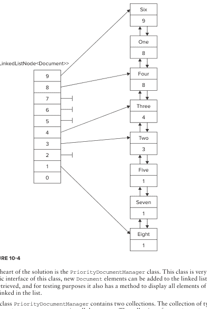

图 10-4

解决方案的核心是 PriorityDocumentManager 类。这个类非常容易使用。通过该类的公共接口，可以将新的 Document 元素添加到链表中，可以检索第一个文档，并且为了测试目的，它还有一个方法可以显示集合中所有元素在链表中的链接方式。

PriorityDocumentManager 类包含两个集合。类型为 LinkedList<Document> 的集合包含所有文档。类型为 List<LinkedListNode<Document>> 的集合包含最多 10 个元素的引用，这些元素是添加具有特定优先级的新文档的入口点。两个集合变量都在 PriorityDocumentManager 类的构造函数中初始化。列表集合也被初始化为 null：

```csharp
public class PriorityDocumentManager
{
    private readonly LinkedList<Document> documentList;
```

```csharp
var books = new SortedList<string, string>();
books.Add("C# 2008 Wrox Box", "978-0-470-047205-7");
books.Add("Professional ASP.NET MVC 1.0", "978-0-470-38461-9");

books["Beginning Visual C# 2008"] = "978-0-470-19135-4";
books["Professional C# 2008"] = "978-0-470-19137-6";
```

你可以通过使用 foreach 语句遍历列表。枚举器返回的元素类型为 `KeyValuePair<TKey, TValue>`，它同时包含键和值。可以通过 `Key` 属性访问键，通过 `Value` 属性访问值：

```csharp
foreach (KeyValuePair<string, string> book in books)
{
    Console.WriteLine("{0}, {1}", book.Key, book.Value);
}
```

迭代按键的顺序显示图书标题和 ISBN 号码：

- Beginning Visual C# 2008, 978-0-470-19135-4
- C# 2008 Wrox Box, 978-0-470-047205-7
- Professional ASP.NET MVC 1.0, 978-0-470-38461-9
- Professional C# 2008, 978-0-470-19137-6

你还可以使用 `Values` 属性和 `Keys` 属性访问值和键。`Values` 属性返回 `IList<TValue>`，`Keys` 属性返回 `IList<TKey>`，因此你可以使用 foreach 使用这些属性：

```csharp
foreach (string isbn in books.Values)
{
    Console.WriteLine(isbn);
}

foreach (string title in books.Keys)
{
    Console.WriteLine(title);
}
```

第一个循环显示值，接下来显示键：

- 978-0-470-19135-4
- 978-0-470-047205-7
- 978-0-470-38461-9
- 978-0-470-19137-6
- Beginning Visual C# 2008
- C# 2008 Wrox Box
- Professional ASP.NET MVC 1.0
- Professional C# 2008

如果你尝试使用索引器传递一个不存在的键来访问元素，将会抛出类型为 `KeyNotFoundException` 的异常。为了避免该异常，你可以使用返回 `true` 当传递的键存在于集合中时的方法 `ContainsKey()`，或者你可以调用方法 `TryGetValue()`，它尝试获取值但如果值不存在时不会抛出异常：

```csharp
string isbn;
string title = "Professional C# 7.0";
if (!(books.TryGetValue(title, out isbn)))
{
    Console.WriteLine("{0} not found", title);
}
```

### 字典

字典表示一种复杂的结构，允许你基于键访问元素。字典也称为哈希表或映射。字典的主要特性是基于键的快速查找。你还可以自由地添加和删除项目，有点像 `List<T>`，但没有为了在内存中移动后续项目而产生的性能开销。

图 10-5 显示了字典的简化表示。这里 employee-id 例如 B4711 是添加到字典中的键。键被转换为哈希值。通过哈希值创建一个数字来将索引与值关联起来。索引然后包含指向值的链接。该图是简化的，因为可能单个索引条目可以与多个值关联，并且索引可以存储为树。

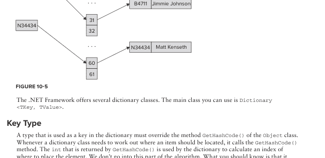

图 10-5

.NET Framework 提供了多个字典类。你可以使用的主要类是 `Dictionary<TKey, TValue>`。

#### 键类型

用作字典中键的类型必须重写 `Object` 类的 `GetHashCode()` 方法。每当字典类需要确定项目应位于何处时，它都会调用 `GetHashCode()` 方法。`GetHashCode()` 返回的 `int` 由字典用来计算放置元素的索引。我们不深入该算法的这一部分。你应该知道的是它涉及质数，因此字典的容量是一个质数。

`GetHashCode()` 的实现必须满足以下要求：

- 相同的对象应始终返回相同的值。
- 不同的对象可以返回相同的值。
- 它应尽可能快速执行；计算成本必须低廉。
- 它不得抛出异常。
- 它应使用至少一个实例字段。

```csharp
private readonly EmployeeId id;

public Employee(EmployeeId id, string name, decimal salary)
{
    this.id = id;
    this.name = name;
    this.salary = salary;
}

public override string ToString()
{
    return String.Format("{0}: {1, -20} {2:C}",
        id.ToString(), name, salary);
}
```

代码片段 DictionarySample/Employee.cs

在示例应用程序的 `Main()` 方法中，创建了一个新的 `Dictionary<TKey, TValue>` 实例，其中键的类型为 `EmployeeId`，值的类型为 `Employee`。构造函数分配了 31 个元素的容量。记住，容量基于质数。然而，当你分配一个不是质数的数值时，你无需担心。`Dictionary<TKey, TValue>` 类本身会采用传递给构造函数的整数之后的下一个质数来分配容量。员工对象和 ID 被创建并通过 `Add()` 方法添加到字典中。除了使用 `Add()` 方法，你还可以使用索引器向字典添加键和值，如员工 Dale 和 Jeff 所示：

```csharp
static void Main()
{
    var employees = new Dictionary<EmployeeId, Employee>(31);

    var idKyle = new EmployeeId("T3755");
    var kyle = new Employee(idKyle, "Kyle Busch", 5443890.00m);
    employees.Add(idKyle, kyle);
    Console.WriteLine(kyle);

    var idCarl = new EmployeeId("P1547");
    var carl = new Employee(idCarl, "Carl Edwards", 5597120.00m);
    employees.Add(idCarl, carl);
    Console.WriteLine(carl);

    var idJimmie = new EmployeeId("C3386");
    var jimmie = new Employee(idJimmie, "Jimmie Johnson", 5024710.00m);
    employees.Add(idJimmie, jimmie);
    Console.WriteLine(jimmie);

    var idDale = new EmployeeId("C3233");
    var dale = new Employee(idDale, "Dale Earnhardt Jr.", 3522740.00m);
    employees[idDale] = dale;
    Console.WriteLine(dale);

    var idJeff = new EmployeeId("C3234");
    var jeff = new Employee(idJeff, "Jeff Burton", 3879540.00m);
    employees[idJeff] = jeff;
    Console.WriteLine(jeff);
}
```

代码片段 DictionarySample/Program.cs

在条目添加到字典后，在 while 循环内部从字典读取员工。用户会被要求输入要存储在变量 `userInput` 中的员工号码。用户可以退出该循环。

在下面的示例中，填充了一个 Racer 对象列表。因为 `List<T>` 实现了 `IEnumerable<T>`，因此可以在 racers 列表上调用 `ToLookup()` 方法。此方法需要一个类型为 `Func<TSource, TKey>` 的委托来定义键的选择器。这里 racers 是基于国家选择的，使用 Lambda 表达式 `r => r.Country`。foreach 循环使用索引器仅访问来自澳大利亚的 racers。

> 你可以在第 11 章“语言集成查询”中阅读更多关于扩展方法的内容。Lambda 表达式在第 8 章中进行了说明。

```csharp
var racers = new List<Racer>();
racers.Add(new Racer("Jacques", "Villeneuve", "Canada", 11));
racers.Add(new Racer("Alan", "Jones", "Australia", 12));
racers.Add(new Racer("Jackie", "Stewart", "United Kingdom", 27));
racers.Add(new Racer("James", "Hunt", "United Kingdom", 10));
racers.Add(new Racer("Jack", "Brabham", "Australia", 14));

var lookupRacers = racers.ToLookup(r => r.Country);

foreach (Racer r in lookupRacers["Australia"])
{
    Console.WriteLine(r);
}
```

代码片段 LookupSample/Program.cs

输出显示来自澳大利亚的 racers：

Alan Jones
Jack Brabham

#### 排序字典

`SortedDictionary<TKey, TValue>` 是一个二叉搜索树，其中项目按键排序。键类型必须实现接口 `IComparable<TKey>`。如果键类型不可排序，你也可以创建一个实现 `IComparer<TKey>` 的比较器，并将其作为排序字典构造函数的参数指定。

本章前面你阅读了关于 `SortedList<TKey, TValue>` 的内容。`SortedDictionary<TKey, TValue>` 和 `SortedList<TKey, TValue>` 具有相似的功能。但因为 `SortedList<TKey, TValue>` 实现为基于数组的列表，而 `SortedDictionary<TKey, TValue>` 实现为字典，所以这些类具有不同的特性：

- `SortedList<TKey, TValue>` 使用的内存比 `SortedDictionary<TKey, TValue>` 少。
- `SortedDictionary<TKey, TValue>` 的插入和删除元素速度更快。
- 当使用已排序的数据填充集合时，如果不需要容量更改，`SortedList<TKey, TValue>` 更快。


## 集合

仅包含不同项的集合被称为 set。.NET 4 包含两个集合类型，`HashSet<T>` 和 `SortedSet<T>`，它们都实现了 `ISet<T>` 接口。`HashSet<T>` 包含无序的不同项列表；`SortedSet<T>` 则使列表有序。

`ISet<T>` 接口提供了创建多个集的并集、交集，或判断一个集是否为另一个集的超集或子集的方法。

在示例代码中，创建了三个 `string` 类型的集，并用 Formula-1 赛车填充。`HashSet<T>` 类实现了 `ICollection<T>` 接口。但是，`Add()` 方法是显式实现的，并且该类提供了另一个不同的 `Add()` 方法，正如您在此处看到的。这个 `Add()` 方法的不同之处在于返回类型；它返回一个布尔值，以指示元素是否已添加。如果元素已经在集中，则不会添加，并返回 `false`：

```
var companyTeams = new HashSet<string> { "Ferrari", "McLaren", "Toyota", "BMW", "Renault" };
var traditionalTeams = new HashSet<string> { "Ferrari", "McLaren" };
var privateTeams = new HashSet<string> { "Red Bull", "Toro Rosso", "Force India", "Brawn GP" };

if (privateTeams.Add("Williams"))
    Console.WriteLine("Williams added");
if (!companyTeams.Add("McLaren"))
    Console.WriteLine("McLaren was already in this set");
```

这两个 `Add()` 方法的结果会写入控制台：

```
Williams added
McLaren was already in this set
```

`IsSubsetOf()` 和 `IsSupersetOf()` 方法将一个集与一个实现了 `IEnumerable<T>` 接口的集合进行比较，并返回布尔结果。在这里，`IsSubsetOf()` 验证 `traditionalTeams` 中的每个元素是否都包含在 `companyTeams` 中，事实确实如此；`IsSupersetOf()` 验证 `traditionalTeams` 相对于 `companyTeams` 是否有任何额外的元素：

```
if (traditionalTeams.IsSubsetOf(companyTeams))
{
    Console.WriteLine("traditionalTeams is a subset of companyTeams");
}

if (companyTeams.IsSupersetOf(traditionalTeams))
{
    Console.WriteLine("companyTeams is a superset of traditionalTeams");
}
```

此验证的输出如下所示：

```
traditionalTeams is a subset of companyTeams
companyTeams is a superset of traditionalTeams
```

Williams 也是一支传统车队，因此该车队被添加到 `traditionalTeams` 集合中：

```
traditionalTeams.Add("Williams");
if (privateTeams.Overlaps(traditionalTeams))
{
    Console.WriteLine("At least one team is the same with the " +
        "traditional and private teams");
}
```

因为存在重叠，所以结果如下：

```
At least one team is the same with the traditional and private teams.
```

变量 `allTeams` 引用一个新的 `SortedSet<string>`，通过调用 `UnionWith()` 方法，将 `companyTeams`、`privateTeams` 和 `traditionalTeams` 的并集填充到其中：

```
var allTeams = new SortedSet<string>(companyTeams);
allTeams.UnionWith(privateTeams);
allTeams.UnionWith(traditionalTeams);

Console.WriteLine();
Console.WriteLine("all teams");
foreach (var team in allTeams)
{
    Console.WriteLine(team);
}
```

这里返回所有车队，但每支车队只列出一次，因为该集只包含唯一的值。由于容器是 `SortedSet<string>`，结果是有序的：

- BMW
- Brawn GP
- Ferrari
- Force India
- McLaren
- Red Bull
- Renault
- Toro Rosso
- Toyota
- Williams

`ExceptWith()` 方法从 `allTeams` 集中移除所有私人车队：

```
allTeams.ExceptWith(privateTeams);
Console.WriteLine();
Console.WriteLine("no private team left");
foreach (var team in allTeams)
{
    Console.WriteLine(team);
}
```

集合中剩余的元素不包含任何私人车队：

- BMW
- Ferrari
- McLaren
- Renault
- Toyota

### ObservableCollection

如果您需要获知集合中的项何时被移除或添加，可以使用 `ObservableCollection<T>` 类。该类是为 WPF 定义的，以便 UI 能够获知集合更改，因此该类定义在 `WindowsBase` 程序集中，您需要引用该程序集。此类的命名空间是 `System.Collections.ObjectModel`。

`ObservableCollection<T>` 派生自基类 `Collection<T>`，该基类可用于创建自定义集合，并在内部使用 `List<T>`。从基类中重写了虚方法 `SetItem()` 和 `RemoveItem()`，以触发 `CollectionChanged` 事件。此类的客户端可以使用 `INotifyCollectionChanged` 接口注册到此事件。

下一个示例演示了如何使用 `ObservableCollection<string>`，其中 `Data_CollectionChanged` 方法注册到 `CollectionChanged` 事件。向末尾添加两个项，插入一个项，并移除一个项：

```
var data = new ObservableCollection<string>();
data.CollectionChanged += Data_CollectionChanged;
data.Add("One");
data.Add("Two");
data.Insert(1, "Three");
data.Remove("One");
```

代码片段 ObservableCollectionSample/Program.cs

`Data_CollectionChanged` 方法接收包含集合更改信息的 `NotifyCollectionChangedEventArgs`。`Action` 属性提供有关项是添加还是移除的信息。对于移除的项，`OldItems` 属性会被设置，并列出被移除的项。对于添加的项，`NewItems` 属性会被设置，并列出新项：

```
static void Data_CollectionChanged(object sender,
    NotifyCollectionChangedEventArgs e)
{
    Console.WriteLine("action: {0}", e.Action.ToString());
    if (e.OldItems != null)
    {
        Console.WriteLine("starting index for old item(s): {0}", e.OldStartingIndex);
        Console.WriteLine("old item(s):");
        foreach (var item in e.OldItems)
        {
            Console.WriteLine(item);
        }
    }
    if (e.NewItems != null)
    {
        Console.WriteLine("starting index for new item(s): {0}", e.NewStartingIndex);
        Console.WriteLine("new item(s): ");
        foreach (var item in e.NewItems)
        {
            Console.WriteLine(item);
        }
    }
    Console.WriteLine();
}
```

运行应用程序，您可以看到如下输出。首先，项 `One` 和 `Two` 被添加到集合中，因此显示 `Add` 操作，索引为 `0` 和 `1`。第三个项 `Three` 被插入到位置 `1`，因此显示 `Add` 操作，索引为 `1`。最后，项 `One` 被移除，如 `Remove` 操作所示，索引为 `0`：

```
action: Add
starting index for new item(s): 0
new item(s):
One

action: Add
starting index for new item(s): 1
new item(s):
Two

action: Add
starting index for new item(s): 1
new item(s):
Three

action: Remove
starting index for old item(s): 0
old item(s):
One
```

### 位数组

如果您需要处理多个位，可以使用 `BitArray` 类和 `BitVector32` 结构。`BitArray` 位于 `System.Collections` 命名空间中；`BitVector32` 位于 `System.Collections.Specialized` 命名空间中。这两种类型之间最重要的区别是 `BitArray` 是可调整大小的，如果您事先不知道所需位数，这会很有用，并且它可以包含大量位。`BitVector32` 基于堆栈，因此速度更快。`BitVector32` 仅包含 32 位，存储在一个整数中。

#### BitArray

`BitArray` 类是一个引用类型，包含一个 `int` 数组，每 32 位使用一个新整数。此类的成员在下表中说明：

| `BitArray` 成员 | 描述 |
|---|---|
| `Count`, `Length` | `Count` 和 `Length` 的 get 访问器都返回数组中的位数。使用 `Length` 属性，您还可以定义新大小并调整集合大小。 |
| `Item`, `Get()`, `Set()` | 您可以使用索引器读取和写入数组中的位。索引器的类型为 `bool`。除了使用索引器，您还可以使用 `Get()` 和 `Set()` 方法访问数组中的位。 |
| `SetAll()` | `SetAll()` 方法根据传递给方法的参数设置所有位的值。 |
| `Not()` | `Not()` 方法生成数组中所有位的逆值。 |
| `And()`, `Or()`, `Xor()` | 使用 `And()`、`Or()` 和 `Xor()` 方法，您可以组合两个 `BitArray` 对象。`And()` 方法执行二进制 AND，仅当两个输入数组中的位都已设置时，结果位才会被设置。`Or()` 方法执行二进制 OR，当输入数组中有一个或两个已设置时，结果位会被设置。`Xor()` 方法是异或，仅当输入位中只有一个被设置时，结果才会被设置。 |

辅助方法 `DisplayBits()` 遍历一个 `BitArray`，并根据位是否被设置，向控制台显示 `1` 或 `0`：

```
static void DisplayBits(BitArray bits)
{
    foreach (bool bit in bits)
    {
        Console.Write(bit ? 1 : 0);
    }
}
```

代码片段 BitArraySample/Program.cs


用于演示 BitArray 类的示例创建了一个包含 8 位、索引从 0 到 7 的位数组。SetAll() 方法将全部 8 位设置为 true。然后 Set() 方法将位 1 更改为 false。除了 Set 方法之外，还可以使用索引器，如索引 5 和 7 所示。

```
var bits1 = new BitArray(8);
bits1.SetAll(true);
bits1.Set(1, false);
bits1[5] = false;
bits1[7] = false;
Console.Write("initialized: ");
DisplayBits(bits1);
Console.WriteLine();
```

这是初始化后位显示的结果：

```
initialized: 10111010
```

Not() 方法生成 BitArray 位的反码：

```
Console.Write(" not ");
DisplayBits(bits1);
bits1.Not();
Console.Write(" not = ");
DisplayBits(bits1);
Console.WriteLine();
```

Not() 的结果是所有位都被反转。如果位为 true，则变为 false；如果位为 false，则变为 true：

```
not 10111010 = 01000101
```

在这里，创建了一个新的 BitArray。使用构造函数，变量 bits1 用于初始化数组，因此新数组具有相同的值。然后将位 0、1 和 4 的值设置为不同的值。在使用 Or() 方法之前，会显示位数组 bits1 和 bits2。Or() 方法会更改 bits1 的值：

```
var bits2 = new BitArray(bits1);
bits2[0] = true;
bits2[1] = false;
bits2[4] = true;
DisplayBits(bits1);
Console.Write(" or ");
DisplayBits(bits2);
Console.Write(" = ");
bits1.Or(bits2);
DisplayBits(bits1);
Console.WriteLine();
```

使用 Or() 方法时，会从两个输入数组中获取已设置的位。在结果中，如果位在第一个或第二个数组中被设置，则该位被设置：

```
01000101 or 10001101 = 11001101
```

接下来，使用 And() 方法对 bits2 和 bits1 进行操作：

```
DisplayBits(bits2);
Console.Write(" and ");
DisplayBits(bits1);
Console.Write(" = ");
bits2.And(bits1);
DisplayBits(bits2);
Console.WriteLine();
```

And() 方法的结果仅在两个输入数组中位都被设置时才设置位：

```
10001101 and 11001101 = 10001101
```

最后使用 Xor() 方法进行异或：

```
DisplayBits(bits1);
Console.Write(" xor ");
DisplayBits(bits2);
bits1.Xor(bits2);
Console.Write(" = ");
DisplayBits(bits1);
Console.WriteLine();
```

使用 Xor() 方法时，结果位仅在位在第一个或第二个输入中被设置但不同时在两者中被设置时才被设置：

```
11001101 xor 10001101 = 01000000
```

### BitVector32

如果您事先知道需要的位数，可以使用 BitVector32 结构代替 BitArray。BitVector32 更高效，因为它是一种值类型，并且将位存储在整数内部的栈上。使用单个整数即可容纳 32 位。如果需要更多位，可以使用多个 BitVector32 值或 BitArray。BitArray 可以根据需要增长；BitVector32 则不行。

下表显示了与 BitArray 非常不同的 BitVector32 成员：

| BitVector32 成员 | 描述 |
|---|---|
| Data | Data 属性以整数形式返回 BitVector32 背后的数据。 |
| Item | 可以使用索引器设置 BitVector32 的值。索引器被重载——您可以使用掩码或类型为 BitVector32.Section 的 section 来获取和设置值。 |
| CreateMask() | CreateMask() 是一个静态方法，可用于为 BitVector32 中的特定位创建掩码。 |
| CreateSection() | CreateSection() 是一个静态方法，可用于在 32 位内创建多个 section。 |

示例代码使用默认构造函数创建一个 BitVector32，其中全部 32 位初始化为 false。然后创建掩码以访问位向量内部的位。第一次调用 CreateMask() 创建用于访问第一位的掩码。调用 CreateMask() 后，bit1 的值为 1。再次调用 CreateMask() 并将第一个掩码作为参数传递给 CreateMask() 会返回用于访问第二位的掩码，其值为 2。bit3 然后具有值 4 以访问第 3 位。bit4 具有值 8 以访问第 4 位。

然后使用索引器和掩码访问位向量内部的位并相应地设置字段：

```
var bits1 = new BitVector32();
int bit1 = BitVector32.CreateMask();
int bit2 = BitVector32.CreateMask(bit1);
int bit3 = BitVector32.CreateMask(bit2);
int bit4 = BitVector32.CreateMask(bit3);
int bit5 = BitVector32.CreateMask(bit4);

bits1[bit1] = true;
bits1[bit2] = false;
bits1[bit3] = true;
bits1[bit4] = true;
bits1[bit5] = true;
Console.WriteLine(bits1);
```

O(n) 表示对于集合中的每个元素都需要相同量的额外时间。`ArrayList` 的 `Add()` 方法在需要重新分配集合时可能为 O(n) 操作。更改容量会导致列表的复制，并且复制所需的时间随每个元素线性增加。

O(log n) 表示操作所需的时间会随着集合中的元素数量增加。但每个元素的增加时间不是线性的而是对数性的。`SortedDictionary<TKey, TValue>` 对集合内部的插入操作具有 O(log n) 行为；`SortedList<TKey, TValue>` 对相同功能具有 O(n) 行为。在这里，`SortedDictionary<TKey, TValue>` 快得多，因为将元素插入树结构比插入列表更有效。

下表列出了集合类及其在添加、插入和删除项目等不同操作上的性能。使用此表您可以为您的用途选择最佳的集合类。左侧列列出集合类。Add 列给出向集合添加项目的计时信息。`List<T>` 和 `HashSet<T>` 类定义 `Add` 方法以向集合添加项目。对于其他集合类，使用不同的方法向集合添加元素；例如，`Stack<T>` 类定义 `Push()` 方法，而 `Queue<T>` 类定义 `Enqueue()` 方法。您也可以在表中找到此信息。

如果单元格中有多个大 O 值，原因是如果集合需要调整大小，调整大小需要一段时间。例如，对于 `List<T>` 类，添加项目需要 O(1)。如果集合的容量不够大并且集合需要调整大小，则调整大小需要 O(n) 时间。集合越大，调整大小操作所需的时间越长。最好通过将集合的容量设置为可以容纳所有元素的值来避免调整大小。

如果单元格内容为 na，这意味着此操作不适用于此集合类型。

| 集合 | 添加 | 插入 | 删除 | 项 | 排序 | 查找 |
|---|---|---|---|---|---|---|
| List\<T\> | O(1) 或如果集合必须调整大小则 O(n) | O(n) | O(n) | O(1) | O(n log n)，最坏情况 O(n\^2) | O(n) |
| Stack\<T\> | Push(), O(1) 或如果栈必须调整大小则 O(n) | 不适用 | Pop(), O(1) | 不适用 | 不适用 | 不适用 |
| Queue\<T\> | Enqueue(), O(1) 或如果队列必须调整大小则 O(n) | 不适用 | Dequeue(), O(1) | 不适用 | 不适用 | 不适用 |
| HashSet\<T\> | Add(), O(1) 或如果集合必须调整大小则 O(n) | 不适用 | O(1) | 不适用 | 不适用 | 不适用 |
| SortedSet\<T\> | Add(), O(1) 或如果集合必须调整大小则 O(n) | 不适用 | O(1) | 不适用 | 不适用 | 不适用 |
| LinkedList\<T\> | AddLast() O(1) | AddAfter() O(1) | O(1) | 不适用 | 不适用 | O(n) |

## 11 语言集成查询

### 本章内容

- 使用 List\<T\> 对对象进行传统查询
- 扩展方法
- LINQ 查询运算符
- 并行 LINQ
- 表达式树

LINQ（语言集成查询）将查询语法集成到 C# 编程语言内部，使得可以用相同的语法访问不同的数据源。LINQ 通过提供抽象层使此操作成为可能。

本章为您提供 LINQ 的核心基础以及使新功能成为可能的 C# 语言扩展。

> 如果要在数据库中使用 LINQ，您应阅读第 31 章“ADO.NET Entity Framework”。阅读本章后，如需查询 XML 数据，请阅读第 33 章“操作 XML”。

### LINQ 概述

本章从一个简单的 LINQ 查询开始，然后深入 LINQ 的全部潜力。C# 语言提供集成查询语言，该语言被转换为方法调用。本节向您展示转换的外观，以便您可以使用 LINQ 的所有可能性。

#### 列表和实体

本章中的 LINQ 查询将在包含 1950 年至 2008 年一级方程式冠军的集合上执行。这些数据需要使用实体类和列表进行准备。

对于实体，定义了类型 Racer。Racer 定义了多个属性以及一个重载的 ToString() 方法，用于以字符串格式显示一名车手。此类实现了接口

```
}
public string ToString(string format)
{
    return ToString(format, null);
}
public string ToString(string format, IFormatProvider formatProvider)
{
    switch (format)
    {
        case null:
        case "N":
            return ToString();
        case "F":
            return FirstName;
        case "L":
            return LastName;
        case "C":
            return Country;
        case "S":
            return Starts.ToString();
        case "W":
            return Wins.ToString();
        case "A":
            return String.Format("{0} ({1}, {2}); starts: {3}, wins: {4}",
                FirstName, LastName, Country, Starts, Wins);
        default:
            throw new FormatException(String.Format(
                "Format {0} not supported", format));
    }
}
```

代码片段 DataLib/Racer.cs

第二个实体类是 Team。该类仅包含名称和用于车队冠军的年份数组。

```
[Serializable]
public class Team
{
    public Team(string name, params int[] years)
    {
        this.Name = name;
        this.Years = years;
    }

    public string Name { get; private set; }
    public int[] Years { get; private set; }
}
```

代码片段 DataLib/Team.cs

Formula1 类在 GetChampions() 方法中返回车手列表。该列表填充了 1950 年至 2008 年的所有一级方程式冠军：

```
using System.Collections.Generic;

namespace Wrox.ProCSharp.LINQ
{
    public static class Formula1
    {
        private static List<Racer> racers;

        public static IList<Racer> GetChampions()
        {
            if (racers == null)
            {
                racers = new List<Racer>(40);
                racers.Add(new Racer("Nino", "Farina", "Italy", 33, 5,
                    new int[] { 1950 },
                    new string[] { "Alfa Romeo" }));
                racers.Add(new Racer("Alberto", "Ascari", "Italy", 32, 10,
                    new int[] { 1952, 1953 },
                    new string[] { "Ferrari" }));
                racers.Add(new Racer("Juan Manuel", "Fangio", "Argentina", 51, 24,
                    new int[] { 1951, 1954, 1955, 1956, 1957 },
                    new string[] { "Alfa Romeo", "Maserati", "Ferrari" }));
                racers.Add(new Racer("Mike", "Hawthorn", "UK", 45, 3,
                    new int[] { 1958 },
                    new string[] { "Ferrari" }));
                racers.Add(new Racer("Phil", "Hill", "USA", 48, 3,
                    new int[] { 1961 },
                    new string[] { "Ferrari" }));
                racers.Add(new Racer("John", "Surtees", "UK", 111, 6,
                    new int[] { 1964 },
                    new string[] { "Ferrari" }));
                racers.Add(new Racer("Jim", "Clark", "UK", 72, 25,
                    new int[] { 1963, 1965 },
                    new string[] { "Lotus" }));
                racers.Add(new Racer("Jack", "Brabham", "Australia", 125, 14,
                    new int[] { 1959, 1960, 1966 },
                    new string[] { "Cooper", "Brabham" }));
                racers.Add(new Racer("Denny", "Hulme", "New Zealand", 112, 8,
                    new int[] { 1967 },
                    new string[] { "Brabham" }));
                racers.Add(new Racer("Graham", "Hill", "UK", 176, 14,
                    new int[] { 1962, 1968 },
                    new string[] { "BRM", "Lotus" }));
                racers.Add(new Racer("Jochen", "Rindt", "Austria", 60, 6,
                    new int[] { 1970 },
                    new string[] { "Lotus" }));
                racers.Add(new Racer("Jackie", "Stewart", "UK", 99, 27,
                    new int[] { 1969, 1971, 1973 },
                    new string[] { "Matra", "Tyrrell" }));
                //...
                return racers;
            }
        }
    }
}
```

代码片段 DataLib/Formula1.cs

当在多个列表之间进行查询时，下面提供的 GetConstructorChampions() 方法返回所有车队冠军的列表。车队冠军自 1958 年以来就存在。

```
private static List<Team> teams;
public static IList<Team> GetConstructorChampions()
{
    if (teams == null)
    {
        teams = new List<Team>()
        {
            new Team("Vanwall", 1958),
            new Team("Cooper", 1959, 1960),
            new Team("Ferrari", 1961, 1964, 1975, 1976, 1977, 1979, 1982, 1983, 1999, 2000, 2001, 2002, 2003, 2004, 2007, 2008),
            new Team("BRM", 1962),
            new Team("Lotus", 1963, 1965, 1968, 1970, 1972, 1973, 1978),
            new Team("Brabham", 1966, 1967),
            new Team("Matra", 1969),
            new Team("Tyrrell", 1971),
            new Team("McLaren", 1974, 1984, 1985, 1988, 1989, 1990, 1991, 1998),
            new Team("Williams", 1980, 1981, 1986, 1987, 1992, 1993, 1994, 1996, 1997),
            new Team("Benetton", 1995),
            new Team("Renault", 2005, 2006 )
        };
        return teams;
    }
}
```

### LINQ 查询

使用这些准备好的列表和实体，你可以执行 LINQ 查询，例如，查询按获胜次数从高到低排序的巴西世界冠军。要实现这一点，你可以使用 List<T> 类的方法，例如 FindAll() 和 Sort() 方法。然而，使用 LINQ 一旦你习惯了，就有更简单的语法：

```
private static void LinqQuery()
{
    var query = from r in Formula1.GetChampions()
                where r.Country == "Brazil"
                orderby r.Wins descending
                select r;

    foreach (Racer r in query)
    {
        Console.WriteLine("{0:A}", r);
    }
}
```

该查询的结果显示按顺序排列的巴西世界冠军：

```
Ayrton Senna, Brazil; starts: 161, wins: 41
Nelson Piquet, Brazil; starts: 204, wins: 23
Emerson Fittipaldi, Brazil; starts: 143, wins: 14
```

语句

```
from r in Formula1.GetChampions()
where r.Country == "Brazil"
orderby r.Wins descending
select r;
```

是一个 LINQ 查询。from、where、orderby、descending 和 select 子句是此查询中的预定义关键字。

查询表达式必须以 from 子句开头，以 select 或 group 子句结尾。在两者之间，你可以 optionally 使用 where、orderby、join、let 和额外的 from 子句。

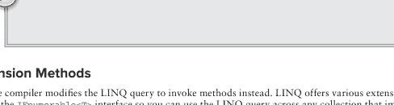

### 扩展方法

编译器会修改 LINQ 查询以调用方法而不是使用查询语法。LINQ 为 IEnumerable<T> 接口提供了各种扩展方法，因此你可以在实现该接口的任何集合上使用 LINQ 查询。

扩展方法使得可以为最初不提供该方法的类编写方法。你还可以为实现特定接口的任何类添加方法，以便多个类可以使用相同的实现。

例如，你是否希望 String 类拥有 Foo() 方法？String 类是密封的，因此无法从该类继承。你可以做一个扩展方法，如以下代码所示：

```
public static class StringExtension
{
    public static void Foo(this string s)
    {
        Console.WriteLine("Foo invoked for {0}", s);
    }
}
```

扩展方法被定义为静态方法，其中第一个参数定义了它扩展的类型，并且它在静态类中声明。Foo() 方法扩展了 string 类，如第一个参数所定义。为了区分扩展方法与普通静态方法，扩展方法还要求第一个参数使用 this 关键字。

确实，现在可以使用 Foo() 方法与 string 类型：

```
string s = "Hello";
s.Foo();
```

结果在控制台中显示 Foo invoked for Hello，因为 Hello 是传递给 Foo() 方法的字符串。

这看起来可能违反了面向对象的规则，因为为一个类型定义了新方法，而没有更改该类型或从它派生。然而事实并非如此。扩展方法无法访问其扩展类型的私有成员。调用扩展方法只是调用静态方法的一种新语法。对于 string，你可以通过以下方式调用 Foo() 方法获得相同的结果：

```
string s = "Hello";
StringExtension.Foo(s);
```

要调用静态方法，请写出类名后跟方法名。扩展方法是以不同方式调用静态方法。你不必提供静态方法定义的类的名称。相反，由于参数类型选择了静态方法。你只需要导入包含该类的命名空间，即可在 String 类的作用域中获得 Foo() 扩展方法。

定义 LINQ 扩展方法的一个类是 System.Linq 命名空间中的 Enumerable。你只需要导入该命名空间即可打开此类扩展方法的作用域。以下代码展示了 Where() 扩展方法的一个示例实现。第一个参数

包含 this 关键字的 `Where()` 方法的返回类型为 `IEnumerable<T>`。这样，`Where()` 方法就可以用于所有实现了 `IEnumerable<T>` 的类型。实现了该接口的类型示例包括数组和 `List<T>`。第二个参数是 `Func<T, bool>` 委托，它引用一个返回布尔值且需要一个 `T` 类型参数的方法。在实现中会调用这个谓词，以检查 `IEnumerable<T>` 源中的项是否应进入目标集合。如果该方法被委托引用，`yield return` 语句就会将项从源返回到目标：

```csharp
public static IEnumerable<TSource> Where<TSource>(
    this IEnumerable<TSource> source,
    Func<TSource, bool> predicate)
{
    foreach (TSource item in source)
        if (predicate(item))
            yield return item;
}
```

由于 `Where()` 是作为泛型方法实现的，因此它适用于集合中包含的任何类型。任何实现了 `IEnumerable<T>` 的集合都受支持。


现在可以使用 `Enumerable` 类中的扩展方法 `Where()`、`OrderByDescending()` 和 `Select()` 了。由于这些方法都返回 `IEnumerable<TSource>`，因此可以一个接一个地调用方法，并使用前一个方法的结果。对于扩展方法的参数，可以使用为委托参数定义实现的匿名方法：

```csharp
static void ExtensionMethods()
{
    var champions = new List<Racer>(Formula1.GetChampions());
    IEnumerable<Racer> brazilChampions =
        champions.Where(r => r.Country == "Brazil").
        OrderByDescending(r => r.Wins).
        Select(r => r);

    foreach (Racer r in brazilChampions)
    {
        Console.WriteLine("{0:A}", r);
    }
}
```

代码片段 LINQIntro/Program.cs

### 延迟查询执行

当在运行时定义查询表达式时，查询不会执行。查询会在迭代项时执行。

让我们再次看看扩展方法 `Where()`。该扩展方法使用 `yield return` 语句返回谓词为 true 的元素。由于使用了 `yield return` 语句，编译器会创建一个枚举器，并在从枚举中访问项时立即返回这些项：

```csharp
public static IEnumerable<T> Where<T>(this IEnumerable<T> source,
Func<T, bool> predicate)
{
```

```
where n.StartsWith("J")
orderby n
select n.ToList();

Console.WriteLine("First iteration");
foreach (string name in namesWithJ)
{
    Console.WriteLine(name);
}
Console.WriteLine();

names.Add("John");
names.Add("Jim");
names.Add("Jack");
names.Add("Denny");

Console.WriteLine("Second iteration");
foreach (string name in namesWithJ)
{
    Console.WriteLine(name);
}
```

在结果中，你可以看到，在两次迭代之间，尽管集合值已经改变，输出却保持不变：

```
First iteration
Juan

Second iteration
Juan
```

### 标准查询运算符

`Where`、`OrderByDescending` 和 `Select` 只是 LINQ 定义的查询运算符中的一小部分。LINQ 查询为最常见的运算符定义了一种声明式语法。`Enumerable` 类中还有很多其他查询运算符可用。

下表列出了 `Enumerable` 类定义的标准查询运算符：

| 标准查询运算符 | 说明 |
|---|---|
| Where OfType<TResult> | 筛选运算符定义了对返回元素的限制。使用 Where 查询运算符，可以使用谓词（例如，由返回 bool 的 Lambda 表达式定义）。OfType<TResult> 根据类型筛选元素，并且只返回 TResult 类型的元素。 |
| Select SelectMany | 投影运算符用于将一个对象转换为不同类型的新对象。Select 和 SelectMany 定义一个投影，基于选择器函数选择结果的值。 |
| OrderBy ThenBy OrderByDescending ThenByDescending Reverse | 排序运算符更改返回元素的顺序。OrderBy 按升序对值进行排序；OrderByDescending 按降序对值进行排序。如果第一次排序产生相似结果，ThenBy 和 ThenByDescending 运算符用于二次排序。Reverse 反转集合中的元素。 |
| Join GroupJoin | 联接运算符用于合并可能不直接相关的集合。使用 Join 运算符，可以基于键选择器函数联接两个集合。这类似于你在 SQL 中了解的 JOIN。GroupJoin 运算符联接两个集合并对结果进行分组。 |
| GroupBy ToLookup | 分组运算符将数据放入组中。GroupBy 运算符将具有共同键的元素分组。ToLookup 通过创建一对多字典来对元素分组。 |
| Any All Contains | 限定符运算符在序列中的元素满足特定条件时返回一个布尔值。Any、All 和 Contains 是限定符运算符。Any 确定集合中是否有任何元素满足谓词函数；All 确定集合中的所有元素是否都满足谓词。Contains 检查集合中是否包含特定元素。这些运算符返回一个布尔值。 |
| Take Skip TakeWhile SkipWhile | 分区运算符返回集合的一个子集。Take、Skip、TakeWhile 和 SkipWhile 是分区运算符。使用它们可以得到部分结果。使用 Take，你必须指定从集合中获取的元素个数；Skip 会忽略指定数量的元素并取其余元素。TakeWhile 只要条件为 true，就获取元素。 |
| Distinct Union Intersect Except Zip | 集运算符返回一个集合集。Distinct 从集合中移除重复项。除 Distinct 之外，其他集运算符需要两个集合。Union 返回出现在两个集合中任意一个的唯一元素。Intersect 返回同时出现在两个集合中的元素。Except 返回仅出现在一个集合中的元素。Zip 是 .NET 4 中的新运算符，它将两个集合合并为一个。 |
| First FirstOrDefault Last LastOrDefault ElementAt ElementAtOrDefault Single SingleOrDefault | 元素运算符只返回一个元素。First 返回满足条件的第一个元素。FirstOrDefault 与 First 类似，但如果未找到元素，则返回该类型的默认值。Last 返回满足条件的最后一个元素。使用 ElementAt，你可以指定要返回的元素的位置。Single 只返回满足条件的那一个元素。如果多于一个元素满足条件，则抛出异常。 |
| Count Sum Min Max Average Aggregate | 聚合运算符从集合中计算单个值。使用聚合运算符，你可以获得所有值的总和、所有元素的数量、具有最低或最高值的元素、平均值等等。 |
| ToArray AsEnumerable ToList ToDictionary Cast<TResult> | 转换运算符将集合转换为数组：IEnumerable、IList、IDictionary 等等。 |
| Empty Range Repeat | 生成运算符返回一个新序列。使用 Empty 运算符时集合为空；Range 返回数字序列；Repeat 返回包含一个重复值的集合。 |

以下各节是使用这些运算符的示例。

### 筛选

看一下查询的一些示例。

使用 where 子句，你可以组合多个表达式；例如，只获取来自巴西和奥地利且获胜超过 15 场的赛车手。传递给 where 子句的表达式的返回类型只需要是 bool 类型：

```csharp
var racers = from r in Formula1.GetChampions()
    where r.Wins > 15 &&
        (r.Country == "Brazil" || r.Country == "Austria")
    select r;

foreach (var r in racers)
{
    Console.WriteLine("{0:A}", r);
}
```

代码片段 Enumerablesample/Program.cs

使用此 LINQ 查询启动程序，将返回 Niki Lauda、Nelson Piquet 和 Ayrton Senna，如下所示：

```
Niki Lauda, Austria, Starts: 173, Wins: 25
Nelson Piquet, Brazil, Starts: 204, Wins: 23
Ayrton Senna, Brazil, Starts: 161, Wins: 41
```

并非所有查询都可以使用 LINQ 查询完成。并非所有扩展方法都映射到 LINQ 查询子句。高级查询需要使用扩展方法。为了更好地理解使用扩展方法的复杂查询，最好看看简单查询是如何映射的。使用扩展方法 `Where()` 和 `Select()` 生成的查询与之前完成的 LINQ 查询非常相似：

```csharp
var racers = Formula1.GetChampions().
    Where(r => r.Wins > 15 &&
        (r.Country == "Brazil" || r.Country == "Austria")).
    Select(r => r);
```

### 带索引的筛选

不能使用 LINQ 查询的一个示例是 `Where()` 方法的重载。通过 `Where()` 方法的重载，你可以传递第二个参数，即索引。索引是筛选返回的每个结果的一个计数器。你可以在表达式中使用索引，基于索引进行某些计算。这里，索引在 `Where()` 扩展方法调用的代码中使用，以便在索引为偶数时只返回姓氏以 A 开头的赛车手：

```csharp
var racers = Formula1.GetChampions().
    Where((r, index) => r.LastName.StartsWith("A") && index % 2 != 0);
foreach (var r in racers)
{
    Console.WriteLine("{0:A}", r);
}
```

所有姓氏以字母 A 开头的赛车手包括 Alberto Ascari、Mario Andretti 和 Fernando Alonso。由于 Mario Andretti 位于一个奇数索引处，因此他不在结果中：

```
Alberto Ascari, Italy; starts: 32, wins: 10
Fernando Alonso, Spain; starts: 132, wins: 21
```


### 类型筛选

基于类型进行筛选时，可以使用 OfType() 扩展方法。这里数组 data 同时包含 string 和 int 对象。使用 OfType() 扩展方法，将 string 类传递给泛型参数，只会返回集合中的字符串：

```
object[] data = { "one", 2, 3, "four", "five", 6 };
var query = data.OfType<string>();
foreach (var s in query)
{
    Console.WriteLine(s);
}
```

运行此代码，将显示字符串 one、four 和 five：

```
one
four
five
```

### Compound from

如果需要基于对象本身是一个序列的成员进行筛选，可以使用复合 from。Racer 类定义了一个属性 Cars，其中 Cars 是一个字符串数组。要筛选出所有曾驾驶法拉利夺冠的车手，可以使用如下所示的 LINQ 查询。第一个 from 子句访问 Formula1.GetChampions() 返回的 Racer 对象。第二个 from 子句访问 Racer 类的 Cars 属性，以返回所有类型为 string 的车辆。接下来使用 where 子句对车辆进行筛选，只保留曾驾驶法拉利夺冠的车手：

```
var ferrariDrivers = from r in Formula1.GetChampions()
                     from c in r.Cars
                     where c == "Ferrari"
                     orderby r.LastName
                     select r.FirstName + " " + r.LastName;
```

如果你好奇此查询的结果，所有驾驶法拉利的 F1 冠军是：

- Alberto Ascari
- Juan Manuel Fangio
- Mike Hawthorn
- Phil Hill
- Niki Lauda
- Kimi Räikkönen
- Jody Scheckter
- Michael Schumacher
- John Surtees

C# 编译器会将 LINQ 查询中的复合 from 子句转换为 SelectMany() 扩展方法。SelectMany() 可用于迭代一个序列的序列。示例中使用的 SelectMany 方法的重载如下所示：

```
public static IEnumerable<TResult> SelectMany<TSource, TCollection, TResult> (
    this IEnumerable<TSource> source,
    Func<TSource, IEnumerable<TCollection>> collectionSelector,
    Func<TSource, TCollection, TResult> resultSelector);
```

第一个参数是隐式参数，接收来自 GetChampions() 方法的 Racer 对象序列。第二个参数是 collectionSelector 委托，在其中定义内部序列。使用 Lambda 表达式 r => r.Cars 应返回车辆集合。第三个参数是一个委托，对每辆车都会被调用，并接收 Racer 和 Car 对象。Lambda 表达式创建一个具有 Racer 和 Car 属性的匿名类型。其结果是

排序后的结果如下所示：

```
Argentina: Fangio, Juan Manuel
Australia: Brabham, Jack
Australia: Jones, Alan
Austria: Lauda, Niki
Austria: Rindt, Jochen
Brazil: Fittipaldi, Emerson
Brazil: Piquet, Nelson
Brazil: Senna, Ayrton
Canada: Villeneuve, Jacques
Finland: Häkkinen, Mika
```

使用扩展方法实现相同功能时，使用 OrderBy() 和 ThenBy() 方法：

```
var racers = Formula1.GetChampions()
    .OrderBy(r => r.Country)
    .ThenBy(r => r.LastName)
    .ThenBy(r => r.FirstName)
    .Take(10);
```

### 分组

要基于键值对查询结果进行分组，可以使用 group 子句。现在应按国家对 F1 冠军进行分组，并列出每个国家内的冠军人数。子句 group r by r.Country into g 根据 Country 属性对所有车手进行分组，并定义一个新的标识符 g，可稍后用于访问分组结果信息。group 子句的结果基于应用于分组结果的扩展方法 Count() 进行排序，如果计数相同，则按键进行排序。这是国家，因为这是用于分组的键。where 子句基于至少包含两项的分组筛选结果，select 子句创建一个具有 Country 和 Count 属性的匿名类型：

```
var countries = from r in Formula1.GetChampions()
    group r by r.Country into g
    orderby g.Count() descending, g.Key
    where g.Count() >= 2
    select new {
        Country = g.Key,
        Count = g.Count()
    };

foreach (var item in countries)
{
    Console.WriteLine("{0,-10} {1}", item.Country, item.Count);
}
```

结果显示具有 Country 和 Count 属性的对象集合：

```
UK 9
Brazil 3
Australia 2
Austria 2
Finland 2
Italy 2
USA 2
```

使用扩展方法实现相同功能时，group by 子句被解析为 GroupBy() 方法。GroupBy() 方法的声明有趣之处在于它返回实现 IGrouping 接口的对象的枚举。IGrouping 接口定义了 Key 属性，因此在调用此方法后可以访问组的键：

```
public static IEnumerable<IGrouping<TKey, TSource>> GroupBy<TSource, TKey>(
    this IEnumerable<TSource> source, Func<TSource, TKey> keySelector);
```

需要一个字符串参数并返回 IEnumerable<Racer>，与之前实现的方法类似。为此定义了多个泛型 Func<> 委托，因此无需声明自己的委托。Lambda 表达式被赋给变量 racersByCar。Lambda 表达式的左侧定义了一个 car 变量，其类型为 Func 委托的第一个泛型参数（string）。右侧定义了使用 where 子句的 LINQ 查询，其中使用了该参数：

```
Func<string, IEnumerable<Racer>> racersByCar =
    car => from r in Formula1.GetChampions()
           from c in r.Cars
           where c == car
           orderby r.LastName
           select r;
```

现在可以使用 Intersect() 扩展方法获取所有曾驾驶法拉利和迈凯伦夺冠的车手：

```
Console.WriteLine("World champion with Ferrari and McLaren");
foreach (var racer in racersByCar("Ferrari").Intersect(
    racersByCar("McLaren")))
{
    Console.WriteLine(racer);
}
```

结果只有一个车手，Niki Lauda：

```
World champion with Ferrari and McLaren
Niki Lauda
```

> 集合操作通过调用实体类的 GetHashCode() 和 Equals() 方法来比较对象。对于自定义比较，还可以传递实现 IEqualityComparer<> 接口的对象。在此示例中，GetChampions() 方法始终返回相同的对象，因此默认比较有效。

### Zip

Zip() 方法在 .NET 4 中新增，可使用谓词函数将两个相关序列合并为一个。

首先创建两个相关序列，两者都具有相同的筛选条件（国家为意大利）和排序。对于合并而言这很重要，因为第一个集合的第 1 项与第二个集合的第 1 项合并，第 2 项与第 2 项合并，以此类推。如果两个序列的计数不同，Zip() 只会在到达较小的集合末尾时停止。

第一个集合中的项具有 Name 属性，第二个集合中的项具有 LastName 和 Starts 属性。

对集合 racerNames 使用 Zip() 方法需要将第二个集合 racerNamesAndStarts 作为第一个参数。第二个参数的类型为 Func<TFirst, TSecond, TResult>。该参数以 Lambda 表达式实现，并使用参数 first 接收第一个集合的元素，使用参数 second 接收第二个集合的元素。实现创建并返回一个字符串，其中包含第一个元素的 Name 属性和第二个元素的 Starts 属性：

```
var racerNames = from r in Formula1.GetChampions()
                 where r.Country == "Italy"
                 orderby r.Wins descending
                 select new
{
    Name = r.FirstName + ' ' + r.LastName
};

var racerNamesAndStarts = from r in Formula1.GetChampions()
    where r.Country == "Italy"
    orderby r.Wins descending
    select new
    {
        LastName = r.LastName,
        Starts = r.Starts
    };

var racers = racerNames.Zip(racerNamesAndStarts,
    (first, second) => first.Name + ", starts: " + second.Starts);
foreach (var r in racers)
{
    Console.WriteLine(r);
}
```

此合并的结果如下所示：

```
Alberto Ascari, starts: 32
Nino Farina, starts: 33
```

### 分区

诸如 Take() 和 Skip() 扩展方法之类的分区操作可用于轻松分页，例如一次显示 5 名车手。

在此处所示的 LINQ 查询中，扩展方法 Skip() 和 Take() 添加到查询末尾。Skip() 方法首先忽略基于页面大小和实际页码计算出的若干项；Take() 方法随后基于页面大小获取若干项：

```
int pageSize = 5;

int numberPages = (int)Math.Ceiling(Formula1.GetChampions().Count() /
    (double)pageSize);

for (int page = 0; page < numberPages; page++)
{
    Console.WriteLine("Page {0}", page);
    var racers =
        (from r in Formula1.GetChampions()
         orderby r.LastName
         select r.FirstName + " " + r.LastName).
        Skip(page * pageSize).Take(pageSize);
    foreach (var name in racers)
    {
        Console.WriteLine(name);
    }
    Console.WriteLine();
}
```

以下是前三页的输出：

```
Page 0
Fernando Alonso
Mario Andretti
Alberto Ascari
Jack Brabham
```

Jim Clark
第 1 页
Juan Manuel Fangio
Nino Farina
Emerson Fittipaldi
Mika Hakkinen
Lewis Hamilton

第 2 页
Mike Hawthorn
Phil Hill
Graham Hill
Damon Hill
Denny Hulme

分页在 Windows 或 Web 应用程序中显示给用户数据的一部分时非常有用。

> 你会注意到这种分页机制的一个重要行为；因为查询是针对每一页执行的，底层数据的更改会影响结果。随着分页的继续进行，新的对象会被显示出来。根据你的场景，这可能对你的应用程序有利。如果这种行为不是你需要的，你可以不针对原始数据源进行分页，而是使用映射到原始数据的缓存。

使用 TakeWhile() 和 SkipWhile() 扩展方法，你还可以传递一个谓词，根据谓词的结果来获取或跳过项目。

### 聚合运算符

聚合运算符如 Count()、Sum()、Min()、Max()、Average() 和 Aggregate() 不返回序列，而是返回单个值。

Count() 扩展方法返回集合中的项目数。在这里，Count() 方法应用于 Racer 的 Years 属性，以筛选车手并仅返回获得超过三次冠军的车手：

```
var query = from r in Formula1.GetChampions()
    where r.Years.Count() > 3
    orderby r.Years.Count() descending
    select new
    {
        Name = r.FirstName + " " + r.LastName,
        TimesChampion = r.Years.Count()
    };

foreach (var r in query)
{
    Console.WriteLine("{0} ({1})", r.Name, r.TimesChampion);
}
```

结果如下所示：
Michael Schumacher 7
Juan Manuel Fangio 5
Alain Prost 4

Sum() 方法汇总序列中的所有数字并返回结果。在这里，Sum() 用于计算某个国家的全部比赛胜利次数总和。首先根据国家对车手进行分组，然后使用新建的匿名类型，将 Wins 属性分配给来自单个国家的所有胜利的总和：

```
var countries =
    (from c in
        from r in Formula1.GetChampions()
        group r by r.Country into c
        select new
        {
            Country = c.Key,
            Wins = (from r1 in c
                    select r1.Wins).Sum()
        }
        orderby c.Wins descending, c.Country
        select c).Take(5);

foreach (var country in countries)
{
    Console.WriteLine("{0} {1}", country.Country, country.Wins);
}
```

基于一级方程式赛车冠军，最成功的国家如下：

- UK 147
- Germany 91
- Brazil 78
- France 51
- Finland 42

Min()、Max()、Average() 和 Aggregate() 方法的使用方式与 Count() 和 Sum() 相同。Min() 返回集合中值的最小数，Max() 返回最大值。Average() 计算平均数。使用 Aggregate() 方法时，你可以传递一个 Lambda 表达式，对所有值进行聚合。

### 转换

在本章中，你已经看到查询执行会延迟到访问项目时。使用迭代中的查询，查询会被执行。使用转换运算符，查询会立即执行，你会以数组、列表或字典的形式获得结果。

在此示例中，调用 ToList() 扩展方法以立即执行查询并将结果获取到 List<T> 中：

```
List<Racer> racers =
    (from r in Formula1.GetChampions()
     where r.Starts > 150
     orderby r.Starts descending
     select r).ToList();
foreach (var racer in racers)
{
    Console.WriteLine("{0} {0:S}", racer);
}
```

代码片段 EnumerableSample/Program.cs

将返回的对象简单地获取到列表中并不是那么简单。例如，为了在集合类中从一辆车快速访问到一名车手，你可以使用新的类 Lookup<TKey, TElement>。

> > Dictionary<TKey, TValue> 仅支持一个键对应一个值。使用来自命名空间 System.Linq 的类 Lookup<TKey, TElement>，你可以为单个键拥有多个值。这些类在第 10 章“集合”中进行了详细说明。

```
Console.WriteLine();
```

当然，结果现在看起来像这样：

1 2 3 4 5 6 7 8 9 10 11 12 13 14 15 16 17 18 19 20

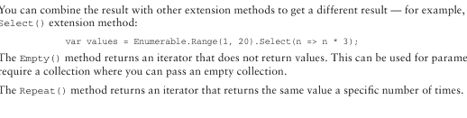

你可以将结果与其他扩展方法结合以获得不同的结果——例如，使用 Select() 扩展方法：

```
var values = Enumerable.Range(1, 20).Select(n => n * 3);
```

Empty() 方法返回一个不返回值的迭代器。这可用于需要集合的参数，其中可以传递一个空集合。

Repeat() 方法返回一个迭代器，该迭代器在特定次数内返回相同的值。

### 并行 LINQ

.NET 4 在 System.Linq 命名空间中包含了一个新的类 ParallelEnumerable，用于将查询的工作分配到多个线程。虽然 Enumerable 类为 IEnumerable<T> 接口定义了扩展方法，但 ParallelEnumerable 类的大多数扩展方法都是针对 ParallelQuery<TSource> 类的扩展。一个重要的例外是 AsParallel() 方法，它扩展了 IEnumerable<TSource> 并返回 ParallelQuery<TSource>，因此普通集合类可以以并行方式进行查询。

#### 并行查询

为了演示 Parallel LINQ，需要一个大型集合。对于小型集合，当集合适合 CPU 缓存时，你不会看到任何效果。在下面的代码中，一个大的 int 数组被填充了随机值：

```
const int arraySize = 10000000;
var data = new int[arraySize];
var r = new Random();
for (int i = 0; i < arraySize; i++)
{
    data[i] = r.Next(40);
}
```

代码片段 ParallelLinqSample/Program.cs

现在你可以使用 LINQ 查询来过滤数据并获取过滤后数据的总和。查询使用 where 子句定义了一个过滤器，仅汇总值 < 20 的项目，然后调用聚合函数 sum。与迄今为止看到的 LINQ 查询的唯一区别是调用了 AsParallel() 方法。

```
var sum = (from x in data.AsParallel()
           where x < 20
           select x).Sum();
```

与迄今为止看到的 LINQ 查询一样，编译器会更改语法以调用 AsParallel()、Where()、Select() 和 Sum() 方法。AsParallel() 是使用 ParallelEnumerable 类定义的，以扩展 IEnumerable<T> 接口，因此它可以用一个简单的数组调用。AsParallel()

```
}
catch (OperationCanceledException ex)
{
    Console.WriteLine(ex.Message);
}
}).Start();

Console.WriteLine("query started");
Console.WriteLine("cancel? ");
int input = Console.ReadLine();
if (input == 'Y' || input == 'y')
{
    // cancel!
    cts.Cancel();
}
```

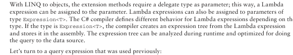

### 表达式树

使用 LINQ to objects，扩展方法需要委托类型作为参数；这样，Lambda 表达式可以分配给参数。Lambda 表达式也可以分配给类型为 Expression<T> 的参数。C# 编译器根据类型为 Lambda 表达式定义不同的行为。如果类型是 Expression<T>，编译器会从 Lambda 表达式创建表达式树并将其存储在程序集中。表达式树可以在运行时进行分析并针对对数据源的查询进行优化。

让我们转向之前使用过的查询表达式：

```
var brazilRacers = from r in racers
                   where r.Country == 'Brazil'
                   orderby r.Wins
                   select r;
```

此查询表达式使用扩展方法 Where、OrderBy 和 Select。Enumerable 类使用委托类型 Func<T, bool> 作为参数 predicate 定义 Where() 扩展方法：

```
public static IEnumerable<TSource> Where<TSource>(this IEnumerable<TSource> source,
    Func<TSource, bool> predicate);
```

这样，Lambda 表达式被分配给 predicate。在这里，Lambda 表达式类似于匿名方法，如前所述：

```
Func<Racer, bool> predicate = r => r.Country == "Brazil";
```

Enumerable 类并不是唯一定义 Where() 扩展方法的类。Where() 扩展方法也由类 Queryable<T> 定义。此类对 Where() 扩展方法有不同的定义：

```
public static IQueryable<TSource> Where<TSource>(this IQueryable<TSource> source,
    Expression<Func<TSource, bool>> predicate);
```

在这里，Lambda 表达式被分配给类型 Expression<T>，其行为不同：

```
Expression<Func<Racer, bool>> predicate = r => r.Country == "Brazil";
```


LINQ to Objects 的 `Where()` 方法在 `Enumerable` 类中定义：

```
public static IEnumerable<TSource> Where<TSource>(this IEnumerable<TSource> source,
Func<TSource, bool> predicate);
```

在 `System.Linq` 命名空间中，还有另一个实现了 `Where` 运算符的类。这个实现用于 LINQ to SQL。你可以在 `Queryable` 类中找到这个实现：

```
public static IQueryable<TSource> Where<TSource>(this IQueryable<TSource> source,
Expression<Func<TSource, bool>> predicate);
```

这两个类都实现在 `System.Core` 程序集的 `System.Linq` 命名空间中。它是如何定义的，又使用了哪个方法？无论传入的是 `Func<TSource, bool>` 参数还是 `Expression<Func<TSource, bool>>` 参数，Lambda 表达式都是相同的。只是编译器的行为不同。编译器根据 source 参数进行选择，并选择参数匹配度最好的方法。由 ADO.NET Entity Framework 定义的 `ObjectContext` 类的 `CreateQuery<T>()` 方法返回一个实现了 `IQueryable<TSource>` 的 `ObjectQuery<T>` 对象，因此 Entity Framework 使用 `Queryable` 类的 `Where()` 方法。

### 总结

在本章中，你已经学习了 LINQ 查询以及该查询所基于的语言结构，例如扩展方法和 Lambda 表达式。你已经了解了各种 LINQ 查询运算符，它们不仅用于数据源的筛选和排序，还用于分区、分组、转换、联接等。

通过并行 LINQ，你已经了解了如何轻松地将较长的查询并行化。

另一个重要的概念是表达式树。表达式树允许在运行时构建到数据源的查询，因为树存储在程序集中。你可以在第 31 章中了解它的巨大优势。LINQ 是一个非常深入的主题，你应该参阅第 31 章和第 33 章以获得更多信息。还有其他第三方提供程序可供下载；例如，LINQ to MySQL、LINQ to Amazon、LINQ to Flickr、LINQ to LDAP 和 LINQ to SharePoint。无论你有什么数据源，使用 LINQ 都可以使用相同的查询语法。

```
.locals init ([0] class DeCompile.StaticClass staticObject)
IL_0000: nop
IL_0001: newobj instance void DeCompile.StaticClass::.ctor()
IL_0006: stloc.0
IL_0007: ldloc.0
IL_0008: ldfld int32 DeCompile.StaticClass::IntValue
IL_0009: call void [mscorlib]System.Console::WriteLine(int32)
IL_0012: nop
IL_0013: call string [mscorlib]System.Console::ReadLine()
IL_0018: pop
IL_0019: ret
} // end of method Program::Main
```

在不深入 IL 细节的情况下，只看这段代码，你仍然可以基本了解发生了什么。第 0001 行调用了 StaticClass 的构造函数。第 0008 行调用了 StaticClass 的 IntValue 字段。下一行将该值写出。

现在注释掉 StaticClass 的引用，并取消注释 DynamicClass 的引用：

```
static void Main(string[] args)
{
    //StaticClass staticObject = new StaticClass();
    DynamicClass dynamicObject = new DynamicClass();
    Console.WriteLine(staticObject.IntValue);
    //Console.WriteLine(dynamicObject.DynValue);
    Console.ReadLine();
}
```

再次编译应用程序，会生成以下内容：

```
.method private hidebysig static void Main(string[] args) cil managed
{
    .entrypoint
    // Code size 121 (0x79)
    .maxstack 8
    .locals init ([0] class DeCompile.DynamicClass dynamicObject,
    [1] class [Microsoft.CSharp]Microsoft.CSharp.RuntimeBinder.CSharpArgumentInfo[]
    CSS0$0000)
    IL_0000: nop
    IL_0001: newobj instance void DeCompile.DynamicClass::.ctor()
    IL_0006: stloc.0
    IL_0007: ldftn class [System.Core]System.Runtime.CompilerServices.CallSite`1
    <class [mscorlib] System.Action`3<class [System.Core]System.Runtime.CompilerServices.CallSite, class [mscorlib] System.Type, object DeCompile.Program/'<Main>o__SiteContainer0'::'<p__Site1>'
    System.Action`3<class [System.Core]System.Runtime.CompilerServices.CallSite, class [mscorlib] System.Type, object DeCompile.Program/'<Main>o__SiteContainer0'::'<p__Site1>'
    [System.Core]System.Runtime.CompilerServices.CallSite, class [mscorlib]
    System.Type, object DeCompile.Program/'<Main>o__SiteContainer0'::'<p__Site1>'
    IL_000c: brtrue.s IL_004d
    IL_000e: ldftn
    IL_0014: ldstr 'WriteLine'
    IL_0019: ldtoken DeCompile.Program
    IL_001e: call class [mscorlib]System.Type [mscorlib]System.Type::GetTypeFromHandle (valuetype [mscorlib]System.RuntimeTypeHandle)
    IL_0023: ldnull
    IL_0024: ldloca.s 1
    IL_0026: newarr [Microsoft.CSharp]Microsoft.CSharp.RuntimeBinder.CSharpArgumentInfo
    IL_002b: ldloc.1
    IL_002c: ldc.i4 0
    IL_0030: ldloc.1
    IL_0031: ldc.i4.s 33
    IL_0033: ldnull
    IL_0034: newobj instance void [Microsoft.CSharp]Microsoft.CSharp.RuntimeBinder.CSharpArgumentInfo::.ctor(valuetype [Microsoft.CSharp]Microsoft.CSharp.RuntimeBinder.CSharpArgumentInfoFlags,
    string)
    IL_0039: stelem.ref

IL_0031: ldloc.1
IL_0032: ldc.i4.1
IL_0033: ldc.i4.0
IL_0034: ldnull
IL_0035: newobj instance void [Microsoft.CSharp]Microsoft.CSharp.RuntimeBinder.CSharpArgumentInfo::.ctor(valuetype [Microsoft.CSharp]Microsoft.CSharp.RuntimeBinder.CSharpArgumentInfoFlags,
string)
IL_003a: stelem.ref
IL_003b: ldloc.1
IL_003c: newobj instance void [Microsoft.CSharp]Microsoft.CSharp.RuntimeBinder.CSharpInvokeMemberBinder::.ctor(valuetype [Microsoft.CSharp]Microsoft.CSharp.RuntimeBinder.CSharpCallFlags,
string,
class [mscorlib]System.Type,
class [mscorlib]System.Collections.Generic.IEnumerable`1
<class [mscorlib]System.Type>,
class [mscorlib]System.Collections.Generic.IEnumerable`1
<class [Microsoft.CSharp]Microsoft.CSharp.RuntimeBinder.CSharpArgumentInfo>)
IL_0041: call class [System.Core]System.Runtime.CompilerServices.CallSite`1
<!0: class [System.Core]System.Runtime.CompilerServices.CallSite`1
<class [mscorlib]System.Action`3
<class [System.Core]System.Runtime.CompilerServices.CallSite,
class [mscorlib]System.Type, System.Type, object>::Create(class [System.Core]System.Runtime.CompilerServices.CallSiteBinder)
IL_0046: stsfld class [System.Core]System.Runtime.CompilerServices.CallSite`1
<class [mscorlib]System.Action`3
<class [System.Core]System.Runtime.CompilerServices.CallSite,
class [mscorlib]System.Type, System.Type, object>::Decompile.Program/<Main>o__SiteContainer0::<>p__Site1
IL_004b: br.s IL_004d
IL_004d: ldsfld class [System.Core]System.Runtime.CompilerServices.CallSite`1
<class [mscorlib]System.Action`3
<class [System.Core]System.Runtime.CompilerServices.CallSite,
class [mscorlib]System.Type, System.Type, object>::Decompile.Program/<Main>o__SiteContainer0::<>p__Site1
IL_0052: ldftn !0 class [System.Core]System.Runtime.CompilerServices.CallSite`1
<class [mscorlib]System.Action`3
<class [System.Core]System.Runtime.CompilerServices.CallSite,
class [mscorlib]System.Type, System.Type, object>::Target
class [System.Core]System.Runtime.CompilerServices.CallSite`1
<class [mscorlib]System.Action`3
<class [System.Core]System.Runtime.CompilerServices.CallSite,
class [mscorlib]System.Type, System.Type, object>::Decompile.Program/<Main>o__SiteContainer0::<>p__Site1
IL_005c: ldtoken [mscorlib]System.Console
IL_0061: call class [mscorlib]System.Type [mscorlib]System.Type::GetTypeFromHandle
(valuetype [mscorlib]System.RuntimeTypeHandle)
IL_0066: ldloc.0
IL_0067: ldftn object DeCompile.DynamicClass::DynValue
IL_006c: callvirt instance void [mscorlib]System.Action`3
<class [System.Core]System.Runtime.CompilerServices.CallSite, class
[mscorlib]System.Type, object>::Invoke(!0, !1, !2)
IL_0071: nop
IL_0072: call string [mscorlib]System.Console::ReadLine()
IL_0077: pop
IL_0078: ret
} // end of method Program::Main
```

因此，可以肯定地说，C# 编译器为支持动态类型做了额外的工作。查看生成的代码，你会看到对 `System.Runtime.CompilerServices.CallSite` 和 `System.Runtime.CompilerServices.CallSiteBinder` 的引用。


只有极少数情况下你才需要这类功能，但直到现在，C# 语言还没有办法满足你的需求。

首先来看看 `DynamicObject` 的样子：

```csharp
class WroxDynamicObject : DynamicObject
{
    Dictionary<string, object> _dynamicData = new Dictionary<string, object>();

    public override bool TryGetMember(GetMemberBinder binder, out object result)
    {
        bool success = false;
        result = null;
        if (_dynamicData.ContainsKey(binder.Name))
        {
            result = _dynamicData[binder.Name];
            success = true;
        }
        else
        {
            result = "Property Not Found!";
            success = false;
        }
        return success;
    }

    public override bool TrySetMember(SetMemberBinder binder, object value)
    {
        _dynamicData[binder.Name] = value;
        return true;
    }

    public override bool TryInvokeMember(InvokeMemberBinder binder,
                                          object[] args,
                                          out object result)
    {
        dynamic method = _dynamicData[binder.Name];
        result = method((DateTime)args[0]);
        return result != null;
    }
}
```

代码片段 Dynamic\Program.cs

在这个示例中，你重写了三个方法：TrySetMember、TryGetMember 和 TryInvokeMember。

TrySetMember 将新的方法、属性或字段添加到对象中。在这个示例中，你将成员信息存储在 Dictionary 对象中。传递给 TrySetMember 方法的 SetMemberBinder 对象包含 Name 属性，该属性用于标识 Dictionary 中的元素。

TryGetMember 根据 GetMemberBinder 的 Name 属性检索存储在 Dictionary 中的对象。

那么如何使用这些方法呢？下面是使用刚刚创建的新动态对象的代码：

```csharp
dynamic wroxDyn = new WroxDynamicObject();
wroxDyn.FirstName = "Bugs";
wroxDyn.LastName = "Bunny";
Console.WriteLine(wroxDyn.GetType());
Console.WriteLine("{0} {1}", wroxDyn.FirstName, wroxDyn.LastName);
```

看起来足够简单，但你重写的方法在哪里被调用了呢？这正是 .NET Framework 发挥作用的地方。DynamicObject 会为你处理绑定；你只需要像引用一直存在的属性那样引用 FirstName 和 LastName 属性即可。

## 总结

本章介绍了如何使用新的 `dynamic` 类型。你还了解了编译器遇到 `dynamic` 类型时会执行什么操作。本章讨论了动态语言运行时，并且你能够在一个简单的应用程序中承载它。你使用 Python 来使用 DLR，执行 Python 脚本，并向脚本传入值以及从脚本中传出值。最后，你通过从 DynamicObject 派生类创建了自己的 `dynamic` 类型。

动态开发正变得越来越流行。它允许你执行一些在静态类型语言中非常难以完成的操作。`dynamic` 类型和 DLR 使 C# 程序员能够利用一些动态功能。

## 值数据类型

Windows 使用一种称为*虚拟寻址*的系统，在该系统中，程序所看到的内存地址与硬件内存中实际位置之间的映射完全由 Windows 管理。其结果是，在 32 位处理器上，每个进程都能看到 4GB 的可用内存，而不管计算机中实际拥有多少硬件内存（在 64 位处理器上，这个数字会更大）。这 4GB 内存包含属于程序的所有内容，包括可执行代码、代码加载的任何 DLL，以及程序运行时使用的所有变量的内容。这 4GB 内存称为*虚拟地址空间*或*虚拟内存*。为方便起见，在本章中我们将其简称为*内存*。

可用的 4GB 内存中的每个位置都有一个编号，从零开始。要访问存储在内存中特定位置的值，需要提供代表该内存位置的编号。在任何编译型高级语言中，包括 C#、Visual Basic、C++ 和 Java，编译器都会将人类可读的变量名转换为处理器能够理解的内存地址。

进程的虚拟内存中有一部分区域称为*栈*。栈存储不属于对象成员的值数据类型。此外，当你调用方法时，栈还用于保存传递给方法的所有参数的副本。要理解栈的工作方式，需要理解变量作用域在 C# 中的重要性。如果变量 *a* 先于变量 *b* 进入作用域，那么 *b* 总是会先于 *a* 离开作用域。请看下面的代码：

```
{
    int a;
    // do something
    {
        int b;
        // do something else
    }
}
```

首先声明 *a*。然后，在内部代码块中声明 *b*。接着，内部代码块结束，*b* 离开作用域，随后 *a* 离开作用域。因此，*b* 的生命周期完全包含在 *a* 的生命周期之内。始终按照与分配变量相反的顺序释放变量，这一概念对于栈的工作方式至关重要。

你还会注意到，*b* 位于不同的代码块中（由不同层级的花括号定义）。因此，它处于不同的作用域中。这称为*块作用域*或*结构作用域*。

你不需要确切知道栈位于地址空间中的什么位置——对于 C# 开发来说，没有必要了解这一点。*栈指针*（由操作系统维护的变量）用于标识栈上的下一个空闲位置。程序刚开始运行时，栈指针会指向为栈保留的内存块末尾之后的位置。栈实际上是向下增长的，即从高内存地址向低内存地址增长。数据压入栈时，栈指针会相应地进行调整，因此它始终指向下一个空闲位置之后的位置。图 13-1 展示了这一点，其中栈指针的值为 800000（十六进制表示为 0xC3500）；下一个空闲位置的地址为 799999。

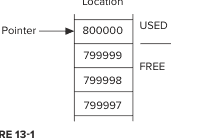

图 13-1

这段代码假设存在两个类：Customer 和 EnhancedCustomer。EnhancedCustomer 类扩展了 Customer 类。

首先，声明一个名为 arabel 的 Customer 引用。用于存储该引用的空间在栈上分配，但请记住，这只是一个引用，并不是实际的 Customer 对象。arabel 引用占用 4 个字节，足以存储 Customer 对象所在的地址。（需要 4 个字节才能将内存地址表示为介于 0 和 4GB 之间的整数值。）

下一行代码：

```
arabel = new Customer();
```

执行了多个操作。首先，它在堆上分配内存，用于存储一个 Customer 对象（一个真实的对象，而不仅仅是一个地址）。然后，它将变量 arabel 的值设置为分配给新 Customer 对象的内存地址。（它还会调用相应的 Customer() 构造函数来初始化类实例中的字段，不过这里暂不讨论这一点。）

Customer 实例不会放在栈上，而是放在堆上。在本示例中，你并不知道一个 Customer 对象确切占用多少字节，但为了便于说明，假设它占用 32 个字节。这 32 个字节包含 Customer 的实例字段，以及 .NET 用于标识和管理其类实例的一些信息。

为了在堆上为新的 Customer 对象查找存储位置，.NET 运行时会遍历堆，并获取第一个连续的、未使用的 32 字节内存块。同样为了便于说明，假设该内存块恰好位于地址 200000 处，并且 arabel 引用占用了栈上的 799996 到 799999 这几个位置。这意味着，在实例化 arabel 对象之前，内存内容将类似于图 13-2。


图 13-2

分配新的 Customer 对象后，内存内容将如图 13-3 所示。请注意，与栈不同，堆中的内存是向上分配的，因此空闲空间位于已使用空间的上方。


图 13-3


下一行代码同时声明了一个 Customer 引用并实例化了一个 Customer 对象。在此实例中，栈上为 otherCustomer2 引用分配空间，并在单行代码中在堆上为 otherCustomer2 对象分配空间：

```
Customer otherCustomer2 = new EnhancedCustomer();
```

这行代码在栈上分配 4 字节用于保存 otherCustomer2 引用，存储在 799992 至 799995 位置。otherCustomer2 对象在堆上从 200032 位置开始分配空间。

从示例可以清楚地看出，设置引用变量的过程比设置值变量的过程更复杂，并且存在性能开销。事实上，这里对该过程有所简化，因为 .NET 运行时需要维护有关堆状态的信息，并且每当向堆中添加新数据时，这些信息都需要更新。尽管存在这种开销，你现在拥有了一种分配变量的机制，这种机制不受栈限制的约束。通过将一个引用变量的值赋给另一个相同类型的变量，你将拥有两个引用内存中同一对象的变量。当引用变量超出作用域时，它会像上一节所述那样从栈中移除，但被引用的对象的数据仍然保留在堆上。该数据将一直保留在堆上，直到程序终止或垃圾回收器将其移除，而这只会在它不再被任何变量引用时发生。

这就是引用数据类型的强大之处，你将在 C# 代码中广泛看到这一特性的使用。这意味着你对数据的生命周期有高度的控制，因为只要你维护着对其的引用，它就保证存在于堆中。

## 垃圾回收

之前的讨论和图表显示，托管堆的工作方式与栈非常相似，以至于连续的对象在内存中彼此相邻放置。这意味着你可以通过使用堆指针来确定下一个对象的放置位置，该指针指示下一个空闲内存位置，并在向堆中添加更多对象时进行调整。然而，事情变得复杂，因为基于堆的对象的生命周期与引用它们的各个基于栈的变量的作用域没有耦合。

当垃圾回收器运行时，它会从堆中移除所有不再被引用的对象。完成此操作后，堆上将散布着对象，与刚刚被释放的内存混杂在一起（参见图 13-4）。

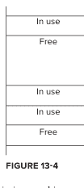

如果托管堆保持这种状态，为新对象分配空间将是一个棘手的过程，运行时必须在堆中搜索足够存储每个新对象的内存块。然而，垃圾回收器不会让堆保持这种状态。一旦垃圾回收器释放了所有可以释放的对象，它就会通过移动所有剩余对象来压缩堆，形成一个连续的内存块。这意味着堆在确定新对象的存储位置时可以继续像栈一样工作。当然，当对象被移动时，所有对这些对象的引用都需要更新为正确的新地址，但垃圾回收器也会处理这个问题。

垃圾回收器的这种压缩操作是托管堆与旧的非托管堆真正不同的地方。对于托管堆来说，只需读取堆指针的值，而无需遍历地址链表来寻找放置新数据的位置。因此，在 .NET 下实例化对象要快得多。有趣的是，访问对象往往也更快，因为对象被压缩到堆的同一内存区域，从而减少了页面交换。微软认为，这些性能提升远远超过了垃圾回收器在压缩堆并更改其移动对象的引用时所带来的性能损失。

> 通常，垃圾回收器在 .NET 运行时确定需要垃圾回收时运行。你可以通过调用 System.GC.Collect() 在代码的某个点强制垃圾回收器运行。System.GC 类是代表垃圾回收器的 .NET 类，而 Collect() 方法启动一次垃圾回收。GC 类适用于你知道是调用垃圾回收器的好时机等罕见情况；例如，如果你刚刚在代码中取消引用了大量对象。然而，垃圾回收器的逻辑并不保证所有未引用的对象都会在一轮垃圾回收中从堆中移除。

当垃圾回收器运行时，它实际上会损害应用程序的性能，因为在垃圾回收器完成其任务时，应用程序不可能继续运行。使用 .NET 垃圾回收器可以使这个问题不那么严重，因为它是一种代际垃圾回收器。

当对象被创建时，它们被放置在托管堆内。堆的第一部分称为 generation 0 部分或 gen 0。随着新对象的创建，它们被移动到堆的这一部分。因此，这里驻留着最年轻的对象。

你的对象会一直存在，直到通过垃圾回收过程进行第一次对象收集。经过此次清理后仍然存活的对象会被压缩，然后移动到堆的下一部分或代部分——generation 1 或 gen 1 部分。

此时，generation 0 部分为空，所有新对象再次放置在此部分。经历 GC（垃圾回收）过程而存活的老对象会进一步向下位于 generation 1 部分。这种对老化项的移动实际上还会再发生一次。接下来发生的收集过程会重复。这意味着从 generation 1 部分经历 GC 过程而存活的项会被移动到 generation 2 部分，而 gen 0 项会进入 gen 1，再次使 gen 0 可用于新对象。

> 有趣的是，当你分配的项超过 generation 0 部分的容量时，或当调用 GC.Collect() 时，会发生一次垃圾回收。

这一过程极大地提高了应用程序的性能。通常观察到，你最年轻的对象通常是可以被收集的，并且还有大量相关的年轻对象可以被回收。如果这些对象在堆中彼此相邻，则垃圾回收过程会更快。此外，相关对象彼此相邻驻留这一事实也会使程序执行整体更快。

.NET 中垃圾回收性能的另一个方面是框架如何处理进入堆的大型对象。在 .NET 内部，大型对象拥有自己的托管堆，称为 Large Object Heap。当使用大于 85,000 字节的对象时，它们会进入这个特殊堆而不是主堆。你的 .NET 应用程序不知道这种区别，因为这一切都由系统管理。这样做的原因是，在堆中压缩大型项代价昂贵，因此不会对驻留在 Large Object Heap 中的对象进行压缩。

## 释放非托管资源

垃圾回收器的存在意味着你通常不必担心不再需要的对象；你只需允许所有对这些对象的引用超出作用域，并允许垃圾回收器按需释放内存。然而，垃圾回收器不知道如何释放非托管资源（例如文件句柄、网络连接和数据库连接）。当托管类


```csharp
// do your processing
}
finally
{
    if (theInstance != null)
    {
        theInstance.Dispose();
    }
}
```

此版本可确保 Dispose() 总是在 theInstance 上被调用，并且即使在处理过程中发生异常，它所消耗的任何资源也始终会被释放。然而，如果你总是重复这种结构，代码会变得令人困惑。C# 提供了一种语法，可确保当实现 IDisposable 的对象的引用超出作用域时，Dispose() 会自动对其调用。实现此功能的语法涉及 using 关键字——尽管现在是在一个完全不同的上下文中，与命名空间无关。以下代码生成的 IL 代码等同于刚刚显示的 try 块：

```csharp
using (ResourceGobbler theInstance = new ResourceGobbler())
{
    // do your processing
}
```

using 语句后面跟随在括号中声明并实例化的引用变量，将使该变量的作用域限定在随附的语句块中。此外，当该变量超出作用域时，其 Dispose() 方法将自动被调用，即使发生异常也是如此。然而，如果你已经在使用 try 块捕获其他异常，则避免使用 using 语句，而只是在现有 try 块的 Finally 子句中调用 Dispose()，代码会更简洁，也能避免额外的代码缩进。

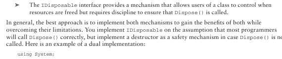

## 实现 IDisposable 和析构函数

前面的章节讨论了释放你所创建的类使用的非托管资源的两种替代方案：

- 析构函数的执行由运行时强制执行，但它是不可确定的，并且由于垃圾回收的工作方式，给运行时带来了不可接受的开销。
- IDisposable 接口提供了一种机制，允许类的使用者控制资源释放的时间，但需要自律以确保 Dispose() 被调用。

通常，最佳做法是同时实现这两种机制，以获得两者的优点同时克服其局限性。你在假设大多数程序员会正确调用 Dispose() 的前提下实现 IDisposable，但实现析构函数作为 Dispose() 未被调用时的安全机制。以下是双重实现的示例：

```csharp
using System;

public class ResourceHolder: IDisposable
{
    private bool isDisposed = false;
```

如果你想使用不安全局部变量，你需要在标记为不安全的方法或块内部声明并使用它。在你可以使用指针之前还有一步。C# 编译器会拒绝不安全代码，除非你告诉它你的代码包含不安全块。执行此操作的标志是 unsafe。因此，要编译包含不安全块的文件 MySource.cs（假设没有其他编译器选项），命令如下：

```
csc /unsafe MySource.cs
```

或此：

```
csc -unsafe MySource.cs
```

> 如果你使用的是 Visual Studio 2005、2008 或 2010，你还可以在项目属性窗口的 Build 选项卡中找到编译不安全代码的选项。

## 指针语法

在将代码块标记为不安全之后，你可以使用以下语法声明指针：

```
int* pWidth, pHeight;
double* pResult;
byte*[] pFlags;
```

此代码声明了四个变量：pWidth 和 pHeight 是指向整数的指针，pResult 是指向 double 的指针，而 pFlags 是指向字节的指针数组。常见做法是在指针变量名称前使用前缀 p 以表明它们是指针。在变量声明中使用时，符号 * 表示你正在声明一个指针（即存储指定类型变量地址的东西）。

> C++ 开发者应注意 C++ 与 C# 之间的语法差异。C# 语句 int* pX, pY; 对应于 C++ 语句 int *pX, *pY;。在 C# 中，* 符号与类型相关联而不是变量名。

声明了指针类型变量后，你可以像使用普通变量一样使用它们，但首先你需要学习另外两个运算符：

- & 表示取地址，并将值数据类型转换为指针，例如 int 到 *int。该运算符称为地址运算符。
- * 表示获取此地址的内容，并将指针转换为值数据类型（例如，*float 到 float）。该运算符称为间接运算符（有时也称为解引用运算符）。

从这些定义可以看出，& 和 * 具有相反的效果。

以下代码展示了如何使用这些运算符的示例：

```
int x = 10;
int* pX, pY;
pX = &x;
pY = pX;
*pY = 20;
```

你首先声明一个整数 x，值为 10，然后声明两个指向整数的指针 pX 和 pY。然后你将 pX 设置为指向 x（即将 pX 的内容设置为 x 的地址）。然后你将 pX 的值赋给 pY，因此 pY 也指向 x。最后，在语句 *pY = 20 中，你将值 20 分配给 pY 所指向位置的内容——实际上将 x 改为 20，因为 pY 恰好指向 x。请注意，变量 pY 和 x 之间并没有特别的联系。只是目前 pY 恰好指向 x 所在的内存位置。

为了更好地理解正在发生的事情，请考虑整数 x 存储在栈上的内存位置 0x12F8C4 到 0x12F8C7（0x12F8C4 = 1243332 到 0x12F8C7 = 1243335 十进制）上（有四个位置，因为一个 int 占用 4 字节）。由于栈向下分配内存，这意味着变量 pX 将存储在位置 0x12F8BC 到 0x12F8BF，而 pY 将位于位置 0x12F8B8 到 0x12F8BB。请注意，pX 和 pY 也各占用 4 字节。这并不是因为 int 占用 4 字节。而是因为在 32 位处理器上存储一个地址需要 4 字节。执行完前面的代码后，栈将如下图 13-5 所示。

| 地址 | 值 |
|---|---|
| 0x12F8C4-0x12F8C7 | x=20 (=0x14) |
| 0x12F8C0-0x12F8C3 | pX=0x12F8C4 |
| 0x12F8BC-0x12F8BF | pY=0x12F8C4 |

图 13-5

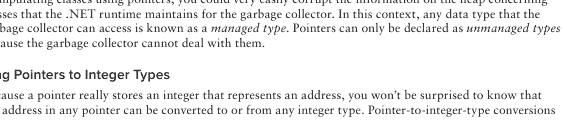

你可以为任何值类型声明指针（即任何预定义类型 uint、int、byte 等，或 struct）。然而，不可能声明指向类或数组的指针；这是因为这样做可能会给垃圾回收器带来问题。为了正常工作，垃圾回收器需要确切知道在堆上创建了哪些类实例以及它们的位置，但如果你的代码开始使用指针操作类，你很容易破坏 .NET 运行时为垃圾回收器维护的关于堆上类的信息。在此上下文中，垃圾回收器可以访问的任何数据类型称为托管类型。指针只能声明为非托管类型，因为垃圾回收器无法处理它们。

## 将指针转换为整数类型

由于指针实际上存储的是表示地址的整数，你不会感到惊讶，任何指针中的地址都可以转换为或从任何整数类型转换。指针到整数类型的转换必须显式。此类转换不可用隐式转换。例如，写下以下内容是完全合法的：

```
int x = 10;
int* pX, pY;
pX = &x;
pY = pX;
*pY = 20;
uint y = (uint)pX;
int* pD = (int*)y;
```

指针 pX 中保存的地址被强制转换为 uint 并存储在变量 y 中。然后你将 y 转换回 int* 并存储在新变量 pD 中。因此，现在 pD 也指向 x 的值。

将指针值转换为整数类型的主要原因是为了显示它。Console.Write() 和 Console.WriteLine() 方法没有可以接受指针的重载，但会接受并显示已转换为整数类型的指针值：

```
Console.WriteLine("Address is " + pX);  // wrong -- will give a
                                         // compilation error
Console.WriteLine("Address is " + (uint)pX);  // OK
```

你可以将指针转换为任何整数类型。然而，由于在 32 位系统上地址占用 4 字节，将指针转换为 uint、long 或 ulong 以外的类型几乎肯定会导致溢出错误。（int 会导致问题，因为它的范围大约从 -20 亿到 20 亿，而地址范围从零到约 40 亿。）当 C# 发布用于 64 位处理器时，地址将占用 8 字节。因此，在此类系统上，将指针转换为 ulong 以外的任何类型都可能导致溢出错误。还需要注意的是，checked 关键字不适用于涉及指针的转换。对于此类转换，即使在 checked 上下文中，溢出时也不会引发异常。.NET 运行时假定如果你使用指针，你知道自己在做什么，并且不担心可能的溢出。

## 在指针类型之间转换

你也可以在指向不同类型的指针之间显式转换。例如：

```
byte aByte = 8;
byte* pByte = &aByte;
double* pDouble = (double*)pByte;
```

## void 指针

如果你想维护一个指针，但不想指定它指向的数据类型，可以将其声明为指向 void 的指针：

```
int* pointerToInt;
void* pointerToVoid;
pointerToVoid = (void*)pointerToInt;
```


## 指针算术

可以对指针进行整数的加法或减法运算。然而，编译器在处理这个问题时相当聪明。例如，假设你有一个指向 int 的指针并尝试对其值加 1。编译器会假设你实际上是想查看 int 之后的内存位置，因此它会将值增加 4 字节——一个 int 的大小。如果是指向 double 的指针，加 1 实际上会使指针的值增加 8 字节，即一个 double 的大小。只有当指针指向 byte 或 sbyte（各 1 字节）时，对指针值加 1 才会真正使其值改变 1。

你可以使用运算符 +, -, +=, -=, ++ 和 -- 与指针一起使用，这些运算符右侧的变量为 long 或 ulong。

> 不允许对 void 指针执行算术运算。

例如，假设以下定义：

```
uint u = 3;
byte b = 8;
double d = 10.0;
uint* pUint = &u;    // size of a uint is 4
byte* pByte = &b;    // size of a byte is 1
double* pDouble = &d; // size of a double is 8
```

接下来，假设这些指针指向的地址为：

- pUint: 1243332
- pByte: 1243328
- pDouble: 1243320

然后执行以下代码：

```
++pUint;        // adds (1*4) = 4 bytes to pUint
pByte -= 3;     // subtracts (3*1) = 3 bytes from pByte
double* pDouble2 = pDouble + 4; // pDouble2 = pDouble + 32 bytes (4*8 bytes)
```

现在指针包含以下内容：

- pUint: 1243336
- pByte: 1243325
- pDouble2: 1243352

> 你需要意识到之前的规则。如果给定类型的连续值存储在连续的内存位置中，指针加法效果很好，可以让你在内存位置之间移动指针。但是，如果你处理的是 byte 或 char 等类型，其大小不是 4 的倍数，则连续值默认不会存储在连续的内存位置中。

```
(uint)&y2, sizeof(byte), y2);
Console.WriteLine(
    "*Address of z is 0x{0:X}, size is {1}, value is {2}*",
    (uint)&z, sizeof(double), z);
Console.WriteLine(
    "*Address of pX is 0x{0:X}, size is {1}, value is 0x{2:X}*",
    (uint)&pX, sizeof(int*), (uint)pX);
Console.WriteLine(
    "*Address of pY is 0x{0:X}, size is {1}, value is 0x{2:X}*",
    (uint)&pY, sizeof(short*), (uint)pY);
Console.WriteLine(
    "*Address of pZ is 0x{0:X}, size is {1}, value is 0x{2:X}*",
    (uint)&pZ, sizeof(double*), (uint)pZ);

*pX = 20;
Console.WriteLine("After setting *pX, x = {0}", x);
Console.WriteLine("*pX = {0}", *pX);

pZ = (double*)pX;
Console.WriteLine("x treated as a double = {0}", *pZ);

Console.ReadLine();
}
```

此代码声明了四个值变量：

- 一个 int x
- 一个 short y
- 一个 byte y2
- 一个 double z

它还声明了指向其中三个值的指针：pX、pY 和 pZ。

接下来，你显示这些变量的值以及它们的大小和地址。注意，在获取 pX、pY 和 pZ 的地址时，你实际上是在查看指向指针的指针——一个值的地址的地址。请注意，根据显示地址的通常做法，你已在 Console.WriteLine() 命令中使用了 {0:X} 格式说明符，以确保内存地址以十六进制格式显示。

最后，你使用指针 pX 将 x 的值更改为 20 并进行一些指针转换，以查看如果尝试将 x 的内容视为 double 会发生什么。

编译并运行此代码会产生以下输出。此屏幕输出演示了尝试在有和没有 /unsafe 标志的情况下编译的效果：

```
csc PointerPlayground.cs
Microsoft (R) Visual C# 2010 Compiler version 4.0.21006.1
Copyright (C) Microsoft Corporation. All rights reserved.

PointerPlayground.cs(7,26): error CS0227: Unsafe code may only appear if
    compiling with /unsafe

csc /unsafe PointerPlayground.cs
Microsoft (R) Visual C# 2010 Compiler version 4.0.21006.1
Copyright (C) Microsoft Corporation. All rights reserved.

PointerPlayground
```

类似地，要存储 20 个 double 数据项，你可以这样写：

```
double* pDoubles = stackalloc double[20];
```

尽管此行代码将要存储的变量数量指定为常量，但这同样可以是在运行时计算的数量。因此，你可以像这样编写之前的示例：

```
int size;
size = 20; // or some other value calculated at run-time
double* pDoubles = stackalloc double[size];
```

从这些代码片段可以看出，stackalloc 的语法略显不寻常。其后立即跟随你想要存储的数据类型名称（并且必须是值类型），然后是在方括号中需要空间的项目数。分配的字节数将是该数字乘以 sizeof(数据类型)。前述代码示例中使用方括号暗示了一个数组，这并不奇怪。如果你为 20 个 double 分配了空间，那么你拥有的就是一个包含 20 个 double 的数组。你可以拥有的最简单的数组类型是一个存储一个元素接一个元素的内存块（见图 13-6）。

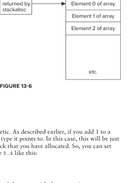

## 图 13-6

该图还显示了 stackalloc 返回的指针，它始终是指向已分配数据类型的指针，指向新分配的内存块的顶部。要使用内存块，只需取消引用返回的指针即可。例如，要为 20 个 double 分配空间，然后将第一个元素（数组的第 0 个元素）设置为值 3.0，写成如下：

```
double* pDoubles = stackalloc double [20];
*pDoubles = 3.0;
```

要访问数组的下一个元素，你使用指针算术。如前所述，如果你对指针加 1，其值将按其指向的数据类型的大小增加。在这种情况下，这正好足以让你进入已分配块中的下一个空闲内存位置。因此，你可以像这样将数组的第二个元素（元素编号 1）设置为值 8.4：

```
double* pDoubles = stackalloc double [20];
*pDoubles = 3.0;
*(pDoubles+1) = 8.4;
```

同理，你可以使用表达式 *(pDoubles+x) 访问数组中索引为 x 的元素。

实际上，你有一种访问数组元素的方法，但对于通用使用而言，这种语法过于复杂。幸运的是，C# 定义了使用方括号应用于指针的替代语法；C# 对应用于指针的方括号赋予了非常精确的含义；如果变量 p 是任何指针类型且 x 是整数，则表达式 p[x] 总是由编译器解释为 *(p+x)。这适用于所有指针，而不仅仅是使用 stackalloc 初始化的指针。有了这种简写表示法，你现在就有了一种非常方便的访问数组的语法。事实上，这意味着你访问一维基于栈的数组的语法与你访问由 System.Array 类表示的基于堆的数组的语法完全相同：

```
double* pDoubles = stackalloc double [20];
pDoubles[0] = 3.0; // pDoubles[0] is the same as *pDoubles
pDoubles[1] = 8.4; // pDoubles[1] is the same as *(pDoubles+1)
```

> 将数组语法应用于指针的想法并不新鲜。它自这些语言发明以来就一直是 C 和 C++ 语言的基础部分。事实上，C++ 开发者会认识到他们可以使用 stackalloc 获得的基于栈的数组与经典的基于栈的 C 和 C++ 数组本质上是相同的。这种语法以及它将指针和数组联系起来的方式是 C 语言在 1970 年代流行起来的原因之一，也是指针在 C 和 C++ 中成为一种流行编程技术的主要原因。

尽管你的高性能数组可以像普通的 C# 数组一样访问，但需要谨慎。以下 C# 代码会引发异常：

```
double[] myDoubleArray = new double [20];
myDoubleArray[50] = 3.0;
```

异常发生是因为你尝试使用超出范围的索引访问数组；索引为 50，而最大允许值为 19。然而，如果你使用 stackalloc 声明等效数组，则没有包裹在数组周围的对象可以执行边界检查。因此，以下代码不会引发异常：

```
double* pDoubles = stackalloc double [20];
pDoubles [50] = 3.0;
```

在此代码中，你分配了足够的内存来容纳 20 个 double。然后你设置 sizeof(double) 个内存位置，从此内存的起始位置 + 50*sizeof(double) 开始，以保存 double 值 3.0。不幸的是，该内存位置远在为 double 分配的内存区域之外。无法得知该地址可能存储了什么数据。最好的情况是，你可能使用了某些当前未使用的内存，但同样可能的是，你刚刚覆盖了栈中用于存储其他变量甚至当前正在执行的方法的返回地址的一些位置。再一次，你可以看到指针带来的高性能是有代价的；你需要确信自己知道自己在做什么，否则你将遇到一些非常奇怪的运行时错误。

## QuickArray 示例

我们关于指针的讨论以一个名为 QuickArray 的 stackalloc 示例结束。在此示例中，程序 simply 询问用户希望为数组分配多少个元素。然后代码使用 stackalloc 分配该大小的 long 数组。此数组的元素用从 0 开始的整数的平方填充，结果显示在控制台上：

```
using System;

namespace QuickArray
{
    internal class Program
    {
        private static unsafe void Main()
        {
            Console.Write("How big an array do you want? \n> ");
            string userInput = Console.ReadLine();
            uint size = uint.Parse(userInput);

            long* pArray = stackalloc long[(int) size];
            for (int i = 0; i < size; i++)
            {
                pArray[i] = i*i;
            }

            for (int i = 0; i < size; i++)
```


```csharp
{
    Console.WriteLine("Element {0} = {1}", i, *(pArray + i));
}

Console.ReadLine();
}
}
}
```

QuickArray 示例的输出如 图 13-7 所示。

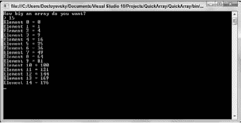

**图 13-7**

## 摘要

请记住，要成为一名真正精通 C# 的程序员，你必须对内存分配和垃圾回收的工作原理有扎实的理解。本章描述了 CLR 如何在堆和栈上管理并分配内存。它还说明了如何编写正确释放非托管资源的类，以及如何在 C# 中使用指针。这些都是高级主题，初学者往往理解不足且经常实现错误。

本章应作为你在第 15 章错误处理以及第 20 章线程处理中学到的内容的补充。本书的下一章将介绍 C# 中的反射。

## 14 反射

### 本章内容

- 使用自定义特性
- 使用反射在运行时检查元数据
- 从启用反射的类构建访问点

本章重点介绍自定义特性和反射。自定义特性是一种允许你将自定义元数据与程序元素关联起来的机制。此元数据在编译时创建并嵌入到程序集中。反射是一个通用术语，描述了在运行时检查和操作程序元素的能力。例如，反射允许你：

- 枚举类型的成员
- 实例化新对象
- 执行对象的成员
- 查找有关类型的信息
- 查找有关程序集的信息
- 检查应用于类型的自定义特性
- 创建和编译新程序集

此列表代表了大量功能，并涵盖了 .NET Framework 类库提供的最强大和最复杂的能力之一。虽然本章没有足够的篇幅涵盖反射的所有功能，但它专注于你最有可能最频繁使用的元素。

为了演示自定义特性和反射，你开发了一个基于一家公司定期发布软件升级并希望自动记录这些升级详细信息的示例。在示例中，你定义自定义特性以指示程序元素上次修改的日期以及所做的更改。然后你使用反射开发一个应用程序，该应用程序在程序集中查找这些特性，并可以自动显示自给定日期以来对软件所做的所有升级的详细信息。

本章的另一个示例考虑了一个从数据库读取或写入数据库的应用程序，并使用自定义特性作为标记哪些类和属性对应于哪些数据库表和列的方式。通过在运行时从程序集中读取这些特性，程序能够自动检索或将数据写入数据库中的适当位置，而无需为每个表或列提供特定逻辑。

错误。例如，如果特性类指示特性只能应用于类，但你将其应用于结构体定义，将会发生编译错误。

继续示例，假设你已按如下方式定义 FieldName 特性：

```csharp
[AttributeUsage(AttributeTargets.Property,
    AllowMultiple=false,
    Inherited=false)]
public class FieldNameAttribute: Attribute
{
    private string name;
    public FieldNameAttribute(string name)
    {
        this.name = name;
    }
}
```

以下各节讨论此定义的每个元素。

### AttributeUsage 特性

首先需要注意的是，特性类本身被一个特性标记——System.AttributeUsage 特性。这是由 Microsoft 定义的特性，C# 编译器为其提供特殊支持。（你可以争辩说 AttributeUsage 根本不是一个特性；它更像是一个元特性，因为它仅适用于其他特性，而不仅仅是任何类。）AttributeUsage 的主要目的是标识可以应用自定义特性的程序元素类型。此信息由 AttributeUsage 特性的第一个参数给出——此参数是强制性的，其类型为枚举类型 AttributeTargets。在前面的示例中，你已指示 FieldName 特性只能应用于属性，这很好，因为这正是你在之前的代码片段中对其应用的方式。AttributeTargets 枚举的成员是：

- `All`
- `Assembly`
- `Class`
- `Constructor`
- `Delegate`
- `Enum`
- `Event`
- `Field`
- `GenericParameter` (.NET 2.0 and higher only)
- `Interface`
- `Method`
- `Module`
- `Parameter`
- `Property`
- `ReturnValue`
- `Struct`

此列表标识了可以应用特性的所有程序元素。请注意，当将特性应用于程序元素时，你将其放在方括号中，紧挨在元素之前。然而，前述列表中的两个值不对应于任何程序元素：Assembly 和 Module。特性可以应用于整个程序集或模块，而不是应用于你的

可以从 Wrox 网站 www.wrox.com 下载) 作为一个组合的 Visual Studio 解决方案，如第 16 章“Visual Studio 2010”中所述。下载内容包括所需的 Visual Studio 2010 解决方案文件。

### WhatsNewAttributes 库程序集

本节从核心 WhatsNewAttributes 程序集开始。源代码包含在文件 WhatsNewAttributes.cs 中，该文件位于本章示例代码中 WhatsNewAttributes 解决方案的 WhatsNewAttributes 项目中。执行此操作的语法相当简单。在命令行中，你向编译器提供标志 target:library。要编译 WhatsNewAttributes，请输入以下内容：

```
csc /target:library WhatsNewAttributes.cs
```

WhatsNewAttributes.cs 文件定义了两个特性类，LastModifiedAttribute 和 SupportsWhatsNewAttribute。LastModifiedAttribute 特性是你可以用来标记项目上次修改时间的特性。它接受两个强制参数（传递给构造函数的参数）：修改日期和包含更改描述的字符串。还有一个名为 issues 的可选参数（存在公共属性），可用于描述项目的任何未解决问题。

实际上，你可能希望此特性适用于任何内容。为了保持代码简单，这里将其使用限制为类和方法。你将允许它多次应用于同一项（AllowMultiple=true），因为一项可能被修改多次，并且每次修改都必须用单独的特性实例标记。

SupportsWhatsNew 是一个较小的类，表示一个不接受任何参数的特性。此特性的想法是它是一个程序集特性，用于标记你通过 LastModifiedAttribute 维护文档的程序集。这样，后续将检查此程序集的程序就知道它正在读取的程序集是你实际使用自动化文档流程的程序集。以下是此示例部分的完整源代码：

```csharp
using System;

namespace WhatsNewAttributes
{
    [AttributeUsage(
        AttributeTargets.Class | AttributeTargets.Method,
        AllowMultiple=true, Inherited=false)]
    public class LastModifiedAttribute: Attribute
    {
        private readonly DateTime _dateModified;
        private readonly string _changes;

        public LastModifiedAttribute(string dateModified, string changes)
        {
            _dateModified = DateTime.Parse(dateModified);
            _changes = changes;
        }

        public DateTime DateModified
        {
            get { return _dateModified; }
        }

        public string Changes
        {
            get { return _changes; }
        }

        public string Issues { get; set; }
    }
}
```


| 属性 | 返回值 |
|---|---|
| Name | 数据类型的名称 |
| FullName | 数据类型的完全限定名称（包括命名空间名称） |
| Namespace | 定义数据类型的命名空间的名称 |

其次，还可以获得指向表示相关类的其他类型对象的引用，如下表所示。

| 属性 | 对应的返回值类型引用 |
|---|---|
| BaseType | 此类型的直接基类型 |
| UnderlyingSystemType | 此类型在 .NET 运行时中映射到的类型（请回忆，某些 .NET 基类型实际上会映射到 IL 识别的特定预定义类型） |

许多布尔属性用于指示此类型是类、枚举等。这些属性包括 IsAbstract、IsArray、IsClass、IsEnum、IsInterface、IsPointer、IsPrimitive（预定义基元数据类型之一）、IsPublic、IsSealed 和 IsValueType。例如，使用一个基本数据类型：

```
Type intType = typeof(int);
Console.WriteLine(intType.IsAbstract);    // writes false
Console.WriteLine(intType.IsClass);       // writes false
Console.WriteLine(intType.IsEnum);        // writes false
Console.WriteLine(intType.IsPrimitive);   // writes true
Console.WriteLine(intType.IsValueType);   // writes true
```

或者使用 Vector 类：

```
Type vecType = typeof(Vector);
Console.WriteLine(vecType.IsAbstract);    // writes false
Console.WriteLine(vecType.IsClass);       // writes true
Console.WriteLine(vecType.IsEnum);        // writes false
Console.WriteLine(vecType.IsPrimitive);   // writes false
Console.WriteLine(vecType.IsValueType);   // writes false
```

最后，还可以获取定义该类型的程序集的引用。它以对 System.Reflection.Assembly 类实例的引用形式返回，稍后会介绍：

```
Type t = typeof(Vector);
Assembly containingAssembly = t.Assembly;
```

## 方法

System.Type 的大部分方法用于获取相应数据类型的成员（构造函数、属性、方法、事件等）的详细信息。方法数量相当多，但都遵循相同的模式。例如，有两个方法用于获取数据类型的成员方法的详细信息：GetMethod() 和 GetMethods()。GetMethod() 返回一个 System.Reflection.MethodInfo 对象的引用，其中包含某个方法的详细信息。GetMethods() 返回此类引用的数组。区别在于 GetMethods() 返回所有方法的详细信息，而 GetMethod() 只返回指定参数列表的某个方法的详细信息。这两个方法都有重载，接受一个额外参数，即 BindingFlags 枚举值，用于指示应返回哪些成员，例如是返回公共成员、实例成员、静态成员等。

例如，GetMethods() 最简单的重载不接受参数，并返回该数据类型所有公共方法的详细信息：

```
Type t = typeof(double);
MethodInfo[] methods = t.GetMethods();
foreach (MethodInfo nextMethod in methods)
{
    // etc.
}
```

Type 中遵循相同模式的成员方法如下表所示。

| 返回的对象类型 | 方法（复数形式的方法返回数组） |
|---|---|
| ConstructorInfo | GetConstructor()、GetConstructors() |
| EventInfo | GetEvent()、GetEvents() |
| FieldInfo | GetField()、GetFields() |
| MemberInfo | GetMember()、GetMembers()、GetDefaultMembers() |
| MethodInfo | GetMethod()、GetMethods() |
| PropertyInfo | GetProperty()、GetProperties() |

GetMember() 和 GetMembers() 方法返回该数据类型的任何或全部成员的详细信息，无论这些成员是构造函数、属性、方法等等。

## TypeView 示例

本节通过一个简短示例 TypeView 演示 Type 类的某些特性，该示例可用于列出数据类型的成员。该示例演示如何为 double 使用 TypeView；不过只需更改示例中的一行代码，即可将该类型换成任何其他数据类型。TypeView 显示的信息远超控制台窗口可显示的内容，因此我们暂时打破常规，把输出显示在消息框中。为 double 运行 TypeView 会生成图 14-1 所示的结果。

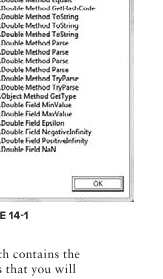

图 14-1

消息框显示数据类型的名称、完全限定名称和命名空间，以及基础类型和基类型的名称。接下来，它只是遍历该数据类型的所有公共实例成员，为每个成员显示声明类型、成员类型（方法、字段等）和成员名称。声明类型是实际声明该类型成员的类的名称（例如，如果该成员在 System.Double 中定义或重写，则为 System.Double；如果该成员只是从某个基类继承而来，则为相应基类型的名称）。

TypeView 不显示方法签名，因为你通过 MemberInfo 对象获取所有公共实例成员的详细信息，而参数信息无法通过 MemberInfo 对象获得。要获取这些信息，需要 MethodInfo 和其他更具体的对象的引用，这意味着需要分别获取每种类型成员的详细信息。

TypeView 确实显示所有公共实例成员的详细信息，但对于 double，定义的内容只是字段和方法。在本示例中，你会将 TypeView 编译为控制台应用程序，从控制台应用程序显示消息框没有问题。但使用消息框意味着需要引用基类程序集 System.Windows.Forms.dll，该程序集包含 System.Windows.Forms 命名空间中的类，而所需的 MessageBox 类就是在这个命名空间中定义的。TypeView 的代码如下。首先，需要添加几个 using 语句：

```
using System;
using System.Reflection;
using System.Text;
using System.Windows.Forms;
```

需要使用 System.Text，因为你会使用 StringBuilder 对象来构建要在消息框中显示的文本；还需要 System.Windows.Forms，因为要使用消息框本身。整个代码位于一个 MainClass 类中，该类包含几个静态方法、一个静态字段以及一个名为 OutputText 的 StringBuilder 实例，用来构建要在消息框中显示的文本。主要方法和类声明如下：

```
class MainClass
{
    static StringBuilder OutputText = new StringBuilder();

    static void Main()
    {
        // modify this line to retrieve details of any
        // other data type
        Type t = typeof(double);
        AnalyzeType(t);
        MessageBox.Show(OutputText.ToString(), "Analysis of type " + t.Name);
        Console.ReadLine();
    }
}
```

Main() 方法的实现首先声明一个 Type 对象来表示所选数据类型。然后调用 AnalyzeType() 方法，它会从 Type 对象中提取信息并用它来构建输出文本。最后在消息框中显示输出。使用 MessageBox 类相当直观。只需调用其静态 Show() 方法，向它传入两个字符串，它们将分别作为消息框中的文本和标题。AnalyzeType() 是完成大部分工作的地方：

```
static void AnalyzeType(Type t)
{
    AddToOutput("Type Name: " + t.Name);
    AddToOutput("Full Name: " + t.FullName);
    AddToOutput("Namespace: " + t.Namespace);

    Type tBase = t.BaseType;

    if (tBase != null)
    {
        AddToOutput("Base Type:" + tBase.Name);
    }

    Type tUnderlyingSystem = t.UnderlyingSystemType;

    if (tUnderlyingSystem != null)
    {
        AddToOutput("UnderlyingSystem Type:" + tUnderlyingSystem.Name);
    }

    AddToOutput("\nPUBLIC MEMBERS:");
}
```


```csharp
MemberInfo [] Members = t.GetMembers();

foreach (MemberInfo NextMember in Members)
{
    AddToOutput(NextMember.DeclaringType + " " +
    NextMember.MemberType + " " + NextMember.Name);
}
```

你通过调用 Type 对象的各种属性来实现 AnalyzeType() 方法，以获取有关类型名称所需的信息，然后调用 GetMembers() 方法获取 MemberInfo 对象数组，可用于显示每个成员的详细信息。请注意，你使用辅助方法 AddToOutput() 来构建要在消息框中显示的文本：

```csharp
static void AddToOutput(string Text)
{
    OutputText.Append("\n" + Text);
}
```

使用以下命令编译 TypeView 程序集：

```
csc /reference:System.Windows.Forms.dll Program.cs
```

## 程序集类

Assembly 类定义在 System.Reflection 命名空间中，并提供对给定程序集元数据的访问。它还包含方法，允许你加载甚至执行一个程序集——前提是该程序集是可执行的。与 Type 类一样，Assembly 包含大量方法和属性——太多无法在此全部涵盖。相反，本节仅限于介绍你入门所需并将用于完成 WhatsNewAttributes 示例的方法和属性。

在对 Assembly 实例执行任何操作之前，你需要将相应的程序集加载到正在运行的进程中。你可以使用静态成员 Assembly.Load() 或 Assembly.LoadFrom() 来完成此操作。这两种方法的区别在于，Load() 接受程序集的名称，并且运行时会在多种位置搜索以尝试定位程序集。这些位置包括本地目录和全局程序集缓存。LoadFrom() 接受程序集的完整路径名，并且不会尝试在其他位置查找程序集：

```csharp
Assembly assembly1 = Assembly.Load("SomeAssembly");
Assembly assembly2 = Assembly.LoadFrom
    ("C:\My Projects\Software\SomeOtherAssembly");
```

这两种方法还存在许多其他重载，提供额外的安全信息。加载程序集后，你可以使用其上的各种属性来查找信息，例如其完整名称：

```csharp
string name = assembly1.FullName;
```

## 查找程序集中定义的类型

Assembly 类的一个不错特性是它允许你获取对应程序集中定义的所有类型的详细信息。你只需调用 Assembly.GetTypes() 方法，它返回包含所有类型详细信息的 System.Type 引用数组。然后你可以按照上一节所述操作这些 Type 引用：

```csharp
Type[] types = theAssembly.GetTypes();

foreach(Type definedType in types)
{
    DoSomethingWith(definedType);
}
```

VectorClass。虽然这将是一个命令行应用程序，但由于输出文本很多——太多无法在控制台窗口截图中显示——你将遵循之前的 TypeView 示例，实际上在消息框中显示结果。

该文件名为 LookUpWhatsNew.cs，编译它的命令是：

```
csc /reference:WhatNewAttributes.dll /reference:VectorClass.dll LookUpWhatsNew.cs
```

在该文件源代码中，你首先指明想要引用的命名空间。System.Text 在此是因为你需要再次使用 StringBuilder 对象：

```
using System;
using System.Reflection;
using System.Windows.Forms;
using System.Text;
using WhatsNewAttributes;

namespace LookUpWhatsNew
{
```

包含主程序入口点以及其他方法的类是 WhatsNewChecker。你定义的所有方法都在此类中，该类还包含两个静态字段：outputText，其中包含你在准备写入消息框时逐步构建的文本；backDateTo，存储你选择的日期。自该日期以来所做的所有修改都将被显示。通常，你会显示一个对话框邀请用户选择此日期，但我们不想被这类代码分散注意力。因此，backDateTo 被硬编码为 2010 年 2 月 1 日的值。你在下载代码时可以轻松更改此日期：

```
internal class WhatsNewChecker
{
    private static readonly StringBuilder outputText = new StringBuilder(1000);
    private static DateTime backDateTo = new DateTime(2010, 2, 1);

    static void Main()
    {
        Assembly theAssembly = Assembly.Load("VectorClass");
        Attribute supportsAttribute =
            Attribute.GetCustomAttribute(
                theAssembly, typeof(SupportsWhatsNewAttribute));
        string name = theAssembly.FullName;

        AddToMessage("*Assembly: " + name);

        if (supportsAttribute == null)
        {
            AddToMessage(
                "This assembly does not support WhatsNew attributes");
            return;
        }
        else
        {
            AddToMessage("Defined Types:");
        }

        Type[] types = theAssembly.GetTypes();

        foreach(Type definedType in types)
            DisplayTypeInfo(definedType);

        MessageBox.Show(outputText.ToString(),
```

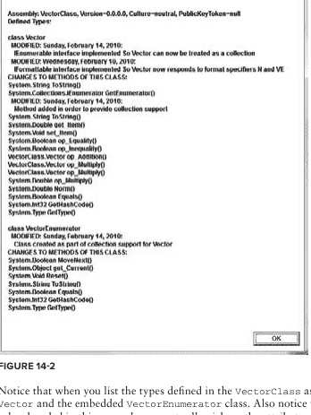

## 图 14-2

请注意，当你列出 VectorClass 程序集中定义的类型时，你实际上获取了两个类：Vector 和嵌入的 VectorEnumerator 类。另请注意，由于本示例中 backDateTo 日期 2 月 1 日是硬编码的，你实际上获取的是 2 月 14 日（添加集合支持时）的属性，但不获取 2 月 10 日（添加 IFormattable 接口时）的属性。

## 摘要

本章并未试图涵盖反射的全部主题。反射是一个广泛的主题，值得单独写一本书。相反，它说明了 Type 和 Assembly 类，它们是通过反射访问广泛功能的主要入口点。

此外，本章演示了反射的一个特定方面，你可能比其他任何方面都更频繁地使用它——自定义属性的检查。你学习了如何定义和应用自己的自定义属性，以及如何在运行时检索有关自定义属性的信息。

第 15 章“错误和异常”探讨了异常和结构化异常处理。

（步骤 5）。然而，如果 try 块内确实发生错误，执行会跳转到 catch 块（步骤 3）。

- 3. 错误条件在 catch 块中处理。
- 4. 在 catch 块结束时，如果存在 finally 块，执行会自动转移到 finally 块。
- 5. finally 块被执行（如果存在）。

实现这一切所使用的 C# 语法大致如下：

```
try
{
    // code for normal execution
}
catch
{
    // error handling
}
finally
{
    // clean up
}
```

实际上，这个主题存在一些变体：

- 你可以省略 finally 块，因为它是可选的。
- 你也可以提供任意数量的 catch 块来处理特定类型的错误。然而，不应过度使用并拥有大量 catch 块，因为这会损害应用程序的性能。
- 你可以完全省略 catch 块，在这种情况下，语法不是用于识别异常，而是作为一种保证当执行离开 try 块时 finally 块中的代码将被执行的方式。这在 try 块包含多个退出点时很有用。

到目前为止一切都很好，但尚未回答的问题是： 如果代码正在 try 块中运行，它如何知道何时在发生错误时切换到 catch 块？如果检测到错误，代码会执行称为抛出异常的操作。换句话说，它实例化一个异常对象类并抛出它：

```
throw new OverflowException();
```

这里，你实例化了 OverflowException 类的异常对象。一旦计算机在 try 块内遇到 throw 语句，它会立即查找与该 try 块关联的 catch 块。如果 try 块关联了多个 catch 块，它会通过检查 catch 块关联的是哪个异常类来识别正确的 catch 块。例如，当 OverflowException 对象被抛出时，执行会跳转到以下 catch 块：

```
catch (OverflowException ex)
{
    // exception handling here
}
```

换句话说，计算机查找指示与同一类（或基类）匹配的异常类实例的 catch 块。

借助这些额外信息，你可以扩展刚刚演示的 try 块。假设为了论证，try 块中可能发生两种严重的错误：溢出和数组越界。假设你的代码包含两个布尔变量 Overflow 和 OutOfBounds，用来指示这些条件是否存在。你已经看到存在一个预定义的异常类来指示溢出（OverflowException）；同样，IndexOutOfRangeException 类存在来处理数组越界的情况。


程序随后会继续要求输入更多数字进行处理，直到用户不输入任何内容，直接按 Enter 键为止。

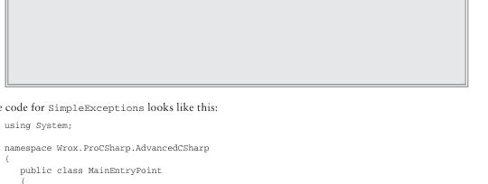

SimpleExceptions 的代码如下所示：

```csharp
using System;

namespace Wrox.ProCSharp.AdvancedCSharp
{
    public class MainEntryPoint
    {
        public static void Main()
        {
            while (true)
            {
                try
                {
                    string userInput;

                    Console.Write("Input a number between 0 and 5 * " +
                        "(or just hit return to exit): ");
                    userInput = Console.ReadLine();

                    if (userInput == "")
                    {
                        break;
                    }

                    int index = Convert.ToInt32(userInput);

                    if (index < 0 || index > 5)
                    {
                        throw new IndexOutOfRangeException(
                            "You typed in " + userInput);
                    }

                    Console.WriteLine("Your number was " + index);
                }
                catch (IndexOutOfRangeException ex)
                {
                    Console.WriteLine("Exception: " +
                        "Number should be between 0 and 5. {0}", ex.Message);
                }
                catch (Exception ex)
                {
                    Console.WriteLine(
                        "An exception was thrown. Message was: {0}", ex.Message);
                }
                finally
                {
                    Console.WriteLine("Thank you");
                }
            }
        }
    }
}
```

*代码片段 SimpleExceptions.cs*

这段代码的核心是一个 while 循环，它不断使用 Console.ReadLine() 请求用户输入。ReadLine() 返回一个字符串，因此你首先要做的任务就是使用 System.Convert.ToInt32() 方法将其转换为 int。System.Convert 类包含多种用于执行数据转换的有用方法，并提供了 int.Parse() 方法之外的一种替代方案。总的来说，System.Convert 包含执行各种类型转换的方法。请记住，C# 编译器会将 int 解析为 System.Int32 基类的实例。

> 另外值得指出的是，传递给 catch 块的参数仅在该 catch 块内有效，这正是为什么你能在前面的代码中连续使用相同的参数名 ex 的原因。

在前面的示例中，你还检查了空字符串，因为这是退出 while 循环的条件。请注意，break 语句实际上会直接跳出包含它的 try 块以及 while 循环，因为这是一种有效行为。当然，当执行跳出 try 块时，finally 块中的 Console.WriteLine() 语句也会执行。虽然这里只是显示一句问候语，但更常见的做法是执行关闭文件句柄、调用各种对象的 Dispose() 方法等清理任务。计算机离开 finally 块后，会继续执行原本在没有 finally 块时也会执行的下一行语句。不过，在这个示例中，你会回到 while 循环的开头，并再次进入 try 块（除非 finally 块是在执行 while 循环中的 break 语句后进入的，这种情况下，你会直接退出 while 循环）。

接下来，你检查异常条件：

```
if (index < 0 || index > 5)
{
    throw new IndexOutOfRangeException("You typed in " + userInput);
}
```

抛出异常时，你需要选择要抛出的异常类型。虽然可以使用 System.Exception 类，但它只被设计为基类。将这个类的实例作为异常抛出被认为是糟糕的编程实践，因为它无法传达关于错误条件性质的任何信息。相反，.NET Framework 包含许多派生自 System.Exception 的其他异常类。这些异常类各自对应特定类型的异常条件，你也可以自由定义自己的异常类。这样做的思路是，通过抛出与特定错误条件匹配的类实例，尽可能提供关于特定异常条件的详细信息。在前面的示例中，System.IndexOutOfRangeException 是这种情况下最好的选择。IndexOutOfRangeException 有多个构造函数重载。示例中选用的重载接受一个描述错误的字符串。你也可以选择派生自己的自定义 Exception 对象，在应用程序上下文中描述错误条件。

假设用户随后输入了一个不在 0 到 5 之间的数字。这个输入会被 if 语句捕获，并实例化和抛出一个 IndexOutOfRangeException 对象。此时，计算机会立即退出 try 块，寻找处理 IndexOutOfRangeException 的 catch 块。它遇到的第一个 catch 块是：

```
catch (IndexOutOfRangeException ex)
{
    Console.WriteLine
    ("Exception: Number should be between 0 and 5. {0}", ex.Message);
}
```

由于这个 catch 块接受的参数类型正好匹配，因此该异常实例会被传入这个 catch 块并执行。在这个例子中，你显示一条错误消息和 Exception.Message 属性（该属性对应传入 IndexOutOfRangeException 构造函数的字符串）。执行完这个 catch 块后，控制流会像没有发生异常一样切换到 finally 块。

请注意，在示例中，你还提供了另一个 catch 块：

```
catch (Exception ex)
{
    Console.WriteLine("An exception was thrown. Message was: {0}", ex.Message);
}
```

如果不是因为 IndexOutOfRangeException 已经被前一个 catch 块捕获，这个 catch 块其实也能够处理 IndexOutOfRangeException。基类引用也可以引用其派生类的任何实例，而所有异常都派生自 System.Exception。那么为什么这个 catch 块不会执行呢？答案是，计算机会从可用 catch 块列表中执行找到的第一个合适的 catch 块。那么为什么这里还要有第二个 catch 块呢？原因是，try 块覆盖的并不只是你的代码。在块内，你实际上调用了 System 命名空间中的三个方法（Console.ReadLine()、Console.Write() 和 Convert.ToInt32()），这些方法中的任何一个都可能抛出异常。

如果你输入的不是数字，比如 a 或 hello，Convert.ToInt32() 方法会抛出 System.FormatException 类的异常，表示传入 ToInt32() 的字符串不是可以转换为 int 的格式。发生这种情况时，计算机会在方法调用之间回溯，寻找这个异常的处理程序。你的第一个 catch 块（接收 IndexOutOfRangeException 的那个）不适用。然后计算机会查看第二个 catch 块，这个块适用，因为 FormatException 派生自 Exception，所以 FormatException 实例可以作为参数传入。

这个示例的结构实际上非常典型，代表了存在多个 catch 块的情况。你从专门捕获非常具体错误条件的 catch 块开始，然后用更通用的 catch 块收尾，以覆盖尚未编写特定错误处理程序的任何错误。事实上，catch 块的顺序非常重要。如果你把前面两个 catch 块的顺序反过来，代码将无法编译，因为第二个 catch 块不可达（Exception catch 块会捕获所有异常）。因此，最上方的 catch 块应尽可能具体，最后再放最通用的 catch 块。

现在你已经分析完示例代码，可以运行它了。下面的输出展示了不同输入会导致的结果，并演示了 IndexOutOfRangeException 和 FormatException 被抛出的情况：

SimpleExceptions
Input a number between 0 and 5 (or just hit return to exit):4
Your number was 4
Thank you
Input a number between 0 and 5 (or just hit return to exit):0
Your number was 0
Thank you
Input a number between 0 and 5 (or just hit return to exit):10

```
Exception: Number should be between 0 and 5. You typed in 10
Thank you
Input a number between 0 and 5 (or just hit return to exit)>hello
An exception was thrown. Message was: input string was not in a correct format.
Thank you
Input a number between 0 and 5 (or just hit return to exit)>
Thank you
```

## 从其他代码捕获异常

前面的示例演示了两种异常的处理。其中一种 IndexOutOfRangeException 是由你自己的代码抛出的。另一种 FormatException 是从某个基类内部抛出的。

如果库代码检测到出现问题，或某个方法因传入了错误的参数而被不恰当地调用，则库代码抛出异常是很常见的。然而，库代码很少尝试捕获异常；这被视为客户端代码的责任。

在调试时，你会经常发现异常是从基类库中抛出的。调试过程在某种程度上涉及确定异常为何被抛出并消除原因。你的目标应该是确保在代码实际发布时，异常只在非常特殊的情况下才会发生，并且如果可能的话，在你的代码中以适当的方式得到处理。

## System.Exception 属性

示例仅说明了异常对象的 Message 属性的使用。然而，System.Exception 中还有许多其他属性，如下表所示。

| 属性 | 描述 |
|---|---|
| Data | 这提供了向异常添加键/值语句的能力，可用于提供有关异常的额外信息。 |
| HelpLink | 这是提供有关异常更多信息的帮助文件的链接。 |
| InnerException | 如果此异常是在 catch 块内部抛出的，则 InnerException 包含导致代码进入该 catch 块的异常对象。 |
| Message | 这是描述错误条件的文本。 |
| Source | 这是导致异常的应用程序或对象的名称。 |
| StackTrace | 这提供了堆栈上的方法调用的详细信息（有助于追踪抛出异常的方法）。 |
| TargetSite | 这是一个 .NET 反射对象，描述抛出异常的方法。 |

这些属性中，如果有堆栈跟踪可用，StackTrace 和 TargetSite 会由 .NET 运行时自动提供。Source 总是由 .NET 运行时填充为引发异常的程序集的名称（尽管你可能希望在代码中修改该属性以提供更具体的信息），而 Data、Message、HelpLink 和 InnerException 必须由抛出异常的代码填充，通过在抛出异常之前立即设置这些属性。例如，抛出异常的代码可能看起来像这样：

```
if (ErrorCondition == true)
{
    Exception myException = new ClassMyException("Help!!!!");
    myException.Source = "My Application Name";
    myException.HelpLink = "MyHelpFile.txt";
    myException.Data["ErrorDate"] = DateTime.Now;
    myException.Data.Add("AdditionalInfo", "Contact Bill from the Blue Team");
    throw myException;
}
```

这里，ClassMyException 是你要抛出的特定异常类的名称。请注意，将所有异常类名称以 Exception 结尾是常见做法。另外，请注意 Data 属性有两种可能的赋值方式。

## 如果异常未被处理会怎样？

有时可能会抛出异常，但你的代码中可能没有能够处理那种异常的 catch 块。SimpleExceptions 示例可以说明这一点。假设，例如，你省略了 FormatException 和捕获所有异常的 catch 块，只提供了捕获 IndexOutOfRangeException 的块。在这种情况下，如果抛出 FormatException 会怎样？

答案是 .NET 运行时会捕获它。本节后面你将学习如何嵌套 try 块，实际上示例背后已经有一个嵌套的 try 块。.NET 运行时实际上已将整个程序放在另一个巨大的 try 块内——它对每个 .NET 程序都这样做。该 try 块有一个可以捕获任何类型异常的 catch 处理程序。如果发生你的代码未处理的异常，执行流程将直接退出你的程序，并被 .NET 运行时中的该 catch 块捕获。然而，这样的结果可能不是你想要的。发生的情况是你的代码执行会立即终止；用户会看到一个对话框，抱怨你的代码未处理异常，并提供 .NET 运行时能够获取的有关异常的任何详细信息。至少异常已被捕获！这就是在第 2 章“Core C#”中 Vector 示例中程序抛出异常时发生的情况。

总的来说，如果你正在编写可执行文件，尽量捕获你合理能够捕获的尽可能多的异常并以合理的方式处理它们。如果你在编写库，通常最好不要处理异常（除非特定异常代表你可以在代码中处理的问题），而是假设调用代码会处理它遇到的任何错误。然而，你可能仍然希望捕获任何 Microsoft 定义的异常，以便你可以抛出自己的异常对象，向客户端代码提供更具体的信息。

## 嵌套 try 块

异常的一个不错特性是你可以将 try 块嵌套在彼此内部，像这样：

```
try
{
    // Point A
    try
    {
        // Point B
    }
    catch
    {
        // Point C
    }
    finally
    {
        // clean up
    }
    // Point D
}
catch
```

## 修改异常类型

当抛出的原始异常不能充分描述问题时，修改异常类型可能很有用。通常发生的情况是某些东西——可能是 .NET 运行时——抛出一个相当低级的异常，说明例如发生了溢出（OverflowException）或传递给方法参数不正确（派生自 ArgumentException 的类）。然而，由于异常发生的上下文，你会知道这揭示了其他一些潜在问题（例如，在代码的该点只能发生溢出，因为你刚刚读取的文件包含不正确的数据）。在这种情况下，你对第一个异常的处理程序最合适的做法是抛出另一个更准确描述问题的异常，以便稍后的另一个 catch 块可以更恰当地处理它。在这种情况下，它还可以通过 System.Exception 实现的属性 InnerException 转发原始异常。InnerException 仅包含对抛出的任何其他相关异常的引用——以防最终的处理程序例程需要此信息。

当然，也存在异常发生在 catch 块内部的情况。例如，你通常会读取包含处理错误详细说明的配置文件，而该文件可能并不存在。

## 在不同位置处理不同的异常

拥有嵌套 try 块的第二个原因是可以在代码的不同位置处理不同类型的异常。一个很好的例子是如果你有一个循环，其中可能发生各种异常条件。其中一些可能严重到需要放弃整个循环，而另一些可能不那么严重，只需要放弃该次迭代并继续下一次循环迭代。你可以通过在循环内部设置一个 try 块来处理较不严重的错误条件，并在循环外部设置一个外部 try 块来处理更严重的错误条件来实现这一点。你将在下一个异常示例中看到其工作原理。

## 用户定义异常类

你现在准备好查看第二个说明异常的示例。这个名为 SolicitColdCall 的示例包含两个嵌套的 try 块，并说明了定义自己的自定义异常类并从 try 块内部抛出另一个异常的做法。

本示例假设一家销售公司希望在销售名单上增加更多客户。公司的销售团队将致电一批人邀请他们成为客户，这在销售术语中称为冷电话。为此，你有一个文本文件可用，其中包含要进行冷电话的人员姓名。该文件应采用格式良好的格式，其中第一行包含文件中的人数，每一行后续行包含下一个人的姓名。换句话说，一个格式正确的人员姓名文件可能看起来像这样：

```
4
George Washington
Benedict Arnold
John Adams
Thomas Jefferson
```

这个版本的冷电话旨在在屏幕上显示人员的姓名（也许供销售人员阅读）。这就是为什么文件中只包含姓名而不包含个人的电话号码。

对于本示例，你的程序将要求用户输入文件名，然后简单地读取它并显示人员的姓名。这听起来像是一项简单的任务，但即便如此，也可能出现一些问题需要你放弃整个过程：

- 用户可能输入一个不存在的文件名。这将被捕获为 FileNotFound 异常。


```csharp
Console.WriteLine(
    "Inner exception was: {0}", ex.InnerException.Message);
}
catch(Exception ex)
{
    Console.WriteLine("Exception occurred:\n" + ex.Message);
}
finally
{
    peopleToRing.Dispose();
}
Console.ReadLine();
}
```

这段代码不仅仅是一个用于处理文件中人员的循环。你首先向用户询问文件的名称。然后你实例化一个名为 `ColdCallFileReader` 的类的对象，该类稍后会定义。`ColdCallFileReader` 类是负责文件读取的类。请注意，你在初始的 try 块之外执行此操作——这是因为在此处实例化的变量需要在后续的 catch 和 finally 块中可用，如果你在 try 块内部声明它们，它们会在 try 块的闭合大括号处超出作用域，这是不好的。

在 try 块中，你打开文件（使用 `ColdCallFileReader.Open()` 方法）并循环处理其中的所有人员。`ColdCallFileReader.ProcessNextPerson()` 方法读取并显示文件中下一个人员的姓名，而 `ColdCallFileReader.NPeopleToRing` 属性告诉你文件中应该有多少人（通过读取文件的第一行获得）。有三个 catch 块：一个用于 `FileNotFoundException`，一个用于 `ColdCallFileFormatException`，一个用于捕获其他 .NET 异常。

在 `FileNotFoundException` 的情况下，你会显示相应的消息。请注意，在这个 catch 块中，异常实例实际上根本没有被使用。这个 catch 块用于说明应用程序的友好性。异常对象通常包含对开发人员有用的技术信息，但不是你希望向最终用户展示的内容。因此，在这种情况下，你创建自己的更简单的消息。

对于 `ColdCallFileFormatException` 处理程序，你做了相反的操作，并说明了如何提供更完整的技术信息，包括如果存在则包含内部异常的详细信息。

最后，如果你捕获任何其他通用异常，你会显示用户友好的消息，而不是让此类异常传递到 .NET 运行时。请注意，你选择不处理未派生自 `System.Exception` 的任何其他异常，因为你没有直接调用非 .NET 代码。

finally 块用于清理资源。在这种情况下，这意味着关闭任何打开的文件——由 `ColdCallFileReader.Dispose()` 方法执行。

## 抛出用户定义的异常

现在来看一下处理文件读取并（可能）抛出你用户定义异常的类的定义：`ColdCallFileReader`。由于该类维护外部文件连接，你需要确保它按照第 4 章“继承”中为对象释放所规定的原则正确释放。因此，你将该类派生自 `IDisposable`。

首先，你声明一些变量：

```csharp
class ColdCallFileReader : IDisposable
{
    FileStream fs;
    StreamReader sr;
    uint nPeopleToRing;
    bool isDisposed = false;
    bool isOpen = false;
}
```

`FileStream` 和 `StreamReader` 都在 `System.IO` 命名空间中，是你将用于读取文件的基类。`FileStream` 允许你首先连接到文件，而 `StreamReader` 专门用于读取文本文件，并实现了一个方法 `ReadLine()`，该方法从文件中读取一行文本。你在第 29 章“操作文件和注册表”中更详细地查看 `StreamReader`，该章深入讨论文件处理。

`isDisposed` 字段指示是否已调用 `Dispose()` 方法。`ColdCallFileReader` 的实现方式是，在调用 `Dispose()` 之后，不允许重新打开连接并重用该对象。`isOpen` 也用于错误检查——在这种情况下，检查 `StreamReader` 是否实际连接到打开的文件。

打开文件并读取第一行——即告诉你文件中人数的那一行——的过程由 `Open()` 方法处理：

```csharp
public void Open(string fileName)
{
    if (isDisposed)
        throw new ObjectDisposedException("peopleToRing");
    fs = new FileStream(fileName, FileMode.Open);
    sr = new StreamReader(fs);
    try
    {
        string firstLine = sr.ReadLine();
        nPeopleToRing = uint.Parse(firstLine);
        isOpen = true;
    }
    catch (FormatException ex)
    {
        throw new ColdCallFileFormatException(
            "First line isn't an integer", ex);
    }
}
```

代码片段 SolicitedColdCall.cs

在这个方法中（与所有其他 `ColdCallFileReader` 方法一样）你做的第一件事是检查客户端代码是否在对象已被释放后不当地调用了它，如果是，则抛出预定义的 `ObjectDisposedException` 对象。`Open()` 方法检查 `isDisposed` 字段以查看是否已调用 `Dispose()`。由于调用 `Dispose()` 意味着调用者已完成对该对象的操作，如果已调用 `Dispose()`，你认为尝试打开新的文件连接是错误。

接下来，该方法包含两个内部 try 块中的第一个。它的目的是捕获因文件第一行不包含整数而导致的任何错误。如果出现该问题，.NET 运行时将抛出 `FormatException`，你捕获它并将其转换为更有意义的异常，表明冷呼叫文件的格式实际上存在问题。请注意，`System.FormatException` 用于指示基本数据类型格式问题，而不是文件问题，因此在这种情况下将其传回调用例程并不是特别有用的异常。抛出的新异常将被最外层的 try 块捕获。由于此处不需要清理，因此不需要 finally 块。

如果一切正常，你将 `isOpen` 字段设置为 true，以指示现在存在一个可以从中读取数据有效的文件连接。

`ProcessNextPerson()` 方法也包含一个内部 try 块：

```csharp
public void ProcessNextPerson()
{
    if (isDisposed)
    {
        throw new ObjectDisposedException("peopleToRing");
    }

    if (!isOpen)
    {
        throw new UnexpectedException(
            "Attempted to access coldcall file that is not open");
    }

    try
    {
        string name;
        name = sr.ReadLine();
        if (name == null)
            throw new ColdCallFileFormatException("Not enough names");
        if (name[0] == 'B')
        {
            throw new SalesSpyFoundException(name);
        }
        Console.WriteLine(name);
    }
    catch(SalesSpyFoundException ex)
    {
        Console.WriteLine(ex.Message);
    }

    finally
    {
    }
}
```

这里存在两种可能的文件问题（假设实际上存在打开的文件连接；`ProcessNextPerson()` 方法首先检查这一点）。首先，你可能会读取下一个姓名并发现它是一个销售间谍。如果出现该情况，异常将被该方法中第一个 catch 块捕获。由于该异常在此处、在循环内部被捕获，这意味着执行随后可以在程序的 `Main()` 方法中继续，并且文件中后续的姓名将继续被处理。

如果尝试读取下一个姓名时发现已到达文件末尾，也可能出现问题。`StreamReader` 对象的 `ReadLine()` 方法的工作方式是，如果它已越过文件末尾，它不会抛出异常，而是简单地返回 null。因此，如果你发现一个空字符串，你就知道文件的格式不正确，因为文件中第一行的数字指示的姓名数量比文件中实际存在的姓名数量更多。如果发生这种情况，你抛出一个 `ColdCallFileFormatException`，它将被外部异常处理程序捕获（这将导致执行终止）。

再次强调，这里不需要 finally 块，因为没有需要清理的内容；然而，这次包含了一个空的 finally 块，只是为了说明如果你愿意，可以这样做。

示例几乎完成了。你只需再查看 `ColdCallFileReader` 的两个成员：返回文件中应有人数的 `NPeopleToRing` 属性，以及关闭打开文件的 `Dispose()` 方法。请注意，如果 `Dispose()` 方法已被调用，它会提前返回——这是推荐的实现方式。它还会在关闭之前检查是否确实存在要关闭的文件流。这个示例在此展示是为了说明防御性编程技术，所以这就是你在做的！


```
public uint NPeopleToRing
{
    get
    {
        if (isDisposed)
        {
            throw new ObjectDisposedException("peopleToRing");
        }

        if (!isOpen)
        {
            throw new UnexpectedException(
                "Attempted to access cold-call file that is not open");
        }

        return nPeopleToRing;
    }
}

public void Dispose()
{
    if (isDisposed)
    {
        return;
    }

    isDisposed = true;
    isOpen = false;

    if (fs != null)
    {
        fs.Close();
        fs = null;
    }
}
```

## 定义用户自定义异常类

最后，你需要定义自己的三个异常类。定义自己的异常相当容易，因为很少需要添加额外的方法。只需实现一个构造函数，以确保基类构造函数被正确调用即可。以下是 SalesSpyFoundException 的完整实现：

```
class SalesSpyFoundException: ApplicationException
{
    public SalesSpyFoundException(string spyName)
        : base("Sales spy found, with name " + spyName)
    {
    }

    public SalesSpyFoundException(
        string spyName, Exception innerException)
        : base(
            "Sales spy found with name " + spyName, innerException)
    {
    }
}
```

最后，尝试该示例，但指定一个不存在的文件名，例如 people3.txt。对这三个文件名分别运行程序三次，结果如下：

```
SolicitColdCall
Please type in the name of the file containing the names of the people to be cold
called > people.txt
George Washington
Sales spy found, with name Benedict Arnold
John Adams
Thomas Jefferson
All callers processed correctly
```

```
SolicitColdCall
Please type in the name of the file containing the names of the people to be cold
called > people2.txt
George Washington
Sales spy found, with name Benedict Arnold
John Adams
Thomas Jefferson
The file people2.txt appears to have been corrupted.
Details of the problem are: Not enough names
```

```
SolicitColdCall
Please type in the name of the file containing the names of the people to be cold
called > people3.txt
The file people3.txt does not exist.
```

总之，该应用程序向你展示了多种处理你自己的应用程序中可能遇到的错误和异常的方法。

## 摘要

本章探讨了 C# 通过异常处理错误条件的丰富机制。你并不局限于代码中可能输出的通用错误代码；相反，你有能力深入并唯一地处理最细粒度的错误条件。有时这些错误条件由 .NET Framework 本身提供，但在其他时候，你可能希望像本章所示那样自行编码自己的错误条件。无论哪种情况，你都有多种方法可以保护应用程序的工作流程免受不必要且危险的故障影响。

下一章让你将本书迄今所学的大量内容应用起来，并在 .NET 开发人员 IDE——Visual Studio 2010 中实践这些经验。

## 第二部分

## Visual Studio

- 第 16 章：Visual Studio 2010
- 第 17 章：部署

它对关键字进行颜色编码。它还在你输入时执行一些语法检查，并对导致编译错误的[content]
```
public uint NPeopleToRing
{
    get
    {
        if (isDisposed)
        {
            throw new ObjectDisposedException("peopleToRing");
        }

        if (!isOpen)
        {
            throw new UnexpectedException(
                "Attempted to access cold-call file that is not open");
        }

        return nPeopleToRing;
    }
}

public void Dispose()
{
    if (isDisposed)
    {
        return;
    }

    isDisposed = true;
    isOpen = false;

    if (fs != null)
    {
        fs.Close();
        fs = null;
    }
}
```

## 定义用户自定义异常类

最后，你需要定义自己的三个异常类。定义自己的异常相当容易，因为很少需要添加额外的方法。只需实现一个构造函数，以确保基类构造函数被正确调用即可。以下是 SalesSpyFoundException 的完整实现：

```
class SalesSpyFoundException: ApplicationException
{
    public SalesSpyFoundException(string spyName)
        : base("Sales spy found, with name " + spyName)
    {
    }

    public SalesSpyFoundException(
        string spyName, Exception innerException)
        : base(
            "Sales spy found with name " + spyName, innerException)
    {
    }
}
```

最后，尝试该示例，但指定一个不存在的文件名，例如 people3.txt。对这三个文件名分别运行程序三次，结果如下：

```
SolicitColdCall
Please type in the name of the file containing the names of the people to be cold
called > people.txt
George Washington
Sales spy found, with name Benedict Arnold
John Adams
Thomas Jefferson
All callers processed correctly
```

```
SolicitColdCall
Please type in the name of the file containing the names of the people to be cold
called > people2.txt
George Washington
Sales spy found, with name Benedict Arnold
John Adams
Thomas Jefferson
The file people2.txt appears to have been corrupted.
Details of the problem are: Not enough names
```

```
SolicitColdCall
Please type in the name of the file containing the names of the people to be cold
called > people3.txt
The file people3.txt does not exist.
```

总之，该应用程序向你展示了多种处理你自己的应用程序中可能遇到的错误和异常的方法。

## 摘要

本章探讨了 C# 通过异常处理错误条件的丰富机制。你并不局限于代码中可能输出的通用错误代码；相反，你有能力深入并唯一地处理最细粒度的错误条件。有时这些错误条件由 .NET Framework 本身提供，但在其他时候，你可能希望像本章所示那样自行编码自己的错误条件。无论哪种情况，你都有多种方法可以保护应用程序的工作流程免受不必要且危险的故障影响。

下一章让你将本书迄今所学的大量内容应用起来，并在 .NET 开发人员 IDE——Visual Studio 2010 中实践这些经验。

## 第二部分

## Visual Studio

- 第 16 章：Visual Studio 2010
- 第 17 章：部署

它对关键字进行颜色编码。它还在你输入时执行一些语法检查，并对导致编译错误的代码进行下划线标记，也称为设计时调试。此外，它还具有 IntelliSense 功能，可在你开始输入时自动显示类、字段或方法的名称。当你开始为方法输入参数时，它会显示可用重载的参数列表。图 16-1 显示了 IntelliSense 功能在 .NET 基类之一 ListBox 上的使用情况。

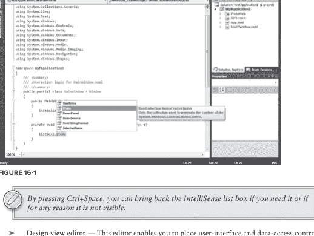

图 16-1

> 通过按 Ctrl+Space，你可以在需要时或出于任何原因不可见时重新调出 IntelliSense 列表框。

- 设计视图编辑器 — 该编辑器使你能够在项目中放置用户界面和数据访问控件；Visual Studio 会自动向你的源文件添加必要的 C# 代码，以在项目中实例化这些控件。 （这是可能的，因为所有 .NET 控件都是特定基类的实例。）
- 支持窗口 — 这些窗口允许你查看和修改项目的各个方面，例如源代码中的类，以及 Windows Forms 和 Web Forms 类的可用属性（及其启动值）。你还可以使用这些窗口指定编译选项，例如你的代码需要引用哪些程序集。
- 从环境内部编译的能力 — 无需从命令行运行 C# 编译器，你只需选择一个菜单选项来编译项目，Visual Studio 就会为你调用编译器并将所有相关的命令行参数传递给编译器，详细说明诸如要引用哪些程序集以及你希望生成的程序集类型（例如可执行文件或库 .dll）等内容。如果愿意，它还可以运行编译后的可执行文件

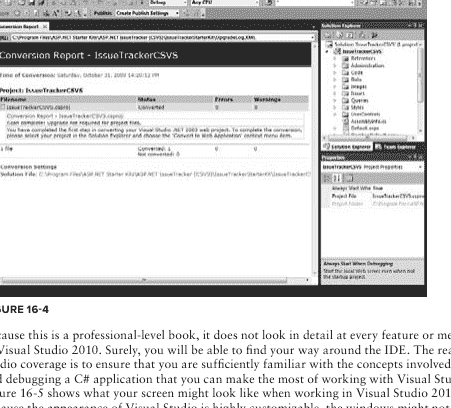

## 图 16-4

由于这是一本专业级书籍，它不会详细讨论 Visual Studio 2010 中每个功能或菜单选项。毫无疑问，你能够在 IDE 中找到自己的方向。Visual Studio 报道的真正目的是确保你对构建和调试 C# 应用程序时涉及的概念足够熟悉，以便充分利用 Visual Studio 2010。图 16-5 显示了你在 Visual Studio 2010 中工作时屏幕可能的样子。 （请注意，由于 Visual Studio 的外观高度可定制，窗口可能不在同一位置，或者在启动此开发环境时可能可见不同的窗口。）

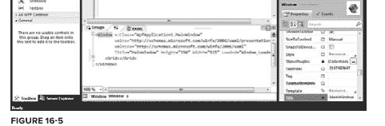

## 图 16-5

图 16-6 显示了使用 Visual Studio 2010 后你得到的开始页类型；它列出了最近编辑的项目。你只需单击其中一个项目即可再次打开它。

## 选择项目类型

你可以通过从 Visual Studio 菜单中选择 文件 → 新建项目 来创建新项目。从那里你将得到新建项目对话框（见图 16-7）——以及你能创建的各种不同项目的第一个迹象。

使用此对话框，你有效地选择了 Visual Studio 为你生成的初始框架文件和代码、你想要的编译选项类型以及你想要用来编译代码的编译器——即 C# 2010、Visual Basic 2010 或 C++ 2010 编译器。你可以立即看到微软为 .NET 承诺的语言集成在此发挥作用！此特定示例使用的是 C# 控制台应用程序。

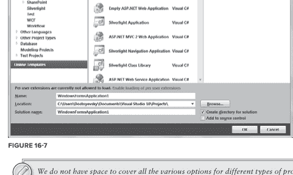

图 16-7

> > 我们没有空间在这里介绍不同类型项目的各种选项。在 C++ 方面，所有旧的 C++ 项目类型都在那里——MFC 应用程序、ATL 项目等。在 Visual Basic 方面，选项有所变化。例如，你可以创建一个 Visual Basic 命令行应用程序（控制台应用程序）、一个 .NET 组件（类库）、一个 Windows 窗体控件（Windows 窗体控件库）等。但是，你无法创建旧式的基于 COM 的控件（.NET 控件旨在取代此类 ActiveX 控件）。

下表列出了你在 Visual C# 项目下可用的所有选项。请注意，在“其他项目”选项下还有一些其他更专业的 C# 模板项目。


| 如果你选择…… | 你将获得 C# 代码和编译选项，以生成…… |
|---|---|
| Windows 窗体应用程序 | 一个可响应事件的基本空窗体。 |
| 类库 | 一个可被其他代码调用的 .NET 类。 |
| WPF 应用程序 | 一个可响应事件的基本空窗体。尽管此项目类型与 Windows 窗体应用程序项目类型（Windows Forms）相似，但此 Windows 应用程序项目类型允许你构建基于 XAML 的智能客户端解决方案。 |
| WPF 浏览器应用程序 | 与 WPF 的 Windows 应用程序非常相似，此变体允许你构建面向浏览器的基于 XAML 的应用程序。 |
| ASP.NET Web 应用程序 | 一个基于 ASP.NET 的网站：ASP.NET 页面和 C# 类，用于生成从这些页面发送到浏览器的 HTML 响应。此选项包含一个基础演示应用程序。 |
| 空 ASP.NET Web 应用程序 | 一个基于 ASP.NET 的网站：ASP.NET 页面和 C# 类，用于生成从这些页面发送到浏览器的 HTML 响应。此选项不包含基础演示应用程序。 |
| ASP.NET MVC 2 Web 应用程序 | 一种允许你创建 ASP.NET MVC 应用程序的项目类型。 |
| ASP.NET MVC 2 空 Web 应用程序 | 一种允许你创建 ASP.NET MVC 应用程序的项目类型。此选项不包含基础演示应用程序。 |
| ASP.NET 服务器控件 | 一种可由 ASP.NET 页面调用的控件，用于生成 HTML 代码，使其在浏览器上显示时呈现控件的效果。 |
| ASP.NET AJAX 服务器控件 | 允许你构建自定义服务器控件，以供 ASP.NET 应用程序中使用。 |
| ASP.NET AJAX 服务器控件扩展程序 | 一种允许你为 ASP.NET 服务器控件创建扩展程序的项目类型。 |
| ASP.NET Dynamic Data Linq to SQL Web 应用程序 | 一种允许你构建 ASP.NET 应用程序的项目类型，该应用程序将利用 ASP.NET Dynamic Data 和 LINQ to SQL。 |
| ASP.NET Dynamic Data Entities Web 应用程序 | 一种允许你构建 ASP.NET 应用程序的项目类型，该应用程序将利用 ASP.NET Dynamic Data 和 LINQ to Entities。 |
| Silverlight 应用程序 | 一种允许你创建 Silverlight 应用程序的项目类型。 |
| Silverlight 导航应用程序 | 一种允许你创建 Silverlight 应用程序的项目类型。此应用程序以一个核心 Silverlight 应用程序为基础，可根据你的个人需求进行扩展。 |
| Silverlight 类库 | 一种允许你创建 Silverlight 类库的项目类型。 |
| WPF 自定义控件库 | 一种可在 Windows Presentation Foundation 应用程序中使用的自定义控件。 |
| WPF 用户控件库 | 使用 Windows Presentation Foundation 构建的用户控件库。 |
| Windows 窗体控件库 | 用于创建在 Windows 窗体应用程序中使用的控件的项目。 |

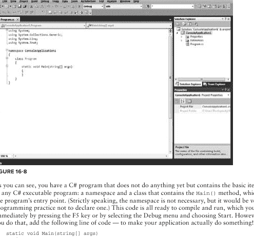

图 16-8

如你所见，你得到一个 C# 程序，它目前还不会执行任何操作，但包含任何 C# 可执行程序所需的基本项：一个命名空间和一个包含 `Main()` 方法的类，该方法是程序的入口点。（严格来说，命名空间并不是必需的，但不声明命名空间将是极差的编程实践。）这段代码已经可以编译和运行，你可以立即按 F5 键或选择“调试”菜单并选择“开始”来执行。不过，在你这样做之前，请添加下面这行代码 —— 让你的应用程序真正执行一些操作！

```csharp
static void Main(string[] args)
{
    Console.WriteLine("Hello from all the authors of Professional C#");
}
```

如果你编译并运行该项目，你将看到一个控制台窗口，它在屏幕上停留的时间几乎只够你读完消息。这种情况发生的原因是，Visual Studio 记住了你在创建项目时指定的设置，并将其安排为作为控制台应用程序编译和运行。Windows 随后意识到它必须运行一个控制台应用程序，但没有可供其运行的控制台窗口。因此，Windows 会创建一个控制台窗口并运行该程序。程序一退出，Windows 就会识别到不再需要控制台窗口，并立即将其移除。这一切都合乎逻辑，但如果你确实想查看项目的输出，这对你并没有太大帮助！

防止此问题的一个好方法是在代码中 `Main()` 方法返回之前插入下面这行代码：

```csharp
static void Main(string[] args)
{
    Console.WriteLine("Hello from all the folks at Wrox Press");
    Console.ReadLine();
}
```

这样，你的代码将运行、显示其输出，并遇到 `Console.ReadLine()` 语句，此时程序将等待你按回车键后才退出。这意味着控制台窗口将一直停留，直到你按回车键。

请注意，这一切仅适用于在 Visual Studio 中测试运行的控制台应用程序 —— 如果你正在编写 Windows Presentation Foundation 或 Windows 窗体应用程序，应用程序显示的窗口将自动保留在屏幕上，直到你退出它。同样，如果你从命令行提示符运行控制台应用程序，也不会遇到窗口消失的问题。

## 查看其他项目文件

Program.cs 源代码文件并非 Visual Studio 为你创建的唯一文件。查看你要求 Visual Studio 创建项目的文件夹，你不仅会看到 C# 文件，还会看到完整的目录结构，如图 16-9 所示。

bin 和 obj 这两个文件夹用于存储编译后的文件和中间文件。obj 的子文件夹保存各种临时或中间文件；bin 的子文件夹保存编译后的程序集。

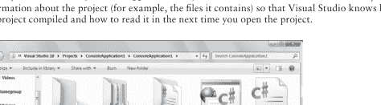

你还会找到一个 Properties 文件夹，其中包含 AssemblyInfo.cs 文件。项目主文件夹 ConsoleApplication1 中的其余文件是为了 Visual Studio 的利益而存在的。它们包含有关项目的信息（例如，项目包含的文件），以便 Visual Studio 知道如何编译项目，以及下次打开项目时如何读取它。

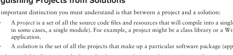

图 16-9

## 区分项目和解决方案

你必须理解的一个重要区别是项目与解决方案之间的区别：

- **项目**是能够编译成单个程序集（在某些情况下是单个模块）的所有源代码文件和资源的集合。例如，项目可以是类库或 Windows GUI 应用程序。
- **解决方案**是构成特定软件包（应用程序）的所有项目的集合。

要理解这一区别，请看交付项目时的情况 —— 项目包含多个程序集。例如，你可能有一个用户界面、自定义控件以及其他作为应用程序部件库交付的组件。你甚至可能有面向管理员的不同用户界面。应用程序的每个部分可能包含在单独的程序集中，因此 Visual Studio 将它们视为单独的项目。然而，你很可能会并行且相互关联地编写这些项目。因此，在 Visual Studio 中将它们作为一个整体单元进行编辑非常有用。Visual Studio 允许这样做，它将所有项目视为一个解决方案，并将解决方案作为其读取并允许你处理的单元。

到目前为止，我们一直在粗略地谈论创建控制台项目。实际上，在你正在处理的示例中，Visual Studio 已经为你创建了一个解决方案 —— 尽管这个特定的解决方案只包含一个项目。你可以在 Visual Studio 中一个名为“解决方案资源管理器”（参见图 16-10）的窗口中看到这种情况，其中包含定义解决方案的树结构。

图 16-10 显示项目包含你的源文件 `Program.cs`，以及另一个 C# 源文件 `AssemblyInfo.cs`（位于 `Properties` 文件夹中），该文件允许你提供描述程序集的信息以及指定版本信息的能力。（你将在第 18 章“程序集”中详细了解此文件。）解决方案资源管理器还指示项目按命名空间引用的程序集。你可以通过展开解决方案资源管理器中的 `References` 文件夹来查看。

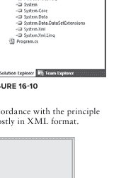

图 16-10

如果你尚未更改 Visual Studio 中的任何默认设置，你可能会在屏幕右上角找到解决方案资源管理器。如果你看不到它，只需转到“视图”菜单并选择“解决方案资源管理器”。

解决方案由扩展名为 `.sln` 的文件描述 —— 在此示例中，它是 `ConsoleApplication1.sln`。项目由项目主文件夹中的各种其他文件描述。如果你尝试使用记事本编辑这些文件，你会发现它们大多是纯文本文件，并且根据 .NET 和 .NET 工具尽可能依赖开放标准的原则，它们大多是 XML 格式。

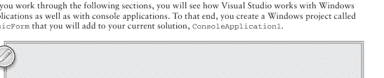

## 向解决方案添加另一个项目

在阅读以下各节时，你将了解 Visual Studio 如何与 Windows 应用程序以及控制台应用程序协同工作。为此，你将创建一个名为 `BasicForm` 的 Windows 项目，并将其添加到当前解决方案 `ConsoleApplication1` 中。


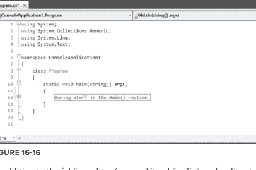

## 图 16-16

除了折叠编辑器功能之外，Visual Studio 的代码编辑器还保留了 Visual Studio 6 中所有熟悉的功能。特别是，它具有 IntelliSense 功能，不仅为你节省了键入时间，还确保你能获得正确的参数。C++ 开发人员会注意到，Visual Studio 的 IntelliSense 功能比 Visual Studio 6 版本更强大，且工作速度更快。你还会注意到，自 Visual Studio 2005 以来，IntelliSense 已得到改进。它现在更加智能，会记住你偏好的选择，并直接从其中一个选择开始，而不是从 IntelliSense 现在有时可能提供的相当冗长的列表的开头开始。

代码编辑器还会对你的代码执行一些语法检查，甚至在编译代码之前，就会用一条短波浪线标出大多数语法错误。将鼠标指针悬停在带下划线的文本上，会弹出一个小框，告诉你错误是什么。Visual Basic 开发人员多年来已经熟悉这个被称为“设计时调试”的功能；现在 C# 和 C++ 开发人员也可以从中受益。

## 其他窗口

除了代码编辑器之外，Visual Studio 还提供了许多其他窗口，使你能够从不同的角度查看项目。

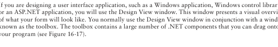

## 设计视图窗口

如果你正在设计用户界面应用程序，例如 Windows 应用程序、Windows 控件库或 ASP.NET 应用程序，你将使用设计视图窗口。此窗口以可视化方式呈现窗体的外观。你通常将设计视图窗口与一个称为工具箱的窗口配合使用。工具箱包含大量可以拖到程序中的 .NET 组件（参见图 16-17）。

Visual Studio 2010 提供了一个工具箱，其中包含大量可供开发使用的组件。通过工具箱可用的组件类别在一定程度上取决于你所编辑的项目类型——例如，在编辑 DemoSolution 解决方案中的 WindowsFormsApplication1 项目时，可用的范围比编辑 ConsoleApplication1 项目时要广泛得多。其中最重要的可用项目范围包括：

- 数据——允许你连接到数据源并管理数据源所包含数据的类。在这里，你会找到用于处理 Microsoft SQL Server、Oracle 和任何 OleDb 数据源的组件。
- Windows 窗体控件（标记为“公共控件”）——表示可视化控件的类，例如文本框、列表框或树视图，用于处理胖客户端应用程序。
- Web 窗体控件（标记为“标准”）——与 Windows 控件执行基本相同功能的类，但在 Web 浏览器环境中工作，并通过发送 HTML 输出向浏览器模拟控件。（只有在使用 ASP.NET 应用程序时才会看到此项。）
- 组件——在计算机上执行各种有用任务的杂项 .NET 类，例如连接到目录服务或事件日志。

你还可以通过右键单击任何类别，然后从上下文菜单中选择“添加选项卡”，将自己的自定义类别添加到工具箱。你也可以通过从同一个上下文菜单中选择“选择项”，将其他工具放入工具箱——这对于添加你喜欢的 COM 组件和 ActiveX 控件尤其有用，这些组件和控件默认情况下不在工具箱中。如果添加 COM 控件，你仍然可以像使用 .NET 控件一样，单击将其放置到项目中。Visual Studio 会自动添加所有必需的 COM 互操作代码，以允许你的项目调用该控件。在这种情况下，实际添加到项目中的是 Visual Studio 在后台创建的 .NET 控件，该控件充当 COM 控件的包装器。

要查看工具箱的工作方式，请在基本窗体项目中放置一个文本框。你只需单击工具箱中包含的 TextBox 控件，然后再次单击以将其放置在设计视图的窗体中（或者，如果你愿意，也可以直接将控件拖放到设计图面上）。现在，设计视图看起来如图 16-18 所示，大致说明了 WindowsFormsApplication1 在编译和运行后的外观。

如果查看窗体的代码视图，你会看到 Visual Studio 2010 不会像 IDE 的早期版本那样直接添加实例化 TextBox 对象以放到窗体上的代码。相反，你需要展开 Visual Studio 解决方案资源管理器中 Form1.cs 旁边的加号。在这里，你会找到一个专门用于窗体设计以及放置在窗体上的控件的文件——Form1.Designer.cs。在此类文件中，你将在 Form1 类中找到一个新成员变量：

```
partial class Form1
{
    private System.Windows.Forms.TextBox textBox1;
}
```

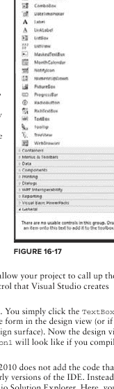

图 16-17

“属性”窗口的顶部有一个列表框，允许你选择要查看的控件。在本章的示例中，你选择了 Form1（WindowsFormsApplication1 项目的主窗体类），并将文本编辑为“Basic Form — Hello!”。如果现在检查源代码，你会看到你实际上做的是编辑源代码——只是使用了一个更友好的用户界面：

```
this.AutoScaleDimensions = new System.Drawing.SizeF(6F, 13F);
this.AutoScaleMode = System.Windows.Forms.AutoScaleMode.Font;
this.ClientSize = new System.Drawing.Size(284, 265);
this.Controls.Add(this.textBox1);
this.Name = "Form1";
this.Text = "Basic Form — Hello!";
this.ResumeLayout(false);
this.PerformLayout();
```

并非“属性”窗口中显示的所有属性都会在源代码中显式提及。对于那些未提及的属性，Visual Studio 将显示创建窗体时设置的默认值，以及实际初始化窗体时设置的默认值。显然，如果你在“属性”窗口中更改了其中一个属性的值，一条显式设置该属性的语句将神奇地出现在你的源代码中——反之亦然。有趣的是，如果某个属性被更改为其原始值以外的值，该属性随后会在“属性”窗口的列表框中以粗体显示。有时，双击“属性”窗口中的该属性会将其恢复为原始值。

“属性”窗口提供了一种便捷的方式，让你能够大致了解特定控件或窗口的外观和属性。

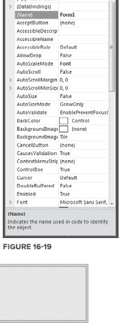

图 16-19

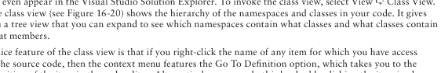

## 类视图窗口

与“属性”窗口不同，类视图窗口（如图 16-20 所示）源于 C++（和 J++）开发人员环境。Visual Studio 实际上并不将类视图视为一个独立的窗口——而是解决方案资源管理器窗口中的一个附加选项卡。默认情况下，类视图甚至不会出现在 Visual Studio 解决方案资源管理器中。要调用类视图，请选择“视图”→“类视图”。类视图（参见图 16-20）显示代码中命名空间和类的层次结构。它为你提供了一个树状视图，你可以展开该视图以查看哪些命名空间包含哪些类，以及哪些类包含哪些成员。

类视图的一个不错的功能是，如果你右键单击任何可以访问其源代码的项的名称，则上下文菜单会提供“转到定义”选项，该选项会将你带到代码编辑器中该项的定义处。或者，你也可以通过双击类视图中的该项来完成此操作（或者，实际上，在源代码编辑器中右键单击所需的项，并从生成的上下文菜单中选择相同的选项）。上下文菜单还提供向类添加字段、方法、属性或索引器的选项。这意味着，你可以在对话框中指定相关成员的详细信息，然后代码会自动为你添加。对于字段或方法来说，这可能不是那么有用，因为它们可以


可以快速添加到你的代码中；但是，对于属性和索引器，你可能会发现这个功能很有用，它可以节省你大量输入。

## 对象浏览器窗口

在 .NET 环境中编程的一个重要方面是能够找出基类以及从程序集引用的任何其他库中可用的方法和其他代码项。此功能通过一个名为“对象浏览器”的窗口提供。在 Visual Studio 2010 中，可以通过从“视图”菜单中选择“对象浏览器”来访问此窗口。

对象浏览器窗口与类视图窗口非常相似，因为它显示一个树视图，给出应用程序的类结构，允许你检查每个类的成员。用户界面略有不同，它会在单独的窗格中显示类成员，而不是显示在树视图本身中。真正的区别在于，它不仅让你查看项目中的命名空间和类，还可以查看项目引用的所有程序集中的命名空间和类。图16-20显示了对象浏览器查看 .NET 基类中的 SystemException 类。

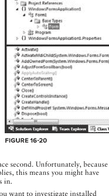

图16-20

关于对象浏览器，有一点需要注意：它首先按类所在的程序集对类进行分组，其次按命名空间分组。不幸的是，由于基类的命名空间通常分布在多个程序集中，这意味着你可能很难找到某个特定的类，除非你知道它位于哪个程序集中。

对象浏览器用于查看 .NET 对象。如果由于任何原因你想要检查已安装的 COM 对象，你会发现以前在 C++ IDE 中使用的 OLEView 工具仍然可用——它位于 C:\Program Files\Microsoft SDKs\Windows\v6.0A\bin 文件夹中，同时还提供了其他几个类似的实用工具。

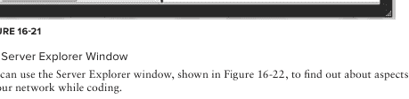

图16-21

## 服务器资源管理器窗口

你可以在编码时使用服务器资源管理器窗口（如图16-22所示）来了解网络中计算机的各个方面。

从屏幕截图中可以看到，通过服务器资源管理器可以访问的内容包括数据库连接、服务信息、事件日志等。

服务器资源管理器与“属性”窗口相关联，因此，例如，如果你打开“服务”节点并单击某个特定服务，该服务的属性将显示在“属性”窗口中。

## 图钉按钮

在探索 Visual Studio 时，你可能已经注意到，许多窗口都具有一些有趣的功能，这些功能更像工具栏。特别是，除了代码编辑器之外，它们都可以停靠。另一个特点是，当它们停靠时，在每个窗口右上角的最小化按钮旁边会有一个额外的图标，看起来像图钉。这个图标确实像图钉一样——它可以用来固定窗口，使其保持打开状态。当窗口被固定时（图钉垂直显示），它们的行为就像你习惯的常规窗口一样。然而，当它们未被固定时（图钉水平显示），它们只有在获得焦点时才会保持打开状态。一旦它们失去焦点（因为你单击或移动鼠标到其他地方），它们就会平滑地缩回到整个 Visual Studio 应用程序的主边框内。（你也可以通过它们打开和关闭的快慢来感受计算机的速度。）

固定和取消固定窗口提供了另一种充分利用屏幕上有限空间的方法。以前在 Windows 中并不常见，尽管一些第三方应用程序（如 PaintShop Pro）也使用过类似的概念。然而，在许多基于 UNIX 的系统中，固定窗口已经存在很长一段时间了。

## 生成项目

Visual Studio 不仅用于编写项目代码。它实际上是一个 IDE，管理项目的整个生命周期，包括生成或编译解决方案。本节探讨 Visual Studio 为生成项目提供的选项。

### 生成、编译和 Make

在探讨各种生成选项之前，澄清一些术语非常重要。你经常会看到三个不同的术语与从源代码到某种可执行代码的过程相关：编译、生成和 Make。这些不同术语的起源源于这样一个事实：直到最近，从源代码到可执行代码的过程涉及多个步骤（在 C++ 中仍然如此）。这在很大程度上是由于程序中的源文件数量众多。

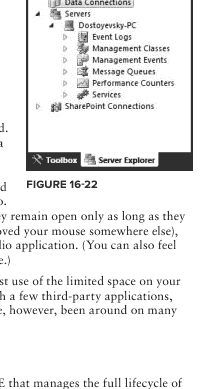

这个文件通常称为 make file，在 UNIX 系统中仍然相当标准。在 Windows 上通常不需要 make file，但在需要时你仍然可以编写它们（或让 Visual Studio 生成它们）。

### 调试和发布生成

为不同目的使用单独生成的概念对 C++ 开发人员来说非常熟悉，对具有 Visual Basic 背景的开发人员来说则稍弱一些。这里的要点是，在调试时，你通常希望可执行文件的行为不同于准备发布软件时的行为。当你准备发布软件时，你希望可执行文件的大小尽可能小，并且可执行文件本身尽可能快。不幸的是，这些要求与调试代码时的需求并不兼容，如下节所述。

### 优化

高性能部分是通过编译器对代码进行大量优化来实现的。这意味着编译器在编译时会主动查看你的源代码，以识别可以在哪些地方修改你所做事情的精确细节，而不改变整体效果，但可以提高效率。例如，如果编译器遇到以下源代码：

```
double InchesToCm(double Ins)
{
    return Ins*2.54;
}

// later on in the code

Y = InchesToCm(X);
```

它可能会将其替换为：

```
Y = X * 2.54;
```

或者它可能会用以下内容替换此代码：

```
{
    string Message = "Hi";
    Console.WriteLine(Message);
}
```

替换为：

```
Console.WriteLine("Hi");
```

这样做，它绕过了在此过程中声明不必要对象引用的需要。

无法准确确定 C# 编译器会进行哪些优化——也无法确定前面两个示例是否会在任何特定情况下真正发生——因为这些细节并未被记录。（对于诸如 C# 之类的托管语言，前面的优化很可能会在 JIT 编译期间发生，而不是在 C# 编译器将源代码编译为程序集时发生。）出于明显的商业原因，编写编译器的公司通常不太愿意透露其编译器所使用技巧的过多细节。我们应该强调，优化不会影响你的源代码——它们只影响可执行代码的内容。然而，前面的示例应该会让你对优化的预期有一个很好的了解。

问题在于，尽管像前面的优化在很大程度上帮助你的代码运行得更快，但它们对调试并没有太大帮助。假设在第一个示例中，你想在 InchesToCm() 方法内设置断点以查看其中发生了什么。如果可执行代码实际上没有 InchesToCm() 方法，因为编译器已将其删除，你怎么可能做到这一点？此外，当 Message 变量在编译后的代码中也不存在时，你又如何对它设置监视呢？

### 调试器符号

在调试时，你经常需要查看变量的值，并且会通过源代码名称来指定它们。问题是，可执行代码通常不包含这些名称——编译器会用内存地址替换名称。.NET 已经在某种程度上改变了这种情况，程序集中的某些项会以名称存储，但这只适用于少数项——比如公共类和方法——并且当程序集进行 JIT 编译时，这些名称仍会被删除。要求调试器告诉你名为 HeightInches 的变量的值是什么，如果调试器在检查可执行代码时只看到地址而没有任何地方提到名称 HeightInches，那么你很难达到目的。因此，为了正确调试，你需要在可执行文件中提供额外的调试信息。这些信息包括变量名称和行信息等，使调试器能够将可执行机器汇编语言指令与原始源代码指令对应起来。然而，你不会希望在发布生成中包含这些信息，既出于商业原因（调试信息使其他人更容易反汇编你的代码），也因为这会增加可执行文件的大小。

### 额外的源代码调试命令

一个相关的问题是，在调试时，代码中经常会有额外的行来显示关键调试信息。显然，在发布软件之前，你会希望从可执行文件中完全删除相关命令。你可以手动完成这项工作，但如果能简单地将这些语句以某种方式标记出来，使编译器在编译要发布的代码时忽略它们，岂不是容易得多？你在本书第一部分已经看到了如何在 C# 中通过定义合适的预处理符号，并可能结合使用 Conditional 特性来做到这一点，从而实现所谓的条件编译。

所有这些因素综合起来意味着，在调试时，你需要以与最终发布产品略有不同的方式编译几乎所有商业软件。Visual Studio 能够考虑这一点，因为正如你已经看到的，它存储了在编译代码时传递给编译器的所有选项的详细信息。Visual Studio 所要做的就是支持不同类型的生成，以存储多组此类详细信息。不同组的生成信息称为配置。创建项目时，Visual Studio 会自动为你提供两个配置，称为 Debug 和 Release：

-   Debug 配置通常指定不进行任何优化，可执行文件中包含额外调试信息，并且编译器应假定调试预处理器符号 Debug 存在，除非在源代码中显式地使用 #undef 将其取消定义。
-   Release 配置指定编译器应优化编译，可执行文件中不应包含额外调试信息，并且编译器不应假定任何特定预处理器符号存在。

你也可以定义自己的配置。例如，如果你想设置专业级生成和企业级生成，以便发布两个版本的软件，你可能需要这样做。过去，由于 Unicode 字符编码在 Windows NT 上受支持但在 Windows 95 上不受支持的问题，C++ 项目通常会包含 Unicode 配置和 MBCS（多字节字符集）配置。

### 选择配置

一个显而易见的问题是，由于 Visual Studio 存储了多个配置的详细信息，在安排项目生成时，它如何确定使用哪一个？答案是，总有一个活动配置，当你要求 Visual Studio 生成项目时，将使用该配置。（请注意，配置是为每个项目设置的，而不是为每个解决方案设置的。）


一般来说，你并不需要经常调整配置设置。不过，如果确有需要，现在你也已经了解了可用的配置属性之间的区别。

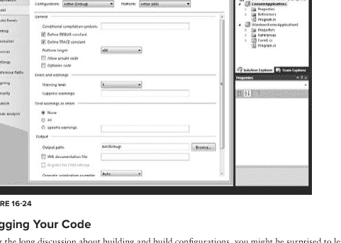

图 16-24

## 调试你的代码

在围绕构建和生成配置进行了大量讨论之后，你可能会惊讶地发现，本章并不会花大量篇幅来讨论调试本身。原因是，无论是在 Visual Studio 2010 中，还是在各种 Visual Studio 6 IDE 中，调试的原理和过程（设置断点、检查变量值）都没有显著不同。因此，本节只简要回顾 Visual Studio 提供的功能，重点关注那些可能对部分开发者来说比较新的方面。本节还会讨论如何处理异常，因为异常可能会在调试过程中引发问题。

在 C# 中，与在 .NET 之前的语言中一样，调试所涉及的主要技术就是设置断点，并利用断点来检查代码执行到某一位置时的状态。

## 断点

你可以在 Visual Studio 中为代码中任何实际执行的行设置断点。最简单的方法是单击代码编辑器中该行靠近文档窗口最左侧的阴影区域（或者选中相应行后按 F9 键）。这会在该特定行上设置一个断点，当执行过程到达该行时，执行会中断，控制权会移交给调试器。与之前的 Visual Studio 版本一样，断点会以代码编辑器左侧的大圆圈表示。Visual Studio 还会通过以不同颜色显示文本和背景来突出显示该行。再次单击该圆圈即可移除断点。

如果只在特定行每次执行时中断不足以解决你的具体问题，你还可以设置条件断点。为此，请选择 Debug → Windows → Breakpoints。这会弹出一个对话框，询问你要设置的断点的详细信息。在可用的选项中，你可以：

- 指定仅在断点被经过一定次数之后才中断执行。
- 指定断点只在执行到达该行的每第 N 次时生效，例如，每执行 20 次该行才中断一次。（这在调试大型循环时很有用。）
- 相对于变量而不是指令来设置断点。在这种情况下，会监视变量的值，并且每当该变量的值发生变化时，断点就会被触发。不过，你可能会发现，使用此选项会明显拖慢代码的运行速度。在每条指令之后检查变量的值是否发生变化，会大大增加处理器开销。

## 监视

命中断点后，你通常需要检查变量的值。最简单的方法是将鼠标光标悬停在代码编辑器中变量名上。此时会弹出一个显示该变量值的小框，你也可以将其展开以查看更详细的信息。如图 16-25 所示。

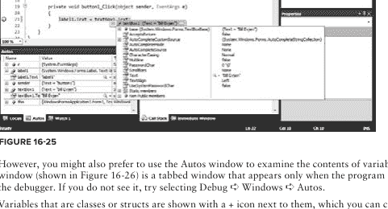

不过，你可能也更喜欢使用“自动变量”窗口来检查变量的内容。自动变量窗口（如图 16-26 所示）是一个选项卡式窗口，仅当程序在调试器下运行时才会出现。如果看不到它，请尝试选择 Debug ▸ Windows ▸ Autos。

属于类或结构的变量旁边会显示一个 + 图标，你可以单击该图标展开变量，查看其字段的值。

该窗口中的三个选项卡分别用于监视不同的变量：

- Autos 监视程序执行过程中最近访问的几个变量。
- Locals 监视当前正在执行的方法中可以访问的变量。
- Watch 监视你通过在“监视”窗口中输入变量名而显式指定的任何变量。

## 视频生成模型：全面综述

### 扩散、自回归与生成式框架的全面综述

Yihan Cao, Li Ma, Dangguo Chen, Yichen Jia, Zhiwei Xu, Ling Chen, Xiaolong Jiang, Yan Gao

新加坡科技研究局（A*STAR）高性能计算研究所，新加坡 138632

**关键词：** 视频生成 · 扩散模型 · 自回归模型 · 生成式人工智能 · 视频合成

**摘要。** 深度生成模型的出现推动了视频生成领域的显著进展。鉴于进展规模之大，全面且最新的分析对于指导未来的发展和应用至关重要。在这项工作中，我们总结了当前的最先进技术，并将视频生成模型归为三大框架：（i）基于扩散的模型，（ii）基于自回归的模型，以及（iii）其他生成式框架。我们分析了它们的方法论、架构创新以及所应对的挑战。我们还回顾了基准数据集、评估指标和关键应用，以提供对该领域的整体认识。最后，我们讨论了开放挑战和未来研究方向，包括计算效率、时间连贯性和多模态集成。

## 1 引言

视频生成，即合成真实且在时间上连贯的帧序列的任务，是计算机视觉和人工智能领域长期存在的挑战。早期方法主要依赖像素空间中的自回归模型或生成对抗网络（GAN）[1]，但这些方法往往难以捕获视频数据中固有的复杂时空依赖关系。近年来，扩散模型 [2, 3, 4] 和大型 Transformer [5, 6] 的兴起显著改变了这一格局，使生成的视频达到了前所未有的真实感和可控性。

本文围绕三个核心问题展开。第一，定义当前这一代视频模型的主要方法论和架构创新是什么？第二，这些模型是如何评估的，哪些基准已成为标准？第三，塑造这一领域未来的突出应用和开放挑战有哪些？通过系统地研究这些方面，我们旨在为进入该领域的研究人员和实践者提供一份全面的参考。

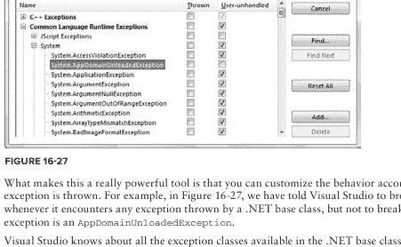

图 16-27

这一工具之所以非常强大，是因为你可以根据抛出的异常类别来自定义行为。例如，在图 16-27 中，我们让 Visual Studio 在遇到 .NET 基类抛出的任何异常时中断到调试器，但如果是 AppDomainUnloadedException 异常，则不中断到调试器。

Visual Studio 知道 .NET 基类中可用的所有异常类，也了解不少可在 .NET 环境之外抛出的异常。Visual Studio 并不会自动识别你自己编写的自定义异常类，但你可以手动将异常类添加到列表中，从而指定哪些异常应立即导致执行停止。为此，只需单击“添加”按钮（当你选择了树中的顶层节点时该按钮会变为可用），然后输入异常类的名称。

## 重构工具

许多开发者会先围绕功能开发应用程序，然后在功能就绪后对应用程序进行重新整理，使其更易于管理和阅读。这称为重构。重构是指为了可读性、性能、类型安全性以及让应用程序更好地符合标准面向对象（OO）编程实践而重新调整代码的过程。

因此，Visual Studio 2010 的 C# 环境包含一组重构工具。你可以在 Visual Studio 菜单中的“重构”选项下找到这些工具。为了演示其作用，请在 Visual Studio 中创建一个名为 Car 的新类：

```csharp
using System;
using System.Collections.Generic;
using System.Text;

namespace ConsoleApplication1
{
    public class Car
    {
        public string _color;
        public string _doors;

        public int Go()
        {
            int speedMph = 100;
            return speedMph;
        }
    }
}
```


正如你所见，这些向导使得你不仅可以在一个页面中重构代码，而且还可以对整个应用程序进行重构。此外，还包含以下功能：

-   重命名方法名、局部变量、字段及更多内容
-   从选定的代码中提取方法
-   基于一组现有类型成员提取接口
-   将局部变量提升为参数
-   重命名或重新排列参数

你会发现，Visual Studio 2010 提供的重构功能是获得你想要的更简洁、更易读、结构更优的代码的极佳方式。

## 面向多个 .NET Framework 版本

Visual Studio 2010 允许你面向所要使用的 .NET Framework 版本。当你打开“新建项目”对话框并准备创建新项目时，你会注意到对话框右上角有一个下拉列表，让你可以选择所希望使用的框架版本。该对话框如图 16-29 所示。

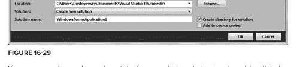

图 16-29

从该图中可以看到，下拉列表提供面向 .NET Framework 2.0、3.0、3.5 和 4 的能力。当使用升级对话框将 Visual Studio 2008 解决方案升级到 Visual Studio 2010 时，务必理解你只是在升级解决方案以使用 Visual Studio 2010，而不是将项目升级到 .NET Framework 4。你的项目将保留在原来使用的框架版本上，但现在你将能够使用新的 Visual Studio 2010 来处理项目。

如果你想更改解决方案所用框架的版本，请右键单击项目并选择解决方案的属性。如果你正在处理 ASP.NET 项目，将出现一个如图 16-30 所示的对话框。

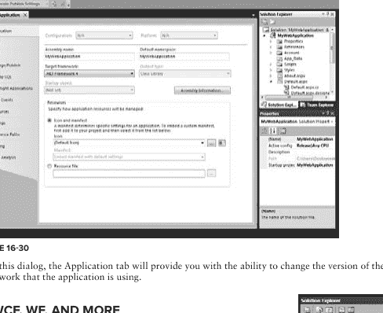

图 16-30

在该对话框中，“应用程序”选项卡将允许你更改应用程序所使用的框架版本。

## WPF、WCF、WF 及其他

默认情况下，Visual Studio 2005 不允许你构建面向 .NET Framework 3.0 的应用程序，而 .NET Framework 3.0 在 VS2005 生命周期内已经发布。Visual Studio 2005 的默认安装仅面向 .NET Framework 2.0。若要开始使用面向 .NET Framework 3.0 的新技术，你必须额外安装一些组件。

.NET Framework 3.0 使你可以使用一个类库来构建各种应用程序类型，例如使用 Windows Presentation Foundation (WPF)、Windows Communication Foundation (WCF)、Windows Workflow Foundation (WF) 和 Windows CardSpace 的应用程序。

Visual Studio 2010 的面向框架功能允许你使用 .NET Framework 3.0、3.5 或 4 构建这些类型的应用程序。

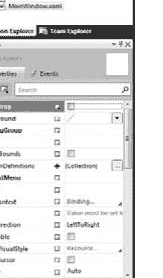

图 16-31

### 在 Visual Studio 2010 中构建 WPF 应用程序

.NET Framework 4 为 Visual Studio 带来的功能中，一个很好的例子是 WPF 应用程序项目类型（位于“Windows”类别中）。选择此项目类型将为你创建 MainWindow.xaml 和 MainWindow.xaml.cs 文件以供使用。在“解决方案资源管理器”中，此项目类型默认创建的所有内容如图 16-31 所示（此处显示的是带有可搜索“属性”对话框时的情形）。

## 

## 17 部署

### 本章内容

-   部署要求
-   简单的部署方案
-   基于 Windows Installer 的项目
-   ClickOnce 技术

开发过程并不会在源代码编译完成且测试结束时终止。在这一阶段，将应用程序交到用户手中的工作才刚刚开始。无论是 ASP.NET 应用程序、智能客户端应用程序，还是使用 Compact Framework 构建的应用程序，都必须将软件部署到目标环境中。.NET Framework 使部署比过去容易得多。注册 COM 组件和向注册表写入新配置单元的烦恼都已不复存在。

本章将从 ASP.NET 和智能客户端两个视角来探讨可用于应用程序部署的各个选项。

## 规划部署

通常，部署在开发过程中是事后才考虑的，这可能导致令人不悦甚至代价高昂的意外。为避免部署场景中的苦恼，你应该在初始设计阶段就规划部署过程。任何特殊的部署注意事项——如服务器容量、桌面安全性或程序集的加载位置——都应从一开始就纳入设计中，从而使部署过程更加顺畅。

另一个你应该在开发过程早期处理的问题是测试部署的环境。虽然应用程序代码和部署选项的单元测试可以在开发人员系统上进行，但部署必须在与目标系统相似的环境中进行测试。这一点很重要，可消除目标计算机上不存在的依赖项。例如，某个第三方库在项目早期就已安装在开发人员的计算机上。目标计算机上可能没有这个库。人们很容易忘记将其包含在部署包中。在开发人员系统上进行测试不会发现此错误，因为该库已经存在。记录依赖项有助于消除这一潜在问题。

对于大型应用程序来说，部署过程可能很复杂。规划部署可以在实施部署过程时节省时间和精力。

选择正确的部署选项必须以与开发系统的任何其他方面相同的谨慎态度和规划力度来进行。选择错误的选项将使软件交付到用户手中的过程变得困难和令人沮丧。

### 部署选项

本节概述可提供给 .NET 开发人员的部署选项。本章后面将更详细地讨论其中大多数选项。

-   **Xcopy** — xcopy 实用工具允许你将一个程序集或一组程序集复制到应用程序文件夹，从而缩短开发时间。由于程序集是自描述的（即描述程序集的元数据包含在程序集中），你无需在注册表中注册任何内容。

每个程序集会记录执行时需要哪些其他程序集。默认情况下，程序集会在当前应用程序文件夹中查找依赖项。将程序集移动（或探测）到其他文件夹的过程将在本章后面讨论。

-   **发布网站** — 发布网站时，整个站点将被编译，然后复制到指定位置。通过预编译，所有源代码都会从最终输出中移除，并且可以发现并处理所有编译错误。

-   **部署项目** — Visual Studio 2010 具备为应用程序创建安装程序的能力。基于 Microsoft Windows Installer 技术有四个选项：
    -   创建合并模块，
    -   为客户端应用程序创建设置，
    -   为 Web 应用程序创建设置，以及
    -   为基于智能设备（Compact Framework）的应用程序创建设置。

此外，还提供了创建 cab 文件的功能。部署项目为安装过程提供了极大的灵活性和自定义能力。这些部署选项之一将对大型应用程序很有用。

-   **ClickOnce 技术** — ClickOnce 技术提供了一种构建可自我更新的基于 Windows 的应用程序的方法。ClickOnce 允许将应用程序发布到网站、文件共享甚至 CD。当对应用程序进行更新和生成新版本时，开发团队可以将其发布到相同的位置或站点。当最终用户使用应用程序时，它会检查该位置是否有可用更新。如果有，则会尝试进行更新。

### 部署要求

查看基于 .NET 的应用程序的运行时要求是很有帮助的。在任何一个托管应用程序可以执行之前，CLR 对目标平台都有一定的要求。


以下服务器平台受支持：

- Windows Server 2003 系列 SP2
- Windows Server 2008 系列（不支持 Server Core 角色）

以下体系结构受支持：

- x86
- x64
- ia64（某些功能不受支持）

其他要求为 Windows Internet Explorer 版本 5.01 或更高版本、MDAC 版本 2.8 或更高版本（如果应用程序设计为访问数据），以及用于 ASP.NET 应用程序的 Internet Information Services（IIS）。

部署 .NET 应用程序时，您还必须考虑硬件要求。客户端和服务器的最低硬件要求均为 Pentium 400 MHz 和 96 MB RAM

为了获得最佳性能，请增加 RAM 容量——RAM 越多，.NET 应用程序运行越好。这对于服务器应用程序尤其如此。

## 部署 .NET 运行时

使用 .NET 开发应用程序时，存在对 .NET 运行时的依赖。这似乎显而易见，但有时显而易见的事情会被忽略。下表显示了版本号以及需要分发的文件名：

| .NET 版本 | 文件名 |
|---|---|
| 2.0.50727.42 | dotnetfx.exe |
| 3.0.4506.30 | dotnetfx3.exe (包含 x86 和 x64) |
| 3.5.21022.8 | dotnetfx35.exe (包含 x86、x64 和 ia64) |
| 4.0.0.0 | dotnetfx40.exe (包含 x86、x64 和 ia64) |

## 简单部署选项

如果部署是应用程序原始设计考虑的一部分，部署可以简单到将一组文件复制到目标计算机。对于 Web 应用程序，它可以是 Visual Studio 2010 中的一个简单菜单选项。本节讨论这些简单部署方案。

要了解各种部署选项的设置方式，您必须有一个要部署的应用程序。www.wrox.com 上的示例下载包含四个项目：

- ClientWinForms
- ClientWPF
- WebClient
- AppSupport

ClientWinForms 和 ClientWPF 分别是使用 WinForms 和 WPF 的智能客户端应用程序。WebClient 是一个简单的 Web 应用。AppSupport 是一个类库，其中包含一个简单的类，该类返回包含当前日期和时间的字符串。

示例应用程序使用 AppSupport 用包含当前日期的字符串填充标签。要使用示例，首先加载并构建 AppSupport。然后，在其他每个应用程序中，将引用设置为新构建的 AppSupport.dll。

## Xcopy 和 Web 应用程序

Xcopy 部署也可以与 Web 应用程序一起使用，但文件夹结构除外。您必须建立 Web 应用程序的虚拟目录并配置适当的用户权限。此过程通常使用 IIS 管理工具完成。

在设置虚拟目录后，Web 应用程序文件可以复制到虚拟目录。复制 Web 应用程序的文件可能有点棘手。需要考虑几个配置文件以及页面可能使用的图像。

## 发布网站

发布网站是 Web 项目的另一种部署选项。发布网站将预编译整个站点并将编译后的版本放置到指定位置。该位置可以是文件共享、FTP 位置或任何可以通过 HTTP 访问的位置。编译过程会从程序集中删除所有源代码并创建用于部署的 DLL。这也包括 ASPX 源文件中的标记。ASPX 文件不再包含常规标记，而是包含指向程序集的指针。每个 ASPX 文件都与一个程序集相关。此过程无论模型如何都有效：代码隐藏或单文件。

发布网站的优点是速度和安全性。速度得到增强，因为所有程序集都已预先编译。否则，第一次访问页面时会有延迟，因为页面和依赖代码会被编译并缓存。安全性得到增强，因为源代码未被部署。此外，由于在部署之前已预编译所有内容，因此所有编译错误都会被发现。

您从 Build - Publish 菜单选项发布网站。在“发布方法”下拉菜单中，您可以选择 MSDeploy Publish、FTP 或文件系统。FTP 选项会要求输入 FTP 地址以及所需的任何登录凭据。文件系统选项会要求输入目标位置的路径。MSDeploy Publish 选项是有趣的选项。

您可以从项目属性页面的 Package and Publish 选项卡定义网站部署的许多属性。您可以定义应包含哪些文件，包括调试信息。可以包含来自 Deploy Sql 选项卡的数据库信息。此信息包括连接字符串、架构信息和数据库脚本选项。

您也可以在此处选择打包选项。将生成包含安装网站所需的一切的 zip 文件。除 zip 文件外，还将生成另外三个文件：

- `projectname.deploy.cmd` — MSDeploy 用于安装网站的命令文件。
- `projectname.SetParameters.xml` — 包含传递给 Web 部署工具的不同参数的 XML 文件。这可用于部署到不同的服务器或在不同的环境中。
- `projectname.SourceManifest.xml` — Visual Studio 2010 用于创建包的设置。

Projectname 是正在打包的项目的名称。包可以使用 Visual Studio 或 MSBuild 部署。

| 项目属性 | 描述 |
|---|---|
| SearchPath | 表示依赖程序集、文件或合并模块的搜索路径的字符串。在开发机器上构建安装程序包时使用。 |
| Subject | 有关应用程序的其他信息。此信息显示在 msi 包属性对话框的摘要页面上。 |
| SupportPhone | 应用程序或组件支持的电话号码。此信息显示在添加/删除对话框的 SupportInfo 页面上的支持信息字段中。 |
| SupportURL | 应用程序或组件支持的 URL。此信息显示在添加/删除对话框的 SupportInfo 页面上的支持信息字段中。 |
| TargetPlatform | 支持 Windows 的 32 位或 64 位版本。 |
| Title | 安装程序的标题。这显示在 msi 包属性对话框的摘要页面上。 |
| UpgradeCode | 表示同一应用程序不同版本的共享标识符的字符串 GUID。UpgradeCode 对于应用程序的不同版本或不同语言版本不应更改。由 DetectNewerInstalledVersion 和 RemovePreviousVersion 使用。 |
| Version | 安装程序、.cab 文件或合并模块的版本号。请注意，这不是正在安装的应用程序的版本。 |

设置属性后，您可以开始添加程序集。在此示例中，您需要添加的唯一程序集是主可执行文件（ClientWinForms.exe）。为此，您可以右键单击解决方案资源管理器中的项目或从项目菜单中选择添加。您有四个选项：

- Project Output — 您将在下一个示例中探索此选项。
- File — 用于添加自述文本文件或任何不属于构建过程的一部分的文件。
- Merge Module — 单独创建的合并模块。
- Assembly — 使用此选项选择安装的一部分的程序集。

为此示例选择 Assembly。您将看到 Component Selector 对话框，其外观类似于您用于向项目添加引用的对话框。浏览到应用程序的 \bin\release 文件夹。选择 ClientWinForms.exe 并在 Component Selector 对话框中单击 OK。现在您可以在部署项目的解决方案资源管理器中看到 ClientWinForms.exe。 在“检测到的依赖项”部分中，您可以看到 Visual Studio 询问 ClientWinForms.exe 以查找其所依赖的程序集；在这种情况下，AppSupport.dll 会自动包含。您将继续此过程，直到部署项目的解决方案资源管理器中包含应用程序中的所有程序集。

接下来，您必须确定程序集将被部署到何处。默认情况下，Visual Studio 2010 中显示的是文件系统编辑器。文件系统编辑器分为两个窗格：左侧窗格显示目标机器上的文件系统层次结构；右侧窗格提供所选文件夹的详细视图。文件夹名称可能不是您期望看到的名称，但请记住，这些是针对目标机器的。例如，标记为 User's Programs Menu 的文件夹映射到目标客户端上包含用户程序菜单的文件夹。这会根据所使用的 Windows 版本而有所不同。

此时您可以添加其他文件夹，无论是特殊文件夹还是自定义文件夹。要添加特殊文件夹，请确保在左侧窗格中突出显示 File System on Target Machine，然后在主菜单上选择 Action 菜单。Add Special Folder 菜单选项提供可添加的文件夹列表。例如，如果您想在 Application 文件夹下添加一个文件夹，您可以在左侧选择 Application Folder 文件夹

在编辑器窗格中，然后选择“操作”菜单。这次，将出现一个“添加”菜单，使您能够创建新文件夹。重命名新文件夹后，它将在目标机器上为您创建。

您可能想要添加的特殊文件夹之一是用于 GAC 的文件夹。如果 AppSupport.dll 被多个不同的应用程序使用，则可以将其安装到 GAC。要将程序集添加到 GAC，该程序集必须具有强名称。将程序集添加到 GAC 的过程是：如前所述，从“特殊文件夹”菜单中添加 GAC，然后将您想要放入 GAC 的程序集从当前文件夹拖到“全局程序集缓存”文件夹。如果您尝试使用没有强名称的程序集来执行此操作，部署项目将无法编译。

如果选择“应用程序文件夹”，您会在右侧窗格中看到您添加的程序集会自动添加到“应用程序”文件夹中。您可以将程序集移动到其他文件夹，但请记住，程序集必须能够相互找到。（有关探测的更多详细信息，请参阅第 18 章“程序集”。）

如果您想将应用程序的快捷方式添加到用户的桌面或“开始”菜单中，请将项目拖到相应的文件夹中。要创建桌面快捷方式，请转到“应用程序”文件夹。在编辑器右侧选择应用程序。转到“操作”菜单并选择“创建快捷方式”项以创建应用程序的快捷方式。创建快捷方式后，将其拖到“用户的桌面”文件夹中。现在，当安装应用程序时，快捷方式将出现在桌面上。通常，由用户决定是否希望应用程序的桌面快捷方式。

询问用户输入并采取条件步骤的过程将在本章后面介绍。可以按照相同的过程在“开始”菜单中创建项目。另外，如果您查看刚刚创建的快捷方式的属性，您将看到可以配置基本快捷方式属性，例如参数和使用的图标。应用程序图标是默认图标。

在生成部署项目之前，您可能必须检查一些项目属性。如果选择“项目”菜单，然后选择“ClientWinFormsSetup 属性”，您将看到“项目属性页”对话框。这些属性特定于当前配置。在“配置”下拉列表中选择配置后，您可以更改下表中列出的属性。

| 属性 | 描述 |
|---|---|
| Output filename | 编译项目时生成的 .msi 或 .msm 文件的名称。 |
| Package files | 此属性使您能够指定文件的打包方式。您的选项有：作为松散未压缩文件 — 所有部署文件都存储在与 .msi 文件相同的目录中。在安装文件中 — 文件打包在 .msi 文件中（默认设置）。在 cab 文件中 — 文件位于同一目录中的一个或多个 .cab 文件中。选择此项后，“CAB 文件大小”选项可用。 |
| Prerequisites URL | 允许您指定可找到 .NET Framework 或 Windows Installer 等先决条件的位置。单击“设置”按钮将显示一个对话框，其中包含诸如 Windows Installer 4.5、.NET Framework 和 SQL Express 2008 等项的列表。还有一个选项用于选择可从何处下载先决条件。 |
| Compression | 这指定了所包含文件的压缩方式。您的选项有：针对速度优化 — 文件较大，但安装时间更快。（默认设置）。针对大小优化 — 文件较小，但安装时间更慢。无 — 不应用压缩。 |
| CAB size | 当“包文件”设置设置为“在 CAB 文件中”时，此选项启用。“无限”创建单个 CAB 文件；“自定义”允许您设置每个 .cab 文件的最大大小。 |
| Authenticode signature | 选中此项后，部署项目输出将使用 Authenticode 签名；默认设置为未选中。 |

## 简单 Web 应用程序

为 Web 应用程序创建安装包与创建客户端安装包没有太大区别。下载示例中包含一个也使用 AppSupport.dll 程序集的 WebClient。您可以像创建客户端部署项目一样创建部署项目，可以独立创建，也可以在同一解决方案中创建。在此示例中，部署项目在同一解决方案中构建。

启动 WebClient 解决方案并添加一个新的部署和安装项目。这次，请务必在“模板”窗口中选择“Web 安装项目”。如果您查看项目的属性视图，您将看到 Web 应用程序具有与客户端应用程序相同的所有属性。唯一增加的是“Restart IIS Service”。这是一个布尔值，将在安装期间重启 IIS。如果您使用的是 ASP.NET 组件并且不替换任何 ATL 或 ISAPI DLL，则不必这样做。

如果您查看“文件系统”编辑器，您会注意到只有一个文件夹。“Web 应用程序”文件夹将是您的虚拟目录。默认情况下，目录的名称是部署项目的名称，并且它位于 Web 根目录之下。下表说明了可以从此安装程序中设置的属性。上一节中讨论的属性不包括在内。

| 属性 | 描述 |
|---|---|
| AllowDirectoryBrowsing | 一个布尔值，如果为 true，则允许显示虚拟目录的文件和子文件夹的 HTML 列表。映射到 IIS 的“目录浏览”属性。 |
| AllowReadAccess | 一个布尔值，如果为 true，则允许用户读取或下载文件。映射到 IIS 的“读取”属性。 |
| AllowScriptSourceAccess | 一个布尔值，如果为 true，则允许用户访问源代码，包括脚本。映射到 IIS 中的“脚本源访问”。 |
| AllowWriteAccess | 一个布尔值，如果为 true，则允许用户更改启用写入的文件中的内容。映射到 IIS 的“写入”属性。 |
| ApplicationProtection | 确定在服务器上运行的应用程序的保护级别。有效值为：低 — 应用程序与 Web 服务在同一进程中运行。中 — 应用程序在同一进程中运行，但与 Web 服务不在同一进程中。高 — 应用程序在其自身进程中运行。映射到 IIS 中的“应用程序保护”属性。如果 IsApplication 属性为 false，则无效。 |
| AppMappings | 与应用程序关联的应用程序名称和文档或数据文件的列表。映射到 IIS 的“应用程序映射”属性。 |
| Condition | 安装项目时必须满足的 Windows Installer 条件。 |
| DefaultDocument | 用户首次浏览到站点时的默认文档或启动文档。 |
| ExecutePermissions | 用户执行应用程序所拥有的权限级别。有效值为：无 — 只能访问静态内容。仅脚本 — 只能访问脚本。包括 ASP。脚本和可执行文件 — 可以访问任何文件。映射到 IIS 中的“执行权限”。 |
| Index | 布尔值，如果为 true，则允许为 Microsoft 索引服务建立内容索引。映射到 IIS 的“索引此资源”属性。 |
| IsApplication | 布尔值，如果为 true，则指示 IIS 为该文件夹创建应用程序根。 |
| LogVisits | 布尔值，如果为 true，则在日志文件中记录对网站的访问。映射到 IIS 的“日志访问”属性。 |
| Property | 可在安装时访问的命名属性。 |
| VirtualDirectory | 应用程序的虚拟目录。这是相对于 Web 服务器的。 |

您可能会注意到，这些属性中的大多数都是 IIS 的属性，可以在 IIS 管理员工具中设置。因此，逻辑上的假设是，要在安装程序中设置这些属性，安装程序将需要以管理员权限运行。此处进行的设置可能会危及安全性，因此应妥善记录这些更改。

除了这些属性之外，创建部署包的过程与前面的客户端示例非常相似。两个项目之间的主要区别在于能够在安装过程中修改 IIS。如您所见，您可以对 IIS 环境进行大量控制。

## 从 Web 服务器安装客户端

另一种安装方案是从网站运行安装程序，或者实际上从网站运行应用程序。如果必须将应用程序部署给大量用户，这两个选项都是很有吸引力的。通过从网站部署，您可以消除对 CD-ROM、DVD 甚至软盘等分发介质的需求。通过从网站甚至网络共享运行应用程序，您可以完全无需分发安装程序。

从网站运行安装程序相当简单。您使用“Web 引导程序”项目编译选项。系统将要求您提供安装文件夹的 URL。安装程序将在此文件夹中查找 .msi 和安装工作所需的其他文件。设置此选项并编译部署包后，您可以将其复制到您在“安装文件夹 URL”属性中指定的网站。此时，当用户导航到该文件夹时，她将能够运行安装程序或下载后运行。在两种情况下，用户都必须能够连接到同一站点才能完成安装。

## CLICKONCE

ClickOnce 是一种允许应用程序自我更新的部署技术。应用程序发布到文件共享、网站或媒体（如 CD）。发布后，ClickOnce 应用程序可以以最少的用户输入自动更新。

ClickOnce 还解决了安全权限问题。通常，要安装应用程序，用户需要管理员权限。使用 ClickOnce，用户只需拥有运行应用程序所需的最低权限即可安装和运行应用程序。

### ClickOnce 操作

ClickOnce 应用程序关联有两个基于 XML 的清单文件。一个是应用程序清单，另一个是部署清单。这两个文件描述了部署应用程序所需的一切。


ClickOnce 有一些限制。例如，程序集不能添加到 GAC。下表比较了 ClickOnce 和 Windows Installer。

| 功能 | ClickOnce | Windows 安装程序 |
|---|---|---|
| 应用程序安装位置 | ClickOnce 应用程序缓存 | Program Files 文件夹 |
| 为多用户安装 | 否 | 是 |
| 安装共享文件 | 否 | 是 |
| 安装驱动程序 | 否 | 是 |
| 安装到 GAC | 否 | 是 |
| 将应用程序添加到启动组 | 否 | 是 |
| 将应用程序添加到收藏夹菜单 | 否 | 是 |
| 注册文件类型 | 否 | 是 |
| 访问注册表 | 否。HKLM 可以在完全信任权限下访问。 | 是 |
| 文件二进制修补 | 是 | 否 |
| 按需安装程序集 | 是 | 否 |

某些情况下使用 Windows Installer 显然是更好的选择，然而，ClickOnce 可用于大量应用程序。

## 发布 ClickOnce 应用程序

ClickOnce 需要了解的一切都包含在两个清单文件中。发布应用程序以进行 ClickOnce 部署的过程只是生成清单并将文件放置在正确位置。清单文件可以在 Visual Studio 2010 中生成。还有一个命令行工具（mage.exe）和一个带 GUI 的版本（mageUI.exe）。

您可以在 Visual Studio 2010 中以两种方式创建清单文件。在项目属性对话框的发布选项卡底部有两个按钮。一个是发布向导，另一个是立即发布。发布向导会询问有关应用程序部署的几个问题，然后生成清单文件并将所有所需文件复制到部署位置。立即发布按钮使用在发布选项卡中设置的值来创建清单文件并将文件复制到部署位置。

要使用命令行工具 mage.exe，必须传入各种 ClickOnce 属性的值。清单文件可以使用 mage.exe 进行创建和更新。在命令提示符下键入 mage.exe -help 可给出传入所需值的语法。

## ClickOnce 设置

两个清单文件都提供多个属性。最重要的属性是应用程序应从何处部署。必须指定应用程序的依赖项。发布选项卡具有应用程序文件按钮，可显示用于输入应用程序所需所有程序集的对话框。先决条件按钮显示可与应用程序一起安装的常见先决条件列表。您可以选择从应用程序发布的同一位置安装先决条件，也可以选择从供应商的网站安装先决条件。

更新按钮显示一个对话框，其中包含有关应用程序应如何更新的信息。随着新版本的应用程序可用，ClickOnce 可用于更新应用程序。选项包括每次应用程序启动时检查更新或在后台检查。如果选择后台选项，可以输入两次检查之间的指定时间间隔。提供允许用户拒绝或接受更新的选项。这可用于在后台强制更新，以便用户根本不知道更新正在进行。下一次运行应用程序时，将使用新版本而不是旧版本。也可以使用单独的位置来存放更新文件。这样，原始安装包可以位于一个位置并为新用户安装，而所有更新可以分阶段部署在另一个位置。

应用程序可以设置为在联机或离线模式下运行。在离线模式下，应用程序可以从开始菜单运行，并且就像使用 Windows Installer 安装一样。联机模式意味着只有在安装文件夹可用时应用程序才会运行。

## ClickOnce 文件的应用程序缓存

使用 ClickOnce 分发的应用程序不会安装在 Program Files 文件夹中。相反，它们被放置在应用程序缓存中，该缓存位于当前用户 Documents and Settings 文件夹下的 Local Settings 文件夹中。控制部署的这一方面意味着多个版本的应用程序可以同时驻留在客户端 PC 上。如果应用程序设置为联机运行，用户访问的每个版本都会被保留。对于设置为本地运行的应用程序，则保留当前版本和上一个版本。

因此，将 ClickOnce 应用程序回滚到其上一个版本是一个非常简单的过程。如果用户转到添加/删除程序控制面板小程序，所呈现的对话框将包含删除 ClickOnce 应用程序或回滚到上一个版本的选项。管理员可以更改清单文件以指向上一个版本。如果管理员这样做，下次用户运行该应用程序时，将检查更新。应用程序将不会找到要部署的新程序集，而是会在没有任何用户交互的情况下恢复上一个版本。

## 应用程序安全性

通过 Internet 或 Intranet 部署的应用程序的安全性或信任设置低于安装到本地驱动器的应用程序。例如，默认情况下，如果应用程序从 Internet 启动或部署，则它处于 Internet 安全区域。这意味着它无法访问文件系统，除此之外还有其他限制。如果应用程序从文件共享安装，它将在 Intranet 区域中运行。

如果您的 ClickOnce 应用程序需要比默认设置更高的信任级别，则会提示用户授予应用程序运行所需的权限。这些权限在应用程序清单的 `trustInfo` 元素中设置。仅会授予在此设置中请求的权限。因此，如果应用程序请求文件访问权限，则不会授予完全信任，只会授予请求的特定权限。

另一个选项是使用受信任的应用程序部署。受信任的应用程序部署是一种在企业范围内授予权限而无需提示用户的方式。每个客户端机器都会识别一个信任许可证颁发者。这是通过公钥加密完成的。通常，组织只有一个颁发者。必须将颁发者的私钥保存在安全可靠的位置。

从颁发者请求信任许可证。请求的信任级别是信任许可证配置的一部分。用于签署应用程序的公钥也必须提供给许可证颁发者。创建的许可证包含用于签署应用程序的公钥和许可证颁发者的公钥。然后将此信任许可证嵌入到部署清单中。最后一步是用自己的密钥对签署部署清单。应用程序现在已准备好部署。

当客户端打开部署清单时，信任管理器将确定 ClickOnce 应用程序是否被赋予了更高的信任。首先查看颁发者许可证。如果有效，则许可证中的公钥将与用于签署应用程序的公钥进行比较。如果这些匹配，则授予应用程序请求的权限。

## Visual Studio 2010 编辑器

到目前为止讨论的安装过程非常强大，可以做很多事情。但在安装过程中您可以控制的还有更多。例如，您可以使用 Visual Studio 2010 中的各种编辑器来构建条件安装或添加注册表项和自定义对话框。`SampleClientSetupSolution` 示例启用了所有这些高级选项。

### 文件系统编辑器

文件系统编辑器使您可以指定目标中应用程序的各个文件和程序集将被部署的位置。默认情况下，会显示一组标准部署文件夹。您可以使用编辑器添加任意数量的自定义和特殊文件夹。这也是您向应用程序添加桌面和开始菜单快捷方式的位置。部署的任何文件都必须在文件系统编辑器中引用。

### 注册表编辑器

注册表编辑器允许您向注册表添加键和数据。当编辑器首次显示时，会显示一组标准主键：

- HKEY_CLASSES_ROOT
- HKEY_CURRENT_USER
- HKEY_LOCAL_MACHINE
- HKEY_USERS

HKEY_CURRENT_USER 和 HKEY_LOCAL_MACHINE 在 Software\[Manufacturer] 键中包含其他条目，其中 Manufacturer 是您在部署项目制造商属性中输入的信息。

要添加其他键和值，请在编辑器左侧突出显示其中一个主键。从主菜单中选择操作，然后选择新建。选择要添加的键或值类型。重复此步骤，直到获得所需的所有注册表设置。如果在左侧窗格中选择目标机器上的注册表项，然后选择操作菜单，您将看到导入选项，这使您可以导入已定义的 *.reg 文件。

要为键创建默认值，您必须先输入键的值，然后在右侧或值窗格中选择值名称。从文件菜单中选择重命名并删除名称。按 Enter，值名称将被替换为（默认）。

您还可以在编辑器中为子键和值设置一些属性。其中一个尚未讨论的是 DeleteAtUninstall 属性。设计良好的应用程序应在卸载时删除应用程序添加的所有键。默认设置是不删除键。

需要注意的一点是，维护应用程序设置的首选方法是使用基于 XML 的配置文件。这些文件提供了更大的灵活性，并且比注册表项更容易恢复和备份。


## 文件类型编辑器

文件类型编辑器用于建立文件与应用程序之间的关联。例如，当您双击带有 .doc 扩展名的文件时，该文件会在 Word 中打开。您可以为自己的应用程序创建同样的关联。

要添加关联，请执行以下步骤：

- 1. 从“操作”菜单中选择“目标计算机上的文件类型”。
- 2. 然后选择“添加文件类型”。在属性窗口中，您现在可以设置关联的名称。
- 3. 在“Extension”属性中，添加应与应用程序关联的文件扩展名。不要输入句点；您可以用分号分隔多个扩展名，如下所示：ex1;ex2。
- 4. 在“Command”属性中，选择“省略号”按钮。
- 5. 现在，选择要与指定文件类型关联的文件（通常是可执行文件）。请记住，任何一个扩展名都只能与一个应用程序关联。

默认情况下，编辑器将“&打开”显示为文档操作。您可以添加其他操作。操作在编辑器中出现的顺序，就是用户右键单击该文件类型时它们在上下文菜单中出现的顺序。请记住，第一项始终是默认操作。您可以为这些操作设置“Arguments”属性。这是用于启动应用程序的命令行参数。

## 用户界面编辑器

有时您可能希望在安装过程中向用户询问更多信息。用户界面编辑器用于为一组预定义的对话框指定属性。该编辑器分为“安装”和“管理”两个部分。一个用于标准安装，另一个用于管理员安装。每个部分又分为三个子部分：“开始”、“进度”和“结束”。这些子部分表示安装过程的三个基本阶段（参见图 17-3）。


下表列出了您可以添加到项目中的对话框类型。

| 对话框 | 说明 |
|---|---|
| 复选框 | 包含最多四个复选框。每个复选框都有“Label”、“Value”和“Visible”属性。 |
| 确认安装 | 允许用户在安装开始之前确认各种设置。 |
| 客户信息 | 包含用于填写集合名称、组织名称和序列号的编辑字段。组织名称和序列号为可选。 |
| 完成 | 在安装过程结束时显示。 |
| 安装地址 | 对于 Web 应用程序，显示一个对话框，以便用户可以选择其他的安装 URL。 |
| 安装文件夹 | 对于客户端应用程序，显示一个对话框，以便用户可以选择其他的安装文件夹。 |
| 许可协议 | 显示位于“LicenseFile”属性所指定文件中的许可协议。 |
| 进度 | 在安装过程中显示进度指示器，以显示当前安装状态。 |
| 单选按钮 | 包含最多四个单选按钮。每个单选按钮都有“Label”和“Value”属性。 |
| 自述文件 | 显示“ReadMe”属性所指定文件中包含的自述信息。 |
| 注册用户 | 执行一个应用程序，该应用程序将引导用户完成注册过程。此应用程序必须在安装项目中提供。 |
| 闪屏 | 显示位图图像。 |
| 文本框 | 包含最多四个文本框字段。每个文本框都有“Label”、“Value”和“Visible”属性。 |
| 欢迎 | 包含两个属性：“WelcomeText”属性和“CopyrightWarning”。两者都是字符串属性。 |

这些对话框中的每一个还包含一个用于设置横幅位图的属性，并且大多数都有用于设置横幅文本的属性。您还可以通过在编辑器窗口中向上或向下拖动对话框来更改它们的显示顺序。

既然您可以捕获这些信息中的一部分，那么问题是如何利用它？这时就要用到项目中大多数对象上都会出现的“Condition”属性。“Condition”属性的计算结果必须为 true，安装步骤才能继续。例如，假设安装附带三个可选的安装组件。在这种情况下，您需要添加一个包含三个复选框的对话框。该对话框应位于欢迎对话框之后、确认安装对话框之前的某个位置。更改每个复选框的“Label”属性以描述相应操作。第一个操作可以是“安装组件 A”，第二个可以是“安装组件 B”，依此类推。在文件系统编辑器中，选择表示组件 A 的文件。假设对话框上复选框的名称为 CHECKBOXA1，则该文件的“Condition”属性应为 CHECKBOXA1=Checked —— 也就是说，如果 CHECKBOXA1 被选中，则安装该文件；否则，不安装该文件。

## 自定义操作编辑器

自定义操作编辑器允许您定义将在安装的特定阶段发生的自定义步骤。自定义操作是预先创建的，由 DLL、EXE、脚本或 Installer 类组成。该操作将包含无法在标准部署中定义的要执行的特殊步骤。

由于该操作是您在部署项目之外开发的代码，因此您可以自由地添加几乎任何能为您的应用程序增添专业质感的内容。需要记住的是，此类操作在其关联的阶段完成之后才会执行。如果您选择“安装”阶段，则该操作要到安装阶段完成后才会执行。如果您希望在安装过程开始前进行判断，则需要创建一个启动条件。

## 启动条件编辑器

启动条件编辑器允许您指定在安装继续之前必须满足的某些条件。启动条件按条件类型进行组织。基本的启动条件是文件搜索、注册表搜索和 Windows Installer 搜索。当编辑器首次启动时，您会看到两个组（参见图 17-5）：“搜索目标计算机”和“启动条件”。通常，会执行一次搜索，然后根据该搜索的成功或失败来执行条件。这是通过设置搜索的“Property”属性来实现的。“Property”属性可以被安装过程访问。例如，可以在其他操作的“Condition”属性中检查它。您还可以在编辑器中添加启动条件。在此条件中，您将“Condition”属性设置为搜索中“Property”属性的值。在条件中，您可以指定一个 URL，该 URL 将下载正在搜索的文件、注册表项或安装程序组件。请注意，在图 17-5 中，默认情况下会添加一个 .NET Framework 条件。


图 17-5

文件搜索将搜索文件或文件类型。您可以设置许多与文件相关的属性来决定文件的搜索方式，包括文件名、文件夹位置、各种日期值、版本信息和大小。您还可以设置要搜索的子文件夹的数量。

注册表搜索允许您搜索注册表项和值。它还允许您设置搜索的根注册表项。

Windows Installer 搜索会查找指定的 Installer 组件。该搜索通过 GUID 进行。

启动条件编辑器提供了两个预打包的启动条件：.NET Framework 启动条件（允许您搜索特定版本的运行时）以及特定版本 MDAC 的搜索（使用注册表搜索来查找相关的 MDAC 注册表项）。

## 摘要

对于桌面软件开发者来说，部署软件已经变得困难。随着网站变得越来越复杂，基于服务器的软件的部署也变得更加困难。本章探讨了 Visual Studio 2010 和 .NET Framework 3.5 版所提供的选项和功能，以帮助使部署更轻松、更不易出错。

读完本章后，您应该能够创建几乎可以解决您可能遇到的任何部署问题的部署包。客户端应用程序可以在本地部署，也可以通过 Internet 或 Intranet 部署。本章还介绍了部署项目的丰富功能以及部署项目的配置方式。您还可以使用免触摸部署和 ClickOnce 来部署应用程序。ClickOnce 的安全功能将使其成为部署客户端应用程序的一种安全且高效的方式。使用部署项目来安装 Web 应用程序还可以使 IIS 的配置过程变得更加容易。发布网站还提供了预编译应用程序的额外好处。


## 第三部分

## 基础

- 第18章：程序集
- 第19章：仪器化
- 第20章：线程、任务和同步
- 第21章：安全
- 第22章：本地化
- 第23章：System.Transactions
- 第24章：网络
- 第25章：Windows 服务
- 第26章：互操作
- 第27章：核心 XAML
- 第28章：托管可扩展性框架
- 第29章：操作文件和注册表

程序集。你在应用程序中使用的私有组件与应用程序本身同时安装。私有程序集位于应用程序的同一目录或其子目录中。这样你就不必担心应用程序的版本问题。没有任何其他应用程序会覆盖你的私有程序集。当然，为私有程序集使用版本号仍然是个好主意。这对代码更改很有帮助，但不是 .NET 的要求。

使用共享程序集，多个应用程序可以使用同一个程序集并依赖于它。共享程序集减少了对磁盘和内存空间的需求。使用共享程序集，必须满足许多规则——共享程序集必须具有版本号和唯一名称，通常安装在全局程序集缓存（GAC）中。GAC 允许你在系统上共享同一程序集的不同版本。

## 程序集功能

程序集功能可总结如下：

- **程序集是自描述的。** 不再需要关注用于公寓的注册表键，从其他地方获取类型库等等。程序集包含描述程序集的元数据。元数据包括从程序集导出的类型和清单；下一节描述清单的功能。
- **版本依赖**记录在程序集清单内部。将任何引用程序集的版本存储在清单中，使得由于错误版本可用而导致的部署故障易于找到。使用的引用程序集的版本可以由开发人员和系统管理员配置。本章后面将介绍可用的版本策略以及它们的工作方式。
- **程序集可以并排加载。** 从 Windows 2000 开始，你拥有并排功能，其中系统上可以使用同一 DLL 的不同版本。你是否曾检查过目录 `<windows>\win...`？.NET 允许在单个进程中使用同一程序集的不同版本？这有什么用？如果程序集 A 引用共享程序集 Shared 的版本 1，而程序集 B 使用共享程序集 Shared 的版本 2，并且你同时使用程序集 A 和 B，则需要在应用程序中使用共享程序集 Shared 的两个版本——而在 .NET 中两个版本都会被加载和使用。.NET 4 运行时甚至允许在单个进程中使用多个 CLR 版本（2 和 4）。这允许例如加载具有不同 CLR 要求的插件。虽然在单个进程中不同 CLR 版本之间对象之间没有直接的 .NET 通信方式，但你可以使用其他技术，例如 COM。
- **应用程序隔离**通过使用应用程序域来确保。使用应用程序域，多个应用程序可以在单个进程中独立运行。一个应用程序中的故障不能直接影响同一进程中的其他应用程序。
- **安装**可以简单到复制属于程序集的文件。xcopy 就足够了。此功能名为 *ClickOnce deployment*。然而，在某些情况下无法应用 ClickOnce 部署，需要正常的 Windows 安装。应用程序的部署在第 17 章“部署”中讨论。


## 程序集结构

程序集由描述完整程序集的程序集元数据、描述导出类型和方法的类型元数据、MSIL 代码和资源组成。所有这些部分可以位于一个文件中，也可以分布在多个文件中。

在第一个示例中（参见图 18-1），程序集元数据、类型元数据、MSIL 代码和资源全部位于一个文件中——Component.dll。程序集由单个文件组成。

## 命名空间、程序集和组件

你可能会对命名空间、类型、程序集和组件的含义感到有点困惑。命名空间如何适应程序集概念？命名空间完全独立于程序集。你可以在单个程序集中拥有不同的命名空间，但同一个命名空间可以分布在程序集之间。命名空间只是类型名称的扩展——它属于类型的名称。

例如，程序集 `mscorlib` 和 `system` 包含命名空间 `System.Threading` 以及许多其他命名空间。虽然程序集包含相同的命名空间，但你找不到相同的类名。

## 私有程序集和共享程序集

程序集可以是共享的或私有的。*私有程序集*位于应用程序的同一目录中，或其子目录之一中。使用私有程序集，无需考虑与其他类的命名冲突或版本问题。在构建过程中引用的程序集会被复制到应用程序目录。私有程序集是构建程序集的通常方式，尤其是在应用程序和组件在同一公司内部构建时。

> 虽然私有程序集仍然可能发生命名冲突（多个私有程序集可能是应用程序的一部分并且可能发生冲突，或者私有程序集中的名称可能与应用程序使用的共享程序集中的名称冲突），但命名冲突大大减少了。如果你发现你将使用多个私有程序集或在其他应用程序中处理共享程序集，使用良好命名的命名空间和类型以最小化命名冲突是个好主意。

使用 *共享程序集* 时，你必须注意一些规则。程序集必须是唯一的，因此也必须具有唯一名称，称为 *强名称*。强名称的一部分是强制性的版本号。共享程序集大多在与应用程序不同的供应商构建组件时使用，或当大型应用程序拆分为子项目时使用。此外，一些技术，例如 .NET Enterprise Services，在特定场景下要求共享程序集。

## 卫星程序集

卫星程序集是仅包含资源的程序集。这对于本地化非常有用。因为程序集关联了一个文化，资源管理器会查找包含特定文化资源的卫星程序集。

> 你可以在第 22 章“本地化”中阅读有关卫星程序集的更多信息。

## 查看程序集

你可以使用命令行实用程序 `ildasm` 查看程序集，即 MSIL 反汇编程序。你可以通过从命令行启动 `ildasm` 并将程序集作为参数传递，或通过选择 File→Open 菜单来打开程序集。


图 18-3 显示 `ildasm` 打开了本章稍后你将构建的示例 `SharedDemo.dll`。`ildasm` 显示了清单和 `Wrox.ProCSharp.Assemblies` 命名空间中的 `SharedDemo` 类型。当你打开清单时，可以看到版本号和程序集属性，以及引用的程序集及其版本。你可以通过打开类的 方法来查看 MSIL 代码。

FIGURE 18-3

以 assembly: 为前缀的属性标记了程序集级属性。与其他属性不同，程序集级属性不是附加到特定语言元素。程序集属性可使用的参数是 System.Reflection、System.Runtime.CompilerServices 和 System.Runtime.InteropServices 命名空间中的类。

> 你可以在第 14 章阅读有关属性的更多信息以及如何创建和使用自定义属性。

下表包含 System.Reflection 命名空间中定义的程序集属性列表。

| 程序集属性 | 描述 |
|---|---|
| AssemblyCompany | 指定公司名称。 |
| AssemblyConfiguration | 指定构建信息，例如零售版或调试信息。 |
| AssemblyCopyright and AssemblyTrademark | 包含版权和商标信息。 |
| AssemblyDefaultAlias | 如果程序集名称不易读（例如程序集名称动态创建时为 GUID）时可使用。可通过此属性指定别名名称。 |
| AssemblyDescription | 描述程序集或产品。查看可执行文件属性时，此值显示为注释。 |
| AssemblyProduct | 指定程序集所属产品的名称。 |
| AssemblyTitle | 用于为程序集提供友好名称。友好名称可以包含空格。在文件属性中可将此值视为描述。 |
| AssemblyCulture | 定义程序集的文化。此属性对卫星程序集很重要。 |
| AssemblyInformationalVersion | 此属性在引用程序集时不用于版本检查；仅用于信息。它非常有用，可指定使用多个程序集的应用程序的版本。打开可执行文件的属性，可将此值视为产品版本。 |
| AssemblyVersion | 此属性给出程序集的版本号。版本控制将在本章后面讨论。 |
| AssemblyFileVersion | 此属性定义文件的版本。该值在 Windows 文件属性对话框中显示，但对 .NET 行为没有影响。 |

以下是这些属性可能配置方式的示例：

```
[assembly: AssemblyTitle("Professional C#")]
[assembly: AssemblyDescription("Sample Application")]
[assembly: AssemblyConfiguration("Retail version")]
[assembly: AssemblyCompany("Wrox Press")]
[assembly: AssemblyProduct("Wrox Professional Series")]
[assembly: AssemblyCopyright("Copyright (C) Wrox Press 2010")]
[assembly: AssemblyTrademark("Wrox is a registered trademark of " +
"John Wiley & Sons, Inc.")]
[assembly: AssemblyCulture("")]

[assembly: AssemblyVersion("1.0.0.0")]
[assembly: AssemblyFileVersion("1.0.0.0")]
```


使用 Visual Studio 2010，您可以通过项目属性、应用程序设置和程序集信息来配置这些属性，如图 18-6 所示。

## 动态创建和加载程序集

在开发期间，您会向程序集添加引用，使其包含在程序集引用中，并且程序集的类型可供编译器使用。在运行时，只要实例化程序集的类型或使用该类型的某个方法，被引用的程序集就会被加载。除了使用这种自动行为之外，您还可以以编程方式加载程序集。要以编程方式加载程序集，可以使用类 Assembly 及其静态方法 Load()。该方法被重载，您可以使用 AssemblyName 传递程序集的名称、程序集的名称或字节数组。


也可以即时创建程序集，如下一个示例所示。此示例演示了如何将 C# 代码输入到文本框中，通过启动 C# 编译器动态创建新程序集，并调用编译后的代码。

要动态编译 C# 代码，可以使用命名空间 Microsoft.CSharp 中的类 CSharpCodeProvider。使用此类，您可以从 DOM 树、文件和源代码编译代码并生成程序集。

应用程序的 UI 使用 WPF 创建。您可以在图 18-7 中看到 UI 的设计视图。窗口由用于输入 C# 代码的 TextBox、一个 Button 以及跨越最后一行所有列以显示结果的 TextBlock WPF 控件组成，如图 18-7 所示。


要动态编译和运行 C# 代码，类 CodeDriver 定义了方法 CompileAndRun()。此方法编译文本框中的代码并启动生成的 方法。

```
```
using System;
using System.CodeDom.Compiler;
using System.IO;
using System.Reflection;
using System.Text;
```

到目前为止编写的程序的缺点是，每次单击“编译并运行”按钮时，都会创建一个新程序集并加载它，程序始终需要越来越多的内存。您无法从应用程序中卸载程序集。要卸载程序集，需要应用程序域。


图 18-8

## 应用程序域

在 .NET 之前，进程被用作隔离边界，每个进程都有其私有的虚拟内存；在一个进程中运行的应用程序无法写入另一个应用程序的内存，从而导致另一个应用程序崩溃。进程被用作应用程序之间的隔离和安全边界。有了 .NET 架构，您就有了应用程序的新边界：应用程序域。有了托管的 IL 代码，运行时可以确保在单个进程内无法访问另一个应用程序的内存。多个应用程序可以在单个进程内的多个应用程序域中运行（见图 18-9）。

程序集加载到应用程序域中。在图 18-9 中，您可以看到进程 4711 具有两个应用程序域。在应用程序域 A 中，实例化了对象一和对象二，对象一在程序集一中，对象二在程序集二中。进程 4711 中的第二个应用程序域有一个实例一。为了最小化内存消耗，程序集的代码只加载一次到应用程序域中。实例和静态成员在应用程序域之间不共享。无法直接访问另一个应用程序域中的对象；需要使用代理代替。因此，在图 18-9 中，应用程序域 B 中的对象一如果没有代理，就无法直接访问应用程序域 A 中的对象一或对象二。


图 18-9

AppDomain 类用于创建和终止应用程序域、加载和卸载程序集和类型，以及枚举域中的程序集和线程。在本节中，您将编写一个小型示例来查看应用程序域的实际运行情况。

首先，创建一个名为 AssemblyA 的 C# 控制台应用程序。在 Main() 方法中添加一个 Console.WriteLine()，以便您可以看到何时调用此方法。此外，添加一个名为 Demo 的类，其构造函数有两个 int 值作为参数，这将用于使用 AppDomain 类创建实例。AssemblyA.exe 程序集将由随后创建的第二个应用程序加载：

```
using System;

namespace Wrox.ProCSharp.Assemblies
{
    public class Demo
    {
        public Demo(int val1, int val2)
        {
            Console.WriteLine("Constructor with the values {0}, {1} " +
                "in domain {2} called", val1, val2,
                AppDomain.CurrentDomain.FriendlyName);
        }
    }

    class Program
    {
        static void Main()
        {
            Console.WriteLine("Main in domain {0} called",
                AppDomain.CurrentDomain.FriendlyName);
        }
    }
}
```

代码片段 AssemblyA/Program.cs

运行应用程序会产生以下输出：

Main in domain AssemblyA.exe called.

您创建的第二个项目再次是一个 C# 控制台应用程序：DomainTest。首先，使用 AppDomain 类的 FriendlyName 属性显示当前域的名称。使用 CreateDomain() 方法创建一个新的应用程序域，其友好名称为 New AppDomain。接下来，将程序集 AssemblyA 加载到新域中并通过调用 ExecuteAssembly() 来调用 Main() 方法：

```
using System;
using System.Reflection;

namespace Wrox.ProCSharp.Assemblies
{
    class Program
    {
        static void Main()
        {
            AppDomain currentDomain = AppDomain.CurrentDomain;
            Console.WriteLine(currentDomain.FriendlyName);
            AppDomain secondDomain = AppDomain.CreateDomain("New AppDomain");
            secondDomain.ExecuteAssembly("AssemblyA.exe");
        }
    }
}
```

代码片段 DomainTest/Program.cs

在启动程序 DomainTest.exe 之前，使用 DomainTest 项目引用程序集 AssemblyA.exe。使用 Visual Studio 2010 引用程序集会将程序集复制到项目目录，以便可以找到它。如果找不到程序集，将抛出 System.IO.FileNotFoundException 异常。

当运行 DomainTest.exe 时，您会得到以下控制台输出。DomainTest.exe 是第一个应用程序域的友好名称。第二行是 New AppDomain 中新加载的程序集的输出。使用进程查看器，您将看不到进程 AssemblyA.exe 在执行，因为没有创建新进程。AssemblyA 已加载到进程 DomainTest.exe 中。

```
DomainTest.exe
Main in domain New AppDomain called
```

除了在新加载的程序集中调用 Main() 方法之外，您还可以创建一个新实例。在下面的示例中，将 ExecuteAssembly() 方法替换为 CreateInstance()。第一个参数是程序集的名称，AssemblyA。第二个参数定义应实例化的类型：Wrox.ProCSharp.Assemblies.Demo。第三个参数 true 表示忽略大小写。System.Reflection.BindingFlags.CreateInstance 是一个绑定标志枚举值，用于指定应调用构造函数：

```
AppDomain secondDomain = AppDomain.CreateDomain("New AppDomain");
// secondDomain.ExecuteAssembly("AssemblyA.exe");
secondDomain.CreateInstance("AssemblyA", "Wrox.ProCSharp.Assemblies.Demo",
true, BindingFlags.CreateInstance, null, new object[] { 7, 3 },
null, null);

代码片段 DomainTest/Program.cs
```

应用程序成功运行的结果如下：

```
DomainTest.exe
Constructor with the values 7, 3 in domain New AppDomain called
```

现在您已经了解了如何创建和调用应用程序域。在运行时主机中，应用程序域会自动创建。ASP.NET 为在 Web 服务器上运行的每个 Web 应用程序创建一个应用程序域。Internet Explorer 创建应用程序域，在其中托管控件将运行。对于应用程序，如果您想卸载程序集，创建应用程序域会很有用。只能通过终止应用程序域来卸载程序集。

> 如果以动态方式加载程序集，并且存在使用后卸载程序集的需求，则应用程序域是一个非常有用的构造。在主应用程序域中，不可能摆脱已加载的程序集。但是，可以结束应用程序域，其中仅在该应用程序域中加载的所有程序集都会从内存中清除。

有了关于应用程序域的这些知识，现在可以更改之前创建的 WPF 程序。新的类 CodeDriverInAppDomain 使用 AppDomain.CreateDomain 创建一个新的应用程序域。在此新应用程序域内，使用 CreateInstanceAndUnwrap() 实例化类 CodeDriver。在卸载新应用程序域之前，使用 CodeDriver 实例调用 CompileAndRun() 方法。

```
using System;
using System.Runtime.Remoting;

namespace Wrox.ProCSharp.Assemblies
{
    public class CodeDriverInAppDomain
    {
        public string CompileAndRun(string code, out bool hasError)
        {
            AppDomain codeDomain = AppDomain.CreateDomain("CodeDriver");
            CodeDriver codeDriver = (CodeDriver)


```csharp
codeDomain.CreateInstanceAndUnwrap("DynamicAssembly",
    "Wrox.ProCSharp.Assemblies.CodeDriver");
string result = codeDriver.CompileAndRun(code, out hasError);
AppDomain.Unload(codeDomain);
return result;
}
}
```

代码片段 DynamicAssembly/CodeDriverInAppDomain.cs

> CodeDriver 类本身现在在主 AppDomain 和新的 AppDomain 中同时使用，因此无法摆脱该类所使用的代码。如果您想这样做，可以定义一个由 CodeDriver 实现的接口，并在主 AppDomain 中仅使用该接口。然而，在这里这不是问题，因为只需要摆脱使用 Driver 类的动态创建的程序集。

要从不同 AppDomain 访问 CodeDriver 类，CodeDriver 类必须派生自基类 MarshalByRefObject。只有派生自此基类型的类才能跨另一个 AppDomain 访问。在主 AppDomain 中，会实例化一个代理以通过跨 AppDomain 通道调用此类的方法。

```csharp
using System;
using System.CodeDom.Compiler;
using System.IO;
using System.Reflection;
using System.Text;
using Microsoft.CSharp;

namespace Wrox.ProCSharp.Assemblies
{
    public class CodeDriver: MarshalByRefObject
    {

```
代码片段 DynamicAssembly/CodeDriver.cs

Compile_Click() 事件处理程序现在可以更改为使用 CodeDriverInAppDomain 类而不是 CodeDriver 类：

```csharp
private void Compile_Click(object sender, RoutedEventArgs e)
{
    var driver = new CodeDriverInAppDomain();
    bool isError;
    textOutput.Text = driver.CompileAndRun(textCode.Text, out isError);
    if (isError)
    {
        textOutput.Background = Brushes.Red;
    }
}
```

代码片段 DynamicAssembly/DynamicAssemblyWindow.xaml.cs

现在您可以任意多次单击应用程序的“编译并运行”按钮，生成的程序集始终会被卸载。

> 您可以使用 `AppDomain` 类的 `GetAssemblies()` 方法查看 AppDomain 中加载的程序集。

## 共享程序集

程序集可以被隔离供单个应用程序使用——不共享程序集是默认值。使用共享程序集时必须遵循特定的要求。

本节探讨共享程序集所需的一切。强名称用于唯一标识共享程序集。强名称是通过对程序集进行签名创建的。本节还解释了延迟签名的过程。共享程序集通常安装到全局程序集缓存（GAC）中。您将阅读有关如何使用 GAC 的内容。

## 强名称

共享程序集名称的目标是它必须是全局唯一的，并且名称必须可以受到保护。任何时候都不允许其他人使用相同的名称创建程序集。

COM 通过使用全局唯一标识符（GUID）解决了第一个问题。然而，第二个问题仍然存在，因为任何人都可以窃取 GUID 并创建具有相同标识符的不同对象。.NET 程序集的强名称解决了这两个问题。

强名称由以下项目组成：

- 程序集本身的 *名称*。
- *版本号*。这允许同时使用同一程序集的不同版本。不同版本也可以并排工作，并且可以在同一进程中并发加载。
- *公钥* 保证强名称是唯一的。它还保证引用的程序集不能从不同来源替换。
- *文化*。文化在第 22 章中讨论。

> 共享程序集必须具有强名称以唯一标识程序集。

强名称是一个简单的文本名称，附带版本号、公钥和文化。您不会为每个程序集创建一个新的公钥，而是在公司中有一个，因此该密钥唯一标识您公司的程序集。

然而，此密钥不能用作信任密钥。程序集可以携带 Authenticode 签名来建立信任。用于 Authenticode 签名的密钥可以与用于强名称的密钥不同。

> 为开发目的，可以使用不同的公钥，并在以后轻松地与真实密钥交换。此功能将在“程序集的延迟签名”部分后面讨论。

为了唯一标识您公司的程序集，应使用有用的命名空间层次结构来命名您的类。以下是组织命名空间的简单示例：Wrox Press 可以为其类和命名空间使用主要命名空间 `Wrox`。在命名空间层次结构之下，命名空间必须组织成所有类都是唯一的。本书的每一章都使用形式为 `Wrox.ProCSharp.<Chapter>` 的不同命名空间；本章使用 `Wrox.ProCSharp.Assemblies`。因此，如果有一个类 `Hello`

使用 Visual Studio 设置签名选项会在编译器设置中添加 /keyfile 选项。Visual Studio 还允许您创建使用密码保护的 keyfile。此类文件的文件扩展名为 .pfx（参见图 18-11）。


图 18-11

重新构建后，公钥可以在清单中找到。您可以使用 ildasm 验证这一点，如图 18-12 所示。

## 安装共享程序集

在程序集中有了公钥后，您现在可以使用全局程序集缓存工具 gacutil 并使用 /i 选项将其安装到全局程序集缓存中。/f 选项强制将程序集写入 GAC，即使它已在其中。

```
gacutil /i SharedDemo.dll /f
```

然后您可以使用全局程序集缓存查看器或 gacutil /l SharedDemo 来检查共享程序集的版本并查看其是否成功安装。


图 18-12

## 使用共享程序集

要使用共享程序集，请创建一个名为 client 的 C# 控制台应用程序。将命名空间的名称更改为 Wrox.ProCSharp.Assemblies。共享程序集可以像私有程序集一样被引用：通过使用 项目 → 添加引用 菜单。

> 对于共享程序集，引用属性 Copy Local 可以设置为 false。这样程序集不会被复制到输出文件的目录中，而是将从 GAC 加载。

来自机器配置。应用程序配置文件应该是应用程序特定设置的首选位置，以便机器配置文件保持较小且更易于管理。机器配置文件位于 %runtime_install_path%\config\Machine.config。

发布者策略文件可由组件创建者使用，以指定共享程序集与旧版本兼容。如果新程序集版本只是修复了共享组件的错误，则无需在每个使用该组件的应用程序目录中放置应用程序配置文件；发布者可以通过添加发布者策略文件来将其标记为兼容。如果组件不适用于所有应用程序，则可以在应用程序配置文件中覆盖发布者策略设置。与其他配置文件不同，发布者策略文件存储在 GAC 中。

这些配置文件是如何使用的？客户端如何查找程序集（也称为绑定）取决于程序集是私有还是共享。私有程序集必须位于应用程序目录或其子目录中。称为探测的过程用于查找此类程序集。如果程序集没有强名称，则在探测时不使用版本号。

共享程序集可以安装在 GAC 中，也可以放置在目录、网络共享或网站上。您可以使用稍后配置的 codeBase 指定此类目录。公钥、版本和文化在绑定到共享程序集时都是重要方面。所需程序集的引用记录在客户端程序集的清单中，包括名称、版本和公钥令牌。所有配置文件都会被检查以应用正确的版本策略。配置文件中指定的 GAC 和代码库将被检查，然后是应用程序目录，然后应用探测规则。

## 绑定到程序集

您已经看到了如何将共享程序集安装到 GAC。除了将共享程序集安装到 GAC 外，您还可以使用配置文件配置特定的共享目录。此功能可用于如果您想在服务器上使共享组件可用。另一个可能的情况是，如果您想在应用程序之间共享程序集，但不想在 GAC 中公开可用，因此将其放入共享目录中。

查找程序集的正确目录有两种方法：XML 配置文件中的 codeBase 元素，或通过探测。codeBase 配置仅适用于共享程序集，而探测适用于私有程序集。

## <codeBase>

<codeBase> 可以使用应用程序配置文件进行配置。以下应用程序配置文件将重定向对程序集 SharedDemo 的搜索，使其从网络加载：

```
<?xml version="1.0" encoding="utf-8" ?>
<configuration>
  <runtime>
    <assemblyBinding xmlns="urn:schemas-microsoft-com:asm.v1">
      <dependentAssembly>
        <assemblyIdentity name="SharedDemo" culture="neutral" publicKeyToken="f94643fdae2512d" />
        <codeBase version="1.0.0.0" href="http://www.christiannagel.com/WroxUtils/SharedDemo.dll" />
      </dependentAssembly>
    </assemblyBinding>
  </runtime>
</configuration>
```

<codeBase> 元素具有 version 和 href 属性。使用 version，必须指定原始引用的程序集版本。使用 href，您可以定义程序集的目录


## 版本号

程序集具有四部分版本号，例如 1.1.400.3300。各部分为 <Major>.<Minor>.<Build>.<Revision>。

这些数字的使用方式取决于应用程序的配置。

> 一个好的做法是在与之前版本不兼容的更改时修改主版本号或次版本号，而在兼容性更改时仅修改内部版本号或修订号。这样可以认为将程序集重定向到仅内部版本号和修订号发生变化的新版本是安全的。

使用 Visual Studio 2010，可以通过项目设置中的程序集信息来定义程序集的版本号。项目设置会将程序集属性 [AssemblyVersion] 写入文件 AssemblyInfo.cs：

```
[assembly: AssemblyVersion("1.0.0.0")]
```

如果不想定义全部四个版本号，也可以在第三或第四位放置星号：

```
[assembly: AssemblyVersion("1.0.*")]
```

使用此设置，前两个数字指定主版本号和次版本号，而星号 (*) 表示内部版本号和修订号自动生成。内部版本号是自 2000 年 1 月 1 日以来的天数，修订号是午夜以来秒数除以二。虽然自动版本控制在开发期间可能有帮助，但在发布前最好定义一个特定的版本号。

此版本存储在清单的 .assembly 部分中。

在客户端应用程序中引用程序集会将引用程序集的版本存储在客户端应用程序的清单中。

## 以编程方式获取版本

为了能够从客户端应用程序检查所使用的程序集的版本，请向之前创建的 SharedDemo 类添加只读属性 FullName，以返回程序集的强名称。为了方便使用 Assembly 类，必须导入 System.Reflection 命名空间：

```
public string FullName
{
    get
    {
        return Assembly.GetExecutingAssembly().FullName;
    }
}
```

代码片段 SharedDemo/SharedDemo.cs

Assembly 类的 FullName 属性包含类名、版本、区域性和公钥标记，如在客户端应用程序中调用 FullName 时以下输出所示。

在客户端应用程序中，只需在创建共享组件后在 Main() 方法中添加对 FullName 的调用：

```
static void Main()
{
    var quotes = new SharedDemo("Quotes.txt");
    Console.WriteLine(quotes.FullName);
}
```

代码片段 Client/Program.cs

请务必使用 gacutil 再次在 GAC 中注册共享程序集 SharedDemo 的新版本。如果找不到引用的版本，将会得到 System.IO.FileLoadException，因为绑定到正确的程序集失败。

运行成功后，可以看到引用程序集的完整名称：

```
SharedDemo, Version=1.0.0.0, Culture=neutral, PublicKeyToken= f946433fdae2512d
```

此客户端程序现在可用于测试此共享组件的不同配置。

## 绑定到程序集版本

使用配置文件，可以指定绑定应发生在共享程序集的不同版本上。假设你创建了共享程序集 SharedDemo 的新版本，主版本号和次版本号为 1.1。也许你不想重建客户端，只想让现有客户端使用程序集的新版本即可。这在共享程序集修复了错误或你只想摆脱旧版本因为新版本兼容的情况下很有用。

通过运行 gacutil.exe，可以看到为 SharedDemo 程序集安装了 1.0.0.0 和 1.0.3300.0 版本：

```
> gacutil -l SharedDemo

Microsoft (R) .NET Global Assembly Cache Utility. Version 4.0.21006.1
Copyright (c) Microsoft Corporation. All rights reserved.

The Global Assembly Cache contains the following assemblies:
SharedDemo, Version=1.0.0.0, Culture=neutral, PublicKeyToken=f946433fdae2512d,
processorArchitecture=x86
SharedDemo, Version=1.0.3300.0, Culture=neutral, PublicKeyToken=f946433fdae2512d, processorArchitecture=x86

Number of items = 2
```

图 18-14 显示了客户端应用程序的清单，其中客户端引用了程序集 SharedDemo 的 1.0.0.0 版本。

现在再次需要应用程序配置文件。如前所述，被重定向的程序集需要使用 <assemblyIdentity> 元素指定。此元素使用名称、区域性和公钥标记来标识程序集。对于重定向到不同版本，使用 <bindingRedirect> 元素。oldVersion 属性指定应重定向到新版本的程序集版本。使用 oldVersion 可以指定一个范围，如所示，所有从 1.0.0.0 到 1.0.3300.0 的程序集都应被重定向。newVersion 属性指定新版本。


图 18-14

```xml
<?xml version="1.0" encoding="utf-8" ?>
<configuration>
  <runtime>
    <assemblyBinding xmlns="urn:schemas-microsoft-com:asm.v1">
      <dependentAssembly>
        <assemblyIdentity name="SharedDemo" culture="neutral" publicKeyToken="f946433fdae2512d" />
        <bindingRedirect oldVersion="1.0.0.0-1.0.3300.0" newVersion="1.0.3300.0" />
      </dependentAssembly>
    </assemblyBinding>
  </runtime>
</configuration>
```

## 覆盖发布者策略

使用发布者策略，共享程序集的发布者保证新版本与旧版本兼容。正如你所知，从传统 DLL 的更改来看，这样的保证并不总是成立。也许除了一个应用程序外，所有应用程序都可以使用新的共享程序集。为了修复对新版本有问题的那个应用程序，可以通过使用应用程序配置文件来覆盖发布者策略。

你可以通过添加带有属性 apply="no" 的 XML 元素 <publisherPolicy> 来禁用发布者策略。

```xml
<?xml version="1.0" encoding="utf-8" ?>
<configuration>
  <runtime>
    <assemblyBinding xmlns="urn:schemas-microsoft-com:asm.v1">
      <dependentAssembly>
        <assemblyIdentity name="SharedDemo" culture="neutral" publicKeyToken="f946433fdae2512d" />
        <publisherPolicy apply="no" />
      </dependentAssembly>
    </assemblyBinding>
  </runtime>
</configuration>
```

代码片段 Client/App.config

通过禁用发布者策略，可以在应用程序配置文件中配置不同的版本重定向。

## 运行时版本

安装和使用多个版本不仅适用于程序集，也适用于 .NET 运行时（CLR）。CLR 的 1.0、1.1、2.0 和 4.0（以及更高版本）可以在同一操作系统上并排安装。Visual Studio 2010 应用程序目标运行在 CLR 2.0 上的 .NET 2.0、3.0 和 3.5，以及 CLR 4.0 上的 .NET 4。

如果应用程序使用 CLR 2.0 构建，它可能在仅安装了 CLR 4.0 的系统上无需更改即可运行。反之则不成立，如果应用程序使用 CLR 4.0 构建，它无法在仅安装了 CLR 2.0 的系统上运行。

在应用程序配置文件中，不仅可以重定向引用程序集的版本，还可以定义运行时所需的版本。你可以在应用程序配置文件中指定应用程序所需的版本。元素 <supportedRuntime> 标记应用程序支持的运行时版本。<supportedRuntime> 元素的顺序定义了如果系统上存在多个运行时版本时的首选项。此处的配置优先使用 .NET 4 运行时，同时也支持 2.0。请记住，要实现这一点，应用程序必须使用目标框架 .NET 2.0、3.0 或 3.5 构建。

```xml
<?xml version="1.0"?>
<configuration>
  <startup>
    <supportedRuntime version="v4.0.21006" />
    <supportedRuntime version="v2.0.50727" />
  </startup>
</configuration>
```

## 摘要

程序集是 .NET 平台的新安装单元。微软从以前架构的问题中吸取了教训，并进行了彻底重新设计以避免旧问题。本章讨论了程序集的特性：它们是自描述的，并且不需要类型库和注册表信息。


通过此功能，您可以在方法内定义前置条件、后置条件和不变式。前置条件列出参数必须满足的要求，后置条件定义返回数据上的要求，而不变式定义方法本身内部变量的要求。

契约信息可以同时编译到调试版和发布版代码中。也可以定义单独的契约程序集，并且许多检查可以在不运行应用程序的情况下静态完成。您还可以在接口上定义契约，从而使接口的实现满足契约。契约工具可以重写程序集以在代码中注入契约检查用于运行时检查、在编译时检查契约，并将契约信息添加到生成的 XML 文档中。

图 19-1 显示了 Visual Studio 2010 中代码契约的项目属性。在这里，您可以定义应执行哪种级别的运行时检查、指示契约失败时是否应打开断言对话框，并配置静态检查。将“执行运行时契约检查”设置为“完整”会定义符号 CONTRACTS_FULL。因为许多契约方法都用属性 [Conditional("*CONTRACTS_FULL*")] 标注，所以只有在此设置下才会执行所有运行时检查。


图 19-1

> 要使用代码契约，您可以使用随 .NET 4 提供的位于命名空间 System.Diagnostics.Contracts 中的类。但是，Visual Studio 2010 中不包含工具。您需要从 Microsoft DevLabs 下载 Visual Studio 的扩展：http://msdn.microsoft.com/en-us/devlabs/dd491992.aspx。使用该工具进行静态分析时需要 Visual Studio Team System；进行运行时分析时，Visual Studio Standard 版就足够了。

代码契约使用 Contract 类定义。无论是前置条件还是后置条件，您在方法中定义的所有契约要求都必须放在方法的开头。您还可以为在运行时为每个失败的契约调用的事件 ContractFailed 分配一个全局事件处理程序。使用 ContractFailedEventArgs 参数 e 调用 SetHandled() 会停止会抛出异常的失败的标准行为。

```
Contract.ContractFailed += (sender, e) =>
{
    Console.WriteLine(e.Message);
    e.SetHandled();
};
```

代码片段 CodeContractsSamples/Program.cs

## 前置条件

前置条件检查传递给方法 的参数。Requires() 和 Requires<TException>() 是可以使用 Contract 类定义的前置条件。使用 Requires() 方法时，必须传递一个布尔值，并且可选的第二个参数为消息字符串，当条件不满足时显示该消息。以下示例要求参数 min 小于或等于参数 max。

```
static void MinMax(int min, int max)
{
    Contract.Requires(min <= max);
    //...
}
```

代码片段 CodeContractsSamples/Program.cs

以下契约如果参数 o 为 null 则抛出 ArgumentNullException。如果事件处理程序将 ContractFailed 事件设置为已处理，则不会抛出异常。此外，如果配置了“契约失败时断言”，则会执行 Trace.Assert() 来停止程序，而不是抛出定义的异常。

```
static void Preconditions(object o)
{
    Contract.Requires<ArgumentNullException>(o != null,
        "Preconditions, o may not be null!");
    //...
}
```

Requires<TException>() 未使用属性 [Conditional("CONTRACTS_FULL")] 标注，并且也没有对 DEBUG 符号的条件，因此此运行时检查在任何情况下都会执行。Requires<TException>() 如果条件未满足则抛出定义的异常。

对于大量遗留代码，参数通常使用 if 语句检查，并在条件未满足时抛出异常。使用代码契约时，无需重写验证；只需添加一行代码：

```
static void PreconditionsWithLegacyCode(object o)
{
    if (o == null) throw new ArgumentNullException("o");
    Contract.EndContractBlock();
}
```

EndContractBlock() 定义前面的代码应作为契约处理。如果同时使用其他契约语句，则不需要 EndContractBlock()。

对于用作参数的集合检查，Contract 类提供了 Exists() 和 ForAll() 方法。ForAll() 检查集合中的每个项是否满足条件。在示例中，检查集合中的每个项的值是否小于 12。使用 Exists() 方法，则检查集合中是否有任一元素满足条件。

```
static void ArrayTest(int[] data)
{
    Contract.Requires(Contract.ForAll(data, i => i < 12));
}
```

## 不变式

不变式在方法生命周期内为变量定义契约。Contract.Requires() 定义输入要求，Contract.Ensures() 定义方法结束时的要求。Contract.Invariant() 定义必须在方法整个生命周期内都成立的条件。

```csharp
static void Invariant(ref int x)
{
    Contract.Invariant(x > 5);
    x = 3;
    Console.WriteLine("invariant value: {0}", x);
    x = 9;
}
```

代码片段 CodeContractsSamples/Program.cs

## 接口的契约

使用接口，您可以定义派生自该接口的类必须实现的方法、属性和事件。通过接口声明无法定义接口必须如何实现。现在使用代码契约可以实现这一点。

看一下以下接口。接口 IPerson 定义了 FirstName、LastName 和 Age 属性，以及方法 ChangeName()。该接口特别之处仅在于 ContractClass 属性。该属性应用于接口 IPerson，并定义 PersonContract 类用作此接口的代码契约。

```csharp
[ContractClass(typeof(PersonContract))]
public interface IPerson
{
    string FirstName { get; set; }
    string LastName { get; set; }
    int Age { get; set; }
    void ChangeName(string firstName, string lastName);
}
```

代码片段 CodeContractsSamples/IPerson.cs

类 PersonContract 实现接口 IPerson 并为所有成员定义代码契约。属性 PureAttribute 表示方法或属性不得更改类实例的状态。这在属性的 get 访问器中定义，也可以在不允许更改状态的所有方法中定义。FirstName 和 LastName 的 get 访问器还使用 Contract.Result() 定义结果必须是字符串。Age 属性的 get 访问器定义了后置条件并确保返回的值在 0 到 120 之间。FirstName 和 LastName 属性的 set 访问器要求传递的值不为 null。Age 属性的 set 访问器定义了传递的值必须在 0 到 120 之间的前置条件。

```csharp
[ContractClassFor(typeof(IPerson))]
public sealed class PersonContract : IPerson
{
    string IPerson.FirstName
    {
        [Pure] get { return Contract.Result<string>(); }
        set { Contract.Requires(value != null); }
    }
    string IPerson.LastName
    {
        [Pure] get { return Contract.Result<string>(); }
        set { Contract.Requires(value != null); }
    }
    int IPerson.Age
    {
        [Pure]
        get
        {
            Contract.Ensures(Contract.Result<int>() >= 0 && Contract.Result<int>() < 121);
            return Contract.Result<int>();
        }
        set
        {
            Contract.Requires(value >= 0 && value < 121);
        }
    }
    void IPerson.ChangeName(string firstName, string lastName)
    {
        Contract.Requires(firstName != null);
        Contract.Requires(lastName != null);
    }
}
```

代码片段 CodeContractsSamples/PersonContract.cs

现在实现 IPerson 接口的类必须满足所有契约要求。类 Person 是满足契约的接口的简单实现。

```
public class Person : IPerson
{
    public Person(string firstName, string lastName)
    {
        this.FirstName = firstName;
        this.LastName = lastName;
    }

    public string FirstName { get; private set; }
    public string LastName { get; private set; }
    public int Age { get; set; }

    public void ChangeName(string firstName, string lastName)
    {
        this.FirstName = firstName;
        this.LastName = lastName;
    }
}
```

代码片段 CodeContractsSamples/Person.cs

使用类 Person 时，也必须满足契约。例如，不允许将 null 分配给属性：

```
var p = new Person { FirstName = "Tom", LastName = null }; // contract error
```

代码片段 CodeContractsSamples/Program.cs

同样，不允许将无效值分配给 Age 属性：

```
var p = new Person { FirstName = "Tom", LastName = "Turbo" };
p.Age = 133; // contract error
```


## 跟踪（TRACING）

通过跟踪，你可以看到正在运行的应用程序中的消息。要获取正在运行的应用程序的信息，可以在调试器中启动该应用程序。在调试期间，你可以逐步浏览应用程序，在特定行设置断点，并在满足特定条件时触发断点。调试的问题在于，带有发布代码的程序与带有调试代码的程序行为可能不同。例如，当程序在断点处停止时，应用程序的其他线程也会被挂起。此外，对于发布构建，编译器生成的输出经过优化，因此可能产生不同的效果。我们还需要获取发布构建的信息。跟踪消息同时写在调试代码和发布代码中。

下面描述了一个展示跟踪如何提供帮助的场景。应用程序部署后，在一个系统上运行没有问题，而在另一个系统上则间歇性地出现问题。当你开启详细跟踪时，出现问题的系统会提供关于应用程序内部情况的详细信息。运行没有问题的系统则将跟踪配置为仅将错误消息重定向到 Windows 事件日志系统。严重错误由系统管理员查看。跟踪的开销非常小，因为你只需在需要时配置跟踪级别。

跟踪架构包含四个主要部分：

-   源（source）是跟踪信息的发起者。你使用源来发送跟踪消息。
-   开关（switch）定义要记录的信息级别。例如，你可以仅请求错误信息或详细的详细级别信息。
-   跟踪侦听器（trace listener）定义跟踪消息应写入的位置。
-   侦听器可以附加筛选器。筛选器定义侦听器应写入哪些跟踪消息。这样，对于同一个源，你可以放置不同的侦听器，让它们写入不同级别的信息。


图 19-2 以 Visual Studio 类图的形式展示了跟踪的主要类以及它们之间的连接方式。TraceSource 使用开关来定义要记录的信息。TraceSource 关联了一个 TraceListenerCollection，跟踪消息会转发到该集合。该集合由 TraceListener 对象组成，每个侦听器都连接着一个 TraceFilter。

图 19-2


## 跟踪源（Trace Sources）

你可以使用 TraceSource 类编写跟踪消息。跟踪要求编译器设置中启用 Trace 标志。对于 Visual Studio 项目，调试和发布构建默认都设置 Trace 标志，但你可以通过项目的“生成属性”更改它。

要编写跟踪消息，你需要创建一个新的 TraceSource 实例。在构造函数中，定义跟踪源的名称。TraceInformation() 方法将信息消息写入跟踪输出。除了仅写入信息性消息外，TraceEvent() 方法还要求传入 TraceEventType 类型的枚举值来定义跟踪消息的类型。TraceEventType.Error 将消息指定为错误消息。你可以结合跟踪开关来定义它，以便只查看错误消息。TraceEvent() 方法的第二个参数需要一个标识符。该 ID 可以在应用程序内部使用。例如，你可以使用 ID 1 表示进入方法，使用 ID 2 表示退出方法。TraceEvent() 方法已重载，因此 TraceEventType 和 ID 是唯一必需的参数。使用某个重载方法的第三个参数，你可以传入要写入跟踪的消息。TraceEvent() 还支持传入格式字符串以及任意数量的参数，方式与 Console.WriteLine() 相同。TraceInformation() 实际上只是以标识符 0 调用 TraceEvent()。TraceInformation() 只是 TraceEvent() 的简化版本。使用 TraceData() 方法，你可以传入任何对象（例如异常实例）而不是消息。为了确保数据被侦听器写入而不会留在内存中，你需要调用 Flush()。如果不再需要该源，你可以调用 Close() 方法，它会关闭与该跟踪源关联的所有侦听器。Close() 也会执行 Flush()。

```csharp
public class Program
{
    internal static TraceSource trace =
        new TraceSource("Wrox.ProCSharp.Instrumentation");

    static void TraceSourceDemo()
    {
        trace.TraceInformation("Info message");

        trace.TraceEvent(TraceEventType.Error, 3, "Error message");
        trace.TraceData(TraceEventType.Information, 2, "data1", 4, 5);
        trace.Flush();
        trace.Close();
    }
}
```

代码片段 TracingDemo/Program.cs

> *你可以在应用程序中使用不同的跟踪源。为不同的库定义不同的源是有意义的，这样你可以为应用程序的不同部分启用不同的跟踪级别。要使用跟踪源，你需要知道它的名称。跟踪源常用的名称与程序集名称相同。*

作为参数传递给 TraceEvent() 方法的 TraceEventType 枚举定义了以下级别来指定问题的严重程度：Verbose、Information、Warning、Error 和 Critical。Critical 定义致命错误或应用程序崩溃；Error 定义可恢复的错误。Verbose 级别的跟踪消息向你提供详细的调试信息。TraceEventType 还定义了操作级别 Start、Stop、Suspend 和 Resume。这些级别定义了逻辑操作内部的时间事件。

当前编写的代码不会显示任何跟踪消息，因为与该跟踪源关联的开关已关闭。

## 跟踪开关（Trace Switches）

要启用或禁用跟踪消息，你可以配置跟踪开关。跟踪开关是从抽象基类 Switch 派生的类。派生类包括 BooleanSwitch、TraceSwitch 和 SourceSwitch。BooleanSwitch 类可以打开和关闭，另外两个类提供范围级别。一个范围由 SourceLevels 枚举定义。要配置跟踪开关，你必须知道与 SourceLevels 枚举相关联的值。SourceLevels 定义了 Off、Error、Warning、Info 和 Verbose 这些值。

你可以通过设置 TraceSource 的 Switch 属性以编程方式关联跟踪开关。这里，关联的开关类型为 SourceSwitch，名称为 Wrox.ProCSharp.Instrumentation，级别为 Verbose：

```csharp
internal static SourceSwitch traceSwitch =
    new SourceSwitch("Wrox.ProCSharp.Instrumentation")
    { Level = SourceLevels.Verbose };
internal static TraceSource trace =
    new TraceSource("Wrox.ProCSharp.Instrumentation")
    { Switch = traceSwitch };
```

*代码片段 TracingDemo/Program.cs*

将级别设置为 Verbose 意味着应写入所有跟踪消息。如果设置为 Error，则只显示错误消息。设置为 Information 则显示错误、警告和信息消息。再次编写跟踪消息后，你可以在调试器运行期间于“输出”窗口中看到这些消息。

通常，你希望不通过重新编译应用程序，而是通过更改配置来更改开关级别。跟踪源可以在应用程序配置文件中配置。跟踪在 <system.diagnostics> 元素内配置。跟踪源使用 <source> 元素定义为 <sources> 的子元素。配置文件中源的名称必须与程序代码中的源名称完全匹配。这里，跟踪源关联了一个类型为 System.Diagnostics.SourceSwitch 的开关，名称为 MySourceSwitch。该开关本身在 <switches> 部分中定义，开关级别设置为 verbose。

```xml
<?xml version="1.0" encoding="utf-8" ?>
<configuration>
  <system.diagnostics>
    <sources>
      <source name="Wrox.ProCSharp.Instrumentation" switchName="MySourceSwitch"
        switchType="System.Diagnostics.SourceSwitch" />
    </sources>
    <switches>
      <add name="MySourceSwitch" value="Verbose"/>
    </switches>
  </system.diagnostics>
</configuration>
```

*代码片段 TracingDemo/App.config*

现在，你只需更改配置文件即可更改跟踪级别，无需重新编译代码。更改配置文件后，必须重新启动应用程序。

目前，在调试会话中运行时，跟踪消息只会写入 Visual Studio 的“输出”窗口。添加跟踪侦听器将改变这种情况。


来自 `DelimitedListTraceListener` 的分隔文件输出（包括进程 ID 和日期/时间）如下所示：

```
```text
"Wrox.ProCSharp.Instrumentation": Information:0:"Info message":
    5288:"":"":2009-10-11T10:35:55.8479950Z":
"Wrox.ProCSharp.Instrumentation": Error:3:"Error message":5288:"":"
    ":2009-10-11T10:35:55.8509257Z":
"Wrox.ProCSharp.Instrumentation": Information:2:
    "data":4,"":5:5288:"":"":2009-10-11T10:35:55.8519026Z":
```
```

来自 `XmlWriterTraceListener` 的 XML 输出始终包含计算机名称、进程 ID、线程 ID、消息、创建时间、源和活动 ID。其他字段（如调用堆栈、逻辑操作堆栈和时间戳）取决于跟踪输出选项。

> 你可以使用 `XmlDocument` 和 `XPathNavigator` 类来分析 XML 文件中的内容。这些类将在第 33 章“操作 XML”中介绍。

如果某个监听器需要被多个跟踪源使用，可以将监听器配置添加到 `<sharedListeners>` 元素中，该元素在跟踪源处实现。配置为共享监听器的监听器名称必须从跟踪源的监听器列表中引用：

```
```xml
<?xml version="1.0" encoding="utf-8" ?>
<configuration>
  <system.diagnostics>
    <sources>
      <source name="Wrox.ProCSharp.Tracing" switchName="MySourceSwitch"
              switchType="System.Diagnostics.SourceSwitch">
        <listeners>
          <add name="xmlListener"
               type="System.Diagnostics.XmlWriterTraceListener"
               traceOutputOptions="None"
               initializeData="c:/logs/mytrace.xml" />
          <add name="delimitedListener" />
        </listeners>
      </source>
    </sources>
    <sharedListeners>
      <add name="delimitedListener" delimiter="," 
           type="System.Diagnostics.DelimitedListTraceListener"
           traceOutputOptions="DateTime, ProcessId"
           initializeData="c:/logs/mytrace.txt" />
    </sharedListeners>
    <switches>
      <add name="MySourceSwitch" value="Verbose"/>
    </switches>
  </system.diagnostics>
</configuration>
```
```

*代码片段 TracingDemo\app.config*

## 筛选器

每个监听器都有一个 Filter 属性，用于定义监听器是否应写入跟踪消息。例如，多个监听器可以用于同一跟踪源。其中一个监听器将详细消息写入日志文件，另一个监听器将错误消息写入事件日志。在监听器写入跟踪消息之前，它会调用关联筛选器对象的 `ShouldTrace()` 方法，以决定是否应写入该跟踪消息。

筛选器是从抽象基类 TraceFilter 派生的类。.NET 4 提供了两种筛选器实现：SourceFilter 和 EventTypeFilter。使用源筛选器，可以指定仅从特定源写入跟踪消息。事件类型筛选器是开关功能的扩展。使用开关，可以根据跟踪严重级别定义事件源是否应将跟踪消息转发给监听器。如果跟踪消息被转发，监听器现在可以使用筛选器来决定是否应写入该消息。

更改后的配置现在定义了分隔监听器仅应在严重级别为警告或更高时写入跟踪消息，因为定义了 EventTypeFilter。XML 监听器指定了 SourceFilter，并且仅接受来自源 Wrox.ProCSharp.Tracing 的跟踪消息。如果定义了大量源将跟踪消息写入同一个监听器，则可以更改监听器的配置，使其专注于来自特定源的跟踪消息。

```
<?xml version="1.0" encoding="utf-8" ?>
<configuration>
  <system.diagnostics>
    <sources>
      <source name="Wrox.ProCSharp.Tracing" switchName="MySourceSwitch">
        <switchType="System.Diagnostics.SourceSwitch">
        <listeners>
          <add name="xmlListener" />
          <add name="delimitedListener" />
        </listeners>
      </source>
    </sources>
    <sharedListeners>
      <add name="delimitedListener" delimiter="," 
           type="System.Diagnostics.DelimitedListTraceListener"
           traceOutputOptions="DateTime, ProcessId"
           initializeData="c:\logs\mytrace.txt">
      <filter type="System.Diagnostics.EventTypeFilter"
              initializeData="Warning" />
      <add name="xmlListener"
           type="System.Diagnostics.XmlWriterTraceListener"
           traceOutputOptions="None"
           initializeData="c:\logs\mytrace.xml">
      <filter type="System.Diagnostics.SourceFilter"
              initializeData="Wrox.ProCSharp.Instrumentation" />
    </sharedListeners>
    <switches>
      <add name="MySourceSwitch" value="Verbose" />
    </switches>
  </system.diagnostics>
</configuration>
```

*代码片段 TracingDemo\App.config*

跟踪架构是可以扩展的。正如你可以编写从基类 TraceListener 派生的自定义监听器一样，你也可以创建从 TraceFilter 派生的自定义筛选器。有了这种能力，你可以创建一个筛选器，指定写入跟踪消息的条件，例如根据时间、根据最近发生的异常或根据天气。

## 相关性

借助跟踪日志，你可以通过多种方式查看不同方法之间的关系。要查看跟踪事件的调用堆栈，只需一个配置即可使用 XML 监听器跟踪调用堆栈。你还可以定义可在日志消息中显示的逻辑调用堆栈。并且你可以定义活动来映射跟踪消息。

```
```
"starting a new task");
Task.Factory.StartNew(WorkForATask);
Trace.CorrelationManager.StopLogicalOperation();
Trace.CorrelationManager.ActivityId = oldGuid;
}
```
```

从 StartActivityA() 方法内部启动的 Foo() 方法启动了一个新的逻辑操作。逻辑操作 Foo 在 StartActivityA 逻辑操作内部启动。

```
private static void Foo()
{
    Trace.CorrelationManager.StartLogicalOperation("Foo operation");

    trace.TraceEvent(TraceEventType.Verbose, 0, "running Foo");

    Trace.CorrelationManager.StopLogicalOperation();
}
```

从 StartActivityA() 方法内部创建的任务会运行 WorkForATask() 方法。这里，仅将带有开始和停止信息以及详细信息的简单跟踪事件写入跟踪。

```
private static void WorkForATask()
{
    trace.TraceEvent(TraceEventType.Start, 0, "WorkForATask started");

    trace.TraceEvent(TraceEventType.Verbose, 0, "running WorkForATask");

    trace.TraceEvent(TraceEventType.Stop, 0, "WorkForATask completed");
}
```

若要分析跟踪信息，可以启动工具 Service Trace Viewer（svctraceviewer.exe）。该工具主要用于分析 WCF 跟踪，但也可用于分析任何使用 XmlWriterTraceListener 编写的跟踪。图 19-3 在 Activity 屏幕中显示了活动，每个活动在右侧屏幕中显示事件。当选择一个事件时，你可以将显示设置为以 XML 或格式化视图显示完整消息。在格式化视图中，基本信息、应用程序数据、逻辑操作堆栈和调用堆栈都经过良好格式化。


图 19-3

图 19-4 显示了图形视图，在此视图中，可以选择不同的进程或线程以显示在单独的泳道中。当使用 TaskFactory 类创建新线程时，若选择线程视图，则会出现第二个泳道。


图 19-4

## 事件日志记录

系统管理员使用事件查看器来获取关于系统和应用程序运行状况的关键消息以及信息消息。你应该将应用程序中的错误消息写入事件日志，以便可以通过事件查看器读取这些信息。

如果配置了 EventLogTraceListener 类，则可以将跟踪消息写入事件日志。EventLogTraceListener 有一个与之关联的 EventLog 对象，用于写入事件日志条目。你也可以直接使用 EventLog 类来写入和读取事件日志。

在本节中，你将了解以下内容：

- 事件日志记录架构
- System.Diagnostics 命名空间中用于事件日志记录的类
- 向服务和其他应用程序类型添加事件日志记录
- 使用 EventLog 类的 EnableRaisingEvents 属性创建事件日志监听器
- 使用资源文件定义消息

图 19-5 显示了使用分布式 COM 访问失败时的日志条目示例。


图 19-5

对于自定义事件日志记录，您可以使用 `System.Diagnostics` 命名空间中的类。

## 事件日志记录架构

事件日志信息存储在多个日志文件中。最重要的是应用程序、安全性和系统。查看事件日志服务的注册表配置时，您会注意到 HKEY_LOCAL_MACHINE\System\CurrentControlSet\Services\EventLog 下有多个条目，其配置指向特定的文件。系统日志文件由系统和设备驱动程序使用。应用程序和服务写入应用程序日志。安全日志是应用程序的只读日志。操作系统的审核功能使用安全日志。每个应用程序也可以创建自定义类别和日志文件以在其中写入事件日志条目。例如，Media Center 就是这样做的。

您可以使用管理工具事件查看器读取这些事件。事件查看器可以直接从 Visual Studio 的服务器资源管理器启动，通过右键单击事件日志项并从上下文菜单中选择启动事件查看器条目。事件查看器显示在图 19-6 中。


图 19-6

在事件日志中，您可以看到以下信息：

-   **Type** — 类型可以是 Information、Warning 或 Error。Information 是不频繁的成功操作；Warning 是不立即重要的问题；Error 是主要问题。附加类型还有 FailureAudit 和 SuccessAudit，但这些类型仅用于安全日志。
-   **Date** — 日期和时间显示事件发生的日期和时间。
-   **Source** — 源是记录事件的软件的名称。应用程序日志的源在此注册表键中配置：`HKEY_LOCAL_MACHINE\System\CurrentControlSet\Services\Eventlog\Application\[ApplicationName]` 在此键中，值 `EventMessageFile` 配置为指向包含错误消息的资源 DLL。
-   **Event ID** — 事件标识符指定特定的事件消息。
-   **Category** — 可以定义类别，以便在使用事件查看器时过滤事件日志。类别可以由事件源定义。

## 事件日志记录类

用于写入事件日志存在两种不同的 Windows API。自 Windows Vista 起可用的一个 API 由 `System.Diagnostics.Eventing` 命名空间中的类包装，另一个包装类位于 `System.Diagnostics` 命名空间中。

`System.Diagnostics` 命名空间具有以下用于事件日志记录的类，如下表所示。

| 类 | 描述 |
|---|---|
| EventLog | 使用 EventLog 类，您可以读取和写入事件日志中的条目，并将应用程序建立为事件源。 |
| EventLogEntry | EventLogEntry 类表示事件日志中的单个条目。使用 EventLogEntryCollection，您可以遍历 EventLogEntry 项。 |
| EventLogInstaller | EventLogInstaller 类是 EventLog 组件的安装程序。EventLogInstaller 调用 EventLog.CreateEventSource() 来创建事件源。 |
| EventLogTraceListener | 在 EventLogTraceListener 的帮助下，可以将跟踪写入事件日志。此类实现了抽象类 TraceListener。 |

事件日志记录的核心在于 EventLog 类。此类的成员在下表中说明。

| EventLog 成员 | 描述 |
|---|---|
| Entries | 使用 Entries 属性可以读取事件日志。Entries 返回一个 EventLogEntryCollection，其中包含保存事件信息的 EventLogEntry 对象。无需调用 Read() 方法。只要访问此属性，集合就会被填充。 |
| Log | 使用 Log 属性指定用于读取或写入事件日志的日志。 |
| LogDisplayName | LogDisplayName 是一个只读属性，返回日志的显示名称。 |
| MachineName | 使用 MachineName，您可以指定要读取或写入日志条目的系统。 |
| Source | Source 属性指定要写入的事件条目的源。 |
| CreateEventSource() | CreateEventSource() 创建新的事件源，如果使用此方法指定了新的日志文件，则还会创建新的日志文件。 |
| DeleteEventSource() | 要摆脱事件源，可以调用 DeleteEventSource()。 |
| SourceExists() | 在创建事件源之前，您可以使用此元素验证源是否已存在。 |
| WriteEntry() WriteEvent() | 使用 WriteEntry() 或 WriteEvent() 方法写入事件日志条目。WriteEntry() 更简单，因为您只需传递一个字符串。WriteEvent() 更灵活，因为您可以使用与应用程序无关且支持本地化的消息文件。 |
| Clear() | Clear() 方法从事件日志中删除所有条目。 |
| Delete() | Delete() 方法删除完整的事件日志。 |

## 创建事件源

在写入事件之前，必须创建事件源。您可以使用 EventLog 类的 CreateEventSource() 方法或 EventLogInstaller 类。因为创建事件源需要管理员权限，所以安装程序最适合定义新源。

> 第 17 章“部署”解释了如何创建安装程序。

以下示例验证名为 EventLogDemoApp 的事件日志源是否已存在。如果不存在，则会实例化一个类型为 EventSourceCreationData 的对象，该对象定义源名称 EventLogDemoApp 和日志名称 ProcSharpLog。在这里，此源的所有事件都写入 ProcSharpLog 事件日志。默认值为应用程序日志。

```csharp
string logName = "ProcSharpLog";
string sourceName = "EventLogDemoApp";

if (!EventLog.SourceExists(sourceName))
{
    var eventSourceData = new EventSourceCreationData(sourceName,
        logName);

    EventLog.CreateEventSource(eventSourceData);
}
```

代码片段 EventLogDemo/Program.cs

事件源的名称是写入事件的应用程序的标识符。对于读取日志的系统管理员，此信息有助于识别事件日志条目并将其映射到应用程序类别。事件日志源名称的示例有性能监视器的 LoadPerf、Microsoft SQL Server 的 MSSQLSERVER、Windows 安装程序的 MSIInstaller、winlogon、Tcpip、Time-Service 等。

将事件日志的名称设置为 Application 会将事件日志条目写入应用程序日志。您也可以通过指定不同的应用程序日志名称来创建自己的日志。日志文件位于目录 <windows>\System32\WinEvt\Logs 中。

```
; // EventLogDemoMessages.mc
; // *******************************
; // -- Event categories --
; // Categories must be numbered consecutively starting at 1.
; // *******************************

MessageId=0x1
Severity=Success
SymbolicName=INSTALL_CATEGORY
Language=English
Installation
.

MessageId=0x2
Severity=Success
SymbolicName=DATA_CATEGORY
Language=English
Database Query
.

MessageId=0x3
Severity=Success
SymbolicName=UPDATE_CATEGORY
Language=English
Data Update
.

MessageId=0x4
Severity=Success
SymbolicName=NETWORK_CATEGORY
Language=English
Network Communication
.

; // -- Event messages --
; // *******************************

MessageId = 1000
Severity = Success
Facility = Application
SymbolicName = MSG_CONNECT_1000
Language=English
Connection successful.
.
MessageId = 1001
Severity = Error
Facility = Application
SymbolicName= MSG_CONNECT_FAILED_1001
Language=English
Could not connect to server %1.
.
MessageId = 1002
Severity = Error
Facility = Application
SymbolicName= MSG_DB_UPDATE_1002
Language=English
Database update failed.
.
MessageId = 1003
Severity = Success
Facility = Application
SymbolicName= APP_UPDATE
Language=English
Application %S002 updated.
.
; // - Event log display name -
; // ****************************************
MessageId = 5001
Severity = Success
Facility = Application
SymbolicName= EVENT_LOG_DISPLAY_NAME_MSGID
Language=English
Professional C# Sample Event Log
.
; // - Event message parameters -
; //      Language independent insertion strings
; // ****************************************
MessageId = 5002
Severity = Success
Facility = Application
SymbolicName= EVENT_LOG_SERVICE_NAME_MSGID
Language=English
EventLogDemo.EXE
.
```

代码片段 EventLogDemo/EventLogDemoMessages.mc

使用消息编译器 mc.exe 创建二进制消息文件。命令 mc -s EventLogDemoMessages.mc 将包含消息的源文件编译为具有 .bin 扩展名的消息文件以及包含对二进制消息文件引用的文件 Messages.rc：

```
mc -s EventLogDemoMessages.mc
```


接下来，你必须使用资源编译器 rc.exe。命令 rc EventLogDemoMessages.rc 会创建资源文件 EventLogDemoMessages.RES：

```
rc EventLogDemoMessages.rc
```

使用链接器，你可以将二进制消息文件 EventLogDemoMessages.RES 绑定到一个原生 DLL：

```
link /DLL /SUBSYSTEM:WINDOWS /NOENTRY /MACHINE:x86 EventLogDemoMessages.RES
```

现在，你可以根据以下代码所示注册一个事件源来定义资源文件。首先，会检查名为 EventLogDemoApp 的事件源是否存在。如果事件日志必须创建（因为不存在），下一个检查会验证资源文件是否可用。MSDN 文档中的一些示例演示了将消息文件写入 <windows>\system32 目录，但你不应该这样做。将消息 DLL 复制到程序特定的目录，该目录可通过 SpecialFolder 枚举值 ProgramFiles 获取。如果需要在多个应用程序之间共享消息文件，可以将其放入 Environment.SpecialFolder.CommonProgramFiles。

如果文件存在，则会实例化一个类型为 EventSourceCreationData 的新对象。源的名称和日志的名称被定义。你使用 CategoryResourceFile、MessageResourceFile 和 ParameterResourceFile 属性来定义对资源文件的引用。事件源创建后，你可以在注册表中通过事件源找到有关资源文件的信息。CreateEventSource 方法注册新的事件源和日志文件。最后，EventLog 类中的 RegisterDisplayName() 方法指定日志在事件查看器中显示的名称。ID 5001 取自消息文件。


```
string logName = "ProCSharpLog";
string sourceName = "EventLogDemoApp";
string resourceFile = Environment.GetFolderPath(
    Environment.SpecialFolder.ProgramFiles) +
    @"\\procsharp\\EventLogDemoMessages.dll";

if (!EventLog.SourceExists(sourceName))
{
    if (!File.Exists(resourceFile))
    {
        Console.WriteLine("Message resource file does not exist");
        return;
    }

    var eventSource = new EventSourceCreationData(sourceName, logName);

    eventSource.CategoryResourceFile = resourceFile;
    eventSource.CategoryCount = 4;
    eventSource.MessageResourceFile = resourceFile;
    eventSource.ParameterResourceFile = resourceFile;

    EventLog.CreateEventSource(eventSource);
}
else
{
    logName = EventLog.LogNameFromSourceName(sourceName, ".");
}
```

```csharp
var evLog = new EventLog(logName, "*", sourceName);
evLog.RegisterDisplayName(resourceFile, 5001);
```

现在，你可以使用 WriteEvent() 方法代替 WriteEntry() 来写入事件日志条目。WriteEvent() 需要一个类型为 EventInstance 的对象作为参数。通过 EventInstance，你可以分配消息 ID、类别以及类型为 EventLogEntryType 的严重性。除了 EventInstance 参数外，WriteEvent() 还接受用于具有参数的消息的参数以及以字节数组形式表示的二进制数据。

```csharp
using (var log = new EventLog(logName, "*", sourceName))
{
    var info1 = new EventInstance(1000, 4,
        EventLogEntryType.Information);
    log.WriteEvent(info1);
    var info2 = new EventInstance(1001, 4,
        EventLogEntryType.Error);
    log.WriteEvent(info2, "avalon");
    var info3 = new EventInstance(1002, 3,
        EventLogEntryType.Error);
    byte[] additionalInfo = { 1, 2, 3 };
    log.WriteEvent(info3, additionalInfo);
}
```

> 对于消息标识符，定义一个包含 const 值 的类以在应用程序中为标识符提供更有意义的名称是很有用的。

你可以使用事件查看器读取事件日志条目。

## 性能监视

性能监视可用于获取有关应用程序正常行为的信息。性能监视是一个很棒的工具，有助于你了解系统的负载并观察变化和趋势，尤其是在服务器上运行的应用程序中。

Microsoft Windows 具有许多性能对象，例如 System、Memory、Objects、Process、Processor、Thread、Cache 等。每个对象都有许多可监视的计数。例如，对于 Process 对象，可以监视所有进程或特定进程实例的用户时间、句柄计数、页面错误、线程计数等。某些应用程序，例如 SQL Server，也会添加特定于应用程序的对象。

## 性能监视类

System.Diagnostics 命名空间提供了以下用于性能监视的类：

- PerformanceCounter 可用于监视计数和写入计数。也可以使用此类创建新的性能类别。
- PerformanceCounterCategory 使你能够遍历所有现有类别并创建新类别。你可以以编程方式获取类别中的所有计数器。
- PerformanceCounterInstaller 用于性能计数器的安装。其用法与之前讨论的 EventLogInstaller 类似。

## 性能计数器生成器

示例应用程序 PerformanceCounterDemo 是一个简单的 Windows 应用程序，仅有两个按钮来演示写入性能计数。通过一个按钮的处理程序注册性能计数器类别；通过另一个按钮的处理程序写入性能计数器值。与示例应用程序类似，你可以将性能计数器添加到 Windows 服务（参见第 25 章“Windows 服务”）、网络应用程序（参见第 24 章“Networking”）或任何你希望接收实时计数的其他应用程序。

使用 Visual Studio，你可以通过在服务器资源管理器中选择性能计数器并在上下文菜单中选择菜单项 Create New Category 来创建新的性能计数器类别。这将启动性能计数器生成器（参见图 19-7）。


FIGURE 19-7

> 要使用 Visual Studio 创建性能计数器类别，Visual Studio 必须以提升的模式启动。

将性能计数器类别的名称设置为 Wrox Performance Counters。下表显示了报价服务的全部性能计数器。

| 名称 | 描述 | 类型 |
|---|---|---|
| 按钮点击次数 | 按钮点击总数 | NumberOfItems32 |
| 每秒按钮点击次数 | 一秒内的按钮点击次数 | RateOfCountsPerSecond32 |
| 鼠标移动事件次数 | 鼠标移动事件总数 | NumberOfItems32 |
| 每秒鼠标移动事件次数 | 一秒内的鼠标移动事件次数 | RateOfCountsPerSecond32 |

性能计数器生成器将配置写入性能数据库。这也可以通过使用 System.Diagnostics 命名空间中 PerformanceCounterCategory 类的 Create() 方法动态完成。稍后可以使用 Visual Studio 添加其他系统的安装程序。

以下代码片段显示了如何以编程方式添加性能类别。使用 Visual Studio 的工具，你只能创建一个全局性能类别，该类别对运行应用程序的不同进程没有不同的值。以编程方式创建性能类别允许你监视来自不同应用程序的性能计数，这也是在此处所做的。

首先，定义了类别名称的 const，以及包含性能计数名称的 SortedList<TKey, TValue>：

```
private const string performanceCounterCategoryName = "Wrox Performance Counters";
private SortedList<string, Tuple<string, string>> perfCountNames;
```

code snippet PerformanceCounterDemo/MainWindow.xaml.cs

```csharp
var counters =
    new CounterCreationDataCollection(counterCreationData);

var category = PerformanceCounterCategory.Create(
    performanceCounterCategoryName,
    "Sample Counters for Professional C#",
    PerformanceCounterCategoryType.MultiInstance,
    counters);

MessageBox.Show(String.Format(
    "category {0} successfully created",
    category.CategoryName));
}
```

code snippet PerformanceCounterDemo/MainWindow.xaml.cs

## 添加 PerformanceCounter 组件

对于 Windows Forms 或 Windows Service 应用程序，你可以从工具箱或服务器资源管理器通过拖放将 PerformanceCounter 组件添加到设计器表面。

对于 WPF 应用程序则不可能。然而，手动定义性能计数器是一项大量工作，如 InitializePerformanceCounts() 方法所示。在这里，所有性能计数的 CategoryName 从 const string performanceCounterCategoryName 设置；CounterName 从排序列表设置。由于应用程序写入性能计数，因此必须将 ReadOnly 属性设置为 false。当编写仅读取性能计数用于显示目的的应用程序时，可以使用 ReadOnly 属性的默认值，即 true。PerformanceCounter 对象的 InstanceName 设置为应用程序名称。如果计数器配置为全局计数，则可能不设置 InstanceName。

```csharp
private PerformanceCounter performanceCounterButtonClicks;
private PerformanceCounter performanceCounterButtonClicksPerSec;
private PerformanceCounter performanceCounterMouseMoveEvents;
private PerformanceCounter performanceCounterMouseMoveEventsPerSec;

private void InitializePerformanceCounts()
{
    performanceCounterButtonClicks = new PerformanceCounter
    {
        CategoryName = performanceCounterCategoryName,
        CounterName = perfCountNames["clickCount"].Item1,
        ReadOnly = false,
        MachineName = "*",
        InstanceLifetime = PerformanceCounterInstanceLifetime.Process,
        InstanceName = this.instanceName
    };
    performanceCounterButtonClicksPerSec = new PerformanceCounter
    {
        CategoryName = performanceCounterCategoryName,
        CounterName = perfCountNames["clickSec"].Item1,
        ReadOnly = false,
        MachineName = "*",
        InstanceLifetime = PerformanceCounterInstanceLifetime.Process,
        InstanceName = this.instanceName
    };
    performanceCounterMouseMoveEvents = new PerformanceCounter
    {
        CategoryName = performanceCounterCategoryName,
        CounterName = perfCountNames["mouseCount"].Item1,
```


```
public delegate int TakesAWhileDelegate(int data, int ms);
```

现在你可以使用不同的技术，以异步方式调用委托并获取结果。

## 轮询

一种技术是轮询并检查委托是否已完成其工作。创建的委托类提供了 BeginInvoke() 方法，你可以在其中传递使用委托类型定义的参数。BeginInvoke() 总是有两个额外的参数，类型为 AsyncCallback 和 object，后面会讨论。现在重要的是返回类型，BeginInvoke()：IAsyncResult。使用 IAsyncResult，你可以获取有关委托的信息，并验证委托是否已完成其工作，正如使用 IsCompleted 属性所做的那样。程序的主线程只要委托尚未完成工作，就会继续 while 循环。

```
static void Main()
{
    // synchronous method call
    // TakesAWhile(1, 3000);

    // asynchronous by using a delegate
    TakesAWhileDelegate d1 = TakesAWhile;

    IAsyncResult ar = d1.BeginInvoke(1, 3000, null, null);
    while (!ar.IsCompleted)
    {
        // doing something else in the main thread
        Console.Write('*');
        Thread.Sleep(50);
    }
    int result = d1.EndInvoke(ar);
    Console.WriteLine("result: {0}", result);
}
```

代码片段 Async Delegate/Program.cs

当你运行应用程序时，可以看到主线程和委托的线程并发运行，并且在委托线程完成后主线程停止循环：

```
.TakesAWhile started
..TakesAWhile completed
result: 2
```

如果不检查委托是否已完成，你可以在主线程可以完成的工作完成后直接调用委托类型的 EndInvoke() 方法。EndInvoke() 本身会等待委托完成其工作。


## 等待句柄

等待异步委托结果的另一种方式是使用与 IAsyncResult 关联的等待句柄。你可以使用 AsyncWaitHandle 属性访问等待句柄。该属性返回 WaitHandle 类型的对象，你可以在其中等待委托线程完成其工作。WaitOne() 方法接受可选的第一个参数 timeout，你可以在其中定义希望等待的最长时间；这里设置为 50 毫秒。如果发生超时，WaitOne() 返回 false 且 while 循环继续。如果等待成功，则使用 break 退出 while 循环，并
通过委托 EndInvoke() 方法接收结果。从 UI 角度来看，结果与之前的示例相似；只是等待的方式不同。

```csharp
static void Main()
{
    TakesAWhileDelegate d1 = TakesAWhile;
    IAsyncResult ar = d1.BeginInvoke(1, 3000, null, null);
    while (true)
    {
        Console.Write(".");
        if (ar.AsyncWaitHandle.WaitOne(50, false))
        {
            Console.WriteLine("Can get the result now");
            break;
        }
    }
    int result = d1.EndInvoke(ar);
    Console.WriteLine("result: {0}", result);
}
```


## 异步回调

等待委托结果的第三种版本使用异步回调。使用 BeginInvoke() 的第三个参数，你可以传递一个满足 AsyncCallback 委托要求的方法。AsyncCallback 委托定义了一个 IAsyncResult 参数和 void 返回类型。在这里，方法 TakesAWhileCompleted 的地址被赋给第三个参数，满足 AsyncCallback 委托的要求。对于最后一个参数，你可以传递任何对象以便从回调方法中访问它。传递委托实例本身很有用，这样回调方法就可以使用它来获取异步方法的结果。

方法 TakesAWhileCompleted() 在委托 TakesAWhileDelegate 完成其工作后立即被调用。主线程内部无需等待结果。然而，除非你不介意在主线程结束时委托线程停止，否则不要在委托线程的工作完成之前结束主线程。

```csharp
static void Main()
{
    TakesAWhileDelegate d1 = TakesAWhile;
    d1.BeginInvoke(1, 3000, TakesAWhileCompleted, d1);
    for (int i = 0; i < 100; i++)
    {
        Console.Write(".");
        Thread.Sleep(50);
    }
}
```

代码片段 Async Delegate/Program.cs

方法 TakesAWhileCompleted() 使用 AsyncCallback 委托指定的参数和返回类型定义。使用 BeginInvoke() 方法传递的最后一个参数可以通过 ar.AsyncState 在这里读取。使用 TakesAWhileDelegate，你可以调用 EndInvoke 方法来获取结果。

为了向线程传递数据，需要一个保存数据的类或结构体。这里定义了包含字符串的结构体 Data，但你可以传递任何想要的对象：

```
public struct Data
{
    public string Message;
}
```

代码片段 ThreadSamples/Program.cs

如果使用 ParameterizedThreadStart 委托，线程的入口点必须具有 object 类型的参数和 void 返回类型。该对象可以被强制转换为其实际类型，这里消息被写入控制台：

```
static void ThreadMainWithParameters(object o)
{
    Data d = (Data)o;
    Console.WriteLine("Running in a thread, received {0}", d.Message);
}
```

使用 Thread 类的构造函数，你可以指定新的入口点 ThreadMainWithParameters 并调用 Start() 方法，传递变量 d：

```
static void Main()
{
    var d = new Data { Message = "Info" };
    var t2 = new Thread(ThreadMainWithParameters);
    t2.Start(d);
}
```

向新线程传递数据的另一种方式是定义一个类（参见类 MyThread），在其中定义所需字段以及将线程主方法作为类的实例方法：

```
public class MyThread
{
    private string data;

    public MyThread(string data)
    {
        this.data = data;
    }

    public void ThreadMain()
    {
        Console.WriteLine("Running in a thread, data: {0}", data);
    }
}
```

这样，你可以创建 MyThread 的对象并将该对象和方法 ThreadMain() 传递给 Thread 类的构造函数。线程可以访问数据。

```
var obj = new MyThread("info");
var t3 = new Thread(obj.ThreadMain);
t3.Start();
```

## 后台线程

只要至少有一个前台线程在运行，应用程序进程就会保持运行。如果有多个前台线程在运行且 Main() 方法结束，应用程序进程会保持活动状态，直到所有前台线程完成工作。

使用 Thread 类创建的线程默认是前台线程。线程池线程始终是后台线程。

```csharp
using System;
using System.Threading;

namespace Wrox.ProCSharp.Threading
{
    class Program
    {
        static void Main()
        {
            int nWorkerThreads;
            int nCompletionPortThreads;
            ThreadPool.GetMaxThreads(out nWorkerThreads, out nCompletionPortThreads);
            Console.WriteLine("Max worker threads: {0}, " +
                "I/O completion threads: {1}",
                nWorkerThreads, nCompletionPortThreads);

            for (int i = 0; i < 5; i++)
            {
                ThreadPool.QueueUserWorkItem(JobForAThread);
            }
            Thread.Sleep(3000);
        }

        static void JobForAThread(object state)
        {
            for (int i = 0; i < 3; i++)
            {
                Console.WriteLine("loop {0}, running inside pooled thread {1}",
                    i, Thread.CurrentThread.ManagedThreadId);
                Thread.Sleep(50);
            }
        }
    }
}
```

代码片段 ThreadPoolSamples/Program.cs

当你运行应用程序时，可以看到在当前设置下最多可能有 50 个工作线程。这五个作业仅由两个线程池线程处理。你的体验可能不同，你也可以更改睡眠时间和处理的作业数量以获得非常不同的结果。

```
Max worker threads: 1023, I/O completion threads: 1000
loop 0, running inside pooled thread 4
loop 0, running inside pooled thread 3
loop 1, running inside pooled thread 4
loop 1, running inside pooled thread 3
loop 2, running inside pooled thread 4
loop 2, running inside pooled thread 3
loop 0, running inside pooled thread 4
loop 0, running inside pooled thread 3
loop 1, running inside pooled thread 4
loop 1, running inside pooled thread 3
loop 2, running inside pooled thread 4
loop 2, running inside pooled thread 3
loop 0, running inside pooled thread 4
loop 1, running inside pooled thread 4
loop 1, running inside pooled thread 3
loop 2, running inside pooled thread 4
loop 2, running inside pooled thread 3
loop 0, running inside pooled thread 4
loop 1, running inside pooled thread 4
loop 1, running inside pooled thread 3
loop 2, running inside pooled thread 4
loop 2, running inside pooled thread 3
```

线程池非常容易使用。然而，有一些限制：

- 所有线程池线程都是后台线程。如果进程的所有前台线程都已完成，所有后台线程都会被停止。你不能将线程池线程更改为前台线程。
- 你不能设置线程池线程的优先级或名称。


任务需要很长时间，因此调度器更可能使用新线程。如果任务应附加到父任务，并且如果父任务被取消，子任务也应该被取消，则设置 AttachToParent 选项。PreferFairness 值表示调度器应优先处理已经等待的任务。这是非默认情况，如果任务是在另一个任务内创建的。如果任务使用子任务创建额外工作，子任务优先于其他任务。它们不会在线程池队列中等待最后才执行。如果这些任务应与其他所有任务以公平的方式处理，请将选项设置为 PreferFairness。

```
Task t4 = new Task(TaskMethod, TaskCreationOptions.PreferFairness);
t4.Start();
```

## 延续任务

通过任务，您可以指定在一个任务完成后，另一个特定任务应开始运行，例如，一个新任务使用前一个任务的结果，或者如果前一个任务失败则执行一些清理工作。

任务处理程序要么没有参数，要么有一个对象参数，而延续处理程序有一个类型为 Task 的参数。在这里，您可以访问有关原始任务的信息。

```
static void DoOnFirst()
{
    Console.WriteLine("doing some task {0}", Task.CurrentId);
    Thread.Sleep(3000);
}

static void DoOnSecond(Task t)
{
    Console.WriteLine("task {0} finished", t.Id);
    Console.WriteLine("this task id {0}", Task.CurrentId);
    Console.WriteLine("do some cleanup");
    Thread.Sleep(3000);
}
```

代码片段 TaskSamples/Program.cs

延续任务是通过在任务上调用 ContinueWith 方法来定义的。您也可以为此使用 TaskFactory。t1.ContinueWith(DoOnSecond) 意味着一旦任务 t1 完成，就应该启动一个调用 DoOnSecond() 方法的新任务。当一个任务完成时，您可以启动多个任务，并且一个延续任务也可以有另一个延续任务，如本示例所示。

```
Task t1 = new Task(DoOnFirst);
Task t2 = t1.ContinueWith(DoOnSecond);
Task t3 = t1.ContinueWith(DoOnSecond);
Task t4 = t2.ContinueWith(DoOnSecond);
```

无论前一个任务如何完成，只要前一个任务完成，延续任务总是会启动。使用 TaskContinuationOptions 的值，您可以定义延续任务仅在原始任务成功（或失败）时才启动。一些可能的值包括 OnlyOnFaulted、NotOnFaulted、OnlyOnCanceled、NotOnCanceled 和 OnlyOnRanToCompletion。

```
Task t5 = t1.ContinueWith(DoOnError,
    TaskContinuationOptions.OnlyOnFaulted);
```

## 任务层次结构

通过任务延续，一个任务在另一个之后启动。任务也可以形成层次结构。当任务本身启动一个新任务时，就开始了父子层次结构。

```
8, task: 3, thread: 4
9, task: 3, thread: 4
True
```

您也可以提前中断 Parallel.For()。For() 方法的一个重载接受第三个参数 Action<int, ParallelLoopState>。通过定义具有这些参数的方法，您可以通过调用 ParallelLoopState 的 Break() 或 Stop() 方法来影响循环的结果。

请记住，迭代的顺序是未定义的。

```csharp
ParallelLoopResult result =
    Parallel.For(10, 40, (int i, ParallelLoopState pls) =>
    {
        Console.WriteLine("{0}: task {1}", i, Task.CurrentId);
        Thread.Sleep(10);
        if (i > 15)
            pls.Break();
    });
Console.WriteLine(result.IsCompleted);
Console.WriteLine("lowest break iteration: {0}",
    result.LowestBreakIteration);
```

应用程序的这次中断运行演示了迭代在大于 15 的值处中断，但其他任务可以同时运行，并且具有其他值的任务也可以运行。借助 LowestBreakIteration 属性，您可以决定忽略其他任务的结果。

```
10 task 1
25 task 2
11 task 1
13 task 3
12 task 1
14 task 3
16 task 1
15 task 3
False
lowest break iteration: 16
```

Parallel.For() 可能使用多个线程来执行循环。如果需要为每个线程执行初始化，可以使用 Parallel.For<TLocal>() 方法。For 方法的泛型版本除了 from 和 to 值之外，还接受三个委托参数。第一个参数的类型是 Func<TLocal>。因为这里的示例使用字符串作为 TLocal，所以该方法需要定义为 Func<string>，即返回字符串的方法。此方法仅为用于执行迭代的每个线程调用一次。

第二个委托参数定义了主体的委托。在示例中，参数的类型是 Func<int, ParallelLoopState, string, string>。第一个参数是循环迭代；第二个参数 ParallelLoopState 允许停止循环，如您之前所见。通过第三个参数，主体方法接收 init 方法返回的值。主体方法还需要返回一个与泛型 For 参数定义的类型相同的值。

For() 方法的最后一个参数指定一个委托 Action<TLocal>；在示例中，接收到一个字符串。此方法同样仅为每个线程调用一次；这是一个线程退出方法。

```csharp
Parallel.For<string>(0, 20,
    () =>
    {
        // invoked once for each thread
        Console.WriteLine("init thread {0} managed {1}", Task.CurrentId, Thread.CurrentThread.ManagedThreadId);
        return Thread.CurrentThread.ManagedThreadId;
    },
    (i, pls, str1) =>
```

通过创建 CancellationTokenSource 来进行取消。CancellationTokenSource 实现了 ICancellableOperation 接口，因此可以与 CancellationToken 注册，并允许通过 Cancel() 方法进行取消。要取消并行循环，会创建一个新任务，在 500 毫秒后调用 CancellationTokenSource 的 Cancel() 方法。

在 For() 循环的实现中，Parallel 类会验证 CancellationToken 的结果并取消操作。取消时，For() 方法抛出 OperationCanceledException 类型的异常，在示例中被捕获。使用 CancellationToken，可以注册在取消完成时获得通知。这通过调用 Register() 方法并传递一个在取消时调用的委托来实现。

```
var cts = new CancellationTokenSource();
cts.Token.Register(() =>
    Console.WriteLine("*** token canceled"));
// start a task that sends a cancel after 500 ms
new Task(() =>
{
    Thread.Sleep(500);
    cts.Cancel(false);
}).Start();

try
{
    ParallelLoopResult result =
        Parallel.For(0, 100,
            new ParallelOptions()
            {
                CancellationToken = cts.Token,
            },
            x =>
            {
                Console.WriteLine("loop {0} started", x);
                int sum = 0;
                for (int i = 0; i < 100; i++)
                {
                    Thread.Sleep(2);
                    sum += i;
                }
                Console.WriteLine("loop {0} finished", x);
            });
}
catch (OperationCanceledException ex)
{
    Console.WriteLine(ex.Message);
}
```

代码片段 CancellationSamples/Program.cs

运行该应用程序时，您将获得类似以下的输出。迭代 0、1、25、26、50、51、75 和 76 都已启动。这是在具有四核 CPU 的系统上进行的。由于取消，所有其他迭代在开始之前就被取消了。已启动的迭代允许完成，因为取消始终以协作方式进行，以避免在迭代中途取消时造成资源泄漏的风险。

```
loop 0 started
loop 50 started
loop 25 started
loop 75 started
loop 50 finished
```


```csharp
    t1.Wait();
}
catch (Exception ex)
{
    Console.WriteLine("exception: {0}, {1}", ex.GetType().Name, ex.Message);
    if (ex.InnerException != null)
    {
        Console.WriteLine("inner exception: {0}, {1}", ex.InnerException.GetType().Name, ex.InnerException.Message);
    }
}
Console.WriteLine("status of the task: {0}", t1.Status);
```

代码片段 CancellationSamples/Program.cs

运行应用程序时，可以看到任务启动，运行几轮循环后收到了取消请求。任务被取消并抛出从 ThrowIfCancellationRequested() 方法引发的 TaskCanceledException。由于调用方正在等待任务，可以看到捕获了 AggregateException 异常，其中包含内部异常 TaskCanceledException。这用于层级式取消，例如，如果在一个任务中运行 Parallel.For，而该任务本身也被取消，就会出现这种情况。任务的最终状态是 Canceled。

```
in task
in loop
in loop
in loop
in loop
*** task canceled
canceling was requested, canceling from within the task
exception AggregateException, One or more errors occurred.
inner exception TaskCanceledException, A task was canceled.
status of the task: Canceled
```

## 多线程问题

多线程编程并不容易。当启动多个访问同一数据的线程时，可能会遇到难以发现的间歇性问题。使用任务、Parallel LINQ 或 Parallel 类时也是如此。为避免陷入麻烦，你必须关注同步问题，以及多个线程可能引发的问题。接下来我们专门讨论其中两类问题：竞态条件和死锁。

### 竞态条件

如果两个或多个线程访问同一对象，并且对共享状态的访问没有同步，就可能发生竞态条件。

```csharp
public class StateObject
{
    private int state = 5;
    public void ChangeState(int loop)
    {
        if (state == 5)
        {
            state++;
            Trace.Assert(state == 6, "Race condition occurred after " +
                loop + " loops");
        }
        state = 5;
    }
}
```

代码片段 ThreadingIssues/SampleTask.cs

让我们定义一个用于任务的方法来验证这一点。SampleTask 类的 RaceCondition() 方法接收一个 StateObject 作为参数。在一个无限 while 循环中，会调用 ChangeState() 方法。变量 i 仅用于在断言消息中显示循环编号：

```csharp
public class SampleTask
{
    public void RaceCondition(object o)
    {
        Trace.Assert(o is StateObject, "o must be of type StateObject");
        StateObject state = o as StateObject;

        int i = 0;
        while (true)
        {
            state.ChangeState(i++);
        }
    }
}
```

代码片段 ThreadingIssues/SampleTask.cs

在程序的 Main() 方法中，创建了一个新的 StateObject，该对象在所有任务之间共享。通过在 Task 类的构造函数中传入 RaceCondition 的地址，并传入一个 SampleThread 类型的对象，创建 Task 对象。随后使用 Start() 方法启动任务，传入状态对象。主线程随后休眠 10 秒，并假定在这段时间内会出现竞态条件。

```csharp
static void Main()
{
    var state = new StateObject();
    for (int i = 0; i < 20; i++)
    {
        new Task(new SampleTask().RaceCondition, state).Start();
    }
    Thread.Sleep(10000);
}
```

代码片段 ThreadingIssues/SampleTask.cs

启动程序后，你会看到竞态条件。从启动到第一次竞态条件发生需要多长时间，取决于你的系统，也取决于程序是按 release 还是 debug 构建。如果是 release 构建，问题会更频繁地发生，因为代码经过了优化。如果你的系统有多个 CPU，或者使用双核/四核 CPU，可以让多个线程并发运行，问题也会

```csharp
lock (this)
{
    // only one thread at a time can access the DoThis and DoThat methods
}
}
public void DoThat()
{
    lock (this)
    {
    }
}
```

然而，因为实例对象也可以从外部用于同步访问，而且你无法在类本身控制这一点，因此可以应用 SyncRoot 模式。使用 SyncRoot 模式时，会创建一个名为 syncRoot 的私有对象，并将这个对象用于 lock 语句：

```csharp
public class Demo
{
    private object syncRoot = new object();

    public void DoThis()
    {
        lock (syncRoot)
        {
            // only one thread at a time can access the DoThis and DoThat methods
        }
    }
    public void DoThat()
    {
        lock (syncRoot)
        {
        }
    }
}
```

使用锁需要花费时间，而且并非总是需要。你可以创建类的两个版本：同步版本和非同步版本。这里通过修改 Demo 类来演示。从 DoThis() 和 DoThat() 方法的实现可以看出，Demo 类本身并非同步。该类还定义了 IsSynchronized 属性，客户端可以从中获取该类的同步选项。要创建类的同步变体，可以使用静态方法 Synchronized() 传入一个非同步对象，该方法会返回一个 SynchronizedDemo 类型的对象。SynchronizedDemo 实现为内部类，继承自基类 Demo，并重写基类的虚成员。重写的成员使用了 SyncRoot 模式。

```csharp
public class Demo
{
    private class SynchronizedDemo: Demo
    {
        private object syncRoot = new object();
        private Demo d;

        public SynchronizedDemo(Demo d)
        {
            this.d = d;
        }

        public override bool IsSynchronized
        {
            get { return true; }
        }
    }
```

```csharp
public override void DoThis()
{
    lock (syncRoot)
    {
        d.DoThis();
    }
}

public override void DoThat()
{
    lock (syncRoot)
    {
        d.DoThat();
    }
}

public virtual bool IsSynchronized
{
    get { return false; }
}

public static Demo Synchronized(Demo d)
{
    if (!d.IsSynchronized)
    {
        return new SynchronizedDemo(d);
    }
    return d;
}

public virtual void DoThis()
{
}

public virtual void DoThat()
{
}
```

你必须牢记，使用 SynchronizedDemo 类时，只有方法会被同步。调用该类的两个成员时不会进行同步。

现在我们把最初没有同步的 SharedState 类改成使用 SyncRoot 模式。如果你尝试通过 SyncRoot 模式锁定对属性的访问来让 SharedState 类线程安全，你仍然会遇到前面“竞态条件”一节展示的竞态条件。

```csharp
public class SharedState
{
    private int state = 0;
    private object syncRoot = new object();

    public int State // there's still a race condition,
                     // don't do this!
    {
        get { lock (syncRoot) {return state; } }
        set { lock (syncRoot) {state = value; } }
    }
}
```

调用 DoTheJob() 方法的线程访问 SharedState 类的 get 访问器以获取状态的当前值，然后 set 访问器设置状态的新值。在调用 get 和 set 访问器之间，对象没有被锁定，另一个线程可能会改动这个中间值。

```csharp
public void DoTheJob()
{
    for (int i = 0; i < 50000; i++)
    {
        sharedState.State += 1;
    }
}
```

代码片段 SynchronizationSamples/Job.cs

因此，最好将 SharedState 类保留为之前那种没有线程安全的实现：

```csharp
public class SharedState
{
    public int State { get; set; }
}
```

代码片段 SynchronizationSamples/SharedState.cs

并在 lock 语句应该出现的位置，也就是 DoTheJob() 方法内部，添加 lock 语句：

```csharp
public void DoTheJob()
{
    for (int i = 0; i < 50000; i++)
    {
        lock (sharedState)
        {
            sharedState.State += 1;
        }
    }
}
```

代码片段 SynchronizationSamples/Job.cs

这样一来，应用程序的结果总是符合预期：

summarized 1000000

> > 在某一处使用 `lock` 语句并不意味着访问该对象的其他所有线程都会等待。你必须显式地同步每一个访问共享状态的线程。

当然，你也可以改变 SharedState 类的设计，将递增作为原子操作来提供。这是一个设计问题：类的哪些功能应该具有原子性？

```csharp
public class SharedState
{
    private int state = 0;
    private object syncRoot = new object();

    public int State
    {
        get { return state; }
    }

    public int IncrementState()
    {
```


```
lock (syncRoot)
{
    return ++state;
}
}
```

代码片段 SynchronizationSamples/SharedState.cs

然而，有一种更快的方式来锁定 state 的递增，如下所示。

## Interlocked

Interlocked 类用于使变量的简单语句具有原子性。i++ 不是线程安全的。i++ 包括从内存中获取值、将值递增 1、并将值写回内存。这些操作可能被线程调度程序中断。Interlocked 类提供了在线程安全方式下递增、递减、交换和读取值的方法。

使用 Interlocked 类比其他同步技术快得多。然而，你只能将其用于简单的同步问题。

例如，而不是使用 lock 语句在将 someState 设置为新值（当其为 null 时）时锁定对变量 someState 的访问，你可以使用更快的 Interlocked 类：

```
lock (this)
{
    if (someState == null)
    {
        someState = newState;
    }
}
```

代码片段 SynchronizationSamples/SharedState.cs

具有相同功能的更快版本使用 Interlocked.CompareExchange() 方法：

```
Interlocked.CompareExchange<SomeState>(ref someState, newState, null);
```

而是不要在 lock 语句内部执行递增：

```
public int State
{
    get
    {
        lock (this)
        {
            return ++state;
        }
    }
}
```

你可以使用更快的 Interlocked.Increment()：

```
public int State
{
    get
    {
        return Interlocked.Increment(ref state);
    }
}
```

## Monitor

C# 编译器将 lock 语句解析为使用 Monitor 类。下面的 lock 语句：

```
lock (obj)
{
    // synchronized region for obj
}
```

被解析为调用 Enter() 方法，该方法会等待线程获得对象的锁。一次只有一个线程可以成为对象锁的所有者。一旦锁被解除，线程就可以进入同步区。Monitor 类的 Exit() 方法释放锁。编译器将 Exit() 方法放入 try 块的 finally 处理程序中，以便在抛出异常时锁也能被释放。

> try/finally 在第 15 章“Errors and Exceptions”中有所介绍。

```
Monitor.Enter(obj);
try
{
    // synchronized region for obj
}
finally
{
    Monitor.Exit(obj);
}
```

代码片段 SynchronizationSamples/Program.cs

Monitor 类相比 C# 的 lock 语句具有很大的优势：你可以为等待获取锁添加超时值。因此，与无限期等待获取锁不同，你可以使用 TryEnter() 方法，在其中可以传递一个超时值来定义等待获取锁的最长时间。如果成功获取 obj 的锁，TryEnter() 将 Boolean ref 参数设为 true 并对对象 obj 保护的状态进行同步访问。如果 obj 被其他线程锁定超过 500 毫秒，TryEnter() 将变量 lockTaken 设为 false，线程不再等待而去做其他事情。也许在稍后某个时间，线程可以再次尝试获取锁。

```
bool lockTaken = false;
Monitor.TryEnter(obj, 500, ref lockTaken);
if (lockTaken)
{
    try
    {
        // acquired the lock
        // synchronized region for obj
    }
    finally
    {
        Monitor.Exit(obj);
    }
}
else
{
    // didn't get the lock, do something else
}
```

Mutex、EventWaitHandle 和 Semaphore 类都派生自基类 WaitHandle，因此你可以使用等待来使用所有这些类。

## Mutex

Mutex（互斥）是 .NET Framework 中的一个类，提供跨多个进程的同步。它与 Monitor 类非常相似，因为只有一个所有者。只有一个线程可以获得对互斥体的锁并访问由互斥体保护的同步代码区域。

使用 Mutex 类的构造函数，你可以定义互斥体是否应由调用线程初始拥有，为互斥体定义名称，并获取互斥体是否已存在的相关信息。在示例代码中，第三个参数被定义为 out 参数，用于接收互斥体是否新创建的布尔值。如果返回的值为 false，则互斥体已存在。互斥体可能在不同的进程中定义，因为带名称的互斥体为操作系统所知，并在不同进程间共享。如果互斥体未分配名称，则互斥体为无名且不在不同进程间共享。

```csharp
bool createdNew;
Mutex mutex = new Mutex(false, "ProCSharpMutex", out createdNew);
```

要打开已存在的互斥体，你也可以使用 Mutex.OpenExisting() 方法，它不需要与使用构造函数创建互斥体相同的 .NET 权限。

由于 Mutex 类派生自基类 WaitHandle，你可以执行 WaitOne() 来获取互斥体锁并在该期间成为互斥体的所有者。通过调用 ReleaseMutex() 方法释放互斥体。

```csharp
if (mutex.WaitOne())
{
    try
    {
        // synchronized region
    }
    finally
    {
        mutex.ReleaseMutex();
    }
}
else
{
    // some problem happened while waiting
}
```

由于命名互斥体在系统范围内已知，你可以使用它防止应用程序被启动两次。在下面的 Windows Forms 应用程序中，Mutex 对象的构造函数被调用。然后验证名称为 SingletonWinAppMutex 的互斥体是否已存在。如果存在，应用程序退出。

```csharp
static class Program
{
    [STAThread]
    static void Main()
    {
        bool createdNew;
        Mutex mutex = new Mutex(false, "SingletonWinAppMutex",
            out createdNew);
        if (!createdNew)
        {
            MessageBox.Show("You can only start one instance " +
                "of the application");
            Application.Exit();
            return;
        }
```

```
}

Application.EnableVisualStyles();
Application.SetCompatibleTextRenderingDefault(false);
Application.Run(new Form1());
}
```

## Semaphore

信号量与互斥体非常相似，但与之相反，信号量可以同时被多个线程使用。信号量是一个计数互斥体，这意味着使用信号量你可以定义允许同时访问信号量保护的资源 的线程数。这可以用于你有多个资源可用且只能允许特定数量的线程访问资源的情况。例如，假设你想访问系统上的物理 I/O 端口，并且有三个端口可用。因此，三个线程可以同时访问 I/O 端口，但第四个线程需要等待其中一个线程释放资源。

.NET 4 为你提供了两个具有信号量功能的类：Semaphore 和 SemaphoreSlim。Semaphore 可以命名、使用系统范围的资源并允许不同进程之间的同步。SemaphoreSlim 是轻量级版本，针对更短的等待时间进行了优化。

在示例应用程序中，在 Main() 方法中创建了六个线程和一个计数为 4 的信号量。在 Semaphore 类的构造函数中，你可以定义使用信号量可以获取的锁的数量（第二个参数）和初始可用的锁的数量（第一个参数）。如果第一个参数的值低于第二个参数，则两者之间的差值定义了已分配的信号量计数。与互斥体一样，你也可以为信号量分配名称以在不同进程间共享。这里未为信号量定义名称，因此它仅在此进程中使用。创建 SemaphoreSlim 对象后，启动了六个线程，它们都使用同一个信号量。

```
using System;
using System.Threading;
using System.Diagnostics;

namespace Wrox.ProCSharp.Threading
{
    class Program
    {
        static void Main()
        {
            int threadCount = 6;
            int semaphoreCount = 4;
            var semaphore = new SemaphoreSlim(semaphoreCount, semaphoreCount);
            var threads = new Thread[threadCount];

            for (int i = 0; i < threadCount; i++)
            {
                threads[i] = new Thread(ThreadMain);
                threads[i].Start(semaphore);
            }

            for (int i = 0; i < threadCount; i++)
            {
                threads[i].Join();
            }
            Console.WriteLine("*All threads finished*");
        }
    }
}
```


在线程的主方法 `ThreadMain()` 中，线程会调用 `WaitOne()` 来锁定信号量。请记住，信号量的计数为 4，因此可以有四个线程获取锁。线程 5 必须等待，在这里，600 毫秒的超时时间被定义为最长等待时间。如果等待时间结束后仍无法获取锁，线程会向控制台写入一条消息，并在循环中重复等待。一旦获取到锁，线程就会向控制台写入一条消息，休眠一段时间，然后释放锁。同样，在释放锁时，确保资源在所有情况下都能被释放非常重要。因此，`Semaphore` 类的 `Release()` 方法会在 `finally` 处理程序中调用。

```
static void ThreadMain(object o)
{
    SemaphoreSlim semaphore = o as SemaphoreSlim;
    Trace.Assert(semaphore != null, "o must be a Semaphore type");
    bool isCompleted = false;
    while (!isCompleted)
    {
        if (semaphore.Wait(600))
        {
            try
            {
                Console.WriteLine("Thread {0} locks the semaphore",
                    Thread.CurrentThread.ManagedThreadId);
                Thread.Sleep(2000);
            }
            finally
            {
                semaphore.Release();
                Console.WriteLine("Thread {0} releases the semaphore",
                    Thread.CurrentThread.ManagedThreadId);
                isCompleted = true;
            }
        }
        else
        {
            Console.WriteLine("Timeout for thread {0}; wait again",
                Thread.CurrentThread.ManagedThreadId);
        }
    }
}
```

运行应用程序时，可以看到，使用四个线程时，锁会立即被获取。ID 为 7 和 8 的线程必须等待。等待会在循环中持续进行，直到其他线程之一释放信号量。

```
Thread 3 locks the semaphore
Thread 4 locks the semaphore
Thread 5 locks the semaphore
Thread 6 locks the semaphore
Timeout for thread 8; wait again
Timeout for thread 7; wait again
Timeout for thread 8; wait again
Timeout for thread 7; wait again
Timeout for thread 7; wait again
Timeout for thread 8; wait again
Thread 3 releases the semaphore
Thread 8 locks the semaphore
Thread 4 releases the semaphore
Thread 7 locks the semaphore
Thread 5 releases the semaphore
Thread 6 releases the semaphore
Thread 8 releases the semaphore
Thread 3 releases the semaphore
Thread 7 releases the semaphore
Thread 4 releases the semaphore
Thread 5 releases the semaphore
Thread 6 releases the semaphore
All threads finished
```

## 事件

事件是下一组系统范围的同步资源。要在托管代码中使用系统事件，.NET Framework 在 `System.Threading` 命名空间中提供了 `ManualResetEvent`、`AutoResetEvent`、`ManualResetEventSlim` 和 `CountdownEvent` 类。`ManualResetEventSlim` 和 `CountdownEvent` 是 .NET 4 中新增的。


可以使用事件通知其他任务某些数据已经存在、某项操作已经完成，等等。事件可以处于有信号状态，也可以处于无信号状态。借助前面已经讨论过的 `WaitHandle` 类，任务可以等待事件进入有信号状态。

调用 `Set()` 方法可以使 `ManualResetEvent` 进入有信号状态，调用 `Reset()` 方法则可以将其重新设置为无信号状态。如果有多个线程正在等待事件进入有信号状态，并且调用了 `Set()` 方法，那么所有正在等待的线程都会被释放。此外，如果某个线程刚刚调用了 `WaitOne()` 方法，但事件已经处于有信号状态，那么等待线程可以立即继续执行。

调用 `Set()` 方法同样可以使 `AutoResetEvent` 进入有信号状态。也可以使用 `Reset()` 方法将其重新设置为无信号状态。但是，如果某个线程正在等待自动重置事件进入有信号状态，那么当第一个线程结束等待状态时，事件会自动变为无信号状态。这样，如果有多个线程正在等待事件被设置，只有一个线程会从等待状态中释放出来。被释放的并不是等待事件进入有信号状态时间最长的线程，而是等待线程中优先级最高的线程。

为了使用 `ManualResetEventSlim` 类演示事件，`Calculator` 类定义了 `Calculation()` 方法，该方法是任务的入口点。通过此方法，任务接收用于计算的输入数据，并将结果写入变量 `result`，该变量可以通过 `Result` 属性访问。结果完成后（经过一段随机时间），通过调用 `ManualResetEventSlim` 的 `Set()` 方法使事件进入有信号状态。

```csharp
public class Calculator
{
    private ManualResetEventSlim mEvent;
    public int Result { get; private set; }
    public Calculator(ManualResetEventSlim ev)
    {
        this.mEvent = ev;
    }
    public void Calculation(object obj)
    {
        Tuple<int, int> data = (Tuple<int, int>)obj;
        Console.WriteLine("Task {0} starts calculation", Task.Current.Id);
        Thread.Sleep(new Random().Next(3000));
        Result = data.Item1 + data.Item2;
        // signal the event-completed!
        Console.WriteLine("Task {0} is ready", Task.Current.Id);
        mEvent.Set();
    }
}
```

### 2.3 洛伦兹变换

现在推导以恒定相对速度运动的惯性参考系之间的坐标变换。根据爱因斯坦的假设，该变换必须是线性的，并且保持光速不变。

考虑两个惯性参考系 S 和 S'，其中 S' 以速度 v 沿 x 轴运动。所需的变换就是洛伦兹变换：

```
$$\begin{aligned} x' &= \gamma (x - vt) \\ t' &= \gamma \left( t - \frac{vx}{c^2} \right) \end{aligned}$$
```

其中，$\gamma = \frac{1}{\sqrt{1 - v^2/c^2}}$ 是洛伦兹因子。这些表达式在高速情况下取代了伽利略变换。

- S' 的原点对应于世界线 $x = vt$。
- 当 $v = 0$ 时，该变换退化为恒等变换。
- 时空间隔 $s^2 = c^2 t^2 - x^2$ 保持不变。

将 v 替换为 -v 即可得到逆变换，这与相对运动的对称性相一致。

```
$$\begin{aligned} x &= \gamma (x' + vt') \\ t &= \gamma \left( t' + \frac{vx'}{c^2} \right) \end{aligned}$$
```

> 人们常说洛伦兹变换混合了空间和时间；然而，其精确关系仍然保持了普适的速度 c。

在非相对论极限下，即 $v \ll c$ 时，因子 $\gamma$ 趋近于 1，洛伦兹变换也就退化为人们熟悉的伽利略变换。

```
finished task for 0, result: 4
Task 4 starts calculation
Task 3 is ready
finished task for 2, result: 8
Task 1 is ready
finished task for 1, result: 6
Thread 4 is ready
finished task for 3, result: 10
```

在类似这样的场景中，如果要将一些工作拆分到多个任务中，然后再汇总结果，那么新增的 `CountdownEvent` 类会非常有用。不必为每个任务分别创建一个事件对象，只需创建一个即可。`CountdownEvent` 为所有会设置信号的任务定义一个初始数量，计数达到该数量后，`CountdownEvent` 就会进入有信号状态。

`Calculator` 类经过修改后，使用 `CountdownEvent` 替代了 `ManualResetEvent`。`CountdownEvent` 使用 `Signal()` 方法，而不是使用 `Set()` 方法来设置信号。

```csharp
public class Calculator
{
    private CountdownEvent cEvent;

    public int Result { get; private set; }

    public Calculator(CountdownEvent ev)
    {
        this.cEvent = ev;
    }

    public void Calculation(object obj)
    {
        Tuple<int, int> data = (Tuple<int, int>)obj;
        Console.WriteLine("Task {0} starts calculation", Task.Current.Id);
        Thread.Sleep(new Random().Next(3000));
        Result = data.Item1 + data.Item2;

        // signal the event-completed!
        Console.WriteLine("Task {0} is ready", Task.Current.Id);
        cEvent.Signal();
    }
}
```

代码片段 EventSample/Calculator.cs

现在可以简化 `Main()` 方法，使其只需等待一个事件即可。如果不需要像之前那样分别处理结果，那么这个新版本可能就已经足够了。

```csharp
const int taskCount = 4;
var cEvent = new CountdownEvent(taskCount);
var calcs = new Calculator[taskCount];
var taskFactory = new TaskFactory();
for (int i = 0; i < taskCount; i++)
{
    calcs[i] = new Calculator(cEvent);
    taskFactory.StartNew(calcs[i].Calculation,
        Tuple.Create(i + 1, i + 3));
}
cEvent.Wait();
Console.WriteLine("all finished");
```


## 屏障

```csharp
for (int i = 0; i < taskCount; i++)
{
    Console.WriteLine("{0}* task for {1}, result: {1}", i, calcs[i].Result);
}
```

为了同步，.NET 4 提供了新的 Barrier 类。Barrier 非常适合将工作分叉为多个任务、之后又需要将这些工作合并起来的场景。Barrier 用于需要同步的参与者。当任务处于活动状态时，可以动态添加额外的参与者，例如从父任务创建的子任务。参与者可以等待所有其他参与者完成工作后再继续。

示例应用程序使用一个包含 2,000,000 个字符串的集合。多个任务用于遍历该集合并统计以 a、b、c 等字母开头的字符串数量。

FillData() 方法创建一个集合并用随机字符串填充它。

```csharp
public static IEnumerable<string> FillData(int size)
{
    List<string> data = new List<string>(size);
    Random r = new Random();
    for (int i = 0; i < size; i++)
    {
        data.Add(GetString(r));
    }
    return data;
}
private static string GetString(Random r)
{
    StringBuilder sb = new StringBuilder(6);
    for (int i = 0; i < 6; i++)
    {
        sb.Append((char)(r.Next(26) + 97));
    }
    return sb.ToString();
}
```

CalculationInTask() 方法定义了由任务完成的工作。通过参数接收一个包含四个项的元组。第三个参数是对 Barrier 实例的引用。当任务完成工作后，任务通过 RemoveParticipant() 方法将自己从 Barrier 中移除。

```csharp
static int[] CalculationInTask(object p)
{
    var p1 = p as Tuple<int, int, Barrier, List<string>>;
    Barrier barrier = p1.Item3;
    List<string> data = p1.Item4;

    int start = p1.Item1 * p1.Item2;
    int end = start + p1.Item2;
    Console.WriteLine("Task {0}: partition from {1} to {2}*", Task.CurrentId, start, end);
    int[] charCount = new int[26];
    for (int j = start; j < end; j++)
    {
        char c = data[j][0];
        charCount[c - 97]++;
    }
```

```
Writer 2 waiting for the write lock
current reader count: 4
reader 4, loop: 3, item: 4
reader 1, loop: 3, item: 4
reader 2, loop: 3, item: 4
reader 3, loop: 3, item: 4
reader 4, loop: 4, item: 5
reader 1, loop: 4, item: 5
Writer 2 waiting for the write lock
current reader count: 4
reader 2, loop: 4, item: 5
reader 3, loop: 4, item: 5
reader 4, loop: 5, item: 6
reader 1, loop: 5, item: 6
reader 2, loop: 5, item: 6
reader 3, loop: 5, item: 6
Writer 2 waiting for the write lock
current reader count: 4
Writer 2 acquired the lock
Writer 2 finished
```

## 计时器

.NET Framework 提供了几个 Timer 类，可用于在经过一定时间间隔后调用方法。下表列出了 Timer 类及其命名空间，以及它们的功能。

| 命名空间 | 说明 |
|---|---|
| System.Threading | System.Threading 命名空间中的 Timer 类提供核心功能。在构造函数中，你可以传递一个委托，该委托将在指定的时间间隔被调用。 |
| System.Timers | System.Timers 命名空间中的 Timer 类是一个组件，因为它派生自 Component 基类。因此，你可以将其从工具箱拖放到服务器应用程序（如 Windows 服务）的设计图面上。这个 Timer 类使用 System.Threading.Timer，但提供基于事件的机制而不是委托。 |
| System.Windows.Forms | 使用 System.Threading 和 System.Timers 命名空间中的 Timer 类时，回调或事件方法会从与调用线程不同的线程被调用。Windows 窗体控件绑定到创建线程。通过 System.Windows.Forms 命名空间中的 Timer 类可以回调到此线程。 |
| System.Web.UI | System.Web.UI 命名空间中的 Timer 是一个 AJAX 扩展，可用于网页。 |
| System.Windows.Threading | WPF 应用程序使用 System.Windows.Threading 命名空间中的 DispatcherTimer 类。DispatcherTimer 在 UI 线程上运行。 |

使用 System.Threading.Timer 类时，你可以将要在构造函数中调用的方法作为第一个参数传递。该方法必须满足 TimerCallback 委托的要求，该委托定义 void 返回类型和一个对象参数。使用第二个参数，你可以传递任何对象，然后回调方法中的对象参数会收到该对象。例如，你可以传递一个 Event 对象来通知调用者。第三个参数指定回调第一次被调用的时间跨度。使用最后一个参数，你可以指定回调的重复间隔。如果计时器只应触发一次，请将第四个参数设置为 -1。

如果在创建 Timer 对象后需要更改时间间隔，可以通过 Change() 方法传递新值。

```csharp
private static void ThreadingTimer()
{
    var t1 = new System.Threading.Timer(
        TimeAction, null, TimeSpan.FromSeconds(2),
        TimeSpan.FromSeconds(3));

    Thread.Sleep(15000);

    t1.Dispose();
}

static void TimeAction(object o)
{
    Console.WriteLine("System.Threading.Timer {0:T}", DateTime.Now);
}
```

*代码片段 TimerSampleProgram.cs*

System.Timers 命名空间中的 Timer 类的构造函数只需要一个时间间隔。在间隔之后应调用的方法由 Elapsed 事件指定。该事件需要 ElapsedEventHandler 类型的委托，该委托需要 object 和 ElapsedEventArgs 参数，正如你在 TimeAction 方法中看到的那样。AutoReset 属性指定计时器是否应重复触发。如果将此属性设置为 false，则事件仅触发一次。调用 Start 方法使计时器能够触发事件。除了调用 Start 方法之外，你还可以将 Enabled 属性设置为 true。在后台，Start() 没有做其他任何事情。Stop() 方法将 Enabled 属性设置为 false 以停止计时器。

```csharp
private static void TimersTimer()
{
    var t1 = new System.Timers.Timer(1000);
    t1.AutoReset = true;
    t1.Elapsed += TimeAction;
    t1.Start();
    Thread.Sleep(10000);
    t1.Stop();

    t1.Dispose();
}

static void TimeAction(object sender, System.Timers.ElapsedEventArgs e)
{
    Console.WriteLine("System.Timers.Timer {0:T}", e.SignalTime);
}
```

## 基于事件的异步模式

在本章前面，你看到了基于 IAsyncResult 接口的异步模式。使用异步回调时，回调线程与调用线程不同。在使用 Windows Forms 或 WPF 时，这是一个问题，因为 Windows Forms 和 WPF 控件绑定到单个线程。对于每个控件，你只能从创建该控件的线程调用方法。这也意味着，如果你有一个后台线程，你只能从该线程直接访问 UI 控件。

对于 Windows Forms 控件，你可以从不同于创建线程的线程调用的唯一方法是 Invoke()、BeginInvoke()、EndInvoke() 和 InvokeRequired 属性。BeginInvoke() 和 EndInvoke() 是 Invoke() 的异步变体。这些方法切换到创建线程，以调用分配给委托参数的该方法，你可以将这些委托参数传递给这些方法。使用这些方法并不那么容易，这就是为什么从 .NET 2.0 开始，添加了一个新组件和新的异步模式：基于事件的异步模式。

在基于事件的异步模式中，异步组件提供一个带有 Async 后缀的方法；例如，同步方法 DoTask() 在异步版本中名为 DoTaskAsync()。为了获取结果信息，组件还需要定义一个带有 Completed 后缀的事件，例如 DoTaskCompleted。当 DoTaskAsync() 方法中的操作在后台线程中运行时，DoTaskCompleted 事件在与调用者相同的线程中被触发。

在基于事件的异步模式中，异步组件可以选择支持取消和进度信息。对于取消，方法应命名为 CancelAsync()；对于进度信息，提供带有 ProgressChanged 后缀的事件，例如 DoTaskProgressChanged。

## BackgroundWorker

BackgroundWorker 类是异步事件模式的一种实现。RunWorkerAsync() 方法异步启动与 DoWork 事件关联的方法。一旦工作完成，就会触发 RunWorkerCompleted 事件。这里使用的名称完全符合前面解释的基于事件的异步模式命名。

如果 WorkerSupportsCancellation 属性设置为 true，BackgroundWorker 也可能支持取消。在这种情况下，可以通过调用 CancelAsync 方法取消工作。但是，正在执行的工作需要检查 CancellationPending 属性，以确认是否应停止其工作。与新的取消框架类似，BackgroundWorker 支持协作式取消。

在显示进度信息方面，BackgroundWorker 也做了有用的工作。WorkerReportsProgress 属性提供信息，说明任务是否返回进度信息。如果是这样，可以分配 ProgressChanged 事件来接收有关进度更改的信息。执行工作的任务需要通过调用 ReportProgress() 方法报告进度，并传递完成的百分比。

> > 另一个实现异步事件模式的类是 System.Net 命名空间中的 WebClient 组件。这个类使用 WebRequest 和 WebResponse 类，但提供了更易于使用的接口。WebRequest 和 WebResponse 类也提供异步编程，但这里基于的是带有 IAsyncResult 接口的异步模式。

示例应用程序演示了在 WPF 应用程序中使用 BackgroundWorker 控件执行一项需要一些时间的任务。创建一个新的 WPF 应用程序，并向窗口添加三个 Label 控件、三个 TextBox 控件、两个 Button 控件和一个 ProgressBar，如正在运行的应用程序图 20-3 所示。按下表配置控件的属性。

| 控件 | 属性和事件 | 值 |
|---|---|---|
| Label | Content | X: |
| TextBox | x:Name | textX |
| Label | Content | Y: |
| TextBox | x:Name | textY |


图 20-3


(继续)

| 控制 | 属性和事件 | 值 |
|---|---|---|
| 标签 | Content | 结果： |
| 文本框 | x:Name | textResult |
| 按钮 | x:Name | buttonCalculate |
|  | Text | 计算 |
|  | Click | OnCalculate |
| 按钮 | x:Name | buttonCancel |
|  | Text | 取消 |
|  | IsEnabled | False |
|  | Click | OnCancel |
| 进度条 | x:Name | progressBar |

在代码后置中，向 BackgroundWorkerWindow 添加一个 BackgroundWorker 对象，并将 DoWork 事件分配给 OnDoWork() 方法。对于 BackgroundWorker 类，需要导入命名空间 System.ComponentModel。

```csharp
public partial class BackgroundWorkerWindow : Window
{
    private BackgroundWorker backgroundWorker;
    public BackgroundWorkerWindow()
    {
        InitializeComponent();
        backgroundWorker = new BackgroundWorker();
        backgroundWorker.DoWork += OnDoWork;
    }
}
```

代码片段 BackgroundWorkersSample/Window1.xaml.cs

方法 OnCalculate() 是按钮控件 buttonCalculate 的 Click 事件的事件处理程序。在实现中，buttonCalculate 被禁用，因此用户在计算完成之前无法再次单击该按钮。要启动 BackgroundWorker，请调用 RunWorkerAsync() 方法。BackgroundWorker 使用线程池线程进行计算。RunWorkerAsync() 需要输入参数，这些参数会传递给分配给 DoWork 事件的处理程序。

```csharp
private void OnCalculate(object sender, RoutedEventArgs e)
{
    this.buttonCalculate.IsEnabled = false;
    this.textResult.Text = String.Empty;
    this.buttonCancel.IsEnabled = true;
    this.progressBar.Value = 0;

    backgroundWorker.RunWorkerAsync(Tuple.Create(int.Parse(textX.Text),
        int.Parse(textY.Text)));
}
```

方法 OnDoWork() 连接到 BackgroundWorker 控件的 DoWork 事件。通过 DoWorkEventArgs，使用 Argument 属性接收输入参数。实现模拟了需要一些时间的功能，睡眠时间为 5 秒。睡眠后，计算结果写入 DoWorkEventArgs 的 Result 属性。如果将计算和睡眠时间添加到 OnCalculate() 方法中，则 Windows 应用程序在活动期间将被阻止用户输入。但是，这里使用的是单独的线程，用户界面仍然处于活动状态。

完成处理程序 OnWorkCompleted() 在异步方法成功完成或被取消时被调用。如果被取消，则无法访问 Result 属性，因为这会抛出 InvalidOperationException，信息为操作已被取消。因此，您必须检查 RunWorkerCompletedEventArgs 的 Canceled 属性并相应地处理。

```csharp
private void OnWorkCompleted(object sender,
    RunWorkerCompletedEventArgs e)
{
    if (e.Cancelled)
    {
        this.textResult.Text = "Cancelled";
    }
    else
    {
        this.textResult.Text = e.Result.ToString();
    }
    this.buttonCalculate.IsEnabled = true;
    this.buttonCancel.IsEnabled = false;
}
```

再次运行应用程序时，您可以从用户界面取消异步进度。

## 启用进度

要将进度信息传递给用户界面，必须将 BackgroundWorker 属性 WorkerReportsProgress 设置为 true。

使用 DoWork 方法，您可以使用 ReportProgress() 方法向 BackgroundWorker 控件报告进度：

```csharp
private void DoWork(object sender, DoWorkEventArgs e)
{
    var t = e.Argument as Tuple<int, int>;
    for (int i = 0; i < 10; i++)
    {
        Thread.Sleep(500);
        backgroundWorker.ReportProgress(i * 10);
        if (backgroundWorker.CancellationPending)
        {
            e.Cancel = true;
            return;
        }
    }
    e.Result = t.Item1 + t.Item2;
}
```

代码片段 BackgroundWorkersSample/Window1.xaml.cs

方法 ReportProgress() 触发 BackgroundWorker 控件的 ProgressChanged 事件。此事件将控件更改为 UI 线程。

将方法 OnProgressChanged() 添加到 ProgressChanged 事件，并在实现中将进度条控件的新值设置为从 ProgressChangedEventArgs 的 ProgressPercentage 属性接收的值：

```csharp
private void OnProgressChanged(object sender, ProgressChangedEventArgs e)
{
    this.progressBar.Value = e.ProgressPercentage;
}
```

在 OnWorkCompleted() 事件处理程序中，进度条最终设置为 100% 值：

```csharp
private void OnWorkCompleted(object sender, RunWorkerCompletedEventArgs e)
{
    if (e.Cancelled)
    {
        this.textBoxResult.Text = "Canceled";
    }
    else
    {
        this.textBoxResult.Text = e.Result.ToString();
    }
    this.buttonCalculate.Enabled = true;
    this.buttonCancel.Enabled = false;
    this.progressBar.Value = 100;
}
```

## 创建基于事件的异步组件

要创建支持基于事件的异步模式的自定义组件，需要做更多的工作。为了用一个简单的场景来演示这一点，类 AsyncComponent 只是在一段时间后返回转换后的输入字符串，正如您在同步方法 LongTask() 中看到的那样。为了提供异步支持，公共接口提供异步方法 LongTaskAsync() 和事件 LongTaskCompleted。该事件的类型为 EventHandler<LongTaskCompletedEventArgs>，它定义了参数类型 object 和 LongTaskCompletedEventArgs。LongTaskCompletedEventArgs 是稍后创建的类型，调用方可以在其中读取异步操作的结果。

此外，还需要一些辅助方法，例如 DoLongTask 和 CompletionMethod；这些将在下面讨论。

```csharp
using System;
using System.Collections.Generic;
using System.ComponentModel;
using System.Threading;

namespace Wrox.ProCSharp.Threading
{
    public delegate void LongTaskCompletedEventHandler(object sender, LongTaskCompletedEventArgs e);

    public partial class AsyncComponent : Component
    {
        private Dictionary<object, AsyncOperation> userStateDictionary = new Dictionary<object, AsyncOperation>();
        private SendOrPostCallback onCompletedDelegate;

        public event EventHandler<LongTaskCompletedEventArgs> LongTaskCompleted;

        public AsyncComponent()
        {
            InitializeComponent();
            InitializeDelegates();
        }

        public AsyncComponent(IContainer container)
        {
            container.Add(this);
            InitializeComponent();
            InitializeDelegates();
        }

        private void InitializeDelegates()
```

为了向调用方传递信息，类 LongTaskCompletedEventArgs 派生自基类 AsyncCompletedEventArgs 并添加了一个包含输出信息的属性。在构造函数中，调用基构造函数以传递异常、取消和用户状态信息。

```csharp
public class LongTaskCompletedEventArgs: AsyncCompletedEventArgs
{
    public LongTaskCompletedEventArgs(string output, Exception e,
        bool cancelled, object state)
        : base(e, cancelled, state)
    {
        this.output = output;
    }

    private string output;

    public string Output
    {
        get
        {
            RaiseExceptionIfNecessary();
            return output;
        }
    }
}
```

方法 asyncOp.PostOperationCompleted() 使用 onCompletedDelegate。该委托已初始化为引用方法 LongTaskCompletion。LongTaskCompletion 需要满足 SendOrPostCallback 的参数要求。实现只是将参数强制转换为 LongTaskCompletedEventArgs，即传递给 PostOperationCompleted 方法的对象类型，并调用方法 OnLongTaskCompleted。

```csharp
private void LongTaskCompletion(object operationState)
{
    var e = operationState as LongTaskCompletedEventArgs;
    OnLongTaskCompleted(e);
}
```

OnLongTaskCompleted 然后只是触发事件 LongTaskCompleted 以将 LongTaskCompletedEventArgs 返回给调用方

```csharp
protected void OnLongTaskCompleted(LongTaskCompletedEventArgs e)
{
    if (LongTaskCompleted != null)
    {
        LongTaskCompleted(this, e);
    }
}
```

创建组件后，使用它非常容易。事件 LongTaskCompleted 分配给方法 Comp_LongTaskCompleted，并调用方法 LongTaskAsync()。使用简单的控制台应用程序，您会看到事件处理程序 Comp_LongTaskCompleted 是从与主线程不同的线程调用的。（这与 Windows Forms 应用程序不同，您将在下面的代码中看到。）

```csharp
static void Main()
{
    Console.WriteLine("Main thread: {0}",
        Thread.CurrentThread.ManagedThreadId);

    AsyncComponent comp = new AsyncComponent();
    comp.LongTaskCompleted += Comp_LongTaskCompleted;
```


```csharp
comp.LongTaskAsync("input", 33);

Console.ReadLine();
}

static void Comp_LongTaskCompleted(object sender,
    LongTaskCompletedEventArgs e)
{
    Console.WriteLine("completed, result: {0}, thread: {1}", e.Output,
        Thread.CurrentThread.ManagedThreadId);
}
```

代码片段 AsyncComponent/Program.cs

对于 Windows 窗体应用程序，SynchronizationContext 被设置为 WindowsFormsSynchronizationContext——这就是事件处理程序代码会在同一线程中被调用的原因：

```csharp
WindowsFormsSynchronizationContext syncContext =
    new WindowsFormsSynchronizationContext();
SynchronizationContext.SetSynchronizationContext(syncContext);
```

## 总结

本章探讨了如何使用 System.Threading 命名空间编写使用多个线程的应用程序，以及如何使用 System.Threading.Tasks 命名空间编写使用多个任务的应用程序。在应用程序中使用多线程需要仔细规划。线程太多会导致资源问题，而线程不足则会使应用程序看起来反应迟钝且性能不佳。通过任务，你可以获得对线程的抽象。这种抽象有助于避免创建过多线程，因为线程是从池中复用的。

你已经看到了创建多个线程的各种方式，例如使用委托、定时器、ThreadPool 和 Thread 类。我们还探讨了多种同步技术，例如简单的 lock 语句，以及 Monitor、Semaphore 和 Event 类。你了解了如何使用 IAsyncResult 接口和基于事件的异步模式来编写异步模式。

.NET Framework 中的 System.Threading 命名空间为你提供了多种操作线程的方式；但这并不意味着 .NET Framework 会为你处理多线程的所有困难任务。你需要考虑线程优先级和同步问题。本章讨论了这些问题以及如何在 C# 应用程序中为它们编写代码。还探讨了与死锁和竞态条件相关的问题。

请记住，如果你打算在 C# 应用程序中使用多线程，那么仔细规划必须是你工作中的重要部分。

以下是关于线程的一些最终指南：

- 尽量将同步需求降至最低。同步是复杂的，并且会阻塞线程。如果你尽量避免共享状态，就可以避免同步。当然，这并非总是可能的。
- 类的静态成员应该是线程安全的。通常，.NET Framework 中的类就是这种情况。
- 实例状态不需要是线程安全的。为了获得最佳性能，同步最好在需要它的类外部使用，而不是与类的每个成员一起使用。.NET Framework 类的实例成员通常不是线程安全的。在 MSDN 库中，你可以在线程安全性部分找到每个类的相关文档信息。

下一章将介绍另一个 .NET 核心主题：安全性。

## 

## 21 安全

### 本章内容

- 身份验证和授权
- 加密
- 资源访问控制
- 代码访问安全

安全性有几个关键要素，你在确保应用程序安全时需要考虑这些要素。其中一个要素是应用程序的用户。访问应用程序的确实是用户本人，还是冒充用户的人？如何信任这个用户？正如你将在本章中看到的，首先需要对用户进行身份验证，然后进行授权，以验证该用户是否被允许使用所请求的资源。

那么通过网络存储或发送的数据呢？是否有人可能通过使用网络嗅探器之类的工具访问这些数据？在这里，数据加密非常重要。一些技术，例如 Windows Communication Foundation (WCF)，通过简单的配置即可提供加密功能，因此你可以了解底层发生了什么。

另一个方面是应用程序本身。如果应用程序由 Web 提供商托管，会怎么样？如何限制应用程序对服务器造成危害？

本章探讨了 .NET 中可用于帮助您管理安全性的功能，并向您展示 .NET 如何保护您免受恶意代码的侵害、如何管理安全策略，以及如何以编程方式访问安全子系统。

## 身份验证和授权

安全性的两个基本支柱是身份验证和授权。身份验证是识别用户的过程，随后进行的授权用于验证被识别的用户是否被允许访问特定资源。

### 身份和主体

您可以通过使用身份来标识运行应用程序的用户。WindowsIdentity 类表示 Windows 用户。如果您不通过 Windows 账户标识用户，则可以使用实现 IIdentity 接口的其他类。通过该接口，您可以访问用户的名称、有关用户是否经过身份验证的信息以及身份验证类型。

主体是一个包含用户身份及用户所属角色的对象。IPrincipal 接口定义了属性 Identity（返回 IIdentity 对象）和方法 IsInRole，通过后者您可以验证用户是否为特定角色的成员。角色是拥有相同安全权限的用户的集合，也是用户管理的单位。角色可以是 Windows 组，也可以只是您定义的字符串集合。

.NET 提供的主体类是 WindowsPrincipal 和 GenericPrincipal。您还可以创建实现 IPrincipal 接口的自定义主体类。

在下面的示例中，您将创建一个控制台应用程序，该应用程序提供对应用程序中主体的访问，进而使您能够访问底层 Windows 账户。您需要导入 System.Security.Principal 和 System.Threading 命名空间。首先，您必须指定 .NET 应自动将主体与底层 Windows 账户关联起来。必须这样做是因为 .NET 出于安全原因不会自动填充线程的 CurrentPrincipal 属性。您可以这样做：

```csharp
using System;
using System.Security.Principal;
using System.Threading;

namespace Wrox.ProCSharp.Security
{
    class Program
    {
        static void Main()
        {
            AppDomain.CurrentDomain.SetPrincipalPolicy(PrincipalPolicy.WindowsPrincipal);
        }
    }
}
```

代码片段 WindowsPrincipal/Program.cs

可以使用 WindowsIdentity.GetCurrent() 来访问 Windows 账户详细信息；但是，该方法最适合在您仅查看一次主体时使用。如果您想多次访问主体，更有效的做法是设置策略，以便当前线程为您提供对主体的访问权限。如果使用 SetPrincipalPolicy 方法，则指定当前线程中的主体应持有 WindowsIdentity 对象。所有标识类（例如 WindowsIdentity）都实现 IIdentity 接口。该接口包含三个属性（AuthenticationType、IsAuthenticated 和 Name），供所有派生标识类实现。

添加代码以从 Thread 对象访问主体的属性：

```csharp
WindowsPrincipal principal =
    (WindowsPrincipal)Thread.CurrentPrincipal;
WindowsIdentity identity = (WindowsIdentity)principal.Identity;
Console.WriteLine("IdentityType: " + identity.ToString());
Console.WriteLine("Name: {0}", identity.Name);
Console.WriteLine("Users?: {0} ", principal.IsInRole(WindowsBuiltInRole.User));
Console.WriteLine("Administrators?: {0}", principal.IsInRole(WindowsBuiltInRole.Administrator));
Console.WriteLine("Authenticated: {0}", identity.IsAuthenticated);
Console.WriteLine("AuthType: {0}", identity.AuthenticationType);
Console.WriteLine("Anonymous?: {0}", identity.IsAnonymous);
Console.WriteLine("Token: {0}", identity.Token);
}
}
```


此控制台应用程序的输出与以下行类似；它会根据你的机器配置以及你登录时所使用的账户关联的角色而有所不同：

```
IdentityType: System.Security.Principal.WindowsIdentity
Name: farabow\christian
'Users'? True
'Administrators'? False
Authenticated: True
AuthType: NTLM
Anonymous? False
Token: 416
```

能够轻松访问当前用户及其角色的详细信息非常有用。借助这些信息，你可以决定允许或拒绝哪些操作。利用角色和 Windows 用户组的能力还带来额外的好处：可以使用标准的用户管理工具进行管理，并且当用户角色发生变化时，通常可以避免修改代码。下一节将更详细地介绍角色。

## 角色

基于角色的安全性在资源访问成为问题的场景中尤其有用。一个典型的例子是金融行业，其中员工的角色决定了他们可以访问哪些信息以及可以执行哪些操作。

基于角色的安全性也非常适合与 Windows 账户或自定义用户目录结合使用，以管理对基于 Web 的资源的访问。例如，网站可以在用户注册之前限制对其内容的访问，然后如果用户是付费订阅者，则额外提供对特殊内容的访问。在许多方面，ASP.NET 使基于角色的安全性变得更容易，因为大部分代码都基于服务器。

例如，要实现需要身份验证的 Web 服务，你可以使用 Windows 的账户子系统，并以确保用户是特定 Windows 用户组成员的方式编写 Web 方法，然后才允许访问该方法的功能。

想象一个依赖 Windows 账户的 Intranet 应用程序场景。系统有一个名为 Manager 的组和一个名为 Assistant 的组；用户根据其在组织中的角色被分配到这些组中。假设应用程序包含一个显示员工信息的功能，该功能应仅供 Managers 组中的用户访问。你可以轻松使用代码来检查当前用户是否为 Managers 组的成员，以及他是被允许还是拒绝访问。

然而，如果你稍后决定重新调整账户组，并引入一个名为 Personnel 的组，该组也可以访问员工详细信息，那么你就会遇到问题。你需要检查所有代码并更新它，以包含针对这个新组的规则。

更好的解决方案是创建一个类似 ReadEmployeeDetails 的权限，并在必要时将其分配给相应的组。如果代码检查 ReadEmployeeDetails 权限，那么更新应用程序以允许 Personnel 组中的用户访问员工详细信息，只需创建该组、将用户放入其中并分配 ReadEmployeeDetails 权限即可。

## 声明式基于角色的安全性

与代码访问安全性一样，你可以通过从 IPrincipal 类调用 IsInRole() 方法（使用命令式请求）或使用属性来实现基于角色的安全请求（“用户必须在 Administrators 组中”）。你可以使用 [PrincipalPermission] 属性在类或方法级别以声明方式指定权限要求：

```
using System;
using System.Security;
using System.Security.Principal;
using System.Security.Permissions;
```

```
namespace Wrox.ProCSharp.Security
{
class Program
{
static void Main()
{
AppDomain.CurrentDomain.SetPrincipalPolicy(
PrincipalPolicy.WindowsPrincipal);
try
{
ShowMessage();
}
catch (SecurityException exception)
{
Console.WriteLine("Security exception caught ({0})", exception.Message);
Console.WriteLine("The current principal must be in the local"
+ "Users group");
}
}

[PrincipalPermission(SecurityAction.Demand, Role = "BUILTIN\\Users")]
static void ShowMessage()
{
Console.WriteLine("The current principal is logged in locally ");
Console.WriteLine("(member of the local Users group)");
}
}
}
```

代码片段 RoleBasedSecurity/Program.cs

除非你在 Windows 本地 Users 组中的用户上下文中执行应用程序，否则 ShowMessage() 方法将抛出异常。对于 Web 应用程序，运行 ASP.NET 代码的账户必须属于该组，尽管在“实际”示例中，你肯定会避免将此账户添加到 Administrators 组！

如果你使用本地 Users 组中的账户运行上述代码，输出将如下所示：

```
The current principal is logged in locally
(member of the local Users group)
```

## 客户端应用程序服务

Visual Studio 使你可以轻松使用先前为 ASP.NET Web 应用程序构建的身份验证服务。通过此服务，可以在 Windows 和 Web 应用程序中使用相同的身份验证机制。这是一个主要基于 System.Web.Security 命名空间中的 Membership 和 Roles 类的提供程序模型。使用 Membership 类，你可以验证、创建、删除和查找用户；更改密码；以及执行与用户相关的其他操作。使用 Roles 类，你可以添加和删除角色、获取用户的角色以及更改用户的角色。角色和用户的存储位置取决于提供程序。ActiveDirectoryMembershipProvider 访问 Active Directory 中的用户和角色；SqlMembershipProvider 使用 SQL Server 数据库。在 .NET 4 中，这些提供程序存在于客户端应用程序服务中，即 ClientFormsAuthenticationMembershipProvider 和 ClientWindowsAuthenticationMembershipProvider。

接下来，你将客户端应用程序服务与 Forms 身份验证一起使用。为此，首先需要启动应用程序服务器，然后可以从 Windows Forms 或 Windows Presentation Foundation (WPF) 中使用此服务。

## 应用程序服务

要使用客户端应用程序服务，你可以创建一个提供应用程序服务的 ASP.NET Web 服务项目。

项目需要一个成员资格提供程序。你可以使用现有的提供程序，也可以轻松创建自定义提供程序。此处的示例代码定义了派生自基类 MembershipProvider 的 SampleMembershipProvider 类。MembershipProvider 定义在程序集 System.Web.ApplicationServices 的 System.Web.Security 命名空间中。你必须重写基类中的所有抽象方法。对于登录，唯一需要的实现是 ValidateUser 方法。所有其他方法都可以抛出 NotSupportedException，如 ApplicationName 属性所示。此处的示例代码使用包含用户名和密码的 Dictionary<string, string>。当然，你可以将其更改为你自己的实现，例如从数据库读取用户名和密码。

```
using System;
using System.Collections.Generic;
using System.Collections.Specialized;
using System.Web.Security;

namespace Wrox.ProCSharp.Security
{
    public class SampleMembershipProvider : MembershipProvider
    {
        private Dictionary<string, string> users = new Dictionary<string, string>();
        internal static string ManagerUserName = "Manager".ToLowerInvariant();
        internal static string EmployeeUserName = "Employee".ToLowerInvariant();

        public override void Initialize(string name, NameValueCollection config)
        {
            users = new Dictionary<string, string>();
            users.Add(ManagerUserName, "secretPa$$w0rd");
            users.Add(EmployeeUserName, "s0me$ecret");
            base.Initialize(name, config);
        }

        public override string ApplicationName
        {
            get
            {
                throw new NotImplementedException();
            }
            set
            {
                throw new NotImplementedException();
            }
        }

        // override abstract Membership members
        // ...

        public override bool ValidateUser(string username, string password)
        {
            if (users.ContainsKey(username.ToLowerInvariant()))
            {
                return password.Equals(users[username.ToLowerInvariant()]);
            }
            return false;
        }
    }
}
```


必须在 Web.config 文件中配置身份验证服务。在生产系统上，从安全角度来看，为承载应用程序服务的服务器配置 SSL 是很有用的。

```
<system.web.extensions>
<scripting>
<webServices>
<authenticationService enabled="true" requiresSSL="false"/>
<roleService enabled="true"/>
</webServices>
</scripting>
</system.web.extensions>
```

代码片段 AppServices\web.config

在 `<system.web>` 节中，必须配置 membership 和 roleManager 元素，以引用实现成员资格和角色提供程序的类：

```
<system.web>
<membership defaultProvider="SampleMembershipProvider">
<providers>
<add name="SampleMembershipProvider"
type="Wrox.ProCSharp.Security.SampleMembershipProvider"/>
</providers>
</membership>
<roleManager enabled="true" defaultProvider="SampleRoleProvider">
<providers>
<add name="SampleRoleProvider"
type="Wrox.ProCSharp.Security.SampleRoleProvider"/>
</providers>
</roleManager>
</system.web>
```

调试时，可以在项目属性的“Web”选项卡中指定端口号和虚拟路径。示例应用程序使用端口 55555 和虚拟路径 /AppServices。如果使用不同的值，需要相应地更改客户端应用程序的配置。

现在，客户端应用程序可以使用该应用程序服务了。

## 客户端应用程序

客户端应用程序使用 WPF。Visual Studio 有一个名为“服务”的项目设置，允许使用客户端应用程序服务。在这里，可以将 Forms 身份验证以及身份验证和角色服务的位置设置为前面定义的地址：http://localhost:55555/AppServices。此项目配置所做的全部工作就是引用程序集 System.Web 和 System.Web.Extensions，并更改应用程序的配置文件，以编译使用 ClientAuthenticationMembershipProvider 和 ClientRoleProvider 类以及这些提供程序所使用的 Web 服务地址的成员资格和角色提供程序。

```
<?xml version="1.0" encoding="utf-8"?>
<configuration>
<system.web>
<membership defaultProvider="ClientAuthenticationMembershipProvider">
<providers>
<add name="ClientAuthenticationMembershipProvider"
type="System.Web.ClientServices.Providers.ClientFormsAuthenticationMembershipProvider,
System.Web.Extensions, Version=4.0.0.0, Culture=neutral,
PublicKeyToken=31bf3856ad364e35" serviceUri="http://localhost:55555/AppServices/Authentication_JSON_AppService.asmx" />
</providers>
</membership>
<roleManager defaultProvider="ClientRoleProvider" enabled="true">
<providers>
<add name="ClientRoleProvider"
type="System.Web.ClientServices.Providers.ClientRoleProvider,
System.Web.Extensions, Version=4.0.0.0, Culture=neutral,
PublicKeyToken=31bf3856ad364e35" serviceUrl="
http://localhost:55555/AppServices/Role_JSON_AppService.asmx"
cacheTimeout="86400" />
</providers>
</roleManager>
</system.web>
</configuration>
```

代码片段 AuthenticationServices\app.config

Windows 应用程序只使用 Label、TextBox、PasswordBox 和 Button 控件，如图 21-1 所示。带有“User Validated”内容的 Label 仅在登录成功时显示。

Button.Click 事件的处理程序调用 Membership 类的 ValidateUser() 方法。由于配置了提供程序 ClientAuthenticationMembershipProvider，该提供程序随后会调用 Web 服务，并调用 SampleMembershipProvider 类的 ValidateUser() 方法来验证登录是否成功。如果成功，则使 labelValidatedInfo 标签可见；否则，会弹出一个消息框：


图 21-1

```
private void OnLogin(object sender, RoutedEventArgs e)
{
    try
    {
        if (Membership.ValidateUser(textUsername.Text,
            textPassword.Password))
        {
            // user validated!
            labelValidatedInfo.Visibility = Visibility.Visible;
        }
        else
        {
            MessageBox.Show("Username or password not valid",
                "Client Authentication Services", MessageBoxButton.OK,
                MessageBoxImage.Warning);
        }
    }
    catch (WebException ex)
    {
        MessageBox.Show(ex.Message, "Client Application Services",
            MessageBoxButton.OK, MessageBoxImage.Error);
    }
}
```

代码片段 AuthenticationServices/MainWindow.xaml.cs

## 加密

机密数据应当受到保护，以免被无权限的用户读取。这既适用于通过网络发送的数据，也适用于存储的数据。可以使用对称或非对称加密密钥对这类数据进行加密。

使用对称密钥时，加密和解密可以使用同一个密钥。使用非对称加密时，加密和解密使用不同的密钥：一个公钥和一个私钥。使用公钥加密的内容可以用相应的私钥解密。反过来也成立：使用私钥加密的内容可以用相应的公钥解密，但不能用私钥本身解密。

公钥和私钥总是成对创建的。公钥可以提供给所有人，甚至可以放在网站上，但私钥必须安全地锁存起来。下面是一些使用这些公钥和私钥来解释加密的示例。

如果 Alice 向 Bob 发送消息（见图 21-2），并且 Alice 希望确保除了 Bob 之外没有其他人能读取该消息，她使用 Bob 的公钥。消息使用 Bob 的公钥加密。Bob 打开消息后，可以使用他秘密存储的私钥解密。这种密钥交换保证了只有 Bob 才能读取 Alice 的消息。


## 图 21-2

还有一个问题：Bob 无法确定邮件确实来自 Alice。Eve 可以使用 Bob 的公钥加密发送给 Bob 的消息，并冒充 Alice。我们可以利用公钥/私钥扩展这一原理。让我们再次从 Alice 向 Bob 发送消息开始。在 Alice 使用 Bob 的公钥加密消息之前，她先添加自己的签名，并使用自己的私钥加密该签名。然后她使用 Bob 的公钥加密邮件。因此，可以保证除了 Bob 之外没有其他人能阅读该邮件。当 Bob 解密消息时，他检测到一个加密的签名。该签名可以使用 Alice 的公钥解密。对于 Bob 来说，获取 Alice 的公钥没有问题，因为该密钥是公开的。解密签名后，Bob 可以确定消息确实是 Alice 发送的。

使用对称密钥的加密和解密算法比使用非对称密钥的算法快得多。对称密钥的问题在于必须以安全的方式交换密钥。在网络通信中，一种方法是先使用非对称密钥进行密钥交换，然后使用对称密钥加密在线传输的数据。

在 .NET Framework 中，可以在 System.Security.Cryptography 命名空间中找到用于加密的类。其中实现了多种对称和非对称算法。你可以找到适用于许多不同用途的算法类。在 .NET 3.5 中新增的一些类带有 Cng 前缀或后缀。Cng 是 Cryptography Next Generation（下一代加密技术）的缩写，自 Windows Vista 和 Windows Server 2008 起可用。该 API 通过基于提供程序的模型，使得编写与算法无关的程序成为可能。如果还针对 Windows Server 2003，则需要注意使用哪些加密类。

下表列出了 System.Security.Cryptography 命名空间中的加密类及其用途。没有 Cng、Managed 或 CryptoServiceProvider 后缀的类是抽象基类，例如 MD5。Managed 后缀表示该算法是用托管代码实现的；其他类可能包装了本机 Windows API 调用。CryptoServiceProvider 后缀用于实现抽象基类的类。Cng 后缀用于使用新的 Cryptography CNG API 的类。

| 类别 | 类 | 描述 |
|---|---|---|
| 哈希 | MD5, MD5Cng
SHA1, SHA1Managed, SHA1Cng
SHA256, SHA256Managed, SHA256Cng
SHA384, SHA384Managed, SHA384Cng
SHA512, SHA512Managed, SHA512Cng | 哈希算法的目的是从任意长度的二进制字符串创建固定长度的哈希值。这些算法用于数字签名和数据完整性。如果对相同的二进制字符串再次进行哈希运算，将返回相同的哈希结果。MD5（消息摘要算法 5）由 RSA 实验室开发，比 SHA1 更快。SHA1 在抵御暴力攻击方面更强。SHA 算法由美国国家安全局（NSA）设计。MD5 使用 128 位哈希大小；SHA1 使用 160 位。其他 SHA 算法的名称中包含了哈希大小。SHA512 是这些算法中最强的；其哈希大小为 512 位，同时也是最慢的。 |
| 对称 | DES, DESCryptoServiceProvider
TripleDES, TripleDESCryptoServiceProvider
Aes, AesCryptoServiceProvider, AesManaged
RC2, RC2CryptoServiceProvider
Rijndael, RijndaelManaged | 对称密钥算法使用相同的密钥对数据进行加密和解密。DES（数据加密标准）现在被认为是不安全的，因为它仅使用 56 位密钥大小，并且可以在不到 24 小时内被破解。Triple-DES 是 DES 的后续版本，密钥长度为 168 位，但其提供的有效安全性仅为 112 位。AES（高级加密标准）的密钥大小为 128、192 或 256 位。Rijndael 与 AES 非常相似，只是在密钥大小方面有更多选项。AES 是美国政府采用的一种加密标准。 |
| 非对称 | DSA, DSACryptoServiceProvider
ECDsa, ECDsaCng
ECDiffieHellman, ECDiffieHellmanCng
RSA, RSACryptoServiceProvider | 非对称算法使用不同的密钥进行加密和解密。RSA（Rivest, Shamir, Adleman）是第一个既用于签名又用于加密的算法。该算法广泛用于电子商务协议。DSA（数字签名算法）是美国联邦政府用于数字签名的标准。ECDSA（椭圆曲线 DSA）和 ECDiffieHellman 使用基于椭圆曲线群的算法。这些算法在较短的密钥大小下更加安全。例如，DSA 的 1024 位密钥大小与 ECDSA 的 160 位安全性相当。因此，ECDSA 速度更快。ECDiffieHellman 是一种用于在公共通道上安全地交换私钥的算法。 |

让我们通过示例了解如何以编程方式使用这些算法。

## 签名

第一个示例演示了使用 ECDSA 算法进行签名的签名过程。Alice 创建一个签名，该签名使用她的私钥加密，并且可以使用她的公钥访问。这样，可以保证该签名确实来自 Alice。


首先，查看 Main() 方法中的主要步骤：Alice 的密钥被创建，并且字符串 "Alice" 被签名，最后使用公钥验证签名是否确实来自 Alice。被签名的消息通过使用 Encoding 类转换为字节数组。为了将加密的签名写入控制台，包含签名的字节数组通过 Convert.ToBase64String() 方法转换为字符串。

> 切勿使用 Encoding 类将加密数据转换为字符串。Encoding 类会验证并转换 Unicode 中不允许的无效值，因此将字符串转换回字节数组时会得到不同的结果。

```csharp
using System;
using System.Security.Cryptography;
using System.Text;

namespace Wrox.ProCSharp.Security
{
    class Program
    {
        internal static CngKey aliceKeySignature;
        internal static byte[] alicePubKeyBlob;

        static void Main()
        {
            CreateKeys();

            byte[] aliceData = Encoding.UTF8.GetBytes("Alice");
            byte[] aliceSignature = CreateSignature(aliceData, aliceKeySignature);
            Console.WriteLine("Alice created signature: {0}", Convert.ToBase64String(aliceSignature));

            if (VerifySignature(aliceData, aliceSignature, alicePubKeyBlob))
            {
                Console.WriteLine("Alice signature verified successfully");
            }
        }
    }
}
```

代码片段 SigningDemo/Program.cs

CreateKeys() 是为 Alice 创建新密钥对的方法。此密钥对存储在静态字段中，因此可以从其他方法访问。CngKey 的 Create() 方法接收算法作为参数，以为该算法定义密钥对。通过 Export() 方法，密钥对的公钥被导出。此公钥可以交给 Bob 用于签名验证。Alice 保留私钥。除了使用 CngKey 类创建密钥对外，还可以打开存储在密钥存储区中的现有密钥。通常 Alice 会在其私有存储中拥有包含密钥对的证书，并且可以通过 CngKey.Open() 访问该存储。

```csharp
static void CreateKeys()
{
    aliceKeySignature = CngKey.Create(CngAlgorithm.ECDSA_P256);
    alicePubKeyBlob = aliceKeySignature.Export(CngKeyBlobFormat.GenericPublicBlob);
}
```

有了密钥对，Alice 可以使用 ECDsaCng 类创建签名。该类的构造函数接收来自 Alice 的 CngKey，其中包含公钥和私钥。私钥被使用，通过 SignData() 方法对数据进行签名。

```csharp
static byte[] CreateSignature(byte[] data, CngKey key)
{
    var signingAlg = new ECDsaCng(key);
    byte[] signature = signingAlg.SignData(data);
    signingAlg.Clear();
    return signature;
}
```

为了验证签名是否确实来自 Alice，Bob 使用 Alice 的公钥检查签名。包含公钥 blob 的字节数组可以通过静态 Import() 方法导入到 CngKey 对象中。然后使用 ECDsaCng 类通过调用 VerifyData() 来验证签名。

```csharp
static bool VerifySignature(byte[] data, byte[] signature, byte[] pubKey)
{
    bool retValue = false;
    using (CngKey key = CngKey.Import(pubKey, CngKeyBlobFormat.GenericPublicBlob))
    {
        var signingAlg = new ECDsaCng(key);
        retValue = signingAlg.VerifyData(data, signature);
        signingAlg.Clear();
    }
    return retValue;
}
```

## 密钥交换与安全传输

让我们通过使用 Diffie Hellman 算法来探讨一个更复杂的示例，以交换用于安全传输的对称密钥。在 Main() 方法中，可以看到主要功能。Alice 创建加密消息并将加密消息发送给 Bob。在此之前，为 Alice 和 Bob 创建密钥对。Bob 只能访问 Alice 的公钥，Alice 只能访问 Bob 的公钥。

```csharp
using System;
using System.IO;
using System.Security.Cryptography;
using System.Text;

namespace Wrox.ProCSharp.Security
{
    class Program
    {
        static CngKey aliceKey;
        static CngKey bobKey;
        static byte[] alicePubKeyBlob;
        static byte[] bobPubKeyBlob;

        static void Main()
        {
            CreateKeys();
            byte[] encryptedData = AliceSendsData("secret message");
            BobReceivesData(encryptedData);
        }
    }
}
```

代码片段 SecureTransfer/Program.cs

在 CreateKeys() 方法的实现中，创建了用于 EC Diffie Hellman 256 算法的密钥。

```csharp
private static void CreateKeys()
{
    aliceKey = CngKey.Create(CngAlgorithm.ECDiffieHellmanP256);
    bobKey = CngKey.Create(CngAlgorithm.ECDiffieHellmanP256);
    alicePubKeyBlob = aliceKey.Export(CngKeyBlobFormat.EccPublicBlob);
    bobPubKeyBlob = bobKey.Export(CngKeyBlobFormat.EccPublicBlob);
}
```

在 AliceSendsData() 方法中，包含文本字符的字符串通过使用 Encoding 类转换为字节数组。ECDiffieHellmanCng 对象被创建并使用 Alice 的密钥对进行初始化。Alice 通过使用自己的密钥对和 Bob 的公钥调用 DeriveKeyMaterial() 方法来创建对称密钥。返回的对称密钥与对称算法 AES 一起使用以加密数据。AesCryptoServiceProvider 需要密钥和初始化向量（IV）。IV 通过 GenerateIV() 方法动态生成。对称密钥在 EC Diffie Hellman 算法的帮助下交换，但 IV 也必须交换。从安全角度来看，通过网络以未加密方式传输 IV 是可以的——只要密钥交换得到保护即可。IV 首先作为内容存储在内存流中，其后是加密数据，其中 CryptoStream 类使用由 AesCryptoServiceProvider 类创建的加密器。在从内存流访问加密数据之前，必须关闭加密流。否则，加密数据中会缺少末尾位。

```csharp
private static byte[] AliceSendsData(string message)
{
    Console.WriteLine("Alice sends message: {0}", message);
    byte[] rawData = Encoding.UTF8.GetBytes(message);
    byte[] encryptedData = null;

    using (var aliceAlgorithm = new ECDiffieHellmanCng(aliceKey))
    using (CngKey bobKey = CngKey.Import(bobPubKeyBlob,
        CngKeyBlobFormat.EccPublicBlob))
    {
        byte[] symmKey = aliceAlgorithm.DeriveKeyMaterial(bobKey);
        Console.WriteLine("Alice creates this symmetric key with " +
            "Bob's public key information: {0}",
            Convert.ToBase64String(symmKey));

        var aes = new AesCryptoServiceProvider();
        aes.Key = symmKey;
        aes.GenerateIV();
        using (ICryptoTransform encryptor = aes.CreateEncryptor())
        using (MemoryStream ms = new MemoryStream())
        {
            // create CryptoStream and encrypt data to send
            var cs = new CryptoStream(ms, encryptor, CryptoStreamMode.Write);

            // write initialization vector not encrypted
            ms.Write(aes.IV, 0, aes.IV.Length);
            cs.Write(rawData, 0, rawData.Length);
            cs.Close();
            encryptedData = ms.ToArray();
        }
        aes.Clear();
    }
    Console.WriteLine("Alice: message is encrypted: {0}",
        Convert.ToBase64String(encryptedData));
    Console.WriteLine();
    return encryptedData;
}
```

Bob 在 BobReceivesData() 方法的参数中接收加密数据。首先，必须读取未加密的初始化向量。AesCryptoServiceProvider 类的 BlockSize 属性返回块的位数。字节数可以通过除以 8 计算出来，最快的方法是进行 3 位的位移。1 位移位相当于除以 2，2 位相当于除以 4，3 位相当于除以 8。通过 for 循环，将包含未加密 IV 的原始字节的前几个字节写入数组 iv。接下来，使用 Bob 的密钥对实例化 ECDiffieHellmanCng 对象。使用 Alice 的公钥，DeriveKeyMaterial() 方法返回对称密钥。


比较由 Alice 和 Bob 创建的对称密钥可以发现，生成的是相同的密钥值。使用此对称密钥和初始化向量，可以通过 AesCryptoServiceProvider 类解密 Alice 发来的消息。

```csharp
private static void BobReceivesData(byte[] encryptedData)
{
    Console.WriteLine("Bob receives encrypted data");
    byte[] rawData = null;

    var aes = new AesCryptoServiceProvider();

    int nBytes = aes.BlockSize / 8;
    byte[] iv = new byte[nBytes];
    for (int i = 0; i < iv.Length; i++)
        iv[i] = encryptedData[i];

    using (var bobAlgorithm = new ECDiffieHellmanCng(bobKey))
    using (CngKey alicePubKey = CngKey.Import(alicePubKeyBlob,
        CngKeyBlobFormat.EccPublicBlob))
    {
        byte[] symmKey = bobAlgorithm.DeriveKeyMaterial(alicePubKey);
        Console.WriteLine("Bob creates this symmetric key with " +
            "Alice's public key information: {0}",
            Convert.ToBase64String(symmKey));

        aes.Key = symmKey;
        aes.IV = iv;

        using (ICryptoTransform decryptor = aes.CreateDecryptor())
        using (MemoryStream ms = new MemoryStream())
        {
            var cs = new CryptoStream(ms, decryptor, CryptoStreamMode.Write);
            cs.Write(encryptedData, nBytes, encryptedData.Length - nBytes);
            cs.Close();

            rawData = ms.ToArray();

            Console.WriteLine("Bob decrypts message to: {0}",
                Encoding.UTF8.GetString(rawData));
        }
    }
    aes.Clear();
}
```

运行应用程序时，可以在控制台中看到类似下面的输出。Alice 发来的消息经过加密后，Bob 使用安全交换的对称密钥对其进行解密。

```text
Alice sends message: secret message
Alice creates this symmetric key with Bob's public key information:
5NWat8emZFCYoIIla9SIVn4AXy4iALRATFo4iVbw=
Alice: message is encrypted: 3CSU9CpXmoPtk3Bw2V0TS P0ojg rycSR7Te8z tau5N0=

Bob receives encrypted message
Bob creates this symmetric key with Alice's public key information:
5NWat8emZFCYoIIla9SIVn4AXy4iALRATFo4iVbw=
Bob decrypts message to: secret message
```

## 资源的访问控制

对于文件、注册表项等资源，以及命名管道的句柄，操作系统通过使用访问控制列表来保护它们。图 21-3 展示了这种映射的结构。资源关联有一个安全描述符。安全描述符包含资源所有者的信息，并引用两个访问控制列表：自主访问控制列表（DACL）和系统访问控制列表（SACL）。DACL 定义哪些人可以访问或不可以访问；SACL 定义用于记录安全事件的审核规则。ACL 包含访问控制条目（ACE）列表。ACE 包含类型、安全标识符和权限。对于 DACL，ACE 的类型可以是允许访问或拒绝访问。可以针对文件设置和获取的权限包括创建、读取、写入、删除、修改、更改权限和取得所有权。


**图 21-3**

用于读取和修改访问控制的类位于命名空间 System.Security.AccessControl 中。下面的程序演示如何读取文件的访问控制列表。

FileStream 类定义了 GetAccessControl() 方法，该方法返回一个 FileSecurity 对象。FileSecurity 是表示文件安全描述符的 .NET 类。FileSecurity 派生自基类 ObjectSecurity、CommonObjectSecurity、NativeObjectSecurity 和 FileSystemSecurity。表示安全描述符的其他类包括 CryptoKeySecurity、EventWaitHandleSecurity、MutexSecurity、RegistrySecurity、SemaphoreSecurity、PipeSecurity 和 ActiveDirectorySecurity。所有这些对象都可以使用访问控制列表进行保护。通常，相应的 .NET 类会定义 GetAccessControl 方法，以返回相应的安全类；例如，Mutex.GetAccessControl() 方法返回 MutexSecurity，而 PipeStream.GetAccessControl() 方法返回 PipeSecurity。

FileSecurity 类定义了用于读取和更改 DACL 和 SACL 的方法。GetAccessRules() 方法以 AuthorizationRuleCollection 类的形式返回 DACL。要访问 SACL，可以使用 GetAuditRules() 方法。

使用 GetAccessRules() 方法时，可以定义是否应使用继承的访问规则，而不仅仅是对象中直接定义的访问规则。最后一个参数定义应返回的安全标识符类型。此类型必须派生自基类 IdentityReference。可用的类型包括 NTAccount 和 SecurityIdentifier。这两个类都表示用户或组；NTAccount 类通过名称查找安全对象，而 SecurityIdentifier 类通过唯一的安全标识符查找安全对象。

返回的 AuthorizationRuleCollection 包含 AuthorizationRule 对象。AuthorizationRule 是 ACE 的 .NET 表示形式。在这里的示例中，访问的是文件，因此可以将 AuthorizationRule 转换为 FileSystemAccessRule。对于其他资源的 ACE，还存在不同的 .NET 表示形式，例如 MutexAccessRule 和 PipeAccessRule。使用 FileSystemAccessRule 类时，AccessControlType、FileSystemRights 和 IdentityReference 属性会返回有关 ACE 的信息。

```csharp
using System;
using System.IO;
using System.Security.AccessControl;
using System.Security.Principal;

namespace Wrox.ProCSharp.Security
{
    class Program
    {
        static void Main(string[] args)
        {
            string filename = null;
            if (args.Length == 0)
                return;

            filename = args[0];

            FileStream stream = File.Open(filename, FileMode.Open);
            FileSecurity securityDescriptor = stream.GetAccessControl();
            AuthorizationRuleCollection rules =
                securityDescriptor.GetAccessRules(true, true,
                    typeof(NTAccount));

            foreach (AuthorizationRule rule in rules)
            {
                var fileRule = rule as FileSystemAccessRule;
                Console.WriteLine("Access type: {0}", fileRule.AccessControlType);
                Console.WriteLine("Rights: {0}", fileRule.FileSystemRights);
                Console.WriteLine("Identity: {0}",
                    fileRule.IdentityReference.Value);
                Console.WriteLine();
            }
        }
    }
}
```

代码片段 FileAccessControl/Program.cs

运行应用程序并传入文件名后，可以查看该文件的访问控制列表。这里显示的输出列出了 Administrators 和 System 的完全控制权限、经过身份验证的用户的修改权限，以及属于 Users 组的所有用户的读取和执行权限：

```text
Access type: Allow
Rights: FullControl
Identity: BUILTIN\Administrators

Access type: Allow
Rights: FullControl
Identity: NT AUTHORITY\SYSTEM

Access type: Allow
Rights: Modify, Synchronize
Identity: NT AUTHORITY\Authenticated Users

Access type: Allow
Rights: ReadAndExecute, Synchronize
Identity: BUILTIN\Users
```

设置访问权限与读取访问权限非常相似。若要设置访问权限，一些可以受到保护的资源类提供了 SetAccessControl() 和 ModifyAccessControl() 方法。这里的示例代码通过调用 File 类的 SetAccessControl() 方法来修改文件的访问控制列表。该方法接收一个 FileSecurity 对象作为参数。FileSecurity 对象由 FileSystemAccessRule 对象填充。这里列出的访问规则拒绝 Sales 组的写入访问权限，授予 Everyone 组的读取访问权限，并授予 Developers 组完全控制权限。

## 安全透明级别 2

可以使用 SecurityRules 属性标注程序集，并将其设置为 SecurityRuleSet.Level2，以便在 .NET 4 中应用新的级别。（这是 .NET 4 中的默认设置。）为了向后兼容，可以将其设置为 Level1。

```csharp
[assembly: SecurityRules(SecurityRuleSet.Level2)]
```

如果设置 SecurityTransparent 属性，整个程序集将不会执行任何特权或不安全的操作。此程序集只能调用其他透明代码或安全关键代码。此属性只能应用于整个程序集。

```csharp
[assembly: SecurityTransparent()]
```

AllowPartiallyTrustedCallers 属性介于透明类别和其他类别之间。使用此属性时，代码默认为透明，但单个类型或成员可以具有其他属性：

```csharp
[assembly: AllowPartiallyTrustedCallers()]
```

如果未应用这些属性中的任何一个，代码就是安全关键的。但是，可以将 SecuritySafeCritical 属性应用于单个类型和成员，使其可由透明代码调用：

```csharp
[assembly: SecurityCritical()]
```

## 权限

如果代码在沙箱内运行，沙箱可以通过定义 .NET 权限来规定代码允许执行的操作。完全信任适用于在桌面上运行的应用程序，而在沙箱中运行的应用程序只能执行主机授予沙箱的权限所定义的操作。还可以为从桌面应用程序启动的应用程序域定义权限。这可以通过 Sandbox API 完成。

> 应用程序域将在第 18 章“程序集”中讨论。

权限指每个代码组允许执行（或禁止执行）的操作。例如，权限包括“从文件系统读取文件”“写入 Active Directory”以及“使用套接字打开网络连接”。系统提供了多个预定义权限，但也可以创建自己的权限。

.NET 权限独立于操作系统权限。CLR 只负责验证 .NET 权限。程序集会针对特定操作请求权限（例如，File 类请求 FileIOPermission），CLR 会验证程序集是否已获得该权限，以便程序集继续执行。

可以应用于程序集或从代码中请求的权限列表非常细粒度。下面的列表展示了 CLR 提供的部分代码访问权限；如你所见，可以非常精细地控制代码允许或不允许执行的操作：

- DirectoryServicesPermission 控制通过 System.DirectoryServices 类访问 Active Directory 的能力。
- DnsPermission 控制使用 TCP/IP 域名系统（DNS）的能力。
- EnvironmentPermission 控制读取和写入环境变量的能力。
- EventLogPermission 控制读取和写入事件日志的能力。


- FileDialogPermission 控制访问用户在“打开”对话框中选择的文件的能力。当未授予 FileIOPermission 时，通常使用此权限来允许对文件进行有限访问。
- FileIOPermission 控制处理文件（读取、写入和追加文件，以及创建、更改和访问文件夹）的能力。
- IsolatedStorageFilePermission 控制访问私有虚拟文件系统的能力。
- IsolatedStoragePermission 控制访问独立存储的能力；存储与单个用户以及代码身份的某些方面相关联。第29章“操作文件和注册表”中讨论了独立存储。
- MessageQueuePermission 控制通过 Microsoft Message Queue 使用消息队列的能力。
- PerformanceCounterPermission 控制使用性能计数器的能力。
- PrintingPermission 控制打印的能力。
- ReflectionPermission 控制使用 System.Reflection 在运行时发现类型信息的能力。
- RegistryPermission 控制读取、写入、创建或删除注册表项和值的能力。
- SecurityPermission 控制执行、断言权限、调用非托管代码、跳过验证以及其他权限。
- ServiceControllerPermission 控制控制 Windows 服务的能力。
- SocketPermission 控制在网络传输地址上进行或接受 TCP/IP 连接的能力。
- SQLClientPermission 控制使用 .NET SQL Server 数据提供程序访问 SQL Server 数据库的能力。
- UIPermission 控制访问用户界面的能力。
- WebPermission 控制建立或接受与 Web 的连接的能力。

对于这些权限类中的每一个，通常可以指定更细的粒度；例如，DirectoryServicesPermission 允许您区分读访问和写访问，还允许您定义目录服务中允许或拒绝访问哪些条目。

## 权限集

权限集是权限的集合。使用权限集，无需将每个单独的权限应用于代码；权限被分组到权限集中。例如，具有 FullTrust 权限的程序集可以完全访问所有资源。使用 Intranet 权限，程序集受到限制；也就是说，除了使用独立存储之外，不允许写入文件系统。您可以创建包含所需权限的自定义权限集。

通过将权限分配给代码组，无需处理每个单独的权限。相反，权限以块的形式应用，这就是 .NET 拥有权限集概念的原因。这些是将代码访问权限分组为命名集的列表。以下列表说明了您开箱即用的七个命名权限集：

- FullTrust 表示没有权限限制。
- SkipVerification 表示不进行验证。
- Execution 授予运行能力，但不授予访问任何受保护资源的能力。
- Nothing 不授予任何权限，并阻止代码执行。
- LocalIntranet 指定完整权限集的子集。例如，文件 IO 仅限于对程序集所在的共享进行读取访问。在 .NET 3.5 及更早版本（.NET 3.5 SP1 之前）中，当应用程序从网络共享运行时，会使用此权限集。
- Internet 指定未知来源代码的默认策略。这是所列策略中限制最严格的。例如，在此权限集中执行的代码没有文件 IO 能力，无法读取或写入事件日志，也无法读取或写入环境变量。
- Everything 授予此集下列出的所有权限，但跳过代码验证的权限除外。管理员可以更改此权限集中的任何权限。当默认策略需要更严格时，这很有用。

> 请注意，您只能更改 Everything 权限集的定义——其他集合是固定的，无法更改。当然，您也可以创建自己的权限集。

## 以编程方式要求权限

程序集可以以声明方式或编程方式要求权限。以下代码片段演示了如何使用 DemandFileIOPermissions() 方法要求权限。如果导入 System.Security.Permissions 命名空间，可以通过创建 FileIOPermission 对象并调用其 Demand() 方法来检查权限。这会验证方法的调用者，这里是 DemandFileIOPermissions 方法的调用者，是否具有所需的权限。如果 Demand() 方法失败，则会抛出 SecurityException 类型的异常。不捕获异常并让调用者处理也是可以的。

```
using System;
using System.Security;
using System.Security.Permissions;

[assembly: AllowPartiallyTrustedCallers()]

namespace Wrox.ProcSharp.Security
{
    [SecuritySafeCritical]
    public class DemandPermissions
    {
        public void DemandFileIOPermissions(string path)
        {
            var fileIOPermission = new FileIOPermission(PermissionState.Unrestricted);
            fileIOPermission.Demand();
            //...
        }
    }
}
```

代码片段 DemandPermissionDemo/DemandPermissions.cs

FileIOPermission 包含在 System.Security.Permissions 命名空间中，该命名空间包含完整的权限集，并提供用于声明性权限属性的类和用于创建权限对象参数的枚举（例如，创建一个 FileIOPermission，指定是否需要只读或完全访问）。

当代码尝试执行与其被授予的权限相悖的操作时，若要捕获 CLR 抛出的异常，可以捕获 SecurityException 类型的异常，该异常提供了许多有用的信息，包括人类可读的堆栈跟踪（SecurityException.StackTrace）以及抛出异常的方法的引用（SecurityException.TargetSite）。SecurityException 甚至提供了 SecurityException.PermissionType 属性，该属性返回导致安全异常发生的 Permission 对象的类型。

如果您只是使用 .NET 类进行文件 I/O，则不必自己要求 FileIOPermission，因为执行文件 I/O 的 .NET 类会要求该权限。但是，如果您包装本机 API 调用（如 CreateFileTransacted()），则需要自己提出要求。此外，您可以使用此机制向调用者要求自定义权限。

## 使用沙箱 API 托管非特权代码

默认情况下，桌面应用程序具有完全信任。使用沙箱 API，您可以创建不具有完全信任的应用程序域。

要实际操作沙箱 API，首先创建一个名为 RequireFileIOPermissionsDemo 的 C# 库项目。此库包含类 RequirePermissionsDemo，其中有方法 RequireFilePermissions()。此方法根据代码是否具有文件权限返回 true 或 false。在此代码的实现中，File 类创建一个文件，路径通过参数变量 path 传递。如果写入文件失败，则会抛出 SecurityException 类型的异常。如您之前在 DemandPermissionDemo 示例中看到的，File 类会检查 FileIOPermission。如果安全检查失败，FileIOPermission 类的 Demand() 方法会抛出 SecurityException。在这里，捕获 SecurityException 以便 RequireFilePermissions() 方法返回 false。

```csharp
using System;
using System.IO;
using System.Security;

[assembly: AllowPartiallyTrustedCallers()]

namespace Wrox.ProcSharp.Security
{
    [SecuritySafeCritical]
    public class RequirePermissionsDemo : MarshalByRefObject
    {
        public bool RequireFilePermissions(string path)
        {
            bool accessAllowed = true;

            try
            {
                StreamWriter writer = File.CreateText(path);
                writer.WriteLine("written successfully");
                writer.Close();
            }
            catch (SecurityException)
            {
                accessAllowed = false;
            }

            return accessAllowed;
        }
    }
}
```

代码片段 RequireFileIOPermissionsDemo/RequirePermissionsDemo.cs

使用沙箱 API 的宿主应用程序是项目 AppDomainHost，它是一个简单的 C# 控制台应用程序。沙箱 API 是 AppDomain.CreateDomain() 方法的一个重载，用于在沙箱中创建新的应用程序域。此方法需要四个参数，包括应用程序域的名称、从当前应用程序域获取的证据、AppDomainSetup 信息以及权限集。创建的权限集仅包含带有 SecurityPermissionFlag.Execution 标志的 SecurityPermission，以便允许代码执行——仅此而已。在新的沙箱应用程序域中，实例化了 DemandPermission 程序集中的 DemandPermissions 类型的对象。


```
{
    CodeAccessPermission permissionA =
        new FileIOPermission(FileIOPermissionAccess.AllAccess, @"C:\");
    CodeAccessPermission permissionB =
        new FileIOPermission(FileIOPermissionAccess.Read, @"C:\temp");
    if (permissionB.IsSubsetOf(permissionA))
    {
        Console.WriteLine("PermissionB is a subset of PermissionA");
    }
}
```

代码片段 ImplicitPermissions/Program.cs

输出如下：

```
PermissionB is a subset of PermissionA
```

## 使用证书分发代码

您可以利用数字证书并签署程序集，以便软件的消费者可以验证软件发布者的身份。根据应用程序的使用位置，可能需要证书。例如，使用 ClickOnce，安装应用程序的用户可以验证证书以信任发布者。使用 Windows 错误报告，Microsoft 使用证书来查找要映射到错误报告的供应商。

> ClickOnce 在第 17 章“部署”中进行了说明。Windows 错误报告在附录 A“Windows 7 和 Windows Server 2008 R2 的指南”中进行了讨论。

在商业环境中，您可以从 Verisign 或 Thawte 等公司获得证书。与自行创建证书相比，从供应商购买证书的优势在于它提供了对证书真实性的高度信任；供应商充当受信任的第三方。然而，出于测试目的，.NET 包含一个命令行实用程序，您可以使用它来创建测试证书。创建证书并将其用于发布软件的过程很复杂，但在本节中我们将介绍一个简单的示例。

示例代码是为一家虚构的公司 ABC Corporation 编写的。该公司的软件产品 simple.exe 应该被信任。首先，通过键入以下命令创建测试证书：

```
makecert -sv abckey.pvk -r -n "CN=ABC Corporation" abccorptest.cer
```

该命令在名称为 ABC Corporation 下创建测试证书并将其保存到名为 abccorptest.cer 的文件中。-sv abckey.pvk 参数创建用于存储私钥的密钥文件。在创建密钥文件时，会要求您输入一个密码，您应该记住该密码。

创建证书后，您可以使用软件发布者证书测试工具 Cert2spc.exe 创建软件发布者测试证书：

```
>cert2spc abccorptest.cer abccorptest.spc
```

有了存储在 spc 文件中的证书和存储在 pvk 文件中的密钥文件，您就可以使用 pvk2pfx 实用程序创建包含两者的 pfx 文件：

```
>pvk2pfx -pvk abckey.pvk -spc abccorptest.spc -pfx abccorptest.pfx
```

现在可以使用 signtool.exe 实用程序对程序集进行签名。sign 选项用于签名，-f 指定 pfx 文件中的证书，-v 用于详细输出：

```
>signtool sign -f abccorptest.pfx -v simple.exe
```

要建立对证书的信任，请使用证书管理器 certmgr 或 MMC 快照 Certificates 将其安装到受信任的根证书颁发机构和受信任的发布者中。然后您可以使用 signtool 验证签名的成功：

```
>signtool verify -v -a simple.exe
```

## 摘要

本章介绍了 .NET 应用程序的几个安全方面。基于角色的安全性的身份验证和授权允许您在应用程序中决定哪些用户可以访问应用程序功能。用户由身份和主体表示，这两个类实现了接口 IIdentity 和 IPrincipal。角色验证可以在代码中完成，也可以使用属性以简单的方式完成。

密码学用于演示数据的签名和加密，以及以安全方式交换密钥。.NET 提供了多种密码学算法，提供对称和非对称算法。

使用访问控制列表，您还看到了如何读取和修改对操作系统资源（如文件）的访问。对 ACL 的编程方式与对安全管道、注册表项、Active Directory 条目以及许多其他操作系统资源的编程方式类似。

如果您的应用程序在不同地区和不同语言中使用，在下一章中您可以阅读有关 .NET 的全球化和本地化功能的信息。

## 

## 22 本地化

### 本章内容

- 使用表示文化和区域的类
- 应用程序的全球化
- 应用程序的本地化

NASA 的火星气候探测器于 1999 年 9 月 23 日以 1.25 亿美元的成本丢失，因为一个工程团队使用公制单位，而另一个团队为关键的航天器操作使用英寸。在为国际分发编写应用程序时，必须考虑到不同的文化和地区。

不同的文化具有不同的日历，并使用不同的数字和日期格式。此外，对字符串进行排序可能会导致不同的结果，因为 A-Z 的顺序根据文化而定义不同。为了使应用程序适合全球市场，您必须对其进行全球化和本地化。

本章介绍 .NET 应用程序的全球化和本地化。全球化是关于国际化应用程序：为应用程序准备国际市场。通过全球化，应用程序支持根据文化、日历等而变化的数字和日期格式。本地化是关于为特定文化翻译应用程序。对于字符串的翻译，您可以使用 .NET 资源或 WPF 资源字典等资源。

.NET 支持 Windows 和 Web 应用程序的全球化和本地化。要全球化应用程序，可以使用 System.Globalization 命名空间中的类；要本地化应用程序，可以使用 System.Resources 命名空间支持的资源。

## 命名空间 System.Globalization

System.Globalization 命名空间包含所有必要的文化和区域类，以支持不同的日期格式、不同的数字格式，甚至不同的日历，这些日历在 GregorianCalendar、HebrewCalendar、JapaneseCalendar 等类中表示。通过使用这些类，您可以根据用户的区域设置显示不同的表示形式。

本节介绍使用 System.Globalization 命名空间时的以下问题和注意事项：

- Unicode 问题
- 文化和区域
- 显示所有文化及其特征的示例
- 排序

### Unicode 问题

Unicode 字符有 16 位，因此可以容纳 65,536 个字符。这对于信息技术当前使用的所有语言来说足够吗？例如，对于中文语言，需要超过 80,000 个字符。然而，Unicode 已被设计为处理这个问题。使用 Unicode 时，您必须区分基本字符和组合字符。您可以将多个组合字符添加到基本字符以构建单个显示字符或文本元素。

例如，冰岛字符 Ogonek。Ogonek 可以通过使用基本字符 0x006F（拉丁小写字母 o）和组合字符 0x0328（组合 Ogonek）和 0x0304（组合 Macron）组合而成，如图 22-1 所示。组合字符定义在 0x0300 到 0x0345 范围内。对于美国和欧洲市场，存在预定义字符以便于处理特殊字符。字符 Ogonek 也由预定义字符 0x01ED 定义。

对于亚洲市场，仅中文就需要超过 80,000 个字符，这样的预定义字符并不存在。在亚洲语言中，您始终必须处理组合字符。问题是获得正确的显示字符或文本元素数量，以及获得基本字符而不是组合字符。System.Globalization 命名空间提供了 StringInfo 类，您可以使用它来处理这个问题。


下表列出了 StringInfo 类的静态方法，这些方法有助于处理组合字符。

| 方法 | 描述 |
|---|---|
| GetNextTextElement() | 返回指定字符串的第一个文本元素（基本字符和所有组合字符） |
| GetTextElementEnumerator() | 返回一个 TextElementEnumerator 对象，可用于遍历字符串中的所有文本元素 |
| ParseCombiningCharacters() | 返回引用字符串中所有基本字符的整数数组 |


### 文化和区域

世界分为多种文化和区域，应用程序必须意识到这些文化和区域差异。文化是基于用户语言和文化习惯的一组偏好。RFC 1766（www.ietf.org/rfc/rfc1766.txt）定义了全球使用的文化名称，具体取决于语言和国家或地区。一些示例是 en-AU、en-CA、en-GB 和 en-US，分别代表澳大利亚、加拿大、英国和美国的英语。


可能在 System.Globalization 命名空间中最重要的类是 CultureInfo。CultureInfo 表示一种文化并定义了日历、数字和日期的格式，以及与该文化一起使用的字符串排序。

类 RegionInfo 表示区域设置（例如货币）并显示该区域是否使用公制。某些区域可以使用多种语言。一个例子是西班牙地区，它拥有巴斯克语（eu-ES）、加泰罗尼亚语（ca-ES）、西班牙语（es-ES）和加利西亚语（gl-ES）文化。与一个区域拥有多种语言类似，一种语言可以在不同的区域使用；例如，西班牙语在墨西哥、西班牙、危地马拉、阿根廷和秘鲁等国家使用，仅举几个例子。

本章后面您将看到一个示例应用程序，演示文化和区域的这些特性。

## 特定、中性与不变文化

在使用 .NET Framework 中的文化时，您必须区分三种类型：特定、中性 和 不变文化。

特定文化与 RFC 1766 中定义的真实、现有文化相关联，如前一节所述。特定文化可以映射到中性文化。例如，de 是特定文化 de-AT、de-DE、de-CH 等的中性文化。de 是德语（Deutsch）的简写；AT、DE 和 CH 分别是奥地利、德国和瑞士的国家简写。

在翻译应用程序时，通常不需要为每个区域做翻译；奥地利和德国的德语之间并没有多少差异。与其使用特定文化，您可以使用中性文化来本地化应用程序。

不变文化独立于真实文化。当将格式化的数字或日期存储在文件中，或通过网络发送到服务器时，使用独立于任何用户设置的文化是最好的选择。

图 22-2 显示了文化类型之间的关系。


图 22-2

## CurrentCulture 和 CurrentUICulture

设置文化时，您需要区分用户界面的文化和数字与日期格式的文化。文化与线程相关联，并且使用这两种文化类型，可以为线程应用两种文化设置。Thread 类具有 CurrentCulture 和 CurrentUICulture 属性。CurrentCulture 属性用于设置与格式和排序选项一起使用的文化，而 CurrentUICulture 属性用于用户界面的语言。

用户可以通过 Windows 控制面板中的区域和语言选项更改 CurrentCulture 的默认设置（参见图 22-3）。使用此配置，还可以更改文化的默认数字、时间和日期格式。

CurrentUICulture 不依赖于此配置。CurrentUICulture 设置取决于操作系统的语言。不过有一个例外：如果在 Windows 7、Windows Vista 或 Windows XP 上安装了多语言用户界面（MUI），则可以使用区域配置更改用户界面的语言，这会影响 CurrentUICulture 属性。

这些设置是一个非常好的默认值，在许多情况下无需更改默认行为。如果需要更改文化，可以通过将线程的两种文化都更改为例如西班牙文化来轻松完成，如以下代码片段所示：

```csharp
System.Globalization.CultureInfo ci = new System.Globalization.CultureInfo("es-ES");
System.Threading.Thread.CurrentThread.CurrentCulture = ci;
System.Threading.Thread.CurrentThread.CurrentUICulture = ci;
```

现在您已经了解了如何设置文化，以下各节讨论数字和日期格式化，它们受 CurrentCulture 设置的影响。

## 数字格式化

System 命名空间中的数字结构 Int16、Int32、Int64 等具有重载的 ToString() 方法。此方法可用于根据区域设置创建数字的不同表示形式。对于 Int32 结构，ToString() 重载了以下四个版本：

```
public string ToString();
public string ToString(IFormatProvider);
public string ToString(string);
public string ToString(string, IFormatProvider);
```

不带参数的 ToString() 返回不带格式选项的字符串。您还可以传递一个字符串和一个实现 IFormatProvider 的类。

该字符串指定表示的格式。格式可以是标准数字格式字符串或图片数字格式字符串。对于标准数字格式，字符串是预定义的，其中 C 指定货币表示，D 创建十进制输出，E 创建科学输出，F 创建定点输出，G 创建常规输出，N 创建数字输出，X 创建十六进制输出。使用图片数字格式字符串，可以指定数字位数、部分和组分隔符、百分比表示等。图片数字格式字符串 ###,### 表示由组分隔符分隔的两个 3 位数字块。

IFormatProvider 接口由 NumberFormatInfo、DateTimeFormatInfo 和 CultureInfo 类实现。该接口定义了单个方法 GetFormat()，它返回一个格式对象。

NumberFormatInfo 可用于定义数字的自定义格式。使用 NumberFormatInfo 的默认构造函数，会创建一个与文化无关或不变的对象。使用 NumberFormatInfo 的属性，可以更改所有格式选项，例如正号、百分比符号、数字组分隔符、货币符号等。只读的与文化无关的 NumberFormatInfo 对象由静态属性 InvariantInfo 返回。格式值基于当前线程的 CultureInfo 的 NumberFormatInfo 对象由静态属性 CurrentInfo 返回。

要创建下一个示例，您可以从一个简单的控制台项目开始。在此代码中，第一个示例显示了按线程文化格式显示的数字（此处：英语-US，即操作系统的设置）。第二个示例使用带 IFormatProvider 参数的 ToString() 方法。CultureInfo 实现 IFormatProvider，因此使用法语文化创建一个 CultureInfo 对象。第三个示例更改线程的文化。通过使用 Thread 实例的 CurrentCulture 属性将文化更改为德语：

```
using System;
using System.Globalization;
using System.Threading;

namespace NumberAndDateFormatting
{
    class Program
    {
        static void Main(string[] args)
        {
            NumberFormatDemo();
        }

        private static void NumberFormatDemo()
        {
            int val = 1234567890;

            // culture of the current thread
            Console.WriteLine(val.ToString("N"));

            // use IFormatProvider
            Console.WriteLine(val.ToString("N", new CultureInfo("fr-FR")));

            // change the culture of the thread
            Thread.CurrentThread.CurrentCulture = new CultureInfo("de-DE");
            Console.WriteLine(val.ToString("N"));
        }
    }
}
```


图 22-3

代码片段 NumberAndDateFormatting/Program.cs

输出如下所示。您可以分别比较美国英语、法语和德语的不同输出，

```
1,234,567,890.00
1 234 567 890,00
1.234.567.890,00
```

## 日期格式化

日期也提供与数字相同的支持。DateTime 结构具有一些日期到字符串转换的方法。公共实例方法 ToLongDateString()、ToLongTimeString()、ToShortDateString() 和 ToShortTimeString() 使用当前文化创建字符串表示形式。您可以使用 ToString() 方法指定不同的文化：

```
public string ToString();
public string ToString(IFormatProvider);
public string ToString(string);
public string ToString(string, IFormatProvider);
```

使用 ToString() 方法的字符串参数，您可以指定预定义的格式字符或用于将日期转换为字符串的自定义格式字符串。类 DateTimeFormatInfo 指定了可能的值。使用 DateTimeFormatInfo，格式字符串的大小写具有不同的含义。D 定义长日期格式，d 定义短日期格式。其他可能的格式示例有 ddd 表示星期几的缩写，dddd 表示星期几的全称，yyyy 表示年份，T 表示长时间，t 表示短时间格式。使用 IFormatProvider 参数，您可以指定文化。使用不带 IFormatProvider 参数的重载方法意味着使用当前线程的文化：

```
DateTime d = new DateTime(2009, 06, 02);

// current culture
Console.WriteLine(d.ToLongDateString());

// use IFormatProvider
Console.WriteLine(d.ToString('D', new CultureInfo("fr-FR")));

// use culture of thread
CultureInfo ci = Thread.CurrentThread.CurrentCulture;
Console.WriteLine("{0}: {1}", ci.ToString(), d.ToString("D"));
```

```
ci = new CultureInfo("es-ES");
Thread.CurrentThread.CurrentCulture = ci;
Console.WriteLine("{0}", ci.ToString(), d.ToString("D"));
```

该示例程序的输出显示了使用线程当前区域性的 ToLongDateString()、传递 CultureInfo 实例给 ToString() 方法的法语版本，以及将线程的 CurrentCulture 属性更改为 es-ES 的西班牙语版本：

Tuesday, June 02, 2009
mardi 2 juin 2009
en-US: Tuesday, June 02, 2009
es-ES: martes, 02 de junio de 2009

## 区域性实战

要查看所有区域性在实际中的应用，可以使用一个示例 Windows Presentation Foundation (WPF) 应用程序，该应用程序列出所有区域性并演示区域性属性的不同特性。图 22-4 显示了该应用程序在 Visual Studio 2010 WPF 设计器中的用户界面。


图 22-4

在应用程序初始化期间，所有可用的区域性都会添加到放置在应用程序左侧的树视图控件中。此初始化发生在 Window 类 CultureDemoWindow 的构造函数中调用的方法 AddCulturesToTree() 中：

```
public CultureDemoWindow()
{
    InitializeComponent();
    AddCulturesToTree();
}
```

代码片段 CultureDemo/MainWindow.xaml.cs

在方法 AddCulturesToTree() 中，您可以从静态方法 CultureInfo.GetCultures() 获取所有区域性。将 CultureTypes.AllCultures 传递给此方法会返回所有可用区域性的未排序数组。数组使用 Lambda 表达式进行排序，该表达式传递给 Array.Sort() 方法第二个参数的 Comparison 委托。接下来，在 foreach 循环中，每个区域性都会添加到树视图中。由于 WPF TreeView 类使用 TreeViewItem 对象进行显示，因此为每个区域性创建一个 TreeViewItem 对象。TreeViewItem 对象的 Tag 属性被设置为 CultureInfo 对象，以便您稍后可以从树中访问 CultureInfo 对象。

TreeViewItem 在树中添加的位置取决于区域性类型。如果区域性没有父词典，则将其添加到树的根节点中。为了查找父区域性，所有区域性都会保存在一个词典中。请回顾第 10 章“集合”，以了解有关词典的更多信息，以及第 8 章“委托、Lambda 和事件”，以了解 Lambda 表达式。

```csharp
// add all cultures to the tree view
public void AddCulturesToTree()
{
    var culturesByName = new Dictionary<string, TreeViewItem>();

    // get all cultures
    var cultures = CultureInfo.GetCultures(CultureTypes.AllCultures);
    Array.Sort(cultures, (c1, c2) => c1.Name.CompareTo(c2.Name));

    var nodes = new TreeViewItem[cultures.Length];

    int i = 0;
    foreach (var ci in cultures)
    {
        nodes[i] = new TreeViewItem();
        nodes[i].Header = ci.DisplayName;
        nodes[i].Tag = ci;
        culturesByName.Add(ci.Name, nodes[i]);

        TreeViewItem parent;
        if (!string.IsNullOrEmpty(ci.Parent.Name) && culturesByName.TryGetValue(ci.Parent.Name, out parent))
        {
            parent.Items.Add(nodes[i]);
        }
        else
        {
            treeCultures.Items.Add(nodes[i]);
        }
        i++;
    }
}
```

当用户在树中选择一个节点时，TreeView 的 SelectedItemChanged 事件的处理程序将被调用。这里的处理程序在方法 TreeCultures_SelectedItemChanged() 中实现。在此方法中，首先通过调用方法 ClearTextFields() 清空所有字段，然后通过选择 TreeViewItem 的 Tag 属性从树中获取 CultureInfo 对象。然后使用 CultureInfo 对象的 Name、NativeName 和 EnglishName 属性设置一些文本字段。如果 CultureInfo 是一个可以使用 IsNeutralCulture 属性查询的中性区域性，则相应的复选框将被设置：

```csharp
private void TreeCultures_SelectedItemChanged(object sender,
    RoutedPropertyChangedEventArgs<object> e)
{
    ClearTextFields();

    // get CultureInfo object from tree
    CultureInfo ci = (CultureInfo)((TreeViewItem)e.NewValue).Tag;

    textCultureName.Text = ci.Name;
    textNativeName.Text = ci.NativeName;
    textEnglishName.Text = ci.EnglishName;

    checkIsNeutral.IsChecked = ci.IsNeutralCulture;
}
```

## 排序

字符串的排序取决于区域性。某些区域性具有不同的排序顺序。例如芬兰语，其中字符 V 和 W 被视为相同。默认情况下用于比较字符串进行排序的算法使用区域性敏感排序，其中排序取决于区域性。

为了演示这种行为，使用芬兰语排序，以下代码创建了一个小型示例控制台应用程序，其中一些美国州未排序地存储在数组中。您将使用 System.Collections.Generic、System.Threading 和 System.Globalization 命名空间中的类，因此必须声明这些命名空间。此处显示的方法 DisplayNames() 用于在控制台上显示数组或集合的所有元素：

```csharp
static void DisplayNames(string title, IEnumerable<string> e)
{
    Console.WriteLine(title);
    foreach (string s in e)
        Console.WriteLine(s + "*");
    Console.WriteLine();
    Console.WriteLine();
}
```

在 Main() 方法中，在创建包含一些美国州的数组之后，线程属性 CurrentCulture 被设置为芬兰区域性，以便以下 array.Sort() 使用芬兰排序顺序。调用方法 DisplayNames() 会在控制台上显示所有州：

```csharp
static void Main()
{
    string[] names = {"Alabama", "Texas", "Washington",
        "Virginia", "Wisconsin", "Wyoming",
        "Kentucky", "Missouri", "Utah", "Hawaii",
        "Kansas", "Louisiana", "Alaska", "Arizona"};

    Thread.CurrentThread.CurrentCulture =
        new CultureInfo("fi-FI");

    Array.Sort(names);
    DisplayNames("Sorted using the Finnish culture", names);
}
```

在芬兰排序顺序下首次显示一些美国州之后，数组会再次排序。如果您想要一个与用户区域性无关的排序，这在将排序后的数组发送到服务器或存储在某处时很有用，可以使用不变区域性。

您可以通过向 Array.Sort() 传递第二个参数来实现此操作。Sort() 方法期望第二个参数实现 IComparer。System.Collections 命名空间中的 Comparer 类实现了 IComparer。Comparer.DefaultInvariant 返回一个使用不变区域性来比较数组值以进行区域性无关排序的 Comparer 对象：

```csharp
// sort using the invariant culture
Array.Sort(names, System.Collections.Comparer.DefaultInvariant);
DisplayNames("Sorted using the invariant culture", names);
}
```

程序输出显示了使用芬兰区域性和区域性无关区域性的不同排序：使用不变排序顺序时 Virginia 在 Washington 之前，反之使用芬兰语时则相反。

Sorted using the Finnish culture
Alabama-Alaska-Arizona-Hawaii-Kansas-Kentucky-Louisiana-Missouri-Texas-Utah-
Washington-Virginia-Wisconsin-Wyoming -

Sorted using the invariant culture
Alabama-Alaska-Arizona-Hawaii-Kansas-Kentucky-Louisiana-Missouri-Texas-Utah-
Virginia-Washington-Wisconsin-Wyoming -

> 如果对集合的排序应与区域性无关，则集合必须使用不变区域性进行排序。这在将排序结果发送到服务器或存储在文件内部时特别有用。

除了依赖于本地的格式和测量系统外，文本和图片也可能因区域性而异。这就是资源发挥作用的地方。

## 资源

诸如图片或字符串表之类的资源可以放入资源文件或卫星程序集中。此类资源在本地化应用程序时非常有帮助，而 .NET 具有内置支持来搜索本地化资源。

在了解如何使用资源来本地化应用程序之前，接下来的章节讨论如何在不考虑语言方面时创建和读取资源。

## 创建资源文件

资源文件可以包含诸如图片和字符串表之类的项目。资源文件可以使用普通文本文件或使用 XML 的 .resx 文件创建。本节从一个简单的文本文件开始。

可以使用普通文本文件创建嵌入字符串表的资源。文本文件只是将字符串分配给键。键是程序中可用于获取值的名称。键和值中都允许使用空格。

此示例显示了文件 Wrox.ProCSharp.Localization.MyResources.txt 中的一个简单字符串表：

```
Title = Professional C#
Chapter = Localization
Author = Christian Nagel
Publisher = Wrox Press
```

> 保存包含 Unicode 字符的文本文件时，必须使用正确的编码保存文件。在保存对话框中选择 Unicode 编码。

## 资源文件生成器

资源文件生成器 (Resgen.exe) 实用程序可用于从 Wrox.ProCSharp.Localization.MyResources.txt 创建资源文件。键入以下行：


## 使用资源文件

您可以使用命令行 C# 编译器 csc.exe 通过 /resource 选项向程序集添加资源文件，或直接使用 Visual Studio。 要了解资源文件如何在 Visual Studio 中使用，请创建一个控制台应用程序并将其命名为 ResourceDemo。

使用解决方案资源管理器的上下文菜单（添加 ▸ 现有项）将之前创建的资源文件 Demo.resx 添加到此项目。 默认情况下，此资源的生成操作设置为嵌入的资源，以便将此资源嵌入到输出程序集中。

在项目设置（应用程序 ▸ 程序集信息）中，将应用程序的中性语言设置设为主语言，例如英语（美国），如图 22-6 所示。更改此设置会在文件 assemblyinfo.cs 中添加属性 [NeutralResourcesLanguageAttribute]，如下所示：

```
[assembly: NeutralResourcesLanguageAttribute("en-US")]
```

设置此选项可提高 ResourceManager 的性能，因为它能更快地找到用作默认后备的 en-US 资源。 使用此属性，您还可以通过使用构造函数中的第二个参数来指定默认资源的位置。 使用枚举 UltimateResourceFallbackLocation，您可以指定默认资源存储在主程序集还是卫星程序集中（值 MainAssembly 和 Satellite）。


图 22-6

构建项目后，您可以使用 ilasm 检查生成的程序集，以查看清单中的 .mresource 属性（见图 22-7）。 .mresource 在程序集中声明资源的名称。 如果 .mresource 被声明为 public（与示例中一样），则资源会从程序集中导出，并且可以从其他程序集中的类使用。 .mresource private 表示资源未导出，仅在程序集内部可用。


图 22-7

要访问嵌入的资源，请使用 System.Resources 命名空间中的 ResourceManager 类。 您可以将包含资源的程序集作为参数传递给 ResourceManager 类的构造函数。 在此示例中，资源嵌入在正在执行的程序集中，因此将 Assembly.GetExecutingAssembly() 的结果作为第二个参数传递。 第一个参数是资源根名称。 根名称由命名空间的名称加上资源文件名组成，但不带 resources 扩展名。 如您之前所见，ilasm 会显示名称。 您所要做的就是从显示的名称中删除文件扩展名 resources。 您也可以通过使用 System.Reflection.Assembly 类的 GetManifestResourceNames() 方法以编程方式获取名称：

```
using System;
using System.Drawing;
using System.Reflection;
using System.Resources;
```

```csharp
namespace Wrox.ProCSharp.Localization
{
    class Program
    {
        static void Main()
        {
            var rm = new ResourceManager("Wrox.ProCSharp.Localization.Demo",
                Assembly.GetExecutingAssembly());
        }
    }
}
```

使用 ResourceManager 实例 rm，您可以通过为 GetObject() 和 GetString() 方法指定键来获取所有资源：

```csharp
Console.WriteLine(rm.GetString("Title"));
Console.WriteLine(rm.GetString("Chapter"));
Console.WriteLine(rm.GetString("Author"));
using (Image logo = (Image)rm.GetObject("WroxLogo"))
{
    logo.Save("logo.bmp");
}
```

使用强类型资源，之前编写的代码可以简化；无需实例化 ResourceManager 并使用索引器访问资源。 相反，资源名称通过属性访问：

```csharp
private static void StronglyTypedResources()
{
    Console.WriteLine(Demo.Title);
    Console.WriteLine(Demo.Chapter);
    Console.WriteLine(Demo.Author);
    using (Bitmap logo = Demo.WroxLogo)
    {
        logo.Save("logo.bmp");
    }
}
```

要使用托管资源编辑器创建强类型资源，可以将访问修饰符从无代码生成重置为 Public 或 Internal。 使用 Public，生成的类具有公共访问修饰符，可从其他程序集访问。 使用 Internal，生成的类只能在程序集内部访问。

设置此选项时，会创建类 Demo（它与资源同名）。 此类为所有资源提供强类型资源名称，具有静态属性。 在静态属性的实现中，使用了一个在首次访问时实例化然后缓存的 ResourceManager 对象：

```csharp
// <auto-generated>
// This code was generated by a tool.
// Runtime Version:4.0.21006.1
//
// Changes to this file may cause incorrect behavior and will be lost if
// the code is regenerated.
// </auto-generated>

namespace Wrox.ProCSharp.Localization {
    using System;
```

```csharp
// <summary>
// A strongly-typed resource class, for looking up localized strings, etc.
// </summary>
// This class was auto-generated by the StronglyTypedResourceBuilder
// class via a tool like ResGen or Visual Studio.
// To add or remove a member, edit your .ResX file then rerun ResGen
// with the /str option, or rebuild your VS project.
[global::System.CodeDom.Compiler.GeneratedCodeAttribute(
"System.Resources.Tools.StronglyTypedResourceBuilder", "4.0.0.0")]
[global::System.Diagnostics.DebuggerNonUserCodeAttribute()]
[global::System.Runtime.CompilerServices.CompilerGeneratedAttribute()]
internal class Demo {
    private static global::System.Resources.ResourceManager resourceMan;
    private static global::System.Globalization.CultureInfo resourceCulture;
    [global::System.Diagnostics.CodeAnalysis.SuppressMessageAttribute(
    "Microsoft.Performance", "CA1811:AvoidUncalledPrivateCode")]
    internal Demo() {
    }
    /// <summary>
    /// Returns the cached ResourceManager instance used by this class.
    /// </summary>
    [global::System.ComponentModel.EditorBrowsableAttribute(
    global::System.ComponentModel.EditorBrowsableState.Advanced)]
    internal static global::System.Resources.ResourceManager ResourceManager {
        get {
            if ((object.ReferenceEquals(resourceMan, null))) {
                global::System.Resources.ResourceManager temp =
                    new global::System.Resources.ResourceManager(
                        "Wrox.ProCSharp.Localization.Demo", typeof(Demo).Assembly);
                resourceMan = temp;
            }
            return resourceMan;
        }
    }
    /// <summary>
    /// Overrides the current thread's CurrentUICulture property for all
    /// resource lookups using this strongly typed resource class.
    /// </summary>
    [global::System.ComponentModel.EditorBrowsableAttribute(
    global::System.ComponentModel.EditorBrowsableState.Advanced)]
    internal static global::System.Globalization.CultureInfo Culture {
        get {
            return resourceCulture;
        }
        set {
            resourceCulture = value;
        }
    }
    /// <summary>
    /// Looks up a localized string similar to Chapter.
    /// </summary>
    internal static string Chapter {
        get {
            return ResourceManager.GetString("Chapter", resourceCulture);
        }
    }
```

```
}
}
//...

internal static System.Drawing.Bitmap WroxLogo {
    get {
        object obj = ResourceManager.GetObject("WroxLogo", resourceCulture);
        return ((System.Drawing.Bitmap)(obj));
    }
}
}
```

代码片段 ResourceDemo/Demo.Designer.cs

## System.Resources 命名空间

在进入下一个示例之前，本节以对 System.Resources 命名空间中处理资源的类的回顾结束：

- ResourceManager 类可用于从程序集或资源文件获取当前文化的资源。 使用 ResourceManager，您还可以为特定文化获取 ResourceSet。
- ResourceSet 表示特定文化的资源。 创建 ResourceSet 实例时，它会枚举实现 IResourceReader 接口的类，并将所有资源存储在 Hashtable 中。
- 接口 IResourceReader 由 ResourceSet 用于枚举资源。 类 ResourceReader 实现此接口。
- 类 ResourceWriter 用于创建资源文件。 ResourceWriter 实现接口 IResourceWriter。
- ResXResourceSet、ResXResourceReader 和 ResXResourceWriter 与 ResourceSet、ResourceReader 和 ResourceWriter 类似；然而，它们用于创建基于 XML 的资源文件 .resx，而不是二进制文件。 您可以使用 ResXFileRef 在 XML 文件中链接资源，而不是将其嵌入其中。
- 命名空间 System.Resources.Tools 包含类 StronglyTypedResourceBuilder，用于从资源创建类。

## 使用 Visual Studio 进行 Windows 窗体本地化

在本节中，您创建一个简单的 Windows 窗体应用程序，展示如何使用 Visual Studio 2010 进行本地化。 该应用程序不使用复杂的 Windows 窗体，也没有任何真正的内部功能，因为这里要演示的关键特性是本地化。 在自动生成的源代码中，将命名空间更改为 Wrox.ProCSharp.Localization，并将类名更改为 BookOfTheDayForm。 命名空间不仅在源文件 BookOfTheDayForm.cs 中更改，还在项目设置中更改，以便所有生成的资源文件也会获得此命名空间。 您可以通过从项目属性菜单中选择通用属性来更改为所有新创建项的命名空间。


为了展示本地化中的一些问题，此程序包含了一张图片、一些文本、一个日期和一个数字。该图片显示了一面也会被本地化的旗帜。图 22-8 显示了在 Windows 窗体设计器中看到的该应用程序的此窗体形式。

下表列出了 Windows 窗体元素的 Name 和 Text 属性的值。

| 名称 | 文本 |
|---|---|
| labelBookOfTheDay | Book of the day |
| labelItemsSold | Books sold |
| textDate | Date |
| textTitle | Professional C# |
| textItemsSold | 30000 |
| pictureFlag |  |


## 图 22-8

除了此窗体之外，您可能还希望显示欢迎消息的消息框；此消息可能会根据一天中的当前时间而改变。本示例演示了动态创建的对话框的本地化必须以不同的方式完成。在方法 WelcomeMessage() 中，使用 MessageBox.Show() 显示消息框。在窗体类 BookOfTheDayForm 的构造函数中，在调用 InitializeComponent() 之前调用方法 WelcomeMessage()。

以下是方法 WelcomeMessage() 的代码：

```
public void WelcomeMessage()
{
    DateTime now = DateTime.Now;
    string message;
    if (now.Hour <= 12)
    {
        message = "Good Morning";
    }
    else if (now.Hour <= 19)
    {
        message = "Good Afternoon";
    }
    else
    {
        message = "Good Evening";
    }
    MessageBox.Show(String.Format("{0}\nThis is a localization sample", message));
}
```

窗体中的数字和日期应使用格式选项设置。添加一个新方法 SetDateAndNumber()，以使用格式选项设置值。在实际应用程序中，这些值可以从 Web 服务或数据库接收，但本示例仅关注本地化。日期使用 D 选项格式化（以显示长日期名称）。数字使用图片数字格式字符串 #,##,###,## 显示，其中 # 表示数字，',' 是组分隔符。

```
public void SetDateAndNumber()
{
    DateTime today = DateTime.Today;
    textDate.Text = today.ToString("D");
    int itemsSold = 32744;
    textItemsSold.Text = itemsSold.ToString("#,##,###,##");
}
```

ComponentResourceManager 类派生自 ResourceManager 并提供 ApplyResources() 方法。使用 ApplyResources()，使用第二个参数定义的资源将应用于第一个参数中的对象。

以下 XML 片段显示了 textTitle 的一些属性：Location 属性的值为 29, 164；Size 属性的值为 231, 20；Text 属性设置为 Professional C# 4 with .NET 4；等等。对于每个值，其类型也会被存储。例如，Location 属性的类型为 System.Drawing.Point，该类可以在 System.Drawing 程序集中找到。

为什么这些位置和大小存储在此 XML 文件中？使用翻译时，许多字符串的大小完全不同，不再适合原始位置。当位置和大小都存储在资源文件内部时，本地化所需的一切都存储在这些文件中，与 C# 代码分离：

```xml
<data name="textTitle.Anchor" type="System.Windows.Forms.AnchorStyles, System.Windows.Forms">
  <value>Top, Left, Right</value>
</data>
<data name="textTitle.Location" type="System.Drawing.Point, System.Drawing">
  <value>29, 164</value>
</data>
<data name="textTitle.Size" type="System.Drawing.Size, System.Drawing">
  <value>231, 20</value>
</data>
<data name="textTitle.TabIndex" type="System.Int32, mscorlib">
  <value>3</value>
</data>
<data name="textTitle.Text" xml:space="preserve">
  <value>Professional C# 4 with .NET 4</value>
</data>
<data name=">>textTitle.Name" xml:space="preserve">
  <value>textTitle</value>
</data>
<data name=">>textTitle.Type" xml:space="preserve">
  <value>System.Windows.Forms.TextBox, System.Windows.Forms, Version=4.0.0.0, Culture=neutral, PublicKeyToken=b77a5c561934e089</value>
</data>
<data name=">>textTitle.Parent" xml:space="preserve">
  <value>$this</value>
</data>
<data name=">>textTitle.ZOrder" xml:space="preserve">
  <value>2</value>
</data>
```

代码片段 BookOfTheDay/BookOfTheDayForm.resx

当更改这些资源值中的某些值时，无需直接使用 XML 代码操作。您可以在 Visual Studio 设计器中直接更改这些资源。每当您更改窗体的 Language 属性以及某些窗体元素的属性时，就会为指定语言生成一个新的资源文件。通过将 Language 属性设置为 German 创建窗体的德语版本，并通过将 Language 属性设置为 French 创建法语版本。对于每种语言，您都会获得一个具有更改后属性的资源文件：在本例中为 BookOfTheDayForm.de.resX 和 BookOfTheDayForm.fr.resX。

下表显示了德语版本所需的更改。

| 德语名称 | 值 |
|---|---|
| $this.Text (title of the form) | Buch des Tages |
| labelItemsSold.Text | Bücher verkauft: |
| labelBookOfTheDay.Text | Buch des Tages: |

下表列出了法语版本的更改。

| 法语名称 | 值 |
|---|---|
| $this.Text (title of the form) | Le livre du jour |
| labelItemsSold.Text | Des livres vendus: |
| labelBookOfTheDay.Text | Le livre du jour: |

默认情况下，图像不会移动到卫星程序集中。然而，在示例应用程序中，旗帜应根据国家/地区而不同。为此，您必须将美国国旗的图像添加到文件 Resources.resx 中。您可以在 Visual Studio 解决方案资源管理器的 Properties 部分找到此文件。使用资源编辑器，选择 Images 类别，如图 22-9 所示，并添加文件 americanflag.bmp。为了使图像本地化成为可能，图像在所有语言中必须具有相同的名称。在这里，Resources.resx 文件中的图像名称为 Flag。您可以在属性编辑器中重命名图像。


## 图 22-9

在属性编辑器中，您还可以更改图像应链接还是嵌入。为了获得最佳的资源性能，图像默认情况下是链接的。使用链接图像，图像文件必须与应用程序一起提供。如果您想将图像嵌入到程序集中，可以将 Persistence 属性更改为 Embedded。

本地化版本的旗帜可以通过将文件 Resources.resx 复制到 Resources.de.resx 和 Resources.fr.resx 并用 GermanFlag.bmp 和 FranceFlag.bmp 替换旗帜来添加。由于强类型资源类仅在中性资源中需要，因此可以使用所有特定语言的资源文件清除 CustomTool 属性。

现在编译项目会为每种语言创建一个卫星程序集。在 debug 目录内（或 release，具体取决于您的活动配置），会创建像 de 和 fr 这样的语言子目录。在这样的子目录中，您会找到文件 BookOfTheDay.resources.dll。此类文件是卫星程序集，仅包含本地化资源。使用 ildasm 打开此程序集，您会看到包含嵌入资源和定义区域性的清单。程序集在程序集属性中具有区域性 de，因此可以在 de 子目录中找到。您还可以看到带有 .resource 的资源名称；它以命名空间名称 Wrox.ProCSharp.Localization 开头，后跟类名 BookOfTheDayForm 和语言代码 de。

## 以编程方式更改区域性

在翻译资源并构建卫星程序集后，您将根据用户配置的区域性获得正确的翻译。欢迎消息此时尚未翻译。这需要以不同的方式完成，如您稍后将看到的那样。

除了系统配置之外，还应能够将语言代码作为命令行参数发送到您的应用程序以进行测试目的。BookOfTheDayForm 构造函数已更改，以允许传递 culture 字符串并根据该字符串设置区域性。创建 CultureInfo 实例以将其传递给当前线程的 CurrentCulture 和 CurrentUICulture 属性。请记住，CurrentCulture 用于格式化，而 CurrentUICulture 用于加载资源。


## 使用自定义资源消息

对于欢迎消息，你需要翻译硬编码的字符串。下表显示了德语和法语的翻译。你可以直接在 `Resources.resx` 文件及其特定语言派生文件中编写自定义资源消息。当然，你也可以创建新的资源文件。

| 名称 | 英文 | 德文 | 法文 |
|---|---|---|---|
| GoodMorning | Good Morning | Guten Morgen | Bonjour |
| GoodAfternoon | Good Afternoon | Guten Tag | Bonjour |
| GoodEvening | Good Evening | Guten Abend | Bonsoir |
| Message1 | This is a localization sample. | Das ist ein Beispiel mit Lokalisierung. | C'est un exemple avec la localisation. |

`WelcomeMessage()` 方法的源代码也必须改为使用资源。使用强类型资源时，无需实例化 `ResourceManager` 类。相反，可以直接使用强类型资源的属性：

```
public static void WelcomeMessage()
{
    DateTime now = DateTime.Now;
    string message;
    if (now.Hour <= 12)
    {
        message = Properties.Resources.GoodMorning;
    }
    else if (now.Hour <= 19)
    {
        message = Properties.Resources.GoodAfternoon;
    }
    else
    {
        message = Properties.Resources.GoodEvening;
    }
    MessageBox.Show(String.Format("{0}\n{1}", message, Properties.Resources.Message1));
}
```

代码片段 BookOfTheDay/BookOfTheDayForm.cs

当使用英语、德语或法语启动程序时，你将看到使用对应语言的消息框。

## 资源的自动回退

在示例的法语和德语版本中，所有资源都位于附属程序集中。如果你不使用这些版本，那么标签或文本框的所有值都会更改；这完全不成问题。你只需要在附属程序集中包含会更改的值；其他值将从父程序集中获取。例如，对于 de-AT（奥地利），你可以将“Good Afternoon”资源的值更改为“Grüß Gott”，同时保持其他值不变。在运行时，当查找 de-AT 附属程序集中不存在的“Good Morning”资源值时，会搜索父程序集。de-AT 的父程序集是 de。如果 de 程序集中也没有此资源，则会继续在 de 的父程序集（即中性程序集）中查找该值。中性程序集没有区域性代码。


正如你已经了解的，使用 ASP.NET 时，必须区分用户界面区域性和用于格式化的区域性。这两种区域性都可以在 Web 和页面级别以及通过编程方式进行定义。

为了不依赖 Web 服务器的操作系统，可以在配置文件 web.config 中使用 `<globalization>` 元素定义区域性和用户界面区域性：

```
<configuration>
  <system.web>
    <globalization culture="en-US" uiCulture="en-US" />
  </system.web>
</configuration>
```

代码片段 WebApplication/Web.config

如果特定网页需要不同的配置，可以使用 Page 指令来分配区域性：

```
<%@ Page language="C#" Culture="en-US" UICulture="en-US" %>
```

用户可以通过浏览器配置语言。使用 Internet Explorer 时，此设置通过“语言首选项”选项定义（见图 22-13）。


图 22-13

如果页面语言应根据客户端的语言设置来设定，则可以通过编程方式将线程的区域性设置为从客户端接收的语言设置。ASP.NET 具有自动设置功能，正是实现了这一点。将区域性设置为 `Auto` 会根据客户端的设置自动设置线程的区域性。

```
<%@ Page language="C#" Culture="Auto" UICulture="Auto" %>
```

在处理资源时，ASP.NET 区分用于整个网站的资源以及仅在页面内需要的资源。

如果某个资源在页面内使用，你可以在设计视图中选择 Visual Studio 菜单“工具”→“生成本地资源”来为该页面创建资源。这样，就会创建子目录 `App_LocalResources`，其中为每个页面存储一个资源文件。这些资源的本地化方式与 Windows 应用程序中的方式类似。Web 控件与本地资源文件之间的关联通过使用 `meta:resourcekey` 属性实现，如下面的 ASP.NET Label 控件所示。`Label1Resource1` 是可在本地资源文件中更改的资源名称：

```
<asp:Label ID="Label1" runat="server" Text="English Text"
  meta:resourcekey="Label1Resource1"></asp:Label>
```

代码片段 WebApplication/MultiLanguage.aspx

对于应在多个页面之间共享的资源，你需要创建一个 ASP.NET 文件夹 `App_GlobalResources`。在此目录中，你可以添加资源文件，例如包含其资源的 `Messages.resx`。要将 Web 控件与这些资源关联，你可以在属性编辑器中使用“表达式”。单击“表达式”按钮会打开“表达式”对话框（见图 22-14）。在这里，你可以选择表达式类型 `Resources`，设置 `ClassKey` 的名称（即资源文件的名称——此处会生成一个强类型资源文件），以及 `ResourceKey` 的名称，即资源的名称。

在 ASPX 文件中，你可以通过绑定表达式语法 `<%=` 看到与资源的关联：

```
<asp:Label Id="Label2" Runat="server" Text="<%$ Resources:Messages, String1 %>">
</asp:Label>
```

## 使用 WPF 进行本地化

Visual Studio 2010 对 WPF 应用程序的本地化支持仍然不够完善。但是，你无需等到下一个版本才能本地化 WPF 应用程序。WPF 内置了本地化支持。使用 WPF 时，你需要在不同的选项之间做出选择：你可以使用 .NET 资源，就像在 Windows Forms 和 ASP.NET 应用程序中所做的那样，但你也可以使用 XAML（XML for Applications Markup Language）资源字典。


图 22-14

这些选项将在下面讨论。你可以在第 35 章“核心 WPF”和第 36 章“使用 WPF 的业务应用程序”中阅读更多关于 WPF 和 XAML 的内容。

为了演示在 WPF 应用程序中使用资源，创建一个仅包含一个按钮的简单 WPF 应用程序，如图 22-15 所示。


图 22-15

此应用程序的 XAML 代码如下所示：

```xml
<Window x:Class="Wrox.ProCSharp.Localization.MainWindow"
xmlns="http://schemas.microsoft.com/winfx/2006/xaml/presentation"
xmlns:x="http://schemas.microsoft.com/winfx/2006/xaml"
Title="WPF Sample" Height="240" Width="500">
<Grid>
<Button Name="button1" Margin="30,20,30,20" Click="Button_Click" Content="English Button" />
</Grid>
</Window>
```

*代码片段 WPFApplicationUsingResources/MainWindow.xaml*

对于按钮的单击事件处理程序代码，只需弹出一个包含示例消息的消息框：

```csharp
private void Button_Click(object sender, RoutedEventArgs e)
{
    MessageBox.Show("English Message");
}
```

### 使用 WPF 的 .NET 资源

你可以像在其他应用程序中一样，向 WPF 应用程序添加 .NET 资源。在文件 `Resources.resx` 中定义名为 `ButtonText` 和 `ButtonMessage` 的资源。默认情况下，此资源文件具有内部访问修饰符来创建 `Resources` 类。要在 XAML 中使用它，你需要在托管资源编辑器中将其更改为 `Public`。

要使用生成的资源类，你需要更改 XAML 代码。添加一个 XML 命名空间别名来引用 .NET 命名空间 `Wrox.ProcSharp.Localization.Properties`，如下所示。此处，别名设置为值 `props`。在 XAML 元素中，可以使用 `x:Static` 标记扩展来使用此类的属性。`Button` 的 `Content` 属性设置为 `Resources` 类的 `ButtonText` 属性。

```
<Window x:Class="Wrox.ProcSharp.Localization.Window1"
xmlns="http://schemas.microsoft.com/winfx/2006/xaml/presentation"
xmlns:x="http://schemas.microsoft.com/winfx/2006/xaml"
xmlns:props="clr-namespace:Wrox.ProcSharp.Localization.Properties"
Title="WPF Sample" Height="300" Width="300">
<Grid>
<Button Name="button1" Margin="30,20,30,20" Click="Button_Click"
Content="{x:Static props:Resources.ButtonText}" />
</Grid>
</Window>
```

*代码片段 WPFApplicationUsingResources/MainWindow.xaml*

要从代码隐藏中使用 .NET 资源，你可以像在 Windows Forms 应用程序中一样直接访问 `ButtonMessage` 属性：

```csharp
private void Button_Click(object sender, RoutedEventArgs e)
{
    MessageBox.Show(Properties.Resources.ButtonMessage);
}
```

现在，资源的本地化方式与之前相同。

使用 .NET 资源进行 WPF 应用程序本地化的优点如下：

- .NET 资源易于管理。
- `x:Static` 绑定会由编译器检查。

当然，也存在缺点：

- 你需要向 XAML 文件添加 `x:Static` 绑定，并且没有设计器支持。
- 绑定是针对使用 `ResourceManager` 的生成资源类进行的。你需要做一些额外的管道工作来支持其他资源管理器，例如本章稍后讨论的 `DatabaseResourceManager`。
- 没有可用于其他 XAML 元素的类型转换器支持。

### XAML 资源字典

除了使用 .NET 资源进行 WPF 应用程序的本地化之外，你还可以直接使用 XAML 来创建本地化内容。这有其自身的优点和缺点。本地化过程的步骤可以描述如下：

- 从主内容创建附属程序集。
- 使用资源字典来存放可本地化的内容。
- 向应本地化的元素添加 `x:Uid` 属性。
- 从程序集中提取本地化内容。


-   翻译内容。
-   为每种语言创建附属程序集。

这些步骤将在以下各节中描述。

## 创建附属程序集

编译WPF应用程序时，XAML代码会被编译成二进制格式BAML，并存储到程序集中。要将BAML代码从主程序集移动到单独的附属程序集，可以更改.csproj构建文件，并添加一个`<UICulture>`元素，作为`<PropertyGroup>`元素的子元素，如下所示。区域性（此处为en-US）定义了项目的默认区域性。使用此构建设置构建项目时，会创建一个en-US子目录，并创建一个包含默认语言BAML代码的附属程序集。

```xml
<UICulture>en-US</UICulture>
```
*代码片段 WPFApplicationUsingXAML.Dictionaries/WPFApplicationUsingXAML.Dictionaries.csproj*

> 修改UI中不可用的项目设置的最简单方法是卸载项目：在“解决方案资源管理器”中选择项目，从上下文菜单中选择“卸载项目”，然后从上下文菜单中单击“编辑项目文件”。更改项目文件后，可以重新加载项目。

将BAML分离到附属程序集时，还应应用`NeutralResourcesLanguage`特性，并将资源回退位置指定为附属程序集。如果决定将BAML保留在主程序集中（不向.csproj文件定义`<UICulture>`），则应将`UltimateResourceFallbackLocation`设置为`MainAssembly`。

```csharp
[assembly: NeutralResourcesLanguage("en-US")]
[assembly: UltimateResourceFallbackLocation.Satellite]
```
*代码片段 WPFApplicationUsingXAML.Dictionaries/AssemblyInfo.cs*

## 添加资源字典

对于需要本地化的代码隐藏内容，可以添加资源字典。使用XAML，可以在`<ResourceDictionary>`元素中定义资源，如下所示。使用Visual Studio，可以通过添加新的资源字典项并定义文件名来创建新的资源字典。在以下示例中，资源字典包含一个字符串项。要访问`System`命名空间中的`String`类型，需要定义XML命名空间别名。此处，别名`system`被设置为程序集mscorlib中的clr-namespace System。所定义的字符串可以通过键`message1`进行访问。该资源字典定义在文件LocalizationStrings.xaml中。

```xml
<ResourceDictionary
    xmlns="http://schemas.microsoft.com/winfx/2006/xaml/presentation"
    xmlns:x="http://schemas.microsoft.com/winfx/2006/xaml"
    xmlns:system="clr-namespace:System;assembly=mscorlib">
    <system:String x:Key="Message1">English Message</system:String>
</ResourceDictionary>
```
*代码片段 WPFApplicationUsingXAML.Dictionaries/LocalizationStrings.xaml*

要使资源字典可用于应用程序，必须将其添加到资源中。如果资源字典仅在一个窗口或特定WPF元素中使用，则可以将其添加到该窗口或WPF元素的资源集合中。如果多个窗口需要同一个资源字典，则可以将其添加到文件App.xaml的`<Application>`元素中，从而对整个应用程序可用。此处，资源字典被添加到主窗口的资源中：

```xml
<Window.Resources>
  <ResourceDictionary>
    <ResourceDictionary.MergedDictionaries>
      <ResourceDictionary Source="LocalizationStrings.xaml" />
    </ResourceDictionary.MergedDictionaries>
  </ResourceDictionary>
</Window.Resources>
```
*代码片段 WPFApplicationUsingXAML.Dictionaries/MainWindow.xaml*

若要在代码隐藏中使用XAML资源字典，可以使用`Resources`属性的索引器、`FindResource()`方法或`TryFindResource()`方法。由于资源定义在窗口中，可以使用`Window`类的`Resources`属性索引器来访问该资源。`FindResource()`会以层次结构方式搜索资源。如果使用`Button`的`FindResource()`方法，并且在`Button`资源中未找到该资源，则会在`Grid`中搜索资源。如果资源不在那里，则会在查询`Application`资源之前，先查找`Window`资源。

```csharp
private void Button_Click(object sender, RoutedEventArgs e)
{
    MessageBox.Show(this.Resources["Message1"] as string);
    MessageBox.Show(this.FindResource("Message1") as string);
}
```
*代码片段 WPFApplicationUsingXAML.Dictionaries/MainWindow.xaml.cs*

## 用于本地化的Uid特性

通过自定义资源字典文件，可以引用代码中需要本地化的文本。对于使用WPF元素的XAML代码本地化，可以使用`x:Uid`特性作为需要本地化的元素的唯一标识符。你不必手动将`x:Uid`特性应用于XAML内容；相反，可以使用带有以下选项的msbuild命令：

```
msbuild /t:updateuid
```

当你在项目文件所在目录中调用此命令时，项目的XAML文件会被修改，为每个元素添加具有唯一标识符的`x:Uid`特性。如果控件已经应用了`Name`或`x:Name`特性，则`x:Uid`具有相同的值；否则，会生成一个新值。之前展示的相同XAML现在应用了新特性：

```xml
<Window x:Uid="Window_1"
  x:Class="WPFApplicationUsingXAML.Dictionaries.MainWindow"
  xmlns="http://schemas.microsoft.com/winfx/2006/xaml/presentation"
  xmlns:x="http://schemas.microsoft.com/winfx/2006/xaml"
  Title="Main Window" Height="240" Width="500">
  <Window.Resources>
    <ResourceDictionary x:Uid="ResourceDictionary_1">
      <ResourceDictionary.MergedDictionaries>
        <ResourceDictionary x:Uid="ResourceDictionary_2" Source="LocalizationStrings.xaml" />
      </ResourceDictionary.MergedDictionaries>
    </ResourceDictionary>
  </Window.Resources>
  <Grid x:Uid="Grid_1">
    <Button x:Uid="button1" Name="button1" Margin="30,30,30,20" Click="Button_Click" Content="English Button" />
  </Grid>
</Window>
```

如果在添加了`x:Uid`特性之后更改XAML文件，则可以使用选项 /t:checkuid 来验证`x:Uid`特性的正确性。

现在可以编译项目，以创建包含`x:Uid`特性的BAML代码，并使用工具提取此信息。

## 用于本地化的LocBaml工具

编译项目会创建一个包含BAML代码的附属程序集。从这个附属程序集中，可以使用`System.Windows.Markup.Localizer`命名空间中的类来提取需要本地化的内容。在Windows SDK中，可以找到示例程序LocBaml。该程序可用于从BAML中提取本地化内容。需要将可执行文件、包含默认内容的附属程序集以及LocBaml.exe复制到同一目录，然后启动示例程序，以生成包含本地化内容的.csv文件：

```
LocBaml /parse WPFApplicationUsingXAML.Dictionaries.resources.dll /out:trans.csv
```

> 要将LocBaml与基于.NET 4构建的WPF应用程序一起使用，该工具也必须使用.NET 4或更高版本构建。如果拥有基于.NET 2.0构建的旧版LocBaml工具，则它无法加载.NET 4程序集。Windows SDK包含该工具的源代码，因此可以使用最新版本的.NET重新构建它。

可以使用Microsoft Excel打开.csv文件并翻译其内容。此处显示了.csv文件的摘录，其中列出了按钮的内容和资源字典中的消息：

```
WPFandXAMLResources.g.en-US.resources:localizationstrings.baml,
system:String_i:System.String.Content,None,True,True,, English Message
WPFandXAMLResources.g.en-US.resources:window1.baml,
button1:System.Windows.Controls.ContentControl.Content,Button,True,True,, English Button
```

该文件包含以下字段：

-   BAML的名称
-   资源的标识符
-   资源的类别，指示内容的类型
-   一个布尔值，指示资源是否对翻译可见（可读）
-   一个布尔值，指示资源是否可被修改用于翻译（可修改）
-   本地化注释
-   资源的值

资源本地化完成后，可以为新语言创建新目录（例如，de表示德语）。目录结构遵循本章前面展示的附属程序集约定。使用LocBaml工具，可以使用已翻译的内容创建附属程序集：

```
LocBaml /generate WPFandXAMLResources.resources.dll /trans:trans_de.csv /out:./de /cul:de-DE
```

现在，在Windows Forms应用程序中展示的用于设置线程区域性及查找附属程序集的相同规则，在这里也适用。

正如你所见，使用XAML字典进行本地化是件相当繁琐的事。这是缺点之一。幸运的是，你不必每天都这样做。那么有哪些优点呢？


- 你可以在应用程序完成之前延迟 XAML 文件中的本地化过程。无需特殊的标记或资源映射语法。本地化过程可以与开发过程分离。
- 使用 XAML 资源字典在运行时非常高效。
- 本地化可以使用 CSV 编辑器轻松完成。

缺点如下：

- LocBaml 是 SDK 示例中发现的一个不受支持的工具。
- 本地化是一次性过程。很难对本地化进行更改。

## 自定义资源读取器

使用 .NET Framework 4 提供的资源读取器，你可以从资源文件和卫星程序集中读取资源。如果想将资源存储在不同的存储位置（如数据库），可以使用自定义资源读取器来读取这些资源。

使用自定义资源读取器时，还需要创建自定义资源集和自定义资源管理器。尽管如此，这并不是一项困难的任务，因为你可以从现有类派生自定义类。

对于示例应用程序，你需要创建一个简单的数据库，其中只有一个用于存储消息的表，该表为每种受支持的语言提供一列。下表列出了列及其对应的值。

| KEY | DEFAULT | DE | ES | FR | IT |
|---|---|---|---|---|---|
| Welcome | Welcome | Willkommen | Bienvenido | Bienvenue | Benvenuto |
| GoodMorning | Good morning | Guten Morgen | Buenos días | Bonjour | Buona mattina |
| GoodEvening | Good evening | Guten Abend | Buenos noches | Bonsoir | Buona sera |
| ThankYou | Thank you | Danke | Gracias | Merci | Grazie |
| Goodbye | Goodbye | Auf Wiedersehen | Adiós | Au revoir | Arrivederci |

对于自定义资源读取器，你创建一个包含三个类的组件库。这些类是 DatabaseResourceReader、DatabaseResourceSet 和 DatabaseResourceManager。

## 创建 DatabaseResourceReader

使用 DatabaseResourceReader 类，你定义两个字段：访问数据库所需的连接字符串，以及读取器应返回的语言。这些字段在该类的构造函数内部填充。language 字段被设置为与构造函数一起传递的 CultureInfo 对象的文化名称：

```csharp
public class DatabaseResourceReader : IResourceReader
{
    private string connectionString;
    private string language;

    public DatabaseResourceReader(string connectionString,
        CultureInfo culture)
    {
        this.connectionString = connectionString;
        this.language = culture.Name;
    }
}
```

资源读取器必须实现 IResourceReader 接口。该接口定义了 Close() 和 GetEnumerator() 方法，以返回一个 IDictionaryEnumerator，后者返回资源的键和值。在 GetEnumerator() 的实现中，创建一个 Hashtable，其中存储特定语言的所有键和值。接下来，你可以使用 System.Data.SqlClient 命名空间中的 SqlConnection 类来访问 SQL Server 中的数据库。Connection.CreateCommand() 创建一个 SqlCommand() 对象，你用它来指定访问数据库数据的 SQL SELECT 语句。如果 language 设置为 de，则 SELECT 语句为 SELECT [key], [de] FROM Messages。然后使用 SqlDataReader 从数据库读取所有值并将它们放入 Hashtable 中。最后，返回 Hashtable 的枚举器。

> 有关使用 ADO.NET 访问数据的更多信息，请参阅第 30 章“Core ADO.NET。”

```csharp
public System.Collections.IDictionaryEnumerator GetEnumerator()
{
    Dictionary<string, string> dict = new Dictionary<string, string>();

    SqlConnection connection = new SqlConnection(connectionString);
    SqlCommand command = connection.CreateCommand();
    if (String.IsNullOrEmpty(language))
        language = "Default";

    command.CommandText = "SELECT [key], [" + language + "] " +
                          "FROM Messages";

    try
    {
        connection.Open();

        SqlDataReader reader = command.ExecuteReader();
        while (reader.Read())
        {
            if (reader.GetValue(1) != System.DBNull.Value)
            {
                dict.Add(reader.GetString(0).Trim(), reader.GetString(1));
            }
        }

        reader.Close();
    }
    catch (SqlException ex)
    {
        if (ex.Number != 207)  // ignore missing columns in the database
            throw;             // rethrow all other exceptions
    }
    finally
    {
        connection.Close();
    }
    return dict.GetEnumerator();
}

public void Close()
{
}
```

因为 IResourceReader 接口派生自 IEnumerable 和 IDisposable，所以还必须实现返回 IEnumerator 接口的 GetEnumerator() 方法和 Dispose() 方法：

```csharp
IEnumerator IEnumerable.GetEnumerator()
{
    return this.GetEnumerator();
}

void IDisposable.Dispose()
{
}
}
```

## 创建 DatabaseResourceSet

DatabaseResourceSet 类几乎可以使用基类 ResourceSet 的所有实现。你只需要一个不同的构造函数，用自己的资源读取器 DatabaseResourceReader 初始化基类。ResourceSet 的构造函数允许传递实现 IResourceReader 的对象；这一要求由 DatabaseResourceReader 满足：

```csharp
public class DatabaseResourceSet : ResourceSet
{
    internal DatabaseResourceSet(string connectionString, CultureInfo culture)
        : base(new DatabaseResourceReader(connectionString, culture))
    {
    }

    public override Type GetDefaultReader()
    {
        return typeof(DatabaseResourceReader);
    }
}
```

代码片段 DatabaseResourceReader/DatabaseResourceSet.cs

## 创建 DatabaseResourceManager

你必须创建的第三个类是自定义资源管理器。DatabaseResourceManager 派生自 ResourceManager 类，你只需要实现一个新的构造函数并重写 InternalGetResourceSet() 方法。

在构造函数中，创建一个新的 Dictionary<string, DatabaseResourceSet> 来存储所有查询的资源集，并将其设置到基类定义的 ResourceSets 字段中：

```csharp
public class DatabaseResourceManager : ResourceManager
{
    private string connectionString;
    private Dictionary<string, DatabaseResourceSet> resourceSets;

    public DatabaseResourceManager(string connectionString)
    {
        this.connectionString = connectionString;
        resourceSets = new Dictionary<string, DatabaseResourceSet>();
    }
}
```

代码片段 DatabaseResourceReader/DatabaseResourceManager.cs

ResourceManager 类中用于访问资源的方法（如 GetString() 和 GetObject()）会调用 InternalGetResourceSet() 方法来访问资源集，以便返回适当的值。

在 InternalGetResourceSet() 的实现中，首先检查查询资源的文化对应的资源集是否已存在于哈希表中；如果已存在，则将其返回给调用方。如果资源集不可用，则使用查询的文化创建一个新的 DatabaseResourceSet 对象，将其添加到字典中并返回给调用方：

```csharp
protected override ResourceSet InternalGetResourceSet(
    CultureInfo culture, bool createIfNotExists, bool tryParents)
{
    DatabaseResourceSet rs = null;

    if (resourceSets.ContainsKey(culture.Name))
    {
        rs = resourceSets[culture.Name];
    }
    else
    {
        rs = new DatabaseResourceSet(connectionString, culture);
        resourceSets.Add(culture.Name, rs);
    }
    return rs;
}
```

## DatabaseResourceReader 的客户端应用程序

在这里，ResourceManager 类从客户端应用程序的使用方式与之前使用 ResourceManager 类的方式没有太大区别。唯一的区别是使用自定义类 DatabaseResourceManager 而不是 ResourceManager 类。以下代码片段演示了如何使用你自己的资源管理器。

通过将数据库连接字符串传递给构造函数来创建一个新的 DatabaseResourceManager 对象。然后，你可以调用基类中实现的 GetString() 方法，如同之前所做的一样，传递键和一个可选的 CultureInfo 类型对象来指定文化。反过来，你可以从数据库获取资源值，因为该资源管理器使用 DatabaseResourceSet 和 DatabaseResourceReader 类。

```csharp
var rm = new DatabaseResourceManager(
    "server=(local)\\sqlexpress;database=LocalizationDemo;" +
    "trusted_connection=true");

string spanishWelcome = rm.GetString("Welcome", new CultureInfo("es-ES"));
string italianThankYou = rm.GetString("ThankYou", new CultureInfo("it"));
string threadDefaultGoodMorning = rm.GetString("GoodMorning");
```

## 创建自定义文化

随着时间的推移，.NET Framework 支持的语言越来越多。然而，并非世界上所有的语言都可在 .NET 中使用。你可以创建自定义文化。创建自定义文化可能有用的一些示例包括支持某个地区内的少数群体或为不同方言创建子文化。

自定义文化和区域可以使用 System.Globalization 命名空间中的 CultureAndRegionInfoBuilder 类创建。该类位于 sysglobl 程序集中。


使用 CultureAndRegionInfoBuilder 类的构造函数时，可以传递文化的名称。构造函数的第二个参数需要 CultureAndRegionModifiers 类型的枚举。该枚举允许三个值之一：Neutral 表示中性文化，Replacement 如果应替换现有的 Framework 文化，或 None。

在实例化 CultureAndRegionInfoBuilder 对象后，可以通过设置属性来配置文化。借助此类属性，可以定义所有文化和区域信息，例如名称、历法、数字格式、度量信息等。如果文化应基于现有文化和区域，可以使用 LoadDataFromCultureInfo() 和 LoadDataFromRegionInfo() 方法设置实例的属性，然后通过设置属性更改不同的值。

调用 Register() 方法会将新文化注册到操作系统中。实际上，你可以在目录 <windows>\Globalization 中找到描述文化的文件。查找扩展名为 .nlp 的文件。

```csharp
using System;
using System.Globalization;

namespace CustomCultures
{
    class Program
    {
        static void Main()
        {
            try
            {
                // Create a Styria culture
                var styria = new CultureAndRegionInfoBuilder("de-AT-ST",
                    CultureAndRegionModifiers.None);
                var cultureParent = new CultureInfo("de-AT");
                styria.LoadDataFromCultureInfo(cultureParent);
                styria.LoadDataFromRegionInfo(new RegionInfo("AT"));
                styria.Parent = cultureParent;
                styria.RegionNativeName = "Steiermark";
                styria.RegionEnglishName = "Styria";
                styria.CultureEnglishName = "Styria (Austria)";
                styria.CultureNativeName = "Steirisch";
                
                styria.Register();
            }
            catch (UnauthorizedAccessException ex)
            {
                Console.WriteLine(ex.Message);
            }
        }
    }
}
```

由于在系统上注册自定义语言需要管理员权限，因此需要一个应用程序清单文件来指定请求的执行权限。在项目属性中，需要在应用程序设置中设置清单文件。

```xml
<?xml version="1.0" encoding="utf-8"?>
<asmv1:assembly manifestVersion="1.0" xmlns="urn:schemas-microsoft-com:asm.v1" xmlns:asmv2="urn:schemas-microsoft-com:asm.v2" xmlns:asmv3="urn:schemas-microsoft-com:asm.v3" xmlns:xsi="http://www.w3.org/2001/XMLSchema-instance">
  <assemblyIdentity version="1.0.0.0" name="MyApplication.app"/>
  <trustInfo xmlns="urn:schemas-microsoft-com:asm.v2">
    <security>
      <requestedPrivileges xmlns="urn:schemas-microsoft-com:asm.v3">
        <requestedExecutionLevel level="requireAdministrator" uiAccess="false" />
      </requestedPrivileges>
    </security>
  </trustInfo>
</asmv1:assembly>
```

代码片段 CustomCultures/app.manifest

新创建的文化现在可以像其他文化一样使用：

```
var ci = new CultureInfo("de-AT-ST");
Thread.CurrentThread.CurrentCulture = ci;
Thread.CurrentThread.CurrentUICulture = ci;
```

你可以使用该文化进行格式设置，也可用于资源。如果再次启动本章前面编写的 Cultures in Action 应用程序，你也可以看到自定义文化。

## 摘要

本章讨论了 .NET 应用程序的全球化和本地化。

在应用程序全球化的上下文中，你学习了使用 System.Globalization 命名空间来格式化依赖于文化的数字和日期。此外，你了解到默认情况下字符串排序取决于文化，并且你使用了不变文化来进行与文化无关的排序。使用 CultureAndRegionInfoBuilder 类，你学习了如何创建自定义文化。

应用程序的本地化是通过使用资源实现的。资源可以打包到文件、卫星程序集中，或自定义存储如数据库中。用于本地化的类位于 System.Resources 命名空间中。对于从其他位置（如卫星程序集或资源文件）读取资源，可以创建自定义资源读取器。

## 23

## System.Transactions

### 本章内容

- 事务阶段和 ACID 属性
- 传统事务
- 可提交事务
- 事务提升
- 依赖事务
- 环境事务
- 事务隔离级别
- 自定义资源管理器
- Windows 7 和 Windows Server 2008 中的事务

全部或全不 — 这是事务的主要特征。写入几条记录时，要么全部写入，要么全部撤销。如果写入一条记录时出现任何一个失败，事务中完成的所有其他操作都将被回滚。

事务通常与数据库一起使用，但使用 System.Transactions 命名空间中的类，你也可以对易失性或基于内存的对象（如对象列表）执行事务。对于支持事务的列表，如果添加或删除对象且事务失败，列表操作会自动撤销。向基于内存的列表写入可以在与写入数据库相同的事务中完成。

自 Windows Vista 以来，文件系统和注册表也获得了事务支持。写入文件和在注册表中进行更改支持事务。

## 概述

什么是事务？想想从网站订购书籍。订购书籍的过程会从库存中移除你想要购买的书籍并将其放入你的订单箱中，并且你的书籍费用会被计入信用卡。对于这两个操作，要么两个操作都成功完成，要么两个操作都不发生。如果从库存获取书籍时出现故障，就不应扣款。事务处理此类场景。

事务最常见的用途是在数据库中写入或更新数据。事务也可以在向消息队列写入消息，或向文件或注册表写入数据时执行。多个操作可以成为单个事务的一部分。


图 23-1 显示了事务中的主要参与者。事务由事务管理器管理和协调，而资源管理器管理影响事务结果的每个资源。事务管理器与资源管理器通信以确定事务的结果。


图 23-1

### 事务阶段

事务的三个阶段是活动、准备和提交阶段：

- **活动阶段** — 在活动阶段，事务被创建。管理资源事务的资源管理器可以加入事务。
- **准备阶段** — 在准备阶段，每个资源管理器都可以定义事务的结果。当事务创建者发送提交以结束事务时，该阶段开始。事务管理器向所有资源管理器发送 Prepare 消息。如果资源管理器能够成功产生事务结果，它会向事务管理器发送 Prepared 消息。资源管理器如果准备失败，可以通过向事务管理器发送 Rollback 消息强制回滚来中止事务。在发送 Prepared 消息后，资源管理器必须保证在提交阶段成功完成工作。为此，持久性资源管理器必须记录包含准备状态信息的日志，以便在准备阶段和提交阶段之间出现例如断电等情况时可以从那里继续。
- **提交阶段** — 当所有资源管理器都成功准备后，提交阶段开始。这是在从所有资源管理器收到 Prepared 消息时。然后事务管理器可以通过向所有参与者发送 Commit 消息来完成工作。资源管理器现在可以完成事务的工作并返回 Committed 消息。


本章中的示例应用程序使用一个包含实体和数据访问类的库。`Student` 类包含定义学生的属性；例如，`FirstName`、`LastName` 和 `Company`：

```
using System;

namespace Wrox.ProCSharp.Transactions
{
    [Serializable]
    public class Student
    {
        public string FirstName { get; set; }
        public string LastName { get; set; }
        public string Company { get; set; }
        public int Id { get; set; }

        public override string ToString()
        {
            return String.Format("{0} {1}", FirstName, LastName);
        }
    }
}
```

向数据库添加学生信息是在 `StudentData` 类的 `AddStudent()` 方法中完成的。在这里，创建一个 ADO.NET 连接以连接到 SQL Server 数据库，`SqlCommand` 对象定义 SQL 语句，并通过调用 `ExecuteNonQuery()` 来执行命令：

```
using System;
using System.Collections.Generic;
using System.Data;
using System.Data.SqlClient;
using System.Transactions;

namespace Wrox.ProCSharp.Transactions
{
    public class StudentData
    {
        public void AddStudent(Student student)
        {
            var connection = new SqlConnection(
                Properties.Settings.Default.CourseManagementConnectionString);
            connection.Open();
            try
            {
                SqlCommand command = connection.CreateCommand();

                command.CommandText = "INSERT INTO Students " +
                    "(FirstName, LastName, Company) VALUES " +
                    "(@FirstName, @LastName, @Company)";
                command.Parameters.AddWithValue("@FirstName", student.FirstName);
                command.Parameters.AddWithValue("@LastName", student.LastName);
                command.Parameters.AddWithValue("@Company", student.Company);

                command.ExecuteNonQuery();
            }
            finally
            {
                connection.Close();
            }
        }
    }
}
```

> 第 30 章“核心 ADO.NET”中详细介绍了 ADO.NET。

## 传统事务

在 System.Transactions 发布之前，您可以直接使用 ADO.NET 创建事务，也可以借助组件、属性和 COM+ 运行时（在 System.EnterpriseServices 命名空间中介绍）进行事务处理。为了向您展示新事务模型与传统事务处理方式的比较，我们简要介绍一下 ADO.NET 事务和 Enterprise Services 事务是如何实现的。

## ADO.NET 事务

让我们从传统的 ADO.NET 事务开始。如果不手动创建事务，则每条 SQL 语句都会有一个单独的事务。但是，如果多个语句需要参与同一个事务，则必须手动创建事务来实现这一点。

以下代码片段演示了如何使用 ADO.NET 事务。`SqlConnection` 类定义了 `BeginTransaction()` 方法，该方法返回 `SqlTransaction` 类型的对象。然后，必须将此事务对象与参与事务的每个命令相关联。

要将命令与事务关联，请将 `SqlCommand` 类的 `Transaction` 属性设置为 `SqlTransaction` 实例。要使事务成功，必须调用 `SqlTransaction` 对象的 `Commit()` 方法。如果出现错误，则必须调用 `Rollback()` 方法，并且所有更改都将被撤消。您可以借助 try/catch 检查错误，并在 catch 中执行回滚：

```
using System;
using System.Data.SqlClient;
using System.Diagnostics;

namespace Wrox.ProCSharp.Transactions
{
    public class CourseData
    {
        public void AddCourse(Course course)
        {
            var connection = new SqlConnection(
                Properties.Settings.Default.CourseManagementConnectionString);
            SqlCommand courseCommand = connection.CreateCommand();
            courseCommand.CommandText =
                "INSERT INTO Courses (Number, Title) VALUES (@Number, @Title)";
            connection.Open();
            SqlTransaction tx = connection.BeginTransaction();

            try
            {
                courseCommand.Transaction = tx;

                courseCommand.Parameters.AddWithValue("@Number", course.Number);
                courseCommand.Parameters.AddWithValue("@Title", course.Title);
                courseCommand.ExecuteNonQuery();

                tx.Commit();
            }
            catch (Exception ex)
            {
                Trace.WriteLine("Error: " + ex.Message);
                tx.Rollback();
            }
            finally
            {
                connection.Close();
            }
        }
    }
}
```

如果有多个命令应在同一个事务中运行，则每个命令都必须与该事务关联。由于事务与连接关联，因此这些命令中的每一个也必须与同一个连接实例关联。ADO.NET 事务不支持跨多个连接的事务；它始终是与一个连接关联的本地事务。

当您使用多个对象创建对象持久性模型时，例如，应在同一个事务中持久化的 `Course` 和 `CourseDate` 类，使用 ADO.NET 事务会变得非常困难。此时，有必要将事务传递给参与同一事务的所有对象。


## System.EnterpriseServices

使用 Enterprise Services，您可以免费获得许多服务。其中之一是自动事务。

使用 System.EnterpriseServices 进行事务处理的优点是不必显式处理事务；事务由运行时自动创建。您只需将具有事务要求的 `[Transaction]` 属性添加到类中。`[AutoComplete]` 属性标记该方法以自动设置事务的状态位：如果方法成功，则设置成功位，以便事务可以提交。如果发生异常，则事务中止：

```
using System;
using System.Data.SqlClient;
using System.EnterpriseServices;
using System.Diagnostics;

namespace Wrox.ProCSharp.Transactions
{
    [Transaction(TransactionOption.Required)]
    public class CourseData: ServicedComponent
    {
        [AutoComplete]
        public void AddCourse(Course course)
        {
            var connection = new SqlConnection(
                Properties.Settings.Default.CourseManagementConnectionString);
            SqlCommand courseCommand = connection.CreateCommand();
            courseCommand.CommandText =
                "INSERT INTO Courses (Number, Title) VALUES (@Number, @Title)";
            connection.Open();
            try
            {
                courseCommand.Parameters.AddWithValue("@Number", course.Number);
                courseCommand.Parameters.AddWithValue("@Title", course.Title);
                courseCommand.ExecuteNonQuery();
            }
            finally
            {
                connection.Close();
            }
        }
    }
}
```

使用 System.EnterpriseServices 创建事务的一大优势是多个对象可以轻松地在同一事务中运行，并且事务会自动登记。缺点是它需要 COM+ 宿主模型，并且使用此技术功能的类必须从基类 `ServicedComponent` 派生。


## System.Transactions

System.Transactions 命名空间自 .NET 2.0 起可用，并为 .NET 应用程序带来了现代事务编程模型。

该命名空间提供了几个依赖的 `TransactionXXX` 类。`Transaction` 是所有事务类的基类，并定义了所有事务类可用的属性、方法和事件。`CommitableTransaction` 是唯一支持提交的事务类。此类具有 `Commit()` 方法；所有其他事务类只能执行回滚。`DependentTransaction` 类用于依赖于另一个事务的事务。依赖事务可以依赖于从可提交事务创建的事务。然后，依赖事务会向可提交事务的结果中添加上下文（无论其是否成功）。`SubordinateTransaction` 类与分布式事务协调器 (DTC) 结合使用。此类表示不是根事务但可以由 DTC 管理的事务。

下表描述了 `Transaction` 类的属性和方法。

| 事务类成员 | 描述 |
|---|---|
| `Current` | 属性 `Current` 是一个静态属性，无需拥有实例。如果存在环境事务，`Transaction.Current` 会返回该环境事务。本章后面将讨论环境事务。 |
| `IsolationLevel` | `IsolationLevel` 属性返回 `IsolationLevel` 类型的对象。`IsolationLevel` 是一个枚举，用于定义其他事务对事务中间结果的访问权限。这会影响 ACID 中的 I；并非所有事务都是隔离的。 |
| `TransactionInformation` | `TransactionInformation` 属性返回一个 `TransactionInformation` 对象。`TransactionInformation` 提供有关事务当前状态、事务创建时间以及事务标识符的信息。 |
| `EnlistVolatile()` `EnlistDurable()` `EnlistPromotableSinglePhase()` | 使用登记方法 `EnlistVolatile()`、`EnlistDurable()` 和 `EnlistPromotableSinglePhase()`，您可以登记参与事务的自定义资源管理器。 |
| `Rollback()` | 使用 `Rollback()` 方法，您可以中止事务并撤消所有操作，将所有结果设置回事务之前的状态。 |


（续）

| 事务类成员 | 描述 |
|---|---|
| DependentClone() | 使用 DependentClone() 方法，您可以创建一个依赖于当前事务的事务。 |
| TransactionCompleted | TransactionCompleted 是一个事件，当事务完成（无论成功还是失败）时会触发该事件。通过类型为 TransactionCompletedEventHandler 的事件处理程序对象，您可以访问 Transaction 对象并读取其状态。 |

为了演示 System.Transactions 的特性，独立程序集中的 Utilities 类提供了一些静态方法。AbortTx() 方法根据用户的输入返回 true 或 false。DisplayTransactionInformation() 方法接受一个 TransactionInformation 对象作为参数，并显示事务中的所有信息：创建时间、状态、本地标识符和分布式标识符：

```
public static class Utilities
{
    public static bool AbortTx()
    {
        Console.Write("Abort the Transaction (y/n)?");
        return Console.ReadLine() == "y";
    }

    public static void DisplayTransactionInformation(string title,
        TransactionInformation ti)
    {
        if (ti != null)
        {
            Console.WriteLine(title);
            Console.WriteLine("Creation Time: {0}", ti.CreationTime);
            Console.WriteLine("Status: {0}", ti.Status);
            Console.WriteLine("Local ID: {0}", ti.LocalIdentifier);
            Console.WriteLine("Distributed ID: {0}", ti.DistributedIdentifier);
            Console.WriteLine();
        }
    }
}
```

代码片段 Utilities/Utilities.cs

## 可提交事务

Transaction 类无法通过编程方式提交；它没有提交事务的方法。基类 Transaction 仅支持中止事务。唯一支持提交的事务类是 CommittableTransaction 类。

使用 ADO.NET，可以将事务登记到连接中。为此，在 StudentData 类中添加了一个 AddStudent() 方法，该方法接受一个 System.Transactions.Transaction 对象作为第二个参数。通过调用 SqlConnection 类的 EnlistTransaction 方法，将对象 tx 登记到连接中。这样，ADO.NET 连接就与事务关联起来：

```
public void AddStudent(Student student, Transaction tx)
{
    var connection = new SqlConnection(
        Properties.Settings.Default.CourseManagementConnectionString);
    connection.Open();
    try
    {
        if (tx != null)
            connection.EnlistTransaction(tx);
        SqlCommand command = connection.CreateCommand();
        command.CommandText = 'INSERT INTO Students (FirstName, ' +
            'LastName, Company)' +
            'VALUES (@FirstName, @LastName, @Company)';
        command.Parameters.AddWithValue("@FirstName", student.FirstName);
        command.Parameters.AddWithValue("@LastName", student.LastName);
        command.Parameters.AddWithValue("@Company", student.Company);
        command.ExecuteNonQuery();
    }
    finally
    {
        connection.Close();
    }
}
```

代码片段 DataLib/StudentData.cs

在控制台应用程序 TransactionSamples 的 CommittableTransaction() 方法中，首先创建一个 CommittableTransaction 类型的事务，并在控制台上显示信息。然后创建一个 Student 对象，并通过 AddStudent() 方法将该对象写入数据库。如果在事务外部验证数据库中的记录，那么在事务完成之前，您无法看到已添加的学生。如果事务失败，则会进行回滚，并且该学生不会写入数据库。

调用 AddStudent() 方法后，调用辅助方法 Utilities.AbortTx() 来询问是否应中止事务。如果用户中止，则抛出 ApplicationException 类型的异常，并在 catch 块中通过调用 Transaction 类的 Rollback() 方法进行回滚。记录不会写入数据库。如果用户不中止，则 Commit() 方法提交事务，事务的最终状态为已提交：

```
static void CommittableTransaction()
{
    var tx = new CommittableTransaction();
    Utilities.DisplayTransactionInformation("TX created",
        tx.TransactionInformation);

    try
    {
        var s1 = new Student
        {
            FirstName = "Jörg",
            LastName = "Neumann",
            Company = "thinktecture"
        };
        var db = new StudentData();
        db.AddStudent(s1, tx);

        if (Utilities.AbortTx())
        {
            throw new ApplicationException("transaction abort");
        }

        tx.Commit();
    }
    catch (Exception ex)
    {
        Console.WriteLine(ex.Message);
        Console.WriteLine();
        tx.Rollback();
    }
    Utilities.DisplayTransactionInformation("TX completed",
        tx.TransactionInformation);
}
```

代码片段 TransactionSamples/Program.cs

在这里，您可以看到应用程序的输出，其中事务处于活动状态并具有本地标识符。接下来的应用程序输出显示了用户选择中止事务的结果。事务完成后，您可以看到已中止状态：

```
TX created
Creation Time: 7:30:49 PM
Status: Active
Local ID: bdcf1dc-a67e-4ccc-9a5c-cbdf0fe9177:1
Distributed ID: 00000000-0000-0000-0000-000000000000

Abort the Transaction (y/n)? y
Transaction abort

TX completed
Creation Time: 7:30:49 PM
Status: Aborted
Local ID: bdcf1dc-a67e-4ccc-9a5c-cbdf0fe9177:1
Distributed ID: 00000000-0000-0000-0000-000000000000
```

通过您在这里看到的第二个应用程序输出，事务未被用户中止。事务状态为已提交，并且数据已写入数据库：

```
TX Created
Creation Time: 7:33:04 PM
Status: Active
Local ID: 708da71-fa2a-4649-86b4-18b83120f6af:1
Distributed ID: 00000000-0000-0000-0000-000000000000

Abort the Transaction (y/n)? n

TX completed
Creation Time: 7:33:04 PM
Status: Committed
Local ID: 708da71-fa2a-4649-86b4-18b83120f6af:1
Distributed ID: 00000000-0000-0000-0000-000000000000
```

## 事务提升

System.Transactions 支持可提升事务。根据参与事务的资源，要么创建本地事务，要么创建分布式事务。SQL Server 2005 和 2008 支持可提升事务。到目前为止，您只看到了本地事务。在之前的所有示例中，分布式事务 ID 始终设置为 0，并且只分配了本地 ID。对于不支持可提升事务的资源，会创建分布式事务。如果向事务添加多个资源，事务可能会从本地事务开始，并根据需要提升为分布式事务。当向事务添加多个 SQL Server 数据库连接时，就会发生这种提升。事务从本地事务开始，然后提升为分布式事务。

现在对控制台应用程序进行了更改，使用同一个事务对象 tx 添加第二个学生。由于每个 AddStudent() 方法都会打开一个新连接，因此在添加第二个学生后，有两个连接与事务关联：

```
static void TransactionPromotion()
{
    var tx = new CommittableTransaction();
    Utilities.DisplayTransactionInformation("TX created", tx.TransactionInformation);

    try
    {
        var s1 = new Student
        {
            FirstName = "Jörg",
            LastName = "Neumann",
            Company = "thinktecture"
        };
        var db = new StudentData();
        db.AddStudent(s1, tx);

        var s2 = new Student
        {
            FirstName = "Richard",
            LastName = "Blewett",
            Company = "thinktecture"
        };
        db.AddStudent(s2, tx);

        Utilities.DisplayTransactionInformation("2nd connection enlisted", tx.TransactionInformation);

        if (Utilities.AbortTx())
        {
            throw new ApplicationException("transaction abort");
        }

        tx.Commit();
    }
    catch (Exception ex)
    {
        Console.WriteLine(ex.Message);
        Console.WriteLine();
        tx.Rollback();
    }

    Utilities.DisplayTransactionInformation("TX finished", tx.TransactionInformation);
}
```

代码片段 TransactionSamples/Program.cs

现在运行该应用程序，您可以看到添加第一个学生时分布式标识符为 0，但添加第二个学生时事务被提升，因此一个分布式标识符与事务关联：

```
TX created
Creation Time: 7:56:24 PM
Status: Active
Local ID: 6d2f5ada-32a-40eb-b9d7-cc6aa9a2a554:1
Distributed ID: 00000000-0000-0000-0000-000000000000

2nd connection enlisted
```


```
创建时间：7:56:24 PM
状态：活动
本地 ID：0d2f5ada-32aa-40eb-b9d7-cc6aa9a2a554:1
分布式 ID：501bad91-e512-47f3-95d5-0e48874293d

中止事务 (y/n)？
```

事务提升要求 DTC 已启动。如果事务提升在你的系统上失败，请确认 DTC 服务已启动。启动“组件服务”MMC 管理单元后，可以查看系统上运行的所有 DTC 事务的实际状态。

在树视图中选择“事务列表”，可以查看所有活动事务。在图 23-3 中，可以看到有一个事务处于活动状态，其分布式标识符与前面控制台输出中显示的标识符相同。如果在你的系统上验证输出，请确保事务设置了超时，并且在达到超时时中止。超时后，你将无法再在事务列表中看到该事务。还可以使用同一工具验证事务统计信息。“事务统计信息”显示已提交和已中止事务的数量。


图 23-3

## 依赖事务

借助依赖事务，可以从多个线程影响一个事务。依赖事务依赖于另一个事务，并影响该事务的结果。

示例应用程序 DependentTransactions 会为新线程创建一个依赖事务。方法 TxThread() 是新线程的方法，其中将 DependentTransaction 对象作为参数传入。依赖事务的信息通过辅助方法 DisplayTransactionInformation() 显示。在线程退出之前，会调用依赖事务的 Complete() 方法来定义事务结果。依赖事务可以通过调用 Complete() 或 Rollback() 方法来定义事务结果。Complete() 方法会设置成功位。如果根事务完成，并且所有依赖事务都将成功位设置为 true，则事务会提交。如果任何依赖事务通过调用 Rollback() 方法设置中止位，则整个事务会中止：

```
static void TxThread(object obj)
{
    DependentTransaction tx = obj as DependentTransaction;
    Utilities.DisplayTransactionInformation("Dependent Transaction",
        tx.TransactionInformation);

    Thread.Sleep(3000);
    tx.Complete();

    Utilities.DisplayTransactionInformation("Dependent TX Complete",
        tx.TransactionInformation);
}
```

代码片段 TransactionSamples/Program.cs

通过 DependentTransaction() 方法，首先实例化 CommittableTransaction 类来创建一个根事务，并显示事务信息。接下来，方法 tx.DependentClone() 会创建一个依赖事务。此依赖事务会传递给方法 TxThread()，该方法被定义为新线程的入口点。

方法 DependentClone() 需要一个 DependentCloneOption 类型的参数。该类型是一个枚举，其值包括 BlockCommitUntilComplete 和 RollbackIfNotComplete。如果根事务在依赖事务之前完成，此选项就非常重要。将选项设置为 RollbackIfNotComplete 时，如果依赖事务在根事务的 Commit() 方法调用之前没有调用 Complete() 方法，则事务会中止。将选项设置为 BlockCommitUntilComplete 时，Commit() 方法会一直等待，直到所有依赖事务定义了结果。

接下来，如果用户没有中止事务，则会调用 CommittableTransaction 类的 Commit() 方法。


```
static void DependentTransaction()
{
    var tx = new CommittableTransaction();
    Utilities.DisplayTransactionInformation("Root TX created",
        tx.TransactionInformation);

    try
    {
        new Thread(TxThread).Start(tx.DependentClone(
            DependentCloneOption.BlockCommitUntilComplete));

        if (Utilities.AbortTx())
        {
            throw new ApplicationException("transaction abort");
        }

        tx.Commit();
    }
    catch (Exception ex)
    {
        Console.WriteLine(ex.Message);
        tx.Rollback();
    }

    Utilities.DisplayTransactionInformation("TX finished",
        tx.TransactionInformation);
}
```

代码片段 TransactionSamples/Program.cs

通过应用程序的输出，可以看到带有其标识符的根事务。由于使用了选项 DependentCloneOption.BlockCommitUntilComplete，根事务会在 Commit() 方法中等待，直到依赖事务的结果被定义。依赖事务完成后，事务会立即提交：

```
Root TX created
Creation Time: 8:35:25 PM
Status: Active
Local ID: 50126e07-cd28-4e0f-a21f-a81a8e14a1a8:1
Distributed ID: 00000000-0000-0000-0000-000000000000

Abort the Transaction (y/n)? n

Dependent Transaction
Creation Time: 8:35:25 PM
Status: Active
Local ID: 50126e07-cd28-4e0f-a21f-a81a8e14a1a8:1
Distributed ID: 00000000-0000-0000-0000-000000000000

Dependent TX Complete
Root TX finished
Creation Time: 8:35:25 PM
Status: Committed
Local ID: 50126e07-cd28-4e0f-a21f-a81a8e14a1a8:1
Distributed ID: 00000000-0000-0000-0000-000000000000

Creation Time: 8:35:25 PM
Status: Committed
Local ID: 50126e07-cd28-4e0f-a21f-a81a8e14a1a8:1
Distributed ID: 00000000-0000-0000-0000-000000000000
```

## 环境事务

System.Transactions 真正重要的优势是环境事务功能。借助环境事务，无需手动将连接登记到事务中；支持环境事务的资源会自动完成此操作。

环境事务与当前线程相关联。可以通过静态属性 Transaction.Current 获取和设置环境事务。支持环境事务的 API 会检查此属性，以获取环境事务并登记到该事务中。ADO.NET 连接支持环境事务。

可以创建一个 CommittableTransaction 对象，并将其分配给 Transaction.Current 属性，从而初始化环境事务。创建环境事务的另一种方式是使用 TransactionScope 类。TransactionScope 的构造函数会创建一个环境事务。

TransactionScope 的重要方法是 Complete() 和 Dispose() 方法。Complete() 方法会为作用域设置成功位，Dispose() 方法会结束作用域；如果该作用域是根作用域，则提交或回滚事务。

由于 TransactionScope 类实现了 IDisposable 接口，因此可以使用 using 语句定义作用域。默认构造函数会创建一个新事务。在创建 TransactionScope 实例后，可以立即通过 Transaction.Current 属性的 get 访问器获取事务，并在控制台中显示事务信息。

若要在事务完成时获取相关信息，可以将 OnTransactionCompleted() 方法设置为环境事务的 TransactionCompleted 事件处理程序。

然后创建一个新的 Student 对象，并通过调用 studentData.AddStudent() 方法将其写入数据库。使用环境事务后，不再需要将 Transaction 对象传递给此方法，因为 SqlConnection 类支持环境事务，并会自动将其登记到连接中。接着，TransactionScope 类的 Complete() 方法会设置成功位。using 语句结束时，TransactionScope 会被释放，并执行提交。如果未调用 Complete() 方法，Dispose() 方法会中止事务。

> 如果不希望 ADO.NET 连接登记到环境事务中，可以在连接字符串中将 Enlist=false 设置为相应的值。

```
static void TransactionScope()
{
    using (var scope = new TransactionScope())
    {
        Transaction.Current.TransactionCompleted +=
            OnTransactionCompleted;

        Utilities.DisplayTransactionInformation("Ambient TX created",
            Transaction.Current.TransactionInformation);

        var s1 = new Student
        {
            FirstName = "Ingo",
            LastName = "Rammer",
            Company = "thinktecture"
        };
        var db = new StudentData();
        db.AddStudent(s1);

        if (!Utilities.AbortTx())
            scope.Complete();
        else
            Console.WriteLine("transaction will be aborted");

    } // scope.Dispose()

    static void OnTransactionCompleted(object sender, TransactionEventArgs e)
    {
        Utilities.DisplayTransactionInformation("TX completed",
            e.Transaction.TransactionInformation);
    }
}
```

代码片段 TransactionSamples/Program.cs

运行应用程序时，可以看到在创建 TransactionScope 类的实例后存在一个活动的环境事务。应用程序的最后一段输出来自 TransactionCompleted 事件处理程序，用于显示已完成事务的状态：

环境事务已创建
创建时间：9:55:40 PM
状态：活动
本地 ID：a0df6fb-7266-435e-b9e0-f024f1d6966e:1
分布式 ID：00000000-0000-0000-0000-000000000000

中止事务 (y/n)? n

事务已完成
创建时间：9:55:40 PM
状态：已提交
本地 ID：a0df6fb-7266-435e-b9e0-f024f1d6966e:1
分布式 ID：00000000-0000-0000-0000-000000000000


## 使用环境事务的嵌套作用域

使用 `TransactionScope` 类时也可以嵌套作用域。嵌套作用域可以直接位于作用域内部，或位于从作用域调用的方法内。嵌套作用域可以使用与外部作用域相同的事务、抑制事务，或创建与外部作用域独立的新事务。作用域的要求是通过传递给 `TransactionScope` 类构造函数的 `TransactionScopeOption` 枚举来定义的。

`TransactionScopeOption` 枚举中可用的值及其功能在下表中描述：

| 事务作用域选项成员 | 描述 |
|---|---|
| `Required` | `Required` 指定作用域需要一个事务。如果外部作用域已包含环境事务，则内部作用域使用现有事务。如果不存在环境事务，则会创建新事务。如果两个作用域共享同一事务，则每个作用域都会影响事务的结果。只有当所有作用域都设置成功位时，事务才能提交。如果在根作用域被释放之前某个作用域未调用 `Complete()` 方法，则事务将被中止。 |
| `RequiresNew` | `RequiresNew` 总是创建新事务。如果外部作用域已定义事务，则内部作用域的事务完全独立。两个事务可以独立提交或中止。 |
| `Suppress` | 使用 `Suppress` 时，无论外部作用域是否包含事务，作用域都不会包含环境事务。 |

下一个示例定义了两个作用域，其中内部作用域配置为使用选项 `TransactionScopeOption.RequiresNew` 要求新事务：

```csharp
using (var scope = new TransactionScope())
{
    Transaction.Current.TransactionCompleted +=
        OnTransactionCompleted;

    Utilities.DisplayTransactionInformation("Ambient TX created",
        Transaction.Current.TransactionInformation);

    using (var scope2 =
        new TransactionScope(TransactionScopeOption.RequiresNew))
    {
        Transaction.Current.TransactionCompleted +=
            OnTransactionCompleted;

        Utilities.DisplayTransactionInformation(
            "Inner Transaction Scope",
            Transaction.Current.TransactionInformation);

        scope2.Complete();
    }
    scope.Complete();
}
```

代码片段 TransactionSamples/Program.cs

运行应用程序时，您可以看到两个作用域具有不同的事务标识符，尽管使用的是同一线程。由于不同的作用域导致同一线程具有不同的环境事务，事务标识符在 GUID 之后最后的数字会有所不同。

> GUID 是一个由 128 位唯一值组成的全局唯一标识符。

已创建环境事务
创建时间: 11:01:09 PM
状态: Active
本地 ID: 54ac1276-5c2d-4159-84ab-36b0217c9c84:1
分布式 ID: 00000000-0000-0000-0000-000000000000

内部事务作用域
创建时间: 11:01:09 PM
状态: Active
本地 ID: 54ac1276-5c2d-4159-84ab-36b0217c9c84:2
分布式 ID: 00000000-0000-0000-0000-000000000000

事务已完成
创建时间: 11:01:09 PM
状态: Committed
本地 ID: 54ac1276-5c2d-4159-84ab-36b0217c9c84:2
分布式 ID: 00000000-0000-0000-0000-000000000000

事务已完成
创建时间: 11:01:09 PM
状态: Committed
本地 ID: 54ac1276-5c2d-4159-84ab-36b0217c9c84:1
分布式 ID: 00000000-0000-0000-0000-000000000000

如果将内部作用域更改为设置 `TransactionScopeOption.Required`，您会发现两个作用域都使用相同的事务，并且两个作用域都会影响事务的结果。

## 多线程与环境事务

如果多个线程应使用相同的环境事务，则需要做一些额外的工作。环境事务绑定到线程，因此如果创建新线程，它将不会具有启动线程的环境事务。

这种行为在下一个示例中得以演示。在 `Main()` 方法中，创建了一个 `TransactionScope`。在此事务作用域内，启动了一个新线程。新线程的主方法 `ThreadMethod()` 创建了一个新的事务作用域。在创建作用域时，未传递任何参数，因此默认选项 `TransactionScopeOption.Required` 生效。如果存在环境事务，则使用现有事务。如果不存在环境事务，则创建新事务：

```csharp
using System;
using System.Threading;
using System.Transactions;

namespace Wrox.ProCSharp.Transactions
{
    class Program
    {
        static void Main()
        {
            try
            {
                using (var scope = new TransactionScope())
                {
                    Transaction.Current.TransactionCompleted +=
                        TransactionCompleted;

                    Utilities.DisplayTransactionInformation("Main thread TX",
                        Transaction.Current.TransactionInformation);

                    new Thread(ThreadMethod).Start();
                }
                scope.Complete();
            }
            catch (TransactionAbortedException ex)
            {
                Console.WriteLine("Main-Transaction was aborted, {0}",
                    ex.Message);
            }
        }

        static void TransactionCompleted(object sender, TransactionEventArgs e)
        {
            Utilities.DisplayTransactionInformation("TX completed",
                e.Transaction.TransactionInformation);
        }

        static void ThreadMethod(object dependentTx)
        {
            try
            {
                using (var scope = new TransactionScope())
                {
                    Transaction.Current.TransactionCompleted +=
                        TransactionCompleted;

                    Utilities.DisplayTransactionInformation("Thread TX",
                        Transaction.Current.TransactionInformation);
                    scope.Complete();
                }
            }
            catch (TransactionAbortedException ex)
            {
                Console.WriteLine("ThreadMethod-Transaction was aborted, {0}",
                    ex.Message);
            }
        }
    }
}
```

代码片段 MultithreadingAmbientTx\Program.cs

启动应用程序时，您可以看到两个线程的事务完全独立。新线程中的事务具有不同的事务 ID。事务 ID 在 GUID 之后最后的数字不同，就像您在嵌套作用域需要新事务时所看到的那样：

主线程事务
创建时间: 21:41:25
状态: Active
本地 ID: f1e736ae-84ab-4540-b71e-3de272ffc476:1
分布式 ID: 00000000-0000-0000-0000-000000000000

事务已完成
创建时间: 21:41:25
状态: Committed
本地 ID: f1e736ae-84ab-4540-b71e-3de272ffc476:1
分布式 ID: 00000000-0000-0000-0000-000000000000

线程事务
创建时间: 21:41:25
状态: Active
本地 ID: f1e736ae-84ab-4540-b71e-3de272ffc476:2
分布式 ID: 00000000-0000-0000-0000-000000000000

事务已完成
创建时间: 21:41:25
状态: Committed
本地 ID: f1e736ae-84ab-4540-b71e-3de272ffc476:2
分布式 ID: 00000000-0000-0000-0000-000000000000

要在另一个线程中使用相同的环境事务，需要依赖事务的帮助。现在，示例被更改为将依赖事务传递给新线程。依赖事务是通过在环境事务上调用 `DependentClone()` 方法从环境事务创建的。使用此方法，设置 `DependentCloneOption.BlockCommitUntilComplete`，以便调用线程在新线程完成之前等待提交事务：

```csharp
class Program
{
    static void Main()
    {
        try
        {
            using (var scope = new TransactionScope())
            {
                Transaction.Current.TransactionCompleted +=
                    TransactionCompleted;

                Utilities.DisplayTransactionInformation("Main thread TX",
                    Transaction.Current.TransactionInformation);

                new Thread(ThreadMethod).Start(
                    Transaction.Current.DependentClone(
                        DependentCloneOption.BlockCommitUntilComplete));
                scope.Complete();
            }
        }
        catch (TransactionAbortedException ex)
        {
            Console.WriteLine("Main-Transaction was aborted, {0}",
                ex.Message);
        }
    }
}
```

在线程的方法中，传递的依赖事务通过使用 `Transaction.Current` 属性的设置访问器分配给环境事务。现在事务作用域通过使用依赖事务使用相同的事务。当您完成使用依赖事务时，需要调用 `DependentTransaction` 对象的 `Complete()` 方法：

```csharp
static void ThreadMethod(object dependentTx)
{
    DependentTransaction dTx = dependentTx as DependentTransaction;

    try
    {
        Transaction.Current = dTx;

        using (var scope = new TransactionScope())
        {
            Transaction.Current.TransactionCompleted +=
                TransactionCompleted;

            Utilities.DisplayTransactionInformation("Thread TX",

```
Transaction.Current.TransactionInformation);
scope.Complete();
}
catch (TransactionAbortedException ex)
{
    Console.WriteLine("ThreadMethod - transaction was aborted, {0}",
        ex.Message);
}
finally
{
    if (dTx != null)
    {
        dTx.Complete();
    }
}
static void TransactionCompleted(object sender, TransactionEventArgs e)
{
    Utilities.DisplayTransactionInformation("TX completed",
        e.Transaction.TransactionInformation);
}
```

运行应用程序后，您可以看到主线程和新创建的线程正在使用并影响同一个事务。线程列出的事务具有相同的标识符。如果在某个线程中未通过调用 Complete() 方法设置成功位，则整个事务会中止：

```
Main thread TX
Creation Time: 23:00:57
Status: Active
Local ID: 2fblb54d-6f5-4d4e-a55e-fda9e04778be:1
Distributed ID: 00000000-0000-0000-0000-000000000000

Thread TX
Creation Time: 23:00:57
Status: Active
Local ID: 2fblb54d-6f5-4d4e-a55e-fda9e04778be:1
Distributed ID: 00000000-0000-0000-0000-000000000000

TX completed
Creation Time: 23:00:57
Status: Committed
Local ID: 2fblb54d-6f5-4d4e-a55e-fda9e04778be:1
Distributed ID: 00000000-0000-0000-0000-000000000000

TX completed
Creation Time: 23:00:57
Status: Committed
Local ID: 2fblb54d-6f5-4d4e-a55e-fda9e04778be:1
Distributed ID: 00000000-0000-0000-0000-000000000000
```

## 隔离级别

本章开头，您可以看到用于描述事务的 ACID 属性。ACID 中的字母 I（隔离）并非总是完全必需的。出于性能原因，您可能会降低隔离要求，但必须意识到更改隔离级别时将会遇到的问题。

如果不完全隔离事务外部的范围，您可能会遇到的问题可以分为三类：

-   **脏读** — 另一个事务可以读取在事务中被更改的记录。因为事务中更改的数据可能会回滚到原始状态，所以从另一个事务读取这种中间状态被认为是“脏”的——数据尚未提交。您可以通过锁定要更改的记录来避免这种情况。
-   **不可重复读** — 当在事务内部读取数据时，而事务正在运行时，另一个事务更改了相同的记录。如果在事务内部再次读取该记录，结果会不同——不可重复。您可以通过锁定已读取的记录来避免这种情况。
-   **幻读** — 当读取一段数据时，例如使用 WHERE 子句。另一个事务可以添加一条属于事务内读取范围的新记录。使用相同 WHERE 子句的新的读取会返回不同的行数。幻读在对一批行执行 UPDATE 时可能是一个特定问题。例如，UPDATE Addresses SET Zip=4711 WHERE (Zip=2315) 会将所有记录的邮政编码从 2315 更新为 4711。执行更新后，如果在更新运行期间另一用户添加了邮政编码为 2315 的新记录，则仍可能存在邮政编码为 2315 的记录。您可以通过执行范围锁定来避免这种情况。

在定义隔离要求时，您可以设置隔离级别。这是通过在创建事务时配置的 IsolationLevel 枚举来设置的（使用 CommitableTransaction 类的构造函数或 TransactionScope 类的构造函数）。IsolationLevel 定义了锁定行为。下表列出了 IsolationLevel 枚举的值。

| 隔离级别 | 描述 |
|---|---|
| 读未提交 | 使用 读未提交 时，事务之间不会相互隔离。在此级别下，不会等待来自其他事务的锁定记录。这样，未提交的数据可以从其他事务中读取——脏读。此级别通常仅用于读取记录的情况，即使读取中间更改也无关紧要（例如，报表）。 |
| 读已提交 | ReadCommitted 会等待来自其他事务的写锁记录。这样，脏读就不会发生。此级别为当前读取的记录设置读锁，并为正在写入的记录设置写锁，直到事务完成。读取一系列记录时，每读取一条新记录，先前的记录就会被解锁。这就是为什么可能发生不可重复读的原因。 |
| 可重复读 | RepeatableRead 会在事务完成之前保持对已读取记录的锁定。这样就避免了不可重复读的问题。幻读仍可能发生。 |
| 可序列化 | Serializable 持有范围锁。在事务运行时，不可能添加属于从中读取数据的相同范围的新记录。 |
| 快照 | 隔离级别 快照 仅在 SQL Server 2005 及更高版本中可用。此级别通过复制已修改的行来减少锁。这样，其他事务仍可以读取旧数据而无需等待解锁。 |
| 未指定 | 级别 Unspecified 表示提供程序使用与 IsolationLevel 枚举定义的值不同的隔离级别值。 |
| 混沌 | 级别 Chaos 与 ReadUncommitted 类似，但除了执行 ReadUncommitted 值操作外，Chaos 不会锁定已更新的记录。 |

下表为您总结了设置最常用的事务隔离级别时可能出现的问题。

| 隔离级别 | 脏读 | 不可重复读 | 幻读 |
|---|---|---|---|
| 读未提交 | Y | Y | Y |
| 读已提交 | N | Y | Y |
| 可重复读 | N | N | Y |
| 可序列化 | N | N | N |

以下代码段显示了如何使用 TransactionScope 类设置隔离级别。使用 TransactionScope 的构造函数，您可以设置前面讨论过的 TransactionScopeOption 和 TransactionOptions。TransactionOptions 类允许您定义 IsolationLevel 和 Timeout：

```
var options = new TransactionOptions();
options.IsolationLevel = IsolationLevel.ReadUncommitted;
options.Timeout = TimeSpan.FromSeconds(90);
using (TransactionScope scope = 
    new TransactionScope(TransactionScopeOption.Required,
        options))
{
    // Read data without waiting for locks from other transactions.
    // dirty reads are possible.
}
```

## 自定义资源管理器

新事务模型的最大优势之一是相对容易创建参与事务的自定义资源管理器。资源管理器不仅管理持久资源，还可以管理易失性或内存中资源——例如，一个简单的 int 和一个通用列表。

图 23-4 显示了资源管理器与事务类之间的关系。资源管理器实现接口 IEnlistmentNotification，该接口定义了方法 Prepare()、InDoubt()、Commit() 和 Rollback()。资源管理器实现此接口以管理资源的事务。要成为事务的一部分，资源管理器必须向 Transaction 类注册。易失性资源管理器调用方法 EnlistVolatile()；持久性资源管理器调用 EnlistDurable()。根据事务的结果，事务管理器会使用资源管理器调用来自接口 IEnlistmentNotification 的方法。


图 23-4

下表解释了您必须与资源管理器一起实现的 IEnlistmentNotification 接口的方法。在查看表格时，请回忆本章前面“事务阶段”部分中解释的活动、准备和提交阶段。

| 注册通知成员 | 描述 |
|---|---|
| Prepare() | 事务管理器为事务准备而调用 Prepare() 方法。资源管理器通过调用传递给 Prepare() 方法的 PreparingEnlistment 参数的 Prepared() 方法来完成准备。如果工作无法成功完成，资源管理器通过调用 ForceRollback() 方法通知事务管理器。持久性资源管理器必须写入日志，以便在准备阶段后成功完成事务。 |
| Commit() | 当所有资源管理器都成功为事务准备好后，事务管理器会调用 Commit() 方法。资源管理器现在可以完成工作以使事务外部可见，并调用 Enlistment 参数的 Done() 方法。 |
| Rollback() | 如果某个资源无法成功为事务准备，事务管理器会使用所有资源管理器调用 Rollback() 方法。状态恢复到事务之前的状态后，资源管理器会调用 Enlistment 参数的 Done() 方法。 |
| InDoubt() | 如果在事务管理器调用 Commit() 方法后出现问题（并且资源没有使用 Done() 方法返回完成信息），事务管理器会调用 InDoubt() 方法。 |

### 事务资源

事务资源必须保留实时值和临时值。实时值在事务外部读取，并在事务回滚时定义有效状态。临时值定义事务提交时的事务有效状态。

为了使非事务类型变为事务，通用示例类 Transactional<T> 包装非通用类型，因此您可以使用它，如下所示：

```csharp
Transactional<int> txInt = new Transactional<int>();
Transactional<string> txString = new Transactional<string>();
```

让我们看看类 Transactional<T> 的实现。托管资源的实时值具有变量 liveValue；与事务关联的临时值存储在 ResourceManager<T> 中。变量 enlistedTransaction 与环境事务关联（如果存在）：

```csharp
using System.Diagnostics;
Insert IconMargin [FILENAME]
using System.Transactions;

namespace Wrox.ProCSharp.Transactions
{
    public partial class Transactional<T>
    {
        private T liveValue;
        private ResourceManager<T> enlistment;
        private Transaction enlistedTransaction;
    }
}
```

代码片段 CustomResource/Transactional.cs

使用 Transactional 构造函数，实时值被设置为变量 liveValue。如果构造函数在环境事务内调用，则会调用 GetEnlistment() 辅助方法。GetEnlistment() 首先检查是否存在环境事务，并在不存在时断言。如果事务尚未注册，则会实例化 ResourceManager<T> 辅助类，并通过调用 EnlistVolatile() 方法将资源管理器与事务注册。此外，变量 enlistedTransaction 被设置为环境事务。


如果环境事务与已登记的事务不同，则会抛出异常。实现不支持从两个不同的事务中更改同一值。如果您有此需求，可以创建一个锁，并在另一个事务中更改之前等待该锁从一个事务中释放：

```
public Transactional(T value)
{
    if (Transaction.Current == null)
    {
        this.liveValue = value;
    }
    else
    {
        this.liveValue = default(T);
        GetEnlistment().Value = value;
    }
}

public Transactional()
    : this(default(T)) {}

private ResourceManager<T> GetEnlistment()
{
    Transaction tx = Transaction.Current;
    Trace.Assert(tx != null, "Must be invoked with ambient transaction");
    if (enlistedTransaction == null)
    {
        enlistment = new ResourceManager<T>(this, tx);
        tx.EnlistVolatile(enlistment, EnlistmentOptions.None);
        enlistedTransaction = tx;
        return enlistment;
    }
    else if (enlistedTransaction == Transaction.Current)
    {
        return enlistment;
    }
    else
    {
        throw new TransactionException(
            "This class only supports enlisting with one transaction");
    }
}
```

属性 Value 返回包含类的值并设置它。然而，使用事务时，不能简单地设置并返回 liveValue 变量。只有在对象处于事务之外时才会如此。为了使代码更易读，属性 Value 在实现中使用方法 GetValue() 和 SetValue()：

```
public T Value
{
    get { return GetValue(); }
    set { SetValue(value); }
}
```

方法 GetValue() 检查是否存在环境事务。如果不存在，则返回 liveValue。如果存在环境事务，则前面显示的 GetEnlistment() 方法返回资源管理器，并通过 Value 属性返回事务中包含对象的临时值。

方法 SetValue() 与 GetValue() 非常相似；区别在于它会更改实时值或临时值：

```
protected virtual T GetValue()
{
    if (Transaction.Current == null)
    {
        return liveValue;
    }
    else
    {
        return GetEnlistment().Value;
    }
}

protected virtual void SetValue(T value)
{
    if (Transaction.Current == null)
    {
        liveValue = value;
    }
    else
    {
        GetEnlistment().Value = value;
    }
}
```

在类 Transactional<T> 中实现的 Commit() 和 Rollback() 方法由资源管理器调用。Commit() 方法将实时值从第一个参数接收到的临时值设置，并将变量 enlistedTransaction 置空，因为事务已完成。使用 Rollback() 方法时，事务也已完成，但这里忽略临时值，并继续使用实时值：

```
internal void Commit(T value, Transaction tx)
{
    liveValue = value;
    enlistedTransaction = null;
}

internal void Rollback(Transaction tx)
{
    enlistedTransaction = null;
}
```

因为类 Transactional<T> 使用的资源管理器仅在 Transactional<T> 类本身内部使用，所以它被实现为内部类。通过构造函数，parent 变量被设置为与事务包装类关联。事务中使用的临时值从实时值复制。请记住事务的隔离要求：

```
using System;
using System.Diagnostics;
using System.IO;
using System.Runtime.Serialization.Formatters.Binary;
using System.Transactions;

namespace Wrox.ProCSharp.Transactions
{
    public partial class Transactional<T>
    {
        internal class ResourceManager<TI>: IEnlistmentNotification
        {
            private Transactional<T> parent;
```

```
public void Commit(Enlistment enlistment)
{
    parent.Commit(Value, currentTransaction);
    enlistment.Done();
}

public void Rollback(Enlistment enlistment)
{
    parent.Rollback(currentTransaction);
    enlistment.Done();
}

public void InDoubt(Enlistment enlistment)
{
    enlistment.Done();
}
}
```

现在类 Transactional<T> 可用于使非事务类变为事务类——例如 int 和 string，但也包括更复杂的类如 Student——只要该类型是可序列化的：

```
using System;
using System.Transactions;

namespace Wrox.ProCSharp.Transactions
{
    class Program
    {
        static void Main()
        {
            var intVal = new Transactional<int>(1);
            var student1 = new Transactional<Student>(new Student());
            student1.Value.FirstName = "Andrew";
            student1.Value.LastName = "Wilson";

            Console.WriteLine("before the transaction, value: {0}", intVal.Value);
            Console.WriteLine("before the transaction, student: {0}", student1.Value);

            using (var scope = new TransactionScope())
            {
                intVal.Value = 2;
                Console.WriteLine("inside transaction, value: {0}", intVal.Value);

                student1.Value.FirstName = "Pen";
                student1.Value.LastName = "SixtyNine";

                if (!Utilities.AbortTx())
                    scope.Complete();
            }
            Console.WriteLine("outside of transaction, value: {0}", intVal.Value);
            Console.WriteLine("outside of transaction, student: {0}", student1.Value);
        }
    }
}
```

## 代码片段 FileSystemTransactions/SafeTransactionHandle.cs

```
SetHandle(preexistingHandle);
}
[ResourceExposure(ResourceScope.Machine)]
[ResourceConsumption(ResourceScope.Machine)]
protected override bool ReleaseHandle()
{
    return NativeMethods.CloseHandle(handle);
}
}
```

从 .NET 使用的所有本地方法都用此处显示的类 NativeMethods 定义。在示例中，需要的本地 API 是 CreateFileTransacted() 和 CloseHandle()，它们被定义为类的静态成员。方法声明为 extern，因为没有 C# 实现。相反，实现在由 DllImport 属性定义的本地 DLL 中找到。这两个方法都可以在本地 DLL Kernel32.dll 中找到。在方法声明中，使用 Windows API 调用的参数映射到 .NET 数据类型。参数 txHandle 表示对事务的句柄，其类型为之前定义的 SafeTransactionHandle：

```
using System;
using System.Runtime.ConstrainedExecution;
using System.Runtime.InteropServices;
using System.Runtime.Versioning;
using Microsoft.Win32.SafeHandles;

namespace Wrox.ProCSharp.Transactions
{
    internal static class NativeMethods
    {
        [DllImport("Kernel32.dll", CallingConvention = CallingConvention.StdCall,
            CharSet = CharSet.Unicode)]
        internal static extern SafeFileHandle CreateFileTransacted(
            String lpFileName,
            uint dwDesiredAccess,
            uint dwShareMode,
            IntPtr lpSecurityAttributes,
            uint dwCreationDisposition,
            int dwFlagsAndAttributes,
            IntPtr hTemplateFile,
            SafeTransactionHandle txHandle,
            IntPtr miniVersion,
            IntPtr extendedParameter);

        [DllImport("Kernel32.dll", SetLastError = true)]
        [ResourceExposure(ResourceScope.Machine)]
        [ReliabilityContract(Consistency.WillNotCorruptState, Cer.Success)]
        [return: MarshalAs(UnmanagedType.Bool)]
        internal static extern bool CloseHandle(IntPtr handle);
    }
}
```

## 代码片段 FileSystemTransactions/NativeMethods.cs

接口 IKernelTransaction 用于获取事务句柄并将其传递给事务 Windows API 调用。这是一个 COM 接口，必须使用 COM 互操作属性（如所示）包装到 .NET。属性 GUID 必须与此处接口定义中使用的标识符完全相同，因为这是 COM 接口定义中使用的标识符：

```
using System;
using System.Runtime.InteropServices;

namespace Wrox.ProCSharp.Transactions
{
    [ComImport]
    [Guid("79427A2B-F895-40e0-BE79-B57DC82ED231")]
    [InterfaceType(ComInterfaceType.InterfaceIsIUnknown)]
    internal interface IKernelTransaction
    {
        void GetHandle(out SafeTransactionHandle ktmHandle);
    }
}
```

## 代码片段 FileSystemTransactions/IKernelTransaction.cs

最后，类 TransactedFile 是 .NET 应用程序将使用的类。该类定义了方法 GetTransactedFileStream()，它需要文件名作为参数并返回 System.IO.FileStream。返回的流是一个普通的 .NET 流；它只是引用了一个事务文件。

在实现中，TransactionInterop.GetDtcTransaction() 创建一个指向作为 GetDtcTransaction() 参数传递的环境事务的 IKernelTransaction 接口指针。使用接口 IKernelTransaction，创建类型为 SafeTransactionHandle 的句柄。然后该句柄传递给名为 NativeMethods.CreateFileTransacted() 的包装 API。通过返回的文件句柄，创建一个新的 FileStream 实例并返回给调用者：

```
using System;
using System.IO;
using System.Security.Permissions;
using System.Transactions;
using Microsoft.Win32.SafeHandles;

namespace Wrox.ProCSharp.Transactions
{
    public static class TransactedFile
    {
        internal const short FILE_ATTRIBUTE_NORMAL = 0x80;
        internal const short INVALID_HANDLE_VALUE = -1;
        internal const uint GENERIC_READ = 0x80000000;
        internal const uint GENERIC_WRITE = 0x40000000;
        internal const uint CREATE_NEW = 1;
        internal const uint CREATE_ALWAYS = 2;
        internal const uint OPEN_EXISTING = 3;

        [FileIOPermission(SecurityAction.Demand, Unrestricted=true)]
        public static FileStream GetTransactedFileStream(string fileName)
        {
            IKernelTransaction ktx = (IKernelTransaction)
                TransactionInterop.GetDtcTransaction(Transaction.Current);

            SafeTransactionHandle txHandle;
            ktx.GetHandle(out txHandle);

            SafeFileHandle fileHandle = NativeMethods.CreateFileTransacted(
                fileName, GENERIC_WRITE, 0,
                IntPtr.Zero, CREATE_ALWAYS, FILE_ATTRIBUTE_NORMAL,
                IntPtr.Zero,
```


```
txHandle, IntPtr.Zero, IntPtr.Zero);

return new FileStream(fileHandle, FileAccess.Write);
}
}
```

代码片段 FileSystemTransactions/TransactedFile.cs

现在，从 .NET 代码中使用事务性 API 变得非常容易。你可以使用 `TransactionScope` 类创建环境事务，并在环境事务范围的上下文中使用 `TransactedFile` 类。如果事务被中止，则不会写入文件。如果事务被提交，你可以在临时目录中找到该文件：

```
using System;
using System.IO;
using System.Transactions;

namespace Wrox.ProCSharp.Transactions
{
    class Program
    {
        static void Main()
        {
            using (var scope = new TransactionScope())
            {
                FileStream stream = TransactedFile.GetTransactedFileStream(
                    "sample.txt");
                var writer = new StreamWriter(stream);
                writer.WriteLine("Write a transactional file");
                writer.Close();

                if (!Utilities.AbortTx())
                    scope.Complete();
            }
        }
    }
}
```

代码片段 Windows7Transactions/Program.cs

现在，你可以在同一个事务中使用数据库、易失性资源和文件。

## 小结

在本章中，你学习了事务的属性，以及如何使用 `System.Transactions` 命名空间中的类来创建和管理事务。

事务通过 ACID 属性来描述：原子性（atomicity）、一致性（consistency）、隔离性（isolation）和持久性（durability）。并非所有这些属性都是必需的，正如你在不支持持久性但具有隔离选项的易失性资源中所看到的那样。

处理事务最简单的方法是创建环境事务并使用 `TransactionScope` 类。环境事务在与 ADO.NET 数据适配器和 ADO.NET 实体框架一起使用时非常有用，因为通常你不会显式地打开和关闭数据库连接。ADO.NET 在第 30 章“Core ADO.NET”中介绍。实体框架在第 31 章“ADO.NET Entity Framework”中解释。

要在多个线程之间使用同一个事务，可以使用 `DependentTransaction` 类来创建对另一个事务的依赖。通过登记一个实现 `IEnlistmentNotification` 接口的资源管理器，你可以创建参与事务的自定义资源。

最后，你了解了如何将 Windows 7 和 Windows Server 2008 的事务与 .NET Framework 和 C# 一起使用。

借助 .NET Enterprise Services，你可以创建利用 `System.Transactions` 的自动事务。你可以在在线第 51 章“Enterprise Services”中了解这项技术。

在下一章中，你将学习如何创建 Windows 服务，该服务可以在操作系统启动时自动启动。事务在服务中同样非常有用。

## 

## 24 网络

### 本章内容

- 从 Web 下载文件
- 在 Windows Forms 应用程序中使用 WebBrowser 控件
- 操作 IP 地址并执行 DNS 查找
- 使用 TCP、UDP 和 socket 类进行套接字编程

本章采用相当实用的方法，将示例与相关理论以及适当的网络概念的讨论相结合。本章不是计算机网络指南，而是介绍如何使用 .NET Framework 进行网络通信。

你将学习如何在 Windows Forms 环境中使用 WebBrowser 控件。你还会了解 WebBrowser 控件如何让某些特定的 Internet 访问任务更容易完成。不过，本章从最简单的情况开始，即向服务器发送请求并将响应中返回的信息存储起来。

本章涵盖通过 .NET 基类提供的各种网络协议（尤其是 HTTP 和 TCP）以客户端身份访问网络和 Internet 的功能。我们将介绍通过 .NET Framework 获取这些协议的一些较低级别的方法。你还会发现通过其他方式使用这些技术进行通信的方法，例如第 43 章中介绍的 Windows Communication Foundation（WCF）。

与网络最相关的两个命名空间是 `System.Net` 和 `System.Net.Sockets`。`System.Net` 命名空间通常涉及较高级别的操作，例如下载和上传文件，以及使用 HTTP 和其他协议发出 Web 请求，而 `System.Net.Sockets` 包含执行较低级别操作的类。当你希望直接处理套接字或协议（如 TCP/IP）时，这些类会非常有用。这些类中的方法密切模仿了源自伯克利套接字接口的 Windows 套接字（Winsock）API 函数。你还会发现本章使用的一些对象位于 `System.IO` 命名空间中。

以编程方式从网站获取信息。在后一种情况下，通常最好由网站实现 Web 服务。但是，当你访问公共 Internet 站点时，你可能无法控制该站点的实现方式。

### WebClient 类

如果你只想从特定的 URI（统一资源标识符）请求文件，那么你会发现最容易使用的 .NET 类是 `System.Net.WebClient`。这是一个非常高级别的类，旨在仅通过一两个命令即可执行基本操作。.NET Framework 目前支持以 `http:`、`https:` 和 `file:` 标识符开头的 URI。


### 下载文件

使用 WebClient 下载文件有两种方法可用。你选择的方法取决于你希望如何处理文件的内容。如果你只是想把文件保存到磁盘，那么可以使用 `DownloadFile()` 方法。此方法接受两个参数：文件的 URI 和用于保存请求数据的位置（路径和文件名）：

```
```csharp
WebClient client = new WebClient();
client.DownloadFile("http://www.reuters.com/", "ReutersHomepage.htm");
```
```

更常见的情况是，你的应用程序需要处理从网站响应中检索到的数据。为此，请使用 `OpenRead()` 方法，该方法返回一个 `Stream` 引用，你可以使用该引用来将数据检索到内存中：

```
```csharp
WebClient client = new WebClient();
Stream strm = client.OpenRead("http://www.reuters.com/");
```
```

### 基本 WebClient 示例

第一个示例演示了 `WebClient.OpenRead()` 方法。你将在 ListBox 控件中显示下载页面的内容。首先，创建一个新的标准 C# Windows Forms 应用程序项目，并添加一个名为 `listBox1` 的 ListBox，将其 dock 属性设置为 `DockStyle.Fill`。在文件开头，你需要将 `System.Net` 和 `System.IO` 命名空间的引用添加到 using 指令列表中。然后对主窗体的构造函数进行以下更改：

```
```csharp
public Form1()
{
    InitializeComponent();
    WebClient client = new WebClient();
    Stream strm = client.OpenRead("http://www.reuters.com/");
    StreamReader sr = new StreamReader(strm);
    string line;

    while ((line = sr.ReadLine()) != null )
    {
        listBox1.Items.Add(line);
    }

    strm.Close();
}
```
```

在此示例中，你将 `System.IO` 命名空间中的 `StreamReader` 类连接到网络流。这使你可以通过使用更高级别的方法（如 `ReadLine()`）从流中获取文本数据。这是第 29 章“操作文件和注册表”中所阐述观点的一个极好示例，即把数据移动抽象为流的概念所带来的好处。

图 24-1 显示了运行此示例代码的结果。


图 24-1

WebClient 类还有一个 `OpenWrite()` 方法。此方法返回一个可写流，用于向 URI 发送数据。你还可以指定用于向主机发送数据的方法；默认方法是 POST。以下代码片段假设本地机器上有一个名为 `accept` 的可写目录。该代码将在该目录中创建一个名为 `newfile.txt` 的文件，内容为 Hello World：

```
```csharp
WebClient webClient = new WebClient();
Stream stream = webClient.OpenWrite("http://localhost/accept/newfile.txt", "PUT");
StreamWriter streamWriter = new StreamWriter(stream);
streamWriter.WriteLine("Hello World");
streamWriter.Close();
```
```

### 上传文件

WebClient 类还具有 `UploadFile()` 和 `UploadData()` 方法。当需要提交 HTML 表单或上传整个文件时，可以使用这些方法。`UploadFile()` 根据给定的本地文件名将文件上传到指定位置，而 `UploadData()` 将作为字节数组提供的二进制数据上传到指定的 URI（还有一个 `DownloadData()` 方法用于从 URI 检索字节数组）：

```
```csharp
WebClient client = new WebClient();
client.UploadFile("http://www.ourwebsite.com/NewFile.htm",
    "C:\WebSiteFiles\NewFile.htm");
byte[] image;
// code to initialize image so it contains all the binary data for
// some .jpg file
client.UploadData("http://www.ourwebsite.com/NewFile.jpg", image);
```
```


尽管 WebClient 类非常简单易用，但其功能非常有限。特别是，你无法使用它来提供身份验证凭据——这在上传数据时尤其成问题，因为很少有站点会在没有身份验证的情况下接受上传的文件！可以向请求添加头信息并检查响应中的任何头，但仅限于非常通用的意义上——对任何一种协议都没有具体的支持。这是因为 WebClient 是一个非常通用的类，旨在与任何用于发送请求和接收响应的协议一起工作（如 HTTP 或 FTP）。它无法处理任何特定于某一协议的功能，例如特定于 HTTP 的 cookie。要利用这些功能，你需要使用基于 System.Net 命名空间中另外两个类的类族：WebRequest 和 WebResponse。

## WebRequest 和 WebResponse 类

WebRequest 类表示向特定 URI 发送的信息请求。URI 作为参数传递给 Create() 方法。WebResponse 表示从服务器检索到的数据。通过调用 WebRequest.GetResponse() 方法，你实际上将请求发送到 Web 服务器并创建一个 WebResponse 对象以检查返回数据。与 WebClient 对象一样，你可以获得一个流来表示数据，但在这种情况下你使用 WebResponse.GetResponseStream() 方法。

本节简要讨论了 WebRequest、WebResponse 以及其他相关类支持的几个其他领域。

你首先使用这些类下载一个网页，这与之前的示例相同，但使用的是 WebRequest 和 WebResponse。在此过程中，你会了解到所涉及的类层次结构，然后了解如何利用该层次结构支持的额外 HTTP 功能。

以下代码显示了你需要对 BasicWebClient 示例进行的修改，以便使用 WebRequest 和 WebResponse 类：

```csharp
public Form1()
{
    InitializeComponent();
    
    WebRequest wrq = WebRequest.Create("http://www.reuters.com");
    WebResponse wrs = wrq.GetResponse();
    Stream strm = wrs.GetResponseStream();
    StreamReader sr = new StreamReader(strm);
    string line;
    
    while ((line = sr.ReadLine()) != null)
    {
        listBox1.Items.Add(line);
    }
    
    strm.Close();
}
```

在代码示例中，你首先实例化一个表示 Web 请求的对象。你并不是使用构造函数来执行此操作，而是调用静态方法 WebRequest.Create()。正如你在本章后面更详细地了解的那样（参见“Web 请求和 Web 响应层次结构”部分），WebRequest 类是支持不同网络协议的类层次结构的一部分。为了接收请求类型正确的对象引用，采用了工厂机制。WebRequest.Create() 方法将为给定协议创建适当的对象。

HTTP 协议的一个重要部分是能够在请求和响应流中发送大量的头信息。这些信息可以包括 cookie 以及发送请求的特定浏览器的详细信息（用户代理）。正如你所期望的，.NET Framework 提供了完全支持来访问最重要的<|message|>
### 身份验证

WebRequest 类中的另一个属性是 Credentials 属性。如果你的请求需要随附身份验证凭据，则可以创建一个 NetworkCredential 类的实例（也来自 System.Net 命名空间），其中包含用户名和密码。你可以在调用 GetResponse() 之前放置以下代码：

```csharp
NetworkCredential myCred = new NetworkCredential("myusername", "mypassword");
wrq.Credentials = myCred;
```

### 使用代理

你会在企业中发现，许多公司必须处理代理服务器才能进行任何类型的 HTTP 或 FTP 请求。很多时候，路由组织所有请求和响应的代理服务器使用某种形式的安全性（通常是用户名和密码）。对于使用 WebClient 或 WebRequest 对象的应用程序，你可能需要考虑这些代理服务器。与前面 NetworkCredential 对象一样，你需要在实际发出请求之前使用 WebProxy 对象：

```csharp
WebProxy wp = new WebProxy("192.168.1.100", true);
wp.Credentials = new NetworkCredential("user1", "user1Password");
WebRequest wrq = WebRequest.Create("http://www.reuters.com");
wrq.Proxy = wp;
WebResponse wrs = wrq.GetResponse();
```

如果需要指定用户的域以及其凭据，则应使用 NetworkCredential 实例化的不同签名：

```csharp
WebProxy wp = new WebProxy("192.168.1.100", true);
wp.Credentials = new NetworkCredential("user1", "user1Password", "myDomain");
WebRequest wrq = WebRequest.Create("http://www.reuters.com");
wrq.Proxy = wp;
WebResponse wrs = wrq.GetResponse();
```

### 异步页面请求

WebRequest 类的另一个功能是能够异步请求页面。此功能很重要，因为从向主机发送请求到接收响应之间可能存在相当长的延迟。诸如 WebClient.DownloadData() 和 WebRequest.GetResponse() 之类的方法要等到服务器响应完成才返回。你可能不希望应用程序因长时间的非活动期而冻结，在这种情况下，最好使用 BeginGetResponse() 和 EndGetResponse() 方法。BeginGetResponse() 异步工作并几乎立即返回。在幕后，运行时将异步管理一个后台线程以从服务器检索响应。BeginGetResponse() 不返回 WebResponse 对象，而是返回实现 IAsyncResult 接口的对象。有了此接口，你可以轮询或等待响应变得可用，然后调用 EndGetResponse() 来收集结果。

你还可以将回调委托传递给 BeginGetResponse() 方法。回调委托的目标是一个返回 void 并接受 IAsyncResult 引用作为参数的方法。当工作线程完成收集响应时，运行时会调用回调委托以通知你工作已完成。如以下代码所示，在回调方法中调用 EndGetResponse() 允许你检索 WebResponse 对象：

```csharp
public Form1()
{
    InitializeComponent();
    WebRequest wrq = WebRequest.Create("http://www.reuters.com");

    wrq.BeginGetResponse(new AsyncCallback(OnResponse), wrq);
}

protected static void OnResponse(IAsyncResult ar)
{
    WebRequest wrq = (WebRequest)ar.AsyncState;
    WebResponse wrs = wrq.EndGetResponse(ar);
    // read the response...
}
```

请注意，你可以通过将对象作为第二个参数传递给 BeginGetResponse() 来检索原始 WebRequest 对象。第二个参数是称为 state 参数的对象引用。在回调方法期间，你可以使用 IAsyncResult 的 AsyncState 属性检索相同的 state 对象。

## 将输出显示为 HTML 页面

本章迄今为止的示例展示了 .NET 基础类如何使从 Internet 下载和处理数据变得非常容易。然而，到目前为止，你仅将文件显示为纯文本。通常，你希望以 Internet Explorer 风格的界面查看 HTML 文件，在该界面中呈现的 HTML 允许你看到 Web 文档的实际外观。不幸的是，没有 .NET 版本的 Microsoft Internet Explorer，但这并不意味着你无法轻松完成此任务。

在 .NET Framework 2.0 发布之前，你可以引用一个 Component Object Model (COM) 对象，该对象是对 Internet Explorer 的封装，并使用 .NET 互操作功能使应用程序的某些方面作为浏览器工作。现在，自 .NET Framework 2.0 发布以来，你可以使用为 Windows Forms 应用程序提供的内置 WebBrowser 控件。

WebBrowser 控件进一步为你封装了 COM 对象，并使曾经更复杂的工作变得更加容易。除了 WebBrowser 控件之外，另一个选项是使用编程能力从代码中调用 Internet Explorer 实例。

当不使用新的 WebBrowser 控件时，你可以使用 System.Diagnostics 命名空间中的 Process 类以编程方式启动 Internet Explorer 进程并导航到网页：

```csharp
Process myProcess = new Process();
myProcess.StartInfo.FileName = "iexplore.exe";
myProcess.StartInfo.Arguments = "http://www.wrox.com";
myProcess.Start();
```

然而，上述代码以单独的窗口启动 Internet Explorer。你的应用程序与新窗口没有任何连接，因此无法控制浏览器。

使用新的 WebBrowser 控件，你可以以应用程序的集成部分的形式显示和控制浏览器。新的 WebBrowser 控件非常复杂，具有大量方法和属性以及事件。

### 从应用程序允许简单的 Web 浏览

为了简单起见，首先创建一个仅具有 TextBox 控件和 WebBrowser 控件的 Windows Forms 应用程序。你将构建应用程序，以便最终用户只需在文本框中输入 URL 并按 Enter，WebBrowser 控件就会完成获取网页并显示结果文档的所有工作。

在 Visual Studio 2010 设计器中，你的应用程序应如下图 24-3 所示。


使用此应用程序时，当最终用户输入 URL 并按下 Enter 键时，此按键将被应用程序捕获。然后 WebBrowser 控件会去检索请求的页面，随后在控件本身中显示它。


图 24-3

此应用程序背后的代码如下所示：

```
using System;
using System.Windows.Forms;

namespace Browser
{
    partial class Form1: Form
    {
        public Form1()
        {
            InitializeComponent();
        }

        private void textBox1_KeyPress(object sender, KeyPressEventArgs e)
        {
            if (e.KeyChar == (char)13)
            {
                webBrowser1.Navigate(textBox1.Text);
            }
        }
    }
}
```

代码下载 Browser.sln

从此示例可以看出，每个最终用户在文本框中进行的按键都由 textBox1_KeyPress 事件捕获。如果输入的字符是回车（按下 Enter 键，即 (char)13），则您对 WebBrowser 控件采取操作。使用 WebBrowser 控件的 Navigate 方法，您使用 textBox1.Text 属性指定 URL（作为字符串）。最终结果如 图 24-4 所示。


图 24-4

## 启动 Internet Explorer 实例

您可能对在应用程序内部托管浏览器不感兴趣，如上一节所示，而是只想允许用户在典型浏览器中查找您的网站（例如，通过点击应用程序内的链接）。作为此任务的示例，创建一个在其上带有 LinkLabel 控件的 Windows Forms 应用程序。例如，您可以有一个在其上带有 LinkLabel 控件的窗体，其内容为 "Visit our company web site!"。

当您放置好此控件后，使用以下代码在独立浏览器中启动您公司的网站，而不是直接在应用程序的窗体中启动：

```
private void linkLabel1_LinkClicked(object sender, LinkLabelLinkClickedEventArgs e)
{
    WebBrowser wb = new WebBrowser();
    wb.Navigate("http://www.wrox.com", true);
}
```

在此示例中，当用户点击 LinkLabel 控件时，会创建一个 WebBrowser 类的新实例。然后，使用 WebBrowser 类的 Navigate() 方法，代码指定网页的位置以及一个布尔值，该值指定此端点应在此 Windows Forms 应用程序内打开（false 值）还是在独立浏览器内打开（使用 true 值）。默认情况下，此值设置为 false。使用上述结构，当最终用户点击 Windows 应用程序中找到的链接时，将实例化一个浏览器实例，并且 www.wrox.com 上的 Wrox 网站将被启动。

## 为应用程序添加更多 IE 类型功能

在上一个示例中，您直接在 Windows Forms 应用程序中使用了 WebBrowser 控件，您可能会注意到，当您点击页面中包含的链接时，TextBox 控件内的文本不会更新以显示您在浏览过程中的确切位置的 URL。您可以通过监听来自 WebBrowser 控件的事件并向控件添加处理程序来修复此问题。

使用 HTML 页面的标题更新窗体的标题很容易。您只需使用 Navigated 事件并更新窗体的 Text 属性即可：

```csharp
private void webBrowser1_Navigated(object sender, EventArgs e)
{
    this.Text = webBrowser1.DocumentTitle.ToString();
}
```

在这种情况下，当 WebBrowser 控件移动到另一个页面时，Navigated 事件将被触发，这将导致窗体的标题更改为正在查看的页面的标题。在使用 Web 页面时，有时即使您输入了特定地址，也会被重定向到完全不同的页面。您很可能希望在窗体的文本框（地址栏）中反映这一点；为此，您根据正在查看的页面的完整 URL 更改窗体的文本框。要完成此任务，您也可以使用 WebBrowser 控件的 Navigated 事件：

```csharp
private void webBrowser1_Navigated(object sender, WebBrowserNavigatedEventArgs e)
{
    textBox1.Text = webBrowser1.Url.ToString();
    this.Text = webBrowser1.DocumentTitle.ToString();
}
```

在这种情况下，当请求的页面在 WebBrowser 控件中下载完成时，Navigated 事件将被触发。在您的情况下，您只需将 textBox1 控件的 Text 值更新为页面的 URL。这意味着在 WebBrowser 控件的 HTML 容器中加载页面后，如果在此过程中 URL 发生变化（例如，如果有重定向），则新的 URL 将显示在文本框中。如果您采用这些步骤并导航到 Wrox 网站（www.wrox.com），那么您会注意到页面的 URL 会立即更改为 www.wrox.com/WileyCDA/。此过程还意味着如果最终用户点击 HTML 视图中包含的其中一个链接，则新请求页面的 URL 也将显示在文本框中。

现在如果您在实施了上述更改后运行应用程序，您会发现窗体的标题和地址栏的工作方式与 Microsoft 的 Internet Explorer 相同，如 图 24-5 所示。


下一步是创建一个类似 IE 的工具栏，以便最终用户更好地控制 WebBrowser 控件。这意味着您将加入诸如 Back、Forward、Stop、Home 和 Refresh 等按钮。

而不是使用 ToolBar 控件，您只需在窗体顶部当前具有地址栏的位置添加一组 Button 控件。如 图 24-6 所示，在控件顶部添加五个按钮。

在此示例中，按钮面上的文本已更改以指示按钮的功能。当然，您甚至可以使用屏幕截图实用程序“借用”IE 的按钮图像并使用它们。按钮应命名为 buttonBack、buttonForward、buttonStop、buttonRefresh 和 buttonHome。为了使调整大小正常工作，请确保将右侧三个按钮的 Anchor 属性设置为 Top、Right。

在启动时，buttonBack、buttonForward 和 buttonStop 应被禁用，因为如果 WebBrowser 控件中没有初始页面加载，则这些按钮没有意义。您稍后将根据用户在页面堆栈中的位置自行告诉应用程序何时启用和禁用 Back 和 Forward 按钮。此外，当页面正在加载时，您需要启用 Stop 按钮——但同时，当页面加载完成时，您也需要禁用 Stop 按钮。您还将在页面上有一个 Submit 按钮，允许提交请求的 URL。


## 图 24-6

然而，首先，您将添加按钮背后的功能。WebBrowser 类本身具有您所需的所有方法，因此这一切都非常简单：

```csharp
using System;
using System.Windows.Forms;

namespace Browser
{
    partial class Form1 : Form
    {
        public Form1()
        {
            InitializeComponent();
        }

        private void textBox1_KeyPress(object sender, KeyPressEventArgs e)
        {
            if (e.KeyChar == (char)13)
            {
                webBrowser1.Navigate(textBox1.Text);
            }
        }

        private void webBrowser1_Navigated(object sender, WebBrowserNavigatedEventArgs e)
        {
            textBox1.Text = webBrowser1.Url.ToString();
            this.Text = webBrowser1.DocumentTitle.ToString();
        }

        private void Form1_Load(object sender, EventArgs e)
        {
            buttonBack.Enabled = false;
            buttonForward.Enabled = false;
            buttonStop.Enabled = false;

            this.webBrowser1.CanGoBackChanged += new EventHandler(webBrowser1_CanGoBackChanged);
            this.webBrowser1.CanGoForwardChanged += new EventHandler(webBrowser1_CanGoForwardChanged);
            this.webBrowser1.DocumentTitleChanged += new EventHandler(webBrowser1_DocumentTitleChanged);
        }

        private void buttonBack_Click(object sender, EventArgs e)
        {
            webBrowser1.GoBack();
            textBox1.Text = webBrowser1.Url.ToString();
        }

        private void buttonForward_Click(object sender, EventArgs e)
        {
            webBrowser1.GoForward();
            textBox1.Text = webBrowser1.Url.ToString();
        }

        private void buttonStop_Click(object sender, EventArgs e)
        {
            webBrowser1.Stop();
        }

        private void buttonHome_Click(object sender, EventArgs e)
        {
            webBrowser1.GoHome();
            textBox1.Text = webBrowser1.Url.ToString();
        }

        private void buttonRefresh_Click(object sender, EventArgs e)
        {
            webBrowser1.Refresh();
        }

        private void buttonSubmit_Click(object sender, EventArgs e)
        {
            webBrowser1.Navigate(textBox1.Text);
        }
    }
}
```

```
private void webBrowser1_Navigating(object sender,
    WebBrowserNavigatingEventArgs e)
{
    buttonStop.Enabled = true;
}

private void webBrowser1_DocumentCompleted(object sender,
    WebBrowserDocumentCompletedEventArgs e)
{
    buttonStop.Enabled = false;
    if (webBrowser1.CanGoBack)
    {
        buttonBack.Enabled = true;
    }
    else
    {
        buttonBack.Enabled = false;
    }
    if (webBrowser1.CanGoForward)
    {
        buttonForward.Enabled = true;
    }
    else
    {
        buttonForward.Enabled = false;
    }
}
```

代码下载 Browser.sln

在这个示例中出现了许多不同的活动，因为在使用此应用程序时终端用户有许多选项。对于每个按钮单击事件，都有一个特定的 WebBrowser 类方法分配给要启动的操作。例如，对于窗体上的后退按钮，您只需使用 WebBrowser 控件的 GoBack() 方法；对于前进按钮，您有 GoForward() 方法；对于其他按钮，您有 Stop()、Refresh() 和 GoHome() 等方法。这使得创建工具栏相当简单直接，该工具栏可提供与 Microsoft Internet Explorer 类似的操作。

当窗体首次加载时，Form1_Load 事件会禁用适当的按钮。从那里，终端用户可以在文本框中输入 URL 并单击提交按钮以使应用程序检索所需页面。

要管理按钮的启用和禁用，您必须响应几个事件。如前所述，只要开始下载，就需要启用停止按钮。为此，您只需为 Navigating 事件添加一个事件处理程序以启用停止按钮：

```
private void webBrowser1_Navigating(object sender,
    WebBrowserNavigatingEventArgs e)
{
    buttonStop.Enabled = true;
}
```

然后，在文档加载完成时，停止按钮再次被禁用：

```
private void webBrowser1_DocumentCompleted(object sender,
    WebBrowserDocumentCompletedEventArgs e)
{
    buttonStop.Enabled = false;
}
```

## 多元时代下大众文化的传播研究

## 研究内容与思路

坚持从不同角度观察、分析、比较、研究大众文化，从理论上廓清大众文化传播的特点及影响，旨在揭示大众文化的多维性，从理论与实践层面探寻更为合理的大众文化传播目的与路径。


## 研究目的与意义

基于大众文化视听率的提高，从大众文化的传播内容与传播渠道出发，结合大众文化传播中的经典案例，对大众文化传播进行深入分析，目的是诠释大众文化传播中的一些独特现象，更好的从文化传承与发展的视角认识大众文化传播的现实意义。

## 研究方法

文献研究法、案例分析法、跨学科研究法


FIGURE 24-8

## WebRequest 和 WebResponse 类层次结构

在本节中，您将更详细地了解 WebRequest 和 WebResponse 类的底层架构。

图 24-9 说明了所涉及类的继承层次结构。

该层次结构包含的不仅仅是您代码中使用的两个类。您还应该知道 WebRequest 和 WebResponse 类都是抽象的，不能实例化。这些基类提供了处理网络请求和响应的通用功能，与给定操作所使用的协议无关。请求使用特定协议（HTTP、FTP、SMTP 等）发出，为给定协议编写的派生类将处理请求。Microsoft 将此方案称为可插拔协议。

请记住，在“WebRequest 和 WebResponse 类”部分中您之前检查的代码中，您的变量被定义为对基类的引用。然而，WebRequest.Create() 实际上为您提供了一个 HttpWebRequest 对象，而 GetResponse() 方法实际上返回一个 HttpWebResponse 对象。这种基于工厂的机制隐藏了客户端代码中的许多细节，允许从同一代码库支持各种协议。


## 图 24-9

您需要一个专门能够处理 HTTP 协议的对象的事实，从您提供给 `WebRequest.Create()` 的 URI 中可以清楚地看出。`WebRequest.Create()` 检查 URI 中的协议说明符以实例化并返回适当类的对象。这使您的代码无需了解有关派生类或所用特定协议的任何信息。当您需要访问协议的特定功能时，您可能需要派生类的属性和方法，在这种情况下，您可以将 `WebRequest` 或 `WebResponse` 引用强制转换为派生类。

有了这种架构，您应该能够使用任何常见协议发送请求。然而，Microsoft 目前提供的派生类仅涵盖 HTTP、HTTPS、FTP 和 FILE 协议。FTP 选项是 .NET Framework 提供的最新选项（自 .NET Framework 2.0 发布以来）。如果您想使用其他协议，例如 SMTP，则需要使用 Windows Communication Foundation，回退到使用 Windows API，或使用 `SmtpClient` 对象。

## 实用类

本节介绍几个实用类，以便在处理 URI 和 IP 地址时使 Web 编程更轻松。

## URI

Uri 和 UriBuilder 是 System（而不是 System.Net）命名空间中的两个类，它们都旨在表示 URI。UriBuilder 允许您根据组件部分的字符构建 URI，而 Uri 类允许您解析、组合和比较 URI。

对于 Uri 类，构造函数需要一个完整的 URI 字符串：

```
Uri MSPage = new Uri("http://www.Microsoft.com/SomeFolder/SomeFile.htm?order=true");
```

该类公开了大量只读属性。Uri 对象在构造后不打算被修改：

```
string Query = MSPage.Query; // ?order=true;
string AbsolutePath = MSPage.AbsolutePath; // /SomeFolder/SomeFile.htm
string Scheme = MSPage.Scheme; // http
int Port = MSPage.Port; // 80 (the default for http)
string Host = MSPage.Host; // www.microsoft.com
bool IsDefaultPort = MSPage.IsDefaultPort; // true since 80 is default
```

```
foreach (IPAddress ip in iphost.AddressList)
{
    string ipaddress = ip.AddressFamily.ToString();
    listBoxIPs.Items.Add(ipaddress);
    listBoxIPs.Items.Add(" " + ip.ToString());
    textBoxHostName.Text = iphost.HostName;
}
catch(Exception ex)
{
    MessageBox.Show("Unable to process the request because " +
        "the following problem occurred:\n" +
        ex.Message, "Exception occurred");
}
```

请注意，在此代码中您小心地捕获任何异常。如果用户输入无效的 DNS 名称或网络中断，可能会发生异常。

在检索到 IPHostEntry 实例后，您使用 AddressList 属性获取包含 IP 地址的数组，然后使用 foreach 循环遍历它。对于每个条目，您使用 IPAddress.AddressFamily.ToString() 方法将 IP 地址显示为整数和字符串。

## 低级协议

本节简要讨论了一些用于在较低级别进行通信的 .NET 类。

System.Net.Sockets 命名空间包含相关类。例如，这些类允许您直接发送 TCP 网络请求或在特定端口上侦听 TCP 网络请求。下表解释了主要类：

| 类 | 用途 |
|---|---|
| Socket | 处理连接管理。WebRequest、TcpClient 和 UdpClient 等类在内部使用此类。 |
| NetworkStream | 派生自 Stream。表示来自网络的数据流。 |
| SmtpClient | 使您能够通过简单邮件传输协议发送消息（邮件）。 |
| TcpClient | 使您能够创建和使用 TCP 连接。 |
| TcpListener | 使您能够侦听传入的 TCP 连接请求。 |
| UdpClient | 使您能够为 UDP 客户端创建连接。（UDP 是 TCP 的替代协议，但在本地网络上使用得更少。） |

网络通信在多个不同的级别上工作。本章迄今为止您看到的类在最高级别工作——在该级别上处理特定命令。如果您考虑使用 FTP 进行文件传输，那么理解这一概念可能最容易。虽然当今的 GUI 应用程序隐藏了许多 FTP 细节，但不久前您仍可从命令行提示符执行 FTP。在此环境中，您明确键入要发送到服务器的命令以下载、上传和列出文件。

FTP 并不是唯一依赖文本命令的高级协议。HTTP、SMTP、POP 和其他协议基于类似的行为。同样，许多现代图形工具隐藏了命令的传输，因此您通常不会注意到它们。例如，当您在 Web 浏览器中键入 URL 并将 Web 请求发送到服务器时，浏览器实际上正在向服务器发送（纯文本）GET 命令，其目的与 FTP get 命令类似。它还可以发送 POST 命令，表示浏览器已将其他数据附加到请求中。


```
mm.To.Add(new MailAddress("editor@wrox.com", "Paul Reese"));
mm.To.Add(new MailAddress("marketing@wrox.com", "Wrox Marketing"));
mm.CC.Add(new MailAddress("publisher@wrox.com", "Barry Pruett"));
mm.Subject = "The latest chapter";
mm.Body = "<b>Here you can put a long message</b>";
mm.IsBodyHtml = true;
mm.Priority = MailPriority.High;
Attachment att = new Attachment("myExcelResults.zip",
    MediaTypeNames.Application.Zip);
mm.Attachments.Add(att);
sc.Send(mm);
```

在这种情况下，Attachment 对象是在调用 Send() 方法之前使用 Add() 方法创建并添加到 MailMessage 对象中的。

## 使用 TCP 类

传输控制协议（TCP）类提供了在两个端点之间连接和发送数据的简单方法。端点是 IP 地址和端口号的组合。现有协议具有明确定义的端口号，例如，HTTP 使用端口 80，而 SMTP 使用端口 25。互联网号码分配机构 IANA（www.iana.org）为这些众所周知的服务分配端口号。除非您正在实现一个众所周知的服务，否则您希望选择大于 1,024 的端口号。

TCP 流量目前构成了互联网上大部分流量。TCP 通常是首选协议，因为它提供保证交付、错误校正和缓冲。TcpClient 类封装了 TCP 连接，并提供了一系列用于调节连接的属性，包括缓冲、缓冲区大小和超时。读取和写入是通过 GetStream() 方法请求 NetworkStream 对象来完成的。

TcpListener 类使用 Start() 方法侦听传入的 TCP 连接。当连接请求到达时，您可以使用 AcceptSocket() 方法返回用于与远程机器通信的套接字，或使用 AcceptTcpClient() 方法使用更高级别的 TcpClient 对象进行通信。了解 TcpListener 和 TcpClient 类如何协同工作的最简单方法是通过一个示例来操作。

## TcpSend 和 TcpReceive 示例

为了演示这些类的工作方式，您需要构建两个应用程序。图 24-11 显示了第一个应用程序 TcpSend。该应用程序打开到服务器的 TCP 连接并发送其自身的 C# 源代码。


再次，您创建一个 C# Windows 应用程序。窗体包含两个文本框（txtHost 和 txtPort）分别用于主机名和端口，以及一个按钮（btnSend）用于单击并开始连接。首先，您确保包含相关的命名空间：

```
using System;
using System.IO;
using System.Net.Sockets;
using System.Windows.Forms;
```

以下代码显示了按钮 Click 事件的事件处理程序：

```
private void btnSend_Click(object sender, System.EventArgs e)
{
    TcpClient tcpClient = new TcpClient(txtHost.Text, Int32.Parse(txtPort.Text));
    NetworkStream ns = tcpClient.GetStream();
    FileStream fs = File.Open("form1.cs", FileMode.Open);

    int data = fs.ReadByte();

    while(data != -1)
    {
        ns.WriteByte((byte)data);
        data = fs.ReadByte();
    }

    fs.Close();
    ns.Close();
    tcpClient.Close();
}
```

此示例使用主机名和端口号创建 TcpClient。或者，如果您有 IPEndPoint 类的实例，则可以将该实例传递给 TcpClient 构造函数。在获取 NetworkStream 类的实例后，您打开源代码文件并开始读取字节。与许多二进制流一样，您需要通过将 ReadByte() 方法的返回值与 -1 进行比较来检查流的末尾。在循环读取所有字节并将其发送到网络流后，您必须关闭所有打开的文件、连接和流。

在连接的另一端，TcpReceive 应用程序在传输完成后显示接收到的文件（参见图 24-12）。


## 图 24-12

窗体包含一个名为 txtDisplay 的单个 TextBox 控件。TcpReceive 应用程序使用 TcpListener 等待传入连接。为了防止应用程序界面冻结，您使用后台线程等待然后从连接中读取。因此，您需要包含 System.Threading 命名空间以及以下其他命名空间：

```
using System;
using System.IO;
```

## UDP 类

正如您所期望的，UdpClient 类的接口比 TcpClient 更小更简单。这反映了该协议相对更简单的性质。尽管 TCP 和 UDP 类在底层都使用套接字，但 UdpClient 类不包含用于读取和写入的返回网络流的方法。相反，成员函数 Send() 接受字节数组作为参数，而 Receive() 函数返回字节数组。此外，由于 UDP 是无连接协议，您可以等待将通信的端点指定为 Send() 和 Receive() 方法的参数，而不是在构造函数或 Connect() 方法中更早指定。您还可以在每次后续发送或接收时更改端点。

以下代码片段使用 UdpClient 类向回显服务发送消息。运行回显服务的服务器在端口 7 上接受 TCP 或 UDP 连接。回显服务只是将发送到服务器的任何数据回显给客户端。此服务对于诊断和测试很有用，尽管许多系统管理员出于安全原因禁用回显服务：

```csharp
using System;
using System.Text;
using System.Net;
using System.Net.Sockets;
namespace Wrox.ProCSharp.InternetAccess.UdpExample
{
    class Class1
    {
        [STAThread]
        static void Main(string[] args)
        {
            UdpClient udpClient = new UdpClient();
            string sendMsg = "Hello Echo Server";
            byte[] sendBytes = Encoding.ASCII.GetBytes(sendMsg);
            udpClient.Send(sendBytes, sendBytes.Length, "SomeEchoServer.net", 7);
            IPEndPoint endPoint = new IPEndPoint(0, 0);
            byte[] recvBytes = udpClient.Receive(ref endPoint);
            string rcvMessage = Encoding.ASCII.GetString(recvBytes,
                                                        0,
                                                        recvBytes.Length);
            // should print out "Hello Echo Server"
            Console.WriteLine(rcvMessage);
        }
    }
}
```

您大量使用 Encoding.ASCII 类将字符串转换为字节数组，反之亦然。另请注意，您按引用将 IPEndPoint 传递给 Receive() 方法。由于 UDP 不是面向连接的协议，每次对 Receive() 的调用可能从不同的端点获取数据，因此 Receive() 使用发送主机的 IP 地址和端口填充此参数。

UdpClient 和 TcpClient 都继承自对最低级类的抽象层：Socket。

## Socket 类

Socket 类在网络编程中提供了最高级别的控制。演示该类的最简单方法之一是用 Socket 类重写 TcpReceive 应用程序。更新后的 Listen() 方法在此示例中列出：

```csharp
public void Listen()
{
    Socket listener = new Socket(AddressFamily.InterNetwork,
        SocketType.Stream,
        ProtocolType.Tcp);
    listener.Bind(new IPEndPoint(IPAddress.Any, 2112));
    listener.Listen(0);
    Socket socket = listener.Accept();
    Stream netStream = new NetworkStream(socket);
    StreamReader reader = new StreamReader(netStream);
    string result = reader.ReadToEnd();
    Invoke(new UpdateDisplayDelegate(UpdateDisplay),
        new object[] { result });
    socket.Close();
    listener.Close();
}
```

Socket 类需要几行额外的代码来完成相同的任务。首先，构造函数参数需要指定用于 TCP 协议的流套接字的 IP 地址方案。这些参数只是 Socket 类可用的众多组合之一。TcpClient 类可以为您配置这些设置。然后您将侦听套接字绑定到端口并开始侦听传入连接。当传入请求到达时，您可以使用 Accept() 方法创建一个新套接字来处理连接。最终，您将 StreamReader 实例附加到套接字以读取传入数据，与之前的方式基本相同。

Socket 类还包含用于异步接受、连接、发送和接收的多种方法。您可以使用回调委托以与使用 WebRequest 类的异步页面请求相同的方式使用这些方法。如果您确实需要深入研究套接字的内部结构，则可以使用 GetSocketOption() 和 SetSocketOption() 方法。这些方法允许您查看和配置选项，包括超时、生存时间和其他低级选项。接下来，本章将介绍使用套接字的另一个示例。

## 构建服务器控制台应用程序

进一步研究 Socket 类，下一个示例创建了一个充当传入套接字请求服务器的控制台应用程序。从那里，将并行创建第二个示例（另一个控制台应用程序），它向服务器控制台应用程序发送消息。

您将构建的第一个应用程序是充当服务器的控制台应用程序。该应用程序将在特定的 TCP 端口上打开一个套接字并侦听任何传入消息。此控制台应用程序的代码在此完整呈现：

```csharp
using System;
using System.Net;
using System.Net.Sockets;
using System.Text;

namespace SocketConsole
{
    class Program
    {
        static void Main()
        {
            Console.WriteLine("Starting: Creating Socket object");
            Socket listener = new Socket(AddressFamily.InterNetwork,
                SocketType.Stream,
                ProtocolType.Tcp);
            listener.Bind(new IPEndPoint(IPAddress.Any, 2112));
            listener.Listen(10);
            while (true)
            {
                Console.WriteLine("Waiting for connection on port 2112");
```


## 
## 25 Windows 服务
## 本章内容
- Windows 服务的体系结构
- Windows 服务安装程序
- Windows 服务控制程序
- Windows 服务故障排除

Windows 服务是在启动时可以自动启动的程序，无需任何人登录计算机。下面的部分将介绍 Windows 服务的体系结构。本章其余部分将向你展示如何创建、监视、控制和排查 Windows 服务。

## 什么是 WINDOWS 服务？

Windows 服务是操作系统启动时可以自动启动的应用程序。这些应用程序可以在没有交互式用户登录系统的情况下运行，并在后台执行一些处理工作。

例如，在 Windows Server 上，系统网络服务应该能够被客户端访问，而无需用户登录服务器。在客户端系统上，服务可以让你从 Internet 获取新版本的软件，或清理本地磁盘上的文件。

你可以将 Windows 服务配置为从专门配置的用户帐户运行，也可以从系统用户帐户运行——系统用户帐户拥有甚至超过系统管理员的权限。


下面是一些服务示例：
- Simple TCP/IP Services 是一个承载一些小型 TCP/IP 服务器的服务程序：echo、daytime、quote 等。
- World Wide Web Publishing Service 是 Internet Information Server（IIS）的服务。
- Event Log 是用于将消息记录到事件日志系统中的服务。
- Windows Search 是用于创建磁盘上数据索引的服务。

你可以使用图 25-1 所示的“服务”管理工具查看系统上的所有服务。可以在“管理工具”中找到此程序。


图 25-1

## WINDOWS 服务体系结构

运行 Windows 服务需要三类程序：
- 服务程序
- 服务控制程序
- 服务配置程序

服务程序本身提供你所需的实际功能。通过服务控制程序，可以向服务发送控制请求，例如启动、停止、暂停和继续。通过服务配置程序，可以安装服务；服务文件会被复制到文件系统中，相关信息会被写入注册表，并将其配置为服务。虽然 .NET 组件可以通过简单的 xcopy 进行安装——因为它们不需要向注册表写入信息——但服务的安装需要进行注册表配置。服务配置程序还可以在之后用于更改该服务的配置。

下面的子节将讨论 Windows 服务的这三个组成部分。

### 服务程序

在查看服务的 .NET 实现之前，让我们先从独立于具体实现的角度，了解 Windows 服务的体系结构以及服务的内部功能。

### 服务控制程序

顾名思义，使用服务控制程序可以控制服务。要停止、暂停和恢复服务，可以向服务发送控制代码，而处理程序应对这些事件做出响应。还可以查询服务的实际状态，并实现一个能够响应自定义控制代码的自定义处理程序。

### 服务配置程序

由于服务必须在注册表中进行配置，因此不能对服务使用 xcopy 安装。注册表包含服务的启动类型，可以将其设置为自动、手动或禁用。还需要配置服务程序的用户以及服务的依赖项——例如，必须在此服务启动之前启动的服务。所有这些配置都在服务配置程序中完成。安装程序可以使用服务配置程序来配置服务，但之后也可以使用该程序更改服务配置参数。

## Windows 服务的类

在 .NET Framework 中，可以在 System.ServiceProcess 命名空间中找到实现服务三个组成部分的服务类：
- 必须从 ServiceBase 类继承才能实现服务。ServiceBase 类用于注册服务，并响应启动和停止请求。
- ServiceController 类用于实现服务控制程序。通过此类，可以向服务发送请求。
- ServiceProcessInstaller 和 ServiceInstaller 类，正如它们的名称所示，是用于安装和配置服务程序的类。

现在可以创建一个新服务了。

## 创建 WINDOWS 服务程序

本章创建的服务承载一个报价服务器。每当客户端发出请求时，报价服务器都会从报价文件中返回一条随机报价。解决方案的第一部分使用三个程序集：一个用于客户端，两个用于服务器。图 25-4 概述了该解决方案。QuoteServer 程序集包含实际功能。服务将报价文件读取到内存缓存中，并借助套接字服务器响应报价请求。QuoteClient 是一个 WPF 富客户端应用程序。此应用程序创建客户端套接字，以便与 QuoteServer 通信。第三个程序集是真正的服务。QuoteService 启动和停止 QuoteServer；该服务负责控制服务器。


图 25-4

### 为服务创建核心功能

你可以在 Windows 服务中构建任何功能，例如扫描文件以执行备份或病毒检查，或者启动 WCF 服务器。不过，所有服务程序都有一些共同点。程序必须能够启动（并返回调用方）、停止和暂停。本节将使用套接字服务器介绍这类实现。

在 Windows 7 中，可以将 Simple TCP/IP Services 作为 Windows 组件的一部分进行安装。Simple TCP/IP Services 的一部分是“每日报价”（quote of the day），即 qotd TCP/IP 服务器。这个简单的服务监听端口 17，并使用文件 <windir>\system32\drivers\etc\quotes 中的随机消息响应每个请求。示例服务将构建一个类似的服务器。与返回 ASCII 字符串的老式 qotd 服务器不同，示例服务器返回 Unicode 字符串。

首先，创建一个名为 QuoteServer 的 Class Library，并实现服务器代码。下面将逐步介绍文件 QuoteServer.cs 中 QuoteServer 类的源代码：

```
```csharp
using System;
using System.Collections.Generic;
using System.Diagnostics;
using System.IO;
using System.Linq;
using System.Net;
using System.Net.Sockets;
using System.Text;
using System.Threading;

namespace Prox.ProSharp.WinServices
{
    public class QuoteServer
    {
        private TcpListener listener;
        private int port;
        private string filename;
        private List<string> quotes;
        private Random random;
        private Thread listenerThread;
```
```

QuoteServer() 构造函数进行了重载，因此可以向调用传入文件名和端口。仅传入文件名的构造函数使用服务器的默认端口 7890。默认构造函数将报价的默认文件名定义为 quotes.txt：

```
```csharp
public QuoteServer()
    : this("quotes.txt")
{
}
public QuoteServer(string filename)
    : this(filename, 7890)
{
}
public QuoteServer(string filename, int port)
{
    this.filename = filename;
    this.port = port;
}
```
```


ReadQuotes() 是一个辅助方法，用于从构造函数中指定的文件读取所有引语。所有引语都会被添加到 List<string> 类型的 quotes 集合中。此外，还创建了一个 Random 类的实例，用于返回随机引语：

```
protected void ReadQuotes()
{
    quotes = File.ReadAllLines(filename).ToList();
    random = new Random();
}
```

另一个辅助方法是 GetRandomQuoteOfTheDay()。该方法从引语集合中返回一条随机引语：

```
protected string GetRandomQuoteOfTheDay()
{
    int index = random.Next(0, quotes.Count);
    return quotes[index];
}
```

在 Start() 方法中，通过调用辅助方法 ReadQuotes() 将包含引语的完整文件读入 List<string> 类型的 quotes 集合。之后，启动一个新线程，该线程立即调用 ListenerThread() 方法——这与第 24 章“网络”中的 TcpReceive 示例类似。这里使用线程是因为 Start() 方法不能阻塞并等待客户端；它必须立即返回给调用方（SCM）。如果该方法未能及时（30 秒内）返回给调用方，SCM 将认为启动失败。监听线程被设置为后台线程，这样应用程序无需停止该线程即可退出。设置线程的 Name 属性有助于调试，因为该名称会显示在调试器中：

```
public void Start()
{
    ReadQuotes();
    listenerThread = new Thread(ListenerThread);
    listenerThread.IsBackground = true;
    listenerThread.Name = "Listener";
    listenerThread.Start();
}
```

线程函数 ListenerThread() 创建一个 TcpListener 实例。AcceptSocket() 方法等待客户端连接。一旦客户端连接，AcceptSocket() 返回与该客户端关联的套接字。接下来，调用 GetRandomQuoteOfTheDay()，使用 socket.Send() 将返回的随机引语发送给客户端：

```
protected void ListenerThread()
{
    try
    {
        IPAddress ipAddress = IPAddress.Parse("127.0.0.1");
        listener = new TcpListener(ipAddress, port);
        listener.Start();
        while (true)
        {
            Socket clientSocket = listener.AcceptSocket();
            string message = GetRandomQuoteOfTheDay();
            UnicodeEncoding encoder = new UnicodeEncoding();
            byte[] buffer = encoder.GetBytes(message);
            clientSocket.Send(buffer, buffer.Length, 0);
            clientSocket.Close();
        }
    catch (SocketException ex)
```

Click 事件被分配给 OnGetQuote 方法，TextBox 的 x:Name 属性设置为 textQuote。

连接服务器所需的服务器和端口信息通过应用程序的设置进行配置。你可以在项目属性中的“设置”选项卡中添加设置（参见图 25-5）。在这里，你可以定义 ServerName 和 PortNumber 设置，并定义一些默认值。从这里，将 Scope 设置为 User，设置会进入特定于用户的配置文件，应用程序的每个用户都可以拥有不同的设置。Visual Studio 的这一设置功能还会创建一个 Settings 类，这样就可以通过强类型类来读写设置。


你需要在代码中添加以下 using 指令：

```
using System;
using System.Net.Sockets;
using System.Text;
using System.Windows;
using System.Windows.Input;
```

代码片段 QuoteClient/MainWindow.xaml.cs

客户端的主要功能体现在“Get Quote”按钮的点击事件处理程序中：

```
protected void OnGetQuote(object sender, RoutedEventArgs e)
{
    const int bufferSize = 1024;
    Cursor currentCursor = this.Cursor;
    this.Cursor = Cursors.Wait;

    string serverName = Properties.Settings.Default.ServerName;
    int port = Properties.Settings.Default.PortNumber;

    var client = new TcpClient();
    NetworkStream stream = null;
    try
    {
        client.Connect(serverName, port);
        stream = client.GetStream();
        byte[] buffer = new byte[bufferSize];
        int received = stream.Read(buffer, 0, bufferSize);
        if (received <= 0)
        {
            return;
        }
        textQuote.Text = Encoding.Unicode.GetString(buffer).Trim('\0');
    }
    catch (SocketException ex)
    {
        MessageBox.Show(ex.Message, "Error Quote of the day",
            MessageBoxButton.OK, MessageBoxImage.Error);
    }
    finally
    {
        if (stream != null)
        {
            stream.Close();
        }
    }
}
```

```
if (client.Connected)
{
    client.Close();
}
}
this.Cursor = currentCursor;
```

启动测试服务器和这个 Windows 应用程序客户端后，就可以测试功能了。图 25-6 显示了该应用程序的一次成功运行。

接下来，在服务器中实现服务功能。程序已经在运行了，还需要什么呢？嗯，服务器程序应该在系统启动时自动启动，而无需任何人登录系统。你需要使用服务控制程序来控制这一点。


## Windows 服务程序

使用 C# Windows 服务的新项目模板，现在可以开始创建 Windows 服务程序。为新服务使用名称 QuoteService。

单击“确定”按钮创建 Windows 服务程序后，你会看到设计器界面。但是，你无法插入任何 UI 组件，因为应用程序无法在屏幕上直接显示任何内容。本章稍后将使用设计器界面添加其他组件，例如安装对象、性能计数器和事件日志。

选择此服务的属性会打开“属性”编辑器窗口，在这里可以配置以下值：

- AutoLog 指定自动将服务的启动和停止事件写入事件日志。
- CanPauseAndContinue、CanShutdown 和 CanStop 指定暂停、继续、关闭和停止请求。
- ServiceName 是写入注册表的服务名称，用于控制服务。
- CanHandleSessionChangeEvent 定义服务是否可以处理来自终端服务器会话的更改事件。
- CanHandlePowerEvent 对于在笔记本电脑或移动设备上运行的服务来说是一个非常实用的选项。如果启用此选项，服务可以响应低电量事件并相应地改变服务行为。电源事件的示例包括电池电量不足、电源状态更改（因为接入或断开交流电源）以及更改为挂起。


使用“属性”编辑器更改这些属性，会在 InitializeComponent() 方法中设置 ServiceBase 派生类的值。你从 Windows Forms 应用程序中已经了解了这个方法。在服务中，它的使用方式也类似。

向导会生成代码，但请将文件名更改为 QuoteService.cs，将命名空间名称更改为 Wrox.ProcSharp.WinServices，将类名更改为 QuoteService。稍后将详细讨论该服务的代码。

## ServiceBase 类

ServiceBase 类是所有使用 .NET Framework 开发的 Windows 服务的基类。QuoteService 类派生自 ServiceBase；该类使用未记录的辅助类 System.ServiceProcess.NativeMethods 与 SCM 通信，该类只是对 Win32 API 调用的包装类。该类是内部的，因此不能在代码中使用。

图 25-7 中的序列图显示了 SCM、QuoteService 类以及 System.ServiceProcess 命名空间中的类之间的交互。在序列图中，你可以垂直看到对象的生命线，水平看到通信过程。通信按时间顺序从上到下进行。


图 25-7

SCM 启动应该启动的服务进程。在启动时，会调用 Main() 方法。在示例服务的 Main() 方法中，调用了基类 ServiceBase 的 Run() 方法。Run() 使用 NativeMethods.StartServiceCtrlDispatcher() 在 SCM 中注册 ServiceMainCallback() 方法，并向事件日志写入一条记录。

接下来，SCM 调用服务程序中已注册的方法 ServiceMainCallback()。ServiceMainCallback() 本身使用 NativeMethods.RegisterServiceCtrlHandler(Ex)() 在 SCM 中注册处理程序，并在 SCM 中设置服务状态。然后调用 OnStart() 方法。在 OnStart() 中，你需要实现启动代码。如果 OnStart() 成功，会将字符串“Service started successfully”写入事件日志。

处理程序在 ServiceCommandCallback() 方法中实现。当请求对服务进行更改时，SCM 会调用此方法。ServiceCommandCallback() 方法将请求进一步路由到 OnPause()、OnContinue()、OnStop()、OnCustomCommand() 和 OnPowerEvent()。

## Main 函数

本节探讨应用程序模板生成的服务进程的 main 函数。在 main 函数中，声明了一个 ServiceBase 类数组 ServicesToRun。QuoteService 的一个实例


创建服务类后，将其作为第一个元素传递给 `ServicesToRun` 数组。如果希望在此服务进程中运行多个服务，则需要将特定服务类的更多实例添加到该数组中。随后，该数组被传递给 `ServiceBase` 类的静态 `Run()` 方法。通过 `ServiceBase` 的 `Run()` 方法，您将服务的入口点引用告知 SCM。此时，服务进程的主线程会被阻塞，并等待服务终止。

以下是自动生成的代码：

```csharp
// <summary>
// The main entry point for the application.
// </summary>
static void Main()
{
    ServiceBase[] ServicesToRun;
    ServicesToRun = new ServiceBase[]
    {
        new QuoteService()
    };
    ServiceBase.Run(ServicesToRun);
}
```

代码片段 QuoteService/Program.cs

如果进程中只有一个服务，则可以移除数组；`Run()` 方法接受一个从 `ServiceBase` 类派生的对象，因此 `Main()` 方法可以简化为：

```csharp
ServiceBase.Run(new QuoteService());
```

服务程序 `Services.exe` 包含多个服务。如果您有类似的服务——在一个进程中运行多个服务，并且必须为多个服务初始化某些共享状态——则共享初始化必须在 `Run()` 方法之前完成。调用 `Run()` 方法后，主线程将被阻塞，直到服务进程停止，之后的任何指令在服务结束前都不会被执行。

初始化时间不应超过 30 秒。如果初始化代码耗时超过此限制，SCM 将认为服务启动失败。您需要考虑运行该服务的最慢机器，确保其在 30 秒限制内完成初始化。如果初始化耗时较长，您可以在另一个线程中启动初始化，以便主线程及时调用 `Run()`。然后可以使用事件对象来通知线程已完成其工作。

## 服务启动

在服务启动时，会调用 `OnStart()` 方法。在此方法中，您可以启动先前创建的套接字服务器。为了使用 `QuoteService`，您必须引用 `QuoteServer` 程序集。调用 `OnStart()` 的线程不能被阻塞；该方法必须返回给调用方，即 `ServiceBase` 类的 `ServiceMainCallback()` 方法。`ServiceBase` 类注册处理程序，并在调用 `OnStart()` 后通知 SCM 服务已成功启动：

```csharp
protected override void OnStart(string[] args)
{
    quoteServer = new QuoteServer(
        Path.Combine(AppDomain.CurrentDomain.BaseDirectory, "quotes.txt"),
        5678);
    quoteServer.Start();
}
```

代码片段 QuoteService/QuoteService.cs

`quoteServer` 变量在类中声明为私有成员：

```csharp
namespace Wrox.ProCSharp.WinServices
{
    public partial class QuoteService: ServiceBase
    {
        private QuoteServer quoteServer;
    }
}
```

## 处理程序方法

当服务停止时，会调用 `OnStop()` 方法。您应在此方法中停止服务功能：

```csharp
protected override void OnStop()
{
    quoteServer.Stop();
}
```

除了 `OnStart()` 和 `OnStop()`，您还可以在服务类中重写以下处理程序：

- **OnPause()** 在服务应暂停时调用。
  **OnContinue()** 在服务暂停后应恢复正常运行时调用。
  为了使重写的 `OnPause()` 和 `OnContinue()` 方法能够被调用，必须将 `CanPauseAndContinue` 属性设置为 `true`。

- **OnShutdown()** 在 Windows 正在系统关机时调用。通常，此方法的行为应与 `OnStop()` 实现类似；如果需要更多时间进行关机，您可以请求额外的时间。与 `OnPause()` 和 `OnContinue()` 类似，必须设置一个属性才能启用此行为：`CanShutdown` 必须设置为 `true`。

- **OnPowerEvent()** 在系统电源状态改变时调用。有关电源状态变化的信息位于 `PowerBroadcastStatus` 类型的参数中。`PowerBroadcastStatus` 是一个枚举，包含诸如 `Battery Low` 和 `PowerStatusChange` 等值。在这里，您还可以获得系统是否希望挂起（`QuerySuspend`）的信息，您可以批准或拒绝挂起。您可以在本章后面阅读更多关于电源事件的内容。

- **OnCustomCommand()** 是一个处理程序，可以处理由服务控制程序发送的自定义命令。`OnCustomCommand()` 的方法签名有一个 `int` 参数，您可以在其中获得自定义命令编号。该值的范围可以是 128 到 256；低于 128 的值是系统保留值。在您的服务中，您使用自定义命令 128 重新读取引文文件：

```csharp
protected override void OnPause()
{
    quoteServer.Suspend();
}

protected override void OnContinue()
{
    quoteServer.Resume();
}

public const int commandRefresh = 128;
protected override void OnCustomCommand(int command)
{
    switch (command)
    {
        case commandRefresh:
            quoteServer.RefreshQuotes();
            break;
        default:
            break;
    }
}
```

## 线程与服务

正如本章前面所述，如果初始化时间过长，SCM 会认为服务失败。
为了处理这种情况，您需要创建一个线程。

服务类中的 `OnStart()` 方法必须及时返回。如果您从 `TcpListener` 类调用诸如 `AcceptSocket()` 这样的阻塞方法，则需要启动一个线程来完成此操作。对于处理多个客户端的网络服务器，线程池也非常有用。`AcceptSocket()` 应接收调用，并将处理工作交给池中的另一个线程。这样，没有人会等待代码执行，系统也会显得响应迅速。

## 服务安装

服务必须在注册表中进行配置。所有服务都可以在 `HKEY_LOCAL_MACHINE\System\CurrentControlSet\Services` 中找到。您可以使用 `regedit` 查看注册表项。服务的类型、显示名称、可执行文件路径、启动配置等信息都在这里。图 25-8 显示了 W3SVC 服务的注册表配置。


图 25-8

此配置可以使用 `System.ServiceProcess` 命名空间中的安装程序类来完成，如下一节所述。

## 安装程序

您可以通过使用 Visual Studio 切换到设计视图，然后从上下文菜单中选择“添加安装程序”选项，将安装程序添加到服务中。使用此选项，会创建一个新的 `ProjectInstaller` 类，并创建 `ServiceInstaller` 和 `ServiceProcessInstaller` 实例。

图 25-9 显示了服务的安装程序类的类图。

在查看此图时，让我们浏览一下通过“添加安装程序”选项创建的文件 `ProjectInstaller.cs` 中的源代码。


图 25-9

## 安装程序类

类 `ProjectInstaller` 派生自 `System.Configuration.Install.Installer`。这是所有自定义安装程序的基类。使用 `Installer` 类，可以构建基于事务的安装。使用基于事务的安装，如果安装失败，可以回滚到以前的状态，并且该安装到那时所做的任何更改都将被撤消。正如您在图 25-9 中看到的，`Installer` 类具有 `Install()`、`Uninstall()`、`Commit()` 和 `Rollback()` 方法，它们由安装程序调用。

属性 `[RunInstaller(true)]` 表示在安装程序集时应调用类 `ProjectInstaller`。自定义操作安装程序以及 `installutil.exe`（本章后面将使用）都会检查此属性。

`InitializeComponent()` 在 `ProjectInstaller` 类的构造函数中调用：

```csharp
using System.ComponentModel;
using System.Configuration.Install;

namespace Wrox.ProCSharp.WinServices
{
    [RunInstaller(true)]
    public partial class ProjectInstaller: Installer
    {
        public ProjectInstaller()
        {
            InitializeComponent();
        }
    }
}
```

代码片段 QuoteService\ProjectInstaller.cs

## 进程安装程序和服务安装程序

在 `InitializeComponent()` 的实现中，会创建 `ServiceProcessInstaller` 类和 `ServiceInstaller` 类的实例。这两个类都派生自 `ComponentInstaller` 类，而 `ComponentInstaller` 类本身又派生自 `Installer`。

派生自 `ComponentInstaller` 的类可以与安装过程一起使用。请记住，一个服务进程可以包含多个服务。`ServiceProcessInstaller` 类用于配置进程，该进程为此进程中的所有服务定义值；`ServiceInstaller` 类用于配置服务，因此每个服务都需要一个 `ServiceInstaller` 实例。如果进程中有三个服务，则需要添加 `ServiceInstaller` 对象——在这种情况下需要三个 `ServiceInstaller` 实例：

```csharp
partial class ProjectInstaller
{
    /// <summary>
    /// Required designer variable.
    /// </summary>
    private System.ComponentModel.IContainer components = null;

    /// <summary>
    /// Required method for Designer support
    /// Do not modify
    /// the contents of this method with the code editor.
    /// </summary>
    private void InitializeComponent()
    {
        this.serviceProcessInstaller1 =
            new System.ServiceProcess.ServiceProcessInstaller();
        this.serviceInstaller1 =
```


```
new System.ServiceProcess.ServiceInstaller();
// serviceProcessInstaller1
//
// this.serviceProcessInstaller1.Password = null;
// this.serviceProcessInstaller1.Username = null;
//
// serviceInstaller1
// this.serviceInstaller1.ServiceName = "QuoteService";
//
// ProjectInstaller
// this.Installers.AddRange(
// new System.Configuration.Install.Installer[]
// {
// this.serviceProcessInstaller1,
// this.serviceInstaller1,
// }
// )
private System.ServiceProcess.ServiceProcessInstaller serviceProcessInstaller1;
private System.ServiceProcess.ServiceInstaller serviceInstaller1;
```

代码片段 QuoteService/ProjectInstaller.Designer.cs

`ServiceProcessInstaller` 用于安装实现了 `ServiceBase` 类的可执行文件。`ServiceProcessInstaller` 具有针对整个进程的属性。下表说明了该进程内所有服务共有的属性。

| 属性 | 说明 |
|---|---|
| Username、Password | 当 `Account` 属性设置为 `ServiceAccount.User` 时，指示服务运行所用的用户账户。 |
| Account | 使用此属性，可以指定服务的账户类型。 |
| HelpText | `HelpText` 是只读属性，返回用于设置用户名和密码的帮助文本。 |

可以使用 `ServiceProcessInstaller` 类的 `Account` 属性，通过 `ServiceAccount` 枚举来指定用于运行服务的进程。下表说明了 `Account` 属性的不同取值。

| 值 | 含义 |
|---|---|
| LocalSystem | 设置此值表示服务使用本地系统上具有高权限的用户账户，并在网络上充当计算机。 |
| NetworkService | 与 `LocalSystem` 类似，此值表示将计算机的凭据传递给远程服务器，但与 `LocalSystem` 不同的是，此类服务在本地系统上以非特权用户身份运行。顾名思义，此账户应仅用于需要从网络获取资源的服务。 |
| LocalService | 此账户类型向任何远程服务器提供匿名凭据，在本地具有与 `NetworkService` 相同的权限。 |
| User | 将 `Account` 属性设置为 `ServiceAccount.User` 意味着您可以定义服务应使用的账户。 |

`ServiceInstaller` 是每个服务都需要的类；对于进程内的每个服务，它具有以下属性：`StartType`、`DisplayName`、`ServiceName` 和 `ServicesDependentOn`，如下表所述。

| 属性 | 说明 |
|---|---|
| StartType | `StartType` 属性指示服务是手动启动还是自动启动。可能的值有 `ServiceStartMode.Automatic`、`ServiceStartMode.Manual` 和 `ServiceStartMode.Disabled`。使用 `ServiceStartMode.Disabled` 时，服务无法启动。此选项对于不应在系统上启动的服务很有用。例如，如果所需的硬件控制器不可用，您可能希望将该选项设置为 `Disabled`。 |
| DelayedAutoStart | 如果 `StartType` 未设置为 `Automatic`，则忽略此属性。此处可以指定服务是否不应在系统启动时立即启动，而是在之后启动。此功能是 Windows 服务在 .NET 4 中新增的，自 Windows Vista 起由操作系统支持。 |
| DisplayName | `DisplayName` 是向用户显示的服务友好名称。控制和管理服务的工具也使用此名称。 |
| ServiceName | `ServiceName` 是服务的名称。此值必须与服务程序中 `ServiceBase` 类的 `ServiceName` 属性相同。此名称将 `ServiceInstaller` 的配置与所需的服务程序关联起来。 |
| ServicesDependentOn | 指定一个服务数组，这些服务必须在此服务启动之前启动。当服务启动时，所有这些依赖服务都会自动启动，然后您的服务才会启动。 |


## ServiceInstallerDialog 类

`System.ServiceProcess.Design` 命名空间中的另一个安装程序类是 `ServiceInstallerDialog`。如果您希望系统管理员在安装过程中通过分配用户名和密码来输入服务应使用的账户，则可以使用此类。

如果将 `ServiceProcessInstaller` 类的 `Account` 属性设置为 `ServiceAccount.User`，并将 `Username` 和 `Password` 属性设置为 `null`，则在安装时会看到“设置服务登录”对话框（参见图 25-10）。您也可以在此处取消安装。


图 25-10

## installutil

将安装程序类添加到项目后，可以使用 `installutil.exe` 实用工具来安装和卸载服务。此实用工具可用于安装任何具有 `Installer` 类的程序集。`installutil.exe` 实用工具会调用派生自 `Installer` 的类的 `Install()` 方法进行安装，并调用 `Uninstall()` 方法进行卸载。

安装和卸载服务的命令行输入如下：

```
installutil quoteservice.exe
installutil /u quoteservice.exe
```

> 如果安装失败，请务必检查安装日志文件 `InstallUtil.InstallLog` 和 `<servicename>.InstallLog`。通常，您可以找到非常有用的信息，例如“指定的服务已存在”。

## 客户端

服务成功安装后，您可以从“服务”MMC 管理单元中手动启动服务（详见下一节），然后就可以启动客户端应用程序。

## 监视和控制 Windows 服务

要监视和控制 Windows 服务，可以使用“计算机管理”管理工具中包含的“服务”Microsoft 管理控制台（MMC）管理单元。每个 Windows 系统还附带一个命令行实用工具 `net.exe`，允许您控制服务。另一个 Windows 命令行实用工具是 `sc.exe`。此实用工具的功能比 `net.exe` 多得多。您还可以直接从 Visual Studio 的服务器资源管理器中控制服务。在本节中，您还将创建一个使用 `System.ServiceProcess.ServiceController` 类来监视和控制服务的小型 Windows 应用程序。

### MMC 管理单元

使用 MMC 的“服务”管理单元，可以查看所有服务的状态（参见图 25-11）。还可以向服务发送控制请求以停止、启用或禁用它们，以及更改其配置。“服务”管理单元既是服务控制程序，也是服务配置程序。


图 25-11

当您双击 QuoteService 时，会得到如图 25-12 所示的“属性”对话框。此对话框使您能够查看服务名称、描述、可执行文件路径、启动类型和状态。该服务当前已启动。可以通过此对话框中的“登录”选项卡更改服务进程的账户。

### net.exe 实用工具

“服务”管理单元易于使用，但系统管理员无法将其自动化，因为它不能在管理脚本中使用。要使用可通过脚本自动化的工具来控制服务，可以使用命令行实用工具 `net.exe`。`net start` 命令显示所有正在运行的服务，`net start servicename` 启动服务，`net stop servicename` 向服务发送停止请求。还可以使用 `net pause` 和 `net continue` 暂停和继续服务（当然，只有在服务允许的情况下）。


### sc.exe 实用工具

另一个随操作系统提供的鲜为人知的实用工具是 `sc.exe`。这是处理服务的绝佳工具。使用 `sc.exe` 可以做的事情比 `net.exe` 多得多。使用 `sc.exe`，您可以检查服务的实际状态，或者配置、删除和添加服务。如果服务无法正常运行，此工具还有助于卸载服务。

### Visual Studio 服务器资源管理器

您还可以通过在 Visual Studio 的服务器资源管理器中选择“服务”来控制服务。“服务”项位于树视图中的第一个元素“服务器”之下；在“服务器”下方可以找到您的计算机名称，再下面就是“服务”项。通过选择服务并打开上下文菜单，您可以启动或停止服务。此上下文菜单也可用于向项目添加 `ServiceController` 类。

要在应用程序中控制特定服务，请将服务从服务器资源管理器拖放到设计器上：一个 `ServiceController` 实例会被添加到应用程序中。该对象的属性会自动设置为访问所选服务，并引用 `System.ServiceProcess` 程序集。您可以使用此实例来控制服务，方式与您在下一节中开发的应用程序相同。

### 编写自定义服务控制器

在本节中，您将创建一个使用 `ServiceController` 类来监视和控制 Windows 服务的小型 Windows 应用程序。

创建一个 WPF 应用程序，其用户界面如图 25-13 所示。该应用程序的主窗口有一个显示所有服务的列表框，四个用于显示服务的显示名称、状态、类型和名称的文本框，以及六个按钮。其中四个按钮用于发送控制事件，一个按钮用于刷新列表，一个按钮用于退出应用程序。


> 你可以在第 35 章“Core WPF”中阅读更多关于 WPF 的内容。

## 监控服务

使用 ServiceController 类，可以获取每个服务的信息。下表展示了 ServiceController 类的属性。

| 属性 | 描述 |
|---|---|
| CanPauseAndContinue | 返回 true 如果可以向服务发送暂停和继续请求。 |
| CanShutdown | 返回 true 如果服务具有系统关闭的处理程序。 |
| CanStop | 返回 true 如果服务可以停止。 |
| DependentServices | 返回依赖服务的集合。如果服务被停止，则所有依赖服务会先被停止。 |
| ServicesDependedOn | 返回此服务所依赖的服务的集合。 |
| DisplayName | 指定应为此服务显示的名称。 |
| MachineName | 指定服务运行所在的机器名称。 |
| ServiceName | 指定服务的名称。 |
| ServiceType | 指定服务的类型。服务可以在共享进程中运行，其中多个服务使用同一进程（Win32ShareProcess），或以仅一个服务在一个进程中的方式运行（Win32OwnProcess）。如果服务可以与桌面交互，则类型为 InteractiveProcess。 |
| Status | 指定服务的状态。状态可以是正在运行、已停止、已暂停，或某些中间状态，如启动挂起、停止挂起等。状态值在枚举 ServiceControllerStatus 中定义。 |

在示例应用程序中，属性 DisplayName、ServiceName、ServiceType 和 Status 用于显示服务信息。此外，CanPauseAndContinue 和 CanStop 用于启用或禁用暂停、继续和停止按钮。

为了获取用户界面所需的所有信息，创建了 ServiceControllerInfo 类。此类可用于数据绑定，并提供状态信息、服务名称、服务类型以及控制服务的哪些按钮应启用或禁用的信息。

ServiceControllerInfo 包含一个嵌入的 ServiceController，它由 ServiceControllerInfo 类的构造函数设置。还有一个只读属性 Controller 用于访问嵌入的 ServiceController：

```
public class ServiceControllerInfo
{
    private readonly ServiceController controller;

    public ServiceControllerInfo(ServiceController controller)
    {
        this.controller = controller;
    }

    public ServiceController Controller
    {
        get { return controller; }
    }
}
```

代码片段 ServiceControl/ServiceControllerInfo.cs

为了显示服务当前信息，ServiceControllerInfo 类具有只读属性 DisplayName、ServiceName、ServiceTypeName 和 ServiceStatusName。属性 DisplayName 和 ServiceName 的实现只是访问底层 ServiceController 类的 DisplayName 和 ServiceName 属性。对于 ServiceTypeName 和 ServiceStatusName 属性的实现，则需要更多工作——服务的状态和类型不能那么容易返回，因为应显示字符串而不是数字，而 ServiceController 类返回的是数字。属性 ServiceTypeName 返回表示服务类型的字符串。从属性 ServiceController.ServiceType 获得的 ServiceType 代表一组标志，可以使用按位或运算符组合。InteractiveProcess 位可以与 Win32OwnProcess 和 Win32ShareProcess 一起设置。因此，首先检查是否设置了 InteractiveProcess 位，然后再继续检查其他值。对于服务，返回的字符串将是“Win32 Service Process”或“Win32 Shared Process”：

```
public string ServiceTypeName
{
    get
    {
        ServiceType type = controller.ServiceType;
        string serviceTypeName = "";
        if ((type & ServiceType.InteractiveProcess) != 0)
        {
            serviceTypeName = "Interactive ";
            type -= ServiceType.InteractiveProcess;
        }
        switch (type)
        {
            case ServiceType.Adapter:
                serviceTypeName += "Adapter";
                break;

            case ServiceType.FileSystemDriver:
            case ServiceType.KernelDriver:
            case ServiceType.RecognizerDriver:
                serviceTypeName += "Driver";
                break;

            case ServiceType.Win32OwnProcess:
                serviceTypeName += "Win32 Service Process";
                break;

            case ServiceType.Win32ShareProcess:
                serviceTypeName += "Win32 Shared Process";
                break;

            default:
                serviceTypeName += "unknown type " + type.ToString();
                break;
        }
        return serviceTypeName;
    }
}

public string ServiceStatusName
{
    get
    {
        switch (controller.Status)
        {
            case ServiceControllerStatus.ContinuePending:
                return "Continue Pending";
            case ServiceControllerStatus.Paused:
                return "Paused";
            case ServiceControllerStatus.PausePending:
                return "Pause Pending";
            case ServiceControllerStatus.StartPending:
                return "Start Pending";
            case ServiceControllerStatus.Running:
                return "Running";
            case ServiceControllerStatus.Stopped:
                return "Stopped";
            case ServiceControllerStatus.StopPending:
                return "Stop Pending";
            default:
                return "Unknown status";
        }
    }
}

public string DisplayName
{
    get { return controller.DisplayName; }
}

public string ServiceName
{
    get { return controller.ServiceName; }
}
```

ServiceControllerInfo 类还有一些属性用于启用开始、停止、暂停和继续按钮：EnableStart、EnableStop、EnablePause 和 EnableContinue。这些属性根据服务的当前状态返回布尔值：

```
public bool EnableStart
{
    get
    {
        return controller.Status == ServiceControllerStatus.Stopped;
    }
}

public bool EnableStop
{
    get
    {
        return controller.Status == ServiceControllerStatus.Running;
    }
}
public bool EnablePause
{
    get
    {
        return controller.Status == ServiceControllerStatus.Running &&
            controller.CanPauseAndContinue;
    }
}
public bool EnableContinue
{
    get
    {
        return controller.Status == ServiceControllerStatus.Paused;
    }
}
```

在 ServiceControlWindow 类中，方法 RefreshServiceList() 使用 ServiceController.GetServices() 获取所有服务以在列表框中显示。GetServices() 方法返回 ServiceController 实例的数组，表示操作系统上安装的所有 Windows 服务。ServiceController 类还具有静态方法 GetDevices()，它返回表示所有设备驱动程序的 ServiceController 数组。返回的数组借助泛型 Array.Sort() 方法进行排序。排序按 DisplayName 进行，如传递给 Sort() 方法的 Lambda 表达式所定义。使用 Array.ConvertAll()，ServiceController 实例被转换为 ServiceControllerInfo 类型。这里传递了一个 Lambda 表达式，对每个 ServiceController 对象调用 ServiceControllerInfo 构造函数。最后，ServiceControllerInfo 数组被赋给窗口的 DataContext 属性以进行数据绑定：

```
protected void RefreshServiceList()
{
    ServiceController[] services = ServiceController.GetServices();
    Array.Sort(services, (s1, s2) =>
        s1.DisplayName.CompareTo(s2.DisplayName));
    this.DataContext =
        Array.ConvertAll(services, controller =>
            new ServiceControllerInfo(controller));
}
```

代码片段 ServiceControl/ServiceControlWindow.xaml.cs

方法 RefreshServiceList() 用于在列表框中获取所有服务，它在 ServiceControlWindow 类的构造函数中被调用。构造函数还为按钮的 Click 事件定义了事件处理程序：

```
public ServiceControlWindow()
{
    InitializeComponent();
    RefreshServiceList();
}
```


现在，您可以定义 XAML 代码以将信息绑定到控件。

首先，为 ListBox 内部显示的信息定义了一个 DataTemplate。ListBox 将包含一个 Label，其中 Content 绑定到数据源的 DisplayName 属性。当您绑定 ServiceControllerInfo 对象数组时，DisplayName 属性由 ServiceControllerInfo 类定义：

```
<Window.Resources>
    <DataTemplate x:Key="listTemplate">
        <Label Content="{Binding Path=DisplayName}"/>
    </DataTemplate>
</Window.Resources>
```

*代码片段 ServiceControl/ServiceControl/Window.xaml*

放置在窗口左侧的 ListBox 将 ItemsSource 属性设置为 {Binding}。这样，列表中显示的数据将从 RefreshServiceList() 方法中设置的数据上下文属性接收。ItemTemplate 属性引用使用前面显示的 DataTemplate 定义的资源 listTemplate。IsSynchronizedWithCurrentItem 属性设置为 True，以便同一窗口内的 TextBox 和 Button 控件绑定到使用 ListBox 选择的当前项：

```
<ListBox Grid.Row="0" Grid.Column="0" HorizontalAlignment="Left"
Name="listBoxServices" VerticalAlignment="Top"
ItemsSource="{Binding}"
ItemTemplate="{StaticResource listTemplate}"
IsSynchronizedWithCurrentItem="True">
</ListBox>
```

使用 TextBlock 控件，Text 属性绑定到 ServiceControllerInfo 实例的相应属性。按钮控件是否启用或禁用也是通过数据绑定定义的，通过将 IsEnabled 属性绑定到返回布尔值的 ServiceControllerInfo 实例的相应属性：

```
<TextBlock Grid.Row="0" Grid.ColumnSpan="2" Name="textDisplayName"
Text="{Binding Path=DisplayName, Mode=OneTime}" />
<TextBlock Grid.Row="1" Grid.ColumnSpan="2" Name="textStatus"
Text="{Binding Path=ServiceStatusName, Mode=OneTime}" />
<TextBlock Grid.Row="2" Grid.ColumnSpan="2" Name="textType"
Text="{Binding Path=ServiceTypeName, Mode=OneTime}" />
<TextBlock Grid.Row="3" Grid.ColumnSpan="2" Name="textName"
Text="{Binding Path=ServiceName, Mode=OneTime}" />
<Button Grid.Row="4" Grid.Column="0" Name="buttonStart" Content="Start"
IsEnabled="{Binding Path=EnableStart, Mode=OneTime}"
Click="OnServiceCommand" />
<Button Grid.Row="4" Grid.Column="1" Name="buttonStop" Content="Stop"
IsEnabled="{Binding Path=EnableStop, Mode=OneTime}"
Click="OnServiceCommand" />
<Button Grid.Row="5" Grid.Column="0" Name="buttonPause" Content="Pause"
IsEnabled="{Binding Path=EnablePause, Mode=OneTime}"
Click="OnServiceCommand" />
<Button Grid.Row="5" Grid.Column="1" Name="buttonContinue"
IsEnabled="{Binding Path=EnableContinue, Mode=OneTime}"
Click="OnServiceCommand" />
<Button Grid.Row="6" Grid.Column="0" Name="buttonRefresh" Content="Refresh"
Click="OnRefresh" />
<Button Grid.Row="6" Grid.Column="1" Name="buttonExit"
Content="Exit" Click="OnExit" />
```

## 控制服务

使用 ServiceController 类，您还可以向服务发送控制请求。以下表格说明了可以应用的方法。

| 方法 | 描述 |
|---|---|
| Start() | Start() 告诉 SCM 服务应被启动。在示例服务程序中，会调用 OnStart()。 |
| Stop() | Stop() 在服务类的 CanStop 属性为 true 时借助 SCM 在示例服务程序中调用 OnStop()。 |
| Pause() | 如果 CanPauseAndContinue 属性为 true，则 Pause() 会调用 OnPause()。 |
| Continue() | 如果 CanPauseAndContinue 属性为 true，则 Continue() 会调用 OnContinue()。 |
| ExecuteCommand() | 使用 ExecuteCommand()，可以向服务发送自定义命令。 |

以下代码控制服务。由于启动、停止、挂起和暂停的代码相似，因此对四个按钮只使用一个处理程序：

```
protected void OnServiceCommand(object sender, RoutedEventArgs e)
{
    Cursor oldCursor = this.Cursor;
    try
    {
        this.Cursor = Cursors.Wait;
        ServiceControllerInfo si = (ServiceControllerInfo)listBoxServices.SelectedItem;
        if (sender == this.buttonStart)
        {
            si.Controller.Start();
            si.Controller.WaitForStatus(ServiceControllerStatus.Running, TimeSpan.FromSeconds(10));
        }
        else if (sender == this.buttonStop)
        {
            si.Controller.Stop();
            si.Controller.WaitForStatus(ServiceControllerStatus.Stopped, TimeSpan.FromSeconds(10));
        }
        else if (sender == this.buttonPause)
        {
            si.Controller.Pause();
            si.Controller.WaitForStatus(ServiceControllerStatus.Paused, TimeSpan.FromSeconds(10));
        }
        else if (sender == this.buttonContinue)
        {
            si.Controller.Continue();
            si.Controller.WaitForStatus(ServiceControllerStatus.Running, TimeSpan.FromSeconds(10));
        }
        int index = listBoxServices.SelectedIndex;
        RefreshServiceList();
        listBoxServices.SelectedIndex = index;
    }
    catch (System.ServiceProcess.TimeoutException ex)
{
    MessageBox.Show(ex.Message, "*Timeout Service Controller*",
        MessageBoxButton.OK, MessageBoxImage.Error);
}
catch (InvalidOperationException ex)
{
    MessageBox.Show(String.Format("'{0}'", ex.Message,
        ex.InnerException != null ? ex.InnerException.Message :
        String.Empty),
        MessageBoxButton.OK, MessageBoxImage.Error);
}
finally
{
    this.Cursor = oldCursor;
}
}

protected void OnExit(object sender, RoutedEventArgs e)
{
    Application.Current.Shutdown();
}

protected void OnRefresh_Click(object sender, RoutedEventArgs e)
{
    RefreshServiceList();
}
```

代码片段 ServiceControl/ServiceControlWindow.xaml.cs

由于控制服务的操作可能需要一些时间，因此在第一条语句中将光标切换为等待光标。然后根据按下的按钮调用 ServiceController 方法。使用 WaitForStatus() 方法，您等待检查服务是否将状态更改为请求的值，但最多只等待 10 秒。在此时间之后，ListBox 中的信息将被刷新，并且之前选择的同一服务将被选中。然后显示该服务的新状态。

由于应用程序需要管理员权限，就像大多数服务在启动和停止时需要的那样，项目中添加了一个应用程序清单，其中 requestedExecutionLevel 设置为 requireAdministrator：

```
<?xml version="1.0" encoding="utf-8"?>
<asmv1:assembly manifestVersion="1.0"
    xmlns="urn:schemas-microsoft-com:asm.v1"
    xmlns:asmv1="urn:schemas-microsoft-com:asm.v1"
    xmlns:asmv2="urn:schemas-microsoft-com:asm.v2"
    xmlns:xsi="http://www.w3.org/2001/XMLSchema-instance">
    <assemblyIdentity version="1.0.0.0" name="MyApplication.app"/>
    <trustInfo xmlns="urn:schemas-microsoft-com:asm.v2">
        <security>
            <requestedPrivileges xmlns="urn:schemas-microsoft-com:asm.v3">
                <requestedExecutionLevel level="requireAdministrator" uiAccess="false" />
            </requestedPrivileges>
        </security>
    </trustInfo>
</asmv1:assembly>
```

代码片段 ServiceControl/app.manifest

图 25-14 显示了完成的、正在运行的应用程序。


图 25-14

## 故障排除和事件日志记录

故障排除服务与故障排除普通应用程序不同。本节涉及一些服务问题、特定于交互式服务的问题以及事件日志记录。

构建服务的最佳方式是在实际创建服务之前创建一个具有所需功能和测试客户端的程序集。在这里，您可以进行正常的调试和错误处理。一旦应用程序运行，您就可以使用此程序集构建服务。当然，服务仍可能存在问题：

- 不要从服务中在消息框中显示错误（除非是运行在客户端系统上的交互式服务）。相反，使用事件日志服务将错误写入事件日志。当然，在使用服务的客户端应用程序中，您可以显示消息框来通知用户错误。
- 服务不能从调试器内部启动，但可以附加调试器到正在运行的服务进程。打开包含服务源代码的解决方案并设置断点。从 Visual Studio 调试菜单中，选择进程并附加服务的正在运行的进程。
- 可以使用性能监视器来监视服务活动。您可以向服务添加自己的性能对象。这可以为调试添加一些有用的信息。例如，使用 Quote 服务，您可以设置一个对象来给出返回的总报价数、初始化所需的时间等等。

服务可以通过向事件日志添加事件来报告错误和其他信息。派生自 `ServiceBase` 的服务类在 `AutoLog` 属性设置为 `true` 时会自动记录事件。`ServiceBase` 类检查此属性，并在启动、停止、暂停和继续请求时写入日志条目。

图 25-15 显示了来自服务的日志条目的示例。


## 
## 26 互操作
### 本章内容
- COM 和 .NET 技术
- 在 .NET 应用程序中使用 COM 对象
- 在 COM 客户端中使用 .NET 组件
- 用于调用本机方法的平台调用

如果你有在 .NET 之前编写的 Windows 程序，可能没有时间和资源为 .NET 重写所有内容。有时重写代码有助于重构或重新思考应用程序架构。从长远来看，重写也有助于提高生产力，因为使用新技术添加新功能更容易。然而，仅仅因为有新技术可用，就没有理由重写旧代码。你可能拥有数千行现有且正在运行的代码，为了将其迁移到托管环境而重写，需要付出太多努力。

这种情况同样适用于 Microsoft。对于 System.DirectoryServices 命名空间，Microsoft 并没有重写访问分层数据存储的 COM 对象；该命名空间中的类实际上是访问 ADSI COM 对象的包装器。System.Data.OleDb 也是如此，该命名空间中的类所使用的 OLE DB 提供程序确实具有相当复杂的 COM 接口。

同样的问题也可能适用于你自己的解决方案。如果你有现有的 COM 对象需要从 .NET 应用程序中使用，或者反过来，如果你想编写应在旧 COM 客户端中使用的 .NET 组件，那么本章是使用 COM 互操作性（或 interop）的入门指南。

如果你没有需要集成到应用程序中的现有 COM 组件，也没有应该使用某些 .NET 组件的旧 COM 客户端，则可以跳过本章。

与所有其他章节一样，你可以从 Wrox 网站 www.wrox.com 下载本章的示例代码。

## .NET 与 COM

COM 是 .NET 的前身技术。COM 定义了一种组件模型，其中组件可以用不同的编程语言编写。用 C++ 编写的组件可以被 Visual Basic 客户端使用。组件还可以在进程内本地使用、跨进程使用或跨网络使用。这听起来是不是很熟悉？当然，.NET 也有类似的目标。然而，实现这些目标的方式不同。COM 的概念使用起来变得越来越复杂，而且被证明不够可扩展。.NET 实现了与 COM 类似的目标，但引入了新的概念，使你的工作更轻松。

即使在今天，使用 COM 互操作的前提也是了解 COM。无论是 COM 客户端使用 .NET 组件，还是 .NET 应用程序使用 COM 组件，你都必须了解 COM。因此，本节将比较 COM 和 .NET 的功能。

如果你已经很好地掌握了 COM 技术，本节可能会刷新你的 COM 知识。否则，本节将向你介绍 COM 的概念——现在，使用 .NET 时，你很高兴在日常工作中不再需要处理这些概念。然而，当 COM 技术集成到 .NET 应用程序中时，COM 带来的所有问题仍然存在。

COM 和 .NET 确实有许多相似的概念，但使用它们的方法却截然不同，包括：
- 元数据
- 释放内存
- 接口
- 方法绑定
- 数据类型
- 注册
- 线程
- 错误处理
- 事件处理

以下各节将介绍这些概念以及封送机制。

### 元数据

对于 COM，有关组件的所有信息都存储在类型库中。类型库包括接口、方法和参数的名称和 ID 等信息。对于 .NET，所有这些信息都可以在程序集本身中找到，如你在第 14 章“反射”和第 18 章“程序集”中所见。COM 的问题在于类型库不可扩展。使用 C++ 时，IDL（接口定义语言）文件用于描述接口和方法。某些 IDL 修饰符无法在类型库中找到，因为 Visual Basic（以及负责类型库的 Visual Basic 团队）无法使用这些 IDL 修饰符。对于 .NET，这个问题不存在，因为 .NET 元数据可以使用自定义属性进行扩展。

由于这种行为，一些 COM 组件具有类型库，而另一些则没有。当没有可用的类型库时，可以使用描述接口和方法的 C++ 头文件。对于 .NET，使用具有类型库的 COM 组件更容易，但也可以使用没有类型库的 COM 组件。在这种情况下，有必要使用 C# 代码重新定义 COM 接口。

### 释放内存

对于 .NET，内存由垃圾回收器释放。这与 COM 完全不同。COM 依赖引用计数。

IUnknown 接口是每个 COM 对象都必须实现的接口，它提供了三个方法。其中两个方法与引用计数相关。如果需要另一个接口指针，客户端必须调用 AddRef() 方法；此方法会增加引用计数。Release() 方法会减少引用计数，如果结果引用计数为 0，则对象会销毁自身以释放内存。

你可以在图 26-3 中看到，双重接口派生自 IDispatch，但直接在 vtable 中提供了接口的其他方法。脚本客户端可以使用 IDispatch 接口调用 Add 和 Sub 方法，而了解 vtable 的客户端可以直接调用 Add 和 Sub 方法。


图 26-3

### 强制转换和 QueryInterface

如果 .NET 类实现了多个接口，可以通过强制转换来获取其中一个接口。对于 COM，IUnknown 接口通过 QueryInterface() 方法提供了类似的机制。如前所述，IUnknown 接口是每个接口的基接口，因此 QueryInterface() 始终可用。

### 方法绑定

客户端如何映射到方法由术语“早期绑定”和“晚期绑定”定义。晚期绑定意味着在运行时查找要调用的方法。.NET 使用 System.Reflection 命名空间来实现这一点（参见第 14 章）。

COM 使用前面讨论过的 IDispatch 接口进行晚期绑定。通过调度接口和双重接口可以实现晚期绑定。

对于 COM，早期绑定有两种不同的选项。一种早期绑定方式，也称为 vtable 绑定，是直接使用 vtable——这可以通过自定义接口和双重接口实现。早期绑定的第二个选项也称为 ID 绑定。在这种情况下，调度 ID 存储在客户端代码中，因此在运行时只需调用 Invoke()。GetIDsOfNames() 在设计时调用。对于这类客户端，重要的是要记住调度 ID 不能更改。

### 数据类型

对于双重接口和调度接口，可与 COM 一起使用的数据类型仅限于自动化兼容数据类型列表。IDispatch 接口的 Invoke() 方法接受 VARIANT 数据类型数组。VARIANT 是许多不同数据类型的联合，例如 BYTE、SHORT、LONG、FLOAT、DOUBLE、BSTR、IUnknown、IDispatch 等。从 Visual Basic 中使用 VARIANT 很容易，但从 C++ 中使用它们则很复杂。.NET 使用 object 类来代替 VARIANT。

对于自定义接口，C++ 可用的所有数据类型都可以与 COM 一起使用。然而，这也将可以使用此组件的客户端限制为某些编程语言。

### 注册

如第 18 章所述，.NET 区分私有程序集和共享程序集。对于 COM，所有组件都通过注册表配置全局可用。

所有 COM 对象都有一个唯一标识符，由 128 位数字组成，也称为类 ID (CLSID)。用于创建 COM 对象的 COM API 调用 `CoCreateInstance()` 只是查看注册表，找到 CLSID 以及 DLL 或 EXE 的路径，以加载 DLL 或启动 EXE 并实例化该组件。

由于这样的 128 位数字不容易记忆，许多 COM 对象还具有 ProgID。ProgID 是一个易于记忆的名称，例如 `Excel.Application`，它只是映射到 CLSID。

除了 CLSID 之外，COM 对象还为每个接口 (IID) 和类型库（typelib ID）拥有唯一标识符。

本章后面将更详细地讨论注册表中的信息。

### 线程

COM 使用单元模型来减轻程序员处理线程问题的负担。然而，这也增加了一些复杂性。随着操作系统的不同版本，添加了不同的单元类型。本节讨论单线程单元和多线程单元。


### 单线程单元

*单线程单元 (STA)* 是在 Windows NT 3.51 中引入的。对于 STA，只允许一个线程（创建实例的线程）访问该组件。但是，一个进程内可以有多个 STA，如图 26-4 所示。

在此图中，带有棒棒糖的內部矩形表示 COM 组件。组件和线程（弯曲箭头）被单元包围。外部矩形表示进程。

使用 STA 时，无需保护实例变量免受多线程访问，因为这种保护由 COM 设施提供，并且只有一个线程访问该组件。

未按线程安全性编程的 COM 对象会在注册表中标记 STA 的要求，将注册表项 `ThreadingModel` 设置为 `Apartment`。


### 多线程单元

Windows NT 4.0 引入了*多线程单元 (MTA)* 的概念。对于 MTA，多个线程可以同时访问该组件。图 26-5 显示了一个具有一个 MTA 和两个 STA 的进程。


图 26-5

考虑到线程安全的 COM 对象会在注册表中用键 `ThreadingModel` 设置为 Free 来标记对 MTA 的需求。值 Both 用于不介意单元类型且线程安全的 COM 对象。


## 错误处理

在 .NET 中，错误是通过抛出异常生成的。在较旧的 COM 技术中，错误是通过方法返回 HRESULT 值来定义的。HRESULT 值为 S_OK 表示方法成功。

如果 COM 组件提供更详细的错误消息，COM 组件会实现 ISupportErrorInfo 接口，在该接口中，不仅错误消息，还会连同帮助文件的链接和错误来源一起作为错误信息对象在方法返回时返回。实现 ISupportErrorInfo 的对象在 .NET 中会自动映射为带有更详细错误信息的异常。


## 图 26-8

IDL 文件 COMServer.idl 定义了 COM 的接口。您从文件 COMServer.idl 生成的向导代码应类似于以下代码。唯一标识符（uuids）会有所不同。接口 IWelcome 定义了 Greeting() 方法。interface 关键字前的方括号定义了接口的一些属性。uuid 定义接口 ID，而 dual 标记接口的类型：

```
[
    object,
    uuid(E8E15898-4DAB-4184-92E2-BBD9F9341AFD),
    dual,
    nonextensible,
    pointer_default(unique)
]
interface IWelcome : IDispatch{
    [id(1)] HRESULT Greeting([in] BSTR name, [out, retval] BSTR* message);
};
```

*代码片段 COMServer/COMServer.idl*

IDL 文件还定义了类型库的内容，即实现接口 IWelcome 的 COM 对象（coclass）：

```
[
    uuid(8C123EAB-F567-421F-ACBE-E11F89909160),
    version(1.0)
]
library COMServerLib
{
    importlib("stdole2.tlb");
    {
        uuid(ACD04E72-EB08-4D4A-91D3-34A5BD55D4B4)
    }
    coclass COMDemo
    {
        [default] interface IWelcome;
    };
};
```


为 IWelcome 接口的头部部分添加具有相同标识符和名称 Wrox.ProcSharp.Interop.Server.IWelcome 的自定义属性。向 coclass COMDemo 添加具有相应名称的相同属性：

```
[object,
uuid(EB1E5898-4DAB-4184-92E2-BBD8F9341AFD),
dual,
nonextensible,
helpstring("Welcome Interface"),
pointer_default(unique),
custom(0F2F359-AB84-41e8-9478-36D110E6D2F9,
"Wrox.ProcSharp.Interop.Server.IWelcome")
]
interface IWelcome : IDispatch
{
[id(1)] HRESULT Greeting([in] BSTR name, [out,retval] BSTR* message);
};
uuid(8C123EAE-F567-421F-ACBE-E11F89909160),
version(1.0),
}
library COMServerLib
{
importlib("stdole2.tlb");
{
uuid(ACB0A472-E808-4D4A-91D3-34A5BD55D4B4),
helpstring("COMDemo Class"),
custom(0F2F359-AB84-41e8-9478-36D110E6D2F9,
"Wrox.ProcSharp.Interop.Server.COMDemo")
coclass COMDemo
{
[default] interface IWelcome;
};
};
}
```

现在向文件 COMServer.idl 添加第二个接口。您可以将 IWelcome 接口的头部部分复制到新的 IMath 接口的头部部分，但请确保更改由 uuid 关键字定义的唯一标识符。您可以使用 guidgen 实用工具生成此类 ID。接口 IMath 提供 Add() 和 Sub() 方法：

```
// IMath
[
object,
uuid(2158751B-896E-461D-9012-EF1680BE0628),
dual,
nonextensible,
helpstring("Math Interface"),
pointer_default(unique),
custom(0F2F359-AB84-41e8-9478-36D110E6D2F9,
"Wrox.ProcSharp.Interop.Server.IMath")
]
interface IMath : IDispatch
{
[id(1)] HRESULT Add([in] LONG val1, [in] LONG val2,
    [out, retval] LONG* result);
[id(2)] HRESULT Sub([in] LONG val1, [in] LONG val2,
    [out, retval] LONG* result);
};
```

coclass COMDemo 也必须更改，以便它同时实现 IWelcome 和 Math 接口。IWelcome 接口是默认接口：

```
importlib("stdole2.tlb");
{
    uuid("AC0B4E72-EB08-4D4A-91D3-34A5DB5D4B4"),
    helpstring("COMDemo Class")
    custom(0F2F359-AB84-41e8-9478-36D110E6D2F9,
    "Wrox.ProcSharp.Interop.Server.COMDemo")
}
coclass COMDemo
{
    [default] interface IWelcome;
    interface IMath;
};
```

现在，您可以将焦点从 IDL 文件转移到 C++ 代码。在文件 COMDemo.h 中，您可以找到 COM 对象的类定义。类 CCOMDemo 使用多重继承从模板类 CComObjectRootEx、CComCoClass 和 IDispatchImpl 派生。CComObjectRootEx 类提供了 IUnknown 接口功能的实现，例如 AddRef() 和 Release() 方法的实现。CComCoClass 类创建了一个工厂，用于实例化模板参数的对象，这里是 CComDemo。IDispatchImpl 提供了 IDispatch 接口方法的实现。

通过 BEGIN_COM_MAP 和 END_COM_MAP 包围的宏，创建了一个映射来定义 COM 类实现的所有 COM 接口。此映射由 QueryInterface 方法的实现使用。

```
class ATL_NO_VTABLE CCOMDemo : public CComObjectRootEx<CComSingleThreadModel>,
    public CComCoClass<CCOMDemo, &CLSID_COMDemo>,
    public IDispatchImpl<IWelcome, &IID_IWelcome, &LIBID_COMServerLib,
        /*Major */1, /*Minor */0>
{
    public:
    CCOMDemo()
    {
    }

    DECLARE_REGISTRY_RESOURCEID(IDR_COMDEMO)

    BEGIN_COM_MAP(CCOMDemo)
        COM_INTERFACE_ENTRY(IWelcome)
        COM_INTERFACE_ENTRY(IDispatch)
    END_COM_MAP()

    DECLARE_PROTECT_FINAL_CONSTRUCT()

    HRESULT FinalConstruct()
    {
        return S_OK;
    }

    void FinalRelease()
    {
    }
public:
    STDMETHOD(Greeting)(BSTR name, BSTR* message);
};
OBJECT_ENTRY_AUTO(__uuidof(COMDemo), COMDemo)
```

*代码片段 COMServer/COMDemo.h*

使用此类定义，您必须添加第二个接口 IMath 以及使用 IMath 接口定义的方法：

```
class ATL_NO_VTABLE COMDemo :
    public CComObjectRootEx<CComSingleThreadModel>,
    public CComCoClass<COMDemo, &CLSID_COMDemo>,
    public IDispatchImpl<IWelcome, &IID_IWelcome, &LIBID_COMServerLib,
        /*Major =*/ 1, /*Minor =*/ 0>,
    public IDispatchImpl<IMath, &IID_IMath, &LIBID_COMServerLib, 1, 0>
{
public:
    COMDemo()
    {
    }

    DECLARE_REGISTRY_RESOURCEID(IDR_COMDEMO)

    BEGIN_COM_MAP(COMDemo)
        COM_INTERFACE_ENTRY(IWelcome)
        COM_INTERFACE_ENTRY(IMath)
        COM_INTERFACE_ENTRY2(IDispatch, IWelcome)
    END_COM_MAP()

    DECLARE_PROTECT_FINAL_CONSTRUCT()

    HRESULT FinalConstruct()
    {
        return S_OK;
    }

    void FinalRelease()
    {
    }

public:
    STDMETHOD(Greeting)(BSTR name, BSTR* message);
    STDMETHOD(Add)(long val1, long val2, long* result);
    STDMETHOD(Sub)(long val1, long val2, long* result);
};

OBJECT_ENTRY_AUTO(__uuidof(COMDemo), COMDemo)
```

现在，您可以使用以下代码在文件 COMDemo.cpp 中实现三个方法。CComBSTR 是一个 ATL 类，使处理 BSTR 变得更容易。在 Greeting() 方法中，只返回一个欢迎消息，该消息将第一个参数中传递的名称添加到返回的消息中。Add() 方法只是对两个值进行简单相加，而 Sub() 方法进行减法并返回结果：

```
STDMETHODIMP COMDemo::Greeting(BSTR name, BSTR* message)
{
    CComBSTR tmp("Welcome, ");
    tmp.Append(name);
*message = tmp;
return S_OK;
}

STDMETHODIMP COMDemo::Add(LONG val1, LONG val2, LONG* result)
{
    *result = val1 + val2;
    return S_OK;
}

STDMETHODIMP COMDemo::Sub(LONG val1, LONG val2, LONG* result)
{
    *result = val1 - val2;
    return S_OK;
}
```

*代码片段 COMServer/COMDemo.cpp*

现在，您可以构建组件。构建过程也会在注册表中配置组件。

## 创建运行时可调用包装器

您现在可以从 .NET 中使用 COM 组件。为了实现这一点，您必须创建一个运行时可调用包装器（RCW）。使用 RCW，.NET 客户端看到的是 .NET 对象而不是 COM 组件；无需处理 COM 特性，因为包装器已完成此操作。RCW 隐藏 IUnknown 和 IDispatch 接口（参见图 26-9）并自行处理 COM 对象的引用计数。


图 26-9

RCW 可以使用命令行实用工具 tlbimp 创建，也可以使用 Visual Studio 创建。

Starting the command

```
tlbimp COMServer.dll /out:Interop.COMServer.dll
```

creates the file Interop.COMServer.dll, which contains a .NET assembly with the wrapper class. In this generated assembly, you can find the namespace COMWrapper with the class CCOMDemoClass and the interfaces CCOMDemo, IMath, and IWelcome. The name of the namespace can be changed by using options of the tlbimp utility. The option /namespace allows you to specify a different namespace, and with /asmversion you can define the version number of the assembly.

执行命令

```
tlbimp COMServer.dll /out:Interop.COMServer.dll
```

会创建文件 Interop.COMServer.dll，其中包含带有包装器类的 .NET 程序集。在此生成的程序集中，您可以找到命名空间 COMWrapper，其中包含类 CCOMDemoClass 以及接口 CCOMDemo、IMath 和 IWelcome。命名空间的名称可以使用 tlbimp 实用工具的选项进行更改。/namespace 选项允许您指定不同的命名空间，而使用 /asmversion 可以定义程序集的版本号。

> 此命令行实用工具的另一个重要选项是 /keyfile，用于为生成的程序集分配强名称。强名称在第 18 章中讨论。


也可以使用Visual Studio创建RCW。若要创建一个简单的示例应用程序，请创建一个C#控制台项目。在“解决方案资源管理器”中，通过“添加引用”对话框中的“COM”选项卡添加对COM服务器的引用，然后向下滚动到“COMServer 1.0 Type Library”条目。这里列出了注册表中配置的所有COM对象。从列表中选择一个COM组件会创建一个RCW类。在Visual Studio 2010中，可以通过将“嵌入互操作类型”属性设置为true（默认值）来在项目的主程序集中创建此包装类。将其设置为false会创建一个单独的互操作程序集，该程序集需要与应用程序一起部署。

## 使用RCW

创建包装类后，您可以编写应用程序代码来实例化并访问组件。由于C++文件中的自定义属性，RCW类生成的命名空间是Wrox.ProCSharp.COMInterop.Server。将此命名空间以及System.Runtime.InteropServices命名空间添加到声明中。System.Runtime.InteropServices命名空间中的Marshal类将用于释放COM对象：

```csharp
using System;
using System.Runtime.InteropServices;
using Wrox.ProCSharp.Interop.Server;

namespace Wrox.ProCSharp.Interop.Client
{
    class Program
    {
        [STAThread]
        static void Main()
        {
        }
    }
}
```

现在，可以像使用.NET类一样使用该COM组件。obj是COMDemo类型的变量。COMDemo是一个.NET接口，提供IWelcome和IMath接口的方法。但是，也可以转换为特定接口，例如IWelcome。使用声明为IWelcome类型的变量，可以调用Greeting()方法。

```csharp
var obj = new COMDemo();
IWelcome welcome = obj;
Console.WriteLine(welcome.Greeting("Stephanie"));
```


如果对象（如此处的情况）提供多个接口，则可以声明另一个接口的变量，并通过使用带有强制转换运算符的简单赋值，包装类会对COM对象执行QueryInterface()以返回第二个接口指针。使用IMath变量，可以调用IMath接口的方法。

```csharp
IMath math;
math = (IMath)welcome;
int x = math.Add(4, 5);
Console.WriteLine(x);
```

如果应在垃圾回收器清理对象之前释放COM对象，则静态方法Marshal.ReleaseComObject()会调用组件的Release()方法，以便组件可以自行销毁并释放内存：

```csharp
Marshal.ReleaseComObject(math);
}
}
```

## 线程问题

如本章前面所述，COM组件会根据其是否以线程安全方式实现来标记其希望驻留的单元（STA或MTA）。但是，线程必须加入某个单元。线程应加入哪个单元可以通过[STAThread]和[MTAThread]属性来定义，这些属性可以应用于应用程序的Main()方法。[STAThread]属性表示线程加入STA，而[MTAThread]属性表示线程加入MTA。如果未应用任何属性，则默认加入MTA。

还可以使用Thread类的ApartmentState属性以编程方式设置单元状态。ApartmentState属性允许您从ApartmentState枚举设置一个值。ApartmentState的可能值为STA和MTA（如果未设置，则为Unknown）。请注意，线程的单元状态只能设置一次。如果再次设置，则第二次设置会被忽略。


## 添加连接点

为了了解如何在.NET应用程序中处理COM事件，必须扩展COM组件。首先，必须在接口定义文件COMDemo.idl中添加另一个接口。接口_ICompletedEvents由客户端（即.NET应用程序）实现，并由组件调用。在此示例中，当计算准备就绪时，组件会调用Completed()方法。这种接口也称为传出接口。传出接口必须是调度接口或自定义接口。所有客户端都支持调度接口。ID为0F21F359-AB84-41e8-9A78-36D110E6D2F9的自定义属性定义了将在RCW中创建的接口名称。传出接口还必须写入coclass节中组件支持的接口中，并标记为源接口：

```
library COMServerLib
{
    importlib "stdole2.tlb";

    [
        uuid(SCFF102B-0961-4EC6-8B84-759A3AB6EF48),
        helpstring("_ICompletedEvents Interface"),
        custom(0F21F359-AB84-41e8-9A78-36D110E6D2F9),
        "Wrox.ProCSharp.COMInterop.Server.ICompletedEvents"
    ]
    dispinterface _ICompletedEvents
    {
        properties:
        methods:
            [id(1)] void Completed(void);
    };

    [
        uuid(ACB04E72-ED08-4DA-91D3-34A5D855D4B4),
        helpstring("COMDemo Class")
        custom(0F21F359-AB84-41e8-9A78-36D110E6D2F9),
        "Wrox.ProCSharp.COMInterop.Server.COMDemo"
    ],

coclass COMDemo
{
  [default] interface IWelcome;
  interface IMath;
};
[default, source] dispinterface _ICompletedEvents;
```

代码片段 COMServer/COMServer.idl

您可以使用向导创建将事件回发给客户端的实现。打开类视图，选择COMDemo类，打开上下文菜单，然后选择“添加”->“添加连接点...”以启动“实现连接点向导”（参见图26-10）。选择源接口ICompletedEvents以使用连接点实现。


### 图26-10

向导创建代理类CProxy_ICompletedEvents以向客户端触发事件。此外，COMDemo类也发生了更改。该类现在继承自IConnectionPointContainerImpl和代理类。接口IConnectionPointContainer被添加到接口映射中，连接点映射被添加到源接口_ICompletedEvents。

```
class ATL_NO_VTABLE CComDemo:
  public CComObjectRootEx<CComSingleThreadModel>,
  public CComCoClass<CComDemo, &CLSID_COMDemo>,
  public IDispatchImpl<IWelcome, &IID_IWelcome, &LIBID_COMServerLib, /*#Major #*/ 1, /*#Minor #*/ 0>,
  public IDispatchImpl<IMath, &IID_IMath, &LIBID_COMServerLib, 1, 0>,
  public IConnectionPointContainerImpl<CComDemo>,
  public CProxy_ICompletedEvents<CComDemo>
{
  public:
    //
  BEGIN_COM_MAP(CComDemo)
    COM_INTERFACE_ENTRY(IWelcome)
    COM_INTERFACE_ENTRY(IMath)
    COM_INTERFACE_ENTRY2(IDispatch, IWelcome)
    COM_INTERFACE_ENTRY(IConnectionPointContainer)
  END_COM_MAP()
}
```

在本节中，我们将使用.NET代码定义一个COM对象，该对象由COM客户端借助COM可调用包装器（CCW）使用。通过从COM客户端使用该对象，您将了解如何从.NET程序集创建类型库，使用不同的.NET属性来指定COM互操作行为，以及将.NET程序集注册为COM组件。然后，创建一个使用C++的COM客户端来使用CCW。最后，扩展.NET组件以提供COM连接点。

## COM可调用包装器

如果您想使用.NET客户端访问COM组件，您必须使用RCW。要从COM客户端应用程序访问.NET组件，您必须使用CCW。图26-11显示了包装.NET类并提供COM客户端预期使用的COM接口的CCW。CCW提供IUnknown、IDispatch等接口。它还提供用于事件的IConnectionPointContainer和IConnectionPoint等接口。当然，CCW还提供由.NET类定义的自定义接口，如IWelcome和IMath。COM客户端会从COM对象获得其期望的内容——尽管在幕后运行的是.NET组件。包装器处理来自IUnknown接口的AddRef()、Release()和QueryInterface()等方法，而在.NET对象中，您可以依赖垃圾回收器，而无需处理引用计数。


### 图26-11

## 创建.NET组件

在以下示例中，您将之前构建到COM组件中的相同功能构建到.NET类中。首先创建一个C#类库，并将其命名为DotNetServer。然后添加接口IWelcome和IMath，以及实现这些接口的类DotNetComponent。属性ComVisible(true)使类和接口对COM可用：

```csharp
using System;
using System.Runtime.InteropServices;

namespace Wrox.ProCSharp.Interop.Server
{
    [ComVisible(true)]
    public interface IWelcome
    {
        string Greeting(string name);
    }

    [ComVisible(true)]
    public interface IMath
    {
        int Add(int val1, int val2);
        int Sub(int val1, int val2);
```


```
}
[ComVisible(true)]
public class DotnetComponent: IWelcome, IMath
{
    public DotnetComponent()
    {
    }

    public string Greeting(string name)
    {
        return "Hello " + name;
    }

    public int Add(int val1, int val2)
    {
        return val1 + val2;
    }

    public int Sub(int val1, int val2)
    {
        return val1 - val2;
    }
}
}
```

代码片段 DotnetServer/DotnetServer.cs

构建项目后，您可以创建一个类型库。

## 创建类型库

可以使用命令行实用工具 tlbexp 创建类型库。命令

`tlbexp DotnetServer.dll`

创建类型库 DotnetServer.tlb。您可以使用实用工具 OLE/COM 对象查看器 oleview32.exe 查看类型库。该工具是 Microsoft SDK 的一部分，您可以从 Visual Studio 2010 命令提示符启动它。选择 File > View TypeLib 打开类型库。现在您可以看到的接口定义与之前使用 COM 服务器创建的接口非常相似。

类型库的名称由程序集的名称创建。类型库的头还在一个自定义属性中定义了程序集的完整名称，并且所有接口都在定义之前被前向声明。

```
// Generated .IDL file (by the OLE/COM Object Viewer)
//
// typelib filename: DotnetServer.tlb

[
    uuid(1F47A17A-B970-41DA-B3B1-B6205F188FAD),
    version(1.0),
    custom(9083BF05-3028-11D2-8F17-00A0C9A6186D, "DotnetServer, Version=1.0.0.0, Culture=neutral, PublicKeyToken=null")
]
library DotnetServer
{
    // TLib : // mscorlib.dll : {BED7F4EA-1A96-11D2-8F08-00A0C9A6186D}
    importlib("mscorlib.tlb");
    // TLib : OLE Automation : {00020430-0000-0000-C256-000000000046}
    importlib("stdole2.tlb");

    // Forward declare all types defined in this typelib
```

```
interface IWelcome;
interface IMath;
interface _DotnetComponent;
```

在以下生成的代码中，您可以看到接口 IWelcome 和 IMath 被定义为 COM 双接口。您可以看到在 C# 代码中声明的所有方法都列在此处类型库定义中。参数已更改；.NET 类型映射为 COM 类型（例如，从 String 类到 BSTR 类型），并且签名已更改，以便返回 HRESULT。由于接口是双接口，因此也生成了调度 ID：

```
[
    odl,
    uuid(6AE7C9C-7471-3B6A-9E13-51C2294266F0),
    version(1.0),
    dual,
    oleautomation,
    custom(0F21F359-AB84-41E8-9A78-36D1106D2D9,
    'Wrox.ProCSharp.Interop.Server.IWelcome')
]

interface IWelcome : IDispatch {
    [id(0x60020000)]
    HRESULT Greeting(
        [in] BSTR name,
        [out, retval] BSTR* pRetVal);
};
```

```
[
    odl,
    uuid(AEFD0B6F-3460-3EB8-B974-155609635C0B),
    version(1.0),
    dual,
    oleautomation,
    custom(0F21F359-AB84-41E8-9A78-36D1106D2D9,
    'Wrox.ProCSharp.Interop.Server.IMath')
]

interface IMath : IDispatch {
    [id(0x60020000)]
    HRESULT Add(
        [in] long val1,
        [in] long val2,
        [out, retval] long* pRetVal);

    [id(0x60020001)]
    HRESULT Sub(
        [in] long val1,
        [in] long val2,
        [out, retval] long* pRetVal);
};
```

coclass 部分标记了 COM 对象本身。头中的 uuid 是用于实例化对象的 CLSID。类 DotnetComponent 支持接口 _DotnetComponent、_Object、IWelcome 和 IMath。_Object 在之前代码部分中包含的文件 mscorlib.tlb 中定义，并提供了基类 Object 的方法。组件的默认接口是 _DotnetComponent，它在 coclass 部分之后作为调度接口定义。在接口声明中，它被标记为 dual，但由于不包含方法，因此它是一个调度接口。通过此接口，可以使用后期绑定访问组件的所有方法：

```
{
    uuid(2F1E78D4-1147-33AC-9233-C0F51121DAA),
    version(1.0),
    custom(0F21F359-AB84-41E8-9A78-36D1106D2D9,
    'Wrox.ProCSharp.Interop.Server.DotnetComponent*')
}
```

## COM 注册

在 .NET 组件可用作 COM 对象之前，有必要在注册表中配置它。此外，如果您不想将程序集复制到客户端应用程序的同一目录，则有必要将程序集安装到全局程序集缓存中。全局程序集缓存本身在第 18 章中讨论。

要将程序集安装到全局程序集缓存中，您必须使用强名称对其进行签名（使用 Visual Studio 2010，您可以在解决方案的属性中定义强名称）。然后您可以将程序集注册到全局程序集缓存中：

```
gacutil -i DotnetServer.dll
```

现在，您可以使用 regasm 实用工具在注册表中配置组件。选项 /tlb 提取类型库并同时在注册表中配置类型库：

```
regasm DotnetServer.dll /tlb
```

写入注册表的 .NET 组件信息如下。所有 COM 配置都在配置单元 HKEY_CLASSES_ROOT（HKCR）中。ProgID 的键（在此示例中为 Wrox.DotnetComponent）连同 CLSID 一起直接写入此配置单元。

键 HKCR\CLSID\{CLSID}\InProcServer32 具有以下条目：

- **mscoree.dll** — mscoree.dll 代表 CCW。这是一个真正的 COM 对象，负责托管 .NET 组件。此 COM 对象访问 .NET 组件以向客户端提供 COM 行为。文件 mscoree.dll 通过正常的 COM 实例化机制从客户端加载并实例化。
- **ThreadingModel=Both** — 这是 mscoree.dll COM 对象的属性。此组件以提供对 STA 和 MTA 的双重支持的方式进行编程。
- **Assembly=DotnetServer, Version=1.0.0.0, Culture=neutral, PublicKeyToken=5cd57c93b4d9c1a** — Assembly 的值存储程序集的完整名称，包括版本号和公钥标记，以便可以唯一标识程序集。此处注册的程序集将由 mscoree.dll 加载。
- **Class=Wrox.ProCSharp.Interop.Server.DotnetComponent** — 类的名称也将由 mscoree.dll 使用。这是要实例化的类。
- **RuntimeVersion=v4.0.20826** — 注册表项 RuntimeVersion 指定将用于托管 .NET 程序集的 .NET 运行时版本。

除了此处显示的配置之外，所有接口和类型库也都使用其标识符进行配置。

## 创建 COM 客户端应用程序

现在，是时候创建一个 COM 客户端了。开始时创建一个简单的 C++ Win32 控制台应用程序项目，并将其命名为 COMClient。您可以保留默认选项选中并在项目向导中单击 Finish。

在文件 COMClient.cpp 的开头，添加预处理器命令以包含 <iostream> 头文件并导入您为 .NET 组件创建的类型库。导入语句创建一个“智能指针”类，使处理 COM 对象变得更容易。在构建过程中，导入语句会创建 .tlh 和 .tli 文件，您可以在项目的调试目录中找到它们，其中包含智能指针类。然后添加 using namespace 指令以打开命名空间 std，该命名空间将用于向控制台写入输出消息，以及在智能指针类内部创建的命名空间 DotnetComponent：

// COMClient.cpp: Defines the entry point for the console application.
//
#include "stdafx.h"
#include <iostream>
```

## AI核心算法

- **机器学习**
  - 监督学习
  - 无监督学习
  - 强化学习
- **深度学习**
  - 神经网络
  - 大语言模型
  - 自然语言处理

## 添加连接点

为 .NET 组件添加对 COM 事件的支持需要在 .NET 类的实现中进行一些更改。提供 COM 事件不仅仅是使用 event 和 delegate 关键字那么简单；有必要添加一些额外的 COM 互操作属性：

首先，您必须向 .NET 项目添加一个接口：IMathEvents。此接口是组件的源或传出接口，将由客户端中的 sink 对象实现。源接口必须是调度接口或自定义接口。脚本客户端仅支持调度接口。调度接口通常被首选为源接口：

```
[InterfaceType(ComInterfaceType.InterfaceIsIDispatch)]
[ComVisible(true)]
public interface IMathEvents
{
    [DispId(46200)]
    void CalculationCompleted();
}
```

代码片段 DotnetServer/DotnetServer.cs

对于类 DotnetComponent，必须指定源接口。这可以使用属性 [ComSourceInterfaces] 完成。添加属性 [ComSourceInterfaces]，并指定之前声明的传出接口。您可以使用属性类的不同构造函数添加多个源接口；然而，唯一支持多个源接口的客户端语言是 C++。Visual Basic 6.0 客户端仅支持一个源接口。

```
[classInterface(ClassInterfaceType.None)]
[ProgId("Wrox.DotnetComponent")]
[Guid("{77839717-4D0D-4876-8297-35B984802C7*}")]
[ComSourceInterfaces(typeof(IMathEvents))]
[ComVisible(true)]
public class DotnetComponent : IWelcome, IMath
{
    public DotnetComponent()
    {
    }
}
```

在类 DotnetComponent 内部，您必须为源接口的每个方法声明一个事件。方法的类型必须是委托的名称，并且事件的名称必须与源接口内部方法的名称完全相同。您可以将事件调用添加到 Add() 和 Sub() 方法中。这是第 8 章中讨论的调用事件的正常 .NET 方法。

```
public event Action CalculationCompleted;

public int Add(int val1, int val2)
{
    int result = val1 + val2;
    if (CalculationCompleted != null)
        CalculationCompleted();
    return result;
}

public int Sub(int val1, int val2)
{
    int result = val1 - val2;
    if (CalculationCompleted != null)
        CalculationCompleted();
    return result;
}
```


主方法现在需要更改，以便通知组件事件接收器对象的存在，从而使组件能够回调到接收器中。这可以通过 CEventHandler 类的 DispEventAdvise() 方法完成，传递一个 IUnknown 接口指针。DispEventUnadvise() 方法再次注销接收器对象。

```cpp
int _tmain(int argc, _TCHAR* argv[])
{
    HRESULT hr;
    hr = CoInitialize(NULL);

    try
    {
        IWelcomePtr spWelcome;
        hr = spWelcome.CreateInstance("Wrox.DotnetComponent");

        IUnknownPtr spUnknown = spWelcome;

        cout << spWelcome->Greeting("Bill") << endl;

        CEventHandler* eventHandler = new CEventHandler();
        hr = eventHandler->DispEventAdvise(spUnknown);

        IMathPtr spMath;
        spMath = spWelcome;  // QueryInterface()

        long result = spMath->Add(4, 5);
        cout << "result:" << result << endl;

        eventHandler->DispEventUnadvise(spWelcome.GetInterfacePtr());
        delete eventHandler;
    }
    catch (_com_error& e)
    {
        cout << e.ErrorMessage() << endl;
    }

    CoUninitialize();
    return 0;
}
```

## 平台调用

并非所有 Windows API 调用的功能都可从 .NET Framework 中使用。这不仅适用于旧的 Windows API 调用，也适用于 Windows 7 或 Windows Server 2008 R2 中的非常新的功能。也许你编写了一些导出非托管方法的 DLL，并且也希望从 C# 中使用它们。


| DLLIMPORT 属性或字段 | 描述 |
|---|---|
| EntryPoint | 你可以为函数的 C# 声明指定一个与非托管库中不同的名称。非托管库中方法的名称在 EntryPoint 字段中定义。 |
| CallingConvention | 根据用于编译非托管函数的编译器或编译器设置，可以使用不同的调用约定。调用约定定义了参数的处理方式以及它们在堆栈上的放置位置。你可以通过设置一个可枚举值来定义调用约定。Windows API 通常在 Windows 操作系统上使用 StdCall 调用约定，而在 Windows CE 上使用 Cdecl 调用约定。将值设置为 CallingConvention.Winapi 可在 Windows 和 Windows CE 环境中均适用于 Windows API。 |
| CharSet | 字符串参数可以是 ANSI 或 Unicode。通过 CharSet 设置，你可以定义字符串的处理方式。CharSet 枚举中定义的可选值有 Ansi、Unicode 和 Auto。CharSet.Auto 在 Windows NT 平台上使用 Unicode，在 Windows 98 和 Windows ME 上使用 ANSI。 |
| SetLastError | 如果非托管函数使用 Windows API SetLastError 设置错误，你可以将 SetLastError 字段设置为 true。这样之后你就可以通过使用 Marshal.GetLastWin32Error() 读取错误号。 |

为了使 CreateHardLink() 方法在 .NET 环境中更易于使用，应遵循以下准则：

- 创建一个名为 NativeMethods 的内部类，用于封装平台调用方法调用。
- 创建一个公共类，以便向 .NET 应用程序提供本机方法功能。
- 使用安全属性来标记所需的安全性。

在示例代码中，类 FileUtility 中的公共方法 CreateHardLink() 是 .NET 应用程序可使用的方法。此方法与本机 Windows API 方法 CreateHardLink() 相比，文件名参数顺序相反。第一个参数是现有文件的名称，第二个参数是新文件的名称。这与框架中的其他类类似；例如 File.Copy()。由于传递新文件名的安全属性的第三个参数在此实现中未使用，公共方法只有两个参数。返回类型也发生了更改。不是通过返回 false 值返回错误，而是抛出异常。如果发生错误，非托管方法 CreateHardLink() 会使用非托管 API SetLastError() 设置错误号。要从 .NET 读取此值，[DllImport] 字段 SetLastError 设置为 true。在托管方法 CreateHardLink() 内部，通过调用 Marshal.GetLastWin32Error() 读取错误号。为了从该数字创建错误消息，使用了命名空间 System.ComponentModel 中的 Win32Exception 类。该类使用构造函数接受错误号，并返回本地化的错误消息。如果发生错误，将抛出类型为 IOException 的异常，其内部异常类型为 Win32Exception。公共方法 CreateHardLink() 应用了 FileIOPermission 属性，以检查调用方是否具有必要的权限。你可以在第 21 章“安全”中阅读更多关于 .NET 安全性的内容。

```csharp
using System;
using System.ComponentModel;
using System.IO;
using System.Runtime.InteropServices;
using System.Security;
using System.Security.Permissions;
```

```csharp
namespace Wrox.ProcSharp.Interop
{
    [SecurityCritical]
    internal static class NativeMethods
    {
        [DllImport("kernel32.dll", SetLastError = true,
        EntryPoint = "CreateHardLinkW", CharSet = CharSet.Unicode)]
        [return: MarshalAs(UnmanagedType.Bool)]
        private static extern bool CreateHardLink(
            [In, MarshalAs(UnmanagedType.LPWStr)] string newFileName,
            [In, MarshalAs(UnmanagedType.LPWStr)] string existingFileName,
            IntPtr securityAttributes);

        internal static void CreateHardLink(string oldFileName,
            string newFileName)
        {
            if (!CreateHardLink(newFileName, oldFileName, IntPtr.Zero))
            {
                var ex = new Win32Exception(Marshal.GetLastWin32Error());
                throw new IOException(ex.Message, ex);
            }
        }

        public static class FileUtility
        {
            [FileIOPermission(SecurityAction.LinkDemand, Unrestricted = true)]
            public static void CreateHardLink(string oldFileName,
                string newFileName)
            {
                NativeMethods.CreateHardLink(oldFileName, newFileName);
            }
        }
    }
}
```

代码片段 PInvokeSample/NativeMethods.cs

此后该类可非常轻松地用于创建硬链接。如果程序第一个参数传递的文件不存在，你将收到一条消息为 "The system cannot find the file specified." 的异常。如果文件存在，你将获得一个引用原始文件的新文件名。你可以通过在其中一个文件中更改文本轻松验证这一点；它也会显示在另一个文件中。

```csharp
using System;
using System.IO;

namespace Wrox.ProcSharp.Interop
{
    class Program
    {
        static void Main(string[] args)
        {
            if (args.Length != 2)
            {
                Console.WriteLine("usage: PInvokeSample " +
                    "existingfilename newfilename");
                return;
            }
            try
            {
                FileUtility.CreateHardLink(args[0], args[1]);
            }
            catch (IOException ex)
            {
```

.NET Framework 的一个较小版本是 Silverlight 插件的一部分。对于 WPF，每个 XAML 元素背后都有一个类。Windows Workflow Foundation 也是如此，例如 DoWhile XAML 元素是一个循环活动，由命名空间 System.Activities.Statements 中的 DoWhile 类支持。Button XAML 元素与 System.Windows.Controls 命名空间中的 Button 类相同。

也可以通过映射 .NET 命名空间别名在 XML 中使用自定义 .NET 类，这将在后面解释。随 .NET 4，XAML 获得了语法增强，此版本称为 XAML 2009。XAML 的第一个版本是 XAML 2006，其定义在 XML 命名空间 http://schemas.microsoft.com/winfx/2006/xaml/presentation 中。XAML 的新版本支持增强功能，例如 XAML 代码中的泛型。然而，随 Visual Studio 2010 发布而提供的 WPF 和 WF 设计器仍基于 XAML 2006。你可以通过直接在应用程序中使用它来加载 XAML 来使用 XAML 2009。本章为你提供了 XAML 2009 更改的信息。

构建过程中 XAML 代码会发生什么？为了编译 WPF 项目，MSBuild 任务在程序集 PresentationBuildTasks 中定义，名为 MarkupCompilePass1 和 MarkupCompilePass2。这些 MSBuild 任务创建了名为 BAML 的标记代码的二进制表示形式，即二进制应用程序标记语言，该表示形式被添加到程序集的 .NET 资源中。运行时使用二进制表示形式。

读取和写入 XAML 和 BAML 可以通过读取器和写入器完成。在命名空间 System.Xaml 中，提供了核心 XAML 功能的类，例如抽象 XamlReader 和 XamlWriter 类，以及用于读取和写入对象和 XAML XML 格式的具体实现。命名空间 System.Windows.Markup 还包含一些来自程序集 System.Xaml 的功能，这些功能可供使用 XAML 的所有技术使用。该命名空间中在程序集 PresentationFramework 中找到的类是 WPF 特定的扩展。例如，你可以在其中找到针对 WPF 功能优化的其他 XamlReader 和 XamlWriter 类。

接下来我们进入 XAML 的语法。

## 元素映射到 .NET 对象

如上一节所述，通常 XAML 元素映射到 .NET 类。让我们从使用 C# 控制台项目以编程方式在 Window 内创建 Button 对象开始。要编译以下代码，其中 Button 对象使用 Content 属性设置为字符串进行实例化，Window 使用 Title 和 Content 属性设置，并且需要引用程序集 PresentationFramework、PresentationCore、WindowsBase 和 System.Xaml。

```csharp
using System;
using System.Windows;
using System.Windows.Controls;

namespace Wrox.ProCSharp.XAML
{
    class Program
    {
        [STAThread]
        static void Main()
        {
            var b = new Button
            {
                Content = "Click Me!"
            };
            var w = new Window
            {
                Title = "Code Demo",
                Content = b
            };
        }
    }
}
```


> 类型转换器派生自 System.ComponentModel 命名空间中的基类 TypeConverter。需要转换的类通过 TypeConverter 特性来定义类型转换器。WPF 使用许多类型转换器将 XML 属性转换为特定类型。ColorConverter、FontFamilyConverter、PathFigureCollectionConverter、ThicknessConverter、GeometryConverter 只是众多类型转换器中的一小部分。

## 属性作为元素

始终可以使用元素语法来为属性提供值。Button 类的 Background 属性可以通过子元素 Button.Background 来设置。这样，可以将更复杂的画刷应用于该属性，例如 LinearGradientBrush，如示例所示。

在示例中设置内容时，既没有使用 Content 特性，也没有使用 Button.Content 元素来编写内容；而是将内容直接作为 Button 元素的子值写入。这是因为 Button 类的基类（ContentControl）应用了 ContentProperty 特性，该特性将 Content 属性标记为 ContentProperty：[ContentProperty("Content")]。对于这种标记的属性，属性的值可以写成子元素。

```xml
<Button>
  Click Me!
  <Button.Background>
    <LinearGradientBrush StartPoint="0.5, 0.0" EndPoint="0.5, 1.0">
      <GradientStop Offset="0" Color="Yellow" />
      <GradientStop Offset="0.3" Color="Orange" />
      <GradientStop Offset="0.7" Color="Red" />
      <GradientStop Offset="1" Color="DarkRed" />
    </LinearGradientBrush>
  </Button.Background>
</Button>
```

*代码片段 XAML 语法/MainWindow.xaml*

## 基本的 .NET 类型

在 XAML 2006 中，核心 .NET 类型需要像所有其他 .NET 类一样从 XML 命名空间引用，例如，使用 sys 别名的 String，如下所示：

`<sys:String xmlns:sys='clr-namespace:System;assembly=mscorlib'>Simple String</sys:String>`

XAML 2009 定义了诸如 String、Boolean、Object、Decimal、Double、Int32 等类型，并使用 x 别名。

`<x:String>Simple String</x:String>`

## 集合

在包含 Person 元素的 ListBox 中，你已经看到了 XAML 中的集合。在 ListBox 中，项目直接定义为子元素。同样，LinearGradientBrush 也包含了一个 GradientStop 元素的集合。这是因为基类 ItemsControl 的特性 ContentProperty 被设置为该类的 Items 属性，而 GradientBrush 基类将特性 ContentProperty 设置为 GradientStop。

更长的版本是直接设置 GradientStops 属性并将 GradientStopCollection 元素定义为其子元素，如下所示：

```xml
<Button Click="OnButtonClick">
    Click Me!
    <Button.Background>
        <LinearGradientBrush StartPoint="0.5,0.0" EndPoint="0.5, 1.0">
            <LinearGradientBrush.GradientStops>
                <GradientStopCollection>
                    <GradientStop Offset="0" Color="Yellow" />
                    <GradientStop Offset="0.3" Color="Orange" />
                    <GradientStop Offset="0.7" Color="Red" />
                    <GradientStop Offset="1" Color="DarkRed" />
                </GradientStopCollection>
            </LinearGradientBrush.GradientStops>
        </LinearGradientBrush>
    </Button.Background>
</Button>
```

代码片段 XAML_Syntax/MainWindow.xaml

要定义数组，可以使用 x:Array 扩展。x:Array 扩展具有一个 Type 属性，你可以在其中指定数组项的类型。

```xml
<x:Array Type="local:Person">
    <local:Person FirstName="Stephanie" LastName="Nagel" />
    <local:Person FirstName="Angela" LastName="Schoeberl" />
</x:Array>
```

XAML 2006 不支持泛型，所以要从 XAML 中使用泛型集合，你需要定义一个派生自泛型类的非泛型类，并使用这个非泛型类。在 XAML 2009 中，XAML 直接支持泛型，使用 x:TypeArguments 来定义泛型类型，如下所示使用 ObservableCollection<T>。

```xml
<ObservableCollection x:TypeArguments="local:Person">
    <local:Person FirstName="Stephanie" LastName="Nagel" />
    <local:Person FirstName="Angela" LastName="Schoeberl" />
</ObservableCollection>
```

## 构造函数

如果类没有默认构造函数，则不能在 XAML 2006 中使用它。使用 XAML 2009，你可以使用 x:Arguments 来调用带参数的构造函数。下面是使用需要两个 String 参数的构造函数实例化的 Person 类。

```xml
<local:Person>
    <x:Arguments>
        <x:String>Stephanie</x:String>
        <x:String>Nagel</x:String>
    </x:Arguments>
</local:Person>
```

## 依赖属性

WPF 将依赖属性用于数据绑定、动画、属性更改通知、样式等。对于数据绑定，绑定到 .NET 属性源的 UI 元素属性必须是依赖属性。

从外部看，依赖属性看起来像一个普通的 .NET 属性。然而，对于普通的 .NET 属性，你通常会定义属性 get 和 set 访问器访问的数据成员。

> 更改源并同时更改事件类型是非常常见的。例如，Button 类响应鼠标按下和释放事件，处理这些事件，并创建按钮单击事件。

如何在自定义类中定义冒泡和隧道事件？MyDependencyObject 被修改为支持值更改时的事件。为了支持冒泡和隧道事件，该类现在必须从 UIElement 而不是 DependencyObject 派生，因为该类定义了事件的 AddHandler() 和 RemoveHandler() 方法。

为了让 MyDependencyObject 的调用者接收值更改的信息，该类定义了 ValueChanged 事件。该事件使用显式的 add 和 remove 处理程序声明，其中调用了基类的 AddHandler() 和 RemoveHandler() 方法。AddHandler() 和 RemoveHandler() 方法需要类型 RoutedEvent 和委托作为参数。名为 ValueChangedEvent 的路由事件的声明方式与依赖属性非常相似。它被声明为静态成员，并通过调用 EventManager.RegisterRoutedEvent() 方法进行注册。此方法需要事件的名称、路由策略（可以是 Bubble、Tunnel 和 Direct）、处理程序的类型以及所有者类的类型。EventManager 类还允许你注册静态事件并获取有关已注册事件的信息。

```
using System;
using System.Windows;

namespace Wrox.ProCSharp.XAML
{
    class MyDependencyObject : UIElement
    {
        public int Value
        {
            get { return (int)GetValue(ValueProperty); }
            set { SetValue(ValueProperty, value); }
        }

        public static readonly DependencyProperty ValueProperty =
            DependencyProperty.Register("Value", typeof(int), typeof(MyDependencyObject),
            new PropertyMetadata(0, OnValueChanged, CoerceValue));

        //...

        private static void OnValueChanged(DependencyObject obj,
            DependencyPropertyChangedEventArgs args)
        {
            MyDependencyObject control = (MyDependencyObject)obj;
            RoutedPropertyChangedEventArgs<int> e = new RoutedPropertyChangedEventArgs<int>(
                (int)args.OldValue, (int)args.NewValue, ValueChangedEvent);
            control.OnValueChanged(e);
        }

        public static readonly RoutedEvent ValueChangedEvent =
            EventManager.RegisterRoutedEvent("ValueChanged", RoutingStrategy.Bubble,
            typeof(RoutedPropertyChangedEventHandler<int>), typeof(MyDependencyObject));
    }
```


```csharp
{
    public partial class MainWindow : Window
    {
        public MainWindow()
        {
            InitializeComponent();

            MyAttachedPropertyProvider.SetMyProperty(button1, 44);

            foreach (object item in LogicalTreeHelper.GetChildren(grid1))
            {
                FrameworkElement e = item as FrameworkElement;
                if (e != null)
                {
                    list1.Items.Add(String.Format("({0}): {1}", e.Name,
                        MyAttachedPropertyProvider.GetMyProperty(e)));
                }
            }
        }
    }
}
```

代码片段 AttachedPropertyDemo/MainWindow.xaml.cs

后续可用于在后期扩展类的一些机制。扩展方法可用于为任何类添加方法。扩展方法仅支持为类添加方法，不支持属性。扩展方法在第 3 章“Objects and Types”中进行了说明。ExpandObject 类允许使用方法和属性扩展类型。要使用此功能，类必须派生自 ExpandObject。ExpandObject 和动态类型在第 12 章“Dynamic Language Extensions”中进行了说明。

第 35 章和第 36 章展示了许多不同的附加属性的实际应用，例如来自容器控件（如 Canvas、DockPanel、Grid）的附加属性，以及来自 Validation 类的 ErrorTemplate 属性。

## MARKUP EXTENSIONS

使用标记扩展，您可以使用元素或属性语法扩展 XAML。如果 XML 属性包含花括号，则表明这是一个标记扩展。通常，使用属性的标记扩展用作简写表示法，而非使用元素。

这种标记扩展的一个例子是 StaticResourceExtension，它用于查找资源。下面是一个键为 gradientBrush 的线性渐变画刷资源。

```xml
<Window.Resources>
    <LinearGradientBrush x:Key="gradientBrush" StartPoint="0.5,0.0" EndPoint="0.5, 1.0">
        <GradientStop Offset="0" Color="Yellow" />
        <GradientStop Offset="0.3" Color="Orange" />
        <GradientStop Offset="0.7" Color="Red" />
        <GradientStop Offset="1" Color="DarkRed" />
    </LinearGradientBrush>
</Window.Resources>
```

代码片段 MarkupExtensionDemo/MainWindow.xaml

## XAML-DEFINED MARKUP EXTENSIONS

标记扩展提供了大量功能。确实，本章中已经使用了 XAML 定义的标记扩展。在“Collections”部分展示的 x:Array 被定义为标记扩展类 ArrayExtension。使用此标记扩展时，无法使用属性语法，因为很难定义元素列表。

其他使用 XAML 定义的标记扩展包括 TypeExtension (x:Type)，它根据字符串输入返回类型；NullExtension (x:Null)，可在 XAML 中将值设为 null；以及 StaticExtension (x:Static)，用于调用类的静态成员。

WPF、WF 和 WCF 定义了特定于这些技术的标记扩展。WPF 使用标记扩展来访问资源、进行数据绑定和颜色转换；WF 在活动中[content]
```csharp
{
    public partial class MainWindow : Window
    {
        public MainWindow()
        {
            InitializeComponent();

            MyAttachedPropertyProvider.SetMyProperty(button1, 44);

            foreach (object item in LogicalTreeHelper.GetChildren(grid1))
            {
                FrameworkElement e = item as FrameworkElement;
                if (e != null)
                {
                    list1.Items.Add(String.Format("({0}): {1}", e.Name,
                        MyAttachedPropertyProvider.GetMyProperty(e)));
                }
            }
        }
    }
}
```

代码片段 AttachedPropertyDemo/MainWindow.xaml.cs

后续可用于在后期扩展类的一些机制。扩展方法可用于为任何类添加方法。扩展方法仅支持为类添加方法，不支持属性。扩展方法在第 3 章“Objects and Types”中进行了说明。ExpandObject 类允许使用方法和属性扩展类型。要使用此功能，类必须派生自 ExpandObject。ExpandObject 和动态类型在第 12 章“Dynamic Language Extensions”中进行了说明。

第 35 章和第 36 章展示了许多不同的附加属性的实际应用，例如来自容器控件（如 Canvas、DockPanel、Grid）的附加属性，以及来自 Validation 类的 ErrorTemplate 属性。

## MARKUP EXTENSIONS

使用标记扩展，您可以使用元素或属性语法扩展 XAML。如果 XML 属性包含花括号，则表明这是一个标记扩展。通常，使用属性的标记扩展用作简写表示法，而非使用元素。

这种标记扩展的一个例子是 StaticResourceExtension，它用于查找资源。下面是一个键为 gradientBrush 的线性渐变画刷资源。

```xml
<Window.Resources>
    <LinearGradientBrush x:Key="gradientBrush" StartPoint="0.5,0.0" EndPoint="0.5, 1.0">
        <GradientStop Offset="0" Color="Yellow" />
        <GradientStop Offset="0.3" Color="Orange" />
        <GradientStop Offset="0.7" Color="Red" />
        <GradientStop Offset="1" Color="DarkRed" />
    </LinearGradientBrush>
</Window.Resources>
```

代码片段 MarkupExtensionDemo/MainWindow.xaml

## XAML-DEFINED MARKUP EXTENSIONS

标记扩展提供了大量功能。确实，本章中已经使用了 XAML 定义的标记扩展。在“Collections”部分展示的 x:Array 被定义为标记扩展类 ArrayExtension。使用此标记扩展时，无法使用属性语法，因为很难定义元素列表。

其他使用 XAML 定义的标记扩展包括 TypeExtension (x:Type)，它根据字符串输入返回类型；NullExtension (x:Null)，可在 XAML 中将值设为 null；以及 StaticExtension (x:Static)，用于调用类的静态成员。

WPF、WF 和 WCF 定义了特定于这些技术的标记扩展。WPF 使用标记扩展来访问资源、进行数据绑定和颜色转换；WF 在活动中[content]
```csharp
{
    public partial class MainWindow : Window
    {
        public MainWindow()
        {
            InitializeComponent();

            MyAttachedPropertyProvider.SetMyProperty(button1, 44);

            foreach (object item in LogicalTreeHelper.GetChildren(grid1))
            {
                FrameworkElement e = item as FrameworkElement;
                if (e != null)
                {
                    list1.Items.Add(String.Format("({0}): {1}", e.Name,
                        MyAttachedPropertyProvider.GetMyProperty(e)));
                }
            }
        }
    }
}
```

代码片段 AttachedPropertyDemo/MainWindow.xaml.cs

后续可用于在后期扩展类的一些机制。扩展方法可用于为任何类添加方法。扩展方法仅支持为类添加方法，不支持属性。扩展方法在第 3 章“Objects and Types”中进行了说明。ExpandObject 类允许使用方法和属性扩展类型。要使用此功能，类必须派生自 ExpandObject。ExpandObject 和动态类型在第 12 章“Dynamic Language Extensions”中进行了说明。

第 35 章和第 36 章展示了许多不同的附加属性的实际应用，例如来自容器控件（如 Canvas、DockPanel、Grid）的附加属性，以及来自 Validation 类的 ErrorTemplate 属性。

## MARKUP EXTENSIONS

使用标记扩展，您可以使用元素或属性语法扩展 XAML。如果 XML 属性包含花括号，则表明这是一个标记扩展。通常，使用属性的标记扩展用作简写表示法，而非使用元素。

这种标记扩展的一个例子是 StaticResourceExtension，它用于查找资源。下面是一个键为 gradientBrush 的线性渐变画刷资源。

```xml
<Window.Resources>
    <LinearGradientBrush x:Key="gradientBrush" StartPoint="0.5,0.0" EndPoint="0.5, 1.0">
        <GradientStop Offset="0" Color="Yellow" />
        <GradientStop Offset="0.3" Color="Orange" />
        <GradientStop Offset="0.7" Color="Red" />
        <GradientStop Offset="1" Color="DarkRed" />
    </LinearGradientBrush>
</Window.Resources>
```

代码片段 MarkupExtensionDemo/MainWindow.xaml

## XAML-DEFINED MARKUP EXTENSIONS

标记扩展提供了大量功能。确实，本章中已经使用了 XAML 定义的标记扩展。在“Collections”部分展示的 x:Array 被定义为标记扩展类 ArrayExtension。使用此标记扩展时，无法使用属性语法，因为很难定义元素列表。

其他使用 XAML 定义的标记扩展包括 TypeExtension (x:Type)，它根据字符串输入返回类型；NullExtension (x:Null)，可在 XAML 中将值设为 null；以及 StaticExtension (x:Static)，用于调用类的静态成员。

WPF、WF 和 WCF 定义了特定于这些技术的标记扩展。WPF 使用标记扩展来访问资源、进行数据绑定和颜色转换；WF 在活动中[content]
```csharp
{
    public partial class MainWindow : Window
    {
        public MainWindow()
        {
            InitializeComponent();

            MyAttachedPropertyProvider.SetMyProperty(button1, 44);

            foreach (object item in LogicalTreeHelper.GetChildren(grid1))
            {
                FrameworkElement e = item as FrameworkElement;
                if (e != null)
                {
                    list1.Items.Add(String.Format("({0}): {1}", e.Name,
                        MyAttachedPropertyProvider.GetMyProperty(e)));
                }
            }
        }
    }
}
```

代码片段 AttachedPropertyDemo/MainWindow.xaml.cs

后续可用于在后期扩展类的一些机制。扩展方法可用于为任何类添加方法。扩展方法仅支持为类添加方法，不支持属性。扩展方法在第 3 章“Objects and Types”中进行了说明。ExpandObject 类允许使用方法和属性扩展类型。要使用此功能，类必须派生自 ExpandObject。ExpandObject 和动态类型在第 12 章“Dynamic Language Extensions”中进行了说明。

第 35 章和第 36 章展示了许多不同的附加属性的实际应用，例如来自容器控件（如 Canvas、DockPanel、Grid）的附加属性，以及来自 Validation 类的 ErrorTemplate 属性。

## MARKUP EXTENSIONS

使用标记扩展，您可以使用元素或属性语法扩展 XAML。如果 XML 属性包含花括号，则表明这是一个标记扩展。通常，使用属性的标记扩展用作简写表示法，而非使用元素。

这种标记扩展的一个例子是 StaticResourceExtension，它用于查找资源。下面是一个键为 gradientBrush 的线性渐变画刷资源。

```xml
<Window.Resources>
    <LinearGradientBrush x:Key="gradientBrush" StartPoint="0.5,0.0" EndPoint="0.5, 1.0">
        <GradientStop Offset="0" Color="Yellow" />
        <GradientStop Offset="0.3" Color="Orange" />
        <GradientStop Offset="0.7" Color="Red" />
        <GradientStop Offset="1" Color="DarkRed" />
    </LinearGradientBrush>
</Window.Resources>
```

代码片段 MarkupExtensionDemo/MainWindow.xaml

## XAML-DEFINED MARKUP EXTENSIONS

标记扩展提供了大量功能。确实，本章中已经使用了 XAML 定义的标记扩展。在“Collections”部分展示的 x:Array 被定义为标记扩展类 ArrayExtension。使用此标记扩展时，无法使用属性语法，因为很难定义元素列表。

其他使用 XAML 定义的标记扩展包括 TypeExtension (x:Type)，它根据字符串输入返回类型；NullExtension (x:Null)，可在 XAML 中将值设为 null；以及 StaticExtension (x:Static)，用于调用类的静态成员。

WPF、WF 和 WCF 定义了特定于这些技术的标记扩展。WPF 使用标记扩展来访问资源、进行数据绑定和颜色转换；WF 在活动中[content]
```csharp
{
    public partial class MainWindow : Window
    {
        public MainWindow()
        {
            InitializeComponent();

            MyAttachedPropertyProvider.SetMyProperty(button1, 44);

            foreach (object item in LogicalTreeHelper.GetChildren(grid1))
            {
                FrameworkElement e = item as FrameworkElement;
                if (e != null)
                {
                    list1.Items.Add(String.Format("({0}): {1}", e.Name,
                        MyAttachedPropertyProvider.GetMyProperty(e)));
                }
            }
        }
    }
}
```

代码片段 AttachedPropertyDemo/MainWindow.xaml.cs

后续可用于在后期扩展类的一些机制。扩展方法可用于为任何类添加方法。扩展方法仅支持为类添加方法，不支持属性。扩展方法在第 3 章“Objects and Types”中进行了说明。ExpandObject 类允许使用方法和属性扩展类型。要使用此功能，类必须派生自 ExpandObject。ExpandObject 和动态类型在第 12 章“Dynamic Language Extensions”中进行了说明。

第 35 章和第 36 章展示了许多不同的附加属性的实际应用，例如来自容器控件（如 Canvas、DockPanel、Grid）的附加属性，以及来自 Validation 类的 ErrorTemplate 属性。

## MARKUP EXTENSIONS

使用标记扩展，您可以使用元素或属性语法扩展 XAML。如果 XML 属性包含花括号，则表明这是一个标记扩展。通常，使用属性的标记扩展用作简写表示法，而非使用元素。

这种标记扩展的一个例子是 StaticResourceExtension，它用于查找资源。下面是一个键为 gradientBrush 的线性渐变画刷资源。

```xml
<Window.Resources>
    <LinearGradientBrush x:Key="gradientBrush" StartPoint="0.5,0.0" EndPoint="0.5, 1.0">
        <GradientStop Offset="0" Color="Yellow" />
        <GradientStop Offset="0.3" Color="Orange" />
        <GradientStop Offset="0.7" Color="Red" />
        <GradientStop Offset="1" Color="DarkRed" />
    </LinearGradientBrush>
</Window.Resources>
```

代码片段 MarkupExtensionDemo/MainWindow.xaml

## XAML-DEFINED MARKUP EXTENSIONS

标记扩展提供了大量功能。确实，本章中已经使用了 XAML 定义的标记扩展。在“Collections”部分展示的 x:Array 被定义为标记扩展类 ArrayExtension。使用此标记扩展时，无法使用属性语法，因为很难定义元素列表。

其他使用 XAML 定义的标记扩展包括 TypeExtension (x:Type)，它根据字符串输入返回类型；NullExtension (x:Null)，可在 XAML 中将值设为 null；以及 StaticExtension (x:Static)，用于调用类的静态成员。

WPF、WF 和 WCF 定义了特定于这些技术的标记扩展。WPF 使用标记扩展来访问资源、进行数据绑定和颜色转换；WF 在活动中[content]
WPF、WF 和 WCF 定义了特定于这些技术的标记扩展。WPF 使用标记扩展来访问资源、进行数据绑定和颜色转换；WF 在活动中[content]
```csharp
{
    public partial class MainWindow : Window
    {
        public MainWindow()
        {
            InitializeComponent();

            MyAttachedPropertyProvider.SetMyProperty(button1, 44);

            foreach (object item in LogicalTreeHelper.GetChildren(grid1))
            {
                FrameworkElement e = item as FrameworkElement;
                if (e != null)
                {
                    list1.Items.Add(String.Format("({0}): {1}", e.Name,
                        MyAttachedPropertyProvider.GetMyProperty(e)));
                }
            }
        }
    }
}
```

代码片段 AttachedPropertyDemo/MainWindow.xaml.cs

后续可用于在后期扩展类的一些机制。扩展方法可用于为任何类添加方法。扩展方法仅支持为类添加方法，不支持属性。扩展方法在第 3 章“Objects and Types”中进行了说明。ExpandObject 类允许使用方法和属性扩展类型。要使用此功能，类必须派生自 ExpandObject。ExpandObject 和动态类型在第 12 章“Dynamic Language Extensions”中进行了说明。

第 35 章和第 36 章展示了许多不同的附加属性的实际应用，例如来自容器控件（如 Canvas、DockPanel、Grid）的附加属性，以及来自 Validation 类的 ErrorTemplate 属性。

## MARKUP EXTENSIONS

使用标记扩展，您可以使用元素或属性语法扩展 XAML。如果 XML 属性包含花括号，则表明这是一个标记扩展。通常，使用属性的标记扩展用作简写表示法，而非使用元素。

这种标记扩展的一个例子是 StaticResourceExtension，它用于查找资源。下面是一个键为 gradientBrush 的线性渐变画刷资源。

```xml
<Window.Resources>
    <LinearGradientBrush x:Key="gradientBrush" StartPoint="0.5,0.0" EndPoint="0.5, 1.0">
        <GradientStop Offset="0" Color="Yellow" />
        <GradientStop Offset="0.3" Color="Orange" />
        <GradientStop Offset="0.7" Color="Red" />
        <GradientStop Offset="1" Color="DarkRed" />
    </LinearGradientBrush>
</Window.Resources>
```

代码片段 MarkupExtensionDemo/MainWindow.xaml

## XAML-DEFINED MARKUP EXTENSIONS

标记扩展提供了大量功能。确实，本章中已经使用了 XAML 定义的标记扩展。在“Collections”部分展示的 x:Array 被定义为标记扩展类 ArrayExtension。使用此标记扩展时，无法使用属性语法，因为很难定义元素列表。

其他使用 XAML 定义的标记扩展包括 TypeExtension (x:Type)，它根据字符串输入返回类型；NullExtension (x:Null)，可在 XAML 中将值设为 null；以及 StaticExtension (x:Static)，用于调用类的静态成员。

WPF、WF 和 WCF 定义了特定于这些技术的标记扩展。WPF 使用标记扩展来访问资源、进行数据绑定和颜色转换；WF 在活动中[content]
```csharp
{
    public partial class MainWindow : Window
    {
        public MainWindow()
        {
            InitializeComponent();

            MyAttachedPropertyProvider.SetMyProperty(button1, 44);

            foreach (object item in LogicalTreeHelper.GetChildren(grid1))
            {
                FrameworkElement e = item as FrameworkElement;
                if (e != null)
                {
                    list1.Items.Add(String.Format("({0}): {1}", e.Name,
                        MyAttachedPropertyProvider.GetMyProperty(e)));
                }
            }
        }
    }
}
```

代码片段 AttachedPropertyDemo/MainWindow.xaml.cs

后续可用于在后期扩展类的一些机制。扩展方法可用于为任何类添加方法。扩展方法仅支持为类添加方法，不支持属性。扩展方法在第 3 章“Objects and Types”中进行了说明。ExpandObject 类允许使用方法和属性扩展类型。要使用此功能，类必须派生自 ExpandObject。ExpandObject 和动态类型在第 12 章“Dynamic Language Extensions”中进行了说明。

第 35 章和第 36 章展示了许多不同的附加属性的实际应用，例如来自容器控件（如 Canvas、DockPanel、Grid）的附加属性，以及来自 Validation 类的 ErrorTemplate 属性。

## MARKUP EXTENSIONS

使用标记扩展，您可以使用元素或属性语法扩展 XAML。如果 XML 属性包含花括号，则表明这是一个标记扩展。通常，使用属性的标记扩展用作简写表示法，而非使用元素。

这种标记扩展的一个例子是 StaticResourceExtension，它用于查找资源。下面是一个键为 gradientBrush 的线性渐变画刷资源。

```xml
<Window.Resources>
    <LinearGradientBrush x:Key="gradientBrush" StartPoint="0.5,0.0" EndPoint="0.5, 1.0">
        <GradientStop Offset="0" Color="Yellow" />
        <GradientStop Offset="0.3" Color="Orange" />
        <GradientStop Offset="0.7" Color="Red" />
        <GradientStop Offset="1" Color="DarkRed" />
    </LinearGradientBrush>
</Window.Resources>
```

代码片段 MarkupExtensionDemo/MainWindow.xaml

## XAML-DEFINED MARKUP EXTENSIONS

标记扩展提供了大量功能。确实，本章中已经使用了 XAML 定义的标记扩展。在“Collections”部分展示的 x:Array 被定义为标记扩展类 ArrayExtension。使用此标记扩展时，无法使用属性语法，因为很难定义元素列表。

其他使用 XAML 定义的标记扩展包括 TypeExtension (x:Type)，它根据字符串输入返回类型；NullExtension (x:Null)，可在 XAML 中将值设为 null；以及 StaticExtension (x:Static)，用于调用类的静态成员。

WPF、WF 和 WCF 定义了特定于这些技术的标记扩展。WPF 使用标记扩展来访问资源、进行数据绑定和颜色转换；WF 在活动中[content]
```csharp
{
    public partial class MainWindow : Window
    {
        public MainWindow()
        {
            InitializeComponent();

            MyAttachedPropertyProvider.SetMyProperty(button1, 44);

            foreach (object item in LogicalTreeHelper.GetChildren(grid1))
            {
                FrameworkElement e = item as FrameworkElement;
                if (e != null)
                {
                    list1.Items.Add(String.Format("({0}): {1}", e.Name,
                        MyAttachedPropertyProvider.GetMyProperty(e)));
                }
            }
        }
    }
}
```

代码片段 AttachedPropertyDemo/MainWindow.xaml.cs

后续可用于在后期扩展类的一些机制。扩展方法可用于为任何类添加方法。扩展方法仅支持为类添加方法，不支持属性。扩展方法在第 3 章“Objects and Types”中进行了说明。ExpandObject 类允许使用方法和属性扩展类型。要使用此功能，类必须派生自 ExpandObject。ExpandObject 和动态类型在第 12 章“Dynamic Language Extensions”中进行了说明。

第 35 章和第 36 章展示了许多不同的附加属性的实际应用，例如来自容器控件（如 Canvas、DockPanel、Grid）的附加属性，以及来自 Validation 类的 ErrorTemplate 属性。

## MARKUP EXTENSIONS

使用标记扩展，您可以使用元素或属性语法扩展 XAML。如果 XML 属性包含花括号，则表明这是一个标记扩展。通常，使用属性的标记扩展用作简写表示法，而非使用元素。

这种标记扩展的一个例子是 StaticResourceExtension，它用于查找资源。下面是一个键为 gradientBrush 的线性渐变画刷资源。

```xml
<Window.Resources>
    <LinearGradientBrush x:Key="gradientBrush" StartPoint="0.5,0.0" EndPoint="0.5, 1.0">
        <GradientStop Offset="0" Color="Yellow" />
        <GradientStop Offset="0.3" Color="Orange" />
        <GradientStop Offset="0.7" Color="Red" />
        <GradientStop Offset="1" Color="DarkRed" />
    </LinearGradientBrush>
</Window.Resources>
```

代码片段 MarkupExtensionDemo/MainWindow.xaml

## XAML-DEFINED MARKUP EXTENSIONS

标记扩展提供了大量功能。确实，本章中已经使用了 XAML 定义的标记扩展。在“Collections”部分展示的 x:Array 被定义为标记扩展类 ArrayExtension。使用此标记扩展时，无法使用属性语法，因为很难定义元素列表。

其他使用 XAML 定义的标记扩展包括 TypeExtension (x:Type)，它根据字符串输入返回类型；NullExtension (x:Null)，可在 XAML 中将值设为 null；以及 StaticExtension (x:Static)，用于调用类的静态成员。

WPF、WF 和 WCF 定义了特定于这些技术的标记扩展。WPF 使用标记扩展来访问资源、进行数据绑定和颜色转换；WF 在活动中[content]
```csharp
{
    public partial class MainWindow : Window
    {
        public MainWindow()
        {
            InitializeComponent();

            MyAttachedPropertyProvider.SetMyProperty(button1, 44);

            foreach (object item in LogicalTreeHelper.GetChildren(grid1))
            {
                FrameworkElement e = item as FrameworkElement;
                if (e != null)
                {
                    list1.Items.Add(String.Format("({0}): {1}", e.Name,
                        MyAttachedPropertyProvider.GetMyProperty(e)));
                }
            }
        }
    }
}
```

代码片段 AttachedPropertyDemo/MainWindow.xaml.cs

存在一些可在后期扩展类的机制。扩展方法可为任意类添加方法，仅支持方法不支持属性。扩展方法见第3章“Objects and Types”。ExpandObject类可通过方法和属性扩展类型，使用时类需派生自ExpandObject。ExpandObject和动态类型见第12章“Dynamic Language Extensions”。

第35、36章展示了多种附加属性，如Canvas、DockPanel、Grid等容器控件的附加属性，以及Validation类的ErrorTemplate属性。

## MARKUP EXTENSIONS

可用标记扩展以元素或属性语法扩展XAML。XML属性含花括号即为标记扩展。属性形式的标记扩展常作简写。

例如StaticResourceExtension用于查找资源。以下为键为gradientBrush的线性渐变画刷资源。

```xml
<Window.Resources>
    <LinearGradientBrush x:Key="gradientBrush" StartPoint="0.5,0.0" EndPoint="0.5, 1.0">
        <GradientStop Offset="0" Color="Yellow" />
        <GradientStop Offset="0.3" Color="Orange" />
        <GradientStop Offset="0.7" Color="Red" />
        <GradientStop Offset="1" Color="DarkRed" />
    </LinearGradientBrush>
</Window.Resources>
```

代码片段 MarkupExtensionDemo/MainWindow.xaml

## XAML-DEFINED MARKUP EXTENSIONS

标记扩展功能丰富，本章已使用XAML定义的标记扩展。“Collections”节展示的x:Array定义为标记扩展类ArrayExtension。该标记扩展不支持属性语法，因难以定义元素列表。

其他XAML定义的标记扩展有TypeExtension(x:Type)按字符串返回类型；NullExtension(x:Null)可在XAML中设空值；StaticExtension(x:Static)调用类静态成员。

WPF、WF、WCF定义了各自的标记扩展。WPF用于访问资源、数据绑定、颜色转换；WF用于活动；WCF用于端点定义。

## READING AND WRITING XAML

存在多种读写XAML的API。高层API易用但功能少，低层API功能多。还有针对WPF或WF特性的技术特定API。XAML可从文本XML、BAML或对象树读取，写入XML或对象树。

通用高层API在System.Xaml命名空间。XamlServices类可加载、解析、保存、转换XAML。XamlServices.Load()可从文件、流、读取器或XamlReader对象加载。XamlReader为System.Xaml下的抽象基类，有多个实现。XamlObjectReader读对象树，XamlXmlReader读XML文件，Baml2006Reader读XAML二进制形式。System.Activities.Debugger命名空间的XamlDebuggerXmlReader为WF的特殊调试读取器。

向XamlServices传入字符串时可用Parse()方法。XamlServices.Save()可保存XAML。Save()可用与Load()类似的数据源。可保存到字符串、流、TextWriter、XamlWriter或XmlWriter。XamlWriter为抽象基类，其派生类有XamlObjectWriter和XamlXmlWriter。.NET 4发布时无BAML写入器，后续或提供。转换XAML格式可用XamlServices.Transform()，传入XamlReader和XamlWriter即可转换受支持格式。也可直接使用低层API，即具体XamlReader和XamlWriter。读取器可用Read()逐节点读取。通用XamlServices不支持WPF特定特性如依赖属性或可冻结对象。读写WPF XAML可用System.Windows.Markup命名空间的XamlReader和XamlWriter，定义于PresentationFramework程序集，可访问WPF特性。类名易混淆，System.Xaml.XamlReader为读取器抽象基类，System.Windows.Markup.XamlReader为WPF读取XAML类。使用WPF XamlReader的Load方法接受System.Xaml.XamlReader参数时更易混淆。用于WF的优化读取器为System.Activities命名空间的WorkFlowXamlServices，用于运行时创建动态活动。

动态活动和Windows Workflow Foundation 4见第44章“Windows Workflow Foundation 4”。

以下为从文件动态加载XAML创建对象树并附加到容器元素如StackPanel的简单示例。

```csharp
FileStream stream = File.OpenRead("Demo1.xaml");
object tree = System.Windows.Markup.XamlReader.Load(stream);
container1.Children.Add(tree as UIElement);
```

## SUMMARY

本章介绍了XAML核心功能及依赖属性、附加属性、标记扩展等特性。XAML可扩展，是WPF、WF等技术的基石。后续章节将展示更多用法。

本书多章介绍XAML及实践。尤其建议阅读第35、36章关于WPF，第37章关于XPS，第38章关于Silverlight，第44章关于Windows Workflow Foundation。

下一章为MEF，即Managed Extensibility Framework。

## 

## 28 Managed Extensibility Framework

### WHAT'S IN THIS CHAPTER?

- Architecture of the Managed Extensibility Framework
- Contracts
- Exports and imports of parts
- Containers used by hosting applications
- Catalogs for finding parts

Add-ins或插件可在后期为应用添加功能。可创建宿主应用随时间获得更多功能，这些功能可由团队开发，也可由不同厂商通过插件扩展。

目前许多应用使用插件，如Internet Explorer和Visual Studio。Internet Explorer为宿主应用，提供插件框架供多家公司在浏览网页时提供扩展。Shockwave Flash Object允许查看含Flash内容的网页。Google工具栏提供可快速访问的Google特定功能。Visual Studio也有插件模型，可在不同层级扩展。

对自定义应用，始终可创建插件模型动态加载程序集功能。但查找和使用插件的问题需解决。Managed Extensibility Framework可自动完成。

本章主要命名空间为`System.ComponentModel.Composition`。

## MEF ARCHITECTURE

.NET 4框架提供两种动态加载插件的灵活应用技术。一为本章介绍的Managed Extensibility Framework，另一为自.NET 3.5可用的Managed Add-in

框架 (MAF)，在可下载的第 50 章“托管加载项框架”中有所介绍。MAF 使用一种管道在加载项和宿主应用程序之间进行通信，这使得开发过程更复杂，但也提供了通过应用程序域甚至不同进程对加载项进行分离。在这方面，MAF 是这两种技术中更简单的一种。MAF 和 MEF 可以结合使用以获得各自的优势（但也会使工作量翻倍）。

MEF 由部件和容器构成，如图 28-1 所示。容器从目录中找到部件。目录在程序集或目录内查找部件。容器将导入连接到导出，从而使部件可供宿主应用程序使用。


## 图 28-1

这里是如何加载部件的完整图景。部件在目录内找到。目录使用导出来查找其部件。导出提供程序访问目录以提供目录中的导出。可以将多个导出提供程序连接成链以自定义导出，例如，使用自定义导出提供程序仅允许特定用户或角色的部件。容器使用导出提供程序将导入连接到导出，并且本身也是一个导出提供程序。

MEF 由三个大类组成：用于托管的类、原语类以及用于基于属性机制的类。托管类包括目录和容器。原语类可以用作基类，以扩展 MEF 架构以使用其他技术连接导出和导入。当然，构成基于反射的基于属性机制实现的类，例如 Export 和 Import 属性，以及提供扩展方法使基于属性的部件更易于工作的类也是 MEF 的一部分。


让我们从一个简单的示例开始来演示 MEF 架构。宿主应用程序可以动态加载加载项。在 MEF 中，加载项被称为部件。部件被定义为导出，并加载到导入部件的容器中。容器使用目录查找部件。目录列出部件。

在此示例中，创建了一个简单的控制台应用程序作为宿主，以托管来自库的计算器加载项。为了使宿主和计算器加载项相互独立，需要三个程序集。其中一个程序集 SimpleContract 包含加载项程序集和宿主可执行文件都使用的契约。加载项程序集 SimpleCalculator 实现由契约程序集定义的契约。宿主使用契约程序集来调用加载项。

SimpleContract 程序集中的契约由两个接口 ICalculator 和 IOperation 定义。ICalculator 接口定义了方法 GetOperations() 和 Operate()。GetOperations() 方法返回加载项计算器支持的所有操作的列表，而通过 Operate() 方法调用一个操作。该接口具有灵活性，因为计算器可以支持不同的操作。如果接口定义了 Add() 和 Subtract() 方法而不是灵活的 Operate() 方法，则需要接口的新版本来支持 Divide() 和 Multiply() 方法。然而，使用本示例中定义的 ICalculator 接口，计算器可以提供任意数量的操作和任意数量的操作数。

```csharp
using System.Collections.Generic;

namespace Wrox.ProCSharp.MEF
{
    public interface ICalculator
    {
        IList<IOperation> GetOperations();
        double Operate(IOperation operation, double[] operands);
    }
}
```

代码片段 SimpleContract/ICalculator.cs

ICalculator 接口使用 IOperation 接口返回操作的列表并调用操作。IOperation 接口定义了只读属性 Name 和 NumberOperands。

```csharp
namespace Wrox.ProCSharp.MEF
{
    public interface IOperation
    {
        string Name { get; }
        int NumberOperands { get; }
    }
}
```

代码片段 SimpleContract/IOperation.cs

SimpleContract 程序集不需要引用任何 MEF 程序集。它仅包含简单的 .NET 接口。

加载项程序集 SimpleCalculator 包含实现契约定义的接口的类。类 Operation 实现接口 IOperation。该类仅包含接口定义的两个属性。接口定义了属性的 get 访问器；内部 set 访问器用于在程序集内部设置属性。

```csharp
namespace Wrox.ProCSharp.MEF
{
    public class Operation : IOperation
    {
        public string Name { get; internal set; }
        public int NumberOperands { get; internal set; }
    }
}
```

代码片段 SimpleCalculator/Operation.cs

Calculator 类通过实现 ICalculator 接口提供此加载项的功能。Calculator 类作为部件导出，如 Export 属性所定义。该属性在 System.ComponentModel.Composition 程序集的 System.ComponentModel.Composition 命名空间中定义。

```csharp
using System;
using System.Collections.Generic;
using System.ComponentModel.Composition;

namespace Wrox.ProCSharp.MEF
{
    [Export(typeof(ICalculator))]
    public class Calculator : ICalculator
    {
        public IList<IOperation> GetOperations()
        {
            return new List<IOperation>()
            {
                new Operation { Name="+", NumberOperands=2},
                new Operation { Name="-", NumberOperands=2},
                new Operation { Name="/", NumberOperands=2},
                new Operation { Name="*", NumberOperands=2}
            };
        }

        public double Operate(IOperation operation, double[] operands)
        {
            double result = 0;
            switch (operation.Name)
            {
                case "+":
                    result = operands[0] + operands[1];
                    break;
                case "-":
                    result = operands[0] - operands[1];
                    break;
                case "/":
                    result = operands[0] / operands[1];
                    break;
                case "*":
                    result = operands[0] * operands[1];
                    break;
                default:
                    throw new InvalidOperationException(
                        String.Format("Invalid operation {0}", operation.Name));
            }
            return result;
        }
    }
}
```

代码片段 SimpleCalculator/Calculator.cs

宿主应用程序是一个简单的控制台应用程序。加载项使用 Export 属性定义导出的内容；对于宿主应用程序，Import 属性定义使用的内容。这里，Import

```csharp
foreach (var item in operations)
{
    Console.WriteLine("Name: {0}, number operands: {1}", item.Name,
        item.NumberOperands);
    operationsDict.Add(item.Name, item);
}
Console.WriteLine();
string selectedOp = null;
do
{
    try
    {
        Console.Write("Operation? ");
        selectedOp = Console.ReadLine();
        if (selectedOp.ToLower() == "exit" ||
            !operationsDict.ContainsKey(selectedOp))
            continue;

        var operation = operationsDict[selectedOp];
        double[] operands = new double[operation.NumberOperands];
        for (int i = 0; i < operation.NumberOperands; i++)
        {
            Console.Write("\t operand {0}? ", i + 1);
            string selectedOperand = Console.ReadLine();
            operands[i] = double.Parse(selectedOperand);
        }
        Console.WriteLine("calling calculator");
        double result = Calculator.Operate(operation, operands);
        Console.WriteLine("result: {0}", result);
    }
    catch (FormatException ex)
    {
        Console.WriteLine(ex.Message);
        Console.WriteLine();
        continue;
    }
} while (selectedOp != "exit");
}
```

应用程序一次示例运行的输出如下所示：

Name: +, number operands: 2
Name: -, number operands: 2
Name: /, number operands: 2
Name: *, number operands: 2

Operation? +
    operand 1? 3
    operand 2? 5
calling calculator
result: 8
Operation? -
    operand 1? 7
    operand 2? 2
calling calculator
result: 5
Operation? exit

无需重新编译宿主应用程序，就可以使用完全不同的加载项库。程序集 AdvCalculator 定义了 Calculator 类的不同实现以提供更多

The hosting application can use the dynamic type to import a contract with the name Wrox.ProCSharp.MEF.SampleContract:

```
[Import("Wrox.ProCSharp.MEF.SampleContract")]
public dynamic Foo { get; set; }
```

With the dynamic keyword, the Foo property can now be used to access the Bar() method directly. The call to this method is resolved during runtime:

```
string s = Foo.Bar();
```

> dynamic 类型在第 12 章“动态语言扩展”中进行了说明。

Contract names and interfaces can also be used in conjunction to define that the contract is used only if both the interface and the contract name are the same. This way, you can use the same interface for different contracts.

## EXPORTS

In the previous example, you saw the part SimpleCalculator, which exports the type Calculator with all its methods and properties. The following example contains the SimpleCalculator as well, with the same implementation that was shown previously. Another part that is used here is a WPF User Control library named TemperatureConversion that defines a user interface, as shown in Figure 28-2. This control provides conversion between Celsius, Fahrenheit, and Kelvin scales. With the first and second combo boxes, the conversion source and target can be selected. The Calculate button starts the calculation to do the conversion.


图 28-2

The user control has a simple implementation for temperature conversion. The enumeration TempConversionType defines the different conversions that are possible with that control. The enumeration values are shown in the two combo boxes by setting the DataContext property of the user control in the constructor. The method ToCelsiusFrom() converts the argument t from its original value to Celsius. The temperature source type is defined with the second argument TempConversionType. The method FromCelsiusTo() converts a Celsius value to the selected temperature scale. The method OnCalculate() is the handler of the Button.Click event and invokes the ToCelsiusFrom() and FromCelsiusTo() methods to do the conversion according to the user’s selected conversion type.

```
using System;
using System.Windows;
using System.Windows.Controls;

namespace Wrox.ProCSharp.MEF
{
    public enum TempConversionType
    {
        Celsius,
        Fahrenheit,
        Kelvin
    }

    public partial class TemperatureConversion : UserControl
```

So far, this control is just a simple WPF user control. To create a MEF part, the class TemperatureCalculatorExtension is exported by using the Export attribute. The class implements the interface ICalculatorExtension, offering Title and Description information, and returning the UserControl TemperatureConversion from the GetUI() method.

```
using System.ComponentModel.Composition;
using System.Windows;

namespace Wrox.ProCSharp.MEF
{
    [Export(typeof(ICalculatorExtension))]
    public class TemperatureCalculatorExtension : ICalculatorExtension
    {
        public string Title
        {
            get { return "Temperature Conversion"; }
        }

        public string Description
        {
            get { return "Convert Celsius to Fahrenheit and " +
                "Fahrenheit to Celsius"; }
        }

        public FrameworkElement GetUI()
        {
            return new TemperatureConversion();
        }
    }
}
```

*代码片段 TemperatureConversion/TemperatureCalculatorExtension.cs*

Another user control that implements the interface ICalculatorExtension is FuelEconomy. With this control either miles per gallon or liters per 100 km can be calculated.

```
using System.Collections.Generic;
using System.Windows;
using System.Windows.Controls;

namespace Wrox.ProCSharp.MEF
{
    public partial class FuelEconomyUC : UserControl
    {
        private List<FuelEconomyType> fuelEcoTypes;

        public FuelEconomyUC()
        {
            InitializeComponent();
            InitializeFuelEcoTypes();
        }

        private void InitializeFuelEcoTypes()
        {
            var t1 = new FuelEconomyType
            {
                Id = "lpk",
                Text = "L/100 km",
                DistanceText = "Distance (kilometers)",
                FuelText = "Fuel used (liters)"
            };
            var t2 = new FuelEconomyType
```

Before continuing the WPF calculator example to import the user controls, let's take a look at what other options you have with exports. With exports you can not only export complete types but also properties and methods, and also add metadata information to the exports.

### Exporting Properties and Methods

Instead of exporting complete classes with properties, methods, and events, it is possible to export just properties or methods. Exporting properties makes it possible to use classes that you don't have under control by adding the Export attribute to them (for example, classes from the .NET Framework or third-party libraries). For this, you just have to define a property of this specific type and export the property.

Exporting methods allows for a finer control than with types. The caller doesn't need to know about the type. Methods are exported with the help of delegates. The following code snippet defines the Add() and Subtract() methods with exports. The type of the export is the delegate Func<double, double, double>, which is a delegate that accepts two double parameters and a double return type. For methods without return types, the Action<T> delegate can be used.

> 您可以在第 8 章“委托、Lambda 和事件”中阅读有关 Func<T> 和 Action<T> 委托的信息。

```
using System;
using System.ComponentModel.Composition;

namespace Wrox.ProCSharp.MEF
{
    public class Operations
    {
        [Export("Add", typeof(Func<double, double, double>))]
        public double Add(double x, double y)
        {
            return x + y;
        }

        [Export("Subtract", typeof(Func<double, double, double>))]
        public double Subtract(double x, double y)
        {
            return x - y;
        }
    }
}
```

代码片段 Operations/Operations.cs

The exported methods are imported from the SimpleCalculator add-in. A part itself can use other parts. For using the exported methods, delegates are declared with the attribute Import. This attribute contains the same name and the delegate type that was declared with the export.

> SimpleCalculator 本身是一个导出 ICalculator 接口的部分，并由导入的部分组成。

```
[Export(typeof(ICalculator))]
public class Calculator : ICalculator
{
    [Import("Add", typeof(Func<double, double, double>))]
    public Func<double, double, double> Add { get; set; }
```

```
{
  public SpeedExportAttribute(string contractName, Type contractType)
  : base(contractName, contractType) { }
  public Speed Speed { get; set; }
}
```

代码片段 Calculator/Utils/ExportAttribute.cs

> 要了解有关如何创建自定义属性的更多信息，请阅读第 14 章“反射”。

With the exported Add() method, now the SpeedExport attribute can be used instead of the Export and ExportMetadata attributes:

```
[SpeedExport("Add", typeof(Func<double, double, double>)), Speed=Speed.Fast]
public double Add(double x, double y)
{
  return x + y;
}
```

代码片段 Operations/Operations.cs

For the import, an interface with all the metadata is required. This makes it possible to access the strongly typed capabilities. The capabilities that are defined by the attribute SpeedExport are just the speed. The interface ISpeedCapabilities defines the property Speed by using the same enumeration type Speed that was used with the SpeedExport attribute:

```
namespace Wrox.ProCSharp.MEF
{
  public interface ISpeedCapabilities
  {
    Speed Speed { get; }
  }
}
```

代码片段 Calculator/Utils/ISpeedCapabilities.cs

Now it's possible to change the definition of the import by using the interface ISpeedCapabilities instead of the dictionary defined earlier:

```
[ImportMany("Add", typeof(Func<double, double, double>))]
public Lazy<Func<double, double, double>, ISpeedCapabilities>[]
AddMethods { get; set; }
```

代码片段 SimpleCalculator/Calculator.cs

Using the imports, the Speed property of the interface, ISpeedCapabilities, can now be used directly:

```
foreach (var addMethod in AddMethods)
{
  if (addMethod.Metadata.Speed == Speed.Fast)
    result = addMethod.Value(operands[0], operands[1]);
}
```

## IMPORTS

Now let's get into using the WPF User Controls with a WPF hosting application. The design view of the hosting application is shown in Figure 28-3. The application WPFCalculator is a WPF application that loads the functional calculator add-in, which implements the interfaces ICalculator and IOperation, and


带有用户界面并实现 `ICalculatorExtension` 接口的加载项。要连接到部件的导出，需要导入。

导入连接到导出。使用导出部件时，需要导入来建立连接。使用 `Import` 特性，可以连接到单个导出。如果应加载多个加载项，则需要 `ImportMany` 特性，并且需要将其定义为数组类型或 `IEnumerable<T>`。由于宿主计算器应用程序允许加载许多实现 `ICalculatorExtension` 接口的计算器扩展，因此类 `CalculatorExtensionImport` 定义了类型为 `IEnumerable<ICalculatorExtension>` 的属性 `CalculatorExtensions`，以访问所有计算器扩展部件。


图 28-3

```
using System.Collections.Generic;
using System.ComponentModel.Composition;

namespace Wrox.ProcSharp.MEF
{
    public class CalculatorExtensionImport
    {
        [ImportMany(AllowRecomposition=true)]
        public IEnumerable<ICalculatorExtension> CalculatorExtensions { get; set; }
    }
}
```

代码片段 WPFCalculator/CalculatorExtensionImport.cs

`Import` 和 `ImportMany` 特性允许使用 `ContractName` 和 `ContractType` 将导入映射到导出。这些特性还可以设置的其他属性包括 `AllowRecomposition` 和 `RequiredCreationPolicy`。`AllowRecomposition` 允许在应用程序运行时动态映射到新的导出，也允许卸载导出。使用 `RequiredCreationPolicy`，您可以选择部件在请求者之间是共享（`CreationPolicy.Shared`）还是不共享（`CreationPolicy.NonShared`），或者策略是否应由容器定义（`CreationPolicy.Any`）。

为了确认所有导入都成功，可以实现 `IPartImportsSatisfiedNotification` 接口。此接口仅定义了一个方法 `OnImportsSatisfied()`，当类的所有导入都成功时会调用该方法。在 `CalculatorImport` 类中，该方法触发 `ImportsSatisfied` 事件：

```
using System;
using System.ComponentModel.Composition;
using System.Windows.Controls;

namespace Wrox.ProcSharp.MEF
{
    public class CalculatorImport : IPartImportsSatisfiedNotification
    {
        public event EventHandler<ImportEventArgs> ImportsSatisfied;

        [Import(typeof(ICalculator))]
        public ICalculator Calculator { get; set; }

        public void OnImportsSatisfied()
        {
            if (ImportsSatisfied != null)
            ImportsSatisfied(this, new ImportEventArgs {
                StatusMessage = "ICalculator import successful" });
        }
    }
}
```

代码片段 WPFCalculator/CalculatorImport.cs

`CalculatorImport` 的事件在创建 `CalculatorImport` 时连接到事件处理程序，以将消息写入 `TextBlock` 来显示状态信息：

```
private void InitializeContainer()
{
    var catalog = new DirectoryCatalog(
        Properties.Settings.Default.AddInDirectory);
    container = new CompositionContainer(catalog);
    calcImport = new CalculatorImport();
    calcImport.ImportsSatisfied += (sender, e) =>
    {
        textStatus.Text += String.Format("{0}\n", e.StatusMessage);
    };
    container.ComposeParts(calcImport);
    InitializeOperations();
}
```

代码片段 WPFCalculator/MainWindow.xaml.cs

## 部件的延迟加载

默认情况下，部件是从容器中加载的，例如通过调用 `CompositionContainer` 上的扩展方法 `ComposeParts()`。借助 `Lazy<T>` 类，可以在首次访问时加载部件。类型 `Lazy<T>` 允许延迟实例化任何类型 T，并定义了属性 `IsValueCreated` 和 `Value`。`IsValueCreated` 是一个布尔值，返回所包含的类型 T 是否已实例化的信息。`Value` 在首次访问时初始化所包含的类型 T 并返回实例。

加载项的导入可以声明为 `Lazy<T>` 类型，如 `Lazy<ICalculator>` 示例所示。

```
[Import(typeof(ICalculator))]
public Lazy<ICalculator> Calculator { get; set; }
```

代码片段 WPFCalculator/CalculatorImport.cs

调用导入的属性也需要一些更改，以访问 `Lazy<T>` 类型的 `Value` 属性。`calcImport` 是类型为 `CalculatorImport` 的变量。`Calculator` 属性返回 `Lazy<ICalculator>`。`Value` 属性延迟实例化导入的类型并返回 `ICalculator` 接口，现在可以调用 `GetOperations()` 方法从计算器加载项获取所有支持的操作。

```
private void InitializeOperations()
{
    Contract.Requires(calcImport != null);
    Contract.Requires(calcImport.Calculator != null);

    var operators = calcImport.Calculator.Value.GetOperations();
    foreach (var op in operators)
    {
        var b = new Button();
        b.Width = 40;
```

要动态移除导出，可在 `MenuItem` 标头内的 `CheckBox` 控件上设置 `Unchecked` 事件。可以从 `MenuItem` 控件的 `Tag` 属性访问 `ICalculatorExtension`，因为它在先前的代码片段中已设置。要从容器中移除部件，必须创建一个包含要移除部件的 `CompositeBatch` 对象。`CompositeBatch` 类的 `RemovePart()` 方法需要 `ComposablePart` 对象；对于特性化对象没有重载。借助 `AttributedModelServices` 类，可以使用 `CreatePart()` 方法从特性化对象创建 `ComposablePart`。然后将 `CompositionBatch` 传递给 `CompositionContainer` 的 `Compose()` 方法，以从容器中移除该部件：

```
```csharp
menuCheck.Unchecked += (sender1, e1) =>
{
    MenuItem mi = (sender1 as CheckBox).Tag as MenuItem;
    ICalculatorExtension ext = mi.Tag as ICalculatorExtension;
    ComposablePart part = AttributedModelServices.CreatePart(ext);
    var batch = new CompositionBatch();
    batch.RemovePart(part);
    container.Compose(batch);
    MenuItem parentMenu = mi.Parent as MenuItem;
    parentMenu.Items.Remove(mi);
};
```
```

> 仅当 `Import` 特性的 `AllowRecomposition` 属性设置为 true 时，才能移除部件。

使用导出提供程序，您可以通过实现 `ExportsChanged` 事件的处理程序来获取有关添加和移除的导出的信息。类型为 `ExportsChangedEventArgs` 的参数 e 包含已添加导出和已移除导出的列表，这些列表会被写入 `TextBlock` 控件：

```
```csharp
var container = new CompositionContainer(catalog);
container.ExportsChanged += (sender, e) =>
{
    var sb = new StringBuilder();

    foreach (var item in e.AddedExports)
    {
        sb.AppendFormat("added export {0}\n", item.ContractName);
    }
    foreach (var item in e.RemovedExports)
    {
        sb.AppendFormat("removed export {0}\n", item.ContractName);
    }
    this.textStatus.Text += sb.ToString();
};
```
```

## 目录

目录定义了 MEF 搜索所需部件的位置。示例应用程序使用 `DirectoryCatalog` 从指定目录加载包含部件的程序集。使用 `DirectoryCatalog`，您可以通过 `Changed` 事件获取更改信息，并遍历所有添加和移除的定义。`DirectoryCatalog` 本身不注册文件系统更改。相反，您需要调用 `DirectoryCatalog` 的 `Refresh()` 方法，如果自上次读取以来发生了更改，则会触发 `Changing` 和 `Changed` 事件。

```
```csharp
private void InitializeContainer()
{
    catalog = new DirectoryCatalog(Properties.Settings.Default.AddInDirectory);
    container = new CompositionContainer(catalog);
```
```

底部显示状态信息。您还可以从加载项目录中移除 `ICalculatorExtender` 加载项（在应用程序未运行时），在应用程序运行时将加载项复制到目录中，然后刷新加载项以在运行时查看新的加载项。


图 28-4

## 总结

在本章中，您了解了 .NET 4 中的一项新技术：MEF。MEF 实现使用特性来查找和连接加载项。您了解了如何创建和加载加载项，以及使用接口或方法进行导出的可能性。您学习了如何使用目录动态查找加载项，以及如何使用容器将导入映射到导出。

本书还有另一章关于加载项的内容：在线第 50 章介绍了 MAF，它通过单独的应用域和单独的进程在宿主和加载项之间提供了更好的分离，但开发成本也更高。

下一章将介绍如何读写文件、目录和注册表。


DirectoryInfo 和 FileInfo 实现的方法大致与 Directory 和 File 相同，此外还有一些公共属性和构造函数，但它们是**有状态的**，并且这些类的成员不是静态的。你需要先实例化这些类，然后每个实例才能关联到特定的文件夹或文件。这意味着，如果你使用同一个对象执行多项操作，这些类的效率会更高。这是因为它们在构造时会读取相应文件系统对象的身份验证信息和其他信息，之后无论你对每个对象（类实例）调用多少方法，都无需再次读取该信息。相比之下，对应的无状态类每次调用方法时都需要重新检查文件或文件夹的详细信息。

在本节中，你主要使用 FileInfo 和 DirectoryInfo 类，但碰巧的是，所调用的许多（虽然不是全部）方法也由 File 和 Directory 实现（尽管在这些情况下，这些方法需要一个额外的参数——文件系统对象的路径名；此外，还有几个方法的名称略有不同）。例如：

```
FileInfo myFile = new FileInfo(@"C:\Program Files\My Program\ReadMe.txt");
myFile.CopyTo(@"D:\Copies\ReadMe.txt");
```

与以下代码的效果相同：

```
File.Copy(@"C:\Program Files\My Program\ReadMe.txt", @"D:\Copies\ReadMe.txt");
```

第一段代码因为需要实例化一个 FileInfo 对象 myFile，所以执行时间稍长，但它使 myFile 保持就绪状态，以便你对同一个文件执行进一步的操作。而使用第二个示例，则无需实例化对象即可复制文件。

你可以通过向构造函数传递一个包含相应文件系统对象路径的字符串来实例化 FileInfo 或 DirectoryInfo 类。你刚刚已经看到了文件的实例化过程。对于文件夹，代码看起来类似：

```
DirectoryInfo myFolder = new DirectoryInfo(@"C:\Program Files");
```

如果路径表示的对象不存在，构造时不会抛出异常，而是会在你第一次调用某个真正需要相应文件系统对象存在的方法时抛出异常。你可以通过检查 Exists 属性来了解对象是否存在以及是否属于适当的类型，该属性由这两个类共同实现：

```
FileInfo test = new FileInfo(@"C:\Windows");
Console.WriteLine(test.Exists.ToString());
```

请注意，要使此属性返回 true，相应的文件系统对象必须是适当的类型。换句话说，如果你实例化一个 FileInfo 对象并传入文件夹的路径，或者实例化一个 DirectoryInfo 对象并传入文件的路径，则 Exists 的值将为 false。这些对象的大多数属性和方法会在可能的情况下返回值——它们不一定会仅仅因为调用了错误类型的对象就抛出异常，除非它们被要求执行某些确实不可能完成的操作。例如，上面的代码片段可能首先显示 false（因为 `C:\Windows` 是一个文件夹）。但是，它仍然会显示文件夹的创建时间，因为文件夹也拥有该信息。但如果你尝试使用 `FileInfo.Open()` 方法将文件夹当作文件来打开，则会收到异常。

在确认相应的文件系统对象是否存在之后，你可以（如果你使用的是 FileInfo 或 DirectoryInfo 类）通过下表中的属性来获取有关它的信息。

| 属性 | 描述 |
|---|---|
| CreationTime | 文件或文件夹的创建时间 |
| DirectoryName（仅 FileInfo） | 所在文件夹的完整路径名 |
| Parent（仅 DirectoryInfo） | 指定子目录的父目录 |
| Exists | 文件或文件夹是否存在 |
| Extension | 文件的扩展名；对于文件夹返回空字符串 |
| FullName | 文件或文件夹的完整路径名 |
| LastAccessTime | 文件或文件夹的最后访问时间 |
| LastWriteTime | 文件或文件夹的最后修改时间 |
| Name | 文件或文件夹的名称 |
| Root（仅 DirectoryInfo） | 路径的根部分 |
| Length（仅 FileInfo） | 文件的大小（以字节为单位） |

你还可以使用下表中的方法对文件系统对象执行操作。

| 方法 | 用途 |
|---|---|
| Create() | 创建指定名称的文件夹或空文件。对于 FileInfo，此方法还会返回一个流对象，以便你写入文件。（流将在本章稍后介绍。） |
| Delete() | 删除文件或文件夹。对于文件夹，可以选择递归删除。 |
| MoveTo() | 移动和/或重命名文件或文件夹。 |
| CopyTo() | （仅 FileInfo）复制文件。请注意，没有用于复制文件夹的方法。如果你要复制整个目录树，则需要逐个复制每个文件，并创建与旧文件夹相对应的新文件夹。 |
| GetDirectories() | （仅 DirectoryInfo）返回一个 DirectoryInfo 对象数组，表示此文件夹中包含的所有文件夹。 |
| GetFiles() | （仅 DirectoryInfo）返回一个 FileInfo 对象数组，表示此文件夹中包含的所有文件。 |
| GetFileSystemInfos() | （仅 DirectoryInfo）返回表示此文件夹中包含的所有对象的 FileInfo 和 DirectoryInfo 对象，作为 FileSystemInfo 引用的数组。 |

请注意，这些表列出了主要的属性和方法，并非详尽无遗。


有趣的是，创建时间、最后访问时间和最后写入时间都是可写的：

```
// displays the creation time of a file,
// then changes it and displays it again
FileInfo test = new FileInfo(@"C:\MyFile.txt");
Console.WriteLine(test.Exists.ToString());
Console.WriteLine(test.CreationTime.ToString());
test.CreationTime = new DateTime(2010, 1, 1, 7, 30, 0);
Console.WriteLine(test.CreationTime.ToString());
```

运行此应用程序会产生类似于以下内容的结果：

```
True
2/5/2009 2:59:32 PM
1/1/2010 7:30:00 AM
```

能够手动修改这些属性起初可能看起来很奇怪，但它可能非常有用。例如，如果你的程序通过简单地读取文件、删除文件并使用新内容创建新文件来有效地修改文件，那么你可能希望修改创建日期以匹配旧文件的原始创建日期。

## Path 类

Path 类不是你可以实例化的类。相反，它公开了一些静态方法，使路径名操作更加容易。例如，假设你想要显示文件夹 `C:\My Documents` 中文件 ReadMe.txt 的完整路径名。你可以使用以下代码找到该文件的路径：

```
Console.WriteLine(Path.Combine(@"C:\My Documents\", "ReadMe.txt"));
```

使用 Path 类比手动使用分隔符要容易得多，尤其是因为 Path 类了解不同操作系统上路径名的不同格式。在撰写本文时，Windows 是 .NET 支持的唯一操作系统。但是，如果 .NET 被移植到 UNIX，Path 将能够处理 UNIX 路径，在这种情况下，路径名中将使用 `/` 而不是 `\` 作为分隔符。`Path.Combine()` 是你可能最常使用的此类方法，但 Path 还实现了其他方法，用于提供有关路径或其所需格式的信息。

Path 类可用的某些静态字段包括以下内容：

| 属性 | 描述 |
|---|---|
| AltDirectorySeparatorChar | 提供一种与平台无关的方式来指定分隔目录级别的替代字符。在 Windows 中，使用 `/` 符号，而在 UNIX 中，使用 `\` 符号。 |
| DirectorySeparatorChar | 提供一种与平台无关的方式来指定用于分隔目录级别的字符。在 Windows 中，使用 `\` 符号，而在 UNIX 中，使用 `/` 符号。 |
| PathSeparator | 提供一种与平台无关的方式来指定用于分隔环境变量的路径字符串。此设置的默认值是分号。 |
| VolumeSeparatorChar | 提供一种与平台无关的方式来指定卷分隔符。此设置的默认值是冒号。 |

以下示例演示了如何浏览目录以及查看文件的属性。

## FileProperties 示例

本节介绍一个名为 FileProperties 的 C# 示例应用程序。该应用程序提供了一个简单的用户界面，允许你浏览文件系统并查看文件的创建时间、最后访问时间、最后写入时间和大小。（你可以从 Wrox 网站 www.wrox.com 下载此应用程序的示例代码。）

FileProperties 应用程序的工作方式如下。在窗口顶部的主文本框中输入文件夹或文件的名称，然后点击 Display 按钮。如果你输入的是文件夹的路径，其内容将列在列表框中。如果你输入的是文件的路径，其详细信息将显示在窗体底部的文本框中，其父文件夹的内容将显示在列表框中。图 29-2 显示了 FileProperties 示例应用程序的运行情况。

用户可以通过单击右侧列表框中的任何文件夹轻松地在文件系统中导航，以进入该文件夹，或者单击 Up 按钮移动到父文件夹。图 29-2 显示了我的 User 文件夹的内容。用户还可以通过单击列表框中文件的名称来选择文件。这将在应用程序底部的文本框中显示该文件的属性（参见图 29-3）。


## 图 29-2


## 图 29-3

请注意，如果愿意，你还可以使用 DirectoryInfo 属性显示文件夹的创建时间、最后访问时间和最后修改时间。为了简单起见，这里只显示所选文件的这些属性。

```csharp
{
    throw new FileNotFoundException(\"File not found: \" + fileFullName);
}
textBoxFileName.Text = theFile.Name;
textBoxCreationTime.Text = theFile.CreationTime.ToLongTimeString();
textBoxLastAccessTime.Text = theFile.LastAccessTime.ToLongDateString();
textBoxLastWriteTime.Text = theFile.LastWriteTime.ToLongDateString();
textBoxFileSize.Text = theFile.Length.ToString() + \" bytes\";
}
```

代码下载 FileProperties.sln

请注意，如果在指定位置定位文件时出现任何问题，你要采取抛出异常的预防措施。该异常本身将在调用例程（其中一个事件处理程序）中处理。最后，你定义一个方法 `DisplayFolderList()`，它会在两个列表框中显示给定文件夹的内容。该文件夹的完整路径名作为参数传递给此方法：

```csharp
protected void DisplayFolderList(string folderFullName)
{
    DirectoryInfo theFolder = new DirectoryInfo(folderFullName);

    if (!theFolder.Exists)
    {
        throw new DirectoryNotFoundException(\"Folder not found: \" + folderFullName);
    }

    ClearAllFields();
    textBoxFolder.Text = theFolder.FullName;
    currentFolderPath = theFolder.FullName;

    // list all subfolders in folder
    foreach(DirectoryInfo nextFolder in theFolder.GetDirectories())
        listBoxFolders.Items.Add(nextFolder.Name);

    // list all files in folder
    foreach(FileInfo nextFile in theFolder.GetFiles())
        listBoxFiles.Items.Add(nextFile.Name);
}
```

代码下载 FileProperties.sln

接下来，我们来检查事件处理程序。当用户单击 Display 按钮时触发的事件对应的事件处理程序是最复杂的，因为它需要处理用户在文本框中输入的文本的三种不同可能性。例如，它可能是文件夹的路径名、文件的路径名，或者两者都不是：

```csharp
protected void OnDisplayButtonClick(object sender, EventArgs e)
{
    try
    {
        string folderPath = textBoxInput.Text;
        DirectoryInfo theFolder = new DirectoryInfo(folderPath);

        if (theFolder.Exists)
        {
            DisplayFolderList(theFolder.FullName);
            return;
        }

        FileInfo theFile = new FileInfo(folderPath);
if (theFile.Exists)
{
    DisplayFolderList(theFile.Directory.FullName);
    int index = listBoxFiles.Items.IndexOf(theFile.Name);
    listBoxFiles.SetSelected(index, true);
    return;
}

throw new FileNotFoundException("There is no file or folder with "
    + "this name: " + textBoxInput.Text);
}
catch(Exception ex)
{
    MessageBox.Show(ex.Message);
}
}
```

在这段代码中，通过实例化 `DirectoryInfo` 和 `FileInfo` 对象，并检查每个对象的 `Exists` 属性，来确定提供的文本表示的是文件夹还是文件。如果两者都不存在，则抛出异常。如果是文件夹，则调用 `DisplayFolderList()` 来填充列表框。如果是文件，则需要填充列表框，并整理显示文件属性的文本框。你处理这种情况时，首先填充列表框，然后在“文件”列表框中以编程方式选择相应的文件名。这与用户选择该项具有完全相同的效果——它会引发选中项事件。然后，你可以直接退出当前事件处理程序，因为知道选中项事件处理程序将立即被调用来显示文件属性。

下面的代码是当“文件”列表框中的某个项被选中时调用的事件处理程序，无论是用户选中，还是如前所述，以编程方式选中。它只是构造所选文件的完整路径名，并将其传递给前面介绍的 `DisplayFileInfo()` 方法：

```csharp
protected void OnListBoxFilesSelected(object sender, EventArgs e)
{
    try
    {
        string selectedString = listBoxFiles.SelectedItem.ToString();
        string fullFileName = Path.Combine(currentFolderPath, selectedString);
        DisplayFileInfo(fullFileName);
    }
    catch(Exception ex)
    {
        MessageBox.Show(ex.Message);
    }
}
```

“文件夹”列表框中选中某个文件夹的事件处理程序的实现方式非常类似，只是在这种情况下，你需要调用 `DisplayFolderList()` 来更新列表框的内容：

```csharp
protected void OnListBoxFoldersSelected(object sender, EventArgs e)
{
    try
    {
        string selectedString = listBoxFolders.SelectedItem.ToString();
        string fullPathName = Path.Combine(currentFolderPath, selectedString);
        DisplayFolderList(fullPathName);
    }
    catch(Exception ex)
{
    MessageBox.Show(ex.Message);
}
}
```

最后，当单击 Up 按钮时，也必须调用 `DisplayFolderList()`，只不过这次你需要获取当前显示的文件夹的父文件夹的路径。这是通过 `FileInfo.DirectoryName` 属性完成的，该属性返回父文件夹路径：

```csharp
protected void OnUpButtonClick(object sender, EventArgs e)
{
    try
    {
        string folderPath = new FileInfo(currentFolderPath).DirectoryName;
        DisplayFolderList(folderPath);
    }
    catch(Exception ex)
    {
        MessageBox.Show(ex.Message);
    }
}
```

*代码下载 FileProperties.sln*

## 移动、复制和删除文件

如前所述，移动和删除文件或文件夹是通过 `FileInfo` 和 `DirectoryInfo` 类的 `MoveTo()` 和 `Delete()` 方法完成的。`File` 和 `Directory` 类上对应的方法是 `Move()` 和 `Delete()`。`FileInfo` 和 `File` 类还分别实现了 `CopyTo()` 和 `Copy()` 方法。但是，没有用于复制整个文件夹的方法——你需要通过复制文件夹中的每个文件来完成。

所有这些方法的使用都非常直观——你可以在 SDK 文档中找到详细说明。本节将说明在特定情况下如何调用 `File` 类上的静态 `Move()`、`Copy()` 和 `Delete()` 方法。为此，你将在前面的 FileProperties 示例的基础上进行构建，并创建其迭代版本 FilePropertiesAndMovement。这个示例将有一个额外功能：每当显示文件属性时，应用程序都会让你选择删除该文件，或者将该文件移动或复制到另一个位置。


### FilePropertiesAndMovement 示例

图 29-4 显示了新示例应用程序的用户界面。

如你所见，FilePropertiesAndMovement 在外观上与 FileProperties 类似，不同之处在于窗口底部有一组三个按钮和一个文本框。

图 29-4

这些控件只有在示例实际显示文件属性时才启用；在其他所有时候，它们都被禁用。现有控件也被压缩了一些，以免主窗体变得太大。当显示所选文件的属性时，FilePropertiesAndMovement 会自动将该文件的完整路径名放在底部文本框中供用户编辑。然后，用户可以单击任意按钮来执行相应的操作。执行时，会显示一个消息框，确认用户所执行的操作（参见图 29-5）。

当用户单击“是”按钮时，该操作将被启动。用户可以采取的一些操作会导致显示不正确。例如，如果用户移动或删除了文件，显然无法在同一位置继续显示该文件的内容。此外，如果在同一文件夹中更改了文件名，显示也会过期。在这些情况下，FilePropertiesAndMovement 会重置其控件，使其在文件操作后仅显示该文件所在的文件夹。

### 查看 FilePropertiesAndMovement 的代码

要为这个过程编写代码，你需要将相关控件及其事件处理程序添加到 FileProperties 示例的代码中。新控件的名称分别为 buttonDelete、buttonCopyTo、buttonMoveTo 和 textBoxNewPath。

首先，看一下当用户单击 Delete 按钮时调用的事件处理程序：

```csharp
protected void OnDeleteButtonClick(object sender, EventArgs e)
{
    try
    {
        string filePath = Path.Combine(currentFolderPath,
            textBoxFileName.Text);
        string query = "Really delete the file\n" + filePath + "?\n";
        if (MessageBox.Show(query,
            "Delete File?", MessageBoxButtons.YesNo) == DialogResult.Yes)
        {
            File.Delete(filePath);
            DisplayFolderList(currentFolderPath);
        }
    }
    catch(Exception ex)
    {
        MessageBox.Show("Unable to delete file. The following exception"
            + " occurred:\n" + ex.Message, "Failed");
    }
}
```

代码下载 FilePropertiesAndMovement.sln

该方法的代码包含在一个 try 块中，因为存在明显的抛出异常风险，例如你没有删除该文件的权限，或者该文件在显示之后、用户按下 Delete 按钮之前被另一个进程移动。你将从 CurrentParentPath 字段（包含父文件夹的路径）和 textBoxFileName 文本框中的文本（包含文件名）构造要删除的文件的路径。

移动和复制文件的方法在结构上非常相似：

```csharp
protected void OnMoveButtonClick(object sender, EventArgs e)
{
    try
    {
        string filePath = Path.Combine(currentFolderPath,
            textBoxFileName.Text);
        ...
    }
}
```


```
string query = "Really move the file\n" + filePath + "\ninto "
    + textBoxNewPath.Text + "?";
if (MessageBox.Show(query,
    "Move File?", MessageBoxButtons.YesNo) == DialogResult.Yes)
{
    File.Move(filePath, textBoxNewPath.Text);
    DisplayFolderList(currentFolderPath);
}
catch(Exception ex)
{
    MessageBox.Show("Unable to move file. The following exception"
        + " occurred:\n" + ex.Message, "Failed");
}

protected void OnCopyButtonClick(object sender, EventArgs e)
{
    try
    {
        string filePath = Path.Combine(currentFolderPath,
            textBoxFileName.Text);
        string query = "Really copy the file\n" + filePath + "\ninto "
            + textBoxNewPath.Text + "?";
        if (MessageBox.Show(query,
            "Copy File?", MessageBoxButtons.YesNo) == DialogResult.Yes)
        {
            File.Copy(filePath, textBoxNewPath.Text);
            DisplayFolderList(currentFolderPath);
        }
    }
    catch(Exception ex)
    {
        MessageBox.Show("Unable to copy file. The following exception"
            + " occurred:\n" + ex.Message, "Failed");
    }
}
```

代码下载 FilePropertiesAndMovement.sln

你还没有完全完成。你还需要确保新的按钮和文本框在适当的时候被启用和禁用。为了在显示文件内容时启用它们，你需要将以下代码添加到 `DisplayFileInfo()` 中：

```
protected void DisplayFileInfo(string fileFullName)
{
    FileInfo theFile = new FileInfo(fileFullName);

    if (!theFile.Exists)
    {
        throw new FileNotFoundException("File not found: " + fileFullName);
    }

    textBoxFileName.Text = theFile.Name;
    textBoxCreationTime.Text = theFile.CreationTime.ToLongTimeString();
    textBoxLastAccessTime.Text = theFile.LastAccessTime.ToLongDateString();
    textBoxLastWriteTime.Text = theFile.LastWriteTime.ToLongDateString();
    textBoxFileSize.Text = theFile.Length.ToString() + " bytes";

    // enable move, copy, delete buttons
    textBoxNewPath.Text = theFile.FullName;
    textBoxNewPath.Enabled = true;
    buttonCopyTo.Enabled = true;
    buttonDelete.Enabled = true;
    buttonMoveTo.Enabled = true;
}
```

代码下载 FilePropertiesAndMovement.sln

你还需要对 `DisplayFolderList` 做一处修改：

```
protected void DisplayFolderList(string folderFullName)
{
    DirectoryInfo theFolder = new DirectoryInfo(folderFullName);
    if (!theFolder.Exists)
    {
        throw new DirectoryNotFoundException("Folder not found: " + folderFullName);
    }
    ClearAllFields();
    DisableMoveFeatures();
    textBoxFolder.Text = theFolder.FullName;
    currentFolderPath = theFolder.FullName;
    // list all subfolders in folder
    foreach(DirectoryInfo nextFolder in theFolder.GetDirectories())
        listBoxFolders.Items.Add(nextFolder.Name);
    // list all files in folder
    foreach(FileInfo nextFile in theFolder.GetFiles())
        listBoxFiles.Items.Add(nextFile.Name);
}
```

代码下载 FilePropertiesAndMovement.sln

`DisableMoveFeatures` 是一个禁用新控件的小型实用函数：

```
void DisableMoveFeatures()
{
    textBoxNewPath.Text = "";
    textBoxNewPath.Enabled = false;
    buttonCopyTo.Enabled = false;
    buttonDelete.Enabled = false;
    buttonMoveTo.Enabled = false;
}
```

代码下载 FilePropertiesAndMovement.sln

你还需要向 `ClearAllFields()` 中添加额外代码，以清除额外的文本框：

```
protected void ClearAllFields()
{
    listBoxFolders.Items.Clear();
    listBoxFiles.Items.Clear();
    textBoxFolder.Text = "";
    textBoxFileName.Text = "";
    textBoxCreationTime.Text = "";
    textBoxLastAccessTime.Text = "";
    textBoxLastWriteTime.Text = "";
    textBoxFileSize.Text = "";
    textBoxNewPath.Text = "";
}
```

代码下载 FilePropertiesAndMovement.sln

下一节将介绍文件的读取和写入。

```
InitializeComponent();

private void button1_Click(object sender, EventArgs e)
{
    textBox2.Text = File.ReadAllText(textBox1.Text);
}
```

代码下载 ReadingFiles.sln

在构建此示例时，第一步是添加 `using` 语句以引入 `System.IO` 命名空间。然后，只需使用窗体上“发送”按钮的 `button1_Click` 事件，用文件返回的内容填充文本框。现在，你可以通过 `File.ReadAllText()` 方法访问文件内容。如你所见，一条语句即可读取文件。`ReadAllText()` 方法会打开指定文件，读取内容，然后关闭文件。`ReadAllText()` 方法的返回值是一个字符串，包含所指定文件的全部内容。结果将与图 29-7 中显示的内容类似。


## 图 29-7

前面示例中显示的 `File.ReadAllText()` 签名具有以下构造：

```
File.ReadAllText(FilePath);
```

另一个选项是指定所读取文件的编码：

```
File.ReadAllText(FilePath, Encoding);
```

使用此签名，你可以指定打开和读取文件内容时要使用的编码。因此，这意味着你可以执行类似以下操作：

```
File.ReadAllText(textBox1.Text, Encoding.ASCII);
```

其他打开和处理文件的选项包括使用 `ReadAllBytes()` 和 `ReadAllLines()` 方法。`ReadAllBytes()` 方法允许你打开二进制文件并将内容读取到字节数组中。前面展示的 `ReadAllText()` 方法将指定文件的全部内容以单个字符串实例返回。你可能对此不感兴趣，而是希望逐行处理文件返回的内容。在这种情况下，应使用 `ReadAllLines()` 方法，因为它支持这种功能，并会返回一个字符串数组供你处理。

## 写入文件

除了让文件读取在 .NET Framework 下变得极为简单之外，基类库也让文件写入变得同样简单。正如基类库（BCL）提供 `ReadAllText()`、`ReadAllLines()` 和 `ReadAllBytes()` 方法以不同方式读取文件一样，它也提供了 `WriteAllText()`、`WriteAllBytes()` 和 `WriteAllLines()` 方法来写入文件。

为了演示如何写入文件，请使用同一个 Windows Forms 应用程序，但使用窗体中的多行文本框将数据输入到文件中。`button1_Click` 事件处理程序的代码应如下所示：

```
private void button1_Click(object sender, EventArgs e)
{
    File.WriteAllText(textBox1.Text, textBox2.Text);
}
```

生成并启动窗体后，在第一个文本框中键入 `C:\Testing.txt`，在第二个文本框中键入一些随机内容，然后点击按钮。虽然在视觉上不会发生任何事情，但如果你查看 C: 盘根目录，就会看到 `Testing.txt` 文件以及你指定的内容。

`WriteAllText()` 方法会转到指定位置，创建新的文本文件，并在保存和关闭文件之前将指定内容写入文件。仅用一行代码就能实现，相当不错！

如果再次运行该应用程序，并指定相同的文件（`Testing.txt`）但包含一些新内容，再次点击按钮将导致应用程序执行相同的任务。不过，这次新内容不会添加到之前指定的内容上，而是会完全覆盖之前的内容。实际上，`WriteAllText()`、`WriteAllBytes()` 和 `WriteAllLines()` 都会覆盖任何先前存在的文件，因此使用这些方法时必须小心。

前面示例中的 `WriteAllText()` 方法使用以下签名：

```
File.WriteAllText(FilePath, Contents)
```

你还可以指定新文件的编码：

```
File.WriteAllText(FilePath, Contents, Encoding)
```

`WriteAllBytes()` 方法允许你使用字节数组将内容写入文件，而 `WriteAllLines()` 方法允许你将字符串数组写入文件。以下事件处理程序演示了这一点：

```
private void button1_Click(object sender, EventArgs e)
{
    string[] movies =
    {
        "Grease",
        "Close Encounters of the Third Kind",
        "The Day After Tomorrow"
    };
    File.WriteAllLines(@"C:\Testing.txt", movies);
}
```

现在，点击此类应用程序的按钮，你将得到一个 `Testing.txt` 文件，其内容如下：


图 29-8

你可能也会觉得 BinaryReader 和 BinaryWriter 类很有用，尽管在本文的示例中并未使用它们。这些类本身并不实现流，但能够为其他流对象提供包装器。BinaryReader 和 BinaryWriter 提供了二进制数据的额外格式化，这使得你可以直接读取或写入 C# 变量的内容到相关流中或从中读取。可以把 BinaryReader 和 BinaryWriter 想象成位于流和你的代码之间，提供额外格式化的组件（参见图 29-9）。


图 29-9

使用这些类与直接使用底层流对象之间的区别在于，基本流按字节工作。例如，假设在保存某文档的过程中，你想将一个类型为 long 的变量的内容写入二进制文件。每个 long 占用 8 个字节，如果使用普通的二进制流，你必须显式地写入这 8 个字节的内存。

在 C# 代码中，你必须执行一些按位操作来从 long 值中提取这 8 个字节。使用 BinaryWriter 实例，你可以将整个操作封装在 BinaryWriter.Write() 方法的重载中，该重载接受一个 long 作为参数，并将这 8 个字节放入流中（如果流指向文件，则放入文件）。相应的 BinaryReader.Read() 方法将从流中提取 8 个字节并恢复 long 的值。有关 BinaryReader 和 BinaryWriter 类的更多信息，请参阅 SDK 文档。

## 缓冲流

出于性能原因，读取或写入文件时数据会被缓冲。这意味着如果你的程序请求文件流的下一个 2 个字节，并且流将请求传递给 Windows，那么 Windows 不会为了获取这 2 个字节而连接文件系统然后定位并从磁盘读取文件。相反，Windows 会一次性检索文件的大块数据并将其存储在称为缓冲区的内存区域中。流后续的数据请求将从缓冲区中满足，直到缓冲区耗尽，此时 Windows 会从文件中抓取另一块数据。

写入文件的方式相同。对于文件，这由操作系统自动完成，但你可能需要编写一个流类来从未缓冲的其他设备读取。如果是这样，你可以从 BufferedStream 派生你的类，它本身实现了缓冲区。（请注意，BufferedStream 并非设计用于应用程序频繁在读取和写入数据之间切换的情况。）

## 使用 FileStream 读取和写入二进制文件

可以使用 FileStream 类对二进制文件进行读写。（请注意，如果你使用的是 .NET Framework 1.x，这很可能就是情况。）

## FileStream 类

FileStream 实例用于从文件读取或向文件写入数据。要构造一个 FileStream，你需要四条信息：

- 1. 你想要访问的文件。
- 2. 模式，表示你想要如何打开文件。例如，你是打算创建新文件还是打开现有文件？如果打开现有文件，写入操作应解释为覆盖文件内容还是追加到文件？
- 3. 访问，表示你想要如何访问文件。例如，你想要从文件中读取、写入文件还是两者兼有？
- 4. 共享访问，指定你是否想要独占访问文件。或者，你是否愿意让其他流同时访问该文件？如果是这样，其他流应有权读取文件、写入文件还是两者兼有？

这些信息中的第一项通常由包含文件完整路径的字符串表示，本章仅考虑需要字符串的那些构造函数。除了这些构造函数外，还有一些额外的构造函数接受旧式 Windows API 风格的 Windows 文件句柄。剩余的三条信息由三个 .NET 枚举 FileMode、FileAccess 和 FileShare 表示。这些枚举的值在下表中列出，自解释。

| 枚举 | 值 |
|---|---|
| FileMode | Append, Create, CreateNew, Open, OpenOrCreate, or Truncate |
| FileAccess | Read, ReadWrite, or Write |
| FileShare | Delete, Inheritable, None, Read, ReadWrite, or Write |

请注意，在 FileMode 的情况下，如果你请求与文件现有状态不一致的模式，可能会抛出异常。Append、Open 和 Truncate 如果文件尚不存在会抛出异常，而 CreateNew 如果文件存在会抛出异常。Create 和 OpenOrCreate 可以处理两种情况，但 Create 会删除任何现有文件以替换为新的、初始为空的文件。FileAccess 和 FileShare 枚举是按位标志，因此值可以用 C# 按位或运算符 | 组合。

FileStream 有大量构造函数。三个最简单的如下：

// creates file with read-write access and allows other streams read access
FileStream fs = new FileStream(@"C:\Projects\Project.doc", FileMode.Create);
// as above, but we only get write access to the file
```
FileStream fs2 = new FileStream(@"C:\Projects\Project2.doc",
    FileMode.Create, FileAccess.Write);
// as above but other streams don't get access to the file while
// fs3 is open
FileStream fs3 = new FileStream(@"C:\Projects\Project3.doc",
    FileMode.Create, FileAccess.Write, FileShare.None);
```

正如这段代码所示，这些构造函数的重载具有为第三和第四参数提供 FileAccess.ReadWrite 和 FileShare.Read 默认值的效果，具体取决于 FileMode 值。也可以以各种方式从 FileInfo 实例创建文件流：

```
FileInfo myFile4 = new FileInfo(@"C:\Projects\Project4.doc");
FileStream fs4 = myFile4.OpenRead();
FileInfo myFile5 = new FileInfo(@"C:\Projects\Project5.doc");
FileStream fs5 = myFile5.OpenWrite();
FileInfo myFile6 = new FileInfo(@"C:\Projects\Project6.doc");
FileStream fs6 = myFile6.Open(FileMode.Append, FileAccess.Write,
    FileShare.None);
FileInfo myFile7 = new FileInfo(@"C:\Projects\Project7.doc");
FileStream fs7 = myFile7.Create();
```

FileInfo.OpenRead() 提供一个流，使你只能读取现有文件，而 FileInfo.OpenWrite() 给你读写访问权限。FileInfo.Open() 允许你显式指定模式、访问和文件共享参数。

当然，在完成对流的使用后，你应该关闭它：

```
fs.Close();
```

关闭流会释放与其关联的资源，并允许其他应用程序设置到同一文件的流。此操作也会刷新缓冲区。在打开和关闭流之间，你应该从中读取数据和/或向其写入数据。FileStream 实现了许多方法来执行此操作。

ReadByte() 是读取数据的最简单方法。它从流中抓取 1 个字节并将其转换为值为 0 到 255 之间的 int。如果已到达流末尾，它返回 -1：

```
int NextByte = fs.ReadByte();
```

如果你更喜欢一次读取多个字节，可以调用 Read() 方法，它会将指定数量的字节读入数组。Read() 返回实际读取的字节数——如果该值为零，你就知道已到达流末尾。这里有一个示例，将数据读入名为 ByteArray 的字节数组：

```
int nBytesRead = fs.Read(ByteArray, 0, nBytes);
```

Read() 的第二个参数是偏移量，你可以使用它请求 Read 操作从数组中除第一个元素之外的某个元素开始填充。第三个参数是要读入数组的字节数。

如果你想向文件写入数据，有两个并行的方法可用，WriteByte() 和 Write()。

WriteByte() 向流写入单个字节：

```
byte NextByte = 100;
fs.WriteByte(NextByte);
```

Write()， however，写入字节数组。例如，如果你用一些值初始化了前面提到的 ByteArray，就可以使用以下代码写入数组的前 nBytes：

```
fs.Write(ByteArray, 0, nBytes);
```

与 Read() 相同，第二个参数允许你从数组的开头以外的某个位置开始写入。WriteByte() 和 Write() 都返回 void。


除此之外，FileStream 还实现了与记账任务相关的各种其他方法和属性，例如确定流中包含多少字节、锁定流或刷新缓冲区。这些其他方法通常不用于基本的读写操作，但如果需要它们，完整的详细信息可在 SDK 文档中找到。

## BinaryFileReader 示例

FileStream 类的使用通过编写一个示例 BinaryFileReader 来说明，该示例读取并显示任何文件。在 Visual Studio 2010 中创建项目作为 Windows 应用程序。它有一个菜单项，会弹出一个标准的 OpenFileDialog，询问要读取哪个文件，然后以二进制代码形式显示该文件。由于您正在读取二进制文件，因此需要能够显示不可打印字符。您将通过单独显示文件的每个字节来实现这一点，在多行文本框的每一行显示 16 个字节。如果字节代表可打印的 ASCII 字符，您将显示该字符；否则，您将以十六进制格式显示该字节的值。在任何一种情况下，您都用空格填充显示的文本，以便每个显示的字节占用四列；这样，字节就能很好地在彼此下方对齐。

图 29-10 显示了在查看文本文件时 BinaryFileReader 应用程序的外观。（由于 BinaryFileReader 可以查看任何文件，因此完全可以将其用于文本文件以及二进制文件。）在这种情况下，应用程序读取了一个基本的 ASP.NET 页面（.aspx）。


图 29-10

显然，这种格式更适合查看单个字节的值，而不是显示文本！本章后面，当您开发一个专门用于读取文本文件的示例时，您将看到此文件真正的内容。此示例的优点是您可以查看任何文件的内容。

此示例未演示向文件写入，因为您不想陷入试图将如图 29-10 所示的文本框内容转换为二进制流的复杂性！您将在开发只能对文本文件进行读写操作的示例时 later 看到如何写入文件。

以下是用于获得这些结果的代码。首先，您需要确保已通过 using 语句引入 System.IO 命名空间：

```
using System.IO;
```

接下来，您在主窗体类中添加几个字段——一个表示文件对话框，一个字符串给出当前正在查看的文件的路径：

```
partial class Form1: Form
{
    private readonly OpenFileDialog chooseOpenFileDialog =
        new OpenFileDialog();
    private string chosenFile;
}
```

代码下载 BinaryFileReader.sln

您还需要添加一些标准的 Windows Forms 代码来处理菜单和文件对话框的事件处理程序：

```
public Form1()
{
    InitializeComponent();
    menuFileOpen.Click += OnFileOpen;
    chooseOpenFileDialog.FileOk += OnOpenFileDialogOK;
}

void OnFileOpen(object Sender, EventArgs e)
{
    chooseOpenFileDialog.ShowDialog();
}

void OnOpenFileDialogOK(object Sender, CancelEventArgs e)
{
    chosenFile = chooseOpenFileDialog.FileName;
    this.Text = Path.GetFileName(chosenFile);
    DisplayFile();
}
```

代码下载 BinaryFileReader.sln

正如这段代码所示，当用户在文件对话框中单击“确定”以选择文件时，您会调用 DisplayFile() 方法，该方法负责读取所选文件的工作：

```
void DisplayFile()
{
    int nCols = 16;
    FileStream inStream = new FileStream(chosenFile, FileMode.Open,
        FileAccess.Read);
    long nBytesToRead = inStream.Length;
    if (nBytesToRead > 65536/4)
        nBytesToRead = 65536/4;
    int nLines = (int)(nBytesToRead/nCols) + 1;
    string [] lines = new string[nLines];
    int nBytesRead = 0;
    for (int i=0; i<nLines; i++)
    {
        StringBuilder nextLine = new StringBuilder();
        nextLine.Capacity = 4*nCols;
        for (int j = 0; j<nCols; j++)
        {
            int nextByte = inStream.ReadByte();
            nBytesRead++;
            if (nextByte < 0 || nBytesRead > 65536)
                break;
            char nextChar = (char)nextByte;
            if (nextChar < 16)
                nextLine.Append('x' + string.Format("{0,1:X}", (int)nextChar));
            else if
                (char.IsLetterOrDigit(nextChar)) ||
                    char.IsPunctuation(nextChar)
                nextLine.Append(' ' + nextChar + ' ');
            else
                nextLine.Append('x' + string.Format("{0,2:X}", (int)nextChar));
        }
        lines[i] = nextLine.ToString();
    }
    inStream.Close();
}
this.textBoxContents.Lines = lines;
```

此方法中有相当多的内容，下面是分解说明。您为所选文件实例化一个 FileStream 对象，该对象指定您想要打开现有文件以进行读取。然后您计算出要读取的字节数以及应显示的行数。字节数通常为文件中的字节数。此示例将文本框控件中内容显示限制为最多 65,536 个字符——使用所选的显示格式，您为文件中的每个字节显示四个字符。

> > 您可能想查阅 System.Windows.Forms 命名空间中的 RichTextBox 类。RichTextBox 与文本框类似，但具有更多高级格式功能。这里使用 TextBox 是为了保持示例简单并专注于读取文件的过程。

该方法的大部分内容用于两个嵌套的 for 循环来构建要显示的每一行文本。您使用 StringBuilder 类来构建每一行，原因是为了性能：您将为每一行代表的字符串的每个字节附加合适的文本，共 16 次。如果每次都分配一个新字符串并复制半成品的行，您不仅会在分配字符串上花费大量时间，还会在堆上浪费大量内存。请注意，可打印字符的定义是字母、数字或标点符号，如相关的静态 System.Char 方法所示。但是，您将值小于 16 的任何字符从可打印列表中排除；这意味着您会将回车（13）和换行（10）捕获为二进制字符（多行文本框无法在行内单独出现时正确显示这些字符）。

此外，使用属性窗口，您将文本框的 Font 属性更改为等宽字体。在此情况下，您选择 Courier New 9pt regular，并将文本框设置为具有垂直和水平滚动条。

完成后，您关闭流并将文本框的内容设置为您构建的字符串数组。

## 读写文本文件

从理论上讲，完全可以使用 FileStream 类读取和显示文本文件。毕竟，您刚刚做过。前面示例中 Default.aspx 文件的显示格式并不特别用户友好，但这与 FileStream 类的任何固有问题无关，只与您选择在文本框中显示结果的方式有关。

话虽如此，如果您知道某个文件包含文本，通常会发现使用 StreamReader 和 StreamWriter 类而不是 FileStream 类更方便读写。这是因为这些类在稍微高一点的级别上工作，并且专门用于读写文本。它们实现的方法能够根据流的内容自动检测停止读取文本的合适点。特别是：

- 这些类实现按行读取或写入文本的方法，StreamReader.ReadLine() 和 StreamWriter.WriteLine()。在读取的情况下，这意味着流会为您自动确定下一个回车的位置并在该点停止读取。在写入的情况下，这意味着流会自动将回车-换行组合附加到写入的文本中。

- 通过使用 StreamReader 和 StreamWriter 类，您无需担心文件中使用的编码（文本格式）。可能的编码包括 ASCII（每个字符 1 个字节），或任何基于 Unicode 的格式，Unicode、UTF7、UTF8 和 UTF32。Windows 9x 系统上的文本文件始终为 ASCII，因为 Windows 9x 不支持 Unicode；然而，由于 Windows NT、2000、XP、2003、Vista、Windows Server 2008 和 Windows 7 都支持 Unicode，文本文件理论上可能包含 Unicode、UTF7、UTF8 或 UTF32 数据而不是 ASCII 数据。惯例是，如果文件为 ASCII 格式，它将只包含文本。如果它为任何 Unicode 格式，这将由文件的前 2 或 3 个字节指示，这些字节设置为特定值组合以指示文件中使用的格式。

这些字节被称为字节顺序标记。当您使用任何标准 Windows 应用程序（如记事本或写字板）打开文件时，您无需担心这一点，因为这些应用程序了解不同的编码方法并会自动正确读取文件。对于 StreamReader 类也是如此，它能正确读取任何这些格式的文件，而 StreamWriter 类能够使用您请求的任何编码技术格式化其写入的文本。但是，如果您想使用 FileStream 类读取和显示文本文件，则需要自行处理此问题。

## StreamReader 类

StreamReader 用于读取文本文件。与构造 FileStream 实例相比，构造 StreamReader 在某些方面更容易，因为使用 StreamReader 时不需要一些 FileStream 选项。特别是，模式和访问类型与 StreamReader 无关，因为您只能使用 StreamReader 进行读取！此外，没有直接选项来指定共享权限。但是，有几个新选项：

- 您需要指定如何处理不同的编码方法。您可以指示 StreamReader 检查文件开头的字节顺序标记以确定编码方法，或者您可以简单地告诉 StreamReader 假设文件使用指定的编码方法。

- 而不是提供要读取的文件名，您可以提供另一个流的引用。

最后一个选项值得更详细地讨论，因为它说明了将读写数据的模型基于流概念的另一个优点。由于 StreamReader 在相对较高的级别工作，如果您有另一个流用于从其他来源读取数据，但希望使用 StreamReader 提供的功能将该其他流作为包含文本进行处理，您可以这样做，只需将此流的输出传递给 StreamReader。这样，StreamReader 可用于读取和处理来自任何数据源的数据——不仅仅是文件。这本质上是前面关于 BinaryReader 类讨论的情况。然而，在本书中，您仅使用 StreamReader 直接连接到文件。

这些可能性导致 StreamReader 具有大量构造函数。不仅如此，还有另一个 FileInfo 方法返回 StreamReader 引用：OpenText()。以下只是说明了一些构造函数。


最简单的构造函数只需要一个文件名。此 StreamReader 会检查字节顺序标记以确定编码：

```
StreamReader sr = new StreamReader(@"C:\My Documents\ReadMe.txt");
```

另外，你也可以指定应假定使用 UTF8 编码：

```
StreamReader sr = new StreamReader(@"C:\My Documents\ReadMe.txt",
    Encoding.UTF8);
```

你可以通过 System.Text.Encoding 类上的多个属性之一来指定编码。该类是一个抽象基类，由多个类派生而来，并实现实际执行文本编码的方法。每个属性都返回相应类的实例，你可以使用以下属性：

- ASCII
- Unicode
- UTF7
- UTF8
- UTF32
- BigEndianUnicode

以下示例演示如何将 StreamReader 连接到 FileStream。这样做的好处是你可以在创建文件和共享权限方面进行指定，如果直接将 StreamReader 附加到文件则无法做到：

```
FileStream fs = new FileStream(@"C:\My Documents\ReadMe.txt",
    FileMode.Open, FileAccess.Read, FileShare.None);
StreamReader sr = new StreamReader(fs);
```

在此示例中，你指定 StreamReader 将查找字节顺序标记以确定所使用的编码方法，正如它在以下示例中所做的那样，在这些示例中 StreamReader 是从 FileInfo 实例获取的：

```
FileInfo myFile = new FileInfo(@"C:\My Documents\ReadMe.txt");
StreamReader sr = myFile.OpenText();
```

就像 FileStream 一样，使用后应始终关闭 StreamReader。如果不这样做，文件将保持锁定状态，其他进程无法访问（除非你使用 FileStream 构造 StreamReader 并指定了 FileShare.ShareReadWrite）：

```
sr.Close();
```

现在你已经费心实例化了 StreamReader，可以对它进行操作。与 FileStream 类似，你将看到各种读取数据的方式，而其他使用较少的 StreamReader 方法则留给 SDK 文档。

可能最容易使用的方法是 ReadLine()，它会一直读取直到行尾。它不包含返回字符串中标记行尾的回车-换行组合：

```
string nextLine = sr.ReadLine();
```

另外，你可以一次性将文件的其余部分（严格来说是流的其余部分）抓取到一个字符串中：

```
string restOfStream = sr.ReadToEnd();
```

你可以读取单个字符：

```
int nextChar = sr.Read();
```

此 Read() 重载将返回的字符转换为 int。这样做是为了在流末尾到达时可以选择返回 -1 的值。

最后，你可以读取指定数量的字符到数组中，并带有一个偏移量：

```
// to read 100 characters in.
int nChars = 100;
char [] charArray = new char[nChars];
int nCharsRead = sr.Read(charArray, 0, nChars);
```

如果请求读取的字符数超过文件中剩余的字符数，则 nCharsRead 将小于 nChars。

## StreamWriter 类

这与 StreamReader 的工作方式相同，只是你只能使用 StreamWriter 向文件（或另一个流）写入。构造 StreamWriter 的可能性包括以下内容：

```
StreamWriter sw = new StreamWriter(@"C:\My Documents\ReadMe.txt");
```

这将使用 UTF8 编码，.NET 将其视为默认编码方法。如果你愿意，可以指定替代编码：

```
StreamWriter sw = new StreamWriter(@"C:\My Documents\ReadMe.txt", true,
Encoding.ASCII);
```

在此构造函数中，第二个参数是一个布尔值，表示文件是否应以追加方式打开。奇怪的是，没有仅接受文件名和编码类的构造函数。

当然，你可能希望将 StreamWriter 连接到文件流，以便更灵活地控制打开文件的选项：

```
FileStream fs = new FileStream(@"C:\My Documents\ReadMe.txt",
FileMode.CreateNew, FileAccess.Write, FileShare.Read);
StreamWriter sw = new StreamWriter(fs);
```


图 29-12

## 内存映射文件

如果你整个编程生涯只使用托管代码，那么内存映射文件可能是一个全新的概念。.NET Framework 4 现在通过引入 System.IO.MemoryMappedFiles 命名空间，将内存映射文件作为构建应用程序工具包的一部分提供。

通过对底层 Windows API 进行一些 P/Invoke，始终可以使用内存映射文件的概念，但现在有了 System.IO.MemoryMappedFiles 命名空间的引入，你可以使用托管代码工作，而不必在繁琐的 P/Invoke 世界中操作。

内存映射文件和该命名空间的使用是理想的选择，当你的应用程序需要频繁或随机访问文件时。使用这种方法可以让你将文件的一部分或全部加载到虚拟内存的某个段中，然后该文件似乎包含在应用程序的主内存中。

有趣的是，你可以在内存中使用此文件作为多个进程之间的共享资源。此前，你可能使用 Windows Communication Foundation (WCF) 或命名管道在多个进程之间通信共享资源，但现在你可以使用共享名称在进程之间共享内存映射文件。

要处理内存映射文件，你需要处理几个对象。第一个是加载文件的内存映射文件实例。第二个是访问器对象。以下代码向内存映射文件对象写入数据然后从中读取。你还会看到在对象被释放时写入也会发生：

```
using System;
using System.IO.MemoryMappedFiles;
using System.Text;

namespace MappedMemoryFiles
{
    class Program
    {
        static void Main(string[] args)
        {
            var mmFile = MemoryMappedFile.CreateFromFile(
                @"C:\Users\Bill\Document\Visual Studio 10\Projects\
MappedMemoryFiles\MappedMemoryFiles\TextFile1.txt",
                System.IO.FileMode.Create, "FileHandle", 1024 * 1024)
            {
                string valueToWrite = "Written to the mapped-memory file on " +
                    DateTime.Now.ToString();
                var myAccessor = mmFile.CreateViewAccessor();

                myAccessor.WriteArray<byte>(0,
                    Encoding.ASCII.GetBytes(valueToWrite), 0,
                    valueToWrite.Length);

                var readOut = new byte[valueToWrite.Length];
                myAccessor.ReadArray<byte>(0, readOut, 0, readOut.Length);
                var finalValue = Encoding.ASCII.GetString(readOut);

                Console.WriteLine("Message: " + finalValue);
                Console.ReadLine();
            }
        }
    }
}
```

*代码下载 MappedMemoryFiles.sln*

在这种情况下，使用 CreateFromFile() 方法从物理文件创建内存映射文件。除内存映射文件外，你还需要为此映射创建访问器对象。这可以通过以下方式完成：

```
var myAccessor = mmFile.CreateViewAccessor();
```

在访问器就位后，你可以按照代码示例所示向此内存映射位置写入或读取数据。

也可以像下面这样为同一个内存映射位置创建多个访问器：

```
var myAccessor1 = mmFile.CreateViewAccessor();
var myAccessor2 = mmFile.CreateViewAccessor();
```

## 读取驱动器信息

除了处理文件和目录外，.NET Framework 还包括从指定驱动器读取信息的能力。这是通过 DriveInfo 类完成的。DriveInfo 类可以扫描系统以提供可用驱动器的列表，然后可以深入挖掘，为你提供有关任何驱动器的大量详细信息。

作为使用 DriveInfo 类的示例，创建一个简单的 Windows 窗体，列出计算机上所有可用的驱动器，然后提供用户所选驱动器的详细信息。你的 Windows 窗体将由一个简单的 ListBox 组成，应如下图 29-13 所示。


图 29-13


```csharp
using System;
using System.IO;
using System.Windows.Forms;

namespace DriveViewer
{
    public partial class Form1 : Form
    {
        public Form1()
        {
            InitializeComponent();
        }

        private void Form1_Load(object sender, EventArgs e)
        {
            DriveInfo[] di = DriveInfo.GetDrives();

            foreach (DriveInfo itemDrive in di)
            {
                listBox1.Items.Add(itemDrive.Name);
            }
        }

        private void listBox1_SelectedIndexChanged(object sender, EventArgs e)
        {
            DriveInfo di = new DriveInfo(listBox1.SelectedItem.ToString());

            MessageBox.Show("Available Free Space: " + di.AvailableFreeSpace + "\n" +
                "Drive Format: " + di.DriveFormat + "\n" +
                "Drive Type: " + di.DriveType + "\n" +
                "Is Ready: " + di.IsReady + "\n" +
                "Name: " + di.Name + "\n" +
                "Root Directory: " + di.RootDirectory + "\n" +
                "ToString() Value: " + di + "\n" +
                "Total Free Space: " + di.TotalFreeSpace + "\n" +
                "Total Size: " + di.TotalSize + "\n" +
                "Volume Label: " + di.VolumeLabel, di.Name + " DRIVE INFO");
        }
    }
}
```

代码下载 DriveViewer.sln

第一步是使用 using 关键字引入 System.IO 命名空间。在 Form1_Load 事件中，使用 DriveInfo 类获取系统上所有可用驱动器的列表。具体做法是使用 DriveInfo 对象数组，并通过 DriveInfo.GetDrives() 方法填充该数组。然后使用 foreach 循环，遍历找到的每个驱动器，并将结果显示在列表框中。运行结果类似于图 29-14 所示。

该窗体允许最终用户选择列表中的一个驱动器。选择驱动器后，将出现一个消息框，其中包含有关该驱动器的详细信息。如图 29-14 所示，我当前的计算机上有六个驱动器。选择其中几个驱动器后，将生成图 29-15 中汇总显示的消息框。


图 29-14


图 29-15

从这里可以看到，这些消息框提供了三种完全不同驱动器的详细信息。第一个驱动器 `C:\` 是我的硬盘，因为消息框显示其驱动器类型为 Fixed（固定）。第二个驱动器 `D:\` 是我的 CD/DVD 驱动器。第三个驱动器 `F:\` 是我的 USB 闪存盘，其驱动器类型为 Removable（可移动）。

## 文件安全性

最初引入 .NET Framework 1.0/1.1 时，它没有提供一种简便的方法来访问和处理文件、目录和注册表键的访问控制列表（ACL）。在当时，要完成此类工作通常需要借助 COM 互操作，因此还需要具备更高级的 ACL 编程知识。

随着 .NET Framework 2.0 的发布，这种情况发生了显著变化。它通过 System.Security.AccessControl 命名空间，使得处理 ACL 的过程变得容易得多。使用该命名空间，现在可以操作文件、注册表键、网络共享、Active Directory 对象等的安全设置。

### 从文件读取 ACL

作为 System.Security.AccessControl 的使用示例，本节将介绍如何操作文件和目录的 ACL。首先介绍如何查看特定文件的 ACL。此示例在控制台应用程序中完成，如下所示：

```csharp
using System;
using System.IO;
using System.Security.AccessControl;
using System.Security.Principal;

namespace ReadingACLs
{
    internal class Program
    {
        private static string myFilePath;

        private static void Main()
        {
            Console.Write("Provide full file path: ");
            myFilePath = Console.ReadLine();

            try
            {
                using (FileStream myFile =
                    new FileStream(myFilePath, FileMode.Open, FileAccess.Read))
                {
                    FileSecurity fileSec = myFile.GetAccessControl();
                    foreach (FileSystemAccessRule fileRule in
                        fileSec.GetAccessRules(true, true,
                            typeof(NTAccount)))
                    {
                        Console.WriteLine("{0} {1} {2} access for {3}",
                            myFilePath,
                            fileRule.AccessControlType ==
                            AccessControlType.Allow
                            ? "provides" : "denies",
                            fileRule.FileSystemRights,
                            fileRule.IdentityReference);
                    }
                }
            }
            catch
            {
                Console.WriteLine("Incorrect file path given!");
            }
            Console.ReadLine();
        }
    }
}
```

代码下载 ReadingACLs.sln

要使此示例正常工作，第一步是引用 System.Security.AccessControl 命名空间。这将使你在后续程序中能够使用 FileSecurity 和 FileSystemAccessRule 类。

在检索到指定文件并将其放入 FileStream 对象后，使用 File 对象上的 GetAccessControl() 方法获取该文件的 ACL。然后，从 GetAccessControl() 方法获取的信息被放入 FileSecurity 类中。该类包含对被引用项的访问权限。每个单独的访问权限随后由 FileSystemAccessRule 对象表示。因此，使用 foreach 循环遍历创建的 FileSecurity 对象中找到的所有访问权限。

使用根目录中的一个简单文本文件运行此示例，将产生类似下面的结果：

```
Provide full file path: C:\Sample.txt
C:\Sample.txt provides FullControl access for BUILTIN\Administrators
C:\Sample.txt provides FullControl access for NT AUTHORITY\SYSTEM
C:\Sample.txt provides ReadAndExecute, Synchronize access for BUILTIN\Users
C:\Sample.txt provides Modify, Synchronize access for
    NT AUTHORITY\Authenticated Users
```

下一节将介绍从目录而不是文件读取 ACL。

### 从目录读取 ACL

读取目录（而不是实际文件）的 ACL 信息与前一个示例差别不大。该示例的代码如下：

```csharp
using System;
using System.IO;
using System.Security.AccessControl;
using System.Security.Principal;

namespace ConsoleApplication1
{
    internal class Program
    {
        private static string mentionedDir;

        private static void Main()
        {
            Console.Write("Provide full directory path: ");
            mentionedDir = Console.ReadLine();

            try
            {
                DirectoryInfo myDir = new DirectoryInfo(mentionedDir);

                if (myDir.Exists)
                {
                    DirectorySecurity myDirSec = myDir.GetAccessControl();

                    foreach (FileSystemAccessRule fileRule in
                        myDirSec.GetAccessRules(true, true,
                            typeof(NTAccount)))
                    {
                        Console.WriteLine("{0} {1} {2} access for {3}",
                            mentionedDir, fileRule.AccessControlType ==
                            AccessControlType.Allow
                            ? "provides" : "denies",
                            fileRule.FileSystemRights,
                            fileRule.IdentityReference);
                    }
                }
            }
            catch
            {
                Console.WriteLine("Incorrect directory provided!");
            }

            Console.ReadLine();
        }
    }
}
```

代码下载 ReadingACLsFromDirectory.sln

此示例的最大区别在于使用了 DirectoryInfo 类，该类现在也包含 GetAccessControl() 方法，用于获取目录的 ACL 信息。在 Windows 7 上运行此示例会得到以下结果：

```
Provide full directory path: C:\Test
C:\Test provides FullControl access for BUILTIN\Administrators
C:\Test provides 268435456 access for BUILTIN\Administrators
C:\Test provides FullControl access for NT AUTHORITY\SYSTEM
C:\Test provides 268435456 access for NT AUTHORITY\SYSTEM
C:\Test provides ReadAndExecute, Synchronize access for BUILTIN\Users
C:\Test provides Modify, Synchronize access for NT AUTHORITY\Authenticated Users
C:\Test provides -536805376 access for NT AUTHORITY\Authenticated Users
```

在使用 ACL 时，你将看到的最后一项内容是使用新的 System.Security.AccessControl 命名空间向文件的 ACL 添加条目或从中删除条目。


## 从文件添加和删除 ACL

也可以使用前面示例中使用的相同对象来操作资源的 ACL。下面的代码示例修改了之前读取文件 ACL 信息的代码示例。在这里，指定文件的 ACL 被读取、更改，然后再次读取：

```
try
{
    using (FileStream myFile = new FileStream(myFilePath,
        FileMode.Open, FileAccess.ReadWrite))
    {
        FileSecurity fileSec = myFile.GetAccessControl();

        Console.WriteLine("ACL list before modification:");

        foreach (FileSystemAccessRule fileRule in
            fileSec.GetAccessRules(true, true,
                typeof(System.Security.Principal.NTAccount)))
        {
            Console.WriteLine("{0} {1} {2} access for {3}", myFilePath,
                fileRule.AccessControlType == AccessControlType.Allow ?
                "provides" : "denies",
                fileRule.FileSystemRights,
                fileRule.IdentityReference);
        }

        Console.WriteLine();
        Console.WriteLine("ACL list after modification:");

        FileSystemAccessRule newRule = new FileSystemAccessRule(
            new System.Security.Principal.NTAccount(@"PUSHKIN\Tuija"),
            FileSystemRights.FullControl,
            AccessControlType.Allow);

        fileSec.AddAccessRule(newRule);
        File.SetAccessControl(myFilePath, fileSec);

        foreach (FileSystemAccessRule fileRule in
            fileSec.GetAccessRules(true, true,
                typeof(System.Security.Principal.NTAccount)))
        {
            Console.WriteLine("{0} {1} {2} access for {3}", myFilePath,
                fileRule.AccessControlType == AccessControlType.Allow ?
                "provides" : "denies",
                fileRule.FileSystemRights,
                fileRule.IdentityReference);
        }
    }
}
```

在这种情况下，一个新的访问规则被添加到文件的 ACL 中。这是通过使用 FileSystemAccessRule 对象完成的。FileSystemAccessRule 类是对访问控制项 (ACE) 实例的抽象。ACE 定义了要使用的用户帐户、该用户帐户可以处理的访问类型，以及是否允许或拒绝该访问。在创建此对象的新实例时，会创建一个新的 NTAccount 并授予其对文件的完全控制。即使创建了新的 NTAccount，它仍必须引用现有用户。然后使用 FileSecurity 类的 AddAccessRule 方法来分配新规则。从那里，使用 File 类的 SetAccessControl() 方法，使用 FileSecurity 对象引用将访问控制设置到相关文件。

接下来，文件的 ACL 再次列出。以下是对前述代码可能产生的输出示例：

```
Provide full file path: C:\Users\Bill\Sample.txt
ACL list before modification:
C:\Sample.txt provides FullControl access for NT AUTHORITY\SYSTEM
C:\Sample.txt provides FullControl access for BUILTIN\Administrators
C:\Sample.txt provides FullControl access for PUSHKIN\Bill

ACL list after modification:
C:\Sample.txt provides FullControl access for PUSHKIN\Tuija
C:\Sample.txt provides FullControl access for NT AUTHORITY\SYSTEM
C:\Sample.txt provides FullControl access for BUILTIN\Administrators
C:\Sample.txt provides FullControl access for PUSHKIN\Bill
```

要从 ACL 列表中删除规则，代码实际上不需要做太多更改。从前面的代码示例中，您只需将以下行

```
fileSec.AddAccessRule(newRule);
```

更改为以下内容即可删除刚刚添加的规则：

```
fileSec.RemoveAccessRule(newRule);
```

## 读取和写入注册表

自 Windows 95 以来，所有版本的 Windows 中，注册表一直是所有与 Windows 设置、用户首选项以及已安装软件和设备相关的配置信息的中枢存储库。如今几乎所有商业软件都使用注册表来存储有关自身的信息，而 COM 组件必须将有关自身的信息放在注册表中才能被客户端调用。.NET Framework 及其随附的零影响安装概念在一定程度上降低了注册表对应用程序的重要性，因为程序集完全自包含；即使对于共享程序集，也无需将有关特定程序集的信息放在注册表中。此外，.NET Framework 引入了隔离存储的概念——应用程序可以将特定于每个用户的信息存储在文件中——并且 .NET Framework 确保为机器上注册的每个用户单独存储数据。

事实上，应用程序现在可以使用 Windows Installer 安装，这也使开发人员免于在安装应用程序时进行一些过去需要直接操作的注册表操作。然而，尽管如此，仍然存在一种可能性，如果您分发任何完整的应用程序，您的应用程序将使用注册表来存储有关其配置的信息。例如，如果您希望应用程序出现在控制面板中的“添加/删除程序”对话框中，这将涉及适当的注册表项。您可能还需要使用注册表以实现与旧代码的向后兼容。

正如您从 .NET 库这样全面的库中所期望的那样，它包含可让您访问注册表的类。有两个类与注册表有关，并且两者都在 Microsoft.Win32 命名空间中。这些类是 Registry 和 RegistryKey。在检查这些类之前，以下部分简要回顾了注册表本身的结构。

### 注册表

注册表具有与文件系统非常相似的层次结构。查看或修改注册表内容通常使用两种实用程序之一：regedit 或 regedt32。其中，regedit 自 Windows 95 以来随所有版本的 Windows 提供，regedt32 随 Windows NT 和 Windows 2000 提供；它不如 regedit 用户友好，但允许访问 regedit 无法查看的安全信息。Windows Server 2003 将 regedit 和 regedt32 合并为一个名为 regedit 的单一新编辑器。在此讨论中，您将使用来自 Windows 7 的 regedit，您可以通过在“运行”对话框或命令提示符中键入 regedit 来启动它。

图 29-16 显示了您首次启动 regedit 时看到的内容。

regedit 具有类似于 Windows 资源管理器的树视图/列表视图风格的用户界面，这与注册表本身的层次结构相匹配。然而，您很快会看到一些关键差异。


图 29-16

在文件系统中，最高级别的节点可以被认为是磁盘上的分区，C:\、D:\ 等。在注册表中，分区的等价物是注册表配置单元。不可能更改现有的配置单元——它们是固定的，有七个，尽管通过 regedit 实际可见的只有五个：

- **HKEY_CLASSES_ROOT (HKCR)** 包含系统上文件类型（.txt、.doc 等）的详细信息以及哪些应用程序能够打开每种类型的文件。它还包含所有 COM 组件的注册信息（后者通常是注册表中最大的单一区域，因为如今 Windows 随附了大量 COM 组件）。
- **HKEY_CURRENT_USER (HKCU)** 包含当前本地登录到计算机的用户的用户首选项详细信息。这些设置包括桌面设置、环境变量、网络和打印机连接以及定义用户操作环境的其他设置。
- **HKEY_LOCAL_MACHINE (HKLM)** 是一个巨大的配置单元，其中包含机器上安装的所有软件和硬件的详细信息。这些设置不是特定于用户的，而是针对登录到机器的所有用户。此配置单元还包括 HKCR 配置单元；HKCR 实际上并不是真正独立的配置单元，而只是对注册表键 HKLM\SOFTWARE\Classes 的便捷映射。
- **HKEY_USERS (HKUSR)** 包含所有用户的用户首选项详细信息。正如您可能猜到的那样，它还包含 HKCU 配置单元，后者只是对 HKEY_USERS 中的一个键的映射。
- **HKEY_CURRENT_CONFIG (HKCF)** 包含有关机器上硬件的详细信息。

剩余的两个键包含临时且经常更改的信息：

- **HKEY_DYN_DATA** 是存储在注册表中的任何易失性数据的通用容器。
- **HKEY_PERFORMANCE_DATA** 包含有关正在运行的应用程序性能的信息。

在配置单元内部是注册表键的树结构。每个键在许多方面都类似于文件系统上的文件夹或文件。然而，有一个非常重要的区别。文件系统区分文件（用于包含数据）和文件夹（主要用于包含其他文件或文件夹），但在注册表中只有键。一个键可能同时包含数据和其他键。

如果一个键包含数据，它将以一系列值的形式呈现。每个值都将具有关联的名称、数据类型和数据。此外，一个键可以有一个默认值为未命名。

您可以使用 regedit 检查注册表键来查看此结构。图 29-17 显示了键 HKCU\Control Panel\Appearance 的内容，其中包含所选配色方案的详细信息

当前已登录用户。regedit 通过在树视图中以打开的文件夹图标显示来展示正在检查的键。


图 29-17

HKCU\Control Panel\Appearance 键设置了三个命名值，尽管默认值不包含任何数据。截图中标记为 Type 的列详细说明了每个值的数据类型。注册表项可以格式化为以下三种数据类型之一：

- REG_SZ（大致对应 .NET 字符串实例；匹配并不完全准确，因为注册表数据类型不是 .NET 数据类型）
- REG_DWORD（大致对应 uint）
- REG_BINARY（字节数组）

存储数据的应用程序将通过创建多个注册表键来实现，通常位于 HKLM\Software\<CompanyName> 键下。请注意，这些键不必包含任何数据。有时键的存在本身就提供了应用程序所需的数据。

## .NET 注册表类

访问注册表可通过 Microsoft.Win32 命名空间中的两个类实现：Registry 和 RegistryKey。RegistryKey 实例表示一个注册表键。该类实现了浏览子键、创建新键或读取/修改键中值的方法——换句话说，就是执行你通常希望对注册表键进行的所有操作，包括设置键的安全级别。RegistryKey 将是你与注册表工作时使用的大部分类。相比之下，Registry 是一个允许对注册表键进行简单操作的单一访问类。Registry 类的另一个作用只是为你提供代表顶级键、不同注册表单元的 RegistryKey 实例，以便你能够浏览注册表。Registry 通过静态属性提供这些实例，共七个，分别称为 ClassesRoot、CurrentConfig、CurrentUser、DynData、LocalMachine、PerformanceData 和 Users。应该很明显哪个属性对应哪个注册表单元。

例如，要获取代表 HKLM 键的 RegistryKey 实例，你可以这样写：

```
RegistryKey hklm = Registry.LocalMachine;
```

最明显的区别在于如何在注册表中给定位置打开注册表键。Registry 类没有任何可用的公共构造函数，也没有任何方法可以根据名称直接定位到某个键。相反，你需要从相关注册表单元的顶部向下浏览到该键。如果你想实例化一个 RegistryKey 对象，唯一的方法是从 Registry 的适当静态属性开始，然后向下工作。例如，如果你想读取 HKLM\Software\Microsoft 键中的某些数据，你可以这样获取引用：

```
RegistryKey hklm = Registry.LocalMachine;
RegistryKey hkSoftware = hklm.OpenSubKey("Software");
RegistryKey hkMicrosoft = hkSoftware.OpenSubKey("Microsoft");
```

以这种方式访问的注册表键将提供只读访问。如果你想写入键（包括写入其值或创建/删除其直接子项），你需要使用 OpenSubKey 的另一个重载，该重载接受第二个参数，类型为 bool，表示你是否想要对键进行读写访问。例如，如果你想修改 Microsoft 键（并且假设你是有权限这样做的系统管理员），你可以这样写：

```
RegistryKey hklm = Registry.LocalMachine;
RegistryKey hkSoftware = hklm.OpenSubKey("Software");
RegistryKey hkMicrosoft = hkSoftware.OpenSubKey("Microsoft", true);
```

顺便说一下，因为该键包含 Microsoft 应用程序使用信息，在大多数情况下你可能不应该修改这个特定键。

OpenSubKey() 方法是你期望键存在时调用的方法。如果键不存在，它将返回空引用。如果你想创建键，应该使用 CreateSubKey() 方法（它会自动通过返回的引用为你提供对键的读写访问）：

```
RegistryKey hklm = Registry.LocalMachine;
RegistryKey hkSoftware = hklm.OpenSubKey("Software");
RegistryKey hkOwn = hkSoftware.CreateSubKey("MyOwnSoftware");
```

CreateSubKey() 的工作方式相当有趣。如果键尚不存在，它会创建该键；但如果键已存在，它会静默返回表示现有键的 RegistryKey 实例。该方法如此行为的原因与你通常如何使用注册表有关。总体而言，注册表包含长期数据，例如 Windows 和各种应用程序的配置信息。因此，你需要显式创建键的情况并不常见。

更常见的情况是，你的应用程序需要确保注册表中存在某些数据——换句话说，如果相关键尚不存在则创建它们，如果已存在则不执行任何操作。CreateSubKey() 完美地满足了这一需求。与 FileInfo.Open() 的情况不同，使用 CreateSubKey() 不会意外删除任何数据的风险。如果你打算删除注册表键，你需要调用 RegistryKey.DeleteSubKey() 方法。鉴于注册表对 Windows 的重要性，这是有道理的。你最不希望的是在调试 C# 注册表调用时意外删除几个重要键，从而完全破坏 Windows！

## 4.6 数据分析和可视化

数据分析和可视化是数据科学工作流程中的重要步骤。它们使我们能够从原始数据中提取有意义的见解，并通过可视化表示有效地传达这些见解。

在本节中，我们将涵盖以下主题：

- 探索性数据分析 (EDA)
- 统计摘要和分布
- 数据清洗和预处理
- 可视化库和工具
- 创建有效的图表和绘图

Python 中的 pandas 库提供了强大的数据结构和函数用于数据操作。结合 Matplotlib 和 Seaborn 等可视化库，进行全面分析变得轻而易举。

| 指标 | 描述 | Python 函数 |
|------|------|-------------|
| 平均值 | 平均值 | `df.mean()` |
| 中位数 | 中间值 | `df.median()` |
| 标准差 | 离散指标 | `df.std()` |
| 相关性 | 关系强度 | `df.corr()` |

精心设计的视觉化可以揭示在原始数据中可能隐藏的模式、趋势和异常值。

> “一图胜千言”——这在数据分析的背景下尤其如此，其中视觉洞察往往能带来更好的决策。

这意味着你可以有多个相同应用程序的实例同时从同一个存储区工作。

隔离存储的第二种访问类型是用户、程序集和域。在这种情况下，每个应用程序实例都使用自己的隔离存储。这在图 29-19 中有详细说明。


图 29-18

图 29-19

在这种情况下，每个应用程序实例都使用自己的存储区，并且每个应用程序实例记录的设置仅与其自身相关。这是对隔离存储更精细的方法。

作为从 Windows Forms 应用程序（尽管你也可以同样从 ASP.NET 应用程序中使用）使用隔离存储的示例，你可以使用接下来所示的 ReadSettings() 和 SaveSettings() 方法来读取和写入隔离存储中的值，而不是可能直接在注册表中执行相同的操作。

> 需要注意的是，这里仅显示了 ReadSettings() 和 SaveSettings() 方法的代码。应用程序还有更多代码，你可以在名为 SelfPlacingWindow 的示例中的下载代码文件中查看其余部分。

首先，你需要重构 SaveSettings() 方法。要使下一段代码正常工作，你需要添加以下 using 指令：

```
using System.IO;
using System.IO.IsolatedStorage;
using System.Text;
```

SaveSettings() 方法在以下代码示例中有详细说明：

```
void SaveSettings()
{
    IsolatedStorageFile storFile = IsolatedStorageFile.GetUserStoreForDomain();
    IsolatedStorageFileStream storStream = new
    IsolatedStorageFileStream("SelfPlacingWindow.xml",
    FileMode.Create, FileAccess.Write);

    System.Xml.XmlTextWriter writer = new
    System.Xml.XmlTextWriter(storStream, Encoding.UTF8);
    writer.Formatting = System.Xml.Formatting.Indented;

    writer.WriteStartDocument();
    writer.WriteStartElement("Settings");
    writer.WriteStartElement("BackColor");
    writer.WriteValue(BackColor.ToKnownColor().ToString());
    writer.WriteEndElement();

```
writer.WriteStartElement("Red");
writer.WriteValue(BackColor.R);
writer.WriteEndElement();

writer.WriteStartElement("Green");
writer.WriteValue(BackColor.G);
writer.WriteEndElement();

writer.WriteStartElement("Blue");
writer.WriteValue(BackColor.B);
writer.WriteEndElement();

writer.WriteStartElement("Width");
writer.WriteValue(Width);
writer.WriteEndElement();

writer.WriteStartElement("Height");
writer.WriteValue(Height);
writer.WriteEndElement();

writer.WriteStartElement("X");
writer.WriteValue(DesktopLocation.X);
writer.WriteEndElement();

writer.WriteStartElement("Y");
writer.WriteValue(DesktopLocation.Y);
writer.WriteEndElement();

writer.WriteStartElement("WindowState");
writer.WriteValue(WindowState.ToString());
writer.WriteEndElement();

writer.WriteEndElement();

writer.Flush();
writer.Close();

storStream.Close();
storFile.Close();
}
```

与使用注册表时相比，这段代码稍多一些，主要是由于构建放置在隔离存储中的 XML 文档所需的代码。下面展示了此代码中发生的第一件重要事情：

```
IsolatedStorageFile storFile = IsolatedStorageFile.GetUserStoreForDomain();
IsolatedStorageFileStream storStream = new
    IsolatedStorageFileStream("SelfPlacingWindow.xml",
    FileMode.Create, FileAccess.Write);
```

在这里，使用用户、程序集和域类型的访问创建了一个 IsolatedStorageFile 实例。使用 IsolatedStorageFileStream 对象创建了一个流，该流创建了虚拟的 SelfPlacingWindow.xml 文件。

从那里开始，创建了一个 XmlTextWriter 对象来构建 XML 文档，并将 XML 内容写入 IsolatedStorageFileStream 对象实例：

```
System.Xml.XmlTextWriter writer = new
    System.Xml.XmlTextWriter(storStream, Encoding.UTF8);
```

创建 XmlTextWriter 对象后，所有值都会逐节点写入 XML 文档。当所有内容都写入 XML 文档后，一切都会关闭并存储在隔离存储中。

从存储中读取是通过 ReadSettings() 方法完成的。该方法在以下代码示例中给出：

```
bool ReadSettings()
{
    IsolatedStorageFile storFile = IsolatedStorageFile.GetUserStoreForDomain();
    string[] userFiles = storFile.GetFileNames("SelfPlacingWindow.xml");

    foreach (string userFile in userFiles)
    {
        if(userFile == "SelfPlacingWindow.xml")
        {
            listBoxMessages.Items.Add("Successfully opened file " +
                userFile.ToString());

            StreamReader storStream =
                new StreamReader(new IsolatedStorageFileStream("SelfPlacingWindow.xml",
                FileMode.Open, storFile));
            System.Xml.XmlTextReader reader = new
                System.Xml.XmlTextReader(storStream);

            int redComponent = 0;
            int greenComponent = 0;
            int blueComponent = 0;

            int X = 0;
            int Y = 0;

            while (reader.Read())
            {
                switch (reader.Name)
                {
                    case "Red":
                        redComponent = int.Parse(reader.ReadString());
                        break;
                    case "Green":
                        greenComponent = int.Parse(reader.ReadString());
                        break;
                    case "Blue":
                        blueComponent = int.Parse(reader.ReadString());
                        break;
                    case "X":
                        X = int.Parse(reader.ReadString());
                        break;
                    case "Y":
                        Y = int.Parse(reader.ReadString());
                        break;
                    case "Width":
                        this.Width = int.Parse(reader.ReadString());
                        break;
                    case "Height":
                        this.Height = int.Parse(reader.ReadString());
                        break;
                    case "WindowState":
                        this.WindowState = (FormWindowState)FormWindowState.Parse
                            (WindowState.GetType(), reader.ReadString());
                        break;
                    default:
                        break;
                }
            }
        }
    }
}
```

```
this.BackColor =
    Color.FromArgb(redComponent, greenComponent, blueComponent);
this.DesktopLocation = new Point(X, Y);

listBoxMessages.Items.Add("Background color: " + BackColor.Name);
listBoxMessages.Items.Add("Desktop location: " + 
    DesktopLocation.ToString());
listBoxMessages.Items.Add("Size: " + new Size(Width, Height).ToString());
listBoxMessages.Items.Add("Window State: " + WindowState.ToString());

storStream.Close();
storFile.Close();
}
}
return true;
```

使用 GetFileNames() 方法，将 SelfPlacingWindow.xml 文档从隔离存储中取出，然后放入流中并使用 XmlTextReader 对象进行解析：

```
IsolatedStorageFile storFile = IsolatedStorageFile.GetUserStoreForDomain();
string[] userFiles = storFile.GetFileNames("SelfPlacingWindow.xml");

foreach (string userFile in userFiles)
{
    if(userFile == "SelfPlacingWindow.xml")
    {
        listBoxMessages.Items.Add("Successfully opened file " + 
            userFile.ToString());

        StreamReader storStream =
            new StreamReader(new IsolatedStorageFileStream("SelfPlacingWindow.xml",
            FileMode.Open, storFile));
```

在 XML 文档包含在 IsolatedStorageFileStream 对象中后，它会使用 XmlTextReader 对象进行解析：

```
System.Xml.XmlTextReader reader = new
    System.Xml.XmlTextReader(storStream);
```

之后，它通过 XmlTextReader 从流中提取。然后元素值被推回应用程序。你会发现——正如在 SelfPlacingWindow 示例中使用注册表记录和检索应用程序状态值所实现的那样——使用隔离存储与使用注册表一样有效。应用程序记住颜色、大小和位置的方式与之前一样。

## 摘要

在本章中，你研究了如何使用 .NET 基础类从 C# 代码访问文件系统和注册表。你已经看到，在这两种情况下，基础类都公开了简单但功能强大的对象模型，使得在这些领域执行几乎任何操作都变得非常简单。对于文件系统，这些操作包括复制文件；移动、创建和删除文件和文件夹；以及读写二进制和文本文件。对于注册表，这些操作是创建、修改或读取键。

本章还回顾了隔离存储以及如何从应用程序中使用它来存储应用程序状态。

本章假设你是从具有足够访问权限来执行代码所需任何操作的账户运行代码的。显然，安全问题很重要，它将在第 21 章中讨论。

下表列出了 System.Data.Common 命名空间中找到的类。

| 类 | 描述 |
|---|---|
| DataColumnMapping | 将数据库中列的名称映射到 DataTable 内的列名称。 |
| DataTableMapping | 将数据库中的表名映射到 DataSet 内的 DataTable。 |

## 数据库特定类

除了上一节介绍的共享类之外，ADO.NET 还包含许多数据库特定的类。这些类实现了 System.Data 命名空间中定义的一组标准接口，从而在必要时可以以通用方式使用这些类。例如，SqlConnection 和 OleDbConnection 类都派生自 DbConnection 类，后者实现了 IDbConnection 接口。下表列出了数据库特定的类。

| 类 | 描述 |
|---|---|
| SqlCommand, OleDbCommand, and ODBCCommand | 用作 SQL 语句或存储过程调用的包装器。本章后面将展示 SqlCommand 类的示例。 |
| SqlCommandBuilder, OleDbCommandBuilder, and ODBCCommandBuilder | 用于从 SELECT 语句生成 SQL 命令（如 INSERT、UPDATE 和 DELETE 语句）。 |
| SqlConnection, OleDbConnection, and ODBCConnection | 用于连接到数据库，与 ADO 连接类似。本章后面将展示示例。 |
| SqlDataAdapter, OleDbDataAdapter, and ODBCDataAdapter | 用于保存选择、插入、更新和删除命令，然后用于填充 DataSet 并更新数据库。本章介绍了 SqlDataAdapter 的示例。 |
| SqlDataReader, OleDbDataReader, and ODBCDataReader | 用作只向前、连接的数据读取器。本章展示了一些 SqlDataReader 的示例。 |
| SqlParameter, OleDbParameter, and ODBCParameter | 用于定义存储过程的参数。本章展示了如何使用 SqlParameter 类的示例。 |
| SqlTransaction, OleDbTransaction, and ODBCTransaction | 用于数据库事务，以对象形式封装。 |

ADO.NET 类最重要的特性是它们设计为以断开连接的方式工作，这在当今高度以 Web 为中心的世界中非常重要。现在常见的实践是构建一个服务（如在线书店），连接到服务器，检索一些数据，然后在客户端处理这些数据，然后重新连接并将数据传回进行处理。ADO.NET 的断开连接特性使这种行为成为可能。

经典的 ADO 2.1 引入了断开连接的记录集，允许从数据库检索数据，传递给客户端进行处理，然后重新附加到服务器。由于断开连接的行为不是原始设计的一部分，因此过去使用起来很麻烦。ADO.NET 类则不同——除了一个情况（[provider]DataReader）之外，它们都设计为脱离数据库离线使用。


## 使用数据库连接

要访问数据库，您需要提供连接参数，例如数据库运行的机器以及可能的登录凭据。任何使用过 ADO 的人都熟悉 .NET 连接类：OleDbConnection 和 SqlConnection。图 30-1 显示了两个连接类并包含类层次结构。


图 30-1

本章中的示例使用 Northwind 数据库，您可以在网上找到它。以下代码片段说明了如何创建、打开和关闭到 Northwind 数据库的连接：

```csharp
using System.Data.SqlClient;

string source = "server=(local);" +
    "integrated security=SSPI;" +
    "database=Northwind";

SqlConnection conn = new SqlConnection(source);
conn.Open();

// Do something useful

conn.Close();
```

如果您以前使用过 ADO 或 OLE DB，连接字符串应该非常熟悉——事实上，如果您使用 OleDb 提供程序，应该可以从旧代码中复制粘贴。在示例连接字符串中，使用了以下参数（连接字符串中的参数以分号分隔）：

- **server=(local)** — 这表示要连接的数据库服务器。SQL Server 允许在同一台机器上运行多个独立的数据库服务器实例，这里您连接到默认的 SQL Server 实例。如果您使用的是 SQL Express，请将服务器部分更改为 server=.\SQLEXPRESS。
- **integrated security=SSPI** — 这使用 Windows 身份验证连接到数据库，这比在源代码中使用用户名和密码更为推荐。
- **database=Northwind** — 这描述了要连接的数据库实例；每个 SQL Server 进程可以公开多个数据库实例。

> 如果您偶尔忘记数据库连接字符串的格式（我们很多人都会这样），以下网址非常有用：www.connectionstrings.com。

示例使用定义的连接字符串打开数据库连接，然后关闭该连接。连接打开后，您可以针对数据源发出命令，完成后再关闭连接。

SQL Server 还有另一种身份验证模式——它可以使用 Windows 集成安全性，以便在登录时提供的凭据传递给 SQL Server。这是通过删除连接字符串中的 uid 和 pwd 部分并添加 Integrated Security=SSPI 来实现的。

在本章可下载的代码中，您会找到文件 login.cs，它简化了本章中的示例。它链接到所有示例代码并包含示例中使用的数据库连接信息；您可以根据需要修改它以提供自己的服务器名称、用户和密码。默认情况下使用 Windows 集成安全性；但是，您可以根据需要更改用户名和密码。

### 管理连接字符串

在 .NET 的初始版本中，管理数据库连接字符串由开发人员负责，通常通过将连接字符串存储在应用程序配置文件中或更常见地硬编码在应用程序本身的某处来完成。

从 .NET 2.0 开始，您有一种预定义的方式来存储连接字符串，甚至以类型无关的方式使用数据库连接——例如，现在可以编写应用程序然后插入各种数据库提供程序，而无需更改主应用程序。

要定义数据库连接字符串，您应使用配置文件中的 <connectionStrings> 部分。在这里，您可以为连接指定名称和实际的数据库连接字符串参数；此外，您还可以指定此连接类型的提供程序。以下是示例：

```
<configuration>
...
<connectionStrings>
<add name="Northwind" providerName="System.Data.SqlClient" connectionString="server=(local);integrated security=SSPI;database=Northwind" />
</connectionStrings>
</configuration>
```

代码下载 Connection String Example.txt

您在本章的其他示例中使用相同的连接字符串。

一旦在配置文件中定义了数据库连接信息，您就需要将其在应用程序中使用。您很可能希望创建一个如下所示的方法，根据连接名称检索数据库连接：

```
private DbConnection GetDatabaseConnection ( string name )
{
ConnectionStringSettings settings =
ConfigurationManager.ConnectionStrings[name];

DbProviderFactory factory = DbProviderFactories.GetFactory
( settings.ProviderName );
```

在 finally 块中，您可以释放已使用的任何资源。这种方法唯一的麻烦是您必须确保关闭连接——很容易忘记添加 finally 子句，因此使用一种不太受编码风格影响的方法可能更有价值。

此外，您可能会发现在一个方法中打开了多个资源（例如两个数据库连接和一个文件），因此 try...catch...finally 块的级联有时会变得难以阅读。然而，还有另一种保证资源清理的方法——using 语句。

### 选项二：using 块语句

在 C# 的开发过程中，关于 .NET 如何使用非确定性销毁的争论变得非常激烈。

在 C++ 中，一旦对象超出作用域，其析构函数就会自动调用。对于基于资源的类设计者来说，这是一个好消息，因为析构函数是用户忘记关闭资源时关闭资源的理想位置。C++ 析构函数在对象超出作用域时被调用——因此，例如，如果引发异常且未捕获，所有析构函数都会被调用。

对于 C# 和其他托管语言，没有自动确定性销毁的概念。相反，有垃圾收集器，它会在未来的某个时间点释放资源。使其不确定的是，您对该过程实际发生的时间几乎没有发言权。忘记关闭数据库连接可能会导致 .NET 可执行文件出现各种问题。幸运的是，有帮助。

以下代码演示了如何使用 using 子句确保实现 IDisposable 接口的对象（参见第 13 章，“内存管理和指针”）在块退出后立即被清理：

```csharp
string source = "server=(local);" +
                "integrated security=SSPI;" +
                "database=Northwind";

using ( SqlConnection conn = new SqlConnection ( source ) )
{
    // Open the connection
    conn.Open ( );
    // Do something useful
}
```

在这种情况下，using 子句确保数据库连接在块以任何方式退出时都会关闭。

查看连接类的 Dispose() 方法的 IL 代码，您可以看到它们都会检查连接对象的当前状态，如果处于打开状态，则会调用 Close() 方法。浏览 .NET 程序集的一个很好的工具是 Reflector（可在 www.red-gate.com/products/reflector/ 获取）。该工具允许您查看任何 .NET 方法的 IL 代码，并将 IL 反编译为 C# 源代码，因此您可以轻松查看给定方法在做什么。

编程时，您应该至少使用其中一种方法，可能两者都用。无论何时获取资源，使用 using 语句都是良好的做法；尽管我们都打算编写 Close() 语句，但有时会忘记，而在面对异常时 using 子句会做正确的事情。良好的异常处理也没有替代品，因此在大多数情况下，最好将两种方法一起使用，如以下示例所示：

```csharp
try
{
    using (SqlConnection conn = new SqlConnection ( source ))
    {
        // Open the connection
        conn.Open ( );
        // Do something useful
```


| 隔离级别 | 描述 |
|---|---|
| ReadCommitted | SQL Server 的默认值。此级别确保一个事务写入的数据只有在第一个事务提交后才会在第二个事务中可访问。 |
| ReadUncommitted | 这允许你的事务读取数据库中的数据，甚至是尚未被其他事务提交的数据。例如，如果两个用户正在访问同一个数据库，而第一个用户在未完成事务（通过 Commit 或 Rollback）的情况下插入了一些数据，则隔离级别设置为 ReadUncommitted 的第二个用户可以读取该数据。 |
| RepeatableRead | 此级别扩展了 ReadCommitted 级别，确保如果在事务中发出相同的语句，无论数据库可能进行的其他更新如何，始终会返回相同的数据。此级别确实需要在数据上持有额外的锁，这可能会对性能产生不利影响。此级别保证初始查询中的每一行数据都不会被更改。然而，它确实允许出现“幻影”行——这些是另一个事务在你的事务运行期间可能插入的完全新行。 |
| Serializable | 这是最“排他性”的事务级别，实际上对数据库中数据的访问进行了序列化。在此隔离级别下，幻影行永远不会出现，因此在可序列化事务中发出的 SQL 语句将始终检索相同的数据。可序列化事务的负面性能影响不容低估——如果你绝对不需要使用这种隔离级别，请远离它。 |

SQL Server 默认的隔离级别 ReadCommitted 是数据一致性和数据可用性之间的一种良好折中，因为与 RepeatableRead 或 Serializable 模式相比，数据所需锁较少。然而，确实存在需要提高隔离级别的情况，因此在 .NET 中你可以简单地以不同于默认的级别开始一个事务。选择哪个级别并没有固定规则——这需要经验。


## 命令

“使用数据库连接”部分简要提到了针对数据库发出命令的想法。命令在其最简单的形式中，是包含要发送到数据库的 SQL 语句的文本字符串。命令也可以是存储过程，或将返回该表中所有列和所有行的表名（换句话说，是一种 SELECT * 样式子句）。

可以通过将 SQL 子句作为参数传递给 Command 类的构造函数来构造命令，如以下示例所示：

```csharp
string source = "server=(local);" +
"integrated security=SSPI;" +
"database=Northwind";
string select = "SELECT ContactName,CompanyName FROM Customers";
SqlConnection conn = new SqlConnection(source);
conn.Open();
SqlCommand cmd = new SqlCommand(select, conn);
```

<provider>Command 类具有一个名为 CommandType 的属性，用于定义命令是 SQL 子句、对存储过程的调用，还是完整表语句（它只是从给定表中选择所有列和行）。下表总结了 CommandType 枚举。

| 命令类型 | 示例 |
|---|---|
| Text (default) | String select = "SELECT ContactName FROM Customers"; SqlCommand cmd = new SqlCommand(select, conn); |
| StoredProcedure | SqlCommand cmd = new SqlCommand("CustOrderHist", conn); cmd.CommandType = CommandType.StoredProcedure; cmd.Parameters.AddWithValue("@CustomerID", "QUICK"); |
| TableDirect | OleDbCommand cmd = new OleDbCommand("Categories", conn); cmd.CommandType = CommandType.TableDirect; |

当执行存储过程时，可能需要向该过程传递参数。之前的示例直接设置了 @CustomerID 参数，尽管还有其他设置参数值的方法，你将在本章后面看到。请注意，自 .NET 2.0 以来，AddWithValue() 方法已包含在命令参数集合中——而 Add(name, value) 成员被标记为 Obsolete。如果你使用这种原始方法来构造调用存储过程的参数，在重新编译代码时将收到编译器警告。我们建议现在更改你的代码，因为 Microsoft 很可能会在 .NET 的后续版本中删除旧方法。


### 执行命令

在定义命令后，你需要执行它。存在多种发出语句的方式，这取决于你期望从该命令返回什么（如果有的话）。<provider>Command 类提供以下执行方法：

- ExecuteNonQuery() — 执行命令但不返回任何输出
- ExecuteReader() — 执行命令并返回类型的 IDataReader
- ExecuteScalar() — 执行命令并返回任何结果集中第一行的第一列的值

除了这些方法之外，SqlCommand 类还公开了以下方法：

- ExecuteXmlReader() — 执行命令并返回 XmlReader 对象，可用于遍历从数据库返回的 XML 片段

### ExecuteNonQuery()

ExecuteNonQuery() 方法通常用于 UPDATE、INSERT 或 DELETE 语句，其中唯一返回的值是受影响的记录数。然而，如果你调用具有输出参数的存储过程，此方法也可以返回结果：

```
using System;
using System.Data.SqlClient;

public class ExecuteNonQueryExample
{
    public static void Main(string[] args)
    {
        string source = "server=(local);" +
            "integrated security=SSPI;" +
            "database=Northwind";
        string select = "UPDATE Customers " +
            "SET ContactName = 'Bob' " +
            "WHERE ContactName = 'Bill'";
        SqlConnection conn = new SqlConnection(source);
        conn.Open();
        SqlCommand cmd = new SqlCommand(select, conn);
        int rowsReturned = cmd.ExecuteNonQuery();
        Console.WriteLine("{0} rows returned.", rowsReturned);
        conn.Close();
    }
}
```

*代码下载 GetDatabaseConnection.txt*

ExecuteNonQuery() 以 int 的形式返回命令影响的行数。

### ExecuteReader()

ExecuteReader() 方法执行命令并返回类型的 data reader 对象，具体取决于所使用的提供程序。返回的对象可用于遍历返回的记录，如以下代码所示：

```
using System;
using System.Data.SqlClient;

public class ExecuteReaderExample
{
    public static void Main(string[] args)
    {
        string source = "server=(local);" +
            "integrated security=SSPI;" +
            "database=Northwind";

        string select = "SELECT ContactName,CompanyName FROM Customers";
        SqlConnection conn = new SqlConnection(source);
        conn.Open();
        SqlCommand cmd = new SqlCommand(select, conn);
        SqlDataReader reader = cmd.ExecuteReader();
        while(reader.Read())
        {
            Console.WriteLine("Contact: {0,-20} Company: {1}",
                reader[0], reader[1]);
        }
    }
}
```

*代码下载 ExecuteReaderExample.cs*

图 30-2 显示了此代码的输出。


图 30-2

<provider>DataReader 对象将在本章后面讨论。

### ExecuteScalar()

在许多情况下，有必要从 SQL 语句返回单个结果，例如给定表中记录的计数，或服务器上的当前日期/时间。ExecuteScalar() 方法可用于此类情况：

```
using System;
using System.Data.SqlClient;

public class ExecuteScalarExample
{
    public static void Main(string[] args)
    {
        string source = "server=(local);" +
            "integrated security=SSPI;" +
            "database=Northwind";
        string select = "SELECT COUNT(*) FROM Customers";
        SqlConnection conn = new SqlConnection(source);
        conn.Open();
        SqlCommand cmd = new SqlCommand(select, conn);
        object o = cmd.ExecuteScalar();
        Console.WriteLine(o);
    }
}
```

代码下载 ExecuteReaderExample.cs

该方法返回一个 object，如果需要，你可以将其强制转换为适当的类型。如果你调用的 SQL 只返回一列，使用 ExecuteScalar() 比使用任何其他检索该列的方法更可取。这也适用于返回单个值的存储过程。

### ExecuteXmlReader() (SqlClient Provider Only)

顾名思义，ExecuteXmlReader() 方法执行命令并向调用者返回一个 XmlReader 对象。SQL Server 允许 SQL SELECT 语句通过 FOR XML 子句进行扩展。此子句可以采用以下三种选项之一：

- FOR XML AUTO — 基于 FROM 子句中的表构建树
- FOR XML RAW — 将结果集行映射为元素，列映射为属性
- FOR XML EXPLICIT — 要求你指定要返回的 XML 树的形状

对于此示例，使用 AUTO：

```
using System;
using System.Data.SqlClient;
using System.Xml;

public class ExecuteXmlReaderExample
{
    public static void Main(string[] args)
    {
        string source = "server=(local);" +
            "integrated security=SSPI;" +
            "database=Northwind";
        string select = "SELECT ContactName,CompanyName " +
            "FROM Customers FOR XML AUTO";
        SqlConnection conn = new SqlConnection(source);
        conn.Open();
        SqlCommand cmd = new SqlCommand(select, conn);
        XmlReader xr = cmd.ExecuteXmlReader();
        xr.Read();
        string data;
        do
```

```
{
    data = xr.ReadOuterXml();
    if (!string.IsNullOrEmpty(data))
    {
        Console.WriteLine(data);
    }
    while (!string.IsNullOrEmpty(data));
    conn.Close();
}
```

*代码下载 ExecuteReaderExample.cs*

注意你必须导入 System.Xml 命名空间才能输出返回的 XML。此命名空间以及 .NET Framework 的进一步 XML 功能在第 33 章“操作 XML”中进行了更详细的探讨。在这里，你在 SQL 语句中包含 FOR XML AUTO 子句，然后调用 ExecuteReader 方法。图 30-3 显示了此代码的输出。


图 30-3

在 SQL 子句中，你指定了 FROM Customers，因此输出中会显示类型为 Customers 的元素。对此会添加属性，每个从数据库中选择的列一个。这为从数据库中选择的每一行构建一个 XML 片段。

## 调用存储过程

使用命令对象调用存储过程只是在定义存储过程的名称、为过程的每个参数添加定义，然后使用上一节介绍的方法之一执行命令。

为了使本节中的示例更有用，已定义了一组存储过程，可用于从 Northwind 示例数据库的 Region 表中插入、更新和删除记录。尽管其规模很小，但它是选择示例的良好候选对象，因为它可用于为你通常会编写的每种类型的存储过程定义示例。

## 调用不返回任何内容的存储过程

调用存储过程的最简单示例是返回给调用方没有任何内容的示例。以下两个小节中定义了两个此类过程：一个用于更新现有的 Region 记录，一个用于删除给定的 Region 记录。

## 记录更新

更新 Region 记录相当简单，因为只有一个列可以修改（假设主键不能更新）。你可以将这些示例直接输入到 SQL Server 查询分析器中，或运行本章可下载代码的一部分的 StoredProcs.sql 文件。此文件安装本节中的每个存储过程：

```sql
CREATE PROCEDURE RegionUpdate (@RegionID INTEGER,
    @RegionDescription NCHAR (50) ) AS
SET NOCOUNT OFF
UPDATE Region
    SET RegionDescription = @RegionDescription
    WHERE RegionID = @RegionID
GO
```

*代码下载 StoredProcs.sql*

在更真实的表中，更新命令可能需要重新选择并完整返回已更新的记录。此存储过程接受两个输入参数（@RegionID 和 @RegionDescription），并针对数据库发出 UPDATE 语句。

要从 .NET 代码中运行此存储过程，你需要定义一个 SQL 命令并执行它：

```csharp
SqlCommand cmd = new SqlCommand("RegionUpdate", conn);
cmd.CommandType = CommandType.StoredProcedure;
cmd.Parameters.AddWithValue ( "@RegionID", 23 );
cmd.Parameters.AddWithValue ( "@RegionDescription", "Something" );
```

*代码下载 StoredProcs.sql*

此代码创建一个名为 aCommand 的新 SqlCommand 对象，并将其定义为存储过程。然后你依次添加每个参数，使用 AddWithValue 方法。这会构造一个参数并同时设置其值——你也可以手动构造 SqlParameter 实例并在适当时将其添加到 Parameters 集合中。

存储过程接受两个参数：正在更新的 Region 记录的唯一主键以及要赋予此记录的新描述。创建命令后，可以通过发出以下命令来执行它：

```csharp
cmd.ExecuteNonQuery();
```

由于过程不返回任何内容，ExecuteNonQuery() 就足够了。命令参数可以直接使用 AddWithValue() 方法设置，也可以通过构造 SqlParameter 实例来设置。请注意，参数集合可以通过位置或参数名称进行索引。

## 记录删除

下一个所需的存储过程是可以用来从数据库中删除 Region 记录的一个：

```sql
CREATE PROCEDURE RegionDelete (@RegionID INTEGER) AS
SET NOCOUNT OFF
DELETE FROM Region
WHERE        RegionID = @RegionID
GO
```

*代码下载 StoredProcs.sql*

此过程只需要记录的主键值。代码使用 SqlCommand 对象按如下方式调用此存储过程：

```csharp
SqlCommand cmd = new SqlCommand("RegionDelete", conn);
cmd.CommandType = CommandType.StoredProcedure;
cmd.Parameters.Add(new SqlParameter("@RegionID", SqlDbType.Int, 0,
    "RegionID"));
cmd.UpdatedRowSource = UpdateRowSource.None;
```

*代码下载 StoredProcs.cs*

这里，参数的定义要复杂得多。第二个参数 @RegionID 被定义为包含其参数方向，在此示例中为 Output。此外，在代码的最后一行，使用 UpdateRowSource 枚举来指示数据将通过输出参数从此存储过程返回。此标志主要在从 DataTable 发出存储过程调用时使用（本章后面会讨论）。

调用此存储过程与之前的示例类似，只是本例中在执行过程后读取输出参数：

```
cmd.Parameters["@RegionDescription"].Value = "South West";
cmd.ExecuteNonQuery();
int newRegionID = (int) cmd.Parameters["@RegionID"].Value;
```

执行命令后，@RegionID 参数的值将被读取并转换为整数。前述内容的简写版本是 ExecuteScalar() 方法，它将以对象形式返回存储过程返回的第一个值。

你可能会想知道如果调用的存储过程返回输出参数和一组行该怎么办。在这种情况下，请适当地定义参数，而不是调用 ExecuteNonQuery()，请调用其他方法之一（例如 ExecuteReader()），以便遍历返回的任何记录。

## 快速数据访问：数据读取器

数据读取器是从数据源中选择数据的最简单、最快的方法，但它也是功能最弱的。你不能直接实例化数据读取器对象——实例是在调用 ExecuteReader() 方法后从适当的数据库的命令对象（如 SqlCommand）返回的。

以下代码演示了如何从 Northwind 数据库的 Customers 表中选择数据。该示例连接到数据库，选择多条记录，遍历这些选定的记录，并将它们输出到控制台。

此示例使用 OLE DB 提供程序作为从 SQL 提供程序中短暂休息。在大多数情况下，类与其 SqlClient 对应类有一一对应关系；例如，有 OleDbConnection 对象，它类似于前面的示例中使用的 SqlConnection 对象。

要针对 OLE DB 数据源执行命令，使用 OleDbCommand 类。以下代码显示了执行简单 SQL 语句并通过返回 OleDbDataReader 对象读取记录的示例。

注意第二个 using 指令，它使 OleDb 类可用：

```
using System;
using System.Data.OleDb;
```

当前可用的大多数数据提供程序都包含在同一个程序集中，因此只需引用 System.Data.dll 程序集即可导入本节使用的所有类。

```
public class DataReaderExample
{
    public static void Main(string[] args)
    {
        string source = "Provider=SQLOLEDB;" +
                        "server=(local);" +
                        "integrated security=SSPI;" +
                        "database=northwind";
        string select = "SELECT ContactName,CompanyName FROM Customers";
        OleDbConnection conn = new OleDbConnection(source);
        conn.Open();
```


```
OleDbCommand cmd = new OleDbCommand(select, conn);
OleDbDataReader aReader = cmd.ExecuteReader();
while(aReader.Read())
    Console.WriteLine("{0} from {1}", aReader.GetString(0), aReader.GetString(1));
aReader.Close();
conn.Close();
}
```

代码下载 DataReaderExample.cs

前面的代码包含了本章已介绍过的许多 C# 常见特性。要编译该示例，请执行以下命令：

```
csc /t:exe /debug- DataReaderExample.cs /r:System.Data.dll
```

前面示例中的以下代码基于源连接字符串创建了一个新的 OLE DB .NET 数据库连接：

```
OleDbConnection conn = new OleDbConnection(source);
conn.Open();
OleDbCommand cmd = new OleDbCommand(select, conn);
```

第三行基于特定的 SELECT 语句以及执行命令时要使用的数据库连接，创建了一个新的 OleDbCommand 对象。当你拥有一个有效的命令后，需要执行它，这会返回一个已初始化的 OleDbDataReader：

```
OleDbDataReader aReader = cmd.ExecuteReader();
```

OleDbDataReader 是一个只进的“连接型”读取器。换句话说，你只能沿一个方向遍历返回的记录，并且所使用的数据库连接会一直保持打开，直到数据读取器被关闭。

> OleDbDataReader 会保持数据库连接打开，直到显式关闭为止。

OleDbDataReader 类不能直接实例化——它总是通过调用 OleDbCommand 类的 ExecuteReader() 方法返回。一旦你有了一个打开的数据读取器，就有多种方式可以访问读取器中所包含的数据。

当 OleDbDataReader 对象被关闭（通过显式调用 Close()，或对象被垃圾回收）时，底层连接也可能被关闭，具体取决于调用的是哪个 ExecuteReader() 方法。如果你调用 ExecuteReader() 并传递 CommandBehavior.CloseConnection，则可以强制在读取器关闭时同时关闭连接。

OleDbDataReader 类有一个索引器，允许使用熟悉的数组风格语法访问任何字段（虽然不是类型安全的访问）：

```
object o = aReader[0];
或
object o = aReader["CategoryID"];
```

假设 CategoryID 字段是用于填充读取器的 SELECT 语句中的第一个字段，那么这两行在功能上是等价的，尽管第二行比第一行慢；为了验证这一点，我们编写了一个测试应用程序，对同一个打开的读取器中的同一列执行了一百万次访问，只是为了得到一些足够大到可以读取的数字。你可能不会在紧密循环中一百万次地读取同一列，但每一（微）秒都很重要，因此你应该编写尽可能优化的代码。

顺便提一下，对于这一百万次访问，数字索引器平均耗时 0.09 秒，而文本索引器耗时 0.63 秒。造成这种差异的原因是，文本方法在内部从架构中查找列号，然后使用其序号进行访问。如果你事先知道这些信息，就可以更好地访问数据。

那么，应该使用数字索引器吗？也许可以，但还有更好的方法。除了刚刚介绍的索引器之外，OleDbDataReader 还提供了一组可用于读取列的类型安全方法。这些方法相当不言自明，并且都以 Get 开头。有用于读取大多数数据类型的方法，例如 GetInt32、GetFloat、GetGuid 等等。

使用 GetInt32 进行的一百万次迭代耗时 0.06 秒。数字索引器的开销发生在获取数据类型时，它会调用与 GetInt32 相同的代码，然后对整数进行装箱（在此示例中还有取消装箱）。因此，如果你事先知道架构，愿意使用晦涩的数字而不是列名，并且不嫌麻烦地对每次列访问都使用类型安全函数，那么与使用文本列名相比（在选中那一百万个相同列的情况下），你可以获得大约十倍的性能提升。

不用说，可维护性和速度之间需要权衡。如果必须使用数字索引器，请在类作用域内为将要访问的每个列定义常量。前面的代码可用于从任何 OLE DB 数据库中选择数据；不过，还有一些 SQL Server 专用的类可供使用，但显然会带来可移植性方面的权衡。

以下示例与前一个示例相同，只是在本例中，OLE DB 提供程序和对 OLE DB 类的所有引用都已替换为对应的 SQL 版本。该示例位于 04_DataReaderSql 目录中：

```
using System;
using System.Data.SqlClient;

public class DataReaderSql
{
    public static int Main(string[] args)
    {
        string source = "server=(local);" +
            "integrated security=SSPI;" +
            "database=northwind";
        string select = "SELECT ContactName,CompanyName FROM Customers";
        SqlConnection conn = new SqlConnection(source);
        conn.Open();
        SqlCommand cmd = new SqlCommand(select, conn);
        SqlDataReader aReader = cmd.ExecuteReader();
        while(aReader.Read())
        {
            Console.WriteLine("{0} from {1}", aReader.GetString(0),
                aReader.GetString(1));
        }
        aReader.Close();
        conn.Close();
        return 0;
    }
}
```

代码下载 DataReaderSql.cs

注意到区别了吗？如果你在手动输入这些代码，只需在全局搜索中把 OleDb 替换为 Sql，更改数据源字符串，然后重新编译。就是这么简单！

我们对 SQL 提供程序的索引器运行了相同的性能测试，这次两个数字索引器完全相同，一百万次访问均为 0.13 秒，而基于字符串的索引器运行时间约为 0.65 秒。

## 管理数据和关系：DATASET 类

DataSet 类被设计为数据的离线容器。它没有数据库连接的概念。事实上，DataSet 中保存的数据不一定需要来自数据库——它同样可以来自 CSV 文件、XML 文件的记录，或者来自测量设备读取的点。

一个 DataSet 由一组数据表组成，每个数据表都有一组数据列和数据行（见图 30-4）。除了定义数据之外，你还可以在 DataSet 类中定义表之间的链接。一种常见场景是定义父子关系（通常称为主/从关系）。一个表（比如 Order）中的一条记录链接到另一个表（比如 Order_Details）中的多条记录。这种关系可以在 DataSet 中定义和导航。


图 30-4

重要的是要记住，DataSet 类本质上是一个内存数据库，包含所有表、关系和约束。以下各节描述与 DataSet 类一起使用的类。

### 数据表

数据表与物理数据库表非常相似——它由一组具有特定属性的列组成，并且可能有零行或多行数据。数据表还可以定义主键（可以是一列或多列），并且可能包含对列的约束。本章其余部分用于描述这些信息的通用术语是架构。

有多种方法可以为特定数据表（实际上也包括整个 DataSet 类）定义架构。这些方法将在介绍数据列和数据行之后讨论。图 30-5 显示了可通过数据表访问的一些对象。


图 30-5

一个 DataTable 对象（以及 DataColumn）可以有任意数量的扩展属性与之关联。这个集合可以用与该对象相关的任何用户定义信息来填充。例如，某个列可能有一个用于验证该列内容的输入掩码——一个典型的例子是美国的社会安全号码。当数据在中间层构造并返回给客户端进行某些处理时，扩展属性尤其有用。例如，你可以将数值列的验证条件（如最小值和最大值）存储在扩展属性中，并在 UI 层验证用户输入时使用它们。

当一个数据表被填充时——通过从数据库中选择数据、从文件读取数据或在代码中手动填充——Rows 集合将包含所检索到的数据。

Columns 集合包含已添加到该表的 DataColumn 实例。这些实例定义了数据的架构，例如数据类型、是否可空、默认值等。Constraints 集合可以填充唯一约束或主键约束。

数据表架构信息的一个使用示例是在 DataGrid 中显示数据时。DataGrid 控件使用列的数据类型等属性来决定对该列使用什么控件。数据库中的位字段将在 DataGrid 中显示为复选框。如果某一列在数据库架构中被定义为 NOT NULL，这一事实将存储在 DataColumn 中，以便在用户试图离开某一行时进行测试。

### 数据列

DataColumn 对象定义了 DataTable 中列的属性，例如该列的数据类型、列是否只读以及其他各种事实。列可以在代码中创建，也可以由运行时自动生成。

创建列时，给它一个名称也很有用；否则，运行时将为你生成一个形如 Column*n* 的名称，其中 *n* 是一个递增的数字。

列的数据类型可以通过在构造函数中提供或设置 DataType 属性来指定。一旦你向数据表加载了数据，就不能更改列的类型——你只会收到一个 ArgumentException。

可以创建数据列来保存以下 .NET Framework 数据类型：

| 类型 | 类型 |
|---|---|
| Boolean | Decimal |
| Int64 | TimeSpan |
| Byte | Double |
| SByte | UInt16 |
| Char | Int16 |
| Single | UInt32 |
| DateTime | Int32 |
| String | UInt64 |

创建之后，对 DataColumn 对象要做的下一件事是设置其他属性，例如列是否可空或默认值。以下代码片段显示了可以在 DataColumn 对象上设置的一些较常见的选项：

```
DataColumn customerID = new DataColumn("CustomerID", typeof(int));
customerID.AllowDBNull = false;
customerID.ReadOnly = false;
customerID.AutoIncrement = true;
customerID.AutoIncrementSeed = 1000;
DataColumn name = new DataColumn("Name", typeof(string));
name.AllowDBNull = false;
name.Unique = true;
```

下表显示了可以在 DataColumn 对象上设置的属性。


| 属性 | 描述 |
|---|---|
| AllowDBNull | 如果为 true，则允许将列设置为 DBNull。 |
| AutoIncrement | 定义该列值自动生成为递增数字。 |
| AutoIncrementSeed | 定义 AutoIncrement 列的初始种子值。 |
| AutoIncrementStep | 定义自动生成的列值之间的步长，默认为一。 |
| Caption | 可用于在屏幕上显示列的名称。 |
| ColumnMapping | 定义当通过调用 DataSet.WriteXml 保存 DataSet 类时，列如何映射到 XML。 |
| ColumnName | 列的名称；如果在构造函数中未设置，则由运行时自动生成。 |
| DataType | 定义列的 System.Type 值。 |
| DefaultValue | 可为列定义默认值。 |
| Expression | 定义计算列中使用的表达式。 |

## 数据行

此类构成了 DataTable 类的另一部分。数据表中的列以 DataColumn 类定义。表中的实际数据是通过使用 DataRow 对象访问的。以下示例展示了如何访问数据表中的行。首先，连接详细信息：

```csharp
string source = "server=(local);" +
    "integrated security=SSPI;" +
    "database=northwind";
string select = "SELECT ContactName,CompanyName FROM Customers";
SqlConnection conn = new SqlConnection(source);
```

以下代码引入了 SqlDataAdapter 类，该类用于将数据放入 DataSet 类中。SqlDataAdapter 发出 SQL 子句并用以下查询的输出填充 DataSet 类中名为 Customers 的表。（有关 SqlDataAdapter 类的更多详细信息，请参阅本章后面“填充 DataSet”部分。）

```csharp
SqlDataAdapter da = new SqlDataAdapter(select, conn);
DataSet ds = new DataSet();
da.Fill(ds, "Customers");
```

在以下代码中，您可能会注意到使用 DataRow 索引器来访问该行中的值。给定列的值可以通过使用多个重载的索引器之一检索。这些允许您通过知道列号、名称或 DataColumn 来检索值：

```csharp
foreach(DataRow row in ds.Tables["Customers"].Rows)
    Console.WriteLine("{0}", row[0], row[1], row[1]);
```

DataRow 最具吸引力的方面之一是它是有版本的。这允许您为特定行中的给定列接收各种值。版本在下表中描述。

| DATAROW VERSION VALUE | 描述 |
|---|---|
| Current | 当前列中存在的当前值。如果未发生编辑，则与原始值相同。如果发生编辑（或多次编辑），该值将为最后输入的有效值。 |
| Default | 默认值（即为列设置的任何默认值）。 |
| Original | 从数据库中最初选择列时的值。如果调用 DataRow 的 AcceptChanges() 方法，此值将更新为 Current 值。 |
| Proposed | 当行正在进行更改时，可以检索此修改后的值。如果在行上调用 BeginEdit() 并进行更改，则每个列将具有建议值，直到调用 EndEdit() 或 CancelEdit() 为止。 |

给定列的版本可以用多种方式使用。一个例子是在更新数据库中的行时，在这种情况下，通常会发出如下 SQL 语句：

```
UPDATE Products
SET Name = Column.Current
WHERE ProductID = xxx
AND Name = Column.Original;
```

显然，这段代码永远无法编译，但它展示了行中列的原始值和当前值的一种用途。

要从 DataRow 索引器检索版本化值，请使用接受 DataRowVersion 值作为参数的索引器方法之一。以下代码片段展示了如何获取 DataTable 对象中每个列的所有值：

```csharp
foreach (DataRow row in ds.Tables["Customers"].Rows )
{
    foreach ( DataColumn dc in ds.Tables["Customers"].Columns )
    {
        Console.WriteLine ("{0} Current = {1}", dc.ColumnName, row[dc,DataRowVersion.Current]);
        Console.WriteLine ("  Default = {0}", row[dc,DataRowVersion.Default]);
        Console.WriteLine ("  Original = {0}", row[dc,DataRowVersion.Original]);
    }
}
```

整个行有一个名为 RowState 的状态标志，可用于在行持久化回数据库时确定需要执行什么操作。RowState 属性用于跟踪对 DataTable 所做的所有更改，例如添加新行、删除现有行以及更改表中的列。当数据与数据库协调时，行状态标志用于确定应执行什么 SQL 操作。下表概述了由 DataRowState 枚举定义的标志。

| DATAROWSTATE VALUE | 描述 |
|---|---|
| Added | 表示该行已新添加到 DataTable 的 Rows 集合。客户端创建的所有行都设置为此值，并在与数据库协调时最终发出 SQL INSERT 语句。 |
| Deleted | 表示该行已通过 DataRow.Delete() 方法标记为从 DataTable 中删除。该行仍存在于 DataTable 中，但通常不会在屏幕上显示（除非显式设置了 DataView）。DataViews 在下一章中讨论。DataTable 中标记为已删除的行在协调时将从数据库中删除。 |
| Detached | 表示行在创建后立即处于此状态，也可以通过调用 DataRow.Remove() 返回此状态。分离的行不被视为任何数据表的部分，因此不会为此状态下的行发出 SQL。 |
| Modified | 表示如果任何列中的值已更改，则该行将被修改。 |
| Unchanged | 表示自上次调用 AcceptChanges() 以来，该行未被更改。 |

行的状态还取决于对该行调用了哪些方法。AcceptChanges() 方法通常在成功更新数据源后调用（即在将更改持久化到数据库之后）。

修改 DataRow 中数据的最常见方法是使用索引器；但是，如果要进行多项更改，还需要考虑 BeginEdit() 和 EndEdit() 方法。

当在 DataRow 内的列进行更改时，ColumnChanging 事件会在行的 DataTable 上引发。这允许您覆盖 DataColumnChangeEventArgs 类的 ProposedValue 属性并按需更改它。这是对列值执行数据验证的一种方式。如果在进行更改之前调用 BeginEdit()，则不会引发 ColumnChanging 事件。这允许您进行多次更改，然后调用 EndEdit() 来持久化这些更改。如果要恢复到原始值，请调用 CancelEdit()。

DataRow 可以以某种方式链接到其他数据行。这允许在行之间创建可导航的链接，这在主/明细场景中很常见。DataRow 包含一个 GetChildRows() 方法，它将返回与当前行在同一 DataSet 中的另一个表中的关联行数组。这些内容将在本章后面“数据关系”部分讨论。

## 架构生成

您可以通过三种方式创建 DataTable 的架构：

- 让运行时为您完成。
- 编写代码来创建表。
- 使用 XML 架构生成器。

以下各节描述这三种替代方案。

### 运行时架构生成

前面显示的 DataRow 示例提供了以下用于从数据库选择数据并填充 DataSet 类的代码：

```csharp
SqlDataAdapter da = new SqlDataAdapter(select, conn);
DataSet ds = new DataSet();
da.Fill(ds, "Customers");
```

这显然很容易使用，但也有一些缺点。例如，您必须使用默认列名，这可能对您有效，但在某些情况下，您可能希望将物理数据库列（例如 PKID）重命名为更用户友好的名称。

您可以在 SQL 子句中自然地为列设置别名，例如 SELECT PID AS PersonID FROM PersonTable；不过，最好不要在 SQL 中重命名列，因为列在屏幕上只需要一个“漂亮”的名称。

自动 DataTable/DataColumn 生成的另一个潜在问题是，您无法控制运行时为您选择的列类型。它在为您决定正确的数据类型方面做得相当不错，但通常仍有一些情况需要更多控制。例如，您可能为给定列定义了枚举类型，以便简化针对您的类编写的用户代码。如果接受运行时生成的默认列类型，列将是一个 32 位范围的整数，而不是具有预定义选项的枚举。

最后，也是最成问题的是，使用自动表生成时，您无法对 DataTable 中的数据进行类型安全访问——您只能依赖索引器，而索引器返回的是 object 的实例而不是派生数据类型。如果您喜欢在代码中撒上类型转换表达式，请跳过以下各节。

| 列名 | 数据类型 | 允许空值 |
|---|---|---|
| ProductID | int | ☑ |
| ProductName | nvarchar(40) | ☑ |
| SupplierID | int | ☑ |
| CategoryID | int | ☑ |
| QuantityPerUnit | nvarchar(20) | ☑ |
| UnitPrice | money | ☑ |
| UnitsInStock | smallint | ☑ |
| UnitsOnOrder | smallint | ☑ |
| ReorderLevel | smallint | ☑ |
| Discontinued | bit | ☑ |

图 30-6

### 手工编码架构

生成创建 DataTable 的代码（包括关联的 DataColumns）相当容易。本节中的示例访问了 Northwind 数据库中的 Products 表，如图 30-6 所示。


以下代码创建一个 DataTable，它对应于图 30-6 中所示的架构（但未涵盖列的可空性）：

```csharp
public static void ManufactureProductDataTable(DataSet ds)
{
    DataTable products = new DataTable("Products");
    products.Columns.Add(new DataColumn("ProductID", typeof(int)));
    products.Columns.Add(new DataColumn("ProductName", typeof(string)));
    products.Columns.Add(new DataColumn("SupplierID", typeof(int)));
    products.Columns.Add(new DataColumn("CategoryID", typeof(int)));
    products.Columns.Add(new DataColumn("QuantityPerUnit", typeof(string)));
    products.Columns.Add(new DataColumn("UnitPrice", typeof(decimal)));
    products.Columns.Add(new DataColumn("UnitsInStock", typeof(short)));
    products.Columns.Add(new DataColumn("UnitsOnOrder", typeof(short)));
    products.Columns.Add(new DataColumn("ReorderLevel", typeof(short)));
    products.Columns.Add(new DataColumn("Discontinued", typeof(bool)));
    ds.Tables.Add(products);
}
```

[代码下载 ManufacturedDataSet.cs](ManufacturedDataSet.cs)

你可以修改 DataRow 示例中的代码，以使用这个新生成的表定义，如下所示：

```csharp
string source = "server=(local); " + "integrated security=sspi;" + "database=Northwind";
string select = "SELECT * FROM Products";
SqlConnection conn = new SqlConnection(source);
SqlDataAdapter cmd = new SqlDataAdapter(select, conn);
DataSet ds = new DataSet();
ManufactureProductDataTable(ds);
cmd.Fill(ds, "Products");
foreach(DataRow row in ds.Tables["Products"].Rows)
{
    Console.WriteLine("{0} from {1}", row[0], row[1]);
}
```

ManufactureProductDataTable 方法创建一个新的 DataTable，依次添加每个列，最后将其追加到 DataSet 中的表列表中。DataSet 有一个索引器，它接受表的名称并将该 DataTable 返回给调用方。

前面的示例仍然不是真正类型安全的，因为在列上使用了索引器来检索数据。更好的做法是从 DataSet、DataTable 和 DataRow 派生一个类（或一组类），为表、行和列定义类型安全的访问器。你可以自己生成这些代码；这并不特别繁琐，而且最终会得到真正类型安全的数据访问类。

如果你不喜欢自己生成这些类型安全的类，现成的帮助就在手边。.NET Framework 支持本节开头列出的第三种方法：使用 XML 架构来定义 DataSet 类、DataTable 类以及我们在此描述的其他类。（有关此方法的更多详细信息，请参阅本章后面的“XML 架构：使用 XSD 生成代码”一节。）

## 数据关系

编写应用程序时，通常需要获取并缓存各种信息表。DataSet 类就是这些信息的容器。使用常规 OLE DB 时，必须提供一种奇怪的 SQL 方言来强制实现分层数据关系，而且该提供程序本身也并非没有自身的微妙怪癖。

然而，DataSet 类从一开始就被设计为可以轻松地在数据表之间建立关系。本节中的代码演示了如何手动生成数据并填充两个表。因此，即使你无法访问 SQL Server 或 Northwind 数据库，也仍然可以运行此示例：

可以使用两个具有各种重载的方法来检索父行：GetParentRows()（返回零个或多个行的数组）和 GetParentRow()（在给定关系的情况下检索单个父行）。

## 数据约束

更改客户端创建的列的数据类型并非 DataTable 的唯一用途。ADO.NET 允许你在一个或多个列上创建一组约束，然后用这些约束来强制实施数据内的规则。

下表列出了运行时当前支持的约束类型，它们以 System.Data 命名空间中的类体现。

| 约束 | 描述 |
|---|---|
| ForeignKeyConstraint | 在 DataSet 中的两个 DataTable 之间强制建立链接。 |
| UniqueConstraint | 确保给定列中的条目是唯一的。 |

## 设置主键

与关系数据库中的表一样，你可以提供主键，该主键可以基于 DataTable 中的一个或多个列。

以下代码为 Products 表创建一个主键，该表的架构是前面手动构建的。请注意，表上的主键只是约束的一种形式。当向 DataTable 添加主键时，运行时还会在键列上生成一个唯一约束）。这是因为实际上并不存在名为 PrimaryKey 的约束类型——主键只是对一个或多个列的唯一约束。

```csharp
public static void ManufacturePrimaryKey(DataTable dt)
{
    DataColumn[] pk = new DataColumn[1];
    pk[0] = dt.Columns["ProductID"];
    dt.PrimaryKey = pk;
}
```

由于主键可以包含多个列，因此它的类型是 DataColumn 数组。只需将列数组赋值给该属性，即可将表的主键设置为这些列。

## 设置外键

除了唯一约束之外，DataTable 类还可以包含外键约束。这些约束主要用于强制实现主/从关系，但也可以用于在

> 只有当 DataSet 的 EnforceConstraints 属性为 true 时，约束才会在 DataSet 类内部强制执行。

本节介绍了构成 DataSet 类各部分的主要类，并展示了如何在代码中手动生成这些类。你还可以使用 XML 架构文件和 .NET 附带的 XSD 工具来定义 DataTable、DataRow、DataColumn、DataRelation 和 Constraint。下一节将介绍如何设置一个简单的架构并生成用于访问数据的类型安全类。

## XML 架构：使用 XSD 生成代码

XML 在 ADO.NET 中根深蒂固——实际上，在对象之间传递数据的远程处理格式现在就是 XML。借助 .NET 运行时，可以在 XML 架构定义文件 (XSD) 中描述 DataTable 类。此外，你还可以定义整个 DataSet 类，其中包含多个 DataTable 类以及这些表之间的一组关系，并且可以包含各种其他细节来完整描述数据。

定义好 XSD 文件后，运行时中有一个工具可以将此架构转换为相应的数据类，例如前面显示的类型安全的产品 DataTable 类。让我们从一个简单的 XSD 文件（Products.xsd）开始，该文件描述了与前面讨论的 Products 示例相同的信息，然后对其进行扩展以包含一些额外功能：

```xml
<?xml version="1.0" encoding="utf-8" ?>
<xs:schema id="Products" targetNamespace="http://tempuri.org/XMLSchema1.xsd"
    xmlns="http://tempuri.org/XMLSchema1.xsd"
    xmlns:xs="http://www.w3.org/2001/XMLSchema"
    xmlns:msdata="urn:schemas-microsoft-com:xml-msdata">
  <xs:element name="Product">
    <xs:complexType>
      <xs:sequence>
        <xs:element name="ProductID" msdata:ReadOnly="true"
          msdata:AutoIncrement="true" type="xs:int" />
        <xs:element name="ProductName" type="xs:string" />
        <xs:element name="SupplierID" type="xs:int" minOccurs="0" />
        <xs:element name="CategoryID" type="xs:int" minOccurs="0" />
        <xs:element name="QuantityPerUnit" type="xs:string" minOccurs="0" />
        <xs:element name="UnitPrice" type="xs:decimal" minOccurs="0" />
        <xs:element name="UnitsInStock" type="xs:short" minOccurs="0" />
        <xs:element name="UnitsOnOrder" type="xs:short" minOccurs="0" />
        <xs:element name="ReorderLevel" type="xs:short" minOccurs="0" />
        <xs:element name="Discontinued" type="xs:boolean" minOccurs="0" />
      </xs:sequence>
    </xs:complexType>
  </xs:element>
</xs:schema>
```

[代码下载 Products.xsd](Products.xsd)

这些选项将在第 33 章中详细讨论；目前，该文件基本上定义了一个 id 属性设置为 Products 的架构。其中定义了一个名为 Product 的复杂类型，它包含许多元素，每个元素对应于 Products 表中的一个字段。

这些项映射到数据类的方式如下。Products 架构映射到从 DataSet 派生的类。Product 复杂类型映射到从 DataTable 派生的类。每个子元素映射到从 DataColumn 派生的类。所有列的集合映射到从 DataRow 派生的类。


值得庆幸的是，.NET Framework 中有一个工具可以根据输入的 XSD 文件生成这些类的代码。由于该工具的唯一任务就是对 XSD 文件执行各种操作，因此它本身被称为 XSD.EXE。

假设你将前面的文件保存为 Product.xsd，则可以在命令提示符中执行以下命令，将文件转换为代码：

```
xsd Product.xsd /d
```

这会生成文件 Product.cs。

XSD 可以使用各种开关来改变生成的输出。下表列出了一些较常用的开关。

| 开关 | 说明 |
|---|---|
| `/dataset (/d)` | 允许你生成派生自 DataSet、DataTable 和 DataRow 的类。 |
| `/language:<language>` | 允许你选择输出文件使用的语言。默认是 C#，但你可以选择 VB 以生成 Visual Basic .NET 文件。 |
| `/namespace:<namespace>` | 允许你定义生成代码应位于的命名空间。默认是没有命名空间。 |

以下是 XSD 针对 Products 架构生成的输出的精简版本。为使输出符合本书的格式，对其稍作修改。要查看完整输出，请对 Products 架构（或你自己创建的架构）运行 XSD.EXE，并查看生成的 .cs 文件。该示例包含完整的源代码以及 Product.xsd 文件：

```csharp
//----------------------------
// <autogenerated>
// This code was generated by a tool.
// Runtime Version:4.0.21006.1
//
// Changes to this file may cause incorrect behavior and will be lost if
// the code is regenerated.
// </autogenerated>
//----------------------------
//
// This source code was auto-generated by xsd, Version=4.0.21006.1
//
/// <summary>
/// Represents a strongly typed in-memory cache of data.
/// </summary>
[global::System.Serializable()]
[global::System.ComponentModel.DesignerCategoryAttribute("code")]
[global::System.ComponentModel.ToolboxItem(true)]
[global::System.Xml.Serialization.XmlSchemaProviderAttribute("GetTypedDataSetSchema")]
[global::System.Xml.Serialization.XmlRootAttribute("Products")]
[global::System.ComponentModel.Design.HelpKeywordAttribute("vs.data.DataSet")]
public partial class Products : global::System.Data.DataSet {
    private ProductDataTable tableProduct;

    private global::System.Data.SchemaSerializationMode _schemaSerializationMode =
        global::System.Data.SchemaSerializationMode.IncludeSchema;
    [global::System.Diagnostics.DebuggerNonUserCodeAttribute()]
    [global::System.CodeDom.Compiler.GeneratedCodeAttribute(
    "System.Data.Design.TypedDataSetGenerator", "4.0.0.0")]
public Products () {
    this.BeginInit();
    this.InitClass();
    global::System.ComponentModel.CollectionChangeEventHandler
    schemaChangedHandler = new
    global::System.ComponentModel.CollectionChangeEventHandler(
    this.SchemaChanged);
    base.Tables.CollectionChanged += schemaChangedHandler;
    base.Relations.CollectionChanged += schemaChangedHandler;
    this.EndInit();
}
```

代码下载 product.cs

所有私有成员和受保护成员均已移除，以便集中展示公共接口。ProductDataTable 和 ProductRow 定义显示了两个嵌套类的位置，接下来将实现这两个类。在简要说明派生自 DataSet 的类之后，你将查看这些类的代码。

Products() 构造函数调用私有方法 InitClass()，该方法构造派生自 DataTable 的类 ProductDataTable 的一个实例，并将该表添加到 DataSet 类的 Tables 集合中。可以通过以下代码访问 Products 数据表：

```
DataSet ds = new Products();
DataTable products = ds.Tables["Products"];
```

或者更简单的方法是使用派生 DataSet 对象上的属性 Product：

```
DataTable products = ds.Product;
```

由于 Product 属性是强类型的，你自然可以使用 ProductDataTable，而不是前面代码中显示的 DataTable 引用。

ProductDataTable 类包含更多代码（请注意，这是代码的精简版本）：

```
[global::System.Serializable()]
[global::System.Xml.Serialization.XmlSchemaProviderAttribute("GetTypedTableSchema")]
public partial class ProductDataTable : global::System.Data.DataTable,
global::System.Collections.IEnumerable {
    private global::System.Data.DataColumn columnProductID;
    private global::System.Data.DataColumn columnProductName;
    private global::System.Data.DataColumn columnSupplierID;
    private global::System.Data.DataColumn columnCategoryID;
    private global::System.Data.DataColumn columnQuantityPerUnit;
    private global::System.Data.DataColumn columnUnitPrice;
    private global::System.Data.DataColumn columnUnitsOnStock;
    private global::System.Data.DataColumn columnUnitsOnOrder;
    private global::System.Data.DataColumn columnReorderLevel;
    private global::System.Data.DataColumn columnDiscontinued;

    [global::System.Diagnostics.DebuggerNonUserCodeAttribute()]
    [global::System.CodeDom.Compiler.GeneratedCodeAttribute(
    "System.Data.Design.TypedDataSetGenerator", "4.0.0.0")]
    public ProductDataTable() {
        this.TableName = "Product";
        this.BeginInit();
        this.InitClass();
        this.EndInit();
    }
}
```

代码下载 product.cs

ProductDataTable 类派生自 DataTable 并实现 IEnumerable 接口，为表中的每一列定义一个私有 DataColumn 实例。这些实例同样通过调用私有 InitClass() 成员在构造函数中进行初始化。每一列都会被 DataRow 类使用（稍后会介绍）：

```
[global::System.Diagnostics.DebuggerNonUserCodeAttribute()]
[global::System.CodeDom.Compiler.GeneratedCodeAttribute("System.Data.Design.TypedDataSetGenerator", "4.0.0.0")]
[global::System.ComponentModel.Browsable(false)]
public int Count {
    get {
        return this.Rows.Count;
    }
}

// Other row accessors removed for clarity - there is one for each column
```

代码下载 product.cs

向表中添加行由两个重载（且差异显著）的 AddProductRow() 方法完成。第一个方法接受一个已构造的 DataRow，并返回 void。第二个方法接受一组值（DataTable 中每一列各一个值），构造一个新行，在新行中设置这些值，将该行添加到 DataTable 对象中，然后将该行返回给调用者。差异如此之大的功能实在不应该同名！

```
[global::System.Diagnostics.DebuggerNonUserCodeAttribute()]
[global::System.CodeDom.Compiler.GeneratedCodeAttribute("System.Data.Design.TypedDataSetGenerator", "4.0.0.0")]
public ProductRow AddProductRow(string ProductName, int SupplierID,
    int CategoryID, string QuantityPerUnit, decimal UnitPrice,
    short UnitsInStock, short UnitsOnOrder, short ReorderLevel,
    bool Discontinued) {
    ProductRow rowProductRow = ((ProductRow) (this.NewRow()));
    object[] columnValuesArray = new object[] {
        null,
        ProductName,
        SupplierID,
        CategoryID,
        QuantityPerUnit,
        UnitPrice,
        UnitsInStock,
        UnitsOnOrder,
        ReorderLevel,
        Discontinued};
    rowProductRow.ItemArray = columnValuesArray;
    this.Rows.Add(rowProductRow);
    return rowProductRow;
}
```

代码下载 product.cs

正如派生自 DataSet 的类中的 InitClass() 成员将表添加到 DataSet 类中一样，ProductDataTable 中的 InitClass() 成员将列添加到 DataTable 类中。每一列都会设置相应的属性，然后将该列追加到列集合中：

```
[global::System.Diagnostics.DebuggerNonUserCodeAttribute()]
[global::System.CodeDom.Compiler.GeneratedCodeAttribute("System.Data.Design.TypedDataSetGenerator", "4.0.0.0")]
private void InitClass() {
    this.columnProductID = new
    global::System.Data.DataColumn("ProductID",
    typeof(int), null, global::System.Data.MappingType.Element);
    base.Columns.Add(this.columnProductID);
}
```


```
this.columnProductName = new global::System.Data.DataColumn(
'ProductName', typeof(string), null,
 global::System.Data.MappingType.Element);
base.Columns.Add(this.columnProductName);
this.columnSupplierID = new global::System.Data.DataColumn(
'SupplierID', typeof(int), null,
 global::System.Data.MappingType.Element);
base.Columns.Add(this.columnSupplierID);
this.columnCategoryID = new global::System.Data.DataColumn("CategoryID",
 typeof(int), null, global::System.Data.MappingType.Element);
base.Columns.Add(this.columnCategoryID);
this.columnQuantityPerUnit = new
 global::System.Data.DataColumn("QuantityPerUnit", typeof(string), null,
 global::System.Data.MappingType.Element);
base.Columns.Add(this.columnQuantityPerUnit);
this.columnUnitPrice = new global::System.Data.DataColumn("UnitPrice",
 typeof(decimal), null, global::System.Data.MappingType.Element);
base.Columns.Add(this.columnUnitPrice);
this.columnUnitsInStock = new global::System.Data.DataColumn("UnitsInStock",
 typeof(short), null, global::System.Data.MappingType.Element);
base.Columns.Add(this.columnUnitsInStock);
this.columnUnitsOnOrder = new global::System.Data.DataColumn("UnitsOnOrder",
 typeof(short), null, global::System.Data.MappingType.Element);
base.Columns.Add(this.columnUnitsOnOrder);
this.columnReorderLevel = new global::System.Data.DataColumn("ReorderLevel",
 typeof(short), null, global::System.Data.MappingType.Element);
base.Columns.Add(this.columnReorderLevel);
this.columnDiscontinued = new global::System.Data.DataColumn("Discontinued",
 typeof(bool), null, global::System.Data.MappingType.Element);
base.Columns.Add(this.columnDiscontinued);
this.columnProductID.AutoIncrement = true;
this.columnProductID.AllowDBNull = false;
this.columnProductName.AllowDBNull = false;
this.columnDiscontinued.AllowDBNull = false;
}
```
```
[global::System.Diagnostics.DebuggerNonUserCodeAttribute()]
[global::System.CodeDom.Compiler.GeneratedCodeAttribute(
"System.Data.Design.TypedDataSetGenerator", "4.0.0*")]
public ProductRow NewProductRow() {
 return ((ProductRow)(this.NewRow()));
}
```
代码下载 product.cs

`NewRowFromBuilder()` 由 `DataTable` 类的 `NewRow()` 方法在内部调用。在这里，它创建一个新的强类型行。`DataRowBuilder` 实例由 `DataTable` 类创建，其成员只能在 `System.Data` 程序集内访问：
```
[global::System.Diagnostics.DebuggerNonUserCodeAttribute()]
[global::System.CodeDom.Compiler.GeneratedCodeAttribute(
"System.Data.Design.TypedDataSetGenerator", "4.0.0*")]
protected override global::System.Data.DataRow NewRowFromBuilder(
 global::System.Data.DataRowBuilder builder) {
 return new ProductRow(builder);
}
```
最后一个要讨论的类是 `ProductRow` 类，它派生自 `DataRow`。该类用于提供对数据表中所有字段的类型安全访问。它包装了特定行的存储，并提供读取（和写入）表中每个字段的成员。

此外，对于每个可空字段，都有相应的函数用于将该字段设置为 null 以及检查该字段是否为 null。以下示例展示了 `SupplierID` 列的函数：
```
public partial class ProductRow : global::System.Data.DataRow {
 private ProductDataTable tableProduct;
 [global::System.Diagnostics.DebuggerNonUserCodeAttribute()]
 [global::System.CodeDom.Compiler.GeneratedCodeAttribute(
 "System.Data.Design.TypedDataSetGenerator", "4.0.0.0")]
 internal ProductRow(global::System.Data.DataRowBuilder rb) {
 base(rb);
 this.tableProduct = ((ProductDataTable)(this.Table));
 }
 [global::System.Diagnostics.DebuggerNonUserCodeAttribute()]
 [global::System.CodeDom.Compiler.GeneratedCodeAttribute(
 "System.Data.Design.TypedDataSetGenerator", "4.0.0.0")]
 public int ProductID {
 get {
 return ((int)(this[this.tableProduct.ProductIDColumn]));
 }
 set {
 this[this.tableProduct.ProductIDColumn] = value;
 }
 }
 // Other column accessors/mutators removed for clarity
 [global::System.Diagnostics.DebuggerNonUserCodeAttribute()]
 [global::System.CodeDom.Compiler.GeneratedCodeAttribute(
 "System.Data.Design.TypedDataSetGenerator", "4.0.0.0")]
 public bool IsSupplierIDNull() {
 return this.IsNull(this.tableProduct.SupplierIDColumn);
 }
 [global::System.Diagnostics.DebuggerNonUserCodeAttribute()]
 [global::System.CodeDom.Compiler.GeneratedCodeAttribute(
 "System.Data.Design.TypedDataSetGenerator", "4.0.0.0")]
 public void SetSupplierIDNull() {
 this[this.tableProduct.SupplierIDColumn] = global::System.Convert.DBNull;
 }
}
```
代码下载 product.cs

以下代码使用 XSD 工具生成的该类输出，从 Products 表中检索数据并将数据显示到控制台：
```
using System;
using System.Data;
using System.Data.SqlClient;

public class XSD_DataSet
{
 public static void Main()
 {
 string source = "server=(local);" +
 "integrated security=SSPI;" +
 "database=northwind";
 string select = "SELECT * FROM Products";
 SqlConnection conn = new SqlConnection(source);
 SqlDataAdapter da = new SqlDataAdapter(select, conn);
 Products ds = new Products();
 da.Fill(ds, "Product");
 foreach(Products.ProductRow row in ds.Product)
 Console.WriteLine("{0} from {1}",
 row.ProductID,
 row.ProductName);
 }
}
```
代码下载 XSDDataSet.cs

XSD 文件的输出包含一个派生自 `DataSet` 的类 `Products`，该类被创建后通过数据适配器填充。`foreach` 语句使用了强类型的 `ProductRow` 以及 `Product` 属性，该属性返回 Product 数据表。

要编译此示例，请执行以下命令：
```
xsd product.xsd /d
```
和
```
csc /recurse:*.cs
```
第一条命令从 Products.xsd 架构生成 Products.cs 文件，然后 `csc` 命令使用 `/recurse:*.cs` 参数遍历所有扩展名为 .cs 的文件，并将这些文件添加到生成的程序集中。

## 填充数据集

在定义了数据集架构（包含 DataTable、DataColumn 和 Constraint 类，以及其他必要内容）之后，你需要能够用一些信息填充 `DataSet` 类。从外部源读取数据并将其插入 `DataSet` 类有两种主要方式：

- 使用数据适配器。
- 将 XML 读入 `DataSet` 类。

### 使用数据适配器填充 DataSet 类

在数据行一节中已简要介绍了 `SqlDataAdapter` 类，如下面的代码所示：
```csharp
string select = "SELECT ContactName,CompanyName FROM Customers";
SqlConnection conn = new SqlConnection(source);
SqlDataAdapter da = new SqlDataAdapter(select, conn);
DataSet ds = new DataSet();
da.Fill(ds, "Customers");
```
加粗的行展示了 `SqlDataAdapter` 类的使用；其他数据适配器类在功能上与 Sql 版本几乎完全相同。

## 持久化数据集更改

在编辑 `DataSet` 中的数据后，通常需要持久化这些更改。最常见的示例是从数据库中选择数据、将其显示给用户，然后将这些更新返回到数据库。

在“连接”较少的应用程序中，更改可能会持久化到 XML 文件，传输到中间层应用程序服务器，然后经过处理以更新多个数据源。

`DataSet` 类可用于以上任一场景；而且，这样做很简单。

### 使用数据适配器更新

除了 `SqlDataAdapter` 很可能包含的 `SelectCommand` 之外，你还可以定义 `InsertCommand`、`UpdateCommand` 和 `DeleteCommand`。顾名思义，这些对象是适用于你的提供程序的命令对象的实例，例如 `SqlCommand` 和 `OleDbCommand`。

凭借这种灵活性，你可以自由地调整应用程序：对于频繁使用的命令（例如 SELECT 和 INSERT），明智地使用存储过程；对于 DELETE 等不常用的命令，则直接使用 SQL。通常，建议为所有数据库交互提供存储过程，因为这样更快且更易于调整。

本示例使用“调用存储过程”一节中的存储过程代码来插入、更新和删除 Region 记录，并结合先前编写的 `RegionSelect` 过程，从而生成一个使用这些命令检索和更新 `DataSet` 类中的数据的示例。代码主体如下所示。

### 插入新行

向 `DataTable` 添加新行有两种方式。第一种方式是调用 `NewRow()` 方法，该方法返回一个空白行，然后你填充该行并将其添加到 Rows 集合中，如下所示：
```
DataRow r = ds.Tables["Region"].NewRow();
r["RegionID"]=999;
r["RegionDescription"]="North West";
ds.Tables["Region"].Rows.Add(r);
```
添加新行的第二种方式是将一个数据数组传递给 `Rows.Add()` 方法，如下面的代码所示：
```
DataRow r = ds.Tables["Region"].Rows.Add
 (new object[] { 999, "North West" });
```
`DataTable` 中的每个新行都会将其 `RowState` 设置为 Added。该示例在每次更改写入数据库之前都会转储记录，因此在向 `DataTable` 添加一行（无论哪种方式）后，行将如下所示。请注意，右侧列显示的是行的状态：
```
New row pending inserting into database
1 Eastern Unchanged
2 Western Unchanged
3 Northern Unchanged
4 Southern Unchanged
999 North West Added
```
要通过 DataAdapter 更新数据库，请调用 `Update()` 方法之一，如下所示：
```
da.Update(ds, "Region");
```
对于 `DataTable` 中的新行，这将执行存储过程（在本例中为 RegionInsert）。然后，该示例转储数据状态，以便你可以看到更改已写入数据库。


数据库分配了新行并更新了新的 RegionID

    1  Eastern      未更改
    2  Western      未更改
    3  Northern     未更改
    4  Southern     未更改
    5  North West   未更改

查看 DataTable 中的最后一行。RegionID 在代码中被设置为 999，但执行 RegionInsert 存储过程后，该值已变为 5。这是故意为之——数据库通常会为你生成主键，而 DataTable 中更新后的数据之所以会出现，是因为源代码中的 SqlCommand 定义将 UpdatedRowSource 属性设置为 UpdateRowSource.OutputParameters：

```csharp
SqlCommand aCommand = new SqlCommand("RegionInsert", conn);
aCommand.CommandType = CommandType.StoredProcedure;
aCommand.Parameters.Add(new SqlParameter("@RegionDescription",
    SqlDbType.NChar,
    50,
    "RegionDescription"));
aCommand.Parameters.Add(new SqlParameter("@RegionID",
    SqlDbType.Int,
    0,
    ParameterDirection.Output,
    false,
    0,
    0,
    "RegionID",  // Defines the SOURCE column
    DataRowVersion.Default,
    null));
aCommand.UpdatedRowSource = UpdateRowSource.OutputParameters;
```

代码下载 DataAdapter2.cs

这意味着，每当数据适配器发出此命令时，输出参数应映射到行的源，在本例中即 DataTable 中的一行。该标志指明应更新哪些数据——存储过程有一个映射到 DataRow 的输出参数。它应用的列是 RegionID，因为这是在命令定义中指定的。

下表显示了 UpdateRowSource 的值。

| UPDATERSOURCES 值 | 描述 |
|---|---|
| Both | 存储过程可能既返回输出参数，也返回完整的数据库记录。这两种数据源都会用于更新源行。 |
| FirstReturnedRecord | 这意味着命令返回单条记录，并且该记录的内容应合并到原始的源 DataRow 中。当 INSERT 语句包含多个默认（或计算）列时，这很有用，因为在 INSERT 语句之后，这些列需要与客户端的 DataRow 同步。一个示例可能是先执行“INSERT (columns) INTO (table) WITH (primarykey)”，再执行“SELECT (columns) FROM (table) WHERE (primarykey)”。然后返回的记录会被合并到原始行中。 |
| None | 命令返回的所有数据都会被丢弃。 |
| OutputParameters | 命令中的任何输出参数都会映射到 DataRow 中相应的列。 |

## 更新现有行

更新 DataTable 中的现有行，只需使用 DataRow 类的索引器，并传入列名或列号即可，如下列代码所示：

```
r["RegionDescription"]="North West England";
r[1] = "North West England";
```

这两个语句是等价的（在本例中）：

```
Changed RegionID 5 description
1  Eastern          未更改
2  Western          未更改
3  Northern         未更改
4  Southern         未更改
5  North West England  已修改
```

在更新数据库之前，被更新的行的状态会设置为 Modified，如上所示。

## 删除行

删除行只需调用 Delete() 方法：

```
r.Delete();
```

被删除的行的行状态会设置为 Deleted，但你不能从已删除的 DataRow 中读取列，因为它们已不再有效。当适配器的 Update() 方法被调用时，所有已删除的行都会使用 DeleteCommand，在本例中它会执行 RegionDelete 存储过程。

## 编写 XML 输出

你已经看到，DataSet 类对在 XML 中定义其架构提供了强大的支持，而且就像可以从 XML 文档读取数据一样，你也可以将数据写入 XML 文档。

DataSet.WriteXml() 方法使你可以输出存储在 DataSet 中的数据的各个部分。你可以选择只输出数据，或者输出数据和架构。以下代码针对前面展示的 Region 示例给出了这两种情况的示例：

```
ds.WriteXml("..\\WithoutSchema.xml");
ds.WriteXml("..\\WithSchema.xml", XmlWriteMode.WriteSchema);
```

第一个文件 WithoutSchema.xml 的内容如下：

```
<?xml version="1.0" standalone="yes"?>
<NewDataSet>
<Region>
<RegionID>1</RegionID>
<RegionDescription>Eastern</RegionDescription>
</Region>
<Region>
<RegionID>2</RegionID>
<RegionDescription>Western</RegionDescription>
</Region>
<Region>
<RegionID>3</RegionID>
<RegionDescription>Northern</RegionDescription>
</Region>
<Region>
<RegionID>4</RegionID>
<RegionDescription>Southern</RegionDescription>
</Region>
</NewDataSet>
```

RegionDescription 的结束标签在页面偏右的位置，因为数据库列被定义为 NCHAR(50)，这是一个用空格填充的 50 字符字符串。

WithSchema.xml 文件中生成的输出既包含 DataSet 的 XML 架构，也包含数据本身：

```
```xml <?xml version='1.0' standalone='yes'?> <NewDataSet> <xs:schema id='NewDataSet' xmlns='' xmlns:xs='http://www.w3.org/2001/XMLSchema' xmlns:msdata='urn:schemas-microsoft-com:xml-msdata'> <xs:element name='NewDataSet' msdata:IsDataSet='true'> <xs:complexType> <xs:choice maxOccurs='unbounded'> <xs:element name='Region'> <xs:complexType> <xs:sequence> <xs:element name='RegionID' msdata:AutoIncrement='true' msdata:AutoIncrementSeed='1' type='xs:int'/> <xs:element name='RegionDescription' type='xs:string'/> </xs:sequence> </xs:complexType> </xs:element> </xs:choice> </xs:complexType> </xs:element> </xs:schema> <Region> <RegionID>1</RegionID> <RegionDescription>Eastern</RegionDescription> </Region> <Region> <RegionID>2</RegionID> <RegionDescription>Western</RegionDescription> </Region> <Region> <RegionID>3</RegionID> <RegionDescription>Northern</RegionDescription> </Region> <Region> <RegionID>4</RegionID> <RegionDescription>Southern</RegionDescription> </Region> </NewDataSet> ```
```

代码下载 WithoutSchema.xml

请注意该文件中使用了 msdata 架构，它为 DataSet 中的列定义了额外的属性，例如 AutoIncrement 和 AutoIncrementSeed——这些属性直接对应于可在 DataColumn 类上定义的属性。

## 使用 ADO.NET

本节介绍使用 ADO.NET 开发数据访问应用程序时的一些常见场景。

## 分层开发

生成与数据交互的应用程序时，通常会将应用程序拆分为多个层次。常见的模型是拥有一个应用程序层（前端）、一个数据服务层以及数据库本身。

这种模型的一个难点是决定在层次之间传输哪些数据，以及确定数据的传输格式。使用 ADO.NET，你会高兴地发现这些问题已经得到解决，并且对这种架构风格的支持是设计的一部分。

与 OLE DB 相比，ADO.NET 的一个显著优势是对复制整个记录集的支持。在 .NET 中，复制 DataSet 很容易：

```
DataSet source = (some dataset);
DataSet dest = source.Copy();
```

这会创建源 DataSet 的精确副本——每个 DataTable、DataColumn、DataRow 和 Relation 都会被复制，并且所有数据的状态与源中的状态完全一致。如果你只想复制 DataSet 的架构，可以使用以下代码：

```
DataSet source = (some dataset);
DataSet dest = source.Clone();
```

这同样会复制所有表、关系等。但是，每个复制的 DataTable 都是空的。这个过程再简单不过了。

编写分层系统时（无论是基于 Windows 客户端应用程序还是 Web），一个常见需求是能够在各层之间传输尽可能少的数据。这样可以减少资源消耗。

为了满足这一需求，DataSet 类提供了 GetChanges() 方法。这个简单的方法完成了大量工作，并返回一个只包含源数据集中已更改行的 DataSet。这在各层之间传递数据时非常理想，因为只需传递最少量的数据。

以下示例展示了如何生成一个“更改”DataSet：

```
DataSet source = (some dataset);
DataSet dest = source.GetChanges();
```

同样，这很简单。但在底层，事情更有趣一些。GetChanges() 方法有两个重载。一个重载接受 DataRowState 枚举的值，并且只返回与该状态（或这些状态）对应的行。GetChanges() 只是调用 GetChanges(Deleted | Modified | Added)，并首先通过调用 HasChanges() 来确保存在一些更改。如果没有进行任何更改，则立即向调用方返回 null。

接下来的操作是克隆当前的 DataSet。完成后，新的 DataSet 会被设置为忽略约束冲突（EnforceConstraints = false），然后每个表中每个已更改的行都会被复制到新的 DataSet 中。

当你有了一个只包含更改的 DataSet 时，就可以将其移动到数据服务层进行处理。在数据库中的数据更新后，可以将“更改”DataSet 返回给调用方（例如，存储过程可能有一些输出参数更新了列中的值）。然后可以使用 Merge() 方法将这些更改合并回原始 DataSet。图 30-9 描述了这一系列操作。


图 30-9


## 使用 SQL Server 进行键生成

本章前面介绍的 RegionInsert 存储过程就是在插入数据库时生成主键值的一个示例。该方法用于生成键的方式相当粗糙且扩展性不佳，因此对于实际应用，你应使用其他策略来生成键。

你的第一反应可能是定义一个标识列并从存储过程中返回 @@IDENTITY 值。以下示例存储过程展示了如何在 Northwind 示例数据库的 Categories 表中定义它。将此存储过程输入到 SQL 查询分析器中，或运行代码下载包中的 StoredProcs.sql 文件：

```sql
CREATE PROCEDURE CategoryInsert(@CategoryName NVARCHAR(15),
@Description NTEXT,
@CategoryID INTEGER OUTPUT) AS

SET NOCOUNT OFF
INSERT INTO Categories (CategoryName, Description)
VALUES(@CategoryName, @Description)
SELECT @CategoryID = @@IDENTITY
GO
```

代码下载 StoredProcs.sql

这会在 Category 表中插入一行新记录，并将生成的主键返回给调用者（CategoryID 列的值）。你可以通过在 SQL 查询分析器中输入以下内容来测试该过程：

```sql
DECLARE @CatID Int;
EXECUTE CategoryInsert 'Pasties', 'Heaven Sent Food', @CatID OUTPUT;
PRINT @CatID;
```

作为一批命令执行时，这会在 Categories 表中插入一行新记录并返回新记录的标识，然后将其显示给用户。

假设几个月后，有人决定添加一个简单的审计跟踪，以记录对类别名称所做的所有插入和修改。在这种情况下，你定义一个类似图 30-10 所示的表，该表将记录类别的旧值和新值。


图 30-10

该表的脚本包含在 StoredProcs.sql 文件中。AuditID 列被定义为 IDENTITY 列。然后你构建几个数据库触发器来记录 CategoryName 字段的更改：

```sql
CREATE TRIGGER CategoryInsertTrigger
ON Categories
AFTER UPDATE
AS
INSERT INTO CategoryAudit(CategoryID, OldName, NewName )
SELECT old.CategoryID, old.CategoryName, new.CategoryName
FROM Deleted AS old,
Categories AS new
WHERE old.CategoryID = new.CategoryID;
GO
```

如果你习惯于 Oracle 存储过程，SQL Server 并没有完全 OLD 和 NEW 行的概念；相反，对于插入触发器，有一个名为 Inserted 的内存表，而对于删除和更新，旧行可在 Deleted 表中使用。

此触发器检索受影响记录的 CategoryID，并将其与 CategoryName 列的旧值和新值一起存储。

现在，当你调用原始存储过程插入新的 CategoryID 时，你会收到一个标识值；然而，这已不再是插入到 Categories 表中的行的标识值——现在它是为 CategoryAudit 表中的行生成的新值。糟糕！

要亲眼查看该问题，请打开 SQL Server 企业管理器的一份副本，并查看 Categories 表的内容（见图 30-11）。


图 30-11

这列出了 Northwind 数据库中的所有类别。

Categories 表的下一个标识值应为 9，因此可以通过执行以下代码插入新行，以查看返回了什么 ID：

```sql
DECLARE @CatID int;
EXECUTE CategoryInsert 'Pastries', 'Heaven Sent Food', @CatID OUTPUT;
PRINT @CatID;
```

在测试 PC 上此输出值为 1。如果你查看图 30-12 所示的 CategoryAudit 表，你会发现这是在新插入的审计记录的标识，而不是创建的类别记录的标识。


图 30-12

问题在于 @@IDENTITY 实际工作方式。它返回由你的会话创建的最后一个标识值，因此如图所示，它并不完全可靠。

除了 @@IDENTITY 外，还可以使用另外两个标识函数，但两者都可能存在问题。第一个 SCOPE_IDENTITY() 返回当前作用域内创建的最后一个标识值。SQL Server 将作用域定义为存储过程、触发器或函数。这在大多数情况下可能有效，但如果有人出于某种原因向存储过程中添加了另一个 INSERT 语句，你可能会收到该值而不是预期的值。

另一个标识函数 IDENT_CURRENT() 返回在任何作用域中为给定表生成的最后一个标识值。例如，如果两位用户在完全相同的时间访问 SQL Server，可能就会收到另一位用户生成的标识值。

正如你所想的那样，追踪此类问题并不容易。故事的寓意是使用 SQL Server 中的 IDENTITY 列时要小心。

## 命名约定

以下提示和约定与 .NET 并无直接关系。然而，它们值得分享和遵循，尤其是在命名约束时。如果你已有自己的看法，可以随意跳过本节。

### 数据库表的约定

- 始终使用单数名称——例如，使用 `Product` 而不是 `Products`。这在很大程度上是因为需要向客户解释数据库模式；从语法上讲，说“`Product` 表包含产品”比说“`Products` 表包含产品”要好得多。查看 Northwind 数据库可作为一个反面示例。
- 为表中的字段采用某种命名约定——我们的约定是主键为 `<Table>_Id`（假设主键是单列），`Name` 为被视为记录用户友好名称的字段，`Description` 为有关记录本身的任何文本信息。拥有良好的表约定意味着你可以查看数据库中几乎任何表并直觉地知道字段的用途。

### 数据库列的约定

- 使用单数名称而非复数名称。
- 任何链接到另一表的列都应使用与该表主键相同的名称。例如，链接到 `Product` 表的为 `Product_Id`，链接到 `Sample` 表的为 `Sample_Id`。这并非总是可行，尤其是在一个表对另一个表有多重引用时。在这种情况下，请自行判断。
- 日期字段应以 `_On` 为后缀，如 `Modified_On` 和 `Created_On`。这样可以轻松阅读某些 SQL 输出并仅凭列名推断其含义。
- 记录用户活动的字段应以 `_By` 为后缀，如 `Modified_By` 和 `Created_By`。同样，这有助于理解。

### 约束的约定

- 如果可能，在约束名称中包含表名和列名，如 `CK_<Table>_<Field>`。例如，对 `Person` 表的 `Sex` 列的检查约束使用 `CK_Person_Sex`。外键示例为 `FK_Product_Supplier_Id`，用于产品与供应商之间的外键关系。
- 使用前缀显示约束类型，如检查约束使用 `CK`，外键约束使用 `FK`。可以更具体，例如 `CK_Person_Age_GT0` 表示对 age 列的约束，表示年龄应大于零。
- 如果必须缩短约束长度，请在表名部分而不是列名部分进行。出现约束冲突时，通常很容易推断出哪个表出错，但有时却不容易检查哪个列导致了问题。Oracle 对名称有 30 个字符的限制，很容易超出。

## 存储过程

就像过去几年里许多人对在每个声明的类前加上 c 产生的执念一样（你知道你有！），许多 SQL Server 开发者觉得有必要为每个存储过程加上 `sp_` 或类似前缀。这不是一个好主意。

SQL Server 对所有（好吧，大多数）系统存储过程使用 `sp_` 前缀。因此，你冒着让用户误以为 `sp_widget` 是 SQL Server 标准自带的风险。此外，在查找存储过程时，SQL Server 对带有 `sp_` 前缀的过程的处理方式与不带前缀的不同。


如果使用此前缀并且未限定存储过程的数据库/所有者，SQL Server 会先在当前作用域中查找，然后跳转到 master 数据库并在那里查找存储过程。没有 `sp_` 前缀，你的用户会更早地收到错误。更糟糕的是，也有可能创建一个本地存储过程（位于你的数据库中），其名称和参数与系统存储过程相同。务必避免这种情况——如果有疑问，不要使用前缀。

调用存储过程时，始终使用过程的所有者为其添加前缀，如 `dbo.selectWidgets`。这样做比不使用前缀稍快，因为 SQL Server 在查找存储过程时的工作量更少。像这样的优化不太可能对应用程序的执行速度产生巨大影响，但它本质上是一种免费的调优技巧。

总之，无论是在数据库中还是在代码中命名实体，*保持一致*。

## 摘要

数据访问是一个很大的主题，尤其是在 .NET 中，因为需要涵盖的材料非常丰富。本章概述了 ADO.NET 命名空间中的主要类，并展示了在操作数据源数据时如何使用这些类。

首先，探讨了 `Connection` 对象，同时使用了 `SqlConnection`（SQL Server 特定）和 `OleDbConnection`（用于任何 OLE DB 数据源）。这两个类的编程模型非常相似，以至于通常可以相互替换，代码仍能继续运行。

本章还讨论了如何正确使用连接，以便这些稀缺资源能尽早关闭。所有连接类都实现了 `IDisposable` 接口，当对象置于 `using` 子句中时会被调用。如果你从本章中只带走一点，那就是尽早关闭数据库连接的重要性。

此外，本章使用示例讨论了数据库命令，其中一些示例执行时不返回数据，一些示例调用带有输入和输出参数的存储过程。它描述了各种执行方法，包括仅在 SQL Server 提供程序上可用的 `ExecuteXmlReader()` 方法。这极大地简化了基于 XML 数据的选择和操作。

`System.Data` 命名空间中的通用类都已详细描述，从 `DataSet` 类到 `DataTable`、`DataColumn`、`DataRow`，以及关系和约束。`DataSet` 类是优秀的数据容器，各种方法使其非常适合跨层数据流。`DataSet` 中的数据以 XML 形式表示以便传输，并且还提供了在层间传递最少数据的方法。单个 `DataSet` 中可以包含多个数据表的能力可以大大提高其可用性。

在 `DataSet` 中存储模式是一回事，但 .NET 还包括数据适配器，它与各种 `Command` 对象一起可用于为 `DataSet` 选择数据并随后更新数据存储。数据适配器的一个有益之处在于可以为四种操作中的每一种定义不同的命令：`SELECT`、`INSERT`、`UPDATE` 和 `DELETE`。系统可以根据数据库模式信息和 `SELECT` 语句创建默认命令集。然而，为了获得最佳性能，可以使用一组存储过程，并适当定义 `DataAdapter` 的命令以仅将必要信息传递给这些存储过程。

描述了 XSD 工具（`xsd.exe`），并使用示例展示了如何在 .NET 中使用基于 XML 模式的类。生成类可直接在应用程序中使用，其自动生成可节省大量繁琐的输入时间。

最后，本章讨论了一些数据库开发的最佳实践和命名约定。

有关访问 SQL Server 数据库的更多信息，请参阅第 34 章“'.NET Programming with SQL Server.'”

对于客户的 Orders 行，你需要执行 SQL join 语句。使用面向对象语言，更常见的做法是定义 Customer 和 Order 类，并通过 Customer 类中的 Orders 属性访问客户的订单。

自 .NET 1.0 以来，用于对象关系映射，可以使用 DataSet 类和类型化数据集。数据集非常类似于数据库的结构，包含 DataTable、DataRow、DataColumn 和 DataRelation 类，而不是提供对象支持。ADO.NET 实体框架支持直接定义与数据库结构完全独立的实体类，并将它们映射到数据库的表和关联。使用对象与应用程序，应用程序可屏蔽数据库的变化。

ADO.NET 实体框架使用 Entity SQL 来定义对存储的基于实体的查询。LINQ to Entities 使使用 LINQ 语法查询数据成为可能。对象上下文保留有关已更改实体的知识，以便在需要将实体写回存储时提供信息。

包含 ADO.NET 实体框架类的命名空间列于下表中。

| 命名空间 | 描述 |
|---|---|
| System.Data | 这是 ADO.NET 的主要命名空间。在 ADO.NET 实体框架中。这个命名空间包含与实体相关的异常类——例如 MappingException 和 QueryException。 |
| System.Data.Common | 这个命名空间包含 .NET 数据提供程序共享的类。类 DbProviderServices 是一个抽象基类，必须由 ADO.NET 实体框架提供程序实现。 |
| System.Data.Common.CommandTrees | 这个命名空间包含用于构建表达式树的类。 |
| System.Data.Entity.Design | 这个命名空间包含设计器用于创建实体数据模型 (EDM) 文件的类。 |
| System.Data.EntityClient | 这个命名空间指定了 .NET Framework 数据提供程序访问实体框架的类。EntityConnection、EntityCommand 和 EntityDataReader 可用于访问实体框架。 |
| System.Data.Objects | 这个命名空间包含用于查询和更新数据库的类。类 ObjectContext 封装了与数据库的连接，并充当创建、读取、更新和删除方法的网关。类 ObjectQuery 表示对存储的查询。CompiledQuery 是缓存的查询。 |
| System.Data.Objects.DataClasses | 这个命名空间包含实体所需的类和接口。 |

## 实体框架映射

ADO.NET 实体框架提供多个层来映射数据库表到对象。你可以从数据库模式开始，并使用 Visual Studio 项目模板创建完整的映射。你也可以使用设计器开始设计实体类并将其映射到数据库，其中表之间以及表与表之间的关联可能具有非常不同的结构。

需要定义以下层：

- Logical — 此层定义关系数据。
- Conceptual — 此层定义 .NET 类。
- Mapping — 此层定义从 .NET 类到关系表和关联的映射。

让我们从一个简单的数据库模式开始，如图 31-1 所示，其中包含 Books 和 Authors 表，以及将作者映射到书籍的关联表 BookAuthors。


### 逻辑层

逻辑层由存储模式定义语言 (SSDL) 定义，并描述数据库表及其关系的结构。

以下代码使用 SSDL 描述三个表：Books、Authors 和 BooksAuthors。EntityContainer 元素使用 EntitySet 元素描述所有表，并使用 AssociationSet 元素描述关联。表的各部分由 EntityType 元素定义。以 EntityType Books 为例，可以看到由 Property 元素定义的列 Id、Title、Publisher 和 ISBN。Property 元素包含 XML 属性来定义数据类型。Key 元素定义表的键：

```
<edmx:StorageModels>
  <Schema Namespace="BooksModel.Store" Alias="Self" Provider="System.Data.SqlClient" ProviderManifestToken="2008">
    xmlns:store="http://schemas.microsoft.com/ado/2007/12/edm/EntityStoreSchemaGenerator"
    xmlns="http://schemas.microsoft.com/ado/2009/02/edm/ssdl">
    <EntityContainer Name="BooksModelStoreContainer">
      <EntitySet Name="Authors" EntityType="BooksModel.Store.Authors" store:Type="Tables" Schema="dbo" />
      <EntitySet Name="Books" EntityType="BooksModel.Store.Books" store:Type="Tables" Schema="dbo" />
      <EntitySet Name="BooksAuthors" EntityType="BooksModel.Store.BooksAuthors" store:Type="Tables" Schema="dbo" />
      <AssociationSet Name="FK_BooksAuthors_Authors" Association="BooksModel.Store.FK_BooksAuthors_Authors">
        <End Role="Authors" EntitySet="Authors" />
        <End Role="BooksAuthors" EntitySet="BooksAuthors" />
      </AssociationSet>
      <AssociationSet Name="FK_BooksAuthors_Books" Association="BooksModel.Store.FK_BooksAuthors_Books">
        <End Role="Books" EntitySet="Books" />
        <End Role="BooksAuthors" EntitySet="BooksAuthors" />
      </AssociationSet>
    </EntityContainer>
    <EntityType Name="Authors">
      <Key>
        <PropertyRef Name="Id" />
      </Key>
      <Property Name="Id" Type="int" Nullable="false" StoreGeneratedPattern="Identity" />
      <Property Name="FirstName" Type="nvarchar" Nullable="false" MaxLength="50" />
      <Property Name="LastName" Type="nvarchar" Nullable="false" MaxLength="50" />
    </EntityType>
    <EntityType Name="Books">
      <Key>
        <PropertyRef Name="Id" />
      </Key>
      <Property Name="Id" Type="int" Nullable="false" StoreGeneratedPattern="Identity" />
      <Property Name="Title" Type="nvarchar" Nullable="false" MaxLength="50" />
```

图 31-1

```
<Property Name="Publisher" Type="nvarchar" Nullable="false" MaxLength="50" />
<Property Name="Isbn" Type="nchar" MaxLength="18" />
<EntityType>
<EntityType Name="BooksAuthors">
<Key>
<PropertyRef Name="BookId" />
<PropertyRef Name="AuthorId" />
</Key>
<Property Name="BookId" Type="int" Nullable="false" />
<Property Name="AuthorId" Type="int" Nullable="false" />
</EntityType>
<Association Name="FK_BooksAuthors_Authors">
<End Role="Authors" Type="BooksModel.Store.Authors" Multiplicity="1" />
<End Role="BooksAuthors" Type="BooksModel.Store.BooksAuthors" Multiplicity="*" />
<ReferentialConstraint>
<Principal Role="Authors">
<PropertyRef Name="Id" />
</Principal>
<Dependent Role="BooksAuthors">
<PropertyRef Name="AuthorId" />
</Dependent>
</ReferentialConstraint>
</Association>
<Association Name="FK_BooksAuthors_Books">
<End Role="Books" Type="BooksModel.Store.Books" Multiplicity="1" />
<End Role="BooksAuthors" Type="BooksModel.Store.BooksAuthors" Multiplicity="*" />
<ReferentialConstraint>
<Principal Role="Books">
<PropertyRef Name="Id" />
</Principal>
<Dependent Role="BooksAuthors">
<PropertyRef Name="BookId" />
</Dependent>
</ReferentialConstraint>
</Association>
</Schema>
</edmx:StorageModels>
```

代码片段 BooksDemo/BooksModel.edmx

> 文件 BooksModel.edmx 包含 SSDL、CSDL 和 MSL。你可以使用 XML 编辑器打开此文件以查看其内容。

## 概念层

概念层定义了 .NET 类。此层使用概念模式定义语言 (CSDL) 创建。


图 31-2 显示了使用 ADO.NET 实体数据模型设计器定义的实体 Author 和 Book。

图 31-2

以下是以 Books 数据库创建的定义实体类型 Book 和 Author 的 CSDL 内容：

```
<edmx:ConceptualModels>
<Schema Namespace="BooksModel" Alias="Self"
xmlns:annotation="http://schemas.microsoft.com/ado/2009/02/edm/annotation"
xmlns="http://schemas.microsoft.com/ado/2008/09/edm">
<EntityContainer Name="BooksEntities" annotation:LazyLoadingEnabled="true">
<EntitySet Name="Authors" EntityType="BooksModel.Author" />
```

```
<EntitySetMapping Name="Authors">
  <EntityTypeMapping TypeName="BooksModel.Author">
    <MappingFragment StoreEntitySet="Authors">
      <ScalarProperty Name="Id" ColumnName="Id" />
      <ScalarProperty Name="FirstName" ColumnName="FirstName" />
      <ScalarProperty Name="LastName" ColumnName="LastName" />
    </MappingFragment>
  </EntityTypeMapping>
</EntitySetMapping>
<EntitySetMapping Name="Books">
  <EntityTypeMapping TypeName="BooksModel.Book">
    <MappingFragment StoreEntitySet="Books">
      <ScalarProperty Name="Id" ColumnName="Id" />
      <ScalarProperty Name="Title" ColumnName="Title" />
      <ScalarProperty Name="Publisher" ColumnName="Publisher" />
      <ScalarProperty Name="Isbn" ColumnName="Isbn" />
    </MappingFragment>
  </EntityTypeMapping>
</EntitySetMapping>
<AssociationSetMapping Name="BooksAuthors" TypeName="BooksModel.BooksAuthors" StoreEntitySet="BooksAuthors">
  <EndProperty Name="Authors">
    <ScalarProperty Name="Id" ColumnName="AuthorId" />
  </EndProperty>
  <EndProperty Name="Books">
    <ScalarProperty Name="Id" ColumnName="BookId" />
  </EndProperty>
</AssociationSetMapping>
</EntityContainerMapping>
</Mapping>
</edmx:Mappings>
```

*代码片段 BooksDemo/BooksModel.edmx*

## 实体客户端

访问 Entity Framework 的低级 API 位于命名空间 System.Data.SqlClient 中。此命名空间包含一个 ADO.NET 提供程序，该提供程序使用实体数据模型 (EDM) 访问数据库。正如您在第 30 章“Core ADO.NET”中所知，此 ADO.NET 提供程序定义了类。这些类派生自基类 DbConnection、DbCommand、DbParameter 和 DbDataReader。在这里，这些类被称为 EntityConnection、EntityCommand、EntityParameter 和 EntityDataReader。

您可以像第 30 章中描述的那样使用这些类，除了需要特殊的连接字符串并且使用 Entity SQL 而不是 T-SQL 来访问 EDM。

数据库的连接通过 EntityConnection 进行，该连接需要一个实体连接字符串。此字符串借助 System.Configuration 命名空间中的 ConfigurationManager 类从配置文件中读取。EntityConnection 类的 CreateCommand 方法返回一个 EntityCommand。EntityCommand 的命令文本通过 CommandText 属性分配，并需要一个 Entity SQL 命令。BooksEntities.Books 是从 BooksEntities CSDL 定义中的 EntityContainer 元素创建的，并且 Books EntitySet 从 Books 表获取所有书籍。command.ExecuteReader 返回一个按行读取的 EntityDataReader：

```
string connectionString = ConfigurationManager.ConnectionStrings["BooksEntities"].
    ConnectionString;
var connection = new EntityConnection(connectionString);
connection.Open();

EntityCommand command = connection.CreateCommand();
command.CommandText = "[BooksEntities].[Books]";
```

```
EntityDataReader reader = command.ExecuteReader(
    CommandBehavior.CloseConnection | CommandBehavior.SequentialAccess);
while (reader.Read())
{
    Console.WriteLine("{0}, {1}", reader["Title"], reader["Publisher"]);
}
reader.Close();
```

代码片段 BooksDemo/Program.cs

代码与第 30 章中的做法相同。唯一的真正区别是连接字符串和 Entity SQL 语句；因此我们现在来看这些。

## 连接字符串

使用之前的代码片段，连接字符串从配置文件中读取。连接字符串对于 EDM 是必需的，并且与正常的 ADO.NET 连接字符串不同，因为需要映射信息。映射使用关键字 metadata 定义。metadata 需要三件事：映射文件的分隔列表、用于访问数据源的不变提供程序名称的 Provider，以及用于分配提供程序相关连接字符串的 Provider connection string。

映射文件的分隔列表引用文件 BooksModel.csd1、BooksModel.ssdl 和 BooksModel.msl，这些文件作为资源包含在程序集中，如 res: 前缀所定义。在 Visual Studio 中，设计器仅使用一个文件 BooksModel.edmx，其中包含 CSDL、SSDL 和 MSL。将属性 Custom Tool 设置为 EntityModelCodeGenerator 会创建三个包含在资源中的文件。

在 connectionString 设置中，您可以使用 connection string 设置找到到数据库的连接字符串。此部分与简单的 ADO.NET 连接字符串相同，并且取决于使用 provider 设置设置的提供程序：

```
<connectionStrings>
  <add name="BooksEntities" connectionString="metadata=res://*/BooksModel.csdl|res://*/BooksModel.ssdl|res://*/BooksModel.msl;provider=System.Data.SqlClient; provider connection string=&quot;Data Source=(local);Initial Catalog=Books; Integrated Security=True;Pooling=False;MultipleActiveResultSets=True&quot;" providerName="System.Data.EntityClient" />
</connectionStrings>
```


## 实体 SQL

对于使用 Entity Client 查询数据，使用 Entity SQL。Entity SQL 通过添加类型来增强 T-SQL。此语法不需要连接，因为可以使用实体的关联代替。

在这里，展示了一些语法选项，帮助您开始使用 Entity SQL。您可以在 MSDN 文档中找到完整参考。

前面的示例展示了 Entity SQL 如何使用 CSDL 中 EntityContainer 和 EntitySet 的定义——例如，BooksEntities.Books 用于从 Books 表获取所有书籍，因为 Books EntitySet 映射到 SSDL 中的 Books EntitySet。

除了检索所有列之外，您还可以使用 EntityType 的 Property 元素。这可能看起来与上一章中使用的 T-SQL 查询非常相似：

```
command.CommandText = "SELECT Books.Title, Books.Publisher FROM " +
    "BooksEntities.Books";
```

Entity SQL 中没有 SELECT *。之前通过请求 EntitySet 检索了所有列。使用 SELECT VALUE 也可以获取所有列，如下一个片段所示。它还使用 WHERE 过滤器，仅通过查询获取特定发布者。请注意，CommandText 使用 @ 字符指定参数——然而，添加到 Parameters 集合的参数在写入相同参数的值时不使用 @ 字符：

```
command.CommandText = "SELECT VALUE it FROM BooksEntities.Books AS it WHERE " +
    "it.Publisher = @Publisher";
command.Parameters.AddWithValue("Publisher", "Wrox Press");
```

## 实体

使用设计器创建并由 CSDL 创建的实体类通常派生自基类 EntityObject，如以下代码中 Book 类所示。

Book 类派生自基类 EntityObject，并为其数据定义属性，例如 Title 和 Publisher。这些属性的 set 访问器以两种不同的方式触发更改信息。一种方式是通过调用基类 EntityObject 的 ReportPropertyChanging() 和 ReportPropertyChanged() 方法。调用这些方法使用 INotifyPropertyChanging 和 INotifyPropertyChanged 接口通知注册了这些接口事件的每个客户端。

另一种方式是使用部分方法，例如 OnTitleChanging() 和 OnTitleChanged()，默认情况下没有实现，但可以在此类的自定义扩展中实现。Authors 属性使用 RelationshipManager 类返回作者的 Books：

```
[EdmEntityTypeAttribute(NamespaceName="BooksModel", Name="Book")]
[Serializable()]
[DataContractAttribute(IsReference=true)]
public partial class Book : EntityObject
{
    public static Book CreateBook(int id, string title, string publisher)
    {
        Book book = new Book();
        book.Id = id;
        book.Title = title;
        book.Publisher = publisher;
        return book;
    }

    [EdmScalarPropertyAttribute(EntityKeyProperty=true, IsNullable=false)]
    [DataMemberAttribute()]
    public int Id
    {
        get
        {
            return _Id;
        }
        set
        {
            if (_Id != value)
            {
                OnIdChanging(value);
```


```csharp
ReportPropertyChanging("Id");
_Id = StructuralObject.SetValidValue(value);
ReportPropertyChanged("Id");
OnIdChanged();
}
}
private int _Id;
partial void OnIdChanging(int value);
partial void OnIdChanged();
[EdmScalarPropertyAttribute(EntityKeyProperty=false, IsNullable=false)]
[DataMemberAttribute()]
public string Title
{
    get
    {
        return _Title;
    }
    set
    {
        OnTitleChanging(value);
        ReportPropertyChanging("Title");
        _Title = StructuralObject.SetValidValue(value, false);
        ReportPropertyChanged("Title");
        OnTitleChanged();
    }
}
private string _Title;
partial void OnTitleChanging(string value);
partial void OnTitleChanged();
[EdmScalarPropertyAttribute(EntityKeyProperty=false, IsNullable=false)]
[DataMemberAttribute()]
public string Publisher
{
    get
    {
        return _Publisher;
    }
    set
    {
        OnPublisherChanging(value);
        ReportPropertyChanging("Publisher");
        _Publisher = StructuralObject.SetValidValue(value, false);
        ReportPropertyChanged("Publisher");
        OnPublisherChanged();
    }
}
private string _Publisher;
partial void OnPublisherChanging(string value);
partial void OnPublisherChanged();
[EdmScalarPropertyAttribute(EntityKeyProperty=false, IsNullable=true)]
[DataMemberAttribute()]
public string Isbn
{
    get
    {
        return _Isbn;
    }
    set
    {
    OnIsbnChanging(value);
    ReportPropertyChanging("Isbn");
    _Isbn = StructuralObject.SetValidValue(value, true);
    ReportPropertyChanged("Isbn");
    OnIsbnChanged();
}
}
private string _Isbn;
partial void OnIsbnChanging(string value);
partial void OnIsbnChanged();

[XmlIgnoreAttribute()]
[SoapIgnoreAttribute()]
[DataMemberAttribute()]
[EdmRelationshipNavigationPropertyAttribute("BooksModel", "BooksAuthors", "Authors")]
public EntityCollection<Author> Authors
{
    get
    {
        return ((IEntityWithRelationships)this).RelationshipManager.
            GetRelatedCollection<Author>("BooksModel.BooksAuthors", "Authors");
    }
    set
    {
        if ((value != null))
        {
            ((IEntityWithRelationships)this).RelationshipManager.
                InitializeRelatedCollection<Author>("BooksModel.BooksAuthors",
                "Authors", value);
        }
    }
}
```

代码片段 BooksDemo/BooksModel.Designer.cs

下表解释了与实体类相关的重要类和接口。除了 INotifyPropertyChanging 和 INotifyPropertyChanged 之外，这些类型都定义在命名空间 System.Data.Objects.DataClasses 中。

| 类或接口 | 描述 |
|---|---|
| StructuralObject | StructuralObject 是 EntityObject 和 ComplexObject 类的基类。此类实现了 INotifyPropertyChanging 和 INotifyPropertyChanged 接口。 |
| INotifyPropertyChanging<br>INotifyPropertyChanged | 这些接口定义了 PropertyChanging 和 PropertyChanged 事件，以便在对象状态发生变化时订阅相关信息。与此处的其他类和接口不同，这些接口定义在命名空间 System.ComponentModel 中。 |
| EntityObject | 此类派生自 StructuralObject，并实现 IEntityWithKey、IEntityWithChangeTracker 和 IEntityWithRelationships 接口。EntityObject 通常用作映射到包含键和与其他对象存在关系的数据库表的对象的基类。 |
| ComplexObject | 此类可用作不具有键的实体对象的基类。它派生自 StructuralObject，但不像 EntityObject 类那样实现其他接口。 |

| 类或接口 | 描述 |
|---|---|
| IEntityWithKey | 此接口定义了 EntityKey 属性，可用于快速访问对象。 |
| IEntityWithChangeTracker | 此接口定义了 SetChangeTracker() 方法，可将实现 IChangeTracker 接口的更改跟踪器分配给该方法，以获取对象的状态更改信息。 |
| IEntityWithRelationships | 此接口定义了只读属性 RelationshipManager，该属性返回一个 RelationshipManager 对象，可用于在对象之间进行导航。 |

> > 对于实体类而言，不必从基类 EntityObject 或 ComplexObject 派生。实体类也可以实现所需的接口。

通过使用对象上下文类 BooksEntities，可以轻松访问 Book 实体类。Books 属性返回一个 Book 对象集合，可以对其进行迭代：

```
using (var data = new BooksEntities())
{
    foreach (var book in data.Books)
    {
        Console.WriteLine('{0}, {1}', book.Title, book.Publisher);
    }
}
```

## 对象上下文

要从数据库中检索数据，需要使用 ObjectContext 类。此类定义了实体对象到数据库的映射。使用核心 ADO.NET 时，可以将此类与用于填充 DataSet 的数据适配器进行比较。

设计器创建的 BooksEntities 类派生自基类 ObjectContext。此类添加了用于传递连接字符串的构造函数。使用默认构造函数时，将从配置文件中读取连接字符串。也可以将已打开的连接以 EntityConnection 实例的形式传递给构造函数。如果向构造函数传递尚未打开的连接，则对象上下文会打开并关闭该连接；如果传递的是已打开的连接，则还需要关闭它。

创建的类定义了 Books 和 Authors 属性，这些属性返回 ObjectSet<TEntity>。ObjectSet<TEntity> 是 .NET 4 中新增的类型，并派生自 ObjectQuery<TEntity>：

```
public partial class BooksEntities : ObjectContext
{
    public BooksEntities() : base("name=BooksEntities", "BooksEntities")
    {
        this.ContextOptions.LazyLoadingEnabled = true;
        OnContextCreated();
    }

    public BooksEntities(string connectionString) : base(connectionString, "BooksEntities")
    {
        this.ContextOptions.LazyLoadingEnabled = true;
        OnContextCreated();
    }
}
```

```
public BooksEntities(EntityConnection connection) : base(connection, "BooksEntities")
{
    this.ContextOptions.LazyLoadingEnabled = true;
    OnContextCreated();
}

partial void OnContextCreated();

public ObjectSet<Author> Authors
{
    get
    {
        if ((_Authors == null))
        {
            _Authors = base.CreateObjectSet<Author>("Authors");
        }
        return _Authors;
    }
}
private ObjectSet<Author> _Authors;

public ObjectSet<Book> Books
{
    get
    {
        if ((_Books == null))
        {
            _Books = base.CreateObjectSet<Book>("Books");
        }
        return _Books;
    }
}
private ObjectSet<Book> _Books;
```

代码片段 BooksDemo/BooksModel.Designer.cs

ObjectContext 类向调用方提供了多项服务：

- 它会跟踪已检索的实体对象。如果再次查询该对象，则会从对象上下文中获取它。
- 它会保留实体的状态信息。可以获取有关已添加、已修改和已删除对象的信息。
- 可以从对象上下文更新实体，以将更改写入基础存储。

下表列出了 ObjectContext 类的方法和属性。

| OBJECTCONTEXT 方法和属性 | 描述 |
|---|---|
| Connection | 返回与对象上下文关联的 DbConnection 对象。 |
| MetadataWorkspace | 返回可用于读取元数据和映射信息的 MetadataWorkspace 对象。 |
| QueryTimeout | 使用此属性可以获取和设置对象上下文查询的超时值。 |
| ObjectStateManager | 此属性返回一个 ObjectStateManager。ObjectStateManager 会跟踪对象上下文中检索到的实体对象和对象更改。 |

| OBJECTCONTEXT 方法和属性 | 描述 |
|---|---|
| CreateQuery() | 此方法返回一个 ObjectQuery，用于从存储中获取数据。前面所示的 Books 和 Authors 属性使用此方法返回 ObjectQuery。 |
| GetObjectByKey() TryGetObjectByKey() | 这些方法通过键从对象状态管理器或基础存储中返回对象。如果键不存在，GetObjectByKey() 会引发 ObjectNotFoundException 类型的异常。TryGetObjectByKey() 返回 false。 |
| AddObject() | 此方法将新的实体对象添加到对象上下文中。 |
| DeleteObject() | 此方法从对象上下文中删除对象。 |
| Detach() | 此方法将实体对象从对象上下文中分离，使其在发生更改时不再被跟踪。 |
| Attach() AttachTo() | Attach() 方法将分离的对象附加到存储中。要将对象重新附加到对象上下文，实体对象必须实现 IEntityWithKey 接口。AttachTo() 方法不要求对象具有键，但要求提供实体集名称，以确定实体对象应附加到的位置。 |
| ApplyPropertyChanges() | 如果对象已从对象上下文中分离，随后分离的对象被修改，并且之后需要将更改应用于对象上下文中的对象，则可以调用 ApplyPropertyChanges() 方法来应用更改。这在以下场景中非常有用：从 Web 服务返回一个分离的对象，在客户端对其进行更改，然后以修改后的形式将其传回 Web 服务。 |
| Refresh() | 当实体对象存储在对象上下文中时，存储中的数据可能会发生变化。可以使用 Refresh() 方法从存储中刷新数据。使用此方法时，可以传递一个 RefreshMode 枚举值。如果存储与对象上下文中的对象值不同，传递 ClientWins 值会更改存储中的数据；传递 StoreWins 值会更改对象上下文中的数据。 |
| SaveChanges() | 在对象上下文中添加、修改和删除对象不会更改基础存储中的对象。使用 SaveChanges() 方法将更改持久化到存储中。 |
| AcceptAllChanges() | 此方法将上下文中对象的状态更改为未修改。SaveChanges() 会隐式调用此方法。 |

## 关系

实体类型 Book 和 Author 彼此相关。一本书由一个或多个作者共同创作，而一位作者可以创作一本或多本书。关系基于相关类型的数量和多重性。ADO.NET Entity Framework 支持多种关系，其中一些关系如下所示，包括每个层次结构一个表（TPH）和每个类型一个表（TPT）。多重性可以是一对一、一对多或多对多。

## 每个层次结构一个表

使用 TPH 时，数据库中有一个表对应于实体类层次结构。Payments 数据库表（见图 31-3）包含实体类型层次结构的列。其中一些列对层次结构中的所有实体都是通用的，例如 Id 和 Amount。CreditCardNumber 列仅供信用卡付款使用。


映射到同一 Payments 表的所有实体类如 图 31-4 所示。Payment 是一个抽象基类，用于包含层次结构中所有类型共有的属性。派生自 Payment 的具体类有 CreditCardPayment、CashPayment 和 ChequePayment。CreditCardPayment 除基类的属性外还有 CreditCard 属性；ChequePayment 有 BankName 属性。

所有这些映射都可以用设计器定义。映射细节可以通过 图 31-5 所示的映射细节窗口进行配置。具体类的类型选择是基于条件元素进行的，如 Maps to Payments When Type = CREDIT 所定义。类型是根据 Type 列的值选择的。选择类型的其他选项也是可能的；例如，可以验证某列是否不为空。


图 31-4


图 31-5

现在可以遍历 Payments 表中的数据，并根据映射返回不同的类型：

```csharp
using (var data = new PaymentsEntities())
{
    foreach (var p in data.Payments)
    {
        Console.WriteLine("{0}, {1} - {2:C}", p.GetType().Name, p.Name, p.Amount);
    }
}
```

代码片段 PaymentsDemo/Program.cs

运行应用程序后，从数据库返回了两个 CashPayment 和一个 CreditCardPayment 对象：

CreditCardPayment, Gladstone - $22.00
CashPayment, Donald - $0.50
CashPayment, Scrooge - $80,000.00

## 按类型表

使用 TPT，一个表映射到一个类型。Northwind 数据库具有 Customers、Orders 和 Order Details 表的模式。Orders 表通过外键 CustomerID 与 Customers 表相关；Order Details 表通过外键 OrderID 与 Orders 表相关。

图 31-6 显示了实体类型 Customer、Order 和 Order_Detail。Customer 和 Order 之间为零或一对多关系；Order 到 Order_Detail 为一对多关系。Customer 和 Order 之间为零或一对多关系，是因为数据库模式中 Order 表的 CustomerID 定义为可空。


图 31-6

你可以通过此处所示的两次迭代访问客户及其订单。首先访问 Customer 对象，并将 CompanyName 属性的值写入控制台。然后通过 Customer 类的 Orders 属性访问所有订单。由于 ObjectContext 中 ContextOptions.LazyLoadingEnabled 属性设置为 true，因此相关订单在访问属性时被延迟加载：

```csharp
using (var data = new NorthwindEntities())
{
    foreach (Customer customer in data.Customers)
    {
        Console.WriteLine("{0}", customer.CompanyName);

        foreach (Order order in customer.Orders)
        {
            Console.WriteLine("\t{0} {1:d}", order.OrderID, order.OrderDate);
        }
    }
}
```

代码片段 NorthwindDemo/Program.cs

在幕后，使用 RelationshipManager 类来访问关系。可以通过将实体对象强制转换为 IEntityWithRelationships 接口来访问 RelationshipManager 实例，如 Customer 类中设计器生成的 Orders 属性所示。该接口由 EntityObject 类显式实现。RelationshipManager 属性返回与实体对象一端关联的 RelationshipManager。另一端是通过调用 GetRelatedCollection() 方法定义的。第一个参数 NorthwindModel.FK_Orders_Customers 是关系的名称；第二个参数 Orders 定义目标角色的名称：

```csharp
public EntityCollection<Order> Orders
{
    get
    {
        return ((IEntityWithRelationships)this).RelationshipManager.
            GetRelatedCollection<Order>("NorthwindModel.FK_Orders_Customers",
            "Orders");
    }
    set
    {
        if ((value != null))
        {
            ((IEntityWithRelationships)this).RelationshipManager.
                InitializeRelatedCollection<Order>("NorthwindModel.FK_Orders_Customers", "Orders", value);
        }
    }
}
```

代码片段 NorthwindDemo/NorthwindModel.Designer.cs

## 惰性加载、延迟加载和急切加载

默认情况下，当 ContextOptions 中的 LazyLoadingEnabled 属性设置为 true 时，关系在请求时会被惰性加载。你还有其他选项。关系也可以被急切加载或延迟加载。

急切加载意味着关系在父对象加载的同时被加载。在添加对 Include() 方法的调用后，订单会立即加载。它将关系名称与 ObjectSet<TEntity> 一起传递，如 Customers 属性所示：

```csharp
foreach (Customer customer in data.Customers.Include("Orders"))
{
    Console.WriteLine("{0}", customer.CompanyName);
    foreach (Order order in customer.Orders)
    {
        Console.WriteLine("\t{0} {1:d}", order.OrderID, order.OrderDate);
    }
}
```

急切加载的优点是如果需要所有相关对象，则对数据库的请求更少。当然，如果不需要所有相关对象，则更喜欢惰性或延迟加载。

延迟加载需要显式调用 EntityCollection<T> 类的 Load() 方法。使用此方法，可以将 LazyLoadingEnabled 选项设置为 false。在以下代码片段中，如果 IsLoaded 属性未加载，则使用 Load() 方法加载订单：

```csharp
if (!customer.Orders.IsLoaded)
    customer.Orders.Load();
```

Load() 方法的一个重载接受 MergeOption 枚举。可能的值在下表中说明。

| 合并选项值 | 描述 |
|---|---|
| AppendOnly | 这是默认值。新的实体会被追加；对象上下文中已有的实体不会被修改。 |
| NoTracking | 跟踪实体对象更改的 ObjectStateManager 不会被修改。 |
| OverwriteChanges | 实体对象的当前值会被存储中的值替换。 |
| PreserveChanges | 对象上下文中实体对象的原始值会被存储中的值替换。 |

## 对象查询

查询对象是 ADO.NET Entity Framework 提供的服务之一。查询可以使用 LINQ to Entities、Entity SQL 以及创建 Entity SQL 的查询生成器方法来执行。LINQ to Entities 在本章最后一节中介绍；让我们先介绍另外两个选项。

本书的以下章节使用 Formula1 数据库，你可以在 图 31-7 中看到设计器创建的实体。


图 31-7

查询可以用 ObjectQuery<T> 类或派生自它的类 ObjectSet<T> 来定义。让我们从一个简单的查询开始，以访问所有 Racer 实体。生成的 Formula1Entities 类的 Racers 属性返回一个 ObjectSet<Racer>：

```csharp
using (Formula1Entities data = new Formula1Entities(connection))
{
    ObjectSet<Racer> racers = data.Racers;
    Console.WriteLine(racers.CommandText);
    Console.WriteLine(racers.ToTraceString());
}
```

代码片段 Formula1Demo/Program.cs

从 CommandText 属性返回的 Entity SQL 语句如下所示：

```
[Formula1Entities].[Racers]
```

而由 ToTraceString() 方法显示的用于从数据库检索记录的生成的 SELECT 语句如下：

```
SELECT
[Extent1].[Id] AS [Id],
[Extent1].[Firstname] AS [Firstname],
[Extent1].[Lastname] AS [Lastname],
[Extent1].[Country] AS [Country],
[Extent1].[Starts] AS [Starts],
[Extent1].[Wins] AS [Wins]
FROM [dbo].[Racers] AS [Extent1]
```

除了从对象上下文访问 Racers 属性外，你也可以使用 CreateQuery() 方法创建查询：

```csharp
ObjectQuery<Racer> racers = data.CreateQuery<Racer>("[Formula1Entities].[Racers]");
```

这与使用 Racers 属性类似。


现在，根据条件来筛选赛车手将会很有趣。这可以通过使用 `ObjectQuery<T>` 类的 `Where()` 方法来完成。`Where()` 是创建 Entity SQL 的查询构建器方法之一。此方法需要一个谓词字符串，以及可选的 `ObjectParameter` 类型参数。此处显示的谓词指定只返回来自巴西的赛车手。其中的 `it` 指定结果的项，`Country` 是列。`ObjectParameter` 构造函数的第一个参数引用谓词的 `@Country` 参数，但不带 @ 符号：

```
string country = "Brazil";
ObjectQuery<Racer> racers = data.Racers.Where("it.Country = @Country",
    new ObjectParameter("Country", country));
```

其中的奥妙可以通过访问查询的 `CommandText` 属性立即看到。使用 Entity SQL 时，`SELECT VALUE it` 声明了它来访问列：

```
SELECT VALUE it
FROM (
[Formula1Entities].[Racers]
) AS it
WHERE
it.Country = @Country
```

`ToTraceString()` 方法显示生成的 SQL 语句：

```
SELECT
[Extent1].[Id] AS [Id],
[Extent1].[Firstname] AS [Firstname],
[Extent1].[Lastname] AS [Lastname],
[Extent1].[Country] AS [Country],
[Extent1].[Starts] AS [Starts],
[Extent1].[Wins] AS [Wins]
FROM [dbo].[Racers] AS [Extent1]
WHERE [Extent1].[Country] = @Country
```

当然，你也可以指定完整的 Entity SQL：

```
string country = "Brazil";
ObjectQuery<Racer> racers = data.CreateQuery<Racer>(
    "SELECT VALUE it FROM [Formula1Entities].[Racers] AS " +
    "it WHERE it.Country = @Country",
    new ObjectParameter("Country", country));
```

`ObjectQuery<T>` 类提供了几个查询构建器方法，如下表所述。其中许多方法与你在第 11 章“语言集成查询”中了解的 LINQ 扩展方法非常相似。这里的方法的一个重要区别是，参数类型不是 `delegate` 或 `Expression<T>`，而是通常为 `string` 类型。

| OBJECTQUERY<T> QUERY BUILDER METHODS | DESCRIPTION |
|---|---|
| Where() | 此方法允许你根据条件筛选结果。 |
| Distinct() | 此方法创建具有唯一结果的查询。 |
| Except() | 此方法返回结果，但不包含满足 except 筛选条件的项。 |
| GroupBy() | 此方法创建新查询，根据指定条件对实体进行分组。 |
| Include() | 对于关系，你之前看到相关内容是延迟加载的。需要调用 `EntityCollection<T>` 类的 `Load()` 方法才能将相关实体加载到对象上下文中。除了使用 `Load()` 方法之外，你也可以使用 `Include()` 方法指定查询以预先加载相关实体。 |
| OfType() | 此方法指定仅返回特定类型的实体。这对于 TPH 关系非常有用。 |
| OrderBy() | 此方法用于定义实体的排序顺序。 |
| Select() SelectValue() | 这些方法返回结果的投影。`Select()` 以 `DbDataRecord` 形式返回结果项；`SelectValue()` 返回由泛型参数 `TResultType` 定义的标量或复杂类型的值。 |
| Skip() Top() | 这些方法对分页很有用。使用 `Skip()` 方法跳过若干项，并使用 `Top()` 方法获取指定数量的项。 |
| Intersect() Union() UnionAll() | 这些方法用于组合两个查询。`Intersect()` 返回仅包含两个查询中都存在的结果的查询。`Union()` 组合查询并返回没有重复的完整结果。`UnionAll()` 也包括重复项。 |

让我们用一个示例来了解如何使用这些查询构建器方法。在下一个代码片段中，使用 `Where()` 方法筛选赛车手，只返回来自美国的赛车手；`OrderBy()` 方法首先按获胜次数降序排序，然后按参赛次数排序。最后，使用 `Top()` 方法只将前三名赛车手放入结果中：

```
using (var data = new Formula1Entities())
{
    string country = "USA";
    ObjectQuery<Racer> racers = data.Racers.Where("it.Country = @Country",
        new ObjectParameter("Country", country))
        .OrderBy("it.Wins DESC, it.Starts DESC")
        .Top("3");
    foreach (var racer in racers)
    {
        Console.WriteLine("{0} {1}, wins: {2}, starts: {3}",
            racer.Firstname, racer.Lastname, racer.Wins, racer.Starts);
    }
}
```

代码片段 Formula1Demo/Program.cs

这是此查询的结果：

```
Mario Andretti, wins: 12, starts: 128
Dan Gurney, wins: 4, starts: 87
Phil Hill, wins: 3, starts: 48
```

## 更新

从存储中读取、搜索和筛选数据只是数据密集型应用程序通常需要完成的工作的一部分。将更改后的数据写回存储是你需要了解的另一部分。

接下来的章节涵盖以下主题：

- 对象跟踪
- 更改信息
- 附加和分离实体
- 存储实体更改

## 对象跟踪

为了允许修改和保存从存储中读取的数据，实体在加载后必须被跟踪。这还要求对象上下文能够感知某个实体是否已经从存储中加载。如果有多个查询访问相同记录，对象上下文需要返回已加载的实体。

对象上下文使用 `ObjectStateManager` 来跟踪已加载到上下文中的实体。

下面的示例演示了，如果执行两个不同的查询并返回数据库中的相同记录，状态管理器确实能感知到这一点，并且不会创建新实体。相反，会返回相同的实体。可以通过 `ObjectStateManager` 属性访问与对象上下文关联的 `ObjectStateManager` 实例。`ObjectStateManager` 类定义了一个名为 `ObjectStateManagerChanged` 的事件，每次对象上下文添加或删除新对象时，都会触发该事件。这里，将方法 `ObjectStateManager_ObjectStateManagerChanged` 分配给该事件，以获取有关更改的信息。

这里使用两个不同的查询来返回一个实体对象。第一个查询获取来自奥地利、姓 Lauda 的第一个赛车手。第二个查询获取来自奥地利的赛车手，按获胜场数排序，并获取第一个结果。事实上，这是同一个赛车手。为了验证返回的是同一个实体对象，使用 `Object.ReferenceEquals()` 方法来检查两个对象引用是否确实引用同一个实例：

```
private static void TrackingDemo()
{
    using (var data = new Formula1Entities())
    {
        data.ObjectStateManager.ObjectStateManagerChanged +=
            ObjectStateManager_ObjectStateManagerChanged;

        Racer niki1 = data.Racers.Where("it.Country='Austria' && it.Lastname='Lauda'").First();

        Racer niki2 = data.Racers.Where("it.Country='Austria'").OrderBy("it.Wins DESC").First();
        if (Object.ReferenceEquals(niki1, niki2))
        {
            Console.WriteLine("the same object");
        }
    }
}

static void ObjectStateManager_ObjectStateManagerChanged(object sender,
    CollectionChangeEventArgs e)
{
    Console.WriteLine("Object State change - action: {0}", e.Action);
    Racer r = e.Element as Racer;
    if (r != null)
        Console.WriteLine("Racer {0}", r.Lastname);
}
```

代码片段 Formula1Demo/Program.cs

运行应用程序，可以看到 `ObjectStateManager` 的 `ObjectStateManagerChanged` 事件只发生一次，并且引用 `niki1` 和 `niki2` 确实是相同的：

```
Object State change – action: Add
Racer Lauda
The same object
```

## 更改信息

对象上下文还能够感知实体的更改。下面的示例向对象上下文添加并修改一个赛车手，并获取有关更改的信息。首先，使用 `ObjectSet<T>` 类的 `AddObject()` 方法添加一个新赛车手。此方法以 `EntityState.Added` 信息添加新实体。接下来，查询一个姓氏为 Alonso 的赛车手。对于此实体类，`Starts` 属性递增，因此实体被标记为 `EntityState.Modified` 信息。在后台，`ObjectStateManager` 会基于接口实现 `INotifyPropertyChanged` 得知对象中的状态更改。此接口在实体基类 `StructuralObject` 中实现。`ObjectStateManager` 订阅了 `PropertyChanged` 事件，并且每次属性更改时都会触发此事件。

要获取所有已添加或已修改的实体对象，可以调用 `ObjectStateManager` 的 `GetObjectStateEntries()` 方法，并像此处这样传递一个 `EntityState` 枚举值。此方法返回一个 `ObjectStateEntry` 对象集合，其中包含有关实体的信息。辅助方法 `DisplayState` 遍历此集合以提供详细信息。

你还可以通过将 `EntityKey` 传递给 `GetObjectStateEntry()` 方法来获取单个实体的状态信息。`EntityKey` 属性可用于实现了 `IEntityWithKey` 接口的实体对象，`EntityObject` 基类就是这种情况。返回的 `ObjectStateEntry` 对象提供了 `GetModifiedProperties()` 方法，你可以使用该方法读取所有已更改的属性值，并通过 `OriginalValues` 和 `CurrentValues` 索引器访问属性的原始信息和当前信息：

```csharp
private static void ChangeInformation()
{
    using (var data = new Formula1Entities())
    {
        var jaime = new Racer
        {
            Firstname = "Jaime",
            Lastname = "Alguersuari",
            Country = "Spain",
            Starts = 0
        };
        data.Racers.AddObject(jaime);
        Racer fernando = data.Racers.Where("it.Lastname='Alonso'").First();
        fernando.Starts++;
        DisplayState(EntityState.Added.ToString(),
            data.ObjectStateManager.GetObjectStateEntries(EntityState.Added));
        DisplayState(EntityState.Modified.ToString(),
            data.ObjectStateManager.GetObjectStateEntries(EntityState.Modified));
        ObjectStateEntry stateOfFernando =
            data.ObjectStateManager.GetObjectStateEntry(fernando.EntityKey);
        Console.WriteLine("state of Fernando: {0}",
            stateOfFernando.State.ToString());
        foreach (string modifiedProp in stateOfFernando.GetModifiedProperties())
        {
            Console.WriteLine("modified: {0}", modifiedProp);
            Console.WriteLine("original: {0}",
                stateOfFernando.OriginalValues[modifiedProp]);
            Console.WriteLine("current: {0}",
                stateOfFernando.CurrentValues[modifiedProp]);
        }
    }
}
static void DisplayState(string state, IEnumerable<ObjectStateEntry> entries)
{
    foreach (var entry in entries)
    {
```


```
var r = entry.Entity as Racer;
if (r != null)
{
    Console.WriteLine("{0}: {1}", state, r.Lastname);
}
```

代码片段 Formula1Demo/Program.cs

运行应用程序时，已添加和已修改的车手会显示出来，并且已更改的属性会与其原始值和当前值一起显示：

- 已添加：Alguersuari
- 已修改：Alonso
- Fernando 的状态：Modified
- 已修改：Starts
- 原始值：138
- 当前值：139

## 附加和分离实体

当向调用方返回实体数据时，可能需要将对象从对象上下文中分离。这在例如从 Web 服务返回实体对象时是必要的。在这种情况下，如果客户端更改了实体对象，对象上下文并不知道该更改。

使用示例代码，ObjectContext 的 Detach() 方法分离名为 Fernando 的实体，因此对象上下文不会意识到对该实体所做的任何更改。如果已更改的实体对象从客户端应用程序传递到服务，则可以再次附加它。仅将其附加到对象上下文可能还不够，因为它不会提供对象已被修改的信息。相反，对象上下文内部必须存在原始对象。原始对象可以通过使用键使用 GetObjectByKey() 或 TryGetObjectByKey() 方法从存储中访问。如果实体对象已在对象上下文内部，则使用现有对象；否则它将从数据库中重新获取。调用 ApplyCurrentValues() 方法会将已修改的实体对象传递给对象上下文，如果有更改，则更改将在对象上下文内部具有相同键的现有实体中完成，并且 EntityState 设置为 EntityState.Modified。请记住，ApplyCurrentValues() 方法要求对象存在于对象上下文中；否则新的实体对象将以 EntityState.Added 添加：

```
using (var data = new Formula1Entities())
{
    ObjectQuery<Racer> racers = data.Racers.Where("it.Lastname='Alonso'");
    Racer fernando = racers.First();
    EntityKey key = fernando.EntityKey;
    data.Racers.Detach(fernando);

    // Racer is now detached and can be changed independent of the object context
    fernando.Starts++;
    Racer originalObject = data.GetObjectByKey(key) as Racer;
    data.Racers.ApplyCurrentValues(fernando);
}
```

代码片段 Formula1Demo/Program.cs

## 存储实体更改

在 ObjectStateManager 的帮助下，借助所有更改信息，可以使用 ObjectContext 类的 SaveChanges() 方法将已添加、已删除和已修改的实体对象写入存储。为了验证对象上下文中的更改，您可以将处理程序方法分配给 ObjectContext 类的 SavingChanges 事件。该事件在数据写入存储之前触发，因此您可以添加一些验证逻辑来查看是否应真正进行更改。SaveChanges() 返回已写入的实体对象的数量。

如果在读取记录后，数据库中由实体类表示的记录已被更改会怎样？答案取决于模型中设置的 ConcurrencyMode 属性。对于实体对象的每个属性，您可以将 ConcurrencyMode 配置为 Fixed 或 None。值 Fixed 表示该属性在写入时会被验证，以确定该值在此期间是否未被更改。None —— 这是默认值 —— 忽略任何更改。如果某些属性配置为 Fixed 模式，并且在读取和写入实体对象之间数据发生了更改，则会发生 OptimisticConcurrencyException。

您可以通过调用 Refresh() 方法来处理此异常，以将数据库中的实际信息读入对象上下文。此方法接受由 RefreshMode 枚举值配置的两种刷新模式：ClientWins 或 StoreWins。StoreWins 表示从数据库中获取实际信息并将其设置为实体对象的当前值。ClientWins 表示数据库信息被设置为实体对象的原始值，因此数据库值将在下一次 SaveChanges() 时被覆盖。Refresh() 方法的第二个参数是实体对象的集合或单个实体对象。您可以按实体决定刷新行为：

```csharp
private static void ChangeInformation()
{
    //...
    int changes = 0;
    try
    {
        changes += data.SaveChanges();
    }
    catch (OptimisticConcurrencyException ex)
    {
        data.Refresh(RefreshMode.ClientWins, ex.StateEntries);
        changes += data.SaveChanges();
    }
    Console.WriteLine("{0} entities changed", changes);
    //...
}
```

## LINQ TO ENTITIES

在本书的多个章节中，您已经看到 LINQ 用于查询对象、数据库和 XML。当然，LINQ 也可用于查询实体。

使用 LINQ to Entities，LINQ 查询的源是 ObjectQuery<T>。由于 ObjectQuery<T> 实现了 IQueryable 接口，因此为查询选择的扩展方法是在 System.Linq 命名空间的 Queryable 类中定义的。此类中定义的扩展方法具有 Expression<T> 参数；因此编译器将表达式树写入程序集。您可以在第 11 章中阅读有关表达式树的更多信息。然后表达式树由 ObjectQuery<T> 类解析为 SQL 查询。

您可以使用此处所示的简单 LINQ 查询来返回赢得超过 40 场赛事的车手：

```csharp
using (var data = new Formula1Entities())
{
    var racers = from r in data.Racers
                 where r.Wins > 40
                 orderby r.Wins descending
                 select r;
}
```

```
foreach (Racer r in racers)
{
    Console.WriteLine("\t{0} {1}", r.Firstname, r.Lastname);
}
```

访问 Formula1 数据库的结果如下：

Michael Schumacher
Alain Prost
Ayrton Senna

您也可以定义 LINQ 查询来访问关系，如下所示。变量 r 引用车手，变量 rr 引用所有比赛结果。过滤器使用 where 子句定义，仅检索来自瑞士且在领奖台上获得过比赛位置的车手。为了获得领奖台成绩，结果会被分组，并计算领奖台次数。排序基于领奖台成绩进行：

```
using (var data = new Formula1Entities())
{
    var query = from r in data.Racers
                from rr in r.RaceResults
                where rr.Position <= 3 && rr.Position >= 1 &&
                      r.Country == "Switzerland"
                group r by r.Id into g
                let podium = g.Count()
                orderby podium descending
                select new
                {
                    Racer = g.FirstOrDefault(),
                    Podiums = podium
                };
    foreach (var r in query)
    {
        Console.WriteLine("\t{0} {1} {2}", r.Racer.Firstname, r.Racer.Lastname, r.Podiums);
    }
}
```

运行应用程序时，会返回来自瑞士的三名车手的名字：

Clay Regazzoni 28
Jo Siffert 6
Rudi Fischer 2

## 摘要

在本章中，您已经看到了 ADO.NET Entity Framework 的功能。ADO.NET Entity Framework 基于 CSDL、MSL 和 SSDL 定义的映射 —— 描述实体、映射和数据库架构的 XML 信息。使用这种映射技术，您可以创建不同类型的关系来将实体类映射到数据库表。

您已经看到对象上下文如何保留有关检索和更新的实体的知识，以及如何将更改写入存储。

LINQ to Entities 只是 ADO.NET Entity Framework 的一个方面，它允许您使用新的查询语法访问实体。

## 

## 32 数据服务

## 本章内容

- WCF Data Services 概述
- 使用 CLR 对象托管 WCF Data Services
- 通过 HTTP 客户端访问 WCF Data Services
- 对 WCF Data Services 的 URL 查询
- WCF Data Services 与 ADO.NET Entity Framework
- 使用 WCF Data Services .NET 客户端提供程序
- 跟踪、更新和批处理

在上一章中，您看到了 ADO.NET Entity Framework 如何轻松创建对象模型以映射到数据库结构。Entity Framework 并未提供跨不同层获取对象的方法。这就是 WCF Data Services 发揮作用的地方。WCF Data Services 提供了一个 WCF 服务，可轻松访问由实体数据模型或实现 IQueryable<T> 接口的简单 CLR 对象提供的数据。

## 概述

ADO.NET Entity Framework 提供映射并创建代表数据库的实体类。借助 Entity Framework 的数据上下文，数据上下文会了解数据的更改，以便知道应更新什么内容。在创建跨多层解决方案时，Entity Framework 并没有帮助。

使用 WCF Data Services，您可以在服务器端使用 Entity Framework（或简单的 CLR 对象模型），并从客户端向服务发送 HTTP 查询以检索和更新数据。图 32-1 显示了一个典型场景，其中 Windows 客户端或使用 HTML 和 JavaScript 发送 HTTP 请求到服务器的网页。


返回的信息可以是 AtomPub 或 JSON 格式。AtomPub 是基于 XML 的 Atom 发布者格式。JSON（JavaScript 对象表示法）最适合从 JavaScript 客户端访问。

WCF Data Services 使用 WCF（Windows Communication Foundation）进行通信部分，并使用 WebHttpBinding。

> 有关 Atom 协议的更多信息，可以阅读第 47 章“Syndication”。第 43 章“Windows Communication Foundation”提供了有关 WCF 的详细信息。

使用 WCF Data Services，不仅可以在服务器端获得各种功能，并能够使用带有 AtomPub 或 JSON 的 HTTP Web 请求，而且 WCF Data Services 还有客户端部分。对于客户端而言，有一个数据服务上下文，并且可以创建转换为 AtomPub 或 JSON 格式的查询。虽然 HTTP 协议是无状态的，但客户端的数据服务上下文是有状态的。借助此上下文，客户端可以记住哪些实体已更改、添加或删除，并将包含所有更改信息的请求发送到服务。

让我们首先创建一个通过 HTTP Web 请求从客户端访问的简单服务，来深入了解 WCF Data Services 的细节。

## 使用 CLR 对象进行自定义托管

WCF Data Services 的核心是 DataService&lt;T&gt; 类，它是 WCF 服务的实现。DataService&lt;T&gt; 实现了 IRequestHandler 接口，该接口定义如下。指定 WebInvoke 特性以接受任何 URI 参数和任何 HTTP 方法。通过参数和返回类型，ProcessRequestForMessage() 方法非常灵活。它接受任何流并返回一条 Message。这是对数据支持灵活性的要求。

```csharp
[ServiceContract]
public interface IRequestHandler
{
    [OperationContract]
    [WebInvoke(UriTemplate="*", Methods="*")]
    Message ProcessRequestForMessage(Stream messageBody);
}
```

> 第 43 章解释了 WCF 特性 ServiceContract、OperationContract 和 WebInvoke。

.NET 4 版本的 WCF Data Services 支持用于发送和接收请求的 AtomPub 和 JSON 格式。让我们从一个简单的示例开始，使用控制台应用程序来托管一个提供 CLR 对象列表的服务。然后，客户端应用程序将直接发送 HTTP 请求来检索数据，以使用该服务。

## CLR 对象

该示例定义了两个实体类：Category 和 Menu。这些类是简单的数据持有者。Menu 包含 Name、Price 以及对 Category 的引用。为了使不同的实例能够被 Data Services 唯一标识，必须添加 DataServiceKey 特性来引用唯一标识符。该特性定义在 System.Data.Services.Common 命名空间中。除了将单个属性定义为标识之外，还可以分配一个属性列表用于唯一标识。

```csharp
[DataServiceKey("Id")]
public class Category
{
    public int Id { get; set; }
    public string Name { get; set; }

    public Category() { }
    public Category(int id, string name)
    {
        this.Id = id;
        this.Name = name;
    }
}
```

代码片段 DataServicesHost/Category.cs

```csharp
[DataServiceKey("Id")]
public class Menu
{
    public int Id { get; set; }
    public string Name { get; set; }
    public decimal Price { get; set; }
    public Category Category { get; set; }

    public Menu() { }
    public Menu(int id, string name, decimal price, Category category)
    {
        this.Id = id;
        this.Name = name;
        this.Price = price;
        this.Category = category;
    }
}
```

代码片段 DataServicesHost/Menu.cs

MenuCard 类管理 Menu 和 Category 项的集合。它包含一个 Menu 和 Category 项的列表，可以从公共的 Menus 和 Categories 属性中迭代。该类实现了单例模式，因此每个列表只存在一个。

```csharp
using System;
using System.Collections.Generic;
using System.Linq;
using System.Text;

namespace Wrox.ProCSharp.DataServices
{
    public class MenuCard
    {
        private static object sync = new object();
        private static MenuCard menuCard;
        public static MenuCard Instance
        {
            get
            {
                lock (sync)
                {
                    if (menuCard == null)
                    {
                        menuCard = new MenuCard();
                    }
                }
                return menuCard;
            }
        }

        return MenuCard.Instance.Categories.AsQueryable();
    }
}
```

代码片段 DataServicesHost/MenuCardDataModel.cs

## 数据服务

数据服务 MenuDataService 的实现派生自基类 DataService&lt;T&gt;。DataService&lt;T&gt; 类的泛型参数是 MenuCardDataModel 类，其 Menus 和 Categories 属性返回 IQueryable&lt;T&gt;。

在 InitializeService() 方法中，需要使用 DataServiceConfiguration 类配置实体和服务操作的访问规则。可以将 * 传递给实体和操作访问规则，以允许访问每个实体和操作。通过枚举 EntitySetRights 和 ServiceOperationsRights，可以指定是否应启用读取和/或写入访问。DataServiceBehavior 的 MaxProtocolVersion 属性定义了应支持的 AtomPub 协议版本。.NET 4 支持版本 2，并提供一些附加功能，例如从列表中获取项目数量。

```csharp
using System.Data.Services;
using System.Data.Services.Common;
using System.Linq;
using System.ServiceModel.Web;

namespace Wrox.ProCSharp.DataServices
{
    public class MenuDataService : DataService<MenuCardDataModel>
    {
        public static void InitializeService(DataServiceConfiguration config)
        {
            config.SetEntitySetAccessRule("Menus", EntitySetRights.All);
            config.SetEntitySetAccessRule("Categories", EntitySetRights.All);
            config.SetServiceOperationAccessRule("*", ServiceOperationRights.All);

            config.DataServiceBehavior.MaxProtocolVersion = DataServiceProtocolVersion.V2;
        }
    }
}
```

代码片段 DataServicesHost/MenuDataService.cs

## 托管服务

最后，需要一个进程来托管应用程序。在本章后面，将使用 Web 应用程序进行托管。也可以在 WCF 支持的任何应用程序类型中托管服务；这可以是简单的控制台应用程序或 Windows 服务。本示例使用控制台应用程序，您可以轻松地将其更改为任何其他托管类型。

在控制台应用程序的 Main() 方法中，实例化了一个 DataServiceHost。DataServiceHost 派生自基类 ServiceHost，以提供 WCF 功能。也可以使用 DataServiceHostFactory 来创建 DataServiceHost。调用 Open() 方法时，DataServiceHost 会从 MenuDataService 类实例化一个实例来提供服务功能。服务的地址定义为 http://localhost:9000/Samples。

```csharp
using System;
using System.Data.Services;

namespace Wrox.ProCSharp.DataServices
{
    class Program
    {
        static void Main()
        {
            DataServiceHost host = new DataServiceHost(typeof(MenuDataService),
                new Uri[] { new Uri("http://localhost:9000/Samples") });

            host.Open();

            Console.WriteLine("service running");
            Console.WriteLine("Press return to exit");
            Console.ReadLine();

            host.Close();
        }
    }
}
```

代码片段 DataServicesHost/Program.cs

现在，您可以启动可执行文件，并在 Internet Explorer 中使用链接 http://localhost:9000/Samples/Menus 和 http://localhost:9000/Samples/Categories 请求服务。要使用 Internet Explorer 查看服务返回的数据，需要取消选中“启用源阅读视图”选项。


## 其他服务操作

除了仅提供数据模型中的属性之外，还可以向数据服务添加其他服务操作。在示例代码中，您可以看到 GetMenusByName() 方法，它从客户端获取请求参数，并使用 IQueryable&lt;Menu&gt; 集合返回以请求的字符串开头的所有菜单。如果您未使用 * 提供所有服务操作，则需要在 InitializeService() 方法中将此类操作添加到服务操作访问规则中。

```csharp
public class MenuDataService : DataService<MenuCardDataModel>
{
    public static void InitializeService(DataServiceConfiguration config)
    {
        config.SetEntitySetAccessRule("Menus", EntitySetRights.All);
        config.SetEntitySetAccessRule("Categories", EntitySetRights.All);
        config.SetServiceOperationAccessRule("GetMenusByName",
            ServiceOperationRights.All);

        config.DataServiceBehavior.MaxProtocolVersion = DataServiceProtocolVersion.V2;
    }

    [WebGet(UriTemplate="GetMenusByName?name={name}",
        BodyStyle=WebMessageBodyStyle.Bare)]
    public IQueryable<Menu> GetMenusByName(string name)
    {
        return (from m in CurrentDataSource.Menus
                where m.Name.StartsWith(name)
                select m).AsQueryable();
    }
}
```

代码片段 DataServicesHost/MenuDataService.cs


## HTTP 客户端应用程序

客户端应用程序可以是一个简单的应用程序，仅用于向服务发送 HTTP 请求并接收 AtomPub 或 JSON 响应。第一个客户端应用程序示例是一个 WPF 应用程序，它使用了 `System.Net` 命名空间中的 `HttpWebRequest` 类。

图 32-2 显示了 Visual Studio 设计器中的用户界面。一个名为 `textUrl` 的 TextBox 用于输入 HTTP 请求，默认值为 `http://localhost:9000/Samples/Menus`。只读的 TextBox `textResult` 接收来自服务的应答。您还可以看到一个名为 `checkJSON` 的 CheckBox，可以通过它请求 JSON 格式的响应。内容为 Call Data Service 的 Button 将点击事件关联到 `OnRequest()` 方法。

在 `OnRequest()` 处理程序的实现中，使用 `WebRequest.Create()` 工厂方法创建了一个 `HttpWebRequest` 对象。所发送的 HTTP 请求由 `textUrl.Text` 属性定义。如果选中了 JSON 复选框，`HttpWebRequest` 的 `Accept` 属性会被设置为 `application/json`。这样，数据服务将返回 JSON 响应，而不是默认的 AtomPub 格式。对服务器的请求通过异步方法 `BeginGetResponse` 发送。当收到来自服务的响应时，会调用第一个参数为 Lambda 表达式的方法。响应从与 `HttpWebResponse` 关联的流中读取，转换为字符串，然后传递给 `textResult` TextBox。


图 32-2

```csharp
private void OnRequest(object sender, RoutedEventArgs e)
{
    HttpWebRequest request = WebRequest.Create(textUrl.Text) as HttpWebRequest;
    if (checkJSON.IsChecked == true)
    {
        request.Accept = "application/json";
    }

    request.BeginGetResponse((ar) =>
    {
        try
        {
            using (MemoryStream ms = new MemoryStream())
            {
                const int bufferSize = 1024;
                byte[] buffer = new byte[bufferSize];
                HttpWebResponse response =
                    request.EndGetResponse(ar) as HttpWebResponse;

                Stream responseStream = response.GetResponseStream();
                int count;
                while ((count = responseStream.Read(buffer, 0, bufferSize)) > 0)
                {
                    ms.Write(buffer, 0, count);
                }
                responseStream.Close();
                byte[] data = ms.ToArray();
                string dataString = UnicodeEncoding.ASCII.GetString(data, 0, data.Length);
                Dispatcher.BeginInvoke(new Action<string>(s =>
                {
                    textResult.Text = dataString;
                }), dataString);
            }
        }
        catch (WebException ex)
        {
            Dispatcher.Invoke(new Action<string>(s =>
            {
                textResult.Text = s;
            }), ex.Message);
        }
    }, null);
}
```

代码片段 WebRequestClient/WebRequestClient.xaml.cs

现在您可以使用多个 HTTP 请求访问服务并查看返回的数据。正在运行的应用程序如图 32-3 所示。


图 32-3

使用请求 `http://localhost:9000/Samples/Menus(3)` 获取唯一标识符为 3 的菜单，会收到以下 AtomPub 信息：

```xml
<?xml version="1.0" encoding="utf-8" standalone="yes"?>
<entry xml:base="http://localhost:9000/Samples/"
xmlns:edm="http://schemas.microsoft.com/ado/2007/08/dataservices"
xmlns:edm="http://schemas.microsoft.com/ado/2007/08/dataservices/metadata"
xmlns="http://www.w3.org/2005/Atom">
<id>http://localhost:9000/Samples/Menus(3)</id>
<title type="text">title</title>
<updated>2009-07-30T12:20:07Z</updated>
<author>
<name />
</author>
<link rel="edit" title="Menu" href="Menus(3)" />
<link rel="http://schemas.microsoft.com/ado/2007/08/dataservices/related/Category"
type="application/atom+xml;type=entry" title="Category"
href="Menus(3)/Category" />
<category term='Wrox.ProcSharp.DataServices.Menu' scheme='http://schemas.microsoft.com/ado/2007/08/dataservices/scheme' />
<content type='application/xml'>
<m:properties>
<d:Id m:type='Edm.Int32'>3</d:Id>
<d:Name>Pork Tenderloin</d:Name>
<d:Description m:null='true' />
<d:Price m:type='Edm.Decimal'>23</d:Price>
</m:properties>
</content>
</entry>
```

如果您选择 JSON 格式，将返回包含相同信息但采用 JSON 表示的响应，这种格式可以很容易地从 JavaScript 中读取：

```json
{
  "d" :
    {
      "__metadata":
        {
          "uri": "http://localhost:9000/Samples/Menus(3)",
          "type": "Wrox.ProcSharp.DataServices.Menu"
        },
      "Id": 3,
      "Name": "Pork Tenderloin",
      "Price": 23,
      "Category":
        {
          "deferred":
            {
              "uri": "http://localhost:9000/Samples/Menus(3)/Category"
            }
        }
    }
}
```

让我们来看看构建查询时可以使用哪些寻址选项。

## 使用 URL 进行查询

借助数据服务接口的灵活性，您可以请求服务中的所有对象，也可以深入访问特定对象以及特定属性的值。

> 为了提高可读性，在以下查询中省略了服务的地址 `http://localhost:9000/Samples`。所有查询都必须加上此前缀。

您已经看到，可以获取实体集中的所有实体列表。查询 `Menus` 返回所有菜单实体，而 `Categories` 返回所有类别实体。根据 AtomPub 协议，返回的根元素是 `<feed>`，其中包含每个元素的 `<entry>` 元素。此查询不会跨引用；例如，使用 `Menus` 获取所有菜单时不会返回类别的内容，只会返回对它的引用。要在菜单中获取类别信息，可以使用 `$expand` 查询字符串：`Menus?$expand=Category`。在括号中传递主键值只会返回单个实体。这里访问的是标识符为 3 的菜单。这要求事先定义 `DataServiceKey` 属性：`Menus(3)`。使用导航属性（使用 `/`），可以访问实体的属性：`Menus(3)/Price`。

同样的语法也适用于关系，可以访问相关实体的属性：

```
Menus(3)/Category/Name
```

要仅获取值而不包含实体的 XML 上下文，可以使用 `$value` 查询函数：

```
Menus(3)/Category/Name/$value
```

回到完整列表，可以使用 `$count` 获取列表中的实体数量。`$count` 仅适用于 AtomPub 协议的 V2 版本。

```
Menus/$count
```

只获取列表中的前几个实体可以通过 `$top` 查询字符串选项完成：

```
Menus?$top=2
```

可以使用 `$skip` 跳过一定数量的实体。`$skip` 和 `$top` 可以组合使用来实现分页功能。

```
Menus?$skip=2
```

可以使用 `$filter` 查询字符串选项以及逻辑运算符 `eq`（等于）、`ne`（不等于）、`gt`（大于）、`ge`（大于或等于）来筛选实体：

```
Menus?$filter=Category/Name eq 'Appetizer'
```

结果还可以使用 `$orderby` 查询字符串选项进行排序：

```
Menus?$filter=Category/Name eq 'Appetizer'&$orderby=Price desc
```

如果只想获取投影（可用属性的子集），可以使用 `$select` 指定应访问的属性：

```
Menus?$select=Name, Price
```

## 将 WCF 数据服务与 ADO.NET 实体框架结合使用

既然您已经学习了数据服务的基本概念，即通过简单的 HTTP 请求传递 AtomPub 或 JSON 数据，现在让我们进入一个更复杂的示例，该示例使用 ADO.NET 实体框架作为数据模型，使用 Web 应用程序进行托管，并使用 `System.Data.Services.Client` 命名空间中的类通过网络执行 LINQ 查询的客户端。

### ASP.NET 托管和 EDM

首先，您必须创建一个新项目。这一次，我们将使用名为 RestaurantDataServiceWeb 的 Web 应用程序项目来托管服务。新的数据模型借助 ADO.NET 实体数据模型（EDM）模板创建，并使用 Restaurant 数据库中的 Menus 和 Categories 表（如图 32-4 所示）来创建实体类 Menu 和 Category。


图 32-4


现在，使用 Data Service 模板并创建 RestaurantDataService.svc。.svc 文件包含 ASP.NET ServiceHost 指令，并使用 DataServiceHostFactory 在请求时实例化数据服务。

```
<%@ ServiceHost Language="C#" Factory="System.Data.Services.DataServiceHostFactory,
System.Data.Services, Version=4.0.0.0, Culture=neutral,
PublicKeyToken=b77a5c561934e089"
Service="Wrox.ProCSharp.DataServices.RestaurantDataService" %>
```

代码片段 RestaurantDataServiceWeb/RestaurantDataService.svc

在代码隐藏中，你需要将 DataService<T> 类的模板参数更改为引用之前创建的实体数据服务上下文类，并更改实体集访问规则和服务操作访问规则以允许访问：

```
using System.Data.Services;
using System.Data.Services.Common;

namespace Wrox.ProCSharp.DataServices
{
    public class RestaurantDataService : DataService<RestaurantEntities>
    {
        // This method is called only once to initialize service-wide policies.
        public static void InitializeService(DataServiceConfiguration config)
        {
            config.SetEntitySetAccessRule("Menus", EntitySetRights.All);
            config.SetEntitySetAccessRule("Categories", EntitySetRights.All);
            config.DataServiceBehavior.MaxProtocolVersion = DataServiceProtocolVersion.V2;
        }
    }
}
```

代码片段 RestaurantDataServiceWeb/RestaurantDataService.svc.cs

现在，你可以使用 Web 浏览器像以前一样向此数据服务发出查询；例如，你可以使用 http://localhost:13617/RestaurantDataService.svc/Menus 来接收数据库中所有菜单的 AtomPub。接下来，你创建一个使用 Data Services 客户端部分的应用。


## 使用 System.Data.Service.Client 的 .NET 应用程序

本章前面，你已阅读如何创建一个 .NET 客户端应用程序，该应用程序仅使用 HttpWebRequest 类发送 HTTP 请求。Data Services 的客户端部分，命名空间为 System.Data.Services.Client，为客户端构建 HTTP 请求提供了功能。该命名空间的两个最重要的类是 DataServiceContext 和 DataServiceQuery<TEntity>。DataServiceContext 表示在客户端管理的状态。此状态跟踪从服务器加载的对象以及在客户端所做的所有更改。DataServiceQuery<TEntity> 表示对数据服务的 HTTP 查询。

用于引用数据服务的应用程序配置文件的内容如下所示：

```
<?xml version="1.0" encoding="utf-8" ?>
<configuration>
  <configSections>
    <sectionGroup name="applicationSettings" type="System.Configuration.ApplicationSettingsGroup, System, Version=4.0.0.0, Culture=neutral, PublicKeyToken=b77a5c561934e089">
      <section name="Wrox.ProCSharp.DataServices.Properties.Settings" type="System.Configuration.ClientSettingsSection, System, Version=4.0.0.0, Culture=neutral, PublicKeyToken=b77a5c561934e089" requirePermission="false" />
    </sectionGroup>
  </configSections>
  <applicationSettings>
    <Wrox.ProCSharp.DataServices.Properties.Settings>
      <setting name="RestaurantServiceURL" serializeAs="String">
        <value>http://localhost:13617/RestaurantDataService.svc</value>
      </setting>
    </Wrox.ProCSharp.DataServices.Properties.Settings>
  </applicationSettings>
</configuration>
```

*代码片段 ClientApp/app.config*

使用 SendingRequest 事件，数据服务上下文在每次向服务发送请求时都会调用处理程序。方法 data_sendingRequest() 与 SendingRequest 事件关联，并在 SendingRequestEventArgs 参数中接收有关请求的信息。使用 SendingRequestEventArgs，你可以访问请求和标头信息。从 Method 和 RequestUri 属性检索到的请求方法和 URI 会写入 UI 中的 textStatus 控件。

```
void data_SendingRequest(object sender, SendingRequestEventArgs e)
{
    var sb = new StringBuilder();
    sb.AppendFormat("Method: {0}\n", e.Request.Method);
    sb.AppendFormat("Uri: {0}\n", e.Request.RequestUri.ToString());
    this.textStatus.Text = sb.ToString();
}
```

*代码片段 ClientApp/MainWindow.xaml.cs*

数据服务上下文 RestaurantEntities 允许你从服务检索实体；跟踪已检索的实体；允许你在数据上下文中添加、删除和更改实体；并保留更改的状态以发送更新请求。

## LINQ 查询

数据服务上下文实现了一个 LINQ 提供程序，用于将 LINQ 请求转换为 HTTP 请求。MainWindow 类的 Categories 属性使用数据上下文定义了一个 LINQ 查询，以返回所有类别：

```
public IEnumerable<R.Category> Categories
{
    get
    {
        return from c in data.Categories
               orderby c.Name
               select c;
    }
}
```

*代码片段 ClientApp/MainWindow.xaml.cs*

要创建 DataServiceCollection<T> 实例，类 DataServiceCollection 定义了静态方法 Create() 和 CreateTracked()。Create() 创建一个与数据服务上下文无关的列表。CreateTracked() 跟踪从数据服务上下文返回的对象，以便你可以通过发送更改到服务来保存对象。

Menus 属性调用 DataServiceCollection.CreateTracked<R.Menu>() 方法来填充名为 trackedMenus 的 DataServiceCollection<R.Menu> 列表并返回该列表。由 LINQ 查询定义的检索到的实体与数据服务上下文 data 关联。

```
public IEnumerable<R.Menu> Menus
{
    get
    {
        if (trackedMenus == null)
            trackedMenus = DataServiceCollection.CreateTracked<R.Menu>(
                data,
                from m in data.Menus
                where m.CategoryId == ((comboCategories.SelectedItem as R.Category).Id)
                && m.Active
                select m);
        return trackedMenus;
    }
}
```

代码片段 ClientApp/MainWindow.xaml.cs

XAML 代码中的 DataGrid 使用 Binding 标记扩展映射到 Menus 属性：

```
<DataGrid Grid.Row="2" ItemsSource="{Binding Path=Menus}" AutoGenerateColumns="False">
  <DataGrid.Columns>
    <DataGridTextColumn Binding="{Binding Path=Name}" />
    <DataGridTextColumn Binding="{Binding Path=Description}" />
    <DataGridTextColumn Binding="{Binding Path=Price}" />
    <DataGridTextColumn Binding="{Binding Path=CategoryId}" />
  </DataGrid.Columns>
</DataGrid>
```

代码片段 ClientApp/MainWindow.xaml

使用 ComboBox 的 SelectionChanged 事件选择新类别，在处理程序方法 OnCategorySelection() 中，使用新选择的类别再次检索菜单：

```
private void OnCategorySelection(object sender, SelectionChangedEventArgs e)
{
    var selectedCategory = comboCategories.SelectedItem as R.Category;
    if (selectedCategory != null && trackedMenus != null)
    {
        trackedMenus.Clear();
        trackedMenus.Load(from m in data.Menus
                          where m.CategoryId == selectedCategory.Id
                          select m);
    }
}
```

代码片段 ClientApp/MainWindow.xaml.cs

有关可观察集合和类 ObservableCollection<T> 的更多信息，请参阅第 10 章，“Collections。”

## 对象跟踪

数据服务上下文跟踪所有已检索的对象。你可以通过迭代 Entities 属性的返回值来获取有关对象的的信息。Entities 返回一个 EntityDescriptor 对象的只读集合。EntityDescriptor 包含可通过 Entity 属性访问的实体本身，以及状态信息。类型为 EntityStates 的状态是一个枚举，可能的值为 Added、Deleted、Detached、Modified 和 Unchanged。此信息用于跟踪更改并向服务发送更改请求。

为了获取与数据上下文关联的当前实体信息，处理程序方法 OnShowEntities() 与 Show Entities 按钮的 Click 事件关联。在这里，State、Identity 和 Entity 属性用于将状态信息写入 UI。

```
private void OnShowEntities(object sender, RoutedEventArgs e)
{
    var sb = new StringBuilder();
    foreach (var entity in data.Entities)
    {
        sb.AppendFormat("state = {0}, Uri = {1}, Element = {2}\n", entity.State, entity.Identity, entity.Entity);
    }
    this.textStatus.Text = sb.ToString();
}
```

代码片段 ClientApp/MainWindow.xaml.cs

图 32-6 显示了正在运行的应用，其中包含有关跟踪对象的的信息。


图 32-6

## 添加、修改和删除实体

要向数据服务上下文添加新实体，从而稍后将新对象发送到数据服务，你可以使用 AddObject() 方法，或强类型变体，如 AddToMenu() 和 AddToCategories()。你只需填写必需的属性；否则，保存状态将不成功。添加新对象会将状态设置为 Added。数据服务上下文的 DeleteObject() 方法将对象的状态设置为 Deleted。如果对象的属性被修改，状态会从 Unchanged 更改为 Modified。现在你可以调用 SaveChanges() 方法，该方法发送 HTTP MERGE 请求来更新实体，发送 HTTP DELETE 请求来删除实体，并发送 HTTP POST 请求来添加新实体。


```
private void OnSave(object sender, RoutedEventArgs e)
{
    try
    {
        DataServiceResponse response = data.SaveChanges();
    }
    catch (DataServiceRequestException ex)
    {
        textStatus.Text = ex.ToString();
    }
}
```

*代码片段 ClientApp/MainWindow.xaml.cs*

## 操作批处理

不必为集合中的每个实体发送 DELETE 和 MODIFY 请求，你可以将多个更改请求批量合并为一个网络请求。默认情况下，当调用 `SaveChanges()` 方法时，每个更改都会通过单个请求发送。向 `SaveChanges()` 方法添加 `SaveChangesOptions.Batch` 参数，即可将所有更改请求合并为带有 `$batch` 查询选项的单个网络调用。

```
private void OnSave(object sender, RoutedEventArgs e)
{
    try
    {
        DataServiceResponse response = data.SaveChanges(SaveChangesOptions.Batch);
    }
    catch (DataServiceRequestException ex)
    {
        textStatus.Text = ex.ToString();
    }
}
```

*代码片段 ClientApp/MainWindow.xaml.cs*

正如所传输的数据所示，多个 HTTP 头被合并到一个 HTTP POST 请求中，并在服务器端再次拆分。通过以下 HTTP POST 请求，你可以看到 DELETE 和 MERGE 请求被合并在一起。DELETE 请求删除 id 为 4 的菜单；MERGE 请求包含 AtomPub 信息，用于更新 id 为 2 的菜单。

```
POST /RestaurantDataService.svc/$batch HTTP/1.1
User-Agent: Microsoft WCF Data Services
DataServiceVersion: 1.0;NetFx
MaxDataServiceVersion: 2.0;NetFx
Accept: application/atom+xml,application/xml
Accept-Charset: UTF-8
Content-Type: multipart/mixed; boundary=batch_2444a8a55-e96f-4e88-853b-cdb5c1ddc8bd
Host: 127.0.0.1:13617
Content-Length: 1742
Expect: 100-continue

--batch_2444a8a55-e96f-4e88-853b-cdb5c1ddc8bd
Content-Type: multipart/mixed; boundary=changeset_8bc13a2a-aceb-400b-9d19-d2ceec0e33b7
--changeset_8bc13a2a-aceb-400b-9d19-d2ceec0e33b7
Content-Type: application/http
Content-Transfer-Encoding: binary

DELETE http://127.0.0.1:13617/RestaurantDataService.svc/Menus(4) HTTP/1.1
Host: 127.0.0.1:13617
Content-ID: 18

--changeset_8bc1b32a-aceb-400b-9419-dc2eec0e33b7
Content-Type: application/http
Content-Transfer-Encoding: binary

MERGE http://127.0.0.1:13617/RestaurantDataService.svc/Menus(2) HTTP/1.1
Host: 127.0.0.1:13617
Content-ID: 19
Content-Type: application/atom+xml;type=entry
Content-Length: 965

<?xml version="1.0" encoding="utf-8" standalone="yes"?>
<entry xmlns:d="http://schemas.microsoft.com/ado/2007/08/dataservices"
xmlns:m="http://schemas.microsoft.com/ado/2007/08/dataservices/metadata"
xmlns="http://www.w3.org/2005/Atom"
xmlns:category="http://schemas.microsoft.com/ado/2007/08/dataservices/schema">
<category term="RestaurantModel.Menu" />
<title />
<author>
<name />
</author>
<updated>2009-08-01T19:17:43.474188Z</updated>
<id>http://127.0.0.1:13617/RestaurantDataService.svc/Menus(2)</id>
<content type="application/xml">
<m:properties>
<d:Active m:type="Edm.Boolean">true</d:Active>
<d:Description>Lean and tender 8 oz. sirloin seasoned perfectly
with our own special seasonings and topped with seasoned
butter.</d:Description>
<d:Id m:type="Edm.Int32">2</d:Id>
<d:Name>Sirloin Steak</d:Name>
<d:Price m:type="Edm.Decimal">44.0</d:Price>
</m:properties>
</content>
</entry>
--changeset_8bc1b32a-aceb-400b-9419-dc2eec0e33b7--
--batch_244a8a55-e9e1-4e88-853b-cdb5c1dc8bd--
```

## 本章小结

在本章中，你了解了 WCF Data Services 的特性。WCF Data Services 将 ADO.NET Entity Framework 的数据模型跨多个层进行传递。其基础技术是 WCF，通过无连接、无状态的通信发送 AtomPub 或 JSON 查询。

你不仅了解了该技术的服务器端部分，还了解了客户端部分，其中更改信息在数据服务上下文内进行跟踪。WCF Data Services 的客户端部分实现了 LINQ 提供程序，因此你可以创建简单的 LINQ 请求，这些请求会被转换为 HTTP GET/POST/PUT/DELETE 请求。

## 

## 33 操作 XML

## 本章内容

- XML 标准
- XmlReader 和 XmlWriter
- XmlDocument
- XPathDocument
- XmlNavigator
- LINQ to XML
- 使用 System.Xml.Linq 命名空间中的对象
- 使用 LINQ 查询 XML 文档
- 同时使用 LINQ to SQL 和 LINQ to XML

XML 在 .NET Framework 中扮演着重要角色。.NET Framework 不仅允许你在应用程序中使用 XML，而且 .NET Framework 本身也使用 XML 来存储配置文件、源代码文档以及其他用途，例如 SOAP、Web 服务和 ADO.NET。

为了满足 XML 的广泛使用，.NET Framework 包含了 System.Xml 命名空间。该命名空间提供了许多可用于处理 XML 的类，本章将讨论其中很多类。

本章讨论如何使用 XmlDocument 类（即文档对象模型（DOM）的实现），以及 .NET 为替代 SAX 提供了什么（XmlReader 和 XmlWriter 类）。本章还讨论了 XPath 和 XSLT 的类实现，演示了 XML 和 ADO.NET 如何协同工作，以及如何轻松地将二者相互转换。你还将学习如何使用 System.Xml.Serialization 命名空间中的类将对象序列化为 XML，以及如何从 XML 文档创建对象（或反序列化）。更重要的是，你将学习如何将 XML 融入 C# 应用程序。

你应该注意到，Xml 命名空间允许你通过多种不同方式获得类似结果。不可能在一章中涵盖所有变体，因此在探索一种可行方法的同时，我们会尽量提及能够产生相同或类似结果的其他途径。

由于本书不打算从头教你 XML，我们假定你已经对 XML 有所熟悉。例如，你应该熟悉元素、属性和节点，并且还应该知道我们所说的格式良好的文档是什么意思。你还应该熟悉 SAX 和 DOM。

> 如果你想进一步了解 XML，Wrox 出版的《Professional XML》（Wiley Publishing，2007，ISBN 978-0471-77777-9）是一个很好的起点。

除了常规的 XML 用法外，.NET Framework 还支持通过 LINQ to XML 来处理 XML。在可用的网络下载中，第 56 章“LINQ to SQL”介绍了使用 LINQ 查询 SQL Server 数据库。本章则快速介绍如何使用 LINQ 查询 XML 数据源。

讨论首先简要概述了 XML 标准的现状。

## .NET 中的 XML 标准支持

万维网联盟（W3C）制定了一套标准，赋予 XML 强大的功能和潜力。如果没有这些标准，XML 就不会对开发界产生如此大的影响。W3C 网站（www.w3.org）是所有 XML 相关内容的宝贵资源。

.NET Framework 支持以下 W3C 标准：

- XML 1.0（www.w3.org/TR/1998/REC-xml-19980210），包括 DTD 支持
- XML 命名空间（www.w3.org/TR/REC-xml-names），包括流级别和 DOM
- XML 架构（www.w3.org/2001/XMLSchema）
- XPath 表达式（www.w3.org/TR/xpath）
- XSLT 转换（www.w3.org/TR/xslt）
- DOM 级别 1 核心（www.w3.org/TR/REC-DOM-Level-1）
- DOM 级别 2 核心（www.w3.org/TR/DOM-Level-2-Core）
- SOAP 1.1（www.w3.org/TR/SOAP）

随着框架的成熟和 W3C 更新推荐标准，标准支持级别会发生变化。因此，你需要确保及时了解标准以及 Microsoft 提供的支持级别。

## System.Xml 命名空间简介

.NET 中 System.Xml 命名空间中的类提供了对 XML 处理的支持。本节将按（不特定顺序）介绍 System.Xml 命名空间提供的一些较重要的类。下表列出了主要的 XML 读取器和写入器类。

| 类名 | 描述 |
| --- | --- |
| XmlReader | 一个抽象读取器类，提供快速、非缓存的 XML 数据。XmlReader 是只向前的，类似 SAX 解析器。 |
| XmlWriter | 一个抽象写入器类，以流或文件格式提供快速、非缓存的 XML 数据。 |
| XmlTextReader | 扩展 XmlReader。提供对 XML 数据的快速只向前流访问。 |
| XmlTextWriter | 扩展 XmlWriter。快速只向前生成 XML 流。 |


下表列出了处理 XML 的一些其他有用的类。

| 类名 | 描述 |
|---|---|
| XmlNode | 一个表示 XML 文档中单个节点的抽象类。XML 命名空间中多个类的基类。 |
| XmlDocument | 继承自 XmlNode。这是 W3C DOM 实现。它在内存中提供 XML 文档的树表示，支持导航和编辑。 |
| XmlDataDocument | 继承自 XmlDocument。这是一个可以从 XML 数据或 ADO.NET DataSet 中的关系数据加载的文档。允许在同一视图中混合 XML 和关系数据。 |
| XmlResolver | 一个用于解析外部基于 XML 的资源（如 DTD 和模式引用）的抽象类。也用于处理 <xsl:include> 和 <xsl:import> 元素。 |
| XmlNodeList | 可以迭代的 XmlNodes 列表。 |
| XmlUrlResolver | 继承自 XmlResolver。解析由统一资源标识符 (URI) 命名的外部资源。 |

System.Xml 命名空间中的许多类提供了管理 XML 文档和流的方法，而其他类（如 XmlDataDocument 类）则在 XML 数据存储和存储在 DataSet 中的关系数据之间提供桥梁。


## 使用 System.Xml 类

以下示例使用 books.xml 作为数据源。你可以从 Wrox 网站 (www.wrox.com) 下载此文件和本章的其他代码示例，但它也包含在 .NET SDK 的多个示例中。books.xml 文件是一个虚构书店的图书目录。它包含诸如类型、作者姓名、价格和 ISBN 号码等图书信息。

这就是 books.xml 文件的样貌：

```xml
<?xml version="1.0"?>
<!--This file represents a fragment of a book store inventory database-->
<bookstore>
  <book genre="autobiography" publicationdate="1991" ISBN="1-861003-11-0">
    <title>The Autobiography of Benjamin Franklin</title>
    <author>
      <first-name>Benjamin</first-name>
      <last-name>Franklin</last-name>
    </author>
    <price>$8.99</price>
  </book>
  <book genre="novel" publicationdate="1967" ISBN="0-201-63361-2">
    <title>The Confidence Man</title>
    <author>
      <first-name>Herman</first-name>
      <last-name>Melville</last-name>
    </author>
    <price>$11.99</price>
  </book>
  <book genre="philosophy" publicationdate="1991" ISBN="1-861001-57-6">
    <title>The Gorgias</title>
<author>
    <name>Plato</name>
</author>
<price>$9.99</price>
</book>
</bookstore>
```

*代码片段 books.xml*

## 流式读取和写入 XML

如果曾使用过 SAX，XmlReader 和 XmlWriter 类会让你感到熟悉。基于 XmlReader 的类提供了一个非常快速的、只向前、只读的光标，用于流式传输 XML 数据进行处理。由于它是一种流模型，内存需求并不高。然而，你没有基于 DOM 模型可用的导航灵活性和读写能力。基于 XmlWriter 的类生成符合 W3C XML 1.0 命名空间建议的 XML 文档。

XmlReader 和 XmlWriter 都是抽象类。以下类派生自 XmlReader：

- XmlNodeReader
- XmlTextReader
- XmlValidatingReader

以下类派生自 XmlWriter：

- XmlTextWriter
- XmlQueryOutput

XmlTextReader 和 XmlTextWriter 可以与来自 System.IO 命名空间的基于流的对象或 TextReader/TextWriter 对象一起工作。XmlNodeReader 使用 XmlNode 作为其源而不是流。XmlValidatingReader 添加了 DTD 和模式验证，因此提供了数据验证。你将在本章后面更详细地了解这些内容。

### 使用 XmlReader 类

XmlReader 在 MSXML SDK 中与 SAX 很相似。然而，最大的区别之一是 SAX 是一种推送模型（即它将数据推送到应用程序，开发人员必须准备好接收它），而 XmlReader 是一种拉取模型，数据被拉入请求它的应用程序。这提供了一个更简单、更直观的编程模型。另一个优点是拉取模型可以选择发送到应用程序的数据：如果不需要所有数据，就无需处理它。在推送模型中，所有 XML 数据都必须由应用程序处理，无论是否需要。

以下是一个非常简单的读取 XML 数据的示例，稍后你将更详细地了解 XmlReader 类。你可以在 XmlReaderSample 文件夹中找到代码。以下是读取 books.xml 文档的代码。读取每个节点时，会检查 NodeType 属性。如果节点是文本节点，则将其值附加到文本框：

```csharp
using System.Xml;

private void button3_Click(object sender, EventArgs e)
{
    richTextBox1.Clear();
    XmlReader rdr = XmlReader.Create("books.xml");
    while (rdr.Read())
    {
        if (rdr.NodeType == XmlNodeType.Text)
richTextBox1.AppendText(rdr.Value + "\r\n");
}
}
```

如前所述，XmlReader 是一个抽象类。因此，为了直接使用 XmlReader 类，添加了一个 Create 静态方法。Create 方法返回一个 XmlReader 对象。Create 方法的重载列表包含九个条目。在前面的示例中，一个表示 XmlDocument 文件名的字符串作为参数传入。基于流的对象和基于 TextReader 的对象也可以传入。

也可以使用 XmlReaderSettings 对象。XmlReaderSettings 指定了读取器的功能。例如，可以使用模式来验证流。将 Schemas 属性设置为有效的 XmlSchemaSet 对象，后者是 XSD 模式的缓存。然后可以将 XmlReaderSettings 对象上的 ValidationType 属性设置为 true。

你可以使用多个 Ignore 属性来控制读取器处理某些节点和值的方式。这些属性包括 IgnoreComments、IgnoreIdentityConstraints、IgnoreInlineSchema、IgnoreProcessingInstructions、IgnoreSchemaLocation 和 IgnoreWhitespace。这些属性可用于从文档中删除某些项目。

### 读取方法

有多种方式遍历文档。如前例所示，Read() 将你带到下一个节点。然后你可以验证节点是否有值（HasValue()），或者，如你将很快看到的，节点是否有任何属性（HasAttributes()）。你也可以使用 ReadStartElement() 方法，它验证当前节点是否为起始元素，然后将你定位到下一个节点。如果不在起始元素上，将引发 XmlException。调用此方法等同于先调用 IsStartElement() 方法然后调用 Read() 方法。

ReadElementString() 与 ReadString() 类似，不同之处在于你可以选择性地传入元素的名称。如果下一个内容节点不是开始标签，或者 Name 参数与当前节点 Name 不匹配，将引发异常。

以下是 ReadElementString() 的使用示例。请注意，此示例使用 FileStreams，因此你需要确保通过 using 语句包含 System.IO 命名空间：

```csharp
private void button6_Click(object sender, EventArgs e)
{
    richTextBox1.Clear();
    XmlReader rdr = XmlReader.Create("books.xml");
    while (!rdr.EOF)
    {
        // if we hit an element type, try and load it in the listbox
        if ((rdr.MoveToContent() == XmlNodeType.Element && rdr.Name == "title"))
        {
            richTextBox1.AppendText(rdr.ReadElementString() + "\r\n");
        }
        else
        {
            //otherwise move on
            rdr.Read();
        }
    }
}
```

在 while 循环中，你使用 MoveToContent() 查找类型为 XmlNodeType.Element 且名称为 title 的每个节点。你使用 XmlTextReader 的 EOF 属性作为循环条件。如果节点不是 Element 类型或名称不是 title，else 子句将发出 Read() 方法以移动到下一个节点。当你找到符合条件的节点时，将 ReadElementString() 的结果添加到列表框中。这应该只在列表框中留下图书标题。请注意，在成功的 ReadElementString() 之后无需发出 Read() 调用，因为 ReadElementString() 会消耗整个元素并将你定位到下一个节点。

如果从 if 子句中删除 && rdr.Name=="title"，你将需要在抛出时捕获 XmlException。如果查看数据文件，你会发现 MoveToContent() 找到的第一个元素是 <bookstore> 元素。因为它是一个元素，它会通过 if 语句中的检查。然而，因为它不包含简单的文本类型，它会导致 ReadElementString() 引发 XmlException。一种解决方法是将 ReadElementString() 调用放在自己的函数中。然后，如果 ReadElementString() 调用在此函数内部失败，你可以处理错误并返回到调用函数。

继续这样做；调用这个新方法 LoadTextBox() 并将 XmlTextReader 作为参数传入。进行这些更改后，LoadTextBox() 方法如下所示：

```csharp
private void LoadTextBox(XmlReader reader)
{
    try
    {
        richTextBox1.AppendText(reader.ReadElementString() + "\r\n");
    }
    // if an XmlException is raised, ignore it.
    catch(XmlException er){}
}
```

上一个示例中的这一部分：

```
if (tr.MoveToContent() == XmlNodeType.Element && tr.Name == "title")
{
    richTextBox1.AppendText(tr.ReadElementString() + "\r\n");
}
else
{
    //otherwise move on
    tr.Read();
}
```

必须更改为以下内容：

```
if (tr.MoveToContent() == XmlNodeType.Element)
{
    LoadTextBox(tr);
}
else
{
    //otherwise move on
    tr.Read();
}
```

运行此示例后，结果应与之前相同。你看到的是有多种方法可以实现相同的目标。这就是 System.Xml 命名空间中类的灵活性开始显现的地方。

XmlReader 也可以读取强类型数据。有多个 ReadElementContentAs 方法，例如 ReadElementContentAsDouble、ReadElementContentAsBoolean 等。以下示例展示了如何将值作为十进制读取并对其进行数学运算。在这种情况下，price 元素的值增加了 25%：


```
private void button5_Click(object sender, EventArgs e)
{
    richTextBox1.Clear();
    XmlReader rdr = XmlReader.Create("books.xml");
    while (rdr.Read())
    {
        if (rdr.NodeType == XmlNodeType.Element)
        {
            if (rdr.Name == "price")
            {
                decimal price = rdr.ReadElementContentAsDecimal();
                richTextBox1.AppendText("Current Price = " + price + "\r\n");
                price += price * (decimal)0.25;
                richTextBox1.AppendText("New Price = " + price + "\r\n\r\n");
            }
            else if(rdr.Name=="title")
                richTextBox1.AppendText(rdr.ReadElementContentAsString() + "\t\n");
        }
    }
}
```

代码下载 XMLReaderSample.sln

如果该值无法转换为 decimal 值，则会引发 FormatException。这比将该值作为字符串读取并强制转换为适当数据类型的方法高效得多。

## 检索属性数据

当你使用示例代码时，可能会注意到节点被读入时看不到任何属性。这是因为属性不被视为文档结构的一部分。当你在元素节点上时，可以检查属性是否存在，并选择性地检索属性值。

例如，如果存在任何属性，HasAttributes 属性返回 true；否则返回 false。AttributeCount 属性告诉你有多少个属性，GetAttribute() 方法按名称或索引获取属性。如果你想要逐个地遍历属性，可以使用 MoveToFirstAttribute() 和 MoveToNextAttribute() 方法。

以下是对 books.xml 文档的属性进行迭代的示例：

```
private void button7_Click(object sender, EventArgs e)
{
    richTextBox1.Clear();
    XmlReader tr = XmlReader.Create("books.xml");
    //Read in node at a time
    while (tr.Read())
    {
        //check to see if it's a NodeType element
        if (tr.NodeType == XmlNodeType.Element)
        {
            //if it's an element, then let's look at the attributes.
            for (int i = 0; i < tr.AttributeCount; i++)
            {
                richTextBox1.AppendText(tr.GetAttribute(i) + "\r\n");
            }
        }
    }
}
```

代码下载 XMLReaderSample.sln

这次你查找的是元素节点。当找到一个元素节点时，遍历所有属性，并使用 GetAttribute() 方法将属性值加载到列表框中。在此示例中，这些属性是 genre、publicationdate 和 ISBN。

## 使用 XmlReader 进行验证

有时，不仅要知道文档格式良好，而且要知道它是有效的，这一点很重要。XmlReader 可以通过使用 XmlReaderSettings 类，根据 XSD 架构来验证 XML。XSD 架构被添加到通过 Schemas 属性公开的 XmlSchemaSet 中。还必须将 ValidationType 属性设置为 Schema；此属性的默认值为 None。

以下示例演示了 XmlReaderSettings 类的使用。下面是用于验证 books.xml 文档的 XSD 架构：

```xml
<?xml version="1.0" encoding="utf-8"?>
<xs:schema attributeFormDefault="unqualified"
    elementFormDefault="qualified" xmlns:xs="http://www.w3.org/2001/XMLSchema">
    <xs:element name="bookstore">
        <xs:complexType>
            <xs:sequence>
                <xs:element maxOccurs="unbounded" name="book">
                    <xs:complexType>
                        <xs:sequence>
                            <xs:element name="title" type="xs:string" />
                            <xs:element name="author">
                                <xs:complexType>
                                    <xs:sequence>
                                        <xs:element minOccurs="0" name="name"
                                            type="xs:string" />
                                        <xs:element minOccurs="0" name="first-name"
                                            type="xs:string" />
                                        <xs:element minOccurs="0" name="last-name"
                                            type="xs:string" />
                                    </xs:sequence>
                                </xs:complexType>
                            </xs:element>
                            <xs:element name="price" type="xs:decimal" />
                        </xs:sequence>
                        <xs:attribute name="genre" type="xs:string" use="required" />
                        <!--xs:attribute name="publicationdate"
                            type="xs:unsignedShort" use="required" /-->
                        <xs:attribute name="ISBN" type="xs:string" use="required" />
                    </xs:complexType>
                </xs:element>
            </xs:sequence>
        </xs:complexType>
    </xs:element>
</xs:schema>
```

代码下载 books.xsd

此架构是在 Visual Studio 中根据 books.xml 生成的。请注意，publicationdate 属性已被注释掉。这将导致验证失败。

以下是使用该架构验证 books.xml 文档的代码：

```csharp
private void button8_Click(object sender, EventArgs e)
{
    richTextBox1.Clear();
    XmlReaderSettings settings = new XmlReaderSettings();
    settings.Schemas.Add(null, "books.xsd");
    settings.ValidationType = ValidationType.Schema;
    settings.ValidationEventHandler +=
        new System.Xml.Schema.ValidationEventHandler(settings_ValidationEventHandler);
    XmlReader rdr = XmlReader.Create("books.xml", settings);
    while (rdr.Read())
    {
        if (rdr.NodeType == XmlNodeType.Text)
            richTextBox1.AppendText(rdr.Value + "\r\n");
    }
}
```

代码下载 XMLReaderSample.sln

在创建 XmlReaderSettings 对象设置之后，将架构 books.xsd 添加到 XmlSchemaSet 对象中。XmlSchemaSet 的 Add 方法有四个重载。一个重载接受 XmlSchema 对象，该对象可用于动态创建架构，而无需在磁盘上创建架构文件。另一个重载也接受 XmlSchema 对象作为参数。还有一个重载接受两个字符串值：第一个是目标命名空间，另一个是 XSD 文档的 URL。如果目标命名空间参数为 null，则使用架构的 targetNamespace。最后一个重载同样将 targetNamespace 作为第一个参数，但它使用基于 XmlReader 的对象来读入架构。XmlSchemaSet 在处理待验证文档之前，先对架构进行预处理。

引用架构后，将 ValidationType 属性设置为 ValidationType 枚举值之一。这些有效值为 DTD、Schema 或 None。如果选择的值设置为 None，则不会进行任何验证。

由于使用的是 XmlReader 对象，如果文档存在验证问题，则只有在该属性或元素被读取器读取时才会被发现。当验证失败确实发生时，会引发 XmlSchemaValidationException。该异常可以在 catch 块中处理；然而，处理异常会使数据流的控制变得困难。为帮助解决此问题，XmlReaderSettings 类中提供了 ValidationEvent。这样，无需使用异常处理即可处理验证失败。验证警告也会引发该事件，而警告不会引发异常。ValidationEvent 传入一个包含 Severity 属性的 ValidationEventArgs 对象。该属性确定事件是由错误还是警告引发的。如果事件是由错误引发的，则还会传入导致事件被引发的异常。此外还有一个 message 属性。在示例中，消息显示在 MessageBox 中。

## 使用 XmlWriter 类

XmlWriter 类允许你将 XML 写入流、文件、StringBuilder、TextWriter 或另一个 XmlWriter 对象。与 XmlTextReader 类似，它以前向、非缓存的方式执行此操作。XmlWriter 高度可配置，允许你指定内容是否缩进、缩进量、属性值中使用哪种引号字符，以及是否支持命名空间。与 XmlReader 一样，此配置使用 XmlWriterSettings 对象完成。

下面是一个简单示例，演示如何使用 XmlTextWriter 类：

```
private void button9_Click(object sender, EventArgs e)
{
    XmlWriterSettings settings = new XmlWriterSettings();
    settings.Indent = true;
    settings.NewLineOnAttributes = true;
    XmlWriter writer = XmlWriter.Create("newbook.xml", settings);
    writer.WriteStartDocument();
    //Start creating elements and attributes
    writer.WriteStartElement("book");
    writer.WriteAttributeString("genre", "Mystery");
    writer.WriteAttributeString("publicationDate", "2001");
    writer.WriteAttributeString("ISBN", "123456789");
}
```


```
writer.WriteElementString("title", "Case of the Missing Cookie");
writer.WriteStartElement("author");
writer.WriteElementString("name", "Cookie Monster");
writer.WriteEndElement();
writer.WriteElementString("price", "9.99");
writer.WriteEndElement();
writer.WriteEndDocument();
//clean up
writer.Flush();
writer.Close();
}
```

代码下载 XMLReaderSample.sln

在这里，你正在向名为 newbook.xml 的新 XML 文件写入数据，添加一本新书的数据。请注意，XmlWriter 会用新文件覆盖已存在的文件。你将在本章后面了解如何在现有文档中插入新的元素或节点。你是通过使用 Create 静态方法来实例化 XmlWriter 对象的。在此示例中，一个表示文件名的字符串作为参数传递，同时还传递了一个 XmlWriterSettings 类的实例。

XmlWriterSettings 类具有控制 XML 生成方式的属性。CheckedCharacters 属性是一个 Boolean 值，如果 XML 中的字符不符合 W3C XML 1.0 建议，则会引发异常。Encoding 类设置生成 XML 时使用的编码；默认值为 Encoding.UTF8。Indent 属性是一个布尔值，用于确定元素是否应缩进。IndentChars 属性设置为用于缩进的字符字符串。默认值为两个空格。NewLine 属性用于确定换行符的字符。在前面的示例中，NewLineOnAttribute 设置为 true。这会将每个属性放在单独的行中，从而使生成的 XML 更易于阅读。

WriteStartDocument() 添加文档声明。现在开始写入数据。首先是 book 元素；接下来，你添加 genre、publicationdate 和 ISBN 属性。然后写入 title、author 和 price 元素。请注意，author 元素有一个子元素 name。

当你单击按钮时，会生成 booknew.xml 文件，其内容如下：

```
<?xml version="1.0" encoding="utf-8"?>
<book
  genre="Mystery"
  publicationdate="2001"
  ISBN="123456789">
  <title>Case of the Missing Cookie</title>
  <author>
    <name>Cookie Monster</name>
  </author>
  <price>9.99</price>
</book>
```

元素的嵌套是通过注意何时开始和结束写入元素和属性来控制的。当你向 author 元素添加 name 子元素时就可以看到这一点。请注意 WriteStartElement() 和 WriteEndElement() 方法调用的排列方式，以及这种排列如何产生输出文件中的嵌套元素。

除了 WriteElementString() 和 WriteAttributeString() 方法外，还有几个专门的写入方法。WriteCDATA() 输出一个 CDATA 部分（<![CDATA[ ]]>），并写入其作为参数接收的文本。WriteComment() 以正确的 XML 格式写入注释。WriteChars() 写入 char 缓冲区的内容。这与你之前查看的 ReadChars() 方法的工作方式类似；它们都使用相同类型的参数。WriteChars() 需要一个缓冲区（字符数组）、写入的起始位置（整数）以及要写入的字符数（整数）。

使用基于 XmlReader 和 XmlWriter 的类读取和写入 XML 令人惊讶地灵活且简单。接下来，你将学习 DOM 如何通过 XmlDocument 和 XmlNode 类在 System.Xml 命名空间中实现。

## 在 .NET 中使用 DOM

.NET 中的 DOM 实现支持 W3C DOM Level 1 和 Core DOM Level 2 规范。DOM 通过 XmlNode 类实现，该类是一个抽象类，表示 XML 文档的节点。

还有一个 XmlNodeList 类，它是有序的节点列表。这是一个实时节点列表，任何节点的变化都会立即反映在列表中。XmlNodeList 支持索引访问或迭代访问。

XmlNode 和 XmlNodeList 类构成了 .NET Framework 中 DOM 实现的核心。下表列出了基于 XmlNode 的一些类。

| 类名 | 描述 |
|---|---|
| XmlLinkedNode | 返回当前节点之前或之后的节点。向 XmlNode 添加 NextSibling 和 PreviousSibling 属性。 |
| XmlDocument | 表示整个文档。实现 DOM Level 1 和 Level 2 规范。 |
| XmlDocumentFragment | 表示文档树的片段。 |
| XmlAttribute | 表示 XmlElement 对象的属性对象。 |
| XmlEntity | 表示已解析或未解析的实体节点。 |
| XmlNotation | 包含在 DTD 或模式中声明的记法。 |

下表列出了扩展 XmlCharacterData 的类。

| 类名 | 描述 |
|---|---|
| XmlCDataSection | 表示文档的 CDATA 部分。 |
| XmlComment | 表示 XML 注释对象。 |
| XmlSignificantWhitespace | 表示包含空白的节点。仅当 PreserveWhiteSpace 标志为 true 时才会创建节点。 |
| XmlWhitespace | 表示元素内容中的空白。仅当 PreserveWhiteSpace 标志为 true 时才会创建节点。 |
| XmlText | 表示元素或属性的文本内容。 |

下表列出了扩展 XmlLinkedNode 的类。

| 类名 | 描述 |
|---|---|
| XmlDeclaration | 表示声明节点（<?xml version="1.0" ?>）。 |
| XmlDocumentType | 表示与文档类型声明相关的数据。 |
| XmlElement | 表示 XML 元素对象。 |
| XmlEntityReferenceNode | 表示实体引用节点。 |
| XmlProcessingInstruction | 包含 XML 处理指令。 |

正如你所见，.NET 提供了适合你可能遇到的几乎任何 XML 类型的类。因此，你最终拥有一个非常灵活且功能强大的工具集。本节不会详细讨论每个类，但你将看到几个示例，以了解你可以完成的工作。

## 使用 XmlDocument 类

XmlDocument 及其派生类 XmlDataDocument（本章后面讨论）是你将在 .NET 中用于表示 DOM 的类。与 XmlReader 和 XmlWriter 不同，XmlDocument 提供了读写功能以及对 DOM 树的随机访问。XmlDocument 类似于 MSXML 中的 DOM 实现。如果你有使用 MSXML 编程的经验，你会感到使用 XmlDocument 很舒适。

本节介绍一个示例，该示例创建 XmlDocument 对象，从磁盘加载文档，并使用 title 元素的数据填充文本框。这与“使用 XmlReader 类”部分中构建的一个示例类似。这里的区别在于，你将选择要操作的节点，而不是像基于 XmlReader 的示例那样遍历整个文档。

以下是创建 XmlDocument 对象的代码。与 XmlReader 示例相比，请注意它看起来有多简单：

```csharp
private void button1_Click(object sender, System.EventArgs e)
{
    //doc is declared at the module level
    //change path to match your path structure
    _doc.Load("books.xml");
    //get only the nodes that we want.
    XmlNodeList nodeList = _doc.GetElementsByTagName("title");
    //iterate through the XmlNodeList
    textBox1.Text = "";
    foreach (XmlNode node in nodeList)
    {
        textBox1.Text += node.OuterXml + "\r\n";
    }
}
```

请注意，对于本节中的示例，你还需要在模块级别添加以下声明：

```csharp
private XmlDocument doc=new XmlDocument();
```

如果这就是你想要做的全部，使用 XmlReader 将是加载文本框的更有效方法，因为你只需遍历一次文档，然后就完成了。这正是 XmlReader 设计用于的工作类型。然而，如果你想重新访问某个节点，使用 XmlDocument 是更好的方法。

以下是使用 XPath 语法从文档中检索一组节点的示例：

```csharp
private void button2_Click(object sender, EventArgs e)
{
    //doc is declared at the module level
    //change path to match your path structure
    doc.Load("books.xml");
    //get only the nodes that we want.
    XmlNodeList nodeList = _doc.SelectNodes("/bookstore/book/title");
    textBox1.Text = "";
    //iterate through the XmlNodeList
    foreach (XmlNode node in nodeList)
    {
        textBox1.Text += node.OuterXml + "\r\n";
    }
}
```


SelectNodes() 返回一个 NodeList，或 XmlNodes 的集合。该列表仅包含作为参数 SelectNodes 传入的 XPath 语句匹配的节点。在本例中，你只想看到 title 节点。如果你调用了 SelectSingleNode，那么你将收到一个单个节点对象，其中包含与 XPath 条件匹配的 XmlDocument 中的第一个节点。

关于 SelectSingleNode() 方法的简要说明：这是 XmlDocument 类中的 XPath 实现。SelectSingleNode() 和 SelectNodes() 方法都定义在 XmlNode 中，而 XmlDocument 基于 XmlNode。SelectSingleNode() 返回一个 XmlNode，而 SelectNodes() 返回一个 XmlNodeList。然而，System.Xml.XPath 命名空间包含更丰富的 XPath 实现，你将在后面的章节中查看。

## 插入节点

之前，你看过一个使用 XmlTextWriter 创建新文档的示例。其局限性在于它无法向当前文档插入节点。使用 XmlDocument 类，你就可以做到这一点。将上一个示例中的 button1_Click() 事件处理程序改为如下所示：

```
private void button4_Click(object sender, System.EventArgs e)
{
    //change path to match your structure
    _doc.Load("books.xml");
    //create a new 'book' element
    XmlElement newBook = _doc.CreateElement("book");
    //set some attributes
    newBook.SetAttribute("genre", "Mystery");
    newBook.SetAttribute("publicationDate", "2001");
    newBook.SetAttribute("ISBN", "123456789");
    //create a new 'title' element
    XmlElement newTitle = _doc.CreateElement("title");
    newTitle.InnerText = "Case of the Missing Cookie";
    newBook.AppendChild(newTitle);
    //create new author element
    XmlElement newAuthor = _doc.CreateElement("author");
    newBook.AppendChild(newAuthor);
    //create new name element
    XmlElement newName = _doc.CreateElement("name");
    newName.InnerText = "Cookie Monster";
    newAuthor.AppendChild(newName);
    //create new price element
    XmlElement newPrice = _doc.CreateElement("price");
    newPrice.InnerText = "9.95";
    newBook.AppendChild(newPrice);
    //add to the current document
    _doc.DocumentElement.AppendChild(newBook);
    //write out the doc to disk
    XmlTextWriter tr = new XmlTextWriter("booksEdit.xml", null);
    tr.Formatting = Formatting.Indented;
    _doc.WriteContentTo(tr);
    tr.Close();
    //load listBox1 with all of the titles, including new one
    XmlNodeList nodeList = _doc.GetElementsByTagName("title");
    textBox1.Text = "*";
    foreach (XmlNode node in nodeList)
    {
        textBox1.Text += node.OuterXml + "\r\n";
    }
}
```

执行此代码后，你将获得与上一个示例相同的功能，但文本框中多了一本书《The Case of the Missing Cookie》（一部即将成为经典的作品）。仔细查看代码，你会发现这实际上是一个相当简单的过程。首先要做的是创建一个新的 book 元素：

```
XmlElement newBook = doc.CreateElement("book");
```

CreateElement() 有三个重载，允许你指定以下内容：

-   元素名称
-   名称和命名空间 URI
-   前缀、本地名称和命名空间

元素创建后，你需要添加属性：

```
newBook.SetAttribute("genre", "Mystery");
newBook.SetAttribute("publicationdate", "2001");
newBook.SetAttribute("ISBN", "123456789");
```

创建属性后，你需要添加书的其他元素：

```
XmlElement newTitle = doc.CreateElement("title");
newTitle.InnerText = "The Case of the Missing Cookie";
newBook.AppendChild(newTitle);
```

再次，你创建一个基于 XmlElement 的新对象（newTitle）。然后将 InnerText 属性设置为我们新经典作品的标题，并将该元素作为子元素追加到 book 元素。你对该 book 元素中的其余元素重复此操作。请注意，你将 name 元素作为 author 元素的子元素添加。这将给出适当的嵌套关系，如其他 book 元素中所示。

最后，你将 newBook 元素追加到 doc.DocumentElement 节点。这与所有其他 book 元素处于同一级别。你现在拥有了一个已更新的现有文档，其中包含一个新元素。

要做的最后一件事是将新的 XML 文档写入磁盘。在本例中，你创建一个新的 XmlTextWriter 并将其传递给 WriteContentTo() 方法。WriteContentTo() 和 WriteTo() 都接受 XmlTextWriter 作为参数。WriteContentTo() 将当前节点及其所有子节点保存到 XmlTextWriter，而 WriteTo() 仅保存当前节点。由于 doc 是基于 XmlDocument 的对象，它代表整个文档，因此保存的就是它。你也可以使用 Save() 方法。它总是保存整个文档。

Save() 有四个重载。你可以指定包含文件名和路径的字符串、基于 Stream 的对象、基于 TextWriter 的对象或基于 XmlWriter 的对象。

你还需要在 XmlTextWriter 上调用 Close() 方法以刷新内部缓冲区并关闭文件。


图 33-1 显示了运行此示例时得到的结果。请注意列表底部的条目。

## 图 33-1

本章前面，你看到了如何使用 XmlTextWriter 类创建文档。你也可以使用 XmlDocument。为什么要在两者之间选择其一？如果要流式传输到 XML 的数据可用且准备好写入，那么 XmlTextWriter 类是最佳选择。但是，如果你需要一点一点地构建 XML 文档，将节点插入到各个位置，那么使用 XmlDocument 创建文档可能更合适。你可以通过更改以下行来实现：

```
doc.Load("books.xml");
```

改为如下：

```
//create the declaration section
XmlDeclaration newDec = doc.CreateXmlDeclaration("1.0",null,null);
doc.AppendChild(newDec);
//create the new root element
XmlElement newRoot = doc.CreateElement("newBookstore");
doc.AppendChild(newRoot);
```

首先，你创建一个新的 XmlDeclaration。参数为版本（目前始终为 1.0）、编码和 standalone 标志。如果未使用 null，则编码参数应设置为 System.Text.Encoding 类的一部分的字符串（null 默认使用 UTF-8）。standalone 标志可以是 yes、no 或 null。如果为 null，则该属性不使用且不会包含在文档中。

接下来创建的元素将成为 DocumentElement。在本例中，它称为 newBookstore，以便你可以看到区别。其余代码与上一个示例相同，工作方式也相同。

这是 booksEdit.xml，它由以下代码生成：

```
<?xml version="1.0"?>
<newBookstore>
  <book genre="Mystery" publicationDate="2001" ISBN="123456789">
    <title>The Case of the Missing Cookie</title>
    <author>
      <name>C. Monster</name>
    </author>
    <price>9.95</price>
  </book>
</newBookstore>
```

当你想要随机访问文档时，你会想要使用 XmlDocument 类，或者当你想要流式模型时，使用基于 XmlReader 的类。请记住，基于 XmlNode 的 XmlDocument 类的灵活性是有代价的——内存需求更高，使用 XmlReader 读取文档的性能也不如使用 XmlReader。遍历 XML 文档还有另一种方法：XPathNavigator。

## 使用 XPathNavigator

XPathNavigator 用于从 XML 文档中选择、迭代，有时编辑数据。XPathNavigator 可以从 XmlDocument 创建以允许编辑功能，或从 XPathDocument 创建以供只读使用。由于 XPathDocument 是只读的，因此性能非常好。

与 XmlReader 不同，XPathNavigator 不是流式模型，因此可以使用同一文档而无需重新读取和解析。

XPathNavigator 是 System.Xml.XPath 命名空间的一部分。XPath 是一种查询语言，用于从 XML 文档中选择特定节点或元素进行处理。

### System.Xml.XPath 命名空间

System.Xml.XPath 命名空间为速度而构建。它提供 XML 文档的只读视图，因此没有编辑功能。该命名空间中的类旨在对 XML 文档进行快速迭代和选择。

下表列出了 System.Xml.XPath 中的关键类，并简要描述了每个类的用途。


| 类名 | 说明 |
|---|---|
| XPathDocument | 提供整个 XML 文档的视图。只读。 |
| XPathNavigator | 为 XPathDocument 提供导航功能。 |
| XPathNodeIterator | 为节点集提供迭代功能。 |
| XPathExpression | 表示已编译的 XPath 表达式。由 SelectNodes、SelectSingleNode、Evaluate 和 Matches 使用。 |
| XPathException | XPath 异常类。 |

## XPathDocument

XPathDocument 不提供 XmlDocument 类的任何功能。它的唯一用途是创建 XPathNavigator。事实上，这也是 XPathDocument 类上唯一可用的方法（除了 Object 所提供的方法之外）。

可以通过多种不同的方式创建 XPathDocument。你可以将 XmlReader、XML 文档的文件名或基于 Stream 的对象传递给构造函数。这提供了很大的灵活性。例如，你可以使用 XmlValidatingReader 验证 XML，然后使用同一个对象创建 XPathDocument。

## XPathNavigator

XPathNavigator 包含移动和选择元素所需的全部方法。下表列出了该类中定义的一些“移动”方法。

| 方法名 | 说明 |
|---|---|
| MoveTo() | 接受 XPathNavigator 作为参数。将当前位置移动到与传入的 XPathNavigator 相同的位置。 |
| MoveToAttribute() | 移动到指定的属性。接受属性名称和命名空间作为参数。 |
| MoveToFirstAttribute() | 移动到当前元素中的第一个属性。如果成功，则返回 true。 |
| MoveToNextAttribute() | 移动到当前元素中的下一个属性。如果成功，则返回 true。 |
| MoveToFirst() | 移动到当前节点中的第一个同级节点。如果成功，则返回 true。 |
| MoveToLast() | 移动到当前节点中的最后一个同级节点。如果成功，则返回 true。 |
| MoveToNext() | 移动到当前节点中的下一个同级节点。如果成功，则返回 true。 |
| MoveToPrevious() | 移动到当前节点中的上一个同级节点。如果成功，则返回 true。 |
| MoveToFirstChild() | 移动到当前元素的第一个子节点。如果成功，则返回 true。 |
| MoveToId() | 移动到具有作为参数提供的 ID 的元素。文档需要有架构，并且该元素的数据类型必须是 ID 类型。 |
| MoveToParent() | 移动到当前节点的父节点。如果成功，则返回 true。 |
| MoveToRoot() | 移动到文档的根节点。 |

若要选择文档的子集，可以使用下表列出的 Select 方法之一。

| 方法名 | 说明 |
|---|---|
| Select() | 使用 XPath 表达式选择节点集。 |
| SelectAncestors() | 基于 XPath 表达式选择当前节点的所有祖先节点。 |
| SelectChildren() | 基于 XPath 表达式选择当前节点的所有子节点。 |
| SelectDescendants() | 基于 XPath 表达式选择当前节点的所有后代节点。 |
| SelectSingleNode() | 基于 XPath 表达式选择一个节点。 |

如果 XPathNavigator 是从 XPathDocument 创建的，则它是只读的。如果是从 XmlDocument 创建的，则可以使用 XPathNavigator 编辑文档。这可以通过检查 CanEdit 属性来确认。如果该属性为 true，则可以使用某个 Insert 方法。InsertBefore 和 InsertAfter 将在当前节点之前或之后创建一个新节点。新节点的来源可以是 XmlReader 或字符串。或者，可以返回一个 XmlWriter，并使用它来编写新节点信息。

可以使用 ValueAs 属性从节点读取强类型值。请注意，这与 XmlReader 不同，XmlReader 使用 ReadValue 方法。

## XPathNodeIterator

可以将 XPathNodeIterator 视为 XPath 中 NodeList 或 NodeSet 的等价物。此对象具有两个属性和三个方法：

- Clone() — 创建自身的新副本
- Count — XPathNodeIterator 对象中的节点数
- Current — 返回指向当前节点的 XPathNavigator
- CurrentPosition() — 返回包含当前位置的整数
- MoveNext() — 移动到与创建 XPathNodeIterator 的 XPath 表达式匹配的下一个节点

XPathNodeIterator 由 XPathNavigator 的 Select 方法返回。你可以使用它来遍历 XPathNavigator 的 Select 方法返回的节点集。使用 XPathNodeIterator 的 MoveNext 方法不会更改创建它的 XPathNavigator 的位置。

## 使用 XPath 命名空间中的类

了解这些类用法的最佳方式是查看一些遍历 books.xml 文档的代码。这将使你能够了解导航的工作原理。为了使用这些示例，你首先需要添加对 System.Xml.Xsl 和 System.Xml.XPath 命名空间的引用：

using System.Xml.XPath;
using System.Xml.Xsl;

对于此示例，你使用文件 bookxpath.xml。它与你一直在使用的 books.xml 文件类似，只是额外添加了几本书。以下是表单代码，属于 XmlSample 项目的一部分：

```
private void button1_Click(object sender, EventArgs e)
{
    //modify to match your path structure
    XPathDocument doc = new XPathDocument("books.xml");
    //create the XPath navigator
    XPathNavigator nav = ((IXPathNavigable)doc).CreateNavigator();
    //create the XPathNodeIterator of book nodes
    //that have genre attribute value of novel
    XPathNodeIterator iter = nav.Select("/bookstore/book[@genre='novel']");
    textBox1.Text = "";
    while (iter.MoveNext())
    {
        XPathNodeIterator newIter =
            iter.Current.SelectDescendants(XPathNodeType.Element, false);
        while (newIter.MoveNext())
        {
            textBox1.Text += newIter.Current.Name + ": " +
                newIter.Current.Value + "\r\n";
        }
    }
}
```

在 button1_Click() 方法中，你要做的第一件事是创建 XPathDocument（名为 doc），并传入你想要打开的文档的文件和路径字符串。下一行是创建 XPathNavigator 的位置：

```
XPathNavigator nav = doc.CreateNavigator();
```

在示例中，你可以看到使用 Select() 方法检索所有将 genre 属性值设置为 novel 的节点集。然后使用 MoveNext() 方法遍历图书列表中的所有小说。

要将数据加载到列表框中，可以使用 XPathNodeIterator.Current 属性。这将基于 XPathNodeIterator 当前指向的节点创建一个新的 XPathNavigator 对象。在本例中，你正在为文档中的一个图书节点创建 XPathNavigator。

下一个循环获取此 XPathNavigator，并通过发出另一种类型的 select 方法 SelectDescendants() 来创建另一个 XPathNodeIterator。这会为你提供一个 XPathNodeIterator，其中包含图书节点的所有子节点以及子节点的子节点。

然后，你在此 XPathNodeIterator 上执行另一个 MoveNext() 循环，并将元素名称和元素值加载到文本框中。

图 33-2 显示了运行代码后的屏幕外观。请注意，现在列出的图书只有小说。


图 33-2

如果你想要累加这些图书的成本怎么办？XPathNavigator 包含 Evaluate() 方法正是出于这个原因。Evaluate() 有三个重载。第一个包含一个字符串，即 XPath 函数调用。第二个重载使用 XPathExpression 对象作为参数，第三个使用 XPathExpression 和 XPathNodeIterator 作为参数。以下代码与前面的示例类似，只不过这次遍历了文档中的所有节点。最后的 Evaluate 方法调用会累加所有图书的成本：

```
private void button2_Click(object sender, EventArgs e)
{
    //modify to match your path structure
    XPathDocument doc = new XPathDocument("books.xml");
    //create the XPath navigator
    XPathNavigator nav = ((IXPathNavigable)doc).CreateNavigator();
    //create the XPathNodeIterator of book nodes
    XPathNodeIterator iter = nav.Select("/bookstore/book");
    textBox1.Text = "";
    while (iter.MoveNext())
    {
        XPathNodeIterator newIter =
            iter.Current.SelectDescendants(XPathNodeType.Element, false);
        while (newIter.MoveNext())
        {
            textBox1.Text += newIter.Current.Name + ": " + newIter.Current.Value +
                "\r\n";
        }
    }
    textBox1.Text += "=================" + "\r\n";
    textBox1.Text += "Total Cost = " +
        nav.Evaluate("sum(/bookstore/book/price)");
}
```


这次，你在文本框中看到所评估书籍的总成本（见图 33-3）。

现在假设你需要添加一个折扣节点。你可以使用 InsertAfter 方法轻松完成。以下是代码：

```
private void button1_Click(object sender, EventArgs e)
{
    XmlDocument doc = new XmlDocument();
    doc.Load("books.xml");
    XPathNavigator nav = doc.CreateNavigator();

    if (nav.CanEdit)
    {
        XPathNodeIterator iter =
            nav.Select("/bookstore/book/price");
        while ((iter.MoveNext()))
        {
            iter.Current.InsertAfter("<disc>5</disc>");
        }
    }
    doc.Save("newbooks.xml");
}
```


图 33-3

代码片段 frmNavigator.cs

在这里，你在 price 元素之后添加 <disc>5</disc> 元素。首先，选中所有 price 节点。XPathNodeIterator 用于遍历节点，并插入新节点。修改后的文档以新名称 newbooks.xml 保存。新的版本如下所示：

```
<?xml version="1.0"?>
<!--This file represents a fragment of a book store inventory database-->
<bookstore>
  <book genre="autobiography" publicationdate="1991" ISBN="1-861003-11-0">
    <title>The Autobiography of Benjamin Franklin</title>
    <author>
      <first-name>Benjamin</first-name>
      <last-name>Franklin</last-name>
    </author>
    <price>8.99</price>
    <disc>5</disc>
  </book>
  <book genre="novel" publicationdate="1967" ISBN="0-201-63361-2">
    <title>The Confidence Man</title>
    <author>
      <first-name>Herman</first-name>
      <last-name>Melville</last-name>
    </author>
    <price>11.99</price>
    <disc>5</disc>
  </book>
  <book genre="philosophy" publicationdate="1991" ISBN="1-861001-57-6">
    <title>The Gorgias</title>
    <author>
      <name>Plato</name>
    </author>
    <price>9.99</price>
    <disc>5</disc>
  </book>
</bookstore>
```

下面是转换的输出结果；输出已格式化以便于查看（argSample.xml）：

```xml
<books>
    <disbook>
        <booktitle>The Autobiography of Benjamin Franklin</booktitle>
        <showtext>This came from the ShowText method</showtext>
    </disbook>
    <disbook>
        <booktitle>The Confidence Man</booktitle>
        <showtext>This came from the ShowText method</showtext>
    </disbook>
    <disbook>
        <booktitle>The Gorgias</booktitle>
        <showtext>This came from the ShowText method</showtext>
    </disbook>
    <disbook>
        <booktitle>The Great Cookie Caper</booktitle>
        <showtext>This came from the ShowText method</showtext>
    </disbook>
    <disbook>
        <booktitle>A Really Great Book</booktitle>
        <showtext>This came from the ShowText method</showtext>
    </disbook>
</books>
```

在这个示例中，你定义了一个新类 BookUtils。在这个类中，你有一个相当无用的方法，它返回字符串 This came from the ShowText method! 在 button3_Click() 事件中，你创建 XPathDocument 和 XmlTransform 对象。在之前的示例中，你直接将 XML 文档和转换文档加载到 XsltCompiledTransform 对象中。这次，你将使用 XPathNavigator 来加载文档。

接下来，你需要编写以下内容：

```csharp
XsltArgumentList argBook=new XsltArgumentList();
BookUtils bu=new BookUtils();
argBook.AddExtensionObject("urn:XslSample", bu);
```

这里你创建 XsltArgumentList 对象的实例。你创建 BookUtils 对象的实例，并在调用 AddExtensionObject() 方法时，传入扩展的命名空间以及你想要调用方法的对象。当你进行 Transform() 调用时，你传入 XsltArgumentList（argBook），以及你创建的 XPathNavigator 和 XmlWriter 对象。

下面是 booksarg.xsl 文档（基于 books.xsl）：

```xml
<?xml version="1.0" xmlns:xsl="http://www.w3.org/1999/XSL/Transform"
xmlns:bookUtil="urn:XslSample">
<xsl:output method="xml" indent="yes"/>

<xsl:template match="/">
    <xsl:element name="books">
        <xsl:apply-templates/>
    </xsl:element>
</xsl:template>
<xsl:template match="bookstore">
    <xsl:apply-templates select="book"/>
</xsl:template>
<xsl:template match="book">
    <xsl:element name="disbook">
        <xsl:element name="booktitle">
            <xsl:value-of select="title"/>
        </xsl:element>
        <xsl:element name="showtext">
<xsl:value-of select="bookUtil:ShowText()"/>
</xsl:element>
</xsl:element>
</xsl:template>
</xsl:stylesheet>
```

两条重要的新行已突出显示。首先，你添加在将对象添加到 XsltArgumentList 时创建的命名空间。然后，当你想要进行方法调用时，你使用标准的 XSLT 命名空间前缀语法并进行方法调用。

另一种实现方式是使用 XSLT 脚本。你可以在样式表中包含 C#、Visual Basic 和 JavaScript 代码。好处在于，与当前非 .NET 实现不同，脚本在 XsltTransform.Load() 调用时编译；因此，你执行的是已编译的脚本。

继续以这种方式修改之前的 XSLT 文件。首先，你将脚本添加到样式表中。你可以在 booksscript.xsl 中看到以下更改：

```xml
<xsl:stylesheet version="1.0" xmlns:xsl="http://www.w3.org/1999/XSL/Transform"
xmlns:msxsl="urn:schemas-microsoft-com:xslt"
xmlns:user="http://wrox.com">

<msxsl:script language="C#" implements-prefix="user">

string ShowText()
{
    return "This came from the ShowText method!";
}

</msxsl:script>
<xsl:output method="xml" indent="yes"/>
<xsl:template match="/">
<xsl:element name="books">
<xsl:apply-templates/>
</xsl:element>
</xsl:template>
<xsl:template match="bookstore">
<xsl:apply-templates select="book"/>
</xsl:template>
<xsl:template match="book">
<xsl:element name="discbook">
<xsl:element name="booktitle">
<xsl:value-of select="title"/>
</xsl:element>
<xsl:element name="showtext">
<xsl:value-of select="user:ShowText()"/>
</xsl:element>
</xsl:element>
</xsl:template>
</xsl:stylesheet>
```

再次，变更已突出显示。你设置脚本命名空间，添加代码（从 Visual Studio .NET IDE 复制粘贴而来），并在样式表中进行调用。输出与前一个示例相同。

## 调试 XSLT

Visual Studio 2010 具有调试转换的能力。你实际上可以逐行逐步执行转换，检查变量、访问调用堆栈并设置断点，就像调试 C# 源代码一样。你可以通过两种方式调试转换：仅使用样式表和输入 XML 文件，或运行转换所属的应用程序。

### 不使用应用程序进行调试

当你刚开始创建转换时，有时你并不想运行整个应用程序。你只想让样式表正常工作。Visual Studio 2010 允许你使用 XSLT 编辑器来完成此操作。

将 books.xsl 样式表加载到 Visual Studio 2010 XSLT 编辑器中。在以下行设置断点：

```
<xsl:value-of select="title"/>
```

现在，选择 XML 菜单然后调试 XSLT。你将被要求提供输入 XML 文档。这是要转换的 XML。现在在默认配置下，你接下来会看到的内容在图 33-4 中。


图 33-4

转换暂停后，你可以探索调试源代码时几乎所有的相同调试信息。请注意，调试器向你显示 XSLT、当前元素高亮的输入文档以及转换的输出。现在你可以逐行逐步执行转换。如果你的 XSLT 有任何脚本，你也可以在脚本中设置断点并获得相同的调试体验。

### 使用应用程序进行调试

如果你想同时调试转换和应用程序，那么在创建 XsltCompiledTransform 对象时必须做一个小的更改。构造函数有一个重载，接受一个布尔参数。该参数是 enableDebug。默认值为 false，这意味着即使在转换中设置了断点，如果运行调用转换的应用程序代码，它也不会中断。如果你将参数设置为 true，则会生成 XSLT 的调试信息并且断点将被命中。因此，在之前的示例中，创建 XsltCompiledTransform 的代码行将更改为：

```
XsltCompiledTransform trans = new XsltCompiledTransform(true);
```

现在当应用程序在调试模式下运行时，即使是 XSLT 也会有调试信息，你将再次在样式表中获得完整的 Visual Studio 调试体验。


总而言之，执行转换时需牢记的关键是使用正确的 XML 数据存储。如果不需要编辑功能，可使用 XPathDocument；如果数据来自 ADO.NET，可使用 XmlDataDocument；如果需要编辑数据，则使用 XmlDocument。每种情况下，您处理的都是相同的过程。

## XML 与 ADO.NET

XML 是将 ADO.NET 与外部世界联系起来的粘合剂。ADO.NET 从设计之初就致力于在 XML 环境中工作。XML 用于在数据存储与应用程序或网页之间传输数据。由于 ADO.NET 在远程场景中使用 XML 作为传输介质，因此可以与那些甚至不了解 ADO.NET 的应用程序和系统交换数据。鉴于 XML 在 ADO.NET 中的重要性，ADO.NET 提供了一些强大的功能来读写 XML 文档。System.Xml 命名空间也包含一些可以使用或利用 ADO.NET 关系数据的类。

示例中使用的数据库来自 AdventureWorksLT 示例应用程序。该示例数据库可从 codeplex.com/SQLServerSamples 下载。请注意，AdventureWorks 数据库有多个版本。大多数版本都可以使用，但 LT 版本是简化版，对于本章而言已经绰绰有余。

### 将 ADO.NET 数据转换为 XML

第一个示例使用 ADO.NET、流和 XML 将一些数据从数据库提取到 DataSet 中，使用来自 DataSet 的 XML 加载 XmlDocument 对象，并将 XML 加载到文本框中。要运行接下来的几个示例，需要添加以下 using 语句：

```
using System.Data;
using System.Xml;
using System.Data.SqlClient;
using System.IO;
```

连接字符串定义为模块级变量：

```
string _connectString = "Server=.\\SQLEXPRESS; Database=AdventureWorksLT;Trusted_Connection=Yes";
```

ADO.NET 示例在窗体中添加了一个 DataGrid 对象。由于数据绑定到网格，因此可以在 DataGrid 中查看 ADO.NET DataSet 中的数据，也可以查看加载到文本框中的生成 XML 文档中的数据。下面是第一个示例的代码。示例的第一步是创建标准的 ADO.NET 对象以生成 DataSet 对象。创建数据集后，将其绑定到网格。

```
private void button1_Click(object sender, EventArgs e)
{
    XmlDocument doc = new XmlDocument();
    DataSet ds = new DataSet("XMLProducts");
    SqlConnection conn = new SqlConnection(_connectString);
    SqlDataAdapter da = new SqlDataAdapter("SELECT Name, StandardCost FROM SalesLT.Product", conn);
    // fill the dataset
    da.Fill(ds, "Products");
    // load data into grid
    dataGridView1.DataSource = ds.Tables["Products"];
}
```

创建 ADO.NET 对象并绑定到网格后，您将实例化一个 MemoryStream 对象、一个 StreamReader 对象和一个 StreamWriter 对象。StreamReader 和 StreamWriter 对象将使用 MemoryStream 来移动 XML：

```
MemoryStream memStrm = new MemoryStream();
StreamReader strmRead = new StreamReader(memStrm);
StreamWriter strmWrite = new StreamWriter(memStrm);
```

使用 MemoryStream 可以避免将任何内容写入磁盘；不过，您也可以使用任何基于 Stream 类的对象，例如 FileStream。

下一步是生成 XML。您调用 DataSet 类的 WriteXml() 方法。此方法会生成一个 XML 文档。WriteXml() 有两个重载：一个接受包含文件路径和名称的字符串，另一个增加了一个模式参数。该模式是 XmlWriteMode 枚举，其可能的值如下：

- IgnoreSchema
- WriteSchema
- DiffGram

如果您不希望 WriteXml() 在 XML 文件开头写入内联架构，则使用 IgnoreSchema；如果希望写入，则使用 WriteSchema 参数。DiffGram 显示 DataSet 中编辑前后的数据。

```
// write the xml from the dataset to the memory stream
ds.WriteXml(strmWrite, XmlWriteMode.IgnoreSchema);
memStrm.Seek(0, SeekOrigin.Begin);
// read from the memory stream to an XmlDocument object
doc.Load(strmRead);
// get all of the products elements
XmlNodeList nodeList = doc.SelectNodes("//XMLProducts/Products");
textBox1.Text = "";
foreach (XmlNode node in nodeList)
{
    textBox1.Text += node.InnerXml + "\r\n";
}
```

代码片段 frmADOXML.cs


图 33-5

XmlDataDocument 基于 XmlDocument 类，因此具有 XmlDocument 类的所有功能。主要区别之一在于 XmlDataDocument 具有重载的构造函数。注意实例化 XmlDataDocument (doc) 的代码行：

```
doc = new XmlDataDocument(ds);
```

它将您创建的 DataSet 对象 ds 作为参数传入。这会根据 DataSet 创建 XML 文档，因此您不必使用 Load() 方法。实际上，如果您在实例化新的 XmlDataDocument 对象时没有传入 DataSet 作为参数，那么它将包含一个名为 NewDataSet 的 DataSet，其 tables 集合中没有 DataTables。此外，还有一个 DataSet 属性，您可以在创建基于 XmlDataDocument 的对象后对其进行设置。

假设您在调用 DataSet.Fill() 之后添加以下代码行：

```
ds.WriteXml("c:\\test\\sample.xml", XmlWriteMode.WriteSchema);
```

在这种情况下，将在 c:\test 文件夹中生成以下 XML 文件 sample.xml：

```
<?xml version="1.0" standalone="yes"?>
<XMLProducts>
  <xs:schema id="XMLProducts" xmlns="" xmlns:xs="http://www.w3.org/2001/XMLSchema" xmlns:msdata="urn:schemas-microsoft-com:xml-msdata">
    <xs:element name="XMLProducts" msdata:IsDataSet="true" msdata:UseCurrentLocale="true">
      <xs:complexType>
        <xs:choice minOccurs="0" maxOccurs="unbounded">
          <xs:element name="Products">
            <xs:complexType>
              <xs:sequence>
                <xs:element name="Name" type="xs:string" minOccurs="0" />
                <xs:element name="StandardCost" type="xs:decimal" minOccurs="0" />
              </xs:sequence>
            </xs:complexType>
          </xs:element>
        </xs:choice>
      </xs:complexType>
    </xs:element>
  </xs:schema>
  <Products>
    <Name>Hill Road Frame-Black, 58</Name>
    <StandardCost>1059.3100</StandardCost>
  </Products>
  <Products>
    <Name>Hill Road Frame-Red, 58</Name>
    <StandardCost>1059.3100</StandardCost>
  </Products>
  <Products>
    <Name>Sport-100 Helmet, Red</Name>
    <StandardCost>13.0863</StandardCost>
  </Products>
</XMLProducts>
```

这里只显示了前几个 Products 元素。实际的 XML 文件将包含 Northwind 数据库 Products 表中的所有产品。

### 转换关系数据

对于单个表来说，这看起来非常简单，但如果是关系数据呢？例如 DataSet 中有多个 DataTable 和 Relation。这些仍然以相同的方式工作。下面是一个使用两个相关表的示例：

```
private void button5_Click(object sender, EventArgs e)
{
    XmlDocument doc = new XmlDocument();
    DataSet ds = new DataSet("XMLProducts");
    SqlConnection conn = new SqlConnection(_connectString);

    SqlDataAdapter daProduct = new SqlDataAdapter
        ("SELECT Name, StandardCost, ProductCategoryID FROM SalesLT.Product", conn);
    SqlDataAdapter daCategory = new SqlDataAdapter
        ("SELECT ProductCategoryID, Name FROM SalesLT.ProductCategory", conn);

    // Fill DataSet from both SqlAdapters
    daProduct.Fill(ds, "Products");
    daCategory.Fill(ds, "Categories");

    // Add the relation
    ds.Relations.Add(ds.Tables["Categories"].Columns["ProductCategoryID"],
                     ds.Tables["Products"].Columns["ProductCategoryID"]);

    // Write the Xml to a file so we can look at it later
    ds.WriteXml("Products.xml", XmlWriteMode.WriteSchema);

    // load data into grid
    dataGridView1.DataSource = ds.Tables[0];

    // create the XmlDataDocument
    doc = new XmlDataDocument(ds);

    // Select the product name elements and load them in the grid
    XmlNodeList nodeList = doc.SelectNodes("//XMLProducts/Products");
    textBox1.Text = "";
    foreach (XmlNode node in nodeList)
    {
        textBox1.Text += node.InnerXml + "\r\n";
    }
}
```

代码片段 frmADOXML.cs

在您创建的示例中，XMLProducts DataSet 中有两个 DataTable：Products 和 Categories。您在这两个表的 ProductCategoryID 列上创建了一个新关系。

通过使用与上一个示例相同的 WriteXml() 方法调用，您将获得以下 XML 文件（SuppProd.xml）：

```
<?xml version="1.0" standalone="yes"?>
<XMLProducts xmlns="" xmlns:xsi="http://www.w3.org/2001/XMLSchema-instance" xmlns:msdata="urn:schemas-microsoft-com:xml-msdata">
  <xs:schema id="XMLProducts" xmlns="" xmlns:xs="http://www.w3.org/2001/XMLSchema" msdata:IsDataSet="true" msdata:UseCurrentLocale="true">
    <xs:complexType name="XMLProducts">
      <xs:choice minOccurs="0" maxOccurs="unbounded">
        <xs:element name="Products">
          <xs:complexType>
            <xs:sequence>
              <xs:element name="Name" type="xs:string" minOccurs="0" />
              <xs:element name="StandardCost" type="xs:decimal" minOccurs="0" />
              <xs:element name="ProductCategoryID" type="xs:int" minOccurs="0" />
            </xs:sequence>
          </xs:complexType>
        </xs:element>
        <xs:element name="Categories">
          <xs:complexType>
            <xs:sequence>
              <xs:element name="ProductCategoryID" type="xs:int" minOccurs="0" />
              <xs:element name="Name" type="xs:string" minOccurs="0" />
            </xs:sequence>
          </xs:complexType>
        </xs:element>
      </xs:choice>
    </xs:complexType>
    <xs:unique name="Constraint1">
      <xs:selector xpath=".//Categories" />
    </xs:unique>
  </xs:schema>
</XMLProducts>
```


该架构包含了 DataSet 中的这两个 DataTable。此外，数据也包含了这两个表中的所有数据。为简洁起见，此处仅显示了第一条 Products 和 ProductCategory 记录。和之前一样，你可以通过传入正确的 XmlWriteMode 参数，仅保存架构或仅保存数据。

## 将 XML 转换为 ADO.NET 数据

假设你有一个 XML 文档，希望将其导入 ADO.NET DataSet。你可能希望这样做，以便将 XML 加载到数据库中，或者将数据绑定到诸如 DataGrid 之类的 .NET 数据控件上。这样，你实际上可以将 XML 文档用作数据存储，并完全消除数据库的开销。如果你的数据量相当小，这是一个很有吸引力的选择。下面是一些入门代码：

```
private void button_Click(object sender, EventArgs e)
{
    //create the DataSet
    DataSet ds = new DataSet("XMLProducts");
    //read in the xml document
    ds.ReadXml("Products.xml");
    //load data into grid
    dataGridView1.DataSource = ds.Tables[0];
    textBox1.Text = "";
    foreach (DataTable dt in ds.Tables)
    {
        textBox1.Text += dt.TableName + "\r\n";
        foreach (DataColumn col in dt.Columns)
        {
            textBox1.Text += "\t" + col.ColumnName + " - " + col.DataType.FullName + "\r\n";
        }
    }
}
```

代码片段 frmADOXML.cs

就这么简单。在本例中，你实例化一个新的 DataSet 对象。然后，调用 ReadXml() 方法，你就可以在 DataSet 的 DataTable 中得到 XML。与 WriteXml() 方法一样，ReadXml() 有一个 `XmlReadMode` 参数。ReadXml() 在 `XmlReadMode` 中有更多选项，如下表所示。

| 值 | 描述 |
|---|---|
| Auto | 将 `XmlReadMode` 设置为最合适的选项。如果数据为 DiffGram 格式，则选择 DiffGram。如果已读取架构，或检测到内联架构，则选择 ReadSchema。如果尚未为 DataSet 分配架构，且未检测到内联架构，则选择 IgnoreSchema。 |
| DiffGram | 读取 DiffGram 并将更改应用到 DataSet。 |
| Fragment | 读取包含 XDR 架构片段的文档，例如 SQL Server 创建的类型。 |
| IgnoreSchema | 忽略可能找到的任何内联架构。将数据读入当前 DataSet 架构。如果数据与 DataSet 架构不匹配，则丢弃该数据。 |
| InferSchema | 忽略任何内联架构。根据 XML 文档中的数据创建架构。如果 DataSet 中已存在架构，则使用该架构，并在需要时使用其他列和表进行扩展。如果列已存在但数据类型不同，则会引发异常。 |
| ReadSchema | 读取内联架构并加载数据。不会覆盖 DataSet 中的架构，但如果内联架构中的表已存在于 DataSet 中，则会引发异常。 |

还有 `ReadXmlSchema()` 方法。该方法读取独立的架构，并创建表、列和关系。当你的架构与数据不是内联时，可以使用此方法。`ReadXmlSchema()` 具有相同的四个重载：带有文件名和路径名的字符串、基于 `Stream` 的对象、基于 `TextReader` 的对象以及基于 `XmlReader` 的对象。

为了证明数据表被正确创建，我们遍历表和列，并在文本框中显示名称。你可以将其与数据库进行比较，确认一切正常。最后的 `foreach` 循环执行此任务。图 33-6 显示了输出。


图 33-6

查看列表框，你可以检查所创建的数据表中的所有列是否具有正确的名称和数据类型。

另外你可能想注意的是，由于前面两个示例没有在数据库之间传输任何数据，因此没有定义 SqlDataAdapter 或 SqlConnection。这显示了 System.Xml 命名空间和 ADO.NET 的真正灵活性：你可以以多种格式查看相同的数据。如果你需要进行转换并以 HTML 格式显示数据，或者需要将数据绑定到网格，你可以获取相同的数据，只需一次方法调用即可将其转换为所需格式。

## 在 XML 中序列化对象

序列化是将对象持久化到磁盘的过程。应用程序的另一部分，甚至一个单独的应用程序，都可以反序列化该对象，并且它将处于与序列化之前相同的状态。.NET Framework 提供了几种方法来实现这一点。

本节介绍 System.Xml.Serialization 命名空间，该命名空间包含用于将对象序列化为 XML 文档或流的类。这意味着对象的公共属性和公共字段会转换为 XML 元素、属性或两者。

System.Xml.Serialization 命名空间中最重要的类是 XmlSerializer。要序列化对象，首先需要实例化一个 XmlSerializer 对象，指定要序列化的对象的类型。然后，需要实例化一个流/编写器对象，将文件写入流/文档。最后一步是在 XmlSerializer 上调用 Serialize() 方法，将流/编写器对象和要序列化的对象传递给它。

可序列化的数据可以是基元类型、字段、数组以及 XmlElement 和 XmlAttribute 对象形式的嵌入式 XML。

要从 XML 文档中反序列化对象，可以反转前面示例中的过程。创建一个流/读取器和一个 XmlSerializer 对象，然后将流/读取器传递给 Deserialize() 方法。此方法返回反序列化后的对象，但需要将其转换为正确的类型。

> > XML 序列化程序无法转换私有数据，只能转换公共数据，并且无法序列化对象图。但是，这些不应该成为严重的限制；通过仔细设计类，你应该能够轻松避免这些问题。如果确实需要序列化公共和私有数据以及包含许多嵌套对象的对象图，则需要使用 System.Runtime.Serialization.Formatters.Binary 命名空间。

使用 System.Xml.Serialization 类可以完成的其他一些任务包括：
- 确定数据应为属性还是元素
- 指定命名空间
- 更改属性或元素名称

对象与 XML 文档之间的链接是用于标注类的自定义 C# 属性。这些属性用于告知序列化程序如何写出数据。.NET Framework 附带的 xsd.exe 工具可以帮助你创建这些属性。xsd.exe 可以执行以下操作：
- 从 XDR 架构文件生成 XML 架构
- 从 XML 文件生成 XML 架构
- 从 XSD 架构文件生成 DataSet 类
- 生成具有 XmlSerialization 自定义属性的运行时类
- 从已开发的类生成 XSD 文件
- 限制在代码中创建哪些元素
- 确定生成代码应使用的编程语言（C#、Visual Basic .NET 或 JScript .NET）
- 从编译的程序集中的类型创建架构

有关 xsd.exe 命令行选项的详细信息，请参阅 Framework 文档。

尽管 xsd.exe 具有这些功能，但你不必使用它来创建用于序列化的类。这个过程非常简单。下面是一个序列化类的简单应用程序。在示例的开头，有一段非常简单的代码，用于创建新的 Product 对象 pd，并向其中填充一些数据：

```
private void button1_Click(object sender, EventArgs e)
{
    //new products object
    Product pd = new Product();
    //set some properties
    pd.ProductID = 200;
    pd.CategoryID = 100;
    pd.Discontinued = false;
    pd.ProductName = "Serialize Objects";
    pd.QuantityPerUnit = "6*";
    pd.ReorderLevel = 1;
    pd.SupplierID = 1;
    pd.UnitPrice = 100;
    pd.UnitsInStock = 10;
    pd.UnitsOnOrder = 0;
}
```

XmlSerializer 类的 Serialize() 方法实际执行序列化，它有九个重载。需要的参数之一是用于写入数据的流。它可以是 Stream、TextWriter 或 XmlWriter 参数。在示例中，你创建了一个基于 TextWriter 的对象 tr。接下来要创建基于 XmlSerializer 的对象 sr。XmlSerializer 需要知道它正在序列化的对象的类型信息，因此你使用 typeof 关键字指定要序列化的类型。创建 sr 对象后，调用 Serialize() 方法，传入 tr（基于流的对象）和要序列化的对象，此处为 pd。使用完流后，请务必将其关闭：

```
//new TextWriter and XmlSerializer
TextWriter tr = new StreamWriter("serialprod.xml");
XmlSerializer sr = new XmlSerializer(typeof(Product));
//serialize object
sr.Serialize(tr, pd);
tr.Close();
webBrowser1.Navigate(AppDomain.CurrentDomain.BaseDirectory + "serialprod.xml");
```

接下来是 Product 类，即要序列化的类。它与你可能编写的任何其他类之间的唯一区别是添加了 C# 属性。这些属性中的 XmlRootAttribute 和 XmlElementAttribute 类继承自 System.Attribute 类。不要将这些属性与 XML 文档中的属性混淆。C# 属性只是一些声明性信息。


CLR 可以在运行时检索这些信息（更多细节参见第8章“委托、Lambda 和事件”）。在这种情况下，特性描述了对象应如何被序列化：

```
//class that will be serialized.
//attributes determine how object is serialized
[System.Xml.Serialization.XmlRootAttribute()]
public class Product {
    private int prodId;
    private string prodName;
    private int suppId;
    private int catId;
    private string qtyPerUnit;
    private Decimal unitPrice;
    private short unitsInStock;
    private short unitsOnOrder;
    private short reorderLvl;
    private bool discontinued;
    private int disc;
    //added the Discount attribute
    [XmlAttributeAttribute(AttributeName="Discount")]
    public int Discount {
        get {return disc;}
        set {disc=value;}
    }
    [XmlElementAttribute()]
    public int ProductID {
        get {return prodId;}
        set {prodId=value;}
    }
    [XmlElementAttribute()]
    public string ProductName {
        get {return prodName;}
        set {prodName=value;}
    }
    [XmlElementAttribute()]
    public int SupplierID {
        get {return suppId;}
        set {suppId=value;}
    }
    [XmlElementAttribute()]
    public int CategoryID {
        get {return catId;}
        set {catId=value;}
    }
    [XmlElementAttribute()]
    public string QuantityPerUnit {
        get {return qtyPerUnit;}
        set {qtyPerUnit=value;}
    }
    [XmlElementAttribute()]
    public Decimal UnitPrice {
        get {return unitPrice;}
        set {unitPrice=value;}
    }
    [XmlElementAttribute()]
    public short UnitsInStock {
        get {return unitsInStock;}
        set {unitsInStock=value;}
    }
    [XmlElementAttribute()]
    public short UnitsOnOrder {
        get {return unitsOnOrder;}
        set {unitsOnOrder=value;}
    }
}
[XmlElementAttribute()]
public short ReorderLevel {
 get {return reorderLvl;}
 set {reorderLvl=value;}
}
[XmlElementAttribute()]
public bool Discontinued {
 get {return discontinued;}
 set {discontinued=value;}
}
public override string ToString()
{
 StringBuilder outText = new StringBuilder();
 outText.Append(prodId);
 outText.Append(" * ");
 outText.Append(prodName);
 outText.Append(" ");
 outText.Append(unitPrice);
 return outText.ToString();
}
}
```

代码片段 frmSerial.cs

在 `Products` 类定义上方的特性中，`XmlRootAttribute()` 调用将该类标识为根元素（在序列化生成的 XML 文件中）。包含 `XmlElementAttribute()` 的特性标识该特性下方的成员表示一个 XML 元素。

你还会注意到 `ToString()` 方法已被重写。这提供了当你运行反序列化示例时消息框将要显示的字符串。

如果你查看序列化过程中创建的 XML 文档，你会发现它看起来就像你可能创建的任何其他 XML 文档，这正是该练习的目的：

```
<?xml version="1.0" encoding="utf-8"?>
<Products xmlns:xsi="http://www.w3.org/2001/XMLSchema-instance" xmlns:xsd="http://www.w3.org/2001/XMLSchema"
Discount="0">
<ProductID>200</ProductID>
<ProductName>Serializable Objects</ProductName>
<SupplierID>1</SupplierID>
<CategoryID>100</CategoryID>
<QuantityPerUnit>6</QuantityPerUnit>
<UnitPrice>1000</UnitPrice>
<UnitsInStock>10</UnitsInStock>
<UnitsOnOrder>0</UnitsOnOrder>
<ReorderLevel>1</ReorderLevel>
<Discontinued>false</Discontinued>
</Products>
```

这里没有任何异常之处。你可以像使用 XML 文档一样随意使用它。你可以对其进行转换并以 HTML 显示，使用 ADO.NET 将其加载到 `DataSet` 中，用其加载 `XmlDocument`，或者，如示例所示，反序列化它并创建一个与 `pd` 在序列化之前状态完全相同的对象（这正是你通过第二个按钮所做的事情）。

接下来，你添加另一个按钮事件处理程序来反序列化一个基于 `Products` 的新对象 `newPd`。这次你使用 `FileStream` 对象来读取 XML：

```
```csharp
Product newPd;
//new FileStream to open serialized object
FileStream f = new FileStream("serialprod.xml", FileMode.Open);
```
```

再次，你创建一个新的 `XmlSerializer`，传入 `Product` 的类型信息。然后可以调用 `Deserialize()` 方法。注意，在创建 `newPd` 对象时你仍然需要显式强制转换。此时，`newPd` 与 `pd` 的状态完全相同：

```
```csharp
//new serializer
XmlSerializer newSr = new XmlSerializer(typeof(Product));
//deserialize the object
newPd = (Product)newSr.Deserialize(f);
f.Close();
MessageBox.Show(newPd.ToString());
```
```

代码片段 frmSerial.cs

消息框应该显示你刚反序列化的对象的产品 ID、产品名称和单价。这来自你在 `Product` 类中实现的 `ToString()` 重写。

那么，如果你有派生类以及可能返回数组的属性，该怎么办？`XmlSerializer` 也考虑到了这种情况。这里有一个稍微复杂一些的示例来处理这些问题。首先，你定义三个新类：`Product`、`BookProduct`（派生自 `Product`）和 `Inventory`（其中包含另外两个类）。注意，你再次重写了 `ToString()` 方法。这次你只需要列出 `Inventory` 类中的项目：

```
```csharp
public class BookProduct: Product
{
    private string isbnNum;
    public BookProduct() {}
    public string ISBN
    {
        get {return isbnNum;}
        set {isbnNum=value;}
    }
}

public class Inventory
{
    private Product[] stuff;
    public Inventory() {}
    //need to have an attribute entry for each data type
    [XmlArrayItem("Prod",typeof(Product)),
    XmlArrayItem("Book",typeof(BookProduct))]
    public Product[] InventoryItems
    {
        get {return stuff;}
        set {stuff=value;}
    }
    public override string ToString()
    {
        StringBuilder outText = new StringBuilder();
        foreach (Product prod in stuff)
        {
            outText.Append(prod.ProductName);
            outText.Append("\r\n");
        }
        return outText.ToString();
    }
}
```
```

代码片段 frmSerial.cs

这里值得关注的是 `Inventory` 类。如果要序列化此类，你需要为每个可以添加到数组中的类型插入一个包含 `XmlArrayItem` 构造函数的特性。你应该注意，`XmlArrayItem` 是由 `XmlArrayItemAttribute` 类表示的 .NET 特性的名称。

提供给这些构造函数的第一个参数是您希望在序列化期间创建的 XML 文档中元素使用的名称。如果省略 `ElementName` 参数，元素将被赋予与对象类型相同的名称（在此例中为 `Product` 和 `BookProduct`）。第二个必须指定的参数是对象的类型。

还有一个 `XmlArrayAttribute` 类，当属性返回对象数组或基元类型数组时可以使用该类。因为你在数组中返回不同的类型，所以使用 `XmlArrayItemAttribute`，它允许更高级别的控制。

在 `button4_Click()` 事件处理程序中，你创建一个新的 `Product` 对象和一个新的 `BookProduct` 对象（`newProd` 和 `newBook`）。你向每个对象的各个属性添加数据，并将这些对象添加到 `Product` 数组中。接下来，你创建一个新的 `Inventory` 对象并将数组作为参数传入。然后你可以序列化 `Inventory` 对象，以便稍后重新创建它：

```
```csharp
private void button4_Click(object sender, EventArgs e)
{
    //create the XmlAttributes object
    XmlAttributes attrs = new XmlAttributes();
    //add the types of the objects that will be serialized
    attrs.XmlElements.Add(new XmlElementAttribute("Book", typeof(BookProduct)));
    attrs.XmlElements.Add(new XmlElementAttribute("Product", typeof(Product)));
    XmlAttributeOverrides attrOver = new XmlAttributeOverrides();
    //add to the attributes collection
    attrOver.Add(typeof(Inventory), "InventoryItems", attrs);
    //create the Product and Book objects
    Product newProd = new Product();
    BookProduct newBook = new BookProduct();
    newProd.ProductID = 100;
    newProd.ProductName = "Product Thing";
    newProd.SupplierID = 10;
    newBook.ProductID = 101;
    newBook.ProductName = "How to Use Your New Product Thing";
    newBook.SupplierID = 10;
    newBook.ISBN = "123456789";
    Product[] addProd = { newProd, newBook };
    Inventory inv = new Inventory();
    inv.InventoryItems = addProd;
    TextWriter tr = new StreamWriter("inventory.xml");
    XmlSerializer sr = new XmlSerializer(typeof(Inventory), attrOver);
    sr.Serialize(tr, inv);
    tr.Close();
    webBrowser1.Navigate(AppDomain.CurrentDomain.BaseDirectory + "inventory.xml");
}
```
```

代码片段 frmSerial.cs

XML 文档如下所示：

```
```xml
<?xml version="1.0" encoding="utf-8"?>
<Inventory xmlns:xsi="http://www.w3.org/2001/XMLSchema-instance" xmlns:xsd="http://www.w3.org/2001/XMLSchema">
<ProductDiscount>0</ProductDiscount>
<ProductID>100</ProductID>
<ProductName>Product Thing</ProductName>
<SupplierID>10</SupplierID>
<CategoryID>0</CategoryID>
<UnitPrice>0</UnitPrice>
```


```xml
<UnitsInStock>0</UnitsInStock>
<UnitsOnOrder>0</UnitsOnOrder>
<ReorderLevel>0</ReorderLevel>
<Discontinued>false</Discontinued>
</Product>
<Book Discount="0">
<ProductID>10</ProductID>
<ProductName>How to Use Your New Product Things</ProductName>
<SupplierID>10</SupplierID>
<CategoryID>0</CategoryID>
<UnitPrice>0</UnitPrice>
<UnitsInStock>0</UnitsInStock>
<UnitsOnOrder>0</UnitsOnOrder>
<ReorderLevel>0</ReorderLevel>
<Discontinued>false</Discontinued>
</Book>
<ISBN>123456789</ISBN>
</Inventory>
```

button2_Click() 事件处理程序实现对 Inventory 对象的反序列化。请注意，你需要遍历新创建的 newInv 对象中的数组，以证明数据是相同的：

```csharp
private void button2_Click(object sender, System.EventArgs e)
{
    Inventory newInv;
    FileStream f = new FileStream("order.xml", FileMode.Open);
    XmlSerializer newSR = new XmlSerializer(typeof(Inventory));
    newInv = (Inventory)newSR.Deserialize(f);
    foreach(Product prod in newInv.InventoryItems)
        listBox1.Items.Add(prod.ProductName);
    f.Close();
}
```

## 在没有源代码访问权限的情况下进行序列化

嗯，这一切都很顺利，但如果你无法访问被序列化类型的源代码，该怎么办？如果拿不到源代码，就无法添加特性。不过还有另一种方法：可以使用 XmlAttributes 类和 XmlAttributeOverrides 类。这两个类配合使用，就能实现刚才所做的操作，而无需添加特性。本节将介绍一个示例，说明其工作原理。

在本示例中，假设 Inventory、Product 以及派生的 BookProduct 类位于一个单独的 DLL 中，而你无法获取其源代码。Product 和 BookProduct 类与前一个示例相同，但请注意，现在 Inventory 类上没有任何特性：

```csharp
public class Inventory
{
    private Product[] stuff;
    public Inventory() {}
    public Product[] InventoryItems
    {
        get {return stuff;}
        set {stuff=value;}
    }
}
```

代码片段 frmSerial.cs

接下来，在 button1_Click() 事件处理程序中处理序列化：

```csharp
private void button1_Click(object sender, System.EventArgs e)
{
```

序列化过程的第一步是为每个要重写的数据类型创建 XmlAttributes 对象和 XmlElementAttribute 对象：

```csharp
XmlAttributes attrs=new XmlAttributes();
attrs.XmlElements.Add(new XmlElementAttribute("Book",typeof(BookProduct)));
attrs.XmlElements.Add(new XmlElementAttribute("Product",typeof(Product)));
```

在这里可以看到，你正在向 XmlAttributes 类的 XmlElements 集合中添加新的 XmlElementAttribute 对象。XmlAttributes 类包含与可应用特性相对应的属性；你在前一个示例中看到的 XmlArray 和 XmlArrayItems 只是其中的一部分。现在，你已拥有一个 XmlAttributes 对象，其中有两个基于 XmlElementAttribute 的对象被添加到 XmlElements 集合中。

接下来需要创建一个 XmlAttributeOverrides 对象：

```csharp
XmlAttributeOverrides attrOver=new XmlAttributeOverrides();
attrOver.Add(typeof(Inventory),"InventoryItems",attrs);
```

该类的 Add() 方法有两个重载。第一个重载接收要重写的对象的类型信息以及你之前创建的 XmlAttributes 对象。另一个重载（即你正在使用的这个）还接收一个字符串值，该值是被重写对象中的成员。在本例中，你要重写 Inventory 类中的 InventoryItems 成员。

在创建 XmlSerializer 对象时，将 XmlAttributeOverrides 对象作为参数传入。这样 XmlSerializer 就知道你想要重写哪些类型，以及针对这些类型需要返回什么内容：

```csharp
//create the Product and Book objects
Product newProd=new Product();
BookProduct newBook=new BookProduct();
newProd.ProductID=100;
newProd.ProductName="Product Thing";
newProd.SupplierID=10;
newBook.ProductID=101;
newBook.ProductName="How to Use Your New Product Thing";
newBook.SupplierID=10;
newBook.ISBN="123456789";
Product[] addProd={newProd,newBook};

Inventory inv=new Inventory();
inv.InventoryItems=addProd;
TextWriter tr=new StreamWriter("inventory.xml");
XmlSerializer sr=new XmlSerializer(typeof(Inventory),attrOver);
sr.Serialize(tr,inv);
tr.Close();
}
```

如果执行 Serialize() 方法，会得到以下 XML 输出：

```xml
<?xml version="1.0" encoding="utf-8"?>
<Inventory xmlns:xsi="http://www.w3.org/2001/XMLSchema-instance" xmlns:xsd="http://www.w3.org/2001/XMLSchema">
  <Product Discount="0">
    <ProductID>100</ProductID>
    <ProductName>Product Thing</ProductName>
    <SupplierID>10</SupplierID>
    <CategoryID>0</CategoryID>
    <UnitPrice>0</UnitPrice>
    <UnitsInStock>0</UnitsInStock>
    <UnitsOnOrder>0</UnitsOnOrder>
    <ReorderLevel>0</ReorderLevel>
    <Discontinued>false</Discontinued>
  </Product>
```

在 LINQ to XML 发布之前，使用 System.Xml 处理 XML 并非易事。随着 System.Xml.Linq 的引入，你现在可以获得一系列能力，使在代码中处理 XML 的过程变得更加容易。

以前，许多开发者在应用程序代码中创建 XML 时都会求助于 XmlDocument 对象。该对象允许你创建 XML 文档，以便以分层方式追加元素、特性和其他项。借助 LINQ to XML 以及新增的 System.Xml.Linq 命名空间，你将会发现一些新对象，它们使 XML 文档的创建过程大大简化。

## 使用不同的 XML 对象

除了 .NET 4 中包含的 LINQ 查询能力之外，.NET Framework 还包含一些 XML 对象，这些对象运行得非常好，可以在 LINQ 之外独立使用。在此版本中，你可以使用这些对象来代替直接使用 DOM。在 System.Xml.Linq 命名空间中，你会找到一系列 LINQ to XML 辅助对象，它们使在内存中处理 XML 文档变得更加容易。

以下各节将详细介绍此命名空间中可用的对象。


### XDocument

XDocument 取代了 .NET 3.5 之前的 XmlDocument 对象；在处理 XML 文档时，它使用起来更加容易。XDocument 对象可与该领域中的其他新对象（如 XNamespace、XComment、XElement 和 XAttribute 对象）配合使用。

XDocument 对象中比较重要的成员之一是 Load() 方法：

```csharp
XDocument xdoc = XDocument.Load(@"C:\Hamlet.xml");
```

此操作会将 Hamlet.xml 的内容加载为内存中的 XDocument 对象。你也可以将 TextReader 或 XmlReader 对象传递给 Load() 方法。接下来，你便可以以编程方式处理该 XML：

```csharp
XDocument xdoc = XDocument.Load(@"C:\Hamlet.xml");
Console.WriteLine(xdoc.Root.Name.ToString());
Console.WriteLine(xdoc.Root.HasAttributes.ToString());
```

代码下载 ConsoleApplication1.sln

这将产生以下结果：

```
PLAY
False
```

另一个需要了解的重要成员是 Save() 方法，与 Load() 方法类似，它允许你保存到物理磁盘位置，或保存到 TextWriter 或 XmlWriter 对象：

```csharp
XDocument xdoc = XDocument.Load(@"C:\Hamlet.xml");

xdoc.Save(@"C:\CopyOfHamlet.xml");
```

### XElement

你会经常使用的一个对象是 XElement 对象。借助 XElement 对象，你可以轻松创建本身就是 XML 文档的单一元素对象，也可以创建 XML 片段。例如，下面是一个编写带有相应值的 XML 元素的示例：

```csharp
XElement xe = new XElement("Company", "Lipper");
Console.WriteLine(xe.ToString());
```

在创建 XElement 对象时，你可以定义元素的名称以及元素中使用的值。在本例中，元素名称为 <Company>，<Company> 元素的值将为 Lipper。在带有 System.Xml.Linq 引用的控制台应用程序中运行此代码，将产生以下结果：

```
<Company>Lipper</Company>
```

你可以使用多个 XElement 对象创建更完整的 XML 文档，如下例所示：

```csharp
using System;
using System.Linq;
using System.Xml.Linq;

namespace ConsoleApplication1
{
    class Class1
    {
        static void Main()
        {
            XElement xe = new XElement("Company",
                new XElement("CompanyName", "Lipper"),
                new XElement("CompanyAddress", "123 Main Street"),
                new XElement("City", "St. Louis"),
                new XElement("State", "MO"),
                new XElement("Country", "USA"));

            Console.WriteLine(xe.ToString());

            Console.ReadLine();
        }
    }
}
```

代码下载 ConsoleApplication1.sln

运行此应用程序将产生如图 33-7 所示的结果。


图 33-7


## XNamespace

XNamespace 是一个表示 XML 命名空间的对象，可以轻松应用到文档中的元素。例如，你可以基于前面的示例，轻松地将命名空间应用于根元素：

```
using System;
using System.Linq;
using System.Xml.Linq;

namespace ConsoleApplication1
{
    class Class1
    {
        static void Main()
        {
            XNamespace ns = "http://www.lipperweb.com/ns/1";

            XElement xe = new XElement(ns + "Company",
                new XElement("CompanyName", "Lipper"),
                new XElement("CompanyAddress",
                    new XElement("Address", "123 Main Street"),
                    new XElement("City", "St. Louis"),
                    new XElement("State", "MO"),
                    new XElement("Country", "USA")));

            Console.WriteLine(xe.ToString());
            Console.ReadLine();
        }
    }
}
```

代码下载 ConsoleApplication1.sln

在这种情况下，通过为其分配值 http://www.lipperweb.com/ns/1 来创建 XNamespace 对象。然后，通过实例化 XElement 对象，它被实际用于根元素 `<Company>`：

```
XElement xe = new XElement(ns + "Company", // .
```

这将产生如图 33-8 所示的结果。


图 33-8

除了仅处理根元素之外，你还可以将命名空间应用于所有元素，如下例所示：

```
using System;
using System.Linq;
using System.Xml.Linq;

namespace ConsoleApplication1
{
    class Class1
    {
        static void Main()
        {
            XNamespace ns1 = "http://www.lipperweb.com/ns/root";
            XNamespace ns2 = "http://www.lipperweb.com/ns/sub";

            XElement xe = new XElement(ns1 + "Company",
                new XElement(ns2 + "CompanyName", "Lipper"),
                new XElement(ns2 + "CompanyAddress",
                    new XElement(ns2 + "Address", "123 Main Street"),
                    new XElement(ns2 + "City", "St. Louis"),
                    new XElement(ns2 + "State", "MO"),
                    new XElement(ns2 + "Country", "USA")));

            Console.WriteLine(xe.ToString());
            Console.ReadLine();
        }
    }
}
```

代码下载 ConsoleApplication1.sln

这将产生如图 33-9 所示的结果。


图 33-9

在这种情况下，你可以看到，子命名空间已应用于你指定的所有内容，但 `<Address>`、`<City>`、`<State>` 和 `<Country>` 元素除外，因为它们从具有命名空间声明的父元素 `<CompanyAddress>` 继承。

## XComment

XComment 对象允许你轻松地向 XML 文档添加 XML 注释。以下示例演示了在文档顶部添加注释：

```
using System;
using System.Linq;
using System.Xml.Linq;

namespace ConsoleApplication1
{
    class Class1
    {
        static void Main(string[] args)
        {
            XDocument xdoc = new XDocument();
            XComment xc = new XComment("Here is a comment.");
```

```
new XElement("Country", "USA"));

Console.WriteLine(xe.ToString());
Console.ReadLine();
}
}
```

在这里，值为 `MyAttributeValue` 的 `MyAttribute` 属性被添加到 XML 文档的根元素上，产生如图 33-11 所示的结果。


图 33-11

## 使用 LINQ 查询 XML 文档

既然你可以将 XML 文档放入 XDocument 对象，并处理该文档的各个部分，你也可以使用 LINQ to XML 查询 XML 文档并处理结果。

### 查询静态 XML 文档

你会注意到，使用 LINQ to XML 查询静态 XML 文档几乎不费吹灰之力。下面的示例使用了 hamlet.xml 文件，查询剧中出现的所有玩家（演员）。这些玩家在 XML 文档中均以 `<PERSONA>` 元素定义：

```
using System;
using System.Linq;
using System.Xml.Linq;

namespace ConsoleApplication1
{
    class Class1
    {
        static void Main(string[] args)
        {
            XDocument xdoc = XDocument.Load(@"C:\hamlet.xml");
            var query = from people in xdoc.Descendants("PERSONA")
                        select people.Value;

            Console.WriteLine("{0} Players Found", query.Count());
            Console.WriteLine();
            foreach (var item in query)
            {
                Console.WriteLine(item);
            }
        Console.ReadLine();
        }
    }
}
```

代码下载 ConsoleApplication1.sln

在这种情况下，XDocument 对象会加载一个物理 XML 文件（hamlet.xml），然后对文档内容执行 LINQ 查询：

```
var query = from people in xdoc.Descendants("PERSONA")
    select people.Value;
```

`people` 对象表示文档中找到的所有 `<PERSONA>` 元素。然后，select 语句获取这些元素的值。接下来，使用 `Console.WriteLine()` 方法通过 `query.Count()` 写出找到的所有玩家数量。然后，使用 foreach 循环将每个项目写入屏幕。你应该看到的结果如下：

找到 26 位玩家

```
CLAUDIUS, king of Denmark.
HAMLET, son to the late king, and nephew to the present king.
POLONIUS, lord chamberlain.
HORATIO, friend to Hamlet.
LAERTES, son to Polonius.
LUCIANUS, nephew to the king.
VOLTIMAND
CORNELIUS
ROSENCRANTZ
GUILDENSTERN
OSRIC
A Gentleman
A Priest.
MARCELLUS
BERNARDO
FRANCISCO, a soldier.
REYNALDO, servant to Polonius.
Players.
Two Clowns, grave-diggers.
FORTIMBRAS, prince of Norway.
A Captain.
English Ambassadors.
GERTRUDE, queen of Denmark, and mother to Hamlet.
OPHELIA, daughter to Polonius.
Lords, Ladies, Officers, Soldiers, Sailors, Messengers, and other Attendants.
Ghost of Hamlet's Father.
```

### 查询动态 XML 文档

如今互联网上有很多动态 XML 文档。你会发现博客源、播客源等，通过向特定 URL 端点发送请求来提供 XML 文档。这些源可以在浏览器中、通过 RSS 聚合器或以纯 XML 形式查看。本示例演示如何直接从代码中处理 RSS 源。

```
using System;
using System.Linq;
using System.Xml.Linq;

namespace ConsoleApplication1
{
    class Class1
    {
        static void Main()
        {
            XDocument xdoc =
                XDocument.Load("http://geekswithblogs.net/evjen/Rss.aspx");

            var query = from rssFeed in xdoc.Descendants("channel")
                        select new
                        {
                            Title = rssFeed.Element("title").Value,
                            Description = rssFeed.Element("description").Value,
                            Link = rssFeed.Element("link").Value,
                        };

            foreach (var item in query)
            {
                Console.WriteLine("TITLE: " + item.Title);
                Console.WriteLine("DESCRIPTION: " + item.Description);
                Console.WriteLine("LINK: " + item.Link);
            }

            Console.WriteLine();

            var queryPosts = from myPosts in xdoc.Descendants("item")
                              select new
                              {
                                  Title = myPosts.Element("title").Value,
                                  Published =
                                      DateTime.Parse(
                                          myPosts.Element("pubDate").Value),
                                  Description = myPosts.Element("description").Value,
                                  Url = myPosts.Element("link").Value,
                                  Comments = myPosts.Element("comments").Value
                              };

            foreach (var item in queryPosts)
            {
                Console.WriteLine(item.Title);
            }

            Console.ReadLine();
        }
    }
}
```

代码下载 ConsoleApplication1.sln

查看这段代码，可以看到 XDocument 对象的 `Load()` 方法指向一个 URL，XML 将从该 URL 检索。第一个查询提取源中 `<channel>` 元素的所有主要子元素，并创建名为 `Title`、`Description` 和 `Link` 的新对象以获取这些子元素的值。

然后，运行一个 `foreach` 语句来遍历此查询中找到的所有项目。结果如下：

```
TITLE: Bill Evjen's Blog
DESCRIPTION: Code, Life and Community
LINK: http://geekswithblogs.net/evjen/Default.aspx
```

第二个查询遍历它找到的所有 `<item>` 元素及其各种子元素（这些是博客中找到的所有博客条目）。虽然找到的许多项目会汇总到属性中，但在


foreach 循环中，仅使用 Title 属性。你将看到与此查询类似的以下结果：

```
AJAX Control Toolkit Controls Grayed Out-HOW TO FIX
Welcome .NET 4.0!
Visual Studio
IIS 7.0 Rocks the House!
Word Issue-Couldn't Select Text
Microsoft Releases XML Schema Designer CTP1
Silverlight Book
Microsoft Tafiti as a beta
ReSharper on Visual Studio
Windows Vista Updates for Performance and Reliability Issues
First Review of Professional XML
Go to MIX10 for free!
Microsoft Surface and the Future of Home Computing?
Alias my friends-I'm "not" TechEd bound
```

## 用于 XML 文档的更多查询技术

如果你一直在处理 XML 文档 hamlet.xml，你会注意到它相当大。到目前为止，本章中你已经看到了几种查询 XML 文档的方法，但本节将介绍如何读取和写入 XML 文档。

### 从 XML 文档中读取

此前你已经看到使用 LINQ 查询语句查询 XML 文档是多么容易，如下所示：

```
var query = from people in xdoc.Descendants("PERSONA")
            select people.Value;
```

此查询返回文档中找到的所有玩家。使用 XDocument 对象的 Element() 方法，你也可以获取正在处理的 XML 文档的特定值。例如，以下 XML 片段展示了 hamlet.xml 文档中标题的表示方式：

```
<?xml version="1.0"?>

<PLAY>
    <TITLE>The Tragedy of Hamlet, Prince of Denmark</TITLE>
    <!--XML removed for clarity-->
</PLAY>
```

如你所见，<TITLE> 元素是 <PLAY> 元素的嵌套元素。你可以通过在控制台应用程序中使用以下代码片段轻松获取标题：

```
XDocument xdoc = XDocument.Load(@"C:\hamlet.xml");

Console.WriteLine(xdoc.Element("PLAY").Element("TITLE").Value);
```

这段代码会将标题 The Tragedy of Hamlet, Prince of Denmark 写入控制台屏幕。在代码中，你能够通过使用两个 Element() 方法调用来向下遍历 XML 文档的层次结构——首先调用 <PLAY> 元素，然后调用嵌套在 <PLAY> 元素中的 <TITLE> 元素。

更详细地查看 hamlet.xml 文档，你会看到使用 <PERSONA> 元素定义的大量玩家列表：

```
<?xml version="1.0"?>

<PLAY>
    <TITLE>The Tragedy of Hamlet, Prince of Denmark</TITLE>

    <!--XML removed for clarity-->

    <PERSONAE>
        <TITLE>Dramatis Personae</TITLE>
        <PERSONA>CLAUDIUS, king of Denmark.</PERSONA>
        <PERSONA>HAMLET, son to the late king, and nephew to the present king.</PERSONA>
        <PERSONA>POLONIUS, lord chamberlain.</PERSONA>
        <PERSONA>HORATIO, friend to Hamlet.</PERSONA>
        <PERSONA>LAERTES, son to Polonius.</PERSONA>
        <PERSONA>LUCIANUS, nephew to the king.</PERSONA>
        <!--XML removed for clarity-->
    </PERSONAE>

</PLAY>
```

现在看这个 C# 查询：

```
XDocument xdoc = XDocument.Load(@"C:\hamlet.xml");

Console.WriteLine(
    xdoc.Element("PLAY").Element("PERSONAE").Element("PERSONA").Value);
```

这段代码从 <PLAY> 开始，工作到 <PERSONAE> 元素，然后使用 <PERSONA> 元素。然而，使用它会产生以下结果：

CLAUDIUS, king of Denmark

原因在于，虽然存在 <PERSONA> 元素的集合，但你仅处理使用 Element().Value 调用遇到的第一个元素。

### 写入 XML 文档

除了从 XML 文档中读取之外，你也可以同样轻松地写入文档。例如，如果你想更改 Hamlet 剧本文件中的第一个玩家姓名，可以使用以下代码：

```
using System;
using System.Linq;
using System.Xml.Linq;

namespace ConsoleApplication1
{
    class Class1
    {
        static void Main()
        {
            XDocument xdoc = XDocument.Load(@"C:\hamlet.xml");

            xdoc.Element("PLAY").Element("PERSONAE").
                Element("PERSONA").SetValue("Bill Evjen, king of Denmark");

            Console.WriteLine(xdoc.Element("PLAY").
                Element("PERSONAE").Element("PERSONA").Value);

            Console.ReadLine();
        }
    }
}
```

在这种情况下，第一个 <PERSONA> 元素的实例会被使用 Element() 对象的 SetValue() 方法覆盖为 Bill Evjen, king of Denmark 的值。在调用 SetValue() 并将值应用到 XML 文档后，值会再次使用之前相同的方法检索。当你运行这段代码时，你确实可以看到第一个 <PERSONA> 元素的值已被更改。

另一种更改文档的方法（在本例中是通过添加项目）是创建你想要的 XElement 对象，然后将它们添加到文档中：

```
using System;
using System.Linq;
using System.Xml.Linq;

namespace ConsoleApplication1
{
    class Class1
    {
        static void Main()
        {
            XDocument xdoc = XDocument.Load(@"C:\hamlet.xml");

            XElement xe = new XElement("PERSONA",
                "Bill Evjen, king of Denmark");

            xdoc.Element("PLAY").Element("PERSONAE").Add(xe);

            var query = from people in xdoc.Descendants("PERSONA")
                        select people.Value;

            Console.WriteLine("{0} Players Found", query.Count());
            Console.WriteLine();

            foreach (var item in query)
            {
                Console.WriteLine(item);
            }
            Console.ReadLine();
        }
    }
}
```

代码下载 ConsoleApplication1.sln

在这种情况下，创建了一个名为 xe 的 XElement 文档。xe 的构造会给你以下 XML 输出：

```
<PERSONA>Bill Evjen, king of Denmark</PERSONA>
```

然后使用 XDocument 对象的 Element().Add() 方法，你能够添加创建的元素： xdoc.Element("PLAY").Element("PERSONAE").Add(xe);

现在当你查询所有玩家时，你会发现之前是 26 个，现在变成了 27 个，新玩家在列表底部。此外，除了 Add() 之外，你还可以使用 AddFirst()，它会按其名称所述——将项目添加到列表开头而不是末尾（默认）。

## 摘要

本章中，你探索了 .NET Framework 的 System.Xml 命名空间的许多方面。你查看了如何使用非常快速的基于 XmlReader 和 XmlWriter 的类来读取和写入 XML 文档。你查看了 DOM 在 .NET 中的实现方式以及如何使用 DOM 的强大功能。你看到 XML 和 ADO.NET 确实非常密切相关。DataSet 和 XML 文档只是同一底层架构的两种不同视图。此外，你还访问了 XPath、XSL 转换以及添加到 Visual Studio 的调试功能。

最后，你将对象序列化为 XML，并且能够仅通过几次方法调用将其恢复。

XML 将在未来几年中成为应用程序开发的重要组成部分。.NET Framework 提供了用于处理 XML 的非常丰富和强大的工具集。

本章还重点介绍了使用 LINQ to XML 以及在读取和写入 XML 文件和 XML 源（无论源是静态还是动态）时可用的一些选项。

使用 LINQ to XML，你能够拥有一个强类型操作集，用于对 XML 文件和源执行 CRUD 操作。然而，你仍然可以继续使用你的 XmlReader 和 XmlWriter 代码以及 LINQ to XML 功能。

本章还介绍了 LINQ to XML 辅助对象 XDocument、XElement、XNamespace、XAttribute 和 XComment。你会发现这些是出色的对象，使处理 XML 比以往任何时候都更容易。

## 

## 34 使用 SQL Server 进行 .NET 编程

### 本章内容

- 使用 SQL Server 托管 .NET 运行时
- 来自命名空间 System.Data.SqlServer 的类
- 创建用户定义类型和聚合
- 存储过程
- 用户定义函数
- 触发器
- 使用 XML 数据类型

SQL Server 2005 是首个托管 .NET 运行时的数据库产品版本。事实上，它是近六年来微软 SQL Server 产品的首个新版本。它允许在 SQL Server 进程中运行 .NET 程序集。此外，它还使你能够使用 C# 和 Visual Basic 等 .NET 编程语言创建存储过程、函数和数据类型。


图 34-1

## MICROSOFT.SQLSERVER.SERVER

第 30 章 "Core ADO.NET" 讨论了来自命名空间 System.Data.SqlClient 的类。本节讨论另一个命名空间，即 Microsoft.SqlServer.Server 命名空间。Microsoft.SqlServer.Server 命名空间包含特定于 .NET Framework 的类、接口和枚举。然而，正如您将看到的，许多 System.Data.SqlClient 类在服务器端代码中也是需要的。

下表列出了来自 Microsoft.SqlServer.Server 命名空间的主要类及其功能。

| 类 | 描述 |
|---|---|
| SqlContext | 类似于 HTTP 上下文，SQL 上下文与客户端的请求相关联。通过 SqlContext 类的静态成员，可以访问 SqlPipe、SqlTriggerContext 和 WindowsIdentity。 |
| SqlPipe | 使用 SqlPipe 类，可以将结果发送给客户端。该类提供 ExecuteAndSend()、Send() 和 SendResultsRow() 方法。Send() 方法有不同的重载，可以发送 SqlDataReader、SqlDataRecord 或字符串。 |
| SqlDataRecord | SqlDataRecord 表示单行数据。该类与 SqlPipe 结合使用，以向客户端发送或接收信息。 |
| SqlTriggerContext | SqlTriggerContext 类在触发器中使用。该类提供有关已触发触发器的信息。 |

该命名空间还包含多个特性类：SqlProcedureAttribute、SqlFunctionAttribute、SqlUserDefinedAttribute 和 SqlTriggerAttribute。这些类用于在 SQL Server 中部署存储过程、函数、用户定义类型和触发器。从 Visual Studio 部署时，需要应用这些特性。使用 SQL 语句部署数据库对象时，这些特性不是必需的，但它们有所帮助，因为这些特性的某些属性会影响数据库对象的特性。

在本章后面讨论编写存储过程和用户定义函数时，您将看到这些类的实际应用，但首先，下面的部分将探讨使用 C# 创建用户定义类型。

```csharp
// Put your code here
return m_Null;
}
}

public static SqlCoordinate Null
{
    get
    {
        SqlCoordinate h = new SqlCoordinate();
        h.m_Null = true;
        return h;
    }
}

public static SqlCoordinate Parse(SqlString s)
{
    if (s.IsNull)
        return Null;
    SqlCoordinate u = new SqlCoordinate();
    // Put your code here
    return u;
}

// This is a place-holder method
public string Method1()
{
    //Insert method code here
    return "Hello";
}

// This is a place-holder static method
public static SqlString Method2()
{
    // Insert method code here
    return new SqlString("Hello");
}

// This is a placeholder field member
public int var1;
// Private member
private bool m_Null;
}
```

因为该类型也可以直接从客户端代码中使用，所以最好添加一个命名空间，而这不会自动完成。

struct SqlCoordinate 实现了接口 INullable。接口 INullable 对于 UDT 是必需的，因为数据库类型也可以为空。特性 SqlUserDefinedType 用于使用 Visual Studio 自动部署 UDT。参数 Format.Native 定义要使用的序列化格式。可能的序列化格式有两种：Format.Native 和 Format.UserDefined。Format.Native 是简单的序列化格式，其中引擎执行实例的序列化和反序列化。这种序列化仅允许值类型（原始类型和值类型的结构体）。引用类型（包括 string 类型）需要 UserDefined 序列化格式。对于 SqlCoordinate 结构体，要序列化的数据类型为 int 和 bool，它们都是值类型。

使用 Format.UserDefined 需要实现接口 IBinarySerializable。接口 IBinarySerializable 为用户定义类型提供自定义实现。必须实现 Read() 和 Write() 方法，以便将数据序列化到 BinaryReader 和 BinaryWriter。

```csharp
namespace Wrox.ProcSharp.SqlServer
{
    [Serializable]
    [SqlUserDefinedType(Format.Native)]
    public struct SqlCoordinate: INullable
    {
        private int longitude;
        private int latitude;
        private bool isNull;
    }
```

*代码片段 SqlTypes/SqlCoordinate.cs*

特性 `SqlUserDefinedType` 允许设置多个属性，如下表所示。

| SQLUSERDEFINEDTYPE 特性属性 | 描述 |
|---|---|
| Format | 属性 `Format` 定义数据类型在 SQL Server 内的存储方式。目前支持的格式为 `Format.Native` 和 `Format.UserDefined`。 |
| IsByteOrdered | 如果将属性 `IsByteOrdered` 设置为 true，则可以为数据类型创建索引，并且可以在 GROUP BY 和 ORDER BY SQL 语句中使用。磁盘表示将用于二进制比较。每个实例只能有一个序列化表示，因此二进制比较可以成功。默认值为 false。 |
| IsFixedLength | 如果所有实例的磁盘表示大小相同，则可以将 `IsFixedLength` 设置为 true。 |
| MaxByteSize | 使用 `MaxByteSize` 设置存储数据所需的字节数最大值。该属性仅在用户定义序列化时指定。 |
| Name | 使用 `Name` 属性可以设置类型的不同名称。默认情况下使用类的名称。 |
| ValidationMethodName | 使用 `ValidationMethodName` 属性可以在反序列化时定义一个方法名称来验证实例。 |

为了表示坐标的方向，定义了枚举 `Orientation`：

```csharp
public enum Orientation
{
    NorthEast,
    NorthWest,
    SouthEast,
    SouthWest
}
```

该枚举只能在 struct `SqlCoordinate` 的方法内部使用，不能作为成员字段，因为枚举不被原生序列化格式支持，尽管枚举基于数字类型。未来的版本可能在 SQL Server 中支持原生格式的枚举。

struct `SqlCoordinate` 指定了一些构造函数来初始化 `longitude`、`latitude` 和 `isNull` 变量。如果未为 `longitude` 和 `latitude` 分配值，则 `isNull` 变量设置为 true，这在默认构造函数中就是这种情况。UDT 需要默认构造函数。

在世界坐标系统中，经度和纬度以度、分、秒定义。奥地利维也纳的坐标为 48° 14' 经度和 16° 20' 纬度。（符号 °、' 和 " 分别代表度、分和秒。）

使用 longitude 和 latitude 变量，经度和纬度值以秒存储。带有七个整数参数的构造函数将度、分、秒转换为秒，并在坐标位于南或西时将经度和纬度设置为负值：

```csharp
public SqlCoordinate(int longitude, int latitude)
{
    isNull = false;
    this.longitude = longitude;
    this.latitude = latitude;
}
```

```csharp
public SqlCoordinate(int longitudeDegrees, int longitudeMinutes,
    int longitudeSeconds, int latitudeDegrees, int latitudeMinutes,
    int latitudeSeconds, Orientation orientation)
{
    isNull = false;
    this.longitude = longitudeSeconds + 60 * longitudeMinutes + 3600 *
        longitudeDegrees;
    this.latitude = latitudeSeconds + 60 * latitudeMinutes + 3600 *
        latitudeDegrees;
    switch (orientation)
    {
        case Orientation.SouthWest:
            longitude = -longitude;
            latitude = -latitude;
            break;
        case Orientation.SouthEast:
            longitude = -longitude;
            break;
        case Orientation.NorthWest:
            latitude = -latitude;
            break;
    }
}
```

接口 INullable 定义了属性 IsNull，必须实现它以支持可空性。静态属性 Null 用于创建表示空值的对象。在 get 访问器中创建 SqlCoordinate 对象，并将 isNull 字段设置为 true：

```csharp
public bool IsNull
{
    get
    {
        return isNull;
    }
}

public static SqlCoordinate Null
{
    get
    {
        return new SqlCoordinate { isNull = true };
    }
}
```

UDT 必须在字符串之间进行转换。为了转换为字符串，必须重写 Object 类的 ToString() 方法。以下代码中 longitude 和 latitude 变量被转换，以便以度、分、秒表示法显示字符串表示：

```csharp
public override string ToString()
{
    if (this.isNull)
```


```
{
    throw new ArgumentException(
        "Argument has a wrong syntax. " +
        "This syntax is required: 37°47'0\"\\N,122°26'0\"\\W",
        ex.Message);
}
```

### 使用 SQL Server 中的 UDT

构建程序集后，可以将其部署到 SQL Server。SQL Server 中 UDT 的配置可以通过 Visual Studio 2010 使用 Build Deploy Project 菜单完成，也可以使用以下 SQL 命令完成：

```
CREATE ASSEMBLY SqlTypes FROM
'c:\ProCSSharp\SqlServer\SqlTypes.dll'
CREATE TYPE Coordinate EXTERNAL NAME
[SqlTypes].[Wrox.ProCSSharp.SqlServer.SqlCoordinate]
```

使用 EXTERNAL NAME 时，必须设置程序集的名称以及包含命名空间的类名称。

现在可以创建一个名为 Cities 的表，其中包含数据类型 SqlCoordinate，如图 34-2 所示。用数据填充该表，如图 34-3 所示。


### 从客户端代码使用 UDT

必须引用 UDT 的程序集才能从客户端代码使用 UDT。然后它可以像客户端上的其他类型一样使用。

> 因为包含 UDT 的程序集既用于客户端也用于 SQL Server，所以最好将 UDT 放在与存储过程和函数等其他 SQL Server 扩展不同的程序集中。

在示例代码中，SqlCommand 对象的 SELECT 语句引用了包含 Location 列的 Cities 表的列，其类型为 SqlCoordinate。调用 ToString() 方法会调用 SqlCoordinate 类的 ToString() 方法，以字符串格式显示坐标值：

```
// UDTClient
using System;
using System.Data;
using System.Data.SqlClient;
using Wrox.ProCSSharp.SqlServer;

class Program
{
    static void Main()
    {
        string connectionString = @"server=(local);database=ProCSharp;trusted_connection=true";
        var connection = new SqlConnection(connectionString);
        var command = connection.CreateCommand();
        command.CommandText = "SELECT Id, Name, Location FROM Cities";
        connection.Open();

        SqlDataReader reader =
            command.ExecuteReader(CommandBehavior.CloseConnection);
        while (reader.Read())
        {
            Console.WriteLine("{0,-10} {1}", reader[1].ToString(),
                reader[2].ToString());
        }
        reader.Close();
    }
}
```

代码片段 UDTClient/Program.cs

当然，也可以将 SqlDataReader 返回的对象强制转换为 SqlCoordinate 类型，以便使用 Coordinate 类实现的其他方法：

```
SqlCoordinate coordinate = (SqlCoordinate)reader[2];
```

运行应用程序会产生以下输出：

Vienna  50°10'0"N,16°20'0"E
Paris   48°52'0"N,2°20'0"E
Seattle 47°36'0"N,122°20'0"W
London  51°30'0"N,0°10'0"W
Oslo    59°55'0"N,10°45'0"E
Moscow  55°46'0"N,37°40'0"E
Sydney  33°51'0"S,151°12'0"E


## 用户定义聚合

聚合是一个函数，它基于多行返回单个值。内置聚合的示例有 COUNT、AVG 和 SUM：

在代码示例中，变量 sum 用于累积组的全部值。在 Init() 方法中，变量 sum 为每个新组初始化以进行累积。Accumulate() 方法对每个值调用一次，将参数的值添加到 sum 变量中。通过 Merge() 方法，可将一个聚合组添加到当前组中。最后，Terminate() 方法返回组的结果：

```csharp
[Serializable]
[SqlUserDefinedAggregate(Format.Native)]
public struct SampleSum
{
    private int sum;

    public void Init()
    {
        sum = 0;
    }

    public void Accumulate(SqlInt32 Value)
    {
        sum += Value.Value;
    }

    public void Merge(SampleSum Group)
    {
        sum += Group.sum;
    }

    public SqlInt32 Terminate()
    {
        return new SqlInt32(sum);
    }
}
```

代码片段 SqlSamplesUsingAdventureWorks/SampleSum.cs

> 您可以使用 Visual Studio 中的 Aggregate 模板创建构建用户定义聚合的核心代码。Visual Studio 中的模板会创建一个使用 SqlString 类型作为参数和返回类型并带有 Accumulate 和 Terminate 方法的结构。您可以将类型更改为代表聚合需求的类型。在示例中，使用了 SqlInt32 类型。

### 使用用户定义聚合

用户定义聚合可以使用 Visual Studio 部署，也可以使用 CREATE AGGREGATE 语句部署。在 CREATE AGGREGATE 之后是聚合的名称、参数（@value int）和返回类型。EXTERNAL NAME 需要程序集的名称和包含命名空间的 .NET 类型：

```sql
CREATE AGGREGATE [SampleSum] (@value int) RETURNS [int] EXTERNAL NAME
    [Demo].[SampleSum]
```

安装用户定义聚合后，可以像以下 SELECT 语句所示那样使用，其中通过连接 Product 和 PurchaseOrderDetail 表返回订购产品的数量。对于用户定义聚合，Order PurchaseOrderDetail 表的 OrderQty 列被定义为参数：

```csharp
SqlCommand command = new SqlCommand();
command.Connection = connection;
command.CommandText = "SELECT SalesOrderID, OrderDate, DueDate, " + 
    "ShipDate " + 
    "FROM Sales.SalesOrderHeader " + 
    "WHERE (CustomerID = @CustomerID) " + 
    "ORDER BY SalesOrderID";
command.Parameters.Add("@CustomerID", SqlDbType.Int);
command.Parameters["@CustomerID"].Value = customerId;

SqlDataReader reader = command.ExecuteReader();
SqlPipe pipe = SqlContext.Pipe;
pipe.Send(reader);
connection.Close();
}
```

代码片段 SqlSamplesUsingAdventureWorks/GetCustomerOrdersCLR.cs

CLR 存储过程可以使用 Visual Studio 部署到 SQL Server，也可以使用 CREATE PROCEDURE 语句部署。通过此 SQL 语句定义存储过程的参数，以及程序集、类和方法的名称：

```sql
CREATE PROCEDURE GetCustomerOrdersCLR
(
    @CustomerID nchar(5)
)
AS EXTERNAL NAME Demo.StoredProcedures.GetCustomerOrdersCLR
```

### 使用存储过程

CLR 存储过程可以使用 System.Data.SqlClient 命名空间中的类像 T-SQL 存储过程一样调用。首先创建 SqlConnection 对象。CreateCommand() 方法返回 SqlCommand 对象。通过命令对象，将存储过程 GetCustomerOrdersCLR 的名称设置为 CommandText 属性。与所有存储过程一样，CommandType 属性必须设置为 CommandType.StoredProcedure。ExecuteReader() 方法返回 SqlDataReader 对象以逐条读取记录：

```csharp
using System;
using System.Data;
using System.Data.SqlClient;

//...

string connectionString =
    @"server=(local);database=AdventureWorks;trusted_connection=true";
var connection = new SqlConnection(connectionString);
SqlCommand command = connection.CreateCommand();
command.CommandText = "GetCustomerOrdersCLR";
command.CommandType = CommandType.StoredProcedure;
var param = new SqlParameter("@CustomerID", 3);
command.Parameters.Add(param);
connection.Open();
SqlDataReader reader =
    command.ExecuteReader(CommandBehavior.CloseConnection);
while (reader.Read())
{
    Console.WriteLine("{0}: {1:d}", reader["SalesOrderID"], reader["OrderDate"]);
}
reader.Close();
```

代码片段 UsingSPProgram.cs

> System.Data.SqlClient 命名空间中的类在第 30 章中讨论。

使用 T-SQL 或 C# 编写的存储过程的调用完全没有区别。调用存储过程的代码完全相同；从调用代码中无法得知存储过程是使用 T-SQL 还是 CLR 实现的。结果的摘录显示了 ID 为 3 的客户的订单日期：

44124 9/1/2001
44791 12/1/2001
45568 3/1/2002
46377 6/1/2002
47439 9/1/2002
48378 12/1/2002

正如您所见，主要以数据驱动的存储过程最好使用 T-SQL 实现。代码要短得多。使用 CLR 编写存储过程的优点在于您需要进行一些特定的数据处理，例如使用 .NET 加密类。

## 用户定义函数

用户定义函数与存储过程有些相似。最大的区别是用户定义函数可以在 SQL 语句中调用。

### 创建用户定义函数

CLR 用户定义函数可以使用 SqlFunction 属性定义。示例函数 CalcHash() 将传入的字符串转换为哈希字符串。用于哈希字符串的 MD5 算法使用 System.Security.Cryptography 命名空间中的 MD5CryptoServiceProvider 类实现。ComputeHash() 方法从字节数组输入计算哈希并返回计算的哈希字节数组。通过使用 StringBuilder 类将哈希字节数组转换回字符串：

```csharp
using System.Data.SqlTypes;
using System.Security.Cryptography;
using System.Text;
using Microsoft.SqlServer.Server;

public partial class UserDefinedFunctions
{
    [SqlFunction]
    public static SqlString CalcHash(SqlString value)
    {
        byte[] source = ASCIIEncoding.ASCII.GetBytes(value.ToString());
        byte[] hash = new MD5CryptoServiceProvider().ComputeHash(source);

        var output = new StringBuilder(hash.Length);

        for (int i = 0; i < hash.Length - 1; i++)
        {
            output.Append(hash[i].ToString("X2"));
        }

        return new SqlString(output.ToString());
    }
}
```


## 使用用户定义函数

用户定义函数可以与 SQL Server 部署的方式与其它 .NET 扩展非常相似：要么使用 Visual Studio 2010，要么使用 CREATE FUNCTION 语句：

```sql
CREATE FUNCTION CalcHash(@value nvarchar)
RETURNS nvarchar
AS EXTERNAL NAME Demo.UserDefinedFunctions.CalcHash
```

CalcHash() 函数的示例用法如下所示，其中通过返回信用卡号码的哈希代码，从 AdventureWorks 数据库中的 CreditCard 表中访问信用卡号码：

```sql
SELECT Sales.CreditCard.CardType AS [Card Type],
dbo.CalcHash(Sales.CreditCard.CreditCardNumber) AS [Hashed Card]
FROM Sales.CreditCard INNER JOIN Sales.ContactCreditCard ON
Sales.CreditCard.CreditCardID = Sales.ContactCreditCard.CreditCardID
WHERE Sales.ContactCreditCard.ContactID = 11
```

返回的结果显示了联系人 ID 为 11 的哈希信用卡号码：

| Card Type | Hashed Card |
|---|---|
| ColonialVoice | 74827B74BE613F71144A9B336A389F6 |

## 触发器

触发器是一种特殊的存储过程，当表被修改时会被调用（例如，当行被插入、更新或删除时）。触发器与表及其应激活它们的动作相关联（例如，在插入/更新/删除行时）。

通过触发器，行的更改可以级联到相关表，或强制执行更复杂的数据完整性。

在触发器内部，您可以访问行的当前数据和原始数据，因此可以重置更改为早期状态。触发器自动与触发触发器的命令相同的事务相关联，因此可以获得正确的事务行为。

```sql
CREATE TRIGGER [Sales].[uCreditCard] ON [Sales].[CreditCard]
AFTER UPDATE NOT FOR REPLICATION AS
BEGIN
    SET NOCOUNT ON;
    UPDATE [Sales].[CreditCard]
    SET [Sales].[CreditCard].[ModifiedDate] = GETDATE()
    FROM inserted
    WHERE inserted.[CreditCardID] = [Sales].[CreditCard].[CreditCardID];
END;
```

### 创建触发器示例

本示例演示了当向 Users 表中插入新记录时，如何使用触发器实现数据完整性。要使用 CLR 创建触发器，必须定义一个简单的类，其中包含应用了 SqlTrigger 属性的静态方法。SqlTrigger 属性定义与触发器关联的表以及触发器应发生的事件。

在本示例中，关联的表是 `Person.Contact`，由 `Target` 属性指示。`Event` 属性定义触发器应发生的时间；在此，事件字符串设置为 `FOR INSERT`，这意味着当向 `Users` 表中插入新行时触发器启动。

`SqlContext.TriggerContext` 属性以 `SqlTriggerContext` 类型的对象返回触发器上下文。`SqlTriggerContext` 类提供三个属性：

- `ColumnsUpdated` 返回一个布尔数组，用于标记每个被更改的列
- `EventData` 包含更新的新的和原始数据，以 XML 格式表示
- `TriggerAction` 返回类型为 `TriggerAction` 的枚举，以标记触发器的原因

以下代码在继续之前比较触发器上下文的 `TriggerAction` 是否设置为 `TriggerAction.Insert`。

触发器可以访问临时表；例如，在以下代码列表中访问了 `INSERTED` 表。使用 `INSERT`、`UPDATE` 和 `DELETE` SQL 语句时，会创建临时表。`INSERT` 语句创建 `INSERTED` 表；`DELETE` 语句创建 `DELETED` 表。使用 `UPDATE` 语句时同时使用 `INSERTED` 和 `DELETED` 表。临时表具有与触发器关联的表相同的列。SQL 语句 `SELECT Username, Email FROM INSERTED` 用于访问用户名和电子邮件，并检查电子邮件地址的正确语法。`SqlCommand.ExecuteRow()` 返回由 `SqlDataRecord` 表示的行。用户名和电子邮件从数据记录中读取。使用正则表达式类 `RegEx`，与 `IsMatch()` 方法一起使用的表达式检查电子邮件地址是否符合有效的电子邮件语法。如果不符合，则抛出异常且记录未被插入，因为事务会回滚：

```csharp
using System;
using System.Data.SqlClient;
using System.Text.RegularExpressions;
using Microsoft.SqlServer.Server;

public partial class Triggers
{
    [SqlTrigger(Name ="InsertContact", Target="Person.Contact",
        Event="FOR INSERT")]
    public static void InsertContact()
    {
        SqlTriggerContext triggerContext = SqlContext.TriggerContext;

        if (triggerContext.TriggerAction == TriggerAction.Insert)
        {
            var connection = new SqlConnection("Context Connection=true");
            var command = new SqlCommand();
            command.Connection = connection;
            command.CommandText = "SELECT EmailAddress FROM INSERTED";
            connection.Open();
            string email = (string)command.ExecuteScalar();
            connection.Close();

            if (!Regex.IsMatch(email,
                @"^([\w-\.]+)@([\w-]+\.)+([\w-]{2,4})?$")
            {
                throw new FormatException("Invalid email");
            }
        }
    }
}
```

### 使用触发器

使用 Visual Studio 2010 部署，触发器可以部署到数据库。您可以使用 CREATE TRIGGER 命令手动创建触发器：

```sql
CREATE TRIGGER InsertContact ON Person.Contact
    FOR INSERT
    AS EXTERNAL NAME Demo.Triggers.InsertContact
```

尝试使用错误的电子邮件向 Users 表中插入行会抛出异常，且插入不会执行。

## XML 数据类型

SQL Server 的主要编程功能之一是 XML 数据类型。在较旧版本的 SQL Server 中，XML 数据存储在字符串或 blob 中。现在 XML 是一种受支持的数据类型，允许您将 SQL 查询与 XQuery 表达式结合起来在 XML 数据中进行搜索。XML 数据类型可以用作变量、参数、列或来自 UDF 的返回值。

使用 Microsoft Office，可以将 Word 和 Excel 文档存储为 XML。Word 和 Excel 还支持使用自定义 XML 架构，其中仅内容（而非演示）与 XML 一起存储。Office 应用程序的输出可以直接存储在 SQL Server 中，在那里可以搜索这些数据。当然，自定义 XML 数据也可以存储在 SQL Server 中。


### 带有 XML 数据的表

创建带有 XML 数据的表与选择列的 XML 数据类型一样简单。以下 CREATE TABLE SQL 命令创建 Exams 表，其中包含也是主键的 ID 列、Number 列以及类型为 XML 的 Info 列：

```sql
CREATE TABLE [dbo].[Exams] (
    [Id] [int] IDENTITY(1,1) NOT NULL,
    [Number] [nchar] (10) NOT NULL,
    [Info] [xml] NOT NULL,
    CONSTRAINT [PK_Exams] PRIMARY KEY CLUSTERED
    (
        [Id] ASC
    ) ON [PRIMARY]
) ON [PRIMARY]
```

为了简单测试，表用以下数据填充：

```sql
INSERT INTO Exams values('70-502',
    '<Exam Number="70-502">
        <Title>TS: Microsoft .NET Framework 3.5, Windows Presentation Foundation
            Application Development
        </Title>
        <Certification Name="MCTS Windows Presentation Foundation Application Development"
            Status="Core" />
        <Certification Name="MCTS Web Applications" Status="Core" />
        <Certification Name="MCTS Distributed Applications" Status="Core" />
        <Course>6460</Course>
        <Topic>Creating a WPF Application</Topic>
        <Topic>Building User Interfaces</Topic>
        <Topic>Adding and Managing Content</Topic>
        <Topic>Binding to Data Sources</Topic>
        <Topic>Customizing Appearance</Topic>
        <Topic>Configuring and Deploying WPF Applications</Topic>
    </Exam>')
```

```sql
INSERT INTO Exams values('70-562',
    '<Exam Number='70-562'>
        <Title>TS: Microsoft .NET Framework 3.5, ASP.NET Application Development</Title>
        <Certification Name='MCTS ASP.NET Applications' Status='Core' />
        <Course>2310</Course>
        <Course>6463</Course>
        <Topic>Configuring and Deploying Web Applications</Topic>
        <Topic>Consuming and Creating Server Controls</Topic>
        <Topic>Working with Data and Services</Topic>
        <Topic>Troubleshooting and Debugging Web Applications</Topic>
        <Topic>Working with ASP.NET AJAX and Client-Side Scripting</Topic>
        <Topic>Targeting Mobile Devices</Topic>
        <Topic>Programming Web Applications</Topic>
    </Exam>')
```

```sql
INSERT INTO Exams values('70-561',
    '<Exam Number='70-561'>
        <Title>TS: Microsoft .NET Framework 3.5, ADO.NET Application Development</Title>
        <Certification Name='MCTS ADO.NET Applications' Status='Core' />
        <Course>2310</Course>
        <Course>6464</Course>
        <Topic>Connecting to Data Sources</Topic>
        <Topic>Selecting and Querying Data</Topic>
        <Topic>Modifying Data</Topic>
        <Topic>Synchronizing Data</Topic>
        <Topic>Working with Disconnected Data</Topic>
        <Topic>Object Relational Mapping by Using the Entity Framework</Topic>
    </Exam>')
```

### 读取 XML 值

您可以使用 SqlDataReader 对象通过 ADO.NET 读取 XML 数据。SqlDataReader 方法 GetSqlXml() 返回一个 SqlXml 对象。SqlXml 类具有返回完整 XML 表示的属性 Value，以及返回 XmlReader 对象的 CreateReader() 方法。

XmlReader 的 Read() 方法在 while 循环中重复以逐节点读取。对于输出而言，只关注属性 Number 的值以及元素 Title 和 Course 的值。读取器所处位置的节点与相应的 XML 元素名称进行比较，并将相应的值写入控制台：

```csharp
using System;
using System.Data;
using System.Data.SqlClient;
using System.Data.SqlTypes;
using System.Text;
using System.Xml;

class Program
{
    static void Main()
    {
        string connectionString =
```


```csharp
connection.Open();
var reader = command.ExecuteReader(CommandBehavior.CloseConnection);
while (reader.Read())
{
    SqlXml xml = reader.GetSqlXml(2);
    var doc = new XmlDocument();
    doc.LoadXml(xml.Value);

    XmlNode examNode = doc.SelectSingleNode("//Exam");
    Console.WriteLine("Exam: {0}", examNode.Attributes["Number"].Value);
    XmlNode titleNode = examNode.SelectSingleNode("./Title");
    Console.WriteLine("Title: {0}", titleNode.InnerText);
    Console.Write("Course(s): ");

    foreach (XmlNode courseNode in examNode.SelectNodes("./Course"))
    {
        Console.Write("{0} ", courseNode.InnerText);
    }
    Console.WriteLine();
}
reader.Close();
```

代码片段 XmlSamples/Program.cs

> 第33章“操作XML”中讨论了 XmlReader 和 XmlDocument 类。

在 .NET 4 中，还有另一种从数据库访问 XML 列的方法。你可以将 LINQ to SQL 和 LINQ to XML 结合使用，这样可以使编程代码更简洁。

你可以从“数据”模板类别中选择“ADO.NET 实体数据模型”模板，使用 ADO.NET 实体框架设计器。将文件命名为 ExamsModel.edmx，以为 SqlServerSample 数据库创建映射。选择 Exams 表，并选择“将对象名称复数形式转换为单数”选项。使用向导创建模型后，将打开设计图面，如图 34-4 所示。


图 34-4

设计器创建的数据上下文类名为 ExamsEntities，并定义了一个属性 Exams 用于返回所有考试行。这里使用 foreach 语句遍历所有记录。当然，如果并非需要所有记录，你也可以定义一个带 where 表达式的 LINQ 查询。Exam 类根据数据库表中的列定义了属性 Id、Number 和 Info。Info 属性的类型为 string。使用 XElement 类，可以通过命名空间 System.Xml.Linq 中的 LINQ to XML 类来解析和访问该字符串。调用 Element() 方法并传递 XML 元素 Exam 的名称，会返回一个 XElement 对象，然后使用该对象以更简单的方式访问 Number 属性和 Title、Course 元素的值，就像之前使用 XmlDocument 类那样：

```csharp
using System;
using System.Xml.Linq;

namespace Wrox.ProcSharp.SqlServer
{
    class Program
    {
        static void Main()
        {
            using (ExamsEntities data = new ExamsEntities())
            {
                foreach (Exam item in data.Exams)
                {
                    XElement exam = XElement.Parse(item.Info);
                    Console.WriteLine("Exam: {0}", exam.Attribute("Number").Value);
                    Console.WriteLine("Title: {0}", exam.Element("Title").Value);
                    Console.Write("Course(s): ");
                    foreach (var course in exam.Elements("Course"))
                    {
                        Console.Write("{0} ", course.Value);
                    }
                    Console.WriteLine();
                }
            }
        }
    }
}
```

ADO.NET 实体框架和 LINQ to XML 分别在第31章“ADO.NET 实体框架”和第33章“操作XML”中讲解。

## 查询数据

到目前为止，你还没有看到 XML 数据类型真正强大的功能。SQL SELECT 语句可以与 XML XQuery 结合使用。

下面展示了一个 SELECT 语句与 XQuery 表达式结合以读取 XML 值的示例：

```sql
SELECT [Id], [Number], [Info].query('/Exam/Course') AS Course FROM [Exams]
```

XQuery 表达式 /Exam/Course 访问作为 Exam 元素子元素的 Course 元素。该查询的结果返回 ID、考试编号和课程：

| Id | 编号 | 课程 |
|---:|:-------|:-------|
| 1 | 70-502 | `<Course>6460</Course>` |
| 2 | 70-562 | `<Course>2310</Course><Course>6463</Course>` |
| 3 | 70-561 | `<Course>2310</Course><Course>6464</Course>` |

使用 XQuery 表达式，你可以创建更复杂的语句来查询单元格 XML 内容中的数据。下一个示例将考试信息中的 XML 转换为列出课程信息的 XML：

```sql
SELECT [Info].query('
    for $course in /Exam/Course
    return
<Course>
    <Exam>{ data(/Exam[1]/@Number) }</Exam>
    <Number>{ data($course) }</Number>
</Course>')
AS Course
FROM [Exams]
WHERE Id=2
```

这里，仅用 `SELECT [Info] FROM Exams WHERE Id = 2` 选择单行。利用该 SQL 查询的结果，使用了 XQuery 表达式的 `for` 和 `return` 语句。`for $course in /Exam/Course` 遍历所有 Course 元素。`$course` 声明一个变量，每次迭代都会设置该变量（类似于 C# 的 foreach 语句）。在 `return` 语句之后，定义了每一行查询的结果。每个 Course 元素的结果都被 `<Course>` 元素包围。嵌入 `<Course>` 元素内部的是 `<Exam>` 和 `<Number>`。`<Exam>` 元素内的文本由 `data(/Exam[1]/@Number)` 定义。`data()` 是一个 XQuery 函数，返回参数指定节点的值。节点 `/Exam[1]` 用于访问第一个 `<Exam>` 元素；`@Number` 指定 XML 属性 `Number`。`<Number>` 元素内的文本由变量 `$course` 定义。

> 与 C# 不同，C# 中集合的第一个元素使用索引 0 访问，而在 XPath 中集合的第一个元素使用索引 1 访问。

此查询的结果如下所示：

```xml
<Course>
    <Exam>70-562</Exam>
    <Number>2310</Number>
</Course>
<Course>
    <Exam>70-562</Exam>
    <Number>6463</Number>
</Course>
```

你可以修改 XQuery 语句，添加 where 子句来筛选 XML 元素。以下示例仅当课程编号的值高于 2562 时，才从 XML 列返回课程：

```sql
SELECT [Info].query('
    for $Course in /Exam/Course
    where ($Course > 2562)
    return
    <Course>
        <Exam>{ data(/Exam[1]/@Number) }</Exam>
        <Number>{ data($Course) }</Number>
    </Course>')
AS [Course]
FROM [Exams]
WHERE Id=2
```

结果缩减为仅一个课程编号：

```xml
<Course>
    <Exam>70-562</Exam>
    <Number>6463</Number>
</Course>
```

SQL Server 中的 XQuery 允许使用其他几个 XQuery 函数来获取最小值、最大值或汇总值，处理字符串、数字，检查集合中的位置等。

下一个示例展示了使用 `count()` 函数获取 `/Exam/Course` 元素的数量：

```sql
SELECT [Id], [Number], [Info].query('
    count(/Exam/Course)')
    AS "Course Count"
FROM [Exams]
```

返回的数据显示每场考试的课程数量：

| Id | 编号 | 课程数量 |
|---:|:-------|-------------:|
| 1 | 70-502 | 1 |
| 2 | 70-562 | 2 |
| 3 | 70-561 | 2 |

## XML 数据修改语言（XML DML）

当微软在 SQL Server 2005 中实现 XQuery 时，按照 W3C（http://www.w3c.org）的定义，XQuery 只允许查询数据。由于 XQuery 的这一限制，微软定义了一个名为“XML 数据修改语言”（XML DML）的 XQuery 扩展。

> 如今，XQuery Update Facility 1.0 自 2009 年 6 月 9 日起成为候选推荐标准。该推荐标准由 IBM、Oracle 和 Red Hat 提出，与 XML DML 不同。

XML DML 使得可以通过以下 XQuery 扩展来修改 XML 数据：insert、delete 和 replace value of。

本节将介绍一些在单元格中插入、删除和修改 XML 内容的示例。

你可以使用 insert 关键字在 XML 列中插入一些 XML 内容，而无需替换整个 XML 单元格。这里，`<Course>2555</Course>` 作为第一个 Exam 元素的最后一个子元素被插入：

```sql
UPDATE [Exams]
SET [Info].modify('
    insert <Course>2555</Course> as last into Exam[1]')
WHERE [Id]=3
```

XML 内容可以使用 delete 关键字删除。在第一个 Exam 元素内，最后一个 Course 元素被删除。最后一个元素通过 `last()` 函数来选择：

```sql
UPDATE [Exams]
SET [Info].modify('
    delete /Exam[1]/Course[last()]')
FROM [Exams] WHERE [Id]=3
```

也可以更改 XML 内容。这里使用了关键字 `replace value of`。表达式 `/Exam/Course[text() = "6463"]` 仅访问文本内容包含字符串 6463 的 `Course` 子元素。对于这些元素，仅使用 `text()` 函数访问文本内容以进行替换。即使查询仅返回单个元素，仍然需要明确指定仅一个元素进行替换。这就是为什么显式使用 `[1]` 指定返回的第一个文本元素。2599 指定新的课程编号为 2599：

```sql
UPDATE [Exams]
SET [Info].modify('
    replace value of (/Exam/Course[text() = "6463"]/text())[1] with 2599')
FROM [Exams]
```

## XML 索引

如果经常在 XML 数据中搜索某些特定元素，可以在 XML 数据类型内指定索引。XML 索引必须区分为主 XML 索引类型和辅助 XML 索引类型。主 XML 索引是针对 XML 值的完整持久化表示创建的。

以下 SQL 命令 `CREATE PRIMARY XML INDEX` 在 Info 列上创建索引 idx_exams：

```sql
CREATE PRIMARY XML INDEX idx_exams on Exams (Info)
```

如果查询包含直接访问 XML 类型中的 XML 元素的 XPath 表达式，主索引将无济于事。对于 XPath 和 XQuery 表达式，可以使用 XML 辅助索引。如果创建 XML 辅助索引，则主索引必须已存在。对于辅助索引，必须区分以下索引类型：

- PATH 索引
- VALUE 索引
- PROPERTY 索引

如果使用了 `exists()` 或 `query()` 函数，并通过 XPath 表达式访问 XML 元素，则使用 PATH 索引。使用 XPath 表达式 `/Exam/Course` 时，创建 PATH 索引可能会很有用：


```
CREATE XML INDEX idx_examNumbers on [Exams] ([Info])
    USING XML INDEX idx_exams FOR PATH
```

如果使用 `value()` 函数从元素中获取属性，则使用 PROPERTY 索引。在索引创建中使用 FOR PROPERTY 语句即定义了一个 PROPERTY 索引：

```
CREATE XML INDEX idx_examNumbers on [Exams] ([Info])
    USING XML INDEX idx_exams FOR PROPERTY
```

如果使用 XPath descendant-or-self 轴表达式在树中搜索元素，则使用 VALUE 索引可能会获得最佳性能。XPath 表达式 `//Certification` 使用 descendant-or-self 轴搜索所有 Certification 元素。表达式 `[@Name="MCTS ASP.NET Applications"]` 只返回属性 Name 的值为 MCTS Web Applications 的元素：

```
SELECT [Info].query('//Exam/Title/text()') FROM [Exams]
WHERE [Info].exist('//Certification[@Name="MCTS ASP.NET Applications"]') = 1
```

返回的结果列出了包含所请求认证的考试标题：

```
TS: Microsoft .NET Framework 3.5, ASP.NET Application Development
```

VALUE 索引通过 FOR VALUE 语句创建：

```
CREATE XML INDEX idx_examNumbers on [Exams] ([Info])
    USING XML INDEX idx_exams FOR VALUE
```

## 强类型 XML

SQL Server 中的 XML 数据类型也可以使用 XML 架构进行强类型化。对于强类型化的 XML 列，在插入 XML 数据时，会验证数据是否符合架构。

可以使用 CREATE XML SCHEMA COLLECTION 语句创建 XML 架构。此处显示的语句创建了一个简单的 XML 架构 CourseSchema。该架构定义了 CourseElt 类型，其中包含一个 Number 和 Title 的序列（两者均为 string 类型），以及一个可以是任何类型的元素 Any。Number 和 Title 只能出现一次。由于 Any 的 minOccurs 属性设置为 0，maxOccurs 属性设置为 unbounded，因此该元素是可选的。这允许你在未来版本中向 CourseElt 类型添加任何附加信息，同时该架构仍然保持有效。最后，名为 Course 的元素属于 CourseElt 类型：

```
CREATE XML SCHEMA COLLECTION CourseSchema AS
'<?xml version="1.0" encoding="UTF-8"?>
<xs:schema id="Courses" targetNamespace="http://thinktecture.com/Courses.xsd"
elementFormDefault="qualified" xmlns="http://thinktecture.com/Courses.xsd"
xmlns:xs="http://www.w3.org/2001/XMLSchema">
<xs:complexType name="CourseElt">
<xs:sequence>
<xs:element name="Number" type="xs:string" maxOccurs="1"
minOccurs="1" />
<xs:element name="Title" type="xs:string" maxOccurs="1"
minOccurs="1" />
<xs:element name="Any" type="xs:anyType"
maxOccurs="unbounded" minOccurs="0" />
</xs:sequence>
</xs:complexType>
<xs:element name="Course" type="CourseElt">
</xs:element>
</xs:schema>
```

使用此架构，有效的 XML 如下所示：

```
<Course xmlns="http://thinktecture.com/Courses.xsd">
  <Number>2549</Number>
  <Title>Advanced Distributed Application Development with Visual Studio 2008
</Title>
</Course>
```

## 
## 35 核心 WPF
### 本章内容
- 形状和几何图形作为基础绘图元素
- 使用变换进行缩放、旋转和倾斜
- 用于填充背景的画笔
- WPF 控件及其特性
- 使用 WPF 面板定义布局
- 样式、模板和资源
- 触发器和可视化状态管理器
- 动画
- 3-D

Windows Presentation Foundation（WPF）是一个用于创建智能客户端应用程序 UI 的库。本章为你提供关于 WPF 重要概念的广泛信息。你可以了解大量不同的控件及其类别、如何使用面板排列控件、如何使用样式、资源和模板自定义外观、如何使用触发器和动画添加动态行为，以及 WPF 中 3-D 的入门介绍。

### 概述

WPF 的一大特性是设计人员和开发人员的工作可以轻松分离。设计师工作的成果可以直接被开发人员使用。要实现这一点，你需要理解可扩展应用程序标记语言（eXtensible Application Markup Language，简称 XAML）。你应该阅读第 27 章“核心 XAML”以获取有关此 XAML 语法的信息。

本章的第一个主题概述了 WPF 中使用的类层次结构和类类别，并提供额外信息以帮助你理解 XAML 的原理。WPF 由多个包含数千个类的程序集组成。为了让你能够在如此众多的类中导航并找到所需内容，该概述解释了 WPF 中的类层次结构和命名空间。

| 命名空间 | 描述 |
|---|---|
| System.Windows.Markup | 用于 XAML 标记代码的辅助类位于此命名空间中。 |
| System.Windows.Media | 若要处理图像、音频和视频内容，可以使用此命名空间中的类。 |
| System.Windows.Navigation | 此命名空间包含用于窗口之间导航的类。 |
| System.Windows.Resources | 此命名空间包含用于资源的支持类。 |
| System.Windows.Shapes | UI 的核心类位于 System.Windows.Shapes 命名空间中：Line、Ellipse、Rectangle 等。 |
| System.Windows.Threading | WPF 元素绑定到单个线程。在 System.Windows.Threading 命名空间中，可以找到处理多线程的类——例如，Dispatcher 类就属于此命名空间。 |
| System.Windows.Xps | XML 纸张规范（XPS）是一种新的文档规范，Microsoft Word 也支持该规范。在 System.Windows.Xps、System.Windows.Xps.Packaging 和 System.Windows.Xps.Serialization 命名空间中，可以找到创建和流式传输 XPS 文档的类。 |

### 类层次结构

WPF 由数千个具有深层次结构的类组成。为了帮助你理解类之间的关系，请参见图 35-1。下表描述了一些类及其功能。


图 35-1

| 类 | 描述 |
|---|---|
| DispatcherObject | DispatcherObject 是绑定到单个线程的类的抽象基类。WPF 控件要求只能从创建线程调用方法和属性。从 DispatcherObject 派生的类具有一个关联的 Dispatcher 对象，可用于切换线程。 |
| Application | 在 WPF 应用程序中，会创建 Application 类的一个实例。该类实现了单例模式，用于访问应用程序窗口、资源和属性。 |
| DependencyObject | DependencyObject 是所有支持依赖属性的类的基类。依赖属性在第 27 章“核心 XAML”中讨论。 |
| Visual | 所有可视化元素的基类是 Visual。该类包含命中测试和变换功能。 |
| UIElement | 所有需要基本呈现功能的 WPF 元素的抽象基类是 UIElement。该类提供用于鼠标移动、拖放和按键点击的隧道（tunneling）和冒泡（bubbling）事件。它公开了可被派生类重写的用于呈现的虚方法，并提供了用于布局的方法。WPF 不使用窗口句柄。你可以认为该类等同于窗口句柄。 |
| FrameworkElement | FrameworkElement 派生自基类 UIElement，并实现基类定义的方法的默认行为。 |
| Shape | Shape 是所有形状元素的基类——例如 Line、Ellipse、Polygon 和 Rectangle。 |
| Control | Control 派生自 FrameworkElement，是所有用户交互元素的基类。 |
| ContentControl | ContentControl 是所有具有单一内容（例如 Label、Button）的控件的基类。内容控件的默认样式可能有限，但可以使用模板更改外观。 |
| ItemsControl | ItemsControl 是所有包含项目内容集合的控件（例如 ListBox、ComboBox）的基类。 |
| Panel | Panel 类派生自 FrameworkElement，是所有面板的抽象基类。该类具有一个 Children 属性，用于包含面板中的所有 UI 元素，并定义了排列子控件的方法。从 Panel 派生的类定义了如何组织子元素的不同行为——例如 WrapPanel、StackPanel、Canvas 和 Grid。 |

如你所见，WPF 类具有非常深的层次结构。在本章和接下来的章节中，你会看到核心功能的类，但本书无法涵盖 WPF 的所有功能。

## 形状

形状是 WPF 的核心元素。借助形状，你可以使用矩形、直线、椭圆、路径、多边形和折线绘制二维图形，这些图形由派生自抽象基类 Shape 的类表示。形状定义在 System.Windows.Shapes 命名空间中。

下面的 XAML 示例绘制了一张黄色的脸：一个椭圆作为脸部，两个椭圆作为眼睛，两个椭圆作为眼睛中的瞳孔，以及一条路径作为嘴巴：

```xml
<Window x:Class="ShapesDemo.MainWindow"
xmlns="http://schemas.microsoft.com/winfx/2006/xaml/presentation"
xmlns:x="http://schemas.microsoft.com/winfx/2006/xaml"
Title="Window1" Height="300" Width="300">
<Canvas>
<Ellipse Canvas.Left="0" Canvas.Top="0" Width="100" Height="100" Stroke="Blue"
StrokeThickness="4" Fill="Yellow" />
<Ellipse Canvas.Left="30" Canvas.Top="12" Width="60" Height="30" >
```

## 几何图形

其中一个形状 Path 使用 Geometry 进行绘制。几何元素也可以在其他地方使用，例如与 DrawingBrush 配合使用。

几何元素与形状非常相似。正如存在 Line、Ellipse 和 Rectangle 形状一样，这些绘图也有对应的几何元素：LineGeometry、EllipseGeometry 和 RectangleGeometry。形状和几何图形之间存在很大差异。Shape 是一个 FrameworkElement，可以与任何支持 UIElement 作为子元素的类一起使用。FrameworkElement 派生自 UIElement。形状参与布局系统并自行渲染。Geometry 类不能自行渲染，并且比 Shape 具有更少的功能和更低的开销。Geometry 类派生自 Freezable 基类，可以从多个线程共享。

Path 类使用 Geometry 进行绘制。几何图形可以通过 Path 的 Data 属性设置。可以设置的简单几何元素有用于绘制椭圆的 EllipseGeometry、用于绘制线的 LineGeometry 以及用于绘制矩形的 RectangleGeometry。如下一个示例所示，可以使用 CombinedGeometry 来组合多个几何图形。

CombinedGeometry 具有 Geometry1 和 Geometry2 属性，并允许它们通过 GeometryCombineMode 组合形成 Union、Intersect、Xor 和 Exclude。Union 合并两个几何图形。使用 Intersect 时，只有同时被两个几何图形覆盖的区域可见。Xor 与 Intersect 相反，显示由其中一个几何图形覆盖的区域，但不显示同时被两个覆盖的区域。Exclude 显示第一个几何图形的区域减去第二个几何图形的区域。

以下示例将 EllipseGeometry 和 RectangleGeometry 组合形成联合，如图 35-4 所示。

```
<Path Canvas.Top="0" Canvas.Left="250" Fill="Blue" Stroke="Black" >
  <Path.Data>
    <CombinedGeometry GeometryCombineMode="Union">
      <CombinedGeometry.Geometry1>
        <EllipseGeometry Center="80,60" RadiusX="80" RadiusY="40" />
      </CombinedGeometry.Geometry1>
      <CombinedGeometry.Geometry2>
        <RectangleGeometry Rect="30,60 105 50" />
      </CombinedGeometry.Geometry2>
    </CombinedGeometry>
  </Path.Data>
</Path>
```

代码片段 GeometryDemo/MainWindow.xaml


几何图形也可以通过使用段来创建。几何类 PathGeometry 使用段进行绘制。以下代码段使用 BezierSegment 和 LineSegment 元素构建一个红色和一个绿色图形，如图 35-5 所示。第一个 BezierSegment 在点 70,40（即图形的起点）和 150,63 之间绘制一条贝塞尔曲线，控制点为 90,37 和 130,46。之后的 LineSegment 使用贝塞尔曲线的终点并绘制一条线到 120,110：

```
<Path Canvas.Left="0" Canvas.Top="0" Fill="Red" Stroke="Blue" StrokeThickness="2.5">
  <Path.Data>
    <GeometryGroup>
      <PathGeometry>
        <PathGeometry.Figures>
          <PathFigure StartPoint="70,40" IsClosed="True">
            <PathFigure.Segments>
              <BezierSegment Point1="90,37" Point2="130,46" />
```

```
<GradientStop Offset="0" Color="LightGreen" />
<GradientStop Offset="0.4" Color="Green" />
<GradientStop Offset="1" Color="DarkGreen" />
</LinearGradientBrush>
</Button.Background>
```

## 径向渐变画刷

使用 RadialGradientBrush 可以以辐射方式平滑颜色。在图 35-8 中，第三个元素是一个使用 RadialGradientBrush 的 Path。该画刷使用 GradientOrigin 点定义颜色起点：

```
<Canvas Width="200" Height="150">
  <Path Canvas.Top="0" Canvas.Left="20" Stroke="Black" >
    <Path.Fill>
      <RadialGradientBrush GradientOrigin="0.2,0.2">
        <GradientStop Offset="0" Color="LightBlue" />
        <GradientStop Offset="0.6" Color="Blue" />
        <GradientStop Offset="1.0" Color="DarkBlue" />
      </RadialGradientBrush>
    </Path.Fill>
    <Path.Data>
      <CombinedGeometry GeometryCombineMode="Union">
        <CombinedGeometry.Geometry1>
          <EllipseGeometry Center="80,60" RadiusX="80" RadiusY="40" />
        </CombinedGeometry.Geometry1>
        <CombinedGeometry.Geometry2>
          <RectangleGeometry Rect="30,60 105 50" />
        </CombinedGeometry.Geometry2>
      </CombinedGeometry>
    </Path.Data>
  </Path>
</Canvas>
```

## 绘图画刷

DrawingBrush 允许您定义一个使用画刷绘制的绘图。使用画刷显示的绘图在 GeometryDrawing 元素内定义。您可以在 Geometry 属性中看到的 GeometryGroup 由本章前面讨论过的 Geometry 元素组成：

```
<Button Content="Drawing Brush" Margin="10" Padding="10">
  <Button.Background>
    <DrawingBrush>
      <DrawingBrush.Drawing>
        <GeometryDrawing Brush="Red">
          <GeometryDrawing.Pen>
            <Pen>
              <Pen.Brush>
                <SolidColorBrush>Blue</SolidColorBrush>
              </Pen.Brush>
            </Pen>
          </GeometryDrawing.Pen>
        </GeometryDrawing>
        <GeometryDrawing.Geometry>
          <PathGeometry>
            <PathGeometry.Figures>
              <PathFigure StartPoint="70,40">
                <PathFigure.Segments>
```

```
<BezierSegment Point1="90,37" Point2="130,46" Point3="150,63" />
<LineSegment Point1="120,110" />
<BezierSegment Point1="120,100" Point2="70,90" Point3="45,91" />
<LineSegment Point1="70,40" />
</PathFigure.Segments>
</PathFigure>
</PathGeometry.Figures>
</PathGeometry>
</GeometryDrawing.Geometry>
</GeometryDrawing>
</DrawingBrush.Drawing>
</DrawingBrush>
</Button.Background>
</Button>
```

## 图像画刷

要将图像加载到画刷中，可以使用 ImageBrush 元素。使用此元素，将显示 ImageSource 属性定义的图像。图像可以从文件系统访问，也可以从程序集内的资源访问。在示例中，图像作为资源添加到程序集中，并使用程序集和资源名称引用：

```
<Button Content="Image Brush" Width="100" Height="80" Margin="5"
Foreground="White">
<Button.Background>
<ImageBrush ImageSource="/BrushesDemo;component/Budapest.jpg" />
</Button.Background>
</Button>
```

## 可视画刷

VisualBrush 允许您在画刷中使用其他 WPF 元素。在这里，您可以将 WPF 元素添加到 Visual 属性。图 35-8 中的第六个元素包含一个 Rectangle 和一个 Button：

```
<Button Content="Visual Brush" Width="100" Height="80">
<Button.Background>
<VisualBrush>
<VisualBrush.Visual>
<StackPanel Background="White">
<Rectangle Width="25" Height="25" Fill="Blue" />
<Button Content="Drawing Button" Background="Red" />
</StackPanel>
</VisualBrush.Visual>
</VisualBrush>
</Button.Background>
</Button>
```

您可以将任何 UIElement 添加到 VisualBrush。一个例子是您可以使用 MediaElement 播放视频：

```
<Button Content="Visual Brush with Media" Width="200" Height="150"
Foreground="White">
<VisualBrush>
<VisualBrush.Visual>
<MediaElement Source="./Stephanie.wmv" />
</VisualBrush.Visual>
</VisualBrush>
</Button.Background>
</Button>
```

| 简单控件 | 描述 |
|---|---|
| PasswordBox | 此控件用于输入密码，并具有用于密码输入的特定属性，例如 PasswordChar，用于定义用户输入密码时应显示的字符，或 Password 用于访问输入的密码。密码更改后会立即调用 PasswordChanged 事件。 |
| ScrollBar | 此控件包含一个 Thumb，用户可以在其中选择值。例如，如果文档不适合屏幕，则可以使用滚动条。某些控件包含滚动条，当内容过大时滚动条会显示。 |
| ProgressBar | 使用此控件，您可以指示长时间操作的进度。 |
| Slider | 使用此控件，用户可以通过移动 Thumb 选择一系列值。ScrollBar、ProgressBar 和 Slider 派生自同一个基类 RangeBase。 |
| TextBox | 用于显示简单、无格式的文本。 |
| RichTextBox | 在 FlowDocument 类的帮助下支持富文本。RichTextBox 和 TextBox 派生自同一个基类 TextBoxBase。 |
| Calendar | Calendar 控件在 .NET 4 中新增——它显示月份、年份或十年。用户可以选择日期或日期范围。 |
| DatePicker | DatePicker 是一个控件，可在屏幕上打开 Calendar 以供用户选择日期。 |

> 尽管简单控件没有 Content 属性，但您可以通过定义模板完全自定义控件的外观。模板将在本章后面讨论。

## 内容控件

ContentControl 具有 Content 属性，可通过该属性向控件添加任何内容。Button 类派生自基类 ContentControl，因此您可以向此控件添加任何内容。在之前的示例中，您看到了 Button 内的 Canvas 控件。内容控件在下表中描述。

| 内容控件控件 | 描述 |
|---|---|
| Button<br>RepeatButton<br>ToggleButton<br>CheckBoxRadioButton | 类 Button、RepeatButton、ToggleButton 和 GridViewColumnHeader 派生自同一个基类 ButtonBase。所有按钮都对 Click 事件做出反应。RepeatButton 会在按钮释放前重复触发 Click 事件。ToggleButton 是 CheckBox 和 RadioButton 的基类。这些按钮具有开和关状态。CheckBox 可以由用户选中和清除；RadioButton 可以由用户选中。清除 RadioButton 必须以编程方式完成。 |
| Label | Label 类表示控件的文本标签。此类还支持访问键，例如菜单命令。 |
| Frame | Frame 控件支持导航。您可以使用 Navigate() 方法导航到页面内容。如果内容是 Web 页面，则使用 Web 浏览器控件进行显示。 |
| ListBoxItem | ListBoxItem 是 ListBox 控件中的一个项。 |
| StatusBarItem | StatusBarItem 是 StatusBar 控件中的一个项。 |
| ScrollViewer | ScrollViewer 控件是一个包含滚动条的内容控件。您可以将任何内容放入此控件；滚动条会根据需要显示。 |
| ToolTip | ToolTip 创建一个弹出窗口以显示控件的附加信息。 |


## 项目控件

ItemsControl 类包含一个可以通过 Items 属性访问的项目列表。派生自 ItemsControl 的类在下表中显示。

| 项目控件 | 描述 |
|---|---|
| Menu ContextMenu | 类 Menu 和 ContextMenu 派生自抽象基类 MenuBase。你可以通过在项目列表中放置 MenuItem 元素并关联命令来向用户提供菜单。 |
| StatusBar | StatusBar 控件通常显示在应用程序底部，以向用户提供状态信息。你可以在 StatusBar 列表中放置 StatusBarItem 元素。 |
| TreeView | 对于项目的层次结构显示，你可以使用 TreeView 控件。 |
| ListBox ComboBox TabControl | ListBox、ComboBox 和 TabControl 具有相同的抽象基类 Selector。此基类使从列表中选择项目成为可能。ListBox 显示列表中的项目。ComboBox 具有额外的 Button 控件，仅在按钮被点击时才显示项目。通过 TabControl，内容可以以表格形式排列。 |
| DataGrid | DataGrid 控件是一个可自定义的网格，用于显示数据。此控件在 .NET 4 中新增，并在下一章中详细讨论。 |

## 带头的项目控件

HeaderedItemsControl 是包含项目但同时具有标题的控件的基类。类 HeaderedItemsControl 派生自 ItemsControl。

派生自 HeaderedItemsControl 的类在下表中列出。

| 带头的项目控件 | 描述 |
|---|---|
| MenuItem | 菜单类 Menu 和 ContextMenu 包含 MenuItem 类型的项目。菜单项可以连接到命令，因为 MenuItem 类实现了 ICommandSource 接口。 |
| TreeViewItem | TreeView 类可以包含 TreeViewItem 类型的项目。 |
| ToolBar | ToolBar 控件是一组控件的容器，通常是 Button 和 Separator 元素。你可以将 ToolBar 放置在 ToolBarTray 内部，后者处理 ToolBar 控件的重新排列。 |

## 装饰

对单个元素添加装饰使用 Decorator 类完成。Decorator 是一个基类，具有 Border、Viewbox 和 BulletDecorator 等派生类。ButtonChrome 和 ListBoxChrome 等主题元素也是装饰器。


以下示例演示了 Border、Viewbox 和 BulletDecorator，如图 35-12 所示。

Border 类通过在其周围添加边框来装饰 Children 元素。你可以定义边框的画刷和厚度、背景、角的半径以及其子元素的内边距：

```
</ListBox>
<Button>Button</Button>
</StackPanel>
</Window>
```

代码片段 LayoutDemo/StackPanelWindow.xaml

你可以在图 35-13 中看到 StackPanel 的子控件垂直组织。


图 35-13

## 换行面板

WrapPanel 将子元素从左到右依次定位，只要它们适合当前行，然后继续下一行。面板的方向可以是水平或垂直：

```
<Window x:Class="LayoutDemo.WrapPanelWindow"
xmlns="http://schemas.microsoft.com/winfx/2006/xaml/presentation"
xmlns:x="http://schemas.microsoft.com/winfx/2006/xaml"
Title="WrapPanelWindow" Height="300" Width="300">
<WrapPanel>
<Button Width="100" Margin="5">Button</Button>
<Button Width="100" Margin="5">Button</Button>
<Button Width="100" Margin="5">Button</Button>
<Button Width="100" Margin="5">Button</Button>
<Button Width="100" Margin="5">Button</Button>
<Button Width="100" Margin="5">Button</Button>
<Button Width="100" Margin="5">Button</Button>
<Button Width="100" Margin="5">Button</Button>
</WrapPanel>
</Window>
```

代码片段 LayoutDemo/WrapPanelWindow.xaml

图 35-14 显示了面板的输出。如果调整应用程序大小，则按钮将被重新排列以使其适合一行。


图 35-14

## 画布

Canvas 是一个面板，允许你显式定位控件。Canvas 定义了附加属性 Left、Right、Top 和 Bottom，可由子元素用于在面板内定位：

```
<Window x:Class="LayoutDemo.CanvasWindow"
xmlns="http://schemas.microsoft.com/winfx/2006/xaml/presentation"
xmlns:x="http://schemas.microsoft.com/winfx/2006/xaml"
Title="CanvasWindow" Height="300" Width="300">
<Canvas Background="LightBlue">
<Label Canvas.Top="30" Canvas.Left="20">Enter here:</Label>
<TextBox Canvas.Top="30" Canvas.Left="120" Width="100" />
<Button Canvas.Top="70" Canvas.Left="130" Content="Click Me!" Padding="5" />
</Canvas>
</Window>
```

代码片段 LayoutDemo/CanvasWindow.xaml

对于一列，你可以将 Width 属性设置为 *。要使另一列的大小加倍，你指定 2*。示例代码定义了两列和三行，没有使用列和行定义定义额外的设置；默认是星号大小。

网格包含多个 Label 和 TextBox 控件。因为这些控件的父级是网格，所以你可以设置附加属性 Column、ColumnSpan、Row 和 RowSpan：

```
<Window x:Class="LayoutDemo.GridWindow"
        xmlns="http://schemas.microsoft.com/winfx/2006/xaml/presentation"
        xmlns:x="http://schemas.microsoft.com/winfx/2006/xaml"
        Title="GridWindow" Height="300" Width="300">
    <Grid ShowGridLines="True">
        <Grid.ColumnDefinitions>
            <ColumnDefinition />
            <ColumnDefinition />
        </Grid.ColumnDefinitions>
        <Grid.RowDefinitions>
            <RowDefinition />
            <RowDefinition />
            <RowDefinition />
        </Grid.RowDefinitions>
        <Label Grid.Column="0" Grid.ColumnSpan="2" Grid.Row="0"
               VerticalAlignment="Center" HorizontalAlignment="Center" Content="Title" />
        <Label Grid.Column="0" Grid.Row="1" VerticalAlignment="Center"
               Content="Firstname:" Margin="10" />
        <TextBox Grid.Column="1" Grid.Row="1" Width="100" Height="30" />
        <Label Grid.Column="0" Grid.Row="2" VerticalAlignment="Center"
               Content="Lastname:" Margin="10" />
        <TextBox Grid.Column="1" Grid.Row="2" Width="100" Height="30" />
    </Grid>
</Window>
```

代码片段 LayoutDemo/GridWindow.xaml

将控件排列在网格中的结果如图 35-17 所示。为了更方便地查看列和行，属性 ShowGridLines 被设置为 true。


图 35-17

> 对于每个单元格大小相同的网格，你可以使用 UniformGrid 类。

## 样式和资源

你可以通过设置属性，例如 FontSize 和 Background，使用 Button 元素来定义 WPF 元素的外观，如下所示：

```
<Button Width="150" FontSize="12" Background="AliceBlue" Content="Click Me!" />
```

代码片段 StylesAndResources/MainWindow.xaml

而不是为每个元素定义外观，你可以定义存储在资源中的样式。要完全自定义控件的外观，可以使用模板并将其存储到资源中。

### 样式

控件的 Style 属性可以分配给具有相关 setter 的 Style 元素。Setter 元素定义 Property 和 Value 属性，并将指定属性设置为值。在这里，设置了 Background、FontSize 和 FontWeight 属性。Style 设置为 TargetType Button，以便可以直接访问 Button 的属性。如果样式的 TargetType 未设置，则属性可以通过 Button.Background、Button.FontSize 访问。这在需要设置不同元素类型的属性时尤其重要。

```
<Button Width="150" Content="Click Me!">
    <Button.Style>
        <Style TargetType="Button">
            <Setter Property="Background" Value="Yellow" />
            <Setter Property="FontSize" Value="14" />
            <Setter Property="FontWeight" Value="Bold" />
        </Style>
    </Button.Style>
</Button>
```

代码片段 StylesAndResources/MainWindow.xaml

直接使用 Button 元素设置 Style 在样式共享方面帮助不大。样式可以放入资源中。在资源中，你可以将样式分配给特定元素，将样式分配给所有类型元素，或为样式使用键。要将样式分配给所有类型元素，请使用 Style 的 TargetType 属性并通过指定 x:Type 标记扩展 (x:Type Button) 将其分配给 Button。要定义需要引用的样式，必须设置 x:Key：

```
<Window.Resources>
    <Style TargetType="{x:Type Button}">
        <Setter Property="Background" Value="LemonChiffon" />
        <Setter Property="FontSize" Value="18" />
    </Style>
    <Style x:Key="ButtonStyle">
        <Setter Property="Button.Background" Value="Red" />
        <Setter Property="Button.Foreground" Value="White" />
        <Setter Property="Button.FontSize" Value="18" />
    </Style>
</Window.Resources>
```

在以下 XAML 代码中，第一个按钮——其元素属性中未定义样式——获得为 Button 类型定义的样式。对于下一个按钮，Style 属性使用 StaticResource 标记扩展 ({StaticResource ButtonStyle}) 设置，而 ButtonStyle 指定了之前定义的样式资源的键值，因此该按钮具有红色背景和白色前景：

```
<Button Width="200" Content="Uses named style"
    Style="{StaticResource ButtonStyle}" Margin="3" />
```


Instead of setting the Background of a button to just a single value, you can also do more. You can set the Background property to a LinearGradientBrush with a gradient color definition as shown:

```
<Style x:Key="FancyButtonStyle">
    <Setter Property="Button.FontSize" Value="12" />
    <Setter Property="Button.Foreground" Value="White" />
    <Setter Property="Button.Background">
        <Setter.Value>
            <LinearGradientBrush StartPoint="0,0" EndPoint="0,1">
                <GradientStop Offset="0.0" Color="LightCyan" />
                <GradientStop Offset="0.14" Color="Cyan" />
                <GradientStop Offset="0.7" Color="DarkCyan" />
            </LinearGradientBrush>
        </Setter.Value>
    </Setter>
</Style>
```

The next button in this example has a fancy style with cyan applied as the linear gradient:

```
<Button Width="200" Content="Fancy button style" Style="{StaticResource FancyButtonStyle}" Margin="3" />
```

Styles offer a kind of inheritance. One style can be based on another one. The style AnotherButtonStyle is based on the style FancyButtonStyle. It uses all the settings defined by that style, and referenced by the BasedOn property, except the Foreground property — which is set to LinearGradientBrush:

```
<Style x:Key="AnotherButtonStyle" BasedOn="{StaticResource FancyButtonStyle}" TargetType="Button">
    <Setter Property="Foreground">
        <Setter.Value>
            <LinearGradientBrush>
                <GradientStop Offset="0.2" Color="White" />
                <GradientStop Offset="0.5" Color="LightYellow" />
                <GradientStop Offset="0.9" Color="Orange" />
            </LinearGradientBrush>
        </Setter.Value>
    </Setter>
</Style>
```


The last button has the AnotherButtonStyle applied:

```
<Button Width="200" Content="Style inheritance" Style="{StaticResource AnotherButtonStyle}" Margin="3" />
```

You can see the results of all these buttons styled in Figure 35-18

## 资源

As you have seen with the styles sample, usually styles are stored within resources. You can define any freezable element within a resource. For example, the brush created earlier for the background style of the button can itself be defined as a resource, so you can use it everywhere a brush is required.

### 从代码访问资源

To access resources from code-behind, the base class FrameworkElement implements the method FindResource(), so you can invoke the FindResource() method with every WPF object.

To do this, button1 doesn't have a background specified, but the Click event is assigned to the method button1_Click:

```
<Button Name="button1" Width="220" Height="50" Margin="5" Click="button1_Click">
    Apply Resource Programmatically
</Button>
```

代码片段 StylesAndResources/ResourceDemo.xaml

With the implementation of button1_Click(), the FindResource() method is used on the Button that was clicked. Then a search for the resource MyGradientBrush happens hierarchically, and the brush is applied to the Background property of the control. The resource MyGradientBrush was created previously in the resources of the StackPanel:

```
public void button1_Click(object sender, RoutedEventArgs e)
{
    Control ctrl = sender as Control;
    ctrl.Background = ctrl.FindResource("MyGradientBrush") as Brush;
}
```

代码片段 StylesAndResources/ResourceDemo.xaml.cs


### 动态资源

With the StaticResource markup extension, resources are searched at load time. If the resource changes while the program is running, then you should use the DynamicResource markup extension instead.

The next example is using the same resource as defined previously. The earlier example used StaticResource. This button uses DynamicResource with the DynamicResource markup extension. The event handler of this button changes the resource programmatically. The handler method button2_Click is assigned to the Click event handler:

```
<Button Name="button2" Width="200" Height="50" Foreground="White" Margin="5" Background="{DynamicResource MyGradientBrush}" Content="Change Resource" Click="button2_Click" />
```

代码片段 StylesAndResources/ResourceDemo.xaml

The implementation of button2_Click() clears the resources of the StackPanel and adds a new resource with the same name, MyGradientBrush. This new resource is very similar to the resource that is defined in XAML code; it just defines different colors:

```
private void button2_Click(object sender, RoutedEventArgs e)
{
    myContainer.Resources.Clear();
    var brush = new LinearGradientBrush
    {
        StartPoint = new Point(0, 0),
        EndPoint = new Point(0, 1)
    };
    brush.GradientStops = new GradientStopCollection()
```

The pack URI can be assigned as absolute, where the URI begins with pack://, or as relative, as it is used in this example. With relative syntax, the referenced assembly ResourceLib, which includes the dictionary, is first after the / followed by ;component. Component means that the dictionary is included as a resource in the assembly. After that, the name of the dictionary file Dictionary1.xaml is added. If the dictionary is added into a subfolder, the folder name must be declared as well:

```
<Application x:Class="StylesAndResources.App"
    xmlns="http://schemas.microsoft.com/winfx/2006/xaml/presentation"
    xmlns:x="http://schemas.microsoft.com/winfx/2006/xaml"
    StartupUri="MainWindow.xaml">
    <Application.Resources>
        <ResourceDictionary>
            <ResourceDictionary.MergedDictionaries>
                <ResourceDictionary Source="/ResourceLib;component/Dictionary1.xaml" />
            </ResourceDictionary.MergedDictionaries>
        </ResourceDictionary>
    </Application.Resources>
</Application>
```

代码片段 StylesAndResources/App.xaml

Now it is possible to use the resources from the referenced assembly in the same way as local resources:

```
<Button Width="300" Height="50" Style="{StaticResource PinkButtonStyle}"
    Content="Referenced Resource" />
```

代码片段 StylesAndResources/ResourceDemo.xaml

## 触发器

With triggers you can change the look and feel of your controls dynamically because of some events or some property value changes. For example, when the user moves with the mouse over a button, the button can change its look. Usually, you need to do this with the C# code. With WPF, you can also do this with XAML, as long as only the UI is influenced.

There are several triggers with XAML. Property triggers are activated as soon as a property value changes. Multi-triggers are based on multiple property values. Event triggers fire when an event occurs. Data triggers happen when data that is bound is changed. In this section, property triggers, multi-triggers, and data triggers are discussed. Event triggers are explained later with animations.

### 属性触发器

The Style class has a Triggers property where you can assign property triggers. The following example includes a Button element inside a Grid panel. With the Window resources, a default style for Button elements is defined. This style specifies that the Background is set to LightBlue and the FontSize to 17. This is the style of the Button elements when the application is started. Using triggers, the style of the controls change. The triggers are defined within the Style.Triggers element, using the Trigger element. One trigger is assigned to the property IsMouseOver; the other trigger is assigned to the property IsPressed. Both of these properties are defined with the Button class that the style applies to. If IsMouseOver has a value of true, then the trigger fires and sets the Foreground property to Red and the FontSize property to 22. If the Button is pressed, then the property IsPressed is true, and the second trigger fires and sets the Foreground property of the Button to Yellow.


## 多触发器

属性触发器在属性值发生变化时触发。如果需要因为两个或多个属性具有特定值而设置触发器，可以使用 MultiTrigger。

MultiTrigger 具有 Conditions 属性，可在其中指定属性的有效值。它还具有 Setters 属性，可在其中指定需要设置的属性。在示例中，为 TextBox 元素定义了一个样式，当 IsEnabled 属性为 True 且 Text 属性的值为 Test 时触发器适用。如果两者都适用，则 TextBox 的 Foreground 属性将被设置为 Red：

```xml
<Window x:Class="TriggerDemo.MultiTriggerWindow"
        xmlns="http://schemas.microsoft.com/winfx/2006/xaml/presentation"
        xmlns:x="http://schemas.microsoft.com/winfx/2006/xaml"
        Title="MultiTriggerWindow" Height="300" Width="300">
    <Window.Resources>
        <Style TargetType="TextBox">
            <Style.Triggers>
                <MultiTrigger>
                    <MultiTrigger.Conditions>
                        <Condition Property="IsEnabled" Value="True" />
                        <Condition Property="Text" Value="Test" />
                    </MultiTrigger.Conditions>
                    <MultiTrigger.Setters>
                        <Setter Property="Foreground" Value="Red" />
                    </MultiTrigger.Setters>
                </MultiTrigger>
            </Style.Triggers>
        </Style>
    </Window.Resources>
    <Grid>
        <TextBox />
    </Grid>
</Window>
```

*代码片段 TriggerDemo/MultiTriggerWindow.xaml*

## 数据触发器

如果绑定到控件的数据满足特定条件，则数据触发器会触发。在下面的示例中，使用了 Book 类，其显示会根据书籍的出版商而不同。

Book 类定义了 Title 和 Publisher 属性，并重载了 ToString() 方法：

```csharp
public class Book
{
    public string Title { get; set; }
    public string Publisher { get; set; }

    public override string ToString()
    {
        return Title;
    }
}
```

*代码片段 TriggerDemo/Book.cs*

在 XAML 代码中，为 ListBoxItem 元素定义了一个样式。该样式包含 DataTrigger 元素，它们绑定到与项目一起使用的类的 Publisher 属性。如果 Publisher 属性的值为 Wrox Press，则 Background 设置为 Red。对于出版商 Dummies 和 Sybex，Background 分别设置为 Yellow 和 LightBlue：

```xml
<Window x:Class="TriggerDemo.DataTriggerWindow"
xmlns="http://schemas.microsoft.com/winfx/2006/xaml/presentation"
xmlns:x="http://schemas.microsoft.com/winfx/2006/xaml"
Title="Data Trigger Window" Height="300" Width="300">
<Window.Resources>
<Style TargetType="ListBoxItem">
<Style.Triggers>
<DataTrigger Binding="{Binding Path=Publisher}" Value="Wrox Press">
<Setter Property="Background" Value="Red" />
</DataTrigger>
<DataTrigger Binding="{Binding Path=Publisher}" Value="Dummies">
<Setter Property="Background" Value="Yellow" />
</DataTrigger>
<DataTrigger Binding="{Binding Path=Publisher}" Value="Sybex">
<Setter Property="Background" Value="LightBlue" />
</DataTrigger>
</Style.Triggers>
</Style>
</Window.Resources>
<Grid>
<ListBox x:Name="list1" />
</Grid>
</Window>
```

代码片段 TriggerDemo/DataTriggerWindow.xaml

在代码隐藏中，名为 list1 的列表被初始化为包含多个 Book 对象：

```csharp
public DataTriggerWindow()
{
InitializeComponent();
list1.Items.Add(new Book
{
Title = "Professional C# 4.0",
Publisher = "Wrox Press"
});
list1.Items.Add(new Book
{
Title = "C# 2008 for Dummies",
Publisher = "Dummies"
});
list1.Items.Add(new Book
{
Title = "Mastering Integrated HTML and CSS",
Publisher = "Sybex"
});
}
```

代码片段 TriggerDemo/DataTriggerWindow.xaml.cs

运行应用程序后，您可以在图 35-21 中看到根据出版商值格式化的 ListBoxItem 元素。

使用 DataTrigger 时，需要为 MultiDataTrigger 设置多个属性（类似于 Trigger 和 MultiTrigger）。


## 模板

在本章中，您已经看到 Button 控件可以包含任何内容。内容可以是简单文本，但您也可以添加 Canvas 元素，其中可以包含形状。您可以在按钮中添加 Grid 或视频。然而，使用按钮还可以做更多的事情！

```xml
<Ellipse.Fill>
    <LinearGradientBrush StartPoint="0,0" EndPoint="0,1">
        <GradientStop Offset="0" Color="#aaffffff" />
        <GradientStop Offset="1" Color="Transparent" />
    </LinearGradientBrush>
</Ellipse.Fill>
<ContentPresenter Name="GelButtonContent"
    VerticalAlignment="Center"
    HorizontalAlignment="Center"
    Content="{TemplateBinding Content}" />
</Grid>
</ControlTemplate>
</Setter.Value>
```

代码片段 TemplateDemo/StyledButtonWindow.xaml

这样样式化的按钮现在在屏幕上看起来非常漂亮。但仍存在一个问题：如果鼠标单击或在按钮上移动时没有任何动作。这不是用户对按钮的典型感受。这可以解决：对于模板样式的按钮，必须有触发器使按钮在响应鼠标移动和鼠标单击时显示不同。


图 35-23

使用属性触发器（前面已讨论过），可以轻松解决此问题。只需将触发器添加到 ControlTemplate 的 Triggers 集合中，如图所示。在这里，定义了两个触发器。当按钮的 IsMouseOver 属性为 true 时，一个属性触发器处于活动状态。然后，将名称为 GelBackground 的椭圆的 Fill 属性更改为从 Lime 到 DarkGreen 的 RadialGradientBrush。使用 IsPressed 属性，为 RadialGradientBrush 指定了其他颜色：

```xml
<ControlTemplate.Triggers>
    <Trigger Property="IsMouseOver" Value="True">
        <Setter Property="Ellipse.Fill" TargetName="GelBackground">
            <Setter.Value>
                <RadialGradientBrush>
                    <GradientStop Offset="0" Color="Lime" />
                    <GradientStop Offset="1" Color="DarkGreen" />
                </RadialGradientBrush>
            </Setter.Value>
        </Setter>
    </Trigger>
    <Trigger Property="IsPressed" Value="True">
        <Setter Property="Ellipse.Fill" TargetName="GelBackground">
            <Setter.Value>
                <RadialGradientBrush>
                    <GradientStop Offset="0" Color="#ffcc34" />
                    <GradientStop Offset="1" Color="#cc9900" />
                </RadialGradientBrush>
            </Setter.Value>
        </Setter>
    </Trigger>
</ControlTemplate.Triggers>
```

现在您可以运行应用程序，并在鼠标悬停在按钮上或单击鼠标时立即看到按钮的视觉反馈。

## 数据模板

ContentControl 元素的内容可以是任何内容——不仅是 WPF 元素，还可以是 .NET 对象。例如，Country 类型的对象可以分配给 Button 类的内容。Country 类已创建用于表示名称和带有图像路径的国旗。该类定义了 Name 和 ImagePath 属性，并重写了 ToString() 方法以提供默认的字符串表示：

```csharp
public class Country
{
    public string Name { get; set; }
    public string ImagePath { get; set; }

    public override string ToString()
    {
        return Name;
    }
}
```

代码片段 TemplateDemo/Country.cs

此内容在 Button 或其他 ContentControl 中看起来如何？默认情况下，会调用 ToString() 方法，并显示对象的字符串表示形式。为了获得自定义外观，您还可以为 Country 类型创建 DataTemplate。

在这里，在 Window 的资源中创建了一个 DataTemplate。此 DataTemplate 未分配键，因此是 Country src 类型的默认值——它也是引用 .NET 程序集和 .NET 命名空间的 XML 命名空间的别名。在 DataTemplate 中，主要元素是 TextBox，其 Text 属性绑定到 Country 的 Name 属性，以及 Image，其 Source 属性绑定到 Country 的 ImagePath 属性。Grid、Border 和 Rectangle 元素定义了布局和视觉外观：

```xml
<Window.Resources>
    <DataTemplate DataType="{x:Type src:Country}">
        <Grid>
            <Grid.ColumnDefinitions>
                <ColumnDefinition Width="Auto" />
                <ColumnDefinition Width="Auto" />
            </Grid.ColumnDefinitions>
            <Grid.RowDefinitions>
                <RowDefinition Height="50" />
            </Grid.RowDefinitions>
            <TextBlock FontSize="16" VerticalAlignment="Center" Margin="5"
                Text="{Binding Name}" FontWeight="Bold" Grid.Column="0" />
            <Border Margin="4,0" Grid.Column="1" BorderThickness="2"
                CornerRadius="4">
                <Border.BorderBrush>
                    <LinearGradientBrush StartPoint="0,0" EndPoint="0,1">
                        <GradientStop Offset="0" Color="#aaa" />
                        <GradientStop Offset="1" Color="#222" />
                    </LinearGradientBrush>
                </Border.BorderBrush>
                <Grid>
                    <Rectangle>
                        <Rectangle.Fill>
                            <LinearGradientBrush StartPoint="0,0" EndPoint="0,1">
                                <GradientStop Offset="0" Color="#444" />
                                <GradientStop Offset="1" Color="#fff" />
                            </LinearGradientBrush>
                        </Rectangle.Fill>
                    </Rectangle>
                    <Image Width="48" Margin="2,2,2,1"
                        Source="{Binding ImagePath}" />
                </Grid>
            </Border>
        </Grid>
    </DataTemplate>
</Window.Resources>
```

代码片段 TemplateDemo/StyledButtonWindow.xaml


```csharp
public partial class StyledListBoxWindow1 : Window
{
    public StyledListBoxWindow1()
    {
        InitializeComponent();
        this.DataContext = Countries.GetCountries();
    }
}
```

*代码片段 TemplateDemo/StyledListBoxWindow1.xaml.cs*

在 XAML 代码中，名为 countryList1 的 ListBox 被定义。countryList1 没有不同的样式。它使用来自 ListBox 元素的默认外观。ItemsSource 属性被设置为 Binding 标记扩展，该扩展由数据绑定使用。从代码隐藏中，你已经看到绑定是到 Country 对象数组。图 35-25 显示了 ListBox 的默认外观。默认情况下，只是通过 ToString() 方法返回的国家名称以简单列表的形式显示：

```xml
<Window x:Class="TemplateDemo.StyledListBoxWindow1"
    xmlns="http://schemas.microsoft.com/winfx/2006/xaml/presentation"
    xmlns:x="http://schemas.microsoft.com/winfx/2006/xaml"
    xmlns:src="clr-namespace:TemplateDemo"
    Title="StyledListBoxWindow1" Height="300" Width="300">
    <Grid>
        <ListBox ItemsSource="{Binding}" Margin="10" />
    </Grid>
</Window>
```

*代码片段 TemplateDemo/StyledListBoxWindow1.xaml*

## 项模板

Country 对象确实同时具有名称和国旗。 当然，你也可以在列表框中同时显示这两个值。为此，你需要定义一个模板。

ListBox 元素包含 ListBoxItem 元素。你可以使用 ItemTemplate 为项目定义内容。样式 ListBoxStyle1 定义了一个 ItemTemplate，其值为 DataTemplate。DataTemplate 用于将数据绑定到元素。你可以使用 Binding 标记扩展与 DataTemplate 元素一起使用。

DataTemplate 包含一个具有三列的网格。第一列包含字符串 Country:。第二列包含国家名称。第三列包含国家的国旗。由于国家名称的长度不同，但每个国家名称的视图应保持相同大小，因此在第二个列定义中设置了 SharedSizeGroup 属性。此列的共享大小信息仅在使用 Grid.IsSharedSizeScope 属性时才使用。

在列和行定义之后，你可以看到两个 TextBlock 元素。第一个 TextBlock 元素包含文本 Country:。第二个 TextBlock 元素绑定到 Country 类中定义的 Name 属性。

第三列的内容是一个包含 Grid 的 Border 元素。Grid 包含一个具有线性渐变画刷的 Rectangle 和一个绑定到 Country 类的 ImagePath 属性的 Image 元素。图 35-26 显示了 ListBox 中的国家，其输出与之前完全不同：


图 35-25


图 35-26

```xml
<Style x:Key="ListBoxStyle1" TargetType="{x:Type ListBox}">
  <Setter Property="ItemTemplate">
    <Setter.Value>
      <DataTemplate>
<Grid>
    <Grid.ColumnDefinitions>
        <ColumnDefinition Width="Auto" />
        <ColumnDefinition Width="*" SharedSizeGroup="MiddleColumn" />
        <ColumnDefinition Width="Auto" />
    </Grid.ColumnDefinitions>
    <Grid.RowDefinitions>
        <Grid.RowDefinition Height="60" />
    </Grid.RowDefinitions>
    <TextBlock FontSize="16" VerticalAlignment="Center" Margin="5" FontStyle="Italic" Grid.Column="0" Text="Country:" />
    <TextBlock FontSize="16" VerticalAlignment="Center" Margin="5" Text="{Binding Name}" FontWeight="Bold" Grid.Column="1" />
    <Border Margin="4,0" Grid.Column="2" BorderThickness="2" CornerRadius="4">
        <Border.BorderBrush>
            <LinearGradientBrush StartPoint="0,0" EndPoint="0,1">
                <GradientStop Offset="0" Color="#aaa" />
                <GradientStop Offset="1" Color="#222" />
            </LinearGradientBrush>
        </Border.BorderBrush>
        <Grid>
            <Rectangle>
                <Rectangle.Fill>
                    <LinearGradientBrush StartPoint="0,0" EndPoint="0,1">
                        <GradientStop Offset="0" Color="#444" />
                        <GradientStop Offset="1" Color="#fff" />
                    </LinearGradientBrush>
                </Rectangle.Fill>
            </Rectangle>
            <Rectangle>
                <Image Width="48" Margin="2,2,1" Source="{Binding ImagePath}" />
            </Rectangle>
        </Grid>
    </Border>
</Grid>
</DataTemplate>
</Setter.Value>
</Setter>
<Setter Property="Grid.IsSharedSizeScope" Value="True" />
</Style>
```

代码片段 TemplateDemo/Styles.xaml

## ListBox 元素的控件模板

ListBox 不一定需要垂直依次排列的项目。你可以为用户提供具有相同功能的不同视图。下一个样式 ListBoxStyle2 定义了一个模板，其中项目水平显示并带有滚动条。

在前面的示例中，只创建了 ItemTemplate 来定义默认 ListBox 中项目的外观。现在，创建了一个模板来定义不同的 ListBox。模板包含 ControlTemplate 元素来定义 ListBox 的元素。该元素现在是一个 ScrollViewer——一个带有滚动条的视图——其中包含一个 StackPanel。由于项目现在应水平列出，因此 StackPanel 的 Orientation 设置为 Horizontal。堆栈面板将包含的项目是

```
Duration="0:0:3" AutoReverse="True"
    FillBehavior="Stop"
    RepeatBehavior="Forever"
    AccelerationRatio="0.9" DecelerationRatio="0.1"
    From="100" To="300" />
<ColorAnimation Storyboard.TargetName="ellipseBrush"
    Storyboard.TargetProperty="(SolidColorBrush.Color)"
    Duration="0:0:3" AutoReverse="True"
    FillBehavior="Stop" RepeatBehavior="Forever"
    From="Yellow" To="Red" />
</Storyboard>
</BeginStoryboard>
</EventTrigger.Actions>
</EventTrigger>
</Ellipse.Triggers>
</Ellipse>
```

*代码片段 AnimationDemo/EllipseWindow.xaml*

图 35-29 和图 35-30 显示了动画椭圆的两个状态。


动画远不止是不断立即出现在屏幕上的典型装饰动画。你可以向业务应用程序添加动画，使用户界面更具响应性。


以下示例演示了一个不错的动画，并展示了如何将动画定义在样式中。在 Window 资源中，你可以看到按钮的样式 AnimatedButtonStyle。在模板中，定义了一个名为 outline 的矩形。此模板具有细的描边，其厚度设置为 0.4。


模板为 IsMouseOver 属性定义了一个属性触发器。此触发器的 EnterActions 属性在鼠标移过按钮时立即应用。开始的动作是 BeginStoryboard。BeginStoryboard 是一个触发器动作，可以包含并因此启动 Storyboard 元素。Storyboard 元素定义了一个 DoubleAnimation 来为双值设置动画。此动画中更改的属性值是名称为 outline 的 Rectangle 元素的 Rectangle.StrokeThickness。值以平滑的方式按 By 属性指定的 1.2 更改，持续时间由 Duration 属性指定的 0.3 秒。在动画结束时，由于 AutoReverse="True"，描边厚度会重置为其原始值。总结：只要鼠标移过按钮，轮廓的厚度就会在 0.3 秒内增加 1.2。图 35-31 显示了没有动画的按钮，图 35-32 显示了鼠标移过它 0.3 秒后的按钮。（在印刷媒体中，根本不可能显示平滑的动画和中间的外观。）


```
<Window x:Class="AnimationDemo.ButtonAnimationWindow"
    xmlns="http://schemas.microsoft.com/winfx/2006/xaml/presentation"
    xmlns:x="http://schemas.microsoft.com/winfx/2006/xaml"
    Title="ButtonAnimationWindow" Height="300" Width="300">
    <Window.Resources>
        <Style x:Key="AnimatedButtonStyle" TargetType="{x:Type Button}">
            <Setter Property="Template">
                <Setter.Value>
                    <ControlTemplate TargetType="{x:Type Button}">
                        <Grid>
                            <Rectangle Name="outline" RadiusX="9" RadiusY="9"
                                Stroke="Black" Fill="{TemplateBinding Background}"
                                StrokeThickness="1.6">
                            </Rectangle>
```

<ContentPresenter VerticalAlignment="Center" HorizontalAlignment="Center" />
<Grid>
<ControlTemplate.Triggers>
    <Trigger Property="IsMouseOver" Value="True">
        <Trigger.EnterActions>
            <BeginStoryboard>
                <Storyboard>
                    <DoubleAnimation Duration="0:0:0.3" AutoReverse="True" Storyboard.TargetProperty="(Rectangle.StrokeThickness)" Storyboard.TargetName="outline" By="1.2" />
                </Storyboard>
            </BeginStoryboard>
        </Trigger.EnterActions>
    </Trigger>
</ControlTemplate.Triggers>
</ControlTemplate>
<Setter.Value>
</Setter>
</Style>
<Window.Resources>
<Grid>
    <Button Style="{StaticResource AnimatedButtonStyle}" Width="200" Height="100" Content="Click Me!" />
</Grid>
</Window.Resources>

*代码片段 AnimationDemo/ButtonAnimationWindow.xaml*

以下表格列出了可以使用时间线执行的操作。

| 时间线属性 | 描述 |
|---|---|
| AutoReverse | 使用 AutoReverse 属性，您可以指定动画结束后，动画值是否应返回到原始值。 |
| SpeedRatio | 使用 SpeedRatio，您可以更改动画移动的速度。使用此属性，您可以定义相对于父级的关系。默认值为 1；将该值设置为更小会使动画移动得更慢；设置为大于 1 的值会使动画移动得更快。 |
| BeginTime | 使用 BeginTime，您可以指定从触发事件开始到动画启动那一刻之间的时间跨度。您可以指定天、小时、分钟、秒和秒的小数部分。这可能不是实时时间，具体取决于速度比率。例如，如果速度比率设置为 2，开始时间设置为 6 秒，则动画将在 3 秒后启动。 |
| AccelerationRatio DecelerationRatio | 对于动画，值不必以线性方式变化。您可以指定 AccelerationRatio 和 DecelerationRatio 来定义加速和减速的影响。两者的总和不得大于 1。 |
| Duration | 使用 Duration 属性，您可以指定动画一次迭代的持续时间。 |
| RepeatBehavior | 为 RepeatBehavior 属性分配 RepeatBehavior 结构，可以定义动画应重复的次数或持续时间。 |
| FillBehavior | 如果父时间线具有不同的持续时间，则 FillBehavior 属性很重要。例如，如果父时间线比实际动画的持续时间短，则将 FillBehavior 设置为 Stop 意味着实际动画停止。如果父时间线比实际动画的持续时间长，则 HoldEnd 会在将实际动画重置为其原始值（如果设置了 AutoReverse）之前保持其活动状态。 |

右眼。第一个和第三个动画更改眼睛的 Canvas.Left 位置，第二个和第四个动画更改 Canvas.Top。x 和 y 方向上的动画具有不同的时间值，结合定义的重复行为，使眼球运动非常有趣。

第二个事件触发器在 buttonStopMoveEyes 按钮的 Click 事件发生时触发。在这里，通过 StopStoryboard 元素停止情节提要，该元素引用了已启动的情节提要素 beginMoveEyes。

第三个事件触发器通过单击 buttonResize 按钮触发。通过此动画，Canvas 元素的变换会发生变化。由于此动画不会无限运行，因此没有停止。此情节提要还使用了前面解释过的 EasingFunction：

```xml
<Window x:Class="AnimationDemo.EventTriggerWindow"
xmlns="http://schemas.microsoft.com/winfx/2006/xaml/presentation"
xmlns:x="http://schemas.microsoft.com/winfx/2006/xaml"
Title="EventTriggerWindow" Height="300" Width="300">
<DockPanel>
<EventTrigger>
<EventTrigger RoutedEvent="Button.Click" SourceName="buttonBeginMoveEyes">
<BeginStoryboard x:Name="beginMoveEyes">
<Storyboard>
<DoubleAnimation RepeatBehavior="Forever" DecelerationRatio=".8"
AutoReverse="True" By="6" Duration="0:0:1"
Storyboard.TargetName="eyeLeft"
Storyboard.TargetProperty="(Canvas.Left)" />
<DoubleAnimation RepeatBehavior="Forever" AutoReverse="True"
By="5" Duration="0:0:5"
Storyboard.TargetName="eyeLeft"
Storyboard.TargetProperty="(Canvas.Top)" />
<DoubleAnimation RepeatBehavior="Forever" DecelerationRatio=".8"
AutoReverse="True" By="-6" Duration="0:0:3"
Storyboard.TargetName="eyeRight"
Storyboard.TargetProperty="(Canvas.Left)" />
<DoubleAnimation RepeatBehavior="Forever" AutoReverse="True"
By="6" Duration="0:0:6"
Storyboard.TargetName="eyeRight"
Storyboard.TargetProperty="(Canvas.Top)" />
</Storyboard>
</BeginStoryboard>
</EventTrigger>
<EventTrigger RoutedEvent="Button.Click" SourceName="buttonStopMoveEyes">
<StopStoryboard BeginStoryboardName="beginMoveEyes" />
</EventTrigger>
<EventTrigger RoutedEvent="Button.Click" SourceName="buttonResize">
<BeginStoryboard>
<Storyboard>
<DoubleAnimation RepeatBehavior="2" AutoReverse="True"
Storyboard.TargetName="scale1"
Storyboard.TargetProperty="(ScaleTransform.ScaleX)"
From="0.1" To="3" Duration="0:0:5">
<DoubleAnimation.EasingFunction>
<ElasticEase />
</DoubleAnimation.EasingFunction>
</DoubleAnimation>
<DoubleAnimation RepeatBehavior="2" AutoReverse="True"
Storyboard.TargetName="scale1"
Storyboard.TargetProperty="(ScaleTransform.ScaleY)"
From="0.1" To="3" Duration="0:0:5">
<DoubleAnimation.EasingFunction>
<BounceEase />
</DoubleAnimation.EasingFunction>
</DoubleAnimation>
</Storyboard>
</BeginStoryboard>
</EventTrigger>
</DockPanel>
</Window>
```

DoubleAnimationUsingKeyFrames 是用于 double 类型的关键帧动画。其他关键帧动画类型包括 Int32AnimationUsingKeyFrames、PointAnimationUsingKeyFrames、ColorAnimationUsingKeyFrames、SizeAnimationUsingKeyFrames 和 ObjectAnimationUsingKeyFrames。

示例 XAML 代码通过动画处理 `TranslateTransform` 元素的 X 和 Y 值，实现了椭圆位置的动画。动画在椭圆加载时启动，方法是为 `RoutedEvent` `Ellipse.Loaded` 定义一个 `EventTrigger`。事件触发器通过 `BeginStoryboard` 元素启动一个 `Storyboard`。`Storyboard` 包含两个 `DoubleAnimationUsingKeyFrame` 类型的关键帧动画。关键帧动画由帧元素组成。第一个关键帧动画使用 `LinearKeyFrame`、`DiscreteDoubleKeyFrame` 和 `SplineDoubleKeyFrame`；第二个动画是 `EasingDoubleKeyFrame`。`LinearDoubleKeyFrame` 使值发生线性变化。`KeyTime` 属性定义应在动画中的何时达到 `Value` 属性的值。在这里，`LinearDoubleKeyFrame` 有三秒时间将属性 X 移动到值 30。`DiscreteDoubleKeyFrame` 在四秒后立即变为新值。`SplineDoubleKeyFrame` 使用贝塞尔曲线，其中两个控制点由 `KeySpline` 属性指定。`EasingDoubleKeyFrame` 是 .NET 4 中新增的帧类，支持设置缓动函数（如 `BounceEase`）来控制动画值：

```xml
<Canvas>
    <Ellipse Fill="Red" Canvas.Left="20" Canvas.Top="20" Width="25" Height="25">
        <Ellipse.RenderTransform>
            <TranslateTransform X="50" Y="50" x:Name="ellipseMove" />
        </Ellipse.RenderTransform>
        <Ellipse.Triggers>
            <EventTrigger RoutedEvent="Ellipse.Loaded">
                <BeginStoryboard>
                    <Storyboard>
                        <DoubleAnimationUsingKeyFrames Storyboard.TargetProperty="X"
                                Storyboard.TargetName="ellipseMove">
                            <LinearDoubleKeyFrame KeyTime="0:0:2" Value="30" />
                            <DiscreteDoubleKeyFrame KeyTime="0:0:4" Value="80" />
                            <SplineDoubleKeyFrame KeySpline="0.5,0,0.5,0.0"
                                KeyTime="0:0:10" Value="50" />
                            <LinearDoubleKeyFrame KeyTime="0:0:20" Value="150" />
                        </DoubleAnimationUsingKeyFrames>
                        <DoubleAnimationUsingKeyFrames Storyboard.TargetProperty="Y"
                                Storyboard.TargetName="ellipseMove">
                            <SplineDoubleKeyFrame KeySpline="0.5,0,0.0,0.9"
                                KeyTime="0:0:2" Value="50" />
                            <EasingDoubleKeyFrame KeyTime="0:0:20" Value="300">
                                <EasingDoubleKeyFrame.EasingFunction>
                                    <BounceEase />
                                </EasingDoubleKeyFrame.EasingFunction>
                            </EasingDoubleKeyFrame>
                        </DoubleAnimationUsingKeyFrames>
                    </Storyboard>
                </BeginStoryboard>
            </EventTrigger>
        </Ellipse.Triggers>
    </Ellipse>
</Canvas>
```

*代码片段 AnimationDemo/KeyFrameWindow.xaml*

## 可视化状态管理器

自 .NET 4 起，可视化状态管理器提供了一种控制动画的替代方法。控件可以具有特定状态。状态定义了一种在达到该状态时应用于控件的外观。状态转换定义了当一个状态变为另一个状态时会发生什么。


在数据网格中，您可以使用 Read、Selected 和 Edit 状态来为行定义不同的外观，具体取决于用户选择。MouseOver 和 IsPressed 也可以作为状态使用，以替代前面讨论过的触发器。

示例代码显示了婴儿的不同状态，并定义了 Sleeping、Playing 和 Crying 状态。状态在元素 VisualStateManager.VisualStateGroups 内定义。在这里，状态在 Button 元素内定义，因为它们仅在那里需要。通过内容，Button 定义了一个名为 border1 和 image1 的 Border 和 Image 元素。通过 VisualStateManager，定义了一个名为 CommonStates 的单个 VisualStateGroup。此状态组包含 VisualState 元素。在可视状态内定义了一个 Storyboard。对于所有状态，故事板都包含一个 ColorAnimation 来更改边框画刷的颜色，以及 ObjectAnimationUsingKeyFrames。此关键帧动画只是对 Image 的 Source 属性进行一次性更改。UriSource 属性需要一个创建的 BitmapImage 和存储在项目中的文件名。

VisualStateGroup 还包含 VisualTransition 元素，用于定义在状态更改之前应发生什么。使用 VisualTransition，您可以同时指定 From 和 To 值。通过这些，您可以创建在状态从 Sleeping 更改为 Crying 时与从 Playing 更改为 Crying 时不同的过渡。在示例中，仅使用 To 属性，因此无论之前的状态是什么，此过渡都适用。通过过渡，Button 的 Width 属性和 Border 元素的 Thickness 被更改：

```
<Window x:Class="VisualStateDemo.MainWindow"
    xmlns="http://schemas.microsoft.com/winfx/2006/xaml/presentation"
    xmlns:x="http://schemas.microsoft.com/winfx/2006/xaml"
    Title="MainWindow" Height="240" Width="500">
<DockPanel>
    <StackPanel Orientation="Vertical" DockPanel.Dock="Left">
        <Button Margin="5" Padding="3" Content="Sleeping" Click="OnSleeping" />
        <Button Margin="5" Padding="3" Content="Playing" Click="OnPlaying" />
        <Button Margin="5" Padding="5" Content="Crying" Click="OnCrying" />
    </StackPanel>
    <Grid>
        <Button Name="button1" Width="300" Height="200">
            <VisualStateManager.VisualStateGroups>
                <VisualStateGroup Name="CommonStates">
                    <VisualState Name="Sleeping">
                        <Storyboard>
                            <ObjectAnimationUsingKeyFrames Duration="0:0:0"
                                Storyboard.TargetProperty="(Image.Source)"
                                Storyboard.TargetName="image1">
                                <DiscreteObjectKeyFrame KeyTime="0:0:0">
                                    <DiscreteObjectKeyFrame.Value>
                                        <BitmapImage>
                                            <BitmapImage.UriSource>Images/Sleeping.jpg</BitmapImage.UriSource>
                                        </BitmapImage>
                                    </DiscreteObjectKeyFrame.Value>
                                </DiscreteObjectKeyFrame>
                            </ObjectAnimationUsingKeyFrames>
                            <ColorAnimation To="LightBlue"
                                Storyboard.TargetProperty="(SolidColorBrush.Color)"
                                Storyboard.TargetName="brush1" Duration="0:0:5" />
                        </Storyboard>
                    </VisualState>
                    <VisualState Name="Playing">
                        <Storyboard>
                            <ObjectAnimationUsingKeyFrames Duration="0:0:0"
                                Storyboard.TargetProperty="(Image.Source)"
                                Storyboard.TargetName="image1">
                                <DiscreteObjectKeyFrame KeyTime="0:0:0">
<BitmapImage UriSource="Images/Playing.jpg" />
<DiscreteObjectKeyFrame.Value>
<BitmapImage UriSource="Images/Playing.jpg" />
</DiscreteObjectKeyFrame.Value>
<ObjectAnimationUsingKeyFrames>
<ColorAnimation To="Red"
Storyboard.TargetProperty="(SolidColorBrush.Color)"
Storyboard.TargetName="brush1" Duration="0:0:0.5" />
</Storyboard>
</VisualState>
<VisualState Name="Crying">
<Storyboard>
<ObjectAnimationUsingKeyFrames Duration="0"
Storyboard.TargetProperty="(Image.Source)"
Storyboard.TargetName="image1">
<DiscreteObjectKeyFrame KeyTime="0:0">
<DiscreteObjectKeyFrame.Value>
<BitmapImage UriSource="Images/Crying.jpg" />
</DiscreteObjectKeyFrame.Value>
</DiscreteObjectKeyFrame>
</ObjectAnimationUsingKeyFrames>
<ColorAnimation To="LightBlue"
Storyboard.TargetProperty="(SolidColorBrush.Color)"
Storyboard.TargetName="brush1" Duration="0:0:0.5" />
</Storyboard>
</VisualState>
<VisualStateGroup.Transitions>
<VisualTransition To="Sleeping">
<Storyboard>
<DoubleAnimation By="50" AutoReverse="True"
Storyboard.TargetProperty="Width"
Storyboard.TargetName="button1"
Duration="0:0:1.2">
<DoubleAnimation.EasingFunction>
<BounceEase />
</DoubleAnimation.EasingFunction>
</DoubleAnimation>
</Storyboard>
</VisualTransition>
<VisualTransition To="Crying">
<Storyboard>
<ThicknessAnimation Duration="0:0:0.2" By="100,100"
AutoReverse="True"
Storyboard.TargetProperty=
"(Border.BorderThickness)"
Storyboard.TargetName="border1" />
</Storyboard>
</VisualTransition>
<VisualTransition To="Playing">
<Storyboard>
<DoubleAnimation By="50" AutoReverse="True"
Storyboard.TargetProperty="Width"
Storyboard.TargetName="button1"
Duration="0:0:1.2">
<DoubleAnimation.EasingFunction>
<ElasticEase />
</DoubleAnimation.EasingFunction>
</DoubleAnimation>
</Storyboard>
</VisualTransition>
</VisualStateGroup.Transitions>
```

负值向下。z 轴的正值方向指向观察者。

理解 WPF 中的 3-D 需要了解的最重要概念是模型、摄像机和灯光。模型使用三角形定义显示的内容。摄像机定义了观察模型的位置和方式，如果没有灯光，模型就会是黑暗的。灯光定义了整个场景的照明方式。本节将介绍如何使用 WPF 定义模型、摄像机和灯光，以及您在此处拥有的不同选项。此外，您还将获得有关如何对场景进行动画处理的信息。

## Model

本节创建一个具有书本 3-D 外观的模型。3-D 模型由三角形组成，因此最简单的模型只是一个三角形。更复杂的模型由多个三角形组成。矩形可以由两个三角形组成。球体由大量三角形组成。使用的三角形越多，球体越圆润。

对于书本模型，每个面都是一个矩形，可以由仅两个三角形组成。然而，由于封面前面有三种不同的材质，因此使用了六个三角形。

三角形由 MeshGeometry3D 的 Positions 属性定义。这里只是书本正面的一部分。MeshGeometry3D 定义了两个三角形。您可以数出五个点的坐标，因为第一个三角形的第三个点也是第二个三角形的第一个点。这可以为了优化而完成，以减少模型的大小。所有点都使用相同的 z 坐标 0，x/y 坐标 0 0、10 0、0 10、10 10 和 10 0。属性 TriangleIndices 表示位置的顺序。第一个三角形按顺时针定义，第二个三角形按逆时针定义。通过此属性，您定义三角形的哪一侧可见。三角形的一侧显示 GeometryModel3D 的 Material 属性定义的颜色，另一侧显示 BackMaterial 属性。

用于 3-D 的渲染表面是 ModelVisual3D，它包围模型，如下所示：

```
<ModelVisual3D>
    <ModelVisual3D.Content>
        <Model3DGroup>
            <!-- front -->
            <GeometryModel3D>
                <GeometryModel3D.Geometry>
                    <MeshGeometry3D
                        Positions="0 0 0, 10 0 0, 0 10 0, 10 10 0, 10 0 0"
                        TriangleIndices="0, 1, 2, 2, 4, 3"
                    />
                </GeometryModel3D.Geometry>
            </GeometryModel3D>
        </Model3DGroup>
    </ModelVisual3D.Content>
</ModelVisual3D>
```


FIGURE 35-35

代码片段 3DDemo/MainWindow.xaml

GeometryModel 的 Material 属性定义模型使用什么材质。根据视点，Material 或 BackMaterial 属性很重要。

WPF 提供不同的材质类型：DiffuseMaterial、EmissiveMaterial 和 SpecularMaterial。材质将与用于照亮场景的光一起影响模型的外观。EmissiveMaterial 和应用于材质画刷的颜色是计算的一部分


定义光照以显示模型。当发生镜面高光反射时，SpecularMaterial 会添加受照的高光反射。示例代码使用了 DiffuseMaterial，并引用了资源中名为 mainCover 的画刷：

```
<GeometryModel3D.Material>
    <DiffuseMaterial Brush="{StaticResource mainCover}" />
</GeometryModel3D.Material>
</GeometryModel3D>
```

主封面使用的画刷是 VisualBrush。VisualBrush 包含一个带有 Grid 的 Border，Grid 由两个 Label 元素组成。其中一个 Label 元素定义了文本 Professional C# 4，并写入封面：

```
<VisualBrush x:Key="mainCover">
    <VisualBrush.Visual>
        <Border Background="Red">
            <Grid>
                <Grid.RowDefinitions>
                    <RowDefinition Height="30" />
                    <RowDefinition Height="*" />
                </Grid.RowDefinitions>
                <Label Grid.Row="0" HorizontalAlignment="Center">
                    Professional C# 4</Label>
                <Label Grid.Row="1"></Label>
            </Grid>
        </Border>
    </VisualBrush.Visual>
</VisualBrush>
```

由于画刷是由二维坐标系定义的，而模型具有三维坐标系，因此需要在两者之间进行转换。这种转换由 MeshGeometry3D 的 TextureCoordinates 属性完成。TextureCoordinates 指定三角形的每个点，并显示其如何映射到二维。第一个点 0 0 0 映射到 0 1，第二个点 10 0 0 映射到 1 1，依此类推。请注意，y 在三维和二维坐标系中的方向不同。图 35-36 显示了二维坐标系：

```
<MeshGeometry3D
Positions="0 0 0, 10 0 0, 0 10 0, 10 10 0, 10 0 0"
TriangleIndices="0, 1, 2, 2, 4, 3"
TextureCoordinates="0 1, 1 1, 0 0, 1 0, 1 1"
/>
```


图 35-36

## 摄像机

使用三维模型时，需要摄像机才能看到内容。示例使用 PerspectiveCamera，它具有位置和观察方向。将摄像机位置向左移动，模型会向右移动，反之亦然。更改摄像机的 y 位置，模型会显得更大或更小。使用此摄像机，模型离得越远，它就会变得越小：

```
<Viewport3D.Camera>
<PerspectiveCamera Position="0,0,25" LookDirection="15,6,-50" />
</Viewport3D.Camera>
```

代码片段 3DDemo/MainWindow.xaml

WPF 也有一个 OrthographicCamera，它在场景中没有地平线，因此元素远离时大小不会改变。使用 MatrixCamera，可以精确指定摄像机的行为。

## 灯光

没有灯光就会一片黑暗。三维场景需要灯光才能使模型可见。可以使用不同的灯光。AmbientLight 均匀地照亮场景。DirectionalLight 是朝一个方向照射的光，类似于阳光。PointLight 在空间中有一个位置，并向所有方向发光。SpotLight 也有一个位置，但使用锥体进行照明。

示例代码使用了一个具有位置、方向和锥角的 SpotLight：

```
<ModelVisual3D>
<ModelVisual3D.Content>
<SpotLight Color="White" InnerConeAngle="20" OuterConeAngle="60"
Direction="15,6,-50" Position="0,0,25" />
</ModelVisual3D.Content>
</ModelVisual3D>
```

## 旋转

为了从模型获得三维外观，应该能够旋转它。对于旋转，使用 RotateTransform3D 元素来定义旋转中心和旋转角度：

```
<Model3DGroup.Transform>
<RotateTransform3D CenterX="0" CenterY="0" CenterZ="0">
<RotateTransform3D.Rotation>
<AxisAngleRotation3D x:Name="angle" Axis="-1,-1,-1"
Angle="70" />
</RotateTransform3D.Rotation>
</RotateTransform3D>
</Model3DGroup.Transform>
```

为了从完成的模型开始旋转，通过事件触发器启动动画。动画连续更改 AxisAngleRotation3D 元素的 Angle 属性：

```
<Window.Triggers>
<EventTrigger RoutedEvent="Window.Loaded">
<BeginStoryboard>
<Storyboard>
<DoubleAnimation From="0" To="360" Duration="00:00:10"
Storyboard.TargetName="angle"
Storyboard.TargetProperty="Angle"
RepeatBehavior="Forever" />
</Storyboard>
</BeginStoryboard>
</EventTrigger>
</Window.Triggers>
```

运行应用程序后，您将看到图 35-37 中的输出。


图 35-37

## 小结

在本章中，您初步了解了 WPF 的众多功能。WPF 使开发人员和设计人员之间的工作分离变得容易。所有 UI 功能都可以使用 XAML 创建，功能则通过代码后置来实现。

您已经看到了许多基于矢量图形的控件和容器。由于基于矢量图形，WPF 元素可以缩放、剪切和旋转。由于内容控件的内容灵活性，事件处理机制基于冒泡和隧道事件。

可以使用不同类型的画刷来绘制元素的背景和前景。您可以使用纯色画刷、线性渐变画刷或径向渐变画刷，还可以使用可视画刷来实现反射效果或显示视频。

样式和模板允许您自定义控件的外观。触发器允许您动态更改 WPF 元素的属性。通过对 WPF 控件的属性值进行动画处理，可以轻松实现动画效果。

下一章将继续介绍 WPF，展示数据绑定、命令、导航以及更多功能。

绑定支持目标和源之间的多种绑定模式。绑定可以是单向的，即源信息流向目标，但如果用户在用户界面中更改了信息，源不会得到更新。要更新源，需要双向绑定。

下表显示了绑定模式及其要求。

| 绑定模式 | 描述 |
|---|---|
| 一次性 | 绑定从源到目标，并且仅在应用程序启动或数据上下文更改时发生一次。在这里，您会获得数据的快照。 |
| 单向 | 绑定从源到目标。这对于只读数据很有用，因为无法从用户界面更改数据。要获取用户界面的更新，源必须实现 INotifyPropertyChanged 接口。 |
| 双向 | 使用双向绑定时，用户可以从 UI 更改数据。绑定在两个方向发生——从源到目标，以及从目标到源。源需要实现读/写属性，以便更改可以从 UI 更新到源。 |
| 单向到源 | 使用单向到源绑定时，如果目标属性更改，源对象将得到更新。 |

WPF 数据绑定除了绑定模式之外还涉及许多方面。本节将详细介绍绑定到 XAML 元素、绑定到简单的 .NET 对象以及绑定到列表。通过使用更改通知，UI 会随着绑定对象的变化而更新。您将了解如何从对象数据提供程序以及直接从代码获取数据。多绑定和优先级绑定展示了不同于默认绑定的多种绑定可能性。您还将了解动态选择数据模板以及绑定值的验证。

让我们从 BooksDemo 示例应用程序开始。

## BooksDemo 应用程序

在本节中，您将创建一个名为 BooksDemo 的新 WPF 应用程序，在本章中使用它进行数据绑定和命令。

更改 XAML 文件 MainWindow.xaml，并添加一个 DockPanel、一个 ListBox、一个 Hyperlink 和一个 TabControl：

```xml
<Window x:Class="Wrox.ProCSharp.WPF.MainWindow"
Insert IconMargin
[FILENAME]
xmlns="http://schemas.microsoft.com/winfx/2006/xaml/presentation"
xmlns:x="http://schemas.microsoft.com/winfx/2006/xaml"
xmlns:local="clr-namespace:Wrox.ProCSharp.WPF"
Title="Main Window" Height="400" Width="600">
<DockPanel>
<ListBox DockPanel.Dock="Left" Margin="5" MinWidth="120">
<ListBoxItem>
<Hyperlink Click="OnShowBook">Show Book</Hyperlink>
</ListBoxItem>
</ListBox>
<TabControl Margin="5" x:Name="tabControl1">
</TabControl>
</DockPanel>
</Window>
```

现在添加一个名为 BookUC 的 WPF 用户控件。该用户控件包含一个 DockPanel、一个具有多个行和列的 Grid、一个 Label 以及 TextBox 控件：


```
<UserControl x:Class="Wrox.ProCSharp.WPF.BookUC"
    xmlns="http://schemas.microsoft.com/winfx/2006/xaml/presentation"
    xmlns:x="http://schemas.microsoft.com/winfx/2006/xaml"
    xmlns:mc="http://schemas.openxmlformats.org/markup-compatibility/2006"
    xmlns:d="http://schemas.microsoft.com/expression/blend/2008"
    d:DesignHeight="300" d:DesignWidth="300">
    <DockPanel>
        <Grid>
            <Grid.RowDefinitions>
                <RowDefinition />
                <RowDefinition />
                <RowDefinition />
                <RowDefinition />
            </Grid.RowDefinitions>
            <Grid.ColumnDefinitions>
                <ColumnDefinition Width="Auto" />
                <ColumnDefinition Width="*" />
            </Grid.ColumnDefinitions>
            <Label Content="Title" Grid.Row="0" Grid.Column="0" Margin="10,0,5,0" HorizontalAlignment="Left" VerticalAlignment="Center" />
            <Label Content="Publisher" Grid.Row="1" Grid.Column="0" Margin="10,0,5,0" HorizontalAlignment="Left" VerticalAlignment="Center" />
            <Label Content="Isbn" Grid.Row="2" Grid.Column="0" Margin="10,0,5,0" HorizontalAlignment="Left" VerticalAlignment="Center" />
            <TextBox Grid.Row="0" Grid.Column="1" Margin="5" />
            <TextBox Grid.Row="1" Grid.Column="1" Margin="5" />
            <TextBox Grid.Row="2" Grid.Column="1" Margin="5" />
            <StackPanel Grid.Row="3" Grid.Column="0" Grid.ColumnSpan="2">
                <Button Content="Show Book" Margin="5" Click="OnShowBook" />
            </StackPanel>
        </Grid>
    </DockPanel>
</UserControl>
```

代码片段 BooksDemo/BookUC.xaml

在 MainWindow.xaml.cs 中的 OnShowBook() 处理程序中，创建用户控件 BookUC 的一个新实例并向 TabControl 添加一个新的 TabItem。然后更改 TabControl 的 SelectedIndex 属性以打开新标签页：

```
private void OnShowBook(object sender, RoutedEventArgs e)
{
    var bookUI = new BookUC();
    this.tabControl.SelectedIndex =
        this.tabControl.Items.Add(
            new TabItem { Header = "Book", Content = bookUI });
}
```

代码片段 BooksDemo/MainWindow.xaml.cs

构建项目后，您可以启动应用程序并通过单击超链接在 TabControl 中打开用户控件。

## 使用 XAML 进行绑定

WPF 元素不仅可以作为数据绑定的目标，也可以作为源。您可以将一个 WPF 元素的源属性绑定到另一个 WPF 元素的目标。

```
var binding = new Binding
{
    Path = new PropertyPath("Value"),
    Source = slider1
};
BindingOperations.SetBinding(scale1,
    ScaleTransform.ScaleXProperty, binding);
BindingOperations.SetBinding(scale1,
    ScaleTransform.ScaleYProperty, binding);
```

> *记住所有派生自 DependencyObject 的类都可以具有依赖属性。您可以在第 27 章“Core XAML”中了解更多关于依赖属性的信息。*

您可以使用 Binding 类配置多种绑定选项，如下表所述。

| 绑定类成员 | 描述 |
|---|---|
| Source | 使用 Source 属性，您可以定义数据绑定的源对象。 |
| RelativeSource | 使用 RelativeSource，您可以根据目标对象指定源。这在错误源自同一控件时显示错误消息非常有用。 |
| ElementName | 如果源是 WPF 元素，您可以使用 ElementName 属性指定源。 |
| Path | 使用 Path 属性，您可以指定到源对象的路径。这可以是源对象的属性，但也支持索引器和子元素的属性。 |
| XPath | 对于 XML 数据源，您可以定义 XPath 查询表达式以获取绑定数据。 |
| Mode | 模式定义绑定的方向。Mode 属性的类型为 BindingMode。BindingMode 是一个枚举，具有以下值：Default、OneTime、OneWay、TwoWay 和 OneWayToSource。默认模式取决于目标：对于 TextBox，双向绑定是默认值；对于只读的 Label，默认是一向。OneTime 表示数据仅从源初始加载：OneWay 从源更新到目标。使用 TwoWay 绑定，WPF 元素的更改会写回源。OneWayToSource 表示数据永远不会被读取，而总是从目标写入源。 |
| Converter | 使用 Converter 属性，您可以指定一个转换器类，用于在 UI 和数据之间转换。转换器类必须实现 IValueConverter 接口，该接口定义了 Convert() 和 ConvertBack() 方法。您可以使用 ConverterParameter 属性向转换器方法传递参数。转换器可以是区域性敏感的；区域性可以使用 ConverterCulture 属性设置。 |
| FallbackValue | 使用 FallbackValue 属性，您可以定义一个默认值，当绑定未返回值时使用。 |
| ValidationRules | 使用 ValidationRules 属性，您可以定义一个 ValidationRule 对象集合，在 WPF 目标元素更新源之前对其进行检查。ExceptionValidationRule 类派生自 ValidationRule 类并检查异常。 |

## 简单对象绑定

对于 CLR 对象的绑定，使用 .NET 类时只需定义属性，如 Book 类示例以及 Title、Publisher、Isbn 和 Authors 属性所示。该类位于 BooksDemo 项目的 Data 文件夹中。

```
using System.Collections.Generic;

namespace Wrox.ProCSharp.WPF.Data
{
    public class Book
    {
        public Book(string title, string publisher, string isbn,
            params string[] authors)
        {
            this.Title = title;
            this.Publisher = publisher;
            this.Isbn = isbn;
            this.authors.AddRange(authors);
        }
        public Book()
            : this("unknown", "unknown", "unknown")
        {
        }
        public string Title { get; set; }
        public string Publisher { get; set; }
        public string Isbn { get; set; }

        private readonly List<string> authors = new List<string>();
        public string[] Authors
        {
            get
            {
                return authors.ToArray();
            }
        }

        public override string ToString()
        {
            return Title;
        }
    }
}
```

代码片段 BooksDemo/Data/Book.cs

在用户控件 BookUC 的 XAML 代码中，定义了多个标签和 TextBox 控件以显示图书信息。使用 Binding 标记扩展，TextBox 控件绑定到 Book 类的属性。使用 Binding 标记扩展，只定义了 Path 属性将其绑定到 Book 类的属性。无需定义源，因为源是通过分配 DataContext 定义的，如以下代码隐藏所示。模式由 TextBox 元素的默认值定义，这就是双向绑定：

```
<TextBox Text="{Binding Path=Title}" Grid.Row="0" Grid.Column="1" Margin="5" />
<TextBox Text="{Binding Path=Publisher}" Grid.Row="1" Grid.Column="1" Margin="5" />
<TextBox Text="{Binding Path=Isbn}" Grid.Row="2" Grid.Column="1" Margin="5" />
```

代码片段 BooksDemo/BookUC.xaml

在代码隐藏中，创建了一个新的 Book 对象，并将其分配给用户控件的 DataContext 属性。DataContext 是使用基类 FrameworkElement 定义的依赖属性。为用户控件分配 DataContext 意味着用户控件中的每个元素都默认绑定到相同的数据上下文：

```
private void OnShowBook(object sender, RoutedEventArgs e)
{
    var bookUI = new BookUI();
    bookUI.DataContext = new Book
    {
        Title = "Professional C# 2008",
        Publisher = "Wrox Press",
        Isbn = "978-0-470-19137-8"
    };
    this.tabControl1.SelectedIndex =
        this.tabControl1.Items.Add(
            new TabItem { Header = "Book", Content = bookUI });
}
```

代码片段 BooksDemo/MainWindow.xaml.cs

启动应用程序后，您可以看到绑定的数据，如图 36-4 所示。

为了查看双向绑定在实际中的效果（WPF 元素的输入更改会反映在 CLR 对象内部），用户控件中按钮的 Click 事件处理程序 OnShowBook() 方法已实现。实现后，会弹出一个消息框以显示图书对象的当前标题和 ISBN 号码。图 36-5 显示了在运行时更改输入后消息框的输出：


图 36-4

```
private void OnShowBook(object sender, RoutedEventArgs e)
{
    Book theBook = this.DataContext as Book;
    if (theBook != null)
        MessageBox.Show(theBook.Title, theBook.Isbn);
}
```

代码片段 BooksDemo/BookUC.xaml.cs

## 更改通知

使用当前的双向绑定，数据从对象读取并写回。但是，如果在代码中更改数据以供用户界面使用，UI 不会接收更改信息。您可以通过向用户控件添加一个按钮并实现 Click 事件处理程序 OnChangeBook() 来轻松验证这一点。数据上下文中的图书已更改，但用户界面不会显示更改：

```
<StackPanel Grid.Row="3" Grid.Column="0" Grid.ColumnSpan="2"
    Orientation="Horizontal" HorizontalAlignment="Center">
    <Button Content="Show Book" Margin="5" Click="OnShowBook" />
    <Button Content="Change Book" Margin="5" Click="OnChangeBook" />
</StackPanel>
```


图 36-5

代码片段 BooksDemo/BookUC.xaml

```
private void OnChangeBook(object sender, RoutedEventArgs e)
{
    Book theBook = this.DataContext as Book;
    if (theBook != null)
    {
        theBook.Title = "Professional C# 4 with .NET 4";
        theBook.Isbn = "978-0-470-50225-9";
    }
}
```

*代码片段 BooksDemo/BookUC.xaml.cs*

为了将更改信息传递给用户界面，实体类必须实现 INotifyPropertyChanged 接口。Book 类被修改为实现此接口。此接口定义了 PropertyChanged 事件，这也要求更改属性的实现以触发该事件：

```
using System.ComponentModel;
using System.Collections.Generic;

namespace Wrox.ProCSharp.WPF.Data
{
    public class Book : INotifyPropertyChanged
    {
        public Book(string title, string publisher, string isbn,
                    params string[] authors)
        {
            this.title = title;
            this.publisher = publisher;
            this.isbn = isbn;
            this.authors.AddRange(authors);
        }
        public Book()
            : this("unknown", "unknown", "unknown")
        {
        }

        public event PropertyChangedEventHandler PropertyChanged;

        private string title;
        public string Title
        {
            get
            {
                return title;
            }
            set
            {
                title = value;
                if (PropertyChanged != null)
                    PropertyChanged(this, new
                        PropertyChangedEventArgs("Title"));
            }
        }
        private string publisher;
        public string Publisher
        {
            get
            {
                return publisher;
            }
            set
            {

```
```
d:DesignHeight="300" d:DesignWidth="300"
<DockPanel>
    <DockPanel.Resources>
        <local:Book x:Key="theBook" Title="Professional C# 2010" Publisher="Wrox Press" Isbn="978-0-470-50225-9" />
    </DockPanel.Resources>
</DockPanel>
```

*代码片段 BooksDemo/BookUC.xaml*

> 如果要引用的 .NET 命名空间位于不同的程序集中，则必须将程序集添加到 XML 声明中：
> 
> xmlns:sys="clr-namespace:System;assembly=mscorlib"

在 TextBox 元素中，Source 使用 Binding 标记扩展定义，该扩展引用 theBook 资源：

```
<TextBox Text="{Binding Path=Title, Source={StaticResource theBook}}" Grid.Row="0" Grid.Column="1" Margin="5" />
<TextBox Text="{Binding Path=Publisher, Source={StaticResource theBook}}" Grid.Row="1" Grid.Column="1" Margin="5" />
<TextBox Text="{Binding Path=Isbn, Source={StaticResource theBook}}" Grid.Row="2" Grid.Column="1" Margin="5" />
```

由于所有这些 TextBox 元素都包含在同一个控件中，因此可以使用父控件为 DataContext 属性赋值，并使用 TextBox 绑定元素设置 Path 属性。由于 Path 属性是默认值，您还可以将 Binding 标记扩展简化为以下代码：

```
<Grid x:Name="grid" DataContext="{StaticResource theBook}">
    <!-- ... -->
    <TextBox Text="{Binding Title}" Grid.Row="0" Grid.Column="1" Margin="5" />
    <TextBox Text="{Binding Publisher}" Grid.Row="1" Grid.Column="1" Margin="5" />
    <TextBox Text="{Binding Isbn}" Grid.Row="2" Grid.Column="1" Margin="5" />
```

而不是直接在 XAML 代码中定义对象实例，您可以定义一个对象数据提供程序，该提供程序返回一个类以调用方法。为了供 ObjectDataProvider 使用，最好创建一个工厂类来返回要显示的对象，如 BookFactory 类所示：

```
using System.Collections.Generic;

namespace Wrox.ProCSharp.WPF.Data
{
    public class BookFactory
    {
        private List<Book> books = new List<Book>();

        public BookFactory()
        {
            books.Add(new Book
            {
                Title = "Professional C# 2010",
                Publisher = "Wrox Press",
                Isbn = "978-0-470-50225-9"
            });
        }
    }
```

```
}
public Book GetTheBook()
{
    return books[0];
}
}
```

*代码片段 BooksDemo/Data/BookFactory.cs*

ObjectDataProvider 元素可以在资源部分中定义。XML 属性 ObjectType 定义类的名称；使用 MethodName 指定调用以获取图书对象的方法的名称：

```
<DockPanel.Resources>
    <ObjectDataProvider x:Key="theBook" ObjectType="local:BookFactory"
    MethodName="GetTheBook" />
</DockPanel.Resources>
```

*代码片段 BooksDemo/BookUC.xaml*

可以使用 ObjectDataProvider 类指定的属性列在下表中。

| OBJECTDATAPROVIDER | DESCRIPTION |
|---|---|
| ObjectType | ObjectType 属性定义要创建实例的类型。 |
| ConstructorParameters | 使用 ConstructorParameters 集合，您可以向类添加参数以创建实例。 |
| MethodName | MethodName 属性定义由对象数据提供程序调用的方法的名称。 |
| MethodParameters | 使用 MethodParameters 属性，您可以为使用 MethodName 属性定义的方法分配参数。 |
| ObjectInstance | 使用 ObjectInstance 属性，您可以获取和设置 ObjectDataProvider 类使用的对象。例如，您可以以编程方式分配现有对象，而不是定义 ObjectType，以便由 ObjectDataProvider 实例化对象。 |
| Data | 使用 Data 属性您可以访问用于数据绑定的底层对象。如果定义了 MethodName，则使用 Data 属性可以访问从定义的方法返回的对象。 |

## 列表绑定

绑定到列表比绑定到简单对象更常见。绑定到列表与绑定到简单对象非常相似。您可以从代码隐藏将完整列表分配给 DataContext，或者可以使用访问返回列表的对象工厂的 ObjectDataProvider。对于支持绑定到列表的元素（例如 ListBox），完整列表将被绑定。对于仅支持绑定到单个对象的元素（例如 TextBox），当前项将被绑定。

使用 BookFactory 类，现在返回 Book 对象的列表：

```
public class BookFactory
{
    private List<Book> books = new List<Book>();

    public BookFactory()
    {
        books.Add(new Book("Professional C# 4 with .NET 4", "Wrox Press",
            "978-0-470-50225-9", "Christian Nagel", "Bill Evjen",
            "Jay Glynn", "Karli Watson", "Morgan Skinner"));
    }
```

```
```xml
Margin="5" />
<TextBox Text="{Binding Publisher}" Grid.Row="1" Grid.Column="1" Margin="5" />
<TextBox Text="{Binding Isbn}" Grid.Row="2" Grid.Column="1" Margin="5" />
</Grid>
</DockPanel>
</UserControl>
```
```

*代码片段 BooksDemo/BooksUC.xaml*

新的用户控件通过向 MainWindow.xaml 添加 Hyperlink 启动。它使用 Click 事件处理程序 OnShowBooks() 以及代码隐藏文件 MainWindow.xaml.cs 中的 OnShowBooks() 实现：

```
```xml
<ListBox DockPanel.Dock="Left" Margin="5" MinWidth="120">
  <ListBoxItem>
    <Hyperlink Click="OnShowBook">Show Book</Hyperlink>
  </ListBoxItem>
  <ListBoxItem>
    <Hyperlink Click="OnShowBooks">Show Books</Hyperlink>
  </ListBoxItem>
</ListBox>
```
```

*代码片段 BooksDemo/BooksUC.xaml*

```
```csharp
private void OnShowBooks(object sender, RoutedEventArgs e)
{
  var booksUI = new BooksUC();
  this.tabControl1.SelectedIndex =
    this.tabControl1.Items.Add(
      new TabItem { Header="Books", Content=booksUI} );
}
```
```

*代码片段 BooksDemo/BooksUC.xaml.cs*

由于 DockPanel 已将 Book 数组分配给 DataContext，并且 ListBox 放置在 DockPanel 内，因此 ListBox 使用默认模板显示所有图书，如图 36-6 所示

为了更灵活地布局 ListBox，您必须为 ListBox 样式定义模板。ListBox 的 ItemTemplate 定义了一个包含 Label 元素的 DataTemplate。标签的内容绑定到 Title。项模板会为列表中的每个项重复。当然，您也可以将项模板添加到资源中的样式中：


图 36-6

```
```xml
<ListBox DockPanel.Dock="Left" ItemsSource="{Binding}" Margin="5" MinWidth="120">
  <ListBox.ItemTemplate>
    <DataTemplate>
      <Label Content="{Binding Title}" />
    </DataTemplate>
  </ListBox.ItemTemplate>
</ListBox>
```
```

*代码片段 BooksDemo/BooksUC.xaml*


## 主从详细信息绑定

除了显示列表中的所有元素之外，你可能还希望或需要显示所选项目的详细信息。实现这一点并不需要太多工作。Label 和 TextBox 控件已经定义好了；目前它们只显示列表中的第一个元素。

你需要对 ListBox 进行一项重要更改。默认情况下，标签只绑定到列表中的第一个元素。通过将 ListBox 的 `IsSynchronizedWithCurrentItem="True"` 属性设置为 `True`，列表框的选中项就会设置为当前项。在图 36-7 中可以看到结果；选中的项目显示在详细信息区域的标签中：


图 36-7

```
<ListBox DockPanel.Dock="Left" ItemsSource="{Binding}" Margin="5" MinWidth="120" IsSynchronizedWithCurrentItem="True">
  <ListBox.ItemTemplate>
    <DataTemplate>
      <Label Content="{Binding Title}" />
    </DataTemplate>
  </ListBox.ItemTemplate>
</ListBox>
```

代码片段 BooksDemo/BooksUC.xaml

## MultiBinding

Binding 是可用于数据绑定的类之一。BindingBase 是所有绑定的抽象基类，并且有不同的具体实现。除了 Binding 之外，还有 MultiBinding 和 PriorityBinding。MultiBinding 允许将一个 WPF 元素绑定到多个源。例如，对于具有 LastName 和 FirstName 属性的 Person 类，将这两个属性绑定到单个 WPF 元素会很有用：

```
public class Person
{
    public string FirstName { get; set; }
    public string LastName { get; set; }
}
```

代码片段 MultiBindingDemo/Person.cs

MultiBinding 没有可用的标记扩展，因此必须使用 XAML 元素语法指定绑定。MultiBinding 的子元素是 Binding 元素，用于指定要绑定到的各个属性。这里使用了 FirstName 和 LastName 属性。通过 Grid 元素设置数据上下文，以引用 person1 资源。

为了将这些属性连接起来，MultiBinding 使用 Converter 将多个值转换为一个值。此转换器使用一个参数，从而可以根据该参数执行不同的转换：

```
<Window x:Class="Wrox.ProcSharp.WPF.MainWindow" xmlns="http://schemas.microsoft.com/winfx/2006/xaml/presentation" xmlns:x="http://schemas.microsoft.com/winfx/2006/xaml" xmlns:system="clr-namespace:System;assembly=mscorlib" xmlns:local="clr-namespace:Wrox.ProcSharp.WPF" Title="MainWindow" Height="240" Width="500">
  <Window.Resources>
    <local:Person x:Key="person1" FirstName="Tom" LastName="Turbo" />
```

```
<local:PersonNameConverter x:Key="personNameConverter" />
</Window.Resources>
<Grid DataContext="{StaticResource person1}">
    <TextBox>
        <TextBox.Text>
            <MultiBinding Converter="{StaticResource personNameConverter}" >
                <MultiBinding.ConverterParameter>
                    <system:String>FirstLast</system:String>
                </MultiBinding.ConverterParameter>
                <Binding Path="FirstName" />
                <Binding Path="LastName" />
            </MultiBinding>
        </TextBox.Text>
    </TextBox>
</Grid>
</Window>
```

代码片段 MultiBindingDemo/MainWindow.xaml

多值转换器实现了 IMultiValueConverter 接口。该接口定义了两个方法：Convert() 和 ConvertBack()。Convert() 接收多个值，其中第一个参数来自数据源，并向目标返回一个值。在此实现中，根据参数的值是 FirstLast 还是 LastFirst，以不同方式生成结果：

```
using System;
using System.Globalization;
using System.Windows.Data;

namespace Wrox.ProCSharp.WPF
{
    public class PersonNameConverter : IMultiValueConverter
    {
        public object Convert(object[] values, Type targetType, object parameter,
            CultureInfo culture)
        {
            switch (parameter as string)
            {
                case "FirstLast":
                    return values[0] + " " + values[1];
                case "LastFirst":
                    return values[1] + ", " + values[0];
                default:
                    throw new ArgumentException(
                        String.Format("invalid argument {0}", parameter));
            }
        }

        public object[] ConvertBack(object value, Type[] targetTypes,
            object parameter, CultureInfo culture)
        {
            throw new NotSupportedException();
        }
    }
}
```

代码片段 MultiBindingDemo/MainWindow.xaml.cs

## Priority Binding

PriorityBinding 可以轻松绑定到尚未立即可用的数据。如果使用 PriorityBinding 获取结果需要一些时间，可以向用户告知处理进度，让用户知道需要等待。

为了演示优先级绑定，请使用 PriorityBindingDemo 项目创建 Data 类。访问 ProcessSomeData 属性需要一些时间，这通过调用 Thread.Sleep() 方法来模拟：

```
```csharp
public class Data
{
    public string ProcessSomeData
    {
        get
        {
            Thread.Sleep(8000);
            return "the final result is here";
        }
    }
}
```
```

代码片段 PriorityBindingDemo/Data.cs

Information 类向用户提供信息。Info1 属性中的信息会立即返回，而 Info2 会在五秒后返回信息。在实际实现中，可以将此类与处理类关联起来，以便为用户提供预计的处理时间：

```
```csharp
public class Information
{
    public string Info1
    {
        get
        {
            return "please wait...";
        }
    }
    public string Info2
    {
        get
        {
            Thread.Sleep(5000);
            return "please wait a little more";
        }
    }
}
```
```

代码片段 PriorityBindingDemo/Information.cs

在 MainWindow.xaml 文件中，Data 类和 Information 类在 Window 的资源中被引用并实例化：

```
```xml
<Window.Resources>
    <local:Data x:Key="data" />
    <local:Information x:Key="info" />
</Window.Resources>
```
```

代码片段 PriorityBindingDemo/MainWindow.xaml

PriorityBinding 在 Label 的 Content 属性中代替普通绑定使用。Priority Binding 由多个 Binding 元素组成，其中最后一个元素之外的所有元素都将 IsAsync 属性设置为 True。因此，如果第一个绑定表达式的结果不能立即获得，绑定过程就会选择下一个绑定。第一个绑定引用 Data 类的 ProcessSomeData 属性，该属性需要一定时间才能完成。于是，下一个绑定开始生效，并引用 Information 类的 Info2 属性。Info2 不会立即返回结果，并且由于设置了 IsAsync，绑定过程不会等待，而是继续处理下一个绑定。最后一个绑定使用 Info1 属性，并立即返回结果。如果它不能立即返回结果，由于 IsAsync 的默认值为 False，程序就会等待结果：

```
<Label>
    <Label.Content>
        <PriorityBinding>
            <Binding Path="ProcessSomeData" Source="{StaticResource data1}"
            IsAsync="True" />
            <Binding Path="Info2" Source="{StaticResource info}"
            IsAsync="True" />
            <Binding Path="Info1" Source="{StaticResource info}"
            IsAsync="False" />
        </PriorityBinding>
    </Label.Content>
</Label>
```

应用程序启动后，可以在用户界面中看到 `please wait.` 消息。几秒后，Info2 属性返回的结果 `please wait a little more` 会显示出来，并替换 Info1 的输出。最后，ProcessSomeData 的结果再次替换当前输出。

## 值转换

让我们回到 BooksDemo 应用程序。书籍作者仍未显示在用户界面中。如果将 Authors 属性绑定到 Label 元素，Array 类的 ToString() 方法就会被调用，该方法返回类型名称。解决此问题的一种方法是将 Authors 属性绑定到 ListBox。对于 ListBox，可以为特定视图定义模板。另一种方法是将 Authors 属性返回的字符串数组转换为字符串，然后使用该字符串进行绑定。

StringArrayConverter 类将字符串数组转换为字符串。WPF 转换器类必须实现 System.Windows.Data 命名空间中的 IValueConverter 接口。该接口定义了 Convert() 和 ConvertBack() 方法。对于 StringArrayConverter，Convert() 方法使用 String.Join() 方法，将变量 value 中的字符串数组转换为字符串。Join() 的 separator 参数取自 Convert() 方法接收到的变量 parameter。

> 关于 String 类方法的更多信息，请参阅第 9 章“字符串和正则表达式”。

```
using System;
using System.Diagnostics.Contracts;
using System.Globalization;
using System.Windows.Data;

namespace Wrox.ProCSharp.WPF.Utilities
{
    [ValueConversion(typeof(string[]), typeof(string))]
    class StringArrayConverter : IValueConverter
    {
        public object Convert(object value, Type targetType, object parameter,
            CultureInfo culture)
        {
            Contract.Requires(value is string[]);
            Contract.Requires(parameter is string);

            string[] stringCollection = (string[])value;
            string separator = (string)parameter;

            return String.Join(separator, stringCollection);
        }

        public object ConvertBack(object value, Type targetType, object parameter,


```
CultureInfo culture)
{
    throw new NotImplementedException();
}
}
```

代码片段 BooksDemo/Utilities/Information.cs

在 XAML 代码中，StringArrayConverter 类可以声明为资源，以便从 Binding 标记扩展中引用它：

```
<UserControl x:Class="Wrox.ProcSharp.WPF.BooksUC"
    xmlns="http://schemas.microsoft.com/winfx/2006/xaml/presentation"
    xmlns:x="http://schemas.microsoft.com/winfx/2006/xaml"
    xmlns:mc="http://schemas.openxmlformats.org/markup-compatibility/2006"
    xmlns:d="http://schemas.microsoft.com/expression/blend/2008"
    xmlns:local="clr-namespace:Wrox.ProcSharp.WPF.Data"
    xmlns:utils="clr-namespace:Wrox.ProcSharp.WPF.Utilities"
    mc:Ignorable="d"
    d:DesignHeight="300" d:DesignWidth="300">
    <UserControl.Resources>
        <utils:StringArrayConverter x:Key="stringArrayConverter" />
        <ObjectDataProvider x:Key="books" ObjectType="{x:Type local:BookFactory}"
            MethodName="GetBooks" />
    </UserControl.Resources>
    <!-- -->
</UserControl>
```

代码片段 BooksDemo/Books/UC.xaml

对于多行输出，声明了一个 TextBlock 元素，并将 TextWrapping 属性设置为 Wrap，以便能够显示多个作者。在 Binding 标记扩展中，Path 设置为 Authors，该属性定义为返回字符串数组的属性。字符串数组由 Converter 属性定义的资源 stringArrayConverter 进行转换。转换器实现的 Convert 方法接收 ConverterParameter ',' 作为输入以分隔作者：

```
<TextBlock Text="{Binding Authors,
    Converter={StaticResource stringArrayConverter},
    ConverterParameter=', '}"
    Grid.Row="1" Grid.Column="1" Margin="5"
    VerticalAlignment="Center" TextWrapping="Wrap" />
```

图 36-8 显示了图书详情，包括作者。


图 36-8

```
<Author>Morgan Skinner</Author>
</Book>
<Book isbn="978-0-7645-4182-1">
<Title>Beginning Visual C# 2008</Title>
<Publisher>Wrox Press</Publisher>
<Author>Karli Watson</Author>
<Author>David Espinosa</Author>
<Author>Zach Greenwoss</Author>
<Author>Jacob Hammer Pedersen</Author>
<Author>Christian Nagel</Author>
<Author>John D. Reid</Author>
<Author>Matthew Reynolds</Author>
<Author>Morgan Skinner</Author>
<Author>Eric White</Author>
</Book>
</Books>
```

代码片段 XmlBindingDemo/Books.xml

与定义对象数据提供程序类似，您可以定义 XML 数据提供程序。ObjectDataProvider 和 XmlDataProvider 都派生自同一个基类 DataSourceProvider。在示例中的 XmlDataProvider 中，Source 属性设置为引用 XML 文件 books.xml。XPath 属性定义了一个 XPath 表达式以引用 XML 根元素 Books。Grid 元素通过 DataContext 属性引用 XML 数据源。对于网格的数据上下文，所有 Book 元素都需要进行列表绑定，因此 XPath 表达式设置为 Book。在网格内部，您可以找到 ListBox 元素，它绑定到默认数据上下文并使用 DataTemplate 将标题包含在 TextBlock 元素中作为 ListBox 的项目。在网格内部，您还可以看到三个 Label 元素，其数据绑定设置为 XPath 表达式以显示标题、出版社和 ISBN 号码：

```
<Window x:Class="XmlBindingDemo.MainWindow"
xmlns="http://schemas.microsoft.com/winfx/2006/xaml/presentation"
xmlns:x="http://schemas.microsoft.com/winfx/2006/xaml"
Title="Main Window" Height="240" Width="500">
<Window.Resources>
<XmlDataProvider x:Key="books" Source="Books.xml" XPath="Books" />
<DataTemplate x:Key="listTemplate">
<TextBlock Text="{Binding XPath=Title}" />
</DataTemplate>

<Style x:Key="labelStyle" TargetType="{x:Type Label}">
<Setter Property="Width" Value="190" />
<Setter Property="Height" Value="40" />
<Setter Property="Margin" Value="5" />
</Style>
</Window.Resources>

<Grid DataContext="{Binding Source={StaticResource books}, XPath=Book}">
<Grid.RowDefinitions>
<RowDefinition />
<RowDefinition />
<RowDefinition />
<RowDefinition />
</Grid.RowDefinitions>
<Grid.ColumnDefinitions>
<ColumnDefinition />
<ColumnDefinition />
<ColumnDefinition />
</Grid.ColumnDefinitions>
<ListBox IsSynchronizedWithCurrentItem="True" Margin="5"
Grid.Column="0" Grid.RowSpan="4" ItemsSource="{Binding}"
ItemTemplate="{StaticResource listTemplate}" />

<Label Style="{StaticResource labelStyle}" Content="{Binding XPath=Title}"
Grid.Row="0" Grid.Column="1" />
<Label Style="{StaticResource labelStyle}" Content="{Binding XPath=Publisher}" Grid.Row="1" Grid.Column="1" />
<Label Style="{StaticResource labelStyle}" Content="{Binding XPath=@isbn}" Grid.Row="2" Grid.Column="1" />

</Grid>
</Window>
```

代码片段 XmlBindingDemo/MainWindow.xaml

图 36-10 显示了 XML 绑定的结果。


图 36-10

> 如果 XML 数据应以层次结构显示，您可以使用 TreeView 控件。

## 数据绑定验证

在使用 .NET 对象之前，有多种选项可用于验证用户的数据。这些选项包括：

- 处理异常
- 数据错误信息
- 自定义验证规则

## 处理异常

这里演示的一个选项是，如果设置了无效值，.NET 类会抛出异常，如类 SomeData 所示。属性 Value1 仅接受大于或等于 5 且小于 12 的值：

```
public class SomeData
{
    private int value1;
    public int Value1 {
        get
        {
            return value1;
        }
        set
        {
            if (value < 5 || value > 12)
                throw new ArgumentException(
                    "value must not be less than 5 or greater than 12");
            value1 = value;
        }
    }
}
```

代码片段 ValidationDemo/SomeData.cs

在 MainWindow 类的构造函数中，初始化了 SomeData 类的新对象并将其传递给 DataContext 以进行数据绑定：

```
public partial class MainWindow: Window
{
    private SomeData p1 = new SomeData { Value1 = 11 };

    public MainWindow()
    {
        InitializeComponent();
        this.DataContext = p1;
    }
}
```

代码片段 ValidationDemo/MainWindow.xaml.cs

事件处理方法 OnShowValue 显示一个消息框以显示 SomeData 实例的实际值：

```
private void OnShowValue(object sender, RoutedEventArgs e)
{
    MessageBox.Show(p1.Value1.ToString());
}
```

使用简单数据绑定，这里 TextBox 的 Text 属性绑定到 Value1 属性。如果现在运行应用程序并尝试将值更改为无效值，您可以通过单击提交按钮验证值从未更改。WPF 捕获并忽略属性 Value1 的 set 访问器抛出的异常：

```
<Label Margin="5" Grid.Row="0" Grid.Column="0">Value1:</Label>
<TextBox Margin="5" Grid.Row="0" Grid.Column="1" Text="{Binding Path=Value1}" />
```

代码片段 ValidationDemo/MainWindow.xaml

为了在输入上下文更改时立即显示错误，您可以将 Binding 标记扩展的 ValidatesOnExceptions 属性设置为 True。出现无效值时（在应设置值时抛出异常），TextBox 会被红色线条包围，如图 36-11 所示。

```
<Label Margin="5" Grid.Row="0" Grid.Column="0">Value1:</Label>
<TextBox Margin="5" Grid.Row="0" Grid.Column="1" Text="{Binding Path=Value1, ValidatesOnExceptions=True}" />
```


为了以不同的方式向用户返回错误信息，您可以将 Validation 类定义的附加属性 ErrorTemplate 分配给定义错误 UI 的模板。这里使用键 validationTemplate 显示了标记错误的模板。ControlTemplate 在现有控件内容前放置一个红色感叹号：

```
<ControlTemplate x:Key="validationTemplate">
    <DockPanel>
        <TextBlock Foreground="Red" FontSize="20">!</TextBlock>
        <AdornedElementPlaceholder/>
    </DockPanel>
</ControlTemplate>
```

使用 Validation.ErrorTemplate 附加属性设置 validationTemplate 会激活 TextBox 中的模板：

```
<Label Margin="5" Grid.Row="0" Grid.Column="0">Value1:</Label>
<TextBox Margin="5" Grid.Row="0" Grid.Column="1" Text="{Binding Path=Value1, ValidatesOnExceptions=True}" Validation.ErrorTemplate="{StaticResource validationTemplate}" />
```

应用程序的新外观如图 36-12 所示。


> 另一个自定义错误消息的选项是注册到 Validation 类的 Error 事件。这里必须将属性 NotifyOnValidationError 设置为 true。

错误信息本身可以从 Validation 类的 Errors 集合中访问。为了在 TextBox 的 ToolTip 中显示错误信息，你可以创建如下的属性触发器。一旦 Validation 类的 HasError 属性被设置为 True，触发器就会被激活。该触发器设置 TextBox 的 ToolTip 属性：

```
<Style TargetType="{x:Type TextBox}">
    <Style.Triggers>
        <Trigger Property="Validation.HasError" Value="True">
            <Setter Property="ToolTip"
                Value="{Binding RelativeSource=Self,
                    Path=(Validation.Errors)[0].ErrorContent}" />
        </Trigger>
    </Style.Triggers>
</Style>
```

## 数据错误信息

处理错误的另一种方式是让 .NET 对象实现 IDataErrorInfo 接口。

现在将 SomeData 类改为实现 IDataErrorInfo 接口。该接口定义了 Error 属性和一个带字符串参数的索引器。在数据绑定过程中进行 WPF 验证时，会调用索引器，并将要验证的属性名称作为 columnName 参数传入。通过该实现，可以验证值是否有效，如果无效则返回错误字符串。此处对 Value2 属性进行验证，该属性使用 C# 3.0 简单属性语法实现：

```
public class SomeData : IDataErrorInfo
{
    //...

    public int Value2 { get; set; }

    string IDataErrorInfo.Error
    {
        get
        {
            return null;
        }
    }

    string IDataErrorInfo.this[string columnName]
    {
        get
        {
            if (columnName == "Value2")
            {
                if (this.Value2 < 0 || this.Value2 > 80)
                    return "age must not be less than 0 or greater than 80";
            }
            return null;
        }
    }
}
```


如果将 Binding 类的 ValidatesOnDataErrors 属性设置为 true，则在绑定期间会使用 IDataErrorInfo 接口。在这里，当 TextBox 被更改时，绑定机制会调用该接口的索引器，并将 Value2 传递给 columnName 变量：

```
<Label Margin="5" Grid.Row="1" Grid.Column="0" >Value2:</Label>
<TextBox Margin="5" Grid.Row="1" Grid.Column="1"
Text="{Binding Path=Value2, ValidatesOnDataErrors=True}" />
```

*代码片段 ValidationDemo/MainWindow.xaml*

## 自定义验证规则

为了对验证进行更多控制，你可以实现自定义验证规则。实现自定义验证规则的类需要从基类 ValidationRule 派生。在前两个示例中，也已经使用了验证规则。从抽象基类 ValidationRule 派生的两个类是 DataErrorValidationRule 和 ExceptionValidationRule。DataErrorValidationRule 通过设置 ValidatesOnDataErrors 属性来激活，并使用 IDataErrorInfo 接口；ExceptionValidationRule 处理异常，通过设置 ValidatesOnException 属性来激活。

这里实现了一个验证规则，用于验证正则表达式。RegularExpressionValidationRule 类派生自基类 ValidationRule，并重写了基类定义的抽象方法 Validate()。在实现中，使用来自命名空间 System.Text.RegularExpressions 的 RegEx 类来验证由 Expression 属性定义的正则表达式：

```
public class RegularExpressionValidationRule: ValidationRule
{
    public string Expression { get; set; }
    public string ErrorMessage { get; set; }

    public override ValidationResult Validate(object value,
        CultureInfo cultureInfo)
    {
        ValidationResult result = null;
        if (value != null)
        {
            Regex regex = new Regex(Expression);
            bool isMatch = regex.IsMatch(value.ToString());
            result = new ValidationResult(isMatch, isMatch ?
                null: ErrorMessage);
        }
        return result;
    }
}
```


## 图 36-13

> ADO.NET Entity Framework 在第 31 章“ADO.NET Entity Framework”中介绍。

通过 XAML 代码声明了一个 TreeView。TreeView 派生自基类 ItemsControl，可以使用 ItemsSource 属性绑定到列表。ItemsSource 绑定到数据上下文。数据上下文在代码隐藏文件中分配，稍后你会看到。当然，这也可以使用 ObjectDataProvider 完成。为了为分层数据定义自定义显示，定义了 HierarchicalDataTemplate 元素。这里的数据模板通过 DataType 属性为特定的数据类型定义。第一个 HierarchicalDataTemplate 是 Championship 类的模板，将该类的 Year 属性绑定到 TextBlock 的 Text 属性。ItemsSource 属性定义了数据模板本身的绑定，以定义数据层次结构中的下一级。如果 Championship 类的 Races 属性返回一个集合，你可以直接将 ItemsSource 属性绑定到 Races。但是，由于该属性返回 Lazy<T> 对象，因此绑定到 Races.Value。Lazy<T> 类的优点将在本章后面讨论。

第二个 HierarchicalDataTemplate 元素定义了 F1Race 类的模板，并绑定该类的 Country 和 Date 属性。对于 Date 属性，在绑定中定义了 StringFormat。层次结构的下一级通过将 ItemsSource 绑定到 Results.Value 来定义。

F1RaceResult 类没有子集合，因此层次结构到此结束。对于这种数据类型，定义了一个普通的 DataTemplate 来绑定 Position、Racer 和 Car 属性：

```
<UserControl x:Class="FormulaDemo.TreeUC"
xmlns="http://schemas.microsoft.com/winfx/2006/xaml/presentation"
xmlns:x="http://schemas.microsoft.com/winfx/2006/xaml"
xmlns:mc="http://schemas.openxmlformats.org/markup-compatibility/2006"
xmlns:d="http://schemas.microsoft.com/expression/blend/2008"
xmlns:local="clr-namespace:FormulaDemo"
mc:Ignorable="d"
d:DesignHeight="300" d:DesignWidth="300">
    <Grid>
        <TreeView ItemsSource="{Binding}">
            <TreeView.Resources>
                <HierarchicalDataTemplate DataType="{x:Type local:Championship}" ItemsSource="{Binding Races.Value}">
                    <TextBlock Text="{Binding Year}" />
                </HierarchicalDataTemplate>

                <HierarchicalDataTemplate DataType="{x:Type local:F1Race}" ItemsSource="{Binding Results.Value}">
                    <StackPanel Orientation="Horizontal">
                        <TextBlock Text="{Binding Country}" Margin="5,0,5,0" />
                        <TextBlock Text="{Binding Path=Date, StringFormat=d }" Margin="5,0,5,0" />
                    </StackPanel>
                </HierarchicalDataTemplate>

                <DataTemplate DataType="{x:Type local:F1RaceResult}">
                    <StackPanel Orientation="Horizontal">
                        <TextBlock Text="{Binding Position}" Margin="5,0,5,0" />
                        <TextBlock Text="{Binding Racer}" Margin="5,0,0,0" />
                        <TextBlock Text=", " />
                        <TextBlock Text="{Binding Car}" />
                    </StackPanel>
                </DataTemplate>
            </TreeView.Resources>
        </TreeView>
    </Grid>
</UserControl>
```

代码片段 Formula1Demo/TreeUC.xaml

现在来看填充分层控件的代码。在 XAML 代码的代码隐藏文件中，DataContext 被赋值给 Years 属性。Years 属性使用 LINQ 查询（而不是 ADO.NET Entity Framework 数据上下文）来获取数据库中所有 Formula-1 比赛的年份，并为每一年创建一个新的 Championship 对象。通过 Championship 类的实例，设置 Year 属性。该类还有一个 Races 属性，用于返回该年份的比赛；但是，该信息尚未填充。


```
using System.Collections.Generic;
using System.Linq;
using System.Windows.Controls;

namespace Formula1Demo
{
    public partial class TreeUC : UserControl
    {
        private Formula1Entities data = new Formula1Entities();

        public TreeUC()
        {
            InitializeComponent();
            this.DataContext = Years;
        }
    }
```


```csharp
public IEnumerable<Championship> Years
{
    get
    {
        FIDataContext.Data = data;
        return (from r in data.Races
                orderby r.Date ascending
                select new Championship
                {
                    Year = r.Date.Year,
                }).Distinct();
    }
}
```
代码片段 Formula1Demo/TreeUC.xaml.cs

Championship 类有一个简单的自动属性用于年份。Races 属性的类型为 Lazy<IEnumerable<F1Race>>。Lazy<T> 类在 .NET 4 中新增，用于延迟初始化。使用 TreeView 控件时，这非常方便。如果树背后的数据很大，并且你不想提前加载整棵树，而只在用户进行选择时加载，则可以通过分页实现延迟加载。

在简单场景中，只需为 DataGrid 的 ItemsSource 属性赋值。默认情况下，DataGrid 根据绑定数据的属性创建列：
```xml
<UserControl x:Class="Formula1Demo.GridUC"
xmlns="http://schemas.microsoft.com/winfx/2006/xaml/presentation"
xmlns:x="http://schemas.microsoft.com/winfx/2006/xaml"
xmlns:mc="http://schemas.openxmlformats.org/markup-compatibility/2006"
xmlns:d="http://schemas.microsoft.com/expression/blend/2008"
mc:Ignorable="d"
d:DesignHeight="300" d:DesignWidth="300">

<Grid>
    <Grid.RowDefinitions>
        <RepeatButton Margin="5" Click="OnPrevious">Previous</RepeatButton>
        <RepeatButton Margin="5" Click="OnNext">Next</RepeatButton>
    </Grid.RowDefinitions>
    <StackPanel Orientation="Horizontal" Grid.Row="0">
        <Button Click="OnPrevious">Previous</Button>
        <Button Click="OnNext">Next</Button>
    </StackPanel>
    <DataGrid Grid.Row="1" ItemsSource="{Binding}" />
</Grid>
</UserControl>
```
代码片段 Formula1Demo/GridUC.xaml

代码隐藏使用与之前的 TreeView 示例相同的 Formula1 数据库。UserControl 的 DataContext 被设置为 Races 属性。该属性返回 IEnumerable<object>。而不是分配强类型枚举，使用 object 是为了能够使用 LINQ 查询创建匿名类。LINQ 查询创建具有 Year、Country、Position、Racer 和 Car 属性的匿名类，并使用复合查询访问 Races 和 RaceResults。它还访问 Races 的其他关联以获取国家、车手和车队信息。通过 Skip() 和 Take() 方法实现了分页功能。页面的大小固定为 50 项，当前页面通过 OnNext() 和 OnPrevious() 处理程序更改：
```csharp
using System.Collections.Generic;
using System.Linq;
using System.Windows;
using System.Windows.Controls;

namespace Formula1Demo
{
    public partial class GridUC : UserControl
    {
        private int currentPage = 0;
        private int pageSize = 50;
        private Formula1Entities data = new Formula1Entities();
        public GridUC()
        {
            InitializeComponent();
            this.DataContext = Races;
        }

        public IEnumerable<object> Races
        {
            get
            {
                return (from r in data.Races
                        from rr in r.RaceResults
                        orderby r.Date ascending
                        select new
                        {
                            Year = r.Date.Year,
Country = rr.Circuit.Country,
Position = rr.Position,
Racer = rr.Racer.Firstname + " " + rr.Racer.Lastname,
Car = rr.Team.Name
}).Skip(currentPage * pageSize).Take(pageSize);

}

private void OnPrevious(object sender, RoutedEventArgs e)
{
    if (currentPage > 0)
    {
        currentPage--;
        this.DataContext = Races;
    }
}

private void OnNext(object sender, RoutedEventArgs e)
{
    currentPage++;
    this.DataContext = Races;
}
}
```
代码片段 Formula1Demo/GridUC.xaml.cs

图 36-15 显示了使用默认网格样式和标题的运行中应用程序。


图 36-15

## 自定义列

将 DataGrid 的 AutoGenerateColumns 属性设置为 False 不会生成默认列。你可以使用 Column 属性创建自定义列。你还可以指定派生自 DataGridColumn 的元素。存在可用的预定义类。DataGridTextColumn 可用于读取和编辑文本。DataGridHyperlinkColumn 用于显示超链接。DataGridCheckBoxColumn 为布尔数据显示复选框。对于列中的项目列表，你可以使用 DataGridComboBoxColumn。未来将提供更多 DataGridColumn 类型，但如果你现在需要不同的表示形式，可以使用 DataGridTemplateColumn 来定义和绑定你想要的任何元素。

示例代码使用绑定到 Position 和 Racer 属性的 DataGridTextColumn 元素。Header 属性被设置为字符串以便显示。当然，你也可以使用模板为列定义完整的自定义标题：
<DataGrid ItemsSource="{Binding}" AutoGenerateColumns="False">
    <DataGrid.Columns>
        <DataGridTextColumn Binding="{Binding Position, Mode=OneWay}"
```csharp
public class Championship
{
    public int Year { get; set; }
    public Lazy<IEnumerable<F1Race>> Races
    {
        get
        {
            return new Lazy<IEnumerable<F1Race>>(() =>
            {
                return from r in FIDataContext.Data.Races
                       where r.Date.Year == Year
                       orderby r.Date
                       select new F1Race
                       {
                           Date = r.Date,
                           Country = r.Circuit.Country
                       };
            });
        }
    }
}
```
代码片段 Formula1Demo/Championship.cs

F1Race 类再次定义了 Results 属性，该属性使用 Lazy<T> 类型返回 F1RaceResult 对象的列表：
```csharp
public class F1Race
{
    public string Country { get; set; }
    public DateTime Date { get; set; }
    public Lazy<IEnumerable<F1RaceResult>> Results
    {
        get
```csharp
public class FIRaces
{
    private int lastpageSearched = -1;
    private IEnumerable<object> cache = null;
    private Formula1Entities data = new Formula1Entities();

    public IEnumerable<object> GetRaces(int page, int pageSize)
    {
        if (lastpageSearched == page)
            return cache;
        lastpageSearched = page;

        var q = (from x in data.Races
                 from rr in x.RaceResults
                 orderby r.Date ascending
                 select new
                 {
                     Year = r.Date.Year,
                     Country = r.Circuit.Country,
                     Position = rr.Position,
                     Racer = rr.Racer.Firstname + " " + rr.Racer.Lastname,
                     Car = rr.Team.Name,
                     Points = rr.Points
                 }).Skip(page * pageSize).Take(pageSize);
        cache = q;
        return cache;
    }
}
```
代码片段 Formula1Demo/F1Races.cs

现在只剩下用户设置页码并更改 ObjectDataProvider 的参数。

在用户界面中定义了一个 TextBox 和一个 Button：
```xml
<StackPanel Orientation="Horizontal" Grid.Row="0">
    <TextBlock Margin="5" Padding="4" VerticalAlignment="Center" Text="Page:"></TextBlock>
    <TextBox Margin="5" Padding="4" VerticalAlignment="Center" x:Name="textPageNumber" Text="0" />
    <Button Click="OnGetPage">Get Page</Button>
</StackPanel>
```
代码片段 Formula1Demo/GridGroupingUC.xaml

按钮的代码隐藏中的 OnGetPage() 处理程序访问 ObjectDataProvider 并更改方法的第一个参数。然后它调用 Refresh 方法，以便 ObjectDataProvider 请求新页面：
```csharp
private void OnGetPage(object sender, RoutedEventArgs e)
{
    int page = int.Parse(textPageNumber.Text);
    var odp = (sender as FrameworkElement).FindResource("races")
        as ObjectDataProvider;
    odp.MethodParameters[0] = page;
    odp.Refresh();
}
```
代码片段 Formula1Demo/GridGroupingUC.xaml.cs


## 使用 WPF 创建文档

### 本章内容

-   创建流文档
-   创建固定文档
-   创建 XPS 文档
-   打印文档

创建文档是 WPF 的重要组成部分。命名空间 `System.Windows.Documents` 支持创建流文档和固定文档。该命名空间包含元素，可让你在流文档中获得类似 Word 的丰富体验，并创建所见即所得的固定文档。

*流*文档面向屏幕阅读；文档内容根据窗口大小排列，如果窗口大小改变，文档的流也会发生变化。*固定*文档主要用于打印和页面导向的内容，内容始终以相同的方式排列。

本章教你如何创建和打印流文档和固定文档，并涵盖命名空间 `System.Windows.Documents`、`System.Windows.Xps` 和 `System.IO.Packaging`。

## 文本元素

要构建文档内容，需要文档元素。这些元素的基类是 `TextElement`。该类定义了字体设置、前景色和背景色以及文本效果的通用属性。`TextElement` 是类 `Block` 和 `Inline` 的基类，其功能将在以下各节中探讨。

### 字体

文本的一个重要方面是文本的外观，因此是字体。使用 `TextElement`，字体可以通过属性 `FontWeight`、`FontStyle`、`FontStretch`、`FontSize` 和 `FontFamily` 指定。

-   预定义的 `FontWeight` 值由 `FontWeights` 类定义，该类提供诸如 `UltraLight`、`Light`、`Medium`、`Normal`、`Bold`、`UltraBold` 和 `Heavy` 等值。
-   FontStyle 值由 `FontStyles` 类定义，该类提供 Normal、Italic 和 Oblique。
-   使用 `FontStretch` 可以指定字体相对于正常纵横比的拉伸程度。`FontStretch` 定义了从 50%（UltraCondensed）到 200%（UltraExpanded）的预定义拉伸。中间的预定义值有 ExtraCondensed（62.5%）、Condensed（75%）、SemiCondensed（87.5%）、Normal（100%）、SemiExpanded（112.5%）、Expanded（125%）、ExtraExpanded（150%）
-   `FontSize` 的类型为 double，可在其中指定字体大小，单位为设备无关单位、英寸、厘米和磅。
-   使用 `FontFamily` 定义首选字体族的名称，例如 Arial 或 Times New Roman。通过此属性可以指定字体族名称列表，因此如果一种字体不可用，则使用列表中的下一个字体。（如果所选字体和备用字体均不可用，流文档将回退到默认的 `MessageFontFamily`。）你还可以从资源中引用字体族，或使用 URI 从服务器引用字体。对于固定文档，如果字体不可用则没有回退，因为字体随文档一起提供。

为了让你感受不同字体的外观，以下示例 WPF 应用程序包含一个 ListBox。ListBox 为列表中的每个项目定义一个 ItemTemplate。此模板使用四个 TextBlock 元素，其中 FontFamily 绑定到 FontFamily 对象的 Source 属性。使用不同的 TextBlock 元素设置 FontWeight 和 FontStyle：

```
<ListBox ItemsSource="{Binding}">
  <ListBox.ItemTemplate>
    <DataTemplate>
      <StackPanel Orientation="Horizontal" >
        <TextBlock Margin="3, 0, 3, 0"
          FontFamily="{Binding Path=Source}"
          FontSize="18" Text="{Binding Path=Source}" />
        <TextBlock Margin="3, 0, 3, 0"
          FontFamily="{Binding Path=Source}"
          FontSize="18" FontStyle="Italic" Text="Italic" />
        <TextBlock Margin="3, 0, 3, 0"
          FontFamily="{Binding Path=Source}"
          FontSize="18" FontWeight="UltraBold"
          Text="UltraBold" />
        <TextBlock Margin="3, 0, 3, 0"
          FontFamily="{Binding Path=Source}"
          FontSize="18" FontWeight="UltraLight"
          Text="UltraLight" />
      </StackPanel>
    </DataTemplate>
  </ListBox.ItemTemplate>
</ListBox>
```

*代码片段 ShowFonts/ShowFontsWindow.xaml*

在代码隐藏中，数据上下文被设置为 System.Windows.Media.Fonts 类的 SystemFontFamilies 属性的结果：

```
public partial class ShowFontsWindow : Window
{
    public ShowFontsWindow()
    {
        InitializeComponent();

        this.DataContext = Fonts.SystemFontFamilies;
    }
}
```

*代码片段 ShowFonts/ShowFontsWindow.xaml.cs*

运行应用程序后，你会得到一个包含斜体、粗体、超粗体和超细体特征的大量系统字体族列表，如图 37-1 所示。


图 37-1

### TextEffect

接下来让我们了解一下 TextEffect，因为它也是所有文档元素的通用功能。TextEffect 在命名空间 System.Windows.Media 中定义，并派生自允许文本动画的基类 Animatable。

TextEffect 允许你为剪切区域、前景画刷和变换设置动画。使用属性 PositionStart 和 PositionCount 指定动画应用于文本中的位置。

为了应用文本效果，将 Run 元素的 TextEffects 属性设置为。属性中指定的 TextEffect 元素定义了前景色和变换。对于前景，使用名为 brush1 的 SolidColorBrush，并通过 ColorAnimation 元素对其进行动画处理。变换使用名为 scale1 的 ScaleTransform，并通过两个 DoubleAnimation 元素对其进行动画处理：

```
<TextBlock>
    <TextBlock.Triggers>
        <EventTrigger RoutedEvent="TextBlock.Loaded">
            <BeginStoryboard>
                <Storyboard>
                    <ColorAnimation AutoReverse="True" RepeatBehavior="Forever" From="Red" To="Yellow" Duration="0:0:3" Storyboard.TargetName="brush1" Storyboard.TargetProperty="Color" />
                    <DoubleAnimation AutoReverse="True" RepeatBehavior="Forever" From="0.2" To="12" Duration="0:0:6" Storyboard.TargetName="scale1" Storyboard.TargetProperty="ScaleX" />
                    <DoubleAnimation AutoReverse="True" RepeatBehavior="Forever" From="0.2" To="12" Duration="0:0:6" Storyboard.TargetName="scale1" Storyboard.TargetProperty="ScaleY" />
                </Storyboard>
            </BeginStoryboard>
        </EventTrigger>
    </TextBlock.Triggers>
<Run FontFamily="Mangal">
some elements
    <Run.TextEffects>
        <TextEffect PositionStart="0" PositionCount="30" >
```

```
<TextEffect.Foreground>
<SolidColorBrush x:Name="brush1" Color="Blue" />
</TextEffect.Foreground>
<TextEffect.Transform>
<ScaleTransform x:Name="scale1" ScaleX="3" ScaleY="3" />
</TextEffect.Transform>
</TextEffect>
</Run.TextEffects>
</Run>
</TextBlock>
```

代码片段 TextEffectsDemo/MainWindow.xaml

运行应用程序后，你可以看到大小和颜色的变化，如图 37-2 和 37-3 所示。


图 37-2


图 37-3

### Inline

所有内联流内容元素的基类是 Inline。你可以在流文档的段落中使用 Inline 元素。因为在段落中一个 Inline 元素可以跟在另一个之后，Inline 类提供了 PreviousInline 和 NextInline 属性以在元素之间导航。你也可以使用 SiblingInlines 获取所有同级内联的集合。

之前用于书写文本的 Run 元素是用于格式化或未格式化文本的 Inline 元素，但还有更多。Run 元素之后的新行可以使用 LineBreak 元素实现。

Span 元素派生自 Inline 类，允许对 Inline 元素进行分组。Span 内容中只允许 Inline 元素。自解释的 Bold、Hyperlink、Italic 和 Underline 类都派生自 Span，因此具有相同的功能，允许 Inline 元素作为其内容，但对这些元素的作用不同。以下 XAML 代码演示了使用 Bold、Italic、Underline 和 LineBreak，如图 37-4 所示。

```
<Paragraph FontWeight="Normal">
    <Span>
        <Span>Span Normal</Span>
        <Bold>Bold</Bold>
        <Italic>Italic</Italic>
        <LineBreak />
        <Underline>Underline</Underline>
    </Span>
</Paragraph>
```

代码片段 FlowDocumentsDemo/FlowDocument1.xaml

AnchoredBlock 是一个派生自 Inline 的抽象类，用于将 Block 元素锚定到流内容。Figure 和 Floater 是派生自 AnchoredBlock 的具体类。因为这两个内联元素与块相关变得有趣，所以本章后面会讨论这些元素。


图 37-4

另一个映射在前几章中使用过的 UI 元素的 Inline 元素是 InlineUIContainer。InlineUIContainer 允许将所有 UIElement 对象（例如 Button）添加到文档中。以下代码段向文档添加了包含 ComboBox、RadioButton 和 TextBox 元素的 InlineUIContainer。结果如图 37-5 所示。


图 37-5


```
<Paragraph TextAlignment="Center" >
    <Span FontSize="36">
        <Italic>some elements</Italic>
    </Span>
</Paragraph>
<LineBreak />
<LineBreak />
<InlineUIContainer>
<Grid>
<Grid.RowDefinitions>
<RowDefinition />
<RowDefinition />
</Grid.RowDefinitions>
<Grid.ColumnDefinitions>
<ColumnDefinition />
<ColumnDefinition />
</Grid.ColumnDefinitions>
<ComboBox Width="140" Margin="3" Grid.Row="0">
<ComboBoxItem>Filet Mignon</ComboBoxItem>
<ComboBoxItem>Rib Eye</ComboBoxItem>
<ComboBoxItem>Sirloin</ComboBoxItem>
</ComboBox>
<StackPanel Grid.Row="0" Grid.RowSpan="2" Grid.Column="1">
<RadioButton>Raw</RadioButton>
<RadioButton>Medium</RadioButton>
<RadioButton>Well done</RadioButton>
</StackPanel>


```
</StackPanel>
<TextBox Grid.Row="1" Grid.Column="0" Width="140"></TextBox>
</Grid>
</InlineUIContainer>
</Paragraph>
```

代码片段 FlowDocumentsDemo/FlowDocument2.xaml

## 块（Block）

Block 是块级元素的抽象基类。Block 允许对包含在特定视图中的元素进行分组。所有 Block 共有的属性是 PreviousBlock、NextBlock 和 SiblingBlocks，它们允许你在块之间导航。设置 BreakPageBefore 和 BreakColumnBefore 后，分页符和分栏符会在块开始之前插入。Block 还通过 BorderBrush 和 BorderThickness 属性定义边框。

从 Block 派生的类有 Paragraph、Section、List、Table 和 BlockUIContainer。BlockUIContainer 与 InlineUIContainer 类似，因为你可以添加从 UIElement 派生的元素。

Paragraph 和 Section 是简单的块，其中 Paragraph 包含内联元素；Section 用于对其他 Block 元素进行分组。使用 Paragraph 块，你可以确定是否允许在段落内或段落之间进行分页或分栏。KeepTogether 可用于禁止在段落内断开；KeepWithNext 则尝试将一个段落和下一个段落保持在一起。如果段落因分页或分栏而断开，MinWidowLines 定义断点后放置的最小行数，MinOrphanLines 定义断点前的最小行数。

Paragraph 块还允许使用 TextDecoration 元素修饰段落内的文本。预定义的文本修饰由 TextDecorations 定义：Baseline、Overline、Strikethrough 和 Underline。

以下 XAML 代码展示了多个 Paragraph 元素。一个带有标题的 Paragraph 元素后面跟着另一个包含该标题内容的 Paragraph 元素。这两个段落通过属性 KeepWithNext 连接。通过将 KeepTogether 设置为 True，也确保了内容段落不会被断开。结果如图 37-6 所示。

```xml
<FlowDocument xmlns="http://schemas.microsoft.com/winfx/2006/xaml/presentation"
    ColumnWidth="300" FontSize="16" FontFamily="Georgia">
    <Paragraph FontSize="36">
        <Run>Lyrics</Run>
    </Paragraph>

    <Paragraph TextIndent="10" FontSize="24" KeepWithNext="True">
        <Bold>
            <Run>Mary had a little lamb</Run>
        </Bold>
    </Paragraph>

    <Paragraph KeepTogether="True">
        <Run>
            Mary had a little lamb,
        </Run>
        <LineBreak />
        <Run>
            little lamb, little lamb,
        </Run>
        <LineBreak />
        <Run>
            Mary had a little lamb,
        </Run>
        <LineBreak />
        <Run>
            whose fleece was white as snow.
        </Run>
    <LineBreak />
<Run>
And everywhere that Mary went,
</Run>
<LineBreak />
<Run>
Mary went, Mary went,
</Run>
<LineBreak />
<Run>
and everywhere that Mary went,
</Run>
<LineBreak />
<Run>
the lamb was sure to go.
</Run>
</Paragraph>

<Paragraph TextIndent="-10" FontSize="24" KeepWithNext="True">
<Bold>
<Run>Humpty Dumpty</Run>
</Bold>
</Paragraph>
<Paragraph KeepTogether="True">
<Run>Humpty dumpty sat on a wall</Run>
<LineBreak />
<Run>
Humpty dumpty had a great fall</Run>
<LineBreak />
<Run>
All the King's horses</Run>
<LineBreak />
<Run>
And all the King's men</Run>
<LineBreak />
<Run>
Couldn't put Humpty together again
</Run>
</Paragraph>
</FlowDocument>
```

代码片段 FlowDocumentsDemo/ParagraphDemo.xaml


图 37-6

## 列表

List 类用于创建文本的无序列表或有序列表。List 通过设置 MarkerStyle 属性来定义其项目的项目符号样式。MarkerStyle 的类型为 TextMarkerStyle，可以是数字（Decimal）、字母（LowerLatin 和 UpperLatin）、罗马数字（LowerRoman 和 UpperRoman）、图形（Disc、Circle、Square、Box）。List 只能包含 ListItem 元素，而 ListItem 又只能包含 Block 元素。

使用 XAML 定义以下列表将产生如图 37-7 所示的输出。

```xml
<List MarkerStyle="Square">
  <ListItem>
    <Paragraph>Monday</Paragraph>
  </ListItem>
  <ListItem>
    <Paragraph>Tuesday</Paragraph>
  </ListItem>
  <ListItem>
    <Paragraph>Wednesday</Paragraph>
  </ListItem>
</List>
```


代码片段 FlowDocumentsDemo/ListDemo.xaml

## 表格

Table 类与第 35 章中介绍的用于定义行和列的 Grid 类非常相似。

下面的示例演示了创建包含 Table 的 FlowDocument。要创建表格，你可以向 Columns 属性添加 TableColumn 对象。使用 TableColumn 可以指定宽度和背景。

Table 还包含 TableRowGroup 对象。TableRowGroup 有一个 Rows 属性，可以向其中添加 TableRow 对象。TableRow 类定义了一个 Cells 属性，可以向其中添加 TableCell 对象。TableCell 对象可以包含任何 Block 元素。这里使用了一个包含 Inline 元素 Run 的 Paragraph：

```csharp
var doc = new FlowDocument();
var t1 = new Table();
t1.Columns.Add(new TableColumn
{ Width = new GridLength(50, GridUnitType.Pixel) });
t1.Columns.Add(new TableColumn
{ Width = new GridLength(1, GridUnitType.Auto) });
t1.Columns.Add(new TableColumn
{ Width = new GridLength(1, GridUnitType.Auto) });

var titleRow = new TableRow();
titleRow.Background = new SolidColorBrush(Colors.LightBlue);
var titleCell = new TableCell
{ ColumnSpan = 3, TextAlignment = TextAlignment.Center };
titleCell.Blocks.Add(
new Paragraph(new Run("Formula 1 Championship 2009")
{ FontSize=24, FontWeight = FontWeights.Bold }));
titleRow.Cells.Add(titleCell);

var headerRow = new TableRow
{ Background = new SolidColorBrush(Colors.LightGoldenrodYellow) };
headerRow.Cells.Add(new TableCell(new Paragraph(new Run("Pos"))
{ FontSize = 14, FontWeight=FontWeights.Bold}));
headerRow.Cells.Add(new TableCell(new Paragraph(new Run("Name"))
{ FontSize = 14, FontWeight=FontWeights.Bold }));
headerRow.Cells.Add(new TableCell(new Paragraph(new Run("Points"))
{ FontSize = 14, FontWeight=FontWeights.Bold }));

var row1 = new TableRow();
row1.Cells.Add(new TableCell(new Paragraph(new Run("1."))));
row1.Cells.Add(new TableCell(new Paragraph(new Run("Jenson Button"))));
row1.Cells.Add(new TableCell(new Paragraph(new Run("95"))));

var row2 = new TableRow { Background = new SolidColorBrush(Colors.LightGray) };
row2.Cells.Add(new TableCell(new Paragraph(new Run("2."))));
row2.Cells.Add(new TableCell(new Paragraph(new Run("Sebastian Vettel"))));
row2.Cells.Add(new TableCell(new Paragraph(new Run("84"))));
var row3 = new TableRow();
row3.Cells.Add(new TableCell(new Paragraph(new Run("3."))));
row3.Cells.Add(new TableCell(new Paragraph(
    new Run("Rubens Barrichello"))));
row3.Cells.Add(new TableCell(new Paragraph(new Run("77"))));
var rowGroup = new TableRowGroup();
rowGroup.Rows.Add(titleRow);
rowGroup.Rows.Add(headerRow);
rowGroup.Rows.Add(row1);
rowGroup.Rows.Add(row2);
rowGroup.Rows.Add(row3);
t1.RowGroups.Add(rowGroup);
doc.Blocks.Add(t1);
reader.Document = doc;
```

代码片段 TableDemo/MainWindow.xaml

运行应用程序，你可以看到格式精美的表格，如图 37-8 所示。


图 37-8

## 锚定到块

现在你了解了 Inline 和 Block 元素，可以通过使用 AnchoredBlock 类型的 Inline 元素将两者结合起来。AnchoredBlock 是一个抽象基类，有两个具体实现：Figure 和 Floater。

Floater 使用 HorizontalAlignment 和 Width 属性，使其内容与主内容并行显示。

从之前的示例开始，添加了一个包含 Floater 的新段落。这个 Floater 靠左对齐，宽度为 160。如图 37-9 所示，下一个段落会环绕它流动。

<Paragraph TextIndent="10" FontSize="24" KeepWithNext="True">
    <Bold>
        <Run>Mary had a little lamb</Run>
    </Bold>
</Paragraph>
<Floater HorizontalAlignment="Left" Width="160">
    <Paragraph Background="LightGray">
        <Run>Sarah Josepha Hale</Run>
    </Paragraph>
</Floater>
</Paragraph>
<Paragraph KeepTogether="True">
    <Run>
        Mary had a little lamb
        <LineBreak />
        <!-- ... -->
    </Run>
</Paragraph>


图 37-9

一个图形可以在水平和垂直方向上对齐，并可以锚定到页面、内容、列或段落。以下代码中的 Figure 锚定在页面中心，但带有水平和垂直偏移。WrapDirection 被设置为使左右两列都环绕图形。图 37-10 显示了环绕的结果：

```xml
<Paragraph>
    <Figure HorizontalAnchor="PageCenter" HorizontalOffset="20"
        VerticalAnchor="PageCenter" VerticalOffset="20" WrapDirection="Both">
        <Paragraph Background="LightGray" FontSize="24">
            <Run>Lyrics Samples</Run>
        </Paragraph>
    </Figure>
</Paragraph>
```


图 37-10

Floater 和 Figure 都用于添加不在主流程中的内容。虽然这两个功能看起来相似，但这些元素的特征却大不相同。下表解释了 Floater 和 Figure 之间的差异。

| 特征 | FLOATER | FIGURE |
|---|---|---|
| 位置 | 一个浮动器无法定位。它在有空间的地方渲染。 | 一个图形可以通过水平和垂直锚点进行定位。它可以相对于页面、内容、列或段落进行停靠。 |
| 宽度 | 一个浮动器只能放置在一列内。如果设置的宽度大于列大小，则会被忽略。 | 一个图形可以跨多列调整大小。图形的宽度可以设置为 0.5 页或 2 列。 |
| 分页 | 如果浮动器的大小超过列高，浮动器会断开并分页到下一列或页面。 | 如果图形的大小超过列高，只有适合列中的部分会被渲染；其他内容会丢失。 |

## 流文档

拥有所有 Inline 和 Block 元素后，现在你知道应该将什么放入流文档中。FlowDocument 类可以包含 Block 元素，而 Block 元素可以根据 Block 的类型包含 Block 或 Inline 元素。

FlowDocument 类的一个主要功能是用于将流程拆分为多个页面。这是通过 FlowDocument 实现的 IDocumentPaginatorSource 接口完成的。

FlowDocument 的其他选项包括设置默认字体和前景及背景画刷，以及配置页面和列大小。

以下 FlowDocument 的 XAML 代码定义了默认字体和字体大小、列宽，以及列之间的分隔线：

```
<FlowDocument xmlns="http://schemas.microsoft.com/winfx/2006/xaml/presentation"
ColumnWidth="300" FontSize="16" FontFamily="Georgia"
ColumnRuleWidth="1" ColumnRuleBrush="Violet">
```

现在你只需要一种查看文档的方式。以下列表描述了几种查看器：

- **RichTextBox** — 一个简单的查看器，同时也允许编辑（只要 IsReadOnly 属性未设置为 true）。RichTextBox 不以多列显示文档，而是以滚动模式显示。这类似于 Microsoft Word 中的 Web 布局。可以通过将 HorizontalScrollbarVisibility 设置为 ScrollbarVisibility.Auto 来启用滚动条。
- **FlowDocumentScrollViewer** — 一个仅用于阅读而非编辑文档的阅读器。该阅读器允许缩放文档。还有一个带有缩放滑块的工具栏，可以通过 IsToolbarEnabled 属性启用。诸如 CanIncreaseZoom、CanDecreaseZoom、MinZoom 和 MaxZoom 之类的设置允许设置缩放功能。
- **FlowDocumentPageViewer** — 一个分页文档的查看器。使用此查看器，你不仅拥有缩放文档的工具栏，还可以从一页切换到另一页。
- **FlowDocumentReader** — 一个结合了 FlowDocumentScrollViewer 和 FlowDocumentPageViewer 功能的查看器。该查看器支持不同的查看模式，可以从工具栏设置或通过类型为 FlowDocumentReaderViewingMode 的 ViewingMode 属性设置。该枚举具有 Page、TwoPage 和 Scroll 的可能值。查看模式也可以根据需要禁用。

图 37-11 显示了之前创建的流文档，其中 FlowDocumentReader 处于 TwoPage 模式。


图 37-11

## 固定文档

固定文档始终定义相同的外观、相同的分页，并使用相同的字体——无论文档被复制或使用在何处。WPF 定义了 FixedDocument 类，可用于创建固定文档，以及 DocumentViewer 类用于查看固定文档。

本章使用一个示例应用程序通过请求用户输入菜单计划来以编程方式创建固定文档，该计划用于创建固定文档。图 37-12 显示了该应用程序的主用户界面，用户可以在其中使用 DatePicker 类选择一天，在 DataGrid 中输入一周的菜单，并单击 Create Doc 按钮创建新的 FixedDocument。该应用程序使用在 NavigationWindow 内导航的 Page 对象。单击 Create Doc 按钮会导航到包含固定文档的新页面。


图 37-12

Create Doc 按钮的事件处理程序 OnCreateDoc() 会导航到新页面。为此，处理程序实例化新页面 DocumentPage。该页面包含一个处理程序 NavigationService_LoadCompleted()，它被分配给 NavigationService 的 LoadCompleted 事件。在此处理程序内，新页面可以访问传递给页面的内容。然后通过调用 Navigate() 方法进行到 page2 的导航。新页面接收对象 menus，其中包含构建固定页面所需的所有菜单信息。menus 变量的类型为 ObservableCollection<MenuEntry>：

```
private void OnCreateDoc(object sender, RoutedEventArgs e)
{
    if (menus.Count == 0)
    {
        MessageBox.Show("Select a date first", "Menu Planner",
            MessageBoxButton.OK);
        return;
    }
    var page2 = new DocumentPage();
    NavigationService.LoadCompleted +=
        page2.NavigationService_LoadCompleted;
    NavigationService.Navigate(page2, menus);
}
```

代码片段 CreateXps/MenuPlannerPage.xaml.cs

在 DocumentPage 中，使用 DocumentViewer 来提供对固定文档的只读访问。固定文档在 NavigationService_LoadCompleted 方法中创建。通过事件处理程序，从第一页传递的数据会通过 NavigationEventArgs 的 ExtraData 属性接收。

```
Height = 40,
Fill = new RadialGradientBrush(Colors.Yellow, Colors.DarkRed)
};
FixedPage.SetLeft(ellipse, 500);
FixedPage.SetTop(ellipse, 50);
return ellipse;
}
```

GetDateContent() 方法访问 menus 集合以向文档添加日期范围：

```
private UIElement GetDateContent()
{
    string dateString = String.Format("{0:d} to {1:d}", menus[0].Day, menus[menus.Count - 1].Day);
    var text1 = new TextBlock
    {
        FontSize = 24,
        HorizontalAlignment = HorizontalAlignment.Center
    };
    text1.Inlines.Add(new Bold(new Run(dateString)));
    FixedPage.SetLeft(text1, 130);
    FixedPage.SetTop(text1, 90);
    return text1;
}
```

最后，GetMenuContent() 方法创建并返回一个 Grid 控件。该网格包含列和行，其中包含日期、菜单和价格信息：

```
private UIElement GetMenuContent()
{
    var grid1 = new Grid { ShowGridLines = true };

    grid1.ColumnDefinitions.Add(new ColumnDefinition
        { Width= new GridLength(50)});
    grid1.ColumnDefinitions.Add(new ColumnDefinition
        { Width = new GridLength(300)});
    grid1.ColumnDefinitions.Add(new ColumnDefinition
        { Width = new GridLength(70) });

    for (int i = 0; i < menus.Count; i++)
    {
        grid1.RowDefinitions.Add(new RowDefinition
            { Height = new GridLength(40) });

        var t1 = new TextBlock(
            new Run(String.Format("{0:ddd}", menus[i].Day)));
        t1.VerticalAlignment = VerticalAlignment.Center;
        t1.Margin = new Thickness(5, 2, 5, 2);
        Grid.SetColumn(t1, 0);
        Grid.SetRow(t1, i);
        grid1.Children.Add(t1);

        var t2 = new TextBlock(new Run(menus[i].Menu));
        t2.VerticalAlignment = VerticalAlignment.Center;
        t2.Margin = new Thickness(5, 2, 5, 2);
        Grid.SetColumn(t2, 1);
        Grid.SetRow(t2, i);
        grid1.Children.Add(t2);

        var t3 = new TextBlock(new Run(menus[i].Price.ToString()));
        t3.VerticalAlignment = VerticalAlignment.Center;
        t3.Margin = new Thickness(5, 2, 5, 2);
        Grid.SetColumn(t3, 2);
```


```
Grid.SetRow(t3, i);
grid1.Children.Add(t3);
}

FixedPage.SetLeft(grid1, 100);
FixedPage.SetTop(grid1, 140);
return grid1;
}
```

运行应用程序以查看在图 37-13 中显示的创建的固定文档。


图 37-13

## XPS 文档

使用 Microsoft Word 可以将文档保存为 PDF 或 XPS 文件。自 Word 2007 SP2 起，此功能已包含在 Microsoft Word 中。如果您拥有 Word 2007 但尚未安装 SP2，可以免费下载该插件。XPS 是 XML Paper Specification，是 WPF 的子集。Windows 包含 XPS 阅读器。

.NET 包含用于读取和写入 XPS 文档的类和接口，其命名空间为 `System.Windows.Xps`、`System.Windows.Xps.Packaging` 和 `System.IO.Packaging`。

XPS 封装在 ZIP 文件格式中，因此您可以通过将扩展名为 .xps 的文件重命名为 .zip 并打开归档文件来轻松分析 XPS 文档。

XPS 文件需要在压缩文档中具有特定的结构，该结构由 XML Paper Specifications 定义（您可以从 http://www.microsoft.com/whdc/xps/xpsspec.mspx 下载）。该结构基于 Open Packaging Convention（OPC），Word 文档（OOXML 或 Office Open XML）也是基于该规范。在此类文件中，您可以找到用于元数据、资源（如字体和图片）以及文档本身的不同文件夹。在 XPS 文档的文档文件夹中，您可以找到代表 XPS XAML 子集的 XAML 代码。

要创建 XPS 文档，请使用命名空间 System.Windows.Xps.Packaging 中的 XpsDocument 类。要使用此类，还需要引用 ReachFramework 程序集。使用此类，您可以向文档添加缩略图（AddThumbnail()）和固定文档序列（AddFixedDocumentSequence()），以及对文档进行数字签名。固定文档序列是通过使用接口 IXpsFixedDocumentSequenceWriter 编写的，而该接口又使用 IXpsFixedDocumentWriter 在序列中写入文档。

如果 FixedDocument 已存在，则有更简便的方法来写入 XPS 文档。无需添加每个资源和每个文档页面，您可以使用命名空间 System.Windows.Xps 中的 XpsDocumentWriter 类。对于此类，必须引用 System.Printing 程序集。

以下代码片段展示了创建 XPS 文档的处理程序。首先，为菜单计划创建一个文件名，该文件名除了名称 menuplan 外还使用周数。周数借助 GregorianCalendar 类计算。然后打开 SaveFileDialog，让用户覆盖创建的文件名并选择文件应存储的目录。SaveFileDialog 类定义在命名空间 Microsoft.Win32 中，并封装了原生文件对话框。然后创建一个新的 XpsDocument，将文件名传递给构造函数。请记住，XPS 文件使用 ZIP 格式压缩内容。您可以使用 CompressionOption 指定压缩应优化时间还是空间。

接下来，使用静态方法 XpsDocument.CreateXpsDocumentWriter() 创建 XpsDocumentWriter。XpsDocumentWriter 的 Write 方法被重载，可接受不同的内容或内容部分来写入文档。使用 Write() 方法的可接受选项示例包括 FixedDocumentSequence、FixedDocument、FixedPage、string 和 DocumentPaginator。在示例代码中，仅传递了之前创建的 fixedDocument：

```csharp
private void OnCreateXps(object sender, RoutedEventArgs e)
{
    var c = new GregorianCalendar();
    int weekNumber = c.GetWeekOfYear(menu[0].Day,
        CalendarWeekRule.FirstFourDayWeek, DayOfWeek.Monday);
    string fileName = String.Format("menuplan{0}", weekNumber);

    var dlg = new SaveFileDialog
    {
        FileName = fileName,
        DefaultExt = ".xps",
        Filter = "XPS Documents|*.xps|All Files|*.*",
        AddExtension = true
    };

    if (dlg.ShowDialog() == true)
    {
        XpsDocument doc = new XpsDocument(dlg.FileName, FileAccess.Write,
            CompressionOption.Fast);
        XpsDocumentWriter writer = XpsDocument.CreateXpsDocumentWriter(doc);
        writer.Write(fixedDocument);
        doc.Close();
    }
}
```

代码片段 CreateXps/DocumentPage.xaml.cs

通过运行应用程序存储 XPS 文档，您可以使用 XPS 查看器查看文档，如图 37-14 所示。


图 37-14

也可以向 XpsDocumentWriter 的 Write() 方法的一个重载传递 Visual，Visual 是 UIElement 的基类，因此您可以将任何 UIElement 传递给写入器以轻松创建 XPS 文档。此功能将在以下打印示例中使用。

## 打印

使用 DocumentViewer 在屏幕上显示的 FixedDocument 进行打印的最简单方法是调用与文档关联的 DocumentViewer 的 Print() 方法。在菜单规划应用程序的 OnPrint() 处理程序中，仅此操作即可完成。DocumentViewer 的 Print() 方法打开 PrintDialog 并将关联的 FixedDocument 发送到所选打印机：

```
private void OnPrint(object sender, RoutedEventArgs e)
{
    viewer.Print();
}
```

代码片段 CreateXps/DocumentPage.xaml.cs

### 使用 PrintDialog 打印

如果您想要对打印过程有更多控制，可以实例化 PrintDialog，并使用 PrintDocument() 方法打印文档。PrintDocument() 方法需要第一个参数为 DocumentPaginator。FixedDocument 使用 DocumentPaginator 属性返回 DocumentPaginator 对象。第二个参数定义在当前打印机和打印作业的打印机对话框中显示的字符串：

```
var dlg = new PrintDialog();
if (dlg.ShowDialog() == true)
{
    dlg.PrintDocument(fixedDocument.DocumentPaginator, "Menu Plan");
}
```

代码片段 CreateXps/DocumentPage.xaml.cs

### 打印 Visual

创建 UIElement 对象也很简单。以下 XAML 代码定义了一个 Ellipse、一个 Rectangle 和一个 Button，后者通过两个 Ellipse 元素进行视觉表示。Button 中有一个 Click 处理程序 OnPrint()，它启动视觉元素的打印作业：

```
<Canvas x:Name="canvas">
<Ellipse Canvas.Left="10" Canvas.Top="20" Width="180" Height="60"
Stroke="Red" StrokeThickness="3" >
<Ellipse.Fill>
<RadialGradientBrush>
<GradientStop Offset="0" Color="LightBlue" />
<GradientStop Offset="1" Color="DarkBlue" />
</RadialGradientBrush>
</Ellipse.Fill>
</Ellipse>
<Rectangle Width="180" Height="90" Canvas.Left="50" Canvas.Top="50">
<Rectangle.LayoutTransform>
<RotateTransform Angle="30" />
</Rectangle.LayoutTransform>
<Rectangle.Fill>
<LinearGradientBrush>
<GradientStop Offset="0" Color="Aquamarine" />
<GradientStop Offset="1" Color="ForestGreen" />
</LinearGradientBrush>
</Rectangle.Fill>
<Rectangle.Stroke>
<LinearGradientBrush>
<GradientStop Offset="0" Color="LawnGreen" />
<GradientStop Offset="1" Color="SeaGreen" />
</LinearGradientBrush>
</Rectangle.Stroke>
</Rectangle>
<Button Canvas.Left="90" Canvas.Top="190" Content="Print" Click="OnPrint">
<Button.Template>
<ControlTemplate TargetType="Button">
<Grid>
<Grid.RowDefinitions>
<RowDefinition />
<RowDefinition />
</Grid.RowDefinitions>
<Ellipse Grid.Row="0" Grid.RowSpan="2" Width="60"
Height="40" Fill="Yellow" />
<Ellipse Grid.Row="0" Width="52" Height="20"
HorizontalAlignment="Center">
<Ellipse.Fill>
<LinearGradientBrush StartPoint="0.5,0.0"
EndPoint="0.5,1">
<GradientStop Color="White" Offset="0" />
<GradientStop Color="Transparent"
Offset="0.9" />
</LinearGradientBrush>
</Ellipse.Fill>
</Ellipse>
<ContentPresenter Grid.Row="0" Grid.RowSpan="2"
HorizontalAlignment="Center"
VerticalAlignment="Center" />
</Grid>
</ControlTemplate>
</Button.Template>
</Button>
</Canvas>
```

代码片段 PrintingDemo/MainWindow.xaml

在 OnPrint() 处理程序中，可以通过调用 PrintDialog 的 PrintVisual() 方法启动打印作业。PrintVisual() 接受派生自基类 Visual 的任何对象：

```
private void OnPrint(object sender, RoutedEventArgs e)
{
    PrintDialog dlg = new PrintDialog();
    if (dlg.ShowDialog() == true)
    {
        dlg.PrintVisual(canvas, "Print Demo");
    }
}
```

代码片段 PrintingDemo/MainWindow.xaml.cs

对于无需用户干预的程序化打印，可以使用命名空间 System.Printing 中的 PrintDialog 类来创建打印作业并调整打印设置。LocalPrintServer 类提供有关打印队列的信息，并使用 DefaultPrintQueue 属性返回默认的 PrintQueue。您可以使用 PrintTicket 配置打印作业。PrintQueue.DefaultPrintTicket 返回与队列关联的默认 PrintTicket。PrintQueue 方法 GetPrintCapabilities() 返回打印机的功能，并且根据功能，您可以按以下代码段所示配置 PrintTicket。在完成打印票据的配置后，静态方法 PrintQueue.CreateXpsDocumentWriter() 返回 XpsDocumentWriter 对象。XpsDocumentWriter 类之前已用于创建 XPS 文档。您也可以使用它来启动打印作业。XpsDocumentWriter 的 Write() 方法不仅接受第一个参数为 Visual 或 FixedDocument，还接受第二个参数为 PrintTicket。如果使用第二个参数传递 PrintTicket，则写入器的目标是与票据关联的打印机，因此写入器将打印作业发送到打印机。

```
LocalPrintServer printServer = new LocalPrintServer();

PrintQueue queue = printServer.DefaultPrintQueue;

PrintTicket ticket = queue.DefaultPrintTicket;
PrintCapabilities capabilities = queue.GetPrintCapabilities(ticket);
if (capabilities.DuplexingCapability.Contains(
    Duplexing.TwoSidedLongEdge))
    ticket.Duplexing = Duplexing.TwoSidedLongEdge;
if (capabilities.InputBinCapability.Contains(InputBin.AutoSelect))
    ticket.InputBin = InputBin.AutoSelect;
if (capabilities.MaxCopyCount > 3)
    ticket.CopyCount = 3;
if (capabilities.PageOrientationCapability.Contains(
    PageOrientation.Landscape))
    ticket.PageOrientation = PageOrientation.Landscape;
if (capabilities.PagesPerSheetCapability.Contains(2))
    ticket.PagesPerSheet = 2;
if (capabilities.StaplingCapability.Contains(
    Stapling.StapleBottomLeft())
    ticket.Stapling = Stapling.StapleBottomLeft;
XpsDocumentWriter writer = PrintQueue.CreateXpsDocumentWriter(queue);
writer.Write(canvas, ticket);
```


## 

## 38 Silverlight

## 本章内容

- ► WPF 与 Silverlight 的差异
- ► 创建 Silverlight 项目
- ► 页面间导航
- ► 使用 System.Net、WCF 和数据服务进行网络通信
- ► 与浏览器的集成

在前几章中，你已经阅读了关于创建 WPF 应用程序的内容。Silverlight 是 WPF 的子集，提供在 Web 浏览器中运行的应用程序。自 3.0 版本起，应用程序也可以以独立方式运行。Silverlight 的优势在于你不必在 Windows 操作系统上运行它；它也在其他平台上可用。所需要的只是在浏览器中包含 Silverlight 运行时的插件。Silverlight 运行时包含 .NET Framework 的子集和 WPF 的子集。

在阅读本章之前，你应该了解 XAML 和 WPF，如第 27 章和第 35 章所述。

## 比较 WPF 和 Silverlight

Silverlight 和 WPF 在许多方面相似，但也有重要差异。Silverlight 由核心演示框架（WPF 的子集）、Silverlight 的 .NET Framework（.NET Framework 的子集）以及安装程序和更新程序组成。WPF 应用程序在 Windows 系统上运行，至少需要 .NET Client Profile。Silverlight 使用插件模型并托管在 Web 浏览器中。

Silverlight 可用于各种浏览器和操作系统。除了 Internet Explorer，Silverlight 还可用于 Firefox、Safari、Opera 和 Google Chrome。并非所有这些浏览器都已得到支持。http://go.microsoft.com/fwlink/?LinkId=128526 包含受支持的操作系统和浏览器的列表。

> *你可以使用 Moonlight 在 Linux 系统上运行 Silverlight 应用程序。你可以在 http://www.gnome.org/moonlight 下载 Moonlight。查看此页面以了解 Moonlight 支持功能的当前状态。*

当你编译 WPF 应用程序时，你会得到一个可执行程序集，其中包含以二进制形式命名的 XAML 代码，名为 BAML，作为资源。对于 Silverlight 应用程序，编译器会创建一个 XAP 文件，这是一个包含程序集和配置的 ZIP 包。

在 Silverlight 的 .NET Framework 中，你会找到与完整 .NET Framework 相同的类，但当然不是全部。有些类缺失，并且 Silverlight 可用的类中也有若干方法和属性缺失。

与 WPF 相比，Silverlight 3 完全不可用的功能是流文档和固定文档的支持（参见第 37 章，“使用 WPF 创建文档”）以及 3-D（3-D 在第 35 章“核心 WPF”中介绍）。你可以用 2-D 在 Silverlight 中模拟 3-D，但当然这与 WPF 的 3-D 功能完全不同。也不提供对 Windows Forms 的互操作性。无论如何，最好用 XAML 重新编写 UI，而不是集成 Windows Forms 控件。

如果你同时为 WPF 和 Silverlight 编写应用程序，还有一些较小的差异可能会令人沮丧：

- **鼠标点击和事件** — 在 Silverlight 中，右键单击始终被浏览器捕获，无法传递到 Silverlight 控件。因此没有右键按下/释放事件。也没有双击事件。Silverlight 没有鼠标滚轮事件。读取 `RoutedEventArgs` 的属性时，在 Silverlight 中仅使用 `Handled` 和 `OriginalSource` 属性。这在 Silverlight 4 中随右键单击和鼠标滚轮支持而改变。
- **画刷** — Silverlight 没有 `DrawingBrush`、`VisualBrush` 和 `TileBrush` 画刷。然而，你可以使用 `VideoBrush` 画刷将视频添加到画刷中。
- **字体** — 由于并非所有字体在所有平台上都可用，Silverlight 在提供的字体方面受到限制。
- **控件** — Silverlight 没有 `Menu`、`Toolbar`、`Window` 和 `WebBrowser` 控件。然而，有些控件是 Silverlight 拥有而 WPF 没有的。随着时间的推移，这些差异会消失。`Calendar`、`DatePicker`、`DataGrid` 控件最初出现在 Silverlight 中，现在也可在 WPF 中使用。`AutoCompleteBox` 和 `NumericUpDown` 是目前 WPF 中缺失的控件。
- **网络** — 为避免阻塞 UI 线程，仅提供异步调用。在 Silverlight 3 中，使用 WCF 时你仅限于 `BasicHttpBinding` 和 `PollingDuplexHttpBinding`。然而，你也可以使用二进制编码。
- **文件系统访问** — Silverlight 3 应用程序不允许从客户端系统读取和写入任何位置。你可以从隔离存储中读取和写入。`IsolatedStorageFile` 和 `IsolatedStorageFileStream` 可用。隔离存储在第 29 章“操作文件和注册表”中介绍。在正在运行的 Silverlight 控件上，你可以单击右键进入 Silverlight 菜单，其中有多个选项卡提供信息和配置选项。Application Storage 选项卡提供有关使用隔离存储数据的应用程序的信息，并且你可以控制将其删除。你可以将此与 Web 应用程序的 cookie 相比；只是 cookie 与隔离存储之间的配额非常不同。Silverlight 4 中对文件系统的控制更多。
- **浏览器集成** — 由于 Silverlight 控件通常在 Web 浏览器中运行，与浏览器的集成很重要。你可以定义可以从 JavaScript 调用的 .NET 类，并且也可以使用 `System.Windows.Browser` 命名空间中的类从 Silverlight .NET 代码调用 HTML 和 JavaScript。

Media — 这是 Web 应用程序的一个重要方面，在 Silverlight 中有特殊支持。通过流媒体，你可以使用诸如渐进式下载和流畅流媒体等功能，并向流添加时间线标记。借助 DeepZoom 技术和 MultiScaleImage 控件，你可以创建令人印象深刻的用户体验，允许用户放大由多个图像文件构建的大图像。要创建 DeepZoom 图像，你使用 DeepZoom Composer，它会创建使用 MultiScaleImage 控件的 Silverlight 代码。

## 创建 Silverlight 项目

使用 Visual Studio 创建新的 Silverlight 项目时，会询问是否也应创建 Web 项目（参见图 38-1）。Web 项目包含用于测试 Silverlight 应用程序的测试页面，并包含 Silverlight 项目的二进制文件。使用 Web 项目类型时，你可以在 ASP.NET Web 应用程序项目和 ASP.NET MVC Web 项目之间进行选择。ASP.NET MVC 在第 42 章中介绍。


本章创建的项目是 SilverlightDemos，其 Web 项目为 SilverlightDemos.Web。在 Visual Studio 2010 Web 项目项目设置中有一个标签页名为 SilverlightApplications，其中包含对解决方案中 Silverlight 项目的引用以及 Silverlight 项目的二进制文件（XAP 文件）应复制到的位置的路径，通常是 ClientBin 目录。

HTML 测试页面包含一个 object 标签，其 source 参数引用 Silverlight 控件的二进制文件。minRuntimeVersion 参数定义客户端系统上需要的 Silverlight 运行时版本。如果客户端系统未安装 Silverlight 运行时，则会指定一个超链接以及来自 Microsoft 网站的默认图像，如图 38-2 所示，以通知用户有关 Microsoft Silverlight 安装的信息。当此测试页面启动时，Silverlight 控件将在 Web 浏览器中加载。


```html
<object data="data:application/x-silverlight-2," type="application/x-silverlight-2" width="100%" height="100%">
<param name="source" value="ClientBin/SilverlightDemos.xap"/>
<param name="onError" value="onSilverlightError" />
<param name="background" value="white" />
<param name="minRuntimeVersion" value="3.0.40818.0" />
<param name="autoUpgrade" value="true" />
<a href="http://go.microsoft.com/fwlink/?LinkID=149156&v=3.0.40818.0" style="text-decoration:none">

</a>
</object>
```
*代码片段 SilverlightDemos.Web/SilverlightDemosTestPage.html*

## 导航

Silverlight 和 WPF 项目之间的一点不同是如何处理页面间的导航。当然，在 Web 应用程序中，页面间导航是常见任务。


要查看导航的实际效果，请创建一个新的 Visual Studio 2010 项目，类型为 Silverlight Navigation Application，命名为 EventRegistration。该项目模板包含预定义的样式、一个主页面以及位于 Views 文件夹中可进行导航的几个页面。

MainPage.xaml 包含一个 Frame 元素。该元素以 navigation 别名前缀，其引用程序集 System.Windows.Controls.Navigation 中的 .NET 命名空间 System.Windows.Controls。 这里使用的另一个别名是 uriMapper，其引用同一程序集中的 .NET 命名空间 System.Windows.Navigation。 Frame 元素用作不同页面的父容器。 通过设置 Source 属性，将首次加载的页面从默认页面更改为 /Welcome 页面。 UriMapper 类将 URI 转换为对象。因此，无需指定 /Views/Welcome.xaml 作为导航源页面，只需 /Welcome 即可，并将其翻译为 Views 目录中的 Welcome.xaml 文件。

全部样式在此引用均定义为文件 Styles.xaml 中的资源。该文件已添加到 App.xaml 中的应用程序资源文件。

```
<Border x:Name="ContentBorder" Style="{StaticResource ContentBorderStyle}">
<navigation:Frame x:Name="ContentFrame"
Style="{StaticResource ContentFrameStyle}"
Source="/Welcome" Navigated="ContentFrame_Navigated"
NavigationFailed="ContentFrame_NavigationFailed">
<navigation:Frame.UriMapper>
<uriMapper:UriMapper>
<uriMapper:UriMapping Uri="" MappedUri="/Views/Home.xaml"/>
<uriMapper:UriMapping Uri="/{pageName}" MappedUri="/Views/{pageName}.xaml"/>
</uriMapper:UriMapper>
</navigation:Frame.UriMapper>
</navigation:Frame>
</Border>
```

*代码片段 WCFRegistration/MainPage.xaml*

MainPage.xaml 包含徽标和应用程序名称部分，以及 HyperlinkButton 控件以让用户在应用程序的主页面之间导航。徽标使用资源 LogoIcon 指定，该资源在文件 Styles.xaml 中使用 Path 元素定义。 HyperlinkButton 元素的样式也在样式文件中定义。 NavigateUri 属性被设置为一个 Uri，该 Uri 使用前面所示的 UriMapper 定义进行映射。

```
<Grid x:Name="NavigationGrid" Style="{StaticResource NavigationGridStyle}">
<Border x:Name="BrandingBorder"
Style="{StaticResource BrandingBorderStyle}">
<StackPanel x:Name="BrandingStackPanel"
Style="{StaticResource BrandingStackPanelStyle}">
<ContentControl x:Name="LogoIcon"/>
<TextBlock x:Name="ApplicationNameTextBlock"
Style="{StaticResource ApplicationNameStyle}"
Text="CN Innovation"/>
</StackPanel>
</Border>
<Border x:Name="LinksBorder" Style="{StaticResource LinksBorderStyle}">
<StackPanel x:Name="LinksStackPanel"
Style="{StaticResource LinksStackPanelStyle}">
<HyperlinkButton x:Name="Link1"
Style="{StaticResource LinkStyle}"
NavigateUri="/Home" TargetName="ContentFrame"
Content="home"/>
<Rectangle x:Name="Divider1"
Style="{StaticResource DividerStyle}"/>
<HyperlinkButton x:Name="Link2"
Style="{StaticResource LinkStyle}"
NavigateUri="/About" TargetName="ContentFrame"
Content="about"/>

</StackPanel>
</Border>
</Grid>
```

由于 Frame 元素的 Source 属性直接引用它，因此在加载 Silverlight 控件时显示 Welcome 页面。 该页面仅包含一个 TextBlock 元素，其中包含有关应用程序的信息，该元素包含在 Border 元素中以定义一些视觉效果，而 Border 元素又包含在 Canvas 元素中用于定位。

```
<navigation:Page x:Class="Wrox.ProCSharp.Silverlight.Views.Welcome"
xmlns="http://schemas.microsoft.com/winfx/2006/xaml/presentation"
xmlns:x="http://schemas.microsoft.com/winfx/2006/xaml"
xmlns:mc="http://schemas.openxmlformats.org/markup-compatibility/2006"
xmlns:navigation="clr-namespace:System.Windows.Controls.Navigation;
assembly=System.Windows.Controls.Navigation"
Title="Welcome Page">
<Canvas x:Name="LayoutRoot">
<Canvas.Resources>
<!-- Storyboard Resources -->
</Canvas.Resources>
<Border x:Name="border1" Canvas.Left="0" Canvas.Top="0" Width="240"
Height="90" CornerRadius="9">
<Border.Effect>
<DropShadowEffect ShadowDepth="7" BlurRadius="3"
Color="DarkGreen" />
</Border.Effect>
<Border.Background>
<LinearGradientBrush StartPoint="0.5,0" EndPoint="0.5,1">
<GradientStop x:Name="gradient1" Offset="0"
Color="DarkGreen" />
<GradientStop x:Name="gradient2" Offset="0.4" Color="Green" />
<GradientStop x:Name="gradient3" Offset="0.7"
Color="MediumSeaGreen" />
<GradientStop x:Name="gradient4" Offset="0.9"
Color="LightGreen" />
</LinearGradientBrush>
</Border.Background>
<TextBlock HorizontalAlignment="Center" VerticalAlignment="Center"
Text="Event Registration" FontFamily="Comic Sans MS"
FontSize="24" Foreground="Wheat" />
</Border>
</Canvas>
</navigation:Page>
```

代码片段 WCFRegistration/Views/Welcome.xaml

在 Canvas 元素的 Resources 部分中，定义了两个 Storyboard 元素以执行动画。 这与你在第 35 章中看到的 WPF 动画非常相似。 在动画方面可以检测到这两种技术之间的细微差异；例如，Silverlight 中的动画不定义你在 WPF 中熟悉的 AccelerationRatio 和 DecelerationRatio 属性。 然而，你可以使用关键帧动画或缓动函数获得相同的功能。 缓动函数在 Silverlight 中出现早于 WPF，后者在 .NET 4 中扩展以包含此功能。

```
<Canvas.Resources>
<Storyboard x:Name="startStoryboard">
<DoubleAnimation From="0" To="400" Duration="00:00:4"
Storyboard.TargetName="border1"
Storyboard.TargetProperty="(Canvas.Left)">
<DoubleAnimation.EasingFunction>
    <CircleEase EasingMode="EaseIn" />
</DoubleAnimation.EasingFunction>
</DoubleAnimation>
<DoubleAnimation From="0" To="300" Duration="00:00:4"
    Storyboard.TargetName="border1"
    Storyboard.TargetProperty="(Canvas.Top)">
    <DoubleAnimation.EasingFunction>
        <BounceEase Bounces="4" EasingMode="EaseIn" />
    </DoubleAnimation.EasingFunction>
</DoubleAnimation>
</Storyboard>
<Storyboard x:Name="endStoryboard">
    <DoubleAnimation To="50" Duration="00:00:4"
        Storyboard.TargetName="border1"
        Storyboard.TargetProperty="(Canvas.Left)">
        <DoubleAnimation.EasingFunction>
            <CircleEase EasingMode="EaseOut" />
        </DoubleAnimation.EasingFunction>
    </DoubleAnimation>
    <DoubleAnimation To="50" Duration="00:00:4"
        Storyboard.TargetName="border1"
        Storyboard.TargetProperty="(Canvas.Top)">
        <DoubleAnimation.EasingFunction>
            <ElasticEase EasingMode="EaseOut" Springiness="4"
                Oscillations="3" />
        </DoubleAnimation.EasingFunction>
    </DoubleAnimation>
    <ColorAnimation Duration="00:00:4"
        Storyboard.TargetName="gradient1"
        Storyboard.TargetProperty="Color" To="DarkBlue" />
    <ColorAnimation Duration="00:00:4"
        Storyboard.TargetName="gradient2"
        Storyboard.TargetProperty="Color" To="Blue" />
    <ColorAnimation Duration="00:00:4"
        Storyboard.TargetName="gradient3"
        Storyboard.TargetProperty="Color"
        To="MediumBlue" />
    <ColorAnimation Duration="00:00:4"
        Storyboard.TargetName="gradient4"
        Storyboard.TargetProperty="Color" To="LightBlue" />
    <DoubleAnimation Duration="00:00:4" BeginTime="00:00:2"
        Storyboard.TargetName="border1"
        Storyboard.TargetProperty="Width" To="500" />
    <DoubleAnimation Duration="00:00:4" BeginTime="00:00:2"
        Storyboard.TargetName="border1"
        Storyboard.TargetProperty="Height" To="300" />
</Storyboard>
</Canvas.Resources>
```


第一个故事板动画 startStoryboard 在 OnNavigateTo 事件处理程序中通过调用 Begin() 方法启动。 第一个故事板动画的 Completed 事件被设置为 Lambda 表达式，以便在第一个完成后启动第二个故事板 endStoryboard。 当第二个故事板完成后，使用 NavigationService.Navigate() 导航到 Home 页面。


```
using System;
using System.Windows.Controls;
using System.Windows.Navigation;

namespace Wrox.ProCSharp.Silverlight.Views
{
    public partial class Welcome : Page
    {
        public Welcome()
        {
            InitializeComponent();
        }
        protected override void OnNavigatedTo(NavigationEventArgs e)
        {
            startStoryboard.Completed += (sender1, e1) =>
            {
                endStoryboard.Completed += (sender2, e2) =>
                    NavigationService.Navigate(
                        new Uri("/Home", UriKind.Relative));
                endStoryboard.Begin();
            };
            startStoryboard.Begin();
        }
    }
}
```

代码片段 WCFRegistration/Views/Welcome.xaml.cs

运行应用程序时，您可以看到动画和超链接按钮，如图 38-3 所示。


图 38-3

## 网络

使用 Silverlight，网络在某些方面与 .NET Framework 堆栈相同，但在重要方面也不同。您拥有从第 24 章熟悉的套接字类 HttpRequest 和 WebClient。WCF（第 43 章）和 WCF Data Services（第 32 章）也可用。然而，只能使用异步方法向网络发送和接收请求。UI 线程不应被阻塞，因为这会对用户产生致命影响。

在 Silverlight 3.0 之前，从 Silverlight 可使用的唯一网络堆栈是浏览器提供的堆栈。自 Silverlight 3.0 起，情况有所不同；您也可以使用不同的 HTTP 堆栈。

对于在客户端浏览器内运行的应用程序的一个重要限制是，客户端只能访问控件来自的同一服务器上的网络服务。自 Adobe Flash 技术以来，这已发生变化，但目标服务器必须支持此功能。Silverlight 网络堆栈会检查服务器上是否存在名为 clientaccesspolicy.xml 的 Silverlight 策略文件。如果此类文件不存在，Silverlight 也接受文件 crossdomain.xml，该文件与 Adobe Flash 相同。如果第一个文件存在，则不会检查第二个文件，并且 Silverlight 不会使用 crossdomain.xml 文件中的所有条目，并且如果使用此文件，则要求将整个域标记为公开。

下面展示了一个示例 Silverlight 策略文件 clientaccesspolicy.xml。对于客户端域 www.cninovation.com，授予对所有子路径的访问权限。您可以限制授权适用的资源，也可以对域 URI 使用 * 以允许客户端来自任何位置。

```
<?xml version="1.0" encoding="utf-8"?>
<access-policy>
  <cross-domain-access>
    <policy>
      <allow-from http-request-headers="*">
        <domain uri="http://www.cninovation.com/"/>
      </allow-from>
      <grant-to>
        <resource path="/" include-subpaths="true"/>
      </grant-to>
    </policy>
  </cross-domain-access>
</access-policy>
```

让我们看一个使用 Silverlight 网络堆栈的示例。为此，首先创建了一个 ADO.NET 实体数据模型，以便通过网络从数据库读取和写入数据。

## 创建 ADO.NET 实体数据模型

示例 Silverlight 控件用于将参会者注册信息写入数据库。首先，用户必须从事件列表中选择，然后才能注册事件。数据库 EventRegistration 定义了三个表：Events、Attendees 和 RegistrationCodes，它们映射到 ADO.NET 实体数据模型实体类 Event、Attendee 和 RegistrationCode，如图 38-4 所示。


## 为 Silverlight 客户端创建 WCF 服务

为了访问生成的实体类，创建了一个 WCF 服务。服务的契约由接口 IRegistrationService 定义。此服务契约定义了操作 GetEvents() 和 RegisterAttendee()。GetEvents() 接受事件选择的日期范围，并返回由实体数据模型定义的 Event 对象数组。操作 RegisterAttendee() 需要 Attendee 对象作为参数，并根据注册成功或失败返回 true 或 false。

```csharp
using System;
using System.ServiceModel;

namespace Wrox.ProcSharp.Silverlight.Web
{
    [ServiceContract]
    public interface IRegistrationService
    {
        [OperationContract]
        Event[] GetEvents(DateTime fromTime, DateTime toTime);

        [OperationContract]
        bool RegisterAttendee(Attendee attendee);
    }
}
```

*代码片段 SilverlightDemos.Web/IRegistrationService.cs*

> 您可以在第 43 章“Windows Communication Foundation”中阅读有关 WCF 和定义服务契约的信息。

服务契约由类 RegistrationService 实现。方法 GetEvents() 使用 LINQ 查询访问实体框架的数据上下文，以获取特定时间范围内的所有事件并返回 Event 对象数组。方法 RegisterAttendee() 首先验证注册码是否有效，并使用数据上下文的 SaveChanges() 方法将 Attendee 对象添加到数据库中。

```csharp
using System;
using System.Linq;
using System.ServiceModel.Activation;

namespace Wrox.ProcSharp.Silverlight.Web
{
    public class RegistrationService : IRegistrationService
    {
        public Event[] GetEvents(DateTime fromTime, DateTime toTime)
        {
            Event[] events = null;
            using (var data = new EventRegistrationEntities())
            {
                events = (from e in data.Events
                          where e.DateFrom >= fromTime && e.DateFrom <= toTime
                          select e).ToArray();

                foreach (var ev in events)
                {
                    data.Detach(ev);
                }
            }
            return events;
        }
```
```csharp
public bool RegisterAttendee(Attendee attendee)
{
    using (EventRegistrationEntities data =
        new EventRegistrationEntities())
    {
        if ((from rc in data.RegistrationCodes
            where rc.RegistrationCode == attendee.RegistrationCode
            select rc).Count() < 1)
        {
            return false;
        }
        else
        {
            data.Attendees.AddObject(attendee);
            if (data.SaveChanges() == 1)
            {
                return true;
            }
            else
            {
                return false;
            }
        }
    }
}
```

*代码片段 SilverlightDemos.Web/RegistrationService.svc.cs*

与 ASP.NET Web 应用程序中的 WCF 主机一起使用的默认 BasicHttpBinding 可供 Silverlight 客户端使用，因此不需要任何配置。唯一需要的配置是为了能够从 Visual Studio 添加服务引用，即允许使用 HTTP GET 协议发布元数据，如下所示。

```xml
<system.serviceModel>
    <behaviors>
        <serviceBehaviors>
            <behavior name="">
                <serviceMetadata httpGetEnabled="true" />
                <serviceDebug includeExceptionDetailInFaults="false" />
            </behavior>
        </serviceBehaviors>
    </behaviors>
</system.serviceModel>
```

*代码片段 SilverlightDemos.Web/Web.config*

> 从 Silverlight 3 开始，可以使用 HTTP 传输配置二进制编码。Silverlight 3 实现此编码以实现更好的性能。如果添加 Silverlight 启用的 WCF 服务，则默认使用此自定义绑定。

## 调用 WCF 服务

在调用服务之前，需要创建 UI。在之前进行动画的同一 Silverlight 项目中，Home.xaml 页面已更改为包含 ComboBox 和 TextBox 控件，以便输入事件信息并注册事件。应用程序的设计视图如图 38-5 所示。


## 图 38-5

ComboBox 绑定到数据上下文的 EventList 属性，并使用包含两个 TextBlock 元素的 DataTemplate，这两个 TextBlock 元素绑定到项的 Name 和 DateFrom 属性。

```
<ComboBox x:Name="comboEvents"
    ItemsSource="{Binding Path=EventList, Mode=OneWay}"
    Grid.Row="0" Grid.Column="1" Margin="5"
    VerticalAlignment="Center">
    <ComboBox.ItemTemplate>
        <DataTemplate>
            <StackPanel Orientation="Vertical">
                <TextBlock Text="{Binding Path=Name}" />
                <TextBlock Text="{Binding Path=DateFrom}" />
            </StackPanel>
        </DataTemplate>
    </ComboBox.ItemTemplate>
</ComboBox>
```

代码片段 WCFRegistration/Views/Home.xaml

对于数据输入，该控件使用多个 TextBox 元素，这些元素绑定到由 CurrentAttendee 属性返回的 Attendee 对象的属性。在 WPF 中，默认绑定模式取决于使用它的控件；在 Silverlight 中，默认绑定模式是 OneWay，因此需要改为双向绑定。Button 元素将处理程序方法 OnRegistration() 关联到 Click 事件。

```
<TextBox Grid.Row="1" Grid.Column="1" Margin="5"
    Text="{Binding Path=CurrentAttendee.RegistrationCode,
        Mode=TwoWay}" />
<TextBox Grid.Row="2" Grid.Column="1" Margin="5"
    Text="{Binding Path=CurrentAttendee.Name,
        Mode=TwoWay}" />
<TextBox Grid.Row="3" Grid.Column="1" Margin="5"
    Text="{Binding Path=CurrentAttendee.Email,
        Mode=TwoWay}" />
```

```
<TextBox Grid.Row="4" Grid.Column="1" Margin="5" Text="{Binding Path=CurrentAttendee.Company, Mode=TwoWay}" />
<Button Grid.Row="5" Grid.Column="1" Content="Submit Registration" Margin="5" Click="OnRegistration" />
```

在代码隐藏文件中，Silverlight 页面的 DataContext 设置为 this，以映射 EventList 和 CurrentAttendee 属性。

```csharp
using System.Collections.ObjectModel;
using System.Windows;
using System.Windows.Controls;
using System.Windows.Navigation;
using Wrox.ProcSharp.Silverlight.RegistrationService;

namespace Wrox.ProcSharp.Silverlight
{
    public partial class Home : Page
    {
        public Home()
        {
            CurrentAttendee = new Attendee();
            EventList = new ObservableCollection<Event>();
            InitializeComponent();
            this.DataContext = this;
        }

        public ObservableCollection<Event> EventList { get; private set; }
        public Attendee CurrentAttendee { get; private set; }
    }
}
```

代码片段 WCFRegistration/Views/Home.xaml.cs

通过向 RegistrationService 添加服务引用，代理类仅创建异步方法。该代理类使用异步组件模式。


重写的方法 OnNavigatedTo() 在导航到该页面时被调用。在此处，通过调用 GetEventsAsync() 方法调用 WCF 服务的 GetEvents 操作。异步操作完成时，会触发 GetEventsCompleted 事件。一个 Lambda 表达式被赋值给该事件，以将返回的事件添加到 eventList 集合中。由于 eventList 是 ObservableCollection<T>，用户界面会更新关于此列表的更改。

```csharp
protected override void OnNavigatedTo(NavigationEventArgs e)
{
    var client = new RegistrationServiceClient();
    client.GetEventsCompleted += (sender, el) =>
    {
        if (el.Error != null)
        {
        }
        else
        {
            foreach (var ev in el.Result)
{
    EventList.Add(ev);
}
};
client.GetEventsAsync(DateTime.Today, DateTime.Today.AddMonths(2));
}
```

当“Submit Registration”按钮的 Click 事件被触发时，会调用方法 OnRegistration()。这里再次调用异步方法：RegisterAttendeeAsync() 来注册参加者。该方法完成后，使用 NavigationService.Navigate() 将用户导航到另一个页面。

```csharp
private void OnRegistration(object sender, RoutedEventArgs e)
{
    var client = new RegistrationServiceClient();
    CurrentAttendee.EventID = ((comboEvents.SelectedItem as Event).Id);
    client.RegisterAttendeeCompleted += (sender1, e1) =>
    {
        if (e1.Error == null)
        {
            if (e1.Result)
            {
                NavigationService.Navigate(
                    new Uri("/Success", UriKind.Relative));
            }
            else
            {
                NavigationService.Navigate(
                    new Uri("/ErrorPage", UriKind.Relative));
            }
        }
        else
        {
            // display error
        }
    };
    client.RegisterAttendeeAsync(CurrentAttendee);
}
```

现在可以启动 Silverlight 应用程序来调用 WCF Web 服务。

## 使用 WCF 数据服务

Silverlight 还允许你访问 WCF 数据服务的客户端部分。借助此功能，你可以使用 HTTP 请求从 Silverlight 控件检索和更新数据，而无需手动定义服务方法。检索、更新和添加新数据都可以通过简单的 HTTP 请求完成。

> 第 32 章“数据服务”介绍了 WCF 数据服务。

要为 Silverlight 应用程序提供使用 WCF 数据服务的服务，需要在 Web 项目中添加一个名为 EventRegistrationDataService 的新 WCF 数据服务项。该实现派生自 DataService<EventRegistrationEntities>。基类 DataService<T> 的泛型参数是由 ADO.NET 实体框架模板创建的实体数据上下文。通过 config.SetEntitySetAccessRule() 定义访问规则，允许对 Events 实体集和 Attendees 实体集进行读取或全部访问。

```csharp
using System.Collections.Generic;
using System.Data.Services;
using System.Data.Services.Common;
using System.Linq;
using System.Data.Model.Web;

namespace Wrox.ProcSharp.Silverlight.Web
{
    public class EventRegistrationDataService : DataService<EventRegistrationEntities>
    {
        public static void InitializeService(DataServiceConfiguration config)
        {
            config.SetEntitySetAccessRule("Events", EntitySetRights.AllRead);
            config.SetEntitySetAccessRule("Attendees", EntitySetRights.All);
            config.SetServiceOperationAccessRule("AddAttendee", ServiceOperationRights.All);
            config.DataServiceBehavior.MaxProtocolVersion = DataServiceProtocolVersion.V2;
        }
    }
}
```

代码片段 SilverlightDemos.Web/EventRegistrationDataService.svc.cs

要使用 WCF 数据服务提供比仅添加新记录更复杂的参加者注册操作，需要将方法 AddAttendee() 添加到 EventRegistrationDataService 类中。WebGet 特性指定该方法可以通过 HTTP GET 请求进行访问。对于 POST、PUT 或 DELETE 请求，可以使用 WebInvoke 特性。在 InitializeService() 方法中，通过 SetServiceOperationAccessRule() 方法授予对该操作的访问权限。AddAttendee() 使用单独的参数接收参加者信息，并在将参加者写入从实体数据模型映射的 Attendees 表之前，首先验证 registrationCode 是否存在。使用此方法时必须采用单独参数而不是 Attendee 对象，这样才能通过 HTTP GET 请求调用该方法。

```csharp
[WebGet]
public bool AddAttendee(string name, string email, string company,
    string registrationCode, int eventId)
{
    if ((from rc in this.CurrentDataSource.RegistrationCodes
         where rc.RegistrationCode == registrationCode
         select rc).Count() < 1)
    {
        return false;
    }
    else
    {
        var attendee = new Attendee {
            Name = name,
            Email = email,
            Company = company,
            RegistrationCode = registrationCode,
            EventId = eventId
        };
        this.CurrentDataSource.Attendees.AddObject(attendee);
        return !(this.CurrentDataSource.SaveChanges() < 1);
    }
}
```

向 Silverlight 控件项目 EventRegistration 添加服务引用后，就可以使用 WCF 数据服务客户端类来访问该服务。现在，方法 OnNavigatedTo() 已改为使用从数据服务客户端生成的代理，而不是之前使用的纯 WCF 代理。


EventRegistrationEntities 是一个通过添加服务引用生成的类，继承自 System.Data.Services.Client 命名空间中的 DataServiceContext。该类为客户端定义了一个上下文，用于跟踪和更改信息，并根据 LINQ 查询创建 HTTP 请求。定义了一个 LINQ 查询来获取特定日期范围内的所有事件。与 WCF Data Services 不同的是，这里不可用同步方法，但这是可以预期的。按变量 q 定义的方式调用查询会导致 NotSupportedException。相反，你必须调用 DataServiceQuery<T> 类的 BeginExecute() 方法。该方法使用 async 模式，并接受 AsyncCallback 委托作为第一个参数。在这里，一个 Lambda 表达式被传递给此委托参数，并在数据从服务返回后立即被调用。调用 EndExecute() 会检索返回的数据并将其写入 ObservableCollection<T>。

```csharp
protected override void OnNavigatedTo(NavigationEventArgs e)
{
    Uri serviceRoot = new Uri("EventRegistrationDataService.svc", UriKind.Relative);
    var data = new EventRegistrationEntities(serviceRoot);
    var q = from ev in data.Events
            where ev.DateFrom >= DateTime.Today &&
                  ev.DateFrom <= DateTime.Today.AddMonths(2)
            select ev;

    DataServiceQuery<Event> query = (DataServiceQuery<Event>)q;
    query.BeginExecute(ar =>
    {
        var query1 = ar.AsyncState as DataServiceQuery<Event>;
        var events = query1.EndExecute(ar);
        foreach (var ev in events)
        {
            EventList.Add(ev);
        }
    }, query);
}
```

*代码片段 EventRegistration/Home.xaml.cs*

调用 AddAttendee() 方法使用来自 System.Net 命名空间的 WebClient 类，如下所示。

## 使用 System.Net 访问服务

由于服务提供的 AddAttendee 方法可以通过 HTTP GET 请求直接访问，因此可以使用 System.Net 命名空间中的类（如 WebClient 或 HttpWebRequest）轻松完成此请求。当然，在 Silverlight 中只有异步方法可用。WebClient 类实现了 async 组件模式；HttpWebRequest 类实现了 async 模式。

> System.Net 命名空间在第 24 章“Networking”中有所介绍。

The changed implementation of the OnRegistration event handler method now makes use of the WebClient class. Calling the method DownloadStringAsync() starts the request passing the URL string to the method. With a GET request, all parameters are defined with the URL string. As soon as the data is returned from the services, the event DownloadStringCompleted is fired with the WebClient class. Here, a Lambda expression is created to parse the Boolean return value from the XML message. Depending on the result, navigation either goes to the Success or ErrorPage.

## 调用 JavaScript

要从 Silverlight 控件调用 HTML 页面，HTML 测试页面 JavaScriptInteropTestPage.html 获取一个名为 button1 的 HTML Button 控件。此按钮将从 Silverlight 控件内部更改。

```html
<form id='form1' runat="server" style="height: 100%;">
    <input id="button1" type="button" value="Click me!" />
</form>
```

*代码片段 SilverlightDemos.Web/JavaScriptInteropTestPage.html*

Silverlight 控件的 XAML 代码包含一个 TextBox 和一个 Button 控件。TextBox 允许您输入文本，该文本将显示在 HTML 按钮上。

```xml
<TextBox Grid.Row="0" Grid.Column="0" x:Name="text1" Margin="5" />
<Button Grid.Row="0" Grid.Column="1" Content="Set value for HTML button" Click="OnChangeHtml" Margin="5" />
<TextBlock Grid.Row="1" Grid.Column="0" Grid.ColumnSpan="2" Margin="5" Text="" x:Name="text2" />
```

*代码片段 JavaScriptInterop/MainPage.xaml*

在 Button 的 Click 事件处理程序中，方法 OnChangeHtml()，通过调用 HtmlDocument 的 GetElementById() 方法来访问 button1 HTML 元素。如果您熟悉 HTML 的 DOM 模型，这里代码看起来非常相似。使用 HtmlElement，可以更改 HTML 元素的属性；例如，可以将 value 属性更改为 text1.Text 以将其设置为用户输入的文本。

```csharp
private void OnChangeHtml(object sender, RoutedEventArgs e)
{
    HtmlDocument doc = HtmlPage.Document;
    HtmlElement element = doc.GetElementById("button1");
    element.SetAttribute("value", text1.Text);
}
```

*代码片段 JavaScriptInterop/MainPage.xaml.cs*

您还可以通过在 HtmlElement 上调用 AttachEvent() 方法向 HTML 元素添加事件处理程序，如下所示。这里，方法 OnHtmlButtonClick() 被分配给 HTML 按钮 button1 的 onclick 事件。

```csharp
public MainPage()
{
    InitializeComponent();
    HtmlDocument doc = HtmlPage.Document;
    HtmlElement element = doc.GetElementById("button1");
    element.AttachEvent("onclick", OnHtmlButtonClick);
}

private void OnHtmlButtonClick(object sender, HtmlEventArgs e)
{
    text2.Text = "HTML button onclick fired";
}
```

使用来自 System.Windows.Browser 命名空间的类，您可以访问 HTML 的所有信息。HtmlPage、HtmlDocument、HtmlWindow、HtmlElement 和 HtmlObject 是访问浏览器信息、cookie、页面元素和样式表、读取和更改内容的最重要的类。它也可以反向工作；从 JavaScript 调用 Silverlight 如下所示。

## JavaScript 调用 Silverlight

要使 .NET 方法可从 JavaScript 访问，必须应用属性 `ScriptableMember`。如果您希望使类的所有成员都可从 JavaScript 访问，则可以改用属性 `ScriptableType`。在这里，属性 `ScriptableMember` 应用于方法 `ToUpper()`，该方法将输入字符串更改为大写。

```csharp
[ScriptableMember]
public string ToUpper(string s)
{
    return s.ToUpper();
}
```

*代码片段 JavaScriptInterop/MainPage.xaml.cs*

包含可脚本化成员的类型必须向 HTML 页面注册，以便脚本可以找到它。这是通过调用 `HtmlPage` 类的 `RegisterScriptableObject()` 方法完成的。此方法的第一个参数是 JavaScript 用于查找对象的键名。第二个参数定义用于访问可脚本化成员的实例。

```csharp
public MainPage()
{
    InitializeComponent();
    //...
    HtmlPage.RegisterScriptableObject("ScriptKey", this);
}
```

现在可以从 JavaScript 访问 .NET 代码。要从 JavaScript 找到可脚本化对象，必须访问 Silverlight 控件。为了便于操作，会向引用 Silverlight 包的对象标签添加一个 id 属性。HTML 代码中还添加了文本和按钮元素。按钮将 JavaScript 函数 `callDotnet()` 分配给 `onclick` 事件，在该事件中进行托管代码调用。

```html
<input id="text1" type="text" />
<input id="button2" type="button" value="Convert with a .NET method" onclick="callDotnet()" />
<div id="silverlightControlHost">
  <object id="plugin" data="data:application/x-silverlight-2," type="application/x-silverlight-2" width="308" height="308">
    <param name="source" value="ClientBin/JavaScriptInterop.xap" />
    <param name="onError" value="onSilverlightError" />
    <param name="background" value="white" />
    <param name="minRuntimeVersion" value="3.0.40818.0" />
    <param name="autoUpgrade" value="true" />
    <a href="http://go.microsoft.com/fwlink/?LinkId=149156&v=3.0.40818.0" style="text-decoration: none">
      
    </a>
  </object>
</div>
```

*代码片段 SilverlightDemos.Web/JavaScriptInteropTestPage.html*

JavaScript 函数 `callDotnet()` 使用插件标识符通过 `getElementById()` 找到 Silverlight 控件。通过使用注册时之前定义的 `ScriptKey`，现在可以访问可脚本化类型。使用此可脚本化类型，方法 `ToUpper()` 现在可用以将输入更改为大写。

```javascript
function callDotnet() {
  var plugin = document.getElementById("plugin");
```

```xml
<Button x:Name="updateButton" Grid.Row="2" Content="Check for Updates"
Click="OnUpdate" Margin="5" />
</Grid>
```

## *代码片段 OutOfBrowserDemo/MainPage.xaml*

MainPage 构造函数检查应用程序是在浏览器外运行还是在浏览器内运行，并据此设置 TextBlock 控件的文本。要检查应用程序是否在浏览器外运行，可以使用 Application 类的 IsRunningOutOfBrowser 属性。该类还通过 InstallState 属性提供有关应用程序安装状态的信息。可能的取值有 InstallState 枚举中的 NotInstalled、Installing、Installed 和 InstallFailed。利用这些信息，installButton 和 updateButton 控件会被显示或折叠。

```csharp
public MainPage()
{
    InitializeComponent();
    if (App.Current.IsRunningOutOfBrowser)
    {
        text1.Text = "running out of browser";
    }
    else
    {
        text1.Text = "running in the browser";
        updateButton.Visibility = Visibility.Collapsed;
    }
    if (App.Current.InstallState == InstallState.Installed)
    {
        installButton.Visibility = Visibility.Collapsed;
    }
}
```

## *代码片段 OutOfBrowserDemo/MainPage.xaml.cs*

事件处理程序 OnInstall() 由点击关联按钮触发。安装只需调用 Application 类的 Install() 方法即可。

```csharp
private void OnInstall(object sender, RoutedEventArgs e)
{
    if (App.Current.InstallState == InstallState.NotInstalled)
    {
        bool result = App.Current.Install();
        if (result)
            text1.Text = "installation successful";
    }
}
```

也可以使用 Application 类以编程方式检查服务器上的更新。在这里，更新在事件处理程序方法 OnUpdate() 中完成。CheckAndDownloadUpdateAsync() 检查是否有可用更新并安装更新。这是一个异步操作，使用异步组件模式，在更新完成后触发 CheckAndDownloadUpdateCompleted 事件。成功或错误信息写入该事件的处理程序中。更新成功后，新版本将在下次启动时可用。

```csharp
private void OnUpdate(object sender, RoutedEventArgs e)
{
    App.Current.CheckAndDownloadUpdateCompleted += (sender1, e1) =>
    {
        if (e1.Error != null)
        {
            text1.Text = e1.Error.Message;
        }
    }
```

## 

## 39 Windows 窗体

## 本章内容

- Form 类
- Windows Forms 的类层次结构
- System.Windows.Forms 命名空间中的控件和组件
- 菜单和工具栏
- 创建用户控件

基于 Web 的应用程序在过去几年中迅速发展，并正迅速成为标准。从管理员的角度来看，将所有应用程序逻辑驻留在集中式服务器上的能力非常有吸引力。基于 Web 应用程序的缺点是它们通常不能提供丰富的用户体验。.NET Framework 已使开发人员能够创建丰富的智能客户端应用程序，并消除之前存在的部署问题和“DLL Hell”。无论您选择使用 Windows Forms 还是 Windows Presentation Foundation（参见第 35 章“Core WPF”），客户端应用程序不再难以开发或部署。

如果您是 Visual Basic 开发人员，Windows Forms 会显得很熟悉。您以与从工具箱拖放控件到 Form 设计器上几乎相同的方式创建新的窗体（也称为窗口或对话框）。然而，如果您的背景是经典的 C 风格的 Windows 编程，其中您创建消息泵并监视消息，或者如果您是 MFC 程序员，您会发现如果需要，您能够访问较低级别的内部结构。您可以重写窗口过程并捕获消息，但您可能会惊讶地发现您真的很少需要这样做。

## 创建 Windows 窗体应用程序

在本示例中，您将创建一个非常简单的 Windows 窗体应用程序（本章其余部分使用一个单一的示例应用程序，可以在下载代码 zip 文件的 03_MainExample 文件夹中找到）。这个第一个示例不使用 Visual Studio .NET。它已在文本编辑器中输入，并使用命令行编译器编译。

```csharp
using System;
using System.Windows.Forms;
namespace NotepadForms
{
public class MyForm: System.Windows.Forms.Form
{
    public MyForm()
    {
    }
    [STAThread]
    static void Main()
    {
        Application.Run(new MyForm());
    }
}
```

代码片段 01 MyForm/NotepadForms.cs

编译并运行此示例时，您将得到一个没有标题的小空白窗体。该应用程序并不十分有用，但它足以展示一个最小的实现。

查看代码时有两个项目值得注意。首先是您已使用继承创建了 MyForm 类。以下行声明 MyForm 派生自 System.Windows.Forms.Form 类：

`public class MyForm: System.Windows.Forms.Form`

Form 类是 System.Windows.Forms 命名空间中的主要类之一。您想要查看的另一段代码是：

```
[STAThread]
static void Main()
{
    Application.Run(new MyForm());
}
```

Main 是任何 C# 客户端应用程序的默认入口点。通常在较大的应用程序中，Main() 方法不会在窗体中，而是在单独的类中。在这种情况下，您将在项目属性对话框中设置启动类名。请注意属性 [STAThread]。它将 COM 线程模型设置为单线程单元（STA）。STA 线程模型对于 COM 互操作是必需的，并且默认添加到 Windows 窗体项目中。

Application.Run() 方法负责启动标准应用程序消息循环。Application.Run() 有三个重载：第一个不带参数，第二个以 ApplicationContext 对象作为参数，而我们在示例中看到的则以窗体作为参数。在示例中，MyForm 对象将成为应用程序的主窗体。这意味着当此窗体关闭时，应用程序结束。通过使用 ApplicationContext 类，您可以更好地控制主消息循环何时结束以及应用程序何时退出。

Application 类包含一些非常有用的功能。它提供了一些静态方法和属性，用于控制应用程序的启动和停止过程，并访问应用程序正在处理的 Windows 消息。下面的表格列出了其中一些更有用的方法和属性。

| 方法/属性 | 描述 |
|---|---|
| CommonAppDataPath | 这是供应用程序所有用户共用的数据的路径。通常为 BasePath\公司名称\产品名称\版本，其中 BasePath 为 C:\Documents and Settings\用户名\ApplicationData。如果不存在，该路径将被创建。 |
| ExecutablePath | 这是启动应用程序的可执行文件的路径和文件名。 |
| LocalUserAppDataPath | 与 CommonAppDataPath 类似，但此属性支持漫游。 |
| MessageLoop | 如果当前线程存在消息循环则返回 true；否则返回 false。 |
| StartupPath | 与 ExecutablePath 类似，但不返回文件名。 |
| AddMessageFilter | 用于预处理消息。通过实现基于 IMessageFilter 的对象，可以从消息循环中过滤消息，或在消息传递到循环之前进行特殊处理。 |
| DoEvents | 类似于 Visual Basic 的 DoEvents 语句。允许处理队列中的消息。 |
| EnableVisualStyles | 为应用程序的各种视觉元素启用 XP 视觉样式。有两个重载可接受清单信息。一个是清单的流，另一个是清单所在位置的完整名称和路径。 |
| Exit and ExitThread | Exit 结束所有正在运行的消息循环并退出应用程序。ExitThread 结束消息循环并关闭当前线程上的所有窗口。 |

现在，当在 Visual Studio 中生成此示例应用程序时，它看起来如何？首先要注意的是创建了两个文件，因为 Visual Studio 利用了 Framework 的 partial class 功能，并将所有设计器生成的代码分离到单独的文件中。使用默认名称 Form1，这两个文件是 Form1.cs 和 Form1.Designer.cs。（除非您在项目菜单上选中了显示所有文件选项，否则在解决方案资源管理器中看不到 Form1.Designer.cs。）以下是 Visual Studio 为这两个文件生成的代码。首先是 Form1.cs：

```csharp
using System;
using System.Collections.Generic;
using System.ComponentModel;
using System.Data;
using System.Drawing;
using System.Linq;
using System.Text;
using System.Windows.Forms;
namespace VisualStudioForm
{
    public partial class Form1 : Form
    {
        public Form1()
        {
            InitializeComponent();
        }
    }
}
```

这很简单，一组 using 语句和一个简单的构造函数。以下是 Form1.Designer.cs 中的代码：

```csharp
namespace VisualStudioForm
{
    partial class Form1
    {
        /// <summary>
        /// Required designer variable.
        /// </summary>
        private System.ComponentModel.IContainer components = null;

        /// <summary>
        /// Clean up any resources being used.
        /// </summary>
        /// <param name="disposing">true if managed resources
        /// should be disposed; otherwise, false.</param>
```

如果查看该方法中的前 3 行代码，就可以看到 Button 和 TextBox 控件已被实例化。注意分配给这些控件的名称：textBox1 和 button1。默认情况下，设计器会使用控件的名称，并在其后添加一个整数值。当你添加另一个按钮时，设计器会将其命名为 button2，以此类推。通常，你会根据应用程序的需要修改这些名称。下一行代码是 SuspendLayout 和 ResumeLayout 配对的一部分。SuspendLayout() 会暂时挂起控件首次初始化时发生的布局事件。在方法末尾，会调用 ResumeLayout() 方法，使一切恢复正常。通过在设置窗体时避免重新绘制屏幕，可以使用这一过程优化窗体初始化。在包含许多控件的复杂窗体中，InitializeComponent() 方法可能会变得相当长。

要更改控件的属性值，可以按 F4，或从“视图”菜单中选择“属性窗口”。“属性”窗口可以让你修改控件或组件的大多数属性。在“属性”窗口中进行更改后，InitializeComponent() 方法会被重写，以反映新的属性值。例如，如果在“属性”窗口中将 Text 属性更改为 My Button，InitializeComponent() 将包含以下代码：

```
// button1
//
this.button1.Location = new System.Drawing.Point(77, 137);
this.button1.Name = "button1";
this.button1.Size = new System.Drawing.Size(75, 23);
this.button1.TabIndex = 0;
this.button1.Text = "My Button";
this.button1.UseVisualStyleBackColor = true;
```

> 如果你使用的编辑器不是 Visual Studio .NET，那么应当在设计中加入类似 InitializeComponent() 的函数。将所有初始化代码集中放在一个位置，有助于使构造函数更加简洁；此外，如果有多个构造函数，还可以确保每个构造函数都会调用初始化代码。

## 类层次结构

在设计和构造自定义控件的过程中，理解层次结构的重要性就会变得十分明显。如果你的自定义控件是现有控件的派生控件——例如，添加了一些属性和方法的文本框——那么你会希望继承文本框控件，然后根据需要重写并添加属性和方法。但是，如果你创建的控件与 .NET Framework 所包含的任何控件都不匹配，那么就必须继承以下三个基类之一：Control；如果需要自动滚动功能，则继承 ScrollableControl；如果控件需要作为其他控件的容器，则继承 ContainerControl。本章其余部分将介绍其中许多类，包括它们如何协同工作，以及如何使用它们构建外观专业的客户端应用程序。

## CONTROL 类

System.Windows.Forms 命名空间中有一个特殊的类，几乎所有创建的控件和窗体都以它为基类。这个类就是 System.Windows.Forms.Control 类。Control 类实现了创建用户所看到的显示界面所需的核心功能。Control 类派生自 System.ComponentModel.Component 类。Component 类为 Control 类提供了必要的基础设施，使其能够被放置在设计图面上，并由其他对象容纳。Control 类为从它派生的类提供了大量功能。这份功能列表过于庞大，无法在此逐项列出，因此本节将介绍 Control 类提供的较为重要的内容。在本章后面介绍基于 Control 类的具体控件时，你会在一些示例代码中看到这些属性和方法。下面的子节按照功能对方法和属性进行分组，以便将相关项目放在一起介绍。

### 大小和位置

控件的大小和位置由 Height、Width、Top、Bottom、Left 和 Right 属性，以及与之对应的 Size 和 Location 属性共同确定。区别在于，Height、Width、Top、Bottom、Left 和 Right 都使用单个整数作为值；Size 使用 Size 结构，Location 使用 Point 结构作为值。Size 和 Point 结构是 X、Y 坐标的封装版本。Point 通常与位置相关，而 Size 表示对象的高度和宽度。Size 和 Point 位于 System.Drawing 命名空间中。二者非常相似，都提供了一对 X、Y 坐标，同时还重载了运算符，以便进行比较和转换。例如，你可以将两个 Size 结构相加。对于 Point 结构，加法运算符已被重写，因此可以将一个 Size 结构加到一个 Point 上，并返回一个新的 Point。其效果是将距离添加到某个位置上，并得到一个新位置。如果必须动态创建窗体或控件，这项功能会非常有用。

Bounds 属性返回一个表示控件区域的 Rectangle 对象。该区域包括滚动条和标题栏。Rectangle 同样属于 System.Drawing 命名空间。ClientSize 属性是一个 Size 结构，表示控件的客户区，但不包括滚动条和标题栏。

PointToClient 和 PointToScreen 方法是非常实用的转换方法，它们接收一个 Point 并返回一个 Point。PointToClient 接收一个表示屏幕坐标的 Point，并将其转换为基于当前客户对象的坐标。这对于拖放操作非常有用。PointToScreen 的作用正好相反——它接收客户对象的坐标，并将其转换为屏幕坐标。RectangleToScreen 和 ScreenToRectangle 方法对 Rectangle 结构执行相同的功能，只是处理的不是 Point。

Dock 属性决定控件将停靠在父控件的哪条边上。该属性的值使用 DockStyle 枚举。有效值包括 Top、Bottom、Right、Left、Fill 和 None。Fill 会将控件的大小设置为与父控件客户区的大小一致。

Anchor 属性将控件的一条边锚定到父控件的一条边。这与停靠不同：它不会将控件的边设置到父控件的边上，而是保持控件当前与该边的距离不变。例如，如果将控件的右边锚定到父控件的右边，并且父控件调整了大小，那么控件右边与父控件右边之间的距离将保持不变。Anchor 属性使用 AnchorStyles 枚举的值。有效值包括 Top、Bottom、Left、Right 和 None。通过设置这些值，可以使控件随着父控件的大小变化而动态调整大小。这样，在用户调整窗体大小时，按钮和文本框就不会被截断或隐藏。

结合使用 Dock 和 Anchor 属性，以及 Flow 和 Table 布局控件（将在本章后面讨论），可以创建非常复杂且功能强大的用户窗口。对于包含许多控件的复杂窗体来说，调整窗口大小可能很困难。这些工具有助于大幅简化这一过程。

### 外观

与控件外观相关的属性包括 BackColor 和 ForeColor，它们使用 System.Drawing.Color 对象作为值。BackgroundImage 属性使用基于 Image 的对象作为值。System.Drawing.Image 类是一个抽象类，用作 Bitmap 和 Metafile 类的基类。BackgroundImageLayout 属性使用 ImageLayout 枚举来设置图像在控件上的显示方式。有效值包括 Center、Tile、Stretch、Zoom 和 None。

Font 和 Text 属性负责处理书面文字的显示。要更改 Font，需要创建一个 Font 对象。创建 Font 对象时，需要指定字体名称、大小和样式。


## 用户交互

用户交互最好描述为控件创建并响应的各种事件。其中一些更常见的事件是 Click、DoubleClick、KeyDown、KeyPress、Validating 和 Paint。

鼠标事件 — Click、DoubleClick、MouseDown、MouseUp、MouseEnter、MouseLeave 和 MouseHover — 处理鼠标与控件的交互。如果你同时处理 Click 和 DoubleClick 事件，每次捕获到 DoubleClick 事件时，Click 事件也会被触发。如果处理不当，这可能会导致不期望的结果。此外，Click 和 DoubleClick 接收 EventArgs 作为参数，而 MouseDown 和 MouseUp 事件接收 MouseEventArgs。MouseEventArgs 包含多个有用的信息，例如被点击的按钮、按钮被点击的次数、鼠标滚轮的刻度数（鼠标滚轮上的凹槽）以及鼠标当前的 X 和 Y 坐标。如果你需要访问这些信息中的任何一个，你必须处理 MouseDown 或 MouseUp 事件，而不是 Click 或 DoubleClick 事件。

键盘事件的工作方式类似：所需信息的数量决定了要处理的事件。对于简单情况，KeyPress 事件接收 KeyPressEventArgs。其中包含 KeyChar，这是一个 char 值，表示按下的键。Handled 属性用于确定事件是否已被处理。如果将 Handled 属性设置为 true，则事件不会传递给操作系统进行默认处理。如果你需要有关按下的键的更多信息，处理 KeyDown 或 KeyUp 事件更为合适。它们都接收 KeyEventArgs。KeyEventArgs 中的属性包括 Ctrl、Alt 或 Shift 键是否被按下。KeyCode 属性返回一个 Keys 枚举值，用于标识按下的键。与 KeyPressEventArgs 中的 KeyChar 属性不同，KeyCode 属性会告诉你键盘上每个键的信息，而不仅仅是字母数字键。KeyData 属性返回一个 Keys 值，并且还会设置修饰符。修饰符会与该值进行 OR 操作。这告诉你 Shift 键或 Ctrl 键也被按下了。KeyValue 属性是 Keys 枚举的 int 值。Modifiers 属性包含一个 Keys 值，表示按下的修饰键。如果选择了多个，则值会一起进行 OR 操作。键盘事件的触发顺序如下：

- 1. KeyDown
- 2. KeyPress
- 3. KeyUp

Validating、Validated、Enter、Leave、GotFocus 和 LostFocus 事件都处理控件获得焦点（或变为活动状态）或失去焦点的情况。这发生在用户通过 Tab 键进入控件或用鼠标选择控件时。Enter、Leave、GotFocus 和 LostFocus 在功能上看起来非常相似。GotFocus 和 LostFocus 事件是较低级别的事件，与 WM_SETFOCUS 和 WM_KILLFOCUS Windows 消息相关联。通常，如果可能的话，你应该使用 Enter 和 Leave 事件。Validating 和 Validated 事件在控件进行验证时触发。这些事件接收 CancelEventArgs。通过此操作，你可以通过将 Cancel 属性设置为 true 来取消后续事件。如果你有自定义验证代码且验证失败，你可以将 Cancel 设置为 true，控件将不会失去焦点。Validating 在验证期间发生；Validated 在验证后发生。这些事件的触发顺序如下：

- 1. Enter
- 2. GotFocus
- 3. Leave
- 4. Validating
- 5. Validated
- 6. LostFocus

理解这些事件的顺序很重要，这样你就不会无意中创建递归情况。例如，尝试从控件的 LostFocus 事件中设置控件的焦点会创建一个循环，因此用户将无法退出你的应用程序。

使用 PerformClick 方法，你可以在用户实际点击按钮的情况下模拟按钮上的 Click 事件，这在测试你的 UI 时可能很有用。窗口还具有默认按钮的概念，如果用户在该窗口中按下 Enter 键，则会自动点击该按钮。要将按钮标识为默认按钮，你需要将包含该按钮的窗体的 AcceptButton 属性设置为该按钮对象。然后，当用户按下 Enter 键时，默认按钮的 Click 事件将被触发。图 39-1 显示了标题为 Default 的按钮是默认按钮（请注意深色边框）。你还可以将按钮定义为 CancelButton，这表示如果用户按下 Escape 键，该按钮将接收点击事件。


按钮可以同时具有图像和文本。图像通过 ImageList 对象或 Image 属性提供。ImageList 对象正如其名称所示：由放置在窗体上的组件管理的图像列表。它们将在本章后面详细解释。

Text 和 Image 都有一个 Align 属性，用于在按钮上对齐文本或图像。Align 属性接受一个 ContentAlignment 枚举值。文本或图像可以按左、右、上、下组合进行对齐。

## CheckBox

CheckBox 控件也派生自 ButtonBase，用于接受用户的两态或三态响应。如果将 ThreeState 属性设置为 true，则 CheckBox 的 CheckState 属性可以是下表中三个 CheckState 枚举值之一。

| 值 | 描述 |
|---|---|
| Checked | 复选框带有复选标记。 |
| Unchecked | 复选框没有复选标记。 |
| Indeterminate | 在此状态下复选框变为灰色。 |

```csharp
private void threeState_CheckStateChanged(object sender, EventArgs e)
{
    CheckBox cb = sender as CheckBox;

    if (null != cb)
        threeStateState.Text =
            string.Format("State is {0}", cb.CheckState);
}
```
*代码片段 03 MainExample/ButtonExample.cs*

Indeterminate 状态在你想向用户传达某个选项尚未设置时很有用。你也可以检查 Checked 属性以获取布尔值。CheckedChanged 和 CheckStateChanged 事件在 CheckState 或 Checked 属性更改时发生。对于三态复选框，你需要附加到 CheckStateChanged 事件。捕获这些事件对于根据 CheckBox 的新状态设置其他值非常有用。示例包含以下代码以显示三态复选框的状态。随着复选框状态的变化，标签会更新为新的状态。

## RadioButton

最后一个派生自 ButtonBase 的控件是单选按钮。单选按钮通常作为一组使用。有时被称为选项按钮，单选按钮允许用户从多个选项中选择一个。当同一个容器中有多个 RadioButton 控件时，一次只能选择一个。因此，如果你有三个选项——例如 Red、Green 和 Blue——如果 Red 选项被选中并且用户点击了 Blue 选项，Red 会自动取消选择。

如果列表中的值很宽，你可以使用 DropDownWidth 属性更改控件下拉部分的宽度。MaxDropDownItems 属性设置在显示列表的下拉部分时要显示的项目数。

FindString 和 FindStringExact 方法是列表控件的另外两个有用方法。FindString 查找列表中以传入字符串开头的第一个字符串。FindStringExact 查找与传入字符串匹配的第一个字符串。两者都返回找到的值的索引，如果未找到则返回 -1。它们还可以接受一个整数作为开始搜索的起始索引。

最后，CheckedListBox 控件与 ListBox 类似；然而，DisplayMember 和 ValueMember 属性不会出现在 IntelliSense 中，也不会显示在属性网格中。它们在实际控件上可用，但已向它们添加了一个属性以指示它们未被使用。但事实并非如此——你可以使用 DisplayMember 来确定在用户界面上显示什么，或者作为替代方案，你可以简单地重写添加到此列表中的对象的 ToString() 方法，以在屏幕上显示你喜欢的内容。

## The DataGridView Control

从 .NET 初始版本就可用的 DataGrid 控件是功能性的，但它有许多方面使其不适合在商业应用程序中使用——例如无法显示图像、下拉控件或锁定列，等等。该控件始终感觉未完成，因此许多控件厂商提供了自定义网格控件来克服这些缺陷并提供更多功能。

.NET 2.0 引入了另一个网格控件——DataGridView。这解决了原始控件的许多缺陷，并增加了以前仅在附加产品中可用的重要功能。

DataGridView 控件具有与旧 DataGrid 类似的数据绑定功能，因此它可以绑定到 Array、DataTable、DataView 或 DataSet 类，或实现 IListSource 或 IList 接口的组件。它为你提供相同数据的多种视图。在最简单的形式中，可以通过设置 DataSource 和 DataMember 属性来显示数据（如 DataSet 类中所示）——请注意，此控件不是 DataGrid 的插件替代品，因此对其的编程接口与 DataGrid 完全不同。此控件还提供更复杂的功能，这些功能将在本章中讨论。

在本节中我们使用 Northwind 示例数据库。如果你尚未安装它，请从 Web 下载安装程序，并在你的 SQL Server 或 SQL Express 实例中创建一个名为 Northwind 的数据库。你可以在 http://msdn.microsoft.com/en-us/library/ms143221.aspx 找到 Northwind 的安装脚本。

## Displaying Tabular Data

第 20 章“Threads, Tasks, and Synchronization”介绍了选择数据并将其读入数据表的众多方法，尽管数据以非常基本的方式使用 Console.WriteLine() 显示。


## 图 39-2

这个简单的应用程序从 Northwind 数据库的 Customer 表中选择所有记录，并在 DataGridView 控件中将这些记录显示给用户。以下代码片段展示了此示例的代码（不包括窗体和控件定义代码）：

```
using System;
using System.Configuration;
using System.Data;
using System.Data.Common;
using System.Data.SqlClient;
using System.Windows.Forms;

namespace DisplayTabularData
{
    partial class Form1 : Form
    {
        public Form1()
        {
            InitializeComponent();
        }

        private void getData_Click(object sender, EventArgs e)
        {
            string customers = "SELECT * FROM Customers";

            using (SqlConnection con =
                   new SqlConnection(ConfigurationManager.
                       ConnectionStrings["northwind"].ConnectionString))
            {
                DataSet ds = new DataSet();

                SqlDataAdapter da = new SqlDataAdapter(customers, con);

                da.Fill(ds, "Customers");

                dataGridView.AutoGenerateColumns = true;
                dataGridView.DataSource = ds;
                dataGridView.DataMember = "Customers";
            }
        }
    }
}
```

窗体由一个 getData 按钮组成，单击该按钮时会调用示例代码中显示的 getData_Click() 方法。

该方法使用 ConfigurationManager 类的 ConnectionStrings 属性构造一个 SqlConnection 对象。随后，使用 DataAdapter 对象构造一个数据集，并从数据库表中填充该数据集。然后，通过设置 DataSource 和 DataMember 属性，DataGridView 控件将数据显示出来。请注意，AutoGenerateColumns 属性也被设置为 true，因为这可以确保向用户显示内容。如果未指定此标志，则需要自行创建所有列。

## 数据源

DataGridView 控件提供了一种灵活的数据显示方式；除了将 DataSource 设置为 DataSet，并将 DataMember 设置为要显示的表名之外，DataSource 属性还可以设置为以下任意来源：

- 数组（网格可以绑定到任何一维数组）
- DataTable
- DataView
- DataSet 或 DataViewManager
- 实现 IListSource 接口的组件
- 实现 IList 接口的组件
- 任何泛型集合类或从泛型集合类派生的对象

以下各节将给出每种数据源的示例。

## 显示数组中的数据

乍一看，从数组中显示数据似乎很简单。创建一个数组，用一些数据填充它，然后设置 DataGridView 控件的 DataSource 属性。以下是一些示例代码：

```
string[] stuff = new string[] {"One", "Two", "Three"};
dataGridView.DataSource = stuff;
```

如果数据源包含多个可能的候选表（例如使用 DataSet 或 DataViewManager 时），则还需要设置 DataMember 属性。

你可以将前面示例的 getData_Click 事件处理程序中的代码替换为前面的数组代码。这段代码的问题在于最终显示的结果（参见图 39-3）。


网格显示的并不是数组中定义的字符串，而是这些字符串的长度。这是因为当使用数组作为 DataGridView 控件的数据源时，网格会查找数组中对象的第一个公共属性，并显示该值，而不是字符串值。字符串的第一个（也是唯一的）公共属性是它的长度，因此显示的是长度。任何类的属性列表都可以通过 TypeDescriptor 类的 GetProperties 方法获取。该方法返回一个 PropertyDescriptor 对象的集合，之后可在显示数据时使用这些对象。.NET 的 PropertyGrid 控件在显示任意对象时就会使用此方法。

解决在 DataGridView 中显示字符串问题的一种方法是创建一个包装类：

```
protected class Item
{
    public Item(string text)
    {
        _text = text;
    }

    public string Text
    {
        get {return _text;}
    }
    private string _text;
}
```

图 39-4 显示了将 Item 类的数组（对于它所执行的处理而言，使用结构体也同样可以）添加到数据源数组代码中后的输出结果。


## DataTable

可以通过两种方式在 DataGridView 控件中显示 DataTable：

- 如果有一个独立的 DataTable，只需将控件的 DataSource 属性设置为该表即可。
- 如果 DataTable 包含在 DataSet 中，则需要将 DataSource 设置为该数据集，并将 DataMember 属性设置为该数据集中 DataTable 的名称。


图 39-5 显示了运行 DataSourceDataTable 示例代码后的结果。

最后一列显示的是复选框，而不是更常见的编辑控件。在没有任何其他信息的情况下，DataGridView 控件会从数据源（此处为 Products 表）读取架构，并根据列类型推断出要显示的控件。与原始的 DataGrid 控件不同，DataGridView 控件内置了对图像列、按钮和组合框的支持。

当数据网格中的字段被修改时，数据库中的数据不会改变，因为数据仅存储在客户端的本地计算机上——没有与数据库的活动连接。更新数据库中的数据将在本章后面讨论。

## 显示 DataView 中的数据

DataView 提供了一种在 DataTable 中筛选和排序数据的方法。从数据库中选择数据后，通常允许用户对该数据进行排序，例如通过单击列标题来排序。此外，用户可能希望过滤数据以仅显示某些行，例如所有已更改的行。可以对 DataView 进行过滤，以便仅向用户显示选定的行；但是，不能从 DataTable 中过滤列。

> DataView 不允许过滤列，只允许过滤行。

若要基于现有 DataTable 创建 DataView，请使用以下代码：

```
DataView dv = new DataView(dataTable);
```

一旦创建了 DataView，就可以对其进一步设置，这些设置会影响数据以及在数据网格中显示该数据时所允许的操作。例如：

- 设置 AllowEdit = false 将禁用所有行的列编辑功能。
- 设置 AllowNew = false 将禁用新行功能。
- 设置 `AllowDelete = false` 将禁用删除行功能。
- 设置 `RowStateFilter` 仅显示给定状态的行。
- 设置 `RowFilter` 可以对行进行筛选。

下一节将解释如何使用 `RowStateFilter` 设置；其他选项的含义不言自明。

## 按数据过滤行

创建 `DataView` 后，可以通过设置 `RowFilter` 属性来更改该视图显示的数据。此属性的类型为字符串，用于根据字符串值定义的某些条件进行过滤。其语法类似于普通 SQL 中的 `WHERE` 子句，但它是针对已经从数据库中选出的数据执行的。

下表显示了一些筛选子句的示例。

| 子句 | 说明 |
|---|---|
| `UnitsInStock > 50` | 仅显示 `UnitsInStock` 列中的值大于 50 的行。 |
| `Client = 'Smith'` | 仅返回指定客户的记录。 |
| `County LIKE 'C*'` | 返回 `County` 字段以 C 开头的所有记录——在本示例中，将返回 Cornwall、Cumbria、Cheshire 和 Cambridgeshire 的行。`%` 字符可用作单字符通配符，而 `*` 表示通用通配符，可匹配零个或多个字符。 |

运行时将尽最大努力将筛选表达式中使用的数据类型强制转换为源列的适当类型。例如，在前面的示例中，即使列是整数，编写“`UnitsInStock > '50'`”也完全合法。如果提供了无效的筛选字符串，将引发 `EvaluateException` 异常。

## 按状态过滤行

`DataView` 中的每一行都有一个已定义的行状态，其值如下表所示。此状态也可用于过滤用户查看的行。

| DATAVIEWROWSTATE | 说明 |
|---|---|
| `Added` | 列出所有新创建的行。 |
| `CurrentRows` | 列出除已删除行之外的所有行。 |
| `Deleted` | 列出最初选中且已被删除的所有行；不显示已删除的新创建行。 |
| `ModifiedCurrent` | 列出所有已修改的行，并显示每列的当前值。 |
| `ModifiedOriginal` | 列出所有已修改的行，但显示列的原始值，而非当前值。 |
| `OriginalRows` | 列出最初从数据源中选出的所有行。不包括新行。显示列的原始值（即，如果进行了更改，则不显示当前值）。 |
| `Unchanged` | 列出所有未以任何方式更改的行。 |

图 39-6 显示了一个可以添加、删除或修改行的网格，以及第二个网格，该网格列出处于上述某种状态的行。


图 39-6

过滤器不仅适用于可见行，还适用于这些行内的列的状态。当选择 ModifiedOriginal 或 ModifiedCurrent 时这一点很明显。这些状态基于 DataRowVersion 枚举。例如，当用户更新了行中的某一列时，如果选择 ModifiedOriginal 或 ModifiedCurrent，该行将被显示；然而，实际值将是数据库中选择的 Original 值（如果选择了 ModifiedOriginal）或 DataColumn 中的当前值（如果选择了 ModifiedCurrent）。

## 对行进行排序

除了过滤数据之外，您可能还需要在 DataView 中对数据进行排序。要按升序或降序排序数据，只需在 DataGridView 控件中单击列标题（见图 39-7）。唯一的问题是该控件只能按一列排序，而底层的 DataView 控件可以按多列排序。


图 39-7

当按列排序时，无论是通过单击标题（如 SupplierID 列所示）还是在代码中进行排序，DataGrid 都会显示一个箭头位图以指示排序应用于哪一列。

以编程方式设置列的排序顺序，请使用 DataView 的 Sort 属性：

```csharp
dataView.Sort = "ProductName";
dataView.Sort = "ProductName ASC, ProductID DESC";
```

第一行根据 ProductName 列对数据进行排序，如图 39-7 所示。第二行根据 ProductName 列按升序排序，然后按 ProductID 降序排序。

DataView 支持列的升序（默认）和降序排序。如果在 DataView 代码中按多于一列排序，DataGridView 将停止显示任何排序箭头。

网格中的每一列都可以强类型化，因此其排序顺序不是基于列的字符串表示，而是基于列中的数据。结果是，如果 DataGrid 中有日期列，用户可以按日期数值排序，而不是按日期字符串表示排序。

## IListSource 和 IList 接口

DataGridView 还支持公开 IListSource 或 IList 接口之一的任何对象。IListSource 只有一个方法 GetList()，它返回 IList 接口。然而，IList 有点更有趣，并且在运行时由大量类实现。实现此接口的一些类是 Array、ArrayList 和 StringCollection。

使用 IList 时，与前面显示的 Array 实现一样，集合中对象的相同注意事项仍然适用——如果 StringCollection 用作 DataGrid 的数据源，则会在网格中显示字符串的长度，而不是如预期那样显示项目文本。

## 显示泛型集合

除了前面已描述的类型之外，DataGridView 还支持绑定到泛型集合。语法与本章中提供的其他示例一样——只需将 DataSource 属性设置为集合，控件就会生成适当的显示。

再次，显示的列基于对象的属性——所有公共可读字段都显示在 DataGridView 中。以下示例显示了如下定义的列表类的显示：

```csharp
class PersonList : List<Person>
{
}

class Person
{
    public Person( string name, Sex sex, DateTime dob )
    {
        _name = name;
        _sex = sex;
        _dateOfBirth = dob;
    }

    public string Name
    {
        get { return _name; }
        set { _name = value; }
    }

    public Sex Sex
    {
        get { return _sex; }
        set { _sex = value; }
    }

    public DateTime DateOfBirth
    {
        get { return _dateOfBirth; }
        set { _dateOfBirth = value; }
    }

    private string _name;
    private Sex _sex;
    private DateTime _dateOfBirth;
}

enum Sex
{
    Male,
    Female
}
```

显示显示了在 PersonList 类中构造的 Person 类的多个实例。见图 39-8。

在某些情况下，可能需要从网格显示中隐藏某些属性——为此可以使用以下代码片段中所示的 Browsable 属性。标记为不可浏览的任何属性都不会在属性网格中显示。

```csharp
[Browsable(false)]
public bool IsEmployed
{
  ...
}
```

DataGridView 使用此属性来确定是否显示属性或隐藏它。如果没有该属性，默认情况下会显示属性。如果属性是只读的，网格控件将显示对象的值，但在网格中它是只读的。

在网格视图中进行的任何更改都会反映在底层对象中——因此，例如，如果在前面的代码中在用户界面中更改了某人的姓名，则会调用该属性的 setter 方法。


## DateTimePicker

DateTimePicker 允许用户以多种不同格式选择日期或时间值（或两者）。您可以以任何标准时间和日期格式显示基于 DateTime 的值。Format 属性接受 DateTimePickerFormat 枚举，将格式设置为 Long、Short、Time 或 Custom。如果 Format 属性设置为 DateTimePickerFormat.Custom，您可以设置 CustomFormat 属性为表示格式的字符串。

同时存在 Text 属性和 Value 属性。Text 属性返回 DateTime 值的文本表示，而 Value 属性返回 DateTime 对象。您还可以使用 MinDate 和 MaxDate 属性设置最大和最小允许的日期值。

当用户单击向下箭头时，会显示一个日历，允许用户在日历中选择日期。提供了可用于更改日历外观的属性，通过设置标题和月份背景颜色以及前景颜色。ShowUpDown 属性决定控件上是否显示 UpDown 箭头。当前突出显示的值可以通过单击上箭头或下箭头来更改。

## ErrorProvider

ErrorProvider 实际上不是控件而是一个组件。当您将组件拖到 Designer 时，它会显示在 Designer 下方的组件托盘中。当存在错误条件或验证失败时，ErrorProvider 会在控件旁边闪烁一个图标。假设您有一个用于年龄的 TextBox 输入，并且您的业务规则规定年龄值不能大于 63。如果用户尝试输入大于该值的年龄，您必须通知他们年龄大于允许值，并且需要更改输入值。对有效值的检查发生在文本框的 Validated 事件中。如果验证失败，您将调用 SetError 方法，传入导致错误的控件和告知用户错误是什么的字符串。一个感叹号图标开始闪烁，表示发生了错误，当用户将鼠标悬停在图标上时，错误文本会显示。图 39-9 显示了在文本框中输入无效条目时显示的图标。


如果字段验证失败，则调用 ErrorProvider 对象的 SetError 方法并传递通过验证失败的控件和适当的错误消息。错误显示为验证错误控件旁边的闪烁图标，错误消息显示为工具提示。您可以使用空错误字符串再次调用 SetError 以删除错误条件。

## ImageList

ImageList 组件正是其名称所暗示的——一个图像列表。通常，此组件用于保存用作工具栏图标或 TreeView 控件中图标的图像集合。许多控件都有 ImageList 属性。ImageList 属性通常带有 ImageIndex 属性。ImageList 属性设置为 ImageList 组件的实例，ImageIndex 属性设置为 ImageList 中表示应在控件上显示的图像的索引。您可以通过使用 ImageList.Images 属性的 Add 方法将图像添加到 ImageList 组件。Images 属性返回一个 ImageCollection。

两个最常用的属性是 ImageSize 和 ColorDepth。ImageSize 使用 Size 结构作为其值。默认值是 16 × 16，但可以是 1 到 256 之间的任何值。ColorDepth 使用 ColorDepth 枚举作为其值。颜色深度值从 4 位到 32 位，默认值为 ColorDepth.Depth8Bit。

## Label

标签通常用于向用户提供描述性文本。文本可能与其它控件或当前系统状态相关。您通常会看到标签与文本框一起出现。标签为用户提供要在文本框中输入的数据类型的描述。Label 控件始终为只读——用户无法更改 Text 属性的字符串值。但是，您可以在代码中更改 Text 属性。UseMnemonic 属性允许您启用访问键功能。当您在 Text 属性中的字符前加上与号 (&) 时，该字母将在标签控件中显示下划线。按下 Alt 键并与下划线字母组合可将焦点放在下一个选项卡顺序控件上。如果您希望在文本中显示与号，则需要用另一个与号对其进行转义。例如，如果标签文本应为“Nuts & Bolts”，请将属性设置为“Nuts & & Bolts”。由于 Label 控件为只读，因此它无法获得焦点；这就是为什么焦点会发送到下一个控件。由于这一点，重要的是要记住，如果您启用了助记符，则必须确保在表单上正确设置选项卡顺序。

AutoSize 属性是一个布尔值，指定 Label 是否会根据 Label 的内容调整自身大小。这对于多语言应用程序很有用，其中 Text 属性的长度可以根据当前语言而变化。

## ListView

ListView 控件使您能够以四种不同方式之一显示项目。您可以显示带可选大图标的文本、带可选小图标的文本，或在垂直列表或详细信息视图中显示文本和小图标，详细信息视图允许您在列中显示项目文本以及任何子项目。如果这听起来很熟悉，那应该是的，因为这与 Windows 资源管理器的右侧类似。ListView 包含 ListViewItems 的集合。ListViewItems 允许您设置用于显示的 Text 属性。ListViewItem 有一个名为 SubItems 的属性，其中包含在详细信息视图中出现的文本。

## PictureBox

PictureBox 控件用于显示图像。图像可以是 BMP、JPEG、GIF、PNG、图元文件或图标。SizeMode 属性使用 PictureBoxSizeMode 枚举来确定如何

图像在控件中调整大小并定位。SizeMode 属性可以是 AutoSize、CenterImage、Normal 和 StretchImage。

你可以通过设置 ClientSize 属性来更改 PictureBox 的显示大小。加载 PictureBox 时，需要先创建一个基于 Image 的对象。例如，要将 JPEG 文件加载到 PictureBox 中，可以执行以下操作：

```
Bitmap myJpeg = Bitmap.FromFile("whatever.png") as Bitmap;
pictureBox1.Image = myJpeg;
```

## ProgressBar
ProgressBar 控件是长时间操作状态的可视提示。它向用户表明有操作正在进行，需要等待。ProgressBar 控件通过设置 Minimum 和 Maximum 属性来工作，这两个属性分别对应进度指示器位于最左侧（Minimum）或最右侧（Maximum）。设置 Step 属性可以确定每次调用 PerformStep 方法时值的递增量。你也可以使用 Increment 方法，按方法调用中传入的值来递增。Value 属性返回 ProgressBar 的当前值。

## TextBox、RichTextBox 和 MaskedTextBox
TextBox 控件是工具箱中最常用的控件之一。TextBox、RichTextBox 和 MaskedTextBox 控件都派生自 TextBoxBase。TextBoxBase 提供 MultiLine 和 Lines 等属性。MultiLine 是一个布尔值，允许 TextBox 控件在多行中显示文本。文本框中的每一行都是字符串数组的一部分。该数组通过 Lines 属性公开。Text 属性将整个文本框内容作为单个字符串返回。TextLength 是 text 将返回的字符串的总长度。MaxLength 属性会将文本长度限制为指定数量。

SelectedText、SelectionLength 和 SelectionStart 都与文本框中当前选中的文本有关。当控件获得焦点时，选中的文本会高亮显示。

TextBox 控件还添加了一些有用的属性。AcceptsReturn 是一个布尔值，允许 TextBox 捕获 Enter 键。如果设置为 false，Enter 键将单击窗体上的默认按钮。当 AcceptsReturn 设置为 true 时，按 Enter 键会在 TextBox 中创建新行。CharacterCasing 决定文本框中文本的大小写。CharacterCasing 枚举包含三个值：Lower、Normal 和 Upper。Lower 将所有文本转换为小写，无论其输入方式如何；Upper 将所有文本以大写字母显示；Normal 按输入时的原样显示文本。PasswordChar 属性接受一个 char，表示用户在文本框中键入文本时显示给用户的内容。这通常用于输入密码和 PIN。Text 属性将返回实际输入的文本；此属性仅影响显示。

RichTextBox 是一个可以处理特殊格式功能的文本编辑控件。顾名思义，RichTextBox 控件使用富文本格式（RTF）来处理特殊格式。你可以使用 Selection 属性进行格式更改：SelectionFont、SelectionColor 和 SelectionBullet，并使用 SelectionIndent、SelectionRightIndent 和 SelectionHangingIndent 进行段落格式设置。所有 Selection 属性的工作方式都相同。如果高亮显示了一段文本，则对 Selection 属性的更改会影响所选文本。如果未选择任何文本，则更改将作用于在当前插入点右侧插入的任何文本。

控件的文本可以通过 Text 属性或 Rtf 属性获取。Text 属性仅返回控件的文本，而 Rtf 属性返回格式化后的文本。

LoadFile 方法可以通过几种不同的方式从文件加载文本。它可以使用表示路径和文件名的字符串，也可以使用流对象。你还可以指定 RichTextBoxStreamType。下表列出了 RichTextBoxStreamType 的值。

| 值 | 说明 |
|---|---|
| PlainText | 不包含格式信息。在包含 OLE 对象的位置使用空格。 |
| RichTextNoOleObjs | 富文本格式，但在原本会放置 OLE 对象的位置使用空格。 |
| RichText | 带有 OLE 对象的格式化 RTF。 |
| PlainTextOleObjs | 纯文本，用文本替换 OLE 对象。 |
| UnicodePlainText | 与 PlainText 相同，但采用 Unicode 编码。 |

SaveFile 方法使用相同的参数，将控件中的数据保存到指定文件。如果已存在同名文件，它将被覆盖。在示例中，一个 RTF 文件作为资源包含在应用程序中，并在窗体加载时将该文本加载到控件中。

MaskedTextBox 能够限制用户可以向控件输入的内容。它还允许对输入的数据进行自动格式化。为了验证或格式化用户的输入，会用到多个属性。Mask 是包含掩码字符串的属性，类似于格式字符串。允许的字符数、允许的字符数据类型以及数据的格式都通过 Mask 字符串设置。基于 MaskedTextProvider 的类也可以提供所需的格式化和验证信息。MaskedTextProvider 只能通过在其某个构造函数中传入来设置。

三个不同的属性将返回 MaskedTextBox 的文本。Text 属性返回控件当前时刻的文本。该文本可能有所不同，具体取决于控件是否具有焦点，而这又取决于 HidePromptOnLeave 属性的值。提示是用户看到的指导其应输入内容的字符串。InputText 属性始终只返回用户输入的文本。OutputText 属性返回根据 IncludeLiterals 和 IncludePrompt 属性格式化的文本。例如，如果掩码用于电话号码，Mask 字符串可能包含括号和几个破折号。这些将是原义字符，如果 IncludeLiterals 属性设置为 true，则它们会包含在 OutputText 属性中。

MaskedTextBox 控件还有一些额外的事件。当 InputText 或 OutputText 更改时，会引发 OutputTextChanged 和 InputTextChanged。

## Panel
Panel 只是一个包含其他控件的控件。将控件分组并放置在面板中，可以更容易地管理它们。例如，你可以通过禁用面板来禁用面板中的所有控件。由于 Panel 控件派生自 ScrollableControl，你还可以利用 AutoScroll 属性的优势。如果要在可用区域中显示的控件过多，可以将它们放入 Panel 并将 AutoScroll 设置为 true——现在你可以滚动浏览所有控件。

默认情况下，Panel 不显示边框，但通过将 BorderStyle 属性设置为 none 以外的值，你可以使用 Panel 通过边框在视觉上对相关控件进行分组。这使用户界面更加友好。

Panel 是 FlowLayoutPanel、TableLayoutPanel、TabPage 和 SplitterPanel 的基类。使用这些控件，你可以创建非常复杂且具有专业外观的窗体或窗口。FlowLayoutPanel 和 TableLayoutPanel 对于创建能够正确调整大小的窗体尤其有用。

## FlowLayoutPanel 和 TableLayoutPanel
FlowLayoutPanel 和 TableLayoutPanel 是 .NET Framework 中较新的补充。顾名思义，这些面板提供了使用与 Web 窗体相同的范例来布局窗体的能力。FlowLayoutPanel 是一个容器，允许包含的控件沿水平或垂直方向流动。它不是换行，而是允许裁剪控件。流方向通过 FlowDirection 属性和 FlowDirection 枚举设置。WrapContents 属性决定当窗体调整大小时控件是流向下一行或下一列，还是被裁剪。


TableLayoutPanel 使用网格结构来控制控件的布局。任何 Windows 窗体控件都可以成为 TableLayoutPanel 的子控件，包括另一个 TableLayoutPanel。这允许非常灵活和动态的窗口设计。将控件添加到 TableLayoutPanel 时，属性页的“布局”类别中会添加四个附加属性。它们是 Column、ColumnSpan、Row 和 RowSpan。与网页上的 HTML 表格非常相似，可以为每个控件设置列跨度和行跨度。默认情况下，控件将居中于表格的单元格中，但可以通过使用 Anchor 和 Dock 属性来更改。

可以使用 RowStyles 和 ColumnStyles 集合更改行和列的默认样式。这些集合分别包含 RowStyle 和 ColumnStyle 对象。Style 对象有一个共同属性 SizeType。SizeType 使用 SizeType 枚举来确定列宽或行高应如何调整大小。值包括 AutoSize、Absolute 和 Percent。AutoSize 与其他同级控件共享空间。Absolute 允许为大小设置固定像素数，Percent 则指示控件将列或宽度的大小设置为父控件的百分比。

行、列和子控件可以在运行时添加或移除。GrowStyle 属性采用 TableLayoutPanelGrowStyle 枚举值，该值设置表格在向已满的表格添加新控件时，是添加一列或一行，还是保持固定大小。如果值为 FixedSize，则在尝试添加另一个控件时会抛出 ArgumentException。如果表格中的单元格已满，控件将被放置在空单元格中。此属性仅在表格已满且添加控件时生效。

示例代码包含一个同时具有流布局面板和表格布局面板的窗体，以演示调整窗体大小对面板内控件的影响。

## SplitContainer

SplitContainer 控件实际上是三合一控件。它有两个面板控件，中间有一个条或拆分器。用户可以移动该条并调整面板大小。当面板调整大小时，面板中的控件也可以调整大小。SplitContainer 的最佳示例是文件资源管理器。左侧面板包含文件夹的 TreeView，右侧包含文件夹内容的 ListView。当用户将鼠标移到拆分条上时，光标会改变，表明该条可以移动。SplitContainer 可以包含任何控件，包括布局面板和其他 SplitContainer。这允许创建非常复杂和精细的窗体。

拆分条的移动和位置可以通过 SplitterDistance 和 SplitterIncrement 属性来控制。SplitterDistance 属性确定拆分器相对于控件左侧或顶部开始的位置。SplitterIncrement 确定拖动时拆分器移动的像素数。面板的最小大小可以通过 Panel1MinSize 和 Panel2MinSize 属性设置。这些属性也以像素为单位。

Splitter 控件引发两个与移动相关的事件：SplitterMoving 事件和 SplitterMoved 事件。一个在移动过程中发生，另一个在移动完成后发生。两者都接收 SplitterEventArgs。SplitterEventArgs 包含用于 Splitter 左上角的 X 和 Y 坐标（SplitterX 和 SplitterY）以及鼠标指针的 X 和 Y 坐标（X 和 Y）的属性。

## TabControl 和 TabPages

TabControl 允许您将相关控件分组到一系列选项卡页上。TabControl 管理 TabPages 集合。有几个属性控制 TabControl 的外观。Appearance 属性使用 TabAppearance 枚举来确定选项卡的外观。值为 FlatButtons、Buttons 或 Normal。Multiline 属性是一个布尔值，用于确定是否显示多行选项卡。如果 Multiline 属性设置为 false，并且选项卡数量超过显示区域可容纳的数量，则会出现箭头，允许用户滚动查看其余的选项卡。

TabPage 的 Text 属性是选项卡上显示的内容。Text 属性也是构造函数重载中的一个参数。

创建 TabPage 控件后，它基本上是一个容器控件，您可以在其中放置其他控件。Visual Studio .NET 中的设计器通过使用集合编辑器，可以轻松地将 TabPage 控件添加到 TabControl 控件中。添加每个页面时，您可以设置各种属性。然后，您可以将其他子控件拖到每个 TabPage 控件上。

您可以通过查看 SelectedTab 属性来确定当前选项卡。每次选择新选项卡时都会引发 SelectedIndexChanged 事件。通过侦听 SelectedIndexChanged 事件，然后使用 SelectedTab 确认当前选项卡，您可以根据每个选项卡进行特殊处理。例如，您可以管理每个选项卡显示的数据。

## ToolStrip

ToolStrip 控件是一个容器控件，用于创建工具栏、菜单结构和状态栏。ToolStrip 直接用于工具栏，并用作 MenuStrip 和 StatusStrip 控件的基类。

当用作工具栏时，ToolStrip 控件使用一组基于抽象 ToolStripItem 类的控件。ToolStripItem 添加了常见的显示和布局功能，并管理控件使用的大多数事件。ToolStripItem 派生自 System.ComponentModel.Component 类，而不是 Control 类。基于 ToolStripItem 的类必须包含在基于 ToolStrip 的容器中。

Image 和 Text 可能是最常设置的属性。可以使用 Image 属性设置图像，也可以使用 ImageList 控件并将其设置为 ToolStrip 控件的 ImageList 属性来设置图像。然后可以设置各个控件的 ImageIndex 属性。

ToolStripItem 上文本的格式通过 Font、TextAlign 和 TextDirection 属性来处理。TextAlign 设置文本相对于控件的对齐方式。这可以是 ContentAlignment 枚举值中的任意一个。默认值为 MiddleRight。TextDirection 属性设置文本的方向。值可以是 ToolStripTextDirection 枚举值中的任意一个，包括 Horizontal、Inherit、Vertical270 和 Vertical90。Vertical270 将文本旋转 270 度，Vertical90 将文本旋转 90 度。

DisplayStyle 属性控制在控件上显示文本、图像、文本和图像，还是不显示任何内容。当 AutoSize 设置为 true 时，ToolStripItem 将调整自身大小，以便仅使用最少的空间。

下表列出了直接派生自 ToolStripItem 的控件。

| ToolStrip 项 | 描述 |
|---|---|
| ToolStripButton | 表示用户可以选择的一个按钮。 |
| ToolStripLabel | 在 ToolStrip 上显示不可选择的文本或图像。ToolStripLabel 还可以显示一个或多个超链接。 |
| ToolStripSeparator | 用于分隔和分组其他 ToolStripItem。项目可以根据功能进行分组。 |
| ToolStripDropDownItem | 显示下拉项。是 ToolStripDropDownButton、ToolStripMenuItem 和 ToolStripSplitButton 的基类。 |
| ToolStripControlHost | 在 ToolStrip 上承载其他非 ToolStripItem 派生的控件。是 ToolStripComboBox、ToolStripProgressBar 和 ToolStripTextBox 的基类。 |

列表中的最后两项 ToolStripDropDownItem 和 ToolStripControlHost 值得进一步讨论。ToolStripDropDownItem 是用于构建菜单结构的 ToolStripMenuItems 的基类。ToolStripMenuItems 添加到 MenuStrip 控件中。如前所述，MenuStrip 派生自 ToolStrip 控件。当需要操作或扩展菜单项时，这一点很重要。因为工具栏和菜单派生自相同的类，所以创建用于管理和执行命令的框架要容易得多。

ToolStripControlHost 可用于承载其他不从 ToolStripItem 派生的控件。请记住，ToolStrip 可以直接承载的唯一控件是那些从 ToolStripItem 派生的控件。

## MenuStrip

MenuStrip 控件是应用程序菜单结构的容器。如前所述，MenuStrip 派生自 ToolStrip 类。菜单系统是通过向 MenuStrip 添加 ToolStripMenuItem 对象来构建的。您可以在代码中或 Visual Studio 的设计器中执行此操作。在设计器中，将 MenuStrip 控件拖到窗体上，MenuStrip 将允许直接在菜单项上输入菜单文本。

MenuStrip 控件只有几个附加属性。GripStyle 使用 ToolStripGripStyle 枚举将手柄设置为可见或隐藏。MdiWindowListItem 属性接受或返回一个 ToolStripMenuItem。此 ToolStripMenuItem 是显示 MDI 应用程序中所有打开窗口的菜单。

## ContextMenuStrip

要显示上下文菜单（即用户右键单击鼠标时显示的菜单），可使用 ContextMenuStrip 类。与 MenuStrip 一样，ContextMenuStrip 是 ToolStripMenuItems 对象的容器。但是，它派生自 ToolStripDropDownMenu。创建 ContextMenu 的方式与创建 MenuStrip 相同。添加 ToolStripMenuItems，并定义每个项的单击事件以执行特定任务。上下文菜单分配给特定的控件。这是通过设置控件的 ContextMenuStrip 属性来完成的。当用户右键单击控件时，将显示菜单。

## ToolStripMenuItem

ToolStripMenuItem 是构建菜单结构的类。每个 ToolStripMenuItem 对象表示菜单系统上的一个菜单选项。每个 ToolStripMenuItem 都有一个 ToolStripItemCollection 来维护子菜单。此功能继承自 ToolStripDropDownItem。

因为 ToolStripMenuItem 派生自 ToolStripItem，所以所有相同的格式属性都适用。图像显示为菜单文本右侧的小图标。使用 Checked 和 CheckState 属性，菜单项旁边可以显示复选标记。

可以为每个菜单项分配快捷键。快捷键通常由两个键组成，例如 Ctrl+C（复制的常用快捷键）。分配快捷键后，可以通过将 ShowShortcutKey 属性设置为 true 来选择性地在菜单上显示它。

为了使菜单项有用，它必须在用户单击它或使用定义的快捷键时执行某些操作。最常见的方法是处理 Click 事件。如果使用了 Checked 属性，则可以使用 CheckStateChanged 和 CheckedChanged 事件来确定选中状态的更改。

## ToolStripManager

菜单和工具栏结构可能变得庞大且难以管理。ToolStripManager 类提供了创建更小、更易于管理的菜单或工具栏结构片段，然后在需要时组合它们的能力。一个示例是窗体上有多个不同的控件。


每个控件都必须显示一个上下文菜单。所有控件都将有若干菜单选项可用，但每个控件还将拥有几个独特的菜单选项。通用选项可以定义在一个 ContextMenuStrip 上。每个独特的菜单项可以预先定义或在运行时创建。对于需要分配上下文菜单的每个控件，通用菜单会被克隆，并且使用 ToolStripManager.Merge 方法将独特选项与通用菜单合并。结果菜单被分配给控件的 ContextMenuStrip 属性。

## 工具条容器

ToolStripContainer 控件用于停靠基于 ToolStrip 的控件。当你添加一个 ToolStripContainer 并将 Docked 属性设置为 Fill 时，表单的每一侧都会添加一个 ToolStripPanel，而表单中间会添加一个 ToolStripContainerPanel。任何 ToolStrip（ToolStrip、MenuStrip 或 StatusStrip）都可以添加到任何 ToolStripPanel 中。用户可以通过抓取 ToolStrip 并将其拖动到表单的任一侧或底部来移动 ToolStrip。如果将任何 ToolStripPanel 的 Visible 属性设置为 false，则 ToolStrip 不再能放置在该面板中。表单中央的 ToolStripContainerPanel 可用于放置表单可能需要的其他控件。

## 窗体

本章前面你已经学习了如何创建一个简单的 Windows 应用程序。示例包含一个派生自 System.Windows.Forms.Form 类的类。根据 .NET Framework 文档，“A form is a representation of any window in your application.” 如果你有 Visual Basic 背景，“窗体”这一术语会显得很熟悉。如果你有使用 MFC 的 C++ 背景，你可能习惯于将窗体称为窗口、对话框或也许是框架。无论如何，窗体是与用户交互的基本手段。前面本章介绍了 Control 类的一些更常见且有用的属性、方法和事件，并且由于 Form 类是 Control 类的子类，因此 Form 类中存在所有相同的属性、方法和事件。Form 类为 Control 类提供的功能增加了相当多的功能，这就是本节讨论的内容。

### 窗体类

Windows 客户端应用程序可以包含一个窗体或数百个窗体。窗体可以是基于 SDI（单文档界面）或基于 MDI（多文档界面）的应用程序。无论如何，System.Windows.Forms.Form 类都是 Windows 客户端的核心。Form 类派生自 ContainerControl，ContainerControl 派生自 ScrollableControl，ScrollableControl 派生自 Control。正因为如此，你可以假设窗体能够作为其他控件的容器，能够在包含的控件不适合客户端区域时滚动，并且具有与其他控件相同的许多属性、方法和事件。这也使得 Form 类相当复杂。本节将介绍其中大部分功能。

### 窗体实例化和销毁

理解窗体创建的过程很重要。你要做什么取决于初始化代码的编写位置。对于实例化，事件发生的顺序如下：

- Constructor
- Load
- Activated
- Closing
- Closed
- Deactivate

前三个事件在初始化期间是关注的重点。你想要执行的初始化类型可能会决定你挂钩到哪个事件。类的构造函数在对象实例化期间发生。Load 事件在对象实例化后但在窗体变得可见之前发生。这与构造函数的区别在于窗体的可用性。当 Load 事件被引发时，窗体存在但不可见。在构造函数执行期间，窗体正在创建过程中。Activated 事件在窗体变得可见并成为当前窗体时发生。

此顺序在一种特定情况下可以略微改变。如果在窗体的构造函数执行期间，将 Visible 属性设置为 true 或调用 Show 方法（该方法将 Visible 属性设置为 true），则 Load 事件会立即触发。因为这也会使窗体变得可见并成为当前窗体，所以 Activate 事件也会被引发。如果在 Visible 属性被设置后还有代码，它将执行。因此，启动事件可能看起来像这样：

- Constructor, up to Visible = true
- Load
- Activate
- Constructor, after Visible = true

这可能导致一些意外的结果。从最佳实践的角度来看，在构造函数中尽可能多地进行初始化似乎是个好主意。

那么当窗体关闭时会发生什么？Closing 事件为你提供了取消该过程的机会。Closing 事件接收 CancelEventArgs 作为参数。它具有 Cancel 属性，如果设置为 true，则会取消该事件并且窗体保持打开状态。Closing 事件发生在窗体正在关闭时，而 Closed 事件发生在窗体已关闭后。两者都允许你执行可能需要进行的任何清理工作。请注意，Deactivate 事件发生在窗体关闭之后。这也是难以找到的 bug 的另一个潜在来源。确保你不要在 Deactivate 中放置任何可能阻止窗体被正确垃圾回收的内容。例如，设置对另一个对象的引用会导致窗体保持存活。

如果你调用 Application.Exit() 方法并且当前有一个或多个窗体打开，则不会引发 Closing 和 Closed 事件。如果你在关闭时有打开的文件或数据库连接需要清理，这是一个重要的考虑因素。Dispose 方法会被调用，因此另一个最佳实践可能是将大部分清理代码放在 Dispose 方法中。

一些与窗体启动相关的属性是 StartPosition、ShowInTaskbar 和 TopMost。StartPosition 可以是 FormStartPosition 枚举值的任何一个。它们是：

- CenterParent — 窗体在父窗体的客户端区域中居中。
- CenterScreen — 窗体在当前显示器中居中。
- Manual — 窗体的位置基于 Location 属性中的值。
- WindowsDefaultBounds — 窗体位于默认的 Windows 位置并使用默认大小。
- WindowsDefaultLocation — 使用 Windows 默认位置，但大小基于 Size 属性。

ShowInTaskbar 属性决定窗体是否应在任务栏中可用。这仅在窗体是子窗体并且你只希望父窗体显示在任务栏中时才相关。TopMost 属性告诉窗体在应用程序的 Z 顺序中以最顶层的位置启动。即使窗体当时没有焦点也是如此。

为了让用户与应用程序交互，他们必须能够看到窗体。Show 和 ShowDialog 方法实现了这一点。Show 方法只是使窗体对用户可见。以下代码段演示了如何创建一个窗体并将其显示给用户。假设你想要显示的窗体名为 MyFormClass。

```
MyFormClass myForm = new MyFormClass();
myForm.Show();
```

这就是简单的方法。唯一的缺点是调用代码不会收到 myForm 已完成并已退出的通知（除非你在窗体上挂钩 Closing 或 Closed 事件）。有时这不是大问题，Show 方法会很好地工作。如果你确实需要某种类型的通知，ShowDialog 是更好的选择。

当调用 Show 方法时，Show 方法之后的代码会立即执行。当调用 ShowDialog 时，调用代码会被阻塞并等待 ShowDialog 调用的窗体关闭。不仅调用代码会被阻塞，而且窗体还会选择性地返回一个 DialogResult 值。DialogResult 枚举是描述对话框关闭原因的标识符列表。这些包括 OK、Cancel、Yes、No 等。为了使窗体返回 DialogResult，窗体的 DialogResult 属性必须被设置，或者窗体的某个按钮的 DialogResult 属性必须被设置。

例如，假设应用程序的一部分要求输入客户的电话号码。窗体有一个用于电话号码的文本框和两个按钮；一个标记为 OK，另一个标记为 Cancel。如果将 OK 按钮的 DialogResult 设置为 DialogResult.OK，并将 Cancel 按钮的 DialogResult 属性设置为 DialogResult.Cancel，那么当选择其中任一按钮时，窗体变得不可见并返回适当的 DialogResult 值给调用窗体。请注意，窗体并未被销毁；Visible 属性只是被设置为 false。这是因为你仍然需要从窗体获取值。对于此示例，你需要获取电话号码。通过在窗体上创建一个电话号码属性，父窗体现在可以获取该值并在窗体上调用 Close 方法。这就是子窗体代码的样子：

```
namespace FormsSample.DialogSample
{
    partial class Phone : Form
    {
        public Phone()
        {
            InitializeComponent();
            btnOK.DialogResult = DialogResult.OK;
            btnCancel.DialogResult = DialogResult.Cancel;
        }

        public string PhoneNumber
        {
            get { return textBox1.Text; }
            set { textBox1.Text = value; }
        }
    }
}
```

首先要注意的是，没有代码来处理按钮的单击事件。因为为每个按钮设置了 DialogResult 属性，所以在单击 OK 或 Cancel 按钮后窗体会消失。唯一添加的属性是 PhoneNumber 属性。以下代码显示了父窗体中调用 Phone 对话框的方法：

```
Phone frm = new Phone();
frm.ShowDialog();
if (frm.DialogResult == DialogResult.OK)
{
    label1.Text = "Phone number is " + frm.PhoneNumber;
}
else if (frm.DialogResult == DialogResult.Cancel)
{
    label1.Text = "Form was canceled.";
}
frm.Close();
```

这看起来很简单。创建新的 Phone 对象（frm）。当调用 frm.ShowDialog() 方法时，此方法中的代码将停止并等待 Phone 窗体返回。然后你可以检查

Phone 窗体的 DialogResult 属性。由于该窗体尚未被销毁，只是被隐藏了，你仍然可以访问其公共属性，其中之一就是 PhoneNumber 属性。一旦获得所需数据，就可以调用该窗体的 Close 方法。

在对话框内部，你可以在窗体关闭前验证控件，因此在此示例中，你可能需要验证电话号码的格式（并相应地更新“确定”按钮的 Enabled 状态）。

## 外观

用户首先看到的是应用程序的窗体。它首先应该是功能性的。如果应用程序不能解决业务问题，那么它的外观如何其实并不重要。这并不是说窗体及应用程序的整体 GUI 设计就不应该赏心悦目。像颜色组合、字体大小和窗口大小这样简单的事情，可以让应用程序对用户更具吸引力。

有时你不希望用户访问系统菜单。这是当你单击窗口左上角图标时出现的菜单。通常，它包含“还原”、“最小化”、“最大化”和“关闭”等项。ControlBox 属性允许你设置系统菜单的可见性。你还可以使用 MaximizeBox 和 MinimizeBox 属性设置“最大化”和“最小化”按钮的可见性。如果移除所有按钮，然后将 Text 属性设置为空字符串（""），标题栏将完全消失。

如果你设置了窗体的 Icon 属性，并且没有将 ControlBox 属性设置为 false，图标将显示在窗体的左上角。通常将其设置为 app.ico。这样可以使每个窗体的图标与应用程序图标相同。

FormBorderStyle 属性设置窗体周围边框的类型。它使用 FormBorderStyle 枚举。其值可以是：
- Fixed3D
- FixedDialog
- FixedSingle
- FixedToolWindow
- None
- Sizable
- SizableToolWindow

除了两个工具窗口边框外，其余大部分不言自明。工具窗口不会出现在任务栏中，无论 ShowInTaskBar 如何设置。此外，当用户按 Alt+Tab 时，工具窗口也不会出现在窗口列表中。默认设置为 Sizable。

除非需求另有规定，否则大多数 GUI 元素的颜色应设置为系统颜色，而不是特定颜色。这样，如果某些用户希望所有按钮都是绿色配紫色文字，应用程序也会跟随使用相同的颜色。要将控件设置为使用特定的系统颜色，必须调用 System.Drawing.Color 类的 FromKnownColor 方法。FromKnownColor 方法接受一个 KnownColor 枚举值。该枚举中定义了许多颜色，以及各种 GUI 元素颜色，如 Control、ActiveBorder 和 Desktop。因此，例如，如果窗体的 Background 颜色应始终与 Desktop 颜色匹配，代码将如下所示：

```
myForm.BackColor = Color.FromKnownColor(KnownColor.Desktop);
```

现在，如果用户更改其桌面的颜色，窗体的背景也会随之改变。这是为应用程序增添的一个友好细节。用户可能会为他们的桌面选择一些奇怪的颜色组合，但这是他们的选择。

Windows XP 引入了一项称为视觉样式的功能。视觉样式会改变按钮、文本框、菜单和其他控件在鼠标指针悬停或单击鼠标按钮时的外观和反应。你可以通过调用 Application.EnableVisualStyles 方法为应用程序启用视觉样式。

此方法必须在任何类型的 GUI 实例化之前调用。因此，它通常在 Main 方法中调用，如本示例所示：

```
[STAThread]
static void Main()
{
    Application.EnableVisualStyles();
    Application.Run(new Form1());
}
```

这段代码允许支持视觉样式的各种控件利用它们。由于 EnableVisualStyles 方法存在一个问题，你可能需要在调用 EnableVisualStyles 之后立即添加一个 Application.DoEvents() 方法。如果工具栏上的图标在运行时开始消失，这应该可以解决问题。此外，EnableVisualStyles 仅在 .NET Framework 1.1 中可用。

你还需要完成与控件相关的另一项任务。大多数控件都公开了 FlatStyle 属性，该属性接受一个 FlatStyle 枚举作为其值。该属性可以取以下四个不同值之一：

- Flat — 控件具有平坦外观，没有 3D 轮廓。
- Popup — 与 Flat 类似，只是当鼠标指针悬停在控件上时，它会以 3D 形式显示。
- Standard — 控件以 3D 形式显示。
- System — 控件的外观由操作系统控制。

要启用视觉样式，应将控件的 FlatStyle 属性设置为 FlatStyle.System。应用程序现在将采用 XP 外观和感觉，并支持 XP 主题。

## 多文档界面

MDI 类型的应用程序用于以下情况：应用程序可以显示同一类型窗体的多个实例（例如可以同时显示多个编辑器窗口的文本编辑器），或者以某种方式包含不同窗体（例如 Microsoft Access）。使用 Access，你可以同时打开查询窗口、设计窗口和表窗口。这些窗口永远不会离开主 Access 应用程序的边界。

包含本章示例的项目是一个 MDI 应用程序。项目中的 MainForm 窗体是 MDI 父窗体。将 IsMdiContainer 设置为 true 将使任何窗体成为 MDI 父窗体。如果你在 Designer 中查看该窗体，你会注意到背景变为深灰色。这是为了让你知道这是一个 MDI 父窗体。你仍然可以向窗体添加控件，但通常不建议这样做。

为了使子窗体表现得像 MDI 子窗体，它需要与父窗体建立链接。这可以通过将子窗体的 MdiParent 属性设置为父窗体来完成。在示例中，所有子窗体都是使用 ShowMdiChild 方法创建的。该方法接受对要显示的子窗体的引用。在将 MdiParent 属性设置为 this（引用 MainForm 窗体）之后，窗体即被显示。

MDI 应用程序的一个问题是，在任何给定时间可能会有多个子窗体打开。可以通过使用父窗体上的 ActiveMdiChild 属性来获取对当前活动子窗体的引用。这在 Window 菜单上的 Current Active 菜单选项中得到了演示。该选项会显示一个消息框，其中包含窗体的名称和文本值。

可以通过调用 LayoutMdi 方法来排列子窗体。LayoutMdi 方法接受一个 MdiLayout 枚举值作为参数。可能的值包括 Cascade、TileHorizontal 和 TileVertical。

## 创建你自己的用户控件

除了使用内置控件之外，还可以创建自己的自定义控件，然后在应用程序中重用这些控件。自定义控件有两种类型——派生自 `UserControl` 基类的控件和派生自 `Control` 的控件。`UserControl` 是最容易创建的类型，因为你可以使用工具箱中的其他控件来组合一个用户控件。通常，只有当内置控件无法满足你的需求时，你才会编写自定义控件。关于自定义控件的创建已经有整本书的论述，因此这里我们将专注于用户控件。

在本节中，你将构建图 39-10 中所示的用户控件，该控件包含一个错误提供程序验证器，并公开其字段以供重用。此示例的代码可在本章下载的 `02_UserControl` 文件夹中找到。


图 39-10

首先，你需要构造一个新的用户控件，这可以通过解决方案资源管理器或项目菜单完成。创建后，你将获得一个派生自 `UserControl` 的类，然后可以将其他控件拖放到设计图面上。在此示例中，你使用一组标签控件和一组文本框来复制图 39-10 中所示的功能。

布置好用户界面后，你需要为控件定义锚定行为。这很重要，因为它允许用户控件在大小改变时正确调整。在示例控件中，每个文本框的 alignment 都设置为 Left + Top + Right，并且在列表框右侧留有少量空间，用于显示任何验证错误。

除了文本框之外，还在控件中添加了一个 `ErrorProvider` 对象，以便在用户在控件中按 Tab 键切换时显示验证错误。前两个地址字段和邮政编码被分配了验证错误，所以它们是必填字段。

当你对控件的设计和实现感到满意后，只需编译它，它就会显示在 Visual Studio 的工具面板中。然后，你可以在任何需要它的应用程序中重用该控件。

## 总结

本章为你提供了构建基于 Windows 的客户端应用程序的基础知识。它通过讨论 `Windows.Forms` 命名空间的层次结构并检查控件的各种属性和方法，解释了许多基本控件。

本章还向你展示了如何创建基本的用户控件。创建你自己控件的强大功能和灵活性怎么强调都不为过。通过创建自己的自定义控件工具箱，基于 Windows 的客户端应用程序将变得更容易开发和测试，因为你会一遍又一遍地重用相同的经过测试的组件。


## 
## 40 核心 ASP.NET
### 本章内容
- ASP.NET 简介
- 创建 ASP.NET Web 窗体
- 使用 ADO.NET 绑定数据
- 配置应用程序

如果您是 C# 和 .NET 世界的新手，您可能会想知道为什么本书中包含一章关于 ASP.NET 的内容。这是一种全新的语言，对吧？其实并非如此。事实上，正如您将看到的，您可以使用 C# 来创建 ASP.NET 页面。

ASP.NET 是 .NET Framework 的一部分，是一种技术，允许在通过 HTTP 请求时在 Web 服务器上动态创建文档。这主要意味着 HTML 和 XHTML 文档，尽管同样可以创建 XML 文档、层叠样式表（CSS）文件、图像、PDF 文档或支持 MIME 类型的任何其他内容。

在某些方面，ASP.NET 与许多其他技术类似——例如 PHP、ASP 或 ColdFusion。然而，有一个关键区别：ASP.NET 如其名称所示，已被设计为与 .NET Framework 完全集成，其中一部分包括对 C# 的支持。

也许您熟悉 Active Server Pages（ASP）技术，它使您能够创建动态内容。如果您熟悉，您可能知道该技术的编程使用 VBScript 或 JScript 等脚本语言。结果并不总是完美的，至少对于我们这些习惯于“正规”编译编程语言的人来说不是，而且它肯定导致了性能损失。

与使用更高级的编程语言相关的一个主要区别是提供了完整的服务器端对象模型供运行时使用。ASP.NET 在丰富的环境中将页面上的所有控件作为对象提供访问。在服务器端，您还可以访问其他 .NET 类，从而实现许多有用服务的集成。页面上使用的控件公开了大量功能；事实上，您可以做的事情几乎与 Windows Forms 类一样多，而这些类提供了充足的灵活性。因此，生成 HTML 内容的 ASP.NET 页面通常称为 Web 窗体。

本章更详细地介绍了 ASP.NET，包括它是如何工作的、可以用它做什么以及 C# 如何融入其中。

### ASP.NET 简介
ASP.NET 与 Internet Information Services（IIS）协同工作，以响应 HTTP 请求提供内容。ASP.NET 页面位于 .aspx 文件中。图 40-1 说明了该技术的基本架构。


图 40-1

### ASP.NET 文件的处理方式
在 ASP.NET 处理期间，您可以访问所有 .NET 类、C# 或其他语言创建的自定义组件、数据库等。事实上，您拥有的能力与运行 C# 应用程序时一样；在使用 ASP.NET 中使用 C#，实际上就是运行 C# 应用程序。

ASP.NET 文件可以包含以下任何内容：
- 服务器的处理指令
- C#、Visual Basic .NET、JScript .NET 或 .NET Framework 支持的任何其他语言中的代码
- 生成资源所需的任何形式的 content，例如 HTML
- 客户端脚本代码，例如 JavaScript
- 嵌入式 ASP.NET 服务器控件

因此，实际上，您可以拥有像这样简单的 ASP.NET 文件：

```
Hello!
```

这只会导致返回一个 HTML 页面（因为 HTML 是 ASP.NET 页面的默认输出），其中仅包含此文本。

正如您将在本章后面看到的，还可以将代码的某些部分拆分到其他文件中，这可以提供更合理的结构。

### 网站和 Web 应用程序
在 ASP.NET 中，可以创建“网站”和“Web 应用程序”。这两个术语都意味着您提供一组 ASP.NET、C# 和其他文件，但它们的处理方式略有不同。

在网站中，您提供的任何代码都是在需要时动态编译的。这通常意味着代码在首次访问网站时被编译。网站的 .cs 文件存储在 Web 服务器上，这意味着您可以通过上传这些文件的新版本来更改它们，这将在下次访问网站时触发重新编译。

ASP.NET 包含将 JavaScript 代码添加到页面的功能似乎很奇怪。然而，JavaScript 允许您为网页添加动态客户端行为，并且可能非常有用。对于 Ajax 编程尤其如此，正如您将在第 41 章“ASP.NET 功能”中看到的那样。

可以在 Visual Studio 中创建 ASP.NET 文件，这对您来说很棒，因为您已经熟悉此环境用于 C# 编程。然而，在此环境中 Web 应用程序的默认项目设置比单个 .aspx 文件的结构稍复杂一些。然而，这对您来说不是问题，而且确实使事情更合理一些（更像程序员而不是 Web 开发人员）。因此，在本章中，您将使用 Visual Studio 进行 ASP.NET 编程（而不是记事本）。

.aspx 文件也可以包含用 < % 和 %> 标签括起来的代码块。然而，函数定义和变量声明不能放在这里。相反，您可以插入在到达该块时立即执行的代码，这在输出简单 HTML 内容时很有用。这种行为类似于旧式 ASP 页面的行为，有一个重要的区别——代码是编译的，而不是解释的。这导致了更好的性能。

现在是时候举个例子了。在 Visual Studio 中，您可以通过使用 文件 ⇨ 新建 ⇨ 网站... 菜单选项创建新的网站，或通过 文件 ⇨ 新建 ⇨ 项目... 菜单选项选择 Web 应用程序模板来创建 Web 应用程序。在任何一种情况下，从出现的对话框中，选择 Visual C# 语言和您想要的具体模板。对于网站，您还有一个额外的选择。Visual Studio 可以在多个不同的位置创建网站：
- 在您的本地 IIS Web 服务器上
- 在您的本地磁盘上，可配置为使用内置的 Visual Web Developer Web 服务器
- 在任何可通过 FTP 访问的位置
- 在支持 Front Page Server Extensions 的远程 Web 服务器上

后两个选项使用远程服务器，因此您只剩下前两个选项。一般来说，IIS 是安装 ASP.NET 网站的最佳位置，因为它可能最接近部署网站时所需的配置。另一种选择，使用内置 Web 服务器，对于测试来说是可以的，但有一些限制：
- 只有本地计算机可以看到网站。
- 对 SMTP 等服务的访问受到限制。
- 安全模型与 IIS 不同——应用程序在当前用户的上下文中运行，而不是在 ASP.NET 特定帐户中运行。

这一点需要澄清，因为在访问数据库或需要身份验证的任何其他内容时，安全性非常重要。默认情况下，在 IIS 上运行的 Web 应用程序在 IIS5 Web 服务器上使用名为 ASPNET 的帐户运行，或在 IIS6 及更高版本上使用名为 NT AUTHORITY\NETWORK SERVICE 的帐户运行。如果您使用 IIS，这是可以配置的，但如果您使用内置 Web 服务器，则不能配置。

然而，为了说明目的，并且因为您可能没有在计算机上安装 IIS，您可以使用内置 Web 服务器。此时您不必担心安全问题，因此您可以选择简单性。

Web 应用程序不会像网站那样提示您选择位置。相反，网站必须在单独的步骤中部署到 Web 服务器——尽管对于测试，它们将使用 VWD Web 服务器。

使用文件系统选项和空网站模板，在 C:\ProCSharp\Chapter40 创建一个新的 ASP.NET 网站，名为 PCSWebSite1，如图 40-2 所示。

- 完整的代码被编译并缓存，准备处理后续请求。
- HTML 被生成并返回给用户。

在 Web 应用程序中，过程类似，尽管不需要动态编译，因为 Web 应用程序按定义是预编译的。

为 PCSWebSite1 网站中的 Default.aspx 生成的代码隐藏文件最初非常稀疏。首先，您会看到在 ASP.NET 网页中可能使用的默认命名空间引用集：

```csharp
using System;
using System.Collections.Generic;
using System.Linq;
using System.Web;
using System.Web.UI;
using System.Web.UI.WebControls;
```

代码片段 PCSWebSite1/Default.aspx.cs

在这些引用下方，您会看到 Default.aspx 的几乎完全为空的部分类定义：

```csharp
public partial class _Default : System.Web.UI.Page
{
    protected void Page_Load(object sender, EventArgs e)
    {
    }
}
```

在这里，Page_Load() 事件处理程序可用于添加页面加载时所需的任何代码。随着您添加更多事件处理程序等，此类文件将变得越来越充满代码。请注意，您看不到将此事件处理程序连接到页面的代码——事件处理程序由 ASP.NET 运行时推断，如前所述。这是由于 AutoEventWireup 属性——将其设置为 false 意味着您需要自行将事件处理程序与代码关联。

这个类是部分类定义，因为前面概述的过程需要它。当页面被预编译时，会从您页面的 ASP.NET 代码创建一个单独的部分类定义。这包括您添加到页面上的所有控件。在设计时，编译器推断此部分类定义，这允许您在代码隐藏中使用 IntelliSense 引用页面上的控件。

### ASP.NET 服务器控件
您生成的代码目前还没有做太多事情，因此接下来您需要添加一些内容。您可以在 Visual Studio 中使用 Web 窗体设计器来执行此操作，它以与 Windows 窗体设计器完全相同的方式支持拖放。

您可以向 ASP.NET 页面添加三种类型的服务器控件：
- HTML 服务器控件——这些控件模仿 HTML 元素，HTML 开发人员会熟悉。
- Web 服务器控件——这是一组新的控件，其中一些具有与 HTML 控件相同的功能。这些控件具有统一的命名方案，用于属性和其他元素以简化开发，并与类似的 Windows 窗体控件保持一致。还有一些全新的且非常强大的控件，正如您稍后将看到的那样。存在几种类型的 Web 服务器控件，包括标准控件，如按钮、用于验证用户输入的验证控件、用于简化用户管理的登录控件，以及用于处理数据源的更复杂的控件。
- 自定义和用户控件——这些控件由开发人员定义，可以通过多种方式创建，如第 41 章所述。


当内置 Web 服务器正在运行时，系统托盘中会出现一个图标。双击该图标，你可以查看 Web 服务器的运行状态，并在需要时将其停止（参见图 40-5）。

在图 40-5 中，你可以看到 Web 服务器运行的端口，以及访问你所创建网站所需的 URL。

打开的浏览器应该会在网页上显示 Click Me 按钮。在按下按钮之前，请选择“页面 → 查看源代码”（在 IE7 中）快速查看浏览器收到的代码。<form> 部分应该类似于下面这样：


图 40-5

```
<form method="post" action="Default.aspx" id="form1">
  <div>
    <input type="hidden" name="__VIEWSTATE" id="__VIEWSTATE" value="/wEPDwUKLTE2MjY5MTY1NkRzN..." />
  </div>
  <div>
    <input type="hidden" name="__EVENTVALIDATION" id="__EVENTVALIDATION" value="/wEAwK9gQTFbW..." />
  </div>
  <div>
    <span id="resultLabel"></span><br />
    <input type="submit" name="triggerButton" value="Click Me" id="triggerButton" />
  </div>
</form>
```

Web 服务器控件已经生成了纯正的 HTML：<asp:Label> 和 <asp:Button> 分别对应 <span> 和 <input>。此外还有一个名为 __VIEWSTATE 的 <input type="hidden"> 字段。如前所述，该字段封装了表单的状态。当表单回发到服务器以重新创建用户界面时，会使用这些信息，这样服务器就可以跟踪更改等。注意，<form> 元素已经为此进行了配置；它将通过 HTTP POST 操作（在 method 中指定）将数据回发到 Default.aspx（在 action 中指定）。它还被赋予了一个名称 form1。

## 单击按钮后源 HTML 的变化

单击按钮并看到文本出现后，再次查看源 HTML（为清晰起见已添加空格）：

```
<form method="post" action="Default.aspx" id="form1">
  <div>
    <input type="hidden" name="__VIEWSTATE" id="__VIEWSTATE" value="/wEPDwUKLTE2MjY5MTY1NkRzN..." />
  </div>
  <div>
    <input type="hidden" name="__EVENTVALIDATION" id="__EVENTVALIDATION" value="/wEAwK9gQTFbW..." />
  </div>
  <div>
    <span id="resultLabel">Button clicked!</span><br />
    <input type="submit" name="triggerButton" value="Click Me" id="triggerButton" />
  </div>
</form>
```

这次，视图状态的值包含了更多信息，因为 HTML 结果所依赖的已不只是 ASP.NET 页面的默认输出。在复杂的表单中，这可能是一个非常长的字符串，但你不应抱怨，因为幕后已经为你完成了大量工作。你几乎可以忘记状态管理、在回发之间保留字段值等等。如果视图状态字符串的长度成为一个问题，你可以为不需要保留状态信息的控件禁用视图状态。如果你愿意，也可以对整个页面禁用视图状态。如果页面在回发之间永远不需要保留状态，以提高性能，这将非常有用。


为了说服你自己，网站无需手动执行任何编译，请尝试将 `Default.aspx.cs` 中的文本“Button clicked!”改为其他内容，保存文件，然后再次单击按钮。网页上的文本应该会相应地改变。

## 控件面板

本节先快速浏览一些可用的控件，然后再将它们组合成一个完整且更有趣的应用程序。图 40-6 显示了编辑 ASP.NET 页面时看到的工具箱。

请注意，以下控件说明讨论了属性；在所有这些情况下，用于 ASP.NET 代码的相应属性与其名称相同。本节并非试图提供完整的参考，而是只关注最常用的控件和属性。你在本章中看到的控件属于“标准”、“数据”和“验证”类别。“导航”、“登录”、“Web 部件”和“AJAX 扩展”类别将在第 41 章中介绍。用于在网页上呈现报表信息（包括 Crystal Reports）的报表控件不在本书的讨论范围之内。


## 标准 Web 服务器控件

几乎所有的 Web 服务器控件（在本章及其他类别中）都继承自 `System.Web.UI.WebControls.WebControl`，而后者又继承自 `System.Web.UI.Control`。那些不采用这种继承方式的控件，则要么直接派生自 `Control`，要么派生自一个更专门的基类，该基类（最终）派生自 `Control`。因此，Web 服务器控件有许多公共属性和事件，你可以根据需要加以使用。这些属性和事件相当多，所以我们不会试图全部覆盖，就像我们不会覆盖 Web 服务器控件自身的所有属性和事件一样。

许多常用的继承属性都与显示样式有关。这可以通过使用诸如 `ForeColor`、`BackColor`、`Font` 等属性来简单控制，也可以通过 CSS 类来控制。要使用 CSS 样式，你可以将字符串属性 `CssClass` 设置为某个外部文件中的 CSS 类名称。你可以使用 CSS 属性窗口以及样式管理窗口来辅助 CSS 控件样式设置。其他值得注意的属性包括：用于调整控件大小的 `Width` 和 `Height`，用于简化用户交互的 `AccessKey` 和 `TabIndex`，以及用于设置控件功能是否在 Web 窗体中激活的 `Enabled`。

有些控件可以包含其他控件，从而在页面上构建一个控件层次结构。你可以通过控件的 `Controls` 属性访问某个控件所包含的控件，或者通过 `Parent` 属性访问控件的容器。

你可能会最常使用继承的 `Load` 事件来对控件执行初始化，并使用 `PreRender` 在控件输出 HTML 之前进行最后一刻的修改。

还有更多的事件和属性，你将在下一章中更详细地了解其中的许多内容。特别是，第 41 章将涉及更高级的样式和皮肤技术。下表更详细地描述了标准 Web 服务器控件。

| 控件 | 说明 |
|---|---|
| Label | 简单的文本显示；使用 Text 属性设置并以编程方式修改所显示的文本。 |
| TextBox | 提供用户可编辑的文本框。使用 Text 属性访问输入的数据，使用 TextChanged 事件在回发时对选择变化作出响应。如果需要自动回发（而不是使用按钮），则将 AutoPostBack 属性设置为 true。 |
| Button | 添加一个供用户单击的标准按钮。使用 Text 属性设置按钮上的文本，使用 Click 事件响应单击（服务器回发是自动的）。你也可以使用 Command 事件来响应单击，该事件在接收时可以访问附加的 CommandName 和 CommandArgument 属性。 |
| LinkButton | 与 Button 相同，但将按钮显示为超链接。 |
| ImageButton | 显示一个同时充当可单击按钮的图像。属性和事件继承自 Button 和 Image。 |
| HyperLink | 添加一个 HTML 超链接。使用 NavigateUrl 设置目标地址，使用 Text 设置要显示的文本。你也可以使用 ImageUrl 为链接指定图像，使用 Target 指定要使用的浏览器窗口。此控件没有非标准事件，因此，如果需要在跟随链接时执行额外处理，请改用 LinkButton。 |
| DynamicHyperLink | 用于在动态数据网站中呈现指向预定义位置的 HTML 超链接。动态数据网站将在第 42 章“ASP.NET MVC”中介绍。 |
| DropDownList | 允许用户从列表中选择一个选项，既可以直接从列表中选择，也可以键入选项的首字母。使用 Items 属性设置选项列表（这是一个包含 ListItem 对象的 ListItemCollection 类），使用 SelectedItem 和 SelectedIndex 属性确定所选项。SelectedIndexChanged 事件可用于确定选择是否已更改，此控件还具有 AutoPostBack 属性，以便此选择更改会触发回发操作。 |
| ListBox | 允许用户从列表中进行一项或多项选择。将 SelectionMode 设置为 Multiple 或 Single 以指定是只能同时选择一项还是可以选择多项，使用 Rows 确定要显示多少项。其他属性和事件与 DropDownList 相同。 |
| CheckBox | 显示一个可选中或取消选中的复选框。状态存储在布尔属性 Checked 中，文本存储在 Text 中。AutoPostBack 属性可用于启动自动回发，CheckedChanged 事件用于对更改作出响应。 |
| CheckBoxList | 创建一组复选框。属性和事件与其他列表控件（如 DropDownList）相同。 |
| RadioButton | 显示一个可打开或关闭的单选按钮。通常，这些按钮被分组，以便组中只能有一个按钮处于活动状态。使用 GroupName 属性将 RadioButton 控件链接到一个组中。其他属性和事件与 CheckBox 相同。 |
| RadioButtonList | 创建一组单选按钮，组中一次只能选择一个按钮。属性和事件与其他列表控件（如 DropDownList）相同。 |
| Image | 显示图像。使用 ImageUrl 引用图像，使用 AlternateText 在图像加载失败时提供文本。 |
| ImageMap | 与 Image 类似，但它允许你指定特定操作，以便在用户单击图像中的一个或多个热点时触发这些操作。要执行的操作既可以是回发，也可以是重定向到另一个 URL。热点由派生自 HotSpot 的嵌入控件提供，例如 RectangleHotSpot 和 CircleHotSpot。 |


| 控件 | 描述 |
|---|---|
| Table | 指定一个表格。在设计时可与 TableRow 和 TableCell 结合使用，或以编程方式使用类型为 TableRowCollection 的 Rows 属性分配行。您也可以使用此控件进行运行时修改。此控件具有表格特有的多个样式属性，TableRow 和 TableCell 也是如此。 |
| BulletedList | 将项目列表格式化为项目符号列表。与其他列表控件不同，此控件具有 Click 事件，可用于确定用户在回发期间单击了哪个项目。其他属性和事件与 DropDownList 相同。 |
| HiddenField | 用于提供隐藏字段，以出于任何原因存储未显示的值。这些字段非常有用，可用于存储否则需要替代存储机制才能正常工作的设置。使用 Value 属性访问存储的值。 |
| Literal | 执行与 Label 相同的功能，但没有样式属性，因为它派生自 Control，而不是 WebControl。您使用 Text 属性设置此控件要显示的文本。 |
| Calendar | 允许用户从图形日历显示中选择日期。此控件具有许多与样式相关的属性，但使用 SelectedDate 和 VisibleDate 属性（类型为 System.DateTime）即可实现基本功能，以获取用户选择的日期和要显示的月份（该月份将始终包含 VisibleDate）。需要挂钩的关键事件是 SelectionChanged。此控件的回发是自动的。 |
| AdRotator | 连续显示多张图片，每次服务器往返后显示不同的图片。使用 AdvertisementFile 属性指定描述可能图片的 XML 文件，并使用 AdCreated 事件在每次图片发送回之前执行处理。您也可以使用 Target 属性命名在单击图片时打开的窗口。 |
| FileUpload | 此控件向用户呈现一个文本框和一个浏览按钮，以便可以选择要上传的文件。用户执行此操作后，您可以查看 HasFile 属性以确定是否已选择文件，然后使用代码隐藏中的 SaveAs() 方法执行文件上传。 |
| Wizard | 用于简化一次性获取多个页面用户输入的常见任务的高级控件。您可以向向导添加多个步骤，这些步骤可以按顺序或非顺序呈现给用户，并依赖此控件来维护状态等。 |
| Xml | 一个更复杂的文本显示控件，用于显示 XML 内容，该内容可使用 XSLT 样式表进行转换。XML 内容使用 Document、DocumentContent 或 DocumentSource 属性之一设置（取决于原始 XML 的格式），以及可选的 XSLT 样式表使用 Transform 或 TransformSource。 |
| MultiView | 一个包含一个或多个 View 控件的控件，一次只呈现一个 View。当前显示的视图使用 ActiveViewIndex 指定，您可以使用 ActiveViewChanged 事件检测视图是否发生变化（也许是因为当前显示视图上的下一个链接被单击）。 |
| Panel | 为其他控件添加容器。您可以使用 HorizontalAlign 和 Wrap 指定内容的排列方式。 |
| PlaceHolder | 此控件不呈现任何输出，但可以方便地将其他控件分组在一起，或以编程方式将控件添加到给定位置。包含的控件可以使用 Controls 属性访问。 |
| View | 用于控件的容器，很像 PlaceHolder，但设计为用作 MultiView 的子级。您可以使用 Visible 判断给定 View 是否正在显示，或使用 Activate 和 Deactivate 事件检测激活状态的变化。 |
| Substitution | 指定网页中未与其它输出一起缓存的部分。这是与 ASP.NET 缓存行为相关的高级主题，本书中不会涉及。 |
| Localize | 与 Literal 完全一样，但通过使用项目资源来指定各种语言环境的显示文本，使文本能够本地化。 |

## 数据 Web 服务器控件

数据 Web 服务器控件分为三种类型：

- **数据源控件** (`SqlDataSource`, `AccessDataSource`, `LinqDataSource`, `EntityDataSource`, `ObjectDataSource`, `XmlDataSource`, and `SiteMapDataSource`)
- **数据显示控件** (`GridView`, `DataList`, `DetailsView`, `FormView`, `ListView`, `Repeater`, and `DataPager`)
- **动态数据控件** (`DynamicControl` and `DynamicDataManager`)

一般来说，您将在页面上放置一个（非视觉）数据源控件以链接到数据源；然后您将添加一个绑定到数据源控件以显示该数据的显示控件。一些更高级的显示控件，例如 GridView，也允许您编辑数据。

所有数据源控件都派生自 System.Web.UI.DataSource 或 System.Web.UI.HierarchicalDataSource。这些类公开诸如 GetView() 或 GetHierarchicalView() 等方法，以提供对内部数据视图和换肤功能的访问。

下表描述了各种数据源控件。注意，本节中有关属性的细节比其他部分少——主要是因为这些控件的配置最好通过图形方式或向导完成。本章后面您将看到这些控件的实际应用。

| 控件 | 描述 |
|---|---|
| SqlDataSource | 作为存储在 SQL Server 数据库中的数据的通道。通过将此控件放置在页面上，您可以使用数据显示控件操作 SQL Server 数据。本章后面您将看到此控件的实际应用。 |
| AccessDataSource | 与 SqlDataSource 类似，但它使用存储在 Microsoft Access 数据库中的数据。 |
| LinqDataSource | 此控件允许您操作 LINQ 启用数据模型中的对象。 |
| EntityDataSource | 此控件允许您操作 ADO.NET 实体数据模型对象。 |
| ObjectDataSource | 此控件允许您操作存储在您创建的对象中的数据，这些对象可能被分组在集合类中。这可以非常快速地将自定义对象模型公开给 ASP.NET 页面。 |
| XmlDataSource | 允许您绑定到 XML 数据。这在绑定到例如 TreeView 控件（导航控件之一）时效果很好。如果需要，您也可以使用此控件使用 XSL 样式表转换 XML 数据。 |
| SiteMapDataSource | 允许绑定到分层站点地图数据。有关更多信息，请参阅第 41 章中关于导航 Web 服务器控件的部分。 |

下表显示数据显示控件。几种控件可供满足各种需求。有些功能更全面，但通常您可以选择简单性（例如，当您不需要能够编辑数据项时）。

| 控件 | 描述 |
|---|---|
| GridView | 显示多个数据项（如数据库中的行）的形式为行，其中每一行都有反映数据字段的列。通过操作此控件的属性，您可以选择、排序和编辑数据项。 |
| DataList | 显示多个数据项，您可以为每个项目提供模板以按您选择的方式显示数据字段。与 GridView 一样，您可以选择、排序和编辑数据项。 |
| DetailsView | 以表格形式显示单个数据项，表格的每一行对应一个数据字段。此控件使您可以添加、编辑和删除数据项。 |
| FormView | 使用模板显示单个数据项。与 DetailsView 一样，此控件使您可以添加、编辑和删除数据项。 |
| ListView | 与 DataList 类似，但支持使用 DataPager 进行分页以及更多模板功能。 |
| Repeater | 与 DataList 类似，但没有选择或编辑功能。 |
| DataPager | 允许 ListView 控件分页。 |
| Chart | 以图表形式显示数据，例如条形图或饼图。此控件将在下一章中介绍。 |

动态数据控件在第 42 章中介绍。

## 验证 Web 服务器控件

验证控件提供了一种验证用户输入的方法，而在大多数情况下无需编写任何代码。只要发起回发，每个验证控件都会检查它正在验证的控件并相应地更改其 IsValid 属性。如果此属性为 false，则表示经过验证的控件的用户输入验证失败。包含所有控件的页面也具有 IsValid 属性——如果任何验证控件的此属性版本设置为 false，则该属性也将为 false。您可以从服务器端代码检查此属性并采取行动。

验证控件还有另一个功能。它们不仅在运行时验证控件；它们还可以向用户输出有用的提示。只需将 ErrorMessage 属性设置为您想要的文本，用户在尝试回发无效数据时就会看到它。

存储在 ErrorMessage 中的文本可能会在验证控件所在的位置输出，也可能在单独的位置输出，同时显示页面上所有其他验证控件的消息。这种后一种行为是通过 ValidationSummary 控件实现的，该控件显示所有错误消息以及根据需要提供的附加文本。

在支持的浏览器上，这些控件甚至会生成客户端 JavaScript 函数以简化其验证行为。这意味着在某些情况下回发甚至不会发生，因为在某些情况下验证控件可以防止回发并在不涉及服务器的情况下输出错误消息。

所有验证控件都继承自 BaseValidator，因此共享几个重要的属性。也许最重要的就是本节前面讨论的 ErrorMessage 属性，其次是 ControlToValidate 属性。此属性指定正在验证的控件的程序化 ID。另一个重要属性是 Display，它确定是否将文本放在验证摘要位置（如果设置为 none），或放在验证器位置。您还可以选择在错误消息未显示时仍为其预留空间（将 Display 设置为 Static），或在需要时动态分配空间，这可能会稍微移动页面内容（将 Display 设置为 Dynamic）。下表描述了验证控件。


| 控制 | 描述 |
|---|---|
| RequiredFieldValidator | 用于检查用户是否在诸如 TextBox 之类的控件中输入了数据。 |
| CompareValidator | 用于检查输入的数据是否满足简单要求，通过使用 Operator 属性设置的运算符以及用于验证的 ValueToCompare 属性进行验证。Operator 可以是 Equal、GreaterThan、GreaterThanEqual、LessThan、LessThanEqual、NotEqual 和 DataTypeCheck。DataTypeCheck 仅比较 ValueToCompare 的数据类型与待验证控件中的数据。ValueToCompare 是一个字符串属性，但根据其内容会被解释为不同的数据类型。为了进一步控制比较，您可以将 Type 属性设置为 Currency、Date、Double、Integer 或 String。 |
| RangeValidator | 验证控件中的数据是否落在 MaximumValue 和 MinimumValue 属性值之间。具有与 CompareValidator 类似的 Type 属性。 |
| RegularExpressionValidator | 根据存储在 ValidationExpression 中的正则表达式验证字段的内容。这对于已知序列（如 ZIP 邮编、电话号码、IP地址等）很有用。 |
| CustomValidator | 用于使用自定义函数验证控件中的数据。ClientValidationFunction 用于指定用于验证控件的客户端函数（这意味着不幸的是您不能使用 C#）。此函数应返回一个布尔值，表示验证是否成功。或者，您可以使用 ServerValidate 事件指定用于验证的服务器端函数。这是一个 bool 类型的事件处理程序，它接收一个包含要验证的数据的字符串，而不是 EventArgs 参数。如果验证成功则返回 true，否则返回 false。 |
| DynamicValidator | 此验证控件用于为动态数据站点提供业务逻辑验证，并在第 42 章中介绍。 |
| ValidationSummary | 显示具有 ErrorMessage 设置的所有验证控件的验证错误。显示可以通过设置 DisplayMode（BulletList、List 或 SingleParagraph）和 HeaderText 属性来格式化。可以通过将 ShowSummary 设置为 false 来禁用显示，并通过将 ShowMessageBox 设置为 true 在弹出消息框中显示。 |

## 服务器控件事件预订示例

在本示例中，您创建了一个 Web 应用程序的框架，即会议室预订工具。（与本书中的其他示例一样，您可以从 Wrox 网站 www.wrox.com 下载示例应用程序和代码。）起初，您只会包含前端和简单的事件处理；稍后，您将使用 ADO.NET 和数据绑定扩展此示例以包含服务器端业务逻辑。

您将要创建的 Web 表单包含用户名、事件名称、会议室和与会者字段，以及用于选择日期的日历（在本示例中您假设处理的是全天事件）。您将为除日历之外的所有字段包含验证控件，日历将在服务器端验证，并提供默认日期以防未输入。

为了进行用户界面（UI）测试，您还将在表单上放置一个 Label 控件，可用于显示提交结果。

首先，在 C:/ProCSharp/Chapter40/ 目录中在 Visual Studio .NET 中创建一个新的空网站，并将其命名为 PCSWebSite2。接下来，使用默认设置添加一个新的 Web 表单并按如下方式修改生成的 Default.aspx 文件中的代码：

```asp
<%@ Page Language=&quot;C#&quot; AutoEventWireup=&quot;true&quot; CodeFile=&quot;Default.aspx.cs&quot; Inherits=&quot;Default&quot; %>
<!DOCTYPE html PUBLIC &quot;-//W3C//DTD XHTML 1.1//EN&quot;
&quot;http://www.w3.org/TR/xhtml11/DTD/xhtml11.dtd&quot;
<html xmlns=&quot;http://www.w3.org/1999/xhtml&quot;>
<head runat=&quot;server&quot;>
<title>Meeting Room Booker</title>
</head>
<body>
<form id=&quot;form1&quot; runat=&quot;server&quot;>
<div>
<h1 style=&quot;text-align: center;&quot;>
Enter details and set a day to initiate an event.
</h1>
</div>
```

代码片段 PCSWebSite2/Default.aspx

在页面的标题之后（该标题被包含在 HTML <h1> 标签中以获得大号、标题样式的文本），表单的主体被包含在一个 HTML <table> 中。您可以使用 Web 服务器控件表，但这会引入不必要的复杂性，因为您仅将表格用于格式化显示，而不是作为动态 UI 元素。在设计 Web 表单时请牢记这一点——不要不必要地添加 Web 服务器控件。该表格分为三列：第一列包含简单的文本标签；第二列包含与文本标签对应的 UI 字段（以及这些字段的验证控件）；第三列包含用于日期选择的 calendar 控件，跨越四行。第五行包含跨越所有列的提交按钮，第六行包含 ValidationSummary 控件以在需要时显示错误消息（所有其他验证控件的 Display=&quot;None&quot;，因为它们将使用此摘要进行显示）。表格下方有一个简单的标签，您可以在稍后添加数据库访问之前暂时使用它来显示结果：

```html
<div style=&quot;text-align: center;&quot;>
<table style=&quot;text-align: left; border-color: #000000; border-width: 2px; background-color: #fff9e;&quot; cellspacing=&quot;0&quot; cellpadding=&quot;8&quot; rules=&quot;none&quot; width=&quot;540&quot;>
<tr>
<td valign=&quot;top&quot;>Your Name:</td>
<td valign=&quot;top&quot;>
<asp:TextBox ID=&quot;nameBox&quot; runat=&quot;server&quot; Width=&quot;160px&quot; />
<asp:RequiredFieldValidator ID=&quot;validateName&quot; runat=&quot;server&quot; ErrorMessage=&quot;You must enter a name.&quot; ControlToValidate=&quot;nameBox&quot; Display=&quot;None&quot; />
</td>
<td valign=&quot;middle&quot; rowspan=&quot;4&quot;>
<asp:Calendar ID=&quot;calendar&quot; runat=&quot;server&quot; BackColor=&quot;White&quot; />
</td>
</tr>
<tr>
<td valign=&quot;top&quot;>Event Name:</td>
<td valign=&quot;top&quot;>
<asp:TextBox ID=&quot;eventBox&quot; runat=&quot;server&quot; Width=&quot;160px&quot; />
<asp:RequiredFieldValidator ID=&quot;validateEvent&quot; runat=&quot;server&quot; ...
```

```
ErrorMessage="You must enter an event name." ControlToValidate="eventBox" Display="None" />
</td>
</tr>
```

此文件中的大部分 ASP.NET 代码非常简单，只需阅读即可学到很多。特别值得注意的是，在此代码中列表项是如何附加到用于选择会议室和事件多个与会者的控件上的：

```
<tr>
  <td valign="top">Meeting Room</td>
  <td valign="top">
    <asp:DropDownList ID="roomList" Runat="server" Width="160px">
      <asp:ListItem Value="1">The Happy Room</asp:ListItem>
      <asp:ListItem Value="2">The Angry Room</asp:ListItem>
      <asp:ListItem Value="3">The Depressing Room</asp:ListItem>
      <asp:ListItem Value="4">The Funked Out Room</asp:ListItem>
    </asp:DropDownList>
    <asp:RequiredFieldValidator ID="validateRoom" Runat="server"
      ErrorMessage="You must select a room."
      ControlToValidate="roomList" Display="None" />
  </td>
</tr>
<tr>
  <td valign="top">Attendees:</td>
  <td valign="top">
    <asp:ListBox ID="attendeeList" Runat="server" Width="160px"
      SelectionMode="Multiple" Rows="5">
      <asp:ListItem Value="1">Bill Gates</asp:ListItem>
      <asp:ListItem Value="2">Monica Lewinsky</asp:ListItem>
      <asp:ListItem Value="3">Vincent Price</asp:ListItem>
      <asp:ListItem Value="4">Vlad the Impaler</asp:ListItem>
      <asp:ListItem Value="5">Iggy Pop</asp:ListItem>
      <asp:ListItem Value="6">William Shakespeare</asp:ListItem>
    </asp:ListBox>
  </td>
</tr>
```

在这里，您将 ListItem 对象与两个 Web 服务器控件关联。这些对象本身不是 Web 服务器控件（它们只是继承自 System.Object），这就是为什么您不需要在它们上使用 runat="server"。当页面被处理时，<asp:ListItem> 条目用于创建 ListItem 对象，这些对象被添加到其父列表控件的 Items 集合中。这使得您初始化列表比自己编写代码更容易（您需要创建 ListItemCollection 对象，添加 ListItem 对象，然后将集合传递给列表控件）。当然，如果您愿意，仍然可以以编程方式执行此操作。

```
<asp:RequiredFieldValidator ID="validateAttendees" Runat="server"
  ErrorMessage="You must have at least one attendee."
  ControlToValidate="attendeeList" Display="None" />
</td>
</tr>
<tr>
  <td align="center" colspan="3">
    <asp:Button ID="submitButton" Runat="server" Width="100%"
      Text="Submit meeting room request" />
  </td>
</tr>
<tr>
```


```
<td align="center" colspan="3">
<asp:ValidationSummary ID="validationSummary" runat="server"
HeaderText="Before submitting your request:" />
</td>
</tr>
</table>
</div>
<div>
<p>
Results:
<asp:Label runat="server" ID="resultLabel" Text="None." />
</p>
</div>
</form>
</body>
</html>
```

在设计视图中，你创建的表单如图 40-7 所示。这是一个功能完整的 UI，它会在服务器请求之间保持自身状态，并验证用户输入。考虑到前面的代码如此简短，这已经相当不错了。事实上，它给你留下的工作很少，至少就这个示例而言；你只需要为提交按钮指定按钮单击事件。


图 40-7

其实这样说并不完全准确。到目前为止，你还没有为日历控件设置验证。你只需要为它提供一个初始值。你可以在代码隐藏文件的 `Page_Load()` 事件处理程序中完成：

```
protected void Page_Load(object sender, EventArgs e)
{
    if (!this.IsPostBack)
    {
        calendar.SelectedDate = DateTime.Now;
    }
}
```
代码片段 PCSWebsite2/Default.aspx.cs

这里你只是把今天的日期选择为起点。请注意，你首先通过检查页面的 `IsPostBack` 属性，判断 `Page_Load()` 是否是由回发操作调用的。如果正在进行回发，该属性将为 true，此时你不会改动所选日期（毕竟你不想丢失用户的选择）。

要添加按钮单击处理程序，只需双击按钮并添加以下代码：

```
protected void submitButton_Click(object sender, EventArgs e)
{
    if (this.IsValid)
    {
        resultLabel.Text = roomList.SelectedItem.Text + " has been booked on " + calendar.SelectedDate.ToLongDateString() + " by " + nameBox.Text + " for " + eventBox.Text + " event.";
        foreach (ListItem attendee in attendeeList.Items)
        {
            if (attendee.Selected)
            {
                resultLabel.Text += attendee.Text + ", ";
            }
        }
        resultLabel.Text += " and " + nameBox.Text + " will be attending.";
    }
}
```

这里你只是将 `resultLabel` 控件的 `Text` 属性设置为一个结果字符串，它随后会显示在主表下方。在 IE 中，这种提交的结果看起来可能如图 40-8 所示，除非存在错误；如果有错误，`ValidationSummary` 会取而代之被激活，如图 40-9 所示。


图 40-8


图 40-9

## ADO.NET 与数据绑定

你在上一节创建的网站功能上是完整的，但它只包含静态数据。此外，事件预订流程也没有包含事件数据的持久化。要同时解决这两个问题，你可以使用 ADO.NET 访问存储在数据库中的数据，从而连同房间和与会者列表一起存储和检索事件数据。

数据绑定让检索数据的过程变得更加容易。列表框等控件（以及稍后你会看到的某些更专门的控件）天生支持这项技术。它们可以绑定到任何公开 `IEnumerable`、`ICollection` 或 `IListSource` 接口的对象，也可以绑定到任何数据源 Web 服务器控件。

在本节中，你先把事件预订应用程序更新为支持数据，然后再借助其他数据感知 Web 控件，看看数据绑定还能实现哪些其他结果。

### 更新事件预订应用程序

为了与上一个示例保持独立，请在 `C:\ProCSharp\Chapter40\` 目录中新建一个名为 `PCSWebSite3` 的空网站，并将之前创建的 `PCSWebSite2` 应用程序中的代码复制到这个新应用程序中。在开始编写新代码之前，先看一下你将访问的数据库。

### 数据库

出于本示例的考虑，你将使用一个名为 `MeetingRoomBooker.mdf` 的 Microsoft SQL Server Express 数据库，它是本书可下载代码的一部分。对于企业级应用，使用完整版 SQL Server 数据库更有意义，但这里所涉及的技术几乎完全相同，而且 SQL Server Express 会让测试稍微容易一些。代码也会完全相同。

> 如果你要添加自己的数据库版本，则需要将新数据库添加到网站中名为 App_Data 的文件夹中。这是 ASP.NET 网站中可以存在的几个“特殊”文件夹之一；你可以通过选择“网站 ▸ 添加 ASP.NET 文件夹 ▸ App_Data”来添加它。要将新数据库添加到此文件夹，请右键单击新的 App_Data 文件夹，选择“添加新项”，然后选择“SQL Server 数据库”选项。将新数据库命名为 `MeetingRoomBooker`，再单击“添加”。这还会在“服务器资源管理器”窗口中配置好一条可以直接使用的数据连接。接下来，你可以按后续各节所示添加所需表，并提供自己的数据。或者，要在自己的代码中使用可下载的数据库，只需将其复制到网站的 App_Data 目录即可。

随附的数据库包含三张表：

- Attendees，包含可能的与会者列表
- Rooms，包含可用于举办事件的房间列表
- Events，包含已预订的事件列表

### Attendees

Attendees 表包含下表中所示的列。

| 列 | 类型 | 说明 |
|---|---|---|
| ID | 标识，主键 | 与会者标识号 |
| Name | varchar，必填，50 字符 | 与会者姓名 |
| Email | varchar，可选，50 字符 | 与会者电子邮件地址 |

随附的数据库包含 20 名与会者的记录，每人都配有各自（虚构的）电子邮件地址。可以设想，在更成熟的应用程序中，可以在完成预订时自动向与会者发送电子邮件，但这留给你作为可选练习，可使用本书其他地方介绍的技术来实现。

### Rooms

Rooms 表包含下表中所示的列。

| 列 | 类型 | 说明 |
|---|---|---|
| ID | 标识，主键 | 房间标识号 |
| Room | varchar，必填，50 字符 | 房间名称 |

数据库中提供了 20 条记录。

### Events

Events 表包含下表中所示的列。

| 列 | 类型 | 说明 |
|---|---|---|
| ID | 标识，主键 | 事件标识号 |
| Name | varchar，必填，255 字符 | 事件名称 |
| Room | int，必填 | 事件所在房间的 ID |
| AttendeeList | text，必填 | 与会者姓名列表 |
| EventDate | datetime，必填 | 事件日期 |

可下载数据库提供了一些事件记录。

### 绑定到数据库

你要绑定到数据的两个控件是 `attendeeList` 和 `roomList`。在此之前，你需要添加对应到 `MeetingRoomBooker.mdf` 数据库中要访问的表的 `SqlDataSource` Web 服务器控件。最快的方法是把它们从工具箱拖到 `Default.aspx` Web 窗体上，然后通过配置向导进行配置。图 40-10 展示了如何为 `SqlDataSource` 控件打开此向导。


图 40-10

在“数据源配置向导”的第一页中，你需要选择之前创建的数据库连接。接下来，选择将连接字符串保存为 `MRBConnectionString`；然后选择从数据库的 `Attendees` 表中选择 `*`（所有字段）。

完成向导后，将 `SqlDataSource` 控件的 ID 改为 `MRBAttendeeData`。你还需要再添加两个 `SqlDataSource` 控件，分别从 `Rooms` 表和 `Events` 表获取数据，ID 值分别为 `MRBRoomData` 和 `MRBEventData`。对于这些后续控件，你可以使用已保存的 `MRBConnectionString` 作为连接。

添加这些数据源后，你会看到表单代码中的语法非常简单：

```
<asp:SqlDataSource ID="MRBAttendeeData" runat="server"
ConnectionString="<%$ ConnectionStrings:MRBConnectionString %>"
SelectCommand="SELECT * FROM [Attendees]"></asp:SqlDataSource>
<asp:SqlDataSource ID="MRBRoomData" runat="server"
ConnectionString="<%$ ConnectionStrings:MRBConnectionString %>"
SelectCommand="SELECT * FROM [Rooms]"></asp:SqlDataSource>
<asp:SqlDataSource ID="MRBEventData" runat="server"
ConnectionString="<%$ ConnectionStrings:MRBConnectionString %>"
SelectCommand="SELECT * FROM [Events]"></asp:SqlDataSource>
```
代码片段 PCSWebSite3/Default.aspx

所用连接字符串的定义位于 `web.config` 文件中，本章稍后会更详细地介绍它。

接下来，你需要设置 `roomList` 和 `attendeeList` 控件的数据绑定属性。`roomList` 所需的设置如下：

- DataSourceID — `MRBRoomData`
- DataTextField — `Room`
- DataValueField — `ID`

同样，对于 `attendeeList`：

- DataSourceID — `MRBAttendeeData`
- DataTextField — `Name`
- DataValueField — `ID`

你还可以从这些控件的代码中删除现有的硬编码列表项。

现在运行应用程序，数据绑定控件就会提供完整的与会者和房间数据。稍后你将使用 `MRBEventData` 控件。


## 自定义日历控件

在向数据库添加事件之前，您需要修改日历的显示方式。将之前已预订的所有日期以不同颜色显示，并阻止这些日期被选中，这将很理想。这要求您修改在日历中设置日期的方式以及日单元格的显示方式。

您将从日期选择开始。您需要在三处检查已预订事件的日期，并相应地修改选择逻辑：1) 在 `Page_Load()` 中设置初始日期时；2) 当用户尝试从日历中选择日期时；3) 当事件已预订，并且您希望在用户选择新日期之前设置新日期，以防止同一天预订两个事件时。由于这是一个常用功能，不妨创建一个私有方法来执行此计算。此方法应接受一个试用日期作为参数，并返回要使用的日期，该日期要么与试用日期相同，要么是试用日期之后的下一个可用日期。

在添加此方法之前，您需要让代码能够访问 `Events` 表中的数据。您可以使用 `MRBEventData` 控件来实现这一点，因为该控件可以填充 `DataView`。为了方便，请添加以下私有成员和属性（您可能还需要为 `System.Data` 添加命名空间导入，代码才能正常工作）：

```
private DataView eventData;
private DataView EventData
{
    get
    {
        if (eventData == null)
        {
            eventData = MRBEventData.Select(new DataSourceSelectArguments())
            as DataView;
        }
        return eventData;
    }
    set
    {
        eventData = value;
    }
}
```

代码片段 PCSWebsite3/Default.aspx.cs

`EventData` 属性会根据需要将数据填充到 `eventData` 成员中，并将结果缓存以供后续使用。这里，您使用 `SqlDataSource.Select()` 方法来获取一个 `DataView`。

接下来，将此方法 `GetFreeDate()` 添加到代码隐藏文件中：

```
private DateTime GetFreeDate(DateTime trialDate)
{
    if (EventData.Count > 0)
    {
        DateTime testDate;
        bool trialDateOK = false;
        while (!trialDateOK)
        {
            trialDateOK = true;
            foreach (DataRowView testRow in EventData)
            {
                testDate = (DateTime)testRow["EventDate"];
                if (testDate.Date == trialDate.Date)
                {
                    trialDateOK = false;
                    trialDate = trialDate.AddDays(1);
                }
            }
        }
    }
    return trialDate;
}
```

这段简单的代码使用 `EventData` DataView 来提取事件数据。首先，检查最简单的情况：尚未预订任何事件，此时只需返回试用日期即可确认。接下来，遍历 `Events` 表中的日期，与试用日期进行比较。如果找到匹配的日期，则给试用日期增加一天，然后再次搜索。

### 从 DataTable 中提取日期非常简单：

```
testDate = (System.DateTime)testRow["EventDate"];
```

将列数据强制转换为 `System.DateTime` 效果很好。

接下来，您将首次使用 `GetFreeDate()` 的地方便是 `Page_Load()`。这只需对设置日历 `SelectedDate` 属性的代码做一个小改动：

```
if (!this.IsPostBack)
{
    DateTime trialDate = DateTime.Now;
    calendar.SelectedDate = GetFreeDate(trialDate);
}
```

接下来，您需要响应日历上的日期选择事件。为此，只需为日历的 `SelectionChanged` 事件添加一个事件处理程序，并强制将所选日期与现有事件进行检查。在设计器中双击日历，然后添加以下代码：

```
protected void calendar_SelectionChanged(object sender, EventArgs e)
{
    DateTime trialDate = calendar.SelectedDate;
    calendar.SelectedDate = GetFreeDate(trialDate);
}
```

此处的代码与 `Page_Load()` 中的代码几乎完全相同。第三个必须执行此检查的位置是在响应预订按钮的点击时。我们稍后将回到这一点，因为您需要在此处进行多项更改。

接下来，您需要对日历的日单元格着色，以标识已有事件。为此，需要为日历对象的 `DayRender` 事件添加一个事件处理程序。该事件在每次渲染单一日时触发，并通过处理函数中接收的 `DayRenderEventArgs` 参数中的 `Cell` 和 `Date` 属性，让你访问正在显示的单元格对象以及该单元格的日期。您只需将正在渲染的单元格日期与 `eventTable` 中的日期进行比较，如果匹配，则使用 `Cell.BackColor` 属性为单元格着色：

```
protected void calendar_DayRender(object sender, DayRenderEventArgs e)
{
    if (EventData.Count > 0)
    {
        DateTime testDate;
        foreach (DataRowView testRow in EventData)
        {
            testDate = (DateTime)testRow["EventDate"];
            if (testDate.Date == e.Day.Date)
            {
                e.Cell.BackColor = System.Drawing.Color.Red;
            }
        }
    }
}
```

这里使用红色，会得到类似图 40-11 的显示效果，其中 6 月 12 日、15 日和 22 日（2010 年）都包含事件。

添加日期选择逻辑后，现在无法选择以红色显示的日期。如果您尝试选择，则会改为选择较后的日期（例如，选择 6 月 15 日会实际选中 6 月 16 日）。

## 向数据库添加事件

`submitButton_Click()` 事件处理程序当前会根据事件特征组装一个字符串，并将其显示在 `resultLabel` 控件中。要向数据库添加事件，您只需将生成的字符串重新格式化为 SQL INSERT 查询并执行即可。


> 请注意，在您使用的开发环境中，不需要过于担心安全问题。通过网站解决方案添加 SQL Server 2008 Express 数据库，并配置 SqlDataSource 控件来使用它，将自动为您提供一个可用于写入数据库的连接字符串。在更高级的场景中，您可能希望使用其他账户访问资源——例如，使用域账户访问网络中其他位置的 SQL Server 实例。在 ASP.NET 中确实具备这种能力（通过模拟、COM+ 服务或其他方式），但这超出了本章的讨论范围。在大多数情况下，适当配置连接字符串就是所需的全部工作。

因此，下面的代码很多看起来会很熟悉：

```
protected void submitButton_Click(object sender, EventArgs e)
{
    if (this.IsValid)
    {
        System.Text.StringBuilder sb = new System.Text.StringBuilder();
        foreach (ListItem attendee in attendeeList.Items)
        {
            if (attendee.Selected)
            {
                sb.AppendFormat("'{0} ({1}), ", attendee.Text, attendee.Value);
            }
        }
        sb.AppendFormat("'{0}', ", nameBox.Text);
        string attendees = sb.ToString();
        try
        {
            System.Data.SqlClient.SqlConnection conn =
                new System.Data.SqlClient.SqlConnection(
                ConfigurationManager.ConnectionStrings[
                "HRConnectionString"].ConnectionString);
            System.Data.SqlClient.SqlCommand insertCommand =
                new System.Data.SqlClient.SqlCommand("INSERT INTO [Events] "
                + "(Name, Room, AttendeeList, EventDate) VALUES (@Name, "
                + "@Room, @AttendeeList, @EventDate)", conn);
            insertCommand.Parameters.Add(
                "Name", SqlDbType.VarChar, 255).Value = eventBox.Text;
            insertCommand.Parameters.Add(
                "Room", SqlDbType.Int, 4).Value = roomList.SelectedValue;
            insertCommand.Parameters.Add(
                "AttendeeList", SqlDbType.Text, 16).Value = attendees;
            insertCommand.Parameters.Add(
                "EventDate", SqlDbType.DateTime, 8).Value =
                calendar.SelectedDate;
```


这里最有趣的地方在于如何访问你之前创建的连接字符串，使用以下语法：

```
ConfigurationManager.ConnectionStrings["MRBConnectionString"].ConnectionString
```

ConfigurationManager 类（需要导入 System.Configuration 命名空间）可让你访问所有各种配置信息，这些信息都存储在 Web 应用程序的 Web.config 配置文件中。你将在本章后面更详细地了解这一点。

创建 SQL 命令后，你可以使用它来插入新事件：

```
conn.Open();
int queryResult = insertCommand.ExecuteNonQuery();
conn.Close();
```

ExecuteNonQuery() 返回一个整数，表示查询影响了多少行表。如果它等于 1，则插入成功。如果是这样，就在 resultLabel 中放置成功消息，清除 EventData 因为它现在已过时，并将日历选择更改为新的空闲日期。因为 GetFreeDate() 涉及使用 EventData，而 EventData 属性如果没有数据会自动刷新自身，所以存储的事件数据将被刷新：

```
if (queryResult == 1)
{
    resultLabel.Text = "Event Added.";
    EventData = null;
    calendar.SelectedDate =
    GetFreeDate(calendar.SelectedDate.AddDays(1));
}
```

如果 ExecuteNonQuery() 返回的不是 1 的数字，你就知道出现了问题。本示例中的代码如果返回的不是 1 的数字就会抛出异常。此异常会被数据库访问代码的通用 catch 块捕获。

此 catch 块只是在 resultLabel 中显示一个一般的失败通知：

```
else
{
    throw new System.Data.DataException("Unknown data error.");
}
catch
{
    resultLabel.Text = "Event not added due to DB access "
        + "problem.";
}
```

这完成了你的事件预订应用程序的数据感知版本。

## 关于数据绑定的更多内容

如本章前面所述，可用的 Web 服务器控件中包含多个处理数据显示的控件（GridView、DataList、DetailsView、FormView 和 Repeater）。当输出数据到网页时，它们都非常有用，因为它们会自动执行许多任务，否则需要相当多的编码。

首先，你将通过在 PCSWebSite3 显示的底部添加事件列表显示，来看看使用这些控件有多容易。

从工具箱拖动一个 GridView 控件到 Default.aspx 的底部，并为其选择你之前添加的 MRSEventData 数据源，如图 40-12 所示。

接下来，单击 Refresh Schema，就这样，你只需这样做即可在表单下显示事件列表——现在尝试查看网站，你应该能看到事件，如图 40-13 所示。


图 40-12

| ID | 名称 | 房间 | 参会者列表 | 事件日期 |
|---|---|---|---|---|
| 1 | My Birthday | 4 | Iggy Pop (5), Sean Connery (7), Albert Einstein (10), George Clooney (14), Jules Verne (18), Robin Hood (20), and Kurt Watson | 17/09/2010 00:00:00 |
| 2 | Dinner | 1 | Bill Gates (1), Monika Lewinsky (2), and Bruce Lee | 15/06/2010 00:00:00 |
| 3 | Discussion of darkness | 6 | Vlad the Impaler (4), Moya Hindley (13), and Bedelbud | 29/10/2010 00:00:00 |
| 4 | Christmas with P... | 9 | Dr Frank N Parter (11), Bobby Davro (15), John F Kennedy (16), Stephen Kang (19), and Karth Watson | 25/12/2010 00:00:00 |
| 5 | Escape | 17 | Monika Lewinsky (2), Stephen King (19), and Spartacus | 10/05/2010 00:00:00 |
| 6 | Planetary Conquest | 14 | RB Gates (1), Albert Einstein (10), Dr Frank N Parter (11), Bobby Davro (15), and Darth Vader | 15/06/2010 00:00:00 |
| 7 | Homecoming Celebration | 7 | William Shakespeare (6), Christopher Columbus (12), Robin Hood (20), and Ulysses | 22/06/2010 00:00:00 |
| 8 | Dalek Reunion Ball | 12 | Roger Moore (8), George Clooney (14), Bobby Davro (15), and Davros | 12/06/2010 00:00:00 |
| 9 | Romantic meal for two | 13 | George Clooney (14), and Donna Watson | 29/09/2010 00:00:00 |

图 40-13

你还可以在 submitButton_Click() 中做进一步的修改，以确保在添加新记录时更新此数据：

```
if (queryResult == 1)
{
    resultLabel.Text = "Event Added.";
    EventData = null;
    calendar.SelectedDate =
    GetFreeDate(calendar.SelectedDate.AddDays(1));
    GridView1.DataBind();
}
```

所有可数据绑定的控件都支持此方法，如果你调用顶级（this）DataBind() 方法，表单通常会调用它。

你可能在图 40-13 中注意到 EventDate 字段的日期/时间显示有点混乱。因为你只查看日期，所以时间始终为 00:00:00 AM——这不是真正需要显示的信息。在下一节中，你将看到如何在 ListView 控件的上下文中以更用户友好的方式显示此日期信息。正如你所预期的那样，DataGrid 控件包含许多可用于格式化显示数据的属性，但我把这些留给你去发现。

## 使用模板进行数据展示

许多数据显示控件允许你使用模板来格式化显示数据。在 ASP.NET 的意义上，模板是 HTML 的参数化部分，用于某些控件的输出元素。它们使你能够自定义数据输出到浏览器的确切方式，并且可以在不费太多努力的情况下实现专业外观的显示。

有多个模板可用于自定义列表行为的各个方面。其中最重要的模板之一是 <ItemTemplate>，它用于 Repeater、DataList 和 ListView 控件的列表中每个数据项的显示。你在控件声明内部声明此模板（以及所有其他模板）。例如：

```
<asp:DataList Runat="server" ... >
<ItemTemplate>
</ItemTemplate>
</asp:DataList>
```

在模板声明中，你通常希望输出 HTML 部分以及绑定到控件的数据的参数。你可以使用特殊语法输出此类参数：

```
<%# expression %>
```

表达式占位符可能只是将参数绑定到页面或控件属性的表达式，但更可能由 Eval() 或 Bind() 表达式组成。这些函数可通过指定列来输出绑定到控件的表中的数据。Eval() 使用以下语法：

```
<%# Eval("ColumnName") %>
```

可选的第二个参数允许你格式化返回的数据，其语法与别处使用的字符串格式化表达式相同。例如，这可用于将日期字符串格式化为更易读的格式——这是前面示例所缺乏的。

Bind() 表达式是相同的，但允许你将数据插入服务器控件的属性中。例如：

```
<asp:Label Runat="server" ID="ColumnDisplay" Text='<%# Bind("ColumnName") %>' />
```

请注意，因为 Bind() 参数中使用了双引号，所以需要使用单引号来包含属性值。

下表提供了可用模板的列表以及它们的使用时机。

| 模板 | 应用于 | 描述 |
|---|---|---|
| `<ItemTemplate>` | DataList, Repeater, ListView | 用于列表项 |
| `<HeaderTemplate>` | DataList, DetailsView, FormView, Repeater | 用于在项目之前输出 |
| `<FooterTemplate>` | DataList, DetailsView, FormView, Repeater | 用于在项目之后输出 |
| `<LayoutTemplate>` | ListView | 用于指定包围项目的输出 |
| `<SeparatorTemplate>` | DataList, Repeater | 用于列表中项目之间 |
| `<ItemSeparatorTemplate>` | ListView | 用于列表中项目之间 |
| `<AlternatingItemTemplate>` | DataList, ListView | 用于交替项目；可提高可见性 |
| `<SelectedItemTemplate>` | DataList, ListView | 用于列表中选中的项目 |
| `<EditItemTemplate>` | DataList, FormView, ListView | 用于正在编辑的项目 |
| `<InsertItemTemplate>` | FormView, ListView | 用于正在插入的项目 |


(续)

| 模板 | 应用于 | 描述 |
|---|---|---|
| `<EmptyDataTemplate>` | GridView, DetailsView, FormView, ListView | 用于显示空项 — 例如，当 GridView 中没有记录可用时 |
| `<PagerTemplate>` | GridView, DetailsView, FormView | 用于格式化分页 |
| `<GroupTemplate>` | ListView | 用于指定包围项目组的输出 |
| `<GroupSeparatorTemplate>` | ListView | 用于项目组之间 |
| `<EmptyItemTemplate>` | ListView | 当使用项目组时，用于为组中的空项提供输出。此模板在组中的项目不足以填满组时使用。 |

最容易理解如何使用这些的方法是通过示例。

## 使用模板

你将扩展 PCSWebSite2 的 Default.aspx 页面顶部的表格，使其包含一个 ListView，用于显示数据库中存储的每个事件。你将使这些事件可选择，以便通过点击其名称在 FormView 控件中显示任何事件的详细信息。

首先，你需要为数据绑定控件创建新的数据源。最佳实践（并且强烈推荐）为每个数据绑定控件使用单独的数据源。

ListView 控件所需的 SqlDataSource 控件 MRBEEventData2 与 MRBEEventData 类似，只是它只需要返回 Name 和 ID 数据。所需的代码如下：

```asp
<asp:SqlDataSource ID="MRBEEventData2" runat="server"
SelectCommand="SELECT [ID], [Name] FROM [Events]"
ConnectionString="<%$ ConnectionStrings:MRBConnectionString %>">
</asp:SqlDataSource>
```

FormView 控件的数据源 MRBEEventDetailData 更复杂一些，不过你可以通过数据源配置向导轻松构建。它使用你将命名的 ListView 控件 EventList 的所选项目来获取仅所选项目数据。这是通过在 SQL 查询中使用参数实现的，如下所示：

```
<tr>
<td align="center" colspan="3">
<asp:ValidationSummary ID="validationSummary" runat="server"
HeaderText="Before submitting your request:" />
</td>
</tr>
<tr>
<td align="left" colspan="3" style="width: 40%;">
<table cellspacing="4" style="width: 100%;">
<tr>
<td colspan="2" style="text-align: center;">
<h2>Event details</h2>
</td>
</tr>
<tr>
<td style="width: 40%; background-color: #ccffcc;"
valign="top">
<asp:ListView ID="EventList" runat="server"
DataSourceID="MRBEventData" DataKeyNames="ID"
OnSelectedIndexChanged="EventList_SelectedIndexChanged">
<LayoutTemplate>
<ul>
<asp:PlaceHolder ID="itemPlaceholder"
runat="server" />
</ul>
</LayoutTemplate>
<ItemTemplate>
<li>
<asp:LinkButton Text="<%# Bind("Name") %>"
runat="server" ID="NameLink" CommandName="Select"
CommandArgument="<%# Bind("ID") %>"
CausesValidation="false" />
</li>
</ItemTemplate>
<SelectedItemTemplate>
<li>
<b><%# Eval("Name") %></b>
</li>
</SelectedItemTemplate>
</asp:ListView>
</td>
<td valign="top">
<asp:FormView ID="FormView1" runat="server"
DataSourceID="MRBEventDetailData">
<ItemTemplate>
<h3><%# Eval("Name") %></h3>
<b>Date:</b>
<%# Eval("EventDate", "{0:D}") %>
<br />
<b>Room:</b>
<%# Eval("Room") %>
<br />
<b>Attendees:</b>
<%# Eval("AttendeeList") %>
</ItemTemplate>
</asp:FormView>
</td>
</tr>
</table>
</td>
</tr>
</table>
```

这里你添加了一个新的表格行，其中包含一个表格，表格的一列中有 ListView 控件，另一列中有 FormView 控件。

ListView 使用 <LayoutTemplate> 输出一个项目符号列表，并使用 <ItemTemplate> 和 <SelectedItemTemplate> 将事件详细信息显示为列表项。在 <LayoutTemplate> 中，使用具有 ID="itemPlaceholder" 属性的 PlaceHolder 控件指定了项目的容器元素。为了便于选择，你在 <ItemTemplate> 中呈现的事件名称链接上引发 Select 命令，这会自动更改选择。你还使用 OnSelectedIndexChanged 事件，当 Select 命令更改选择时触发该事件，以确保列表显示自行更新，以不同样式显示所选项目。此事件处理程序在以下代码中显示：

```
protected void EventList_SelectedIndexChanged(object sender, EventArgs e)
{
    EventList.DataBind();
}
```

你还需要确保新事件被添加到列表中：

```
if (queryResult == 1)
{
    resultLabel.Text = "Event Added.";
    EventData = null;
    calendar.SelectedDate =
        GetFreeDate(calendar.SelectedDate.AddDays(1));
    GridView1.DataBind();
    EventList.DataBind();
}
```

现在，可选择的事件详细信息已在表格中可用，如图 40-14 所示。

实际上，使用模板和数据绑定控件一般来说你可以做更多的事情，足够填满一整本书了。然而，这应该足以让你开始实验。


图 40-14

## 应用程序配置

在本章中，我们一直暗示存在一个包含网页和配置设置的抽象应用程序。这是一个重要的概念，尤其是在为多个并发用户配置网站时需要掌握。

这里需要对术语和应用程序生命周期做一些说明。An *应用程序* is defined as all files in your project, and is configured by the *web.config* file. An *Application* object is created when an application is started for the first time, which will be when the first HTTP request arrives. Also at this time, the *Application_Start* event is triggered and a pool of *HttpApplication* instances is created. Each incoming request receives one of these instances, which performs request processing. Note that this means *HttpApplication* objects do not need to cope with concurrent access, unlike the global *Application* object. When all *HttpApplication* instances finish their work, the *Application_End* event fires and the application terminates, destroying the *Application* object.

之前提到的事件的事件处理程序（以及本章讨论的所有其他事件的处理程序）可以在 *global.asax* 文件中定义，你可以将其添加到任何网站项目中（当你看到可以向 Web 应用程序添加新项时，它列为模板中的 Global Application Class）。生成的包含空白供你填写；例如：

```
void Application_Start(Object sender, EventArgs e)
{
    // Code that runs on application startup
}
```

当单个用户访问 Web 应用程序时，会启动一个 *会话*。与应用程序类似，这涉及创建用户特定的 *Session* object, along with the triggering of a *Session_Start* event. Within a session, individual requests trigger *Application_BeginRequest* and *Application_EndRequest* events. These can occur several times during the scope of a session as different resources within the application are accessed. Individual sessions can be terminated manually, or will time out if no further requests are received. Session termination triggers a *Session_End* event and the destruction of the *Session* object.

在此过程的背景下，你可以做几件事来简化你的应用程序。例如，如果应用程序的所有实例都使用单个资源密集型对象，那么你可以考虑在应用程序级别实例化它。这可以提高性能并减少多用户时的内存使用，因为在大多数请求中不需要此类实例化。

另一种技术是存储会话级信息以供单个用户在请求之间使用。这可能包括在用户首次连接时从数据存储中提取的用户特定信息（在 *Session_Start()* 事件处理程序中），并在会话终止（通过超时或用户请求）之前一直可用。

这些技术超出了本书的范围——你可能想要查阅 *Professional ASP.NET 4: in C# and VB* (Wiley Publishing, Inc., 2010, ISBN 978-0470-502204) for details — but it helps to have a broad understanding of the processes.

最后，你需要查看 *web.config* files. A web site will usually have one of these in its root directory (although it is not created for you by default), and may have additional ones in subdirectories to configure directory-specific settings (such as security). The PCSWebSite web site developed in this chapter received an auto-generated Web.config file when you added a stored database connection string, which you can see in the file:

```
<connectionStrings>
  <add name="MyConnectionString" connectionString="Data Source=.\SQLEXPRESS;AttachDbFilename=|DataDirectory|\MeetingRoomBooker.mdf;Integrated Security=True;User Instance=True" providerName="System.Data.SqlClient" />
</connectionStrings>
```


如果你以调试模式运行项目，那么你还将在 `web.config` 文件中看到一些附加设置。

你可以手动编辑 `web.config` 文件，但也可以使用一个可从 Visual Studio 的“网站”菜单下的“ASP.NET 配置”访问的工具来配置网站（及其底层配置文件）。该工具的显示如图 40-15 所示。

从图中可以看出，该工具允许你配置多种设置，包括安全性。在下一章中你会更深入地了解该工具。


图 40-15

## 小结

本章概述了使用 ASP.NET 创建 Web 应用程序的方法。你已经了解了如何将 C# 与 Web 服务器控件结合使用，以提供真正丰富的开发环境。你开发了一个事件预订示例应用程序，它演示了许多可用的技术，例如现有的各种服务器控件，以及使用 ADO.NET 进行数据绑定。

具体来说，你了解了以下内容：

- ASP.NET 简介，以及它如何与 .NET 开发整体契合
- ASP.NET 的基本语法如何工作，如何实现状态管理，以及如何将 C# 代码集成到 ASP.NET 页面中
- 如何使用 Visual Studio 创建 ASP.NET Web 应用程序，以及托管和测试网站有哪些选项
- ASP.NET 开发人员可用的 Web 控件摘要，以及它们如何协同工作以提供动态和/或数据驱动的内容
- 如何使用事件处理程序来检测用户与控件的交互并作出响应，以及通过页面和呈现事件来定制控件
- 如何将数据绑定到 Web 控件，并使用模板和数据绑定表达式设置所显示数据的格式
- 如何将所有这些整合在一起，构建一个会议室预订应用程序

有了这些信息，你已经能够构建自己的强大 Web 应用程序了。然而，我们只是触及了可能性的表面。因此，在合上书并投入自己的 Web 开发之前，我们建议你继续阅读。在第 41 章中，你将通过了解一些更重要的 Web 主题（包括母版页、外观和个性化）来扩展你的 ASP.NET 知识。请相信我们——结果绝对值得！

## 

## 41 ASP.NET 功能

### 本章内容

- 用户控件和自定义控件
- 母版页
- 网站导航
- 安全性
- 主题
- Web 部件
- ASP.NET AJAX

在本章中，你将了解 ASP.NET 提供的一些用于增强网站和应用程序的技术。这些技术使你可以更轻松地创建网站和应用程序，能够添加高级功能，并改善用户体验。

有时，内置的 Web 控件无论多么强大，都无法完全满足特定项目的需求。在本章的第一部分，你将了解控件开发人员可用的选项，并自行组装一些简单的用户控件。你还将了解更高级控件构造的基础知识。

接下来，你将了解母版页，这是一种能够为网站提供模板的技术。使用母版页，你可以在整个网站的网页上实现复杂的布局，并实现大量代码重用。你还将了解如何将导航 Web 服务器控件与母版页结合使用，以在网站内提供一致的导航。

网站导航可以设为针对特定用户，这样只有某些用户（例如在网站上注册的用户或网站管理员）才能访问特定部分。你还将了解网站安全性以及如何登录网站——通过登录 Web 服务器控件，这已变得极为简单。

之后，你将了解一些更高级的技术，即提供和选择网站主题，以及如何使用 Web 部件使用户能够在页面上定位和自定义控件，从而动态地个性化网页。

最后，在本章中占篇幅最大的部分，你将了解 ASP.NET AJAX。这项技术是增强用户体验的有力方式。它通过独立更新页面的各个部分，以及简化添加客户端功能的过程，使网站和应用程序具有更高的响应性。

在本章的大部分内容中，你都会参考一个大型示例网站，其中包含了你在本章和上一章中看到的所有技术。该网站 PCDemoSite 可从 www.wrox.com 下载（连同本章的其他代码）。相关代码段将根据需要检查，其余代码（大部分是虚拟内容或你已经见过的简单代码）留给你在方便时自行查看。

## 用户控件和自定义控件

有时，给定的控件并不能完全按你所希望的方式工作，或者某段代码本打算在多个页面中重用，但在多个开发人员使用时却过于复杂。在这种情况下，构建自己的控件就有了充分的理由。

.NET Framework 使用简单的编程技术为创建自定义控件提供了理想的环境。ASP.NET 服务器控件的各个方面都开放给你自定义，包括模板化和客户端脚本等功能。然而，没有必要为所有这些情况都编写代码；更简单的控件创建起来要容易得多。

此外，.NET 系统固有的程序集动态发现机制，使得将网站和应用程序安装到新 Web 服务器变得和复制包含代码的目录结构一样简单。要使用你创建的控件，只需复制包含这些控件的程序集以及其余代码即可。你甚至可以将常用控件放入 Web 服务器上全局程序集缓存（GAC）中的程序集里，这样服务器上的所有网站和应用程序都可以访问它们。

本章讨论两种不同类型的控件：

- 用户控件，以及如何将现有的 ASP.NET 页面转换为控件
- 自定义控件，以及如何将多个控件的功能进行分组、扩展现有控件和从头创建新控件

用户控件将通过一个显示扑克牌花色（梅花、方块、红心或黑桃）的简单控件来说明，以便你可以轻松地将其嵌入到其他 ASP.NET 页面中。对于自定义控件，我们不会深入探讨太多，不过我们会展示基本原理，并引导你查阅本书之外的更多资料。

### 用户控件

用户控件是使用 ASP.NET 代码创建的控件，就像你在标准 ASP.NET 网页中使用的一样。区别在于，创建用户控件后，你可以在多个 ASP.NET 页面中重用它。

例如，假设你创建了一个页面，用于显示数据库中的某些信息，也许是与订单有关的信息。与其创建一个固定的页面来实现这一点，你可以将相关代码放入用户控件中，然后将该控件插入到你想要的任意多个不同的网页中。

此外，你可以为用户控件定义属性和方法。例如，你可以指定一个属性来设置在网页中显示数据库表格时的背景色，或者指定一个方法重新运行数据库查询以检查更改。

首先，创建一个简单的用户控件。

## 一个简单的用户控件

在 Visual Studio 中，在目录 C:\ProCSharp\Chapter41 下创建一个名为 PCSUserCWebApp1 的新空网站。生成网站后，选择“网站”▸“添加新项...”菜单选项，并添加一个名为 PCSUserC1.ascx 的 Web 用户控件。

添加到项目中的文件扩展名为 .ascx 和 .ascx.cs，它们的工作方式与你已经见过的 .aspx 文件非常相似。.ascx 文件包含你的 ASP.NET 代码，外观与普通的 .aspx 文件非常相似。.ascx.cs 文件是你的代码隐藏文件，它为用户控件定义自定义代码，就像页面由 .aspx.cs 文件进行扩展一样。

.ascx 文件可以在“设计”视图或“源”视图中查看，就像 .aspx 文件一样。在“源”视图中查看该文件会发现一个重要的区别：其中没有 HTML 代码，尤其没有 <form> 元素。这是因为用户控件会插入到其他文件的 ASP.NET 表单中，因此不需要自己的 <form> 标签。生成的代码如下：

```
<%@ Control Language="C#" AutoEventWireup="true" CodeFile="PCSUserC1.ascx.cs" Inherits="PCSUserC1" %>
```

*代码片段 PCSUserCWebApp1/PCSUserC1.ascx*

这与 .aspx 文件中生成的 <%@ Page %> 指令非常相似，只是指定的是 Control 而不是 Page。CodeFile 属性指定代码隐藏文件，Inherits 指定代码隐藏文件中定义的、页面从中继承的类。与自动生成的 .aspx.cs 文件一样，.ascx.cs 文件中的代码包含一个类定义，该类定义除了 Page_Load() 事件处理方法外为空。

你的简单控件将显示与四种标准扑克牌花色（梅花、方块、红心或黑桃）之一对应的图形。这些图形随旧版 Visual Studio 一起提供；你可以在本章的可下载代码中的 CardSuitImages 目录中找到它们，文件名分别为 CLUB.BMP、DIAMOND.BMP、HEART.BMP 和 SPADE.BMP。将这些文件复制到项目目录下新建的 Images 子目录中，以便稍后使用。如果你无法访问此下载资源，可以为此示例使用任何你喜欢的图像，因为它们对代码的功能并不重要。

> 请注意，与早期版本的 Visual Studio 不同，你在 Visual Studio 外部对网站结构所做的更改会自动反映在 IDE 中。你必须在“解决方案资源管理器”窗口中单击刷新按钮，但你应该会看到新的 Images 目录和位图文件自动出现。

### 向控件添加内容

现在，向你的新控件添加一些代码。在 PCSUserC1.ascx 的 HTML 视图中，添加以下内容：

```
<%@ Control Language="C#" AutoEventWireup="true" CodeFile="PCSUserC1.ascx.cs" Inherits="PCSUserC1" %>
<table cellspacing="4">
<tr valign="middle">
<td>
<asp:Image Runat="server" ID="suitPic" ImageURL="~/Images/club.bmp"/>
</td>
</tr>
</table>
```


```
<td>
    <asp:Label Runat="server" ID="suitLabel">梅花</asp:Label>
</td>
</tr>
</table>
```

这为控件定义了一个默认状态：一张梅花图片和一个标签。图片路径中的 `~` 表示“从网站的根目录开始”。在添加功能之前，你将先把此控件添加到网页中，以测试这个默认状态。因此，在继续之前，请在网站中添加一个名为 Default.aspx 的新网页。

要在 .aspx 文件中使用自定义控件，首先需要指定如何引用它，也就是指定在 HTML 中代表该控件的标记名称。为此，需要在 Default.aspx 代码顶部使用 <%@ Register %> 指令，如下所示：

```
<%@ Register TagPrefix="pcs" TagName="UserCl" Src="PCSUserCl.ascx" %>
```

*代码片段 PCSUserCWebApp1/Default.aspx*

TagPrefix 和 TagName 属性用于指定要使用的标记名称（格式为 <TagPrefix:TagName>），而 Src 属性用于指向包含用户控件的文件。现在，你可以用以下代码替换文件中现有的 <form> 元素，从而使用该控件：

```
<form id="Form1" method="post" runat="server">
<div>
<pcs:UserCl Runat="server" ID="myUserControl"/>
</div>
</form>
```

这样就可以测试用户控件了。图 41-1 显示了运行此代码后的结果。


图 41-1

目前，此控件在表格布局中组合了两个现有控件：一个图像和一个标签。因此，它属于复合控件。

## 添加 Suit 属性

若要控制显示的花色，可以在 <PCS:UserCl> 元素上使用属性。用户控件元素上的属性会自动映射到用户控件的属性，因此，要实现此功能，只需在控件的代码隐藏文件 PCSUserCl.ascx.cs 中添加一个属性即可。将此属性命名为 Suit，并使其接受任意花色值。为了更方便地表示控件状态，可以定义一个枚举来保存四种花色名称。最佳做法是在网站中添加一个 App_Code 目录，然后在此目录中添加一个名为 Suit.cs 的 .cs 文件。App_Code 是另一个“特殊”目录，和 App_Data 类似，其功能由系统定义；在这里，它用于存放网站的其他代码文件。你可以在解决方案资源管理器中右键单击网站，然后依次单击“添加 ASP.NET 文件夹”->“App_Code”，以添加此目录。完成后，添加 Suit.cs，并写入以下代码：

```csharp
using System;

public enum Suit
{
    Club, Diamond, Heart, Spade
}
```

代码片段 PCSUserCWebApp1/App_Code/Suit.cs

PCSUserCl 类需要一个成员变量 currentSuit，用于保存花色类型：

```csharp
public partial class PCSUserCl : System.Web.UI.UserControl
{
    protected Suit currentSuit;
}
```

代码片段 PCSUserCWebApp1/PCSUserCl.ascx.cs

还需要一个 Suit 属性来访问此成员变量：

```csharp
public Suit Suit
{
    get
    {
        return currentSuit;
    }
    set
    {
        currentSuit = value;
        suitPic.ImageUrl = "~/Images/" + currentSuit.ToString() + ".bmp";
        suitLabel.Text = currentSuit.ToString();
    }
}
```

此处的 set 访问器会将图像 URL 设置为你之前复制的其中一个文件，并将显示的文本设置为花色名称。

## 访问新属性

接下来，你必须向 Default.aspx 添加代码，以便访问这个新属性。你可以直接通过刚添加的属性指定花色（如果编译项目，IntelliSense 甚至会显示可用选项）：

```html
<PCS:UserCl Runat="server" id="myUserControl" Suit="diamond" />
```

代码片段 PCSUserCWebApp1/Default.aspx

ASP.NET 处理器能够根据提供的字符串自动获取正确的枚举项。不过，为了让示例更有趣、更具交互性，你将使用单选按钮列表来选择花色：

```html
<form id="form1" runat="server">
    <div>
        <pcs:UserCl id="myUserControl" runat="server" />
        <asp:RadioButtonList runat="server" ID="suitList" AutoPostBack="True">
            <asp:ListItem Value="Club" Selected="True">Club</asp:ListItem>
            <asp:ListItem Value="Diamond">Diamond</asp:ListItem>
            <asp:ListItem Value="Heart">Heart</asp:ListItem>
            <asp:ListItem Value="Spade">Spade</asp:ListItem>
        </asp:RadioButtonList>
    </div>
</form>
```


图 41-3

除了通过主题实现的显而易见的样式变化（本章稍后会介绍）之外，主要改动如下：

- 用户名会自动从用户详细信息中获取。
- 页面底部不再显示额外数据，代码隐藏文件中相应的 DataBind() 调用也已移除。
- 控件下方不再显示结果标签——用户通过看到日历和事件列表中添加的事件，就能获得足够的反馈，无须再告知他们事件已成功添加。
- 包含用户控件的页面使用了导航控件和母版页。

实现这些改动所需的代码修改非常简单。这里不再介绍这些修改，但本章稍后会再次回到这个控件。

你也可以用非常相似的方式创建应被解释为其他控件子级的控件。这是更高级的技术之一，本书不会介绍。

## 自定义控件示例

现在是将部分理论付诸实践的时候了。你将在 C:\ProCSharp\Chapter41 目录中使用一个名为 PCS Custom Web Site1 的网站（通过空网站模板创建），并在其 App_Code 目录中添加一个自定义控件，以演示简单的自定义控件。这里的控件是现有 Label 控件的多彩版本，能够为文本中的每个字母轮流使用一组颜色。

文件 App_Code\RainbowLabel.cs 中 RainbowLabel 控件的代码以以下 using 语句开头：

```csharp
using System.Drawing;
using System.Web.UI;
using System.Web.UI.WebControls;
```

代码片段 PCS Custom Web Site1\RainbowLabel.cs

Color 枚举需要 System.Drawing 命名空间，而 ASP.NET 控件引用则需要 Web 命名空间。该类使用一个名为 colors 的私有 Color 数组，保存用于文本中字母的颜色：

```csharp
namespace PCSCustomWebControls
{
    public class RainbowLabel : Label
    {
        private Color[] colors = new Color[] {Color.Red,
            Color.Orange,
            Color.Yellow,
            Color.GreenYellow,
            Color.Blue,
            Color.Indigo,
            Color.Violet};
```

还要注意，控件被包含在命名空间 PCSCustomWebControls 中。正如前文所述，这是为了让网页能够正确引用该控件。

为了实现颜色循环，还需要在名为 offset 的私有属性中保存一个整数偏移值：

```csharp
private int offset
{
    get
    {
        object rawOffset = ViewState["_offset"];
        if (rawOffset != null)
        {
            return (int)rawOffset;
        }
        else
        {
            ViewState["_offset"] = 0;
            return 0;
        }
    }
    set
    {
        ViewState["_offset"] = value;
    }
}
```

请注意，这个属性并不像将值存储在成员字段中那么简单。这是由 ASP.NET 维护状态的方式决定的，具体内容可参见上一章。每次回发操作都会实例化控件，因此要保存值，必须使用视图状态。访问视图状态很简单——只需使用 ViewState 集合，它可以存储任何可序列化对象。否则，offset 会在每次回发之间恢复为初始值。

要修改 offset，可以使用名为 Cycle() 的方法：

```csharp
public void Cycle()
{
    offset = ++offset;
}
```

此方法只会递增视图状态中保存的 offset 值。

最后要介绍的，或许是任何自定义控件最重要的方法重写——Render()。在此处输出 HTML，因此实现起来可能非常复杂。如果要考虑所有可能查看控件的浏览器，以及可能影响呈现的所有变量，这个方法可能会变得很长。幸运的是，对于此示例，实现起来相当简单：

```csharp
protected override void Render(HtmlTextWriter output)
{
    string text = Text;
    for (int pos = 0; pos < text.Length; pos++)
    {
        int rgb = colors[(pos + offset) % colors.Length].ToArgb() & 0xFFFFFF;
        output.Write(string.Format(
            "<font color=\"#{0:X6}\">{1}</font>", rgb, text[pos]));
    }
}
```

此方法可以访问输出流，以显示控件内容。只有以下两种情况下，你才不需要实现此方法：

- 设计没有视觉表示的控件（通常称为组件）时
- 从现有控件派生，且不需要更改其显示特性时

自定义控件还可以公开自定义方法、引发自定义事件，并响应子控件（如果有）。对于 RainbowLabel，无须考虑这些内容。

接下来，需要添加一个名为 Default.aspx 的网页，并添加代码来查看控件并调用 Cycle()，如下所示：

```
<%@ Register TagPrefix="pcs" Namespace="PCSCustomWebControls" %>

...

<form id='form1' runat='server'>
<div>
<pcs:RainbowLabel runat="server" ID="rainbowLabel1"
Text="彩虹色标签！" />
<asp:Button runat="server" ID="cycleButton" Text="循环颜色"
OnClick="cycleButton_Click" />
</div>
</form>
```


```
protected void cycleButton_Click(object sender, EventArgs e)
{
    rainbowLabel1.Cycle();
}
```

*代码片段：PCS Custom C# WebSite1/Default.aspx.cs*

现在您可以查看示例，并在示例文本中循环切换颜色，如图 41-4 所示。


图 41-4

您还可以用自定义控件做更多事情；实际上，可能性几乎是无穷无尽的，但您需要自己试验这些可能性。

## 母版页

母版页提供了一种极好的方式，使您的网站更易于设计。将页面布局的全部（或至少大部分）放在一个文件中，可以让您专注于网站各个网页更重要的内容。

母版页创建在扩展名为 .master 的文件中，并且可以通过“网站 → 添加新项...”菜单项添加，就像任何其他站点内容一样。乍一看，为母版页生成的代码与标准 .aspx 页面非常相似：

```
<%@ Master Language="C#" AutoEventWireup="true"
CodeFile="MyMasterPage.master.cs" Inherits="MyMasterPage" %>
<!DOCTYPE html PUBLIC "-//W3C//DTD XHTML 1.0 Transitional//EN"
"http://www.w3.org/TR/xhtml1/DTD/xhtml1-transitional.dtd">
<html xmlns="http://www.w3.org/1999/xhtml">
<head runat="server">
    <title></title>
    <asp:ContentPlaceHolder id="head" runat="server">
    </asp:ContentPlaceHolder>
</head>
<body>
    <form id="form1" runat="server">
        <div>
            <asp:ContentPlaceHolder ID="ContentPlaceHolder1" runat="server">
            </asp:ContentPlaceHolder>
        </div>
    </form>
</body>
</html>
```

不同之处如下：

-   使用 <%@ Master %> 指令而不是 <%@ Page %> 指令，尽管属性相同。
-   在页眉中放置一个 ID 为 head 的 ContentPlaceHolder 控件。
-   在页面主体中放置一个 ID 为 ContentPlaceHolder1 的 ContentPlaceHolder 控件。

ContentPlaceHolder 控件正是让母版页如此有用的原因。您可以在页面上放置任意数量的此类控件，使用母版页的 .aspx 页面通过它们“插入”内容。您可以将默认内容放在 ContentPlaceHolder 控件内部，但 .aspx 页面可以覆盖这些内容。

要让 .aspx 页面使用母版页，您需要修改 <%@ Page %> 指令，如下所示：

```
<%@ Page Language="C#" AutoEventWireup="true" CodeFile="Default.aspx.cs"
Inherits="_Default" MasterPageFile="~/MyMasterPage.master"
Title="Page Title" %>
```

这里您添加了两个新属性：一个 MasterPageFile 属性，指定要使用的母版页；一个 Title 属性，设置母版页中 <title> 元素的内容。

或者，当您向包含母版页的网站添加 .aspx 页面时，您可以选择一个母版页。“添加新项向导”包含一个“选择母版页”复选框，如果选择此选项，向导的下一页会给出一个母版页列表，供您从 Web 应用程序中选择。然后，页面的生成代码将包含前面描述的 MasterPageFile 属性。

如果您想使用默认的母版页内容，.aspx 页面不必包含任何其他代码。此外，您不能包含 Form 控件，因为一个页面只能有一个 Form 控件，而母版页中已经有一个。

使用母版页的 .aspx 页面除了指令、脚本元素和 Content 控件之外，不能包含任何根级内容。您可以根据需要拥有任意数量的 Content 控件，每个 Content 控件都会将内容插入到母版页中的其中一个 ContentPlaceHolder 控件中。唯一需要注意的就是确保 Content 控件的 ContentPlaceHolderID 属性与您想要插入内容的 ContentPlaceHolder 控件的 ID 匹配。因此，要向前面显示的母版页添加内容，您只需要在 .aspx 文件中包含以下内容：

```
<%@ Page Language="C#" MasterPageFile="~/MyMasterPage.master"
AutoEventWireup="true" CodeFile="Default.aspx.cs" Inherits="__Default"
Title="Untitled Page" %>

<asp:Content ID="Content1" ContentPlaceHolderID="head" runat="Server">
</asp:Content>
<asp:Content ID="Content2" ContentPlaceHolderID="ContentPlaceHolder1"
runat="Server">
Custom content!
</asp:Content>
```

母版页的真正强大之处在于，当您在母版页中的 ContentPlaceHolder 控件周围添加其他内容（如导航控件、站点徽标和 HTML）时体现出来。您可以为主内容、侧边栏内容、页脚文本等提供多个 ContentPlaceHolder 控件。

如果您不想为特定的 ContentPlaceHolder 提供内容，可以省略页面上的 Content 控件。例如，您可以从前面的代码中删除 Content1 控件，而不会影响最终的显示。

### 从网页访问母版页内容

当您向网页添加母版页时，有时需要从网页中的代码访问母版页。为此，您可以使用 Page.Master 属性，该属性将返回一个 MasterPage 对象形式的母版页引用。您可以将其强制转换为母版页文件定义的类型（对于上一节中的示例，这个类将被称为 MyMasterPage）。获得此引用后，您可以访问母版页类的任何公共成员。

此外，您可以使用 MasterPage.FindControl() 方法按标识符在母版页上定位控件。这使您能够操作母版页上位于内容占位符之外的控件。

一个典型的用途是：如果您定义了一个用于标准表单（带有提交按钮）的母版页，您可以在子页面中定位该提交按钮，并在母版页中为提交按钮添加事件处理程序。这样，您就可以提供例如响应表单提交的自定义验证逻辑。

### 嵌套母版页

“选择母版页”选项在您创建新母版页时也可用。通过使用此选项，您可以创建基于父母版页的嵌套母版页。例如，您可以创建一个名为 MyNestedMasterPage 的母版页，它使用 MyMasterPage，如下所示：

```aspx
<%@ Master Language="C#" MasterPageFile="~/MyMasterPage.master"
    AutoEventWireup="false" CodeFile="MyNestedMasterPage.master.cs"
    Inherits="MyNestedMasterPage" %>

<asp:Content ID="Content1" ContentPlaceHolderID="head" Runat="Server">
    <!--Disabled for child controls.-->
</asp:Content>
<asp:Content ID="Content2" ContentPlaceHolderID="ContentPlaceHolder1"
    Runat="Server">
    First nested place holder:
    <asp:ContentPlaceHolder ID="NestedContentPlaceHolder1" runat="server">

    </asp:ContentPlaceHolder>
    <br />
    <br />
    Second nested place holder:
    <asp:ContentPlaceHolder ID="NestedContentPlaceHolder2" runat="server">

    </asp:ContentPlaceHolder>
</asp:Content>
```

使用此母版页的页面将为 NestedContentPlaceHolder1 和 NestedContentPlaceHolder2 提供内容，但无法直接访问 MyMasterPage 中指定的 ContentPlaceHolder 控件。在此示例中，MyNestedMasterPage 固定了 head 控件的内容，并为 ContentPlaceHolder1 控件提供了模板。

通过创建一系列嵌套母版页，您可以为页面提供替代布局，同时保留基础母版页的某些方面不变。例如，根母版页可能包含导航和基本布局，而嵌套母版页可以提供具有不同列数的布局。然后，您可以在站点的页面中使用嵌套母版页，并在不同页面之间快速切换这些替代布局。

### PCSDemoSite 中的母版页

在 PCSDemoSite 中，使用了单个母版页 MasterPage.master（母版页的默认名称），代码如下：

```aspx
<%@ Master Language="C#" AutoEventWireup="true"
    CodeFile="MasterPage.master.cs"
    Inherits="MasterPage" %>
<!DOCTYPE html PUBLIC "-//W3C//DTD XHTML 1.1//EN"
    "http://www.w3.org/TR/xhtml11/DTD/xhtml11.dtd">
<html xmlns="http://www.w3.org/1999/xhtml">
<head runat="server">
    <link rel="stylesheet" href="StyleSheet.css" type="text/css" />
    <title></title>
</head>
<body>
    <form id="form1" runat="server">
        <div id="header">
            <h1><asp:Literal ID="Literal1" runat="server"
                Text="<%$ AppSettings:SiteTitle %>" /></h1>
            <asp:SiteMapPath ID="SiteMapPath1" runat="server"
                CssClass="breadcrumb" />
        </div>
```

```
<div id="nav">
  <div class="navTree">
    <asp:TreeView ID="TreeView1" runat="server"
      DataSourceID="SiteMapDataSource" ShowLines="True" />
    <br />
    <br />
    <asp:LoginView ID="LoginView1" runat="server">
      <LoggedInTemplate>
        You are currently logged in as
        <b><asp:LoginName ID="LoginName1" runat="server" /></b>.
        <asp:LoginStatus ID="LoginStatus1" runat="server" />
      </LoggedInTemplate>
    </asp:LoginView>
  </div>
  <div id="body">
    <asp:ContentPlaceHolder ID="ContentPlaceHolder1" runat="server" />
  </div>
</form>
<asp:SiteMapDataSource ID="SiteMapDataSource1" runat="server" />
</body>
</html>

*code snippet PCSDemoSite/MasterPage.master*
```

*代码片段 PCSDemoSite/MasterPage.master*

这里的许多控件是你尚未查看过的，你很快就会回来查看它们。

这里需要注意的重要事项是包含各个内容部分（页眉、导航栏和正文）的 <div> 元素，以及使用 <%$ AppSettings:SiteTitle %> 从 web.config 文件中获取站点标题：

```
<appSettings>
  <add key="SiteTitle" value="Professional C# Demo Site"/>
</appSettings>

*code snippet PCSDemoSite/web.config*
```

*代码片段 PCSDemoSite/web.config*

还有一个指向 StyleSheet.css 的样式表链接：

```
<link rel="stylesheet" href="StyleSheet.css" type="text/css" />
```

此样式表包含此页面上 <div> 元素的基本布局信息，以及会议室预订控件的一个部分。 请注意，此文件中的样式信息不包括颜色、字体等。 这是通过主题中的样式表实现的，你将在本章后面看到。 这里的唯一信息是布局信息，例如 <div> 大小。

> 请注意，本章在可能的情况下已遵守网站最佳实践。 使用 CSS 进行布局而不是表格，正在迅速成为网站布局的行业标准，值得学习。 在前面的代码中，# 符号用于格式化具有特定 id 属性的 <div> 元素，而 .mrbEventList 将格式化具有特定 class 属性的 HTML 元素。

## 网站导航

SiteMapPath、Menu 和 TreeView 这三个导航 Web 服务器控件可以与你为网站提供的 XML 站点地图一起工作，或者如果你实现替代站点地图提供程序，也可以与以不同格式提供的站点地图一起工作。 当你创建了这样的数据源后，这些导航 Web 服务器控件能够自动为用户生成位置和导航信息。

Menu 和 TreeView 控件通过将它们的 DataSourceID 设置为 SiteMapDataSource 的 ID 来简单地使用此数据源的数据。 两个控件都包含许多样式属性，并且可以进行主题化，如本章后面所示。

## 在 PCSDemoSite 中导航

PCSDemoSite 的站点地图如下：

```
<?xml version="1.0" encoding="utf-8" ?>
<siteMap>
  <siteMapNode url="~/Default.aspx" title="Home">
    <siteMapNode url="~/About/Default.aspx" title="About" />
    <siteMapNode url="~/HRB/Default.aspx" title="Meeting Room Booker"
    roles="RegisteredUser,SiteAdministrator" />
  </siteMapNode>
  <siteMapNode url="~/Configuration/Default.aspx" title="Configuration"
    roles="RegisteredUser,SiteAdministrator" />
  <siteMapNode url="~/Configuration/Themes/Default.aspx" title="Themes"
    roles="RegisteredUser,SiteAdministrator"/>
  </siteMapNode>
  <siteMapNode url="~/Users/Default.aspx" title="User Area"
    roles="SiteAdministrator" />
  <siteMapNode url="~/Login.aspx" title="Login Details" />
</siteMapNode>
</siteMap>
```

*code snippet PCSDemoSite/Web.sitemap*

*代码片段 PCSDemoSite/Web.sitemap*

PCSDemoSite 网站使用自定义提供程序从 Web.sitemap 获取信息——这是必要的，因为默认提供程序会忽略 roles 属性。 提供程序在网站的 web.config 文件中定义如下：

```
<siteMap defaultProvider="CustomProvider">
  <providers>
    <add name="CustomProvider"
      type="System.Web.XmlSiteMapProvider"
      siteMapFile="Web.sitemap" securityTrimmingEnabled="true" />
  </providers>
</siteMap>
```

*code snippet PCSDemoSite/web.config*

*代码片段 PCSDemoSite/web.config*

这与默认提供程序的唯一区别是添加了 securityTrimmingEnabled="true"，它指示提供程序仅为当前用户允许查看的那些节点提供数据。 此可见性由用户的角色成员身份决定，如下一节所示。

PCSDemoSite 中的 MasterPage.master 页面包含 SiteMapPath 和 TreeView 导航显示以及数据源，如下所示：

```
<div id="header">
  <h1><asp:literal ID="Literal1" runat="server"
    text="<%$ AppSettings:SiteTitle %>" /></h1>
  <asp:SiteMapPath ID="SiteMapPath1" runat="server"
    CssClass="breadcrumb" />
</div>
<div id="nav">
  <div class="navTree">
    <asp:TreeView ID="TreeView1" runat="server"
      DataSourceID="SiteMapDataSource1" ShowLines="True" />
  </div>
  <br />
  <br />
```

- 3. 点击“使用安全设置向导逐步配置安全”链接。
- 4. 在向导的步骤 1 中阅读相关信息后点击下一步。
- 5. 在向导的步骤 2 中，选择“来自互联网”以选择窗体身份验证，然后点击下一步。
- 6. 在确认你将使用默认的“高级提供程序设置”提供程序来存储安全信息后再次点击下一步。

> 此提供程序信息可通过 Provider 选项卡配置，你可以选择将信息存储在其他位置，例如 SQL Server 数据库，但默认的 SQL Server Express 数据库对于说明目的来说已经足够了。

- 7. 选中“为此网站启用角色”选项并点击下一步。
- 8. 添加两个角色 Administrator 和 User，然后点击下一步。
- 9. 添加两个用户帐户，也称为 Administrator 和 User。 请注意，密码的默认安全规则（在 machine.config 中定义）相当严格； 最小长度为七个字符，包括至少一个符号字符以及大小写字母的混合。

> 在本章的可下载代码中，用户和管理员帐户的密码均为 PaSsW0rd。

- 10. 点击下一步，然后再次点击下一步，跳过添加新访问规则页面。

> 默认情况下，所有用户和角色都将有权访问你网站的所有区域。 从添加新访问规则页面，你可以根据角色、用户或匿名用户限制区域。 你可以为网站中的每个目录执行此操作，因为这是通过目录中的 web.config 文件实现的，如你稍后将看到的那样。

- 11. 点击完成。
- 12. 在安全选项卡的主页面上，点击管理用户。
- 13. 依次为每个用户点击编辑角色，并将管理员用户添加到两个角色，将用户用户仅添加到用户角色。

完成所有这些操作后，你就基本完成了。 你已经建立了用户系统，以及角色和用户

为了说明这使得什么成为可能，你必须向网站添加一些控件以使其正常工作。 以下各节中的示例代码假定网站已按本节所述配置了用户和管理员角色和用户。

## 实现登录系统

如果在运行安全向导后打开 web.config，你会看到它已被以下内容修改：

```
<roleManager enabled="true" />
```

和：

```
<authentication mode="Forms" />
```

对于你所付出的努力来说，这似乎不多，但请记住，大量信息存储在 SQL Server Express 数据库中，你可以在 App_Data 目录中看到它（你可能需要在解决方案资源管理器中点击刷新按钮才能看到此文件，名为 ASPNETDB.MDF。 你可以使用任何标准数据库管理工具，包括 Visual Studio，检查存储在此文件中的数据。 如果小心，你甚至可以直接向此数据库添加用户和角色。

默认情况下，登录是通过网站根目录中的 Login.aspx 页面实现的。 如果用户尝试导航到他们无权访问的位置，他们将被自动重定向到此页面，并在成功登录后返回到所需位置。

向 PCSAuthenticationDemo 站点添加两个 Web 窗体 Default.aspx 和 Login.aspx，并从工具箱将登录控件拖到 Login.aspx 窗体上。

这是启用用户登录网站所需做的全部工作。 在浏览器中打开站点，并导航到 Login.aspx（目前你必须手动执行此操作，因为你尚未限制对 Default.aspx 的访问）。 输入你在安全设置向导中添加的用户详细信息，如图 41-5 所示。


FIGURE 41-5

图 41-5

登录后，你将被发送到 Default.aspx，目前是一个空白页面。

## 登录 Web 服务器控件

工具箱的登录部分包含多个控件，如下表所示。

| 控件 | 描述 |
|---|---|
| Login | 如你所见，此控件允许用户登录到你的网站。 此控件的大多数属性用于设置提供的模板的样式。 你还可以使用 DestinationPageUrl 在登录后强制重定向到特定位置，并使用 VisibleWhenLoggedIn 确定控件是否对已登录用户可见。 此外，你可以使用各种文本属性，例如 CreateUserText，向用户输出有用的消息。 |
| LoginView | 此控件使你能够显示根据用户是否已登录或用户所属角色而变化的内容。 你可以将内容放在 <AnonymousTemplate> 和 <LoggedInTemplate> 中，以及 <RoleGroups> 以控制此控件的输出。 |
| PasswordRecovery | 此控件使用户能够将密码通过邮件发送给他们，并且可以使用为用户定义的密码恢复问题。 同样，大多数属性用于显示格式，但也有诸如 MailDefinition-Subject 之类的属性用于配置发送到用户地址的电子邮件，以及 SuccessPageUrl 用于在用户请求密码后重定向用户。 |
| LoginStatus | 此控件根据用户是否已登录向用户显示登录或注销链接，其文本和图像可自定义。 |


_(续)_

| 控制 | 描述 |
|---|---|
| `LoginName` | 此控件输出当前已登录用户的用户名。 |
| `CreateUserWizard` | 此控件显示一个表单，用户可通过该表单注册到您的网站并加入用户列表。与其他登录控件一样，存在大量与布局格式相关的属性，但默认设置完全可用。 |
| `ChangePassword` | 此控件使用户能够更改其密码。有三个字段，分别是旧密码、新密码和确认密码。存在许多样式属性。 |

你可以在“PCSDemoSite 中的安全性”部分看到其中一些的实际应用。

## 保护目录

最后要讨论的一个问题是如何限制对目录的访问。你可以通过前面提到的站点配置工具来实现，但实际上自己操作也非常容易。

在 PCSAuthenticationDemo 中添加一个名为 `SecureDirectory` 的目录，以及该目录中的一个 `Default.aspx` 网页和一个新的 web.config 文件。用以下内容替换 web.config 的内容：

```xml
<?xml version="1.0" ?>
<configuration>
  <system.web>
    <authorization>
      <deny users="?" />
      <allow roles="Administrator" />
      <deny roles="User" />
    </authorization>
  </system.web>
</configuration>
```

_代码片段 PCSAuthenticationDemo/SecureDirectory/web.config_

`<authorization>` 元素可以包含一个或多个表示权限规则的 `<deny>` 或 `<allow>` 元素，每个元素都可以有一个 users 或 roles 属性，说明该规则适用于谁。规则从上到下应用，因此如果规则的成员资格重叠，则更具体的规则通常应靠近顶部。在此示例中，`?` 指匿名用户，他们将被拒绝访问此目录，连同 User 角色中的用户一起。请注意，同时具有 User 和 Administrator 角色的用户只有在本文所示的 `<allow>` 规则位于 User 角色的 `<deny>` 规则之前时才会被允许访问——所有用户的角色都会被考虑在内，但规则顺序仍然适用。

现在，当你登录网站并尝试导航到 `SecureDirectory/Default.aspx` 时，只有在你属于 Admin 角色时才会被允许。其他用户或未通过身份验证的用户将被重定向到登录页面。

## PCSDemoSite 中的安全性

PCSDemoSite 站点使用了你已经见过的 Login 控件，以及 LoginView 控件、LoginStatus 控件、LoginName 控件、PasswordRecovery 控件和 ChangePassword 控件。

一个区别是包含了一个 Guest 角色，其结果之一是访客用户不应能够更改其密码——这正是 LoginView 的理想用途，如 Login.aspx 所示：

```aspx
<asp:Content ID="Content1" ContentPlaceHolderID="ContentPlaceHolder1"
    Runat="server">
    <h2>Login Page</h2>
<asp:LoginView ID="LoginView1" runat="server">
<RoleGroups>
<asp:RoleGroup Roles="Guest">
<ContentTemplate>
You are currently logged in as <br>
<asp:LoginName ID="LoginName1" runat="server" /></br>.
<br />
<br />
<asp:LoginStatus ID="LoginStatus1" runat="server" />
</ContentTemplate>
</asp:RoleGroup>
<asp:RoleGroup Roles="RegisteredUser,SiteAdministrator">
<ContentTemplate>
You are currently logged in as <br>
<asp:LoginName ID="LoginName2" runat="server" /></br>.
<br />
<br />
<asp:ChangePassword ID="ChangePassword1" runat="server">
<br />
<br />
<asp:LoginStatus ID="LoginStatus2" runat="server" />
</ContentTemplate>
</asp:RoleGroup>
</RoleGroups>
<AnonymousTemplate>
<asp:Login ID="Login1" runat="server">
</asp:Login>
<asp:PasswordRecovery ID="PasswordRecovery1" runat="Server" />
</AnonymousTemplate>
</asp:LoginView>
</asp:Content>
```

代码片段 PCSAuthenticationDemo/Login.aspx

此处视图显示多个页面之一：

- 对于匿名用户，会显示 `Login` 和 `PasswordRecovery` 控件。
- 对于 Guest 用户，会显示 `LoginName` 和 `LoginStatus` 控件，提供已登录的用户名以及在需要时注销的功能。
- 对于 `RegisteredUser` 和 `SiteAdministrator` 用户，会显示 `LoginName`、`LoginStatus` 和 `ChangePassword` 控件。

该站点还在各个目录中包含各种 web.config 文件以限制访问，并且导航也按角色受限。

> *请注意，站点的配置用户显示在 About 页面上，或者你可以添加自己的用户。基础站点中的用户（及其密码）为 User1 (User1!!)、Admin (Admin!!!) 和 Guest (Guest!!)。*

这里需要注意的一点是，尽管站点的根目录拒绝匿名用户，但 Themes 目录（在下一节中描述）通过允许匿名用户来覆盖此设置。这是因为如果没有这样做，匿名用户将看到一个无主题的站点，因为主题文件将无法访问。此外，根 web.config 文件中的完整安全规范如下：

```xml
<location path="Stylesheet.css">
<system.web>
<authorization>
<allow users="*"/>
</authorization>
</system.web>
</location>
<system.web>
  <authorization>
    <deny users="?" />
  </authorization>
</system.web>
```

*代码片段 PCSDemoSite/web.config*

这里使用 <location> 元素通过 path 属性为特定文件覆盖默认设置，在本例中为文件 StyleSheet.css。<location> 元素可用于将任何 <system.web> 设置应用于特定文件或目录，如果需要，还可用于将所有目录特定设置集中在一处（作为多个 web.config 文件的替代方案）。在前面的代码中，允许匿名用户访问网站的根样式表，这是必要的，因为该文件定义了主页面中 <div> 元素的布局。如果没有这样做，匿名用户登录页面上显示的 HTML 将难以阅读。

另一个需要注意的点是在会议室预订用户控件的代码隐藏文件中，在 Page_Load() 事件处理程序中：

```csharp
void Page_Load(object sender, EventArgs e)
{
    if (!this.IsPostBack)
    {
        nameBox.Text = Context.User.Identity.Name;
        DateTime trialDate = DateTime.Now;
        calendar.SelectedDate = GetFreeDate(trialDate);
    }
}
```

*代码片段 PCSDemoSite/MRB/MRB.ascx.cs*

这里用户名是从当前上下文中提取的。请注意，在你的代码隐藏文件中，你可能也会经常使用 Context.User.IsInRole() 来检查访问权限。

## 主题

通过将 ASP.NET 页面与母版页和 CSS 样式表结合使用，你可以在很大程度上分离形式和功能，从而使页面的外观与操作分开定义。使用主题，你可以更进一步，从你自己提供的多个主题中动态应用这种外观。

一个主题包含以下内容：

- 主题名称
- 可选的 CSS 样式表
- 允许对单个控件类型进行样式设置的 Skin（.skin）文件

这些可以通过两种不同的方式应用于页面——使用 Theme 或 StyleSheetTheme 属性：

- **Theme** — 所有皮肤属性都应用于控件，覆盖页面上控件可能已有的任何属性。
- **StyleSheetTheme** — 现有控件属性优先于皮肤文件中定义的属性。

CSS 样式表的工作方式相同，无论使用哪种方法，因为它们以标准的 CSS 方式应用。

### 将主题应用于页面

你可以通过多种方式将主题应用于页面，声明式或编程式。应用主题最简单的声明式方法是使用 Theme 或 StyleSheetTheme 属性通过 <%@ Page %> 指令：

```
<%@ Page Theme="myTheme" ... %>
```

or:

```
<%@ Page StyleSheetTheme="myTheme" ... %>
```

这里 myTheme 是为主题定义的名称。

或者，你可以使用网站 web.config 文件中的条目指定站点中所有页面使用的主题：

```
<configuration>
  <system.web>
    <pages Theme="myTheme" />
  </system.web>
</configuration>
```

这里你也可以使用 Theme 或 StyleSheetTheme。你还可以使用 <location> 元素通过更具体的设置来覆盖单个页面或目录的此设置，就像本节前面用于安全信息时使用该元素一样。

以编程方式，你可以在页面的代码隐藏文件中应用主题。唯一允许这样做的地方——在 Page_PreInit() 事件处理程序中，该事件在页面的生命周期中非常早时触发。在此事件中，你只需将 Page.Theme 或 Page.StyleSheetTheme 属性设置为要应用的主题的名称，例如：

```
protected override void OnPreInit(EventArgs e)
{
    Page.Theme = "myTheme";
}
```

因为你使用代码来执行此操作，所以你可以从一组主题中动态应用主题文件。这种技术在“PCSDemoSite 中的主题”部分中使用。

### 定义主题

主题在 ASP.NET 中的另一个“特殊”目录中定义——在本例中为 App_Themes。App_Themes 目录可以包含任意数量的子目录，每个主题一个，其中子目录的名称定义了主题的名称。

定义主题涉及将主题所需的文件放在主题子目录中。对于 CSS 样式表，你不必担心文件名；主题系统只需查找具有 .css 扩展名的文件。同样，.skin 文件可以有任何文件名，尽管建议你使用多个 .skin 文件，每个要皮肤的控件类型一个，并且每个都以其皮肤的控件命名。

皮肤文件包含服务器控件定义，其格式与你在标准 ASP.NET 页面中使用的格式完全相同。不同之处在于，皮肤文件中的控件永远不会添加到你的页面中；它们只是用于提取属性。一个按钮皮肤的定义，通常放在名为 Button.skin 的文件中，可能如下所示：

```
<asp:Button runat="server" BackColor="#444499" BorderColor="#000000" ForeColor="#ccccff" />
```

此皮肤实际上取自 PCSDemoSite 中的 DefaultTheme 主题，并负责本章前面看到的会议室预订页面上按钮的外观。

当你以这种方式为控件类型创建皮肤时，你不使用 ID 属性。


## PCSDemoSite 中的主题

PCSDemoSite 网站包含三个主题，您可以在 `/Configuration/Themes/Default.aspx` 页面上选择——前提是您以 `RegisteredUser` 或 `SiteAdministrator` 角色的成员身份登录。此页面如图 41-6 所示。


图 41-6

此处使用的主题是 DefaultTheme，但您可以从此页面的其他选项中选择。图 41-7 显示了 BareTheme 主题。


图 41-7

```
Page.Theme = Session["SessionTheme"] as string;
}
else
{
    Page.Theme = "DefaultTheme";
}

// base call
base.OnPreInit(e);
}
```

代码片段 PCDemoSite/App_Code/MyPageBase.cs

此事件处理程序检查会话状态中 SessionTheme 的条目，如果存在则应用所选主题；否则使用 DefaultTheme。

同样请注意，此类继承自通常的页面基类 Page。这是有必要的，因为否则页面将无法作为 ASP.NET 网页运行。

要使其正常工作，还必须为所有网页指定此基类。有几种方法可以做到这一点，最明显的是在页面的 <%@ Page %> 指令中或在页面的代码隐藏中执行。前一种策略对于简单页面来说是可以的，但排除了为页面使用自定义代码隐藏，因为页面将不再使用其自己的代码隐藏文件中的代码。另一种选择是在代码隐藏文件中更改页面继承的类。默认情况下，新页面继承自 Page，但您可以更改它。在前面显示的主题选择页面的代码隐藏文件中，您可能已经注意到以下代码：

```
public partial class _Default : MyPageBase
{
    ...
}
```

代码片段 PCDemoSite/Configuration/Themes/Default.aspx.cs

在这里，MyPageBase 被指定为 Default 类的基类，因此在 MyPageBase.cs 中重写的方法将被使用。

## Web 部件

ASP.NET 包含一组称为 Web Parts 的服务器控件，旨在使用户能够个性化网页。您可能已经在行动中看到过，例如在基于 SharePoint 的网站或 My MSN 主页上：http://my.msn.com/。当您使用 Web Parts 时，其产生的功能如下：

- 用户会看到您提供的默认页面布局。该布局由多个组件 Web Parts 组成，每个 Web Part 都有标题和内容。
- 用户可以更改页面上 Web Parts 的位置。
- 用户可以自定义页面上 Web Parts 的外观或完全将其从页面中移除。
- 用户可以获得一个 Web Parts 目录，可以将其添加到页面。
- 用户可以从页面导出 Web Parts，然后在不同的页面或站点上导入它们。
- Web Parts 之间可以存在连接。例如，一个 Web Part 中显示的内容可能是另一个 Web Part 中显示的内容的图形表示。
- 用户所做的任何更改都会在站点访问之间保留。

ASP.NET 提供了完整的框架来实现 Web Parts 功能，包括管理和编辑控件。

Web Parts 的使用是一个复杂的话题，本节并未描述所有可用功能或列出 Web Part 组件提供的所有属性和方法。然而，您可以看到足够的内容来了解 Web Parts 的概况并理解可能的基本功能。

### Web Parts 应用组件

工具箱中的 Web Parts 部分包含 13 个控件，如下表所述。该表还介绍了 Web Parts 页面的一些关键概念。

| 控制 | 描述 |
|---|---|
| WebPartManager | 使用 Web Parts 的每个页面必须有一个（且只有一个）WebPartManager 控件的实例。您可以在母版页上放置它，如果您这样做，则应仅在您希望在页面上使用 Web Parts 时使用母版页。此控件负责大部分 Web Parts 功能，它在几乎无需干预的情况下提供这些功能。根据您需要的功能，您可能不需要做更多的事情，只需将其放置在网页上即可。对于更高级的功能，您可以使用此控件公开的大量属性和事件。 |
| ProxyWebPartManager | 如果您将 WebPartManager 控件放置在母版页上，则在单个页面上配置它会很困难——并且无法以声明方式进行配置。这对于 Web Parts 之间静态连接的定义尤其相关。ProxyWebPartManager 控件使您能够在网页上以声明方式定义静态连接，从而解决了无法在同一页面上拥有两个 WebPartManager 控件的问题。 |
| WebPartZone | WebPartZone 控件用于定义可以包含 Web Parts 的页面区域。您通常会在页面上使用多个此类控件。例如，您可能在页面上的三列布局中使用三个控件。用户可以在 WebPartZone 区域之间移动 Web Parts 或在单个 WebPartZone 内重新定位它们。 |
| CatalogZone | CatalogZone 控件使用户能够向页面添加 Web Parts。此控件包含派生自 CatalogPart 的控件，其中提供了三个——下表中的接下来的三个条目描述了这些控件。CatalogZone 控件及其包含的控件是否可见取决于 WebPartManager 设置的当前显示模式。 |
| DeclarativeCatalogPart | DeclarativeCatalogPart 控件使您能够内联定义 Web Part 控件。这些控件随后将通过 CatalogZone 控件提供给用户。 |
| PageCatalogPart | 用户可以移除（关闭）页面上显示的 Web Parts。为了检索它们，PageCatalogPart 控件提供了一个已关闭 Web Parts 的列表，可以将其放回页面。 |
| ImportCatalogPart | ImportCatalogPart 控件使已从页面导出的 Web Parts 能够通过 CatalogPart 接口导入到另一个页面。 |
| EditorZone | EditorZone 控件包含控件，使用户能够根据其包含的控件编辑 Web Part 显示和行为的各个方面。它可以包含派生自 EditorPart 的控件，包括下表接下来的四行中列出的四个控件。与 CatalogZone 一样，此控件的显示取决于当前的显示模式。 |
| AppearanceEditorPart | 此控件使用户能够修改 Web Part 控件的外观和大小，以及隐藏它们。 |
| BehaviorEditorPart | 此控件使用户能够通过使用各种属性来配置 Web Parts 的行为，这些属性控制例如 Web Part 是否可以关闭或 Web Part 标题链接到的 URL。 |
| LayoutEditorPart | 此控件使用户能够更改 Web Part 的布局属性，例如它包含的区域以及它是否以最小化状态显示。 |
| PropertyGridEditorPart | 这是最通用的 Web Part 编辑器控件，使您能够为自定义 Web Part 控件定义可编辑的属性。用户随后可以编辑这些属性。 |
| ConnectionsZone | 此控件使用户能够在公开连接功能的 Web Parts 之间创建连接。与 CatalogZone 和 EditorZone 不同，此控件内部没有要放置的控件。此控件生成的用户界面取决于页面上可用于连接的控件。控件的可见性取决于显示模式。 |

您可能会注意到，此控件列表不包括任何 Web Parts。这是因为您自己创建这些。您放入 WebPartZone 区域的任何控件都会自动成为 Web Part——包括（最重要的是）用户控件。通过使用用户控件，您可以将其他控件组合在一起以提供 Web Part 控件的用户界面和功能。

### Web Parts 示例

为了说明 Web Parts 的功能，您可以查看本章下载代码中的另一个示例网站，名为 PCSWebParts。此示例使用与 PCSAuthenticationDemo 示例相同的数据库。它有两个用户名为 User 和 Administrator 的用户，两者的密码均为 Pa$$w0rd。您可以以用户身份登录，操作页面上的 Web Parts，注销，以另一用户身份登录，并以完全不同的方式操作 Web Parts。两个用户的个性化设置在站点访问之间得以保留。

登录站点后，初始显示（用户已登录）如图 41-8 所示。


图 41-8


- 一个 `WebPartManager` 控件（没有可视化组件）。
- 三个 `WebPartZone` 控件。
- 三个 Web 部件（日期、事件和用户信息），分别位于每个 `WebPartZone` 中。其中两个 Web 部件通过静态连接相连——如果你在“日期”中更改日期，“事件”中显示的日期也会随之更新。
- 一个用于更改显示模式的下拉列表。该列表并不包含所有可能的显示模式，只包含可用的模式。可用模式是从 `WebPartManager` 控件中获取的，稍后你会看到。列出的模式包括：
    - 浏览——这是默认模式，允许你查看和使用 Web 部件。在此模式下，每个 Web 部件都可以通过其右上角的下拉菜单进行最小化或关闭。
    - 设计——在此模式下，你可以重新定位 Web 部件。
    - 编辑——在此模式下，你可以编辑 Web 部件属性。每个 Web 部件的下拉菜单中会多出一个可用项：编辑。
    - 目录——在此模式下，你可以向页面添加新的 Web 部件。
- 一个将 Web 部件布局重置为默认布局的链接（仅对当前用户有效）。
- 一个 `EditorZone` 控件（仅在编辑模式下可见）。
- 一个 `CatalogZone` 控件（仅在目录模式下可见）。
- 目录中还有一个可以添加到页面上的额外 Web 部件。

每个 Web 部件都在一个用户控件中定义。

## Web 部件实际操作

为了说明布局可以如何更改，请使用下拉列表将显示模式更改为“设计”。你会注意到每个 `WebPartZone` 都会带上一个 ID 值（分别为 `LeftZone`、`CenterZone` 和 `RightZone`）。你还可以通过直接拖动其标题来移动 Web 部件——拖动时甚至能看到视觉反馈。如图 41-9 所示，图中正在移动“日期”Web 部件。


图 41-9

接下来，尝试从目录中添加一个新的 Web 部件。将显示模式更改为“目录”，你会注意到 `CatalogZone` 控件在页面底部变得可见。单击“声明性目录”链接，你就可以向页面添加一个“链接”控件，如图 41-10 所示。


图 41-10

注意这里还有一个“页面目录”链接。如果你通过某个部件的下拉菜单关闭了该 Web 部件，你会在这里找到它——它并没有被完全删除，只是被隐藏了。

接下来，将显示模式更改为“编辑”，并从某个 Web 部件的下拉菜单中选择“编辑”项，如图 41-11 所示。

当你选择此菜单选项时，将打开 `EditorZone` 控件。在示例中，该控件包含一个 `AppearanceEditorPart` 控件，如图 41-12 所示。


图 41-11


图 41-12

你可以使用此界面编辑并应用 Web 部件的属性值。

做出更改后，请通过注销并以另一个用户身份登录，然后再切换回第一个用户，来确认这些更改已为该用户保存。

```
<div class="zoneDiv">
<asp:WebPartZone ID="RightZone" runat="server">
<ZoneTemplate>
<uc4:UserInfo ID="UserInfo1" runat="server" Title="User Info" />
</ZoneTemplate>
</asp:WebPartZone>
</div>
```

最后是 `EditorZone` 和 `CatalogZone` 控件，分别包含一个 `AppearanceEditor` 控件，以及 `PageCatalogPart` 和 `DeclarativeCatalogPart` 控件：

```
<asp:PlaceHolder runat="server" ID="editorPH" Visible="false">
<div class="footerDiv">
<asp:EditorZone ID="EditorZone1" runat="server">
<ZoneTemplate>
<asp:AppearanceEditorPart ID="AppearanceEditorPart1" runat="server" />
</ZoneTemplate>
</asp:EditorZone>
<asp:CatalogZone ID="CatalogZone1" runat="server">
<ZoneTemplate>
<asp:PageCatalogPart ID="PageCatalogPart1" runat="server" />
<asp:DeclarativeCatalogPart ID="DeclarativeCatalogPart1" runat="server">
<WebPartsTemplate>
<uc3:LinksControl ID="LinksControl1" runat="server" Title="Links" />
</WebPartsTemplate>
</asp:DeclarativeCatalogPart>
</ZoneTemplate>
</asp:CatalogZone>
</div>
</asp:PlaceHolder>
</div>
</form>
```

`DeclarativeCatalogPart` 控件包含第四个用户控件，即用户可以添加到页面的“链接”控件。

## Web 部件代码

Web 部件的代码同样简单。例如，“链接”Web 部件仅包含以下代码：

```
<%@ Control Language="C#" AutoEventWireup="true"
CodeFile="LinksControl.ascx.cs"
Inherits="LinksControl" %>
<a href="http://www.msn.com/">MSN</a>
<br />
<a href="http://www.microsoft.com/">Microsoft</a>
<br />
<a href="http://www.wrox.com/">Wrox Press</a>

code snippet PCSWebParts/LinksControl.ascx
```

将用户控件用作 Web 部件不需要任何额外标记。这里唯一需要注意的是，用户控件（如 Default.aspx 中所使用的）的 `LinksControl` 元素带有一个 title 属性——尽管该用户控件本身没有 title 属性。`DeclarativeCatalogPart` 控件会使用该属性来推断要显示的 Web 部件标题（你可以在运行时通过 `AppearanceEditorPart` 对其进行编辑）。

## 连接控件

“日期”和“事件”控件之间的连接是通过将接口引用从 `DateSelectorControl` 传递给 `EventListControl`（这两个 Web 部件使用的两个用户控件类）实现的：

```csharp
public interface IDateProvider
{
    SelectedDatesCollection SelectedDates
    {
        get;
    }
}
```

*代码片段 PCSWebParts/App_Code/IDateProvider.cs*

`DateSelectorControl` 支持此接口，因此可以通过 `this` 传递 `IDateProvider` 的实例。该引用通过 `DateSelectorControl` 中的一个端点方法传递，该方法带有 `ConnectionProvider` 特性：

```csharp
[ConnectionProvider("Date Provider", "DateProvider")]
public IDateProvider ProvideDate()
{
    return this;
}
```

*代码片段 PCSWebParts/DateSelectorControl.ascx.cs*

这就是将 Web 部件标记为提供程序控件所需的全部内容。然后你可以通过其端点 ID（此处为 `DateProvider`）来引用该提供程序。

要使用提供程序，你需要使用 `ConnectionConsumer` 特性来修饰 `EventListControl` 中的一个消费方法：

```csharp
[ConnectionConsumer("Date Consumer", "DateConsumer")]
public void GetDate(IDateProvider provider)
{
    this.provider = provider;
    IsConnected = true;
    SetDateLabel();
}
```

*代码片段 PCSWebParts/EventListControl.ascx.cs*

此方法存储传入的 `IDateProvider` 接口引用，设置一个标志，并更改控件中的标签文本。

这个示例中需要查看的内容并不多。还有一些次要的外观修饰代码，以及 `Page_Load()` 中的事件处理程序细节，但这些都不是你真正需要在这里查看的。你可以通过查看本章的可下载代码来做进一步研究。

不过，Web 部件的内容远不止这些。Web 部件框架极其强大且功能丰富，有整本整本的书籍专门讨论这一主题。但希望通过本节内容，你已经对 Web 部件有所了解，并对其部分功能不再感到神秘。

## ASP.NET AJAX

Web 应用程序编程正处于不断变化和改进之中。如果你经常上网，可能会注意到，较新的网站在可用性方面明显优于较旧的网站。如今许多优秀的网站都提供了丰富的用户界面，其响应速度几乎可以媲美 Windows 应用程序。它们通过客户端处理来实现这一点，主要借助 JavaScript 代码，并且越来越多地使用一种名为 Ajax 的技术。

Ajax 并不是一项新技术。更确切地说，它是多种标准的组合，使得当前 Web 浏览器的丰富潜在功能得以实现。

支持 Ajax 的 Web 应用程序的一个关键定义性特征是，Web 浏览器能够通过带外操作与 Web 服务器通信；这被称为异步回发，或部分页面回发。在实践中，这意味着用户可以与服务器端功能和数据进行交互，而无需完全刷新页面。例如，当点击链接翻到表格中数据的第二页时，Ajax 使得只刷新表格内容而非整个网页成为可能。这意味着通过互联网传输的流量减少，从而使 Web 应用程序的响应速度更快。

你将在代码中使用微软对 Ajax 的实现，称为 ASP.NET AJAX。该实现将 Ajax 模型应用于 ASP.NET 框架。ASP.NET AJAX 提供了许多专门针对 ASP.NET 开发人员的服务器控件和客户端技术，使你能够以令人惊讶的少量工作量向 Web 应用程序添加 Ajax 功能。

本节将向你介绍：

- Ajax 以及使 Ajax 成为可能的相关技术。
- ASP.NET AJAX 及其组成部分，以及 ASP.NET AJAX 所提供的功能。
- 如何通过服务器端和客户端代码在你的 Web 应用程序中使用 ASP.NET AJAX。

这部分内容构成了本节的主体。

### 什么是 Ajax？

Ajax 允许你通过异步回发和动态的客户端网页操作来增强 Web 应用程序的用户界面。Ajax 一词由 Jesse James Garrett 发明，是 Asynchronous JavaScript and XML（异步 JavaScript 和 XML）的缩写。

> 注意，Ajax 并非首字母缩写词，因此不写作全大写的 AJAX。不过，在微软对 Ajax 的实现产品名称 ASP.NET AJAX 中，它使用了全大写拼写，你将在本章下一节中看到。

从定义上讲，Ajax 涉及 JavaScript 和 XML。然而，Ajax 编程还需要使用其他技术，如下表所述。

| 技术 | 说明 |
|---|---|
| HTML/XHTML | HTML（超文本标记语言）是 Web 浏览器用来在图形用户界面中呈现信息的表示和布局语言。你已经了解了 HTML 如何实现这种功能，以及 ASP.NET 如何生成 HTML 代码。可扩展超文本标记语言（XHTML）是使用 XML 结构的更严格的 HTML 定义。 |
| CSS | CSS（层叠样式表）是一种根据独立样式表中定义的规则来为 HTML 元素设置样式的手段。这使你能够同时将样式应用于多个 HTML 元素，并可以通过更换样式来改变网页的外观，而无需修改 HTML。CSS 既包含布局信息也包含样式信息，因此你还可以使用 CSS 在页面上定位 HTML 元素。 |
| DOM | DOM（文档对象模型）是一种以分层结构表示和操作 (X)HTML 代码的方式。这使得你可以访问网页中的“表 x 的第三行第二列”等内容，而无需使用更原始的文本处理方法来定位该元素。 |


（续）

| 技术 | 描述 |
|---|---|
| JavaScript | JavaScript 是一种客户端脚本技术，可让你在 Web 浏览器中执行代码。JavaScript 的语法与其他基于 C 的语言（包括 C#）类似，提供变量、函数、分支代码、循环语句以及其他熟悉的编程元素。但与 C# 不同，JavaScript 不是强类型语言，调试 JavaScript 代码可能很困难。就 Ajax 编程而言，JavaScript 是一项关键技术，因为它可以通过 DOM 操作等方式对网页进行动态修改，此外还提供其他功能。 |
| XML | 正如你在本书中所见，XML 是一种与平台无关的标记数据的方式，对 Ajax 至关重要：它既是一种操作数据的方式，也是客户端与服务器之间通信的语言。 |
| XMLHttpRequest | 自 Internet Explorer 5 以来，浏览器一直支持 XMLHttpRequest API，作为在客户端和服务器之间执行异步通信的一种方式。这最初由微软作为一项通过 Internet 访问 Exchange 服务器中存储的电子邮件的技术引入，该产品名为 Outlook Web Access。此后，它已成为在 Web 应用程序中执行异步通信的标准方式，并且是支持 Ajax 的 Web 应用程序的核心技术。微软对该 API 的实现称为 XMLHTTP，它通过通常称为 XMLHTTP 协议的方式进行通信。 |

Ajax 还需要服务器端代码来处理部分页面回发和整页回发。这可以包括服务器控件事件的事件处理程序以及 Web 服务。图 41-13 展示了这些技术如何在 Ajax Web 浏览器模型中组合在一起，并与“传统”Web 浏览器模型形成对比。

在 Ajax 之前，上表所列的前四种技术（HTML、CSS、DOM 和 JavaScript）被用于创建所谓的动态 HTML（DHTML）Web 应用程序。这些应用程序之所以引人注目，原因有二：它们提供了更好的用户界面，并且通常只能在一种类型的 Web 浏览器上运行。

## “传统”Web 浏览器模型


## Ajax Web 浏览器模型


图 41-13

## 2025 年国际学习表征会议

## 从通用到领域特定应用的大语言模型综述

本文对大语言模型（LLM）从通用系统向领域特定应用转变进行了全面综述。我们系统性地回顾了将 LLM 适应到医疗保健、金融、教育和法律等专业领域的演进历程、关键技术和新兴趋势。

我们将领域特定 LLM 分为三种主要范式：（1）基于微调的方法；（2）检索增强生成（RAG）；（3）将外部知识库与结构化推理相结合的混合架构。每种范式在计算效率、知识准确性和部署灵活性之间提供了不同的权衡。

我们的分析涵盖了 10 个主要领域中的 100 多个代表性模型和基准。我们重点指出了关键挑战，包括领域适应过程中的灾难性遗忘、评估不一致性，以及高风险应用中对可解释、可问责 AI 系统日益增长的需求。

**主要贡献：**
- 领域特定 LLM 适应方法的系统性分类
- 对 10 个领域 20+ 基准数据集的比较分析
- 对开放问题与未来研究方向的深入讨论

| 模型 | 领域 | 方法 | 参数规模 | 准确率 |
|-------|--------|----------|------------|----------|
| Med-PaLM 2 | 医疗保健 | 微调 + RAG | 340B | 86.5% |
| FinBERT | 金融 | 微调 | 110M | 82.3% |
| EduGPT | 教育 | 混合 | 7B | 79.8% |
| LegalLM | 法律 | RAG | 13B | 88.1% |
| CodeX | 软件 | 微调 | 175B | 91.2% |


> “语言模型的未来不在于其规模，而在于其以精准和可靠的方式服务专业社区的能力。”

表 2 总结了代表性模型在不同应用领域的性能比较。结果表明，将检索机制与领域特定微调相结合的混合方法通常能实现最均衡的性能。

此外，我们观察到，使用高质量领域特定数据训练的较小模型可以胜过规模大得多的通用模型，这表明数据质量和领域对齐比原始模型规模发挥着更关键的作用。

我们在第 7 节总结了总体发现，并讨论了局限性和未来研究方向。

## AJAX 扩展

ASP.NET AJAX 功能包含在两个安装到 GAC 的程序集中：

- `System.Web.Extensions.dll` — 该程序集包含 ASP.NET AJAX 功能，包括 AJAX 扩展和 AJAX 库 JavaScript 文件，这些文件可通过 `ScriptManager` 组件获得（稍后将介绍）。
- `System.Web.Extensions.Design.dll` — 该程序集包含用于 AJAX 扩展服务器控件的 ASP.NET 设计器组件。此程序集由 Visual Studio 或 Visual Web Developer 中的 ASP.NET 设计器使用。

ASP.NET AJAX 的 AJAX 扩展组件的大部分内容都与启用部分页面回发和 Web 服务的 JSON 序列化有关。这包括各种 HTTP 处理程序组件以及对现有 ASP.NET Framework 的扩展。所有这些功能都可以通过网站的 `web.config` 文件进行配置。还有一些类和属性可用于附加配置。不过，大多数配置都是透明的，你很少需要更改默认值。

你与 AJAX 扩展的主要交互方式是使用服务器控件为 Web 应用程序添加 Ajax 功能。有多个这样的控件，你可以用它们以各种方式增强应用程序。下表展示了一些服务器端组件。你将在本章后面看到这些组件的实际运用。

| 控件 | 描述 |
|---|---|
| `ScriptManager` | 此控件是 ASP.NET AJAX 功能的核心，并且是每个使用部分页面回发的页面所必需的。其主要目的是管理对 AJAX 库 JavaScript 文件的客户端引用，这些文件由 ASP.NET AJAX 程序集提供。AJAX 库被 AJAX 扩展服务器控件广泛使用，所有这些控件都会生成自己的客户端代码。此控件还负责配置你打算从客户端代码访问的 Web 服务。通过向 `ScriptManager` 控件提供 Web 服务信息，你可以生成客户端和服务器端类，以透明地管理与 Web 服务的异步通信。你还可以使用 `ScriptManager` 控件来维护对你自己的 JavaScript 文件的引用。 |
| `UpdatePanel` | `UpdatePanel` 控件非常有用，也许是你最常使用的 ASP.NET AJAX 控件。此控件类似于标准的 ASP.NET 占位符，可以包含任何其他控件。更重要的是，它还将页面的一部分标记为可在部分页面回发中独立于页面其余部分进行更新的区域。包含在 `UpdatePanel` 控件中并导致回发的任何控件（例如 `Button` 控件）都不会引起整页回发。相反，它们会引起仅更新 `UpdatePanel` 内容的部分页面回发。在许多情况下，你只需此控件即可实现 Ajax 功能。例如，你可以将 `GridView` 控件放在 `UpdatePanel` 控件中，这样控件的任何分页、排序和其他回发功能都将在部分页面回发中执行。 |
| `UpdateProgress` | 此控件使你能在部分页面回发进行时向用户提供反馈。你可以为此控件提供一个模板，该模板会在 `UpdatePanel` 更新时显示。例如，你可以使用浮动的 `<div>` 控件来显示诸如“正在更新……”之类的消息，以便用户知道应用程序正忙。请注意，部分页面回发不会干扰网页的其余部分，页面其余部分将保持响应。 |


| 控件 | 说明 |
|---|---|
| Timer | ASP.NET AJAX Timer 控件是一种让 UpdatePanel 定期更新的有用方式。你可以配置该控件，以固定时间间隔触发回发。如果此控件包含在 UpdatePanel 控件中，那么每当 Timer 控件被触发时，UpdatePanel 都会更新。该控件还有一个关联事件，以便你能够执行定期的服务器端处理。 |
| AsyncPostBackTrigger | 你可以使用此控件，从不在 UpdatePanel 中的控件触发 UpdatePanel 更新。例如，你可以启用网页上其他位置的下拉列表，让包含 GridView 控件的 UpdatePanel 更新。 |

AJAX 扩展还包括 ExtenderControl 抽象基类，用于扩展现有的 ASP.NET 服务器控件。例如，ASP.NET AJAX 控件工具包中的各种类都会使用它，稍后你会看到。

## AJAX 库

AJAX 库由 JavaScript 文件组成，供启用了 ASP.NET AJAX 的 Web 应用程序中的客户端代码使用。这些 JavaScript 文件中包含大量功能，其中一些是增强 JavaScript 语言的通用代码，另一些则是特定于 Ajax 功能。AJAX 库包含相互叠加的功能层，如下表所示。

| 层 | 说明 |
|---|---|
| 浏览器兼容性 | AJAX 库中最底层的代码由根据客户端 Web 浏览器映射各种 JavaScript 功能的代码组成。这是必要的，因为不同浏览器对 JavaScript 的实现存在差异。通过提供这一层，其他层中的 JavaScript 代码不必担心浏览器兼容性问题，你可以编写与浏览器无关的代码，使其在所有客户端环境中工作。 |
| 核心服务 | 该层包含对 JavaScript 语言的增强，尤其是 OOP 功能。通过使用该层的代码，你可以使用 JavaScript 脚本文件定义命名空间、类、派生类和接口。C# 开发人员对此尤其感兴趣，因为它使编写 JavaScript 代码更像是编写 .NET 代码（通过使用 C# 并鼓励重用）。 |
| 基类库 | 客户端基类库（BCL）包含许多 JavaScript 类，这些类为 AJAX 库层次结构中更下层的类提供低层功能。其中大多数类并不打算直接使用。 |
| 网络 | 网络层中的类使客户端代码能够异步调用服务器端代码。该层包含用于调用 URL 并在回调函数中响应该结果的基本框架。在大多数情况下，这也不是你会直接使用的功能；相反，你会使用包装此功能的类。该层还包含用于 JSON 序列化和反序列化的类。你将在客户端 Sys.Net 命名空间中找到大多数网络类。 |
| 用户界面 | 该层包含抽象用户界面元素（如 HTML 元素和 DOM 事件）的类。你可以使用该层的属性和方法编写与语言无关的 JavaScript 代码，从客户端操作网页。用户界面类包含在 Sys.UI 命名空间中。 |
| 控件 | AJAX 库的最后层包含最高级的代码，提供 Ajax 行为和服务器控件功能。这包括动态生成的代码，例如，你可以使用这些代码从客户端 JavaScript 代码调用 Web 服务。 |

你可以使用 AJAX 库来扩展和自定义启用了 ASP.NET AJAX 的 Web 应用程序的行为，但重要的是要注意，你不必这样做。即使不在应用程序中使用任何额外的 JavaScript，你也可以实现很多功能 —— 只有当你需要更高级的功能时，它才成为必需。然而，如果你确实编写额外的客户端代码，你会发现借助 AJAX 库提供的功能，编写会容易得多。

## ASP.NET AJAX 控件工具包

AJAX 控件工具包是由 ASP.NET AJAX 社区编写的附加服务器控件集合，其中包括扩展程序控件。扩展程序控件使你能向现有 ASP.NET 服务器控件添加功能，通常是通过将客户端行为与该控件关联。例如，AJAX 控件工具包中的一个扩展程序通过将“水印”文本放入 TextBox 来扩展 TextBox 控件，当用户尚未在文本框中添加任何内容时，该水印文本会出现。这个扩展程序控件在名为 TextBoxWatermark 的服务器控件中实现。

你可以使用 AJAX 控件工具包为站点添加很多功能，远超核心下载内容中包含的功能。这些控件本身浏览起来也很有趣，可能会为你增强 Web 应用程序提供大量灵感。但是，由于 AJAX 控件工具包独立于核心下载内容，你不应期望这些控件获得同等级别的支持。

## ASP.NET AJAX 网站示例

现在你已经了解了 ASP.NET AJAX 的组成部分，是时候开始研究如何使用它们来增强你的网站了。在本节中，你将了解使用 ASP.NET AJAX 的 Web 应用程序如何工作，以及如何使用 ASP.NET AJAX 包含的各个功能方面。你首先检查一个简单的应用程序，然后在后续部分中添加功能。

ASP.NET 网站模板包含所有 ASP.NET AJAX 核心功能。你也可以使用 AJAX 控件工具包网站模板（安装后）来包含 AJAX 控件工具包中的控件。就此示例而言，你可以创建一个使用空网站模板的新网站，位于 C:\ProCSharp\Chapter41 目录中，名为 PCSRAjaxWebSite1。

添加一个名为 Default.aspx 的 Web 窗体，并按如下方式修改其代码：

```html
<%@ Page Language="C#" AutoEventWireup="true" CodeFile="Default.aspx.cs"
Inherits="_Default" %>

<!DOCTYPE html PUBLIC "-//W3C//DTD XHTML 1.0 Transitional//EN"
"http://www.w3.org/TR/xhtml1/DTD/xhtml1-transitional.dtd">
<html xmlns="http://www.w3.org/1999/xhtml">
<head runat="server">
<title>Pro C# ASP.NET AJAX Sample</title>
</head>
<body>
<form id="form1" runat="server">
<asp:ScriptManager ID="ScriptManager1" runat="server" />
<div>
<h1>Pro C# ASP.NET AJAX Sample</h1>
This sample obtains a list of primes up to a maximum value.
<br />
Maximum:
<asp:TextBox runat="server" id="MaxValue" Text="2500" />
<br />
Result:
<asp:UpdatePanel runat="server" ID="ResultPanel">
<ContentTemplate>
<asp:Button runat="server" ID="GoButton" Text="Calculate " />
<br />
```

当网页如图 41-14 所示时，请注意显示的两个渲染时间是相同的。

单击“Calculate”按钮以显示小于或等于 2500 的质数。除非你在慢速机器上运行，否则这几乎是瞬时的。请注意，渲染时间现在不同了 —— 只有 UpdatePanel 中的那个发生了变化。

最后，在最大值中添加一些零以引入处理延迟（在快速 PC 上再添加大约三个零应该就足够了），然后再次单击“Calculate”按钮。这次，在结果显示之前，请注意 UpdateProgress 控件会显示一个部分透明的反馈消息，如图 41-15 所示。


图 41-14


图 41-15

在应用程序更新期间，页面保持响应。例如，你可以滚动页面。


关闭浏览器以返回 Visual Studio。

## 启用 ASP.NET AJAX 的网站配置

ASP.NET AJAX 所需的大部分配置默认已为你提供，只有当你想要更改这些默认值时，才真正需要添加到 web.config 中。例如，你可以添加一个 <system.web.extensions> 节来提供额外配置。通过此节可以添加的大部分配置都与 Web 服务有关，并包含在一个名为 <webServices> 的元素中，该元素又放置在 <scripting> 元素中。首先，你可以添加一个节，以通过 Web 服务启用对 ASP.NET 身份验证服务的访问（如果你愿意，可以选择在此处强制使用 SSL）：

```
<system.web.extensions>
    <scripting>
        <webServices>
            <authenticationService enabled="true" requiresSSL="true" />
        </webServices>
    </scripting>
</system.web.extensions>
```

接下来，你可以通过 profile Web 服务启用并配置对 ASP.NET 个性化功能的访问：

```
<profileService enabled="true"
    readAccessProperties="propertyname1,propertyname2"
    writeAccessProperties="propertyname1,propertyname2" />
```

最后一个与 Web 服务相关的设置用于通过 role Web 服务启用并配置对 ASP.NET 角色功能的访问：

```
<roleService enabled="true"/>
</webServices>
```

最后，<system.web.extensions> 节可以包含一个元素，使你能为异步通信配置压缩和缓存：

```
<scriptResourceHandler enableCompression="true" enableCaching="true" />
</scripting>
</system.web.extensions>
```

## AJAX 控件工具包的附加配置

要使用 AJAX 控件工具包中的控件，你可以将以下配置添加到 web.config：

```
<controls>
    ...
    <add namespace="AjaxControlToolkit" assembly="AjaxControlToolkit"
    tagPrefix="ajaxToolkit" />
</controls>
```

这会将工具包控件映射到 ajaxToolkit 标记前缀。这些控件包含在 AjaxControlToolkit.dll 程序集中，该程序集应位于 Web 应用程序的 /bin 目录中。

或者，你可以使用 <%@ Register %> 指令在网页上单独注册控件：

```
<%@ Register Assembly="AjaxControlToolkit" Namespace="AjaxControlToolkit"
    TagPrefix="ajaxToolkit" %>
```

## 添加 ASP.NET AJAX 功能

向网站添加 Ajax 功能的第一步是向你的 Web 页面添加 ScriptManager 控件。接下来，你添加服务器控件（如 UpdatePanel 控件）以启用部分页面呈现，以及添加动态控件（如 AJAX 控件工具包中提供的那些控件）来为应用程序增添易用性和华丽效果。你也可以添加客户端代码，并且可以使用 AJAX 库进一步帮助自定义和增强应用程序的功能。

在本节中，你将了解可以使用服务器控件添加的功能。在本章后面，你将学习客户端技术。


## 单个 Web 页面上的多个 UpdatePanel 控件

您可以在页面上包含任意数量的 UpdatePanel 控件。如果回发是由页面上任意 UpdatePanel 的 <ContentTemplate> 中包含的控件引起的，则会发生部分页面回发而不是完整页面回发。这将导致所有 UpdatePanel 控件根据其 UpdateMode 属性的值进行更新。该属性的默认值是 Always，这意味着 UpdatePanel 会在页面上的部分页面回发操作时更新，即使该操作发生在不同的 UpdatePanel 控件中。如果将此属性设置为 Conditional，则 UpdatePanel 仅在包含的控件导致部分页面回发或您定义的触发器发生时才更新。触发器将在稍后介绍。

如果您将 UpdateMode 设置为 Conditional，还可以将 ChildrenAsTriggers 属性设置为 false，以防止 UpdatePanel 包含的控件触发面板的更新。请注意，尽管如此，在这种情况下，这些控件仍会触发部分页面更新，这可能导致页面上的其他 UpdatePanel 控件被更新。例如，这将更新 UpdateMode 属性值为 Always 的控件。下方的代码对此进行了说明：

```
<asp:UpdatePanel runat="Server" ID="UpdatePanel1" UpdateMode="Conditional" ChildrenAsTriggers="false">
    <ContentTemplate>
        <asp:Button runat="Server" ID="Button1" Text="Click Me" />
        <small>Panel 1 render time: <%= DateTime.Now.ToLongTimeString() %></small>
    </ContentTemplate>
</asp:UpdatePanel>
<asp:UpdatePanel runat="Server" ID="UpdatePanel2">
    <ContentTemplate>
        <small>Panel 2 render time: <%= DateTime.Now.ToLongTimeString() %></small>
    </ContentTemplate>
</asp:UpdatePanel>
<small>Page render time: <%= DateTime.Now.ToLongTimeString() %></small>
```

在此代码中，UpdatePanel2 控件的 UpdateMode 属性为 Always；即默认值。当单击按钮时，将导致部分页面回发，但只有 UpdatePanel2 会被更新。从视觉上看，您会注意到只有“Panel 2 render time”标签被更新。

## 服务器端 UpdatePanel 更新

有时当页面上有多个 UpdatePanel 控件时，您可能会决定除非满足某些条件，否则不更新其中一个。在这种情况下，您将按照上一节所示将面板的 UpdateMode 属性配置为 Conditional，并且可能还将 ChildrenAsTriggers 属性设置为 false。然后，在页面上导致部分页面更新的某个控件的服务器端事件处理程序代码中，您将（有条件地）调用 UpdatePanel 的 Update() 方法。例如：

```
protected void Button1_Click(object sender, EventArgs e)
{
    if (TestSomeCondition())
    {
        UpdatePanel1.Update();
    }
}
```

## UpdatePanel 触发器

您可以通过向控件的 Triggers 属性添加触发器，使网页上其他位置的控件更新 UpdatePanel 控件。触发器是页面上其他位置的控件的事件与 UpdatePanel 控件之间的关联。所有控件都有默认事件（例如，Button 控件的默认事件是 Click），因此指定事件名称是可选的。您可添加两种类型的触发器，由以下两个类表示：

- AsyncPostBackTrigger — 此类会在指定控件的指定事件被触发时导致 UpdatePanel 更新。
- PostBackTrigger — 此类会在指定控件的指定事件被触发时导致完整页面更新被触发。

您主要会使用 AsyncPostBackTrigger，但如果希望 UpdatePanel 内的控件触发完整页面回发，则 PostBackTrigger 会很有用。

这两个触发器类各有两个属性：ControlID，用于通过其标识符指定导致触发的控件；EventName，用于指定与触发器关联的控件的事件名称。

为了扩展之前的示例，请考虑以下代码：

```xml
<asp:UpdatePanel runat="Server" ID="UpdatePanel1" UpdateMode="Conditional"
ChildrenAsTriggers="false">
<Triggers>
<asp:AsyncPostBackTrigger ControlID="Button2" />
</Triggers>
<ContentTemplate>
<asp:Button runat="Server" ID="Button1" Text="Click Me" />
<small>Button 1 render time: <%= DateTime.Now.ToLongTimeString() %> </small>
</ContentTemplate>
</asp:UpdatePanel>
<asp:UpdatePanel runat="Server" ID="UpdatePanel2">
<ContentTemplate>
<asp:Button runat="Server" ID="Button2" Text="Click Me" />
<small>Button 2 render time: <%= DateTime.Now.ToLongTimeString() %> </small>
</ContentTemplate>
</asp:UpdatePanel>
<small>Page render time: <%= DateTime.Now.ToLongTimeString() %> </small>
```

新的 Button 控件 Button2 已在 UpdatePanel1 中指定为触发器。当单击此按钮时，UpdatePanel1 和 UpdatePanel2 都将被更新：UpdatePanel1 因触发器而更新，UpdatePanel2 因使用默认值 Always 的 UpdateMode 而更新。

## 使用 UpdateProgress

如您在之前的示例中看到的，UpdateProgress 控件使您能够在部分页面回发操作进行时向用户显示进度消息。您使用 ProgressTemplate 属性为进度显示提供一个 ITemplate。通常您将使用控件的 <ProgressTemplate> 子元素来实现此目的。

您可以通过使用 AssociatedUpdatePanelID 属性将控件与特定的 UpdatePanel 关联，从而在页面上放置多个 UpdateProgress 控件。如果未设置此属性（默认值），则无论哪个 UpdatePanel 导致回发，UpdateProgress 模板都将在任何部分页面回发时显示。

当发生部分页面回发时，在显示 UpdateProgress 模板之前会有一段延迟。此延迟可通过 DisplayAfter 属性配置，该属性是一个 int 属性，用于指定以毫秒为单位的延迟时间。默认值为 500 毫秒。

最后，您可以使用 Boolean 类型的 DynamicLayout 属性指定在显示模板之前是否分配空间。对于该属性的默认值 true，页面上的空间会动态分配，这可能导致其他控件被移开以显示内联进度模板。如果将此属性设置为 false，则会在显示模板之前为其分配空间，因此页面上其他控件的布局不会改变。您将根据显示进度时想要达到的效果设置此属性。对于使用绝对坐标定位的进度模板，如之前的示例中所示，应将此属性保留为默认值。

## 使用扩展器控件

核心 ASP.NET AJAX 下载包含一个名为 ExtenderControl 的类。此控件的目的是使您能够扩展（即为其他 ASP.NET 服务器控件添加功能）。

这在 AJAX Control Toolkit 中被广泛使用并取得了很好的效果，您可以使用 ASP.NET AJAX 服务器控件扩展器项目模板创建自己的扩展控件。ExtenderControl 控件的工作方式都类似——您将它们放置在页面上，与目标控件关联，并添加进一步的配置。然后扩展器会发出客户端代码以添加功能。

要在简单示例中看到其实际效果，请在 C:\Pro\Sharp\Chapter41 目录中创建一个名为 PCSExtenderDemo 的新空网站，将 AJAX Control Toolkit 程序集添加到网站的 bin 目录中，然后将以下代码添加到名为 Default.aspx 的新 Web 窗体中：

```
<%@ Page Language="C#" AutoEventWireup="true" CodeFile="Default.aspx.cs" Inherits="_Default" %>
<%@ Register Assembly="AjaxControlToolkit" Namespace="AjaxControlToolkit" TagPrefix="ajaxToolkit" %>

<!DOCTYPE html PUBLIC "-//W3C//DTD XHTML 1.0 Transitional//EN"
"http://www.w3.org/TR/xhtml1/DTD/xhtml1-transitional.dtd">
<html xmlns="http://www.w3.org/1999/xhtml">
<head runat="server">
<title>Color Selector</title>
</head>
<body>
<form id="form1" runat="server">
<asp:ScriptManager ID="ScriptManager1" runat="server" />
<div>
<asp:UpdatePanel runat="server" ID="updatePanel1">
<ContentTemplate>
<span style="display: inline-block; padding: 2px;">
My favorite color is:
</span>
<asp:Label runat="server" ID="favoriteColorLabel" Text="green"
style="color: #00dd00; display: inline-block; padding: 2px;
width: 70px; font-weight: bold;" />
<ajaxToolkit:DropDownExtender runat="server" ID="dropDownExtender1"
TargetControlID="favoriteColorLabel"
DropDownControlID="colDropDown" />
<asp:Panel ID="colDropDown" runat="server"
Style="display: none; visibility: hidden; width: 60px;
padding: 8px; border: double 4px black;
background-color: #ffffdd; font-weight: bold;">
<asp:LinkButton runat="server" ID="OptionRed" Text="red"
OnClick="OnSelect" style="color: #ff0000;" /><br />
<asp:LinkButton runat="server" ID="OptionOrange" Text="orange"
OnClick="OnSelect" style="color: #ff7700;" /><br />
<asp:LinkButton runat="server" ID="OptionYellow" Text="yellow"
OnClick="OnSelect" style="color: #ffff00;" /><br />
<asp:LinkButton runat="server" ID="OptionGreen" Text="green"
OnClick="OnSelect" style="color: #00dd00;" /><br />
<asp:LinkButton runat="server" ID="OptionBlue" Text="blue"
OnClick="OnSelect" style="color: #0000dd;" /><br />
<asp:LinkButton runat="server" ID="OptionPurple" Text="purple"
OnClick="OnSelect" style="color: #dd00ff;" />
</asp:Panel>
</ContentTemplate>
</asp:UpdatePanel>
</div>
</form>
</body>
</html>
```


你还需要在该文件的代码隐藏中添加以下事件处理程序：

```csharp
protected void OnSelect(object sender, EventArgs e)
{
    favoriteColorLabel.Text = ((LinkButton)sender).Text;
    favoriteColorLabel.Style["color"] = ((LinkButton)sender).Style["color"];
}
```

*代码片段 PCSExtenderDemo/Default.aspx.cs*

在浏览器中，起初几乎看不到任何内容，扩展器似乎没有任何效果。这在图 41-16 中显示。


图 41-16

然而，当你将鼠标悬停在写着“green”的文本上时，会动态出现一个下拉菜单。如果你点击此下拉菜单，则会出现一个列表，如图 41-17 所示。


图 41-17

当你点击下拉列表中的其中一个链接时，文本会相应更改（在部分页面回发操作之后）。

关于这个简单示例，有两点需要注意：

- 将扩展器与目标控件关联起来非常容易。
- 下拉列表使用自定义代码进行样式设置——这意味着你可以在列表中放置任何你喜欢的内容。这个简单的扩展器是为你的 Web 应用程序添加功能的好方法，而且使用起来非常简单。

AJAX Control Toolkit 中包含的扩展器会不断添加和更新，因此请定期查看 http://www.asp.net/ajax/AjaxControlToolkit/Samples/。此网页包含所有当前扩展器的实时演示，以便你可以看到它们的效果。

除了 AJAX Control Toolkit 提供的扩展器控件之外，你还可以创建自己的扩展器。要创建有效的扩展器，必须使用 AJAX 库。

| 事件 | 描述 |
|---|---|
| PageRequestManager.pageLoaded | 此事件在部分页面回发后、在 UpdatePanel 控件处理完毕后引发。此处理可能包括已创建或更新的 <div> 元素，你可以通过使用 panelsCreated 和 panelsUpdated 属性，通过 Sys.WebForms.PageLoadedEventArgs 对象引用它们。 |
| PageRequestManager.endRequest | 此事件在部分页面回发处理完成后发生。传递给事件处理程序的 Sys.WebForms.EndRequestEventArgs 对象使你能够检测和处理服务器端错误（通过使用 error 和 errorHandled 属性），以及通过 response 访问响应对象。 |
| Application.unload | 此事件在应用程序中的对象被释放之前引发，这给了你一个机会在必要时执行最后的操作或清理。 |

你可以使用静态 add_xxx() 函数为 Application 对象的事件添加事件处理程序，例如：

```
Sys.Application.add_load(loadHandler);
function LoadHandler(sender, args)
{
  // Event handler code.
}
```

对于 PageRequestManager 过程类似，但你必须使用 get_instance() 函数获取当前对象的实例，例如：

```
Sys.WebForms.PageRequestManager.getInstance().add_beginRequest(
  BeginRequestHandler);
function BeginRequestHandler(sender, args)
{
  // Event handler code.
}
```

在 PCSLibraryDemo 应用程序中，已将事件处理程序添加到 PageRequestManager.endRequest 事件。此事件处理程序响应服务器端处理错误，并在 id 为 errorDisplay 的 <span> 元素中显示错误消息。要测试此方法，请点击 Test Client-Side Error Display 按钮，如图 41-19 所示。


实现此功能的代码如下：

```
Sys.WebForms.PageRequestManager.getInstance().add_endRequest(
EndRequestHandler);

function EndRequestHandler(sender, args)
{
    if (args.get_error() != undefined)
    {
        var errorMessage = args.get_error().message;
        args.set_errorHandled(true);
        $get('errorDisplay').innerHTML = errorMessage;
    }
}
```

请注意，EndRequestEventArgs 对象的 errorHandled 属性被设置为 true。这会阻止默认行为，即使用 JavaScript alert() 函数在对话框中显示错误消息。

错误本身是通过在服务器上抛出异常生成的，如下所示：

```
protected void testErrorDisplay_Click(object sender, EventArgs e)
{
    throw new ApplicationException(
        "This is the message set in the exception on the server.");
}
```

在许多其他情况下，你会想要使用事件处理技术来响应 Application 和 PageRequestManager 事件。

## JavaScript 调试

过去，JavaScript 有难以调试的名声。然而，这在 Visual Studio 的最新版本中已得到解决。你现在可以像 C# 代码一样为 JavaScript 代码添加断点并逐步执行。你还可以在断点模式下检查对象状态、更改属性值等等。在最新版本的 Visual Studio 中编写 JavaScript 代码时可用的 IntelliSense 也得到了极大改进。

然而，仍然会有时候你想要添加调试和跟踪代码来报告代码执行时的信息。例如，你可能想要使用 JavaScript alert() 函数在对话框中显示信息。

你还可以使用一些第三方工具来添加客户端调试 UI。这些包括：

- **Fiddler** — 你可以从 www.fiddlertool.com 获取此工具，它可以记录你计算机与 Web 应用程序之间的所有 HTTP 流量——包括部分页面回发。还有一些额外的工具可供你更详细地查看网页处理过程中发生的情况。
- **Nikhil's Web Development Helper** — 此工具可在 http://projects.nikhilk.net/WebDevHelper 获取，也可记录 HTTP 流量。此外，该工具包含许多专门针对 ASP.NET 和 ASP.NET AJAX 开发的实用程序，例如检查视图状态和执行即时 JavaScript 代码的能力。后者功能对于测试你在客户端可能创建的对象特别有用。Web Development Helper 在 JavaScript 错误发生时还会显示扩展的错误信息，这使得追踪 JavaScript 代码中的错误变得更容易。

AJAX 库还提供了 Sys.Debug 类，你可以使用它为应用程序添加一些额外的调试功能。该类的最有用功能之一是 Sys.Debug.traceDump() 函数，它使你能够分析对象。使用此函数的一种方法是 在你的网页上放置一个 id 属性为 TraceConsole 的 textarea 控件。然后，所有来自 Debug 的输出都将发送到此控件。例如，你可以使用 traceDump() 方法将有关 Application 对象的信息输出到控制台：

```javascript
Sys.Application.add_load(LoadHandler);
function LoadHandler(sender, args)
{
    Sys.Debug.traceDump(sender);
}
```

这会产生类似于以下内容的输出：

```
traceDump (Sys._Application)
    updating: false
    _id: null
    _disposing: false
    _creatingComponents: false
    _disposableObjects (Array)
    _components (Object)
    _createdComponents (Array)
    _secondPassComponents (Array)
    _loadHandlerDelegate: null
    _events (Sys.UI.EventHandlerList)
        _list (Object)
            load (Array)
                [0] (Function)
    _initialized: true
    _initializing: true
```

你可以在此输出中看到该对象的所有属性。这种技术对于 ASP.NET AJAX 开发非常有用。

## 进行异步 Web 方法调用

ASP.NET AJAX 最强大的功能之一是从客户端脚本调用 Web 方法的能力。这使你能够访问数据、服务器端处理以及各种其他功能。

直到第 43 章“Windows Communication Foundation”，本书才不会讨论 Web 方法，因此我们将把细节留到那时，并在此介绍基础知识。简单来说，Web 方法是你可从 Web 服务公开的方法，使你能够通过 Internet 访问远程资源。在 ASP.NET AJAX 中，你还可以将 Web 方法公开为服务器端网页代码隐藏代码的静态方法。你可以在 Web 方法中使用参数和返回值，就像在其他方法类型中一样。

在 ASP.NET AJAX 中，Web 方法是异步调用的。你将参数传递给 Web 方法并定义一个回调函数，当 Web 方法调用完成后会调用该函数。你使用此回调函数来处理 Web 方法响应。你还可以提供一个备用的回调函数，以便在调用失败时调用。

在 PCSLibraryDemo 应用程序中，你可以通过点击 Call Web Method 按钮来查看 Web 方法调用，如图 41-20 所示。


在客户端脚本中使用 Web 方法之前，您必须生成一个客户端代理类来执行通信。最简单的方法是在 ScriptManager 控件中引用包含 Web 方法的 Web 服务的 URL：

```
<asp:ScriptManager ID="ScriptManager1" runat="server">
  <Services>
    <asp:ServiceReference Path="~/SimpleService.asmx" />
  </Services>
</asp:ScriptManager>
```

ASP.NET Web 服务使用 .asmx 扩展名，如本代码所示。要使用客户端代理访问 Web 服务中的 Web 方法，您必须将 System.Web.Script.Services.ScriptService 属性应用于 Web 服务。

对于网页代码隐藏中的 Web 方法，您不需要此属性，也不需要 ScriptManager 中的此引用，但必须使用静态方法并将 System.Web.Services.WebMethod 属性应用于这些方法。

生成客户端存根后，您可以通过其名称访问 Web 方法，该名称定义为与 Web 服务同名的类的函数。在 PCSLibraryDemo 中，SimpleService.asmx Web 服务有一个名为 Multiply() 的 Web 方法，它将两个 double 参数相乘。从客户端代码调用此方法时，您传递方法所需两个参数（在示例中从 HTML <input> 元素获取）并可以传递一个或两个回调函数引用。如果传递一个引用，则该引用是调用返回成功结果时使用的回调函数。如果传递两个引用，则第二个引用是用于 Web 方法失败的回调函数。

在 PCSLibraryDemo 中，使用了单个回调函数，它接收 Web 方法调用的结果并将其分配给 id 为 webMethodResult 的 <span>：

```
function callWebMethod()
{
  SimpleService.Multiply(parseFloat($get('xParam').value),
    parseFloat($get('yParam').value), multiplyCallBack);
}

function multiplyCallBack(result)
{
  $get('webMethodResult').innerHTML = result;
}
```

此方法非常简单，但说明了从客户端代码异步调用 Web 服务的便捷性。

## ASP.NET 应用程序服务

ASP.NET AJAX 包含三个专门的 Web 服务，可用于访问 ASP.NET 应用程序服务。这些服务通过以下客户端类访问：

- Sys.Services.AuthenticationService — 此服务包含用于登录或注销用户或确定用户是否已登录的方法。
- Sys.Services.ProfileService — 此服务使您能够获取和设置当前登录用户的配置文件属性。配置文件属性在应用程序的 web.config 文件中配置。
- Sys.Services.RoleService — 此服务使您能够确定当前登录用户的角色成员资格。

正确使用时，这些类使您能够实现包含授权、配置文件和成员资格功能的极其响应迅速的用户界面。

这些服务超出了本章的范围，但您应该了解它们——此外，它们也非常值得研究。

动态数据和 MVC 都使用了在 .NET 3.5 中引入的另一种方法，即路由。这使得 URL 可以简化并包含额外信息，并且是本章首先要介绍的内容。路由之后，本章依次介绍动态数据和 MVC，最后有一个关于如何组合这些技术的部分。

> 动态数据和 MVC 都是涵盖范围很大的主题，要深入讲解需要多章篇幅。本章对使用这些框架进行了总体概述，希望能为您提供足够的信息以便入门，然后在您希望更深入使用时再查找更深入的资源。

## 路由

ASP.NET 路由是一种技术，可让您为网页分配合理、可读的 URL。从本质上讲，这意味着用户在浏览器地址栏中看到的网页 URL 不一定与网页的物理位置相匹配。相反，URL 将包含您的网站可用于映射到您定义的页面并向该页面传递参数的信息。

初看之下，这可能有点违反直觉。为什么不希望用户看到网页的地址？显然不公开此信息会使定位资源变得更加困难。事实上，正如您将在本节中看到的，映射 URL 可以使用户更轻松，并且还有其他几个好处。

例如，考虑以下 URL：

```
http://www.mycommercesite.com/products/kites/reddragon
```

在不知道使用此 URL 的网站的情况下，您大概可以猜出页面上会有什么。从 URL 中的词语来看，您会期望看到一个名为“Red Dragon”的风筝的产品页面。

此类 URL 的优点如下：

- 用户可以一目了然地看出页面是什么。
- 即使不创建书签，URL 也易于用户记忆。
- 用户可以手动修改 URL 来导航（例如，用户可能会将上述 URL 的最后一部分替换为 /products/balloons）。
- 搜索引擎结果针对这些描述性 URL 进行了优化，因此页面排名会更高。

从本质上讲，实现这种形式的 URL 有两种方法。您可以为每个可能的 URL 创建一个页面，或者使用一个框架将 URL 映射到可以为多个 URL 显示数据的页面。第一个可能性值得一提，因为它不一定不可行——可以从后端数据生成静态 HTML 网站。然而，这需要相当多的维护，在大多数情况下可能得不偿失。现在工具已经成熟，第二种方案更实用。

事实上，ASP.NET 很早就包含了使用此类 URL 的功能，尽管在 ASP.NET 早期版本中称为“URL 重写”，需要深入了解 ASP.NET 架构并且实现起来相当棘手。随着 ASP.NET 路由的出现，一切变得容易多了。

在本节中，您将了解以下内容：

- **查询字符串参数** — 在具体研究路由之前，值得更详细地了解在 URL 中包含额外数据的理由。查询字符串参数提供了另一种实现方式，并且自网络诞生之初就已存在。然而，虽然比路由简单，但它们并不包含所有优点。
- 定义路由 — ASP.NET 路由要求您定义网站中可用的路由，以便使用它们。
- 使用路由参数 — 一旦在 URL 中检测到路由，目标页面就可以使用路由参数。

本章的可下载代码包含一个名为 PCSRoutingDemo 的简单解决方案，本节将引用它来说明技术。

## 查询字符串参数

在浏览网页时，您可能已经注意到很多网页的 URL 中除了位置之外还包含信息。例如，在电子商务网站中，您可能会看到类似以下的 URL：

```
http://www.myecommercesite.com/products.aspx?id=4
```

在此 URL 中，目标页面是 products.aspx，但在该页面的标识符之后，您可以看到以查询字符串形式提供的额外信息。? 字符表示查询字符串的开始，其余 URL 由名称/值对组成，等号字符 (=) 将名称 (id) 与值 (4) 分开。实际上，URL 可以包含多个由 & 符号分隔的查询字符串名称/值对。

当用户导航到带有查询字符串的 ASP.NET 页面时（也许是通过单击从数据库数据呈现的链接），您可以编写代码相应地呈现页面。在此示例中，您可能会使用 id 查询字符串参数的值从数据库中提取数据，以获取具有相应 ID 的产品。这意味着您不必为数据库中的每个产品创建页面；相反，您可以创建一个页面来显示任何产品的详细信息。

实际上，ASP.NET 页面以 NameValueCollection 对象的形式接收查询字符串信息。它通过继承的 Request 属性在代码隐藏中可用的 HttpRequest 对象的 QueryString 属性传递。查询字符串集合按名称和索引编制索引，因此要获取上面显示的 id 查询字符串参数的值，您可以使用以下任一行代码：

```
string idValue = Request.QueryString[0];
```

or:

```
string idValue = Request.QueryString["id"];
```

请注意，所有查询字符串值都作为字符串传递，因此要获取 id 的整数值，您需要解析该值。

本章的 PCSRoutingDemo 网站说明了查询字符串参数的使用。如果您在浏览器中查看网站并单击“使用查询字符串的导航”链接，您将看到查询字符串参数的显示，如图 42-1 所示。


图 42-1


不过，如果你愿意，也可以为路由参数指定默认值，在这种情况下，该 URL 将是有效的，并将使用 pathparameter 的默认值。

为此，你可以提供一个 RouteValueDictionary 集合，该集合是路由参数和默认值的名称/值对集合。你可以将此集合传递给 Route 构造函数；例如：

```
RouteTable.Routes.Add("RouteName",
    new Route("path/{pathparameter}",
        new RouteValueDictionary
        {
            { "pathparameter", "defaultValue" }
        },
        new PageRouteHandler("~/target.aspx")));
```

在这段代码中，为 pathparameter 参数指定了默认值 defaultValue，如果在 URL 中没有匹配到任何值，则将使用该默认值。

## 参数约束

默认情况下，路由参数接受用户传入的任何值，但有时你可能希望限制允许的值。这样，如果用户传递了不允许的值，路径将无法匹配。

参数约束也通过 RouteValueDictionary 集合来定义，在这种情况下，该集合包含路由参数和约束的名称/值对集合。约束可以是正则表达式，也可以是实现 IRouteConstraint 接口的对象。与默认值一样，约束可以在 Route 构造函数中指定，例如：

```
RouteTable.Routes.Add("RouteName",
    new Route("path/{pathparameter}",
        new RouteValueDictionary
        {
            { "pathparameter", "yes" }
        },
        new RouteValueDictionary
        {
            { "pathparameter", "yes|no" }
        },
        new PageRouteHandler("~/target.aspx")));
```

在这里，只有 yes 和 no 是 pathparameter 参数的有效值。如果指定了其他值，则路由不会匹配。

## 路由顺序与数据标记

定义路由时，将它们添加到 RouteTable.Routes 集合中的顺序非常重要。这是因为 ASP.NET 将按照路由在集合中出现的顺序尝试将 URL 与路由进行匹配。如果查看所有路由后没有找到匹配项，则直接使用该 URL。如果找到单个匹配项，则使用该路由。如果多个路由与 URL 匹配，则使用第一个匹配的路由。

这可以与约束结合使用，以产生良好的效果。例如，你可以添加两个路由，第一个是上一节中显示的受约束的路由，第二个如下所示：

```
RouteTable.Routes.Add("RouteName",
    new Route("path/{pathparameter}",
        new PageRouteHandler("~/alternatetarget.aspx")));
```

如果有两个映射到相同 URL 的路由，你可能需要确定匹配的是哪个路由。为此，你可以包含附加数据，以数据标记的形式传递给页面。数据标记通过另一个 RouteValueDictionary 集合提供，该集合包含路由参数和数据标记的名称/值对集合。例如：

```
RouteTable.Routes.Add("RouteName",
    new Route("path/{pathparameter}",
        new RouteValueDictionary
        {
            { "pathparameter", "yes" }
        },
        new RouteValueDictionary
        {
            { "pathparameter", "yes|no" }
        },
        new RouteValueDictionary
        {
            { "customdatatoken", "yesnomatch" }
        },
        new PageRouteHandler("~/target.aspx")));
```

如果匹配到此路由，名为 customdatatoken 且字符串值为 yesnomatch 的数据标记将传递给目标 URL，以便页面可以识别使用了该路由。

你可以将任意数据作为参数的数据标记传递，因此这只是如何使用它的一个示例。

## 使用路由参数

通过 ASP.NET 路由传递给页面的参数值的读取和使用方式与查询字符串参数非常相似。你不使用 Request.QueryString，而是使用 Page.RouteData，该属性在页面加载时由 ASP.NET 填充。它包含提取路由参数或数据标记所需的全部信息。

参数值也可以通过表达式生成器和数据查询参数值在 ASP.NET 标记中使用。

## RouteData 值

路由参数可通过代码中的 Page.RouteData.Values 属性获取，该属性是 RouteValueDictionary 类的另一个实例。同样，数据标记可通过 Page.RouteData.DataTokens 获取。在示例网站中，值从 Values 属性中提取，并通过 DataGrid 显示，代码如下：

```
if (Page.RouteData.Values.Count == 0)
{
    this.NoRoutingLabel.Text = "None.";
}
else
{
    GridView2.DataSource = from entry in Page.RouteData.Values
                           select
                           new
                           {
                               Name = entry.Key,
                               Value = entry.Value
                           };

    GridView2.DataBind();
}
```

此代码从名为 productnameparameter 的路由参数中提取值，并将该值传递给 SQL 查询中的 @productname 参数。

## 动态数据

如果你考虑数据驱动的网站（如今大多数网站都属于此类），你可能会意识到它们的许多功能非常相似。这样的网站很可能包含以下一个或多个概念：

- 根据基础数据源（如数据库表或单个数据库行）中的数据动态生成 HTML
- 在站点地图中包含直接或间接映射到数据源（如数据库表）中条目的页面
- 具有与基础数据源结构直接或间接相关的结构（例如，站点的某个部分可能映射到数据库表，如 About 或 Products）
- 允许对基础数据源进行修改，并反映在页面上

如果你想构建数据驱动的网站，你可能会使用相当标准化的代码来实现上述目标。你可能会将数据表等 ASP.NET 元素直接绑定到数据库表，或者可能会包含一个中间层的数据对象来表示数据库中的数据并绑定到这些对象。你在前面的章节中已经看到了很多用于此目的的代码。

然而，由于这种情况非常普遍，还有另一种选择。你可以使用一个框架，它为你提供了大量代码，从而省去大量繁琐的编码工作。ASP.NET 动态数据正是这样一个框架，它使创建数据驱动的网站变得更加容易。除了提供上述代码（在动态数据网站中称为脚手架）之外，动态数据网站还提供了许多附加功能，你很快就会看到。

在本节中，你将了解如何创建动态数据网站，并查看它提供的一些功能。

## 创建动态数据网站

要体验动态数据网站的功能，最好的方法是在 Visual Studio 中构建一个，这是一件异常简单的事情。要创建动态数据网站，你需要有一些源数据。你可以使用任何你喜欢的数据，但如果愿意，也可以使用本章可下载代码中包含的示例数据。这些数据是一个名为 MagicShop.mdf 的 SQL Server Express 数据库。图 42-3 展示了该数据库中包含的表。


MagicShop.mdf 数据库代表了一个可在电子商务网站中使用的简单结构。数据的类型以及数据之间的关系将有助于说明动态数据网站的工作原理。

## 选择数据访问模型

当你通过“文件”->“新建网站...”菜单项创建动态数据网站时，你会注意到有两种可用模板：

- 动态数据 LINQ to SQL 网站
- 动态数据实体网站


这两个模板除了数据访问方式不同（分别通过 LINQ to SQL 或 ADO.NET 实体框架）之外，其余完全相同。选择哪个模板完全取决于个人偏好。动态数据网站的核心功能在两个模板中是相同的。

本章的可下载代码包含两个网站：PCSDynamicDataDemoLinq 和 PCSDynamicDataDemoEntities，它们都是使用 MagicShop.mdf 数据库、未做任何自定义的网站版本。

## 添加数据源

使用可用模板之一创建网站后，下一步就是添加数据源。这意味着要向项目中添加一个新项，可以使用 LINQ to SQL 类或 ADO.NET 实体模型模板（最佳实践是将其中任意一个添加到网站的 App_Code 目录中）。在此之前，你可能还需要将数据库的本地副本添加到网站的 App_Data 目录中，除非你使用的是远程数据源。

如果使用 MagicShop.mdf 数据库作为测试，那么根据所使用的站点模板，可以执行以下操作（将数据库添加到 App_Data 目录后）：

- 对于 LINQ to SQL，添加名为 MagicShop.dbml 的 LINQ to SQL 类，文件添加完成后，将 MagicShop.mdf 数据库中的所有表添加到设计器中。
- 对于 ADO.NET 实体，添加一个名为 MagicShop.edmx 的实体模型，在“添加新项向导”中使用默认设置，并为数据库中的所有表添加实体。

## 配置支架

在初始构建动态数据网站完成之前，还需要执行一步操作。必须在网站的 Global.asax 文件中为数据模型配置支架。除了说明性注释的差异外，该文件在两个站点模板中是相同的。如果检查该文件，你会看到网站的支架是通过一个模型配置的，该模型在应用程序级别定义如下：

```
private static MetaModel s_defaultModel = new MetaModel();
public static MetaModel DefaultModel
{
    get
    {
        return s_defaultModel;
    }
}
```

Global.asax 文件在 RegisterRoutes() 方法中访问此模型，该方法在 Application_Start() 处理程序中调用。此方法还配置了网站中的动态数据路由，你将在本章后面看到。该方法包含以下被注释掉的代码行（为了清晰起见，这里将其分成两行显示）：

```
//DefaultModel.RegisterContext(typeof(YourDataContextType),
// new ContextConfiguration() { ScaffoldAllTables = false });
```

配置模型只需取消注释此代码，并为数据模型提供适当的数据上下文类型。你也可以将 ScaffoldAllTables 属性初始改为 true，以指示模型为所有可用的表提供支架。之后，你可能希望还原此更改，因为你很可能希望对创建的支架进行更精细的控制（包括站点中哪些数据可见、哪些可编辑等），本章后面会介绍。

以下代码是 LINQ to SQL 站点访问 MagicShop.mdf 数据库所需的代码，该数据库使用上一节所述的 LINQ to SQL 类：

```
DefaultModel.RegisterContext(typeof(MagicShopDataContext),
    new ContextConfiguration() { ScaffoldAllTables = true });
```

代码片段 PCSDynamicDataDemoLinq/Global.asax

对于此网站的 ADO.NET 实体版本，代码如下：

```
DefaultModel.RegisterContext(typeof(MagicShopModel.MagicShopEntities),
new ContextConfiguration() { ScaffoldAllTables = true });
```

*代码片段 PCSDynamicDataDemoEntities/Global.asax*

## 探索结果

此时，所有内容都已就绪，可以测试默认的动态数据网站了。无论使用哪个模板，最终结果都是相同的。如果在浏览器中查看 Default.aspx，显示效果将如图 42-4 所示。


图 42-4

此页面显示了指向数据库中每个表的链接列表，以及一些附加信息，这些信息在 Default.aspx 页面中定义如下：

```
<%@ Page Language="C#" MasterPageFile="~/Site.master" CodeFile="Default.aspx.cs"
    Inherits="_Default" %>

<asp:Content ID="headContent" ContentPlaceHolderID="head" Runat="Server">
</asp:Content>

<asp:Content ID="Content1" ContentPlaceHolderID="ContentPlaceHolder1"
    Runat="Server">
    <asp:ScriptManagerProxy ID="ScriptManagerProxy1" runat="server" />

    <h2 class="DDSubHeader">My tables</h2>

    <br /><br />

    <asp:GridView ID="Menu1" runat="server" AutoGenerateColumns="false"
        CssClass="DDGridView" RowStyle-CssClass="td" HeaderStyle-CssClass="th"
        CellPadding="6">
        <Columns>
            <asp:TemplateField HeaderText="Table Name" SortExpression="TableName">
                <ItemTemplate>
                    <asp:DynamicHyperLink ID="HyperLink1" runat="server"><%#
                        Eval("DisplayName") %></asp:DynamicHyperLink>
</ItemTemplate>
<asp:TemplateField>
</Columns>
</asp:GridView>
</asp:Content>
```

代码片段 PCSDynamicDataDemoEntities/Default.aspx 和 PCSDynamicDataDemoLinq/Default.aspx

大量显示代码包含在母版页和网站的 CSS 文件中，为了节省篇幅，此处不再列出。前面代码中重要的部分是 GridView 控件，它包含一个 DynamicHyperLink 控件，用于渲染指向表的链接。数据是从代码隐藏文件绑定到 GridView 控件的，如下所示（为了清晰起见，稍微重新格式化）：

```
protected void Page_Load(object sender, EventArgs e)
{
    System.Collections.IList visibleTables =
        ASP.global_asax.DefaultModel.VisibleTables;
    if (visibleTables.Count == 0)
    {
        throw new InvalidOperationException(
            "There are no accessible tables. Make sure that at least one data"
            + " model is registered in Global.asax and scaffolding is enabled"
            + " or implement custom pages.");
    }
    Menu1.DataSource = visibleTables;
    Menu1.DataBind();
}
```

代码片段 PCSDynamicDataDemoEntities/Default.aspx.cs 和 PCSDynamicDataDemoLinq/Default.aspx.cs

这会从模型中提取可见表列表（在本例中为所有表，因为如前所述，所有表都提供了支架），每个表都由 MetaTable 对象描述。DynamicHyperLink 控件会根据这些对象的属性，智能地为相应表的页面渲染链接。例如，Customers 表的链接如下：

/PCSDynamicDataDemoLinq/Customers/List.aspx

显然，网站并没有定义这样的页面；相反，正如本章第一部分所介绍的，使用路由来为此链接生成内容。如果单击该链接，你将看到 Customers 表的列表页面，如图 42-5 所示。


图 42-5

将站点的 ContextConfiguration 的 ScaffoldAllTables 属性设置为 true，如下面的 LINQ to SQL 站点代码所示：

```
DefaultModel.RegisterContext(typeof(MagicShopDataContext),
    new ContextConfiguration() { ScaffoldAllTables = true });
```

代码片段 PCSDynamicDataDemoLinq/Global.asax

如果将该值更改为 false，则默认行为是不为任何表或列提供支架。为了指示动态数据框架为表或列搭建支架，你必须在数据模型中提供元数据。这些元数据随后将由动态数据运行时读取，并为你生成支架。元数据还可以提供其他信息——例如验证逻辑——你很快就会看到。

要为表提供元数据，你必须做两件事：

- 为要提供元数据的每个表创建元数据类定义，其成员映射到列。
- 将元数据类与数据模型中的表类相关联。

在 LINQ to SQL 和 ADO.NET 实体中，所有数据模型项都会为你生成为分部类定义。例如，在示例代码中，有一个名为 Customer 的类（在 ADO.NET 实体版本中包含于 MagicShopModel 命名空间），用于 Customer 表中的行。要为 Customer 行提供元数据，你可以创建一个名为 CustomerMetadata 的类。完成后，你可以为 Customer 提供第二个分部类定义，并使用 MetadataType 属性将这两个类关联起来。

在 .NET Framework 中，元数据通过数据注解得到支持。因此，MetadataType 属性以及其他元数据属性位于 System.ComponentModel.DataAnnotations 命名空间中，也就不足为奇了。MetadataType 属性使用 Type 参数来指定元数据类型。控制支架的两个属性是 ScaffoldTable 和 ScaffoldColumn。这两个属性都有一个布尔参数，用于指定是否为表或列生成支架。

以下代码显示了如何实现这一点的示例：

```
using System.ComponentModel.DataAnnotations;

...

[MetadataType(typeof(CustomerMetadata))]
public partial class Customer { }
```

代码片段 PCSDynamicDataDemoEntities/App_Code/Customer.cs 和 PCSDynamicDataDemoLinq/App_Code/Customer.cs

```
using System.ComponentModel.DataAnnotations;

...

[ScaffoldTable(true)]
public class CustomerMetadata
{
    [ScaffoldColumn(false)]
    public object Address { get; set; }
}
```

代码片段 PCSDynamicDataDemoEntities/App_Code/CustomerMetadata.cs 和 PCSDynamicDataDemoLinq/App_Code/CustomerMetadata.cs

此处，ScaffoldTable 属性指定将为 Customer 表生成支架，而 ScaffoldColumn 属性用于确保 Address 列不会生成支架。注意


## 配置路由

处理动态数据站点时，需要掌握的最重要概念之一是页面是根据*操作*生成的。操作是一种定义页面应如何响应（例如）用户点击特定链接的方式。默认情况下，系统为你定义了四种页面操作：列表、详细信息、编辑和插入。

为动态数据站点定义的每个页面模板（也称为*视图*）都可以根据当前正在执行的操作以不同方式工作。网站的路由配置将操作与视图关联起来，每条路由还可以根据其应适用的表进行约束。例如，你可以创建一个用于列出客户的新视图。该视图的功能可能与默认的*List.aspx*视图不同。要创建新视图，你必须配置路由，以便使用正确的视图。

动态数据网站的默认路由在*Global.asax*中配置如下：

```
routes.Add(new DynamicDataRoute("{table}/{action}.aspx")
{
    Constraints = new RouteValueDictionary(
        new { action = "List|Details|Edit|Insert" }),
    Model = DefaultModel;
});
```

代码片段 PCSDynamicDataDemoEntities/Global.asax 和 PCSDynamicDataDemoLinq/Global.asax

这里使用了本章前面描述的路由框架，不过这里的路由使用的是*DynamicDataRoute*类型。该类继承自*Route*，并提供了用于处理操作、视图和表的专门功能。

你会注意到，在这段代码中，该路由包含一个表的名称和一个操作的名称——其中操作的值被限制为四种预定义的页面操作类型。以使用不同视图列出客户为例，你可以添加以下路由（放在现有路由之前，否则现有路由会优先）：

```
routes.Add(new DynamicDataRoute("Customers/List.aspx")
{
    Table = "Customers",
    Action = PageAction.List,
    ViewName = "ListCustomers",
    Model = DefaultModel
});
```

该路由将*/Customers/List.aspx* URL 与视图*ListCustomers.aspx*关联起来，因此要使此代码生效，你必须在 PageTemplates 目录中提供该名称的文件。你还可以看到，这里指定了*Table*和*Action*属性，因为 URL 中不再包含这些信息。动态数据路由的工作方式是，{table} 和 {action} 路由参数用于填充*Table*和*Action*属性，而在此 URL 中这些参数不存在。

你可以通过这种方式构建尽可能复杂的路由系统，根据需要为表和操作提供专门的页面。你还可以使用*ListDetails.aspx*视图，这是一个数据的主从视图，支持行选择和内联编辑。要使用此视图，你可以提供替代路由，或者直接取消注释动态数据站点模板提供的以下路由：

```
//routes.Add(new DynamicDataRoute("{table}/ListDetails.aspx")
//{
//    Action = PageAction.List,
//    ViewName = "ListDetails",
//    Model = DefaultModel
//});
```

```
//routes.Add(new DynamicDataRoute("{table}/ListDetails.aspx")
//{
//    Action = PageAction.Details,
//    ViewName = "ListDetails",
//    Model = DefaultModel
//});
```

这些路由会导致每当使用列表或详细信息页面操作时，都使用 ListDetails.aspx 视图。编辑和插入页面操作则不再需要，因为（如前所述）编辑功能是内联提供的。图 42-7 显示了一个示例。


图 42-7

## 进一步开发

本节实际上只是触及了动态数据可能性的表面。通过将自定义代码与所提供的框架相结合，你会发现其可能性非常广阔。框架的存在可以大大减少你访问数据所需的工作，同时让你可以自由地专注于网站的其余部分。有许多资源可以更深入地探讨这些可能性，但希望本节已经为你提供了足够的信息来入门，并解释了其好处和可能性。

## MVC

随着网站开发的不断发展，新的、令人兴奋的方式不断涌现。其中最新（也是最令人兴奋的）发展之一是用于网站的模型-视图-控制器架构模式。这并非新模式——事实上，这个概念至少有 30 年的历史了。然而，它被用于网站的时间并不长，而且（在本章的背景下更重要的是）它只是随 .NET 4 才集成到 .NET Framework 中。.NET 4 中包含的版本是 ASP.NET MVC 2，这个名称暗示了 ASP.NET MVC 已经存在了一段时间，尽管在 .NET 4 之前它是一个单独的下载。

不过，在查看 MVC 在 ASP.NET 中的具体实现之前，有必要退一步来描述 MVC 实际上意味着什么，以及它为什么有用。在本节中，你将了解：

- 什么是 MVC
- 什么是 ASP.NET MVC
- 如何构建和自定义基于 ASP.NET MVC 的网站

此时，你可以运行应用程序并查看其中的内容。有一个功能完备的首页，包含“关于”页面和注册/登录系统。然而，如果你通过修改现有内容来学习一切是如何工作的，会更容易理解。

## 添加模型

添加模型、视图和控制器代码的顺序会根据你想要实现的目标而有所不同。不过，通常你会从模型开始，特别是如果你想访问数据库中的数据。从模型开始，你可以从一开始就使用强类型的模型类，并且 ASP.NET MVC 向导将能够使用模型类型信息自动生成大量你需要的脚手架代码。

在本示例中，你将使用本章前面介绍的 MagicShop.mdf 数据库。由于示例代码是一个 Web 应用程序而不是网站，你不能简单地将此文件复制到 App_Data 目录。相反，你必须右键单击该目录并选择“添加 ▸ 现有项...”菜单项，然后浏览到数据库文件并单击“添加”，从而将其添加到 App_Data 目录。或者，如果你愿意，你可以通过 Visual Studio 就地构建数据库、连接到不同的数据库，或者选择完全不同的数据源。

一旦你有了数据源，就可以使用你喜欢的任何技术添加模型。这包括使用 LINQ to SQL 类、ADO.NET 实体数据模型，或者你从头设计的自定义类。无论使用哪种方法，你都应该将代码放在应用程序的 Models 文件夹中。为简单起见，请右键单击 Models 目录并选择“添加 ▸ 新建项...”菜单项，添加一个名为 MagicShop 的 ADO.NET 实体数据模型。此模板位于“数据”模板部分。由于数据源已存在，向导中的大多数默认设置已经为你配置好了，所以你只需选择要建模的表（全部选择即可）。

添加模型代码后，你必须先构建解决方案，然后再继续，以便后续的向导能够识别你的新代码。

## 添加控制器

要为你的新模型添加控制器，请使用 ASP.NET MVC 添加控制器向导。你可以通过右键单击 Controllers 文件夹并选择“添加新控制器”菜单项来访问此向导。为 MagicShop 数据库中的产品添加一个名为 ProductsController 的控制器，如图 42-9 所示，并确保复选框如图所示处于选中状态。


图 42-9

添加的控制器包含多个方法，每个方法都返回一个 ActionResult。这些方法封装了用户（或其他代码）可以执行的操作，每个方法都通过路由通过 URL 公开（有关更多详细信息，请参阅“URL 操作路由”一节）。向导添加的方法如下表所示。

| 方法 | 描述 |
|---|---|
| Index() | 这是控制器的默认操作，如果未指定其他方法，视图将使用该操作；例如，当视图首次显示时。对于产品控制器，你希望它显示产品列表。 |
| Create() | 添加了两个用于创建新项的方法。第一个方法不带参数，在触发添加新项的请求时使用，例如通过“添加新项”链接。第二个方法负责实际添加项。 |
| Details() | 此方法负责显示单个项的详细信息视图。 |
| Edit() | 两个编辑方法类似于两个创建方法。第一个方法接受单个 ID 值，并将触发对特定现有项的编辑。第二个方法接受一个 ID 和一个指定要更改的值的第二个参数。 |


请注意，为你添加的方法均未实现。实现部分是你的职责，后续章节将展示如何完成这一工作。

## 添加索引操作

最简单的控制器方法是实现 `Index()` 方法。该方法只需根据一组项目返回一个视图。这需要在代码中引用模型，并编写代码来获取并返回视图，如下所示：

```
using PCSMVCMagicShop.Models;

namespace PCSMVCMagicShop.Controllers
{
    public class ProductsController : Controller
    {
        private MagicShopEntities entities = new MagicShopEntities();

        public ActionResult Index()
        {
            return View(entities.Products.ToList());
        }
        ...
    }
}
```

代码片段 PCSMVCMagicShop/Controllers/ProductsController.cs

这段代码所做的是指示 ASP.NET MVC 框架为一个 Product 项目集合（更具体地说，是一个 `IEnumerable<Product>` 实例）构建视图。为了使这能够正常工作，你必须创建一个合适的视图。

## 添加 Products 视图

幸运的是，添加视图并不像听起来那么棘手。实际上，ASP.NET MVC 包含一个向导，可以为你创建许多简单的视图。

要使用此向导，请右键单击返回视图的方法，然后从上下文菜单中选择“添加视图”，如图 42-10 所示。

这将弹出“添加视图”向导，你可以根据要添加的视图对其进行自定义。在这种情况下，你可以将视图名称保留为默认的 Index，但应为数据模型类类型选择强类型视图，并将视图内容更改为 List，如图 42-11 所示。


该向导会在 Views 文件夹中添加一个名为 Products 的新文件夹，以及一个名为 Index.aspx 的 Web 窗体。添加到视图中的代码如下所示：

```
<%@ Page Title="" Language="C#" MasterPageFile="~/Views/Shared/Site.Master"
Inherits="System.Web.Mvc.ViewPage<IEnumerable<PCSMVCMagicShop.Models.Product>>" %>

<asp:Content ID="Content1" ContentPlaceHolderID="TitleContent" runat="server">
    Index
</asp:Content>
<asp:Content ID="Content2" ContentPlaceHolderID="MainContent" runat="server">
    <h2>
        Index</h2>
    <table>
        <tr>
            <th>
            </th>
            <th>
                ProductId
            </th>
            <th>
                Name
            </th>
            <th>
                Description
            </th>
            <th>
                Cost
            </th>
        </tr>
        <% foreach (var item in Model) { %>
        <tr>
            <td>
                <%= Html.ActionLink("Edit", "Edit", new { id=item.ProductId }) %>
                |
                <%= Html.ActionLink("Details", "Details", new { id=item.ProductId })%>
            </td>
            <td>
                <%= Html.Encode(item.ProductId) %>
            </td>
            <td>
                <%= Html.Encode(item.Name) %>
            </td>
            <td>
                <%= Html.Encode(item.Description) %>
            </td>
            <td>
                <%= Html.Encode(String.Format("{0:C}", item.Cost)) %>
            </td>
        </tr>
        <% } %>
    </table>
    <p>
        <%= Html.ActionLink("Create New", "Create") %>
    </p>
</asp:Content>
```

使用。例如，前一个代码片段中的第一个调用映射到 `HomeController` 控制器类中的 `Index()` 方法。

使用默认路由设置渲染时，这些 `ActionLink()` 调用会输出以下 HTML：

```
<div id="menucontainer">
<ul id="menu">
<li><a href="/">Home</a></li>
<li><a href="/Home/About">About</a></li>
</ul>
</div>
```

考虑到你对 URL 如何映射到控制器方法以及 Global.asax 中如何为路由设置默认值这些知识的了解，这完全合乎情理。而且它的好处是，你不必自己计算这些链接，也不需要在路由更改时重写它们。

要以相同方式添加指向产品列表页面的链接，请将以下代码添加到母版页中：

```
<div id="menucontainer">
<ul id="menu">
<li><%= Html.ActionLink("Home", "Index", "Home") %></li>
<li><%= Html.ActionLink("About", "About", "Home") %></li>
<li><%= Html.ActionLink("Products", "Index", "Products") %></li>
</ul>
</div>
```

*代码片段 PCSMVCMagicShop/Views/Shared/Site.Master*

`ActionLink()` 的各种重载使你能够执行其他操作，例如向控制器方法传递参数。例如，在你创建的产品列表视图中，编辑项目链接使用以下代码渲染：

```
<%= Html.ActionLink("Edit", "Edit", new { id=item.ProductId }) %>
```

*代码片段 PCSMVCMagicShop/Views/Products/Index.aspx*

此重载使用 linkText、actionName 和 routeValues 参数（控制器名称默认为当前控制器）。在这种情况下，使用了一个名为 id 的路由值，该值映射到 ProductsController 中 Edit 方法的 id 参数。此调用渲染的链接如以下示例 HTML 所示：

```
<a href="/Products/Edit/1">Edit</a>
```

## 使用 Details() 查看项目

当用户在应用程序中点击 Details 链接时，会请求 ProductsController 中的 `Details()` 操作方法。这会导致该方法以产品 ID 作为参数执行。你只需要定位所请求的产品，如果该产品存在，则返回一个新视图，如下所示：

```
public ActionResult Details(int id)
{
    var product = (from e in entities.Products
                    where e.ProductId == id
                    select e).FirstOrDefault();

    if (product != null)
    {
        return View(product);
    }
    else
    {
        return RedirectToAction("Index");
    }
}
```

如果未找到产品，则使用 `RedirectToAction()` 方法，该方法的作用正如其名称所示——将用户重定向到另一个视图，在本例中为 Index 视图。

要添加新视图，请右键单击 `Details()` 方法，并像之前一样单击“添加视图...”菜单项。这一次，为 Product 类创建一个强类型视图，视图内容为 Details，如图 42-13 所示。

现在运行应用程序时，你将能够通过上一节中添加的 Products 菜单项浏览到产品列表，并查看任何项目的详细信息，如图 42-14 所示。


图 42-13


图 42-14

如果你手动编辑 URL，使其指向一个不存在产品的 ID，你将被重定向到产品列表页面。

## 使用 Create() 添加项目

与创建新项目相关的操作有两个，目前它们在代码中定义如下：

```
public ActionResult Create()
{
    return View();
}
```

```
[AcceptVerbs(HttpVerbs.Post)]
public ActionResult Create(FormCollection collection)
{
    try
    {
        // TODO: 在此处添加插入逻辑

        return RedirectToAction("Index");
    }
    catch
    {
        return View();
    }
}
```

代码片段 PCSMVCMagicShop/Controllers/ProductsController.cs

第一个方法没有参数，只是重定向到创建视图，你可以像添加其他视图一样添加此视图（记住在“添加视图”向导中将视图内容值设置为 Create）。第二个方法用于实际在数据源中创建新项目，你需要自己实现它。

请注意，第二个 `Create()` 重载包含一个 `AcceptVerbs` 特性。这会将 HTTP 谓词限制为 POST，这是合理的，因为在创建项目时，你通常需要提交比 GET 请求的 URL 所能合理包含的更多信息。

为第一个 `Create()` 方法创建的视图包含以下自动生成的代码：

```
<asp:Content ID="Content2" ContentPlaceHolderID="MainContent" runat="server">
<h2>
Create</h2>
<%= Html.ValidationSummary(
"Create was unsuccessful. Please correct the errors and try again.") %>
<%= Html.BeginForm() %>
({
<fieldset>
<legend>Fields</legend>
<p>
<label for="ProductId">
ProductId:</label>
<%= Html.TextBox("ProductId") %>
<%= Html.ValidationMessage("ProductId", "*") %>
</p>
<p>
<label for="Name">
Name:</label>
<%= Html.TextBox("Name") %>
<%= Html.ValidationMessage("Name", "*") %>
</p>
<p>
<label for="Description">
Description:</label>
<%= Html.TextBox("Description") %>
<%= Html.ValidationMessage("Description", "**") %>
</p>
<p>
<label for="Cost">
Cost:</label>
<%= Html.TextBox("Cost") %>
<%= Html.ValidationMessage("Cost", "*") %>
</p>
```


```
<p>
<input type="submit" value="Create" />
</p>
</fieldset>
<div>
<%= Html.ActionLink("Back to List", "Index") %>
</div>
</asp:Content>
```

代码片段 PCSMVC MagicShop/Views/Products/Create.aspx

这里包含了多个用于创建和编辑表单的帮助器方法，你还可以再次看到，系统如何查询数据模型，以提取字段所需的信息以及必要的验证规则。表单本身包含在以下代码块中：

```
using (Html.BeginForm())
{
    ...
}
```

此帮助器方法创建一个表单，该表单使用标准 HTML <input type="submit" /> 控件提交，从而将表单值传递给操作方法。随后，你就可以访问这些值，以便添加新项目。

你可以删除以下代码段，以移除产品 ID 的文本框，因为该 ID 是自动生成的：

```
<p>
<label for="ProductId">
ProductId:</label>
<%= Html.TextBox("ProductId") %>
<%= Html.ValidationMessage("ProductId", "**") %>
</p>
```

添加项目所需的代码如下：

```
[AcceptVerbs(HttpVerbs.Post)]
public ActionResult Create([Bind(Exclude = "ProductId")] Product productToCreate)
{
    try
    {
        if (!ModelState.IsValid)
        {
            return View();
        }
        entities.AddToProducts(productToCreate);
        entities.SaveChanges();
        return RedirectToAction("Index");
    }
    catch
    {
        return View();
    }
}
```

代码片段 PCSMVC MagicShop/Controllers/ProductsController.cs

关于这段代码，有几个要点需要注意。首先，请注意，你可以修改方法签名，使其接受强类型的 Product 值。这比处理表单值集合更容易，但为了实现这一点，你需要排除 ProductId 字段，因为该字段不会被传递。Bind 属性可以实现这一点。

```
```csharp
using System.ComponentModel.DataAnnotations;

namespace PCSMVCMagicShop.Models
{
    public class ProductMetadata
    {
        [StringLength(20)]
        public object Name { get; set; }
    }
}
```
```

这将验证数据，如图 42-16 所示。

显然，控制器中需要使用的代码取决于你所使用的模型；但模型可能并不总是可用。不过，在适当的情况下，这种方式会非常有用。

你可能还希望编辑自动创建的视图，以提供更有意义的文本，但生成的框架已经适用于大多数需求。在本例中，你可能希望更改表单标题和验证消息，同时为项目描述提供更多空间。


## 使用 Edit() 编辑项目

编辑项目所使用的代码与创建新项目的代码非常相似。这里不再逐步讲解具体过程，我们直接来看控制器中的代码：

```
```csharp
public ActionResult Edit(int id)
{
    var productToEdit = (from p in entities.Products
                         where p.ProductId == id
                         select p).First();

    return View(productToEdit);
}

[AcceptVerbs(HttpVerbs.Post)]
public ActionResult Edit(Product productToEdit)
{
    try
    {
        var originalProduct = (from p in entities.Products
                               where p.ProductID == productToEdit.ProductId
                               select p).First();

        if (!ModelState.IsValid)
        {
            return View(originalProduct);
        }

        entities.ApplyCurrentValues(originalProduct.EntityKey, EntitySetName,
                                    productToEdit);
        entities.SaveChanges();

        return RedirectToAction("Index");
    }
    catch
    {
        return View();
    }
}
```
```

*代码片段 PCSMVC MagicShop/Controllers/ProductsController.cs*

这一次，需要实现 `Edit()` 方法的两个重载。第一个重载根据 ID 值获取一个 Product 项，第二个重载使用标准的 ADO.NET Entity Framework 代码更新一个项目。

请注意，这一次，第二个 `Edit()` 重载需要产品 ID，因此不能像在 details 和 create 视图中那样，直接移除 edit 视图中自动生成的 ProductId 字段 HTML。相反，为了防止用户编辑该字段，可以将它作为隐藏字段包含进来，如下所示：

```
```html
<fieldset>
    <legend>Fields</legend>
    <%= Html.Hidden("ProductId", Model.ProductId) %>
```
```

*代码片段 PCSMVC MagicShop/Views/Products/Edit.aspx*

这样可以确保该值能够正确传递给操作方法。

## 进一步开发

与动态数据网站一样，本章仅对 ASP.NET MVC 做了简要介绍。还有许多值得进一步研究的内容，包括：

- 添加自定义操作
- 自定义操作返回类型
- 对控制器进行单元测试
- 自定义 HTML 帮助器方法

还有更多内容。如果你有兴趣进一步了解，首先应访问 ASP.NET MVC 网站 http://asp.net/mvc。该网站包含教程、示例以及深入学习这项令人兴奋的新技术所需的一切资源。互联网上还有许多其他优秀资源，包括 Scott Guthrie 的博客 http://weblogs.asp.net/scottgu/。Scott 还与 ASP.NET MVC 领域的其他专家 Rob Conery、Scott Hanselman 和 Phil Haack 合著了一本由 Wrox 出版的优秀书籍，*Professional ASP.NET MVC 1.0*（ISBN：0470348611）。虽然这本书只介绍了 ASP.NET MVC 1.0 版本，但仍然非常值得一读，而且我预计 ASP.NET MVC 2 的更新版本不久后就会推出。

## 总结

在本章中，你通过了解 ASP.NET 的一些最新语言和工具扩展，完成了对 ASP.NET 的一次全面游览。这些扩展都构建于该框架之上，使 ASP.NET 成为一种非常令人兴奋的 Web 开发方式。

首先，你了解了路由如何让友好的 URL 更容易实现，以及如何控制路由，以完全按照你的需求调整 URL 映射。

接下来，你了解了如何创建动态数据网站，使数据与功能强大的 ASP.NET 前端 UI 实现无缝集成。这项技术默认会为你提供大量代码，有时甚至让人感觉网站可以自行编写。你还了解了两种不同的数据访问方法——LINQ to SQL 和 ADO.NET Entity Framework——都受到动态数据网站的支持，以及如何自定义基架，使网站完全按照你的需求运行。

- 组件和服务的承载 — 正如你可以将自定义主机与 .NET Remoting 和 Web Service Enhancements（WSE）结合使用一样，也可以在 ASP.NET 运行时、Windows 服务、COM+ 进程中承载 WCF 服务，或者仅仅将其作为用于点对点计算的 Windows Forms 应用程序。
- 声明式行为 — 不再要求从基类派生（.NET Remoting 和 Enterprise Services 中存在此要求），而是可以使用属性定义服务。这与使用 ASP.NET 开发的 Web 服务类似。
- 通信通道 — 虽然 .NET Remoting 在更改通信通道方面非常灵活，但 WCF 也是一个很好的替代方案，因为它提供了同样的灵活性。WCF 提供了多个通道，可以使用 HTTP、TCP 或 IPC 通道进行通信。还可以创建使用不同传输协议的自定义通道。
- 安全基础结构 — 要实现与平台无关的 Web 服务，必须使用标准化的安全环境。WSE 3.0 实现了所提出的标准，而 WCF 延续了这一做法。
- 可扩展性 — .NET Remoting 具有丰富的可扩展性。不仅可以创建自定义通道、格式化器和代理，还可以在客户端和服务器端将功能注入消息流中。WCF 提供了类似的扩展能力；不过，在 WCF 中，这些扩展是通过 SOAP 标头创建的。
- 对以前技术的支持 — 不必完全重写分布式解决方案来使用 WCF，WCF 可以与现有技术集成。WCF 提供了一个能够使用 DCOM 与托管组件通信的通道。使用 ASP.NET 开发的 Web 服务也可以与 WCF 集成。

最终目标是在客户端与服务之间跨进程或不同系统、跨本地网络或跨 Internet 发送和接收消息。如果有需要，这一过程还应以与平台无关的方式尽可能快速地完成。从较高层次来看，服务提供了一个由契约、绑定和地址描述的终结点。契约定义服务提供的操作，绑定提供有关协议和编码的信息，而地址则是服务所在的位置。客户端需要一个兼容的终结点才能访问该服务。

图 43-1 展示了参与 WCF 通信的组件。


客户端调用代理上的方法。代理提供服务所定义的方法，但会将方法调用转换为消息，并将消息传输到通道。通道由客户端部分和服务器端部分组成，这两部分通过网络协议进行通信。消息从通道传递给调度程序，调度程序将消息转换为方法调用，并在服务中执行该调用。

WCF 支持多种通信协议。对于与平台无关的通信，WCF 支持 Web 服务标准。对于 .NET 应用程序之间的通信，则可以使用速度更快、开销更低的通信协议。

以下各节将介绍用于平台无关通信的核心服务功能：

- SOAP — 一种与平台无关的协议，是多种 Web 服务规范的基础，用于支持安全性、事务和可靠性
- WSDL（Web Services Description Language，Web 服务描述语言）— 提供用于描述服务的元数据


- REST（Representational State Transfer）— 与 RESTful Web 服务一起使用，通过 HTTP 进行通信
- JSON（JavaScript Object Notation）— 允许在 JavaScript 客户端中轻松使用。

## SOAP

为实现平台无关的通信，可以使用 SOAP 协议，并且 WCF 直接支持。SOAP 最初是 Simple Object Access Protocol（SOAP）的缩写，但自 SOAP 1.2 以来情况已不再如此。SOAP 不再是对象访问协议，因为发送的消息可以由 XML 模式定义。

服务从客户端接收 SOAP 消息并返回 SOAP 响应消息。SOAP 消息由信封组成，信封包含头部和主体：

```
<s:Envelope xmlns:a="http://www.w3.org/2005/08/addressing" xmlns:s="http://www.w3.org/2003/05/soap-envelope">
<s:Header>
</s:Header>
<s:Body>
<ReserveRoom xmlns="http://www.wrox.com/ProcSharp/2010">
<roomReservation xmlns:d4p1="http://schemas.datacontract.org/2009/10/Wrox.ProcSharp.WCF" xmlns:i="http://www.w3.org/2001/XMLSchema-instance">
<d4p1:RoomName>Hawelka</d4p1:RoomName>
<d4p1:StartDate>2010-06-21T08:00:00</d4p1:StartDate>
<d4p1:EndDate>2010-06-27T14:00:00</d4p1:EndDate>
<d4p1:Contact>Georg Danzer</d4p1:Contact>
<d4p1:Event>White Horses</d4p1:Event>
</roomReservation>
</ReserveRoom>
</s:Body>
</s:Envelope>
```

头部是可选的，可以包含寻址、安全和事务的信息。主体包含消息数据。

## WSDL

Web Services Description Language（WSDL）文档描述了服务的运算和消息。WSDL 定义了可用于为客户端应用程序创建代理的服务的元数据。

WSDL 包含以下信息：

- 使用 XML 模式描述的消息类型。
- 发送到服务和从服务发送的消息。消息的部分是使用 XML 模式定义的类型。
- 端点类型映射到服务契约并列出使用服务契约定义的操作。操作包含消息；例如，使用请求和响应序列的输入和输出消息。
- 绑定信息包含与端口类型一起列出的操作，并定义所使用的 SOAP 变体。
- 服务信息将端口类型映射到端点地址。


## REST

WCF 还提供使用 REST 的通信。这并不是真正的协议，而是定义了使用服务访问资源的若干原则。RESTful Web 服务是基于 HTTP 协议和 REST 原则的简单服务。原则分为三类：服务可以通过简单 URL 访问，支持 MIME 类型，并使用不同的 HTTP 方法。在 MIME 类型的支持下，服务可以返回不同的数据格式，如纯 XML、JSON 或 AtomPub。HTTP 请求的 GET 方法从服务返回数据。其他使用的方法有 PUT、POST 和 DELETE。PUT 方法用于在服务端进行更新，POST 创建新资源，DELETE 删除资源。

与 SOAP 相比，REST 允许向服务发送更小的请求。如果不需要事务、安全消息（例如通过 HTTPS，安全通信仍然可能），以及 SOAP 提供的可靠性，采用 REST 架构的服务可以减少开销。

在 REST 架构下，服务始终是无状态的，并且服务的响应可以被缓存。

## JSON

而不是发送 SOAP 消息，从 JavaScript 访问服务最好使用 JSON。.NET 包含数据契约序列化程序，用于使用 JSON 表示法创建对象。

JSON 的开销比 SOAP 小，因为它不是 XML，而是针对 JavaScript 客户端进行优化。这使其对 Ajax 客户端极其有用。Ajax 在第 41 章“ASP.NET Features”中讨论。JSON 不提供可通过 SOAP 头部发送的可靠性、安全性和事务功能，但这些通常是 JavaScript 客户端不需要的功能。

## SIMPLE SERVICE AND CLIENT

在深入 WCF 细节之前，让我们从一个简单服务开始。该服务用于预订会议室。

对于房间预订的后端存储，使用了一个包含表 `RoomReservations` 的简单 SQL Server 数据库。您可以从 www.wrox.com 下载数据库以及本章的示例代码。

创建一个名为 `RoomReservation` 的空解决方案，并向解决方案中添加一个名为 `RoomReservationData` 的新组件库项目。第一个实现的项目仅包含访问数据库的代码。由于 ADO.NET Entity Framework 使数据库访问代码变得更简单，这里使用了 .NET 4 技术。

添加一个新项 ADO.NET Entity Data Model，并将其命名为 `RoomReservationModel.edmx`。选择 `RoomReservations` 数据库后，选择 `RoomReservations` 表以创建实体数据模型。创建后，您可以在设计器中看到 `RoomReservation` 实体，如图 43-2 所示。

此设计器创建了一个实体类 `RoomReservation`，它为表的每一列包含属性，以及类 `RoomReservationsEntities`。`RoomReservationsEntities` 连接到数据库并向实体类注册，以便在所有更改时收到通知。


使用 ADO.NET Entity Framework 从数据库读取和写入数据，请添加类 RoomReservationData。方法 ReserveRoom() 将房间预订写入数据库。方法 GetReservations() 从指定日期范围返回房间预订数组。

```
using System;
using System.Collections.Generic;
using System.Linq;

namespace Wrox.ProcSharp.WCF
{
    public class RoomReservationData
    {
        public void ReserveRoom(RoomReservation roomReservation)
        {
            using (var data = new RoomReservationsEntities())
            {
                data.RoomReservations.AddObject(roomReservation);
                data.SaveChanges();
            }
        }

        public RoomReservation[] GetReservations(DateTime fromDate,
            DateTime toDate)
        {
            using (var data = new RoomReservationsEntities())
            {
                return (from r in data.RoomReservations
                        where r.StartDate > fromDate && r.EndDate < toDate
                        Select r).ToArray();
            }
        }
    }
}
```

代码片段 RoomReservationData/RoomReservationData.cs

现在开始创建服务。

### Service Contract

向解决方案添加一个类型为 WCF Service Library 的新项目，并将项目命名为 RoomReservationService。将生成的 files IService1.cs 重命名为 IRoomService.cs，将 Service1.cs 重命名为 RoomReservationService.cs，并将生成的 files 中的命名空间更改为 Wrox.ProcSharp.WCF.Service。需要引用程序集 RoomReservationData 以使实体类型和 RoomReservationData 类可用。

服务提供的操作可以通过接口定义。接口 IRoomService 定义了方法 ReserveRoom 和 GetRoomReservations。服务契约使用 ServiceContract 属性定义。服务定义的操作应用了 OperationContract 属性。

```
using System;
using System.ServiceModel;

namespace Wrox.ProcSharp.WCF
{
    [ServiceContract()]
    public interface IRoomService
    {
        [OperationContract]
        bool ReserveRoom(RoomReservation roomReservation);

        [OperationContract]
        RoomReservation[] GetRoomReservations(DateTime fromDate, DateTime toDate);
    }
}
```

*代码片段 RoomReservationService/IRoomService.cs*

### Service Implementation

服务类 RoomReservationService 实现接口 IRoomService。服务仅通过调用 RoomReservationData 类的适当方法来实现：

```
using System;
using System.Linq;

namespace Wrox.ProcSharp.WCF
{
    public class RoomReservationService : IRoomService
    {
        public bool ReserveRoom(RoomReservation roomReservation)
        {
            var data = new RoomReservationData();
            data.ReserveRoom(roomReservation);
            return true;
        }

        public RoomReservation[] GetRoomReservations(DateTime fromDate, DateTime toDate)
        {
            var data = new RoomReservationData();
            return data.GetReservations(fromDate, toDate);
        }
    }
}
```

*代码片段 RoomReservationService/RoomReservationService.cs*

### WCF Service Host and WCF Test Client

WCF Service Library 项目模板创建了一个名为 App.config 的应用程序配置文件，您需要将其适配到新的类和接口名称。service 元素引用服务类型 RoomReservationService，包括命名空间；契约接口需要使用 endpoint 元素定义。

```
<?xml version="1.0" encoding="utf-8" ?>
<configuration>
    <system.web>
        <compilation debug="true" />
    </system.web>
    <!-- When deploying the service library project, the content of the config file must be added to the host's app.config file. System.Configuration does not support config files for libraries. -->
    <system.serviceModel>
        <services>
            <service name="Wrox.ProcSharp.WCF.RoomReservationService">
                <host>
                    <baseAddresses>
                        <add baseAddress = "http://localhost:8732/Design_Time_Addresses/RoomReservationService/Service1/" />
```


测试应用程序。双击某个操作时，应用程序右侧会出现输入字段，您可以填写这些字段以向服务发送数据。单击 XML 选项卡时，可以查看已发送和接收的 SOAP 消息。


## 图 43-3


## 图 43-4

添加服务引用会向服务添加对程序集 System.Runtime.Serialization 和 System.ServiceModel 的引用，以及包含绑定信息和服务端点地址的配置文件。

从数据契约生成类 RoomReservation。该类包含契约中的所有 [DataMember] 元素。类 RoomServiceClient 是客户端的代理，包含由服务契约定义的方法。使用此服务，您可以将房间预订发送到正在运行的服务。

```csharp
private void OnReserveRoom(object sender, RoutedEventArgs e)
{
    var reservation = new RoomReservation()
    {
        RoomName = textRoom.Text,
        Event = textEvent.Text,
        Contact = textContact.Text,
        StartDate = DateTime.Parse(textStartTime.Text),
        EndDate = DateTime.Parse(textEndTime.Text)
    };

    var client = new RoomServiceClient();
    bool reserved = client.ReserveRoom(reservation);
    client.Close();
    if (reserved)
        MessageBox.Show("reservation ok");
}
```
*代码片段 RoomReservationClient/MainWindow.xaml.cs*

同时运行服务和客户端，您可以将房间预订添加到数据库中。使用 RoomReservation 解决方案的设置，您可以配置多个启动项目，在本例中应为 RoomReservationClient 和 RoomReservationHost。

## 诊断

运行客户端和服务应用程序时，了解幕后发生的情况非常有帮助。为此，WCF 使用只需配置的跟踪源。您可以使用服务配置编辑器进行跟踪配置，选择“诊断”，并启用“跟踪”和“消息日志记录”。将跟踪源的跟踪级别设置为 Verbose 可生成非常详细的信息。此配置更改会在应用程序配置文件中添加跟踪源和侦听器，如下所示：

```xml
<?xml version="1.0" encoding="utf-8" ?>
<configuration>
  <system.diagnostics>
    <sources>
      <source name="System.ServiceModel.MessageLogging" switchValue="Verbose,ActivityTracing">
        <listeners>
          <add type="System.Diagnostics.DefaultTraceListener" name="Default">
            <filter type="" />
          </add>
          <add name="ServiceModelMessageLoggingListener">
            <filter type="" />
          </add>
        </listeners>
      </source>
      <source name="System.ServiceModel" switchValue="Verbose,ActivityTracing" propagateActivity="true">
        <listeners>
          <add type="System.Diagnostics.DefaultTraceListener" name="Default">
            <filter type="" />
          </add>
          <add name="ServiceModelTraceListener">
            <filter type="" />
          </add>
        </listeners>
      </source>
    </sources>
  </system.diagnostics>
</configuration>
```

```
</listeners>
</source>
<sources>
<sharedListeners>
<add initializeData="c:\code\wcf\roomreservation\roomreservationhost\app_messages.svclog" type="System.Diagnostics.XmlWriterTraceListener, System, Version=4.0.0.0, Culture=neutral, PublicKeyToken=b77a5c561934e089" name="ServiceModelMessageLoggingListener" traceOutputOptions="Timestamp">
<filter type="" />
</add>
<add initializeData="c:\code\wcf\roomreservation\roomreservationhost\app_tracelog.svclog" type="System.Diagnostics.XmlWriterTraceListener, System, Version=4.0.0.0, Culture=neutral, PublicKeyToken=b77a5c561934e089" name="ServiceModelTraceListener" traceOutputOptions="Timestamp">
<filter type="" />
</add>
</sharedListeners>
<trace autoflush="true" />
</system.diagnostics>
<!-- -->
```

## 代码片段 RoomReservationHost/App.config

> WCF 类的实现使用名为 System.ServiceModel 和 System.ServiceModel.MessageLogging 的跟踪源来写入跟踪消息。您可以在第 19 章“Instrumentation”中阅读有关跟踪以及配置跟踪源和侦听器的更多信息。

启动应用程序时，使用详细跟踪设置，跟踪文件很快就会变得很大。为了分析 XML 日志文件中的信息，.NET SDK 包含服务跟踪查看器工具 svctraceviewer.exe。图 43-8 显示了从此工具中选择跟踪和消息日志文件后的视图。使用默认配置，您可以看到交换的多个消息；其中许多与安全相关。根据您的安全需求，您可以选择其他配置选项。


## 图 43-8

以下各节讨论 WCF 的细节和不同选项。

## 契约

契约定义了服务提供的功能以及客户端可使用的功能。契约可以完全独立于服务的实现。

WCF 定义的契约可分为三种不同的契约类型：数据、服务和消息。契约可以通过使用 .NET 属性来指定：

- **数据契约** — 数据契约定义了服务接收和返回的数据。用于发送和接收消息的类与其关联了数据契约属性。
- **服务契约** — 服务契约用于定义描述服务的 WSDL。此契约使用接口或类定义。
- **消息契约** — 如果需要完全控制 SOAP 消息，则消息契约可以指定哪些数据应进入 SOAP 头，哪些属于 SOAP 正文。

以下各节进一步探讨这些契约类型，并讨论在定义契约时应考虑的版本问题。

## 数据契约

使用数据契约时，CLR 类型映射到 XML 模式。数据契约与其他 .NET 序列化机制不同：使用运行时序列化，所有字段都会被序列化（包括私有字段）；使用 XML 序列化，仅序列化公共字段和属性。数据契约要求使用 DataMember 属性显式标记应序列化的字段。此属性可用于字段是私有还是公共，或应用于属性时。

```
[DataContract(Namespace="http://www.thinktecture.com/SampleServices/2010")]
public class RoomReservation
{
    [DataMember] public string Room { get; set; }
    [DataMember] public DateTime StartDate { get; set; }
    [DataMember] public DateTime EndDate { get; set; }
    [DataMember] public string ContactName { get; set; }
    [DataMember] public string EventName { get; set; }
}
```

为了实现平台无关性，并提供在新版本中更改数据而不破坏旧客户端和服务的选项，使用数据契约是定义应发送哪些数据的最佳方式。但是，您也可以使用 XML 序列化和运行时序列化。XML 序列化是 ASP.NET Web 服务使用的机制，.NET Remoting 使用运行时序列化。

使用 DataMember 属性，您可以指定下表中描述的属性。

| 数据成员属性 | 描述 |
|---|---|
| Name | 默认情况下，序列化元素的名称与应用 [DataMember] 属性的字段或属性的名称相同。您可以使用 Name 属性更改名称。 |
| Order | Order 属性定义数据成员的序列化顺序。 |
| IsRequired | 使用 IsRequired 属性，您可以指定元素必须在序列化时接收。此属性可用于版本控制。如果向现有契约添加成员，则契约不会被破坏，因为默认情况下字段是可选的（IsRequired=false）。通过将 IsRequired 设置为 true，您可以破坏现有契约。 |
| EmitDefaultValue | EmitDefaultValue 属性定义成员在具有默认值时是否应被序列化。如果将 EmitDefaultValue 设置为 true，则当成员具有该类型的默认值时，不会对其进行序列化。 |


## 版本控制

当你创建数据契约的新版本时，要注意变更的类型，并据此采取相应措施，以便旧客户端和新客户端、旧服务和新服务能够同时得到支持。

在定义契约时，应使用 `DataContractAttribute` 的 `Namespace` 属性添加 XML 命名空间信息。如果创建的新版数据契约破坏了兼容性，则应更改该命名空间。如果只是添加了可选成员，则契约未被破坏——这是兼容性变更。旧客户端仍可向新服务发送消息，因为不需要额外的数据。新客户端可以向旧服务发送消息，因为旧服务只会忽略额外的数据。

删除字段或添加必填字段会破坏契约。此时，你还应更改 XML 命名空间。命名空间的名称可以包含年份和月份，例如 `http://thinktecture.com/SampleServices/2009/10`。每当发生破坏性变更时，命名空间就会更改，例如将年份和月份改为实际值。

## 服务契约

服务契约定义了服务可以执行的操作。`ServiceContract` 特性用于接口或类，以定义服务契约。服务提供的方法应用了 `OperationContract` 特性，正如你在 `IRoomService` 接口中所见：

```
[ServiceContract]
public interface IRoomService
{
    [OperationContract]
    bool ReserveRoom(RoomReservation roomReservation);
}
```

可以使用 `ServiceContract` 特性设置的可能属性如下表所述。

| 服务契约属性 | 描述 |
|---|---|
| ConfigurationName | 此属性定义配置文件中服务配置的名称。 |
| CallbackContract | 当服务用于双工消息传递时，`CallbackContract` 属性定义在客户端实现的契约。 |
| Name | `Name` 属性定义 WSDL 中 `<portType>` 元素的名称。 |
| Namespace | `Namespace` 属性定义 WSDL 中 `<portType>` 元素的 XML 命名空间。 |
| SessionMode | 使用 `SessionMode` 属性，你可以定义调用此契约的操作是否需要会话。可能的值 `Allowed`、`NotAllowed` 和 `Required` 由 `SessionMode` 枚举定义。 |
| ProtectionLevel | `ProtectionLevel` 属性定义绑定是否必须支持保护通信。`ProtectionLevel` 枚举定义的可能值为 `None`、`Sign` 和 `EncryptAndSign`。 |

使用 `OperationContract`，你可以指定属性，如下表所示。

| 操作契约属性 | 描述 |
|---|---|
| Action | WCF 使用 SOAP 请求的 `Action` 将其映射到相应的方法。`Action` 的默认值是契约 XML 命名空间、契约名称和操作名称的组合。如果消息是响应消息，则会在 `Action` 字符串中添加 `Response`。你可以通过指定 `Action` 属性来覆盖 `Action` 值。如果赋值为 `"*"`，则服务操作处理所有消息。 |
| ReplyAction | `Action` 设置传入 SOAP 请求的 `Action` 名称，而 `ReplyAction` 设置回复消息的 `Action` 名称。 |
| AsyncPattern | 如果操作是使用异步模式实现的，请将 `AsyncPattern` 属性设置为 `true`。异步模式在第 20 章“线程、任务和同步”中讨论。 |
| IsInitiating IsTerminating | 如果契约由一系列操作组成，则启动操作应分配 `IsInitiating` 属性；序列中的最后一个操作需要分配 `IsTerminating` 属性。启动操作开始新会话；服务器通过终止操作关闭会话。 |
| IsOneWay | 设置 `IsOneWay` 属性后，客户端不会等待回复消息。单向操作的调用者在发送请求消息后没有直接检测失败的方法。 |
| Name | 操作的默认名称是操作契约所分配方法的名称。你可以通过应用 `Name` 属性来更改操作的名称。 |
| ProtectionLevel | 使用 `ProtectionLevel` 属性，你可以定义消息是应签名还是加密并签名。 |

使用服务契约，你还可以通过 `[DeliveryRequirements]` 特性定义服务对传输的要求。`RequireOrderedDelivery` 属性定义发送的消息必须按相同顺序到达。使用 `QueuedDeliveryRequirements` 属性，你可以定义消息应以断开模式发送，例如，使用消息队列（第 46 章讨论）。

## 消息契约

如果需要完全控制 SOAP 消息，则使用消息契约。使用消息契约，你可以指定消息的哪一部分应进入 SOAP 标头，哪一部分属于 SOAP 正文。以下示例展示了类 `ProcessPersonRequestMessage` 的消息契约。消息契约使用 `MessageContract` 特性指定。SOAP 消息的标头和正文分别使用 `MessageHeader` 和 `MessageBodyMember` 特性指定。通过指定 `Position` 属性，你可以定义正文中的元素顺序。你还可以指定标头和正文字段的保护级别。

```
[MessageContract]
public class ProcessPersonRequestMessage
{
    [MessageHeader]
    public int employeeId;

    [MessageBodyMember(Position=0)]
    public Person person;
}
```

类 `ProcessPersonRequestMessage` 与通过接口 `IProcessPerson` 定义的服务契约一起使用：

```
[ServiceContract]
public interface IProcessPerson
{
    [OperationContract]
    public PersonResponseMessage ProcessPerson(
        ProcessPersonRequestMessage message);
}
```

与 WCF 服务相关的另一个重要契约是错误契约。下一节“错误处理”将讨论此契约。

## 服务实现

服务的实现可以使用 `ServiceBehavior` 特性进行标记，如类 `RoomReservationService` 所示：

```
[ServiceBehavior]
public class RoomReservationService: IRoomService
{
    public bool ReserveRoom(RoomReservation roomReservation)
    {
        // implementation
    }
}
```

`ServiceBehavior` 特性用于描述 WCF 服务为拦截所需功能代码而提供的行为，如下表所示。

| 服务行为属性 | 描述 |
|---|---|
| TransactionAutoCompleteOnSessionClose | 当当前会话无错误地结束时，事务会自动提交。这与 `AutoComplete` 特性类似，第 51 章（可下载章节）中关于企业服务的部分讨论了该特性。 |
| TransactionIsolationLevel | 为了定义服务内事务的隔离级别，可以将 `TransactionIsolationLevel` 属性设置为 `IsolationLevel` 枚举的一个值。你可以在第 23 章“System.Transactions”中阅读有关事务信息级别的信息。 |
| ReleaseServiceInstanceOnTransactionComplete | 当事务完成时，服务实例会被回收。 |
| AutomaticSessionShutdown | 如果客户端关闭连接时不应关闭会话，可以将 `AutomaticSessionShutdown` 属性设置为 `false`。默认情况下，会话会关闭。 |
| InstanceContextMode | 使用 `InstanceContextMode` 属性，你可以定义应使用有状态还是无状态对象。默认设置是 `InstanceContextMode.PerCall`，每次方法调用时创建一个新对象。其他可能的设置是 `PerSession` 和 `Single`。使用这两种设置时，会使用有状态对象。但是，对于 `PerSession`，会为每个客户端创建一个新对象。`Single` 允许同一个对象在多个客户端之间共享。 |


| 服务行为属性 | 描述 |
|---|---|
| ConcurrencyMode | 因为有状态对象可以被多个客户端（或单个客户端的多个线程）使用，因此你必须注意此类对象类型的并发问题。如果属性 ConcurrencyMode 设置为 Multiple，则多个线程可以访问该对象，并且你必须处理同步。如果将选项设置为 Single，则一次只有一个线程访问该对象。这里无需进行同步；然而，随着客户端数量增加，可能会出现可扩展性问题。值 Reentrant 表示只有从回调返回的线程可能访问该对象。对于无状态对象，此设置没有意义，因为每次方法调用都会实例化新对象，因此没有共享状态。 |
| UseSynchronizationContext | 在 Windows Forms 和 WPF 中，控件的成员只能从创建线程调用。如果服务托管在 Windows 应用程序中，并且服务方法调用控件成员，则将 UseSynchronizationContext 设置为 true。这样，服务将在 SynchronizationContext 定义的线程中运行。 |
| IncludeExceptionDetailInFaults | 在 .NET 中，错误以异常形式出现。SOAP 定义了如果服务器出现问题，则向客户端返回 SOAP fault。出于安全原因，不建议将服务器端异常的详细信息返回给客户端。因此，默认情况下，异常会被转换为未知 fault。要返回特定 fault，请抛出类型为 FaultException 的异常。出于调试目的，返回真实的异常信息可能会有所帮助。当将 IncludeExceptionDetailInFaults 设置更改为 true 时即为这种情况。这里会抛出 FaultException<Detail>，其中原始异常包含详细信息。 |
| MaxItemsInObjectGraph | 通过属性 MaxItemsInObjectGraph，你可以限制被序列化的对象数量。如果序列化对象树，默认限制可能太低。 |
| ValidateMustUnderstand | 将属性 ValidateMustUnderstand 设置为 true 表示必须理解 SOAP 头（这是默认值）。 |

用于演示服务行为，接口 IStateService 定义了一个服务契约，其中包含两个用于设置和获取状态的操作。对于有状态的服务契约，需要会话。因此服务契约的 SessionMode 属性被设置为 SessionMode.Required。服务契约还通过将 IsInitiating 和 IsTerminating 属性应用于操作契约来定义用于启动和关闭会话的方法：

```csharp
[ServiceContract(SessionMode=SessionMode.Required)]
public interface IStateService
{
    [OperationContract(IsInitiating=true)]
    void Init(int i);

    [OperationContract]
    void SetState(int i);

    [OperationContract]
    int GetState();

    [OperationContract(IsTerminating=true)]
    void Close();
}
```

代码片段 StateServiceSample/IStateService.cs

服务契约由类 StateService 实现。服务实现定义 InstanceContextMode.PerSession 以使用实例保持状态：

```csharp
[ServiceBehavior(InstanceContextMode=InstanceContextMode.PerSession)]
public class StateService: IStateService
{
    int i = 0;

    public void Init(int i)
    {
        this.i = i;
    }

    public void SetState(int i)
    {
        this.i = i;
    }

    public int GetState()
    {
        return i;
    }

    public void Close()
    {
    }
}
```

代码片段 StateServiceSample/StateService.cs

现在必须定义绑定到地址和协议。这里，basicHttpBinding 被分配给服务的端点：

```xml
<?xml version="1.0" encoding="utf-8" ?>
<configuration>
    <system.serviceModel>
        <services>
            <service behaviorConfiguration="StateServiceSample.ServiceBehavior" name="Wrox.ProCSharp.WCF.IStateService">
                <endpoint address="" binding="basicHttpBinding" bindingConfiguration="" contract="Wrox.ProCSharp.WCF.IStateService" />
                <endpoint address="mex" binding="mexHttpBinding" contract="IMetadataExchange" />
                <host>
                    <baseAddresses>
                        <add baseAddress="http://localhost:8731/Design_Time_Addresses/StateServiceSample/Service/" />
                    </baseAddresses>
                </host>
            </service>
        </services>
        <behaviors>
            <serviceBehaviors>
                <behavior name="StateServiceSample.ServiceBehavior">
                    <serviceMetadata httpGetEnabled="True"/>
                    <serviceDebug includeExceptionDetailInFaults="False" />
                </behavior>
            </serviceBehaviors>
        </behaviors>
    </system.serviceModel>
</configuration>
```

代码片段 StateServiceSample\app.config

如果使用定义的配置启动服务主机，将抛出类型为 InvalidOperationException 的异常。异常中的错误消息给出此错误消息："Contract requires Session, but Binding 'basicHttpBinding' doesn't support it or isn't configured properly to support it."

并非所有绑定都支持所有服务。由于服务契约通过属性 [ServiceContract(SessionMode=SessionMode.Required)] 要求会话，因此主机失败，因为配置的绑定不支持会话。

一旦将配置更改为支持会话的绑定（例如 wsHttpBinding），服务器即可成功启动：

```xml
<endpoint address="" binding="wsHttpBinding"
bindingConfiguration=""
contract="Wrox.ProCSharp.WCF.IStateService">
</endpoint>
```

代码片段 StateServiceSample\app.config

## 以编程方式创建客户端

现在可以创建一个客户端应用程序。在前面的示例中，客户端应用程序是通过添加服务引用创建的。与其添加服务引用，不如直接访问包含契约接口的程序集并使用 ChannelFactory<TChannel> 类来实例化通道以连接到服务。

ChannelFactory<TChannel> 类的构造函数接受绑定配置和端点地址。绑定必须与服务主机定义的绑定兼容，并且 EndpointAddress 类定义的地址引用正在运行服务的 URI。

CreateChannel() 方法创建连接到服务的通道。然后，你可以调用服务的方法，并且可以看到服务实例在具有 IsTerminating 操作行为分配的 Close() 方法被调用之前保持状态：

```csharp
using System;
using System.ServiceModel;

namespace Wrox.ProCSharp.WCF
{
    class Program
    {
        static void Main()
        {
            var binding = new WSHttpBinding();
            var address = new EndpointAddress("http://localhost:8731/" +
                "Design_Time_Addresses/StateServiceSample/Service/");
            
            var factory = new ChannelFactory<IStateService>(binding, address);
            
            IStateService channel = factory.CreateChannel();
            channel.Init(1);
            Console.WriteLine(channel.GetState());
            channel.SetState(2);
            Console.WriteLine(channel.GetState());
            channel.Close();
            factory.Close();
        }
    }
}
```

使用服务的实现，你可以应用以下表格中的属性到服务方法，使用 OperationBehavior 属性。

| 操作行为属性 | 描述 |
|---|---|
| AutoDisposeParameters | 默认情况下，所有可释放参数都会自动释放。如果不应释放参数，可以将属性 AutoDisposeParameters 设置为 false。然后发送方负责释放参数。 |
| Impersonation | 使用 Impersonation 属性，可以冒充调用方，并且方法以调用方的身份运行。 |
| ReleaseInstanceMode | InstanceContextMode 使用服务行为设置定义对象实例的生命周期。使用操作行为设置，可以根据操作覆盖设置。ReleaseInstanceMode 使用枚举 ReleaseInstanceMode 定义实例释放模式。值 None 使用实例上下文模式设置。使用值 BeforeCall、AfterCall 和 BeforeAndAfterCall 可以使用操作定义回收时间。 |
| TransactionScopeRequired | 使用属性 TransactionScopeRequired，可以指定操作是否需要事务。如果需要事务，并且调用方已流式传输事务，则使用相同的事务。如果调用方未流式传输事务，则创建新事务。 |
| TransactionAutoComplete | TransactionAutoComplete 属性指定事务是否应自动完成。如果将 TransactionAutoComplete 属性设置为 true，则在抛出异常时事务将被中止。如果是根事务且未抛出异常，则事务将被提交。 |

## 错误处理

默认情况下，服务中发生的详细异常信息不会返回给客户端应用程序。此行为的原因是安全。您不希望通过使用您的服务向第三方提供详细的异常信息。相反，异常应在服务上记录（您可以使用跟踪和事件日志记录来完成），并且应向调用方返回包含有用信息的错误。

您可以通过抛出 FaultException 来返回 SOAP faults。抛出 FaultException 会创建未类型化的 SOAP fault。返回错误的首选方式是生成强类型 SOAP fault。

应与强类型 SOAP fault 一起传递的信息由数据契约定义，如 StateFault 类所示：

```csharp
[DataContract]
public class StateFault
{
    [DataMember]
```


## 绑定

一个绑定描述了服务希望如何通信。通过绑定，您可以指定以下功能：

- 传输协议
- 安全
- 编码格式
- 事务流
- 可靠性
- 形状更改
- 传输升级

一个绑定由多个绑定元素组成，这些元素描述了所有绑定要求。您可以创建自定义绑定或使用下表中显示的预定义绑定之一。

| 标准绑定 | 描述 |
|---|---|
| BasicHttpBinding | BasicHttpBinding 是最广泛互操作性的绑定，属于第一代 Web 服务。使用的传输协议为 HTTP 或 HTTPS；安全仅来自传输协议。 |
| WSHttpBinding | WSHttpBinding 是下一代 Web 服务的绑定，平台实现用于安全、可靠性和事务的 SOAP 扩展。使用的传输为 HTTP 或 HTTPS；对于安全实现了 WS-Security 规范；事务得到支持，如所述，使用 WS-Coordination、WS-AtomicTransaction 和 WS-BusinessActivity 规范；可靠消息传递通过 WS-ReliableMessaging 的实现得到支持。WS-Profile 还支持 MTOM（Message Transmission Optimization Protocol）编码用于发送附件。您可以在 http://www.oasis-open.org 找到 WS-* 标准的规范。 |
| WS2007HttpBinding | WS2007HttpBinding 派生自基类 WSHttpBinding，并支持 OASIS（Organization for the Advancement of Structured Information Standards）定义的 安全、可靠性和事务规范。 |
| WSHttpContextBinding | WSHttpContextBinding 派生自基类 WSHttpBinding 并增加了在不使用 cookie 的情况下支持上下文的功能。此绑定添加了一个 ContextBindingElement 用于交换上下文信息。 |
| WebHttpBinding | 此绑定用于通过 HTTP 请求而不是 SOAP 请求公开的服务。这对于脚本客户端很有用——例如 ASP.NET AJAX。 |
| WSFederationHttpBinding | WSFederationHttpBinding 是一个安全且可互操作的绑定，支持在多个系统之间共享身份以进行身份验证和授权。 |
| WSDualHttpBinding | 与 WSHttpBinding 相比，绑定 WSDualHttpBinding 支持双工消息传递。 |
| NetTcpBinding | 所有以 Net 为前缀的标准绑定都使用用于 .NET 应用程序之间通信的二进制编码。这种编码比 WSxxx 绑定中的文本编码更快。绑定 NetTcpBinding 使用 TCP/IP 协议。 |
| NetTcpContextBinding | 类似于 WSHttpContextBinding，NetTcpContextBinding 添加了一个 ContextBindingElement 用于通过 SOAP 头交换上下文。 |
| NetPeerTcpBinding | NetPeerTcpBinding 为点对点通信提供绑定。 |

要使用简单的 HTTP GET 请求接收预订，方法 GetRoomReservation 需要一个 WebGet 属性来将方法参数映射到 GET 请求的输入。在以下代码中，定义了一个 UriTemplate，要求在基本地址后添加 Reservations，然后是 From 和 To 参数。From 和 To 参数依次映射到 fromDate 和 toDate 变量。

```csharp
[WebGet(UriTemplate="Reservations?From={fromDate}&To={toDate}")]
public RoomReservation[] GetRoomReservations(DateTime fromDate, DateTime toDate)
{
    var data = new RoomReservationData();
    return data.GetReservations(fromDate, toDate);
}
```

*代码片段 RoomReservationService/RoomReservationService.cs*

现在服务可以用如下所示的简单请求调用。指定时间段内的所有预订都将被返回。

`http://localhost:8000/RoomReservation/Reservations?From=2010/1/16&To=2010/8/1`

## 客户端

客户端应用程序需要代理来访问服务。创建客户端代理有三种方法：

- Visual Studio 添加服务引用 — 此实用工具从服务的元数据创建代理类。
- ServiceModel 元数据实用工具 (Svcutil.exe) — 您可以使用 Svcutil 实用工具创建代理类。此实用工具从服务读取元数据以创建代理类。
- ChannelFactory 类 — 此类由 Svcutil 生成的代理使用；但是，它也可以用于以编程方式创建代理。

从 Visual Studio 添加服务引用需要访问 WSDL 文档。WSDL 文档由需要与服务一起配置的 MEX 端点创建。通过以下配置，相对地址为 mex 的端点使用 mexHttpBinding 并实现契约 IMetadataExchange。为了通过 HTTP GET 请求访问元数据，behaviorConfiguration MexServiceBehavior 已配置。

```xml
<?xml version="1.0" encoding="utf-8" ?>
<configuration>
  <system.serviceModel>
    <services>
      <service behaviorConfiguration="MexServiceBehavior" name="Wrox.ProCSharp.WCF.RoomReservationService">
        <endpoint address="Test" binding="wsHttpBinding" contract="Wrox.ProCSharp.WCF.IRoomService" />
        <endpoint address="mex" binding="mexHttpBinding" contract="IMetadataExchange" />
        <host>
          <baseAddresses>
            <add baseAddress="http://localhost:8732/Design_Time_Addresses/RoomReservationService/" />
          </baseAddresses>
        </host>
      </service>
    </services>
    <behaviors>
      <serviceBehaviors>
        <behavior name="MexServiceBehavior">
        <!-- To avoid disclosing metadata information,
```

## 双工通信

下一个示例应用程序展示了客户端和服务之间如何进行双工通信。客户端启动与服务的连接。客户端连接到服务后，服务可以回调到客户端。

对于双工通信，必须指定在客户端实现的契约。这里客户端的契约由接口 IMyMessageCallback 定义。客户端实现的方法是 OnCallback()。该操作应用了操作契约设置 IsOneWay=true。这样，服务不会等待该方法在客户端上成功调用。默认情况下，服务实例只能由一个线程调用（请参阅服务行为的 ConcurrencyMode 属性，默认情况下设置为 ConcurrencyMode.Single）。

如果服务实现现在对客户端进行回调并等待从客户端获取答案，则获取客户端回复的线程必须等待直到它获得对服务对象的锁。因为服务对象已被对客户端的请求锁定，所以会发生死锁。WCF 检测到死锁并抛出异常。为了避免这种情况，您可以将 ConcurrencyMode 属性更改为值 Multiple 或 Reentrant。使用设置 Multiple，多个线程可以并发访问实例。在这里，您必须自行实现锁定。使用设置 Reentrant，服务实例保持单线程，但允许来自回调请求的答案重新进入上下文。代替更改并发模式，您可以指定操作契约中的 IsOneWay 属性。这样，调用者不会等待回复。当然，此设置仅在不期望返回值时才可能。

服务的契约由接口 IMyMessage 定义。回调契约通过服务契约定义的 CallbackContract 属性映射到服务契约：

```csharp
public interface IMyMessageCallback
{
    [OperationContract(IsOneWay=true)]
    void OnCallback(string message);
}

[ServiceContract(CallbackContract=typeof(IMyMessageCallback))]
public interface IMyMessage
{
    [OperationContract]
    void MessageToServer(string message);
}
```

代码片段 MessageService/IMyMessage.cs

类 MessageService 实现服务契约 IMyMessage。服务将来自客户端的消息写入控制台。要访问回调契约，您可以使用 OperationContext 类。OperationContext.Current 返回与来自客户端的当前请求关联的 OperationContext。通过 OperationContext，您可以访问会话信息、消息头和属性，以及在双工通信的情况下，回调通道。通用方法 GetCallbackChannel() 返回到客户端实例的通道。然后可以使用该通道通过调用方法 OnCallback() 向客户端发送消息，该方法由回调接口 IMyMessageCallback 定义。为了证明也可以独立于方法的完成从服务使用回调通道，会创建一个接收回调通道的新线程。新线程使用回调通道向客户端发送消息。

```csharp
public class MessageService: IMyMessage
{
    public void MessageToServer(string message)
    {
        Console.WriteLine("message from the client: {0}", message);
        IMyMessageCallback callback =
            OperationContext.Current.
```


将实例提供给工厂后，服务便可以通过通道调用该对象。客户端只需保持连接打开。如果连接关闭，服务便无法通过该连接发送消息。

```
var binding = new WSDualHttpBinding();
var address = new EndpointAddress("http://localhost:8732/Service1");

ClientCallback clientCallback = new ClientCallback();
InstanceContext context = new InstanceContext(clientCallback);

DuplexChannelFactory<IMyMessage> factory =
    new DuplexChannelFactory<IMyMessage>(context, binding, address);

IMyMessage messageChannel = factory.CreateChannel();

messageChannel.MessageToServer("From the client");
```

通过启动服务主机和客户端应用程序，即可实现双工通信。

## 小结

在本章中，你学习了如何使用 Windows Communication Foundation 实现客户端与服务器之间的通信。WCF 与 ASP.NET Web 服务一样是平台无关的，但它提供了类似于 .NET Remoting、Enterprise Services 和 Message Queuing 的功能。

WCF 非常注重契约，以便更容易地分离客户端和服务的开发，并支持平台无关性。它定义了三种不同的契约类型：服务契约、数据契约和消息契约。你可以使用多个特性（attribute）来定义服务及其操作的行为。

你了解了如何根据服务提供的元数据以及使用 .NET 接口契约创建客户端。你学习了各种绑定选项的功能。WCF 不仅提供面向平台无关性的绑定，还提供用于 .NET 应用程序之间快速通信的绑定。你了解了如何创建自定义宿主，以及如何使用 WAS 宿主。你了解了如何通过定义回调接口、应用服务契约并在客户端应用程序中实现回调契约来实现双工通信。

接下来的几章将继续介绍 WCF 的功能。在第 44 章中，你将学习 Windows Workflow Foundation 以及如何使用 WCF 与工作流实例通信。第 46 章解释了如何将断开连接的消息队列功能与 WCF 绑定结合使用。第 47 章介绍 WCF 的联合（syndication）功能。在第 51 章（可下载）中，你将学习如何将 Enterprise Services 与 WCF 集成。

## 

## 44 Windows Workflow Foundation 4

### 本章内容包括

- 可以创建的不同类型的工作流
- 对一些内置活动的描述
- 如何创建自定义活动
- 工作流概述

本章概述了 Windows Workflow Foundation 4（在本章其余部分简称为 Workflow 4），它提供了一种模型，用于使用一组称为活动的构建块来定义和执行流程。WF 提供了一个设计器（Designer），默认托管在 Visual Studio 中，允许你从工具箱中将活动拖放到设计图面上，以创建工作流模板。

然后，该模板可以通过多种不同方式执行，本章将介绍这些方式。工作流执行时，可能需要与外部世界交互，通常有几种方法可以让你做到这一点。此外，工作流可能需要保存和恢复其状态，例如，当需要长时间等待时。

工作流由多个活动构建而成，这些活动在运行时执行。一个活动可能发送电子邮件、更新数据库中的一行，或在后端系统上执行事务。有许多内置活动可用于一般性工作，你也可以创建自己的自定义活动，并在需要时将其插入工作流。

使用 Visual Studio 2010，现在实际上有两个版本的 Workflow：随 .NET Framework 3 一起发布的 3.x 版本，以及随 .NET Framework 4 一起发布的版本 4。本章重点介绍最新版本的 Workflow——有关旧版本的详细信息，请参阅第 57 章“Windows Workflow Foundation 3.0”，该章提供在线版本。虽然各版本之间在功能上大体一致，但存在许多细微差异。如果你是第一次使用 Workflow，我们强烈建议你使用最新版本；不过，如果你已经使用过 3.x 版本，第 57 章中提供了一些帮助你迁移到 Workflow 4 的提示。我们从一个每个人在接触新技术时都会使用的经典示例开始——Hello World。

## Hello World

Visual Studio 2010 内置了对创建 3.x 和 4.0 版框架工作流项目的支持。当你打开“新建项目”对话框时，会看到一系列工作流项目类型，如图 44-1 所示。


图 44-1

确保从版本组合框中选择 .NET Framework 4，然后从可用模板中选择 Workflow Console Application。这将构建一个简单的控制台应用程序，其中包含一个工作流模板，以及一个执行该模板的主程序。

接下来，将一个 WriteLine 活动从工具箱拖到设计图面上，使工作流看起来如图 44-2 所示。


图 44-2

WriteLine 活动包含一个 Text 属性，你可以通过在设计图面上直接内联输入文本来设置它，也可以通过显示属性网格来设置。在本章后面，我们将展示如何定义自定义活动以使用相同的行为。

Text 属性不仅仅是一个简单的字符串——它实际上被定义为一种参数类型，可以使用表达式作为其值来源。表达式在运行时求值以产生结果，正是这个文本结果被用作 WriteLine 活动的输入。要输入简单的文本表达式，你必须使用双引号——因此，如果你在 Visual Studio 中跟着操作，请在 Text 属性中键入 "Hello World"。如果省略双引号，则会出现编译器错误，因为没有双引号，这不是合法的表达式。

如果构建并运行该程序，你将在控制台上看到输出文本。程序执行时，会在 Main 方法中创建工作流实例，该方法使用 WorkflowInvoker 类的静态方法执行该实例。此示例的代码可在 01_HelloWorld 解决方案中找到。

WorkflowInvoker 类是 Workflow 4 新增的，它允许你同步调用工作流。还有另外两种工作流执行方法可异步执行工作流，你将在本章后面看到。在 Workflow 3.x 中也可以进行同步执行，但设置起来更困难，而且开销更大。

WorkflowInvoker 的同步特性使其非常适合响应某些 UI 操作来运行短期工作流——你可以在此处使用工作流来启用或禁用 UI 的某些元素。虽然在 Workflow 3.x 中可以做到这一点，但要同步执行给定的工作流实例也更加困难。

## 活动

工作流中的一切都是活动，包括工作流本身。工作流是一种特定类型的活动，通常允许在其中定义其他活动——这称为复合活动（composite activity），本章后面你将看到其他复合活动。活动只是一个最终派生自抽象 Activity 类的类。

类层次结构比 Workflow 3.x 定义的更深一些，主要类如图 44-3 所示。


图 44-3

Activity 类是所有工作流活动的根，通常你会从第二层派生自定义活动。要创建像前面提到的 WriteLine 这样的简单活动，你应该从 CodeActivity 派生，因为该类正好提供足够的功能，足以满足你写入一行的需求。


克隆以发挥作用。执行并返回某种结果的活动应派生自 `ActivityWithResult` 类——注意，此处最好使用泛型 `Activity<TResult>` 类，因为它提供了强类型的 `Result` 属性。

在构造自定义活动时，决定派生自哪个基类往往是主要难题，本章将展示一些示例，帮助您选择合适的基类。

为了让活动执行某些操作，它通常需要重写 `Execute()` 方法，该方法根据所选择的基类有若干不同的签名。这些签名如下表所示。

| 基类 | 执行方法 |
|---|---|
| `AsyncCodeActivity` | `IAsyncResult BeginExecute(AsyncCodeActivityContext, AsyncCallback, object)`<br>`void EndExecute(AsyncCodeActivityContext, IAsyncResult)` |
| `CodeActivity` | `void Execute (CodeActivityContext)` |
| `NativeActivity` | `void Execute (NativeActivityContext)` |
| `AsyncCodeActivity<TResult>` | `IAsyncResult BeginExecute(AsyncCodeActivityContext, AsyncCallback, object)`<br>`TResult EndExecute(AsyncCodeActivityContext, IAsyncResult)` |
| `CodeActivity<TResult>` | `TResult Execute (CodeActivityContext)` |
| `NativeActivity<TResult>` | `void Execute (NativeActivityContext)` |

在这里您可能会注意到，传入 Execute 方法的参数有所不同，因为使用了特定于类型的执行上下文参数。在 Workflow 3.x 中，只使用一个类（`ActivityExecutionContext`）；而在 Workflow 4 中，我们针对不同类别的活动使用不同的上下文。

主要区别在于，`CodeActivityContext`（以及由其派生的 `AsyncCodeActivityContext`）与 `NativeActivityContext` 相比，功能集有限。这意味着从 `CodeActivity` 和 `AsyncCodeActivity` 派生的活动对其容器的操作能力要弱得多。例如，前面介绍的 `WriteLine` 活动只需要向控制台写入内容，因此它不需要访问其运行时环境。更复杂的活动可能需要调度其他子活动或与其他系统通信，在这种情况下，您需要从 `NativeActivity` 派生才能访问完整的运行时。在您创建自己的自定义活动时，我们会再次讨论这个主题。

WF 提供了许多标准活动，以下各节将给出其中一些活动的示例以及您可能使用这些活动的场景。Workflow 4 使用三个主要程序集：`System.Activities.dll`、`System.Activities.Core.Presentation.dll` 和 `System.Activities.Presentation.dll`。

## If 活动

顾名思义，此活动类似于 C# 中的 If-Else 语句。

当您将 If 活动拖放到设计表面上时，会看到一个活动，如图 44-4 所示。If 是一个复合活动，包含两个子活动，它们分别放置在屏幕的 Then 和 Else 部分中。


在工作流中这样做，因为它可以定义任意数量的分支，每个分支都可以等待一个触发操作发生后再运行。一旦触发被激活，该分支内的其他活动便会执行。

作为一个具体示例，请考虑上一节中概述的费用报销流程。这里我们将有一个 Pick 活动，包含三个分支——一个用于处理已批准的报销，一个用于处理被拒绝的报销，第三个用于处理超时。

该示例可在下载中的 03_PickDemo 代码中找到。其中包含一个示例工作流，由 Pick 活动和三个分支组成。运行时，系统会提示您接受或拒绝报销。如果经过 10 秒或更长时间，它将关闭此提示并改为运行延迟分支。

在示例中，DisplayPrompt 活动用作工作流中的第一个活动。它调用接口上定义的方法，该方法会提示经理进行批准或拒绝。由于此功能定义为接口，因此提示可以是电子邮件、即时消息或任何其他通知经理有待处理的费用报销的方式。然后工作流执行 Pick，它等待来自此外部接口的输入（批准或拒绝），同时也等待一个延迟。

当 Pick 执行时，它实际上会在每个分支的第一个活动上排队等待，当一个事件被触发时，它会取消所有其他等待事件，然后处理引发事件的分支的其余部分。因此，在费用报告被批准的情况下，WaitForAccept 活动完成，下一个操作是写出确认消息。然而，如果您的经理拒绝报销，WaitForReject 活动完成，在示例中它会输出一条拒绝消息。

最后，如果 WaitForAccept 和 WaitForReject 活动都没有完成，WaitForTimeout 会在其延迟到期后最终完成，然后费用报告可以路由给另一位经理——可能会在 Active Directory 中查找该人。在示例中，当 DisplayPrompt 活动执行时，会向用户显示一个对话框，因此如果延迟执行，您还需要关闭该对话框，这就是图 44-7 中名为 ClosePrompt 的活动的作用。


## 图 44-7

该示例中使用的一些概念尚未涵盖——例如如何编写自定义活动或等待外部事件；不过，我们将在本章后面讨论这些主题。

## 自定义活动

到目前为止，您使用的都是 System.Activities 命名空间中定义的活动。在本节中，您将学习如何创建自定义活动并扩展这些活动，以在设计时和运行时都提供良好的用户体验。

首先，您将创建一个 DebugWrite 活动，该活动可用于在调试版本中向控制台输出一行文本。虽然这是一个简单的示例，但它将扩展以展示自定义活动可用的全部选项。在创建自定义活动时，您可以直接在工作流项目中构造一个类；但是，最好将自定义活动构造在单独的程序集中，因为 Visual Studio 设计时环境（尤其是工作流项目）会从您的程序集中加载活动，并且可能会锁定您正在尝试更新的程序集。因此，您应该创建一个简单的类库项目来在其中构造自定义活动。此示例的代码可在 04_CustomActivities 项目中获得。

像 DebugWrite 这样的简单活动将直接从 CodeActivity 基类派生。以下代码显示了一个构造的活动类，并定义了一个在活动执行时显示的 Message 属性：

```csharp
using System;
using System.Activities;
using System.Diagnostics;

namespace Activities
{
    public class DebugWrite : CodeActivity
    {
        [Description("The message output to the debug stream")]
        public InArgument<string> Message { get; set; }

        protected override void Execute(CodeActivityContext context)
        {
            Debug.WriteLine(Message.Get(context));
        }
    }
}
```

代码下载 04_CustomActivities

当 CodeActivity 被调度执行时，会调用其 Execute 方法——这是活动实际需要执行某些操作的地方。

在示例中，我们定义了 Message 属性，它看起来像一个普通的 .NET 属性；然而，它在 Execute 方法内的用法可能不熟悉。Workflow 4 所做的众多更改之一是状态数据的存储位置。在 Workflow 3.x 中，通常使用标准的 .NET 属性并将活动数据存储在活动本身内部。这种方法的问题在于，这种存储对工作流运行时引擎实际上是不透明的，因此为了持久化工作流，有必要对所有构造的活动执行二进制持久化，以忠实地恢复其数据。

在 Workflow 4 中，所有数据都存储在单个活动之外——因此这里的模型是，要获取参数的值，您需要向上下文请求该值；要设置参数的值，您需要向上下文提供新值。这样，工作流引擎可以在工作流执行时跟踪状态变化，并且可能只存储持久化点之间的变化，而不是整个工作流数据。


`[Description]` 属性定义在 `Message` 属性上，用于在 Visual Studio 的属性网格中提供有关该属性的额外信息，如图 44-8 所示。

目前来看，该活动完全可用；然而，有几个方面需要改进以使其更易于使用。正如本章前面 `Pick` 等活动所示，一个活动可能具有某些强制属性，如果未定义这些属性，则会在设计表面上产生错误标记。要使你的活动具有相同的行为，你需要扩展代码。


## Activity Validation

当活动放置在设计表面上时，Designer 会在两个地方查找验证信息。最简单的验证形式是在参数属性上添加 `[RequiredArgument]` 属性。如果参数未定义，则会在活动名称右侧显示感叹号标记，如图 44-9 所示。


如果将鼠标悬停在该标记上，会显示一个工具提示，提示“未提供必需活动参数‘Message’的值。” 这是一个编译错误，因此在执行应用程序之前你需要为此参数定义一个值。

在存在多个可能相关的属性的情况下，你可以重写 `CacheMetadata` 方法以添加一些额外的验证代码。该方法在活动执行之前被调用；在其中你可以检查强制参数是否已定义，并可选择为传递的参数添加额外的元数据。你还可以通过调用传递给 `CacheMetadata` 方法的 `CodeActivityMetadata` 对象上的 `AddValidationError` 重载之一来添加额外的验证错误（或警告）。

现在你已经完成了活动验证，下一步要做的是更改活动的渲染行为，因为当前的设计器体验是为你提供的，并且可以变得更有趣。

## Designers

当活动在屏幕上呈现时，通常会为其关联一个设计器。设计器的任务是提供该活动的屏幕表示，在 Workflow 4 中此表示使用 XAML 实现。如果你之前没有使用过 XAML，我们建议在继续之前查看第 35 章“Core WPF”。

活动的设计时体验通常与活动本身创建在单独的程序集中，因为在运行时不需要此设计体验。Visual Studio 包含一个 Activity Designer Library 项目类型，这是一个理想的起点，因为当你使用此模板创建项目时，会提供一个默认活动设计器，你可以根据需要对其进行修改。

在设计器的 XAML 中，你可以提供任何你想要的内容——包括动画（如果需要）。就用户界面而言，少即是多，我们建议查看现有的活动以了解什么是合适的。

首先，我们将创建一个简单的设计器并将其与 `DebugWrite` 活动关联。以下代码显示了在向项目添加活动设计器时（或在构建新的活动设计器库项目时）为你创建的模板。同样，此代码可在 04_CustomActivities 解决方案中找到。

```
<sap:ActivityDesigner x:Class="Activities.Presentation.DebugWriteDesigner"
xmlns="http://schemas.microsoft.com/winfx/2006/xaml/presentation"
xmlns:x="http://schemas.microsoft.com/winfx/2006/xaml"
xmlns:sap="clr-namespace:System.Activities.Presentation;
assembly=System.Activities.Presentation"
xmlns:sapv="clr-namespace:System.Activities.Presentation.View;
assembly=System.Activities.Presentation"

<Grid>

</Grid>
</sap:ActivityDesigner>
```

创建的 XAML 只是构造了一个网格，并包含了一些导入的命名空间，这些命名空间可能被你的活动需要。显然，模板中的内容很少，因此首先我们添加一个标签和一个文本框，用于定义消息。

```
<Grid>
  <Grid.ColumnDefinitions>
    <ColumnDefinition Width="Auto"/>
    <ColumnDefinition Width="*"/>
  </Grid.ColumnDefinitions>
  <TextBlock Text="Message" Margin="0,0,5,0"/>
  <TextBox Text="{Binding Path=ModelItem.Message, Mode=TwoWay}" Grid.Column="1"/>
</Grid>
```

此处的 XAML 在活动的 Message 属性与文本框之间构造了一个绑定。在设计器 XAML 中，你始终可以使用 ModelItem 引用来引用正在设计的活动。

为了将上面定义的设计器与 DebugWrite 活动关联，你还需要修改活动并添加 Designer 属性（你也可以实现 IRegisterMetadata 接口，但本章不再进一步介绍）。

```
[Designer("Activities.Presentation.DebugWriteDesigner, Activities.Presentation")]
public class DebugWrite : CodeActivity
{
  ...
}
```

这里，我们使用 [Designer] 属性来定义设计器与活动之间的链接。最好使用此属性的字符串版本，因为这样可以确保活动程序集中没有对设计程序集的引用。

现在当你在 Visual Studio 中使用 DebugWrite 活动的一个实例时，你会看到类似于图 44-10 的内容


问题在于 Message 属性——它没有显示属性网格中定义的值，而且如果你尝试通过在文本框中键入来设置值，你会收到异常。

原因在于你试图将一个简单的文本值绑定到 InArgument<string> 类型，为此你需要使用 Workflow 4 中提供的另外两个内置类——ExpressionTextBox 和 ArgumentToExpressionConverter。设计器的完整 XAML 现在如下所示。我们已对添加或修改的行加了粗体。

```
<sap:ActivityDesigner x:Class="Activities.Presentation.DebugWriteDesigner"
xmlns="http://schemas.microsoft.com/winfx/2006/xaml/presentation"
xmlns:x="http://schemas.microsoft.com/winfx/2006/xaml"
xmlns:sap="clr-namespace:System.Activities.Presentation;
assembly=System.Activities.Presentation"
xmlns:sapv="clr-namespace:System.Activities.Presentation.View;
assembly=System.Activities.Presentation"
xmlns:sadc="clr-namespace:System.Activities.Presentation.Converters;
assembly=System.Activities.Presentation"
>
<sap:ActivityDesigner.Resources>
  <sadc:ArgumentToExpressionConverter x:Key="argConverter"/>
</sap:ActivityDesigner.Resources>
<Grid>
  <Grid.ColumnDefinitions>
    <ColumnDefinition Width="Auto"/>
    <ColumnDefinition Width="*"/>
  </Grid.ColumnDefinitions>
  <TextBlock Text="Message" Margin="0,0,0,0" />
  <sapv:ExpressionTextBox Grid.Column="1"
    Expression="{Binding Path=ModelItem.Message, Mode=TwoWay,
      Converter={StaticResource argConverter},
      ConverterParameter=In}"
    OwnerActivity="{Binding ModelItem}"/>
</Grid>
</sap:ActivityDesigner>
```

*代码下载 04_CustomActivitiesFirst*

我们在文件中添加了一个新的命名空间——System.Activities.Presentation.View。它包含用于在屏幕上的表达式与活动的 Message 属性之间转换的转换器——这就是 ArgumentToExpressionConverter，它已添加到 XAML 文件的资源中。

然后我们用 ExpressionTextBox 替换了标准的 TextBox 控件。此控件用于允许用户输入表达式以及简单文本，因此 DebugWrite 活动可以包含一个结合运行工作流中许多值的表达式，而不仅仅是一个简单的文本字符串。进行这些更改后，活动的行为更像内置活动。

## Custom Composite Activities

活动的一个常见需求是创建复合活动——即包含其他子活动的活动。你已经看到了示例，例如 Pick 活动和 Parallel 活动。

复合活动的执行完全由程序员决定——例如，你可以有一个随机活动只调度其一个子活动，或有一个活动根据当前星期几跳过某些子活动。最简单的执行模式是执行所有子活动，但作为开发者你可以决定子活动的执行方式以及活动何时完成。

我们创建的第一种复合活动是“重试”活动。尝试一次操作，如果失败则重试多次然后再失败是很常见的。该活动的伪代码如下：

```
int iterationCount = 0;
bool looping = true;
while ( looping )
{
  try
  {
    // Execute the activity here
    looping = false;
  }
  catch (Exception ex)
  {
    iterationCount += 1;
    if ( iterationCount >= maxRetries )
      rethrow;
  }
}
```


此控件绑定到 Retry 活动的 Body 属性，而 HintText 定义了在未向控件添加子活动时显示的帮助文本。XAML 中还包含了一些用于显示设计器展开或收缩版本的样式——这确保了该活动的工作方式与内置活动相同。此示例的所有代码和 XAML 都可在 04_CustomActivities 解决方案中找到。

## 工作流

到目前为止，本章主要集中在活动上，但尚未讨论工作流。工作流只是一系列活动的列表，事实上工作流本身也只是一种活动类型。使用这种模型简化了运行时引擎，因为引擎只需要知道如何执行一种类型的对象——即派生自 Activity 类的任何对象。

你已经见过 WorkflowExecutor 类，它可用于执行工作流，但如当时所述，这只是执行工作流的方式之一。执行工作流有三种不同的选项，每种选项的功能各不相同。在深入了解执行工作流的其他方法之前，我们必须先探讨参数和变量。

## 参数和变量

工作流可以被视为一个程序，而任何编程语言的一个方面都是能够创建变量，并将参数传入和传出该程序。自然地，Workflow 4 支持这两种结构，在本节中我们将向你展示如何定义参数和变量。

首先，假设工作流正在处理一份保险单，因此传递给工作流的一个可能参数是保单 ID。要为工作流定义参数，你需要进入 Designer 并点击左下角的 Arguments 按钮。这会列出为工作流定义的参数，如图 44-12 所示，你也可以在此添加自己的参数。


图 44-12

要定义一个参数，你需要指定 Name、Direction（可以是 In、Out 或 InOut）以及该参数的数据类型。你可以 optionally 指定默认值，如果未提供参数则会使用该值。

参数的方向用于定义参数是作为工作流的输入、作为工作流的输出，还是在 InOut 方向的情况下作为输入和输出。

在本章的第一部分，我们描述了使用 WorkflowInvoker 类来执行工作流。Invoke 方法有几个重载可用于将参数传递给工作流。它们以名称/值对的字典形式传递，其中名称必须与参数的名称完全匹配——此匹配区分大小写。下面代码用于将 PolicyId 值传递给工作流——此示例的代码可在 05_ArgsAndVars 解决方案中找到。

```
Dictionary<string, object> parms = new Dictionary<string, object>();
parms.Add("PolicyId", 123);

WorkflowInvoker.Invoke(new PolicyFlow(), parms);
```

因此，当工作流处于休眠状态时，最好将其从内存中卸载，并在事件触发工作流继续时再重新加载。为此，我们需要在 WorkflowApplication 中添加一个 InstanceStore 对象，并对前面的代码进行一些其他小的修改。框架中抽象 InstanceStore 类有一个实现——SqlWorkflowInstanceStore。要使用此类，首先需要一个数据库，其脚本默认可在 C:\Windows\Microsoft.NET\Framework\v4.0.21006\Sql\en 目录中找到。请注意版本号可能会更改。

在此目录中你会找到多个 SQL 文件，但你需要的是 SqlWorkflowInstanceStoreSchema.sql 和 SqlWorkflowInstanceStoreLogic.sql。你可以将其运行在现有数据库上，也可以根据需要创建全新的数据库，并且可以使用完整的 SQL Server 安装或 SQL Express 安装。

一旦拥有数据库，就需要对托管代码进行一些修改。首先，需要构造一个 SqlWorkflowInstanceStore 实例，然后将其添加到工作流应用程序中：

```csharp
SqlWorkflowInstanceStore store = new SqlWorkflowInstanceStore
(ConfigurationManager.ConnectionStrings["db"].ConnectionString);

AutoResetEvent finished = new AutoResetEvent(false);

WorkflowApplication app = new WorkflowApplication(new Workflow1());
app.Completed = (e) => { finished.Set(); };
app.PersistableIdle = (e) => { return PersistableIdleAction.Unload; };
app.InstanceStore = store;

app.Run();

finished.WaitOne();
```

代码下载 06_WorkflowApplication

加粗的行是相对于前一个示例新增的内容。你还会注意到，我们已在工作流应用程序上添加了 PersistableIdle 委托的事件处理程序。当工作流执行时，它会运行尽可能多的活动，直到没有更多工作可做为止。此时，它会转换到 Idle 状态，而空闲的工作流是持久化的候选对象。PersistableIdle 委托用于确定空闲工作流应发生什么。默认行为是无操作；然而，你也可以指定 PersistableIdleAction.Persist，这将复制工作流并将其存储在数据库中，但仍保留在内存中，或者你可以指定 PersistableIdleAction.Unload，这将持久化后卸载工作流。

还可以使用 Persist 活动请求工作流的持久化，事实上作为自定义活动编写者，如果你派生自 NativeActivity，也可以通过调用 NativeActivityContext 的 RequestPersist 方法来请求持久化。

我们现在遇到一个问题——我们有能力将工作流从内存中卸载并存储在持久化存储中，但迄今为止我们尚未描述如何从存储中检索它并使其再次执行。

## 书签

书签的传统用途是在书中标记一页，以便你可以从同一位置继续阅读。在工作流的上下文中，书签指定了你希望恢复运行该工作流的位置，书签通常在等待外部输入时使用。

在指定时间内到达。此工作流然后有多个执行周期，以及其他休眠且可从内存中卸载的时间。在被卸载之前，然而，有必要在工作流中定义一个可以恢复处理的位置，这就是书签的使用之处。

要定义书签，你需要一个派生自 NativeActivity 的自定义活动。然后你可以在 Execute 方法中创建书签，当书签被恢复时你的代码将继续执行。下面示例活动定义了一个简单的 Task 活动，该活动创建了一个书签，并在该书签点恢复时活动完成。

```csharp
public class Task : NativeActivity<Boolean>
{
    [RequiredArgument]
    public InArgument<string> TaskName { get; set; }

    protected override bool CanInduceIdle
    {
        get { return true; }
    }

    protected override void Execute(NativeActivityContext context)
    {
        context.CreateBookmark(TaskName.Get(context),
            new BookmarkCallback(OnTaskComplete));
    }

    private void OnTaskComplete(NativeActivityContext context,
        Bookmark bookmark, object state)
    {
        bool taskOK = Convert.ToBoolean(state);
        this.Result.Set(context, taskOK);
    }
}
```

代码下载 06_WorkflowApplication

对 CreateBookmark 的调用传递了书签的名称以及一个回调函数。当书签被恢复时，此回调将被执行。回调本身会传递一个任意对象，在本例中为 Boolean，因为我们决定每个任务都应报告成功或失败，然后我们可以使用它来决定工作流的下一步——它也可以是一个具有多个字段的复杂类型。

这就是活动的编写——我们现在需要修改托管代码以便在书签处恢复。但还有另一个问题——托管代码如何知道工作流创建了书签？如果恢复书签是主机的责任，它需要知道书签是否存在。

我们上面创建的 Task 真的需要做更多工作——通知外部世界任务已被创建。在生产系统中，这通常会导致在队列表中存储一个条目，并且该队列将作为任务列表呈现给呼叫中心员工。

与主机通信是下一节“扩展”的主题。

## 扩展

扩展只是一个添加到工作流应用程序运行时上下文中的类或接口。在 Workflow 3.x 中它们被称为 Services，然而这与 WCF Services 冲突，因此在 Workflow 4 中它们被重命名为扩展。

你通常会为扩展定义一个接口，然后提供该接口的运行时实现。你的活动只需调用该接口，这允许实现根据需要更改。一个很好的扩展示例是发送电子邮件。你可以创建一个 SendEmail

持久性提供程序用于从数据库加载现有实例。然后通过调用 ResumeBookmark 函数恢复该实例。

如果运行示例，您将在屏幕上看到一个提示。在该提示存在期间，工作流会被持久化并卸载，您可以通过运行 SQL Server Management Studio 并执行图 44-13 中所示的命令来检查这一点。


图 44-13

工作流实例存储在 System.Activities.DurableInstancing 架构的 InstancesTable 中。图 44-13 中显示的条目是我机器上正在运行的工作流的持久化实例。

当我们继续工作流时，它最终会完成，在那时工作流将从实例表中删除，因为实例存储上有一个选项公开为 InstanceCompletionAction，默认情况下设置为 DeleteAll。这确保了为给定工作流实例存储在数据库中的任何数据在该工作流完成后将被删除。这是一个合理的默认值，因为一旦工作流完成，您通常不期望有任何数据残留。您可以在定义实例存储时通过将实例完成操作设置为 DeleteNothing 来更改此选项。

如果您现在继续运行测试应用程序，然后重试图 44-13 中的 SQL 命令，您应该会注意到工作流实例已被删除。

## WorkflowServiceHost

在本章很早之前我们提到过有三种托管工作流的方式——最后一种是使用 WorkflowServiceHost 类，该类通过 WCF 公开工作流。Workflow 将被用于后端 WCF 服务的主要领域之一。如果您思考典型的 WCF 服务所做的事情，它通常是一组相关的方法，这些方法通常以某种顺序调用。这里的主要问题是您可以按任意顺序调用这些方法，通常您需要定义顺序，以便例如在订单本身之前不会上传订单详细信息。

使用 Workflow，您可以轻松公开 WCF 服务，这些服务也具有方法排序的概念。这里您主要使用的类是 Receive 和 Send 活动。在此示例的代码中（可在 07_WorkflowsAsServices 解决方案中找到），使用的场景是一个房地产经纪人（如果您在美国，则为 Realtor），希望将有关房产的信息上传到网站。

第一次调用服务将构造一个新的工作流实例，并且此调用将返回一个唯一 ID，该 ID 用于对服务的后续调用。我们随后将在后续调用中使用此唯一 ID，因为它标识了服务器上我们希望通信的工作流实例。Workflow 使用一种称为“correlation”的机制将传入请求映射到工作流实例。在这里，我们使用基于消息的关联将传入消息的属性与现有工作流实例关联起来。我们在此示例中使用的[content]
持久性提供程序用于从数据库加载现有实例。然后通过调用 ResumeBookmark 函数恢复该实例。

如果运行示例，您将在屏幕上看到一个提示。在该提示存在期间，工作流会被持久化并卸载，您可以通过运行 SQL Server Management Studio 并执行图 44-13 中所示的命令来检查这一点。


图 44-13

工作流实例存储在 System.Activities.DurableInstancing 架构的 InstancesTable 中。图 44-13 中显示的条目是我机器上正在运行的工作流的持久化实例。

当我们继续工作流时，它最终会完成，在那时工作流将从实例表中删除，因为实例存储上有一个选项公开为 InstanceCompletionAction，默认情况下设置为 DeleteAll。这确保了为给定工作流实例存储在数据库中的任何数据在该工作流完成后将被删除。这是一个合理的默认值，因为一旦工作流完成，您通常不期望有任何数据残留。您可以在定义实例存储时通过将实例完成操作设置为 DeleteNothing 来更改此选项。

如果您现在继续运行测试应用程序，然后重试图 44-13 中的 SQL 命令，您应该会注意到工作流实例已被删除。

## WorkflowServiceHost

在本章很早之前我们提到过有三种托管工作流的方式——最后一种是使用 WorkflowServiceHost 类，该类通过 WCF 公开工作流。Workflow 将被用于后端 WCF 服务的主要领域之一。如果您思考典型的 WCF 服务所做的事情，它通常是一组相关的方法，这些方法通常以某种顺序调用。这里的主要问题是您可以按任意顺序调用这些方法，通常您需要定义顺序，以便例如在订单本身之前不会上传订单详细信息。

使用 Workflow，您可以轻松公开 WCF 服务，这些服务也具有方法排序的概念。这里您主要使用的类是 Receive 和 Send 活动。在此示例的代码中（可在 07_WorkflowsAsServices 解决方案中找到），使用的场景是一个房地产经纪人（如果您在美国，则为 Realtor），希望将有关房产的信息上传到网站。

第一次调用服务将构造一个新的工作流实例，并且此调用将返回一个唯一 ID，该 ID 用于对服务的后续调用。我们随后将在后续调用中使用此唯一 ID，因为它标识了服务器上我们希望通信的工作流实例。Workflow 使用一种称为“correlation”的机制将传入请求映射到工作流实例。在这里，我们使用基于消息的关联将传入消息的属性与现有工作流实例关联起来。我们在此示例中使用的[content]
持久性提供程序用于从数据库加载现有实例。然后通过调用 ResumeBookmark 函数恢复该实例。

如果运行示例，您将在屏幕上看到一个提示。在该提示存在期间，工作流会被持久化并卸载，您可以通过运行 SQL Server Management Studio 并执行图 44-13 中所示的命令来检查这一点。


图 44-13

工作流实例存储在 System.Activities.DurableInstancing 架构的 InstancesTable 中。图 44-13 中显示的条目是我机器上正在运行的工作流的持久化实例。

当我们继续工作流时，它最终会完成，在那时工作流将从实例表中删除，因为实例存储上有一个选项公开为 InstanceCompletionAction，默认情况下设置为 DeleteAll。这确保了为给定工作流实例存储在数据库中的任何数据在该工作流完成后将被删除。这是一个合理的默认值，因为一旦工作流完成，您通常不期望有任何数据残留。您可以在定义实例存储时通过将实例完成操作设置为 DeleteNothing 来更改此选项。

如果您现在继续运行测试应用程序，然后重试图 44-13 中的 SQL 命令，您应该会注意到工作流实例已被删除。

## WorkflowServiceHost

在本章很早之前我们提到过有三种托管工作流的方式——最后一种是使用 WorkflowServiceHost 类，该类通过 WCF 公开工作流。Workflow 将被用于后端 WCF 服务的主要领域之一。如果您思考典型的 WCF 服务所做的事情，它通常是一组相关的方法，这些方法通常以某种顺序调用。这里的主要问题是您可以按任意顺序调用这些方法，通常您需要定义顺序，以便例如在订单本身之前不会上传订单详细信息。

使用 Workflow，您可以轻松公开 WCF 服务，这些服务也具有方法排序的概念。这里您主要使用的类是 Receive 和 Send 活动。在此示例的代码中（可在 07_WorkflowsAsServices 解决方案中找到），使用的场景是一个房地产经纪人（如果您在美国，则为 Realtor），希望将有关房产的信息上传到网站。

第一次调用服务将构造一个新的工作流实例，并且此调用将返回一个唯一 ID，该 ID 用于对服务的后续调用。我们随后将在后续调用中使用此唯一 ID，因为它标识了服务器上我们希望通信的工作流实例。Workflow 使用一种称为“correlation”的机制将传入请求映射到工作流实例。在这里，我们使用基于消息的关联将传入消息的属性与现有工作流实例关联起来。我们在此示例中使用的[content]
持久性提供程序用于从数据库加载现有实例。然后通过调用 ResumeBookmark 函数恢复该实例。

如果运行示例，您将在屏幕上看到一个提示。在该提示存在期间，工作流会被持久化并卸载，您可以通过运行 SQL Server Management Studio 并执行图 44-13 中所示的命令来检查这一点。


图 44-13

工作流实例存储在 System.Activities.DurableInstancing 架构的 InstancesTable 中。图 44-13 中显示的条目是我机器上正在运行的工作流的持久化实例。

当我们继续工作流时，它最终会完成，在那时工作流将从实例表中删除，因为实例存储上有一个选项公开为 InstanceCompletionAction，默认情况下设置为 DeleteAll。这确保了为给定工作流实例存储在数据库中的任何数据在该工作流完成后将被删除。这是一个合理的默认值，因为一旦工作流完成，您通常不期望有任何数据残留。您可以在定义实例存储时通过将实例完成操作设置为 DeleteNothing 来更改此选项。

如果您现在继续运行测试应用程序，然后重试图 44-13 中的 SQL 命令，您应该会注意到工作流实例已被删除。

## WorkflowServiceHost

在本章很早之前我们提到过有三种托管工作流的方式——最后一种是使用 WorkflowServiceHost 类，该类通过 WCF 公开工作流。Workflow 将被用于后端 WCF 服务的主要领域之一。如果您思考典型的 WCF 服务所做的事情，它通常是一组相关的方法，这些方法通常以某种顺序调用。这里的主要问题是您可以按任意顺序调用这些方法，通常您需要定义顺序，以便例如在订单本身之前不会上传订单详细信息。

使用 Workflow，您可以轻松公开 WCF 服务，这些服务也具有方法排序的概念。这里您主要使用的类是 Receive 和 Send 活动。在此示例的代码中（可在 07_WorkflowsAsServices 解决方案中找到），使用的场景是一个房地产经纪人（如果您在美国，则为 Realtor），希望将有关房产的信息上传到网站。

第一次调用服务将构造一个新的工作流实例，并且此调用将返回一个唯一 ID，该 ID 用于对服务的后续调用。我们随后将在后续调用中使用此唯一 ID，因为它标识了服务器上我们希望通信的工作流实例。Workflow 使用一种称为“correlation”的机制将传入请求映射到工作流实例。在这里，我们使用基于消息的关联将传入消息的属性与现有工作流实例关联起来。我们在此示例中使用的[content]
持久性提供程序用于从数据库加载现有实例。然后通过调用 ResumeBookmark 函数恢复该实例。

如果运行示例，您将在屏幕上看到一个提示。在该提示存在期间，工作流会被持久化并卸载，您可以通过运行 SQL Server Management Studio 并执行图 44-13 中所示的命令来检查这一点。


图 44-13

工作流实例存储在 System.Activities.DurableInstancing 架构的 InstancesTable 中。图 44-13 中显示的条目是我机器上正在运行的工作流的持久化实例。

当我们继续工作流时，它最终会完成，在那时工作流将从实例表中删除，因为实例存储上有一个选项公开为 InstanceCompletionAction，默认情况下设置为 DeleteAll。这确保了为给定工作流实例存储在数据库中的任何数据在该工作流完成后将被删除。这是一个合理的默认值，因为一旦工作流完成，您通常不期望有任何数据残留。您可以在定义实例存储时通过将实例完成操作设置为 DeleteNothing 来更改此选项。

如果您现在继续运行测试应用程序，然后重试图 44-13 中的 SQL 命令，您应该会注意到工作流实例已被删除。

## WorkflowServiceHost

在本章很早之前我们提到过有三种托管工作流的方式——最后一种是使用 WorkflowServiceHost 类，该类通过 WCF 公开工作流。Workflow 将被用于后端 WCF 服务的主要领域之一。如果您思考典型的 WCF 服务所做的事情，它通常是一组相关的方法，这些方法通常以某种顺序调用。这里的主要问题是您可以按任意顺序调用这些方法，通常您需要定义顺序，以便例如在订单本身之前不会上传订单详细信息。

使用 Workflow，您可以轻松公开 WCF 服务，这些服务也具有方法排序的概念。这里您主要使用的类是 Receive 和 Send 活动。在此示例的代码中（可在 07_WorkflowsAsServices 解决方案中找到），使用的场景是一个房地产经纪人（如果您在美国，则为 Realtor），希望将有关房产的信息上传到网站。

第一次调用服务将构造一个新的工作流实例，并且此调用将返回一个唯一 ID，该 ID 用于对服务的后续调用。我们随后将在后续调用中使用此唯一 ID，因为它标识了服务器上我们希望通信的工作流实例。Workflow 使用一种称为“correlation”的机制将传入请求映射到工作流实例。在这里，我们使用基于消息的关联将传入消息的属性与现有工作流实例关联起来。我们在此示例中使用的[content]
持久性提供程序用于从数据库加载现有实例。然后通过调用 ResumeBookmark 函数恢复该实例。

如果运行示例，您将在屏幕上看到一个提示。在该提示存在期间，工作流会被持久化并卸载，您可以通过运行 SQL Server Management Studio 并执行图 44-13 中所示的命令来检查这一点。


图 44-13

工作流实例存储在 System.Activities.DurableInstancing 架构的 InstancesTable 中。图 44-13 中显示的条目是我机器上正在运行的工作流的持久化实例。

当我们继续工作流时，它最终会完成，在那时工作流将从实例表中删除，因为实例存储上有一个选项公开为 InstanceCompletionAction，默认情况下设置为 DeleteAll。这确保了为给定工作流实例存储在数据库中的任何数据在该工作流完成后将被删除。这是一个合理的默认值，因为一旦工作流完成，您通常不期望有任何数据残留。您可以在定义实例存储时通过将实例完成操作设置为 DeleteNothing 来更改此选项。

如果您现在继续运行测试应用程序，然后重试图 44-13 中的 SQL 命令，您应该会注意到工作流实例已被删除。

## WorkflowServiceHost

在本章很早之前我们提到过有三种托管工作流的方式——最后一种是使用 WorkflowServiceHost 类，该类通过 WCF 公开工作流。Workflow 将被用于后端 WCF 服务的主要领域之一。如果您思考典型的 WCF 服务所做的事情，它通常是一组相关的方法，这些方法通常以某种顺序调用。这里的主要问题是您可以按任意顺序调用这些方法，通常您需要定义顺序，以便例如在订单本身之前不会上传订单详细信息。

使用 Workflow，您可以轻松公开 WCF 服务，这些服务也具有方法排序的概念。这里您主要使用的类是 Receive 和 Send 活动。在此示例的代码中（可在 07_WorkflowsAsServices 解决方案中找到），使用的场景是一个房地产经纪人（如果您在美国，则为 Realtor），希望将有关房产的信息上传到网站。

第一次调用服务将构造一个新的工作流实例，并且此调用将返回一个唯一 ID，该 ID 用于对服务的后续调用。我们随后将在后续调用中使用此唯一 ID，因为它标识了服务器上我们希望通信的工作流实例。Workflow 使用一种称为“correlation”的机制将传入请求映射到工作流实例。在这里，我们使用基于消息的关联将传入消息的属性与现有工作流实例关联起来。我们在此示例中使用的[content]
持久性提供程序用于从数据库加载现有实例。然后通过调用 ResumeBookmark 函数恢复该实例。

如果运行示例，您将在屏幕上看到一个提示。在该提示存在期间，工作流会被持久化并卸载，您可以通过运行 SQL Server Management Studio 并执行图 44-13 中所示的命令来检查这一点。


图 44-13

工作流实例存储在 System.Activities.DurableInstancing 架构的 InstancesTable 中。图 44-13 中显示的条目是我机器上正在运行的工作流的持久化实例。

当我们继续工作流时，它最终会完成，在那时工作流将从实例表中删除，因为实例存储上有一个选项公开为 InstanceCompletionAction，默认情况下设置为 DeleteAll。这确保了为给定工作流实例存储在数据库中的任何数据在该工作流完成后将被删除。这是一个合理的默认值，因为一旦工作流完成，您通常不期望有任何数据残留。您可以在定义实例存储时通过将实例完成操作设置为 DeleteNothing 来更改此选项。

如果您现在继续运行测试应用程序，然后重试图 44-13 中的 SQL 命令，您应该会注意到工作流实例已被删除。

## WorkflowServiceHost

在本章很早之前我们提到过有三种托管工作流的方式——最后一种是使用 WorkflowServiceHost 类，该类通过 WCF 公开工作流。Workflow 将被用于后端 WCF 服务的主要领域之一。如果您思考典型的 WCF 服务所做的事情，它通常是一组相关的方法，这些方法通常以某种顺序调用。这里的主要问题是您可以按任意顺序调用这些方法，通常您需要定义顺序，以便例如在订单本身之前不会上传订单详细信息。

使用 Workflow，您可以轻松公开 WCF 服务，这些服务也具有方法排序的概念。这里您主要使用的类是 Receive 和 Send 活动。在此示例的代码中（可在 07_WorkflowsAsServices 解决方案中找到），使用的场景是一个房地产经纪人（如果您在美国，则为 Realtor），希望将有关房产的信息上传到网站。

第一次调用服务将构造一个新的工作流实例，并且此调用将返回一个唯一 ID，该 ID 用于对服务的后续调用。我们随后将在后续调用中使用此唯一 ID，因为它标识了服务器上我们希望通信的工作流实例。Workflow 使用一种称为“correlation”的机制将传入请求映射到工作流实例。在这里，我们使用基于消息的关联将传入消息的属性与现有工作流实例关联起来。我们在此示例中使用的[content]
持久性提供程序用于从数据库加载现有实例。然后通过调用 ResumeBookmark 函数恢复该实例。

如果运行示例，您将在屏幕上看到一个提示。在该提示存在期间，工作流会被持久化并卸载，您可以通过运行 SQL Server Management Studio 并执行图 44-13 中所示的命令来检查这一点。


图 44-13

工作流实例存储在 System.Activities.DurableInstancing 架构的 InstancesTable 中。图 44-13 中显示的条目是我机器上正在运行的工作流的持久化实例。

当我们继续工作流时，它最终会完成，在那时工作流将从实例表中删除，因为实例存储上有一个选项公开为 InstanceCompletionAction，默认情况下设置为 DeleteAll。这确保了为给定工作流实例存储在数据库中的任何数据在该工作流完成后将被删除。这是一个合理的默认值，因为一旦工作流完成，您通常不期望有任何数据残留。您可以在定义实例存储时通过将实例完成操作设置为 DeleteNothing 来更改此选项。

如果您现在继续运行测试应用程序，然后重试图 44-13 中的 SQL 命令，您应该会注意到工作流实例已被删除。

## WorkflowServiceHost

在本章很早之前我们提到过有三种托管工作流的方式——最后一种是使用 WorkflowServiceHost 类，该类通过 WCF 公开工作流。Workflow 将被用于后端 WCF 服务的主要领域之一。如果您思考典型的 WCF 服务所做的事情，它通常是一组相关的方法，这些方法通常以某种顺序调用。这里的主要问题是您可以按任意顺序调用这些方法，通常您需要定义顺序，以便例如在订单本身之前不会上传订单详细信息。

使用 Workflow，您可以轻松公开 WCF 服务，这些服务也具有方法排序的概念。这里您主要使用的类是 Receive 和 Send 活动。在此示例的代码中（可在 07_WorkflowsAsServices 解决方案中找到），使用的场景是一个房地产经纪人（如果您在美国，则为 Realtor），希望将有关房产的信息上传到网站。

第一次调用服务将构造一个新的工作流实例，并且此调用将返回一个唯一 ID，该 ID 用于对服务的后续调用。我们随后将在后续调用中使用此唯一 ID，因为它标识了服务器上我们希望通信的工作流实例。Workflow 使用一种称为“correlation”的机制将传入请求映射到工作流实例。在这里，我们使用基于消息的关联将传入消息的属性与现有工作流实例关联起来。我们在此示例中使用的[content]
持久性提供程序用于从数据库加载现有实例。然后通过调用 ResumeBookmark 函数恢复该实例。

如果运行示例，您将在屏幕上看到一个提示。在该提示存在期间，工作流会被持久化并卸载，您可以通过运行 SQL Server Management Studio 并执行图 44-13 中所示的命令来检查这一点。


图 44-13

工作流实例存储在 System.Activities.DurableInstancing 架构的 InstancesTable 中。图 44-13 中显示的条目是我机器上正在运行的工作流的持久化实例。

当我们继续工作流时，它最终会完成，在那时工作流将从实例表中删除，因为实例存储上有一个选项公开为 InstanceCompletionAction，默认情况下设置为 DeleteAll。这确保了为给定工作流实例存储在数据库中的任何数据在该工作流完成后将被删除。这是一个合理的默认值，因为一旦工作流完成，您通常不期望有任何数据残留。您可以在定义实例存储时通过将实例完成操作设置为 DeleteNothing 来更改此选项。

如果您现在继续运行测试应用程序，然后重试图 44-13 中的 SQL 命令，您应该会注意到工作流实例已被删除。

## WorkflowServiceHost

在本章很早之前我们提到过有三种托管工作流的方式——最后一种是使用 WorkflowServiceHost 类，该类通过 WCF 公开工作流。Workflow 将被用于后端 WCF 服务的主要领域之一。如果您思考典型的 WCF 服务所做的事情，它通常是一组相关的方法，这些方法通常以某种顺序调用。这里的主要问题是您可以按任意顺序调用这些方法，通常您需要定义顺序，以便例如在订单本身之前不会上传订单详细信息。

使用 Workflow，您可以轻松公开 WCF 服务，这些服务也具有方法排序的概念。这里您主要使用的类是 Receive 和 Send 活动。在此示例的代码中（可在 07_WorkflowsAsServices 解决方案中找到），使用的场景是一个房地产经纪人（如果您在美国，则为 Realtor），希望将有关房产的信息上传到网站。

第一次调用服务将构造一个新的工作流实例，并且此调用将返回一个唯一 ID，该 ID 用于对服务的后续调用。我们随后将在后续调用中使用此唯一 ID，因为它标识了服务器上我们希望通信的工作流实例。Workflow 使用一种称为“correlation”的机制将传入请求映射到工作流实例。在这里，我们使用基于消息的关联将传入消息的属性与现有工作流实例关联起来。我们在此示例中使用的[content]
持久性提供程序用于从数据库加载现有实例。然后通过调用 ResumeBookmark 函数恢复该实例。

如果运行示例，您将在屏幕上看到一个提示。在该提示存在期间，工作流会被持久化并卸载，您可以通过运行 SQL Server Management Studio 并执行图 44-13 中所示的命令来检查这一点。


图 44-13

工作流实例存储在 System.Activities.DurableInstancing 架构的 InstancesTable 中。图 44-13 中显示的条目是我机器上正在运行的工作流的持久化实例。

当我们继续工作流时，它最终会完成，在那时工作流将从实例表中删除，因为实例存储上有一个选项公开为 InstanceCompletionAction，默认情况下设置为 DeleteAll。这确保了为给定工作流实例存储在数据库中的任何数据在该工作流完成后将被删除。这是一个合理的默认值，因为一旦工作流完成，您通常不期望有任何数据残留。您可以在定义实例存储时通过将实例完成操作设置为 DeleteNothing 来更改此选项。

如果您现在继续运行测试应用程序，然后重试图 44-13 中的 SQL 命令，您应该会注意到工作流实例已被删除。

## WorkflowServiceHost

在本章很早之前我们提到过有三种托管工作流的方式——最后一种是使用 WorkflowServiceHost 类，该类通过 WCF 公开工作流。Workflow 将被用于后端 WCF 服务的主要领域之一。如果您思考典型的 WCF 服务所做的事情，它通常是一组相关的方法，这些方法通常以某种顺序调用。这里的主要问题是您可以按任意顺序调用这些方法，通常您需要定义顺序，以便例如在订单本身之前不会上传订单详细信息。

使用 Workflow，您可以轻松公开 WCF 服务，这些服务也具有方法排序的概念。这里您主要使用的类是 Receive 和 Send 活动。在此示例的代码中（可在 07_WorkflowsAsServices 解决方案中找到），使用的场景是一个房地产经纪人（如果您在美国，则为 Realtor），希望将有关房产的信息上传到网站。

第一次调用服务将构造一个新的工作流实例，并且此调用将返回一个唯一 ID，该 ID 用于对服务的后续调用。我们随后将在后续调用中使用此唯一 ID，因为它标识了服务器上我们希望通信的工作流实例。Workflow 使用一种称为“correlation”的机制将传入请求映射到工作流实例。在这里，我们使用基于消息的关联将传入消息的属性与现有工作流实例关联起来。我们在此示例中使用的[content]
持久性提供程序用于从数据库加载现有实例。然后通过调用 ResumeBookmark 函数恢复该实例。

如果运行示例，您将在屏幕上看到一个提示。在该提示存在期间，工作流会被持久化并卸载，您可以通过运行 SQL Server Management Studio 并执行图 44-13 中所示的命令来检查这一点。


图 44-13

工作流实例存储在 System.Activities.DurableInstancing 架构的 InstancesTable 中。图 44-13 中显示的条目是我机器上正在运行的工作流的持久化实例。

当我们继续工作流时，它最终会完成，在那时工作流将从实例表中删除，因为实例存储上有一个选项公开为 InstanceCompletionAction，默认情况下设置为 DeleteAll。这确保了为给定工作流实例存储在数据库中的任何数据在该工作流完成后将被删除。这是一个合理的默认值，因为一旦工作流完成，您通常不期望有任何数据残留。您可以在定义实例存储时通过将实例完成操作设置为 DeleteNothing 来更改此选项。

如果您现在继续运行测试应用程序，然后重试图 44-13 中的 SQL 命令，您应该会注意到工作流实例已被删除。

## WorkflowServiceHost

在本章很早之前我们提到过有三种托管工作流的方式——最后一种是使用 WorkflowServiceHost 类，该类通过 WCF 公开工作流。Workflow 将被用于后端 WCF 服务的主要领域之一。如果您思考典型的 WCF 服务所做的事情，它通常是一组相关的方法，这些方法通常以某种顺序调用。这里的主要问题是您可以按任意顺序调用这些方法，通常您需要定义顺序，以便例如在订单本身之前不会上传订单详细信息。

使用 Workflow，您可以轻松公开 WCF 服务，这些服务也具有方法排序的概念。这里您主要使用的类是 Receive 和 Send 活动。在此示例的代码中（可在 07_WorkflowsAsServices 解决方案中找到），使用的场景是一个房地产经纪人（如果您在美国，则为 Realtor），希望将有关房产的信息上传到网站。

第一次调用服务将构造一个新的工作流实例，并且此调用将返回一个唯一 ID，该 ID 用于对服务的后续调用。我们随后将在后续调用中使用此唯一 ID，因为它标识了服务器上我们希望通信的工作流实例。Workflow 使用一种称为“correlation”的机制将传入请求映射到工作流实例。在这里，我们使用基于消息的关联将传入消息的属性与现有工作流实例关联起来。我们在此示例中使用的[content]
持久性提供程序用于从数据库加载现有实例。然后通过调用 ResumeBookmark 函数恢复该实例。

如果运行示例，您将在屏幕上看到一个提示。在该提示存在期间，工作流会被持久化并卸载，您可以通过运行 SQL Server Management Studio 并执行图 44-13 中所示的命令来检查这一点。


图 44-13

工作流实例存储在 System.Activities.DurableInstancing 架构的 InstancesTable 中。图 44-13 中显示的条目是我机器上正在运行的工作流的持久化实例。

当我们继续工作流时，它最终会完成，在那时工作流将从实例表中删除，因为实例存储上有一个选项公开为 InstanceCompletionAction，默认情况下设置为 DeleteAll。这确保了为给定工作流实例存储在数据库中的任何数据在该工作流完成后将被删除。这是一个合理的默认值，因为一旦工作流完成，您通常不期望有任何数据残留。您可以在定义实例存储时通过将实例完成操作设置为 DeleteNothing 来更改此选项。

如果您现在继续运行测试应用程序，然后重试图 44-13 中的 SQL 命令，您应该会注意到工作流实例已被删除。

## WorkflowServiceHost

在本章很早之前我们提到过有三种托管工作流的方式——最后一种是使用 WorkflowServiceHost 类，该类通过 WCF 公开工作流。Workflow 将被用于后端 WCF 服务的主要领域之一。如果您思考典型的 WCF 服务所做的事情，它通常是一组相关的方法，这些方法通常以某种顺序调用。这里的主要问题是您可以按任意顺序调用这些方法，通常您需要定义顺序，以便例如在订单本身之前不会上传订单详细信息。

使用 Workflow，您可以轻松公开 WCF 服务，这些服务也具有方法排序的概念。这里您主要使用的类是 Receive 和 Send 活动。在此示例的代码中（可在 07_WorkflowsAsServices 解决方案中找到），使用的场景是一个房地产经纪人（如果您在美国，则为 Realtor），希望将有关房产的信息上传到网站。

第一次调用服务将构造一个新的工作流实例，并且此调用将返回一个唯一 ID，该 ID 用于对服务的后续调用。我们随后将在后续调用中使用此唯一 ID，因为它标识了服务器上我们希望通信的工作流实例。Workflow 使用一种称为“correlation”的机制将传入请求映射到工作流实例。在这里，我们使用基于消息的关联将传入消息的属性与现有工作流实例关联起来。我们在此示例中使用的[content]
持久性提供程序用于从数据库加载现有实例。然后通过调用 ResumeBookmark 函数恢复该实例。

如果运行示例，您将在屏幕上看到一个提示。在该提示存在期间，工作流会被持久化并卸载，您可以通过运行 SQL Server Management Studio 并执行图 44-13 中所示的命令来检查这一点。


图 44-13

工作流实例存储在 System.Activities.DurableInstancing 架构的 InstancesTable 中。图 44-13 中显示的条目是我机器上正在运行的工作流的持久化实例。

当我们继续工作流时，它最终会完成，在那时工作流将从实例表中删除，因为实例存储上有一个选项公开为 InstanceCompletionAction，默认情况下设置为 DeleteAll。这确保了为给定工作流实例存储在数据库中的任何数据在该工作流完成后将被删除。这是一个合理的默认值，因为一旦工作流完成，您通常不期望有任何数据残留。您可以在定义实例存储时通过将实例完成操作设置为 DeleteNothing 来更改此选项。

如果您现在继续运行测试应用程序，然后重试图 44-13 中的 SQL 命令，您应该会注意到工作流实例已被删除。

## WorkflowServiceHost

在本章很早之前我们提到过有三种托管工作流的方式——最后一种是使用 WorkflowServiceHost 类，该类通过 WCF 公开工作流。Workflow 将被用于后端 WCF 服务的主要领域之一。如果您思考典型的 WCF 服务所做的事情，它通常是一组相关的方法，这些方法通常以某种顺序调用。这里的主要问题是您可以按任意顺序调用这些方法，通常您需要定义顺序，以便例如在订单本身之前不会上传订单详细信息。

使用 Workflow，您可以轻松公开 WCF 服务，这些服务也具有方法排序的概念。这里您主要使用的类是 Receive 和 Send 活动。在此示例的代码中（可在 07_WorkflowsAsServices 解决方案中找到），使用的场景是一个房地产经纪人（如果您在美国，则为 Realtor），希望将有关房产的信息上传到网站。

第一次调用服务将构造一个新的工作流实例，并且此调用将返回一个唯一 ID，该 ID 用于对服务的后续调用。我们随后将在后续调用中使用此唯一 ID，因为它标识了服务器上我们希望通信的工作流实例。Workflow 使用一种称为“correlation”的机制将传入请求映射到工作流实例。在这里，我们使用基于消息的关联将传入消息的属性与现有工作流实例关联起来。我们在此示例中使用的[content]
持久性提供程序用于从数据库加载现有实例。然后通过调用 ResumeBookmark 函数恢复该实例。

如果运行示例，您将在屏幕上看到一个提示。在该提示存在期间，工作流会被持久化并卸载，您可以通过运行 SQL Server Management Studio 并执行图 44-13 中所示的命令来检查这一点。


图 44-13

工作流实例存储在 System.Activities.DurableInstancing 架构的 InstancesTable 中。图 44-13 中显示的条目是我机器上正在运行的工作流的持久化实例。

当我们继续工作流时，它最终会完成，在那时工作流将从实例表中删除，因为实例存储上有一个选项公开为 InstanceCompletionAction，默认情况下设置为 DeleteAll。这确保了为给定工作流实例存储在数据库中的任何数据在该工作流完成后将被删除。这是一个合理的默认值，因为一旦工作流完成，您通常不期望有任何数据残留。您可以在定义实例存储时通过将实例完成操作设置为 DeleteNothing 来更改此选项。

如果您现在继续运行测试应用程序，然后重试图 44-13 中的 SQL 命令，您应该会注意到工作流实例已被删除。

## WorkflowServiceHost

在本章很早之前我们提到过有三种托管工作流的方式——最后一种是使用 WorkflowServiceHost 类，该类通过 WCF 公开工作流。Workflow 将被用于后端 WCF 服务的主要领域之一。如果您思考典型的 WCF 服务所做的事情，它通常是一组相关的方法，这些方法通常以某种顺序调用。这里的主要问题是您可以按任意顺序调用这些方法，通常您需要定义顺序，以便例如在订单本身之前不会上传订单详细信息。

使用 Workflow，您可以轻松公开 WCF 服务，这些服务也具有方法排序的概念。这里您主要使用的类是 Receive 和 Send 活动。在此示例的代码中（可在 07_WorkflowsAsServices 解决方案中找到），使用的场景是一个房地产经纪人（如果您在美国，则为 Realtor），希望将有关房产的信息上传到网站。

第一次调用服务将构造一个新的工作流实例，并且此调用将返回一个唯一 ID，该 ID 用于对服务的后续调用。我们随后将在后续调用中使用此唯一 ID，因为它标识了服务器上我们希望通信的工作流实例。Workflow 使用一种称为“correlation”的机制将传入请求映射到工作流实例。在这里，我们使用基于消息的关联将传入消息的属性与现有工作流实例关联起来。我们在此示例中使用的[content]
持久性提供程序用于从数据库加载现有实例。然后通过调用 ResumeBookmark 函数恢复该实例。

如果运行示例，您将在屏幕上看到一个提示。在该提示存在期间，工作流会被持久化并卸载，您可以通过运行 SQL Server Management Studio 并执行图 44-13 中所示的命令来检查这一点。


图 44-13

工作流实例存储在 System.Activities.DurableInstancing 架构的 InstancesTable 中。图 44-13 中显示的条目是我机器上正在运行的工作流的持久化实例。

当我们继续工作流时，它最终会完成，在那时工作流将从实例表中删除，因为实例存储上有一个选项公开为 InstanceCompletionAction，默认情况下设置为 DeleteAll。这确保了为给定工作流实例存储在数据库中的任何数据在该工作流完成后将被删除。这是一个合理的默认值，因为一旦工作流完成，您通常不期望有任何数据残留。您可以在定义实例存储时通过将实例完成操作设置为 DeleteNothing 来更改此选项。

如果您现在继续运行测试应用程序，然后重试图 44-13 中的 SQL 命令，您应该会注意到工作流实例已被删除。

## WorkflowServiceHost

在本章很早之前我们提到过有三种托管工作流的方式——最后一种是使用 WorkflowServiceHost 类，该类通过 WCF 公开工作流。Workflow 将被用于后端 WCF 服务的主要领域之一。如果您思考典型的 WCF 服务所做的事情，它通常是一组相关的方法，这些方法通常以某种顺序调用。这里的主要问题是您可以按任意顺序调用这些方法，通常您需要定义顺序，以便例如在订单本身之前不会上传订单详细信息。

使用 Workflow，您可以轻松公开 WCF 服务，这些服务也具有方法排序的概念。这里您主要使用的类是 Receive 和 Send 活动。在此示例的代码中（可在 07_WorkflowsAsServices 解决方案中找到），使用的场景是一个房地产经纪人（如果您在美国，则为 Realtor），希望将有关房产的信息上传到网站。

第一次调用服务将构造一个新的工作流实例，并且此调用将返回一个唯一 ID，该 ID 用于对服务的后续调用。我们随后将在后续调用中使用此唯一 ID，因为它标识了服务器上我们希望通信的工作流实例。Workflow 使用一种称为“correlation”的机制将传入请求映射到工作流实例。在这里，我们使用基于消息的关联将传入消息的属性与现有工作流实例关联起来。我们在此示例中使用的持久性提供程序用于从数据库加载现有实例。然后通过调用 ResumeBookmark 函数恢复该实例。

如果运行示例，您将在屏幕上看到一个提示。在该提示存在期间，工作流会被持久化并卸载，您可以通过运行 SQL Server Management Studio 并执行图 44-13 中所示的命令来检查这一点。


图 44-13

工作流实例存储在 System.Activities.DurableInstancing 架构的 InstancesTable 中。图 44-13 中显示的条目是我机器上正在运行的工作流的持久化实例。

当我们继续工作流时，它最终会完成，在那时工作流将从实例表中删除，因为实例存储上有一个选项公开为 InstanceCompletionAction，默认情况下设置为 DeleteAll。这确保了为给定工作流实例存储在数据库中的任何数据在该工作流完成后将被删除。这是一个合理的默认值，因为一旦工作流完成，您通常不期望有任何数据残留。您可以在定义实例存储时通过将实例完成操作设置为 DeleteNothing 来更改此选项。

如果您现在继续运行测试应用程序，然后重试图 44-13 中的 SQL 命令，您应该会注意到工作流实例已被删除。

## WorkflowServiceHost

在本章很早之前我们提到过有三种托管工作流的方式——最后一种是使用 WorkflowServiceHost 类，该类通过 WCF 公开工作流。Workflow 将被用于后端 WCF 服务的主要领域之一。如果您思考典型的 WCF 服务所做的事情，它通常是一组相关的方法，这些方法通常以某种顺序调用。这里的主要问题是您可以按任意顺序调用这些方法，通常您需要定义顺序，以便例如在订单本身之前不会上传订单详细信息。

使用 Workflow，您可以轻松公开 WCF 服务，这些服务也具有方法排序的概念。这里您主要使用的类是 Receive 和 Send 活动。在此示例的代码中（可在 07_WorkflowsAsServices 解决方案中找到），使用的场景是一个房地产经纪人（如果您在美国，则为 Realtor），希望将有关房产的信息上传到网站。

第一次调用服务将构造一个新的工作流实例，并且此调用将返回一个唯一 ID，该 ID 用于对服务的后续调用。我们随后将在后续调用中使用此唯一 ID，因为它标识了服务器上我们希望通信的工作流实例。Workflow 使用一种称为“correlation”的机制将传入请求映射到工作流实例。在这里，我们使用基于消息的关联将传入消息的属性与现有工作流实例关联起来。我们在此示例中使用的[content]
持久性提供程序用于从数据库加载现有实例。然后通过调用 ResumeBookmark 函数恢复该实例。


```
<Grid>
    <Grid.RowDefinitions>
        <RowDefinition Height="Auto"/>
        <RowDefinition Height="*"/>
    </Grid.RowDefinitions>
    <Menu IsMainMenu="True">
        <MenuItem Header="File">
            <MenuItem Header="_New" Command="{Binding New}"/>
            <MenuItem Header="_Open" Command="{Binding Open}"/>
            <MenuItem Header="_Save" Command="{Binding Save}"/>
            <Separator/>
            <MenuItem Header="Exit" Command="{Binding Exit}"/>
        </MenuItem>
        <MenuItem Header="Workflow">
            <MenuItem Header="_Run" Command="{Binding Run}"/>
        </MenuItem>
    </Menu>
    <Grid Grid.Row="1">
        <Grid.ColumnDefinitions>
            <ColumnDefinition Width="*"/>
            <ColumnDefinition Width="4*"/>
            <ColumnDefinition Width="*"/>
        </Grid.ColumnDefinitions>
        <ContentControl Content="{Binding Toolbox}" />
        <ContentControl Content="{Binding DesignerView}"
            Grid.Column="1"/>
        <ContentControl Content="{Binding PropertyInspectorView}"
            Grid.Column="2"/>
    </Grid>
</Window>
```

代码下载 08_DesignerRehosting

这是一个相当简单的布局，包含一个主菜单，然后是一个网格，用于定义工具箱、设计器和属性网格的占位符。你会注意到所有内容都是绑定的，包括命令。

我们创建的 ViewModel 包含每个主要 UI 元素的属性——即工具箱、设计器和属性网格。除此之外，还有每个命令的属性，例如 New、Save 和 Exit。

```
public class ViewModel : BaseViewModel
{
    public ViewModel()
    {
        // Ensure all designers are registered for inbuilt activities
        new DesignerMetadata().Register();
    }

    public void InitializeViewModel(Activity root)
    {
        _designer = new WorkflowDesigner();
        _designer.Load(root);

        this.OnPropertyChanged("DesignerView");
        this.OnPropertyChanged("PropertyInspectorView");
    }

    public UIElement DesignerView
    {
        get { return _designer.View; }
    }
```

```
public UIElement PropertyInspectorView
{
    get { return _designer.PropertyInspectorView; }
}
private WorkflowDesigner _designer;
```

首先，ViewModel 类派生自 BaseViewModel——这个基类是我们每次构建视图模型时都会使用的，因为它提供了 INotifyPropertyChanged 的实现。它来自 Josh Twist 编写的一组代码片段，可在 www.thejoyofcode.com 上获取。

构造函数确保所有内置活动的元数据已注册——如果没有此调用，特定类型的设计器将不会显示在用户界面上。在 InitializeViewModel 方法中，我们随后构造一个 Workflow Designer 的实例并向其中加载一个活动。WorkflowDesigner 类的特点是，一旦向其中加载了一个工作流，就无法再加载另一个，因此在这里我们会在每次创建新工作流时重新创建此类。

InitializeViewModel 方法做的最后一件事是调用属性更改通知函数，以告知用户界面 DesignerView 和 PropertyInspectorView 已更新。由于 UI 绑定到这些属性，它们将被重新查询，并从新的 Workflow Designer 实例加载新值。

下一步需要创建的用户界面部分是工具箱。在 Workflow 3.x 中你必须自己构造此控件；然而，在 Workflow 4 中有 ToolboxControl，使用起来非常简单。

```
public UIElement Toolbox
{
    get
    {
        if (null == _toolbox)
        {
            _toolbox = new ToolboxControl();

            ToolboxCategory cat = new ToolboxCategory
                ("Standard Activities");
            cat.Add(new ToolboxItemWrapper(typeof(Sequence),
                "Sequence"));
            cat.Add(new ToolboxItemWrapper(typeof(Assign), "Assign"));
            _toolbox.Categories.Add(cat);

            ToolboxCategory custom = new ToolboxCategory
                ("Custom Activities");
            custom.Add(new ToolboxItemWrapper(typeof(Message),
                "MessageBox"));
            _toolbox.Categories.Add(custom);
        }

        return _toolbox;
    }
}
```

在这里，我们构造工具箱控件，然后向第一个类别添加两个工具箱项，向第二个类别添加一个工具箱项。ToolboxItemWrapper 类用于简化将给定活动添加到工具箱所需的代码。

有了这段代码，我们就拥有了一个功能齐全的应用程序——几乎如此。现在我们需要做的就是将 ViewModel 与 XAML 连接起来。这是在主窗口的构造函数中完成的。

```
public MainWindow()
{
    InitializeComponent();

    ViewModel vm = new ViewModel();
}
```

```
vm.InitializeViewModel(new Sequence());
}
this.DataContext = vm;
```

在这里，我们构造视图模型，并默认添加一个 Sequence 活动，以便在应用程序运行时屏幕上显示某些内容。图 44-15 显示了此时运行应用程序时屏幕的外观。


### 图 44-15

现在唯一缺少的部分是一些命令。我们使用 DelegateCommand 类为 WPF 编写基于 ICommand 的命令，因为这样我们发现视图模型中的代码很容易理解。命令的实现相当简单，以此处所示的 New 命令为例：

```
public ICommand New
{
    get
    {
        return new DelegateCommand(unused =>
        {
            InitializeViewModel(new Sequence());
        });
    }
}
```

此命令绑定到 New 菜单项，因此当其被点击时委托会被执行，在此实例中它只是使用新的 Sequence 活动调用 InitializeViewModel 方法。由于此方法还为设计器和属性网格引发属性更改通知，因此它们也会被更新。

Open 命令稍微复杂一些，但也不多：

```
public ICommand Open
{
    get
    {
        return new DelegateCommand(unused =>
```

```
```csharp
{
    OpenFileDialog ofn = new OpenFileDialog();
    ofn.Title = "Open Workflow";
    ofn.Filter = "Workflows (*.xaml)|*.xaml";
    ofn.CheckFileExists = true;
    ofn.CheckPathExists = true;

    if (true == ofn.ShowDialog())
        InitializeViewModel(ofn.FileName);
    });
}
```
```

在这里，我们使用了 InitializeViewModel 的另一个重载，在此实例中它接受文件名而不是活动。我们没有展示此代码，但它可在代码下载中找到。此命令显示一个 OpenFileDialog，并在选择一个文件时将工作流加载到设计器中。有一个对应的 Save 命令，它调用 WorkflowDesigner.Save 方法将工作流 XAML 存储到磁盘上。

视图模型中的最后一部分代码是 Run 命令。如果不能执行工作流，设计工作流就没什么用处，因此我们也在视图模型中包含了此功能。它相当简单——设计器包含一个 Text 属性，它是工作流中活动的 XAML 表示。我们需要做的就是将其转换为 Activity，然后使用 WorkflowInvoker 类执行它。

```
```csharp
public ICommand Run
{
    get
    {
        return new DelegateCommand(unused =>
        {
            Activity root = _designer.Context.Services.
                GetService<ModelService>().Root.
                GetCurrentValue() as Activity;

            WorkflowInvoker.Invoke(root);
        },
        unused => { return !HasErrors; }
        );
    }
}

public bool HasErrors
{
    get { return (0 != _errorCount); }
}

public void ShowValidationErrors(IList<ValidationErrorInfo> errors)
{
    _errorCount = errors.Count;
    OnPropertyChanged("HasErrors");
}

private int _errorCount;
```
```

我不得不把前面的代码删减以适应页面上的空间，因为从设计器中检索根活动的委托命令的第一行实在太长了。之后我们需要做的就是使用 WorkflowInvoker.Invoke 方法来执行工作流。

WPF 中的命令基础设施包含一种在无法访问时禁用命令的方法，那就是 DelegateCommand 上的第二个 Lambda 函数。此函数返回 HasErrors 的值，这是一个已添加到视图模型的布尔属性。此属性表示

## 
## 45 点对点网络
### 本章内容
- ► P2P 概述
- ► Microsoft Windows 点对点网络平台，包括 PNRP 和 PNM
- ► 使用 .NET Framework 构建 P2P 应用程序

点对点网络，通常称为 P2P，或许是近年来出现的最有用却也最被误解的技术之一。当人们想到 P2P 时，通常只想到一件事：分享音乐文件，而且往往是非法的。这是因为诸如 BitTorrent 之类的文件共享应用程序以惊人的速度流行起来，而这些应用程序使用 P2P 技术来工作。

尽管 P2P 用于文件共享应用程序，但这并不意味着它没有其他用途。的确，正如本章所述，P2P 可用于各种各样的应用程序，并且在我们生活的互联世界中变得越来越重要。你将在本章的第一部分了解这一点，当你查看 P2P 技术的概述时。

微软并未忽视 P2P 的兴起，并一直在开发自己的工具和技术来使用它。你可以使用 Microsoft Windows 点对点网络平台作为 P2P 应用程序的通信框架。该平台包括重要的组件 Peer Name Resolution Protocol（PNRP）和 People Near Me（PNM）。此外，.NET Framework 3.5 版本引入了一个新的命名空间 System.Net.PeerToPeer，以及多个新的类型和功能，你可以用最少的精力自行构建 P2P 应用程序。

## 点对点网络概述

点对点网络是网络通信的一种替代方法。为了理解 P2P 与网络通信的“标准”方法有何不同，有助于退一步查看客户端-服务器通信。客户端-服务器通信在当今的网络应用程序中无处不在。

你可以使用 P2P 技术来防止此 Web 服务器崩溃。不是直接从服务器向所有客户端发送文件，你只需将文件发送给少数几个客户端。其余的几个客户端然后从已拥有文件的客户端下载文件，更多客户端再从这些二级客户端下载，依此类推。事实上，通过将文件拆分为块并将这些块分发给客户端，这一过程变得更快，其中一些客户端直接从服务器下载，而另一些则从其他客户端下载块。这就是诸如 BitTorrent 之类的文件共享技术的工作方式，并在图 45-3 中进行了说明。


图 45-3

### P2P 架构挑战

这里讨论的文件共享架构仍有一些问题需要解决。首先，客户端如何检测其他客户端的存在，以及如何定位其他客户端可能拥有的文件块？此外，如何确保可能相隔整个大陆的客户端之间实现最佳通信？

参与 P2P 网络应用程序的每个客户端都必须能够执行以下操作来克服这些问题：
- 它必须能够 *发现* 其他客户端。
- 它必须能够 *连接* 其他客户端。
- 它必须能够 *通信* 与其他客户端。

发现问题有两个明显的解决方案。你可以在服务器上保留客户端列表，以便客户端获取该列表并联系其他客户端（称为 *对等节点*），或者你可以使用一种基础设施（例如下一节中介绍的 PNRP），使客户端能够直接找到彼此。大多数文件共享
- 允许用户直接通信和交换数据而不是通过服务器的多用户通信应用程序
- 作为处理海量数据的超级计算应用程序的替代方案的分布式处理应用程序
- 将上述全部或部分内容结合在动态的下一代 Web 应用程序中的 Web 2.0 应用程序

## Microsoft Windows 点对点网络

Microsoft Windows 点对点网络平台是微软对 P2P 技术的实现。它是 Windows XP SP2、Windows Vista 和 Windows 7 的一部分，也可作为 Windows XP SP1 的附加组件使用。它包含两种在创建 .NET P2P 应用程序时可使用的技术：
- Peer Name Resolution Protocol（PNRP），用于发布和解析对等地址
- People Near Me 服务器，用于定位本地对等节点（目前仅适用于 Vista 和 Windows 7）

在本节中你将了解这些技术。

### Peer Name Resolution Protocol（PNRP）

当然，你可以使用任何可用的协议来实现 P2P 应用程序，但如果你在 Microsoft Windows 环境中工作（坦白说，如果你正在阅读本书，你很可能就是），至少考虑 PNRP 是有意义的。迄今为止已发布了两个版本的 PNRP。PNRP 版本 1 包含在 Windows XP SP2、Windows XP Professional x64 Edition 以及带有 Windows XP 高级网络包的 Windows XP SP1 中。PNRP 版本 2 与 Windows Vista 一起发布，并通过单独下载（见 support.microsoft.com/kb/920342 上的 KB920342）提供给 Windows XP SP2 用户。Windows 7 也使用版本 2。PNRP 版本 1 和版本 2 不兼容，本章仅介绍版本 2。

本身而言，PNRP 并不能提供创建 P2P 应用程序所需的一切。相反，它是你用于解析对等地址的基础技术之一。PNRP 使客户端能够注册一个端点（称为对等名称），该端点会在云中的对等节点之间自动传播。该对等名称被封装在 PNRP ID 中。发现 PNRP ID 的对等节点能够使用 PNRP 将其解析为实际的对等名称，然后可以直接与相关客户端通信。

例如，你可能会定义一个代表 WCF 服务端点的对等名称。你可以使用 PNRP 将此对等名称作为 PNRP ID 注册到云中。然后运行合适的客户端应用程序的对等节点，该应用程序使用能够识别你公开的服务的对等名称的发现机制，可能会发现此 PNRP ID。一旦发现，对等节点将使用 PNRP 定位 WCF 服务的端点，然后使用该服务。


> *在 PNRP 的早期版本中，有第三种类型的云，即 site local。这已不再使用，本章不予介绍。*

你可以使用以下命令发现已连接的云：
```
netsh p2p pnrp cloud show list
```

典型结果如 图 45-5 所示。


**图 45-5**

图 45-5 显示只有一个云可用，并且它是一个链路本地云。你可以从名称和范围值判断这一点，链路本地云的范围值为 3，全局云为 1。要连接到全局云，你必须拥有全局 IPv6 地址。用于生成图 45-5 的计算机没有全局 IPv6 地址，这就是为什么只有本地云可用的原因。

云可能处于以下状态之一：
- **活动** — 如果云的状态为活动，则可以使用它来发布和解析对等名称。
- **单独** — 如果你查询云的对等节点未连接到任何其他对等节点，其状态将为单独。
- **无网络** — 如果对等节点未连接到网络，云状态可能会从活动变为无网络。
- **同步中** — 当对等节点正在连接云时，云将处于同步中状态。由于此连接不会花费很长时间，该状态会极快地变为其他状态，因此你可能永远看不到云处于此状态。
- **虚拟** — PNRP 服务仅在对等名称注册和解析需要时才连接到云。如果云连接超过 15 分钟未活动，它可能会进入虚拟状态。

### Windows 7 中的 PNRP

在 Windows 7 中，PNRP 使用名为 Distributed Routing Table（DRT）的新组件。该组件负责确定 PNRP 使用的键的结构，其默认实现是前面描述的 PNRP ID。通过使用 DRT API，可以定义一个


替代密钥方案，但密钥必须是256位整数值（就像 PNRP ID 一样）。这意味着你可以使用任何想要的方案，但随后要自行负责密钥的生成和安全性。通过使用此组件，你可以创建超出 PNRP 范围的新云拓扑，实际上也超出了本章的范围，因为这是一种高级技术。

Windows 7 还为远程协助应用程序引入了一种与其他用户连接的新方式：Easy Connect。此连接选项使用 PNRP 来定位要连接的用户。一旦通过 Easy Connect 或其他方式（例如电子邮件邀请）创建了会话，用户就可以共享桌面，并通过远程协助界面互相帮助。

## 附近的人

如你在上一节所见，PNRP 用于定位对等节点。当你考虑 P2P 应用的发现/连接/通信过程时，这显然是一项重要的使能技术，但其本身并不是这些阶段中任何一个的完整实现。附近的人服务是发现阶段的实现，它使你能够定位在本地区域（即你所连接到的链接本地云中）已登录 Windows 附近的人服务的对等节点。

你可能已经遇到过此服务，因为它内置在 Vista 和 Windows 7 中，并用于 Windows Meeting Space 应用程序，该应用程序可用于在对等节点之间共享应用程序。你可以通过“更改附近的人设置”控制面板项来配置此服务（你可以在“开始”菜单搜索框中输入“people”快速导航到该项）。此控制面板项会显示如图 45-6 所示的对话框。


图 45-6

登录后，该服务可供任何构建为使用 PNM 服务的应用程序使用。

在撰写本文时，PNM 仅适用于 Windows Vista 系列操作系统（并且已从 Windows 7 中移除）。但是，未来的服务包或附加下载可能会使其在 Windows XP 上可用。

## 构建 P2P 应用程序

既然你已经了解了什么是 P2P 网络，以及 .NET 开发人员可以使用哪些技术来实现 P2P 应用程序，那么现在来看看如何构建它们。从前面的讨论中你知道，你将使用 PNRP 来发布、分发和解析对等名称，因此这里首先介绍如何使用 .NET 实现这一点。接下来，你将了解如何使用 PNM 作为 P2P 应用程序的框架。这样做是有好处的，因为如果使用 PNM，你就不必实现自己的发现机制。

为了研究这些主题，你需要了解以下命名空间中的类：

- `System.Net.PeerToPeer`
- `System.Net.PeerToPeer.Collaboration`

要使用这些类，你必须引用 System.Net.dll 程序集。

### System.Net.PeerToPeer

System.Net.PeerToPeer 命名空间中的类封装了 PNRP 的 API，使你能够与 PNRP 服务交互。你将使用这些类完成两项主要任务：

-   注册对等名称
-   解析对等名称

在以下各节中，除非另有说明，所有提及的类型都来自 System.Net.PeerToPeer 命名空间。

### 注册对等名称

要注册对等名称，必须执行以下步骤：

1. 使用指定的分类符创建安全或非安全的对等名称。
2. 为对等名称配置注册信息，并尽可能多地提供你选择的以下可选信息：
   - TCP 端口号
   - 要用于注册对等名称的云（如果未指定，PNRP 将在所有可用云中注册该对等名称）
   - 最多 39 个字符的注释
   - 最多 4,096 字节的附加数据
   - 是否自动为对等名称生成终结点（默认行为，终结点将从对等节点的 IP 地址（一个或多个）以及（如果指定了）端口号生成）
   - 终结点集合
3. 使用对等名称注册信息向本地 PNRP 服务注册该对等名称。

步骤 3 之后，该对等名称将对所选云（或多个云）中的所有对等节点可用。对等注册会持续进行，直到显式停止，或者直到注册该对等名称的进程终止。

要创建对等名称，可以使用 PeerName 类。你可以从形式为 authority.classifier 的 P2P ID 字符串表示形式，或从分类符字符串和 PeerNameType 创建此类的实例。你可以使用 PeerNameType.Secured 或 PeerNameType.Unsecured。例如：

```
PeerName pn = new PeerName("Peer classifier", PeerNameType.Secured);
```

-   Cloud.AllLinkLocal —— 此静态字段获取一个云，该云包含对等节点可用的所有链接本地云。
-   Cloud.Available —— 此静态字段获取一个云，该云包含对等节点可用的所有云，其中包括链接本地云以及（如果可用）全局云。

创建注册时，如果需要，可以设置 Comment 和 Data 属性。但要注意这些属性的限制。如果你试图将 Comment 设置为超过 39 个 Unicode 字符的字符串，将收到 PeerToPeerException 异常；如果你试图将 Data 设置为超过 4,096 字节的 byte[]，将收到 ArgumentOutOfRangeException 异常。你还可以使用 EndPointCollection 属性添加终结点。

该属性是一个 System.Net.IPEndPoint 对象的 System.Net.IPEndPointCollection 集合。如果使用 EndPointCollection 属性，你可能还想将 UseAutoEndPointSelection 属性设置为 false，以防止自动生成终结点。

当你准备好注册对等名称时，可以调用 PeerNameRegistration.Start() 方法。要从 PNRP 服务中移除对等名称注册，可以使用 PeerNameRegistration.Stop() 方法。

以下代码注册一个带有注释的安全对等名称：

```
PeerName pn = new PeerName("Peer classifier", PeerNameType.Unsecured);
PeerNameRegistration pnr = new PeerNameRegistration(pn, 8080);
pnr.Comment = "Get pizza here";
pnr.Start();
```

### 解析对等名称

要解析对等名称，必须执行以下步骤：

1. 从已知的 P2P ID 或通过发现技术获得的 P2P ID 生成对等名称。
2. 使用解析器解析对等名称，并获得对等名称记录的集合。你可以将解析器限制在特定云和/或返回的最大结果数量。
3. 对于你获得的任何对等名称记录，根据需要获取对等名称、终结点、注释和附加数据信息。

此过程从一个与对等名称注册类似的 PeerName 对象开始。这里的区别在于，你使用的是由一个或多个远程对等节点注册的对等名称。在链接本地云中获取活动对等节点列表的最简单方法是，每个对等节点都注册一个具有相同分类符的非安全对等名称，并在解析阶段使用相同的对等名称。然而，对于全局云来说，这不是一种推荐的策略，因为非安全的对等名称很容易被伪造。

要解析对等名称，可以使用 PeerNameResolver 类。当有了此类的实例时，你可以选择使用 Resolve() 方法同步解析对等名称，或使用 ResolveAsync() 方法异步解析。

你可以使用单个 PeerName 参数调用 Resolve() 方法，但也可以传递一个可选的 Cloud 实例以在其中解析，一个 int 类型的最大返回对等节点数，或两者都传递。此方法返回一个 PeerNameRecordCollection 实例，它是 PeerNameRecord 对象的集合。例如，以下代码在所有链接本地云中解析一个非安全对等名称，并返回最多 5 个结果：

```
PeerName pn = new PeerName("*0.Peer classifier");
PeerNameResolver pnres = new PeerNameResolver();
PeerNameRecordCollection pnrc = pnres.Resolve(pn, Cloud.AllLinkLocal, 5);
```

ResolveAsync() 方法使用标准的异步方法调用模式。你向该方法传递一个唯一的 userState 对象，并监听 ResolveProgressChanged 事件以获取正在发现的对等节点，以及当方法终止时监听 ResolveCompleted 事件。你可以使用 ResolveAsyncCancel() 方法取消挂起的异步请求。


ResolveProgressChanged 事件的事件处理程序使用 ResolveProgressChangedEventArgs 事件实参参数，该类派生自标准的 System.ComponentModel.ProgressChangedEventArgs 类。你可以使用事件处理程序中收到的事件参数对象的 PeerNameRecord 属性，获取已找到的对等名称记录的引用。

类似地，ResolveCompleted 事件需要一个使用 ResolveCompletedEventArgs 类型参数的事件处理程序，该类型派生自 AsyncCompletedEventArgs。该类型包含一个 PeerNameRecordCollection 参数，可用于获取已找到的对等名称记录的完整列表。

以下代码展示了这些事件的事件处理程序实现：

```csharp
private void pnres_ResolveProgressChanged(object sender,
    ResolveProgressChangedEventArgs e)
{
    // Use e.ProgressPercentage (inherited from base event args)
    // Process PeerNameRecord from e.PeerNameRecord
}

private void pnres_ResolveCompleted(object sender,
    ResolveCompletedEventArgs e)
{
    // Test for e.IsCancelled and e.Error (inherited from base event args)
    // Process PeerNameRecordCollection from e.PeerNameRecordCollection
}
```

获得一个或多个 PeerNameRecord 对象后，你就可以继续处理它们。PeerNameRecord 类公开了 Comment 和 Data 属性，用于检查对等名称注册中设置的注释和数据（如果有）；PeerName 属性用于获取对等名称记录对应的 PeerName 对象；最重要的是 EndPointCollection 属性。与 PeerNameRegistration 一样，该属性是 System.Net.IPEndPoint 对象的 System.Net.IPEndPointCollection 集合。你可以使用这些对象以任意方式连接到对等端公开的终结点。

## System.Net.PeerToPeer 中的代码访问安全性

System.Net.PeerToPeer 命名空间还包含以下两个类，可用于代码访问安全性（CAS）。有关更多详细信息，请参阅第 21 章“安全性”。

- PnrpPermission，继承自 CodeAccessPermission
- PnrpPermissionAttribute，继承自 CodeAccessSecurityAttribute

你可以使用这些类以常规 CAS 方式为 PNRP 访问提供权限功能。

## 示例应用程序

本章的可下载代码包含一个示例 P2P 应用程序（P2PSample），它使用了本节介绍的概念和命名空间。这是一个 WPF 应用程序，使用 WCF 服务作为对等端终结点。

该应用程序配置了一个应用程序配置文件，你可以在其中指定对等端的名称和要侦听的端口，如下所示：

```xml
<?xml version="1.0" encoding="utf-8" ?>
<configuration>
  <appSettings>
    <add key="username" value="Karl" />
    <add key="port" value="8731" />
  </appSettings>
</configuration>
```

构建应用程序后，你可以通过将其复制到本地网络中的其他计算机并运行所有实例，或在一台计算机上运行多个实例来测试它。如果选择后一种方式，必须记住通过修改各个配置文件来更改每个实例使用的端口（复制本地计算机上 Debug 目录的内容，然后依次编辑每个配置文件）。如果在两种测试方式中都更改每个实例的用户名，结果会更清晰。

当对等应用程序运行时，可以使用“刷新”按钮异步获取对等端列表。找到对等端后，可以点击该对等端的“消息”按钮发送默认消息。

图 45-7 显示了该应用程序在一台机器上运行三个实例时的效果。在图中，一个对等端刚刚向另一个对等端发送了消息，并弹出了一个对话框。


## 图 45-7

该应用程序的大部分工作都在 Window1 窗口的 Window_Loaded() 事件处理程序中完成。此方法首先加载配置信息并使用用户名设置窗口标题：

```csharp
private void Window_Loaded(object sender, RoutedEventArgs e)
{
    // Get configuration from app.config
    string port = ConfigurationManager.AppSettings["port"];
    string username = ConfigurationManager.AppSettings["username"];
    string machineName = Environment.MachineName;
    string serviceUrl = null;

    // Set window title
    this.Title = string.Format("P2P example - {0}", username);
}
```

代码片段 Window1.xaml.cs

接下来，使用对等主机地址和配置的端口来确定承载 WCF 服务的终结点。该服务将使用 NetTcpBinding 绑定，因此终结点的 URL 使用 net.tcp 协议：

```csharp
// Get service url using IPv4 address and port from config file
foreach (IPAddress address in Dns.GetHostAddresses(Dns.GetHostName()))
{
    if (address.AddressFamily ==
        System.Net.Sockets.AddressFamily.InterNetwork)
    {
        serviceUrl = string.Format("net.tcp://{0}:{1}/P2PService",
            address, port);
        break;
    }
}
```

终结点 URL 经过验证，然后注册并启动 WCF 服务：

```csharp
// Check for null address
if (serviceUrl == null)
{
    // Display error and shutdown
    MessageBox.Show(this, "Unable to determine WCF endpoint.",
        "Networking Error", MessageBoxButton.OK, MessageBoxImage.Stop);
    Application.Current.Shutdown();
}

// Register and start WCF service.
localService = new P2PService(this, username);
host = new ServiceHost(localService, new Uri(serviceUrl));
NetTcpBinding binding = new NetTcpBinding();
binding.Security.Mode = SecurityMode.None;
host.AddServiceEndpoint(typeof(IP2PService), binding, serviceUrl);
try
{
    host.Open();
}
catch (AddressAlreadyInUseException)
{
    // Display error and shutdown
    MessageBox.Show(this, "Cannot start listening, port in use.",
        "WCF Error", MessageBoxButton.OK, MessageBoxImage.Stop);
    Application.Current.Shutdown();
}
```

使用服务类的单例实例是为了便于主机应用程序和服务之间进行轻松通信（用于发送和接收消息）。另外，请注意，为简单起见，绑定配置中已禁用安全性。

接下来，使用 System.Net.PeerToPeer 命名空间中的类注册对等名称：

```csharp
// Create peer name
peerName = new PeerName("P2P Sample", PeerNameType.Unsecured);

// Prepare peer name registration in link local clouds
peerNameRegistration = new PeerNameRegistration(peerName, int.Parse(port));
peerNameRegistration.Cloud = Cloud.AllLinkLocal;

// Start registration
peerNameRegistration.Start();
```

单击“刷新”按钮时，RefreshButton_Click() 事件处理程序使用 PeerNameResolver.ResolveAsync() 异步获取对等端：

```csharp
private void RefreshButton_Click(object sender, RoutedEventArgs e)
{
    // Create resolver and add event handlers
    PeerNameResolver resolver = new PeerNameResolver();
    resolver.ResolveProgressChanged +=
        new EventHandler<ResolveProgressChangedEventArgs>(
            resolver_ResolveProgressChanged);
    resolver.ResolveCompleted +=
        new EventHandler<ResolveCompletedEventArgs>(
            resolver_ResolveCompleted);

    // Prepare for new peers
```

当你运行应用程序并至少有一个对等端可供发现时，显示结果将类似于图 45-8。

代码的结构与前面的示例相同，因此如果你已经读过前面的代码，应该会熟悉这段代码。这一次，Window_Loaded() 事件处理程序中没有多少工作要做，只需登录即可，因为无需初始化 WCF 服务，也无需注册对等名称：

```csharp
private void Window_Loaded(object sender, RoutedEventArgs e)
{
    // Sign in to PNM
    PeerCollaboration.SignIn(PeerScope.NearMe);
}
```

不过，为了让界面看起来更好一些，可以使用 ContactManager.LocalContact.Nickname 来设置窗口标题的格式：

```csharp
// Get local peer name to display
this.Title = string.Format("PNMSample - {0}",
    ContactManager.LocalContact.Nickname);
```

在 Window_Closing() 中，本地对等端会自动从 PNM 注销：

```csharp
private void Window_Closing(object sender,
    System.ComponentModel.CancelEventArgs e)
{
    // Sign out of PNM
    PeerCollaboration.SignOut(PeerScope.NearMe);
}
```

大部分工作都在 RefreshButton_Click() 事件处理程序中完成。它使用 PeerCollaboration.GetPeersNearMe() 方法获取对等端列表，并使用项目中定义的 PeerEntry 类将这些对等端添加到显示中；如果没有找到任何对等端，则显示失败消息：

```csharp
private void RefreshButton_Click(object sender, RoutedEventArgs e)
{
    // Get local peers
    PeerNearMeCollection peersNearMe = PeerCollaboration.GetPeersNearMe();

    // Prepare for new peers
    PeerList.Items.Clear();

    // Examine peers
    foreach (PeerNearMe peerNearMe in peersNearMe)
    {
        PeerList.Items.Add(
            new PeerEntry
            {
                PeerNearMe = peerNearMe,
                PresenceStatus = peerNearMe.GetPresenceInfo(
                peerNearMe.PeerEndPoints[0].PresenceStatus,
                DisplayString = peerNearMe.Nickname
            });
    }

    // Add failure message if necessary
    if (PeerList.Items.Count == 0)
    {
        PeerList.Items.Add(
            new PeerEntry
            {
```


## 图 45-8


```
DisplayString = "No peers found."
}};
}
```

如本示例所示，借助前面介绍的类，与 PNM 服务进行交互非常简单。

## 总结

本章演示了如何使用 .NET 4 中的 P2P 类，在应用程序中实现点对点功能。

你了解了 P2P 可以实现的解决方案类型及其结构，学习了如何使用 PNRP 和 PNM，以及如何使用 `System.Net.PeerToPeer` 和 `System.Net.PeerToPeer.Collaboration` 命名空间中的类型。你还了解了一种非常实用的技术：将 WCF 服务公开为 P2P 终结点。

如果你对开发 P2P 应用程序感兴趣，那么进一步研究 PNM 非常值得。此外，也值得了解对等通道，WCF 服务可以通过它同时向多个客户端广播通信。

下一章将介绍消息队列。

## 

## 46 消息队列

### 本章内容

- 消息队列概述
- 消息队列体系结构
- 消息队列管理工具
- 消息队列编程
- 课程顺序示例应用程序
- 使用 WCF 的消息队列

`System.Messaging` 是一个命名空间，其中包含用于通过 Windows 操作系统的消息队列功能读取和写入消息的类。在客户端和服务器不必同时运行的断开连接场景中，可以使用消息传递。

本章将介绍消息队列的体系结构和使用场景，然后深入学习 `System.Messaging` 命名空间中的类，以创建队列、发送和接收消息。你将了解如何通过确认队列和响应队列处理来自服务器的答复，以及如何将消息队列与 WCF 消息队列绑定结合使用。

### 概述

在本章其余部分开始编写消息队列程序之前，本节将讨论消息传递的基本概念，并将其与同步编程和异步编程进行比较。在同步编程中，调用方法后，调用方必须等待方法完成。在异步编程中，调用线程启动一个并发运行的方法。异步编程可以通过委托、已经支持异步方法的类库（例如 Web 服务代理、`System.Net` 和 `System.IO` 类）或自定义线程来实现（请参阅第 20 章“线程、任务和同步”）。在同步编程和异步编程中，客户端和服务器都必须同时运行。

尽管消息队列以异步方式运行，因为客户端（发送方）不会等待服务器（接收方）读取发送给它的数据，但消息队列与异步编程之间存在一个关键区别：消息队列可以在断开连接的环境中运行。发送数据时，接收方可以处于脱机状态。稍后，当接收方联机时，它会接收数据，而无需发送应用程序进行干预。

你可以将联网编程和断开连接编程分别类比为打电话和发送电子邮件。打电话时，双方必须同时建立连接；这种通信是同步的。使用电子邮件时，发送方无法确定邮件何时会被处理。使用这项技术的人处于断开连接模式。当然，电子邮件可能永远不会被处理——它可能会被忽略。这正是断开连接通信的特点。为了避免这个问题，可以要求对方回复，以确认电子邮件已被阅读。如果在规定时间内没有收到答复，你可能需要处理这个“异常”。消息队列同样支持这种方式。

你可以将消息队列看作应用程序之间通信所使用的电子邮件，而不是人与人之间通信所使用的电子邮件。消息队列提供了邮件服务不具备的大量功能，例如保证传递、事务、确认、使用内存的快速模式等。正如你将在下一节中看到的，消息队列提供了许多对应用程序之间通信非常有用的功能。

借助消息队列，你可以在联网或断开连接的环境中发送、接收和路由消息。图 46-1 展示了一种非常简单的消息使用方式。发送方将消息发送到消息队列，接收方从队列中接收消息。


图 46-1

### 何时使用消息队列

消息队列适用的一种情况是客户端应用程序经常与网络断开连接，例如销售人员在客户现场拜访时。销售人员可以直接在客户现场输入订单数据。应用程序会为每个订单发送一条消息，将其放入客户端系统上的消息队列中（请参阅图 46-2）。销售人员一回到办公室，订单就会自动从客户端系统的消息队列传输到目标系统的消息队列中，并在那里进行处理。

除了使用笔记本电脑之外，销售人员还可以使用 Pocket Windows 设备，因为该设备支持消息队列。

在联网环境中，消息队列同样非常有用。设想一个电子商务网站（请参阅图 46-3）：服务器在某些时段（例如傍晚和周末）会因订单事务而满负荷运行，而夜间负载较低。一种解决方案是购买更快的服务器，或向系统中增加服务器，以便处理高峰负载。但还有一种成本更低的解决方案：将事务从负载较高的时段转移到负载较低的时段，从而平滑负载峰值。在这种方案中，订单被发送到消息队列，接收端以适合数据库系统的速率读取订单。这样，系统负载便会随着时间推移而趋于平稳，处理事务的服务器成本可以低于升级数据库服务器的成本。


图 46-2


图 46-3

### 消息队列功能

消息队列是 Windows 操作系统的一部分。该服务的主要功能包括：

- 可以在断开连接的环境中发送消息。发送应用程序和接收应用程序不必同时运行。
- 使用快速模式可以非常迅速地发送消息。快速模式的消息只存储在内存中。
- 对于可恢复机制，可以使用保证传递的方式发送消息。可恢复消息存储在文件中。即使服务器重新启动，这些消息也能继续传递。
- 可以使用访问控制列表保护消息队列，以定义哪些用户可以向队列发送消息或从队列接收消息。还可以对消息进行加密，以避免网络嗅探器读取消息。可以为消息设置优先级，以便更快地处理高优先级项目。
- 消息队列 3.0 支持发送多播消息。

消息队列 4.0 支持毒消息。毒消息是无法得到处理的消息。你可以定义一个毒消息队列，将无法处理的消息移动到其中。例如，如果从普通队列读取消息后需要将其插入数据库，但消息未能写入数据库，导致该任务失败，那么这条消息就会被发送到毒消息队列。专人负责处理毒消息队列，并以能够解决问题的方式处理其中的消息。

- 消息队列 5.0 支持更加安全的身份验证算法，并且可以处理更多队列。（消息队列 4.0 在处理数千个队列时存在性能问题。）

> 由于消息队列是操作系统的一部分，因此无法在 Windows XP 或 Windows Server 2003 系统上安装消息队列 5.0。消息队列 5.0 是 Windows Server 2008 R2 和 Windows 7 的一部分。

本章的其余部分将讨论如何使用这些功能。

### 消息队列产品

消息队列 5.0 是 Windows 7 和 Windows Server 2008 R2 的一部分。Windows 2000 提供了消息队列 2.0，但该版本不支持 HTTP 协议和多播消息。消息队列 3.0 是 Windows XP 和 Windows Server 2003 的一部分。消息队列 4.0 是 Windows Vista 和 Windows Server 2008 的一部分。

在 Windows 7 的“配置程序和功能”中使用“打开或关闭 Windows 功能”链接时，可以看到消息队列选项的独立部分。在此部分中，可以选择以下组件：

- Microsoft Message Queue（MSMQ）服务器核心 — “核心”子组件是消息队列基本功能所必需的。
- Active Directory 域服务集成 — 启用 Active Directory 域服务集成后，消息队列名称会写入 Active Directory。启用此选项后，可以通过 Active Directory 集成功能查找队列，并使用 Windows 用户和组保护队列。
- MSMQ HTTP 支持 — MSMQ HTTP 支持允许使用 HTTP 协议发送和接收消息。
- 触发器 — 使用触发器，可以在新消息到达时实例化应用程序。
- 多播支持 — 使用多播功能，可以将消息发送到一组服务器。
- MSMQ DCOM 代理 — 使用 DCOM 代理，系统可以通过 DCOM API 连接到远程服务器。

安装消息队列后，必须启动消息队列服务（请参阅图 46-4）。该服务负责读写消息，并与其他消息队列服务器通信，以便在网络中路由消息。


图 46-4


## 消息队列架构

使用消息队列时，消息会被写入消息队列并从中读取。消息和消息队列具有多个属性，需要进一步阐述。

### 消息

消息被发送到消息队列。消息包含一个包含所发送数据的正文，以及一个作为消息标题的标签。任何信息都可以放入消息的正文中。在 .NET 中，多个格式化程序会将数据转换为放入正文的形式。除了标签和正文之外，消息还包含有关发送方、超时配置、事务 ID 或优先级的更多信息。

消息队列有几种类型的消息：

普通消息由应用程序发送。

确认消息报告普通消息的状态。确认消息会发送到管理队列，以报告发送普通消息时的成功或失败。

响应消息在原始发送方需要某种特殊答复时由接收应用程序发送。

报告消息由消息队列系统生成。测试消息和路由跟踪消息属于此类。

消息可以具有优先级，定义消息从队列中读取的顺序。消息会根据其优先级在队列中排序，因此队列中下一个被读取的消息是优先级最高的那条。

消息有两种投递模式：快速和可恢复。快速消息交付非常迅速，因为仅使用内存作为消息存储。可恢复消息在整个路由的每一步都会存储在文件中，直到消息被交付。这样，即使计算机重新启动或网络故障，也能保证消息的交付。

事务消息是可恢复消息的特殊版本。使用事务消息传递，可以保证消息仅到达一次，并且按发送的相同顺序到达。事务消息不能使用优先级。

### 消息队列

消息队列是消息的存储容器。存储在磁盘上的消息可以在 `%windir%\system32\msmq\storage` 目录中找到。

公共队列或私有队列通常用于发送消息，但也存在其他队列类型：

公共队列发布在 Active Directory 中。这些队列的信息会在 Active Directory 域之间复制。您可以使用浏览和搜索功能获取有关这些队列的信息。公共队列可以在不知道其所在计算机名称的情况下访问。也可以在客户端不知情的情况下将此类队列从一个系统移动到另一个系统。由于需要 Active Directory，因此在工作组环境中无法创建公共队列。Active Directory 在在线第 52 章“目录服务”中进行了讨论。

私有队列未发布在 Active Directory 中。只有在已知队列的完整路径名时才能访问这些队列。私有队列可在工作组环境中使用。

日志队列用于在消息接收或发送后保留消息的副本。为公共或私有队列启用日志记录会自动创建日志队列。对于日志队列，有两种不同的队列类型：源日志记录和目标日志记录。源日志记录通过消息的属性打开；日志消息与源系统一起存储。目标日志记录通过队列的属性打开；这些消息存储在目标系统的日志队列中。

死信队列在消息在特定超时时间内未到达目标系统时存储消息。与同步编程中错误立即被检测到相反，使用消息队列时必须以不同的方式处理错误。可以检查死信队列中未到达的消息。

管理队列包含已发送消息的确认。发送方可以指定一个管理队列，从中接收消息是否成功发送的通知。

响应队列在需要接收方作为答复的不仅仅是简单确认时使用。接收应用程序可以将响应消息发送回原始发送方。

报告队列用于测试消息。可以通过将公共或私有队列的类型（或类别）更改为预定义 ID (55EEBF33-CCE9-11CF-B108-0020AFD61CE9) 来创建报告队列。报告队列可用作跟踪消息路由的测试工具。

系统队列是私有的，由消息队列系统使用。这些队列用于管理消息、存储通知消息，并保证事务消息的正确顺序。

## 消息队列管理工具

在研究如何以编程方式处理消息队列之前，本节介绍 Windows 操作系统的一部分管理工具，用于创建和管理队列和消息。


### 创建消息队列

消息队列可以使用计算机管理 MMC 管理单元创建。在 Windows 7 系统上，您可以通过“开始”->“控制面板”->“管理工具”->“计算机管理”菜单启动计算机管理 MMC 管理单元。在树视图窗格中，消息队列位于“服务和应用程序”条目下方。通过选择“私有队列”或“公共队列”，可以从“操作”菜单创建新队列（见图 46-5）。只有在消息队列配置为 Active Directory 模式时，公共队列才可用。


图 46-5

### 消息队列属性

创建队列后，您可以通过在树窗格中选择队列并选择“操作”->“属性”菜单，使用计算机管理管理单元修改队列的属性（见图 46-6）。

可以配置多个选项：

- 标签是可用于搜索队列的队列名称。
- 类型 ID，默认设置为 {00000000-0000-0000-0000-000000000000}，用于将多个队列映射到单个类别或类型。报告队列使用特定的类型 ID，如前所述。类型 ID 是通用唯一标识符 (UUID) 或 GUID。


> 可以使用 uuidgen.exe 或 guidgen.exe 实用程序创建自定义类型标识符。uuidgen.exe 是用于创建唯一 ID 的命令行实用程序，而 guidgen.exe 是用于创建 UUID 的图形版本。

- 可以限制队列中所有消息的最大大小，以避免填满磁盘。
- 选中时，“已验证”选项仅允许经过身份验证的用户向队列写入和读取消息。
- 使用“隐私级别”选项，可以加密消息的内容。可设置的值为 None、Optional 或 Body。None 表示不接受加密消息，Body 仅接受加密消息，默认的 Optional 值接受两者。
- 目标日志记录可以通过“日志”设置进行配置。使用此选项，接收到的消息的副本会存储在日志中。可以为队列的日志消息配置占用的磁盘空间最大大小。当达到最大大小时，目标日志记录将停止。
- 使用配置选项“多播”，您可以为队列定义一个多播 IP 地址。同一多播 IP 地址可在网络中的不同节点上使用，以便发送到单个地址的消息会被多个队列接收。

## 编程消息队列

现在您了解了消息队列的架构，可以研究编程。在下一节中，您将了解如何创建和控制队列，以及如何发送和接收消息。

您还将构建一个小型课程订单应用程序，该应用程序包含发送部分和接收部分。

### 创建消息队列

您已经了解如何使用计算机管理实用程序创建消息队列。消息队列可以通过 MessageQueue 类的 Create() 方法以编程方式创建。

使用 Create() 方法，必须传递新队列的路径。路径由队列所在的计算机名称和队列名称组成。在以下示例中，队列

MyNewPublicQueue 是在本地主机上创建的。若要创建私有队列，路径名必须包含 `Private$`；例如，`.\Private$\MyNewPrivateQueue`。

调用 `Create()` 方法之后，可以更改队列的属性。例如，使用 `Label` 属性将队列的标签设置为 Demo Queue。示例程序将队列的路径和格式名称写入控制台。格式名称是自动生成的，带有一个 UUID，使用该 UUID 可以在不知道服务器名称的情况下访问队列：

```csharp
using System;
using System.Messaging;

namespace Wrox.ProCSharp.Messaging
{
    class Program
    {
        static void Main()
        {
            using (var queue = MessageQueue.Create(@".\MyNewPublicQueue"))
            {
                queue.Label = "Demo Queue";
                Console.WriteLine("Queue created");
                Console.WriteLine("Path: {0}", queue.Path);
                Console.WriteLine("FormatName: {0}", queue.FormatName);
            }
        }
    }
}
```

*代码片段 CreateMessageQueue/Program.cs*

> 创建队列需要管理权限。通常，你不能指望应用程序的用户拥有管理权限。这就是为什么队列通常由安装程序创建。在本章后面，你将看到如何使用 `MessageQueueInstaller` 类创建消息队列。

## 查找队列

路径名和格式名称可用于标识队列。要查找队列，必须区分公共队列和私有队列。公共队列发布在 Active Directory 中。对于这些队列，无需知道它们所在的系统。只有知道队列所在系统的名称时，才能找到私有队列。

可以通过在 Active Directory 域中搜索队列的标签、类别或格式名称来查找公共队列。你也可以获取一台机器上的所有队列。`MessageQueue` 类提供了用于搜索队列的静态方法：`GetPublicQueuesByLabel()`、`GetPublicQueuesByCategory()` 和 `GetPublicQueuesByMachine()`。方法 `GetPublicQueues()` 返回域中所有公共队列的数组：

```csharp
using System;
using System.Messaging;

namespace Wrox.ProCSharp.Messaging
{
    class Program
    {
        static void Main()
        {
            foreach (var queue in MessageQueue.GetPublicQueues())
            {
                Console.WriteLine(queue.Path);
            }
        }
    }
}
```

代码片段 FindQueues/Program.cs

GetPublicQueues() 方法已被重载。其中一个版本允许传入 MessageQueueCriteria 类的实例。使用这个类，你可以搜索在特定时间之前或之后创建或修改的队列，还可以查找类别、标签或机器名称。

可以使用静态方法 GetPrivateQueuesByMachine() 搜索私有队列。该方法返回来自特定系统的所有私有队列。

## 打开已知队列

如果已知队列的名称，则无需搜索。可以使用路径或格式名称打开队列。两者都可以在 MessageQueue 类的构造函数中设置。

### 路径名

路径指定了打开队列所需的机器名称和队列名称。此代码示例在本地主机上打开 MyPublicQueue 队列。为了确保队列存在，可以使用静态方法 MessageQueue.Exists()：

```csharp
using System;
using System.Messaging;

namespace Wrox.ProCSharp.Messaging
{
    class Program
    {
        static void Main()
        {
            if (MessageQueue.Exists(@".\MyPublicQueue"))
            {
                var queue = new MessageQueue(@".\MyPublicQueue");
                //.
            }
            else
            {
                Console.WriteLine("Queue .\MyPublicQueue not existing");
            }
        }
    }
}
```

代码片段 OpenQueue/Program.cs

根据队列类型的不同，打开队列时需要不同的标识符。下表显示了特定类型的队列名称语法。

| 队列类型 | 语法 |
|---|---|
| 公共队列 | MachineName\QueueName |
| 私有队列 | MachineName\Private$\QueueName |
| 日记队列 | MachineName\QueueName\Journal$ |
| 计算机日记队列 | MachineName\Journal$ |
| 计算机死信队列 | MachineName\DeadLetter$ |
| 计算机事务性死信队列 | MachineName\XactDeadLetter$ |

当你使用路径名打开公共队列时，必须传递机器名称。如果不知道机器名称，可以使用格式名称代替。私有队列的路径名只能用于本地系统。远程访问私有队列时必须使用格式名称。

### 格式名称

除了路径名，你也可以使用格式名称来打开队列。格式名称用于在 Active Directory 中搜索队列，以定位队列所在的主机。在断开连接的环境中，如果发送消息时无法访问队列，则必须使用格式名称：

```
MessageQueue queue = new MessageQueue(
    "@FormatName:PUBLIC=C09816AFF-5608-4c5d-B892-6975BA5151FF*");
```

格式名称有一些不同的用途。它可以用于打开私有队列，以及指定应使用的协议：

- 要访问私有队列，必须传递给构造函数的字符串是 FormatName:PRIVATE\MachineGUID\QueueNumber。私有队列的队列编号是在创建队列时生成的。你可以在 <windows>\System32\msmq\storage\logs 目录中查看队列编号。
- 使用 FormatName:DIRECT=Protocol:MachineAddress\QueueName，可以指定发送消息时应使用的协议。从 Message Queuing 3.0 开始支持 HTTP 协议。
- FormatName:DIRECT=OS:MachineName\QueueName 是使用格式名称指定队列的另一种方式。这样你不必指定协议，但仍然可以将机器名称与格式名称一起使用。

## 发送消息

你可以使用 MessageQueue 类的 Send 方法向队列发送消息。作为 Send() 方法参数传递的对象会被序列化到关联的队列中。Send() 方法已被重载，因此可以传递标签和 MessageQueueTransaction 对象。Message Queuing 的事务行为将在后面讨论。

代码示例首先检查队列是否存在。如果不存在，则创建队列。然后打开队列，并使用 Send() 方法将消息 Sample Message 发送到队列。

路径名中使用一个点（就像句点）来表示服务器名称，即本地系统。私有队列的路径名只能在本地工作：

```csharp
using System;
using System.Messaging;

namespace Wrox.ProCSharp.Messaging
{
    class Program
    {
        static void Main()
        {
            try
            {
                if (!MessageQueue.Exists(@"\\.\Private$\MyPrivateQueue"))
                {
                    MessageQueue.Create(@"\\.\Private$\MyPrivateQueue");
                }
                var queue = new MessageQueue(@"\\.\Private$\MyPrivateQueue");
                queue.Send("*Sample Message*", "Label");
            }
            catch (MessageQueueException ex)
            {
                Console.WriteLine(ex.Message);
            }
        }
    }
}
```

代码片段 SendMessage/Program.cs

图 46-7 显示了计算机管理管理工具，你可以在其中看到到达队列的消息。


图 46-7

通过打开消息并选择对话框的“正文”选项卡（参见图 46-8），你可以看到消息是使用 XML 格式化的。确定消息的格式是与消息队列关联的格式化程序的功能。

## 消息格式化程序

消息传输到队列的格式取决于格式化程序。MessageQueue 类有一个 Formatter 属性，通过该属性可以分配格式化程序。默认的格式化程序 XmlMessageFormatter 会将消息格式化为 XML 语法，如前面的示例所示。


图 46-8


消息格式化程序实现 `IMessageFormatter` 接口。在 `System.Messaging` 命名空间中提供了三种消息格式化程序：

- `XmlMessageFormatter` 是默认格式化程序。它使用 XML 序列化对象。有关 XML 格式化的更多信息，请参阅第 33 章“操作 XML”。
- 使用 `BinaryMessageFormatter`，消息以二进制格式序列化。这些消息比使用 XML 格式化的消息更短。
- `ActiveXMessageFormatter` 是一种二进制格式化程序，因此消息可以通过 COM 对象读取或写入。使用此格式化程序，可以用 .NET 类将消息写入队列，并用 COM 对象从队列中读取消息，反之亦然。

图 46-8 中显示的 XML 示例消息在图 46-9 中使用 `BinaryMessageFormatter` 进行格式化。


图 46-9

## 发送复杂消息

除了传递字符串之外，还可以将对象传递给 `MessageQueue` 类的 `Send()` 方法。类的类型必须满足一些特定要求，但这些要求取决于格式化程序。

对于二进制格式化程序，类必须使用 `[Serializable]` 特性实现可序列化。使用 .NET 运行时序列化，所有字段都会被序列化（包括私有字段）。可以通过实现 `ISerializable` 接口来定义自定义序列化。你可以在第 29 章“操作文件和注册表”中了解有关 .NET 运行时序列化的更多信息。

XML 序列化由 XML 格式化程序执行。使用 XML 序列化时，所有公共字段和属性都会被序列化。可以使用 `System.Xml.Serialization` 命名空间中的特性来影响 XML 序列化。你可以在第 33 章中了解有关 XML 序列化的更多信息。

## 接收消息

要读取消息，仍然可以使用 `MessageQueue` 类。通过 `Receive()` 方法，可以读取单条消息并将其从队列中移除。如果消息以不同的优先级发送，则读取优先级最高的消息。读取相同优先级的消息可能意味着最先发送的消息并不是最先读取的消息，因为网络中的消息顺序无法保证。要确保顺序，应使用事务性消息队列。

在下面的示例中，从私有队列 `MyPrivateQueue` 读取一条消息。之前，一个简单字符串被传递给了消息。使用 `XmlMessageFormatter` 读取消息时，必须将所读取对象的类型传递给格式化程序的构造函数。在示例中，`System.String` 类型被传递给 `XmlMessageFormatter` 构造函数的参数数组。此构造函数允许传入一个包含类型字符串的字符串数组，或一个类型数组。

使用 `Receive()` 方法读取消息，然后将消息正文写入控制台：

```
using System;
using System.Messaging;

namespace Wrox.ProCSharp.Messaging
{
    class Program
    {
        static void Main()
        {
            var queue = new MessageQueue(@".\Private$\MyPrivateQueue");
            queue.Formatter = new XmlMessageFormatter(
                new string[] {"System.String"});

            Message message = queue.Receive();
            Console.WriteLine(message.Body);
        }
    }
}
```

代码片段 SendMessage/Program.cs

`Receive()` 方法是同步的，如果队列中没有消息，它会一直等待直到队列中有消息。

## 枚举消息

除了使用 `Receive()` 方法逐条读取消息外，还可以使用枚举器遍历所有消息。`MessageQueue` 类实现了 `IEnumerable` 接口，因此可以用于 `foreach` 语句。这里，消息不会从队列中移除，而只是查看消息以获取其内容：

```
var queue = new MessageQueue(@".\Private$\MyPrivateQueue");
queue.Formatter = new XmlMessageFormatter(
    new string[] {"System.String"});

foreach (Message message in queue)
{
    Console.WriteLine(message.Body);
}
```

除了使用 `IEnumerable` 接口外，还可以使用 `MessageEnumerator` 类。`MessageEnumerator` 实现了 `IEnumerator` 接口，但具有更多功能。使用 `IEnumerable` 接口时，消息不会从队列中移除。`MessageEnumerator` 的 `RemoveCurrent()` 方法会将消息从枚举器当前游标位置移除。

在示例中，使用 `MessageQueue.GetMessageEnumerator` 方法访问 `MessageEnumerator`。`MoveNext()` 方法通过 `MessageEnumerator` 逐条查看消息。`MoveNext()` 方法被重载，允许将时间跨度作为参数。这是使用此枚举器的一大优势。这里，线程可以等待消息到达队列，但只能等待指定的时间跨度。`Current` 属性由 `IEnumerator` 接口定义，返回对消息的引用：

```
var queue = new MessageQueue(@".\Private$\MyPrivateQueue");
queue.Formatter = new XmlMessageFormatter(
    new string[] {"System.String"});

using (MessageEnumerator messages = queue.GetMessageEnumerator())
{
    while (messages.MoveNext(TimeSpan.FromMinutes(30)))
    {
        Message message = messages.Current;
        Console.WriteLine(message.Body);
    }
}
```

## 异步读取

`MessageQueue` 类的 `Receive` 方法会一直等待，直到队列中有消息可以读取。为了避免阻塞线程，可以在 `Receive` 方法的重载版本中指定超时时间。超时后，必须再次调用 `Receive()` 才能从队列中读取消息。除了轮询消息之外，还可以调用异步方法 `BeginReceive()`。在调用 `BeginReceive()` 开始异步读取之前，应设置 `ReceiveCompleted` 事件。`ReceiveCompleted` 事件需要一个 `ReceiveCompletedEventHandler` 委托，该委托引用的方法会在消息到达队列并可读取时被调用。在示例中，`MessageArrived` 方法被传递给 `ReceiveCompletedEventHandler` 委托：

```
var queue = new MessageQueue(@"\\.\Private$\MyPrivateQueue");
queue.Formatter = new XmlMessageFormatter(
    new string[] { "System.String" });

queue.ReceiveCompleted += MessageArrived;
queue.BeginReceive();
// thread does not wait
```

处理程序方法 `MessageArrived` 需要两个参数。第一个参数是事件源，即 `MessageQueue`。第二个参数的类型为 `ReceiveCompletedEventArgs`，包含消息和异步结果。在示例中，调用队列的 `EndReceive()` 方法获取异步方法的结果，即消息：

```csharp
public static void MessageArrived(object source, ReceiveCompletedEventArgs e)
{
    MessageQueue queue = (MessageQueue)source;
    Message message = queue.EndReceive(e.AsyncResult);
    Console.WriteLine(message.Body);
}
```

如果消息不应从队列中移除，可以将 `BeginPeek()` 和 `EndPeek()` 方法与异步 I/O 一起使用。

## 课程订购应用程序

为了演示消息队列的使用，在本节中，你将创建一个订购课程的示例解决方案。该示例解决方案由三个程序集组成：

- 一个组件库（CourseOrder），包含队列中发送和接收的消息的实体类
- 一个 WPF 应用程序（CourseOrderSender），向消息队列发送消息
- 一个 WPF 应用程序（CourseOrderReceiver），从消息队列接收消息

## 课程订购类库

发送和接收应用程序都需要订单信息。因此，实体类被放入单独的程序集中。`CourseOrder` 程序集包含三个实体类：`CourseOrder`、`Course` 和 `Customer`。在此示例应用程序中，并非所有属性都如同在实际应用程序中那样实现，而仅实现了足以说明概念的部分属性。

在 Course.cs 文件中，定义了 `Course` 类。该类只有一个属性，用于表示课程标题：

```csharp
namespace Wrox.ProCSharp.Messaging
{
    public class Course
    {
        public string Title { get; set; }
    }
}
```


```
order.Course = new Course()
{
    Title = comboBoxCourses.SelectedItem.ToString()
};
order.Customer = new Customer()
{
    Company = textCompany.Text,
    Contact = textContact.Text
};

using (var queue = new MessageQueue(CourseOrder.CourseOrderQueueName))
{
    queue.Send(order, String.Format("Course Order: {0}",
        order.Customer.Company));
}
MessageBox.Show("Course Order submitted", "Course Order",
    MessageBoxButton.OK, MessageBoxImage.Information);
}
catch (MessageQueueException ex)
{
    MessageBox.Show(ex.Message, "Course Order Error",
        MessageBoxButton.OK, MessageBoxImage.Error);
}
```

*代码片段 CourseOrderSender/CourseOrderWindow.xaml.cs*

## 发送优先级和可恢复消息

消息可以通过设置 Message 类的 Priority 属性来确定优先级。如果消息有特殊配置，则必须创建一个 Message 对象，并在构造函数中传入消息体。

在示例中，如果选中 checkBoxPriority 复选框，则优先级设置为 MessagePriority.High。MessagePriority 是一个枚举，允许您将值设置为从 Lowest（0）到 Highest（7）。默认值 Normal 的优先级值为 3。

为了使消息可恢复，将 Recoverable 属性设置为 true：

```
private void buttonSubmit_Click(object sender, RoutedEventArgs e)
{
    try
    {
        var order = new CourseOrder
        {
            Course = new Course
            {
                Title = comboBoxCourses.Text
            },
            Customer = new Customer
            {
                Company = textCompany.Text,
                Contact = textContact.Text
            }
        };

        using (var queue = new MessageQueue(CourseOrder.CourseOrderQueueName))
        using (var message = new Message(order))
        {
            if (checkBoxPriority.IsChecked == true)
            {
                message.Priority = MessagePriority.High;
            }
            message.Recoverable = true;
            queue.Send(message, String.Format("Course Order ({0})",
                order.Customer.Company));
        }
        MessageBox.Show("Course Order submitted");
    }
    catch (MessageQueueException ex)
    {
        MessageBox.Show(ex.Message, "Course Order Error",
            MessageBoxButton.OK, MessageBoxImage.Error);
    }
}
```

代码片段 CourseOrderSender/CourseOrderWindow.xaml.cs

通过运行应用程序，您可以将课程订单添加到消息队列（见图 46-11）。


图 46-11


图 46-12

## 课程订单消息接收器

读取队列中消息的课程订单接收应用程序的设计视图如图 46-12 所示。该应用程序在 listOrders 列表框中显示每个订单的标签。当选择一个订单时，订单的内容将通过应用程序右侧的控件显示。

在 Window 类 CourseOrderReceiverWindow 的构造函数中，创建了一个引用发送应用程序中使用的相同队列的 MessageQueue 对象。为了读取消息，使用 Formatter 属性将带有读取类型的 XmlMessageFormatter 与队列关联。

为了在列表中显示可用消息，会创建一个在后台窥探消息的新任务。该任务的主方法是 PeekMessages。

```
using System;
using System.Messaging;
using System.Threading;
using System.Windows;
using System.Windows.Controls;
using System.Windows.Threading;

namespace Wrox.ProCSharp.Messaging
{
    public partial class CourseOrderReceiverWindow : Window
    {
        private MessageQueue orderQueue;

        public CourseOrderReceiverWindow()
        {
            InitializeComponent();

            string queueName = CourseOrder.CourseOrderQueueName;
            orderQueue = new MessageQueue(queueName);
            orderQueue.Formatter = new XmlMessageFormatter(
                new Type[]
                {
                    typeof(CourseOrder),
                    typeof(Customer),
                    typeof(Course)
                });
            // start the task that fills the ListBox with orders
            Task t1 = new Task(PeekMessages);
            t1.Start();
        }
    }
}
```

代码片段 CourseOrderReceiver/CourseOrderReceiverWindow.xaml.cs

任务的主方法 PeekMessages() 使用消息队列的枚举器来显示所有消息。在 while 循环中，messagesEnumerator 检查队列中是否有新消息。如果队列中没有消息，线程会在退出前等待三小时以等待下一条消息到达。

为了在列表框中显示队列中的每条消息，线程不能直接将文本写入列表框，而需要将调用转发给列表框的创建线程。因为 WPF 控件绑定到单个线程，只有创建线程被允许访问方法和属性。Dispatcher.Invoke() 方法将请求转发给创建线程：

```
private void PeekMessages()
{
    using (MessageEnumerator messagesEnumerator =
        orderQueue.GetMessageEnumerator2())
    {
        while (messagesEnumerator.MoveNext(TimeSpan.FromHours(3)))
        {
            var labelId = new LabelIdMapping()
            {
                Id = messagesEnumerator.Current.Id,
                Label = messagesEnumerator.Current.Label
            };
            Dispatcher.Invoke(DispatcherPriority.Normal,
                new Action<LabelIdMapping>(AddListItem),
                labelId);
        }
    }
    MessageBox.Show("No orders in the last 3 hours. Exiting thread",
        "Course Order Receiver", MessageBoxButton.OK,
        MessageBoxImage.Information);
}
```

## 智启未来 慧聚云端

### AI-ERP 系统技术白皮书

北京慧点科技有限公司

地址：北京市朝阳区酒仙桥路 6 号院电子城国际电子总部 3 号楼

网址：www.huii.com.cn

日期：2026 年 1 月 版本：V1.0

## 1. 背景与挑战

当前，全球经济正在加速迈向数字化，企业信息化建设已成为提升核心竞争力、推动高质量发展的重要引擎。ERP 作为企业资源计划的核心系统，通过整合财务、供应链、生产、人力资源等关键业务环节，为企业提供了科学的管理流程和数据支持。

在此背景下，企业亟需一套能够适应复杂业务场景、满足高并发处理能力、兼顾数据安全与智能化应用的 ERP 系统，为企业的长期发展提供坚实的技术底座。

## 2. 系统总体架构

系统整体架构如图所示：


网格化微服务治理架构图

- 权限管理
- 票据管理
- 基础档案
- 网上报销
- OA 管理

## 3. 系统技术架构

为实现上述业务功能，系统采用基于微服务架构的技术框架。通过将系统拆分为多个独立的微服务，每个服务负责特定的业务功能，并通过 API 网关对外统一提供服务。

这种架构充分利用微服务的弹性扩展、故障隔离、独立部署等特性，覆盖从基层设备到数据管理的全链路，能够有效支撑企业数字化业务的快速迭代与运维管理。

## 4. 总结

综上所述，本白皮书从系统背景、总体架构、核心技术架构、总结等多个维度对 AI-ERP 系统进行了全面阐述。该系统以微服务架构为基础，结合人工智能技术，全面覆盖企业财务、供应链、人力资源等多个业务领域，为企业数字化管理提供了坚实的技术支撑。

在该消息中保留了原始消息的 ID 作为其相关 ID。来自确认队列的消息可以使用 MessageQueue.ReceiveByCorrelationId() 读取以接收关联的确认。

如果不使用确认，则可以使用死信队列来处理未到达目的地的消息。将 Message 类的 UseDeadLetterQueue 属性设置为 true，如果消息在超时前未到达目标队列，则会将其复制到死信队列。

超时可以通过 Message 属性 TimeToReachQueue 和 TimeToBeReceived 设置。

## 响应队列

如果接收应用程序需要比确认更多的信息，则可以使用响应队列。响应队列类似于普通队列，但原始发送者将队列用作接收者，而原始接收者将响应队列用作发送者。

发送者必须使用 Message 类的 ResponseQueue 属性指定响应队列。此处的示例代码展示了接收者如何使用响应队列返回响应消息。对于响应消息 responseMessage，correlationId 属性设置为原始消息的 ID。这样客户端应用程序就知道答案属于哪条消息。这与确认队列类似。响应消息使用从 ResponseQueue 属性返回的 MessageQueue 对象的 Send() 方法发送：

```
public void ReceiveMessage(Message message)
{
    Message responseMessage = new Message("response");
    responseMessage.CorrelationId = message.Id;
    message.ResponseQueue.Send(responseMessage);
}
```

## 事务队列

对于可恢复消息，不能保证消息按顺序且仅到达一次。网络故障可能导致消息多次到达；如果发送方和接收方都安装了多个由消息队列使用的网络协议，也会发生这种情况。

当需要这些保证时，可以使用事务队列：

- 消息按发送的相同顺序到达。
- 消息仅到达一次。

使用事务队列时，单个事务不会跨越消息的发送和接收。消息队列的特性是发送和接收之间的时间可能相当长。相比之下，事务应该是短的。使用消息队列，第一笔事务用于将消息发送到队列，第二笔事务在网络上转发消息，第三笔事务用于接收消息。

下一个示例展示了如何创建事务消息队列以及如何使用事务发送消息。

通过将 true 传递给 MessageQueue.Create() 方法的第二个参数来创建事务消息队列。

如果您想在单个事务中向队列写入多条消息，则必须实例化 MessageQueueTransaction 对象并调用 Begin() 方法。当您完成发送属于该事务的所有消息时，MessageQueueTransaction 对象的 Commit() 方法


必须调用它。要取消事务（并且不向队列写入任何消息），必须调用 `Abort()` 方法，正如你在 `catch` 块中所看到的那样：

```csharp
using System;
using System.Messaging;

namespace Wrox.ProCSharp.Messaging
{
    class Program
    {
        static void Main()
        {
            if (!MessageQueue.Exists(@"\\.\MyTransactionalQueue"))
            {
                MessageQueue.Create(@"\\.\MyTransactionalQueue", true);
            }

            var queue = new MessageQueue(@"\\.\MyTransactionalQueue");
            var transaction = new MessageQueueTransaction();

            try
            {
                transaction.Begin();
                queue.Send("a", transaction);
                queue.Send("b", transaction);
                queue.Send("c", transaction);
                transaction.Commit();
            }
            catch
            {
                transaction.Abort();
            }
        }
    }
}
```

## 使用 WCF 进行消息队列

第 43 章“Windows Communication Foundation”介绍了 WCF 的架构和核心特性。使用 WCF，你可以配置一个利用 Windows 消息队列架构的消息队列绑定。这样，WCF 为消息队列提供了一个抽象层。图 46-14 用一张简单的图解释了该架构。客户端应用程序调用 WCF 代理的方法，将消息发送到队列。消息由代理创建。对于客户端开发人员来说，无需知道消息被发送到了队列中。客户端开发人员只需调用代理的方法即可。代理抽象了对 `System.Messaging` 命名空间中类的处理，并将消息发送到队列。服务端的 MSMQ 侦听通道从队列中读取消息，将其转换为方法调用，并使用服务来调用这些方法。


接下来，课程订购（Course Ordering）应用程序将从 WCF 的角度转换为使用消息队列。在这个解决方案中，之前的三个项目被修改，并新增了一个包含 WCF 服务契约的程序集：

-   组件库（`CourseOrder`）包含在线路上发送的消息的实体类。这些实体类被修改，以满足 WCF 序列化的数据契约。
-   新增了一个库（`CourseOrderService`），用于定义服务提供的契约。
-   WPF 发送方应用程序（`CourseOrderSender`）被修改，不再直接发送消息，而是调用 WCF 代理的方法。
-   WPF 接收方应用程序（`CourseOrderReceiver`）被修改，使用实现该契约的 WCF 服务。

## 带有数据契约的实体类

在库 `CourseOrder` 中，`Course`、`Customer` 和 `CourseOrder` 类被修改，通过 `[DataContract]` 和 `[DataMember]` 特性应用数据契约。要使用这些特性，你需要引用程序集 `System.Runtime.Serialization` 并导入命名空间 `System.Runtime.Serialization`：

序列化：

```csharp
using System.Runtime.Serialization;

namespace Wrox.ProCSharp.Messaging
{
    [DataContract]
    public class Course
    {
        [DataMember]
        public string Title { get; set; }
    }
}
```

*代码片段 CourseOrder/Course.cs*

`Customer` 类也需要数据契约特性：

```csharp
[DataContract]
public class Customer
{
    [DataMember]
    public string Company { get; set; }

    [DataMember]
    public string Contact { get; set; }
}
```

*代码片段 CourseOrder/Customer.cs*

对于 `CourseOrder` 类，不仅添加了数据契约特性，还重写了 `ToString()` 方法，以便为这些对象提供默认的字符串表示形式：

```csharp
[DataContract]
public class CourseOrder
{
    [DataMember]
    public Customer Customer { get; set; }

    [DataMember]
    public Course Course { get; set; }
```

```csharp
public override string ToString()
{
    return String.Format("Course Order ({0})", Customer.Company);
}
```
*代码片段 CourseOrder/CourseOrder.cs*

## WCF 服务契约

要使用 WCF 服务契约提供服务，请添加一个名为 `CourseOrderServiceContract` 的 WCF 服务库。该契约由接口 `ICourseOrderService` 定义。此契约需要 `[ServiceContract]` 特性。如果希望限制此接口只能用于消息队列，可以应用 `[DeliveryRequirements]` 特性并指定 `QueuedDeliveryRequirements` 属性。枚举 `QueuedDeliveryRequirementMode` 的可能值为 `Required`、`Allowed` 和 `NotAllowed`。服务提供 `AddCourseOrder()` 方法。消息队列使用的方法只能具有输入参数。因为发送方和接收方可以独立运行，所以发送方无法期望立即得到结果。使用 `[OperationContract]` 特性，并设置 `IsOneWay` 属性。此操作的调用者不会等待服务的应答：

```csharp
using System.ServiceModel;

namespace Wrox.ProCSharp.Messaging
{
    [ServiceContract]
    [DeliveryRequirements(
        QueuedDeliveryRequirements=QueuedDeliveryRequirementMode.Required)]
    public interface ICourseOrderService
    {
        [OperationContract(IsOneWay = true)]
        void AddCourseOrder(CourseOrder courseOrder);
    }
}
```
*代码片段 CourseOrderServiceContract/ICourseOrderService.cs*

> 你可以使用确认队列和响应队列来获取客户端的应答。

## WCF 消息接收应用程序

WPF 应用程序 `CourseOrderReceiver` 现在被修改为实现 WCF 服务并接收消息。需要引用程序集 `System.ServiceModel` 和 WCF 契约程序集 `CourseOrderServiceContract`。

类 `CourseOrderService` 实现了接口 `ICourseOrderService`。在实现中，会触发 `CourseOrderAdded` 事件。WPF 应用程序将注册到此事件以接收 `CourseOrder` 对象。

由于 WPF 控件绑定到单个线程，因此通过 `[ServiceBehavior]` 特性设置 `UseSynchronizationContext` 属性。这是 WCF 运行时的一项功能，用于将方法调用的执行传递给由 WPF 应用程序的同步上下文定义的线程：

```csharp
using System.ServiceModel;

namespace Wrox.ProCSharp.Messaging
{
    [ServiceBehavior(UseSynchronizationContext=true)]
```

```csharp
CourseOrderService.CourseOrderAdded += (sender, e) =>
{
    courseOrders.Add(e.CourseOrder);
    buttonProcessOrder.IsEnabled = true;
}
var host = new ServiceHost(typeof(CourseOrderService));
try
{
    host.Open();
}
catch (Exception ex)
{
    Console.WriteLine(ex.Message);
}
this.DataContext = courseOrders;
```

*代码片段 CourseOrderReceiver/CourseOrderReceiverWindow.xaml.cs*

XAML 代码中的 WPF 元素现在使用数据绑定。`ListBox` 绑定到数据上下文，单项控件绑定到数据上下文当前项的属性：

```xml
<ListBox Grid.Row="1" x:Name="listOrders" ItemsSource="{Binding}"
IsSynchronizedWithCurrentItem="true" />

<!-- ... -->

<TextBox x:Name="textCourse" Grid.Row="0" Grid.Column="1"
Text="{Binding Path=Course.Title}" />
<TextBox x:Name="textCompany" Grid.Row="1" Grid.Column="1"
Text="{Binding Path=Customer.Company}" />
<TextBox x:Name="textContact" Grid.Row="2" Grid.Column="1"
Text="{Binding Path=Customer.Contact}" />
```

*代码片段 CourseOrderReceiver/CourseOrderReceiverWindow.xaml*

应用程序配置文件定义了 `netMsmqBinding`。为了实现可靠的消息传递，需要使用事务性队列。若要接收和发送消息到非事务性队列，必须将 `exactlyOnce` 属性设置为 `false`。


```xml
<?xml version="1.0" encoding="utf-8" ?>
<configuration>
    <system.serviceModel>
        <bindings>
            <netMsmqBinding>
                <binding name="NonTransactionalQueueBinding" exactlyOnce="false">
                    <security mode="None" />
                </binding>
            </netMsmqBinding>
        </bindings>
        <services>
            <service name="Wrox.ProCSharp.Messaging.CourseOrderService">
```


可以使用属性编辑器配置对象，以定义事务队列、日志队列、格式化程序的类型、基本优先级等。


## 本章小结

在本章中，你已经了解了如何使用消息队列。消息队列是一项重要的技术，它不仅提供异步通信，还提供断开连接的通信。发送方和接收方可以在不同时间运行，这使得消息队列成为智能客户端的一种选择，也便于在一段时间内分布服务器负载。

消息队列中最重要的类是 Message 和 MessageQueue。MessageQueue 类允许发送、接收和查看消息，Message 类定义发送的内容。

WCF 为消息队列提供了一种抽象。您可以使用 WCF 提供的概念，通过调用代理的方法来发送消息，并通过实现服务来接收消息。

下一章将深入介绍目录服务、何时以及如何使用这些分层数据存储，以及连接该服务的不同方式。

## 联合供稿

### 本章内容包括：

- System.ServiceModel.Syndication
- 联合阅读器
- 联合订阅源

您是否有需要提供的结构化数据，这些数据会不时变化？在许多网站上，真正简易联合供稿（RSS）或 Atom（另一种联合格式）允许您通过订阅阅读器订阅。RSS 是一种允许信息联合的 XML 格式。RSS 在博客中变得非常流行。这种 XML 信息使得使用 RSS 阅读器订阅变得很容易。

如今，RSS 不仅用于博客，还用于许多不同的数据源，例如在线新闻杂志。任何不时变化的数据都通过 RSS 或其后续协议 Atom 提供。Microsoft Internet Explorer 和 Microsoft Outlook 内置了 RSS 和 Atom 阅读器。

Windows Communication Foundation（WCF）在命名空间 System.ServiceModel.Syndication 中包含一个用于联合功能的扩展。该命名空间提供了可用于读取和编写 RSS 和 Atom 联合源的类。

本章介绍如何创建联合阅读器，以及如何提供数据。

### SYSTEM.SERVICEMODEL.SYNDICATION 概述

对于联合，您可以使用命名空间 System.ServiceModel.Syndication，它提供了以 RSS 或 Atom 格式进行联合的类。

随着 RSS 2.0 版本的发布，RSS 现在是真正简易联合（Really Simple Syndication）的缩写。在早期版本中，它曾被称为资源描述框架（RDF）站点摘要和丰富站点摘要。RDF 的第一个版本由 Netscape 创建，用于描述其门户网站的内容。当《纽约时报》于 2002 年开始向读者提供 RSS 新闻订阅时，RSS 变得非常成功。

Atom 联合格式被设计为 RSS 的继任者，是 RFC 4287 中提出的标准：www.ietf.org/rfc/rfc4287.txt。RSS 和 Atom 的主要区别在于可以用条目定义的内容。在 RSS 中，description 元素可以包含简单文本或 HTML 内容，而阅读应用程序不关心这些内容。Atom 要求您使用 type 属性为内容定义特定类型，并且还允许您拥有具有已定义命名空间的 XML 内容。


图 47-1 显示了 RSS 和 Atom 订阅源使用的徽标。如果某个站点显示此徽标，则说明该站点提供了 RSS 或 Atom 订阅源。

下表列出了允许您创建联合订阅源的类和元素。这些类与联合类型（RSS 或 Atom）无关。

| 类 | 描述 |
|---|---|
| SyndicationFeed | SyndicationFeed 表示订阅源的顶级元素。对于 Atom，顶级元素是 <feed>；RSS 将 <rss> 定义为顶级元素。使用静态方法 Load()，可以通过 XmlReader 读取订阅源。该类的属性（如 Authors、Categories、Contributors、Copyright、Description、ImageUrl、Links、Title 和 Items）允许您定义子元素。 |
| SyndicationPerson | SyndicationPerson 表示具有 Name、Email 和 Uri 的人，可以分配给 Authors 和 Contributors 集合。 |
| SyndicationItem | 订阅源由多个条目组成。条目的某些属性包括 Authors、Contributors、Copyright 和 Content。 |
| SyndicationLink | SyndicationLink 表示订阅源或条目中的链接。此类定义了 Title 和 Uri 属性。 |
| SyndicationCategory | 订阅源可以将条目分组到类别中。类别的关键字可以设置为 SyndicationCategory 的 Name 和 Label 属性。 |
| SyndicationContent | SyndicationContent 是一个抽象基类，用于描述条目的内容。内容可以是 HTML、纯文本、XHTML、XML 或 URL 类型，由具体类 TextSyndicationContent、UrlSyndicationContent 和 XmlSyndicationContent 描述。 |
| SyndicationElementExtension | 使用扩展元素，您可以添加额外内容。SyndicationElementExtension 可用于向订阅源、类别、人员、链接和条目添加信息。 |

要将订阅源格式化为 RSS 和 Atom 格式，可以使用从 SyndicationFeedFormatter 和 SyndicationItemFormatter 派生的类。在 .NET 4 中，订阅源的格式化程序是 Atom10FeedFormatter 和 Rss20FeedFormatter，条目的格式化程序是 Atom10ItemFormatter 和 Rss20ItemFormatter。

### 读取联合订阅源示例

第一个示例是一个联合阅读器应用程序，其用户界面使用 Windows Presentation Foundation (WPF) 开发。WPF 应用程序的用户界面如图 47-2 所示。

名为 content 的 DockPanel 包含一个 Frame 元素，该元素将 Source 属性绑定到条目的第一个链接。通过该设置，Frame 控件使用 Web 浏览器控件来显示链接中的内容：

```
<Window x:Class="Wrox.ProCSharp.Syndication.SyndicationReaderWindow"
xmlns="http://schemas.microsoft.com/winfx/2006/xaml/presentation"
xmlns:x="http://schemas.microsoft.com/winfx/2006/xaml"
Title="{Binding Path=Title.Text}" Height="300" Width="450">

<DockPanel x:Name="feedContent">
<Grid DockPanel.Dock="Top">
<Grid.ColumnDefinitions>
<ColumnDefinition Width="50" />
<ColumnDefinition Width="*" />
<ColumnDefinition Width="90" />
</Grid.ColumnDefinitions>
<Label Grid.Column="0" Margin="5">URL:</Label>
<TextBox Grid.Column="1" x:Name="textUrl" MinWidth="150" Margin="5">http://blogs.thinktecture.com/cnagel/rss.aspx</TextBox>
<Button Grid.Column="2" Margin="5" MinWidth="80" Click="OnGetFeed">Get Feed</Button>
</Grid>
<StackPanel Orientation="Vertical" Background="LightGreen" DockPanel.Dock="Top" x:Name="heading">
<Label DockPanel.Dock="Top" Content="{Binding Path=Title.Text}" FontSize="16" />
<Label DockPanel.Dock="Top" Content="{Binding Path=Description.Text}" />
</StackPanel>
<ListBox DockPanel.Dock="Left" ItemsSource="{Binding}" Style="{StaticResource listTitleStyle}" IsSynchronizedWithCurrentItem="True" HorizontalContentAlignment="Stretch" />
<DockPanel x:Name="content" >
<Label DockPanel.Dock="Top" Content="{Binding Path=Description.Text}" />
<Frame Source="{Binding Path=Links[0].Url}" />
</DockPanel>
</Window>
```

代码片段 SyndicationReader/SyndicationReader.xaml

### 提供联合订阅源示例

读取联合订阅源是使用 Syndication API 的一种场景。另一种是向 RSS 和 Atom 客户端提供联合订阅源。

为此，Visual Studio 2010 提供了 Syndication Service Library 模板，您可以使用它作为起点。该模板定义了对 System.ServiceModel 库的引用，并添加一个应用程序配置文件来定义 WCF 端点。

为了为联合订阅源提供数据，ADO.NET 实体框架很有帮助。示例应用程序使用了 Formula-1 数据库，您可以从 Wrox 网站 www.wrox.com 与本书的示例应用程序一起下载。项目中添加了名为 Formula1Model.edmx 的 ADO.NET 实体数据模型项。在这里，表 Racers、RaceResults、Races 和 Circuits 被映射到实体类 Racer、RaceResult、Race 和 Circuit，如图 47-3 所示。


图 47-3


> *有关更多信息，请参阅第 31 章“ADO.NET Entity Framework”。*

项目模板会创建一个文件 `IService1.cs`，其中包含 WCF 服务的协定。该接口包含 `CreateFeed()` 方法，返回一个 `SyndicationFeedFormatter`。由于 `SyndicationFeedFormatter` 是一个抽象类，而实际返回的类型是 `Atom10FeedFormatter` 或 `Rss20FeedFormatter`，因此这些类型会通过 `ServiceKnownTypeAttribute` 列出，以便在序列化时知道该类型。

`WebGet` 特性定义了该操作可以通过简单的 HTTP GET 请求调用，用于请求联合源。`WebMessageBodyStyle.Bare` 定义了结果（联合源的 XML）按原样发送，而不会在其周围添加 XML 包装元素：

```csharp
using System.ServiceModel;
using System.ServiceModel.Syndication;
using System.ServiceModel.Web;

namespace Wrox.ProcSharp.Syndication
{
    [ServiceContract]
    [ServiceKnownType(typeof(Atom10FeedFormatter))]
    [ServiceKnownType(typeof(Rss20FeedFormatter))]
    public interface IFormula1Feed
    {
        [OperationContract]
        [WebGet(UriTemplate = "*", BodyStyle = WebMessageBodyStyle.Bare)]
        SyndicationFeedFormatter CreateFeed();
    }
}
```

*代码片段 SyndicationService/IFormula1Feed.cs*

服务的实现是在类 `Formula1Feed` 中完成的。在这里，创建了一个 `SyndicationFeed` 项，并为该类的各种属性赋值，例如 `Generator`、`Language`、`Title`、`Categories` 和 `Authors`。`Items` 属性通过一个 LINQ 查询来填充，该查询请求所请求日期的 Formula-1 比赛获胜者。此查询的 select 子句创建了一个新的匿名类型，该类型用一些属性填充，然后通过 `Select()` 方法为每个获胜者创建一个 `SyndicationItem`。使用 `SyndicationItem`，`Title` 属性被赋值为包含比赛国家的纯文本。`Content` 属性借助 LINQ to XML 填充。使用 `XElement` 类创建浏览器可以解释的 XHTML 代码。此内容显示比赛日期、国家和获胜者姓名。

根据请求联合源的查询字符串，`SyndicationFeed` 会使用 `Atom10FeedFormatter` 或 `Rss20FeedFormatter` 进行格式化：

```csharp
using System;
using System.Linq;
using System.ServiceModel.Syndication;
using System.ServiceModel.Web;
using System.Xml.Linq;

namespace Wrox.ProcSharp.Syndication
{
    public class Formula1Feed : IFormula1Feed
    {
        public SyndicationFeedFormatter CreateFeed()
        {
            DateTime fromDate = DateTime.Today - TimeSpan.FromDays(365);
            DateTime toDate = DateTime.Today;
            string from = WebOperationContext.Current.IncomingRequest.UriTemplateMatch
                .QueryParameters["from"];
            string to = WebOperationContext.Current.IncomingRequest.UriTemplateMatch
                .QueryParameters["to"];

            if (from != null && to != null)
            {
                try
                {
                    fromDate = DateTime.Parse(from);
                    toDate = DateTime.Parse(to);
                }
                catch (FormatException)
                {
                    // keep the default dates
                }
            }

            // Create a new Syndication Feed.
            var feed = new SyndicationFeed();
            feed.Generator = "Pro C# 4.0 Sample Feed Generator";
            feed.Language = "en-us";
            feed.LastUpdatedTime = new DateTimeOffset(DateTime.Now);
            feed.Title = SyndicationContent.CreatePlaintextContent(
                "Formula1 results");
            feed.Categories.Add(new SyndicationCategory("Formula1"));
            feed.Authors.Add(new SyndicationPerson("webchristiannagel.com",
                "Christian Nagel", "http://www.christiannagel.com"));
            feed.Description = SyndicationContent.CreatePlaintextContent(
                "Sample Formula 1");

            using (var data = new Formula1Entities())
            {
                var races = (from racer in data.Racers
                             from raceResult in racer.RaceResults
                             where raceResult.Race.Date > fromDate &&
                                   raceResult.Race.Date < toDate &&
                                   raceResult.Position == 1
                             orderby raceResult.Race.Date
                             select new
                             {
                                 Country = raceResult.Race.Circuit.Country,
                                 Date = raceResult.Race.Date,
                                 Winner = racer.Firstname + " " + racer.Lastname
                             }).ToArray();

                feed.Items = races.Select(race =>
                {
                    return new SyndicationItem
                    {
                        Title = SyndicationContent.CreatePlaintextContent(
                            String.Format("G.P. {0}", race.Country)),
                        Content = SyndicationContent.CreateHtmlContent(
                            new XElement("p",
                                new XElement("h3", String.Format("{0}, {1}",
                                    race.Country,
                                    race.Date.ToShortDateString())),
                                new XElement("b", String.Format("Winner: {0}",
                                    race.Winner))).ToString())
                    };
                });
            }

            // Return ATOM or RSS based on query string
            // rss -> http://localhost:8732/Design_Time_Addresses/SyndicationService/
            // Feed1
            // atom -> http://localhost:8732/Design_Time_Addresses/SyndicationService/
            // Feed1?format=atom
            string query = WebOperationContext.Current.IncomingRequest.UriTemplateMatch.QueryParameters["format"];
            SyndicationFeedFormatter formatter = null;
            if (query == "atom")
            {
                formatter = new Atom10FeedFormatter(feed);
            }
            else
            {
                formatter = new Rss20FeedFormatter(feed);
            }
            return formatter;
        }
    }
}
```

代码片段 SyndicationService/Formula1Feed.cs

当你在 Visual Studio 2010 中启动该服务时，WCF Service Host 会启动以承载服务，你可以看到带有 URL 参数 `?From=1970/1/1&to=1971/1/1` 的联合源结果在 Internet Explorer 中格式化显示，如图 47-4 所示。


## 图 47-4

使用对服务的默认请求时，返回的是 RSS 源。下面是一个带有 `rss` 根元素的 RSS 源片段。在 RSS 中，`Title` 属性转换为 `title` 元素，`Description` 属性转换为 `description` 元素。`SyndicationFeed` 中包含 `SyndicationPerson` 的 `Authors` 属性使用电子邮件地址创建 `managingEditor` 元素。在 RSS 中，项的 `description` 元素的内容是编码的：

```xml
<?xml version="1.0" encoding="utf-8"?>
<rss version="2.0" xmlns:atom="http://www.w3.org/2005/Atom">
<channel>
<title>Formula1 results</title>
<description>Sample Formula 1</description>
<language>en-us</language>
<managingEditor>web@christiannagel.com</managingEditor>
<lastBuildDate>Sat, 25 Jul 2009 11:25:31+0200</lastBuildDate>
<category>Formula1</category>
<generator>Pro C# 4.0 Sample Feed Generator</generator>
<item>
<title>G.P. South Africa</title>
<description><![CDATA[<p><h3>&#xD; alt:&#xD; alt:h3&gt;South Africa, 07.03.1970&lt;/h3&gt;
&#xD; alt:&#xD; alt:Winner: Jack Brabham&lt;/br&gt;&#xD; alt:&#xD; alt:/p&gt;]]></description>
</item>
<item>
<!-- -->
</channel>
</rss>
```

使用查询 `?from=1970/1/1&to=1971/1/1&format=atom` 会返回 Atom 格式的联合源，结果如下所示。根元素现在是 `feed` 元素；`Description` 属性变为 `subtitle` 元素；`Author` 属性的值现在与前面显示的 RSS 源完全不同。Atom 允许内容不进行编码。你可以很容易地找到 XHTML 元素：

```xml
<feed xml:lang="en-us" xmlns="http://www.w3.org/2005/Atom">
<title type="text">Formula1 results</title>
<subtitle type="text">Sample Formula 1</subtitle>
<id>uuid:c1928e67-a4b0-4bc2-9be8-f1960b0f74e7;id=1</id>
<updated>2009-07-25T11:44:01:02:00</updated>
<category term="Formula1"/>
<author>
<name>Christian Nagel</name>
<uri>http://www.christiannagel.com</uri>
<email>web@christiannagel.com</email>
</author>
<generator>Pro C# 4.0 Sample Feed Generator</generator>
<entry>
<id>uuid:c1928e67-a4b0-4bc2-9be8-f1960b0f74e7;id=2</id>
<title type="text">G.P. South Africa</title>
<updated>2009-07-25T09:44:05Z</updated>
<content type="xhtml">
<p><h3>South Africa, 07.03.1970</h3><b>Winner: Jack Brabham</b></p>
</content>
</entry>
<!-- -->
</feed>
```

## 总结

在本章中，你看到了如何使用 System.ServiceModel.Syndication 命名空间中的类来创建接收联合源的应用程序，以及提供联合源的应用程序。联合 API 支持 RSS 2.0 和 Atom 1.0。随着联合标准的不断发展，将会提供新的格式化器。你已看到 SyndicationXXX 类与生成的格式无关。


抽象类 `SyndicationFeedFormatter` 的具体实现定义了使用哪些属性以及它们如何被翻译为特定格式。

本章结束了本书的通信部分。你已阅读过直接使用套接字以及所提供的抽象层的通信技术。Windows Communication Foundation 是在多章中讨论过的技术。借助消息队列（第 46 章，“消息队列”），WCF 提供了断开式通信模型。

仍有更多内容可读。附录涵盖了 Windows API 代码包，即 Windows 7 和 Windows Server 2008 R2 的 .NET 扩展，以及在这些平台上开发应用程序的指南。

你的 .NET 应用程序。你可以从 http://code.msdn.microsoft.com/WindowsAPICodePack 下载 Windows API Code Pack。此工具包与本附录中的大多数示例一起使用。你可以使用此工具包附带的库，或将源代码复制到你的应用程序中。通常，此工具包中的类是对 Windows API 的薄封装。

另一个可用于面向 Windows 平台应用程序的工具包是 Windows 软件徽标工具包。在 Microsoft 下载页面上，你可以找到 Windows 7 客户端软件徽标计划文档和工具包，其中包含有关应用程序获得 Windows 7 软件徽标所需信息的说明。即使你对为应用程序获取徽标不感兴趣，此文档和工具包仍然很有趣，因为它解释了应用程序在 Windows 操作系统上被视为良好行为所需的条件。

应用程序获得徽标的要求是什么？以下是要求简要列表；你可以在 Windows 7 客户端软件徽标文档中获取更多详细信息。

- 应用程序不得包含间谍软件或恶意软件。当然，这是每个应用程序都应满足的要求。有趣的是，这在徽标合规性方面会得到验证。
- 不得替换 Windows 资源受保护的文件。
- 错误必须使用 Windows 错误报告 (WER) 报告。
- 应用程序必须能够干净地安装和卸载。阅读第 17 章“部署”，了解创建安装程序的信息。应用程序不应在安装时强制重新启动。
- 应用程序应安装到正确的文件夹中。用户数据不应写入应用程序文件夹。在本附录的“目录结构”部分中，你可以阅读如何找到应用程序和用户数据的正确文件夹。
- 文件和驱动程序必须经过数字签名。阅读第 21 章“安全”，了解如何签名应用程序的信息。
- 必须支持 64 位系统。这意味着不允许 16 位代码。在 64 位系统上运行 32 位应用程序是可以的。对于 .NET 应用程序，你可以将平台配置设置为 Any CPU、x86、x64 或 Itanium。Any CPU 使你的应用程序在 32 位平台上以 32 位运行，在 64 位平台上以 64 位运行。当你将配置设置为 Any CPU 时，不能在程序集中直接使用平台调用封装本地代码。使用本地代码会将你限制为所使用的本地代码本地 API 调用，因此 Any CPU 在两个版本上都无法工作。
- 安装时必须进行版本检查，以检查操作系统是否具有所需的最低版本，但不允许检查特定版本。
- 必须遵循用户账户控制指南。这在本附录中进行了详细讨论。
- 应用程序不得阻止关机。你可以使用重启管理器在重新启动或故障后将应用程序恢复到工作状态。这在“应用程序恢复”部分中进行了讨论。
- 必须支持多用户会话。一个系统上的不同用户应能够使用该应用程序。此要求是由于 Windows 的快速用户切换功能。

## 应用程序恢复

也许你已经看到过某些应用程序在崩溃或系统重新启动后会恢复到之前的状态。此类应用程序（例如 Microsoft Office 和 Visual Studio）使用 Application Recovery and Restart (ARR) API，该 API 自 Windows Vista 起就是 Windows API 的一部分。

应用程序可以向重启管理器注册，如果应用程序崩溃或变得无响应（运行至少 60 秒后），Windows 错误报告 (WER) 会重新启动应用程序。应用程序还可以注册恢复，以便在应用程序挂起时进行恢复。

为了实际演示，此示例展示了简单 WPF 编辑器的创建。此应用程序在失败时注册重启和恢复。用于读写文件的类 CurrentFile 定义了 IsDirty

```
{
    Source.TraceEvent(TraceEventType.Verbose, 0,
        "*RestartDemo begin OnStartup*");
    foreach (var arg in e.Args)
    {
        Source.TraceEvent(TraceEventType.Verbose, 0,
            String.Format("argument {0}: {1}", arg));
        if (arg.StartsWith("/restart:", StringComparison.InvariantCultureIgnoreCase))
        {
            Source.TraceEvent(TraceEventType.Verbose, 0,
                "/restart: argument found");
            RestartPath = arg.Substring(9);
            Source.TraceEvent(TraceEventType.Verbose, 0,
                String.Format("RestartPath: {0}", RestartPath));
        }
    }
    public string RestartPath { get; private set; }
}
```

代码片段 EditorDemo/App.xaml.cs

主窗口（见图 A-1）仅包含中间区域用于编辑文本的 TextBox、底部区域用于状态消息的 TextBlock 控件以及一个菜单控件。

MainWindow 类的构造函数通过检查 App 类中的 RestartPath 属性来检查应用程序是否从恢复中启动。如果应用程序因恢复而启动，则分配给 RestartPath 属性的文件名将用于加载该文件并将其分配给 TextBox 的 DataContext。如果应用程序正常启动，则会创建一个新的恢复文件名。


图 A-1

在构造函数内部，还创建了一个 DispatcherTimer，它在 60 秒后触发。这用于通知用户应用程序只能在运行至少 60 秒后从崩溃中恢复。

在此场景中，最重要的调用是辅助方法 RegisterForRestart() 和 RegisterForRecovery()，它们用于向重启管理器注册。

```
using System;
using System.Diagnostics;
using System.Threading;
using System.Windows;
using System.Windows.Controls;
using System.Windows.Input;
using System.Windows.Threading;
using Microsoft.WindowsAPICodePack.ApplicationServices;

namespace Wrox.ProCSharp.Windows7
{
    public partial class MainWindow : Window
    {
        private DispatcherTimer minuteTimer;
```

```
private void On60Seconds(object sender, EventArgs e)
{
    this.textStatus.Text += String.Format("{0:T}: Application can crash " +
        "\\n\\r\\n", DateTime.Now);
    minuteTimer.Stop();
}
```

RegisterForRestart() 方法调用 ApplicationRestartRecoveryManager 类的 RegisterForApplicationRestart() 方法。ApplicationRestartRecoveryManager 定义在命名空间 Microsoft.WindowsAPICodePack.ApplicationServices 中。RegisterForApplicationRestart() 方法封装了 Windows API 调用 RegisterApplicationRestart() 函数。通过此方法，你可以定义用于重新启动应用程序的命令行参数以及不重新启动应用程序的情况。在此示例中，定义应用程序不应在重新启动或安装补丁时重新启动。你还可以指定应用程序不应在应用程序崩溃和应用程序挂起时重新启动。

```
private void RegisterForRestart()
{
    var settings = new RestartSettings(
        String.Format("/restart:{0}", tempPath),
        RestartRestrictions.NotOnReboot | RestartRestrictions.NotOnPatch);
    ApplicationRestartRecoveryManager.RegisterForApplicationRestart(
        settings);
    textStatus.Text += String.Format("{0:T}: Registered for restart\\n",
        DateTime.Now);
    App.Source.TraceEvent(TraceEventType.Verbose, 0,
        "Registered for restart");
}
```

在 Windows API Code Pack 中，Windows API 调用被定义为使用 P/Invoke 调用：

```
[DllImport("kernel32.dll")]
[PreserveSig]
internal static extern HRESULT RegisterApplicationRestart(
    [MarshalAs(UnmanagedType.BStr)] string commandLineArgs,
    RestartRestrictions flags);
```


通过此功能，如果应用程序崩溃或挂起，则会重新启动。通过重启管理器，你还可以定义一个在应用程序因崩溃或挂起而停止之前调用的处理程序方法。这是通过调用 ApplicationRestartRecoveryManager 类的 RegisterForApplicationRecovery() 方法完成的。此方法封装了 Windows API 函数 RegisterApplicationRecoveryCallback()。RegisterForApplicationRecovery() 可以使用 RecoverySettings 类型的对象进行配置。通过 RecoverySettings，你分配 RecoveryData 类型的对象和恢复 ping 间隔。此 ping 间隔以 100 ns 为单位定义，并且回调方法必须在此时间范围内向恢复管理器提供进度信息。默认情况下，值为 0 时时间间隔为 5 秒。可以设置的最大值为 5 分钟。通过 RecoveryData，你指定由重启管理器调用以执行恢复的方法，以及传递给该方法的参数：

```
private void RegisterForRecovery()
{
    var settings = new RecoverySettings(new RecoveryData(
        DoRecovery, tempPath), 0);
    ApplicationRestartRecoveryManager.RegisterForApplicationRecovery(
        settings);
}
```

```
textStatus.Text += String.Format("{0:T}: Registered for recovery\n", DateTime.Now);
App.Source.TraceEvent(TraceEventType.Verbose, 0, "Registered for recovery");
}
```

DoRecovery() 是由 RegisterForApplicationRecovery() 方法调用定义的回调方法，并由 WER 调用。在处理程序中，通过调用 ApplicationRecoveryInProgress() 方法通知恢复管理器恢复正在进行中。该方法在用户取消恢复时返回 true。可以在恢复期间验证用户是否取消，以便在用户取消时停止恢复。在这里，TextBox 的内容被写入在应用程序重新启动时使用的临时文件。恢复过程结束时，通过调用 ApplicationRecoveryFinished() 通知重启管理器其成功。

```
private int DoRecovery(object state)
{
    App.Source.TraceEvent(TraceEventType.Verbose, 0, "begin Recovery");
    this.tempPath = (string)state;
    bool canceled = ApplicationRestartRecoveryManager.
        ApplicationRecoveryInProgress();
    if (canceled)
    {
        textStatus.Text += String.Format
            ("{0:T}: Recovery canceled, shutting down\n", DateTime.Now);
        App.Source.TraceEvent(TraceEventType.Verbose, 0,
            "end Recovery with cancel");
        ApplicationRestartRecoveryManager.ApplicationRecoveryFinished(
            false);
        return 0;
    }
    SaveFile(tempPath);
    App.Source.TraceEvent(TraceEventType.Verbose, 0, "end Recovery");
    ApplicationRestartRecoveryManager.ApplicationRecoveryFinished(true);
    return 0;
}
```

完成以上设置后，您可以运行应用程序，如图 A-2 所示。底部的 TextBlock 提供状态信息，例如何时进行重启和恢复注册，以及在 60 秒后，应用程序现在可以崩溃的信息。


图 A-2

选择菜单 Action ▸ Crash 会调用处理程序方法 OnCrash()，该方法执行快速失败。Environment.FailFast() 方法可用于快速终止进程。该方法在进程终止前写入应用程序事件日志并创建应用程序转储。仅执行 CriticalFinalizerObject 对象。Try-finally 块和终结器不会执行。

```
private void OnCrash(object sender, ExecutedRoutedEventArgs e)
{
    Environment.FailFast("RestartDemo stopped from Menu command");
}
```

崩溃后，应用程序将被重新启动，您可以看到图 A-3 所示的对话框。


图 A-3

## 用户账户控制

作为开发者，用户账户控制 (UAC) 是在 Windows Vista 中即可立即看到的功能之一：每次执行管理任务时，都会弹出对话框要求管理员权限。在 Windows 7 中，您现在可以配置此功能，如图 A-4 所示。默认设置是如果操作系统自带应用程序需要管理员更改，则不提供通知。


图 A-4

这些对话框的麻烦背后有什么目的？虽然 Windows 指南一直提到如果不是真正必要，应用程序不应要求管理员权限，但许多应用程序仍需要以管理员账户运行。例如，普通用户不允许向程序文件目录写入数据；需要管理员权限。由于许多应用程序因开发者未遵循指南而在没有管理员权限的情况下无法运行，许多用户使用管理员账户登录系统。通过在日常工作中使用管理员账户，您可能会无意中安装特洛伊木马程序。

Windows Vista 及更高版本通过默认情况下管理员不具有管理员权限来避免此问题。进程与其关联有两个安全令牌，一个具有普通用户权限，一个具有管理员权限（当以管理员账户登录时）。对于需要管理员权限的应用程序，用户可以将应用程序提升为以管理员权限运行。这可以通过上下文菜单中的“以管理员身份运行”选项完成，或者可以配置应用程序的兼容性属性，使其始终需要管理员权限才能运行。此设置在注册表中添加应用程序兼容性标志，位置为 `HKCU\Software\Microsoft\Windows NT\CurrentVersion\AppCompatFlags\Layers`，值为 `RUNASADMIN`。

### 需要管理员权限的应用程序

对于需要管理员权限的应用程序，您还可以添加应用程序清单。Visual Studio 2010 具有向应用程序添加应用程序清单的项目模板。此类清单可以通过向现有应用程序添加清单文件或在程序集中嵌入 Win32 资源文件来创建。在项目属性的应用程序选项卡中，您可以选择作为本机资源包含的应用程序清单文件。

应用程序清单是一个类似于应用程序配置文件的文件。虽然应用程序配置文件的文件扩展名为 .config，但清单以 .manifest 结尾。文件名必须设置为应用程序的名称，包括 .exe 文件扩展名后跟 .manifest。Visual Studio 重命名并复制 app.manifest 文件，就像处理应用程序配置文件一样。清单文件包含 XML 数据，如下所示。根元素是 <assembly>，它包含子元素 <trustInfo>。管理员要求由 <requestedExecutionLevel> 元素的 level 属性定义。

```
<?xml version="1.0" encoding="utf-8"?>
<asmv1:assembly manifestVersion="1.0" xmlns="urn:schemas-microsoft-com:asm.v1" xmlns:asmv2="urn:schemas-microsoft-com:asm.v2" xmlns:asmv3="urn:schemas-microsoft-com:asm.v3" xmlns:xsi="http://www.w3.org/2001/XMLSchema-instance">
  <assemblyIdentity version="1.0.0.0" name="MyApplication.app"/>
  <trustInfo xmlns="urn:schemas-microsoft-com:asm.v2">
    <security>
      <requestedPrivileges xmlns="urn:schemas-microsoft-com:asm.v3">
        <requestedExecutionLevel level="requireAdministrator" uiAccess="false" />
      </requestedPrivileges>
    </security>
  </trustInfo>
</asmv1:assembly>
```

*代码片段 AdminRightsRequired\app.manifest*

以这种方式启动应用程序时，会出现提升提示，询问用户是否信任该应用程序以管理员权限运行。

使用 requestedExecutionLevel 设置，您可以指定值 requireAdministrator、highestAvailable 和 asInvoker。值 highestAvailable 表示应用程序获得用户拥有的权限——但只有在获得用户同意后。值 requireAdministrator 需要管理员权限。如果用户未以管理员身份登录系统，则会出现登录对话框，用户可以在其中以管理员身份为该应用程序登录。值 asInvoker 表示应用程序以用户的身份令牌运行。

uiAccess 属性指定应用程序是否需要向桌面上更高权限级别的窗口输入。例如，屏幕键盘需要向桌面上的其他窗口驱动输入，因此应将设置设为 true，以便应用程序显示屏幕键盘。非 UI 访问应用程序应将此属性设置为 false。


### 盾形图标

如果应用程序或应用程序中的任务需要管理员权限，用户会通过易于识别的盾形图标得到通知。盾形图标附加到需要提升的控件上。用户期望在单击带有盾牌的项目时看到提升提示。图 A-5 和图 A-6 显示了盾牌的使用情况。任务管理器需要提升权限才能查看所有用户的进程。在用户账户中，添加或删除用户账户以及设置家长控制都需要提升权限。


图 A-5


图 A-6

你可以通过本文附录后面介绍的新命令链接控件，在应用程序中创建盾牌图标。

当用户单击带有盾牌图标的控件时，会显示提升提示。根据所提升的应用程序类型，提升提示会有所不同。系统会区分随 Windows 一起提供的应用程序（在 Windows 7 的默认设置下，该提示根本不会显示）、包含证书的应用程序以及不含证书的应用程序。当然，对于不含证书的应用程序，提示会以特殊方式强调，例如用颜色突出显示并将未知发布者标记为粗体。

## 目录结构

Windows 的目录结构从 Windows Vista 起发生了变化，这种新结构在 Windows 7 中得以延续。c:\Documents and Settings\<username> 目录已不存在，取而代之的是新的 c:\Users\<username> 文件夹。Windows XP 使用 My Documents 子目录存储用户特定数据，而 Windows 7 则使用 c:\Users\<username>\Documents。

只要你遵循一个简单的规则——不在程序中使用硬编码的路径值，那么真实文件夹位于何处并不重要。毕竟，这些文件夹会因 Windows 语言的不同而有所差异。对于特殊文件夹，请使用 Environment 类和 SpecialFolder 枚举：

```
string folder = Environment.GetFolderPath(Environment.SpecialFolder.Personal);
```

下表描述了 SpecialFolder 枚举所定义的部分文件夹。

| 内容 | SpecialFolder 枚举 | Windows 7 默认目录 |
|---|---|---|
| 用户特定文档 | Personal | C:\Users\<User>\Documents |
| 漫游用户的用户特定数据 | ApplicationData | C:\Users\<User>\AppData\Roaming |
| 系统本地的用户特定数据 | LocalApplicationData | C:\Users\<User>\AppData\Local |
| 程序文件 | ProgramFiles | C:\Program Files |
| 不同程序共享的程序文件 | CommonProgramFiles | C:\Program Files\Common Files |
| 所有用户共用的应用程序数据 | CommonApplicationData | C:\ProgramData |

> > 注销时，漫游目录的内容会被复制到服务器，因此如果用户登录到不同的系统，相同的内容也会被复制过去，从而在用户访问的所有系统上都可用。

对于特殊文件夹，必须注意普通用户对程序文件目录没有写入权限。你可以将用户特定数据从应用程序写入 LocalApplicationData，对于漫游用户，则可写入 ApplicationData。需要在不同用户间共享的数据可以写入 CommonApplicationData。

## 新控件和对话框

Windows Vista 和 Windows 7 提供了若干新控件。命令链接控件是 Button 控件的扩展，并与其他几个控件组合使用。任务对话框是新一代的 MessageBox，此外还提供了新的打开和保存文件对话框。

### 命令链接

命令链接控件是 Windows Button 控件的扩展。命令链接包含一个可选图标和备注文本。该控件常用于任务对话框和向导中，比仅包含“确定”和“取消”内容的按钮控件能提供更多信息。

在 .NET 应用程序中，你可以使用 Windows API Code Pack 创建命令链接控件。如果将 Microsoft.WindowsAPICodePack.Shell 项目添加到解决方案中，就可以从工具箱中将 Windows Forms CommandLink 控件添加到 Windows Forms 应用程序中。CommandLink 类派生自 System.Windows.Forms.Button 类。命令链接是原生 Windows Button 的扩展，定义了额外的 Windows 消息和一种新样式来配置 Button。包装类 CommandLink 发送 Windows 消息 BCM_SETNOTE 和 BCM_SETSHIELD，并设置样式 BS_COMMANDLINK。除了 Button 类成员之外，该类还提供公共方法和属性：NoteText 和 ShieldIcon。

以下代码段创建一个新的命令链接控件，设置其 NoteText 和 ShieldIcon。图 A-7 显示了运行时配置好的命令链接。

```
```csharp
this.commandLink =
    new Microsoft.WindowsAPICodePack.Controls.
        WindowsForms.CommandLink();
this.commandLink.FlatStyle =
    System.Windows.Forms.FlatStyle.System;
this.commandLink.Location = new System.Drawing.Point(44, 54);
this.commandLink.Name = "commandLink1";
this.commandLink.NoteText = "Clicking this command requires " +
    "admin rights";
this.commandLink.ShieldIcon = true;
this.commandLink.Size = new System.Drawing.Size(193, 121);
this.commandLink.TabIndex = 0;
this.commandLink.Text = "Give access to this computer";
this.commandLink.UseVisualStyleBackColor = true;
this.commandLink.Click += new System.EventHandler(
    this.OnClickCommandLink);
```
*code snippet WindowsFormsCommandLink/Form1.Designer.cs*
```


对于 WPF，命令链接被重新定义为 WPF 用户控件。该控件位于命名空间 Microsoft.WindowsAPICodePack.Controls.WindowsPresentationFoundation 中，名称为 CommandLink。Icon 属性允许指定 IconSource，Link 属性指定主文本的值，Note 属性指定附加文本的值。图 A-8 显示了该命令链接的结果。

```
```xml
<s:CommandLink Icon="Images/Globe.ico" x:Name="commandLink1"
    Link="Browse the Web"
    Note="Find data on the World Wide Web"
    Click="OnBrowse" Margin="5" Height="57"
    VerticalAlignment="Top"
    HorizontalAlignment="Center" />
```
*code snippet WPFCommandLink/MainWindow.xaml*
```


### 任务对话框

任务对话框是取代旧消息框的新一代对话框，属于新的公共控件。Windows API 定义了 TaskDialog 和 TaskDialogIndirect 函数来创建任务对话框。TaskDialog 允许创建简单对话框；TaskDialogIndirect 用于创建包含命令链接控件和展开内容的更复杂对话框。

通过 Windows API Code Pack，对 TaskDialogIndirect() 的原生 API 调用使用 P/Invoke 进行了包装：

```
```csharp
[DllImport(CommonDllNames.ComCtl32, CharSet = CharSet.Auto,
    SetLastError = true)]
internal static extern HRESULT TaskDialogIndirect(
    [In] TaskDialogNativeMethods.TASKDIALOGCONFIG pTaskConfig,
    [Out] out int pnButton,
    [Out] out int pnRadioButton,
    [MarshalAs(UnmanagedType.Bool)] [Out]
    out bool pboolVerificationFlagChecked);
```
```

TaskDialogIndirect() 的第一个参数定义为 TASKDIALOGCONFIG 类，该类映射到原生 API 调用的同一结构。

Windows API Code Pack 中用于显示任务对话框的公共类是 TaskDialog。要显示简单对话框，只需调用静态方法 Show()。简单对话框如图 A-9 所示。

```
TaskDialog.Show("Simple Task Dialog", "Additional Information", "Title");
```


图 A-9

code snippet TaskDialogDemo/MainWindow.xaml.cs

要使用 TaskDialog 类的更多功能，可以设置 Caption、Text、StandardButtons 和 MainIcon 属性。结果如图 A-10 所示。

```
var dlg1 = new TaskDialog();
dlg1.Caption = "Title";
dlg1.Text = "Some Information";
dlg1.StandardButtons = TaskDialogStandardButtons.Ok |
TaskDialogStandardButtons.Cancel;
dlg1.Icon = TaskDialogStandardIcon.Information;
dlg1.Show();
```


图 A-10

使用任务对话框，你可以设置最初在命令链接中显示的盾牌图标。此外，还可以通过设置 ExpansionMode 属性来展开它。使用枚举 TaskDialogExpandedInformationLocation，可以指定展开的是内容还是页脚。图 A-11 显示了折叠模式下的任务对话框。

```
var dlg2 = new TaskDialog();
dlg2.Caption = "Title";
dlg2.Text = "Some Information";
dlg2.StandardButtons = TaskDialogStandardButtons.Yes |
TaskDialogStandardButtons.No;
dlg2.Icon = TaskDialogStandardIcon.Shield;
dlg2.DetailsExpandedText = "Additional Text";
dlg2.DetailsExpandedLabel = "Less Information";
dlg2.DetailsCollapsedLabel = "More Information";
dlg2.ExpansionMode = TaskDialogExpandedDetailsLocation.ExpandContent;
dlg2.FooterText = "Footer Information";
dlg2.FooterIcon = TaskDialogStandardIcon.Information;
dlg2.Show();
```


图 A-11

任务对话框还可以包含其他控件。在下面的代码片段中，创建了一个包含两个单选按钮、一个命令链接和一个进度控件的任务对话框。您已经在上一节中看到了命令链接，事实上，命令链接在任务对话框中使用得非常频繁。图 A-12 显示了内容区域中包含这些控件的任务对话框。当然，您也可以将展开模式与控件组合使用。

```
var radio1 = new TaskDialogRadioButton();
radio1.Name = "radio1";
radio1.Text = "One";
var radio2 = new TaskDialogRadioButton();
radio2.Name = "radio2";
radio2.Text = "Two";
```


图 A-12


```csharp
var commandLink = new TaskDialogCommandLink();
commandLink.Name = "link1";
commandLink.ShowElevationIcon = true;
commandLink.Text = "Information";
commandLink.Instruction = "Sample Command Link";
var progress = new TaskDialogProgressBar();
progress.Name = "progress";
progress.State = TaskDialogProgressBarState.Marquee;

var dlg3 = new TaskDialog();
dlg3.Caption = "Title";
dlg3.InstructionText = "Sample Task Dialog";

dlg3.Controls.Add(radio1);
dlg3.Controls.Add(radio2);
dlg3.Controls.Add(commandLink);
dlg3.Controls.Add(progress);
dlg3.StandardButtons = TaskDialogStandardButtons.Ok;
dlg3.Show();
```

## 任务栏和跳转列表

Windows 7 拥有一个新的任务栏。在任务栏中，你不仅可以看到正在运行的应用程序，还可以看到快速访问图标。用户可以将最常用的应用程序固定以便快速访问。当你将鼠标悬停在任务栏的某个项目上时，可以看到当前运行应用程序的预览。该项目还可以具有视觉状态，从而让用户从任务栏的项目上获得反馈。你是否曾使用资源管理器复制过一些大文件？你可以在资源管理器项目上看到进度信息。进度信息通过视觉状态显示。任务栏的另一个功能是跳转列表。在任务栏按钮上单击鼠标右键可打开跳转列表。此列表可以按应用程序进行自定义。使用 Microsoft Outlook，你可以直接转到收件箱、日历、联系人和任务，或创建新电子邮件。使用 Microsoft Word，你可以打开最近的文档。

在 .NET Framework 4 中，命名空间 `System.Windows.Shell` 提供了向 WPF 应用程序添加所有这些功能的能力。


图 A-13

本节所示的示例应用程序允许你播放视频，在任务栏按钮上提供关于视频正在运行还是已停止的视觉反馈，并且允许你直接从任务栏启动和停止视频。应用程序的主窗口由一个包含两行的网格组成，如图 A-13 所示。第一行包含一个用于显示可用视频的 ComboBox，以及两个用于启动和停止播放器的按钮。第二行包含一个用于播放视频的 MediaElement。

用户界面的 XAML 代码如下所示。这些按钮与命令 `MediaCommands.Play` 和 `MediaCommands.Stop` 关联，这些命令映射到处理程序方法 `OnPlay()` 和 `OnStop()`。对于 MediaElement，属性 `LoadedBehavior` 被设置为 Manual，以便播放器在加载视频时不会立即启动。

```xml
<Window.CommandBindings>
    <CommandBinding Command="MediaCommands.Play" Executed="OnPlay" />
    <CommandBinding Command="MediaCommands.Stop" Executed="OnStop" />
</Window.CommandBindings>
<Grid>
```

```xml
<Window.Resources>
    <DrawingImage x:Key="StopImage">
        <DrawingImage.Drawing>
            <DrawingGroup>
                <DrawingGroup.Children>
                    <GeometryDrawing>
                        <GeometryDrawing.Pen>
                            <Pen Thickness="5" Brush="OrangeRed" />
                        </GeometryDrawing.Pen>
                        <GeometryDrawing.Geometry>
                            <GeometryGroup>
                                <LineGeometry StartPoint="0,0" EndPoint="20,20" />
                                <LineGeometry StartPoint="0,20" EndPoint="20,0" />
                            </GeometryGroup>
                        </GeometryDrawing.Geometry>
                    </GeometryDrawing>
                </DrawingGroup.Children>
            </DrawingGroup>
        </DrawingImage.Drawing>
    </DrawingImage>
    <DrawingImage x:Key="StartImage">
        <DrawingImage.Drawing>
            <DrawingGroup>
                <DrawingGroup.Children>
                    <GeometryDrawing Brush="LightGreen">
                        <GeometryDrawing.Geometry>
                            <EllipseGeometry RadiusX="20" RadiusY="20" Center="20,20" />
                        </GeometryDrawing.Geometry>
                    </GeometryDrawing>
                </DrawingGroup.Children>
            </DrawingGroup>
        </DrawingImage.Drawing>
    </DrawingImage>
</Window.Resources>
```

在代码隐藏文件中，来自特殊的“我的视频”文件夹中的所有视频都会赋值给 Window 对象的 DataContext，因此，由于 ComboBox 是数据绑定的，这些视频会列在 ComboBox 中。在 OnPlay() 和 OnStop() 事件处理程序中，会调用 MediaElement 的 Play() 和 Stop() 方法。为了在播放和停止视频时向任务栏项目提供视觉反馈，会访问图像资源并将其赋值给 taskbarItemInfo 元素的 Overlay 属性。

```csharp
using System;
using System.Collections.Generic;
using System.IO;
using System.Text;
using System.Windows;
using System.Windows.Input;
using System.Windows.Media;
using System.Windows.Shell;

namespace Wrox.ProcSharp.Windows7
{
    public partial class MainWindow : Window
    {
        public MainWindow()
        {
            InitializeComponent();
            string videos = Environment.GetFolderPath(
                Environment.SpecialFolder.MyVideos);
    this.DataContext = Directory.EnumerateFiles(videos);
}
private void OnPlay(object sender, ExecutedRoutedEventArgs e)
{
    object image = TryFindResource("StartImage");
    if (image is ImageSource)
        taskBarItem.Overlay = image as ImageSource;
    player.Play();
}
private void OnStop(object sender, ExecutedRoutedEventArgs e)
{
    object image = TryFindResource("StopImage");
    if (image is ImageSource)
        taskBarItem.Overlay = image as ImageSource;
    player.Stop();
}
}
```

代码片段 TaskbarDemo/MainWindow.xaml.cs

现在你可以运行该应用程序，从任务栏启动和停止视频，并看到视觉反馈，如图 A-14 所示。

自定义跳转列表是通过向应用程序类添加 JumpList 来完成的。这可以在代码中通过调用静态方法 JumpList.SetJumpList() 来完成，或者通过将 JumpList 元素添加为 Application 元素的子元素来完成。

示例代码在代码隐藏文件中创建跳转列表。JumpList.SetJumpList() 的第一个参数需要应用程序对象，该对象由 Application.Current 属性返回。

第二个参数需要一个 JumpList 类型的对象。JumpList 通过 JumpList 构造函数创建，该构造函数传递 JumpItem 元素和两个布尔值。默认情况下，跳转列表包含“频繁”和“最近”项目。通过设置这两个布尔值，你可以影响此默认行为。你可以添加到 JumpList 的项目派生自基类 JumpItem。可用的类是 JumpTask 和 JumpPath。使用 JumpTask，你可以定义一个当用户从跳转列表中选择该项目时应启动的程序。JumpTask 定义了启动应用程序和向用户提供信息所需的属性，这些属性是 CustomCategory、Title、Description、ApplicationPath、IconResourcePath、WorkingDirectory 和 Arguments。使用代码片段中定义的 JumpTask，可以启动 notepad.exe 并使用 readme.txt 文档进行初始化。使用 JumpPath 项目，你可以定义一个文件，该文件应列在跳转列表中，以便从该文件启动应用程序。JumpPath 定义了一个 Path 属性，用于指定文件名。

使用 JumpPath 项目要求将文件扩展名注册到应用程序。否则，项目的注册将被拒绝。要查找项目被拒绝的原因，你可以为 JumpItemsRejected 事件注册一个处理程序。在这里，你可以获得被拒绝项目的列表 (RejectedItems) 及其原因 (RejectedReasons)。


## 图 A-14

```csharp
var jumpItems = new List<JumpTask>();
var workingDirectory = Environment.CurrentDirectory;
var windowsDirectory = Environment.GetFolderPath(
    Environment.SpecialFolder.Windows);
var notepadPath = System.IO.Path.Combine(windowsDirectory,
    "Notepad.exe");
jumpItems.Add(new JumpTask
{
    CustomCategory="Read Me",
    Title="Read Me",
    Description="Open read me in Notepad.",
```


```csharp
ApplicationPath=notepadPath,
IconResourcePath=notepadPath,
WorkingDirectory=workingDirectory,
Arguments="readme.txt"
});

var jumpList = new JumpList(jumpItems, true, true);
jumpList.JumpItemsRejected += (senderi, e1) =>
{
    var sb = new StringBuilder();
    for (int i = 0; i < e1.RejectedItems.Count; i++)
    {
        if (e1.RejectedItems[i] is JumpPath)
            sb.Append((e1.RejectedItems[i] as JumpPath).Path);
        if (e1.RejectedItems[i] is JumpTask)
            sb.Append((e1.RejectedItems[i] as JumpTask).ApplicationPath);
        sb.Append(e1.RejectionReasons[i]);
        sb.AppendLine();
    }
    MessageBox.Show(sb.ToString());
};
JumpList.SetJumpList(Application.Current, jumpList);
```

运行应用程序并右键单击时，您可以看到跳转列表（Jump List），如图 A-15 所示。


## 摘要

在本附录中，您了解了 Windows 7 和 Windows Server 2008 R2 中提供的对应用程序开发很重要的各种功能。

多年来，Microsoft 一直定义指导原则：非管理应用程序不应需要管理权限。由于许多应用程序未能遵守该要求，操作系统现在对 UAC 非常严格。用户必须显式提升应用程序的管理权限。您了解了这对应用程序的影响。

本附录介绍了 Windows Vista 中为更好的用户交互而引入的几个对话框。其中包括取代消息框的新任务对话框，以及按钮控件的命令链接扩展。Windows 7 中的新功能是任务栏项目和跳转列表。

其他章节中介绍了更多仅在 Windows Vista 和 Windows Server 2008 之后可用的功能：

- 第 19 章“检测”讨论了事件日志记录功能、Windows 事件跟踪 (ETW)。
- 第 21 章“安全性”提供了有关下一代加密技术 (CNG)（即 Crypto API）的信息。
- 第 23 章“System.Transactions”提供了有关基于文件和基于注册表的事务的信息。
- 第 43 章“Windows Communication Foundation”使用 Windows 激活服务 (WAS) 来承载 WCF 服务。

## 索引

### 符号

- '\u005c, 35
- '\u005c ^, 35
- \\u005c, 35
- \u005c0, 35
- \u005ca, 35
- \u005cb, 35
- \u005cf, 35
- \u005cn, 35
- \u005cr, 35
- \u005ct, 35
- \u005cv, 35
- { }，参见花括号
- ==，参见比较运算符
- ; 参见分号
- '，参见单引号
- "，参见双引号
- &
- 地址运算符，152, 319
- 按位 AND，152, 157, 172, 319, 336
- "
- 转义序列（正则表达式），221
- 间接运算符，152, 319
- 乘法，157, 167, 168, 319
- +
- 加法运算符，151, 164, 165
- 转义序列（正则表达式），221
- 字符串串联运算符，151
- ( )（强制转换运算符），152, 172
- （正则表达式转义序列），221
- ::（命名空间别名限定符），47, 152
- | , %（除法运算符），151, 152, 153, 157
- |（按位 OR），152, 157, 172, 319, 336
- /*...*/（多行注释），25, 53
- ?
- 转义序列（正则表达式），221
- 运算符，123
- ?:（条件（三元）运算符），152, 154, 157, 223, 224
- ??（空合并运算符），123, 152, 156–157
- ->（指针成员访问运算符），323–324
- #（预处理器指令），53–58, 387
- $（正则表达式转义序列），221
- ^（正则表达式转义序列），221
- //（单行注释），25, 53
- ///（XML 文档），53
- [] 索引运算符，152, 172
- @ 符号
- 标识符和，59
- 字符串字面量和，37, 220
- 逐字字符串和，219

### A

- abstract（修饰符），100
- 抽象类，93
- 抽象函数，93
- AccelerationRatio，1022
- AcceptAllChanges()，873
- AcceptChanges()，837, 838
- AcceptSocket()，672, 679
- 访问控制项 (ACE)，559, 805
- 访问控制列表，参见 ACL
- 属性访问修饰符，73
- AccessDataSource，1162
- 访问数组元素，130–131
- Account 类，124, 125
- AccountPropertyServiceInstaller 类，681
- Accumulate()，125, 965, 966
- AccumulateSimple()，124, 125
- ACE（访问控制项），559, 805
- ACID（原子性、一致性、隔离性、持久性），607, 633
- 确认消息，1361
- 确认队列，1376–1377
- ACL（访问控制列表），558–561, 568
- 从文件添加/删除，805–806
- COM 互操作和，802
- 随意，559
- 编程，568
- 读取
- 从目录，803–804
- 从文件，802–803
- 系统，559
- 操作链接，1267-1268
- ActiveT，190, 759
- Active Directory 域服务集成，
- 1360, 1361
- Active Directory 域，1361, 1364
- 活动阶段（事务），606
- Active Server Pages (ASP) 技术，1149
- Active Template Library。参见 ATL
- ActiveX 控件
- 服务器端控件与，18
- Windows 控件与，19
- ActiveX 数据对象。参见 ADO
- 活动（Workflow 4），1309, 1311-1322。另请参见
- 工作流；特定活动
- 类层次结构，1311
- 自定义，1316-1322
- 自定义复合，1319-1322
- 设计器，1317-1319
- Retry，1319, 1320, 1321, 1322
- 工作流作为活动，1311
- 活动设计器库，381, 1317
- 活动库，381
- 活动验证，1317
- ActivityTrackerResult，1331
- Add()，51, 54, 108, 226, 229, 236, 246, 252, 255,
- 263, 264, 265, 266
- 添加新项目对话框，385
- 添加服务引用（Visual Studio），1304, 1305
- AddDocument()，114, 238, 244
- AddDocumentToPriorityNode()，244
- AddHandler()，738
- RemoveHandler()，1234
- 添加指针，322
- 外接程序，747。另请参见 MEF；部件
- MAF 和，747, 748
- 作为部件，749
- 加法运算符 (+)，151, 164, 165
- AddLast()，110, 112, 113, 242, 244, 265
- AddMessageFilter，1119
- AddObject()，873, 881, 900
- AddRange()，229, 230
- AddRef()，696, 705, 709, 713
- AddRemoveProgramsIcon，414
- 地址运算符 (&)，152, 319
- AddStudent()，608, 612, 613, 618
- AddToAmount()，86, 87
- AddWithValue()，826, 830
- 管理队列，1363
- 管理工具（用于 Windows 服务），668
- 管理权限，UAC 和，1404-1405
- ADO（ActiveX 数据对象），817-818
- ADO.NET，817-860
- ADO 与，817-818
- 命令和，825-829
- 连接字符串和，821-822
- 数据绑定和，1169-1180
- 数据读取器和，832-834
- 数据库连接，820-821, 822-824
- 数据库开发
- 使用 SQL Server 生成键，857-858
- 命名约定，859-860
- 分层开发，856-857
- 特定于数据库的类，819
- 断开记录集，817, 818, 819
- 命名空间，818
- 对象模型，817, 835-844
- 概述，817-820
- 共享类，818-819
- 存储过程
- 调用，829-832
- 命名约定，859-860
- 事务，824-825
- System.Transactions 与，609-610
- 事务范围，824-825
- XML 和，844, 927-934
- 将 ADO.NET 数据转换为 XML，927-932
- 将 XML 转换为 ADO.NET 数据，932-934
- XML 架构和，844-850
- ADO.NET 实体数据模型。参见 EDM
- ADO.NET 实体数据模型设计器，864
- ADO.NET 实体框架，294, 861-884
- 环境事务和，635
- 类，818
- 实体类，868-871
- 实体客户端，866-867
- 实体 SQL，862, 867-868
- LINQ to Entities 和，883-884
- LINQ to SQL 和，293
- 映射，862-866
- 对象上下文，871-873
- 对象查询，876-879
- 概述，861-862
- 关系，873-876
- 更新和，879-884
- 使用 WCF 数据服务，885-886, 894-895
- ADOXML.cs（代码片段），927, 928, 929, 931, 932
- AdRotator，1161
- ADSI COM，695
- 高级加密标准 (AES)，554, 557
- AdvCalculator，752
- AdvCalculator/Calculator.cs，753
- AdventureWorks 数据库，955, 965, 967, 970
- SqlSamplesUsingAdventureWorks/CalcHash.cs，969
- SqlSamplesUsingAdventureWorks/
- GetCustomerOrdersCLR.cs，968
- SqlSamplesUsingAdventureWorks/InsertContact.cs，
- 971
- SqlSamplesUsingAdventureWorks/SampleSum.cs，
- 966
- AdventureWorksLT 示例应用程序，927
- AES（高级加密标准），554, 557
- AesCryptoServiceProvider，554, 557, 558
- Aggregate()，276, 286
- 聚合运算符（查询运算符类别），276, 286-287
- Aggregate 模板，966
- AggregateCatalog，768
- 聚合，964-965
- 内置，964-965
- 用户定义，964-967, 980
- Ajax，1218-1221。另请参见 ASP.NET AJAX
- alert（转义序列），35
- Alice/Bob/Eve（加密示例），553
- All（限定符运算符），276
- “全有或全无”特征，事务的，605
- AllowDirectoryBrowsing，418
- AllowPartiallyTrustedCallers，565
- AllowReadAccess，418
- AllowRecomposition，763, 767
- AllowScriptSourceAccess，418
- AllowWriteAccess，418
- AltDirectorySeparatorChar，775
- AlternatingItemTemplate，1177
- 环境事务，618, 624, 635
- 多线程和，621-624
- 嵌套范围和，620-621
- AnalyzeType()，343, 344
- Ancestors()，293
- 锚定到块，1083-1084
- AnchoredBlock，1083
- And()，258, 259
- AnimationDemo/ButtonsAnimationWindow.xaml，1022
- AnimationDemo/EllipseWindow.xaml，1021, 1023
- AnimationDemo/EventTriggerWindow.xaml，1025
- AnimationDemo/KeyFrameWindow.xaml，1026
- 动画（WPF），1020-1029
- 元素，1020
- 事件触发器，1020, 1023-1025
- 关键帧，1025-1026
- 非线性，1023
- Timeline，1020-1023
- Visual State Manager 和，1026-1029
- 匿名函数。另请参见匿名方法；
- Lambda 表达式
- 匿名方法，196
- 委托和，196-197
- 动态编程（C# 和，295
- 匿名类型，79
- AnonymousMethods/Program.cs，196-197
- AnotherButtonStyle，1004
- Any（限定符运算符），276
- 单元模型，参见 MTA；STA
- API
- 读取/写入 XAML 和，744
- Sandbox API，562, 563-566
- Windows API 代码包，1397-1398, 1402, 1407, 1410, 1415
- AppDomain 类，441, 442, 444
- AppDomainHost/Program.cs，566
- AppearanceEditorPart，1211
- AppendFormat()，211, 212, 214, 215
- AppendOnly，876
- 应用程序（ASP.NET），1181。另请参见 Web 应用程序
- 应用程序缓存（ClickOnce 文件），421
- Application 类
- ASP.NET AJAX 库，1237
- System.Windows.Forms，1118-1119
- WPF，986
- 应用程序配置（ASP.NET），1181-1182
- 应用程序部署。参见部署
- 应用程序域，11-13
- 程序集和，441-444
- CLR 和，956
- 虚拟内存和，12-13
- 应用程序清单，419, 420-421
- Application 对象，1181
- 应用程序恢复（Restart Manager），1398-1403
- 应用程序恢复和重启 (ARR)，1398
- Application.init，1237
- Application.load，1237
- Application.protection，418
- Application.unload，1238
- ApplyPropertyChanges()，873
- AppMappings，418
- AppServices/SampleRoleProvider.cs，550
- AppServices/web.config，551
- AppSupport，409-410
- App.xaml，595, 1003, 1013, 1098
- ArcSegment，989
- ArgsExample，49
- ArgsExample.cs，49
- ArgumentException，244, 246, 352, 353, 362
- ArgumentNullException，353
- 参数，工作流和，1322-1323
- 算术，指针上的，322-323
- 算术运算符，151
- Array 类，129, 134-139, 149
- 数组协变，139
- 数组初始值设定项，130, 132, 133, 228
- Array.Copy()，136, 228
- ArrayList，108, 225, 228, 230, 264, 265, 288
- 数组，129-140
- 位，258-260
- 复制，135-136
- 创建，134-135
- DataGridView 控件和，1130-1131


数组（续）
声明，129
元素
访问，130–131
排序，136–139
在堆上，329
索引器和，130–131
初始化，130, 132, 133, 228
锯齿状，133–134
多维，132–133
作为参数，139–140
引用类型和，131–132
简单，129–132
在栈上，329–330
基于栈，329–331
语法，指针和，331
元组 v.，147–149
ArraySegmentSampleProgram.cs, 140
ArraySegment<T>, 140
as 运算符，152, 155
ASCII 格式，785, 791, 794, 795, 796
AsEnumerable, 276
Asp (Active Server Pages) 技术，1149
AsParallel(), 289, 290
ASP.NET
应用程序配置，1181–1182
应用程序服务 AJAX 和，1241
架构，1150
代码模型，1154–1155
代码后置功能，18
控件，参见 ASP.NET server controls
核心，1149–1183
CSS 和，1149
动态数据，参见 dynamic data
功能，17–18, 1185–1242
文件
组件，1150
处理，1150
IIS 和，409, 1150
介绍，1150–1151
本地化，591–593
主页，1195–1198
MVC，1243, 1259–1274
PCSDemoSite，参见 PCSDemoSite
Professional ASP.NET: in C# and VB，247, 1156, 1181
基于角色的安全和，547
路由，1244–1251
沙箱和，561
安全和，1201–1206
服务器控件，参见 ASP.NET server controls
站点导航，1198–1201
状态管理，1151
主题，1206–1210
Web 应用程序，1150–1151
Web Forms，参见 Web Forms

Web Parts，1210–1218
网站，1150–1151
ASP.NET AJAX，1218–1241, 1242
Ajax 和，1218–1221
AJAX Extensions，1222–1223
AJAX Library，1223–1224
ASP.NET 应用程序服务和，1241
异步 Web 方法调用和，1240–1241
配置，1227
定义，1221
下载，1221
功能，1221–1224
添加到网站，1227–1233
JavaScript 调试和，1239–1240
JSON 和，1221, 1222
网站示例，1224–1226
ASP.NET AJAX Control Toolkit，1224, 1227
ASP.NET AJAX Extensions，1222–1223
ASP.NET AJAX Library，1223–1224
向网页添加 JavaScript，1234
全局实用函数，1234
JavaScript OOP 扩展，1235–1236
层，1222
PCSLibraryDemo 项目，1234–1241
ASP.NET AJAX Server Control，380
ASP.NET AJAX Server Control，380, 1232
ASP.NET AJAX 启用网站配置，1227
ASP.NET MVC，1243, 1259–1274. 另请参阅 dynamic data; routing
动态数据和，1243
MVC v.，1260
Web.config，1261
ASP.NET MVC 2 Web Application，380, 1261
ASP.NET MVC 应用程序
自定义，1266–1274
MagicShop.mdf 数据库，1261–1274
操作链接，1267–1268
控制器添加，1262–1263
创建，1261
自定义，1266–1274
索引操作添加，1263
检查，1261–1262
模型添加，1262
产品视图添加，1263–1266
URL 操作路由，1266–1267
查看带详细信息的项目，1268–1269
ASP.NET 服务器控件，1155–1169. 另请参阅 custom controls; user controls; Web Parts; web server controls
事件预订示例，1164–1175
HTML，1155
项目类型，380
ASP.NET Web Application (项目类型)，380
ASP.NET Web Site 模板，1153, 1224
程序集，431–439. 另请参阅 shared assemblies
应用程序域和，441–444

属性，436–438
绑定，453–454
创建，435–441
定义，431–432
延迟签名，449–450
以编程方式要求权限，564–565
动态，创建/加载，438–441
功能，432, 458–459
ildasm 工具和，14, 297, 434, 435, 448, 449
清单，14, 433
元数据和，14, 15
模块 v.，435–436
命名空间 v.，46, 434
概述，14–15
私有，14–15, 434, 447, 448, 452, 453, 454, 459
引用，430–451
卫星，434, 579, 581, 588, 590, 594, 597, 598, 603
共享。参见 shared assemblies
结构，432–433
版本
绑定，456–457
以编程方式获取，455–456
版本号，435
查看，434, 435
assembly: 前缀，437
Assembly 类，344–345
Assembly/Program.cs，442
AssemblyCompany，437
AssemblyCopyright，437
AssemblyCulture，437
AssemblyDefaultAlias，437
AssemblyDescription，437
AssemblyFileVersion，437
Assembly.GetTypes()，344
AssemblyInfo.cs，384, 346, 455, 581
AssemblyInformationalVersion，437
AssemblyProduct，437
AssemblyTitle，437
AssemblyTrademark，437
AssemblyVersion，437
赋值运算符，152, 157
非对称密钥算法，554
非对称密钥，552–554
async 模式。参见 asynchronous component pattern; asynchronous event pattern
AsyncCodeActivity，1311, 1312, 1314
AsyncCodeActivity<TResult>，1311, 1312
AsyncComponent/AsyncComponent.cs，540
AsyncComponent/Program.cs，543
AsyncDelegate/Program.cs，492, 493, 494, 522
异步回调，494–495, 534
异步组件模式，539–543, 1106
异步委托，492–495, 496, 522
异步事件模式，534–543, 1106, 1109, 1293

异步页面请求（WebRequest 类），642–643
异步编程。另请参阅 WebRequest/ WebResponse classes
Message Queuing v.，1357–1358
WebRequest 和，535
WebResponse 和，535
异步 Web 方法调用，1240–1241
AsyncPattern (OperationContract 属性)，1293
AsyncPostBackTrigger，1223
@ 符号
标识符和，59
字符串文字和，37, 220
逐字字符串和，219
ATL (Active Template Library)，90, 379, 418, 702, 721
ATL 库，90
ATL Project Wizard，702, 718
Atom 格式，886, 1387, 1388, 1390, 1394
Atom10FeedFormatter，1388
Atom10ItemFormatter，1388
原子性，607
原子性，一致性，隔离性，持久性。参见 ACID
AtomPub，883, 886, 889, 891, 892, 893, 894, 895, 901, 902, 1232
Attach()，871, 872
附加属性，739–741
AttachedPropertyDemo/MainWindow.xaml，740, 741
AttachedPropertyDemo/MyAttachedProperty Provider.cs，740
附加/分离实体，882
AttachTo()，873
属性参数，336–337
AttributedModelServices，751, 767
属性。另请参阅 custom attributes; specific attributes
程序集，436–438
COP 互操作，716–717
IDL 和，13
.NET Framework 和，13
属性作为（XAML），730–731
AttributeTargets 枚举，335
AttributeUsage 属性，335–336
身份验证/授权，545–552
客户端应用程序服务和，548–552
Forms Authentication，548, 551, 1201, 1202
身份/主体和，545–547
Microsoft Live ID Authentication，1201
基于角色的安全，547–548, 568
代码访问安全 v.，11
声明式，547–548
WebRequest 类和，642
Windows Authentication，820, 1201
AuthenticationServices/app.config，552
authenticode 签名，416, 445
Author (项目属性)，414
授权，545. 另请参阅 authentication/ authorization

## Authors 表 – BooksDemo 应用程序（WPF）
- 作者表，863
- AutoComplete 属性，610, 1294
- AutoDisposeParameters，1298
- 自动实现的属性，74
- AutoLog，675
- 自动回退，用于资源，590
- 自动转换，610, 611, 636, 1279
- AutomaticSessionShutdown，1294
- AutoReverse，1022
- Autos 窗口，399
- AVERAGE，964, 965
- Average()，276, 286

## B
- Background 属性，1003
- 后台线程，497–498
- BackgroundWorker，535, 539
- BackgroundWorkersSample/Window1.xaml.cs，536, 537, 538
- 反斜杠，转义序列和，35, 221
- 退格（转义序列），35
- 向后兼容，指针和，317
- BAML (Binary Application Markup Language)，595, 597, 728, 744, 1096
- LocBaml 工具，597–598
- Viewer，1321
- Baml2006Reader，744, 984
- 银行账户示例，101–104
- BankAccounts.cs，102
- Bar()，127, 128
- Barrier 类，529–530
- BarrierSample/Program.cs，529
- 基类库（ASP.NET AJAX Library 层），1223
- 基类（.NET 基类）。另请参阅 specific base classes
- 将基类转换为派生类，177–178
- 全面性，16
- base 关键字，96
- base.-MethodName() 语法，93
- BaseType (System.Type)，341
- BaseValidator，1163
- BasicHttpBinding，1300
- BasicWebClient.sln，638
- 批处理（数据服务上下文），901–902
- beatlesClone，136
- BeginEdit()，837, 838, 839
- BeginExecute()，1109
- BeginGetResponse()，642, 643
- BeginInvoke()，493
- Beginning Regular Expressions (Wiley)，218
- BeginTime，1022
- BehaviorEditorPart，1212
- Berkeley sockets 接口，637
- Bézier 曲线，989
- BezierSegment，989
- BigClassPart1.cs，81, 82
- BigClassPart2.cs，81, 82
- BigEndianUnicode，795
- Binary Application Markup Language。参见 BAML
- 二进制代码重用，泛型和，109
- 二进制运算符，156, 167, 172, 319
- BinaryFileReader（示例应用程序），791–793
- BinaryFileReader.sln，792, 793
- BinaryReader，788, 794
- BinaryWriter，788
- 绑定。另请参阅 data binding
- 到程序集，453–454
- 到程序集版本，436
- 早期，21, 698
- 晚期，433, 698, 715
- 方法绑定，698
- WCF 和，1300–1302
- Binding 元素，994, 1044, 1048, 1050, 1300
- 绑定验证（WPF），1057–1061
- 位数组，258–260
- 位向量，260–262
- BitArraySample/Program.cs，258, 260
- BitVector3，260–262
- 按位与（&），152, 157, 172, 319, 336
- 按位与（&&），152
- 按位或（||），152, 157, 172, 319, 336
- 按位一元 ~，172
- 按位异或，157
- 可封送数据类型，701
- Block（基类），1080
- Block 元素，1080–1081
- 块作用域，308
- BlockingCollection<T>，263
- 块，花括号和，25, 38
- Bob/Alice/Eve（加密示例），553
- Book 类，868, 1010, 1042, 1043, 1054
- 书模型（3-D with WPF），1030–1033
- 书签，工作流和，1324–1325
- BookOfTheDay（Windows Forms 本地化），584–590
- BookOfTheDay/BookOfTheDayForm.cs，589, 590
- BookOfTheDay/BookOfTheDayForm.resx，587
- BookOfTheDay/Demo.BookOfTheDayForm.Designer.cs，586
- BookOfTheDay/Program.cs，589
- Books 表，861, 863, 866, 867
- BooksAuthors 表，863
- BooksDemo 应用程序（WPF），1036–1037
- 动态添加列表项，1053
- 绑定到 XML，1053–1057
- 命令绑定，1063
- 命令，1061–1063
- 定义命令源，1062
- 定义命令，1062


数据模板选择器, 1053–1055
值转换, 1051–1052
BooksDemo/BooksModel.Designer.cs, 870, 872
BooksDemo/BooksModel.edmx, 864, 865, 866
BooksDemo/Program.cs, 867, 868, 871
BooksModel.edmx, 864, 865, 866, 867
books.xml, 905–906
bookspath.xml 和, 919
读取代码, 906–907
遍历其属性, 909–910
XSD 模式和, 910–911
XslSample01.sln 和, 922, 923
bookspath.xml, 919
books.xsd, 910, 911
BookUtils, 923, 924
bool（值类型）, 33
Boolean AND, 157
Boolean OR, 157
Border 类, 998
装箱, 108, 111, 161, 178–179
break 语句, 39, 43–44
断点, 398–399
浏览器兼容性（ASP.NET AJAX 库层）, 1223
浏览器集成（Silverlight）, 1110–1113
调用 JavaScript, 1111
JavaScript 调用 Silverlight, 1112–1113
Browser.sln, 644, 647–649
画刷（WPF）, 991–994
BrushesDemo/MainWindow.xaml, 991
BSTR, 698, 701, 706
BubbleDemo/MainWindow.xaml, 736, 737
BubbleSorter, 190–193
BubbleSorter/BubbleSorter.cs, 192
BubbleSorter/Employee.cs, 192
BubbleSorter/Program.cs, 193
冒泡排序算法, 191
事件冒泡, 201, 736–739
缓冲区, 789
缓冲流, 788–789
BufferedStream, 788, 789
生成 - 发布 菜单, 411
生成部署项目菜单, 963
构建。另见 编译
编译 v., 394–395
制作 v., 394
字符串, 207, 209–212
WF 应用程序（在 Visual Studio 2010 中）, 405–406
Building 表, 841
内置聚合, 964–965
内置控件（Windows Forms）, 1125–1140
BulletDecorator, 998, 999
BulletedList, 1161
业务应用程序（WPF）, 1035–1073。另见 BooksDemo 应用程序；Formula-1 示例数据库
命令, 1061–1063
数据绑定, 1035–1051
DataGrid 控件, 1067–1073
TreeView 控件, 1063–1067
验证, 1057–1061
值转换, 1051–1057
Button 类, 995
Windows Forms, 984
WPF, 984, 995
Button 控件, 1160
Button 元素, 728, 729, 730, 731
样式和, 1003–1004
ButtonBase, 995
ButtonChrome, 998
按钮, 1125–1126。另见 命令链接控件
byte, 33
字节码
Java, 4
标记, 794
C, 53
C#、Visual Basic、C++/CLI 和 F#（在线第 53 章）, 7, 726
C,（货币格式）, 52, 213
C#（编程语言）
使用 ASP.NET 应用程序, 17–19
大小写敏感, 61, 73
编译过程, 4
核心基础, 23–64
动态功能, 295
流程控制, 37–44
指南, 58–64
.NET 基础类和, 16
.NET 企业架构和, 20–21
.NET Framework v., 3–4
面向对象编程和, 3
重要性, 3
强数据类型和, 157
语法, 25–26
C++（编程语言）。另见 Visual C++ 2010
ATL 库, 90
第 53 章（C#、Visual Basic、C++/CLI 和 F#）和, 7, 726
异常处理, 13
异常和, 351
头文件, 47
互操作性和, 7
受管, 6, 8
内存泄漏, 10
多重继承, 90
预处理器指令和, 55
纯虚函数, 93
模板, 107
## C++（编程语言）— 类成员
C++（编程语言）（续）
非托管, 6, 11
using namespace 语句, 25
Cab Projects, 412
CAB 大小（项目属性）, 416
CalcHash(), 969, 970
CalcTax(), 302
Calculator 属性, 751, 764
CalculatorContract, 754
CalculatorContract/ICalculatorExtension.cs, 754
CalculatorExtension, 742
CalculatorUtils/ExportAttribute.cs, 762
CalculatorUtils/ISpeedCapabilities.cs, 762
Calendar 控件, 995, 1161, 1172–1174
回调，异步, 494–495, 534
调用基版本函数, 93
从其他构造函数调用构造函数, 77–78
CallingConvention, 724
CallSite, 299, 300
CallSiteBinder, 299, 300
驼峰命名, 61
相机（WPF 中的 3-D）, 1030, 1032
Cancel(), 290
CancelEdit(), 837, 839
取消框架, 290–291, 507–510
CancellationSample/Program.cs, 508, 510
CancellationToken, 290, 291, 507, 508, 509
CanGoBackChanged(), 650
CanGoForwardChanged(), 650
CanHandlePowerEvent, 675
CanHandleSessionChangeEvent, 675
CanPauseAndContinue, 675, 685
CanShutdown, 685
CanStop, 685
Canvas 面板, 1000–1001, 1005
捕获（正则表达式）, 223–224
CarDealer, 200, 201, 202, 203, 204
CardSpace，Windows, 404
回车（转义序列）, 35
级联样式表。另见 CSS
大小写敏感
C#, 61, 73
格式字符串和, 52
标识符和, 58
IL, 9
Visual Basic.NET 和, 61, 62
命名方案, 60–61
强制转换运算符（[ ]）, 152, 172
强制转换, 172
基类到派生类, 177–178
装箱和, 108, 111, 161, 178–179
类到其他类, 176–178
Currency 到 float, 173–174
Currency 到 ulong, 180
危险, 159
显式, 139–161, 172–173
float 到 Currency, 175–176
float 到 long, 179
float 到 uint, 175
泛型和, 113
隐式, 158–159
多重, 179–182
可空类型, 159, 160–161
指针到整数类型, 320–321
指针到其他指针, 321
QueryInterface(), 698
类型安全和, 157
类型, 158–161
uint 到 float, 174
拆箱和, 108, 111, 161, 178–179
用户定义, 172–182
Cast<T>Result, 276
目录（MEF）, 748, 749, 767–769
CatalogZone, 1121
catch 块, 353–354, 355–359
捕获
异常, 353–359
用户定义异常, 363–364
Categories 表, 843, 857, 858
Category 类, 886, 887, 894
Category Count, 479
Category File, 479
COM, 705
CCW（COM 可调用包装器）, 713, 716, 718, 719, 726
证书管理器, 568
证书, 567–568
Certificates MMC 插件, 568
更改信息, 881–882
ChangePassword, 1204
ChangeRejectedException, 751
ChannelFactory, 1297, 1304, 1305, 1307, 1383
Chaos（隔离级别）, 625
char（数据类型）, 35
字符转义序列, 35, 221, 318
CharSet, 724
Chart 控件, 1163
复选框（对话框）, 424
CheckBox 控件, 1126, 1160
CheckBoxList, 1160
CheckBoxRadioButton, 995
CheckedListBox, 1127–1128
checked/unchecked 运算符, 152, 154–155
Circle(), 145
冲突，变量作用域, 29–31
类层次结构
异常, 352, 353
Windows Forms, 1122
WPF, 985–986
类 ID。另见 CLSID
类库（项目类型）, 379, 380, 387
类成员, 66
数据成员, 66–67。另见 常量；事件；字段
函数成员, 67。另见 构造函数；终结器；索引器；方法；运算符；属性
指针到, 324–325
Class View 窗口, 392–393
类。另见 基类；类层次结构；派生类；Object 类；结构体
抽象, 93
类到类强制转换, 176–178
事件日志记录, 477–478
异常, 352–353
用户定义, 362–369
泛型, 110–118
层次结构和, 113
实例、对象和, 185
语言互操作性和, 7
成员。另见 类成员
命名约定, 60–63
new 关键字和, 66
运算符重载和, 166
部分, 82–83
性能监控, 483
指针到, 324
密封, 94
静态, 94
结构体 v., 65–66, 81–82, 90
用于 Windows 服务, 670
在 WPF 中, 983, 984, 985–986
ClassInterface 属性, 717
Clear(), 478
Click 事件, 200, 206, 736, 737
ClickOnce 技术, 408, 419–422
应用程序缓存, 421
应用程序安全, 421–422
证书和, 567
限制, 420
清单文件, 419, 420
属性/设置, 420–421
发布应用程序, 420
Windows Installer v., 420
客户端应用程序，WCF 和, 1304–1305
客户端控制台应用程序（Socket 类）, 663–664
Client Software Logo 文档（Windows 7）, 1398
ClientApp/app.config, 897
Client/App.config, 457, 458
ClientApp/MainWindow.xaml.cs, 896, 897, 899, 900, 901
ClientAuthenticationMembershipProvider, 551, 552
Client/Program.cs, 449, 455
ClientRoleProvider, 551
客户端-服务器架构, 1340
ClientWinForms, 409
安装程序, 413–417
xcopy 部署和, 410
ClientWinFormsSetup, 413, 416
ClientWPF, 409
Clone(), 135, 136
Close(), 82, 315, 810, 823。另见 Dispose()
关闭数据库连接, 822–824, 860
Cloud 属性，静态成员, 1347–1348
云服务, 381
云
定义, 1342
链路本地, 1344
PNRP, 1344–1345
站点本地, 1345
状态, 1345
WCF 端点和, 1348, 1349, 1352
良好连接, 1342
CLR（通用语言运行时，.NET 运行时）
应用程序域和, 956
类，加密和, 969, 980
代码访问权限和, 562–563
部署, 409
DLR 和, 295
垃圾回收和, 312
内联和, 74
受管代码和, 4, 6, 8, 10, 15, 16
.NET Framework 和, 4, 4
对象，绑定到, 1040–1041
孤立对象和, 32
SQL Server 和, 975–980
作为 CLR 主机, 956–957
存储过程, 967–969
触发器和, 970–972
用户定义函数, 969–970
版本
文件名和, 409
安装/使用多个版本, 458
CLR 对象，使用托管, 886–890
CLS（通用语言规范）, 9–10
CLSID（类 ID）, 699, 715, 716, 718
cng（下一代密码学）, 553
合并运算符。另见 null 合并运算符
<code>, 53
代码访问权限，CLR 和, 562–563
代码访问安全, 11, 561–567
自定义属性和, 334
权限和, 562–567
指针和, 318
基于角色的安全 v., 11
安全透明度级别 2, 561, 562
在 System.Net.PeerToPeer 中, 1349
代码膨胀，泛型和, 109–110
代码契约, 461–466
用于接口, 463–466
不变量, 465
后置条件, 464
前置条件, 463–464
代码模型，ASP.NET, 1154–1155
代码片段。另见 特定代码片段

选项（适用于 C# 文件），50–51
进程，4，21–22
CompileAndRun()，438，440，443
Compile_Click()，440，444
Complete()，616，618，619
CompletionMethod，539，540，541
ComplexObject，870，871
Component Services MMC 快接件，616
ComponentInstaller 类，680，682
ComposablePart，748，765，767
复合活动，1319–1322
CompositionContainer 类，751，764，765，767，768
复合 from 子句，278，283
复合 from 查询，288
压缩（项目属性），416
ComputeHash()，969
Computer Management MMC 快接件，1362
COMServer/COMDemo.cpp，707，712
COMServer/COMDemo.h，706，712
COMServer/COMServer.idl，703，711
COMServer.idl，696
ComVisible 属性，716
Concat()，208
概念层，862，864–865
概念架构定义语言。参见 CSDL
ConcurrencyMode，1295
并发集合，262–264
取消框架和，507
多线程和，264
ConcurrentBag<T>，263
ConcurrentDictionary<TKey, TValue>，263
ConcurrentQueue<T>，262–263
ConcurrentSample/Program.cs，263–264
ConcurrentStack<T>，263
ConcurrentXXX，263
Condition（项目属性），418
Conditional 属性，#if 和，57
条件编译，56–57，396
条件（三元）运算符 (?:)，152，154，157，223，224
条件语句，37–40。另请参阅 if 语句；switch 语句
config.MaxResultsPerCollection，895
确认安装（对话框），424
连接，P2P 和，1341，1342
连接点对象（CPOs），701
连接点
COM 组件和，710–712
.NET 组件和，720
Connection String Example.txt，821
连接字符串
ADO.NET，821–822
EDM 和，867
ConnectionsZone，1212
一致性（ACID），607。另请参阅 ACID
控制台应用程序（项目类型），379，381，397，405，662，1310
ConsoleApplication1.sln，943，944，945，946，947，949，950，952，953
Console.ReadLine()，51
Console.Write()，51
Console.WriteLine()，51
const 关键字，31，66，78
常量，31，66–67
优点，31
与 readonly 字段对比，78
Constraint 类，818
约束
数据，842–844
删除，843–844
带有约束的泛型类，114–116
带有约束的泛型方法，125–126
命名约定，859
更新，843–844
构造函数初始化器，77–78
构造函数，67，74–78
从其他构造函数调用构造函数，77–78
派生类的，94–98
与终结器对比，67
在层次结构中，96–97
带参数，在层次结构中，97–98
静态，77
StreamReader 和，794–795
针对结构体，82
XAML 和，732
无参数，76，82
Consumer 类，200，202，203，205
联系人，同行和，1353
容器（MEF），748，749，765–767
导出提供程序和，765–767
在 MEF 架构中，748，749
Contains()，240
Contains（量化运算符），276
内容控件（WPF），995–996
Content 目录，1261
ContentControl 类，986，995，996
ContentPlaceHolder 控件，1196
ContextMenu 类，998
ContextMenuStrip 控件，1141
延续任务，502–503
Continue()，690
continue 语句，44
Contract 类，462
契约。另请参阅特定契约
MEF 和，749，754–753
WCF 和，1291–1294
反变，118–123
Control 类
FrameworkElement，986
System.Windows.Forms，1122–1125
控制模板，1012–1014
用于 ListBox 元素，1018–1020
控制器（MVC 框架），1260。另请参阅 MVC
Controllers 目录，1261
控制线程，499
控件
Web Parts，1211–1212
Windows Forms，1122–1125
外观属性，1123
内置，1125–1140
自定义，1147
杂项功能，1125
大小/位置属性，1123
用户控件，1147
用户交互和，1124
Windows 功能，1125
WPF，994–999。另请参阅模板
内容，995–996
装饰，998–999
带头的 content，996–997
带头的项，998
项，998
简单，994–995
控件（ASP.NET AJAX 库），1223
ControlTemplate，1012
约定。另请参阅指南；命名约定；使用约定
转换运算符（查询运算符类别），276，287–288
转换向导（Visual Studio 2010），376
转换。另请参阅强制转换
ConvertAll<TOutput>(...)，25，236
将 ADO.NET 数据转换为 XML，927–932
将 XML 转换为 ADO.NET 数据，932–934
坐标系统（WPF 中的 3-D），1029–1030
Copy()，780
Copy Web Tool，408，411
复制/移动/删除文件，780–783
CopyTo()，208，226，774，780，798
核心服务（ASP.NET AJAX 库层），1223
关联，472–475
COUNT，964，965
Count()，276，280，286
Count Length，258
Count 属性，237，240
Course Order（示例应用程序），1370–1384
确认队列和，1376–1377
类库，1370–1371
带有数据契约的实体类，1379–1380
消息接收器，1373–1376
消息发送器，1371–1373
发送优先级/可恢复消息，1372–1373
WCF 和，1378–1384
消息接收器应用程序，1380–1383
消息发送器应用程序，1383–1384
服务契约，1380
CourseAttendees，607
CourseDates，607
CourseManagement 结构，607
CourseOrder，1370。另请参阅 Course Order
CourseOrderReceiver，1379
CourseOrderSender，1379
CourseOrderService，1379
Courses 表，607
协变，118–120
数组协变，139
CPOs（连接点对象），701
Create()，146，290，1262
FileInfo/DirectoryInfo 类和，774
MagicShop.mdf 和，1269–1273
Create()，1234
CREATE AGGREGATE，966
CREATE ASSEMBLY，956，963
CREATE FUNCTION，970
CREATE PRIMARY XML INDEX，978
CREATE PROCEDURE，968
CREATE TABLE，972
CREATE TRIGGER，857，970，972
CREATE XML SCHEMA COLLECTION，979，989
CreateEventSource()，478
CreateFileTransacted()，565，632，633，634
CreateFileConfiguration()，300，301，302
CreateFromFile()，800
CreateHardLink()，723，724
CreateHardLinkTransacted()，632
CreateInstance()，134，135
CreateKeys()，555，556
CreateMask()，260，261
CreateQuery()，873，877
CreateQueryT()，294
CreateResourceProgram.cs，580
CreateSection()，260，261
CreateService()，693
CreateSubKey()，810
CreateSymbolicLinkTransacted()，632
CreateText()，774
CreateUserWizard，1204
CreateXpsDocumentPage.xaml.cs，1087，1090，1091
CreateXps/MenuPlannerPage.xaml.cs，1086
CreationTime，773
Cross()，145
密码学。另请参阅加密
Cryptography Next Generation（cng），553
CryptoKeySecurity，359
CryptoStream，557，558
Crystal Reports Application，381
csc 命令，24
CSDL（概念架构定义语言），861，864，865，866，867，868，884
CSharpCodeProvider，438，439，440
CSS（层叠样式表），1198
Ajax 和，1219，1220
ASP.NET 和，1149
Content 目录和，1261
控件样式，1159
动态数据网站和，1254，1255
属性窗口，1157，1159
与表对比，1198
主题和，1206，1207
Visual Studio 2010 和，375
CTS（通用类型系统），9
CTS 类型，33–35
bool 类型和，35
decimal 类型和，34
浮点类型和，34
整数类型和，33
引用类型（预定义）和，35–37
CultureAndRegionInfoBuilder，601–603
CultureDemo/MainWindow.xaml.cs，574，576
CultureInvariant，220
文化
实际应用，574–577
自定义，601–603
日期格式和，573–574
不变，571
中性，571
数字格式和，572–573
区域和，570–574
排序顺序和，578–579
特定，571
强名称和，445
大括号 { }
块和，25，38
if 语句和，38，39
标记扩展和，741，742
Currency（结构体）
Currency 到 float，173–174
Currency 到 ulong，180
float 到 Currency，175–176
货币格式（C），52，213
CurrencyStruct，327，328，329
Current 属性（Transaction 类），611
CurrentAccounts.cs，104–105
CurrentChangedEventManager，204
CurrentChangingEventManager，204
CurrentCulture，571–572，588
CurrentFile，1398，1399
CurrentUICulture，571–572，588
Custom Actions 编辑器，424–426
自定义活动，1316–1322
自定义属性，334–340
程序集，436–438
代码访问安全和，334
定义，333
参数和，336–337
预处理器指令和，55
WhatsNewAttributes（示例），337–340，345–349
编写，334–337
自定义复合活动，1319–1322
自定义控件（ASP.NET），1155，1192–1195
自定义控件（Windows Forms），1147
自定义文化，601–603
自定义托管
使用 CLR 对象，886–890
WCF 和，1302–1303
自定义安装包。另请参阅安装包
自定义接口，697
自定义 .NET 类，XAML 和，729–730
自定义资源管理器，626–632
自定义资源消息，590
自定义资源读取器，598–600，603
自定义服务主机（WCF），1287
CustomBinding，1301
CustomCultures.app.manifest，603
CustomCultures/Program.cs，602
客户信息（对话框），424
Customers 表（Northwind 数据库），832–833，874，875
自定义动态数据网站，1255–1259
CustomResource/Program.cs，631
CustomResource/ResourceManager.cs，630
CustomResource/Transactional.cs，627
CustomValidator，1164
D（十进制格式），52，213
DACL（自主访问控制列表），559
守护进程，17
数据访问（ADO.NET），817–860。另请参阅 ADO.NET
类/接口，818–820
数据读取器和，832–834
数据适配器
环境事务和，635
DataSet 类和，850–854
存储过程，851
数据注释，1256
数据绑定
ASP.NET 和，1169–1180
VisualBrush 和，994
WPF，1035–1051
到 CLR 对象，1040–1045
命令绑定，1063，1073
到列表，1045–1047
主从，1048
多绑定，1048–1049
优先级，1049–1051
验证，1057–1061
到 XAML，1037–1039
到 XML，1055–1057
数据列，836–837
数据约束，842–844

数据契约，1291
数据显示控件，1162，1175–1178
使用模板，1176–1178
数据加密标准 (DES)，554
数据成员，66–67。另见 常量；事件；字段
数据属性
BitVector 成员，260
System.Exception，359
数据提供程序。另见 导出提供程序
LINQ，293–294
LINQ to SQL，818
命名空间和，818
ODBC，818
OLE DB，818，832，834，850
在同一程序集中，832
SQL Server，818，832，834，860
TableDirect 和，826
数据查询参数，路由参数和，1250
数据读取器，832–834
数据行，837–839
数据服务上下文，886，896–897，902
添加/修改/删除实体，900–901
DataServiceContext，895，896，1109
对象跟踪和，900
操作批处理和，901–902
数据服务。另见 WCF 数据服务
数据源控件，1162
数据表，835–836
对象，835
架构，835
生成，839–840
数据模板选择器，1053–1055
数据模板，1014–1016
数据标记，路由顺序和，1248–1249
数据触发器，1010–1011
数据类型，31–33。另见 引用类型；值类型
可封送的，701
COM 和，698
数据列和，836
IL 和，8
不可封送的，701
引用类型/值类型比较，8，32–33
SQL Server，818
XAML 和，731
数据 Web 服务器控件，1162–1163
数据显示控件，1162，1175–1178
数据源控件，1162
DataAdapter2.cs，853
DataAdapter.cs，851
数据库（项目类型），980
数据库列命名约定，859
数据库连接字符串
格式，821
管理，821–822
数据库连接，820–821，822–824
关闭，822–824，860
高效使用
try...catch...finally 块，822–823
using 子句，823–824，860
数据库开发（ADO.NET）
使用 SQL Server 的密钥生成，857–858
命名约定和，859–860
分层开发，856–857
DatabaseResourceManager，600–601
DatabaseResourceReader，598–600
DatabaseResourceReaderClient/Program.cs，601
DatabaseResourceReader/DatabaseResourceManager.cs，600
DatabaseResourceReader/DatabaseResourceReader.cs，598
DatabaseResourceReader/DatabaseResourceSet.cs，600
DatabaseResourceSet，600
数据库特定类（ADO.NET），819
DataBind()，1176，1191
数据绑定控件，1171，1178，1180
DataChangedEventManager，204
DataColumn，818，836，837，860
属性，837
DataColumnMapping，819
DataGrid 控件，998，1067–1073
自定义列，1069–1070
使用分组，1070–1073
行详细信息，1070
DataGridView 控件，1128–1135
数组和，1130–1131
数据源和，1130
DataTable 和，1131
DataView 和，1131–1133
泛型集合和，1134–1135
IList 和，1134
IListSource 和，1134
表格数据和，1128–1130
DataLib/Formula1.cs，269–270
DataLib/Racer.cs，268–269
DataLib/Student.cs，608
DataLib/StudentData.cs，608，613
DataLib/Team.cs，269
DataList，1163，1175
DataPager，1163
DataReaderExample.cs，832–833
DataReaderSql.cs，834
DataRelation，818
DataRelationships.cs，841
DataRow，818，860
版本值，837
DataRowState 枚举，838，860
DataServiceBehavior，889
DataServiceConfiguration，889
DataServiceContext，895，896，1109。另见 数据服务上下文
DataServiceHost，889，890，1304
DataServiceHostFactory，889，895
DataServiceKey，886，887，893
DataServiceQuery<TElement>，895
DataServicesHost/Program.cs，887
DataServicesHost/MenuCard.cs，888
DataServicesHost/MenuCardDataModel.cs，889
DataServicesHost/Menu.cs，887
DataServicesHost/MenuDataService.cs，889，890
DataServicesHost/Program.cs，890
DataService<T>，886，888，889，895，1107
DataSet 类，818，835，860
数据关系，840–842
EnforceConstraints 属性，844，856
持久化 DataSet 更改，852–855
填充
  使用数据适配器，850–851
  从 XML，851
目的，835
使用数据适配器更新，852–854
写入 XML 输出，854–855
DataTable，818，860
DataGridView 控件和，1131
删除行，834
外键约束，842–843
插入行，852–853
主键限制，842
更新行，854
DataTableMapping，819
DataTemplate，1012
DataView，DataGridView 控件和，1131–1133
日期格式，文化和，573–574
DatePicker 控件，995
DateService.cs，410
DateTime 构造函数，79
DateTimeFormatInfo，572，573
DateTimePicker，1135
DbCommand，822，866
DbConnection，819，822，866，872
DbDataReader，822，866
DbParameter，866
DbProviderFactories 类，822
DCOM 协议，1279，1280，1360
死信队列，1363
死锁，513–514，543，1306
DEBUG 预处理器符号，397
调试
  在语言之间单步执行，7，8
  Visual Studio 2010，375，398–401
    断点，398–399
  调试器符号，396
  设计时调试，374，388
  异常，400–401
  发布版本，395–396
  监视，375，399–400
XSLT，925–927
DebugWrite，1316，1317，1318，1319
DecelerationRatio，1022
decimal，34
十进制格式 (D)，52，213
声明式编程，19
WPF 和，19
声明式基于角色的安全性，547–548
DeclarativeCatalogPart，1211
装饰控件（WPF），998–999
DecorationsDemo/MainWindow.xaml，999
Decorator 类，998
递减运算符 (--)，151，153，154
深度比较，170
DeepCopy()，630
default 关键字，113，114
DefaultDocument，418
延迟查询执行，272，273–275
#define，33–36
Delay 活动，1314
延迟加载（关系），876
延迟签名（程序集），449–450
委托连接/移除运算符，152
委托推断，186
delegate 关键字，701
委托，183–197。另见 事件；Lambda 表达式
匿名方法和，196–197
异步，492–495，496，522
BubbleSorter 示例，190–193
声明，184–185
定义，184–185
事件和，183，184，200
使用泛型方法，126
实例，185，187
Lambda 表达式和，183，197
多播，193–196
简单示例，188–190
使用，185–188
DELETE，819，826，830，850，852，860，971
Delete()，478，774，780
删除约束，843–844
DeleteEventSource()，478
DeleteObject()，873，900
DeleteSubKey()，810
DeleteSubKeyTree()，810
DeleteValue()，810
删除/移动/复制文件，780–783
DelimitedListTraceListener，470，471，472
传递模式（消息），1361
以编程方式要求权限，564–565
DemandPermissionDemo/DemandPermissions.cs，564
DemoLib.AssemblyInfo.cs，730
DemoLib/Person.cs，729
DemoSolution，385，389
依赖属性，732–736，739
  与附加属性对比，739
依赖属性（续）
创建，733–734
任务栏和，1412
值更改回调和，735–736
DependencyObject，986
DependencyObjectDemo/MyDependencyObject.cs，733，734，735，736，739
从属事务，616–618
DependentClone()，612，617，623
DependentServices，685
DependentTransaction，611，616，623，636
部署（应用程序部署），407–427
ClickOnce 技术，408，419–422
CLR 的，409
Copy Web Tool 和，408，411
选项，408，409–410
规划，407–409
要求，408–409
xcopy，408，410–411，412，452
部署清单，419，420–421
部署项目，408，412
Dequeue()，236，237，238，263
解引用运算符。另见 间接运算符
派生类
基类到派生类（转换），177–178
构造函数，94–98
派生接口，104–105
DeriveKeyMaterial()，557
DES（数据加密标准），554
Descendants()，293
Description（项目属性），414
Deserialize()，934，938
设计视图编辑器，374，388
Design View 窗口，388–391
设计契约，461。另见 代码契约
Designer 重新托管，1332–1337
设计器（用于活动），1317–1319
设计时调试，374，388
表单的销毁/实例化，1142–1145
析构函数，313–314
作为终结器，313
IDisposable 和，315–317
Detach()，873，882
分离/附加实体，882
Details()，1262，1268
DetailsView，1163，1175
DetectNewerInstalledVersion，414
DHTML（动态 HTML），18，1220，1221
对话框，用于项目，424
字典（哈希表，映射），248–254
GetHashCode() 和，84，147，162，170，248，249，250，251，284
键类型，248–250
查找和，253–254
排序，254
DictionarySample/Employee.cs，252
DictionarySample/EmployeeId.cs，251
DictionarySample/Program.cs，252
Dictionary<TKey, TValue>，248，250，252，266，287
Dictionary.xml，1007
DiffuseMaterial，1030
数字证书。另见 证书
维度（秩），132，134，136
Dimensions 类，80，81
目录
与文件夹对比，772
从目录读取 ACL，803–804
Directory 类，772，773，780
目录结构（Windows 7），1406–1407
DirectoryCatalog，751，753，767，768
DirectoryInfo，772，774，776，778，779，783，784，787，804，808
方法，774
属性，773–774
DirectoryName（FileInfo），773
DirectorySeparatorChar，775
DirectoryServicesPermission，562，563
脏读，625，626
断开连接的记录集，817，818，819
折扣应用（购物车应用），300–303
发现对等点，1353
发现，P2P 和，1341–1342
自主访问控制列表（DACL），559
调度接口，697
DispatcherObject，986
DispatcherTimer，487，488，533，1400，1401
DispId 属性，717
Display()，118
DisplayAllDocuments()，115
DisplayAllNodes()，245
DisplayFile()，792，797，798
DisplayFolderList()，778，779，780，783
以 HTML 页面显示输出（WebBrowser 控件），643
DisplayName
ServiceController 类，685
ServiceInstaller 类，682
DisplayTabularData 应用，1128–1130
DisplayTree()，292
DisplayTypeInfo()，347
Dispose()，82，100，101，141，314，315，316，317，357，618，619，823
Distinct()，276，283，878
分布式路由表（DRT），1345–1346
分布式事务协调器（DTC），611，616
使用证书分发代码，567–568
Divide()，146，147
除法运算符，157
除法运算符（/，%），151，152，153，157


“DLL 地狱,” 21, 459
DllImport, 100, 317, 633, 723, 724
extern 修饰符, 100
属性/字段, 724
DLR (动态语言运行时), 295, 305
CLR 和, 295
开源版本, 295
ScriptRuntime, 300–302
Silverlight 和, 295
Dns 类, 655
DNS 名称。参见 IP 地址
DnsLookup 示例, 655–656
DNSLookupResolver, 655
DnsPermission, 562
DockPanel, 1001
文档对象模型。参见 DOM
文档窗口 (Visual Studio), 376, 398, 402, 405
DocumentManager 类, 238
DocumentManagerDocument.cs, 115
DocumentManager/DocumentManager.cs, 114, 115
DocumentManager/Program.cs, 116
DocumentManager<T>, 114, 115, 116
文档 (WPF), 1075–1094
锚定到块, 1083–1084
块元素, 1083–1084
固定文档, 1075, 1086–1089
流文档, 1073, 1083
字体, 1075–1077
内联元素, 1078–1080
列表, 1081–1082
打印, 1091–1093
表格, 1082–1083
文本元素, 1075–1084
TextEffect, 1077–1078
XPS 文档, 1089–1091
DocumentViewer, 1086, 1091
DoEvents, 1119
DoLongTask(), 540, 541
DOM (文档对象模型), 903, 1219. 另请参阅 XmlDataDocument; XmlDocument
Ajax 和, 1219
级别 1/级别 2, W3C 和, 904, 913
.NET Framework 和, 913–917
XmlNode 和, 905, 906, 913, 915, 917, 928, 974
XmlNodeList 和, 905, 913, 914, 915
DomainTest/Program.cs, 442, 443
DotnetClient/Program.cs, 708, 712
DotnetServer/DotnetServer.cs, 714, 717, 720
double, 34
双引号 (") , 转义序列, 35
字符串字面量 和, 37
DoubleMain.cs, 48–49
do...while 循环, 42
DownloadData(), 639, 642
DownloadFile(), 638
下载文件 (使用 WebClient 类), 638–639
DrawingBrush, 992–993
驱动器信息, 读取, 800–802
DriveInfo 类, 772, 800, 801
DriveViewer.sln, 801
DropDownList, 1160
DRT (分布式路由表), 1345–1346
DSA 算法, 554
DTC (分布式事务协调器), 611, 616
双接口, 697–698
双工通信, 1301, 1306–1308
持久性 (ACID), 607. 另请参阅 ACID
Duration (TimeLine 属性), 1022
DWORDs, 320
动态数据 (ASP.NET), 1243, 1251–1259, 1274. 另请参阅 ASP.NET MVC 和路由
ASP.NET MVC 和, 1243
控件, 1162, 1163
模板, 1251, 1257
目录, 1257
Dynamic Data Entities Web Site, 380, 1251
Dynamic Data LINQ to SQL Web Site, 380, 1251
动态 LINQ 网站
创建, 1251–1255
添加数据源, 1252
选择数据访问模型, 1251–1252
确定脚手架, 1252–1253
CSS 和, 1254, 1255
自定义, 1255–1259
DynamicValidator 和, 1164
LINQ to SQL 和, 1251, 1252, 1256, 1260, 1261, 1262, 1274
动态 HTML (DHTML), 18, 1220, 1221
dynamic 关键字
COM binder 和, 709
Foo 属性 和, 755
反射 和, 754
动态语言扩展, 295–305
使用 COM 服务器, 709
DLR ScriptRuntime 和, 300–302
动态语言运行时。参见 DLR
动态编程, 295, 305
动态资源 (WPF), 1005–1006
dynamic 类型, 296–300, 305
幕后, 297–300
IL 和, 297–299
限制, 297
DynamicAssembly/CodeDriver.cs, 438–440, 444
DynamicAssembly/CodeDriverInAppDomain.cs, 444
DynamicAssembly/DynamicAssemblyWindow.xaml.cs, 440, 444
DynamicClass, 297, 298
DynamicClient/Program.cs, 709
DynamicHyperLink, 1160
DynamicObject, 302–304

## E
DynamicPartitionerForArrayTSource, 290
Dynamic/Program.cs, 296, 303
DynamicResource, 1006, 1007
DynamicValidator, 1164, 1257

预加载 (关系), 876
早期绑定, 21, 698
缓动函数, 1023, 1025, 1099, 1100
EasingDoubleKeyFrame, 1026
Easy Connect, 1346
ECDiffieHellman, 554, 556, 557, 558
ECDiffieHellmanCng, 554, 557, 558
ECDSA 算法, 554–555
回显服务, 661
EDI (电子数据交换), 19
Edit(), 1262, 1273–1274
_EditItemTemplate, 1177
编辑器应用程序 (WPF 示例), 1398–1403
EditorDemo/App.xaml.cs, 1400
EditorDemo/CurrentFile.cs, 1399
EditorDemo/MainWindow.xaml.cs, 1401
跟踪 和, 1399
编辑器, Visual Studio 2010, 422–427
EditorZone, 1211
EDM (实体数据模型), 862, 866, 885, 975, 1102, 1162, 1262, 1282, 1390
ASP.NET 主机 和, 894–895
Designer, 864
Silverlight 网络 示例, 1102
E/e (科学 (指数) 格式), 52, 213
Eiffel 编程语言, 461
电子数据交换 (EDI), 19
元素运算符 (查询运算符类别), 276
ElementAt, 276
ElementAtOrDefault, 276
Elements(), 293
#elif, 56–57
Ellipse 类, 987
EllipseGeometry, 988
#else, 56–57
else if 语句, 38
else 语句, 37, 38. 另请参阅 if 语句
ElseIf.cs, 38
电子邮件 用于 应用程序到应用程序 通信, 1358. 另请参阅 Message Queuing
EmissiveMaterial, 1030
Empty(), 276, 288, 289
_EmptyDataTemplate, 1178
_EmptyItemTemplate, 1178
EnableVisualStyles, 1119
Encoding.ASCII 类, 661
加密, 552–558, 568
CLR 类 和, 969, 980
签名 和, 554–556
System.Security.Cryptography 类, 553, 554, 555, 556, 969
WCF 和, 545
EndEdit(), 837, 838, 839
EndExecute(), 1109
EndGetResponse(), 642
#endif, 56–57
EndInvoke(), 494
EndOfStreamException, 353
#endregion, 57, 387, 1120
EnforceConstraints 属性, 836, 844
enlist 方法 (Transaction 类), 611
EnlistDurable(), 611, 626
EnlistPromotableSinglePhase(), 611
EnlistVolatile(), 611, 626
Enqueue(), 236, 237, 238, 262, 263, 265
Ensures(), 464, 465
EnsuresOnThrow<TException>(), 464
Enterprise Manager (SQL Server), 858
Enterprise Services (在线 第 51 章), 609, 610–611
AutoComplete 属性 和, 610, 1294
自动事务, 610, 636, 1279
WCF 和, 1303, 1308
实体类 (ADO.NET Entity Framework), 868–871
附加/分离, 882
类/接口 和, 870–871
LINQ to Entities, 883–884
关系, 873–876
存储更改, 882–883
Entity Client, 866–867
实体数据模型。参见 EDM
Entity Framework。参见 ADO.NET Entity Framework
Entity SQL, 862, 867–868
EntityCommand, 862, 866
EntityConnection, 862, 866, 871
EntityDataReader, 862, 866, 867
EntityDataSource, 1162
EntityObject, 868, 870, 871, 875, 881
EntityParameter, 866
Entries 属性, 477
EntryPoint, 724
Enumerable 类, 272, 273, 275, 288, 289, 291, 294. 另请参阅 extension methods; query operators
EnumerableSample/Program.cs, 277, 279, 281, 283, 287
枚举, 44–45, 140–146. 另请参阅 特定枚举
foreach 语句 和, 140, 141
命名约定, 60–63
枚举器, yield return 和, 143–146
Enum.Parse(), 45
EnvironmentPermission, 562
equality

## F
导出提供程序, 765-767
容器 和, 765-767
目的, 765
导出 (MEF), 749, 755-762
导出的元数据, 760-762
导出的属性/方法, 759-760
快速投递模式 (消息), 1361
Expression Blend, 727
表达式生成器, 路由参数 和, 1250
Expression 类, 200, 292
Expression Design, 727
表达式树, 291-293
Expression<T>, 200, 291, 292, 293
ExpressionTreeSample/Program.cs, 291
扩展控件, 1232-1233
ExtenderControl, 1223, 1232-1233
可扩展应用程序标记语言。参见 XAML
可扩展标记语言。参见 XML
扩展方法, 86-87
dynamic 类型 和, 297
LINQ, 272-273
MEF 实现 和, 748, 751, 764, 765
this 关键字 和, 87, 272
Extension 属性, 773
扩展, 工作流 和, 1325-1326
extern (修饰符), 100
外部 (安全级别), 956

F (定点格式), 52, 213
F# (编程语言)
第 53 章 (C#, Visual Basic, C++/CLI, 和 F#) 和, 7, 726
元组 和, 146
贯穿行为, 39, 40
FancyButtonStyle, 1004
胖客户端应用程序, 19
Fiddler 工具, 1239
FieldName 属性, 334, 335, 336
字段 (成员变量), 29, 66
/局部变量, 作用域冲突, 30-31
结构体 和, 81
下划线 和, 73
使用指南, 64
FIFO (先进先出), 236, 266
Figure, Floater 对比, 1084
file: 标识符, 638
File 对象, 784, 803
FILE 协议, 653
文件系统。另请参阅 文件
探索/管理, 771-780
文件操作。另请参阅 文件
注册表 对比, 806, 807
文件系统 编辑器, 415, 418, 422, 424, 425
文件类型 编辑器, 423
FileAccess 枚举, 789
FileAccessControl/Program.cs, 560
FileDialog 权限, 563
FileInfo, 772, 774, 777, 778, 779, 780, 787, 790
方法, 774
属性, 773-774
FileIO 权限, 562, 563, 564, 724
FileMode 枚举, 789
FileNotFound, 362, 363, 364
FileProperties (示例应用程序), 775-780
FilePropertiesAndMovement (示例应用程序), 780-783
FilePropertiesAndMovement.sln, 781, 782, 783
FileProperties.sln, 777, 778, 779, 780
文件。另请参阅 文件系统
ACLs
添加/删除 文件 的 ACL, 805-806
从文件 读取 ACL, 802-803
文件夹 和, 772
内存映射文件, 799-800
移动/复制/删除 文件, 780-783
读取/写入 文件, 784-787
二进制文件, 789-793
文本文件, 793-799
安全, 771, 802, 814
FileSecurity 类, 559, 560, 803, 805
FileShare 枚举, 789
FileStream, 365, 559, 634, 787
在 流相关 类 的 层次结构中, 788
使用 其 读取/写入 二进制文件, 789-793
FileStreamSecurity, 559
FileSystemAccessRule 类, 560, 561, 569, 803, 804, 805
FileSystemInfo, 772, 774
FileSystemTransactions/IKernelTransaction.cs, 634
FileSystemTransactions/NativeMethods.cs, 633
FileSystemTransactions/SafeTransactionHandle.cs, 633
FileSystemTransactions/TransactedFile.cs, 635
FileSystemWatcher, 768
FileUpload, 1161
FillBehavior, 1022
过滤运算符 (查询运算符类别), 275, 277-278
过滤器, 467, 471-472
Finalize(), 85, 313, 314
终结器, 67. 另请参阅 构造函数; 析构函数
构造函数 对比, 67
作为 析构函数, 313
finally 块, 13, 335-355
Find(), 232, 233, 242
FindIndex(), 232, 233
FindLast(), 232, 233, 242
FindLastIndex(), 232, 233
FindResource(), 1006
完成 (对话框), 424


## F
芬兰排序（示例），578
First（元素运算符），276
第一个 C# 程序，23–25
先进先出（FIFO），236，266
First.cs，24
FirstOrDefault，276
固定文档，1075，1086–1089
fixed 关键字，324，328
FixedDocument 类，1086，1087
定点格式（F），52，213
标志（DataRowState 枚举），838
float，34
类型转换
Currency 转 float，173–174
float 转 Currency，175–176
float 转 long，179
float 转 uint，175
uint 转 float，174
Floater，图 7.，1084
浮点类型，34。另请参阅 double；float
泛洪，1342
流程控制，37–44
流文档，1075，1085
FlowDocument 类，1085
FlowDocumentDemo/FlowDocument1.xaml，1079
FlowDocumentDemo/FlowDocument2.xaml，1080
FlowDocumentDemo/ListDemo.xaml，1082
FlowDocumentDemo/ParagraphDemo.xaml，1081
FlowDocumentPageViewer，1085
FlowDocumentReader，1085
FlowDocumentsScrollViewer，1085
FlowLayoutPanel，1138–1139
文件夹
定义，772
directories 对比，772
.NET 类。另请参阅 Directory class；DirectoryInfo
折叠编辑器功能，386–388
FontFamily，1075，1076
字体，1075–1077
FontSize，1003，1075，1076
FontStretch，1075，1076
FontStyle，1075，1076
FontWeight，1075，1076
Foo()，126，127，128，272，473，474
Foo 属性，754，755
FooterTemplate，1177
for 循环，40–42
嵌套，41–42
Parallel.For() 和，504–506
ForAll()，463，464
foreach 循环，43
枚举和，140，141
IEnumerable/IEnumerator 接口和，140–141
Parallel.ForEach() 和，506–507
外键约束（DataTable），842–843
ForeignKeyConstraint，842，843
Form 类，1142。另请参阅 forms
换页符（转义序列），35
Form1.cs，389，1119，1120，1121
Form1.cs（代码片段），1119
Form1.Designer.cs，389，1119，1120，1121
Form1.Designer.cs（代码片段），1120
Format()，198，208
格式说明符，52，213
格式字符串，52，212–217
FormatException，359，360，365
FormattableVector，216–217
FormBorderStyle，1145
表单（Windows Forms），1142–1146。另请参阅 Windows Forms
外观，1143–1146
Form 类和，1142
实例化/销毁，1142–1145
Forms 身份验证，548，551，1201，1202
Formula-1 冠军
集合和，227–229
LINQ 查询和，267–286
集合和，235
Formula1 类，269
Formula1 示例数据库
Syndication feeds 示例，1390–1394
WPF
自定义列，1069–1070
DataGrid 控件，1067–1069
使用 DataGrid 控件分组，1070–1073
映射，1063–1064
行详细信息，1070
TreeView 控件，1063–1067
Formula1Demo/Program.cs，877，879，880，882，883，884
FormView，163，1175，1178–1179
Frame 控件，995，996
FrameDemo/MainWindow.xaml，996
FrameworkElement，986，1006
释放非托管资源，312–313
frmADOXML.cs，927，928，929，931，932
frmNavigator.cs，919，920，921
frmSerial.cs，935，937，938，939，940，941
frmXMLDOM.cs，914，915
from 子句，复合，278，283
from 查询，复合，288
FuelEconomy/FuelCalculatorExtension.cs，758
FuelEconomy/FuelEconomyUC.xaml.cs，758
FullName 属性，773
FullTrust（权限集），563
完全限定名，46
Func<T>，190，759
函数成员，67。另请参阅 constructors；finalizers；indexers；methods；operators；properties
函数
抽象，93
匿名。另请参阅 anonymous methods；Lambda expressions
调用函数的基版本，93
methods 等，67
纯虚，93

## G
G（通用格式），52，213
GAC（全局程序集缓存），15，446–447
gacutil.exe，446–447，456，457
GameMoves，145，146
垃圾回收，10–11，311–312
CLR 和，312
释放非托管资源和，312–313
内存管理和，303，696
GC 类，312，317
通用格式（G），52，213
生成运算符（查询运算符类别），276，288–289
泛型类，110–118，225–226
约束，114–116
创建，110–113
默认值，114
特性，113–118
泛型类型和，107
继承和，117
关键字和，113，114
静态成员，117–118
泛型集合类，108。另请参阅 collections
DataGridView 控件和，1134–1135
IEnumerable<T> 和，112，125，226
非泛型集合类和，108，225，732
ObservableCollection<T>。另请参阅 ObservableCollection<T> System.Collections.Generic 和，108，109，578
XAML 和，732
泛型接口，118–123
反变，118–123
协变，119–120
泛型方法，123–128
带约束，125–126
带委托，126
专用化，126–128
泛型类型
泛型类和，107
命名指南，110
null 和，113，114
GenericConsumer，95，96，97，98
GenericMethods/Account.cs，124，125
GenericMethods/Algorithm.cs，125，126
GenericMethods/IAccount.cs，125
GenericMethods/Program.cs，124，126，127
GenericPrincipal，546
泛型，107–128
二进制代码重用和，109
类型转换和，113
代码膨胀和，109–110
default 关键字和，114
命名指南，110
概述，107–110
性能和，108
类型安全和，107，109
XAML 和，728，732，744
几何图形（WPF），988–989
GeometryDemo/MainWindow.xaml，988
GeometryDrawing，992
GeometryGroup，992
Get()，258
Get()，1234
get 访问器，732，733
GetAccessControl()，539，560，803，804，805，810
GetAssemblies()，444
GetAStringDemo/Currency.cs，187
GetAStringDemo/Program.cs，183–186
GetChampions()，269，278，284
GetChanges()，856
GetChildRows()，839，841
GetConstructor()，342
GetConstructorChampions()，270，282
GetCustomAttributes()，345，348
GetCustomerOrders.CLR，968
GetDatabaseConnection.txt，822，827
GetDefaultMembers()，342
GetDirectors()，774，778，783
GetDocument()，114，238，245
GetDrivers()，801
GetEnumerator()，110，111，112，113，118，134，140，141，142，143，144，226
GetEvent()，GetEvents()，342
GetField()，GetFields()，342
GetFileNames()，814
GetFiles()，774，778，783
GetFileSystemInfo()，774
GetFormat()，572
GetHashCode()，84，147，162，170，248，249，250，251，284
GetHostByAddress()，655
GetInvocationList()，196，201
GetManifestResourceNames()，581
GetMember()，GetMembers()，342
GetMenuByName()，890
GetMethod()，GetMethods()，342
GetNextTextElement()，570
GetObjectByKey()，873，882
GetParentRows()，841，842
GetProperty()，GetProperties()，342
GetQuoteOfTheDay()，447，449
GetResponse()，640，641，642，652
GetSubKeyNames()，810
GetTextElementEnumerator()，570
GetTransactedFileStream()，634
GetType()，85，340
GetUI()，754，757，766
GetValue()，134，628，629，733，739，810
GetValueKind()，810
GetValueNames()，810
全局程序集缓存。另请参阅 GAC
Global Assembly Cache Viewer，448
全局云，1344
全局实用函数（ASP.NET AJAX Library），1234
Global.asax，1261
全球化。另请参阅 localization
文化和区域。另请参阅 cultures
定义，569
排序顺序和，578–579
Unicode 问题，570
全局唯一标识符。另请参阅 GUID
GoBack()，649
GoForward()，649
GoHome()，649
Gold Account，103，104
goto 语句，39，40，43
Graphics with GDI+（在线第 48 章），77
图形。另请参阅 clouds
GregorianCalendar，569，576，1090
Grid，1001–1002
GridView，1163，1175
GroupBox 控件，997
GroupBy，276
GroupBy()，280，281，878
分组运算符（查询运算符类别），276，280–281
GroupJoin 运算符，276
组（正则表达式），223–224
- GroupSeparatorTemplate，1178
- GroupTemplate，1178
GUID（全局唯一标识符），621
Guid 属性，716
指南
C# 编程，58–64
用法
字段，64
方法/属性，64
Windows 7/Windows Server 2008，1397–1415
guidgen.exe 实用工具，704，716，1363

## H
Hamlet.xml，943，948，949，951，952，953
手工编码模式，839–840
处理程序（服务程序），669
哈希算法，554
哈希表。另请参阅 dictionaries
HashSet<T>，255，265，266
Hashable，584
头文件（C++），47
带标题的内容控件（WPF），996–997
带标题的项控件（WPF），998
HeaderedContentControl，996–997
HeaderTemplate，996
- HeaderTemplate，1177
堆（托管堆）
数组，329
定义，8，32，309
垃圾回收和，311–312
内存分配，309–311
引用数据类型和，8，32，309–311
structs 和，80，87
Hello World 示例
HelloCollection，142，143
Workflow，4，1310–1311
HelpLink（System.Exception），359
十六进制格式（X），32，213
十六进制值，char 和，35
HiddenField，1161
隐藏方法，92–93
HierarchicalDataTemplate，1012
层次结构。另请参阅 class hierarchy
classes 和，113
构造函数，96–97
带参数的构造函数，97–98
CTS 和，9
文件系统。另请参阅 file system
注册表，806。另请参阅 registry
资源（WPF）和，1005
流相关类，787–788
任务，502/503
WebRequest/WebResponse 类，652–653
highCostMinutesUsed，95
HisBaseClass，92，93
hives，注册表，807
HKEY_CLASSES_ROOT，422，718，807
HKEY_CURRENT_CONFIG，807
HKEY_CURRENT_USER，422，467，807，808
HKEY_DYN_DATA，807
HKEY_LOCAL_MACHINE，422，476，477，679，807，808，809
HKEY_LOCAL_MACHINE\System\CurrentControlSetServices，679
HKEY_PERFORMANCE_DATA，807
HKEY_USERS，422，807
主机类，预配置，1303–1304
主机名。另请参阅 IP addresses
主机
使用 CLR 对象，886–890
DLR ScriptEngine，300–302
WCF 和，1302–1304


- 托管（续）
- 工作流设计器，1332–1337
- 工作流，1327–1332
- HostProtectionAttribute, 956
- HTML (超文本标记语言), 1219
- HTML 页面输出 (WebBrowser 控件), 643
- HTML 服务器控件 (ASP.NET), 1155
- http: 标识符, 638
- HTTP 客户端应用程序 (Data Services), 891–893
- HTTP 协议, 637, 638, 640, 641, 642, 652, 656, 657, 658
- https: 标识符, 638
- HTTPS 协议, 653
- HttpWebRequest, 495, 641, 652, 891, 895, 1109
- HttpWebResponse, 641, 652, 891
- 匈牙利命名法, 60, 102
- 超链接控件, 1160
- 超文本标记语言。参见 HTML。
-
- IAccount 接口, 125, 126
- IANA (互联网号码分配机构), 658
- IAsyncResult, 493, 494, 495, 642, 643, 1512
- IBankAccount, 101–102, 103, 104
- ICalculator 接口, 749, 750, 751, 759, 762, 764, 765
- ICalculatorExtension, 754, 757, 758, 763, 765, 767
- ICloneable, 135
- ICollection<T>, 118, 226, 232, 236, 255
- IComparable 接口, 118, 136, 137, 138, 139, 149, 234
- IComparable<T>, 268
- IComparer 接口, 137, 138, 149
- IComparer<T>, 137, 226, 234
- ICompletedEvents, 701, 710, 711
- IConnectionPoint, 701, 713
- IConnectionPointContainer, 701, 711, 713
- 标识符
- 大小写敏感性，58
- 作为关键字，58–59
- 规则，58–59
- 身份、主体和，545–547
- IDENTITY 列，857, 858
- IdentityReference, 559
- IDictionary<TKey, TValue>, 226
- IDispatch, 697, 698, 705, 707, 709, 721
- IDisplay<T>, 121
- IDisposable (System.IDisposable), 100, 101, 313, 314–315
- 数据库连接和，823, 824, 860
- 析构函数和，315–317
- 使用它释放非托管资源，314–317
- IDL (接口定义语言)
- 属性和，13
-
- COMServer.idl, 696
- 文件，696, 703, 705, 714
- IEntityNotification, 626–627, 636
- IEntityWithChangeTracker, 870, 871
- IEntityWithKey, 870, 871, 873, 881
- IEntityWithRelationships, 870, 871, 875, 876
- IEnumerable, 43, 112, 140–141
- IEnumerable<T>, 117, 118
- IEnumerator<T>, 112, 125, 226
- IEnumerator<TSource>, 270, 273, 279, 280, 289, 294
- IEnumerator<T>, 761
- IEnumerator, 112, 131, 140–141
- IEnumerator<T>, 118
- IEnumerator<T>, 112, 141
- IEqualityComparer, 148, 149
- IEqualityComparer<T>, 148, 226, 250, 284
- IExtensibleObject<T>, 118
- #if, 56–57。另请参阅 Conditional attribute
- If 活动，1312–1313
- if 语句，37–39
- if...else 结构，37, 154。另请参阅 conditional operator
- IFormatable 接口，84, 207, 212, 214, 215, 216, 227, 231, 268, 339, 349
- IgnoreCase, 220
- IgnorePatternWhitespace, 220
- Identity 接口，546, 568
- Index<T>, 120
- IIS (Internet Information Server)
- 管理员工具，411, 419
- ASP.NET 和，409, 1150, 1152, 1157
- 属性，418, 419
- WCF 托管和，1302, 1303
- World Wide Web Publishing Service, 668
- IJW (It Just Works), 726
- IKernelTransaction, 633, 634
- IL (Microsoft Intermediate Language), 4, 6–13
- 优点，4
- 大小写敏感性，9
- 动态类型和，297–299
- 特性，6–13
- 泛型和，107
- 接口和，7
- Java 字节码 v.，4
- 语言互操作性和，5–6, 7–8
- .NET Framework 和，6
- 面向对象编程和，7
- 性能改进和，4–5
- 平台独立性和，4
- 强数据类型和，8–13, 137
- 类型安全和，11, 12
- ildasm 工具，14, 297, 434, 435, 448, 449, 581, 588
- IList, 226, 230, 276
- DataGridView 控件和，1134
- IListSource, DataGridView 控件和，1134
-
- InterfaceType 属性，717
- Interlocked 类，520
- Interlocked.CompareExchange(), 520
- Interlocked.Increment(), 520
- 中间语言。参见 IL
- internal (修饰符), 66, 99
- internal 注释，53。另请参阅 comments
- Internet (权限集), 564
- Internet Assigned Numbers Authority。参见 IANA
- Internet Explorer
- 附加组件和，747
- 实例 (WebBrowser 控件), 645
- Internet Information Server。参见 IIS
- Internet Protocol version 4。参见 IPv4
- Internet Security Zone, 421
- interop。参见 COM interop
- interoperability。参见 language interoperability
- Intersect(), 276, 283, 879
- InvalidOperationException, 122, 123, 160, 237
- 不变文化，371
- 不变量，465
- InvokeMember(), 440
- InvokeMethod 活动，1313
- IOperation 接口，749, 750, 754, 762
- IP 地址 (DNS 名称、主机名称), 654–656
- .NET 类，654–655
- IPAddress 类，654–655
- IPartImportsSatisfiedNotification, 763
- IPerson 接口，465, 466
- IPHostEntry 类，655, 656
- IPrincipal 接口，546, 547, 568
- IProducerConsumerCollection<T>, 226
- IPv4 (Internet Protocol version 4), 654
- IPv6 [Internet Protocol version 6], 654
- IQueryVariable<T>, 294, 883, 888, 889, 898
- IRequestHandler, 886
- IResourceReader, 584
- IResourceWriter, 584
- IronPython, 295, 300, 301, 302
- IronRuby, 295, 300
- is 运算符，152, 155
- IsApplication, 419
- IsBackground, 498
- IsDocumentAvailable, 238
- ISet<T>, 226, 255
- 隔离存储，806, 810–814
- 访问类型，810–811
- IsolatedStoragePermission, 563
- IsolatedStorageFilePermission, 563
- isolation (ACID), 607。另请参阅 ACID
- isolation level (事务), 624–626, 824–825
- IsolationLevel 属性，611, 625, 626, 1294
- IsSubsetOf(), 255
- IsSupersetOf(), 255
-
- IStructuralComparable, 147–149
- IStructuralEquatable, 147–149
- ISupportErrorInfo, 700
- It Just Works (IJW), 726
- 项控件 (WPF), 998
- ItemsControl 类，986
- -ItemSeparatorTemplate, 1177
- ItemsPanelTemplate, 1012
- ItemTemplate, 1017–1018
- -ItemTemplate*, 1177
- 迭代器块，142, 145
- ITransferBankAccount, 104
- IUnknown, 7, 696, 697, 698, 705, 707, 713, 717, 722
- IValidationErrorService, 1337
- IWelcome, 702, 705, 707, 711, 715, 722
- 不规则数组，133–134
- Java
- 缺点，4
- 异常处理，13
- 垃圾回收，11
- import 语句，25
- 互操作性和，7
- Java 字节码，4
- 语法，25, 42
- 类型，33
- JavaScript, 1220
- Ajax 和，参见 browser integration
- 调试，AJAX 和，1239–1240
- 动态编程和，295
- OOP 扩展，1235–1236
- ScriptRuntime 和，300
- Web Forms 和，18
- Windows Forms 和，21
- JavaScript Object Notation。参见 JSON
- JavaScriptInterop, 1110
- JavaScriptInterop/MainPage.xaml, 1111, 1112
- JIT (即时) 编译，4
- Join(), 208
- Join (运算符), 276, 282–283
- join 运算符 (查询运算符类别), 276, 282–283
- 日志队列，1361–1362
- JSON (JavaScript Object Notation), 1281, 1282
- ASP.NET AJAX 和，1221, 1222
- SOAP v.，1282
- WCF 和，1282
- WCF Data Services 和，886, 891, 893, 894, 902
- Jump Lists, 1411, 1414–1415
- jump 语句，43–44。另请参阅 break statements;
- continue statement; goto statements; return statement
- 匿名方法和，197
- Just-in-Time 编译。参见 JIT compilation

## LINQ to SQL – MagicShop.mdf 数据库

LINQ to SQL (续)
dynamic data sites and, 1251, 1252, 1256, 1260,
1261, 1262, 1274
LINQ to XML 和，975
provider classes, 818
System.Data.Linq.SqlClient, 818
LINQ to XML, 293, 954
CRUD operations 和，954
helper objects, 943–948, 954
LINQ to SQL 和，975
.NET Framework 和，942–943
querying dynamic XML documents, 949–951
querying static XML documents, 948–949
LinqDataSource, 1162
LINQIntro/Program.cs, 271
Linux, 17
list, 53
Login, 17
list binding (WPF), 1045–1047
List class, 1081
ListBox control, 638, 641, 998, 1127–1128, 1160
ListBox elements
control templates for, 1018–1020
styling of, 1016–1017
ListBoxChrome, 998
ListBoxItem, 998
lists, 228–236, 1081–1082
binding to, 1043–1047
creating, 228–236
elements in
accessing, 230–231
adding, 229
inserting, 230
removing, 231–232
searching, 232–233
sorting, 234–235
linked, 241–246
sorted, 246–247
ListSamples/Program.cs, 229
ListSamples/RacerComparer.cs, 234–235
ListSamples/Racer.cs, 227–228
List<T> class, 108, 109, 225, 226
ListView control, 1136, 1163, 1178–1179
Literal control, 1161
Load(), 344
LoadFrom(), 344
loading assemblies, dynamically, 438–441
local variable scope, 29–31
localhost, 664
LocalIntranet (permission set), 563
localization, 569–603
ASP.NET and, 591–593
BookOfTheDay and, 584–590
defined, 369
resource dictionaries and, 594–598
resource files and, 579–584
satellite assemblies and, 434, 579, 581, 588, 590, 594,
597, 598, 603
System.Resources and, 569, 580, 584, 603
Uid attributes and, 594, 596–597
Visual Studio 2010 and, 584–591
Windows Forms application and, 584–591
WPF and, 593–598
Localization (project property), 414
Localize control, 1162
LocalUserAppDataPath, 1118
LocBaml tool, 597–598
lock statement, 238, 515–520
Log property, 477
LogDisplayName property, 477
logical layer, 862, 863–864
logical operators, 151
Login, 1203
login web server controls, 1203–1204
login.cs, 821
LoginName, 1204
LoginStatus, 1203
LoginView, 1203
logos for applications (requirements), 1398
Logs, 419
long, 37
LongTrack, 539, 541
lookup dictionaries and, 253–254
LookupSample/Program.cs, 254
Lookup<TKey, TElement>, 246, 253, 287
LookupUpWhatNew assembly, 34, 337, 345
LookupWhatNew.cs, 346
loops, 40, 43. See also do...while loops; for loops;
foreach loops; while loops
Parallel.For() and, 504–506
Parallel.ForEach() and, 506–507
LostFocusEventManager, 204
lower-level network protocols, 656–657
M
MachineName, 477, 685
MAF (Managed Add-in Framework), 747–748. See also
MEF
Chapter 50 (Managed Add-in Framework), 561, 748, 769
MEF vs., 747–748
sandboxing and, 561
mage.exe, 420
mageUI.exe, 420
MagicShop.mdf database, 1251–1255, 1261–1274
ASP.NET MVC application, 1261–1274
Create(), 1269–1273
data access model for, 1251–1252
data source added to, 1252
Edit() and, 1273–1274
ID values in, 1253
scaffolding and, 1252–1253


MailMessage, 657, 658
Main(), 24, 26, 48–50
  多个, 48–49
  传递参数, 49–50
  线程, 492
主函数（服务程序）, 669
MainWindow, 1400
创建, 394. 另请参阅 生成；编译
Managed Add-in Framework（托管外接程序框架）. 请参阅 MAF
托管 C++, 6, 8
托管代码, 4, 6, 8, 10, 15, 16
托管扩展框架. 请参阅 MEF
托管堆. 请参阅 堆
托管资源编辑器, 582, 594
托管类型, 320
清单
  程序集, 14, 433
  ClickOnce 应用程序, 419, 420
  属性/设置, 420–421
ManufacturedDataSet.cs, 840, 842
ManufacturerProductDataTable(), 840
Manufacturer（项目属性）, 414
ManufacturerURL, 414
多对多关系, 873
内存映射文件, 799–800
MappedMemoryStream.cs, 800
映射层, 862, 865–866
映射架构扩展. 请参阅 MSL
映射. 请参阅 字典
标记扩展, 741–744
  花括号, 741, 742
  自定义, 742–743
  XAML 定义的, 744
MarkupExtension, 742
MarkupExtensionDemo/CalculatorExtension.cs, 743
MarkupExtensionDemo/MainWindow.xaml, 741, 743
MarshalByRefObject, 444, 566, 772, 788
封送处理, 7, 12, 696, 701, 772
Marshal.ReleaseComObject(), 708, 709
MaskedTextBox 控件, 1137–1138
MaskedTextProvider, 1138
主从绑定, 1048
母版页, 1195–1198
  从网页访问, 1196
  嵌套, 1197
  在 PCS DemoSite 中, 1197–1198
匹配（正则表达式）, 219, 223–224
MathClient.cs, 51
MathLibrary, 50
MathLibrary.xaml, 34–55
MathOperations 类, 188, 189, 190, 193, 194
MathTest.cs, 68–69
Max(), 276, 286
MaxItemsInObjectGraph, 1295
mc.exe, 481
MD5 算法, 354, 969
MD5CryptoServiceProvider, 969
MDAC 版本, 409, 427
MDI（多文档界面）应用程序, 78, 1141, 1142, 1146
MediaElement, 993, 994
MeetingRoomBooker.mdf, 1169–1171
MEF（托管扩展框架）, 747–769. 另请参阅 MAF
  体系结构, 747–754
  目录, 748, 749, 767–769
  类别, 748
  容器, 748, 749, 765–767
  协定, 749, 754–755
  导出提供程序, 763–767
  导出, 749, 753–762
  扩展方法, 748, 751, 764, 765
  导入, 749, 762–765
  MAF 对比, 747–748
成员访问运算符, 152
成员变量. 请参阅 字段
成员（类）, 66
  数据成员, 66–67
  函数成员, 67
MembershipProvider, 549
MemberwiseClone(), 85
内存
  使用指针访问, 317–325. 另请参阅 指针
  分配. 另请参阅 堆；栈
    在堆上, 309–311
    在栈上, 308–311
  释放. 请参阅 垃圾回收
内存泄漏, 10
内存管理, 307–332. 另请参阅 垃圾回收
  垃圾回收, 307, 696
  内部机制, 307
内存类型安全, 13, 22
MemoryStream, 787, 788
Menu 类, 886, 887, 894, 998
Menu 控件（导航 Web 服务器控件）, 1199
菜单规划器应用程序, 1086–1089
MenuBase, 998
MenuCard, 887, 888
MenuCardDataModel, 888, 889
MenuDataService, 889, 890
MenuItem, 998
MenuStrip 控件, 1141
Merge(), 856, 965, 966
合并模块项目, 412
MergeOperation 枚举, 876
网格, 1342. 另请参阅 云
Message 类, 1372, 1376, 1377, 1385. 另请参阅 消息
消息
  消息协定, 1293–1294
  Message 属性（System.Exception）, 359
消息队列, 1361–1362
  确认, 1376–1377
  创建, 1362
  查找, 1364–1365
  安装, 1384
  打开, 1365–1366
  毒消息, 1359
  属性, 1363
  事务性, 1377–1378, 1382, 1385
  类型, 1361–1362
消息队列（Message Queuing）, 1357–1385
  管理工具, 1362–1363
  体系结构, 1361–1362
  异步编程对比, 1357–1358
  Course Order（示例应用程序）, 1370–1384
  电子邮件, 1358
  功能特性, 1359–1360
  概述, 1357–1360
  产品, 1360
  编程, 1363–1370
  使用原因, 1358–1359
  同步编程对比, 1357–1358, 1362
  触发器, 1360
  使用 WCF, 1371–1385
消息资源文件, 479–483
消息文本文件, 480
消息循环, 1119
MessageQueue
MessageQueue.Create(), 1363, 1377, 1384
MessageQueueInstaller, 1364, 1384
MessageQueuePermission, 563
MessageResourceFile, 479
消息（Message Queuing）, 1361
  传递模式, 1361
  优先级, 1372–1373
  接收, 1368–1370
  可恢复, 1372–1373
  发送, 1366–1369
  类型, 1361
消息编译器, 481
元字符, 220, 221, 223
元数据
  程序集, 14, 15
  COM, 696
  导出（MEF）, 760–761
  .NET Framework, 696
元数据交换（MEX）终结点, 1281, 1288, 1304, 1305
Metadata 属性, 761
MetadataWorkspace, 872
方法绑定, 698
方法重载, 65, 72, 98, 168, 181
方法, 67–72
  匿名, 196
  委托, 196–197
  动态编程（C#）, 295
  声明, 67–68
  导出（MEF）, 759–760
  扩展, 86–87
  函数对比, 67
  泛型, 123–128
  隐藏, 92–93
  调用, 68–69
  命名约定, 60–63
  Object 类, 84–86
  重写, 91–92
  传入的参数, 69–70
  属性对比, 64
  密封, 94
  System.Type, 341–342
  使用准则, 64
  虚方法, 91–92
MEX（元数据交换）终结点, 1281, 1288, 1304, 1305
MFC（Microsoft 基础类库）, 379, 712, 1117, 1142
Microsoft 基础类库（MFC）, 379, 712, 1117, 1142
Microsoft 中间语言. 请参阅 IL
Microsoft Live ID 身份验证, 1201
Microsoft 管理控制台管理单元. 请参阅 MMC 管理单元
Microsoft 消息队列（MSMQ）服务器核心, 1360
Microsoft Visual Studio 2010. 请参阅 Visual Studio 2010
Microsoft Windows 对等网络平台, 1343–1346
  PNRP, 1339, 1343–1346, 1355
Microsoft.CSharp, 438
Microsoft.SqlServer.Server, 957
Microsoft.Win32 命名空间, 771, 806, 808
Microsoft.Win32.SafeHandles, 726
Min(), 276, 286
MMC（Microsoft 管理控制台）管理单元
  证书, 568
  组件服务, 616
  计算机管理, 1362
  服务, 616, 669, 683
模型（MVC 框架）, 1260. 另请参阅 MVC
模型（WPF 三维）, 1030–1031
Models 目录, 1261
模型-视图-控制器. 请参阅 MVC
修饰符, 99–100. 另请参阅 关键字
  列表, 99, 100
ModifyAccessControl(), 560
网络通信的模块化/分层方法, 637
模块, 433–436. 另请参阅 程序集
Money 类, 83, 86
Monitor 类, 521
Mono 项目, 4
Moonlight, 1096
MortimerPhones.cs, 95
MouseMove, 736
“移动”方法（XPathNavigator 类）, 918
MoveNext(), 141, 142, 143, 146
MoveTo(), 774, 780, 918
MoveToAttribute(), 918
MoveToFirst(), 918
MoveToFirstAttribute(), 909, 918
MoveToFirstChild(), 918
MoveToId(), 918
MoveToLast(), 918
MoveToNext(), 918
MoveToNextAttribute(), 909, 918
MoveToParent(), 918
MoveToPrevious(), 918
MoveToRoot(), 918
移动/复制/删除文件, 780-783
msbuild 命令, 396
MSBuild 任务, 450, 728
MSDeploy 发布选项, 411
MSDN 文档
  Entity SQL, 867
  转义序列, 221
  消息文本文件, 480
  Visual Studio 2010, 375
MSL（映射架构语言）, 861, 864, 865, 867, 884
MSMQ DCOM 代理, 1360
MSMQ HTTP 支持, 1360
MSMQ（Microsoft 消息队列）服务器核心, 1360
MsmqIntegrationBinding, 1301
MSXML, 906, 914
MTA（多线程单元）, 501, 699-700, 710, 718
多绑定, 1048-1049
多播委托, 193-196
多播支持, 1360. 另请参阅 消息队列
MulticastDelegates/MathOperations.cs, 194
MulticastDelegates/Program.cs, 193
MulticastDelegateWithIteration/Program.cs, 195
多维数组, 132-133
Multiline, 220
多行注释, 25, 53
多重转换, 179-182
多个 catch 块, 353-359
多行代码与 Lambda 表达式, 198-199
多文档界面（MDI）应用程序, 78, 1141, 1142, 1146
多重继承（C++）, 90
多重接口继承, 90, 105
多个 Main() 方法, 48-49
乘法（*）, 157, 167, 168, 319
多线程单元. 请参阅 MTA
多线程与环境事务, 621-624
MultithreadingAmbientTx/Program.cs, 622
MultiTrigger, 1010
MultiView 控件, 1161
MusicTitles, 144
互斥体（互斥）, 523-524, 559
互斥. 请参阅 互斥体
MVC（模型-视图-控制器）, 1260. 另请参阅 ASP.NET MVC
myArray, 130, 131
MyAttachedPropertyProvider, 739, 740
MyBase, 177, 178
MyDerived, 177
MyForm/NotepadForms.cs, 1118
MyGradientBrush, 1004, 1006
MyGroovyMethod(), 92, 93
MyThread, 497
## N
N（数字格式）, 52, 213
Name 属性
  FileInfo 或 DirectoryInfo, 774
  RegistryKey, 810
命名实参, 71
命名管道, 799
命名空间别名限定符（::）, 47, 152
命名空间别名, using 关键字, 47-48
命名空间, 17, 25, 45-46. 另请参阅 特定命名空间
  ADO.NET, 818
  程序集, 46, 434
  C++ 头文件, 47
  名称, 61
  using 关键字, 25, 46-47
  在 WPF 中, 984-985
命名约定, 60-63
  区分大小写
    C#, 61, 73
    格式字符串, 52
    标识符, 58
    IL, 9
  大小写方案, 60
  约束, 859
  数据库列, 859
  数据库表, 859
  泛型类型, 110
  名称样式, 61
  命名空间名称, 61
  存储过程, 859-860
本机映像生成器, 451-452, 459
本机运行时优化服务, 452
NativeActivity, 1311, 1312, 1324, 1325
NativeActivity.TResult, 1311, 1312
NativeMethods.RegisterServiceCtrlHandlerEx(), 676
NativeMethods.StartServiceCtrlDispatcher(), 676
NativeObjectSecurity, 539


## Navigate() — 新关键字

Navigate(), 644, 645
导航 Web 服务器控件, 1198–1201
NavigationWindow 类, 996
Navigator.cs (代码片段), 919, 920, 921
嵌套 for 循环, 41–42
嵌套母版页, 1197
嵌套命名空间, 46
嵌套部分类, 83
嵌套作用域, 具有环境事务, 620–621
嵌套 try 块, 360–362
NestedFor.cs, 42
.NET 应用程序
配置, 452–454
System.Data.Service.Client 和, 895–902
.NET 基础类。参见 base classes
.NET 组件 (来自 COM 客户端)
COM 客户端应用程序, 718–719
添加连接点, 720
创建, 713–714
类型库, 714–716
.NET 企业架构, C# 和, 20–21
.NET Framework。另请参见 .NET Framework 4
架构, 3–22
属性 和, 13
C# 和,
基于代码的安全性和, 11
COM+ 和, 6
COM v.6, 695–701
编译过程 和, 4, 21–22
DOM 和, 913–917
错误 和, 351。另请参见 exceptions
事件 和, 701。另请参见 events
exceptions 和。参见 exceptions
执行过程 和, 21–22
IL 和, 6
接口 和, 697–698。另请参见 interfaces
语言独立性, 7, 13
LINQ to XML 和, 942–943
元数据 和, 696
方法绑定 和, 698
Mono 项目 和, 4
网络通信 和, 637–665
P2P 应用程序 与, 1346–1355
平台独立性, 4
使用约定 和, 60
Visual Basic 2010 和, 5
Visual C++ 2010 和, 5–6
XML 和, 903, 904, 942–943
.NET Framework 4。另请参见 base classes; contra-variance; covariance; parallel programming; tuples
基础类 和, 16
取消框架, 290–291, 507–510
协变/逆变 和, 118
DLR 和, 293, 305
DynamicPartitionerForArray<TSource> 和, 290
HashSet<T> 和, 255
IProducerConsumerCollection<T> 和, 226
ISet<T> 和, 226
IStructuralComparable 和, 147–149
IStructuralEquatable 和, 147–149
LINQ 提供程序 和, 293–294
Managed Extensibility Framework。参见 MEF
映射内存文件 和, 799–800
多目标, Visual Studio 2010 和, 375, 403–404
并行编程 和, 15
ParallelEnumerable 和, 289
SortedSet<T> 和, 255
StaticPartitionerForArray<TSource> 和, 290
System.Collections.Concurrent 和, 225, 262, 290
元组 和, 129, 146
WebBrowser 控件 和。参见 WebBrowser control
Zip() 和, 276, 284–285
.NET Framework for Silverlight, 1095, 1096。另请参见 Silverlight
.NET 编程, 使用 SQL Server, 955–980
.NET Reflector, 435, 823, 1221
.NET Remoting, 13, 20, 566, 1279, 1280, 1291, 1308
.NET 资源文件。参见 resource files
.NET 运行时, 683, 684
NetMsmqBinding, 1301
netMsmqBinding, 1301, 1382, 1383, 1384
NetNamedPipeBinding, 1301
NetPeerTcpBinding, 1300
NetTcpBinding, 1300, 1310, 1350, 1351
NetTcpContextBinding, 1300
网络通信, 637–665。另请参见 peer-to-peer networking
对等网络
客户端-服务器架构, 1340
模块化/分层方法, 657
.NET Framework 和, 637
性能计数器 和, 484
网络协议。另请参见 HTTP protocol; TCP
低层, 636–657
WCF 和, 637
NetworkCredential, 642
网络 (ASP.NET AJAX 库层), 1223
网络示例 (Silverlight), 1102–1110
ADO.NET 实体数据模型, 1102
调用 WCF 服务, 1104–1107
System.Net 和, 1109–1110
使用 WCF 数据服务, 1107–1109
针对 Silverlight 客户端的 WCF 服务, 1103–1104
NetworkStream 类, 656, 787
中性文化, 571
Nevermore60Customer, 95, 96, 97, 98
new 关键字, 27, 32
类/结构 和, 66

## P
P (百分比格式), 52, 213
P2P。参见 peer-to-peer networking
包文件 (项目属性), 416
PadLeft(), 208, 292
PadRight(), 208
PageCatalogPart, 1211
PageRequestManager, 1229, 1237–1238
PageRequestManager.beginRequest, 1237
PageRequestManager.endRequest, 1238
PageRequestManager.initializeRequest, 1237
PageRequestManager.pageLoaded, 1238
PageRequestManager.pageLoading, 1237
PageTemplate, 1178
分页, 285–286
Panel 类, 986, 999
Panel 控件, 1138, 1161
Parallel 活动, 1313–1314
Parallel 类, 504–507
Parallel LINQ, 289–291
取消框架 和, 507
线程问题 和, 510
并行编程, 15
ParallelEnumerable, 289
ParallelEnumerable 类, 193, 197
ParallelEnumerable 类, 289, 290
Parallel.For(), 504–506
取消, 507–509
for 循环 与, 504
Parallel.ForEach(), 506–507
Parallel.Invoke(), 507
ParallelLinqSample/Program.cs, 289
ParallelQuery<T>Source, 289, 290
ParallelSamples/Program.cs, 504, 506, 507
param-, 53
ParameterizedThreadStart, 495, 496, 497
ParameterResourceFile, 479
参数
作为数组, 139–140
以及构造函数, 在层次结构中, 97–98
用于自定义属性, 336–337
Lambda 表达式 和, 198
out, 71
传递给方法, 69–70
ref, 70
无参数构造函数, 76, 82
ParameterTest.cs, 69–70
-pararef-, 53
Parent (DirectoryInfo), 773
括号, 运算符优先级 和, 157
Parse(), 744
ParseCombiningCharacters(), 570
部分类, 82–83
partial 关键字, 82, 83
Partitioner 类, 290
分区运算符 (查询运算符类别), 276, 285–286
部分 (加载项), 748, 749
延迟加载, 764–765
加载, 748
Pascal 大小写, 60–61
向 Main() 传递参数, 49–50
向线程传递数据, 496–497
PasswordBox, 995
PasswordRecovery, 1023
Path 类, 772, 775, 987
PATH 索引, 978
PathGeometry, 988
PathSeparator, 775
模式, 219
Payments 表, 873, 874
PaymentsDemo/Program.cs, 874
PCSAjaxWebSite, 1224–1226
PCSAuthenticationDemo, 1201–1205
Forms Authentication 和, 1201–1202
登录系统 和, 1202–1203
PCSWebParts 和, 1212
安全目录, 1204
PCSCustomWebSite1 (自定义控件), 1212–1215
PCS Demo 站点
母版页, 1197–1198
导航, 1200–1201
安全, 1204–1206
添加站点地图文件, 1199–1200
主题, 1208–1210
用户控件, 1190–1191
PCSDynamicDataDemoEntities, 1252–1258
PCSDynamicDataDemoLinq 网站, 1252–1258
PCSLibraryDemo 项目, 1234–1241
PCSRoutingDemo, 1245–1250
PCSUserCWebApp1 (用户控件), 1187–1190
PCSWebParts, 1212–1218
实际操作, 1213–1215
控件, 1213
日期/事件控件, 1218
主机页代码, 1216–1217
PCSAuthenticationDemo 和, 1212
Web Part 代码, 1217
PCSWebSite1 (ASP.NET), 1152–1158
创建, 1152–1153
运行, 1157–1158
添加网页, 1153
添加 Web 服务器控件, 1156–1157
PCSWebSite2 (事件预订示例), 1164–1169
PCSWebSite3, 1169–1175
Calendar 控件 和, 1172–1174
FormView 控件 和, 1178–1179
ListView 控件 和, 1178–1179

到类成员, 324–325
到类, 324
代码访问安全 和, 318
示例 (PointerPlayground), 325–329
内存访问, 317–325
性能 和, 317, 329–332
QuickArray 示例, 331–332
原因, 317
引用类型 和, 317
到结构, 323–324
减法, 323
语法, 319–320
类型安全 和, 8, 318
不安全代码 和, 317–319
void, 321
有毒消息, 1359
有毒队列, 1359
轮询, 493
PolyBezierSegment, 989
Polygon 类, 987
Polyline 类, 987
PolyLineSegment, 989
PolyQuadraticBezierSegment, 989
Pop(), 240, 241, 263, 265
POP 协议, 656
POST, 638, 656
PostBuildEvent, 414
后置条件, 464
后缀/前缀, 153
#pragma, 58
PreBuildEvent, 414
优先级, 运算符, 157
前置条件, 463–464
预配置主机类, 1303–1304
预定义整数类型, 33
预定义引用类型, 35–37
预定义值类型, 33–35
前缀/后缀, 153
Prepare(), 627
准备阶段 (事务), 606
预处理器指令, 55–58, 387, 另请参见 custom attributes
先决条件 URL, 416
PreserveChanges, 876
PreviewMouseMove, 736
主键约束 (DataTable), 842
主要运算符, 154, 157
principal, 身份 和, 545–547
PrintDialog, 1091
打印, 1091–1093
使用 PrintDialog, 1091
视觉元素, 1092–1093
使用 WebBrowser 控件, 651
PrintingDemo/MainWindow.xaml.cs, 1093
PrintingPermission, 563
优先级, 线程, 498–499
优先级绑定, 1049–1051
优先级消息, 1372–1373
优先级节点, 242, 244, 245
PriorityDocumentManager, 243, 244, 246
private (修饰符), 66, 99
private 程序集, 14–15, 434, 447, 448, 452, 453, 454, 459, 另请参见 shared assemblies
private 继承 (C++), 90
private 队列, 1361
private/public 密钥, 552–554
-probing, 454
Process 类, 643
ProcessAndDisplayNumber(), 189, 190, 194, 195
ProcessDocuments, 238, 239
进程, 另请参见 application domains
代码隔离 和, 11–12
性能 和, 12
安全 和, 12
ProcessRequestForMessage(), 886
ProductCode, 414
product.cs, 846, 847, 848, 849
ProductDataTable, 846–847
ProductName (项目属性), 414
ProductRow 类, 848–849
Products 表, 839, 842, 843, 844
Products.cs, 840
Professional ASP.NET in C# and VB (Wiley Publishing), 247, 1156, 1181
Professional Microsoft SQL Server 2008 Programming (Wiley Publishing), 955
Professional XML (Wiley Publishing), 904
ProgId 属性, 716
进度 (对话框), 424
ProgressBar, 995
ProgressBar 控件, 1137
ProgressChangedEventArgs, 538, 1349
投影运算符 (查询运算符类别), 275
项目 (Visual Studio 2010), 参见 Visual Studio 2010
可提升事务, 614–616
属性, 67, 72–74, 另请参见 specific properties
访问修饰符, 73
附加, 739–741
作为属性 (XAML), 730–731
自动实现, 74
依赖, 732–736, 739
作为元素 (XAML), 731
导出 (MEF) 和, 759–760
方法 与, 64
项目, 414–415
只读, 73
System.Exception, 359–360
System.Type, 340–341
使用指南, 64
虚拟, 91–92
只写, 73


属性编辑器，675
属性窗口，391–392
属性（property property），419
属性索引，978
属性触发器，1008–1009, 1014
PropertyChangedEventManager，204
PropertyGridEditorPart，1212
protected（修饰符），66, 99
protected internal（修饰符），66, 99
协议栈，657
提供程序。参见数据提供程序
代理服务器，WebRequest 和，642
ProxyWebPartManager，1211
public（修饰符），66, 99
公钥
  程序集清单和，433, 446, 448
  公钥/私钥对，552–554
  强名称和，445
  受信任应用程序部署和，421
公共队列，1361
发布者策略文件，453, 457–458
发布 ClickOnce 应用程序，420
发布网站，408, 411
纯虚函数，93. 另请参见抽象函数
Push()，240, 263, 265
Python，295, 300, 302, 305

## Q
QuadraticBezierSegment，989
限定符运算符（查询运算符类别），276
查询
  动态 XML 文档，949–951
  LINQ 查询
    延迟查询执行，272, 273–275
    一级方程式冠军和，267–286
  静态 XML 文档，948–949
  对 WCF 数据服务的 URL 查询，893–894
  XML 数据类型，976–977
查询分析器，851, 857
查询生成器方法，876, 878–879
查询运算符
  聚合运算符，276, 286–287
  转换运算符，276, 287–288
  元素运算符，276
  筛选运算符，275, 277–278
  生成运算符，276, 288–289
  分组运算符，276, 280–281
  联接运算符，276, 282–283
  列表，275–276
  分区运算符，276, 285–286
  投影运算符，275
  限定符运算符，276
  集运算符，276, 283–284
  排序运算符，275, 279–280
查询字符串参数，1243–1246
Queryable 类，294
Queryable<T>，291
查询对象，876–879
QueryInterface()，698, 702, 705, 708, 713, 719
QueryTimeOut，872
队列。另请参见消息队列
  集合和，236–240
  中毒，1359
QueueSample/Document.cs，237
QueueSample/DocumentManager.cs，238
QueueSample/ProcessDocuments.cs，239
QueueSample/Program.cs，239
Queue<T> 类，28, 247, 240, 262, 265
QuickArray，331–332
快速排序算法，136
报价服务（应用程序示例），670–692
  客户端，670, 673–675
  QuoteClient，670, 673–675
  完整应用程序，692
  创建功能，671–673
  事件日志记录，692, 693
  概述，670
  QuoteService（Windows 服务程序），670, 675–683
    注册表中的配置，679
    创建，675–676
    处理程序方法，678
    安装程序，679–683
    主函数，676–677
    监视/控制，683–691
    服务启动，677–678
    ServiceBase 类，676
  服务器，670
  QuoteServer，670
  套接字服务器，670, 671, 677
  TestQuoteServer，673
  故障排除，692
QuoteClient/MainWindow.xaml.cs，674
QuoteServer/QuoteServer.cs，671
QuoteService/Program.cs，677
QuoteService/ProjectInstaller.cs，680
QuoteService/ProjectInstaller.Designer.cs，681
QuoteService/QuoteService.cs，677

## R
/r 开关，50, 51
竞态条件，15, 510–513
RacerClass，227, 267–269
RacerComparer，234, 235
RAD（快速应用程序开发），406
RadialGradientBrush，992
单选按钮（对话框），424
RadioButton 控件，1126–1127, 1160
RadioButtonList，1160
Range()，276, 288, 289
范围
  bool 类型，35
  decimal 类型，34
  浮点类型，34
  整数类型，33
RangeValidator，1164
秩（维度），132, 134, 136
快速应用程序开发（RAD），406
rc.exe，482
RCW（运行时可调用包装器），702, 707–709, 710, 712, 726
RDF（资源描述框架），1387，另请参见 RSS
自述文件（对话框），424
读取方法（XmlReader），907–909
ReadAllBytes()，785, 786
ReadAllLines()，785, 786
ReadAllText()，785, 786
ReadCommitted（隔离级别），625, 825
ReadElementString()，907, 908
ReaderWriterLockSlim，530–533
ReaderWriterSampleProgram.cs，532
ReadFileIntoStringCollection()，798
读取 ACL
  从目录，803–804
  从文件，802–803
读取驱动器信息，800–802
从流中读取，787
从 XML 文档中读取，951–952
读取 XAML，744–745
ReadingACLsFromDirectory.cs，804
ReadingACLs.shn，803
ReadingFiles.shn，785
读取/写入
  文件，784–787
  二进制文件，789–793
  文本文件，793–799
  独立存储，810–814
  注册表，806–810
只读集合，236
只读字段，77, 78–79
只读属性，73
RegisterAttached()，811, 813
ReadUncommitted（隔离级别），625, 825
ReadWriteText（示例应用程序），797–799
ReadWriteText.shn，797, 798
ReadXML()，851, 932, 933
ReadXMLSchema()，933
真正简单的聚合。参见 RSS
Receive 活动，1327, 1328, 1329
接收消息，1368–1370
可恢复的传递模式（消息），1361
可恢复的消息，1372–1373
Rectangle 类，987
RectangleCollection 类，120
RectangleGeometry，988
RedirectToAction()，1269
ref 关键字，70
ref 参数，70
引用，401–403, 406, 695
/referencing，50
引用计数，10, 696
引用类型，309–311
  数组和，131–132
  定义，8
  内存管理和，309–311
  对象类型。参见对象类型
  指针和，317
  预定义，35–37
  字符串类型。参见字符串类型
  值类型与，8, 32–33
ReferenceEquals()，84, 162, 163
引用（程序集），450–451
引用对象，317
反射，15, 333–349
  功能，333
  定义，333
  动态关键字和，754
  InvokeMember() 和，440
  System.Type 和，85, 156, 340–342
  TypeView 示例，342–344
ReflectionModelServices，748
ReflectionPermission，563
Reflector（.NET Reflector），435, 823, 1321
Refresh()，649, 767, 873, 883
RefreshButton_Click()，1351, 1354
REG_BINARY，808
REG_DWORD，808
regedit，679, 806–808
reged32，806
RegexOptions 枚举，220
#region，57, 387, 1120
Region 表（Northwind 数据库），829–831
RegionInfo，571
RegionInsert 存储过程，853, 857
区域，570–574。另请参见区域性
注册用户（对话框），424
RegisterAttached()，739
注册对等名称，1347–1348
注册，COM，698–699, 718
RegistrationService，1103, 1106
注册表，806–810
  类，808–810
  文件系统与，806, 807
  读取/写入，806–810
Registry 类，806, 808
注册表编辑器，422
注册表配置单元，807
注册表项，807
RegistryKey，806
  方法，810
  属性，810
RegistryPermission – 右侧（rhs）
RegistryPermission，563
REG_SZ，808
正则表达式，217–224
  正则表达式入门和，218
  捕获和，223–224
  转义序列，218, 221
  组和，223–224
  匹配和，219, 223–224
  字符串和，218
RegularExpressionsPlayaround，219–223
RegularExpressionsPlayaround.cs，219
RegularExpressionValidator，1164
重新承载设计器。参见设计器重新承载
关系运算符，157
关系（ADO.NET 实体框架），873–876
Release()，525, 696, 705, 708, 709, 713
发布版本，调试和，395–396
ReleaseInstanceMode，1298
ReleaseServiceInstanceOnTransactionComplete，1294
释放 COM 对象，708–709
重新加载工作流，1326
-remarks，54
远程处理服务。参见 .NET Remoting
RemoveHandler()，738
RemovePreviousVersions，414
RemoveRange()，232
Repeat()，276, 288, 289
RepeatableRead（隔离级别），625, 825
RepeatBehavior，1022
RepeatButton，995
Repeater，1163, 1175
Replace()，208, 209, 210, 211, 212
报告消息，1361
报告队列，1363
报告应用程序，581
表述性状态转移（REST），1281, 1282
请求，1181
RequiredFieldValidator，1164, 1257
RequireFilePermissionsDemo/RequirePermissionsDemo.cs，565
Requires()，463
Reset()，141
Resolve()，655
解析对等名称，1348–1349
资源编译器，482
资源描述框架（RDF），1387。另请参见 RSS
资源字典
  本地化和，594–598
  XAML，594–598
资源文件生成器，579–580
资源文件（.NET 资源文件）。另请参见消息资源文件
  自动回退，590
  创建，579
  自定义，590
  本地化和，579–584
  外包翻译，591
  System.Resources 和，569, 580, 584, 603
  使用，581–584
  WPF 和，594
资源本地化编辑器，Windows，591
资源管理器，606
  自定义，626–632
  IEnlistmentNotification 方法和，626–627
  事务类和，626
资源读取器，598–600, 603
ResourceDemo/Demo.Designer.cs，584
ResourceDemo/Program.cs，382
ResourceDictionary，1005, 1007, 1008
ResourceHolder.cs，316
ResourceManager，584
资源，事务性的，627–632
资源（WPF），1004–1008
  从代码访问，1006
  动态资源，1006–1007
  层次结构和，1005
  样式和，1004
  系统范围，1005
ResourceSet.cs，584
ResourceLib/Dictionary1.xaml，1007
Resources/ProSharp/Wrox.ProSharp.Localization.MyResources.txt，579
ResourceWriter，580, 584
响应消息，1361
响应队列，1363, 1377
REST（表述性状态转移），1281, 1282
重启管理器，1398–1403
RestaurantDataWeb/RestaurantDataService.svc.cs，895
RestaurantEntities，896, 897, 898
结果，来自任务，503–504
ResXFileRef，584
ResXGen，580
ResXResourceReader，584
ResXResourceSet，584
ResXResourceWriter，584
Retry 活动，1319, 1320, 1321, 1322
return 语句，44
-returns，54
Reverse()，144, 145, 235, 275
rhs（右侧），167
RichTextBox 控件，793, 995, 1137–1138
RichTextBox 查看器，1085
RichTextBoxStreamType，1137, 1138
右侧（rhs），167


- RightToLeft，220
- Rijndael，554
- 基于角色的安全性，547–548，568
  - ASP.NET 与，547
  - 与代码访问安全相比，11
  - 声明式的，547–548
- RoleBasedSecurity/Program.cs，548
- Rollback()，611，627，679，680
- Room 表，841
- RoomReservation 服务 (WCF)，1282–1290
  - 自定义服务主机，1287
  - 诊断，1289–1290
  - 实现，1284，1294
  - 服务契约，1283–1284
  - WCF 客户端，1288–1289
  - WCF 服务主机，1284–1286
  - WCF 测试客户端，1284–1286
- Root 属性 (DirectoryInfo)，774
- RotateTransform，990
- 旋转，990
- 旋转 (使用 WPF 的 3D)，1032
- 轮询调度原则，498，499
- 路由授权，1247
- 路由顺序，1248–1249
- 路由参数，1249–1250
- RouteData 值，1249
- 路由，1249
- 路由 (ASP.NET)，1244–1251
  - 配置，1258–1259
  - 默认参数值，1247–1248
  - 定义路由，1246–1249
  - 参数约束，1248
  - PCSRroutingDemo，1245–1250
  - 查询字符串参数，1245–1246
  - URL 操作，1266–1267
- RowDefinition，1001
- RSA 算法，554
- RSACryptoServiceProvider，554
- RSS (Really Simple Syndication)，1387，1389，1390，1393，1394。另请参阅 Atom
  - Atom 格式
  - Atom 与，1387，1388
  - 动态 XML 文档与，949–950
  - 标志，1388
  - Rss20FeedFormatter，1388
  - Rss20ItemFormatter，1388
- Ruby，295
- 规则枚举，843–844
- Run()，238
- RunPostBuildEvent，414
- 运行时可调用包装。另请参阅 RCW
- 运行时模式生成，839
- 运行时序列化，1291，1368
- SACL (系统访问控制列表)，559
- 安全 (安全级别)，956
- SAFEARRAY，701
- 安全关键代码，561
- SafeHandle 类，632，726
- SalesSpyFoundException，363，366，367，368
- Sample1/Person.cs，131
- Sample1/Program.cs (数组)，132，133，134，135，136
- SampleRoleProvider，550
- 沙箱 API，561，562，563–566
- 卫星程序集，434，579，581，588，590，594，597，598，603
- SaveChanges()，873，882，900，901，1103
- SaveFile()，797
- SaverAccount，103，104
- SaveSettings()，811
- SAX，903，904，906。另请参阅 XmlReader；XmlWriter
- sbyte，93
- 脚手架，1251，1252–1253
  - 控制，1255–1257
  - 定义，1251
- 标量，165，167，168，170
- ScaleTransform，990
- 缩放，990
- sc.exe 实用工具，683，684
- 模式 (数据表)，835
  - 生成，839–840
  - 手工编码，839–840
  - XML，844–850
- 科学格式 (E/e)，52，213
- SCM。另请参阅 Service Control Manager
- 作用域
  - 局部变量，29–31
  - 事务作用域，824–825
- ScopeBad.cs，30
- scope.Complete()，824
- Scope.cs，29
- ScopeTest2.cs，30
- ScriptEngine，300，301，302
- ScriptManager，1222，1228–1229
- ScriptRuntime (DLR)，300–302
- 脚本目录，1261
- ScriptSource，301，302
- ScrollBar 控件，995
- ScrollViewer，995
- sealed (关键字/修饰符)，94，100
  - sealed 类，94
  - sealed 方法，94
- SearchPath，415
- SocketPermission，563
- SolicitColdCall，362，363，365，367，369
- SolicitColdCall.cs，365，367
- SolidColorBrush，991
- Solution Explorer，384，385，386
- Solution 属性页对话框，413
- 解决方案
  - 定义，383
  - 项目与，383–386
- SomeMethod()，316
- sort()，136，190，191，234，235，271
- 已排序的字典，254
- 已排序的列表，246–247
- SortedDictionary<TKey, TValue>，254，265，266
- SortedListSample/Program.cs，247
- SortedList<TKey, TValue>，246，247，254，265，266
- SortedSet<string>，256
- SortedSet<T>，253，265，266
- 排序
  - 数组元素，136–139
  - 文化与，578–579
  - 元素 (在列表中)，234–235
  - 芬兰排序示例，578
  - 排序运算符 (查询运算符类别)，275，279，280
- SortingDemo/Program.cs，578
- SortingSample/Person.cs，137，138
- SortingSample/Program.cs，136，137，138，139
- 源日志记录，1362
- Source 属性
  - EventLog 类，478
  - System.Exception，359
- SourceExists()，478
- SourceFilter，472
- sp_ 前缀，859
- 特殊文件夹，1407
- SpecialFolder 枚举，1407
- Specialization/Program.cs，127
- 特化，泛型方法与，126–128
- 特定文化，571
- SpecularMaterial，1030
- SpeedExport，761，762
- SpeedExportAttribute，761
- SpeedRatio，1022
- SpinLock 结构，522
- 闪屏 (对话框)，424
- Split()，208
- SplitContainer 控件，1139
- SQL Server，955–980。另请参阅 T-SQL
  - AdventureWorks 数据库与，953，965，967，970
  - CLR 与，953–980
  - Configuration Manager，669
  - 数据类型，818
  - Enterprise Manager，858
  - 使用密钥生成，857–858
  - 作为 .NET 运行时主机，956–957
  - Professional Microsoft SQL Server 2008 Programming，955
  - 提供程序，832，834，860
  - 提供程序类，818
  - Query Analyzer，851，857
  - 安全与，956
  - 存储过程，967–969
  - System.Data.Sql，818，822
  - System.Data.SqlClient，818，822，866，957，968，969
  - System.Data.SqlTypes，818
  - 使用 UDTs，963
  - 用户定义函数与，969–970
  - XML 数据类型与，972–980
- SQLClientPermission，563
- SqlCommand，495，399，819，852，963，967，968
- SqlCommandBuilder，819
- SqlConnection，819
- SqlContext，957，968，971
- SqlCoordinate，938–964
- SqlDataAdapter，819
- SqlDataReader，819
- SqlDataRecord，852，971
- SqlDataSource，1162
- SqlDataSource，957
- SqlParameter，819
- SqlPipe，957，967，968
- SqlProcedureAttribute，957
- SqlSamplesUsingAdventureWorks/CalcHash.cs，969
- SqlSamplesUsingAdventureWorks/GetCustomerOrdersCLR.cs，968
- SqlSamplesUsingAdventureWorks/InsertContact.cs，971
- SqlSamplesUsingAdventureWorks/SampleSum.cs，966
- SqlTransaction，819
- SqlTrigger，970
- SqlTriggerAttribute，957
- SqlTriggerContext，957，971
- SqlTypes/SqlCoordinate.cs，960
- SqlUserDefinedAttribute，957
- SqlUserDefinedType，960
- 方括号 []
  - 转义序列与，221
  - 指针与，330
- SSDL (存储模式定义语言)，861，863，864，865，867，884
- SSDP (简单服务发现协议)，1345
- 栈指针，308，309，310，320
- stackalloc 命令，329–330
- 基于栈的数组，329–331
- StackOverflowException，352，353
- StackPanel，999–1000
- 栈，240–241
  - 作为 LIFO 容器，240
  - 内存分配，308–311
  - 值类型与，8，32，308–309
- StackSample/Program.cs，241
- Stack<T>，240，265
- StackTrace (System.Exception)，359
- Start()，16，184，238，239
- 启动任务，501–502
- StartType 属性 (ServiceInstaller 类)，682
- StartupPath，1119
- STAs (单线程单元)，699，710，718，719
- 状态管理，在 ASP.NET 中，1151
- StateService 类，1296
- StateService 示例 (WCF)，1295–1299
  - 客户端应用程序与，1297–1298
  - 错误处理，1298–1299
- static (修饰符/关键字)，84，100
  - static 类，84
  - static 构造函数，75–77
  - static Equals()，162
  - static 成员，泛型类的，117–118
- StaticClass，297，298
- StaticDemo<T>，117，118
- StaticExtension <x:Static>，744
- StaticPartitionerForArray<TSource>，290
- StaticResource，1006，1007
- StaticResourceExtension，741，742
- Status (ServiceController 类)，685
- StatusBarItem，995
- 跨语言步进，7，8
- Stop()，649
- 存储模式定义语言。另请参阅 SSDL
- 存储过程
  - 调用，829–832
  - 不返回任何内容，829–831
  - 返回输出参数，831–832
  - CLR，967–969
  - 作为命令，825
  - 在数据适配器中，851
  - 命名约定，859–860
  - sp_ 前缀与，859
  - SQL Server 与，967–969
  - T-SQL，956，967–969
- StoredProcedure，826
- StoredProcs.cs，830，831
- StoredProcs.sql，830，831，857，858
- 存储实体更改，882–883
- Stream 类，787
- StreamReader 类，365，366，639，660，662
  - 构造函数与，794–795
  - 在流相关类层次结构中，788
  - 新选项，794
  - ReadWriteText 示例，797–799
- 流，353，774，787–788
  - 缓冲的，788–789
  - EndOfStreamException 与，353
  - 从中读取，787
  - 流相关类 (层次结构)，787–788
  - 写入，787
- StreamWriter 类，787
  - 构造，796–797
  - 在流相关类层次结构中，788
  - ReadWriteText 示例，797–799
- String 类 (System.String)，55，208–209
  - 方法 (列表)，208
  - 字符串连接，208
  - 字符串类型 (引用类型)，35，36–37
- StringBuilder (System.Text.StringBuilder)，207，210–212
  - 成员，211–212
  - 方法，212
  - 属性，210，211
- StringCollection，230，797
- StringEncoder.cs，209
- StringExample.cs，36
- String.Format()，86
- StringInfo，370
- 字符串，207–217
  - 构建，207，209–212
  - 格式，52，212–217
  - 格式化过程 (图表)，215
  - 作为不可变，56，70，209
  - 正则表达式与，218。另请参阅 正则表达式
- 强数据类型，8–13
  - C# 与，157
  - IL 与，8，13，157
  - 语言互操作性与，8–9，157
  - XML 数据类型，979–980
- 强名称工具，447
- 强名称，15，445–448
  - 创建，447–448
  - 文化与，445
  - 与完整性，446
- 强类型 XML，979–980。另请参阅 强数据类型
- StronglyTypedResourceBuilder，583，584
- StructLayout 属性，334
- 结构，80–82
  - 类与，65–66，81–82，90
  - 构造函数，82
  - 字段与，81
  - 继承与，82，90
  - 受管堆与，80，87
  - new 关键字与，66
  - 指针，323–324
  - 作为值类型，81
- StructuralComparison/Person.cs，147–148
- StructuralComparison/Program.cs，148，149


## StructuralObject – System.Data.Objects
- StructuralObject, 870, 881
- 结构作用域, 308
- Students 表, 607
- Style 类, 1008
- 样式（WPF 元素）, 1003–1004。另请参阅 resources
  - 与 Button 元素, 1003–1004
  - 与资源, 1004
- StylesAndResources/App.xaml, 1003, 1005, 1008
- StylesAndResources/MainWindow.xaml, 1003, 1005
- StylesAndResources/ResourceDemo.xaml, 1006, 1007, 1008
- StyleSheetTheme, 1206
- Subject（项目属性）, 415
- SubKeyCount, 810
- Subset(), 144
- 替换控件, 1162
- Substring(), 208, 222
- 指针相减, 323
- SUM, 964, 965
- Sum(), 276, 286
- _summary, 54
- SumOfSegments(), 140
- 支持窗口（Visual Studio 2010）, 374
- SupportPhone, 415
- SupportsWhat'sNewAttribute, 338, 339, 345
- SupportURL, 415
- svcreceiver.exe, 474, 1290
- svcutil.exe, 1304, 1355, 1329
- Swap\<T\>(), 124
- switch 语句, 39–40
  - 与 default 关键字, 114
- 开关（跟踪开关）, 467, 469
- 对称密钥算法, 554
- 同步, 317, 514–533
- SynchronizationSamples/job.cs, 515, 519
- SynchronizationSamples/Program.cs, 516, 521
- SynchronizationSamples/SharedState.cs, 515, 518, 519, 520
- 同步编程
  - 与异步编程对比, 1357
  - 与 Message Queuing 对比, 1357–1358, 1362
- 聚合, 1387–1395
  - API, 1389, 1390, 1394
  - 与 Atom 格式, 886, 1387, 1388, 1390, 1394
  - 与 RSS, 949–950, 1387, 1388, 1389, 1390, 1393, 1394
  - System.ServiceModel.Syndication, 1387–1388, 1391, 1394
  - 与 WCF, 1387
- Syndication Feeds（示例）, 1390–1394
- Syndication Reader（示例）, 1388–1390
- Syndication Service Library 模板, 1390
- SyndicationCategory, 1388
- SyndicationContent, 1388
- SyndicationElementExtension, 1388
- SyndicationFeed, 1388
- SyndicationFeedFormatter, 1388
- SyndicationItem, 1388
- SyndicationItemFormatter, 1388
- SyndicationLink, 1388
- SyndicationPerson, 1388
- SyndicationReader/SyndicationReader.xaml, 1390
- SyndicationReader/SyndicationReader.xaml.cs, 1389
- SyndicationService/Formula1Feed.cs, 1391, 1393
- 语法
  - 数组、指针与, 331
  - base.MethodName(), 93
  - C#, 25–26
  - Java, 2, 42
  - 指针, 319–320
  - XAML, 728–752
- sysglob, 601, 602
- Sys.Services.AuthenticationService, 1241
- Sys.Services.ProfileService, 1241
- Sys.Services.RoleService, 1241
- 系统访问控制列表（SACL）, 559
- 系统队列, 1363
- System.Activities, 744, 1316
- System.Activities.Core.Presentation.dll, 1312
- System.Activities.Debugger, 744
- System.Activities.dll, 1312
- System.Activities.DurableInstancing, 1327
- System.Activities.Presentation.dll, 1312
- System.Activities.Presentation.View, 1319
- System.Activities.Statements, 728
- System.ApplicationException, 353
- System.Attribute, 334
- System.Boolean, 35
- System.Byte, 33
- System.Char, 35
- System.Collections, 108
- System.Collections.ArrayList, 108
- System.Collections.Concurrent, 225, 262, 290
- System.Collections.Generic, 108, 109, 578
- System.Collections.Specialized, 797
- SystemColors, 1005
- System.ComponentModel, 536, 586, 731, 870
- System.ComponentModel.Composition, 747, 750, 765
- System.Configuration.Install.Installer, 680
- System.Convert, 176, 357
- System.Core, 253, 273, 294
- System.Data 命名空间, 818, 842, 860, 862
  - 其中共享类, 818
- System.Data.Common, 818, 819, 862, 1129
- System.Data.Common.CommandTrees, 862
- System.Data.dll 程序集, 832
- System.Data.Entity Client, 818, 862
- System.Data.Entity.Design, 862
- System.Data.Linq.SqlClient, 818
- System.Data.Objects, 862, 870
- System.Data.Objects.DataClasses, 862, 870
- System.Data.Odbc, 818
- System.Data.OleDb, 818, 832
- System.Data.ProviderBase, 818
- System.Data.Services.Client, 894, 896, 1109
  - 与 DataServiceContext, 895, 896, 1109
  - 与 .NET 应用程序, 896–902
- System.Data.Services.Common, 886
- System.Data.Services.DataServiceHost, 1304
- System.Data.Sql, 818, 822
- System.Data.SqlClient, 818, 822, 866, 957, 968, 969
- System.Data.SqlTypes, 818
- System.DateTime, 77, 79, 170, 212
- System.Decimal, 34
- System.Delegate, 185, 193
- System.Diagnostics, 375, 461, 643
- System.Diagnostics.Contracts, 461, 492, 1051
- System.DirectoryServices, 562, 695
- System.Drawing, 77
- System.Drawing.Rectangle, 68
- System.Dynamic, 295
- System.EnterpriseServices 事务, 609, 610–611。另请参阅 transactions
- System.Enum, 45, 85
- System.Exception, 352, 357, 358, 362, 364
  - 与属性, 359, 360
- System.Fonts, 1005
- System.FormatException, 358, 365
- System.GC.Collect(), 312
- System.GC.SuppressFinalize(), 317
- System.Globalization 命名空间, 569–570, 578, 601。另请参阅 globalization
- System.IDisposable。另请参阅 IDisposable
- System.Int16, 33
- System.Int32, 33
- System.Int64, 33
- System.IntPtr, 317
- System.IO, 637, 638, 639, 658, 659
  - 其中类, 771
  - 其中流相关类（层次结构）, 787–788
- System.IO.FileSystemWatcher, 768
- System.IO.MemoryMappedFiles, 799
- System.IO.MemoryStream, 787, 788
- System.IO.Stream, 787
- System.Linq, 253, 272, 273, 287, 289, 294
- System.MarshalByRefObject, 444, 566, 772, 788
- System.MulticastDelegate, 185, 193
- System.Net, 637, 638, 640, 642, 665
- System.Net.dll, 1346
- System.Net.PeerToPeer, 1347–1352
- System.Net.PeerToPeer.Collaboration, 1352–1355
- System.Net.Sockets
  - 类, 656
  - 与网络, 637, 656
- System.Net.Sockets.NetworkStream, 787
- System.Object, 84, 87, 89。另请参阅 Object class
- System.Parameters, 1005
- System.Reflection, 344, 437, 455, 698
- System.Resources, 569, 580, 584, 603。另请参阅 localization
- System.Resources.Tools, 584
- System.Runtime.CompilerServices, 295, 299
- System.Runtime.InteropServices, 437, 708, 716, 726
- System.Runtime.Serialization, 771, 1289, 1379
- System.Runtime.Serialization.Formatters.Binary, 639, 924
- System.SByte, 33
- System.Security.AccessControl, 559, 802, 803, 804
- System.Security.Cryptography 类, 553, 554, 555, 556, 969。另请参阅 encryption
- System.Security.Permissions, 564, 956
- System.ServiceProcess, 670, 676, 679, 684, 685
- System.ServiceProcess.NativeMethods, 676
- System.ServiceProcess.ServiceController, 683。另请参阅 ServiceController class
- System.ServiceModel.Syndication, 1387-1388, 1391, 1394。另请参阅 syndication
- System.Single, 34
- System.String, 35, 208–209。另请参阅 String class
- System.SystemException, 352–353
- System.Text, 207, 210, 343, 346
- System.Text.RegularExpressions, 207, 218, 219, 222
- System.Text.StringBuilder。另请参阅 StringBuilder
- System.Threading, 184, 434, 533, 543, 546, 578, 1314
- System.Threading.Tasks, 501
- System.Threading.Thread, 184
- System.Transactions, 605–636。另请参阅 transactions
- System.Type, 85, 156
  - 方法, 341–342
  - 属性, 340–341
  - 与反射, 85, 156, 340–342
- System.UInt16, 33
- System.UInt32, 33
- System.UInt64, 33
- System.ValueType, 82, 84, 90, 163, 178
- System.Web.UI.WebControls.WebControl, 18, 1192
- 系统范围资源（WPF）, 1005
- System.Windows, 19, 203, 984
- System.Windows.Annotations, 984
- System.Windows.Automation, 984
- System.Windows.Baml2006, 984
- System.Windows.Browser, 1096, 1110
- System.Windows.Controls, 984
- System.Windows.Converters, 984
- System.Windows.Data, 984
- System.Windows.Documents, 984
- System.Windows.Forms, 777, 784, 793, 801, 1118–1119
- System.Windows.Forms.PropertyGrid, 392
- System.Windows.Ink, 984
- System.Windows.Input, 984
- 定义, 1207
- 在 PCSDemoSite 中, 1208–1210
- ThenBy(), 279, 280, 281
- ToArray(), 274
- ToArray()（转换运算符）, 276
- ToDictionary, 276
- ToEnumerable(), 274
- ToggleButton, 995
- ToList, 276
- ToLongDateString(), 573, 574
- ToLookup(), 253, 254, 276, 288
- ToLower(), 208
- ToolBar 控件, 998
- ToolBarPanel, 999
- ToolStrip 控件, 1140–1141
- ToolStripButton, 1140
- ToolStripContainer 控件, 1142
- ToolStripControlHost, 1140–1141
- ToolStripDropDownItem, 1140–1141
- ToolStripLabel, 1140
- ToolStripManager, 1141–1142
- ToolStripMenuItem, 1141
- ToolStripSeparator, 1140
- ToolTip, 995
- Top(), 873
- ToString(), 33, 36, 84, 85–86, 212, 214, 215, 227, 253
  - 与 IFormattable, 214
  - 重写, 36, 82, 85
  - 与 StringBuilder, 212
- ToUpper(), 208, 216, 227
- TPH。另请参阅 table per hierarchy
- TPT。另请参阅 table per type
- 跟踪侦听器, 467, 470–471
- TRACE 预处理器符号, 397
- 跟踪源, 467, 468–469
- 跟踪开关, 467, 469
- 跟踪查看器, 473
- Trace Viewer 工具, Service, 474, 1290
- TraceFilter, 467, 472
- TraceListener, 470
- TraceListenerCollection, 467
- TraceSource 类, 468, 1399
- 跟踪, 461, 467–475
  - 架构, 467
  - 用于跟踪的类, 467
  - 与关联, 472–475
  - 与编辑器应用程序, 1399
  - 与筛选器, 471–472
  - 与 WCF, 1289–1290
- TracingDemoApp.config, 469, 470, 471, 472, 473
- TracingDemo/Program.cs, 468, 469, 473
- 跟踪器, 1342
- 传统事务, 609–611。另请参阅 transactions
- TransactedFile, 634, 635


类型。参见 CTS 类型；数据类型；泛型类型；引用类型；值类型
TypeView 示例，342–344

## U
UAC（用户账户控制），1397，1398，1404–1406，1415
管理权限和，1404–1405
盾形图标和，1405–1406
uCreditCard, 970
UDP（用户数据报协议），660
类，661
端口，1345
TCP 对比，660
UdpClient 类，656，661
UDTClient/Program.cs, 964
UDTs（用户定义类型）
来自客户端代码，963–964
创建，958–963
限制，964
与 SQL Server，963
Uid 属性，394，596–597
UIElement, 986, 999
uint, 33
类型转换
float 转 uint，175
uint 转 float，174
UIPermission, 563
ulong, 33
一元运算符，156，157，172，319
解箱，108，111，161，178–179
unchecked 运算符。参见 checked/unchecked 运算符
#undef, 55–56
UnderlyingSystemType（System.Type），341
下划线
字段和，61，73
标识符和，58，59
用来连接名称，60
UnexpectedException, 363, 366, 367, 368
未处理的异常，360
Unicode 字符
char 和，35
标识符和，59
字符串和，37
System.Globalization 和，570
基于 Unicode 的格式，794，795，797，798
统一资源标识符。参见 URLs
统一资源定位符。参见 URLs
UniformGrid, 1002
Uninstall(), 679, 680, 683
Union(), 276, 283, 879
UnionAll(), 879
UniqueConstraint, 842, 843
通用唯一 ID（UUID），703，1363，1364

UNIX, 17, 59, 217
非托管 C++，6，11
非托管资源
释放，312–313
使用，307
非托管类型，320
解固定/固定窗口，394
unsafe（安全级别），956
匿名方法和，197
运算符和，152
指针和，317–319 另请参阅 pointers
unsafe 关键字，318–319
Unspecified（隔离级别），625
UPDATE, 819, 826, 830, 838, 850, 860, 971
更新约束，843–844
UpdatePanel 控件，1222，1229–1231
UpdateProgress 控件，1222，1231
UpdateRowSource, 832, 853
更新（ADO.NET Entity Framework），879–884
附加/分离实体，881–882
更改信息，881–882
对象跟踪，880
存储实体更改，882–883
Upgrade Wizard（Visual Studio 2010），376
UpgradeCode, 415
UploadData(), 639
UploadFile(), 639
上传文件（使用 WebClient 类），639–640
Uri 类，653–654
UriBuilder 类，653–654
URIs（统一资源标识符）
定义，638
实用程序类和，653–654
URL 操作路由，1266–1267
URL 查询，到 WCF Data Services，893–894
URLs（统一资源定位符），638
用法约定，59–64。另请参阅 naming conventions
用户账户控制。参见 UAC
用户控件
ASP.NET，1155，1186–1191
Windows Forms，1147
用户数据报协议。参见 UDP
用户交互，控件和，1124
用户界面（ASP.NET AJAX 库层），1223
用户界面编辑器，423–424
用户界面，Windows Forms 和，21
UserControl 类，996
用户定义聚合，964–967，980
创建，965–966
使用，966–967
用户定义转换，172–182
用户定义异常类，362–369

用户定义异常
捕获，363–364
抛出，364–367
用户定义函数，969–970
用户定义整数类型。参见 enumerations
用户定义类型。参见 UDTs
UseSynchronizationContext, 1295
ushort, 33
using 子句，823–824，860
using 关键字
别名和，47
命名空间和，25，46–47
using namespace 语句（C++），25
using System 语句，47
UsingSP/Program.cs, 968
UTF7, 794, 795
UTF8 编码，794，795，796，811，812
UTF32, 794, 795
Utilities 类，612
Utilities/Utilities.cs, 612
UUID（通用唯一 ID），703，1363，1364
uuidgen.exe 实用工具，1363

## V
ValidateMustUnderstand, 1295
验证
活动验证，1317
Web 服务器控件，1163–1164
WPF 和，1057–1061
使用 XmlReader，910–911
ValidationSummary, 1163, 1164, 1165, 1168
值，54
值更改回调，735–736
值转换（WPF），1051–1057
VALUE 索引，978
值类型，308–309
定义，8
内存管理和，307–309
预定义，33–35
与引用类型对比，8，32–33
堆栈和，8，32，308–309
结构体作为，81
ValueCount, 810
var 关键字
动态编程（C#）和，295
dynamic 类型和，296
new 关键字和，79
类型推断和，28
Var.cs, 28
变量作用域，29–31
变量
声明，26–31
初始化，27
命名约定，60–63
Lambda 表达式之外，199
工作流和，1322–1323
Variance/Display.cs, 121
Variance/Index.cs, 119
Variance/Program.cs, 120, 121
Variance/RectangleCollection.cs, 120
Variance/Rectangle.cs, 119
Variance/Shape.cs, 119
Variance/ShapeDisplay.cs, 121
VARIANT, 698, 701
Vector 类，32，337，339，341
Vector 结构体（运算符重载示例），165–171。另请参阅 FormatTableVector
VectorAsCollection 示例，337，339
基于向量的 WPF，990
VectorClass 程序集（WhatsNewAttributes），337，339–340
VectorEnumerator, 340, 349
向量
添加，165–166
位向量，260–262
比较，170–171
乘法，168–169
VectorStruct 解决方案，166
VectorStructMoreOverloads.sln, 168
Version（项目属性），415
版本控制
数据契约和，1292
共享程序集和，454–458
版本
程序集
绑定到，456–457
以编程方式获取，455–456
版本号，455
CLR
文件名和，409
安装/使用多个版本，458
垂直制表符（转义序列），35
View（控件容器），1161
view（MVC 框架），1260。另请参阅 MVC
Viewbox, 998, 999
查看程序集，434–435
Views 目录，1261
virtual（修饰符），100
虚拟地址空间。参见 virtual memory
虚拟寻址，308
virtual Equals(), 162
virtual 关键字，91，93
虚拟内存（虚拟地址空间），11，308
分配
在堆上，309–311
在堆栈上，308–311
应用程序域和，12–13
进程和，11–12
虚拟方法，91–92
虚拟属性，91–92

虚拟表（vtable），697，698
VirtualDirectory, 419
可见性修饰符，66，99
Visual Basic 6, 5, 8, 16, 18, 19
COM 组件创建和，702
MTAs 和，700
Visual Basic 2010
CLS 兼容代码和，9
.NET Framework 和，5
Visual Basic.NET, 5, 61, 62, 100
Visual C++ 2010，.NET Framework 和，5–6
Visual 类，986
Visual InterDev, 18
Visual State Manager, 1026–1029
Visual Studio 2010，373–406
Add Service Reference，1304，1305
插件和，747
Aggregate 模板，966
Build Deploy Project 菜单，963
Class View 窗口，392–393
代码契约和，462
命令提示符，24
编译
从环境内部，374–375
unsafe 代码，319
Conversion Wizard, 326
调试，375，398–401
部署和，407–427 另请参阅 deployment
设计视图编辑器，374，388
Design View 窗口，388–391
文档窗口，376，398，402，405
编辑器，422–427
功能，373–375
代码折叠编辑器功能，386–388
安装程序项目类型，408，412
IntelliSense, 44, 60, 115, 374, 375, 388, 709, 1128, 1155, 1157, 1189, 1234, 1239
语言独立性，385
本地化和，584–591
MSDN 文档和，375
多目标，.NET Framework 4，375，403–404
Object Browser 窗口，393
项目
构建，394–398
编码，386–394
创建，378–386
部署，408，412
对话框，424
文件，382–383
设置，412
解决方案，383–386
类型，379–381
Properties 窗口，391–392
重构，401–403
Server Explorer，476，484，486，683，684
Server Explorer 窗口，393–394，1170
支持窗口，374
文本编辑器，373–374
Upgrade Wizard, 376
Visual Studio 2010 和，375
WF 应用程序，405–406
WPF 应用程序，404–405
VisualBrush, 993–994
视觉对象，打印，1092–1093
VisualStateDemo/MainWindow.xaml, 1029
VisualStateGroups, 1027, 1028, 1029
void 指针，321
电压电平，657
VolumeSeparatorChar, 775
vtable（虚拟表），697，698

## W
W3C（万维网联盟）
DOM Level 1，DOM Level 2，904，913
XML 1.0 命名空间建议，906，912
.NET 中 XML 标准支持，904
XmlDocument, 905
XQuery 和，977
W3SVC 服务注册表配置，679
等待句柄，493–494，495，522–523
WaitAny(), 522, 527, 1314
WaitHandle 类，515，522，526，527，1314
#warning, 57
WAS（Windows 激活服务），1287，1302，1303，1308
监视，375，399–400
WCF（Windows Communication Foundation），20，1279–1308。另请参阅 Message Queuing；syndication；WCF Data Services；Workflow 4
绑定和，1300–1302
客户端应用程序和，1304–1305
组件，1280
契约和，1291–1294
Course Order 应用程序和，1378–1384
自定义服务主机，1287
加密和，545
功能，1280
主机和，1302–1304
IIS 和，1302，1303
JSON 和，1282
映射内存文件和。参见 mapped-memory files
标记扩展和，744
使用 Message Queuing，1378–1385
网络协议和，637
概述，1279–1282
REST 和，1281，1282
服务实现，1294–1299
简单服务和客户端（RoomReservation 服务），1282–1290
SOAP 和，1281
StateService 示例，1295–1299


## WCF (Windows Communication Foundation) (续)
聚合和，1387
跟踪和，1289–1290
WCF Data Services 和，886, 889
WSDL 和，1281, 1290, 1291, 1292, 1304, 1305
WCF Data Services，885–902
ADO.NET Entity Framework 和，885–886, 894–895
数据服务上下文，886, 896–897, 902
添加/修改/删除实体，900–901
DataServiceContext，895, 896, 1109
对象跟踪和，900
操作批处理和，901–902
使用 CLR 对象托管，886–890
HTTP 客户端应用程序，891–893
LINQ 查询和，897–898, 902
网络示例。参见网络示例
可观察集合和，898–899
概述，885–886
URL 查询，893–894
WCF 和，886, 889
WCF Test Client，381
WCF Service Application，1284–1286, 1287, 1393
WCF Service Library，381, 1283, 1284, 1303, 1380
WCF Test Client，1284–1286
WCFRegistration/MainPage.xaml，1098
WCFRegistration/Views/Home.xaml，1105, 1106
WCFRegistration/Views/Welcome.xaml，1099
WCFRegistration/Views/Welcome.xaml.cs，1101
弱事件，203–205
WeakEventsSample/Consumer.cs，205
WeakEventsSample/Program.cs，205
WeakEventsSample/WeakCarInfoEventManager.cs，204
Web 应用程序 (ASP.NET)，1150–1151
Copy Web Tool 和，411
定义，1181
安全，1201–1206
xcopy 和，411
Web Forms (ASP.NET)，18, 1149, 1151–1154
Windows Forms 对比，19
Web 方法调用，异步，1240–1241
Web 方法，1240
Web Parts，1210–1218
控件，1211–1212
功能，1210
PCSWebParts 示例，1212–1218
Web 服务器控件 (ASP.NET)，18, 1155
数据 Web 服务器控件，1162–1163
动态数据控件，1162, 1163
列表，1160–1162
登录，1203–1204
导航，1198–1201
验证 Web 服务器控件，1163–1164
Web Setup Projects，412
网站
ASP.NET，1150–1151
导航，1198–1201
安全，1201–1206
发布，408, 411
WebApplication/MultiLanguage.aspx，592
WebApplication/Web.config，592
WebBrowser 控件，637, 643–652
COM 和，643
使用其显示请求的页面代码，651–652
示例
在应用程序内浏览，643–645
对象将输出显示为 HTML 页面，643
应用程序的 IE 类型功能，645–650
启动 Internet Explorer 实例，645
使用打印，651
WebClient 类，638–640
异步事件模式和，533
使用其下载文件，638–639
使用其上传文件，639–640
WebClient 项目，409
Web.config (ASP.NET MVC)，1261
WebHttpBinding，1300
WebInvoke，886
WebPartZoneManager，1211
WebPermission，563
WebRequestClient/WebRequestClient.xaml.cs，892
WebRequest/WebResponse 类，640–643, 665
另请参阅 HttpWebRequest；HttpWebResponse
异步页面请求和，642–643
异步编程和，535
身份验证和，642
层次结构，652–653
代理服务器和，642
welcome (对话框)，424
良好连接的云，1342
WER (Windows 错误报告)，567, 1398
WF。参见 Workflow 4
WhatsNewAttributes，337–340, 345–349
完成，345–349
库程序集，338–339
VectorClass 程序集，337, 339–340
WhatsNewAttributes.cs，339
WhatsNewChecker，346
Where()，272, 273, 275, 277, 279, 281, 289, 290, 291, 294, 878, 879
where 子句，115, 116, 125, 277, 278, 280, 283, 289
where T: class，116
where T: Foo，116
where T: IFoo，116
where T: new()，116
where T: struct，116, 122
where T1: T2，116
while 循环，42
Wiley Publishing
Beginning Regular Expressions，218

## WorkflowServiceHost – XAML (可扩展应用程序标记语言)
WorkflowServiceHost，1327–1332
WorkflowXamlServices，744
万维网联盟。参见 W3C
World Wide Web Publishing Service，668
WPF (Windows Presentation Foundation)，19
另请参阅 Silverlight
应用程序，在 Visual Studio 2010 中，404–405
业务应用程序功能，1035–1073。另请参阅 BooksDemo 应用程序；Formula-1 示例
数据库
命令，1061–1063
数据绑定，1035–1051
DataGrid 控件，1067–1073
TreeView 控件，1063–1067
验证，1057–1061
值转换，1051–1057
类层次结构，985–986
类，983, 984, 985–986
核心，983–1033
依赖属性，XAML 和，732–736
文档和，1075–1094。另请参阅文档
功能
动画，1020–1029
画刷，991–994
控件，994–999
几何图形，988–989
布局容器，999–1002
资源，1004–1008
形状，986–987
样式，1003–1004
模板，995, 1011–1020
3-D 功能，1029–1033
变换，990
触发器，1008–1011
本地化和，593–598
标记扩展和，744
命名空间，984–985
.NET 资源和，594
概述，983–985
性能计数器和，486
Silverlight 对比，1095–1097
跟踪源和，467
类型转换器，XML 属性和，731
基于矢量，990
弱事件模式和，204
XAML 和，19, 727, 728, 731, 732, 734, 736, 738, 744, 745, 983
WPF Application (项目类型)，380
WPF Browser Application (项目类型)，380
WPF Custom Control Library，380
WPF 编辑器应用程序，1398–1403
EditorDemo/App.xaml.cs，1400
EditorDemo/CurrentFile.cs，1399
EditorDemo/MainWindow.xaml.cs，1401
跟踪和，1399
WPF User Control Library，380, 755
WPF User Controls，755, 757, 762
WPFApplicationUsingResources/MainWindow.xaml，593, 594
WPFApplicationUsingXAML.Dictionaries/AssemblyInfo.cs，595
WPFApplicationUsingXAML.Dictionaries/LocalizationStrings.xaml，595
WPFApplicationUsingXAML.Dictionaries/MainWindow.xaml，596
WPFApplicationUsingXAML.Dictionaries/WPFApplicationUsingXAML.Dictionaries.csproj，595
WPFCalculator，762, 765
WPFCalculator/CalculatorExtensionImport.cs，763
WPFCalculator/CalculatorImport.cs，764
WPFCalculator/MainWindow.xaml.cs，764, 765, 766, 768
WPFCommandLink/MainWindow.xaml，1408
WrapPanel，1000, 1019
WriteAllBytes()，786
WriteAllLines()，786, 787
WriteAllText()，786
WriteAttributeInfo()，348
WriteEntry()，478, 479, 483
WriteEntry()，478, 479, 483
只写属性，73
WriteXml()，854, 928, 929, 931, 932
编写自定义属性，334–337
写入事件日志条目，479
写入文件，784–787
二进制文件，789–793
文本文件，793–799
写入隔离存储，810–814
写入注册表，806–810
写入流，787
写入 XML 文档，952–953
编写 XAML，744–1173
WroxDynamicObject，303, 304
WS2007HttpBinding，1300
WSDL (Web Services Description Language)，1281, 1290, 1291, 1292, 1304, 1305
WSDualHttpBinding，1300
WSFederationHttpBinding，1300
WSHttpBinding，1300
WSHttpContextBinding，1300
X (十六进制格式)，52, 213
XAML (可扩展应用程序标记语言)，727–745
附加属性和，739–741
冒泡事件和，201, 736–739
集合和，731–732
构造函数和，732
自定义 .NET 类和，3–4
使用 XAML 进行数据绑定，1037–1039
数据类型和，5
依赖属性和，732–736, 739
通用集合类和，732
泛型和，728, 732, 744
标记扩展和，741–744
概述，727–728
读取，744–745
Silverlight 和，727, 728, 745
语法，728–732
元素映射到 .NET 对象，728–729
属性作为属性，730–731
属性作为元素，731
创建工具，727
隧道事件和，201, 736–739
WF 和，727, 728, 744, 745
WPF 和，19, 727, 728, 731, 732, 734, 736, 738, 744, 745, 983
编写，744–745
XAML 资源字典，594–598
XAML 视图 (文档窗口)，403
XamlDebuggerXmlReader，744
XAML 定义的标记扩展，744
XAMLIntro/MainWindow.xaml，729
XAMLIntro/MainWindow.xaml，729, 730
XamlObjectWriter，744
XAMLPad.exe 工具，1078
XamlReader，728, 744
XamlServices，744
XAML Syntax/MainWindow.xaml，730, 731, 732
XamlWriter，728, 744
XamlXmlWriter，744
x:Array，732, 744
XAttribute，947–948
XComment，946–947
xcopy 部署，408, 410–411, 412, 452
xcopy 安装，15, 670
XDocument，943
XElement，944
XML (可扩展标记语言)，903–954
ADO.NET 和，844, 927–934
将 ADO.NET 数据转换为 XML，927–932
将 XML 转换为 ADO.NET 数据，932–934
Ajax 和，1220
属性，类型转换器 (WPF) 和，731
绑定到，1053–1057
文档，53–55
LINQ to XML，293, 942–943, 954
CRUD 操作，934
辅助对象，943–948, 954
查询动态 XML 文档，949–951
查询静态 XML 文档，948–949
.NET Framework 和，903, 904, 942–943
对象，943–948
Professional XML，904
RSS 和。参见 RSS
模式 (XSD)，844–850
在其中序列化对象，934–942, 1291, 1368
莎士比亚的戏剧，943
标准，.NET 和，904
System.XML 命名空间，904–905
标签，53–54
Xml (文本显示控件)，1161
XML 数据修改语言 (XML DML)，977–978
XML 数据存储，转换和，927
XML 数据类型，972–980
查询，976–977
读取值，973–976
强类型，979–980
XML DML 和，977–978
XML DML。参见 XML 数据修改语言
XML 文档
查询
动态 XML 文档，949–951
静态 XML 文档，948–949
从中读取，951–952
写入，952–953
XML 索引，978–979
XML Paper Specification。参见 XPS
XML 序列化，934–942, 1291, 1368
XML Web Services，18–19, 21, 373
XmlAttribute，913, 934
XmlAttributeOverrides，940, 941, 942
XmlAttributes，940, 941, 942
XmlCDATASection，913
XmlComment，913
XmlDataDocument，905, 914, 922, 927, 929, 930, 931
XmlDataSource，1162
XmlDeclaration，913, 917
XmlDocument，471, 905, 914–917
XmlDocumentFragment，913
XmlDocumentType，913
XMLDOM.cs (代码片段)，914, 915
XmlElement，913, 915, 916, 917, 934
XmlEntity，913
XmlEntityReferenceNode，913
XmlHttpRequest，1220
XmlLinkedNode，913
XmlNode，905, 906, 915, 917, 928, 974
XmlNodeList，905, 913, 914, 915
XmlNotation，913
XmlnsDefinition，730
XmlProcessingInstruction，913
XmlQueryOutput，906
XmlReader，904, 906–911
读取方法，907–909


## 随身携带你的图书馆

现在，无论你身在何处，都可以访问完整的 Wrox 在线图书！订阅 Wrox 参考库，即可获取每一张图表、描述、屏幕截图和代码示例。若想随时随地问有所答，请访问 wrox.books24x7.com 并立即订阅！

## 查找以下领域的图书

- ASP.NET
- C#/C++
- Database
- Java
- Mac
- Microsoft Office
- .NET
- Open Source
- PHP/MySQL
- SQL Server
- Visual Basic
- Web
- XML

## 使用 GDI+ 绘图

### 本章内容

- 绘图原理
- 颜色与安全调色板
- 画笔和画刷
- 线条和简单形状
- BMP 图像和其他图像文件
- 绘制文本
- 字体和字体族
- 处理打印

你会注意到，本书有相当多的章节涉及用户交互和 .NET 框架。第 39 章“Windows 窗体”重点介绍了如何显示对话框、单文档界面（SDI）或多文档界面（MDI）窗口，以及如何放置按钮、文本框和列表框等各种控件。它还探讨了如何使用多个 Windows 窗体控件来处理 Windows 窗体中的数据，这些控件可与你可能遇到的各种数据源配合使用。

尽管这些标准控件功能强大，单独使用也足以满足许多应用程序的完整用户界面需求，但某些情况下需要更高的灵活性。例如，你可能希望在窗口中的精确位置以指定字体绘制文本，或者在不使用图片框控件的情况下显示图像，或者绘制简单形状或其他图形。第 39 章讨论的控件都无法实现这些功能。要显示这类输出，应用程序必须指示操作系统在窗口中的什么位置显示什么内容。

在此过程中，你需要使用各种辅助对象，包括画笔（定义线条的特征）、画刷（定义区域的填充方式）和字体（定义文本字符的形状）。本章还将详细讨论设备如何解释和显示不同的颜色。

不过，本章首先讨论一种称为图形设备接口（Graphics Device Interface）或 GDI+ 的技术。GDI+ 由一组 .NET 基类组成，可用于控制屏幕上的自定义绘图。这些类负责将适当的指令发送到图形设备驱动程序，以确保正确的输出显示在屏幕上（或打印到硬拷贝）。

### 理解绘图原理

本节探讨开始屏幕绘图所需的基本原理。首先概述 GDI 以及 GDI+ 所基于的底层技术。然后说明 GDI 和 GDI+ 之间的关系。最后提供一些简单示例。

### GDI 与 GDI+

一般来说，Windows 的优势之一——实际上也是现代操作系统的普遍优势之一——在于它能够在无需开发人员干预的情况下抽象出特定设备的细节。例如，你无需了解硬盘设备驱动程序的任何细节，即可通过编程方式读写磁盘文件。只需调用相关 .NET 类中的相应方法（在 .NET 之前的时代，则是调用等效的 Windows API 函数）。绘图时同样遵循这一原则。当计算机在屏幕上绘制任何内容时，它是通过向显卡发送指令来完成的。然而，市场上有数百种不同的显卡，其中大多数具有不同的指令集和功能。如果你必须考虑这一点并为每个视频驱动程序编写特定代码，那么编写任何此类应用程序几乎都是不可能完成的任务。正是由于这些原因，Windows 图形设备接口（GDI）从最早的 Windows 版本开始就一直存在。

GDI 提供了一层抽象，隐藏了不同显卡之间的差异。你只需调用 Windows API 函数来执行特定任务，当客户端运行你的特定代码时，GDI 会在内部设法让客户端的特定显卡完成你想要的操作。GDI 不仅做到了这一点，而且如果客户端有多个显示设备——例如显示器和打印机——GDI 还实现了非凡的成就：就应用程序而言，让打印机看起来与屏幕完全相同。如果客户端想要打印而不是显示某些内容，你的应用程序只需告知系统输出设备是打印机，然后以完全相同的方式调用相同的 API 函数即可。

如你所见，设备上下文（DC）对象（稍后会介绍）是一个非常强大的对象，而且在 GDI 下所有绘图都必须通过设备上下文完成，这一点你或许不会感到意外。设备上下文甚至曾用于与屏幕或任何硬件设备绘图无关的操作，例如修改内存中的图像。

尽管 GDI 向开发人员提供了相对高级的 API，但它仍是基于旧版 Windows API 的 API，带有 C 风格函数。在很大程度上，GDI+ 位于 GDI 和你的应用程序之间，提供了更直观的、基于继承的对象模型。尽管 GDI+ 基本上是围绕 GDI 的包装器，但 Microsoft 通过 GDI+ 不仅提供了新功能，还对 GDI 的某些原有功能进行了性能改进。

.NET 基类库中 GDI+ 部分的内容非常庞大，而本章仅仅触及了其功能的皮毛，因为如果试图覆盖类库中超过极小一部分的内容，本章就会变成一部仅仅罗列类和方法的大型参考指南。更重要的是理解绘图所涉及的基本原理，以便你能够更好地探索可用的类。当然，SDK 文档中提供了 GDI+ 中所有可用类和方法的完整列表。


```csharp
Pen redPen = new Pen(Color.Red, 2);
dc.DrawEllipse(redPen, 0, 50, 80, 60);
}
```

代码下载 DrawingShapes.sln

如你所见，接下来调用 Show() 方法来显示窗口。这样做实际上是为了强制窗口立即显示，因为在窗口显示之前，你无法真正进行任何绘图。如果窗口未显示，你就没有任何可供绘制的画布。

最后，你会在坐标 (0,0) 处显示一个宽度和高度均为 50 的矩形，以及一个坐标为 (0,50)、宽度为 80、高度为 60 的椭圆。请注意，坐标 (x,y) 表示从窗口客户区左上角向右 x 像素、向下 y 像素的位置——而这些坐标以要显示的图形的左上角为起点。

你所使用的 DrawRectangle() 和 DrawEllipse() 方法重载各自接收五个参数。每个方法的第一个参数都是 System.Drawing.Pen 类的一个实例。Pen 是众多辅助绘图对象之一——它包含有关线条绘制方式的信息。你的第一支画笔指示系统线条应为蓝色、宽度为 3 像素；第二支画笔指示系统线条应为红色、宽度为 2 像素。最后四个参数是坐标和大小。对于矩形，它们分别表示矩形左上角的 (x,y) 坐标以及矩形的宽度和高度。对于椭圆，这些数字表示相同的含义，只不过这里所说的是椭圆恰好内切于其中的一个假想矩形，而不是椭圆本身。图 48-1 显示了运行这段代码的结果。当然，由于本书不是彩色印刷，你无法看到这些颜色。

图 48-1 说明了几个要点。首先，你可以清楚地看到窗口客户区的位置。它是白色区域——即通过设置 BackColor 属性而受影响的区域。请注意，矩形紧贴在该区域的角落，这与为它指定 (0,0) 坐标时的预期一致。其次，注意椭圆的顶部略微与矩形重叠，这从代码中给出的坐标来看是出乎意料的。罪魁祸首是 Windows 本身，以及它放置矩形和椭圆边框线条的位置。默认情况下，Windows 会尝试将线条居中于形状的边框上——但这并不总是能够精确实现，因为线条显然必须绘制在像素上。通常情况下，每个形状的边框在理论上位于两个像素之间。结果是，1 像素宽的线条会绘制在形状顶部和左侧的内侧，但绘制在底部和右侧的外侧——这意味着相邻形状的边框会重叠 1 个像素。你指定的线条更宽，因此重叠也更大。可以通过设置 Pen.Alignment 属性来更改默认行为，如 SDK 文档中所述，但就当前用途而言，默认行为已经足够。


图 48-1

遗憾的是，如果你实际运行这个示例，会发现窗体的行为有些奇怪。如果你把它留在原地，一切正常；如果用鼠标在屏幕上拖动它，也一切正常。但是，如果你尝试最小化窗口然后恢复，那么你精心绘制的形状就会消失！如果你将另一个窗口拖过示例窗口，使其只遮住形状的一部分，也会发生同样的情况。当你再次拖走另一个窗口时，你会发现暂时被遮住的部分已经消失，只剩下半个椭圆或半个矩形！

那么这是怎么回事呢？当窗口的一部分被隐藏时，问题就会出现，因为 Windows 通常会立即丢弃与已显示内容相关的所有信息。这是 Windows 必须做的，否则存储屏幕数据所需的内存使用量将大得惊人。一台典型的计算机可能以 1024 × 768 像素的分辨率运行，或许采用 24 位颜色模式，这意味着屏幕上的每个像素占用 3 字节——显示整个屏幕需要 2.25MB（24 位颜色


## 测量坐标与面积

在前面的示例中，你遇到了基础结构体 `Rectangle`，它用于表示矩形的坐标。实际上，GDI+ 使用几个类似的结构体来表示坐标或面积。下表列出了定义在 `System.Drawing` 命名空间中的结构体。

| 结构体 | 主要公共属性 |
|---|---|
| Point 和 PointF | X, Y |
| Size 和 SizeF | Width, Height |
| Rectangle 和 RectangleF | Left, Right, Top, Bottom, Width, Height, X, Y, Location, Size |

请注意，这些对象中的许多还拥有一些此处未列出的其他属性、方法或运算符重载。本节只讨论其中一些最重要的内容。

### Point 和 PointF

Point 在概念上是这些结构体中最简单的一个。从数学上讲，它相当于一个二维向量。它包含两个公共整数属性，表示你从某个特定位置（也许在屏幕上）水平或垂直移动的距离，如图 48-3 所示。


图 48-3

要从点 A 到达点 B，你需要水平移动 20 个单位，垂直移动 10 个单位，在图中分别标记为 x 和 y，因为这是它们通常的称呼方式。下面的 Point 结构体就表示这条线段：

```
Point ab = new Point(20, 10);
Console.WriteLine("Moved {0} across, {1} down", ab.X, ab.Y);
```

X 和 Y 是读写属性，这意味着你还可以设置 Point 中的值，例如：

```
Point ab = new Point();
ab.X = 20;
ab.Y = 10;
Console.WriteLine("Moved {0} across, {1} down", ab.X, ab.Y);
```

请注意，尽管习惯上把水平和垂直坐标称为 x 与 y 坐标（小写），但对应的 Point 属性却是 X 和 Y（大写），因为 C# 中通常的惯例是公共属性以大写字母开头。

PointF 与 Point 本质上是相同的，只是 X 和 Y 的类型是 float 而不是 int。当坐标不一定是整数值时，就会使用 PointF。定义了一个强制转换，以便你可以从 Point 隐式转换为 PointF。（请注意，由于 Point 和 PointF 是结构体，这种强制转换实际上会复制数据。）没有相应的反向转换——要从 PointF 转换为 Point，你必须逐个复制值，或者使用三个转换方法之一：`Round()`、`Truncate()` 或 `Ceiling()`：

```
PointF abFloat = new PointF(20.5F, 10.9F);
// 转换为 Point
Point ab = new Point();
```

你也可以通过分别提供左上角水平坐标、左上角垂直坐标、宽度和高度来构造 Rectangle 结构体，按此顺序以单个数字的形式传入：

```
Rectangle rectangleArea = new Rectangle(0, 0, 50, 50);
```

Rectangle 提供了相当多的读写属性，可以用不同的组合方式来设置或提取其尺寸。详情请参见下表。

| 属性 | 描述 |
|---|---|
| int Left | 左边缘的 x 坐标 |
| int Right | 右边缘的 x 坐标 |
| int Top | 顶部的 y 坐标 |
| int Bottom | 底部的 y 坐标 |
| int X | 同 Left |
| int Y | 同 Top |
| int Width | 矩形的宽度 |
| int Height | 矩形的高度 |
| Point Location | 左上角 |
| Size Size | 矩形的尺寸 |

请注意，这些属性并不是彼此独立的。例如，设置 Width 也会影响 Right 的值。

### Region

Region 表示屏幕上某个具有复杂形状的区域。例如，图 48-5 中的阴影区域就可以由 Region 来表示。

可以想象，初始化一个 Region 实例的过程本身就相当复杂。总的来说，你可以通过指定组成该区域的简单形状，或者指定沿着区域边缘描摹时所走的路径来实现。如果你需要开始处理类似这样的区域，值得查阅 SDK 文档中的 Region 类。


## 关于调试的说明

你现在已经准备就绪，可以进行一些更高级的绘图操作了。不过，我们首先想就调试说几句。如果你尝试在本章的示例中设置断点，那你已经注意到，调试绘图例程并不像调试程序的其他部分那样简单，因为进入或离开调试器常常会导致 Paint 消息被发送到你的应用程序。结果，在你的 OnPaint() 重写中设置断点可能会使你的应用程序一遍又一遍地重绘自身，从而基本上无法执行其他任何操作。

一个典型的场景是这样的：你想找出应用程序显示不正确的原因，于是在 OnPaint() 事件中设置了一个断点。正如预期的那样，应用程序命中了断点，调试器介入，此时你的开发环境 MDI 窗口会跑到前台。你很可能将开发环境设置为全屏显示，以便更容易地查看所有调试信息，这意味着它总是完全遮住你正在调试的应用程序。

接下来，你检查一些变量的值，希望能发现一些有用的信息。然后你按 F5 让应用程序继续运行，以便在应用程序经过一些处理后显示其他内容时，观察会发生什么。不幸的是，接下来发生的第一件事就是应用程序跑到前台，Windows 检测到窗体再次可见，便立即向它发送了一个 Paint 事件。这当然意味着你的断点会再次被命中。如果这正是你想要的，那当然好。但更常见的是，你真正想要的是稍后再命中断点，比如当应用程序在绘制更有趣的内容时，也许在你选择了某个菜单选项读取文件或以其他方式改变显示内容之后。看起来你陷入困境了：要么完全不在 OnPaint() 中设置断点，要么你的应用程序永远无法越过显示初始启动窗口的階段。

这个问题有一个变通方法。

如果用大屏幕，最简单的办法就是让开发环境窗口平铺而不是最大化。此外，你要让它与应用程序窗口保持足够远的距离，这样你的应用程序从一开始就不会被遮挡。不幸的是，在大多数情况下这不是一个实用的方案，因为你的开发环境窗口会太小（你也可以使用第二个显示器）。另一种运用相同原理的做法是：在调试期间，让应用程序把自己声明为最顶层应用程序。你可以通过设置 Form 类的一个属性 TopMost 来实现这一点，而这可以轻松地在 InitializeComponent() 方法中完成：

```
private void InitializeComponent()
{
    this.TopMost = true;
}
```

你也可以通过 Visual Studio 2010 中的属性窗口来设置此属性。

作为 TopMost 窗口意味着你的应用程序永远不会被其他窗口遮挡（其他最顶层窗口除外）。即使另一个应用程序拥有焦点，它也始终保持在其他窗口之上。任务管理器就是这样表现的。

即使采用了这种技术，你仍然需要小心，因为你永远无法确定 Windows 是否会因为某种原因触发一个 Paint 事件。如果你确实想捕获在某些特定情况下 OnPaint() 中出现的问题（例如，在你选择了某个菜单选项后应用程序绘制了某些内容，此时出现了问题），那么最好的方法是在 OnPaint() 中放置一些测试条件的虚拟代码，该条件只在特定情况下才为 true。然后将断点放在 if 块内部，如下所示：

```
protected override void OnPaint( PaintEventArgs e )
{
    // 当我们要中断时，Condition() 求值为 true
    if (Condition())
    {
        int i1 = 0;  // <-在此处设置断点！！！
    }
}
```

## 绘制可滚动窗口

前面的 DrawShapes 示例运行得很好，因为你需要绘制的所有内容都能适应初始窗口大小。本节将介绍当情况并非如此时，你需要做些什么。

在本示例中，你将扩展 DrawShapes 示例以演示滚动。为了使内容更接近现实，你首先创建一个名为 BigShapes 的示例，在其中将矩形和椭圆稍微放大一些。同时，你将通过以下操作了解如何使用 Point、Size 和 Rectangle 结构体：


告诉窗体文档有多大很容易。使用相关属性 Form.AutoScrollMinSize。因此，可以将以下代码添加到 InitializeComponent() 方法或 Form1 构造函数中：

```
private void InitializeComponent()
{
    this.components = new System.ComponentModel.Container();
    this.AutoScaleMode = System.Windows.Forms.AutoScaleMode.Font;
    this.Text = "Form1";
    this.BackColor = System.Drawing.Color.White;
    this.AutoScrollMinSize = new Size(250, 350);
}
```

或者，也可以通过 Visual Studio 2010 的“属性”窗口设置 AutoScrollMinSize 属性。注意，若要访问 Size 类，需要添加下面的 using 语句：

```
using System.Drawing;
```

在这个特定的示例中，在应用程序启动时设置最小尺寸并保持下去就可以了，因为你知道屏幕区域将始终是这么大。在这个特定应用程序运行期间，文档的大小永远不会改变。但请记住，如果应用程序要显示文件内容或执行其他可能导致屏幕区域发生变化的操作，就需要在其他时候设置此属性（在这种情况下，你将不得不手动处理代码——Visual Studio 2010 的“属性”窗口只能帮助你在窗体构造时为属性设置初始值）。

设置 AutoScrollMinSize 只是一个开始，但还不够。图 48-8 显示了示例应用程序现在的样子——最初你会看到屏幕正确显示这些形状。


图 48-8

请注意，窗体不仅正确设置了滚动条，还正确调整了它们的大小，以指示当前显示的文档占多大比例。你可以在示例运行时尝试调整窗口大小——你会发现滚动条响应正确，甚至当你把窗口调到足够大、不再需要滚动条时，它们会消失。

然而，看看当你实际使用某个滚动条向下滚动一点时会发生什么（见图 48-9）。显然，出问题了！

问题在于，你没有在 OnPaint() 重写中考虑滚动条的位置。如果强制窗口最小化再还原以完全重绘，你就能非常清楚地看到这一点（见图 48-10）。


图 48-9


图 48-10

如果把这段长篇解释转换为代码，通常你只需要在绘图代码中添加下面一行：

```
dc.TranslateTransform(this.AutoScrollPosition.X, this.AutoScrollPosition.Y);
```

不过，在这个示例中，情况要稍微复杂一些，因为你还要通过查看裁剪区域来单独判断是否需要进行绘制。你需要调整这个测试，使其也把滚动位置考虑在内。完成之后，示例的完整绘图代码如下：

```
protected override void OnPaint( PaintEventArgs e )
{
    base.OnPaint(e);
    Graphics dc = e.Graphics;
    Size scrollOffset = new Size(this.AutoScrollPosition);
    if (e.ClipRectangle.Top+scrollOffset.Width < 350 || e.ClipRectangle.Left+scrollOffset.Height < 250)
    {
        Rectangle rectangleArea = new Rectangle
            (rectangleTopLeft+scrollOffset, rectangleSize);
        Rectangle ellipseArea = new Rectangle
            (ellipseTopLeft+scrollOffset, ellipseSize);
        dc.DrawRectangle(bluePen, rectangleArea);
        dc.DrawEllipse(redPen, ellipseArea);
    }
}
```


现在，你的滚动代码已经可以完美工作了。你终于可以获得一张正确滚动的截图（见图 48-12）。

## 世界坐标、页面坐标和设备坐标

相对于文档左上角测量位置与相对于屏幕（桌面）左上角测量位置之间的区别非常重要，因此 GDI+ 为这些坐标系提供了专门的名称：

- 世界坐标以像素为单位，指定从文档左上角测量的点的位置。
- 页面坐标以像素为单位，指定从客户区左上角测量的点的位置。

> 熟悉 GDI 的开发人员会注意到，世界坐标对应于 GDI 中称为逻辑坐标的概念，页面坐标对应于所谓的设备坐标。作为熟悉 GDI 的开发人员，你还应该注意到，在 GDI+ 中，逻辑坐标与设备坐标之间转换代码的编写方式已经改变。在 GDI 中，转换通过设备上下文进行，使用 Windows API 函数 LPtoDP() 和 DPtoLP()。在 GDI+ 中，是 Control 类（Form 和所有各种 Windows 窗体控件均派生自该类）维护执行转换所需的信息。

GDI+ 还区分了第三种坐标系，即现在所说的设备坐标。设备坐标与页面坐标类似，区别在于你不使用像素作为度量单位，而是使用其他单位，这些单位可以通过调用 Graphics.PageUnit 属性来指定。除了默认的像素以外，可能的单位还包括英寸和毫米。虽然本章不会使用 PageUnit 属性，但你可能会发现，它是应对设备不同像素密度的一种有用方法。例如，在大多数显示器上，100 像素大约占据 1 英寸。然而，激光打印机可以达到 1200 dpi 或更高（每英寸点数），这意味着指定为 100 像素宽的形状在打印时会看起来小得多。通过将单位设置为英寸，并指定形状宽度为 1 英寸，你可以确保该形状在不同设备上看起来大小相同。如下所示：

```
Graphics dc = this.CreateGraphics();
 dc.PageUnit = GraphicsUnit.Inch;
```

通过 GraphicsUnit 枚举可用的单位包括：

- Display — 定义显示设备的度量单位。
- Document — 将文档单位（1/300 英寸）定义为度量单位。
- Inch — 将英寸度量定义为度量单位。
- Millimeter — 将毫米度量定义为度量单位。
- Pixel — 将像素度量定义为度量单位。
- Point — 将打印机点（1/72 英寸）定义为度量单位。
- World — 将世界坐标系定义为度量单位。

## 颜色

本节讨论如何指定所绘制对象的颜色。

GDI+ 中的颜色由 System.Drawing.Color 结构体的实例表示。通常，在实例化这个结构体之后，你不会对相应的 Color 实例进行太多操作——只需将它传递给所调用的任何需要 Color 参数的方法即可。之前你已经遇到过这个结构体：在每个示例中设置窗口客户区的背景颜色，以及设置所显示的各种形状的颜色时，都用到了它。Form.BackColor 属性实际上返回一个 Color 实例。本节将更详细地介绍这个结构体，特别是几种构造 Color 的不同方法。

### 红绿蓝值

显示器能够显示的颜色总数非常庞大——超过 1600 万。准确地说，这个数字是 2 的 24 次方，也就是 16,777,216。显然，你需要某种方式对这些颜色进行索引，以便能够指定在任意给定像素处要显示的颜色。

最常见的颜色索引方式是将颜色分解为红、绿、蓝分量。这个想法基于一个理论：人眼能够区分的任何颜色都可以由一定量的红光、一定量的绿光和一定量的蓝光构造而成。这些颜色被称为分量。实际上，将每种分量光的量划分为 256 种可能的强度，可以产生足够精细的渐变，从而能够显示出人眼认为具有照片质量的图像。因此，你可以通过给出这些分量在 0 到 255 范围内的量值来指定颜色，其中 0 表示该分量不存在，255 表示该分量达到最大强度。

这就是向 GDI+ 指定颜色的第一种方法。你可以调用静态函数 Color.FromArgb() 来指定颜色的红、绿、蓝值。Microsoft 选择不为此任务提供构造函数。原因是，除了通常的 RGB 分量之外，还有其他指定颜色的方式。因此，Microsoft 认为，传递给其定义的任何构造函数的参数含义都可能受到误解：

```
Color redColor = Color.FromArgb(255,0,0);
Color funnyOrangeBrownColor = Color.FromArgb(255,155,100);
Color blackColor = Color.FromArgb(0,0,0);
Color whiteColor = Color.FromArgb(255,255,255);
```


颜色。 在调色板中指定颜色后，图形设备将只能显示这些颜色。调色板可以随时更改，但图形设备在任何时候只能在屏幕上显示 256 种不同的颜色。256 色模式仅在需要高性能且视频内存非常宝贵时使用。大多数计算机游戏使用这种模式。它们之所以仍能实现外观不错的图形，是因为调色板选择非常仔细。

通常，如果显示设备处于高彩色或 256 色模式，并且请求了特定的 RGB 颜色，则它会从能够显示的颜色池中选择最接近的数学匹配。正因如此，了解颜色模式非常重要。如果你绘制的内容涉及微妙的阴影或照片质量的图像，而用户未选择 24 位颜色模式，她可能不会以你预期的方式看到图像。因此，如果你使用 GDI+ 进行此类工作，则应在不同的颜色模式下测试你的应用程序。 （应用程序也可以以编程方式设置给定的颜色模式，尽管本章因篇幅限制未讨论。）

## 安全调色板

作为参考，本节简要提及安全调色板，这是一种常用的默认调色板。要使用安全调色板，你为每个颜色分量设置六个等间距的可能值：0、51、102、153、204 和 255。换句话说，红色分量可以取这些值中的任意一个。绿色分量也可以取这些值，蓝色分量也是如此。安全调色板中的可能颜色包括 (0, 0, 0)，黑色；(153, 0, 0)，一种相当暗的红色；(0, 255, 102)，带有一点蓝色混合的绿色；等等。这给我们总共 6 的三次方 = 216 种颜色。其思想是，这提供了一种创建包含整个光谱范围和各种亮度程度的颜色的调色板的简便方法。

实际上，这并不太有效，因为颜色分量的等数学间距并不意味着人眼对颜色差异的感知相等。

如果你将 Windows 设置为 256 色模式，你会发现默认调色板是安全调色板，另外添加了 20 种 Windows 标准颜色和 20 种备用颜色。

## 笔和画刷

本节回顾绘制形状所需的两个辅助类。你已经遇到过 Pen 类，你用它来指示图形实例如何绘制线条。相关的类是 System.Drawing.Brush，它指示图形实例如何填充区域。例如，在之前的示例中，Pen 用于绘制矩形和椭圆的轮廓。如果你需要将这些形状绘制为实心，你将使用画刷来指定如何填充它们。这两个类的一个方面是，你几乎从不调用它们的方法。你只需使用所需的颜色和其他属性构造一个 Pen 或 Brush 实例，然后将其传递给需要 Pen 或 Brush 的绘图方法。


### 画刷

GDI+ 有几种不同的画刷——比本章所能容纳的要多，因此本节仅解释较简单的画刷，以便你了解其原理。每种类型的画刷都由派生自抽象类 System.Drawing.Brush 的类的实例表示。最简单的画刷 System.Drawing.SolidBrush 表示区域将用纯色填充：

```
Brush solidBeigeBrush = new SolidBrush(Color.Beige);
Brush solidFunnyOrangeBrownBrush = new SolidBrush(Color.FromArgb(255,155,100));
```

或者，如果画刷是网络安全颜色之一，则可以使用另一个类 System.Drawing.Brushes 构造画刷。Brushes 是你永远不会实际实例化的类之一（它有一个私有构造函数来阻止你这样做）。它只是有一大堆静态属性，每个属性都返回指定颜色的画刷。你可以这样使用 Brushes：

```
Brush solidAzureBrush = Brushes.Azure;
Brush solidChocolateBrush = Brushes.Chocolate;
```

下一个复杂程度是 HatchBrush，它通过绘制图案来填充区域。这种类型的画刷被认为更高级，因此位于 Drawing2D 命名空间中，由类 System.Drawing.Drawing2D.HatchBrush 表示。Brushes 类无法帮助你处理 HatchBrush；你需要通过提供 HatchStyle 和两种颜色显式构造它——前景色后跟背景色。 （注意，你可以省略背景色，在这种情况下它默认为黑色）。HatchStyle 来自枚举 System.Drawing.Drawing2D.HatchStyle。你可以从大量的 HatchStyle 值中选择（请参阅 SDK 文档以获取完整列表）。举例来说，典型的样式包括 ForwardDiagonal、Cross、DiagonalCross、SmallConfetti 和 ZigZag。构造 HatchBrush 的示例包括以下内容：

```
Brush crossBrush = new HatchBrush(HatchStyle.Cross, Color.Azure);
// background color of crossBrush is black
Brush brickBrush = new HatchBrush(HatchStyle.DiagonalBrick,
    Color.DarkGoldenrod, Color.Cyan);
```

Solid 和 Hatch 画刷是 GDI 可用的唯一画刷。GDI+ 添加了几种新的画刷样式：

- System.Drawing.Drawing2D.LinearGradientBrush 用在屏幕上变化的颜色填充区域。
- System.Drawing.Drawing2D.PathGradientBrush 类似，但在此情况下，颜色沿着待填充区域周围的路径变化。

请注意，如果使用得当，这两种画刷都可以呈现出惊人的效果。

### 画笔

与画刷不同，画笔由仅一个类表示：System.Drawing.Pen。然而，画笔比画刷稍微复杂一些，因为它需要指示线条应有多厚（多少像素宽），以及对于宽线条，如何填充线条内部的区域。画笔还可以指定许多其他属性，这些属性超出了本章的范围，但其中包括前面提到的 Alignment 属性。该属性指示相对于形状边界应在哪里绘制线条，以及在线条末端绘制什么形状（是否将形状圆角化）。

粗线的内部区域可以用纯色填充，也可以使用画刷填充。因此，Pen 实例可能包含对 Brush 实例的引用。这非常强大，因为它意味着你可以使用例如阴影或线性阴影来着色绘制的线条。有四种不同的构造你自己设计的 Pen 实例的方法。一种是通过传递颜色；第二种是通过传递画刷。这两种构造函数都会生成宽度为一像素的画笔。或者，第三种方法是传递颜色或画刷，以及一个 float，表示画笔的宽度。 （它需要是 float，以防你使用非默认单位，例如毫米或英寸，用于将进行绘制的 Graphics 对象，这样你就可以例如指定英寸的分数。）例如，你可以构造类似以下的画笔：

```
Brush brickBrush = new HatchBrush(HatchStyle.DiagonalBrick,
    Color.DarkGoldenrod, Color.Cyan);
Pen solidBluePen = new Pen(Color.FromArgb(0,0,255));
Pen solidWideBluePen = new Pen(Color.FromArgb(0,0,255), 4);
Pen brickPen = new Pen(brickBrush);
Pen brickWidePen = new Pen(brickBrush, 10);
```

此外，第四种方法通过使用类 System.Drawing.Pens 快速构造画笔，该类与 Brushes 类类似，包含许多库存画笔。这些画笔都具有 1 像素宽度，并且采用通常的网络安全颜色集。这允许你以这种方式构造画笔：

```
Pen solidYellowPen = Pens.Yellow;
```

## 绘制形状和线条

你几乎完成了本章的第一部分，并且已经看到了绘制指定形状等到屏幕所需的所有基本类和对象。本节首先回顾 Graphics 类提供的一些绘图方法，并给出一个简短的示例，说明了多个画刷和画笔的使用。

System.Drawing.Graphics 有大量的方法，允许你绘制各种线条、轮廓形状和实心形状。同样，这里列出全部方法太多，但下面的表格列出了主要的方法，应该能让你了解可以绘制的形状的多样性。

| 方法 | 典型参数 | 绘制内容 |
|---|---|---|
| DrawLine | Pen, 起点和终点 | 一条直线。 |
| DrawRectangle | Pen, 位置和大小 | 矩形的轮廓。 |
| DrawEllipse | Pen, 位置和大小 | 椭圆的轮廓。 |
| FillRectangle | Brush, 位置和大小 | 实心矩形。 |
| FillEllipse | Brush, 位置和大小 | 实心椭圆。 |
| DrawLines | Pen, 点数组 | 一系列线段，将数组中每个点连接到下一个点。 |
| DrawBezier | Pen, 四个点 | 通过两个端点的平滑曲线，其余两个点用于控制曲线的形状。 |
| DrawCurve | Pen, 点数组 | 通过各点的平滑曲线。 |
| DrawArc | Pen, 矩形, 两个角度 | 矩形内由角度定义的圆的一部分。 |
| DrawClosedCurve | Pen, 点数组 | 与 DrawCurve 类似，但 additionally 绘制一条直线以闭合曲线。 |
| DrawPie | Pen, 矩形, 两个角度 | 矩形内的楔形轮廓。 |
| FillPie | Brush, 矩形, 两个角度 | 矩形内的实心楔形区域。 |
| DrawPolygon | Pen, 点数组 | 与 DrawLines 类似，但 additionally 连接首尾点以闭合绘制的图形。 |


在我们离开绘制简单对象的主题之前，本节以一个简单示例作为结尾，演示了使用画刷可以实现的视觉效果类型。该示例名为 ScrollMoreShapes，本质上是 ScrollShapes 的修订版本。除了矩形和椭圆之外，你还要添加一条粗线，并用各种自定义画刷填充形状。你已经学习了绘制原理，因此代码不言自明。首先，由于使用了新的画刷，你需要指明正在使用 System.Drawing.Drawing2D 命名空间：

```
using System;
using System.Collections.Generic;
using System.ComponentModel;
using System.Data;
using System.Drawing;
using System.Drawing.Drawing2D;
using System.Text;
using System.Windows.Forms;
```

接下来是 Form1 类中的一些额外字段，其中包含要绘制形状的位置详细信息，以及你将使用的各种画笔和画刷：

```
private Rectangle rectangleBounds = new Rectangle(new Point(0,0),
    new Size(200,200));
private Rectangle ellipseBounds = new Rectangle(new Point(50,200),
    new Size(200,150));
private readonly Pen bluePen = new Pen(Color.Blue, 3);
private readonly Pen redPen = new Pen(Color.Red, 2);
private readonly Brush solidAzureBrush = Brushes.Azure;
private readonly Brush solidYellowBrush = new SolidBrush(Color.Yellow);
private static readonly Brush brickBrush = new
    HatchBrush(HatchStyle.DiagonalBrick, Color.DarkGoldenrod, Color.Cyan);
private readonly Pen brickWidePen = new Pen(brickBrush, 10);
```

brickBrush 字段被声明为静态，以便你可以使用其值来初始化 brickWidePen 字段。C# 不允许你使用一个实例字段来初始化另一个实例字段，因为它没有定义哪个字段会先被初始化。不过，将该字段声明为静态可以解决此问题。由于只会实例化一个 Form1 类实例，因此字段是静态的还是实例字段无关紧要。

以下是 OnPaint() 重写：

```
protected override void OnPaint( PaintEventArgs e )
{
    base.OnPaint(e);
    Graphics dc = e.Graphics;
    Point scrollOffset = AutoScrollPosition;
    dc.TranslateTransform(scrollOffset.X, scrollOffset.Y);
    if (e.ClipRectangle.Top+scrollOffset.X < 350 ||
        e.ClipRectangle.Left+scrollOffset.Y < 250)
    {
        dc.DrawRectangle(bluePen, rectangleBounds);
        dc.FillRectangle(solidYellowBrush, rectangleBounds);
        dc.DrawEllipse(redPen, ellipseBounds);
        dc.FillEllipse(solidAzureBrush, ellipseBounds);
        dc.DrawLine(brickWidePen, rectangleBounds.Location,
            ellipseBounds.Location+ellipseBounds.Size);
    }
}
```

代码下载 ScrollMoreShapes.sln

与其他示例一样，DisplayPicture 项目是标准的 C# Visual Studio 2010 生成的 Windows 应用程序。你向 Form1 类中添加以下字段：

```
readonly Image piccy;
private readonly Point[] piccyBounds;
```

然后在 Form1() 构造函数中加载文件：

```
public Form1()
{
    InitializeComponent();
    piccy =
        Image.FromFile(@"C:\ProCSharp\GdiPlus\Images\London.jpg");
    AutoScrollMinSize = piccy.Size;
    piccyBounds = new Point[3];
    piccyBounds[0] = new Point(0,0);    // top left
    piccyBounds[1] = new Point(piccy.Width,0);    // top right
    piccyBounds[2] = new Point(0,piccy.Height);    // bottom left
}
```

代码下载 DisplayPicture.sln

注意，图像的像素大小通过其 Size 属性获取，你使用该属性来设置文档区域。你还设置了 piccyBounds 数组，用于标识图像在屏幕上的位置。此处你选择了三个角的坐标来按实际大小和形状绘制图像，但如果你想要调整图像大小、拉伸甚至将其剪切为非矩形平行四边形，只需更改 piccyBounds 数组中的 Point 值即可。

图像在 OnPaint() 重写中显示：

```
protected override void OnPaint(PaintEventArgs e)
{
    base.OnPaint(e);
    Graphics dc = e.Graphics;
    dc.ScaleTransform(1.0f, 1.0f);
    dc.TranslateTransform(AutoScrollPosition.X, AutoScrollPosition.Y);
    dc.DrawImage(piccy, piccyBounds);
}
```

代码下载 DisplayPicture.sln

最后，注意对 IDE 生成的 Form1.Dispose() 方法所做的修改：

```
protected override void Dispose(bool disposing)
{
    piccy.Dispose();
    if (disposing && (components != null))
    {
        components.Dispose();
    }
    base.Dispose(disposing);
}
```

代码下载 DisplayPicture.sln

不再需要图像时尽快将其释放很重要，因为图像在使用时通常会占用大量内存。调用 Image.Dispose() 后，Image 实例不再引用任何实际图像，因此无法再显示（除非加载新图像）。图 48-14 显示了运行此代码的结果。


图 48-14

## 操作图像时的问题

尽管显示图像非常简单，但了解一下幕后发生的事情仍然是值得的。

关于图像，最重要的一点是它们总是矩形的。这不仅仅是为了方便，而是因为底层技术。所有现代显卡都内置了硬件，可以高效地将像素块从内存的一个区域复制到另一个区域，前提是该像素块表示矩形区域。这种硬件加速操作几乎可以作为一个单一操作发生，因此速度极快。事实上，它是现代高性能图形的关键。此操作称为位图块传输（或 BitBlt）。Graphics.DrawImageUnscaled() 内部使用 BitBlt，这就是为什么你可以看到包含多达一百万个像素的巨大图像几乎立即出现。如果计算机必须逐像素将图像复制到屏幕，你会看到图像在长达数秒的时间内逐渐绘制完成。

BitBlt 非常高效，因此几乎所有图像的绘制和操作都使用它们。甚至一些图像编辑也会通过在表示内存区域的 DC 之间使用 BitBlt 来操作图像部分来完成。在 GDI 时代，Windows 32 API 函数 BitBlt() 可以说是图像操作中最重要且使用最广泛的函数，不过在 GDI+ 中，BitBlt 操作在很大程度上被 GDI+ 对象模型隐藏了。

无法对非矩形的图像区域进行 BitBlt，尽管可以轻松模拟类似效果。一种方法是为 BitBlt 的目的将某种颜色标记为透明，这样源图像中该颜色的区域就不会覆盖目标设备中对应像素的现有颜色。还可以指定在 BitBlt 过程中，结果图像的每个像素将由源图像中该像素的颜色与目标设备中该像素的颜色进行某种逻辑运算（例如按位 AND）形成，然后才进行 BitBlt。此类操作受硬件加速支持，可用于产生各种微妙的效果。请注意，Graphics 对象还实现了另一个方法 DrawImage()。它与 DrawImageUnscaled() 类似，但提供了大量重载，允许你指定在绘制过程中使用更复杂的 BitBlt 形式。DrawImage() 还允许你（使用 BitBlt）仅绘制图像的指定部分，或对其进行某些其他操作，例如在绘制时缩放（扩大或缩小其大小）。

## 绘制文本

我们选择在本章较晚的时候介绍显示文本这个非常重要的主题，因为一般来说，在屏幕上绘制文本比绘制简单图形要复杂得多。虽然当你不关心外观时，显示一两行文本极其容易（只需调用一次 Graphics.DrawString() 方法），但如果你要显示包含大量文本的文档，就会很快发现事情变得复杂得多。原因有二：

- 如果你关心外观是否恰到好处，那么你必须了解字体。形状绘制需要画刷和画笔作为辅助对象，而文本绘制过程需要字体作为辅助对象。此外，理解字体并非易事。
- 文本需要在窗口中非常仔细地布局。用户通常期望单词自然连贯，并在之间用清晰的空格对齐。这比你可能想象的要难。首先，你通常无法提前知道一个单词在屏幕上会占据多少空间。这必须计算（使用 Graphics.MeasureString() 方法）。此外，一个单词在屏幕上占据的空间会影响文档中后续每个单词的放置位置。如果你的应用程序需要进行任何换行，那么在决定在哪里放置换行符之前，需要仔细评估单词大小。下次运行 Microsoft Word 时，请仔细观察 Word 在你工作时不断重新定位文本的方式；那里正在进行大量复杂的处理。你所处理的任何 GDI+ 应用程序很可能都不会像 Word 那样复杂。但是，如果你需要显示任何文本，许多相同的考虑因素也适用。

简而言之，高质量的文本处理很难做到完美。然而，假设你知道字体和想要放置的位置，那么将一行文本放到屏幕上实际上非常简单。因此，下一节将提供一个快速示例，展示如何显示一些文本，然后简要回顾字体和字体族的原则，以及一个更真实（且更复杂）的文本处理示例 CapsEditor。

### 简单文本示例

此示例 DisplayText 是你通常的 Windows Forms 工作。这次你重写 OnPaint() 并添加成员字段，如下所示：

```
private readonly Brush blackBrush = Brushes.Black;
private readonly Brush blueBrush = Brushes.Blue;
private readonly Font haettenschweilerFont = new Font("Haettenschweiler", 12);
private readonly Font boldTimesFont = new Font("Times New Roman", 10, FontStyle.Bold);
private readonly Font italicCourierFont = new Font("Courier", 11, FontStyle.Italic | FontStyle.Underline);

protected override void OnPaint(PaintEventArgs e)
{
    base.OnPaint(e);
    Graphics dc = e.Graphics;
    dc.DrawString("This is a groovy string", haettenschweilerFont, blackBrush, new Point(10, 10));
    dc.DrawString("This is a groovy string " + "with some very long text that will never fit in the box", boldTimesFont, blueBrush, new Rectangle(new Point(10, 40), new Size(100, 40)));
    dc.DrawString("This is a groovy string", italicCourierFont, blackBrush, new Point(10, 100));
}
```


## 图 48-17

「文件」菜单有两个选项：**打开**，选中时会调用 `OpenFileDialog`，并读取用户点击的任何文件；**退出**，点击后会关闭应用程序。图 48-18 显示 CapsEditor 显示其自身的源文件 Form1.cs。（在此图中，有几行被双击以转换为大写。）


## 图 48-18

水平和垂直滚动条的大小是正确的。客户区将滚动到足以查看整个文档的程度。CapsEditor 不会尝试对文本行进行换行——这个示例本身已经足够复杂了。它只是按照读取的原样显示文件的每一行。文件大小没有限制，但你需要假设它是一个文本文件，并且不包含任何不可打印的字符。

首先添加 using 指令：

```
using System;
using System.Collections;
using System.ComponentModel;
```

你选择的字体就是这样的。所有文本行的字体都相同，因此没有必要为每一行单独存储高度；你只存储一次，在 Form1.LineHeight 字段中。至于位置，在这种情况下，x 坐标就等于边距，y 坐标很容易计算：

margin + lineHeight*（此行之上的行数）

如果你试图显示和处理的是单个单词而不是整行，那么每个单词的 x 位置就必须使用该行文本中前面所有单词的宽度来计算，但这里的目的在于保持简单，这就是为什么你将每行文本视为一个单独的项目。

现在转到主菜单。这部分应用程序更属于 Windows Forms（参见第 39 章）的领域，而不是 GDI+ 的领域。使用 Visual Studio 2010 的设计视图添加菜单选项，但将它们重命名为 menuFileOpen、menuFileOpen 和 menuFileExit。接下来，使用 Visual Studio 2010 的属性窗口为「文件打开」和「文件退出」菜单选项添加事件处理程序。事件处理程序使用 Visual Studio 2010 生成的名称 menuFileOpen_Click() 和 menuFileExit_Click()。

## 在 Form1() 构造函数中添加一些额外的初始化代码：

```
public Form1()
{
    InitializeComponent();
    CreateFonts();
    fileOpenDialog.FileOk += delegate ( LoadFile(fileOpenDialog.FileName) ); ;
    fileOpenDialog.Filter =
        "Text files (*.txt)|*.txt|C# source files (*.cs)|*.cs";
}
```

你在这里添加事件处理程序，用于用户在「文件打开」对话框中单击「确定」的情况。你还设置了「打开文件」对话框的筛选器，以便只能加载文本文件。此示例中除了 C# 源文件外，只使用 .txt 文件，因此你可以使用该应用程序来查看示例的源代码。

## CreateFonts() 是一个辅助方法，用于整理你打算使用的字体：

```
private void CreateFonts()
{
    mainFont = new Font("Arial", 10);
    lineHeight = (uint)mainFont.Height;
    emptyDocumentFont = new Font("Verdana", 13, FontStyle.Bold);
}
```

## 处理程序的实际定义相当标准：

```
protected void menuFileOpen_Click(object sender, EventArgs e)
{
    fileOpenDialog.ShowDialog();
}
protected void menuFileExit_Click(object sender, EventArgs e)
{
    Close();
}
```

## 接下来，看一下 LoadFile() 方法。它处理文件的打开和读取（并确保引发 Paint 事件，以便使用新文件强制重新绘制）：

```
private void LoadFile(string FileName)
{
    StreamReader sr = new StreamReader(FileName);
    string nextLine;
    documentLines.Clear();
```

```
int scrollPositionX = AutoScrollPosition.X;
int scrollPositionY = AutoScrollPosition.Y;
dc.TranslateTransform(scrollPositionX, scrollPositionY);
if (!documentHasData)
{
    dc.DrawString("<Empty document>", emptyDocumentFont,
        emptyDocumentBrush, new Point(20,20));
    base.OnPaint(e);
    return;
}
// work out which lines are in clipping rectangle
int minLineInClipRegion =
    WorldCoordinateToLineIndex(e.ClipRectangle.Top -
        scrollPositionY);
if (minLineInClipRegion == -1)
{
    minLineInClipRegion = 0;
}
int maxLineInClipRegion =
    WorldCoordinateToLineIndex(e.ClipRectangle.Bottom -
        scrollPositionY);
if (maxLineInClipRegion >= documentLines.Count ||
    maxLineInClipRegion == -1)
{
    maxLineInClipRegion = documentLines.Count-1;
}
TextLineInformation nextLine;
for (int i=minLineInClipRegion; i<=maxLineInClipRegion; i++)
{
    nextLine = (TextLineInformation)documentLines[i];
    dc.DrawString(nextLine.Text, mainFont, mainBrush,
        LineIndexToWorldCoordinates(i));
}
```

代码下载 CapsEditor.sln

这个 OnPaint() 重写的核心是一个循环，它遍历文档的每一行，调用 Graphics.DrawString() 来绘制每一行。此代码的其余部分主要涉及优化绘制——弄清楚到底需要绘制什么，而不是匆忙地告诉图形实例重绘所有内容。

你首先检查文档中是否有任何数据。如果没有，那么你绘制一条简短的消息说明情况，调用基类的 OnPaint() 实现，然后退出。如果有数据，那么你开始通过调用另一个方法 WorldCoordinateToLineIndex() 来查看裁剪矩形。这个方法稍后介绍，但本质上它接受一个相对于文档顶部的给定 y 位置，并计算出在该位置显示的是文档的哪一行。

第一次调用 WorldCoordinateToLineIndex() 方法时，你传递坐标值 (e.ClipRectangle.Top - scrollPositionY)。这只是裁剪区域的顶部，转换为世界坐标。如果返回值为 -1，你会稳妥起见，假设需要从文档开头开始（如果裁剪区域的顶部在上边距内，就会出现这种情况）。

完成所有这些之后，你基本上对裁剪矩形的底部重复相同的过程，以找到裁剪区域内文档的最后一行。第一行和最后一行的索引分别存储在 minLineInClipRegion 和 maxLineInClipRegion 中，然后你只需在这些值之间运行一个 for 循环来进行绘制。在绘制循环中，你实际上需要执行与 WorldCoordinateToLineIndex() 所执行的大致相反的转换。你给定一行文本的索引，需要检查它应该绘制在哪里。这个计算实际上非常简单，但你将其封装在另一个方法 LineIndexToWorldCoordinates() 中，该方法返回

该项左上角所需的世界坐标。返回的坐标是世界坐标，但这没问题，因为你已经在 Graphics 对象上调用了 TranslateTransform()，所以在要求它显示项目时，你需要将其作为世界坐标（而不是页面坐标）传递。

## 坐标变换

本节考察 CapsEditor 示例中编写的辅助方法的实现，这些方法帮助你进行坐标变换。这些方法是上一节中提到的 WorldYCoordinateToLineIndex() 和 LineIndexToWorldCoordinates() 方法，以及其他一些方法。

首先，LineIndexToWorldCoordinates() 接受给定的行索引，并使用已知的边距和行高计算出该行左上角的世界坐标：

```
private Point LineIndexToWorldCoordinates(int index)
{
    Point TopLeftCorner = new Point(
        (int)margin, (int)(lineHeight*index + margin));
    return TopLeftCorner;
}
```

代码下载 CapsEditor.sln

你还会使用一个在 OnPaint() 中大致执行反向变换的方法。WorldYCoordinateToLineIndex() 计算行索引，但它只考虑垂直世界坐标，因为它用于计算与裁剪区域顶部和底部对应的行索引：

```
private int WorldYCoordinateToLineIndex(int y)
{
    if (y < margin)
    {
        return -1;
    }
    return (int)(y-margin)/lineHeight;
}
```

还有三个方法，将从响应用户双击鼠标的处理程序例程中调用。首先，你有一个方法，可以计算出在给定世界坐标处显示的行索引。与 WorldYCoordinateToLineIndex() 不同，此方法会考虑坐标的 x 和 y 位置。如果传入的坐标上没有文本行覆盖，则返回 -1：

```
private int WorldCoordinatesToLineIndex(Point position)
{
    if (!documentHasData)
    {
        return -1;
    }
    if (position.Y < margin || position.X < margin)
    {
        return -1;
    }
    int index = (int)(position.Y-margin)/(int)this.lineHeight;
    // check position is not below document
    if (index >= documentLines.Count)
    {
        return -1;
    }
    // now check that horizontal position is within this line
    TextLineInformation theLine =
        (TextLineInformation)documentLines[index];
```


```
if (position.X > margin + theLine.Width)
{
    return -1;
}
// all is OK. We can return answer
return index;
```

最后，在某些情况下，你还需要在线索引和页面坐标之间进行转换，而不是世界坐标。以下方法实现了这一点：

```
private Point LineIndexToPageCoordinates(int index)
{
    return LineIndexToWorldCoordinates(index) +
        new Size(AutoScrollPosition);
}
private int PageCoordinatesToLineIndex(Point position)
{
    return WorldCoordinatesToLineIndex(position - new
        Size(AutoScrollPosition));
}
```

请注意，在转换为页面坐标时，你需要加上 AutoScrollPosition，而它为负值。

虽然这些方法本身看起来并不特别有趣，但它们展示了一种通用技术，你很可能会经常需要使用它。使用 GDI+ 时，你经常会遇到这样一种情况：你获得了特定的坐标（例如用户点击鼠标的位置），并且需要弄清楚该点显示的是什么项目。或者情况可能相反——某个特定的显示项目应该在哪里显示？因此，如果你正在编写 GDI+ 应用程序，那么编写与此处所示的坐标转换方法等效的方法对你来说可能很有用。

## 响应用户输入

到目前为止，除了 CapeEditor 示例中的 File 菜单之外，本章中你所做的一切都是单向的：应用程序通过在屏幕上显示信息来与用户对话。当然几乎所有软件都是双向工作的：用户也可以与软件对话。你现在将把该功能添加到 CapeEditor。

让 GDI+ 应用程序响应用户输入实际上比编写向屏幕绘制的代码要简单得多。（第 39 章介绍如何处理用户输入。）本质上，你需要重写 Form 类中的方法，这些方法由相关事件处理程序调用，就像 OnPaint() 在引发 Paint 事件时被调用一样。

下表列出了当用户点击或移动鼠标时你可能想要重写的方法。

| 方法 | 何时调用 ... |
|---|---|
| OnClick(EventArgs e) | 鼠标被点击。 |
| OnDoubleClick(EventArgs e) | 鼠标被双击。 |
| OnMouseDown(MouseEventArgs e) | 左鼠标按钮被按下。 |
| OnMouseHover(MouseEventArgs e) | 鼠标在移动后停留在某处不动。 |
| OnMouseMove(MouseEventArgs e) | 鼠标被移动。 |
| OnMouseUp(MouseEventArgs e) | 左鼠标按钮被释放。 |

如果你想检测用户输入的任何文本，那么你可能想要重写下表中列出的方法。

打印或打印预览与显示到屏幕之间存在一些重要差异。打印机无法滚动；相反，它们会输出页面。因此，你需要确保找到一种合理的方式将文档分成页面并按请求绘制每个页面。在其他方面，这意味着要计算文档中有多少内容可以放入单页中，因此需要多少页以及文档的每个部分需要写入哪一页。

尽管存在这些复杂性，打印过程相当简单。在程序上，你需要经历的步骤大致如下：

- **打印** — 你实例化一个 PrintDocument 对象并调用其 Print() 方法。此方法触发 PrintPage 事件以打印第一页。PrintPage 接受一个 PrintPageEventArgs 参数，该参数提供有关纸张大小和设置的信息，以及用于绘图命令的 Graphics 对象。因此，你应该为此事件编写一个事件处理程序，并实现该处理程序以打印一页。此事件处理程序还应将 PrintPageEventArgs 的一个布尔属性 HasMorePages 设置为 true 或 false，以指示是否还有更多页面需要打印。PrintDocument.Print() 方法将反复引发 PrintPage 事件，直到它看到 HasMorePages 被设置为 false。
- **打印预览** — 在这种情况下，你实例化一个 PrintDocument 对象和一个 PrintPreviewDialog 对象。你将 PrintDocument 附加到 PrintPreviewDialog（使用属性 PrintPreviewDialog.Document），然后调用对话框的 ShowDialog() 方法。此方法以模态方式显示对话框，该对话框是一个标准的 Windows 打印预览窗体，并显示文档的页面。内部通过反复引发 PrintPage 事件直到 HasMorePages 属性为 false 来显示页面。无需为此编写单独的事件处理程序；你可以使用与打印每页时相同的事件处理程序，因为绘图代码在两种情况下应该是相同的。（毕竟，打印预览的内容应该与打印版本完全相同！）

## 实现打印和打印预览

现在该过程已大致概述，在本节中你将看到它在代码方面的实现。你可以从 www.wrox.com 下载代码作为 PrintingCapsEdit 项目；它由 CapsEditor 项目组成，并包含以下片段中显示的更改。

你首先使用 Visual Studio 2010 设计视图在 File 菜单中添加两个新项：Print 和 Print Preview。你还使用属性窗口将这些项命名为 menuFilePrint 和 menuFilePrintPreview，并将它们设置为在应用程序启动时被禁用（在打开文档之前无法打印任何内容！）。你通过向主窗体的 LoadFile() 方法添加以下代码来安排这些菜单项被启用，该方法负责将文件加载到 CapsEditor 应用程序中：

```
private void LoadFile(string FileName)
{
    StreamReader sr = new StreamReader(FileName);
    string nextLine;
    documentLines.Clear();
    nLines = 0;
    TextLineInformation nextLineInfo;
    while ( (nextLine = sr.ReadLine()) != null)
    {
        nextLineInfo = new TextLineInformation();
        nextLineInfo.Text = nextLine;
        documentLines.Add(nextLineInfo);
        ++nLines;
    }
    sr.Close();
}
```

```
if (nLines > 0)
{
    documentHasData = true;
    menuFilePrint.Enabled = true;
    menuFilePrintPreview.Enabled = true;
}
else
{
    documentHasData = false;
    menuFilePrint.Enabled = false;
    menuFilePrintPreview.Enabled = false;
}
CalculateLineWidths();
CalculateDocumentSize();
Text = standardTitle + " - " + FileName;
Invalidate();
}
```

code download Printing.sln

上述代码是添加到此方法中的新代码。接下来，你向 Form1 类添加一个成员字段：

```
public partial class Form1 : Form
{
    private int pagesPrinted = 0;
```

此字段将用于指示你当前正在打印的是哪一页。你将其设为成员字段，因为你需要在 PrintPage 事件处理程序的调用之间记住此信息。

接下来，你将找到处理 Print 或 Print Preview 菜单选项选择的事件处理程序：

```
private void menuFilePrintPreview_Click(object sender, System.EventArgs e)
{
    this.pagesPrinted = 0;
    PrintPreviewDialog ppd = new PrintPreviewDialog();
    PrintDocument pd = new PrintDocument();
    pd.PrintPage += this.pd_PrintPage;
    ppd.Document = pd;
    ppd.ShowDialog();
}
private void menuFilePrint_Click(object sender, System.EventArgs e)
{
    this.pagesPrinted = 0;
    PrintDocument pd = new PrintDocument();
    pd.PrintPage += new PrintPageEventHandler
        (this.pd_PrintPage);
    pd.Print();
}
```

code download Printing.sln

你已经看到了打印所涉及的步骤，并且可以看到这些事件处理程序只是实现了该过程。在这两种情况下，你都在实例化一个 PrintDocument 对象并将事件处理程序附加到其 PrintPage 事件。对于打印，你调用 PrintDocument.Print()，而对于打印预览，你将 PrintDocument 对象附加到 PrintPreviewDialog 并调用预览对话框对象的 ShowDialog() 方法。PrintPage 事件的实际工作在事件处理程序中完成。以下是此处理程序的示例：

```
private void pd_PrintPage(object sender, PrintPageEventArgs e)
{
    float yPos = 0;
    float leftMargin = e.MarginBounds.Left;
```


```csharp
float topMargin = e.MarginBounds.Top;
string line = null;
// Calculate the number of lines per page.
int linesPerPage = (int)(e.MarginBounds.Height / mainFont.GetHeight(e.Graphics));
int lineNo = pagesPrinted * linesPerPage;
// Print each line of the file.
int count = 0;
while(count < linesPerPage && lineNo < this.nLines)
{
    line = ((TextLineInformation)this.documentLines[lineNo]).Text;
    yPos = topMargin + (count * mainFont.GetHeight(e.Graphics));
    e.Graphics.DrawString(line, mainFont, Brushes.Blue,
        leftMargin, yPos, new StringFormat());
    lineNo++;
    count++;
}
// If more lines exist, print another page.
if(this.nLines > lineNo)
    e.HasMorePages = true;
else
    e.HasMorePages = false;
pagesPrinted++;
}
```

代码下载 Printing.sln

在声明了一些局部变量后，你首先要计算一页上可以显示多少行文本，这将是页面高度除以行高并向下取整的结果。页面高度可以从 PrintPageEventArgs.MarginBounds 属性获得。该属性是一个 Rectangle 结构体，已初始化为提供页面的边界。行高从 Form1.mainFont 字段获得，该字段是用于显示文本的字体。在这里没有理由不使用相同的字体进行打印。请注意，对于 PrintingCapsEditor 示例，每页的行数始终相同，因此你理论上可以在第一次计算时缓存该值。然而，该计算并不复杂，在更复杂的应用程序中，该值可能会发生变化，因此每次打印页面时重新计算它并不是不好的做法。

你还初始化了一个名为 lineNo 的变量。它给出文档中将成为此页第一行的行的基于零的索引。此信息很重要，因为原则上 pd_PrintPage() 方法可能被调用来打印任何页面，而不仅仅是第一页。lineNo 计算为每页行数乘以迄今为止已打印的页数。

接下来，你运行一个循环打印每一行。该循环将在以下两种情况之一发生时终止：打印完文档中的所有文本行，或打印完适合此页的所有行，以先发生的条件为准。最后，你检查文档是否还有更多内容需要打印，并据此设置 PrintPageEventArgs 的 HasMorePages 属性。你还递增 pagesPrinted 字段，以便在下一次调用 PrintPage 事件处理程序时知道打印正确的页面。

关于此事件处理程序需要注意的一点是，你不必担心绘图命令发送到哪里。你只需使用随 PrintPageEventArgs 提供的 Graphics 对象即可。Microsoft 编写的 PrintDocument 类将在内部确保，如果你正在打印，Graphics 对象已连接到打印机；如果正在打印预览，则 Graphics 对象已连接到屏幕上的打印预览窗体。

最后，你需要确保搜索 System.Drawing.Printing 命名空间以查找类型定义：

```csharp
using System;
using System.Collections.Generic;
using System.ComponentModel;
using System.Data;
using System.Drawing;
using System.Drawing.Printing;
using System.Text;
using System.Windows.Forms;
using System.IO;
```

其余的就是编译项目并检查代码是否正常工作。图 48-19 显示了运行 CapsEdit、加载文本文档（与之前一样，你选择了项目的 C# 源文件）并选择打印预览时发生的情况。

在图 48-19 中，文档滚动到第 5 页，预览设置为显示正常大小。PrintPreviewDialog 提供了相当多的功能，正如你从窗体顶部的工具栏可以看到的那样。可用的选项包括打印文档、放大或缩小，以及同时显示两页、三页、四页或六页。这些选项都完全可用，而无需你做任何工作。图 48-20 显示了将缩放更改为自动并单击以显示四页（从右数第三个工具栏按钮）的结果。


图 48-19

## 49

### 本章内容

- 使用 VSTO 可以创建哪些类型的项目以及可以在这些项目中包含哪些功能
- 适用于所有类型 VSTO 解决方案的基础技术
- 使用主机项和主机控件

当你创建文档级项目时，可以选择创建新文档或复制现有文档作为开发的起点。你还可以选择要创建的文档类型。例如，对于 Word 文档，你可以选择创建 .docx（默认）、.doc 或 .docm 文档（.docm 是启用宏的文档）。此对话框显示在图 49-3 中。


图 49-3

### 应用级加载项

应用级加载项与文档级自定义的不同之处在于它们在目标 Office 应用程序中始终可用。你可以访问加载项代码，其中可能包括菜单、文档操作等，而不管加载了哪些文档。

当你启动 Word 等 Office 应用程序时，它会查找注册表中有关联条目的加载项，并加载所需的任何程序集。

### SharePoint 工作流模板

这些项目提供了一个模板来创建 SharePoint 工作流应用程序。它们用于管理 SharePoint 流程中文档的流转。通过创建此类项目，你可以在文档生命周期中的关键时刻执行自定义代码。

### 项目功能

在各种 VSTO 项目类型中，你可以使用多种功能，例如交互式窗格和控件。你使用的项目类型决定了可用的功能。下面的表格根据功能可用的项目列出了这些功能。

### 文档级自定义功能

| 功能 | 描述 |
|---|---|
| 操作窗格 | 操作窗格是托管在 Word 或 Excel 操作窗格内的对话框。你可以在此处显示任何你喜欢的控件，这使其成为扩展文档和应用程序的一种极其多功能的方式。 |
| 数据缓存 | 数据缓存使你能够将文档中使用的外部数据存储在缓存数据岛中。这些数据岛可以从数据源或手动更新，并使 Office 文档在数据源离线或不可用时仍能访问数据。 |
| VBA 代码的端点 | 如前所述，VSTO 启用了 VBA 互操作性。在文档级自定义中，你可以提供可以从 VBA 代码调用的端点方法。 |
| 主机控件 | 主机控件是 Office 对象模型中现有控件的扩展包装器。你可以操作并对这些对象进行数据绑定。 |
| 智能标记 | 智能标记是嵌入 Office 文档中并具有类型化内容的对象。它们在 Office 文档的内容中自动检测到；例如，当应用程序检测到适当文本时，会自动添加股票报价智能标记。你可以创建自己的智能标记类型并定义可在其上执行的操作。 |
| 可视化文档设计器 | 当你处理文档自定义项目时，Office 对象模型用于创建可视化设计表面，你可以使用它以交互方式布局控件。设计器中显示的工具栏和菜单，如本章后面将看到的那样，是完全可用的。 |

### 应用级加载项功能

| 功能 | 描述 |
|---|---|
| 自定义任务窗格 | 任务窗格通常停靠在 Office 应用程序的一侧，并提供各种功能。例如，Word 有一个用于操作样式的任务窗格。与操作窗格一样，它们为你提供了很大的灵活性。 |
| 跨应用程序通信 | 一旦你为一个 Office 应用程序创建了加载项，你就可以将该功能公开给其他加载项。例如，你可以在 Excel 中创建一个财务计算服务，然后从 Word 中使用该服务——无需创建单独的加载项。 |
| Outlook 表单区域 | 你可以在 Outlook 中创建可使用的表单区域。 |

### 所有项目类型均可使用的功能

| 功能 | 描述 |
|---|---|
| ClickOnce 部署 | 你可以通过 ClickOnce 部署方法将创建的任何 VSTO 项目分发给最终用户。这使用户能够通过检测应用程序清单的变化来保持与你的文档级和应用程序级解决方案更新同步。 |
| 丝带菜单 | 丝带菜单用于所有 Office 应用程序，VSTO 包含两种创建自己的丝带菜单的方法。你可以使用 XML 定义丝带或使用 Ribbon Designer。通常你会使用 Ribbon Designer，因为它更容易使用，尽管你可能希望使用 XML 版本以实现向后兼容。 |

### VSTO 项目基础

现在你已经了解了 VSTO 中包含的内容，是时候看看更实际的一面，以及如何构建 VSTO 项目了。本节中演示的技术是通用的，适用于所有类型的 VSTO 项目。

在本节中，你将了解以下内容：

- Office 对象模型
- VSTO 命名空间
- 主机项和主机控件
- 基本 VSTO 项目结构
- Globals 类
- 事件处理

### Office 对象模型

Office 2007 和 2010 套件的应用程序通过 COM 对象模型公开其功能。你可以直接从 VBA 使用此对象模型来控制 Office 功能的几乎任何方面。Office 对象模型于 Office 97 中引入，此后随着 Office 功能的变化而不断发展。


Excel 主机控件如下表所示。

| 控件 | 说明 |
|---|---|
| Chart | 此控件表示嵌入在工作表中的图表。 |
| ListObject | 此控件表示工作表中的列表。 |
| NamedRange | 此控件表示工作表中的命名区域。 |
| XmlMappedRange | 当 Excel 电子表格附加了架构时使用此控件，用于操作映射到 XML 架构元素的区域。 |

## 基本 VSTO 项目结构

首次创建 VSTO 项目时，初始文件因项目类型而异，但有一些共同特征。在本节中，你将了解 VSTO 项目的构成。

### 文档级自定义项目结构

创建文档级自定义项目时，你将在解决方案资源管理器中看到一个表示文档类型的条目。它可能是：

- Word 文档的 .docx 文件
- Word 模板的 .dotx 文件
- Excel 工作簿的 .xlsx 文件
- Excel 模板的 .xltx 文件

这些条目每一个都有设计器视图和代码文件，在解决方案资源管理器中展开该项即可看到。Excel 模板还包含代表整个工作簿以及工作簿中每个工作表的子项。此结构使你能够基于每个工作表或每个工作簿提供自定义功能。

如果你查看这些项目中的隐藏文件，会看到多个设计器文件，可以查看这些文件以了解模板生成的代码。每个 Office 文档项都有一个来自 VSTO 命名空间的相关联类，代码文件中的类派生自这些类。这些类被定义为分部类，这样自定义代码就与可视化设计器生成的代码分离，类似于 Windows 窗体应用程序的结构。

例如，Word 文档模板提供了一个派生自 Microsoft.Office.Tools.Word.DocumentBase 的类。该类通过 Base 属性公开 Document 主机项，并包含在 ThisDocument.cs 中，如下所示：

```csharp
using System;
using System.Collections.Generic;
using System.Data;
using System.Linq;
using System.Text;
using System.Windows.Forms;
using System.Xml.Linq;
using Microsoft.VisualStudio.Tools.Applications.Runtime;
using Office = Microsoft.Office.Core;
using Word = Microsoft.Office.Interop.Word;

namespace WordDocument1
{
    public partial class ThisDocument
    {
        private void ThisDocument_Startup(object sender, System.EventArgs e)
        {
        }
    }
}
```

```csharp
set
{
    if (_Sheet1 == null)
    {
        _Sheet1 = value;
    }
    else
    {
        throw new System.NotSupportedException();
    }
}
```

此代码将 Sheet1 成员添加到 Globals 类。

Globals 类还允许你通过使用 Globals.Factory.GetVstoObject() 方法将互操作类型转换为 VSTO 类型。例如，这可以从 Microsoft.Office.Interop.Excel.Workbook 接口获取 VSTO Workbook 接口。还有一个 Globals.Factory.HasVstoObject() 方法，可用于确定是否可以进行这种转换。

### 事件处理

在本章前面，你已经了解了主机项和主机控件类如何公开你可以处理的事件。遗憾的是，互操作类并非如此。有一些事件可以使用，但在大多数情况下，你会发现使用这些事件很难创建事件驱动的解决方案。大多数情况下，要响应事件，应该关注主机项和主机控件公开的事件。

这里明显的问题是，对于应用程序级外接程序项目，没有主机项或主机控件。遗憾的是，使用 VSTO 时你必须学会接受这个问题。不过，在外接程序中你可能侦听的最常见事件是与功能区菜单和任务窗格交互相关的事件。你可以使用集成的功能区设计器设计功能区，并可以响应功能区生成的任何事件以使控件具有交互性。任务窗格通常实现为 Windows 窗体用户控件（尽管你可以使用 WPF），并且你可以在此处使用 Windows 窗体事件。这意味着你不会经常遇到所需功能没有可用事件的情况。

当你确实需要使用 Office 互操作公开的事件时，你会发现这些事件是通过这些对象上的接口公开的。以 Word 外接程序项目为例。此项目中的 ThisAddIn 类公开了一个名为 Application 的属性，通过该属性你可以获取对 Office 应用程序的引用。此属性的类型为 Microsoft.Office.Interop.Word.Application，并通过 Microsoft.Office.Interop.Word.ApplicationEvents4_Event 接口公开事件。该接口一共公开了 29 个事件（对于 Word 这样复杂的应用程序来说，这似乎并不多，不是吗？）。例如，你可以处理 DocumentBeforeClose 事件来响应 Word 文档关闭请求。

## 构建 VSTO 解决方案

前面的章节解释了什么是 VSTO 项目、它们的结构以及可以在各种项目类型中使用的功能。在本节中，你将了解如何实现 VSTO 解决方案。

图 49-4 概述了文档级自定义解决方案的结构。

### 管理应用程序级外接程序

创建应用程序级外接程序时，你首先会发现的一件事是，Visual Studio 会执行所有必要步骤，将外接程序注册到 Office 应用程序。这意味着会添加注册表项，以便 Office 应用程序启动时自动定位并加载你的程序集。如果之后要添加或删除外接程序，则必须通过 Office 应用程序设置进行导航，或手动操作注册表。

例如，在 Word 中，你必须打开“Office 按钮”菜单，单击“Word 选项”，然后选择“加载项”选项卡，如图 49-6 所示。


图 49-6

图 49-6 显示了一个使用 VSTO 创建的外接程序：WordDocEditTimer。要添加或删除外接程序，必须在“管理”下拉列表中选择“COM 加载项”（默认选项），并单击“转到”按钮。出现的对话框如图 49-7 所示。


图 49-7

| 控件 | 说明 |
|---|---|
| RibbonComboBox | 组合框（文本输入与下拉列表项的组合）。项使用 Items 属性，输入的文本使用 Text 属性，并使用 TextChanged 事件响应更改。 |
| RibbonDropDown | 一个容器，可以在 Items 和 Buttons 属性中分别包含 RibbonDropDownItem 和 RibbonButton 项。按钮和项被格式化为下拉列表。使用 SelectionChanged 事件响应交互。 |
| RibbonEditBox | 一个文本框，用户可以使用它在 Text 属性中输入或编辑文本。此控件具有 TextChanged 事件。 |
| RibbonGallery | 与 RibbonDropDown 一样，此控件可以在 Items 和 Buttons 属性中分别包含 RibbonDropDownItem 和 RibbonButton 项。此控件使用 Click 和 ButtonClick 事件，而不是 RibbonDropDown 所具有的 SelectionChanged 事件。 |
| RibbonLabel | 简单文本显示，通过 Label 属性设置。 |
| RibbonMenu | 一个弹出菜单，在设计视图中打开时，你可以使用其他控件（例如 RibbonButton 和嵌套的 RibbonMenu 控件）填充它。处理菜单上各项的事件。 |
| RibbonSeparator | 一个简单的分隔符，用于自定义组中的控件布局。 |
| RibbonSplitButton | 将 RibbonButton 或 RibbonToggleButton 与 RibbonMenu 组合在一起的控件。使用 ButtonType 设置按钮样式，其值可以是 RibbonButtonType.Button 或 RibbonButtonType.ToggleButton。使用主按钮的 Click 事件或菜单中各个按钮的 Click 事件来响应交互。 |
| RibbonToggleButton | 一个可以处于选中或未选中状态的按钮，由 Checked 属性指示。此控件还有一个 Click 事件。 |

你还可以设置组的 DialogBoxLauncher 属性，以便在组的右下角显示一个图标。你可以使用它来显示对话框（如其名称所示）、打开任务窗格或执行你想要的任何其他操作。你可以通过“GroupView Tasks”菜单添加或删除此图标，如图 49-9 所示，该图还显示了上表中其他一些控件在设计视图的功能区上的外观。


图 49-9

要为控件（例如 RibbonButton 控件）设置图像，你可以将 Image 属性设置为自定义图像，并将 ImageName 设置为该图像的名称（以便可以在 OfficeRibbon.LoadImage 事件处理程序中优化图像加载），也可以使用内置的 Office 图像之一。为此，请将 OfficeImageId 属性设置为图像的 ID。


有很多图像可以使用；你可以从 www.microsoft.com/downloads/details.aspx?familyid=12b99325-93e8-4ed4-8385-74d0f7661318&displaylang=en 下载一份列出它们的电子表格。图 49-10 显示了一个示例。


FIGURE 49-10

> 图 49-10 显示了开发者功能区选项卡，你可以通过 Office 按钮在 Excel 选项对话框的“常用”选项卡中启用它。

当你点击一个图像时，会出现一个对话框，告诉你图像 ID 是什么，如图 49-11 所示。


FIGURE 49-11

功能区设计器极其灵活，你可以提供几乎任何你期望在 Office 功能区上找到的功能。然而，如果你想进一步自定义用户界面，那么你将希望使用操作窗格和任务窗格，因为你可以在那里创建任何你喜欢的用户界面和功能。

## 操作窗格和自定义任务窗格

你可以使用操作窗格和任务窗格在 Office 应用程序界面的任务窗格区域中显示停靠的内容。任务窗格用于应用程序级加载项，而操作窗格用于文档级自定义。任务窗格和操作窗格都必须继承自 UserControl 对象，这意味着你使用 Windows Forms 创建用户界面。如果你在一个 ElementHost 控件上托管 WPF 表单到 UserControl 上，你也可以使用 WPF 用户界面。

若要在文档级自定义中向文档添加操作窗格，你将操作窗格类的一个实例添加到文档的 ActionsPane 属性的 Controls 集合中。例如：

```
public partial class ThisWorkbook
{
    private UserControl1 actionsPane;
}
```

```
private void ThisWorkbook_Startup(object sender, System.EventArgs e)
{
    Workbook wb = Globals.Factory.GetVstoObject(this.Application.ActiveWorkbook);
    wb.AcceptAllChanges();
    actionsPane = new UserControl1();
    this.ActionsPane.Controls.Add(actionsPane);
}
...
```

这段代码在文档（在本例中为 Excel 工作簿）加载时添加操作窗格。你也可以在例如功能区按钮事件处理程序中执行此操作。

自定义任务窗格是通过应用程序级加载项项目中的 ThisAddIn.CustomTaskPanes.Add() 方法添加的。此方法还允许你为任务窗口命名。例如：

```
public partial class ThisAddIn
{
    Microsoft.Office.Tools.CustomTaskPane taskPane;
    private void ThisAddIn_Startup(object sender, System.EventArgs e)
    {
        taskPane = this.CustomTaskPanes.Add(new UserControl1(), "My Task Pane");
        taskPane.Visible = true;
    }
    ...
}
```

请注意，Add() 方法返回类型为 Microsoft.Office.Tools.CustomTaskPane 的对象。你可以通过此对象的 Control 属性访问用户控件本身。你还可以使用此类型公开的其他属性——例如前面代码中所示的 Visible 属性——来控制任务窗格。

在这一点上，值得提及 Office 应用程序的一个略显不寻常的特性，特别是 Word 和 Excel 之间的差异。出于历史原因，虽然 Word 和 Excel 都是 MDI 应用程序，但这些应用程序托管文档的方式不同。在 Word 中，每个文档都有一个唯一的父窗口。在 Excel 中，每个文档共享同一个父窗口。

当你调用 CustomTaskPanes.Add() 方法时，默认行为是将任务窗格添加到当前活动窗口。在 Excel 中，这意味着每个文档都会显示任务窗格，因为所有文档都使用相同的父窗口。在 Word 中，情况不同。如果你希望任务窗格对每个文档都出现，那么你必须将其添加到包含文档的每个窗口。

要将任务窗格添加到特定文档，你将 Microsoft.Office.Interop.Word.Window 类的一个实例作为第三个参数传递给 Add() 方法。你可以通过 Microsoft.Office.Interop.Word.Document.ActiveWindow 属性获取与文档关联的窗口。

在下一节中，你将看到如何在实践中执行此操作。

## 示例应用程序

如前几节所述，本章的示例代码包含一个名为 WordDocEditTimer 的应用程序，它维护 Word 文档的编辑时间列表。在本节中，我们将详细检查该应用程序的代码，因为它说明了迄今为止你所阅读过的一切，并包含了一些有用的提示。

该应用程序的一般操作是，每当创建或加载文档时，就会启动一个与文档名称关联的计时器。如果你关闭文档，则该文档的计时器会暂停。如果你打开之前已计时的文档，则计时器会恢复。此外，如果你使用“另存为”以不同的文件名保存文档，则计时器会更新为使用新文件名。

该应用程序是一个 Word 应用程序级加载项，并使用自定义任务窗格和功能区菜单。功能区菜单包含一个可用于打开和关闭任务窗格的按钮，以及一个可用于暂停当前活动文档计时器的复选框。包含这些控件的组被附加到“开始”功能区选项卡。任务窗格显示活动计时器的列表。

此用户界面如图 49-12 所示。


## FIGURE 49-12

计时器通过 DocumentTimer 类维护：

```
public class DocumentTimer
{
    public Word.Document Document { get; set; }
    public DateTime LastActive { get; set; }
    public bool IsActive { get; set; }
    public TimeSpan EditTime { get; set; }
}
```

代码片段 DocumentTimer.cs

这保留了对 Microsoft.Office.Interop.Word.Document 接口的引用，以及总编辑时间、计时器是否处于活动状态以及上次变为活动状态的时间。ThisAddIn 类维护与文档名称关联的这些对象的集合：

```
public partial class ThisAddIn
{
    private Dictionary<string, DocumentTimer> documentEditTimes;
}
```

代码片段 ThisAddIn.cs

因此，每个计时器都可以通过文档引用或文档名称定位。这是因为文档引用允许你跟踪文档名称更改（没有可用于监控此操作的事件），而文档名称允许你跟踪已关闭和重新打开的文档。

通过调用 MonitorDocument() 和 AddTaskPaneToWindow() 方法进行监控，你已经见过这些方法。

```
private void eventInterface_NewDocument(Word.Document Doc)
{
    // Monitor new doc
    MonitorDocument(Doc);
    AddTaskPaneToWindow(Doc.ActiveWindow);
}
```

此方法还清除功能区菜单中的“暂停”复选框，因为新文档开始时时间正在运行。这是通过一个实用方法 SetPauseStatus() 实现的，该方法定义在功能区上：

```
{
    // Set checkbox
    Globals.Ribbons.TimerRibbon.SetPauseStatus(false);
}
```

在文档关闭之前，会调用 eventInterface_DocumentBeforeClose() 事件处理程序。此方法冻结文档的计时器，更新总编辑时间，清除 Document 引用，并在文档关闭前从文档窗口中移除任务窗格（使用 RemoveTaskPaneFromWindow()，稍后详细介绍）。

```
private void eventInterface_DocumentBeforeClose(Word.Document Doc,
    ref bool Cancel)
{
    // Freeze timer
    documentEditTimes[Doc.Name].EditTime += DateTime.Now - documentEditTimes[Doc.Name].LastActive;
    documentEditTimes[Doc.Name].IsActive = false;
    documentEditTimes[Doc.Name].Document = null;
    // Remove task pane
    RemoveTaskPaneFromWindow(Doc.ActiveWindow);
}
```

当文档打开时，会调用 eventInterface_DocumentOpen() 方法。在这里需要做更多的工作，因为在监控文档之前，该方法必须通过查看其名称来确定文档是否已有计时器：

```
private void eventInterface_DocumentOpen(Word.Document Doc)
{
    if (documentEditTimes.ContainsKey(Doc.Name))
    {
        // Monitor old doc
        documentEditTimes[Doc.Name].LastActive = DateTime.Now;
        documentEditTimes[Doc.Name].IsActive = true;
        documentEditTimes[Doc.Name].Document = Doc;
        AddTaskPaneToWindow(Doc.ActiveWindow);
    }
```

如果文档尚未被监控，则会像新文档一样配置新的监控：

```
else
{
    // Monitor new doc
    MonitorDocument(Doc);
    AddTaskPaneToWindow(Doc.ActiveWindow);
}
```

RemoveTaskPaneFromWindow() 方法用于从窗口中移除任务窗格。此方法的代码首先检查指定窗口是否存在任务窗格：

```
private void RemoveTaskPaneFromWindow(Word.Window Wn)
{
    // Check for task pane in window
    Tools.CustomTaskPane docPane = null;
```


## 文档标题

这是一份用于测试文档解析和布局提取的示例文档。模型应提取此页面中的所有文本内容，同时忽略页眉和页脚。

- 列表中的第一项
- 列表中的第二项
- 列表中的第三项，包含额外细节

| 列A | 列B | 列C |
|----------|----------|----------|
| 值1  | 值2  | 值3  |
| 值4  | 值5  | 值6  |


> 这是一个引用块，应作为引用的文本块提取。

```python
def hello():
    print('world')
```

这是文档的结语段落。它对内容进行总结，并为提取测试提供摘要。

```internal void PauseOrResumeTimer(bool pause)
{
    // Get timer
    DocumentTimer documentTimer = documentEditTimes[this.Application.ActiveDocument.Name];
    if (pause && documentTimer.IsActive)
    {
        // Freeze timer
        documentTimer.EditTime += DateTime.Now - documentTimer.LastActive;
        documentTimer.IsActive = false;
    }
    else if (!pause && !documentTimer.IsActive)
    {
        // Resume timer
        documentTimer.IsActive = true;
        documentTimer.LastActive = DateTime.Now;
    }
}
```

这个类定义中仅有的其他代码是一个空的 Shutdown 事件处理程序，以及 VSTO 生成的用于挂钩 Startup 和 Shutdown 事件处理程序的代码。

接下来，项目中的功能区 TimerRibbon 进行了布局，如图 49-13 所示。

该功能区包含一个 RibbonButton、一个 RibbonSeparator、一个 RibbonCheckBox 和一个 DialogBoxLauncher。该按钮使用大显示样式，其 OfficeImageId 为 StartAfterPrevious，显示如图 49-13 所示的钟面。（这些图像在设计时不可见。）功能区使用 TabHome 选项卡类型，这会导致其内容追加到“开始”选项卡。


该功能区有三个事件处理程序，每个都调用前面描述的 ThisAddIn 中的实用方法之一：

```private void group1_DialogLauncherClick(object sender,
    RibbonControlEventArgs e)
{
    // Show or hide task pane
    Globals.ThisAddIn.ToggleTaskPaneDisplay();
}
private void pauseCheckBox_Click(object sender, RibbonControlEventArgs e)
{
    // Pause timer
    Globals.ThisAddIn.PauseOrResumeTimer(pauseCheckBox.Checked);
}
private void toggleDisplayButton_Click(object sender,
    RibbonControlEventArgs e)
{
    // Show or hide task pane
    Globals.ThisAddIn.ToggleTaskPaneDisplay();
}
```

该功能区还包含自己的实用方法 SetPauseStatus()，如前所述，ThisAddIn 中的代码调用该方法来选中或清除复选框：

```internal void SetPauseStatus(bool isPaused)
{
    // Ensure checkbox is accurate
    pauseCheckBox.Checked = isPaused;
}
```

此解决方案中的另一个组件是用于任务窗格的 TimerDisplayPane 用户控件。此控件的布局如图 49-14 所示。

此控件包含一个按钮、一个标签和一个列表框——虽然不是最吸引人的显示，但用它替换为例如更漂亮的 WPF 控件也很简单。


图 49-14

控件的代码保留了对文档计时器的本地引用，该引用在构造函数中设置：

```csharp
public partial class TimerDisplayPane : UserControl
{
    private Dictionary<string, DocumentTimer> documentEditTimes;
    public TimerDisplayPane()
    {
        InitializeComponent();
    }
    public TimerDisplayPane(Dictionary<string, DocumentTimer>
        documentEditTimes) : this()
    {
        // Store reference to edit times
        this.documentEditTimes = documentEditTimes;
    }
}
```

代码片段 TimerDisplayPane.cs

按钮事件处理程序调用 RefreshDisplay() 方法来刷新计时器显示：

```csharp
private void refreshButton_Click(object sender, EventArgs e)
{
    RefreshDisplay();
}
```

如前所述，RefreshDisplay() 方法也会从 ThisAddIn 调用。考虑到其功能，这是一个令人惊讶地复杂的方法。它还会将受监视文档列表与已加载文档列表进行比较，并纠正任何问题。此类代码在 VSTO 应用程序中通常是必需的，因为与 COM Office 对象模型的接口有时不能完全正常工作。这里的经验法则是进行防御性编码。

该方法首先清除 timerList 列表框中的当前计时器列表：

```csharp
internal void RefreshDisplay()
{
    // Clear existing list
    this.timerList.Items.Clear();
}
```

接下来，检查监视器。该方法遍历 Globals.ThisAddIn.Application.Documents 集合中的每个文档，并确定该文档是受监视、不受监视，还是受监视但自上次刷新以来名称已更改。

查找受监视文档只需将文档名称与 documentEditTimes 键集合中的文档名称进行比较：

```csharp
// Ensure all docs are monitored
foreach (Word.Document doc in Globals.ThisAddIn.Application.Documents)
{
    bool isMonitored = false;
    bool requiresNameChange = false;
    DocumentTimer oldNameTimer = null;
    string oldName = null;
```

```}
if (!isLoaded)
{
    documentEditTimes[documentName].IsActive = false;
    documentEditTimes[documentName].Document = null;
}
```

对于每个监视器，向列表框添加一个列表项，其中包含文档名称及其总编辑时间：

```// Add item
this.timerList.Items.Add(string.Format("{0}: {1}", documentName,
    documentEditTimes[documentName].EditTime +
    (documentEditTimes[documentName].IsActive ?
    (DateTime.Now - documentEditTimes[documentName].LastActive) :
    new TimeSpan(0))));
}
```

这完成了此示例中的代码。此示例向您展示了如何使用功能区（Ribbon）和任务窗格控件，以及如何在多个 Word 文档中维护任务窗格。它还演示了本章前面介绍过的许多技术。

## 总结

在本章中，您学习了如何使用 VSTO 为 Office 产品创建托管解决方案。

在本章的第一部分，您了解了 VSTO 项目的一般结构以及可以创建的项目类型。您还了解了可以用来简化 VSTO 编程的功能。

在下一部分中，您深入探讨了 VSTO 解决方案中可用的某些功能，并了解了如何实现与 Office 对象模型的通信。您还了解了 VSTO 中可用的命名空间和类型，并学习了如何使用这些类型来实现各种功能。然后，您探索了 VSTO 项目的一些代码功能，以及如何使用这些功能获得您想要的效果。

之后，您转向了更实际的方面。您学习了如何在 Office 应用程序中管理加载项，以及如何与 Office 对象模型交互。您还了解了如何使用功能区菜单、任务窗格和操作窗格自定义应用程序的 UI。

最后，您探索了一个示例应用程序，它演示了您之前学到的 UI 和交互技术。该示例包含大量代码，但包含有用的技术，包括如何在多个 Word 文档窗口中管理任务窗格。

| 加载项问题 | 描述 |
| --- | --- |
| 发现 | 如何为宿主应用程序找到新的加载项？有几种选择。一种方法是将有关加载项的信息添加到配置文件中。这种方法的缺点是安装新加载项需要更改现有配置文件。另一种选择是简单地将包含加载项的程序集复制到预定义目录，并通过反射读取有关程序集的信息。您可以在第14章“反射”中阅读更多关于反射的内容。 |
| 激活 | 对于动态加载的程序集，不能直接使用 new 运算符来创建实例。您可以使用 Activator 类创建此类程序集。另外，如果加载项在不同的应用程序域或新进程中加载，则可能采用不同的激活选项。程序集和应用程序域在第18章“程序集”中描述。 |
| 隔离 | 加载项可能会破坏宿主应用程序，您可能已经看到过由各种加载项导致的 Internet Explorer 崩溃。根据宿主应用程序的类型以及加载项的集成方式，加载项可以在不同的应用程序域或不同的进程中加载。 |
| 生命周期 | 清理对象是垃圾回收器的工作。然而，垃圾回收器在这里无法提供帮助，因为加载项可能在不同的应用程序域或不同的进程中处于活动状态。使对象保留在内存中的其他方法包括引用计数或租用和赞助机制。 |
| 版本控制 | 版本控制是加载项的一大问题。通常，宿主的新版本应该仍然能够加载旧加载项，而旧宿主也应该有选项加载新加载项。 |

现在让我们看一下 MAF 的架构，以及该框架如何解决这些问题。MAF 的设计受以下目标影响：

- 应该易于开发加载项。
- 运行时查找加载项应该高效。
- 开发宿主也应该是一个简单的过程，但可能不像开发加载项那样简单。
- 加载项和宿主应用程序应该独立发展。

MAF 使用以契约为核心的管道来解决这些问题。我们将讨论 MAF 如何处理发现以查找加载项；如何激活加载项；如何使它们保持活动状态；以及如何进行版本控制。

## 管道

MAF 架构基于由七个程序集组成的管道。该管道解决了加载项的版本控制问题。由于管道中的程序集具有非常松散的依赖关系，因此契约、宿主和加载项应用程序可以完全独立地以新版本发展。

图 50-1 显示了 MAF 架构的管道。中心是契约程序集。该程序集包含一个契约接口，该接口列出了加载项必须实现且宿主可以调用的方法和属性。契约的左侧是宿主端，右侧是加载项端。在图中，您可以看到程序集之间的依赖关系。最左侧显示的宿主程序集对契约程序集没有真正的依赖；加载项程序集也是如此。两者都没有真正实现契约定义的接口。相反，它们只是引用了一个视图程序集。宿主应用程序引用宿主视图；加载项引用加载项视图。视图包含抽象视图类，这些类定义了契约所定义的方法和属性。


管线的程序集并非仅通过反射动态加载来获取外接程序的所有信息。如果外接程序很多，这会增加宿主应用程序的启动时间。因此，MAF 使用一个包含管线组件信息的缓存。该缓存由安装外接程序的程序创建，如果宿主应用程序对管线目录具有写入权限，也可由宿主应用程序创建。

管线组件信息的缓存是通过调用 `AddInStore` 类的方法创建的。`Update()` 方法会查找尚未在存储文件中列出的新外接程序。`Rebuild()` 方法会重建包含外接程序信息的完整二进制存储文件。

下表列出了 `AddInStore` 类的成员。

| ADDINSTORE 成员 | 说明 |
|---|---|
| `Rebuild()` `RebuildAddIns()` | `Rebuild()` 方法会重建管线所有组件的缓存。如果外接程序存储在不同的目录中，可以使用 `RebuildAddIns()` 方法重建外接程序的缓存。 |
| `Update()` `UpdateAddIns()` | `Rebuild()` 方法重建管线的完整缓存，而 `Update()` 方法仅使用新管线组件的信息更新缓存。`UpdateAddIns()` 方法仅更新外接程序的缓存。 |
| `FindAddin()` `FindAddIns()` | 这些方法用于利用缓存查找外接程序。`FindAddIns()` 返回与宿主视图匹配的所有外接程序的集合。`FindAddin()` 方法返回特定的外接程序。 |

## 激活与隔离

`AddInStore` 类的 `FindAddIns()` 方法返回一个 `AddInToken` 对象的集合，这些对象表示外接程序。使用 `AddInToken` 类，你可以访问有关外接程序的信息，例如其名称、说明、发布者和版本。你可以使用 `Activate()` 方法激活外接程序。下表列出了 `AddInToken` 类的属性和方法。

| ADDINTOKEN 成员 | 说明 |
|---|---|
| Name | `AddInToken` 类的 `Name`、`Publisher`、`Version` 和 `Description` 属性返回通过 `AddInAttribute` 特性分配给外接程序的信息。 |
| Publisher | `AddInToken` 类的 `Name`、`Publisher`、`Version` 和 `Description` 属性返回通过 `AddInAttribute` 特性分配给外接程序的信息。 |
| Version | `AddInToken` 类的 `Name`、`Publisher`、`Version` 和 `Description` 属性返回通过 `AddInAttribute` 特性分配给外接程序的信息。 |
| Description | `AddInToken` 类的 `Name`、`Publisher`、`Version` 和 `Description` 属性返回通过 `AddInAttribute` 特性分配给外接程序的信息。 |
| AssemblyName | `AssemblyName` 返回包含外接程序的程序集的名称。 |
| EnableDirectConnect | 使用 `EnableDirectConnect` 属性，你可以设置一个值来指示宿主应直接连接到外接程序，而不是使用管线的组件。这仅在外接程序和宿主运行在同一应用程序域，并且外接程序视图和宿主视图的类型相同时才有可能。即便如此，仍然要求管线的所有组件都存在。 |
| QualificationData | 外接程序可以使用 `QualificationDataAttribute` 特性标记应用程序域和安全要求。外接程序可以列出安全性和隔离性要求。例如，`QualificationData("Isolation", "NewAppDomain")` 表示外接程序必须在新进程中托管。你可以从 `AddInToken` 读取此信息，以按指定要求激活外接程序。除了应用程序域和安全要求之外，你还可以使用此特性通过管线传递自定义信息。 |
| Activate() | 通过 `Activate()` 方法激活外接程序。使用该方法的参数，你可以定义外接程序应加载到新的应用程序域还是新进程中。你还可以定义外接程序获得的权限。 |

一个外接程序可能会破坏整个应用程序。你可能见过 Internet Explorer 因外接程序故障而崩溃。根据应用程序类型和外接程序类型，你可以通过让外接程序在不同的应用程序域或不同的进程中运行来避免这种情况。MAF 为你提供了多种选择。你可以将外接程序激活在新的应用程序域或新进程中。新的应用程序域也可能具有受限的权限。

`AddInToken` 类的 `Activate()` 方法有多个重载，你可以通过它们传递外接程序应加载到的环境。下表列出了不同的选项。

| ADDINTOKEN.ACTIVATE() 的参数 | 说明 |
|---|---|
| `AppDomain` | 你可以传递一个新的应用程序域，外接程序将加载到其中。这样，你可以使其独立于宿主应用程序，并且它也可以随应用程序域一起卸载。 |
| `AddInSecurityLevel` | 如果外接程序应以不同的安全级别运行，你可以传递 `AddInSecurityLevel` 枚举的一个值。可能的值为 `Internet`、`Intranet`、`FullTrust` 和 `Host`。 |
| `PermissionSet` | 如果预定义的安全级别不够具体，你可以为外接程序的应用程序域分配一个 `PermissionSet`。 |
| `AddInProcess` | 外接程序也可以在与宿主应用程序不同的进程中运行。你可以向 `Activate()` 方法传递一个新的 `AddInProcess`。如果所有外接程序都已卸载，新进程可以关闭，也可以保持运行。这是一个可以通过 `KeepAlive` 属性设置的选项。 |
| `AddInEnvironment` | 传递 `AddInEnvironment` 对象是定义外接程序应加载到的应用程序域的另一种选择。使用 `AddInEnvironment` 的构造函数，你可以传递一个 `AppDomain` 对象。你也可以使用 `AddInController` 类的 `AddInEnvironment` 属性获取外接程序现有的 `AddInEnvironment`。 |

> 应用程序域将在第 18 章“程序集”中解释。

应用程序的类型可能会限制你的选择。WPF 外接程序目前不支持跨进程。对于 Windows Forms，无法跨不同应用程序域连接 Windows 控件。

让我们深入了解调用 `AddInToken` 的 `Activate()` 方法时管线的步骤：

- 1. 使用指定的权限创建应用程序域。
- 2. 使用 `Assembly.LoadFrom()` 方法将外接程序的程序集加载到新的应用程序域中。
- 3. 使用反射调用外接程序的默认构造函数。由于外接程序派生自使用外接程序视图定义的基类，因此视图的程序集也会被加载。
- 4. 构造外接程序端适配器的实例。外接程序的实例被传递给适配器的构造函数，因此适配器可以将协定连接到外接程序。外接程序适配器派生自基类 `MarshalByRefObject`，因此它可以跨应用程序域调用。
- 5. 激活代码将指向外接程序端适配器的代理返回给宿主应用程序的应用程序域。由于外接程序适配器实现了协定接口，因此该代理包含协定接口的方法和属性。

| 项目 | 引用 | 输出路径 | 说明 |
|---|---|---|---|
| CalcAddInAdapter | System.AddIn<br>System.AddIn.Contract<br>CalcView<br>CalcContract | .\Pipeline\AddInSideAdapters\ | CalcAddInAdapter 连接外接程序视图和协定程序集，并将协定映射到外接程序视图。 |
| HostView |  |  | 包含宿主视图抽象类的程序集不需要引用任何外接程序程序集，也不引用解决方案中的其他项目。 |
| HostAdapter | System.AddIn<br>System.AddIn.Contract<br>HostView<br>CalcContract | .\Pipeline\HostSideAdapters\ | 宿主适配器将宿主视图映射到协定。因此，它需要引用这两个项目。 |
| HostApp | System.AddIn<br>HostView |  | 宿主应用程序激活外接程序。 |

## 外接程序协定

让我们从实现协定程序集开始。协定程序集包含一个协定接口，该接口定义了宿主与外接程序之间通信的协议。

通过以下代码，你可以看到为计算器示例应用程序定义的协定。该应用程序定义了一个协定，包含 `GetOperations()` 和 `Operate()` 方法。`GetOperations()` 返回计算器外接程序支持的数学运算列表。运算由 `IOperationContract` 接口定义，该接口本身就是一个协定。`IOperationContract` 定义了只读属性 `Name` 和 `NumberOperands`。

`Operate()` 方法在外接程序内调用运算，并要求提供由 `IOperation` 接口定义的运算以及一个 double 数组形式的操作数。通过此协定，外接程序可以支持需要任意数量的 double 操作数并返回一个 double 的任何运算。`AddInContract` 特性被 `AddInStore` 用来构建缓存。`AddInContract` 特性将该类标记为外接程序协定接口。


> 这里使用的协定与第 28 章“托管扩展性框架”中的外接程序协定功能类似。但是，MEF 协定没有 MAF 协定的那些要求。由于宿主和外接程序之间存在应用程序域和进程边界，MAF 协定非常严格。然而，MEF 架构不使用不同的应用程序域。

```csharp
using System.AddIn.Contract;
using System.AddIn.Pipeline;
namespace Wrox.ProcSharp.MAF
{
    [AddInContract]
    public interface ICalculatorContract: IContract
    {
        IListContract<IOperationContract> GetOperations();
        double Operate(IOperationContract operation, double[] operands);
    }
}
```


```
public interface IOperationContract: IContract
{
    string Name { get; }
    int NumberOperands { get; }
}
```

代码片段 CalcContract/ICalculatorContract.cs

## 计算器外接程序视图

外接程序视图按照外接程序所看到的方式重新定义协定。协定定义了 ICalculatorContract 和 IOperationContract 接口。为此，外接程序视图定义了抽象类 Calculator 和具体类 Operation。

对于 Operation，并非每个外接程序都需要提供具体实现。相反，该类已经在外接程序视图程序集中实现。该类使用 Name 和 NumberOperands 属性描述一种数学计算操作。

抽象类 Calculator 定义了需要由外接程序实现的方法。协定定义了需要跨应用程序域和进程边界传递的参数和返回类型，而外接程序视图则不需要。在这里，你可以使用那些便于外接程序开发者编写外接程序的类型。GetOperations() 方法返回 IList<Operation>，而不是像你在协定程序集中看到的 IList<OperationContract>。

AddInBase 特性将该类标识为外接程序存储的外接程序视图。

```
using System.AddIn.Pipeline;
using System.Collections.Generic;
namespace Wrox.ProCSharp.MAF
{
    [AddInBase]
    public abstract class Calculator
    {
        public abstract IList<Operation> GetOperations();
        public abstract double Operate(Operation operation, double[] operand);
    }
    public class Operation
    {
        public string Name { get; set; }
        public int NumberOperands { get; set; }
    }
}
```

代码片段 CalcView/CalculatorView.cs

## 计算器外接程序适配器

外接程序适配器将协定映射到外接程序视图。该程序集同时引用了协定和外接程序视图程序集。适配器的实现需要将协定中的方法 IListContract<IOperationContract> GetOperations() 映射到视图方法 IList<Operation> GetOperations()。该程序集包含 OperationViewToContractAddInAdapter 和 CalculatorViewToContractAddInAdapter 类。这两个类实现了 IOperationContract 和 ICalculatorContract 接口。这些类通过从基类 ContractBase 派生，可以实现基接口 IContract 的方法。该类提供了默认实现。OperationViewToContractAddInAdapter 实现了 IOperationContract 接口的其他成员，并仅将调用转发给构造函数中分配的 Operation 视图。

OperationViewToContractAddInAdapter 类还包含静态辅助方法 ViewToContractAdapter() 和 ContractToViewAdapter()，用于将 Operation 映射到 IOperationContract，以及反向映射。

```csharp
using System.AddIn.Pipeline;
namespace Wrox.ProCSharp.MAF
{
    internal class OperationViewToContractAddInAdapter: ContractBase,
        IOperationContract
    {
        private Operation view;
        public OperationViewToContractAddInAdapter(Operation view)
        {
            this.view = view;
        }
        public string Name
        {
            get { return view.Name; }
        }
        public int NumberOperands
        {
            get { return view.NumberOperands; }
        }
        public static IOperationContract ViewToContractAdapter(Operation view)
        {
            return new OperationViewToContractAddInAdapter(view);
        }
        public static Operation ContractToViewAdapter(
            IOperationContract contract)
        {
            return (contract as OperationViewToContractAddInAdapter).view;
        }
    }
}
```

*代码片段 CalcAddInAdapter/OperationViewToContractAddInAdapter.cs*

CalculatorViewToContractAddInAdapter 类与 OperationViewToContractAddInAdapter 非常相似：它从 ContractBase 派生，以继承 IContract 接口的默认实现，并实现协定接口。这次，ICalculatorContract 接口通过 GetOperations() 和 Operate() 方法实现。

适配器的 Operate() 方法调用视图类 Calculator 的 Operate() 方法，其中必须将 IOperationContract 转换为 Operation。这是通过 OperationViewToContractAddInAdapter 类中定义的静态辅助方法 ContractToViewAdapter() 来完成的。

GetOperations() 方法的实现需要将集合 IListContract<IOperationContract> 转换为 IList<Operation>。对于此类集合转换，CollectionAdapters 类定义了转换方法 ToList() 和 ToListContract()。这里使用了 ToListContract() 方法进行转换。

AddInAdapter 特性将该类标识为外接程序存储的外接程序端适配器。

```csharp
using System.AddIn.Contract;
using System.AddIn.Pipeline;
namespace Wrox.ProCSharp.MAF
{
    [AddInAdapter]
    internal class CalculatorViewToContractAddInAdapter: ContractBase,
        ICalculatorContract
    {
        private Calculator view;
public CalculatorViewToContractAddInAdapter(Calculator view)
{
    this.view = view;
}
public IList<IOperationContract> GetOperations()
{
    return CollectionAdapters.ToListContract<Operation,
        IOperationContract>(view.GetOperations(),
        OperationViewToContractAddInAdapter.ViewToContractAdapter,
        OperationViewToContractAddInAdapter.ContractToViewAdapter);
}
public double Operate(IOperationContract operation, double[] operands)
{
    return view.Operate(
        OperationViewToContractAddInAdapter.ContractToViewAdapter(
            operation), operands);
}
}
```

代码片段 CalcAddInAdapter/CalculatorViewToContractAddInAdapter.cs


> 由于适配器类是通过 .NET 反射调用的，因此这些类可以使用 internal 访问修饰符。由于这些类是实现细节，使用 internal 访问修饰符是一个好主意。

## 计算器外接程序

外接程序现在包含功能的实现。该外接程序由类 CalculatorV1 实现。

外接程序程序集依赖于外接程序视图程序集，因为它需要实现抽象类 Calculator。

AddIn 特性将该类标识为外接程序存储的一个外接程序，并添加发布者、版本和描述信息。在宿主端，可以从 AddInToken 访问这些信息。

CalculatorV1 在 GetOperations() 方法中返回支持的操作列表。Operate() 根据操作对操作数进行计算。

```
using System;
using System.AddIn;
using System.Collections.Generic;
namespace Wrox.ProCSharp.MAF
{
    [AddIn("CalculatorAddIn", Publisher="Wrox Press", Version="1.0.0.0",
        Description="Sample AddIn")]
    public class CalculatorV1: Calculator
    {
        private List<Operation> operations;
        public CalculatorV1()
        {
            operations = new List<Operation>() {};
            operations.Add(new Operation() { Name = "+", NumberOperands = 2 });
            operations.Add(new Operation() { Name = "-", NumberOperands = 2 });
            operations.Add(new Operation() { Name = "/", NumberOperands = 2 });
            operations.Add(new Operation() { Name = "*", NumberOperands = 2 });
        }
        public override IList<Operation> GetOperations()
        {
            return operations;
}
public override double Operate(Operation operation, double[] operand)
{
    switch (operation.Name)
    {
        case "+":
            return operand[0] + operand[1];
        case "-":
            return operand[0]-operand[1];
        case "/":
            return operand[0] / operand[1];
        case "*":
            return operand[0] * operand[1];
        default:
            throw new InvalidOperationException(
                String.Format("Invalid operation {0}", operation.Name));
    }
}
}
```

代码片段 CalcAddIn/Calculator.cs

## 计算器宿主视图

让我们继续看宿主端的宿主视图。与外接程序视图类似，宿主视图定义了一个抽象类，其方法与协定相似。不过，这里定义的方法由宿主应用程序调用。

Calculator 和 Operation 类都是抽象的，因为成员由宿主适配器实现。这里的类只需要定义宿主应用程序要使用的接口。

```
using System.Collections.Generic;
namespace Wrox.ProCSharp.MAF
{
    public abstract class Calculator
    {
        public abstract IList<Operation> GetOperations();
        public abstract double Operate(Operation operation,
            params double[] operand);
    }
    public abstract class Operation
    {
        public abstract string Name { get; }
        public abstract int NumberOperands { get; }
    }
}
```

代码片段 HostView/CalculatorHostView.cs

## 计算器宿主适配器

宿主适配器程序集引用宿主视图和协定，以将视图映射到协定。类 OperationContractToViewHostAdapter 实现了抽象 Operation 类的成员。类 CalculatorContractToViewHostAdapter 实现了抽象 Calculator 类的成员。对于 OperationContractToViewHostAdapter，对协定的引用在构造函数中分配。适配器类还包含一个 ContractHandle 实例，该实例为协定添加一个生存期引用，以便只要宿主应用程序需要，外接程序就保持加载状态。


```csharp
using System.AddIn.Pipeline;
namespace Wrox.ProcSharp.MAF
{
    internal class OperationContractToViewHostAdapter: Operation
    {
        private ContractHandle handle;
        public IOperationContract Contract { get; private set; }
        public OperationContractToViewHostAdapter(IOperationContract contract)
        {
            this.Contract = contract;
            handle = new ContractHandle(contract);
        }
        public override string Name
        {
            get
            {
                return Contract.Name;
            }
        }
        public override int NumberOperands
        {
            get
            {
                return Contract.NumberOperands;
            }
        }
    }
    internal static class OperationHostAdapters
    {
        internal static IOperationContract ViewToContractAdapter(Operation view)
        {
            return ((OperationContractToViewHostAdapter)view).Contract;
        }
        internal static Operation ContractToViewAdapter(
            IOperationContract contract)
        {
            return new OperationContractToViewHostAdapter(contract);
        }
    }
}
```

代码片段 HostAdapter/OperationContractToViewHostAdapter.cs。

CalculatorContractToViewHostAdapter 类实现了抽象主机视图 Calculator 类的方法，并将调用转发给契约。同样，你可以看到 ContractHandle 持有对契约的引用，这与加载项侧类型转换的适配器类似。这一次，类型转换的方向与加载项适配器方向相反。

HostAdapter 特性将类标记为需要安装到 HostSideAdapters 目录中的适配器。

```csharp
using System.Collections.Generic;
using System.AddIn.Pipeline;
namespace Wrox.ProcSharp.MAF
{
    [HostAdapter]
    internal class CalculatorContractToViewHostAdapter: Calculator
    {
        private ICalculatorContract contract;
        private ContractHandle handle;
        public CalculatorContractToViewHostAdapter(ICalculatorContract contract)
        {
            this.contract = contract;
            handle = new ContractHandle(contract);
        }
        public override IList<Operation> GetOperations()
        {
            return CollectionAdapters.ToList<IOperationContract, Operation>(
                contract.GetOperations(),
                OperationHostAdapters.ContractToViewAdapter,
                OperationHostAdapters.ViewToContractAdapter);
        }
        public override double Operate(Operation operation, double[] operands)
        {
            return contract.Operate(OperationHostAdapters.ViewToContractAdapter(
                operation), operands);
        }
    }
}
```

*代码片段 HostAdapter/CalculatorContractViewHostAdapter.cs*

## 计算器宿主

示例宿主应用使用了 WPF 技术。你可以在图 50-3 中看到该应用的用户界面。顶部是可用的加载项列表。左侧显示当前活动加载项的操作。当你选择要调用的操作时，会显示操作数。输入操作数的值后，就可以调用加载项的操作。

底部的按钮用于重建和更新加载项存储，以及退出应用程序。

下面的 XAML 代码展示了用户界面的树结构。通过 ListBox 元素，使用带有项目模板的不同样式，为加载项列表、操作列表和操作数列表提供了特定的表示形式。


**图 50-3**


```xml
<DockPanel>
    <GroupBox Header="AddIn Store" DockPanel.Dock="Bottom">
        <UniformGrid Columns="4">
            <Button x:Name="rebuildStore" Click="RebuildStore"
                    Margin="5">Rebuild</Button>
            <Button x:Name="updateStore" Click="UpdateStore"
                    Margin="5">Update</Button>
            <Button x:Name="refresh" Click="RefreshAddIns"
                    Margin="5">Refresh</Button>
            <Button x:Name="exit" Click="App_Exit" Margin="5">Exit</Button>
        </UniformGrid>
    </GroupBox>
    <GroupBox Header="AddIns" DockPanel.Dock="Top">
        <ListBox x:Name="listAddIns" ItemsSource="{Binding}"
                 Style="{StaticResource listAddInsStyle}" />
    </GroupBox>
    <GroupBox DockPanel.Dock="Left" Header="Operations">
        <ListBox x:Name="listOperations" ItemsSource="{Binding}"
                 Style="{StaticResource listOperationsStyle}" />
    </GroupBox>
```

为了更新加载项存储的缓存，`UpdateStore()` 和 `RebuildStore()` 方法被映射到 Update 和 Rebuild 按钮的 Click 事件。在这些方法的实现中，使用了 `AddInStore` 类的 `Rebuild()` 或 `Update()` 方法。如果程序集被存储在错误的目录中，这些方法会返回一个警告字符串数组。由于管道结构的复杂性，第一次你可能无法完全正确地配置项目，以确保程序集复制到正确的目录。通过阅读这些方法返回的信息，你会清楚地了解哪里出了问题。例如，消息“No usable AddInAdapter parts could be found in assembly Pipeline\AddInSideAdapters\CalcView.dll”提示你程序集 CalcView 被存储在错误的目录中。

```csharp
private void UpdateStore(object sender, RoutedEventArgs e)
{
    string[] messages = AddInStore.Update(Settings.Default.PipelinePath);
    if (messages.Length != 0)
    {
        MessageBox.Show(string.Join("\n", messages),
            "AddInStore Warnings", MessageBoxButton.OK,
            MessageBoxImage.Warning);
    }
}
private void RebuildStore(object sender, RoutedEventArgs e)
{
    string[] messages =
        AddInStore.Rebuild(Settings.Default.PipelinePath);
    if (messages.Length != 0)
    {
        MessageBox.Show(string.Join("\n", messages),
            "AddInStore Warnings", MessageBoxButton.OK,
            MessageBoxImage.Warning);
    }
}
```

在图 50-3 中，你可以看到在可用的加载项旁边有一个 Activate 按钮。点击该按钮会调用处理程序方法 `ActivateAddIn()`。在该实现中，加载项通过使用 `AddInToken` 类的 `Activate()` 方法被激活。这里，加载项被加载到一个由 `AddInProcess` 类创建的新进程中。该类启动 `AddInProcess32.exe` 进程。将进程的 `KeepAlive` 属性设置为 false，一旦最后一个加载项引用被垃圾回收，进程就会停止。参数 `AddInSecurityLevel.Internet` 使得加载项以受限权限运行。`ActivateAddIn()` 的最后一条语句调用 `ListOperations()` 方法，该方法进而调用加载项的 `GetOperations()` 方法。`GetOperations()` 将返回的列表赋值给 `ListBox listOperations` 的数据上下文，以显示所有操作。

```csharp
private void ActivateAddIn(object sender, RoutedEventArgs e)
{
    FrameworkElement el = sender as FrameworkElement;
    Trace.Assert(el != null, "ActivateAddIn invoked from the wrong " +
        "control type");

    AddInToken addIn = el.Tag as AddInToken;
    Trace.Assert(el.Tag != null, String.Format(
        "An AddInToken must be assigned to the Tag property " +
        "of the control {0}", el.Name);

    AddInProcess process = new AddInProcess();
    process.KeepAlive = false;

    activeAddIn = addIn.Activate<Calculator>(process,
        AddInSecurityLevel.Internet);
    ListOperations();
}
```

## 小结

在本章中，你学习了 .NET 3.5 的一项新技术：托管加载项框架（Managed Add-In Framework）的概念。

MAF 使用管道概念在宿主程序集和加载项程序集之间建立完全独立的关系。一个明确定义的契约将宿主视图与加载项视图分开。适配器使双方能够彼此独立地进行更改。

下一章提供关于如何将 .NET 组件与 .NET 企业服务（.NET Enterprise Services）一起使用的信息。


## 51 企业服务

### 本章内容

- 企业服务的特性
- 使用企业服务
- 创建服务组件
- 部署COM+应用程序
- 使用COM+事务
- 创建面向企业服务的WCF门面
- 从WCF客户端使用企业服务

*企业服务*是Microsoft应用程序服务器技术的名称，它为分布式解决方案提供服务。企业服务基于已使用多年的COM+技术。然而，不是将.NET对象包装为COM对象来使用这些服务，.NET为.NET组件提供了扩展，以直接利用这些服务。借助.NET，你可以轻松访问适用于.NET组件的COM+服务。

企业服务还与Windows Communication Foundation（WCF）有着极佳的集成故事。你可以使用工具自动为服务组件创建WCF服务前端，并且可以从COM+客户端调用WCF服务。


### 使用企业服务

如果你了解企业服务的历史，就能更容易理解企业服务的复杂性及其不同的配置选项（如果解决方案的所有组件都用.NET开发，其中许多选项并不需要）。本节从这段历史开始讲起。

随后你会了解该技术所提供的各种服务的概览，从而知道哪些特性对你的应用程序可能有用。

本节描述了企业服务的历史、作为功能基础的上下文，以及自动事务、对象池、基于角色的安全性、排队组件和松散耦合事件等关键特性。

### 历史

企业服务可以追溯到Microsoft Transaction Server（MTS），它作为Windows NT 4.0的一个选项包发布。MTS通过为COM对象提供事务等服务扩展了COM。这些服务可以通过配置元数据来使用：组件的配置定义了是否需要事务。借助MTS，不再需要以编程方式处理事务。然而，MTS有一个很大的缺点。COM并非为可扩展而设计，因此MTS通过覆盖COM组件注册表配置来将组件实例化定向到MTS，并且需要在MTS中实例化COM对象时调用一些特殊的MTS API。这个问题在Windows 2000中得到了解决。

Windows 2000最重要的特性之一是将MTS和COM集成到一项名为COM+的新技术中。在Windows 2000中，COM+基础服务能感知到COM+服务（即以前的MTS服务）所需的上下文，因此不再需要特殊的MTS API调用。除分布式事务外，COM+服务还提供了一些新的服务功能。

Windows 2000包含COM+ 1.0。自Windows XP和Windows Server 2003起，COM+ 1.5已经可用。COM+ 1.5增加了更多功能以提高可扩展性和可用性，包括应用程序池和回收，以及可配置的隔离级别。

.NET企业服务允许你在.NET组件中使用COM+服务。它支持Windows 2000及更高版本。当.NET组件在COM+应用程序中运行时，不会使用COM可调用包装器（参见第26章“Interop”）；应用程序改为作为.NET组件运行。当你在操作系统上安装.NET运行时，会向COM+服务添加一些运行时扩展。如果两个.NET组件使用企业服务安装，且组件A正在使用组件B，则不会使用COM封送处理；相反，.NET组件可以直接相互调用。

### 何时使用企业服务

业务应用程序在逻辑上可以分为表示层、业务层和数据服务层。表示服务层负责用户交互。在这里，用户可以与应用程序交互以输入和查看数据。这一层使用的技术有Windows Forms、WPF和ASP.NET。业务服务层由业务规则和数据规则组成。数据服务层与持久化存储交互。在这里，你可以使用利用ADO.NET的组件。企业服务既适用于业务服务层，也适用于数据服务层。

图51-1展示了两种典型的应用程序场景。企业服务可以直接从使用Windows Forms或WPF的富客户端使用，也可以从运行ASP.NET的Web应用程序使用。


图51-1

企业服务也是一种可扩展的技术。使用*组件负载平衡*可以将客户端的负载分布到不同的系统上。

你也可以在客户端系统上使用企业服务，因为Windows 7和Windows Vista都包含这项技术。

### 关键特性

现在让我们通过查看企业服务的关键特性来了解使用它的优点，例如自动事务、基于角色的安全性、排队组件和松散耦合事件。

### 上下文

企业服务所提供服务背后的基础功能是上下文，它是企业服务所有特性的基础。上下文使得拦截方法调用成为可能，并且可以在预期的方法调用被调用之前执行一些服务功能。例如，可以在调用组件实现的方法之前创建事务或同步范围。图51-2显示了对象A和对象B运行在两个不同的上下文X和Y中。在上下文之间，调用被代理拦截。代理可以使用企业服务提供的服务，这些服务将在以下特性中解释。


借助这里的上下文，COM组件和.NET组件可以参与同一事务。这一切都是借助基类`ServicedComponent`完成的，该类本身派生自`MarshalByRefObject`，以集成.NET和COM+上下文。

### 自动事务

企业服务最常用的特性是*自动事务*。使用自动事务，不必在代码中启动和提交事务；而是可以向类应用属性。通过使用带有选项`Required`、`Supported`、`RequiresNew`和`NotSupported`的`[Transaction]`属性，你可以用类对事务的要求来标记该类。如果你用选项`Required`标记类，则会在方法启动时自动创建事务，并在事务的根组件完成时提交或中止事务。

这种声明式编程方式在开发复杂对象模型时尤为有利。在这里，自动事务比手动编程事务具有很大优势。假设你有一个Person对象，它关联了多个Address和Document对象，并且你想将Person对象连同所有关联对象在单个事务中存储。以编程方式处理事务意味着要将事务对象传递给所有相关对象，以便它们可以参与同一事务。以声明方式使用事务意味着无需传递事务对象，因为这会通过上下文在幕后完成。

### 分布式事务

下表列出了可以使用企业服务应用程序定义的最重要的程序集属性。

| 属性 | 描述 |
| --- | --- |
| ApplicationName | 属性ApplicationName定义了COM+应用程序的名称，该名称在组件配置后显示在组件服务资源管理器中。 |
| ApplicationActivation | 属性ApplicationActivation定义了应用程序应在客户端应用程序中作为库运行，还是应启动单独的进程。可配置的选项由枚举ActivationOption定义。ActivationOption.Library定义在客户端进程内运行应用程序；ActivationOption.Server启动自己的进程dllhost.exe。 |
| ApplicationAccessControl | 属性ApplicationAccessControl定义了应用程序的安全配置。使用布尔值可以启用或禁用访问控制。使用Authentication属性可以设置隐私级别——是应在每次方法调用时对客户端进行身份验证，还是仅在连接时验证，以及是否应对发送的数据进行加密。 |

### 创建组件

在SimpleComponent.cs文件中，你可以创建你的服务组件类。对于服务组件，最好定义用作客户端和组件之间契约的接口。这不是严格的要求，但企业服务的某些特性（例如在方法或接口级别设置基于角色的安全性）需要接口。创建带方法`Welcome()`的接口`IGreeting`。属性`ComVisible`是必需的，用于可以从企业服务功能访问的服务组件类和接口：

```csharp
using System.Runtime.InteropServices;

namespace Wrox.ProCSharp.EnterpriseServices
{
    [ComVisible(true)]
    public interface IGreeting
    {
        string Welcome(string name);
    }
}
```

代码片段 SimpleServer/IGreeting.cs

类`SimpleComponent`派生自基类`ServicedComponent`并实现接口`IGreeting`。类`ServicedComponent`充当所有服务组件类的基类，并为激活和构造阶段提供一些方法。对此类应用属性`EventTrackingEnabled`使得可以通过组件服务资源管理器监视对象。默认情况下，监视是禁用的，因为使用此特性会降低性能。属性`Description`仅指定显示在资源管理器中的文本：

```csharp
using System.EnterpriseServices;
using System.Runtime.InteropServices;

namespace Wrox.ProCSharp.EnterpriseServices
{
    [EventTrackingEnabled(true)]
    [ComVisible(true)]
    [Description("Simple Serviced Component Sample")]
    public class SimpleComponent: ServicedComponent, IGreeting
```


## 手动部署

你可以使用命令行工具 .NET 服务安装工具 `regsvcs.exe` 手动部署程序集。运行命令

```
regsvcs SimpleServer.dll
```

会将程序集 `SimpleServer` 注册为 COM+ 应用程序，并根据其特性配置所包含的组件；同时还会创建一个类型库，供访问 .NET 组件的 COM 客户端使用。

配置完程序集后，可以通过选择“管理工具 › 组件服务”启动组件服务资源管理器。在该应用程序的左侧树状视图中，你可以选择“组件服务 › 计算机 › 我的电脑 › COM+ 应用程序”来验证应用程序是否已配置成功。


## 创建安装程序包

借助组件服务资源管理器，你可以为服务器或客户端系统创建 Windows 安装程序包。用于服务器的安装程序包包含程序集和配置设置，以便在其他服务器上安装该应用程序。如果从运行在不同系统上的应用程序调用服务组件，则必须在客户端系统上安装代理。用于客户端的安装程序包包含代理的程序集和配置。

要创建安装程序包，你可以启动组件服务资源管理器，选择 COM+ 应用程序，然后选择菜单选项“操作 › 导出”，并在第一个对话框中单击“下一步”按钮。此时会打开如图 51-4 所示的对话框。在该对话框中，你可以导出“服务器应用程序”或“应用程序代理”。选择“服务器应用程序”选项时，你还可以配置“导出包含角色在内的用户标识”。仅当目标系统与创建程序包的系统位于同一域中时，才应选择此选项，因为配置的用户标识会被放入安装程序包中。选择“应用程序代理”时，则会为客户端系统创建安装程序包。


要安装代理，你必须从安装程序包中启动 `setup.exe`。请注意，应用程序代理不能安装在已安装该应用程序的同一系统上。安装应用程序代理后，你可以在组件服务资源管理器中看到一个表示该应用程序代理的条目。对于应用程序代理，唯一可以配置的选项是“激活”选项卡中的服务器名称，这将在下一节中讨论。

此功能仅在开发期间有用。自动部署还需要管理员权限。如果你从 Visual Studio 中启动应用程序，则应以管理员权限启动 Visual Studio。

应用程序运行期间，你可以使用组件服务资源管理器监视服务组件。通过在树状视图中选择“组件”并选择“视图 → 详细信息”，如果设置了 [EventTrackingEnabled] 特性，则可以查看已实例化对象的数量。

如你所见，创建服务组件只需从基类 ServicedComponent 派生类，并设置一些特性来配置应用程序即可。接下来，你将了解如何将事务与服务组件一起使用。

## 事务

自动事务是企业服务中最常用的功能。使用企业服务，你可以将组件标记为需要事务，然后由 COM+ 运行时创建事务。组件内所有感知事务的对象（如 ADO.NET 连接）都在该事务内运行。


### 事务特性

服务组件可以用 [Transaction] 特性进行标记，以定义组件是否需要事务以及需要何种事务。

图 51-7 显示了多个具有不同事务配置的组件。客户端调用组件 A。由于组件 A 配置为“要求事务”，且之前不存在事务，因此创建了新事务 1。组件 A 调用组件 B，组件 B 又调用组件 C。因为组件 B 配置为“支持事务”，而组件 C 的配置设置为“要求事务”，所以这三个组件（A、B 和 C）使用同一个事务上下文。如果组件 B 配置为“不支持事务”设置，组件 C 将获得一个新事务。组件 D 配置为“新建事务要求”设置，因此当它被组件 A 调用时会创建一个新事务。


图 51-7

下表列出了可以使用 TransactionOption 枚举设置的不同值：

| TRANSACTIONOPTION 值 | 说明 |
|---|---|
| Required | 将 `[Transaction]` 特性设置为 `TransactionOption.Required` 意味着组件在事务内运行。如果已创建事务，组件将在同一事务中运行。如果不存在事务，则创建一个事务。 |
| RequiresNew | `TransactionOption.RequiresNew` 始终导致创建新事务。该组件永远不会与调用方参与同一事务。 |
| Supported | 使用 `TransactionOption.Supported`，组件本身不需要事务。但是，如果调用方和所调用的组件需要事务，则事务会跨越两者。 |
| NotSupported | 选项 `TransactionOption.NotSupported` 意味着组件绝不会在事务中运行，无论调用方是否有事务。 |
| Disabled | `TransactionOption.Disabled` 意味着当前上下文中可能存在的事务会被忽略。 |

### 事务结果

可以通过设置上下文的“一致位”和“完成位”来影响事务。如果一致位设置为 true，则组件对事务的结果满意。如果参与该事务的所有组件都同样成功，则事务可以提交。如果一致位设置为 false，则组件对事务的结果不满意，并且在启动事务的根对象完成时，事务会中止。如果设置了完成位，则在方法调用结束后对象可以被停用。下一次方法调用时会创建新实例。

可以使用 ContextUtil 类的四个方法设置一致位和完成位，结果如下表所示。

| CONTEXTUTIL 方法 | 一致位 | 完成位 |
|---|---|---|
| SetComplete | True | True |
| SetAbort | False | True |
| EnableCommit | True | False |
| DisableCommit | False | False |

使用 .NET，还可以通过将 [AutoComplete] 特性应用于方法而不是调用 ContextUtil 方法来设置一致位和完成位。使用此特性时，如果方法成功，会自动调用 ContextUtil.SetComplete() 方法。如果方法失败并抛出异常，则使用 [AutoComplete] 时会调用 ContextUtil.SetAbort() 方法。

### 示例应用程序

此示例应用程序模拟了一个简化的场景，即向 Northwind 示例数据库写入新订单。如图 51-8 所示，多个组件用于 COM+ 应用程序。客户端应用程序调用 OrderControl 类来创建新订单。OrderControl 使用 OrderData 组件。OrderData 负责在 Northwind 数据库的 Order 表中创建新条目。OrderData 组件使用 OrderLineData 组件将 Order Detail 条目写入数据库。OrderData 和 OrderLineData 都必须参与同一事务。

```
internal void SetOrderId(int orderId)
{
    this.OrderId = orderId;
}

public void AddOrderLine(OrderLine orderLine)
{
    orderLines.Add(orderLine);
}

private readonly List<OrderLine> orderLines = new List<OrderLine>();

public int OrderId { get; private set; }
public string CustomerId { get; private set; }
public DateTime OrderDate { get; private set; }
public string ShipAddress { get; private set; }
public string ShipCity { get; private set; }
public string ShipCountry { get; private set; }

public OrderLine[] OrderLines
{
    get
    {
        OrderLine[] ol = new OrderLine[orderLines.Count];
        orderLines.CopyTo(ol);
        return ol;
    }
}
```

*代码片段 NorthwindComponents/Order.cs*

第二个实体类是 OrderLine。OrderLine 有一个静态的 Create() 方法，与 Order 类的方法类似。除此之外，该类只有一些属性 ProductId、UnitPrice 和 Quantity：

```
using System;

namespace Wrox.ProCSharp.EnterpriseServices
{
    [Serializable]
    public class OrderLine
    {
        public static OrderLine Create(int productId, float unitPrice, int quantity)
        {
            return new OrderLine
            {
                ProductId = productId,
                UnitPrice = unitPrice,
                Quantity = quantity
            };
        }
        public OrderLine()
        {
        }

        public int ProductId { get; set; }
        public float UnitPrice { get; set; }
        public int Quantity { get; set; }
    }
}
```

*代码片段 NorthwindComponents/OrderLine.cs*


```
command.Parameters.AddWithValue("@ShipAddress", order.ShipAddress);
command.Parameters.AddWithValue("@ShipCity", order.ShipCity);
command.Parameters.AddWithValue("@ShipCountry", order.ShipCountry);

connection.Open();

command.ExecuteNonQuery();
```

由于 OrderId 在数据库中被定义为自动递增的值，并且将该 ID 写入数据库中的订单详细信息时需要使用该 ID，因此使用 @@IDENTITY 读取 OrderId，然后通过调用 SetOrderId() 方法将其设置到 Order 对象上：

```
command.CommandText = "SELECT @@IDENTITY AS 'Identity'";
object identity = command.ExecuteScalar();
order.SetOrderId(Convert.ToInt32(identity));
```

订单写入数据库后，使用 OrderLineData 组件写入该订单的所有订单行：

```
using (OrderLineData updateOrderLine = new OrderLineData())
{
    foreach (OrderLine orderLine in order.OrderLines)
    {
        updateOrderLine.Insert(order.OrderId, orderLine);
    }
}
```

最后，无论 try 块中的代码是否成功，或者是否发生异常，连接都会关闭：

```
finally
{
    connection.Close();
}
```

## OrderLineData 组件

OrderLineData 组件的实现与 OrderData 组件类似。使用 ConstructionEnabled 特性定义数据库连接字符串：

```
using System;
using System.EnterpriseServices;
using System.Runtime.InteropServices;
using System.Data;
using System.Data.SqlClient;

namespace Wrox.ProcSharp.EnterpriseServices
{
[ComVisible(true)]
public interface IOrderLineUpdate
{
    void Insert(int orderId, OrderLine orderDetail);
}

[Transaction(TransactionOption.Required)]
[EventTrackingEnabled(true)]
[ConstructionEnabled
(true, Default="server=(local);database=northwind;trusted_connection=true")]
[ComVisible(true)]
public class OrderLineData: ServicedComponent, IOrderLineUpdate
```

最后，创建服务组件类 OrderControl 以调用 NewOrder() 方法：

```
var order = Order.Create("PICCO", DateTime.Today, "Georg Pipps",
    "Salzburg", "Austria");
order.AddOrderLine(OrderLine.Create(16, 17.45F, 2));
order.AddOrderLine(OrderLine.Create(67, 14, 1));
using (var orderControl = new OrderControl())
{
    orderControl.NewOrder(order);
}
```

代码片段 ClientApplication/Program.cs

可以尝试将不存在的产品（使用产品表中未列出的产品 ID）写入 OrderLine。在这种情况下，事务将被中止，并且不会向数据库写入任何数据。

事务处于活动状态时，可以在组件服务资源管理器中，通过在树视图中选择“分布式事务协调器”来查看该事务（参见图 51-10）。


## 图 51-10

在下一个对话框中，可以选择接口 `IOrderControl` 中应可供 WCF 客户端使用的所有方法。对于接口 `IOrderControl`，仅显示一个方法 `NewOrder ()`。

下一个对话框（如图 51-12 所示）允许配置宿主选项。使用宿主选项，可以指定 WCF 服务应在哪个进程中运行。选择 COM+ 宿主选项时，WCF 外观将在 COM+ 的 `dllhost.exe` 进程中运行。仅当应用程序配置为服务器应用程序时，才能配置此选项。


## 图 51-12

`ApplicationActivation(ActivationOption.Server)`。Web 宿主选项指定 WCF 通道在 IIS 或 WAS（Windows 激活服务）工作进程中侦听。WAS 自 Windows Vista 和 Windows Server 2008 起是新增的。选择“Web 进程内宿主”意味着 Enterprise Services 组件的库将在 IIS 或 WAS 工作进程内运行。仅当应用程序配置为库应用程序时，此配置才可能：`ApplicationActivation(ActivationOption.Library)`。

选择“添加 MEX 终结点”选项会向 WCF 配置文件添加元数据交换（MEX）终结点，以便客户端程序员能够使用 WS-Metadata Exchange 访问服务的元数据。

> 第 43 章将解释 MEX。

通过图 51-13 所示的下一个对话框，可以指定访问 WCF 外观的通信模式。根据要求，如果客户端跨防火墙访问服务或需要平台无关的通信，HTTP 是最佳选择。对于 .NET 客户端，TCP 可提供跨机器的更快通信；而如果客户端应用程序与服务运行在同一系统上，命名管道是最快的选项。


## 图 51-13

下一个对话框请求有关服务基地址的信息，该信息取决于通信协议的选择，如图 51-14 所示。


## 图 51-14

最后一个对话框显示终结点配置的位置。配置的基本目录是 <Program Files>\ComPlus Applications，后跟应用程序的唯一 ID。在此目录中可以找到文件 application.config。此配置文件列出了 WCF 的行为和终结点。

<service> 元素指定公开的 WCF 服务以及终结点配置。绑定设置为带有 comTransactionalBinding 配置的 wsHttpBinding，因此事务可以从调用方流向服务组件。对于其他网络和客户端要求，可以指定不同的绑定，但这些内容都将在第 43 章中介绍：

## 客户端应用程序

创建一个名为 `WCFClientApp` 的新控制台应用程序。由于服务提供 MEX 终结点，可以通过选择“项目”→“添加服务引用”从 Visual Studio 添加服务引用（参见图 51-15）。


图 51-15

通过服务引用创建代理类，引用程序集 `System.ServiceModel` 和 `System.Runtime.Serialization`，并在客户端应用程序中添加引用服务的应用程序配置文件。

现在可以使用生成的实体类和代理类 `OrderControlClient` 将订单请求发送到服务组件：

```
static void Main()
{
    var order = new Order
    {
        CustomerId = "PICCO",
        OrderDate = DateTime.Today,
        ShipAddress = "Georg Pipps",
        ShipCity = "Salzburg",
        ShipCountry = "Austria"
    };
    var line1 = new OrderLine
    {
        ProductId = 16,
        UnitPrice = 17.45F,
        Quantity = 2
    };
    var line2 = new OrderLine
{
    ProductId = 67,
    UnitPrice = 14,
    Quantity = 1
}
OrderLine[] orderLines = { line1, line2 };
order.orderLines = orderLines;

var occ = new OrderControlClient();
occ.NewOrder(order);
}
```

## 总结

本章讨论了 Enterprise Services 提供的丰富功能，例如自动事务、对象池、队列组件和松散耦合事件。

要创建服务组件，必须引用程序集 System.EnterpriseServices。所有服务组件的基类是 ServicedComponent。在该类中，上下文使得拦截方法调用成为可能。可以使用特性来指定要使用的拦截方式。还学习了如何使用特性配置应用程序及其组件，以及如何使用 [Transaction] 特性来管理事务并指定组件的事务要求。还了解了通过创建 WCF 外观，Enterprise Services 如何与新的通信技术 WCF 很好地集成。

本章展示了如何使用操作系统提供的功能 Enterprise Services。下一章将介绍如何使用操作系统中用于通信的另一功能：消息队列。


> 本章使用配置了 Active Directory 的 Windows Server 2008 R2。你也可以使用 Windows 2003 Server 或其他目录服务。

在讨论了体系结构以及如何对 Active Directory 进行编程之后，你将创建一个 Windows 应用程序，在其中可以指定属性和筛选器来搜索用户对象。与其他章节类似，你也可以从 Wrox 网站 www.wrox.com 下载本章示例的代码。

## Active Directory 的体系结构

在开始对 Active Directory 编程之前，你需要了解其工作原理、用途以及可以在其中存储哪些数据。

### Active Directory 功能

Active Directory 的功能可总结如下：

- **数据的层次化分组。** 对象可以存储在其他容器对象内。无需使用单一的大型用户列表，你可以将用户分组到组织单位中。组织单位可以包含其他组织单位，因此可以构建一棵树。
- **多主复制。** 在 Active Directory 中，每个域控制器（DC）都是主服务器。由于有多个主服务器，更新可以应用于任何 DC。此模型比单主模型更具可扩展性，因为可以同时对不同服务器进行更新。此模型的缺点是复制更复杂，本章稍后将讨论这一点。
- **灵活的复制拓扑。** 它支持在 WAN 中的慢速链接之间进行复制。数据复制的频率可由域管理员配置。
- **开放标准。** Active Directory 支持开放标准。轻型目录访问协议（LDAP）是一种 Internet 标准，可用于访问许多不同的目录服务，包括 Active Directory 中的数据。LDAP 还定义了编程接口 LDAP API。LDAP API 可用于通过 C 语言访问 Active Directory。Active Directory 中使用的另一个标准是 Kerberos，用于身份验证。Windows Server 的 Kerberos 服务也可以用于对 UNIX 客户端进行身份验证。
- **Active Directory 服务接口（ADSI）。** ADSI 定义了用于访问目录服务的 COM 接口。ADSI 使得访问 Active Directory 的所有功能成为可能。来自 System.DirectoryServices 命名空间的类封装了 ADSI COM 对象，使 .NET 应用程序能够访问目录服务。
- **目录服务标记语言（DSML）。** DSML 是另一种访问目录服务的标准。它是一种独立于平台的方法，并得到 OASIS 组织的支持。
- **细粒度安全性。** 使用 Active Directory 可以实现细粒度的安全性。存储在 Active Directory 中的每个对象都可以有一个关联的访问控制列表，用于定义谁可以对该对象执行什么操作。

目录中的对象是强类型的，这意味着对象的类型被精确定义；不能向对象添加未指定的属性。在架构中，定义了对象类型以及对象的组成部分（属性）。属性可以是必选的，也可以是可选的。

### Active Directory 概念

在对 Active Directory 编程之前，你需要了解一些基本术语和定义。


图 52-2

### 域控制器

一个域可以有多个域控制器，每个域控制器都存储该域中的所有对象。没有主服务器，所有 DC 都被平等对待；这就是多主模型。对象在域内的服务器之间进行复制。

### 站点

站点是网络中至少包含一个 DC 的位置。如果企业中有多个位置通过慢速网络链接连接起来，则可以为单个域使用多个站点。出于备份或可扩展性的原因，每个站点可以运行一个或多个 DC。由于网络连接较快，站点内服务器之间的复制可以以较短的时间间隔进行。站点间服务器之间的复制则根据网络速度被配置为较长的时间间隔。当然，复制时间间隔可以由域管理员配置。

### 域树

多个域可以通过信任关系连接。这些域共享共同的架构、共同的配置和全局编录（稍后会详细介绍全局编录）。共同的架构和共同的配置意味着这些数据会在域之间复制。域树共享相同的类和属性架构。对象本身不会在域之间复制。

以这种方式连接的域构成域树。域树中的域具有连续的层次命名空间。这意味着子域的域名由子域名称附加到父域名称后面构成。域之间建立使用 Kerberos 协议的信任关系。

例如，你有一个根域 wrox.com，它是子域 india.wrox.com 和 uk.wrox.com 的父域。父域与子域之间建立了信任，因此来自一个域的账户可以由另一个域进行身份验证。

### 林

多个域树通过使用共同的架构、共同的配置和全局编录连接起来，但不具有连续的命名空间，这样的域树集合称为*林*。林是一组域树；当公司拥有应使用不同域名的子公司时，可以使用林。例如：`wrox.com` 应与域 `wiley.com` 相对独立，但应有可能进行共同管理，并且 `wrox.com` 的用户可以访问 `wiley.com` 域中的资源，反之亦然。通过林，可以在多个域树之间建立信任关系。

### 全局编录

对对象的搜索可以跨多个域。如果你要查找具有某些属性的特定用户对象，则必须搜索每个域。从 `wrox.com` 开始，一次搜索会继续到 `uk.wrox.com` 和 `india.wrox.com`；在慢速链接上，这样的搜索可能需要一段时间。

为了加快搜索速度，所有对象都会被复制到*全局编录*（GC）中。GC 会复制到林中的每个域。每个域中至少有一台服务器持有 GC。出于性能和可扩展性的原因，一个域中可以有多台 GC 服务器。使用 GC，可以在单台服务器上搜索所有对象。

GC 是所有对象的*只读缓存*，只能用于搜索；更新必须使用域控制器进行。

并非对象的所有属性都存储在 GC 中。你可以定义某个属性是否应与对象一起存储。是否将属性存储在 GC 中的决定取决于该属性的使用方式。如果该属性经常用于搜索，将其放入 GC 可以使搜索更快。用户的图片在 GC 中没有用处，因为你永远不会搜索图片。相反，电话号码将是有用的补充。你还可以定义某个属性应被索引，以便查询该属性时速度更快。

### 复制

作为程序员，你不太可能配置复制，但由于它会影响你存储在 Active Directory 中的数据，你需要了解其工作原理。Active Directory 使用*多主*服务器体系结构。更新会应用于域中的每个域控制器。*复制延迟*定义了更新开始前所需的时间：

-   > 默认情况下，如果某些属性发生更改，可配置的*更改通知*会在站点内每 5 分钟发生一次。发生更改的 DC 以 30 秒的间隔逐一通知服务器，因此第四个 DC 可以在 7 分钟后收到更改通知。跨站点的默认更改通知设置为 180 分钟。站点内和站点间的复制均可配置为其他值。

-   > 如果没有发生更改，站点内的*计划复制*每 60 分钟进行一次。这是为了确保不会错过更改通知。

-   > 对于安全敏感信息（例如账户锁定），可以发生*即时通知*。

在复制时，只有更改的内容会被复制到 DC。每次属性更改时，都会记录版本号（更新序列号或 USN）和时间戳。如果不同服务器上对同一属性进行了更新，这些信息用于帮助解决冲突。

下面是一个示例。用户 John Doe 的手机属性具有 USN 编号 47。该值已复制到所有 DC。一名系统管理员更改了电话号码。此更改发生在服务器 DC1 上；该属性在服务器 DC1 上的新 USN 现在为 48，而其他 DC 仍然具有 USN 47。在一段时间内，在复制到所有域控制器完成之前，读取该属性时仍可读到旧值。

有一种罕见的情况是，另一位管理员更改了电话号码属性，并且选择了不同的 DC，因为该管理员从服务器 DC2 收到了更快的响应。该属性在服务器 DC2 上的 USN 也变为 48。


## 协议

绑定路径的第一部分，协议，指定 ADSI 提供程序。提供程序作为 COM 服务器实现；为了识别，可以在注册表中直接在 HKEY_CLASSES_ROOT 下找到 progID。随 Windows 7 一起提供的提供程序列在下表中。

| 提供者 | 描述 |
|---|---|
| LDAP | LDAP 服务器，例如 Exchange 目录和自 Windows 2000 以来的 Active Directory 服务器。 |
| GC | GC 用于访问 Active Directory 中的全局编录。它可用于快速查询。 |
| IIS | 使用 IIS 的 ADSI 提供程序，可以创建新的网站并在 IIS 目录中管理它们。 |
| NDS | 此 progID 用于与 Novell 目录服务通信。 |

## 服务器名称

服务器名称在绑定路径中跟随协议。如果您登录到 Active Directory 域，则服务器名称是可选的。如果没有服务器名称，则会发生无服务器绑定；这意味着 Windows Server 2008 会尝试获取与执行绑定的用户关联的域中“最佳”的域控制器。如果站点内没有服务器，将使用可以找到的第一个域控制器。无服务器绑定可能如下所示：

```
LDAP://OU=Sales, DC=Thinktecture, DC=Local
```

## 端口号

在服务器名称之后，您可以使用语法 xxxx 指定服务器进程的端口号。LDAP 服务器的默认端口号为 389。Exchange 服务器使用与 LDAP 服务器相同的端口号。如果 Exchange 服务器安装在同一系统上——例如作为 Active Directory 的域控制器——可以配置不同的端口。

```
LDAP://dc01.sentinel.net:389
```

## 区别名称

路径中可以指定的第四部分是区别名称 (DN)。DN 是唯一标识要访问的对象的名称。使用 Active Directory，您可以使用基于 X.500 的 LDAP 语法来指定对象的名称。以下是区别名称的示例：

```
CN=Christian Nagel, OU=Consultants, DC=thinktecture, DC=local
```

此 DN 指定在名为 Consultants 的组织单位 (OU) 中、名为 thinktecture 的域组件 (DC) 中、域 thinktecture.local 的域组件 (DC) 中的 Christian Nagel 的通用名称 (CN)。在右侧指定的部分 (DC) 是域的根对象。名称必须遵循对象树中的层次结构。您可以在 www.ietf.org/rfc/rfc2253.txt 中找到有关区别名称字符串表示形式的 LDAP 规范 RFC 2253。

## 相对区别名称

相对区别名称 (RDN) 用于引用容器对象内的对象。使用 RDN 时，无需指定 OU 和 DC，因为通用名称就足够了。CN=Christian Nagel 是组织单位内的相对区别名称。如果您已有对容器对象的引用并且想要访问子对象，则可以使用相对区别名称。

## 默认命名上下文

如果路径中未指定区别名称，则绑定过程将进行到默认命名上下文。您可以使用 rootDSE 读取默认命名上下文。LDAP 3.0 将 rootDSE 定义为目录服务器上目录树的根。例如：

```
LDAP://rootDSE
```

或

```
LDAP://servername/rootDSE
```

通过枚举 rootDSE 的所有属性，您可以获取在未指定名称时将使用的 defaultNamingContext 的信息。schemaNamingContext 和 configurationNamingContext 指定用于访问 Active Directory 存储中的架构和配置所需的名称。

以下代码用于获取 rootDSE 的所有属性：

```
try
{
    using (var de = new DirectoryEntry())
    {
        de.Path = "LDAP://magellan/rootDSE";
        de.Username = @"cn\innovation\christian";
        de.Password = "Pa$$word";

        PropertyCollection props = de.Properties;
        foreach (string prop in props.PropertyNames)
        {
            PropertyValueCollection values = props[prop];
            foreach (string val in values)
            {
                Console.Write("(" + prop + ": ");
                Console.WriteLine(val);
            }
        }
    }
    catch (COMException ex)
    {
        Console.WriteLine(ex.Message);
    }
}
```

代码片段 DirectoryServicesSamples/Program.cs

> 要让此代码在您的机器上运行，您必须更改要访问的对象的路径，包括服务器名称。

此程序显示默认命名上下文 (defaultNamingContext DC=cninnovation, DC=local)、可用于访问架构的上下文 (CN=Schema, CN=Configuration, DC=cninnovation, DC=local)，以及配置的命名上下文 (CN=Configuration, DC=cninnovation, DC=local)，如下所示：

```
currentTime: 20090925131508.0Z
subschemaSubentry: CN=Aggregate,CN=Schema,CN=Configuration,DC=cninnovation,DC=local
DC=local
dsServiceName: CN=NTDS Settings,CN=MAGELLAN,CN=Servers,
CN=Default-First-Site-Name,CN=Sites,CN=Configuration,DC=cninnovation,DC=local
namingContexts: DC=cninnovation,DC=local
```

```
namingContexts:
  CN=Configuration,DC=cninnovation,DC=local
namingContexts:
  CN=Schema,CN=Configuration,DC=cninnovation,DC=local
namingContexts:
  DC=DomainDnsZones,DC=cninnovation,DC=local
namingContexts:
  DC=ForestDnsZones,DC=cninnovation,DC=local
defaultNamingContext: DC=cninnovation,DC=local
schemaNamingContext: CN=Schema,CN=Configuration,DC=cninnovation,DC=local
configurationNamingContext: CN=Configuration,DC=cninnovation,DC=local
rootDomainNamingContext: DC=cninnovation,DC=local
supportedControl: 1.2.840.113556.1.4.319
supportedControl: 1.2.840.113556.1.4.801
```

## 对象标识符

每个对象都有一个全局唯一标识符 (GUID)。GUID 是一个唯一的 128 位数字，您可能已经从 COM 开发中了解过。您可以使用 GUID 绑定到对象。这样，无论对象是否移动到不同的容器，您始终可以访问同一个对象。GUID 在对象创建时生成并且始终保持不变。

您可以使用 DirectoryEntry.NativeGuid 获取 GUID 字符串表示形式。然后可以使用此字符串表示形式绑定到对象。

此示例显示了无服务器绑定到由 GUID 表示的特定对象的路径名：

```
LDAP:///<GUID=14abbd652aee1a47abc6072d8cfc78ea>
```

## 用户名

如果必须使用不同的用户访问目录（也许当前用户没有访问 Active Directory 所需的权限），则必须为绑定过程指定显式用户凭据。Active Directory 有多种指定用户名的方式。

### 下级登录

使用下级登录时，可以使用 Windows 2000 之前的域名称指定用户名：

```
domain\username
```

### 区别名称

用户也可以通过用户对象的区别名称指定，例如：

```
CN=Administrator, CN=Users, DC=thinktecture, DC=local
```

### 用户主体名称

对象的用户主体名称 (UPN) 使用 userPrincipalName 属性定义。系统管理员使用 Active Directory 用户和计算机工具中用户属性的“帐户”选项卡中的登录信息指定此项。请注意，这不是用户的电子邮件地址。

此信息也唯一标识用户，可用于登录：

```
Nagel@thinktecture.local
```

## 身份验证

为了安全加密身份验证，还可以指定身份验证类型。身份验证可以使用 DirectoryEntry 类的 AuthenticationType 属性设置。可以分配的值是 AuthenticationTypes 枚举值之一。由于枚举标记有 [Flags] 属性，因此可以指定多个值。一些可能的值是 Sealing，其中发送的数据被加密；ReadonlyServer，其中您指定只需要读访问；以及 Secure 用于安全身份验证。


## 使用 DirectoryEntry 类进行绑定

System.DirectoryServices.DirectoryEntry 类可用于指定所有绑定信息。你可以使用默认构造函数，并通过 Path、Username、Password 和 AuthenticationType 属性来定义绑定信息，也可以在构造函数中传入所有这些信息：

```
var de = new DirectoryEntry();
de.Path = "LDAP://platinum/DC=thinktecture, DC=local";
de.Username = "Christian.Nagel@thinktecture.local";
de.Password = "password";

// use the current user credentials
var de2 = new DirectoryEntry("LDAP://DC=thinktecture, DC=local");
```

即使 DirectoryEntry 对象的构造成功，也不意味着绑定成功。为了避免不必要的网络流量，绑定会在第一次读取属性时发生。在首次访问该对象时，你可以看到该对象是否存在，以及指定的用户凭据是否正确。

## 获取目录条目

现在你已经知道如何为 Active Directory 中的对象指定绑定属性，接下来可以开始读取对象的属性。在下面的示例中，你将读取用户对象的属性。

DirectoryEntry 类有一些属性可获取对象的信息：Name、Guid 和 SchemaClassName 属性。第一次访问 DirectoryEntry 对象的属性时，绑定发生，并填充底层 ADSI 对象的缓存。（稍后会详细讨论这一点。）随后其他属性将从缓存中读取，对于同一对象的数据，无需与服务器通信。

在下面的示例中，将访问组织单位 thinktecture 中通用名为 Christian Nagel 的用户对象：

```
using (var de = new DirectoryEntry())
{
    de.Path = "LDAP://magellan/CN=Christian Nagel, " +
              "OU=thinktecture, DC=cninnovation, DC=local";
    Console.WriteLine("Name: {0}", de.Name);
    Console.WriteLine("GUID: {0}", de.Guid);
    Console.WriteLine("Type: {0}", de.SchemaClassName);
    Console.WriteLine();
    //...
}
```

代码片段 DirectoryServicesSamples/Program.cs

Active Directory 对象包含更多信息，可用信息取决于对象类型；Properties 属性返回一个 PropertyCollection。每个属性本身也是一个集合，因为单个属性可以有多个值；例如，用户对象可以有多个电话号码。在这种情况下，你需要使用内部 foreach 循环来遍历这些值。properties[name] 返回的集合是一个对象数组。属性值可以是字符串、数字或其他类型。这里仅使用 ToString() 方法来显示这些值：

```
Console.WriteLine("Properties: ");
PropertyCollection properties = de.Properties;
foreach (string name in properties.PropertyNames)
{
    foreach (object o in properties[name])
    {
        Console.WriteLine("({0}): {1}", name, o.ToString());
    }
}
```

在输出结果中，你可以看到指定用户对象的所有属性。某些属性如 otherTelephone 具有多个值。通过该属性，可以定义多个电话号码。某些属性值仅显示对象的类型 System.__ComObject；例如 lastLogoff、lastLogon 和 nTSecurityDescriptor。要获取这些属性的值，你必须直接使用 System.DirectoryServices 命名空间中类所暴露的 ADSI COM 接口。

```
Name: CN=Christian Nagel
GUID: 0238fd5c-7e67-48bc-985f-c2f1ccf0f86c
Type: user

Properties:
objectClass: top
objectClass: person
objectClass: organizationalPerson
objectClass: user
cn: Christian Nagel
sn: Nagel
givenName: Christian
distinguishedName: CN=Christian Nagel,OU=thinktecture,DC=cninnovation,DC=local
instanceType: 4
whenCreated: 9/25/2009 12:42:05 PM
whenChanged: 9/25/2009 12:42:05 PM
displayName: Christian Nagel
uSNCreated: System.__ComObject
uSNChanged: System.__ComObject
name: Christian Nagel
objectGUID: System.Byte[]
userAccountControl: 66048
badPwdCount: 0
codePage: 0
countryCode: 0
badPasswordTime: System.__ComObject
lastLogoff: System.__ComObject
lastLogon: System.__ComObject
pwdLastSet: System.__ComObject
primaryGroupID: 513
objectSid: System.Byte[]
accountExpires: System.__ComObject
logonCount: 0
sAMAccountName: christian.nagel
sAMAccountType: 805306368
userPrincipalName: christian@cninnovation.local
objectCategory: CN=Person,CN=Schema,CN=Configuration,DC=cninnovation,DC=local
dSCreatePropagationData: 1/1/1601 12:00:00 AM
nTSecurityDescriptor: System.__ComObject
```

通过 DirectoryEntry.Properties，你可以访问所有属性。如果已知属性名，可以直接按名称访问其值：

```
foreach (string homePage in de.Properties["wWWHomePage*"])
    Console.WriteLine("Home page: " + homePage);
```

## 对象集合

对象在 Active Directory 中以层次结构存储。容器对象包含子对象。你可以使用 DirectoryEntry 类的 Children 属性枚举这些子对象。反过来，你可以使用 Parent 属性获取对象的容器。

用户对象没有子对象，因此在下面的示例中使用组织单位。非容器对象通过 Children 属性返回空集合。从域 explorer.local 的组织单位 thinktecture 中获取所有用户对象。Children 属性返回一个 DirectoryEntries 集合，该集合收集 DirectoryEntry 对象。遍历所有 DirectoryEntry 对象以显示子对象的名称：

```
using (var de = new DirectoryEntry())
{
    de.Path = "LDAP://magellan/OU=thinktecture, DC=cninnovation, DC=local";
    Console.WriteLine("Children of {0}", de.Name);
    foreach (DirectoryEntry obj in de.Children)
    {
        Console.WriteLine(obj.Name);
    }
}
```

代码片段 DirectoryServicesSamples/Program.cs

运行程序时，将显示对象的通用名称：

Children of OU=thinktecture

- OU=Admin
- CN=Buddhike de Silva
- CN=Christian Nagel
- CN=Christian Weyer
- CN=Consultants
- CN=demos
- CN=Dominick Baier
- CN=Ingo Rammer
- CN=Neno Loye

在此示例中，你可以看到组织单位中的所有对象：用户、联系人、打印机、共享等。如果你只想显示某些对象类型，可以使用 DirectoryEntries 类的 SchemaFilter 属性。SchemaFilter 属性返回一个 SchemaNameCollection。通过这个 SchemaNameCollection，你可以使用 Add() 方法定义想要查看的对象类型。这里，你只对查看用户对象感兴趣，因此将 user 添加到该集合中：

```
using (var de = new DirectoryEntry())
{
    de.Path = "LDAP://magellan/OU=thinktecture, DC=cninnovation, DC=local";
    Console.WriteLine("Children of {0}", de.Name);
    de.Children.SchemaFilter.Add("user");
    foreach (DirectoryEntry obj in de.Children)
    {
        Console.WriteLine(obj.Name);
    }
}
```

结果，你只会看到组织单位中的用户对象：

Children of OU=thinktecture

- CN=Christian Nagel
- CN=Christian Weyer
- CN=Dominick Baier
- CN=Ingo Rammer
- CN=Jörg Neumann
- CN=Richard Blewett

## 缓存

为了减少网络传输，ADSI 为对象属性使用缓存。如前所述，创建 DirectoryEntry 对象时并不会访问服务器；相反，当第一次从目录存储读取某个值时，所有属性都会被写入缓存，这样一来，当下一个属性被访问时就不需要再与服务器进行一次往返通信。

搜索结果中应包含的属性是 name、description、givenName 和 wWWHomePage：

```
searcher.PropertiesToLoad.Add("name");
searcher.PropertiesToLoad.Add("description");
searcher.PropertiesToLoad.Add("givenName");
searcher.PropertiesToLoad.Add("wWWHomePage");
```

现在你可以进行搜索了。不过，结果还应进行排序。DirectorySearcher 有一个 Sort 属性，你可以在其中设置 SortOption。SortOption 类构造函数中的第一个参数定义用于排序的属性；第二个参数定义排序的方向。SortDirection 枚举具有 Ascending 和 Descending 值。

要开始搜索，你可以使用 FindOne() 方法查找第一个对象，或使用 FindAll()。FindOne() 返回一个简单的 SearchResult，而 FindAll() 返回一个 SearchResultCollection。这里，应返回所有作者，因此使用 FindAll()：

```
searcher.Sort = new SortOption("givenName", SortDirection.Ascending);

SearchResultCollection results = searcher.FindAll();
```

使用 foreach 循环访问 SearchResultCollection 中的每个 SearchResult。SearchResult 表示搜索缓存中的单个对象。Properties 属性返回一个 ResultPropertyCollection，你可以通过属性名和索引器访问所有属性和值：

```
SearchResultCollection results = searcher.FindAll();

foreach (SearchResult result in results)
{
    ResultPropertyCollection props = result.Properties;
    foreach (string propName in props.PropertyNames)
    {
        Console.Write("{0}: ", propName);
        Console.WriteLine(props[propName][0]);
    }
    Console.WriteLine();
}
```

搜索后还可以获取完整对象：SearchResult 有一个 GetDirectoryEntry() 方法，该方法返回所找到对象的对应 DirectoryEntry。

输出结果显示了所有 thinktecture 关联人员的列表开头，以及已选择的属性：

```
givenname: Christian
adspath: LDAP://magellan/CN=Christian Weyer,OU=thinktecture,DC=cninno...
DC=local
description: Author
name: Christian Weyer

givenname: Christian
adspath: LDAP://magellan/CN=Christian Nagel,OU=thinktecture,DC=cninno...
DC=local
description: Author
name: Christian Nagel

givenname: Dominick
adspath: LDAP://magellan/CN=Dominick Baier,OU=thinktecture,DC=cninno...
DC=local
description: Author
name: Dominick Baier
```


用户类：Organizational-Person、Person 和 Top。在此程序中，基类的名称是硬编码的。你也可以使用 subClassOf 属性动态读取基类。

GetSchemaProperties() 返回 IEnumerable<string>，其中包含特定对象类型的所有属性名称。所有属性名称都添加到列表框中：

```
private void SetUserProperties(string schemaNamingContext)
{
    var properties = from p in GetSchemaProperties(schemaNamingContext, "User").Concat(
                        GetSchemaProperties(schemaNamingContext, "Organizational-Person")).Concat(
                        GetSchemaProperties(schemaNamingContext, "Top"))
                    orderby p
                    select p;

    listBoxProperties.DataContext = properties;
}
```

代码片段 UserSearch/MainWindow.xaml.cs

在 GetSchemaProperties() 中，你再次访问 Active Directory 服务。这次不使用 rootDSE，而是使用之前发现的架构的 LDAP 名称。属性 systemMayContain 包含类 objectType 中允许的所有属性的集合：

```
private IEnumerable<string> GetSchemaProperties(string schemaNamingContext, string objectType)
{
    IEnumerable<string> data;
    using (var de = new DirectoryEntry())
    {
        de.Username = username;
        de.Password = password;

        de.Path = String.Format("LDAP://{0}/CN={1},{2}", hostname, objectType, schemaNamingContext);

        PropertyValueCollection values = de.Properties["systemMayContain"];
        data = from s in values.Cast<string>()
               orderby s
               select s;
    }
    return data;
}
```

应用程序中的步骤 2 已完成。ListBox 控件具有用户对象的所有属性名称。

## 搜索用户对象

搜索按钮的处理程序仅调用辅助方法 FillResult()：

```
private void OnSearch(object sender, RoutedEventArgs e)
{
    try
    {
        FillResult();
```

| 类 | 描述 |
|---|---|
| UserPrincipal, ComputerPrincipal | UserPrincipal 和 ComputerPrincipal 派生自基类 AuthenticablePrincipal，因此具有基类所有的属性和方法。UserPrincipal 是映射到用户账户的对象，而 ComputerPrincipal 映射到计算机账户。使用 UserPrincipal，你有许多属性可以获取和设置用户信息，例如 EmployeeId、EmailAddress、GivenName 和 VoiceTelephoneNumber。 |
| GroupPrincipal | 组无法进行身份验证；因此 GroupPrincipal 直接派生自 Principal 类。使用 GroupPrincipal，你可以通过 Members 属性和 GetMembers() 方法获取组成员。 |
| PrincipalCollection | PrincipalCollection 包含一组 Principal 对象；例如，GroupPrincipal 类的 Members 属性返回一个 PrincipalCollection 对象。 |
| PrincipalSearcher | PrincipalSearcher 是 DirectorySearcher 类的抽象，专门用于账户管理。使用 PrincipalSearcher，无需了解 LDAP 查询语法，因为它会自动创建。 |
| PrincipalSearchResult<T> | PrincipalSearcher 和 Principal 类的搜索方法返回一个 PrincipalSearchResult<T>。 |

以下部分将介绍一些可以使用 System.DirectoryServices.AccountManagement 命名空间中类的场景。

## 显示用户信息

UserPrincipal 类的静态属性 Current 返回一个 UserPrincipal 对象，其中包含当前登录用户的信息：

```csharp
using (var user = UserPrincipal.Current)
{
    Console.WriteLine("Context Server: {0}", user.Context.ConnectedServer);
    Console.WriteLine(user.Description);
    Console.WriteLine(user.DisplayName);
    Console.WriteLine(user.EmailAddress);
    Console.WriteLine(user.GivenName);
    Console.WriteLine("{0:d}", user.LastLogon);
}
```

代码片段 AccountManagementSamples/Program.cs

运行应用程序会显示有关用户的信息：

Context Server: Magellan.cinnovation.local
Developer, Author, Trainer, Consultant
Christian Nagel
Christian@ChristianNagel.com
Christian
2009/09/25

## 创建用户

你可以使用 UserPrincipal 类创建新用户。首先需要一个 PrincipalContext 来定义用户应创建的位置。使用 PrincipalContext，你将 ContextType 设置为 Domain、Machine 或 ApplicationDirectory 的枚举值，具体取决于应使用目录服务、机器的本地账户还是应用程序目录。如果当前用户没有权限向 Active Directory 添加账户，你也可以使用 PrincipalContext 设置用于访问服务器的用户和密码。

接下来，你可以创建 UserPrincipal 的实例，传入 principal 上下文并设置所有必需的属性。在这里，设置了 GivenName 和 EmailAddress 属性。最后，你必须调用 UserPrincipal 的 Save() 方法将新用户写入存储：

```csharp
using (var context = new PrincipalContext(ContextType.Domain, "cninnovation"))
using (var user = new UserPrincipal(context, "Tom", "P@ssw0rd", true)
{
    GivenName = "Tom",
    EmailAddress = "test@test.com"
})
{
    user.Save();
}
```

代码片段 AccountManagementSamples/Program.cs

## 重置密码

要重置现有用户的密码，可以使用 UserPrincipal 对象的 SetPassword() 方法：

```csharp
using (var context = new PrincipalContext(ContextType.Domain, "cninnovation"))
using (var user = UserPrincipal.FindByIdentity(context, IdentityType.Name, "Tom"))
{
    user.SetPassword("P@ssw0rd");
    user.Save();
}
```

代码片段 AccountManagementSamples/Program.cs

运行此代码的用户需要具有重置密码的权限。要将密码从旧密码更改为新密码，可以使用 ChangePassword() 方法。

## 创建组

可以以创建新用户的方式类似地创建新组。在这里，只是使用 GroupPrincipal 类代替 UserPrincipal 类。与创建新用户一样，设置属性并调用 Save() 方法：

```csharp
using (var ctx = new PrincipalContext(ContextType.Domain, "cninnovation"))
using (var group = new GroupPrincipal(ctx)
{
    Description = "Sample group",
    DisplayName = "Wrox Authors",
    Name = "WroxAuthors"
})
{
    group.Save();
}
```

代码片段 AccountManagementSamples/Program.cs

## 将用户添加到组

要将用户添加到组，可以使用 GroupPrincipal 并将 UserPrincipal 添加到组的 Members 属性。要获取现有用户和组，可以使用静态方法 FindByIdentity()：

```
using (var context = new PrincipalContext(ContextType.Domain))
using (var group = GroupPrincipal.FindByIdentity(
    context, IdentityType.Name, "WroxAuthors"))
using (var user = UserPrincipal.FindByIdentity(
    context, IdentityType.Name, "Stephanie Nagel"))
{
    group.Members.Add(user);
    group.Save();
}
```

代码片段 AccountManagementSamples/Program.cs

## 查找用户

UserPrincipal 对象的静态方法允许基于某些预定义条件查找用户。此处示例显示了使用 FindPasswordSetTime() 方法查找在过去 30 天内未更改密码的用户。该方法返回一个 PrincipalSearchResult<UserPrincipal> 集合，可对其进行迭代以显示用户名、最后登录时间和密码重置时间：

```
using (var context = new PrincipalContext(ContextType.Domain, "explorer"))
using (var users = UserPrincipal.FindByPasswordSetTime(context,
    DateTime.Today-TimeSpan.FromDays(30), MatchType.LessThan))
{
    foreach (var user in users)
    {
        Console.WriteLine("{0}, last logon: {1}, " +
            "last password change: {2}", user.Name, user.LastLogon,
            user.LastPasswordSet);
    }
}
```

代码片段 AccountManagementSamples/Program.cs

UserPrincipal 类提供的其他查找用户的方法有 FindByBadPasswordAttempt()、FindByExpirationTime()、FindByLockoutTime() 和 FindByLogonTime()。

你可以通过使用 PrincipalSearcher 类获得更灵活的查找用户方式。该类是 DirectorySearcher 类的抽象，并在幕后使用该类。使用 PrincipalSearcher 类，你可以将任何 Principal 对象分配给 QueryFilter 属性。

在此示例中，具有 Surname 和 Enabled 属性的 UserPrincipal 对象被设置为 QueryFilter。这样，所有姓氏以 Nag 开头且已启用的用户对象都将与 PrincipalSearchResult 集合一起返回。PrincipalSearcher 类创建 LDAP 查询字符串以执行搜索。

```
var context = new PrincipalContext(ContextType.Domain);

var userFilter = new UserPrincipal(context);
userFilter.Surname = "Nag*";
userFilter.Enabled = true;

using (var searcher = new PrincipalSearcher())
{
    searcher.QueryFilter = userFilter;
    var searchResult = searcher.FindAll();
    foreach (var user in searchResult)
```


```
credentials.Password = "password";
credentials.Domain = "explorer";

var dsmlConnection = new DsmlSoapHttpConnection(identifier, credentials);
code snippet DsmlSample/Program.cs
```

连接定义完成后，即可配置搜索请求。搜索请求由搜索应开始的目录项、LDAP 搜索筛选器以及从搜索中应返回哪些属性值的定义组成。此处，筛选器设置为 (objectClass=user)，以便从搜索中返回所有用户对象。attributesToReturn 设置为 null，您可以读取所有具有值的属性。SearchScope 是命名空间 System.DirectoryServices.Protocols 中的一个枚举，与命名空间 System.DirectoryServices 中用于定义搜索深度的 SearchScope 枚举类似。此处，SearchScope 设置为 Subtree，以遍历整个 Active Directory 树。

搜索筛选器可以使用 LDAP 字符串定义，也可以使用 XmlDocument 类中包含的 XML 文档定义：

```
string distinguishedName = null;
string ldapFilter = "(objectClass=user)";
string[] attributesToReturn = null;// return all attributes

var searchRequest = new SearchRequest(distinguishedName,
ldapFilter, SearchScope.Subtree, attributesToReturn);
```

使用 SearchRequest 对象定义搜索后，即可通过调用 SendRequest 方法将搜索发送到 Web 服务。SendRequest 是 DsmlSoapHttpConnection 类的一个方法。SendRequest 返回一个 SearchResponse 对象，可以在其中读取返回的对象。

除了调用同步的 SendRequest 方法之外，DsmlSoapHttpConnection 类还提供了符合 .NET 异步模式的异步方法 BeginSendRequest 和 EndSendRequest。


```
SearchResponse searchResponse =
(SearchResponse)dsmlConnection.SendRequest(searchRequest);
```

可以在 SearchResponse 中读取返回的 Active Directory 对象。SearchResponse.Entries 包含所有条目的集合，这些条目以 SearchResultEntry 类型包装。SearchResultEntry 类具有 Attributes 属性，该属性包含所有属性。借助 DirectoryAttribute 类可以读取每个属性。

在代码示例中，每个对象的可分辨名称都会写入控制台。接下来，访问组织单位（OU）的属性值，并将组织单位的名称写入控制台。之后，将所有 DirectoryAttribute 对象的值写入控制台：

```
Console.WriteLine("\r\nSearch matched {0} entries:", searchResponse.Entries.Count);
foreach (SearchResultEntry entry in searchResponse.Entries)
{
    Console.WriteLine(entry.DistinguishedName);
    // retrieve a specific attribute
    DirectoryAttribute attribute = entry.Attributes["ou"];
    Console.WriteLine("({0} = {1})", attribute.Name, attribute[0]);
```

## 

## 53 C#, Visual Basic, C++/CLI, and F#

## 本章内容

- 命名空间
- 定义类型
- 方法
- 数组
- 控制语句
- 循环
- 异常处理
- 继承
- 资源管理
- 委托
- 事件
- 泛型
- LINQ 查询
- C++/CLI 混合本机代码和托管代码

C# 是为 .NET 设计的编程语言。目前有 50 多种语言可用于编写 .NET 应用程序——例如 Eiffel、Smalltalk、COBOL、Haskell、Pizza、Pascal、Delphi、Oberon、Prolog 和 Ruby。仅 Microsoft 就提供了 C#、Visual Basic、C++/CLI、F#、JScript.NET 和 F# 等语言。

每种语言都有其优缺点；有些事情用一种语言可以轻松完成，但用另一种语言却很复杂。.NET Framework 的类始终相同，但语言语法对框架的各种特性进行了抽象。例如，C# 的 using 语句使得使用实现 IDisposable 接口的对象变得容易。其他语言要实现相同的功能需要更多代码。

Microsoft 最常用的 .NET 语言是 C# 和 Visual Basic。C# 是专门为 .NET 设计的，吸收了 C++、Java、Pascal 和其他语言的思想。Visual Basic 源自 Visual Basic 6，并为 .NET 扩展了面向对象的特性。

C++/CLI 是 C++ 的扩展，是一个 ECMA 标准（ECMA 372）。C++/CLI 的最大优势是能够混合本机代码和托管代码。您可以扩展现有的本机 C++ 应用程序并添加 .NET 功能，也可以将 .NET 类添加到本机库中，以便其他 .NET 语言（如 C#）可以使用它们。使用 C++/CLI 还可以编写完全托管的应用程序。

F# 是 Visual Studio 中的一种新语言，为函数式编程提供特殊支持。它与 .NET 配合良好，因为它也支持传统的面向对象编程。为了让您了解 F# 函数式编程的含义：函数可以用作值。这样可以轻松地由多个函数组合成函数，并进行函数管道处理，将函数一个接一个地链接起来。

本章向您展示如何将 .NET 应用程序从一种语言转换为另一种语言。如果您看到 Visual Basic 或 C++/CLI 的示例代码，您可以轻松地将其映射到 C#，反之亦然。不要以为您可以通过这种比较来学习 F# 或 C++/CLI，因为它主要提供有关 C# 思想如何映射到其他语言的信息，而不是其他语言的核心概念和思想。


## 命名空间

.NET 类型按命名空间组织。四种语言在定义和使用命名空间的语法上有很大不同：

要导入命名空间，C# 使用 using 关键字。C++/CLI 完全基于 C++ 语法，使用 using namespace 语句。Visual Basic 定义 Imports 关键字，F# 定义 open 关键字来导入命名空间。

使用 C# 和 Visual Basic，您可以为类或其他命名空间定义别名。使用 C++/CLI，别名可以引用其他命名空间，但不能引用类。C++/CLI 需要使用 namespace 关键字来定义别名——该关键字与用于定义命名空间的关键字相同。Visual Basic 再次使用 Imports 关键字。

在定义命名空间时，四种语言都使用 namespace 关键字，但仍然存在差异。使用 C++/CLI，不能用一个 namespace 语句定义分层命名空间；相反，命名空间必须嵌套。项目设置中有一个重要区别：在 C# 的项目设置中定义命名空间会定义一个默认命名空间，该命名空间会出现在您添加到项目的所有新项的代码中。使用 Visual Basic 项目设置，您可以定义项目中所有项使用的根命名空间。源代码中声明的命名空间仅定义根命名空间内的子命名空间：

```
// C#
using System;
using System.Collections.Generic;
using Asm = Wrox.ProCSharp.Assemblies;
namespace Wrox.ProCSharp.Languages
{
}

// C++/CLI
using namespace System;
using namespace System::Collections::Generic;
namespace Asm = Wrox::ProCSharp::Assemblies;
namespace Wrox
{
    namespace ProCSharp
    {
        namespace Languages
```

也可以局部声明变量，但对于引用类型，对象仍分配在托管堆上。在 Visual Basic 中，变量声明以 Dim 语句开头，后跟变量名。使用 new 和对象类型在托管堆上分配内存：

```
// C#
MyClass obj = new MyClass();
var obj2 = new MyClass()
```

```
// C++/CLI
MyClass^ obj = gcnew MyClass();
MyClass* obj2;
```

```
' Visual Basic
Dim obj as New MyClass2()
```

如果引用类型不引用内存，则会使用不同的关键字：C# 定义 null 字面量，C++/CLI 定义 nullptr（NULL 仅对本机对象有效），Visual Basic 定义 Nothing。在 F# 中，通常不使用 null 值——对于使用 F# 定义的类型，null 值是不允许的。通过使用 F# 之外的语言定义的类型，您可能会得到 null 值。

预定义的引用类型如下表所示。C++/CLI 不像其他语言那样定义 object 和 string 类型。当然，您可以使用框架定义的类。

| .NET 类型 | C# | C++/CLI | VISUAL BASIC | F# |
|---|---|---|---|---|
| System.Object | object | 未定义 | Object | obj |
| System.String | string | 未定义 | String | string |

## 值类型

要声明值类型，C# 使用 struct 关键字；C++/CLI 使用 value 关键字；Visual Basic 使用 Structure；F# 使用带有 [<Struct>] 特性的 type 关键字。另一种替代方法是使用 struct 和 end 关键字：

```
// C#
public struct MyStruct
{
}

// C++/CLI
public value class MyStruct
{
};

' Visual Basic
Public Structure MyStruct
End Structure

// F#
[<Struct>]
type MyStruct =
  val x : int

type MyStruct2 =
  struct
    val x : int
  end
```

使用 C++/CLI，您可以在堆栈上分配值类型，可以使用 new 运算符在本机堆上分配，也可以使用 gcnew 运算符在托管堆上分配。C# 和 Visual Basic 没有这些选项，但当本机代码和托管代码与 C++/CLI 混合时，这些选项就变得很重要：


```
// C#
MyStruct ms;

// C++/CLI
MyStruct mal;
MyStruct* pms2 = new MyStruct();
MyStruct* hms3 = gcnew MyStruct();

' Visual Basic
Dim ms as MyStruct
```

不同语言的预定义值类型列于下表。在 C++/CLI 中，char 类型对于 ASCII 字符来说只有 1 字节大小。在 C# 中，char 对于 Unicode 字符有 2 字节大小；这相当于 C++/CLI 中的 wchar_t。C++ 的 ANSI 标准仅定义 short <= int <= long。在 32 位机器上，int 和 long 的大小都是 32 位。要在 C++ 中定义 64 位变量，需要使用 long long。

| .NET 类型 | C# | C++/CLI | Visual Basic | F# | 大小 |
|---|---|---|---|---|---|
| Char | char | wchar_t | Char | char | 2 字节 |
| Boolean | bool | bool | Boolean | bool | 1 字节，包含 true 或 false |
| Int16 | short | short | Short | int16 | 2 字节 |
| UInt16 | ushort | unsigned short | UShort | uint16 | 2 字节，无符号 |
| Int32 | int | int | Integer | int | 4 字节 |
| UInt32 | uint | unsigned int | UInt32 | uint | 4 字节，无符号 |
| Int64 | long | long long | Long | int64 | 8 字节 |
| UInt64 | ulong | unsigned long long | ULong | uint64 | 8 字节，无符号 |

## 类型推断

C# 允许你使用 var 关键字定义局部变量，而无需显式声明数据类型。类型会根据所赋的初始值推断出来。Visual Basic 也提供相同的功能，只要启用 Option infer，就可以使用 Dim 关键字。这可以通过编译器选项 infer+ 或使用 Visual Studio 的项目配置页完成。对于 F#，值、变量、参数和返回值的类型都会被推断：

```
// C#
var x = 3;

' Visual Basic
Dim x = 3

// F#
let x = 3
```

## 接口

对于使用 interface 关键字的三种语言来说，定义接口的方式非常相似。F# 则有所不同，因为接口是用一个只包含抽象成员的类型来定义的：

```
// C#
public interface IDisplay
{
    void Display();
}
```

```
// C++/CLI
public interface class IDisplay
{
    void Display();
};
```

code snippet CPPCLI/Person.h

```
' Visual Basic
Public Interface IDisplay
    Sub Display
End Interface
```

code snippet VisualBasic/Person.vb

```
// F#
[<Interface>]
type public IDisplay
    abstract member Display : unit -> unit
```

code snippet FSharp/Person.fs

实现接口的方式有所不同。C# 和 C++/CLI 在类名后使用冒号，后跟接口名。接口中定义的方法会被实现。在 C++/CLI 中，方法必须声明为 virtual。Visual Basic 使用 Implements 关键字来实现接口，由接口定义的方法也需要附加 Implements 关键字。F# 在类型定义内的部分中列出所实现的接口。接口通过 interface 和 with 关键字实现，并实现以下接口的所有成员：

```
// C#
public class Person: IDisplay
{
    public void Display()
    {
    }
}
```

code snippet CSharp/Person.cs

```
// C# explicit interface implementation
public class Person: IDisplay
{
    void IDisplay.Display()
    {
    }
}

// C++/CLI
public ref class Person: IDisplay
{
public:
    virtual void Display() { }
};
```

code snippet CPPCLI/Person.h

```
' Visual Basic
Public Class Person
    Implements IDisplay
    Public Sub Display Implements IDisplay.Display
    End Sub
End Class
```

code snippet VisualBasic/Person.vb

```
{
}

// C++/CLI
public ref class MyClass
{
public:
    void Foo()
    {
    }
};

' Visual Basic
Public Class MyClass1
    Public Sub Foo
    End Sub
End Class

// F# function
let foo x = x + 3
let add (x : int, y : int) : int = x + y

// method within a class
type MyClass as this =
    member this.Foo() =
        printfn "MyClass.Foo"
```

## 方法参数和返回类型

对于 C# 和 C++/CLI，传递给方法的参数定义在括号内。参数类型在变量名之前声明。如果方法返回值，方法使用要返回的类型而不是 void 来定义。

Visual Basic 使用 Sub 语句来声明不返回值的方法，使用 Function 语句来声明有返回类型的方法。返回类型位于方法名和括号之后。Visual Basic 在参数中变量声明和类型的顺序也不同。类型跟在变量后面，与 C# 和 C++/CLI 的顺序相反。

对于 F#，如果方法不返回任何内容，则将其声明为 unit。unit 类似于 C# 的 void。方法 Foo 被声明为接收一个 int 参数并返回一个 int：

```
// C#
public class MyClass
{
    public int Foo(int i)
    {
        return 2 * i;
    }
}

// C++/CLI
public ref class MyClass
{
public:
    int Foo(int i)
    {
        return 2 * i;
    }
};

' Visual Basic
Public Class MyClass2
  Public Sub Foo(ByVal i as Integer)
  End Sub
  Public Function Foo(ByVal i As Integer) As Integer
    Return 2 * i
  End Function
End Class

// F#
type MyClass as this =
  member this.Foo(i : int) : int = i * 2
```

## 参数修饰符

默认情况下，值类型按值传递，引用类型按引用传递。如果作为参数传递的值类型需要在调用方法内被修改，在 C# 中可以使用参数修饰符 ref。

C++/CLI 定义了一个托管引用运算符 %。该运算符类似于 C++ 的引用运算符 &，区别在于 % 可以用于托管类型，并且垃圾回收器可以跟踪这些对象，以防它们在托管堆中被移动。

对于 Visual Basic，使用关键字 ByRef 按引用传递参数：

```
// C#
public class ParameterPassing
{
  public void ChangeVal(ref int i)
  {
    i = 3;
  }
}
```

```
// C++/CLI
public ref class ParameterPassing
{
public:
  int ChangeVal(int% i)
  {
    i = 3;
  }
};
```

```
' Visual Basic
Public Class ParameterPassing
  Public Sub ChangeVal(ByRef i as Integer)
    i = 3
  End Sub
End Class
```

在调用带引用参数的方法时，只有 C# 语言要求你应用参数修饰符。C++/CLI 和 Visual Basic 在调用方法时并不区分是否带参数修饰符。C# 在这里有优势，因为你可以在调用方法中立即看到参数值可能被更改。

由于调用方语法没有区分，Visual Basic 不允许仅通过更改修饰符来重载方法。C++/CLI 编译器允许仅通过更改修饰符来重载方法，但你无法编译调用方，因为解析出的方法具有歧义。

## LinkedIn 更新动态需求文档

想要在LinkedIn发布动态，请描述你的需求...

需求文档

> @小红书 - 帖子
> 这是一条文案


输入问题，按回车发送

重新生成

```
// C#
public class Singleton
{
    private static SomeData data = null;
    public static SomeData GetData()
    {
        if (data == null)
        {
            data = new SomeData();
        }
        return data;
    }
}
// use:
SomeData d = Singleton.GetData();
```

code snippet CSharp/Singleton.cs

```
// C++/CLI
public ref class Singleton
{
private:
    static SomeData* hData;
public:
    static SomeData* GetData()
    {
        if (hData == nullptr)
        {
            hData = gcnew SomeData();
        }
        return hData;
    }
};
// use:
SomeData* d = Singleton::GetData();
```

code snippet CPPCLI/Singleton.h

```
' Visual Basic
Public Class Singleton
    Private Shared data As SomeData
    Public Shared Function GetData() As SomeData
        If data Is Nothing Then
            data = new SomeData()
        End If
        Return data
    End Function
End Class
' Use:
Dim d as SomeData = Singleton.GetData()
```

code snippet VisualBasic/Singleton.fs

## 数组

数组在第 6 章“数组和元组”中讨论。Array 类始终是 .NET 数组的后台支持；声明数组时，编译器会创建一个派生自 Array 基类的类。在设计 C# 时，C# 语言的设计者从 C++ 中采用了数组的方括号语法，并用数组初始化器对其进行了扩展：

```
// C#
int[] arr1 = new int[] { 1, 2, 3};
int[] arr2 = {1, 2, 3};
```


```
for (int i = 0; i < 100; i++)
{
    Console::WriteLine(i);
}

' Visual Basic
Dim count as Integer
For count = 0 To 99 Step 1
    Console.WriteLine(count)
Next

// F#
for i = 1 to 10 do
    printfn i
for i = 10 downto 1 do
    printfn i
```

## while 和 do...while 语句

C# 和 C++/CLI 中的 while 和 do...while 语句是相同的。Visual Basic 具有非常相似的结构，即 Do While 循环和 Do/Loop While。F# 没有 do/while，但有 while/do：

```
// C#
int i = 0;
while (i < 3)
{
    Console.WriteLine(i++);
}
i = 0;
do
{
    Console.WriteLine(i++);
} while (i < 3);
```

```
// C++/CLI
int i = 0;
while (i < 3)
{
    Console::WriteLine(i++);
}
i = 0;
do
{
    Console::WriteLine(i++);
} while (i < 3);
```

```
' Visual Basic
Dim num as Integer = 0
Do While (num < 3)
    Console.WriteLine(num)
    num += 1
Loop
num = 0
Do
    Console.WriteLine(num)
    num += 1
Loop While (num < 3)
```

```
// F#
let i = 0
let mutable looping = true
while looping do
```

```
try
{
    Method(null);
}
catch (ArgumentException ex)
{
}
catch (Exception ex)
{
}
finally
{
}
}
```

代码片段 CSharp/ExceptionDemo.cs

```
// C++/CLI
public:
    void Method(Object* o)
    {
        if (o == nullptr)
            throw gcnew ArgumentException("Error");
    }
void Foo()
    {
        try
        {
            Method(nullptr);
        }
        catch (ArgumentException* ex)
        {
        }
        catch (Exception* ex)
        {
        }
        finally
        {
        }
    }
```

代码片段 CPPCLI/ExceptionDemo.h

```
' Visual Basic
Public Sub Method(ByVal o As Object)
    If o = Nothing Then
        Throw New ArgumentException("Error")
    End Sub
Public Sub Foo()
    Try
        Method(Nothing)
    Catch ex As ArgumentException
    '
    Catch ex As Exception
    '
    Finally
    '
    End Try
End Sub
```

代码片段 VisualBasic/ExceptionDemo.vb

```
// F#
type ExceptionDemo() as this =
    member this.Method(o : obj) =
        if o = null then
            raise(ArgumentException("error"))
    member this.Foo =
        try
            try
                this.Method(null)
            with
            | :? ArgumentException as ex -> printfn "%s" ex.Message
            | :? IOException as ex -> printfn "%s" ex.Message
        finally
            printfn "finally*"
```

代码片段 FSharp/ExceptionDemo.fs

## 继承

.NET 语言提供了许多关键字来定义多态行为、重写或隐藏方法，以及允许或不允许成员访问的访问修饰符。对于 C#，此功能在第 4 章“继承”中讨论。C#、C++/CLI 和 Visual Basic 的功能非常相似，但关键字不同。

### 访问修饰符

C++/CLI、Visual Basic 和 F# 的访问修饰符与 C# 非常相似，但有一些显著差异。Visual Basic 使用 Friend 访问修饰符而不是 internal 来访问同一程序集中的类型。C++/CLI 多了一个访问修饰符：protected private。internal protected 修饰符允许从同一程序集中访问成员，并且如果类型是从基类型派生的，也允许从其他程序集访问。C# 和 Visual Basic 没有办法仅允许同一程序集内的派生类型访问。而 C++/CLI 的 protected private 可以实现这一点。这里的 private 意味着在程序集外部无法访问，但在程序集内部可以进行 protected 访问。顺序——无论是写 protected private 还是 private protected——都没有关系。访问权限更大的修饰符始终位于程序集内部，访问权限更小的修饰符始终位于程序集外部。F# 使用三种访问修饰符，但如果该类型要供其他 .NET 语言使用，也允许使用 protected 修饰符。在 F# 中，可以在签名文件中声明访问修饰符。

| C# | C++/CLI | VISUAL BASIC | F# |
|---|---|---|---|
| public | Public | Public | public |
| protected | Protected | Protected |  |
| private | Private | Private | private |
| internal | Internal | Friend | internal |
| internal protected | internal protected | Protected Friend |  |
| not possible | protected private | not possible |  |

F# 签名文件的扩展名为 .fsi，定义成员的签名。它们可以使用 --sig 编译器选项从代码文件自动创建。根据要求，只需要更改访问修饰符：

```
// F#
type public Person =
class
    interface IDisplay
    public new : unit -> Person
    public new : FirstName:string * lastName:string -> Person
    override ToString : unit -> string
    member public FirstName : string
    member public FirstName : string
    member public FirstName : string with set
    member public LastName : string with set
end
```

```
// release resource
}
}
```

代码片段 CSharp/Resource.cs

```
// C++/CLI
public ref class Resource
{
public:
~Resource()
{
    // release resource
}
};
```

代码片段 CPPCLI/Resource.h

```
' Visual Basic
Public Class Resource
Implements IDisposable
Public Sub Dispose() Implements IDisposable.Dispose
' release resource
End Sub
End Class
```

代码片段 VisualBasic/Resource.vb

```
// F#
type Resource() as this =
    interface IDisposable with
    member this.Dispose() = printfn "release resource"
```

代码片段 FSharp/Resource.fs

> 对于 C++/CLI，Dispose() 方法通过 delete 语句调用。

## using 语句

C# 的 using 语句实现了一种获取/使用/释放模式，以便在资源不再使用时立即释放，即使发生异常也是如此。编译器会创建一个 try/finally 语句，并在 finally 中调用 Dispose 方法。Visual Basic 支持与 C# 相同的 using 语句。C++/CLI 对这个问题有一种更优雅的处理方式。如果在局部声明引用类型，编译器会创建一个 try/finally 语句，以便在块末尾调用 Dispose() 方法。F# 提供了两种不同的构造来轻松支持资源管理。use 绑定会在值超出范围时自动调用 Dispose() 方法。using 表达式会创建一个必须释放的对象，并在所调用函数的末尾释放它。这里，在创建 Resource 对象之后调用函数 bar：

```
// C#
using (Resource r = new Resource())
{
    r.Foo();
}

// C++/CLI
{
    Resource r;
    r.Foo();
}
```

```
} // handler implementation
}
//...
EventDemo evd = new EventDemo();
Subscriber subcr = new Subscriber();
evd.DemoEvent += subcr.Handler;
evd.FireEvent();
```

代码片段 CSharp/EventDemo.cs

```
// C++/CLI
public ref class EventDemo
{
public:
event DemoDelegate^ DemoEvent;
public void FireEvent()
{
    DemoEvent(44);
}
}
public class Subscriber
{
public:
void Handler(int x)
{ // handler implementation
}
//...
EventDemo^ evd = gcnew EventDemo();
Subscriber^ subcr = gcnew Subscriber();
evd->DemoEvent += gcnew DemoDelegate(subcr, &Subscriber::Handler);
evd->FireEvent();
```

代码片段 CPPCLI/EventDemo.h

```
' Visual Basic
Public Class EventDemo
Public Event DemoEvent As DemoDelegate
public Sub FireEvent()
RaiseEvent DemoEvent(44);
End Sub
End Class
Public Class Subscriber
Public Sub Handler(ByVal x As Integer)
' handler implementation
```


```visualbasic
End Sub
End Class
....
Dim evd As New EventDemo()
Dim subscr As New Subscriber()
AddHandler evd.DemoEvent, AddressOf subscr.Handler
evd.FireEvent()
```

Visual Basic 提供了其他语言没有的另一种语法：你还可以在订阅事件的方法上使用 `Handles` 关键字。这样做的要求是使用 `WithEvents` 关键字定义一个变量：

```visualbasic
Public Class Subscriber
    Public WithEvents evd As EventDemo
    Public Sub Handler(ByVal x As Integer) Handles evd.DemoEvent
        ' Handler implementation
    End Sub
    Public Sub Action()
        evd = New EventDemo()
        evd.FireEvent()
    End Sub
End Class
```

## 泛型

这四种语言都支持创建和使用泛型。泛型将在第 5 章“泛型”中讨论。

为了使用泛型，C# 借鉴了 C++ 模板的语法，用尖括号定义泛型类型。C++/CLI 使用相同的语法。在 Visual Basic 中，泛型类型使用括号内的 `Of` 关键字定义。这里，F# 看起来与 C# 非常相似：

```csharp
// C#
List<int> intList = new List<int>();
intList.Add(1);
intList.Add(2);
intList.Add(3);
```

*代码片段：CSharp/GenericsDemo.cs*

```cpp
// C++/CLI
List<int>^ intList = gcnew List<int>();
intList->Add(1);
intList->Add(2);
intList->Add(3);
```

*代码片段：CPPCLI/GenericsDemo.h*

```visualbasic
' Visual Basic
Dim intList As List(Of Integer) = New List(Of Integer)
intList.Add(1)
intList.Add(2)
intList.Add(3)
```

*代码片段：VisualBasic/GenericsDemo.vb*

```fsharp
// F#
let intList =
    new List<int>()
intList.Add(1)
```

## 54 .NET Remoting

### 本章内容

- .NET Remoting 概述
- 上下文，用于将具有相似执行需求的对象分组
- 实现简单的远程对象、客户端和服务器
- .NET Remoting 架构
- .NET Remoting 配置文件
- 在 ASP.NET 中托管 .NET Remoting 对象
- 使用 Soapsuds 访问远程对象的元数据
- 异步调用 .NET Remoting 方法
- 借助事件在客户端调用方法
- 使用 CallContext 自动将数据传递到服务器

本章探讨 .NET Remoting。.NET Remoting 可用于访问另一个应用程序域（例如另一台服务器）中的对象。它为客户端和服务器端的 .NET 应用程序之间的通信提供了更快的格式。

在本章中，你将使用 HTTP、TCP 和 IPC 通道开发 .NET Remoting 对象、客户端和服务器。首先，你以编程方式配置客户端和服务器，然后再将应用程序改为使用配置文件，此时只需少量 .NET Remoting 方法。你还将编写小型程序来异步使用 .NET Remoting，并在客户端应用程序中调用事件处理程序。

.NET Remoting 类位于 System.Runtime.Remoting 命名空间及其子命名空间中。其中许多类位于核心程序集 mscorlib 中，而某些仅用于跨网络通信的类可在 System.Runtime.Remoting 程序集中找到。

### 为什么使用 .NET Remoting？

.NET Remoting 是一种用于不同应用程序域之间通信的技术。使用 .NET Remoting 进行应用程序域之间的通信可以发生在同一进程内、单个系统上的进程之间，或不同系统上的进程之间。

### 客户端通信

当客户端调用远程对象上的方法时，它实际上是在透明代理（transparent proxy）上调用这些方法，而不是在真实对象上。透明代理看起来像真实对象——它实现了真实对象的公共方法。透明代理通过反射机制从程序集读取元数据，从而了解真实对象的公共方法。

透明代理接着调用真实代理。真实代理负责将消息发送到通道。此代理是可插拔的：可以替换为自定义实现。这样的自定义实现可用于写入日志、使用其他方式查找通道等。真实代理的默认实现会定位 envoy 接收器（envoy sink）的集合（或链），并将消息传递给第一个 envoy 接收器。envoy 接收器可以拦截并更改消息。此类接收器的示例包括调试接收器、安全接收器和同步接收器。

最后一个 envoy 接收器将消息发送到通道。格式化程序（formatter）定义了消息如何通过线路发送。如前所述，.NET Framework 4 提供了 SOAP 和二进制格式化程序。不过，格式化程序也是可插拔的。通道负责连接服务器上的侦听套接字，或发送格式化数据。使用自定义通道，你可以做不同的事情；只需实现代码并采取必要措施将数据传输到另一端。

### 服务器端通信

继续看服务器端，如图 54-2 所示：

- 通道从客户端接收格式化消息，并使用格式化程序将 SOAP 或二进制数据反序列化为消息。然后通道调用服务器上下文接收器。
- 服务器上下文接收器是一个接收器链，链中的最后一个接收器继续将调用传递到对象上下文接收器链。
- 最后一个对象上下文接收器随后调用远程对象中的方法。


图 54-2

请注意，对象上下文接收器仅限于对象上下文，服务器上下文接收器仅限于服务器上下文。单个服务器上下文接收器可用于访问多个对象接收器。

通道类必须实现 `IChannel` 接口。`IChannel` 接口具有以下两个属性：

- `ChannelName` 是一个只读属性，返回通道的名称。通道的名称取决于类型；例如，HTTP 通道名为 HTTP。
- `ChannelPriority` 是一个只读属性。客户端和服务器之间的通信可以使用多个通道。优先级定义通道的顺序。在客户端，优先级较高的通道会首先被选中连接到服务器。优先级值越大，优先级越高。默认值为 1，但允许使用负值来创建较低的优先级。

根据通道是客户端通道还是服务器通道，还需要实现其他接口。通道的服务器版本实现 `IChannelReceiver` 接口；客户端版本实现 `IChannelSender` 接口。

`HttpChannel`、`TcpChannel` 和 `IpcChannel` 类既可用于客户端，也可用于服务器。它们实现了 `IChannelSender` 和 `IChannelReceiver`。这些接口派生自 `IChannel`。

客户端侧的 `IChannelSender` 除了 `IChannel` 之外，还有一个名为 `CreateMessageSink()` 的方法，它返回一个实现 `IMessageSink` 的对象。`IMessageSink` 接口可用于将同步消息和异步消息放入通道。通过服务器侧的 `IChannelReceiver` 接口，可以使用 `StartListening()` 将通道置于侦听模式，并使用 `StopListening()` 停止。`ChannelData` 属性可用于访问接收到的数据。

你可以使用通道类的属性获取有关通道配置的信息。对于两种通道，都提供了 `ChannelName`、`ChannelPriority` 和 `ChannelData` 属性。`ChannelData` 属性可用于获取存储在 `ChannelDataStore` 类中的 URI 的相关信息。`HttpServerChannel` 还有一个 `Scheme` 属性。下面的代码显示了文件中的一个辅助方法 `ShowChannelProperties()`，它显示这些信息：

```
static void ShowChannelProperties(IChannelReceiver channel)
{
    Console.WriteLine("Name: {0}", channel.ChannelName);
    Console.WriteLine("Priority: {0}", channel.ChannelPriority);
    if (channel is HttpServerChannel)
    {
        HttpServerChannel httpChannel = channel as HttpServerChannel;
        Console.WriteLine("Scheme: {0}", httpChannel.ChannelScheme);
    }
    if (channel is TcpServerChannel)
    {
        TcpServerChannel tcpChannel = channel as TcpServerChannel;
        Console.WriteLine("Is secured: {0}", tcpChannel.IsSecured);
    }

    ChannelDataStore data = (ChannelDataStore)channel.ChannelData;
    if (data != null)
    {
        foreach (string uri in data.ChannelUris)
        {
            Console.WriteLine("URI: {0}", uri);
        }
    }
    Console.WriteLine();
}
```

### 设置通道属性

你可以使用构造函数 `HttpServerChannel(IDictionary, IServerChannelSinkProvider)` 在字典中设置通道的所有属性。泛型 `Dictionary` 类实现了 `IDictionary`，因此你可以设置

在客户端，`SoapClientFormatterSink` 类使用 `SoapFormatter` 类的 `SyncProcessMessage()` 和 `AsyncProcessMessage()` 方法来序列化消息。而 `SoapServerFormatterSink` 类则同样使用 `SoapFormatter` 类对消息进行反序列化。

所有这些接收器和提供程序类都可以被扩展，并替换为自定义实现。

## ChannelServices 与 RemotingConfiguration

`ChannelServices` 工具类用于将通道注册到 .NET Remoting 运行时中。借助该类，你还可以访问所有已注册的通道。如果使用配置文件来配置通道，这会非常有用，因为在这种情况下通道是隐式创建的，稍后你将看到这一点。

通道通过静态方法 `ChannelServices.RegisterChannel()` 进行注册。该方法的第一个参数要求传入通道。将第二个参数设置为 `true` 会验证该通道是否支持安全性。`HttpChannel` 类不支持安全性，因此对于该通道，此检查设置为 `false`。

下面是你可以在服务器端注册 HTTP、TCP 和 IPC 通道的代码示例：

```
var tcpChannel = new TcpChannel(8086);
var httpChannel = new HttpChannel(8085);
var ipcChannel = new IpcChannel("myIPPort");
ChannelServices.RegisterChannel(tcpChannel, true);
ChannelServices.RegisterChannel(httpChannel, false);
ChannelServices.RegisterChannel(ipcChannel, true);
```

现在，`ChannelServices` 工具类可以用来分发同步和异步消息，以及注销特定通道。`RegisteredChannels` 属性会返回一个包含所有已注册通道的 `IChannel` 数组。你也可以使用 `GetChannel()` 方法通过名称获取特定通道。借助 `ChannelServices`，你可以编写一个自定义的管理工具来管理你的通道。以下是一个小示例，演示如何让服务器通道停止侦听传入请求：

```
HttpServerChannel channel =
    (HttpServerChannel)ChannelServices.GetChannel("http");
channel.StopListening(null);
```

`RemotingConfiguration` 类是另一个 .NET Remoting 工具类。在服务器端，它用于为服务器激活的对象注册远程对象类型，并将远程对象封送（marshal）为可封送的对象引用类 `ObjRef`。`ObjRef` 是一种可序列化的对象表示形式，通过网络传输。在客户端，`RemotingServices` 用于取消封送（unmarshal）远程对象，以便从对象引用创建代理。

## 服务器端：已知对象（Well-Known Objects）

以下是服务器端将已知远程对象类型注册到 `RemotingServices` 的代码：

```
RemotingConfiguration.RegisterWellKnownServiceType(
    typeof(Hello),          // 类型
    "Hi",                   // URI
    WellKnownObjectMode.SingleCall); // 模式
```

`RegisterWellKnownServiceType()` 的第一个参数 `typeof(Hello)` 指定了远程对象的类型。第二个参数 `"Hi"` 是远程对象的统一资源标识符（URI），客户端使用它来访问远程对象。最后一个参数是远程对象的模式。该模式可以是 `WellKnownObjectMode` 枚举中的一个值：`SingleCall` 或 `Singleton`。

-   `SingleCall` 意味着对象不保持状态。每次调用远程对象时，都会创建一个新实例。服务器通过 `RemotingConfiguration.RegisterWellKnownServiceType()` 方法和 `WellKnownObjectMode.SingleCall` 参数创建单次调用对象。这对服务器来说非常高效，因为这意味着你无需为可能成千上万的客户端持有任何资源。

-   对于 `Singleton`，该对象为服务器的所有客户端所共享；通常，如果你想在所有客户端之间共享某些数据，可以使用这种对象类型。对于只读数据，这应该不是问题，但对于读写数据，你必须注意锁问题和可扩展性。服务器通过 `RemotingConfiguration.RegisterWellKnownServiceType()` 方法和 `WellKnownObjectMode.Singleton` 参数创建单例对象。你必须注意对单例对象所持有资源的锁定；必须确保当客户端并发访问单例对象时数据不会被破坏，同时还需要检查锁定操作是否足够高效，以达到所需的可扩展性。

## 服务器端：客户端激活对象（Client-Activated Objects）

如果远程对象需要为特定客户端保持状态，你可以使用客户端激活的对象。“对象激活”部分将讨论如何在客户端调用服务器激活或客户端激活的对象。在服务器端，客户端激活对象的注册方式与服务器激活对象不同。

你需要调用 `RemotingConfiguration.RegisterActivatedServiceType()`，而不是 `RemotingConfiguration.RegisterWellKnownServiceType()`。使用此方法时，仅指定类型，而不指定 URI。原因是对于客户端激活的对象，客户端可以使用相同的 URI 实例化不同的对象类型。所有客户端激活对象的 URI 必须通过 `RemotingConfiguration.ApplicationName` 定义：

```
RemotingConfiguration.ApplicationName = "HelloServer";
RemotingConfiguration.RegisterActivatedServiceType(typeof(Hello));
```

## 对象激活

客户端可以使用并创建远程 `Activator` 类。你可以通过使用 `GetObject()` 方法获取服务器激活或已知远程对象的代理。`CreateInstance()` 方法则返回客户端激活远程对象的代理。

除了使用 `Activator` 类，还可以使用 `new` 运算符来激活远程对象。为了实现这一点，远程对象还必须使用 `RemotingConfiguration` 类在客户端进行配置。

## 应用程序 URL

在所有激活场景中，你必须为远程对象指定一个 URL。这个 URL 与使用 Web 浏览器浏览时使用的 URL 相同。第一部分指定协议，后跟服务器名称或 IP 地址、端口号以及统一资源标识符（URI），该 URI 在服务器上注册远程对象时以如下形式指定：

```
protocol://server:port/URI
```

在代码示例中，代码里会连续使用三个 URL 示例。在 URL 中，协议通过 `http`、`tcp` 或 `ipc` 指定。对于 HTTP 和 TCP 通道，服务器名称是 `localhost`，端口号分别是 `8085` 和 `8086`。对于 IPC 通道，无需定义主机名，因为 IPC 只能在单系统上使用。对于所有协议，URI 均为 `Hi`，如下所示：

```
http://localhost:8085/Hi
tcp://localhost:8086/Hi
ipc://myIPCPort/Hi
```

## 生存期管理

客户端和服务器如何检测到对方不再可用？你可能会遇到哪些问题？

对于客户端来说，答案可能很简单。一旦客户端调用远程对象上的方法，就会收到类型为 `System.Runtime.Remoting.RemotingException` 的异常。你只需处理这个异常并执行必要的操作；例如，重试、写入日志、通知用户等等。

那么服务器呢？服务器何时能检测到客户端已不在线，从而可以继续清理它为客户端持有的任何资源？你可能会等待客户端的下一次方法调用——但也许它永远不会到来。在 COM 领域，DCOM 协议使用了一种 ping 机制。客户端向服务器发送一个 ping，其中包含被引用对象的信息。一个客户端可能在服务器上引用了数百个对象，因此 ping 中的信息可能非常庞大。为了使这种机制更高效，DCOM 不会发送所有对象的所有信息，只发送与上一次 ping 不同的信息。

这种 ping 机制在局域网（LAN）上是高效的，但不适合可扩展的解决方案——想象一下成千上万的客户端向服务器发送 ping 信息的情况！.NET Remoting 为生存期管理提供了一种更具可扩展性的解决方案：**分布式租约垃圾回收器（LDGC，Leasing Distributed Garbage Collector）**。

这种生存期管理仅对客户端激活的对象和已知的单例对象生效。单次调用对象可以在每次方法调用后被销毁，因为它们不保持状态。客户端激活的对象会保持状态，因此你应该注意所使用的资源。为在应用程序域外部被引用的客户端激活对象创建租约。租约具有租约时间，当租约时间达到零时，租约过期，远程对象被断开连接，最后被垃圾回收。

## 租约续订

如果在租约已过期时客户端调用对象上的方法，则会抛出异常。如果你的客户端可能需要远程对象超过 300 秒（租约时间的默认值），你有三种方法来续订租约：

-   **隐式续订** —— 当客户端调用远程对象上的方法时，此租约续订会自动完成。如果当前租约时间小于 `RenewOnCallTime` 值，则租约被设置为 `RenewOnCallTime`。
-   **显式续订** —— 使用此续订方式，客户端可以指定新的租约时间。这通过 `ILease` 接口的 `Renew()` 方法完成。你可以通过调用透明代理的 `GetLifetimeService()` 方法来获取 `ILease` 接口。
-   **主办方续订（Sponsoring renewal）** —— 对于这种续订方式，客户端可以创建一个实现 `ISponsor` 接口的主办方（sponsor），并使用 `ILease` 接口的 `Register()` 方法在租约服务中注册该主办方。主办方定义租约的延长时间。当租约过期时，会向主办方请求延长租约。如果你希望在服务器上拥有长期存活的远程对象，可以使用主办方机制。

## 租约配置值

可以配置的值如下：

-   **LeaseTime** 定义租约过期的时间。
-   **RenewOnCallTime** 是在方法调用时设置的租约时间（如果当前租约时间较低）。
-   如果在 `SponsorshipTimeout` 内没有可用的主办方，远程处理基础结构会寻找下一个主办方。如果没有更多的主办方，租约将过期。
-   **LeaseManagerPollTime** 定义了租约管理器检查过期对象的时间间隔。


默认值如下表所示。

| 租约配置 | 默认值（秒） |
|---|---|
| LeaseTime | 300 |
| RenewOnCallTime | 120 |
| SponsorshipTimeout | 120 |
| LeaseManagerPollTime | 10 |

## 用于生命周期管理的类

`ClientSponsor` 类实现了 `ISponsor` 接口。它可以在客户端用于租约延长。通过 `ILease` 接口，你可以获取关于租约的所有信息、所有租约属性以及当前租约时间和状态。状态由 `LeaseState` 枚举指定。通过 `LifetimeServices` 工具类，你可以获取和设置应用程序域中所有远程对象的租约属性。

### 获取租约信息示例

在这个简短代码示例中，通过调用透明代理的 `GetLifetimeService()` 方法访问租约信息。对于 `ILease` 接口，你必须声明命名空间 `System.Runtime.Remoting.Lifetime`。对于 `UrlAttribute` 类，你必须导入命名空间 `System.Runtime.Remoting.Activation`。

租约机制只能用于有状态（客户端激活和单例）的对象。单调用对象每次方法调用都会实例化，因此租约机制不适用。为了向服务器提供客户端激活对象，你可以将远程处理配置更改为调用 `RegisterActivatedServiceType()`：

```csharp
RemotingConfiguration.ApplicationName = "Hello";
RemotingConfiguration.RegisterActivatedServiceType(typeof(Hello));
```

在客户端应用程序中，远程对象的实例化也必须更改。不再使用 `Activator.GetObject()` 方法，而是使用 `Activator.CreateInstance()` 来调用客户端激活对象：

```csharp
ChannelServices.RegisterChannel(new TcpClientChannel(), true);
object[] attrs = { new UrlAttribute("tcp://localhost:8086/Hello") };
Hello obj = (Hello)Activator.CreateInstance(typeof(Hello), null, attrs);
```

为了显示租约时间，你可以使用通过从代理对象调用 `GetLifetimeService()` 返回的 `ILease` 接口：

```csharp
ILease lease = (ILease)obj.GetLifetimeService();
if (lease != null)
{
    Console.WriteLine("Lease Configuration:");
    Console.WriteLine("InitialLeaseTime: {0}", lease.InitialLeaseTime);
    Console.WriteLine("RenewOnCallTime: {0}", lease.RenewOnCallTime);
    Console.WriteLine("SponsorshipTimeout: {0}", lease.SponsorshipTimeout);
    Console.WriteLine(lease.CurrentLeaseTime);
}
```

### 更改默认租约配置

服务器本身可以使用 `System.Runtime.Remoting.Lifetime.LifetimeServices` 工具类更改服务器所有远程对象的默认租约配置：

```csharp
LifetimeServices.LeaseTime = TimeSpan.FromMinutes(10);
LifetimeServices.RenewOnCallTime = TimeSpan.FromMinutes(2);
```

## 在 ASP.NET 中承载服务器

到目前为止，所有示例服务器都运行在自托管的 .NET 服务器中。自托管服务器必须手动启动。.NET 远程处理服务器也可以在许多其他应用程序类型中启动。在 Windows 服务中，服务器可以在启动时自动启动，并且进程可以使用系统帐户的凭据运行。有关 Windows 服务的更多详细信息，请参阅第 25 章“Windows 服务”。

.NET 远程处理服务器对 ASP.NET 有特殊支持。ASP.NET 可用于远程服务器的自动启动。ASP.NET 托管的远程处理使用的配置文件与 EXE 托管的应用程序不同，但语法相同。

要使用 Internet 信息服务（IIS）和 ASP.NET 的基础结构，你必须创建一个派生自 `System.MarshalByRefObject` 并具有默认构造函数的类。先前用于服务器创建和注册通道的代码不再需要；这些由 ASP.NET 运行时完成。你只需要在 Web 服务器上创建一个虚拟目录，该目录映射到一个目录，你将配置文件 `Web.config` 放入其中。远程类的程序集必须位于 `bin` 子目录中。

要在 Web 服务器上配置虚拟目录，可以使用 IIS MMC。选择“默认网站”并打开“操作”菜单可创建新的虚拟目录。

Web 服务器上的配置文件 `Web.config` 必须放在虚拟网站的主目录中。使用默认的 IIS 配置，将使用的通道监听端口 80：

```xml
<configuration>
    <system.runtime.remoting>
        <application>
            <service>
                <wellknown mode="SingleCall"
                    type="Wrox.ProcSharp.Remoting.Hello, RemoteHello"
                    objectUri="HelloService.soap" />
            </service>
        </application>
    </system.runtime.remoting>
</configuration>
```

> 如果远程处理对象托管在 IIS 中，则远程对象的名称必须以 `.soap` 或 `.rem` 结尾，具体取决于所使用的格式化程序类型（SOAP 或二进制）。

客户端现在可以使用以下配置文件连接到远程对象。这里为远程对象指定的 URL 是 Web 服务器 `localhost`，后跟 Web 应用程序名称 `RemoteHello`（在创建虚拟网站时指定），以及 `Web.config` 文件中定义的远程对象 URI `HelloService.soap`。不需要指定端口号 80，因为这是 HTTP 协议的默认端口。不指定 `<channels>` 部分意味着使用 `machine.config` 配置文件中的延迟加载 HTTP 通道：

```xml
<configuration>
    <system.runtime.remoting>
        <application>
            <client url="http://localhost/RemoteHello">
                <wellknown type="Wrox.ProcSharp.Remoting.Hello, RemoteHello"
                    url="http://localhost/RemoteHello/HelloService.soap" />
            </client>
        </application>
    </system.runtime.remoting>
</configuration>
```


## 类、接口和 SOAPSUDS

在到目前为止看到的 .NET 远程处理示例中，你总是将远程对象的程序集不仅复制到服务器，还复制到客户端应用程序。这样，远程对象的 MSIL 代码同时存在于客户端和服务器系统上，尽管在客户端应用程序中只需要元数据。然而，复制远程处理对象程序集意味着客户端和服务器不能独立编程。仅使用元数据的更好方法是使用接口或 `Soapsuds.exe` 工具。

### 接口

通过使用接口，你可以实现客户端和服务器代码的更清晰分离。接口仅定义方法，不包含实现。这样，契约（接口）与实现分离，客户端系统只需要契约。以下是使用接口的必要步骤：

- 1. 定义一个将放在单独程序集中的接口。
- 2. 在远程对象类中实现该接口。为此，必须引用接口的程序集。
- 3. 在服务器端不需要更多更改。服务器可以按通常方式编程和配置。
- 4. 在客户端，引用接口的程序集而不是远程类的程序集。
- 5. 客户端现在可以使用远程对象的接口而不是远程对象类。可以使用 `Activator` 类创建对象，就像之前所做的那样。你不能以这种方式使用 `new` 运算符，因为接口本身不能被实例化。

接口定义了客户端和服务器之间的契约。两个应用程序现在可以彼此独立开发。如果你还遵守旧的 COM 接口规则（接口永远不应该更改），你不会有任何版本控制问题。

### Soapsuds

如果使用 HTTP 通道和 SOAP 格式化程序，你也可以使用 Soapsuds 工具从程序集获取元数据。Soapsuds 可以将程序集转换为 XML 架构，并将 XML 架构转换为包装类——它也可以反向工作。

以下命令将程序集 `RemoteHello` 中的类型 `Hello` 转换为程序集 `HelloWrapper`，其中生成一个透明代理来调用远程对象：

```text
soapsuds -types:Wrox.ProCSharp.Remoting.Hello,RemoteHello -oa:HelloWrapper.dll
```

使用 Soapsuds，如果使用 HTTP 通道和 SOAP 格式化程序，你也可以直接从正在运行的服务器获取类型信息：

```text
soapsuds -url:http://localhost:6792/hello/hipwsdl -oa:HelloWrapper.dll
```

在客户端中，你现在可以引用生成的程序集而不是原始程序集。下表列出了 Soapsuds 的一些选项。


```csharp
{
    greeting = d.EndInvoke(ar);
}

Console.WriteLine(greeting);
}
}
}
```

您可以在第 8 章“Delegates, Lambdas, and Events”中了解有关委托的更多信息，以及在第 20 章“Threads, Tasks, and Synchronization”中了解有关异步使用委托的信息。

## OneWay 属性

具有 void 返回值且仅有输入参数的方法可以用 OneWay 属性进行标记。OneWay 属性（在命名空间 System.Runtime.Remoting.Messaging 中定义）会使方法自动变为异步，无论客户端如何调用它。将方法 TakeAWhile() 添加到远程对象类 RemoteHello 中会创建一个即发即忘的方法。如果客户端通过代理调用它，代理会立即返回给客户端。在服务器上，该方法会在稍后完成：

```csharp
[OneWay]
public void TakeAWhile(int ms)
{
    Console.WriteLine("TakeAWhile started");
    System.Threading.Thread.Sleep(ms);
    Console.WriteLine("TakeAWhile finished");
}
```

## .NET Remoting 的安全性

.NET Remoting 自 .NET 2.0 起已支持安全性。.NET Remoting 提供了传输数据在电线上的保密性以及用户身份验证。

每个通道都可以配置安全性。TCP、HTTP 和 IPC 通道都支持安全配置。使用服务器配置，您必须定义通信的最低安全要求，而客户端配置则定义有关安全性的功能。如果客户端定义的安全配置低于服务器定义的最低要求，则通信会失败。

让我们从服务器配置开始。以下配置文件的摘录显示了如何为服务器定义安全性。

使用 XML 属性 protectionLevel，您可以指定服务器是否要求在网络上传输加密数据。可以使用 protectionLevel 属性设置的可选值有 None、Sign 和 EncryptAndSign。使用值 Sign 会创建签名，用于验证发送的数据在跨网络传输过程中是否未被更改。但是，仍然可以使用读取网络上所有数据的嗅探器读取数据。使用值 EncryptAndSign，发送的数据也会被加密，以使未正式参与消息传输的系统无法读取数据。

属性 impersonate 可以设置为 true 或 false。如果 impersonate 设置为 true，服务器可以冒充客户端用户以其名义访问资源：

```xml
<channels>
    <channel ref="tcp" port="9001"
        secure="true"
        protectionLevel="EncryptAndSign"
        impersonate="false" />
</channels>
```

## 服务器

服务器在控制台应用程序中实现。使用 RemotingConfiguration.Configure()，读取配置文件，从而设置通道和远程对象。使用 Console.ReadLine()，服务器会等待用户停止应用程序：

```csharp
using System;
using System.Runtime.Remoting;
namespace Wrox.ProCSharp.Remoting
{
    class Server
    {
        static void Main()
        {
            RemotingConfiguration.Configure("Server.exe.config", true);
            Console.WriteLine("press return to exit");
            Console.ReadLine();
        }
    }
}
```

代码片段 RemotingAndEvents/RemoteServer/Program.cs

## 服务器配置文件

服务器配置文件 Server.exe.config 也已创建，如前所述。只有一个重要点：远程对象必须为客户端保留状态，因为客户端首先注册事件处理程序，然后再调用远程方法。事件不能使用单次调用对象，因此 RemoteObject 类被配置为客户端激活类型。此外，为了支持委托，您必须通过为 <provider> 元素指定 typeFilterLevel 属性来启用完全序列化：

```xml
<configuration>
    <system.runtime.remoting>
        <application name="CallbackSample">
            <service>
                <activated type="Wrox.ProCSharp.Remoting.RemoteObject, RemoteObject" />
            </service>
            <channels>
                <channel ref="tcp" port="6791">
                    <serverProviders>
                        <provider ref="binary" typeFilterLevel="Full" />
                    </serverProviders>
                </channel>
            </channels>
        </application>
    </system.runtime.remoting>
</configuration>
```

代码片段 RemotingAndEvents/RemoteServer/app.config

## 事件接收器

客户端需要事件接收器库，服务器会调用它。事件接收器实现了与委托一起定义的处理器 StatusHandler()。如前所述，该方法

```
RemoteObject: LongWorking() Ending
RemoteObject: LongWorking() Started
RemoteObject: LongWorking() Ending
```

通过客户端输出，您可以看到跨网络传递的事件：

```
wait for server...

EventSink: Event occurred: Message for Client: LongWorking() Started
EventSink: Event occurred: Message for Client: LongWorking() Ending
```

## 调用上下文

客户端激活对象可以为特定客户端保存状态。使用客户端激活对象，服务器为每个客户端分配资源。使用服务器激活的 SingleCall 对象，每次实例调用都会创建一个新实例，并且服务器上不保留资源；这些对象无法为客户端保存状态。对于状态管理，您可以在客户端保留状态；状态信息会随每次方法调用发送到服务器。要实现这种状态管理，不必更改所有方法签名以包含额外的参数来将状态传递给服务器；这是由调用上下文自动完成的。

调用上下文会随逻辑线程流动，并在每次方法调用时传递。逻辑线程从调用线程启动，并流经从调用线程启动的所有方法调用，穿过不同的上下文、不同的应用程序域和不同的进程。

您可以使用 CallContext.SetData() 将数据分配给调用上下文。用于 SetData() 方法的数据对象的类必须实现接口 ILogicalThreadAffinitive。您可以使用 CallContext.GetData() 在同一逻辑线程中（但可能是不同的物理线程）再次获取此数据。

对于调用上下文的数据，创建一个新的 C# 类库，其中包含类 CallContextData。此类将用于在每次方法调用时将一些数据从客户端传递到服务器。使用调用上下文传递的类必须实现 System.Runtime.Remoting.Messaging.ILogicalThreadAffinitive 接口。此接口没有方法；它只是运行时的一种标记，用于定义此类实例应随逻辑线程流动。CallContextData 类还必须标记为 Serializable 属性，以便可以通过通道传输：

```csharp
using System;
using System.Runtime.Remoting.Messaging;
namespace Wrox.ProCSharp.Remoting
{
    [Serializable]
    public class CallContextData : ILogicalThreadAffinitive
    {
        public CallContextData()
        {
        }
        public string Data { get; set; }
    }
}
```

在远程对象类 Hello 中，修改 Greeting() 方法以访问调用上下文。要使用 CallContextData 类，您必须引用之前创建的程序集 CallContextData.dll。要使用 CallContext 类，必须打开命名空间 System.Runtime.Remoting.Messaging。变量 cookie 保存从客户端发送到服务器的数据。选择名称“cookie”是因为上下文的工作方式类似于基于浏览器的 cookie，其中客户端会自动将数据发送到 Web 服务器：

```csharp
public string Greeting(string name)
{
    Console.WriteLine("Greeting started");
    CallContextData cookie = (CallContextData)CallContext.GetData("mycookie");
```


## SOAP

如前所述，与 Web 服务交换数据的一种方式是 SOAP。该技术首次发布时获得了大量关注，尤其是微软决定将其用于 .NET Framework。仔细想想，了解 SOAP 的具体工作原理有点像了解 HTTP 的工作原理——有趣，但并非必需。大多数情况下，你不必担心与 Web 服务交换的格式；它们只是发生，你得到想要的结果，每个人都满意。

因此，本节不会深入探讨太多，但你将看到一些简单的 SOAP 请求和响应，以便了解底层发生了什么。

假设你想调用一个 Web 服务中的方法，其签名如下：

```
int DoSomething(string stringParam, int intParam)
```

以下代码显示了此操作所需的 SOAP 头和正文，其中 Web 服务的地址（稍后详细介绍）在顶部：

```
POST /SomeLocation/myWebService.asmx HTTP/1.1
Host: hostname
Content-Type: text/xml; charset=utf-8
Content-Length: length
SOAPAction: "http://tempuri.org/DoSomething"
<?xml version="1.0" encoding="utf-8"?>
<soap:Envelope xmlns:xsi="http://www.w3.org/2001/XMLSchema-instance" xmlns:xsd="http://www.w3.org/2001/XMLSchema" xmlns:soap="http://schemas.xmlsoap.org/soap/envelope/">
  <soap:Body>
    <DoSomething xmlns="http://tempuri.org/">
      <stringParam>string</stringParam>
      <intParam>int</intParam>
    </DoSomething>
  </soap:Body>
</soap:Envelope>
```

这里的 length 参数指定内容的总字节大小，并根据在 string 和 int 参数中发送的值而变化。Host 也会根据 Web 服务的位置而变化。

这里引用的 SOAP 命名空间定义了用于构建消息的各种元素。当你通过 HTTP 发送它时，实际发送的数据略有不同（但相关）。例如，你可以使用简单的 GET 方法调用前述方法：

```
GET /SomeLocation/myWebService.asmx/DoSomething?stringParam=string&intParam=int HTTP/1.1
Host: hostname
```

该方法的 SOAP 响应如下：

```
HTTP/1.1 200 OK
Content-Type: text/xml; charset=utf-8
Content-Length: length
<?xml version="1.0" encoding="utf-8"?>
<soap:Envelope xmlns:xsi="http://www.w3.org/2001/XMLSchema-instance" xmlns:xsd="http://www.w3.org/2001/XMLSchema" xmlns:soap="http://schemas.xmlsoap.org/soap/envelope/">
  <soap:Body>
    <DoSomethingResponse xmlns="http://tempuri.org/">
```

```xml
</s:schema>
</wsdl:types>
...other definitions...
</definitions>
```

这些类型就是你在前面看到的 SOAP 和 HTTP 请求和响应所需的所有内容，并在文件后面的部分绑定到这些操作。所有类型均使用标准 XML 模式语法指定，例如：

```xml
<s:element name="DoSomethingResponse">
  <s:complexType>
    <s:sequence>
      <s:element minOccurs="1" maxOccurs="1" name="DoSomethingResult" type="s:int" />
    </s:sequence>
  </s:complexType>
</s:element>
```

这指定了一个名为 DoSomethingResponse 的元素有一个名为 DoSomethingResult 的子元素，其中包含一个整数。该整数必须出现 1 到 1 次，意味着它必须包含在内。

如果你有权访问 Web 服务的 WSDL，你可以使用它。正如你很快就会看到的那样，这并不难做到。

在简要了解 SOAP 和 WSDL 之后，是时候继续讨论如何创建和消费 Web 服务了。

## Web 服务

本章关于 Web 服务的信息分为两个小节：

- “公开 Web 服务”，涉及编写 Web 服务并将其放置在 Web 服务器上。
- “消费 Web 服务”，涵盖在客户端应用程序中使用 Web 服务。

## 公开 Web 服务

Web 服务通过将代码直接放置在 .asmx 文件中或通过从这些文件引用 Web 服务类来公开。与 ASP.NET 页面一样，在 Visual Studio .NET 中创建 Web 服务使用后一种方法，出于演示目的，你也将使用它。

在 C:\ProCSharp\Chapter55 目录中创建 Web 服务项目（通过 File ⇨ New ⇨ Web Site ...）并将其命名为 PCSWebService1（见图 55-1）。创建 Web 服务项目会生成与创建 Web 应用程序项目类似的一组文件，并且你有相同的项目创建位置选项。事实上，唯一的区别是，代替名为 Default.aspx 的文件，会创建一个名为 Service.asmx 的文件，其代码隐藏在 App_Code/Service.cs 中。


图 55-1


## 图 55-2

> 请注意，默认情况下，此测试页面仅对本地计算机的调用者可用，即使你的 Web 服务托管在 Internet Information Services (IIS) 中也是如此。

浏览器中显示的大部分文本都涉及 Web 服务命名空间设置为 http://tempuri.org 这一事实。在开发期间这不是问题，尽管（正如网页上的文本所说）以后应更改它。这可以使用所示的 WebService 属性完成。不过现在，你可以保持现状。

单击方法名称会提供有关 SOAP 请求和响应的信息，以及使用 HTTP GET 和 HTTP POST 方法时请求和响应将如何显示的示例。你也可以通过单击 Invoke 按钮来测试方法。如果方法需要简单参数，你可以输入这些

此外，Web 服务以后可能会移动，也许在部署时。如果你你在客户端应用程序的 web.config 中查看，你会看到以下内容：

```xml
<appSettings>
  <add key="myWebService.Service" value="http://localhost:53678/PCSWebService1/Service.asmx" />
</appSettings>
```
*代码片段 PCSWebClient1\web.config*

此设置配置 Web 请求将被发送到的位置，因此你必须确保它与 Web 服务位置匹配，或者如果你愿意，使用其他方式记录此信息。

## 扩展事件预订示例

现在你已经了解了创建和消费 Web 服务的基础知识，你可以将你的知识应用于扩展第 40 章“Core ASP.NET”和第 41 章“ASP.NET Features”中的会议室预订应用程序。具体来说，你从应用程序中提取数据库访问方面并将其放入 Web 服务。此 Web 服务有两个方法：

- GetData()，返回包含 PCS Demo Site 数据库中全部三个表的 DataSet 对象。
- AddEvent()，添加一个事件并返回受影响的行数，以便客户端应用程序可以检查是否已进行更改。

此外，你将以减少负载为目标设计 Web 服务。具体来说，你将在 Web 服务应用程序的应用程序级别存储一个包含会议室预订数据的 DataSet。这意味着对数据的多次请求不需要额外的数据库请求。此应用程序级 DataSet 对象中的数据仅在向数据库添加新数据时刷新。这意味着通过其他方式（如手动编辑）对数据库所做的更改将不会反映在 DataSet 中。尽管如此，只要你知道你的 Web 服务是唯一可以直接访问数据的应用程序，就无需担心。

## 事件预订 Web 服务

在 C:\ProCSharp\Chapter55 目录中在 Visual Studio 中创建一个新的 Web 服务项目并将其命名为 PCSWebService2。首先要做的是将第 41 章代码中 PCS Demo Site 中的数据库文件（MeetingRoomBooker.mdf）复制到 Web 服务的 App_Data 目录。接下来，你需要在项目中添加一个 Global.asax 文件，然后修改其 Application_Start() 事件处理程序中的代码。你希望将 MeetingRoomBooker 数据库中的所有数据加载到数据集中并存储它。这主要涉及你已经见过的代码，因为将数据库放入 DataSet 是你已经做过的事情。你还将使用 web.config 中存储的连接字符串，如你在前几章中看到的那样。web.config 的代码如下（连接字符串应放在单行上）：

```xml
<?xml version="1.0" ?>
<configuration>
...
<connectionStrings>
<add name="MRCConnectionString"
connectionString="Data Source=.\SQLEXPRESS;Integrated Security=True;AttachDBFilename=|DataDirectory|MeetingRoomBooker.mdf;
User Instance=True"
providerName="System.Data.SqlClient"/>
</connectionStrings>
</configuration>
```
*代码片段 PCSWebService2\web.config*


请注意，为了使其正常工作，并简化你即将添加的另一种 Web 方法，你可以添加以下 using 语句：

```csharp
using System;
using System.Collections.Generic;
using System.Configuration;
using System.Data;
using System.Linq;
using System.Web;
using System.Web.Services;
```

从概念上讲，你需要执行以下操作：

- 1. 接收客户端发送的事件数据
- 2. 使用这些数据创建 SQL INSERT 命令
- 3. 连接到数据库并执行 SQL 语句
- 4. 如果添加成功，则刷新 Application["ds"] 中的数据
- 5. 向客户端返回成功或失败通知（客户端会根据需要刷新其 DataSet）

从第一步开始，你需要接收所有字段，并确保其数据类型正确：

```csharp
[WebMethod]
public int AddEvent(string eventName, int eventRoom,
                    string eventAttendees, DateTime eventDate)
{
    ...
}
```

接下来，声明数据库访问所需的对象，连接到数据库并执行查询。所用代码与 PCSDemoSite 中的代码类似（请记住，这里需要使用取自 web.config 的连接字符串）：

```csharp
[WebMethod]
public int AddEvent(string eventName, int eventRoom,
                    string eventAttendees, DateTime eventDate)
{
    System.Data.SqlClient.SqlConnection sqlConnection1;
    System.Data.SqlClient.SqlDataAdapter daEvents;
    DataSet ds;

    using (sqlConnection1 = new System.Data.SqlClient.SqlConnection())
    {
        sqlConnection1.ConnectionString =
            ConfigurationManager.ConnectionStrings["MRBConnectionString"]
            .ConnectionString;

        System.Data.SqlClient.SqlCommand insertCommand =
            new System.Data.SqlClient.SqlCommand(
                "INSERT INTO [Events] (Name, Room, "
                + "AttendeeList, EventDate) VALUES (@Name, @Room, @AttendeeList, "
                + "@EventDate)", sqlConnection1);
        insertCommand.Parameters.Add("Name", SqlDbType.VarChar, 255).Value
            = eventName;
        insertCommand.Parameters.Add("Room", SqlDbType.Int, 4).Value
            = eventRoom;
        insertCommand.Parameters.Add("AttendeeList", SqlDbType.Text, 16).Value
            = eventAttendees;
        insertCommand.Parameters.Add("EventDate", SqlDbType.DateTime, 8).Value
            = eventDate;
        sqlConnection1.Open();
```

接下来，你需要在 MRB.ascx.cs 中添加一个属性，用于存储 Web 服务返回的 DataSet。此属性实际上使用 Application 状态存储，其方式与 Web 服务中的 Global.asax 大致相同。代码如下：

```csharp
public DataSet MRBData
{
    get
    {
        if (Application["mrbData"] == null)
        {
            Application.Lock();
            MRBService.MRBService service = new MRBService.MRBService();
            service.Credentials = System.Net.CredentialCache.DefaultCredentials;
            Application["mrbData"] = service.GetData();
            Application.UnLock();
        }
        return Application["mrbData"] as DataSet;
    }
    set
    {
        Application.Lock();
        if (value == null && Application["mrbData"] != null)
        {
            Application.Remove("mrbData");
        }
        else
        {
            Application["mrbData"] = value;
        }
        Application.UnLock();
    }
}
```

代码片段：PCSDemoSite2\MRB\MRB.ascx.cs

请注意，与 Web 服务中一样，你需要锁定和解锁 Application 状态。此外还要注意，只有在必要时，也就是存储为空时，才会填充 Application["mrbData"]。现在，PCSDemoSite2 的所有实例都可以访问此 DataSet 对象，这意味着多个用户无需调用 Web 服务，甚至无需访问数据库，就能读取数据。这里还设置了凭据；如前所述，通过 ASP.NET Development Server 托管的 Web 服务需要设置凭据。若不需要，可以注释掉这一行。

若要将数据绑定到网页上的控件，可以提供 DataView 属性，将其映射到此属性中存储的数据，如下所示：

```csharp
private DataView EventData
{
    get
    {
        return MRBData.Tables["Events"].DefaultView;
    }
}

private DataView RoomData
{
    get
    {
        return MRBData.Tables["Rooms"].DefaultView;
    }
}

private DataView AttendeeData
{
    get
    {
        return MRBData.Tables["Attendees"].DefaultView;
    }
}

private DataView EventDetailData
{
    get
    {
        if (EventList != null && EventList.SelectedValue != null)
        {
            return new DataView(MRBData.Tables["Events"], "ID=" +
                EventList.SelectedValue.ToString(), "",
                DataViewRowState.CurrentRows);
        }
        else
        {
            return null;
        }
    }
}
```

你也可以删除现有的 EventData 字段和 EventData 属性。

这些属性大多比较简单；只有最后一个实现了新的功能。在这个例子中，你筛选 Events 表中的数据，只获取一个事件，以便在详情视图 FormView 控件中显示。

现在你不再使用数据源控件，因此必须自行绑定数据。调用页面的 DataBind() 方法即可实现这一点，但你还需要为页面上各种数据绑定控件设置数据源 DataView 属性。一种好方法是在重写 OnDataBinding() 事件处理程序时完成这些操作，如下所示：

```csharp
protected override void OnDataBinding(EventArgs e)
{
    roomList.DataSource = RoomData;
    attendeeList.DataSource = AttendeeData;
    EventList.DataSource = EventData;
    FormView1.DataSource = EventDetailData;
    base.OnDataBinding(e);
}
```

这里，你将 roomList、attendeeList、EventList 和 FormView1 的 DataSource 属性设置为前面定义的属性。接下来，可以在 Page_Load() 中添加 DataBind() 调用：

```csharp
void Page_Load(object sender, EventArgs e)
{
    if (!this.IsPostBack)
    {
        nameBox.Text = Context.User.Identity.Name;
        DateTime trialDate = DateTime.Now;
        calendar.SelectedDate = GetFreeDate(trialDate);
        DataBind();
    }
}
```

此外，你必须更改 submitButton_Click()，使其使用 Web 服务的 AddData() 方法。同样，大部分代码可以保持不变；只需修改添加数据的代码：

```csharp
void submitButton_Click(object sender, EventArgs e)
{
    if (Page.IsValid)
    {
        ...
```

```csharp
ViewState.Add("AuthenticationTokenHeader", authenticationTokenHeader);
if (ViewState["serviceCookie"] != null)
{
    ViewState.Remove("serviceCookie");
}
ViewState.Add("serviceCookie", myService.CookieContainer);
}
```

此处理程序使用两个文本框中输入的数据调用 Login()，显示返回的 Guid，并将该 Guid 存储在 ViewState 集合中。它还会更新存储在 ViewState 集合中的 CookieContainer，以便后续复用。

最后，你需要以同样的方式为 Invoke DoSomething() 按钮添加一个处理程序：

```csharp
protected void invokeButton_Click(object sender, EventArgs e)
{
    resultLabel.Text = myService.DoSomething();
    if (ViewState["serviceCookie"] != null)
    {
        ViewState.Remove("serviceCookie");
    }
    ViewState.Add("serviceCookie", myService.CookieContainer);
}
```

此处理程序只会输出 DoSomething() 返回的文本，并像 loginButton_Click() 一样更新 CookieContainer 存储。

运行此应用程序时，可以直接单击 Invoke DoSomething() 按钮，因为 Page_Load() 已为你分配了要使用的标头（如果未分配标头，由于你已指定此方法必须提供标头，因此会引发异常）。这会导致 DoSomething() 返回失败消息，如图 55-4 所示。

如果你使用除“Kari”和“Cheese”之外的任何用户名和密码尝试登录，也会得到相同结果。另一方面，如果使用这些凭据登录，然后调用 DoSomething()，则会得到成功消息，如图 55-5 所示。

你还可以查看用于验证的 Guid 字符串表示形式。

当然，使用这种通过 SOAP 标头交换数据的技术的应用程序可能要复杂得多。你可以选择使用比会话存储更具扩展性的方式来存储登录令牌，例如存入数据库。作为完善方案的一部分，你还可以自行实现令牌过期机制，在经过一定时间后使令牌过期，并提供用户注销选项；注销只需移除令牌即可。会话状态会在一定时间后过期（默认值为 20 分钟），但也可以采用更复杂、更强大的方案。你甚至可以将令牌与用户使用的 IP 地址进行验证，以增强安全性。不过，这里的关键点是：用户的用户名和密码只会发送一次，而使用 SOAP 标头可以简化后续的方法调用。


## 摘要

在本章中，你了解了如何使用 C# 和 Visual Studio .NET 开发平台创建和使用 Web 服务。这样做可能出奇地简单，但立即可识别为可能非常有用。

还指出，Web 服务可以从任何平台访问。这是使用 SOAP 协议的结果，SOAP 协议不限制你使用 .NET。

本章开发的主要示例说明了如何轻松创建 .NET 分布式应用程序。这里假设你使用单个服务器进行测试，但 Web 服务完全独立于客户端也没有理由不可以。如果还需要额外的数据层，它甚至可以与数据库分开位于单独的服务器上。

在整个过程中使用数据缓存是另一个重要的技术，需要掌握，用于可能同时连接数千用户的大型应用程序。

最后一个示例中介绍的通过 SOAP 头交换数据，是另一个可以纳入应用程序的有用技术。该示例使用登录令牌的交换，但没有理由不能以这种方式交换更复杂的数据。也许这可以用于 Web 服务的简单密码保护，而无需诉诸更复杂的安全性。

请记住，Web 服务消费者不一定是 Web 应用程序。没有理由不能在 Windows Forms 或 WPF 应用程序中使用 Web 服务——对于企业内联网来说，这似乎是一个有吸引力的选择。ASP.NET 中 Web 服务的一个额外好处是能够使用简单的、事件驱动的系统异步调用 Web 服务。这与 Windows Forms 应用程序完美契合，并且意味着你可以在复杂的 Web 服务为你完成繁重工作时保持应用程序的响应能力。

最后一点，值得一提的是，Web 服务可以被视为更新的 WCF 技术的简化子集，这将在第 43 章“Windows Communication Foundation”中介绍。但这并不意味着你应该总是使用 WCF 服务而不是 Web 服务——Web 服务实现起来要简单得多，而简单性是件好事。

## LINQ to SQL

### 本章内容

- 使用 Visual Studio 2010 处理 LINQ to SQL
- 将 LINQ to SQL 对象映射到数据库实体
- 在不使用 O/R 设计器的情况下构建 LINQ to SQL 操作
- 将 O/R 设计器与自定义对象一起使用
- 使用 LINQ 查询 SQL Server 数据库
- 存储过程和 LINQ to SQL

你可能会发现 C# 4.0 中的 .NET 语言集成查询框架（LINQ）是该语言提供的更令人兴奋的功能之一。基本上，LINQ 提供的是对编程数据集成的轻量级外观。这是一件大事，因为*数据为王*。

几乎每个应用程序都以某种方式处理数据，无论这些数据来自内存（内存数据）、数据库、XML 文件、文本文件还是其他来源。许多开发人员发现很难从 C# 强类型的面向对象世界过渡到对象是二等公民的数据层。从一个世界到另一个世界的转换充其量是笨拙的，并且充满了容易出错的操作。

在 C# 中，使用对象编程意味着一种奇妙的、强类型地处理代码的能力。你可以很容易地在命名空间中导航，在 Visual Studio IDE 中使用调试器等。但是，当你必须访问数据时，你会注意到情况发生了巨大变化。

你最终会进入一个不是强类型的世界，在那里调试是一件痛苦的事情，甚至根本不存在，而你最终大部分时间都在将字符串作为命令发送到数据库。作为开发人员，你还必须了解底层数据及其结构，或者所有数据点之间的关系。

LINQ 为底层数据存储提供了强类型接口。它为开发人员提供了留在他们习惯的编码环境中并将底层数据作为与 IDE、IntelliSense 甚至调试一起工作的对象进行访问的方法。

## 使用 Visual Studio 2010 的 LINQ to SQL

特别是 LINQ to SQL 是一种针对 SQL Server 数据库拥有强类型接口的方法。你会发现 LINQ to SQL 提供的方法是迄今为止查询 SQL Server 的最简单方法。这不仅仅是查询数据库中的单个表。例如，如果你调用 Northwind 数据库的 Customers 表，并想从同一数据库的 Orders 表中拉取客户的具体订单，LINQ 将使用表的关系并代表你进行查询。LINQ 将查询数据库并加载数据供你从代码中使用（同样，强类型）。

重要的是要记住，LINQ to SQL 不仅仅是查询数据，你还可以执行所需的插入/更新/删除语句。

你还可以与整个过程交互并自定义所执行的操作，以将你自己的业务逻辑添加到任何 CRUD 操作（创建/读取/更新/删除）中。

Visual Studio 2010 在 LINQ to SQL 中发挥了重要作用，你会发现一个广泛的用户界面，允许你设计将要使用的 LINQ to SQL 类。

下一节重点介绍如何设置你的第一个 LINQ to SQL 实例并从 Northwind 数据库的 Products 表中提取项目。

### 调用 Products 表

作为使用 LINQ to SQL 的示例，本节首先从 Northwind 数据库调用一个表，并使用它来填充屏幕上的结果。

首先，创建一个控制台应用程序（使用 .NET Framework 4）并将 Northwind 数据库文件（Northwind.mdf）添加到该项目中。

> 以下示例使用 Northwind.mdf SQL Server Express 数据库文件。要获取此数据库，请搜索“Northwind and pubs Sample Databases for SQL Server 2000”。你可以在 http://www.microsoft.com/downloads/details.aspx?FamilyID=06... 找到此链接。安装后，你将在 C:\SQL Server 2000 Sample Databases 目录中找到 Northwind.mdf 文件。要将此数据库添加到你的应用程序中，请右键单击你正在处理的解决方案，然后选择“添加现有项”。从提供的对话框中，你可以浏览到你刚刚安装的 Northwind.mdf 文件的位置。如果你在获取数据库权限方面遇到问题，请从 Visual Studio 服务器资源管理器建立到该文件的数据连接，系统会要求你成为数据库的相应用户。VS 将代表你进行适当的更改以实现这一点。

默认情况下，现在在 Visual Studio 2010 中创建 .NET Framework 4 提供的许多应用程序类型时，你会注意到你已经有了适当的引用来使用 LINQ。创建控制台应用程序时，你将获得以下 using 语句：

```
using System;
using System.Collections.Generic;
using System.Linq;
using System.Text;
```

从中你可以看到所需的 LINQ 引用已经就位。

### 添加 LINQ to SQL 类

下一步是添加一个 LINQ to SQL 类。使用 LINQ to SQL 时，你会发现的一大优势是 Visual Studio 2010 在使其尽可能简单方面做得非常出色。Visual Studio 提供了一个对象关系映射设计器，称为 O/R 设计器，它允许你直观地设计对象到数据库的映射。

要开始此任务，请右键单击你的解决方案，然后从提供的菜单中选择“添加新项”。在“添加新项”对话框中的项目中，你会找到 LINQ to SQL 类作为一个选项。这在图 56-2 中呈现。


图 56-2

因为这个示例使用 Northwind 数据库，请将文件命名为 Northwind.dbml。单击“添加”按钮，你会看到此操作为你创建了几个文件。图 56-3 显示了添加 Northwind.dbml 文件后的解决方案资源管理器。

此操作向你的项目添加了许多内容。Northwind.dbml 文件已添加，它包含两个组件。由于添加的 LINQ to SQL 类与 LINQ 一起使用，因此还代表你添加了以下引用：System.Core、System.Data.DataSetExtensions、System.Data.Linq 和 System.Xml.Linq。

### 介绍 O/R 设计器

当你向项目添加 LINQ to SQL 类（Northwind.dbml 文件）时，IDE 中出现的另一个重要添加是可视化设计器。


图 56-3


## 图 56-6

通过此操作，系统会代表你向 .dbml 文件的设计器文件中添加大量代码。这些类将为你提供对 Products 表的强类型访问。为演示这一点，请查看控制台应用程序的 Program.cs 文件。以下显示了此示例所需的代码：

```
using System;
using System.Linq;

namespace ConsoleApplication1
{
    class Class1
    {
        static void Main(string[] args)
        {
            NorthwindDataContext dc = new NorthwindDataContext();

            var query = dc.Products;

            foreach (Product item in query)
            {
                Console.WriteLine("{0} | {1} | {2}",
                    item.ProductID, item.ProductName, item.UnitsInStock);
            }

            Console.ReadLine();
        }
    }
}
```

代码下载 ConsoleApplication1.sln

-   一个表示 SQL Server Express 数据库文件位置或所用 SQL Server 名称的字符串
-   一个连接字符串
-   另一个 DataContext 对象

前两个字符串选项也可以选择包含你自己的数据库映射文件。实例化此对象后，你就可以通过编程方式将它用于多种类型的操作。

## 使用 ExecuteQuery 方法

使用 DataContext 对象可以完成的较简单任务之一，是使用 `ExecuteQuery<T>()` 方法运行你自己编写的快速命令。例如，如果要使用 `ExecuteQuery<T>()` 方法从 Products 表中提取所有产品，你的代码将类似于以下内容：

```csharp
using System;
using System.Collections.Generic;
using System.Data.Linq;

namespace ConsoleApplication1
{
    class Class1
    {
        static void Main(string[] args)
        {
            DataContext dc = new DataContext(@"Data Source=.\SQLEXPRESS;
                AttachDbFilename=|DataDirectory|\NORTHWND.MDF;
                Integrated Security=True;User Instance=True");

            IEnumerable<Product> myProducts =
                dc.ExecuteQuery<Product>("SELECT * FROM PRODUCTS", "");

            foreach (Product item in myProducts)
            {
                Console.WriteLine(item.ProductID + " | " + item.ProductName);
            }

            Console.ReadLine();
        }
    }
}
```

代码下载 ConsoleApplication1.sln

在此例中，调用 `ExecuteQuery<T>()` 方法时传入一个查询字符串，并返回一个 Product 对象的集合。方法调用中使用的查询是一个简单的 Select 语句，不需要传入任何附加参数。由于没有随查询传入参数，你可以使用双引号作为方法调用的第二个必需参数，甚至可以不提供该参数。如果你选择在查询中替换任何值，则可以按如下方式构造 `ExecuteQuery<T>()` 调用：

```csharp
IEnumerable<Product> myProducts =
    dc.ExecuteQuery<Product>("SELECT * FROM PRODUCTS WHERE UnitsInStock > {0}",
    50);
```

在此例中，{0} 是你要传入的替换参数值的占位符，而 `ExecuteQuery<T>()` 方法的第二个参数是将在替换中使用的参数。

在这种情况下，使用了 TransactionScope 对象，如果对数据库的某个操作失败，所有操作都将回滚到原始状态。

## DataContext 对象的其他方法和属性

除了刚刚描述的项目之外，DataContext 对象还提供了许多其他方法和属性。下表显示了 DataContext 的一些可用方法。

| 方法 | 描述 |
|---|---|
| CreateDatabase | 允许你在服务器上创建数据库。 |
| DatabaseExists | 允许你确定数据库是否存在并且可以打开。 |
| DeleteDatabase | 删除关联的数据库。 |
| ExecuteCommand | 允许你向数据库传入一个命令以供执行。 |
| ExecuteQuery | 允许你直接将查询传入数据库。 |
| GetChangeSet | DataContext 对象会代表你跟踪数据库中发生的更改，而此方法允许你访问这些更改。 |
| GetCommand | 使你能够访问所执行的命令。 |
| GetTable | 提供对数据库中表集合的访问。 |
| Refresh | 允许你使用数据库中存储的数据刷新对象。 |
| SubmitChanges | 在数据库中执行你在代码中确立的 CRUD 命令。 |
| Translate | 将 IDataReader 转换为对象。 |

除了这些方法之外，DataContext 对象还公开了下表中显示的某些属性。

| 属性 | 描述 |
|---|---|
| ChangeConflicts | 提供在调用 `SubmitChanges()` 方法时导致并发冲突的对象集合。 |
| CommandTimeout | 允许你设置针对数据库的命令允许运行的超时时间。如果你的查询需要更多时间执行，应将此值设置为更高的值。 |
| Connection | 允许你使用客户端使用的 System.Data.SqlClient.SqlConnection 对象。 |
| DeferredLoadingEnabled | 允许你指定是否延迟加载一对多或一对一关系。 |
| LoadOptions | 允许你指定或检索 DataLoadOptions 对象的值。 |
| Log | 允许你指定查询中使用的命令输出的位置。 |
| Mapping | 提供映射所基于的 MetaModel。 |
| ObjectTrackingEnabled | 指定是否为了事务目的跟踪数据库中对象的更改。如果你处理的是只读数据库，则应将此属性设置为 false。 |
| Transaction | 允许你指定与数据库一起使用的本地事务。 |

```
public class MyNorthwindDataContext: DataContext
{
    public Table<Customer> Customers;
    public MyNorthwindDataContext()
    : base(@"Data Source=.\SQLEXPRESS;AttachDbFilename=|DataDirectory|\NORTHWND.MDF;Integrated Security=True;User Instance=True")
    {
    }
}
```

代码片段 MyNorthwindDataContext.cs

在这里，MyNorthwindDataContext 类继承自 DataContext，并提供你之前创建的 Customer 类中的 `Table<Customer>` 对象实例。构造函数是此类的另一个要求。此构造函数使用 base 来初始化对象的新实例，该实例引用一个文件（在此处指与 SQL 数据库文件的连接）。

现在，使用你自己的 DataContext 对象可以将应用程序中的代码更改为以下内容：

```
using System;
using System.Data.Linq;

namespace ConsoleApplication1
{
    class Program
    {
        static void Main()
        {
            MyNorthwindDataContext dc = new MyNorthwindDataContext();
            Table<Customer> myCustomers = dc.Customers;
            foreach (Customer item in myCustomers)
            {
                Console.WriteLine("{0} | {1}", item.CompanyName, item.Country);
            }
            Console.ReadLine();
        }
    }
}
```

代码下载 ConsoleApplication1.sln

通过创建 MyNorthwindDataContext 对象的实例，你现在可以让该类管理到数据库的连接。你还将注意到，现在可以通过 `dc.Customers` 语句直接访问 Customer 类。


## 自定义对象与 O/R 设计器

除了在你自己的 .cs 文件中构建自定义对象，然后将该类绑定到已构建的 DataContext 之外，你还可以使用 Visual Studio 2010 中的 O/R 设计器来构建类文件。当你以这种方式使用 Visual Studio 时，它会代表你创建相应的 .cs 文件，但通过使用 O/R 设计器，你还将获得类文件以及任何可能已建立关系的可视化表示。

查看 .dbml 文件的设计器视图时，你会注意到工具箱中有三个项。这些项是 Class、Association 和 Inheritance。

例如，从工具箱中取出 Class 对象，并将其拖放到设计图面上。你将看到一个通用类的图像，如图 56-7 所示。


接下来，你可以单击 Class1 名称并将此类重命名为 Customer。在名称旁边右键单击，可以通过从提供的菜单中选择“添加属性”来向类文件添加属性。对于此示例，请为 Customer 类提供三个属性——CustomerID、CompanyName 和 Country。如果突出显示 CustomerID 属性，你将能够在 Visual Studio 的“属性”对话框中配置该属性，并将 Primary Key 设置从 False 更改为 True。你还需要突出显示整个类，并转到“属性”对话框，将 Source 属性更改为 Customers，因为这是此 Customer 对象需要处理的表的名称。完成所有这些操作后，你将获得如图 56-8 所示的类的可视化表示。


从该图像中可以看到，CustomerID 属性已正确表示，其名称旁边带有主键图标。完成此操作后，你可以展开 Northwind.dbml 文件旁边的加号，并在此处找到三个文件——Northwind.dbml.layout、Northwind.designer.cs 和 Northwind.dbml.diagram。Northwind.dbml.layout 文件是一个 XML 文件，可帮助 Visual Studio 显示 O/R 设计器中所示的可视化表示。最重要的文件是 Northwind.designer.cs。这是代表你创建的 Customer 类文件。打开此文件时，你将能够看到 Visual Studio 为你创建的内容。

首先，你将在页面代码中找到 Customer 类文件：

```
[Table(Name="Customers")]
public partial class Customer: INotifyPropertyChanging, INotifyPropertyChanged
{
    // Code removed for clarity
}
```

Customer 类是根据你在设计器中提供的名称命名的类。该类带有 Table 属性，并提供 Customers 作为名称值，因为这是连接到 Northwind 数据库时此对象需要使用的数据库名称。

在 Customer 类中，你将找到你定义的三个属性。这里仅展示其中一个属性——CustomerID：

```
[Column(Storage="_CustomerID", CanBeNull=false, IsPrimaryKey=true)]
public string CustomerID
{
    get
    {
        return this._CustomerID;
    }
    set
```


```
if ((this._CustomerID != value))
{
    this.OnCustomerIDChanging(value);
    this.SendPropertyChanging();
    this._CustomerID = value;
    this.SendPropertyChanged("CustomerID");
    this.OnCustomerIDChanged();
}
}
```

类似于你在之前的示例中为自己构建类时，定义的属性使用 Column 属性以及该属性可用的一些属性。你可以看到主键设置是使用 IsPrimaryKey 项设置的。

除了 Customer 类之外，你还会发现一个继承自 DataContext 对象的类也位于创建的文件中：

```
[System.Data.Linq.Mapping.DatabaseAttribute(Name="NORTHWIND")]
public partial class NorthwindDataContext: System.Data.Linq.DataContext
{
    // Code removed for clarity
}
```

DataContext 对象 NorthwindDataContext 允许你连接到 Northwind 数据库和 Customers 表，如之前的示例中所实现的那样。

你会发现使用 O/R Designer 的过程可以使数据库对象类文件的创建变得简单直接。然而，与此同时，如果你想要完全控制，你可以自己编写所有代码并获得所需的结果。

## 查询数据库

如你所见，有多种方式可以从应用程序代码中查询数据库。在最简单的形式中，你的查询看起来如下：

```
Table<Product> query = dc.Products;
```

此命令将整个 Products 表拉取到你的查询对象实例中。

## 使用查询表达式

除了使用 dc.Products 直接从数据库中提取表之外，你还可以在代码中直接使用强类型的查询表达式。下面代码中展示了此示例：

```
using System;
using System.Linq;

namespace ConsoleApplication1
{
    class Class1
    {
        static void Main(string[] args)
        {
            NorthwindDataContext dc = new NorthwindDataContext();

            var query = from p in dc.Products
                        select p;
```

你也可以根据需要向列表中添加任意多个此类表达式。例如，这里是向查询中添加两个 where 语句的示例：

```
var query = from p in dc.Products
    where p.ProductName.StartsWith("L")
    where p.ProductName.EndsWith("i")
    select p;
```

在这种情况下，有一个筛选表达式查找产品名称以字母 L 开头的项目，然后执行第二个表达式以确保第二个条件也适用，即项目还必须以字母 i 结尾。这将给出以下结果：

## 执行联接

除了处理一个表之外，你还可以处理多个表并在查询中执行联接。如果将 Customers 表和 Orders 表都拖放到 Northwind.dbml 设计表面上，你将得到图 56-9 中展示的结果。


从该图可以看出，在将这两个元素拖放到设计表面后，Visual Studio 将知道这些项目之间存在关系，并会在代码中为你创建此关系并用黑色箭头表示。

从这里开始，你可以在查询中使用 join 语句来处理这两个表，如以下示例所示：

```
using System;
using System.Linq;

namespace ConsoleApplication1
{
    class Class1
    {
        static void Main(string[] args)
        {
            NorthwindDataContext dc = new NorthwindDataContext();
            dc.Log = Console.Out;

            var query = from c in dc.Customers
                        join o in dc.Orders on c.CustomerID equals o.CustomerID
                        orderby c.CustomerID
                        select new { c.CustomerID, c.CompanyName,
                            c.Country, o.OrderID, o.OrderDate };

            foreach (var item in query)
            {
                Console.WriteLine(item.CustomerID + " | " + item.CompanyName
                    + " | " + item.Country + " | " + item.OrderID
                    + " | " + item.OrderDate);
            }
        }
    }
}
```
```
}
    Console.ReadLine();
}
}
```

代码下载 ConsoleApplication1.sln

此示例从 Customers 表中提取数据，并在 CustomerID 列匹配时与 Orders 表进行联接。这是通过 join 语句完成的：

```
join o in dc.Orders on c.CustomerID equals o.CustomerID
```

从这里开始，使用 select new 语句创建一个新对象，此新对象由 Customer 表中的 CustomerID、CompanyName 和 Country 列以及 Orders 表中的 OrderID 和 OrderDate 列组成。

在遍历此新对象的集合时，有趣的是 foreach 语句也使用 var 关键字，因为此时类型尚不确定：

```
foreach (var item in query)
{
    Console.WriteLine(item.CustomerID + " | " + item.CompanyName
        + " | " + item.Country + " | " + item.OrderID
        + " | " + item.OrderDate);
}
```

无论如何，此处的 item 对象都可以访问你指定的所有属性。当你运行此示例时，你将得到与以下部分结果类似的结果：

```
WILMK | Wilman Kala | Finland | 10695 | 10/7/1997 12:00:00 AM
WILMK | Wilman Kala | Finland | 10615 | 7/30/1997 12:00:00 AM
WILMK | Wilman Kala | Finland | 10673 | 9/18/1997 12:00:00 AM
WILMK | Wilman Kala | Finland | 11005 | 4/7/1998 12:00:00 AM
WILMK | Wilman Kala | Finland | 10870 | 2/10/1998 12:00:00 AM
WILMK | Wilman Kala | Finland | 10873 | 2/6/1998 12:00:00 AM
WILMK | Wilman Kala | Finland | 10910 | 2/26/1998 12:00:00 AM
```

## 分组项目

你也可以轻松地使用查询对项目进行分组。在你正在使用的 Northwind.dbml 示例中，将 Categories 表拖放到设计表面上，你会看到该表与之前的 Products 表之间存在关系。以下示例展示了如何按类别对产品进行分组：

```
using System;
using System.Linq;

namespace ConsoleApplication1
{
    class Class1
    {
        static void Main(string[] args)
        {
            NorthwindDataContext dc = new NorthwindDataContext();

            var query = from p in dc.Products
                        orderby p.Category.CategoryName ascending
                        group by p.Category.CategoryName into g
                        select new { Category = g.Key, Products = g};

            foreach (var item in query)
            {
```

LINQ to SQL 将使用存储过程视为方法调用。如你在图 56-4 中所见，有一个名为 O/R Designer 的设计表面，允许你将表拖放到其上，以便随后以编程方式处理该表。在 O/R Designer 的右侧，你会找到一个可以拖放存储过程的位置。

你拖放到 O/R Designer 此部分上的任何存储过程现在都将作为 DataContext 对象的方法供你使用。对于此示例，将 TenMostExpensiveProducts 存储过程拖放到 O/R Designer 的此部分。

以下示例展示了如何在 Northwind 数据库中调用此存储过程：

```csharp
using System;
using System.Collections.Generic;
using System.Data.Linq;
using System.Linq;

namespace ConsoleApplication1
{
    class Class1
    {
        static void Main(string[] args)
        {
            NorthwindDataContext dc = new NorthwindDataContext();

            ISingleResult<Ten_Most_Expensive_ProductsResult> result =
                dc.Ten_Most_Expensive_Products();

            foreach (Ten_Most_Expensive_ProductsResult item in result)
            {
                Console.WriteLine(item.TenMostExpensiveProducts + " | " +
                    item.UnitPrice);
            }

            Console.ReadLine();
        }
    }
}
```

代码下载 ConsoleApplication1.sln

从此示例可以看出，存储过程输出的行被收集到一个 ISingleResult<Ten_Most_Expensive_ProductsResult> 对象中。从这里开始，遍历此对象与所有其他对象一样简单。

如你从此示例中看到的那样，调用你的存储过程是一个简单的过程。

## 摘要

.NET Framework 4 发布中最令人兴奋的功能之一是平台提供的 LINQ 功能。本章重点介绍了使用 LINQ to SQL 以及在查询 SQL Server 数据库时可用的一些选项。

使用 LINQ to SQL 使你能够拥有强类型的操作集合，用于对数据库执行 CRUD 操作。话虽如此，你仍然能够使用预先存在的访问功能，无论是与 ADO.NET 交互还是使用你的存储过程。


-   内置活动
-   创建自定义活动
-   工作流服务
-   与 WCF 集成
-   托管工作流
-   迁移到 Workflow Foundation 4 的提示

本章概述了 Windows Workflow Foundation 3.0（本章余下部分简称 WF），它提供了一种模型，可以使用称为 *活动* 的一组构建块来定义和执行流程。WF 提供了一个设计器，默认托管在 Visual Studio 中，允许你从工具箱将活动拖放到设计图面上，以创建工作流模板。

然后可以通过创建 `WorkflowInstance` 并运行该实例来执行此模板。执行工作流的代码称为 `WorkflowRuntime`，该对象还可以托管运行中的工作流可访问的若干服务。任何时候都可能存在多个正在执行的工作流实例，运行时负责调度这些实例以及保存和恢复状态；它还可以记录每个工作流实例在执行过程中的行为。

工作流由许多活动构成，这些活动由运行时执行。活动可能发送电子邮件、更新数据库中的一行，或在后端系统上执行事务。有许多可用于通用工作的内置活动，你也可以创建自定义活动，并在必要时将其插入工作流。

注意：Visual Studio 2010 提供了新版本的 Windows Workflow，它不向后兼容。本章介绍旧版工作流；但是对于新项目，我建议使用 WF 4 版本。详情请参阅第 44 章“Windows Workflow Foundation 4”。在本章末尾，我还提供了一些升级建议，以便更容易地进行升级。

## 活动

工作流中的一切都是活动，包括工作流本身。工作流是一种特定类型的活动，通常允许在其中定义其他活动——这称为复合活动，本章后面还会介绍其他复合活动。活动只是一个最终从 Activity 类派生的类。

Activity 类定义了许多可重写的方法，其中可以说最重要的是 Execute 方法，如下代码片段所示：

```
protected override ActivityExecutionStatus Execute
( ActivityExecutionContext executionContext )
{
    return ActivityExecutionStatus.Closed;
}
```

当运行时调度某个活动执行时，最终会调用 Execute 方法，而这正是你编写自定义代码以提供活动行为的机会。在前一节的简单示例中，当工作流运行时对 CodeActivity 调用 Execute 时，代码活动上该方法的实现将执行代码隐藏类中定义的方法，并在控制台上显示消息。

Execute 方法接收一个 ActivityExecutionContext 类型的上下文参数。随着本章内容的深入，你会看到更多相关内容。该方法有一个 ActivityExecutionStatus 类型的返回值，运行时使用它来确定活动是已成功完成、仍在处理中，还是处于其他几种可能的状态之一，这些状态可以向工作流运行时描述活动当前所处的状态。从该方法返回 ActivityExecutionStatus.Closed 表示活动已完成其工作并可以被释放。

WF 提供了大量标准活动，以下各节将给出其中一些活动的示例，以及你可能使用这些活动的场景。活动的命名约定是在名称后追加 Activity；例如，前面在图 57-2 中显示的代码活动由 CodeActivity 类定义。

所有标准活动都定义在 System.Workflow.Activities 命名空间中，该命名空间是 System.Workflow.Activities.dll 程序集的一部分。构成 WF 的还有另外两个程序集——System.Workflow.ComponentModel.dll 和 System.Workflow.Runtime.dll。

### IfElseActivity

顾名思义，此活动的行为类似于 C# 中的 If-Else 语句。

当将 IfElseActivity 拖放到设计图面上时，你会看到如图 57-3 所示的活动。IfElseActivity 是一个复合活动，因为它构建了两个分支（这些分支本身也是活动类型，此处为 IfElseBranchActivity）。每个分支也是一个派生自 SequenceActivity 的复合活动——该类从上到下依次执行每个活动。设计器会显示“将活动拖放到此处”文本，以指示可以在何处添加子活动。

如图 57-3 所示，第一个分支包含一个图标，指示需要定义 Condition 属性。条件派生自 ActivityCondition，用于确定是否应执行该分支。

当执行 IfElseActivity 时，它会计算第一个分支的条件；如果条件计算结果为 true，则执行该分支。如果条件计算结果为 false，IfElseActivity


然后会尝试下一个分支，依此类推，直到活动中的最后一个分支。值得注意的是，IfElseActivity 可以有任意数量的分支，每个分支都有自己的条件。最后一个分支不需要条件，因为它实际上是 If-Else 语句的 else 部分。若要添加新分支，可以显示活动的上下文菜单，然后从该菜单中选择“添加分支”——此操作也可以从 Visual Studio 内的“工作流”菜单中完成。添加分支时，除最后一个分支外，每个分支都必须具有条件。

WF 中定义了两种标准条件类型——CodeCondition 和 RuleConditionReference。CodeCondition 类会执行代码隐藏类上的一个方法，该方法可以相应返回 true 或 false。若要创建 CodeCondition，请显示 IfElseActivity 的属性网格，将条件设置为“代码条件”，然后输入要执行的代码的名称，如图 57-4 所示。


在属性网格中输入方法名称后，设计器会在代码隐藏类上构建一个方法，如下列代码片段所示：

```
private void InWorkingHours(object sender, ConditionalEventArgs e)
{
    int hour = DateTime.Now.Hour;

    e.Result = ((hour >= 9) && (hour <= 17));
}
```

如果当前时间介于上午 9 点到下午 5 点之间，则此代码会将所传递的 ConditionalEventArgs 的 Result 属性设置为 true。条件可以像这里这样在代码中定义，但另一种选择是基于规则来定义条件，并以类似方式求值。工作流设计器包含一个规则编辑器，可用于声明条件和语句（很像前面展示的 If-Else 语句）。这些规则在运行时根据工作流的当前状态进行求值。

### ParallelActivity

此活动允许你定义一组并行执行的活动——或者更确切地说，是以伪并行方式执行。当工作流运行时调度活动时，它是在单个线程上进行的。该线程执行第一个活动，然后执行第二个，依此类推，直到所有活动完成（或直到某个活动正在等待某种输入）。当 ParallelActivity 执行时，它会遍历每个分支，并依次调度每个分支的执行。工作流运行时为每个工作流实例维护一个已调度活动的队列，通常以 FIFO（先进先出）方式执行这些活动。


假设你有一个 ParallelActivity，如图 57-5 所示，它将调度 sequenceActivity1，然后调度 sequenceActivity2 的执行。SequenceActivity 类型的工作原理是向运行时调度其第一个活动的执行，当该活动完成时，再调度第二个活动。这种“调度/等待完成”的方法用于遍历序列中的所有子活动，直到所有子活动都执行完毕，此时序列活动即可完成。

由于 SequenceActivity 一次只调度一个活动的执行，这意味着 WorkflowRuntime 维护的队列会不断更新，加入可调度的活动。假设我们有一个并行活动 P1，它包含两个序列 S1 和 S2，每个序列各有两个代码活动 C1 和 C2，这将在调度队列中产生条目，如下表所示。


最后，如果既未引发 `Approved` 事件也未引发 `Rejected` 事件，`DelayActivity` 最终会在其延迟到期后完成，然后费用报告可能会被路由到另一位经理——可能在 Active Directory 中查找该人员。在示例中，当执行 `RequestApproval` 活动时，会向用户显示一个对话框，因此如果延迟执行，则还需关闭该对话框，这正是图 57-6 中名为 `HideDialog` 的活动的用途。

此示例的代码可在 `02 Listen` 目录中找到。示例中使用的一些概念尚未介绍——例如如何识别工作流实例，以及如何将事件重新发送到工作流运行时并最终传递给正确的工作流实例。这些概念在标题为“Workflows”的章节中介绍。

## 活动执行模型

到目前为止，本章仅讨论了运行时通过调用 `Execute` 方法来执行活动。然而，活动在执行过程中可能会经历多个状态——这些状态在图 57-7 中呈现。


FIGURE 57-7

活动首先由 `WorkflowRuntime` 初始化，当运行时调用活动的 `Initialize` 方法时。 该方法会传入一个 `IServiceProvider` 实例，该实例映射到运行时中可用的服务。 这些服务将在本章后面的“Workflow Services”部分讨论。大多数活动在此方法中不执行任何操作，但该方法可供您进行必要的设置。

运行时随后调用 `Execute` 方法，活动可以返回 `ActivityExecutionStatus` 枚举中的任意一个值。通常，您会从 `Execute` 方法返回 `Closed`，这表示您的活动已完成处理；然而，如果您返回其他状态值之一，运行时将据此确定活动的当前状态。

您可从此方法返回 `Executing` 以告知运行时您还有额外工作要做——典型的例子是当您有一个需要执行其子活动的复合活动时。在这种情况下，您的活动可以为每个子活动安排执行，然后在所有子活动完成后才通知运行时活动已完成。

## 自定义活动

到目前为止，您使用的是在 `System.Workflow.Activities` 命名空间中定义的活动。在本节中，您将学习如何创建自定义活动并扩展这些活动，以在设计时和运行时都提供良好的用户体验。

首先，您创建一个 `WriteLineActivity`，可用于向控制台输出一行文本。虽然这是一个简单的示例，但它将被扩展以展示自定义

在此方法中，首先验证传入的参数，然后调用基类的 Validate 方法以获取 ValidationErrorCollection。虽然这里并非严格必要，但如果您是从具有多个也需要验证的属性的活动派生而来，调用基类方法将确保这些属性也被检查。

然后代码将传入的 obj 参数强制转换为 WriteLineActivity 实例，并检查活动是否具有父级。此测试是必要的，因为 Validate 函数在活动编译期间被调用（如果活动位于工作流项目或活动库中），此时尚未定义父活动。没有此检查，您实际上无法构建包含活动和验证器的程序集。如果项目类型为类库，则不需要此额外步骤。

最后一步是检查 Message 属性是否已设置为非空字符串的值。这使用了 ValidationError 类的静态方法，该方法构造一个错误，指定该属性未定义。

要为您的 WriteLineActivity 添加验证支持，最后一步是将 ActivityValidation 属性添加到活动中，如以下代码段所示：

```
```csharp
[ActivityValidator(typeof(WriteLineValidator))]
public class WriteLineActivity: Activity
{
}
```
```

如果您编译应用程序然后将 WriteLineActivity 拖放到工作流上，您应该会看到验证错误，如图 57-9 所示；单击此错误将带您进入属性网格中的该属性。

如果您为 Message 属性输入一些文本，验证错误将被移除，然后您可以编译并运行应用程序。

现在您已完成活动验证，下一步是更改活动的渲染行为以添加填充颜色。为此，您需要同时定义 ActivityDesigner 类和 ActivityDesignerTheme 类，如下一节所述。


## 主题和设计器

活动的屏幕渲染是通过使用 ActivityDesigner 类完成的，并且也可以使用 ActivityDesignerTheme。

主题类用于在 Workflow Designer 中对活动的渲染行为进行简单更改：

```
```csharp
public class WriteLineTheme: ActivityDesignerTheme
{
    /// <summary>
    /// Construct the theme and set some defaults
    /// </summary>
    /// <param name="theme">...</param>
    public WriteLineTheme(WorkflowTheme theme)
        : base(theme)
    {
        this.BackColorStart = Color.Yellow;
        this.BackColorEnd = Color.Orange;
        this.BackgroundStyle = LinearGradientMode.ForwardDiagonal;
    }
}
```
```

主题派生自 ActivityDesignerTheme，后者具有一个接收 WorkflowTheme 参数的构造函数。在构造函数内部，设置活动的起始和结束颜色，然后定义一个线性渐变画刷，该画刷在绘制背景时使用。

一旦您添加了图像文件并将其生成操作设置为 Embedded Resource，您就可以按以下代码段所示为活动添加属性：

```
[ActivityValidator(typeof(WriteLineValidator))]
[Designer(typeof(WriteLineDesigner))]
[ToolboxBitmap(typeof(WriteLineActivity), "Resources.WriteLine.png")]
public class WriteLineActivity: Activity
{
  .
}
```

ToolboxBitmap 属性定义了多个构造函数，这里使用的是一个接受活动程序集中定义的类型的构造函数以及资源名称。当您将资源添加到文件夹时，其名称由程序集的命名空间和图像所在文件夹的名称构造而成——因此此处资源的完全限定名称为 CustomActivities.Resources.WriteLine.png。 与 ToolboxBitmap 属性一起使用的构造函数会将类型参数所在的命名空间附加到作为第二个参数传递的字符串上，因此在 Visual Studio 加载时它将解析为适当的资源。

您需要创建的最后一个类派生自 ActivityToolboxItem。当活动加载到 Visual Studio 工具箱时使用此类。此类的典型用途是更改工具箱上活动的显示名称——所有内置活动的名称都已更改，以从类型中移除“Activity”一词。在您的类中，您可以通过将 DisplayName 属性设置为“WriteLine”来实现同样的效果。

```
[Serializable]
public class WriteLineToolboxItem: ActivityToolboxItem
{
    /// <summary>
    /// Set the display name to WriteLine - i.e. trim off
    /// the 'Activity' string
    /// </summary>
    /// <param name="t"></param>
    public WriteLineToolboxItem(Type t)
        : base(t)
    {
        base.DisplayName = "WriteLine";
    }

    /// <summary>
    /// Necessary for the Visual Studio design time environment
    /// </summary>
    /// <param name="info"></param>
    /// <param name="context"></param>
    private WriteLineToolboxItem(SerializationInfo info,
        StreamingContext context)
    {
        this.Deserialize(info, context);
    }
}
```

该类派生自 ActivityToolboxItem 并重写构造函数以更改显示名称；它还提供了一个序列化构造函数，当项目加载到工具箱时工具箱会使用它。如果没有此构造函数，您在尝试将活动添加到工具箱时将收到错误。请注意，该类也标记为 [Serializable]。

工具箱项是通过使用 ToolboxItem 属性添加到活动中的，如下所示：

```
[ActivityValidator(typeof(WriteLineValidator))]
[Designer(typeof(WriteLineDesigner))]
[ToolboxBitmap(typeof(WriteLineActivity), "Resources.WriteLine.png")]
[ToolboxItem(typeof(WriteLineToolboxItem))]
public class WriteLineActivity: Activity
{
  .
}
```


完成所有这些更改后，您可以编译程序集，然后创建一个新的工作流项目。若要将该活动添加到工具箱，请打开一个工作流，然后显示工具箱的上下文菜单并单击“选择项”。

然后，您可以浏览包含该活动的程序集，一旦将其添加到工具箱中，它的外观将类似于图 57-12。图标有点不完美，但已经足够接近了。


在下一节关于自定义复合活动的内容中，您将再次看到 ActivityToolboxItem，因为该类提供了一些额外的功能，只有在将复合活动添加到设计图面时才需要这些功能。

回顾一下，您创建了自定义的 WriteLineActivity，通过创建 WriteLineValidator 添加了验证逻辑，使用 WriteLineDesigner 和 WriteLineTheme 类创建了设计器和主题，为活动创建了位图，最后创建了 WriteLineToolboxItem 类来修改活动的显示名称。

## 自定义复合活动

活动有两种主要类型。从 Activity 派生的活动可以被视为工作流中的可调用函数。从 CompositeActivity 派生的活动（如 ParallelActivity、IfElseActivity 和 ListenActivity）是其他活动的容器。它们的设计时行为与简单活动有很大不同，因为它们会在设计器上呈现一个区域，供子活动放置。

在本节中，您将创建一个可称为 DaysOfWeekActivity 的活动。此活动可用于根据当前日期执行工作流的不同部分。例如，对于周末到达的订单，您可能需要执行与工作日到达的订单不同的工作流路径。在此示例中，您将了解一些高级工作流主题，到本节结束时，您应该会很好地理解如何使用自己的复合活动扩展系统。此示例的代码也包含在 03 CustomActivities 解决方案中。

首先，您创建一个自定义活动，该活动具有一个默认值为当前日期/时间的属性。您将允许将该属性设置为另一个值，该值可以来自工作流中的另一个活动，也可以来自工作流执行时传递给它的参数。此复合活动将包含多个分支——这些分支将由用户定义。每个分支都将包含一个枚举常量，用于定义该分支将在哪一天（或哪些天）执行。以下示例定义了该活动及两个分支：

```
DaysOfWeekActivity
  SequenceActivity: Monday, Tuesday, Wednesday, Thursday, Friday
    <other activities as appropriate>
  SequenceActivity: Saturday, Sunday
    <other activities as appropriate>
```

对于此示例，您需要一个定义星期几的枚举——该枚举将包含 [Flags] 特性（因此您不能使用 System 命名空间中定义的内置 DayOfWeek 枚举，因为它不包含 [Flags] 特性）。

```csharp
[Flags]
[Editor(typeof(FlagsEnumEditor), typeof(UITypeEditor))]
public enum WeekdayEnum: byte
{
    None = 0x00,
    Sunday = 0x01,
    Monday = 0x02,
    Tuesday = 0x04,
    Wednesday = 0x08,
    Thursday = 0x10,
    Friday = 0x20,
    Saturday = 0x40
}
```

此外，还包含一个用于此类型的自定义编辑器，该编辑器允许您根据复选框选择枚举值。此代码可在下载中找到。

定义好枚举类型后，您就可以初步尝试实现该活动本身。自定义复合活动通常派生自 CompositeActivity 类，因为该类除其他功能外，还定义了一个 Activities 属性，该属性是所有从属活动的集合。

```csharp
public class DaysOfWeekActivity: CompositeActivity
{
    /// <summary>
    /// Get/Set the day of week property
    /// </summary>
    [Browsable(true)]
    [Category("Behavior")]
    [Description("Bind to a DateTime property, set a specific date time, or leave blank for DateTime.Now")]
    [DefaultValue(typeof(DateTime), "*")]
    public DateTime Date
    {
        get { return (DateTime)base.GetValue(DaysOfWeekActivity.DateProperty); }
        set { base.SetValue(DaysOfWeekActivity.DateProperty, value); }
    }

    /// <summary>
    /// Register the DayOfWeek property
    /// </summary>
    public static DependencyProperty DateProperty =
        DependencyProperty.Register("Date", typeof(DateTime),
            typeof(DaysOfWeekActivity));
}
```

Date 属性提供了常规的 getter 和 setter，我们还添加了许多标准特性，以便它在属性浏览器中正确显示。不过，这段代码看起来与普通的 .NET 属性有些不同，因为 getter 和 setter 不是使用标准字段来存储它们的值，而是使用所谓的 DependencyProperty。

Activity 类（因此也包括此类，因为它最终派生自 Activity）派生自 DependencyObject 类，此类定义了一个以 DependencyProperty 为键的值字典。WF 使用这种获取/设置属性值的间接方式来实现绑定；也就是说，将一个活动的属性链接到另一个活动的属性。例如，在代码中传入传出参数是很常见的，有时按值传递，有时按引用传递。WF 使用绑定将属性值链接在一起——因此在此示例中，您可能在工作流上定义了一个 DateTime 属性，而该活动可能需要在运行时绑定到该值。在本章后面，您将看到一个绑定的示例。

如果您生成此活动，它不会做太多事情；实际上，它甚至不允许将子活动放置到其中，因为您还没有为活动定义 Designer 类。

## 添加设计器

正如您在本章前面看到的 WriteLineActivity，每个活动都可以有一个关联的 Designer 类，用于更改该活动的设计时行为。您在 WriteLineActivity 中看到了一个空白的 Designer，但对于复合活动，您需要重写几个方法以添加一些特殊处理：

```csharp
public class DaysOfWeekDesigner: ParallelActivityDesigner
{
    public override bool CanInsertActivities
    (HitTestInfo insertLocation, ReadOnlyCollection<Activity> activities)
    {
        foreach (Activity act in activities)
```

除了定义依赖属性之外，您还需要用于在任意活动上获取和设置该值的方法。这些方法通常定义为复合活动上的静态方法，如以下代码所示：

```csharp
public static void SetWeekday(Activity activity, object value)
{
    if (null == activity)
        throw new ArgumentNullException("activity");
    if (null == value)
        throw new ArgumentNullException("value");

    activity.SetValue(DaysOfWeekActivity.WeekdayProperty, value);
}

public static object GetWeekday(Activity activity)
{
    if (null == activity)
        throw new ArgumentNullException("activity");

    return activity.GetValue(DaysOfWeekActivity.WeekdayProperty);
}
```

您还需要进行另外两项更改，才能使这个额外的属性附加到 SequenceActivity 上显示出来。第一项是创建扩展程序提供程序（extender provider），告诉 Visual Studio 将额外属性包含在 sequence activity 中。第二项是注册此提供程序，这可以通过重写 Activity 设计器的 Initialize 方法并添加以下代码来完成：

```csharp
protected override void Initialize(Activity activity)
{
    base.Initialize(activity);
    IExtenderListService iels = base.GetService(typeof(IExtenderListService))
        as IExtenderListService;

    if (null != iels)
    {
        bool extenderExists = false;
        foreach (IExtenderProvider provider in iels.GetExtenderProviders())
        {
            if (provider.GetType() == typeof(WeekdayExtenderProvider))
            {
                extenderExists = true;
                break;
            }
        }
        if (!extenderExists)
        {
            IExtenderProviderService ieps =
                base.GetService(typeof(IExtenderProviderService))
                as IExtenderProviderService;
            if (null != ieps)
                ieps.AddExtenderProvider(new WeekdayExtenderProvider());
        }
    }
}
```

前面代码中对 GetService 的调用允许自定义 Designer 查询宿主（此处为 Visual Studio）提供的服务。您向 Visual Studio 查询 IExtenderListService，它提供了一种枚举所有可用扩展程序提供程序的方法；如果未找到 WeekdayExtenderProvider 服务的实例，则查询 IExtenderProviderService 并添加新的提供程序。


在图 57-18 中，我们选择了工作流的 OrderDate 属性（OrderDate 在工作流上定义为常规 .NET 属性）。任何可绑定属性都可以绑定到活动所定义的工作流的属性，或绑定到位于当前活动上方的工作流中任何活动的属性。请注意，被绑定属性的数据类型必须与要绑定到的属性的数据类型匹配——对话框不允许您绑定不匹配的类型。


图 57-18

代码中显示了 Date 属性，用于展示绑定是如何工作的，并在以下段落中进行了解释：

```
public DateTime Date
{
    get { return (DateTime)base.GetValue(DaysOfWeekActivity.DateProperty); }
    set { base.SetValue(DaysOfWeekActivity.DateProperty, value); }
}
```

当您在工作流中绑定属性时，幕后会构造一个类型为 ActivityBind 的对象，并且正是这个“值”存储在依赖属性中。因此，属性 setter 将接收到一个类型为 ActivityBind 的对象，并且它存储在该活动的属性字典中。此 ActivityBind 对象包含描述要绑定到的活动以及在运行时要使用的该活动属性的数据。

读取属性值时，会调用 DependencyObject 的 GetValue 方法，该方法检查底层属性值是否是一个 ActivityBind 对象。如果是，它将解析此绑定所链接到的活动，然后从该活动读取真实的属性值。然而，如果绑定值是其他类型，它只会从 GetValue 方法返回该对象。

## 工作流运行时

要启动工作流，必须创建 WorkflowRuntime 类的一个实例。这通常在应用程序中只执行一次，并且该对象通常定义为应用程序的静态成员，以便可以在应用程序内的任何位置访问它。

启动运行时后，它可以通过从持久性存储中读取这些实例来重新加载上次应用程序执行时正在执行的任何工作流实例。这使用了一种称为持久性服务的服务，该服务在下一节中定义。

要使用应用程序配置文件创建服务，您需要为工作流运行时添加一个节处理程序，然后按如下所示向该节添加服务：

```
<?xml version="1.0" encoding="utf-8" ?>
<configuration>
  <configSections>
    <section name="WF"
      type="System.Workflow.Runtime.Configuration.WorkflowRuntimeSection,
      System.Workflow.Runtime, Version=3.0.00000.0, Culture=neutral,
      PublicKeyToken=31bf3856ad364e35" />
  </configSections>

  <WF Name="Hosting">
    <CommonParameters/>
    <Services>
      <add type="System.Workflow.Runtime.Hosting.SqlWorkflowPersistenceService,
        System.Workflow.Runtime, Version=3.0.00000.0, Culture=neutral,
        PublicKeyToken=31bf3856ad364e35"
        connectionString="Initial Catalog=WF;Data Source=.;
        Integrated Security=SSPI;"
        UnloadOnIdle="true"
        LoadIntervalSeconds="2"/>
      <add type="System.Workflow.Runtime.Tracking.SqlTrackingService,
        System.Workflow.Runtime, Version=3.0.00000.0, Culture=neutral,
        PublicKeyToken=31bf3856ad364e35"
        connectionString="Initial Catalog=WF;Data Source=.;
        Integrated Security=SSPI;"
        UseDefaultProfile="true"/>
    </Services>
  </WF>
</configuration>
```

在配置文件中，您已添加 WF 节处理程序（名称无关紧要，但必须与后面配置节给出的名称匹配），然后为该节创建了适当的条目。<Services> 元素可以包含任意数量的条目列表，每个条目由一个 .NET 类型组成，然后是当运行时构造该服务时将传递给该服务的参数。

要从应用程序配置文件读取配置设置，您可以按如下所示在运行时调用另一个构造函数：

```
using(WorkflowRuntime workflowRuntime = new WorkflowRuntime("WF"))
{
  .
}
```

此构造函数将实例化配置文件中定义的每个服务，并将它们添加到运行时的服务集合中。

以下各节描述了 WF 提供的一些标准服务。

## 持久性服务

当工作流执行时，它可能会达到等待状态。这可能发生在延迟活动执行时，或在 ListenActivity 中等待外部输入时发生。此时，工作流被认为是空闲的，因此是持久化的候选对象。

假设您在服务器上开始执行 1,000 个工作流，并且这些实例中的每一个都变得空闲。此时，无需在内存中维护每个实例的数据，因此如果可以卸载工作流并释放正在使用的资源将是理想的。持久性服务旨在实现此目的。

当工作流变得空闲时，工作流运行时会检查是否存在派生自 WorkflowPersistenceService 类的服务。如果该服务存在，则会将工作流实例传递给它，并且

## 跟踪服务

当工作流执行时，可能需要记录哪些活动已运行，并且在 IfElseActivity 或 ListenActivity 等复合活动的情况下，执行了哪个分支。这些数据可以用作工作流实例的审计跟踪形式，可以在稍后查看以证明哪些活动已执行以及工作流中使用了哪些数据。跟踪服务可用于此类记录，并且可以配置为记录有关正在运行的工作流实例的尽可能少或尽可能多的信息。

与 WF 常见的做法一样，跟踪服务实现为名为 TrackingService 的抽象类，因此很容易用自己的实现替换标准跟踪实现。工作流程序集中提供了一个具体的跟踪服务实现——这就是 SqlTrackingService。

要记录有关工作流状态的数据，必须定义一个 TrackingProfile。它定义应记录哪些事件，因此例如，您可以仅记录工作流的开始和结束，而省略有关正在运行实例的其他所有数据。更典型的做法是记录工作流及其每个活动的所有事件，以提供工作流执行概况的完整视图。

当运行时引擎调度工作流时，引擎会检查是否存在工作流跟踪服务。如果找到一个，它会向服务请求正在执行的工作流的跟踪配置文件，然后使用它来记录工作流和活动数据。此外，您可以定义用户跟踪数据并将其存储在跟踪数据存储中，而无需更改模式。

跟踪配置文件类在图 57-19 中显示。该类包含用于活动、用户和工作流跟踪点的集合属性。跟踪点是一个对象（例如 WorkflowTrackPoint），它通常定义一个匹配位置以及在命中此跟踪点时要记录的一些额外数据。匹配位置定义此跟踪点有效的位置——因此例如，您可以定义一个 WorkflowTrackPoint，在工作流创建时记录一些数据，并定义另一个在工作流完成时记录一些数据。


一旦记录了这些数据，可能需要显示工作流的执行路径，如图 57-20 所示。它显示了已执行的工作流，并且每个运行的活动都包含一个字形以显示其已执行。这些数据是从该工作流实例的跟踪存储中读取的。

要读取 SqlTrackingService 存储的数据，您可以直接对 SQL 数据库执行查询；然而，Microsoft 已在 System.Workflow.Runtime.Tracking 命名空间中提供了 SqlTrackingQuery 类用于此目的。以下示例代码显示了如何检索在两个日期之间跟踪的所有工作流的列表：

```
public IList<WorkflowInstance> GetWorkflows
(DateTime startDate, DateTime endDate, string connectionString)
{
    SqlTrackingQuery query = new SqlTrackingQuery (connectionString);
    SqlTrackingQueryOptions queryOptions = new SqlTrackingQueryOptions();
    query.StatusMinDateTime = startDate;
    query.StatusMaxDateTime = endDate;
    return (query.GetWorkflows (queryOptions));
}
```

这使用了定义查询参数的 SqlTrackingQueryOptions 类。您可以定义该类的其他属性以进一步限制检索到的工作流。

在图 57-20 中，您可以看到所有活动都已执行。如果工作流仍在运行或工作流中做出了一些决策导致执行期间采取了不同的路径，则可能并非如此。跟踪数据包含诸如哪些活动已执行之类的详细信息，并且该数据

ExternalDataExchangeService.Add 方法为自定义服务定义的每个事件构造一个代理，以便在事件传递之前加载已持久化的工作流。如果您没有在外部数据交换服务中托管服务，当您引发事件时将没有东西监听这些事件，因此它们不会被传递到正确的工作流。

事件使用 ExternalDataEventArgs 类，因为它包含事件要传递到的工作流实例 ID。如果有其他值需要从外部事件传递到工作流，您应该从 ExternalDataEventArgs 派生一个类并将这些值作为属性添加到该类。

## 与 Windows Communication Foundation 的集成

从 .NET 3.5 开始，有两个活动支持工作流与 WCF 之间的集成。它们是 SendActivity 和 ReceiveActivity。SendActivity 更恰当地可以称为 CallActivity，因为它的作用是向 WCF 服务发出请求，并且可以选择将结果作为参数公开，以便在调用工作流中绑定。

然而更有趣的是 ReceiveActivity。它允许工作流成为 WCF 服务的实现，因此现在工作流就是服务。以下示例使用工作流公开一个服务，并且还使用新的服务测试主机工具来测试服务，而无需编写单独的测试框架。

在 Visual Studio 2010 的“新建项目”菜单中，选择 WCF 节点，然后选择如图 57-21 所示的 Sequential Workflow Service Library 条目。


图 57-21

这将创建一个库，其中包含如图 57-22 所示的工作流、应用程序配置文件和服务接口。此示例的代码可在 06 ExposeWFService 子目录中找到。

工作流公开了契约的 Hello 操作，并为传递给此操作的自变量以及操作的返回值定义了属性。然后，您只需添加提供服务执行行为的代码，您的服务就完成了。


图 57-22

当您向 Designer 添加活动时，这些活动会持久化到 XML 中，并且元素的结构定义了活动之间的父/子关系。以下 XML 显示了一个简单的顺序工作流，其中包含一个 IfElseActivity 和两个代码活动，每个 IfElseActivity 分支上各有一个：

```xml
<SequentialWorkflowActivity xClass="PoorWorkflow.Workflow1" x:Name="Workflow1"
xmlns:x="http://schemas.microsoft.com/winfx/2006/xaml"
xmlns="http://schemas.microsoft.com/winfx/2006/xaml/workflow">
  <IfElseActivity>
    <IfElseBranchActivity x:Name="IfElseBranchActivity1">
      <IfElseBranchActivity.Condition>
        <CodeCondition Condition="Test" />
      </IfElseBranchActivity.Condition>
      <CodeActivity x:Name="codeActivity1" ExecuteCode="DoSomething" />
    </IfElseBranchActivity>
    <IfElseBranchActivity x:Name="IfElseBranchActivity2">
      <CodeActivity x:Name="codeActivity2" ExecuteCode="DoSomethingElse" />
    </IfElseBranchActivity>
  </IfElseActivity>
</SequentialWorkflowActivity>
```

在活动上定义的属性作为属性持久化到 XML 中，每个活动作为元素持久化。如 XML 所示，结构定义了父活动（如 SequentialWorkflowActivity 和 IfElseActivity）与子活动之间的关系。

执行基于 XML 的工作流与执行基于代码的工作流没有区别——您只需使用接受 XmlReader 实例的 CreateWorkflow 方法的重写，然后通过调用 Start 方法启动该实例即可。

使用基于 XML 的工作流相对于基于代码的工作流的一个好处是，您可以轻松地将工作流定义存储在数据库中。您可以在运行时加载此 XML 并执行工作流，并且可以非常轻松地更改工作流定义而无需重新编译任何代码。

无论工作流是在 XML 中定义还是在代码中定义，都支持在运行时更改工作流。您构造一个 WorkflowChanges 对象，其中包含要添加到工作流的所有新活动，然后调用 WorkflowInstance 类上定义的 ApplyWorkflowChanges 方法来持久化这些更改。这非常有用，因为业务需求经常变化，例如，您可能想要对保险单工作流应用更改，以便在续订日期前一个月向客户发送电子邮件，让他们知道其保单即将续订。更改是按实例进行的，因此如果系统中已有 100 个保单工作流，您需要对每个单独的工作流进行这些更改。

## 工作流设计器

为了完成本章，我们把最好的留到了最后。您用来设计工作流的工作流设计器并不绑定到 Visual Studio——您可以根据需要将其重新托管在自己的应用程序中。

这意味着您可以交付包含工作流的系统，并允许最终用户自定义系统，而无需他们拥有 Visual Studio 的副本。然而，托管 Designer 相当复杂，我们可以为此主题专门撰写几章，但我们已没有空间。网络上有许多重新托管的示例——我们建议阅读有关托管 Designer 的 MSDN 文章，网址为 http://msdn2.microsoft.com/en-us/library/aa480213.aspx，以获取更多信息。

允许用户自定义系统的传统方式是通过定义接口，然后允许客户实现该接口以根据需要扩展处理。

使用 Windows Workflow，该扩展变得更加图形化，因为您可以向用户提供空白工作流作为模板，并提供一个工具箱，其中包含适合您应用程序的自定义活动。然后他们可以编写自己的工作流并添加您的活动或他们自己编写的自定义活动。

## 从 WF 3.X 迁移到 WF 4

随着 .NET 4 和 Visual Studio 2010 的发布，WF 有了新版本，而这个新版本与 3.x 不向后兼容。概念基本相同；然而实现完全不同。其优点之一是您可以继续在没有任何修改的情况下运行 3.x 工作流；然而，如果您想利用新功能，则必须迁移您的应用程序。在本节中，我将介绍该迁移过程的主要要点，并提供一些简化过程的建议。

> 有关 WF 4 的更多详细信息，请参阅第 44 章“Windows Workflow Foundation 4。”

### 将活动代码提取到服务中

WF 4 的类层次结构与 WF 3.x 有显著不同；然而，活动类基本相同，因此为了简化升级，我建议从活动中删除内联代码，而是将其移至一组服务中（如包含静态方法的简单 .NET 类）。

WF 4 中数据绑定的性质发生了很大变化，因此在 WF 3.x 中您可能使用依赖属性和/或标准 .NET 属性，而在 WF 4 中您需要使用参数对象。迁移代码的最简单方法是将活动内的所有处理移出到单独的类中。作为一个简单的示例，请考虑 WriteLine 活动的代码片段：

```csharp
public class WriteLineActivity : Activity
{
    public string Message { get; set; }

    public override ActivityExecutionStatus Execute
    ( ActivityExecutionContext context )
    {
        Console.WriteLine ( Message ) ;
        return ActivityExecutionStatus.Closed;
    }
}
```

如果您希望将其转换为 WF 4 活动，您可能希望按如下方式创建类：

```csharp
public static class WriteLineService
{
    public static void WriteLine ( string message )
    {
        Console.WriteLine ( message ) ;
    }
}
```

然后您可以在当前活动中（并且也可以单独进行单元测试）中使用它，并在升级到 WF 4 时编写的代码会更少。虽然这是一个简单的示例，但它展示了如何简化升级。

### 删除代码活动

Workflow 4 不包含 3.x 中存在的同一种代码隐藏风格的活动，因此，如果您在代码隐藏文件中包含任何代码，您应该使用之前的建议将其移植到库中，以便在 WF 4 中使用它。


## 并行运行 3.x 和 4

如果可能的话，尽量让 3.x 工作流与 4 工作流并行运行，直到不再存在 3.x 工作流。4 的持久化存储和跟踪存储是不同的，因此组合系统是最简单的做法。如果你没有长时间运行的工作流，这个问题就无关紧要了；但是，如果确实有长时间运行的工作流，最简单的方式是保持旧工作流不变，并确保任何新建的工作流都在 4 上运行。

当你的应用程序启动一个工作流时，能否轻松地将此代码替换为可以启动 WF 4 工作流的代码？如果不能，我建议在代码中引入版本感知的执行策略，这样你就不必为了调度新的工作流实例而修改调用工作流的类。

## 考虑将状态机迁移到流程图

Workflow 4 目前不支持状态机——更确切地说，还没有对状态机的内置支持。底层活动模型可以处理状态机（事实上，任何你能想到的工作流处理模型都可以处理）；然而，在最初的 WF 4 版本中，既没有状态机活动，也没有任何设计支持。

与 3.x 状态机最接近的是 4 中的流程图。它绝不是一个精确的匹配，但它的确允许工作流跳回到处理过程的早期阶段，这正是状态机工作流通常所做的。

## 总结

Windows Workflow 将彻底改变应用程序的构建方式。现在，你可以将应用程序中复杂的部分作为活动呈现出来，并允许用户只需将活动拖放到工作流中，就能改变系统的处理方式。

几乎没有任何应用程序是你不能应用工作流的——从最简单的命令行工具到包含数百个模块的最复杂系统。尽管 WCF 的新通信能力和 Windows Presentation Foundation 的新 UI 能力总体上为应用程序带来了巨大的进步，但 Windows Workflow 的出现将对应用程序的开发和配置方式产生剧变。

在 Visual Studio 2010 中，Workflow 3.x 已在很大程度上被 WF 4 取代，本章提供了一些简化升级的指导。如果你打算第一次使用工作流，我建议直接从版本 4 开始，完全绕过 3.x 版本。

## 从 wrox.com 获取更多

### 互动

在线积极参与，加入我们在 p2p.wrox.com 的 P2P 论坛。

### 加入社区

在 newsletter.wrox.com 注册，订阅我们免费的月度通讯。

### Wrox 在线图书馆

我们的数百种图书均可通过 Books24x7.com 在线获取。

### 浏览

准备好阅读更多 Wrox 的内容了吗？我们提供 .NET、SQL Server、Java、XML、Visual Basic、C#/C++ 以及更多主题的图书和电子书！

### Wrox Blox

下载简短的信息内容和代码，让你保持最新状态并远离麻烦！

