# ASP.NET 4.5 入门指南：C# 与 VB

—献给 NIEK

## 作者简介

**IMAR SPAANJAARS** 在荷兰的休闲管理学校学习休闲管理，但他很快改变了职业道路，转向互联网领域。

在各种网络机构从事互联网业务超过十二年后，他现在经营着自己的公司 De Vier Koeden (http://devierkoeden.com)，一家小型互联网机构，专门从事使用 Microsoft 技术（如 ASP.NET 4.5）进行互联网和内联网应用的咨询和开发。

Imar 已撰写了关于 ASP.NET 和 Macromedia Dreamweaver 的书籍，均由 Wrox 出版。他也是 Wrox 社区论坛 p2p.wrox.com 的顶级贡献者之一，在那里他与同行程序员分享他的知识。

自 2008 年以来，Imar 每年都因其对 ASP.NET 社区的贡献而获得 Microsoft 最有价值专家（MVP）奖。2012 年初，Imar 加入了 ASPInsiders，这是一个由国际专业人士组成的小团体，为 ASP.NET 未来版本的新功能提供反馈和指导。

Imar 与女友 Fleur 和儿子 Nick 一起生活在荷兰的乌得勒支。你可以通过他的个人网站 http://imar.spaanjaars.com 或通过电子邮件 imar@spaanjaars.com 联系他。
## 致谢

**版本号仅提升了 0.5** 似乎表明 ASP.NET 4.5 或 Visual Studio 2012 没有太多新内容，但你会惊讶于进入这些产品的小型和大型更改的数量。我在过去几个月里一直在努力将本书从 .NET 4 版本更新到新的 .NET 4.5 版本。我每天都会发现新的功能和功能。其中一些更改非常小，但可能意味着日常生产力的提升。其他更改则大得多，影响了构建或部署网站的方式。只要对你有意义——对 ASP.NET 没有或只有有限经验的人——我就尝试尽可能多地融入 ASP.NET 和 Visual Studio 中发现的新功能。

我还根据读者的反馈对本书做了很多更改。就像本书的以前版本一样，我查看了所有已提交的勘误表以及数百篇论坛帖子，确定读者在书中遇到困难的领域，并找到改进方法。如果你拥有上一版并在 Wrox 论坛上发布了问题：感谢你的宝贵反馈；你确实帮助使这本书变得更好。

除了我的读者之外，我还要感谢许多帮助我撰写本书的其他人。

首先，衷心感谢 Brian Herrmann 和 Kim Cofer 的编辑工作。再次与你们合作是一种乐趣！我还要感谢 Damien Foggon 作为技术编辑提供的许多有用建议。你们都真正帮助塑造了这本书。还要非常感谢 Wrox 的人们对本书的支持和贡献。

我还要感谢的另一个人是我的朋友 Anne Ward，她来自英国的网页和平面设计公司 Blue Violet。Anne 完成了本书中使用的大部分新设计，我非常感谢她的贡献。再次感谢，Anne！本书中看到的音乐会图片来自 Nigel D. Nudds，他慷慨地允许我使用他收藏中的图片。

最后，我想感谢我的可爱女友 Fleur 在这个项目期间的支持。在她的帮助下，有我们新生儿儿子 Niek 在身边写书并没有我想象的那么困难。

## 前言

**新兴标准（如 HTML5 和 CSS3）的采用率** 与日俱增。以前只能在胖客户端应用中实现的功能，如今正在 Web 上成为现实。随着浏览器每天变得更快更好，更多常见任务以可重用库的形式提供，以及几乎所有大型 Web 框架都开源，我们的万维网正成为一个充满活力的地方。移动设备的普及和多样化的移动应用开发技术正促使开发者进一步将开放、可访问的 Web 作为其表达媒介。

在此期间，jQuery 和 jQuery mobile 等客户端库，以及 ASP.NET 等服务器端技术，使通常困难繁琐的任务变得易于处理。除此之外，Visual Web Developer 2012 等免费工具让 Web 开发变得比以往更有趣。如今成为一名 Web 开发者确实是一件乐事，也很高兴看到这本书问世，让每个人都能轻松踏上 Web 开发之路。

本书作者 Imar Spaanjaars 自 2008 年以来一直是 ASP.NET 领域的 Microsoft MVP，这次我们还邀请他加入了 ASP.NET Insiders 小组，在该小组中，我们甚至在产品进入公开测试版之前就开始交流功能创意和预发布产品。Imar 一直是团队开发过程中源源不断的反馈来源，我相信他将来也会继续如此。

在 *Beginning ASP.NET 4.5: in C# and VB* 中，他从浅入深，构建概念，并涵盖了 ASP.NET 4.5 和 Visual Studio 2012 的最新功能。无论你是刚刚开始 Web 开发，还是正在升级到 ASP.NET 4.5，这本书都绝对值得加入你的工具箱。

我很荣幸认识 Imar，我想感谢他对我们社区的贡献。他的见解和想法对 ASP.NET 和 Visual Studio 背后的产品团队来说是无价的。希望他的见解也能帮助你。

*维沙尔·R·乔希*
*首席项目经理负责人*
*微软公司 Windows Azure 部门*
http://vishalrjoshi.com

## 本书读者对象

本书面向所有想要学习如何在 Microsoft 平台上构建丰富、交互式网站的人。通过从本书中获得的知识，你可以为构建任何类型的网站打下坚实的基础，无论是简单的兴趣爱好类网站，还是你可能出于商业目的而创建的网站。

任何 Web 编程新手都能轻松跟上，因为本书不假设读者具有 Web 开发背景，不过如果你对 HTML 和 Web 有基本了解，将会有所帮助。本书从 Web 开发的最初阶段开始，教你如何获取和安装 Visual Studio。后续章节在前一章知识的基础上，逐步向你介绍新技术。

你是更喜欢 Visual Basic 而不是 C#，还是正好相反？或者你认为这两种语言同样出色？又或者你还没有下定决心，想同时学习这两种语言？无论哪种情况，你都会喜欢这本书，因为所有代码示例都同时以两种语言呈现！

即使你已经有一定 ASP.NET 旧版本的使用经验，你也能从本书中收获颇多。虽然旧版本的许多概念被带入了 ASP.NET 4.5，但你会发现本书中还有很多新内容，包括强类型数据控件、更智能的代码编辑器、新的调试设施等等。

## 本书涵盖的内容

本书教你如何创建一个功能丰富、数据驱动且交互式的网站，名为 Planet Wrox。虽然这个名字有些长，但你会发现，借助 Visual Studio 2012，开发这样一个网站并不像看起来那么难。你将看到构建网站的全过程，从第 1 章安装 Visual Studio，一直到第 19 章将你的网站部署到线上服务器。本书分为 19 章，每章讨论一个特定主题：

- **第 1 章，“ASP.NET 4.5 入门。”** 在本章中，你将了解如何获取并安装 Visual Studio Express 2012 for Web，这是 Visual Studio 2012 的免费版本，用于构建 ASP.NET 网站。你还将了解 HTML5，这是定义网页的最新标准。本章最后概述了 Visual Studio 提供的自定义选项。
- **第 2 章，“构建 ASP.NET 网站。”** 本章向你展示如何创建新网站，以及如何向其中添加新项（如页面）。除了学习如何创建结构良好的网站外，你还会看到如何使用 Visual Studio 中的众多工具来创建 HTML 和 ASP.NET 页面。
- **第 3 章，“设计你的网页。”** Visual Studio 附带了一系列工具，让你能够创建设计精美、吸引人的网页。在本章中，你将看到如何充分利用这些工具。此外，你还会学习 CSS，即用于格式化网页的语言。


SQL 基础。使您能够访问和修改数据库中数据的查询语言。此外，您还将了解 Visual Studio 中提供的数据库工具，这些工具可帮助您创建和管理 SQL Server 数据库。

- 第 13 章，“显示和更新数据”。在第 12 章获得的知识基础上，本章向您展示如何使用 ASP.NET 数据绑定和数据源控件创建丰富的界面，使您的用户能够与这些控件所针对的数据库中的数据进行交互。
- 第 14 章，“LINQ 和 ADO.NET 实体框架”。LINQ 是 Microsoft 用于访问对象、数据库、XML 等的解决方案。ADO.NET 实体框架 (EF) 是 Microsoft 的新数据库访问技术。本章向您展示 LINQ 的内容、如何使用内置于 Visual Studio 中的可视化 EF 设计器，以及如何编写 LINQ to Entities 查询以从 SQL Server 数据库中获取和写入数据。您还将了解如何使用强类型数据控件，以便更轻松地编写代码并减少错误。
- 第 15 章，“使用数据——高级主题”。而之前的章节主要关注使用数据的技术基础，本章则从前端角度审视同一主题。您将了解如何通过使用控件样式来更改数据的视觉外观。您还将了解如何与数据绑定控件交互，以及如何通过保留经常访问数据的本地副本来加快网站速度。
- 第 16 章，“ASP.NET 4.5 网站中的安全性”。尽管在书中出现得比较晚，安全性是一个首要且重要的主题。本章向您展示如何使用与安全相关的内置 ASP.NET 功能。您将了解许多有助于安全的应用程序服务。您还将学习如何让用户在您的网站上注册账户，如何区分匿名用户和已登录用户，以及如何管理系统中的用户。
- 第 17 章，“个性化网站”。在第 16 章介绍的安全功能的基础上，本章向您展示如何创建针对个人用户的个性化网页。您将了解如何配置和使用 ASP.NET Profile，它使您能够为已知和匿名访客存储个性化数据。
- 第 18 章，“异常处理、调试和跟踪”。您需要良好的调试工具来理解、改进和修复为 ASP.NET 网页编写的代码。Visual Studio 提供了出色的调试支持，使您能够在运行时诊断应用程序的状态，帮助您在用户之前找到并修复问题。您还将详细了解在 Visual Studio 2012 中引入的 Page Inspector。
- 第 19 章，“部署您的网站”。到本书结束时，您应该拥有一个准备好展示给世界的网站。但具体该怎么做呢？将网站推向公众需要了解和理解哪些事项？本章给出了答案，并详细介绍了如何配置不同的生产系统以运行最终网站。您还将了解如何实现捆绑和压缩以提高网站性能。

## 如何运作

在每个“试一试”之后，您执行的操作和输入的代码都会得到详细解释。

> **注意** 像这样的框包含重要且不可遗忘的信息，与周围的文本直接相关。

> **常见错误** 在练习过程中容易犯的错误会以这样的框呈现。请务必在练习中遇到困难时仔细阅读这些内容。

文本中的样式如下：

- 新术语和重要词语在首次出现时以 *斜体* 显示。
- 文本中的代码以如下方式呈现：`Request.QueryString.Get("Id")`
- 未以 *www* 开头的 URL 会加上前缀 *http://* 以明确其为 Internet 地址。文本中的 URL 以如下方式呈现：`http://imar.spaanjaars.com`。
- 您会看到许多以 `tinyurl.com` 或 `bit.ly` 开头的 URL，它们是方便的在线服务，可使 URL 更短（从而更易于输入）。在浏览器中输入 `tinyurl.com` 或 `bit.ly` 地址应会带您到其最终目的地。
- 需要点击多个子菜单的菜单项有一个特殊符号，看起来像这样：⌥。例如：File ⌥ New ⌥ Folder。
- 与讨论无关的代码或内容要么完全省略，要么用省略号（三点）和注释替换，如下所示：

```
<tr>
<td style="white-space: nowrap;">
... Menu items go here; not shown
</td>
</tr>
```

三个点的使用与示例中使用的编程语言无关，因此您会在 C#、Visual Basic、HTML、CSS 和 JavaScript 中看到它。当您在被指示输入到代码编辑器中的代码中看到它时，只需跳过三个点及其所在行后面的内容即可。

- 首次显示的代码或其他相关代码采用以下格式：
```vb
Dim roles As New ArrayList()
roles.Add("Administrators")
roles.Add("ContentManagers")
```
为了强调被其他代码包围的代码块，我使用如下加粗字体：
```xml
<appSettings>
  <add key="FromAddress" value="planetwrox@example.com"/>
</appSettings>
```
周围的代码用于更轻松地查看加粗代码应放置的位置。

- 很多时候，代码中的空白无关紧要，这在 ASP.NET 标记和 HTML 中尤其如此。为了使代码符合本书的边界，我经常将代码换行并缩进应位于上一行的部分，如下所示：
```vb
Dim result As String =
    WebConfigurationManager.AppSettings.Get("FromAddress")
```
如果您自己输入此代码，可以全部放在一行，或使用相同的换行符。随本书提供的示例代码通常将代码放在单行上。

- 屏幕上显示的文本通常 Each Word Start With A Capital Letter，即使原始屏幕文本使用不同的大小写。这是为了使屏幕文本从其余文本中脱颖而出。

## 源代码

在您完成本书中的示例时，您可以选择手动输入所有代码或使用随书附带的源代码文件。本书使用的所有源代码均可从 Wrox 网站上本书的页面下载，网址为 www.wrox.com/remtitle.cgi?isbn=1118311809。如果此链接不再有效，请访问 www.wrox.com 并使用搜索框或标题列表找到本书。点击书籍详情页上的 Download Code 链接即可获取本书的所有源代码。

> 注意 由于许多书籍标题相似，您可能最容易通过 ISBN 搜索；本书的 ISBN 为 978-1-118-31180-6。

您可以为本书中使用的每种编程语言（C# 或 Visual Basic）下载本书的完整源代码作为单个文件。您可以使用喜欢的解压缩工具解压缩这些文件。如果您提取源代码，请确保保留其原始文件夹结构的一部分

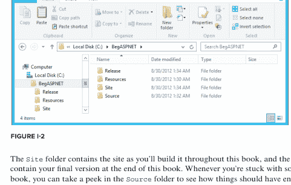

## 图 I-2

Site 文件夹包含您在本书中构建的站点，而 Release 文件夹将在本书结束时包含您的最终版本。每当您在本书中的某些示例中遇到困难时，您可以查看 Source 文件夹，看看事情应该如何结束。

如果您想运行特定章节的站点以了解其工作原理，请确保以网站的形式在 Visual Studio 中打开该章节的文件夹。因此，您应该直接打开诸如 C:\BegASP.NET\Source\Chapter 12 之类 的文件夹，而不是打开其父文件夹 C:\BegASP.NET\Source。

如果您想同时使用两种编程语言进行学习，请创建一个名为 C:\BegASP.NETVB 或 C:\BegASP.NETCS 的第二个文件夹来保存另一版本的 文件。这样，两个站点就可以共存而不会出现任何问题。如果您为 C# 语言专门创建一个文件夹，请不要包含哈希符号（#），因为这是网站路径名中无效的字符。

坚持这种结构可确保本书中“试一试”练习的顺利执行。不正确地混合或嵌套这些文件夹会使练习更难进行，甚至可能导致意外情况和错误。每当您遇到本书中未解释的问题或错误时，请确保您的站点结构仍然与此处介绍的结构密切相关。

## 勘误

我已尽最大努力确保文本或代码中没有错误。然而，没有人是完美的，错误确实会发生。如果您在本 书中发现错误，例如拼写错误或有缺陷的代码，我将非常感谢您的反馈。通过发送勘误，您可能会为另一位读者节省数小时的挫败感，同时您也在帮助我提供更高质量的信息。


要查找本书的勘误页面，请访问 www.wrox.com/remtitle.cgi?isbn=1118311809 或访问 www.wrox.com 并使用搜索框或其中一个标题列表定位该书标题。然后，在图书详情页面，点击勘误链接。在此页面上，您可以查看已提交给本书并由 Wrox 编辑发布的全部勘误。包含指向每本书勘误的链接的完整书目列表也可在 www.wrox.com/misc-pages/booklist.shtml 获取

如果您在图书的勘误页面上没有发现“您”的错误，请访问 www.wrox.com/contact/techsupport.shtml 并在那里填写表单向我们发送您发现的错误。我会检查信息，如果合适，就会在图书的勘误页面上发布消息，并在后续版本中修复该问题。

## P2P.WROX.COM

为作者和同行讨论，请加入位于 p2p.wrox.com 的 P2P 论坛。论坛是一个基于网络的系统，您可以在此发布与 Wrox 书籍及相关技术有关的留言并与其他读者和技术用户互动。论坛提供订阅功能，当论坛有新帖子发布时，会通过电子邮件向您发送您感兴趣的话题。我经常访问 Wrox 论坛，我会尽力帮助您解答关于本书的任何问题。

在 p2p.wrox.com 上，您会找到多个不同的论坛，它们不仅在您阅读本书时有所帮助，在您开发自己的应用程序时也很有帮助。要加入论坛，只需按照以下步骤操作：

- 1. 前往 p2p.wrox.com 并点击立即注册链接。
- 2. 阅读使用条款并点击同意。
- 3. 填写加入所需的资料以及您希望提供的任何可选资料，然后点击提交。
- 4. 您将收到一封电子邮件，其中包含有关如何验证您的账户并完成加入流程的信息。

您可以在不加入 P2P 的情况下阅读论坛中的留言，但要发布自己的留言，必须加入（免费）。

加入后，您可以发布新留言并回复其他用户发布的留言。您可以在首页可用的 ASP.NET 4.5 类别下找到本书专属的论坛。您可以在网络上随时阅读留言。如果您希望将特定论坛的新留言通过电子邮件发送给您，请在论坛列表中论坛名称旁点击订阅此论坛图标。

有关如何使用 Wrox P2P 的更多信息，请务必阅读 P2P 常见问题解答，以了解论坛软件的工作原理以及有关 P2P 和 Wrox 书籍的许多常见问题。要阅读常见问题解答，请在任何 P2P 页面上点击常见问题解答链接。

## 入门

## ASP.NET 4.5


## 开始使用 ASP.NET 4.5

### 本章您将学到：

- 如何获取和安装 Visual Studio Express 2012 for Web 和 Visual Studio 2012
- 如何使用 Visual Studio Express 2012 创建您的第一个网站
- ASP.NET 页面如何由服务器处理并发送到浏览器
- 如何使用和自定义开发环境

自 2002 年初发布 .NET Framework 1.0 以来，Microsoft 就投入了大量精力和开发时间到 ASP.NET，即 .NET Framework 中用于构建丰富 Web 应用程序的部分。此次首次发布意味着从旧的 Microsoft 用于构建网站的技术 *Active Server Pages (ASP)* 发生了根本性变化，现在通常被称为 *classic ASP*。ASP.NET 1.0 的引入以及随附的 Visual Studio .NET 为开发人员相比 classic ASP 带来了以下好处：

- 表现与代码之间的清晰分离。使用 classic ASP，您的编程逻辑通常散布在页面的 HTML 中，使得以后更改页面变得困难。
- 开发模型更接近桌面应用程序的编程方式。这使得许多 Visual Basic 桌面程序员更容易转向 Web 应用程序。
- 功能丰富的开发工具（称为 Visual Studio .NET），使开发人员能够可视化地创建和编码其 Web 应用程序。
- 在多种面向对象编程（OOP）语言之间进行选择，其中 Visual Basic .NET 和 C#（读作 C-Sharp）现在是最受欢迎的。
- 访问整个 .NET Framework，这首次意味着 Web 开发人员有统一且简便的方式访问许多高级功能，用于处理数据库、文件、电子邮件、网络工具等等。

尽管 ASP.NET 相比旧模型有很多优势，但使用 ASP.NET 也意味着复杂性和构建应用程序所需的知识的增加，使得许多新程序员更难入门 ASP.NET。

在 2002 年首次发布后，Microsoft 发布了另一个版本的 .NET Framework（称为 .NET 1.1）以及开发 IDE（称为 Visual Studio .NET 2003）。许多人将其视为首次发布的服务包，尽管它也在框架和开发工具中带来了大量新增强功能。

2005 年 11 月，Visual Studio 2005 和 ASP.NET 2.0 发布。对世界各地的许多开发人员来说令人愉快的是，Microsoft 再次能够大幅改进和扩展产品，添加了许多功能和工具，有助于减少 ASP.NET 1.0 引入的复杂性。新的向导和智能控件使得可以减少构建应用程序所需的代码，降低了新开发人员的学习曲线并提高了他们的生产力。

2007 年 11 月，Microsoft 发布了 Visual Studio 2008 和 ASP.NET 3.5 框架，随后于 2010 年 3 月发布了 Visual Studio 2010 和 ASP.NET 4。两个版本都增加了大量新功能，包括 LINQ（在第 14 章讨论）、AJAX Framework 的集成（您将在第 10 章了解更多）、ADO.NET Entity Framework（在第 14 章讨论）、jQuery 的包含（在第 11 章讨论）等。

当前版本 Visual Studio 2012 和 ASP.NET 4.5 建立在成功的 Visual Studio 2010 和 ASP.NET 4 版本之上，在保留许多备受喜爱的特性的同时，在其他领域添加了新功能和工具。

在接下来的 19 章中，您将学习如何使用 Visual Studio Express 2012 for Web 构建功能齐全的 ASP.NET 网站，这是 Microsoft 提供的用于 ASP.NET Web 应用程序的免费开发工具，也是完整 Visual Studio 2012 套件的一部分。本书指导您完成创建功能齐全的数据库驱动网站的过程，从下一章的简易网站开始，一直到第 19 章将其部署到生产环境。

本书附带的示例站点和所有示例都是使用 Visual Studio Express 2012 for Web（VSEW）构建的，因此重要的是您在开发机器上安装它。下一节将向您展示如何获取和安装 VSEW。一旦运行起来，您将看到如何创建第一个网站，然后对 VSEW 的众多功能进行广泛的介绍。

## MICROSOFT VISUAL STUDIO EXPRESS FOR WEB

虽然理论上您可以用记事本或其他文本编辑器单独编写 ASP.NET Web 应用程序，但您真的应该安装一份 Microsoft Visual Studio（VS）。VS 托管了大量工具，可帮助您快速创建复杂的 ASP.NET Web 应用程序。

Visual Studio 有两种形式：作为独立的免费版本，称为 Microsoft Visual Studio Express 2012 for Web，以及作为更大的开发套件的一部分，称为 Visual Studio 2012，也提供不同版本，每个版本都有自己的价格标签。使用 Visual Studio 的商业版，Web 组件完全集成。您只需启动 Visual Studio 2012，然后创建 Web Site Project 或 Web Application Project，从而启用 Visual Studio 的 Web 组件。

尽管 Visual Studio 的 Express 版本是免费的，但它包含创建复杂且功能丰富的 Web 应用程序所需的所有功能和工具。书中所有示例都可以用免费的 Express 版本构建，因此无需花费大笔资金购买 Visual Studio 2012 的商业版来跟随本书。

我将使用术语 Visual Studio（VS）指代 Visual Studio 的商业版和免费版。当专门谈论免费版时，我将使用 Express 版本或 Visual Studio Express 2012（VSEW）这一术语。

获取 Visual Studio 很简单。您可以从 Microsoft 网站下载，如下所述。

### 获取 Visual Studio

您可以从 Microsoft 网站 www.microsoft.com/express/ 获取免费的 Visual Studio Express 2012 for Web。在 Express 主页上，依次点击 Downloads 链接，直到到达提供 Express 产品（包括 VSEW）下载的页面。从该页面，您可以以 Web Install 方式下载 VSEW，您只需下载安装程序，而剩余文件将在安装过程中下载。请确保从页面中选择 Visual Studio Express 2012 for Web，而不是其他免费 Express 产品或 Visual Studio 的旧版本。

不要被 Web Install 下载的文件大小所迷惑，它只有几兆字节。您下载的文件只是安装程序，它会通过 Internet 下载所需文件。总下载量取决于您当前系统，将在 180 MB 到 270 MB 之间。

如果您想试用也包含 Web 组件的 Visual Studio 2012 完整版，可以在 Microsoft 网站 http://msdn.microsoft.com/vstudio 注册免费试用。您可以选择下载需要刻录到 DVD 的 ISO 映像，或选择下载 Web 安装程序。

最后，您可以使用 Microsoft Web Platform Installer（WPI）应用程序下载 VSEW，该应用程序可在 www.microsoft.com/web/platform 和 www.asp.net/downloads/ 下载。除了 VSEW 之外，此工具还可让您轻松访问许多其他 Web 开发相关工具和程序。WPI 是一款出色的工具，可一次性获取大量 Web 开发相关程序和工具。我经常使用它在干净的开发机器上快速启动。

### 安装 Visual Studio Express（VSEW）

安装 VSEW 是一个直接但 somewhat 冗长的过程。根据您的安装方法、计算机和 Internet 连接速度，安装 VSEW 可能需要 20 分钟到一小时甚至更长时间。


## 试一试 安装 Visual Studio Express 2012 for Web

本次“试一试”练习将指导您在计算机上安装 VSEW。它假设您使用的是前面已说明的 Web Platform Installer 选项，尽管从 DVD 安装 Express 版本的过程几乎相同。安装 Visual Studio 2012 完整版所需的步骤也类似，只是您会看到的屏幕会有所不同。

无论您如何安装 VSEW，都很重要同时安装 Microsoft SQL Express LocalDB Edition 11.0——如果您想跟随本书中的许多示例，这是必需的组件。它应该在安装 VSEW 时自动安装，但如果未安装，您会在本练习末尾找到说明以确保其正确安装。

- 1. 首先浏览至 www.microsoft.com/express/ 并按照说明下载 VSEW 2012。确保您安装的是 Visual Studio Express 2012 for Web，而不是其他免费的 Express 版本或旧版本。如果此链接将来更改或不再提供对 VSEW 下载的直接访问，请在网上搜索“install Visual Studio Express 2012 for Web”，您将被带到一个下载页面，在那里可以开始安装。
- 2. 根据您启动安装程序的方式，您有几个选项。如果您启动了 VSEW 下载，您应该会看到类似图 1-1 的屏幕。

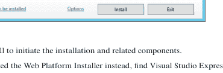

图 1-1

单击 Install 以启动安装及相关组件。

如果您改为启动了 Web Platform Installer，请在工具列表中找到 Visual Studio Express 2012 for Web 并选择它。最后，开始安装过程。

- 3. 在这两种情况下，您都会看到一个列出要安装组件的屏幕。此外，您需要同意软件的许可条款。一旦同意，您应该会看到类似图 1-2 的屏幕。
- 4. 过一段时间后，您应该会看到一条消息，表明 VSEW 已成功安装。安装程序可能需要在安装期间或之后重新启动您的计算机。安装程序完成后

## 11月大数据联考卷（一）数学

已知集合 $A = \{x | x^2 - 5x + 4 \leq 0\}$, $B = \{x | x = 2k, k \in Z\}$，则 $A \cap B =$

- A. {1, 2}
- B. {1, 2, 4}
- C. {2, 4}
- D. {1, 2, 4, 8}

## 试一试 创建您的第一个 ASP.NET 网站

- 1. 如果尚未启动，请从 Windows 开始菜单或开始屏幕启动 VS。按照屏幕上的说明在线注册 VSEW 并获取密钥。在 VSEW 启动屏幕中输入密钥，然后单击 Next 继续。注意：如果您使用的是 Visual Studio 的商业版，只需从开始菜单启动 Visual Studio 2012 即可。所有 Web 相关组件均可从主 VS 程序访问。首次启动 VS 时，可能需要一段时间才能使用，因为它正在自行配置。后续启动应用程序的速度会快得多。
- 2. 如果您使用的是 Visual Studio 的商业版，首次启动 Visual Studio 时，您还可能会收到一个对话框，让您在不同的设置集合之间进行选择。您在此对话框中所做的选择会影响窗口、工具箱、菜单和快捷方式的布局。请选择 Web Development 设置，因为这些设置专为 ASP.NET 开发人员设计。您以后可以通过重置设置随时选择不同的配置文件，如本章后面所述。
- 3. 一旦 VS 完全配置好，您会看到主屏幕出现，如图 1-3 所示。

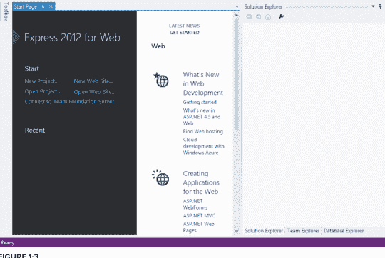

图 1-3

您将在下一节中获得所有窗口、工具栏、面板和菜单的完整说明，因此现在只需专注于创建新网站。单击左上角的 File 菜单并选择 New Web Site。如果您使用的是 Visual Studio 的商业版，根据您首次启动 Visual Studio 时选择的设置，您可能需要先打开子菜单 New。

请确保不要意外使用 New Project 菜单，因为它用于创建不同类型的 .NET 应用程序。New Web Site 对话框将如图所示 1-4 所示出现。

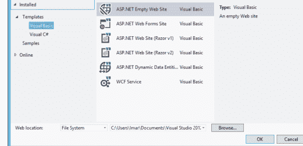

图 1-4

- 4. 在左侧的 Installed Templates 部分，您可以选择用于网站的编程语言。本书中的所有示例均以 Visual Basic 和 Visual C# 两种语言展示，因此您可以根据喜好选择语言。
- 5. 在中间的模板列表中，单击 ASP.NET Web Forms Site。验证左下角 Web Location 下拉列表中是否选择了 File System。如果需要，您可以通过单击 Browse 按钮并选择计算机硬盘上的新位置来更改网站存储在磁盘上的位置。现在，默认位置——Documents 文件夹下的一个文件夹——是可以的，因此您可以保持位置不变。
- 6. 单击 OK。VS 会为您创建一个新网站，其中包含许多文件和文件夹（见图 1-5），以启动您的网站。

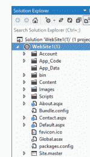

图 1-5

- 7. 通过双击打开文件 Default.aspx，并删除 ID 设置为 BodyContent 的 <asp:Content> 块内的所有代码（它大约在第 19 行以 <h2> 开始，一直到底部以 </ol> 结束）。用以下加粗代码替换它：

```
<asp:Content runat="server" ID="BodyContent" ContentPlaceHolderID="MainContent">
<h2>Hello World</h2>
<p>Welcome to Beginning ASP.NET 4.5 on <%= DateTime.Now.ToString() %></p>
</asp:Content>
```

您将在本书中看到更多这种格式的代码。当指示您输入这种格式的代码且其中部分代码为粗体时，您只需输入粗体代码即可。其他代码应已存在于文件中。

不要担心欢迎消息中带有尖括号 (<>) 和百分号的代码；这些称为标签，您稍后会了解更多。虽然现在这段代码可能看起来不熟悉，但您大概可以猜出它的作用：它输出今天的日期和时间。

- 8. 按 Ctrl+F5 在默认 Web 浏览器中打开页面。您会看到类似图 1-6 所示的页面。

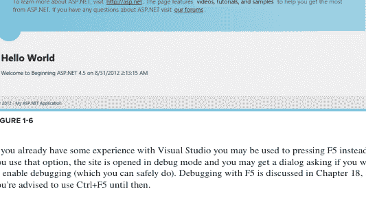

图 1-6

如果您已有 Visual Studio 使用经验，您可能习惯按 F5。如果使用该选项，站点将在调试模式下打开，您可能会收到一个询问是否启用调试的对话框（您可以安全地启用）。使用 F5 调试将在第 18 章讨论，在此之前建议您使用 Ctrl+F5。

如果在 Internet Explorer 中看到有关 Intranet 设置的警告信息栏，请单击 Turn on Intranet Settings。

如果页面中看不到日期和时间，或出现错误，请再次查看欢迎消息中的代码。它以尖括号 (<) 开头，后跟百分号和冒号。它以单个百分号和另一个尖括号 (>) 结束。此外，请确保您输入的代码与此处所示完全一致，包括大小写。这在使用 C# 时尤其重要，因为该语言区分大小写。

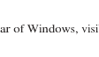

图 1-7

- 9. 请注意，如图 1-7 所示，表示 IIS Express 的小图标已出现在 Windows 托盘栏中。

如果您看到不同的图标，请在 VS 中右键单击您的站点并选择 Use IIS Express。如果在托盘中看不到该图标，请单击 Windows 托盘中其他图标附近的箭头，然后单击 Customize 选项。然后将 IIS Express System Tray 设置为 Show Icon and Notifications。该图标属于内置 Web 服务器 IIS Express。此 Web 服务器已由 VS 自动启动以处理您页面的请求。您将在本章后面了解有关 Web 服务器如何处理您的页面的更多信息。

就是这样。您刚刚使用 Visual Studio 创建了第一个 ASP.NET 网站。

## 工作原理

虽然您在本“试一试”中创建的网站相当简单，但最终导致 Default.aspx 页面在浏览器中显示的过程并不简单。单凭 ASP.NET 页面（也称为 ASPX 页面，因为其扩展名，或 Web Form）本身几乎不能做什么。它需要在浏览器能够显示它之前由 Web 服务器处理并提供服务。这就是为什么 VS 自动启动 IIS Express 来处理页面的请求。接下来，它启动了您的默认 Web 浏览器并将其定向到 Web 服务器的地址（在“试一试”示例中为 http://localhost:49474/Default.aspx），尽管地址中的实际端口号每次启动 Web 服务器时可能会更改，因为它是由 VS 随机选择的。

很重要的是要意识到您在 VS 中修改的 ASPX 文件与最终由浏览器显示的文件并不相同。

当您在 VS 中创建页面时，您会向其添加标记。ASPX 页面中的标记是 HTML、ASP.NET 服务器控件代码（您将在本章和第 4 章中了解更多）、用 Visual Basic.NET 或 C# 编写的代码等的组合。

当您在浏览器中请求 ASPX 页面时，Web 服务器会处理页面，执行文件中找到的任何服务器端代码，并有效地将 ASP.NET 标记转换为纯 HTML，然后将其发送到浏览器进行显示。在前面的“试一试”中，生成的 HTML 导致浏览器显示当前日期和时间。HTML，即超文本标记语言，是浏览器用于显示网页的语言。您将在本章后面了解 HTML 的外观以及如何使用它。

要查看最终 HTML 与原始 ASPX 页面的区别，请在浏览器中打开页面的源代码。在大多数浏览器中，您可以通过在浏览器中右键单击页面并选择 View Source 或 View Page Source 来调出源窗口。这会调出您的默认文本编辑器，显示页面的 HTML。

如果您在前面的“试一试”后已关闭浏览器，请在 VS 中按 Ctrl+F5 打开页面并选择 View Source。

在源文件中向下滚动，直到看到包含 Welcome 文本的行。请注意，与标签之间的代码不同，您现在看到的是实际的日期和时间：

```
<h2>Hello World</h2>
<p>Welcome to Beginning ASP.NET 4.5 on 8/31/2012 2:13:15 AM</p>
```

当 Web 服务器处理页面时，它从服务器查找当前日期和时间并将其插入发送到浏览器的 HTML 中。根据 Windows 安装的语言设置，您可能会看到日期和时间以不同的格式显示以适应 Windows 区域设置。


在接下来的小节中，你将更详细地了解 ASP.NET 的工作方式。

## ASP.NET 4.5 简介

当你在 Web 浏览器中输入类似 www.wrox.com 的 URL 并按回车键时，浏览器会向该地址的 Web 服务器发送一个请求。这是通过 HTTP（超文本传输协议）完成的。HTTP 是 Web 浏览器和 Web 服务器之间进行通信的协议。当你请求该 URL 时，你实际上向服务器发送了一个请求。当服务器处于活动状态且请求有效时，服务器会接受请求、处理它，然后将响应发送回客户端浏览器。请求与响应之间的关系如图 1-8 所示。

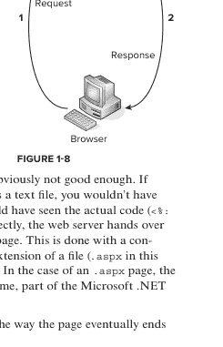

由于你使用的是 IIS Express，服务器和客户端实际上是同一台机器。然而，在真实场景中，你会将网站托管在外部 Web 服务器上，以便许多不同的客户端都能访问它。

对于简单的静态文件，如 HTML 文件或图像，Web 服务器只需从本地硬盘读取文件并将其发送到浏览器即可。但对于动态文件（如 ASPX 页面），这显然不够好。如果 Web 服务器将 ASPX 文件作为文本文件直接发送给浏览器，你不会在浏览器中看到当前的日期和时间，而会看到实际代码（`<%= DateTime.Now.ToString() %>`）。因此，Web 服务器不会直接发送文件，而是将请求移交给另一款能够处理该页面的软件。这是通过一种称为“应用程序映射”或“处理程序映射”的概念完成的，其中文件扩展名（在此示例中为 .aspx）被映射到能够处理它的应用程序。对于 .aspx 页面，请求最终由 ASP.NET 运行时处理和加工，该运行时是 Microsoft .NET Framework 中专门用于处理 Web 请求的一部分。

在处理页面期间，有三个主要方面会影响页面最终在浏览器中的呈现方式：

- **静态文本。** 任何静态文本，如你在页面中放置的 HTML、CSS 或 JavaScript 代码，都会直接发送到浏览器。你将在本章及后续章节中了解有关 HTML、CSS 和 JavaScript（一种在客户端使用的编程语言）的更多内容，其中第 3 章将详细介绍 CSS。
- **ASP.NET 服务器控件。** 这些控件放置在 ASPX 页面中，当它们被处理时，会生成插入到页面中的 HTML。在本章讨论 HTML 之后，你将了解有关服务器控件的更多内容，而第 4 章将专门讨论 ASP.NET 服务器控件。
- **编程代码。** 你可以像之前 Try It Out 中看到的那样，将 Visual Basic .NET 或 C# 等代码直接嵌入页面。此外，你也可以将代码放在单独的代码文件中。该代码文件的官方术语是 Code Beside。不过，大多数开发人员称之为 Code Behind 文件，这是我在本书中使用的术语。这段代码可以由运行时自动执行，也可以根据用户的操作来执行。无论哪种方式，代码的执行都可以极大地影响页面的显示方式，例如访问数据库、执行计算、隐藏或显示特定控件等等。你将在下一章中了解更多有关 Code Behind 文件的内容，而在第 5 章中将非常详细地讨论 ASP.NET Web 页面的编程。

一旦页面处理完毕，并收集了页面的所有 HTML，这些 HTML 就会被发送回浏览器。然后浏览器读取它、解析它，并最终显示页面供你查看。

由于 HTML 对于显示网页至关重要，下一部分将向你概述 HTML。

## 理解 HTML

HTML 是创建网页的实际标准语言，当今存在的每个 Web 浏览器都能理解它。自 90 年代初以来，它一直是万维网（Internet 中处理网页的部分）的驱动力。HTML 文档是简单的文本文件，包含标记、文本以及其他影响文本的附加数据。最新版本的 HTML 是 HTML5。虽然 HTML5 规范仍在开发中，但许多现代浏览器已经支持该规范的重要部分，而且随着这些浏览器的每次新版本发布，支持程度都会增加。尽管并非所有浏览器都完全支持 HTML5，但它确实是基于 HTML 的应用的未来，因此我在本书以及 Planet Wrox 演示网站中使用了它。不要太担心浏览器支持有限的问题。所有主流浏览器都支持你在本书中使用的所有 HTML5 功能，或者可以通过一个名为 Modernizr 的脚本库轻松模拟支持，你将在本书后面看到它。

### HTML 元素和标签

HTML 使用尖括号括起来的文本来指示内容应如何在浏览器中呈现（或显示）。尖括号内的文本称为标签；一对标签包含某些文本或其他内容则称为元素。再看一下你在之前的 Try It Out 中看到的 HTML，当时你在浏览器中打开了页面的源代码窗口：

```
<h2>Hello World</h2>
<p>Welcome to Beginning ASP.NET 4.5 on 8/31/2012 2:13:15 AM</p>
```

此示例的第一行包含一个 `<h2>` 元素，其中有一个开始标签（`<h2>`）和一个结束标签（`</h2>`）。该元素用于表示第二级标题（如果你在浏览器中向上滚动到最终源代码，还会看到一个 `<h1>` 元素）。请注意，元素是通过类似的标签闭合的，但其中多了一个正斜杠（/）：`</h2>`。位于开始和结束标签之间的任何文本都被视为该元素的一部分，并因此呈现为标题。在大多数浏览器中，这意味着文本以更大的字体呈现。与 `<h2>` 标签类似的还有用于创建直到六级标题的标签，例如 `<h1>`、`<h3>` 等等。

在标题元素下方，你会看到一个 `<p>` 元素，它用于表示段落。`<p>` 标签对之间的所有文本都被视为该段落的一部分。默认情况下，浏览器会在段落底部渲染一些额外的外边距，尽管你可以覆盖该行为。

HTML 中有许多可用的标签，数量太多，无法在此全部涵盖。下表列出了一些最重要的标签，并描述了它们的用法。有关所有 HTML 元素的完整列表，请查看维护 HTML 标准的组织的网站：www.w3.org/TR/html5/index.html。

| 标签 | 描述 | 示例 |
|---|---|---|
| `<html>` | 用于表示整个页面的开始和结束。 | `<html>`<br>...所有其他内容都放在这里<br>`</html>` |
| `<head>` | 用于表示页面中一个特殊的部分，其中包含有关页面的数据，包括其标题和对外部资源的引用。此元素的内容不会直接输出到屏幕上，但会影响页面的外观和行为，稍后你会看到。此元素放置在 `<html>` 元素内部。 | `<head>`<br>...内容放在这里<br>`</head>` |
| `<title>` | 用于定义页面的标题。此标题会出现在浏览器的标题栏中。此元素放置在 `<head>` 元素内部。 | `<title>`<br>...Welcome to Planet Wrox 4.5<br>`</title>` |
| `<body>` | 用于表示页面正文的开始和结束。其内容就是你在浏览器中看到的内容。此元素放置在 `<html>` 元素内部。 | `<body>`<br>...页面正文放在这里<br>`</body>` |
| `<header>` | 用于表示页面的页眉。此元素以及此表中剩余的所有元素都放置在 `<body>` 元素内部。 | `<header>`<br>...<br>`</header>` |
| `<section>` | 用于表示页面中的各个部分。每个页面可以有多个 section。 | `<section>`<br>...内容放在这里<br>`</section>` |
| `<aside>` | 用于表示不属于页面核心内容，而是作为补充内容呈现的内容。 | `<aside>`<br>...<br>`</aside>` |


## 2024国际人工智能与大数据应用会议

## 智能农业：基于物联网与机器学习的精准灌溉系统

**作者：张伟¹，李娜²，王强¹**

*1. 中国农业大学信息与电气工程学院，北京 100083*

*2. 北京农业智能装备技术研究中心，北京 100097*

**摘要：** 针对传统农业灌溉中水资源浪费严重、灌溉决策依赖人工经验等问题，本文设计并实现了一套基于物联网和机器学习算法的精准灌溉系统。系统通过部署在田间的多传感器节点实时采集土壤湿度、温度、光照强度及空气湿度等环境数据，利用LoRa通信技术将数据汇聚至边缘网关。在灌溉决策模型中，采用基于随机森林回归算法与长短期记忆网络（LSTM）的组合预测方法，对作物需水量进行精准预测。实验结果表明，该系统在冬小麦灌溉场景下，与传统灌溉方式相比，可实现节水率达到28.6%，同时有效提升了作物产量和品质。该研究为智慧农业的精准管理提供了可行的技术方案。

**关键词：** 物联网；机器学习；精准灌溉；传感器网络；智慧农业

**中图分类号：** TP273.5  **文献标志码：** A

### 1 引言

水资源短缺是全球农业可持续发展面临的重要挑战。据统计，农业用水占全球淡水取用量的70%左右，而传统的地面灌溉方式因技术落后，水资源利用效率普遍不足50%。精准灌溉技术通过实时监测土壤和作物生长信息，实现按需、变量灌溉，是提高水资源利用效率的关键途径。近年来，随着物联网、大数据和人工智能技术的快速发展，智能化灌溉系统已成为精准农业研究的热点。本文针对现有灌溉系统成本高、部署复杂以及决策模型泛化能力弱等问题，提出一种融合物联网感知与机器学习预测的精准灌溉解决方案。

本文的主要贡献包括：（1）设计了一套低功耗、易部署的田间多参数信息感知系统；（2）提出了一种基于随机森林回归与LSTM的组合需水量预测模型；（3）在实际农田环境中对系统性能和节水效果进行了全面验证。


图1 系统总体架构图

### 2 系统总体设计

本系统主要由数据感知层、网络传输层、数据处理与分析层以及应用服务层四部分组成，系统总体架构如图1所示。数据感知层负责采集土壤温湿度、空气温湿度、光照强度、降雨量等农业环境信息；网络传输层通过LoRa和4G/5G网络实现感知数据可靠传输；数据处理与分析层依托边缘计算节点与云平台，完成数据预处理、特征提取及需水量预测等核心计算任务；应用服务层面向终端用户提供灌溉决策、远程控制、数据分析可视化等服务。

**表1 传感器选型及主要性能参数**

| 传感器类型 | 型号 | 测量范围 | 测量精度 | 通讯接口 |
| :---: | :---: | :---: | :---: | :---: |
| 土壤湿度传感器 | SM300 | 0~100%RH | ±3% | RS485 |
| 温度传感器 | DS18B20 | -55℃~+125℃ | ±0.5℃ | 单总线 |
| 光照传感器 | BH1750 | 0~65535 lx | ±20% | I²C |
| 空气温湿度传感器 | SHT30 | -20℃~60℃ | ±2%RH | I²C |
| 雨量传感器 | JDZ-2 | 0~100mm/h | ±4% | 脉冲 |

表1列出了本系统选用主要传感器的型号与性能参数。在节点设计方面，充分考虑农业环境应用特点，采用低功耗STM32L系列微控制器作为主控芯片，结合太阳能供电技术，确保节点能够在野外环境下长期稳定运行。

### 3 需水量预测模型

精准灌溉的核心在于准确预测作物在不同生长阶段的需水量。本文提出一种基于随机森林回归与LSTM网络的组合预测模型。首先利用随机森林回归算法对历史环境数据进行特征重要性评估与筛选，去除冗余特征；然后将筛选后的关键特征序列输入LSTM网络，利用其强大的时间序列建模能力，捕捉作物需水量的动态变化规律。模型输出为未来24小时内作物的建议灌溉量。

在模型训练过程中，采用均方根误差（RMSE）和平均绝对百分比误差（MAPE）作为评价指标。实验数据集来自河北邯郸试验田2023年全年采集数据和对应气象站数据，共包含有效样本126,500条。经过数据清洗和归一化处理后，按照8：2的比例划分训练集和测试集。

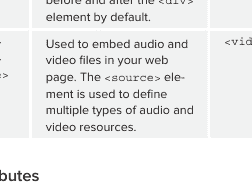

图2 模型预测结果与实际需水量对比

图2展示了模型在测试集上的预测效果。从对比曲线可以看出，本文提出的组合模型预测值与实际需水量变化趋势高度吻合，能够较为准确地反映作物在不同生长阶段的需水规律。

### 4 实验与分析

为了验证系统的综合性能，在河北邯郸试验基地选取两块面积均为20亩的冬小麦田进行对比实验。实验组采用本文设计的精准灌溉系统，对照组采用当地常规的大水漫灌方式。实验周期为2024年3月至6月冬小麦返青期至成熟期。

**表2 不同灌溉方式节水效果与产量对比**

| 灌溉方式 | 总灌溉量(m³) | 平均产量(kg/亩) | 节水率 | 水分利用效率(kg/m³) |
| :---: | :---: | :---: | :---: | :---: |
| 试验组（智能灌溉） | 112.5 | 486.3 | 28.6% | 4.32 |
| 对照组（漫灌） | 157.6 | 452.7 | — | 2.87 |

从表2可以看出，实验组在节水率和水分利用效率方面具有明显优势。实验期间，智能灌溉系统的平均节水率达到28.6%，水分利用效率提高了63.4%。同时实验组冬小麦平均亩产量较对照组提高7.4%，表明该系统在实现节水的同时能够有效保障甚至提升作物产量。

此外，系统在长达120天的连续运行测试中表现出良好的稳定性和可靠性。节点数据采集成功率保持在99%以上，通信丢包率低于0.5%，太阳能供电系统有效保障了节点的续航能力。

### 5 结论

本文针对农业灌溉水资源利用率低、决策粗放等问题，设计并实现了基于物联网与机器学习技术的精准灌溉系统。通过在河北省冬小麦种植区开展对比试验，验证了系统在节水、增产方面的显著成效。系统具有部署灵活、成本较低、运行稳定等优点，具有较好的推广应用价值。未来研究工作将聚焦于多作物适应性模型扩展，以及结合卫星遥感数据实现更大尺度的精准灌溉决策支持。

## 参考文献

- 1. 赵春江. 智慧农业的发展现状与未来展望[J]. 中国农业科学, 2023, 56(6): 1021-1036.
- 2. Smith P, Jones M. IoT-based precision irrigation: A comprehensive review[J]. Computers and Electronics in Agriculture, 2022, 198: 107034.
- 3. 李道亮, 刘峰. 基于LSTM的温室环境预测模型研究[J]. 农业工程学报, 2023, 39(10): 125-133.
- 4. Wang H, Chen Y. Random forest for feature selection in crop water demand prediction[C]//Proceedings of the 2023 IEEE International Conference on Big Data. IEEE, 2023: 2456-2465.
- 5. 张强, 王亮. 低功耗广域网在农业物联网中的应用综述[J]. 计算机工程与应用, 2022, 58(15): 28-40.

通讯作者简介：张伟（1978-），男，博士，教授，研究方向为智能农业装备与控制。

```
```html
<!DOCTYPE html>
```

DOCTYPE 在很大程度上影响浏览器（如 Internet Explorer）渲染页面的方式，因此如果你在页面上看到异常行为，请检查页面是否使用了正确的 DOCTYPE。

你可以在 W3C 网站上查看完整的 HTML5 语法规则：`www.w3.org/TR/html-markup/syntax.html`。

除了 HTML，ASP.NET 网页还可以包含其他标记。大多数页面会包含一个或多个 ASP.NET 服务器控件，以提供额外的功能。下一节将简要介绍这些 ASP.NET 服务器控件，但你将在第4章中深入了解它们。

## ASP.NET 标记初探

在某种程度上，ASP.NET 服务器控件的标记类似于 HTML。它同样具有标签、元素和属性的概念，并使用与 HTML 相同的尖括号和闭合标签。一个重大区别是，ASP.NET 标签以 `asp:` 前缀开头。例如，ASP.NET 中的按钮如下所示：

```
```aspx
<asp:Button ID="Button1" runat="server" Text="Click Me" />
```
```

注意，该标签使用尾部斜杠（/）字符进行自闭合，无需再输入单独的闭合标签。当然，如果你愿意，也可以使用单独的闭合标签。

当服务器控件被处理时，它会返回 HTML。因此，相同的按钮在浏览器中渲染后的代码如下：

```
```html
<input type="submit" name="Button1" value="Click Me" id="Button1" />
```
```

将服务器控件转换为其 HTML 表示形式的过程，与你之前看到的显示当前日期的代码类似。服务器控件由 ASP.NET 处理程序在服务器端进行处理。这一处理过程生成 HTML，并将其发送到浏览器显示。你将在第4章中了解更多相关内容。

现在你已经了解了 ASP.NET 页面的基础知识及其生成的 HTML，是时候再来看看 VS 了。了解如何使用该应用程序及其众多工具和窗口，是构建有趣、美观且功能正常的网站的重要一步。

## IDE 之旅

Visual Studio 是目前构建 ASP.NET 网页最全面、功能最丰富的*集成开发环境（IDE）*。缩写 IDE 指的是构建复杂 Web 应用程序所需的所有独立工具集成在单一环境中的方式。你无需在文本编辑器中编写代码、在命令行编译代码、在另外的应用程序中编写 HTML 和 CSS，再在另一个工具中管理数据库，VS 使你能够在同一个环境中完成所有这些任务乃至更多。除了因不必频繁切换工具而带来的效率提升外，这也使得学习 VS 的新领域更加容易，因为许多内置工具的工作方式相同。

回发（postback）——例如你在文本框中输入的文本——会被发送回服务器。ASP.NET 通过重新渲染页面来响应回发。不过，这次它会用发送到页面的值预先填充控件（如 TextBox）。

使用浏览器的“查看源代码”命令查看回发后页面的最终 HTML（如果你已经关闭页面，请在 VS 中按 Ctrl+F5 重新运行）。你应该会看到类似于下面的代码：

```
<input name="TextBox1" type="text" value="Hello World" id="TextBox1" />
<input type="submit" name="Button1" value="Submit Information" id="Button1" />
```

正如前一个示例一样，你可以看到最终生成的 HTML 与原始 ASPX 标记有很大不同。

回发是 ASP.NET 中的一个重要概念，你将在其他章节（包括第4章）中了解更多相关内容。

VSEW 所包含的窗口和工具面板比你目前看到的要多得多。下一节将简要介绍构建 ASP.NET 网页时最常用的一些窗口。如果你使用“专家设置”模式，上面提到的所有窗口都可以从 VS 或 VSEW 的主“视图”菜单中访问。

## 信息窗口

除了启动 VS 时默认可见的窗口外，还有很多其他窗口可用。你将在本书的其余部分看到其中大部分窗口，但有些窗口现在值得一提。下面讨论的所有窗口都可以从主“视图”菜单中访问。

### 错误列表

“错误列表”窗口会列出当前站点中存在的各类问题，包括 ASPX 或 HTML 文件中的错误标记，以及 VB 或 C# 文件中的编程错误。该窗口甚至还能显示 XML 和 CSS 文件中的错误。错误列表按三种类别显示消息——错误、警告和消息——来表示问题的严重程度。图1-12显示了一个在 CSS 和 XHTML 方面存在问题的页面的“错误列表”。

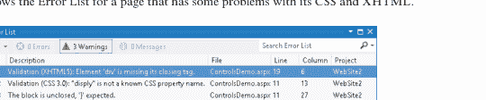

图1-12

### 输出窗口

当你尝试使用“生成”菜单构建站点时，“输出”窗口会告诉你构建是否成功。如果构建失败（例如由于编程错误），它会告诉你构建失败的原因。在 Visual Studio 的商业版本中，“输出”窗口用于


同样也包括其他信息，例如外部插件程序的状态。网站的构建（或编译）在本书后面有讨论，包括第 19 章，该章涉及网站的部署。

## 查找结果窗口

VS 的查找和替换功能在管理站点内容时是不可或缺的工具。你经常需要在当前文档甚至整个站点中替换某些文本。查找文件（Ctrl+Shift+F）和替换文件（Ctrl+Shift+H）都会在其查找结果窗口中输出结果，如图 1-13 所示。

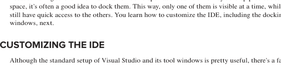

图 1-13

因为同时打开多个信息窗口可能会占用宝贵的屏幕空间，因此通常最好将它们停靠。这样一次只有一个窗口可见，同时你仍能快速访问其他窗口。接下来你将学习如何自定义 IDE，包括窗口的停靠。

## 自定义 IDE

尽管 Visual Studio 及其工具窗口的标准设置非常有用，但你很可能希望按自己的喜好自定义 IDE。你可能希望将某些窗口移动到更容易到达的位置，或者打开你经常使用的额外窗口。Visual Studio 完全可自定义，可让你调整 IDE 的每一个细节。在下一节中，你将学习如何执行最常见的自定义任务。

### 重新排列窗口

为了让每个窗口都位于应有的位置，你可以在主 IDE 中拖放它们。只需抓住窗口的标题栏或其底部的选项卡，然后将其拖向新位置即可。一旦开始拖动，你会看到 Visual Studio 会给出视觉提示，指示窗口将结束的位置（见图 1-14）。

如果你将窗口拖到中间指示器两侧的四个正方形指示器之一上，窗口将被停靠在现有窗口旁边。一旦放下，窗口就会弹出到新位置。如果你将窗口放到大指示器中间的正方形上，窗口将与该窗口一起停靠，共享相同的屏幕空间。每个窗口都有自己的选项卡，如图 1-14 底部所示的窗口。

除了在 IDE 中将窗口与其他窗口一起停靠外，你还可以拥有浮动窗口。要将停靠的窗口更改为浮动窗口，请将其从当前位置拖开，并在屏幕上不触及任何视觉提示的情况下将其放到 IDE 中的某个位置。你也可以从主菜单中选择 Window ▸ Float，或右键单击窗口的标题栏并选择 Float。

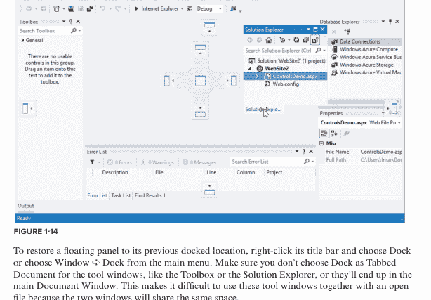

图 1-14

要将浮动面板恢复到之前的停靠位置，请右键单击其标题栏并选择 Dock，或从主菜单中选择 Window ▸ Dock。请确保不要为工具窗口（如工具箱或解决方案资源管理器）选择 Dock as Tabbed Document，否则它们会进入主文档窗口。这使得同时使用这些工具窗口和打开的文件变得困难，因为两个窗口将共享相同的空间。

### 修改工具箱

你也可以修改工具箱。默认情况下，项目按字母顺序排序，但你可以使用拖放重新排序。要执行此操作，请打开工具箱（按 Ctrl+Alt+X）并将项目（例如标准类别下的 TextBox）拖到不同位置。你也可以通过右键单击它们并从上下文菜单中选择删除来从工具箱中删除项目。别担心项目会永远丢失；你可以通过从同一菜单中选择重置工具箱再次重置工具箱。

你也可以向工具箱添加自己的项目。最常见的用途是代码片段。只需在文档窗口中突出显示一些文本或代码，然后将其拖到工具箱即可。然后你可以右键单击该项目并选择重命名项目，为其指定一个更有意义的名称，以便于识别。

为了避免用自己的代码片段 clutter 工具箱，请考虑为它们创建一个单独的类别。你可以通过从工具箱的右键单击菜单中选择添加选项卡来执行此操作。输入名称并按 Enter 键，你的工具箱选项卡即可使用。

在下一个试一试练习中，你有机会尝试 Visual Studio IDE，以便按自己的喜好对其进行自定义。

本书中你构建的示例站点名为 Planet Wrox，这是一个为对音乐感兴趣的人提供在线社区的站点。该站点为其访客提供以下功能：

- 管理员在站点上发布的关于 CD 和音乐会的评论。
- Gig Pics 部分，一个在线相册，用户可以在其中分享在音乐会上拍摄的图片。
- 在站点提供的不同图形主题之间切换的能力，让你有机会在不更改内容的情况下更改站点的外观和感觉。
- 存储音乐偏好的能力，这些偏好会影响用户在站点上看到的信息。
- 注册用户可以访问的奖励功能。

该站点使管理员（即你，站点的所有者）能够执行以下操作：

- 添加和维护评论。
- 管理系统中的不同音乐流派。
- 管理访客创建的相册。

图 1-15 显示了 Planet Wrox 主页。

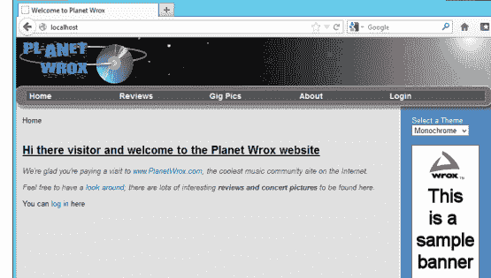

图 1-15

图 1-16 显示了 Planet Wrox 的另一个页面，但应用了不同的主题。该页面使用户能够输入个人信息并指定与其喜爱的音乐流派相关的偏好。

## 本章学到的内容

| 属性 | 用于定义或更改其行为的标签中的额外信息 |
|---|---|
| 元素 | 一对包含文本或其他内容的标签 |
| HTML | 超文本标记语言：浏览器用来显示网页的语言 |
| HTTP | 超文本传输协议：网页浏览器与网页服务器通信所使用的协议 |
| IDE | 集成开发环境：用于开发应用程序的一组集成应用程序和工具 |
| JavaScript | 用于与客户端浏览器中的网页交互的编程语言 |
| 标签 | 用尖括号包围的文本，用于创建 HTML 元素 |
| Visual Studio 2012 | 用于构建 .NET 应用程序的开发环境 |
| Visual Studio Express 2012 for Web | 免费版的 Visual Studio，可用于构建 ASP.NET Web 应用程序 |


## 构建 ASP.NET 网站

### 本章将学习的内容：

- 作为 ASP.NET 网站起点的不同项目类型
- 可用于快速启动站点开发的不同项目模板
- ASP.NET 中可用的众多文件类型及其用途
- 创建现在和将来易于管理的结构化网站的方法
- 如何使用设计器工具创建格式化的网页

### 本章 WROX.COM 代码下载

你可以在 www.wrox.com/remtitle.cgi?isbn=1118311809 的下载代码选项卡上找到本章的 wrox.com 代码下载。代码位于第 2 章下载中。

要创建外观良好、功能齐全且成功的网站，你必须了解许多重要的技术和语言，包括超文本标记语言（HTML）、ASP.NET、层叠样式表（CSS）、服务器端编程语言（如 C# 或 VB）以及客户端语言（如 JavaScript）。本章和即将到来的章节为这些技术提供了坚实的基础，因此在你完成本书后，应该能熟练掌握最重要的概念。

除了这些技术之外，你还必须了解上一章中介绍的 Visual Studio IDE。你需要知道如何创建站点、添加页面以及管理 Visual Studio（VS）为你提供的所有工具栏和窗口。此外，你还需要知道如何在 VS 中使用 HTML 和服务器控件构建和设计网页。


本章将详细说明如何创建和管理你的网站，还会介绍如何创建 ASP.NET 网页并为其添加标记，从而打造出能够向用户展示信息并对其操作做出响应的实用网页。

虽然你在上一章中已经创建了第一个 ASP.NET 网站，但本章会从更深入的角度再次介绍如何创建新网站。由于在开始一个新站点时你需要做出很多选择，因此充分了解各种选项并为自己的场景挑选合适的方案就显得非常重要。

## 使用 Visual Studio 2012 创建网站

上一章让你快速了解了如何在 VS 中创建网站。你只需从“文件”菜单中选择“新建网站”，选择一种语言，选择标准的“ASP.NET Web Forms 网站”模板，然后点击“确定”即可。不过，“新建网站”对话框中包含的内容比你上一章看到的要多。你可能已经注意到，你可以从许多不同的模板中进行选择，这些模板可以帮助你创建不同类型的站点。但在查看可以用来创建新网站的不同模板之前，你需要先进一步了解 VS 中可用的不同*项目类型*。

### 不同的项目类型

在 Visual Studio 2012 中，你可以选择两种类型的项目来创建 ASP.NET Web Forms 网站：*Web 应用程序项目*和*网站项目*。

### Web 应用程序项目

Web 应用程序项目让那些在团队中工作，或需要对站点内容及其编译和部署流程拥有更多控制权的开发者，能够更轻松地使用 VS 构建网站。整个网站作为一个项目进行管理，由一个项目文件记录网站的全部内容。

在 VS 中，你可以通过“文件”➔“新建项目”对话框创建新的 Web 应用程序项目。在该对话框中，点击你偏好的编程语言（Visual Basic 或 Visual C#），然后点击“Web”类别，这里会找到许多 ASP.NET Web 应用程序模板。其中可用的项目模板之一是 ASP.NET MVC 4 Web 应用程序，它会创建一个基于*模型-视图-控制器*模式的应用程序，这是另一种流行的 Web 应用程序开发风格。本书不会使用或讨论 MVC，但如果你想了解更多，请访问 www.asp.net/mvc。

### 网站项目

网站项目代表 VS 中针对网站的一种项目。你可以通过 Visual Studio 主菜单中的“文件”➔“新建网站”或“文件”➔“新建”➔“网站”来创建新的网站项目。

网站项目站点本质上就是一个包含大量文件和子文件夹的 Windows 文件夹。这里没有用来跟踪网站中所有单个文件的汇总文件（即扩展名为 *.vbproj* 或 *.csproj* 的*项目文件*）。你只需将 VS 指向某个文件夹，它便会立刻将其作为网站打开。这样一来，复制网站、移动网站以及与其他人共享就变得非常容易，因为网站不依赖于你本地系统上的任何文件。由于没有集中的项目文件，网站项目通常就直接称为网站，这也是本书其余部分所使用的术语。

在左侧部分，你可以为你的网站选择 Visual Basic 或 Visual C# 作为编程语言。中间部分显示的是默认安装的 ASP.NET 网站模板。每个模板都会在下一节中讨论。当你创建了自己的模板（你将在第 6 章学习如何操作），或者安装了来自其他方的模板时，它们也会出现在这个区域。

本书在创建 Planet Wrox 网站时全程使用的都是 ASP.NET 空网站模板。其他模板会在后续小节中进行简要描述，以便你了解它们的用途。你系统上实际安装的模板列表取决于你所使用的 Visual Studio 版本以及已安装的组件。只要你有“ASP.NET Web Forms 网站”和“ASP.NET 空网站”这两项，即使还有其他模板也不必担心。

### ASP.NET Web Forms 网站

这个模板可以让你建立一个基础的 ASP.NET 网站。它包含许多文件和文件夹，以便你快速启动网站的开发。不同的文件类型都将在本章后面进行讨论。特殊的 `App_Data` 文件夹以及 `Account` 文件夹中页面的功能将在本书后面进行讨论。

当你开始开发真实的 ASP.NET 网站时，这个模板是一个很好的起点。

### ASP.NET 网站（Razor v1 / Razor v2）

你可以使用这些模板，借助 Microsoft 的 Web Pages 框架来创建站点。你可以在我的《Beginning ASP.NET Web Pages with WebMatrix》（Wrox，2011 年，ISBN：978-1-118-05048-4）一书中了解更多关于 Web Pages 的内容。

### ASP.NET 空网站

ASP.NET 空网站模板除了一个配置文件（`Web.config`）之外，不会提供任何其他内容。当你已经有一批现有文件，想要用它们创建新网站，或者想从零开始构建网站时，ASP.NET 空网站模板会非常有用。在本书中，你会使用这个模板作为示例网站的基础，并随着学习的深入逐步添加文件和文件夹。

### ASP.NET 动态数据实体网站

这个模板让你无需编写大量手动代码，就能创建一个既灵活又强大的网站来管理数据库中的数据。本书不会讨论这个模板，但在第 14 章中，你会进一步了解该模板所使用的 Microsoft ADO.NET Entity Framework。

### WCF 服务

这个模板可以让你创建一个包含一个或多个 Windows Communication Foundation（WCF）服务的网站。WCF 服务与 Web 服务有些类似，它允许你创建可通过网络调用的方法。不过，WCF 服务远比简单的 Web 服务强大，并且为你提供了更多的灵活性。你将在第 10 章了解如何创建并从浏览器中调用 Web 服务。

虽然看起来你需要在开始时为合适的网站模板做出明确选择，但实际上并非如此。由于 VS 中的 ASP.NET 网站本质上只是对某个文件夹的引用，因此很容易将一种模板中的类型添加到另一种模板中。例如，将 Web 服务文件添加到标准的 ASP.NET Web Forms 网站或 ASP.NET 空网站中是完全可行的（而且非常常见），你将在第 10 章看到这一点。

## 创建和打开新网站

你有多种方式可以创建新网站和打开现有网站。这里的选项在很大程度上取决于你访问网站的方式（是通过装有 Visual Studio 的本地机器访问，还是通过远程机器访问），以及你是想使用 *IIS Express*（随 VS 一起提供的内置 Web 服务器），还是使用完整版的 IIS——即随 Windows 附带的 Web 服务器。

本书中的所有示例都假设你从本地硬盘驱动器打开站点，并使用 IIS Express（IIS 的精简版），因为它非常适合开发站点。不过，第 19 章会向你展示如何使用和配置完整版的*Internet Information Services*（简称 *IIS*）。这个高级 Web 服务器附带在大多数 Windows 版本中，主要用于在 Windows 服务器版上托管你的网站，因为它能够在高流量场景下提供网页服务。

### 创建新网站

下一节的“试试看”操作将指导你创建 Planet Wrox 网站，这是你在本书中要完成的项目。除特别说明外，本书其余部分的所有练习都假设你已在 VS 中打开此网站。该练习要求你将网站存储在一个名为 `C:\BegASPNET\Site` 的文件夹中。请记下这个文件夹名称，因为全书都会用到它。如果你决定使用不同的文件夹，那么在书中看到这个文件夹名称时，请务必使用你自己的位置。同时，请确保不要在文件夹名称中使用 `#` 号之类的特殊字符，也不要插入空格，否则在开发网站时你会遇到麻烦。最后，不要把这个文件夹创建在 Windows 文档文件夹（通常位于 `C:\Users\UserName\Documents`）下，因为之后当其他账户需要访问你的站点时，你会遇到问题。

### 试试看：创建一个新的 ASP.NET 4.5 网站

- 1. 首先，使用 Windows 资源管理器或“我的电脑”在 C 盘根目录下创建一个名为 `BegASPNET` 的文件夹。在该文件夹中，再创建一个名为 `Site` 的文件夹。最终你应该得到一个名为 `C:\BegASPNET\Site` 的文件夹。如果你按照本书“引言”部分中的说明操作，并解压了本书的源代码，那么你已经有了 `BegASPNET` 文件夹，其中包含 `Source` 和 `Resources` 文件夹。不过你仍然需要创建 `Site` 文件夹。如果你想同时使用 VB.NET 和 C#，可以创建两个文件夹 `BegASPNETVB` 和 `BegASPNETCS`，并使用两个 Visual Studio 实例。
- 2. 启动 Visual Studio，然后根据你的 VS 版本，选择“文件”➔“新建网站”或“文件”➔“新建”➔“网站”。


> **常见错误** 不要误用“文件 ▸ 新建项目”创建新的 Web 应用程序项目，因为该项目模板与本书中的练习不兼容。

- 3. 在屏幕顶部的“目标框架”下拉列表中，选择 .NET Framework 4.5。
- 4. 在左侧的“已安装模板”区域中，在 Visual Basic 和 Visual C# 之间选择。本书中的所有示例均以这两种编程语言展示，因此你可以选择自己最喜欢的一种。
- 5. 在中间区域选择“ASP.NET 空网站”。
- 6. 在“Web 位置”下拉列表中，确保选择了“文件系统”。另外两个选项（HTTP 和 FTP）分别用于打开在 IIS 上运行的网站（可以在本地计算机上，也可以在远程服务器上，使用所谓的 Microsoft FrontPage Server Extensions）以及从 FTP 服务器打开网站。
- 7. 单击位置文本框旁边的“浏览”按钮，浏览到 C:\BegASPNET\Site（你在本练习第一部分创建的文件夹），然后单击“打开”。

你的最终屏幕应类似于图 2-2，不过你可能选择的是 Visual C# 而不是 Visual Basic。

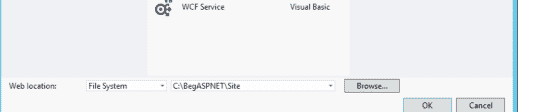

图 2-2

- 8. 单击“确定”，VS 将为你创建新网站。

## 工作原理

单击“确定”后，VS 会立即为你创建一个新的空网站。这个新网站只包含一个配置文件（名为 Web.config）。在解决方案资源管理器中，你的网站现在看起来如图 2-3 所示。如果你看不到顶层的“解决方案”节点，请在 VS 中选择“工具 > 选项”，然后在“项目和解决方案”类别中选择“始终显示解决方案”。

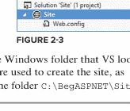

由于基于“空网站”模板的网站只是 VS 所查看的一个简单 Windows 文件夹，因此磁盘上的实际文件夹包含相同的文件。创建网站时没有使用其他文件，如图 2-4 所示，图中文件资源管理器显示了 C:\BegASPNET\Site 文件夹中的文件。

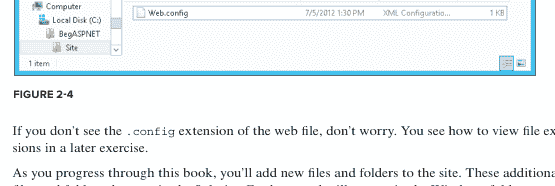

如果你没有看到 web 文件的 .config 扩展名，请不要担心。你将在后面的练习中了解如何查看文件扩展名。

随着你继续阅读本书，你将向网站添加新的文件和文件夹。这些额外的文件和文件夹会显示在解决方案资源管理器中，也会出现在 C:\BegASPNET\Site 的 Windows 文件夹中。

打开基于“网站项目”模板的网站与创建新网站非常相似。在下一节中，你将快速了解如何在 VS 中打开现有网站。

## 打开现有网站

与创建新网站一样，在 VS 中打开现有网站时，你也可以选择网站源位置。你可以从本地文件系统、本地 IIS Web 服务器、使用 FTP 的远程服务器、使用 Microsoft FrontPage Server Extensions 的远程站点，或从集中式源代码管理系统（如 Microsoft 的 Team Foundation Server）打开网站。图 2-5 显示了 VS 中的“打开网站”对话框。

| 文件类型 | 扩展名 | 描述 |
|---|---|---|
| Web 窗体 | .aspx | 任何 ASP.NET 网站的主力；表示用户在浏览器中查看的页面。 |
| 母版页 | .master | 使你能够定义网站的全局结构、外观和感觉。你将在第 6 章了解如何使用它。 |
| Web 用户控件 | .ascx | 包含可在网站多个页面中重用的页面片段。第 8 章完全专门讨论用户控件。 |
| HTML 页 | .htm/.html | 可用于在网站中显示静态 HTML。 |
| 样式表 | .css | 包含使你能对网站进行样式设置和格式设置的 CSS 代码。你将在第 3 章了解更多关于 CSS 的内容。 |
| Web 配置文件 | .config | 包含整个网站使用的全局配置信息。你将从第 4 章开始，在本书后面了解如何使用 Web.config。 |
| 站点地图 | .sitemap | 以 XML 格式包含网站中文件的层次结构表示。站点地图用于导航，将在第 7 章讨论。 |
| JavaScript 文件 | .js | 包含可在客户端浏览器中执行的 JavaScript。 |
| 外观文件 | .skin | 包含网站中控件的设计信息。外观将在第 6 章讨论。 |

下一个“试试看”练习将向你展示如何向网站添加一个新的母版页，该母版页将在整本书中使用。

### 试试看 向网站添加文件

- 1. 如果它尚未打开，请通过选择“文件 ▸ 打开网站”打开你之前创建的 Planet Wrox 网站。确保从文件系统打开网站，找到包含你的网站的文件夹（C:\BegASPNET\Site），并单击“打开”按钮。
- 2. 在解决方案资源管理器中，右键单击你的网站，然后选择“添加 ▸ 新建文件夹”。

> **常见错误** 确保你单击的是实际网站，而不是 Web.config 文件或顶部的“解决方案”节点（见图 2-3），否则你将无法获得正确的菜单项。

## 数据文件

数据文件用于存储可在你的网站和其他应用程序中使用的数据。该组包括 XML 文件、数据库文件以及与数据处理相关的文件。

| 文件类型 | 扩展名 | 描述 |
|---|---|---|
| XML 文件 | .xml | 用于以 XML 格式存储数据。除了普通 XML 文件外，ASP.NET 还支持更多基于 XML 的文件，其中两种你之前已经简要见过：Web.config 和站点地图。 |
| SQL Server 数据库 | .mdf | 扩展名为 .mdf 的文件是 Microsoft SQL Server 使用的数据库。数据库将在第 12 章及以后讨论。 |
| ADO.NET 实体数据模型 | .edmx | 用于以声明方式访问数据库，无需编写大量重复代码。从技术上讲，这不是数据文件，因为它不包含实际数据。但是，由于它与数据库紧密相连，因此将其归入此标题下是有意义的。你将在第 14 章学习更多关于 ADO.NET Entity Framework 的内容。 |

正如你在前面的“试试看”中看到的，添加这些类型中的任何一种新文件都非常容易。向网站添加现有文件也同样容易。

## 添加现有文件

你在网站中创建的并非每个文件都必须是全新的。在某些情况下，重用其他项目中的文件是有意义的。例如，你可能希望跨多个站点重用徽标或 CSS 文件。你可以通过右键单击解决方案资源管理器中的网站并选择“添加 ▸ 添加现有项”来轻松添加现有文件。在出现的对话框中，你可以浏览文件，并可以通过按住 Ctrl 键来选择多个文件。最后，单击“添加”后，文件将添加到网站中。你还可以使用复制和粘贴将文件从本地磁盘上的文件夹复制到 VS 中的网站。只需在 Windows 资源管理器中突出显示文件，按 Ctrl+C 复制文件，切换到 VS，单击解决方案资源管理器中的网站（或网站的子文件夹），然后按 Ctrl+V。文件随后被复制到你的网站文件夹中。

然而，还有一种更简单的向网站添加文件的方法，当你需要向网站添加多个现有文件和文件夹时，它可以节省大量时间：拖放。下面的“试试看”将向你展示其工作原理。

### 试试看 向网站添加现有文件

- 1. 在 Windows 中，最小化所有打开的应用程序，右键单击桌面，然后选择“新建 ▸ 文本文档”。如果你看不到此选项，只需使用记事本创建一个新的文本文档并将其保存到桌面上。
- 2. 将文件重命名为 `Styles.css`。确保 `.txt` 扩展名被 `.css` 替换。如果你看不到初始的 `.txt` 扩展名，并且文件图标没有从文本文件变为 CSS 文件（默认情况下，这与带有齿轮符号的文本文件图标相同，但你可能安装了更改了 CSS 文件图标的软件），则说明 Windows 配置为隐藏已知文件类型的扩展名。如果是这种情况，请打开 Windows 7 中的 Windows 资源管理器，单击“组织”按钮，然后选择“文件夹和搜索选项”。切换到“查看”选项卡，取消选中“隐藏已知文件类型的扩展名”选项。对于 Windows 8，你可以在文件资源管理器功能区栏的“查看”选项卡上找到名为“文件名扩展名”的选项，如图 2-4 所示。你现在可能需要将文件名从 `Styles.css.txt` 更改为 `Styles.css`。

当你将文件扩展名从 `.txt` 更改为 `.css` 时，Windows 可能会发出警告，提示如果你继续，文件将变得不可用。你可以放心地对此问题回答“是”以继续。

- 3. 重新排列 VS，以便你也能看到带有 CSS 文件的桌面部分。你可以使用 VS 的 Windows 标题栏上的“关闭”按钮旁边的“向下还原”按钮使其退出全屏模式。
- 4. 单击桌面上的 CSS 文件，并在按住鼠标按钮的同时将文件拖入解决方案资源管理器。确保将文件拖入解决方案资源管理器，而不是拖到 VS 的其他部分，否则文件将不会被添加。例如，当你将其拖入文档窗口时，VS 只会为你打开该文件，但不会将其添加到网站中。
- 5. 当鼠标悬停在网站节点或解决方案资源管理器中的现有文件上方时松开鼠标，CSS 文件就会添加到你的网站中。

> **注意** 如果你使用的是 Windows 7 并以管理员身份运行 VS，这可能不起作用，因为 Windows 不允许 Windows 资源管理器和 VS 通信。在这种情况下，请使用前面讨论的“添加现有项”菜单添加现有文件，或使用复制和粘贴。

## 工作原理

虽然这看起来是一个使用基本 Windows 技能的简单练习，但它旨在说明 VS 在将文件添加到网站时会创建该文件的`copy`。因此，当你在 VS 中对副本进行更改时，桌面上的原始 `Styles.css` 文件不会受到影响。这样，你可以轻松地将现有网站中的文件拖放到新网站中，而不会影响原始文件。这同样适用于你使用 VS 中的“添加现有项”对话框添加的文件。

如果你在 VS 之外添加了文件到网站文件夹，它们可能不会立即显示出来。你可以通过单击解决方案资源管理器工具栏上的“刷新”按钮来获取最新的文件列表。


## 组织你的网站

由于构成网站的众多文件，通常最好按功能将它们分组到单独的文件夹中。例如，所有样式表文件都可以放在名为 Styles 的文件夹中，.js 文件可以放在 Scripts 中，用户控件可以放在 Controls 文件夹中，而母版页可以存储在名为 MasterPages 的文件夹中。这取决于个人喜好，但结构良好且组织有序的网站更容易管理和理解。下一个“试一试”将解释如何将文件移动到新文件夹中以组织你的网站。

### 试一试 组织你的网站

- 1. 在“解决方案资源管理器”中右键单击 Planet Wrox 网站，然后选择“添加”>“新建文件夹”。
- 2. 输入 Styles 作为新文件夹名称，然后按 Enter。
- 3. 再创建一个名为 Controls 的文件夹。这两个文件夹将在本书其余部分中使用。
- 4. 将之前添加的 Styles.css 文件拖动并放到 Styles 文件夹中。

如果一切顺利，你的“解决方案资源管理器”应如下图 2-7 所示。

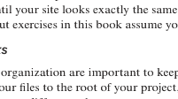

图 2-7

如果你的“解决方案资源管理器”与图 2-7 所示不同，请再次执行此“试一试”，直到你的网站完全相同，文件夹结构和文件也完全一致。本书中后续的“试一试”练习都假设你的网站中具有正确的文件夹和文件。

### 工作原理

结构和组织对于保持网站的可管理性非常重要。虽然你可能想将所有文件都添加到项目的根目录，但最好不要这样做。对于非常小的网站，你可能看不出任何区别，但一旦网站开始增长，如果缺乏结构，你会发现管理起来变得困难得多。将相关文件放在单独的文件夹中是组织网站的第一步。将相同类型的文件存储在单个文件夹中只是优化网站的一种方式。在后面的章节中，你会看到单独的文件夹也用于对具有相似功能的文件进行分组。例如，只能由网站管理员访问的所有文件都分组在名为 Management 的文件夹中。

VS 的拖放功能使重新组织网站变得很容易。只需拾取一个或多个文件并将其拖放到新位置即可。如果你继续在扩展网站的同时应用这种类型的组织实践，你会发现明天或六个月后，在需要时也不会有任何问题定位到正确的文件。

### 特殊文件类型

上一节列出的某些文件要求你将它们放在特殊文件夹中，而不是前面提出的可选组织文件夹结构。IDE 会在你尝试在特殊文件夹之外添加文件时发出警告，并提供创建该文件夹并将文件放入其中的选项。例如，当你尝试添加类文件（扩展名为 .vb 或 .cs）时，会出现图 2-8 所示的警告。

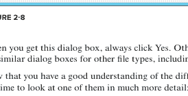

图 2-8

当你收到此对话框时，始终单击“是”。否则，你的文件将无法正常运行。对于其他文件类型，包括皮肤和数据库文件，你也会收到类似的对话框。

现在你对构成网站的不同类型文件有了良好的理解，是时候更详细地查看其中一种文件了：.aspx 文件，也称为 Web 窗体。

## 使用 Web 窗体

Web 窗体由 .aspx 文件表示，是任何 ASP.NET 4.5 Web 窗体网站的核心。它们是用户访问你的网站时在浏览器中看到的实际页面。

正如你在上一章中所见，Web 窗体可以包含 HTML、ASP.NET 服务器控件、客户端 JavaScript、CSS 和编程逻辑的混合。为了更轻松地查看所有这些代码如何在浏览器中结束，VS 为你的页面提供了多种不同的视图。

### Web 窗体的不同视图

VS 使你能够从几个不同的角度查看 Web 窗体。当你在“文档窗口”中打开带有标记的文件（例如 Web 窗体或母版页）时，你会在窗口左下角看到三个按钮。通过这些按钮，如图 2-9 所示，你可以在不同的视图之间切换。此图显示了一个母版页，你将在第 6 章中了解更多相关信息。

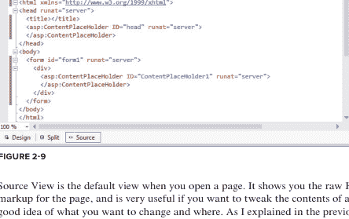

图 2-9

Source View 是打开页面时的默认视图。它显示页面的原始 HTML 和其他标记，如果你想调整页面的内容并且对想要更改的内容和位置有很好的了解，这非常有用。正如我在上一章中解释的那样，我使用术语 Markup View 而不是 Source View 来指代 ASPX 和 HTML 页面的标记。

“设计”按钮可让你将“文档窗口”切换到设计视图，从而了解页面最终会是什么样子。在设计视图中，你可以使用主“视图”菜单中的“视觉辅助”和“格式标记”子菜单来控制换行符、边框和空格等视觉标记。两个子菜单都提供名为“显示”的菜单项，可让你一次打开或关闭所有视觉辅助。关闭两者是有用的，如果你想了解页面在浏览器中的最终效果。 然而，你应该只使用设计视图来了解页面最终会是什么样子。虽然 VS 具有出色的渲染引擎，可以很好地在设计视图中渲染页面，但你也应该始终在不同的浏览器中检查你的页面，因为你在 VS 中看到的是页面在处理之前的状态。页面上的服务器控件可能会发出更改浏览器中页面外观的 HTML。因此，建议尽可能在浏览器中查看页面，以便检查它是否会以你想要的方式显示。还建议在你能获得的尽可能多的不同浏览器中测试你的网站，因为它们在渲染网页的方式上可能存在细微差异。Planet Wrox 网站已针对最近版本的 Microsoft Internet Explorer、Firefox、Google Chrome、Safari 和 Opera 进行了开发和测试。你将在本书的各个地方看到这些浏览器的屏幕截图。

“拆分”按钮可让你同时查看设计视图和标记视图，如图 2-10 所示。

拆分视图非常适合在页面的设计视图中添加控件时查看 VS 生成的代码。反过来也非常有用：当你在标记视图中对页面的标记进行更改时，你可以看到它在设计视图中的效果。有时设计视图会与标记视图不同步。如果是这种情况，会在设计视图顶部出现一条消息。只需单击该消息或保存整个页面即可更新设计窗口。

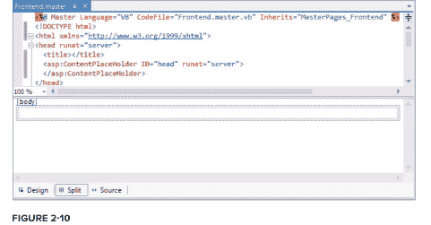

图 2-10

你可以使用 Ctrl+Page Up 和 Ctrl+Page Down 键在三种不同模式之间循环。

如果你希望页面以与标记视图不同的视图打开，请选择“工具”▸“选项”。然后展开 HTML Designer，并在“常规”类别中设置首选视图。或者，在 VS 右上角的“快速启动”文本框中输入 HTML Designer General（你可以通过按 Ctrl+Q 访问），然后单击出现的列表中的项目。

除了在标记视图窗口中看到的 HTML 和其他标记外，Web 窗体还可以包含 C# 或 Visual Basic .NET 中的代码。此代码放置的位置取决于你创建的 Web 窗体的类型。下一节更详细地解释了你拥有的两个选项。

### 在代码隐藏和内联代码页面之间选择

Web 窗体有两种形式：要么是带有代码隐藏文件的 .aspx 文件（文件名为 Web 窗体名加上 .vb 或 .cs 扩展名），要么是代码嵌入其中的 .aspx 文件，通常称为带内联代码的 Web 窗体。虽然直到第 5 章你不会看到太多代码，但了解这些类型的 Web 窗体之间的区别很重要。一开始，带内联代码的 Web 窗体似乎更容易理解。因为用于编程网站的代码是同一 Web 窗体的一部分，所以你可以清楚地看到代码与文件之间的关系。然而，随着页面变大并添加更多功能，通常如果代码在单独的文件中会更容易。这样，它就完全与标记分离，使你能够专注于手头的任务。

在下一个练习中，你将添加两个文件来演示代码隐藏和内联代码之间的区别。

### 试一试 向你的网站添加带代码的 Web 窗体

你在本次练习中添加的文件不需要用于最终应用程序。为了避免项目混乱，你应该将它们放在单独的 Demos 文件夹中。


- 1. 在“解决方案资源管理器”中，右键单击你的网站，然后选择“添加 ▸ 新建文件夹”。将该文件夹命名为`Demos`并按Enter键。

- 2. 右键单击`Demos`文件夹，然后选择“添加 ▸ 添加新项”。在出现的对话框中，在左侧选择你偏好的编程语言，单击“Web窗体”模板，并将文件命名为`CodeBehind.aspx`。确保选中“将代码放在单独的文件中”复选框。最后，单击“添加”按钮。页面应在“标记视图”中打开，这样你可以看到页面的HTML。

- 3. 在“文档窗口”底部，单击“设计”按钮，将页面从“标记视图”切换到“设计视图”。你看到的页面有一个白色背景，顶部有一个小的虚线矩形。这个虚线矩形代表你在“标记视图”中看到的`<div>`元素。

- 4. 从“工具箱”中，从“标准”类别拖动一个“Label”控件，并将其放到页面的虚线区域。记住，如果“工具箱”尚未打开，你可以使用快捷键Ctrl+Alt+X将其打开。在“设计视图”中，你的屏幕现在应该如图2-11所示。

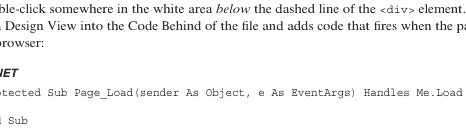

图2-11

- 5. 在`<div>`元素虚线下方白色区域的任意位置双击。VS会从“设计视图”切换到该文件的“代码隐藏”文件，并添加在浏览器中加载页面时触发的代码：

### VB.NET
```
Protected Sub Page_Load(sender As Object, e As EventArgs) Handles Me.Load

End Sub
```

### C#
```
protected void Page_Load(object sender, EventArgs e)
{
}
```

尽管这种奇怪的语法现在看起来可能有点吓人，但暂时不要太担心。在大多数情况下，VS会自动为你添加它，就像你刚才看到的那样。在后面的章节中，你会确切地看到这段代码是如何工作的，但现在重要的是要意识到，你将放置在Visual Basic中以`Protected Sub`开头和`End Sub`之间的代码，以及C#中花括号之间的代码，将在浏览器请求页面时运行。

从现在起你看到的所有代码示例都将包含Visual Basic（VB.NET）和C#两个版本，所以始终选择与你所用编程语言匹配的那个。

- 6. 将光标放在VS创建的代码的空行中，并添加加粗的代码行，将当前日期和时间赋给Label控件，该控件最终会显示在浏览器中：

### VB.NET
```
Protected Sub Page_Load(sender As Object, e As EventArgs) Handles Me.Load
    Label1.Text = "Hello World; the time is now " & DateTime.Now.ToString()
End Sub
```

### C#
```
protected void Page_Load(object sender, EventArgs e)
{
    Label1.Text = "Hello World; the time is now " + DateTime.Now.ToString();
}
```

注意，当你为Label1输入字母L时，会出现一个包含可选项的列表。这是Visual Studio的IntelliSense的一部分，它是一个帮助你快速编写代码的出色工具。不需要输入完整的单词Label1，只需输入字母L或字母La，然后从列表中选择适当的项，如图2-12所示。

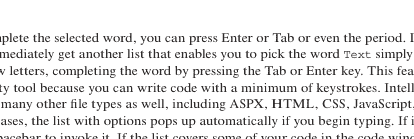

图2-12

要完成所选单词，你可以按Enter或Tab键，甚至按句点。在后一种情况下，你会立即得到另一个列表，只需输入前几个字母即可选择单词Text，然后按Tab或Enter键完成该单词。这个功能是一个真正的生产力工具，因为你可以用最少的按键编写代码。IntelliSense在其他许多文件类型中也可用，包括ASPX、HTML、CSS、JavaScript和XML。在许多情况下，如果你开始输入，带有选项的列表会自动弹出。如果没有，按Ctrl+空格键来调用它。如果该列表覆盖了代码窗口中的部分代码，请按住Ctrl键使窗口透明。

- 7. 在“解决方案资源管理器”中右键单击CodeBehind.aspx页面，然后选择“在浏览器中查看（Internet Explorer）”。根据你在计算机上配置的默认浏览器，括号中的浏览器名称可能会有所不同。从现在起，我将这个菜单项简称为“在浏览器中查看”。

- 8. 如果出现询问是否要保存更改的对话框，请单击“是”，然后页面将出现在浏览器中，类似于你在图2-13中看到的浏览器窗口。

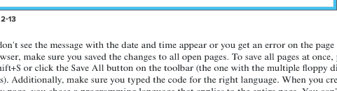

图2-13

如果你没有看到显示日期和时间的消息，或者浏览器中的页面出现错误，请确保已将更改保存到所有打开的页面。若要一次保存所有页面，请按Ctrl+Shift+S或单击工具栏上的“全部保存”按钮（带有多个软盘符号的那个）。此外，请确保你输入了正确语言的代码。在创建这个新页面时，你选择了一种适用于整个页面的编程语言。你不能在单个页面中混用语言，因此如果你从Visual C#页面开始，请确保在步骤6中输入了C#代码片段。

- 9. 使用内联代码设置页面与此非常相似。首先向Demos文件夹添加一个新的Web窗体。将其命名为CodeInline.aspx，并确保取消选中“将代码放在单独的文件中”选项。

- 10. 就像你在步骤3、4和5中所做的那样，将页面切换到“设计视图”，将一个Label控件拖到`<div>`元素内部，然后在现在包含该标签的`<div>`之外的页面某处双击。VS不会打开代码隐藏文件，而是将页面切换到“标记视图”，并直接将Page_Load代码添加到页面中。

- 11. 在VS插入的代码块中的空行上，输入本练习步骤6中看到的加粗行。确保使用正确的编程语言。最终你的.aspx文件顶部应该包含以下代码：

### VB.NET
```
<script runat="server">
    Protected Sub Page_Load(sender As Object, e As EventArgs)
        Label1.Text = "Hello World; the time is now " & DateTime.Now.ToString()
    End Sub
</script>
```

### C#
```
<script runat="server">
protected void Page_Load(object sender, EventArgs e)
{
    Label1.Text = "Hello World; the time is now " + DateTime.Now.ToString();
}
</script>
```

- 12. 在“解决方案资源管理器”中右键单击页面，然后选择“在浏览器中查看”。或者，按Ctrl+F5在浏览器中打开页面。你应该会看到与步骤7中类似的页面。

## 工作原理

在运行时，使用内联代码的页面与使用代码隐藏的页面行为相同。在这两种情况下，ASP.NET运行时都会看到Page_Load代码并执行其中找到的任何代码。在动手试一试练习中，这意味着将Label1的Text设置为一条欢迎消息以及当前日期和时间。这两种选项之间最大的区别在于代码存储的位置。对于使用内联代码的页面，所有代码和标记都存储在磁盘上的同一个文件中。使用代码隐藏时，你编写的VB或C#代码存储在一个单独的、以Web窗体命名的文件中。

由于代码隐藏页面更易于管理，我将专门为Planet Wrox网站使用它们。

在此示例中，C#代码看起来与VB.NET代码非常相似。设置Label文本的代码在两种语言中几乎相同。一个区别是，VB.NET使用与号（&）将两段文本粘合在一起，而C#使用加号（+）字符。在VB.NET中也可以使用加号来连接字符串，但有一些注意事项，你将在第5章中了解到。另一个区别是，C#代码行必须以分号（;）结尾以表示一个代码单元的结束，而Visual Basic使用换行符。如果要在Visual Basic中跨多行拆分长代码行，可以使用下划线（_）字符。在早期版本中，VB.NET在许多不同的地方都需要下划线。然而，在最新版本的Visual Basic中，语言设计者大大减少了必须使用下划线的地方。

如果你想将代码拆分为多行，确实需要下划线的一个位置是在你之前看到的Handles关键字之前：

```
Protected Sub Page_Load(sender As Object, e As EventArgs) _
    Handles Me.Load
    Label1.Text = "Hello World; the time is now " & DateTime.Now.ToString()
End Sub
```

请注意，在你的页面中，你不必使用下划线来换长行。然而，我会在本书中的一些示例中添加它，因为本书的页面宽度不足以在一行中显示整个代码语句。在本书其余部分的Visual Basic示例中，你会看到更多这样的下划线。如果你决定手动输入下划线以使自己的代码更具可读性，请不要忘记在下划线前输入一个空格，否则你的代码将无法工作。

在C#中，你不需要这个字符，因为该语言本身允许你只需按Enter键即可断开长行。这是因为C#使用分号表示一行的结束，而不是源代码中的换行符。

你通过右键单击“在浏览器中查看”选项或按Ctrl+F5在浏览器中打开了页面。使用“在浏览器中查看”选项时，你总是打开右键单击的页面。使用Ctrl+F5快捷键时，你打开的是“文档窗口”中当前处于活动状态的文档、在“解决方案资源管理器”中当前选中的页面，或者是已设置为网站“起始页”的文件。此外，所有打开的文件都会自动保存，在浏览器中打开请求的页面之前，会检查网站是否有错误。

你可以通过右键单击解决方案资源管理器中的页面并选择“设为起始页”来将页面指定为起始页。如果以后想要控制此行为，请右键单击解决方案资源管理器中的网站，然后选择“属性页”。在“启动选项”类别中，你可以指示要打开当前活动页面，也可以指定特定页面，如图2-14所示。


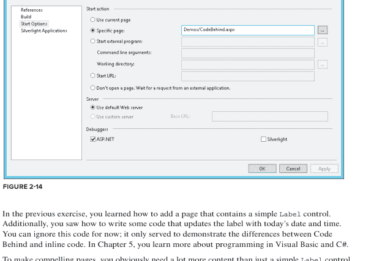

图 2-14

在之前的练习中，你学习了如何添加一个包含简单 Label 控件的页面。此外，你还看到了如何编写一些代码来用今天的日期和时间更新标签。现在可以忽略这段代码；它只是为了演示 Code Behind 和内联代码之间的差异而服务的。在第 5 章中，你将了解更多关于 Visual Basic 和 C# 编程的知识。

要创建引人注目的页面，你显然需要比仅仅显示今天日期和时间的简单 Label 控件多得多的内容。下一节将向你展示如何向页面添加内容和 HTML，以及如何对其进行样式和格式设置。

## 添加标记到页面

你有多种方式向页面添加 HTML 和其他标记。首先，你可以直接在 Markup View 窗口中输入它。然而，这并不总是最佳选择，因为它迫使你手工输入大量代码。为了更轻松地在页面中插入新的 HTML 并对其应用格式，Design View 窗口提供了许多有用的工具。这些工具包括 Formatting 工具栏以及 Format 和 Table 菜单项。要使这些工具处于活动状态，你需要将文档置于 Design View 中。如果你以 Split View 模式工作，必须确保 Design View 部分具有焦点，否则你会发现大多数工具都不可用。

## 插入和格式化文本

你可以在 Design View 和 Markup View 中输入文本。只需将光标放置在所需位置并开始输入。当你切换到 Design View 时，Formatting 工具栏变得可用，其选项如 图 2-15 所示。

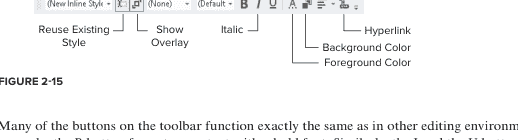

图 2-15

工具栏上的许多按钮在其他编辑环境中功能完全相同。例如，B 按钮使用粗体字体格式化你的文本。同样，I 和 U 按钮分别使你的文本斜体化和下划线。标记为 Block Format 的下拉列表使你能够插入像 <p> 用于段落，<h1> 到 <h6> 用于标题，以及 <ul>、<ol> 和 <li> 用于列表这样的 HTML 元素。你可以直接从下拉列表中选择一个项目将其插入页面，也可以先选择一些文本，然后从列表中选择适当的块元素将所选文本包裹在标签内。

在下一个试一试中，你将看到如何使用这些工具来创建 Planet Wrox 网站的首页。

### 试一试 添加格式化的文本

在本试一试中，你创建一个名为 Default.aspx 的 Web Form 并向其添加一些基本内容。

- 1. 使用 Add New Item 对话框向站点根目录添加一个新的 Web Form 并将其命名为 Default.aspx。确保勾选 Place Code in Separate File 选项并单击 Add。使用 Document Window 底部 Design 按钮切换到 Design View。

- 2. 单击虚线矩形内部，直到看到显示 <div> 元素当前处于活动状态的标记。同时，代码窗口底部的标签导航器应突出显示带有文本 <div> 的最后一个块，如 图 2-16 所示。

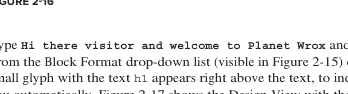

图 2-16

- 3. 输入 Hi there visitor and welcome to Planet Wrox 并使用鼠标突出显示文本。从 Block Format 下拉列表中（在 图 2-15 中可见）选择 Heading 1 <h1>。请注意，文本上方会出现一个带有文本 h1 的小标记，以指示 VS 已自动为你创建了一个标题。图 2-17 显示了带有 <h1> 元素的 Design View。

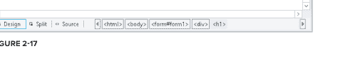

图 2-17

- 4. 将光标定位在标题末尾的单词 Wrox 之后并按 Enter。会为你插入一个新的段落（由带有字母 p 的小标记指示），以便你可以直接开始输入。

- 5. 输入 图 2-18 中所示的文本（或自拟）来欢迎访问者来到 Planet Wrox。注意，当你输入逗号后，文本 www.PlanetWrox.com 会变蓝，以指示 VS 已将其识别为网络地址并将其转换为链接。你可以按 Enter 开始新段落。选择文本 "paying a visit,"，单击 Formatting 工具栏上的 Foreground Color 按钮，并在出现的对话框中选择不同颜色。然后选择其他一些文本，例如 "reviews and concert pictures," 并单击 Bold 按钮。完成后，你的 Design View 应显示类似于 图 2-18 的内容。

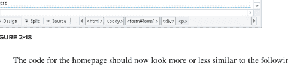

图 2-18

主页的代码现在应大致类似于以下内容（代码已重新格式化以适应书中的空间）：

```
<div>
<h1>Hi there visitor and welcome to Planet Wrox</h1>
<p>
&nbsp;&nbsp;We're glad you're <span class="auto-style1">paying a visit</span> to <a href="http://www.PlanetWrox.com">www.PlanetWrox.com</a>, the coolest music community site on the Internet.
</p>
<p>
&nbsp;&nbsp;Feel free to have a look around; there are lots of interesting <strong>reviews and concert pictures</strong> to be found here.
</p>
</div>
```

在文件顶部你还应看到一个 <style> 元素，这将在下一部分讨论。

- 6. 通过按 Ctrl+F5 在浏览器中打开页面，或通过在 Solution Explorer 中右键单击页面并选择 View in Browser。

### 工作原理

当你使用各种 Formatting 工具栏按钮，如 Foreground Color 时，VS 会为你插入适当的 HTML 和 CSS 代码。例如，当你单击 B 按钮时，VS 会在所选文本周围插入一对 <strong> 标签。当你单击 I 按钮时，VS 会添加一对 <em> 标签来使文本斜体化。在本练习中，当你更改文本颜色时，VS 还插入了一个类属性（在前面的代码示例中显示），该属性指向一个名为 auto-style1 的类。此样式的代码已添加到文件顶部，看起来类似于这样：

```html
<style type="text/css">
.auto-style1
{
    color: #FF0000;
}
</style>
```

如果你选择了不同的颜色，你的代码可能会略有不同。这里显示的代码将在下一章中解释。现在，只需记住这段代码将应用到的文本颜色设置为红色。如果大括号的开头与类在同一行，请选择 Tools → Options → Text Editor → CSS → Formatting 并将 Formatting Style 设置为 Expanded。这只是个人偏好，不会改变代码的效果。

请注意，VS 将欢迎消息中 “we’re” 中的撇号字符 (') 替换为其 HTML 兼容变体：&#39;。使用这种代码使你能够在页面中插入浏览器可能难以显示的字符，或在 HTML 本身中具有特殊含义的字符，如和号字符 (&)，它被写为 &amp;。当你在 Design View 中输入文本时，VS 会自动为你插入相关字符的代码等价形式；然而，如果你直接在 Markup View 中输入，则必须自己完成此操作。

如果你的代码与此处显示的不同，请不要担心。VS 中的许多设置都会影响为你生成的代码。

到目前为止，练习一直关注在页面中添加和设置文本样式。然而，VS 还使你能够插入其他 HTML 元素，如表格和项目符号。下一节将向你展示其工作原理。

## 添加表格和其他标记

如果你需要呈现结构化或重复的数据，如购物车中的产品列表、相册中的照片或表单中的输入控件，HTML 表格非常有用。互联网上关于是否也应使用表格来布局页面存在大量争论。例如，如果你的页面包含带有徽标的页眉、主要内容区域和底部的页脚，你可以使用三行的表格来实现这一点。一般来说，使用表格用于此目的被认为是不良做法，因为它们向页面添加了大量多余的标记，并且通常难以维护。此外，很 often 可以使用 CSS 实现相同的结果，而你将在下一章学习 CSS。尽管表格可能带来一些缺点，但在显示表格或其它结构化信息时，它们仍然是你 HTML 工具箱中不可或缺的资产。


## 试一试：使用“格式”和“表格”菜单

在本练习中，您将学习如何使用“表格”菜单向页面添加表格，以及如何添加行和列。此外，您还将学习如何添加其他结构化元素，例如项目符号列表。

- 1. 在 Demo 文件夹中，创建一个名为 `TableDemo.aspx` 的新 Web 窗体。确保选中“将代码放在单独的文件中”选项，以使用代码后置模型。
- 2. 将页面切换到设计视图，单击页面中代表标准 `<div>` 标签的虚线矩形内部，然后选择“表格 ⇨ 插入表格”。此时会出现“插入表格”对话框，如图 2-19 所示。

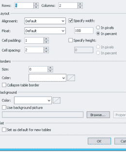

图 2-19
- 3. 将“行”设置为 3，“列”保持为 2。其他所有设置保持默认值，单击“确定”。表格随即插入到页面中。
- 4. 如果您只看到一个表格单元格，而不是包含三行两列的完整表格，则需要为表格启用“可视助手”。为此，请从主菜单中选择“视图 ⇨ 可视助手 ⇨ 可见边框”以打开边框显示。现在，您的设计视图应类似于图 2-20。

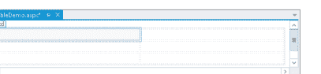

图 2-20
- 5. 将表格中第一个单元格的右边框向左拖动。您会看到一个显示单元格宽度的可视指示器。继续向左拖动，直到宽度变为 200 像素，如图 2-21 所示。

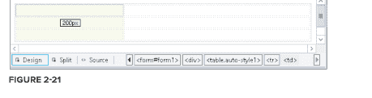

图 2-21
- 6. 要向表格中添加更多行或列，您可以右键单击现有单元格。在弹出的菜单中，选择“插入”以在不同位置添加额外的行或列。同样，您可以使用“删除”、“修改”和“选择”选项来删除行或列、合并单元格以及进行选择。对于本练习，您无需添加额外的行或列，当然，如果您已经添加了也没关系。
- 7. 将光标置于第一行的第一个单元格中，输入文字“项目符号列表”。
- 8. 用鼠标将光标置于第二个单元格中。或者，您可以按 Tab 键将光标移动到下一个单元格。从“格式”菜单中选择“项目符号和编号”。
- 9. 切换到“纯项目符号”选项卡，单击带有实心圆点图片的选项（参见图 2-22），然后单击“确定”。

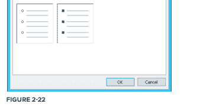

图 2-22
- 10. 输入一些文字，例如您最喜欢的音乐类型（朋克、摇滚、电子乐等），然后按 Enter 键。VS 会自动为您插入新的项目符号，因此您可以继续向列表中添加新项目。再添加两种类型，这样您最终会得到三个项目符号。
- 11. 重复步骤 7 到 10，但这次创建一个编号列表。首先，在第二行的第一个单元格中输入 `Numbered List`，然后将光标定位到同一行的第二个单元格中，选择“格式 ▸ 项目符号和编号”。切换到“数字”选项卡（在图 2-22 中位于“纯项目符号”选项卡后面），单击第一行中的第二张图片（显示的是标准编号列表），单击“确定”。为列表输入几个项目，每输入一项按一次 Enter 键。
- 12. 按 Ctrl+F5 在浏览器中打开该页面。您应该会看到类似于图 2-23 的界面。

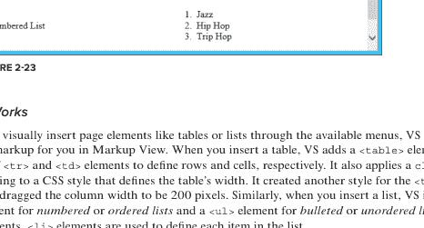

图 2-23

## 工作原理

当您通过可用菜单以可视化方式插入表格或列表等页面元素时，VS 会在标记视图中为您插入所需的标记。插入表格时，VS 会添加一个 `<table>` 元素以及多个 `<tr>` 和 `<td>` 元素，分别用于定义行和单元格。它还会应用一个 `class` 属性，指向定义表格宽度的 CSS 样式。当您将列宽拖为 200 像素时，它为 `<td>` 元素创建了另一个样式。同样，插入列表时，VS 会为编号列表或有序列表插入一个 `<ol>` 元素，为项目符号列表或无序列表插入一个 `<ul>` 元素。在这些元素内部，使用 `<li>` 元素定义列表中的每个项目。

除了到目前为止您已经见过的 HTML 标签之外，还有一个您需要了解的重要标签：`<a>` 标签，它用于在页面之间创建链接。

## 连接页面

任何网站的重要组成部分都是连接网站中各个页面的链接。链接使访问者能够从一个页面转到另一个页面，无论是同一站点内的页面，还是 Internet 上完全不同的站点。您有几种方法可以在页面之间创建链接，包括：

- HTML `<a>` 元素，本章将对此进行说明。
- 使用 `<asp:HyperLink>` 控件，将在第 7 章中讨论。
- 通过代码以编程方式实现。本书稍后会对此进行讨论。

下面的练习将向您展示从一个页面链接到另一个页面是多么简单。

## 试一试：链接页面

在本练习中，您将修改之前创建的 TableDemo.aspx 页面，添加指向另一个页面的文本链接。在浏览器中运行该页面并单击该链接后，新页面将替换旧页面。

- 1. 从 Demos 文件夹中打开 TableDemo.aspx 页面。
- 2. 如有必要，切换到设计视图。
- 3. 在第三行的第一个单元格中输入文本“链接”。
- 4. 在同一行的第二个单元格中输入文本“转到 Planet Wrox 首页”，并用鼠标将其选中。
- 5. 在“格式”工具栏上，单击“转换为超链接”按钮。该按钮位于工具栏末端附近，上面有一个链接图标和一个小的箭头。
- 6. 在出现的对话框中，单击“浏览”按钮，浏览到站点根目录下的 Default.aspx 页面，单击“确定”。然后再次单击“确定”关闭“超链接”对话框。您的页面设计视图应类似于图 2-24 所示。

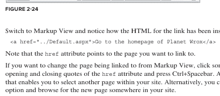

图 2-24
- 7. 切换到标记视图，注意链接的 HTML 是如何插入的：
  `<a href="../Default.aspx">Go to the homepage of Planet Wrox</a>`
  请注意，`href` 属性指向您要链接到的页面。
- 8. 如果您想在标记视图中更改链接目标页面，请在 `href` 属性的开引号和闭引号之间单击，然后按 Ctrl+Spacebar。此时会弹出一个对话框，允许您选择站点内的另一个页面。或者，您可以单击“选取 URL”选项，在站点中浏览选择新页面。
- 9. 在“解决方案资源管理器”中右键单击 TableDemo.aspx 页面，选择“在浏览器中查看”。页面加载完成后，单击“转到 Planet Wrox 首页”链接。请求会发送到 Web 服务器，作为响应，您现在会获得网站的主页。

## 工作原理

页面之间的链接可能是网页中最重要的元素之一，因为它们使您能够创建站点中一个页面与另一个页面之间的连接，无论该页面位于您自己的站点中，还是位于 Internet 上某个完全不同的服务器上。对于应出现在页面某处的简单链接，设置 `<a>` 标签并指定 `href` 属性是最简单的方法。当用户单击此类链接时，浏览器会向服务器请求新页面并显示它。`href` 值中的双点（`..`）是表示父目录的一种方式。完整的 `href` 属性含义是“在文件夹层次结构中向上移动一级，然后选择文件 `Default.aspx`”。在第 7 章中，您将了解更多关于链接及其工作原理的内容。

您不仅限于链接到自己站点中的页面。如果要链接到外部页面，只需将 `href` 属性值替换为页面的完整地址，如以下示例所示：

```
<a href="http://www.wrox.com">Go to the Wrox homepage</a>
```

对于外部链接，必须包含 `http://` 前缀；否则，浏览器会在您自己的网站中查找名为 `www.wrox.com` 的文件或文件夹。

您将在下一章中运用本章学到的关于页面创建和格式化的知识，下一章将介绍如何使用 CSS 设计网页。

除了“格式”工具栏和“表格”菜单等可视化工具外，Visual Studio 还有另一种在页面中快速插入代码的好方法：代码片段。使用代码片段，只需几次击键即可插入大段代码。您将在下一章中看到代码片段的应用。

## 使用 Web 窗体的实用技巧

以下是使用 Web 窗体的一些技巧：

- 优先使用采用代码后置模型的 Web 窗体，而不是内联代码。虽然起初您可能不会注意到使用它们有什么大的区别，但随着您的网站和页面开始增长，您会发现将代码与标记分离的页面更易于处理。
- 花一些时间熟悉“格式”和“表格”菜单中的不同菜单项。其中大多数会生成插入到页面中的 HTML 元素。查看为您生成的 HTML 元素和属性，并尝试直接在代码中以及通过菜单和工具栏对其进行修改。这样，您就能很好地掌握各种可用标签及其行为。
- 尝试使用链接来连接站点中的页面。注意 VS 如何根据您所链接页面的位置创建不同的链接。第 7 章将更详细地讨论链接以及站点中页面的各种寻址方式。


## 本章你所学到的内容

| 代码隐藏（Code Behind） | 一种页面模型，其中服务器端代码存储在一个单独的代码文件中 |
| 设计视图（Design View） | 为你提供页面的图形化表示 |
| 文件类型（File Types） | ASP.NET 支持许多不同的文件类型，包括 Web 窗体（.aspx）、母版页（.master）、CSS 文件（.css）、JavaScript（.js）和 SQL Server 数据库（.mdf） |
| 内联代码（Inline Code） | 一种页面模型，其中服务器端代码与标记存储在同一个文件中 |
| 标记视图（Markup View） | 使你可以查看页面的标记 |
| 项目模板（Project Templates） | 通过为特定场景建立站点来快速启动你的 Web 开发 |
| 项目类型（Project Types） | Visual Studio 提供两种项目类型：Web 应用程序项目和 Web 站点项目 |
| 拆分视图（Split View） | 使你可以同时查看标记视图和设计视图 |
| Web 窗体（Web Form） | 在客户端呈现你网站的用户界面 |


## 设计你的网页

### 本章你将学到：

- 什么是 CSS，以及为什么需要它
- CSS 的样子以及如何编写它
- 将 CSS 代码添加到 ASP.NET 页面和外部文件的不同方式
- VS 为你快速编写 CSS 所提供的众多工具

### 本章的 WROX.COM 代码下载

你可以在 www.wrox.com/remtitle.cgi?isbn=1118311809 的 Download Code 选项卡中找到本章的 wrox.com 代码下载。代码位于 Chapter 3 下载中。

你在前两章中创建的页面看起来平淡无奇。这是因为它们缺乏样式信息，因此采用了浏览器默认应用的标准布局。要使你的页面脱颖而出，你需要一种方法来改变它们在浏览器中的呈现方式。最常见的做法是使用层叠样式表（CSS）语言。CSS 是在 Web 上（包括 ASP.NET 网页）进行格式化和设计信息的事实标准语言。借助 CSS，你可以快速改变网页的外观，让它们呈现出你的设计或企业形象所要求的漂亮效果。

对 CSS 工作的坚实支持最初是在 Visual Web Developer（VWD）2008 中添加的，它是 VS Express 2012 for Web 的前身之一。在 Visual Studio 的上一版本 VWD 2010 中，这种支持得到了进一步增强。新的 VS 2012 以这些 CSS 支持为基础，并在许多方面进行了改进，使 CSS 编辑器成为 VS 中的一流公民，其编辑器功能与 C# 和 VB 等其他语言类似。CSS 工具使你能够以可视化方式创建 CSS 代码，从而让你不必了解或记住 CSS 的每一个细节即可轻松地为页面设置样式。

要理解 CSS 在 ASP.NET 网站中的重要性和必要性，你首先需要了解 HTML 的缺陷。下一节将介绍纯 HTML 所呈现的问题，以及 CSS 如何能够克服这些问题。

### 为什么需要 CSS？

在互联网早期，网页主要由文本和图像组成。文本使用纯 HTML 进行格式化，使用像 `<b>` 这样的标签使文本加粗，使用 `<font>` 标签来影响字体族、大小和颜色。Web 开发人员很快意识到需要更强大的功能来格式化页面，因此 CSS 应运而生，以解决 HTML 在样式方面的一些缺陷。

### HTML 格式化的问题

使用 HTML 进行格式化的问题之一在于，它只提供了一组有限的选项来为你的页面设置样式。你可以使用像 `<i>`、`<b>` 和 `<font>` 这样的元素来改变文本的外观，使用像 `bgcolor` 这样的属性来改变 HTML 元素的背景颜色。你还可以使用其他一些属性来改变链接在页面中的显示方式。

显然，这组功能不足以创建用户所期望和要求的、有吸引力的网页。

HTML 的另一个对你构建网页方式影响更大的问题，是样式信息应用于页面的方式。按设计，HTML 迫使你将格式嵌入到 HTML 文档中，这使得以后更难重用或更改设计。考虑下面的示例：

```
<p><font face="Arial" color="red" size="1">
这是红色文本，使用 Arial 字体，比默认文本稍大。
</font></p>
```

这段代码的问题在于，实际数据（`<p>` 元素中的文本）与呈现（本例中通过 `<font>` 标签对文本进行的格式化）混合在一起。理想情况下，两者应该分离，这样每一部分都更容易修改而不影响另一部分。

想象一下，你使用 `<p>` 和 `<font>` 元素来标记站点中每个页面的第一个段落。当你决定将字体颜色从红色改为深蓝色时会发生什么？或者如果企业形象要求使用 Verdana 字体而不是 Arial 呢？你将需要访问站点中的每个页面，进行必要的修改。

除了可维护性之外，HTML 格式化的另一个问题是，你无法在用户浏览器中轻松地于运行时更改格式。对于前面代码片段中的 HTML，你无法让访问者更改字体大小或颜色之类的内容，而这是帮助视障人士的一个常见需求。如果你想为访问者提供一种字体更大或颜色不同的替代页面版本，你就需要创建原始页面的副本并进行必要的修改。

HTML 格式化的最后一个问题是，页面中额外的标记会显著增加页面的大小。这使得下载和显示速度变慢，因为这些信息需要随网站中的每个页面一起下载。同时，这也使得页面更难维护，因为你需要在大型 HTML 文件中滚动查找所需的内容。

总而言之，使用 HTML 进行格式化存在以下问题：

- 其功能集严重限制了页面所需的格式化可能性。
- 数据和呈现混合在同一个文件中。
- HTML 无法让你在浏览器中轻松地于运行时切换格式。
- 所需的格式化标签和属性使页面变得更大，因此加载、显示和维护速度更慢。

幸运的是，CSS 使你能够克服所有这些困难。

### CSS 如何解决格式化问题

CSS 旨在以几乎所有可能的方式格式化你的网页。它提供了一组丰富的选项，可以改变网页的每一个小方面，包括字体（大小、颜色、字族等）、颜色和背景颜色、HTML 元素周围的边框、页面中元素的位置，等等。如今，所有主流浏览器都广泛支持 CSS，因此它是网页视觉呈现的语言，在 Web 开发人员中非常流行。

CSS 克服了数据和呈现混合的问题，它使你可以在外部文件中定义所有格式化信息。然后，你的 ASPX 或 HTML 页面可以引用这些文件，浏览器将为你应用正确的样式。通过这种分离，HTML 文档包含你想显示的内容，而 CSS 文件定义你想如何显示它，使你能够更改或替换其中一个文档，而让另一个文档保持不变。此外，你还可以直接将 CSS 放置在 HTML 或 ASPX 页面中，这样你就能够在需要的位置添加少量 CSS 片段。你应该谨慎地将 CSS 直接放在 HTML 或 ASPX 页面中，因为这样你就无法再从单个中心位置控制样式信息了。

由于你可以将所有 CSS 代码放在一个单独的文件中，因此很容易为用户提供不同样式之间的选择——例如，一种字体较大的样式。你可以创建外部样式表的副本，进行必要的修改，然后将此替代样式表提供给用户。你将在第 6 章讨论 ASP.NET 主题时看到这是如何工作的。

使用单独样式表文件的另一个好处是减少了站点所需的带宽。样式表不会随每次请求而改变，因此浏览器在第一次下载时会保存样式表的本地副本。此后，它会使用缓存的副本，而不是一次又一次地从服务器请求它。有时，当浏览器没有下载包含你所做更改的最新 CSS 文件时，这种缓存可能会适得其反。如果你发现浏览器没有加载你对 CSS 文件所做的更改，请在浏览器（而不是在 VS 中）按 Ctrl+F5 或 Ctrl+R，以从服务器获取新副本。

现在你已经了解了 CSS 为何如此重要，是时候看看它是什么样子以及如何使用它了。

### CSS 简介

就语法而言，CSS 是一种易于学习的语言。它的“语法”只包含几个概念。这使得入门相对容易。让 CSS 变得更困难一些的是所有主流浏览器渲染页面的方式。尽管几乎所有现代桌面浏览器都理解 CSS，


它们在根据 CSS 标准显示页面时各有其怪癖。该标准由维护 HTML 标准的同一组织维护，即万维网联盟，简称 W3C，有三个不同的版本：1.0、2.1 和 3.0。在这三个版本中，2.1 是目前最适用的。它包含版本 1.0 中的所有内容，但也在此基础上增加了许多可能性。它也是 VS 默认使用并生成的版本。版本 3.0 目前正在开发中，预计在主要浏览器对其提供稳定支持之前还需要一段时间。

在查看 CSS 的实际语法之前，先看一个示例是个好主意。在下面的练习中，你将编写一个简单的 ASPX 页面，其中包含一些 CSS 来格式化页面的内容。这有助于理解 CSS 语言，该语言将在下一节中详细介绍。

## 试一试 编写你的第一个 CSS

在此试一试中，你将编写一些 CSS 来更改标题和两个段落的外观。你现在将手工编码页面；本章的后半部分将向你展示如何使用 VS 中可用的 CSS 工具。

- 1. 在 Planet Wrox 项目的 Demo 文件夹中，创建一个名为 CssDemo.aspx 的新 Web 窗体。对于此练习，选择内联代码还是代码隐藏并不重要。
- 2. 确保页面处于标记视图，然后在源代码中定位关闭的 </title> 标签。将光标定位在该行的末尾并按 Enter，在 <title> 和 </head> 标签之间创建一个空行。在此新行上输入单词 style 然后按 Tab。VS 会为你补全 <style> 元素。按两次 Enter 在标签之间留出一些空间，然后按如下方式完成该块：

```
<title></title>
<style type="text/css">
</style>
</head>
```

> 注意 此代码完成功能使用代码片段，可让你将一段代码（如 <style> 元素）与标识符（如本例中的 style）关联起来。代码片段非常适合通过仅键入简短标识符来快速插入代码片段。还有许多其他代码片段，在适当的地方我会在本书中指出它们。

如果不使用 style 代码片段，你也可以自己输入完整代码。请注意，只要你输入开始的尖括号 (<)，就会弹出一个列表，使你能够选择 <style> 标签。type 属性也是如此；只需输入字母 ty，type 属性就会在列表中预先选中。你只需按 Tab 或 Enter 键即可完成该词。再一次，相同的帮助也适用于属性值 text/css。只需在列表中选择它并按 Tab 或 Enter，值就会自动为你插入，并很好地用双引号包围。

### 3.

接下来，在开始和结束的 <style> 标签之间，输入以下加粗的 CSS 代码：

```
<style type="text/css">
 h1
 {
   font-size: 20px;
   color: Green;
 }
 p
 {
   color: Blue;
   font-style: italic;
 }
 .RightAligned
 {
   text-align: right;
 }
</style>
```

输入此代码时要格外小心，因为 CSS 对语法要求很严格。列表中的第一项是 h1 标签，用于设置一级标题的样式，因此其大小为 20 像素，并以绿色字体显示。请注意 font-size 和 20px 之间的冒号，以及该行以分号结束。

列表中的第二项仅包含字母 p，并为页面中的所有 <p> 元素定义外观。

最后一项以句点 (.) 开头，后跟文本 RightAligned。此项用于将页面中的某些文本右对齐。由于 CSS 区分大小写，因此必须完全按照此处所示输入，R 和 A 均为大写，否则 CSS 代码将与下一步所示的 HTML 不匹配。

请注意，只要你在 color 属性后输入井号 (#)，就会弹出一个颜色选择器来帮助你选择颜色，如图 3-1 所示。现在，只需按 Esc 关闭颜色选择器并手动完成代码。你将在本章后面看到更多关于此颜色选择器的内容。

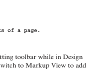

### 4.

在页面中向下滚动一点，直到看到开始的 <div> 标签。紧随此标签之后，输入以下加粗的代码：

```
<div>
 <h1>Welcome to this CSS Demo page</h1>
 <p>CSS makes it super easy to style your pages.</p>
 <p class="RightAligned">
   With very little code, you can quickly change the looks of a page.
 </p>
</div>
```

你可以直接输入此代码，也可以在设计视图中使用格式工具栏创建 <h1> 和 <p> 等元素。现在，你需要切换到标记视图以添加 class="RightAligned"，但在本章后面的练习中，你将看到如何让 IDE 为你编写此代码。

- 5. 如果你切换到设计视图（或拆分视图），你会看到设计器以页面 <style> 元素中定义的格式显示你的文本。图 3-2 显示了页面在拆分视图中的样子，以便你同时查看代码和设计。

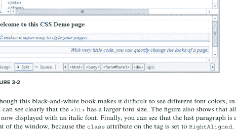

图 3-2

尽管这本黑白书籍使不同字体颜色难以辨认，但在图 3-2 中你仍能清楚地看到 <h1> 的字体大小更大。图示还显示所有段落现在都以斜体字体显示。最后，你可以看到最后一个段落与窗口右对齐，因为该标签的 class 属性设置为 RightAligned。

> **常见错误** 如果你没有看到最后一个段落粘在文档窗口的右边界上，请确保你在 <style> 标签和 class 属性中完全相同地输入了 RightAligned。由于 CSS 区分大小写，RightAligned 和 rightaligned 之间存在很大差异。

- 6. 按 Ctrl+F5 在浏览器中查看 CssDemo.aspx。你在浏览器中看到的页面与你在 VS 的设计视图中获得的预览完全相同。

## 它是如何工作的

尽管本练习中你输入的代码相对简单，但在浏览器（以及 VS 的设计视图）内部却有很多工作在进行以使其成为可能。你首先在页面的 <head> 部分添加了一些样式：

```
<style type="text/css">
    h1
{
  font-size: 20px;
  color: Green;
}
...
</style>
```

`<style>` 标签用于包装嵌入在页面中的样式表，其 `type` 属性设置为 `text/css`。此 `text/css` 值目前是 `<style>` 块唯一适用的类型，并告诉浏览器将后续代码解释为 CSS。

`<style>` 标签之间的从 h1 到闭合大括号 ({}) 的代码块称为 *规则集* 或简称为 *规则*。此代码片段中的规则定义了页面中所有 `<h1>` 元素的外观。代码块顶部的 h1 称为 *选择器*，用于指示应将格式应用于哪个元素。在这种情况下，选择器直接映射到 HTML 元素，但还有许多其他选择器，如你在下一节中看到的那样。图 3-3 显示了这些元素之间的关系。

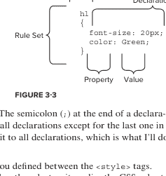

图 3-3

在大括号之间你可以看到应应用于标题的样式信息。大括号之间的每一行称为 *声明*。声明由 *属性* 组成，后跟冒号，然后是 *值*。声明末尾的分号 (`;`) 将其与下一个声明分隔开，并且在规则集中的最后一个声明除外，所有声明都需要它。然而，为了保持一致性，最好在所有声明中都加上它，这也是我在本书剩余部分的做法。

当浏览器加载此页面时，它还会读取你在 `<style>` 标签之间定义的样式。然后，每当它遇到与选择器匹配的 HTML 元素时，就会将 CSS 规则应用于该元素。因此，对于 `<h1>` 和 `<p>` 元素，将分别应用它们的规则。这会导致标题以大字体变为绿色，而段落以斜体变为蓝色。

但为什么最后一个段落会变为蓝色 *并且* 右对齐呢？在 CSS 中，规则可以来自不同的来源。最后一个 `<p>` 元素从样式定义中的标准 `p` 选择器获取其样式信息。因此，`p` 规则使段落具有蓝色和斜体字体。然而，它还定义了一个 `class`。这个名为 `RightAligned` 的类链接到样式表中的类选择器 `.RightAligned`（注意前导句点），并导致文本与窗口右对齐。你将在下一节看到更多关于 Class 和其他选择器的内容。最终，最后一个 `<p>` 元素同时从两个选择器获取其规则。你可以自行创建并分配自己的类名（如 `RightAligned` 类所示），从而灵活地按你想要的方式设计页面和元素。

下一节将深入探讨 CSS 的语法，为你提供关于选择器、属性和值的更详细视图。


## CSS——这门语言

如你在之前的“试一试”练习中所见，级联样式表实际上是一组规则的集合。一条规则由一个选择器和一条或多条声明组成，而声明又可以进一步分解为一个属性和一个值。在过去的几段中引入了这么多新术语，你可能已经有点头晕了，所以在下一节中，你会再次看到其中的大部分术语，并附有详细解释和代码示例，说明它们的用途和工作方式。

### 样式表

样式表包含所有应该应用到页面元素上的相关样式信息。其最简单的形式如下所示：

```css
h1
{
    color: Green;
}
```

样式表还可以包含多条规则，正如你在上一练习中所见。同时，每条规则可以包含多条声明，使你可以将它们放在同一个选择器下：

```css
h1
{
    font-size: 20px;
    color: Green;
}
```

你刚才看到的代码在功能上与以下代码完全相同：

```css
h1
{
    font-size: 20px;
}
h1
{
    color: Green;
}
```

将两条声明合并到同一个选择器下的紧凑形式更易于阅读、理解和维护，因此建议尽可能使用这种语法。

为了能够对页面上的元素进行样式化，浏览器需要知道三件事：

-   页面上的哪个元素需要被样式化？
-   该元素的哪一部分需要被样式化？
-   你希望所选元素的这一部分呈现什么外观？

这些问题的答案由选择器、属性和值分别给出。

### 选择器

顾名思义，选择器用于选择或指向页面中的一个或多个特定元素。可以使用多种不同的选择器，让你能够精细控制想要样式化的元素。选择器回答了第一个问题：页面上的哪个元素需要被样式化？下一节将介绍四种最重要的选择器类型。

### 通用选择器

通用选择器由星号（*）表示，适用于页面中的所有元素。你可以使用通用选择器设置全局设置，例如字体族。以下规则集将页面中所有元素的字体更改为 Arial：

```css
*
{
    font-family: Arial;
}
```

### 类型选择器

类型选择器使你可以指向特定类型的 HTML 元素。使用类型选择器时，该类型的所有 HTML 元素都将被相应地样式化。

```css
h1
{
    color: Green;
}
```

此类型选择器现在适用于代码中的所有 `<h1>` 元素，并将它们设为绿色。类型选择器不区分大小写，因此你可以同时使用 `h1` 和 `H1` 来引用同一个标题。不过我更喜欢在类型选择器中使用小写，所以你在本书中看到的都是小写形式。

### ID 选择器

ID 选择器总是以井号（#）作为前缀，使你可以引用页面中的单个元素。在 HTML 或 ASPX 页面中，你可以使用 `id` 属性为元素指定唯一的 ID。使用 ID 选择器，你可以更改该单个元素的表现，如下所示：

```css
#IntroText
{
    font-style: italic;
}
```

因为你可以在站点的多个页面中重复使用这个 ID（它只需要在单个页面内唯一），所以可以使用此规则快速更改某个元素的外观——该元素在每个页面中出现一次，但在整个站点中会多次出现。例如，配合以下 HTML 代码：

```html
<p id="IntroText">I am italic because I have the right ID.</p>
<p id="BodyText">I am NOT italic because I have a different ID.</p>
```

在此示例中，`#IntroText` 选择器更改了第一个段落（其具有匹配的 `id` 属性）的字体，但未修改另一个段落。ID 选择器区分大小写，因此请确保 `id` 属性和选择器始终使用相同的大小写。

请注意，选择器的名称中使用井号（#），但你在 `id` 属性中不使用此符号。

### 类选择器

类选择器使你可以通过 `class` 属性对多个 HTML 元素进行样式化。当你希望为多个不相关的 HTML 元素提供相同类型的格式时，这非常方便。以下规则将所有 `class` 属性设置为 Highlight 的 HTML 元素的文本改为红色并加粗：

```css
.Highlight
{
  color: Red;
  font-weight: bold;
}
```

以下代码片段使用 Highlight 类使 `<span>` 元素和链接（`<a>`）的内容以粗体显示：

```html
This is normal text but <span class="Highlight">this is Red and Bold.</span>
This is also normal text but
<a href="CssDemo.aspx" class="Highlight">this link is Red and Bold as well.</a>
```

请注意，选择器的名称中使用句点，但你在 `class` 属性中引用该选择器时不使用这个句点。`class` 属性非常有用，因为它使你可以将一段 CSS 用于多种不同的目的，而不管使用该类的 HTML 元素是什么。类选择器区分大小写，因此请确保正确键入它们（或者在可能时让 IntelliSense 帮助你在列表中选择类）。

CSS 支持更多类型的选择器，使你可以更好地控制想要定向的元素，但你刚刚看到的四种类型是使用最广泛的。

### 分组与组合选择器

CSS 还允许你使用逗号分隔多个选择器来对它们进行分组。如果你想将相同的样式应用于不同的元素，这会很方便。以下规则将页面中的所有标题变为红色：

```css
h1, h2, h3, h4, h5, h6
{
  color: Red;
}
```

此外，使用 CSS 还可以组合选择器，使你可以按层次结构指向页面中的特定元素。你可以通过用空格分隔选择器来实现这一点。以下示例定向了位于 `id` 为 MainContent 的 `<section>` 元素中的所有 `<p>` 元素，而所有其他段落保持不变。还要注意，`section` 和 `#MainContent` 之间没有空格。这使得选择器的这一部分定向的是一个 `id` 为 MainContent 的 `<section>` 元素。

```css
section#MainContent p
{
  font-size: 18px;
}
```

请注意，组合与分组有很大不同。分组只是一种避免重复输入相同声明的快捷方式，而组合使你可以定向文档中的特定元素。

使用组合时，你不仅限于 ID 和类型选择器；你也可以将其与其他选择器配合使用，如下例所示：

```css
section#MainContent p.Attention
{
    font-weight: bold;
}
```

此规则将更改 `id` 设置为 MainContent 的 `<section>` 元素内所有带有类 Attention 的段落，并保持其他元素不变。以下 HTML 片段使用此规则来展示效果：

```html
<section id="MainContent">
<p class="Attention">My class is Attention, so my text is bold.</p>
<p>My text is not bold, as it lacks the Attention class.</p>
</section>
<p class="Attention">I am NOT bold because I don't fall within MainContent.</p>
```

要在页面中应用某种样式，需要回答的第二个问题是关于元素的哪个部分需要被样式化。你通过属性来实现这一点。

### 属性

属性是你要通过样式表更改的元素部分。CSS 规范定义了一系列很长的属性（VS 的 IntelliSense 列表显示超过 100 项），不过在大多数网站中你不会用到所有属性。下表列出了一些最常见的 CSS 属性，并说明了它们的用途。

| 属性 | 描述 | 示例 |
| --- | --- | --- |
| background-color<br>background-image | 指定元素的背景颜色或背景图像。 | `background-color: White;`<br>`background-image: url(image.jpg);` |
| border | 指定元素的边框。 | `border: 3px solid Black;` |
| color | 更改字体颜色。 | `color: Green;` |
| display | 更改元素的显示方式，使你可以隐藏或显示它们。 | `display: none;`<br>这会导致元素被隐藏，并且不占用任何屏幕空间。 |
| float | 允许你使用向左或向右浮动在页面中“浮动”一个元素。其他内容随后会放置在相反的一侧。 | `float: left;`<br>此设置会导致浮动元素之后的其他内容位于元素的右上角。本章稍后会介绍其工作原理。 |


| 属性 | 描述 | 示例 |
|---|---|---|
| font-family<br>font-size<br>font-style<br>font-weight | 更改页面上所用字体的外观。 | font-family: Arial;<br>font-size: 18px;<br>font-style: italic;<br>font-weight: bold; |
| height<br>width | 设置页面中元素的高度或宽度。 | height: 100px;<br>width: 200px; |
| margin<br>padding | 设置元素内部（padding）和外部（margin）的空白量。 | padding: 0;<br>margin: 20px; |
| visibility | 控制元素在页面中是否可见。不可见元素仍然占据屏幕空间；只是你看不到它们。 | visibility: hidden;<br>这会使元素不可见。但是，它仍然占据页面中原来的空间。就好像元素仍在原地，但完全透明。 |

幸运的是，VS 提供了许多 CSS 工具，帮助你找到合适的属性，因此你不必全部记住它们。

> *注意 本文所描述的 CSS 选择器和属性只是其中一部分，CSS 中还有更多。有关 CSS 的更多详细信息，请查阅 VS 的 IntelliSense 列表，或查看 www.w3schools.com/cssref。*

要使属性发挥作用，你需要为其赋予一个值，这个值回答了第三个问题：你希望所选元素的部分呈现什么外观？

## 值

与属性一样，值的种类也很多。你可以使用的值取决于属性。例如，color 属性接受表示颜色的值。这个值可以是命名颜色（如 white）、表示红、绿、蓝（RGB）分量的十六进制数（如 #FF0000），也可以使用 CSS 的 rgb 表示法来设置。以下示例在功能上完全等价，都将 h1 元素的颜色设置为红色：

```
h1
{
  color: Red;
}
h1
{
  color: #FF0000;
}
h1
{
  color: rgb(100%, 0%, 0%);
}
```

你还可以使用 rgba 表示法来指定颜色的透明度，其中第四个参数是介于 0（完全透明）和 1（不透明）之间的小数，如下所示：

```
color: rgba(255, 0, 0, 0.50);
```

使用命名颜色可以提高 CSS 代码的可读性，但由于命名颜色的列表相对较短，你常常需要使用十六进制表示法来获得所需的精确颜色。本章稍后将介绍如何使用内置的颜色选择器来创建你需要的精确颜色。

还可以使用许多其他值，包括尺寸单位（px、em 等）、字体族、图像（采用 url(SomeImage.jpg) 的形式），或所谓的枚举，如 border-style，它允许你设置边框样式，例如 solid（实线）、dashed（虚线）、double（双线）等。

## 使用简写

许多 CSS 属性既支持简写形式，也支持更展开的形式。以 border 属性为例，你可以用最简短的形式设置 border 属性，如下所示：

```
border: 1px solid Black;
```

这个 border 属性会为 HTML 元素的四边都应用边框。边框大小为 1px，样式为 solid（其他选项包括 dashed、dotted 和 double），边框颜色设置为 Black。

这是一种快速将 HTML 元素四边边框设置为相同值的简便方法。但是，如果你想对各个边框及其属性进行更多控制，可以使用展开的版本：

```
border-top-width: 1px;
border-top-style: solid;
border-top-color: Black;
border-right-width: 1px;
border-right-style: solid;
border-right-color: Black;
border-bottom-width: 1px;
border-bottom-style: solid;
border-bottom-color: Black;
border-left-width: 1px;
border-left-style: solid;
border-left-color: Black;
```

这个长版本产生的效果完全相同：四边都是 1 像素厚的黑色实线边框。在大多数情况下，你应该优先使用简写形式而不是展开形式，因为它更易于阅读和维护。但是，如果你需要完全控制边框——例如，你希望 HTML 元素的左侧和顶部为 2 像素虚线边框，右侧和底部为绿色实线边框——那么了解可以单独设置四个方向的每个边框属性是很有用的。你还可以混合使用这些选项。以下示例先将四边边框设置为 1 像素黑色实线，然后仅覆盖左边框的颜色：

```
border: 1px solid Black;
border-left-color: Blue;
```

其他支持简写形式的 CSS 属性包括 font、background、list-style、margin 和 padding。如果你不确定某个属性是否支持简写形式，可以在 CSS 文件或 `<style>` 块中输入属性时按 Ctrl+Space，查看弹出的 IntelliSense 列表。

尽管有时编写 CSS 似乎需要反复试验，并希望能得到正确结果，但实际上 CSS 背后有一个相当精确的模型，用于决定页面中元素的布局方式。这个模型称为 CSS 盒模型（CSS Box Model）。

## CSS 盒模型

CSS 盒模型描述了三个重要的 CSS 属性如何应用到 HTML 元素上：padding（内边距）、border（边框）和 margin（外边距）。图 3-4 展示了盒模型的图形表示。

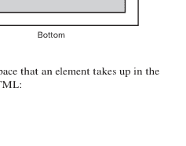

图 3-4

中间是一个具有特定高度和宽度的 HTML 元素，例如 `<p>` 或 `<div>`。紧挨着它的是 padding（内边距），即元素边框内包围元素的空白区域。在 padding 之后紧跟着的是 border（边框），最后在外部是 margin（外边距），它定义了元素（包括其内边距和边框）与其周围元素之间的空间。一个元素的三个外部属性——padding、border 和 margin——加起来就是该元素在页面中占据的空间。为了理解其工作原理，请看下面的 CSS 和 HTML：

```
.MyDiv
{
    width: 200px;
    padding: 10px;
    border: 2px solid Black;
}
...
<div class="MyDiv">Element</div>
```

这会在浏览器中渲染一个矩形，`<div>` 元素周围环绕着 2 像素宽的黑色边框，如图 3-5 所示。

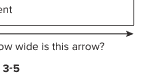

图 3-5

在继续阅读之前，请尝试回答这个问题：`<div>` 元素下方的箭头有多宽？

如果你猜的是 224 像素，那么你答对了。箭头的宽度是三个值之和：元素本身的宽度（200 像素），加上元素两侧内边距的宽度（2 × 10 像素），再加上两侧边框的宽度（2 × 2 像素），总宽度为 224 像素。因此，如果你希望整个盒子的宽度为 200 像素，则需要将 MyDiv 选择器的 width 属性设置为 176px。在元素边框之外，margin 还会进一步影响该元素与其周围元素之间的间距。

该示例只展示了对宽度的影响，但同样的原理也适用于元素的高度。在布局页面时，请牢记这个盒模型。当元素的最终宽度或高度超出你的预期时，请检查 CSS 样式表中的 width、height、padding、border 和 margin 属性。

在下一个练习中，你将修改上一章创建的网站主页。你将添加网站的基本布局，然后使用样式表对其进行样式化。在第 6 章中，当该页面升级为母版页时，你会再次用到它。

## 试一试：为 Planet Wrox 主页设置样式

在本练习中，你将修改两个文件。首先，向 Default.aspx 页面添加基本布局元素，为页眉、菜单、主内容区域、侧边栏和页脚创建空间。然后，修改 Styles 文件夹中的 Styles.css 文件，以更改这些元素的尺寸和位置。最后，将样式表附加到页面，以便在设计器或浏览器中查看页面时应用样式信息。

1. 打开网站根目录下的 Default.aspx 文件，如有必要，切换到标记视图。

2. 修改 `<form>` 元素内的代码，使其最终如下所示：

```
<form id="form1" runat="server">
  <div id="PageWrapper">
    <header>Header Goes Here</header>
    <nav>Menu Goes Here</nav>
    <section id="MainContent">
      <h1>Hi there visitor and welcome to Planet Wrox</h1>
    ...
    </section>
    <aside id="Sidebar">Sidebar Goes Here</aside>
    <footer>Footer Goes Here</footer>
  </div>
</form>
```

确保上一章添加的欢迎消息位于 MainContent `<section>` 元素的开始和结束标签之间。如果你已经熟悉 HTML5 之前的 HTML 版本，可能会对 `header`、`section` 和 `footer` 等新元素感到有些惊讶。这些元素是在 HTML5 中引入的，目的是为文档提供更好的语义结构。有关 HTML5 的快速介绍，请参阅第 1 章。

3. 打开 Styles 文件夹中的 Styles.css 文件。如果你之前向此文件添加过一些代码，请先删除这些代码。


- 4. 在 CSS 文件顶部，输入以下使用 ID 选择器选择 header 元素的代码：

```
header
{
}
```

- 5. 将鼠标定位在花括号之间，右键单击并从上下文菜单中选择“Build Style”。如 图 3-6 所示的 Modify Style 对话框出现。

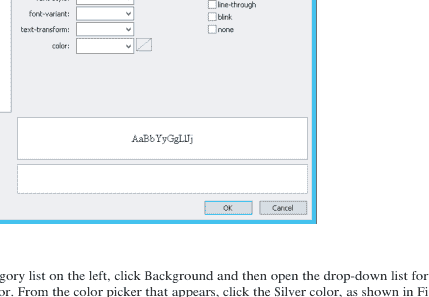

图 3-6

- 6. 在左侧的 Category 列表中，单击 Background，然后打开背景颜色的下拉列表。从出现的颜色选择器中，单击 Silver 颜色，如 图 3-7 所示。

另外，你也可以直接在 background-color 文本框中输入 Silver 的十六进制颜色代码 (#C0C0C0)。

- 7. 通过在左侧列表中单击它，切换到 Position 类别。出现的面板使你能够设置与位置相关的信息，包括高度和宽度。在宽度下，输入 844 并确保右侧的下拉列表中选择了 px。对于高度，输入 86。单击 OK 以关闭对话框并将声明插入到你的代码中，现在代码如下所示：

```
header
{
  background-color: #C0C0C0;
  width: 844px;
  height: 86px;
}
```

## 参考文献

本刊始终关注中国现代美术的演进历程，并在其中积极回应艺术实践与社会思潮之间的复杂互动。在既往的栏目中，我们曾围绕现实主义、形式探索、主体意识、图像叙事等议题展开多角度讨论，力图呈现历史现场中的思想张力与艺术家的个体抉择。

在以往的刊期中，本刊始终关注中国现代美术的演进，积极回应艺术实践与社会思潮之间的错综互动。围绕现实主义、形式探索、主体性、视觉叙事等主题，我们力求揭示历史现场的智识张力以及艺术家的个体选择。

需要强调的是，对于‘现代性’这一概念，我们并不将其视为某种单一、线性的发展逻辑，而是将其放置在跨文化传播、民族国家建构以及艺术本体自律等多重脉络之中加以审视。由此，在推进相关研究时，我们尤为重视文献的整理与辨伪，主张将图像、文本与实物证据相互参证。

应强调的是，“现代性”并非被视为某种单一、线性的发展逻辑，而是置于跨文化传播、民族国家建构以及艺术本体自律等多重语境中加以审视。在推进相关研究时，我们特别重视档案文献的整理与鉴定，主张采用将图像、文本与实物证据相互参证的方法。

本卷所收录的论文与方法论札记，即为上述关怀的具体展开。各篇文章在议题与写法上不尽相同，但均力求在扎实的史料基础之上，形成有启发性的问题意识，进而为后续研究提供可资讨论的起点。

本卷所收录的论文与方法论札记即是对上述关切的具体展开。尽管各篇文章在主题与方法上各不相同，但都力求在扎实的史料基础上形成富有启发性的问题意识，从而为后续学术讨论提供出发点。

将 Modernizr 添加到你的网站非常容易，只需使用随 Visual Studio 附带的 Package Manager Console。添加该库，请按以下步骤操作：

- 1. 选择 Tools ← Library Package Manager ← Package Manager Console.
- 2. 输入以下命令并按 Enter：
  ```
  Install-Package Modernizr
  ```
- 3. 短暂延迟后，你的网站将扩展为一个名为 packages.config 的文件，用于跟踪已安装的程序包，以及一个 Scripts 文件夹，其中现在包含文件 modernizr-2.6.2.js。注意：如果在你阅读本书时 Modernizr 已发布更新版本，你的版本号可能不同。要将此库添加到你的页面，请在 Markup View 中打开 Default.aspx，然后从 Solution Explorer 将文件拖到代码的 head 部分，直接放在样式表链接之后。你应该得到以下代码：
  ```html
  <link href="Styles/Styles.css" rel="stylesheet" type="text/css" />
  <script type="text/javascript" src="Scripts/modernizr-2.6.2.js"></script>
  </head>
  ```

即使你拥有现代网络浏览器，也应将 Modernizr 库添加到你的网站。由于你无法控制访问你网站的浏览器，你希望确保每个人都能按预期看到你的网站。添加 Modernizr 可在几乎不产生额外开销的情况下修复旧浏览器的 HTML5 兼容性问题。你可以在其网站 http://modernizr.com/ 上了解更多关于 Modernizr 的信息。你将在第 11 章中看到更多关于 Package Manager Console 的内容。

- 12. 最后，保存所有打开文档的更改（按 Ctrl+Shift+S），然后在浏览器中请求 Default.aspx。你的屏幕应类似于 图 3-8 所示，其中显示了 Mozilla Firefox 中的页面。

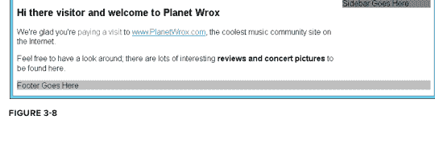

图 3-8

## 工作原理

Style Builder 使选择 CSS 属性并更改其值变得容易。你不需要记住 CSS 的每一个细节，而是可以直观地创建 CSS 代码。一旦你对 CSS 及其众多属性和值有了更好的理解，你可能会发现自己直接在 CSS 文件中输入 CSS，因为那样通常更快。

请注意，header、PageWrapper、nav 和 footer 元素都有精确的 844 像素宽度。这样，网站在 1024 x 768 像素的屏幕上显示良好，这是当今许多计算机的常见屏幕尺寸，而不会被挤在 Windows 边框之间。更大屏幕的系统只需在可用空间中居中显示网站。这种居中由 PageWrapper 元素完成，其 margin 设置为 auto。这意味着左右两侧（但非顶部和底部）的可用空间被均分，从而将 PageWrapper 元素有效居中于浏览器窗口中间。

还请注意，MainContent 部分和 aside 并排放置。你使用 CSS float 属性来实现这一点：

```
section#MainContent
{
    width: 664px;
    float: left;
}

aside
{
    background-color: Gray;
    width: 180px;
    float: left;
}
```

这告诉 MainContent 在其后的内容左侧“浮动”，从而有效地将 aside 放置在其右侧。你也需要告诉 aside 浮动；如果省略它，它将被放置在页面的左侧，就在你应用 CSS 之前的位置。如果你网站中有多个 aside 元素（这是一种常见做法），你可以通过添加 id 属性（如 Sidebar）来定位充当侧边栏的该 aside，就像我对 MainContent 部分元素所做的那样，然后按如下方式更新 CSS：

```
aside#Sidebar
{
    ...
}
```

MainContent 和 aside 元素的组合宽度总和为 844 像素，这正好是其父元素 PageWrapper 的宽度。

为了结束浮动并告诉 footer 元素直接放置在 MainContent 和 aside 元素下方，使用 clear 属性清除可能生效的任何浮动（左或右）：

```
footer
{
    background-color: #C0C0C0;
    width: 844px;
    clear: both;
}
```

灰色背景只是临时添加到代码中，以便更容易看到 <div> 结束于何处。在今后的练习中，你将再次修改 CSS 文件以适应 Planet Wrox 网站的方案。

要告诉浏览器应用哪些样式，请在页面的 head 中链接样式表：

```
<link href="Styles/Styles.css" rel="stylesheet" type="text/css" />
```

这告诉浏览器在 Styles 文件夹中查找名为 Styles.css 的文件，并将该文件中的所有规则应用于当前文档。一旦浏览器下载了 CSS 文件，它就会将其中找到的所有样式应用到你的 HTML 元素，从而得到 图 3-8 所示的布局。

在本练习中，你看到了如何使用 <link> 标签将外部样式表链接到页面。然而，你有更多方法可以在网页中包含样式表。

## 向页面添加 CSS

向网页添加 CSS 样式表的第一种方式是通过指向外部 CSS 文件的 <link> 元素，就像你在上一练习中看到的那样。查看以下 <link>，以了解在页面中嵌入样式表时有哪些选项：

```
<link href="StyleSheet.css" rel="Stylesheet" type="text/css" media="screen" />
```

href 属性指向你网站内的一个文件，就像你在上一章创建两个页面之间的链接时看到的那样。rel 和 type 属性告诉浏览器链接的文件实际上是层叠样式表。media 属性很有趣：它使你能够针对不同的设备，包括屏幕、打印机、手持设备，甚至为视障访客提供的盲文和语音支持工具。media 属性的默认值为 screen，因此如果你针对的是标准桌面浏览器，省略该属性是可以的。

你在本章开头简要看到了包含样式表的第二种方式：使用嵌入式 <style> 元素。<style> 元素应放置在 ASPX 或 HTML 页面的顶部，位于 <head> 标签之间。在 <style> 标签内，你可以编写与之前看到的完全相同的 CSS。例如，仅更改当前页面中 <h1> 元素的外观，你可以在页面的 <head> 中添加以下代码：

```
<head runat="server">
<title></title>
<style type="text/css">
h1
{
    color: Blue;
}
</style>
</head>
```

应用 CSS 到 HTML 元素的第三种方式是使用你在上一章看到的 style 属性的内联样式。因为 style 属性已应用于特定的 HTML 元素，所以你不需要选择器，可以直接在属性中编写声明：

```
<span style="color: White; background-color: Black;">
    This is white text on a black background.
</span>
```


## 在外部、嵌入和内联样式表之间选择

由于你可以通过多种方式为网站添加样式表，那么哪种方法最好呢？一般来说，你应该优先使用外部样式表，其次是嵌入样式，最后才是内联样式。外部样式表让你能够通过一个文件更改整个网站的外观。只需对外部样式表文件做一处修改，使用该样式表的所有页面都会自动更新。

不过，在某些情况下使用嵌入样式和内联样式也完全没问题。如果你只想更改单个页面的外观，而不影响网站中的其他页面，那么嵌入样式表是最佳选择。内联样式也是如此：如果你只想更改单个页面中某个元素的行为，并且很确定不会在其他 HTML 元素上用到同一条声明，那么可以使用内联样式。

需要考虑的一件重要事情是各种样式表之间相互覆盖的方式。如果你有多个相同的选择器，但属性值不同，则以最后定义的那个为准。例如，考虑一个在名为 Styles.css 的外部样式表中定义的规则，它将所有 `<h1>` 标签的颜色设置为绿色：

```
h1
{
    color: Green;
}
```

现在假设你在某个页面中引入了这个样式表，而该页面中也有针对同一个 h1 的嵌入规则，但设置了不同的颜色：

```
<link href="Styles/Styles.css" rel="stylesheet" type="text/css" />
<style type="text/css">
h1
{
    color: Blue;
}
</style>
```

使用这段代码，页面中实际的 `<h1>` 标签颜色将是蓝色。这是因为将颜色设置为蓝色的嵌入样式表在页面中定义得较晚，因此会覆盖外部文件中的设置。如果你像这样调换两者的顺序：

```
<style type="text/css">
h1
{
    color: Blue;
}
</style>
<link href="Styles/Styles.css" rel="stylesheet" type="text/css" />
```

标题将会是绿色，因为此时外部样式表中的设置会覆盖嵌入样式的设置。同样的原则也适用于内联样式。由于它们是直接在 HTML 元素上定义的，因此其设置优先于嵌入样式表和外部样式表。另外，还有一点值得了解：CSS 通常会覆盖 HTML 元素上的属性。例如，如果你有一条 CSS 规则设置了图片的宽度和高度，那么 height 和 width 属性

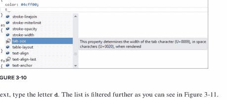

### 图 3-10

接下来，输入字母 d。列表会被进一步筛选，如图 3-11 所示。

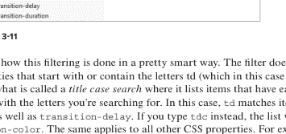

### 图 3-11

请注意，这种筛选非常智能。过滤器不仅会将列表限制为以 td 开头或包含 td 的属性（本例中并不存在这样的属性），而且还支持所谓的标题大小写搜索，即会列出属性中每个单词以你正在搜索的字母开头的项。在本例中，td 会匹配 text-decoration 和 transition-delay 等项目。如果你输入的是 tdc，则列表只会显示 text-decoration-color。其他所有 CSS 属性也是如此。例如，bc 会给出 background-color，bwb 会给出 border-bottom-width，以此类推。这使得只需敲几下键盘就能极其轻松地编写 CSS 代码。

请注意，列表中的某些项带有剪刀图标，而不是标准属性图标。剪刀图标表示可以按 Tab 键两次展开的代码片段。这样做会将特定浏览器的 CSS 插入到文件中，这些 CSS 用于尚未被所有浏览器广泛实现的 CSS 属性。

继续此练习，从列表中选择 text-decoration。你可以双击该项、按 Enter 或按 Tab 键，VS 会为你补全该属性。接下来，输入冒号，然后输入 underline 作为 text-decoration 属性的值。用分号结束该行。你的最终代码现在应该如下所示：

```
section#MainContent a
{
  color: #4cff00;
  text-decoration: underline;
}
```

- 4. 在你刚刚创建的规则下方，添加另外两条样式规则，代码如下：

```
section#MainContent a:visited
{
  color: #FF0000;
  text-decoration: underline;
}
```

```
section#MainContent a:hover
{
  color: #FFA500;
  text-decoration: underline;
}
```

- 5. 接下来，从主菜单中选择“编辑 ⌥ 格式化文档”。

或者，按 Ctrl+K，然后按 Ctrl+D。此快捷键和菜单命令也适用于其他类型的文件，例如 HTML、ASPX、Visual Basic 和 C# 文件。执行这些操作时，VS 会根据该特定文件类型的设置来格式化文档。以 CSS 为例，它会通过将左花括号放在一致的位置来格式化你的代码，并缩进和格式化各个规则。它还会执行所谓的层次缩进。为了更好地理解其工作原理，请看图 3-12，该图展示了你在格式化文档后添加的 section#MainContent 规则集以及针对 a 元素的新选择器。

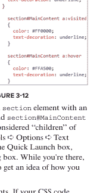

请注意，section#MainContent a 规则集是如何缩进到 section#MainContent 规则集下方的。这有助于理解规则集所使用的两个选择器之间的关系（section#MainContent a 仅针对父级 section 的 id 为 MainContent 内的 a 元素）。同样，section#MainContent a:visited 和 section#MainContent a:hover 规则集缩进在 a 元素下方，因为它们可以被视为 a 元素的“子级”。如果你不喜欢这种行为，可以通过“工具 ⌥ 选项 ⌥ 文本编辑器 ⌥ CSS 格式化”将其关闭。或者，按 Ctrl+Q 将焦点放到“快速启动”框中，输入“CSS 格式化”并按 Enter。这也会打开相同的“选项”对话框。在那里，花点时间浏览“文本编辑器”节点下的各项内容，以了解如何更改 VS 支持的多种语言的格式。

- 6. 这里值得展示的最后两个编辑器功能是区域和注释。如果你的 CSS 代码变得难以管理，将属于同一部分的一些代码包裹在区域中可能会有所帮助。VS 中的区域随后可以折叠以隐藏代码，并在需要更改时再次展开。要创建区域，你需要使用 CSS 注释语法将代码包裹在一对 region / endregion 中。

例如：

```
/*#region Name Of Region */
... Your CSS code here
/*#endregion*/
```

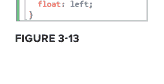

如果你的浏览器未列出，请单击“添加”按钮，然后单击“程序名”框旁边的省略号，搜索你喜欢的浏览器。当浏览器显示在列表中时，单击它以选中它，然后点击“浏览”以在该浏览器中打开页面。该页面现在应该会显示在你的备用浏览器中。

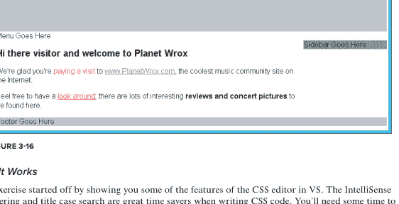

### 图 3-16

## 工作原理

本练习首先向你展示了 VS 中 CSS 编辑器的一些功能。IntelliSense 列表筛选和标题大小写搜索在编写 CSS 代码时能节省大量时间。你需要一些时间来适应它们，但一旦掌握，你就再也离不开它们了。

你在 a 选择器上添加的 :hover 和 :visited 部分可能是你不熟悉的。这些选择器被称为伪类选择器。a:visited 选择器仅应用于用户已经在浏览器中访问过的链接。当用户将鼠标悬停在链接上时，a:hover 选择器才会应用于对应的 `<a>` 标签。

当你在浏览器中打开页面时，更新后的样式表会被下载，然后浏览器会将 a:visited 规则集应用到你之前访问过的 MainContent 部分中的所有链接上。当你将鼠标悬停在某个链接上时，规则集 section#MainContent a:hover 会被应用，从而使链接变为橙色。

在不同浏览器中查看页面是件好事。尽管现代浏览器渲染页面的方式越来越相似，但仍然存在一些细微差异，你需要在 HTML 和 CSS 代码中留意并处理这些差异。在你的系统上安装几个不同的浏览器（例如 Internet Explorer、Firefox、Safari、Opera 和 Chrome），按照本“试一试”中的方法将它们分配到“外部浏览器”对话框中，并尽可能经常在这些浏览器中测试你的页面，这将有助于确保你的页面在大多数浏览器中看起来都完全正确。

尽管外部样式表可能非常有用，但有时你确实希望改用嵌入样式或内联样式。下一节将介绍如何创建和管理这些样式，这同样非常简单。


5. 接下来，在设计视图中，通过单击选择第一个段落。会出现一个小符号，表示你选中了一个 <p> 元素，如图 3-19 所示。文档窗口底部的标签选择器应高亮显示 <p> 元素。

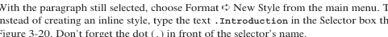

图 3-19

6. 在段落仍被选中的情况下，从主菜单中选择 格式 ▸ 新样式。这次，不要创建内联样式，而是在图 3-20 中可见的选择器框中输入文本 .Introduction。不要忘记选择器名称前面的点号 (.)。

7. 在屏幕顶部，选中“将新样式应用于文档选择”的复选框。启用此设置后，你即将创建的新类将被应用于已选中的 <p> 元素。

8. 从 font-style 下拉列表中选择 italic。你的“新样式”对话框现在应如图 3-20 所示。

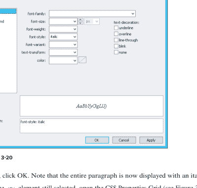

图 3-20

9. 最后，单击“确定”。注意整个段落现在以斜体字体显示。

10. 在 <p> 元素仍被选中的情况下，通过选择 查看 ▸ CSS 属性 打开 CSS 属性网格（见图 3-21）。此网格可让你概览所有 CSS 属性，并显示当前页面中激活的属性。

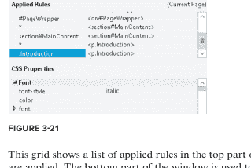

图 3-21

此网格在窗口的上部按应用顺序显示已应用规则的列表。窗口的下部用于显示这些规则的 CSS 属性。在图 3-21 中，你可以看到适用于 `.Introduction` 选择器的规则。

11. 在 CSS 属性网格中定位 `color` 属性，并将其设置为深蓝色，例如 #003399。为此，打开属性值的下拉列表并从颜色选择器中选择一种颜色。如果找不到所需颜色，请单击“更多颜色”按钮以调出扩展颜色选择器，如图 3-22 所示。

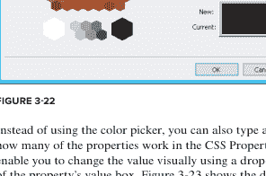

图 3-22

不使用颜色选择器时，你也可以直接在属性网格中输入值。这就是 CSS 属性网格中许多属性的工作方式：它们允许你直接输入值，或使用下拉列表或属性值框末尾带有省略号的按钮以可视方式更改值。图 3-23 显示了 `font-style` 属性在便捷的下拉列表中的不同选项。

请特别注意窗口顶部的三个按钮，因为它们提供了一些有用的功能。前两个按钮可让你在分类模式和字母顺序模式之间切换，从而更轻松地找到正确的属性。第三个按钮可让你将已应用的属性显示在列表顶部或其在列表中的默认位置。


图 3-23

12. 最后，保存所有更改并在浏览器中打开 Default.aspx（见图 3-24）。你会看到第一个段落现在以蓝色斜体字体显示，除了文本中的链接，其颜色为绿色或红色，具体取决于你是否之前访问过该网站。此外，如果你按照上一章的所有说明操作，文本“paying a visit”将为红色，由嵌入式 CSS 类设置。


图 3-24

13. 切回 VS 并在标记视图中查看你的页面。在页面的 <head> 部分，你应看到以下嵌入式样式表：

```
.Introduction
{
font-style: italic;
color: #003399;
}
```

```
}
</style>
<link href="Styles/Styles.css" rel="stylesheet" type="text/css" />
```

## 工作原理

VS 提供的众多工具使为网站编写 CSS 变得简单。你无需手工编码，也无需记住 CSS 标准支持的所有不同属性。相反，你可以从 CSS 属性网格上的不同列表中直接选择它们。此网格允许你手动输入值，同时还提供方便的工具来选择颜色、文件、下拉列表中的项目等。

在属性网格中做的所有更改都会应用于相关的样式表，无论你使用的是内联、嵌入式还是外部样式表。同时，设计视图会更新以反映你设置的新 CSS 选项。

当你查看 <h1> 元素时，可以看到 VS 创建了一个内联样式，将 padding 设置为 0 以同时影响四边，并将 margin 设置为 0 0 10px 0 以单独控制四边。

一旦你创建了一批有用且可重用的样式，就需要一种方法将现有样式应用于其他页面或 HTML 元素。接下来你将看到其工作原理。

## 应用样式

如果你有使用 Microsoft Word 的经验，可能熟悉“样式”对话框，它列出所有可用样式并允许你将其应用于所选文本部分。这样，你可以快速将相同的格式应用于文本块。在 VS 中也是类似的。通过“应用样式”窗口——可通过从主菜单中选择 查看 ▸ 应用样式 访问——你可以轻松地将样式规则应用于页面中的元素。

## 试一试 使用“应用样式”窗口

在本练习中，你重用 .Introduction 类并将其应用于页面的第二个段落。这样，两个段落最终看起来相同。

1. 仍在 Default.aspx 中，确保你处于设计视图，然后通过单击选择页面的第二个段落。确保文档窗口底部的标签选择器显示 <p> 元素被选中，而不是 <p> 元素的一部分的其他元素，如 <strong>。如果只有一个段落文本，请先创建一个新段落（在设计视图中在第一个段落后按 Enter），输入一些文本，然后选择该段落。
2. 通过选择 查看 ▸ 应用样式 打开“应用样式”窗口。确保窗口没有意外地停靠在主文档窗口中，而是浮动或放置在文档窗口侧边。此窗口显示它在当前页面和任何附加样式表中找到的所有选择器。如果看不到图 3-25 中显示的所有样式，请单击“选项”按钮并选择“显示所有样式”。


图 3-25

3. 在 CSS 样式列表中单击 Introduction 类。VS 会向 <p> 标签添加一个 class 属性：

```
<p class="Introduction">
Feel free to have a <a href="Default.aspx">look around</a>; there are lots of
interesting <strong>reviews and concert pictures</strong> to be found here.
</p>
```

如果要应用多个类，请按住 Ctrl 键同时单击列表中的其他类之一。这会将以空格分隔的类列表应用于元素的 class 属性。你也可以按照相同的步骤在标记视图中应用所选样式。

4. 使用“清除样式”按钮，你可以快速从标签中移除现有的类和内联样式。回想一下上一章中当你使用格式工具栏格式化页面文本时看到的 HTML 片段。如果你看到了“前景色”按钮，你最终得到的代码类似这样：

```
We&#39;re glad you&#39;re <span class="auto-style1">paying a visit</span>
```

要移除 class 属性，请在标签选择器中选择 <span> 标签，或直接在标记视图中单击 <span> 标签，然后在“应用样式”窗口中单击“清除样式”，你可以在图 3-25 的工具栏下方看到它。你最终会得到以下 HTML：

```
We&#39;re glad you&#39;re paying a visit
```

因为围绕文本的空 <span> 没有用处，VS 也会为你将其移除。此外，VS 还会移除 auto-style1 规则，因为页面中没有任何代码再使用它。

从 HTML 元素中移除样式属性的方式相同。

## 工作原理

再次，VS 能够保持所有相关窗口同步：设计视图、标记视图以及各种 CSS 设计工具。当你从“应用样式”窗口应用一个类时，VS 会在标记视图中将请求的类添加到所选 HTML 元素中。然后它还会更新设计视图窗口。同样，当你在设计视图中从嵌入式样式中移除选择器或声明时，设计视图和 CSS 工具窗口都会更新。


本章需要了解的最后一个 CSS 功能位于“管理样式”和“应用样式”窗口中。除了帮助你向文档附加 CSS 文件外，这些窗口还能让你轻松管理样式。

## 管理样式

由于添加新的内联样式和嵌入样式非常容易，你的页面可能很快就会因样式分散而变得一团糟。为了实现可重用性，你应该尽可能将内联样式和嵌入样式移到外部样式表中。这正是“应用样式”和“管理样式”窗口所能实现的。

## 动手尝试：使用“管理样式”和“应用样式”窗口管理样式

在本章前面，你修改了 `<h1>` 元素，并为标题应用了内边距和外边距。然而，Default.aspx 并不是唯一可以从这种标题样式中受益的页面，因此将其移入 Styles.css 文件是合理的。同样，`Introduction` 类看起来也具有足够的可重用性，可以包含在 Styles.css 文件中，以便其他页面能够访问它。本次动手练习将向你展示如何在站点中移动样式。

- 1. 确保 Default.aspx 仍然处于打开状态，如有必要，切换到标记视图。
- 2. 找到 `<h1>` 元素并单击它一次。VS 会在文档窗口底部的“标记选择器”中高亮显示该标记，以表明它是当前活动的标记。
- 3. 从主菜单中选择“视图 ▸ 应用样式”打开“应用样式”窗口。或者，如果该窗口与其他窗口停靠在一起，只需单击其选项卡即可使其变为活动状态。同样，请确保该窗口没有意外停靠在主文档窗口中，而是浮动或放置在文档窗口的侧面。在“应用样式”窗口的底部，你会看到一个内联样式出现（参见图 3-26）。
- 4. 右键单击“内联样式”，选择“新建样式副本”。此时会打开“新建样式”对话框，允许你基于当前所选内容创建新样式。在窗口顶部，从“选择器”下拉列表中选择 `h1`，从“定义位置”下拉列表中选择“现有样式表”。从“URL”下拉列表中选择 `Styles/Styles.css`。如果该项不可用，请单击“浏览”按钮找到并选择它。你的对话框最终应如图 3-27 所示。
- 5. 单击“确定”关闭对话框。VS 会创建 h1 样式的副本，并将其放入 Styles.css 文件中。VS 会在 Styles.css 文件中为 h1 创建一个新的选择器，而不是将内边距和外边距信息添加到现有的规则集中。如果你愿意，可以手动将这两个选择器合并为一个。
- 6. 在“应用样式”窗口中，再次右键单击“内联样式”，这次从上下文菜单中选择“删除内联样式”。这将从 h1 元素中移除 style 属性。


图 3-27

- 7. 从主菜单中选择“视图 ▸ 管理样式”。同样，确保窗口放在文档窗口旁边，而不是停靠在文档窗口中。在“当前页面”项下，找到 `.Introduction` 选择器。
- 8. 单击 `.Introduction` 选择器一次，然后将其拖到 `Styles.css` 的区域中，例如将其放在 `h1` 选择器之后。请注意，当你在选择器之间悬停时，VS 会绘制线条，以指示选择器最终将放置的位置。图 3-28 展示了如何将 `.Introduction` 选择器从当前页面拖入 `Styles.css`，放在 `h1` 和 `#PageWrapper` 选择器之间。
- 9. 一旦你将选择器放到“管理样式”窗口的 `Styles.css` 区域中，相关的样式就会从当前页面中移除，然后插入到 `Styles.css` 中。由于该 CSS 文件是通过 `<link />` 元素包含在当前页面中的，因此在设计视图中你不会看到任何变化。现在你可以从 `Default.aspx` 中删除空的 `<style>` 元素，因为它已经不再需要了。


图 3-28

- 10. 如果你还没有合并两个 h1 选择器，请打开 Styles.css 并滚动到文件末尾。将内外边距属性的两行代码复制到剪贴板，然后删除整个选择器。向上滚动文件，将这两条 CSS 规则粘贴到另一个 h1 选择器内。最终你应该得到如下代码：
```
h1
{
    font-size: 20px;
    padding: 0;
    margin: 0 0 10px 0;
}
```
- 11. 保存你可能有的任何待处理更改，然后按 Ctrl+F5 在浏览器中打开 Default.aspx。注意，段落没有变化，仍然使用相同的蓝色和斜体字体。

## 工作原理

遗憾的是，VS 不允许你将内联样式直接移动到外部样式表文件中。不过，通过创建现有样式的副本，然后删除原始的内联样式，你可以达到相同的效果。在文件之间移动嵌入样式或外部样式表则容易得多。你只需将一个样式从一个文件拖到另一个文件，VS 就会自动为你移动代码。这使得组织 CSS 变得极其容易。你不必因为害怕改动而将所有嵌入的 CSS 留在页面中，现在你可以简单地将其拖放到外部文件中。这使得在其他页面中重用这些样式变得更加容易，减少了页面大小和页面臃肿，也让你的站点更容易管理。显然，将 CSS 移动到的目标文件必须已附加到你正在处理的页面中，这一点很重要。

## 关于使用 CSS 的实用技巧

请遵循以下技巧来充分利用 CSS：

- 花一些时间熟悉 CSS 支持的众多属性。最好的方法是，在你的 Demos 文件夹中创建一个全新的页面，创建一些 HTML 元素（如 `<div>` 和 `<p>` 标签），然后尝试使用所有不同的属性。通过在 CSS 属性网格中尝试许多属性，你会对可用的选项有所了解。这会使你以后想要对某些内容应用特定效果时更加容易。
- 创建自定义 CSS 类时，尽量使用能够描述规则行为的名称，而不是外观和感觉。例如，一个名为 `.Introduction` 的类用于为页面第一段设置样式，就是一个很好的描述。它允许你更改底层值，而不会影响名称的实际含义。但像 `.BlueAndItalic` 这样的类名以后肯定会给你带来麻烦。如果以后你决定将蓝色改为黑色怎么办？你最终要么得到一个与其自身行为不符的奇怪类名，要么需要重命名该类并更新整个站点，将所有对旧类的引用改为 `.BlackAndItalic`。
- 尽量创建较小且可重用的规则集，以便在需要时进行组合，而不是创建只能用于单个 UI 元素的大型单一规则。例如，与其创建这样的样式：
```
.ImportantHeading
{
  color: Red;
  font-size: 20px;
  font-weight: bold;
}
```
你最好创建一些更轻量、更易于重用的规则：
```
h1
{
  font-size: 20px;
}
```
```
.Attention
{
  color: Red;
  font-weight: bold;
}
```
当你像这样将 `.Attention` 类应用到标题上时：`<h1 class="Attention">`，你得到的效果与使用 `ImportantHeading` 类时完全相同。然而，通过单独的 `Attention` 类，你创建了一个可重用的规则，可以将其应用于其他需要吸引用户注意的元素，比如 `<p>` 或 `<span>` 元素。

## 总结

本章让你深入了解了 CSS，这是为你的 ASPX 和 HTML 网页设置样式的最重要语言。

CSS 使你能够克服 HTML 在网页样式方面的局限性，因为它旨在最小化页面臃肿，让你对页面外观有更大的控制力，并通常帮助你创建加载更快、更易于维护的网站。

一旦你充分理解了 CSS 术语，你会发现使用 VS 内置的众多 CSS 工具非常容易。像“管理样式”和“应用样式”窗口、样式生成器以及代码编辑器中的智能 IntelliSense 等工具，都让编写和管理 CSS 变得非常简单。

你不仅可以将 CSS 应用于 HTML（如本章所示），还可以应用于 ASP.NET 服务器控件。应用于这些控件的 CSS 最终会以纯 HTML 的形式呈现在浏览器中，其原理与你在本章中看到的一致。下一章将详细介绍许多可用的 ASP.NET 服务器控件。


## 练习

1. 相对于嵌入式样式表，使用外部样式的主要好处是什么？

2. 编写一条 CSS 规则，将页面中所有一级标题（h1）的外观更改为以下要求：

- 标题使用 Arial 字体。
- 标题颜色为蓝色。
- 标题字号为 18 像素。
- 标题顶部和左侧带有蓝色细边框。

对于最后一项要求，请查看 CSS 文件中 VS 的 IntelliSense 列表，以发现 border 属性的另一种简写形式。

3. 以下两条规则中，哪一条更容易在网站的不同页面之间复用？你能解释原因吗？

```
#MainContent
{
    border: 1px solid Blue;
}

.BoxWithBorders
{
    border: 1px solid Blue;
}
```

4. VS 提供了多种将外部样式表附加到页面的方式。你能说出其中两种不同的选项吗？

你可以在附录 A 中找到这些练习的答案。


## 使用 ASP.NET 服务器控件

### 本章你将学习：

- 什么是 ASP.NET 服务器控件
- 你可以使用的不同类型的服务器控件
- 大多数服务器控件共有的行为
- ASP.NET 运行时如何处理页面上的服务器控件
- 服务器控件如何在回发过程中保持其状态

### 本章的 WROX.COM 代码下载

你可以在 www.wrox.com/remtitle.cgi?isbn=1118311809 的 Download Code 标签页中找到本章的 wrox.com 代码下载。代码位于第 4 章的下载中。

ASP.NET 服务器控件是 ASP.NET 的中坚力量。你在 Visual Studio（VS）中构建的几乎所有 Web Forms 页面都会包含一个或多个服务器控件。这些控件类型多样、规模不一，从 Button、Label 等简单控件，到 TreeView、ListView 等能够显示来自数据源（如数据库或 XML 文件）数据的复杂控件。你将在第 7 章、第 13 章和第 14 章中看到这些控件。

ASP.NET 服务器控件的架构与 ASP.NET 深度集成，使这些控件具备了一套在当今构建网站的技术中相当独特的功能。本章将向你展示什么是服务器控件、它们如何工作，以及安装 VS 后哪些控件是开箱即用的。

必需属性。请注意，对于非服务器元素（如普通 HTML 元素），runat 属性是可选的。有了这个属性，你的编程代码就可以访问非服务器控件。本书后面会对此进行更详细的介绍。

你可以通过代码片段轻松地将 runat 属性添加到现有元素：输入 runat，然后按 Tab 键。

前面 TextBox 的示例使用了自闭合标签，闭合斜杠（/）嵌入在开始标签中。这对于不需要包含文本或其他控件等子内容的控件来说非常常见。不过，使用单独结束标签的长版本也是可以接受的：

```
<asp:TextBox ID="Message" runat="server"></asp:TextBox>
```

你可以通过“工具”>“选项”>“文本编辑器”>“HTML”>“格式”>“标记特定选项”来控制每个元素关闭标签的默认行为。

你可以使用直接放在页面中的代码，或者使用单独的 Code Behind 文件（如第 2 章所述）对这个文本框进行编程。要设置欢迎消息和时间，可以使用以下代码：

### VB.NET

```
Message.Text = "Hello World, the time is " & DateTime.Now.TimeOfDay.ToString()
```

### C#

```
Message.Text = "Hello World, the time is " + DateTime.Now.TimeOfDay.ToString();
```

页面标记部分中控件的定义现在与定义文本框中所显示文本的实际代码分离开来，这使得定义和编程文本框（或任何其他控件）更加容易，因为你可以一次专注于一项任务。你既可以在页面的标记部分声明控件及其视觉外观，也可以在代码块中编程其行为。

一般来说，在标记视图中定义的控件不区分大小写，尽管你可以设置的某些值是区分大小写的。我倾向于使用 IntelliSense 建议的大小写形式。请注意，使用 C# 时，你在 Code Behind 中使用的属性是区分大小写的。

在下一个练习中，你将看到服务器控件如何将其底层 HTML 发送到客户端。

### 试一试：使用服务器控件

在本练习中，你向页面添加一个 TextBox、一个 Label 和一个 Button 控件。当你在浏览器中请求该页面时，这些服务器控件会被转换为 HTML，然后发送到客户端。通过查看浏览器中页面的最终 HTML，你将会看到该 HTML 与最初的 ASP.NET 标记完全不同。

1. 在 Visual Studio 中打开 Planet Wrox 项目。
2. 在解决方案资源管理器的 Demos 文件夹中，创建一个名为 ControlsDemo.aspx 的新 Web Form。选择你的编程语言，并确保该 Web Form 使用 Code Behind。
3. 切换到设计视图。从工具箱的“标准”类别中，将一个 TextBox、一个 Button 和一个 Label 控件拖放到设计图面上 `<div>` 标签的虚线框内，该 `<div>` 标签是在你创建页面时自动添加的。

在 TextBox 前面输入文本“Your name”，并将光标置于设计视图中的 Button 和 Label 控件之间，然后按 Enter，在 Button 和 Label 之间添加一个换行。如果你难以将光标定位到这两个控件之间，可以将光标放在 Label 控件之后，然后按两次左箭头键。第一次按下时，Label 会被选中；第二次按下时，光标会置于两个控件之间，这时你就可以按 Enter 了。此时你的设计视图应如图 4-1 所示。


图 4-1

右键单击 Button 控件，然后选择“属性”以打开该控件的属性网格。选中 Button 后按 F4 也可以实现同样的操作。出现的窗口（如图 4-2 所示）允许你更改控件的属性，这些属性反过来会影响控件在运行时的外观和行为。


图 4-2

5. 将控件的 Text 属性设置为“Submit Information”，并将其 ID（你会在列表底部用括号括起来的位置找到它）设置为“SubmitButton”。

6. 使用属性网格将 TextBox 的 ID 更改为 YourName。
7. 使用属性网格清除 Label 的 Text 属性。你可以右键单击网格中该属性的标签并选择“重置”，也可以手动删除文本。将其 ID 设置为 Result。
8. 仍在设计视图中，双击 Button 控件，让 VS 向页面的 Code Behind 中添加一些代码，这些代码将在浏览器中单击按钮时触发。稍后你将看到如何从标记视图完成同样的操作。将加粗的代码行添加到 VS 为你插入的代码块中：

```
VB.NET
Protected Sub SubmitButton_Click(sender As Object,
    e As EventArgs) Handles SubmitButton.Click
    Result.Text = "Your name is " & YourName.Text
End Sub
```

```
C#
protected void SubmitButton_Click(object sender, EventArgs e)
{
    Result.Text = "Your name is " + YourName.Text;
}
```

请注意，VB.NET 示例中这里不需要下划线来将代码拆分为两行。在较旧版本的 VB.NET 中，需要使用下划线才能将此代码拆分为两行。

9. 保存对页面的更改，然后按 Ctrl+F5 在浏览器中打开它。先不要单击按钮，而是通过右键单击浏览器中的页面并选择“查看源代码”或“查看页面源代码”来打开页面源代码。你应该会看到以下 HTML 代码（我稍微调整了格式，以便 HTML 适应页面）：

```
<div>
    Your name <input name="YourName" type="text" id="YourName" />
    <input type="submit" name="SubmitButton" value="Submit Information"
        id="SubmitButton" />
    <br />
    <span id="Result"></span>
</div>
```

10. 切换回浏览器，在文本框中输入你的名字，然后单击按钮。页面重新加载完成后，使用浏览器的右键菜单再次打开页面源代码。此时的代码应该如下所示：

```
<div>
    Your name <input name="YourName" type="text" value="Imar" id="YourName" />
    <input type="submit" name="SubmitButton" value="Submit Information"
        id="SubmitButton" />
    <br />
    <span id="Result">Your name is Imar</span>
</div>
```

请注意，加粗的两行已经发生变化，现在显示的是你在文本框中输入的名字。目前你可以忽略页面中的其他 HTML。


## 工作原理

顾名思义，ASP.NET 服务器控件驻留在 ASPX 页面中的服务器上，由 ASP.NET 运行时进行处理。当你在浏览器中请求某个页面时，运行时会在内存中根据你创建的控件生成 ASPX 文件的表示。当运行时准备将 HTML 发送到浏览器时，它会向页面中的每个控件请求其 HTML，然后将这些 HTML 注入到最终响应中。例如，当 Label 控件第一次加载时被请求其 HTML，它会返回以下内容：

```
<span id="Result"></span>
```

尽管你使用 `<asp:Label>` 语法定义了 Label 控件，但它在浏览器中最终会变成一个简单的 `<span>` 元素。由于 Label 控件的 Text 属性为空，你不会在两个 `<span>` 标签之间看到任何文本。其他控件也是如此；`<asp:TextBox>` 最终会变成 `<input type="text">`，而 `<asp:Button>` 则会变成 `<input type="submit">`。

当你点击按钮时，控件会触发一次回发，将页面中各个控件的信息发送到服务器，页面会在服务器上再次加载。此外，你为处理按钮的 Click 事件而编写的代码也会被执行。这段代码会获取你在文本框中输入的名称，并将其赋值给 Label 控件，如这个 C# 示例所示：

```
Result.Text = "Your name is " + YourName.Text;
```

暂时不必担心处理按钮 Click 事件的代码语法。在第 5 章中，你会了解这是如何工作的，以及为什么需要这段代码。

此时，Label 控件包含你在文本框中输入的文本，因此当它被请求其 HTML 时，现在会返回以下内容：

```
<span id="Result">Your name is Imar</span>
```

在本章稍后讨论 ASP.NET 状态引擎时，你会更深入地了解回发机制。

## 深入了解 ASP.NET 服务器控件

由于在构建 ASP.NET Web Forms 页面时，大部分时间你都会使用服务器控件，因此你需要详细了解它们的工作方式以及如何使用它们。在下一节中，你将看到如何向页面添加控件，以及如何改变它们在浏览器中的行为方式。再下一节，你将了解所有服务器控件共有的行为特性。一旦理解了这些共享行为，你就可以轻松地将这些知识应用到其他新控件上，从而快速上手。

### 在页面中定义控件

正如前面的“试一试”所示，你可以直接从工具箱中拖拽控件到页面的设计图面上。这样可以非常轻松地向页面添加一组控件以快速开始。然而，由于设计图面的工作方式，有时可能难以将控件精确添加到你想要的位置。例如，将控件拖拽到 HTML 元素的开始和结束标签之间可能会很困难。幸运的是，你也可以在标记视图中轻松地从工具箱拖拽控件。此外，你还可以直接在标记视图中输入控件的标记，让 IntelliSense 和代码片段帮助你处理不同的标签和属性。你还会发现属性网格在标记视图下同样有效。只需点击相关的标记，属性网格就会更新以反映你点击的标签。这样，你就可以轻松更改控件的属性，同时仍然能够准确看到为你生成的标记。如果你使用过旧版本的 VS，你会欣赏 VS 2012 中的一项新功能：你现在可以直接在标记视图中绑定处理程序（例如前面练习中使用的 `Click` 事件），而无需切换到设计视图。你还可以通过代码访问控件的智能任务面板。本章稍后你会看到更多这些功能。

如果你查看页面中某些控件的属性网格，你会注意到其中许多控件具有类似的属性。在下一节中，你将确切了解这些属性是什么以及它们的用途。

### 所有控件共有的属性

你在 VS 工具箱中找到的大多数服务器控件都共享一些常见行为。其中一部分行为包括所谓的*属性*，这些属性定义了控件可以包含和公开的数据。你将在下一章了解更多关于属性和其他行为类型的内容。每个服务器控件都有一个 ID，用于在页面中唯一标识它；一个 `runat` 属性，始终设置为 `server`，表示该控件应在服务器上进行处理；以及一个 `ClientID`，它包含在最终 HTML 中分配给该元素的客户端 ID 属性。在 ASP.NET 3.5 及更早版本中，这个 `ClientID` 总是自动为你生成。但是，在 ASP.NET 4 中引入了一个新的 `ClientIDMode` 属性，让你对客户端的元素 ID 有更多控制。你将在后续章节中了解其工作原理。`runat` 属性从技术上讲并不是服务器控件的属性，但它是必需的，用于指示该控件的标记应作为服务器控件处理，而不是在浏览器中作为纯文本或 HTML 显示。

除了这些属性之外，许多服务器控件还因为共享同一个 `Control` 基类而拥有更多公共属性。下一章将深入探讨基类和继承。下表列出了最常见的共享属性及其用途。

| 属性 | 说明 |
|---|---|
| AccessKey | 允许你设置一个键，用户可以通过按下相应的字母在客户端访问该控件。 |
| BackColor<br>ForeColor | 允许你更改控件的背景颜色（`BackColor`）和文本颜色（`ForeColor`）。 |
| BorderColor<br>BorderStyle<br>BorderWidth | 更改控件在浏览器中的边框。这与你在上一章看到的 CSS 边框属性的相似之处并非巧合。这三个 ASP.NET 属性中的每一个都直接映射到其对应的 CSS 属性。 |
| CssClass | 允许你定义控件在浏览器中的 HTML class 属性。此类别名可以指向你在页面中定义的 CSS 类，或外部 CSS 文件中的类。 |
| Enabled | 确定用户是否可以在浏览器中与控件交互。例如，对于禁用的文本框（Enabled="False"），你无法更改其文本。 |
| Font | 允许你定义不同的字体相关设置，例如大小、字体族以及是否应为粗体。 |
| Height<br>Width | 确定控件在浏览器中的高度和宽度。 |
| TabIndex | 设置客户端 HTML tabindex 属性，该属性决定用户通过按 Tab 键在页面控件中移动的顺序。 |
| ToolTip | 允许你为浏览器中的控件设置工具提示。该工具提示在 HTML 中渲染为 title 属性，当用户将鼠标悬停在元素上时显示。 |
| Visible | 确定控件是否发送到浏览器。你应该将其视为服务器端可见性设置，因为不可见控件根本不会发送到浏览器。这意味着它与你在上一章中看到的、在客户端隐藏元素的 CSS display 和 visibility 属性有很大不同。 |

要了解所有这些属性在浏览器中最终呈现的效果，请考虑以下 TextBox 服务器控件的标记：

```
<asp:TextBox AccessKey="a" BackColor="Black" ForeColor="White" Font-Size="30px" BorderColor="Yellow" BorderStyle="Dashed" BorderWidth="4" CssClass="TextBox" Enabled="True" Height="40" Width="200" TabIndex="1" ToolTip="Hover text here" Visible="True" ID="TextBox1" runat="server" Text="Hello World"> </asp:TextBox>
```

当你在浏览器中请求包含此控件的页面时，你会得到以下 HTML：

```
<input name="TextBox1" type="text" value="Hello World" id="TextBox1" accesskey="a" tabindex="1" title="Hover text here" class="TextBox" style="color:White; background-color:Black;border-color:Yellow;border-width:4px; border-style:Dashed;font-size:30px;height:40px;width:200px;" />
```

这会产生如图 4-3 所示的文本框。


## 列表控件

标准类别还包含多个在浏览器中以列表形式呈现的控件。这些控件包括 ListBox、DropDownList、CheckBoxList、RadioButtonList 和 BulletedList。要向列表添加项，你需要在控件的开始和结束标签之间定义 `<asp:ListItem>` 元素，如下例所示：

```
<asp:DropDownList ID="FavoriteLanguage" runat="server">
<asp:ListItem Value="C#">C#</asp:ListItem>
<asp:ListItem Value="Visual Basic">Visual Basic</asp:ListItem>
<asp:ListItem Value="CSS">CSS</asp:ListItem>
</asp:DropDownList>
```

DropDownList 只允许用户一次选择一项。要以编程方式查看列表控件当前活动和选定的项，你可以查看其 SelectedValue、SelectedItem 或 SelectedIndex 属性。SelectedValue 返回一个包含所选项目值的字符串，比如前面示例中的 C# 或 Visual Basic。SelectedIndex 返回列表中该项的从零开始的索引。对于前面的示例，如果用户选择了 C#，SelectedIndex 将是 0。同样，如果用户选择了 CSS，索引将是 2（列表中的第三项）。

对于允许多项选择的控件（如 CheckBoxList 和 ListBox），你可以遍历 Items 集合并查看哪些项处于选中状态。在这种情况下，SelectedItem 只返回列表中的第一个选中项，而不是全部选中项。你将在下一个练习中学习如何访问所有选中项。请注意，在浏览器中，DropDownList 和 ListBox 控件都会呈现为 `<select>` 元素。这两个控件设置的 size 和 multiple 等属性决定了该 HTML 元素在浏览器中的外观和行为。

BulletedList 控件不允许用户进行选择，因此不支持这些属性。

为了了解如何向列表控件添加列表项以及如何读取所选值，以下练习将指导你创建一个简单的 Web Form，其中包含两个列表控件，用于向用户询问他们最喜欢的编程语言。

### 试一试：使用列表控件

在本练习中，你需要在页面中添加两个列表控件。此外，你还需要添加一个按钮，当点击该按钮时，会在 Label 控件中以文本形式显示所选项。

- 1. 在 Demos 文件夹中，创建一个名为 ListControls.aspx 的新 Web Form。确保通过选中“将代码放在单独的文件中”选项来创建 Code Behind 文件。
- 2. 切换到设计视图，从工具箱中拖一个 DropDownList 到页面的设计表面上，放在页面已有的 `<div>` 元素的虚线边框内。
- 3. 注意，当你将 DropDownList 控件放到页面上后，会立即出现一个标记为“DropDownList 任务”的弹出菜单，如图 4-6 所示。

  这个弹出菜单称为“智能任务”面板。当它出现时，你可以访问该控件最常见的任务。以 DropDownList 为例，你会看到三个选项。第一个选项允许你将控件绑定到数据源，这将在第 13 章中演示。第二个选项允许你手动向列表添加项，最后一个选项设置控件的 AutoPostBack 属性。勾选此选项后，只要用户从列表中选择新项，控件就会将其所在的页面回发到服务器。请注意，浏览器必须启用 JavaScript，此功能才能正常工作。


图 4-6

智能任务面板仅出现在具有大量功能的较复杂控件上。对于 Button 或 Label 这样的简单控件，你不会看到它。要重新打开智能任务面板，请在设计器中右键单击控件并选择“显示智能标记”。或者，单击控件右上角的小箭头（见图 4-6），或在选中控件时按 Shift+Alt+F10。你也可以从标记视图打开智能任务面板。只需在控件或其他标记片段的开始或结束标签上的任意位置单击，然后按 Ctrl+.（即 Ctrl+句点）。或者，将鼠标悬停在开始标签开头处的小蓝色矩形上，然后点击出现的灰色箭头。

在 DropDownList 的智能任务面板上，单击“编辑项”链接，打开“ListItem 集合编辑器”，如图 4-7 所示。


图 4-7

此对话框允许你向列表控件添加新项。通过此窗口添加的项会作为 `<asp:ListItem>` 元素添加到控件的标签之间。

- 4. 单击屏幕左侧的“添加”按钮来插入新的列表项。然后在右侧的“属性网格”中，为 Text 属性输入 C#，并按 Tab 键。当你从 Text 属性切换出去后，该值也会复制到 Value 属性。如果你希望 Text 和 Value 属性相同，这会很方便。当然，为 Value 属性分配一个不同的值也完全可以（而且很常见）。

```
DropDownList1.SelectedValue + "<br />";

foreach (ListItem item in CheckBoxList1.Items)
{
    if (item.Selected == true)
    {
        Label1.Text += "In the CBL you selected " + item.Value + "<br />";
    }
}
```

注意在 VB.NET 代码中，需要使用下划线将代码拆成两行。如果要将 Handles 关键字移动到单独的一行，VB.NET 要求使用下划线。

- 10. 保存对页面的更改，然后在浏览器中请求该页面。从 DropDownList 中选择一项，勾选 CheckBoxList 中的一项或多项，然后点击按钮。你应该会看到类似图 4-8 的内容，该图显示了在 Firefox 中的页面。


图 4-8

### 工作原理

各种列表控件都使用 `<asp:ListItem>` 元素。这使得将它们从一个控件复制到另一个控件来重用变得很容易。由于 DropDownList 一次只支持一个选中项，因此很容易获得其选中值。只需要一行代码（以 C# 显示）：

```
Label1.Text = "In the DDL you selected " + DropDownList1.SelectedValue + "<br />";
```

CheckBoxList 控件允许用户一次选择多个项。因此，你需要更多的代码来遍历项目集合，检查每个项的 Selected 属性（同样以 C# 显示）：

```csharp
foreach (ListItem item in CheckBoxList1.Items)
{
    if (item.Selected == true)
    {
        Label1.Text += "In the CBL you selected " + item.Value + "<br />";
    }
}
```

CheckBoxList 和其他列表控件都有一个 Items 集合，其中包含你在代码中定义的所有项。因此，根据本练习中的代码，CheckBoxList1 包含三个项，分别是 C#、Visual Basic 和 CSS。每个 ListItem 又包含一个 Selected 属性，用于确定用户是否在列表中勾选了该项。

使用 foreach 循环（VB.NET 中的 For Each），你可以遍历 ListItem 元素集合，逐个测试 Selected 属性。如果该项在列表中被选中，则其 Selected 属性为 true（VB 中为 True），其 Value 会被追加到 Label 的文本中。注意最后一个代码示例中使用了 +=（VB.NET 中为 &=）来将列表项的 Value 连同文本一起赋给 Label 控件的 Text 属性。+= 和 &= 语法是以下代码的简写：

```csharp
Label1.Text = Label1.Text + "In the CBL you selected" + item.Value + "<br />";
```

这段代码获取 Label 控件的当前文本，将字面文本 "In the CBL you selected" 追加到其中，然后使用 item.Value 追加该项的值，最后追加字面文本 "<br />"。然后将整个字符串重新赋给标签的 Text 属性。使用 += 语法通常更容易编写和理解，但完整写法也很常见。

VB.NET 和 C# 都支持 for each 循环，虽然两种语言的语法略有不同。在下一章中，你将学习更多关于循环和其他语言构造的知识。

同样值得注意的是 ListItems 的设置方式。在第一个示例中，也就是动手练习之前，你看到了同时具有 Value 和 Text 的 ListItem 元素：

```html
<asp:ListItem Value="C#">C#</asp:ListItem>
<asp:ListItem Value="Visual Basic">Visual Basic</asp:ListItem>
<asp:ListItem Value="CSS">CSS</asp:ListItem>
```

当你使用 ListItem 集合编辑器自行向列表添加项时，你不会得到 Value 属性：

```html
<asp:ListItem>C#</asp:ListItem>
<asp:ListItem>Visual Basic</asp:ListItem>
<asp:ListItem>CSS</asp:ListItem>
```

你没有得到 Value 属性，是因为你没有在 ListItem 集合编辑器中为该项提供显式值。如果省略 Value，ListItem 开始和结束标签之间的文本将隐式用作值，这在许多情况下是可行的。然而，在列表中拥有不同的 Value 和 Text 属性也很常见。例如，当你有一个国家列表时，你可以使用国家的全名作为 Text（如荷兰），并使用官方国家代码（nl）作为下拉列表的 Value。你将在本书的其他章节中看到列表控件的实际应用。


## 容器控件

经常希望将相关内容和控件分组。你可以通过将控件（和其他标记）放在其中一个容器控件中来实现这一点，例如 Panel、PlaceHolder、MultiView 或 Wizard。例如，你可以使用 PlaceHolder 或 Panel 控件一次隐藏或显示多个控件。不是分别隐藏每个控件，你只需隐藏包含所有单个控件和标记的整个容器。这两个控件各有优缺点。PlaceHolder 控件的好处是它不会向页面输出自己的 HTML，因此你可以在最终页面中没有任何副作用的情况下将其用作容器。然而，它缺乏设计时支持，使得在 VS 中设计时难以管理 PlaceHolder 内部的控件。相比之下，Panel 使你能够轻松访问其包含的所有控件和其他内容，但它本身会渲染为一个 <div> 元素。在许多情况下这不是问题，甚至可能很有用，因为你可以在客户端使用 CSS 定位该 <div>，因此通常最好使用 Panel 控件，因为它具有设计时支持。

MultiView（可以包含一个或多个 <asp:View> 元素）和 Wizard 在能够将长页面拆分为多个区域方面类似，例如使填写长表单变得容易。Wizard 内置了使用 Previous、Next 和 Finish 按钮在页面之间移动的支持，而 MultiView 必须通过编程控制。

## 更深入地了解 Panel 控件

在下面的练习中，你使用 Panel 控件为其他控件和标记创建容器。现在你只添加一些文本，但在随后的 Try It Out 练习中你会向面板添加 ASP.NET 控件。

## 试一试 使用 Panel 控件

在本练习中，你将了解如何使用 Panel 控件作为一些简单文本的容器。此外，你使用 CheckBox 在服务器上控制 Panel 的可见性。

- 1. 首先在 Demos 文件夹中创建一个名为 Containers.aspx 的带代码隐藏的新 Web 窗体。
- 2. 将页面切换到设计视图，并从工具箱将 CheckBox 和 Panel 控件拖到设计表面中的虚线 <div> 元素上。
- 3. 通过将 Text 属性设置为 Show Panel 为 CheckBox 控件提供有意义的描述，并使用属性网格将 AutoPostBack 属性设置为 True。不要从属性的下拉列表中选择 True，你也可以双击 AutoPostBack 属性或其值在 False 和 True 之间切换。
- 4. 使用属性网格将 Panel 控件的 Visible 属性设置为 False。这会在页面首次加载时隐藏 Panel 控件。
- 5. 在 Panel 控件内部，键入一些文本（例如，I am visible now）。请注意，面板的行为与 VS 设计表面的其余部分相同。你可以简单地向其中添加文本、选择和格式化它，并通过从工具箱拖动来向其中添加新控件。面板的代码在标记视图中应如下所示：

```
<asp:Panel ID="Panel1" runat="server" Visible="False">
    I am visible now
</asp:Panel>
```

请注意，如果你使用 VB.NET，使用标记视图和设计视图添加处理程序之间存在细微差别。如果你使用标记视图，处理程序会添加到标记中（OnCheckedChanged="CheckBox1_CheckedChanged"），并且代码会添加到代码隐藏中。当你使用设计视图时，标记视图中的代码不受影响，而代码隐藏中的代码会用 Handles 关键字进行注释，以指示代码响应的事件（例如按钮的单击、复选框的检查更改事件等）。但是在运行时，两者没有区别。

7. 接下来，在 VS 为你添加的处理程序代码中添加以下加粗的行：

```
VB.NET
Protected Sub CheckBox1_CheckedChanged(sender As Object, e As EventArgs)
    Panel1.Visible = CheckBox1.Checked
End Sub
```

```
C#
protected void CheckBox1_CheckedChanged(object sender, EventArgs e)
{
    Panel1.Visible = CheckBox1.Checked;
}
```

8. 保存所有更改，然后按 Ctrl+F5 在浏览器中请求页面。

9. 页面首次加载时，你只能看到复选框及其旁边的文本。当你在浏览器中查看页面的 HTML 时（右键单击页面并根据浏览器选择查看源代码或查看页面源），你只能看到复选框；在此时没有 Panel 控件的代码发送到浏览器。当你单击复选框在其上放置复选标记时，页面会重新加载，现在会显示你在步骤 5 中输入的文本。

> **警告** *如果没有任何反应，请返回 VS 中的页面源并确保 CheckBox 控件的 AutoPostBack 设置为 True。*

如果你在浏览器中查看 HTML，你会看到你在步骤 5 中键入的文本被包裹在一个 id 为 Panel1 的 <div> 元素中：

```
<div id="Panel1">
    I am visible now
</div>
```

## 其工作原理

在本练习的步骤 4 中，你将 Panel 控件的 Visible 属性设置为 False。这意味着当页面加载时，控件在服务器上不可见，因此其 HTML 永远不会到达浏览器。

当你然后选中复选框时，会发生回发，将表单中包含的信息发送到服务器。在服务器上，会运行一些代码，每当复选框从选中更改为未选中或反之时就会触发。在该代码块内部，会执行以下代码（以 C# 显示）：

```
Panel1.Visible = CheckBox1.Checked;
```

这意味着 Panel 仅在复选框被选中时可见。当未选中时，Panel 会自动隐藏。

如你所见，在 VS 中向 Panel 控件添加文本和其他标记很容易。现在你只添加了一些纯文本，但在下一节中你将了解如何添加 Wizard 控件以及如何使用它。

## 使用 Wizard 控件的魔力

Wizard 控件是拆分大型 Web 窗体并以小块信息形式向用户呈现的绝佳工具。不是用一个包含许多控件和文本的页面让用户感到困惑，你可以拆分页面并在单独的向导页面上呈现每个部分。然后 Wizard 控件通过自动创建 Next、Previous 和 Finish 按钮来处理所有导航问题。在下面的练习中，你使用向导询问用户她的姓名和最喜欢的编程语言。虽然示例本身相当简单，你本可以在同一页面上放置两个问题而不会让用户感到困惑，但示例展示了向导的工作原理以及其有用性。你可以轻松地将相同的技术应用于你自己的、可能更大的 Web 窗体。

## 试一试 使用向导创建易于使用的表单

在本 Try It Out 中，你将一个 Wizard 放置在上一练习中创建的面板内，使用户能够填写跨越几个页面的表单。向导将有两个步骤供用户输入详细信息，以及一个显示用户提供的数据的结果页面。

- 1. 确保 Containers.aspx 页面仍在设计视图中打开。删除你在上一个 Try It Out 中输入的文本 "I am visible now"，然后从工具箱将 Wizard 控件拖到 Panel 内部。将其右边缘向右拖动，进一步增加控件的总宽度至 500px。现在你的页面看起来类似于图 4-11。
- 2. 打开 Wizard 的 Smart Tasks 面板（单击其右上角的箭头）并选择 Add/Remove WizardSteps。在随后的对话框中，单击 Add 按钮插入第三个向导步骤，如图 4-12 所示。


FinishButtonClick 在 Action 类别中。使用这两种方法，你应该得到一些 Wizard1_FinishButtonClick 的代码，你需要用以下代码扩展它：

### VB.NET

```vbnet
Protected Sub Wizard1_FinishButtonClick(sender As Object,
    e As WizardNavigationEventArgs) Handles Wizard1.FinishButtonClick
    Result.Text = "Your name is " & YourName.Text
    Result.Text &= "<br />Your favorite language is " &
        FavoriteLanguage.SelectedValue
End Sub
```

### C#

```csharp
protected void Wizard1_FinishButtonClick(object sender,
    WizardNavigationEventArgs e)
{
    Result.Text = "Your name is " + YourName.Text;
    Result.Text += "<br />Your favorite language is " +
        FavoriteLanguage.SelectedValue;
}
```

9. 切回设计视图并打开 Wizard 的属性网格，确保其 ActiveStepIndex 设置为 0。设计器会记住你设计的最后一步，并在标记视图中将该值存储在 Wizard 的 ActiveStepIndex 中。为了确保 Wizard 从第一页开始，你在保存更改并运行页面之前应始终将 ActiveStepIndex 重新设置为 0（或在设计视图中单击 Wizard 控件中的第一步）。

10. 保存所有更改，关闭所有打开的浏览器窗口，然后按 Ctrl+F5 在浏览器中打开页面。选择复选框使 Panel 可见，并在第一个向导页面上输入你的姓名。单击 Next 并选择你最喜欢的编程语言。注意现在有一个 Previous 按钮可用，可让你返回向导的第一步以更改姓名。除了单击 Next 和 Previous 按钮外，你也可以单击浏览器中向导左侧的链接。当你单击 Finish 按钮时，你将看到你在向导中输入的信息结果（见图 4-15）。


图 4-15


## 工作原理

Wizard 控件替你完成了大部分繁重的工作。它负责处理导航，决定何时显示正确的按钮（上一步、下一步和完成），并确保在最终页面中，你在向导步骤中添加的控件的值仍然可用，以便你用标签显示它们。这是通过一种名为 View State（视图状态）的概念实现的，你将在本章结尾更深入地了解这一概念。

你只需定义步骤并设置其 StepType。将第一步的 StepType 设置为 Auto。通过此设置，Wizard 会自行判断要显示哪些按钮。由于这是向导中的第一步，且没有上一步可返回，它会省略“上一步”按钮（这相当于手动将 StepType 设置为 Start）。你将第二步的 StepType 设置为 Finish，这会告诉 Wizard 绘制一个“上一步”按钮和一个“完成”按钮。当你单击“完成”按钮时，Wizard 会到达最后一步，其 StepType 设置为 Complete。在此步骤中，导航按钮被隐藏，你只能看到带有结果的标签，该结果是通过页面 Code Behind 中的代码赋值的。在第 5 章中，你将了解更多关于 Code Behind 中实现此功能的代码。

除了你在前几节中看到的控件之外，还有其他几个控件值得研究。这里不逐一详细讨论它们，因为本书后续不会再用到它们。关于这些控件的一个很好的信息来源是 Microsoft Developer Network (MSDN) 网站，网址为 http://msdn.microsoft.com。要在此网站上查找相关信息，请使用你常用的搜索引擎搜索“ControlName Control MSDN”。例如，要查找有关 Wizard 控件的更多信息，你可以搜索“Wizard Control MSDN”。通常，MSDN 网站会出现在搜索结果的最前面。

## 其他标准控件

本节简要讨论工具箱“标准”类别中的其余控件。你会在本书其余部分的示例应用程序中看到其中许多控件的用法。

### LinkButton 和 ImageButton

LinkButton 和 ImageButton 控件的操作方式与普通 Button 控件类似。两者在被点击时都会导致向服务器回发。LinkButton 呈现为一个简单的 `<a>` 元素，但会（使用 JavaScript）回发，而不是请求新页面。ImageButton 的作用相同，但显示的是用户可点击以触发回发的图像。

### Image 和 ImageMap

这两个控件非常相似，它们都在浏览器中显示图像。ImageMap 允许你在图像上定义热区，点击热区时，要么导致向服务器回发，要么导航到另一个页面。

### Calendar

Calendar 控件提供一个丰富的界面，允许用户选择日期。你会在本章结尾讨论 ASP.NET 状态引擎时看到更多相关内容。

### FileUpload

`FileUpload` 控件允许用户上传文件，这些文件可以存储在服务器上。你会在第 14 章中看到更多关于此控件的内容。

### Literal、Localize 和 Substitute

这三个控件看起来都有点像 `Label` 控件，因为它们都可以显示静态文本或 HTML。`Literal` 的最大优点是它不会自行呈现任何额外的标签；它只显示你赋给其 Text 属性的内容，因此非常适合显示你在 Code Behind 中构建或从数据库检索到的 HTML 或 JavaScript。

`Localize` 控件用于多语言网站，能够从已翻译的资源文件中检索其内容。`Substitute` 控件用于高级缓存场景，使你能够只更新页面中部分内容，而页面的其余部分则完全被缓存。这两个控件都不在本书的讨论范围内，但如果你想深入了解它们，可以参阅 Wrox 出版的 *Professional ASP.NET 4.5 in C# and VB*（ISBN：978-1-118-31182-0）。

### AdRotator

`AdRotator` 控件允许你在网站上显示随机广告。这些广告来自你在服务器上创建的 XML 文件。由于它缺乏大多数（即使是最简单的）场景所需的点击跟踪和日志记录等高级功能，此控件在当今的网站中已不太常用。

### HiddenField

`HiddenField` 控件允许你在页面中存储随每次请求一起提交的数据。如果你希望页面记住特定数据而又不想让用户在页面上看到这些数据，此功能非常有用。由于该字段确实会出现在页面的 HTML 源代码中，因此最终用户可以看到它，所以你绝不应在其中存储任何敏感数据。

### XML

`XML` 控件允许你将 XML 格式的数据转换为另一种格式（如 XHTML）以显示在页面上。有关详细说明，请参阅 *Professional ASP.NET 4.5*。

### Table

`<asp:Table>` 控件在许多方面与 HTML 的 `<table>` 对应控件相同。但是，由于该控件位于服务器端，你可以对其进行编程，动态创建新的列和行，并向其中添加动态数据。

至此，工具箱“标准”类别中的控件讨论完毕。在大多数网页中，你至少会使用到其中一些控件。本节的其余部分将讨论工具箱的其他类别。由于其中大多数控件在本书后续部分都会以某种形式使用，本章只是简要描述它们的用途，让你对其用法有一个大致的了解。你可以在其他章节中找到交叉引用，以获取更多相关信息。

## HTML 控件

工具箱的“HTML”类别包含许多 HTML 控件，它们看起来与“标准”类别中的控件相似。例如，你可以找到看起来像 `<asp:Button>` 的 Input (Button)。同样，还有一个 Select 控件，其对应的是 `<asp:DropDownList>` 和 `<asp:ListBox>`。

与 ASP.NET 服务器控件相比，HTML 控件是客户端控件，直接以最终 HTML 的形式呈现在浏览器中。你可以通过为它们添加 `runat="server"` 属性，将它们暴露给服务器端代码。这样，你就可以在 Web 窗体的 Code Behind 中对它们进行编程，以影响它们的可见性等。

HTML 控件的功能远不及“标准”类别中的控件。例如，Select 控件缺少在设计时为 ListItem Collection Editor 添加新项的支持。这迫使你在 VS 的 Markup View 中手动编写这些项。

由于“标准”和“HTML”类别中的控件看起来非常相似，下一节将讨论它们的区别，并让你了解何时应优先选择某一类别。

### 如何在标准控件和 HTML 控件之间选择

工具箱中的“标准”和“HTML”类别控件似乎有些重叠。那么，你应该选择哪些控件，又在何时选择呢？通常，“标准”类别中的真正服务器控件在 VS 中的设计时支持和运行时功能方面都提供了更多的功能。但这种功能是有代价的。由于这些服务器控件更加复杂，它们需要稍长的处理时间。然而，在大多数网站上，你可能不会注意到差别。只有当你的网站流量很高，且页面上有大量控件时，与服务器控件相比，HTML 控件才会提供稍更好的性能，并在服务器上消耗更少的内存。

在大多数情况下，应优先选择服务器控件而不是 HTML 对应控件。因为服务器控件提供更多功能，使你的页面具有更大的灵活性，从而能够创造更丰富的用户体验。此外，更好的设计时支持也使这些控件值得选择。如果你确实确定不需要服务器控件提供的功能，那么可以选择 HTML 控件。本节的其余部分将简要介绍工具箱中的其他类别。

## 数据控件

数据控件是在 ASP.NET 2.0 中引入的，提供了一种访问各种数据源（如数据库、XML 文件和对象）的简便方法。与早期版本的 ASP.NET 中必须编写大量代码来访问数据源不同，你只需将数据控件指向适当的数据源，ASP.NET 运行时就会替你处理大多数难题。你将在第 13 章及后续章节中看到更多关于这些控件的内容。


## 验证控件

验证控件让你能够快速创建带有验证规则的 Web 表单，从而阻止用户输入无效数据。例如，你可以强制用户为必填字段输入值，并检查输入的数据是否匹配特定格式，比如有效的日期或 1 到 10 之间的数字。它们甚至允许你编写自定义代码，来创建标准控件未涵盖的验证例程。验证控件的妙处在于它们可以在客户端和服务器端同时执行，使你能够创建响应迅速且安全的 Web 应用程序。第 9 章将深入探讨这些控件。

## 导航控件

在工具箱的“导航”类别下找到的控件用于帮助用户在你的网站中导航。`TreeView` 控件以层次结构显示数据，可用于展示网站的结构，方便访问网站中的所有页面。`Menu` 控件的作用类似，提供水平和垂直折叠菜单选项。

`SiteMapPath` 控件会在你的网页中创建“面包屑导航”，让用户能够轻松地向上浏览网站页面的层级结构。

你将在第 7 章看到所有这些控件的实际应用，该章专门讨论网站导航。

## 登录控件

与数据和导航控件一样，登录控件在 ASP.NET 2.0 中引入，并在 ASP.NET 4.5 中仍然占据重要地位。借助登录控件，你无需太多精力即可创建安全网站，用户需要注册并登录才能访问网站的特定部分（甚至整个网站）。此外，它们还为用户提供更改密码或在忘记旧密码时请求新密码的工具，并允许你根据用户的登录状态和角色显示不同数据。第 16 章将详细介绍 ASP.NET 的安全功能和登录控件。

## Ajax 扩展

Ajax 扩展使你能够创建无闪烁的 Web 应用程序，这些应用程序可以从客户端 JavaScript 中从服务器检索数据，而无需完整的回发。你可以在第 10 章中找到关于它们的完整详细信息。

## Web 部件

ASP.NET Web 部件是一组控件，允许网页的最终用户更改网站的外观和行为。这些控件不在本书的讨论范围内。

## 动态数据

此类别中的控件用于动态数据网站。动态数据网站使你能够快速构建用于管理数据库中数据的用户界面。本书不再进一步讨论这些控件。若要了解更多信息，请参阅 Sams 出版的《ASP.NET Dynamic Data Unleashed》，作者为 Oleg Sych 和 Randy Patterson，2012 年（ISBN：978-0-672-33565-5）。

## ASP.NET 状态引擎

在上一章中，你创建了一个包含 `TextBox` 和 `Button` 控件的页面。在“试一试”练习中，你在浏览器中运行了该页面，输入了一些文本，然后点击了按钮。按钮导致向服务器回发，当页面重新加载时，文本仍然出现在文本框中。在本章中，你使用 `Wizard` 控件做了基本相同的事情，文本框和下拉列表中的值也被保留了下来。如果你熟悉其他 Web 技术（如 ASP 或 PHP），这可能会让你感到惊讶。在这些语言中，你通常需要编写大量代码才能实现这一点。那么，为什么 ASP.NET 能自动完成这项工作？它又是如何工作的呢？

文本框中的文本由 ASP.NET 状态引擎维护，该功能深度集成在 ASP.NET 运行时中。它使控件能够在回发之间保持其状态，因此在页面每次回发后，它们的值和设置都保持可用。

### 什么是状态，为什么它很重要？

要理解状态，重要的是要认识到，HTTP——用于在 Web 浏览器中请求和提供页面的协议——本质上是无状态的。这意味着 Web 服务器不会跟踪来自特定浏览器的请求。对于 Web 服务器而言，你通过浏览页面和点击链接转到其他页面而向服务器发出的每个请求都是独立的。Web 服务器不会记住你之前请求过的页面。

这带来了一些有趣的问题。例如，考虑一个简单的登录页面，它允许你登录某个网站，比如你最喜欢的 Web 邮件程序。你可以在图 4-16 中看到一个登录框示例。


现在想象一下，你尝试使用正确的用户名但错误的密码登录。页面随后会告知你登录尝试失败。理想情况下，你还希望用户名自动填好，并且希望“下次记住我”复选框也保留其选中状态。这样，用户就能轻松输入正确的密码并再次点击“登录”按钮。这只是一个简单的示例，但很容易想到更多控件能够保持自身状态会很有用的场景。

然而，默认情况下，网页或控件无法自行完成此操作。因为每个请求都是独立的请求，服务器不会在回发后再次填好文本框，而只会简单地

对于 `Calendar` 控件，你在此面板上只能看到一个选项——“自动套用格式”，它可以让你更改日历的外观。点击该链接，从预定义的颜色方案中选择一种（例如“简单”），然后点击“确定”。

- 5. 在最后一行的第一个单元格中，拖入一个 `TextBox` 控件。
- 6. 接下来，将 `Button` 控件拖入表格前两行的右列。
- 7. 点击第一行中的按钮，按 F4 打开“属性”网格。将按钮的 `Text` 属性设置为 `Set Date`，将其 `ID` 设置为 `SetDate`。你可以在属性列表的末尾找到 `ID` 属性，如果按字母顺序排序，则会在开头找到。
- 8. 对另一个按钮重复上一步，但将其命名为 `PlainPostback`，并将其 `Text` 属性设置为 `Plain Postback`。完成后，页面在设计视图中应如图 4-18 所示。
- 9. 在设计视图中双击“Set Date”按钮，并在 VS 为你插入的代码行之间的空行上添加以下加粗代码：
- 10. 按 Ctrl+F5 在浏览器中打开页面。通过点击某一天在日历上选择一个日期。请注意，一旦你点击日期，页面就会重新加载，这是由回发引起的。你将在本练习之后的“工作原理”部分中了解更多相关信息。
- 11. 在 `TextBox` 控件中输入一些文本，然后多次点击“Set Date”按钮。再次强调，页面会回发到服务器，每次你点击按钮时，`Label` 都会更新为当前日期和时间。`TextBox` 仍然显示你输入的文本。等待几秒钟，然后点击“Plain Postback”按钮。再次发生回发，页面重新加载。现在看一下 `Label` 的文本。它仍然包含你上次点击“Set Date”按钮时显示的日期和时间。再点击几次“Plain Postback”按钮，注意 `Label` 没有变化。`TextBox` 仍应显示你输入的文本。
- 12. 返回 VS，在设计视图中打开 `Label` 控件的“属性”网格。找到 `EnableViewState` 属性，通过从下拉列表中选择该值或双击属性名或其值，将其设置为 `False`。对 `TextBox` 控件重复此步骤。
- 13. 重复步骤 10 和 11，重新在浏览器中打开页面，点击日历和按钮。这一次，当你点击“Plain Postback”按钮时，你会看到 `Label` 控件恢复为其初始文本：`Label1`。但是，`TextBox` 仍然显示你输入的文本。

```
VB.NET
Protected Sub SetDate_Click(sender As Object, e As EventArgs) Handles SetDate.Click
Label1.Text = DateTime.Now.ToString()
End Sub
```

```
C#
protected void SetDate_Click(object sender, EventArgs e)
{
Label1.Text = DateTime.Now.ToString();
}
```

无需为“Plain Postback”按钮编写代码。


在 VS 中创建的新页面（或你在第 6 章中学到的母版页）已包含 `<form>` 元素，因此你无需自行添加。最后，重要的是要理解 ASP.NET Web Form 默认情况下始终提交回自身。在其他 Web 环境中，如经典 ASP 和 PHP，设置页面的 `action` 属性指向另一个处理用户提交数据的页面是很常见的。然而，对于 ASP.NET 页面，你会发现即使在代码中显式设置 `action` 属性，ASP.NET 运行时也会将其还原为当前页面的名称。

> **注意** ASP.NET 支持一项称为跨页回发的功能，可让你从一个页面提交到另一个页面。要了解更多关于此概念的信息，请在 MSDN 网站上搜索 Cross Page Postbacks 或购买 Wrox 出版的 Professional ASP.NET 4.5 一书。

下一个要查看的是 ASP.NET 的 View State 功能，它使用隐藏的 `__VIEWSTATE` 字段实现，你可以在以下代码片段的 HTML 源中看到它以粗体显示：

```html
<form method="post" action="State.aspx" id="form1">
...
<input type="hidden" name="__VIEWSTATE" id="__VIEWSTATE" value="IXcrUZS1B9YmtdoSL5cn2+Vrx5oW3k2kAwoRXGsE3P0/W016/upieH7Nhtlfhyr99U0IRKmJyYk4PdH5B9ZRucaJ0xPkwCyR0NB1K3kidqR5eAVX86Dq0f1584e5B0f3F1P4O3Y+ZqD7q2pA==" />
</div>
```

虽然乍一看文本似乎只包含随机字符，但它实际上包含有用信息。为了保护存储在此字段中的信息，ASP.NET 已将前述字符串中的页面状态进行了转换。如果能够查看字段的值内部，你会发现 `Label1` 控件的值为当前日期和时间。

当你的 ASP.NET 页面加载时，ASP.NET 运行时会用有关页面的信息填充此隐藏字段。例如，当你通过单击 Set Date 按钮触发回发时，它会添加 `Label1` 控件的 `Text` 属性的值。同样，它还包含 `Calendar` 控件的所选日期。当页面随后通过回发提交回来时，此隐藏 `__VIEWSTATE` 字段中的值会随请求一起发送。然后，当 ASP.NET 在服务器上创建新页面时，`__VIEWSTATE` 字段中的信息会被读取并应用到页面中的控件。这样，像 `Label` 这样的控件即使在页面已回发到服务器后也能保持其文本。

不过 `TextBox` 不需要 View State。它能够保持其值，是因为浏览器在每次回发时都会将其提交到服务器。

重申一下，以下是前面 Try It Out 中发生的过程概述。

- 1. 你通过在 VS 中打开它在浏览器中请求了该页面。
- 2. 浏览器通过请求从服务器获取了该页面。
- 3. ASP.NET 运行时从磁盘读取页面，对其进行处理，并将生成的 HTML 发送到浏览器。此时，所有控件都被设置为页面标记中定义其默认值。例如，`Label` 控件的 `Text` 被设置为 `Label`。
- 4. 页面在浏览器中显示后，你单击了 Set Date 按钮。这导致向服务器回发。
- 5. 在服务器上，页面再次被重建，与第 3 步描述的首次加载时类似。此时，所有控件都包含其默认值。因此，Label1 控件的 Text 属性再次被设置为 Label。默认值设置后不久，运行时会为在 View State 中找到的控件覆盖这些默认值。然而，由于这是第一次回发，且 Label 控件的 Text 属性尚未更改，其值不存在于 View State 中。因此 Text 属性仅包含默认单词 Label。
- 6. 在处理同一请求的同时，ASP.NET 运行时执行了 SetDate_Click 中的代码。如你所见，此代码将 Label 控件的 Text 属性更改为当前日期和时间。ASP.NET 运行时检测到此更改并将该新值也存储在 View State 中，以便在后续回发中保持可用。
- 7. 接下来，你输入了一些文本并单击了 Plain Postback 按钮。与其他按钮一样，这也导致回发发生。页面再次构建，所有默认值都被设置。这再次意味着 Label1 控件的 Text 属性仅包含单词 Label。然而，在此之后不久，在同一处理周期中，ASP.NET 运行时会处理 View State，还原在隐藏的 __VIEWSTATE 字段中找到的控件值。在此示例中，它找到了带有当前日期和时间的 Text 属性，并再次将其分配给 Label 控件。由于 Plain Postback 按钮不再更改 Label 的文本，Text 属性不会更改；它包含来自上一次回发的日期和时间。TextBox 控件的 Text 属性由提交到服务器的值设置；也就是说，此控件不使用 View State 来维护其值。最后，整个页面被发送到浏览器，其中标签正确显示其先前的值。
- 8. 最后，你通过将 EnableViewState 设置为 False 关闭了 Label 和 TextBox 控件的 View State。关闭此设置后，ASP.NET 运行时不再跟踪 Label 控件。因此，当你单击 Plain Postback 按钮时，ASP.NET 运行时在 View State 中找不到有关标签的任何信息，最终导致标签显示其自己的默认文本：单词 Label。

## 并非所有控件都依赖 View State

你必须理解，并非所有控件始终都依赖 View State。一些控件能够维护自身的部分状态，正如你在前面的练习中看到的 TextBox 控件一样。这些控件包括但不限于 TextBox、CheckBox、RadioButton 和 DropDownList 控件。它们能够保持其值，是因为它们在浏览器中呈现为标准的 HTML 表单控件。例如，TextBox 服务器控件在浏览器中最终如下所示：

```
<input name="TextBox1" type="text" value="Initial Text" id="TextBox1" />
```

当包含此类 TextBox 的页面回发时，浏览器也会将控件的值发送回服务器。然后 ASP.NET 运行时只需查看该值即可再次预填充文本框，而无需从 View State 获取值。显然，这比也将值存储在 View State 中更高效。如果是这样，该值将被发送到服务器两次：一次在文本框中，一次在 View State 中。特别是对于大值，这可能会迅速增加页面的大小，从而增加其加载时间。对于某些功能——例如跟踪客户端所做的更改——这些控件仍需要在 View State 中存储其值，并且按需进行。

除 View State 外，控件还支持 Control State 概念。控件使用该机制来跟踪它们正确运行绝对需要的数据。你无法禁用 Control State，但由于 Control State 中只存储有限量的数据，因此这不是问题。

## 关于 View State 和性能的说明

由于 View State 引擎向页面添加了相当多的信息，因此在不需要时将其关闭通常是个好主意。这样，你可以最小化隐藏的 __VIEWSTATE 字段的大小，这意味着页面变得更小，从而在浏览器中加载更快。请注意，当你关闭 View State 时，你仍然会看到隐藏的 __VIEWSTATE 字段，因为 Control State 使用同一字段来存储其数据。关闭 View State 很简单，你可以在三个不同的位置执行此操作：

- 在网站级别——你可以在站点的根目录中的 Web.config 文件中通过修改 <system.web> 下的 <pages> 元素，将 enableViewState 属性设置为 false 来执行此操作：
- 在页面级别——在每个页面的顶部，你会找到页面指令，一系列指示 ASP.NET 运行时页面应如何行为的指令。在页面指令中你可以将 EnableViewState 设置为 False：
- 此选项适用于你确定完全不需要 View State 的页面。
- 在控件级别——每个 ASP.NET 服务器控件都允许你单独设置 EnableViewState，从而可以选择为某些控件关闭它，同时为其他控件保留开启状态。

```
<pages enableViewState="false">
...
</pages>
```

```
<%@ Page Language="VB" AutoEventWireup="False" CodeFile="State.aspx.vb"
Inherits="Demos__State" EnableViewState="False" %>
```

一旦你在更高级别（Web.config 或页面级别）关闭了 View State，在较低级别（页面或特定控件）再次将 EnableViewState 设置为 True 将不起作用。然而，使用 ViewStateMode 属性你仍可以按如下方式实现此目的：

- 不要在 Web.config 文件中关闭 View State。
- 在页面级别，将 EnableViewState 设置为 True 并将 ViewStateMode 设置为 Disabled 如下所示：

```
<%@ Page Language="C#" ... EnableViewState="True" ViewStateMode="Disabled" %>
```

这会为页面中的所有控件关闭 View State，除了那些通过将 ViewStateMode 设置为 Enabled 明确再次启用它的控件。


对于你想要提供 View State 支持的控件，将 ViewStateMode 设置为 Enabled，如下所示：

```
<asp:Label ID="Label1" runat="server" Text="Label" ViewStateMode="Enabled" />
```

如果你想在演示页面中看到此效果，按前例修改 State.aspx 的页面指令，将 EnableViewState 设置为 True 而 ViewStateMode 设置为 Disabled。然后在页面中创建第二个 Label，并将第一个的 ViewStateMode 设置为 Enabled：

```
<asp:Label ID="Label1" runat="server" Text="Label" ViewStateMode="Enabled" />
<asp:Label ID="Label2" runat="server" Text="Label" />
```

在页面的代码隐藏中，也将今天的日期和时间赋给第二个标签：

**VB.NET**

```
Label1.Text = DateTime.Now.ToString()
Label2.Text = DateTime.Now.ToString()
```

**C#**

```
Label1.Text = DateTime.Now.ToString();
Label2.Text = DateTime.Now.ToString();
```

最后，运行上一个 Try It Out 练习的步骤 10 和 11。你会注意到第一个 Label 保持其文本，而第二个则恢复为默认的文本 Label。

### 使用控件时的实用技巧

以下列表提供了使用控件时的一些实用技巧：

- 花一些时间尝试标准类别中的不同控件。虽然书中许多地方都使用了并讨论了它们，但了解你应该如何使用它们以及它们的工作方式是很有帮助的。通过在几个示例页面中现在就尝试它们，当控件在后续章节中再次出现时，你将占有先机。
- 考虑为不需要它的控件关闭 View State。在许多情况下，你几乎察觉不到差异，但尤其是从第 13 章开始讨论的数据驱动控件，禁用 View State 可以显著减小网页大小，从而缩短加载时间并改善用户体验。
- 在设计包含多个控件以接收用户输入的复杂 Web 表单之前，先离开电脑，拿一张纸和一支笔画出所需的功能。在开始编码之前思考应用程序的（技术）设计，可以更轻松地创建一致且深思熟虑的用户界面。如果走错了路，后期对页面进行大幅修改总是比第一次就（几乎）做对花费更多时间。
- 尝试 View State 机制以更好地理解其工作原理。创建几个与上一个练习中创建的页面类似的页面。然后在页面或控件级别关闭 View State，看看页面的行为如何。注意那些即使关闭 View State 也能保持其值的控件，例如 TextBox。

### 摘要

本章让你很好地了解了庞大的 ASP.NET 服务器控件集合。由于这些控件非常重要并且在每个 ASP.NET 应用程序中都使用，了解工具箱中有哪些控件、它们用于什么、它们如何工作以及它们如何维护自身状态至关重要。

ASP.NET 中最大的发明之一是状态引擎，它使控件能够在回发之间保持状态。状态引擎真正节省了时间，使你无需在每个网页中编写大量繁琐无聊的代码来复制此行为。然而，你应该在可能时关闭 View State 以提高性能。

本章还向你介绍了 Visual Basic 和 C# 中的一些简单的服务器端代码。下一章将让你更好地理解 ASP.NET 页面的编程。你将看到编程语言是什么样的，它包含哪些元素，以及如何自己编写代码用于 ASP.NET 页面。最重要的是，示例以 Visual Basic 和 C# 呈现，因此你不会被困在自己可能不喜欢的语言中。

### 练习

1. 命名使服务器控件能够保持其状态的机制。
2. ASP.NET 运行时如何在回发之间跟踪控件状态？
3. 命名 `<asp:DropDownList>` 和 `<asp:ListBox>` 之间的一个区别。
4. 当你在浏览器中更改 CheckBox 的选中状态时，需要什么属性才能向服务器触发回发？
5. 许多服务器控件有一组共同的属性会影响其运行时的外观。命名三个可以更改样式元素（如颜色、边框和大小）的属性。
6. 与其设置单个控件属性如 BackColor 和 ForeColor，不如设置一个单一的 CSS 相关属性。这个属性的名称是什么，它给你带来什么好处？

你可以在附录 A 中找到这些练习的答案。

### 本章学到的内容

| Term | Definition |
|---|---|
| __VIEWSTATE | 用于将状态从服务器传输到客户端并返回的隐藏表单字段。 |
| Container controls | 作为容器通过包装其他内容和控件的服务器控件。 |
| Events tab | 属性网格中用于设置控件事件（如 Button 的 Click）处理程序的部分。 |
| List controls | 向用户呈现项目列表的服务器控件。控件包括 DropDownList、CheckBoxList 等。 |
| POST and GET methods | 将数据从客户端提交到服务器的不同方法。使用 POST 数据会添加到请求的主体中，而使用 GET 数据会附加到所请求页面的地址。 |
| Postback | 将表单数据从客户端浏览器发送回服务器的过程。 |
| Server Controls | ASP.NET 的主力，用于在浏览器中构建网页的用户界面。 |
| Smart Tasks panel | 为某些控件出现的动作面板，帮助你完成常见任务。 |
| View State | 使 ASP.NET 控件能够在客户端存储状态的机制。 |


## 编程你的 ASP.NET 网页

### 本章你将学习的内容：

- 如何在编程环境中处理数据类型、变量、对象和集合
- 在代码中做出决策的不同方式
- 创建可轻松重用的功能块的可用选项
- 编写结构良好且有文档记录的代码的不同方式
- 什么是面向对象，以及如何在应用程序中使用它

### WROX.COM 本章代码下载

你可以在 www.wrox.com/remtitle.cgi?isbn=1118311809 的 Download Code 标签页找到本章的 wrox.com 代码下载。代码位于第 5 章下载中。

在之前的四章中，你创建了许多包含主要是 ASP.NET 服务器控件和纯 HTML 的 Web 表单。只有少数示例包含实际的编程代码，用 C# 或 Visual Basic（VB.NET）编写，而且大部分代码都相当简单。然而，并非所有页面都总是如此简单，能够阅读、理解和编写代码的能力是你网页开发工具箱中的关键资产。

本章教你网页应用程序编程的基础知识及更深入的内容。就像书中所有其他示例一样，本章全文涵盖 VB.NET 和 C#。本章介绍的每个概念或理论部分，你都会同时看到 VB.NET 和 C# 的示例。你偏好哪种语言完全由你决定。

> **注意** 为了充分利用本章，建议你实际尝试代码。你可以用一个简单的 ASPX 页面测试大多数示例。将一个 Label 和一个 Button 拖到页面上，并在设计视图中双击 Button。然后在 VS 为你添加的代码块的空行上输入示例代码并按 Ctrl+F5。页面加载完成后，点击按钮，代码将被执行。一些示例调用虚构的代码且无法正确运行。它们仅用于说明所讨论的主题。

### 编程简介

开始编程时，理解程序员在各种语言和应用程序中共享的一组通用术语至关重要。本章的其余部分将向你介绍相对大量的术语和概念。大多数术语都附带代码示例，以便你可以看到它们在实际代码中的使用方式。

同样重要的是要认识到这不是完整的编程入门。并非编程语言的每个细节都涵盖。本章重点介绍你需要理解的关键概念，以便成功构建日常网站。一旦掌握了这些，你会发现通过学习你喜爱的编程语言的更奇特特性来加深编程知识会更容易。

> **注意** 如果你有兴趣了解更多关于 VB.NET 或 C# 编程的知识，请查找由 Wrox 出版的 Beginning Visual Basic 2012（ISBN：978-1-1183-1181-3）或 Beginning Visual C# 2012（ISBN：978-1-1183-1441-8）。

你在本章及后续章节中编写的代码要么添加到网页的代码隐藏中，要么放在特殊 App_Code 文件夹中的单独类文件中。当 ASP.NET 运行时处理包含代码的页面的请求时，它首先编译页面、代码隐藏或类文件中找到的任何代码。代码编译时，它会从人类可读的编程语言（如 C# 或 VB.NET）转换到 Microsoft 中间语言（MSIL），这是 .NET Framework 运行时可以理解和执行的语言。ASP.NET 网站编译过程的结果是在系统上的临时文件夹中生成一个或多个程序集——带有 DLL 扩展名的文件。此编译过程仅在页面创建或更改后首次请求时发生。对同一页面的后续请求会重用相同的 DLL。幸运的是，在 ASP.NET 网站中，编译在幕后进行，因此你通常不必担心它。

开始编程时，你需要首先了解的概念是数据类型和变量，因为它们是任何编程语言的构建块。


> **注意** ASP.NET 使用的 .NET Framework 非常庞大，包含数千种类型、数十万个成员。显然，你不可能记住框架中的所有类型，因此需要充分利用 IntelliSense 和在线帮助等资源。浏览 MSDN 网站（http://msdn.microsoft.com/en-us/library/）有时可能是一项艰巨的任务。不过，我经常发现，搜索类似 `typeName type .NET MSDN` 的内容就能准确找到我需要的信息。所以，如果想进一步了解 `string` 类，我会在我常用的搜索引擎中输入 `string class .NET MSDN`。十有八九，第一个结果就是 MSDN 网站上相关页面的链接，在那里我可以了解更多关于这个类的内容——它在何处定义、位于何处以及如何使用。

## 数据类型和变量

起初，当你想到了某种编程环境中使用的数据时，你可能没有意识到每条数据都有一种*数据类型*。你可能认为计算机存储文本 Hello World 的方式与存储当前日期或数字 26 的方式完全相同；例如，都是作为一系列字符来存储。然而，为了能够有效地处理数据，许多编程语言都有不同的数据类型，每种数据类型都限于特定类型的信息。开箱即用，.NET Framework 附带了大量的数据类型，使您能够处理数字（如 Int32、Int16 和 Double）、文本字符串（Char 和 String）、日期（DateTime）、真/假构造（Boolean 类型）等。本节稍后会提供最常用类型的列表。

对于每种主要的数据类型，都有一种特殊的数据类型。要处理这些数据，您可以将其存储在*变量*中，但需要先使用所需的数据类型来声明该变量。在 VB.NET 中，您使用 Dim myVariable As DataType，而在 C# 中，您使用 DataType myVariable 来声明变量。有效的变量名通常由字母、数字和下划线组成，并且不能以数字开头。这些规则也适用于其他标识符，例如类和方法，稍后您会看到。

下面的示例演示如何声明两个变量：一个 Integer（C# 中的 int）用于保存数字，一个 String（C# 中的 string）用于保存一段文本：

VB.NET

```vb
' Declare a variable of type Integer to hold medium sized whole numbers.
Dim distanceInMiles As Integer

' Declare a variable to hold some text like a first name.
Dim firstName As String
```

C#

```csharp
// Declare a variable of type int to hold medium sized whole numbers.
int distanceInMiles;

// Declare a variable to hold some text like a first name.
string firstName;
```

这两个代码示例还包含注释，在 VB.NET 中以撇号（'）开头，在 C# 中以两个正斜杠（//）开头。在本章稍后的内容中，您将了解更多关于为代码添加注释的内容。

声明变量后，您可以为其赋值。您可以将数字和布尔值等类型直接赋给变量。要为变量分配字符串，您需要将其括在双引号中：

### VB.NET

```vb
Dim distanceInMiles As Integer
distanceInMiles = 437

Dim firstName As String
firstName = "Imar"
```

### C#

```csharp
int distanceInMiles;
distanceInMiles = 437;

string firstName;
firstName = "Imar";
```

除了分别声明和赋值之外，您还可以一步完成声明变量和赋值：

### VB.NET

```vb
Dim distanceInMiles As Integer = 437
Dim firstName As String = "Imar"
```

### C#

```csharp
int distanceInMiles = 437;
string firstName = "Imar";
```

虽然变量名几乎可以是您喜欢的任何名称，但建议您为每个变量指定一个有意义的名称，以描述其用途。例如，用于保存名字的字符串可以称为 firstName，用于保存某人年龄的变量可以简单地称为 age。在 .NET 中，通常使用所谓的驼峰式大小写来编写局部变量，这意味着除了第一个单词外，每个单词都以大写字母开头。为了帮助您稍后在代码中查找变量的类型，当您将鼠标悬停在代码编辑器中的变量上时，VS 会显示一个有用的工具提示，从而非常容易地找到变量的类型。图 5-1 显示 C# 示例中的 distanceInMiles 变量是 int 类型。


### 图 5-1

建议您不要为变量添加前缀字母来指示类型。例如，对于保存某人姓名的 String，请写 firstName，而不是 sFirstName。这种称为“匈牙利表示法”的表示法已经被认为是过时的。像 Visual Studio 这样的 IDE，凭借其智能的 IntelliSense 和其他编程工具，不再需要这种表示法。没有匈牙利表示法，您的代码更容易阅读（age 比 iAge 更具可读性），也更容易维护，因为您可以更改变量的类型，而无需在所有使用它的地方重命名。

Microsoft .NET 支持大量不同的编程语言，包括 VB.NET、C# 等。所有这些语言都能相互通信。例如，您可以用 C# 编写一些代码，使用 Visual Studio Express 2012 for Windows Desktop 将其编译为 .dll 文件（一种包含可重用代码的文件，可被其他 .NET 应用程序使用），然后在以 VB.NET 作为主要语言的 Web 应用程序中使用它。由于这种互操作性，有必要商定一个能够使所有 .NET 编程语言相互理解的系统。这个系统称为公共类型系统（CTS）。正是 CTS 定义了所有符合 CTS 的语言都可以访问的数据类型。然后，每种语言都可以自由定义一组基元类型，这些类型本质上是 .NET Framework 中更复杂类型描述的快捷方式或别名。因此，即使 CTS 定义了名为 System.Int32 的类型，像 C# 这样的语言也可以自由地将此类型别名为 int，而 VB 可以自由地将此类型别名为 Integer，以便开发人员更容易地使用它。

下表列出了 .NET Framework 中最常见的 CTS 类型及其 C# 和 VB.NET 别名。该表还列出了变量的取值范围及其用途。

| .NET | C# | VB.NET | 说明 |
|---|---|---|---|
| System.Byte | byte | Byte | 用于存储 0 到 255 之间的小型正整数。未显式赋值时默认为 0。 |
| System.Int16 | short | Short | 能够存储 −32,768 到 32,767 之间的整数。默认为 0。 |
| System.Int32 | int | Integer | 能够存储 −2,147,483,648 到 2,147,483,647 之间的整数。默认为 0。 |
| System.Int64 | long | Long | 保存 −9,223,372,036,854,775,808 到 9,223,372,036,854,775,807 之间的大的整数。默认为 0。 |
| System.Single | float | Single | 存储带小数的大数字，范围在 −3.4028235E+38 到 3.4028235E+38 之间。默认为 0.0。 |
| System.Double | double | Double | 可以保存很大的小数。在小数方面，它不如 Decimal 精确，但当不需要极高精度时，应优先选择 Double 而非 Decimal，因为 Double 稍快。默认为 0.0。 |
| System.Decimal | decimal | Decimal | 以高精度存储极大的小数。默认为 0。此数据类型通常用于存储货币值。 |
| System.Boolean | bool | Boolean | 用于保存简单的布尔值：VB 中的 True 或 False，以及 C# 中的 true 或 false。默认为 False。 |
| System.DateTime | n/a | Date | VB.NET 为 System.DateTime 数据类型定义了一个别名，用于存储日期和时间值。C# 没有为此类型定义别名。默认为 1/1/0001 12:00 am。 |
| System.Char | char | Char | 保存单个字符。默认为 Nothing（C# 中为 null）。 |
| System.String | string | String | 可以保存长度最多为 20 亿个字符的文本。默认为 Nothing（C# 中为 null）。 |
| System.SByte | sbyte | SByte | 用于存储从 -128 到 127 的小数字。默认为 0。 |
| System.UInt16 | ushort | UShort | 与 System.Int16 类似，但此数据类型只能存储无符号整数，范围在 0 到 65,535 之间。默认为 0。其他以 U 为前缀的数据类型也都是无符号的。 |
| System.UInt32 | uint | UInteger | 能够存储 0 到 4,294,967,295 之间的整数。默认为 0。 |
| System.UInt64 | ulong | ULong | 能够存储 0 到 18,446,744,073,709,551,615 之间的整数。默认为 0。 |
| System.Object | object | Object | .NET 中所有数据类型的父类型，包括 CTS 类型以及您自己定义的类型。每种数据类型也都是一个对象，您将在本书后面了解到这一点。默认为 Nothing（C# 中为 null）。 |

标准 .NET 类型都以 System 开头，后跟一个句点。这个 System 部分就是该数据类型的命名空间。在本章稍后的内容中，您将了解命名空间是什么以及它们的用途。

有时您需要将数据从一种类型转换为另一种类型。例如，您可能有一个 Int32，需要将其视为 Double。您可以通过多种不同的方式来完成此操作。

### 转换和强制转换数据类型

最常见的类型转换方式是将类型转换为 String。Web 应用程序在许多地方使用字符串类型。例如，从 TextBox 返回的 Text 是一个 String，而且


DropDownList 的 SelectedValue。要获取 Object 的字符串表示形式，可以调用其 ToString() 方法。.NET 世界中的每个对象都支持此方法，尽管具体行为可能因对象而异。目前，重要的是要理解 ToString 是对象上的一个方法——或操作——例如 String 或 Double，甚至是父类 Object 本身。当本章讨论面向对象编程时，你将更深入地了解方法和对象。

使用 ToString() 很简单，下面的示例演示了如何在 Label 控件上输出今天的日期和时间：

```
VB.NET
Label1.Text = System.DateTime.Now.ToString()
```

```
C#
Label1.Text = System.DateTime.Now.ToString();
```

另一种转换数据类型的方式是使用 Convert 类。

> 注意 类在 .NET 中是一个重要概念，因此将在本章后面的专门部分进行讨论。目前重要的是要理解类就像 .NET 中使用的对象的蓝图。你可以创建自己的类，但也会使用许多 .NET Framework 的标准类。

Convert 类包含将多种数据类型转换为另一种类型的功能。下面是一个简单的示例，演示如何将包含看起来像布尔值的 String 转换为真正的 Boolean 类型：

```
VB.NET
Dim myBoolean1 As Boolean = Convert.ToBoolean("True")  ' Results in True
Dim myBoolean2 As Boolean = Convert.ToBoolean("False") ' Results in False
```

```
C#
bool myBoolean1 = Convert.ToBoolean("True");      // Results in true
bool myBoolean2 = Convert.ToBoolean("False");     // Results in false
```

除了 ToBoolean 方法之外，Convert 还提供大量其他转换方法，包括 ToInt32（用于整数类型）、ToDateTime（用于日期）和 ToString。

另一种将一种类型转换为另一种类型的方式是使用强制转换。通过强制转换，你实际上是将一种类型强行转换为另一种类型，这与转换不同，在转换中数据类型的底层值会被转换到新值。

强制转换仅适用于兼容的类型。例如，你不能将 DateTime 强制转换为 Integer。但是，你可以强制转换相似的类型，如 Double 到 Integer 或 String 到 Object。后者的反向并不总是成立。前面我提到 .NET Framework 中的每种数据类型都基于 Object 数据类型，这意味着例如 String 是一个 Object。

然而，并非每个 Object 也是一个 String。当你尝试将一种类型强制转换为另一种类型并出现编译或运行时错误时，请记住这一点。本书后面的章节将展示更多关于如何将兼容类型相互强制转换的示例。

使用 VB.NET 将一种类型强制转换为另一种类型，你有几种选择。首先，你可以使用 CType 和 DirectCast。CType 更灵活一些，因为它允许在看起来相似的两个对象之间进行强制转换。另一方面，DirectCast 仅允许在兼容类型之间进行强制转换，但执行速度稍快。下面的 VB.NET 示例展示了其工作原理：

```
Dim o1 As Object = 1
Dim i1 As Integer = DirectCast(o1, Integer)    ' Works, because o1 is an Integer
Dim i2 As Integer = CType(o1, Integer)         ' Works, because o1 is an Integer

Dim o2 As Double = 1
Dim i3 As Integer = DirectCast(o2, Integer)    ' Does not compile, because o2 is
                                                ' not an Integer
Dim i4 As Integer = CType(o2, Integer)         ' Works, because o2 looks like an
                                                ' Integer
```

在示例的第一部分，声明了一个名为 o1 的对象并赋值为 Integer 值 1。尽管 o1 对外部世界表现为一个 Object，但其底层值仍然是 Integer。当调用 DirectCast 时，强制转换成功，因为 o1 在内部是一个 Integer。

在第二个示例中，o2 被声明为 Double，这是一种看起来有点像 Integer 但实际上不是的数值类型。因此，DirectCast 调用失败，因为 Double 不能强制转换为 Integer。另一方面，CType 工作正常，因为变量 o2 的底层值看起来像 Integer，因此可以强制转换为 Integer。重要的是要意识到，如果 Double 类型有小数部分，在将其强制转换为 Integer 时该部分会丢失。

在 VB.NET 中强制转换的第三个选项是使用 TryCast 关键字，它与另外两个选项 somewhat 相似。当对象无法正确强制转换时，TryCast 返回 Nothing，而 DirectCast 和 CType 会导致代码崩溃。

在 C# 中你有两种强制转换对象的方式。最常见的方式是在要强制转换的表达式前面加上数据类型括号。这与 VB 中的 CType 类似。

```
object o1 = 1;
int i1 = (int)o1;            // Works

double o2 = 1;
int i2 = (int)o2;            // Works
```

另外，你可以使用 as 关键字，它的工作方式与 VB.NET 中的 TryCast 类似，即如果强制转换不成功，代码不会崩溃。下面的示例代码显示你不能将 Integer 强制转换为 ArrayList（你将在本章后面遇到它）。而不是崩溃，变量 myList 只是包含 null 以表示强制转换操作未成功。

```
object o1 = 1;
ArrayList myList = o1 as ArrayList;  // Doesn't cast, but doesn't crash either.
```

你将在本书的剩余章节中看到更多关于强制转换和转换的内容。

## 使用数组和集合

到目前为止，你所看到的数据类型相对简单且是单一对象。例如，你在 Boolean 类型中存储 True 或 False 的值，并在 Integer 中存储像 123 这样的数字。但如果需要存储大量整数怎么办？你可能需要这样做，如果你想存储复杂形状（如多边形）的点。或者你可能需要将应用程序支持的所有角色存储在一个变量中，以便例如在管理部分的网页上显示它们。这时数组和集合就派上用场了。

### 定义和操作数组

你可以将数组视为同一类型事物的一个大袋子或列表。你在声明数组时定义数组中事物的数据类型。数组中的每个项都由一个从 0 开始的顺序数字（所谓的索引）标识，使数组以零为基准。在 VB.NET 中声明和访问数组时使用圆括号，而在 C# 中使用方括号。在定义数组并填充其元素后，你可以通过其以零为基准的元素索引（0、1、2 等）访问元素。

下面的代码片段定义了一个名为 roles 的数组，可以同时容纳多达两个角色：

```
VB.NET
Dim roles(1) As String

C#
string[] roles = new string[2];
```

你看到了 VB.NET 和 C# 示例之间的区别吗？这不是笔误。在 VB.NET 中，你通过指定上界来定义数组的大小。上界是你可访问的数组中的最后一个元素。因为数组以零为基准（即你用索引 0 地址数组中的第一项），这意味着如果你需要容纳两项，上界就是 1，给你项 0 和 1。

在 C# 中，另一方面，你不定义上界，而是定义大小。因此在 C# 中，你只需指定 2 即可获得包含两个元素的数组。

此外，C# 要求你使用 new 关键字，它会为你实例化一个新数组。VB.NET 会自动为你完成此操作，如果像 C# 示例那样添加 New 关键字会引发错误。你将在本章后面再次看到 new（VB.NET 中为 New）关键字。

要将角色名称输入数组，你使用以下语法：

```
VB.NET
roles(0) = "Administrators"
roles(1) = "ContentManagers"

C#
roles[0] = "Administrators";
roles[1] = "ContentManagers";
```

就像数组的声明一样，你在 VB.NET 中使用圆括号，在 C# 中使用方括号来寻址数组中的元素。请注意，(0) 和 [0] 指的是数组中的第一个元素，而 (1) 和 [1] 指的是第二个。

出于设计考虑，数组具有固定大小。因此，鉴于前面定义了一个可容纳两个元素的数组的示例，以下代码将引发错误：

```
VB.NET
roles(2) = "Members"  ' Throws an error
```

```
C#
roles[2] = "Members";  // Throws an error
```

此代码试图将第三个角色挤入只能容纳两个的数组中。显然，这不合适，你会收到一个错误，指出“索引超出数组界限”。但如果在代码运行时的后期需要为数组创建更多空间怎么办？在 VB.NET 中这很容易。你可以使用 ReDim 语句：

```
ReDim Preserve roles(2)
roles(2) = "Members"  ' Works fine now
```

这行代码将数组重新调整为其新大小：上界为两个，从而为第三个元素腾出空间。Preserve 关键字是必要的，以保持数组中当前项不变。没有它，调整大小后的数组将为空。

C# 没有直接重新调整数组大小的关键字。然而，你可以利用 .NET Framework 的 Array 类按如下方式调整数组大小：

```
Array.Resize(ref roles, 3);  // Resize the array so it can
                              // hold three elements

roles[2] = "Members";       // Works fine now
```

现在不用担心这种看起来奇怪的语法；你可能很少需要它，因为 .NET Framework 提供了固定大小数组的替代方案。由于 Array.Resize 也可用于 VB.NET，如果你使用该语言，你有两个选择。

当你开始使用数组时，你会发现它们在运行时使用起来很快，但缺乏一些有用的功能。例如，添加新元素或从数组中删除现有项并不容易。幸运的是，.NET Framework 提供了各种有用的集合，它们提供了你需要的功能集。

### 定义和操作集合

集合与数组类似，因为它们使你能够在一个变量中存储多个对象。相同的袋子类比适用于集合：你可以简单地将若干项放入袋子中，它会为你保存它们。集合的不同之处在于它们使你能够处理袋子中的数据的方式。不是简单地通过索引访问每个项，大多数集合都公开一个 Add 方法，使你能够向集合中添加项。同样，它们具有 Remove 和


## 泛型简介

自 .NET 2.0 引入以来，泛型出现在 .NET Framework 的许多不同位置。虽然它们在需要使用集合的场景中经常出现，但泛型的用途并不局限于集合；你还可以将它们用于单一类型的对象。

泛型之于代码，就像 Microsoft Word 模板之于文字处理。它们使你可以编写一段代码模板，以便在不同场景中与不同类型一起使用。借助泛型，你可以定义一个未显式指定类型的泛型代码模板。只有当该代码被使用时，你才定义类型。这样做的主要好处是，你可以针对多种数据类型反复重用同一模板，而无需重新输入并维护多个版本的代码。除了在自己的代码定义中使用泛型之外，你还会在 .NET Framework 中发现大量支持泛型的对象和集合，可供你的代码直接使用。

为了理解如何利用泛型，请看下面的示例。它本质上与之前使用 ArrayList 的代码相同，但这次列表的类型受到了约束，因此它只接受字符串：

```
VB.NET
Dim roles As New List(Of String)

roles.Add("Administrators")
roles.Add("ContentManagers")
roles.Add("Members")
```

```
C#
List<string> roles = new List<string>();
roles.Add("Administrators");
roles.Add("ContentManagers");
roles.Add("Members");
```

使 roles 列表成为类型安全列表并不需要太多改动。不过，通过 VB.NET 中的 List(Of String) 和 C# 中的 List<string> 定义，新列表现在被设置为只允许通过其 Add 方法添加字符串。下面的代码可以正常编译：

```
roles.Add("Administrators");
```

以下代码将无法编译，因为 33 不是 String：

```
roles.Add(33);
```

与字符串泛型列表类似，你还可以创建列表来容纳其他类型。例如：

```
VB.NET
Dim intList As New List(Of Integer)    ' Can hold Integers only
Dim boolList As New List(Of Boolean)   ' Can hold Booleans only
Dim buttonList As New List(Of Button) ' Can hold Button controls only
```

```
C#
List<int> intList = new List<int>();    // Can hold ints only
List<bool> boolList = new List<bool>(); // Can hold bools only
List<Button> buttonList = new List<Button>(); // Can hold Button controls only
```

> 注意：泛型的内容远不止此处所展示的，它们值得用一整本书来介绍。Wrox 已经出版了这样一本书：托德·戈尔丁（Tod Golding）所著的《Professional .NET 2.0 Generics》（ISBN：978-0-7645-5988-4）。尽管该书最初是为 .NET 2.0 编写的，但你会发现其中介绍的所有概念和示例仍然适用。

虽然 Add 方法可用于向集合添加项，但如果需要一次向集合添加多个项，有时会有点繁琐。为了简化这一操作，.NET 支持集合初始化器。使用集合初始化器时，你可以在一步中声明集合并添加一些项。具体做法是将项放在一对大括号中（在 VB.NET 中需加关键字 From 作为前缀），如下例所示：

```
VB.NET
Dim myList As New List(Of Integer) From {1, 2, 3, 4, 5}
```

```
C#
List<int> myList = new List<int>() { 1, 2, 3, 4, 5 };
```

执行完这行代码后，列表中就会包含这五个整数。

集合初始化器不仅限于 List 类或整数。你也可以将它们用于其他集合类型和数据类型。

你目前看到的泛型示例只是泛型能力的冰山一角。然而，在构建 ASP.NET 网站时，你通常并不需要泛型所提供的所有高级功能。List 集合非常有用，因此不得不在这里讨论。毫无疑问，你会在自己的代码中以某种方式使用该集合。

## 语句

为了让程序或网站执行有用的操作，你需要向其提供可执行的代码语句。语句涵盖各种操作，例如显示此按钮、发送此电子邮件、在用户单击该按钮时执行某些代码，等等。然而，仅仅执行这些操作还不够。你常常需要仅当某个条件为真时才执行某些代码。例如，如果电子商务网站的访问者一次购买价值超过 100 美元的商品，她可能会获得 10% 的折扣。否则，她将以全价购买。因此，条件或决策是编程语言中非常重要的语句。另一组重要的语句是循环。循环使你可以多次重复某段代码。例如，你可以创建一个从 1 循环到 10 的循环，在每次迭代时执行某个操作。或者，你可以遍历购物车中的产品，例如累加它们的总价。

最后一组重要的语句是运算符。运算符使你可以对值进行操作；或者更准确地说，使你可以对值执行运算。例如，你可以使用运算符来加、减值，拼接（组合）它们，或相互比较它们。

接下来的三节将进一步深入介绍运算符、决策和循环。

## 运算符

最重要的运算符可以按逻辑分为五种不同类型；本节将介绍这些类型。在这五种类型中，赋值运算符可能是最容易理解和使用的一种。

### 赋值运算符

赋值运算符用于将值赋给变量。该值可以来自多种来源：常量值（如数字 6）、另一个变量的值，或者表达式或函数的结果（稍后会讨论）。其最简单的形式如下所示，其中数字 40 被赋给 age 变量：

```
VB.NET

Dim age As Integer = 40
```

```
C#

int age = 40;
```

如果这个 age 变量所指的人刚刚过完生日会怎样？你需要将 age 值加 1。这时就需要用到算术运算符了。

### 算术运算符

算术运算符使你可以对变量和值执行大多数常见的计算，例如加、减和除。下表列出了 VB.NET 和 C# 中常见的算术运算符。

| VB.NET | C# | 用法 |
|---|---|---|
| + | + | 将两个值相加 |
| - | - | 从一个值中减去另一个值 |
| * | * | 将两个值相乘 |
| / | / | 将两个值相除 |
| \ | n/a | 将两个值相除，但始终返回四舍五入后的整数 |
| ^ | n/a | 将一个值提升为另一个值的幂 |
| Mod | % | 将两个整数相除并返回余数 |

前四个运算符可能看起来很熟悉，其用法也相当简单。下面的代码片段演示了可以使用这些运算符进行的基本运算：

```
VB.NET

Dim firstNumber As Integer = 100
Dim secondNumber As Single = 23.5
Dim result As Double = 0

result = firstNumber + secondNumber    ' Results in 123.5
result = firstNumber - secondNumber    ' Results in 76.5
result = firstNumber * secondNumber    ' Results in 2350
result = firstNumber / secondNumber    ' Results in 4.25531914893617
```

```
C#

int firstNumber = 100;
float secondNumber = 23.5F;
double result = 0;

result = firstNumber + secondNumber;    // Results in 123.5
result = firstNumber - secondNumber;    // Results in 76.5
result = firstNumber * secondNumber;    // Results in 2350
result = firstNumber / secondNumber;    // Results in 4.25531914893617
```

请注意，在 C# 示例中，你需要为 23.5 这个值加上字母 F。这会告诉编译器，你确实希望它是一个 float 而不是 double。

VB.NET 还支持 \ 运算符，它先执行除法，然后丢弃余数，从而有效地将返回值向下舍入到最接近的整数。

```vbnet
result = firstNumber \ secondNumber    ' Results in 4
```

C# 没有专门用于此目的的运算符。但是，当你尝试将两个整数相除时，结果也始终是整数。这意味着 7（以 int 存储）除以 2（以 int 存储）将得到 3。意识到会发生这种舍入很重要，否则你可能会得到意想不到的结果。

最后两个运算符需要更多一点解释。首先是 ^ 运算符——用于将一个数提升为另一个数的幂——仅在 VB.NET 语言中可用：

```vbnet
Dim result As Double

result = 2 ^ 3        ' Results in 8 (2 * 2 * 2)
result = 3 ^ 2        ' Results in 9 (3 * 3)
```

C# 不支持此运算符，但你可以在 .NET Framework 提供的 Math.Pow 的帮助下轻松实现相同的行为。下面的代码片段在功能上与前面的代码片段等价：

```csharp
result = Math.Pow(2, 3);    // Results in 8 (2 * 2 * 2)
result = Math.Pow(3, 2);    // Results in 9 (3 * 3)
```

当然，VB.NET 也可以使用 Math.Pow，因此如果你使用该语言，则有两个选择。

最后一个运算符称为取模运算符。它返回两个数相除的余数，如下所示：

```vbnet
Dim firstNumber As Integer = 17
Dim secondNumber As Integer = 3
```


你会注意到的第一件事是，C# 使用双等号符号（==）作为标准的比较运算符。这使其与赋值运算符明显不同。在 C# 中，一个常见的错误是，当你想要比较两个值时只使用一个等号。请看下面的示例：

```
if (result = 4)
{
    // Do something here with result
}
```

这里的意图是检查 result 是否等于 4。然而，由于使用了赋值运算符而不是正确的比较运算符，你会得到一个编译错误，如图 5-2 所示。


## 图 5-2

起初，错误消息可能看起来有点奇怪。但如果你更仔细地看一下代码，就会觉得它更有道理。首先，result 被赋值为 4。然后这个值被用于 if 语句。然而，if 语句需要一个布尔值来决定是否应该运行 if 块内的代码。由于你不能像这样将整数值转换为布尔值，因此你会得到编译错误。不过修复很简单，只需使用正确的比较运算符即可：

```
if (result == 4)
{
    // Do something here with result
}
```

与简单的比较运算符类似，你可以使用其他运算符来比较值：

## VB.NET

```
4 > 5    ' 4 is not greater than 5; evaluates to False
4 <> 5   ' 4 is not equal to 5; evaluates to True
5 >= 4   ' 5 is greater than or equal to 4; evaluates to True
```

## C#

```
4 > 5    // 4 is not greater than 5; evaluates to false
4 != 5   // 4 is not equal to 5; evaluates to true
5 >= 4   // 5 is greater than or equal to 4; evaluates to true
```

VB.NET 中的 Is 关键字和 C# 中的 is 的作用完全不同。在 VB.NET 中，Is 比较两个对象实例，你将在本章后半部分了解更多相关内容。在 C# 中，使用 is 来确定某个变量是否与某个类型兼容。在 VB.NET 中，你可以使用 TypeOf 运算符来实现这一点。以下两个示例在功能上是等价的：

## VB.NET

```
Dim myTextBox As TextBox = New TextBox()

If TypeOf myTextBox Is TextBox Then
    ' Run some code when myTextBox is a TextBox
End If
```

## C#

```
TextBox myTextBox = new TextBox();

if (myTextBox is TextBox)
{
    // Run some code when myTextBox is a TextBox
}
```

算术运算符之一允许你将两个值相加。也就是说，使用加号（+）将两个值相加。但如果你想合并两个值，而不是将它们相加，该怎么办？这时就要用到串联运算符了。

## 串联运算符

要串联两个字符串，在 C# 中使用 +，在 VB.NET 中使用 & 字符。此外，你可以使用 += 和 &= 来组合串联运算符和赋值运算符。请考虑这个示例：

## VB.NET

```
Dim firstString As String = "Hello "
Dim secondString As String = "World"
Dim result As String

' The following three blocks are all functionally equivalent
' and result in the value "Hello World"

result = firstString & secondString

result = firstString
result = result & secondString

result = firstString
result &= secondString
```

## C#

```
string firstString = "Hello ";
string secondString = "World";
string result;

// The following three blocks are all functionally equivalent
// and result in the value "Hello World"

result = firstString + secondString;

result = firstString;
result = result + secondString;

result = firstString;
result += secondString;
```

除了 VB.NET 中的 & 和 &= 串联运算符之外，你也可以使用 + 和 +=。然而，根据你要串联的表达式的数据类型，你可能得不到预期的结果。请看下面的代码片段：

```vbnet
Dim firstNumber As String = "4"
Dim secondNumber As Integer = 5
Dim result As String = firstNumber + secondNumber
```

由于 firstNumber 是字符串，你可能会期望最终结果是 45，即 4 和 5 的串联。然而，默认情况下，VB.NET 编译器会将字符串 "4" 静默转换为数字 4，然后进行加法而不是串联运算，因此 result 的值为 "9"，即加法结果的字符串表示。

为了避免这种歧义，请始终使用 & 和 &= 运算符来串联值。此外，你可以通过在代码文件顶部添加以下一行，告诉 VB.NET 停止自动为你转换这些值：

```vbnet
Option Strict On
```

这会强制编译器在即将发生隐式转换时生成错误，就像前面的示例一样。

最后一组值得研究的运算符是逻辑运算符，下一节将讨论它们。

## 逻辑运算符

逻辑运算符用于组合多个单独表达式的结果，并确保多个条件为真或为假，例如。下表列出了最常见的逻辑运算符。

| VB.NET | C# | 用法 |
|---|---|---|
| And | & | 当两个表达式的结果都为 True 时返回 True。 |
| Or | \| | 如果至少一个表达式的结果为 True，则返回 True。 |
| Not | ! | 反转表达式的结果。 |
| AndAlso | && | 允许你短路逻辑 And 条件检查。 |
| OrElse | \|\| | 允许你短路逻辑 Or 条件检查。 |

And、Or 和 Not 运算符（在 C# 中为 &、| 和 !）的用法相当直接，如下面的代码片段所示：

```vbnet
Dim num1 As Integer = 3
Dim num2 As Integer = 7

If num1 = 3 And num2 = 7 Then    ' Evaluates to True because both
' expressions are True

If num1 = 2 And num2 = 7 Then    ' Evaluates to False because num1 is not 2

If num1 = 3 Or num2 = 11 Then    ' Evaluates to True because num1 is 3

If Not num1 = 5 Then             ' Evaluates to True because num1 is not 5
```

## C#

```
int num1 = 3;
int num2 = 7;

if (num1 == 3 & num2 == 7)       // Evaluates to true because both
                               // expressions are true

if (num1 == 2 & num2 == 7)       // Evaluates to false because num1 is not 2

if (num1 == 3 | num2 == 11)      // Evaluates to true because num1 is 3

if (!(num1 == 5))                // Evaluates to true because num1 is not 5
```

VB.NET 中的 AndAlso 和 OrElse 运算符以及 C# 中的 && 和 || 运算符的工作方式与它们对应的 And 和 Or（在 C# 中为 & 和 |）非常相似。区别在于，当第一个表达式已经决定了整个表达式的结果时，这些运算符永远不会计算第二个表达式。因此，使用简单的 And 运算符时：

```
If num1 = 2 And num2 = 7 Then
```

两个表达式都会被检查。这意味着 num1 和 num2 都会被询问其值，以分别检查它们是否等于 2 和 7。然而，由于 num1 不等于 2，再去询问 num2 的值就真的没有意义了，因为该表达式的结果永远不会改变组合表达式的最终结果。这时，AndAlso（C# 中的 &&）运算符可以让你短路你的逻辑：

## VB.NET

```
If num1 = 2 AndAlso num2 = 7 Then
```

## C#

```
if (num1 == 2 && num2 == 7)
```

使用这段代码，表达式 num2 = 7（在 C# 中为 num2 == 7）永远不会被计算，因为 num1 已经不满足所需的条件。

对于这些简单的表达式，这似乎没什么大不了的，但如果其中一个表达式实际上是缓慢且耗时的操作，那么它确实可以提升性能。请看下面这段虚构的代码：

## VB.NET

```
If userName = "Administrator" And GetNumberOfRecordsFromDatabase() > 0 Then
```

## C#

```
if (userName == "Administrator" & GetNumberOfRecordsFromDatabase() > 0)
```

这个 If 块的代码仅在当前用户名为 Administrator 且虚构的数据库调用至少返回一条记录时执行。现在，假设 GetNumberOfRecordsFromDatabase() 是一个长时间运行的操作。如果当前用户不是 Administrator，执行它就浪费时间了。AndAlso（C# 中的 &&）可以解决这个问题：

```
VB.NET
If userName = "Administrator" AndAlso GetNumberOfRecordsFromDatabase() > 0 Then
```

```
C#
if (userName == "Administrator" && GetNumberOfRecordsFromDatabase() > 0)
```

现在，GetNumberOfRecordsFromDatabase() 只会在当前用户是 Administrator 时执行。对于所有其他用户，这段代码将被忽略，从而为他们带来性能提升。

前面的大多数示例都使用 If 语句来演示逻辑运算符。If 语句本身也是一种非常重要的语言构造。接下来将讨论 If 语句以及在代码中做出决策的其他方式。

## 做出决策

在应用程序中做出决策是开发人员最常做的事情之一。例如，当用户不是管理员时，你需要隐藏 Web 窗体上的按钮。或者你需要将表格中的偶数行显示为浅灰色背景，奇数行显示为白色背景。你可以使用几种不同的逻辑构造来做出所有这些决策，将在以下各节中解释。

## If、If Else 和 ElseIf 构造

If 语句（在 C# 中为 if）是所有决策语句中最简单的一种。If 语句包含两个相关部分：被测试的条件，以及当条件计算结果为 True（在 C# 中为 true）时执行的代码。例如，要使按钮仅对管理员可见，你可以使用如下代码：

```
VB.NET
If User.IsInRole("Administrators") = True Then
    DeleteButton.Visible = True
End If
```

```
C#
if (User.IsInRole("Administrators") == true)
{
    DeleteButton.Visible = true;
}
```

请注意，VB.NET 使用 If 和 End If 关键字，而 C# 使用 if 以及一对大括号来表示要执行的代码块。此外，在 C# 中，被测试的条件周围必须使用圆括号，而 VB.NET 要求你在条件后面使用关键字 Then。


此代码显式检查值 True / true。不过，这并非必需，而且省略它也是常见的写法。以下示例是等价的：

```vbnet
If User.IsInRole("Administrators") Then
    DeleteButton.Visible = True
End If
```

### C#

```csharp
if (!User.IsInRole("Administrators"))
{
    DeleteButton.Visible = true;
}
```

本章中的示例将采用这种简洁版本。很多时候，如果条件不为 True，你会希望执行不同的操作。使用取反运算符 Not 或 !，你可以直接编写另一条语句：

### VB.NET

```vbnet
If User.IsInRole("Administrators") Then
    DeleteButton.Visible = True
End If
If Not User.IsInRole("Administrators") Then
    DeleteButton.Visible = False
End If
```

### C#

```csharp
if (User.IsInRole("Administrators"))
{
    DeleteButton.Visible = true;
}
if (!User.IsInRole("Administrators"))
{
    DeleteButton.Visible = false;
}
```

显然，这会导致代码凌乱，因为你需要对每个表达式求值两次：一次针对 True 的情况，一次针对 False 的情况。幸运的是，有一个更简单的解决方案：Else 块（C# 中为 else）。

### VB.NET

```vbnet
If User.IsInRole("Administrators") Then
    DeleteButton.Visible = True
Else
    DeleteButton.Visible = False
End If
```

### C#

```csharp
if (User.IsInRole("Administrators"))
{
    DeleteButton.Visible = true;
}
else
{
    DeleteButton.Visible = false;
}
```

对于简单的条件，这种方法很有效。但请考虑一种存在两个以上选项的场景。在这种情况下，你可以使用 VB.NET 中的 ElseIf 或 C# 中的 else if 阶梯。

假设你的网站使用三种不同的角色：管理员、内容管理者和标准成员。管理员可以创建和删除内容；内容管理者只能创建新内容，而成员两种操作都不能执行。要显示或隐藏相应的按钮，可以使用以下代码：

### VB.NET

```
If User.IsInRole("Administrators") Then
    CreateNewArticleButton.Visible = True
    DeleteArticleButton.Visible = True
ElseIf User.IsInRole("ContentManagers") Then
    CreateNewArticleButton.Visible = True
    DeleteArticleButton.Visible = False
ElseIf User.IsInRole("Members") Then
    CreateNewArticleButton.Visible = False
    DeleteArticleButton.Visible = False
End If
```

### C#

```
if (User.IsInRole("Administrators"))
{
    CreateNewArticleButton.Visible = true;
    DeleteArticleButton.Visible = true;
}
else if (User.IsInRole("ContentManagers"))
{
    CreateNewArticleButton.Visible = true;
    DeleteArticleButton.Visible = false;
}
else if (User.IsInRole("Members"))
{
    CreateNewArticleButton.Visible = false;
    DeleteArticleButton.Visible = false;
}
```

虽然这会让代码更易读一些，但当需要测试的表达式很多时，代码仍可能变得复杂。如果出现这种情况，你可以使用 VB.NET 中的 Select Case 或 C# 中的 switch 语句。

## Select Case/switch 构造

假设你正在为一个每周六都有演出的音乐厅搭建网站。在工作日期间，访客可以在网上购买周六演出的门票。为了鼓励访客尽早购票，你决定提供早鸟折扣。访客在一周中购票越早，票价就越便宜。使用 Select Case/switch 语句，你计算折扣百分比的代码可以像下面这样：

### VB.NET

```
Dim today As DateTime = DateTime.Now
Dim discountPercentage As Double = 0

Select Case today.DayOfWeek
    Case DayOfWeek.Monday
        discountPercentage = 40
    Case DayOfWeek.Tuesday
        discountPercentage = 30
    Case DayOfWeek.Wednesday
        discountPercentage = 20
    Case DayOfWeek.Thursday
        discountPercentage = 10
    Case Else
        discountPercentage = 0
End Select
```

### C#

```
DateTime today = DateTime.Now;
double discountPercentage = 0;

switch (today.DayOfWeek)
{
    case DayOfWeek.Monday:
        discountPercentage = 40;
        break;
    case DayOfWeek.Tuesday:
        discountPercentage = 30;
        break;
    case DayOfWeek.Wednesday:
        discountPercentage = 20;
        break;
    case DayOfWeek.Thursday:
        discountPercentage = 10;
        break;
    default:
        discountPercentage = 0;
        break;
}
```

对于每个适用折扣的日子（周一至周四），都有一个 Case 块。VB.NET 与 C# 语法之间的差异很小：C# 使用小写字母 c 开头的 case，并且每个 case 标签后需要加冒号。此外，你还需要使用 break 语句退出每个块。在运行时，会计算条件 (today.DayOfWeek)，然后执行相应的块。重要的是要理解，只有相关的块会被执行，其他块不会。当找不到匹配的块时（代码在周五到周日之间的某一天运行时），Case Else 或 default 块中的代码就会执行。你可以不编写 Case Else 或 default 块，不过建议你编写，因为这会让代码更明确、更易读。前面的示例即使省略这些块也没有问题，因为 discountPercentage 在代码块顶部已经默认赋值为 0。

为了让你熟悉目前学到的语句，下面的 Try It Out 练习演示了如何在一个小型演示应用程序中使用它们。

```
else
{
    ResultLabel.Text = string.Empty;
}
```

6. 保存所有更改，然后按 Ctrl+F5 在浏览器中打开页面。如果你看到的是错误而不是页面，请确保你输入的代码与这里显示的完全一致，并且按照之前看到的表格命名了所有控件。

7. 在第一个和第二个文本框中输入数字，从下拉列表中选择一个运算符，然后点击 Calculate 按钮。Code Behind 中的代码会触发，然后——根据你在下拉列表中选择的项——执行正确的计算，并用结果更新标签。

8. 尝试输入其他数字和运算符；你会发现，每次点击 Calculate 按钮时，计算器都会执行正确的运算。

## 工作原理

当你输入两个值并点击 Calculate 按钮时，Code Behind 中的以下代码会触发：

```
VB.NET
If ValueBox1.Text.Length > 0 AndAlso ValueBox2.Text.Length > 0 Then
```

```
C#
if (ValueBox1.Text.Length > 0 && ValueBox2.Text.Length > 0)
```

这段代码是必要的，用于确保两个文本框都包含值。代码使用简单的 If 语句来确保两个字段都有值。它还使用 AndAlso 或 && 来避免在第一个文本框为空时检查第二个文本框的 Text 属性。在第 9 章中，你会看到执行此验证的更简洁方式。在那一章中，你还会学习如何确保用户输入有效的数字，因为目前只要你输入无法转换为 Double 的内容，代码就会崩溃。

然后，代码声明一个 Double 来保存计算结果，从两个文本框控件中获取值，使用 Convert 类的 ToDouble 方法将这些值转换为 Double，然后设置一个 Select Case（C# 中为 switch）块来处理你在下拉列表中选择的运算符类型：

```
VB.NET
Select Case OperatorList.SelectedValue
    Case "+"
        result = value1 + value2
```

```
C#
switch (OperatorList.SelectedValue)
{
    case "+":
        result = value1 + value2;
        break;
}
```

对于下拉列表中的每个项，都有一个 Case 语句。当你从列表中选择 + 运算符时，第一个 case 块中的代码会触发，result 将被赋值为你在两个文本框中输入的数字之和。同样，例如当你选择减法运算符时，两个值会相减。

最后，将结果转换为 String，然后显示在名为 ResultLabel 的标签上。

Select Case/switch 语句结束了关于在代码中进行决策的讨论。还剩下一组语句：循环，它使你可以重复执行代码，或遍历集合中的对象。

## 循环

循环在许多应用程序中都非常有用，因为它们使你可以重复执行代码，而无需多次编写这些代码。例如，如果你的网站需要通过电子邮件向 20,000 名订阅者发送新闻通讯，你只需编写一次发送新闻通讯的代码，然后使用循环将新闻通讯发送给代码在数据库中找到的每一位订阅者。

循环有几种不同的类型，每种都有各自的用途和优点。

## For 循环

For 循环会按预定的次数重复执行其代码。在设置循环时，你可以定义确切的迭代次数。For 循环采用以下格式：

```
VB.NET
For counter [ As datatype ] = start To end [ Step stepSize ]
' Code that must be executed for each iteration
Next [ counter ]
```

```
C#
for (startCondition; endCondition; step definition)
{
 // Code that must be executed for each iteration
}
```

这看起来有点奇怪，但一个具体的示例会让它更容易理解：

```
VB.NET
For loopCount As Integer = 1 To 10
Label1.Text &= loopCount.ToString() & "<br />"
Next
```

```
C#
for (int loopCount = 1; loopCount <= 10; loopCount++)
{
 Label1.Text += loopCount.ToString() + "<br />";
}
```


尽管这两种语言使用的语法差异很大，但两个代码示例执行的操作是相同的：它们都在 Label 控件上写出从 1 到 10 的数字。也就是说，循环从将 1 赋值给变量 loopCount 开始。接着，该值被转换为 String 并赋值给 Label 控件。然后 loopCount 增加 1，循环继续。这一过程一直持续到 loopCount 为 10，随后循环结束。在这个示例中，使用的是硬编码的数字。不过，你可以将开始和结束条件替换为来自变量或其他对象的动态值。例如，如果你正在处理前面看到的 roles 数组，你可以像这样写出数组中的每个角色：

```
VB.NET
For loopCount As Integer = 0 To roles.Length - 1
    Label1.Text &= roles(loopCount) & "<br />"
Next
```

```
C#
for (int loopCount = 0; loopCount < roles.Length; loopCount++)
{
    Label1.Text += roles[loopCount] + "<br />";
}
```

由于数组是从零开始索引的，所以你需要用 VB.NET 中的 roles(0) 和 C# 中的 roles[0] 来访问第一个元素。这也意味着循环需要从 0 开始。数组的 Length 属性返回数组中包含的元素总数。因此，当数组中有三个角色时，Length 返回 3。所以，在 VB.NET 中，代码从 Length 中减去 1，并将该值用作循环的结束条件，使循环从 0 运行到 2，从而访问所有三个元素。

不过，C# 示例并没有从 Length 中减去 1。相反，它使用了表达式：

```
loopCount < roles.Length;
```

因此，只要 loopCount 小于数组的长度，循环就会继续。同样，这会使循环访问从 0 到 2 的所有三个元素。

前面的示例在每次迭代时都会将 loopCount 变量加 1。若要使用更大的步进增量，你可以在 VB.NET 中使用 Step 关键字，而 C# 则允许你直接在步进定义中指定步长：

```
VB.NET
For loopCount As Integer = 0 To 10 Step 2
    Label1.Text &= loopCount.ToString() & "<br />"
Next
```

```
C#
for (int loopCount = 0; loopCount <= 10; loopCount = loopCount + 2)
{
    Label1.Text += loopCount.ToString() + "<br />";
}
```

这个循环会将 0 到 10 之间的偶数赋值给 Label 控件。

如果你正在遍历一个数组或数据集合，还有一种更易于阅读和使用的循环可供选择：For Each 或 foreach 循环。

为了避免 While 循环造成无限循环，通常最好添加一个条件，在尝试一定次数后终止循环。例如，如果邮件服务器宕机，下面的代码有助于避免无限循环：

VB.NET

```
Dim success As Boolean = False
Dim loopCount As Integer = 0
While Not success AndAlso loopCount < 3
    success = SendEmailMessage()
    loopCount = loopCount + 1
End While
```

C#

```
bool success = false;
int loopCount = 0;
while (!success && loopCount < 3)
{
    success = SendEmailMessage();
    loopCount = loopCount + 1;
}
```

使用这段代码，变量 loopCount 负责在尝试调用 SendEmailMessage 三次后退出循环。除了使用 loopCount = loopCount + 1 之外，你还可以使用组合的拼接和赋值运算符，如下所示：

VB.NET

```
loopCount += 1
```

C#

```
loopCount += 1;

// 此外，C# 还允许你这样写：
loopCount++;
```

所有示例的结果都相同：loopCount 的值增加 1，然后将新的总和重新赋值给 loopCount。

除了 While 循环之外，你还有其他几种选择，例如 Do While 循环（C# 中的 do while），它确保要执行的代码至少执行一次；还有 Do Until 循环（C# 中没有），它会一直执行直到某个条件为真，而不是像 While 循环那样在某个条件为真时持续循环。

## 提前退出循环

通常需要在循环完全结束之前退出循环。你可以使用 VB.NET 中的 Exit For 和 C# 中的 break 来实现，如下所示：

VB.NET

```
For loopCount As Integer = 1 To 10
    If loopCount = 5 Then
Exit For
End If
Label1.Text &= loopCount.ToString() & "<br />"
Next
```

C#

```
for (int loopCount = 1; loopCount <= 10; loopCount++)
{
    if (loopCount == 5)
    {
        break;
    }
    Label1.Text += loopCount.ToString() + "<br />";
}
```

使用这段代码，标签将只显示数字 1 到 4，因为一旦 loopCount 达到 5，循环就会退出。请注意：这个示例在实际应用中并不常见，因为你可以将代码重写为只循环四次，但它很好地展示了这个概念。

你可以使用 VB 中的 Continue For 和 C# 中的 continue 来停止处理当前迭代，并在有下一个迭代时继续执行。

到目前为止，你所看到的代码都是由简短而简单的示例组成的，可以直接放置在网页的 Code Behind 中；例如，放在你之前见过的 Page_Load 或 Button 的 Click 事件处理程序中。然而，在真实的网站中，你可能希望对代码进行更多的结构和组织。在下一节中，你将看到实现这一目标的不同方法。

## 组织代码

当你开始为网站添加多个页面时，几乎肯定会出现一些可以在多个页面中复用的代码。例如，你可能有一些从 Web.config 文件中读取设置的代码，而多个文件都需要用到它。或者你想从不同的页面发送包含用户详细信息的电子邮件。因此，你需要找到一种方法来集中管理你的代码。要在 ASP.NET 网站中实现这一点，你可以使用函数和子程序，接下来将讨论这些内容。为了让这些函数和子程序对网站中的所有页面都可用，你需要在某个特殊位置创建它们，这一点稍后会进行讨论。

### 方法：函数和子程序

函数和子程序（subs）非常相似；两者都能让你创建可复用的代码块，并从应用程序中的其他位置调用它们。函数和子程序之间的区别在于，函数可以返回数据，而子程序不能。函数和子程序统称为方法。你会在本章最后讨论面向对象的部分再次看到这个术语。

为了让函数和子程序更有用，可以为它们添加参数。也就是说，你可以传入可在函数或子程序内部使用的附加信息。函数和子程序通常采用以下格式：

VB.NET

```
' 定义一个函数
Public Function FunctionName ([parameterList]) As DataType

End Function

' 定义一个子程序
Public Sub SubName ([parameterList])

End Sub
```

C#

```
// 定义一个函数
public DataType FunctionName([parameterList])
{
}

// 定义一个子程序
public void SubName([parameterList])
{
}
```

以 Public 开头的完整第一行被称为方法签名，因为它定义了函数的外观，包括其名称和参数。Public 关键字（C# 中的 public）被称为访问修饰符，它定义了其他网页或代码文件可以在多大程度上看到此方法。本章稍后会详细讨论这一点。现在，你应该认识到 Public 具有最大的可见性，因此该方法对任何调用代码都是可见的。

函数名称后面跟着括号，括号内可以包含一个可选的参数列表。这些代码示例中的斜体部分将在你的代码中被替换为实际值。方括号（[ ]）之间的部分是可选的。为了让内容更具体一些，下面是一些函数和子程序的示例：

VB.NET

```
Public Function Add(a As Integer, b As Integer) As Integer
    Return a + b
End Function

Public Sub SendEmailMessage(emailAddress As String)
    ' 此处放置发送电子邮件的代码
End Sub
```

C#

```
public int Add(int a, int b)
{
    return a + b;
}

public void SendEmailMessage(string emailAddress)
{
```


// 发送电子邮件的代码放在这里
}

在这些代码示例中，很明显函数会返回值，而子过程不会。Add 方法使用 Return 关键字（在 C# 中为 return，全小写）来返回 a 和 b 的和。VB.NET 中的 Sub 和 C# 中的 void 方法不需要 Return 关键字，尽管你可以使用它来提前退出方法。

最后，函数和子过程都具有参数列表，可让你定义传递给方法的变量的名称和数据类型。在方法内部，你可以像访问普通变量一样访问这些变量。以 Add 方法为例，你有两个参数：一个用于加法的左侧，一个用于右侧。SendEmailMessage 方法只有一个参数：一个保存用户电子邮件地址的 String。

在 VB.NET 的早期版本中，你会在参数列表中每个参数前面看到 ByVal 关键字。这是所有参数的默认值，因此 VS 不再为你添加它。ByVal 的相反是 ByRef。这些关键字决定了值是如何发送到函数或子过程的。当你指定 ByVal 时，会复制一个变量。方法内部对该副本所做的任何更改在方法结束时就会丢失。相比之下，当你指定 ByRef 时，会将对变量的引用发送到方法。对传入变量所做的任何更改也会反映在原始变量上。下面的简短示例演示了其工作原理：

```
Public Sub ByValDemo(someValue As Integer) ' No ByVal needed as it's the default
    someValue = someValue + 20
End Sub

Public Sub ByRefDemo(ByRef someValue As Integer)
    someValue = someValue + 20
End Sub

Dim x As Integer = 0
ByValDemo(x)

Label1.Text = x.ToString()      ' Prints out 0; A copy of x is sent to ByValDemo,
                                ' leaving the original value of x unmodified.

Dim y As Integer = 0
ByRefDemo(y)

Label1.Text = y.ToString()      ' Prints out 20; A reference to y is sent
                                ' to ByRefDemo so when that method modified
                                ' someValue, it also changed the variable y.
```

C# 使用 ref 关键字具有类似的构造。与 VB.NET 最大的不同是你也需要在对方法的调用中指定 ref 关键字：

```
public void ByRefDemo(ref int someValue)
{
    someValue = someValue + 20;
}

int y = 0;
ByRefDemo(ref y);               // Just as in the VB example, y contains 20
                                // after the call to ByRefDemo
```

## 试一试 优化计算器

在本练习中，你创建一个名为 Calculator 的类，该类公开四个方法：Add、Subtract、Multiply 和 Divide。当类设置好并能够执行必要的计算操作后，你修改 CalculatorDemo.aspx 文件，使其使用你的新 Calculator 类。尽管就你需要编写的代码量以及将代码从 ASPX 页面移动到 App_Code 文件夹以便供其他应用程序重用的灵活性而言，这是一个微不足道的示例，但它足以展示概念，同时又足够简短，使你能够理解代码。现在，只需关注计算器的工作方式以及如何调用其方法即可。在本章后面关于面向对象的部分，你将看到类到底是什么。

- 1. 如果尚未执行，请通过右键单击站点并选择 Add ▸ Add ASP.NET Folder ▸ App_Code 来为你的站点添加 App_Code 文件夹。
- 2. 右键单击此新创建的文件夹并选择 Add ▸ Add New Item。
- 3. 在随后出现的对话框中，选择适当的编程语言，然后单击 Class。
- 4. 输入 Calculator 作为文件名，然后单击 Add。这会创建一个类文件，其中包含一个名为 Calculator 的类。请注意，使用所谓的 Pascal 命名法为类命名是一种常见做法，其中每个单词都以大写字母开头。
- 5. 在定义 Calculator 类的代码行之后立即添加以下四个方法，替换类中已有的任何代码：

### VB.NET
```
Public Class Calculator

    Public Function Add(a As Double, b As Double) As Double
        Return a + b
    End Function

    Public Function Subtract(a As Double, b As Double) As Double
        Return a - b
    End Function

    Public Function Multiply(a As Double, b As Double) As Double
        Return a * b
    End Function

    Public Function Divide(a As Double, b As Double) As Double
        Return a / b
    End Function

End Class
```

### C#
```
public class Calculator
{
    public double Add(double a, double b)
    {
        return a + b;
    }

    public double Subtract(double a, double b)
    {
        return a - b;
    }

    public double Multiply(double a, double b)
    {
        return a * b;
    }

    public double Divide(double a, double b)
    {
        return a / b;
    }
}
```

- 6. 接下来，修改 CalculatorDemo.aspx 页面的代码隐藏，使其使用你刚刚创建的类。你需要做两处更改：首先需要添加一行代码来创建 Calculator 类的实例，然后需要修改每个 Case 块以使用计算器中的相关计算方法：

### VB.NET
```
Dim myCalculator As New Calculator()
Select Case OperatorList.SelectedValue
Case "+"
    result = myCalculator.Add(value1, value2)
Case "-"
    result = myCalculator.Subtract(value1, value2)
Case "*"
    result = myCalculator.Multiply(value1, value2)
Case "/"
    result = myCalculator.Divide(value1, value2)
End Select
```

### C#
```
Calculator myCalculator = new Calculator();
switch (OperatorList.SelectedValue)
{
    case "+":
        result = myCalculator.Add(value1, value2);
        break;
    case "-":
        result = myCalculator.Subtract(value1, value2);
        break;
    case "*":
        result = myCalculator.Multiply(value1, value2);
        break;
    case "/":
        result = myCalculator.Divide(value1, value2);
        break;
}
```

- 7. 保存所有更改并在浏览器中打开页面。计算器仍然像以前一样工作；不同之处在于计算不再在页面的代码隐藏文件中进行，而是由 App_Code 文件夹中的 Calculator 类执行。

## 工作原理

你在 App_Code 文件夹中创建的文件包含一个名为 Calculator 的类。你将在本章最后一部分了解有关类的更多信息，但现在重要的是要知道类就像一个对象的定义，该对象可以在运行时公开你可以调用的方法。在本例中，Calculator 类的定义包含四个执行算术运算的方法。这些方法接受计算左右两侧的参数。每个方法只是执行请求的计算（Add、Subtract 等），并将结果返回给调用代码。

CalculatorDemo.aspx 页面的代码隐藏首先创建 Calculator 类的一个实例。也就是说，它基于类定义在计算机内存中创建一个对象。为此，它使用 New（C# 中为 new）关键字创建 Calculator 的一个实例，然后将其存储在变量 myCalculator 中。你将在本章后面讨论对象时了解更多关于 New 关键字的信息。请注意，此变量的数据类型是 Calculator，即类的名称。

### VB.NET
```vb
Dim myCalculator As New Calculator()
```

### C#
```csharp
Calculator myCalculator = new Calculator();
```

创建 Calculator 实例后，你可以调用其方法。就像你之前看到的其他方法一样，Calculator 类的方法接受由调用代码传入的参数：

### VB.NET
```vb
Case "*"
result = myCalculator.Add(value1, value2)
```

### C#
```csharp
case "*":
    result = myCalculator.Add(value1, value2);
    break;
```

Add 方法随后将两个值相加并以 Double 的形式返回结果，该结果存储在变量 result 中。就像计算器的第一个版本一样，最后结果会通过 Label 控件显示在页面上。

函数和子过程是组织 Web 应用程序的好方法。它们使你能够创建可重用的代码块，可以从其他位置轻松调用。因为只需要定义一次需要多次使用的代码，所以维护或扩展代码变得容易得多。如果你在一个函数中发现了错误，只需在 App_Code 文件夹中的其定义中修复它，所有使用该函数的页面都会自动受益于此更改。除了更高的可维护性之外，函数和子过程还使你的代码更易于阅读：与其在页面中浏览冗长的代码列表，你只需调用一个函数并使用返回值（如果有）。这对大脑更友好，减少了应用程序中出现错误的可能性。

函数和子过程并不是在 .NET 项目中组织代码的唯一方式。组织事物的另一种常见方式是使用命名空间。


创建你自己的命名空间也很容易。只要不与现有名称冲突，你几乎可以随意创建自己的命名空间。例如，你可以将 Calculator 类包装在以下命名空间中（在 App_Code 中的 Calculator.vb 或 Calculator.cs 中）：

### VB.NET

```
Namespace Wrox.Samples
    Public Class Calculator
        ...
    End Class
End Namespace
```

### C#

```
namespace Wrox.Samples
{
    public class Calculator
    {
        ...
    }
}
```

将计算器包装在此命名空间中后，你可以像这样创建它的新实例：

### VB.NET

```
Dim myCalculator As New Wrox.Samples.Calculator()
```

### C#

```
Wrox.Samples.Calculator myCalculator = new Wrox.Samples.Calculator();
```

虽然 IntelliSense 能帮你找到 Calculator 类，但长时间输入这些长名称也会变得乏味。幸运的是，这个问题也有解决办法。

创建自己的命名空间后，或者如果你想使用现有的命名空间，你需要让它们在代码中可用。你可以使用关键字 Imports（在 VB.NET 中）或 using（在 C# 中）来完成此操作。例如，要在 Calculator 演示页面中使 Calculator 类可用，而无需指定其全名，你可以将以下命名空间添加到代码中：

### VB.NET

```
Imports Wrox.Samples

Partial Class Demos_CalculatorDemo
    Inherits System.Web.UI.Page
```

### C#

```
using Wrox.Samples;

public partial class Demos_CalculatorDemo : System.Web.UI.Page
{
```

有了这个 Imports/using 语句，你现在就可以直接使用 Calculator，而无需再写 Wrox.Samples.Calculator 了。然后输入 '''（三个单引号）用于 VB，或输入 ///（三个正斜杠）用于 C#。一旦你这样做了，IDE 就会插入用于摘要的 XML 标签，并且可选地插入方法的参数和返回类型。再次考虑一个 SendEmailMessage 方法，它可能有两个 String 类型的参数：一个用于接收消息的电子邮件地址，另一个用于邮件正文。应用 XML 注释后，该方法可能如下所示：

### VB.NET

```vb
''' <summary>
''' Sends out an e-mail to the address specified by emailAddress.
''' </summary>
''' <param name="emailAddress">The e-mail address of the recipient.</param>
''' <param name="mailBody">The body of the mail message.</param>
''' <returns>This method returns True when the message was sent successfully;
''' and False otherwise.</returns>
''' <remarks>Attention: this method assumes a valid mail server is
''' available.</remarks>
Public Function SendEmailMessage(emailAddress As String,
    mailBody As String) As Boolean
    ' Implementation goes here
End Function
```

### C#

```csharp
/// <summary>
/// Sends out an e-mail to the address specified by emailAddress.
/// </summary>
/// <param name="emailAddress">The e-mail address of the recipient.</param>
/// <param name="mailBody">The body of the mail message.</param>
/// <returns>This method returns true when the message was sent successfully;
/// and false otherwise.</returns>
/// <remarks>Attention: this method assumes a valid mail server is
/// available.</remarks>
public bool SendEmailMessage(string emailAddress, string mailBody)
{
    // Implementation goes here
}
```

这种注释方式的妙处在于，当你尝试调用该方法时，你在此处输入的注释会显示在代码编辑器的 IntelliSense 中（参见图 5-6）。


### 图 5-6

这使你和其它开发人员更容易理解该方法及其参数的用途。

除了在代码编辑器中辅助开发之外，你还可以使用 XML 注释来创建美观的、类似 MSDN 的文档。有许多第三方工具可以帮助你完成此操作，包括微软自己的 Sandcastle (http://msdn.microsoft.com/en-us/vstudio/bb608422.aspx) 和 Innovasys 的 Document! X (www.innovasys.com/)。

## 面向对象基础

关于使用 ASP.NET 编写代码的章节，如果没有介绍*面向对象（OO）*的内容，就不算完整。面向对象，或称面向对象编程，是一种非常流行的编程风格，它将软件建模为一组相互交互的对象。面向对象是 .NET Framework 的核心。框架中的几乎所有东西都是对象，从整数等简单类型到 DropDownList 控件、数据库连接或数据驱动控件等复杂类型。

由于面向对象是 .NET 中非常重要的一个方面，因此熟悉面向对象编程的一般概念非常重要。同时，你不必成为面向对象专家就能使用 ASP.NET 构建网站。本节将为你提供一个宏观层面的概览，介绍最重要的术语和概念。这有助于你开始学习面向对象，以便在下一章开始构建有用的应用程序，而不是在未来三周内埋头苦读。

## 重要的面向对象术语

在面向对象中，一切都围绕对象的概念展开。在面向对象中，事实上一切都是对象。但对象到底是什么？类与对象又有什么关系呢？

## 对象

*对象*是面向对象编程语言的基本构建块。就像现实世界一样，面向对象世界中的对象是一个事物，但它存储在计算机的内存中。它可以是一个保存某人年龄的整数，也可以是一个连接到地球另一端 SQL Server 的开放数据库连接，还可以是更概念化的东西，比如一个网页。在你的应用程序中，你可以使用 New（C# 中是 new）关键字创建一个新对象，就像你在计算器示例中看到的那样。这种创建新对象的过程称为*实例化*，你创建的对象称为实例。你可以实例化复杂或自定义类型（如 Calculator），也可以实例化简单类型（如 Integer 和 String）：

```
VB.NET
Dim myCalculator As Calculator = New Calculator()

Dim age As Integer = New Integer()
```

```
C#
Calculator myCalculator = new Calculator();

int age = new int();
```

由于创建 Integer（C# 中为 int）和 String（C# 中为 string）等简单类型的变量非常常见，编译器允许你省略 new 关键字和赋值。因此，以下代码在功能上与前面的 age 声明等效：

```
VB.NET
Dim age As Integer
```

```
C#
int age;
```

## 属性

对象的属性是对象所具有的特征。考虑一个 Person 对象。Person 有哪些属性？很容易想到许多不同的特征，但最常见的包括：

- 名字
- 姓氏
- 出生日期

在类中，你可以使用 Property 关键字（在 VB.NET 中）或类似于 C# 中方法的属性头来定义属性。在两种语言中，你都使用 Get 块（C# 中为 get）和 Set 块（C# 中为 set）来定义所谓的属性的 getter 和 setter。当询问对象某个特定属性的值时，会访问 getter；而赋值给属性时，会使用 setter。属性只提供对对象中存储的底层数据的访问，它们并不包含实际数据。要存储数据，你需要一个所谓的后备变量。这通常是类中定义的一个简单字段，能够存储外部属性的值。在下面的示例中，变量 _firstName 是 FirstName 属性的后备变量：

```
VB.NET
Public Class Person
    Private _firstName As String
    Public Property FirstName() As String
        Get
            Return _firstName
        End Get
        Set(value As String)
            _firstName = value
        End Set
    End Property
End Class
```

```
C#
public class Person
{
    private string _firstName;
    public string FirstName
    {
        get { return _firstName; }
        set { _firstName = value; }
    }
}
```

通常，私有后备变量以下划线作为前缀，后跟全小写的第一个单词，可选地后跟以大写字母开头的更多单词。因此，FirstName 属性的后备变量名为 _firstName，LastName 的后备变量名为 _lastName，依此类推。这样，适用于整个类的所有变量都整齐地排列在 IntelliSense 列表中。只需在代码中输入下划线，你就会看到完整的私有变量列表。请注意，在函数或子程序内部定义变量时，通常不使用下划线。


就像你之前看到的Public关键字一样，Private也是一个访问修饰符。在本章后面你将学到更多关于访问修饰符的内容。

类中属性（Property）的主要目的是封装数据。其理念是：属性使你能够控制赋值给它的数据。这样，你就可以在数据存储到底层的支持变量（backing variable）之前对其进行验证或处理。想象一下，应用程序的一条业务规则规定：所有名字（first name）的首字母必须大写。在非面向对象的语言中，设置名字的开发人员每次给变量填充名字时都得牢记这条规则。而在面向对象（OO）的方法中，你可以让FirstName属性负责这条规则，这样其他人就不必再为此担心了。你可以在属性的setter中完成这种数据处理：

### VB.NET
```vbnet
Set(value As String)
    If Not String.IsNullOrEmpty(value) Then
        _firstName = value.Substring(0, 1).ToUpper() & value.Substring(1)
    Else
        _firstName = String.Empty
    End If
End Set
```

### C#
```csharp
set
{
    if (!string.IsNullOrEmpty(value))
    {
        _firstName = value.Substring(0, 1).ToUpper() + value.Substring(1);
    }
    else
    {
        _firstName = string.Empty;
    }
}
```

这段代码说明，在VB.NET和C#中，`value`参数都是可访问的，就像方法可以访问参数一样。`value`参数包含的是被赋值给属性的值。在VB.NET中，`value`参数是在属性的setter中显式定义的；而在C#中，它虽然没有被显式指定，但你仍然可以访问它。

这段代码首先使用方便的`String.IsNullOrEmpty`方法检查传入的值是否为`Nothing`（C#中的`null`）或者是否为空字符串。

然后，`If`块中的代码使用`String`类的`Substring`方法，传入值`0`和`1`来获取`value`的第一个字母。其中`0`表示子字符串的起始位置，`1`表示需要返回的字符串长度。字符串索引也是从零开始的，因此起始位置为`0`、长度为`1`实际上就返回了`value`参数的第一个字符。这个字符随后通过`ToUpper()`被转换为大写。最后，代码再次使用`Substring`获取`value`参数剩余的部分，并将组合后的名字赋值回支持变量。在这次`Substring`调用中，只传入了起始索引，它会返回从该位置到字符串末尾的部分。

现在，你可以使用任意大小写形式来设置名字。但当你再次访问这个名字时，名字（FirstName）始终会以正确的大写字符开头：

```vbnet
Dim myPerson As Person = New Person()  ' 创建一个新的Person实例
myPerson.FirstName = "Imar"  ' 访问setter来修改值

Label1.Text = myPerson.FirstName  ' 访问getter，现在返回Imar
```

```csharp
Person myPerson = new Person();  // 创建一个新的Person实例
myPerson.FirstName = "Imar";  // 访问setter来修改值

Label1.Text = myPerson.FirstName;  // 访问getter，现在返回Imar
```

对于不需要任何数据处理或验证的简单属性，你可以使用所谓的自动属性（automatic properties）。使用这些属性，你可以采用更简洁的语法，而无需私有支持变量。当代码被编译时，编译器会为你创建一个隐藏的支持变量，而你只需要引用公共属性即可。下面是`Person`类的`DateOfBirth`属性，以自动属性的形式编写：

```vbnet
Public Property DateOfBirth As DateTime
```

```csharp
public DateTime DateOfBirth { get; set; }
```

Visual Basic对自动属性的实现有一个相对于C#版本的优势：你可以在一行代码中声明属性并赋予它一个值。下面的代码片段定义了一个`CreateDate`属性，并将其赋值为当前的日期和时间：

```vbnet
Public Property CreateDate As DateTime = DateTime.Now
```

在C#中，要为自动属性分配默认值，你需要使用构造函数来设置其值，构造函数将在后面讨论。

## 创建只读和只写属性

在某些时候，只读或只写属性非常有意义。例如，对象的ID可以是只读的，如果它是由数据库自动分配的话。当对象从数据库构建时，ID被赋值给私有的支持变量。然后，公共的`Id`属性被设为只读，以防止调用代码意外地更改它。同样，出于安全原因，你也可以拥有只写属性。例如，你可以在`Person`对象上有一个`Password`属性，只有知道密码的人才能赋值，但之后就无法再读取它了。在内部，类中的代码仍然可以访问支持变量来处理密码值。另一个适合只读属性的情况是返回组合数据的属性。考虑一个`Person`类的`FullName`属性，它返回`FirstName`和`LastName`属性的组合。你使用每个单独属性的setter来赋值，但可以有一个只读属性来返回拼接后的值。

在C#中，只读或只写属性很简单：只需省略setter（对于只读属性）或省略getter（对于只写属性）。VB.NET则稍显冗长，需要你显式指定`ReadOnly`或`WriteOnly`关键字。下面的代码片段展示了VB.NET和C#中的只读`FullName`属性：

```vbnet
Public ReadOnly Property FullName() As String
    Get
        Return _firstName & " " & _lastName
    End Get
End Property
```

```csharp
public string FullName
{
    get { return _firstName + " " + _lastName; }
}
```

当你尝试给只读属性赋值时，在VS中会得到一个编译错误。

与属性类似，对象也可以有方法。

## 方法

如果说属性是类所拥有的东西（特征），那么方法就是类能做的事情或能执行的操作。例如，一个`Car`类拥有诸如`Brand`、`Model`和`Color`等属性。它的方法可以是`Drive()`、`Brake()`和`OpenDoors()`。方法赋予了对象行为，使它们能够做某些事情。

在本章前面讨论如何使用Sub和函数编写有组织代码时，你已经看到过方法是如何工作的了。你只需在类的开始和结束元素之间编写一个函数或Sub，就可以为类添加方法。例如，设想`Person`类有一个`Save`方法，使对象能够将自身持久化到数据库中。该方法的签名可能如下所示：

```vbnet
Public Class Person
    Public Sub Save()
        ' 这里编写实现代码
    End Sub
End Class
```

```csharp
public class Person
{
    public void Save()
    {
        // 这里编写实现代码
    }
}
```

如果你想调用`Save`方法让`Person`对象将自身保存到数据库，你需要创建一个实例，设置相关属性（如`FirstName`），然后调用`Save`：

```vbnet
Dim myPerson As Person = New Person()
myPerson.FirstName = "Jim"
myPerson.Save()
```

```csharp
Person myPerson = new Person();
myPerson.FirstName = "Jim";
myPerson.Save();
```

然后，`Save`方法就会知道如何将`Person`保存到数据库中。

方法也可以有参数，正如你在前面关于XML注释一节中看到的那样。`SendEmailMessage`方法接受两个参数——一个用于电子邮件地址，另一个用于消息正文——这些值随后可以在方法内部访问。

请注意，创建一个新的`Person`类实例使用的是`New`（C#中为`new`）关键字，后跟类名。当这段代码执行时，它会调用对象的构造函数，构造函数用于创建对象实例。

## 构造函数

构造函数是类中的特殊方法，它们帮助你创建对象的实例。一旦你尝试创建类的实例，构造函数就会运行，因此它们是初始化对象到某种默认状态的绝佳位置。前面你已经学会了使用`New`（C#中为`new`）关键字创建对象的新实例：

```vbnet
Dim myCalculator As Calculator = New Calculator()
```

```csharp
Calculator myCalculator = new Calculator();
```

`New`关键字后面跟的是对象的构造函数：类名。默认情况下，当你在VS中创建新的类文件时，C#会获得一个默认构造函数，而VB.NET则不会。不过这其实不是什么问题，因为如果没有其他构造函数存在，编译器会为你生成一个默认构造函数。默认构造函数没有参数，在C#中采用类名，在VB.NET中采用保留关键字`New`：

```vbnet
Public Class Person
    Public Sub New()
    End Sub
End Class
```

```csharp
public class Person
{
    public Person()
    {
    }
}
```


虽然这个默认构造函数对于创建类的标准实例很不错，但有时能够在类构建之初就传入一些信息，使其在构造完成后即可立即使用，这非常有用。例如，对于 Person 类，将名字、姓氏和出生日期传入构造函数，以便数据在随后立即可用，这可能很有用。要实现此场景，可以创建一个专门的构造函数。使构造函数接受姓名和出生日期，需要以下代码：

### VB.NET

```
Public Sub New(firstName As String, lastName As String, dateOfBirth As DateTime)
    _firstName = firstName
    _lastName = lastName
    _dateOfBirth = dateOfBirth
End Sub
```

### C#

```
public Person(string firstName, string lastName, DateTime dateOfBirth)
{
    _firstName = firstName;
    _lastName = lastName;
    _dateOfBirth = dateOfBirth;
}
```

使用此代码，可以创建一个新的 Person 对象：

### VB.NET

```
Dim myPerson As Person = New Person("Imar", "Spaanjaars", New DateTime(1971, 8, 9))
```

### C#

```
Person myPerson = new Person("Imar", "Spaanjaars", new DateTime(1971, 8, 9));
```

构造函数接受传入的值并将其分配给私有 backing 变量，因此在这行代码之后，myPerson 对象已完全初始化。

同一个类可以有多个构造函数，只要每个构造函数的 方法签名 不同即可。

Visual Basic 支持一种略有不同的语法，可以使用 Dim myVariable As New ClassName 语法一次性声明并初始化对象。以下代码等同于之前对 Person 实例的实例化：

```
Dim myPerson As New Person("Imar", "Spaanjaars", New DateTime(1971, 8, 9))
```

除了构造函数之外，.NET 还提供另一种快速创建对象并初始化一些属性的方法：对象初始化器。使用对象初始化器，可以在声明对象实例的同时为某些属性提供初始值。以下代码创建了一个 Person 对象并为 FirstName 和 LastName 属性分配值：

### VB.NET

```
Dim myPerson As New Person() With {.FirstName = "Imar", .LastName = "Spaanjaars"}
```

### C#

```
Person myPerson = new Person() { FirstName = "Imar", LastName = "Spaanjaars" };
```

在 VB.NET 中，需要在属性列表前使用 With 关键字。此外，需要在每个属性名称前加上一个点 (.)。除此之外，两种语言的语法相同。

如果需要快速为对象设置一堆属性，而又不想被迫编写构造函数的专用版本，对象初始化器非常有用。

虽然在应用程序中拥有这个 Person 类很有用，但有时可能需要 Person 的专用版本。例如，应用程序可能需要 Employee 和 Student 之类的类。这种情况下该怎么办？分别创建两个 Person 类的副本并命名为 Employee 和 Student？

虽然这种方法确实可行，但有几个很大的缺点。最大的问题是代码重复。如果你决定添加一个 SocialSecurityNumber 属性，现在需要在多个位置添加它：在通用的 Person 类中以及 Employee 和 Student 类中。对象继承是面向对象的主要支柱之一，旨在解决此类问题。

## 继承

之前你了解到 System.Object 是 .NET 中所有其他数据类型的父类，包括所有内置类型和你自己定义的类型，这意味着 .NET 中的每个类型（Object 本身除外）都继承自 Object。

继承的一个好处是，你可以在高层级（例如在 Object 类中）定义行为，使继承类可以自动使用，而无需重复代码。在 .NET Framework 中，Object 类定义了一些成员，所有其他对象都继承这些成员，包括 ToString() 方法。

要让一个类继承另一个类，需要在 VB.NET 中使用 Inherits 关键字，在 C# 中使用冒号 (:)，如下例所示，该示例定义了一个继承自 Person 的 Student 类：

### VB.NET

```
Public Class Student
    Inherits Person
```

### C#

```
public class Student : Person
{
}
```


要了解继承的工作原理，再想想前面示例中显示的 Person 类。该类有一些属性，例如 FirstName 和 LastName，以及一个 Save 方法。但如果它继承自 Object，是否也具有 ToString() 方法？当然有。图 5-7 显示了 Object 类与继承自 Object 的 Person 类之间的关系。

图 5-7 显示 Person 继承自 Object（箭头指向被继承的类），这意味着 Person 实例可以做 Object 能做的任何事情。因此，例如，可以在 Person 对象上调用 ToString()：

```
Label1.Text = myPerson.ToString()    ' Writes out Person
```

Object 中定义的 ToString() 方法的默认行为是返回其自身的类名。在前面的示例中，这意味着 Person 类继承了此行为，因此将其名称说为 Person。通常，这种默认行为是不够的，例如，如果 Person 能返回它所代表的人的全名会更有用。你可以通过重写 ToString() 方法轻松实现这一点。重写方法或属性重新定义了从父类继承的类的行为。要重写方法，可在 VB.NET 中使用 Overrides 关键字，在 C# 中使用 override。以下片段重新定义了 Person 类中 ToString 的行为：

### VB.NET

```vbnet
Public Overrides Function ToString() As String
    Return FullName & ", born at " & _dateOfBirth.ToShortDateString()
End Function
```

### C#

```csharp
public override string ToString()
{
    return FullName + ", born at " + _dateOfBirth.ToShortDateString();
}
```

有了 Person 类中 ToString 的这个定义，它不再返回单词 Person，而是返回它所代表的人的全名：

```
Label1.Text = myPerson.ToString()  ' Imar Spaanjaars, born at 8/9/1971
```

注意代码如何使用只读的 FullName 属性来避免再次编写拼接两个名称的逻辑。你不能随意重写任何方法。要使方法可重写，父类需要使用关键字 virtual（在 C# 中）或 Overridable（在 VB.NET 中）标记该成员。

.NET 中的对象继承使你能够创建对象层次结构，这些对象增强或为其他对象添加功能。这使你能够从一个通用的基类（Object）开始。其他类可以从此类继承，添加专门的行为。如果需要更专门的类，可以再次从继承自 Object 的类继承，从而创建不断变得更专门的类层次结构。这一原则适用于 .NET Framework 中的许多类，包括 Page 类。你可能没有意识到，但在 VS 中创建的每个 ASPX 页面实际上都是一个类，它继承自 System.Web.UI.Page 类。此 Page 类又继承自 TemplateControl，后者继承自 Control，后者继承自 Object。整个层次结构如图 5-8 所示。在底部你可以看到 MyWebPage 类，它可能是 MyWebPage.aspx 等页面的代码隐藏类


## 图 5-8

图 5-8 中可以看到 TemplateControl 是一个抽象类——一个不能实例化的类；也就是说，不能使用 New（C# 中为 new）创建它的新实例。它仅作为其他类（如 Page）的通用基类，供其继承。在此阶段，Page 和 Object 之间的确切类并不真正相关，但重要的是你的页面继承了 Page 类所具有的所有行为。所有 ASPX 页面都继承自 Page 这一事实比你最初想象的更有用。因为它继承自 Page，你可以免费获得此类中定义的大量属性和方法。例如，Page 类公开了一个 Title 属性，设置后会成为页面中的 <title> 元素。你的页面只需设置此属性，父 Page 类就会为你处理其余部分：

### VB.NET

```vb
Title = "Beginning ASP.NET 4.5 in C# and VB from Wrox"
```

### C#

```csharp
Title = "Beginning ASP.NET 4.5 in C# and VB from Wrox";
```

在下一章中，当你创建 BasePage 类作为 Planet Wrox 网站中创建的大多数页面的父类时，你将使用继承。

在之前的示例中，包括 ToString() 方法的重写，你已经看到了 Public 关键字。此外，在创建 backing 变量时，你看到了 Private 关键字。这些关键字称为访问修饰符，用于确定代码的可见性。


## 访问修饰符

在本章前面我曾提到，面向对象（OO）的核心概念之一是封装。通过创建函数和属性等成员，你可以让对象负责具体的实现。与该对象交互的其他对象将这些方法和属性视为黑盒。也就是说，它们传入一些数据，并可选地期望返回某些结果。方法如何完成其工作不是它们关心的事；它只需要按预期工作即可。为了让对象能够屏蔽其部分内部操作，你需要一种控制对类型和成员访问的方式。要做到这一点，可以在类、属性或方法名称前指定一个访问修饰符。下表列出了 C# 和 VB.NET 中可用的访问修饰符，并说明了它们的用途。

| C# | VB.NET | 说明 |
|---|---|---|
| public | Public | 类或成员可以从任何地方访问，包括当前应用程序外部的代码。 |
| protected | Protected | 具有 protected 访问修饰符的代码只能在其定义所在的类型内部或继承自该类型的类型内部访问。例如，在 Page 类中定义的受保护成员，你的 ASPX 页面可以访问它，因为你的页面继承了 Page。 |
| internal | Friend | 将代码的访问权限限制为同一程序集内的其他代码。程序集是一组编译后的代码文件（可以是 .exe 或 .dll 文件），其中包含可重用的 .NET 代码。 |
| private | Private | 类或成员只能在定义它的类型内部访问。例如，对于 Person 类，_firstName 变量只能在 Person 类内部访问。其他代码（如 ASPX 页面）不能直接访问该字段，而需要通过访问公共的 FirstName 属性来获取或设置一个人的名字。 |

在这四种访问修饰符中，只有 protected 和 internal（VB 中的 Protected 和 Friend）可以组合使用。另外两种必须单独使用。通过组合 protected 和 internal，你可以创建这样的成员：只有在当前程序集中，当前类和任何继承自它的类才能访问它。

使用访问修饰符，你现在可以创建对外部代码只读、但可以在类内部通过将 getter 标记为 private 来设置的属性。

与其他一些面向对象概念一样，你不会耗费半天时间在代码中指定访问修饰符。不过，了解它们的存在和用途是件好事。这样，当你的类有时不出现在 IntelliSense 列表中时，你也许能有个头绪。在这种情况下，很有可能是你忘了在类上指定 public 访问修饰符（VB.NET 中的 Public）。默认值是 internal（VB.NET 中的 Friend），这会使类在同一程序集内的其他类可见，但对程序集外部的代码隐藏。在类定义前加上关键字 public 或 Public 应该可以解决问题。

## 事件

本章需要讨论的最后一个重要主题是事件。ASP.NET 是一个事件驱动的环境，这意味着代码可以根据应用程序中发生的某些事件来执行。事件由应用程序中的特定对象引发，然后由其他对象处理。.NET Framework 中的许多对象都能引发事件，你甚至还可以为你编写的类添加自己的事件。

为了能够处理对象引发的事件，你需要编写一个事件处理程序，它本质上是一个具有特殊签名的方法。你可以使用事件关联语法将该事件处理程序与事件关联起来，尽管大多数时候 VS 会替你编写这些代码。当一个对象（例如网页中的控件）引发事件时，它可能需要将额外的信息传递给事件处理程序，以告知与事件相关或影响事件的数据。你可以使用事件参数类来发送这些信息，这个类是 System.EventArgs 或任何继承自它的类。

要了解这些术语是如何结合在一起的，请考虑单击网页中的按钮时会发生什么。当你单击按钮时，浏览器中的客户端按钮会引发一次回发。在服务器端，Button 控件发现它在浏览器中被单击了，于是引发它的 Click 事件。就好像按钮在说：“哦，大家看，我被点击了。如果有人感兴趣的话，这里有一些细节。”通常，对按钮的 Click 事件感兴趣的代码是你自己的页面，它需要有一个事件处理程序来处理这个点击。你可以通过在设计器中双击按钮来为 Button 创建事件处理程序，也可以在标记视图中进行关联，正如你在第 4 章中看到的那样。或者，你可以在“属性”网格的“事件”选项卡上双击相关事件。要打开此选项卡，请单击“属性”网格工具栏上带有闪电符号的按钮（参见图 5-9）。


图 5-9

如果你在设计视图中双击控件，或在“属性”网格中双击事件名称，VS 就会为你编写事件处理程序的代码。下面的代码片段展示了 VB.NET 和 C# 中 Button 控件的 Click 事件处理程序：

```
VB.NET
Protected Sub Button1_Click(sender As Object, e As EventArgs) _
    Handles Button1.Click
End Sub
```

```csharp
protected void Button1_Click(object sender, EventArgs e)
{
}
```

在 VB.NET 示例中，你看到一个带一些参数的标准方法，后面跟着 Handles Button1.Click。这是将 Button 控件的 Click 事件挂接到 Button1_Click 方法的事件关联代码。现在，每当按钮被点击时，Button1_Click 内部的代码就会执行。

C# 版本没有这个 Handles 关键字。相反，在 C# 中，你会发现 VS 已在页面标记的 Button 控件中添加了以下粗体代码：

```html
<asp:Button ID="Button1" runat="server" Text="Button" OnClick="Button1_Click" />
```

通过这段标记，编译器会生成必要的代码，将 Button1_Click 方法与按钮的 Click 事件关联起来。在运行时，你会看到完全相同的行为：当你点击按钮时，Button1_Click 中的代码就会执行。请注意，如果你在 VB.NET 中以标记视图方式关联事件，你会得到与 C# 相同的行为；在这种情况下，Code Behind（代码隐藏文件）中会省略 Handles 关键字，因为标记视图中已经有一个 On 处理程序了。

你还可以看到，这个 Button1_Click 事件处理程序有两个参数：一个名为 sender 的 Object 和一个名为 e 的 EventArgs 类。这是标准的 .NET 命名方案，所有生成事件的对象都遵循此方案。sender 参数包含对触发事件的对象（在此示例中是 Button1）的引用。这使你在将多个事件关联到同一个事件处理程序时，能够找出是谁触发了事件。

第二个参数是 EventArgs 类的一个实例，它为事件提供额外的参数。对于按钮点击，没有额外的相关数据需要提交，因此使用的是普通的、空的 EventArgs 类。然而，在后面的章节中（例如第 9 章处理数据驱动的 Web Forms），你会看到一些引发包含更丰富信息事件的类的示例。

学习了事件的概念，关于面向对象的部分就到此结束了。这一部分应该让你熟悉了面向对象编程中最重要的一些术语。在本书的其余部分，你会看到这些概念的实际示例。

## 编程实用建议

下面列出了一些实用的编程建议：

- 始终为变量赋予有意义的名称。对于简单的循环计数器，你可以使用 i，不过 loopCount 可能更好地描述该变量的用途。不要在变量名前面加上 var 前缀。所有变量都是变量，加上 var 只会给你的代码增加噪音。考虑使用诸如 _firstName 和 _categoryId 这样有用的名称，而不是 strFName、varFirstName 或 catI 来命名私有字段；对于公共属性和类，则使用 FirstName 和 Person 这样的名称。


-   反复实验，再实验。比起使用控件和ASPX页面，学习编程的最佳方式就是实际动手去做。直接输入一些代码，按 Ctrl+F5 看看代码的行为。当代码出错时，编译器会向你发出提示，并提供有用的修正建议。不要害怕把东西搞砸，只需不断尝试各种变化，直到代码达到你想要的效果。如果代码始终无法正常工作，请查阅第18章，该章专门讲解调试，你会找到定位和修复代码中许多错误的实用技巧。

-   编写函数或子程序时，尽量将代码行数控制在最少。通常，超过40或50行的方法意味着设计不佳。当你看到这样的代码时，可以考虑将某些部分提取到独立的例程中。这会让代码更易理解，从而生成更优质、更少缺陷的代码。即使某个方法只被调用一次，将一块代码放在独立的方法中也能显著提高代码的可读性和组织性。

-   在代码中编写注释时，尽量描述代码的总体用途，而不要解释显而易见的语句。例如，下面这条注释（在实际代码中屡见不鲜）完全没有价值，只会增加干扰：

```
Dim loopCount As Integer = 0    ' Declare loopCount and initialize it to zero
```

任何稍有编程经验的人都能看出这段代码在做什么。

## 小结

尽管编程可能变得非常复杂，但你需要理解的基础知识相对容易掌握。编程的有趣之处在于，你不必成为专家也能编写有用的程序。你可以从一个简单的 Hello World 示例开始，然后逐步拓展，每次都对代码有更深一层的理解。

本章涵盖了两个主要主题。首先，你学习了使用 C# 或 VB.NET 在 .NET 中进行编程的基础知识。你了解了数据类型和变量是什么，学习了运算符、条件判断和循环。你还了解了如何使用函数、子程序和命名空间编写有组织的代码，以及如何为代码添加注释。

本章的最后一部分涉及面向对象。虽然面向对象本身是一个非常大的主题，但其基础知识很容易掌握。在本章中，你学习了面向对象编程的基本要素：类、方法、属性和构造函数。你还学习了继承，这是面向对象设计的核心驱动力。

在下一章中，你将学习如何创建外观一致的网页，届时你会再次接触到继承——你将创建一个 BasePage 类，作为 Planet Wrox 项目中大多数代码隐藏类的父类。

## 练习

1.  考虑到世界上最长寿的人活了122岁，那么存储一个人的年龄，最佳的数字数据类型是什么？如果你能想到一个更好的替代方案来存储年龄，会获得额外加分。

2.  以下代码的作用是什么？

```
VB.NET
DeleteButton.Visible = Not DeleteButton.Visible
```

```
C#
DeleteButton.Visible = !DeleteButton.Visible;
```

3.  给定下面的 Person 类，如果新建一个包含名为 StudentId 的字符串属性的 Student 类，代码应该怎样写？请使用继承来创建这个新类。

```
VB.NET
Public Class Person
    Public Property Name As String
End Class
```

```
C#
public class Person
{
    public string Name { get; set; }
}
```

你可以在附录 A 中找到这些练习的答案。

## 本章学习要点

| 术语 | 定义 |
|---|---|
| 类 | 编程语言中对象的蓝图 |
| 集合 | 一种可以同时容纳多个对象的特殊数据类型 |
| 封装 | 隐藏类的内部实现和数据，以更好地管理和保护这些数据 |
| 实例化 | 根据类型定义在内存中创建新对象的过程 |
| 方法 | 对对象执行的操作，例如 `Car` 类的 `Brake()` 方法 |
| 命名空间 | 以分层方式组织类和其他类型的手段 |
| 面向对象 | 一种流行的编程风格，将软件建模为一组相互交互的对象 |
| 重写 | 在子类中重新定义父类定义的成员行为 |
| 属性 | 对象的特征，例如人的名字 |

第一部分展示了如何创建定义页面整体外观和感觉的母版页。然后，你网站中的 ASPX 页面就可以使用这个母版页，而无需重复整体布局。本章剩余部分将在此基础上继续构建。

## 使用母版页实现一致的页面布局

对于大多数网站，从一个页面切换到另一个页面时，只有部分页面内容会发生变化。不变的部分通常包括页头、菜单和页脚等公共区域。要创建具有一致布局的网页，你需要将这些相对静态的区域定义在一个模板文件中。ASP.NET 2.0 之前的版本没有模板解决方案，因此你不得不在网站的每一个页面中重复页面布局，或者采用一些奇怪的编程技巧。幸运的是，由于母版页的出现，这种情况已不复存在。母版页最大的好处是，你可以在一个位置定义网站所有页面的外观和感觉。这意味着，如果你想更改网站布局——例如，将菜单从左侧移到右侧——只需要修改母版页，基于该母版页的页面会自动应用这些更改。

当母版页在 ASP.NET 2.0 中引入时，很快就被开发者社区所接受，成为 ASP.NET 页面的模板解决方案，因为它们非常易于使用。更棒的是，VS 提供了出色的设计时支持，让你在开发过程中就能在设计时创建和查看页面，而不仅仅是在运行时通过浏览器查看。

从某种程度上说，母版页看起来就像一个普通的 ASPX 页面。它包含静态 HTML，例如 `<html>`、`<head>` 和 `<body>` 元素，也可以包含其他 HTML 和 ASP.NET 服务器控件。在母版页中，你可以设置希望在每个页面上重复的标记，例如页面的整体结构和菜单。

但是，母版页并不是真正的 ASPX 页面，不能直接在浏览器中请求；它只是充当真实网页——即内容页——所基于的模板。

与第4章中看到的 @ Page 指令不同，母版页使用 @ Master 指令来标识文件为母版页：

```
**VB.NET**

<%@ Master Language="VB" %>
```

```
**C#**

<%@ Master Language="C#" %>
```

和普通的 ASPX 页面一样，母版页可以有代码隐藏文件，通过其 CodeFile 和 Inherits 属性来标识：

### VB.NET

```
<%@ Master Language="VB" CodeFile="Frontend.master.vb"
    Inherits="MasterPages_Frontend" %>
```

### C#

```
<%@ Master Language="C#" AutoEventWireup="true" CodeFile="Frontend.master.cs"
    Inherits="MasterPages_Frontend" %>
```

要创建内容页可以填充的区域，你在页面中定义 ContentPlaceHolder 控件，如下所示：

```
<asp:ContentPlaceHolder ID="ContentPlaceHolder1" runat="server">
</asp:ContentPlaceHolder>
```

你可以根据需要创建任意数量的占位符，尽管通常只需要几个占位符即可创建灵活的页面布局。

内容页本质上是普通的 ASPX 文件，只是不包含从母版页继承的代码，通过 Page 指令的 MasterPageFile 属性连接到母版页：

### VB.NET

```
<%@ Page Title="" Language="VB" MasterPageFile="~/MasterPages/Frontend.master"
    AutoEventWireup="false" CodeFile="Default.aspx.vb" Inherits="_Default">
```

### C#

```
<%@ Page Title="" Language="C#" MasterPageFile="~/MasterPages/Frontend.master"
    AutoEventWireup="true" CodeFile="Default.aspx.cs" Inherits="_Default">
```

然后，页面特有的内容放在指向相应 ContentPlaceHolder 的 Content 控件中：

```
<asp:Content ID="Content1" ContentPlaceHolderID="ContentPlaceHolder1"
    runat="Server">
</asp:Content>
```

请注意，Content 控件的 ContentPlaceHolderID 属性指向母版页中定义的 ContentPlaceHolder。目前它指向默认名称 ContentPlaceHolder1，在后面的练习中你将看到如何更改它。

在运行时，当页面被请求时，母版页和内容页的标记会被合并、处理，并发送到浏览器。图6-1显示了仅包含一个 ContentPlaceHolder 的母版页和内容页，以及最终发送到浏览器的结果页面示意图。


3. 在主页面的 <form> 标签之间添加以下突出显示的代码，替换 VS 在创建主页面时为你添加的 <div> 标签和 ContentPlaceHolder。请注意，这几乎与你在第 3 章中添加到 Default.aspx 的代码相同，只是 <asp:ContentPlaceHolder> 元素和 Header <div> 内的 <a> 元素不同。<a> 元素将用户带回首页，后续会进行样式设置。

```
<form id="form1" runat="server">
<div id="PageWrapper">
<header><a href="#">Header Goes Here</a></header>
<nav>Menu Goes Here</nav>
<section id="MainContent">
<asp:ContentPlaceHolder ID="cpMainContent" runat="server">
</asp:ContentPlaceHolder>
</section>
<aside id="Sidebar">Sidebar Goes Here</aside>
<footer>Footer Goes Here</footer>
</div>
</form>
```

确保 ContentPlaceHolder 在 MainContent <section> 标签内。你可以从工具箱将其拖到页面上，或直接输入代码，使用 IntelliSense 的有帮助提示。在这两种情况下，你都应将控件的 ID 设置为 cpMainContent。

4. 接下来，将主页面切换到设计视图，然后从解决方案资源管理器中的 Styles 文件夹将 Styles.css 拖到主页面上。一旦放下文件，VS 会更新设计视图并显示你在第 3 章中创建的网站布局。如果设计没有变化，请切换到标记视图并确保页面 head 中有指向 CSS 文件的 <link> 标签：

```
<asp:ContentPlaceHolder ID="head" runat="server">
</asp:ContentPlaceHolder>
<link href="./Styles/Styles.css" rel="stylesheet" type="text/css" />
```

页面现在在设计视图中应如 图 6-2 所示。


图 6-2

请注意设计视图中菜单和页脚区域之间带有紫色边框的区域。这是内容页面使用的 ContentPlaceHolder 控件。你将在下一个练习中看到如何使用它。

5. 从 Scripts 文件夹将文件 modernizr-2.6.2.js 拖到主页面 <head> 部分的 CSS 文件下方。然后手动将前面的两个点替换为斜杠，如下所示：

```
<script src="/Scripts/modernizr-2.6.2.js"></script>
```

6. 你可以保存并关闭主页面，因为暂时用不着它了。

## 工作原理

在 VS 中，主页面像普通页面一样工作。你可以向它们添加 HTML 和服务器控件，并且可以在标记视图和设计视图中管理页面。当然，最大的区别是，主页面本身并不是真正的页面；它只作为你网站中其他页面的模板。

在下一节中，你将看到如何将此主页面用作内容页面的模板。

## 创建内容页面

没有使用它的内容页面，主页面就毫无用处。通常，你只有几个主页面，而网站中可以有许多内容页面。要基于主页面创建内容页面，在向网站添加新的 Web 窗体时，检查“添加新项”对话框右下角的“选择主页面”选项。或者，你也可以直接在页面的标记视图中设置页面的 MasterPageFile 属性。你在本书本章介绍主页面和内容页面时已经看到过这个 @ Page 指令。

内容页面只能直接包含 Content 控件，每个 Content 控件都映射到主页面中的一个 ContentPlaceHolder 控件。这些内容控件反过来可以包含标准标记，如 HTML 和服务器控件声明。由于内容页面中的整个标记都需要用 <asp:Content> 标签包裹，因此很难将现有的 ASPX 页面转换为内容页面。通常最简单的方法是复制你想要保留的内容到剪贴板，删除旧页面，然后基于主页面向网站添加新页面。页面添加后，你可以将标记粘贴到 <asp:Content> 标签内。你将在以下练习中看到其工作原理。

## 试一试 添加内容页面

在本“试一试”中，你将看到如何向站点添加基于你之前创建的主页面的内容页面。页面添加后，你可以向 <asp:Content> 区域添加内容。

- 1. 在之前的练习中，你向项目添加了标准 ASPX 页面，现在应“升级”以使用新的主页面。如果你想保留之前添加到 Default.aspx 的欢迎文本，请复制 MainContent <section> 标签之间的所有 HTML 到剪贴板（即你之前创建的 <h1> 和两个 <p> 元素），然后从解决方案资源管理器中删除 Default.aspx 页面。接下来，在解决方案资源管理器中右键单击网站并选择 添加 ▸ 添加新项。选择正确的编程语言，单击 Web
Form，将页面命名为 Default.aspx，然后在对话框底部选中“将代码放在单独的文件中”和“选择主页面”复选框，如 图 6-3 所示。


图 6-3

最后，单击“添加”按钮。

- 2. 在“选择主页面”对话框中（见 图 6-4），单击左侧窗格中的 MasterPages 文件夹，然后在右侧区域中单击 Frontend.master。


图 6-4

单击“确定”将页面添加到你的网站。

与使用标准 ASPX 页面时获得完整的 HTML 页面不同，现在你只会得到两个 <asp:Content> 占位符，如以下 VB.NET 示例所示：

```
<%@ Page Title="" Language="VB" MasterPageFile="~/MasterPages/Frontend.master" AutoEventWireup="false" CodeFile="Default.aspx.vb" Inherits="Default" %>
<asp:Content ID="Content1" ContentPlaceHolderID="head" runat="Server">
</asp:Content>
<asp:Content ID="Content2" ContentPlaceHolderID="cpMainContent" runat="Server">
</asp:Content>
```

- 3. 切换到设计视图并注意，除了 cpMainContent 的 <asp:Content> 区域外，其他所有内容都是灰色且只读的。图 6-5 显示了页面应有的外观。


图 6-5

还请注意，VS 会在设计视图右上角方便地列出此页面所基于的主页面，可在图 6-5 中看到。单击该名称会在编辑器中打开主页面。

- 4. 如果剪贴板中仍有来自 Default.aspx 的旧标记，请在 cpMainContent 占位符内单击一次，然后按 Ctrl+V。（注意：你可以在设计视图和标记视图中执行此操作。）这会将标记添加到页面中，正好位于 <asp:Content> 标签之间。

- 5. 按 Ctrl+S 保存更改，然后按 Ctrl+F5 在浏览器中打开页面。浏览器应显示的页面与你在设计视图中看到的非常接近（见图 6-5）。

- 6. 现在查看浏览器中页面的 HTML。你可以通过右键单击页面并选择“查看源代码”或“查看页面源代码”来完成。请注意，浏览器中最终页面的源代码是主页面源代码和内容页面源代码的组合：

```
<div id="PageWrapper">
<header><a href="/">Header Goes Here</a></header>
<nav>Menu Goes Here</nav>
<section id="MainContent">
<h1>Hi! there visitor and welcome to Planet Wrox</h1>
<p class="Introduction">
We&#39;re glad you&#39;re paying a visit to <a href="http://www.PlanetWrox.com"> www.PlanetWrox.com</a>, the coolest music community site on the Internet.
</p>
...
</section>
</div>
```

前四行来自主页面，而加粗的 HTML 代码行来自内容页面。

as CSS（嵌入式和外部样式表）以及 JavaScript。你将在第 10 章和第 11 章中了解更多关于 JavaScript 的内容。你需要在标记视图中向此占位符添加内容，因为它在设计视图中不可见。

主页面中名为 cpMainContent 的 ContentPlaceHolder 目前本身不包含任何标记。但是，不必如此。你可以轻松地在其中添加自己的内容，只要内容页面不覆盖它，它就会作为内容页面的默认值。

例如，你可以在主页面中拥有以下 ContentPlaceHolder：

```
<asp:ContentPlaceHolder ID="cpMainContent" runat="server">
    This is default text that shows up in content pages that don't
    explicitly override it.
</asp:ContentPlaceHolder>
```

当你基于此主页面创建新页面时，起初在标记视图中看不到此默认值。但是，你可以打开内容控件的 Smart Tasks 面板，如图 6-6 所示，并选择“默认使用主页面内容”。


图 6-6

当询问是否要默认使用主页面内容时，如果你单击“是”，VS 会从页面的标记视图中删除整个 Content 控件。但是，当你在浏览器中请求页面时，你仍会看到来自主页面的默认内容。在设计视图中，内容仍然可见，现在以设计表面上的只读区域呈现。如果你在后期向主页面添加新的 ContentPlaceHolder，具有默认内容的主页面会很有用。现有页面可以简单地显示默认内容，而无需你修改所有这些页面。新页面可以定义自己的内容。如果主页面中 ContentPlaceHolder 控件没有默认内容，并且内容页面没有针对该 ContentPlaceHolder 的 Content 控件，则不会向浏览器发送任何输出。

一旦你默认使用主页面的内容，你可以通过打开 Smart Tasks 面板并选择“创建自定义内容”来再次创建自定义内容。这会将默认内容复制到新的 Content 控件中，然后你可以对其进行修改。

## 嵌套主页面

也可以嵌套主页面。嵌套主页面是基于另一个主页面构建的主页面。然后内容页面可以基于嵌套主页面。这在你拥有针对不同区域但仍需共享统一外观和感觉的网站时很有用。例如，你可以拥有一个按部门划分的企业网站。外部主页面定义了网站的整体外观和感觉，包括公司标志和其他品牌元素。你可以

为了缓解这个问题，你应该让 `ContentPlaceHolder` 和 `Content` 控件的 ID 尽可能短。为了改善可读性，本书使用了较长的名称，例如 `cpMainContent`。但在你自己的网站中，你可以将其缩短为 `mc` 或 `cpMC`，以节省每次请求的带宽。

> 注意：ASP.NET 4 引入了一个名为 `ClientIDMode` 的新功能，它有助于最大限度地减少通常与更改客户端 ID 相关的问题。你将在第 8 章中了解更多关于此功能的内容。

母版页使你能够在单个位置定义网站的整体外观和感觉，从而提高网站的一致性和可维护性。然而，还有另一种提高一致性的方法：集中管理网站中页面的行为。你可以通过所谓的基页（base page）来实现这一点，接下来将对此进行讨论。

## 使用集中式基页

在第 5 章中，你已了解到，默认情况下，所有 ASPX 页面都派生自一个名为 `System.Web.UI.Page` 的类。这意味着你的所有页面至少具有此类中定义的行为。

然而，在某些情况下，这种行为还不够，你需要将自己的内容添加到其中。例如，你可能需要添加一些适用于网站中所有页面的行为。不必将这种行为添加到每一个单独的页面，你可以创建一个公共基页。然后，网站中的所有页面都可以继承自这个中间页面，而不是标准的 `Page` 类。图 6-7 的左半部分展示了名为 `MyWebPage` 的 ASPX 页面如何直接从 `Page` 类继承。右半部分展示了一种情况：ASPX 页面继承自一个名为 `BasePage` 的类，而 `BasePage` 又继承自 `Page`。


要让你的页面继承自这个基页，你需要做两件事：

- 在网站的 `App_Code` 文件夹中创建一个继承自 `System.Web.UI.Page` 的类。
- 使网站中的网页继承自这个基页，而不是标准的 `Page` 类。

在接下来的练习中，你将在 `App_Code` 文件夹内创建一个新的基页类。目前，该类的唯一目的是在运行时检查页面的 `Title`，以阻止带有空标题的页面。

| 阶段 | 描述 |
|---|---|
| 加载 | 在此阶段，控件的属性在回发期间从视图状态（View State）和控件状态（Control State）中加载。例如，当你更改 `DropDownList` 中的选定项并导致回发时，此时下拉列表中正确的项会被重新预选，然后你可以在服务器端代码中使用它。此外，在此阶段，页面会引发 `Load` 事件。 |
| 验证 | 在验证阶段，用于验证用户输入的验证控件会被处理。你将在第 9 章中了解验证器。 |
| 回发事件处理 | 在此阶段，页面中的控件可能会引发它们自己的事件。例如，当用户在下拉列表中选择了不同的选项时，`DropDownList` 可能会引发 `SelectedIndexChanged` 事件。类似地，如果用户在回发到服务器之前更改了文本，`TextBox` 可能会引发 `TextChanged` 事件。当所有事件处理完成后，页面会引发 `LoadComplete` 事件。同样在此阶段，会引发 `PreRender` 事件，以通知页面即将呈现给浏览器。此后不久，会引发 `SaveStateComplete` 事件，表示页面已完成将所有相关数据存储到视图状态中。 |
| 呈现 | 呈现是控件（以及页面本身）将其 HTML 输出到浏览器的阶段。 |
| 卸载 | 卸载阶段实际上是一个清理阶段。此时页面和控件可以释放它们所持有的资源。在此阶段，会引发 `Unload` 事件，以便你可以处理任何需要进行的清理工作。 |

有一点需要认识到的是，所有这些事件都在服务器端触发，而不是在客户端。因此，即使你在客户端更改了文本框的文本，`TextBox` 控件的 `TextChanged` 事件也只会在你回发页面后在服务器端触发。

现在你可能会想，为什么需要了解这些。理解页面生命周期的最主要原因是，某些操作只能在页面生命周期的特定阶段执行。例如，动态更改主题必须在 `PreInit` 阶段进行，稍后你会看到。要真正理解 ASP.NET 页面生命周期，你需要对控件、状态、事件等有更多了解。因此，你将在第 15 章再次回顾页面生命周期，届时你将仔细查看所有会触发的不同事件及其触发顺序。

在下一个练习中，你将使用 `Page` 类的 `PreRender` 事件来检查标题。由于开发人员可以在许多事件中通过编程方式设置页面的标题，因此应尽可能在页面生命周期的后期检查标题是否正确，这就是为什么 `PreRender` 是执行此操作的最佳事件。

6. 对你网站中的所有页面重复步骤 3 和步骤 5。为了加快操作，你可以使用“查找和替换”功能快速将所有的 `System.Web.UI.Page` 替换为 `BasePage`。确保你不会意外地在 `App_Code` 文件夹中的 `BasePage` 文件本身中替换它。为防止这种情况发生，请确保你只在代码隐藏文件中搜索，如下所示：

- 打开“在文件中替换”对话框（按 `Ctrl+Shift+H` 或选择“编辑 ⇨ 查找和替换 ⇨ 在文件中替换”）。
- 在“查找内容”框中，输入 `System.Web.UI.Page`。在“替换为”文本框中，输入 `BasePage`。
- 展开“查找选项”部分，在“在这些文件类型中查找”文本框中，根据你使用的语言输入 `*.aspx.vb` 或 `*.aspx.cs`。这样会保留 `BasePage` 文件，该文件只有 `.vb` 或 `.cs` 扩展名，不受影响。
- 单击“全部替换”，然后点击“是”以确认替换操作。

7. 保存你对任何打开的页面所做的更改，然后再次浏览到 `Login.aspx`。如果一切按计划进行，错误应该消失，你现在可以看到登录页面了。

但请记住，现在网站中所有其他页面在尝试访问时都会抛出错误。修复方法很简单；只需给它们一个有效的 `Title`。对于页面指令中没有 `Title` 属性的页面，你需要手动操作。对于带有空的 `Title=""` 属性的其他页面，你可以通过搜索网站中的 `Title=""` 并将其替换为类似 `Title="Planet Wrox"` 的内容来快速完成此操作。（不要忘记将“在这些文件类型中查找”重置为 `*.*`）。对于你目前创建之外的演示页面，最好为每个页面设置一个唯一的标题，清晰描述其包含的内容。

## 工作原理

默认情况下，网站中的所有页面都继承自 `System.Web.UI` 命名空间中定义的 `Page` 类。这使它们具备作为网页所需的行为，可以被浏览器请求并由服务器处理。由于 .NET 中的继承模型允许你创建彼此继承的类链，因此你可以轻松地在网页和标准 `Page` 类之间插入你自己的基页类。你可以通过将 `Inherits` 语句（在 VB 中）和冒号（在 C# 中）更改为新的 `BasePage` 来实现这一点：

```
VB.NET
Partial Class Login
    Inherits BasePage
```

```
C#
public partial class Login : BasePage
```

在这个新的 `BasePage` 类中，你添加一个事件处理程序，当类触发其 `PreRender` 事件时会调用该处理程序。正如你之前学到的，这个事件在页面生命周期的相当晚的阶段触发，此时整个页面已经设置完成，并准备好呈现给客户端：

```
VB.NET
Private Sub Page_PreRender(sender As Object, e As EventArgs) Handles Me.PreRender
    ' Implementation here
```


若要在错误消息中显示双引号（"），两种语言使用的格式不同。在 Visual Basic 中，需要将引号加倍。在 C# 中，需要在双引号前添加反斜杠（\）来转义双引号。在两种情况下，错误消息中最终都会包含一个双引号字符。

由于你现在添加到站点中的每个新页面都应继承自这个新的基页，因此你应该创建一个页面模板，其 Code Behind 和标记中已经包含正确的代码，以便从一开始就能轻松地向站点添加正确的页面。这一点将在下文讨论。

## 创建可重用的页面模板

Visual Studio 附带了一个强大的工具，可用于导出多种不同文件类型的模板，包括 ASPX 页面、类文件，甚至 CSS 文件。通过创建自定义模板，你可以一次性定义每个文件所需的代码或标记，然后基于该模板创建新文件，从而快速上手并尽量减少需要输入的代码。下一个练习将向你展示如何创建自己的模板。

## 试一试 创建可重用的页面模板

在本练习中，你将了解如何为添加到站点中的所有新 ASPX 页面创建模板文件。为了避免与当前站点中的现有页面冲突，你需要创建一个新的临时页面，并将其用作模板。之后，你可以删除该临时文件。

- 1. 向站点根目录添加一个新的 Web 窗体，并将其命名为 `Temporary.aspx`。确保它使用 Code Behind，使用你的编程语言，并基于 MasterPages 文件夹中的母版页。
- 2. 打开此新页面的 Code Behind（按 F7），并更改 Inherits 行（在 C# 中为冒号），使页面继承自 BasePage，而不是 System.Web.UI.Page。同时将类名从 Temporary 重命名为 `$relurlnamespace$_$safeitemname$`：

VB.NET
```vbnet
Partial Class $relurlnamespace$_$safeitemname$
Inherits BasePage
...
End Class
```

C#
```csharp
public partial class $relurlnamespace$_$safeitemname$ : BasePage
{
...
}
```

确保不要删除任何现有代码，例如 using 语句或 C# 版本中的 Page_Load 方法。

不用担心可能会出现关于 `$` 等意外字符的编译错误。一旦你开始基于此模板添加页面，`$relurlnamespace$_$safeitemname$` 将被替换为你正在添加的页面名称。

输入一段简短说明，描述模板的用途。确保选中“自动将模板导入 Visual Studio”选项。图 6-10 显示了最终的对话框。


图 6-10

- 8. 单击“完成”以创建模板。VS 会打开一个文件资源管理器（Windows 7 中为 Windows 资源管理器），显示新模板的 zip 文件副本。你可以关闭该窗口，因为不需要它。

如果你想同时为 VB.NET 和 C# 执行此练习，请务必在为第二种语言导出之前，先重命名生成的 zip 文件；否则 zip 文件会被覆盖。要重命名该文件，请打开文件资源管理器，转到你的“文档”文件夹，然后浏览到 Visual Studio 2012\Templates\ItemTemplates。你会找到一个名为 `MyBasePage.zip` 的文件，可以将其重命名为类似于 `MyBasePageCS.zip` 的名称。请注意，该文件的位置与图 6-10 中看到的位置不同；输出位置仅包含导出模板的副本，你可以将其用作备份。

- 9. 回到 VS 中，删除你创建的临时文件 `Temporary.aspx`。然后在解决方案资源管理器中右键单击网站，并选择“添加新项”。注意，你的自定义模板现在会出现在模板列表中，如图 6-11 所示。如果单击它，VS 会显示你之前给出的描述。注意：你可能需要重启 VS 并重新打开网站，模板才会出现。

- 10. 为页面输入一个新名称，例如 `TestPage.aspx`，并单击“添加”将其添加到站点。查看该文件的标记和 Code Behind，并验证 `$relurlnamespace$_$safeitemname$` 是否已重命名为 `_TestPage`，以反映页面的新名称。如果一切看起来正常，你可以删除 `TestPage.aspx`，因为它不会在 Planet Wrox 网站中使用。


图 6-11

## 工作原理

当你导出模板时，Visual Studio 会创建一个 zip 文件，其中包含必要的文件——在本练习中是一个 ASPX 文件和一个 Code Behind 文件。这个 zip 文件随后存储在你的“文档”文件夹下的 Visual Studio 2012 文件夹的 ItemTemplates 子文件夹中。zip 文件中的某些文件包含占位符 `$relurlnamespace$` 和 `$safeitemname$`。当你使用“添加新项”对话框向站点添加基于你的模板的新文件时，VS 会将 `$relurlnamespace$` 替换为文件夹的名称（如果文件添加到站点根目录，则替换为空），并将 `$safeitemname$` 替换为页面的实际名称。在本练习中，你输入 `TestPage.aspx` 作为页面的新名称，因此 Code Behind 中的类最终名为 `_TestPage`，该类又继承自全局的 BasePage。下划线 (_) 硬编码在两个占位符之间，并且在向子文件夹添加基于此模板的 Web 窗体时确实需要它。不过，它是类标识符的有效起始字符，因此你可以安全地将其保留在网站根目录的页面中。如果将文件添加到子文件夹（例如 Demos 文件夹），则类名会以该文件夹的名称作为前缀，最终得到名为 `Demos_TestPage` 的类。除了 `$relurlnamespace$` 和 `$safeitemname$` 之外，你还可以使用其他几个占位符。在 http://msdn.microsoft.com 上的 MSDN 站点中搜索术语 `$safeitemname$`，即可找到其他模板参数。

如果你需要对导出的模板进行更改，可以重新执行整个导出过程，或手动编辑 zip 文件中的文件。

可选地，向主题文件夹添加一个或多个外观文件。外观文件使你可以为特定控件定义个别属性（例如 ForeColor 和 CssClass），这些属性随后会在运行时应用。

完成这些步骤后，你可以将你的站点或单个网页配置为使用此主题。为了能够正确设置主题，你应该知道存在两种类型的主题。

## 不同类型的主题

ASP.NET 页面有两个不同的属性可用于设置主题：Theme 属性和 StyleSheetTheme 属性。这两个属性都使用你在 App_Themes 文件夹中定义的主题。这两个属性都从 Web.config 文件中获取其默认值，稍后你将看到这一点。虽然乍一看它们非常相似，但正是它们的运行时行为使它们有所不同。StyleSheetTheme 在页面生命周期的早期应用，即在页面实例创建后不久。这意味着单个页面可以通过在控件上应用内联属性来覆盖主题中的设置。例如，一个主题中的外观文件将按钮的 BackColor 设置为蓝色，但可以被页面标记中的以下控件声明覆盖：

```
<asp:Button ID="Button1" runat="server" Text="Button" BackColor="Red" />
```

另一方面，Theme 属性中的主题在页面生命周期的后期应用，实际上会覆盖你可能对个别控件进行的所有自定义设置。

## 在 Theme 和 StyleSheetTheme 之间进行选择

由于 StyleSheetTheme 的属性可以被页面覆盖，而 Theme 又可以反过来覆盖这些属性，因此两者各有不同的用途。如果你想为控件提供默认设置，则应设置 StyleSheetTheme。也就是说，StyleSheetTheme 可以为控件提供默认值，这些默认值可以在页面级别被覆盖。如果你想强制执行控件的外观，则应使用 Theme 属性。由于 Theme 中的设置无法再被覆盖，并且实际上会覆盖任何自定义设置，因此你可以确保控件的外观符合你在主题中定义的方式。有一个例外：通过将控件上的 EnableTheming 设置为 False，可以禁用该控件的主题化。你将在本章末尾看到此属性及其效果。本书中的 Planet Wrox 示例站点使用 Theme 属性。

## 应用主题

要将主题应用于你的网站，你有三种不同的选择：在页面级别的 Page 指令中设置，在站点级别通过修改 Web.config 文件设置，以及以编程方式设置。

在页面级别设置主题。在页面级别设置 Theme 或 StyleSheetTheme 属性很容易，只需在页面的 Page 指令中设置相关属性即可：

```
<%@ Page Language="VB" AutoEventWireup="false" CodeFile="Default.aspx.vb" Inherits="_Default" Theme="DarkGray" %>
```

用 StyleSheetTheme 替换 Theme 以应用一个主题，其设置可以被各个控件覆盖。图 6-13 显示，只要你输入 Theme=，VS 就会弹出一个列表，列出它在 App_Themes 文件夹中找到的所有主题。


图 6-13

在站点级别设置主题。 要在整个网站上强制使用主题，你可以在 Web.config 文件中设置主题，通过在 <system.web> 元素内部的 <pages> 元素中添加 theme 或 styleSheetTheme 属性：

```
<pages theme="DarkGrey" styleSheetTheme="DarkGrey">
...
</pages>
```

请确保按此处所示完全输入这些属性，因为 Web.config 文件中的 XML 是区分大小写的。 你在此处设置的属性随后会应用于 Page 类的 Theme 和 StyleSheetTheme 属性，如稍后所述。

以编程方式设置主题。 设置主题的第三种也是最后一种方式是通过代码以编程方式进行。 你将在后面的练习中看到其工作原理。

下一个“试一试”练习将向你展示主题的工作原理。 你创建一个主题，添加必要的 CSS，然后配置应用程序使用新主题。

## 试一试 为你的网站创建新主题

在本练习中，你创建两个主题：Monochrome 和 DarkGrey。 对于每个主题，你添加 CSS 布局，该布局会自动应用于站点。 你配置应用程序使用其中一个主题，然后切换到另一个主题以查看差异。

- 1. 向你的网站添加特殊的 App_Themes 文件夹。 为此，在解决方案资源管理器中右键单击网站并选择 添加 → 添加 ASP.NET 文件夹 → 主题。 这不仅创建了 App_Themes 文件夹，而且默认立即为主题创建了一个名为 Theme1 的子文件夹。 改为输入 Monochrome 作为新名称。 你的解决方案资源管理器现在应如下图所示 图 6-14。
- 2. 从 Styles 文件夹将 Styles.css 文件移动到这个新的 Monochrome 文件夹中。 你可以直接将其拖入新文件夹，也可以使用 Ctrl+X 剪切文件，单击 Monochrome 文件夹，然后按 Ctrl+V 再次粘贴。 可以保留空的 Styles 文件夹，因为稍后会再次使用它。


图 6-14

- 3. 为了以后清楚地知道你的 CSS 来自何处，将文件从 Styles.css 重命名为 Monochrome.css。 你可以通过选择它并按 F2 来重命名，或右键单击它并选择 重命名。
- 4. 因为主布局现在将由主题控制，所以你不再需要在母版页的 <head> 部分中指向旧 CSS 文件的 <link> 元素，因此可以将其删除。 为此，打开母版页，切换到 标记视图，并从代码中删除以下突出显示的行：

```
<head runat="server">
<title></title>
<asp:ContentPlaceHolder ID="head" runat="server">
</asp:ContentPlaceHolder>
<link href="../Styles/Styles.css" rel="stylesheet" type="text/css" />
```
- 5. 下一步是将主题应用于整个网站。 打开站点根目录中的 Web.config 文件，并在 <system.web> 元素内部直接创建一个 <pages> 元素，并使用指向 Monochrome 主题的 theme 属性。 在 Web.config 文件中 IntelliSense 不支持主题，因此你需要自己输入名称。

```
<system.web>
<pages theme="Monochrome" />
...
```
- 6. 要测试主题，请保存所有更改，然后在浏览器中请求 Default.aspx 页面。 站点的设计应与之前相同。

> **常见错误** 如果你收到关于无效页面标题的错误，请返回 Visual Studio 并将 Default.aspx 的 @ Page 指令的 Title 属性更改为 "Welcome to Planet Wrox." 如果你的设计看起来不正常，请在浏览器中按 Ctrl+F5 或 Ctrl+R。 这会强制进行硬刷新，这意味着你将从服务器获取文件的最新版本，而不是页面的缓存本地副本。

不再从母版页链接到 CSS 文件，CSS 现在通过 Web.config 文件中设置的主题包含在页面源代码中。 要了解其工作原理，请在浏览器中打开页面的 HTML 源代码。 顶部应显示以下代码（我更改了布局以提高可读性）：

```
<!DOCTYPE html>
<html xmlns="http://www.w3.org/1999/xhtml">
<head>
<title>Welcome to Planet Wrox</title>
<script src="/Scripts/modernizr-2.6.2.js"></script>
<link href="App_Themes/Monochrome/Monochrome.css"
```


图 6-16

如果你看不到新主题出现，请关闭所有打开的浏览器，确保你已正确更改 Web.config，然后再次打开 Default.aspx。 如果仍然看不到主题，请在浏览器中按 Ctrl+F5 或 Ctrl+R 以强制其从服务器获取新副本。

## 其工作原理

在本练习中，你首先通过更改 Web.config 文件中的 `<pages>` 元素应用了 Monochrome 主题。 当运行时看到主题处于活动状态时，它会扫描关联的主题文件夹中的 `.css` 文件，并按字母顺序在页面的 `<head>` 部分包含指向所有这些文件的链接。 对于 Monochrome 主题而言，它会找到 Monochrome.css 文件并自动将其添加到 `<head>` 部分。 当你将主题更改为 DarkGrey 时也发生了相同的过程。 链接的样式表随后通过更改页面中使用的布局和颜色来影响页面在浏览器中的显示方式。

要在 Visual Studio 中启用设计时支持，你还需要在 Web.config 文件中更改 `styleSheetTheme`。 唯一的缺点是相关的 CSS 文件现在被包含两次：一次用于 Theme，一次用于 StyleSheetTheme。 因为完全相同的文件被包含两次，所以它不会影响站点的布局。 第二个文件中的所有选择器只是覆盖第一个文件中的选择器。 然而，如果你认为这种重复是 CPU 周期浪费，你应该在应用程序上线时从 Web.config 文件中删除 `styleSheetTheme` 属性。

由于 DarkGrey.css 文件中的 CSS，页面的布局发生了根本性变化。 如果你想知道该文件包含什么 CSS 以及它更改了页面的哪些元素，请在 VS 中打开它。 它有很多注释详细描述每个选择器。

ASP.NET 主题不仅限于 CSS 文件。 如你接下来将学到的，主题还可以包含图像和皮肤文件。

## 扩展主题

除了 CSS 文件和皮肤（在本章末尾讨论）之外，主题还可以包含图像。 主题图像最常见的用途是从 CSS 中引用它们。 为了充分利用这一点，了解 CSS 如何引用图像非常重要。

根据设计，由 CSS 选择器引用的图像将相对于 CSS 文件的位置进行搜索，除非你提供以正斜杠（/）开头的路径来指示站点的根目录。 例如，考虑图 6-17 中显示的 App_Themes 文件夹。

要引用 Monochrome 主题的 Images 文件夹中的 MenuBackground.jpg 文件，你可以在 Monochrome.css 中添加以下 CSS：

```
nav
{
    background-image: url(Images/MenuBackground.jpg);
}
```

如果你想引用站点根目录中 Images 文件夹中的图像，你将使用以下 CSS：

```
background-image: url(/Images/MenuBackground.jpg);
```

注意图像路径前面的前导正斜杠以指示站点的根目录。 这种后一种语法在你想在不同主题之间共享图像时很有用。 只需将它们放在特定主题之外的文件夹中，例如根目录下的 Images 文件夹，然后使用这种基于根的语法引用它们。 下一章将更深入地探讨 URL 的不同形式以引用图像等资源。


## 试一试 向你的主题添加图像

在这个“试一试”中，你向站点添加图像和 CSS 文件以完成两个主题。 你将覆盖 Monochrome 主题中的 Monochrome.css 文件，因此如果你做了任何想要保留的自定义，请先创建它的备份。

- 1. 打开文件资源管理器并导航到你为本章解压的文件（位于 C:\BegASP.NET\Resources）。 打开 Chapter 06 文件夹，然后打开 Monochrome 文件夹。 选择 Images 文件夹和 Monochrome.css 文件。
- 2. 将文件资源管理器中选定的文件夹和文件拖动（或复制粘贴）到 VS 中的 Monochrome 主题文件夹中。 当被要求覆盖 Monochrome.css 时，单击“是”。


- 3. 重复步骤 1 和 2，但这次只将文件资源管理器 DarkGrey 文件夹中的 Images 文件夹拖拽（或复制并粘贴）到 VS 中的 DarkGrey 主题文件夹中。此时你的解决方案资源管理器应如图 6-17 所示。
- 4. 打开 MasterPages 文件夹中的母版页，从 `<header>` 元素中删除文本 Header Goes Here。注意不要误删 `<a>` 元素，该元素现在应为空。
- 5. 在浏览器中请求 Default.aspx：右键单击该文件，然后选择“在浏览器中查看”。你现在应该能看到带有 DarkGrey 主题图像的网页，如图 6-18 所示，该图显示的是 Apple Safari 中的页面。


图 6-18

- 6. 返回 VS，打开 Web.config 文件，将 `<pages>` 元素的两个 theme 属性从 DarkGrey 再次切换为 Monochrome。在浏览器中打开 Default.aspx，你会看到带有新主题和图像的页面，如图 6-19 所示，该图显示的是 Google Chrome 中的页面。如果仍然看到旧页面，请按 Ctrl+F5 强制刷新。


图 6-19

## 工作原理

从主题的角度来看，本次练习中没有任何变化。正如你之前看到的，主题样式表会被添加到页面的 head 部分中。但这一次，样式表指向的是主题文件夹中的图像。浏览器读取 CSS 文件，沿着链接找到图像，下载它们，然后根据代码文件中各种 CSS 选择器的指示，在正确的位置显示它们。

你为两个主题添加的 CSS 文件中包含大量注释，因此如果你想了解 CSS 的作用，请查看这两个主题文件夹中的文件。

主题虽然能帮助你（页面开发人员）快速更改网站的外观乃至布局，但如果你让用户在运行时自行切换主题，它们会变得更有用。这样，用户就可以根据自己的喜好定制网站。下一节将介绍如何实现这一点。

## 动态切换主题

在运行时切换主题有几个好处。例如，你可以让用户选择自己喜欢的颜色和布局的主题，从而取悦他们。并非所有人都喜欢深色背景配白色文字，因此许多人喜欢在运行时更改这一选项。此外，你还可以通过部署主题来帮助视力受损的用户。通过创建具有高对比度配色方案和大号字体的主题，你可以让用户更容易看清你的网站。Planet Wrox 网站中的主题只会更改屏幕元素（如颜色和布局），但你也可以轻松复制其中一个主题，然后更改字体大小和配色方案。

由于主题在运行时应用于页面的方式，你需要在页面生命周期的早期阶段设置主题，确切地说是在 PreInit 事件中。网站的基页再次成为执行此操作的理想位置，因为站点中的每个页面都继承自该类。

为了让用户能够更改主题，你可以为他们提供一个下拉菜单，当用户更改列表中的活动选项时，该菜单会自动回发到服务器。在服务器端，你从列表中获取所选主题，将其应用于页面，然后将选择存储在 cookie 中，以便在后续访问网站时能够取回。

Cookie 是你可以存储在用户计算机上的小段文本。你在 cookie 中存储的数据只会发送到最初设置该 cookie 的服务器，因此其他网站无法读取你网站中的 cookie。但是，由于 cookie 以纯文本形式存储在用户的计算机上，因此你绝不应使用它们存储任何敏感数据（如密码）。不过，存储无害数据（如首选主题）是 cookie 的绝佳用途。

要创建 cookie 并将其存储在用户的计算机上，你可以使用 Response 对象上的 Cookies 集合。这样，cookie 会连同响应一起发送到浏览器。下面是一个简单示例：

```
VB.NET
Dim myCookie As HttpCookie = New HttpCookie("CookieName")
myCookie.Expires = DateTime.Now.AddMonths(3)
myCookie.Value = "Cookie value"
Response.Cookies.Add(myCookie)
```

```
C#
HttpCookie myCookie = new HttpCookie("CookieName");
myCookie.Expires = DateTime.Now.AddMonths(3);
myCookie.Value = "Cookie value";
Response.Cookies.Add(myCookie);
```

此代码将 cookie 发送到浏览器，并一直存储到过期为止，在本示例中，过期时间为设置 cookie 之日起三个月。对于每个页面请求，浏览器都会将此 cookie 发送回服务器，你可以使用 Request 对象的 Cookies 集合再次读取它，如下所示：

```
VB.NET
Dim myCookie As HttpCookie = Request.Cookies.Get("CookieName")
If myCookie IsNot Nothing Then
    Label1.Text = myCookie.Value ' Would display "Cookie value"
End If
```

```
C#
HttpCookie myCookie = Request.Cookies.Get("CookieName");
if (myCookie != null)
{
    Label1.Text = myCookie.Value; // Would display "Cookie value"
}
```

在接下来的两个练习中，你将看到如何实现动态切换主题的功能。第一个练习将指导你修改母版页，使用户能够选择主题。该练习只会获取用户选择的主题名称并将其存储在 cookie 中。第二个练习将向你展示如何在运行时将该主题应用于所有继承自 BasePage 的页面。

> > **注意** 关于 cookie 及其是否会危害你的隐私，一直存在很多争论。一般来说，cookie 是安全的，因为它们只存储设置 cookie 的服务器已有的数据。如果你自己没有将敏感数据提供给服务器，cookie 就无法从你的计算机中窃取这些数据。在大多数情况下，cookie 通过记住一些小的数据来改善用户的浏览体验，而不是每次访问页面时都向你询问。不幸的是，一些大型企业（如广告公司）会使用唯一的 cookie 来跟踪你在网络上的足迹，从而大致了解你访问了哪些网站。为了确保你网站的访问者了解你拥有和保留的关于他们的信息，通常最好在你的网站上添加一份隐私声明，描述 cookie 以及你可能保留的任何个人数据的用途和使用情况。请注意，在欧洲，你必须遵守“cookie 法律”，该法律不允许你在未经用户同意的情况下创建 cookie。

## 试一试 让用户选择主题

在本练习中，你将向母版页添加一个 DropDownList 控件。该控件包含可用的主题，以便用户可以选择一个。用户的选择会存储在 cookie 中，以便稍后再次使用。最后一步是在用户重新访问页面时，在下拉列表中预选正确的主题。

- 1. 在标记视图中打开母版页，找到 `<aside>` 元素。删除静态文本 Sidebar Goes Here，然后从工具箱中拖一个 DropDownList 控件到两个 `<div>` 标签之间，替换原有文本。将控件的 ID 从 DropDownList1 改为 ThemeList。在下拉列表前输入一些文本（例如 Select a Theme）并跟一个换行符（`<br />`），以说明列表的用途。
- 2. 打开控件的“智能任务”面板（在设计视图或标记视图中），然后选择“启用自动回发”。
- 3. 在同一个“智能任务”面板中，单击“编辑项”链接，插入两项：一项文本为 Monochrome，另一项文本为 DarkGrey。
- 4. 在设计视图中双击下拉列表，为 SelectedIndexChanged 事件设置事件处理程序。除了双击之外，你也可以选择 DropDownList，按 F4 打开其属性网格，单击带闪电图标的按钮切换到“事件”选项卡，然后双击 SelectedIndexChanged。图 6-20 显示了处于“事件”模式下的属性网格。


图 6-20

正如你之前看到的，你也可以直接在标记视图中的控件声明上添加此事件处理程序。

当用户在客户端下拉列表中做出新选择时，你在 SelectedIndexChanged 处理程序中编写的任何代码都会在服务器端触发。在处理程序块中，添加以下加粗代码，这些代码将从列表中检索所选主题并将其存储在 cookie 中：

### VB.NET

```
Protected Sub ThemeList_SelectedIndexChanged(sender As Object,
 e As EventArgs) Handles ThemeList.SelectedIndexChanged
    Dim preferredTheme As HttpCookie = New HttpCookie("PreferredTheme")
    preferredTheme.Expires = DateTime.Now.AddMonths(3)
    preferredTheme.Value = ThemeList.SelectedValue
    Response.Cookies.Add(preferredTheme)
    Response.Redirect(Request.Url.ToString())
End Sub
```

### C#

```
protected void ThemeList_SelectedIndexChanged(object sender, EventArgs e)
{
    HttpCookie preferredTheme = new HttpCookie("PreferredTheme");
    preferredTheme.Expires = DateTime.Now.AddMonths(3);
    preferredTheme.Value = ThemeList.SelectedValue;
    Response.Cookies.Add(preferredTheme);
    Response.Redirect(Request.Url.ToString());
}
```

- 5. 仍在母版页的代码隐藏文件中，你需要添加一些代码，以便在页面加载时再次预选列表中的正确项。最合适的位置是 Page 类的 Load 事件。如果你使用的是 C#，Page_Load 处理程序应该已经存在。如果你使用的是 Visual Basic，可以通过两种方式添加一个：要么在设计视图中双击页面的任意位置（在 C# 中同样有效），要么从代码隐藏文件中文档窗口上方的左侧下拉列表中选择“页面事件”（如图 6-21 所示），然后在第二个下拉列表中选择 Load。这也是为其他控件（如 Button 和 DropDownList 控件）添加处理程序的好方法。


## 图 6-21

在 VS 为你添加的处理程序块中，添加以下代码：

### VB.NET

```vbnet
Protected Sub Page_Load(sender As Object, e As EventArgs) Handles Me.Load
If Not Page.IsPostBack Then
Dim selectedTheme As String = Page.Theme
Dim preferredTheme As HttpCookie = Request.Cookies.Get("PreferredTheme")
If preferredTheme IsNot Nothing Then
selectedTheme = preferredTheme.Value
End If
If Not String.IsNullOrEmpty(selectedTheme) Then
Dim item As ListItem = ThemeList.Items.FindByValue(selectedTheme)
If item IsNot Nothing Then
item.Selected = True
End If
End If
End If
End Sub
```

### C#

```csharp
protected void Page_Load(object sender, EventArgs e)
{
    if (!Page.IsPostBack)
    {
        string selectedTheme = Page.Theme;
        HttpCookie preferredTheme = Request.Cookies.Get("PreferredTheme");
        if (preferredTheme != null)
        {
            selectedTheme = preferredTheme.Value;
        }
        if (!string.IsNullOrEmpty(selectedTheme))
        {
            ListItem item = ThemeList.Items.FindByValue(selectedTheme);
            if (item != null)
            {
                item.Selected = true;
            }
        }
    }
}
```

正如你之前看到的那样，直接在控件上设置的属性，例如 BackColor 和 ForeColor，会被转换为客户端的 HTML 和 CSS。

请注意，此皮肤标记与按钮的标记类似。不过也存在一些差异。首先，皮肤文件中的控件不能具有 ID 属性。ID 用于在页面中唯一标识一个控件，而由于皮肤应用于所有控件，因此给它指定 ID 没有意义。另一个差异是可以设置的标记属性数量。控件并非所有属性都可皮肤化。例如，你不能通过皮肤设置 Button 的 Enabled 属性。微软的 MSDN 文档会为每个属性列出是否可以皮肤化。另一种判断是否可以皮肤化某属性的方法就是直接尝试：在皮肤中设置该属性，如果不允许设置，则会在运行时报错。

一般来说，影响外观的属性（BackColor、ForeColor、BorderColor 等）可以皮肤化，而影响行为的属性（Enabled、EnableViewState 等）则不能设置。

当你使用“添加新项”对话框创建一个新的皮肤文件时，会得到一段包裹在服务器端注释块中的文本。你可以安全地删除这些注释，因为它们只是简要示例，说明皮肤的工作原理。你可以在单个皮肤文件中定义多个控件。然而从可维护性的角度来看，通常更容易将每个皮肤文件命名为其所代表的控件。例如，你会有名为 Button.skin 的按钮文件、Label.skin 的标签文件，等等。

与其直接在皮肤中将格式元素应用到控件的属性上，从而影响页面最终的标记，通常最好使用 CssClass 属性指向 CSS 文件中的一个 CSS 类。这样更容易进行全站更改，并且避免最终 HTML 膨胀。基于前面的示例，一个包含以下皮肤定义的文件和主题 CSS 文件中的一个类会产生相同的效果：

```
<asp:Button CssClass="MyButton" runat="server" />

.MyButton
{
  color: #308462;
  background-color: #cccccc;
}
```

## 创建皮肤文件

皮肤文件必须直接创建在主题的文件夹中。你不能像主题的图片那样将其存储在子文件夹中。在下面的练习中，你将看到如何创建一个简单的皮肤文件来更改网站中所有按钮控件的外观和感觉。本书后面的章节将在此基础上，通过为 GridView 等其他控件定义更复杂的皮肤来扩展这些知识。

当你开始在皮肤文件中输入时，你会注意到熟悉的 IntelliSense 并未启动。这使得定义控件及其属性略显困难。不过有一个简单的解决方法：

- 1. 通过选择 Tools ⇨ Options 打开 Visual Studio 的选项对话框。
- 2. 展开 Text Editor 类别并单击 File Extension。
- 3. 在 Extension 框中输入 skin，然后从 Editor 下拉列表中选择 User Control Editor。
- 4. 单击 Add 按钮，然后单击 OK 按钮关闭选项对话框。

从现在开始，你将在皮肤文件中获得 IntelliSense（如果你之前已创建过皮肤文件，可能需要先重新打开现有皮肤文件）。启用此设置后，当皮肤文件打开时，错误列表中可能会出现关于构建提供程序的警告。你可以安全地忽略此警告，因为即使在 VS 中使用这些设置，皮肤在运行时也能正常工作。

## 试一试 为按钮控件创建皮肤

为了有效地使用皮肤，你应尽可能多地使用 CssClass 属性，而不是应用内联属性，这些内联属性最终都会出现在页面的 HTML 中，增加其大小和加载时间。然而，为了向你展示在确实需要添加内联属性时的操作方法，本练习将向你展示如何同时应用两者。

- 1. 在 Monochrome 主题文件夹中，添加一个新的皮肤文件并命名为 Button.skin。你可以通过右键单击 Monochrome 文件夹并选择 Add ▸ Skin File 来添加文件。在随后出现的对话框中，输入 Button 作为文件名并单击 OK。
- 2. 删除文件中的全部内容并输入以下代码：
- 3. 打开主题文件夹中的 Monochrome.css 文件，并在文件末尾添加此 CSS 选择器：
- 4. 在 Demos 文件夹中创建一个新的 Web 窗体并命名为 SkinsDemo.aspx。确保它基于你之前创建的导出的 MyBasePage 模板。给页面一个标题 Skins Demo，然后通过从工具箱拖动按钮到页面的 cpMainContent 区域添加一个按钮。你将得到以下代码：
- 5. 保存所有更改，然后在浏览器中请求 SkinsDemo.aspx。如有必要，切换到 Monochrome 主题。你在步骤 4 中添加的按钮现在应具有蓝色背景和白色文字。如果颜色更改未显示，请确保你在下拉列表中选择了正确的主题，并且已将 MyButton CSS 类添加到 Monochrome 主题的 CSS 文件中。如果仍未看到更改，请按 Ctrl+F5 或 Ctrl+R 强制从服务器获取 CSS 文件的新副本。

```
<asp:Button CssClass="MyButton" BackColor="#509EE7" runat="server" />
```

请注意，此标记使用了用于样式的内联属性（BackColor）和指向 CSS 文件中选择器的 CssClass 的组合。还请注意，此控件没有 ID 属性。如前所述，你可以忽略关于缺少构建提供程序的警告，因为你的皮肤文件在运行时会正常工作。一旦关闭皮肤文件，警告就会消失。

```
.MyButton
{
    color: White;
}
```

```
<asp:Content ID="Content2" ContentPlaceHolderID="cpMainContent" runat="Server">
    <asp:Button ID="Button1" runat="server" Text="Button" />
</asp:Content>
```

## 其工作原理

要查看其工作原理，你应该在浏览器中查看页面的 HTML。Button 控件已被转换为以下 HTML：

```
<input type="submit" name="ctl00$cpMainContent$Button1" value="Button" id="cpMainContent_Button1" class="MyButton" style="background-color:#509EE7;" />
```

皮肤中的 CssClass 和 BackColor 属性都已添加到 HTML 中。前者最终成为按钮上的 class 属性，后者被转换为 style 属性。CSS 文件中的 MyButton 类为按钮提供白色文字，而内联样式决定按钮的背景颜色。如果你从下拉列表中选择 DarkGrey 主题然后再次查看 HTML，你会注意到它没有 class 和 style 属性，从而使按钮恢复默认外观。

正如你所见，皮肤极易使用，并且能够彻底改变站点中特定控件的外观。但如果不想让所有按钮同时变为蓝白相间怎么办？如果需要一个具有红色背景的特殊按钮怎么办？你可以使用命名皮肤来实现这一点。

## 命名皮肤

命名皮肤与普通皮肤完全相同，只有一个例外：它们设置了 SkinID，使你可以通过名称引用该皮肤。然后 ASPX 页面中的控件可以使用该 SkinID 将该特定皮肤应用于控件。下一个练习将向你展示其工作原理。

## 试一试 为按钮控件创建命名皮肤

创建命名皮肤最简单的方法是复制现有皮肤的代码然后添加 SkinID 属性。请注意，如果你复制并粘贴皮肤定义，VS 会自动添加一个 ID 属性（即如果你已按前面所述将皮肤文件连接到 User Control Editor）。此 ID 不允许使用，因此你需要将其删除。

- 1. 打开 Button.skin，复制所有代码并粘贴到现有标记下方。
- 2. 如果 VS 添加了 ID 属性，请将其连同其值一起删除（即删除 ID="Button1"）。
- 3. 删除 CssClass 属性及其值，将按钮的 BackColor 改为 Red，并将 ForeColor 设置为 Black。
- 4. 添加 SkinID 属性 RedButton。你应得到以下代码：
- 5. 保存并关闭皮肤文件。

```html
<asp:Button CssClass="MyButton" BackColor="#509EE7" runat="server" />
<asp:Button BackColor="Red" ForeColor="Black" SkinID="RedButton" runat="server" />
```

-   在创建皮肤或直接在控件上设置样式属性时，请考虑改用 `CssClass` 属性，然后将所有与样式相关的属性移至站点或主题的 CSS 中。这可以减小页面的大小，并且在之后更改布局时更容易。
-   Visual Studio 的导出模板功能非常节省时间。你不仅可以用它为 ASPX 页面及其代码隐藏创建模板，还可用于类和 CSS 文件等其他文件，甚至完整的网站。这可以让你快速开始创建新文件，避免反复输入相同的内容。

## Summary

保持网站所有页面的一致外观和感觉对于让网站看起来专业且有吸引力非常重要。这反过来有助于访客在网站中找到正确的信息，增加他们再次访问网站的可能性。ASP.NET 4.5 提供了许多优秀的工具来帮助你创建外观一致的网站。

ASP.NET 主页和内容页可帮助你创建在基于该主页的每个页面中重复使用的布局。

而主页定义了集中的外观和感觉，你使用基页来集中行为，例如检查页面是否具有无效标题。

主题用于更改网站中页面及其包含的控件的外观和感觉。由于主题可以包含 CSS 文件、图像和皮肤，因此只需应用主题即可更改颜色、字体、定位和图像。通过很好地使用命名皮肤和 `EnableTheming` 属性等技术，你可以创建适用于整个网站的设计，同时保持按控件逐个覆盖设计的灵活性。

Planet Wrox 网站现在开始增长。这意味着你和访客找到正确页面变得更加困难。下一章将向你展示用户浏览网站的多种不同方式，以便他们不会在查找所需页面时遇到任何问题。

## Exercises

1.  `ContentPlaceHolder` 和 `Content` 控件有什么区别？在什么类型的页面中使用哪一个？
2.  如何将内容页中的 `Content` 控件连接到主页中的 `ContentPlaceHolder`？
3.  假设你创建了一个皮肤，该皮肤会应用于网站中的所有按钮，皮肤定义如下：

    ```
    <asp:Button runat="server" CssClass="MyButton" />
    ```

    假设的 CSS 类 `MyButton` 将按钮的背景色设置为黑色，前景色设置为白色。为了引起对页面中某个特定按钮的注意，你决定将其背景改为红色。你有哪些选项可以控制这个单个按钮的外观？
4.  解释为页面设置 `Theme` 属性和 `StyleSheetTheme` 属性之间的区别。
5.  命名为页面设置 `Theme` 属性的三种不同方法并解释这些选项之间的区别。
6.  在网站中实现基页的主要原因是什么？

可在附录 A 中找到这些练习的答案。

## Relative URLs

在之前的示例中，你看到了一个相对 URL，它指向相对于 URL 使用位置的另一个资源。这意味着包含 `<a>` 元素的页面和 Login.aspx 页面都应放置在网站的同一文件夹中。要引用其他文件夹中的资源，你可以使用以下 URL。所有示例均基于图 7-1 所示的站点结构。

从根目录中的 Login.aspx 链接到 Management 文件夹中的 Default.aspx，可以使用此 URL：

```
<a href="Management/Default.aspx">Management</a>
```

要从 Management 文件夹中的 Default.aspx 引用图像 Header.jpg，可以使用此 URL：

```

```

这两个前导句点“导航”到根目录上一级文件夹，然后路径进入 Images 文件夹指向 Header.jpg。

对于更深的文件夹层次结构，你可以使用多个双句点，每个句点对应你希望在站点层次结构中向上移动的一个文件夹，如以下 `` 元素所示。你可以将其用于从位于 Management 文件夹下的 Reviews 文件夹中的页面引用同一图像：

```

```


相对 URL 的一个好处是，你可以将一组文件移动到同一级别的另一个目录，而不会破坏其内部链接。然而，同时，它们使将文件移动到站点层次结构中的不同级别变得更加困难。例如，如果你将 Login.aspx 页面移动到 Members 等单独文件夹，指向 Management 文件夹的链接就会失效。新的 Members 文件夹没有 Management 作为其子文件夹，因此 Management/Default.aspx 不再是有效的链接。

为克服此问题，你可以使用基于根的相对 URL。

## Root-Based Relative URLs

基于根的相对 URL 总是以前导正斜杠开头，表示站点的根目录。如果再次使用指向 Management 文件夹的链接，其基于根的版本如下所示：

```
<a href="/Management/Default.aspx">Management</a>
```

注意 Management 文件夹前的前导正斜杠，表示网站的根目录。此链接是明确的。它始终指向根目录中 Management 文件夹里的 Default.aspx 文件。使用此链接，将 Login.aspx 页面移动到子文件夹不会破坏它；它仍然指向完全相同的文件。

resources within your own site—but that's not the case. The extra protocol and domain information adds to the size of the page in the browser, making it unnecessarily slower to download. But more important, it creates difficulties if you're changing your domain name, or if you want to reuse some functionality in a different website. For example, if you previously had your site running on www.mydomain.com but you're moving it to www.someotherdomain.com, you will need to update all the absolute URLs in the entire website.

在开发期间使用绝对 URL 也会遇到问题。经常，你会在诸如 http://localhost 之类的 URL 上测试网站。如果你将所有图像都指向该 URL，一旦将网站部署到 www.PlanetWrox.com 等生产域名上，它们都会失效。

简而言之，请谨慎使用绝对 URL。当引用网站外部的资源时，你总是需要它们，但在自己的项目内部应尽可能优先使用相对 URL。

## Understanding Default Documents

在 URL 的上下文中，你还应该了解 *default documents*。当你浏览到像 www.domainname.com 这样的站点时，页面会神奇地出现。 这是如何工作的？每个 Web 服务器都有所谓的默认文档，即当未提供显式文档名称时可提供给浏览器的文档名称列表。因此，当你浏览到 www.domainname.com 时，Web 服务器会扫描请求的目录（本例中为根文件夹），并处理其在磁盘上找到的默认文档列表中的第一个文件。在大多数 ASP.NET 场景中，Web 服务器设置为使用 Default.aspx 作为默认文档。因此，当你在 ASP.NET Web 服务器上浏览 www.domainname.com 时，实际提供给你的页面是 www.domainname.com/Default.aspx。

在你创建的链接中，通常应在使用时省略 Default.aspx。它可以减小页面大小，但更重要的是，它使用户输入地址变得更容易。

现在你已经了解如何使用 URL 指向文档和其他文件，是时候查看一些使用这些 URL 的更高级别控件了：ASP.NET 导航控件。

## Using the Navigation Controls

ASP.NET 4.5 提供了三种有用的导航工具：SiteMapPath、TreeView 和 Menu。图 7-2 显示了三种导航控件的基本示例，未应用任何样式。

左侧的 SiteMapPath 向用户显示当前页面的路径。这有助于用户在站点层次结构中向上移动一层或多层。它也有助于他们了解自己的位置。TreeView 可以显示网站的结构，并允许你展开和折叠不同的节点；在图 7-2 中，整个树都已展开。右侧的 Menu 控件最初仅显示 Home 菜单项。然而，一旦将鼠标移至菜单项上，就会出现子菜单。在图 7-2 中，这些子元素之一是 Reviews 项，其本身也有子元素。


图 7-2

尽管这三种导航控件在行为和外观上大相径庭，但它们在设计上有部分是共同的。

## 导航控件的架构

为了让网站中的 Menu、TreeView 或 SiteMapPath 能够方便地显示相关页面，ASP.NET 使用一种基于 XML 的文件来描述网站的逻辑结构。默认情况下，该文件名为 Web.sitemap。网站中的导航控件随后使用这个文件，以有条理的方式呈现相关链接。只需将其中一个导航控件连接到 Web.sitemap 文件，就可以创建诸如折叠菜单或树视图之类的复杂用户界面元素。

## 检查 Web.sitemap 文件

默认情况下，你应将网站地图文件命名为 Web.sitemap。这样，控件就可以自动找到正确的文件。在更高级的场景中，你可以使用多个名称不同的网站地图文件，并在 Web.config 文件中进行配置设置，将这些额外文件暴露给系统。大多数情况下，一个网站地图文件就足够了。网站地图文件的基本版本如下所示：

```xml
<?xml version="1.0" encoding="utf-8" ?>
<siteMap xmlns="http://schemas.microsoft.com/AspNet/SiteMap-File-1.0">
  <siteMapNode url="~/" title="Home" description="Go to the homepage">
    <siteMapNode url="/Reviews" title="Reviews" description="Reviews published on this site" />
    <siteMapNode url="/About" title="About" description="About this site" />
  </siteMapNode>
</siteMap>
```

网站地图文件包含 `siteMapNode` 元素，它们共同构成网站的逻辑结构。在此示例中，有一个名为 Home 的根节点，它包含 Reviews 和 About 两个子元素。

## Web.sitemap 文件的关键元素

每个 `siteMapNode` 都可以包含许多子节点（但 `siteMap` 元素下只能有一个 `siteMapNode`），这样就能创建既宽又深的网站结构。此示例中的 `siteMapNode` 元素设置了三个属性：`url`、`title` 和 `description`。`url` 属性应指向你网站中的一个有效页面。你可以使用上一节中看到的 ~ 语法来引用基于应用程序根的 URL。ASP.NET 运行时不允许多次指定相同的 URL，但你可以通过添加查询字符串来使 URL 唯一化，从而绕过此限制。例如，~/Login.aspx 和 ~/Login.aspx?type=Admin 将被视为两个不同的页面。本章后面你会看到更多关于查询字符串的内容。

`title` 属性在导航控件中用于显示页面名称。稍后使用 Menu、TreeView 和 SiteMapPath 控件时，你会对此有更多了解。`description` 属性用作导航元素的工具提示。图 7-2 显示了 By Genre 项的工具提示。

导航控件与 ASP.NET 安全机制协同工作。也就是说，你可以自动隐藏 Menu 等控件中用户无权访问的元素。第 16 章会更详细地介绍安全性。

显示面包屑的 SiteMapPath 控件（本章后面讨论）能够自行找到 Web.sitemap 文件。对于另外两个导航控件，你需要显式指定一个 SiteMapDataSource 控件（可在“工具箱”的“数据”类别下找到）作为 Web.sitemap 文件的中间层。

要创建 Web.sitemap 文件，你需要向网站添加一个文件，然后手动向其中添加必要的 `siteMapNode` 元素。Visual Studio 中没有基于当前网站结构自动创建网站地图文件的方式，不过存在一些第三方解决方案可以帮你完成此操作。

## 试一试：创建 Web.sitemap 文件

在本练习中，你将向网站添加一个新的 Web.sitemap 文件，并向其中添加一组 `siteMapNode` 元素。此网站地图将作为网站中导航控件的基础。

- 1. 在解决方案资源管理器中右键单击网站，选择“添加 ▸ 添加新项”，然后点击“站点地图”。保留默认名称 Web.sitemap，并点击“添加”。最终得到的 Web.sitemap 文件中会包含一个根元素和两个子节点。
- 2. 修改 Web.sitemap，使其包含以下代码：

```xml
<?xml version="1.0" encoding="utf-8" ?>
<siteMap xmlns="http://schemas.microsoft.com/AspNet/SiteMap-File-1.0">
  <siteMapNode url="~/" title="Home" description="Home">
    <siteMapNode url="~/Default.aspx" title="Home" description="Go to the homepage" />
    <siteMapNode url="~/Reviews/Default.aspx" title="Reviews" description="Reviews published on this site">
    <siteMapNode url="~/Reviews/AllByGenre.aspx" title="By Genre"
description="All Reviews Grouped by Genre" />
<siteMapNode url="~/Reviews/All.aspx" title="All Reviews"
    description="All Reviews" />
</siteMapNode>
<siteMapNode url="~/About/Default.aspx" title="About"
    description="About this Site">
    <siteMapNode url="~/About/Contact.aspx" title="Contact Us"
        description="Contact Us" />
    <siteMapNode url="~/About/AboutUs.aspx" title="About Us"
        description="About Us" />
</siteMapNode>
<siteMapNode url="~/Login.aspx" title="Login"
    description="Log in to this web site" />
</siteMapNode>
</siteMap>
```

记住，你不必自己输入所有这些代码。你可以在 Wrox 网站下载的本章代码文件中找到该文件的副本。

- 3. 保存文件：你现在就完成了。

> **常见错误** 确保你完全按照此处所示输入代码。请注意，有些项（例如第一个 Home 元素）包含其他子元素，它们的结束标记位于代码中较靠后的位置。相比之下，诸如 By Genre 之类的项使用自结束标记，不包含任何子元素。

## 工作原理

虽然你没有在 Web.sitemap 文件中添加任何引人注目的代码，但还是有几件事值得讨论。首先，请注意网站地图只包含一个名为 Home 的根节点。这是 Web.sitemap 文件强制要求的，它不允许有多个根元素。这样做的缺点是，这个唯一的根元素也将成为 Menu 和 TreeView 控件的根项。在图 7-2 中，你可以看到 TreeView 的所有子菜单都位于 Home 节点之下。然而，在大多数网站中，Home 项与其他项位于同一级别的情况要常见得多。因此，在本练习中，你在父节点正下方额外添加了一个 Home 节点，使其与 Reviews、About 和 Login 项对齐。在后面的练习中，你将看到如何从控件中隐藏根元素，从而只显示根节点的“第一级子节点”及其子节点。为了解决 siteMapNode 元素中的 URL 需要唯一的问题，你将一个设置为 ~/，另一个设置为 ~/Default.aspx。由于 Web 服务器处理默认文档的方式，它们最终指向同一个文件。

仅靠 Web.sitemap 文件本身并没有多大用处。你需要向网站添加导航控件才能使用网站地图。在下一节中，你将看到如何使用 Menu 控件。后面的章节将深入探讨 TreeView 和 SiteMapPath 控件。

它们被视为静态的。子菜单是动态的，因为它们只有在激活相关的主菜单项时才会出现。

除了这些属性之外，Menu 控件还具有许多样式属性，可让你更改菜单不同部分的外观和感觉。

## 使用呈现模式

早期版本的 Menu 控件因其生成的 HTML 而受到批评。在 ASP.NET 2.0 和 3.5 中，Menu 控件使用表格和内联样式生成了臃肿的 HTML。除了不必要地增大页面大小之外，这也意味着使用你自己的 CSS 对 Menu 进行样式设计要困难得多。幸运的是，ASP.NET 4 中引入了控件上的 RenderingMode 属性，解决了这个问题。在新的 ASP.NET 4 和 4.5 网站中，默认情况下，该属性会确保控件使用 <ul> 和 <li> 元素以无序列表的形式呈现自身。你可以通过将 RenderingMode 属性设置为 Table 来覆盖此行为。

你将在下一个练习中看到 Menu 控件及其生成的 HTML。

## 创建 Menu 控件的基本版本

要想了解 Menu 控件如何工作，你最好先创建一个非常基本的版本。一旦你理解了它的工作原理以及它在底层的运行方式，就可以按自己的喜好设置菜单样式，使其与你网站其余部分的设计融为一体。

## 试一试：向网站添加 Menu

在本练习中，你将了解如何向母版页添加一个使用 Web.sitemap 文件构建菜单的 Menu 控件。Menu 被添加到母版页的 <nav> 元素中，并水平呈现菜单项。由于这种方向，此 Menu 仅适用于 Monochrome 主题。稍后，你将添加一个 TreeView 来表示网站中的页面，并编写一些代码，使 Menu 用于 Monochrome 主题、TreeView 用于 DarkGrey 主题。

```
<nav>
<asp:Menu ID="Menu1" runat="server" CssClass="MainMenu"></asp:Menu>
</nav>
```

- 1. 以标记视图打开母版页，找到 <nav> 元素。删除占位文本“Menu Goes Here”。
- 2. 从“工具箱”的“导航”类别中，将一个 Menu 拖放到 <nav> 标记之间。将 Menu 控件的 CssClass 设置为 MainMenu：
- 3. 切换到设计视图。你可能会注意到设计视图不再像最终页面了。这可能是因为你已经从 Web.config 的 <pages> 元素中删除了 styleSheetTheme 属性。目前你可以保持这样。由于大部分样式已经完成，这并不重要。你仍然可以看到 cpMainContent 占位符中的内容如何


最终会在浏览器中呈现。如果“设计”视图看起来与最终页面还不够接近，请打开 `Web.config` 文件，并从 `<pages>` 元素中移除 `styleSheetTheme` 属性。

- 4. 单击 Menu 控件的灰色箭头，打开其“智能任务”面板。
- 5. 在“选择数据源”下拉列表中选择 `<New data source>`。在出现的对话框中，单击“站点地图”图标。图 7-3 显示了数据源配置向导。


图 7-3

- 6. 单击“确定”关闭对话框。
- 7. 返回页面后，Menu 控件现在显示顶级元素 Home（参见图 7-4）。
- 8. 单击一次 SiteMapDataSource 控件，然后按 F4 打开或激活属性网格。将 `ShowStartingNode` 属性从 True 更改为 False。请注意，一旦执行此操作，设计器中的 Menu 控件就会更新，并显示根元素下的所有直接子菜单：Home、Reviews、About 和 Login。图 7-5 显示了此时 Menu 控件应有的样子。


图 7-4


图 7-5

- 9. 单击一次 Menu 控件以选中它，然后使用属性网格对控件属性进行以下更改。由于 Menu 控件的属性非常多，如果在属性网格中按字母顺序对属性列表排序，您可能会发现更容易找到它们。为此，请单击工具栏上带有 A、Z 和箭头的第二个按钮。

| 属性 | 值 |
|---|---|
| StaticEnableDefaultPopOutImage | False |
| Orientation | Horizontal |

准备就绪后，您的 Menu 代码应如下所示：

```
<asp:Menu ID="Menu1" runat="server" CssClass="MainMenu" Orientation="Horizontal" DataSourceID="SiteMapDataSource1" StaticEnableDefaultPopOutImage="False">
</asp:Menu>
```

- 10. 保存对母版页的更改，然后在浏览器中请求 Default.aspx。如有必要，请使用“主题”下拉列表将 Monochrome 设为活动主题。现在您应该会在水平菜单区域看到菜单。将鼠标悬停在菜单项上，您会看到子项出现，如图 7-6 所示，该图显示了 Google Chrome 浏览器中的页面。


图 7-6

`StaticMenuItemStyle` 属性的属性网格，该属性定义了页面首次加载时可见的主菜单项的外观。


**图 7-7**

大多数属性（如 BackColor、ForeColor 和 Font）都会被添加到包含 Menu 控件的页面顶部的 `<style>` 块中。这使得设计很难在其他页面或其他主题中重复使用，因此改用 CSS 会好得多。您接下来会看到它的工作原理。

## 试一试：设置 Menu 控件样式

在本练习中，您将向 Monochrome.css 文件添加一些 CSS 规则，以影响 Menu 控件的样式。默认情况下，Menu 控件会向菜单项添加 CSS 类（如 level1 和 level2），这使得将样式应用于菜单中的各个层级变得容易。

- 1. 从 Monochrome 主题文件夹中打开 `Monochrome.css`，并添加以下 CSS 规则。您可以省略放在 `/*` 和 `*/` 之间的注释，因为它们仅用于描述选择器的用途。如果您不想手动输入所有这些 CSS，请记住，您也可以从本书附带的代码下载中获取该文件的副本，并从该文件复制到您的文件中。您可以在本章的 Monochrome 主题文件夹中找到 `Monochrome.css` 文件。请记住，CSS 区分大小写，因此请完全按照此处显示的内容输入选择器。

```css
ul.level1
{
    /* Defines the appearance of main menu items. */
    font-size: 14px;
    font-weight: bold;
    height: 19px;
    line-height: 19px;
}
```

```css
ul.level1 .selected
{
  /* Defines the appearance of active menu items. */
  background-color: #509EE7;
}
```

```css
a.level1
{
  /* Adds some white space to the left of the main menu item text.
  !important is used to overrule the in-line CSS that the menu generates */
  padding-left: 5px !important;
}
```

```css
a.level2
{
  /* Defines the appearance of the sub menu items. */
  background-color: #555555;
  padding-left: 8px;
}
```

```css
a.level1:hover, a.level2:hover
{
  /* Defines the hover style for the main and sub items. */
  background-color: #509EE7;
}
```

- 2. 保存并关闭文件。
- 3. 接下来，创建以下文件夹和 Web Forms，您将在本章及后续章节中使用它们。使用 MyBasePage 模板创建新文件。另外，在标记视图中为每个页面指定一个有意义的标题，以避免之后出错。

| 文件夹 | 文件名 | 标题 |
|---|---|---|
| /About | Default.aspx | 关于本站 |
| /About | Contact.aspx | 联系我们 |
| /About | AboutUs.aspx | 关于我们 |
| /Reviews | Default.aspx | 我最喜爱的评论 |
| /Reviews | All.aspx | 所有评论 |
| /Reviews | AllByGenre.aspx | 按流派分组的评论 |

- 4. 保存所有更改，然后在浏览器中从根目录打开 Default.aspx 页面。您的站点菜单现在看起来好多了，并且与 Monochrome 主题的其他部分更加一致。当您将鼠标悬停在某个主菜单上时，子菜单会出现，并以浅灰色背景显示文本。当您悬停在某个子菜单上时，其背景色会再次改变。图 7-8 显示了展开的 Reviews 菜单，其中“按流派”菜单项在 Opera 中应用了悬停样式。

以下选择器用于设置菜单各个元素的样式。例如，主菜单项的样式如下：

```
ul.level1
{
  font-size: 14px;
  font-weight: bold;
  height: 19px;
  line-height: 19px;
}
```

此代码应用于所有带有 CSS 类 `level1` 的 `<ul>` 元素，这意味着它应用于所有主菜单项，例如 Home、Reviews 和 About。请查看菜单 HTML 中的第一个 `<a>` 元素，它表示选中的 Home 项。请注意它如何应用了名为 `selected` 的第二个类：

```
<a title="Go to the homepage" class="level1 selected"
href="/Site/Default.aspx">Home</a>
```

选中的项目随后通过这个 CSS 选择器获得不同的颜色：

```
ul.level1 .selected
{
  background-color: #BCD1FE;
}
```

同样的原则也用于其他选择器，包括当您将鼠标悬停在 `<a>` 元素上时应用的伪 `:hover` 选择器：

```
a.level1:hover, a.level2:hover
{
  background-color: #BCD1FE;
}
```

要覆盖 Menu 控件添加到页面顶部的部分 CSS，静态菜单项的 CSS 规则如下所示：

```
a.level1
{
  padding-left: 5px !important;
}
```

包含 `!important` 会将此属性标记为比针对同一菜单项的内联样式更重要。没有 `!important`，您的菜单项左侧将只有一点点内边距。

水平模式下的 Menu 控件非常适合 Monochrome 主题，因为它具有水平导航栏。对于 DarkGrey 主题，您可以使用相同的 Menu 并将其 `Orientation` 设置为 `Vertical`。这会创建一个垂直菜单，主菜单项相互堆叠，而子菜单会在主菜单的右侧展开。不过，除了 Menu 控件之外，您还可以使用 TreeView 控件来显示站点地图的层级结构概览。下面将讨论这个控件。

## 使用 TreeView 控件

TreeView 能够显示分层的项目列表，类似于 Windows 资源管理器中树的显示方式。可以通过包含子元素的项目前面的小加号和减号图标来展开和折叠项目。这使得 TreeView 成为显示网站站点地图、用于站点导航的理想工具。不过，TreeView 控件使用的数据并不仅限于 Web.sitemap 文件。您还可以将其绑定到常规 XML 文件，甚至可以通过编程方式创建 TreeView 或其项目（称为节点）。

下表列出了 TreeView 最常见的属性。同样，MSDN 联机帮助是详细了解所有可用属性及其说明的好地方。

| 属性 | 说明 |
|---|---|
| CssClass | 使您能够设置应用于整个控件的 CSS 类属性。 |
| CollapseImageUrl | 单击时折叠树的某一部分所使用的图像。默认是一个带有减号的图标。 |
| ExpandImageUrl | 单击时展开树的某一部分所使用的图像。默认是一个带有加号的图标。 |
| CollapseImageToolTip | 当用户将鼠标悬停在可折叠菜单项上时显示的工具提示。 |
| ExpandImageToolTip | 当用户将鼠标悬停在可展开菜单项上时显示的工具提示。 |
| ShowExpandCollapse | 确定是否可以通过单击 TreeView 中项目前面的图像来折叠和展开这些项目。 |
| ShowLines | 确定是否使用线条连接树中的各个项目。 |
| ExpandDepth | 确定页面首次加载时树中项目的展开级别。默认设置为 FullyExpand，这意味着树中的所有项目都可见。其他允许的设置是用于指示展开级别的数值。 |

TreeView 控件具有许多样式属性，使您能够更改树的各个部分的外观和感觉。要告诉 TreeView 显示哪些项目，您可以将其绑定到 SiteMapDataSource 控件，下一步将对此进行演示。


## 试一试：使用 TreeView 控件构建导航系统

在本练习中，你将向 `<nav>` 元素添加一个 TreeView 控件，位置紧挨着你之前创建的 Menu 下方，然后将 TreeView 绑定到与 Menu 相同的数据源。接下来，你将编写一些代码，根据当前活动的主题显示 Menu 或 TreeView。

- 1. 在标记视图中打开母版页，并在 Menu 控件正下方，从工具箱中拖出一个 TreeView 控件来添加它。
- 2. 在该控件的开始和结束标签之间，添加以下 `<LevelStyles>` 元素：

```
<LevelStyles>
<asp:TreeNodeStyle CssClass="FirstLevelMenuItems" />
</LevelStyles>
```

`FirstLevelMenuItems` 类选择器定义在你上一章添加的 DarkGrey.css 文件中，用于在第一级的每个树项上方留出一些空间。

- 3. 切换到设计视图，单击一次 TreeView，再单击小箭头打开智能任务面板。从 Choose Data Source 下拉菜单中选择 SiteMapDataSource1，即你为 Menu 控件创建的数据源控件（参见图 7-9）。


图 7-9

一旦选择数据源，TreeView 就会在设计视图中更新，并显示站点地图文件中的正确菜单项。

- 4. 打开 TreeView 控件的属性网格，将 ShowExpandCollapse 属性设置为 False。
- 5. 在文档中单击任意位置以使其获得焦点，然后按 F7 打开母版页文件的代码隐藏文件，找到之前用于在主题列表中预选主题的 Page_Load 事件。在该代码下方、方法结束之前，添加以下加粗代码，根据当前活动的主题显示或隐藏 TreeView 和 Menu 控件：

**VB.NET**

```vbnet
    item.Selected = True
    End If
End If
End If
Select Case Page.Theme.ToLower()
    Case "darkgrey"
        Menu1.Visible = False
        TreeView1.Visible = True
    Case Else
        Menu1.Visible = True
        TreeView1.Visible = False
End Select
End Sub
```

**C#**

```csharp
    item.Selected = true;
    }
    }
switch (Page.Theme.ToLower())
{
    case "darkgrey":
        Menu1.Visible = false;
        TreeView1.Visible = true;
        break;
    default:
        Menu1.Visible = true;
        TreeView1.Visible = false;
        break;
}
}
```

- 6. 保存所有更改，并在浏览器中打开 Default.aspx。根据当前活动的主题，你应该看到 Menu 或 TreeView 控件。从列表中选择不同的主题，页面将重新加载，现在显示另一个控件作为网站的导航系统（参见图 7-10）。

> **常见错误** 如果你从 BasePage 类中检查标题的代码收到错误，请确保在 Web.config 文件的 `<pages>` 元素中设置了有效的主题。如果在从一个页面移动到另一个页面时主题似乎发生切换，请确保你的页面继承自 BasePage，如果你基于自定义模板创建新页面，就应该是这种情况。


图 7-10

## 工作原理

与 Menu 控件一样，TreeView 控件可以从 SiteMapDataSource 控件获取数据，而 SiteMapDataSource 又从 Web.sitemap 文件获取信息。默认情况下，TreeView 显示加号和减号，表示可以折叠和展开项。对于站点菜单，这可能没有太大意义，因此通过将 ShowExpandCollapse 设置为 False，可以有效地隐藏这些图像。TreeView 允许你设置许多样式属性，包括 NodeStyle、RootNodeStyle 和 LevelStyles，这些属性会影响树中各个项的外观。在本练习中，你使用 LevelStyles 应用了一个名为 FirstLevelMenuItems 的类，该类在顶层每个项（如 Home 和 Reviews）上方添加了一些空间。

母版页的代码隐藏文件中的代码通过检查 Page 的 Theme 属性来确定当前主题。当 DarkGrey 是当前主题时，代码隐藏 Menu，然后显示 TreeView。在 Case Else / default 块中，情况正好相反。这意味着对于 Monochrome 主题以及你将来可能添加的所有主题，TreeView 将被隐藏，而使用 Menu 作为导航系统。

TreeView 仍然存在与以前版本的 ASP.NET 中 Menu 控件相同的问题，即它会生成大量臃肿的 HTML。不幸的是，该控件没有 RenderingMode 属性，因此如果你使用 TreeView，就只能使用基于 table 的 HTML。

- 1. 在标记视图中打开母版页，找到 `MainContent <section>` 元素。在其开始标签之后、`<asp:ContentPlaceHolder>` 标签之前，按 Enter 键创建一些空间，然后从工具箱中拖出一个 `SiteMapPath`。在 `SiteMapPath` 后面紧接着添加两个换行符（`<br />`）。最终代码应与以下类似：

```
<section id="MainContent">
<asp:SiteMapPath ID="SiteMapPath1" runat="server"></asp:SiteMapPath><br /> </br />
<asp:ContentPlaceHolder ID="cpMainContent" runat="server">
```

- 2. 保存更改，然后在浏览器中请求 `Default.aspx`。注意，页面现在显示从站点根目录（由 Home 文本标识）到当前页面的路径。单击 Menu 或 TreeView 控件中的几个项来浏览站点，你会看到每个页面的面包屑都会变化。图 7-11 显示了 Firefox 中 All Reviews 页面的面包屑。All Reviews 页面是 Reviews 的子元素，而 Reviews 又位于 Home 根元素之下。


图 7-11

导航到其中一个子页面时，你可以单击路径中的元素向上移动一级或多级。单击图 7-11 所示页面中的 Reviews 会返回主 Reviews 页面，单击 Home 会返回站点根目录。

- 3. 使用主题选择器切换到另一个主题。注意，`SiteMapPath` 看起来几乎相同，只是链接的颜色不同，链接颜色由每个主题的 CSS 文件定义。

## 工作原理

`SiteMapPath` 渲染为一系列 `<span>` 元素，其中包含链接或纯文本。以下是在图 7-11 中 `SiteMapPath` 的部分 HTML 代码：

```
<span><a title="Home" href="/">Home</a></span>
<span> &gt; </span>
<span><a title="Reviews published on this site" href="/Reviews/Default.aspx">Reviews</a></span>
<span> &gt; </span>
<span>All Reviews</span>
```

前两个菜单项（Home 和 Reviews）由链接（`<a>`）表示，使你可以导航到其 `href` 属性中定义的页面。最后一个菜单项——All Reviews——只是纯文本。

在元素之间，你会看到一个 `<span>`，其中包含你在 PathSeparator 属性中设置的字符。由于该分隔符字符 (>) 在 HTML 中具有特殊含义，因此其值被编码为 &gt;（大于号），以确保它在浏览器中最终显示为纯文本字符。

如果你在浏览器中查看页面的 HTML，还会看到一个 `<a>` 元素，用于跳过链接。`<a>` 包含一个小图像，其 `left` 属性设置为一个较大的负值，因此它位于可见浏览器窗口之外，你不会看到它。这对于使用屏幕阅读器的视力障碍用户非常有用，因为它使他们能够跳过导航，直接进入页面内容。TreeView 和 Menu 控件使用相同的方法，防止屏幕阅读器在每次页面加载时朗读整个站点结构。

这三个导航控件为你的网站提供了很好的客户端导航系统功能集。Menu 和 TreeView 控件都可以快速显示站点的整个结构，使用户能够轻松找到方向。SiteMapPath 帮助用户了解他们在站点中的位置，并为他们提供一种简单的方法来导航到站点层次结构中更高级别的页面。

除了从客户端浏览器进行导航之外，通过代码从服务器端将用户导航到另一个页面也非常常见。下一节将讨论其工作原理。

## 编程重定向

编程重定向在 ASP.NET 页面中非常有用和常见。例如，假设有一个页面允许用户向数据库输入评论。用户单击 Save 按钮后，评论被保存，用户会被带到另一个页面，在那里她可以看到完整评论。

ASP.NET 支持三种主要方式以编程方式将用户重定向到新页面。前两种方式，Response.Redirect 和 Response.RedirectPermanent（在 ASP.NET 4 中引入），会向浏览器发送指令以获取新页面。第三种方式，Server.Transfer，在服务器端执行。由于客户端和服务器端重定向之间存在很大差异，以下部分将更详细地介绍它们。

### 以编程方式将客户端重定向到另一个页面

在每个 ASPX 页面中，你都可以访问一个名为 Response 的属性，你在之前为所选主题保存 cookie 时已经见过它。Response 对象使你能够访问有用的属性和方法，这些属性和方法都与服务器向用户浏览器发出的响应相关。其中两个方法是 Redirect 和 RedirectPermanent。这些方法向浏览器发送请求新页面的指令。如果你想将用户重定向到站内的另一个页面或完全不同的网站，这会很有用。

Redirect 和 RedirectPermanent 之间的区别主要与搜索引擎优化有关。使用 Redirect 会告诉客户端页面已临时移动。你经常使用它根据某个操作将用户重定向到新页面。例如，在填写联系表单后，你可能希望将用户发送到显示消息的 ThankYou.aspx。


RedirectPermanent 告诉客户端页面已永久移动。这在你想告诉搜索引擎停止查找旧页面，而改为索引新页面时很有用。例如，假设你的网站有一个名为 Index.aspx 的页面，你不再使用它。搜索引擎可能会继续请求此页面。如果你将以下代码添加到 Index.aspx 的代码后置中，客户端（包括搜索引擎）将被发送到 Default.aspx。此外，搜索引擎会记住重定向的永久性，并将停止请求 Index.aspx，而专注于 Default.aspx。

### VB.NET
```
Protected Sub Page_Load(sender As Object, e As EventArgs) Handles Me.Load
    Response.RedirectPermanent("Default.aspx")
End Sub
```

### C#
```
protected void Page_Load(object sender, EventArgs e)
{
    Response.RedirectPermanent("Default.aspx");
}
```

这两个方法各有一个第二个版本（称为重载），它接受一个额外的布尔参数 endResponse，该参数使你能够在为该参数传递 False（C# 中为 false）时在重定向操作后执行任何剩余代码。这通常是不必要的，因此最好调用第一个版本，该版本默认结束响应。

经常，当你想将用户发送到另一个页面时，你想发送一些附加信息。你可以通过将其放在查询字符串中来做到这一点，查询字符串是地址中在页面名称之后的部分，以问号分隔。请考虑以下 URL：

```
http://localhost:49246/Demos/Target.aspx?CategoryId=10&From=Home
```

整个粗体部分（问号之后）被视为查询字符串。它由名称-值对组成，每个对之间由一个与号（&）分隔。在这种情况下，你有两个对：CategoryId 的值为 10，From 的值为单词 Home。页面（本例中为 Target.aspx）能够使用 Request.QueryString 读取这些值。你将在下一个练习中看到如何使用查询字符串。

## 试一试 将用户重定向到另一个页面

为了更详细地了解其工作原理，本练习展示了如何使用 Response.Redirect 创建一个从一个页面重定向到另一个页面的页面。示例使用临时重定向（重定向后初始页面仍然可访问），因此代码使用 Response.Redirect 而不是 Response.RedirectPermanent。

- 1. 在 Demos 文件夹中，基于你自定义的 MyBasePage 模板创建两个新的 Web 窗体。分别将它们命名为 Source.aspx 和 Target.aspx。分别将其 Title 设置为 Source 和 Target。
- 2. 在设计视图中打开 Source.aspx，并在页面 ContentPlaceHolder 外部的灰色只读区域的某处双击以设置 Page_Load 处理程序。在此处理程序内部，编写以下代码以将用户重定向到 Target.aspx 页面。为了向你展示如何通过查询字符串传递附加数据以及如何在目标页面中读取该信息，代码传递了一个名为 Test 的查询字符串字段，其值为 SomeValue：

VB.NET
```
Protected Sub Page_Load(sender As Object, e As EventArgs) Handles Me.Load
    Response.Redirect("Target.aspx?Test=SomeValue")
End Sub
```

C#
```
protected void Page_Load(object sender, EventArgs e)
{
    Response.Redirect("Target.aspx?Test=SomeValue");
}
```

- 3. 打开 Target.aspx，切换到设计视图，并向 cpMainContent 内容控件添加一个 Label 控件。将其 ID 保持为 Label1。通过双击页面的灰色只读区域设置与上一步中创建的类似的 Page_Load 处理程序，然后添加以下代码：

VB.NET
```
Protected Sub Page_Load(sender As Object, e As EventArgs) Handles Me.Load
    Label1.Text = Request.QueryString.ToString()
End Sub
```

C#
```
protected void Page_Load(object sender, EventArgs e)
{
    Label1.Text = Request.QueryString.ToString();
}
```

- 4. 保存所有更改，返回到 Source.aspx，然后按 Ctrl+F5 在浏览器中打开它。看不到 Source.aspx 了，你现在看到的是图 7-12 所示的页面。


图 7-12

请注意，地址栏现在显示为 Target.aspx?Test=SomeValue，即你在源页面的 Page_Load 事件处理程序中重定向到的页面。目标页面中的 Label 显示传递给此页面的查询字符串。请注意，QueryString.ToString() 仅包含 Test=SomeValue。地址和问号不是页面查询字符串的一部分。

## 工作原理

与指示浏览器获取新页面不同，Server.Transfer 完全在服务器上进行。旧页面的输出被丢弃，并为被传输到的页面启动一个新的页面生命周期。然后该页面生成其内容并将其发送回浏览器，同时保持浏览器的地址栏不变。

如果在浏览器中查看发出的 HTML，你会看到表单 action 被设置为新页面，因此发生的任何回发都将针对该页面执行，这反过来会更改地址栏中的地址：

```
<form method="post" action="Target.aspx?Test=SomeValue" id="form1">
...
</form>
```

> 注 ASP.NET 支持一种称为路由的概念，它使你能够自由定义自己的 URL 结构并将其链接到站点中的页面。例如，你可以使用路由来实现本章中显示的汽车示例，而不会出现 action 属性更改的缺点。查看本文以了解有关路由的更多信息：http://tinyurl.com/RoutingWebForms.

通过以编程方式将用户发送到另一个页面的方法，你已经完成了本章关于导航的内容。通过本章中展示的概念，你拥有创建站点中高效导航系统所需的所有知识，既包括客户端浏览器，也包括你自己的服务器端代码。

## 导航实用技巧

以下列表提供了一些关于导航的实用技巧：

- 当你开始构建一个你认为未来会增长的网站时，立即创建一个逻辑结构。不要将所有文件都放在网站的根目录中，而应将逻辑相关的文件分组到同一文件夹中。这种逻辑分组使你更容易管理站点，并使你的用户更容易找到他们想要的页面。虽然使用 Web.sitemap 文件在 Menu 或 TreeView 中移动页面很容易，但如果你同时使用编程重定向或传输，则会更困难，因为你还需要更新服务器端代码以反映新的站点结构。要创建坚实的页面结构，你可以在开始站点之前将其画在纸上，或使用站点地图绘图工具，如 Microsoft Visio。
- 尽量限制在 Menu 或 TreeView 控件中显示的主项和子项数量。当用户面对长长的选项列表时，他们往往会迷路或感到困惑。
- 在创建用于存储页面的文件夹时，请为其提供简短且有逻辑的名称。使用 www.PlanetWrox.com/Reviews 导航到页面比导航到包含缩写和数字的长名称文件夹更直观。

## 摘要

本章使你熟悉了 ASP.NET 网站中的导航。用户不仅仅直接输入网页地址，因此提供清晰直接的导航系统很重要。

良好的导航系统的关键基础是对 URL 的工作原理有良好的理解。URL 有两种类型：相对 URL 和绝对 URL。相对 URL 用于指向你自己的站点内的资源。绝对 URL 使你能够通过其完整位置（包括协议和域信息）指向资源。绝对 URL 在你想要指向自己网站之外的资源时最有用。

ASP.NET 提供了三种在网站用户界面中使用的导航控件。这些控件使你的用户能够访问站点中的不同页面。Menu 控件显示为垂直或水平菜单，子菜单折叠或下拉。TreeView 控件可以以层次方式显示站点的完整结构。SiteMapPath 控件显示面包屑导航，为用户提供他们在站点中的位置的视觉提示。

除了内置的导航控件之外，你还可以以编程方式将用户发送到不同的页面。ASP.NET 支持两种主要方法来实现这一点：客户端使用 Response.Redirect 和 Response.RedirectPermanent，服务器端使用 Server.Transfer。重定向方法指示浏览器从服务器获取新页面，而传输方法在服务器上执行。

在下一章中，你将了解有关 ASP.NET 用户控件的更多信息，这些控件使你能够在网站的不同页面中重用特定的代码和用户界面元素。

## 练习

- 1. TreeView 控件公开了许多样式属性，使你能够更改树中的项。如果你想影响树中每个项的背景颜色，需要更改哪个属性？更改背景颜色的最佳方式是什么？
- 2. 你有哪些选项可以以编程方式将用户重定向到另一个页面？它们之间有什么区别？
- 3. 你可以用两种不同的方式使用 TreeView 控件：要么作为一个列表，其中包含可以通过单击折叠和展开的项和子项，要么作为一个静态列表，显示所有项，无法折叠或展开。你需要在控件上设置什么属性以防止用户展开或折叠树中的项？

你可以在附录 A 中找到这些练习的答案。


## 本章学习内容

| 术语 | 描述 |
|---|---|
| 菜单控件 | 一种导航控件，能够以水平或垂直方式显示数据，包括来自 Web.sitemap 文件的数据，并使用下拉或展开子菜单。 |
| 永久重定向 | 一种机制，用于告知客户端（如搜索引擎）页面已永久移动，并告诉客户端停止请求旧资源。 |
| 服务器端转移 | 在服务器端进行的到另一个页面的重定向，不会通知客户端浏览器。 |
| SiteMapDataSource 控件 | Web.sitemap 文件与导航控件（如 TreeView 和 Menu）之间的桥梁。 |
| SiteMapPath 控件 | 一种导航控件，显示从站点根目录到当前页面的面包屑，使用户能够在站点层次结构中向上返回。 |
| 临时重定向 | 一种将客户端重定向到新的临时位置的机制。 |
| TreeView 控件 | 一种导航控件，能够以层次结构方式显示数据，包括来自 Web.sitemap 文件的数据。 |
| Web.sitemap | 基于 XML 的文件，包含站点的逻辑结构。该文件驱动其他导航控件。 |

## 动手试一试 创建用户控件

在本练习中，你将创建一个基本的用户控件，使用 Image 控件显示单个垂直横幅。在后续练习中，你将了解如何在页面中使用此控件，以及如何添加另一个（水平）图像。

为此练习，你需要两张横幅图像——一张为竖版，尺寸大约 120 x 240 像素；另一张为横版，尺寸大约 486 x 60 像素。本书附带的本章代码下载的 Resources 文件夹中有这两张图像，但你也可以自己创建。不用担心图像的确切尺寸；只要接近这些尺寸即可。

- 1. 在 VS 中打开 Planet Wrox 站点。
- 2. 如果你还没有这样做，请在站点的根目录中创建一个名为 Controls 的新文件夹。虽然用户控件可以放在站点层次结构中的任何位置，但将它们放在单独的文件夹中更容易查找和管理。
- 3. 在站点根目录下创建另一个名为 Images 的文件夹。
- 4. 使用文件资源管理器（Windows 7 上是 Windows 资源管理器），打开本章的 Resources 文件夹（如果你按照本书引言中的说明操作，路径为 C:\BegASPNET\Resources\Chapter 08）。如果你还没有下载，可以从 www.wrox.com 下载所需资源。将文件 Banner120x240.gif 和 Banner486x60.gif 从文件资源管理器拖（或复制粘贴）到你在步骤 3 中创建的 Images 文件夹中。如果你使用自己的图像，也将它们拖入 Images 文件夹并赋予相同的名称。
- 5. 右键单击 Controls 文件夹，选择 Add ▸ Add New Item。在随后的对话框中，选择你的编程语言，单击 Web User Control，并确保选中“Place Code in Separate File”，如图 8-1 所示。将文件命名为 Banner，然后点击 Add 将控件添加到站点。注意，如果你不输入扩展名，VS 会自动为你添加 .ascx 扩展名。VS 会对你通过 Add New Item 对话框添加的所有文件类型执行此操作，因此无需自己输入扩展名。你的解决方案资源管理器现在应如图 8-2 所示。
- 6. 将用户控件切换到设计视图，从工具箱的“标准”类别中拖一个 Panel 到设计图面上。使用属性网格将 Panel 的 ID 更改为 VerticalPanel。
- 7. 从工具箱中拖一个 Image 控件到 Panel 中。选择该 Image，然后打开属性网格。找到 ImageUrl 属性，单击其省略号按钮，如图 8-3 所示。浏览到 Images 文件夹，选择 Banner120x240.gif 图像，点击 OK 将其添加到用户控件中。此时你的设计视图应如图 8-4 所示。
- 8. 使用同一个属性网格，找到 AlternateText 属性，输入 This is a sample banner。大多数浏览器只在无法显示图像时才显示替换文本（呈现为客户端 alt 属性）。


这是一个页面中用户控件所需的最少代码。请注意，该控件由 TagPrefix 和 TagName 组合定义。另外两个属性——ID 和 runat——是大多数 ASP.NET 页面控件都具有的标准属性。

幸运的是，在大多数情况下，你无需自己输入所有这些代码。当你将用户控件从解决方案资源管理器拖到设计视图中的页面时，VS 会自动为你添加所需代码。下面的练习将演示其工作原理。

## 动手试一试 将用户控件添加到页面

在本练习中，你将把用户控件 Banner.ascx 添加到母版页，使其在站点的每个页面的侧边栏区域显示横幅。

- 1. 从 MasterPages 文件夹打开 Frontend.master，并切换到设计视图。
- 2. 找到允许你选择主题的下拉列表，将光标放在下拉列表之后，按三次 Enter 以留出一些空间。
- 3. 在解决方案资源管理器中，将 Controls 文件夹中的 Banner.ascx 文件拖到你刚刚创建的空位置。设计视图会更新，现在应如图 8-5 所示。


图 8-5

> **常见错误** 如果你的设计视图看起来不像这样，而是更接近文件在浏览器中的最终效果，那么你可能仍在 web.config 文件中设置了 styleSheetTheme。另外，你在“视图 → 可视辅助”或“视图 → 格式标记”菜单中选择的选项可能过多或过少，这可能会影响显示。

- 4. 切换到标记视图，找到文件顶部的 @ Register 指令。如果 Src 属性以两个点开头，请将其改为波浪号（~）：

```
<%@ Register Src="~/Controls/Banner.ascx" TagName="Banner" TagPrefix="uc1" %>
```

- 5. 保存对母版页的更改并关闭它。
- 6. 打开主题文件夹中的 Monochrome.css 文件，并添加以下 CSS 代码：

```
img
{
    border: 0;
}
```

- 7. 将此规则集复制到另一个主题（将其添加到 DarkGrey.css 中）。
- 8. 保存所有更改，在解决方案资源管理器中右键单击站点根目录下的 Default.aspx，然后选择“在浏览器中查看”。
- 9. 横幅现在显示在下拉列表下方。切换到另一个主题，你会看到相同的横幅出现。点击横幅时，会打开一个新窗口，带你进入你在上一个练习中链接到的站点。如果横幅完全没有出现，请检查你是否在 Windows 或浏览器中运行了广告拦截软件。例如，Firefox 有一个名为 Adblock Plus 的附加组件，它可能会根据横幅的尺寸阻止它在网页中显示。

### 工作原理

当你将用户控件拖到母版页的设计图面上时，VS 执行了两项任务：首先，它添加了 @ Register 指令，告诉页面到哪里查找用户控件；然后，它在下拉列表正下方添加了控件声明。

当页面加载时，ASP.NET 运行时看到控件声明，并将控件的输出注入到指定位置。在此示例中，Panel、`<a>` 元素和 Image 被插入到页面的侧边栏区域。如果你在浏览器中查看页面的 HTML，会看到以下代码：

```
<select>
<br /><br />
</select>
<div id="Banner1_VerticalPanel">
<a href="http://p2p.wrox.com" target="_blank">

</a>
</div>
```

Panel 控件已转换为 HTML `<div>` 元素，Image 控件已转换为 `` 元素。由于锚点元素（`<a>`）是在用户控件中通过纯 HTML 定义的，因此它会完全按照你编写的样子呈现。AlternateText 属性已变为 alt 属性。


## 用户控件注意事项

你之前看到，添加到页面上的 Panel 控件的 ID 被 ASP.NET 运行时修改了。你并没有得到一个 `id` 设置为 `VerticalPanel` 的 `<div>` 元素，而是得到了如下 id：

```
<div id="Banner1_VerticalPanel">
...
</div>
```

在很多情况下，这并不会带来问题，因为你通常不需要客户端 id。但是，如果你需要从客户端 JavaScript 或 CSS 访问该控件，那么理解这个 id 为何会被修改就很重要了。

## 理解和管理客户端 ID

按照设计，HTML 页面中的所有元素都需要是唯一的。为它们提供 id 属性并非强制要求，但如果提供了，就必须确保其唯一性。为了避免页面最终 HTML 代码中的冲突，ASP.NET 会通过在每个服务器端元素前加上其命名容器（naming container）的名称，来确保每个服务器端元素获得唯一的客户端 id。在命名容器内，所有元素的 ID 都应该是唯一的。当你尝试添加一个服务器 ID 不唯一的控件时，VS 会发出警告。例如，当你尝试向用户控件添加第二个 ID 为 VerticalPanel 的面板时，会收到错误提示。但如果你在同一页面中放置两个 Banner 控件，或者一个放在母版页中、另一个放在内容页中，会怎样呢？最终你可能会得到两个 ID 为 VerticalPanel 的客户端 `<div>` 元素。为避免此问题，ASP.NET 会在每个元素前加上其最近的命名容器的 ID。对于用户控件中的 Panel，这意味着它会以 Banner1 作为前缀，Banner1 是该用户控件在母版页中的服务器端 ID。

你可以使用控件的 ClientID 来获取其完整的客户端 id。以下代码片段演示了如何在 Banner.ascx 用户控件中，将 Panel 控件的 ClientID 显示在一个虚构的 Label 控件上：

```
VB.NET
Label1.Text = VerticalPanel.ClientID
```

```
C#
Label1.Text = VerticalPanel.ClientID;
```

使用这段代码后，Label 控件的 Text 属性将包含 Banner1_VerticalPanel，即 Panel 的客户端 id。下一章你会看到使用 ClientID 的更实际示例。

有了显式 ID，就更容易预测客户端 HTML 元素的最终 id，进而更容易在 JavaScript 或 CSS 中引用这些元素。

> 注意：由于 ASP.NET 运行时可能会更改 HTML 元素的客户端 id 属性，使用 CSS ID 选择器引用元素时可能会遇到问题。最简单的解决方法是用 Class 选择器代替 ID 选择器。另外，在使用嵌入式样式表时，可以使用控件的 ClientID。

```
ImageUrl="~/Images/Banner486x60.gif" />
</a>
</asp:Panel>
```

- 6. 切换回控件的 Code Behind 代码文件，并在 Page_Load 处理程序中添加以下加粗代码。在 C# 中，该处理程序应该已经存在。在 Visual Basic 中，你可以在文档窗口顶部左侧下拉列表中选择“(Page Events)”，然后在右侧下拉列表中选择“Load”来设置处理程序，或者你也可以在设计视图中双击用户控件。

```
VB.NET
Protected Sub Page_Load(sender As Object, e As EventArgs) Handles Me.Load
    Select Case DisplayDirection
        Case Direction.Horizontal
            HorizontalPanel.Visible = True
            VerticalPanel.Visible = False
        Case Direction.Vertical
            VerticalPanel.Visible = True
            HorizontalPanel.Visible = False
    End Select
End Sub
```

```
C#
protected void Page_Load(object sender, EventArgs e)
{
    switch (DisplayDirection)
    {
        case Direction.Horizontal:
            HorizontalPanel.Visible = true;
            VerticalPanel.Visible = false;
            break;
        case Direction.Vertical:
            VerticalPanel.Visible = true;
            HorizontalPanel.Visible = false;
            break;
    }
}
```

- 7. 保存并关闭组成用户控件的两个文件，因为目前已经完成了对它们的操作。

- 8. 在标记视图中重新打开母版页文件，找到用户控件声明。紧跟在 `runat="server"` 属性之后，添加以下 DisplayDirection 属性，以设置正确的图像类型：

```
<Wrox:Banner ID="Banner1" runat="server" DisplayDirection="Horizontal" />
```

IntelliSense 会帮助你在列表中选择正确的 DisplayDirection。如果没有出现 IntelliSense，请等待几秒钟，直到 VS 处理完所有更改。或者，保存并关闭所有打开的文件（或重启 VS），打开母版页，然后重试。

- 9. 保存所有更改，并在浏览器中请求 Default.aspx。注意，右侧边栏区域现在显示的是水平图像，这会使布局稍微有些破乱，因为该图像对于边栏来说太宽了。如果根本没有看到横幅，请检查系统中是否有广告拦截软件阻止了横幅图像的显示。

- 10. 切换回母版页，将 DisplayDirection 从 Horizontal 改为 Vertical。保存更改并在浏览器中刷新页面。现在边栏应显示垂直横幅，如图 8-9 所示。


图 8-9

- 11. 从 About 文件夹中打开 AboutUs.aspx 页面，并在标记视图中查看。如果没有该文件，请先创建它。在 cpMainContent ContentPlaceHolder 中，添加一些描述你或你的组织以及创建该网站原因的文字。切换到设计视图，将 Banner.ascx 控件从解决方案资源管理器中拖放到设计图面上，放在刚添加文字的正下方。VS 会检测到母版页中名为 Banner1 的用户控件，并将 ID Banner2 分配给你刚拖放的控件。注意，在设计视图中你会看到四个横幅：两个来自母版页中的 Banner 控件，另外两个来自“关于我们”页面本身中的 Banner 控件。运行时，其中两个将被隐藏。

- 12. 在设计视图中选择你刚添加的用户控件，打开其“属性”网格，并将 DisplayDirection 设置为 Horizontal。

- 13. 保存所有更改，然后按 Ctrl+F5 在浏览器中打开“关于我们”页面。除了右侧边栏中的横幅之外，现在你还应该看到内容区域中出现水平横幅。

## 工作原理

名为 DisplayDirection 的属性为用户控件提供了一些额外行为。使用该控件的页面现在应按如下方式设置 DisplayDirection：

```
<Wrox:Banner ID="Banner1" runat="server" DisplayDirection="Horizontal" />
```

当 ASP.NET 运行时创建控件实例时，你在控件声明中设置的值会被赋给 DisplayDirection 属性。如果不赋值，对于当前 Direction 枚举的定义来说，默认值将是 Horizontal，因为它是列表中的第一项，隐式值为 0。

页面加载时，用户控件中的以下代码会执行：

### VB.NET

```vbnet
Select Case DisplayDirection
    Case Direction.Horizontal
        HorizontalPanel.Visible = True
        VerticalPanel.Visible = False
    Case Direction.Vertical
        VerticalPanel.Visible = True
        HorizontalPanel.Visible = False
End Select
```

### C#

```csharp
switch (DisplayDirection)
{
    case Direction.Horizontal:
        HorizontalPanel.Visible = true;
        VerticalPanel.Visible = false;
        break;
    case Direction.Vertical:
        VerticalPanel.Visible = true;
        HorizontalPanel.Visible = false;
        break;
}
```

这段代码使用 Select Case/switch 块来确定显示哪个图像。当 DisplayDirection 等于 Horizontal 时，HorizontalPanel 的 Visible 属性被设为 True，另一个控件被隐藏。同样的原理也适用于 Vertical 设置。

## 实现 View State 属性

除了 DisplayDirection 之外，用户控件的另一个有用属性是横幅链接到的 URL。在下一节中，你将看到如何实现该属性，并学习如何创建一个名为 NavigateUrl 的 View State 属性，它能够在回发（postback）后保留值。

## 试一试：实现 NavigateUrl 属性

要以编程方式设置用户被导航到的 URL，你需要能够访问控件标记中定义的锚点标签。为此，你需要为它提供一个 id 和 runat="server" 属性。为了能够以编程方式设置你将添加到 Banner 控件的新的 NavigateUrl 属性，并确保该属性在回发后能保留，你需要实现一个 View State 属性。为了说明为什么需要 View State 属性，本练习的前三个步骤要求你修改“关于我们”页面，使其以编程方式设置 Banner 控件的 DisplayDirection。然后，你将触发一次回发，以便看到方向值是如何丢失的。


因为它不会在视图状态中维护其状态。本练习的第二部分随后向您展示如何实现能够维护其状态的 `NavigateUrl` 属性。

- 1. 打开 `AboutUs.aspx` 的代码隐藏文件，并将以下粗体代码添加到 `Page_Load` 事件处理程序中。如果该处理程序尚不存在，请切换到设计视图，并双击页面灰色区域的任意位置。

```vb.net
Protected Sub Page_Load(sender As Object, e As EventArgs) Handles Me.Load
    If Not Page.IsPostBack Then
        Banner2.DisplayDirection = Direction.Vertical
    End If
End Sub
```

```csharp
protected void Page_Load(object sender, EventArgs e)
{
    if (!Page.IsPostBack)
    {
        Banner2.DisplayDirection = Direction.Vertical;
    }
}
```

验证页面的标记视图中的 Banner 用户控件是否具有 `ID` `Banner2`，或者相应地更新你的代码。

- 2. 切换到设计视图，将工具箱的“标准”类别中的 Button 控件拖到页面内的 `Banner.ascx` 控件上（而不是母版页中定义的控件）。无需为 Button 控件的 `Click` 事件编写任何代码。

- 3. 保存页面并在浏览器中打开。由于 `Page_Load` 中的代码，页面首次加载时，屏幕底部的横幅显示垂直横幅。现在单击按钮，页面将重新加载。这一次，页面显示水平图片。因为 Banner 控件的 `DisplayDirection` 仅在 `Page.IsPostBack` 为 `False` 时在 `Page_Load` 中设置，所以当你回发时该设置会丢失，导致横幅恢复为默认设置 `Horizontal`。

- 4. 为了避免 `NavigateUrl` 出现此问题，你需要将其实现为视图状态属性，使用 `ViewState` 集合作为后备存储来存储底层值。这样，该值会随每个请求发送到浏览器并返回服务器。要实现该属性，请将以下代码添加到 `Banner.ascx` 用户控件的代码隐藏中，就在你之前创建的 `DisplayDirection` 属性下方。

请记住，你不必手动输入所有这些代码，因为本书附带的下载内容包含所有显示的代码。

```vb.net
Public Property NavigateUrl() As String
    Get
        Dim _navigateUrl As Object = ViewState("NavigateUrl")
```

## 工作原理

在前三个步骤中，你了解了非视图状态属性的行为。你首先在 `Page_Load` 事件处理程序中编写了一些代码，以编程方式设置 `DisplayDirection`：

```vb.net
If Not Page.IsPostBack Then
    Banner2.DisplayDirection = Direction.Vertical
End If
```

```csharp
if (!Page.IsPostBack)
{
    Banner2.DisplayDirection = Direction.Vertical;
}
```

由于对 `Page.IsPostBack` 的检查，此代码仅在页面首次加载时触发。当页面因回发而重新加载时，它不会触发。当它触发时，它会设置 Banner 控件的 `DisplayDirection` 属性，以便横幅显示正确的图像。但是，一旦页面被回发，该值就会丢失，控件将恢复为其默认方向 `Horizontal`。克服此问题的一种方法是确保代码在首次加载和随后的回发时都触发。删除对 `Page.IsPostBack` 的检查就足以实现这一点。然而，这并不总是理想的解决方案。假设你从数据库获取正确的显示方向。因为从数据库获取数据是一项代价高昂的操作，你希望尽量减少访问数据库的次数。在这种情况下，开发人员可能只在页面首次加载时获取数据，并期望在随后的回发中该数据仍然存在。这正是 `NavigateUrl` 属性所做的。你设置它的值一次，它就一直可用，即使你将页面回发到服务器。这是通过视图状态属性实现的。

要了解其工作原理，请先看一下该属性的 `setter`：

```vb.net
Public Property NavigateUrl() As String
...
    Set(Value As String)
        ViewState("NavigateUrl") = Value
    End Set
End Property
```

```csharp
public string NavigateUrl
{
    ...
    set
    {
        ViewState["NavigateUrl"] = value;
    }
}
```

当你向 `NavigateUrl` 属性赋值时，其值存储在 `ViewState` 集合中。你可以将 `ViewState` 集合视为一个袋子，它允许你存储数据，以便在回发后再次检索。你使用唯一键标识视图状态中的值。在示例中，键等于属性的名称，因此很容易看出它们属于同一项。一旦你向视图状态属性赋值，它就会存储在页面的隐藏 `__VIEWSTATE` 字段中，你在第 4 章中已经了解了该字段。这意味着当页面加载时它会发送到浏览器，当页面再次回发时它会发送回服务器。

当回发发生时，用户控件中的 `Page_Load` 代码再次触发。与初始请求一样，代码在 `Select Case`/`switch` 块中访问 `NavigateUrl` 属性：

```vb.net
Case Direction.Horizontal
    ...
    HorizontalLink.HRef = NavigateUrl
    ...
```

```csharp
case Direction.Horizontal:
    ...
    HorizontalLink.HRef = NavigateUrl;
    ...
```

`NavigateUrl` 的值由属性的 `getter` 返回：

```vb.net
Public Property NavigateUrl() As String
    Get
        Dim _navigateUrl As Object = ViewState("NavigateUrl")
        If _navigateUrl IsNot Nothing Then
            Return CType(_navigateUrl, String)
        Else
            Return "http://p2p.wrox.com"  ' Return a default value
        End If
    End Get
    ...
End Property
```

```csharp
public string NavigateUrl
{
    get
    {
        object _navigateUrl = ViewState["NavigateUrl"];
        if ( _navigateUrl != null)
        {
            return (string)_navigateUrl;
        }
        else
        {
            return "http://p2p.wrox.com";  // Return a default value
        }
    }
    ...
}
```

此代码首先尝试使用 VB.NET 中的 `ViewState("NavigateUrl")` 或 C# 中的 `ViewState["NavigateUrl"]` 从 View State 中获取值，后者使用方括号访问集合中的项。如果返回的值为 `Nothing` 或 `null`，则 `getter` 返回该属性的默认值：`http://p2p.wrox.com`。

但是，如果该值不是 `Nothing`，则使用 VB.NET 中的 `CType` 和 C# 中的 `(string)` 将其转换为字符串，并最终返回给调用代码。最后，从视图状态属性返回的 `NavigateUrl` 再次分配给 `anchor` 标签的 `href` 属性，该属性随后用作单击图像时用户被带到的 URL。

## 视图状态注意事项

尽管 View State 旨在克服前面练习中概述的维护状态问题，但你应该仔细考虑是否使用它。你存储在 View State 中的值会随着每个请求发送到浏览器并返回服务器。当你将许多或大的值存储在 View State 中时，这会增加页面的大小，从而对性能产生负面影响。切勿将大型对象（如数据库记录）存储在 View State 中；如果需要存储的数据量很大，通常每次请求从数据库重新获取数据比在隐藏的 View State 字段中传递数据更快。此外，由于 View State 存储在页面内并因此在网络上传输，你不应使用它来存储敏感值，如密码。

## 关于用户控件的实用技巧

以下列表提供了一些使用用户控件的实用技巧：

- 不要过度使用用户控件。用户控件非常适合封装重复的内容，但它们也会使你的站点管理变得稍困难，因为代码和逻辑包含在多个文件中。如果你不确定某些内容是否会在站点的其他部分被重用，可以先将它直接嵌入页面中。如果以后需要，你随时可以将其移动到单独的用户控件中。
- 保持用户控件专注于单一任务。不要创建一个能够显示五种不同类型不相关内容且通过一个属性决定显示什么的用户控件。这会使控件难以维护和使用。相反，创建五个轻量级控件并适当地使用它们。
- 当你创建包含样式化标记的用户控件时，不要硬编码诸如 `CssClass` 之类的样式信息，例如用户控件中包含的服务器控件的 `CssClass`。相反，考虑在用户控件上创建单独的 `CssClass` 属性，然后用这些属性来设置服务器控件的 `CssClass`。这提高了用户控件的可重用性，使其更容易融入不同的设计中。


## 总结

用户控件可以极大地提高网站的可维护性。你无需在网站的许多不同页面中重复相同的标记和代码，而是将代码封装在单个控件中，然后就可以在网站的不同区域使用该控件。

为了提高控件的实用性，你可以为它们添加行为。通常，你会创建带有属性的控件，这些属性可以在使用该控件的页面中设置，从而让你在运行时更改控件的行为。虽然视图状态属性可以解决你可能会遇到的一些状态问题，但你应该仔细考虑是否真的需要它们。因为这些属性会增加页面的大小，所以可能对网站的性能产生负面影响。

你可以通过跟踪每个图像被点击的次数来进一步改进 `Banner` 控件。Planet Wrox 网站没有实现这一点，但凭借你在有关数据库交互的章节中获得的知识，你自己就能轻松实现。

在下一章中，你将创建另一个用作联系表单的用户控件。通过将表单构建为用户控件，你可以轻松地在网站的不同位置向用户征求反馈。

## 练习

- 1. 在本章中，你了解了如何创建标准属性和视图状态属性。两者之间的主要区别是什么？它们各自的缺点又是什么？
- 2. 目前，`Banner` 控件的 `DisplayDirection` 属性不会在回发之间保持其状态。请修改该属性的代码，使其能够使用 `ViewState` 集合来保持状态，类似于 `NavigateUrl` 保持其值的方式。
- 3. 与 `System.Byte` 或 `String` 等内置类型相比，使用像 `Direction` 这样的自定义枚举的两个主要好处是什么？

这些练习的答案可以在附录 A 中找到。

## 本章所学内容

| 术语 | 描述 |
|---|---|
| @ Control 指令 | 一组指令，将文件标记为用户控件并定义其行为。 |
| @ Register 指令 | 用于注册用户控件，并指向它们在页面、母版页和其他用户控件中的源。 |
| AlternateText | 该属性使你能为图像设置 alt 属性，当图像无法显示时显示该属性。 |
| Machine.config | 适用于整个系统的集中式 .NET 配置文件，为你的网站设置提供默认值。 |
| 用户控件 | 一块内容（存储在扩展名为 .ascx 的文件中，并带有可选的代码隐藏文件），可在你的网站的页面、母版页和其他用户控件中重用。 |
| 视图状态属性 | 页面、母版页或用户控件级别的属性，将其值存储在视图状态中，以便在回发后依然保留。 |
| ViewState 集合 | ViewState 集合是 Page、UserControl 和 MasterPage 类上的属性，使你能够使用视图状态存储和检索值。 |


## 验证用户输入

### 本章你将学到：

- 什么是用户输入，以及为什么验证用户输入很重要
- ASP.NET 4.5 为帮助你验证用户输入提供了哪些功能
- 如何使用内置的验证控件，以及如何创建现成方案中未提供的解决方案
- 如何使用 ASP.NET 发送电子邮件
- 如何读取文本文件

### 本章的 WROX.COM 代码下载

你可以在 www.wrox.com/remtitle.cgi?isbn=1118311809 的 Download Code 选项卡中找到本章的 wrox.com 代码下载。这些代码位于第 9 章的下载内容中。

到目前为止，你一直在创建一个相当静态的网站，通过向网站及其导航菜单添加固定页面来控制布局和内容。但是，通过加入动态数据，你可以让网站更具吸引力。这些数据通常流向两个方向：要么来自服务器并发送到最终用户的浏览器，要么由用户输入并发送到服务器进行处理或存储。

来自服务器的数据可以从许多不同的数据源（包括文件和数据库）中检索，并且通常通过 ASP.NET 数据控件呈现。你将在第 12 章及以后章节中了解如何访问数据库。

另一种数据流向来自用户并被发送到服务器。这些信息的范围相当广泛，从简单的页面请求和“联系我们”表单，到复杂的购物车场景和类似向导的用户界面；但在所有场景中，这种数据流的基本原理基本相同——用户在 Web 窗体中输入数据，然后将其提交到服务器。

```
VB.NET
Dim age As Integer = Convert.ToInt32(Age.Text)    ' age now holds the user's age
```

```
C#
int age = Convert.ToInt32(Age.Text);              // age now holds the user's age
```

请注意，在这种情况下，无需像之前看到的 QueryString 集合那样访问 Form 之类的集合。ASP.NET 让你不必手动从提交的表单中检索数据，而是用表单中的数据填充页面中的各种控件。

只要用户在文本框中输入看起来像年龄的值，一切都很正常。但是，当用户故意或意外提交无效数据时会发生什么？如果用户发送的是文本“我 41 岁”，而不是直接发送数字 41，会怎么样？发生这种情况时，代码将崩溃。当您向 Convert 类的 ToInt32 方法传递无法表示为数字的内容时，它会抛出异常（错误）。一旦抛出异常，页面执行就会完全停止。第 18 章将深入探讨异常处理。

为了避免这些问题，你需要验证所有发送到服务器的数据。当数据看起来无效时，你需要拒绝它，并确保你的应用程序能够妥善处理。

### 在 Web 窗体中验证用户输入

关注用户输入验证的人经常使用这样一句口头禅：绝不信任用户输入。虽然这起初可能看起来像是偏执，但在任何开放系统中都非常重要。即使你认为自己了解你的用户，甚至完全信任他们，他们也往往不是唯一能访问你系统的用户。一旦你的网站上线到互联网上，它就会成为恶意用户和黑客的潜在目标，他们会试图找到进入你系统的方法。除了这些恶意访客之外，即使是你信任的用户也可能意外地向你的服务器发送不正确的数据。

为了尽可能帮助你克服这个问题，ASP.NET 附带了一系列验证控件，可帮助你在数据用于应用程序之前对其进行验证。在接下来的部分中，你将了解如何使用标准验证控件来确保用户向系统提交有效数据。

### ASP.NET 验证控件

ASP.NET 4.5 附带了六个有用的控件，用于在你的网站中执行验证。其中五个用于执行实际验证，而最后一个控件——ValidationSummary——用于向用户提供有关页面中任何错误的反馈。图 9-1 显示了工具箱的“验证”类别中可用的控件。


图 9-2

验证控件的一大优点是，它们可以在客户端和服务器端检查输入。当你向网页添加验证控件时，该控件会呈现 JavaScript，在客户端验证关联的控件。这种客户端验证适用于大多数启用了 JavaScript 的现代 Web 浏览器，包括 Internet Explorer、Firefox、Chrome、Opera 和 Safari。同时，服务器端也会自动执行验证。这样可以轻松地使用客户端脚本向用户提供关于数据的即时反馈，同时确保你的网页在服务器端免受虚假数据的侵害。

### 关于客户端验证的警告

虽然客户端验证似乎足以防止用户向你的系统发送无效数据，但你绝不应将其作为唯一的验证解决方案。在浏览器中很容易禁用 JavaScript，使客户端验证例程失效。此外，恶意用户可以轻松绕过浏览器中的整个页面，直接向服务器发送信息，如果你不采取对策，服务器会欣然接受并处理这些信息。

通常，你应该将客户端验证视为对用户的一种善意。它会给用户即时反馈，让他们知道忘记了填写必填字段，或者输入了不正确的数据，而无需完整回发到服务器。另一方面，服务器端验证才是唯一真正的验证手段。它实际上是防止无效数据进入你的系统的唯一方法。

下一节将讨论如何使用验证控件来保护你的数据。

### 使用验证控件

要在 ASPX 页面中声明验证控件，你需要使用熟悉的声明性语法。例如，要创建图 9-2 中使用的 RequiredFieldValidator 控件，你需要以下代码：

```
<asp:RequiredFieldValidator ID="ReqVal" runat="server" ControlToValidate="YourName" ErrorMessage="Enter your name" />
```

ControlToValidate 属性将此验证控件链接到页面中的另一个控件（本例中为 YourName）。当要求执行验证时，验证控件会查看所链接控件的值，如果该值不符合你设置的验证规则，默认情况下会显示 ErrorMessage 属性中设置的消息，尽管你可以覆盖这一行为，稍后你将会看到。


为了让你了解验证控件的工作方式，下面的练习将引导你在一个位于用户控件中的联系表单中使用 RequiredFieldValidator。练习之后会对各种验证控件进行深入讨论。

> 注意 Visual Studio 附带许多有用的代码片段，使你能够在标记视图中快速插入验证控件之类的控件。在下面的练习中，你会看到如何使用工具箱、设计视图和拖放操作来添加所需控件，但了解如何在标记视图中快速添加控件也很有用。例如，要在标记视图中插入 TextBox，请键入 `tb` 或 `textbox`，然后按 Tab。VS 会为你补全完整的控件代码。要插入 RequiredFieldValidator，请键入字母 `req`，按 Ctrl+空格键让 VS 补全单词 `requiredfieldvalidator`，然后再按 Tab 插入整个标记。
>
> 如果你直接将此操作放在一个已设置 ID 的 TextBox 控件下方，VS 甚至会为你设置正确的 ControlToValidate 属性。但在下一个练习中，如果你尝试这个技巧，它不会生效，因为各种控件并非直接相邻，而是放在不同的表格单元格中。VS 仍会为你插入 RequiredFieldValidator 的代码，但你需要手动将 ControlToValidate 属性设置为关联 TextBox 的 ID。

## 试一试：使用 RequiredFieldValidator

在本练习中，你将创建一个名为 ContactForm.ascx 的用户控件。你可以将它放在网页中，这样你网站的访客就可以留下反馈。在后面的练习中，你还会通过将回复内容以电子邮件的形式发送到你的邮箱来扩展该控件。

1. 打开 Planet Wrox 项目，在 Controls 文件夹中添加一个新用户控件。将该控件命名为 ContactForm.ascx。确保它使用你的编程语言和一个代码隐藏文件。
2. 切换到设计视图，然后选择“表格” ⇨ “插入表格”来插入一个表格。创建一个八行三列的表格。
3. 合并第一行的三个单元格。为此，选择全部三个单元格，右键单击所选内容，然后选择“修改” ⇨ “合并单元格”。
4. 在合并后的单元格中，输入一些文字，告诉用户可以通过联系表单与你取得联系。你可以使用 `h1` 元素作为页面顶部的标题，以吸引用户的注意。
5. 在第二行的第一个单元格中，键入“姓名”。在同一行的第二个单元格中，拖入一个 TextBox，并将其 ID 设置为 `Name`。在同一行的最后一个单元格中，从工具箱的“验证”类别中拖入一个 RequiredFieldValidator。最后，在最后一行的第二个单元格中，拖入一个 Button。通过设置其 ID 将按钮重命名为 `SendButton`，并将其 Text 属性设置为“发送”。完成后，你的设计视图应如图 9-3 所示。


## 图 9-3

6. 在设计视图中单击一次 RequiredFieldValidator，然后按 F4 打开其属性网格。在该控件上设置以下属性：

| 属性 | 值 |
|---|---|
| CssClass | ErrorMessage |
| ErrorMessage | 请输入你的姓名 |
| Text | * |
| ControlToValidate | Name |

注意：你可以直接输入 ControlToValidate 的值，也可以通过单击向下箭头从列表中选择。

7. 保存对该用户控件的更改，然后将其关闭，因为目前已完成此控件的操作。

8. 向两个主题（Monochrome.css 和 DarkGrey.css）的 CSS 文件添加以下 CSS 声明：

```
.ErrorMessage
{
    color: Red;
}
```

保存并关闭这两个文件。

9. 在标记视图中打开 About 文件夹中的 Contact.aspx，然后从解决方案资源管理器中，将用户控件 ContactForm.ascx 拖到 `cpMainContent` 控件的开始和结束标记之间。最终应得到以下控件声明：

```
<asp:Content ID="Content2" ContentPlaceHolderID="cpMainContent" runat="Server">
<Wrox:ContactForm ID="ContactForm" runat="server" />
</asp:Content>
```

Visual Studio 会记住你上次使用的自定义前缀，并在将用户控件拖到页面时重复使用该前缀。根据你以前在 Web.config 中配置 Banner 用户控件的方式，你的前缀可能会不同。这对本练习没有影响。另请注意，当你在设计视图中拖动控件时，其 ID 为 `ContactForm1`。对本练习而言，实际的 ID 并不重要，但在本章后面使用控件 ID 时要注意这一差异。

10. 打开 Web.config，并在 `<appSettings>` 元素（即主 `<configuration>` 节点的直接子元素）下添加或修改以下代码：

```
<configuration>
  <appSettings>
    <add key="ValidationSettings:UnobtrusiveValidationMode" value="None" />
  </appSettings>
  ...
</configuration>
```

非侵入式验证需要 jQuery，这将在第 11 章中讨论。在此之前，你需要禁用该模式，否则带有验证控件的页面将抛出错误。

11. 保存更改并在浏览器中打开 Contact.aspx。如果出现错误，请确保已将 TextBox 重命名为 `Name`，并且已将 RequiredFieldValidator 上的 ControlToValidate 属性设置为 `Name`。

12. 保持 Name 文本框为空，并单击“发送”按钮。注意，页面不会提交到服务器。相反，你应该会看到姓名字段所在行的最右侧出现一个红色星号，表示错误。如果星号不是红色的，请按 Ctrl+F5 或 Ctrl+R 从服务器获取主题 CSS 文件的新副本，然后再次单击“发送”按钮。

13. 输入你的姓名，然后再次单击“发送”。页面现在成功回发到服务器。

## 工作原理

RequiredFieldValidator 通过 ControlToValidate 属性附加到 TextBox，因此客户端 JavaScript 会被发送到浏览器，从而在客户端对该控件进行验证。

RequiredFieldValidator 控件能够验证 TextBox 之类的另一个控件。它通过将另一个控件的值与自己的 InitialValue 属性进行比较，并确保另一个控件的值与之不同来实现这一点。默认情况下，此属性是一个空字符串，这意味着除空字符串外的任何值都被视为有效值。每当你单击“发送”按钮试图将表单提交到服务器时，验证控件都会检查它所附加到的控件。当文本框仍为空时，会显示其 Text 属性中的星号（使用 ErrorMessage CSS 类设置格式），并且表单不会提交。你将在本章后面了解如何使用和显示 ErrorMessage 属性。当用户在 Name 文本框中输入内容时，验证成功，页面成功提交到服务器。

## 使用 HTML5 数据类型

HTML5 为 `input` 元素的 `type` 属性引入了许多新类型。这些新类型使你能确定浏览器应如何解释该字段，从而为其呈现正确的用户界面。ASP.NET 4.5 通过 TextBox 控件的 TextMode 属性支持这些新属性。除了自 ASP.NET 1 以来就支持的 SingleLine、MultiLine 和 Password 类型之外，现在还可以使用以下值：

| 值 | 说明 |
|---|---|
| Color | 允许用户选择颜色，通常通过颜色选择器选择。 |
| Date / DateTime / DateTimeLocal / Month / Week / Time | 允许用户以多种方式输入日期或时间。根据类型的不同，浏览器会呈现日历或其他专用控件来输入值。 |
| Email | 允许用户输入电子邮件地址。 |
| Url | 允许用户输入网址。 |
| Number | 允许用户输入数字。 |
| Range | 允许用户输入指定范围内的数字。浏览器通常会绘制一个滑块控件来输入值。 |
| Search | 允许用户输入搜索词。这通常会呈现一个标准文本框，但右端有一个清除文本的选项。 |

TextMode 属性的这些服务器端值会转换为同名的客户端 HTML 属性，但以小写形式书写。为了解其效果，请看下面这个 TextBox：

```
<asp:TextBox runat="server" ID="Email" TextMode="Email" />
```

当在浏览器中呈现时，该控件会生成以下 HTML：

```
<input name="Email" type="email" id="Email" />
```

根据 `type` 属性的各种值，浏览器可以通过为该控件绘制不同的用户界面并验证输入的数据来帮助用户输入正确的数据。此外，带有“软键盘”——即屏幕上显示出来的键盘——的设备能够调整键盘以匹配该输入控件的数据类型。例如，Apple 的 iPad 会在你将焦点放在 `type` 设置为 `number` 的文本框上时显示数字键盘。

虽然这些新属性值是对 HTML5 的重要补充，但你需要留意几个注意事项。首先，由于 HTML5 还很新，并非所有浏览器都支持这些新功能。图 9-4 显示了这些属性在当今五大最流行浏览器中的支持情况。第一行是 Internet Explorer 10、Firefox 14 和 Chrome 21；第二行是 Safari 5 和 Opera 12。

如你所见，有些浏览器对这些属性的支持比其他浏览器更多。在撰写本文时，Opera 和 Safari 的支持最好。请注意，并非所有浏览器对这些新类型的实现都完全相同。例如，在 Firefox 中，如果你在 `type` 属性设置为 `email` 的输入框中输入一个看起来不像电子邮件地址的值，就会收到错误，并且无法提交页面。

你还需要认识到的一点是，你应将这些新属性仅视为对用户的有用提示；绝不应仅仅依赖它们来进行验证。这对于一个

因为无法依赖这些 HTML5 属性来验证数据，因此使用 ASP.NET 验证控件非常重要。下一节将讨论 ASP.NET 中可用的其余验证控件。

## 标准验证控件

五个验证控件（工具箱中 Validation 类别下名称以 Validator 结尾的控件）最终都继承自同一个基类，因此具有一些共同行为。其中四个验证控件的工作方式相同，并包含内置行为，可让你验证关联控件。最后一个控件 CustomValidator 使你能够编写开箱即用不支持的自定义验证规则。

下表列出了验证控件共享的多个常用属性，以及你在操作它们时通常会使用这些属性。

| 属性 | 描述 |
|---|---|
| Display | 此属性决定隐藏的错误信息是否占用空间。当 Display 设置为 Static 时，即使错误信息被隐藏，它也会占用屏幕空间。这类似于你在前几章中看到的 CSS 设置 visibility: hidden。Dynamic 设置使用 display: none 隐藏错误信息，直到需要显示时为止。设置为 None 时，控件完全不可见。如果使用 ValidationSummary，这很有用，你将在本章后面看到。 |
| CssClass | 此属性使你能够设置应用于错误信息文本的 CSS 类属性。 |
| ErrorMessage | 此属性保存 ValidationSummary 控件中使用的错误信息。当 Text 属性为空时，ErrorMessage 值也用作页面上显示的文本。 |
| Text | Text 属性用作验证控件在页面上显示的文本。这可以是一个星号 (*) 来表示错误，也可以是类似 "Enter your name." 的文本。 |
| ControlToValidate | 此属性包含需要验证的控件的服务器 ID。 |
| EnableClientScript | 此属性决定控件是否在客户端提供验证。默认值为 True。 |
| SetFocusOnError | 此属性决定客户端脚本是否将焦点给予生成错误的第一个控件。此设置的默认值为 False。 |

| 属性 | 描述 |
|---|---|
| ControlToCompare | 此属性包含验证器进行比较的控件的 ID。当此属性被设置时，ValueToCompare 无效。 |
| Operator | 此属性决定比较操作的类型。例如，当 Operator 设置为 Equal 时，两个控件必须包含相同的值，验证器才被视为有效。类似地，你有 NotEqual、GreaterThan 和 GreaterThanEqual 等选项来执行不同的验证操作。 |
| Type | 此属性决定验证控件检查的数据类型。此值可以设置为 String、Integer、Double、Date 或 Currency 以检查相应的数据类型。 |
| ValueToCompare | 此属性使你能够定义一个用于比较的常量值。这通常用于协议中，你必须输入 Yes 之类的词来表示你同意某些条件。只需将 ValueToCompare 设置为单词 Yes，并将 ControlToValidate 设置为要验证的控件即可。当此属性被设置时，请确保 ControlToCompare 属性为空，因为否则它会优先。 |

以下示例展示了一个 CompareValidator，它确保两个 TextBox 控件包含相同的密码：

```
<asp:CompareValidator ID="CompareValidator1" runat="server"
    ControlToCompare="ConfirmPassword" ControlToValidate="Password"
    ErrorMessage="Your passwords don't match" />
```

在下面的练习中，你将看到大多数这些控件的使用情况，除了 RangeValidator。然而，它的使用方式与其它验证控件类似，因此在需要时将其添加到网页或用户控件中同样简单。

## 试一试 扩展联系表单

在之前的“试一试”中，你通过创建一个包含表格和几个控件的用户控件来让用户输入姓名，从而开始了联系表单的基础工作。在本练习中，你将扩展表单并添加电子邮件地址、家庭电话号码、业务电话号码和评论字段。你使用验证控件来确保电子邮件地址格式有效，并且两个电话号码中至少填写一个。为了确保用户输入正确的电子邮件地址，要求他们

输入两次。如果你不喜欢这种行为，可以简单地删除第二个电子邮件地址文本框所在的行并忽略 CompareValidator。

- 1. 再次打开 Controls 文件夹中的 ContactForm.ascx 并切换到设计视图。
- 2. 在第二列中，在姓名文本框和发送按钮之间的空表格单元格中拖入五个额外的 TextBox 控件。从上到下，通过设置其 ID 按如下方式命名新控件：
  - EmailAddress
  - ConfirmEmailAddress
  - PhoneHome
  - PhoneBusiness
  - Comments
- 3. 将 Comments 控件的 TextMode 属性设置为 MultiLine，然后在设计器中将其稍微加宽加高，以便用户更容易添加评论。
- 4. 将两个电子邮件字段的 TextMode 属性设置为 Email。在支持此功能的浏览器上，这将验证值是否为电子邮件地址，并可能触发显示正确的“软键盘”。
- 5. 在添加了 TextBox 控件的行中的第一个单元格中，添加描述 TextBox 用途的文本。图 9-6 显示了一个示例。
- 6. 在第一个电子邮件地址行的最后一个单元格中，拖入一个 RequiredFieldValidator 和一个 RegularExpressionValidator。在第二个电子邮件地址行的最后一个单元格中，拖入一个 RequiredFieldValidator 和一个 CompareValidator。最后，在评论行的最后一个单元格中拖入一个 RequiredFieldValidator。完成后，你的表单看起来像图 9-6。


图 9-6

- 7. 对于你添加的每个验证控件，打开属性网格并将 Text 属性设置为星号 (*)，Display 属性设置为 Dynamic，CssClass 设置为 ErrorMessage。要一次性为所有控件执行此操作，请选择第一个验证器控件，然后按住 Ctrl 键并单击其他控件。当你在选中多个控件时对属性网格进行更改时，更改将应用于所有控件。
- 8. 接下来，按下表所示设置控件的剩余属性。

| 控件 | 需要设置的属性 | 需要设置的值 |
|---|---|---|
| RequiredFieldValidator（用于第一个电子邮件地址） | ErrorMessage: | 输入电子邮件地址 |
|  | ControlToValidate: | EmailAddress |
| RegularExpressionValidator | ErrorMessage: | 输入有效的电子邮件地址 |
|  | ControlToValidate: | EmailAddress |
| RequiredFieldValidator（用于第二个电子邮件地址） | ErrorMessage: | 确认电子邮件地址 |
|  | ControlToValidate: | ConfirmEmailAddress |
| CompareValidator | ErrorMessage: | 电子邮件地址不匹配 |
|  | ControlToCompare: | EmailAddress |
|  | ControlToValidate: | ConfirmEmailAddress |
| RequiredFieldValidator（用于评论字段） | ErrorMessage: | 输入评论 |
|  | ControlToValidate: | Comments |

- 9. 仍在设计视图中，单击 RegularExpressionValidator 一次，打开其属性网格并找到 ValidationExpression 属性。当你在网格中单击该属性时，网格会显示一个带省略号的按钮。单击该按钮后，你会得到一个对话框，可让你选择正则表达式，如图 9-7 所示。


图 9-7

- 10. 在列表中向下滚动，然后从列表中单击 Internet e-mail address 并注意 VS 插入了一个长


| 属性 | 值 |
|---|---|
| CssClass | ErrorMessage |
| Display | Dynamic |
| ErrorMessage | 输入您的家庭电话或办公电话 |
| Text | * |
| ClientValidationFunction | validatePhoneNumbers |

5. 在设计视图中双击 CustomValidator 控件，让 VS 为 ServerValidate 事件生成事件处理程序。将以下代码添加到处理程序中：

```vbnet
Protected Sub CustomValidator1_ServerValidate(source As Object,
    args As ServerValidateEventArgs) Handles CustomValidator1.ServerValidate
    If Not String.IsNullOrEmpty(PhoneHome.Text) OrElse
        Not String.IsNullOrEmpty(PhoneBusiness.Text) Then
        args.IsValid = True
    Else
        args.IsValid = False
    End If
End Sub
```

```csharp
protected void CustomValidator1_ServerValidate(object source,
    ServerValidateEventArgs args)
{
    if (!string.IsNullOrEmpty(PhoneHome.Text) ||
        !string.IsNullOrEmpty(PhoneBusiness.Text))
    {
        args.IsValid = true;
    }
    else
    {
        args.IsValid = false;
    }
}
```

6. 切换到用户控件的标记视图，在包含控件的表格之前添加以下 JavaScript 代码块：

```javascript
<script type="text/javascript">
function validatePhoneNumbers(source, args)
{
    var phoneHome = document.getElementById('<%= PhoneHome.ClientID %>');
    var phoneBusiness = document.getElementById('<%= PhoneBusiness.ClientID %>');
    if (phoneHome.value != '' || phoneBusiness.value != '')
    {
        args.IsValid = true;
    }
    else
    {
        args.IsValid = false;
    }
}
</script>
```

在 JavaScript 中，通常使用驼峰命名法来编写方法名，即方法名的第一个单词小写，后续单词的首字母大写。

如果你发现 VS 将左花括号（{}）放在行尾而不是单独成行，可以选择主菜单中的“工具 ⇨ 选项”，然后展开“文本编辑器 ⇨ JavaScript ⇨ 格式”路径，并勾选“新行”类别中的两个选项。这纯粹是格式偏好问题；无论左花括号是否单独成行，JavaScript 都能正常运行。请注意，JavaScript 区分大小写，因此请确保完全按照此处所示输入代码。

7. 按 Ctrl+Shift+S 保存所有更改，在浏览器中请求 Contact.aspx 页面，并单击“发送”按钮。同时请注意，ValidationSummary 控件会以列表形式显示表单中输入数据的所有问题。客户端 JavaScript 函数 validatePhoneNumbers 现在确保您在将页面提交回服务器之前至少输入一个电话号码。图 9-8 显示了该页面在 Google Chrome 中的显示效果。


图 9-8

8. 返回 VS，在设计视图中单击 ValidationSummary 控件。在属性网格中，将 ShowMessageBox 更改为 True，将 ShowSummary 更改为 False。（快速提示：您可以轻松选择

在这里，您可以看到控件的服务器端 ClientID 属性如何被转换为对应的客户端 id。这比在最终 HTML 中硬编码文本框的 id 属性要好得多，因为 ASP.NET 运行时可以轻松更改这些 id。在前一章中，您已经了解了这种情况发生的方式和原因。

为了使浏览器中的最终 JavaScript 更简短、更易读，您可以使用前一章中介绍的 ClientIDMode 属性来“固定”电话号码控件的 ID。由于一个页面中不太可能出现两个 ContactForm 用户控件，因此可以安全地假设，如果固定客户端控件 ID，不会出现两个同名的客户端控件。为此，您需要将这两个控件的 ClientIDMode 设置为 Static，如下所示：

```html
<asp:TextBox ID="PhoneHome" runat="server" ClientIDMode="Static" />
<asp:TextBox ID="PhoneBusiness" runat="server" ClientIDMode="Static" />
```

由于控件 ID 现已固定，它们将原样出现在最终 HTML 中：

```javascript
var phoneHome = document.getElementById('PhoneHome');
var phoneBusiness = document.getElementById('PhoneBusiness');
```

最终，客户端 ID 会被传递给文档对象上的 JavaScript 函数 getElementById，以获取对 JavaScript 中相应文本框的引用。在第 11 章中讨论 jQuery 时，我会介绍一种比使用 getElementById 更简单的替代方法。然后代码会检查这两个 TextBox 控件的 value 属性。如果其中一个不是空字符串，验证就成功。但 validatePhoneNumbers 方法如何向验证机制报告验证是否成功呢？当 ASP.NET 验证机制调用 validatePhoneNumbers 方法时，它会传递两个参数：source（指向 HTML 中实际 CustomValidator 的引用）和 args。args 对象公开了一个 IsValid 属性，使您能够确定验证是否成功：

```javascript
if (phoneHome.value != '' || phoneBusiness.value != '')
{
    args.IsValid = true;
}
else
{
    args.IsValid = false;
}
```

使用此代码，如果两个文本框均为空，IsValid 将设置为 false，因此验证不会成功，从而阻止表单提交。如果至少有一个文本框包含值，IsValid 将设置为 true。在此示例中，未使用 source 参数，但您可以用它来突出显示或根据验证控件是否有效来更改验证控件。

在服务器端，CustomValidator 控件会调用服务器端验证方法，该方法执行相同的检查：

### VB.NET

```vbnet
If Not String.IsNullOrEmpty(PhoneHome.Text) OrElse
    Not String.IsNullOrEmpty(PhoneBusiness.Text) Then
    args.IsValid = True
Else
    args.IsValid = False
End If
```

```csharp
if (!string.IsNullOrEmpty(PhoneHome.Text) ||
    !string.IsNullOrEmpty(PhoneBusiness.Text)
)
{
    args.IsValid = true;
}
else
{
    args.IsValid = false;
}
```

通过在客户端和服务器端检查数据，您可以确保系统只接受有效数据。即使浏览器不支持 JavaScript（可能是因为用户故意将其关闭），您的数据仍然会在服务器端进行检查。然而，重要的是要认识到，在处理提交给页面的数据之前，您仍然需要检查页面是否有效。您可以通过检查页面的 IsValid 属性来实现这一点：

```vbnet
If Page.IsValid Then
    ' OK to proceed
End If
```

```csharp
if (Page.IsValid)
{
    // OK to proceed
}
```

当页面或活动 ValidationGroup 中的所有控件都有效时，IsValid 属性返回 True。在服务器端处理数据之前检查 IsValid 属性，可以确保根据验证控件数据是有效的，即使浏览器中关闭了 JavaScript 并且表单在没有客户端检查的情况下被发送到服务器。在本章后面讨论发送电子邮件时，您会再次看到 IsValid 属性的使用。

除了到目前为止您已经看到的验证控件之外，ASP.NET 还提供了另一种验证机制，接下来将对此进行讨论。

## 了解请求验证

按照设计，只要页面上的某个控件包含看起来像 HTML 标签的内容，ASP.NET 页面就会抛出异常。例如，当您在联系表单的注释文本框中输入 <h1>Hello World</h1> 或 <script type="text/javascript">alert('Hello World');</script> 时，您会看到图 9-10 中所示的错误。

如果您将站点托管在外部托管方，则需要使用其提供的 SMTP 服务器。如果您不确定自己的 SMTP 服务器，请联系网络管理员或 ISP。

当您获得 SMTP 服务器的地址后，可以在 Web.config 文件的 <system.net> 元素中对其进行全局配置。当您使用 ISP 的 SMTP 服务器时，配置设置如下所示：

```xml
<system.net>
  <mailSettings>
    <smtp deliveryMethod="Network" from="Your Name &lt;you@example.com &gt;">
      <network host="smtp.example.com" />
    </smtp>
  </mailSettings>
</system.net>
...
</configuration>
```

您必须将 <system.net> 元素添加为 Web.config 文件根元素 <configuration> 的直接子元素。在 <system.net> 中，您需要添加 <mailSettings> 元素，该元素又包含一个 <smtp> 元素。最后，<network> 元素指向您的 SMTP 服务器。

<smtp> 元素接受一个可选的 from 属性，该属性允许您以“姓名 <电子邮件地址>”的格式设置发件人的姓名和电子邮件地址。由于 XML 中的尖括号（< >）具有特殊含义，您需要使用 &lt; 和 &gt; 进行转义。当您以编程方式发送电子邮件时，可以覆盖此 From 地址，您将在下一个 Try It Out 练习中看到。

如果您的 ISP 要求您在发送电子邮件之前进行身份验证，或者希望您使用不同的端口号，您可以将此信息添加到 <network /> 元素中：

```xml
<smtp deliveryMethod="Network" from="Your Name &lt;you@example.com &gt;">
  <network host="smtp.example.com" userName="UserName" password="Password"
    port="587" />
</smtp>
```

端口号因服务器而异。在某些情况下，您可以省略 port 属性，SmtpClient 将使用默认端口号（即 25）。其他常用端口号包括 465 和 587。

某些邮件服务器（如 Gmail 提供的服务器）要求您使用安全套接字层（SSL），这是一种加密发往邮件服务器的数据以提高安全性的技术。在 ASP.NET 4 之前的版本中，您必须在自己的代码中以编程方式启用 SSL。幸运的是，由于 <network /> 元素中包含了 enableSsl 属性，现在不再需要这样做了。要使用 Gmail 服务器或任何其他需要 SSL 的邮件服务器，您可以使用如下所示的 <network /> 元素：

```xml
<network enableSsl="true" host="smtp.gmail.com" password="Password"
  userName="YourAccountName@gmail.com" port="587" />
```

别忘了输入您的密码和用户名——对于 Gmail 来说，用户名就是您的完整 Gmail 电子邮件地址。根据您的设置，您可能需要生成一个应用专用密码，您可以在此处生成：http://bit.ly/N9Wv3S。


VB.NET

```
Imports System.Net.Mail
```

C#

```
using System.Net.Mail;
```

- 3. 将以下代码添加到 Page_Load 事件处理程序中。如果你使用的是 VB.NET，则需要先使用文档窗口顶部的两个下拉列表设置处理程序（或者在设计视图中双击页面）：

```
VB.NET
Protected Sub Page_Load(sender As Object, e As EventArgs) Handles Me.Load
    Dim myMessage As MailMessage = New MailMessage()
    myMessage.Subject = "Test Message"
    myMessage.Body = "Hello world, from Planet Wrox"
    myMessage.From = New MailAddress("you@example.com", "Sender Name")
    myMessage.To.Add(New MailAddress("you@example.com", "Receiver Name"))

    Dim mySmtpClient As SmtpClient = New SmtpClient()
    mySmtpClient.Send(myMessage)
End Sub
```

```
C#
protected void Page_Load(object sender, EventArgs e)
{
    MailMessage myMessage = new MailMessage();
    myMessage.Subject = "Test Message";
    myMessage.Body = "Hello world, from Planet Wrox";
    myMessage.From = new MailAddress("you@example.com", "Sender Name");
    myMessage.To.Add(new MailAddress("you@example.com", "Receiver Name"));

    SmtpClient mySmtpClient = new SmtpClient();
    mySmtpClient.Send(myMessage);
}
```

将设置 From 和 To 地址的那两行中的电子邮件地址和名称改为你自己的。如果你只有一个电子邮件地址，则可以使用同一个地址作为发件人和收件人。

- 4. 打开 Web.config，并在结束标记 </configuration> 之前添加以下设置：

```
<system.net>
  <mailSettings>
    <smtp deliveryMethod="Network" from="Your Name &lt;you@example.com&gt;">
      <network host="smtp.example.com" />
    </smtp>
  </mailSettings>
</system.net>
</configuration>
```

不要忘记将 smtp.example.com 更改为你的 SMTP 服务器名称。此外，请确保在 from 属性中输入你的姓名和电子邮件地址。如有必要，请按前面所示，将 userName、password、enableSsl 和 port 属性添加到 <network> 元素中。

此语句用于使该命名空间中的类在代码中可用，而无需使用其完整命名空间作为前缀。例如，这使你可以像这样创建 MailMessage 实例：

```
VB.NET
Dim myMessage As MailMessage = New MailMessage()
```

```
C#
MailMessage myMessage = new MailMessage();
```

如果没有 Imports 或 using 语句，则需要使用以下更长的代码：

```
VB.NET
Dim myMessage As System.Net.Mail.MailMessage = New System.Net.Mail.MailMessage()
```

```
C#
System.Net.Mail.MailMessage myMessage = new System.Net.Mail.MailMessage();
```

Page_Load 中的代码创建一个新的 MailMessage 对象，并设置其 Subject 和 Body 属性。然后，该代码为电子邮件的发件人和收件人分配地址：

```
VB.NET
myMessage.From = New MailAddress("you@example.com", "Sender Name")
myMessage.To.Add(New MailAddress("you@example.com", "Receiver Name"))
```

```
C#
myMessage.From = new MailAddress("you@example.com", "Sender Name");
myMessage.To.Add(new MailAddress("you@example.com", "Receiver Name"));
```

MailMessage 的 From 属性类型为 MailAddress，因此你可以直接分配新的 MailAddress。MailAddress 类的构造函数接受电子邮件地址和友好名称作为字符串，因此你可以用一行代码创建并分配 From 地址。

MailMessage 类的 To 属性是一个集合，因此你不能直接分配 MailAddress 实例。相反，你需要使用 Add 方法来分配地址。这使你可以通过多次调用 To.Add 来添加多个收件人，每次传入不同的 MailAddress 实例。你可以类似地使用 CC 和 Bcc 属性，将电子邮件地址分配到电子邮件的抄送和密件抄送字段。

代码的最后两行发送实际的消息：

```
VB.NET
Dim mySmtpClient As SmtpClient = New SmtpClient()
mySmtpClient.Send(myMessage)
```

```
C#
SmtpClient mySmtpClient = new SmtpClient();
mySmtpClient.Send(myMessage);
```

当调用 Send 方法时，SmtpClient 会扫描 Web.config 文件，查找已配置的 SMTP 服务器或本地投递文件夹。然后它会联系该服务器并传递消息，或者将其保存在本地。

ReadAllText 方法可用于读取文本文件的完整内容。例如，当通过电子邮件发送文本时，你可以将电子邮件正文存储在文本文件中。当你准备发送电子邮件时，调用 ReadAllText，并将此方法返回的内容分配给电子邮件的正文。你将在下面的“试一试”中看到它是如何工作的。

## 试一试：从 ContactForm 用户控件发送邮件

本练习演示如何使用电子邮件将联系表单中的用户数据发送到你的收件箱。作为电子邮件的正文，代码读取一个包含占位符的文本文件。这些占位符将用表单中的实际用户数据填充。

- 1. 首先，向网站中的 App_Data 文件夹添加一个新的文本文件。如果还没有 App_Data 文件夹，请右键单击网站，然后选择“添加”▸“添加 ASP.NET 文件夹”▸“App_Data”。右键单击 App_Data 文件夹并选择“添加”▸“添加新项”来创建文本文件。然后选择“文本文件”，将文件命名为 ContactForm.txt，并单击“添加”。
- 2. 在文本文件中输入以下文本，包括用一对双井号符号包裹的占位符：

```
Hi there,

A user has left the following feedback at the site:

Name: ##Name##
E-mail address: ##Email##
Home phone: ##HomePhone##
Business phone: ##BusinessPhone##
Comments: ##Comments##
```

保存并关闭文件。

- 3. 打开 ContactForm.ascx 用户控件的代码隐藏文件，并在文件顶部导入以下命名空间（无需输入注释）：

```
VB.NET
Imports System.IO ' Provides access to the File class for reading the file
Imports System.Net.Mail ' Provides access to the various mail related classes

Partial Class Controls_ContactForm
Inherits System.Web.UI.UserControl
```

```
C#
using System.IO; // Provides access to the File class for reading the file
using System.Net.Mail; // Provides access to the various mail related classes

public partial class Controls_ContactForm : System.Web.UI.UserControl
```

- 4. 切换到标记视图，并将 runat="server" 和 id="FormTable" 属性添加到包含服务器控件的表格中。这样，当表单提交后，你可以通过编程方式隐藏整个表格。为此，请找到开头的 <table> 标记并像这样修改：

```
<table class="auto-style1" runat="server" id="FormTable">
```

```
MailMessage myMessage = new MailMessage();
myMessage.Subject = "Response from web site";
myMessage.Body = mailBody;

myMessage.From = new MailAddress("you@example.com", "Sender Name");
myMessage.To.Add(new MailAddress("you@example.com", "Receiver Name"));
myMessage.ReplyToList.Add(new MailAddress(EmailAddress.Text));

SmtpClient mySmtpClient = new SmtpClient();
mySmtpClient.Send(myMessage);

Message.Visible = true;
FormTable.Visible = false;
}
```

同样，请确保将 MailMessage 的 From 和 To 属性中的电子邮件地址替换为你自己的。另外，Replace 方法区分大小写，因此请确保你输入的占位符与文本文件中的写法完全一致。

- 7. 保存所有更改，并再次在浏览器中请求 Contact.aspx 页面。输入你的详细信息，单击“发送”按钮。你将看到“Message Sent”文本出现。
- 8. 检查你向其发送电子邮件的电子邮件帐户（或者如果你将邮件投递到磁盘，请查看 C:\TempMail 文件夹），你应该会看到类似于图 9-11 的电子邮件消息。


## 图 9-11

## 工作原理

本练习中发送邮件的部分与你之前创建的演示页面非常相似。然而，不同之处在于邮件正文文本的来源。你没有将正文硬编码在 ContactForm 控件的代码隐藏文件中，而是将文本移到了一个单独的文件中。这个文件包含一些占位符，在运行时用用户的详细信息替换。要一次读取整个文件，请使用以下代码：

```
VB.NET
Dim fileName As String = Server.MapPath("~/App_Data/ContactForm.txt")
Dim mailBody As String = File.ReadAllText(fileName)
```

```
C#
string fileName = Server.MapPath("~/App_Data/ContactForm.txt");
string mailBody = File.ReadAllText(fileName);
```

第一行使用 Server.MapPath 将虚拟路径转换为其物理路径。通过使用虚拟路径，可以更轻松地将站点移动到不同位置，因为它不依赖于任何硬编码路径。Server.MapPath("~/App_Data/ContactForm.txt") 返回一个物理路径，例如 C:\BegASPNET\Site\App_Data\ContactForm.txt。然后将该路径传递给 File 类的 ReadAllText 方法，该方法打开文件并返回其内容，然后将其分配给 mailBody 变量。

> 注意：每次需要时都读取此文件效率并不高。在第 15 章中，你将看到如何缓存此文件的内容，以便不必在每个请求时都读取它。

然后，代码使用对 String 类的 Replace 方法的多次调用来将消息正文中的静态占位符替换为用户在联系表单中输入的详细信息。Replace 方法的返回值——包含已替换字符串的新文本——会被重新分配给 mailBody 变量。在最后一次调用 Replace 之后，mailBody 不再包含占位符，而是包含用户的详细信息：

```
VB.NET
mailBody = mailBody.Replace("##Name##", Name.Text)
...
mailBody = mailBody.Replace("##Comments##", Comments.Text)
```

```
C#
mailBody = mailBody.Replace("##Name##", Name.Text);
...
mailBody = mailBody.Replace("##Comments##", Comments.Text);
```

Replace 方法区分大小写，因此如果你发现某些占位符没有被正确替换，请确保在代码和消息正文中使用了相同的大小写。

占位符用一对双井号（##）包裹。井号是任意选择的，但有助于识别占位符，从而最大程度降低意外替换实际消息中某些文本的风险。


> 在开发期间，可以考虑使用 `SpecifiedPickupDirectory` 作为 SMTP 邮件的 `deliveryMethod`。这样可以避免通过网络发送邮件，从而加快响应速度，并保持收件箱整洁。

## 摘要

用户输入是大多数交互式网站的重要组成部分。输入来自网站的不同来源：本章创建的联系表单、查询字符串以及其他来源。为了防止用户向系统中输入无效甚至危险的内容，在处理所有输入之前对其进行验证十分重要。

ASP.NET 4.5 附带的验证控件最大的优点是它们同时在客户端和服务器端工作，使您能够创建响应式表单，用户在其中可以即时获得有关任何错误的反馈，而无需完整的回发。同时，数据在服务器端得到验证，确保来自未使用 JavaScript 的客户端的数据同样有效。

要存储用户提交到您网站的信息，您有几种选择。数据可以存储在数据库中、文本文件中，或通过电子邮件发送。后一种选择对联系表单尤其有用，这样当有人在您的网站上留言时，您可以立即收到警报。使用 `System.Net.Mail` 命名空间中的类发送电子邮件非常简单。这些类使您能够创建电子邮件消息、添加主题、正文、发件人、收件人信息，然后使用 `SmtpClient` 类发送消息。

## 练习

- 1. 要使 `ContactForm.ascx` 用户控件更具可重用性，您可以为其创建一个字符串属性，例如 `PageDescription`，以便设置使用该控件的页面名称。然后，您可以将此字符串添加到包含页面中该控件的声明中。最后，您可以将描述添加到要发送的消息主题中。这样，您就可以看到联系表单是从哪个页面调用的。为实现此目的，您需要编写什么代码？
- 2. 在处理数据时，检查 `Page` 的 `IsValid` 属性值为何如此重要？如果您忘记进行检查，会发生什么情况？
- 3. `MailMessage` 类的 `To` 和 `From` 属性在行为上有什么区别？
- 4. 当您使用 `CustomValidator` 时，可以在客户端和服务器端编写验证代码。您如何告诉 ASP.NET 运行时在验证过程中调用哪个客户端验证方法？
- 5. 在您的 `CustomValidator` 例程中，如何告诉验证机制验证成功或失败？

你可以在附录 A 中找到这些练习的答案。

库（虽然仍存在于 ASP.NET 4.5 中）已不再是推荐的解决方案。相反，建议您使用 jQuery，下一章将对此进行详细讨论。

Microsoft ASP.NET AJAX 的服务器端部分为您提供的远不止无闪烁回发。除了支持无闪烁页面的控件之外，Microsoft ASP.NET AJAX 还为您提供了更多服务器控件，以创建丰富、交互式和响应迅速的用户界面。

## AJAX 的正确拼写方式

> 你会看到 Ajax 的两种不同拼写：使用 Pascal 大小写形式，或者全部大写。当提及一般概念时，我将使用 Ajax 一词；当特指 Microsoft 的 Ajax 框架时，我将使用 ASP.NET AJAX。

在本章结束时，您应该对 ASP.NET AJAX 框架提供的各种服务器控件有很好的理解。您还将对使用 ASP.NET 创建 WCF 服务、页面方法以及如何从客户端 JavaScript 代码调用它们有一个基本的了解。

## AJAX 简介

在本书的第一章中，您学习了浏览器如何与服务器交互。如您在第 4 章和第 9 章中所见，浏览器使用 GET 或 POST 请求页面。服务器处理该页面并返回生成的 HTML。然后浏览器解析该 HTML 并将页面呈现给用户，并选择性下载任何外部资源，如图像、脚本文件和级联样式表（CSS）。当用户与页面交互时（例如，单击按钮提交已填写的联系表单），页面会回发到服务器，之后整个页面将在浏览器中再次加载。图 10-1 的左侧显示了此过程的可视表示。


尽管这种模型已被用于提供网页服务多年，但它也有几个重大缺点。首先，由于回发后加载了整个页面，发送到浏览器的 HTML 比实际需要的要大得多。回想一下您在上一章创建的联系表单。恰好在用户提交联系表单后，服务器显示一个包含文本“消息已发送”的 `Label` 控件。这是通过完全加载一个新页面来实现的，该页面隐藏了表单控件并显示该消息。即使页面的其余部分（菜单、侧边栏、页脚等）没有改变，它们仍然会从服务器发送到客户端。理想情况下，您只想发送已更改的 HTML。对于联系表单，这可能仅仅是“消息已发送”这一文本。图 10-1 的右侧显示了它的工作原理。服务器不是将整个页面作为响应发送，而是发送一个部分响应（仅包含比“消息已发送”稍多的内容），然后浏览器使用该响应仅更新页面中已更改的部分，而将页面的其余部分保持不变。

完整页面重新加载的第二个缺点与浏览器呈现页面的方式有关。由于整个页面被替换，浏览器必须丢弃旧页面，然后绘制新页面。这会导致页面“闪烁”，从而产生不佳的用户体验。您可以部署 Ajax 技术来克服这两个问题，正如您在本章其余部分所看到的那样。

Ajax 背后的概念已经存在多年。自 Internet Explorer 5 以来的浏览器都附带 `XMLHttpRequest` 对象，该对象使您能够通过 JavaScript 调用服务器以发送和接收数据。然而，人们也使用其他技术来模拟现在所称的 Ajax 的行为，包括 Macromedia Flash、`iframe` 元素或隐藏框架。

然而，当 Ajax 这个术语被引入时，事情真正开始蓬勃发展。为了努力保持领先，Microsoft 开始构建 ASP.NET AJAX，这个 Ajax 框架现已完全集成到 ASP.NET 和 Visual Studio 2012 中。该框架提供了许多好处，您可以作为 Web 开发人员利用这些好处来创建响应迅速的应用程序。

具体而言，ASP.NET AJAX 使您能够：

- 创建无闪烁页面，使您无需完全重新加载即可刷新页面的一部分，且不影响页面的其他部分
- 在这些页面刷新期间向用户提供反馈
- 更新页面的各个部分，并使用计时器按计划调用服务器端代码
- 访问服务器端 WCF 服务和方法，并处理它们返回的数据

ASP.NET AJAX 的优点在于它非常容易上手。创建无闪烁页面只需将一些控件从工具箱拖放到您的页面上即可。当您了解了 Ajax 框架的基础知识后，您可以通过研究更高级的主题（例如调用 WCF 服务）来扩展您的知识。

## 在项目中使用 ASP.NET AJAX

ASP.NET AJAX 已完全集成到 ASP.NET 和 VS 中，这意味着您可以立即开始使用它。您在 VS 中创建的每个新的 ASP.NET 4.5 Web 项目都已支持 Ajax。此外，工具箱包含一个 AJAX 扩展类别，其中有多个与 Ajax 相关的控件，您可以使用它们来


在您的页面中使用它们。Visual Studio 还为 ASP.NET AJAX 提供了强大的支持，使您不仅可以为服务器端控件获得 IntelliSense，还可以为您编写的、用来与客户端页面及服务器上运行的代码进行交互的客户端 JavaScript 获得 IntelliSense。

## 创建无闪烁页面

为了避免 ASPX 页面中的完整回发，只更新页面的部分内容，可以使用 UpdatePanel 服务器控件。要使该控件正常运行，还需要一个 ScriptManager 控件。如果你要在许多 ASPX 页面中使用 Ajax 功能，可以将 ScriptManager 放在母版页中，这样它就可以用于所有基于该母版页的页面。每个页面只能有一个 ScriptManager，所以如果你在母版页中添加了一个，就不能在内容页中再添加另一个。要从内容页访问母版页中定义的 ScriptManager 控件，可以使用 ScriptManagerProxy 控件，稍后会介绍。你可以在工具箱的“AJAX 扩展”类别中找到这些控件以及其他与 Ajax 相关的服务器控件，如图 10-2 所示。


接下来的两节将向你介绍 UpdatePanel 和 ScriptManager 控件。介绍完之后，你将看到如何在 Planet Wrox 网站的页面中使用这些控件。后面的章节将向你介绍 UpdateProgress、Timer 和 ScriptManagerProxy 控件。

### UpdatePanel 控件

UpdatePanel 控件是创建无闪烁页面的关键组件。在其最基本的应用中，只需将需要更新的内容用该控件包起来，然后向页面添加一个 ScriptManager，就完成了。只要 UpdatePanel 内的某个控件导致向服务器回发，就只会刷新该 UpdatePanel 中的内容。

### 试一试：向页面添加 UpdatePanel

在本练习中，你要向页面添加一个 Label 和一个 Button 控件。当你在浏览器中单击按钮时，Label 的 Text 属性会更新为服务器上的当前日期和时间。为了避免通常伴随回发出现的页面闪烁，接下来你将控件包装在 UpdatePanel 中，以了解该控件如何影响此行为。

- 1. 在 Visual Studio 中打开 Planet Wrox 网站。
- 2. 在 Demo 文件夹中，使用你的自定义模板创建一个名为 UpdatePanel.aspx 的新 Web 窗体。给页面指定标题 UpdatePanel Demo。
- 3. 将新页面切换到设计视图，然后从工具箱中将一个 Label 控件和一个 Button 控件拖到 cpMainContent 占位符中。如果 ContentPlaceHolder 突然变得和 Label 一样小，只需将 Button 拖放到 Label 上。此时 Button 会放在 Label 之前，但如果你再将 Label 拖到 Button 上，两个控件就会交换位置。

通过单击按钮添加的内容并不属于 HTML 源码，因为它们是由 ASP.NET AJAX 框架动态添加到浏览器内部 HTML 中的。

### 工作原理

通过将内容包装在 UpdatePanel 中，你就在页面中定义了一个要刷新的区域，而不会影响整个页面。在示例中，UpdatePanel 内的 Button 控件引起了一次回发，因此只刷新了定义该控件的区域。页面不会整体替换，只有包装在 UpdatePanel 中的部分会被刷新，从而实现了无闪烁的页面重载。

如果你分析从服务器发送到浏览器的数据（使用类似 Fiddler 的网络分析工具，可从 www.fiddler2.com/fiddler2/ 下载），你会看到只有有限的数据被发送到客户端。发送的并不是整个页面（约 12KB），而只有以下数据：

```
1|#|4|232|updatePanel|cpMainContent_ctl00
<span id="cpMainContent_Label1">4/9/2012 11:56:09 AM</span>
<input type="submit" name="ctl00$cpMainContent$Button1" value="Button" id="cpMainContent_Button1" class="MyButton" style="background-color:#7A70A4;" />
|0|hiddenField__|__EVENTTARGET||0|hiddenField__|__EVENTARGUMENT||0|hiddenField__|__LASTFOCUS||1624|hiddenField|__VIEWSTATE|1|Ac... 
...
Demo|184|scriptBlock|ScriptResource.axd?d=... 
...
```

请注意，我删除了中间的一大块内容，包括页面的大部分视图状态（用三个点表示），以节省本书的篇幅。如果你查看这个响应，你会认出更新后的 Label 和 Button 的 HTML；这两个控件定义在 UpdatePanel 控件的 <ContentTemplate> 中。其余文本由 ASP.NET AJAX 框架用于维护页面状态（使用 __VIEWSTATE 字段），并用于确定将响应放置在页面中的什么位置。尽管仍然有大量数据通过网络传输，但远比原始完整页面（约 12KB）少。这带来了更快的响应速度和更好的用户体验。

当你在步骤 10 中查看浏览器中页面的源代码时，你可能已经注意到，页面仍然包含原始源代码，而不是由 ASP.NET AJAX 框架修改后的源代码。这有时会使构建、测试和调试 Ajax 应用程序变得困难，因为你无法真正看到发送到浏览器的数据。幸运的是，有许多工具可以帮助解决这个问题。除了前面提到的 Fiddler 工具，建议你了解一下 Microsoft Internet Explorer 开发人员工具栏。它随 Internet Explorer 8 及更高版本一起提供，可以通过“工具 ▸ 开发人员工具”菜单选项访问。

另一个出色的调试工具是 Firebug，它与 Firefox 浏览器集成得很好。你可以在 http://getfirebug.com 获取该工具。Google Chrome 也有类似的工具，你可以单击扳手图标，然后选择“工具 ▸ 开发人员工具”来打开它。

在本练习中，你使用了两个重要的 AJAX 扩展控件。`ScriptManager`——你在此练习中直接放在 `UpdatePanel.aspx` 中——是大多数 Ajax 功能在 ASPX 页面中正常运行的必要条件。它充当客户端页面与 Microsoft ASP.NET AJAX 框架之间的桥梁，并负责处理诸如注册浏览器中使用的正确 JavaScript 文件等事宜。然后使用 `UpdatePanel` 来定义你希望更新但无需重新加载整个页面的区域。在接下来的几节中，你将更详细地了解这两个控件。

### 深入了解 UpdatePanel

`UpdatePanel` 及其内容是当你单击按钮时页面中唯一更新的部分（如上一练习所讨论）。这是 `UpdatePanel` 的默认行为，其中只有内部内容会被 `<ContentTemplate>` 元素中定义的其他服务器控件刷新。然而，正如你在下一节中所看到的，`UpdatePanel` 的功能远不止于此。

### UpdatePanel 常用属性

| 属性 | 描述 |
|---|---|
| ChildrenAsTriggers | 此属性决定 UpdatePanel 内的控件是否可以引起 UpdatePanel 的刷新。默认值为 True，正如你在上一练习中看到的那样。当你将此值设置为 False 时，必须将 UpdateMode 设置为 Conditional。请注意，当此属性设置为 False 时，UpdatePanel 内定义的控件仍然会导致向服务器回发；只是它们不再自动更新面板。 |
| Triggers | Triggers 集合包含 PostBackTrigger 和 AsyncPostBackTrigger 元素。前者在你想要强制完全刷新页面时很有用，而后者在你想要使用面板外部定义的控件更新 UpdatePanel 时很有用。 |
| RenderMode | 你可以将此属性设置为 Block（默认值）或 Inline，以指示 UpdatePanel 是作为 <div> 还是 <span> 元素呈现。 |
| UpdateMode | 此属性决定控件是始终刷新（UpdateMode 设置为 Always），还是仅在特定条件下刷新，例如，当 <Triggers> 元素中定义的某个控件引起回发时（UpdateMode 设置为 Conditional）。此设置的默认值为 Always。 |
| ContentTemplate | 虽然在 UpdatePanel 的属性网格中看不到 <ContentTemplate>，但它是 UpdatePanel 的一个重要属性。它是你将控件作为 UpdatePanel 的子级放置的容器。如果你忘记了这个必需的 ContentTemplate，VS 会给你一个警告。 |


| 属性 | 说明 |
|---|---|
| AsyncPostBackErrorMessage | 当你没有使用自定义错误页面时，此属性允许你自定义当发生 Ajax 错误时用户看到的错误信息。它可以向用户隐藏技术细节，转而显示更友好的错误信息。 |
| EnablePageMethods | 此属性决定客户端代码是否允许调用页面中定义的方法。你稍后会了解它的工作原理。 |
| EnablePartialRendering | 此属性决定 ScriptManager 是否支持使用 UpdatePanel 控件对页面进行部分呈现。除非你想阻止整个页面的部分更新，否则应保持此设置为 True。 |
| EnableCdn | 将此属性设置为 True 后，ASP.NET 将包含指向 Microsoft 内容分发网络（Content Delivery Network）上的客户端框架文件的链接，而不是你自己的服务器上的文件。这可以节省带宽，并且如果用户因为访问过其他使用这些文件的网站而已经缓存了这些文件，还可以加快页面的首次加载速度。 |
| AjaxFrameworkMode | 决定是否包含 Microsoft AJAX 客户端库。此设置使你能够在页面中不嵌入客户端框架的情况下，使用 ScriptManager 来执行与服务器相关的任务（例如注册客户端脚本）。 |
| Scripts | ScriptManager 控件的 `<Scripts>` 子元素使你可以添加客户端在运行时需要下载的额外 JavaScript 文件。 |
| CompositeScript | 与 `<Scripts>` 元素一样，`<CompositeScript>` 元素使你可以添加额外的 JavaScript 文件。不过，在 `<CompositeScript>` 下注册的文件会被合并到一个可下载的文件中，从而最大限度地减少网络开销并提高性能。 |
| Services | `<Services>` 元素使你可以定义客户端页面可访问的 WCF 服务。你将在本章后半部分了解如何使用 WCF 服务。 |

虽然 UpdatePanel 和 ScriptManager 组合在一起已经足以创建无闪烁页面，但 ASP.NET AJAX 还提供了更多功能来增强 Ajax 网站中的用户体验。一种改善用户体验的方法是使用 UpdateProgress 控件，接下来将对此进行讨论。另一种选择是使用 Timer 控件，这将在本章后面讨论。

## 向用户提供反馈

尽管回发通常会带来视觉问题，但它们有一个很大的优点：用户可以看到正在发生的事情。UpdatePanel 使这一点变得更加困难。用户在没有看到结果之前，视觉上没有任何提示表明正在发生什么。为了告知用户需要等待几秒钟来处理他们的请求，你可以使用 UpdateProgress 控件。

### UpdateProgress 控件

你可以使用 AssociatedUpdatePanelID 属性将 UpdateProgress 控件连接到 UpdatePanel。每当关联的 UpdatePanel 正在忙于刷新时，将显示在 `<ProgressTemplate>` 元素中定义的内容。你通常在此模板中放置诸如“请稍候”之类的文本或动画图片，以便让用户知道正在发生什么，尽管任何其他标记也都是可以接受的。

除了 AssociatedUpdatePanelID 和 `<ProgressTemplate>` 属性之外，UpdateProgress 控件还提供以下你通常使用的属性。

| 属性 | 说明 |
|---|---|
| DisplayAfter | 决定控件在显示其内容之前等待的时间（以毫秒为单位）。当刷新时间非常短，以至于显示通知消息显得多余时，此属性非常有用。默认值为 500 毫秒，即半秒。 |
| DynamicLayout | 决定控件在隐藏时是否占用屏幕空间。此属性直接对应 CSS 的 `display: none;`（当设置为 True/true 时）或 `visibility: hidden;`（当设置为 False/false 时）。 |

### 动手实验 无闪烁页面——综合运用

在本练习中，你将修改之前创建的用户控件 ContactForm.ascx，将整个控件包装在 UpdatePanel 中，这样当您输入消息并单击“发送”按钮时，页面就不会执行完整的回发。为了帮助用户理解消息发送时页面正在忙，你将向控件添加一个 UpdateProgress 面板。在此控件中，你放置一个本书代码下载中提供的动画 GIF 图片。或者，你也可以访问 www.ajaxload.info 并创建自己的动画图片。

- 1. 在“标记视图”中打开 Controls 文件夹中的 ContactForm.ascx 用户控件，将整个 `<table>` 元素和控件底部的 Label 包装在带有 `<ContentTemplate>` 的 UpdatePanel 中。你可以通过在“标记视图”中直接输入代码、使用代码片段或从工具箱拖动控件来完成此操作。确保 UpdatePanel 的 ID 设置为 UpdatePanel1。最终应该得到以下代码：

  ```
  <asp:UpdatePanel ID="UpdatePanel1" runat="server">
  <ContentTemplate>
  <table class="auto-style1" runat="server" id="FormTable">
  ...
  </table>
  <asp:Label ID="Message" runat="server" Text="Message Sent" Visible="false" />
  </ContentTemplate>
  </asp:UpdatePanel>
  ```

- 2. 保存对控件的更改，然后从 MasterPages 文件夹打开 Frontend.master 文件。在开头的 `<form>` 标签和 PageWrapper 的 `<div>` 之间，从工具箱将其拖到页面源代码中，添加一个 ScriptManager 控件。最终应该得到以下代码：

  ```
  <body>
  <form id="form1" runat="server">
  <asp:ScriptManager ID="ScriptManager1" runat="server"></asp:ScriptManager>
  <div id="PageWrapper">
  ```

- 3. 保存对母版页的更改并关闭它。

- 4. 打开你在之前的一个“动手实验”中创建的 UpdatePanel.aspx 页面，并移除 ScriptManager 控件。由于该控件现在已在母版页中声明，你不能再在基于该母版页的页面中重新定义它。保存并关闭该页面。

- 5. 在浏览器中从 About 文件夹打开 Contact.aspx 页面，然后填写联系表单。注意，一旦你单击“发送”按钮，表单就会消失，并被显示消息已发送的标签替换。与之前的 UpdatePanel 示例一样，你会注意到页面重新加载并显示“Message Sent”文本时没有页面闪烁。

- 6. 为了在消息传递到邮件服务器时让用户了解进度，你应该向页面添加一个 UpdateProgress 控件。在此控件内部，你添加一个动画图片和一些文本，告知用户消息正在发送。要添加此图片，请使用文件资源管理器（Windows 7 中是 Windows 资源管理器）找到你解压本书附带文件的文件夹（位于 `C:\BegASP.NET\Resources`）。打开 Chapter 10 文件夹，然后打开 Monochrome 文件夹。将 PleaseWait.gif 文件从文件资源管理器拖到 App_Themes 下 Monochrome 主题的 Images 文件夹中。重复此过程，但现在将 PleaseWait.gif 从 DarkGrey 文件夹拖到其相应主题的 Images 文件夹中。图 10-3 显示了两个图片最终应该位于的位置。

  

  图 10-3

- 7. 打开 Monochrome.css 文件，滚动到文件末尾，并添加以下规则：

  ```
  .PleaseWait
  {
      height: 32px;
      width: 500px;
      background-image: url(Images/PleaseWait.gif);
      background-repeat: no-repeat;
      padding-left: 40px;
      line-height: 32px;
  }
  ```

- 8. 将完全相同的规则复制到 DarkGrey 主题的 DarkGrey.css 文件中。

- 9. 切换回 ContactForm.ascx 用户控件，在文件末尾 UpdatePanel 的结束标签下方，从工具箱的 AJAX Extensions 类别中拖入一个 UpdateProgress 控件。将其 AssociatedUpdatePanelID 设置为 UpdatePanel1，即页面中前面定义的 UpdatePanel 的 ID。

- 10. 在 `<UpdateProgress>` 标签之间创建一个 `<ProgressTemplate>` 元素，并在此模板中创建一个 `<div>` 元素，将其 class 属性设置为 PleaseWait，即你在步骤 7 中创建的 CSS 类。在 `<div>` 元素内部，输入一些文本以告知用户他们需要稍等片刻。最终应该得到以下代码：

  ```
  <asp:UpdatePanel>
  <asp:UpdateProgress ID="UpdateProgress1" runat="server"
  AssociatedUpdatePanelID="UpdatePanel1">
  <ProgressTemplate>
  <div class="PleaseWait">
  Please Wait...
  </div>
  </ProgressTemplate>
  </asp:UpdateProgress>
  </asp:UpdatePanel>
  ```

- 11. 为了模拟发送消息时的较长延迟，以便你可以看到 UpdateProgress 控件，请在控件的代码隐藏文件中，在更改控件可见性的那些行之后（即发送邮件的那个方法中），添加以下代码行：

  VB.NET

  ```
  Message.Visible = True
  FormTable.Visible = False
  System.Threading.Thread.Sleep(5000)
  ```

  C#

  ```
  Message.Visible = true;
  FormTable.Visible = false;
  System.Threading.Thread.Sleep(5000);
  ```

- 12. 保存所有更改，再次从 About 文件夹打开 Contact.aspx 页面。填写所需详细信息并单击“发送”按钮。单击按钮后不久，你应该会看到 UpdateProgress 控件出现，并在表单下方显示文本和动画图片，如图 10-4 所示。再过一会儿，UpdateProgress 控件和整个表单应该消失，你应该会看到“Message Sent”文本。

> **常见错误** 如果你没有看到所描述的行为，你的浏览器可能使用的是过时版本的 CSS 文件。按 Ctrl+F5 或 Ctrl+R 从服务器获取最新版本，然后重试。或者，你也可以清除浏览器的缓存。


最后，你在发送消息的处理程序中添加了以下代码行：

```
System.Threading.Thread.Sleep(5000);
```

这段代码会使页面执行暂停 5 秒（传递给 Sleep 方法的数字以毫秒为单位表示），以便你可以在 UpdateProgress 控件中清楚地看到消息。在生产代码中，你应该删除这一行，因为它会显著减慢页面速度，而不会为页面增加任何价值。

除了你在使用 Send 按钮时看到的用户触发的页面更新外，你还可以按指定的间隔以编程方式触发页面刷新，如下一节所述。

> **注意** 当你将服务器端功能包装在 `UpdatePanel` 中时，有时可能很难看出是否发生了错误以及确切的错误信息是什么。例如，当发送电子邮件失败时，你看不到真正的错误信息，因为它被隐藏在 JavaScript 中。为了在出现问题时更容易看到错误信息，你可以暂时从页面中移除 `UpdatePanel`，或使用服务器端注释标签 `<%--` 和 `--%>` 注释掉其结束和开始标签，如下所示：
> 
> ```
> <%--<asp:UpdatePanel ID="up1" runat="server"><ContentTemplate>--%>
> ... Existing content goes here
> <%--</ContentTemplate></asp:UpdatePanel>--%>
> ```

## 计时器控件

你在工具箱的 AJAX Extensions 类别中找到的 Timer 控件非常适合以重复方式执行服务器端代码。例如，你可以用它每 5 秒更新一次 UpdatePanel 的内容。此 UpdatePanel 的内容可以来自各种来源，例如包含论坛最新帖子或新闻网站新闻项目的数据库、用于在浏览器中轮换广告信息的 XML 文件、来自股票 Web 服务的股票报价等等。

Timer 控件使用起来相当简单。在指定的间隔，控件会触发其 Tick 事件。在此事件的事件处理程序内部，你可以执行任何你认为合适的代码。以下代码片段显示了一个简单的 UpdatePanel 和 Timer 控件的标记，你可以将其放置在基于主页面的内容页面中（因为主页面已包含所需的 ScriptManager）：

```
<asp:UpdatePanel ID="UpdatePanel1" runat="server">
    <ContentTemplate>
        <asp:Label ID="Label1" runat="server"></asp:Label>
        <asp:Timer ID="Timer1" runat="server" Interval="5000" OnTick="Timer1_Tick" />
    </ContentTemplate>
</asp:UpdatePanel>
```

> **注意** 当你使用 VB.NET 时，不需要在 `Timer` 控件上使用 `OnTick` 处理程序，因为这在该语言的 `Code Behind` 文件中已通过 `Handles` 关键字处理。

当计时器“滴答”时，它会引发其 Tick 事件，你可以用以下代码处理它：

**VB.NET**

```vbnet
Protected Sub Timer1_Tick(sender As Object, e As EventArgs) Handles Timer1.Tick
    Label1.Text = System.DateTime.Now.ToString()
End Sub
```

**C#**

```csharp
protected void Timer1_Tick(object sender, EventArgs e)
{
    Label1.Text = System.DateTime.Now.ToString();
}
```

当此代码在浏览器中运行时，标签将每 5 秒用当前日期和时间更新一次。如果你想让它滴答得更慢或更快，你需要调整其 Interval 属性，该属性指定以毫秒为单位的时间。

这种具有自动更新面板并且能够通过按钮点击刷新内容的场景相当常见。自动刷新面板是一种不干扰的方式，可以向用户提供来自服务器的最新的信息。此外，你可以为用户提供一个按钮，让他们在任何想要的时刻强制刷新数据。从编码角度来看，你不需要做太多更改；你只需从 Timer 的 Tick 事件处理程序和 Button 的 Click 事件处理程序调用相同的代码（最好封装在单独的方法中）。

有关 Timer 控件的更多信息，请查看 MSDN 文档 http://tinyurl.com/TimerClass4-5。

你现在已经看到了 ASP.NET AJAX Framework 提供的最重要的服务器端控件。在本章的剩余部分，你将找到关于在 Ajax 启用 Web 页面中使用 WCF 服务和页面方法 的讨论。在讨论 Web 服务时，你将看到如何使用 ScriptManagerProxy，即工具箱 AJAX Extensions 类别中的最后一个控件。

## 在 AJAX 网站中使用 Web 服务和页面方法

从 Ajax 启用的 ASP.NET 网站调用 Web 服务和页面方法的能力是你的 Web 开发工具包的一个很好的补充。能够调用 Web 服务或页面方法意味着现在从客户端代码访问服务器数据的过程变得更加容易，为完全回发提供了一个很好的替代方案。下一节讨论 Web 服务，后续章节将深入探讨 ASP.NET 页面方法。

### 什么是 Web 服务？

Web 服务本质上是可以通过 Internet 调用的方法，并且可以可选地向调用代码返回数据。这使得它们非常适合在不同系统之间交换数据。由于 Web 服务基于坚实且被广泛理解的标准，它们使得在不同类型的平台和系统之间交换数据变得容易。例如，使用 Web 服务可以在运行在 Microsoft Windows 上的 ASP.NET 网站和运行在 Linux 上的基于 PHP 的站点之间交换数据。但同时，也可以在 ASP.NET 或 PHP 网站与使用 JavaScript 的客户端浏览器之间交换数据。

### 介绍 WCF

要在 ASP.NET 网站中构建 Web 服务，你使用 Windows Communication Foundation (WCF)，即 Microsoft 用于使用 .NET Framework 的面向服务应用程序的平台。在 ASP.NET 的早期版本中，你也可以使用所谓的 ASMX Web 服务，但这些现在已被弃用，取而代之的是 WCF。然而，这并不是真正的问题，因为 WCF 可以做 ASMX Web 服务能做的一切，甚至更多。

WCF 支持多种底层网络通信技术，例如 HTTP、.NET Remoting、Microsoft Message Queuing 和 Enterprise Services。这使其成为在各种场景下交换数据的理想平台，例如在单台机器上本地、在企业网络上或通过 Internet。对于面向公众的网站，例如 Planet Wrox 网站，HTTP 或 HTTPS（HTTP 的安全版本）是自然选择，因为它可以在跨浏览器和跨防火墙的情况下工作。

有关其他支持技术的详细信息，请查看 MSDN 网站上的这篇文章 http://msdn.microsoft.com/library/dd943056.aspx 或获取一本 Professional WCF 4: Windows Communication Foundation with .NET 4（Wrox，ISBN：978-0-470-56314-4）。

要构建 WCF Web 服务，你向项目中添加一个 WCF 服务（扩展名为 .svc）。如你稍后所见，你有几种不同的模板可供选择，每种模板服务于不同的目的。在此服务文件中，你定义 Service Contract 和 Operation Contract。Service Contract 定义整体服务，而 Operation Contract 定义服务上可用的各种方法。以下片段显示了一个具有单个方法的简单 WCF 服务：

**VB.NET**

```vbnet
<ServiceContract(Namespace:="")>
<AspNetCompatibilityRequirements(
    RequirementsMode:=AspNetCompatibilityRequirementsMode.Allowed)>
Public Class NameService
    <OperationContract()>
    Public Function HelloWorld(name As String) As String
        Return String.Format("Hello {0}", name)
    End Function
End Class
```

**C#**

```csharp
[ServiceContract(Namespace = "")]
[AspNetCompatibilityRequirements(
    RequirementsMode = AspNetCompatibilityRequirementsMode.Allowed]
public class NameService
{
    [OperationContract]
    public string HelloWorld(string name)
    {
        return string.Format("Hello {0}", name);
    }
}
```

你通过将 ServiceContract 属性应用于你的类来定义 Service Contract。属性就像一个小标签，可以粘贴在代码元素（如类、方法、属性等）上，以标记该段代码为特殊内容。其他与带属性代码交互的代码可以查看该代码包含哪些属性，并基于该信息做出决策。不要为此担心太多，因为在使用 Web 服务时你不需要自己读取这些属性。你需要做的只是将属性粘贴在类或方法上以启用 WCF。

在 C# 中你使用方括号来包装属性，而 VB.NET 使用尖括号。你也可能会遇到 VB.NET 属性后面跟着一个空格和下划线的示例，因为 VB.NET 的早期版本需要这样做。你现在不需要下划线了，尽管使用它也是完全有效的。

有了这个属性，你就向运行时发出信号，表示你确实想将此类作为 WCF 服务公开。

应用于服务类的 AspNetCompatibilityRequirements 属性决定了 WCF 服务在运行时如何行为。Allowed 值使你的服务能够在所谓的 ASP.NET 兼容模式下运行，该模式以与 ASMX 服务运行类似的方式运行 WCF 服务。当你将值设置为 NotAllowed 时，你的服务在 ASP.NET 网站中将无法正常运行。

除了类上的属性外，你想要公开给服务的每个方法都用 OperationContract 属性标记。这种选择加入模型使你能够创建其他方法（例如从服务方法中调用的辅助方法）而不将其公开给服务。

### 从客户端代码调用服务

从客户端 HTML 页面调用 WCF 服务非常简单。ASP.NET 通过生成与服务交互所需的 JavaScript 为你处理大部分繁重的工作。你需要做的就是将服务注册到 ScriptManager 控件，然后从客户端代码调用它。给定你之前看到的 NameService，你可以按如下方式设置 ScriptManager：

```
<asp:ScriptManager ID="ScriptManager1" runat="server">
    <Services>
        <asp:ServiceReference Path="~/WebServices/NameService.svc" />
    </Services>
</asp:ScriptManager>
```

在此示例中，服务文件名为 NameService.svc，位于网站根目录下的名为 WebServices 的文件夹中。


一旦设置好服务，你就可以像这样在 ASPX 页面中的客户端 JavaScript 中调用该服务：

```
NameService.HelloWorld('Imar', helloWorldCallback);
```

```
function helloWorldCallback(result)
{
    alert(result);
}
```

请注意，此代码使用了驼峰命名法和帕斯卡命名法的混合。为了符合 .NET 编程指南，服务方法使用帕斯卡命名法，写为 HelloWorld。在 JavaScript 中，通常使用驼峰命名法来编写方法，因此回调方法写为 helloWorldCallback，首字母 "h" 为小写。我将在整章中坚持使用这些命名约定，这将有助于你判断某物是纯客户端方法还是服务器端方法。要调用服务方法，使用 ServiceName.MethodName。因此，在前面的示例中，NameService 是服务的名称，HelloWorld 是你想要调用的方法。当你在 Visual Studio 中输入此代码（并且已在内容页使用的母版页的 ScriptManager 中注册了服务）时，你会得到 IntelliSense 的帮助，如图 10-5 所示。


图 10-5

虽然实际的服务定义只有一个参数（name 参数），但本示例中的客户端方法有四个参数。第一个是我在 HelloWorld 服务方法中设置的 name 参数。如果你的服务期望更多参数，它们也会在此列出。第二个参数使你能够传递一个成功回调方法——一个你在代码中定义的方法，当服务调用成功完成时会被调用。在代码示例中，此方法称为 helloWorldCallback。你可以随意命名此方法（只要它是 JavaScript 中的有效名称），但我更喜欢将其命名为 serviceMethodNameCallback，以清楚地表达它为哪个代码充当回调。作为参数，回调方法接收服务返回的值。在本示例中，此结果是一个简单的字符串，但你稍后会看到如何也可以传递复杂对象。第三个参数也是一个回调方法，当服务调用以某种方式失败时会被调用（例如，因为服务遇到错误或不可用）。最后一个参数称为 userContext，使你能够向回调方法传递额外数据。这在你需要额外的上下文数据来正确处理成功回调时很有用。在本示例中，第一个参数是必需的，其余三个是可选的。然而，在大多数现实场景中，你至少会实现 onSuccess 回调，以便处理从服务返回的数据。

在本示例中，成功回调 helloWorldCallback 中的代码非常简单；它所做的只是提醒从服务返回的值。但是，不一定非得如此。从服务返回的值不仅限于简单的字符串，如下一节所示。

## 使用 WCF 交换复杂对象

虽然简单的字符串有时足以作为服务的响应，但你通常需要更多信息。例如，当用户单击刷新按钮时，你可能想要从服务调用中加载最近的两条评论。与其回发整个页面，你可以调用一个服务，从数据库中检索评论，然后以某种方式在页面中显示它们。以下是检索评论的服务可能看起来像的示例：

### VB.NET

```vbnet
<ServiceContract (Namespace="")>
<AspNetCompatibilityRequirements(
    RequirementsMode:=AspNetCompatibilityRequirementsMode.Allowed)>
Public Class ReviewsService
    <OperationContract()>
    Public Function GetLatestReviews() As List(Of Review)
        Dim temp As New List(Of Review) From
        {
            New Review() With {.Id = 1,
                .Title = "21st Century Breakdown by Green Day"},
            New Review() With {.Id = 2,
                .Title = "Sonic Youth: Daydream Nation live in Roundhouse, London"}
        }
        Return temp
    End Function
End Class

Public Class Review
    Public Property Id As Integer
    Public Property Title As String
End Class
```

### C#

```csharp
[ServiceContract (Namespace = "")]
[AspNetCompatibilityRequirements(
    RequirementsMode = AspNetCompatibilityRequirementsMode.Allowed)]
public class ReviewsService
{
    [OperationContract]
    public List<Review> GetLatestReviews()
    {
        List<Review> temp = new List<Review>()
        {
            new Review() {Id = 1,
                Title = "21st Century Breakdown by Green Day"},
            new Review() {Id = 2,
                Title = "Sonic Youth: Daydream Nation live in Roundhouse, London"}
        };
        return temp;
    }
}

public class Review
{
    public int Id { get; set; }
    public string Title { get; set; }
}
```

为了向你展示如何在客户端处理复杂数据，此代码示例返回两个硬编码的 Review 实例。在后面的章节中，你将看到如何使用数据库中的评论，从而使此示例真正动态化。现在，它只是为了展示评论在客户端的目的。

代码设置了一个 Review 实例的通用集合。现在，Review 是一个简单的类，具有两个属性：Id 和 Title。然后使用集合初始化器填充集合，该初始化器添加两个 Review 实例，每个实例都使用对象初始化器创建。有关集合和对象初始化器的更多信息，请参考第 5 章。

当你从客户端代码调用 GetLatestReviews 方法时，你会得到一个可以循环遍历的 Review 实例集合。以下代码显示了完成此操作的 getLatestReviewsCallback 方法：

```
function getLatestReviewsCallback(result)
{
    var listItems = '';
    for (i = 0; i < result.length; i++)
    {
        listItems += '<li>' + result[i].Title + '</li>';
    }
    document.getElementById('Reviews').innerHTML = listItems;
}
```

此代码首先声明一个字符串，用于保存评论的标题。然后它遍历 result 变量中的评论。JavaScript 不支持 foreach，但使用标准的 for 循环，你可以轻松访问集合中的所有项。在 for 循环内，评论的标题使用 result[i].Title 检索，然后用一对 <li> 标签包装并附加到字符串变量。在最后，字符串被添加为名为 Reviews 的元素的 innerHTML（这在代码中可能看起来像这样：<ul id="Reviews"></ul>），因此评论标题最终会出现在项目符号列表中。

当你输入此代码时，你会注意到你没有得到 result 对象的 IntelliSense。VS 不知道 result 变量的实际类型，因此无法帮助你查找 Id 和 Title 等属性。

请注意，这段代码有点笨拙。使用 document.getElementById 和 innerHTML 并不是编写此类代码的最佳方式。因此，下章在讨论 jQuery 时会向你介绍更好的替代方案。现在，这应该足够了，展示了处理从 WCF 服务返回的复杂对象的核心概念。

重要的是要意识到你在 JavaScript 中使用的 Reviews 对象并不是你在服务中使用的完全相同的对象。你的 VB.NET 或 C# 代码针对服务器上的 .NET Framework，而你的 JavaScript 在客户端运行。为了将对象发送到客户端，WCF 将评论集合序列化为 JavaScript Object Notation（JSON）——对象的一种字符串表示，可以直接在 JavaScript 代码中使用。你将在后面的练习中看到 JSON 的示例。

Planet Wrox 项目中的 Web 服务仅用于让浏览器中的客户端页面与服务器通信并交换数据。因此，在此站点中，服务器和客户端都在同一个 Web 项目中——一个在客户端执行（调用 Web 服务器的 JavaScript），另一个位于服务器上（Web 服务本身）。从安全角度来看，这是最简单的解决方案，因为两个部分彼此信任。

如果你希望客户端页面与不同域上的 Web 服务通信，你可以在自己的站点上托管一个服务，该服务调用远程 Web 服务。然后客户端浏览器调用你的服务，而你的服务反过来调用远程服务。此场景超出了本章的范围。

你将在以下练习中实践这种 WCF 理论。

## 创建 Web 服务

使用 VS 创建 WCF 服务非常容易。就像所有其他文档类型一样，VS 提供了 WCF 服务的模板。你使用“添加新项”对话框将服务添加到站点。然后你修改服务代码以满足你的需求。接下来，你在 ScriptManager 或 ScriptManagerProxy 中注册服务，然后你就可以从客户端 Web 页面调用它了。

VS 提供了几种不同的模板来创建 WCF 服务。要创建可从网站调用的服务，使用 AJAX 启用的 WCF 服务模板。当你基于此模板添加服务时，VS 会为你将允许从 Web 页面调用此服务的必要配置代码添加到 Web.config 文件中。此外，此服务的编码模型比标准 WCF 服务模板更容易一些，因为它将所有代码存储在单个类和文件中。

## 试一试 创建 Web 服务

在此练习中，你创建一个简单的“Hello World” Web 服务。此服务接受你的名字作为输入参数并返回一个友好、个性化的问候语。对于这个确切的 Web 服务来说，现实世界的用途并不多，但由于服务本身的简单性，你可以轻松地专注于底层概念。

- 1. 在站点的根目录创建一个名为 WebServices 的新文件夹，以将所有 Web 服务分组到一个文件夹中。这不是必需的，但有助于组织你的站点。
- 2. 接下来，右键单击此新文件夹并选择 添加 ▸ 添加新项。单击 AJAX 启用的 WCF 服务项。由于模板列表可能很长，你可以通过在“添加新项”对话框右上角的搜索框中搜索 WCF 来快速找到正确的项。

确保你单击了你的编程语言的项，并将服务命名为 NameService，如图 10-6 所示。


## 图10-6

3. 单击“添加”将该服务添加到站点。请注意，.svc 文件是如何添加到 WebServices 文件夹中的，而代码隐藏文件（.vb 或 .cs）则位于站点的 App_Code 文件夹中，如图 10-7 所示。

4. 打开位于 App_Code 文件夹中的 NameService 代码隐藏文件，将 DoWork 方法重命名为 HelloWorld，并修改代码，使其接受一个字符串并返回个性化的问候语。请注意，在 VB 中你需要将代码从 Sub 改为 Function，并让它返回 String；在 C# 中则需要从 void 改为 string 方法，因为服务方法返回的是字符串。最终你的代码应该如下所示：

### VB.NET

```
Public Class NameService
...
<OperationContract()>
Public Function HelloWorld(name As String) As String
    Return String.Format("Hello {0}", name)
End Function
End Class
```

### C#

```
public class NameService
{
    [OperationContract]
    public string HelloWorld(string name)
```


## 图10-7

```
{
    return string.Format("Hello {0}", name);
}
}
```

5. 就是这样。你刚刚创建了一个可以从客户端代码调用的 WCF 服务。请注意，如果你尝试直接在浏览器中请求 .svc 文件，会看到一个类似于图 10-8 的屏幕。


图 10-8

你看到这个屏幕是因为默认情况下，出于安全原因，WCF 服务不会暴露其元数据。这意味着它们不会向外界说明它们的工作原理以及如何调用它们。如果你想测试 WCF 服务，可以按照图 10-8 所示服务页面上的说明，启用它来发布元数据。一旦启用了元数据，你会获得更多关于使用 WCF 测试客户端程序测试该服务的信息。不过，对于简单的 WCF 服务，我通常不会这样做；通常直接从客户端页面调用服务也同样简单，你将在后面的“试试看”练习中看到。

## 工作原理

WCF 服务本质上是可以通过网络（如互联网或你的本地网络）调用的方法。它们旨在使应用程序能够相互通信和交换数据。启用了 Ajax 的 WCF 服务的默认底层消息格式是 JSON。这是一种非常简洁的数据交换方式。例如，你在前面的示例中看到的两条评论是使用以下 JSON 代码从服务器传输到客户端的：

```
{
    "d":[{"_type":"Review:#","Id":1,"Title":"21st Century Breakdown by Green Day"},{"_type":"Review:#","Id":2,"Title":"Sonic Youth: Daydream Nation live in Roundhouse, London"}]
}
```

我将代码分成多行，以便更清晰易读。实际上，这些代码全部放在一行中。如果你查看服务代码文件上方的注释，可以看到你也可以让它返回 XML。然而，在大多数情况下，JSON 是一个极好的选择。

在不使用带有 ScriptManager 的母版页的普通页面上，你可以直接将 ScriptManager 添加到 Web 窗体中。但是，如果你使用的是已经拥有自己的 ScriptManager 的母版页（就像 Planet Wrox 网站中的页面那样），则需要使用 ScriptManagerProxy 控件。因为一个页面只能有一个 ScriptManager，所以你无法在使用带有 ScriptManager 的母版页的内容页中再添加一个。因此，ScriptManagerProxy 充当内容页和母版页中 ScriptManager 之间的桥梁，让你在注册服务的位置方面拥有极大的灵活性。

当你放置好 ScriptManagerProxy 后，向其中添加与你之前在 ScriptManager 中看到的完全相同的 <Services> 元素：

```
<asp:ScriptManagerProxy ID="ScriptManagerProxy1" runat="server">
    <Services>
        <asp:ServiceReference Path="~/WebServices/NameService.svc" />
    </Services>
</asp:ScriptManagerProxy>
```

以下练习演示了如何使用 ScriptManagerProxy 从客户端代码注册和访问你的 Web 服务。

## 试试看 从客户端代码调用 Web 服务

在本练习中，你将在 ScriptManagerProxy 控件中注册 Web 服务，使其仅在一个页面中可用。然后编写一些客户端 JavaScript 代码来访问该服务并显示其返回值。

- 1. 首先，创建一个使用你的服务的页面，并使用 ScriptManagerProxy 控件注册它。为此，在 Demos 文件夹中添加一个新的 Web 窗体，并将其命名为 WebServices.aspx。确保此页面基于你的自定义模板，这样它就设置了正确的母版页并继承自 BasePage 类，然后为其指定一个标题，如 Web Services Demo。添加页面后，将工具箱中 AJAX Extensions 类别中的 ScriptManagerProxy 控件拖到 cpMainContent 占位符的标记中。
- 2. 在 ScriptManagerProxy 元素内，添加一个 <Services> 元素，该元素又包含一个 ServiceReference，其 Path 设置为你之前创建的 NameService。请注意，当你键入 Path="" 时，IntelliSense 会显示一个文件列表，帮助你选择正确的文件。单击列表底部的“选取 URL”，然后在 WebServices 文件夹中浏览到该服务文件。最终你应该在 WebServices.aspx 页面中得到如下代码：
- 3. 在 <ScriptManagerProxy> 的结束标记下方，通过从工具箱的 HTML 类别中拖入 Input (Text) 和 Input (Button) 来添加它们。通过使用纯 HTML 元素而不是 ASP.NET 服务器控件，你可以看到你将要编写的代码确实是在客户端执行的。将文本框的 id 设置为 YourName，按钮的 id 设置为 SayHello。将按钮的 value 设置为 Say Hello。最终你应该得到如下标记：

```
<asp:Content ID="Content2" ContentPlaceHolderID="cpMainContent" runat="Server">
    <asp:ScriptManagerProxy ID="ScriptManagerProxy1" runat="server">
        <Services>
            <asp:ServiceReference Path="~/WebServices/NameService.svc" />
        </Services>
    </asp:ScriptManagerProxy>
</asp:Content>
```

执行于客户端。将文本框的 id 设置为 YourName，按钮的 id 设置为 SayHello。将按钮的 value 设置为 Say Hello。最终你应该得到如下标记：

```
<asp:ScriptManagerProxy>
<input id="YourName" type="text" />
<input id="SayHello" type="button" value="Say Hello" />
```

- 4. 在这两行下方，添加一个包含以下代码的客户端 JavaScript 块：

```
<input id="SayHello" type="button" value="Say Hello" />
<script type="text/javascript">
function helloWorld()
{
    var yourName = document.getElementById('YourName').value;
    NameService.HelloWorld(yourName, helloWorldCallback);
}

function helloWorldCallback(result)
{
    alert(result);
}
</script>
```

- 5. 向按钮添加一个 onclick 属性，以便在单击时调用 helloWorld 方法。你的代码应该如下所示：

```
<input id="SayHello" type="button" value="Say Hello" onclick="helloWorld();" />
```

- 6. 按 Ctrl+Shift+S 保存所有更改，然后在浏览器中请求 WebServices.aspx 页面。输入你的名字并单击 Say Hello 按钮。如果一切正常，你会收到来自 Web 服务的一条问候消息，其中重复了你的名字。图 10-9 显示了 Apple Safari 中的警报窗口。


图 10-9

> **常见错误** *如果你收到的不是这个消息框而是错误，或者在屏幕左下角看到一个小黄色三角形，请确保你输入的 JavaScript 与代码片段中的完全一致。JavaScript 区分大小写，所以务必确保所有大写字母都正确无误。还要确保你在步骤 4 中添加的 JavaScript 块位于前面定义的输入框和按钮之后。最后，确保你的 Web 服务路径与 .svc 服务文件的实际路径相匹配。*

## 工作原理

要将 WCF 服务公开给应用程序中的客户端脚本，你需要在 Web.config 文件中注册它。此外，你需要为服务类应用正确的属性。当你向项目添加启用了 Ajax 的 WCF 服务时，这两个操作都会自动完成。如果你查看 Web.config 文件，会看到如下内容：

```xml
<system.serviceModel>
  <behaviors>
    <endpointBehaviors>
      <behavior name="NameServiceAspNetAjaxBehavior">
        <enableWebScript />
      </behavior>
    </endpointBehaviors>
  </behaviors>
  <serviceHostingEnvironment aspNetCompatibilityEnabled="true" multipleSiteBindingsEnabled="true" />
  <services>
    <service name="NameService">
      <endpoint address="" behaviorConfiguration="NameServiceAspNetAjaxBehavior" binding="webHttpBinding" contract="NameService" />
    </service>
  </services>
</system.serviceModel>
```

service 元素定义了一个服务；这里指 NameService。如果你的站点有更多可用的服务，你可以将它们添加到与 NameService 相同的 <services> 元素中。binding 和 contract 属性告诉运行时该服务可以通过 HTTP 调用，并由 NameService 类实现。address 属性留空，这意味着运行时负责分配地址。对于更高级的方案，你可以在此处输入相对或绝对地址。behaviorConfiguration 指向在 behaviors 节点下定义的名为 NameServiceAspNetAjaxBehavior 的行为。WCF 将行为与实际的服务定义分开，以便你可以在多个服务之间重复使用相同的行为。在这种情况下，创建该行为是为了通过 enableWebScript 元素使服务能够被网页调用。

一旦创建了服务并在 Web.config 文件中注册，你还需要在 ScriptManager 中注册它。你可以在母版页的 ScriptManager 的 <Services> 元素中执行此操作


服务是异步进行的。这意味着对服务的调用在单独的线程中执行，而 helloWorld 方法随后很快便退出。由于 Web 服务可能需要较长时间才能响应，因此你需要指定一个方法，负责在服务返回响应时进行处理。在本例中，这个负责的方法叫 helloWorldCallback。

除了这个成功回调之外，你还可以添加另一个在 Web 服务出错时触发的回调，例如网络连接中断或服务抛出异常。在这种情况下，对 HelloWorld 的调用将如下所示：

```
NameService.HelloWorld(yourName, helloWorldCallback, helloWorldErrorCallback);
```

helloWorldErrorCallback 函数则可以这样编写：

```
function helloWorldErrorCallback(error)
{
    alert(error.get_message());
}
```

传递给该方法的 error 参数提供了方便的方法和属性，用于显示有关异常的信息。如示例所示，你使用 get_message() 来获取服务器上发生的原始异常。你应该只在开发期间使用它来查明实际错误。在第 18 章中，你将进一步了解如何处理服务器端的错误，以确保错误详细信息永远不会发送到客户端的浏览器。

如果一切按计划进行，对 helloWorld 的调用将触发 Web 服务方法 HelloWorld。该方法接收姓名并返回一条欢迎消息。

String.Format 方法接收一个包含数字占位符的字符串，这些占位符用一对花括号（{}）括起来。然后，为每个数字值提供一个字符串值作为后续参数。在前面的示例中只有一个占位符，但你可以轻松地用更多参数扩展对 Format 方法的调用。例如，如果你想用名字和姓氏来格式化字符串，可以使用以下代码：

```
VB.NET
Return String.Format("Hello {0} {1}", firstName, lastName)
```

```
C#
return string.Format("Hello {0} {1}", firstName, lastName);
```

String.Format 方法可以大大增强字符串的可读性。与使用 & 或 + 进行杂乱的字符串拼接不同，你只需在字符串中定义占位符，然后在运行时提供值即可。

最后，Web 服务方法将欢迎消息作为字符串返回。Web 服务运行时会负责将这个返回值发送给调用代码，然后调用 helloWorldCallback 方法。该方法有一个 result 参数，用于保存 Web 服务的返回值：

```
function helloWorldCallback(result)
{
    alert(result);
}
```

在前面的练习中，result 是一个简单的字符串。这意味着你可以使用 `alert(result)` 直接在 JavaScript 警报窗口中显示结果。

在其他情况下，`result` 参数可能包含更复杂的对象，允许访问其属性或包含对象的集合，正如你之前看到的那样。

最后需要了解的是整个流程最初是如何启动的。当你单击按钮时，客户端的 `helloWorld` 函数被触发。这是通过为按钮添加一个 `onclick` 属性来实现的，该属性告诉浏览器在单击按钮时调用哪个 JavaScript 方法。同样，对于 `onclick` 属性和对 `document.getElementById` 的调用，存在更好的替代方案。讨论 jQuery 的第 11 章将为你展示更简洁的方法。

显然，你在本章中看到的 `NameService` 在实际应用中几乎没有用处。然而，你在本章学到的 Web 服务原理同样适用于更复杂的服务，使你能够仅用几行代码就可以从客户端 JavaScript 访问服务器上的数据。

在第 18 章讨论调试时，你会再次看到 `NameService`。在该章中，你将逐行执行代码，以便查看哪些代码被执行以及执行的顺序。

虽然 Web 服务非常有用且易于创建，但有时可能略显大材小用。有时你只需要与当前正在处理的页面发送和接收一点点信息。你可以使用页面方法来完成此操作，下面将进行讨论。

## 介绍页面方法

页面方法和 WCF Web 服务有几个共同点。在两种情况下，你都可以使用很少的代码从客户端调用它们。你可以向它们发送数据，并接收返回的数据。此外，调用它们时，你可以定义成功和失败的回调方法。不同之处在于，页面方法直接定义在现有的 ASPX 页面中，而不是单独的 WCF 服务文件中。你只能从该页面内运行的脚本来调用它们。这使得它们非常适合局限于当前页面范围的小型、简单功能。

要启用页面方法，你需要将 `ScriptManager` 控件的 `EnablePageMethods` 属性设置为 `True`。你不能在 `ScriptManagerProxy` 类上设置此属性，因此你需要直接在 `ScriptManager` 控件上设置它——在 Planet Wrox 网站中，该控件位于母版页中。启用页面方法后，设置和使用它们是一个两步过程：

- 1. 在你处理的页面的 Code Behind 中创建一个公共的静态方法（在 VB.NET 中称为共享方法）。你需要对此方法应用 `WebMethod` 特性。该方法可以通过其参数有选择地接收数据，并可以有选择地返回一些数据。
- 2. 编写必要的 JavaScript 来调用页面方法并处理其结果。你将在下一个练习中看到这是如何工作的。

> **注意** 静态方法是在类上调用，而不是在类的实例上调用的方法。在第 5 章中，你创建了具有四个实例方法的 `Calculator` 类。这意味着要使用这些方法，你需要首先使用 `new` 关键字（VB.NET 中为 New）创建类的实例。如果你通过添加 `public`/`Public` 访问修饰符后的关键字 `static`（VB.NET 中为 Shared）将这些方法改为静态方法，你便可以直接在 `Calculator` 类上调用它们，如下所示：

```
VB.NET
Dim result As Integer = Calculator.Add(4, 5)    ' result is now 9
```

```
C#
int result = Calculator.Add(4, 5);    // result is now 9
```

静态方法通常用于不需要对象实例来保存自身状态的实用方法，但正如你接下来看到的，要实现页面方法，你同样需要静态方法。静态方法和实例方法各有其不同的用途，并且通常不易相互替换。对于 `Calculator` 类来说，由于它在方法调用之间不维护状态，使用静态方法也是一个不错的选择。请注意，由于页面方法被声明为静态的，你无法访问类的其他基于实例的成员。这意味着，例如，你无法访问按钮和文本框等控件。

## 试一试 从客户端代码调用页面方法

在本练习中，你将修改 `WebServices.aspx` 页面，并添加第二个按钮来调用页面方法。为了便于比较调用服务器端代码的两种技术，你创建的页面方法与之前创建的 Web 服务类似。

- 1. 在标记视图中打开 `Frontend.master` 母版页，并将 `ScriptManager` 控件的 `EnablePageMethods` 属性设置为 True。

```
<asp:ScriptManager ID="ScriptManager1" runat="server" EnablePageMethods="true" />
```

- 2. 打开 `Demos` 文件夹中 `WebServices.aspx` 的 Code Behind，并在 `Demos_WebServices` 类中添加以下服务器端方法，要求位于现有的 `Page_Load` 方法之外（针对 C#）：

```
VB.NET
<WebMethod()>
Public Shared Function HelloWorld(name As String) As String
    Return String.Format("Hello {0}", name)
End Function
```


```csharp
[WebMethod]
public static string HelloWorld(string name)
{
    return string.Format("Hello {0}", name);
}
```

请注意，这段代码与你在 WCF 服务中定义的内容有些类似。不同之处在于，这里包含了 `static` 关键字（在 VB.NET 中为 `Shared`）以及你应用到方法上的 `WebMethod` 特性。

`WebMethod` 特性不会被直接识别。要解决这个问题，请在页面顶部其他语句下方，键入以下 `using` 或 `Imports` 语句：

```vbnet
Imports System.Web.Services
```

```csharp
using System.Web.Services;
```

另外，你也可以在代码中单击该特性一次，然后按 Ctrl+. （Ctrl+句点）调出建议选项列表，选择第一项即可自动插入相应代码。

3. 切换到标记视图，复制你之前创建的 HTML 按钮，将其 `id` 设置为 `SayHelloPageMethod`，将 `onclick` 处理程序设置为 `helloWorldPageMethod();`，并修改其 `value` 以更好地描述该按钮的功能。最终代码应如下所示：

    ```html
    <input id="SayHelloPageMethod" type="button" value="Say Hello with a Page Method" onclick="helloWorldPageMethod(); " />
    ```

4. 按如下方式实现 `helloWorldPageMethod` 方法：

    ```javascript
    function helloWorldPageMethod()
    {
        var yourName = document.getElementById('YourName').value;
        PageMethods.HelloWorld(yourName, helloWorldCallback);
    }
    ```

    你可以将该方法直接添加到 `helloWorld` 函数下方，位于同一个脚本块中。请注意，无需编写新的回调方法来处理对 `helloWorld` 调用的返回值。你可以轻松复用之前在 Web 服务示例中创建的那个回调方法，因为它所做的只是弹出返回值。

5. 保存所有更改，然后按 Ctrl+F5 在浏览器中运行页面。输入你的姓名，并单击“Say Hello with a Page Method”按钮。你应该会看到与 Web 服务示例中相同的消息。

> **常见错误** 如果你遇到有关 `PageMethods` 未定义的错误，请确保你已在方法签名中添加了 `static` 或 `Shared` 关键字，并确保已在母版页的 `ScriptManager` 控件上将 `EnablePageMethods` 设置为 `True`。

## *工作原理*

从客户端代码的角度来看，除了实际调用方法的部分，几乎所有代码都与 Web 服务示例相同。你不再需要调用 `ServiceName.MethodName`，而是需要调用 `PageMethods.MethodName`，其中 `PageMethods` 是一个固定名称，用于引用 ASP.NET AJAX JavaScript 实现来调用页面方法。当你单击按钮时，ASP.NET AJAX 框架会设置必要的代码，以调用你在代码隐藏文件中定义的方法。由于该方法被标记为 `static`，ASP.NET 运行时无需创建 Page 类的实例（因此也无需经历其完整的生命周期），而可以直接调用该方法。这样，方法就会快速高效地返回响应。不过，有一点需要注意：由于该方法是静态的，作用于类而非类的实例，因此你无法从页面方法中访问实例成员，例如页面中定义的控件。

页面方法非常适合发送和检索少量信息，这些信息不需要完整的回发，也不需要 Web 服务的额外开销。你可以在各种场景中使用它们，包括发送用户数据（如用户名、偏好设置、访问过的页面等）、从数据库或 Web 服务获取最新数据等。

## 实用 AJAX 技巧

请考虑以下技巧，以充分利用 ASP.NET AJAX：

-   由于 `UpdateProgress` 面板的内容仅在 Ajax 页面更新期间可见，因此你会发现很难设计其内容。你只能看到内容几秒钟甚至更短，而且必须是在触发服务器回发之后。为了更轻松地设计 `UpdateProgress` 面板，你应该首先在 `UpdateProgress` 面板外部设计消息。例如，在本章的练习中，你应将 `<div id="pleaseWait">` 移到其他任何控件之外，使其始终可见。然后，你可以修改该 `<div>` 的 HTML 和 CSS，直到它看起来完全符合要求。之后，再将 `<div>` 移回 `UpdateProgress` 面板中，这样它就只在部分页面更新期间显示。
-   每当你使用 `UpdatePanel` 时，请考虑同时添加一个关联的 `UpdateProgress` 控件。即使你认为没有必要（因为 `UpdatePanel` 刷新速度很快），但对于使用较慢计算机或较慢网络的用户来说，添加 `UpdateProgress` 可能也是值得的。或者更好的做法是：在母版页方便且可见的区域（例如页脚部分）添加一个 `UpdateProgress`。不要将 `AssociatedUpdatePanelID` 设置为任何值，这样进度面板就会在任意 Ajax 回调时显示。这样，你就不需要在网站的不同区域放置大量不同的等待指示器。
-   不要过度使用 `UpdatePanel` 控件。在许多情况下，使用 `UpdatePanel` 控件会提高应用程序的*感知*性能，即使实际性能相同。这是一件好事，因为你的用户会认为你的应用程序更快。然而，使用过多的 `UpdatePanel` 控件可能会让用户感到困惑，尤其是当这些控件没有绑定到能告知用户正在处理的 `UpdateProgress` 控件时。请考虑改用 Web 服务和页面方法，因为它们可以减少开销以及通过网络传输的数据量。

你可能很想将母版页的全部内容都包裹在 `UpdatePanel` 控件中，以避免浏览页面时出现闪烁。但这行不通，因为浏览到新页面是一个新的 GET 请求，而 `UpdatePanel` 控件只在回发期间起作用。

## 总结

Ajax 是一项广泛且非常有趣的技术，确实能为你的网站增加很多价值。

`UpdatePanel` 控件使你能够快速创建无闪烁页面，而 `ScriptManager` 控件则充当服务器与客户端之间的桥梁，负责注册必要的客户端脚本等任务。工具箱中“AJAX Extensions”类别下的其他控件还包括 `ScriptManagerProxy`、`UpdateProgress` 和 `Timer` 控件。

除了这些非常有用的服务器端控件之外，ASP.NET AJAX 框架还提供了相关功能，使你只需几行代码就能访问网站中的 Web 服务和页面方法。Web 服务和页面方法都可以用于与服务器交换数据，而不会阻塞或完全重新加载用户界面。

尽管 Ajax 本身就是一项非常引人注目的技术，但在更丰富、数据驱动的场景中，它会变得更加有用。例如，在从数据库返回的记录周围使用 `UpdatePanel` 控件，可以在排序、筛选或分页数据时避免页面闪烁，从而极大地提升用户的浏览体验。你将在第 12 章学习如何处理数据库。借助本章学到的 Ajax 知识，你将能够快速创建无闪烁、数据库驱动的网页。

## 练习

1. 工具箱中的“AJAX Extensions”类别定义了 `ScriptManager` 和 `ScriptManagerProxy`。请说明这两个控件之间的区别，并解释何时应使用 `ScriptManager`，何时应使用 `ScriptManagerProxy`。

2. 如何让用户知道部分页面更新正在进行中？

3. 要将网站中的某个方法公开为可由客户端脚本调用的 Web 方法，你需要创建一个类并应用一些特性。你需要创建哪个类，并应用哪些特性？

4. 要将页面中的某个方法公开为页面方法并使用它，你需要采取哪些步骤？

这些练习的答案可以在附录 A 中找到。


## 本章所学内容

| 术语 | 定义 |
|---|---|
| Ajax | 异步 JavaScript 与 XML，一组用于创建无闪烁网页并从客户端代码与服务器交互的技术集合 |
| Attribute（特性） | 一种代码元素，可应用到类和方法等其他元素上，以改变其含义或行为 |
| Page method（页面方法） | 页面中定义的服务器端静态（VB.NET 中为 Shared）方法，可从客户端脚本调用 |
| ScriptManager 控件 | Microsoft ASP.NET AJAX 框架的核心组件，负责管理客户端脚本文件和服务器端 Ajax 行为 |
| ScriptManagerProxy 控件 | 内容页与母版页中定义的 ScriptManager 控件之间的桥梁 |
| UpdatePanel 控件 | 通过仅更新其 <ContentTemplate> 元素内定义的内容来帮助创建无闪烁页面的控件 |
| UpdateProgress 控件 | 在异步 Ajax 操作执行期间可以显示的面板（<div> 或 <span>） |
| Web service method（Web 服务方法） | 其他应用程序可通过 Internet 或本地网络调用的方法 |


## jQuery

### 本章你将学习：

- 什么是 jQuery
- 什么是 NuGet 以及如何使用它
- 如何使用 jQuery 增强你的页面，包括添加丰富的视觉效果和动画
- 如何利用 jQuery 增强 ASP.NET 验证框架

### 本章的 WROX.COM 代码下载

你可以在 www.wrox.com/remtitle.cgi?isbn=1118311809 的 Download Code 选项卡中找到本章的 wrox.com 代码下载。代码位于第 11 章下载中。

在前面的章节中，你已经了解了 JavaScript——客户端脚本编写以及与网页元素交互的事实标准语言。虽然所展示的示例相对简单，但 JavaScript 能做的事情远不止于此，它是一门相当强大的编程语言。然而，尽管它功能强大，也存在一些缺点。JavaScript 的问题之一在于并非所有浏览器都以相同的方式解释它。你编写的大量 JavaScript 代码都能在所有主流浏览器中运行，但代码和行为上的细微差异使得编写在所有主流浏览器中行为完全相同的代码变得困难。此外，JavaScript 还缺少一些在日常 JavaScript 编码中非常有用的特性。例如，它有内置方法来查找页面上的特定元素（使用 getElementById，如你在第 9 章和第 10 章中所见），以及查找特定 HTML 标签的所有元素（使用 getElementsByTagName），但它缺少像 getElementsByClassName 这样获取具有特定类元素列表的功能。

幸运的是，互联网开发者社区一直非常积极地开发在底层使用 JavaScript 并扩展其能力的框架，同时提供了非常丰富的功能集，帮助你创建交互式的客户端网页。多年来，已经开发出许多 JavaScript 库——其中大多数是免费的——包括：

- Prototype（http://prototypejs.org）
- Scriptaculous，Prototype 的附加组件（http://script.aculo.us）
- Ext JS（http://extjs.com）
- Dojo（http://dojotoolkit.org）

一个备受关注的框架是 jQuery。jQuery 最初由 John Resig 于 2006 年 1 月开发并发布，如今已成长为非常流行的客户端框架。它还引起了微软的注意，微软决定开始随其产品捆绑发布 jQuery。最初，jQuery 随 Microsoft ASP.NET MVC Framework 一起发布，但现在它也包含在 Visual Studio 2012 中。

### jQuery 简介

jQuery 库的主要关注点始终是简化访问网页元素的方式，帮助处理客户端事件，实现动画等视觉效果，并让在应用程序中使用 Ajax 变得更加容易。2006 年 1 月，John Resig 发布了第一个版本的 jQuery，随后在 2006 年 8 月正式发布了 jQuery 1.0。后续又发布了多个版本，在撰写本书时，1.7.2 是最新的稳定版本。

> **注意** jQuery 处于积极开发之中，因此，当你阅读本书时，很可能已经有新版本的 jQuery 发布。虽然本章中展示的代码预计能与未来版本兼容，但后续版本可能会出现向后兼容性问题。如果你发现某些代码与你使用的 jQuery 版本不兼容，请考虑使用本章下载附带的文件，以排除新版本可能带来的问题。

获取 jQuery 库并将其添加到你的网站有几种方法。首先，你可以从官方网站 http://jquery.com 下载最新版本的 jQuery。在那里，你不仅能找到可下载的文件，还能找到文档、常见问题解答、教程以及更多帮助你充分利用 jQuery 的信息。

第二种方法是使用 ASP.NET Web Forms 站点模板创建新站点，因为它已经包含一个带有必要 jQuery 文件的 Scripts 文件夹。然而，在第 2 章中，你将 Planet Wrox 网站建立在 ASP.NET Empty Web Site 模板基础上，该模板不包含这些文件。

第三种向网站添加 jQuery 的方法是使用内容分发网络（CDN），稍后会看到。

最后一种方法是使用 NuGet，即随 Visual Studio（包括 Express 版本）附带的库包管理器。接下来将讨论 NuGet。

### NuGet 简介

NuGet 是一个开源的库包管理器，作为 Visual Studio 扩展提供，它可以非常轻松地在 Visual Studio 项目和网站中添加、移除和更新外部库。它最初由微软开发，但现在已转变为一个接受开发者社区贡献的开源项目。虽然你会在 VS 网站环境中看到 NuGet 的使用，但 NuGet 当然不仅仅适用于 ASP.NET。你可以将它用于使用 Visual Studio 构建的所有类型的应用程序。

要理解 NuGet 解决的问题，想象一下你想将一个开源库（如 jQuery）添加到你的 ASP.NET 网站。虽然不同库的具体细节有所不同，但你通常需要经历以下步骤：

- 1. 查找库的网站。
- 2. 找到库的最新稳定版本下载链接并下载。
- 3. 使用 Windows 资源管理器解除下载文件的阻止，解压它，并将其添加到你的项目中，可选地为其创建特定文件夹。
- 4. 可选：在项目中添加对该库的引用。
- 5. 可选：通过 Web.config 文件或其他代码文件配置该库。

使用 NuGet，你可以大大减少向项目添加库所需的步骤。例如，只需五次鼠标点击即可添加 jQuery 库。除了添加包之外，NuGet 还让你能够在将库添加到网站后轻松地将它们更新到最新版本，并且能够再次移除包而不留下任何痕迹。

除了 Visual Studio 扩展之外，NuGet 还有自己的网站 http://nuget.org。在这里，你可以浏览包目录、查找安装包的命令（下一节将详细介绍）、阅读详细的文档等等。

使用 NuGet 管理库有两种选择：你可以使用“管理 NuGet 包”对话框，或者使用“包管理器控制台”。

### 使用“管理 NuGet 包”对话框

“管理 NuGet 包”对话框使你能够在线搜索包，并管理已安装的包。你可以通过在解决方案资源管理器中右键单击网站并选择“管理 NuGet 包”来访问此对话框。或者选择“工具 ▸ 库包管理器 ▸ 为解决方案管理 NuGet 包”。图 11-1 显示了运行中的对话框。


### 图 11-1

在对话框左侧，你可以从以下四种不同类型的程序包列表中进行选择：

- **已安装的程序包**—此项显示已安装到网站中的程序包列表。你可以使用此选项查看已安装程序包的版本、卸载程序包，或者将同一程序包安装到同一解决方案中的其他网站或项目中。
- **联机**—此项允许你使用官方 NuGet 程序包源在线搜索程序包，也可以在你添加的其他源中进行搜索（你可以通过“工具”→“选项”→“程序包管理器”→“程序包源”添加其他源）。默认情况下，列表会优先显示最受欢迎的程序包（根据下载次数衡量），但你可以使用顶部的下拉列表更改排序方式。在“排序依据”下拉列表左侧，你可以选择仅显示稳定版程序包，或者同时包含程序包的预发行版本。在右上角，你可以输入程序包名称（或名称的一部分）来搜索程序包。找到要添加到网站中的程序包后，选中它，单击“安装”按钮，NuGet 程序包管理器就会负责完成安装过程。稍后的练习中会进一步介绍这一点。
- **更新**—此项显示自程序包安装到网站后发布了新版本的程序包列表。由于更新可能会破坏现有网站，因此不会自动安装更新，你需要手动选择要更新的程序包。
- **最近使用的程序包**—此项列出你之前使用过的程序包。这相当于你常用程序包的快捷方式，这样每次想要将程序包安装到网站中时，就不必再次在线搜索。

你可以在 NuGet 网站的文档部分查看“管理 NuGet 程序包”对话框的完整文档，网址为 http://bit.ly/q2PiYM。

除了使用此对话框外，你还可以使用程序包管理器控制台管理程序包。

## 使用程序包管理器控制台

程序包管理器控制台允许你通过命令行界面管理程序包。它不像使用对话框那样方便，但熟悉 NuGet 的使用方法后，你会发现控制台非常实用。使用控制台，你可以访问与对话框相同的功能，以及更多其他功能。图 11-2 显示了程序包管理器控制台。你可以从主菜单中选择“工具”›“库程序包管理器”›“程序包管理器控制台”来访问它。


### 图 11-2

> **注意** NuGet 的更新频率很高（Visual Studio 会在有新版本可用时通知你），因此你的版本号可能略有不同。这不会影响本书中所述功能的使用。

此命令行窗口支持许多用于帮助你管理程序包的命令。若要获取可用主要命令的列表，请输入 Get-Help NuGet，然后按 Enter 键。你会看到一系列命令出现在控制台中，可以执行这些命令。控制台还提供 IntelliSense 功能，你可以按 Tab 键来帮助补全命令。在帮助命令的示例中，只需输入 Get，然后按 Tab 键，即可获得所有以 Get 开头的命令列表。随后，你可以从列表中选择命令，再次按 Tab 键或按 Enter 键完成输入。由于许多命令都以 Get 开头，在这种情况下，输入 Get-H 后按 Tab 键，或者直接输入完整命令，可能会更快。不过，对于较长且更具唯一性的命令名称，使用 Tab 键可以大幅节省时间。

最常用的命令可能是 Get-Package 和 Install-Package。使用 Get-Package 可以列出当前安装在网站中的程序包。要查看列表，只需输入命令并按 Enter 键。如果你现在尝试执行该命令，列表将为空，因为你还没有安装任何程序包。使用 Get-Package -ListAvailable 可以查看所有可用程序包的完整列表。由于可用程序包有数千个（而且列表还在不断增长），你需要使用 -Filter 过滤列表，如下所示：

```
Get-Package -ListAvailable -Filter jquery
```

此命令会列出名称中包含 jQuery 的所有程序包。请注意，过滤操作不区分大小写。若要查找尚未正式发布的程序包预发行版本，可以使用 -PreRelease 选项，如下所示：

```
Get-Package -ListAvailable -Filter jQuery -PreRelease
```

找到要安装的程序包后，可以使用 Install-Package 命令。你需要将程序包名称作为参数提供给该命令。例如，若要将 jQuery 安装到网站中，可以执行以下命令：

```
Install-Package jQuery
```

按 Enter 键后，程序包管理器控制台会下载程序包并将其安装到网站中，效果与使用“管理 NuGet 程序包”对话框完全相同。

如需查看所有可用命令的完整概览，请参阅 NuGet 官方文档：http://docs.nuget.org。你可以在此处找到命令行参考：http://bit.ly/qQN57L。

在下一个练习中，你将使用“管理 NuGet 程序包”对话框将 jQuery 库安装到网站中。

## 试试看：使用 NuGet 安装程序包

在本练习中，你将学习如何使用“管理 NuGet 程序包”对话框查找并安装最新的 jQuery 程序包。使用对话框是最直观、最简单的方法，因此这是开始使用 NuGet 的好选择。在本书后面的部分，你还将使用控制台窗口安装程序包。

1. 首先打开“管理 NuGet 程序包”对话框。你可以在“解决方案资源管理器”中右键单击网站，然后选择“管理 NuGet 程序包”。或者，也可以选择“工具”→“库程序包管理器”→“管理解决方案的 NuGet 程序包”。如图 11-1 所示的对话框将会出现。
2. 如果左侧列表中的“联机”项尚未选中，请单击它。
3. 由于 jQuery 非常受欢迎，它应该会出现在默认显示的程序包列表中。如果没有出现，或者你想要安装其他程序包，请使用对话框右上角的搜索框。
4. 单击列表中的 jQuery 库程序包。请确保选择的只是 jQuery 库，而不是 jQuery UI（组合库）或 jQuery Validation 程序包，因为这些程序包的用途不同。
5. 单击“安装”按钮。此时会弹出一个对话框，列出安装程序包时将执行的操作。该对话框消失后，单击“关闭”按钮，关闭“管理 NuGet 程序包”对话框。

就是这样。你已经使用 NuGet 安装了 jQuery。

## 工作原理

要了解其工作原理，请查看“解决方案资源管理器”中的 Scripts 文件夹。你应该会看到一个名为 jquery-1.7.2.js 的项目，如图 11-3 所示。请记住，本书编写完成后可能已经发布了新版本，因此你的版本号可能不同。在安装过程中，NuGet 将三个与 jQuery 相关的 JavaScript 文件添加到了 Scripts 文件夹中（如果该文件夹不存在，NuGet 会创建它）。此外，NuGet 还会在名为 packages.config 的文件中记录已安装的程序包，该文件放置在网站根目录中；同时创建一个 packages 文件夹，用于存储下载程序包的本地副本。根据你的设置，此位置可能有所不同，但它很可能位于 Documents\Visual Studio 2012\Projects 中以网站名称命名的文件夹内。


### 图 11-3

这三个 .js 文件各自发挥着不同的作用。文件 jquery-1.7.2.js 包含未压缩格式的 jQuery 核心代码。这意味着你可以阅读其中的代码，并在需要查看库执行了哪些代码时，将其用于调试。文件 jquery-1.7.2.intellisense.js 包含 jQuery 库代码的文档，这些文档会用于 IntelliSense 列表和文档弹出窗口。本章稍后会介绍其工作方式。最后，文件 jquery-1.7.2.min.js 是压缩格式的 jQuery 核心库。你将在网站中使用此文件，因为它的大小最小，因此下载速度最快。

现在，jQuery 库已经添加到网站中，下一步就是确定在哪里使用它。由于 jQuery 库会增加网页大小，因此是否将其包含在网站中应该经过慎重考虑。

## 选择 jQuery 引用的位置

若要在网站中包含 jQuery，你有以下几种选择：

- 仅在需要使用 jQuery 的网页或用户控件中添加对 jQuery 库的引用。
- 在网站的母版页中添加对 jQuery 库的引用，使其可用于所有页面。

这两种方法各有优缺点。仅在需要使用 jQuery 的页面中添加引用，有助于稍微减小页面大小。当用户只浏览不使用 jQuery 的页面时，他们无需下载库文件，从而节省一些带宽。请注意，一旦用户访问了引用该库的页面，浏览器就会缓存该库的副本，之后访问其他页面时便无需再次下载。

将 jQuery 的引用添加到网站的母版页中非常方便，因为所有基于此母版页的页面都会自动获得 jQuery 功能。不过，这会使网站的第一个页面产生轻微的性能损耗，因为需要从服务器下载库。在 Planet Wrox 网站中使用的就是这种方式。


除了添加 jQuery 文件的位置之外，您在包含文件的方式上还有一些选择。

## 包含 jQuery 库的不同方式

由于 jQuery 库由一个包含 JavaScript 代码的单个文件组成，您可以使用标准的 `<script>` 语法在页面、用户控件或母版页中嵌入对该库的引用：

```
<script src="FileName.ext" type="text/javascript"></script>
```

使用单独的闭合 `</script>` 标签很重要，因为如果使用自闭合标签，一些浏览器会出错。

默认情况下，NuGet 包管理器会在站点根目录中使用（并可选择创建）一个 Scripts 文件夹用于 JavaScript 文件（如 jQuery），因此对 jQuery 库（名为 jquery-1.7.2.min.js）的引用最终会如下所示：

```
<script src="/Scripts/jquery-1.7.2.min.js" type="text/javascript"></script>
```

您还可以将引用嵌入到上一章中添加到母版页的 ScriptManager 控件内部。ScriptManager 控件有一个 `<Scripts>` 子元素，可让您注册 JavaScript 文件，这些文件将被添加到浏览器中的最终页面中。以最简单的形式，注册到 ScriptManager 中的 JavaScript 文件如下所示：

```
<asp:ScriptManager ID="ScriptManager1" runat="server">
    <Scripts>
        <asp:ScriptReference Path="~/Scripts/jquery-1.7.2.min.js" />
    </Scripts>
</asp:ScriptManager>
```

另一种替代方案是使用 Microsoft 的内容分发网络 (CDN) 或 Google Code 引用库的在线版本。有关此内容的更多信息，请访问 Microsoft 的 CDN 站点 www.asp.net/ajax/cdn 或 Google 的 API 站点 http://code.google.com/apis/ajaxlibs/。

使用外部库的在线版本的优点是性能提高以及服务器带宽降低。因为很可能您的网站的访客在访问其他网站时已经下载了共享脚本，所以在访问您的网站时无需再次下载。

在下面的练习中，您将 jQuery 库添加到 Planet Wrox 网站的母版页中。设置好库后，本章的其余部分将教您 jQuery 的工作原理以及如何在 Planet Wrox 网站中使用它。

> **注意** 到您阅读本书时，可能已经发布了新版本的 jQuery。这意味着您 jQuery 文件中的版本号可能与此处显示的不同。请确保更新文件名以匹配您的库文件。

## 试一试 您的第一个 jQuery 页面

在本练习中，您将 jQuery 库添加到母版页，以便它可供站点中的所有页面使用。

1. 从 MasterPages 文件夹打开 Frontend.master 文件，如果需要请切换到标记视图。找到 ScriptManager 控件并向其添加以下加粗标记：

```
<asp:ScriptManager ID="ScriptManager1" runat="server" EnablePageMethods="true">
    <Scripts>
        <asp:ScriptReference Path="./Scripts/jquery-1.7.2.min.js" />
    </Scripts>
</asp:ScriptManager>
```

如果您的 ScriptManager 尚未有单独的闭合标签，现在应添加一个（并从开始标签中删除斜杠 (/)），否则代码将无法正确添加。

2. 保存并关闭母版页，因为目前您已完成它。

3. 要试用 jQuery 库，请在 Demos 文件夹中基于您的自定义模板创建一个全新的 Web 表单。将页面命名为 jquery.aspx，并将其标题设置为 jQuery Demo。

4. 在标记视图中打开新页面，将以下代码添加到 cpMainContent 的 Content 块中：

```
<asp:Content ID="Content2" ContentPlaceHolderID="cpMainContent" runat="Server">
    <input id="button1" type="button" value="button" />
    <script type="text/javascript">
    $(document).ready(function() {
        $('#MainContent').css('background-color', 'green')

        $('#button1').click(function() {
            $('#MainContent').css('background-color', 'red')
                .animate({ width: '100px', height: '800px' })
        });
    });
    </script>
</asp:Content>
```

就像许多其他编程语言一样，JavaScript（因此 jQuery）区分大小写，并且对缺少引号、括号和圆括号非常敏感，因此请确保您输入的代码与此处所示完全相同。或者，您可以从随本书提供的完整源代码中的 jQuery.aspx 页面复制并粘贴代码。

请注意，在输入时，IntelliSense 会弹出，帮助您完成代码并在工具提示中提供有关各种方法和参数的信息。如果它没有弹出，请确保您已在母版页中添加了正确的 `<Scripts>` 元素。另外，尝试保存并关闭所有打开的文档，然后重新打开 jQuery.aspx。

5. 保存对页面的更改，然后按 Ctrl+F5 在浏览器中打开它。注意 MainContent 元素的背景颜色已变为绿色。单击按钮，注意背景颜色如何变为红色，以及 MainContent 元素如何改变大小，最终宽度为 100 像素，高度为 800 像素。

> **常见错误** *如果您遇到错误，或看不到动画，请确保 jQuery 库的链接已正确添加到母版页中。另外，检查您的代码是否有可能出现的拼写错误。*

## 它是如何工作的

虽然本练习中显示的效果并不那么花哨，但在幕后有很多事情在发生以使此示例正常工作。要了解其工作原理，首先回顾一下您添加了对 jQuery 库引用的母版页：

```
<asp:ScriptManager ID="ScriptManager1" runat="server" EnablePageMethods="true">
    <Scripts>
        <asp:ScriptReference Path="~/Scripts/jquery-1.7.2.min.js" />
    </Scripts>
</asp:ScriptManager>
```

这告诉脚本管理器包含指向 jQuery 库的脚本元素。如果您查看浏览器中页面的 HTML 源代码，您应该会看到以下脚本元素：

```
<script src="../Scripts/jquery-1.7.2.min.js" type="text/javascript"></script>
```

这反过来告诉浏览器从 Scripts 文件夹下载 jquery-1.7.2.min.js 文件，使您的页面能够访问 jQuery 库中包含的所有功能。

接下来要查看的是 jQuery 演示页面中的代码。首先，您添加了一个标准的 `<script>` 块，可包含 JavaScript。在此块内部，您添加了一些 jQuery 代码，这些代码在浏览器完成页面加载后立即触发。打开 {} 和闭合 {} 大括号之间的所有内容在页面准备就绪时执行：

```
<script type="text/javascript">
    $(document).ready(function() {
        // Remainder of the code skipped
    });
</script>
```

由于 jQuery 代码与页面上的元素交互，您通常必须等待整个页面加载完毕，以便您要编程的元素可用。像这样添加 jQuery 代码是一种标准做法，用于延迟代码执行直到整个页面准备就绪。本章后面您将看到更多内容，包括对“document ready function” $(document).ready 的便捷快捷方式。

页面准备就绪时执行的代码由两部分组成。第一行代码将 MainContent `<section>` 的背景颜色设置为绿色：

```
$('#MainContent').css('background-color', 'green')
```

第二部分为添加到页面的 HTML 按钮设置点击处理程序，类似于您在第 10 章中使用的 onclick。在点击处理程序内部，您会看到一些代码将 MainContent `<section>` 元素的背景颜色更改为红色，并使用流畅的动画更改其高度和宽度：

```
$('#Button1').click(function() {
  $('#MainContent').css('background-color', 'red')
    .animate({ width: '100px', height: '800px' })
});
```

再次说明，您将在本章后面了解更多关于 jQuery 如何找到按钮和 `<section>` 元素以及 css 和 animate 方法的工作原理，因此如果现在这些内容没有太多意义，请不要担心。

当您在浏览器中单击按钮时，MainContent 的背景颜色会更改为红色，然后其宽度和高度分别更改为 100 和 800 像素。

当您输入 jQuery 代码时，您可能注意到您得到了 IntelliSense 的帮助。一旦您输入 $()，就会弹出一个工具提示，解释您可以传递给此函数的信息。同样，IntelliSense 帮助您查找并完成 css 方法以及需要传递给它的各种参数，如图 11-4 所示。


图 11-4

jQuery 的 IntelliSense 通过您使用 NuGet 添加到站点的额外文件——jquery-1.7.2.intellisense.js——工作。VS 会扫描库的文件夹查找以 intellisense.js 结尾的文件，解析它们，然后使用其中找到的文档来构建 IntelliSense 列表。

单独的文档文件的理由是为了保持原始 jQuery 库的大小较小。没有文档，库只有 93 KB；如果有文档，文件大小会大得多。

您永远不应在页面中包含指向 IntelliSense 版本库的链接，因为它在浏览器中没有任何价值。

现在您已经看到了一些 jQuery 的实际应用，是时候更好地了解其可能性和语法了。

## JQUERY 语法

要理解和使用 jQuery，您需要了解一些重要的基础知识。首先，您需要更多地了解 jQuery 的核心功能，包括您之前见过的 $ 函数，以及它的 ready 方法，该方法使您能够在浏览器中页面加载完成后执行代码。接下来，您需要了解更多关于 jQuery 的选择器和过滤器语法，这些语法使您能够根据您指定的条件在页面中找到元素。一旦您在页面中获得了一个或多个元素的引用，您

你可以对它们应用各种方法，比如你之前看到的 css 方法。你还需要了解一点 jQuery 事件，它们使你能够为 HTML 元素可能触发的事件（如 click、mouseover 等）附加行为。在接下来的几节中，你将看到这些 jQuery 主要主题的实际应用。

## jQuery 核心

你编写的大部分 jQuery 代码将在浏览器加载完页面后执行。在执行代码之前，务必等到页面完成 DOM 的加载。DOM——文档对象模型——是网页的层次化表示，包含所有 HTML 元素、脚本文件、CSS、图片等的树状结构。DOM 始终与你在浏览器中看到的页面保持同步，因此如果你以编程方式更改 DOM（例如使用 jQuery 代码），更改会反映在浏览器页面中。如果你过早执行 jQuery 代码（例如在页面最顶部），DOM 可能尚未加载你在脚本中引用的元素，从而可能出现错误。幸运的是，使用 jQuery 的 ready 函数可以轻松地将代码执行推迟到 DOM 就绪之后。在之前的“试一试”练习中你已经看到了 ready 函数的实际应用，现在既然你更了解它的用途，这里再次展示：

```javascript
$(document).ready(function() {
  // Code added here is executed when the DOM is ready.
});
```

你添加在左右花括号之间的任何代码都会在页面准备好进行 DOM 操作时执行。jQuery 还为 ready 函数提供了一个简化写法，使编写在 DOM 就绪时触发的代码更加容易。以下代码片段与前面的示例等效：

```javascript
$(function() {
  // Code added here is executed when the DOM is ready.
});
```

> 注意：任何引用 jQuery 库的代码都不应在 jQuery 库本身加载之前运行。由于 ScriptManager 会在 <body> 标签之后添加 jQuery 库的链接，因此你需要在页面较靠后的位置找一个地方。一个合适的做法是放在母版页中定义的 </body> 结束标签附近。

由于 jQuery 代码通常特定于某个页面，因此只将代码添加到需要它的页面末尾是合理的。为了方便起见，你可以在母版页中专门添加一个 ContentPlaceHolder 来实现此目的。使用该母版页的页面随后即可在一个方便的位置编写 jQuery 代码。你将在下一个练习中看到如何操作。

在前面的 jQuery 示例中，你看到了一些选择页面中 MainContent <section> 元素和按钮的代码。然而，jQuery 提供了更多选项来选择页面中的特定元素。接下来将讨论这些选项。

- 1. 打开 MasterPages 文件夹中的 Frontend.master 文件，并确保它处于标记视图。
- 2. 在页面底部附近，紧邻 </form> 结束标签之前，从工具箱中拖入一个 ContentPlaceHolder。将其 ID 设置为 cpClientScript。你的代码最终应如下所示：
```html
<footer>Footer Goes Here</footer>
</div>
<asp:ContentPlaceHolder ID="cpClientScript" runat="server">
</asp:ContentPlaceHolder>
</form>
```
- 3. 保存并关闭母版页，因为你现在已经完成它的操作了。
- 4. 在 Demos 文件夹中新建一个名为 BasicSelectors.aspx 的演示页面。同样，以你自己的模板为基础，并给它一个有意义的标题。将页面切换到设计视图，找到底部的 cpClientScript 占位符，打开其智能任务面板，然后选择“创建自定义内容”。
- 5. 切换到标记视图，并将以下 HTML 添加到 cpMainContent 占位符中（不要不小心添加到刚才添加的占位符中）：
```html
<h1>Basic Selectors</h1>
<div class="SampleClass">I am a div.</div>
```
- 6. 将演示所有六种基本选择器的以下 jQuery 代码添加到你在第 4 步中创建的 cpClientScript 占位符中：
```html
<asp:Content ID="Content3" runat="server" ContentPlaceHolderID="cpClientScript">
<script type="text/javascript">
$(function()
{
$(' * ').css('color', 'Green');          // Universal
$('#sidebar').css('border-bottom', '2px solid red');   // ID
$('h1').bind('click', function() { alert('Hello World') });   // Element
$('.SampleClass').addClass('PleaseWait').hide(5000);   // Class
$('footer, header').slideUp('slow').slideDown('slow');   // Grouped
$('#sidebar img').fadeTo(5000, 0.1);   // Combined
});
</script>
</asp:Content>
```
- 7. 保存所有更改，并在浏览器中请求该页面。现在所有文本都变成绿色，侧边栏多了一个底边框，你会看到“Please Wait”动画图标和文字出现然后又消失，头部和页脚消失后又重新出现；最后，在五秒内，侧边栏中的横幅变得几乎透明。如果你单击“Basic Selectors”标题，会弹出一个显示“Hello World”的提示框。

## 工作原理

呼，真是充满了动画乐趣。我通常不建议你一次性在页面中添加所有这些功能，否则你很可能会吓跑大部分用户。不过，对于这个演示来说，效果非常好，因为你可以看到 jQuery 的一些强大之处。你已经看到了全部六种选择器，但针对它们匹配的集合执行的代码可能是你第一次见到。

第一个选择器选择页面中的所有元素，然后应用 css 方法将它们的字体颜色变为绿色。接着，ID 选择器获取单个元素，并调用相同的 css 方法来应用边框。第三个示例使用元素选择器查找 h1 元素，然后动态绑定一个单击处理程序，这样当你单击该标题时，花括号之间的代码就会执行。

第四个选择器演示了类选择器，并展示如何按类名查找元素。注意，搜索的 CSS 类不必是样式表中已定义的 CSS 类。找到元素后，addClass 方法会向它们添加一个新类，在此示例中是 PleaseWait，它将旋转器图片作为 <div> 元素的背景。随后，hide 方法会在五秒的时间段内再次隐藏这些元素。

第五行使用分组选择器来查找 footer 和 header 元素。然后，slideUp 方法慢慢减小这些元素的高度，直到它们完全消失。在这个过程中，它会记住初始大小，因此当你再次调用 slideDown 时，它知道要将元素恢复到多大。

最后一个示例使用组合选择器来查找右侧边栏中的横幅图片。找到图片后，它会通过在五秒内将其不透明度设置为 0.1（10%）来慢慢使其淡出，从而变得几乎不可见。

在本章后面的部分中，你将看到 jQuery 提供的更多各种样式和动画方法。目前，重要的是理解用于引用页面元素的选择器语法。

很多时候，仅仅选择页面中的项目是不够的。例如，在选择表格中的行时，你可能不想一次选择所有行，而只想选择奇数行或偶数行，这样你就可以对表格应用“斑马条纹”效果，让奇数行和偶数行具有不同的颜色。这就是过滤器发挥作用的地方。

## 基本过滤器

在 jQuery 中，你可以使用过滤器进一步筛选选择器返回的结果集。这开启了许多可能性，因为你能够获取诸如第一个、最后一个、所有偶数或奇数元素、所有标题或特定位置的元素。下一个练习之后的表格列出了最常用的基本过滤器，并给出了如何使用它们的示例。为了能够跟上这些示例以及后续许多示例，请完成这个练习，它会为本章大多数 jQuery 示例建立一个测试页面。

## 试一试  设置 jQuery 演示页面

在这个练习中，你将创建一个全新的演示页面，只需替换一行代码，即可试用本章中的许多示例。


| 过滤器 | 用途 |
|---|---|
| `:contains(text)` | 根据元素包含的文本进行匹配。示例：
`$('td:contains("Row 3")').css('color', 'green');`
如果省略 td，整个表格将变为绿色。这是因为表格本身也被匹配到了（它的某个子元素包含文本 Row 3），因此颜色被应用于表格，进而将每个单元格中的文本变为绿色。请注意，我在此处对文本字符串使用双引号，以避免过早地结束选择器中的单引号。 |
| `:has(element)` | 匹配包含至少一个给定元素的元素。
示例：
`$('h1:header:has("span")').css('color', 'green');`
这只会匹配 h2，因为它是一个标题（:header），并且包含一个 <span> 元素（has "span"）。 |
| `[attribute]` | 根据给定属性匹配元素。示例：
`// Matches the button and the text box as both
// have a type attribute but would also
// match other elements with a type attribute
$('[type]').css('color', 'green');`
要仅选择带有 type 属性的输入控件，您可以使用：
`$('input[type]').css('color', 'green');`
您需要在文本框中输入一些文本才能看到绿色字体。 |
| `[attribute=value]` | 根据属性及其值匹配元素。
示例：
`// Matches just the text box
$('[type=text]').css('color', 'green');` |
| `:input
:text
:password
:radio
:checkbox
:submit
:image
:reset
:button
:hidden
:file` | 这些选择器使您能够匹配特定的客户端 HTML 表单元素。例如，查找按钮和文本框的代码片段可以使用分组选择器重写，如下所示：
`$(':button, :text').css('color', 'green');`
您可以使用这些过滤器来做一些很酷的事情。例如，要编写一个选中表单中所有复选框的功能，您可以使用：
`$(':checkbox').attr('checked', true);`
要取消选中所有复选框，请将 false 作为第二个参数传递给 attr 方法。 |

尽管这些选择器和过滤器非常强大，但如果无法对它们的结果进行操作，它们就毫无用处。更改匹配集中项目的外观和行为是下一节的主题。

## 使用 jQuery 修改 DOM

一旦您有了匹配集，您就想对它做点什么。例如，您可能想对其中的项目应用 CSS 类或样式。或者您可能想为它们附加一些行为，比如添加一个点击处理程序，当这些项目被点击时触发一些代码。您已经看到了一些使用 css 和 bind 方法的示例，但 jQuery 还有更多功能。在接下来的两节中，您将了解如何使用各种 CSS 方法，并学习如何设置事件处理程序。

### CSS 方法

jQuery 以几种不同的方式支持 CSS。首先，css 方法允许您获取特定的 CSS 值（如项目的颜色），并在元素集合上设置一个或多个 CSS 属性。其次，addClass、removeClass、toggleClass 和 hasClass 等方法允许您修改或检查应用于元素的 CSS 类。此外，还有一些方法允许您处理元素的尺寸和位置。我只讨论最常见的方法，但您可以在 jQuery 网站上查看完整的列表。这些示例再次使用了您之前看到的相同 HTML 片段，因此如果您想在浏览器中尝试，也很容易跟上。

### css(name, value)

此方法允许您在匹配元素上设置特定的 CSS 属性。name 参数指代 CSS 属性（如 border、color 等），value 定义您想要应用的样式。以下示例更改 h1 元素的背景颜色：

```javascript
$('h1').css('background-color', 'green');
```

### css(name)

此方法根据您传递的属性检索特定的 CSS 值。以下示例会弹出 'italic'，因为那是二级标题中 <span> 元素的 font-style：

```javascript
alert($('h2 span').css('font-style'));
```

您可以在 jQuery 脚本中使用此值；例如，您可以使用它在 italic 和 normal 之间切换 font-style，或将多个元素设置为相同的样式。

### css(properties)

这是一个非常强大的方法，因为它可以一举为匹配的元素设置多个属性。以下示例将表格中所有单元格的颜色更改为红色，将字体更改为 Verdana，并将其 padding 设置为 10px。您将数据传递在一个所谓的匿名对象中，将整个属性集用一对花括号（{}）包裹，每个属性和值之间用冒号（:）分隔，每对之间用逗号分隔：

```javascript
$('#DemoTable td').css({'color' : 'red', 'font-family' : 'Verdana', 'padding' : '10px'});
```

### addClass、removeClass 和 toggleClass

addClass 和 removeClass 方法分别允许您向元素添加和移除类。与纯 CSS 一样，使用这些方法比使用 css(properties) 方法分配内联 CSS 更好。这样，更容易在集中位置定义 CSS 类，使其更易于维护和重用。下一个示例演示如何向 h2 元素分配类：

```
$('h2').addClass('PleaseWait');
```

如果您想再次移除该类，可以像这样调用 removeClass：

```
$('h2').removeClass('PleaseWait');
```

toggleClass 方法在类不存在时分配该类，否则移除该类。

这三种方法都允许您通过空格分隔来传递多个类。

### attr(attributeName)

attr 方法允许您读取和设置 HTML 元素上属性的值。这个接受单个参数的版本用于读取现有值。对于 attributeName，您将属性名称作为字符串传递。以下示例弹出 First Header，即 h1 标题的 title 属性：

```
alert($('h1').attr('title'));
```

### attr(attributeName, value)

attr 的第二个版本接受两个参数，用于更改属性的值。除了要更改的属性名称外，您还需要发送该属性的新值。以下示例选中演示页面中的所有复选框：

```
$(':checkbox').attr('checked', true);
```

这些 CSS 方法共同为您提供了强大的能力，可以更改页面元素的外观和感觉。您可以更进一步，使用 jQuery 中丰富的事件系统，通过代码为您的元素分配和移除各种处理程序。

### 处理事件

事件在许多编程语言中是一种非常常见的技术。您在前面几章中已经看到了 .NET 事件的实际应用，您使用它们来处理 Button 控件的 Click 事件或 Page 的 Load 事件。JavaScript 和 DOM 也不例外，事件在许多地方都可用。例如，许多 HTML 元素（例如使用 input type="button" 定义的按钮）都有一个 click 事件，当您单击它时触发。同样，它们还有 mouseover 和 mouseout 事件，当您将鼠标移到它们上方或移开时触发。通常，当您直接在标记中定义事件时，它们看起来像这样：

```
<input type="button" onclick="alert('Hello');" value="Click Me" />
```

与其内联编写它们触发的代码（本示例中的 alert 函数），您还可以将它们指向自己编写的 JavaScript 函数。以下示例调用了一个虚构的 SayYourName 函数：

```
<input type="button" onclick="SayYourName();" value="Click Me" />
```

## 使用 jQuery 时的常见错误

根据您使用的 jQuery 功能的复杂性，编写代码可能相当具有挑战性。您需要注意正确的大小写、圆括号、方括号、逗号等。当您发现您的 jQuery 代码无法运行或出现意外行为时，请检查您的代码是否遇到以下问题。

### 您的 ID 选择器不起作用

很可能是您忘记在其前面包含 # 符号。`$('DemoTable')` 不会选择 id 为 DemoTable 的表格，而 `$('#DemoTable')` 会选择它。您的 ID 选择器可能不起作用的另一种情况是大小写错误。ID 选择器区分大小写，因此 `$('#DemoTable')` 与 `$('#demotable')` 不同。

### 即使带有井号符号，您的 ID 选择器也不起作用

在这种情况下，很可能客户端元素没有您期望的 id。可能是 ASP.NET 运行时通过在其前面添加父级的 id 来更改了客户端 id？在这种情况下，请尝试将相关控件上的 `ClientIDMode` 设置为 `Static`，以使 id 更可预测。另外，请确保您的代码在 document ready 函数内执行，因为您要定位的元素可能尚不可用。

### 您的代码似乎都没有运行

检查您的圆括号、花括号和引号。每一对都需要平衡，左括号和右括号的数量相等。

到目前为止，您看到的代码主要围绕查找页面中的元素并通过 CSS 更改其外观或执行 JavaScript。然而，jQuery 还附带各种技巧来为页面中的元素制作动画。在下一节中，您将看到这些所谓的“效果”，随后是一个“试一试”练习，演示它们的实际应用。

## 使用 jQuery 实现效果

在本章前面的示例中，您看到了如何使用 `slideUp` 和 `slideDown` 来缓慢隐藏和显示元素。但这些只是 jQuery 可用的众多效果和动画方法中的两种。下表列出了您可以使用的常用方法。再次建议您使用 `jQueryDemos.aspx` 页面尝试所有示例。

| 方法名 | 用途 |
|---|---|
| `show()`
`hide()` | 通过减小高度、宽度和不透明度（使其透明）来隐藏或显示匹配的元素。这两种方法都允许您定义固定速度（slow、normal 和 fast）或定义动画时间的毫秒数。示例：
`$('h1').hide(1000); //Hide the heading in 1 second`
`$('h1').show(1000); //Make it reappear in 1 second` |


| 方法名称 | 用途 |
|---|---|
| `toggle()` | `toggle` 方法在内部使用 `show` 和 `hide`，并改变匹配元素的显示状态。也就是说，当前可见的元素会被隐藏，反之亦然。示例：`$('h1').toggle(2000); // hide or show the h1 in 2 seconds` |
| `slideDown()`<br>`slideUp()`<br>`slideToggle()` | 与 `hide` 和 `show` 一样，这些方法可以让匹配元素出现或消失。不过，它们是通过把高度从当前尺寸调整到 0，或从 0 调整到当前尺寸来实现的，从而使元素“向上滑动”或“向下滑动”。`slideToggle` 方法会将隐藏元素向下滑出，将可见元素向上滑入，这样只需一个动作就能反复显示和隐藏元素。示例：`$('h1').slideUp(1000);` `$('h1').slideDown(1000);` `$('h1').slideToggle(1000);` |
| `fadeIn()`<br>`fadeOut()`<br>`fadeTo()` | 这些方法通过改变不透明度来让匹配元素显示或隐藏。`fadeOut` 会将不透明度设为 0，使元素完全透明，然后把 CSS 的 `display` 属性设为 `none`，从而完全隐藏元素。`fadeTo` 允许你指定一个不透明度（0 到 1 之间的数字）来确定元素的透明程度，`fadeIn` 则会让元素重新显示，并把不透明度设为 1。这三种方法都允许你指定一个固定速度（`slow`、`normal` 和 `fast`），或者指定一个以毫秒为单位的动画时长。示例：`$('h1').fadeOut(1000); // dissolve the h1 in 1 second` `$('h1').fadeIn(1000); // h1 reappears in 1 second` `$('h1').fadeTo(1000, 0.5); // fade to semi-transparent` |
| `animate()` | 在内部，很多动画方法（如 `show` 和 `hide`）都会使用 `animate`。不过，`animate` 也可以从外部直接调用，让你在动画化匹配元素时拥有很大的灵活性。使用 `animate` 方法，你可以指定一组要动画化的属性。看下面这个例子：`$('h1').animate({ opacity: 0.4, marginLeft: '50px', fontSize: '50px' }, 1500);` 这段代码会在一个持续 1.5 秒的平滑动画中，将 `h1` 元素的字号增大到 50 像素，将不透明度设为 0.4，使元素半透明，并把左边距改为 50 像素。`animate` 方法的第一个参数是一个对象，其中包含一个或多个你想要动画化的属性，每个属性之间用逗号分隔。注意，你需要使用 JavaScript 的 `marginLeft` 和 `fontSize`，而不是 CSS 的 `margin-left` 和 `font-size` 属性。你只能对接受数值的属性进行动画化。也就是说，可以使用 `margin`、`fontSize`、`opacity` 等属性，但不能使用 `color` 或 `fontFamily` 之类的属性。 |

还需要添加 `_references.js`，以便为其他 JavaScript 库启用 IntelliSense。我真的很喜欢这个功能，因为它让你可以在任何地方使用 IntelliSense，而不需要乱七八糟的 hack 或重复的脚本引用。你永远不需要在站点的页面或控件中包含对这个特殊文件的引用；它纯粹是一个开发时功能。

### 4.

回到用户控件 `ContactForm.ascx`，向下滚动到控件标记的末尾，添加一个 `<script>` 元素和下面的 jQuery 代码。这段代码会在表单即将提交时触发：

```html
<script type="text/javascript">
$(function() {
  $('form').bind('submit', function()
  {
    if (Page_IsValid)
    {
      $('#TableWrapper').slideUp(3000);
    }
  });
});
// Code from step 5 goes here
</script>
```

### 5.

在 jQuery 文档就绪函数的右花括号、右括号和分号之后、结束的 `</script>` 标签之前，添加下面这段加粗的 JavaScript 代码：

```javascript
});
function pageLoad()
{
  $('.Attention').animate({ width: '600px' }, 3000).
    animate({ width: '100px' }, 3000).fadeOut('slow');
}
</script>
```

`pageLoad` 方法（由 ASP.NET AJAX 提供的客户端 JavaScript 的一部分）与 jQuery 的 `document ready` 起着相同的作用，但有一个例外：它也会在部分页面更新后触发，而当你提交表单时，由于用户控件中的 `UpdatePanel`，就会发生这种部分页面更新。

### 6.

切换到代码隐藏文件，并在 `SendButton_Click` 方法中添加下面这行代码。这段代码会在表单提交且电子邮件消息发送后，使文本段落可见：

**VB.NET**

```vbnet
Message.Visible = True
MessageSentPara.Visible = True
FormTable.Visible = False
```

**C#**

```csharp
Message.Visible = true;
MessageSentPara.Visible = true;
FormTable.Visible = false;
```

### 7.

保存所有更改并关闭用户控件，因为你已经完成了对它的修改。

### 8.

从主题文件夹中打开 `Monochrome.css` 文件，并将下面的 CSS 声明添加到文件末尾：

```css
.Attention
{
border: 4px solid red;
padding: 10px 0;
width: 100px;
margin: auto;
display: block;
text-align: center;
}
```

### 9.

将同样的声明复制到 DarkGrey 主题的 CSS 文件中。

### 10.

保存更改，然后在浏览器中打开 Planet Wrox 站点。从 Menu 或 TreeView 控件中选择“联系我们”项（位于“关于”下），填写表单，然后点击“发送”。注意，点击按钮后不久，表单会慢慢向上滑动，直到完全消失。图 11-6 显示了表单在 `slideUp` 操作进行到一半时的样子。


图 11-6

### 11.

页面加载完成后，“消息已发送”标签和感谢文字会显示出来。注意，标签先是扩大到占满整个内容宽度，然后再次缩小，最后完全消失。图 11-7 显示了消息在调整大小过程中的样子。如果看不到这个动画，请按 Ctrl+F5 或 Ctrl+R 从服务器获取一份最新的 CSS 文件，然后重新填写联系表单。


图 11-7

## 工作原理

本次练习中的许多步骤都涉及你已见过的内容：添加 `<div>` 元素、类和 CSS 声明。不过，这个示例中还使用了一些 jQuery 和 Ajax 代码。

正如你在前面几节中看到的，jQuery 非常强大。你可以用它查找页面中的元素、通过代码操作这些元素、改变元素的外观并创建动画。不过，jQuery 的用途不止这些。本章接下来的部分将讨论如何使用 jQuery 进行验证。

## jQuery 与验证

还记得你在第 9 章中用来验证联系表单的验证控件吗？验证控件的工作方式，是生成要添加到页面中的 JavaScript。这种方法的缺点是，每个使用这些控件的页面都会加入大量重复代码，导致页面变得不必要地臃肿。ASP.NET 的开发人员也考虑到了这一点，并决定利用 jQuery 的能力来改进客户端验证。他们通过一种称为*非侵入式 JavaScript*的概念实现了这一点，也就是将功能（要执行的代码）与页面的结构和内容分离开来。他们没有在页面中嵌入大段 JavaScript 代码，而是编写了一个小型 JavaScript 库，在底层使用 jQuery 执行验证。这样可以带来更清晰的代码，并减小页面体积。对于“联系我们”页面，启用非侵入式 JavaScript 验证后，最终 HTML 的大小从 20.7 KB 减少到 14.9 KB，降低了超过 25%。

将验证框架配置为使用基于 jQuery 的非侵入式验证，而不是使用生成的内置代码，需要两个步骤：

1. 在 `Web.config` 文件中启用非侵入式验证。
2. 在 `Global.asax` 文件中，通过 `ScriptManager` 注册 jQuery 库。

`Global.asax` 文件是一个特殊的 ASP.NET 文件，你需要将它添加到站点根目录。在这个文件内部，你可以编写代码来响应应用程序中发生的全局事件。这些事件的行为方式与你目前看到的其他事件（如 `Button` 的 `Click` 事件）一样。最大的区别在于，这些事件会针对整个应用程序（也就是你的网站）触发，而不是针对某个控件或页面。例如，当 ASP.NET 应用程序启动时，会触发 `Application_Start` 事件，让你执行自己的代码。其他会触发的事件还包括 `BeginRequest`，它会在每次请求站点时触发；以及 `Application_Error`，它会在站点中发生未处理的异常时触发。你将在第 18 章中用到后一个事件，那一章讨论调试和异常处理。

在下一个练习中，你将看到如何将 `Global.asax` 文件添加到站点，然后启用非侵入式 JavaScript 验证。

## 试一试：启用非侵入式 JavaScript 验证

在本练习中，你将重新访问当前的“联系我们”页面，查看控件生成的代码。然后，你将添加 `Global.asax` 文件并启用非侵入式 JavaScript 验证，从而看到这对生成代码的影响。

1. 首先打开 `About` 文件夹中的 `Contact.aspx` 文件，然后按 Ctrl+F5 在浏览器中查看该页面。


2. 在浏览器中查看页面的 HTML，方法是右键单击页面并选择“查看源代码”或“查看页面源代码”。

3. 找到用户名的输入字段，然后查看其正下方的验证器代码。你应该会看到类似这样的内容：

```
<span id="cpMainContent_ContactForm_RequiredFieldValidator1" class="ErrorMessage" style="visibility:hidden;"></span>
```

4. 向下滚动到代码末尾，直到看到负责验证的大段 JavaScript 代码。对于 Name 字段，你会看到类似下面的内容：

```
var cpMainContent_ContactForm_RequiredFieldValidator1 = document.all ?
    document.all["cpMainContent_ContactForm_RequiredFieldValidator1"] :
    document.getElementById("cpMainContent_ContactForm_RequiredFieldValidator1");
cpMainContent_ContactForm_RequiredFieldValidator1.controltovalidate
    = "cpMainContent_ContactForm_Name";
cpMainContent_ContactForm_RequiredFieldValidator1.errormessage
    = "Enter your name";
cpMainContent_ContactForm_RequiredFieldValidator1.evaluationfunction
    = "RequiredFieldValidatorEvaluateIsValid";
cpMainContent_ContactForm_RequiredFieldValidator1.initialvalue = "";
```

对于每个验证控件，你都会看到类似的代码，这些代码都会增大页面的体积。

5. 返回 VS，在“解决方案资源管理器”中右键单击网站，然后选择“添加 ▸ 新建项”。找到“全局应用程序类”项。你不必输入名称，因为 Global.asax 的默认名称是该文件唯一允许的名称。

6. 将以下代码添加到 Global.asax 文件代码模板中已有的 Application_Start 方法中：

```
VB
Sub Application_Start(ByVal sender As Object, ByVal e As EventArgs)
    ScriptManager.ScriptResourceMapping.AddDefinition("jquery",
        New ScriptResourceDefinition With
        {
            .Path = "~/Scripts/jquery-1.7.2.min.js"
        })
End Sub
```

```
C#
void Application_Start(object sender, EventArgs e)
{
    ScriptManager.ScriptResourceMapping.AddDefinition("jquery",
        new ScriptResourceDefinition
        {
            Path = "~/Scripts/jquery-1.7.2.min.js"
        });
}
```

单词 jquery（全小写）的拼写区分大小写，所以请确保完全按照此处所示输入。如果你使用的是较新版本的 jQuery 库，请不要忘记更新版本号。

7. 保存更改并关闭文件。

8. 接下来，打开 Web.config 文件并修改 <appSettings> 元素中的下面这行代码。你在第9章中添加了该行。如果没有这行代码，请将其添加到 <appSettings> 标签之间。无论哪种方式，最终都应该得到如下代码：

```
<appSettings>
...
    <add key="ValidationSettings:UnobtrusiveValidationMode" value="WebForms" />
</appSettings>
```

9. 打开母版页，并更改对 jQuery 库的引用，使其指向你在 Global.asax 文件中创建的 ScriptResourceDefinition，如下所示：

```
<asp:ScriptManager ID="ScriptManager1" runat="server" EnablePageMethods="true">
    <Scripts>
        <asp:ScriptReference Name="jquery" />
    </Scripts>
</asp:ScriptManager>
```

如果不进行此更改，jQuery 会在使用验证控件的页面中被包含两次；一次来自 Global.asax 中的代码，另一次来自 ScriptManager 控件中的引用。通过让 ScriptReference 指向 Global.asax 中定义的 ScriptResourceDefinition，ASP.NET 会识别出它指向同一个 JavaScript 库，并且只包含一次该引用。

10. 保存更改，然后在浏览器中请求 Contact.aspx。单击“发送”按钮，并注意验证仍然有效。打开页面的 HTML，再次找到 name 输入字段。在该字段下方，你应该看到如下验证器代码：

```
<span data-val-controltovalidate="cpMainContent_ContactForm_Name"
      data-val-errormessage="Enter your name"
      id="cpMainContent_ContactForm_RequiredFieldValidator1"
      class="ErrorMessage" data-val="true"
      data-val-evaluationfunction="RequiredFieldValidatorEvaluateIsValid"
      data-val-initialvalue="" style="visibility:hidden;">*</span>
```

11. 向下滚动到代码末尾。请注意，之前看到的所有 JavaScript 现在已经消失。相反，在文件顶部，你现在会找到一个 <script> 元素，它指向一个 JavaScript 文件（即那些以 /ScriptResource.axd 开头的链接之一），其中包含使用 jQuery 库的验证代码。

## 工作原理

通过启用非侵入式 JavaScript 验证，验证控件会生成不同的代码。控件不再发出执行验证的 JavaScript 代码，而是在验证 <span> 上输出 HTML5 data- 属性。HTML5 规范允许你为元素自定义属性，只要以 data- 前缀开头即可。非侵入式验证框架利用了这一特性，为错误消息（在 data-val-error-message 中）以及验证输入控件时需要执行的 JavaScript 函数（在 data-val-evaluationfunction 中）等添加属性。当你单击提交按钮时，验证框架会启动，找到所有需要验证的控件，然后使用 data- 属性来确定需要验证的内容和方式。请注意，除了验证控件以及它们之前生成的 JavaScript 之外，变化不大。你的页面仍然包含相同的输入控件和提交按钮。但验证的执行方式已发生根本性变化，现在使用 jQuery 库以及添加到 HTML 元素上的 data- 属性。

要启用非侵入式验证，你必须在 Web.config 中启用之前禁用的键。该键会指示验证框架切换模式并发出非侵入式 JavaScript 代码。由于验证依赖 jQuery，你还需要向 ScriptManager 注册 jQuery 库。遗憾的是，你不能通过 ScriptManager 控件注册该库；你必须使用以下代码在 Global.asax 中完成：

```
VB
Sub Application_Start(ByVal sender As Object, ByVal e As EventArgs)
    ScriptManager.ScriptResourceMapping.AddDefinition("jquery",
        New ScriptResourceDefinition With
        {
            .Path = "~/scripts/jquery-1.7.2.min.js"
        })
End Sub
```

```
C#
void Application_Start(object sender, EventArgs e)
{
    ScriptManager.ScriptResourceMapping.AddDefinition("jquery",
        new ScriptResourceDefinition
        {
            Path = "~/scripts/jquery-1.7.2.min.js"
        });
}
```

这段代码使用对象初始化器创建 ScriptResourceDefinition 类的新实例，并将其 Path 属性设置为 jQuery 库的路径。然后，通过 AddDefinition 方法将此实例添加到 ScriptManager 的 ScriptResourceMapping 中。最后，通过将母版页中的 ScriptManager 控件指向此 ScriptResourceDefinition，jQuery 会被包含在站点的所有页面中。虽然这看起来有点不寻常，但结果非常直接：一个指向所引用 jQuery 库的链接被添加到页面输出中，供验证框架使用。

一旦你完成此设置，就再也不必为此操心了；你可以像以前一样向页面添加验证控件，jQuery 和 ASP.NET 的验证框架将为你处理所有验证。请注意，此更改完全不会影响服务器端验证；服务器端验证将继续像以前一样运行。

如果到现在你觉得 jQuery 真的很棒，我完全同意。虽然一开始可能有点难以适应 jQuery，但一旦你掌握了它，你会想知道没有它的时候你是怎么过来的。更酷的是，你并不局限于 jQuery 库开箱即用的功能。jQuery 具有可插拔的架构，这意味着你可以为它编写插件来扩展或增强 jQuery 的功能。在撰写本文时，官方 jQuery 插件网站因正在开发新网站而暂时下线。不过，在网上搜索“jQuery plug-ins”应该会找到许多有用的插件，用于各种目的，从图片画廊、验证框架、可视化工具提示、对话框等等。我们也鼓励你


看看 jQuery UI，它是一组小部件的集合，例如选项卡、对话框、日历、可拖拽内容等等。你可以在 http://jqueryui.com 找到 jQuery UI 项目。如果你喜欢 jQuery UI，还应该看看 Juice UI（位于 http://juiceui.com）。Juice UI 是一个开源的 ASP.NET 控件集合，能在浏览器中呈现 jQuery 元素。这样，你可以兼得两者之长：在服务器端拥有一个功能丰富、可编程的框架，在客户端拥有简洁干净的 HTML，充分利用 jQuery 和 jQuery UI。

到目前为止，你一直在处理相当静态的网页。虽然 jQuery 使你能在客户端创建动态变化的页面，但网站上可用的内容仍然是静态的。要解决这个问题，你可以使用数据库，这也是接下来四章的主题。在下一章中，你将获得对数据库的全面介绍，之后几章则深入介绍在 ASP.NET 环境中处理数据的相关知识。

### jQuery 实用技巧

要想充分利用 jQuery，请遵循以下简短建议：

- 不断尝试，反复实验。起初，jQuery 是一门有点难以掌握的技巧，这主要是因为它的各种花括号和圆括号。然而，只要多加练习，你很快就能成为 jQuery 大师。
- 访问 jQuery.com 网站。除了提供非常好的文档（包含许多展示 jQuery 能力的示例）外，你还能找到大量关于使用 jQuery 的文章和链接，其中包括一些提供视频内容的网站链接。
- 花一些时间浏览 jQuery UI 和 Juice UI 网站。你可能现在不需要它们提供的内容，或者觉得自己还没有准备好迈出下一步，但当你构建下一个具有丰富客户端界面的网站时，了解这些产品能提供什么是很有好处的。

### 本章小结

在本章中，你了解了 jQuery——一个非常流行的开源客户端 JavaScript 框架，用于与文档对象模型（DOM）进行交互。

本章首先介绍了从哪里获取 jQuery，以及如何将其添加到你的网站。接着你看到了一个 jQuery 快速示例，随后介绍了 jQuery 选择器和筛选器，它们能够让你找到页面中的相关元素。

本章的第二部分专门介绍了 jQuery 支持的众多方法，这些方法可以为你匹配的集合应用效果和动画。你看到了如何使用 css 之类的方法来操作 CSS 设置，使用 parent 和 prev 在集合的项之间导航，以及如何使用事件在响应某些操作（比如单击按钮或提交表单）时触发代码。

在章节接近尾声时，你学习了如何使用 jQuery 中的众多动画方法，使页面更具吸引力和交互性，并且了解了如何在 ASP.NET 验证框架中利用 jQuery 的强大功能。

### 本章学习要点

| 术语 | 描述 |
|---|---|
| `_references.js` | Scripts 文件夹中的特殊 JavaScript 文件，可为它所引用的所有 JavaScript 文件触发 IntelliSense |
| 链式（Chaining） | 将一个方法的结果用作另一个方法的输入，从而形成一系列效果的概念 |
| 筛选器（Filters） | 使你能够进一步细化 jQuery 匹配的元素的集合 |
| `Global.asax` | 用于处理各种应用程序级事件（例如 Application_Start、Application_Error 等）的中心文件 |
| jQuery | 一个流行的客户端 JavaScript 框架，可简化与 DOM、视觉效果、事件处理和 Ajax 功能的交互 |
| 匹配集（Matched set） | 由 jQuery 选择器返回的元素的集合 |
| NuGet | Visual Studio 的库包管理器，可帮助你在 .NET 网站和项目中管理第三方库 |
| 选择器（Selectors） | 一种类似 CSS 的语法，用于通过 jQuery 在页面中查找元素 |

## 12 数据库简介

### 本章你将学到：

- 什么是数据库，以及 ASP.NET 页面通常使用哪些数据库
- 什么是 SQL，它是什么样子，以及如何使用它来操作数据
- 什么是数据库关系，为什么它们很重要
- 你有哪些可用的工具来管理数据库对象（如表），以及如何使用它们

### WROX.COM 本章代码下载

你可以在 www.wrox.com/remit.cgi?isbn=1118311809 的 Download Code 选项卡中找到本章的 wrox.com 代码下载。代码位于 Chapter 12 下载中。

能够在 ASP.NET 网站中使用数据库，与理解 HTML 和 CSS 同样重要：没有它，几乎不可能构建一个现代化的、功能齐全的网站。数据库之所以有用，是因为它们使你能够以结构化的方式存储和检索数据。数据库最大的好处是，你可以在网站运行时访问它们，这意味着你不再局限于在 Visual Studio 设计时创建的相对静态的文件。你可以使用数据库来存储评论、音乐流派、图片、用户信息（用户名、电子邮件地址、密码等）、关于谁阅读了你的评论的日志信息、新闻文章等等，然后从 ASPX 页面访问这些数据。

这使你在呈现的数据以及呈现方式上拥有极大的灵活性，使你能够创建高度动态的网站，适应访问者的偏好、网站所能提供的内容，甚至适应用户所拥有的角色或访问权限。

为了在 ASPX 页面中成功使用数据库，本章教你如何使用一种称为 SQL——即结构化查询语言（Structured Query Language）——的查询语言来访问数据库。这种语言使你能够检索和操作存储在数据库中的数据。你还会看到如何使用数据库工具创建表和查询。

尽管 ASP.NET 和 .NET Framework 为你提供了许多工具和技术，使你能在不深入了解 SQL 等底层概念的情况下使用数据库，但理解这些概念仍然很重要。一旦你知道了如何访问数据库，你就会发现理解并欣赏其他技术变得更加容易，例如 ADO.NET 实体框架（在第 14 章讨论），它提供了直接从代码进行数据库操作的更简易途径。

在接下来的章节中，你将应用本章所学的知识。在第 13 章中，你将看到如何使用内置控件来处理数据库中的数据。在第 14 章中，你将学习如何将 ADO.NET 实体框架用作数据库之上的附加层，以面向对象的方式用最少的代码访问数据。第 15 章是数据相关章节的最后一章，它将展示处理数据的高级技术。

在接下来的部分中，你将了解什么是数据库，以及你可以使用哪些不同种类的数据库。

### 什么是数据库？

根据其最简单的定义，数据库是一种以易于访问、管理和更新的方式排列的数据集合。就本书的目的以及你将构建的网站而言，也可以放心地假设数据库中的数据是以电子格式存储的。

最流行的数据库类型是关系数据库。它是在网站中经常使用的数据库类型，也是本书其余部分使用的数据库类型。然而，关系数据库并不是唯一一种。还存在其他类型，包括平面文件、NoSQL、对象关系和面向对象的数据库，但这些在互联网应用程序中不太常见。

关系数据库有表的概念，数据以行和列的形式存储，很像电子表格。表中的每一行包含存储在表中的某个项目的完整信息。而每一列则包含表中行在某个特定属性上的信息。

术语“关系”指的是数据库中不同表之间的相互关联方式。不必一遍又一遍地复制相同的数据，而是将重复的数据存储在自己的表中，然后从其他表创建与该数据的关联。考虑一下图 12-1 中名为 Review 的表。该表可以存储 Planet Wrox 网站上展示的专辑评论。


图 12-1


如你在图12-1中所见，每个评论都被分配到一个音乐流派，如流行、独立摇滚或铁克诺。但如果你想将“铁克诺”流派改名为“硬核铁克诺”之类的名称呢？你将需要更新所有分配了该流派的行。如果你还有其他存储流派的表，你还需要访问那些表并手动进行更改。

更好的解决方案是使用一个单独的表，例如称之为Genre。这个表可以存储流派名称和一个ID（例如顺序编号），用于唯一标识每个流派。然后Review表与Genre表建立关系，并且只存储其ID而不是整个名称。Genre表还有一个SortOrder列，在后面的示例中会用到。图12-2展示了这一更改的模型。


图12-2

既然Review表中只存储了流派的ID，重命名流派就变得容易了。你只需更改Genre表中的流派名称，所有与该流派有关系的表都会自动获取该更改。在数据库术语中，本例中的两个Id列都是主键（由锁图标标识），用于唯一标识表中的每一行。另一方面，GenreId是一个外键，用于关联回表中的主键或其他唯一键。在本章后面，你将看到如何在关系数据库中创建和使用关系。

## 关系数据库的不同种类

你可以在ASP.NET项目中使用许多不同种类的数据库，包括Microsoft Access、SQL Server、Oracle、SQLite和MySQL。然而，ASP.NET网站中最常用的数据库可能是Microsoft SQL Server。本书重点介绍使用Microsoft SQL Server 2012 Express LocalDB版本，因为它是免费的，随VS 2012一起提供，并且开箱即用，功能丰富。此外，由于该数据库格式与SQL Server 2012商业版本相同，因此在开发周期的后期阶段很容易升级到这些版本。这个升级路径在附录B中有更详细的描述。

LocalDB唯一的问题是，你不能在Visual Studio中使用所有的数据库管理工具。你可以创建表和其他数据库对象，但不能创建新的查询和关系图，而这两项功能是你在ASP.NET项目中处理数据库时常会用到的。

为了克服这个限制，你应该下载并安装SQL Server Management Studio (SSMS) Express，这是一套免费工具，用于管理你所有的SQL Server数据库，包括LocalDB、Express和SQL Server的商业版本（尽管对于后者，你可能更想使用随主产品提供的功能更丰富的工具版本）。

在接下来的小节中，你将看到如何获取和安装SQL Server Management Studio Express。后续的小节将向你展示如何使用它来管理你的数据库及其包含的数据。

> 注意 安装SQL Server和SSMS可能会有些棘手。如果你遇到困难，请务必访问本书的论坛 http://p2p.wrox.com 寻求帮助。

## 安装SQL Server 2012 Express

你可以从微软网站的以下页面下载SQL Server Management Studio Express：http://tinyurl.com/SqlExpress2012。如果此链接不再有效，你可以转而访问 www.microsoft.com/express/database/ 并点击下载按钮。另外，你也可以访问主下载页面 www.microsoft.com/downloads，并搜索“SQL Server 2012 Management Studio Express”。

无论哪种方式，请确保你下载并安装的是2012版本的Management Studio，而不是旧版本。此外，如果你还没有安装SQL Server Express，请下载同时包含Express数据库引擎和Management Studio工具的软件包（其名称可能是Express with Tools或类似名称）。本书这一章及接下来三章的练习中你不需要它，但在附录B中会用到，该附录向你展示如何配置其他版本的Visual Studio。这是一个相当大的下载（如果你选择Express with Tools，大约为700 MB），但值得花时间下载。

下载完Management Studio安装文件（可选地包含Express数据库引擎）后，运行安装程序并按照屏幕上的指示操作。当询问安装类型时，选择“新的SQL Server独立安装”。此选项使你能在安装向导的后面选择Management Tools作为要安装的组件。如果你还打算安装数据库引擎，请接受SqlExpress作为实例名称。如果该名称已被占用，则表示你已在本地安装了SQL Server Express。如果这个版本是SQL Server 2012（使用Windows控制面板中的“程序和功能”选项来查看），你可以跳过安装数据库引擎服务组件。如果你安装的是其他版本，你仍然可以并排安装SQL Server 2012。在这种情况下，请为命名实例选择一个名称，如Sql2012Express。此后，每当本书提到SqlExpress作为命名实例时，请使用此名称。

现在SQL Server Management Studio已安装，接下来看看如何在SQL Server数据库中管理数据。SQL Server支持一种名为SQL的查询语言，让你能够做到这一点。

## 使用SQL处理数据库数据

要将数据存入数据库或从中取出，你需要使用结构化查询语言（SQL）。这是查询关系数据库的事实标准语言，几乎所有关系数据库系统都能理解。目前存在若干明确的标准，其中最流行的是ANSI 92 SQL标准。除了该标准支持的语法之外，许多数据库供应商还在这种语言中添加了自己的扩展，使其在自己的系统上具有更多的灵活性和功能，但代价是与其他系统的互操作性降低。

Microsoft SQL Server 2012也不例外，它支持ANSI 92 SQL标准中定义的大部分语法。在此标准之上，微软还添加了一些专有扩展。这两者合起来称为T-SQL，即Transact SQL。在本书的其余部分，我将坚持使用SQL这个术语。

在接下来的小节中，你将看到如何使用针对SQL Server 2012数据库的SQL来检索和操作数据库中的数据。然而，在你编写第一条SQL语句之前，你需要先知道如何连接到你的数据库。下面的练习展示了你如何根据本书可下载代码附带的SQL脚本文件创建示例数据库。

## 试一试 创建SQL Server示例数据库

在这个练习中，你将学习如何使用Visual Studio创建和使用数据库。为了让你有一些可操作的内容，本章的代码下载包含一个SQL脚本，它会在你的数据库中创建两个表和几行示例数据。你可以用这些行来测试本章中展示的SQL查询。这个数据库仅用于本章，因此你不必为了跟随Planet Wrox网站而创建它。然而，按照以下说明创建它，你会得到一个不错的测试数据库来测试SQL查询。

- 1. 首先在C盘的根目录下创建一个名为Databases的文件夹。这可以作为你数据库的一个不错的中心位置，使它们更易于管理。如果你决定使用其他位置，请确保该文件夹不在你的“文档”文件夹中，否则以后会遇到权限问题。建议在本书的演示中使用C:\Databases。
- 2. 从Windows开始菜单或开始屏幕启动SQL Server Management Studio。
- 3. 通过在“服务器名称”字段中输入(localdb)\v11.0来登录到SQL Server LocalDB实例，如图12-3所示，然后点击“连接”。


7. 在 SQL 编辑器工具栏（如图 12-6 所示）上，从下拉列表中选择 PlanetWroxTemp 数据库。


图 12-6

这样会使 PlanetWroxTemp 数据库成为当前活动数据库，因此你在查询编辑器窗口中执行的任何查询都将针对该数据库。

8. 单击 SQL 编辑器工具栏上的“执行”按钮，或按 F5。这将执行查询并创建两个表以及一些示例数据行。如果你想查看 SQL 语句也可以；插入示例数据行的概念将在本章后面解释。

9. 在对象资源管理器中，单击工具栏上的“刷新”图标，然后展开“数据库”，接着展开你的新数据库，再展开“表”节点。你应该会看到 Genre 和 Review 表出现，如图 12-7 所示。


图 12-7

## 工作原理

在本练习中，你创建了一个名为 PlanetWroxTemp 的新数据库，并将其存储在文件夹 C:\Databases 中。你针对此数据库执行的 SQL 文件包含用于创建名为 Genre 和 Review 两个表的 SQL 代码。创建这些表的确切 SQL 代码目前并不重要；本章后面你将学习如何使用 SSMS 创建自己的表。该文件包含 SQL 的 INSERT 语句，用于向这些表添加数据。你将在本章后面的“创建数据”一节中了解更多关于 INSERT 语句的内容。

当你在 SSMS 中建立与数据库的连接后，就可以处理其中包含的对象。在下一节中，你将了解如何访问和更改数据库中表的数据。

## 使用 SQL 检索和操作数据

在与数据库交互时，你会花费大量时间检索和操作数据。其中大部分操作可归结为四种不同的操作类型，统称为 CRUD 缩写：创建（Create）、读取（Read）、更新（Update）和删除（Delete）。

由于这些数据操作至关重要，接下来的几节将向你详细展示如何使用它们。

### 读取数据

要从数据库中读取数据，通常需要使用几个不同的概念。首先，你需要指定要从查询的表检索的列。这可以通过 SELECT 语句完成。你需要使用 FROM 关键字指定要从中选择数据的表。然后，你需要一种过滤数据的方法，确保只返回你感兴趣的行。你可以使用 SQL 语句中的 WHERE 子句来过滤数据。最后，你可以使用 ORDER BY 子句对结果进行排序。

### 选择数据

要从一个或多个数据库表中读取数据，可以使用 SELECT 语句。在最基本的形式中，SELECT 语句如下所示：

```
SELECT ColumnName [, OtherColumnNames] FROM TableName
```

在这里，方括号之间的部分被认为是可选的。例如，要从 Genre 表中检索所有行，并且只选择它们的 Id 和 Name 列，可以使用以下 SQL 语句：

```
SELECT Id, Name FROM Genre
```

在 SELECT 语句之后紧跟着逗号分隔的列名列表。你可以只写一个列名，也可以写任意多的列名。除了显式指定列名外，你还可以使用星号（*）字符来表示要返回所有列。然而，使用 SELECT * 通常被认为是一种糟糕的编程实践，因为你通常会选择超出实际需要的列，导致不必要的开销。最好显式定义你想要检索的每一列。如果你希望在结果集中重命名列，可以使用 AS 关键字，如下所示：

```
SELECT Id AS GenreId, Name FROM Genre
```

要限制从表中检索的行数，可以使用 TOP 关键字，后跟最大行数。为了获得可预测的结果，通常需要使用 ORDER BY 子句。如果没有它，行的顺序无法保证，TOP 可能会在每次调用时返回不同的结果。以下是一个快速示例，用于检索前三种类型：

```
SELECT TOP 3 Id, Name FROM Genre ORDER BY Name
```

默认情况下，SSMS 在打开表时使用 TOP 200 来限制检索的行数。

紧跟在 FROM 关键字之后，你指定要从中检索数据的表的名称。前面的示例只显示了一个表（Genre 表），但稍后你会看到，你也可以使用连接来指定多个表。

> **注意** 尽管 SQL 语言不区分大小写，但通常的做法是将如 `SELECT` 和 `FROM` 之类的所有关键字都写成大写。此外，本书对表名、列名等使用 Pascal 大小写（每个新单词的首字母大写）。例如，某条评论创建的日期和时间存储在 `Review` 表中名为 `CreateDateTime` 的列中。

### 过滤数据

要过滤数据，可以使用 WHERE 子句，在其中指定希望数据匹配的条件。例如，要检索 Grunge 类型的 ID，可以使用以下 SQL 语句：

```
SELECT Id FROM Genre WHERE Name = 'Grunge'
```

请注意，Grunge 一词被单引号包裹。这对于文本数据类型的过滤以及日期类型的过滤是必需的，当你想将值发送到 INSERT 或 UPDATE 语句中以创建新行或更改现有行时也是如此，这将在后面解释。但是，你不能将它们用于数值类型或布尔类型，因此要获取 ID 为 8 的类型名称，你需要使用以下语句：

```
SELECT Name FROM Genre WHERE Id = 8
```

前面两个示例展示了使用等号运算符进行精确匹配的 WHERE 子句。但是，你也可以使用其他运算符来满足不同的条件。下表列出了一些常用的比较运算符，你可以在 WHERE 子句中使用它们。

| 运算符 | 描述 |
|---|---|
| = | 等号运算符仅在比较的左侧和右侧完全相同时匹配。 |
| > | 大于运算符在比较的左侧表示的值大于右侧时匹配。 |
| >= | 大于或等于运算符在比较的左侧等于或大于右侧时匹配。 |
| < | 小于运算符在比较的左侧表示的值小于右侧时匹配。 |
| <= | 小于或等于运算符在比较的左侧等于或小于右侧时匹配。 |
| <> | 不等于运算符执行与等号运算符相反的操作，在比较的左侧和右侧不同时匹配。 |

要组合多个 WHERE 条件，SQL 支持多种逻辑运算符，例如 AND 和 OR。此外，它还支持其他运算符来搜索文本和指定范围。下表列出了其中一些运算符并描述了它们的用途。

| 运算符 | 描述 |
|---|---|
| AND | 允许你连接两个表达式。例如，WHERE 子句 `WHERE Id > 20 AND Id < 30` 返回所有 ID 在 20 和 30 之间（不包括 20 和 30 本身）的行。 |
| OR | 允许你定义多个条件，其中只需有一个条件匹配即可（尽管也允许多个条件匹配）。例如，WHERE 子句 `WHERE GenreId = 5 OR GenreId = 8` 返回所有 GenreId 为 5 或 8 的行。 |
| BETWEEN | 允许你指定一个带有上下界的值范围进行匹配。例如，`WHERE Id BETWEEN 10 AND 35` 返回所有 ID 在 10 和 35 之间（如果存在的话，包括 10 和 35 本身）的行。 |
| LIKE | 用于确定某个值是否匹配特定模式。你可以使用像 `%` 这样的通配符来匹配任意零个或多个字符的字符串，使用下划线 `_` 来匹配单个字符。例如，WHERE 子句 `WHERE Name LIKE '%rock%'` 返回所有名称中包含 rock 的类型，包括 Indie Rock、Hard Rock 等。 |

如果没有行匹配 WHERE 子句，你不会收到错误，而只会得到零结果。

在使用 WHERE 子句定义了过滤需求后，你可能想要更改从数据库返回结果的顺序。这可以通过 ORDER BY 子句完成。

### 对数据排序

ORDER BY 子句位于 SQL 语句的末尾，可以包含一个或多个列名或表达式，这些列名或表达式可以可选地包含 ASC 或 DESC，以确定项目是按升序（使用 ASC，如果你省略该关键字，则这是默认值）还是降序（使用 DESC）排序。

例如，要从 Genre 表中检索所有类型，并按它们的名称以升序字母顺序排序，可以使用以下 SQL 语句：

```sql
SELECT Id, Name FROM Genre ORDER BY Name
```

因为升序是默认顺序，所以无需显式指定 ASC 关键字，当然如果你想要也可以指定。下一个示例在功能上与前面的示例等效：

```sql
SELECT Id, Name FROM Genre ORDER BY Name ASC
```

如果你想返回相同的行，但按 Name 列反向排序，可以使用以下语法：

```sql
SELECT Id, Name FROM Genre ORDER BY Name DESC
```

你可以在 ORDER BY 语句中按不属于 SELECT 语句的列进行排序，如下所示：

```sql
SELECT Id, Name FROM Genre ORDER BY SortOrder DESC
```


在下一个练习中，您将了解如何对示例数据库执行多个查询，从而很好地了解不同查询如何影响从数据库返回的结果。

## 试一试 从示例数据库中选择数据

在本练习中，您将使用在先前练习中创建的数据库。此数据库仅用于本章中的示例，因此如果弄乱了也不必担心。请注意，本章中的所有练习都使用 SQL Server Management Studio 来操作您的数据库。在后面的章节中，您将了解如何使用 VS 连接到您的 SQL Server 数据库。

- 1. 如果 SQL Server Management Studio 未打开，请打开它并登录到 (localdb)\v11.0，如前所示。展开数据库节点，然后展开您的 PlanetWroxTemp 数据库，再展开表节点。您应该会看到两个表 Genre 和 Review，如图 12-7 所示。

- 2. 右键单击 Genre 表并选择编辑前 200 行。在文档窗口中，您现在应该会看到 Genre 表中所有可用流派的列表，如图 12-8 所示。

    请注意，这不仅仅是 Genre 表中所有行的列表。它实际上是在打开窗口时执行的 SQL SELECT 查询的结果。要查看此列表背后的查询，请确保查询设计器工具栏，如图 12-9 所示，显示在屏幕上。如果工具栏不可见，请右键单击现有工具栏并选择查询设计器。

    在此工具栏上，单击显示图表窗格、显示条件窗格和显示 SQL 窗格按钮以打开各自的窗口。工具栏上的前四个按钮现在应处于按下状态，文档窗口将被分成四个区域，每个区域对应工具栏上的一个按钮。图 12-10 显示了带有四个窗格的整个文档窗口。

    SQL 窗格显示用于检索在结果窗格中显示的流派的 SQL 语句。在这种情况下，SQL 语句读取 `SELECT TOP (200) Id, Name, SortOrder FROM Genre` 以检索所有列和表中的前 200 行，但您可以轻松更改它。

- 3. 在 SQL 窗格中，按如下方式修改查询：

    ```sql
    SELECT TOP (200) Id, Name, SortOrder FROM Genre
    ```

    ```sql
    SELECT Id, Name, SortOrder FROM Genre WHERE Id > 4
    ```

    

    

- 4. 为确保 SQL 语句有效，请单击工具栏上的验证 SQL 语法按钮并修复 SQL 语句可能包含的任何错误。接下来，单击执行 SQL 按钮（带红色感叹号的那个）或按 Ctrl+R。在这两种情况下，SQL 语句都会被执行，结果窗格会更新以显示 ID 大于 4 的所有流派。在您的 SQL 窗格中，查询现在已拆分为多行以提高可读性。SQL 语言使您能够在多行上展开语句，而无需行延续字符。


**图 12-10**

- 5. 现在查看图表窗格——图 12-10 中对话框的顶部部分，显示您的表图表。在图表窗格中，您可以选中和取消选中列名，以确定它们是否进入查询。取消选择 SortOrder 列（不要意外更改条件窗格中输出列的复选标记）。请注意，它也会从条件窗格和 SQL 窗格中的 SQL 语句中删除（见图 12-11）。

- 6. 查看图 12-11 中的条件窗格。它显示您正在选择的两个列。在筛选器列中，它显示筛选 ID 大于 4 的所有流派的表达式。

    在此窗格中，您可以在不手动编写大量代码的情况下修改查询。要了解如何应用额外筛选器，请在 Name 行的筛选器单元格中输入 `LIKE '%rock%'`。这将结果限制为包含单词 rock 且 ID 大于 4 的所有流派。如果再次按 Ctrl+R，结果窗格将更新以反映查询中的更改。

    请注意 Visual Studio 如何在您的搜索词前添加了 N（见图 12-12）。您将在本练习后“工作原理”部分了解原因。

- 7. 要确定排序顺序，您可以使用排序类型列。您可以对可见列（其输出复选框被选中则会进入最终结果集）以及其他列执行此操作。要按 SortOrder 列排序，请单击 Name 下的单元格一次。它会发生变化，现在显示下拉列表。 从下拉列表中选择 SortOrder。当您单击或从字段中切换时，SSMS 会在输出列中放置一个复选标记。您可以单击该复选标记再次从输出中删除该列，以便它仍然可用于排序和筛选，但不会显示在查询结果中。但是，对于本练习，您应保留该列处于选中状态。


**图 12-11**

- 8. 在排序类型列中，为 SortOrder 从下拉列表中选择降序。您最终的条件窗格现在看起来像图 12-12。


**图 12-12**

当您使用图表和条件窗格进行更改时，SSMS 会持续更新 SQL 窗格。您的最终 SQL 语句现在应包括额外的 WHERE 子句和 ORDER BY 语句：

```sql
SELECT Id, Name, SortOrder
FROM Genre
WHERE (Id > 4) AND (Name LIKE N'%rock%')
ORDER BY SortOrder DESC
```

- 9. 再次按 Ctrl+R（或单击工具栏上的执行 SQL 按钮），结果窗格将显示与您的条件匹配的 Genre 表中的行，见图 12-13。


**图 12-13**

请注意，行现在根据 SortOrder 列按降序排序。

### 工作原理

SSMS 中的查询设计器是创建数据库新查询的非常有用的工具。不是在 SQL 窗格中手工编码整个 SQL 语句，而是使用图表和条件窗格以可视方式创建查询。当然，您仍然可以使用 SQL 窗格手动调整 SSMS 为您生成的 SQL 代码。

您执行的最终查询返回包含单词 rock 且 ID 大于 4 的所有行。步骤 8 中显示的查询具有由两部分组成的 WHERE 子句：第一部分将返回的行限制为 ID 大于 4 的行。第二部分将行筛选为包含文本 rock 的行。两个条件都使用 AND 关键字同时应用，因此只有 ID 大于 4 且名称中包含单词 rock 的行才会被返回。有效地，这返回了 Alternative Rock、Indie Rock 和 Rock 流派，同时排除了 Hard Rock 流派，因为它的 ID 为 4。SSMS 在筛选文本前添加大写字母 N 以表示这是一个 Unicode 数据类型。Unicode 数据类型使您能够存储许多不同外语的文本。在您自己的查询中，通常可以省略 N，因为 SQL Server 会为您[content]
在下一个练习中，您将了解如何对示例数据库执行多个查询，从而很好地了解不同查询如何影响从数据库返回的结果。

## 试一试 从示例数据库中选择数据

在本练习中，您将使用在先前练习中创建的数据库。此数据库仅用于本章中的示例，因此如果弄乱了也不必担心。请注意，本章中的所有练习都使用 SQL Server Management Studio 来操作您的数据库。在后面的章节中，您将了解如何使用 VS 连接到您的 SQL Server 数据库。

- 1. 如果 SQL Server Management Studio 未打开，请打开它并登录到 (localdb)\v11.0，如前所示。展开数据库节点，然后展开您的 PlanetWroxTemp 数据库，再展开表节点。您应该会看到两个表 Genre 和 Review，如图 12-7 所示。

- 2. 右键单击 Genre 表并选择编辑前 200 行。在文档窗口中，您现在应该会看到 Genre 表中所有可用流派的列表，如图 12-8 所示。

    请注意，这不仅仅是 Genre 表中所有行的列表。它实际上是在打开窗口时执行的 SQL SELECT 查询的结果。要查看此列表背后的查询，请确保查询设计器工具栏，如图 12-9 所示，显示在屏幕上。如果工具栏不可见，请右键单击现有工具栏并选择查询设计器。

    在此工具栏上，单击显示图表窗格、显示条件窗格和显示 SQL 窗格按钮以打开各自的窗口。工具栏上的前四个按钮现在应处于按下状态，文档窗口将被分成四个区域，每个区域对应工具栏上的一个按钮。图 12-10 显示了带有四个窗格的整个文档窗口。

    SQL 窗格显示用于检索在结果窗格中显示的流派的 SQL 语句。在这种情况下，SQL 语句读取 `SELECT TOP (200) Id, Name, SortOrder FROM Genre` 以检索所有列和表中的前 200 行，但您可以轻松更改它。

- 3. 在 SQL 窗格中，按如下方式修改查询：

    ```sql
    SELECT TOP (200) Id, Name, SortOrder FROM Genre
    ```

    ```sql
    SELECT Id, Name, SortOrder FROM Genre WHERE Id > 4
    ```

    

    

- 4. 为确保 SQL 语句有效，请单击工具栏上的验证 SQL 语法按钮并修复 SQL 语句可能包含的任何错误。接下来，单击执行 SQL 按钮（带红色感叹号的那个）或按 Ctrl+R。在这两种情况下，SQL 语句都会被执行，结果窗格会更新以显示 ID 大于 4 的所有流派。在您的 SQL 窗格中，查询现在已拆分为多行以提高可读性。SQL 语言使您能够在多行上展开语句，而无需行延续字符。


**图 12-10**

- 5. 现在查看图表窗格——图 12-10 中对话框的顶部部分，显示您的表图表。在图表窗格中，您可以选中和取消选中列名，以确定它们是否进入查询。取消选择 SortOrder 列（不要意外更改条件窗格中输出列的复选标记）。请注意，它也会从条件窗格和 SQL 窗格中的 SQL 语句中删除（见图 12-11）。

- 6. 查看图 12-11 中的条件窗格。它显示您正在选择的两个列。在筛选器列中，它显示筛选 ID 大于 4 的所有流派的表达式。

    在此窗格中，您可以在不手动编写大量代码的情况下修改查询。要了解如何应用额外筛选器，请在 Name 行的筛选器单元格中输入 `LIKE '%rock%'`。这将结果限制为包含单词 rock 且 ID 大于 4 的所有流派。如果再次按 Ctrl+R，结果窗格将更新以反映查询中的更改。

    请注意 Visual Studio 如何在您的搜索词前添加了 N（见图 12-12）。您将在本练习后“工作原理”部分了解原因。

- 7. 要确定排序顺序，您可以使用排序类型列。您可以对可见列（其输出复选框被选中则会进入最终结果集）以及其他列执行此操作。要按 SortOrder 列排序，请单击 Name 下的单元格一次。它会发生变化，现在显示下拉列表。 从下拉列表中选择 SortOrder。当您单击或从字段中切换时，SSMS 会在输出列中放置一个复选标记。您可以单击该复选标记再次从输出中删除该列，以便它仍然可用于排序和筛选，但不会显示在查询结果中。但是，对于本练习，您应保留该列处于选中状态。


**图 12-11**

- 8. 在排序类型列中，为 SortOrder 从下拉列表中选择降序。您最终的条件窗格现在看起来像图 12-12。


**图 12-12**

当您使用图表和条件窗格进行更改时，SSMS 会持续更新 SQL 窗格。您的最终 SQL 语句现在应包括额外的 WHERE 子句和 ORDER BY 语句：

```sql
SELECT Id, Name, SortOrder
FROM Genre
WHERE (Id > 4) AND (Name LIKE N'%rock%')
ORDER BY SortOrder DESC
```

- 9. 再次按 Ctrl+R（或单击工具栏上的执行 SQL 按钮），结果窗格将显示与您的条件匹配的 Genre 表中的行，见图 12-13。


**图 12-13**

请注意，行现在根据 SortOrder 列按降序排序。

### 工作原理

SSMS 中的查询设计器是创建数据库新查询的非常有用的工具。不是在 SQL 窗格中手工编码整个 SQL 语句，而是使用图表和条件窗格以可视方式创建查询。当然，您仍然可以使用 SQL 窗格手动调整 SSMS 为您生成的 SQL 代码。

您执行的最终查询返回包含单词 rock 且 ID 大于 4 的所有行。步骤 8 中显示的查询具有由两部分组成的 WHERE 子句：第一部分将返回的行限制为 ID 大于 4 的行。第二部分将行筛选为包含文本 rock 的行。两个条件都使用 AND 关键字同时应用，因此只有 ID 大于 4 且名称中包含单词 rock 的行才会被返回。有效地，这返回了 Alternative Rock、Indie Rock 和 Rock 流派，同时排除了 Hard Rock 流派，因为它的 ID 为 4。SSMS 在筛选文本前添加大写字母 N 以表示这是一个 Unicode 数据类型。Unicode 数据类型使您能够存储许多不同外语的文本。在您自己的查询中，通常可以省略 N，因为 SQL Server 会为您处理。有关 N 的更多信息，请查看本文： http://tinyurl.com/39a8wn7

最后，结果集使用语法 ORDER BY SortOrder DESC 按 SortOrder 列以降序排序。请注意，SortOrder 是一个任意选择的名字。您可以轻松地为此列指定不同的名称，或按不同的列如 Name 列排序以按字母顺序检索流派。

在本示例中，您看到了如何从单个表检索数据。然而，在大多数实际应用中，您从彼此以某种方式相关的多个表获取数据。您使用 JOIN 关键字在 SQL 语法中定义这种关系。

## 连接数据

查询中的 JOIN 使您能够表达一个或多个表之间的关系。例如，您可以使用 JOIN 查找 Review 表中发布在特定流派中的所有评论，然后从 Review 表中选择一些列以及该流派的 Name。

JOIN 的基本语法如下所示的加粗代码：

```sql
SELECT
SomeColumn
FROM
LeftTable
INNER JOIN RightTable ON LeftTable.SomeColumn = RightTable.SomeColumn
```

第一部分是您之前看到的查询的标准 SELECT 部分，第二部分引入 INNER JOIN 关键字以表达两个表之间的关系。此查询仅返回 LeftTable 表中在 RightTable 中有对应行的行。For

例如，若要返回评论的 ID、标题以及所属流派名称，可以使用以下 SQL 语句：

```
SELECT
  Review.Id, Review.Title, Genre.Name
FROM
  Review
INNER JOIN Genre ON Review.GenreId = Genre.Id
```

请注意，在 SELECT 语句中，每个列都带有表名前缀。这样可以清楚地表明你引用的是哪张表，并且避免多张表存在相似列名（例如两张表中都有的 Id 列）时产生冲突。

除了只返回匹配行的 INNER JOIN 之外，你还可以使用 OUTER JOIN。OUTER JOIN 允许你从一张表中检索数据，无论这些行在另一张表中是否有匹配行。以下示例返回系统中所有流派及其评论的列表：

```
SELECT
  Genre.Id, Genre.Name, Review.Title
FROM
  Genre
LEFT OUTER JOIN Review ON Genre.Id = Review.GenreId
```

对于分配给某个流派的每条评论，会返回一个包含该评论标题的唯一行。但是，即使某个流派没有分配任何评论，该行仍会被返回，如图 12-14 所示。


图 12-14

Indie Rock 流派被多次重复，因为 Review 表中分配了多条评论属于该流派。Punk 流派只有一条关联评论，因此只列出一次。最后，Rock 和 Grunge 流派没有关联评论。然而，由于 SQL 语句使用了 LEFT OUTER JOIN，这两个位于 JOIN 左侧的流派仍然会被返回。此时该列不再是评论标题，而是包含一个 NULL 值，表示没有关联的评论。

除了 LEFT OUTER JOIN，还有 RIGHT OUTER JOIN，它返回 JOIN 右侧所列表中的所有行。

此外，你还可以使用其他联接，包括交叉联接（cross join）和自联接（self join）。有关这些联接类型的详细说明，请参阅 Paul Atkinson 和 Robert Vieira 所著的《Beginning Microsoft SQL Server 2012 Programming》（Wrox，2012，ISBN: 978-1-1181-0228-2）。在下一个“试一试”中，你将看到如何使用一种非常常见的联接类型——INNER JOIN。

## 试一试 联接数据

要联接两张表中的数据，你需要在代码中编写一条 JOIN 语句。为帮助你编写代码，只要向“关系图”窗格添加相关表，SSMS 就会自动添加一个 JOIN。但有时这个 JOIN 并不正确，因此你需要检查代码，确认其是否正确。

- 1. 仍在 SSMS 的测试数据库中，右键单击 Review 表，然后选择“编辑前 200 行”。你会看到表中的所有评论显示出来。接下来，依次单击“查询设计器”工具栏上的“关系图”、“条件”和“SQL”按钮，打开对应的窗格。
- 2. 右键单击 Review 表旁边“关系图”窗格中的空白处，然后选择“添加表”。或者，从主菜单中选择“查询设计器”>“添加表”。
- 3. 在打开的对话框中，单击 Genre 表，然后点击“添加”按钮。最后点击“关闭”。
- 4. SSMS 生成的 SQL 语句如下所示：
- 5. 为了了解如何在不直接编写代码的情况下自行创建 JOIN，你将手动重新创建 JOIN。首先，右键单击“关系图”窗格中两张表之间的连线，然后选择“移除”。此时 SQL 语句中包含了一个 CROSS JOIN。
- 6. 接下来，在“关系图”窗格中单击一次 Review 表的 GenreId 列，并将其拖放到 Genre 表的 Id 列上。松开鼠标后，SSMS 会在 SQL 窗格中为你创建一个新的 INNER JOIN，其代码与你之前看到完全相同。SQL Server 能够识别数据库表中设定的主键和外键，正确地将 Genre 表的主键（Id）与 Review 表的外键（GenreId）进行联接。
- 7. 修改 SQL 语句，使其只选择 Review 表中的 Id 和 Title 列，以及 Genre 表中的 Name 列。你可以手动修改 SQL 语句，也可以取消勾选“关系图”窗格中的相应列。此时 SQL 语句应如下所示：

```
SELECT TOP (200) Review.Id, Review.Title, Review.Summary, Review.Body,
Review.GenreId, Review.Authorized, Review.CreateDateTime, Review.UpdateDateTime
FROM Review
INNER JOIN Genre ON Review.GenreId = Genre.Id
```

SSMS 正确检测到了数据库中 Review 表的 GenreId 列与 Genre 表的 Id 列之间定义的关系，并为你应用了正确的 JOIN。

```
SELECT TOP (200) Review.Id, Review.Title, Genre.Name
FROM Review INNER JOIN Genre ON Review.GenreId = Genre.Id
```

## 更新数据

若要在表中更新数据，可以使用 UPDATE 语句：

```
UPDATE TableName SET Column1 = NewValue1 [, Column2 = NewValue2] WHERE
Column3 = Value3
```

在 UPDATE 语句中，可以使用 `Column = Value` 结构来指定某列的新值。这种结构可以根据需要写多个，但每列最多只能有一个。要限制被更新的行数，可以使用 WHERE 子句，这与前面介绍的选择数据时用法相同。如果没有 WHERE 子句，所有行都会被更新，这通常不是你想要的。

下面的示例更新了前面通过 INSERT 语句插入的行。它把 Name 设置为 Trance，并将 SortOrder 更新为 5，以便在排序列表中稍微上移该条目。同时，它使用新行的唯一 Id（此例中为 13）作为 WHERE 子句的条件，以限制受到 UPDATE 语句影响的行数。

```
UPDATE Genre SET Name = 'Trance', SortOrder = 5 WHERE Id = 13
```

显然，你可能还需要删除现有行。毫不意外，SQL 语言使用 DELETE 语句来实现这一点。

## 删除数据

与 SELECT 和 UPDATE 语句一样，你可以在 DELETE 语句中使用 WHERE 子句来限制删除的行数。这个 WHERE 子句通常非常重要，否则你会清空整张表，而不是只删除几行。务请注意！

编写 DELETE 语句时，你不需要指定任何列名。只需指明要删除行的表名以及（可选的）WHERE 子句来限制删除的行数即可。以下示例删除前两个示例中插入并更新的行：

```
DELETE FROM Genre WHERE Id = 13
```

如果省略 WHERE 子句，表中所有行都会被删除。

你将在下一个练习中实际运用这些 SQL 语句。

## 试一试 在示例数据库中操作数据

在本练习中，你将把到目前为止学到的所有知识付诸实践。通过一系列步骤，你将看到如何在 Genre 表中创建新行，如何再次查询该行以找到其新 ID，如何使用 UPDATE 语句更新它，以及最后如何从数据库中删除该流派。虽然这些示例本身可能显得微不足道，但它们正是 SQL 工作原理的核心。如果你理解了本节中的示例，就能处理本章及后续章节中其余的 SQL 语句了。

- 1. 仍在 SSMS 中，右键单击 Genre 表并选择“编辑前 200 行”。如果该表已经通过旧查询打开，你需要先按 Ctrl+F4 将其关闭。这样可以清除现有的 SQL 语句。
- 2. 单击“查询设计器”工具栏上的前三个按钮（“关系图”、“条件”和“SQL”窗格），以打开相应的窗格。
- 3. 在 SQL 窗格中，从 SQL 语句中删除 `TOP (200)`，然后在“关系图”窗格中取消勾选 Id 列，保持勾选 Name 和 SortOrder，如图 12-16 所示。

由于 Id 列的值由数据库自动生成，因此不能在 INSERT 语句中为其显式提供值。


图 12-16

- 4. 在“查询设计器”工具栏上单击“更改类型”按钮，并选择第三个选项：“插入值”。SQL 窗格中的查询会更新，并包含一条用于 INSERT 语句的模板：

```
INSERT INTO Genre (Name, SortOrder) VALUES (,)
```

- 5. 在 VALUES 的括号之间，输入一个名称（使用单引号括起来）和该流派的排序顺序，用逗号分隔：

```
INSERT INTO Genre (Name, SortOrder) VALUES ('Folk', 15)
```

- 6. 按 Ctrl+R 执行查询。你会看到一个对话框，提示你的操作已影响一行，如图 12-17 所示。


图 12-17

- 7. 单击“确定”关闭对话框。
- 8. 清空 SQL 窗格中的整条 SQL 语句（可以使用 Ctrl+A 全选 SQL 语句，然后按 Delete 键删除），并将其替换为以下代码，该代码会选择所有流派并按降序排列：

```
SELECT Id, Name FROM Genre ORDER BY Id DESC
```

- 9. 按 Ctrl+R 执行这条 SELECT 语句。“结果”窗格会显示流派列表，你刚刚插入的流派位于列表顶部。记下新插入行的 ID。如果你之前没有插入过任何行，它应该是 13，不过如果有不同的 ID 也没有关系。
- 10. 再次单击工具栏上的“更改类型”按钮，这次选择“更新”。完善 SSMS 为你创建的 SQL 语句，使其如下所示：

```
UPDATE Genre
SET
    Name = 'British Folk',
    SortOrder = 5
WHERE
    Id = 13
```

不要忘记将 SQL 语句中的数字 13 替换为你在第 9 步中确定的 ID。
- 11. 再次按 Ctrl+R 执行查询，你会看到一个对话框，提示已修改一行。


12. 再次清空 SQL 窗格，然后输入并执行以下查询，按 Ctrl+R：

```
SELECT Id, Name FROM Genre WHERE Id = 13
```

将 WHERE 子句中的 Id 替换为你在步骤 9 中确定的行的 ID。你应该会看到更新后的行出现。

13. 在查询设计器工具栏中，单击更改类型按钮并选择删除。SSMS 会更改 SQL 语句，使其现在设置为删除 ID 为 13 的行：

```
DELETE FROM Genre WHERE (Id = 13)
```

14. 按 Ctrl+R 执行查询并从数据库中删除该行。单击确定以关闭确认对话框。

15. 为确认该行确实已被删除，再次单击更改类型按钮并选择选择。然后在图表窗格中选择 Genre 表的一个或多个列，再次按 Ctrl+R。你会看到这次没有返回任何行，确认新插入的类型确实已从数据库中删除。

## 工作原理

在此简短练习中，你完成了 CRUD 首字母缩写词的全部四个部分，这让你了解了 SQL Server 数据库中数据的生命周期，从创建到删除。

你首先使用了一个 INSERT 语句：

```
INSERT INTO Genre (Name, SortOrder) VALUES ('Folk', 15)
```

这会在 Genre 表中创建一个新行。如你在下一节中所见，Genre 表的 Id 列是标识列，这意味着每条新行都会自动分配一个新的、顺序的 ID。

为了检索该 ID，你使用了带有 ORDER BY 子句的 SELECT 语句，该子句按 ID 以降序排列行，因此最新的 ID 被放在列表顶部。在繁忙的应用程序中以这种方式检索新 ID 并不可靠，因为你可能会得到别人插入的行 ID。书中后面会介绍如何可靠地检索 ID，但就本练习而言，ORDER BY 方法足够好用。

有了新的 ID 后，你执行了 UPDATE 语句来更改新插入类型的 Name 和 SortOrder。如果只想用 UPDATE 语句更新单个列——例如只想更改 Name——你可以简单地省略其他列。例如，以下 UPDATE 语句仅更改 Name，保持所有其他列为原始值：

```
UPDATE
  Genre
SET
  Name = 'British Folk'
WHERE
  Id = 13
```

最后，在练习结束时，你执行了 DELETE 语句来删除新行。执行 DELETE 或 UPDATE 语句时始终应指定 WHERE 子句，以防止你清空整个表或将相同值分配给所有行。

```
DELETE FROM Genre WHERE (Id = 13)
```

此 SQL 语句只是删除 ID 为 13 的行。如果该行存在，则会被删除。如果该行不存在，则不会引发错误，但 SSMS 中的对话框会显示零行受影响。圆括号在此示例中不是必需的，但在 WHERE 子句中有多个条件时，它们有助于确定优先级。

到目前为止，你已经了解了如何在数据库中处理现有表。然而，了解如何自己创建具有关系的新表也很重要。这将在下一节中讨论。

## 创建自己的表

使用 SSMS 提供的数据库工具在 SQL Server 数据库中创建表非常容易。在下一节之后，你将看到如何在数据库中创建自己的表，下一节将简要介绍 SQL Server 中可供使用的各种数据类型。

## SQL Server 中的数据类型

与 Visual Basic .NET 和 C# 等编程语言一样，SQL Server 数据库使用不同的数据类型来存储其数据。SQL Server 2012 支持超过 30 种不同的数据类型，其中大多数看起来与 .NET 中使用的类型相似。下表列出了最常见的 SQL Server 数据类型及其描述和 .NET 对应类型。

| SQL 2012 数据类型 | 描述 | .NET 数据类型 |
|---|---|---|
| bit | 存储布尔值，格式为 0 / 1（1 = True，0 = False）。 | System.Boolean |
| char / nchar | 包含定长文本。当存储的文本短于定义长度时，文本会用空格填充。nchar 以 Unicode 格式存储数据，这使你能够存储许多外语的数据（代价是数据库中需要两倍的空间）。 | System.String |
| datetime | 存储范围为 1753/1/1 至 9999/12/31 的日期和时间。 | System.DateTime |
| datetime2 | 类似于 datetime 类型，但精度和范围更大（从 0001/1/1 至 9999/12/31） | System.DateTime |
| date | 存储不带时间元素的日期。 | System.DateTime |
| time | 存储不带日期元素的时间。 | System.TimeSpan |
| decimal | 使你能够存储大型的分数数字。 | System.Decimal |
| float | 使你能够存储大型的分数数字。 | System.Double |
| binary / varbinary | 使你能够存储文件等大型二进制对象。binary 长度固定，而 varbinary 以可变长度存储二进制对象。 | System.Byte[] |
| tinyint | 用于存储范围为 0 到 255 的整数。 | System.Byte |
| smallint | 用于存储范围为 −32,768 到 32,767 的整数。 | System.Int16 |
| int | 用于存储范围为 −2,147,483,648 到 2,147,483,647 的整数。 | System.Int32 |
| bigint | 用于存储范围为 −9,223,372,036,854,775,808 到 9,223,372,036,854,775,807 的大型整数。 | System.Int64 |
| text / ntext | 用于存储大量文本。ntext 以 Unicode 格式存储数据，这使你能够存储许多外语的数据。 | System.String |
| varchar / nvarchar | 用于存储可变长度的文本。nvarchar 以 Unicode 格式存储数据。 | System.String |
| uniqueidentifier | 存储全局唯一标识符。 | System.Guid |

如需查看 SQL Server 2012 支持的所有数据类型的完整列表，请查阅 MSDN 文档 http://tinyurl.com/SqlDataTypes。

其中一些数据类型允许你指定最大长度。当你定义类型为 `char`、`nchar`、`varchar` 或 `nvarchar` 的列时，需要以字符为单位指定长度。例如，`nvarchar(10)` 允许你存储最多 10 个字符。对于 `char` 和 `nchar`，如果提供的数值短于最大长度，则列中的值会用空格填充。`varchar` 和 `nvarchar` 类型还允许你将 `MAX` 指定为最大大小。使用 `MAX` 指定符，你可以在单个列中存储多达 2 GB 的数据。对于大型文本，如评论正文，你应考虑使用 `nvarchar(max)` 数据类型。如果对列的最大长度有明确的想法（如邮政编码或电话号码），或想明确限制其长度，则应指定该长度。例如，评论的标题可以存储在 `nvarchar(200)` 列中，以允许最多 200 个字符。

## 理解主键和标识

要唯一标识表中的一行，可以设置一个 *primary key*。主键由表中的一列或多列组成，这些列包含在所有行中唯一的值。当将某列标识为主键时，数据库引擎确保没有两行会具有相同的值。主键可以仅由单个列组成（例如，包含表中每行唯一数字的数字列，如你之前看到的 Genre 表的 Id 列）或可以跨越多列，其中这些列共同构成整行的唯一 ID。

SQL Server 还支持标识列。标识列是数值列，每当插入新行时，其顺序值会自动生成。它们通常用作表的主键。在下一节创建自己的表时，你将看到其工作原理。

为每个表设置主键不是强制要求，但它会让数据库程序员的生活轻松很多，因此建议始终为表添加主键。

使用 SSMS 的数据库工具创建表、主键和标识列非常容易，如下一个“试一试”所示。

## 试一试 在表设计器中创建表

在此练习中，你向一个新数据库添加两个表，后续将在 Planet Wrox 网站中使用。你可以删除本章开头创建的测试数据库，因为你不再需要它。

- 1. 仍在 SSMS 中并登录到 LocalDB SQL Server，右键单击数据库节点并选择新建数据库。在随后出现的对话框中，将名称键入为 PlanetWrox，然后在对话框的数据库文件部分的两行中都输入 C:\BegASP.NET\Site\App_Data 作为路径（你可能需要向右滚动以查看路径列）。这会在网站的 App_Data 文件夹中创建新数据库，以便你以后可以轻松连接。单击确定以创建数据库。
- 2. 在对象资源管理器中，展开数据库，然后展开你刚刚创建的数据库。右键单击表节点并选择新建表，如图 12-18 所示。
- 3. 在随后出现的对话框中，你可以输入列名和数据类型，共同构成表定义。为 Genre 表的 Id、Name 和 SortOrder 创建三列，使对话框最终如 12-19 图所示。


确保清除允许空列中所有三个项目的复选框。此列决定字段是可选还是必需。就 Genre 表而言，所有三列都将是必需的，因此你需要清除允许空复选框。


4. 接下来，通过单击左侧边距（如图12-19中黑色箭头所示）选中 Id 的整行，然后在图12-20中可见的表设计器工具栏上，单击左起第二个按钮（上面带有黄色钥匙）将 Id 列设为主键。


图12-20

5. 在表定义下方可以看到“列属性”面板，它看起来与 VS 中的“属性网格”类似。保持选中 Id 列，在“列属性”网格中向下滚动一点，直到看到“标识规范”。展开该项，然后将（Is Identity）设置为 Yes，如图12-21所示。


图12-21

6. 按 Ctrl+S 保存更改。此时会弹出一个对话框，让你为表提供名称。输入 Genre 作为名称，并单击“确定”应用更改。然后按 Ctrl+F4 关闭表设计器。

7. 按照步骤2和步骤3再创建一张表，不过这次使用以下规范创建一个表，用于保存 Planet Wrox 网站的 CD 和音乐会评论。

| 列名 | 数据类型 | 允许 Null 值 | 说明 |
|---|---|---|---|
| Id | int | No | 表的主键和标识。 |
| Title | nvarchar (200) | No | 包含评论的标题。 |
| Summary | nvarchar (max) | No | 包含评论的简短摘要或导语文本。 |
| Body | nvarchar (max) | Yes | 包含评论的完整正文。 |
| GenreId | int | No | 包含评论所属流派的 ID。 |
| Authorized | bit | No | 确定管理员是否已授权发布该评论。未获授权的评论将不会在网站上显示。 |
| CreateDateTime | datetime | No | 评论创建的日期和时间。 |
| UpdateDateTime | datetime | No | 评论上次更新的日期和时间。 |

8. 再次将 Id 列设为主键，并像步骤4和步骤5中那样，将其（Is Identity）属性设置为 Yes。

9. 单击 CreateDateTime 列一次，然后在“列属性”网格中，为“默认值或绑定”属性字段输入 getdate()，如图12-22所示。这样，如果你没有提供显式值，它就会为新行插入当前日期和时间。


图12-22

10. 对 UpdateDateTime 列重复上一步。

11. 完成后，按 Ctrl+S 保存表并将其命名为 Review。按 Ctrl+F4 关闭表设计器。

## 工作原理

SSMS 中的表设计器非常直观。你只需输入新的列名，并为该列定义数据类型，就基本完成了。某些列，例如 `Genre` 表和 `Review` 表中的 `Id` 列，则需要多一些操作。对于这些列，你需要将（Is Identity）设置为 Yes。这意味着 SQL Server 会自动为你插入的每一新行分配一个新的连续编号。默认情况下，表中第一行的 ID 为 1，后续行的 ID 依次加一。你可以通过设置该列“标识规范”元素中的“标识增量”和“标识种子”来更改默认行为。

你还在 `Review` 表的 `CreateDateTime` 和 `UpdateDateTime` 列上分配了一个 `default value`。当你在 SQL 语句中没有显式提供默认值时，数据库会插入默认值。这意味着如果你的 `INSERT` 语句不包含 `CreateDateTime` 或 `UpdateDateTime` 列的值，数据库会自动为你插入一个默认值。在前面的“试一试”中，这个默认值是 `getdate()`，它会自动插入今天的日期和时间。这样，你就可以轻松跟踪评论的创建时间。在后面的章节中，你将看到在评论被更新时如何更新 `UpdateDateTime` 列。

除了像之前在使用 `SELECT` 和 `JOIN` 语句时那样，仅在 SQL 查询中定义的关系之外，你还可以在数据库中创建关系。下一节将讨论关系的好处以及如何在数据库中创建关系。

## 创建表之间的关系

思考一下目前创建的表。你创建了一个 `Genre` 表，其中 `Id` 列用于唯一标识一种流派。你还创建了一个 `Review` 表，其中包含 `GenreId` 列。显然，该列应包含一个指向 `Genre` 表中某行的 ID，这样你就知道一条评论属于哪种流派。现在想象一下，你从 `Genre` 表中删除一行，而该行下关联着评论。如果没有关系，数据库会允许你这样做。但这会带来很大的麻烦。如果你现在试图将该流派与一条评论一起显示，操作会失败，因为不再存在匹配的流派。同样，如果你想按流派列出系统中的所有评论，你就会漏掉属于已删除流派的那些评论。

为了避免这类问题并保持数据库健康一致的状态，你可以在两张表之间创建关系。建立适当的关系后，数据库将阻止你意外删除一张表中仍然关联着其他行的行。

除了保护数据之外，关系还能让你的数据模型更清晰。如果你通过关系图（将在下一个练习中使用）查看数据库，就会发现表之间的关系有助于你更好地理解表与表之间的连接方式以及它们所表示的数据。

你可以通过在一张表的主键与另一张表中的某一列之间创建关系来定义关系。这第二张表中的该列被称为 `foreign key`（外键）。以 `Review` 表和 `Genre` 表为例，`Review` 表的 `GenreId` 列指向 `Genre` 表的主键列 `Id`，从而使 `GenreId` 成为外键。在下一个练习中，你将看到如何创建两张表之间的关系，然后执行一条 SQL 语句，展示这种关系如何帮助你保护数据。

## 试一试：创建两个表之间的关系

在通过可视方式添加两个表之间的关系之前，你需要先向数据库添加一个关系图。关系图是一种可视化工具，可帮助你理解和定义数据库。在关系图上，你可以将一列从一张表拖到另一张表来创建关系。在本练习中，你将在 Review 和 Genre 表之间创建关系。

- 1. 在“对象资源管理器”中，展开你的 Planet Wrox 数据库，右键单击“数据库关系图”元素（见图12-18），然后选择“新建数据库关系图”。如果这是你第一次向数据库添加关系图，可能会弹出一个对话框，询问你是否希望 SSMS 让你成为数据库的所有者。单击“是”继续。如果你没有收到此提示，也不用担心；没有它一切也能正常工作。该提示之后可能还有另一个提示，说明为了使用关系图，SSMS 需要创建一些必需的对象。同样，单击“是”继续。
- 2. 在随之出现的“添加表”对话框中，选择你在上一个“试一试”中创建的两张表（单击每个表时按住 Ctrl 键），单击“添加”将表添加到关系图中，然后点击“关闭”以关闭“添加表”对话框。
- 3. 如有必要，通过拖放来排列关系图中的表，使它们彼此相邻。
- 4. 在 Genre 表上，单击 Id 列的左侧边距（其中应包含黄色钥匙，表示这是该表的主键），然后将其拖到 Review 表的 GenreId 列上并松开鼠标。
- 5. 此时会弹出两个对话框，让你自定义关系的默认设置。在最顶部的窗口中，确认“主键表”选择的是 Genre 中的 Id，“外键表”选择的是 Review 中的 GenreId。单击“确定”关闭顶部窗口。在剩余的对话框（见图12-23）中，注意“强制外键约束”被设置为“是”。此属性可确保如果 Genre 表中的某一行仍然关联着评论，你就无法删除该行。单击“确定”关闭此对话框。


图12-23


6. 图表窗口现在应该在两个表之间显示一条线。在 Genre 表旁边，你应该看到一个黄色键，表示该表包含关系的键。在另一端，你应该看到无穷大符号（旋转 90 度的数字 8），表示 Review 表可以使用相同的 GenreId 的多行。你在图 12-24 中看到图表。


图 12-24

请注意，在你的图表中，两个表之间的线头不一定指向正确的列；它们只是指向整个表。有时这会令人困惑，因为你可能会认为其他列实际上相关。要确认参与关系的列，请右键单击两个表之间的线并选择属性。表和列规范项显示了参与关系的列和表，如图 12-25 所示。

你可以上下拖动线头以指向正确的列。这不会影响表，但会使查看图表的其他人更清楚你的意图。


图 12-25

7. 按 Ctrl+S 保存对图表的更改。你可以将其名称保持为默认值，也可以输入更具描述性的名称，例如 Reviews and Genres，然后单击确定。你会收到另一个警告，说明你即将对 Review 和 Genre 表进行更改。单击是应用更改。

8. 返回对象资源管理器，展开表节点，右键单击 Genre 表，然后选择编辑前 200 行。通过键入名称和排序顺序输入几种不同的流派。当你在排序顺序字段中按 Tab 键离开当前行时，该行会插入数据库，并且 Id 列会填充一个唯一的、顺序的数字。你应该得到一个与图 12-26 所示类似的列表。

9. 使用编辑前 200 行命令从数据库资源管理器打开 Review 表并输入几行评论。对于 GenreId，提供你在 Genre 表中插入行时获得的一些新 ID。你现在可以随意填写标题、摘要和正文字段，并将授权设置为 true。记住，你不必为日期列输入值。如果省略它们，数据库会为你插入默认值。请注意，你不能自己在 Id 列中插入值。因为该列是标识字段，数据库会自动为你提供值。如果你在日期列中收到缺少值的错误，请确保你在上一练习中输入了适当的默认值。当你完成输入一行时，单击行外的空白处（例如下面的新空行）以将该行插入表中。你的行列表应与图 12-27 类似，尽管列的内容当然可能不同。


10. 再次右键单击 Genre 表并选择编辑前 200 行。单击查询设计器工具栏上的 SQL 窗格按钮，然后使用同一工具栏上的更改类型按钮创建 DELETE 查询。修改查询，使其删除你在步骤 9 中用于将评论链接起来的某个流派 ID，如下所示：

```
DELETE FROM Genre WHERE Id = 5
```

此代码将尝试删除 Indie Rock 流派。然而，由于评论与之相连，删除操作应失败。按 Ctrl+R 执行查询。SSMS 不会从 Genre 表中删除该行，而是向你显示图 12-28 中的对话框。


## 工作原理

当你在两个表之间创建关系时，数据库会在你尝试插入、更新或删除数据时强制执行此关系。在此示例中，`Review` 表中的行具有存在于 `Genre` 表中的流派。当你尝试从 `Genre` 表中删除一行时，数据库会看到该流派被 `Review` 表中的一行使用并取消删除操作。在第 15 章中，你将学习如何在你的网站中处理这种情况并向用户呈现友好的错误消息。

现在你已经了解了处理数据库的基础概念，你已准备好进入下一章，该章将向你展示如何使用许多可用的 ASP.NET 数据控件来使用你的数据库。

## 实用数据库技巧

以下列表提供了有关使用数据库的一些实用技巧：

- 因为数据库通常是网站的核心，所以你需要仔细考虑其设计。在你开始在其之上构建网站之前，提前考虑一个良好的设计尤其重要。当你有多个页面访问数据库时，对数据模型进行更改（例如删除表或重命名列）会变得更加困难。
- 始终考虑表的键。我更喜欢为每个表提供一个名为 Id 的列。其底层数据类型然后是 `int` 和标识，这会为每一行自动提供唯一的 ID。除了 `int` 之外，你还可以考虑 `uniqueidentifier` 数据类型，它确保即使在数据库或应用程序边界之外也具有唯一性。然而，`uniqueidentifier` 比 `int` 数据类型慢得多（尤其是在插入期间），因此只有在需要 `uniqueidentifier` 数据类型的优势时才使用它。
- 为数据库对象（如表和列）提供逻辑名称。避免使用空格、下划线和破折号等字符。像 `GenreId` 这样的名称比 `colGen_ID_3` 更容易阅读。
- 不要使用 `SELECT *` 来获取数据库中的所有列。使用 `SELECT *` 时，你可能会选择比实际需要的更多列。通过明确定义要检索的列，你可以使你的意图对他人更清晰，同时提高查询的性能。
- 在适当时始终在表之间创建关系。虽然在没有这两个表之间关系的情况下查询本章中看到的评论和流派效果很好，但关系有助于强制执行数据的质量。借助适当的关联，你将最大限度地减少出现孤立或不正确数据的机会。

## 摘要

能够使用数据库是你的网络开发技能的良好补充。今天的大多数动态网站都使用数据库，因此了解如何使用它们很重要。

要访问和操作关系数据库中的数据，你使用一种称为结构化查询语言，或简称 SQL 的语言。除其他元素外，该语言定义了四个重要的关键字，使你能够对数据库执行 CRUD——创建、读取、更新、删除——操作。

SELECT 语句使你能够从一个或多个表中检索数据。要访问多个表，你可以使用其中一种可用的 JOIN 类型来定义表之间的关系。要限制查询返回的行数，你可以使用 WHERE 子句。要对查询返回的结果集中的项目进行排序，你使用 ORDER BY 子句。要在数据库中创建新行，你使用 INSERT 语句，并且需要 UPDATE 语句来更改现有行。最后，要删除不再需要的行，你使用 DELETE 语句。就像 SELECT 和 UPDATE 语句一样，DELETE 采用可选的 WHERE 子句，使你能够限制要删除的行数。

本章的第二部分向你展示了如何使用内置数据库工具创建表并在它们之间建立关系。此外，你还看到了表之间的关系如何帮助保护你的数据免受损坏或孤立。

尽管本章主要关注你需要编写以访问数据库的 SQL，但在下一章中你会看到，在许多情况下，Visual Studio 也能使访问数据库变得相当容易，因为它会为你生成大部分代码。然而，对 SQL 的扎实了解有助于你理解和调整为你编写的代码。

## 练习

- 1. 如果你尝试从 Genre 表中删除在 Review 表中有匹配行的行，DELETE 语句会失败。这是为什么？
- 2. 如果你尝试从 Review 表中删除其 GenreId 设置为 Genre 表中现有流派的 Id 的行，DELETE 语句会成功。为什么？
- 3. 想象你想清理数据库并决定删除 Review 表中 Id 小于或等于 100 的所有行。编写一个 SQL 语句来删除这些行。
- 4. 想象你想删除 ID 为 4 的流派。但在删除流派之前，你想将分配给该流派的评论重新分配给 ID 为 11 的另一个流派。你需要什么 SQL 语句来实现这一点？
- 5. 编写一个 SQL 语句，将 Rock 流派更新为 Punk Rock。你至少有两种方法来编写此语句的 WHERE 子句。

你可以在附录 A 中找到这些练习的答案。


## 显示和更新数据

### 本章你将学习的内容：

- 如何使用 GridView、DetailsView 和 SqlDataSource 等控件显示、插入、编辑和删除数据
- 如何创建丰富的界面，使用户能够在保持数据完整性的同时，利用 ASP.NET 验证控件插入和编辑数据
- 在应用程序中存储连接字符串的最佳方式，以便轻松更新

### WROX.COM 本章代码下载

你可以在 www.wrox.com/remtitle.cgi?isbn=1118311809 的 Download Code 标签下找到本章的 wrox.com 代码下载。代码位于第 13 章下载中。

在本章中，你将学习如何使用随 ASP.NET 一起提供的流行数据控件来显示、插入、更新和删除数据。除了使用用于在网页上显示和编辑数据的视觉控件外，你还将学习如何使用 SqlDataSource 控件，该控件充当数据库与 ASPX 页面之间的桥梁。

你需要首先查看的是可用的数据控件，下一节将讨论这些控件。

## 数据控件

为了让你能够高效地处理系统中的数据，ASP.NET 提供了两组数据感知控件：数据绑定控件和数据源控件。

第一组包含用于显示和编辑数据的控件，例如用户界面中的 GridView、Repeater 和 ListView 控件。数据源控件用于从数据源（如数据库或 XML 文件）检索数据，然后将此数据提供给数据绑定控件。图 13-1 显示了工具箱数据类别中所有可用的数据控件的完整列表。

以下三个部分提供了数据类别中所有控件的快速概述。在本章的剩余部分，你将更详细地了解其中一些控件以及如何使用它们。


图 13-1

### 数据绑定控件

图 13-1 中描绘的工具箱中的七个控件是所谓的数据绑定控件。你使用它们在网页上显示和编辑数据。GridView、DataList、ListView 和 Repeater 都能够同时显示多行。因此它们通常被称为列表控件。DetailsView 和 FormView 设计为一次显示一行。DataPager 是一个帮助程序控件，用于为 ListView 控件提供分页功能。

### 列表控件

由于 ASP.NET 提供了多个用于显示行列表的控件，你可能会想知道何时选择哪个控件。GridView 是一个非常通用的控件，支持自动分页（行分布在多个“页面”上）、排序、编辑、删除和选择。它像电子表格一样以行和列呈现数据。虽然存在许多为这些行和控件设置样式的可能性（你在第 15 章中会了解更多），但你无法从根本上改变数据的呈现方式。此外，GridView 不允许你直接在底层数据源中插入行。

图 13-2 显示了一个典型的 GridView。


图 13-2

DataList 控件使你能够不仅像 GridView 一样以行呈现数据，还可以以列呈现，从而能够创建类似矩阵的数据呈现方式。该控件可以被认为已弃用，并被功能更强大的 ListView 取代。因此，本书不再进一步讨论 DataList。

Repeater 在输出到浏览器的 HTML 方面为你提供了最大的灵活性，因为该控件本身不会向页面输出添加任何 HTML。因此，它通常用于 HTML 有序或无序列表（<ol> 和 <ul>）以及其他列表，在这些列表中你无法容忍自己的 HTML 中混入不需要的 HTML。你通过控件公开的众多模板定义整个客户端标记。然而，这种灵活性是有代价的：该控件没有内置分页、排序或修改数据的功能。你将在下一章看到更多关于 Repeater 控件的内容。

ListView 在 ASP.NET 3.5 中引入，是 GridView、DataList 和 Repeater 的集大成者组合。它在 ASP.NET 4 和 4.5 中经过了一些更改，使其更容易使用。该控件支持编辑、删除和分页数据，与 GridView 类似。它支持 DataList 提供的多列和多行布局，并且让你能够完全控制控件生成的标记，就像 Repeater 一样。它还支持像 DetailsView 或 FormView 控件那样的插入和更新数据。在下一章中，你将看到更多关于 ListView 控件的内容。

在 ASP.NET 4 中，列表控件扩展了 ClientIDRowSuffix 属性，使你能够指定用于根据数据库中的数据创建唯一客户端 ID 的列的值。为了使它工作，你需要将你在前面章节中看到的 ClientIDMode 属性设置为 Predictable。

在 ASP.NET 4.5 中，控件再次扩展，新增了一个属性：ItemType。你将在下一章看到该属性的使用。

### 单项控件

DetailsView 和 FormView 控件在某些方面相似，因为两者都能够一次显示一条记录。DetailsView 使用内置的表格格式来显示数据，而 FormView 使用模板让你定义数据的外观。一个简单的基于模板的 DetailsView 可能看起来像图 13-3 所示的那样。


FormView 控件和你在第 16 章中看到的一些 Login 控件具有 RenderOuterTable 属性。当你将此属性设置为 False 时（它默认为 True，因此你需要显式设置），控件不会生成包装的 HTML <table> 元素。这反过来会导致更少的代码和更干净的 HTML。两个控件都允许你为不同情况定义模板，例如数据的只读显示，以及数据的插入和更新。你将在本章的后半部分看到如何自定义这些模板：

### 分页控件

另一个有用的控件是 DataPager，它能够为其他控件提供分页。目前，你只能使用它来扩展 ListView 控件，但随着 .NET Framework 的未来版本，这可能会改变。ListView 和 DataPager 控件将在第 14 章中讨论。

为了让数据绑定控件显示有用的内容，你需要为它们分配数据源。要将此数据源绑定到控件，有两种主要方法：你可以将数据分配给控件的 DataSource 属性，或者使用单独的数据源控件。在后面的章节中，你将看到如何使用 DataSource 属性；不同的数据源控件是下一节的主题。

## 数据源控件

工具箱的数据类别包含六个不同的数据源控件，可用于将数据绑定到你的数据绑定控件。XmlDataSource 和 SiteMapDataSource 控件用于将分层、基于 XML 的数据绑定到这些控件。你在第 7 章创建站点地图时看到了 SiteMapDataSource 的使用。

ObjectDataSource 控件使你能够将数据绑定控件连接到应用程序中的单独对象。不是将数据感知控件直接绑定到数据库，而是将来自具有自定义对象的单独层的数据绑定到它们。如果你想了解更多关于 ObjectDataSource 控件的信息，请获取 Wrox 的 Professional ASP.NET 4.5（ISBN 978-1-118-31182-0）的一份副本。

最后三个数据源控件是 SqlDataSource、EntityDataSource 和 LinqDataSource 控件。前两个分别在本章和第 14 章中讨论。LinqDataSource 作为 LINQ to SQL 的数据源，LINQ to SQL 是一种类似于你在第 14 章中了解更多内容的 ADO.NET Entity Framework 的技术。由于微软现在推广 Entity Framework 而不是 LINQ to SQL，我不会在本书中讨论 LinqDataSource 控件。

QueryExtender 控件就像 LinqDataSource 和 EntityDataSource 控件的附加组件，它使你能够在不手动编写大量代码的情况下为搜索特定数据创建丰富的过滤界面。你可以在本文中了解更多关于 QueryExtender 的信息：http://bit.ly/92kMPQ.

## 其他数据控件

工具箱中的最后一个控件是 Chart 控件。它最初作为 Visual Studio 2008 的附加组件发布，但现在已完全集成到 VS 2012 中。它旨在呈现从简单条形图到 3D 饼图和花哨的线图等图表图形。我不会进一步讨论此控件，但你可以在这里找到一系列详细讨论它的文章：http://tinyurl.com/nsnbvv.

在下一节中，你将看到如何使用 SqlDataSource 和 GridView 从数据库检索和显示数据。后面的章节和章节将更深入地探讨其他数据控件。

## 数据源控件和数据绑定控件协同工作

SqlDataSource 控件使你能够快速创建功能性、基于数据库的网页。在不编写大量代码的情况下，你可以创建网页，使你能够执行 CRUD 缩写中的全部四个操作：创建、读取、更新和删除数据。虽然其名称可能意味着该控件只能访问 Microsoft 的 SQL Server，但事实并非如此。该控件还可以访问其他数据库，例如 Oracle 或 MySQL。

### 使用 GridView 显示和编辑数据

为了让你了解 SqlDataSource 控件如何与数据绑定控件协同工作，下一个 Try It Out 将向你展示如何创建一个非常简单的基于数据的网页，该网页

使你能够更新和删除数据库中 Genre 表中存储的音乐流派。本章假定你在 App_Data 文件夹中拥有包含 Genre 和 Review 表的 PlanetWrox.mdf 数据库。还假定这些表各包含至少几行记录。如果你没有按照前一章的步骤操作，请使用该章 Resources 文件夹中提供的脚本文件 Create Planet Wrox Database.sql 来创建必要的表和记录。你仍需按照前一章说明在 C:\BegASPNET\Site\App_Data 创建数据库。如果你的副本中评论和流派行不多，使用此脚本也是个好主意。这能为你提供一组良好的示例行供使用。

## 试一试 使用 GridView 和 SqlDataSource 控件

在本练习中，你开始构建网站的管理部分，它将成为管理网站中评论和流派等内容的入口点。目前，此部分创建的页面对网站所有用户都可访问，但第 16 章将向你展示如何阻止非管理员用户访问此文件夹。

你将看到如何从数据库资源管理器（Visual Studio 商业版中的服务器资源管理器）拖动一个表到页面上，并让 VS 通过自动生成 GridView 和 SqlDataSource 所需的代码，为你创建管理数据库中项目的 Web 用户界面。在本书后面的练习中，你将看到如何手动重现此行为，从而对代码有更多控制。

- 1. 在 VS 中从 C:\BegASPNET\Site 位置打开 Planet Wrox 网站。
- 2. 右键单击 MasterPages 文件夹，选择 Add ▸ Add New Item，并在站点中添加一个名为 Management.master 的新母版页。确保它使用你的编程语言，并且不基于现有的母版页。此外，确保它使用代码隐藏，方法是选中 Place Code in Separate File 选项。
- 3. 将 <form> 元素内部的 HTML 更改为以下代码，该代码创建两个并排浮动的元素（一个 <nav> 和一个 <section>）。第一个包含管理部分的简单基于列表的菜单，而第二个包含 ContentPlaceHolder 控件，使内容页面能够提供自定义内容：

```
<form id="form1" runat="server">
<div>
<nav style="width: 200px; float: left;">
<ul>
<li><a href="~/Management/Default.aspx" runat="server">
Management Home</a></li>
<li><a href="~/Management/Genres.aspx" runat="server">Manage Genres</a></li>
</ul>
</nav>
<section style="width: 750px; float: left;">
<asp:ContentPlaceHolder ID="cpMainContent" runat="server"></asp:ContentPlaceHolder>
</section>
</div>
</form>
```

在接下来的步骤中，你将添加从 <nav> 元素链接的两个文件。保存并关闭母版页。

- 4. 在站点根目录添加一个新文件夹并命名为 Management。右键单击此新文件夹，选择 Add ▸ Add New Item，并创建一个名为 Default.aspx 的新标准 Web 窗体。不要使用自定义模板，并确保页面基于你刚创建的新 Management.master 文件，方法是选中 Select Master Page 然后从 MasterPages 文件夹中选择该母版页。在 cpMainContent 内容块中添加一些文本，欢迎用户进入网站的管理部分：

```
<asp:Content ID="Content2" ContentPlaceHolderID="cpMainContent" runat="Server">
<h1>Planet Wrox Management Section</h1>
<p>Welcome to the Management section of this web site. Please choose an item from the menu on the left to continue.</p>
</asp:Content>
```

为页面设置标题为 Planet Wrox - Management - Home。

- 5. 在 Management 文件夹中创建另一个页面并命名为 Genres.aspx。基于同一母版页，然后将其标题更改为 Planet Wrox - Management - Genres 并切换到设计视图。
- 6. 双击 App_Data 文件夹中的 PlanetWrox.mdf 文件。这将打开数据库资源管理器（或服务器资源管理器）。如果在此处看不到 Planet Wrox 数据库列表或出现错误，请参阅前一章，其中解释了如何设置数据库。记住，前一章的 Resources 文件夹中有一个脚本文件，可在你没有自己的表时创建你将使用的表。
- 7. 展开 PlanetWrox.mdf 数据库，然后展开 Tables 节点，然后从数据库资源管理器拖动 Genre 表并将其放置在设计视图中 Genres 页面的 cpMainContent 区域。VS 会自动为你创建 GridView 和 SqlDataSource。
- 8. 在应自动打开的 GridView 控件的 Smart Tasks 面板上（如果未打开，请单击控件右上角的灰色箭头或右键单击控件并选择 Show Smart Tag），选中所有可用的复选框，如图 13-4 所示。
- 9. 在解决方案资源管理器中右键单击 Management 文件夹并选择 Add ▸ Add New Item。选择 Web Configuration File，然后单击 Add 以添加仅适用于 Management 文件夹的 Web.config 文件。在打开的文件中，在 <system.web> 下添加一个 <pages> 元素，并将 theme 属性设置为空字符串，从而有效地为整个站点管理部分禁用主题：

```
<configuration>
  <system.web>
    <pages theme="" />
  </system.web>
</configuration>
```

- 10. 保存所有更改，然后在浏览器中请求 Management 文件夹中的 Genres.aspx。你应该会看到一个包含 Genre 表中流派的网格（见图 13-5）。左列中的链接可让你编辑、删除和选择相关流派。请注意，你无法删除附带一个或多个评论的流派。如果尝试，将会收到错误。 第 15 章更深入地探讨更改用户界面（UI）以禁用 Delete 链接，从而防止用户意外单击它们。


## 图 13-4


## 图 13-5

如果流派列表最终出现在左侧菜单下方，你可能需要将浏览器窗口调得更宽一些。

- 11. 你可以单击列标题，例如 Name 和 SortOrder（在图 13-5 中可见），按该列对网格中的数据进行排序。如果再次单击同一标题，数据将按相反顺序排序。你可以通过单击底部的数字在网格中移动到另一页。
- 12. 单击某个流派的 Edit 链接，更改出现的文本框中的名称，然后单击 Update 链接。GridView 现在应显示新名称。

## 工作原理

在本练习中，你没有手动编写任何与数据库交互的代码，但仅通过拖放数据库表就获得了大量功能。要了解其工作原理，请查看 VS 生成的源代码。首先，查看 SqlDataSource 控件的标记：

```xml
<asp:SqlDataSource ID="SqlDataSource1" runat="server"
    ConnectionString="<%$ ConnectionStrings:PlanetWroxConnectionString1 %>"
    ProviderName="<%$ ConnectionStrings:PlanetWroxConnectionString1.ProviderName %>"
    DeleteCommand="DELETE FROM [Genre] WHERE [Id] = @Id"
    InsertCommand="INSERT INTO [Genre] ([Name], [SortOrder]) VALUES (@Name, @SortOrder)"
    SelectCommand="SELECT [Id], [Name], [SortOrder] FROM [Genre]"
    UpdateCommand="UPDATE [Genre] SET [Name] = @Name, [SortOrder] = @SortOrder WHERE [Id] = @Id">
    <DeleteParameters>
        <asp:Parameter Name="Id" Type="Int32" />
    </DeleteParameters>
    <InsertParameters>
        <asp:Parameter Name="Name" Type="String" />
        <asp:Parameter Name="SortOrder" Type="Int32" />
    </InsertParameters>
    <UpdateParameters>
        <asp:Parameter Name="Name" Type="String" />
        <asp:Parameter Name="SortOrder" Type="Int32" />
        <asp:Parameter Name="Id" Type="Int32" />
    </UpdateParameters>
</asp:SqlDataSource>
```

我更改了属性的顺序，使所有命令都放在一起。在你的情况下，ProviderName 属性可能位于不同的位置。与所有 ASP.NET 控件一样，控件声明中属性的顺序无关紧要。

有几件有趣的事情值得检查。首先，请注意 ConnectionString 和 ProviderName 属性指向在 Web.config 文件中定义的一个连接字符串。你将在下一节中看到更多相关内容，包括对属性中使用的 <% %> 语法的解释。

然后你会看到四个命令，每个命令都包含一个用于 CRUD 首字母缩写中四种操作之一的 SQL 语句。INSERT、UPDATE 和 DELETE 命令包含参数，以 @ 符号前缀标识。在运行时，当控件被要求执行相关数据操作时，这些参数会被运行时值替换。SqlDataSource 控件在 Parameters 集合中跟踪相关参数。例如，<DeleteParameters> 元素包含一个用于流派 Id（主键）的单个参数：

```xml
<DeleteParameters>
    <asp:Parameter Name="Id" Type="Int32" />
</DeleteParameters>
```

请注意，去掉 @ 符号的参数 Name 与 SQL 语句中的参数对应：

```
DeleteCommand="DELETE FROM [Genre] WHERE [Id] = @Id"
```


请注意，VS 已将列名和表名用方括号（[]）括起来。通常，只有列名或表名包含特殊字符（如空格）或名称与保留字匹配时，才需要这样做。VS 只是比较谨慎，对所有列和表都加上了括号。你可以保留它们，但如果你自己编写 SQL 语句，则不必包含这些括号（当然，如果你愿意，也可以加上）。

在此阶段，SqlDataSource 控件本身还不能做太多事情。它需要一个数据绑定控件来告诉它要执行哪些数据操作。在本练习中，数据绑定控件是使用以下代码定义的 GridView：

```
<asp:GridView ID="GridView1" runat="server" AllowPaging="True" AllowSorting="True" AutoGenerateColumns="False" DataKeyNames="Id" DataSourceID="SqlDataSource1" EmptyDataText="There are no data records to display.">
    <Columns>
        <asp:CommandField ShowDeleteButton="True" ShowEditButton="True" ShowSelectButton="True" />
        <asp:BoundField DataField="Id" HeaderText="Id" ReadOnly="True" SortExpression="Id" />
        <asp:BoundField DataField="Name" HeaderText="Name" SortExpression="Name" />
        <asp:BoundField DataField="SortOrder" HeaderText="SortOrder" SortExpression="SortOrder" />
    </Columns>
</asp:GridView>
```

GridView 包含几个重要的属性。首先，`DataKeyNames` 属性告诉 GridView 数据库中行的主键是什么。它需要这个属性来唯一标识网格中的行。

`DataSourceID` 属性指向之前看到的 SqlDataSource 控件，而 `AllowPaging` 和 `AllowSorting` 则在 GridView 上启用关联的功能。

在 `<Columns>` 元素下，你可以看到设置了许多字段。首先，你看到一个 `CommandField`。`CommandField` 是 GridView 中的一列，允许用户对 `CommandField` 所应用的行执行一个或多个操作。它在浏览器中最终显示为一个或多个文本链接或按钮。在此示例中，`ShowDeleteButton`、`ShowEditButton` 和 `ShowSelectButton` 都已设置为 `True`。这为网格提供了你在图 13-5 中看到的功能。当你单击 `CommandField` 创建的某个链接时，它们会在服务器端触发一条命令。例如，单击“Edit”链接会使 GridView 进入编辑模式，这样你就可以编辑所选行。请注意，单击“Select”链接似乎根本不会改变 GridView。在第 15 章中，你将看到如何为 GridView 创建样式，从而可以彻底改变该控件的外观，包括在视觉上区分所选行与其他行。

如果你希望 GridView 渲染按钮而不是链接，则需要将 `ButtonType` 设置为 `Button`：

```
<asp:CommandField ShowDeleteButton="True" ShowEditButton="True" ShowSelectButton="True" ButtonType="Button"></asp:CommandField>
```

其他三个字段是所谓的绑定字段，通过其 `DataField` 属性直接映射到数据库中 Genre 表的列，这样 GridView 就知道在何处显示什么数据。GridView 和 SqlDataSource 控件紧密协作，以检索和修改底层数据源中的数据。为了让你了解其工作原理，下面概述了你在浏览器中请求 Genres 页面然后编辑单个流派时所发生的事件：

1. 你在浏览器中请求该页面，页面开始其页面生命周期。
2. GridView 知道它被设置为检索并显示数据，因为它有一个指向 SqlDataSource 控件的 `DataSourceID` 属性。它会联系此数据源控件并请求数据。SqlDataSource 连接到数据库，并触发其 `SelectCommand`，即从数据库的 Genre 表中选择 `Id`、`Name` 和 `SortOrder` 的 SQL 语句：
3. 当 SqlDataSource 从数据库接收到请求的行时，它会将这些行交给 GridView，GridView 使用在 `<Columns>` 元素中设置的绑定字段，用这些行生成一个 HTML 表格。GridView 通过将每行的唯一 ID 存储在 View State 中来跟踪页面中显示的行。
4. 一旦你单击“Edit”链接，页面就会回发。GridView 通过查看关联的 `DataKeyNames` 并从 View State 中检索该行的 ID，来识别你单击了哪一行。然后，它通过再次要求 SqlDataSource 触发其 `SelectCommand` 来从数据库获取最新结果，最后将所选行置于编辑模式，以便你可以修改相关详细信息。当你单击“Update”链接时，GridView 会从 TextBox 控件中收集新值，然后再次联系 SqlDataSource。
5. 对于 SqlDataSource 的 `<UpdateParameters>` 元素中的每个参数，GridView 都会提供一个值。它从所选行中检索流派的 `Id`，然后从页面中的 TextBox 控件中检索新的 `Name` 和 `SortOrder` 值。
6. 有了 `Id`、`Name` 和 `SortOrder` 的相关数据后，SqlDataSource 随后对数据库执行其 `UpdateCommand`：
   每个以 at 符号（@）为前缀的参数都会被填充为 GridView 提供的值。发送到数据库的 SQL 语句最终看起来类似于以下内容：
7. 最后，GridView 再次要求 SqlDataSource 执行其 `SelectCommand` 来刷新页面上的数据。这样，GridView 现在显示的就是你进行更新后的最新数据。

```
SelectCommand="SELECT [Id], [Name], [SortOrder] FROM [Genre]"
```

```
UpdateCommand="UPDATE [Genre] SET [Name] = @Name, [SortOrder] = @SortOrder WHERE [Id] = @Id"
```

```
UPDATE [Genre] SET [Name] = 'New Name', [SortOrder] = 1 WHERE [Id] = 1
```

其他命令以类似的方式工作，并向数据库发送自己的 SQL 命令。

在练习结束时，你向 Management 文件夹添加了一个新的 Web.config 文件，以重置应用于 Management 部分所有页面的主题。移除主题后，更容易关注 Management 部分的功能，而不是被布局问题分散注意力。在第 15 章中，你将专门为 Management 文件夹创建第三个主题，并在 Management 文件夹的 Web.config 文件中应用该主题。这样，你的管理页面将具有与前端页面不同的外观和感觉。

6. 保存对页面的更改，然后按 Ctrl+F5 在浏览器中打开它。现在，你应该会在 GridView 下方看到允许你插入新流派的控件，如图 13-6 所示。

7. 插入一个新流派，例如 Disco 或 Dance。确保同时输入名称和排序顺序（一个数字），然后点击“Insert”链接。你可能需要点击屏幕底部 Pager 栏中的某个数字翻到 GridView 的最后一页，才能看到新行。


## 工作原理

与其他数据绑定控件相同，你通过设置 `DataSourceID` 属性将 DetailsView 连接到数据源控件。由于页面上已经有一个可用的 SqlDataSource 控件，你可以直接重用它。DetailsView 提供了不同的视图，分别用于只读、插入和编辑模式。通过将 `DefaultMode` 设置为 `Insert`，你强制该控件切换到插入模式，这意味着你会自动获得一个用于输入流派详细信息的 UI，以及“Insert”和“Cancel”链接。DetailsView 控件实际上相当智能。当你将其指向 SqlDataSource 控件时，它能够自动推断出 `DataKeyNames` 属性，该属性被设置为 `Id`。

```
<asp:DetailsView ID="DetailsView1" runat="server" AutoGenerateRows="False" DataKeyNames="Id" DataSourceID="SqlDataSource1" ...>
```

它还能理解 `Id` 列在数据库中是标识列，因此通过将 `InsertVisible` 设置为 `False`，在插入屏幕（如图 13-6 所示）中将其隐藏。由于数据库会自动生成此 ID，因此让用户为其输入值是没有意义的。

当你输入一些值并单击“Insert”链接时，会执行一个类似于使用 GridView 进行更新的过程。DetailsView 从页面控件中收集相关信息（`Name` 和 `SortOrder`），并将其转发给 SqlDataSource。该控件随后将新值推送到 INSERT 语句的参数中，然后向数据库发送该命令，数据库会在 Genre 表中插入新行。如果你在没有输入名称或排序顺序的情况下单击“Insert”链接，则会收到错误。在本章及后续章节中，你将看到如何修改数据绑定控件以包含验证功能。

在本章前面，当你将 Genre 表拖放到 Genres.aspx 页面上时，VS 不仅为你创建了一堆控件，还将有关数据库的信息存储在你的 Web.config 文件中。下一节将解释其工作原理以及为什么这很重要。

## 在 Web.config 中存储连接字符串

当你在页面上首次查看 Genre 表时，VS 为你创建了一个 SqlDataSource 控件。为了告诉该控件要访问哪个数据库，VS 还在连接字符串中创建了


`Web.config` 文件位于 `<connectionStrings>` 元素下，并且 `SqlDataSource` 指向了这个连接字符串。`Web.config` 中的设置如下所示：

```
<connectionStrings>
  <add name="PlanetWroxConnectionString1" connectionString="Data Source=(localdb)\v11.0;AttachDbFilename=|DataDirectory|\PlanetWrox.mdf; Integrated Security=True" providerName="System.Data.SqlClient" />
</connectionStrings>
```

然后 `SqlDataSource` 通过以下方式访问这个连接字符串：

```
<asp:SqlDataSource ID="SqlDataSource1" runat="server" ConnectionString="<%$ ConnectionStrings:PlanetWroxConnectionString1 %>">
```

这段代码使用表达式语法来引用 `Web.config` 中的连接字符串。它向 `Web.config` 文件请求名为 `PlanetWroxConnectionString1` 的连接字符串，同时还会读取 `providerName` 属性，以确定其内部代码应该如何与数据库通信。

> 注意：除了使用 `<%$ %>` 将控件值绑定到连接字符串等资源的表达式语法外，你还会遇到使用 `<%# %>` 的类似语法。这被称为数据绑定表达式语法，它使你可以将控件值绑定到来自数据库等数据源的数据。在本章及接下来的两章中，你会看到更多关于数据绑定表达式语法的内容。

将连接字符串存储在 `Web.config` 中被认为是一种非常好的做法。通过集中管理连接字符串，当数据库发生变化时（例如，从开发环境切换到生产服务器时），你可以更轻松地修改它们。千万不要将连接字符串直接存储在代码隐藏文件或页面的标记部分中。当某天你需要修改连接字符串，并且不得不在网站的所有页面中逐一查找连接字符串时，你会为此深深后悔。

到目前为止你一直在使用的 SQL Server Express LocalDB 版本，使你可以在需要时随时处理附加到 SQL Server 上的数据库。看看实际的连接字符串，了解一下它是如何工作的：

```
Data Source=(localdb)\v11.0;
AttachDbFilename=|DataDirectory|\PlanetWrox.mdf;
Integrated Security=True;
```

这个连接字符串由三部分组成（在你的配置文件中它们都在同一行）。第一部分的值包含数据源，用于标识目标 SQL Server，在本例中是 SQL Server 2012 的 LocalDB 实例。你可能遇到的其他有效数据源包括 `.`（仅一个点，表示本地计算机）、`.\SqlExpress`（用于定位本地计算机上运行的命名实例版本的 SQL Server Express，其中 `SqlExpress` 是实例名称），或者类似 `MachineName` 或 `MachineName\InstanceName` 的内容（用于定位远程计算机或远程计算机上的命名实例）。

`AttachDbFilename` 包含指向你的 SQL Server Express 数据库的路径。`|DataDirectory|` 占位符在运行时会被展开为 `App_Data` 文件夹的完整物理路径。因此，当你的页面加载且 `SqlDataSource` 需要连接数据库时，它将打开 `C:\BegASPNET\Site\App_Data` 中的 `PlanetWrox.mdf` 文件。作为 `AttachDbFilename` 的替代方案，你在其他连接字符串中还会遇到 `Initial Catalog`。`Initial Catalog` 指向你所使用的 SQL Server 上的一个可用数据库。在附录 B 中你会看到更多相关内容。

连接字符串的最后一部分与安全性有关。使用集成安全性（Integrated Security）时，Web 服务器使用的账户将用于连接数据库。对于 VS 和 IIS Express，这个账户就是你用来登录计算机的账户。如果你使用的是完整版的 IIS，该账户可能是 IIS 中名为 `Application Pool`（应用程序池）的账户，或者是名为 Network Service（网络服务）的特殊账户。第 19 章（涉及部署）和附录 B（解释如何连接 SQL Server）会更深入地探讨与安全相关的问题。

到目前为止，你已经看到了上一章介绍的大部分数据库概念。你看到了创建（使用处于插入模式的 `DetailsView`）、读取（使用 `SelectCommand` 和 `GridView`）、更新（在 `GridView` 内联以及使用 `UpdateCommand`）和删除（使用 `GridView` 中的删除选项和 `DeleteCommand`）。此外，你看到了可以通过 `GridView` 中的单个设置启用的排序功能。你还没有看到的是筛选，即限制页面中呈现数据的方式。在下一节中，你将看到如何创建一个筛选器，以显示属于特定流派（genre）的评论。你将在 Management 部分的一个名为 `Reviews.aspx` 的新页面中创建此筛选器，该页面将是你在网站中管理评论的主要入口点。后续部分将在此基础上继续构建，逐渐为 Reviews 页面添加更多有用的功能。

## 筛选数据

正如你在上一章中学到的，你可以使用 `WHERE` 子句来筛选数据。VS 和 ASP.NET 附带了一堆使创建筛选器变得非常容易的工具。为了筛选数据，`SqlDataSource` 控件（以及其他数据源控件）具有一个 `<SelectParameters>` 元素，使你可以提供用于筛选的运行时值。这些值可以来自多种来源，包括下表中描述的那些。

| 使用此参数 | 值从何处检索 |
|---|---|
| `ControlParameter` | 页面中的某个控件，例如 `DropDownList` 或 `TextBox`。 |
| `CookieParameter` | 存储在用户计算机上并在每次请求时发送到服务器的 Cookie。 |
| `FormParameter` | 在已提交给服务器的表单中发布的某个值。 |
| `Parameter` | 多种来源。使用此参数，你通过代码设置值。 |
| `ProfileParameter` | 用户配置文件上的某个属性。第 17 章将详细讨论 ASP.NET 配置文件。 |
| `QueryStringParameter` | 查询字符串字段。 |
| `SessionParameter` | 存储在会话中的某个值，会话是服务器端、用户特定的数据存储，在用户访问网站期间存在。 |

由于这些参数的行为大体相同，因此很容易在你自己代码中使用它们。一旦你理解了如何使用其中一种参数，你很快就能使用其他参数。在下一个练习中，你将看到 `ControlParameter` 的实际应用，你将使用一个包含所有流派的 `DropDownList` 来筛选属于所选流派的评论列表。

## 试试看 设置筛选器

为了更轻松地管理长列表数据，最好以较小的、易于理解的数据块形式提供给用户。例如，当你需要展示数据库中的评论列表时，你可以让用户按流派进行筛选。使用一个包含流派的 `DropDownList`，将 `GridView` 中的评论限制为属于所选流派的那些评论，这将是一个完美的解决方案。你接下来将看到如何构建这个功能。

- 1. 在 Management 文件夹中创建一个名为 `Reviews.aspx` 的新 Web 窗体，并确保它使用代码隐藏模型，且基于新的 Management 母版页。将页面的标题更改为 Planet Wrox - Management - Reviews。
- 2. 在 Management 部分的母版页中为这个页面添加一个链接：
- 3. 回到 `Reviews.aspx`，将页面切换到设计视图。从工具箱的“标准”类别中，将一个 `DropDownList` 控件拖到页面中。在其智能任务面板中，选择“启用 AutoPostBack”并单击“编辑项”链接。插入一个项，将其 Text 设置为“做出选择”，然后清除为你自动插入的 Value 值。
- 4. 从“ListItem 集合编辑器”对话框返回后，下拉列表的智能任务面板仍处于打开状态。单击“选择数据源”项，然后从屏幕顶部的下拉列表中选择“<新建数据源>”。此时会出现如图 13-7 所示的数据源配置向导。
- 5. 单击“数据库”，将 ID 保留为 `SqlDataSource1`，然后单击“确定”。
- 6. 在接下来的对话框中，从下拉列表中选择名为 `PlanetWroxConnectionString1` 的连接字符串，然后单击“下一步”。
- 7. 确认选中了“指定来自表或视图的列”单选按钮。同时确保在下拉列表的“表名”中选择了 Genre，然后在“列”部分选择 Id 和 Name 列。单击“ORDER BY”按钮，从“排序依据”下拉列表中选择 SortOrder，然后单击“确定”。完成后，你的“配置数据源”向导应该如图 13-8 所示。
- 8. 单击“下一步”，然后点击“完成”，让 VS 为你创建 `SqlDataSource`。你将返回用于下拉列表的“数据源配置向导”，现在可以设置一个在下拉列表中显示的字段（用于流派）以及一个作为列表基础值的字段。选择 Name 作为要显示的字段，并将第二个下拉列表保留为 Id。最终你应该会得到如图 13-9 所示的屏幕。

```
<li><a href="~/Management/Genres.aspx" runat="server">管理流派</a></li>
<li><a href="~/Management/Reviews.aspx" runat="server">管理评论</a></li>
</ul>
```


## 图 13-7


## 图 13-8


## 图 13-10
出于某种原因，每个控件都可能在“控件 ID”下拉列表中出现两次。选择 DropDownList1 中的任一选项都可以。

6. 单击“添加”按钮将选择添加到屏幕底部的 WHERE 子句列表中，然后单击“确定”。

7. 返回“配置数据源”向导中，单击“下一步”。要测试查询，请单击“测试查询”按钮。如果您正确设置了参数，将弹出一个对话框，允许您输入值。输入您知道在 Genre 表中存在的数字（例如 2）并单击“确定”。如果 Review 表中存在所选类型的行，则会在“测试查询”窗口中显示它们。最后，单击“完成”以完成向导。如果出现有关刷新参数的对话框，请单击“是”以让代码在“标记视图”中为您更新。

8. 保存所有更改并在浏览器中打开 Reviews.aspx。

> **常见错误** 如果出现错误提示“输入字符串的格式不正确”，请确保将下拉列表中静态 ListItem 的 Value 设置为空字符串（""），如前面的练习所示。

9. 在下拉列表中选择一个新项目。页面会刷新，现在显示属于所选类型的评论。如果页面未刷新，请确保在之前的练习中将 AutoPostBack 设置为 True。此时页面看起来相当杂乱，因为 GridView 包含许多列，但在下一个“试一试”中您将看到如何修复此问题。

2. 此时，VS 已在“标记视图”中为 GridView 创建了列。要删除这些项目并定义自己的项目，请打开 GridView 的“智能任务”面板并单击“编辑列”。这会打开“字段”对话框。如果“已选字段”列表中包含项目，请先使用“删除”按钮（带大 X）清除列表。

3. 在“可用字段”列表中，选择 BoundField 下的 Authorized（不是 CheckBoxField 下的）然后单击“添加”按钮将该项目复制到“已选字段”列表中。对 CreateDateTime 字段重复此步骤。您的对话框现在看起来像图 13-12。


图 13-12

4. 在屏幕顶部的“可用字段”中，选择 HyperLinkField 然后单击“添加”按钮将该项目也添加到“已选字段”列表中。通过单击带向上箭头的按钮两次将 HyperLinkField 移到列表顶部。然后，使用右侧的属性网格在 HyperLinkField 上设置以下属性：

| 属性 | 将其值设置为 |
|---|---|
| HeaderText | Title |
| DataNavigateUrlFields | Id |
| DataNavigateUrlFormatString | AddEditReview.aspx?Id={0} |
| DataTextField | Title |

5. 在“可用字段”列表中，单击 CommandField 并再次单击“添加”按钮。然后使用属性网格将您刚插入的项目的 HeaderText 设置为 Delete 并将 ShowDeleteButton 设置为 True。这使您以后可以使用 GridView 从数据库中删除评论。“字段”对话框现在应如下图 13-13 所示。


图 13-13

6. 在“已选字段”列表中单击 Authorized 列，然后单击图 13-13 中对话框右下角可见的蓝色“将此字段转换为模板字段”链接。
7. 单击左侧的 CreateDateTime 列并将其 DataFormatString 属性设置为 {0:g}。
8. 单击“确定”以将更改应用到源代码。
9. 切换到“标记视图”并删除 Authorized 字段的 <EditItemTemplate>。GridView 仅以只读模式显示评论，因此您不需要此模板。
10. 修改 Authorized 字段的 ItemTemplate 中的 Label 控件，使其最终如下所示：
<asp:Label ID="AuthorizedLabel" runat="server" Text='<%# GetBooleanText(Eval("Authorized")) %>' />
11. 通过按 F7 切换到页面的“代码隐藏”，并在类文件的顶部添加以下函数——该函数根据您传递的布尔值返回文本 Yes 或 No——在 VB.NET 中紧跟在 Inherits 行之后，并在 C# 中在打开的大括号之后。

### VB.NET

```
Inherits System.Web.UI.Page
Protected Function GetBooleanText(booleanValue As Object) As String
    Dim authorized As Boolean = CType(booleanValue, Boolean)
    If authorized Then
        Return "Yes"
```

您为 `Title` 列设置的 `HyperLink` 指向一个名为 `AddEditReview.aspx` 的页面。此页面使您能够创建新评论和更新现有评论。您将在下一节中了解如何创建此页面。

## 更新和插入数据

本章前面我讨论了如何使用 `GridView` 和 `SqlDataSource` 控件进行简单更新。虽然这种内置的更新行为在许多情况下是可以的，但它并不总是足够全面以满足您的所有需求。

幸运的是，像 `FormView` 和 `DetailsView` 这样的控件使您可以调整其外观和感觉，从而为终端用户处理数据的方式提供更大的灵活性。在下一节中，您将看到如何使用 `DetailsView` 为用户提供更易于插入和编辑数据库中评论的界面。

### 使用 DetailsView 插入和更新数据

本章前面您学习了如何设置一个简单的 `DetailsView` 控件并完全依赖 VS 和控件本身在浏览器中呈现相关用户界面。显然，这种默认行为通常是不够的。如果您想影响界面中使用的控件怎么办？例如，如果您想对类型使用 `DropDownList` 而不是简单的 `TextBox` 怎么办？如果您想添加一个或多个在第 9 章中学习过的验证控件怎么办？或者如果您想以编程方式管理发送到数据库的一些数据怎么办？所有这些都可以使用 `DetailsView` 控件、其基于模板的列以及控件在其生命周期各个阶段触发的众多事件来实现。

首先，您需要更多地了解数据绑定和数据源控件触发的不同事件。下面的表列出了 `DetailsView`、`FormView` 和 `ListView` 在其生命周期中公开和引发的一些事件。`GridView` 也有类似的事件，但它们以 `Row` 而不是 `Item` 开头。因为 `DataList` 和 `Repeater` 控件本身不支持数据编辑，所以它们没有任何这些事件。

| 事件 | 描述 |
|---|---|
| `ItemInserting` | 在 `Insert` 命令对数据源执行之前立即触发。这是更改即将发送到数据库的数据的理想位置。 |
| `ItemInserted` | 在 `Insert` 命令对数据源执行后立即触发。 |
| `ItemUpdating` | 在 `Update` 命令对数据源执行之前立即触发。这是更改即将发送到数据库的数据的理想位置。 |
| `ItemUpdated` | 在 `Update` 命令对数据源执行后立即触发。 |
| `ItemDeleting` | 在 `Delete` 命令对数据源执行之前立即触发。 |
| `ItemDeleted` | 在 `Delete` 命令对数据源执行后立即触发。 |

```
<asp:TextBox ID="TextBox2" TextMode="MultiLine" Width="500" Height="100" runat="server" Text='<%# Bind("Summary") %>'></asp:TextBox>
<asp:RequiredFieldValidator ControlToValidate="TextBox2" runat="server" ErrorMessage="Enter a summary"></asp:RequiredFieldValidator>
</InsertItemTemplate>
<ItemTemplate>
<asp:Label ID="Label2" runat="server" Text='<%# Bind("Summary") %>'></asp:Label>
</ItemTemplate>
</asp:templatefield>
```

Title 和 Body 字段应与 Summary 类似。Title 字段的 TextBox 未应用 TextMode、Width 和 Height 属性，而 Body 字段缺少 RequiredFieldValidator。除此之外，这些字段应与 Summary 字段非常相似。

5. 切换到“设计视图”并在页面上已有的 SqlDataSource1 旁边拖动一个新的 SqlDataSource 控件。打开新控件的“智能任务”面板并单击“配置数据源”。从下拉列表中选择 Planet Wrox 连接字符串，然后单击“下一步”。从 Genre 表中选择 Id 和 Name 列，并通过单击“按 ORDER BY”按钮并从“排序依据”下拉列表中选择 SortOrder 来在 SortOrder 列上设置 ORDER BY 子句。单击“确定”后，“配置数据源”屏幕看起来像图 13-19。


图 13-19


6. 单击“下一步”，然后单击“完成”以完成配置数据源向导。

7. 在设计视图中选择新的 SqlDataSource（称为 SqlDataSource2），并使用属性网格将其 ID 改为 GenresDataSource，以便在页面中更容易识别。

8. 切换到标记视图，定位 DetailsView 的 GenreId 的 InsertItemTemplate，并删除其内容（TextBox 控件）。在删除 TextBox 的位置，通过将 DropDownList 从工具箱拖到标记视图中添加一个 DropDownList。你的代码如下所示：

```
<asp:TemplateField HeaderText="GenreId" SortExpression="GenreId">
    <asp:EditItemTemplate>
        <asp:TextBox ID="TextBox4" runat="server"
        Text='<%# Bind("GenreId") %>'></asp:TextBox>
    </asp:EditItemTemplate>
    <asp:InsertItemTemplate>
        <asp:DropDownList ID="DropDownList1" runat="server">
        </asp:DropDownList>
    </asp:InsertItemTemplate>
    ...
</asp:TemplateField>
```

9. 切换到设计视图，右键单击 DetailsView，并选择 编辑模板 ▸ 字段[4] - GenreId，如图 13-20 所示。如果看不到此菜单项，你可能需要先单击包含控件的行（例如摘要行）之一，以便正确将焦点放在 DetailsView 上。


图 13-20

16. 进入代码隐藏并按如下方式修改代码。请注意，ItemInserted 和 ItemUpdated 处理程序调用 EndEditing 方法（你也需要在代码中添加该方法），而 ItemInserting 和 ItemUpdating 都设置 UpdateDateTime 值：

### VB.NET

```
Private Sub EndEditing()
    Response.Redirect("Reviews.aspx")
End Sub

Protected Sub DetailsView1_ItemInserted(sender As Object,
    e As DetailsViewInsertedEventArgs) Handles DetailsView1.ItemInserted
    If e.Exception Is Nothing Then
        EndEditing()
    End If
End Sub

Protected Sub DetailsView1_ItemInserting(sender As Object,
    e As DetailsViewInsertEventArgs) Handles DetailsView1.ItemInserting
    e.Values("UpdateDateTime") = DateTime.Now
End Sub

Protected Sub DetailsView1_ItemUpdated(sender As Object,
    e As DetailsViewUpdatedEventArgs) Handles DetailsView1.ItemUpdated
    If e.Exception Is Nothing Then
        EndEditing()
    End If
End Sub

Protected Sub DetailsView1_ItemUpdating(sender As Object,
    e As DetailsViewUpdateEventArgs) Handles DetailsView1.ItemUpdating
    e.NewValues("UpdateDateTime") = DateTime.Now
End Sub
```

### C#

```
private void EndEditing()
{
    Response.Redirect("Reviews.aspx");
}

protected void DetailsView1_ItemInserted(object sender,
    DetailsViewInsertedEventArgs e)
{
    if (e.Exception == null)
    {
        EndEditing();
    }
}
```


图 13-23

正如你在前几章中看到的那样。DetailsView 控件在服务器上执行相同的验证，以确保提交的数据符合你设定的标准。如果数据有效，DetailsView 控件会根据其所处的模式插入或更新数据。要了解其工作原理，首先来看一下 Title 列的 InsertItemTemplate：

```
<InsertItemTemplate>
<asp:TextBox ID="TextBox1" runat="server" Text='<%# Bind("Title") %>'>
</asp:TextBox>
<asp:RequiredFieldValidator ControlToValidate="TextBox1" runat="server" ErrorMessage="Please enter a title">
</asp:RequiredFieldValidator>
</InsertItemTemplate>
```

此片段中最重要的代码部分是 TextBox 的 Text 属性的绑定方式。之前你看到过使用 Eval 的单向绑定语法，它基本上输出绑定列的值。然而，使用 Bind 时会发生更强大的事情。基本上，Bind 使你能够在 SqlDataSource 的列与页面中的控件之间表达双向数据绑定。在此示例中，评论的 Title 列绑定到 TextBox。这意味着当控件必须显示其数据时（例如在更新现有行时），它知道必须显示评论的 Title。但更重要的是，在回发时，在你单击更新链接后，控件仍然理解 TextBox 控件与 Title 列之间的关系。因此，当你在页面中对评论进行更改后单击更新时，DetailsView 会收集表单中的所有绑定数据（Title、Summary、Body、GenreId 以及项目是否已授权），然后将其发送到为 Review 表的每个相关列设置了参数的 SqlDataSource 控件：

```
<asp:SqlDataSource ID="SqlDataSource1" runat="server">
...
<UpdateParameters>
<asp:Parameter Name="Title" Type="String" />
<asp:Parameter Name="Summary" Type="String" />
<asp:Parameter Name="Body" Type="String" />
<asp:Parameter Name="GenreId" Type="Int32" />
<asp:Parameter Name="Authorized" Type="Boolean" />
<asp:Parameter Name="UpdateDateTime" Type="DateTime" />
<asp:Parameter Name="Id" Type="Int32" />
</UpdateParameters>
</asp:SqlDataSource>
```

最终，SqlDataSource 获取所有参数值，将它们注入 UpdateCommand，然后发送到数据库。

这对于 Review 表中附有表单控件的所有列都适用，但其他列呢？你可能已经注意到 CreateDateTime 并不是 SqlDataSource 命令的任何一部分。因为数据库设置为自动插入今天的日期和时间，所以在代码中无需包含它。UpdateDateTime 列则不同。显然，你不希望用户手动输入此列的值。相反，系统应自动跟踪它。这就是为什么你通过将 Visible 属性设置为 False 来隐藏用户界面的控件的原因。然而，由于 Insert 和 Update 命令仍然期望此列的值，你需要找到另一种插入它的方法。这就是 Inserting 和

更新期间出现错误的一个典型原因是错误的流派 ID。如果未正确设置 DropDownList，数据库将获得无效的流派 ID，从而导致 INSERT 或 UPDATE 失败。通过在发生错误时不重定向，错误消息会显示在屏幕上，以便你有机会修复它。

随着对 DetailsView 控件触发的各种事件的讨论，你已到达本章的结尾。到目前为止，你应该对如何使用 GridView、DetailsView 和 SqlDataSource 控件执行 CRUD 操作有相当好的理解。

SqlDataSource 控件虽然有用，但许多开发人员并不喜欢或使用它。该控件最大的缺点之一是你的 SQL 语句最终会直接出现在 ASPX 页面中。如果开始更改数据库架构，这可能会非常有问题。即使你认为永远不需要这样做，你也可以相当确定有一天会需要更改。一旦这样做，事情很可能会中断。例如，如果你将 Genre 表的 Name 列重命名为 Description，你的应用程序将会中断。然而，你不会在运行时之前注意到这一点，因为 VS 无法将数据库架构与 SqlDataSource 控件中定义的命令文本进行检查。你有几种方法可以解决这个问题。一个解决方案是构建强类型对象并改用 ObjectDataSource 控件。此解决方案的细节超出了本书的范围，但欢迎你查看我的网站，我在那里发布了一系列演示此概念的文章：http://bit.ly/9woD7D。该系列中介绍的概念相当高级，因此你可能希望在完成本书后再深入研究。

另一种替代方案是使用 ADO.NET Entity Framework，这是下一章的主题，该主题还向你展示了如何使用 EntityDataSource 控件以及 ListView 和 DataPager 控件执行类似操作，而无需在代码中编写嵌入式 SQL 语句。

## 显示和更新数据的实用技巧

以下列表提供了一些显示和更新数据的实用技巧：

- 始终将连接字符串存储在 Web.config 文件中。虽然将它们直接存储在页面中的 SqlDataSource 控件中似乎很容易，但当你以后需要更改连接字符串时就会遇到麻烦。
- 始终考虑在数据输入页面中添加验证控件。这使用户更容易了解需要哪些数据以及应以何种格式提供，同时保护系统免于接收和处理错误数据。
- 如果你有大量数据需要展示，始终考虑为 GridView 等控件打开分页。如果向用户展示包含许多项目的列表，用户往往会迷路。一般来说，10 到 20 个项目之间的页面大小效果最佳。
- 考虑将页面中的控件重命名为除默认值之外的名称。例如，在之前的“试一试”练习中，你将 SqlDataSource2 重命名为 GenresDataSource。这使得更容易看出需要哪个数据源来获取有关流派的信息。对于页面中只有少数几个控件的情况，这并不是真正的问题，但

页面增长后，选择有区分度的控件名称变得越来越重要。

请考虑在 AddEditReview.aspx 中设置验证控件的 CssClass 并将其链接到一个 CSS 类。你可以暂时在根目录的 Styles 文件夹中创建一个样式表，并将该文件链接到母版页。在后面的章节中，你将为 Management 部分创建一个单独的主题。

## 摘要

本章在第 12 章关于通过 SQL 访问数据库的一般知识基础上展开。开篇讨论了 Visual Studio 中工具箱 Data 类别中的众多控件。

这些控件可以分为两组：数据绑定控件和数据源控件。第一组控件——包括 GridView、DetailsView 和 ListView——用于在网页中显示数据。其中大多数（但并非全部）还允许你维护数据，通过提供插入、更新和删除功能。

另一组控件，即数据源控件本身没有视觉外观。它们充当用户界面与数据库之间的桥梁。存在多种不同的数据源控件，每种都提供对特定类型数据存储的访问。本章中你看到了 SqlDataSource 控件，它使你能够从多种不同的关系数据库中检索数据。

## 练习

- 1. 如果你需要创建一个用户界面，使用户能够显示、过滤、编辑和删除来自数据库的数据，最佳使用的控件是什么？你如何将该控件连接到数据库？
- 
- 2. 如果你想以以下格式显示数据库中流派的简单列表，你会选择哪个控件？
- 
- 3. BoundField 和 TemplateField 有什么区别？在什么情况下使用其中之一？
- 
- 4. 存储连接字符串的最佳位置在哪里？你如何从该位置访问连接字符串？为什么不应该将它们存储在页面中？

- Punk
- Hard Rock
- Jazz
- Techno

你可以在附录 A 中找到这些练习的答案。

## 本章学到的内容

| 术语 | 定义 |
|---|---|
| 连接字符串 | 包含连接数据库（如 SQL Server）所需信息的一串字符 |
| 数据源控件 | 一组 ASP.NET 控件，作为数据源（数据库、XML 文件等）与数据绑定控件之间的桥梁 |
| 数据绑定表达式语法 | 用于将数据源的值绑定到控件属性（如标签和文本框）的语法。示例：`Text='<%# Bind('Title') %>'` Bind 用于双向绑定，而 Eval 用于显示只读数据 |
| 数据绑定控件 | 一组可以显示平面和层次数据的 ASP.NET 控件 |
| 表达式语法 | 一种简洁的语法，用于将各种来源（包括来自 Web.config 文件的连接字符串）绑定到控件属性。示例：`ConnectionString="<%$ ConnectionStrings:PlanetWroxConnectionString1 %>"` |
| 插入参数 更新参数 删除参数 | 一组用于向数据源控件提供数据以支持插入、更新和删除行为的参数 |
| 命名实例 | 特定 SQL Server 实例的名称。用于区分同一台机器上的多个 SQL Server 安装 |
| 选择参数 | 一组可以从其他来源（查询字符串、Cookie 等）获取数据的参数，可在数据源控件中用于过滤数据 |

不出所料，在此示例中，`Label` 控件显示了我的名字和 Scott Hanselman 的名字，因为只有这两个名字匹配 `Where` 条件。请注意，在 C# 中代码导入了 `System.Linq` 命名空间。这对于将 LINQ 功能引入你的应用程序作用域是必要的。如果你发现某些关键字在 IntelliSense 中没有出现或 VS 在 LINQ 查询上给出编译错误，请检查代码文件顶部是否已导入此命名空间。在 VB 网站中，此命名空间默认包含。

当然，这个示例只是开始。以下三个部分讨论的不同类型的 LINQ 使你能够针对各种数据源创建更强大的查询。

由于 LINQ 功能强大且潜力巨大，它已被集成到 .NET Framework 的许多不同领域。以下各节介绍不同的 LINQ 实现。

## LINQ to Objects

这是最纯粹的语言集成形式。有了 LINQ to Objects，你可以像前一个示例中看到的那样查询 .NET 应用程序中的集合。你不受数组限制，因为 LINQ 使你能够查询 .NET Framework 中几乎任何类型的集合。

## LINQ to XML

LINQ to XML 是读取和写入 XML 的新 .NET 方法。无需使用 XSLT 或 XPath 等典型的 XML 查询语言，你现在可以直接在应用程序中编写针对 XML 的 LINQ 查询。

## LINQ to ADO.NET

ADO.NET 是 .NET Framework 的一部分，使你能够访问数据和数据服务，如 SQL Server 以及许多其他类型的数据源。`SqlDataSource` 控件在内部也使用 ADO.NET，并且在“原始数据访问代码”中常用——用 C# 或 VB.NET 编写的代码直接连接数据库而不使用声明式数据控件。有了 LINQ to ADO.NET，你可以查询数据库相关信息集，包括 LINQ to DataSet、LINQ to SQL 和 LINQ to Entities。

LINQ to DataSet 使你能够针对 `DataSet` 编写查询，`DataSet` 是一个表示数据库内存版本的类。

LINQ to SQL 使你能够在 .NET 项目中编写面向对象的查询，目标是 Microsoft SQL Server 数据库。LINQ to SQL 实现会将你的查询转换为 SQL 语句，然后发送到数据库以执行典型的 CRUD 操作。在本书 3.5 版本中，整章都专门讨论 LINQ to SQL。然而，期间发生了很多变化。Microsoft 表示将不再积极开发 LINQ to SQL。它将在可预见的未来继续作为 .NET Framework 和 Visual Studio 的一部分，但 Microsoft 可能不会再为其添加新功能。这是因为与 Entity Framework (EF) 的功能重叠很大。LINQ to SQL 中几乎可以做的任何事情都可以在 LINQ to Entities 中完成。然而后者框架功能更强大，提供更多

## 摘要

Superformer: The Super-Transformer 是一种基于文本生成模板与 Attention 机制的方法。

.NET 应用程序和你的 SQL Server 数据库。Entity Designer 会为你处理大部分工作，提供可供应用程序使用的干净对象模型。

## 将你的数据模型映射到对象模型

使用 EF，你将数据库中的表、列和关系等数据库项映射到应用程序中对象模型中的对象和属性。VS 提供了强大的工具来尽可能简化此映射，如以下练习所示。

## 试一试  简单的 LINQ to Entities 示例

在本试一试中，你将了解如何向项目添加 ADO.NET 实体数据模型文件，将数据库表添加到模型中，然后编写简单的 LINQ 查询以访问底层表中的数据。

- 1. 打开你迄今为止一直在处理的 Planet Wrox 项目。右键单击 App_Code 文件夹，选择 Add > Add New Item，并在左侧选择你的编程语言。然后单击 ADO.NET Entity Data Model，输入 PlanetWrox 作为名称，然后单击 Add 将项目添加到你的项目中。如果你看不到列表中的该项目，请检查你右键单击的是 App_Code 而不是 App_Data 等其他文件夹。
- 2. 在随后出现的对话框中，确保选择了 Generate from Database，然后单击 Next。
- 3. 在 Choose Your Data Connection 步骤中，确保在下拉列表中选择了 PlanetWroxConnectionString1，并且选中了将设置存储在 Web.config 中的复选框。现在你的对话框看起来像图 14-1。


图 14-1


单击“下一步”进入“选择数据库对象和设置”对话框。

4. 在此对话框中，展开 Tables，再展开 dbo，然后勾选 Genre 和 Review 表。如果看到 sysdiagrams 表，请保持不勾选。这是 SQL Server 内部使用的表，你的 Planet Wrox 模型中不需要它。如果你使用的是英文版 VS，会看到一个选项，可以自动对模型中的名称进行复数化或单数化处理，请保持勾选。对于其他语言版本，你需要像下一步那样手动完成此操作。最后，确保勾选“在模型中包含外键列”的选项。本章后面你会看到该选项的用途。单击“完成”将模型添加到站点。如果出现安全警告，请单击“不再显示此消息”，然后单击“确定”。Visual Studio 使用所谓的 T4 模板为你生成代码，默认情况下你需要授予执行此模板的权限。


图 14-2

5. VS 会添加一个名为 PlanetWrox.edmx 的文件和两个带有 .tt 扩展名的文件，然后在主编辑器窗口中打开实体设计器，如图 14-2 所示。它还在站点根目录下创建了一个 Bin 文件夹，并添加了实体框架所需的程序集和 XML 文档文件。

此实体设计器显示根据数据库中的表生成的 .NET 类。VS 绘制了一条连接两个类的线，表示它识别出了你在第 12 章中为底层表创建的关系。如果你没有看到这条线，或者没有在 Genre 类的底部看到 Reviews，或在 Reviews 类的底部看到 Genre，请确保你按照第 12 章的说明正确设置了数据库。

6. 如果你使用的是非英文版 VS，则需要自己将实体集和属性的名称复数化。为此，请在设计器中单击 Genre 类，按 F4 打开其属性网格，将实体集名称从 Genre 改为 Genres。对 Review 类重复此操作，并将其实体集名称改为 Reviews。最后，在关系图中单击 Genre 类的 Review 属性（位于图 14-2 中的“导航属性”标题下方），按 F2 重命名该项，并输入 Reviews 作为新名称。由于一条 Review 只属于一个 Genre，因此你不需要将 Review 类的 Genre 属性复数化。

7. 单击设计器表面的空白处，按 F4 打开属性网格。将“代码生成策略”属性从 None 改为 Default。

8. 保存并关闭关系图，然后从 App_Code 文件夹中删除 PlanetWrox.tt 和 PlanetWrox.Context.tt 文件。

9. 打开 Reviews 文件夹中的 All.aspx，切换到设计视图，从工具箱中将一个 GridView 拖到页面上。如果你没有此页面，现在创建它，并以自定义模板为基础。

10. 在灰色的只读区域双击页面，让 VS 为页面的 Load 事件设置处理程序，并添加以下代码。请务必阅读代码示例后的下一段内容，了解如何解决输入此代码时可能出现的错误。

### VB.NET

```vbnet
Protected Sub Page_Load(sender As Object, e As EventArgs) Handles Me.Load
    Using myEntities As New PlanetWroxEntities()
        Dim authorizedReviews = From review In myEntities.Reviews
                                Where review.Authorized = True
                                Order By review.CreateDateTime Descending
                                Select review
        GridView1.DataSource = authorizedReviews
        GridView1.DataBind()
    End Using
End Sub
```

### C#

```csharp
protected void Page_Load(object sender, EventArgs e)
{
    using (PlanetWroxEntities myEntities = new PlanetWroxEntities())
    {
        var authorizedReviews = from review in myEntities.Reviews
                                where review.Authorized == true
                                orderby review.CreatedDateTime descending
                                select review;
        GridView1.DataSource = authorizedReviews;
        GridView1.DataBind();
    }
}
```

请注意，当你输入 PlanetWroxEntities 时，会立刻出现错误，因为它定义在某个不在作用域内的命名空间中。你可以通过两种方式解决此问题。如果使用 VB.NET，可以在代码文件顶部输入 `Imports PlanetWroxModel`；如果使用 C#，则输入 `using PlanetWroxModel;`。或者，你可以单击一次 PlanetWroxEntities 一词，然后按 Ctrl+.（Ctrl+点）调出一个对话框，让你选择解决问题的修复方式，如图 14-3 所示（针对 C# 语言）。选择第一项，VS 会为你添加必要的 Imports/using 语句。在 C# 中，你也可以右键单击 PlanetWroxEntities 一词，然后点击“解析”菜单，调出类似的菜单。


图 14-3

11. 保存所有更改，然后按 Ctrl+F5 打开页面。你会看到一屏从数据库的 Review 表中检索出的评论，如图 14-4 所示。

由于数据在 GridView 中的呈现方式，页面看起来相当杂乱，但在后面的练习中你会看到如何改进网格和数据的布局。


图 14-4

## 工作原理

EF 附带了一个对象关系设计器（可在 VS 中访问），使你能够基于数据库中的表创建一个可通过代码访问的对象模型。通过向此设计器添加表，VS 会为你生成代码，使你无需编写大量代码即可访问数据库中的底层数据。添加到设计器中的类存储在 .edmx 文件及其代码隐藏文件中。设计器文件（PlanetWrox.edmx 文件的代码隐藏）包含一个继承自 ObjectContext 的类，ObjectContext 是 EF 中提供对数据库访问的主要对象。在上一个练习中，该类名为 PlanetWroxEntities（以 .edmx 文件命名），你使用它来访问添加到关系图中的表中的数据。虽然通常不需要查看生成的代码，但你可以打开 PlanetWrox.designer.vb 或 PlanetWrox.designer.cs 文件，查看为你生成了哪些代码。你删除的 *.tt 文件使你能够自定义基于底层数据模型生成的代码。然而，在大多数情况下，你不需要这样做，而是可以依赖默认的代码生成。这就是为什么你删除了这些文件，并将 EF 模型配置为使用其默认代码生成策略。

设计器足够智能，能够检测数据库中的关系，因此也能够在代码中创建必要的关系，正如你在图 14-2 中看到的。该模型定义了两个主要的对象类型：Review 和 Genre，两者也分别有名为 Reviews 和 Genres 的集合对应项。这些集合被称为实体集。请注意，在英文版 VS 上，设计器已正确地将 Review 和 Genre 表的名称复数化（分别为 Reviews 和 Genres），从而更容易看出哪个是集合（Reviews），哪个是单个对象实例（Review）。对于其他语言版本的 VS，你需要使用实体设计器自己应用此逻辑。

模型生成后，你可以对其执行 LINQ 查询，以从底层数据库中获取数据。要访问数据，你需要一个 ObjectContext 类的实例，该实例在代码的 Using 块中创建。Using 块（C# 中为 using）用于包装创建必须在用完时立即释放（从内存中清除）的变量的代码。由于 myEntities 变量持有与 SQL Server 数据库的（稀缺）连接，因此最好将使用它的代码包装在 Using 块中，以便在块结束时销毁该对象并释放连接。然后，这个 myEntities 对象会公开你的数据（如评论和流派），你可以在查询中使用这些数据：

### VB.NET

```vbnet
Using myEntities As New PlanetWroxEntities()
    Dim authorizedReviews = From review In myEntities.Reviews
        Where review.Authorized = True
        Order By review.CreateDateTime Descending
        Select review
    ...
End Using
```

### C#

```csharp
using (PlanetWroxEntities myEntities = new PlanetWroxEntities())
{
    var authorizedReviews = from review in myEntities.Reviews
        where review.Authorized == true
        orderby review.CreatedDateTime descending
        select review;
    ...
}
```

请注意，此查询看起来与你在之前章节中学到的 SQL 类似。在底层，运行时将此 LINQ 查询转换为其对应的 SQL，并针对底层数据库执行。在此查询中，From 子句中的变量 review 用于引用查询其他部分（Where、Order By 和 Select）中的 review，使你能够指定选择、筛选和排序条件。

需要认识到的重要一点是，EF 使用一种称为“延迟加载”的机制，这意味着子对象在你显式要求加载之前不会被加载。这意味着在上一个示例中，你查询的 Review 对象的 Genre 属性在 C# 中为 null，在 VB.NET 中为 Nothing，并且不包含任何数据。一旦你的代码尝试访问它们，就会通过向数据库执行另一个查询来加载它们。如果你不需要这些子对象，这可以极大地提高性能。但是，如果你事先确定在代码中需要它们，则为每个项执行单独的 SQL 语句会导致大量开销。在这种情况下，你可以在初始查询中预加载这些对象。要表示你希望同时包含这些对象，请对要查询的类型使用 Include 方法：

### VB.NET

```vbnet
Dim authorizedReviews = From review In myEntities.Reviews.Include("Genre")
    Where review.Authorized = True
    ...
```

### C#

```csharp
var authorizedReviews = from review in myEntities.Reviews.Include("Genre")
    where review.Authorized == true
    ...
```

通过对查询进行此添加，Review 对象的 Genre 属性现在已正确填充数据。虽然这乍看起来可能有点反直觉且适得其反，但实际上它是相当……


一个不错的功能。如果在特定页面不需要额外的 Genre 属性，就不会产生选择和返回这些对象的性能开销。如果需要它们，只需添加一次对 Include 的调用即可。

除了 Reviews 集合之外，模型还包含一个 Genres 集合。当你想选择数据库中的所有流派时，可以使用以下查询：

```vbnet
Dim allGenres = From genre In myEntities.Genres
                Order By genre.Name
                Select genre
```

```csharp
var allGenres = from genre in myEntities.Genres
                orderby genre.Name
                select genre;
```

除了这两个独立的对象及其集合之外，两个对象都有引用彼此类型的属性。例如，Review 实例具有 Genre 属性，提供有关该评论所分配的流派的附加信息。反过来，Genre 实例具有 Reviews 集合属性，让你访问该流派中发布的所有评论。你稍后会看到如何使用这些属性。

从本 Try It Out 中第一个查询使用的关键字，很容易看出查询的作用：它获取系统中所有已授权的评论，并按其创建日期以降序排列。然后查询结果被赋给 authorizedReviews 变量。请注意，在两种语言中，你都可以将查询分散到多行以提高可读性。这不是必需的，但仍建议这样做，因为它使查询更容易理解和维护。

你可能会注意到查询中的一些奇怪语法。VB.NET 示例没有使用 As 子句来定义变量的类型。同样，C# 片段使用 var 关键字，也没有类型名称。虽然从这些代码片段中可能看不出，但在这两种语言中，变量 authorizedReviews 仍然是强类型的，而不是未定义类型的变量。

> **NOTE** 强类型指的是变量的类型在声明时被明确定义。一旦你为变量定义了类型（使用 VB 中的 Dim 或 C# 中的类型名称），在运行时就不能更改它。强类型语言——如 C# 和 VB.NET——带来许多优势，包括能够在编译时检查所使用的类型，而弱类型编程语言则无法做到。

因为代码没有为 authorizedReviews 声明类型（示例中使用了 Dim 或 var），.NET 需要不同的解决方案来确定类型。这是通过一种称为类型推断的概念实现的，编译器能够通过查看赋值的右侧来推断变量的类型。在这种情况下，编译器看到查询将返回 Review 对象的列表，

## Where 子句
就像 SQL 中的 WHERE 子句一样，LINQ 中的 Where 子句（C# 中的 where）使你能够过滤查询返回的对象。以下查询返回所有已授权的评论：

```vbnet
Dim authorizedReviews = From r In myEntities.Reviews
    Where r.Authorized = True
    Select r
```

```csharp
var authorizedReviews = from r in myEntities.Reviews
    where r.Authorized == true
    select r;
```

请注意，Where 子句使用语言的标准相等运算符：VB.NET 中为单个等号 (=)，C# 中为两个等号。

## Sum、Min、Max、Average 和 Count
这些聚合运算符使你能够对结果集中的对象执行数学计算。例如，要检索评论的数量，可以执行以下查询：

```vbnet
Dim numberOfReviews = (From r In myEntities.Reviews
    Select r).Count()
```

```csharp
var numberOfReviews = (from r in myEntities.Reviews
    select r).Count();
```

请注意，Count 方法应用于整个结果集。因此，你需要将整个语句用括号括起来，然后调用 Count。没有括号，你会收到错误。此示例中的 numberOfReviews 变量将被推断为整数，并包含 Review 表中的项目数。

## Take、Skip、TakeWhile 和 SkipWhile
Take 和 Skip 使你能够在结果集中进行子选择。这对于分页场景非常理想，在这些场景中只检索当前页面的项目。Take 从结果集中获取所需数量的元素，然后忽略其余部分，而 Skip 忽略所需数量的元素，然后返回其余部分。

在 EF 中，Take 和 Skip 运算符也会被翻译为 SQL 语句。这意味着分页发生在数据库级别，而不是 ASP.NET 页面中。这极大地提高了查询性能，尤其是在大型结果集的情况下，因为并非所有元素都需要从数据库传输到 ASP.NET 页面。

要使 Skip 在 LINQ to Entities 中工作，你必须在查询中添加 Order By 子句（C# 中的 orderby）以在跳过指定数量的行之前对结果进行排序。如果不添加显式的 ORDER BY 语句，数据库可能会以不可预测的顺序返回结果，因此在 LINQ to Entities 查询中添加 Order By 操作是必要的，以便从 Skip 方法获得一致的结果，因为行先排序，然后再跳过和获取。

以下示例展示了如何检索第二页行，假设页面大小为 10：

```vbnet
Dim someReviews = (From r In myEntities.Reviews
    Order By r.Title
    Select r).Skip(10).Take(10)
```

```csharp
var someReviews = (from r in myEntities.Reviews
    orderby r.Title
    select r).Skip(10).Take(10);
```

就像 Count 示例一样，查询被一对括号括起来，然后是调用 Skip 和 Take 以获取所需行。

TakeWhile 和 SkipWhile 查询运算符的工作方式类似，但使你能够在特定条件为真时获取或跳过项目。不幸的是，它们在 EF 中不起作用，但通常可以通过在查询中添加简单的 Where 子句来解决这个问题。

## Single 和 SingleOrDefault
Single 和 SingleOrDefault 运算符使你能够以强类型实例的形式返回单个对象。如果知道查询返回恰好一行，这很有用；例如，当按其唯一 ID 检索时。以下示例从数据库中检索 ID 为 37 的评论：

```vbnet
Dim review37 = (From r In myEntities.Reviews
    Where r.Id = 37
    Select r).Single()
```

```csharp
var review37 = (from r in myEntities.Reviews
    where r.Id == 37
    select r).Single();
```

Single 运算符会在请求的项目未找到或查询返回多个实例时引发异常。如果希望方法返回 null（VB.NET 中的 Nothing）——例如，未找到的 Review 或 Genre——或相关数据类型的默认值（例如 Integer 的 0、Boolean 的 False 等）代替，请使用 SingleOrDefault。

即使数据库中只有一个 Id 为 37 的 Review，如果省略对 Single 的调用，你仍然会得到一个评论集合（仅包含一个元素）。通过使用 Single，你将结果集强制转换为你正在查询的类型的一个实例。

- 从 Reviews 文件夹打开 AllByGenre.aspx 页面。确保页面处于标记视图，然后从工具箱的 Data 类别拖动一个 Repeater，放置在 cpMainContent 内容占位符的开始和结束标签之间。

- 在 Repeater 内部，创建一个 `<ItemTemplate>` 元素，该元素反过来包含一个包含 Literal 的 `<h3>` 元素。你最终应该得到以下代码：

```xml
<asp:Repeater ID="Repeater1" runat="server">
    <ItemTemplate>
        <h3><asp:Literal ID="Literal1" runat="server"></asp:Literal></h3>
    </ItemTemplate>
</asp:Repeater>
```

- 将 Literal 控件的 Text 属性设置为 `<%# Eval("Name") %>`。不要使用双引号，确保使用单引号来分隔属性的值。你需要这样做，否则围绕 Name 的双引号会过早关闭 Text 属性。

```xml
<asp:Literal ID="Literal1" runat="server"
    Text='<%# Eval("Name") %>'></asp:Literal>
```

- 在 `<h3>` 元素下方，从 Standard 类别拖放一个 BulletedList 控件并设置控件的以下属性。你可以直接在标记视图中输入，也可以使用属性网格。

| 属性名称 | 值 |
|---|---|
| ID | ReviewList |
| DataSource | `<%# Eval("Reviews") %>` (确保再次使用单引号将此属性值括起来，如以下代码片段所示) |
| DataTextField | Title |
| DisplayMode | Text |

你最终应该得到以下控件代码：

```xml
<asp:BulletedList ID="ReviewList" runat="server"
    DataSource='<%# Eval("Reviews") %>' DataTextField="Title"
    DisplayMode="Text"></asp:BulletedList>
```

- 切换到设计视图，并在母版页定义的只读区域中双击页面某处，以为页面设置 Load 事件的处理程序。在处理程序中，编写以下代码。再次使用 Ctrl+.（Ctrl + Dot）让 VS 插入 PlanetWroxEntities 类的正确命名空间。

```vbnet
Imports PlanetWroxModel
' Class definition goes here
Protected Sub Page_Load(sender As Object, e As EventArgs) Handles Me.Load
    Using myEntities As New PlanetWroxEntities()
        Dim allGenres = From genre In myEntities.Genres.Include("Reviews")
```


```
Order By genre.Name
Select New With {genre.Name, genre.Reviews}
Repeater1.DataSource = allGenres
Repeater1.DataBind()
End Using
End Sub
```

C#

```
using PlanetWroxModel;
... // Class definition goes here
protected void Page_Load(object sender, EventArgs e)
{
    using (PlanetWroxEntities myEntities = new PlanetWroxEntities())
    {
        var allGenres = from genre in myEntities.Genres.Include("Reviews")
                        orderby genre.Name
                        select new { genre.Name, genre.Reviews };
        Repeater1.DataSource = allGenres;
        Repeater1.DataBind();
    }
}
```

6. 保存对页面的更改，然后在浏览器中请求它。你应该会看到与图 14-6 所示类似的结果，其中每个流派都作为组标题出现在评论列表上方。


图 14-6

## 工作原理

在本练习中，有两件重要的事情需要关注。首先，是用于从数据库获取流派和评论的 LINQ 查询。该查询（使用 Include("Reviews") 来防止如前所述的延迟加载）创建了一个新的匿名类型，其中包含两个属性：流派的 Name 作为 String 和一个名为 Reviews 的 Review 对象集合。新的匿名类型的类图可能如下图 14-7 所示。


图 14-7

## 实验室紧急通知

近期有部分同学在实验室内进行与实验无关的活动，如吃东西、玩游戏、睡觉等，严重影响了实验室的正常秩序和其他同学的正常实验。为保证实验室的安全和卫生，经学院研究决定，现发布以下紧急通知：

- 1. 禁止在实验室内饮食，包括但不限于零食、饮料、外卖等。
- 2. 禁止在实验室内玩游戏、看视频、睡觉等与实验无关的活动。
- 3. 定时对实验室进行清洁，每次实验结束后需要整理实验台面。

卫生安排表如下，请各班按时安排同学进行清扫，并将清扫结果拍照发到指定群中。

| 日期 | 班级 | 负责人 | 备注 |
| --- | --- | --- | --- |
| 2026-11-02 | 实验班1班 | 张同学 | 负责实验室A |
| 2026-11-03 | 实验班2班 | 李同学 | 负责实验室A |
| 2026-11-04 | 实验班3班 | 王同学 | 负责实验室B |

请各班级负责人认真执行，如有发现违规行为，将按相关规定进行处理。

实验教学中心
2026年11月1日

虽然要完全理解这些 LINQ 查询和 Entity Framework 背后的原理可能需要你花费一些时间，但我相信你已经开始欣赏它们的功能和易用性。只需几行代码和几个控件，你就可以创建功能强大的数据展示页面。

然而，可以创建执行 EF 的 LINQ 查询并使用更少代码行数与 ASP.NET 服务器控件一起使用。你将在下一节中看到其工作原理，该节涉及 EntityDataSource、ListView 和 DataPager 控件。

## 使用 LINQ 查询的服务器控件

到目前为止，你已经看到了一种将 LINQ 查询对 EF 的结果绑定到 ASPX 页面中的控件的方法：将数据分配给控件的 DataSource 属性然后调用 DataBind。这种将数据传入控件的方式有几个缺点。首先，这种方法不直接支持数据的编辑、更新和删除。其次，因为你在代码后置中定义数据源，GridView 在运行时之前不知道你向其提供的数据，因此无法获得设置其列的工具支持。这些缺点很容易通过使用服务器控件来克服，包括 ListView 和 EntityDataSource 控件。

## 使用 Entity Framework 的数据控件

在上一章中，你已经了解了一些数据控件，如 GridView 和 SqlDataSource。但 ASP.NET 4.5 提供了更多控件，让你用很少的代码行创建数据驱动的页面。其中两个控件在你的 ASP.NET 页面中提供可视化界面，第三个控件作为你数据绑定控件与其底层数据源之间的桥梁。下表简要介绍这些控件。

| 控件 | 描述 |
|---|---|
| EntityDataSource | 与你在前几章中看到的 SqlDataSource 类似，EntityDataSource 作为你数据绑定控件与底层数据源之间的桥梁：本例中为 EF。 |
| ListView | ListView 控件提供模板驱动的可视化界面，使你能够在数据库中显示、插入、编辑和删除项目，提供完整的 CRUD 服务。 |
| DataPager | DataPager 与 ListView 一起使用，使你能够对数据源中的数据进行分页，以小块形式向用户提供数据，而不是一次提供所有行。 |

接下来的几节将为你提供这些控件的更多详细信息，并展示如何在几个“试一试”练习中使用它们。

## 介绍 EntityDataSource 控件

顾名思义，EntityDataSource 是 SqlDataSource 和其他数据源控件的近亲。EntityDataSource 控件对 EF 就像 SqlDataSource 控件

## 图片

| 列名 | 数据类型 | 描述 |
|---|---|---|
| Id | int | 图片的唯一 ID（标识且为主键） |
| Description | nvarchar(300) | 图片的描述 |
| ToolTip | nvarchar(50) | 将鼠标悬停在图片上时显示的工具提示 |
| ImageUrl | nvarchar(200) | 磁盘上图片的虚拟路径 |
| PhotoAlbumId | int | 此图片所属相册的 ID |

对于两个表，请确保两个表中的列都不允许为空，方法是取消选中它们的“允许空值”复选框。通过单击一次 Id 列，然后单击“表设计器”工具栏上的黄色键图标，使 Id 列成为主键。此外，通过将“列属性”网格上的“（是否标识）”属性设置为“是”，使该列成为表的标识列。如果不确定如何操作，请参阅第 12 章。最后，请确保表和列名称的大小写正确。本书后面的代码假定你按此处所示编写表和列名称。

- 2. 在“对象资源管理器”中，打开你在第 12 章中创建的数据库图表。右键单击图表并选择“添加表”。选择两个新表，单击“添加”，然后单击“关闭”。如有必要，将两个新表并排排列。接下来，将 PhotoAlbum 表中的 Id 列拖到 Picture 表的 PhotoAlbumId 列上。确认主键表为 PhotoAlbum 且选定列为 Id，并且 Picture 为外键表且选定列为 PhotoAlbumId，如图 14-9 所示。


图 14-9

3. 两次单击“确定”以应用更改，然后保存并关闭图表。单击“是”以确认对两个表所做的更改。

4. 接下来，切换回 VS，并通过双击从 `App_Code` 文件夹中打开 ADO.NET Entity Framework 模型文件 `PlanetWrox.edmx`。右键单击图表的空白区域并选择“从数据库更新模型”。在出现的向导中，展开“表”，然后展开 dbo，然后选中你刚刚创建的两个表：`PhotoAlbum` 和 `Picture`。单击“完成”以将两个表添加到你的模型中。你的图表应如下图 14-10 所示。请注意，我通过将表拖到并排位置重新组织了图表，以便更容易查看它们。


图 14-10

如果你使用的是非英语版本的 VS，则需要再次将实体集和属性的名称复数化。为此，单击 `Picture` 类，通过按 F4 打开其“属性”网格，并将其实体集名称从 `Picture` 更改为 `Pictures`。对 `PhotoAlbum` 类重复此操作，并将其实体集名称更改为 `PhotoAlbums`。最后，单击 `PhotoAlbum` 类图表上的 `Picture` 属性，按 F2 重命名该项，然后输入 `Pictures` 作为新名称。

保存所有更改并关闭图表。

5. 在站点的根目录中基于你的自定义模板创建一个新的 Web 窗体，并将其命名为 `NewPhotoAlbum.aspx`。将页面的标题设为 Create New Photo Album。

6. 将页面切换到设计视图，并从工具箱的“数据”类别中拖动一个 `DetailsView` 控件并将其放置到 `cpMainContent` 占位符中。在 `DetailsView` 控件的“智能任务”面板上，打开“选择数据源”下拉列表并选择 <New data source>。在“数据源配置向导”对话框中，单击“实体数据源”图标并单击“确定”。在“命名连接”下拉列表中，选择 `PlanetWroxEntities`。

> **NOTE** 如果你收到有关元数据不正确的错误，请关闭对话框，删除页面上现有的 `EntityDataSource` 控件，并手动从工具箱拖动一个新的控件。在 `DetailsView` 控件的“智能任务”面板上，选择新的数据源控件。然后打开 `EntityDataSource` 控件的“智能任务”面板并选择“配置数据源”。


单击“下一步”转到“配置数据选择”屏幕，如图 14-11 所示。从 EntitySetName 下拉列表中选择 PhotoAlbums。


图 14-11

- 7. 对于本练习，您需要插入行为，因此请勾选“启用自动插入”复选框。单击“完成”关闭“配置数据源”向导。

- 8. 如果在 DetailsView 中看不到 Id 和 Name 列，而是看到通用的“数据绑定列”，请单击控件“智能任务”面板上的“刷新架构”链接。通过选中同一“智能任务”面板上的“启用插入”项，为 DetailsView 控件启用插入功能。

- 9. 打开 DetailsView 控件的“属性”网格，将 DefaultMode 从 ReadOnly 改为 Insert。

- 10. 切换到“标记”视图，找到 PhotoAlbum 的 Id 属性对应的 BoundField，将其 InsertVisible 属性设置为 false，这样在插入新相册时就不会为 ID 显示文本框了。

```
<asp:BoundField DataField="Id" HeaderText="Id" ReadOnly="True" SortExpression="Id" InsertVisible="false" />
```

- 11. 在设计视图中选择 EntityDataSource 控件，打开其“属性”网格，然后切换到“事件”选项卡。双击 Inserted 事件，如图 14-12 所示。

所有可以作为页面标记中 ListView 控件直接子级添加的可用模板如下：

| 模板 | 说明 |
|---|---|
| `<LayoutTemplate>` | 用作容器。它使您能够定义各个数据项放置的位置。通过 `ItemTemplate` 和 `AlternatingItemTemplate` 呈现的数据项随后被添加为此容器的子级。 |
| `<ItemTemplate>`<br>`<AlternatingItemTemplate>` | 定义控件的只读模式。同时使用时，它们使您能够创建“斑马纹效果”，即奇数行和偶数行具有不同的外观（通常是不同的背景色）。 |
| `<SelectedItemTemplate>` | 使您能够定义当前活动（或选定）项的外观和感觉。 |
| `<InsertItemTemplate>`<br>`<EditItemTemplate>` | 这两个模板使您能够定义用于在列表中插入和更新项的用户界面。您通常将文本框、下拉列表和其他服务器控件等控件放在这些模板中，并将它们绑定到基础数据源。 |
| `<ItemSeparatorTemplate>` | 定义放置在列表各项之间的标记。如果您想在各项之间添加线条、图像或任何其他标记，这会很有用。 |
| `<EmptyDataTemplate>` | 当控件没有要显示的数据时显示。您可以向其中添加文本、其他标记和控件，以告知用户没有要显示的数据。 |
| `<GroupTemplate>`<br>`<GroupSeparatorTemplate>`<br>`<EmptyItemTemplate>` | 用于高级呈现场景，其中数据可以按不同组呈现。 |

虽然这一长串模板似乎暗示使用 ListView 需要编写大量代码，但情况并非总是如此。首先，VS 会根据 EntityDataSource 等控件公开的数据为您创建大部分代码。其次，您并不总是需要所有模板，因此可以将控件的代码量降至最低。

除了大量模板之外，该控件还具有以下属性，您通常通过设置这些属性来影响其行为。

| 属性 | 说明 |
|---|---|
| `ItemPlaceholderID` | 放置在 `LayoutTemplate` 内的服务器端控件的 ID。此属性引用的控件在屏幕上显示控件时会被所有重复的数据项替换。它可以是真正的服务器控件，如 `<asp:PlaceHolder>`，也可以是具有有效 ID 且其 runat 属性设置为 server 的简单 HTML 元素（例如 `<ul runat="server" id="MainList"></ul>`）。如果不设置此属性，ASP.NET 会尝试查找 ID 为 itemPlaceholder 的控件并使用该控件。 |
| `DataSourceID` | 页面上的数据源控件的 ID，例如 EntityDataSource 或 SqlDataSource 控件。 |
| `InsertItemPosition` | 此属性的枚举包含三个属性值：None、FirstItem 和 LastItem，用于确定 InsertItemTemplate 的位置：位于列表的开头或末尾，或完全不可见。 |

与其他数据绑定控件一样，ListView 在控件生命周期的特定时刻会触发多个事件。例如，它拥有 ItemInserting 和 ItemInserted 事件，分别在项被插入基础数据源之前和之后触发。类似地，它还有在您更新或删除数据之前和之后触发的事件。下一章您将看到更多关于处理这些事件的内容。

除了您刚刚看到的模板、属性和事件之外，ListView 还有更多功能。有关 ListView 控件及其所有成员和行为的详细说明，请参阅 http://bit.ly/dCAooK 上的 MSDN 文档。

下一个练习将向您展示如何将所有这些信息整合在一起。您将了解如何定义各种模板并设置相关属性来控制 ListView 控件的外观和感觉。

## 试一试 使用 ListView 控件插入和删除数据

使用 ListView 插入项可以和 DetailsView 一样简单：将控件指向数据源，让 VS 为您创建必要的模板。然而，在许多实际网站中，这些默认模板并不够用。您可能希望显示比数据源中更少的字段，在数据发送到数据库之前进行验证，或者将数据存储在与数据库不同的位置。例如，您可能希望将上传的图像存储在磁盘上而不是数据库中，然后仅在数据库表中存储对文件的引用。下一个练习将向您展示如何在构建向相册添加图片的功能时自定义 ListView 模板并处理 EntityDataSource 的 Inserting 事件。

本练习需要您处理大量由 VS 自动生成的代码。在本练习中，您需要做的大部分事情是删除代码，而不是添加新代码。如果您在某个地方迷失了方向，或者觉得您的代码看起来不对，请记住本章附带了可从 Wrox 网站下载的完整源代码，因此您可以将您的代码与我的代码进行比较。

- 1. 在网站的根目录中，根据您的自定义模板创建一个新的 Web Form。将其命名为 `ManagePhotoAlbum.aspx`，将其 `Title` 设置为 `Manage Photo Album`，然后切换到设计视图。

- 2. 从工具箱的“数据”类别中，将一个 `ListView` 控件拖到页面上的 `cpMainContent` 占位符中，然后在“智能任务”面板上的“选择数据源”下拉列表中选择“<新数据源>”来将其连接到 `EntityDataSource` 控件（就像您之前对 `DetailsView` 所做的那样）。单击“实体”图标，单击“确定”，选择 `PlanetWroxEntities` 作为命名连接，然后单击“下一步”。

    在 `EntityDataSource` 控件向导的“配置数据选择”对话框中（如图 14-11 所示），从 EntitySetName 下拉列表中选择 `Pictures`。

- 3. 选中屏幕底部三个复选框中的第一个和最后一个，以使 `EntityDataSource` 支持插入和删除。最后，单击“完成”关闭“配置数据源”向导。

- 4. 返回设计视图，选择 `EntityDataSource` 控件，打开其“属性”网格，找到 `Where` 属性，然后通过单击该属性的省略号按钮打开其“表达式编辑器”。您可能还记得，`ManagePhotoAlbum.aspx` 页面通过查询字符串接收相册 ID，因此您需要在此步骤中设置一个 `QueryStringParameter`，将 `ListView` 筛选为属于指定相册的那些图片。为此，请在对话框顶部的“Where 表达式”框中输入 `it.PhotoAlbum.Id = @photoAlbumId`。然后依次单击“添加参数”，输入 `PhotoAlbumId` 作为名称，从“参数源”下拉列表中选择 QueryString，然后输入 `PhotoAlbumId` 作为 QueryStringField。接下来，单击“显示高级属性”链接，并将参数的“类型”属性更改为 `Int32`。此时对话框应如图 14-13 所示。完成后，单击“确定”关闭对话框。


图 14-13


5. 返回页面时，ListView 应该仍然显示为一个普通的矩形，如图 14-14 所示，因为你还没有提供任何模板信息。


图 14-14

6. 在 ListView 的“智能任务”面板中，选择“配置 ListView”。（如果看不到此链接，请先单击“刷新架构”，然后重新打开“智能任务”面板。）此时会出现一个对话框，让你选择控件布局、样式，以及是否要启用插入和更新等操作。选择“项目符号列表”作为布局，并勾选“启用插入”和“启用删除”项，这样对话框最终如图 14-15 所示。


图 14-15

```
<br />
<asp:Button ID="DeleteButton" runat="server" CommandName="Delete" Text="Delete" />
</li>
```

11. 对 InsertItemTemplate（也是 ListView 控件标记的一部分）重复上一步操作。

将你的代码与以下代码进行比较，并在必要时进行修改。检查你的 ListView 是否将 DataKeyNames 属性设置为 Id，如果不存在则添加它。有时 VS 不会添加此属性，尽管代码要求它存在。还要检查模板是否包含正确的控件。模板的顺序或空白在你的代码中可能有所不同。

```
<asp:ListView ID="ListView1" runat="server" DataKeyNames="Id"
    DataSourceID="EntityDataSource1" InsertItemPosition="LastItem">
    <InsertItemTemplate>
        <li style="">
            Description:
            <asp:TextBox ID="DescriptionTextBox" runat="server"
                Text='<%# Bind("Description") %>' /> </br />
            ToolTip:
            <asp:TextBox ID="ToolTipTextBox" runat="server"
                Text='<%# Bind("ToolTip") %>' /> </br />
            ImageUrl:
            <asp:TextBox ID="ImageUrlTextBox" runat="server"
                Text='<%# Bind("ImageUrl") %>' /> </br />
            <asp:Button ID="InsertButton" runat="server"
                CommandName="Insert" Text="Insert" />
            <asp:Button ID="CancelButton" runat="server"
                CommandName="Cancel" Text="Clear" />
        </li>
    </InsertItemTemplate>
    <ItemTemplate>
        <li style="">
            Description:
            <asp:Label ID="DescriptionLabel" runat="server"
                Text='<%# Eval("Description") %>' /> </br />
            ToolTip:
            <asp:Label ID="ToolTipLabel" runat="server"
                Text='<%# Eval("ToolTip") %>' /> </br />
            ImageUrl:
            <asp:Label ID="ImageUrlLabel" runat="server"
                Text='<%# Eval("ImageUrl") %>' /> </br />
            <asp:Button ID="DeleteButton" runat="server"
                CommandName="Delete" Text="Delete" />
        </li>
    </ItemTemplate>
    <LayoutTemplate>
        <ul class="ItemContainer">
            <li ID="itemPlaceholder" runat="server" />
        </ul>
    </LayoutTemplate>
</asp:ListView>
```

12. 切换回设计视图，选择 EntityDataSource 控件，并打开其属性网格。切换到“事件”选项卡，双击 Inserting 事件。在页面顶部添加一条 Imports 或 using 语句，用于 PlanetWroxModel 命名空间，就像你本章其他页面所做的那样。然后在 VS 为你添加的事件处理程序中编写以下代码：

### VB.NET

```
Protected Sub EntityDataSource1_Inserting(sender As Object,
    e As EntityDataSourceChangingEventArgs) Handles EntityDataSource1.Inserting
    Dim photoAlbumId As Integer = Convert.ToInt32(Request.QueryString.Get("PhotoAlbumId"))
    Dim myPicture As Picture = CType(e.Entity, Picture)
    myPicture.PhotoAlbumId = photoAlbumId
End Sub
```

### C#

```
protected void EntityDataSource1_Inserting(object sender,
    EntityDataSourceChangingEventArgs e)
{
    int photoAlbumId = Convert.ToInt32(Request.QueryString.Get("PhotoAlbumId"));
    Picture myPicture = (Picture)e.Entity;
    myPicture.PhotoAlbumId = photoAlbumId;
}
```

13. 将以下 CSS 代码添加到 Monochrome 主题文件夹中的 Monochrome.css 中，并保存文件：

```
.ItemContainer
{
    width: 600px;
    list-style-type: none;
    clear: both;
}

.ItemContainer li
{
    height: 300px;
    width: 200px;
    float: left;
}

.ItemContainer li img
{
    width: 180px;
    margin: 10px 20px 10px 0;
}
```

14. 将相同的代码添加到 DarkGrey 主题文件夹中的 DarkGrey.css 中，但这次将 ItemContainer 类的宽度设置为 400px，如下所示：

```
.ItemContainer
{
    width: 400px;
    list-style-type: none;
    clear: both;
}
```

15. 保存所有更改，关闭所有打开的文件，然后在浏览器中请求 `NewPhotoAlbum.aspx`。确保你不会意外打开 `ManagePhotoAlbum.aspx`，因为它需要一个由 `NewPhotoAlbum.aspx` 发送的查询字符串。为相册输入一个新名称，然后点击“插入”。你会被带到 `ManagePhotoAlbum.aspx`，在那里可以输入新图片。目前，你只能输入图片的描述、工具提示和图片的假 URL（只需输入一些文本）；你将在稍后看到如何修改此功能，让用户向网站上传真实图片。一旦点击“插入”按钮，列表中就会出现一个新项目，位于插入控件旁边。再添加几个项目，你会注意到插入控件会移动到其他项目下方的一行，如图 14-16 所示，该图显示了 Firefox 中的页面。


图 14-16

16. 单击某个项目的“删除”按钮，查看该项目如何自动从列表中移除。

17. 如果你当前正在使用 Monochrome 主题查看站点，请使用下拉列表切换到 DarkGrey。注意，这个主题每行只显示两张图片，而不是图 14-16 中 Monochrome 主题显示的三张。

## 工作原理

你从将 `EntityDataSource` 控件附加到 `ListView` 控件开始本练习。`EntityDataSource` 配置为与 `Pictures` 实体集一起工作。正如你之前看到的，每张图片

## 蚂蚁集团智能运营平台的实践

导读：本文整理自蚂蚁集团高级技术专家、蚂蚁智能运营负责人剑璘，在 ArchSummit 全球架构师峰会（深圳站）上所做的以智能运营平台实践为主题的分享。

> > 在运维领域，突发的故障很难完全避免，关键是如何快速发现、快速响应、快速恢复，把损失降到最低。

今天我的分享集中在三个方面：首先回顾一下过去几年蚂蚁运维体系的演进过程；其次介绍我们当前对智能运维的理解，以及怎样把算法平台和运维场景结合得更好；最后是未来演进方向上的一些思考。

### 蚂蚁运维体系的演进

蚂蚁的运维体系发展经历了几个重要阶段。从最早的人肉运维，到工具化、平台化，再到现在的智能化运维，每一步都是伴随着业务体量的增长和技术栈的复杂化而演进的。

在早期阶段，运维主要依赖人工经验和脚本处理，效率较低且容易出错。随着业务规模扩大，我们逐步构建了标准化的运维工具链，将常见操作固化到平台中，提升了整体的运维效率。

### 智能运维的实践

目前我们正在推进的智能运维体系，核心是将算法能力与运维场景深度结合。通过时序预测、异常检测、根因分析等算法能力，帮助运维人员更快地发现问题、定位问题、解决问题。

- 5. 在 ListView 的 ItemTemplate 模板中，找到 Description Label 的 Eval 语句，并将其从 Eval("Description") 改为 Item.Description。你的代码最终应如下所示：
- 6. 对 ToolTip Label 重复步骤 5。同样，ImageUrl 将在本章后面得到特殊处理，所以现在无需更改它。
- 7. 保存更改，在浏览器中请求 NewPhotoAlbum.aspx。插入一个新相册，然后通过输入描述和工具提示并上传图片文件来添加一些图片。注意代码的行为与之前相同。

```
<asp:Label ID="DescriptionLabel" runat="server"
    Text='<%# Item.Description%>' />
```

## 工作原理

你不需要做太多更改就能让 ListView 强类型化，并访问 IntelliSense 和代码的编译时检查。你只需要向 ListView 添加一个 ItemType 属性，并将 Bind 和 Eval 的调用替换为对应的 BindItem 和 Item。有了这些更改，控件的行为与之前完全相同。在运行时，控件会查看分配属性的值，并在浏览器中显示它们。当你将数据提交回服务器时，会发生相反的过程：你在控件中输入的值会被赋给 Picture 对象实例的属性，然后由 Entity Framework 保存到数据库中。建议尽可能使用强类型绑定功能，因为它们会帮助你更快地发现错误，并使代码编写更容易。

目前，用户需要手动输入图片的 URL。显然，这不是很友好。如果用户能从本地计算机中选择图片并上传到服务器，那会容易得多。你将在下一个练习中了解如何实现这一点。

## 试一试：自定义 ListView 控件的模板

VS 根据 EntityDataSource 的信息生成的 ListView 控件的默认模板仅在非常简单的情况下才够用。通常，你需要更多的控制。例如，在 ItemTemplate 中，你可能希望显示一个实际的 Image 控件，而不是将 ImageUrl 属性作为纯文本显示。同样，在 InsertItemTemplate 中，你可能希望显示一个文件上传控件，而不是简单的文本框。在本练习中，你将了解如何更改标准模板，以便同时包含这两个功能。此外，你还会了解如何处理 EntityDataSource 控件的 Inserting 事件，将上传的文件保存到磁盘，并用图片的 URL 更新数据库。

要使此示例正常工作，Web 服务器使用的账户（如果你使用的是 IIS Express，则为你用于登录计算机的账户）需要对你在此练习中创建的 GigPics 文件夹具有读取和写入权限。该账户在你的计算机上应该已经具有这些权限，但如果你在执行此练习时遇到问题，请参阅第 19 章中的“了解 IIS 中的安全性”一节。

- 1. 在网站的根目录下创建一个名为 GigPics 的新文件夹。此文件夹将包含用户上传的音乐会图片。


```
string physicalFolder = Server.MapPath(virtualFolder);
string fileName = Guid.NewGuid().ToString();
string extension = System.IO.Path.GetExtension(FileUpload1.FileName);

FileUpload1.SaveAs(System.IO.Path.Combine(physicalFolder, fileName + extension));
myPicture.ImageUrl = virtualFolder + fileName + extension;
```

7. 回到标记视图，并向 `InsertItemTemplate` 添加三个验证控件：两个 `RequiredFieldValidator` 控件分别连接到 Description 和 ToolTip 的文本框，以及一个 `CustomValidator` 控件，其 `ErrorMessage` 设置为“选择一个有效的 .jpg 文件”。为 `RequiredFieldValidator` 控件指定 ID，如 `reqDesc` 和 `reqToolTip`，并为 `CustomValidator` 分配 ID `cusValImage`。最后，将 Description 文本框的 `TextMode` 属性设置为 `MultiLine`，并在 Insert 按钮前添加一个换行符（`<br />`）。

你应该得到以下代码：

```
Description:
<asp:RequiredFieldValidator ID="reqDesc" ControlToValidate="DescriptionTextBox" runat="server" ErrorMessage="Enter a description." />
<asp:TextBox ID="DescriptionTextBox" runat="server" TextMode="MultiLine" Text='<%# BindItem.Description %>' /> <br />
ToolTip:
<asp:RequiredFieldValidator ID="reqToolTip" ControlToValidate="ToolTipTextBox" runat="server" ErrorMessage="Enter a tool tip." />
<asp:TextBox ID="ToolTipTextBox" runat="server" Text='<%# BindItem.ToolTip %>' /> <br />
<asp:FileUpload ID="FileUpload1" runat="server" /> <br />
<asp:CustomValidator ID="cusValImage" runat="server" ErrorMessage="Select a valid .jpg file." />
<br />
<asp:Button ID="InsertButton" runat="server" CommandName="Insert" Text="Insert" />
```

8. 在设计视图中选择 ListView 控件，并通过双击属性网格“事件”选项卡中的事件，为其 ItemInserting 事件设置事件处理程序。用以下代码完成该事件处理程序：

### VB.NET

```
Protected Sub ListView1_ItemInserting(sender As Object,
    e As ListViewInsertEventArgs) Handles ListView1.ItemInserting
    Dim FileUpload1 As FileUpload = CType(ListView1.InsertItem.FindControl("FileUpload1"), FileUpload)
    If Not FileUpload1.HasFile OrElse
       Not FileUpload1.FileName.ToLower().EndsWith(".jpg") Then
        Dim cusValImage As CustomValidator = CType(ListView1.InsertItem.FindControl("cusValImage"), CustomValidator)
        cusValImage.IsValid = False
        e.Cancel = True
    End If
End Sub
```

### C###

```
protected void ListView1_ItemInserting(object sender, ListViewInsertEventArgs e)
{
    FileUpload FileUpload1 =
```

如果发生错误，你可以将该 `e` 参数的 `Cancel` 属性设置为 `True`（C# 中为 `true`），以告诉 ListView 控件要取消插入操作。在此事件处理程序中，你添加了一些代码来“查找”InsertItem 模板中的上传控件。因为可能有多个同名控件（例如，InsertItemTemplate 中有一个 FileUpload 控件，EditItemTemplate 中也有一个），所以你不能直接访问 `FileUpload1`。相反，你需要在 `InsertItem` 对象上使用 `FindControl` 来搜索该控件：

### VB.NET

```
Dim FileUpload1 As FileUpload =
CType(ListView1.InsertItem.FindControl("FileUpload1"), FileUpload)
```

### C###

```
FileUpload FileUpload1 =
(FileUpload)ListView1.InsertItem.FindControl("FileUpload1");
```

当你获得对 FileUpload 控件的引用后，可以检查其 `HasFile` 属性，看是否有文件被上传。此外，你可以检查 `FileUpload1.FileName.ToLower().EndsWith(".jpg")`，看是否上传了扩展名为 .jpg 的文件。为了确保仅在用户上传了文件时才执行此测试，代码在 VB 中使用 `OrElse`、在 C# 中使用 `||` 来对 `If` 语句中的逻辑进行短路求值，如第 5 章所述。

如果用户没有上传有效的文件，则执行 `If` 块中的代码。它再次使用 `FindControl` 来查找 `CustomValidator` 控件，并将其 `IsValid` 属性设置为 `False`（C# 中为 `false`）。这会告诉该控件在页面呈现时显示其 `ErrorMessage` 属性。最后，要阻止 ListView 继续执行插入操作，你需要将 `e` 参数的 `Cancel` 属性设置为 `True`（C# 中为 `true`）：

### VB.NET

```
e.Cancel = True
```

### C###

```
e.Cancel = true;
```

其他用于确保输入标题和描述的验证控件的工作方式与你第 9 章中看到的一样。

如果用户上传了有效的 .jpg 文件，ListView 会继续执行其插入操作，最终会对 EntityDataSource 控件执行插入操作。当该控件即将向 EF 发送插入操作时，它会触发其 `Inserting` 事件，给你最后一次机会来介入该过程并查看数据。在此事件处理程序中，你使用了类似的代码来查找 `InsertItem` 模板中的 `FileUpload` 控件的引用。然后使用以下代码来确定文件的物理和虚拟文件夹、其名称和扩展名：

### VB.NET

```
Dim virtualFolder As String = "~/GigPics/"
Dim physicalFolder As String = Server.MapPath(virtualFolder)
```

```
Dim fileName As String = Guid.NewGuid().ToString()
Dim extension As String = System.IO.Path.GetExtension(FileUpload1.FileName)
```

```
C#
string virtualFolder = "~/GigPics/";
string physicalFolder = Server.MapPath(virtualFolder);
string fileName = Guid.NewGuid().ToString();
string extension = System.IO.Path.GetExtension(FileUpload1.FileName);
```

变量 `virtualFolder` 保存虚拟位置（从网站根目录开始），即上传图像所存储的文件夹。使用 `Server.MapPath`，你可以将其转换为物理文件夹。假设你的项目位于默认位置 `C:\BegASPNET\Site`，则 `physicalFolder` 变量现在包含 `C:\BegASPNET\Site\GigPics`。

接下来，使用 `Guid.NewGuid()` 生成一个新的随机文件名。`Guid` 类能够生成多少有些随机的文件名，这些文件名字保证在时间和空间上都唯一。此代码将变量 `fileName` 赋值为类似 `f6d8ed05-2dbe-4aed-868a-de045f9462e3` 的值，从而保证唯一的文件名。最后，使用 `System.IO` 命名空间中 `Path` 类的静态 `GetExtension` 方法检索文件的扩展名。

在这个阶段，你已经拥有将文件存储到磁盘并更新数据库所需的全部信息。使用 FileUpload 控件的 `SaveAs` 方法可以轻松地将文件存储到磁盘：

```
VB.NET
FileUpload1.SaveAs(System.IO.Path.Combine(physicalFolder, fileName + extension))
```

```
C#
FileUpload1.SaveAs(System.IO.Path.Combine(physicalFolder, fileName + extension));
```

这会将物理文件夹、文件名和扩展名传递给 `Path` 类的 `Combine` 方法，该方法构建完整路径。然后将此路径发送到 `SaveAs` 方法，该方法将文件保存在所请求的位置。

最后，使用新的 `ImageUrl` 更新 `Picture` 实例：

```
VB.NET
myPicture.ImageUrl = virtualFolder + fileName + extension
```

```
C#
myPicture.ImageUrl = virtualFolder + fileName + extension;
```

这会为 `ImageUrl` 属性分配类似 `~/GigPics/f6d8ed05-2dbe-4aed-868a-de045f9462e3.jpg` 的值，这是上传图像的新虚拟位置。插入新图像后，ListView 会立即更新，现在使用 Image 控件（其 `ImageUrl` 设置为刚上传的图像）显示新图像。

你可以想象，如果你为单个相册上传大量图像，页面将变得更难以管理。在前端尤其如此，用户可能通过较慢的网络连接访问你的站点。与其将相册中的所有图像显示在一个页面上，你可以将相册分成多个页面，使用户能够逐页浏览。你将在下一节了解如何执行此操作，其中讨论了 DataPager 控件。

## 介绍 DataPager 控件

DataPager 是一个单独的控件，你可以使用它来扩展另一个数据绑定控件。目前，.NET Framework 只允许你将 DataPager 用于为 ListView 控件提供分页功能，但开发人员社区也一直积极为其他控件（如 GridView）编写实现。

你可以通过两种方式将 DataPager 连接到 ListView 控件：要么在 ListView 控件的 `<LayoutTemplate>` 中定义它，要么完全在 ListView 外部定义它。在第一种情况下，DataPager 会自动知道它应该为哪个控件提供分页功能。在后一种情况下，你需要将 DataPager 的 `PagedControlID` 属性设置为一个有效的 ListView 控件的 ID。接下来你将了解如何配置 DataPager 并将其与 ListView 结合使用。能够在 ListView 控件外部定义 DataPager，如果你希望将其放置在页面的不同位置（例如在页脚或侧边栏区域），这将非常有用。

## 试一试：使用 ListView 和 DataPager 控件对数据进行分页

在本试一试中，你将创建 Gig Pics 功能的前端页面。你网站的用户可以从下拉列表中选择一个可用的相册，然后在一个可分页列表中查看所有可用的图片，该列表由 ListView 和 DataPager 控件创建。图 14-22 显示了此练习的最终结果。

- 1. 在你的站点根目录下，创建一个名为 PhotoAlbums 的新文件夹。在此文件夹内，基于你的自定义页面模板创建一个新的 Web 窗体，并将其命名为 Default.aspx。将页面的 Title 设置为 All Photo Albums。
- 2. 切换到设计视图，在页面上放置一个 DropDownList 控件。在控件的智能任务面板中，启用 AutoPostBack，然后通过单击“选择数据源”，并从第一个下拉列表中选择“<新建数据源>”，将其连接到一个新的 EntityDataSource 控件。单击“实体”图标，单击“确定”，然后在“命名连接”下拉列表中选择 PlanetWroxEntities。单击“下一步”。在“配置数据选择”对话框中，从“EntitySetName”下拉列表中选择 PhotoAlbums，并选择字段 Id 和 Name，如图 14-20 所示。
- 3. 单击“完成”关闭“配置数据源”向导。在“选择数据源”对话框中，从“要显示的数据字段”下拉列表中选择 Name，并保留“值的数据字段”下拉列表中选定的 Id。如果你没有看到列表中的项目，请先单击“刷新架构”。
- 4. 单击“确定”关闭“数据源配置向导”。
- 5. 在 DropDownList 下方，添加一个新的 ListView 控件，并通过从控件智能任务面板的下拉列表中选择“<新建数据源>”将其连接到新的 EntityDataSource。单击“实体”图标，单击“确定”。在下拉列表中选择 PlanetWroxEntities，单击“下一步”。在接下来的对话框中，从 EntitySetName 下拉列表中选择 Pictures，单击“完成”。


图 14-20

6. 在设计视图中选择新的 EntityDataSource 控件（名为 EntityDataSource2），打开其属性网格，并单击 Where 属性旁的省略号按钮以打开表达式编辑器。勾选对话框顶部自动生成的 Where 子句复选框。单击添加参数按钮并输入 PhotoAlbumId 作为参数名称。然后在参数源下拉属性中选择 Control，并在 ControlID 中选择 DropDownList1。最后，单击显示高级属性链接并将参数的类型更改为 Int32。您的表达式编辑器应如下图 14-21 所示。单击确定关闭对话框。

7. 在 ListView 控件的智能任务面板上，单击配置 ListView（如果看不到该选项，请先单击刷新架构并重新打开智能任务面板）。选择项目符号列表作为布局，并在选项区域中选择启用分页。其下的下拉列表应默认选择为上一页/下一页分页器，这对本练习来说是可以的。

8. 单击确定，VS 会为您创建几个模板。

9. 切换到标记视图并为 ListView 添加一个 ItemType 属性，其值设为 PlanetWroxModel.Picture。您的 ListView 应如下所示：

```
<asp:ListView ID="ListView1" runat="server" DataKeyNames="Id"
DataSourceID="EntityDataSource2" ItemType="PlanetWroxModel.Picture">
```


## 图 14-21

10. 接下来，删除以下模板及其包含的代码：

- `<AlternatingItemTemplate>`
- `<EditItemTemplate>`
- `<InsertItemTemplate>`
- `<ItemSeparatorTemplate>`
- `<SelectedItemTemplate>`

11. 从 LayoutTemplate 中的 <ul> 中删除 ID、runat 和 style 属性，并添加一个 class 属性并将其设为 ItemContainer。找到 LayoutTemplate 中的 DataPager 并添加一个 PageSize 属性设为 3。最后，将 clear: both; 添加到空的 style 属性中：

```
<LayoutTemplate>
  <ul class="ItemContainer">
    <li id="ItemPlaceholder" runat="server" />
  </ul>
  <div style="clear: both;">
    <asp:DataPager ID="DataPager1" runat="server" PageSize="3">
      <Fields>
        <asp:NextPreviousPagerField ButtonType="Button" ShowFirstPageButton="True" ShowLastPageButton="True" />
      </Fields>
    </asp:DataPager>
  </div>
</LayoutTemplate>
```

```
</Fields>
</asp:DataPager>
</div>
</LayoutTemplate>
```

12. 修改 ItemTemplate 中的代码，使其如下所示：

```
<ItemTemplate>
<li>
<asp:Image ID="Image1" runat="server" ImageUrl='<%# Item.ImageUrl %>'
ToolTip='<%# Item.ToolTip %>' />
<asp:Label ID="DescriptionLabel" runat="server"
Text='<%# Item.Description %>' />
</li>
</ItemTemplate>
```

这会创建一个 Image 控件，其 ImageUrl 和 ToolTip 属性绑定到您正在绑定的 Picture 对象的相应属性。在浏览器中将鼠标悬停在图像上时会出现 ToolTip。在图像下方，一个简单的 Label 控件显示图像的描述。对于本练习，您不需要模板中最初定义的其他属性。

13. 接下来，将 cpMainContent 内容块中的整个代码用带有 ContentTemplate 元素的 UpdatePanel 包裹起来，以避免在分页图片列表或从列表中选择新的相册时出现页面闪烁。

```
<asp:Content ID="Content2" ContentPlaceHolderID="cpMainContent" runat="Server">
<asp:UpdatePanel ID="UpdatePanel1" runat="server">
<ContentTemplate>
<asp:DropDownList ID="DropDownList1" runat="server" AutoPostBack="True"
DataSourceID="EntityDataSource1" DataTextField="Name" DataValueField="Id">
...
</ContentTemplate>
</asp:UpdatePanel>
</asp:Content>
```

14. 打开站点的 Web.sitemap 文件，并在 Reviews 和 About 部分之间为 Gig Pics 部分添加一个主菜单和两个子菜单项：

```
<siteMapNode
<siteMapNode url="~/PhotoAlbums/" title="Gig Pics" description="All Gig Pics">
<siteMapNode url="~/PhotoAlbums/Default.aspx" title="Gig Pics"
description="All Gig Pics" />
<siteMapNode url="~/NewPhotoAlbum.aspx" title="New Album"
description="Create a new Photo Album with Gig Pics" />
</siteMapNode>
<siteMapNode url="~/About/Default.aspx" title="About"
description="About this site">
```

15. 由于您添加了另一个菜单项，因此需要更改 Monochrome 主题中菜单中每个项目的宽度。为此，打开 Monochrome.css 并将 .MainMenu ul li 选择器的宽度从 200 改为 160 像素：

```
.MainMenu ul li
{
width: 160px;
}
```

16. 保存所有更改，然后在浏览器中请求 `PhotoAlbums` 文件夹中的 `Default.aspx`。从下拉列表中选择一个相册，页面重新加载，显示该相册中的相关图片。

> **COMMON MISTAKES** 如果从下拉列表中选择新项目时没有任何反应，请返回 VS 并确保将 `DropDownList` 控件上的 `autoPostBack` 设为 True。
>
> 如果相册中没有任何图片，或图片不足以填满一整页，请从 Gig Pics 菜单中选择 New Album，创建一个新的相册并至少添加四张图片。然后单击 Gig Pics 菜单项并从下拉列表中选择您的新相册。请注意，现在有一个分页用户界面，可让您使用屏幕底部图 14-22 中可见的 First、Previous、Next 和 Last 按钮在相册的图片列表中向前和向后移动。由于您添加的 AJAX 面板，选择和分页操作现在完全无闪烁。

> **NOTE** 您最初创建的前几个相册最终会损坏。这是因为您在创建它们时没有提供图片。如果您想清理一下，可以从数据库中删除相册（及其关联的图片行）。在第 16 章中，您将开发从 `PhotoAlbums` 文件夹中的 `Default.aspx` 页面删除图片的功能。


图 14-22

## 工作原理

本练习中您所看到的大部分内容应该都很熟悉。您使用的方法与上一章中创建 Genres 下拉列表时使用的方法类似，将 DropDownList 连接到 EntityDataSource。ListView 及其关联的 EntityDataSource 也与本章前面讨论的内容类似。然而，与查看查询字符串的 Where 参数不同，代码现在使用查看 DropDownList 的 Where 参数：

```
<WhereParameters>
<asp:ControlParameter ControlID="DropDownList1" Name="PhotoAlbumId" PropertyName="SelectedValue" Type="Int32" />
</WhereParameters>
```

由于您在 EntityDataSource 控件上将 AutoGenerateWhereClause 设为 True，因此会根据这些参数即时创建一个 Where 子句。这与早期显式定义 Where 子句的示例形成对比。对于像前述练习这样简单的场景，依赖自动生成的 Where 子句效果很好。对于更详细的场景，了解您也可以显式分配一个 Where 子句是很有用的。

当 EntityDataSource 即将从数据库获取数据时，它会查看下拉列表的 SelectedValue 属性，然后仅检索与请求的 PhotoAlbumId 匹配的图片。

与之前示例相比最大的不同是添加了 DataPager。正如本练习所示，分页会自动为您处理。您需要做的就是在 ListView 的 LayoutTemplate 中的某个位置嵌入一个 DataPager 控件，其余部分会自动处理。如果您将 DataPager 放在 ListView 外部，请不要忘记通过设置 PagedControlID 属性将其连接到 ListView。如果您更喜欢链接或图像而不是按钮，可以将 NextPreviousPagerField 元素的 ButtonType 属性分别设为 Link 或 Image。如果您更喜欢数字分页器，请用 NumericPagerField 替换 NextPreviousPagerField 项：

```
<asp:NumericPagerField NextPageText="..." PreviousPageText="..." />
```

在本练习中，您将 PageSize 设为 3，以便更容易填满多个页面并查看分页器的运行情况。在实际应用中，PageSize 通常会高一些，例如 10 或 20。由于布局在 Monochrome 主题中使用三列布局，在 DarkGrey 主题中使用两列布局，您可能希望选择一个同时能被两者整除的值，例如 18。

## 关于性能的几点说明

前述练习有两个已知的性能问题，您应该注意。第一，虽然 ListView 的 ItemTemplate 通过 CSS 设置宽度将图像调整为浏览器中的 180 像素，但实际图像保持不变。这意味着如果您上传大图像，整个图像仍会被下载，只是显示为小缩略图。最好在服务器上创建一个真正的缩略图图像，然后将其发送到浏览器。我的书 ASP.NET 2.0 Instant Results（ISBN：978-0-471-74951-6）中题为“Greeting Cards”的章节提供了许多关于在服务器上调整图像大小的示例。


另一个潜在的性能问题在于数据分页的方式。使用`DataPager`控件时，数据是在ASPX页面内部分页的。这意味着所有数据都会从数据库中检索出来并发送给`EntityDataSource`控件。然后`DataPager`控件会选择正确的行来显示在当前页面上。对于结果集只有几百行的情况，这没有问题。然而，一旦相册或其他集合中的项目数量超过这个数字，你可能会发现页面开始变慢。如果确实如此，你可能需要考虑在数据库层面进行分页。ADO.NET Entity Framework通过你之前见过的`Skip()`和`Take()`方法支持这种场景。

## 实用的LINQ和ADO.NET实体框架技巧

以下是一些实用的LINQ和ADO.NET实体框架技巧：

- 在本章中，你看到了如何创建匿名类型来塑形你希望从查询中返回的数据。编译器和IntelliSense是确定你能返回哪些数据以及你有哪些可用属性的宝贵工具。花一些时间尝试匿名类型，查看IntelliSense列表给出的不同选项。
- 与其他数据访问方法一样（如你在前一章中看到的`SqlDataSource`控件），尽量过滤你的数据。如果你知道自己只需要Jazz风格的评论，就要明确，并在代码或`EntityDataSource`控件中加入`Where`子句，以在数据库级别限制评论列表。这样可以加快查询和数据检索的速度，提高应用程序的整体速度。
- 利用匿名类型来减少LINQ查询的内存消耗。例如，不要检索整个`Review`对象，而是使用`New`（C#中的new）关键字在运行时创建新的匿名类型。由于这个新对象只包含你真正需要的属性，你可以避免引入整个对象的开销。

## 总结

LINQ是.NET附带的一项引人注目且令人兴奋的技术。在许多数据访问场景中，LINQ是一项重要的底层技术，包括在ASP.NET Web应用程序中使用ADO.NET Entity Framework进行数据库访问。

由于LINQ非常重要，它已被集成到.NET的许多不同地方。LINQ可用于对象，使你能够查询内存中的集合。此外，LINQ可用于XML、ADO.NET和DataSet，每种类型都提供对不同数据存储的访问，但使用相同的统一查询语言。LINQ也用作ADO.NET Entity Framework的查询语言。

要在你的ASP.NET Web应用程序中使用EF，你有几种不同的选择。首先，你可以在页面的代码后置文件中编写查询，然后使用数据绑定控件的`DataSource`属性和`DataBind`方法将结果绑定到数据绑定控件。或者，你可以使用`EntityDataSource`控件，它作为数据绑定控件和你的

## 本章你学到的内容

| 术语 | 定义 |
|------|------------|
| ADO.NET实体数据模型文件 | 包含将你的对象模型映射到数据库表所需信息的文件 |
| 匿名类型 | 在不显式定义的情况下即时创建的类型 |
| 实体框架 | 一种创建具有底层数据库的强类型对象模型的技术，使你能够与数据库中的数据进行交互 |
| 实体集 | 实体模型中对象的集合；例如，一个`PhotoAlbum`实例有一个`Pictures`实体集，包含相册中的图片。 |
| EntityDataSource控件 | 一个ASP.NET控件，充当ASPX页面与实体框架之间的桥梁 |
| 延迟加载 | 一种直到运行时访问数据时才从数据库加载数据的技术 |
| LINQ | 语言集成查询；.NET Framework编程语言的一部分，提供对各种数据集合（包括对象、XML和数据库）的查询支持 |
| 范围变量 | 在LINQ查询中定义的变量，随后在`Select`和`Where`部分中使用 |
| 强类型 | 一种编程概念，其中变量的类型在变量声明时被显式定义 |
| 类型推断 | 一种编译器根据赋给变量的数据来确定变量类型的技术；这使你能够在没有显式定义变量类型的情况下创建强类型变量。 |


## 处理数据——高级主题

### 本章你将学习：

- 如何使用样式、主题和皮肤更改各种数据绑定控件的格式
- 如何处理数据控件触发的各种事件，以条件方式更改它们的外观
- 如何手工编写数据访问页面的UI，从而完全自由地控制页面的结构和标记
- 如何使用内置的缓存机制来提高网站的性能

### 本章的WROX.COM代码下载

你可以在www.wrox.com/remtitle.cgi?isbn=1118311809的Download Code选项卡上找到本章的wrox.com代码下载。代码位于Chapter 15下载中。

前面对你介绍了很多新概念。第12章讨论了数据库的一般知识，特别是SQL Server 2012 Express LocalDB版本。那一章还介绍了创建、读取、更新和删除数据的基本操作。第13章主要侧重于使用*SqlDataSource*控件以及你可以使用的各种数据绑定控件。最后，第14章探索了ADO.NET Entity Framework的世界，这是微软最新的数据访问技术，旨在加快你编写数据访问代码的方式。

为了帮助你真正理解数据访问的核心概念，这三章主要关注数据源控件及其背后的原理，而对数据绑定控件的数据呈现关注较少。显然，在真实世界的应用程序中，这还不够，你需要一种清晰且有吸引力的方式来呈现数据。

ASP.NET 4.5附带的数据绑定控件提供了许多选项来改变数据的呈现方式。它们使你可以完全更改所呈现数据的设计（字体、颜色、间距等）。此外，你还可以调整这些控件以隐藏特定列、修改列标题，甚至以编程方式更改控件的外观和感觉。

在接下来的部分中，你将看到如何使用各种技术为控件设置样式。本章后面的部分将向你展示如何手工编写数据访问页面，从而提供极大的灵活性。在本章接近末尾时，将讨论缓存——一种提高网站性能的技术。

### 使用样式格式化控件

第13章和第14章解释了如何使用众多数据绑定的ASP.NET 4.5控件。你学习了如何使用`GridView`、`Repeater`和`ListView`等控件显示和编辑数据列表，以及如何使用`DetailsView`等单记录控件。


图15-1

到目前为止，你一直依赖控件的内置外观和感觉，这通常会导致页面看起来单调乏味。图15-1显示了你在第13章中创建的用于管理Planet Wrox数据库中流派的`GridView`（在Firefox中）。

这个控件依赖浏览器的默认设置来显示文本和链接，这通常会导致默认字体（如Times New Roman）下的紫色和蓝色链接。此外，网格中的列宽度刚好足以显示它们包含的文本。如果你能像图15-2那样呈现`GridView`，那么眼睛会舒服得多。


图15-2

Edit和Delete链接的列现在稍宽一些，将其与网格中的实际内容清晰分开。Id列已被隐藏，Name列也已加宽。页眉、页脚、数据项和交替项的不同颜色使网格中的数据更容易阅读。由于某些流派有关联的评论，它们的Delete链接被禁用。最后，Name标题上添加了一个小图形，以指示列排序的方向。


此外，你会看到表格的众多子元素（表格行和锚元素）都应用了不同的样式设置。例如，奇数行和偶数行现在应用了以下样式：

```
<tr style="background-color:#EFF3FB;"> ... </tr>
<tr style="background-color:White;"> ... </tr>
```

关闭源文档并多次单击 GridView 的标题。标题颜色会发生变化以指示列现在已排序。

## 如何运作

你在步骤 5 中创建的不同样式元素会被转换为其 CSS 和 HTML 等价物。例如，RowStyle 和 AlternatingRowStyle 的 BackColor 被设置为不同的背景颜色：

```
<RowStyle BackColor="#EFF3FB" />
<AlternatingRowStyle BackColor="White" />
```

当控件渲染其 HTML 时，它会将这些背景应用到项目和交替项目的表格行：

```
<tr style="background-color:#EFF3FB;"> ... </tr>
<tr style="background-color:White;"> ... </tr>
```

同样的原则也适用于 GridView 中的其他样式。

如果在浏览器中查看页面的源代码，你会看到很多页面膨胀，因为每一行都设置了其属性。这会增加页面大小，尤其是在 GridView 中显示较大结果时。为了减小页面大小并提高页面性能，你可以将样式定义移动到页面主题，然后改用 CSS 和 jQuery。你将在接下来看到如何操作。

## 组合样式、主题和皮肤

第 6 章讨论了如何使用母版页、主题和皮肤创建外观一致的网页。在设置好基本的主题基础设施后，现在很容易添加一个新主题，使其应用于整个 Management 部分。之前你看到了如何创建皮肤文件来更改按钮的外观；在下面的练习中，你将看到如何重用这一概念来为 GridView 创建皮肤文件，从而一举为 Management 文件夹中的所有 GridView 控件设置样式。

## 试一试 创建高级样式解决方案

在此试一试中，你将 Genres.aspx 页面中的各种 Style 属性移动到单独的 .skin 文件中。你还将内联样式信息移动到单独的 CSS 文件中。然后你使用一些 jQuery 进一步分离页面的数据和外观。

- 1. 在“解决方案资源管理器”中，右键单击 App_Themes 文件夹，选择 添加 ▸ 添加 ASP.NET 文件夹 ▸ 主题，并输入 Management 作为新主题名称。
- 2. 右键单击此新文件夹并选择 添加 → 添加新项。添加一个名为 GridView.skin 的皮肤文件。你应该得到一个类似于图 15-5 的“解决方案资源管理器”。


图 15-5
- 3. 在“标记视图”中打开 Genres.aspx 页面并删除你在上一个练习中创建的所有样式元素，除了 HeaderStyle、PagerStyle、SortedAscendingHeaderStyle 和 SortedDescendingHeaderStyle。从剩下的四个样式中，移除所有属性并用一个名为样式名并以 GridView 为前缀的 CssClass 属性替换。你应该得到以下样式：

```
<HeaderStyle CssClass="GridViewHeaderStyle" />
<PagerStyle CssClass="GridViewPagerStyle" />
<SortedAscendingHeaderStyle CssClass="GridViewSortedAscendingHeaderStyle" />
<SortedDescendingHeaderStyle CssClass="GridViewSortedDescendingHeaderStyle" />
```

不用担心如果 VS 在 CSS 类名下添加红色错误线。因为 CSS 类尚未定义，所以它找不到它们。稍后，你会将它们添加到主题的 CSS 文件中，此时 VS 仍然找不到它们。不过它们在运行时会正常工作，所以不用担心。
- 4. 在代码编辑器中选择样式，然后使用 Ctrl+X 将其剪切到剪贴板。切换到 GridView.skin 文件，删除所有现有代码（你之前看到的注释文本），并将样式粘贴到皮肤文件中。
- 5. 将样式包装在 <asp:GridView> 元素中，其 runat 属性设置为 server 且 CssClass 属性设置为 GridView。不要添加 ID 属性，因为皮肤文件不需要此属性。你应该得到以下代码：

```
<asp:GridView runat="server" CssClass="GridView">
  styles go here
</asp:GridView>
```

- 6. 在文件资源管理器（Windows 7 中的 Windows 资源管理器）中打开本章的资源文件夹（如果按照本书引言部分中的说明操作，位于 C:\BegASPNET\Resources\Chapter 15），选择 Images 文件夹和 Management.css 文件，然后按 Ctrl+C 复制它们。切换回 VS，单击 App_Themes 下的 Management 文件夹，然后按 Ctrl+V。就像另外两个主题一样，management 主题现在拥有自己的样式表和 Images 文件夹，如图 15-6 所示。


图 15-6

这两个图像用于更改 GridView 中排序列的标题，如你稍后将看到的。
- 7. 打开你在根目录中添加的 Management 文件夹的 Web.config 文件并将主题设置为 Management：

```
<system.web>
  <pages theme="Management" />
</system.web>
```

- 8. 从 MasterPages 文件夹打开 Management.master 文件，切换到“标记视图”，并在页面的 <head> 部分的 ContentPlaceHolder 下方，从 Scripts 文件夹拖动 jquery-1.7.2.min.js 文件。VS 会为你插入以下 <script> 元素：

```
<asp:ContentPlaceHolder>
<script src="../Scripts/jquery-1.7.2.min.js"></script>
</head>
```

- 9. 返回 Genres.aspx 并在“标记视图”中，在 GridView 控件的 Columns 元素下，删除 Id 列的绑定字段。用户通常不需要在用户界面中看到项目的 ID，因为它们对他们来说通常毫无意义。通过删除 Id 列，你减少了页面中的噪音。将 CommandField 的 ItemStyle-Width 设置为 100px，将 Name 列设置为 200px。最后，将 CommandField 的 ShowSelectButton 设置为 False，并将 SortOrder 字段的 HeaderText 设置为 Sort Order，单词之间留有空格。你应该得到以下 GridView：

```
<asp:GridView ID="GridView1" runat="server" AllowPaging="True" AllowSorting="True" AutoGenerateColumns="False" DataKeyNames="Id" DataSourceID="SqlDataSource1" GridLines="None" CellPadding="4" ForeColor="#333333" EmptyDataText="There are no data records to display.">
  <Columns>
    <asp:CommandField ShowDeleteButton="True" ShowEditButton="True" ShowSelectButton="False" ItemStyle-Width="100px" />
    <asp:BoundField DataField="Name" HeaderText="Name" SortExpression="Name" ItemStyle-Width="200px" />
    <asp:BoundField DataField="SortOrder" HeaderText="Sort Order" SortExpression="SortOrder"></asp:BoundField>
  </Columns>
</asp:GridView>
```

- 10. 在“标记视图”中滚动到页面末尾，并在关闭的 </asp:Content> 标签之前，添加以下用 <script> 块包装的 jQuery 代码：

```
<script type="text/javascript">
$(function()
{
  $('.GridView tr:odd:not(.GridViewPagerStyle)').addClass('GridViewAlternatingRowStyle');
});
</script>
```

- 11. 通过按 Ctrl+Shift+S 保存所有更改，然后在浏览器中打开 Genres.aspx。你现在应该看到图 15-2 中展示的类型列表，除了稍后添加的已禁用 Delete 链接。单击 Name 或 Sort Order 列的标题对 GridView 中的数据进行排序。注意 GridView 现在在名称旁边显示一个小符号以指示排序方向。
- 12. 在主 Management 菜单中单击 Manage Reviews 以打开 Reviews 页面。从下拉列表中选择一个类型以显示评论列表。请注意，Reviews 列表 — 如图 15-7 所示 — 现在也应用了与你之前看到的 Genres 列表相同的样式，除了由 jQuery 应用的交替行样式。

## 重新审视 ASP.NET 页面和控件生命周期

在第 6 章中你学习了页面生命周期的各个阶段。你学习了诸如 `PreInit`、`Load`、`PreRender` 和 `Unload` 等不同事件。除了 ASPX 页面引发的这些事件外，你 ASPX 页面中的所有其他控件都可以引发自己的事件。这些事件可以像 Button 控件的 `Click` 事件（由用户操作触发）那样简单，也可以像 `Inserting` 这样更复杂，该事件由 `EntityDataSource` 和 `SqlDataSource` 等控件引发，或由各种数据绑定控件引发的 `DataBound` 事件。你将在下一个练习中看到许多这些事件。

## 试一试 观察页面和控件生命周期的工作

为了让你了解在页面或控件生命周期中可以挂钩的不同事件以及它们触发的顺序，本试一试展示了如何设置一个页面，使用 `EntityDataSource` 显示来自 `Genres` 表的一些数据。你还在页面上添加一个按钮，可以用来触发回发以查看其如何影响事物。然后你将多个事件处理程序连接到页面上控件的几个有趣事件，以便可以看到事物被调用的顺序。你可以将在此练习中学到的概念应用于任何其他引发事件的页面或控件，以更好地了解它们的工作方式。

- 1. 在 `Demos` 文件夹内，创建一个名为 `Events.aspx` 的新文件。确保它基于你的自定义页面模板，以便继承自 `BasePage`。将页面的 `Title` 设置为 `Events Demo`。
- 2. 将页面切换到“设计视图”，将一个 `GridView` 拖放到 `cpMainContent` 占位符中，然后使用 `GridView` 的“智能任务”面板将其连接到新的 `EntityDataSource` 控件。使用 `PlanetWroxEntities` 作为命名连接，并将 `EntityDataSource` 控件绑定到 `Genres` 实体集。无需设置插入、更新或删除行为，也无需选择特定列或添加 `Where` 子句。
- 3. 返回 `GridView` 控件的“智能任务”面板，如果 `GridView` 未显示 `Id`、`Name` 和 `SortOrder` 的列，请单击“刷新架构”。然后通过选择第二个复选框启用排序。完成后，你的代码应如下所示：

```
<asp:GridView ID="GridView1" runat="server" AutoGenerateColumns="False" DataKeyNames="Id" DataSourceID="EntityDataSource1" AllowSorting="True">
  <Columns>
    <asp:BoundField DataField="Id" HeaderText="Id" ReadOnly="True" SortExpression="Id" />
    <asp:BoundField DataField="Name" HeaderText="Name" SortExpression="Name" />
    <asp:BoundField DataField="SortOrder" HeaderText="SortOrder" SortExpression="SortOrder" />
  </Columns>
</asp:GridView>
<asp:EntityDataSource ID="EntityDataSource1" runat="server" EntitySetName="Genres" ConnectionString="name=PlanetWroxEntities" EnableFlattening="False" DefaultContainerName="PlanetWroxEntities">
</asp:EntityDataSource>
```


4. 确保你处于“标记视图”（Markup View），然后在开头的 Content 标记正下方、GridView 之前，添加以下标记，创建一个包含一行两列的表格，每个单元格分别有一个大标题（h1）和一个名为 `NoPostBack` 和 `PostBack` 的 Label 控件。

```html
<table>
<tr>
<td><h1>No PostBack</h1><asp:Label ID="NoPostBack" runat="server" /></td>
<td><h1>PostBack</h1><asp:Label ID="PostBack" runat="server" /></td>
</tr>
</table>
```

5. 切换到“设计视图”（Design View），在 GridView 下方放置一个 Button 控件，并在设计视图中双击该按钮，以便在代码隐藏文件中为其 Click 事件设置事件处理程序。

6. 切换回设计视图，双击页面的灰色只读区域，为 Page 控件的 Load 事件设置处理程序。

7. 再次切换到设计视图，单击 GridView，然后按 F4 打开其“属性”窗口。切换到“事件”选项卡，并双击以下事件，以便在代码隐藏文件中为它们设置处理程序。每处理完一个事件后，按 Ctrl+Tab 切换回设计视图，以便添加下一个事件。

   - Sorted
   - Sorting
   - RowCreated
   - DataBinding
   - DataBound
   - RowDataBound

8. 重复上一步骤，但现在为 EntityDataSource 控件设置以下事件：

   - ContextCreating
   - Selecting

9. 确保你处于代码隐藏文件，并在文件顶部添加以下 Imports/using 语句：

### VB.NET

```vbnet
Imports System.Runtime.CompilerServices
```

### C#

```csharp
using System.Runtime.CompilerServices;
```

然后在最后一个事件处理程序的下方（但仍在类定义内），添加以下方法，该方法根据当前页面请求是否为回发的结果，向两个标签之一写入一些文本：

### VB.NET

```vbnet
Private Sub WriteMessage(<CallerMemberName> Optional handlerName As String = "")
    If Page.IsPostBack Then
        PostBack.Text &= handlerName & "<br />"
    Else
        NoPostBack.Text &= handlerName & "<br />"
    End If
End Sub
```

### C#

```csharp
private void WriteMessage([CallerMemberName] string handlerName = "")
{
    if (Page.IsPostBack)
    {
        PostBack.Text += handlerName + "<br />";
    }
    else
    {
        NoPostBack.Text += handlerName + "<br />";
    }
}
```

10. 为你设置的每个事件处理程序添加以下代码，以调用你的自定义方法。由于你没有为可选的 `handlerName` 参数传递值，.NET 会因 `WriteMessage` 方法中该参数上应用了 `CallerMemberName` 特性而自动插入调用方法的名称。稍后你会看到这是如何工作的。

### VB.NET

```vbnet
Private Sub Page_Load(sender As Object, e As EventArgs) Handles Me.Load
    WriteMessage()
End Sub
```

### C#

```csharp
protected void Page_Load(object sender, EventArgs e)
{
    WriteMessage();
}
```

11. 最后，手动向代码隐藏文件添加以下事件处理程序：

### VB.NET

```vbnet
Protected Sub Page_PreRenderComplete(sender As Object, e As EventArgs) Handles Me.PreRenderComplete
    WriteMessage("Page_PreRenderComplete<br />------")
End Sub
```

### C#

```csharp
protected void Page_PreRenderComplete(object sender, EventArgs e)
{
    WriteMessage("Page_PreRenderComplete<br />------");
}
```

`PreRenderComplete` 事件在 Page 控件的生命周期中触发得非常晚，因此它是将一行内容放在事件列表底部的理想位置。这样你就可以清楚地看到哪些事件属于同一组，进而帮助你弄清在页面加载或回发期间会触发哪些事件。

12. 保存所有更改并在浏览器中打开页面。除了带有可用流派的 GridView 之外，你还应在“无回发”（No PostBack）标题下看到一个事件名称列表：

```
Page_Load
EntityDataSource1_ContextCreating
EntityDataSource1_Selecting
GridView1_DataBinding
GridView1_RowCreated
GridView1_RowDataBound
GridView1_RowCreated
GridView1_RowDataBound
...
GridView1_DataBound
Page_PreRenderComplete
----------
```

请注意，`RowCreated` 和 `RowDataBound` 事件重复了多次——数据库中的每个流派一次，另外还有两次。稍后你将了解这是为什么。单击 GridView 下方的按钮以触发回发。“无回发”（NoPostBack）标签不会改变，但“回发”（PostBack）标签现在显示以下事件名称列表：

```
GridView1_RowCreated
GridView1_RowCreated

GridView1_RowCreated
GridView1_RowCreated
Page_Load
Button1_Click
Page_PreRenderComplete
----------
```

单击 GridView 的某个列标题以对其显示的数据进行排序。请注意，第二个标签的文本会扩展出第二组事件名称。每组之间由一行破折号分隔，这是由 `Page_PreRenderComplete` 事件处理程序生成的。

## 工作原理

从技术上讲，这个练习并不复杂。你为页面中的各种控件设置了一组事件处理程序。在事件处理程序内部，你调用一个方法，该方法检查页面当前是首次加载还是因回发而加载。为了方便将调用方法的名称添加到 Label 控件中，该方法的 `handlerName` 参数应用了一个特殊的 `CallerMemberName` 特性，如下所示：

### VB.NET

```vbnet
Private Sub WriteMessage(<CallerMemberName> Optional handlerName As String = "")
```

### C#

```csharp
private void WriteMessage([CallerMemberName] string handlerName = "")
```

此特性是 .NET 4.5 中的新功能，可应用于可选参数（在 VB.NET 中通过 `Optional` 关键字和默认值标识，在 C# 中只需为其分配默认值即可）。当未向 `WriteMessage` 方法的此参数传递任何值（大多数处理程序都是如此，除了你添加的最后一个处理程序），.NET 会自动用调用方法的名称填充该参数。这对于调试非常方便，因为它使你能够轻松地确定哪个方法调用了 `WriteMessage`。在 .NET 的早期版本中，你必须在每次调用 `WriteMessage` 时手动传递调用方法的名称，这使得代码编写起来更加繁琐。此外，由于该特性仅在未传入值时才会生效，你仍然可以自己提供一个值，就像 `Page_PreRenderComplete` 处理程序的情况一样。除了方法名之外，此代码还传递换行符和虚线，因此你需要自己提供该值。

然后，`WriteMessage` 方法会用触发事件处理程序的事件名称来更新两个 Label 控件之一。

这个练习另一个有趣的地方是事件的触发顺序。看一下页面首次加载时显示的第一个列表：

```
Page_Load
EntityDataSource1_ContextCreating
EntityDataSource1_Selecting
GridView1_DataBinding
GridView1_RowCreated
GridView1_RowDataBound
GridView1_RowCreated
GridView1_RowDataBound
...
GridView1_DataBound
Page_PreRenderComplete
------------------
```

首先触发 `Page_Load`。然后 GridView 发现它连接到了 EntityDataSource，并向该控件请求其数据。这会导致触发 `ContextCreating` 和 `Selecting` 事件。当 GridView 从 EntityDataSource 接收到数据后，它会触发其 `DataBinding` 事件，以表示即将将数据绑定到控件。然后 GridView 开始创建其行。对于数据源中的每一项，它都会创建一行，触发 `RowCreated`，将该行的数据绑定到该项，最后调用 `RowDataBound`。如果你仔细数一下 `RowCreated` 和 `RowDataBound` 被调用的次数，你会发现总调用次数是数据源中的实际项目数加二。这是因为当控件创建其页眉和页脚行时，也会引发相同的事件。你将在后续练习中了解如何在事件处理程序内区分这些行。

最后，当 GridView 完成创建并绑定数据源中的所有行后，它会触发其 `DataBound` 事件。

在回发时，情况则完全不同。当你单击按钮触发回发时，会引发以下事件：

```
...
GridView1_RowCreated
GridView1_RowCreated
GridView1_RowCreated
GridView1_RowCreated
Page_Load
```


```
Button1_Click
Page_PreRenderComplete
----------
```

请注意，此列表中不包含 RowDataBound 或 DataBound 事件，也看不到 EntityDataSource。GridView 能够从 View State 完全重建整个控件，从而无需再次访问数据库。在从 View State 获取数据时，GridView 仍需要重新创建网格中的每一行，因此你仍然会看到 RowCreated 事件。列表末尾可以看到 Page_Load 事件，随后是 Button 控件的 Click 事件。务必理解并记住，像 Button 控件的 Click 或 DropDownList 的 SelectedIndexChanged 这样由用户触发的控件事件，都会在 Page 的 Load 事件之后发生。请注意，此 Load 事件并不是 Page 生命周期开始。Load 事件之前，Page 已经实例化并已触发其 Init 事件。你可以在代码中为此事件添加处理程序以确认这一点。

在练习结束时，你点击了列标题对网格中的数据进行排序。这次，GridView 知道它必须对正在显示的数据进行排序。它无法自行完成，因此它会向 EntityDataSource 请求一份按用户要求排序的新数据副本。正如页面首次加载时一样，你会看到各种 RowCreated 和 DataBound 事件出现。有趣的是，Sorting 和 Sorted 事件会依次触发，并且在 EntityDataSource 获取数据之前。原因在于 GridView 在这里并不处理排序：它只是将排序参数（排序表达式和方向）暴露给其他控件。使用 EntityDataSource 时，排序在数据库级别进行，但它会从 GridView 中检索排序参数。

如果你想看到其他事件的工作情况，只需重复前面练习的步骤 7 和 10，为各种事件设置处理程序即可。要查看 View State 的效果，可以在控件级别（例如针对 GridView）或页面级别禁用它。在第 18 章中，你将学习一种称为 tracing 的技术，它使你能够了解页面中所有控件的这些信息，包括执行各种事件所需的时间。

尽管前面的练习在实际应用中几乎毫无用处，但它应该能帮助你理解各种控件事件及其触发顺序。你可以使用完全相同的原理钩入页面并修改页面本身或页面中的任何控件。在下一个练习中，你将看到如何根据正在显示的数据更改数据源中行的外观。

## ASP.NET 页面生命周期和数据控件中的事件

如前所述，GridView 在向其输出添加每一行时都会触发 RowCreated 和 RowDataBound 事件。这些事件非常适合窥探数据，然后根据数据采取适当操作。例如，你可以使用这些事件验证正在显示的评论是否已授权。如果没有（意味着它在前端网站中不可见），你可以更改评论的外观以引起注意。另一个使用事件的例子是，在界面元素不适合可见或激活时隐藏或禁用它们。你将在下一个练习中看到如何在 Genres GridView 中禁用 Delete 链接。

## 工作原理

尽管简短，此练习演示了一种强大的方法，可钩入控件的不同事件并更改底层控件的呈现方式。

要了解其工作原理，首先来看修改后的 SQL 代码：

```sql
SELECT
  Genre.Id, Genre.Name, Genre.SortOrder, COUNT(Review.Id) AS NumberOfReviews
FROM
  Genre LEFT OUTER JOIN
  Review ON Genre.Id = Review.GenreId
GROUP BY
  Genre.Id, Genre.Name, Genre.SortOrder
```

此修改后的 SQL 语句获取 Genre 表中的所有列，但引入了一个名为 NumberOfReviews 的新列，其中包含与每个流派关联的评论数量。它通过对 Review 表的 Id 列执行 SQL COUNT 函数来实现这一点。

该语句使用 GROUP BY 将选定的行分组为一组汇总行，通过合并非唯一行来实现。由于 SQL 语句按 Genre 表中的所有唯一列进行分组，因此你会得到一个唯一行，其中包含每个流派行的评论数量，无论是否关联评论，如图 15-9 所示，该图显示了此查询在 SSMS 中的结果。


图 15-9

执行此查询时，页面标记中的 GridView 使用前三列，就像在该页面的前一版本中一样。但你也可以访问第四列。你在代码隐藏中执行此操作，具体来说是在 RowDataBound 事件中，该事件在 GridView 完成为特定行绑定数据后为每一行触发：

### VB.NET

```vb
Protected Sub GridView1_RowDataBound(sender As Object, e As GridViewRowEventArgs) Handles GridView1.RowDataBound
    Select Case e.Row.RowType
        Case DataControlRowType.DataRow
            ...
    End Select
End Sub
```

### C#

```csharp
protected void GridView1_RowDataBound (object sender, GridViewRowEventArgs e)
{
    switch (e.Row.RowType)
    {
        case DataControlRowType.DataRow:
            ...
    }
}
```

当你通过将 Enabled 设置为 False 来禁用 LinkButton（如本例所示）时，ASP.NET 会应用 aspNetDisabled 的 CSS 类：

```
<a id="cpMainContent_GridView1_DeleteLink_0" class="aspNetDisabled">Delete</a>
```

然后你可以使用该 CSS 类（可在你之前添加的 Management.css 中找到）为此禁用链接设置样式，并赋予其灰色：

```
a.aspNetDisabled
{
    color : #CCC;
}
```

有了这段代码，你可以轻松防止在尝试删除具有关联评论的流派时可能发生的错误。然而，在对数据源控件执行 CRUD 操作期间，你可能并非总能防止错误发生。例如，你可能尝试删除最初没有附加评论的流派。但想象一下，就在你尝试删除该流派之前，有人插入了该流派的新评论。当你随后尝试删除该流派时，你会收到错误，因为该流派现在已链接到评论。在这种情况下，数据源控件使你能够诊断发生的错误，然后采取必要的措施，例如向用户提供反馈，告知他们 CRUD 操作未成功。

## 数据源控件中发生的错误处理

在第 18 章中，你将看到更多关于识别和处理 ASP.NET 页面中发生的错误的内容。该章演示了如何捕获代码中可能发生的错误，然后通过记录它们或通知用户来处理它们。但由于数据源控件也公开错误信息，因此在本章中研究数据访问错误很有趣。

EntityDataSource 和 SqlDataSource 控件都会提供有关在四种 CRUD 操作之一期间可能发生的错误（在 .NET 术语中称为异常）的信息。对于 EntityDataSource，数据库更新后发生的三个事件（Inserted、Updated 和 Deleted）都提供对名为 EntityDataSourceChangedEventArgs 的类的实例的访问，而 Selected 事件则传递 EntityDataSourceSelectedEventArgs。对于 SqlDataSource 控件，所有四个事件都接受 SqlDataSourceStatusEventArgs 的实例。图 15-10 显示了这三个 EventArgs 类及其属性。


图 15-10

这些类共享两个重要属性：Exception 和 ExceptionHandled。第一个包含实际发生的异常，或在一切按计划进行且未发生错误时为 Nothing（在 VB.NET 中）或 null（在 C# 中）。你可以检查此错误并采取适当措施。例如，你可以通知用户出现了严重错误，或者你可以向网站的网站管理员发送电子邮件告知她该错误，以便采取适当的后续行动。

如果你决定在数据源控件的事件处理程序中处理错误，则应将对象的 ExceptionHandled 属性设置为 True。这向 ASP.NET 运行时发出信号，表明你已意识到异常并已充分处理。如果省略设置此属性，运行时会转发异常，最终会显示给用户。

在下面的练习中，你将看到如何在 Genres.aspx 页面中使用 SqlDataSourceStatusEventArgs 类。可以放心，你可以将本节的完全相同的原理应用于 EntityDataSource 控件引发的事件。

## 试一试  删除行时处理错误

在本 Try It Out 中，你将看到如何处理在 GridView 中删除行时发生的异常。你将暂时注释掉禁用 Delete 链接的代码，以便尝试删除具有关联评论的流派。然后代码会在用户尝试删除仍有评论附加的流派时显示错误消息。此练习主要用于演示如何处理数据源控件可能抛出的异常。从最终用户角度来看，如你在之前的练习中所做的那样，在不合适时禁用 Delete 链接，应能在大多数情况下解决此问题，但其他人在你尝试删除流派之前仍可能插入新评论。处理此问题的最佳方法是结合两种解决方案：禁用不可用的链接，并在其他人刚刚为你尝试删除的流派创建评论时优雅地处理错误。

- 1. 从 Management 文件夹打开 Genres.aspx。
- 2. 切换到设计视图，并从工具箱将 Label 控件拖到 GridView 上。这会在 GridView 上方放置一个将保存错误消息的 Label。将 Label 的 ID 更改为 ErrorMessage 并清除其 Text 属性。（在属性网格中右键单击 Text 属性标签并选择重置。这会从控件的标记中删除整个 Text 属性及其值。）将其 CssClass 设置为 ErrorMessage。最后，将其 EnableViewState 属性设置为 false。你最终应得到以下代码：

```
<asp:Label ID="ErrorMessage" runat="server" CssClass="ErrorMessage" EnableViewState="false"></asp:Label>
<asp:GridView ID="GridView1" runat="server" AllowPaging="True"
```
- 3. 从 Management 主题文件夹打开 Management.css 文件并添加以下规则集：

```
.ErrorMessage
{
    color: Red;
    font-weight: bold;
}
```
- 4. 切回 Genres.aspx，确保页面处于设计视图，然后单击一次 SqlDataSource 控件以选择它。然后打开其属性网格，切换到事件选项卡，并通过双击事件列表中的事件名称为 Deleted 事件设置事件处理程序。


5. 在 Code Behind 顶部，添加以下命名空间以将 SqlException 类引入作用域：

### VB.NET

```
Imports System.Data.SqlClient
```

### C###

```
using System.Data.SqlClient;
```

6. 在步骤 4 中 VS 为你添加的事件处理程序内部，编写以下代码：

### VB.NET

```
Protected Sub SqlDataSource1_Deleted(sender As Object, e As SqlDataSourceStatusEventArgs) Handles SqlDataSource1.Deleted
    If e.Exception IsNot Nothing AndAlso TypeOf (e.Exception) Is SqlException Then
        Dim myException As SqlException = CType(e.Exception, SqlException)
        If myException.Number = 547 Then
            ErrorMessage.Text = "Sorry, you can't delete this genre because " &
            "it has associated reviews that you need to delete first."
            e.ExceptionHandled = True
        End If
    End If
End Sub
```

### C###

```
protected void SqlDataSource1_Deleted(object sender,
    SqlDataSourceStatusEventArgs e)
{
    if (e.Exception != null && e.Exception is SqlException)
    {
        SqlException myException = (SqlException)e.Exception;
        if (myException.Number == 547)
        {
            ErrorMessage.Text = @"Sorry, you can't delete this genre because
it has associated reviews that you need to delete first.";
            e.ExceptionHandled = true;
        }
    }
}
```

7. 注释掉你在上一个 Try It Out 中添加的代码以停止禁用 Delete 链接。对于本练习，只需注释掉禁用链接的那一行即可：

### VB.NET

```
' deleteLink.Enabled = False
```

### C###

```
// deleteLink.Enabled = false;
```

如果你想完全移除此功能，可以删除整个事件处理程序。在这种情况下，别忘了也在 C# 中从 GridView 的标记中移除该处理程序。

8. 保存所有更改，然后按 Ctrl+F5 在浏览器中打开 Genres.aspx。尝试删除你知道有关联评论的流派，例如 Rap and Hip-Hop。流派不会被删除，ASPX 页面现在会在 GridView 上方显示错误，如图 15-11 所示。


图 15-11

如果错误消息没有以红色显示，请按 Ctrl+F5 强制刷新 Management 主题的样式表副本。

9. 在 Management 菜单中单击 Manage Reviews 菜单项，然后从下拉列表中选择 Rap and Hip-Hop 流派。删除该流派中的评论，或编辑它们并重新分配到不同的流派。

10. 返回 Genres.aspx 并再次尝试删除 Rap and Hip-Hop 流派。这次流派已成功从数据库中删除。

11. 要查看没有此错误处理时会出现的错误，请注释掉 Code Behind 中将 ExceptionHandled 设置为 True 的那一行。保存更改，重新在浏览器中打开页面，并尝试删除带有评论的流派。你会得到一个详细的 ASP.NET 错误，而不是，如图 15-12 所示。


图 15-12

nasty error page, but a nice and friendly error message at the top of the GridView instead. Note that for all other types of exceptions, the user still gets the default ASP.NET error message screen, also called the Yellow Screen of Death. Chapter 18 teaches you some techniques to log the error in a central location and present the user with a friendly, human-readable error page instead.

数字 547 看起来是任意选择的，但它是 SQL Server 对外键约束异常返回的数字。在第 18 章中，涉及调试，你将学习一些技巧来查看抛出的异常，以便你可以诊断不同类型异常的 Number 属性。

在过去几章中，你已经看到了许多使用内置数据控件（如 SqlDataSource 和 EntityDataSource）访问数据库的示例。它们使用起来方便快捷，但在某些情况下并不适用。在不适用时，你始终可以手工编码页面，就像接下来要展示的那样。

## 手工编码数据访问代码

我经常对数据控件有最大的问题是它们所需的标记量。虽然例如 ListView 会为你生成大部分代码，但页面中仍然会有大量代码。这使得对该控件进行大量修改变得繁琐且耗时。另一个问题是，你经常会发现自己需要定义几乎相同的标记两次：一次用于 Insert 模板，一次用于 Edit 模板。我在使用数据控件时经常遇到的最后一个问题是，我无法完全控制它们创建的标记。这有时会使创建具有多级绑定下拉控件、AJAX UpdatePanel 控件、图像上传等花哨复杂页面变得困难。为了克服这些问题，你可以手工编码页面，这会让你完全控制页面中的标记和 Code Behind 中的代码。

手工编码并不像看起来那么困难，而且你会因额外的努力而获得大量灵活性。虽然实际过程因页面而异，但以下是手工编码一个 Add/Edit 页面以便使用相同标记输入新项目或更新数据库中现有项目的一般步骤描述：

- 通过向页面添加多个控件，如 TextBox 和 DropDownList，创建用户界面，以便用户输入新数据和更新现有数据。
- 向页面添加验证控件，以便用户被迫输入有效数据。
- 在 Code Behind 中，判断你是在创建新项目还是编辑现有项目。你可以通过查看查询字符串来区分。例如，当你编辑现有项目时，你可以从数据源获取它并预填充表单控件。
- 处理 Save 按钮以插入或更新项目。当你更新现有项目时，应先从数据库获取该项目，然后用表单中的新值覆盖现有值。最后，将项目保存回数据存储。

在下一个 Try It Out 中，你将构建一个实现此过程的页面。

> 注意 在下一个练习中，你手工编码用户界面并使用 ADO.NET Entity Framework 为你处理所有数据访问。常见的做法也是使用 ADO.NET 类手工编码与数据库的交互，例如继承自 DbConnection、DbCommand 和 DbDataReader 的类。虽然手工编码与数据库的交互需要大量代码，但它也提供了更大的控制和灵活性。获取一本 Wrox 的 Professional ASP.NET 4.5 in C# and VB（ISBN：978-1-118-31182-0），以深入了解 ADO.NET。

### 试一试 手工编码数据访问页面

在本练习中，你创建一个 AddEditReview.aspx 页面的新版本，以替换当前使用 DetailsView 处理插入和更新过程的现有页面。在新页面中，你添加表单控件以输入评论的标题、摘要、正文、流派以及是否授权。在页面的 Code Behind 中，你使用 PlanetWroxEntities 类处理所有数据访问代码。为了保持练习简短，你不会添加任何验证控件。然而，凭借你在第 9 章获得的知识，你知道如何使此页面只接受有效数据。

+   1. 首先，在站点 Management 文件夹中添加一个标准 Web Form（不要使用自定义模板），使用 Code Behind，并将其命名为 AddEditReviewHandCoded.aspx。基于 Management 主母版页，并为其提供有意义的标题。
+   2. 切换到设计视图，选择 Table ⇨ Insert Table，并插入一个六行两列的表格。将控件添加到 HTML 表格的单元格中，并根据以下表格设置其属性：

| 行 | 列 1 | 列 2 |
|---|---|---|
| 1 | 添加一个 Label 控件
Text: 标题 | 添加一个 TextBox 控件
ID: TitleText
Width: 450px |
| 2 | 添加一个 Label 控件
Text: 摘要 | 添加一个 TextBox 控件
ID: SummaryText
Width: 450px
TextMode: MultiLine |
| 3 | 添加一个 Label 控件
Text: 正文 | 添加一个 TextBox 控件
ID: BodyText
Width: 450px
TextMode: MultiLine |
| 4 | 添加一个 Label 控件
Text: 流派 | 添加一个 DropDownList 控件
ID: GenreList |

| 行 | 列1 | 列2 |
|---|---|---|
| 5 | 添加一个 Label 控件<br>文本：Authorized | 添加一个 CheckBox 控件<br>ID：Authorized |
| 6 | 将此单元格留空 | 添加一个 Button 控件<br>ID：SaveButton<br>文本：Save |

完成后，页面看起来类似于图 15-13。


图 15-13

3. 接下来，将 DropDownList 连接到一个新的 EntityDataSource 控件。您应该将其绑定到 Genres 实体集，并使用 Id 和 Name 分别作为 DataValueField 和 DataTextField 属性。如果在 DataValueField 和 DataTextField 的下拉列表中没有看到 Name 和 Id 属性，请记住可以单击“刷新架构”链接。如果您不确定如何将该控件连接到 EntityDataSource，请参阅上一章。完成后，两个控件的代码如下所示：

```
<asp:DropDownList ID="GenreList" runat="server" DataSourceID="EntityDataSource1"
    DataTextField="Name" DataValueField="Id"/>
<asp:EntityDataSource ID="EntityDataSource1" runat="server"
    ConnectionString="name=PlanetWroxEntities"
    DefaultContainerName="PlanetWroxEntities" EnableFlattening="False"
    EntitySetName="Genres"/>
```

4. 下一步是编写一些代码，在用户编辑项目时从数据库获取现有的 Review。当查询字符串包含项目的 ID 时，页面假定您正在编辑项目。如果不包含，则假定您正在创建新的评论。

要设置代码，请双击设计视图中页面的灰色只读区域，为页面的 Load 事件设置处理程序，在页面顶部为 PlanetWroxModel 命名空间添加 Imports/using 语句，然后添加以下粗体代码。不要忘记将 _id 变量放在 Page_Load 之外但位于类定义之内。

### VB.NET
```vbnet
Imports PlanetWroxModel

Partial Class Management_AddEditReviewHandCoded
    Inherits System.Web.UI.Page

    Dim _id As Integer = -1
    Protected Sub Page_Load(sender As Object, e As EventArgs) Handles Me.Load
        If Not String.IsNullOrEmpty(Request.QueryString.Get("Id")) Then
            _id = Convert.ToInt32(Request.QueryString.Get("Id"))
        End If
        If Not Page.IsPostBack And _id > -1 Then
            Using myEntities As New PlanetWroxEntities()
                Dim review = (From r In myEntities.Reviews
                              Where r.Id = _id
                              Select r).SingleOrDefault()

                If review IsNot Nothing Then
                    TitleText.Text = review.Title
                    SummaryText.Text = review.Summary
                    BodyText.Text = review.Body
                    GenreList.DataBind()
                    Dim myItem As ListItem =
                        GenreList.Items.FindByValue(review.GenreId.ToString())
                    If myItem IsNot Nothing Then
                        myItem.Selected = True
                    End If
                    Authorized.Checked = review.Authorized
                End If
            End Using
        End If
    End Sub
End Class
```

### C#
```csharp
using PlanetWroxModel;

public partial class Management_AddEditReviewHandCoded : System.Web.UI.Page
{
    int _id = -1;
    protected void Page_Load(object sender, EventArgs e)
    {
        if (!String.IsNullOrEmpty(Request.QueryString.Get("Id")))
        {
            _id = Convert.ToInt32(Request.QueryString.Get("Id"));
        }
        if (!Page.IsPostBack && _id > -1)
        {
            using (PlanetWroxEntities myEntities = new PlanetWroxEntities())
            {
                var review = (from r in myEntities.Reviews
                  where r.Id == _id
                  select r).SingleOrDefault();
    if (review != null)
    {
        TitleText.Text = review.Title;
        SummaryText.Text = review.Summary;
        BodyText.Text = review.Body;
        GenreList.DataBind();
        ListItem myItem =
            GenreList.Items.FindByValue(review.GenreId.ToString());
        if (myItem != null)
        {
            myItem.Selected = true;
        }
        Authorized.Checked = review.Authorized;
    }
}
```

如果你不想手动输入所有这些代码，请记住你可以在本书源代码的第 15 章文件夹中找到一份副本，可以从 www.wrox.com 下载。然而，在实际应用中，你通常需要手动输入这些代码，所以与其现在复制粘贴，不如找到最有效的方式输入这类代码，让 IntelliSense 为你完成大部分工作。

5. 切换回设计视图，双击“保存”按钮，为 Button 控件的 Click 事件设置处理程序。然后回到代码隐藏文件，向该处理程序添加以下代码：

### VB.NET
```vbnet
Protected Sub SaveButton_Click(sender As Object, e As EventArgs) _
    Handles SaveButton.Click
Using myEntities As New PlanetWroxEntities()
    Dim myReview As Review
    If _id = -1 Then ' Insert new item
        myReview = New Review()
        myReview.CreateDateTime = DateTime.Now
        myReview.UpdateDateTime = myReview.CreateDateTime
        myEntities.AddToReviews(myReview)
    Else ' update existing item
        myReview = (From r In myEntities.Reviews
                    Where r.Id = _id
                    Select r).Single()
        myReview.UpdateDateTime = DateTime.Now
    End If

    myReview.Title = TitleText.Text
    myReview.Summary = SummaryText.Text
    myReview.Body = BodyText.Text
```

因为评论需要 CreateDateTime 和 UpdateDateTime，此代码同时设置两者。注意 UpdateDateTime 是如何用 CreateDateTime 填充的，因此两者包含完全相同的日期和时间，表示该项目尚未被修改。

如果 _id 变量确实包含评论 ID（这意味着正在编辑并保存现有评论），则使用 LINQ to Entities 查询从数据库中查询它：

```
VB.NET
myReview = (From r In myEntities.Reviews
Where r.Id = _id
Select r).Single()
myReview.UpdateDateTime = DateTime.Now
```

```
C#
myReview = (from r in myEntities.Reviews
where r.Id == _id
select r).Single();
myReview.UpdateDateTime = DateTime.Now;
```

无论是否向此页面传递了 ID，此时 myReview 变量都包含一个 Review 实例。其余代码随后通过从相关表单控件中检索值来填充评论的属性。对于流派，代码直接设置 GenreId 属性，而不是查询完整的 Genre 实例并将其分配给 Review 实例的 Genre 属性。这之所以有效，是因为模型支持外键列，正如你在前一章所学到的。

最后，当对象完全设置好后，代码对 PlanetWroxEntities 对象调用 SaveChanges。这最终会向数据库发送 SQL INSERT 或 UPDATE 指令，告知其插入新的 Review 行或更新现有的 Review 行。与数据源控件一样，调用 SaveChanges 可能会引发错误。第 18 章将更深入地探讨如何处理代码中可能出现的错误。调用 SaveChanges 后，将使用 Response.Redirect 将用户重定向到 Reviews.aspx 页面：

```
VB.NET
myEntities.SaveChanges()
Response.Redirect("Reviews.aspx")
```

```
C#
myEntities.SaveChanges();
Response.Redirect("Reviews.aspx");
```

显然，一旦你在数据库中保存了评论，你就可以再次编辑它。当你点击 Reviews.aspx 的评论列表中的某条现有评论时，你会被带到带有查询字符串中评论 ID 的添加/编辑页面。例如，浏览到 http://localhost:1049/Management/AddEditReviewHandCoded.aspx?id=6 使我能够编辑 Metallica 的 Death Magnetic 专辑。页面能够使用 Page_Load 中的这段代码检测查询字符串中的 ID：

```
VB.NET
If Not String.IsNullOrEmpty(Request.QueryString.Get("Id")) Then
_id = Convert.ToInt32(Request.QueryString.Get("Id"))
End If
```


**C#**

```csharp
if (!string.IsNullOrEmpty(Request.QueryString.Get("Id")))
{
    _id = Convert.ToInt32(Request.QueryString.Get("Id"));
}
```

因为这个 _id 变量在 Page_Load 中被赋予了一个值，所以它可以用来加载一个现有项目以在表单中显示，也可以用来在 SaveButton 的 Click 事件（你之前见过）中从数据库获取该项目。

如果存在 ID（_id 被赋予的值不为 -1）并且页面未回发，代码会在 using 块内部创建一个新的 PlanetWroxEntities 实例，并使用以下 LINQ to Entities 查询来查询 Review 实例：

**VB.NET**

```vb
Dim review = (From r In myEntities.Reviews
              Where r.Id = _id
              Select r).SingleOrDefault()
```

**C#**

```csharp
var review = (from r in myEntities.Reviews
              where r.Id == _id
              select r).SingleOrDefault();
```

一旦在数据库中找到 Review 实例，其属性就会被用来预填充表单控件：

**VB.NET**

```vb
If review IsNot Nothing Then
    TitleText.Text = review.Title
    SummaryText.Text = review.Summary
    BodyText.Text = review.Body
    GenreList.DataBind()
    Dim myItem As ListItem = GenreList.Items.FindByValue(review.GenreId.ToString())
    If myItem IsNot Nothing Then
        myItem.Selected = True
    End If
    Authorized.Checked = review.Authorized
End If
```

**C#**

```csharp
if (review != null)
{
    TitleText.Text = review.Title;
    SummaryText.Text = review.Summary;
    BodyText.Text = review.Body;
    GenreList.DataBind();
    ListItem myItem = GenreList.Items.FindByValue(review.GenreId.ToString());
    if (myItem != null)
    {
        myItem.Selected = true;
    }
    Authorized.Checked = review.Authorized;
}
```

代码在尝试访问其属性之前会检查 review 是否不是 Nothing/null。在本例中 review 为 null 的可能性很小，因为你是通过在 Reviews 页面中点击现有项目来访问 Add/Edit 页面，所以可以相当确定该项目存在。然而，这并不总是如此，尤其是在面向公众的页面中。你的客户可能为带有查询字符串中特定 ID 的页面设置了书签。如果你随后从数据库中删除该项目，而用户使用旧书签访问页面，则找不到 review，从而出现所谓的 Null Reference 异常。

相同的防御性编码机制也用于在下拉列表中预选流派。在这种情况下，你可以确定 Genre 仍然存在于数据库中，因为 Genre 表的 Id 列与 Review 表的 GenreId 之间存在关系。然而，在尝试选择之前检查 DropDownList 控件中是否存在项目是一种最佳实践，有助于避免其他 Null Reference 异常。由于此时包含流派的 DropDownList 尚未填充，因此需要先调用 DataBind()。这会强制 EntityDataSource 控件获取流派并将其添加到 DropDownList。之后，代码可以成功找到并预选适当的项目。

最后，当你为编辑过的项目点击 Save 按钮时，会触发与插入新项目时使用的完全相同的代码。

如果你正在使用验证控件（你真的应该使用，就像你在第 9 章中学到的那样），在继续保存 Review 实例之前，你需要检查页面是否有效：

**VB.NET**

```vb
Protected Sub SaveButton_Click(sender As Object, e As EventArgs) _
    Handles SaveButton.Click
    If (Page.IsValid) Then
        Using myEntities As New PlanetWroxEntities()
```

**C#**

```csharp
protected void SaveButton_Click(object sender, EventArgs e)
{
    if (Page.IsValid)
    {
        using (PlanetWroxEntities myEntities = new PlanetWroxEntities())
```

这就是使用你自己的代码通过 Entities Framework 添加和编辑新评论的全部内容。我知道一开始看起来可能有点奇怪，因为你需要重新调整思路，忘记智能控件及其众多属性和事件，转而用纯代码思考。然而，EF 使这一过程相当直接，大部分工作归结为查询实体、将值从对象属性复制到对象属性中，以及调用 SaveChanges 将更改传播回数据库。

显然，这只是开始。一旦你开始编写自己的代码，无论是否针对 EF，你都可以做很多事情。如需更多信息，请获取 Julia Lerman 所著的《Programming Entity Framework Second Edition》或 Wrox 出版的《Professional ASP.NET 4.5 in C# and VB》（ISBN：978-1-118-31182-0）。

到目前为止你看到的所有数据库示例中，代码都会为每个请求访问数据库。每当需要显示某些数据时，都会从数据库中重新获取。显然，这可能会浪费时间和资源，如网络带宽和 CPU 周期，尤其是在数据自上次访问以来未发生变化的情况下。在本章的最后一节中，你将了解到一种称为缓存的技术，它可以大大提高应用程序的响应速度和性能。

## 缓存

缓存是提高应用程序性能的最佳且通常最简单的方法之一。它也是开发人员经常忽视的一个选项。通过缓存，你的数据副本存储在可以快速访问的位置。缓存的理念是，从缓存中获取数据应该比重新生成数据或从原始数据源获取数据更快。因此，大多数缓存解决方案将数据存储在内存中，这通常是获取数据最快的方式。.NET 缓存也不例外，它使你能够将频繁访问的数据存储在计算机内存中的特殊位置。


通常，缓存原理遵循图 15-15 所示的路径。

应用程序查询某些数据——例如，数据库中的流派列表。不是直接访问数据库，而是检查缓存是否已包含请求的数据。如果包含，则数据直接从缓存返回。如果尚未存储在缓存中，则从数据源（如 SQL Server 数据库）检索数据，将数据的副本存储在缓存中以供以后检索，最后将数据返回给调用代码。

尽管缓存通常是改进应用程序的绝佳解决方案，但它也有一些需要你注意的缺点。以下部分解释了使用缓存时可能遇到的一些常见陷阱。下一部分展示了你在 ASP.NET Web 应用程序中可用的不同缓存机制。

### 缓存数据的常见陷阱

在处理缓存数据时，你通常会遇到两个常见问题：

- 你最终会得到陈旧的——或过时的数据。
- 你假设缓存中存在某个项目，而实际上并不存在。

### 输出缓存

使用输出缓存，呈现页面的最终结果会被缓存。这意味着页面第一次被请求时，其最终结果会被添加到缓存中。对同一页面的后续请求会发送相同的 HTML。这最后一句话重要到足以重复：对同一页面的后续请求会发送相同的 HTML。这意味着页面不会在服务器上再次处理，后台代码中的自定义代码也不会执行。第一次请求的完全相同的 HTML 只是在每次后续请求中返回。

启用输出缓存非常简单；只需在 Page 指令下方添加 OutputCache 指令，如以下 C# @ Page 指令下以粗体所示（如果你使用 VB.NET，也使用相同的代码，但你的 @ Page 指令可能看起来略有不同）：

```
<%@ Page Title="About this Site" Language="C#" MasterPageFile="~/MasterPages/Frontend.master" AutoEventWireup="true" CodeFile="Default.aspx.cs" Inherits="About_Default" %>
<%@ OutputCache Duration="60" VaryByParam="None" %>
```

Duration 是在 ASP.NET 创建新副本之前你希望缓存页面的秒数。在前面的示例中，页面被缓存一分钟。

VaryByParam 属性中的 None 值告诉 .NET 无论传递什么查询字符串值，都缓存页面的单个版本。虽然这对于 Planet Wrox 网站中相对静态的 About 页面来说是可以的，但对于动态页面来说通常不是理想的解决方案。想象一个动态页面，根据传递给页面的查询字符串显示评论的详细信息。第一次请求页面时，你可能会浏览到类似以下内容：

```
http://localhost:12345/Reviews/ViewDetails.aspx?id=23
```

ASP.NET 生成显示评论 23 的页面，然后缓存整个页面的输出。那么当你随后请求此页面时会发生什么？

```
http://localhost:12345/Reviews/ViewDetails.aspx?id=33
```

而不是看到 ID 为 33 的评论，你最终会看到 ID 为 23 的评论！为了解决这个问题，ASP.NET 使你能够缓存页面的特定版本。例如，你可以指示页面为其检索的每个唯一的查询字符串字段缓存一个页面副本。你可以通过将指令的 VaryByParam 属性设置为可能的查询字符串或表单值的逗号分隔列表来实现。ASP.NET 将为其找到的每个字段的唯一组合缓存一个页面副本。例如，考虑一个页面接受查询字符串中的评论 ID 然后显示其详细信息的页面。为了为每个唯一的评论缓存一个副本，你可以像这样将 Id 添加到 VaryByParam 属性中：

```
<%@ OutputCache Duration="60" VaryByParam="Id" %>
```


他们仍然会看到以原始请求的主题呈现的页面。输出缓存可能出现问题的另一个情况是当你使用与安全相关的控件时，例如 LoginView（将在下一章讨论）。这些控件可以根据当前登录的用户显示内容。如果该页面被缓存，其他用户将看到属于第一个请求该页面的用户的内容。

解决此问题的一个办法是不在页面级别使用输出缓存，而是将适用于所有用户的内容移至单独的用户控件中，然后将其嵌入页面中，就像你看到的对联系表单的处理方式一样。例如，新闻文章列表或完整的评论列表对所有用户都相同。如果你将这些列表的代码移至启用了输出缓存的用户控件中，则包含页面仍会为每个用户单独创建，但用户控件的内容只在第一次生成，然后对所有后续请求重复使用。

另一种解决方案是指示数据源控件为你缓存数据，如下一节所示。

如果你不受输出缓存的缺点影响（例如不使用主题或与安全相关的控件时），输出缓存是提高站点性能的绝佳机制。

## 使用数据源控件进行缓存

使用数据源控件缓存的最大好处是它们只缓存动态的、基于数据库的数据，而不是整个页面。这使你能够保持页面的其他部分动态，例如横幅模块或个性化问候语欢迎用户。缓存在大多数数据源控件上是设计支持的，除了 SiteMapDataSource、LinqDataSource 和 EntityDataSource 控件。

使用数据源控件进行缓存非常容易：你只需设置 EnableCaching 属性，然后指定 CacheDuration。以下代码片段显示了一个缓存其数据 10 分钟的 SqlDataSource 控件：

```
<asp:SqlDataSource ID="SqlDataSource1" runat="server" CacheDuration="600" EnableCaching="True"></asp:SqlDataSource>
```

关于数据源控件缓存的酷之处在于它们足够智能，能够检测你是否对底层数据进行了更新。因此，当你设置 SqlDataSource 控件缓存 SelectCommand 的数据 20 分钟，但随后使用 InsertCommand、UpdateCommand 或 DeleteCommand 对数据进行更改时，缓存会自动失效。这仅在你对完全相同的 SqlDataSource 执行插入、更新或删除命令时才有效。如果你有一个页面用于显示并缓存评论列表（例如 All.aspx），然后另一个页面用于插入新评论（例如 Management 文件夹中的 AddEditReview.aspx），则此方法不起作用。在网站的管理部分插入新评论后，它不会在 All.aspx 中显示，直到缓存过期为止。

数据源控件的无代码缓存在使用许多情况下很有用。然而，并非在每种情况下都可以使用数据源控件。如果想缓存从完全不同来源获取的数据结果怎么办？如果想缓存在针对 Entity Framework 的手工编码页面中接收的数据，或频繁需要访问的文本或 XML 文件的内容怎么办？对于这些情况，ASP.NET 为你提供了对缓存的编程访问。

## 编程缓存

使用编程缓存，你可以通过 VB.NET 或 C# 代码将项目存储在缓存中。显然，你也可以稍后再次访问它们。要存储项目，你可以使用 Add 或 Insert 方法，或直接索引 Cache 集合。Add 方法功能强大（且复杂），可让你指定大量选项，以确定项目缓存多长时间、与其他缓存项目相比应具有的优先级以及触发项目从缓存中移除的因素。

另一方面，Insert 方法要容易得多。它有几个简短的重载，可让你指定缓存的项目并将其与特定键关联。另一个重载还可让你定义依赖项，当原始源更改时可用于使缓存的项目失效。这对于缓存不经常更改的文件非常有用。你可以从磁盘读取文件，并将其存储在缓存中，同时依赖原始文件。然后你继续从缓存而不是磁盘读取文件。当磁盘上的文件更改时，缓存的项目会自动失效，你可以再次读取原始源文件并将其存储在缓存中。以下示例显示如何修改 ContactForm.ascx 用户控件，以便在项目更改之前将其存储并从缓存中获取：

```vbnet
If Page.IsValid Then
    Dim mailBody As String = TryCast(Cache("ContactFormMailBody"), String)
    If String.IsNullOrEmpty(mailBody) Then
        Dim fileName As String = Server.MapPath("~/App_Data/ContactForm.txt")
        mailBody = System.IO.File.ReadAllText(fileName)
        Cache.Insert("ContactFormMailBody", mailBody, New CacheDependency(fileName))
    End If
    mailBody = mailBody.Replace("##Name##", Name.Text)
    ...
End If
```

```csharp
if (Page.IsValid)
{
    string mailBody = Cache["ContactFormMailBody"] as string;
    if (string.IsNullOrEmpty(mailBody))
    {
        string fileName = Server.MapPath("~/App_Data/ContactForm.txt");
        mailBody = System.IO.File.ReadAllText(fileName);
        Cache.Insert("ContactFormMailBody", mailBody, new CacheDependency(fileName));
    }
    mailBody = mailBody.Replace("##Name##", Name.Text);
    ...
}
```

注意如何创建一个新的 CacheDependency（为此你需要使用 Imports/using 语句将 System.Web.Caching 命名空间引入作用域）并将其传递给 Insert 方法。此 CacheDependency 预期其依赖的文件的名称。一旦你更改磁盘上的文件（例如使用 VS 或 Notepad），ASP.NET 就会从缓存中移除该项目，以便下次执行此代码时再次从原始源文件读取。

你使用接受缓存项目键的 Remove 方法从缓存中移除项目。你在插入项目时使用 Add 或 Insert 定义此键。

要访问缓存中的项目，你有几种可用的选项。首先，你可以直接访问 Cache 集合：

### VB.NET

```
myReview = TryCast(Cache(myKey), Review)
```

### C#

```
Review myReview = Cache[myKey] as Review;
```

这里，Cache 集合使用存储在 myKey 变量中的键进行索引。

此外，你可以使用期望键的 Get 方法：

### VB.NET

```
myReview = TryCast(Cache.Get(myKey), Review)
```

### C#

```
Review myReview = Cache.Get(myKey) as Review;
```

因为 Get 是一个方法，C# 示例现在也在缓存键周围使用括号，使两个示例看起来更相似。

最后，你可以使用 Item 属性访问缓存中的项目，该属性也接受缓存项目的键。

所有三种访问缓存中项目的方式在找不到项目时始终返回对象或 Nothing/null。这意味着如果你知道从缓存中获取回的类型，则应在使用其属性之前使用 VB.NET 中的 TryCast 或 C# 中的 as 关键字将其转换为适当的类型。前两个示例向你展示了如何首先将缓存中的项目转换为强类型的 Review 对象。

为了让你了解如何以编程方式使用缓存，下一个练习将向你展示如何将评论插入缓存，以便每次需要时不必从数据库中获取它。

## 试一试 使用缓存 API

在此试一试练习中，你将看到如何缓存使用 LINQ to Entities 查询从 EF 获取的 Review 实例，以便以后通过其键（包含评论者 ID）检索它，

- 1. 首先在 Web 应用程序的 Reviews 文件夹中添加一个名为 ViewDetails.aspx 的新页面。确保它基于你的自定义模板。无需设置显式标题，因为它将以编程方式设置。相反，从 Page 指令中删除 Title="" 属性。ASP.NET 中有一个有趣且古老的错误，会导致当此属性在标记视图中设置为空字符串时，对页面的 Title 的编程修改无法生效。
- 2. 在标记视图中，向 cpMainContent 内容占位符添加三个 Label 控件，并按如下方式命名控件：
  - TitleLabel


```
{
    myReview = (from r in myEntities.Reviews
        where r.Id == reviewId
        select r).SingleOrDefault();

    if (myReview != null)
    {
        Cache.Insert(cacheKey, myReview, null, DateTime.Now.AddMinutes(20),
            System.Web.Caching.Cache.NoSlidingExpiration);
    }
}

if (myReview != null)
{
    TitleLabel.Text = myReview.Title;
    SummaryLabel.Text = myReview.Summary;
    BodyLabel.Text = myReview.Body;
    Title = myReview.Title;
    MetaDescription = myReview.Summary;
}
```

6. 打开 Reviews 文件夹中的 All.aspx 页面，并删除你在上一章创建的 GridView。将其替换为一个简单的 Repeater 控件，该控件包含一个指向你的新详情页面的 HyperLink：

```
<asp:Content ID="Content2" ContentPlaceHolderID="cpMainContent" runat="Server">
    <asp:Repeater ID="Repeater1" runat="server" ItemType="PlanetWroxModel.Review">
        <ItemTemplate>
            <asp:HyperLink ID="HyperLink1" runat="server"
                NavigateUrl='<%# "ViewDetails.aspx?reviewId=" + Item.Id.ToString() %>'
                Text='<%# Item.Title %>'> </asp:HyperLink>
        </ItemTemplate>
        <SeparatorTemplate><br /></SeparatorTemplate>
    </asp:Repeater>
</asp:Content>
```

7. 切换到页面的 Code Behind，替换最后两个使用 GridView 的调用，使它们改用 Repeater 控件：

### VB.NET

```
Repeater1.DataSource = allReviews
Repeater1.DataBind()
```

### C#

```
Repeater1.DataSource = allReviews;
Repeater1.DataBind();
```

8. 将以下 CSS 声明添加到 Monochrome 和 DarkGrey 主题的 CSS 文件末尾。由于这是用户访问的前端页面，你不需要将其添加到 Management 主题中：

```
.Summary
{
font-style: italic;
display: block;
}
```

9. 保存所有更改，然后在浏览器中请求 Reviews 文件夹中的 All.aspx。点击某条评论的标题，你会被带到 ViewDetails.aspx，并且查询字符串中包含所请求评论的 ID。

> **常见错误** 如果你看到关于无效页面标题的错误消息，请确保你已从 ViewDetails.aspx 中的 Page 指令里删除了 Title=""。如果该属性设置为空字符串，你在 Code Behind 中设置的标题将不会生效，随后你的 BasePage 会因为缺少标题而抛出异常。

现在你应该会在页面上看到评论的详细信息。按 Ctrl+F5 或 Ctrl+R 刷新页面内容。虽然你看不到差异，但这条评论现在来自缓存。如果你想确认确实如此，可以在 ViewDetails.aspx 页面上添加一个 Label 控件，然后用一段文字更新它，说明该项是否在缓存中：

### VB.NET

```
Label1.Text = "In the cache"
If myReview Is Nothing Then
    Label1.Text = "NOT in the cache"
Using myEntities As New PlanetWroxEntities()
```

### C#

```
Label1.Text = "In the cache";
if (myReview == null)
{
    Label1.Text = "NOT in the cache";
    using (PlanetWroxEntities myEntities = new PlanetWroxEntities())
```

这段代码首先将 Label 的 Text 设置为“In the cache”。然而，如果该项未被找到，Label 会被更新以反映这一点。

> **常见错误** 如果你遇到错误“Page title cannot be 'Untitled Page' or an empty string”，请确保你在传递给 ViewDetails.aspx 页面的 ReviewId 查询字符串参数中传入了有效的 Review ID。当你直接从 VS 中使用 Ctrl+F5 浏览到该详情页，而不是通过 All.aspx 进入时，通常会出现此错误。要解决这种情况，你可以在 ReviewId 查询字符串参数没有有效值时添加代码，将用户重定向回 All.aspx，你可以使用 String.IsNullOrEmpty(Request.QueryString.Get("ReviewId")) 来检查。对于其他不可预见的情况，你需要在页面中添加错误处理代码。这是第18章的主题。

## 工作原理

在 ViewDetails.aspx 页面中，你首先添加了几个标签，用于保存 Review 的相关属性，例如其 Title、Summary 和 Body。你为摘要对应的 Label 控件赋予了 CssClass，以便你可以从 CSS 文件中影响其样式。.Summary 选择器指定了斜体字体并设置 display 属性为 block，从而强制其后的正文文本另起一行显示。

随后，Code Behind 中的代码首先检查它能否从缓存中检索到该项：

```
VB.NET
Dim myReview As Review = TryCast(Cache("Reviews" + reviewId.ToString()), Review)
```

```
C#
Review myReview = Cache["Reviews" + reviewId.ToString()] as Review;
```

作为缓存项的键，代码使用了单词 Reviews 与各项 Id 的组合。这为每条评论提供了一个唯一的缓存键。如果该项无法在缓存中找到（可能是因为你第一次加载页面，或因为 ASP.NET 已将其移除），VB.NET 中的 TryCast 方法和 C# 中的 as 关键字会返回 Nothing/null。因此，通过检查 myReview 变量是否为该值，你可以确定该项是否在缓存中。如果在，你基本就完成了；如果不在，你需要使用类似之前见过的 LINQ to Entities 查询从数据库中获取它。请注意，查询使用了 SingleOrDefault() 运算符，以便将查询结果限制为单个 Review 实例，因为给定的 ID 应只对应一条记录；如果找不到该项，则返回 Nothing/null。当找不到该项时如何处理由你决定；你可以在 Label 控件中显示错误消息，告知用户该项已不再可用，也可以重定向到主页或网站中的另一个页面。

从数据库检索到该项后，使用以下代码将其插入缓存：

```
VB.NET
Cache.Insert("Reviews" + reviewId.ToString(), myReview, Nothing,
DateTime.Now.AddMinutes(20), System.Web.Caching.Cache.NoSlidingExpiration)
```

```
C#
Cache.Insert("Reviews" + reviewId.ToString(), myReview, null,
DateTime.Now.AddMinutes(20), System.Web.Caching.Cache.NoSlidingExpiration);
```

Insert 方法的第一个参数是缓存键，第二个参数是你要缓存的对象：本例中是实际的 Review 实例。第三个参数允许你将缓存项关联到某个依赖项，例如文件或数据库，这样当依赖对象发生变化时，该项会从缓存中移除。此示例中未使用该参数，因此传入 null（在 VB 中为 Nothing）。第四个参数定义了绝对过期时间：即该项被视为过期并必须从缓存中移除的日期和时间。在本示例中，该日期由当前日期和时间加上 20 分钟构成，意味着该项将被缓存最长 20 分钟。最后一个参数可用于在每次访问该项时设置新的过期时间。这是缓存常用项的一个好方法，并确保不常使用的项能更早地从缓存中移除。然而，前面的示例使用的是绝对过期时间。

## 实用数据提示

以下是一些在 ASP.NET 网站中处理数据的实用提示：

- 每当你使用数据绑定控件的大量样式属性时，请考虑使用 `CssClass` 属性，而不是直接设置各个样式属性。这可以避免页面臃肿，并使你的网站更易于维护。

- 关于控件生命周期的章节中有一个练习，展示了如何显示各种事件及其发生顺序。你可以扩展该示例，并为更多事件编写代码。此外，你还可以向页面添加更多控件并处理它们的事件，以帮助自己扎实理解这些事件。由于充分理解这些事件及其顺序在编写 Web 应用程序时通常至关重要，因此你花在这个小研究项目上的时间是值得的。

- 每当你编写访问数据库或其他缓慢或稀缺资源（如文件或 Web 服务）的页面时，请考虑它们是否可以受益于缓存。虽然在后续阶段添加缓存并不算难，但最好尽早加入。

- 考虑手动编写复杂的数据访问页面。虽然一开始编写起来更困难，但从长远来看，你会得到更易于维护的页面。

## 总结

本章涵盖了一些使用数据控件呈现数据的更高级主题，这些主题是前面章节故意跳过的，以便你能专注于核心的数据访问概念。

本章首先详细介绍了大多数数据绑定控件用于影响其外观的众多样式元素。然后，你学习了控件可以触发的各种事件。这些事件可用于以编程方式更改控件的外观。因此，透彻理解页面的生命周期是重要的知识。

本章最后讨论了 ASP.NET 支持的各种缓存功能，以帮助你提高网站性能。

本章展示了一些在 ASP.NET Web 应用程序中处理数据的高级方法。下一章将展示如何通过实现 ASP.NET 安全性来保护其中一些数据——例如 `Management` 文件夹——免受未经授权用户的访问。


## 介绍安全性

尽管安全性可能是一个相当复杂的主题，但它通常围绕三个简单的问题展开：

- 你是谁？
- 你如何证明这一点？
- 你在系统中被允许做什么？

### 身份：你是谁？

身份就是让你成为你自己的东西。身份究竟是什么，取决于它被使用的上下文。作为一个国家的公民，你的身份围绕着你这个人、你的官方姓名和出生日期，甚至可能还有社保号。然而，对于像 p2p.wrox.com（Wrox 的社区网站）这样的网站，你的身份可能仅仅就是你的电子邮件地址。

无论你在身份中包含什么，它都是一种指向你的方式。但其他人怎么认识你呢？例如，当你登录一个网站时，他们又怎么能确信真的是你呢？这就是身份验证发挥作用的地方。

### 身份验证：你如何证明你是谁？

身份验证就是提供关于你是谁的证据。当你需要办理借书证时，可能需要出示护照来证明你登记在借书证上的名字确实属于你。对于像 p2p.wrox.com 这样的网站，你需要提供电子邮件地址和密码。这两项信息合在一起构成了证明你身份的证据。还有许多其他机制可用于身份验证，包括高科技的指纹或虹膜扫描、智能卡和令牌（证据存储在某种有形物品上）等等。然而，考虑到 ASP.NET 网站安全性的讨论，本章的身份验证只使用用户名和密码。在许多情况下，电子邮件地址充当用户名，因为它们可以唯一地标识一个用户。

### 授权：你被允许做什么？

根据你是谁，系统会授予你或多或少的权限来访问某些区域。比如，想想动作电影中国家安全机构高度戒备的总部。即使主角被允许进入大楼，他通常也不能进入特定区域，因为他缺乏相应的授权（在这些电影中，主角最终依靠两分钟的黑客攻击就能进入系统，这一点在此暂且不论）。

要确定用户被允许做什么，系统需要知道两件事：当前用户的权限，以及用户试图访问的资源的授权规则。

用户的权限基于其用户名（它所代表的身份）以及用户被分配的角色（或安全组）。类似地，资源可以对特定用户或角色开放或阻止。当当前用户与用户试图访问的资源的访问规则匹配时，用户就被授予访问权。如果用户被明确阻止，访问就会被拒绝。假设有一个文件只有用户 Tom 和 Developers 组可以访问。无论 Tom 是否属于 Developers 角色，他都可以访问该文件。同时，用户 Charlotte 必须属于 Developers 角色才能访问该文件。

在本章的其余部分，你将看到如何使用这些概念。

ASP.NET 中这些安全概念很大一部分是通过所谓的应用程序服务来实现的，接下来将对此进行讨论。

### ASP.NET 应用程序服务简介

在 ASP.NET 2.0 之前的 ASP.NET 版本对安全性有一些支持。在 ASP.NET 1.x 应用程序中，你需要编写大量代码来实现可靠的安全策略。编写这些代码的缺点在于，它们在你的所有网站中往往几乎完全相同。你或多或少被迫一遍又一遍地编写相同的代码来实现安全机制。

这些问题在 ASP.NET 2.0 中得到了解决，它随附了应用程序服务：一组可以在网站中用来支持用户、角色、配置文件等管理的服务。这些服务基于提供程序模型，稍后你将对此有更多了解。在 ASP.NET 4.5 中，应用程序服务仍然非常突出，并且已经过更新以简化配置和部署。

ASP.NET 4.5 随附了许多应用程序服务。其中最重要的是：

- Membership（成员资格）——使你能够管理系统中的用户帐户并与之交互。
- Roles（角色）——使你能够管理用户可以被分配到的角色。
- Profile（配置文件）——使你能够将用户特定的数据存储在后端数据库中。

图 16-1 概述了这些服务，并展示了它们与你的网站以及这些服务可能使用的底层数据存储之间的关系。

提供程序模型的美妙之处在于，你可以通过配置来切换提供程序，而无需对编程代码做任何更改。如果你有自己的自定义数据存储，你可以编写自己的提供程序并将其插入到你的网站中，以非常少的精力替换默认提供程序之一。

每个提供程序都需要一个数据存储（由图 16-1 中图表的底部表示），并且是为使用一个或多个特定数据存储而编写的。例如，DefaultMembershipProvider（用于处理成员资格服务，如创建用户、登录和重置密码）和 DefaultRoleProvider（用于处理与角色相关的任务）被设计为可与任何版本的 Microsoft SQL Server 配合使用，包括 Express、LocalDB、SQL Server Compact 和 SQL Azure。这两个提供程序取代了早期 ASP.NET 版本随附的 SqlMembershipProvider 和 SqlRoleProvider。

在本章的其余部分，你将会看到如何使用 DefaultMembershipProvider 和 DefaultRoleProvider。在下一章中，你将使用 DefaultProfileProvider。你可以将这三个提供程序配置为使用同一个 SQL Server 数据库，从而轻松集中管理所有用户数据。

理想情况下，你不直接处理这些提供程序。在正常情况下，各种提供程序会在中央位置为你的网站进行配置。然后，你通过访问应用程序服务来使用这些提供程序。虽然你可以直接在代码中访问这些服务，但你通常会使用 ASP.NET 内置的登录控件为你完成繁重的工作。接下来将讨论这些控件。

## 介绍登录控件

ASP.NET 4.5 随附的登录控件消除了在网站中编写安全层时通常存在的许多复杂性。可用的登录控件有效地封装了你验证和管理用户所需的所有代码和逻辑。这些控件通过应用程序服务与已配置的提供程序进行通信，而不是直接与数据库交互。为了了解其工作原理，下面的练习将向你展示如何创建一个简单的“登录”和“注册”页面，使新用户能够创建帐户并随后登录。接下来的一节将详细介绍 ASP.NET 4.5 随附的七个登录控件。

### 试试看：创建登录和注册页面

在本练习中，你将扩展之前创建的“登录”页面。你还将创建一个新页面，使用户能够在 Planet Wrox 网站上注册帐户。

1. 在 VS 中打开你的网站，然后打开“包管理器控制台”（选择“工具”▸“库包管理器”▸“包管理器控制台”）。

2. 在“包管理器控制台”提示符下输入以下命令，然后按 Enter：

   `Install-Package Microsoft.AspNet.Providers`

通过执行此包，VS 会下载提供程序，将名为 System.Web.Providers.dll 的程序集添加到网站的 Bin 文件夹中，并为


将 providers 添加到 Web.config 中。命令完成后，解决方案资源管理器应如图 16-2 所示。

3. 在网站根目录中，以标记视图打开 Login.aspx 页面。如果没有该页面，请立即根据自定义模板创建一个，并将其 Title 设置为“登录 Planet Wrox”。然后在 cpMainContent 占位符中添加一个包含相同文本的 <h1> 元素。

4. 在工具箱的 Login 类别中，拖动一个 LoginStatus 控件，并将其放置在页面中 <h1> 元素之后。

5. 切换到设计视图，然后从工具箱中拖动一个 Login 控件，将其放置到 LoginStatus 上，使其最终位于 LoginStatus 的正上方。图 16-3 显示了这两个控件（LoginStatus 显示为 Login 控件下方的一个小型 Login 链接）。


6. 打开 Login 控件的属性网格，并设置下表中显示的两个属性：

| 属性 | 值 |
|---|---|
| CreateUserText | 在 Planet Wrox 注册新帐户 |
| CreateUserUrl | SignUp.aspx |

7. 在网站根目录中，基于自定义模板创建一个名为 SignUp.aspx 的新 Web 窗体，并将其 Title 设置为“在 Planet Wrox 注册新帐户”。

8. 将页面切换到设计视图，然后从工具箱中拖动一个 CreateUserWizard 控件，将其放入页面的主要内容区域。保存并关闭该页面。

9. 从网站根目录打开 Web.config 文件，并添加一个 <authentication> 元素，将其 mode 属性设置为 Forms，使其成为 <system.web> 元素的直接子元素。

```
<system.web>
    <authentication mode="Forms" />
    ...
</system.web>
```

10. 仍在 Web.config 文件中，查看 <connectionStrings> 节。注意 NuGet 包管理器如何为你添加了一个新的连接字符串。你可以保留此连接字符串，这样一切也能正常工作。但是，使用此连接字符串时，.NET 会创建一个新数据库，并将其附加到 SQL Server。从管理角度来看，如果将用户数据存储在与评论、流派、图片和相册相同的数据库中，会更容易管理。实现这一点其实很简单。首先，删除包管理器添加的名为 DefaultConnection 的连接字符串。接下来，将全部四个提供程序（Profile、Membership、Roles 和 Session 状态）的 connectionStringName 属性值替换为 Planet Wrox 连接字符串的名称（应为 PlanetWroxConnectionString1）。最终得到的配置代码应如下所示。请注意，为了节省篇幅，我省略了大量代码，只显示了 Membership 提供程序的代码。重要的是，全部四个提供程序中的 connectionStringName 属性都指向 Planet Wrox 连接字符串。

```
<connectionStrings>
    <add name="PlanetWroxConnectionString1" connectionString="..."
    <add name="PlanetWroxEntities" connectionString="..."
</connectionStrings>
```

```
<system.web>
    ... Other code here
    <membership defaultProvider="DefaultMembershipProvider">
        <providers>
            <add name="DefaultMembershipProvider"
                ... Other attributes here
                connectionStringName="PlanetWroxConnectionString1"
                enablePasswordRetrieval="false" enablePasswordReset="true"
                ... Other attributes here
            />
        </providers>
    </membership>
    ... Other code here
</system.web>
```

11. 保存所有更改，返回 Login.aspx，然后按 Ctrl+F5 在浏览器中打开该页面。此时会看到一个登录框，如图 16-4 所示。

请注意，Login 控件下方的登录状态当前设置为 Login（作为行动号召），表示你尚未登录。如果显示的是 Logout，请确认已在 Web.config 文件中将身份验证设置为 Forms。否则，系统会使用 Windows 身份验证，并使用你的 Windows 帐户登录。

12. 尝试输入一个随机的用户名和密码进行登录。显然，这会失败，因为该帐户不存在。由于 ASP.NET 正在设置成员资格数据库，你可能需要等待几秒钟才能看到结果。

13. 单击 Login 控件下方的 Sign Up 链接，转到 SignUp.aspx，然后输入个人详细信息创建帐户（见图 16-5）。默认情况下，密码长度至少需要六个字符。请注意，密码区分大小写。记下刚才输入的用户名和密码，因为稍后还需要使用这些帐户信息。


图 16-4


图 16-5

14. 单击 Create User 按钮创建帐户。页面重新加载后，会显示帐户创建成功的确认信息。根据当前选择的主题，单击主菜单或 TreeView 中的 Login 项。此时会进入 Login.aspx。

mode 属性的其他选项包括 Windows（由 Windows 自身处理安全性）和 None（完全禁用安全性）。在本书的其余部分中，将专门使用 Forms 选项，因为它是面向 Internet 的 Web 应用程序中最常见的解决方案。

Login 控件的 Remember Me Next Time 选项可能比你想象的更容易失效。选中此选项后，只要身份验证 Cookie 尚未过期，下次访问网站时就会自动登录。首次登录时，服务器会设置一个 Cookie，并将其保存以供后续会话使用。但是，此 Cookie 会在 30 分钟后过期，这意味着用户在该时间段之后返回网站时需要重新进行身份验证。若要延长用户保持登录状态的时间，需要在 Web.config 中设置 <forms> 元素的 timeout 属性（<forms> 元素本身是 <authentication> 元素的直接子元素）。timeout 接受一个整数值，表示超时时间（以分钟为单位）。下面的代码将超时时间设置为 24 小时（1440 分钟）：

```
<authentication mode="Forms">
  <forms timeout="1440" />
</authentication>
```

较短的超时时间通常被认为更安全，因为它不会提供无限期或长期的访问权限；但较长的超时时间对用户更加友好，因为用户无需每次访问网站时都重新进行身份验证。

如果你没有重新配置提供程序以使用 Planet Wrox 数据库，.NET 就会为你创建一个新的数据库。

现在你已经了解登录控件如何与自动生成的 SQL Server Express 数据库协同工作，是时候更详细地了解工具箱 Login 类别中的控件了。

## Login 控件

ASP.NET 4.5 提供了七个登录控件，每个控件都有不同的用途。图 16-8 显示了工具箱中的七个登录控件（指针会出现在所有工具箱类别中，并不是登录控件）。

下面的各节将更详细地介绍这些控件。

### Login

正如你在上一个练习中看到的，Login 控件允许用户登录网站。在幕后，该控件通过应用程序服务与已配置的 Membership 提供程序通信，以检查用户名和密码是否代表系统中的有效用户。如果用户通过验证，系统会生成一个 Cookie，并将其发送到用户的浏览器。在后续请求中，浏览器会将该 Cookie 再次提交给服务器，以便系统知道当前处理的仍然是有效用户。Membership 提供程序的各种设置都在 Web.config 文件的 <membership /> 元素中配置。本章稍后会详细介绍该元素。


要创建一个功能完整的 Login 页面，只需要以下控件声明：

```
<asp:Login ID="Login1" runat="server" />
```

不过，在大多数情况下，你会希望通过设置下表中显示的一个或多个属性来增强控件的外观和行为。

| 属性 | 描述 |
|---|---|
| DestinationPageUrl | 定义用户成功登录后要跳转到的 URL。如果将此属性留空，则使用 Web.config 中 <forms> 元素的 defaultUrl 属性值，该属性默认为 Default.aspx。 |
| CreateUserText | 控制用于邀请用户注册新帐户的文本。如果将此属性留空，则不会显示注册链接。 |
| CreateUserUrl | 控制用户注册新帐户时跳转到的 URL。 |
| DisplayRememberMe | 指定控件是否显示 Remember Me 选项。设置为 False 时，不显示此选项的复选框。 |
| RememberMeSet | 指定 Remember Me 选项是否默认处于选中状态。 |
| PasswordRecoveryText | 控制用于告知用户可以重置或找回密码的链接文本。如果将此属性留空，则不会显示该链接。 |
| PasswordRecoveryUrl | 指定用户获取其新密码时要跳转到的 URL。 |
| VisibleWhenLoggedIn | 确定当前用户登录后控件是否可见。默认值为 True。 |

ASP.NET 的身份验证机制默认假定你在网站根目录中有一个名为 Login.aspx 的页面，用于让用户登录。要使该页面正常工作，它至少需要包含一个 Login 控件。如果希望使用其他页面，可以在 <authentication> 下的 <forms /> 元素中指定其路径，如下所示：

```
<authentication mode="Forms">
  <forms loginUrl="~/Account/MyLoginPage.aspx" />
</authentication>
```

通过此配置，可以告知 ASP.NET 运行时：每当用户需要提供凭据时，都从网站根目录的 Account 文件夹中加载 MyLoginPage.aspx 页面。请注意，在 Login 页面（由 loginUrl 配置）上，Login 控件的 VisibleWhenLoggedIn 属性不起作用。在配置的 Login 页面上，Login 控件始终可见。如果希望隐藏它，可以使用 LoginView 控件，后面的练习会介绍这一点。

除了这些属性之外，Login 控件还具有一系列 Text 属性，例如 LoginButtonText、RememberMeText、TitleText 和 UserNameLabelText，用于设置

```
</AnonymousTemplate>
<LoggedInTemplate>
访客您好，欢迎再次访问 PlanetWrox.com。
</LoggedInTemplate>
<RoleGroups>
<asp:RoleGroup Roles="Managers">
<ContentTemplate>
经理您好。您可以进入管理部分。
</ContentTemplate>
</asp:RoleGroup>
</RoleGroups>
</asp:LoginView>
```

你将在本章后面了解如何创建和配置角色。

## LoginStatus

正如之前的“试试看”练习所示，LoginStatus 控件提供有关用户当前状态的信息。当用户未通过身份验证时，它显示“登录”链接；当用户已登录时，则显示“注销”链接。你可以通过设置 `LoginText` 和 `LogoutText` 属性来控制显示的实际文本。或者，你也可以设置 `LoginImageUrl` 和 `LogoutImageUrl` 属性来显示图像而不是文本。当你同时设置图像和文本时，将显示图像，而文本则用作图像的替代文本。最后，你可以设置 `LogoutAction` 属性，以确定用户注销后是刷新当前页面，还是将用户带到另一个页面。你可以通过设置 `LogoutPageUrl` 来确定目标页面。

除了这些属性之外，该控件还能够引发两个事件：`LoggingOut` 和 `LoggedOut`，它们分别在用户注销之前和之后触发。

## LoginName

LoginName 是一个极其简单的控件。它所做的只是显示已登录用户的名称。若要将用户名称嵌入到某些文本中，例如“您已作为 Imar 登录”，可以使用 `FormatString` 属性。如果在此格式字符串中包含 `{0}`，它将被替换为用户名称。

在下一个练习中，你将了解其工作原理。该练习要求你修改网站的登录页和母版页，以便显示与用户相关的信息。

## 试试看 使用登录控件

在本“试试看”练习中，当用户已登录时，你将隐藏 Login.aspx 页面上的 Login 控件，并显示一条消息。此外，你将在页面页脚添加文本，显示用户名称以及再次注销的选项。

- 1. 打开 Login.aspx 并切换到设计视图。从工具箱的“登录”类别中，将一个 LoginView 控件拖放到 Login 控件上方，使其位于页面中 Login 控件的正上方。
- 2. 打开 LoginView 控件的“智能任务”面板，确保“视图”下拉列表中选中了 AnonymousTemplate，如图 16-9 所示。

该控件有许多以 `ImageUrl` 结尾的属性，例如 `CreateUserButtonImageUrl`。这些属性使你可以为各种用户操作定义图像，而不是使用控件生成的默认按钮。如果你将其中任何属性设置为有效的 `ImageUrl`，还需要同时设置相应的 `ButtonType`。例如，若要将“创建用户”按钮改为图像，你需要将 `CreateUserButtonImageUrl` 设置为有效图像，并将 `CreateUserButtonType` 设置为 `Image`。

`ButtonType` 的默认值是 `Button`，默认情况下会呈现标准按钮。你也可以将 `ButtonType` 设置为 `Link`，使其呈现为标准 `LinkButton` 控件。本节开头介绍的关联文本属性会显示在这些按钮和链接上。

此外，该控件还公开了一些有用的属性，你可以设置这些属性来更改其行为和外观，如下表所示。

| 属性 | 说明 |
|---|---|
| `ContinueDestinationPageUrl` | 定义用户在注册后单击“继续”时被带到的页面。 |
| `DisableCreatedUser` | 确定创建帐户时是否将用户标记为已禁用。设置为 `True` 时，在帐户启用之前，用户无法登录站点。稍后你将了解如何手动激活和停用用户帐户。默认为 `False`。 |
| `LoginCreatedUser` | 确定创建帐户后是否自动登录用户。默认为 `True`。 |
| `RequireEmail` | 确定控件是否要求用户提供电子邮件地址。默认为 `True`。 |
| `MailDefinition` | 包含多个子属性，使你可以定义（可选的）在用户注册后发送给用户的电子邮件。 |

你可能会注意到，该控件没有任何属性来更改要求用户输入至少六个字符密码的密码策略。由于多个控件需要访问这些设置，你需要在底层提供程序上进行配置。在本章后面的“配置你的 Web 应用程序”一节中，你将了解其工作原理。

`CreateUserWizard` 控件能够向用户发送确认电子邮件，告知其新帐户已成功创建。此邮件还可以作为用户名称和密码的提醒。在以下练习中，你将看到如何配置 `MailDefinition` 元素，以便 `CreateUserWizard` 向新用户发送确认帐户的电子邮件，并发送其用户名称和密码以供日后参考。

> 注意 如果你能在用户尝试提交表单之前检查某个用户名称是否已存在，那将是一个不错的补充。你可以使用前面章节中的技术轻松实现这一点。例如，你可以在服务器端使用页面方法来检查某个名称是否已被占用。然后，一旦用户离开“用户名称”字段，你就可以使用一些 JavaScript 调用此页面方法。有关此解决方案的分步指南，请查看我网站上的这篇文章：http://bit.ly/ldgr2j。

接下来讨论的 PasswordRecovery 控件也支持自定义邮件正文，并且允许你在 SendingMail 事件的处理程序中手动发送消息。

## PasswordRecovery

PasswordRecovery 控件使用户能够检索其现有密码（当系统支持时）或者获取一个新的自动生成的密码。在这两种情况下，密码都会发送到用户注册帐户时输入的电子邮件地址。

PasswordRecovery 控件的大多数属性现在应该已经很熟悉了。它有许多文本属性，例如 `GeneralFailureText`（在密码无法恢复时显示）和 `SuccessText`，使你可以设置控件显示的文本。它还有以 `ButtonType`、`ButtonText` 和 `ButtonImageUrl` 结尾的属性，使你可以更改控件各个操作按钮的外观和行为。如果你希望在密码恢复成功后将用户发送到另一个页面，可以将 `SuccessPageUrl` 设置为站点中的页面。

与 CreateUserWizard 一样，PasswordRecovery 控件也有一个 `MailDefinition` 元素，该元素可以指向你希望作为邮件正文发送的文件。你可以使用相同的用户名称和密码占位符来自定义消息。如果你省略 `MailDefinition`，控件将使用默认的邮件正文，你将在下一个练习中看到这一点。

## ChangePassword

ChangePassword 控件使现有和已登录的用户能够更改其密码。它有许多属性，用于更改文本、错误消息和按钮等内容，与 CreateUserWizard 和 PasswordRecovery 控件类似。它还有一个 `MailDefinition` 元素，使你能够向用户的电子邮件地址发送新密码的确认信息。你将在下一个练习中了解如何使用此控件。

## 试试看 实现密码功能

在本“试试看”练习中，你将为网站添加 PasswordRecovery 和 ChangePassword 控件，以便用户能够更改和恢复其密码。由于更改密码仅对已登录用户有意义，因此你将 ChangePassword 控件添加到其自己的页面中。在下一章中，你将保护此页面，以便只有通过身份验证的用户才能访问它。

- 1. 在标记视图中打开 Login.aspx，找到 `<AnonymousTemplate>` 中的结束标签 `</asp:Login>`。紧跟其后，输入两个 `<br />` 元素（使用 br 代码片段并按 Tab 键以完成该元素），以便在 Login 控件下方留出一些空间。


## 工作原理

默认情况下，你的密码以哈希格式存储在数据库中，这意味着它们无法被检索。哈希是一个不可逆的过程，会为你的数据创建唯一的指纹。由于它是不可逆的，因此无法从哈希中重新生成密码，这使得将其存储在数据库中更加安全。当你登录时，输入的密码也会被哈希，然后比较两个哈希值，以确定是否允许你进入。由于原始密码无法检索，PasswordRecovery 控件会为你生成一个新密码。然后，它会将此密码发送到与你输入的用户名关联的电子邮件地址。作为邮件正文，它使用一个包含用户名和新密码的标准模板。要自定义邮件正文，你可以将 MailDefinition 的 BodyFileName 指向一个包含用户名和密码占位符的文本文件，就像你在 CreateUserWizard 中看到的那样。

你可能已经注意到，登录控件使用了一些到目前为止你无法更改的默认设置。例如，你需要输入长度至少为六个字符的密码。你可以通过 Web.config 文件更改整个应用程序的这些设置。

## 配置 Web 应用程序

当你添加 Universal Providers 时，NuGet 为 Membership、Roles、Profile 和 Session 状态提供程序添加了许多配置设置。以下是 Membership 提供程序的代码：

```xml
<membership defaultProvider="DefaultMembershipProvider">
  <providers>
    <add name="DefaultMembershipProvider"
         type="System.Web.Providers.DefaultMembershipProvider,
         System.Web.Providers, Version=1.0.0.0, Culture=neutral,
         PublicKeyToken=31bf3856ad364e35"
         connectionStringName="PlanetWroxConnectionString1"
         enablePasswordRetrieval="false" enablePasswordReset="true"
         requiresQuestionAndAnswer="false" requiresUniqueEmail="false"
         maxInvalidPasswordAttempts="5" minRequiredPasswordLength="6"
         minRequiredNonAlphanumericCharacters="0" passwordAttemptWindow="10"
         applicationName="/" />
  </providers>
</membership>
```

此提供程序配置具有许多有趣的属性，下表对它们进行了说明。描述列中列出的默认值在你未在配置文件中指定相应属性时生效。

| 属性 | 说明 |
|---|---|
| connectionStringName | 指向应用程序连接字符串的名称。 |
| enablePasswordRetrieval | 确定用户是否能够检索其当前密码。当 passwordFormat 为 Hashed（请参见 passwordFormat）时，此选项不能设置。默认为 false。 |
| enablePasswordReset | 确定用户是否能够请求新密码。默认为 true。 |
| requiresQuestionAndAnswer | 确定 CreateUserWizard 和 PasswordRecovery 等控件是否要求用户输入安全问题及答案。默认为 true。 |
| applicationName | 提供应用程序的唯一名称。默认为正斜杠 (/)，但你可以更改它，以支持多个网站使用相同的数据库但不同的账户。 |
| requiresUniqueEmail | 确定系统是否允许用户账户使用重复的电子邮件地址。当设置为 true 时，每个用户必须提供唯一的用户名和唯一的电子邮件地址。默认为 true。 |
| passwordFormat | 确定密码在数据库中的存储方式。它支持以下格式：Clear — 密码以纯文本形式存储。Encrypted — 密码以可逆格式加密，使系统能够再次检索密码的明文表示。Hashed — 密码使用不可逆的单向算法加密。当 passwordFormat 为 Hashed 时，用户无法再检索其原始密码。他们只能请求新的自动生成的密码。默认为 Hashed。 |
| maxInvalidPasswordAttempts | 指定用户在账户被锁定之前可以输入无效密码或无效安全答案的次数。默认为 5。 |
| minRequiredPasswordLength | 确定密码的最小长度。默认为 7。 |
| minRequiredNonAlphanumericCharacters | 确定密码中必须包含的非字母数字字符的最小数量。默认为 1。 |
| passwordAttemptWindow | 确定计算无效密码尝试的时间范围（以分钟为单位）。默认为 10。 |
| passwordStrengthRegularExpression | 允许你指定自定义正则表达式以强制使用强密码。 |

请在 MSDN 网站上查看 Membership 配置设置的完整列表，网址为 http://bit.ly/RfXQZT。

在下面的“试一试”中，你将通过更改其中一些属性来了解如何为 Planet Wrox 应用程序重新配置 Membership 提供程序。

## 试一试 配置 Membership

在这个简短的练习中，你将了解如何覆盖 Planet Wrox 站点中 Membership 提供程序的默认行为，要求用户输入更长、更强的密码。

- 1. 打开 Web.config 并找到 <membership> 元素。
- 2. 将 minRequiredPasswordLength 更改为 7。
- 3. 将 minRequiredNonAlphanumericCharacters 更改为 1。完成后，你的配置设置应如下所示：

```xml
<membership defaultProvider="DefaultMembershipProvider">
  <providers>
    <add name="DefaultMembershipProvider"
    type="System.Web.Providers.DefaultMembershipProvider,
    System.Web.Providers, Version=1.0.0.0, Culture=neutral,
    PublicKeyToken=31bf3856ad364e35"
    connectionStringName="PlanetWroxConnectionString1"
    enablePasswordRetrieval="false" enablePasswordReset="true"
    requiresQuestionAndAnswer="false" requiresUniqueEmail="false"
    maxInvalidPasswordAttempts="5" minRequiredPasswordLength="7"
    minRequiredNonAlphanumericCharacters="1" passwordAttemptWindow="10"
    applicationName="/"
    />
  </providers>
</membership>
```

- 4. 保存所有更改并在浏览器中请求 SignUp.aspx。
- 5. 填写表单，但在两个密码字段中都输入类似“pass”这样的短内容。
- 6. 单击“Create User”按钮。请注意，控件现在会强制你输入一个长度至少为七个字符且至少包含一个非字母数字字符的密码。它会在控件下方显示相应的错误消息，如图 16-15 所示。请注意，数字不被视为非字母数字字符，因此你需要使密码至少包含一个像 #、$ 或 \* 这样的字符。例如，Pa55word 不是有效密码，但 Pass#Word 将被接受。另请注意，密码区分大小写。
- 7. 输入一个至少七个字符且包含至少一个非字母数字字符（如 # 或 $）的密码，然后再次单击“Create User”按钮。这次你的密码会被接受，账户也会被创建。


### 工作原理

CreateUserWizard 在底层使用配置的 Membership 提供程序来验证数据并创建用户。提供程序继而查阅 Web.config 文件以获取配置信息，例如最小密码长度。当你尝试创建用户时，提供程序会强制执行 Web.config 中设置的规则，并且只要其中一条规则未满足，就会取消用户创建过程。

将配置信息放在 Web.config 中特别有用，因为当你将应用程序部署到使用不同数据库的另一台服务器时，只需更改此文件中的设置即可。第 19 章和附录 B 将向你展示如何执行此操作。

到目前为止，你已经了解了如何让用户注册账户以便登录。但如何区分系统中的不同用户？如何阻止未经授权的用户访问特定文件夹（如 Management 文件夹）？你可以使用 Role Manager 来完成此操作，这是 ASP.NET 附带的另一个应用程序服务。

## ROLE MANAGER

虽然你的用户现在可以注册并登录到你的站点，但如果你能够区分不同用户，那将会更加有用。这样，你就可以授予一个或几个用户访问 Management 文件夹的权限，以便只有他们才能更改你的评论和流派。使用 ASP.NET 附带的 Role Manager，这非常容易实现。Role Manager 允许你将用户分配到不同的角色。然后，你可以使用这些角色来开放或阻止站点中的特定功能。例如，你可以阻止除 Managers 角色以外的所有用户访问 Management 文件夹。此外，你还可以像之前看到的那样，使用 LoginView 根据用户拥有的角色显示不同的内容。

### Role Manager 配置

与 Membership 一样，Role Manager 的设置也放置在 Web.config 文件中。当你安装 Universal Providers 时，NuGet 添加的默认设置如下所示：

```xml
<roleManager defaultProvider="DefaultRoleProvider">
  <providers>
    <add name="DefaultRoleProvider"
         type="System.Web.Providers.DefaultRoleProvider, System.Web.Providers,
         Version=1.0.0.0, Culture=neutral, PublicKeyToken=31bf3856ad364e35"
         connectionStringName="PlanetWroxConnectionString1"
         applicationName="/" />
  </providers>
</roleManager>
```

Role Manager 默认未启用，要启用它，你需要在 <roleManager /> 元素中添加 enabled="true" 属性。在下一个练习中，你将了解如何通过网站管理工具（WSAT）启用 Role Manager。与 Membership 一样，Role Manager 在底层也使用提供程序。

除了此处显示的设置外，<roleManager /> 元素还有一些你可以配置的属性。其中大多数与包含角色信息的 cookie 的创建和存储方式有关。在大多数情况下，默认配置应该没问题，但请查看完整的


1. 在 VS 中，选择“网站 ↔ ASP.NET 配置”。你的浏览器将打开并显示网站管理工具，如图 16-16 所示。


图 16-16

2. 在右上角，你会看到一个“帮助”链接，它会带你到一个描述如何使用该工具的帮助文件。在应用程序徽标的正下方，你会看到四个选项卡：“主页”、“安全”、“应用程序”和“提供程序”。“主页”选项卡将你带回到你在图 16-16 中看到的起始页面。“应用程序”选项卡用于配置不同的应用程序设置，“提供程序”选项卡允许你为应用程序重新配置所选的提供程序。在本练习中，重要的是“安全”选项卡，所以请单击它。你应该会看到如图 16-17 所示的屏幕。

屏幕底部区域分为三个部分：“用户”、“角色”和“访问规则”。在本练习中，你将了解如何使用“用户”和“角色”。“访问规则”用于阻止或向用户或角色开放网站中的特定部分。本章不会介绍如何使用它，但你将在后面的练习中学习如何直接在 Web.config 中更改其中一些设置。

3. 确保在“用户”下看到“创建用户”和“管理用户”链接。如果看不到它们，而是看到一条关于 Windows 身份验证的说明，请单击“选择身份验证类型”链接，选择“来自 Internet”，并单击“完成”。此时你的屏幕应该类似于图 16-17。

4. 在“角色”部分，单击“启用角色”链接。页面重新加载，现在会出现一个文本为“创建或管理角色”的链接。单击该链接，打开如图 16-18 所示的“创建新角色”页面。

5. 输入 Managers 作为新角色名称，并单击“添加角色”按钮。你应该会看到新角色出现。单击页面右下角的“后退”按钮，返回“安全”主页面。

6. 单击“用户”部分中的“创建用户”链接。你将被带到一个页面，该页面允许你输入新用户的详细信息，并同时将该用户分配到 Managers 角色。在“用户名”中键入 Manager。密码请输入满足你之前配置的密码规则的内容，像 Manager##123 这样的密码就符合要求。输入你的电子邮件地址，然后选中右侧角色列表中 Managers 角色名旁边的复选框。

7. 单击“创建用户”将用户添加到系统，然后在确认页面上单击“继续”。在页面底部，单击“后退”按钮，以便到达“安全”主页面。

8. 在“安全”页面上，单击“管理用户”链接。你将被带到一个显示系统中所有可用用户列表的页面，如图 16-19 所示。


图 16-17


图 16-18


图 16-19

在这里，你可以编辑、启用、禁用或删除现有用户。例如，如果你之前在 CreateUserWizard 中将 DisableCreatedUser 设置为 True，则可以通过选中用户名前面的复选框在此处启用该用户，如图 16-19 所示。你可以通过单击“编辑角色”链接来更改分配给该用户的角色。此外，使用筛选控件和用户列表上方的字母表，你可以在处理大量用户帐户时快速搜索特定用户。

9. 要查看你的用户和角色最终存储在哪里，请关闭浏览器并返回 VS。在“解决方案资源管理器”中，双击 App_Data 文件夹中的 PlanetWrox.mdf 数据库，在“数据库资源管理器”窗口中打开它。然后展开“表”节点，右键单击 Roles 表，并选择“显示表数据”。你在第 5 步创建的角色应该会列出。打开其他一些表，例如 Memberships 和 UsersInRoles，并检查它们包含的数据。在第一个表中，你应该会看到你在第 6 步和第 7 步创建的用户帐户，而后一个表包含新角色与用户帐户之间的关系。

## 工作原理

正如登录控件一样，WSAT 最终会与你在 Web.config 中配置的提供程序通信。就 Planet Wrox 应用程序而言，这意味着它会与 DefaultMembershipProvider 和 DefaultRoleProvider 通信，而这两个提供程序又会与由你的连接字符串标识的 SQL Server Express LocalDB 数据库通信。你创建的用户和角色存储在数据库中的各个表中。你使用 WSAT 创建的用户与使用 CreateUserWizard 控件创建的用户最终存储在完全相同的位置。事实上，WSAT 使用 CreateUserWizard 来创建新的用户帐户。这意味着你在 WSAT 中输入的任何用户都可以使用标准的 Login.aspx 页面登录。在后面的练习中，你将使用本练习中创建的 Manager 帐户登录站点并访问 Management 文件夹。

要使用你在本练习中创建的角色，你有几种选择。首先，你可以使用角色名称通过 Web.config 中的设置阻止对 Web 应用程序中特定文件夹的访问。其次，你可以在 LoginView 等控件中使用角色，向不同用户呈现不同内容。最后，你可以使用 Role API 检查当前用户是否属于特定角色。这样，你就可以精细控制提供给某些特权用户的内容或功能。

你将在下一节中了解如何阻止对 Management 文件夹的访问以及如何修改 LoginView；使用 Role API 将在后面的练习中讨论。

## 配置 Web 应用程序以使用角色

在 WSAT 的“安全”页面上，你会看到一个名为“访问规则”的部分。工具的此部分允许你阻止或开放站点中的资源。它允许你定义规则，例如“除 Managers 角色中的用户外，任何人都不能访问此文件夹”，或“除 Members 角色中的用户和 Joe 帐户外，任何人都可以访问此文件”。该工具使用起来相当直观，因此设置不同角色并不困难。但它有一个缺点：它将安全设置存储在单独的 Web.config 文件中，每个子文件夹一个。

这使得要总览所有不同的安全设置有些困难。幸运的是，ASP.NET 还允许你在主 Web.config 中使用 `<location>` 元素配置相同的设置。`<location>` 元素有一个 `path` 属性，指向你想要进行不同配置的文件或文件夹。你还可以将 `<location>` 元素用于 Web.config 中的许多（但不是全部）其他设置（例如，你可以在主 Web.config 中为 Management 文件夹设置 `<pages>` 元素的 `theme` 属性）。在下面的练习中，你只需将 `<location>` 的子元素设置为与安全相关的内容。

## 试一试：阻止对 Management 文件夹的访问

显然，你不希望任何人都能随意更改你发布在网站上的评论和流派。因此，除了被分配到 Managers 角色的站点管理员之外，阻止任何人访问 Management 文件夹非常重要。在本练习中，你将了解如何修改 Web.config 来阻止该文件夹，以便只有你之前分配到 Managers 角色的用户帐户才能访问此文件夹及其包含的文件。

1. 打开站点根目录下的 Web.config 文件。一直向下滚动到结束的 `</configuration>` 标记，并在其紧挨着之前输入一个 `<location>` 元素。向该元素添加一个 `path` 属性，并将其值设置为 `Management`。注意，IntelliSense 会帮助你完成该元素并找到该属性。输入以下设置以完成配置：

```
<location path="Management">
  <system.web>
    <authorization>
      <allow roles="Managers" />
      <deny users="*" />
    </authorization>
  </system.web>
</location>
</configuration>
```

2. 保存并关闭 Web.config 文件。

3. 在设计视图中打开站点的主母版页（Frontend.master），并向下滚动到文件末尾。选择 LoginView 控件，然后打开其智能任务面板。在面板顶部，单击“编辑角色组”链接，如图 16-20 所示。


图 16-20

4. 在打开的对话框中，单击“添加”按钮插入一个新的角色组，然后将此组的 `Roles` 属性设置为 `Managers`，如图 16-21 所示。


图 16-21

5. 单击“确定”插入角色组，并返回设计视图。

6. 仍然在 LoginView 的智能任务面板上，从“视图”下拉列表中选择 RoleGroup[0] - Managers。这会将控件的当前模板切换为 Managers 的角色组，以便你可以添加仅对 Managers 可见的内容。

7. 从工具箱的“标准”类别中，将一个 HyperLink 控件拖放到 LoginView 中。使用“属性”网格，将此 HyperLink 的 Text 属性设置为 Manage Site，并将 NavigateUrl 设置为 ~/Management/Default.aspx。（你可以通过单击带有省略号的小按钮来使用 HyperLink 的 URL 选择器。）切换到标记视图，然后


这会拒绝所有未登录用户的访问权限。由于默认规则会在当前用户未匹配到之前的规则时授予资源访问权限，因此所有已登录用户都可以成功访问 Reviews 文件夹中的文件。

你可以通过用逗号分隔，在 roles 和 user 属性中指定多个角色或用户名。

了解 LoginView 的 RoleGroups 元素的工作方式非常重要。虽然你可以指定多个可能适用于某个用户的 RoleGroup 元素，但只有第一个匹配的元素会被显示。考虑一个名为 Alex 的用户，他同时被分配了 WebMasters 角色和 Managers 角色，以及一个包含以下 LoginView 的网页：

```
<asp:LoginView ID="LoginView1" runat="server">
<RoleGroups>
<asp:RoleGroup Roles="Managers">
<ContentTemplate>
<!--Content for Managers here-->
</ContentTemplate>
</asp:RoleGroup>
<asp:RoleGroup Roles="WebMasters">
<ContentTemplate>
<!--Content for WebMasters here-->
</ContentTemplate>
</asp:RoleGroup>
</RoleGroups>
</asp:LoginView>
```

使用此代码，用户 Alex 只能看到第一个 RoleGroup 的内容，即使他也被分配了 WebMasters 角色。

## 程序化检查角色

虽然使用 LoginView 控件在运行时更改用户允许查看的内容很容易，但这并不总是足够。有时，你需要根据某人的角色成员资格对所呈现的数据进行程序化控制。你可以通过多种方式访问当前用户的角色信息。首先，你可以从当前页面或用户控件访问 User 属性的 IsInRole 方法，如下所示：

```
VB.NET
If User.IsInRole("Managers") Then
' This code runs for Managers only
End If
```

```
C#
if (User.IsInRole("Managers"))
{
 // This code runs for Managers only
}
```

另外，你可以访问包含多个可直接访问的静态方法的 Roles 类。以下代码在功能上等同于前一个示例：

```
VB.NET
If Roles.IsUserInRole("Managers") Then
    ' This code runs for Managers only
End If
```

```
C#
if (Roles.IsUserInRole("Managers"))
{
    // This code runs for Managers only
}
```

除了 IsUserInRole 方法之外，Roles 类还包含许多其他方法，使你能够以编程方式处理角色。例如，你可以创建和删除角色，将用户分配到角色或从角色中移除，并获取分配给特定角色的用户列表。有关 Roles API 的更多信息，请查看 http://tinyurl.com/RolesAPI4-5 处的 MSDN 文档，或购买 Bilal Haidar 所著的《Professional ASP.NET 3.5 Security, Membership, and Role Management with C# and VB》（Wrox，ISBN: 978-0-470-37930-1）。尽管该书针对 ASP.NET 3.5，但你会发现书中讨论的大多数主题仍然适用于 ASP.NET 4.5。

在下面的练习中，你将学习如何修改相册页面，以便以 Managers 身份登录的用户能够从相册中删除图片。其他用户将无法删除图片，因为对他们来说 Delete 按钮将被隐藏。

## 试一试  在运行时使用 IsUserInRole 检查角色

此 Try It Out 使用对用户角色的程序化检查来隐藏或显示 Delete 按钮。虽然你可以使用具有不同模板和 RoleGroups 的 LoginView 重现此示例，但此练习可作为程序化角色检查的示例。

- 1. 在标记视图中打开 PhotoAlbums 文件夹中的 Default.aspx，并在 ListView 控件的结束标签之后，输入两个 HTML 换行（你可以使用 br 片段），然后跟一个 HyperLink 控件（你可以使用 hyperlink 片段）。将其 ID 属性设置为 EditLink，其 Text 属性设置为 Edit Photo Album。你将在下一步中以编程方式分配 NavigateUrl。
- <br /> <br />
- <asp:HyperLink ID="EditLink" runat="server" Text="Edit Photo Album" />
- 2. 切换到设计视图，选择 ListView 控件，打开其属性网格，并切换到事件选项卡。双击 DataBound 以为该事件设置处理程序。在 VS 创建的处理程序内部，添加以下代码：
- VB.NET
- Protected Sub ListView1_DataBound(sender As Object,
-     e As EventArgs) Handles ListView1.DataBound

```
If Not String.IsNullOrEmpty(DropDownList1.SelectedValue) Then
    EditLink.NavigateUrl = String.Format(
        "../ManagePhotoAlbum.aspx?PhotoAlbumId={0}", DropDownList1.SelectedValue)
    EditLink.Visible = True
Else
    EditLink.Visible = False
End If
End Sub
```

C#

```
protected void ListView1_DataBound(object sender, EventArgs e)
{
    if (!string.IsNullOrEmpty(DropDownList1.SelectedValue))
    {
        EditLink.NavigateUrl = string.Format(
            "../ManagePhotoAlbum.aspx?PhotoAlbumId={0}", DropDownList1.SelectedValue);
        EditLink.Visible = true;
    }
    else
    {
        EditLink.Visible = false;
    }
}
```

- 3. 在站点根目录中打开 ManagePhotoAlbum.aspx 并切换到设计视图。选择 ListView 并打开其属性网格。切换到事件选项卡并双击 ItemCreated 事件以设置该事件的处理程序。
- 4. 如果你使用的是 C#，请在代码隐藏文件的顶部添加 System.Web.Security 命名空间的 Imports/using 语句。VB.NET 网站默认导入此命名空间。
using System.Web.Security;
- 5. 将以下代码添加到 VS 创建的事件处理程序中：

VB.NET

```
Protected Sub ListView1_ItemCreated(sender As Object,
    e As ListViewItemEventArgs) Handles ListView1.ItemCreated
Select Case e.Item.ItemType
Case ListViewItemType.DataItem
    Dim deleteButton As Button =
        CType(e.Item.FindControl("DeleteButton"), Button)
    deleteButton.Visible = Roles.IsUserInRole("Managers")
End Select
End Sub
```

C#

```
protected void ListView1_ItemCreated(object sender, ListViewItemEventArgs e)
{
    switch (e.Item.ItemType)
    {
```

## 摘要

你可以使用多种技术在 ASP.NET 站点中实现安全性，包括 Windows 身份验证（由 Web 服务器负责身份验证）和 Forms 身份验证，后者是当今许多 ASP.NET 网站的事实标准。

通常，安全性包含三个重要概念：身份、身份验证和授权。它们共同决定了你是谁以及你被允许做什么。

Membership 服务（在幕后使用 Membership 提供程序）使你能够使用 CreateUserWizard、PasswordRecovery 和 Login 等便捷控件在中央数据库中创建和管理用户。

Role Manager（在幕后使用 Role 提供程序）使你能够将用户分组到各种角色中，并为其应用权限。你可以以编程方式检查角色，或使用 LoginView 根据用户分配的角色呈现不同的数据。

用户和角色使用 WSAT 进行管理，因此你可以将用户帐户分配到不同的角色，就像本章中所看到的那样。然后，你可以使用 Web.config 文件中简单的 <location> 元素，为特定角色的成员打开或阻止网站中的特定资源。

各种登录控件使你能够自定义用户看到的内容。在下一章中，你将发现如何更进一步，通过创建根据访问用户的不同而自适应的动态页面。

## 练习

- 1. 身份验证和授权有什么区别？
- 2. 目前 Management 文件夹对除 Managers 角色中的用户外的所有用户都已阻止。如果还想为用户 John 和所有 Editors 角色中的人员打开该文件夹，需要对 Web.config 文件做何修改？
- 3. 假设你有一个网站，其登录页面包含一个 Login 控件。登录后要将用户发送到根目录下的 MyProfile.aspx，需要对 Login 控件做何修改？
- 4. LoginView 和 LoginStatus 控件有什么区别？在什么情况下会使用它们中的每一个？

你可以在附录 A 中找到这些练习的答案。


在 `<properties>` 标签内可以有多个组，但只能有一级组。这意味着你不能将 `<group>` 元素嵌套在另一个 `<group>` 或 `<add>` 元素中。

## 使用非标准数据类型

除了前面列出的数据类型（如 String、DateTime 和 Int32）之外，你还可以使用自己的类型（例如在 App_Code 文件夹中定义的类型）。

与内置的 .NET 类型一样，你需要使用类型的完全限定名称来引用它，该名称包括命名空间和类名。假设你有一个名为 Preference 的类型，其中包含与用户偏好相关的各种属性（在此示例中实现为自动属性）。要将此类型包含在配置文件中，首先需要将其包装在命名空间中：

**VB.NET**

```vbnet
Namespace PlanetWrox
    Public Class Preference
        Public Property FavoriteColor As String
        ' Other properties go here
    End Class
End Namespace
```

**C#**

```csharp
namespace PlanetWrox
{
    public class Preference
    {
        public string FavoriteColor { get; set; }
        // Other properties go here
    }
}
```

然后，你可以按如下方式在 `<add />` 元素中引用该类型：

```xml
<add name="Preferences" type="PlanetWrox.Preference" />
```

在配置文件设置中需要使用不同语法来引用类型的情况是使用泛型时。第 5 章讨论了如何使用泛型通过字符串 List 存储角色名称。以下是该章中代码的快速回顾：

**VB.NET**

```vbnet
Dim roles As New List(Of String)
...
roles.Add("Members")
```

**C#**

```csharp
List<string> roles = new List<string>();
...
roles.Add("Members");
```

要为你的配置文件添加一个泛型 List 类型的属性，你需要使用一些特殊语法。Web.config 中的以下设置创建了一个名为 FavoriteGenres 的配置文件属性，该属性将用户的偏好流派存储为 VB.NET 中的 List (Of Integer) 和 C# 中的 List<int>：

```xml
<add name="FavoriteGenres"
    type="System.Collections.Generic.List`1[System.Int32]" />
```

type 属性的第一部分看起来相当正常。List 类位于 System.Collections.Generic 命名空间中，因此在这里也需要指定它，这很合理。然而，在类名 (List) 之后，你会看到 \`1。这不是笔误，而是 .NET 在纯文本中引用泛型类型的方式。要定义基于泛型类型的属性，你需要使用反引号 (\`) 后跟 1。反引号通常位于键盘上 1 键的左侧。\`1 后面是一对方括号，其中包含你希望用于列表的实际类型。FavoriteGenres 配置文件属性中指定的类型对应以下 VB.NET 和 C# 代码：

**VB.NET**

```vbnet
Dim FavoriteGenres As New List(Of Integer)
```

**C#**

```csharp
List<int> FavoriteGenres = new List<int>();
```

在接下来的练习中，你将了解如何使用这个及其他配置文件属性。首先，在下一个“试一试”中，你将学习如何在 Web.config 中配置 Profile。后面的练习将向你展示如何处理这些属性，以及如何使用 List 类的各种方法。

## 试一试：创建配置文件

在本“试一试”中，你将了解如何创建一个能够存储用户的名字和姓氏、出生日期、简短个人简介以及用户偏好的流派 ID 列表的配置文件。该列表稍后将用于仅显示符合用户兴趣的评论。

1. 打开网站根目录下的 Web.config 文件，找到上一章练习中由 NuGet 添加的 `<profile>` 元素。如果还没有此元素，请参阅第 16 章中的“介绍登录控件”一节，了解如何为应用程序服务配置站点。
2. 添加一个新的 `<properties>` 元素作为 `<profile>` 的直接子元素。确保不要意外地将新元素添加到 `<providers>` 元素内部。
3. 完善 `<profile>` 元素，使其最终如下所示：

```xml
<profile defaultProvider="DefaultProfileProvider">
    <properties>
        <add name="FirstName" />
        <add name="LastName" />
        <add name="DateOfBirth" type="System.DateTime" />
        <add name="Bio" />
        <add name="FavoriteGenres"
            type="System.Collections.Generic.List`1[System.Int32]" />
    </properties>
    <providers>
        ...
    </providers>
</profile>
```

4. 保存 Web.config。保存文件后，后台进程会立即开始生成用于配置文件的类文件。在类文件创建并成功编译后，你可以通过 Page 类的 Profile 属性以编程方式访问它。
5. 要测试配置文件，请在“设计视图”中打开上一章创建的 MyProfile.aspx 文件。双击页面为 Load 事件设置事件处理程序，并添加以下包含你自己的名字和姓氏的代码：

**VB.NET**

```vbnet
Protected Sub Page_Load(sender As Object, e As EventArgs) Handles Me.Load
    Profile.FirstName = "Your first name here"
    Profile.LastName = "Your last name here"
End Sub
```

**C#**

```csharp
protected void Page_Load(object sender, EventArgs e)
{
    Profile.FirstName = "Your first name here";
    Profile.LastName = "Your last name here";
}
```

在 Profile 后面输入点 (.) 后，会出现一个 IntelliSense 列表，显示可用的配置文件属性（参见图 17-1）。


图 17-1

6. 输入完代码后，保存并关闭文件，因为暂时不需要它。

> **警告** 如果输入点后没有任何显示，请从主菜单中选择“生成”→“生成网站”，或按 Ctrl+Shift+B。这会强制 VS 开始重新编译应用程序，包括 Profile 属性的特殊类。有关编译的更多信息，请参阅第 19 章。稍等几秒后，这些属性应该会出现在 Page 类的 Profile 属性的 IntelliSense 列表中。如果仍未显示，请检查错误列表（从主菜单中选择“视图”→“错误列表”以打开错误列表），以确认 Web.config 文件中没有错误，并确保你使用的是网站项目而不是 Web 应用程序项目。

7. 切换回 Web.config 文件并滚动到底部。复制阻止未经授权的用户访问 Management 文件夹的 `<location>` 元素，并将其粘贴到现有元素的正下方。然后修改该副本，使其阻止所有未经身份验证的用户访问站点根目录中的 MyProfile.aspx 文件。最终应得到以下设置：

```xml
</location>
<location path="MyProfile.aspx">
  <system.web>
    <authorization>
      <deny users="?"/>
    </authorization>
  </system.web>
</location>
</configuration>
```

8. 在“解决方案资源管理器”中，右键单击 MyProfile.aspx 文件，然后选择“在浏览器中查看”。只有登录后才能查看此文件；如果之前未登录，则会先转到 Login.aspx。使用上一章创建的用户名和密码登录，然后点击“登录”。你将返回 MyProfile.aspx。虽然页面中看不到任何新内容，但 Page_Load 中的代码已运行，并在数据库中为你创建了配置文件。
9. 要查看此配置文件，请关闭浏览器并返回 Visual Studio。打开“数据库资源管理器”（VS 付费版本中的“服务器资源管理器”），展开 PlanetWrox.mdf 数据库的“表”节点。找到 Profiles 表，右键单击它，然后选择“显示表数据”。你应该会看到类似于图 17-2 的内容。


图 17-2

### 工作原理

此图显示了单个用户的配置文件数据。你在第 5 步输入的名字和姓氏存储在 `PropertyValuesString` 列中。由于此数据以特殊格式存储，你不应手动修改此数据。相反，应使用 Profile 来更改底层数据。

在 Web.config 中定义配置文件属性时，ASP.NET 运行时会在后台为你创建一个类。这个名为 ProfileCommon 的类使你可以访问强类型属性，如 FirstName、LastName 和 FavoriteGenres。然后，ProfileCommon 类可以通过 Page 的 Profile 属性被访问。ProfileCommon 继承自 ProfileBase，ProfileBase 是 .NET Framework 中定义的基类，包含通过与配置的提供程序（ASP.NET 配置文件提供程序）通信来访问数据库中配置文件的行为。该提供程序反过来负责将数据持久化到配置的数据库中的所有繁重工作。与你在前一章中看到的 Membership 和 Roles 提供程序一样，配置文件提供程序使用配置的提供程序的 connectionStringName 属性中定义的连接字符串。


要定义属性，您使用带有 name 属性的 <add> 元素，如果属性的类型不是 System.String，则可选择 type。 例如：

```
<add name="FavoriteGenres" type="System.Collections.Generic.List`1[System.Int32]" />
```

此属性设置了一个列表，可存储 Integer 值以保存用户的喜爱的音乐类型。您将在后面的练习中看到如何使用此属性。

在 Web.config 中设置好配置文件并且后台类已编译后，您可以在页面中访问配置文件。 例如，您现在可以通过代码设置 FirstName 等属性：

```
VB.NET
Profile.FirstName = "Your first name here"
```

```
C#
Profile.FirstName = "Your first name here";
```

虽然本练习中未使用，您以几乎相同的方式访问组中的属性。 您所需要做的就是在属性名称前加上组名称和一个点。 以 PostalAddress 为例，您将像这样存储该地址的街道：

```
VB.NET
Profile.PostalAddress.Street = "Some Street"
```

```
C#
Profile.PostalAddress.Street = "Some Street";
```

对配置文件的更改会在 EndRequest 期间自动为您保存，该事件在 ASP.NET 页面生命周期中非常晚才触发。 这样，您可以在生命周期的许多阶段更改配置文件，而无需担心手动显式保存配置文件。

在图 17-2 中，您可以看到如何使用单行存储整个配置文件。 第一列包含配置文件所属用户的唯一 ID。 第二列包含为当前用户保存的属性名称列表，以及值的起始索引和长度。 例如，对于姓氏，您会看到：

```
LastName:4:10
```

这表示存储在 PropertyValueStrings 列中的 LastName 属性的值从位置 4 开始（因为使用基于零的位置，所以是第五个字符），长度为 10 个字符。 这种密集格式使 Profile 提供程序能够在单个列中存储许多不同的属性，从而消除了每次配置文件更改时都要处理数据库架构的需求。 Profile 提供程序的早期版本使用 PropertyValueBinary 列来存储图像等二进制对象。 然而，Profile 提供程序会将这些转换为字符串并也存储在 PropertyValueStrings 列中。

按一次左箭头键。 接下来，通过选择 Table ← Insert Table 添加一个包含五行三列的 HTML 表格。

3. 在前四行的第二列中拖放 TextBox 控件，并通过设置其 ID 属性按从第一行到最后一行的顺序将它们重命名为 FirstName、LastName、DateOfBirth 和 Bio。 图 17-3 显示了 TextBox 控件的确切放置位置。

4. 在前四行的第一列中放置 Label 控件并按如下方式设置其属性，以便每个标签与同一行中的 TextBox 关联。

| 文本 | 关联控件 ID |
| 名字 | FirstName |
| 姓氏 | LastName |
| 出生日期 | DateOfBirth |
| 传记 | Bio |

5. 在第五行的第二个单元格中拖放一个 Button 并将其 ID 设置为 SaveButton，其 Text 设置为 Save Profile。 设计视图应如下图 17-3 所示。


图 17-3

6. 在前三行的最后一列中拖放 RequiredFieldValidator 控件。 按如下方式设置其属性，以便每个验证器与同一行中的 TextBox 对齐。 请记住：

您可以按住 Ctrl 键同时选择控件，一次性为所有控件设置 Display 属性。

| 验证控件 | 显示 | 错误信息 |
|---|---|---|
| FirstName | Dynamic | 名字是必填项。 |
| LastName | Dynamic | 姓氏是必填项。 |
| DateOfBirth | Dynamic | 出生日期是必填项。 |

7. 在 DateOfBirth 框的验证器旁边拖放一个 CompareValidator 并按如下方式设置其属性：

| 属性 | 值 |
|---|---|
| Display | Dynamic |
| ErrorMessage | 请输入有效日期。 |
| ControlToValidate | DateOfBirth |
| Operator | DataTypeCheck |
| Type | Date |

8. 将 Bio 控件的 TextMode 设置为 MultiLine，并分别将其 Height 和 Width 属性设置为 75px 和 300px。

9. 修改表格上方的文本以表明用户现在可以做的不只是单独更改密码。 您的设计视图应如下图 17-4 所示。


图 17-4

10. 双击 Save Profile 按钮，并在 VS 为您添加的 Click 事件处理程序中编写以下加粗代码：

```
VB.NET
Protected Sub SaveButton_Click(sender As Object,
    e As EventArgs) Handles SaveButton.Click
    If Page.IsValid Then
        Profile.FirstName = FirstName.Text
        Profile.LastName = LastName.Text
        Profile.DateOfBirth = DateTime.Parse(DateOfBirth.Text)
        Profile.Bio = Bio.Text
    End If
End Sub
```

```
C#
protected void SaveButton_Click(object sender, EventArgs e)
{
    if (Page.IsValid)
    {
        Profile.FirstName = FirstName.Text;
        Profile.LastName = LastName.Text;
        Profile.DateOfBirth = DateTime.Parse(DateOfBirth.Text);
        Profile.Bio = Bio.Text;
    }
}
```

11. 在同一页面的 Page_Load 事件处理程序中添加以下代码，该代码在页面加载时用配置文件中的数据填充文本框控件：

```
VB.NET
Protected Sub Page_Load(sender As Object, e As EventArgs) Handles Me.Load
    If Not Page.IsPostBack Then
        FirstName.Text = Profile.FirstName
        LastName.Text = Profile.LastName
        DateOfBirth.Text = Profile.DateOfBirth.ToShortDateString()
        Bio.Text = Profile.Bio
    End If
End Sub
```

```
C#
protected void Page_Load(object sender, EventArgs e)
{
    if (!Page.IsPostBack)
    {
        FirstName.Text = Profile.FirstName;
        LastName.Text = Profile.LastName;
        DateOfBirth.Text = Profile.DateOfBirth.ToShortDateString();
        Bio.Text = Profile.Bio;
    }
}
```

12. 保存所有更改并在浏览器中请求该页面。 如果需要先登录，请输入您的详细信息并单击 Login 按钮。 您应该会看到 My Profile 页面重新出现，其中包含您

- 1. 在 `MyProfile.aspx` 中，在包含 Save Profile 按钮的那一行上方添加一个表格行。 为此，请确保您处于设计视图中，右键单击按钮所在行的空白处，然后从出现的上下文菜单中选择 Insert → Row Above。 或者，单击单元格以将光标置于其中并按 Ctrl+Alt+up arrow。
- 2. 在新行的第二个单元格中，从工具箱的标准类别中拖放一个 `CheckBoxList` 控件并将其 ID 设置为 `PreferenceList`。
- 3. 在第一个单元格中拖放一个 `Label` 控件，将其 Text 设置为 *喜爱的类型* 并将其 `AssociatedControlID` 设置为 `PreferenceList`。
- 4. 按如下方式将 `CheckBoxList` 控件连接到新的 `EntityDataSource`。 在 `CheckBoxList` 控件的智能任务面板上单击 Choose Data Source。 从数据源下拉列表中选择 `<New data source>`，然后选择实体数据源类型并单击 OK。 在新数据源控件的数据源配置向导中，选择 `PlanetWroxEntities` 作为命名连接，单击 Next，并选择 `Genres` 作为 EntitySetName。 在选择列表中，仅选中 `Id` 和 `Name` 属性。 您的配置数据源对话框现在如下图 17-5 所示。


图 17-5

5. 单击 Finish 以关闭对话框。 返回 `CheckBoxList` 控件的数据源配置向导，选择 `Name` 作为要显示的数据字段，并将 `Id` 作为数据字段的

```
e As EventArgs) Handles PreferenceList.DataBound
For Each myItem As ListItem In PreferenceList.Items
    Dim currentValue As Integer = Convert.ToInt32(myItem.Value)
    If Profile.FavoriteGenres.Contains(currentValue) Then
        myItem.Selected = True
    End If
Next
End Sub
```

### C###

```
protected void PreferenceList_DataBound(object sender, EventArgs e)
{
    foreach (ListItem myItem in PreferenceList.Items)
    {
        int currentValue = Convert.ToInt32(myItem.Value);
        if (Profile.FavoriteGenres.Contains(currentValue))
        {
            myItem.Selected = true;
        }
    }
}
```

8. 使用以下代码扩展 SaveButton_Click 处理程序，以便它也保存用户的首选类型：

### VB.NET

```
Profile.Bio = Bio.Text

' Clear the existing list
Profile.FavoriteGenres.Clear()

' Now add the selected genres
For Each myItem As ListItem In PreferenceList.Items
    If myItem.Selected Then
        Profile.FavoriteGenres.Add(Convert.ToInt32(myItem.Value))
    End If
Next
```

### C###

```
Profile.Bio = Bio.Text;

// Clear the existing list
Profile.FavoriteGenres.Clear();

// Now add the selected genres
foreach (ListItem myItem in PreferenceList.Items)
{
    if (myItem.Selected)
    {
        Profile.FavoriteGenres.Add(Convert.ToInt32(myItem.Value));
    }
}
```


9. 保存所有更改，在浏览器中请求 Profile 页面，并在需要时登录。你应该会在浏览器中看到类型列表，每个类型前都有一个复选框。选择几个你喜欢的类型，然后单击 Save Profile 按钮。浏览到另一个页面，然后从主菜单或 TreeView 中再次选择 My Profile。你之前选择的类型仍应保持选中状态，如图 17-7 所示。

## 工作原理

之前你在配置文件中将 FavoriteGenres 属性定义为可以保存整数值的泛型列表。由于该属性是一个 List，你不能直接为其赋值；相反，你使用其方法如 Add 和 Clear 来添加和删除项目。因为每个类型 ID 应该只在列表中存储一次，所以先清空列表以移除之前的任何选择，然后再添加选中的项目：

```
VB.NET
Profile.FavoriteGenres.Clear()
```

```
C#
Profile.FavoriteGenres.Clear();
```

然后在列表为空时，添加所选类型的 ID：

```
VB.NET
For Each myItem As ListItem In PreferenceList.Items
    If myItem.Selected Then
        Profile.FavoriteGenres.Add(Convert.ToInt32(myItem.Value))
    End If
Next
```

```
C#
foreach (ListItem myItem in PreferenceList.Items)
{
    if (myItem.Selected)
    {
        Profile.FavoriteGenres.Add(Convert.ToInt32(myItem.Value));
    }
}
```

此代码遍历 CheckBoxList 中的所有项目。Selected 属性决定用户是否在 Profile 页面中选择了该项目。如果已选择，则检索类型的值，将其转换为 Integer（C# 中的 int），然后使用 Add 方法将其添加到 FavoriteGenres 列表中。


通过单击消息中的链接，你将被带到 My Profile 页面，以便设置或更改你偏好的类型。未经授权的用户在访问 Profile 页面之前会被要求登录或注册账户。


图 17-8


图 17-9

## 工作原理

Code Behind 中的代码执行一个 LINQ to Entities 查询，检索属于用户喜爱类型的所有评论。对于匿名用户，喜爱类型的列表将为空，因此他们总是会看到有关在 Profile 页面中设置偏好的消息。为了避免不必要的数据库调用，仅当用户至少选择了一个偏好类型时才执行查询，通过检查 FavoriteGenres 列表的 Count 属性来判断。

sent to the database to fetch the requested genres and reviews. 这意味着对请求的类型的过滤是在数据库级别进行的，而不是在 ASPX 页面中进行的。这反过来意味着从数据库传输到 ASPX 页面的行数更少（仅传输真正需要的行），从而提高了性能。

配置文件属性 FavoriteGenres 返回一个空列表，而不是为匿名用户抛出异常。因此，即使没有配置文件的用户也可以安全地查看此页面。他们看不到任何评论，而是会收到一条消息，说明他们尚未设置类型偏好，或需要先登录。

在 Page_Load 处理程序的末尾，一些代码决定是否显示或隐藏 Repeater 和 NoRecords 控件：

### VB.NET

```
GenreRepeater.Visible = GenreRepeater.Items.Count > 0
NoRecords.Visible = Not GenreRepeater.Visible
```

### C#

```
GenreRepeater.Visible = GenreRepeater.Items.Count > 0;
NoRecords.Visible = !GenreRepeater.Visible;
```

如果在数据绑定外部 Repeater 之后，其 Items 集合仍然为空，则意味着未为当前用户找到任何类型。如果是这种情况，整个 Repeater 将被隐藏，而 PlaceHolder 将被显示。然而，如果 Items 集合的 Count 属性大于零，则 Repeater 会被设为可见，而 PlaceHolder 会被隐藏。

在第 14 章中，你创建了一个名为 NewPhotoAlbum.aspx 的页面，允许用户插入新的 Gig Pics 相册。该页面的当前实现存在一些不足。首先，任何人都可以插入新相册。没有办法阻止匿名用户创建新相册并上传图片。

其次，只有 Managers 可以从现有相册中删除图片。如果相册所有者也能删除自己的图片就好了。现在你对安全和个性化网页有了更多了解，实现起来相当容易，如以下练习所示。

## 试一试 让用户管理自己的相册

在本 Try It Out 中，你将看到如何阻止未经身份验证的用户访问 NewPhotoAlbum.aspx 和 ManagePhotoAlbum.aspx 页面。此外，你将看到如何记录创建相册的用户的名称，并在以后使用该名称以允许用户修改自己的相册。

- 1. 从 Windows 开始菜单或开始屏幕打开 SQL Server Management Studio。打开你的 PlanetWrox 数据库，并找到 PhotoAlbum 表。右键单击它并选择 Design。添加一个名为 UserName 的新列，将其数据类型设置为 nvarchar(256)，并保留 Allow Nulls 选项已选定。（此表已包含没有有效 UserName 的相册，因此在此阶段你不能将该列设为必需，除非先从数据库中删除这些相册及其相关图片，或为每一行现有数据手动输入用户名。）保存对表的更改并关闭 SSMS。
- 2. 从 App_Code 文件夹打开 ADO.NET 实体数据模型文件 PlanetWrox.edmx，右键单击设计器中的空白区域，然后选择 Update Model from Database。等待 VS 分析你的数据库并单击 Finish。数据库中的 UserName 列现在显示为 PhotoAlbum 类的属性（见图 17-10）。保存更改并关闭文件。


图 17-10

- 3. 打开 Web.config 文件，并在现有的 <location> 元素下方，添加以下两个 <location> 元素以阻止匿名用户访问两个引用的文件：

```
</location>
<location path="ManagePhotoAlbum.aspx">
  <system.web>
    <authorization>
      <deny users="?" />
    </authorization>
  </system.web>
</location>
<location path="NewPhotoAlbum.aspx">
  <system.web>
    <authorization>
      <deny users="?" />
    </authorization>
  </system.web>
</location>
</configuration>
```

保存更改并关闭 Web.config 文件。
- 4. 在 Design View 中打开 NewPhotoAlbum.aspx，找到 EntityDataSource 控件，并使用 Properties Grid 的 Events 选项卡为其 Inserting 事件设置事件处理程序。添加以下代码到 VS 为你创建的处理程序中：

```
VB.NET
Protected Sub EntityDataSource1_Inserting(sender As Object,
  e As EntityDataSourceChangingEventArgs) Handles EntityDataSource1.Inserting
  Dim myPhotoAlbum As PhotoAlbum = CType(e.Entity, PhotoAlbum)
  myPhotoAlbum.UserName = User.Identity.Name
End Sub
```

```
C#
protected void EntityDataSource1_Inserting(object sender,
  EntityDataSourceChangingEventArgs e)
{
  PhotoAlbum myPhotoAlbum = (PhotoAlbum)e.Entity;
  myPhotoAlbum.UserName = User.Identity.Name;
}
```

- 5. 从 PhotoAlbums 文件夹打开 Default.aspx 并切换到其 Code Behind。
- 6. 在文件顶部添加 PlanetWroxModel 命名空间的 Imports/using 语句，然后使用以下代码扩展 DataBound 事件处理程序，当当前用户是 Manager 或相册所有者时显示 Edit 链接：

### VB.NET

```vbnet
Protected Sub ListView1_DataBound(sender As Object, e As EventArgs) Handles ListView1.DataBound
    If Not String.IsNullOrEmpty(DropDownList1.SelectedValue) Then
        Dim photoAlbumId As Integer = Convert.ToInt32(DropDownList1.SelectedValue)
        Using myEntities As PlanetWroxEntities = New PlanetWroxEntities()
            Dim photoAlbumOwner As String = (From p In myEntities.PhotoAlbums
                                             Where p.Id = photoAlbumId
                                             Select p.UserName).Single()
            If User.Identity.IsAuthenticated And (User.Identity.Name = photoAlbumOwner Or User.IsInRole("Managers")) Then
                EditLink.NavigateUrl = String.Format("../../../ManagePhotoAlbum.aspx?PhotoAlbumId={0}", DropDownList1.SelectedValue)
                EditLink.Visible = True
            Else
                EditLink.Visible = False
            End If
        End Using
    Else
        EditLink.Visible = False
    End If
End Sub
```

### C#

```csharp
protected void ListView1_DataBound(object sender, EventArgs e)
{
    if (!string.IsNullOrEmpty(DropDownList1.SelectedValue))
    {
        int photoAlbumId = Convert.ToInt32(DropDownList1.SelectedValue);
        using (PlanetWroxEntities myEntities = new PlanetWroxEntities())
        {
            string photoAlbumOwner = (from p in myEntities.PhotoAlbums
                                      where p.Id == photoAlbumId
                                      select p.UserName).Single();
            if (User.Identity.IsAuthenticated && (User.Identity.Name == photoAlbumOwner || User.IsInRole("Managers")))
            {
                EditLink.NavigateUrl = string.Format("../../../ManagePhotoAlbum.aspx?PhotoAlbumId={0}", DropDownList1.SelectedValue);
                EditLink.Visible = true;
            }
            else
            {
                EditLink.Visible = false;
            }
        }
    }
}
```

10. 为相册输入一个新名称并单击 Insert。此时，相册已连同您的用户名一起保存。继续向相册添加几张图片。

11. 从主菜单或 TreeView 中单击 Gig Pics，然后从下拉列表中选择您刚刚创建的新相册。页面重新加载后，您的新相册应会显示，同时屏幕底部会出现 Edit Photo Album 链接。单击该链接会带您进入 ManagePhotoAlbum.aspx，您可以在其中添加或删除相册中的图片。

12. 单击页面底部的 Logout。然后再次进入 Gig Pics 页面，并从下拉列表中选择您的新相册。请注意，Edit Photo Album 链接现在已不再可见。

## 工作原理

您通过在 PhotoAlbum 表中添加一个用于用户姓名的列开始了此练习。有了这一列，您就可以跟踪创建相册的用户，从而有机会将与用户相关的数据与相册一起显示。当您通过选择 Update Model from Database 运行更新向导时，数据库中的更改（例如向表添加列）会反映在模型中。

在 New Photo Album 页面中，您通过在 EntityDataSource1_Inserting 处理程序中使用以下代码将此新属性赋值为当前用户的名称：

```
VB.NET
myPhotoAlbum.UserName = User.Identity.Name
```

```
C#
myPhotoAlbum.UserName = User.Identity.Name;
```

Page 类有一个 User 属性，表示与当前请求关联的用户。该用户反过来又有一个 Identity 属性，其中包含用户的 Name。然后将该 Name 分配给从 e.Entity 检索到的 PhotoAlbum 实例的 UserName 属性。

此时，该名称已成功与相册的其余部分一起存储在数据库中。剩下的就是对该名称做一些有用的事情。您使用该名称的第一个地方是 PhotoAlbums 文件夹的默认页面。在那里，您使用了以下 LINQ to Entities 查询来检索相册的 UserName：

```
VB.NET
Dim photoAlbumOwner As String = (From p In myEntities.PhotoAlbums
Where p.Id = photoAlbumId
Select p.UserName).Single()
```

```
C#
string photoAlbumOwner = (from p in myEntities.PhotoAlbums
where p.Id == photoAlbumId
select p.UserName).Single();
```

此代码使用 Single 方法检索单个相册的 UserName；即 photoAlbumId 中指定的那个。其余代码随后会根据当前用户是否已登录并且是相册的所有者或 Managers 组成员来确定 Edit 链接的可见性。这样，所有者和所有 Managers 都可以更改现有相册。

ManagePhotoAlbum.aspx 中的代码执行类似的检查，以阻止未经授权的用户直接访问该页面。

## 处理配置文件的其他方法

在本章的最后一节中，您将看到在 ASP.NET 中处理 Profile 功能的另外两种有用方法。首先，您将看到如何为匿名用户使用 Profile，然后您将学习如何访问除当前用户之外的其他用户的配置文件。

### 匿名识别

Profile 功能配置起来非常简单，但功能非常强大。您只需在 Web.config 中创建几个元素，即可让已登录用户访问其配置文件，ASP.NET 运行时会处理其余部分。但匿名用户怎么办？如果您想为尚未注册账户或尚未登录的访客存储数据怎么办？对于这些用户，您需要启用匿名识别。有了匿名识别，ASP.NET 会为访问您网站的每个新访客在 Users 表中创建一个匿名用户。然后该用户会获得一个与数据库中匿名用户账户关联的 cookie。在每次访问时，浏览器都会随请求发送 cookie，使 ASP.NET 能够将用户，从而将配置文件，与当前请求的该用户关联起来。

要启用匿名配置文件，您需要做两件事：打开匿名识别并修改一个或全部配置文件属性以将其暴露给匿名用户。

您可以通过 Web.config 中直接位于 <system.web> 下的以下元素启用匿名识别：

```
<anonymousIdentification enabled="true" cookieName="PlanetWroxAnonymous" />
```

enabled 属性打开该功能，而 cookieName 属性用于为应用程序提供一个唯一的 cookie 名称，用于在客户端存储用户的 ID。

在打开匿名识别后，下一步涉及修改 <profile> 元素下的属性并将其 allowAnonymous 属性设置为 true：

```
<add name="FavoriteGenres" type="System.Collections.Generic.List`1[System.Int32]" allowAnonymous="true" />
```

此配置文件属性现在也可以通过代码供匿名用户访问。如果您尝试为未登录的用户设置未将 allowAnonymous 属性设置为 true 的配置文件属性，您将收到错误。您需要确保仅从仅对已登录用户可访问的页面写入这些属性。读取属性工作正常，尽管您将获得空值或您在 Web.config 中指定的默认值。

一旦您为匿名用户启用了配置文件属性，读取和写入它们的方式与处理普通配置文件属性的方式相同。在本章末尾的“Exercises”部分，您可以找到修改当前主题选择器以使其对匿名用户和已登录用户都使用 Profile 的代码。

### 清理旧的匿名配置文件

您可能会想，当关联的匿名用户注册账户并成为注册用户时，匿名用户的配置文件会发生什么。答案是：什么都没有。旧的配置文件将被丢弃，用户将获得一个与注册账户关联的新配置文件。幸运的是，这很容易修复。每当用户从匿名用户变为经过身份验证的用户（即她登录时），ASP.NET 都会触发您可以处理的 Profile_OnMigrateAnonymous 事件。您在 Global.asax 中处理此事件，Global.asax 用于处理应用程序或会话范围的事件，如您之前所见。在此事件的处理程序内部，您可以访问同一用户的两个配置文件：即将与用户分离的旧匿名配置文件以及与当前登录用户关联的新配置文件。然后您可以复制相关数据并删除旧用户账户及其相关的配置文件数据。从那时起，您只需处理新配置文件即可。虽然 Planet Wrox 网站中未使用，但此事件处理程序是复制匿名配置文件数据从旧配置文件到新配置文件的理想位置，如以下代码所示：

#### VB.NET

```
Public Sub Profile_OnMigrateAnonymous(sender As Object,
    args As ProfileMigrateEventArgs)
    Dim anonymousProfile As ProfileCommon = Profile.GetProfile(args.AnonymousID)
    
    ' Copy over anonymous properties only
    Profile.AnonymousProperty = anonymousProfile.AnonymousProperty
    
    ProfileManager.DeleteProfile(args.AnonymousID)
    AnonymousIdentificationModule.ClearAnonymousIdentifier()
    Membership.DeleteUser(args.AnonymousID, True)
End Sub
```

#### C#

```
public void Profile_OnMigrateAnonymous(object sender, ProfileMigrateEventArgs args)
{
    ProfileCommon anonymousProfile = Profile.GetProfile(args.AnonymousID);
    
    // Copy over anonymous properties only
    Profile.AnonymousProperty = anonymousProfile.AnonymousProperty;
    
    ProfileManager.DeleteProfile(args.AnonymousID);
    AnonymousIdentificationModule.ClearAnonymousIdentifier();
    Membership.DeleteUser(args.AnonymousID, true);
}
```

请注意，此代码使用 Profile.GetProfile(args.AnonymousID) 来获取用户先前的匿名配置文件的实例。这会获取用户在登录之前配置文件的引用。args.AnonymousID 返回匿名用户的唯一标识符，该标识符已作为用户的用户名存储在数据库的 Users 表中。


随后，代码继续将现有的匿名配置文件属性从旧配置文件复制到新配置文件。在此示例中，只复制了一个名为 `AnonymousProperty` 的属性。不过，你可以修改代码以复制更多属性。请注意，复制那些匿名用户无法访问的属性毫无意义。此类属性之前不可能被设置过，因此没有可复制的内容。

代码的最后三行随后删除旧配置文件，清除 Cookie 中的匿名用户 ID，最后从数据库中删除旧的匿名用户账户。当这段代码执行完毕后，旧配置文件已成功迁移到新配置文件，并且所有旧配置文件相关内容都已成功从数据库和用户的 Cookie 中删除。

`ProfileManager` 类位于 `System.Web.Profile` 命名空间中，前面的示例需要导入该命名空间才能正常工作。该类为你提供了更多有用的方法来处理 Profile。例如，你可以使用 `DeleteInactiveProfiles` 删除那些在特定时间段内处于非活动状态的用户的配置文件。有关 `ProfileManager` 类的详细信息，请查看这个 MSDN 网页：http://tinyurl.com/ManageProfile4-5。

## 查看其他用户的配置文件

到目前为止，你看到的示例都使用 Profile 来访问当前用户的数据。但是，如果需要显示其他用户的数据怎么办？例如，如果你想在 Gig Pics 相册下方显示某个用户的个人简介，该怎么办？在这种情况下，你不能直接使用 `Page` 类的 `Profile` 属性，因为它提供的是当前用户的信息，而不是创建该相册的用户的信息。

为了解决这个问题，`ProfileCommon` 类（`Page` 类的 `Profile` 属性的基础类型的基类）提供了一个 `GetProfile` 方法。如果传递给它的名称所对应的配置文件存在于数据库中，`GetProfile` 方法就会从数据库中检索该配置文件；如果该配置文件尚不存在，它则会创建一个全新的配置文件。例如，要获取用户名为 Carmen 的用户的配置文件，你可以使用以下代码：

```
VB.NET

Dim theProfile As ProfileCommon = Profile.GetProfile("Carmen")

C#

ProfileCommon theProfile = Profile.GetProfile("Carmen");
```

创建 Profile 实例后，你可以像往常一样访问其属性。下面的代码将 Carmen 配置文件的 `Bio` 属性赋值给一个 Label 控件的 `Text` 属性：

```
VB.NET

BioLabel.Text = theProfile.Bio

C#

BioLabel.Text = theProfile.Bio;
```

能够读取他人的配置文件非常有用。你可以用它向其他用户展示配置文件中的某些属性，就像本章最后的练习那样。不过，你也可以使用类似的代码来更新其他用户的配置文件。例如，你可以在 Management 部分创建一个页面，用于管理注册到你的网站的用户配置文件。当你修改其他用户的配置文件时，请务必在完成修改后调用 `Save` 方法。正如你之前所学到的，对配置文件的更改通常会自动持久化到数据库中。然而，这仅适用于当前用户的配置文件。若要更改并持久化之前检索到的配置文件，你可以使用以下代码：

```
VB.NET
```vbnet
theProfile.Bio = "New Bio for the Carmen account here"
theProfile.Save()
```
```

```
C#
```csharp
theProfile.Bio = "New Bio for the Carmen account here";
theProfile.Save();
```
```

在下面的练习中，当你显示创建了某个特定相册的用户的姓名以及该用户的个人简介时，你将把这些内容付诸实践。

### 试一试  处理其他用户的配置文件

PhotoAlbums 文件夹中的 Default.aspx 页面用于显示特定相册中的图片。你无法看到哪个用户创建了该相册，因此这会是一个不错的新功能。为了进一步改进页面，你还可以显示用户的个人简介。在这个“试一试”中，你将看到如何实现这两个功能。

- 1. 从 PhotoAlbums 文件夹中，在“标记视图”中打开 Default.aspx 页面。向下滚动，找到你之前添加的两个换行符和指向编辑相册的 HyperLink。就在换行符和 HyperLink 控件之前，从工具箱中拖入一个 PlaceHolder 控件，并将其 ID 设置为 PhotoAlbumDetails。在这个 PlaceHolder 内部，拖入两个 Label 控件，然后手动修改代码，使其最终如下所示：

```
```aspx
</asp:ListView>
<asp:PlaceHolder ID="PhotoAlbumDetails" runat="server">
<h2>Photo Album Details</h2>
Created by:
<asp:Label ID="UserNameLabel" runat="server" Text=""/></asp:Label><br />
About this user:
<asp:Label ID="BioLabel" runat="server" Text=""/></asp:Label>
</asp:PlaceHolder>
<br /><br />
<asp:HyperLink ID="EditLink" runat="server" Text="Edit Photo Album" />
```
```

- 2. 切换到该页面的代码隐藏文件（按 F7），并找到 ListView 控件的 DataBound 事件处理程序。就在当用户没有必要权限时隐藏 HyperLink 控件的嵌套 if 语句之后，添加以下几行代码，用于检索创建该相册的用户的配置文件，然后更新相应的标签：

```
VB.NET
```vbnet
EditLink.Visible = False
End If

If Not String.IsNullOrEmpty(photoAlbumOwner) Then
```
```

```
Dim ownerProfile As ProfileCommon = Profile.GetProfile(photoAlbumOwner)
UserNameLabel.Text = photoAlbumOwner
BioLabel.Text = ownerProfile.Bio
PhotoAlbumDetails.Visible = True
Else
PhotoAlbumDetails.Visible = False
End If
End Using
```

### C###

```
EditLink.Visible = false;
}

if (!string.IsNullOrEmpty(photoAlbumOwner))
{
    ProfileCommon ownerProfile = Profile.GetProfile(photoAlbumOwner);
    UserNameLabel.Text = photoAlbumOwner;
    BioLabel.Text = ownerProfile.Bio;
    PhotoAlbumDetails.Visible = true;
}
else
{
    PhotoAlbumDetails.Visible = false;
}
```

- 3. 保存所有更改，然后在浏览器中打开该页面。
- 4. 从下拉列表中选择一个你创建的相册，你应该会看到相册详细信息出现。如果看不到，请确保你从列表中选择了一个较新的相册。因为你是在较后阶段才将 UserName 列添加到数据库中的，所以有些相册没有关联用户。如果“Photo Album Details”部分仍然保持隐藏，请创建一个新的相册，并向其中添加一张或多张图片。这样可以确保你至少有一个带有 UserName 属性的相册。如果你现在从列表中选择该相册，你应该会看到相册详细信息，如图 17-11 所示。


图 17-11

## 本章要点

| 术语 | 描述 |
|---|---|
| 匿名标识 | ASP.NET 的一项功能，即使访问者尚未注册账户或未登录，也能追踪访问你网站的用户 |
| ASP.NET 配置文件 | ASP.NET 应用程序服务，使你能够存储和检索访问你网站的用户的相关信息 |
| EndRequest | 应用程序触发的一个事件，在该事件中，对配置文件的更改会被持久化到数据库 |
| OnMigrateAnonymous | ASP.NET 配置文件功能触发的一个事件，你可以在 `Global.asax` 中处理该事件，将匿名属性复制到新的配置文件中 |
| 个性化 | 根据用户的偏好或其他信息，向用户提供定制化内容的过程 |
| 配置文件组 | 使你能够将相关的配置文件属性分组的一种机制 |
| 配置文件提供程序 | 负责存储和检索配置文件相关数据的提供程序 |

## 18

## 异常处理、调试和跟踪

### 本章你将学习：

- 如何编写能够检测并处理运行时错误、同时不让用户看到错误详细信息的代码
- 如何检测生产机器上发生的错误，以便你采取应对措施
- 什么是调试，以及 VS 提供了哪些调试工具
- 在开发或生产环境中运行时，可以使用哪些工具来获取系统和代码的相关信息

### 本章的 WROX.COM 代码下载

你可以通过 `www.wrox.com/remtitle.cgi?isbn=1118311809` 的 Download Code 选项卡找到本章的 wrox.com 代码下载。代码位于 Chapter 18 下载中。

不打破鸡蛋就无法煎蛋卷，不写代码就不可能不产生 bug。无论你多么努力、多么优秀，你的代码中总会存在一些影响网站行为的问题。

当然，你应该努力将这些 bug 的影响降到最低，力求实现“零 bug 数”。为了帮助你做到这一点，ASP.NET 运行时和 Visual Studio 为你提供了许多工具。

首先，.NET 支持的语言实现了*异常处理*，这是一种识别和处理运行时错误的方法。通过处理这些错误，你可以向用户展示友好的错误消息。同时，你可以记录这些错误，从而为你提供一个


### VB.NET

```
mailBody = mailBody.Repalce("##Name##", Name.Text)   ' Replace is misspelled
Response.Write()   ' Required parameter for the Write method is missing
' is missing
If i > 10   ' Missing keyword Then
' Do something here
End If
```

### C#

```
mailBody = mailBody.Repalce("##Name##", Name.Text);   // Replace is misspelled
Response.Write();   // Required parameter for the
// Write method is missing
if (i > 10)   // Missing opening brace or
// extraneous closing brace
// Do something here
}
```

编译错误始终显示在“错误列表”中（可通过“视图 ⇨ 错误列表”菜单访问），图18-1展示了C#网站的编译错误。


图 18-1

你可以强制编译器列出网站中所有编译错误的最新列表。为此，从主菜单中选择“生成 ⇨ 生成网站”。当你想强制VS重新编译整个网站（这会比较慢，因为它还会重新编译未更改的文件）时，请选择“生成 ⇨ 重新生成网站”。

要跳转到错误发生的位置以便修复，请双击“错误列表”中的错误。要在错误及发生错误的代码之间循环，请在“错误列表”中单击一个错误，然后按F8跳转到下一个错误。

## 逻辑错误

逻辑错误通常更难发现，因为它们能正常编译，只在代码执行期间发生。考虑下面这个有缺陷的示例：

### VB.NET

```
Dim fromAddress As String = "you@example.com"
Dim toAddress As String = EmailAddress.Text
```

它被包裹在一个Try块中。请注意，VB.NET和C#版本的关键字仅在大小写上有所不同；在本文其余部分，除非是在代码块中，否则我将使用大写版本。

当异常发生时，Try块中剩余的代码会被跳过，Catch块中的某些代码可以运行来处理该错误。你可以有多个Catch块来处理特定异常，但只有第一个与异常类型匹配的Catch块会触发。因此，将各个Catch块按从特定到通用的顺序排列非常重要，以便在最特定的Catch块中处理异常。你稍后会看到更多相关内容。

Try或Catch块后面可以跟一个Finally块。无论是否发生异常，Finally块中的代码都会执行，因此它是放置清理代码的理想位置。

Catch和Finally块都是可选的，但你至少需要其中一个。

以下示例中的代码尝试发送电子邮件，然后将Label的Text属性设置为变量userMessage的值。注意：myMessage和mySmtpClient是由本例中未显示的代码创建的。userMessage变量在Try块（当代码成功执行时）或Catch块（当发生错误时）中被赋值。无论如何，这个userMessage总会在Finally块中赋给Label：

### VB.NET

```
Dim userMessage As String = String.Empty
Try
    mySmtpClient.Send(myMessage)
    userMessage = "Message sent"
Catch ex As Exception
    userMessage = "An unknown error occurred."
Finally
    Message.Text = userMessage
End Try
```

### C#

```
string userMessage = string.Empty;
try
{
    mySmtpClient.Send(myMessage);
    userMessage = "Message sent";
}
catch (Exception ex)
{
    userMessage = "An unknown error occurred.";
}
finally
{
    Message.Text = userMessage;
}
```

在此代码示例中，Catch块被设置为处理System.Exception类型的异常，该类型是.NET Framework中所有异常的基类。该异常通过ex变量传入（或被）Catch块捕获。在C#中，如果你在代码中不使用ex变量，则可以省略它：

9. 回到ExceptionHandling.aspx并修复SmtpClient的代码：

```
VB.NET
Dim mySmtpClient As New SmtpClient()
```

```
C#
SmtpClient mySmtpClient = new SmtpClient();
```

另外，在Web.config中撤销之前的更改，恢复<system.net>元素。

10. 保存所有打开的更改，并在浏览器中再次请求ExceptionHandling.aspx。现在你会看到一条消息，指示电子邮件已成功发送。

11. 从Controls文件夹打开ContactForm.ascx，切换到其代码隐藏文件，并将创建和发送消息的代码包裹在以下Try Catch块中。同时，将设置Message控件可见性的行移到Finally块中：

### VB.NET

```
Try
    Dim myMessage As New MailMessage()
    ...
    System.Threading.Thread.Sleep(5000)
Catch ex As SmtpException
    Message.Text = "An error occurred while sending your e-mail. Please try again."
Finally
    Message.Visible = True
End Try
```

### C#

```
try
{
    MailMessage myMessage = new MailMessage();
    ...
    System.Threading.Thread.Sleep(5000);
}
catch (SmtpException)
{
    Message.Text = "An error occurred while sending your e-mail. Please try again.";
}
finally
{
    Message.Visible = true;
}
```

请注意，设置Message控件的Visible属性为True的行现在位于Finally块中。这样，无论是否发生错误，该Label都会变为可见。

从现在开始，只要发送电子邮件时发生错误，你的用户就会看到一条普通的错误消息，而不是.NET默认显示的错误详情页面。

## 工作原理

当运行时发生异常时，.NET会检查代码是否包裹在Try Catch块中。如果是，它会扫描Catch块列表，查找与被抛出异常匹配的Exception类型。只有第一个匹配的Catch块会被调用，其余所有Catch块都会被忽略。Try块中导致异常的代码行之后的代码不会继续执行。

在本练习中，代码有一个针对SmtpException类型的Catch块，当遇到该类型——或其子类型之一——的异常时，该块会执行。正如你在练习前所学，你可以有多个Catch块，每个块处理特定类型的异常。所有其他异常都不会被此代码处理。你将在后面的章节中了解如何处理这些其他异常。

借助这些Try Catch Finally块，你可以编写代码来帮助处理你认为可能在代码中发生的错误。将可能抛出错误的代码包裹在Try Catch块中始终是一种好的做法，这样你可以妥善地处理错误。可能抛出异常的代码示例包括：

- **发送电子邮件**——邮件服务器可能已关闭，或者你可能没有访问它的权限。
- **访问数据库**——服务器可能已关闭，你可能没有访问权限，如你在第15章中看到的，你可能因外键约束冲突而收到错误，等等。
- **尝试将上传的文件写入磁盘**——磁盘可能已满，你可能没有写入磁盘的必要权限，或者你提供的文件名无效。

尽管Try Catch块非常有助于避免异常冒泡到用户界面，但你应该谨慎使用，因为它们是有代价的。Try Catch块通常比不含Try Catch块的代码慢，所以你不应该为那些可以通过其他方式避免的错误使用Try Catch块。考虑下面这个对两个数进行除法的示例：

### VB.NET

```
Dim value1 As Integer = Convert.ToInt32(ValueBox1.Text)
Dim value2 As Integer = Convert.ToInt32(ValueBox2.Text)
Try
    result = value1 / value2
    ResultLabel.Text = result.ToString()
Catch ex As DivideByZeroException
    ResultLabel.Text = "Sorry, division by zero is not possible."
End Try
```

### C#

```
int value1 = Convert.ToInt32(ValueBox1.Text);
int value2 = Convert.ToInt32(ValueBox2.Text);
try
{
    result = value1 / value2;
    ResultLabel.Text = result.ToString();
}
catch (DivideByZeroException ex)
{
    ResultLabel.Text = "Sorry, division by zero is not possible.";
}
```


在此示例中，代码设置为预期会发生 DivideByZeroException。当 value2 包含值 0 时，就会抛出此异常。虽然乍看之下，在这里实现异常处理似乎是个不错的主意，但实际上，最好是在执行除法之前编写代码检查该值，而不是让异常发生：

```
VB.NET
If value2 <> 0 Then
    result = value1 / value2
    ResultLabel.Text = result.ToString()
Else
    ResultLabel.Text = "Sorry, division by zero is not possible."
End If
```

```
C#
if (value2 != 0)
{
    result = value1 / value2;
    ResultLabel.Text = result.ToString();
}
else
{
    ResultLabel.Text = "Sorry, division by zero is not possible.";
}
```

当然，如果你在页面上放置一个 CompareValidator，确保 ValueBox2 永远不会包含值零，那就更好了。第 9 章将解释如何使用此控件。

虽然 Try Catch 块对于捕获你预期会发生的异常很有用，但对于那些你没有预料到的错误该怎么办呢？如何处理意外错误？由于这些错误是意外发生的，你不知道它们何时出现，因此很难编写代码来处理它们。

为了解决这个问题，下一节将介绍如何全局捕获并记录未处理的异常，并通过电子邮件发送相关信息。这样，你就能知道异常已经发生，从而让你这个页面开发人员有机会在问题再次发生之前修复它们。

## 全局错误处理和自定义错误页面

为了避免让用户看到异常的技术细节，你应该为他们提供一个用户友好的错误页面。幸运的是，ASP.NET 支持定义自定义错误页面：当发生异常时向用户显示的 ASPX 页面。你可以将不同类型的错误（服务器错误、页面未找到错误、安全问题等）映射到不同的页面。

你可以在 Web.config 文件的 customErrors 元素中定义要显示的错误页面。典型的元素如下所示：

```
<customErrors mode="On" defaultRedirect="~/Errors/Error500.aspx"
    redirectMode="ResponseRewrite">
    <error statusCode="404" redirect="~/Errors/Error404.aspx" />
    <error statusCode="500" redirect="~/Errors/Error500.aspx" />
</customErrors>
```

mode 属性决定网站访问者是否能够看到详细的错误页面。

该属性支持以下三个值：

- `On`—网站上的每位访问者在发生错误时始终看到自定义错误页面。
- `Off`—永远不会显示自定义错误页面，而是在页面上显示完整的错误详细信息。
- `RemoteOnly`—本地用户（从网站运行所在的同一台计算机上浏览网站的用户）可以看到完整的错误详细信息，而其他所有用户都会看到自定义错误页面。此设置使你能够在开发期间查看网站上的错误消息，同时始终向用户显示自定义错误页面。

在 customErrors 元素的开始标记和结束标记之间，你可以定义单独的 <error /> 元素，每个元素对应一个你希望支持的 HTTP 状态代码。前面的配置定义了两个自定义页面：一个页面在请求的页面无法找到时显示（404 状态代码），另一个页面在发生服务器错误时显示（500 状态代码）。

对于所有未显式定义的其他 HTTP 状态代码，将使用 defaultRedirect 属性来确定自定义错误页面。

redirectMode 属性决定向用户显示新页面的方式，本章后面将对此进行讨论。

虽然自定义错误页面可以避免用户看到异常详细信息，但它们无法帮助通知你异常已经发生。这些页面所做的只是隐藏真正的错误，并显示一个包含自定义错误消息的页面。要接收有关这些异常的通知，你可以编写代码检查异常，然后通过电子邮件将详细信息发送给你。或者，你也可以编写代码，将错误详细信息插入数据库，或将其写入文本文件。

ASP.NET 提供了一个方便的集中位置，用于编写在发生异常时触发的代码。你可以在 Global.asax 文件中的一个特殊事件处理程序 Application_Error 内编写此代码。你在第 11 章开头见过这个文件。在此事件处理程序中，你可以收集异常的相关数据，将其放入电子邮件中，然后发送到自己的收件箱。这样，你就能获得网站上发生的异常的详细信息，从而尽快修复问题。下一练习将介绍如何编写此代码。

## 试一试：处理整个网站范围内的异常

在本次“试一试”中，你将学习如何在 Global.asax 文件中编写代码，通过电子邮件发送异常消息。此外，你还将了解如何创建全局错误页面，以便在发生错误时向用户显示。

1. 如果你在第 11 章中没有将 Global.asax 文件添加到网站，则需要先添加它。为此，请在解决方案资源管理器中右键单击网站，然后选择“添加 ▸ 新建项”。在模板列表中，选择 Global Application Class。将其名称保留为 Global.asax，然后单击“添加”。
2. 在 Global.asax 文件的顶部、Application 指令之后，添加以下 Import 语句。请注意，在标记视图中添加 Import 语句时，VB.NET 和 C# 都使用关键字 Import，而不是通常在代码隐藏中使用的 Imports 和 using：

```
```vbnet
<%@ Application Language="VB" %>
<%@ Import Namespace="System.Net.Mail" %>
```
```

4. 保存所有更改，然后关闭 Global.asax 文件。

5. 接下来，打开 Web.config 文件，并作为 <system.web> 的直接子元素添加以下 customErrors 元素：

```
<system.web>
  <customErrors mode="On" defaultRedirect="~/Errors/OtherErrors.aspx" redirectMode="ResponseRewrite">
    <error statusCode="404" redirect="~/Errors/Error404.aspx" />
  </customErrors>
</system.web>
```

保存并关闭配置文件。

6. 在网站根目录中创建一个新文件夹，并将其命名为 Errors。

7. 在此新文件夹中创建两个新的 Web Forms，分别命名为 Error404.aspx 和 OtherErrors.aspx。确保它们都基于你的自定义模板，以便使用主母版页并继承自 BasePage。如果你完成了上一章中的练习，并且现在使用 Profile 存储用户喜欢的主题，请参阅本练习末尾的“常见错误”部分，了解在自定义 404 错误页面中使用母版页和 BasePage 时可能遇到的问题。

8. 将 Error404.aspx 的 Title 设置为 File Not Found。在主内容的内容占位符中，添加以下标记：

```
<asp:Content ID="Content2" ContentPlaceHolderID="cpMainContent" runat="Server">
<h1>File Not Found</h1>
<p>The page you requested could not be found. Please check out the
<a href="~/" runat="server">Homepage</a>
or choose a different page from the menu.</p>
<p>The Planet Wrox Team</p>
</asp:Content>
```

9. 切换到设计视图，双击页面以设置 Page_Load 处理程序，然后向其中添加以下代码：

```
VB.NET
Protected Sub Page_Load(sender As Object, e As EventArgs) Handles Me.Load
    Response.Status = "404 Not Found"
    Response.StatusCode = 404
    Response.TrySkipIisCustomErrors = True
End Sub
```

```
C#
protected void Page_Load(object sender, EventArgs e)
{
    Response.Status = "404 Not Found";
    Response.StatusCode = 404;
    Response.TrySkipIisCustomErrors = true;
}
```

10. 打开通用的 OtherErrors.aspx 页面，将其 Title 设置为 An Error Occurred，然后输入以下内容：

```
<asp:Content ID="Content" ContentPlaceHolderID="cpMainContent" runat="Server">
<h1>An unknown error occurred</h1>
```


**常见错误** 如果遇到提示页面标题无效的错误，请关闭浏览器，返回 Visual Studio，为页面设置标题，保存更改，然后再次按 F5。

在第一个文本框中输入 5，在第二个文本框中输入 7，然后点击 Calculate 按钮。此时浏览器中不会显示答案，而是会带你回到 VS。如果未直接切换回 VS，你可能需要手动切换到它。你会看到 VS 的任务栏图标闪烁以引起你的注意。

5. 在 VS 中，带有断点的行现在以黄色高亮显示。此外，你会在文档边距中看到一个黄色箭头，表示这行代码即将被执行。不过，在执行之前，你有机会查看控件、变量以及其他构成执行环境的元素。若要查看在 TextBox 控件中输入的值，请将鼠标悬停在突出显示行中的 Text 属性上。你会看到如图 18-8 所示，出现一个显示你所输入值的小工具提示。


## 图 18-8

6. 将鼠标悬停在代码中的某些变量上，例如 `result` 和 `value1`。注意，你不会得到工具提示，因为代码尚未执行到声明这些变量的位置。就调试器而言，它们还不存在。

7. 要推进代码执行，请按 F10。这会单步跳过所选行并执行它。继续按 F10，直到声明 `value2` 变量的行被高亮显示。此时将鼠标悬停在 `value1` 上，工具提示会出现，表明 `value1` 现在包含值 5.0。

8. 将鼠标悬停在 Select Case（VB.NET）或 switch（C#）语句中的 `SelectedValue` 属性上。注意，工具提示会显示你在下拉列表中选择的值（加号）。即使这行代码尚未执行，DropDownList 控件也已被实例化，并且其 `SelectedValue` 已在前面被赋值，因此你可以在此处查看它。

9. 右键单击将值赋给 `ResultLabel` 控件的代码行，然后选择“运行到光标处”。这会从当前断点执行所有代码，直到该行。将鼠标悬停在 `result` 变量上（如果使用 VB.NET，可能需要先用鼠标选中 `result` 变量），注意它显示的值是 12.0，即计算结果，如图 18-9 所示。


## 图 18-9

10. 最后，按 F5。按下此键后，代码将继续执行，直到遇到下一个断点。由于你没有在代码中定义其他断点，Click 事件处理程序中的其余代码将被执行，结果将显示在页面中。

除了“监视”窗口外，还提供了“自动”和“局部变量”窗口。它们的工作方式与“监视”窗口大体相同。

## “自动”窗口

“自动”窗口仅在 Visual Studio 的商业版本中可用，在 Express 版本中不可用。由于它与“监视”窗口非常相似，因此这不算是大问题。“自动”窗口显示当前和上一条代码语句使用的变量，并在你单步执行代码时自动更新。

## “局部变量”窗口

“局部变量”窗口也与“监视”和“自动”窗口类似，但“局部变量”窗口显示当前作用域内的所有变量（即当前正在执行的代码可以“访问”到的变量）。这是一个有用的窗口，因为它显示所有相关变量，而无需手动添加它们。

## 其他窗口

除了监视变量的窗口外，VS 还有其他几个有用的窗口。

## “断点”窗口

“断点”窗口让你概览在整个网站代码中设置的所有断点。遗憾的是，该窗口在 Express 版本中不可用，因此你必须通过查看实际代码来手动查找断点。

## “调用堆栈”窗口

“调用堆栈”窗口提供有关代码执行或调用顺序的信息。从一个代码片段到另一个代码片段的每次调用都会放置在调用堆栈上，你可以导航该堆栈。乍一看可能有些晦涩，但一旦你理解了它的工作原理，就能轻松地在代码中跳跃。图 18-13 显示了 Calculator 类的 Add 方法中的“调用堆栈”窗口。


图 18-13

在突出显示的行中，你可以看到 `Calculator.Add` 是当前活动的代码。紧挨着它下面是 `CalculateButton_Click`，即 Calculator 页面中调用 Add 方法的事件处理程序。双击“调用堆栈”窗口中的某一行会带你到相应的代码位置。在底部你可以看到 `[外部代码]`，它指的是不属于你网站的已执行代码，例如来自 .NET Framework 的代码。若要展开 `[外部代码]` 项以查看其内容，请右键单击“调用堆栈”窗口，然后选择“显示外部代码”。

## “即时”窗口

最后一个有趣的调试窗口是“即时”窗口。例如，该窗口允许你像在页面中编写代码一样执行代码。你可以使用此窗口测试表达式、查看函数返回的值等。例如，当处于调试模式时，你可以在“即时”窗口中输入以下命令：

```
VB.NET
? New Calculator().Add(3, 4)
```

```
C#
? new Calculator().Add(3, 4);
```

问号用于向“即时”窗口输出内容。然后，代码会实例化一个新的 Calculator 实例，并直接将值 3 和 4 传递给其 Add 方法。代码被执行，Add 方法返回 7，随后打印在“即时”窗口中。

这个窗口非常适合快速测试代码。你可以直接在“即时”窗口中输入要测试的代码并查看其输出，而不必在页面中编写它。

在下面的“试一试”中，你将看到这些调试窗口的实际应用。

## 试一试 全面调试

在本练习中，你将查看前面讨论过的所有调试窗口。由于可用的窗口和选项很多，因此不会对过程中的每一步进行详细讨论。相反，我们鼓励你自行实验。尝试向“监视”窗口添加更多变量，在“即时”窗口中键入自己的代码等等。实验是发现 VS 中大量调试功能的最佳方式。

- 1. 如果你仍处于上一个练习的调试模式，请按 Shift+F5 或单击调试工具栏上的“停止”按钮。再次打开 CalculatorDemo.aspx 的代码隐藏文件，并按 Ctrl+Shift+F9 清除所有代码文件中先前设置的所有断点。单击“是”确认删除。
- 2. 单击声明变量 `value1` 的行，然后按 F9 设置断点。你的文档窗口应与图 18-14 类似，该图显示了 C# 项目的文档窗口。


图 18-14

```
VB.NET
? New Calculator().Multiply(4, 12)
C#
? new Calculator().Multiply(4, 12);
```

“即时”窗口显示计算结果，如图 18-19 所示。


图 18-19

14. 按 F10 完成执行带有 `Calculate.Add` 的行。代码编辑器边距中的黄色标记会跳到 Select Case / switch 块的末尾。将该标记拖回带有 `Calculate.Add` 的行。这会更改接下来要执行的行，以便你可以重复执行已经执行过的部分代码。然后，你可以再次按 F11 单步进入 Add 方法，或按 F10 直接执行该行。

15. 最后，按 F5。这将执行页面中的其余代码。焦点再次回到浏览器，浏览器现在会在 Label 控件中显示计算结果。如果一切按预期进行，你应该会看到数字 19：即 12（你在第 6 步为 ValueBox1.Text 输入的新值）与 7（你在第 3 步输入的值）的和。

## 工作原理

正如之前“试一试”练习中所演示的，当你在代码中设置断点时，一旦带有断点的行即将执行，执行就会暂停。从那里，你可以在代码中跳转、检查变量并执行语句。在本练习中，你看到了如何使用 F10 和 F11 快捷键单步执行和跳过代码。如果你不想查看被调用的底层代码，通常使用 F10 来执行一行代码。如果你想查看正在执行的代码，则使用 F11，就像你看到对 Add 方法的操作一样。

数据提示以及“监视”和“局部变量”窗口是检查和更改变量及值的宝贵工具。例如，即使你在浏览器的第一个文本框中输入了 5，也可以在调试期间将该值改为 12。你在调试期间所做的任何更改都会传播到仍需执行的其余代码中。

“即时”窗口允许你尝试小的代码片段。这对于尝试一些想法非常有用，而无需将其插入代码窗口并进行调试。在本练习中，你编写了一些代码，创建了一个新的 Calculator 实例，调用了 Multiply 方法，并使用问号输出了值。

```
VB.NET
? New Calculator().Multiply(4, 12)
C#
? new Calculator().Multiply(4, 12);
```


图 18-20

- 3. 按F5开始调试。页面在浏览器中加载，你会看到一个文本框和两个按钮。在文本框中输入你的名字，然后点击 Say Hello 按钮。点击后，焦点立即回到 Visual Studio，代码在 JavaScript 代码块中暂停。

> **常见错误** 如果你的客户端 JavaScript 断点未被命中，请关闭浏览器停止调试，在你设置断点的行之前输入 `debugger`，然后再次按F5。VS 并不总能正确调试客户端 JavaScript 断点，但使用 `debugger` 关键字时效果良好：
> 
> ```
> debugger
> var yourName = document.getElementById('YourName').value;
> NameService.HelloWorld(yourName, helloWorldCallback);
> ```

- 4. 按F10执行突出显示的行（如果使用了 `debugger` 关键字，则需要按两次）。文本框中的值现在被赋给 `yourName` 变量。当鼠标悬停在该变量上时，会出现一个数据提示。


图 18-21

- 5. 打开其他调试窗口，注意它们的行为与你之前看到的一致。你可以将 JavaScript 变量添加到“监视”窗口以查看其值，在“即时”窗口中输入 JavaScript 进行计算，等等。还要注意“解决方案资源管理器”已更改，在 Web 项目上方显示了包含脚本的活动客户端文件（见图 18-21）。

- 6. 要查看这些文档的内容，可以在“解决方案资源管理器”中出现的“Windows Internet Explorer”节点下双击它们。文件 WebServices.aspx 应该已经在“文档窗口”中打开。起初，该文件看起来和之前一样。但仔细观察，你会发现这不再是包含 ASP.NET 控件与其他标记混合在一起的原始源文件，而是在浏览器中渲染后的最终 HTML。为了提醒你正在查看的是最终文件而非原始源文件，VS 在“文档窗口”上方的文件选项卡中添加了文本 [dynamic] 和一个锁图标，如图 18-22 所示。


图 18-22

这里真正棒的是，即使你查看的是运行时文件，VS 仍然能够将此运行时文件与原始源文件关联起来。这意味着你可以在运行时文件中设置断点，这些断点会在原始源文件中被记住，从而在下一次调试会话中仍然可用。

- 7. 要了解其工作原理，请在 helloWorldCallback 处理器中的 alert 语句行上设置断点。一旦代码从本练习中调用的 Web 服务返回，你将再次回到该处理器，因此可以检查服务返回的值。

- 8. 按F5继续执行代码。你在文本框中输入的名字被检索后发送到服务的 HelloWorld 方法中。由于你在步骤 1 中添加了断点，代码应再次停止，使你能查看传递给 Web 方法的变量 name。虽然这个练习本身很简单，但幕后发生了许多神奇的事情。你在同一个 IDE 中，从浏览器中运行的客户端代码单步进入服务器上 Web 服务中运行的代码。

- 9. 再次按F5，你将从服务器端 Web 服务返回到客户端代码，在那里可以在 helloWorldCallback 处理器中看到 Web 服务的结果。

- 10. 再按一次F5。代码执行完毕，并显示一个 JavaScript 警告窗口，其中包含带有你名字的问候语，就像第 10 章中那样。

- 11. 关闭浏览器，再次回到 VS，然后在“解决方案资源管理器”中双击 WebServices.aspx 文件将其打开。这会打开原始源文件，而不是本练习步骤 6 中看到的动态版本。在 WebServices.aspx 文件中找到 helloWorldCallback 处理器。注意你在步骤 7 中设置的断点已被保留。

## 工作原理

你从本练习中可以得到几个有趣的点。首先，你应该理解动态文件（或运行时文件）的概念。这些文件是 ASPX 页面的最终结果，让你能够深入了解最终由浏览器呈现的 HTML、CSS 和 JavaScript。这非常有帮助，因为它提供了所有相关内容的完整视图。请记住，浏览器中显示的最终标记来自多种资源，包括母版页、内容页、外部 CSS 和 JavaScript 文件，以及页面中的各种服务器控件。能够从单一位置查看组合结果，让你轻松理解所有内容是如何组合在一起的。

本练习中另一个需要记住的重要点是，IDE 如何为你提供完全集成的调试功能，从用户界面中的客户端代码一直到服务器端。到

## 试一试 使用 Page Inspector 诊断你的站点

在本练习中，你将向 Page Inspector 中加载几个页面并诊断底层 HTML。你将了解如何使用 Inspect 功能查找源文件，以及如何修改代码并刷新 Page Inspector。这将帮助你应对需要在站点中查找 Bug 的情况。

- 1. 如果你仍处于上一个练习的调试模式，请按 Shift+F5 停止调试。然后关闭所有打开的文件，并从“标准”工具栏上的“目标浏览器”下拉菜单中选择 Page Inspector，如图 18-23 所示。

- 2. 按F5或单击“目标浏览器”下拉菜单旁边的绿色箭头，如图 18-23 所示。如果你之前启用了调试，Page Inspector 应该无需更多提示即可启动。如果你之前未启用调试，请按照屏幕上的说明正确配置你的站点。几秒钟后，Page Inspector 将加载到 VS 的“文档窗口”中，如图 18-24 所示。


图 18-23


图 18-24

不仅打开了正确的文件，而且还为你选中了活动控件（图 18-25 中高亮显示的 Image 控件）。此外，在左下角的客户端 HTML 中，img 元素被高亮显示。这使得我们很容易看出它们是如何组合在一起的：浏览器中的 `` 来自 Banner.aspx 中的 Image 控件。如果你对这个站点的源代码不够熟悉，没有 Page Inspector 的话，要找出这一点会困难得多。你不得不诊断底层 HTML，找到 `` 元素，查找控件的 id 属性，然后在 VS 中搜索整个站点以查找文本 Image1。

- 4. 单击一次 `<h1>` 元素（包含欢迎用户文本的那个）。VS 以预览模式打开 Default.aspx（由代码编辑器右侧的页面名称选项卡指示）并正确高亮显示该文本。对标题文本进行更改（例如，将 "welcome to Planet Wrox" 改为 "welcome to the Planet Wrox website"）。注意，一旦你开始输入，代码编辑器中的页面选项卡就会移动到左侧，使页面退出预览模式并进入编辑模式。此外，Page Inspector 现在会指示页面源已更改，需要重新加载以反映这些更改。这由页面上方的黄色条指示，如图 18-26 所示。


单击该条，或按 Ctrl+Alt+Enter。页面重新加载，现在显示你对页面所做的更改。

- 5. 查看 Page Inspector 左下角的页面 HTML，并进行修改。例如，更改 `<head>` 部分中的页面标题（需要双击文本才能编辑）或更改主题下拉列表上方的文本。你在此处所做的更改不会保存到源文件中，并且只在 Page Inspector 中显示，直到重新加载它。

- 6. 使用侧栏中的下拉列表切换到另一个主题。注意它是如何“正常工作”的；因为页面在 Internet Explorer 中运行，所有客户端功能（如 JavaScript 和表单提交）都会继续工作，就像页面在普通浏览器中运行一样。

- 7. 从 TreeView 或菜单中选择“All Reviews”，然后点击其中一个评论的链接进入详细信息页面。

- 8. 使用 Inspect 按钮并高亮评论的摘要。你可能还记得之前的练习中，你为摘要指定了一个名为 Summary 的 CSS 类，该类已添加到主题的样式表中。Page Inspector 也注意到了这一点，如图 18-27 所示，它会在 Page Inspector 下方的“样式”选项卡中显示正确的文件名。你需要向下滚动才能看到 Summary 类。


## 将你自己的信息添加到跟踪中

例如，如果你希望查看某个变量的值，或者想了解某个特定事件是否触发以及触发的确切时间，将你自己的数据添加到跟踪中会非常有用。

你可以使用 Trace 类向跟踪添加信息。该类公开了两个有用的方法：Write 和 Warn。两者做的事情基本相同：它们将信息添加到跟踪中，你可以选择将其放入自己定义的类别中。Write 和 Warn 的唯一区别在于，由 Warn 写入的消息会以红色显示。你可以将 Warn 方法用于意外情况，因为该消息会更容易引起注意。

在下面的练习中，你将看到使用 Warn 和 Write 方法向跟踪添加自己的信息是多么简单。

### 试一试 向页面添加跟踪数据

在本试一试中，你向 ASP.NET 跟踪添加一些自定义信息。你使用 Write 方法在正常的页面执行过程中写出跟踪信息，并使用 Warn 方法处理意外情况。

- 1. 打开 CalculatorDemo.aspx，切换到其代码隐藏文件，并找到“计算”按钮的 Click 处理程序。
- 2. 就在 Select Case（VB.NET）或 switch（C#）语句之前，添加以下 Trace.Write 调用：
- 3. 在事件处理程序底部附近，修改用于确保两个 TextBox 控件都包含值的检查的 Else 语句：

```VB.NET
Trace.Write(String.Format("Performing the calculation with the {0} operator", OperatorList.SelectedValue))
Select Case OperatorList.SelectedValue
```

```C#
Trace.Write(string.Format("Performing the calculation with the {0} operator", OperatorList.SelectedValue));
switch (OperatorList.SelectedValue)
```

```VB.NET
Else
  Result.Text = String.Empty
  Trace.Warn("Custom Category", "TextBox controls are empty; time to add Validation controls?")
End If
```

```C#
else
{
```

### 练习

- 1. 调试和跟踪之间有什么区别？
- 2. 假设你有一些代码可能会引发异常。例如，你尝试向邮件服务器发送一封电子邮件。你会使用何种异常处理策略来避免异常显示在浏览器中？你需要什么代码？
- 3. 你接手了一个由其他开发者构建的网站，而这位开发者从未听说过异常处理。你的客户正在抱怨网站的质量，以及用户看到的“黄屏死机”数量过多。除了分析整个应用程序的代码之外，有什么快速的方法可以获取有关错误及其发生位置的信息？你又如何保护网站用户免受异常消息中那些肮脏细节的影响？

你可以在附录 A 中找到这些练习的答案。

### 本章要点

| 术语 | 定义 |
|---|---|
| 断点 | 你可以在代码中设置的一个标记，用于指示调试器在运行时要暂停的位置 |
| 数据提示 | 在调试期间显示有关变量的简单或丰富数据的工具提示 |
| 调试 | 查找并修复代码中错误的过程 |
| 异常 | .NET 术语，表示代码中可能发生的错误 |
| 异常处理 | 一种识别并处理运行时错误的方法 |
| 堆栈跟踪 | 当前代码调用堆栈的可视化表示 |
| 跟踪 | 使 ASP.NET 控件和你自己的自定义代码能够在运行时将信息写入集中式日志位置 |


## 部署你的网站

### 本章你将学习：

- 如何通过对代码和配置进行简单更改来简化部署过程
- 如何使用 Visual Studio 的内置复制工具创建副本来为部署准备站点
- 如何在目标机器上安装和配置 Web 服务器和你的网站
- 如何避免部署网站时可能遇到的常见错误
- 如何将 SQL Server 数据库中存储的数据复制到目标服务器

### 本章的 WROX.COM 代码下载

你可以在 www.wrox.com/remtitle.cgi?isbn=1118311809 的 Download Code 选项卡中找到本章的 wrox.com 代码下载。代码位于 Chapter 19 下载中。

恭喜！你现在能够阅读这一章，很可能是你已经拥有一个功能完备、基于数据库的 ASP.NET 网站，并准备将它发布出去。这对你和你的项目来说是一个激动人心的时刻。很快，你的应用程序就会被目标受众使用和评判。

为了使你的网站对全球用户可访问，你需要将其发布到连接到 Internet 的生产服务器上。这台服务器是什么类型、位于何处，取决于你自己的需求和预算。你可以将站点托管在家中阁楼里的一台带有私人 Internet 连接的服务器上（就像我曾经用 http://imar.spaanjaars.com 那样），也可以将其托管在外部（通常是商业）的、与 Internet 主干有直接连接的机构中。

幸运的是，ASP.NET 提供了一个很好的解决方案来避免这类问题：Web.config 文件、表达式语法，以及你用来从 Web.config 读取数据的 WebConfigurationManager 类。

### Web.config 文件

你在本书中已经多次使用 Web.config 文件来存储有关连接字符串、成员资格、角色和配置文件信息等内容。你还简要了解了 <appSettings> 元素，它使你能够使用 <add> 元素以键/值对的形式存储数据。<appSettings> 元素使你能够存储如电子邮件地址之类的简单信息，并通过其键检索该值。例如，要存储一个电子邮件地址，你可以将以下内容添加到 Web.config 文件中：

```
<appSettings>
  <add key="FromAddress" value="webmaster@example.com" />
</appSettings>
```

<appSettings> 元素位于 Web.config 文件的 <system.web> 元素之外，但仍然在父级 <configuration> 元素之内。

显然，你需要一种在运行时访问 <appSettings> 中数据的方法。你可以通过多种方式实现这一点，包括表达式语法和 WebConfigurationManager 类，接下来将讨论这两者。

### 表达式语法

表达式语法使你可以将控件属性绑定到资源，例如 Web.config 中 <appSettings> 元素中的资源、连接字符串、本地化资源文件，以及用于 URL 重写场景的各种路由设置。要显示 <appSettings> 元素中的数据，你使用以下语法，其中 AppSettingKeyName 引用你在 Web.config 中定义的键：

```
<%$ AppSettings:AppSettingKeyName %>
```

例如，要在页面上的 Literal 控件中显示版权声明，你可以将以下设置添加到 Web.config：

```
<add key="Copyright" value="Copyright by Wrox" />
```

然后你可以像这样在 Literal 控件中显示该文本：

```
<asp:Literal ID="Copyright" runat="server" Text="<%$ AppSettings:Copyright %>" />
```

为了更轻松地设置类似前面示例中的 Text 等属性，Visual Studio 提供了表达式编辑器。要访问此对话框，请在“设计”或“标记”视图中选择一个控件，打开其“属性”网格，然后点击 (Expressions) 项旁边的省略号，如图 19-1 所示。你可能会发现 (Expressions) 项在“标记”视图中并不总是显示。如果是这种情况，请先切换到“拆分”视图或“设计”视图。

此时会打开 Literal 控件的 Expression 对话框，使你可以将控件属性绑定到表达式。Visual Studio 会将控件的属性列表限制为那些可以通过表达式绑定的属性。要将 Literal 控件的 Text 属性绑定到应用程序设置，


首先单击对话框左侧的 Text，选择右侧 Expression Type 下拉列表中的 AppSettings，最后在 Expression Properties 部分的下拉列表中选择所需的 AppSetting。图 19-2 显示了用于显示版权文本的 Literal 控件的完整 Expressions 对话框。

单击 OK 后，Visual Studio 会修改 Literal 控件的 Text 属性，使其包含对正确应用程序设置的引用。


图 19-1


图 19-2

使用表达式语法从 Web.config 获取值很有用，但可能无法满足所有需求。因此，了解你也可以以编程方式检索值是很有帮助的。为此，你可以使用 WebConfigurationManager 类。

## WebConfigurationManager 类

来自 System.Web.Configuration 命名空间的 WebConfigurationManager 类提供了对存储在配置文件中的数据的访问。它对 Web.config 文件的 appSettings 和 connectionStrings 元素有特殊支持，使你能够用一行代码从这些部分检索数据。以下代码片段展示了如何从 <appSettings> 元素中检索你之前看到的 FromAddress 值：

```vbnet
Imports System.Web.Configuration
...
Dim fromAddress As String = WebConfigurationManager.AppSettings.Get("FromAddress")
```

- 15. 保存你的更改，并再次请求一个不存在的页面。由于你更改了 SendMailOnError 设置，你不应收到包含异常详细信息的电子邮件。

### 它是如何工作的

AppConfiguration 类的属性会在 Web.config 文件中查找请求的应用程序设置。当设置未定义或不包含值时，每个属性都会抛出异常。这有助于在早期阶段检测缺失的应用程序设置。不是静默返回空值，你现在会收到一个异常，提醒你添加所需的应用程序设置。

在运行时，代码像这样访问这些属性：

```vbnet
myMessage.From = New MailAddress(AppConfiguration.FromAddress,
    AppConfiguration.FromName)
```

```csharp
myMessage.From = new MailAddress(AppConfiguration.FromAddress,
    AppConfiguration.FromName);
```

由于这些属性已定义为 Shared（C# 中的 static），你可以直接在 AppConfiguration 类上访问它们，而无需先创建 AppConfiguration 的新实例。

虽然你可以在代码中直接访问 Web.config 中的 <appSettings> 元素（例如，你可以直接在 ContactForm.aspx 中使用 WebConfigurationManager.AppSettings.Get("FromAddress") 获取电子邮件地址），但最好将 <appSettings> 元素封装在自己的类中的共享属性中。这种解决方案为 AppConfiguration 类提供了 IntelliSense，使你能够轻松查看有哪些配置属性可用。它还使你能够编写集中化代码，在找不到所需的应用程序设置时抛出异常，或提供合理的默认值。请注意，属性仅在无法返回有效值时才抛出异常。如果你直接在自己的代码中访问 Web.config，每次访问设置时都需要检查有效值。

SendMailOnError 设置也使用相同的原则。当运行时发生异常时，Application_Error 中的代码现在会查询 SendMailOnError 属性。该属性反过来检查 Web.config 的 <appSettings> 元素以确定是否应通过电子邮件发送错误消息。由于 SendMailOnError 属性是布尔值，代码使用 Convert.ToBoolean 将从 Web.config 文件返回的字符串转换为布尔值。

通过将值存储在 Web.config 中而不是硬编码，你的网站变得更易于维护和部署。当你上线时，你所需要做的就是为生产环境创建 Web.config 的副本并更改一些设置。这使你能够轻松地在开发机器上关闭通过电子邮件进行错误日志记录。

将硬编码的应用程序设置移至中央 Web.config 文件后，部署过程中的下一步是优化外部 CSS 和 JavaScript 引用。

## 介绍捆绑和压缩

捆绑和压缩是添加到 ASP.NET 4.5 的两个新功能。两者都旨在通过最小化客户端 CSS 和 JavaScript 文件的数量和大小来提高网站性能。通过捆绑，ASP.NET 运行时将一个或多个 CSS 或 JavaScript 文件组合成单个请求。这最大限度地减少了网络开销，因为浏览器需要发出的请求更少。压缩通过从这些文件中删除无关代码来工作。结合这两种技术可极大地增强网站的性能。

捆绑和压缩的妙处在于它们非常简单，而且几乎不需要代码。例如，假设你在 Styles 文件夹中有两个名为 1.css 和 2.css 的 CSS 文件。没有捆绑和压缩，你的主页可能如下所示：

```html
<link href="Styles/1.css" rel="stylesheet" type="text/css" />
<link href="Styles/2.css" rel="stylesheet" type="text/css" />
```

要启用捆绑和压缩，你将这两行更改为以下单行：

```html
<link href="Styles/css" rel="stylesheet" type="text/css" />
```

请注意，你不再在文件夹名称后指定文件名。相反，你只需指定文件扩展名——本例中为 css。这指示 ASP.NET 运行时从 Styles 文件夹中获取所有 .css 扩展名的文件，将它们捆绑成单个响应，并通过删除不必要的空白和注释等内容来压缩它们。此最终结果随后会流式传输到浏览器，其中以与两个单独文件完全相同的方式进行解释。

你可以通过指定 js 而不是 css 作为文件扩展名以相同的方式捆绑和压缩 JavaScript 文件。

上一个代码示例的一个问题是浏览器会缓存 URL Styles/css 的结果。即使你更改了底层 CSS 或 JavaScript 文件，浏览器也可能继续使用旧文件。你可以通过使用 ResolveBundleUrl 方法并传入要捆绑和压缩的 CSS 或 JS 文件的路径来克服此问题。ResolveBundleUrl 然后为文件生成一个唯一键，该键附加到查询字符串。只要文件在磁盘上未被修改，ResolveBundleUrl 就会一直返回相同的键，这告诉浏览器安全地继续使用文件的缓存副本。然而，只要你更改其中一个文件，键也会随之更改，这反过来会导致浏览器从服务器请求捆绑包的新副本。你将在下一个练习中看到其工作原理。

在你的 ASP.NET 网站中启用捆绑和压缩是一个三步过程：

- 1. 使用 NuGet 安装 Microsoft.Web.Optimization 包。
- 2. 通过在 Global.asax 中编写一些代码来启用捆绑。
- 3. 删除指向 CSS 和 JavaScript 文件的现有 <link> 和 <script> 元素，并将它们替换为每个文件类型指向正确源文件夹的单个 <link> 或 <script> 元素。

当前的 Planet Wrox 网站从捆绑和压缩中获益不大，因为 CSS 和 JavaScript 文件的数量相当少。此外，网站的 CSS 放在 Themes 文件夹中，而捆绑和压缩功能不支持该文件夹。

然而，为了向你展示如何在可能提高性能的自己的网站中使用捆绑和压缩，在以下练习中，你将优化添加到 Styles 文件夹的几张样式表，以便其内容被捆绑和压缩。

### 试一试 使用捆绑和压缩

在本练习中，你向 Styles 文件夹添加两个新的 CSS 文件。然后你为此文件夹启用捆绑和压缩，以便你可以看到这如何影响发送到客户端的 CSS 代码。

- 1. 在你的网站根目录创建一个名为 Styles 的新文件夹。你可能已经从本书之前的练习中拥有此文件夹，在这种情况下可以跳过此步骤。

- 2. 安装 Microsoft.Web.Optimization 包。为此，选择 Tools ▸ Library Package Manager ▸ Package Manager Console 并运行以下命令：

```powershell
Install-Package Microsoft.Web.Optimization
```

- 3. 打开你的 Global.asax 文件，并在 Application_Start 事件处理程序中（该处理程序应该已经存在），在创建 ScriptResourceDefinition 的行下方添加以下代码：

```vbnet
Microsoft.Web.Optimization.BundleTable.Bundles.EnableDefaultBundles()
```

```csharp
Microsoft.Web.Optimization.BundleTable.Bundles.EnableDefaultBundles();
```

- 4. 向你的 Styles 文件夹添加一个新 CSS 文件并将其命名为 Test1.css。删除现有代码并添加以下代码以在第一级标题下划线：

```css
h1
{
    text-decoration: underline;
}
```

- 5. 向你的 Styles 文件夹添加另一个 CSS 文件并将其命名为 Test2.css。删除现有代码并添加以下代码以将第一级标题的颜色更改为绿色：

```css
h1
{
    color: Green;
}
```

- 6. 打开 Frontend 主页，并在打开的 <body> 标签之后直接添加以下 <link> 元素：

由于 ResolveBundleUrl 的工作方式，你不能在页面的 <head> 部分中使用它，如果尝试会收到错误。

```html
<body>
<link href="<%=Microsoft.Web.Optimization.BundleTable.Bundles.ResolveBundleUrl("~/Styles/css")%>" rel="stylesheet" type="text/css" />
```

- 7. 保存所有更改并在浏览器中请求主页。注意标题现在如何被下划线并变为绿色。


## 复制你的网站

在开发站点时，你使用的是随 Visual Studio 一起提供的 IIS Express。虽然该服务器非常适合本地开发，但它并不适合在生产环境中使用。要将站点投入生产，你需要将其部署到运行*Internet 信息服务*（IIS）的计算机上，这是微软的专业网络服务器。在本节中，你将了解如何准备站点，使其能够在 IIS 下运行。在本章后面，你将了解如何安装和配置 IIS。

要将网站部署到生产服务器，可以直接在 VS 中使用下表中显示的部署目标。

| 部署选项 | 说明 |
|---|---|
| File System | 使你能够在开发机或联网机器的本地文件系统上创建站点的副本。如果你希望稍后手动将文件移动到生产服务器，此选项非常有用。 |
| Local IIS | 使你能够创建将在本地 IIS 安装下运行的站点副本。 |
| FTP Site | 使你能够使用 FTP 将构成 Web 应用程序的文件直接发送到远程服务器。 |
| Remote Site | 使你能够将构成 Web 应用程序的文件发送到远程 IIS 服务器。要使用此选项，远程服务器需要安装 Front Page Server Extensions。有关此选项的更多帮助，请查看 IIS 附带的文档或咨询远程服务器的管理员。 |

如果你使用的是 Visual Studio 的商业版本，可以通过 Visual Studio 提供的两种主要部署方式访问这四个部署目标：Copy Web Site 和 Publish Web Site。如果你使用的是免费的 Express 版本，则只能使用 Copy Web Site。Copy Web Site 选项只是创建站点的副本，而 Publish Web Site 还会将所有代码编译到一个或多个程序集（.dll 文件）中，从而无法在服务器上更改代码。有关两者差异的描述，请查看这篇 MSDN 文章：http://tinyurl.com/9e6gad5。

> **注意** 在本书开头，你已经了解了网站项目（WSP）和 Web 应用程序项目（WAP）之间的区别。在本书中，我选择使用 WSP 模型，因为它对初学者来说更容易上手，并且支持一些 WAP 不具备的功能（例如 Profile 和动态 App_Code 文件夹）。遗憾的是，WAP 支持而 WSP 不支持的一个主要功能是：Web Packaging。这是一种为整个网站创建安装包的机制，以便可以轻松部署到生产服务器，同时考虑开发机器和生产机器之间的配置差异。有关 WAP 中 Web Packaging 的更多信息，请通过 http://tinyurl.com/WebDeploymentOverview 查看 Visual Studio Team 博客上关于部署的链接列表。虽然这些文章针对的是 Visual Studio 2010，但你会发现所讨论的概念仍然适用。

## 创建网站的简单副本

Copy Web Site 命令使用四种传输选项中的任何一种来创建站点的副本。这是将站点快速复制到其他位置（包括生产服务器，甚至便携式媒体设备，如可以随身携带的 U 盘）的好方法。你可以从“Website”主菜单或右键单击解决方案资源管理器中的站点来访问 Copy Web Site 选项。

在创建副本之前，最好检查一下网站的状态。你应该执行一次完全重新编译，让 Visual Studio 编译网站中的所有代码和页面。这有助于你在将网站部署到生产环境之前发现任何问题。

部署站点也是进行一些整理的好时机。为了避免减慢部署过程，并尽可能使站点精简干净，你应该从网站中删除生产环境中不需要的文件。

在下一个练习中，你将了解如何使用 Copy Web Site 命令创建整个 Planet Wrox 项目的副本。在后面的练习中，当你为生产网站配置 IIS 时，你将再次使用此副本。

## 试一试：使用 Copy Web Site 选项

在此练习中，你将使用 Copy Web Site 选项和 Local File System 选项来创建站点的副本。另外三种传输选项（FTP、Local IIS 和 Remote IIS）的工作方式类似。这些选项的最大区别在于，它们会要求你提供有关目标的详细信息，例如用户名和密码，或者你想要使用的 IIS 网站。使用你在本练习中创建的副本，你可以手动配置 IIS 网站，稍后你将了解如何操作。

- 1. 关闭 Visual Studio 中所有打开的文件，然后从主菜单中选择 Build ▸ Rebuild Web Site。这样做会强制 Visual Studio 重新编译整个站点，即使它已经编译了部分内容。Visual Studio 会在“错误列表”中列出站点可能存在的任何问题。要验证站点是否没有错误，请打开“错误列表”（从主菜单中选择 View ▸ Error List），并确保没有任何编译错误。修复站点中可能存在的任何错误。
- 2. 当错误列表为空时，选择 Website ▸ Copy Web Site，或在解决方案资源管理器中右键单击站点并选择 Copy Web Site。
- 3. 在对话框顶部，单击“Connect”按钮，打开一个对话框，使你能够选择站点的目标位置。

在对话框的左侧，确保选择了 File System。然后在右侧，找到 `C:\BegASPNET` 文件夹，单击一次以选择它，然后单击对话框右上角的“Create New Folder”按钮。键入 Release 并按 Enter 以应用新名称。图 19-3 显示了最终的对话框。


### 图 19-3

单击“Open”选择 `C:\BegASPNET\Release` 作为复制操作的目标位置。

- 4. 在 Copy Web Site 对话框中，通过单击文件或文件夹将焦点放在左侧的列表上，然后按 Ctrl+A 选择“源网站”列表中的所有文件。
- 5. 单击两个列表之间的“Synchronize Selected Files”按钮（第三个按钮，带有两个方向相反的箭头），如图 19-4 所示。这将启动同步过程。因为右侧显示的文件夹为空，所以左侧列表中的所有文件都会复制到右侧。复制完成后，你的对话框应如图 19-4 所示。
- 6. 接下来，打开文件资源管理器（在 Windows 8 上）或 Windows 资源管理器（在更早版本的 Windows 上），浏览到 `C:\BegASPNET\Release`。验证构成站点的所有相关文件都在那里。


### 图 19-4

## 工作原理

Copy Web Site 选项只是创建构成站点的所有文件的副本。它可以在不同位置创建站点的副本，包括本地文件系统、FTP 服务器和 IIS 服务器。在本练习中，你在本地硬盘上创建了副本。图 19-4 中两个文件列表之间的前两个带箭头的按钮使你能够将文件从源复制到远程位置，反之亦然。第三个带有两个箭头的按钮使你能够同步文件，而不仅仅是复制文件。当你在本地系统上创建副本时，这可能看起来没什么大不了的，但是当你通过缓慢的 FTP 连接创建副本时，你会很高兴此工具只上传新的和更改过的文件，并保持未修改的文件不变。如果同一个文件在源站点和远程站点中都已更改，并且你同步这些文件，该工具会提示你指定希望复制的方向。同样，如果你同步一个在一个站点中已被删除的文件，该工具会提示你指定是否要从另一个站点删除该文件。

在本练习中，你选择将文件复制到本地文件系统。这是创建脱离开发环境的副本的好方法，该副本可以在本地机器上运行。当然，你也可以使用 FTP 程序、U 盘等将同一组文件复制到另一台机器。此外，如果你的站点托管在外部，你的托管服务提供商可能会提供基于 Web 的界面来将这些文件上传到其服务器。

脱离的本地副本使你能够首先对一些文件进行修改（例如 Web.config），然后将所有内容上传到你的主机。


“被删除！”当浏览器请求页面时，ASP.NET 运行时会在 bin 文件夹的程序集中找到相应内容，并将其内容作为普通页面提供。如果你希望防止其他有权访问服务器的人在网站部署后修改你的网站，后一种选项尤其有用。因为所有的源代码和标记都被编译进 .dll 文件中，除了上传一组新的已发布文件之外，无法再在服务器上更改任何内容。

将网站复制或发布到本地系统上的新文件夹只是部署过程的一个步骤。下一步是配置 Web 服务器，使其知道在哪里查找你的文件。

## 在 IIS 下运行你的网站

到目前为止，你一直在使用随 Visual Studio 一起提供的 IIS Express 来调试和测试应用程序。然而，由于对该服务器的请求仅限于来自 localhost 的请求，以尽量减少安全影响，因此你需要使用大多数主要 Windows 版本都附带的完整版 IIS。要让你的网站在 IIS 下运行，需要执行以下步骤：

- 1. 安装并配置 IIS。
- 2. 安装并配置 .NET Framework 4.5。
- 3. 配置安全设置。

根据系统当前的状态，其中某些操作是可选的。在接下来的小节中，你将了解如何执行这些步骤。

> 注意 安装和配置 Web 服务器可能是一项复杂的任务。你需要考虑许多因素，包括你的操作系统、其配置、你用来登录计算机的帐户、你最终将使用的 SQL Server 等等。如果遇到困难，不要惊慌。可以访问 www.iis.net 上的 IIS 网站获取详细指南，或者前往本书的讨论论坛 http://p2p.wrox.com，那里会有同行程序员（包括我）帮助你成功。
> 
> 本章剩余部分描述的步骤应适用于 Windows 7、Windows 8、Windows Server 2008 R2 和 Windows Server 2012。有关 IIS 的更多信息，包括在本文未讨论的旧版 Windows 上安装 IIS 的帮助，请查阅 www.iis.net 上的官方 IIS 网站。

### 安装和配置 Web 服务器

尽管 IIS 随大多数 Windows 版本提供，但默认情况下并未安装，因此你需要先安装它。你还需要确保你的 Windows 版本支持 IIS。虽然 Windows 7 和 8 的 Starter 和 Home Basic 版本自带 IIS 的某些组件，但你无法在其上运行 ASP.NET 页面，因此你至少需要 Home Premium 版本。在基于服务器的 Windows 版本上，IIS 得到完全支持。如果你使用外部托管公司托管网站，则可以跳过以下有关安装 IIS 的小节。

> **注意** 即使 IIS 支持 Windows 7 和 8 等消费级 Windows 版本，也并不意味着这些操作系统是托管网站的最佳选择。你通常使用这些 Windows 版本进行本地开发和测试，而 Windows 服务器版本（如 Windows Server 2008 R2 和 Windows Server 2012）用于托管生产网站。

要在 Windows 机器上安装和配置 IIS，你需要以管理员身份登录。如果你用于登录计算机的帐户没有管理员权限，则需要请管理员为你安装和配置 IIS。

除了安装 IIS 之外，你还将了解如何在 IIS 中创建和配置网站。由于 Windows 中安全机制的工作方式，除非你更改 Windows 下的某些安全设置，否则在配置 IIS 后，你的网站可能不会立即正常工作。你将在“了解 IIS 中的安全性”一节和名为“配置文件系统”的“试一试”练习中了解如何执行此操作。

如果你已经安装了 SQL Server 2012 Express，就能更轻松地测试你的 IIS 设置。如果你按照第 12 章中的练习操作，情况就是如此。如果你尚未安装 SQL Server 2012 Express，请参阅第 12 章中的“安装 SQL Server 2012 Express”一节，了解安装说明。如果你拥有 SQL Server 的商业版本，或者 SQL Server 位于远程计算机上，请特别注意本章中的“将数据移动到远程服务器”一节以及附录 B。

### 确保 IIS 已安装

安装 IIS 最简单的方法是通过 Web 平台安装程序（WPI）。WPI 随 Visual Studio 一起安装，因此如果你在开发机器上执行这些步骤，你已经有 WPI 了。如果你在另一台机器（例如运行 Windows Server 的机器）上执行这些步骤，则需要先下载并安装 WPI。你可以从 www.asp.net/download 下载 WPI，并单击“Install Now”按钮进行安装。如果你阅读本文时此链接已更改，请改为访问 www.microsoft.com/web/downloads，或在网上搜索“Web Platform Installer download”，以找到允许你下载和安装 WPI 的其他 Microsoft 位置之一。

安装 WPI 后，它会自动启动，或者你可以从 Windows“开始”菜单或“开始”屏幕运行它。加载完成后，切换到“Products”选项卡，在屏幕顶部输入 `IIS recommended`，然后按 Enter。WPI 应列出“IIS Recommended Configuration”，如图 19-6 所示。


**图 19-6**

单击“Add”将此项目添加到要安装的项目列表中。如果“Add”按钮已禁用，则表示 IIS 的某些部分已安装。

接下来，再次使用搜索框搜索“IIS: ASP.NET”。根据你的 Windows 版本，这应显示一项名为“IIS: ASP.NET”或“IIS: ASP.NET 4.5”（以及其他不相关的项目）。要在 IIS 下运行 ASP.NET，需要“IIS: ASP.NET”或“IIS: ASP.NET 4.5”项目，它是成功运行网站的关键组件。选择此项目并单击“Add”。如果同时看到两个项目，请选择“IIS: ASP.NET 4.5”。最后，单击屏幕底部的“Install”按钮，然后接受许可条款。稍后，你应该会收到 IIS 及其组件已成功安装的确认信息。

有关手动设置 IIS 的详细说明，请查看官方 IIS 网站上的以下文章：

http://tinyurl.com/IISServer2008
http://tinyurl.com/IISServer2012

当 IIS 成功安装后，你需要确保已安装 Microsoft .NET Framework 4.5 版本。

### 安装和配置 ASP.NET

如果你在目标机器上安装了 Visual Studio 2012（任何版本），或者你正在运行 Windows 8 或 Windows Server 2012，则你已经安装了 .NET Framework 4.5。否则，你需要下载它。你可以使用前面讨论过的 Web 平台安装程序，也可以从 Microsoft 网站 http://msdn.microsoft.com/en-us/netframework 下载可再发行组件包。单击“Download”或“Install”链接，或使用搜索选项搜索“download .NET Framework 4.5”。请确保下载 .NET 4.5 Framework 的完整版本，而不是早期版本或 Client Profile 包。下载 .NET Framework 后，运行安装程序并按照屏幕上的说明操作。

如果你的机器上已经安装了 .NET Framework 4.5，之后又安装了 IIS，则需要告知 IIS 该框架的存在。通常，这会在 .NET Framework 安装过程中完成，但如果你之后安装了 IIS，则需要手动执行此操作。你只需要在 Windows 7 和 Server 2008 R2 上执行此操作。对于 Windows 8 和 Server 2012，当你通过 WPI 安装 IIS 时，ASP.NET 4.5 会被正确注册。要在 IIS 中注册 ASP.NET，请按照以下步骤操作：

- 1. 以管理模式打开命令提示符。为此，请单击“开始”按钮，在搜索框中键入 `cmd`，然后按 Ctrl+Shift+Enter 以提升的权限启动命令提示符。确认该操作后，命令提示符将以提升的权限打开。
- 2. 输入以下命令并按 Enter，导航到 .NET Framework 4 版本文件夹：

   `cd \Windows\Microsoft.NET\Framework\v4.0.30319`

   由于 .NET 4.5 是 .NET 4 的就地替代版本，因此此文件夹使用 4.0 版本号。请注意，如果你阅读本书时已发布更新版本的 .NET Framework，则你机器上 v4.0 后面的实际版本号可能略有不同。此外，如果你使用的是 64 位版本的 Windows，则应使用 Framework64 文件夹。在命令提示符中输入之前，请使用 Windows 资源管理器找出正确的文件夹。

- 3. 键入 `aspnet_regiis -i`，然后再次按 Enter。

稍后，你应该会收到一条消息，指出 ASP.NET 4.5 已成功注册到 IIS。

既然 IIS 和 .NET Framework 已正确安装和配置，下一步就是在 IIS 下配置你的网站。你将在下一个“试一试”练习中了解如何执行此操作。在“试一试”之后，你将进一步了解如何为系统配置安全权限。

### 试一试 配置你的网站

在本练习中，你将了解如何配置 IIS 附带的标准“Default Web Site”。虽然在 Windows 7、Windows 8、Windows Server 2008 R2 和 Windows Server 2012 上可以在 IIS 下创建多个站点，但此处不讨论此选项。请联系你的系统管理员或阅读 IIS 附带的文档，以了解有关在 IIS 下创建多个网站的更多信息。Windows 8 中的大多数步骤与 Windows 7、Windows Server 2008 R2 和 Windows Server 2012 中的步骤相同。但是，以下练习中显示的屏幕是在 Windows 8 中截取的，在其他操作系统上略有不同。

如果你在用于构建 Planet Wrox 网站的机器以外的其他机器上执行此练习，请务必将 BegASPNET 文件夹复制到目标机器的 C 盘根目录。同时确保该机器可以访问 SQL Server 2012，无论是安装在本地还是另一台远程机器上。

- 1. 打开 Internet Information Services (IIS) 管理器。你可以在控制面板的“管理工具”部分找到此项，该部分可通过“系统和安全”类别访问。或者，单击“开始”按钮或“开始”屏幕，键入 `inetmgr`，然后按 Enter。如果系统询问你是否想了解有关 WPI 的更多信息，请单击“No”（如果你愿意，也可以单击“Yes”；如果这样做，你将被带到 Microsoft 网站的主要 WPI 部分）。


2. 展开左侧的树，直到看到“应用程序池”和“默认网站”，如图 19-7 所示。


图 19-7

3. 单击“应用程序池”项目，确认有一个名为“.NET v4.5”的条目，它使用 v4.0 作为 .NET Framework 版本，并且其“托管管道模式”设置为“集成”。如果没有此项目，请单击右侧“操作”面板中的“添加应用程序池”，使用 .NET Framework v4.0.30319 创建一个名为“.NET v4.5”的新应用程序池，并将“托管管道模式”设置为“集成”。

> 注意：虽然你构建的网站运行在 .NET 4.5 上，但你仍然需要选择 .NET v4.0 作为应用程序池的框架版本。原因是 ASP.NET 4.5 使用 .NET 4.0 运行时，而这正是你这里要配置的。

4. 选择“.NET v4.5”应用程序池（无论它是否已经存在），然后点击右侧“操作”面板中的“高级设置”。找到名为“标识”的属性，确保其设置为 ApplicationPoolIdentity。如果没有，请点击带有省略号的按钮，从“内置帐户”下拉列表中选择正确的项目，然后点击“确定”。稍后配置安全性时会用到此标识。在同一个对话框中，确保“加载用户配置文件”选项设置为 True。最终的界面应如图 19-8 所示。

8. 手动添加它。为此，请单击“操作”面板中的“添加”链接将其添加。然后使用“上移”链接将其移动到列表顶部。当看到有关继承更改的警告时，单击“是”。你的对话框应该类似于图 19-10。


图 19-10

9. 现在可以关闭 Internet Information Services 管理器了，因为就 IIS 而言，网站已正确配置。但是，它仍然无法正常运行，因为你需要对文件系统配置安全权限，稍后你将看到这一点。

## 工作原理

每个全新的 IIS 安装都有一个默认网站，该网站默认监听 http://localhost。在本练习中，你将该默认网站配置为运行 Planet Wrox，但你也可以创建一个全新的网站，使其与其他网站并行运行。你将网站的根目录指向了包含网站内容的 Release 文件夹。设置好该映射后，当你请求 http://localhost 这样的 URL 时，IIS 就能知道应该提供哪些文件。这意味着，类似于 http://localhost/Login.aspx 的 URL 会映射到物理文件 C:\BegASPNET\Release\Login.aspx。你还为该网站分配了一个应用程序池——这是 IIS 中用于一次性隔离和配置一个或多个 IIS 网站的机制。如果发生崩溃等问题，运行在不同应用程序池中的两个网站不会相互影响。在本练习中，你选择了一个使用 .NET 4.5 Framework 并采用集成管道模式的应用程序池。在此模式下，IIS 和 ASP.NET 紧密集成，这意味着你可以在标准 IIS 功能（例如提供静态文件）中使用 ASP.NET 功能（如你在第 16 章中看到的表单身份验证）。有关此模式的详细信息，请通过 http://tinyurl.com/IntegratedPipelineMode 访问官方 IIS 网站。

在练习的最后，你配置了一个默认文档，即当你请求一个没有显式文件名的 URL（如 `http://localhost/` 或 `http://localhost/Reviews/`）时提供该文件。当你将 `Default.aspx` 配置为默认文档时，IIS 会尝试查找并提供该名称的文件。

为确保你的网站在本地 IIS 安装上运行，最后需要做的是配置安全设置。这将在以下两节中讨论。

## 理解 IIS 中的安全性

由于与 IIS Express 的无缝集成，你可能没有意识到底层发生了什么，以及浏览网站页面时有哪些安全设置生效。要使用网站中的资源，例如 ASPX 文件、代码隐藏文件、`App_Data` 文件夹中的数据库以及网站中的图片，你的 Web 服务器需要获得 Windows 的权限才能访问这些资源。这意味着你需要配置 Windows，并将访问这些资源的权限授予 Web 服务器所使用的账户。但这个账户到底是什么呢？需要权限的具体账户取决于多种因素，包括 Windows 的版本、你是在 IIS 还是 IIS Express 下运行网站，以及 IIS 中的一些设置。

然而，在大多数情况下，你只需要考虑两种场景：使用 IIS Express 或完整版 IIS 作为你的 Web 服务器。

在前一种情况下，IIS Express 所使用的账户就是你登录 Windows 机器时使用的账户。这个账户通常类似于 `DomainName\UserName` 或 `MachineName\UserName`。当你使用该账户登录 Windows 后，启动 Visual Studio，它反过来会启动 IIS Express。这意味着整个 Web 服务器都使用你的凭据运行。由于你很可能拥有本地 Windows 机器的管理员或高级用户权限，并且有权访问构成网站的所有文件，因此到目前为止，无需更改任何安全设置，一切可能都能正常运行。

在后一种情况下，即使用 IIS 时，情况则完全不同。默认情况下，IIS 下的 ASP.NET 应用程序使用安装 IIS 时创建的一个特殊账户运行。该账户称为 *ApplicationPoolIdentity*。

你无法直接在系统中找到 ApplicationPoolIdentity 用户账户，因为它取决于所配置的应用程序池的名称。

由于你之前看到的应用程序池以集成管道模式运行，因此你只需要配置一个用户账户。如果你以经典模式运行（对于 Planet Wrox 网站来说这不是必需的），你还需要配置另一个称为 IUSR 的账户。IIS 使用该账户提供非 ASP.NET 内容，例如 HTML 文件和图片。有关经典模式和 IUSR 账户的更多信息，请查阅 IIS 文档。

确定需要配置的账户之后，最后一步就是配置文件系统。

4. 下一步是添加 Web 服务器账户。单击图 19-12 中可见的“编辑”按钮，然后单击“添加”按钮。输入 IIS AppPool\，后跟应用程序池的名称。如果你按照前面的练习操作，应用程序池名为 .NET v4.5，这意味着账户名是 IIS AppPool\.NET v4.5。单击“确定”添加该账户。

在“组或用户名”列表中选择该账户后，确保只选中“列出文件夹内容”和“读取”。你的对话框最终应类似于图 19-13。


图 19-11


图 19-12


图 19-13

5. 关闭对话框，返回到如图 19-12 所示的 Release 属性对话框。

6. 单击“高级”按钮，再次打开“高级安全设置”对话框。对于 Windows 7 和 Server 2008 R2，请单击“更改权限”按钮，并勾选“将所有子对象权限替换为...”复选框。对于 Windows 8 和 Server 2012，你可以直接在“高级安全设置”对话框中找到此复选框。这将强制 Windows 将相同的安全设置应用于所有子文件和文件夹，替换所有现有设置。单击“确定”，然后确认将要进行的更改。最后，关闭所有其余已打开的对话框。

7. 回到文件资源管理器/Windows 资源管理器中，右键单击 Release 文件夹中的 App_Data，打开其“属性”对话框，然后打开“安全”选项卡，并通过添加“修改”权限来编辑你在步骤 4 中添加的 Web 服务器账户的权限（这反过来也会导致其他一些权限被选中）。你需要先单击“编辑”按钮，使“属性”对话框进入可编辑模式。图 19-14 显示了完成后的对话框。

单击“确定”关闭对话框。

8. 对 GigPics 文件夹重复此步骤，并可选地对 TempMail 文件夹重复此步骤。

9. 如果你在使用安装了 SQL Server Express 的机器上的 IIS，最后需要做的是修改连接字符串。如果你没有安装 SQL Server Express，请参阅第 12 章的开头，其中说明了如何安装 SQL Server Express Edition 以及 SQL Server Management Studio Express Edition。如果你正在使用不同的数据库服务器，或者你只安装了 SQL Server Local DB Edition 并且不想安装 SQL Server Express，请参阅本章后面的“将数据移动到远程服务器”一节，并参阅附录 B，其中解释了如何配置不同的 SQL Server。


图 19-14

要修改连接字符串，请打开 Web.config，并将连接字符串中出现的两处 (LocalDB)\v11.0 替换为 .\SqlExpress。这将指向本地机器上名为 SqlExpress 的 SQL Server 命名实例（由点 (.) 标识）。此外，在这两个连接字符串中添加 User Instance=True，以便在与网站相同的用户账户下运行 SQL Server。你的连接字符串最终应如下所示：

```
<connectionStrings>
  <add name="PlanetWroxConnectionString1" connectionString="Data Source=.\SqlExpress;AttachDbFilename=|DataDirectory|\PlanetWrox.mdf; Integrated Security=True;User Instance=True" providerName="System.Data.SqlClient" />
  <add name="PlanetWroxEntities" connectionString="metadata=res://*/App_Code.PlanetWrox.csdl|res://*/App_Code.PlanetWrox.ssdl|res://*/App_Code.PlanetWrox.msl;provider=System.Data.SqlClient; provider connection string=&quot;data source=.\SqlExpress; attachdbfilename=|DataDirectory|\PlanetWrox.mdf;
```


integrated security=True;User Instance=True;
MultipleActiveResultSets=True;App="EntityFramework&..."
providerName="System.Data.EntityClient" />
</connectionStrings>

10. 若要检查站点是否正常工作，请打开浏览器并访问 http://localhost。你应该会看到 Planet Wrox 网站出现。为验证一切正常，请通过主菜单请求页面、填写联系表单、创建新相册、上传图片等浏览站点。如果出现错误，请参阅“故障排除 Web 服务器错误”部分。

> 注 如果仍然无法使其工作，请尝试为 Everyone 组配置文件系统。虽然从安全角度来看，在生产环境中使用该组绝对不是推荐的做法，但它可能有助于判断是否属于安全问题。如果对 Everyone 账户有效，则确实与安全相关，因此你需要确保已配置正确的账户。不要忘记稍后再次删除 Everyone 账户。如果问题仍然存在，请参阅下一节，其中列出了部署时可能遇到的一些问题以及解决方案。

## 如何运作

在标准 Windows 系统中，所有文件和文件夹都使用 Windows NTFS 进行保护。为确保网站正常运行，你需要授予 Web 服务器使用的账户对网站文件和文件夹的必要权限。对于大多数文件和文件夹，读取权限就足够了。然而，对于少数文件夹你需要更改权限。App_Data 和 GigPics 在运行时都会被写入，因此你需要授予这些文件夹修改权限。此外，如果你的站点在本地将电子邮件存储在该位置，还需要配置 C:\TempMail。

为了使你的站点能够连接到数据库，你已将 Web.config 中的两个连接字符串都更改为指向名为 SqlExpress 的 SQL Server 实例。你之前使用的 Local DB Edition 对于本地开发非常理想，但不适合运行生产站点。相反，你可以使用 SQL Server Express Edition 或 SQL Server 的其中一个商业版本。附录 B 更深入地探讨了将站点配置为与 Express 以外的 SQL Server 版本配合工作的方法。

## 故障排除 Web 服务器错误

当你尝试在 Web 浏览器中访问站点时，可能会遇到许多问题。获取有用的错误消息的第一步是更改 Web.config 中的 <customErrors> 部分，将其从 On 改为 Off 或 RemoteOnly。这样更容易了解发生了什么。此外，你可能还想查看 Windows 事件查看器（从“开始”菜单或“开始”屏幕输入 eventvwr）以获取有关错误和解决提示的更多详细信息。

本节列出了最常见的问题并提供了修复方法。你应该意识到可能导致错误的原因有很多，因此不可能在此全部涵盖。如果你遇到无法解决的问题，请访问 Wrox 社区网站 http://p2p.wrox.com 上的本书论坛。你会找到许多乐于助人的手（包括我）了解你的问题并帮助你找到解决方案。

- **在应用程序级别之外使用已注册为 allowDefinition='MachineToApplication' 的节是错误** — 你会在网站未位于 Web 服务器根目录或未将文件夹配置为单独应用程序时收到此错误。鉴于 Planet Wrox 站点的当前配置，当你在 IIS 中将站点映射到 C:\BegASPNET 然后浏览到 http://localhost/Release 时会出现此错误。要修复此错误，请确保 IIS 网站的根目录指向包含主 Web.config 文件的文件夹；在本例中为 C:\BegASPNET\Release。当你在 VS 中打开错误的文件夹时也会出现相同的错误，例如当你打开 C:\BegASPNET 然后浏览到 http://localhost:12345/Site 时。相反，请将 C:\BegASPNET\Site 作为网站在 VS 中打开。如果你站点中的子文件夹包含尝试覆盖仅应在站点根目录定义的设置的 Web.config 文件，也可能会遇到此错误；例如，如果你在 Management 文件夹的 Web.config 文件中有 <membership /> 元素。
- **HTTP 错误 401.3 - 未经授权** — 当 Web 服务器使用的账户没有磁盘上文件的读取权限时会出现此错误。要修复此问题，请参阅本章前面“配置文件系统”部分的“试一试”并配置正确的权限。
- **由于数据库为只读，无法更新数据库 "C:\BEGASPNET\RELEASE\APP_DATA\ASP.NETDB.MDF"** — 当数据库文件被标记为只读或 Web 服务器使用的账户不允许写入数据库文件时会出现此错误。在前一种情况下，请在文件资源管理器 / Windows 资源管理器中打开文件的属性并验证已清除“只读”复选框。在后一种情况下，请确保 ASP.NET 使用的账户对 App_Data 文件夹至少具有修改权限。
- **HTTP 错误 403.14 - 禁止访问** — 尽管此错误乍一看似乎是 NTFS 权限问题，但通常是由不正确的或缺失的默认文档引起的。如果出现此错误，请确保你访问的站点或文件夹包含名为 Default.aspx 的文档，并且你在 IIS 中将该文档名称配置为默认文档。
- **HTTP 错误 404.0 - 未找到** — 当你尝试请求不存在的文件或文件夹时会出现此错误，例如 http://localhost/DoesNotExist 或 http://localhost/DoesNotExist.gif。
- **在建立到服务器的连接时发生错误。** 当连接到 SQL Server 2008 时，此故障可能是由于默认设置下 SQL Server 不允许远程连接造成的。（provider: Named Pipes Provider, error: 40-Could not open a connection to SQL Server）。或者，你可能会收到错误：建立到 SQL Server 的连接时发生与网络相关的或特定于实例的错误。服务器未找到或无法访问。请验证实例名称是否正确，并且 SQL Server 已配置为允许远程连接。（provider: SQL Network Interfaces, error: 26 - Error Locating Server/Instance Specified）。由于多种原因可能会出现这些错误。尽管此处错误消息明确提到了 SQL Server 2008，但对于 SQL Server 的其他版本也可能出现此错误。通常，此错误是由无法访问配置的数据库服务器引起的问题造成的。当你在连接字符串中拼写服务器名称错误、服务器关闭或服务器只能从本地计算机访问且无法通过网络访问时就会出现此错误。为确保 SQL Server 正确运行，请打开控制面板中“管理工具”下的“服务”部分。然后在 SQL Server 下查找并验证 SQL Server 是否已启动。附录 B 更详细地解释了 SQL Server 安全性和这些问题的解决方案。
- **由于检索用户的本地应用程序数据路径失败，无法生成 SQL Server 的用户实例。请确保用户在计算机上具有本地用户配置文件。连接将被关闭** — 当你忘记启用“试一试”标题为“配置你的站点”中讨论的“加载用户配置文件”选项时可能会出现此错误。
- **HTTP 错误 500.21 - 内部服务器错误 处理程序 "PageHandlerFactory-Integrated" 的模块列表中存在错误的模块 "ManagedPipelineHandler" 详细错误信息** — 当 ASP.NET 未在 IIS 中注册时会出现此错误。请参阅标题为“安装和配置 ASP.NET”的部分以了解如何修复此问题。
- **运行时错误说明：服务器上发生应用程序错误。当前应用程序的自定义错误设置阻止查看应用程序错误的详细信息。详细信息：要在本地服务器计算机上查看此特定错误消息的详细信息，请在当前 Web 应用程序根目录的 "web.config" 配置文件中创建一个 <customErrors> 标记。然后应将此 <customErrors> 标记的 "mode" 属性设置为 "RemoteOnly"。要使详细信息可在远程计算机上查看，请将 "mode" 设置为 "Off"。** — 当运行时错误发生且 Web.config 不包含 <customErrors> 元素时可能会出现此错误。但是，当 Web.config 文件本身包含错误时也可能出现相同的错误；例如，当你忘记关闭一个元素时。要修复此类错误，请在 Visual Studio 中打开文件，它会为你提供有关错误的更多详细信息。

当你部署到也安装了 SQL Server Express 版的机器时，现在已完成部署过程。但是，如果你使用的是不同的 SQL Server，唯一剩下的事情就是确保你的新站点具有所需的数据。你将在接下来看到如何执行此操作。

## 将数据移动到远程服务器

将站点发布到本地计算机上的 IIS 非常简单。你只需将数据复制到新位置，配置 IIS，更改一些安全设置，就完成了。由于站点继续使用本地的 SQL Server 副本，因此它将正常运行。

然而，在现实世界中，当你需要将站点移动到外部服务器或主机时，事情就没那么容易了。虽然使用 FTP 程序复制构成站点的文件通常非常简单，但将数据从 SQL Server 数据库复制到主机往往会更棘手一些。这是因为大多数 Web 主机不支持免费的 Express 或 LocalDB 版本，因此你不能简单地将 .mdf 文件复制到远程主机的 App_Data 文件夹中。相反，这些主机通常提供 SQL Server 的完整版本，你可以通过基于 Web 的管理工具或 SQL Server Management Studio 等工具访问它们。


在非你自己的机器上进行操作。单击“确定”关闭“高级脚本选项”对话框。


图 19-16

5. 单击“下一步”两次，向导将在你的“文档”文件夹中生成 SQL 脚本（如图 19-16 中的“文件名”框所示）。在记事本中打开该文件，查看其中包含的 SQL 语句。虽然其中大部分内容在你看来可能像天书，但它可以直接用来在兼容的 SQL Server 数据库上重新创建数据库结构和数据。

## 工作原理

数据库的内容可以分为两类：数据库结构和实际数据。当脚本工具运行时，它首先检查数据库的结构，并为在数据库中找到的所有项目创建 SQL CREATE 语句，例如你在前几章中创建的表。然后，它创建 INSERT 语句，以在目标数据库中重新创建所有记录，例如 Reviews、Genres，甚至 users。通过在向导开始时清除“为所有对象编写脚本”复选框，你可以有选择地选择数据库的某些部分，例如，只对几个表编写脚本。

最后，脚本工具会汇总所有 SQL 语句，并将它们保存到一个 .sql 文件中。现在，这个文件就可以在你的主机上运行，以重新创建数据库。

## 重新创建数据库

尽管每个主机在提供对其 SQL Server 的访问权限方面都有自己的规则和程序，但这些规则和程序可以分为三类。

> 注意 有关将网站托管给外部托管方的详细信息，请查看官方 ASP.NET 网站 www.asp.net/learn/hosting 上托管部分的教程。

首先，有些主机不提供对其数据库的远程访问权限，而是要求你提交一个 .sql 文件，以便他们为你执行。在这种情况下，你只需发送文件并等待主机创建数据库，无需做其他任何事情。

第二类主机允许你通过 Web 界面执行 SQL 语句。你通常登录到在线控制面板，然后通过上传文件或将文件内容粘贴到网页的文本区域中，来执行脚本工具创建的 SQL 语句。无论采用哪种方法，最终你都会得到一个可以从应用程序访问的数据库。具体的工作方式因主机而异，请咨询托管服务的帮助或支持系统以获取更多信息。某些提供商基于 Web 的数据库管理工具存在一些已知问题，当你尝试运行生成的 SQL 文件时可能会出错。虽然文件本身在技术上是有效的，但该工具仍可能遇到问题。如果出现这种情况，请联系你的主机以获取解决该问题的帮助。如果你遇到问题，可以尝试的一件事是以不同的格式保存 SQL 文件。默认格式是 Unicode，并非所有提供商都能理解。要更改格式，请在导出数据时为“另存为”选项选择 ANSI 文本，如图 19-16 所示。

最后一类主机允许你通过 Internet 连接到其 SQL Server。这样，你就可以使用 SQL Server Management Studio 等工具，直接从桌面连接到主机上的数据库，并远程执行 SQL 脚本。请参阅第 12 章“使用 SQL 处理数据库数据”部分中的第一个练习，了解如何使用 SSMS 对数据库执行 SQL 文件的更多信息。

在目标服务器上重新创建数据库后，你需要通过更改网站中的连接字符串，重新配置 ASP.NET 应用程序以使用新数据库。为此，你需要修改两个连接字符串：你之前创建的 PlanetWroxConnectionString1 和 PlanetWroxEntities。连接字符串的外观取决于你使用的数据库及其配置。你的托管公司或数据库管理员通常会提供这些信息。有关正确连接字符串的许多示例，请查看 www.connectionstrings.com。以下代码片段提供了一个简单的示例，将你的应用程序重新配置为使用名为 DatabaseServer 的数据库服务器。此示例显示了一个 SQL Server 的连接字符串，要求你使用用户名和密码登录（在你的配置文件中，每个连接字符串应位于单行）：

```
<connectionStrings>
    <add name="PlanetWroxConnectionString1" connectionString="Data Source=DatabaseServer;Initial Catalog=PlanetWrox;User Id=YourUserName; Password=YourPassword;" providerName="System.Data.SqlClient"/>
</connectionStrings>
```

```
<add name="PlanetWroxEntities" connectionString="metadata=res://*/App_Code.PlanetWrox.csdl|res://*/App_Code.PlanetWrox.ssdl|res://*/App_Code.PlanetWrox.msl;provider=System.Data.SqlClient;provider connection string=&quot;Data Source=DatabaseServer;Initial Catalog=PlanetWrox;User Id=YourUserName;Password=YourPassword;MultipleActiveResultSets=True&quot;" providerName="System.Data.EntityClient"/>
</connectionStrings>
```

这将 PlanetWrox 数据库的两个连接字符串都指向了不同的 SQL Server。有关配置 ASP.NET 应用程序和 SQL Server 协同工作的更多信息，请参阅附录 B。

至此，你差不多已经完成了新网站的配置。恭喜！但是，在你放松并开始享受新网站之前，请阅读以下清单，它有助于你保护网站安全并提高其性能。

## 部署清单

本节不是以一些关于部署的一般性提示来结束本章，而是为你提供了一个实用的检查清单，供你在准备将网站投入生产时使用：

- 确保在 Web.config 文件中没有启用调试。这会导致不必要的开销并降低网站性能，因为代码执行速度较慢，而且浏览器无法缓存重要文件。为确保调试已禁用，请打开用于生产环境的 Web.config 文件，并确认 debug 设置为 false：
- 确保你已通过将 Web.config 中 customErrors 元素的 mode 属性设置为 On 或 RemoteOnly，打开了自定义错误。在第一种情况下，每个人都能看到你的自定义错误页面；在第二种情况下，只有 Web 服务器的本地用户才能看到错误详细信息。切勿将 mode 设置为 Off，因为这样做可能导致信息泄露。以下代码片段显示了 customErrors 元素的安全配置：
- 禁用跟踪，或者至少将跟踪信息限制为来自本地机器的用户。Web.config 中的以下 <trace /> 元素会阻止来自 Web 服务器本身以外的机器的用户进行跟踪。此外，它还会阻止跟踪信息出现在页面中：
- 考虑将 machine.config 中 deployment 元素的 retail 属性设置为 true：

```
<compilation debug="false">
```

```
<customErrors mode="On" defaultRedirect="~/Errors/OtherErrors.aspx">
可选的 <error /> 元素在此处
</customErrors>
```

```
<trace mostRecent="true" enabled="true" requestLimit="1000" pageOutput="false" localOnly="true"/>
```

```
<configuration>
<system.web>
```

```
<deployment retail="true"/>
</system.web>
</configuration>
```

此部分用于指示服务器托管你的网站的生产就绪版本，并且对于服务器上的所有站点，它都会将上述三项更改为安全设置：禁用调试和跟踪，并且错误消息仅对本地用户可访问。

要进行此更改，你需要在系统上以管理员身份登录。另外，请务必先备份该文件。因为它充当所有 ASP.NET 网站的根配置文件，你肯定不希望弄乱这个文件。

- 扫描你的网站以查找可能包含敏感信息的重要文件（如 Word 或文本文档），并将它们从发布版本中排除，或考虑将它们移到 App_Data 文件夹中。无法直接访问该文件夹中的文件。但是，你自己的代码仍然可以访问这些文件，就像你在第 9 章中看到的那样。
- 确保你打开了错误日志记录。使用你在上一章中创建的错误日志记录代码，每当发生错误时你都会收到通知，从而能够主动关注服务器，在错误有机会再次发生之前修复它们。
- 如果你在网站中使用主题，请确保从 Web.config 中的 <pages> 元素中移除 styleSheetTheme 属性。Planet Wrox 网站使用主题，但你添加 styleSheetTheme 属性是为了在 Visual Studio 中启用设计时支持。在生产服务器上，你只需要：

```
<pages theme="Monochrome">
...
</pages>
```

这样，页面就不会两次包含同一个样式表。

## 后续内容

既然你已经完成了第一个 ASP.NET 网站，我相信你一定期待着创建下一个网站。Planet Wrox 网站可以作为你将要构建的新网站的基础。你可能不会直接在网站中使用它的任何页面，但希望本书和 Planet Wrox 网站足以激励你独立构建一个新网站。

由于本书面向初学者，我无法就一些重要主题提供大量深入的信息。本书中大多数拥有独立章节的主题，本身都足以写成一本完整的书。例如，CSS、AJAX 和 LINQ 等主题内容非常广泛，Wrox 已经出版了许多相关书籍。既然你已经掌握了这些技术的基础，你可以通过以下 Wrox Professional 系列丛书进一步深入研究：

- Professional CSS: Cascading Style Sheets for Web Design, 3rd Edition (ISBN: 978-0-470-89152-0)
- Professional ASP.NET 2.0 Design: CSS, Themes, and Master Pages (ISBN: 978-0-470-12448-2)
- Professional ASP.NET 4.5 in C# and VB (ISBN: 978-1-118-31182-0)


- 《专业LINQ》（ISBN: 978-0-470-04181-9）
- 《专业Microsoft IIS 8》（ISBN: 978-1-118-38804-4）

当然，网络也是获取更多信息的好去处。以下URL可能有助于你搜索更多关于ASP.NET及其相关技术的信息：

- http://p2p.wrox.com — Wrox的公共讨论论坛，你可以在这里提出所有与编程相关的问题。本书在该网站上有专属分类，方便你提出针对性的问题。我经常访问这些论坛，会尽力回答你关于本书的每一个问题。
- http://imar.spaanjaars.com — 我自己的网站，我会在这里为你更新各种与Web编程相关的主题。
- http://www.asp.net — 微软的ASP.NET技术社区网站。在这里可以获取ASP.NET的新闻、额外下载和教程。
- http://msdn.microsoft.com/asp.net — ASP.NET在微软开发者网站上的官方主页，为你提供大量关于ASP.NET的信息。

## 小结

显然，部署是网站开发周期结束时的一项重要操作。然而，你的网站不太可能只部署一次。当你发布网站的第一个版本后，就会想到要添加的其他新酷功能，这使得网站开发成为一个持续的过程。为了适应这一点，你需要让网站易于部署。

一种方法是将硬编码的配置设置移到Web.config文件中，这样你就有了一个统一的位置，可以在开发和生产环境中更改网站的参数。

当你准备发布网站时，最好先创建网站的一份副本，并在将文件发送到目标服务器之前进行清理。使用“复制网站”和“发布网站”命令，复制并发布网站变得轻而易举。

由于你将针对IIS部署网站，因此需要了解此Web服务器的一些重要设置。在本章中，你了解了如何配置默认网站并进行一些配置更改。由于Windows和IIS中安全机制的工作方式，你还需要配置硬盘，以便Web服务器使用的账户可以读取网站中的文件，并写入特定文件夹，如App_Data和GigPics。

## 练习

本章没有练习，因为Planet Wrox网站现在已经完全完成了。然而，你最大的挑战现在才开始：利用本书学到的知识构建网站。如果你使用本书中的信息构建了网站，并想与我分享，请通过我的网站http://imar.spaanjaars.com与我联系。祝你好运！

## 本章所学内容

| 术语 | 定义 |
|---|---|
| .NET程序集 | 一种扩展名为.dll的文件，包含可执行且可调用的.NET代码 |
| 应用程序池 | 一种在IIS中隔离（一个或多个）网站的机制，为其提供独立的资源集合 |
| 部署 | 将网站从开发环境发布到生产环境的过程 |
| 表达式语法 | 一种将控件属性绑定到不同资源的技术，例如`Web.config`中定义的应用程序设置 |
| IIS | Internet信息服务——微软面向Windows平台的Web服务器 |
| 集成管道模式 | 在IIS中为应用程序池启用集成管道模式后，ASP.NET和IIS紧密集成，使你可以对非.NET资源（如静态文件）使用ASP.NET技术 |
| 预编译 | 将Web应用程序编译为一组.dll文件的过程，这些文件可以部署到生产服务器；如果不进行预编译，ASP.NET文件将在首次被请求时即时编译 |
| WebConfigurationManager类 | 一个.NET Framework类，提供对配置文件中存储的数据的访问 |


## 练习答案

## 第1章

### 练习1解答

Visual Studio中页面的标记包含页面的原始未处理源代码，包括HTML、ASP.NET服务器控件和编程代码。然后，Web服务器处理页面并向浏览器发送最终的HTML。浏览器使用这些HTML来渲染用户界面。

### 练习2解答

存储常用HTML片段的最简单方法是在文档窗口中选择它们，然后将它们拖到工具箱的空白区域。添加项目后，可以将其重命名为更有意义的名称。现在，只需双击项目，或在需要时将其从工具箱拖到页面中即可。

### 练习3解答

对于你可能已做的部分自定义更改，有多种重置方法，包括：

- 通过选择“窗口 ⇨ 重置窗口布局”来重置窗口布局。
- 通过右键单击工具箱并选择“重置工具箱”来重置工具箱。
- 使用“工具 ⇨ 设置 ⇨ 导入和导出设置”或“工具 ⇨ 导入和导出设置”（取决于你的Visual Studio版本）来重置Visual Studio的所有设置。

### 练习4解答

要更改页面上控件的属性，可以在设计视图或标记视图中单击该控件，然后使用“属性”网格（按F4可调出）来更改属性值。另外，你也可以直接在标记视图中更改属性。

## 第2章

### 练习1解答

许多文件属于Web文件类别，包括.aspx文件（最终在Web浏览器中显示为页面的Web窗体）、.html文件（包含网站的静态HTML）、.css文件（包含层叠样式表信息）和.config文件（包含网站的配置信息）。有关文件的完整列表，请参阅第2章中关于不同文件类型的表格。

### 练习2解答

当你希望将一段文本同时设置为粗体和斜体时，需要先选择文本，然后点击格式工具栏上的“粗体”按钮。接着点击“斜体”按钮。页面上的最终HTML代码应如下所示：

```
<strong><em>Welcome to Planet Wrox</em></strong>
```

你也可能会遇到<b>和<i>元素，它们具有相同的效果。但是，它们现在已被视为过时，建议使用<strong>和<em>替代。

### 练习3解答

第一种方法是使用解决方案资源管理器。右键单击你的网站，选择“添加现有项”，然后浏览要添加的项目。其次，你可以将文件从文件资源管理器或Windows资源管理器中拖放，或直接从桌面拖放到Visual Studio网站中。第三种替代方法，你可以使用Windows资源管理器将文件直接放入网站的文件夹中。例如，添加到C:\BegASPNET\Site文件夹中的文件会自动成为你网站的一部分。如果在Visual Studio中没有立即看到新文件，请点击解决方案资源管理器工具栏上的“刷新”图标。

### 练习4解答

在Visual Studio中，你对代码有三种不同的视图：设计视图、标记视图（也称为源视图或代码视图）和拆分视图。第一种视图让你了解网页在浏览器中的外观，第二种视图显示原始标记。拆分视图让你同时看到两种视图。Visual Studio对其他文件也有不同的视图。例如，ASPX页面的编程代码通常称为代码隐藏视图，或简称为代码隐藏。

## 第3章

### 练习1解答

外部样式表最大的好处是它可以应用于整个网站。只需更改该文件中的一条规则，就可以影响网站中所有使用该规则的页面。对于嵌入样式或内联样式，你需要手动更改网站中的所有文件。外部样式表还使得在网站中的许多不同元素上重用某种样式变得容易得多。只需创建一个类选择器或ID选择器，然后在认为合适的地方重复使用即可。

### 练习2解答

该规则可以如下所示：

```
h1
{
  font-family: Arial;
  color: Blue;
  font-size: 18px;
  border-top: 1px solid Blue;
  border-left: 1px solid Blue;
}
```

注意border属性的另一种简写形式。这看起来类似于本章前面看到的border属性，它可以一次性设置边框的大小、样式和颜色。在此规则中，使用border-top和border-left仅更改左边框和上边框；其他两个方向（下边框和右边框）不受此规则影响。

### 练习3解答

第二种声明在网站中更具可重用性，因为它表示的是类选择器，而不是ID选择器。后者只能由页面中具有匹配id属性的元素使用一次：本示例中为MainContent。而类选择器BoxWithBorders则可以被单个页面中的多个元素使用，因为允许在页面中的多个元素上应用相同的类属性。

### 练习4解答

Visual Studio允许你通过以下方式附加样式表：

- 在标记视图的页面<head>中直接输入所需的<link>元素。
- 将CSS文件从解决方案资源管理器拖到标记视图页面的<head>部分。
- 将CSS文件从解决方案资源管理器拖放到设计视图的页面上。
- 使用主菜单“格式 ▸ 附加样式表”，然后浏览到你的CSS文件。
- 使用“管理样式”或“应用样式”窗口，点击“附加样式表”链接。


## 第 4 章

### 练习 1 解答

使控件能够保持其状态的机制称为视图状态（View State）。

### 练习 2 解答

ASP.NET 运行时将控件的值存储在一个名为 `__VIEWSTATE` 的隐藏字段中。该隐藏字段会随每次回发一起发送到服务器，在服务器上被解包，然后用于使用先前值重新填充页面中的控件。

### 练习 3 解答

DropDownList 仅允许用户进行单项选择，而 ListBox 允许多项选择。此外，DropDownList 在未展开时只显示列表中的一项，而 ListBox 能够同时显示多个项。

### 练习 4 解答

要让 CheckBox 控件在浏览器中选中或清除时回发到服务器，需要将 `AutoPostBack` 属性设置为 `True`：

```
<asp:CheckBox ID="CheckBox1" runat="server" AutoPostBack="True" />
```

### 练习 5 解答

许多 ASP.NET 服务器控件允许你通过诸如 `BackColor` 和 `ForeColor` 之类的属性来更改颜色。此外，你可以使用 `BorderColor`、`BorderStyle` 和 `BorderWidth` 来更改浏览器中控件周围的边框。最后，若要影响控件的大小，需要设置其 `Height` 和 `Width` 属性。

### 练习 6 解答

与其逐项设置样式，不如设置指向某个规则集的 `CssClass` 属性。这样，你的页面将更易于维护，因为与样式相关的信息存储在单一位置：样式表中。同时，页面加载速度也会更快，因为并不是每个请求都要为每个控件发送全部样式信息。相反，浏览器只读取一次样式表并保留一份本地缓存的副本。

## 第 5 章

### 练习 1 解答

`Byte` 和 `SByte` 数据类型都用于保存较小的数值。两者占用的计算机内存完全相同，因此你最好使用 `Byte` 数据类型。由于它不允许存储负数，从一开始就很清楚它只能包含 0 到 255 之间的数字。然而，更好的做法不是存储某人的年龄，而是存储出生日期。这样，你总可以通过将出生日期与今天的日期进行比较来得出年龄。由于出生日期是一个固定的时间点，它可以始终准确反映某人的年龄，而无需每年更新。

### 练习 2 解答

这段代码切换 DeleteButton 控件的可见性。它同时使用了赋值运算符和取反运算符。首先，对 `Visible` 的当前值应用取反运算符。当该值当前为 `True` 时，`!`（VB.NET 中为 Not）运算符将其变为 `False`，反之亦然。然后，此结果被赋值回 `Visible` 属性。因此，之前隐藏的按钮现在变为可见；之前可见的按钮现在变为隐藏。

### 练习 3 解答

要创建 Person 的专用版本，需要创建第二个继承 Person 类的类，并通过添加 `StudentId` 属性来扩展其行为。

**VB.NET**
```
Public Class Student
    Inherits Person
    Public Property StudentId As String
End Class
```

**C#**
```
public class Student : Person
{
    public string StudentId { get; set; }
}
```

## 第 6 章

### 练习 1 解答

`ContentPlaceHolder` 元素应放置在母版页中。它定义了一个内容页可以填充的区域。`Content` 控件应放置在一个基于该母版页的内容页中。它用于为其所连接的 `ContentPlaceHolder` 元素提供内容。

### 练习 2 解答

要将 `Content` 控件链接到母版页中的 `ContentPlaceHolder`，需要设置 `ContentPlaceHolderID`：

```
<asp:Content ID="Content1" ContentPlaceHolderID="IDofContentPlaceHolder" runat="Server">
</asp:Content>
```

```
{
    ViewState["DisplayDirection"] = value;
}
```

### 练习 3 解答

使用像 Direction 枚举这样的自定义数据类型，相较于使用数值或 String 数据类型有两个好处。由于 IntelliSense 会帮助你选择正确的项目，你无需记住 0 或 1 之类的魔术数字或字符串。此外，编译器会帮助你检查拼写，因此如果你输入 `Direction.Vrtical` 而不是 `Direction.Vertical`，在开发时就会收到错误提示。

## 第 9 章

### 练习 1 解答

首先，你需要在用户控件的代码后置中编写一个属性，类似于你在前一章为 Banner 控件创建的 `DisplayDirection` 属性。该属性可以如下所示：

**VB.NET**
```
Public Property PageDescription As String
```

**C#**
```
public string PageDescription { get; set; }
```

然后，你需要修改控件声明。例如，在 `Contact.aspx` 中，你可以按如下方式修改控件：

```
<uc1:ContactForm ID="ContactForm" runat="server" PageDescription="Contact Page"/>
```

注意，`PageDescription` 属性包含所含页面的简短描述。

显然，你可以在该属性中放入任何你认为合适的文本来描述页面。最后，你需要将 `PageDescription` 添加到电子邮件的主题或正文中。以下代码片段向你展示了如何使用该新属性的值来扩展主题：

**VB.NET**
```
myMessage.Subject = "Response from web site. Page: " & PageDescription
myMessage.From = New MailAddress("you@example.com", "Sender Name")
```

**C#**
```
myMessage.Subject = "Response from web site. Page: " + PageDescription;
myMessage.From = new MailAddress("you@example.com", "Sender Name");
```

从现在开始，这一自定义页面描述将被添加到邮件的主题中。如果你有多个使用此联系表单的 Web 窗体，并且希望找出哪个页面用于发送信息，此解决方案将特别有用。

### 练习 2 解答

如果不检查 `IsValid` 属性，你的系统将容易受到无效数据的攻击。用户可以在浏览器中禁用 JavaScript，将无效数据直接提交到你的页面。通过检查 `IsValid` 属性，你可以判断继续处理提交的数据是否安全。

### 练习 3 解答

`MailMessage` 类的 `From` 属性的类型是 `MailAddress`，这意味着你可以直接将此类的单个实例赋值给它。由于你可能拥有多个收件人，`To` 属性是 `MailAddress` 对象的集合，因此你需要使用其 `Add` 方法向其中添加 `MailAddress` 实例。

### 练习 4 解答

要调用客户端验证函数，你需要像这样设置 `CustomValidator` 的 `ClientValidationFunction` 属性：

```
<asp:CustomValidator ID="CustomValidator1" runat="server" ClientValidationFunction="functionName"></asp:CustomValidator>
```

你需要添加到页面标记中的客户端函数必须具有以下签名：

```
function functionName(source, args)
{
    ...
}
```

`source` 参数包含对客户端 HTML 代码中实际 `CustomValidator` 控件的引用。`args` 参数提供有关数据的环境信息，并允许你指示数据是否有效。参数的名称不必是 `source` 和 `args`；但是，使用这些名称时，客户端函数会尽可能接近其服务器端对应函数。另一种常见命名方案（几乎用于 ASP.NET 中所有其他事件处理程序）是分别使用 `sender` 和 `e`。

### 练习 5 解答

为了告知验证机制你检查的数据是否有效，你需要在自定义验证方法中设置 `args` 参数的 `IsValid` 属性。这同时适用于客户端和服务器端代码。以下片段展示了如何在 ContactForm.ascx 控件的客户端验证方法中完成此操作：

```
if (phoneHome.value != '' || phoneBusiness.value != '')
{
    args.IsValid = true;
}
else
{
    args.IsValid = false;
}
```


```
VB.NET
<OperationContract()>
Public Function NameOfYourMethod(parameters) As DataType
```

```
C#
[OperationContract]
public DataType NameOfYourMethod(parameters)
```

一旦你在 ScriptManager 或 ScriptManagerProxy 控件中注册了 WCF 服务，就可以从客户端 JavaScript 中按如下方式调用该服务：

```
NameOfYourService.NameOfYourMethod(
    parameters, successCallback, errorCallback);
```

### 练习 4 答案

若要公开并使用页面方法，需要执行以下步骤：

- 1. 在 ScriptManager 上将 EnablePageMethods 设置为 True。
- 2. 在页面中定义一个静态方法（在 VB.NET 中为 Shared），并像这样应用 WebMethod 特性：
- 3. 在 JavaScript 中通过 PageMethods 对象调用该方法，并定义一个回调方法来处理方法的结果：

```
VB.NET
<WebMethod()>
Public Shared Function NameOfYourMethod(parameters) As DataType
...
End Function
```

```
C#
[WebMethod]
public static DataType NameOfYourMethod(parameters) { ... }
```

```
PageMethods.NameOfYourMethod(parameters, successCallback, errorCallback);
```

## 第11章

### 练习 1 答案

要实现此目的，首先需要在 Banner.ascx 的标记中将 VerticalPanel 的 ClientIDMode 设置为 Static。这样可以更轻松地处理面板内控件的客户端 ID：

```
<asp:Panel ID="VerticalPanel" runat="server" ClientIDMode="Static">
```

然后，您需要在 VerticalPanel 正下方添加一个带有文本 Hide Banner 的 <span> 元素。style 属性将鼠标光标变为手形，以便用户理解该文本何时可单击。

### 练习 2 答案

`slideUp` 方法通过慢慢减小元素高度来隐藏元素。`slideDown` 方法则相反，通过慢慢增加元素高度直到完全可见来显示隐藏元素。除其他参数外，这两个方法都接受一个 `speed` 参数，该参数可以接受一个固定值（`slow`、`normal` 或 `fast`），也可以接受一个以毫秒为单位指定动画速度的数字。

### 练习 3 答案

jQuery 的 document ready 函数在浏览器中页面加载完成时触发，且仅在初始请求期间触发。`pageLoad` 方法在页面首次加载时以及异步回发后都会触发，例如使用 `UpdatePanel` 时。这一差异使您可以选择所需的行为。需要在初始加载和回发后触发某些代码吗？请选择 `pageLoad`。否则，请选择 jQuery 的 document ready 函数。

### 练习 4 答案

使用 `Scripts` 文件夹中特殊的 `_references.js` 文件来启用 IntelliSense。VS 将读取此文件，并解析您通过以下语法添加的所有 JavaScript 文件：

```
// <reference path="Path/To/File.js" />
```

这样，您就可以在原本不支持 IntelliSense 的文件（例如用户控件）中，或针对未在网站中直接引用的 JavaScript 文件获得 IntelliSense。

## 第12章

### 练习 1 答案

`DELETE` 语句会失败，因为 `Genre` 表的 `Id` 与 `Review` 表的 `GenreId` 之间存在关系。只要此关系仍然有效，就无法删除仍带有评论的流派。为了能够删除请求的流派，您需要先删除关联的评论，或者使用 `UPDATE` 语句将其分配给另一个流派。练习 4 向您展示了如何实现这一点。

### 练习 2 答案

`Genre` 表和 `Review` 表之间的关系是一种单向关系。该关系强制要求分配给评论的 `GenreId` 必须作为 `Id` 存在于 `Genre` 表中。同时，它阻止您删除带有评论的流派。然而，这种关系并不会阻止您从 `Review` 表中删除行。

### 练习 3 答案

若要删除 Id 为 100 或更小的评论，您需要以下 SQL 语句：

```
DELETE FROM Review WHERE Id <= 100
```

### 练习 4 答案

在删除流派之前，您需要先将现有评论重新分配给新的流派。您可以使用以下 UPDATE 语句来执行此操作：

```
UPDATE Review SET GenreId = 11 WHERE GenreId = 4
```

这会将 GenreId 11 分配给所有之前 GenreId 为 4 的评论。这反过来意味着 Id 为 4 的流派不再附带任何评论，因此您现在可以使用以下 SQL 语句将其移除：

```
DELETE FROM Genre WHERE Id = 4
```

### 练习 5 答案

要更新名称，您需要执行 UPDATE 语句。要将受影响的行数限制为仅 Rock 流派，您需要使用 WHERE 子句。您可以使用 WHERE 子句根据流派的 Id 或名称来筛选行。以下 SQL 语句在功能上是等价的：

```
UPDATE Genre SET Name = 'Punk Rock' WHERE Id = 7
UPDATE Genre SET Name = 'Punk Rock' WHERE Name = 'Rock'
```

此代码假定当前 Rock 流派的 Id 为 7。

## 第13章

### 练习 1 答案

此方案的最佳控件是 GridView 控件。它易于设置，并且内置了对数据分页、更新和删除的支持。结合 DetailsView 控件，您可以为用户提供全部四种 CRUD 操作。要连接到数据库，您需要使用 SqlDataSource 控件。第 14 章将为您提供 GridView 和 SqlDataSource 的替代方案。

### 练习 2 答案

对于简单的无序列表，您最好使用连接到 SqlDataSource 控件的 Repeater 控件。Repeater 控件最大的优点是它本身不输出任何 HTML 代码，使您能够控制最终的标记。该控件的缺点是它不支持数据的编辑或删除，如果您只需要在列表中呈现数据，这并不是问题。第 14 章向您展示了如何使用 Repeater 控件。

### 练习 3 答案

BoundField 直接绑定到数据源中的列，并且只能以有限的方式自定义其外观。另一方面，TemplateField 让您完全控制字段的呈现方式。因此，对于更复杂的场景，它是一个理想的字段——例如，当您想向页面添加验证控件，或者当您希望用户使用不同的控件（如 DropDownList 而不是默认的 TextBox）时。

### 练习 4 答案

您应该始终将连接字符串存储在 Web.config 文件中。此文件中有一个名为 <connectionStrings> 的元素，专门用于存储连接字符串。通过将它们存储在 Web.config 中，您可以非常轻松地找到并修改连接字符串。如果将它们存储在页面级别，则必须搜索整个项目才能找到相关的连接字符串。

您可以使用表达式绑定语法访问连接字符串。例如，要在 SqlDataSource 中设置连接字符串，可以使用如下代码：

```
ConnectionString="<%$ ConnectionStrings:PlanetWroxConnectionString1 %>"
```

要使此代码生效，您需要 Web.config 文件中包含类似于以下的连接字符串：

```
<connectionStrings>
  <add name="PlanetWroxConnectionString1" connectionString="Data Source=(localdb)\v11.0;AttachDbFilename=|DataDirectory|\PlanetWrox.mdf; Integrated Security=True" providerName="System.Data.SqlClient" />
</connectionStrings>
```

## 第14章

### 练习 1 答案

要从系统中获取最新的 10 条评论，您的查询需要两个重要的 LINQ 构造：首先，它需要 Order By（在 C# 中为 orderby）子句按降序对列表进行排序。然后，它需要 Take 方法从该结果集中获取前 10 条评论：

### VB.NET

```
Using myEntities As New PlanetWroxEntities()
    Dim recentReviews = (
        From myReview In myEntities.Reviews
        Order By myReview.CreateDateTime Descending
        Select New With {
            myReview.Title, myReview.Genre.Name
        }
    ).Take(10)
    GridView1.DataSource = recentReviews
    GridView1.DataBind()
End Using
```

### C#

```
using (PlanetWroxEntities myEntities = new PlanetWroxEntities())
{
    var recentReviews = (from myReview in myEntities.Reviews
                         orderby myReview.CreateDateTime descending
                         select new { myReview.Title, myReview.Genre.Name }).Take(10);
    GridView1.DataSource = recentReviews;
```


```csharp
GridView1.DataBind();
}
```

这段代码还使用了New关键字（在C#中为new）来创建一个新的匿名类型，该类型仅包含评论的标题和流派名称。

## 练习2 解决方案

ListView控件最大的好处是它结合了其他数据控件的优点。与GridView控件一样，ListView控件可以轻松地在网格中显示数据，用户可以直接在网格中进行编辑。此外，ListView控件还允许你插入新行，这种行为在DetailsView和FormView等控件中可以找到，而GridView则不支持。

最后，ListView控件让你完全控制发送到浏览器的标记，这是一个重要的特性，只有Repeater控件开箱即用地提供。

## 练习3 解决方案

首先，你需要修改PhotoAlbums文件夹中的Default.aspx页面，使每个缩略图都链接到一个详细信息页面，并将图片的ID传递给这个新页面。在Default.aspx中ListView控件的`<ItemTemplate>`模板中，在已有的Image控件外层添加这个HyperLink控件：

```aspx
<asp:HyperLink ID="HyperLink1" runat="server"
NavigateUrl='<%# "PictureDetails.aspx?id=" + Item.Id.ToString() %>'>
<asp:Image ID="Image1" runat="server" ImageUrl='<%# Item.ImageUrl %>'
ToolTip='<%# Item.ToolTip %>' />
</asp:HyperLink>
```

请注意，NavigateUrl是由静态文本`PictureDetails.aspx?id=`和数据库中图片的ID构建而成的。

然后，创建一个名为PictureDetails.aspx的新页面，并在标记中添加一个Image控件：

```aspx
<asp:Content ID="Content2" ContentPlaceHolderID="cpMainContent" runat="server">
<asp:Image ID="Image1" runat="server" />
</asp:Content>
```

最后，你需要在代码后置（Code Behind）页面的Load事件中执行以下LINQ查询来设置ImageUrl：

### VB.NET

```vb
Protected Sub Page_Load(sender As Object, e As EventArgs) Handles Me.Load
    Dim pictureId As Integer = Convert.ToInt32(Request.QueryString.Get("Id"))
    Using myEntities As New PlanetWroxEntities()
        Dim imageUrl As String = (From picture In myEntities.Pictures
                                  Where picture.Id = pictureId
                                  Select picture).Single().ImageUrl
        Image1.ImageUrl = imageUrl
    End Using
End Sub
```

你需要将ImageUrl存储在DataKeyNames属性中。这会将其添加到视图状态（View State），以便它往返于浏览器之间，并在Deleted事件中可用。

## 练习5 解决方案

要想只显示至少有一条评论的流派，你只需要使用Where和Count方法过滤掉空的流派，如下所示：

### VB.NET

```vb
Dim genresWithReviews = From genre In myEntities.Genres
    Order By genre.Name
    Where genre.Reviews.Count() > 0
    Select New With {genre.Name, genre.Reviews}
```

### C#

```csharp
var genresWithReviews = from genre in myEntities.Genres
    orderby genre.Name
    where genre.Reviews.Count() > 0
    select new { genre.Name, genre.Reviews };
```

## 第15章

## 练习1 解决方案

页面的Load事件总是在用户触发的事件（如Button控件的Click事件）之前触发。

## 练习2 解决方案

要在用户插入或编辑评论后在下拉列表中预选正确的项，你需要进行两处修改。首先，你需要修改AddEditReviewHandCoded.aspx页面中的Redirect语句，使其包含流派的ID：

### VB.NET

```vb
Response.Redirect(String.Format("Reviews.aspx?GenreId={0}",
    GenreList.SelectedValue))
```

### C#

```csharp
Response.Redirect(string.Format("Reviews.aspx?GenreId={0}",
    GenreList.SelectedValue));
```

使用String.Format可以让这段代码比在VB.NET中使用“与”符号（&）或在C#中使用加号（+）进行简单的字符串拼接更易读。

如果你现在插入或编辑一条新评论，你会看到流派的ID被传回Reviews.aspx页面。在该页面上，你可以使用这个ID在DropDownList控件中预选正确的项，这可以通过Page_Load方法中的以下代码实现：

### VB.NET

```vb
Protected Sub Page_Load(sender As Object, e As EventArgs) Handles Me.Load
    If Not Page.IsPostBack Then
        Dim genreId As String = Request.QueryString.Get("GenreId")
        If Not String.IsNullOrEmpty(genreId) Then
            DropDownList1.DataBind()
            Dim myItem As ListItem = DropDownList1.Items.FindByValue(genreId)
            If myItem IsNot Nothing Then
                myItem.Selected = True
            End If
        End If
    End If
End Sub
```

### C#

```csharp
protected void Page_Load(object sender, EventArgs e)
{
    if (!Page.IsPostBack)
    {
        string genreId = Request.QueryString.Get("GenreId");
        if (!string.IsNullOrEmpty(genreId))
        {
            DropDownList1.DataBind();
            ListItem myItem = DropDownList1.Items.FindByValue(genreId);
            if (myItem != null)
            {
                myItem.Selected = true;
            }
        }
    }
}
```

只有当页面从新请求加载（而不是回发）时，这段代码才会触发。然后代码尝试在查询字符串中查找GenreId。如果找到了，它会尝试在DropDownList中查找具有该请求值的项。由于DropDownList控件尚未进行数据绑定，它不包含任何项。因此，你需要先调用DataBind()。这会使用EF从数据库中获取流派并将它们放入DropDownList。一旦完成，并且在Items集合中找到该项，就会通过将其Selected属性设置为True/true来使其成为选中项。SqlDataSource控件监视这个DropDownList，因此当数据源获取评论时，它会针对正确的流派进行获取。

## 练习3 解决方案

各种数据绑定控件可能会引发异常，你可以在它们的事件处理程序中处理这些异常。

一旦你妥善处理了异常，你需要将e参数的ExceptionHandled属性设置为True。下面的代码片段演示了如何更新Label控件。

从可维护性的角度来看，如果可能的话，将John添加到Managers或Editors角色会好得多。然而，你最终可能会给John超出你预期的更多权限（他可能因此访问经理或编辑可以访问的任何内容）。通常，最好尽可能通过角色来管理用户，但也最好知道你可以为单个账户授予必要的权限（或者使用deny元素明确地取消这些权限）。

## 练习3 解决方案

如果你想将所有用户重定向到同一个页面，你只需要设置DestinationPageUrl：

```aspx
<asp:Login ID="Login1" runat="server" DestinationPageUrl="~/MyProfile.aspx">
```

当用户成功登录后，她会被自动带到MyProfile.aspx页面。

## 练习4 解决方案

LoginStatus只是显示一个简单链接，指示用户是否已登录。默认情况下，当用户当前未登录时，显示的文本是Login（登录）；当用户已经登录时，显示的是Logout（注销）。点击该链接要么将用户发送到默认的登录页面，要么将用户注销。

LoginView有些类似，它会根据用户当前是否登录显示不同的内容。但是，由于该控件完全由模板驱动，你可以完全控制显示的内容。为了使你能够区分不同的用户角色，你可以使用RoleGroups元素来设置仅对特定角色用户显示的模板。

## 第17章

## 练习1 解决方案

你可以将收藏主题实现为String类型的属性，并命名为FavoriteTheme。为了确保你始终拥有有效的主题，你还可以设置默认值。最后，你应该让匿名用户也能访问该属性。你的最终配置文件属性可能如下所示：

```xml
<add name="FavoriteTheme" defaultValue="Monochrome" allowAnonymous="true" />
```

为了支持匿名配置文件，你需要通过将`<anonymousIdentification>`元素作为Web.config文件中`<system.web>`的直接子元素来显式启用它们：

```xml
<system.web>
    <anonymousIdentification enabled="true" cookieName="PlanetWroxAnonymous" />
```

## 练习2 解决方案

根据你在问题中看到的语法，你现在可以访问新属性，并使用它在BasePage中更改当前主题：

### VB.NET

```vb
Private Sub Page_PreInit(sender As Object, e As EventArgs) _
```


## 配置 SQL Server 2012

到目前为止，本书中的练习假设你正在使用 Microsoft SQL Express 2012 LocalDB Edition 11.0 作为 Planet Wrox 项目的数据库。SQL Express LocalDB Edition 11.0 非常适合开发，因为它免费、轻量且易于使用。然而，它并非为生产环境而设计，在处理器、内存使用和数据库大小方面也受到限制。当 LocalDB 版本不够用时，你需要考虑它的“大兄弟们”：SQL Server 2012 Express 版本或 SQL Server 2012 的商业版本，如 Standard 或 Enterprise 版本。在本附录中，你将进一步了解 SQL Server 2012、其安全模型、如何让 SQL Server 2012 数据库与 ASP.NET 4.5 网站协同工作，以及如何使用 SQL Server Management Studio Express——微软提供的一款免费数据库管理工具。

尽管本附录不讨论更早版本的 SQL Server，但你会发现大部分概念同样适用于这些旧版本。事实上，你还可以使用 SQL Server 2012 Management Studio Express 来管理更旧的 SQL Server 2005 和 2008 数据库。本附录使用 SQL Server Express 版本，因为它是免费下载的，但相同的原则也适用于 SQL Server 的商业版本。

## 配置 SQL Server 2012

在配置数据库之前，你需要了解各种必然与数据库和 Web 应用程序相关的安全概念。在第 19 章中，你已经了解到 Web 服务器所使用的帐户在为文件系统配置安全设置时扮演着重要角色，而在连接 SQL Server 时也是如此。在下一节中，你将快速了解连接到 SQL Server 的不同方式。接下来的一节将介绍如何将 .mdf 数据库文件附加到 SQL Server，然后讨论如何配置应用程序和数据库使其能够相互通信。

## 术语和概念

当你连接到 SQL Server 数据库时，SQL Server 需要知道你的身份，以便对数据库中的表等对象实施正确的访问策略。SQL Server 支持两种不同的身份验证机制：SQL Server 身份验证和 Windows 身份验证（通常称为集成安全性）。两者各有优势，并且需要你编写不同的连接字符串来连接到 SQL Server。在下一节中，你将看到两种最常见的连接字符串，但建议访问 www.connectionstrings.com 以获取可能的连接字符串的完整列表。

## SQL Server 身份验证

使用 SQL Server 身份验证时，SQL Server 负责用户管理。你可以使用 Microsoft SQL Server Management Studio（无论是 Express 版本（稍后在本附录中你会看到如何使用）还是随 SQL Server 商业版本提供的完整版本）来管理 SQL Server 数据库的用户。SQL Server 使用一个登录名来处理身份验证。你可以在服务器级别通过提供登录名和密码来定义此登录名。然后可以将登录名映射到数据库用户，以授予对特定数据库的访问权限。

要将 Web 应用程序连接到要求使用 SQL Server 身份验证的 SQL Server 安装，你需要在应用程序的连接字符串中提供用户名和密码。一个典型的连接字符串如下所示：

```text
Data Source=ServerName;Initial Catalog=DatabaseName;
User Id=UserName;Password=Password;
```

在这种情况下，Data Source 指向 SQL Server 的默认实例：仅通过机器名来寻址 SQL Server。也可以将 SQL Server 安装为命名实例。对于命名实例，服务器名称后跟一个反斜杠（`\`）和特定 SQL Server 实例的名称。例如：

```text
Data Source=ServerName\InstanceName;Initial Catalog=DatabaseName;
User Id=UserName;Password=Password;
```

当你需要通过 Internet 连接到远程 SQL Server 时，通常使用 SQL Server 身份验证，因为在这种情况下不支持接下来要讨论的 Windows 身份验证。

## Windows 身份验证

使用 Windows 身份验证时，Windows 操作系统负责用户管理。所有与数据库的交互都在调用用户的上下文中进行，因此数据库知道是谁在访问系统。你仍然需要将 Windows 登录名映射到 SQL Server 数据库用户，以便 SQL Server 能够确定该帐户是否具有足够的权限。稍后我会向你展示如何执行此操作。

使用 Windows 身份验证的典型连接字符串如下所示：

```text
Data Source=ServerName;Initial Catalog=DatabaseName;Trusted_Connection=True
```

无需指定用户名和密码，而是在连接字符串中添加 `Trusted_Connection=True`，以表示你想使用调用用户的用户上下文连接到服务器。你可能还会遇到 `Integrated Security=True` 设置，其效果相同。

因为两种身份验证方法最终做的事情相同（它们使你能够连接到 SQL Server），你可能会想知道应该使用其中哪一种。

## 选择 Windows 身份验证还是服务器身份验证

一般来说，建议尽可能使用 Windows 身份验证。连接字符串中无需使用密码这一事实意味着你的应用程序会更安全一些。你不需要通过网络发送密码，密码也不会存储在你的应用程序配置文件中。

然而，SQL Server 身份验证的设置稍微简单一些。因为你可以显式指定用户名和密码，所以无需知道应用程序运行所使用的最终用户帐户。

在本附录的后面，你将看到如何使用这两种身份验证机制连接到数据库。然而，你首先需要了解其他内容：用于管理 SQL Server 的工具。

## 使用 SQL Server Management Studio

你可以使用 SQL Server Management Studio 来管理 SQL Server 和数据库。它可以让你将数据库附加到 SQL Server 或从 SQL Server 分离；在现有数据库中创建新数据库对象（如表）；选择、创建、编辑和删除数据；以及执行更多操作。

到目前为止，你一直在使用 SQL Server 的 LocalDB 版本，这是一个对开发人员友好的 SQL Server 版本。除了 LocalDB 之外，微软还有另一个免费版本的 SQL Server，称为 SQL Server Express。本附录的以下几节将向你展示如何使用这个免费的 SQL Server Express 版本，因为它在使用上与商业的、可用于生产环境的数据库非常相似。如果你只安装了 LocalDB，则需要下载并安装 SQL Server Express 以及免费的 SQL Server Management Studio Express。第 12 章中的“安装 SQL Server 2012 Express”一节解释了如何获取 SQL Server 2012 Express Edition 及其 Management Studio 组件。

如果你已经在使用商业版本的 SQL Server，那么你已经可以使用完整版的 SQL Server Management Studio，因为它随数据库引擎一起提供。

如果你在连接到远程 SQL Server（例如，一个 SQL Server 实例与运行 Management Studio 的服务器不在同一台物理服务器上）时遇到问题，你可能需要先为该 SQL Server 启用远程连接。接下来将讨论这一点。

## 在 SQL Server 中启用远程连接

在使用 SQL Server 时，你可能会收到错误，提示找不到服务器、无法访问服务器，或者远程连接可能未正确配置。

虽然数据库服务器宕机时你可能会收到此错误，但当 SQL Server 未配置为允许远程连接时，你也会收到此错误。在默认安装中，SQL Server 仅允许本地应用程序连接，并自动阻止远程连接。要解决此问题并允许远程系统访问服务器，请按照以下步骤操作：

- 1. 从“开始”菜单或“开始”屏幕打开 SQL Server 配置管理器。根据你使用的 SQL Server 版本，此项可能位于 Microsoft SQL Server 2012/配置工具子菜单下。


-   2. 在出现的窗口中，展开 SQL Server 网络配置，定位你的 SQL Server 实例并单击它以显示可用协议的列表。如果你正在运行 64 位版本的 Windows，你会看到一个额外的节点，其名称后跟 (32 位)。在这种情况下，找到包含 Protocols for SQLEXPRESS 节点的那个。图 B-1 显示了在 32 位机器上名为 SQLEXPRESS 的 SQL Server 实例的列表。
-   3. 在右侧的协议列表中，右键单击 Named Pipes 并在其状态当前设置为 Disabled 时选择 Enable。
-   4. 重复上一步，但现在启用 TCP/IP。
-   5. 重新启动 SQL Server。为此，在 SQL Server 配置管理器中单击 SQL Server 服务（图 B-1 中显示），然后右键单击你的服务器并选择 Restart。如果出现关于安全权限的错误，你可能需要改而重新启动计算机。


图 B-1

SQL Server 现在允许来自远程机器的传入连接。然而，在你实际使用数据库之前，你需要先将它们附加到 SQL Server。这在下一节中描述。

> 注 如果你连接 SQL Server 时遇到问题，请确保 SQL Server 已安装并正在运行。要验证这一点，请打开控制面板，然后打开位于系统和安全类别中的管理工具部分。接下来，打开服务项，然后验证你正在连接的 SQL Server 实例是否正在运行。如果你将 SQL Server Express 安装在本地机器上并使用默认实例名称，则该服务称为 SQL Server (SQLEXPRESS)。

## 将数据库附加到 SQL Server

SQL Server Express 允许你以两种方式处理数据库文件：你可以在连接字符串中使用特殊属性在运行时附加它们，或在开始使用数据库之前使用 Management Studio 等工具将它们附加。


图 B-2

-   9. 你的数据库现在可在 Management Studio 的对象资源管理器中的 Databases 节点下访问。如果你展开 Databases 元素然后查看你的数据库，你应该会看到熟悉的项目，如表，这些你在本书前面 Visual Studio 中的数据库资源管理器中也看到过。图 B-3 显示了已附加的数据库及其表。


此时，只有管理员帐户（Windows 管理员或名为 SA 的内置 SQL Server 管理员帐户）可以访问数据库。要使 Planet Wrox 网站与这两个数据库一起工作，你需要配置 SQL Server 安全性以及你的网站。你将在接下来看到如何操作。

## 将你的应用程序连接到 SQL Server 2012

在以下部分，我将向你展示如何从两种不同但常见的场景连接到 SQL Server：使用 SQL Server 身份验证，以及在 IIS 和 SQL Server 位于同一服务器时使用 Windows 身份验证。对于这两种场景，你将看到如何配置 SQL Server、Planet Wrox 网站，以及如果需要，你的 Windows 帐户。

图 B-3

你在使用托管你网站的外部托管公司时很可能会使用第一种场景。当网络主机提供 SQL Server 时，它们通常使用 SQL Server 身份验证，因此要求你向数据库服务器传递用户名和密码。

第二种场景在你自行托管网站并且同一台机器上同时有 SQL Server 2012 和 IIS 时很有用。

更高级的场景，例如在两台不同的机器上使用 Windows 身份验证与 IIS 和 SQL Server，则超出了本附录的范围。有关配置和保护 SQL Server 的更多信息，请获取 Adam Jorgensen、Steven Wort、Ross LoForte、Brian Knight 于 2012 年出版的 Professional Microsoft SQL Server 2012 Administration（Wrox，ISBN：978-1-1181-0688-4）。

## 场景 1 — 使用 SQL Server 身份验证

从配置角度来看，这可能是最容易配置的场景：你需要做的就是确保你的 SQL Server 安装支持 SQL Server 身份验证，在 SQL Server 中创建一个用户，然后在 Planet Wrox 网站的连接字符串中使用该帐户。为此，请按照以下步骤操作：

-   1. 在 SQL Server Management Studio 中，右键单击图 B-3 中所示对象资源管理器中的服务器名称，选择 Properties，然后切换到 Security 类别。图 B-4 所示的对话框会出现。


图 B-4

-   2. 如果尚未选择，请在屏幕顶部选择 SQL Server and Windows Authentication Mode 项目。在单击 OK 之前，单击屏幕顶部的 Help 项目，阅读更多关于 SQL 和 Windows 身份验证的内容，并确定你是否真的需要 SQL Server 身份验证。Windows 身份验证比 SQL Server 身份验证更安全，因此建议在可能时使用该选项。
-   3. 如果你更改了服务器身份验证，请重新启动 SQL Server。你可以通过在对象资源管理器中右键单击服务器并选择 Restart 来执行此操作。如果出现关于安全权限的错误，你可能需要重新启动计算机。
-   4. 返回 SQL Server Management Studio 的对象资源管理器，展开图 B-3 底部可见的服务器的 Security 节点。确保你选择的是服务器名称下的那个，而不是属于特定数据库的那个。右键单击 Logins 并选择 New Login。
-   5. 输入登录名，然后选择 SQL Server Authentication 选项，并输入密码（两次）。在此及以下示例中，我将使用 PlanetWroxUser 作为用户名，并使用 Pa$$w0rd（用零代替字母 o）作为密码。
-   6. 清除 Enforce Password Expiration 选项。这也会禁用 User Must Change Password at Next Login。你的对话框应最终看起来像图 B-5 中的那样。


图 B-5

如果你想了解此屏幕上各个设置的更多信息，请单击屏幕顶部的 Help 按钮。

-   7. 单击 OK 以创建新帐户。

帐户创建后，下一步是为此新帐户授予对数据库的适当权限：

-   1. 在对象资源管理器中，展开 Databases，然后展开 PlanetWrox 数据库，后跟 Security 节点。最后，右键单击 Users 节点并选择 New User。
-   2. 在 User Type 下拉列表中，选择 SQL User with Login（此选项在 Management Studio 的早期版本中不存在）。在 User Name 文本框中，输入 PlanetWroxUser。
-   3. 在 Login Name 文本框中再次输入 PlanetWroxUser。或者，单击省略号按钮，然后单击 Browse，并从出现的列表中选择用户。
-   4. 在左侧列表中单击 Membership，你会看到一个标记为 Database Role Membership 的框（在 SQL Server Management Studio 的早期版本中，此框位于输入用户名的同一页面）。在此框中，你可以选择可授予新用户的多个角色。这里的规则是：尽可能少地授予用户权限。一个不错的选择是 db_datareader 和 db_datawriter，这允许帐户同时从数据库中的表读取和写入，因此请选中这两个选项，图 B-6 中可见。


图 B-6

> **注** 请查看 SQL Server 的 Books Online 以获取有关各种角色的更多信息。

-   5. 如果你想为数据库对象设置细粒度的安全选项，请单击图 B-6 左侧部分中看到的 Securables 选项。此对话框使你能够确定用户帐户对数据库中对象（如表、视图和存储过程）的权限。对于 Planet Wrox 网站，你无需在此对话框中进行任何更改。
-   6. 最后，单击 OK 以创建 PlanetWroxUser 帐户并将其分配给 db_datareader 和 db_datawriter 角色。
-   7. 你可以关闭 SQL Server Management Studio，因为目前你已完成使用它。

现在 SQL Server 和你的用户帐户已正确配置，最终阶段是配置网站以使用此新用户帐户。

-   1. 从 C:\BegASPNET\Release 文件夹打开已部署的 Planet Wrox 应用程序的 Web.config 文件。
-   2. 按如下方式修改 <connectionStrings> 元素：
-   3. 保存更改，然后启动浏览器并转到 http://localhost 打开站点。一切仍应正常工作，但站点现在不再使用 App_Data 文件夹中的数据库；它改用你在连接字符串中定义的 SQL Server。

如果你在本地主机上浏览站点时出现错误，你可能需要在 Web.config 中关闭自定义错误（出于安全原因，将其设置为 RemoteOnly 而不是 Off）

```
<connectionStrings>
  <add name="PlanetWroxConnectionString1" connectionString="Data Source=ServerName;Initial Catalog=PlanetWroxUser;password=Pa$w0rd" providerName="System.Data.SqlClient" />
  <add name="PlanetWroxEntities" connectionString="metadata=res://*/App_Code.PlanetWrox.csdl|res://*/App_Code.PlanetWrox.ssdl|res://*/App_Code.PlanetWrox.msl;provider=System.Data.SqlClient;provider connection string="Data Source=ServerName;Initial Catalog=PlanetWrox;User ID=PlanetWroxUser;password=Pa$w0rd;MultipleActiveResultSets=True&quot;" providerName="System.Data.EntityClient" />
</connectionStrings>
```

在你的配置文件中，每个连接字符串应位于单行中。不要忘记用有效的服务器名称替换 Data Source 属性中的值 ServerName。根据你的服务器和配置，这可能像 (local) 或 .\SQLExpress 一样简单，以指向本地机器上的 SQL Server，DatabaseServer 以指向网络上名为 DatabaseServer 的服务器，或像 DatabaseServer\SQL2012 这样指向名为 DatabaseServer 的机器上名为 SQL2012 的命名实例。


5. 如果你想为数据库对象设置细粒度的安全选项，请单击图 B-6 中可见的“安全对象”选项。通过此对话框，你可以确定用户帐户对数据库中对象（如表、视图和存储过程）的权限。对于 Planet Wrox 网站，你无需在此对话框中进行任何更改。

6. 最后，单击“确定”创建数据库用户，并将其分配到 db_datareader 和 db_datawriter 角色。

现在，SQL Server 和你的用户帐户已配置正确，最后一步是配置网站使用这个新用户帐户。

1. 从 C:\BegASPNET\Release 文件夹中打开 Planet Wrox 应用程序的 Web.config 文件。

2. 修改 <connectionStrings> 元素，使其最终如下所示：

```
<connectionStrings>
  <add name="PlanetWroxConnectionString" connectionString="Data Source=ServerName;Initial Catalog=PlanetWrox;Trusted_Connection=True" providerName="System.Data.SqlClient" />
  <add name="PlanetWroxEntities" connectionString="metadata=res://*/App_Code.PlanetWrox.csdl|res://*/App_Code.PlanetWrox.ssdl|res://*/App_Code.PlanetWrox.msl;provider=System.Data.SqlClient;provider connection string=&quot;Data Source=ServerName;Initial Catalog=PlanetWrox;Trusted_Connection=True;MultipleActiveResultSets=True&quot;" providerName="System.Data.EntityClient" />
</connectionStrings>
```

在你的配置文件中，每个连接字符串应位于单独的一行。不要忘记将 Data Source 属性中的 ServerName 值替换为有效的服务器名称。根据你的服务器和配置，它可能简单如 (local) 或 \SqlExpress，用于指向本地计算机上的 SQL Server；或者 DatabaseServer，用于指向网络上名为 DatabaseServer 的服务器；或者如 DatabaseServer\Sql2012 之类，指向名为 DatabaseServer 的计算机上名为 Sql2012 的命名实例。

3. 保存更改，然后启动浏览器并转到 http://localhost 来打开网站。一切仍应如预期般工作，但网站现在不再使用 App_Data 文件夹中的数据库，而是通过 Windows 身份验证使用连接字符串中定义的 SQL Server，如连接字符串中 Trusted_Connection=True 属性所标识。

如果在浏览网站时遇到错误，你可能需要在 Web.config 文件中关闭自定义错误（或将其设置为 RemoteOnly）以查看实际的错误消息。错误的可能原因包括连接字符串中的服务器名称不正确，以及为所配置帐户设置的数据库角色成员身份不正确。

一旦你找到正确的帐户并正确配置了 SQL Server，使用 Windows 身份验证并不难。事实上，你的连接字符串现在变得更简单、更安全，因为你不再需要在其中存储用户名和密码。

## 配置应用程序服务

在本书前面，你了解到 ASP.NET 应用程序服务使用 SQL Server 数据库。你还看到了如何确保你自己的网站和应用程序服务使用相同的数据库。

如果你选择不合并你的数据库和应用程序服务使用的数据库，那么你的网站现在会使用两个数据库：你自己的数据库和一个名为 aspnetdb.mdf 的数据库。不过，如果你愿意，以后仍然可以合并它们。在早期版本的 ASP.NET 中，这涉及到相当多的工作，包括修改 web.config 文件和运行命令行工具。但是，使用更新的提供程序，现在这变得非常简单。请按照以下步骤让应用程序服务使用你自己的数据库：

1. 首先，确保应用程序服务指向你想要使用的连接字符串。为此，你需要将 connectionStringName 设置为配置文件中定义的连接字符串。以下示例演示了如何为 Membership 节执行此操作，其他服务也遵循类似的模式：

```
<membership defaultProvider="DefaultMembershipProvider">
  <providers>
    <add name="DefaultMembershipProvider"
         type="System.Web.Providers.DefaultMembershipProvider,
              System.Web.Providers, Version=1.0.0.0, Culture=neutral,
              PublicKeyToken=31bf3856ad364e35"
         connectionStringName="PlanetWroxConnectionString1"
         enablePasswordRetrieval="false" enablePasswordReset="true"
         requiresQuestionAndAnswer="false" requiresUniqueEmail="false"
         maxInvalidPasswordAttempts="5" minRequiredPasswordLength="7"
         minRequiredNonalphanumericCharacters="1" passwordAttemptWindow="10"
         applicationName="/"
    />
  </providers>
</membership>
```

注意 connectionStringName 如何指向名为 PlanetWroxConnectionString1 的连接字符串，该字符串在配置文件的其他位置定义。

2. 确保 Web 服务器使用的帐户具有修改数据库架构的权限。你可以通过将帐户添加到 db_ddladmin 组来实现此目的，如图 B-6 所示。这将授予该帐户执行数据定义语言语句的权限，这意味着它可以创建和修改数据库中的表和其他对象。

3. 重启 IIS。为此，请启动 IIS 服务器管理器（在“开始”菜单或“开始”屏幕中键入 inetmgr），单击你的服务器名称，然后单击右侧“操作”面板中的“重启”。为了最大限度地减少对服务器的影响，你也可以仅回收该网站使用的应用程序池，方法是右键单击它并选择“回收”。

4. 浏览到你的网站并请求登录页面。尝试使用虚假的用户名和密码登录。此时，.NET 运行时将修改数据库并向其添加必要的表。如果你查看成员资格服务使用的连接字符串所定义的数据库，你会注意到它现在包含成员资格、角色和配置文件所使用的表。

5. 出于安全原因，现在应从 db_ddladmin 组中删除该帐户，因为在运行时使用成员资格功能不需要这些权限。

## 索引

### 符号

~ 语法，256

### A

- 绝对过期日期，598
- 绝对 URL，254，256–257
- 抽象类，199
- 访问，用户
- 授权规则，605
- 阻止访问 Management 文件夹，632
- 和身份验证，604
- 和规则满足，635
- 访问修饰符，178，200
- AccessKey 属性，114
- 账户
  - 使用 WSAT 管理，628–632
  - 注册页面，607–612
- 活动项跟踪，406
- 活动服务器页面 (ASP)，1
- ActiveStepIndex，129
- “添加新项”对话框，210，228
- addClass 方法，404
- <add> 元素，645，651
- 添加/编辑页面，579，588
- AddEditReview.aspx 页面，580
- ADO.NET 实体框架
  - 用于数据访问，580
  - 数据模型，44，552
  - 定义，552
  - 介绍，500–501
- 延迟加载，505
- LINQ 重叠，499
- LINQ 到，499–500
- 映射数据模型，501
- 实用技巧，550
- 数据控件配合使用，517
- 使用 LINQ，497–498
- AdRotator 控件，131
- 高级 SQL 生成选项，474
- 广告商的 cookie，239
- <a> 元素，254，281
- 聚合运算符，509
- Ajax。另请参阅 ASP.NET AJAX
- 表单动画中的代码，412
- 使用……创建无闪烁页面，358–362
- 定义，383
- 扩展，134
- 框架，351
- ScriptManager 控件，356–357，372–373
- 拼写，350
- 摘要，382
- UpdatePanel 控件，352–356
- UpdateProgress 控件，358
- Web 服务，363–378
- AjaxFrameworkMode 属性，357
- 相册，照片
  - 插入新相册，524
  - 用于管理的登录控件，609
  - 从相册中删除照片，637
  - 相册创建者的配置文件，673

实现，221
继承自，218–219
基本设置模式，17
BegASPNET 文件夹，37
《Beginning ASP.NET Web Pages with WebMatrix》，36
《Beginning CSS: Cascading Style Sheets for Web Design》（Pouncey 和 York 著），87
《Beginning Microsoft SQL Server 2012 Programming》（Atkinson 和 Vieira 著），436
《Beginning Microsoft Visual C#》，146
《Beginning Visual Basic 2012》，146
《Beginning Web Programming with HTML, XHTML, and CSS》，16
BETWEEN 运算符，430
bigint 数据类型，442
binary/varbinary 数据类型，442
Bind，491
绑定
  控件，465
  数据，465，478，491
  表达式，478
  外部 Repeater，665
  双向，535
Bind(PropertyName)，535，538
bit 数据类型，441
页面膨胀，559，562
块格式，55
<body> 元素，12，396
Body 列，444
BodyContent，7
布尔类型，147，151
布尔值，513
边框，78
border 属性，94
BorderColor 属性，114，555
BorderStyle 属性，114，555
BorderWidth 属性，114，555
绑定字段，461
BoundField，473
CSS 盒模型，78
面包屑导航，259，274–276
中断循环，176
断点
  客户端 JavaScript，710
  定义，698，728
  执行，708
  命中断点并停止代码，701
断点窗口，704
浏览器
  调试工具，354，709–712
  图像调整大小，549
  与服务器的交互，10，350
  向……发送 cookie，238
  cookie 的设置，242
  在不同浏览器中查看页面，92
  处理过时的 CSS，360
项目符号列表，60
BulletedList 控件，118，513
捆绑，738–740
Button 控件
  添加，109–113
  CommandName，534
  回发自，138
  皮肤，247–248
  工具箱，21
:button 过滤器，403
ButtonField，473
按钮，20

### C#

访问修饰符，200
数组实例化，153
特性，365
使用 C# 进行缓存，593
跨语言通信，149
在 C# 中声明变量，147
示例，50


- LINQ 语法，498
- 方法，178
- 参数列表，179
- 相关资源，146
- 作为强类型，506
- 类型转换，152
- VB.NET 代码相似性，53
- 配合使用的 Web 应用程序项目，38
- 缓存依赖，590
- 缓存失效，590
- 缓存副本，67
- 缓存，589–599
  - API，594–599
  - 定义，589, 602
  - 缺点，589–590
  - 失效，590, 602
  - 选项，590–594
  - 输出，502, 591
- 计算器
  - 创建，170–173
  - 优化，181–183
- Calculator 类，379
- Calculator 实例，183
- Calendar 控件，131
- 调用堆栈窗口，704
- 回调方法，366
- CallerMemberName 特性，567
- 驼峰式大小写，148
- 大小写，类型
  - 驼峰式大小写，148
  - Pascal 大小写，366
- 区分大小写
  - CSS 的，69, 70
  - JavaScript，375
  - jQuery 的，393
  - 以及 SQL 语言，429
- case 语句，173
- 强制转换数据类型，151–152
- Catch 块，683, 688
- C:\BegASPNET\Site，37, 39
- 集中式基页，218–219
- 链式调用，420
- ChangePassword 控件，621
- Char/nchar 数据类型，441
- Chart 控件，456
- CheckBox 控件，135
- :checkbox 筛选器，403
- CheckBoxField，473
- CheckBoxList 控件，122, 656, 660
- 子元素，259, 260
- ChildrenAsTriggers 属性，355
- class 属性，268
- 类选择器，73, 398, 400
- 类
  - 抽象，199
  - 用于类文件的 App_Code 文件夹，180
  - 定义，151, 190
  - 事件参数，201
  - EventArgs，574
  - 文件，43, 146
  - 继承，197
  - 实例，183
  - 命名空间，186
  - 具有来自 Web.config 文件的属性，733
  - 静态方法，379
  - System.Net.Mail 命名空间，334
- 经典 ASP，1
- 清除样式按钮，99
- 单击事件，396, 405
- 客户端 ID
  - 控件，217
  - 传递给 JavaScript，331
  - 理解/管理，295
- 客户端
  - Ajax 脚本库，349
  - 代码，373–378, 379, 709–712
  - JavaScript 文件，372
  - 页面与 Web 服务的通信，369
  - 验证，314, 327, 347
- ClientID 属性，330
- ClientIDMode 属性，218, 296, 331
- ClientIDRowSuffix 属性，455
- 代码
  - 添加到工具箱，26
  - 添加处理程序代码，125
  - 辅助 IntelliSense，51
  - 用于匿名配置文件清理，672
  - BodyContent，7–8
  - 代码中的错误，680
  - 从客户端调用服务，365–366
  - 代码隐藏与内联，49
  - 编译，146
  - 用于 Cookie，238
  - 对页面显示的影响，10
  - 执行，700
  - 试验，146
  - 文件，43
  - 手工编写数据访问代码，579–588
  - 硬编码设置，730–731
  - 突出显示的代码，224
  - HTML。参见 HTML（超文本标记语言）
  - JavaScript 的缺点，385
  - jQuery，392, 396, 406, 408
  - 在已调试代码中移动，701–702
  - 组织，177–188
  - 样式表，72
  - 用于文本格式化，57
  - 拼写错误，242
  - 使用最少的代码，203
- 代码隐藏文件
  - 添加到网站，49–53
  - 缓存代码，598
  - 在代码编译中，146
  - 在其中添加代码处理程序，125
  - 手工编写，585
  - 与内联，49, 62
  - 通过其查看命名空间，184
  - 类的存储，504
- 仅代码配置文件，17
- 代码片段
  - 轻松添加 CSS，67
  - 用于插入验证控件，315
  - 用于链接网页，62
  - LoginView 控件，614
  - 规则，71
  - 实用性，68
- CodeBehind.aspx 页面，51
- CodeInline.aspx，52
- CollapseImageToolTip 属性，270
- CollapseImageUrl 属性，270
- 集合，154–155
- color 属性，96
- 列
  - 配置，473
  - 用户配置文件 ID 的存储，651
  - 设置样式，562
- 组合选择器，73, 398, 400
- CommandField 列，461, 473
- CommandName，534
- 命令
  - 键盘快捷方式，27
  - 包，389
- 注释
  - C#，186
  - VB.NET，186
  - CSS，90
  - HTML，14
  - 编写，186–188, 203
- 公共类型系统（CTS），149
- CompareValidator 控件，322
- 比较运算符，161
- 向后兼容性，386
- 编译
  - 代码，146
  - 错误，680
  - 重新编译，649
- 编译器，680
- 复杂事件，564
- CreateUserUrl 属性，608
- CreateUserWizard 控件，617–621, 626
- 条件窗格，432
- 跨页回发，138
- CRUD 操作
  - 通过 EntityDataSource 控件访问，518
  - 定义，440, 460
  - 防止操作期间出错，574
  - 在关系数据库中，452
  - 通过 LINQ to SQL 操作，499
- CSS（层叠样式表）语言
  - 将 CSS 添加到网页，85–87
  - 应用样式，98–100
  - 盒模型，78
  - 区分大小写，70
  - 创建嵌入式样式表和内联样式表，93–98
  - CSS 编辑器，88–92
  - 定义，65
  - 练习，104
  - 文件，45, 738
  - 与 HTML 对比，66–67
  - 图像文件，237
  - 语言组成部分，72–79
  - 标记与 HTML 表格的对比，57
  - 方法，404–405
  - 用于组织项目显示，534
  - 过时版本，360
  - 实用提示，102–103
  - 练习编写，68–71
  - 支持，65
  - 语法，397
- CSS 方法
  - css 方法/addClass 方法/removeClass 方法/toggleClass 方法，404
  - 应用于元素，396, 400
  - 应用于匹配集，406
  - 通过其更改背景颜色，401
  - （名称），404
  - （名称，值），404
  - （属性），404
- CssClass 属性
  - 数据绑定控件，556
  - Label 控件，598
  - Menu 控件，261
  - 服务器控件的，114
  - TreeView 控件，270
  - 验证控件，320
- CssDemo.aspx，68
- customErrors 元素，691
- CustomValidator 控件，327–332
## D
- DarkGrey 主题，231, 233
- 数据
  - 访问代码，手工编写，579–588
  - 添加到跟踪，723–724
  - 绑定，465, 478, 491
  - 数据绑定控件。参见“控件，数据绑定”
  - 缓存，589
  - 创建，437
  - 删除，438, 526–536
  - 显示和编辑，456–462
  - 编辑，456–462
  - 封装，192
  - 练习，494
  - 筛选，429, 466–472
  - 流，311
  - 哈希，624
  - 插入，463–464, 479–493, 526–536
  - 连接，434–437
  - 排序，430
  - 分页，544, 550
  - 呈现，66
  - 在服务器端处理，334–345
  - 查询，498
  - 使用 SQL 读取，427–438
  - 对缓存数据的依赖，590
  - 从示例数据库中选择，431–434
  - 服务器对数据的访问，363
  - 使用匿名类型塑造数据，511–513
  - 用于管理数据的 SQL，425
  - 过时，502, 590
  - 存储，238, 239, 644, 652–656
  - 数据存储区，606, 607
  - 使用数据的工作摘要，494
  - 提示，701, 728
  - 类型和变量，147
  - 更新，438, 493
  - 验证，312
  - 在示例数据库中的工作，438–441
- 数据控件
  - 自定义外观，472–473
  - 数据绑定，454–455, 473–479, 494, 535
  - 与 Entity Framework 配合使用，500
  - EntityDataSource 控件，517–524
  - 事件，569
  - ListView 控件，524–536
  - 强类型数据绑定，536–538
  - 与 EF 配合使用，517
- 数据文件，44
- 数据模型，501–507, 552
- 数据源，455, 589
- 数据类型。另请参阅“类型”
  - 转换和强制转换，150–152
  - 为属性创建，297–298
  - HTML5，317–320
  - 命名空间用于组织，184
  - 非标准 Profile，647
  - 相关资源，147
  - SQL Server，441–442
  - 变量和，147–151
- 数据库资源管理器，19, 457
- 数据库，421–452
  - 访问异常，689
  - 向数据库添加表，443
  - 附加到 SQL Server，465
  - 创建示例 SQL Server，425–427
  - 定义，422–423
  - 编辑评论，586
  - 在数据库中通过关系进行 EF 设计，504
  - 练习，451
  - 导出 Planet Wrox，760
  - 筛选，466
  - 用于创建登录页，611
  - 对象，500
  - 密码存储，624
  - 实用提示，450
  - 重新创建，762–763
  - 关系，422
  - 从示例中选择数据，431–434
  - 摘要，451
  - 用于保证一致性的表关系，446
  - 使用示例数据库，438–441
- DataBind，调用，507, 516, 517
- 数据绑定表达式语法，465
- DataItem 属性，573
- DataList 控件，454
- DataNavigateUrlFields 属性，475, 478
- DataNavigateUrlFormatString 属性，475, 478
- DataPager 控件，455, 517, 544–549
- DataSet 类，499
- DataSource 属性，507, 514, 516
- DataSourceID 属性，261, 507, 526
- DataTextField 属性，475, 514
- DataValueField
- 调试
  - 简介，698
  - 在已调试代码中移动，701–702
  - 使用 Page Inspector，712–718
  - 实用提示，725
  - 摘要，726
  - Web 应用程序操作方法，698–701
  - 窗口，702–705
- decimal 数据类型，441
- 决策，157, 166–169
- 声明
  - 控件，292
  - CSS，71
  - 验证控件的声明，313
  - 变量的声明，147
- 默认文档，257
- 默认值，446
- 默认网站，752
- Default.aspx 页面
  - 将 Modernizr 添加到，83
  - BodyContent，7
  - 在 PhotoAlbums 文件夹中，673
  - 使用其进行样式设置，82
  - 用于网页链接，61
  - 用于显示的 Web 服务器，9
- DefaultMembershipProvider，607, 631
- DefaultRoleProvider，607, 631
- defaultValue 属性，646
- Delete 方法，340
- DELETE 语句，438, 440
- DeleteParameters，460, 495
- #DemoTable 元素，406
- Demos 文件夹，52, 68
- 依赖，缓存，590
- Description 列，519
- 设计视图
  - 在设计视图中添加处理程序代码，125
  - 定义，64
  - 与源视图对比，48
  - 在用户控件创建中，291
- 设计器文件，504
- DetailsView 控件
  - 允许用户上传照片，518
  - 自定义，484–493
  - 使用其插入/更新数据，463–464, 479, 480–483
  - 作为数据绑定，455
  - 页面样式设置，483
  - 替换，580
- 诊断工具，712
- 关系图窗格，432
- 禁用
  - 外观，249
  - 工具栏，27
- DisappearAfter 属性，261
- Display 属性，320, 654
- DisplayAfter 属性，358
- DisplayDirection 属性，301, 306
- 显示数据，456–462
- DisplayMode 属性，514
- <div> 元素，14
- DLL 文件
  - 作为编译结果，146
  - 命名空间，184
- DOCTYPE，15
- 文档窗口
  - 按钮，19–20
  - 自定义，26–27
  - 修改，25–26
- 文档，默认，257
- Dojo，386
- $(document).ready，394
- $ 函数，395, 397, 413
- DOM（文档对象模型），396, 404–408
- DropDownList 控件，118, 467, 469, 549
- 动态数据实体网站
  - 控件，134
  - 作为模板选项，36
- 动态文件，711
- DynamicEnableDefaultPopOutImage 属性，261

表单输入控件，13
FormParameter, 466
表单。另请参阅 Web Forms
    联系表单动画，410–414
    集合，697
    联系，323–326
    手工编码控件，585
    用于此的向导控件，125
FormView 控件，455
404 异常，696
From 子句，508
FROM 关键字，428
FTP 站点部署，741
功能，396
函数，177–179

## G

泛型，155–157, 507
Genre 属性，505
Genre 表
    避免其中的异常，588
    数据插入，464
    处理行删除错误，575–579
    修改，572
    复数化，504
    关系，450
    在示例 PW 数据库中，427, 439
GenreId 列，445
Genres 集合，506
Genres 页面，570
Genres.aspx, 559
GET 方法，143, 312
getElementById, 385
Get-Help NuGet, 389
Get-Package 命令，389
GetProfile, 675
Gig Pics 功能，544, 672
GigPics 文件夹，754
全局应用程序类文件，43

全局异常处理，690–698
Global.asax, 414, 420, 697
Gmail, 335
戈尔丁，托德，157
Google Chrome, 354
Google Code, 392
> 运算符，429
>= 运算符，429
GridView 控件
    特性，461
    自定义列，473–479
    用于数据检索，456
    作为数据绑定控件，454
    DataSource 属性，507
    使用样式增强，557–559, 562
    处理行删除错误，575–579
    与 ListView 的比较，524
    输出事件，569
    评论显示，470
    RowDataBound 事件，570–574
    样式，555, 556
    视图状态控件重建，569
    视觉样式，554
GridViewRowEventArgs, 573
分组选择器，73, 398, 400
组，配置文件，645, 646, 677
<GroupSeparatorTemplate>, 525
<GroupTemplate>, 525
:gt(index) 筛选器，402
Guid 类，543

## H

h1 元素，71
手工编码，579–588
处理“保存”按钮，579
处理程序代码，125
处理程序映射，10
handlerName 参数，567
处理，事件。另请参阅事件处理

Label 控件
    添加 Label 控件，109–113, 118
    追加，122
CssClass 属性，598
    与 LINQ，499
    与状态维护，135
相册页面，675
与 TextBox 的属性关联，653, 656
Web Forms，50
语言，499
:last 筛选器，402
Last 运算符，511
LastName 属性，651
LastOrDefault 运算符，511
布局，窗口，28
<LayoutTemplates>, 525
延迟加载，505, 552
LEFT OUTER JOIN, 435
勒曼，朱莉娅，500, 588
< 运算符，429
<= 运算符，429
库
    IntelliSense 代码，410
    JavaScript，386
    Modernizr，83
    NuGet 包管理器，387–391
    外部库的在线版本，392
库包管理器，387
生命周期
    控件，564–569
    页面，219–220, 252
    页面生命周期中的配置文件更改，651
LIKE 运算符，430
LinkButton 控件，131
<link> 元素，85
LINQ（语言集成查询）
    to ADO.NET，499–500
定义，552
练习，551
与 .NET 的集成，497
介绍，498–499
用于映射数据模型，501
实用技巧，550
查询，504–505, 506, 507–511, 513–517, 517, 517–550, 663
小结，550
LINQ 查询，504
LinqDataSource 控件，456
列表控件
    数据绑定，454–455
FavoriteGenres 属性，660
列表，118–123
POST 方法，143
ListBox 控件，118
ListItem 集合编辑器，122
ListItems 控件，122
列表的标记，13
ListView 控件，524–536
    自定义模板，538–544
    作为数据控件，517
    作为数据绑定控件，454
Inserting 事件，542
使用其删除项，639
<ItemTemplate>, 549
可分页图像列表，544
作为强类型，538
ListViewInsertEventArgs, 541
Literal 控件，131
加载，延迟，505, 552
本地 ISS 部署，741
LocalDB, 423
Localize 控件，131
localOnly 特性，721
局部变量窗口，704, 708
逻辑错误，681–682
逻辑运算符，164

逻辑结构，281
Login 控件，612
登录控件
  创建登录，607–612
  定义，642
  练习，615–617
  HTML，133
  列表，612–624
以 Manager 身份登录，635–636
  Login.aspx, 215
  用于状态存储，135
LoginName 控件，615
LoginStatus 控件，615, 617
LoginView 控件，614, 617, 636
循环，157, 173–177
:lt (index) 筛选器，402

## M

Machine.config 文件，310
MailAddress 类，334
MailMessage 类，334, 336
主菜单，17–18
MainContent 元素，84, 394–395
作出决策，166–169
管理 NuGet 包对话框，387–389, 390
管理样式窗口，87, 101
管理文件夹，632, 635
管理部分，网站，457
ManagePhotoAlbum.aspx, 533, 665, 670
Managers 角色，614, 627, 632, 635, 640, 665
margin 属性，94
边距，78
标记
  添加表格，60
  外观与按钮，246
标记视图
  在其中添加文本，55–57
  在其中添加处理程序代码，125
从标记视图中更改页面链接，61
内容占位符，215
定义，64
修改，25–26
预览，20
作为源视图，48
在其中键入服务器控件标记，113
母版页，239–243
  向其中添加 jQuery，393–395
  向其中添加用户控件，290–293
  注意事项，217–218
  实现一致布局，208–209
  内容占位符，215–216
  创建，210–212
  定义，252
  不同视图，47
  用于动态主题更改，239–243
  管理页面膨胀，562
  嵌套，216–217
ScriptManager 控件，372
技巧，249
用户控件用于管理，286
Web Forms，42
匹配的元素集，397, 406, 420
Max 运算符，509
MaximumDynamicDisplayLevels 属性，261
MaximumValue 属性，322
maxInvalidPasswordAttempts 特性，625
成员资格，605, 642
成员资格提供程序，624–627
Menu 控件，257, 261–269, 283
菜单，58–60
元数据错误，520
MetaDescription 属性，502, 599
MetaKeywords 属性，502
方法
  向用户控件添加方法，296–297
  回调，366
  定义，194
  File 类，340
  函数和子程序，177–179
  重写，198
  页面，363, 378–381, 383
  页面加载，567
  签名，178
  语法，511
  WCF 服务作为方法，371
  Web 服务，364
微软开发者网络（MSDN），130, 147, 556
微软中间语言（MSIL），146
Min 运算符，509
精简，738–740
MinimumValue 属性，322
minRequiredNonAlphanumericCharacters 特性，625
minRequiredPasswordLength 特性，625
mode 特性，611, 612
模型-视图-控制器模式，34
模型，501–507
Modernizr, 11, 82
取模运算符，159
单色主题，231, 234, 266
mostRecent 特性，721
鼠标悬停事件，396
Move 方法，340
MultiView 控件，123
myEntities 对象，505

## N

name 特性，646
名称冲突，184
Name 列，518, 554
Name 属性，515
命名实例，465, 495
命名外观，248–249, 252
名称
客户端 ID, 295
无效页面标题，232
页面文件夹，282
用户名，604, 621
配置文件配置中的用户名称，645
网页名称，219
NameService, 375
命名空间
创建，185
电子邮件，339
介绍，184–186
System, 150
命名容器，295
NavigateUrl 属性，302
导航，253–283
绝对和相对 URL，254–257
控件，133, 257–276, 271, 555
练习，282
形式，254
实用技巧，281–282
编程重定向，276–281
小结，282
嵌套
母版页，216–217
Repeater 控件，664
.NET Framework
程序集，745, 766
类，151
数据库工具，422
LINQ 集成，497, 498, 499
命名空间作为组织方式，184
面向对象（OO），189
1.0，1
1.1，2
其中类型的资源，147
网络通信技术，364
新建相册，669
新的 SQL Server 安装，424
新建样式副本，100

## O

## P

新建网站对话框
使用其创建页面，20
其中包含的模板，35–37
作为 VS 模板，6–7
节点，根节点和子节点，259
Not 运算符，164
<> 运算符，429
NTFS, 754–757
NuGet, 387–391, 420, 624
编号列表，60
编号列表，60
数字，147
面向对象（OO），189–202
对象关系映射器（ORM），500
ObjectContext 对象，504
ObjectDataSource 控件，456
对象关系设计器，504
对象
用于创建实例的构造函数，195
定义，189
Entity Framework 与之协同工作，500
继承，198
延迟加载，505
LINQ to 对象，499
模型，将数据模型映射到，501–507
返回强类型，510
:odd 筛选器，402
在线包，388
OnMigrateAnonymous 事件，677
\ 运算符，159
操作协定，364
Operator 属性，323
运算符，158–166
  ^ 运算符，159
  标准 LINQ 查询运算符，507–511
  WHERE 子句，429
Optional 关键字，568
可选参数，568
选项对话框，31
Or 运算符，164, 430
ORDER BY 子句，430, 508
Order By 属性，518
有序列表，60
OrElse 运算符，164
Orientation 属性，261
OUTER JOIN, 435
输出缓存，591
输出窗口，22–23
重载，277
重写方法，198
p2p.wrox.com, 604
包管理器控制台，83, 389–390, 697
包
  管理 NuGet 包对话框，387–389
  NuGet 安装，390–391
  包管理器控制台，389–390
  类型，388
内边距，78
padding 属性，94
Page 类，599, 672
页面检查器，712–718
Page Load 事件，405
页方法，363, 378–381, 383
页面请求，219
PageMethod 特性，380, 381
pageOutput 特性，720
PagerStyle, 557
页面，Web
  ASP.NET 显示过程，9
  用于此的 ASP.NET 窗口，22–23


照片，上传，518
图片表格，523, 541
图片实体，532
占位符控件，123
占位符
  内容页，209, 215
  模板，228
普通回发，139
Planet Wrox
  向主页添加文本，55–57
  作为新站点的基础，764
  捆绑与压缩，738
  数据库创建，425–427
  导出数据库，760
  Gig Pics 功能，518, 544
  主页样式，79–85
  链接样式，91
  母版页示例，210
  NTFS 设置，754–757
  评论页面中的配置文件，661–665
  关系数据库，422–423
    作为示例应用程序，30
  表关系，447
  Web 服务，369
  网站创建，37–39
插件，jQuery，417
POST 方法，143, 312
回发
  跨页回发，138
  定义，143
  DisplayDirection 属性，306
  事件处理，220
  引发的事件，568
  回发后的页面加载，21–22, 351, 356
  在服务器控件添加中，110
Pouncey, Ian，87
Predictable 属性，296
Preference 类型，647
PreInit 事件，238, 244
提前退出循环，176

PreRender 事件，220
呈现，66
prev 方法，407
主键，423, 442, 450, 452
隐私，Cookie 与，239
私有字段，190
Private 关键字，192
生产服务器，729
Professional ASP.NET 2.0 Design: CSS, Themes, and Master Pages，764
Professional ASP.NET 4.5 in C# and VB，580, 588, 590, 697, 764
Professional CSS: Cascading Style Sheets for Web Design，第3版，764
Professional JavaScript for Web Developers (Zakas)，327
Professional LINQ，765
Professional Microsoft IIS 8，765
Professional .NET 2.0 Generics (Golding)，157
Professional Search Engine Optimization with ASP.NET: A Developer's Guide to SEO，599
Professional WCF 4: Windows Communication Foundation with .NET 4，364
配置文件组，645, 646, 677
Profile 属性，672
配置文件服务
  `<group>` 元素，646
  匿名标识，670–671
  清理旧配置文件，671–672
  配置，645–648
  创建配置文件，648–651
  定义，677
  相关练习，676
  简介，644–645
  提供程序，650, 677
  读取与写入，652
  读取非当前用户的配置文件，672–675

存储 FavoriteGenres，656–661
存储用户数据，652–656
小结，675–676
在评论页面中使用，661–665
Profile.GetProfile，671
ProfileManager 类，672
ProfileParameter，466
配置文件，605
编程式缓存，593
编程式重定向，276–281
编程式角色检查，636–640
编程，另请参阅 C#；VB.NET
  代码，10
  跨语言通信，149
  相关练习，204
  简介，146–147
  语言，50, 506
  面向对象，189–201
  实用技巧，202–203
  小结，203
  主题，231, 245
Programming Entity Framework (Lerman)，500, 588
项目
  添加库到，387
  添加 WCF 服务到，364
  文件，34
  模板，64
  类型（VS），34–35
属性
  添加到用户控件，296–297
  与匿名类型，512–513
  自动属性，193
  CreateUserWizard 控件，618
  创建数据类型，297–298
  CSS，71, 75–76, 78–79
  定义，191
  EventArgs，574
  Login 控件，613
  Menu 控件，261, 265
  PasswordRecovery 控件，621
  配置文件，645, 646

  只读与只写，193
  服务器控件，113
  服务器端控件，115–116
  用于设置主题，230
  SiteMapPath 控件，274
  皮肤化，246
  Style 类，555
  TreeView 控件，270
  View State，302–308, 310
属性网格
  用于创建嵌入和内联样式，95
  “事件”选项卡，129
  手动输入值，98
  解决方案资源管理器，19
  样式表，87
Property 关键字，191
Prototype，386
ProviderName 属性，460
提供程序，606, 624, 642, 650, 677
伪类选择器，92
公共函数，178
公共方法，378
发布，网站，745
发布网站，745
## Q
查询设计器，434
查询字符串，277, 597, 697
QueryStringParameter，466
## R
:radio 筛选器，403
范围变量，508, 552
RangeValidator 控件，321
Razor v1，36
Razor v2，36
ReadAllText 方法，340

readOnly 属性，646
只读属性，193
ready 函数，396
最近的包，388
Redirect 方法，277
重定向，编程式，276–281
redirectMode，696
RedirectPermanent 方法，277
_references.js，420
引用，变量，179
注册控件，290
正则表达式，347
RegularExpressionValidator 控件，322
关系数据库
  定义，422–423
  Entity Framework 与之协作，500
  外键，452
  种类，423–424
  用于数据管理的 SQL，425
关系，表之间，446–450
相对 URL，254–256
Release 文件夹，754
远程站点部署，741
removeClass 方法，404
重命名文件，45
RenderCurrentNodeAsLink 属性，274
呈现内容
  用于呈现的 HTML 标签，11
  jQuery 库，396, 418
  响应回发，21–22
  网页，220
RenderingMode 属性，262
RenderMode 属性，355
Repeater 控件
  嵌套的数据源，664
  作为数据绑定，454
  Eval 属性，516
  ListView 与之比较，524
  配置文件服务，661
Replace 方法，344, 347
替换元素，533
requestLimit 属性，720

RequiredExpressionValidator
  属性，325
RequiredFieldValidator 控件，315–317
RequiredFieldValidator 属性，325
requiresQuestionAndAnswer 属性，625
requiresUniqueEmail 属性，625
:reset 筛选器，403
Resig, John，386
资源未找到错误，522
Response 属性，276, 277
Review 类，512
Review 文件夹，661–665
Review 实例，587, 594, 599
Review 对象，505, 507
Review 属性，515
Review 表
  css 方法，401
  Entity Framework 与之协作，500
  复数化，504
  在示例 PW 数据库中，427
  从 SqlDataSource 控件集合获取，470
评论
  按流派访问，500, 505
  数据库存储，421, 422
  编辑，586
  按流派筛选，470
  手写编码，588
  与项目删除，446
  用于查找的 JOIN 语句，434, 435, 436
  管理访问，627, 632
  管理，457, 466, 467, 480, 483
  从数据库检索，366–367
  服务调用，366, 368
  在客户端显示，368
  更新，446
  使用 Profile 检索，661–665
Reviews 集合，506
rgba 表示法，77
RIGHT OUTER JOIN，435
RightAligned，71
Role Manager

安装，5, 424
LocalDB 版本，465
SQL 语句
  在 ASPX 页面中，493
  自定义 GridView 列中，474
  数据创建中，437
  用于数据展示，462
  数据类型，440–441
  修改，572
  SelectCommand，472
  列的子集，477
  VS 生成的，470
SqlDataSource 控件
  ADO.NET 之下，499
  从 Review 表集合获取，470
  用于数据展示，457
  用于数据插入，464
  作为数据源控件，456
  与之配合的数据绑定控件，460–461
  用于 DetailsView 自定义，490, 491
  DropDownList，470
  EntityDataSource 与其相似性，517–518
SqlDataSourceStatusEventArgs 类，575
SqlRoleProvider，607
SqlMembershipProvider
SSMS（SQL Server Management Studio）
  数据库工作中，431
  安装，424
  表设计器，446
  表错误检查，474
堆栈跟踪，728
过期数据，590
标准控件，116–132
起始页，20
语句，157–177
静态方法，378, 379
Static 属性，296
静态文本，10

StaticEnableDefaultPopOutImage 属性，261
StepType，130
String.Format 方法，377
字符串
  赋值，148
  连接，495
  查询字符串参数，597
  Web 服务方法返回，377
  设置为空，471
  简单与复杂，378
  存储连接，464–466
  类型，150–151
强类型，155, 506
style 属性，115
样式生成器，84, 87
Style 类，555
样式表，72–79
  作为 ASP.NET 文件类型，42
  创建嵌入和内联，93–98
  外部、嵌入和内联，85–87
  将内联移至外部，100–102
<style> 元素
  添加到 <head> 部分，70
  嵌入，85
  属性，266
  编写 CSS，68–69
样式，554–563, 602
Styles 文件夹，79
Styles.css 文件，79, 88–92
StyleSheetTheme 属性，230, 234
样式设置，另请参阅 CSS（层叠样式表）
  语言
    应用 CSS，98–100
    外部、嵌入和内联 CSS，85–87
    HTML 限制，66
    内联，115
    管理 CSS，100–102
    Menu 控件，265–269


Planet Wrox 主页，79–85
CSS 的程序化更改，407
标准 GridView 控件，554
TreeView 控件，270
用户控件，308
submit 事件，413
:submit 过滤器，403
子程序 (subs)，177–179
Substitute 控件，131
Sum 运算符，509
Summary 列，444
同步文件，744
语法
$ 方法，397
CSS，69，397
数据绑定表达式，465，495
错误，680
表达式，731，766
jQuery，395–396
LINQ，498，506
方法语法，511
SQL 扩展，425
标准查询运算符，507–511
System，149–150
System.IO 命名空间，340
System.Linq 命名空间，499
System.Net.Mail 命名空间，334，347
System.Web.Profile 命名空间，672
System.Web.UI.WebControls 命名空间，555
制表符大小，26–27
TabIndex 属性，114
Table Designer，446
Table 菜单，58–60
<table> 元素，13
TableDemo.aspx，58，61
表
活动项跟踪，406
创建，440，443–446
数据库，460
定义，452
与 Entity Framework 的工作，500
Picture 和 PhotoAlbum，523
主键和标识，442–443
在关系数据库中，422
之间的关系，446–450，452
SQL Server 数据类型，441–442
HTML 标签
定义，32
元素和，11–14
当控件看起来像时出现的异常，332–333
HTML5，14
Take 运算符，509
TakeWhile 运算符，509–510
TemplateField，473
模板
创建可重用页面，225–229
自定义 ListView，526，538–544
作为泛型，156
ListView 控件，525
LoginView 控件，614
作为母版页，208，212
New Web Site 对话框，35–37
项目，64
临时重定向，277，283
术语，另见语法
OO，189–201
编程，146
文本
文件，340–345
添加标记，54–57
:text 过滤器，403
Text 属性
与 ErrorMessage 属性对比，321
Login 控件，613
在 Markup View 中，21
验证控件，320
文本字符串，147
TextBox 控件
添加，109–113
绑定，491
ControlToValidate 属性，315
ID 和 runat 属性，109
以及状态维护，135
用于配置文件，656
Server Control 标记，114–115
工具箱，21
text-decoration 属性，89
TextMode 属性，317
text/ntext 数据类型，442
<textarea> 元素，13
Theme 属性，230
主题，229–245
添加图像，235–238
应用，230–231
与样式组合，559–563
定义，252
动态切换，238–245
无效错误，271
扩展，235
如何创建，229，231–235
皮肤，245
StyleSheetTheme 或 Theme 属性，230
以及文本可读性，265
类型，230
Tick 事件，363
time 数据类型，441
Timer 控件，362–363
tinyint 数据类型，442
数据提示，701，728
标题大小写搜索，89
Title 列，444，491
<title> 元素，12
标题，无效页面，232，597，700
toggle() 效果，409
toggleClass 方法，404
工具栏
创建自己的，27
自定义，27
编辑，27
格式化，57
VSEW，18
工具箱
数据绑定控件，454–455
HTML 控件，132–133
修改，24，25
重置，28
标准控件，116–132
TextBox 控件，21
Timer 控件，362–363
工具箱，VSEW，18
ToolTip 列，519
ToolTip 属性，114
trace，718
traceMode 属性，720
跟踪
自定义，723–724
定义，728
整个网站，720–722
功能，718
单个页面，719–720
以及性能，725
安全，725
堆栈跟踪，728
TreeView 控件，257，270–274，283
Triggers 属性，355
true/false 构造 (Boolean)，147
Try 块，683
Try Catch 块，688，689
T-SQL (Transact-SQL)，425
type 属性，646
类型推断，506
Type 属性，322，323
Type 选择器，73
类型
匿名，511–513，552
通用类型系统 (CTS)，149–150
数据。另见数据类型
泛型，507，648
推断，506，512，552
项目，64
类型安全，156
强类型，506，510，536–538，552
## U
统一资源定位符 (URL)，254
`uniqueidentifier` 数据类型，442
通用选择器，73，397
unload 阶段，220
不显眼的 JavaScript 验证，414–418
无序列表，60
"Untitled Page"，219
UPDATE 语句，438，440
UpdateDateTime 列，445，492，586
UpdateMode 属性，355
UpdatePanel 控件，352，358，362，383
UpdateParameters，460，462，491，495
UpdateProgress 控件，358，383
更新
  NuGet，389
  package，388
上界，153
url 属性，259
URLs
  绝对和相对，254–257
  NavigateUrl 属性，302
  查询字符串，277
  路由定义，281
用户控件，285–310
  添加到内容或母版页，290–293
  添加属性/方法，296–297
  注意事项，295–296
创建，287–290
练习，309
功能，285
介绍，286
实用技巧，308
注册，290
全站注册，293–294
智能，298–302
摘要，309
用户名
  身份验证，604
  检查是否存在，621
用户
  访问权限，603–604
  匿名，671–672
  应用用户选择的主题，243–245
  配置文件中的数据存储，652–656
  数据流，311
  识别匿名用户，670–671
  输入，311–347，312，313，313–332，334–345，341–345
  照片集管理，665–670
  使用 WSAT 管理，628–632
  收集数据的方法，312
  个性化内容，643
  照片上传，518
  非当前用户的配置文件，672–675
  程序化重定向，276
  程序化角色检查，636–640
  向用户提供反馈，358–362
  SiteMapPath 控件，257
  主题选择，238，239–243
  跟踪详情，643
Using 块，504
## V
ValidateRequest 属性，333
验证
ASP.NET 控件，313
客户端，314
DetailsView 控件，491
练习，346
页面，220
实用技巧，345
摘要，346
不显眼的 jQuery，414–418
用户输入，311–347
验证控件
  CustomValidator 和 ValidationSummary，327–332
  定义，347
  扩展联系表单，323–326
HTML 与标准，133
HTML5 数据类型，317–320
RangeValidator 控件，321–322
RequiredFieldValidator 控件，315–317
用于 Review 实例，588
标准，320–321
不显眼的 JavaScript，416
用途，312
编写客户端和服务器端方法，327–332
ValidationGroup 属性，321
ValidationSummary 控件，313，327–332
Value 属性，122
值
  分配，148
  布尔值，513
  CSS，71，76–77
  服务器端 TextMode，318
  设置空字符串，471
  存储在 View State 中，308
Table Designer 默认值，446
ValueToCompare 属性，323
varchar 数据类型，442
变量
  支持，191
  副本，179
声明，147
泛型类型，507
推断，509
命名，202
范围，508，552
强类型，506
VB.NET
  访问修饰符，200
  数组，153
  属性，365
  使用缓存，593
  跨语言通信，149
  声明变量，147
  LINQ，498，506
  方法，178
  参数列表，179
  编程语言，50
  资源，146
  作为强类型，506
  Timer 控件，363
  类型转换，152
  Web 应用程序项目，38
VerticalAlign 属性，556
<video> 元素，14
Viciera, Robert，436
View State
  注意事项，308
  控件重建，569
  定义，143
  功能，138
  属性，310
  属性实现，302–308
StepType，130
ViewDetails.aspx 页面，598
视图
  不同的 Web Forms，47–49
  编写 CSS 代码时切换，69–70
__VIEWSTATE 字段，138–139，140，143
ViewState 集合，310
- 数据流，311
- HTTP 无状态，134
- 图像重新调整大小，549
- 安装/配置，746
- 与浏览器的交互，350
- 通过打开站点，39
- 页面事件触发，220
- 回发，21–22
- 发布到，729
- 读取内容页，215
- SQL Server，465
- Web 服务，363–378
- ASP.NET 4.5，606
- 从客户端代码调用，365–366，373–378
- 创建，369–378
- 定义，383
- 与 WCF 服务的相似性，36
- WCF，364–365
- Web Site Projects
- App_Code 文件夹，180
- 学习模型，741
- 配置文件服务工作，645
- 作为 VS 类型，34
- Web Site (Razor v1/Razor v2)，36
- Web User Control，42
- Web.config 文件
- 配置信息，627
- 定义配置文件属性，650
- 在电子邮件消息创建中，338
- 启用自定义错误，696
- Management 文件夹，462
- 移动应用程序设置，733–737
- 移动硬编码设置，733–737
- 准备发布，731
- 注册用户控件，293–294
- 存储连接字符串，464–466
- 跟踪详情，644
- 在 Web 服务中，375
- 在网站文件添加中，43
- WebConfigurationManager 类，732–733，766
- WebParts 控件，134
- Webservices.aspx，379
- Web.sitemap 文件
- 添加 Menu 控件，262
- 用于控件，258–260
- 定义，283
- 网站，207–252
- 添加菜单，262
- ASP.NET 4.5，606
- 性能打包/压缩，738–740
- 配置，749–753
- 复制，741–745
- 创建，5–9，33，37–39
- 部署清单，763–764
- 部署准备，730–737
- 使用 Page Inspector 进行诊断，713–718
- 发送电子邮件，334–340
- 全局异常处理，691
- 数据库的重要性，421
- 页面内部链接，60–62
- 逻辑结构，258
- Management 部分，457
- 用于更新的母版页，215
- 移动以移除服务器，760
- 打开现有，39–40
- 组织，46–47
- 个性化内容，643
- Planet Wrox 示例，28–30
- 项目，34
- 发布，745
- 在其上注册用户控件，293–294
- 站点级主题，231
- 模板，35–37
- 跟踪，720–722
- 用户访问，603–604
- Where 子句 (LINQ)，509，533


## 与 Wrox 保持联系

### 参与
通过参与我们在 p2p.wrox.com 的 P2P 论坛，在线发挥积极作用。

### 用户组计划
成为会员，尽享福利。

### Wrox Blox
下载简短的信息资料和代码，让您紧跟最新动态，避免陷入困境。

### Wrox 在 Twitter 上
在 Twitter 上关注 @wrox，了解 Wrox 世界的最新消息。

### 加入社区
在 newsletter.wrox.com 注册我们的免费月度通讯。

### Wrox 在 Facebook 上
在 facebook.com/wroxpress 加入 Wrox 的 Facebook 页面，获取新书和出版物以及即将举行的程序员会议和用户组活动的最新消息。

### Wrox.com
浏览海量的 Wrox 图书、电子书和博客，准确找到您需要的内容。

## 相关 Wrox 图书

### Beginning Microsoft Visual C# 2012
ISBN: 978-1-118-31441-8

使用本书，您将首先掌握变量、流程控制和面向对象编程等基础知识，并逐步培养 Web 和 Windows 编程、Windows 窗体以及数据访问的技能。一步一步的指导会带您完成整个过程，并在每个阶段邀请您“试一试”。到最后，您将能够按照在这本全面、实用的书中所学到的步骤，编写出有用的程序代码。如果您一直想精通 Visual C# 编程，这本书是完美的一站式资源。

### Professional C# 2012 and .NET 4.5
ISBN: 978-1-118-31442-5

在快速回顾 C# 基础知识之后，专家作者团队深入讲解了最新的语言和框架新增功能，以及新的测试驱动开发和并发编程特性。最终，本书提供了关于 C# 2012 和 .NET 4.5 您需要了解的一切，使您能够最大限度地发挥这些动态技术的潜力。

### Professional Visual Basic 2012 and .NET 4.5
ISBN: 978-1-118-31445-6

本书由资深程序员和开发人员组成的作者团队编写，让您快速了解 Visual Studio 2012 的预期功能。这本综合指南包含大量实用示例，剖析了 Visual Studio 2012 的功能，并带您了解集成开发环境（IDE）的方方面面，从常见任务和功能到其强大的工具。

### Professional Visual Studio 2012
ISBN: 978-1-118-33770-7

这本书是您快速上手 Visual Studio 2012 所需的一切。由 Microsoft Visual C# MVP 撰写，它引导您了解集成开发环境（IDE），向您展示如何最大化每个工具和功能的效用。

### Visual Basic 2012 Programmer's Reference
ISBN: 978-1-118-31407-4

Visual Basic 2012 拥有强大的功能，本书将帮助您掌握所有功能。您将深入了解 Visual Basic 的重要主题，并开始运用这些信息完成大量重要的开发任务。书中的教程充满代码示例以及使用这些示例编写自己程序的最佳方法。

### Beginning Visual Basic 2012
ISBN: 978-1-118-31181-3

本书不仅向您展示如何使用 Visual Basic 2012 编写 Windows 应用程序、使用 ASP.NET 的 Web 应用程序以及 Windows 移动和嵌入式 CE 应用程序，而且您还将扎实掌握编写优质代码的基本要领。您将了解最新的 VB 工具和技术，涵盖 Visual Studio 2012 和 .NET 4.5 版本。通过这本实用、全面的指南，以正确的方式开启您的 Visual Basic 编程生涯。
