# ASP.NET 4.5.1 入门指南：C# 和 VB (Wrox 程序员到程序员)

加入 `p2p.wrox.com` 的讨论


Niek

## 关于作者

IMAR SPAANJAARS 在荷兰的休闲管理学院获得了休闲管理学位，但他很快将职业转向了互联网世界。

在多家网络公司工作十二年后，他现在经营自己的公司 De Vier Koeden (`http://devierkoeden.com`)，这是一家专注于 ASP.NET 4.5 等微软技术进行互联网应用咨询和开发的小型网络机构。

Imar 写过关于 ASP.NET 和 Macromedia Dreamweaver 的书籍，由 Wrox 品牌出版。他也是 `p2p.wrox.com` 论坛顶级贡献者之一，他在那里与程序员们分享知识。

Imar 自 2008 年以来每年因对 ASP.NET 社区的贡献而获得微软价值专业人士（MVP）奖。2012 年初，Imar 加入了 ASPInsiders，这是一个由国际专业人士组成的小组，为未来版本 ASP.NET 的功能提供反馈和指导。

Imar 在荷兰乌德勒特与女友 Fleur 和儿子 Niek一起生活。你可以通过他的个人网站 `http://imar.spanjaars.com` 或通过电子邮件 `imar@spanjaars.com` 与他联系。

## 致谢

尽管版本号仅跳转了 0.1，似乎意味着 ASP.NET 4.5.1 或 Visual Studio 2013 没有什么新变化，但这些产品中的变化——无论大小——会让你大吃一惊。在过去的几个月里，我一直致力于将本书从 .NET 4.5 版本更新到 .NET 4.5.1 版本。我每天都能发现新的特性和功能。其中一些变化非常微小，但可能意味着日常生产力的提升。另一些要大得多，会影响你构建或部署网站的方式。我尝试将 ASP.NET 和 Visual Studio 中所有对你（一个没有或有限 ASP.NET 经验的人）有意义的新功能都包含进来。

我还根据读者的反馈对书进行了大量修改。与本书之前的版本一样，我检查了所有提交的错误列表，以及发布的数百个论坛帖子，识别出书中书中读者遇到困难的区域，并寻找改进方法。如果你拥有旧版本并在 Wrox 论坛上发布过问题：感谢你宝贵的反馈；你真的帮助了这本书变得更好。

除了读者之外，我非常感谢其他帮助我编写这本书的人。

首先，要非常感谢 Brian Hermann 他的编辑工作。再次感谢，与你合作非常愉快！我还要感谢 Jason Gaylord 作为技术编辑提供的许多有用建议。你们两个都真的帮助了这本书的成型。非常感谢 Wrox 的同事们对本书的支持和贡献。

另一个让我非常感激的是我的朋友 Anne Ward，她来自 Blue Violet（这是一家位于英国的 Web 和图形设计公司）。Anne 完成了书中使用的许多设计，我非常感谢她的投入。再次感谢，Anne！你在书中看到的演唱会照片来自 Nigel D. Nuds，他慷地让我使用他收藏中的图片。

最后，我想感谢我亲爱的女友 Fleur 在项目期间给予的支持。没有你，我无法完成它！

前言 xx

引言 xxvii

## 第 1 章：上手 ASP.NET 4.5.1 1

用于 Web 的 Microsoft Visual Studio Express 2

获取 Visual Studio 3

安装 Visual Studio Express for Web (VSEW) 3

创建你的第一个 ASP.NET 4.5.1 网站 5

ASP.NET 4.5.1 简介 9

理解 HTML 10

初探 ASP.NET 标记 15

IDE 导览 16

主开发区域 16

信息窗口 22

自定义 IDE 23

重新排列窗口 23

修改工具箱 24

自定义文档窗口 26

自定义工具栏 27

自定义快捷键 28

重置你的更改 28

示例应用程序 29

Visual Studio 实用技巧 30

总结 31

## 第 2 章：构建 ASP.NET 网站 33

使用 Visual Studio 2010 创建网站 34

不同的项目类型 34

选择正确的网站模板 35

创建并打开新网站 37

在网站中处理文件 41

ASP.NET 网站的多种文件类型 41

添加现有文件 44

组织你的站点 45

特殊文件类型 46

使用 Web Forms 47

Web Forms 的不同视图 47

在代码后（Code Behind）和带有内联代码的页面之间选择 49

为你的页面添加标记 54

连接页面 59

使用 Web Forms 的实用技巧 61

总结 61

## 第 3 章：设计你的网页 - 63

为什么你需要 CSS？ 64

使用 HTML 格式化的问题 64

CSS 如何解决格式问题 65

CSS 简介 65

CSS — 语言 69

样式表 70

向你的页面添加 CSS 82

在 Visual Studio 中处理 CSS 84

使用 CSS 编辑器 85

创建嵌入和内联样式表 89

应用样式 93

管理样式 94

使用 CSS 的实用技巧 97

总结 97

## 第 4 章：使用 ASP.NET 服务器控件 - 101

服务器控件简介 102

深入了解 ASP.NET 服务器控件 106

在页面中定义控件 106

所有控件的通用属性 106

控件类型 109

标准控件 109

HTML 控件 122

数据控件 123

验证控件 123

导航控件 123

登录控件 123

Ajax 扩展 124

WebParts 124

动态数据 124

ASP.NET 状态引擎 124

什么是状态以及它为什么重要？ 124

状态引擎如何工作 125

并非所有控件都依赖 View

## 第 5 章：编写你的 ASP.NET 页面 135

编程简介 136

数据类型 137

集合 140

语句 142

循环 147

命名空间 153

方法 157

函数 162

事件 167

逻辑 173

面向对象方向 176

术语 178

## 第 6 章：创建外观一致的网站 195

使用主页实现一致布局 196

主页 198

内容页 200

生命周期 207

模板 208

主题 212

主题化 214

皮肤（Skins） 233

## 第 7 章：导航 239

在站点中移动的不同方式 240

绝对和相对 URL 240

默认文档 243

导航控件 243

Sitemap 文件 244

菜单控件 246

树形视图控件 254

SiteMapPath 258

路由 260

无扩展 URL 261

无扩展 URL 的考虑因素 263

程序化重定向 263

服务器端重定向 266

## 第 8 章：用户控件 273

用户控件简介 274

创建用户控件 274

在内容页或主页中添加用户控件 277

用户控件的全站注册 280

用户控件注意事项 282

向用户控件中添加逻辑 284

为属性创建你自己的数据类型 284

实现 ViewState 属性 289

ViewState 注意事项 295

## 第 9 章：验证用户输入 300

从用户处收集数据 300

在 Web Forms 中验证用户输入 301

请求验证 320

在服务器端处理数据 321

从你的网站发送电子邮件 321

读取文本文件 327

## 第 10 章：ASP.NET AJAX 337

Ajax 简介 338

在项目中使用 ASP.NET AJAX 340

创建无闪页面 340

向用户提供反馈 345

计时器 350

在 Ajax 网站中使用 Web 服务 351

什么是 Web 服务？ 351

创建 Web 服务 357

## 第 11 章：jQuery 369

jQuery 简介 370

引入 NuGet 371

选择 jQuery 参考的位置 375

引入 jQuery 库的不同方式 376

jQuery 语法 380

jQuery 核心 380

使用 jQuery 选择项目 381

使用 jQuery 修改 DOM 388

CSS 方法 388

处理事件 390

杂项 jQuery 功能 391

使用 jQuery 的常见错误 392

jQuery 效果 393

jQuery 与验证 399

## 第 12 章：数据库简介

什么是数据库？ 408

关系型数据库的不同类型 409

安装 SQL Server 2012 Express 410

使用 SQL 处理数据库数据 410

使用 SQL 检索和操作数据 414

读取数据 414

创建数据 423

更新数据 424

删除数据 424

创建您自己的数据表 427

SQL Server 中的数据类型 427

理解主键和标识符（Identities） 429

在表之间建立关系 432

实用数据库技巧 436

总结 436

## 第 13 章：显示和更新数据

数据控件 439

数据绑定控件 440

数据源控件 442

其他数据控件 442

数据源与数据绑定控件协同工作 443

使用 GridView 显示和编辑 443

使用 DetailsView 插入数据 449

在 Web.config 中存储连接字符串 451

过滤数据 453

自定义数据控件的外观 459

配置数据绑定控件的列或字段 460

更新和插入数据 466

使用 DetailsView 插入和更新数据 466

显示和更新数据的实用技巧 480

总结 481

## 第 14 章：LINQ 和 ADO.NET 实体框架

介绍 LINQ 486

针对对象的 LINQ 487

针对 XML 的 LINQ 487

针对 ADO.NET 的 LINQ 487

介绍 ADO.NET 实体框架

将数据模型映射到对象模型

介绍查询语法

标准查询运算符

使用匿名类型构建数据形状

在 LINQ 查询中使用模型绑定

介绍模型绑定

关于性能的说明

实用的 LINQ 和 ADO.NET 实体框架技巧

总结

## 第 15 章：处理数据——高级主题

使用样式格式化您的控件

样式简介

结合样式、主题和皮肤

处理事件

重新回顾 ASP.NET 页面和控件生命周期

ASP.NET 页面生命周期与数据查询中的事件

处理发生在数据源控件中的错误

手动编写数据访问代码

缓存

缓存的常见陷阱

在 ASP.NET 中缓存数据的不同方式

Web 应用程序

实用的数据技巧

总结

## 第 16 章：您的 ASP.NET 网站安全

介绍安全

身份（Identity）：你是谁？

身份验证（Authentication）：你如何证明你是谁的？

授权（Authorization）：你被允许做什么？

ASP.NET 安全简介

介绍登录控件

登录控件

配置您的 Web 应用程序

角色管理器（Role Manager）

角色管理器配置

使用 WSAC 管理用户 613

配置 Web 应用程序使用角色 618

程序化检查角色 622

实用安全技巧 625

总结 626

## 第 17 章：网站个性化 629

理解个人资料（Profile） 630

配置个人资料 631

使用个人资料 637

处理个人资料的其他方式 655

匿名识别 655

清理旧的匿名个人资料 655

查看其他用户的个人资料 657

实用个性化技巧 660

总结 660

## 第 18 章：异常处理、调试和跟踪 663

异常处理 664

错误类型的错误 664

捕获和处理异常 667

全局错误处理和自定义错误页面 675

调试基础 683

调试工具支持 686

在调试代码中移动 686

调试窗口 687

调试客户端脚本 693

使用页面检查器（Page Inspector）调试 696

介绍页面检查器 696

使用页面检查器 697

使用 Browser Link 进行跨浏览器测试 701

介绍 Browser Link 702

使用 Browser Link 702

跟踪您的 ASP.NET Web 页面 704

使用跟踪功能 705

向跟踪中添加自定义信息 708

跟踪与性能 710

安全警告 711

实用调试技巧 712

## 第 19 章：部署您的网站 715

为部署准备您的网站 716

避免硬编码设置 716

Web.config 文件 717

表达式语法 717

WebConfigurationManager 类 718

介绍合并和最小化 723

为部署做准备 727

发布您的站点 727

介绍 Web.config 转换 730

在 IIS 下运行您的网站 734

安装和配置 Web 服务器 735

安装和配置 ASP.NET 737

在 IIS 中的安全 741

Web 设置 742

导出您的数据 745

附录 A：练习 757

附录 B：配置 SQL Server 781

索引 795

# 前言

为了构建高效且吸引人的数据库驱动网站，您需要两样东西：一个运行您页面的坚实框架，以及一个丰富的环境。ASP.NET 4.5 和 Visual Studio 2013 提供了这些。它们共同构成了创建网站的平台。

ASP.NET 4.5 在其流行的版本 ASP.NET 2.0、3.5、4.0 的基础上构建。在保持对这些旧版本构建的站点兼容性的同时，ASP.NET 4.5 和 Visual Studio 13 引入了许多新的功能。其中一些变化包括引入 Entity Framework（见第 14 章）、在第 18 章介绍的 Browser Link 以及在第 19 章介绍的站点发布向导。

如果您尚未在 Visual Studio 2012 中未使用 ASP.NET 4.5，您也会喜欢改进后的 CSS 和 JavaScript 编辑器（分别见第 3 章和第 10 章）、NuGet 的包含（第 11 章）以及页面检查器（第 18 章），所有这些都是在 2012 中添加的。

如果您熟悉 ASP.NET 的早期版本，您会很高兴发现新版本中有许多让您的开发工作变得更容易的功能。我在书中在适当的地方提到并讨论了这些功能。

Imran 是本书的作者，自 2008 年以来一直是 ASP.NET 社区不断的反馈来源。他的见解对产品团队非常宝贵。我希望他的见解对您也有帮助。

VISHAL R. Joshi

项目经理

Azure 组，微软公司

`http://vishaljoshi.com`

## 引言

泛指 Web 世界。本书从 Web 开发的起点开始，向你展示如何获取和安装 Visual Studio。后续章节将在你前几章节所得知识的基础上，逐步向你介绍新技术。

你更倾向于使用 Visual Basic 而不是 C#，还是反之呢？或者你认为这两种语言都一样酷？也许你已经下定主意，想同时学习这两种语言？无论情况如何，你都会喜欢这本书，因为所有的代码示例都以这两种语言呈现的！

即使你有以前版本 ASP.NET 的经验，也可能从书中获益匪浅。虽然以前版本的许多概念被引入了 ASP.NET 4.5.1 中，但你会发现书中还有许多新内容，包括强类型数据控件、主代码编辑器、新的调试设施等。

# 本书涵盖内容

本书将教你如何创建一个名为 Planet Wrox 的功能丰富、数据驱动且具有交互性的网站。虽然这个名字听起来很复杂，但你会发现通过 Visual Studio 2013，开发网站并不像想象中那么困难。你将看到构建网站的整个过程，从第 1 章安装 Visual Studio 一直到第 19 章将你的网站部署到活动服务器。本书分为 19 章，每章处理一个特定主题：

第 1 章，“入门 ASP.NET 4.5.1”。在本章中，你将看到如何获取和安装 Visual Studio 2013 for Web（用于构建 ASP.NET 网站的 Visual Studio 2013 免费版）。还将介绍 HTML5，这是定义网页的最新标准。章节以 Visual Studio 提供的自定义概述结束。

第 2 章，“构建 ASP.NET 网站”。本章向你展示如何创建一个新网站以及如何向页面添加新项目。在学习如何创建一个结构站点的同时，你还将看到如何使用 Visual Studio 中的众多工具来创建 HTML 和 ASP.NET 页面。

第 3 章，“设计你的网页”。Visual Studio 配备了许多工具，让你能够创建设计良好且吸引人的网页。在本章中，你将学会如何充分利用这些工具。此外，你将学习 CSS，即用于格式化网页的语言。

第 4 章，“使用 ASP.NET 服务器控件编程”。ASP.NET 服务器控件是 ASP.NET 中最重要的概念之一。它们让你利用大量的服务器控件创建复杂且功能丰富的网站，本章将解释它们的用途并展示你如何使用它们。


# 第 5 章，“为你的 ASP.NET 网页编程”

虽然内置的 CSS 工具和 ASP.NET 服务器控件可以让你在创建网页时进步很多，但你可能会使用编程语言来增强你的页面。本章作为编程的介绍，重点关注网页编程。最棒的是：你在本章（以及书的其他部分）看到的示例是用 Visual Basic 和 C# 编写的，因此你可以选择你喜欢的语言。

# 第 6 章，“创建外观一致的网站”

一致性对于赋予你的网站吸引力和专业质感至关重要。ASP.NET 通过通过使用主页（Master Pages）帮助你创建外观一致的页面，这允许你定义页面的全局外观和感受。皮肤和主题帮助你集中网站中控件和其他视觉元素的样式。你还将看到如何创建一个基础页面，帮助你在所有页面上对编程代码进行集中。

# 第 7 章，“导航”

为了帮助用户在你的网站中导航，ASP.NET 提供了许多导航控件。这些控件用于构建网站的导航结构。你可以连接到网站的站点地图，它定义了网站中的页面。你还将学习如何通过程序从一个页面跳转到另一个页面。

# 第 8 章，“用户控件”

用户控件是可重用的页面片段，可以在多个页面中使用。因此，它们非常适合重复菜单、横幅等内容。在本章中，你将学习如何创建和使用用户控件，并用一些程序化智能来增强它们。

# 第 9 章，“输入验证”

你网站中的大部分交互性是由用户的输入定义的。本章展示了如何接受、验证和处理用户输入。

# 第 10 章，“ASP.NET AJAX”

AJAX 允许你在不刷新整个网页的情况下创建交互式网页。本章展示了如何使用 AJAX 增强网站。你还将学习如何使用 jQuery。

# 第 11 章，“查询”

jQuery 是一个流行的开源 JavaScript 库，旨在让 JavaScript 更加容易。在本章中，你将学习 jQuery 的基础。

# 第 12 章，“介绍数据库”

理解如何使用数据库对于构建网站关重要。本章展示了如何使用 ASP.NET 数据控件。你还将看到如何与 SQL Server 交互。

# 第 13 章，“显示和更新数据”

基于第 12 章所学的知识，本章展示了如何使用 ASP.NET 数据绑定控件显示和更新数据。

# 第 14 章，“LINQ 和 ADO.NET Entity Framework”

LINQ 是微软用于访问对象、XML 等的解决方案。ADO.NET Entity Framework (EF) 是一种用于数据库访问的技术。本章向你展示如何使用 EF。

# 第 15 章，“处理数据——高级主题”

前面的章节主要侧重于数据的技术基础，而本章从前端的角度来看相同的主。你将看到如何通过控件更改数据的可视外观。你还将看到如何通过保留频繁访问数据的副本来加速网站。

# 第 16 章，“ASP.NET 网站安全”

虽然在书的最后介绍，但安全性是一个首要的重要课题。本章向你展示如何利用与安全相关的内置 ASP.NET 功能。你学习有助于安全的应用程序。你还将学习让用户在你的网站上注册、如何区分匿名用户和登录用户以及如何管理系统中的用户。

# 第 17 章，“网站个性化”

基于第 16 章介绍的安全功能，本章向你展示如何创建针对个人用户的内容的个性化页面。你将看到如何配置和使用 ASP.NET Profile，它允许为已知和未知访问者存储个性化数据。

# 第 18 章，“异常处理、调试和跟踪”

你需要调试工具来理解、改进和修复为 ASP.NET 网站编写的代码。Visual Studio 提供了强大的调试支持，允许你在运行时诊断应用程序状态，帮助你在用户发现之前发现并修复问题。你还将详细了解页面检查器（Page Inspector）和新的浏览器链接（Browser Link）功能。

# 第 19 章，“部署你的网站”

到书结束时，你应该拥有一个准备好展示给世界的网站。但具体怎么做呢？将网站发布到真实环境需要知道和理解哪些事情？本章提供了答案，并让你详细了解配置不同的生产系统，你还将看到如何实现包处理和压缩（Bundling and Minification）来提高网站的性能。

## 引言

在每个章节的末尾，你会发现一些练习题，帮助你测试在本章节中学的知识。你可以在书末的附录 A 中找到每个问题的答案。如果你不知道所有问题的答案，请不要担心。后续章节并不假设你已经完成了前几个章节练习部分中的任务。

由于这是一本面向初者的书籍，我无法对许多主题进行非常详细的介绍。对于书中的几乎每一个章节，你都能找到其他专门讨论该主题的书籍。在适当的情况下，我包含了这些书籍的引用，以便当你下次想要深入某个特定领域的知识时，可以轻松地决定去哪里学习。

## 使用本书所需的条件

假设你有一个符合以下要求的系统：

- 能够运行 Visual Studio 的设备。具体的系统要求，请参阅软件附带的文档。
- 运行 Windows 7 或 Windows 8（至少为家庭增强版），或 Windows Server 2008 R2 或 2012 版本之一。

第 1 章将向你展示如何获取和安装 Visual Studio 2013，这将安装 Microsoft .NET Framework 4.5.1 版本和 SQL Server Express LocalDB 版本；然后你只需要一个良好的操作系统和阅读这本书的动力！

## 约定

为了帮助你从文本中获得最大的收益并跟踪进度，全书使用了一些约定。

| 尝试一试 (TRY IT OUT) 约定 |
| :--- |
| “尝试一试”是你应该按照书中的文本完成的练习题。 |

1. 它们通常由一组步骤组成。
2. 每一步都有编号。
3. 配合你的代码副本执行这些步骤。
4. 然后阅读“工作原理”（How It Works）部分以了解发生了什么。

## 工作原理

在每个“尝试一试”之后，都会详细解释你所执行的操作和你输入的代码。

> **注意 (NOTE)** 像这里这样的框框包含了与周围文本直接相关的、不忘记的重要信息。

> **常见错误 (COMMON MISTAKES)** 这些错误在执行练习时很容易犯，并以这样的框呈现。当你在练习中卡住时，请务必仔细阅读这些。

关于文本中的样式：

- 新术语和重要词汇在引入时会使用*斜体*。
- 文本中的代码显示如下：`Request.Query.Get("Id")`
- 不以 www 开头的 URL 会带有 http:// 前缀，以明确其为互联网地址。文本中的 URL 显示如下：`http://imar.spaanjaars.com.`
- 你会看到许多以 tinyurl.com 或 bit.ly 开头的 URL，这些是方便的在线服务，用于缩短 URL（并更易输入）。在浏览器中输入 tinyurl.com 或 bit.ly 地址将带你到达最终目的地。
- 需要你点击多个子菜单的菜单项有一个特殊的符号，看起来像这样：File⊞ Folder。
- 与讨论无关的代码将完全省略，或者用省略号（三个点）和注释来替换，如下：

```html
<tr
  <td style="white-space:nowrap;">
    此处为菜单项；此处未显示
  </td>
</tr>
```

- 无论示例中使用什么语言，都使用三个点，你会在 C#、Visual Basic、HTML、CSS 和 JavaScript 中看到它。当你被指示在代码编辑器中输入代码时，你可以跳过三个点以及同一行中其后的任何内容。
- 第一次显示的代码或其他相关代码采用以下格式：

```javascript
dim roles As New ArrayList()
roles.Add("Administrators")
roles.Add("ContentManagers")
```

为了强调被其他代码包含的代码块，我使用了如下加粗字体：

```
<appSettings>
  &lt;add key="FromAddress" value="planetwrox@example.com"/&gt;
&lt;/appSettings>
```

周围的代码是为了更容易看到放置加粗代码的位置。

- 通常当代码中的空格无关时，这在 ASP.NET 标记和 HTML 中是常见情况。为了适应代码的边界，我将代码跨行折叠，并对本应在上一行的部分进行缩进，如下：

```
Dim result as String =
nWebConfigurationManager.AppSettings.Get("FromAddress")
```

如果你自己输入这些代码，可以将它们全部放在同一行，也可以根据喜好使用相同的换行符。书中的示例代码通常位于单行。

- 屏幕上显示的文本通常每个单词的首字母大写，尽管原始屏幕文本使用不同的大小写。这样做是为了让屏幕从文中脱颖出来。

当你学习书中的示例时，你可以选择手动输入所有代码，也可以使用随书附带的源代码。书中的所有源代码都可以从 Wix 网站上的书籍页面下载：www.wrox.com/go/begasset451。如果此链接不再有效，请访问 www.wrox.com 并使用搜索框或通过列表列表查找该书。点击书籍上的下载链接。

在 p2p.wrox.com 上你可以找到许多不同的论坛，它们不仅在你阅读本书时对你有帮助，在你开发自己的应用程序时也能提供帮助。要加入这些论坛，请按照以下步骤操作：

- 1. 访问 p2p.wrox.com 并点击 Register New（注册）链接。
- 2. 阅读使用条款并点击 Agree（同意）。
- 3. 完成加入所需的填写信息以及你想要提供的任何可选信息，然后点击 Submit（提交）。
- 4. 你将收到一封电子邮件，其中包含有关如何验证账户和完成加入过程的信息。

你可以在不加入 P2P 的情况下阅读论坛中的消息，但为了发布自己的消息，必须加入（这是免费的）。

加入后，你就可以发布新消息并回复其他用户的消息了。你可以在首页的 ASP.NET 4.5.1 类别下找到本书的专属论坛。你可以随时在网页上阅读消息。如果你想接收来自特定论坛的新消息，请点击论坛列表中论坛名称旁边的 Subscribe to this Forum（订阅此论坛）图标。

有关关于如何使用 Wrox P2P 的更多信息，请务必阅读 P2P FAQ，以获取有关论坛软件如何工作的解答，以及许多针对 P2P 和 Wrox 书籍的常见问题。要阅读 FAQ，请点击任何 P2P 页面上的 FAQ 链接。

你将在本章学习到：

- 如何获取并安装 Visual Studio Express 2013 for Web 和 Visual Studio Express
- 如何使用 Visual Studio Express 2013 创建你的第一个网站
- ASP.NET 页面是如何被服务器处理并发送到浏览器的
- 你如何使用和自定义开发环境

自从2002年初首次发布 .NET Framework 1.0 以来，微软投入了大量的大量的开发时间在 ASP.NET 上，它是 .NET Framework 中用于构建 Web 应用程序的部分。首次发布意味着从旧的用于构建网站的名为 Active Server Pages（ASP，现在称为经典 ASP）的微软技术发生了了根本性变化。ASP.NET 1.0 的引入以及相关的 Visual Studio .NET 使得开发者相比于经典 ASP 享受到了以下优势：

- 表现层与代码之间的清晰分离。在经典 ASP 中，你的编程逻辑通常散布在页面的 HTML 中，导致后期修改页面变得非常困难。
- 一种更接近桌面应用程序编程方式的开发模型。这使得许多 Visual Basic 桌面程序员更容易切换到 Web 应用程序。
- 一个功能丰富的开发工具（称为 Visual Studio .NET），让开发者能够以可视化的方式创建和编写 Web 应用程序。
- 可以在多种面向对象编程（OOP）语言之间选择，其中 Visual Basic .NET 和 C#（读作 C-Sharp）现在是最受欢迎的。
- 首次访问 .NET Framework，Web 开发者第一次有了一个统一且简单的方法来访问处理数据库、文件、电子邮件、网络工具等高级功能。

尽管 ASP.NET 相较于旧模型有许多优势，但使用 ASP.NET 也意味着复杂性的增加，以及构建应用程序所需的知识之增加，这使得许多新程序员从 ASP.NET 开始变得变得更加困难。

在2002年初始发布后，微软发布了另一个版本的 .NET Framework（称为 .NET 1.1）和开发 IDE（称为 Visual Studio .NET 2003）。许多人认为这是对初始版本的服务包，尽管它在框架和开发工具方面也带来了许多增强。

2005年11月，Visual Studio 2005 和 ASP.NET 2.0 发布。令全球许多开发者惊喜的是，微软已经极大地改进并扩展了该产品，增加了许多有助于减少 ASP.NET 1.0 引入的复杂性的性和工具。新的向导和智能控件使得构建应用程序所需的代码得以减少，降低了新开发者的学习曲线并提高了他们的效率。

2007年11月，微软发布了 Visual Studio 2008 和 ASP.NET 3.5 框架，随后在2010年3月发布了 Visual Studio 2010 和 ASP.NET 4，以及在2012年9月发布了 Visual Studio 2012 和 .NET 4.5。每个版本都增加了许多功能，包括 LINQ（在第14章讨论）、AJAX Framework 的集成（你将在第10章学习更多）、ADO.Entity Framework（在第14章讨论）、jQuery 的包含（在第11章讨论）等。

当前版本 Visual Studio 2013 和 ASP.NET 4.5.1 是在 Visual Studio 2012 和 ASP.NET 4.5 发布成功的基础上构建的，保留了其他领域的许多功能和工具。在接19章中，你将学习如何使用 Visual Studio Express 2013 for Web 构建功能全面的 ASP.NET 网站，它也是完整 Visual Studio 2013 套件的一部分。本书将引导你创建一个功能完备的数据库驱动网站，从下一章的基础框架开始，直到第19章将其部署到生产环境中。

Visual Studio for Web 有两种形式：一种是称为 Visual Studio 2013 的独立免费版本，另一种是大型开发套件 Visual Studio 2013 的一部分，该版本也有不同的版本。尽管 Visual Studio 的 Express 版本是免费的，但它包含了创建 Web 应用程序所需的所有功能和工具。

我将使用 Visual Studio (VS) 来指代商业版和免费版。当具体谈到免费版时，我会使用 Express 版或 Visual Studio Express 2013 for Web。

获取 Visual Studio 很容易。正如讨论过的，你可以从微软网站下载它。

你可以从微软网站 www.microsoft.com/express/ 获取免费的 Visual Studio Express 2013 for Web。在 Express 主页上，点击 Downloads 链接直到进入提供 Express 产品下载的页面，其中包括 VSEW。在此页面，你可以通过 Web 安装的方式下载 VSEW，即只下载安装程序，其余文件将在安装过程中下载。

不要被 Web 安装的大小欺骗，它只有几兆字节。你下载的只是一个通过互联网下载文件的安装程序。总下载量取决于你的系统，将在 500MB 到 1GB 之间。

如果你想尝试 Visual Studio 2013 的完整版（也包含了组件），你可以在微软网站 http://msdn.microsoft.com/vstudio 申请免费试用。你可以选择下载一个需要刻光到 ISO 文件，或者选择 Web 安装。

最后，你可以通过适用于 www.microsoft.com/web/platform 和 www.asp.net/downloads/ 的 Microsoft Web Installer (WPI) 下载 VSEW。除了 VSEW，该工具还让你访问许多其他 Web 开发相关的工具和程序。WPI 是一次性获取大量 Web 开发相关程序和工具的优秀工具。

安装 VSEW 是一个直接但有些漫长的过程。取决于你的安装方式、电脑配置以及互联网连接速度，安装 VSEW 可能需要 20 分钟到一小时不等，甚至更久。

本“尝试一下”练习将引导你如何在计算机上安装 VSEW。我们假设你正在使用网络安装程序，尽管从 DVD 安装 Express 版的过程几乎相同。安装完整版 Visual Studio 2013 的步骤也类似，尽管屏幕界面会略有不同。

- 1. 首先，访问 www.microsoft.com/express/ 并按照说明下载 VSEW 2013。你可以通过选择“下载”（Download）然后点击“立即安装”（Install Now）链接来直接安装，或者下载 ISO 文件并刻录到 DVD 上或在 Windows 中将其挂载为虚拟驱动器。请确保你下载的是 Visual Studio 2013，而不是其他免费版本或旧版本。如果此链接发生变化或不再提供 VSEW 下载的直接访问，请在网络上搜索“Install Visual Studio Express 2013 for Web”，你将进入一个下载页面并可以在那里开始安装。
- 2. 下载完成后，启动安装程序。你应该会看到一个与图 1-1 类似的屏幕。勾选许可条款和隐私政策复选框。如果你正在安装完整版 Visual Studio，点击在同意许可条款后出现的“下一步”（Next）按钮。你会看到一个与图 1-2 类似的屏幕。确保你至少选择了“微软网络开发者工具”（Microsoft Web Developer Tools）。
- 3. 在两种情况下，均点击“安装”（Install）按钮开始安装过程。
- 4. 一段时间后你将看到一条消息，显示 Visual Studio 已成功安装。安装程序在安装期间或之后可能重启计算机。一旦安装程序完成，Visual Studio 即可可以使用。

直接的安装过程将引导你完成 Visual Studio 的设置。在安装期间，

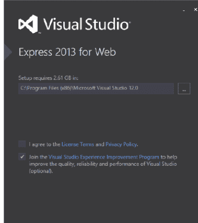

图 1-1

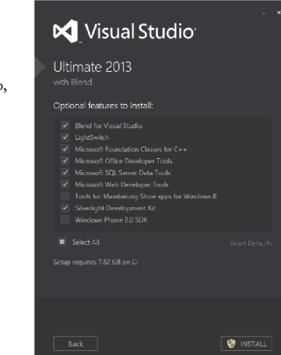

图 1-2


已经安装了 SQL Server 2012 Express LocalDB，微软 SQL Server 2012 数据库引擎的免费版本。SQL Server 2012 在书中有很多讨论和使用，从第 12 章开始。

现在 `Visual Studio` 已经安装，是时候启动并开始工作了。下一节将展示如何在 `VSEW` 中创建你的第一个站点。你将看到如何创建一个站点、向网页添加内容以及在浏览器中查看该页面。

你可能等不及要开始你的第一个 `ASP.NET` 网站了，与其给你提供 `VS` 中网站的理论概述，不如接下来的“尝试一下”练习将直接进入操作阶段，并展示如何构建你的第一个 Web 项目。然后，在“工作原理”解释和随后的章节中，你将深入了解在浏览器中查看 `.NET` 页面时后台发生了什么。

1. 从开始菜单或开始屏幕启动 `Visual Studio`。对于 `VSEW`，菜单项名为 `VS 2013 for Web`。对于 Windows 8.1，你需要点击开始屏幕上的向下箭头以进入所有应用程序列表。如果你使用的是 `Visual Studio` 的商业版，只需从开始屏幕启动 `Visual Studio 2013`；所有与 Web 相关的组件都可以从主 `VS` 程序访问。你将看到一个让你登录的对话框，这对于你想在多台机器上同步设置非常有用。点击“登录”(`Sign In`)输入凭据或注册新账户。如果你不想登录，点击“现在不，以后再说”(`Not now, maybe later`)。第一次启动 `VS` 时可能会延迟，因为它正在配置。随后的启动将感觉快得多。

2. 如果你第一次启动 `Visual Studio`，可能会弹出一个对话框让你在不同的设置集合之间进行选择。你在该框中做的选择将影响窗口、工具箱和快捷方式。选择“Web 开发”(`Web Development`)，因为这些设置是专门为 `.NET` 开发者设计的。

3. 一旦配置完成，你将看到如图 1-3 所示的主屏幕。在后续章节中将获得所有窗口、工具栏和菜单的完整描述，现在只需专注于创建一个网站。点击左上角的“文件”(`File`)菜单并选择“新建”(`New`)。根据你启动 `Visual Studio` 时选择的设置，你可能需要先打开“项目”(`Project`)，因为它是用于创建不同类型的应用程序的。

## 创建你的第一个 ASP.NET 网站

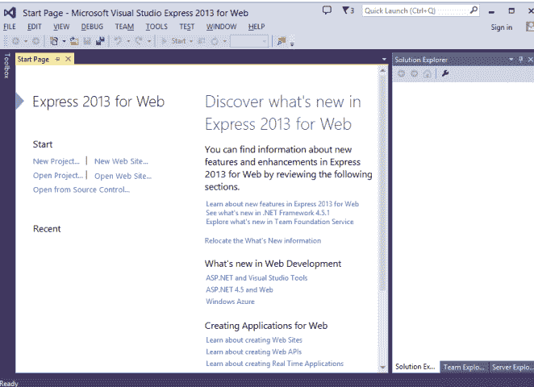

图 1-3

新建站点(`New Site`)对话框如图 1-4 所示。

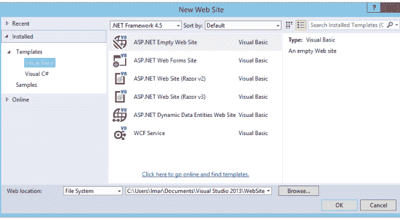

图 1-4

4. 在对话框中间的可用模板列表中，选择 `.NET Framework`。然后在左侧的“模板”(`Templates`)部分，你可以为站点选择编程语言。本书显示了 Visual Basic 和 C# 的示例，因此你可以根据喜好选择语言。

5. 在中间的模板列表中点击“ASP.NET 站点”(`ASP.NET Web Site`)。验证底部“Web 位置”(`Web Location`)下拉列表中选择了“系统”(`System`)。如果你想，可以点击“浏览”(`Browse`)按钮并在计算机硬盘上选择一个新位置。现在保持默认位置为“文档”(`Documents`)即可。

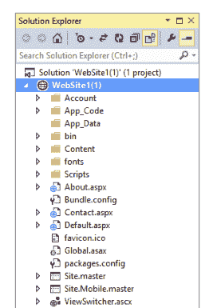

6. 点击“确定”(`OK`)。`VS` 为你创建一个新网站，包含许多文件和文件夹（见图 1-5），以启动你的网站。

7. 双击打开 `Default.aspx`，移除 ID 设置为 `BodyContent` 的 `<asp:Content>` 块内的所有代码（它从第 5 行的 `<div>` 开始并以 `</div>` 结束）。将其替换为以下加粗代码：

```
<asp:Content server="server" ID="BodyContent" ContentPlaceholderID="MainContent">
<h2>Hello World</h2>
<p>Welcome to ASP.NET on <% DateTime.Now.ToString() %></p>
</asp:Content>
```

图 1-5

书中你会看到很多这种格式的代码。当你被指示这样输入代码时，只需要输入加粗代码。其他代码已经在文件中了。不要担心括号（`<`）和百分号符号的代码；这些被称为“标签”(`tags`)，你稍后会学习。虽然这段代码现在对你来说并不熟悉，你可能猜出它的作用：它输出你的日期和时间。

8. 按 `Ctrl+F5` 在浏览器中打开页面。你将看到一个与图 1-6 类似的页面。

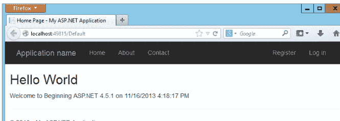

图 1-6

如果你已经有一些 `Visual Studio` 经验，可能习惯于按 `F5`。如果你使用该选项，站点将在调试模式下打开，你可能会收到一个询问是否启用调试的对话（你可以安全地这样做）。使用 `F5` 调试将在第 18 章中讨论，建议你使用 `Ctrl+F5`。

如果你在 `Internet Explorer` 中看到关于局域网设置的信息警告，点击“启用局域网设置”(`Turn on Intranet Settings`)。

如果在页面上没有看到日期时间，或者收到错误，请再次查看欢迎消息中的代码。它以单个括号（`<`）开始，后面跟着百分号和冒号。它以单个括号（`>`）结束。此外，确保你输入的代码与此处显示的完全一致，包括大小写。当你使用 C# 时尤其如此，因为该语言对大小写敏感。

注意到一个小小的 `IIS Express` 图标出现在 Windows 托盘中，如图 1-7 所示。

该图标属于内置 Web 服务器 `IIS Express`。此服务器由 `VS` 自动启动以处理你页面的请求。你将在本章后面学习更多关于 Web 服务器如何处理你页面的知识。

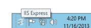

图 1-7

如果在托盘中没有看到图标，点击其旁边的箭头并点击“自定义”(`Custom`)选项。然后在“`IIS Express` 系统托盘”查看“显示图标和通知”。

这样你就用 `Visual Studio` 创建了你的第一个 `ASP.NET` 网站。

要查看最终生成的 HTML 与原始 ASP 页面有什么不同，请在浏览器中打开页面的源代码。在大多数浏览器中，你可以通过在浏览器中右键点击页面并选择“查看源代码”(`View Source`)来打开源代码窗口。这将打开你的默认文本编辑器，显示页面的 HTML。

如果你在执行之前的“尝试”之前已关闭浏览器，请在 `VS` 中按 `Ctrl+F5` 打开页面并选择“查看源代码”。

向下滚动源代码文件，直到看到包含 Welcome 文本的行。注意，你看到的不是标签之间的代码，而是实际的日期和时间：

```
<h2>Hello World</h2>
<p>Welcome to Beginning ASP.NET 4.5.1 on 11/16/2013 4:18:17 PM</p>
```

当 Web 服务器处理该页面时，它会从服务器上查询当前的日期和时间，并将其插入发送到浏览器的 HTML 中。根据你的 Windows 安装的语言设置，你可能会看到不同的日期时间格式，以适应 Windows 区域设置。

在接下来的章节中，你将更详细地了解 `ASP.NET` 的工作原理。

当你在浏览器中输入类似 `w.wxyz.com` 的 URL 并按回车时，浏览器会向该地址的 Web 服务器发送请求。这是通过 `HTTP`，即超文本传输协议实现的。`HTTP` 是浏览器和 Web 服务器之间通信的协议。当你请求 URL 时，你就向服务器发送了一个请求。当服务器处于激活且请求有效时，服务器会接受请求，然后将响应返回给客户端浏览器。请求与响应之间的关系如图 1-8 所示。

由于你使用的是 `IIS Express`，服务器和客户端实际上是同一台机器。然而，在现实场景中，你会将网站托管在外部 Web 服务器上，让许多不同的客户端都可以访问。

对于静态文件（如 HTML 文件或图像），Web 服务器简单地从本地硬盘中读取文件并将其发送到浏览器。对于动态文件（如 ASP 页面），这显然是不够的。如果 Web 服务器直接将 ASP 页面作为文本文件发送给浏览器，你将不会浏览器中看到当前的日期和时间，而是看到实际的代码（`DateTime.ToString() %`）。因此，Web 服务器不是直接发送文件，而是将请求交给另一个能够处理页面的软件。这是通过一个概念实现的：

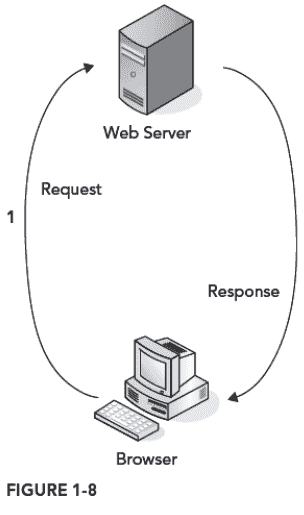

应用程序映射(`Application Mapping`)或处理器映射(`Handler Mapping`)将文件扩展名（在本例中为 `.aspx`）映射到能够处理它的文件的应用程序上。对于 `.aspx` 页面，请求最终由 `ASP.NET` 运行时处理和执行，该运行时是 Microsoft `.NET Framework` 的一部分，专门为处理 Web 请求而设计。

> 注意：在图 1-7 中，你没有看到页面名称上的 `.aspx` 扩展名。然而，在后台，请求仍然由 `Default.aspx` 提供。你将在第 7 章中学习如何创建所谓的“友好 URL”。

在页面处理过程中，有三个主要区域会影响页面的呈现方式：

- 静态文本，例如你放在页面中的 HTML、CSS 或 JavaScript 代码，会被发送到浏览器。你将在本章及后续章节（包括详细介绍 CSS 的第 3 章）中学习更多关于 HTML、CSS 和 JavaScript（一种客户端使用的编程语言）。

- `ASP.NET` 服务器控件。这些控件放置在你的 ASP 页面中，当它们被处理时，会产生插入到页面中的 HTML。在本章讨论 HTML 之后，你将学习更多服务器控件，第 4 章专门解释 `ASP.NET` 服务器控件。

- 编程代码。正如你在之前的“尝试”中看到的，当你直接在页面中包含代码时（如 Basic `.NET` 或 C#），你也可以将代码放在单独的代码文件中。这种代码的正式术语是 `Code Beside`（旁路代码）。但大多数开发者将其称为 `Code Behind`（后台代码），这也是我在本文中坚持使用的术语。这些代码可以由运行时自动执行，也可以根据用户的操作执行。无论哪，代码的执行都可以通过访问数据库、执行计算等极大影响页面的显示方式。你将在下一章学习更多关于 `Code Behind` 的知识，第 5 章将详细讨论编写 `ASP.NET` Web 页面。

一旦页面处理完成并收集了页面的所有 HTML，HTML 将被返回给浏览器。浏览器读取并解析它，最后为你显示页面供你查看。

由于 HTML 对于显示网页至关重要，下一节将为你提供 HTML 概述。

# 理解 HTML

`HTML` 是创建网页的事实标准语言，现有的每个浏览器都能理解它。自 90 世纪初以来，它一直是万维网的驱动力，即互联网中处理网页的部分。`HTML` 文档是简单的文本文件，包含标记、文本以及影响该文本的额外细节。`HTML` 的最新版本是 `HTML5`。尽管 `HTML5` 的规范仍在开发中，但许多现代浏览器已支持该规范的重要部分，且这种支持随着这些浏览器的每次发布而增加。尽管并非所有浏览器都完全支持 `HTML5`，但它确实是 HTML 应用程序的未来。并非所有浏览器都支持所有的 `HTML5` 特性，可以通过一个名为 `Modernizr` 的脚本来轻松模拟。

`HTML` 使用括号括起来文本来指示如何在浏览器中渲染（显示）。带有角括号的文本被称为标签(`tag`)；一对包含某些文本或其他内容的标签被称为元素(`element`)。再次查看你在之前的“尝试”中看到的 HTML：

```
<h2>World</h2>
<p>Welcome to Beginning ASP.NET 4.5.1 on 11/16/2013 4:18:07 PM</p>
```

此示例的第一行包含一个 `<h2>` 元素，它有一个起始标签 `<h2>` 和一个结束标签 `</h2>`。该元素用于表示二级标题（如果你在浏览器的最终源代码中向上滚动，可以看到一个类似的标签，但多了一个斜杠 `/`）。在起始标签和结束标签之间的任何文本都被视为元素的一部分，因此以较大的字体渲染。在大多数浏览器中，文本被渲染为标题。与 `<h2>` 标签类似，还有用于创建六级标题的标签，例如 `<h1>`、`<h3>` 等。

在标题下方，你看到一个 `<p>` 元素，它用于表示段落。默认情况下，浏览器会在段落底部留出额外的外间距，尽管你可以覆盖这种行为。

`HTML` 有许多可用标签，多到无法涵盖。下表列出了一些重要的标签及其使用方法。要查看 HTML 元素的完整列表，请查看维护 HTML 标准的网站：`www.w3.org/TR/html5/index.html`。

| 标签 (TAG) | 说明 (DESCRIPTION) | 示例 (EXAMPLE) |
|---|---|---|
| `<html>` | 用于标记页面的开始和结束。 | `<html><br>所有其他内容在此...</</html>` |
| `<head>` | 用于标记页面的特殊部分，包含页面数据，包括标题和对外部资源的引用。该元素的内容不会直接显示在屏幕上，但会影响页面的外观和行为，你稍后会看到。该元素位于 `<html>` 元素内部。 | `<head><br>内容在此...</head>` |

(续)

| 标签 | 描述 | 示例 |
| --- | --- | --- |
| `<title>` | 用于定义页面标题。此标题将显示在浏览器的标题栏中。该元素位于 `<head>` 元素内部。 | `<title>Welcome to Planet Wrox 4.5.1</title>` |
| `<body>` | 用于定义页面的开始和结束。其内容是你在浏览器中看到的内容。该元素位于 `<html>` 元素内部。 | `<body>...Page body goes here</body>>` |
| `<header>` | 用于定义页面的页眉。此元素以及此表中的所有剩余元素都存放在 `<body>` 元素内部。 | `<header>... </header>` |
| `<section>` | 用于标记页面中的不同部分。每个页面可以有多个部分。 | `<section>...Content goes here</section>` |
| `<aside>` | 用于定义不是页面核心部分但作为侧边栏呈现的内容。 | `<aside>...</aside>` |
| `<article>` | 用于定义页面中的主要内容。 | `<article>...Main page content goes here</article>` |
| `<footer>` | 表示页面的页脚部分。 | `<footer>...Content for footer goes here</footer>` |
| `<a>` | 用于将一个网页链接到另一个网页，或在页面内创建链接。 | `<a href="http://www.wrox.com">Visit the Wrox site</a>` |
| `` | 用于在页面中嵌入图像。 | `` |
| `<strong><em>` | 用于以粗体或斜体字体格式化文本。 | This is `<strong>bold text</strong>`/`<em>this text is in italic</em>` |

# ASP.NET 4.5.1 简介 | 13

| 标签 | 描述 | 示例 |
|---|---|---|
| `<form><input><textarea><select>` | 用于用于输入表单，允许用户向服务器提交信息。 | `<input type="text" value="Some Text" />` |
| `<table><tr><th><td></td></tr><td></td>` | 这些标签用于用于使用表格创建布局。`<table>` 标签定义整个表格，`<th>` 标签用于标记表头，`<tr>` 和 `<td>` 标签分别定义行和单元格。 | `<table><tr><td>This is a Cell in Column 1</td><td>This is a Cell in Column 2</td></tr></table>` |
| `<ul><li><li></li>` | 这些标签用于创建带编号的列表或项目符号列表。`<ul>` 和 `<ol>` 标签定义列表的位置（是无序列表，带有简单的项目符号，还是有序列表，带有数字），`<li>` 标签用于表示列表中的项目。 | `<ul><li>First item with a bullet</li><li>Second item with a bullet</li></ul><ol><li>First item with a number</li><li>Second item with a number</li></ol>` |

`<span>`此 `<span>` 标签用于包裹并影响文档的其他部分。它以内联形式出现，因此它不会在屏幕上添加额外的换行。

`<div>`和 `<span>` 标签一样，`<div>` 标签被用作其他元素的容器。然而，`<div>` 作为一个块级元素，这导致默认情况下在 `<div>` 元素之前和之后产生显式的换行。

`<div>This is some text on line 1</div><div>This text is put directly under the previous text on a new line.</div>`

`<audio><video><source>` 用于在你的网页中嵌入音频和视频文件。`<source>` 元素用于定义多种类型的音频和视频资源。

`<video src="Some.mp4" />`

# HTML 属性


除了 HTML 元素之外，上表中的示例还向你展示了属性。*属性*包含了更改特定元素行为的额外信息。例如，用于显示图像的 `` 标签的 `src` 属性定义了该图像的源。同样，`<span>` 标签包含一个 *style* 属性，可以更改文本颜色。`color: red;` 的值是级联样式表 (CSS) 的一部分，将在第3章中详细讨论。正如 HTML 元素一样，W3C 网站上有一长长的属性列表可适用于它们：`www.w3.org/TR/html5/index.html`。

你不需要记住所有的元素和属性。它们中的大部分是由 VS 为你生成的。在其他需要你手动输入它们的情况下，VS 为你提供了 IntelliSense 来帮助你找到正确的标签或属性。IntelliSense 将在下一章讨论。

# HTML 注释

为了在 HTML 中注释代码，你将其包裹在注释中，如下所示：

```
<!-- This is a comment -->
```

你注释掉的代码不会被浏览器处理（因此不可见）。因为它们会被发送到浏览器（因此可见），你应该稀少使用注释。在随后的章节中，我们将注释掉代码以便不发送到客户端。

# HTML5 的规则

HTML5 的规则非常简单，大多数情况下 VS 都会帮助你正确操作，或向你显示错误列表以及修复建议。HTML5 实际上比之前的 HTML 版本（称为 XHTML，这反过来是使用 XML 规则对 HTML 4.0 进行的重构）要宽松得多。在执行规则时，HTML5 实际上更加宽松，大多数 VS 都会帮助你正确操作，或向你显示错误列表以及修复建议。在 HTML5 中，这些*自合标签*可以这样这样是闭合的。HTML 中的绝大多数元素必须闭合。因此，当你开始使用 `<div>` 标签时，必须使用 `</div>`。对于某些没有关闭标签的元素，存在例外，例如 `` 或 `<br>`（这些是自合标签）。

# 属性用法

当你在 HTML 标签中编写属性时，你可以使用双引号、单引号或不使用引号来编写值。使用双引号。例如，当你编写 `` 标签及其 `src` 属性时，你可以这样写：

```

```

你也可以使用单引号包裹属性值：

```

```

只要在值的两端使用相同的引号，两种方法都有效。对于不包含空格的值，你也可以省略引号：

```
<input value=yes>
```

有时需要嵌套单引号。例如，当某些 .NET 语法需要使用双引号时，你应该使用单引号包裹属性值：

```html
<asp:Label ID="TitleLabel" runat="server" Text='<% Eval("Title") %>' />
```

你在本书的后续章节中经常看到这种。为了一致，本书在所有的 HTML 中尽可能使用双引号。

# 正确嵌套你的元素

当你嵌套元素时，确保你先关闭最后打开的内部元素，然后关闭外部元素。考虑这个正确示例格式化了带有粗体和斜体的文本：

```
<strong><em>This is some formatted text</em></strong>
```

注意 `<em>` 标签在 `<strong>` 标签之前关闭。交换关闭标签的顺序会导致 HTML 无效：

```
<strong><em>This is some formatted text</strong></em>
```

当服务器控件被处理处理时，它会返回 HTML。因此，同一个按钮在浏览器中渲染后的代码如下：

```html
 <input type="submit" name="Button1" value="Click Me" id="Button1" />
```

将服务器控件转换为其 HTML 表达式的过程与你之前看到的显示当前日期的过程类似。服务器控件由 ASP.NET 句处理器处理。这种处理会生成 HTML，并将其发送到浏览器进行显示。

你现在已经了解了 ASP.NET 页面的基础知识以及它生成的 HTML，现在是时候了解 VS 了。学会如何使用该应用程序及其许多工具和窗口，是构建有趣、美观且功能完备网站的重要一步。

## IDE 概

Visual Studio 是目前用于构建 ASP.NET 页面最详尽、功能最丰富的集成开发环境（IDE）。IDE 这一缩写指的是为了在单一环境中构建复杂应用程序所需的所有独立工具。你不再需要分别在一个编辑器中书写代码、在命令行中编译、在另一个应用程序中编写 HTML 和 CSS，并在第三个应用程序中管理数据库，VS 允许你从同一个环境中执行所有这些任务以及更多操作。除了这带来的效率提升（你无需不断切换工具）外，这还让学习 VS 的新领域变得简单得多，因为许多内置工具的工作方式是相同的。

## 主开发区域

为了熟悉 VS 界面中包含的所有工具，请查看图 1-9。它显示了你在 VS 中创建第一个网站后所看到的相同界面，但高亮显示了一些最重要的屏幕元素。如果你已经熟悉之前的版本的 Visual Studio，可以跳过本节，直接跳到本章稍后的“尝试一用”（Try Out）练习。

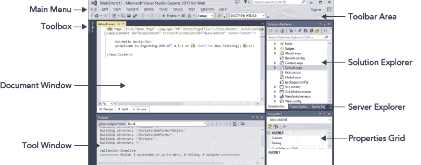

图 1-9

如果你安装了旧版本的 Visual Studio，你的界面看起来可能会有所不同，因为 Visual Studio 2013 能够从旧版本导入设置。

## 选择你的开发配置

由于 VS 既欢迎新的 ASP.NET 开发人员，也欢迎资深 Web 开发人员，因此你可以从不同的配置中选择：基础设置（Basic Settings）、仅代码（Code Only）和专家设置（Expert Settings）。在基础设置中，许多经常使用的菜单项被隐藏或放置在自己的子菜单中。“仅代码”配置适用于纯代码会话，此时你对 VS 的许多设计功能（如设计视图或工具箱）不感兴趣。专家设置让你能够访问 VSW 的完整功能。你可以使用“工具设置”菜单在不同设置之间切换。本书假设你从一开始就使用专家设置模式。你可能不需要从一开始就使用所有功能，但到书结束时你将使用其中的大多数功能。由于菜单项的位置会根据你选择的配置而变化，我决定立即使用专家设置，以便于引用特定的菜单项或功能。在 Visual Studio 的商业版本中，你没有这个选项——专家设置是默认的。

## 主菜单

在应用程序顶部，Windows 标题栏正下方，你可以看到主菜单。此菜单栏包含你在许多其他 Windows 应用程序中找到的项目，如“文件”、“编辑”和“帮助”，以及 VS 特有的菜单，如“网站”和“调试”菜单。菜单会根据你正在执行的任务动态变化，因此在操作应用程序时，你会看到菜单项的出现和消失。你可以使用“帮助集->帮助首选项”来配置在线和离线帮助。离线帮助需要先安装，而在线帮助则需要连接互联网。在最右侧，你可以看到“登录”链接，允许你使用微软账户登录，以实现不同机器之间 VS 设置的同步。

## 通知窗口

在应用程序标题栏中 Windows 关闭、最小化和最大化按钮的左侧，你会看到一个带有小旗帜的图标。点击旗帜图标会弹出通知窗口，Visual Studio 在其中为你提供重要信息。例如，它将显示可用文档下载、过期许可证、产品更新等。根据可用通知的重要性，标题栏中旗帜的颜色会发生变化。也可以通过“视图”菜单访问通知窗口。如果你安装了 RTM 版本的 Visual Studio，可能会看到几个可以安全安装的更新。

## 工具栏区域

在菜单下方，你可以看到工具栏区域，它能够显示不同的工具栏，让你快速访问 VS 中最常用的功能。在图 1-9 中，只有两个工具栏是启用的，但 VS 带有许多工具栏，你可以在特定的任务导向场景中使用。当你正在处理需要特定工具栏的任务时，某些工具栏会自动出现，你也可以根据喜好启用或禁用工具栏。要启用或禁用工具栏，请右键点击现有的工具栏或菜单栏，并从出现的菜单中选择工具栏。

## 工具箱

在主界面的左侧，工具箱会展开，让你有机会看到包含的内容。如果你点击选项卡、工具箱右上角的小图钉图标（或任何带有此图钉图标的面板），它就会被固定在 IDE 中以保持打开状态。

就像菜单栏和工具栏一样，工具箱会自动更新，以显示与你正在执行的任务相关的内容。当你编辑标准的 ASP.NET 页面时，工具箱会显示许多你可以拖放到页面上的控件。

# 第 1 章开始使用 ASP.NET 4.5.1

在图 1-9 所示文档窗口底部，你可以看到三个名为“设计”（Design）、“拆分”（Split）和“源”（Source）的按钮。当你处理包含标记语言的文件（如 ASPX 页面）时，这些按钮会自动出现。它们允许你打开页面的设计视图（让你了解页面在浏览器中的外观）、标记视图（HTML 和其他标记）或同时打开这两种视图。其工作原理将在第 2 章中进行更详细的解释，但现在，重要的是意识到你可以通过点击这三个按钮之一在标记视图、拆分视图和设计视图之间切换。标记视图通常也被称为源视图（Source View）或“代码视图”（Code View）。然而，为了避免与用于编辑后台代码（Code Behind）文件的代码编辑器混淆，本书将统一使用“标记视图”这一术语。

# 启动页

每当你启动 VS 时，文档窗口中都会加载启动页。通过启动页，你可以快速创建和打开新窗口以及项目。启动页提供了许多与 Web 开发相关的新闻和信息的链接。要将你的项目固定到启动页，请点击最近项目列表中项目名称左侧的大钉图标。要取消固定项目，请右键点击它并选择“从列表中删除”。要重新打开启动页，请选择“查看启动页”。

为了感受如何使用所有这些窗口，接下来的“尝试”（Try Out）将向你展示如何构建一个包含几个 ASP.NET 服务器控件的简单 Web 页面。

# 尝试：创建你的第一个 ASP.NET Web 页面

本尝试练习将引导你创建一个包含单个页面的新网站，该页面包含多个 ASP.NET 服务器控件。学习如何使用文档窗口和解决方案资源管理器（Solution Explorer）之类的窗口，以及如何使用工具箱（Toolbox）和属性网（Properties Grid）将 ASP.NET 服务器控件添加到页面并更改它们的样式。

- 1. 启动 VS 或 Visual Studio 2013。
- 2. 如果你使用的是 Express 版，选择“工具设置”（Tools Settings）并选择“专家设置”（Expert Settings）以开启开发者配置，从而访问 VS 的完整功能。
- 3. 在“文件”（File）菜单中创建“新建网站”（New Web Site）。根据配置，你可能需要选择“文件->新建 VS”。这将触发“新建网站”对话框。
- 4. 在此对话框中，确保选择了“ASP.NET 空网站”，而不是你在之前的练习中使用的“ASP.NET Web Forms”。确保在“Web 位置”（Web Location）下拉列表中选择了“文件系统”（File System）。选择 Visual Basic 还是 C# 并不影响结果。点击“确定”创建新站点。
- 5. 接下来，在解决方案资源管理器中右键点击新网站。确保你点击的是网站（标记为 WebSite2）而不是父元素。它是图 1-5 中高亮的元素。从右键菜单中，可以看到如何创建一个新的“添加项”（Add Item）。
- 6. 在出现的新窗口中，点击“Web 表单”（Web Form）并输入名称 `Control`。当你点击“添加”按钮时，系统会自动为你添加 ASPX 扩展名。你可以让对话框中的其他设置保持默认值。页面将在标记视图中打开，显示出默认的 HTML，例如 VS 在你创建新页面时添加的 `<html><head><title>` 和 `<body>` 元素。
- 7. 点击文档窗口底部的“设计”（Design）按钮将页面切换到设计视图。
- 8. 如果工具箱未打开，按 `Ctrl+Alt+X` 打开，或点击“工具箱”选项卡显示它，并点击右上角的大钉图标使工具箱始终可见。从工具箱的“标准”（Standard）类别中将一个文本框（TextBox）和一个按钮（Button）拖入到页面的设计视图中。你最终得到的设计视图应该类似于图 1-10。
- 9. 在设计视图中右键点击按钮并选择“属性”（Properties）。在属性网格中，点击“外观”（Appearance）类别下的“文本”（text）属性。
- 10. 在属性网格中，将文本属性更改为 `Submit`。按 `F5` 运行项目查看效果。


# 查找结果窗口

在管理网站内容时，Visual Studio 的查找和替换功能是无价之宝工具。你经常需要替换当前文档中甚至是整个网站中的某些文本。“在文件中查找” (`Ctrl+Shift+F`) 和“在文件中替换” (`Ctrl+Shift+H`) 都会将其结果输出在“查找结果”窗口中，如图 1-13 所示。

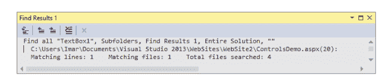

图 1-13

由于同时打开多个信息窗口可能会占用贵的屏幕空间，因此将它们停靠（dock）通常是一个好主意。这样，一次只有一个窗口可见，同时你仍然可以快速访问其他。接下来你将学习如何自定义 IDE，包括窗口停靠。

# 自定义 IDE

虽然 Visual Studio 的标准设置及其工具窗口非常好用，但你很有可能想根据自己的喜好来定制 IDE。你可能想将某些窗口移动到更容易触及的位置，或者可能想打开经常使用的额外窗口。Visual Studio 是完全可自定义的，使你能够调整 IDE 的每一个细节。在下一节中，你将学习如何执行最常见的自定义任务。

# 重新排列窗口

为了让每个窗口处于其应的位置，你可以在主 IDE 中拖放它们。只需抓住窗口的标题栏，或将其拖动到新位置的方向。一旦开始拖动，你就会看到 Visual Studio 为你提供窗口将结束在何处的提示（见图 1-14）。

如果你拖过中间指示器四侧的四个正方形指示器之一，窗口将停靠在现有窗口旁边。一旦松开，窗口就会跳到它的新位置。如果你将其释放到大指示器中间的正方形框上，窗口将与该窗口停靠，共享相同的屏幕空间。每个窗口都有自己的标签，如你在图 1-14 底部的窗口所示看到的那样。

除了与 IDE 中的其他窗口停靠外，你还可以拥有浮动窗口。要将停靠窗口改为浮动窗口，请将其从当前位置拖开，并将其释放到 IDE 中的某个地方，但不要碰到屏幕上的任何视觉提示。你也可以从主菜单中选择“窗口 -> 浮动”，或右键点击窗口标题栏并选择“浮动”。

# 第 1 章 入门 ASP.NET 4.5.1

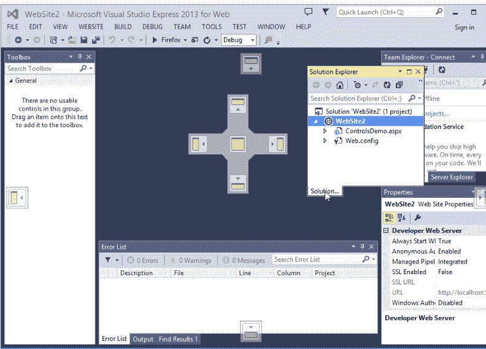

图 1-14

要将浮动面板恢复到之前的停靠位置，右键点击其标题栏并选择“停靠”，或从菜单中选择“窗口 ⬍ 停靠”。确保不要对工具窗口（如工具箱或解决方案管理器）选择“停靠为标签页文档”，否则它们最终将进入主文档窗口。这使得在与打开的文件一起使用这些工具变得困难，因为两个窗口共享相同的空间。

# 修改工具箱

你也可以修改工具箱。默认情况下，项目按字母顺序排序的，但你可以使用拖放来重新排序。要执行此操作，打开工具箱（按 `Ctrl+Alt+X`），拖动一个项目（例如 Standard 类下的 TextBox）到不同的位置。你也可以通过右键点击项目并在右键菜单中选择“删除”来从工具箱中删除项目。或者为了避免项目无故丢失；你可以通过同一个菜单中选择“重置工具箱”来恢复工具箱。

你还可以向工具箱添加自己的项目。这最常用的用途是代码片段。只需在文档窗口中突出某些文本或代码，并将其拖到工具箱中。然后你可以右键点击该项目并选择“重命名为项目”。

为了让工具箱不杂乱，你可以通过从同一个菜单中重重自己的代码片段。你可以根据自己的喜好向工具箱添加项目。

自定义 IDE

在练习练习中，你将根据你的喜好来定制 IDE。

# 

（开始）

在这个练习中，你将根据自己的喜好来调整 IDE 窗口窗口。

- 1. 从菜单中选择查找列表，因为你打开了它。
- 2. 从视图中选择查找列表，因为你打开了它。
- 3. 拖动它，以便在需要打开文件时显示它。
- 4. 拖动它，以便在需要时显示它。
- 5. 拖动它，以便在需要它时显示它。
- 6. 恢复窗口，拖动它，以便在需要时显示显示它。
- 7. 恢复窗口，拖动它，以便在需要时显示它。
- 8. 恢复窗口，拖动它，以便在需要时显示它。
- 9. 恢复窗口，拖动它，以便在需要时显示它。
- 10. 恢复窗口，拖动它，以便在需要时显示它。
- 11. 恢复窗口，拖动它，以便在需要时显示它。

## 工作原理

本练习中的大多数步骤都是显而易懂的。在构建网站时，你打开了需要的窗口。你使用了 IDE 的拖放功能根据你的喜好重新排列。

# 自定义文档窗口

Visual Studio 对于文本的显示方式提供了极大的灵活性。你可以更改字体大小、字体颜色，甚至是文本的背景颜色。你可以通过选择“工具 -> ”来访问字体和颜色设置。

# 自定义 IDE

环境 — 字体和颜色。快速启动（Quick Launch）是访问选项和菜单命令等功能的极佳工具。有关关于快速启动的更多信息，请查阅：http://ly/leljcko。

我喜欢自定义文档窗口的一个点是制表大小（tab size），它控制缩进代码时插入的空格数。要更改制表大小，选择工具（Tools） > 选项（Options），然后选择文本编辑器（Text Editor） > 所有语言（All Languages） > 设置制表（Set Tabs）。我通常将制表大小（Tab Size）和缩进大小（Indent Size）设置为 2 个空格，保持制表中的其他设置不变。我喜欢自定义的另一件事是 HTML 元素前后的换行符数量。选项窗口让你完全控制：选择文本编辑器（Select Text Editor） > HTML（Web Forms）格式化（Formatting），然后点击标签特定选项（Tag Specific Options）。在列表中，你可以选择一个标签，然后通过右侧的设置控制它的格式。预览框（Preview）可以方便查看各种设置如何更改格式。请注意，Web Forms 在选项对话框中有一个单独类别，因为它在底层使用的 HTML 编辑器与 Visual Studio 中的基于 HTML 的编辑器不同。

如果你喜欢在文档窗口的行隙中选择行，请选择工具（Tools） > 选项（Options） > 所有语言（All Languages）并勾选行（Lines）复选框。

制表大小设置为 2 以及某些 HTML 元素周围的换行次数外，书中所有的截图都是 VSE 的默认设置。

# 自定义工具栏

你可以通过三种方式自定义工具栏：显示或隐藏内置工具栏、从现有工具栏中添加或删除按钮，以及使用你使用的按钮创建自己的工具栏。

# 启用和禁用工具栏

你可以通过右键点击任何现有工具栏或菜单栏，然后从列表中选择相应的项目来禁用或启用现有工具栏。工具栏显示后，你可以使用左侧的拖柄（drag grip）将其拖到工具栏区域的新位置。

# 编辑工具栏

如果你觉得现有的工具栏缺少重要按钮，或者包含你很少使用的按钮，可以对其进行自定义。要执行此操作，右键点击任何工具栏或菜单栏，切换到命令（Commands）选项卡，并在工具栏下拉菜单中选择要修改的工具栏。通过右侧的命令按钮，你可以添加新命令、删除现有命令或更改它们的顺序。

# 创建你自己的工具栏

如果你想将经常使用的功能分组，创建自己的工具栏会很有用。要创建新工具栏，按照前一节介绍打开自定义（Customize）窗口。点击新建（New）按钮并为工具栏输入名称。然后切换到命令（Commands）选项卡，像处理现有工具栏一样修改你的工具栏。

# 自定义快捷键

许多开发者还想要更改快捷键设置。快捷键是节省时间的极佳方法，因为让你可以使用简单的键盘命令完成任务，而不是去够鼠标并在菜单中选择相应项目。要更改快捷键，选择工具（Tools） > 选项（Options），展开环境（Environment），并点击键盘（Keyboard）。或者，按 `Ctrl+Q`，输入 keyboard 并按回车。在命令列表中找到想要更改快捷键的命令。由于此列表包含很多项目，你可以通过输入命令的几个字母来过滤列表。例如，在命令查找（Commands Finding）过滤器中输入 print，即可列出所有与打印相关的命令列表。

接下来，在“按按快捷键”（Press Shortcut Keys）字段中输入新快捷键并点击分配（Assign）。Visual Studio 允许为单个命令输入双重快捷键。例如，你可以将“关闭所有文档”（Close All Documents）绑定到命令 `Ctrl+K, Ctrl+O`。要执行此命令，你需要快速连续按下组合键。虽然双重快捷键似乎多此一举，但它极地增加了可用快捷键的数量。

# 重置你的更改

如果你在尝试许多自定义选项时弄乱了，请不要担心。你有许多方法可以将 Visual Studio 恢复到之前的状态。

# 重置窗口布局

从窗口（Window）菜单可以访问的“重置窗口布局”（Reset Window Layout）命令会将所有窗口重置为首次启动 Visual Studio 时的位置。如果你放错了太多窗口导致 IDE 变得杂乱，此命令将非常有用。

# 重置工具箱

如果你不小心从工具箱中删除了某个项目，或者删除过整个标签，可以通过右键点击工具箱并选择重置工具箱（Reset Toolbox）将工具箱重置为原始状态。在使用此命令之前你需要三思，因为它还会删除你所有的代码代码（snippets）。

# 重置所有设置

如果你遵循了之前的“试一试”（Try It Out）练习，并开始尝试各种自定义功能，你的 IDE 现在可能一团糟。（注：此处原文由于存在大量重复循环错误，已根据逻辑流清理）。

# 重置所有设置

如果你遵循了之前的“试一试”练习，并开始尝试各种自定义功能，你的 IDE 现在可能一团糟。要将所有设置恢复到原始状态，选择重置所有设置（Reset All Settings）。

# 示例应用程序

构建网站是本书的核心，因此本书附带了一个展示 ASP.NET 许多功能的示例应用程序。

# 示例应用程序

你在书中构建的示例网站名为 Planetrox，这是一个对音乐感兴趣的人的在线社区。该网站为访问者提供以下内容：

- 由管理员发布的专辑和音乐。
- 音乐图片（Gig Pics）部分，用户可以在那里分享图片。
- 在网站提供的不同主题之间切换，让你在不更改内容的情况下更改外观和感受。
- 存储影响网站上信息的偏好设置。
- 针对注册用户的额外功能。

该网站允许你（即网站所有者）执行以下操作：

- 添加和维护评论。
- 管理系统中的不同音乐类型。
- 管理访问者创建的专辑。

图 1-16 显示了 Wrox 的另一个页面，但应用了不同的主题。该页面允许用户输入个人信息并根据其喜爱的类型指定偏好。

你可以在 Planetrox.com 找到网站的在线示例。你可以从终端用户的角度操作网站。

你还可以从 www.wrox.com/go/begaspnet451 下载书中的示例应用程序和其他所有示例。

在本书结束时，你将能够构建该网站的所有功能（可能更多），以及其他网站。如果这听起来非常复杂，请不要担心。我将从应用程序的开始到最后一个功能逐步引导你。

# 第1章 开启 ASP.NET 4.5.1

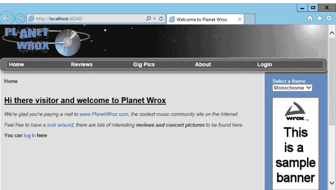

图 1-15

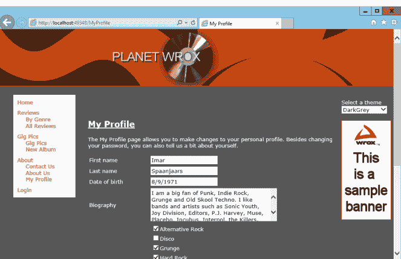

图 1-16

# 关于 Visual Studio 的实用技巧

本书中的大多数章节末尾都有一个简短的实用技巧部分。这些技巧要么不适合放在文中任何地方，要么鼓励你去探索或测试某些功能。有时它们初看之下可能无关或难以理解，但你会发现，当你阅读这本书并回顾之前章节的技巧时，它们会开始变得合理。如果你在第一次看到某些内容时没有完全理解，请不要担心。思考一下，几天后再回到该主题。希望通过让这些想法沉淀一段时间，事情会自动变得更加清晰。这不仅适用于“实用技巧”部分，也适用于本书。

- 在进入下一章之前，多尝试玩玩 Visual Studio。为你的网站添加几个页面，从工具箱（Toolbox）中拖放控件到页面上，并在浏览器中查看它们。这样，当你开始下一章时，你对这些工具以及可用的许多控件会有更好的理解。
- 熟悉调整 Visual Studio IDE 的许多选项。在构建网站时，你大部分时间都花在这个 IDE 中，因此尽可能地按照你的喜好对其进行调整是合情合理的。不要害怕搞乱它；你随时可以恢复到之前的设置。
- 花些时间浏览 Visual Studio 中“选项”（Options）对话框中的设置（通过“工具”（Tools）->“选项”菜单访问）。许多设置都是自俗易懂的，对调整 IDE 非常有帮助。

## 总结

本章涵盖了入门 ASP.NET 4.5.1 和 Visual Studio 的许多重要基础内容。它首先简要回顾了 Microsoft .NET Framework 总体以及特别是 ASP.NET 的历史。

你学习了如何获取和安装 Visual Studio，它是创建 ASP.NET 4.5.1 网页最全面、功能最全的工具。为了让你能够有效地使用它，本章向你展示了如何使用和自定义 IDE 的主要功能。在随后的章节中，你将使用并扩展这些知识，以处理 VS 中的许多工具。

理解 Visual Studio 中的页面是如何进入你的浏览器的是非常重要的。关于提供请求的 Web 服务器，以及页面如何被处理以在浏览器中交付最终 HTML 的相关知识，对于理解 ASP.NET 至关重要。本章向你简要介绍了页面被请求并提供给浏览器的方式。

在下一章中，你将获得关于创建网站的更详细解释。

## 练习

- 1. 解释 Visual Studio 中的页面标记与浏览器中最终 HTML 页面之间的差异。
- 2. 假设你有很多 HTML 片段，预计在网站中频繁使用。在 Visual Studio 中提供这些片段的可用方法是什么？
- 3. 列举三种重置部分或全部 IDE 自定义设置的方法。
- 4. 如果你想更改页面上控件的属性，例如，你有哪两个可用选项来进行更改？

你可以在附录 A 中找到这些练习的答案。

# 本章学到的知识

| 属性 | 标签中定义或更改其行为的额外信息 |
| --- | --- |
| Element (元素) | 一对包含某些文本或其他内容的标签 |
| HTML | 超文本标记语言：浏览器用于显示网页的语言 |
| HTTP | 超文本传输协议：Web 浏览器和服务器之间通信的协议 |
| IDE | 集成开发环境：用于开发应用程序的应用程序和工具的集成集合 |
| JavaScript | 一种用于与客户端浏览器中的网页交互的编程语言 |
| Tag (标签) | 包围在角括号中的文本，用于创建 HTML 元素 |
| Visual Studio 2013 | 构建 .NET 应用程序的开发环境 |
| Visual Studio Express 2013 for Web | Visual Studio 的免费版本，允许你构建 ASP.NET Web 应用程序 |

# 2

# 构建 ASP.NET 网站

本章你将学到：

- 你可以作为 ASP.NET 网站起点时选择的不同项目类型
- 可用于快速启动你的网站开发的不同项目模板
- ASP.NET 中可用的许多文件类型及其用途
- 创建易于管理（现在和未来）的结构化网站的方法

本章 WROX.COM 代码下载

你可以在 www.wrox.com/begaaspnet451 的“Download Code”选项卡上找到本章的 wrox.com 代码下载。代码位于第2章文件夹中。

要创建美观、功能且成功的网站，你必须理解许多重要的技术和语言，包括超文本标记（HTML）、ASP.NET、层级样式表（CSS）、如 C# 或 VB 等服务器端编程语言，以及 JavaScript 等客户端语言。这些及后续的技术为这些技术领域提供了坚实的基础，因此在你读完这本书后，你应该对最重要的概念了如指掌。

除了这些技术，你还必须理解上一章介绍的 Visual Studio IDE。你需要知道如何创建站点、添加页面以及管理 Visual Studio (VS) 提供的所有工具栏和窗口。此外，你还需要知道如何在 VS 中构建和设计网页。

本章详细向你展示了如何创建和管理你的网站。它还向你了如何在 VS 中使用 HTML 和服务器控件。

虽然你已经在上一章创建了第一个 ASP.NET 网站，但本章将从深度查看创建新网站开始。因为在启动新站点时有很多选择，所以理解所有选项并选择适合你场景的一个是非常重要的。

# 使用 VISUAL STUDIO 2013 创建网站

上一章向你概述了在 VS 中创建网站的快速方法。你只需从文件菜单选择了“New Web Site”，选择了一种语言、标准的 ASP.NET Web Forms 模板并点击确定。然而，New Web 对话框的内容比你看到的要多。你可能注意到可以在不同的模板之间进行选择。在查看你可以构建网站的各种模板之前，你需要更多关于 VS 中可用项目类型的知识。

# 不同项目类型

在 Visual Studio 2013 中，你可以为 ASP.NET Web Forms 网站选择两种类型：应用程序项目（Web Application Projects）和站点项目（Web Site Projects）。

## 应用程序项目

应用程序项目对于在团队工作或需要控制站点内容及其编译和部署过程的开发者来说更加方便。整个网站作为一个项目进行管理，通过单个项目文件跟踪网站的所有内容。

在 VS 中，你通过“File New Project”对话框创建新的应用程序项目。Web 类别包含一个模板——ASP.NET Web Application——它允许你创建一个包含 Web Forms、ASP.NET MVC 和 Web API 等各种 ASP.NET 相关技术的 Web 项目。这是微软“One ASP.NET”倡议的一部分，旨在将各种技术在 Visual Studio 中结合得更紧密。有关这些技术的更多信息，请访问 www.asp.net 并点击 Learn 菜单。

> 注意：有关 One ASP.NET 的信息以及学习更高级的技术，请参阅《Professional ASP.NET 4.5》(Wrox: 978-1-11-31812-0)。

## 站点项目

站点项目代表 VS 中一个网站的项目。你通过从 Visual Studio 主菜单选择 File New Web Site 或 File New Web 来创建新的站点项目。

Web站点项目（Web Site project）实际上就是一个包含许多文件和子文件夹的 Windows 文件夹。它没有一个集中的文件（称为扩展名为 .vbproj 或 .cbproj 的项目文件）来跟踪网站中的所有单独文件。你只需要让 VS 指向一个文件夹，它就会立即将其作为网站打开。这使得创建网站的副本、移动它们以及与他人共享变得非常容易，因为它们与你本地系统上的文件之间不存在依赖关系。由于缺乏中央项目文件，Web站点项目通常被简单地称为网站（websites），这也是我在本书的其余部分中使用的术语。

> 注意：你无法使用 Web站点项目来创建 Web API 应用程序。

## 在 Web站点项目和 Web 项目之间选择

由于你有两个选项可以选择，你可能想知道应该选择哪种项目类型。通常情况下，Web站点项目是一个更好的工作工具。因为它是扁平的，所以更容易将文件复制到不同的位置，例如另一台工作站或生产环境服务器。此外，对代码文件的更改会被 Web 服务器捕获并自动应用，而无需正式的部署过程。相反之下，如果你与开发团队在同一个站点上工作，Web 应用项目（Web Application Project）会很有用，因为它规定了更正式的开发和部署过程，并且对工作源代码版本控制系统（如 ASP.NET MVC 和 Web API）提供了更好的支持。此外，它还支持 ASP 等其他技术。

本书使用 Web站点项目模型，因为如果你是 ASP.NET 的初学者，该模型更容易操作。然而，你会发现使用 Web 应用项目模型的站点与 Web站点项目有许多共同点，这意味着你可以利用从书中中学到的知识来使用 Web 应用项目模型构建站点。如果你想跟进本书的学习，就必须使用 Web站点项目模型。在提到特定的项目类型时，我在书中泛指网站时会交替使用网站（website）和 Web 应用（web application）这两个词。

现在你已经了解了不同的项目模型，下一个需要考虑的是不同的网站模板及其选项。

## 选择正确的网站模板

VS 中的“新建站点”（New Web Site）对话框包含不同的网站模板，每个模板都有其独特的用途。

图 2-1 显示了 VS 中的“新建站点”对话框。你可以通过选择文件 ➔ 新建站点（File ➔ New Web Site）或文件 ➔ 新建项目（File ➔ New Project，具体取决于你的 VS 版本）来打开此对话框。如果你的对话框看起来不像图 2-1，请确保你选择的是文件 ➔ 新建站点，而不是文件 ➔ 新建项目。

在左侧区域，你可以选择 Visual Basic 或 Visual C# 作为网站的编程语言。中间部分显示了默认安装的 ASP.NET 网站模板。每个模板都将在下一节中进行讨论。当你创建了模板或从他人那里安装了模板时，它们会很好地显示在该区域。

| 新建站点 | | | |
|---|---|---|---|
| 最近 | .NET Framework 4.5.1 | 排序方式：默认 | 搜索已安装的模板 (Ic...) |
| 已安装 | ASP.NET Web站点 | Visual Basic | 一个空网站 |
| 模板 | ASP.NET Web Forms 站点 | Visual Basic | |
| | Visual C# | ASP.NET Web站点 (Razor v2) | Visual Basic | |
| 示例 | ASP.NET Web站点 (Razor v2) | Visual Basic | |
| 在线 | ASP.NET 动态数据实体站点 | Visual Basic | |
| | WCF 服务 | Visual Basic | |

图 2-1

在模板列表上方，你可以选择想要使用的 .NET Framework。对于书中的所有练习，请确保你选择 .NET Framework 4.5.1。ASP.NET 空站点在书中用于 Planet Wrix。其他模板将在后续章节中描述，以便你知道它们是可以使用的。你系统中安装的模板的确切列表取决于你的系统。只要你安装了它们，就可以使用。书中使用了 ASP.NET 空站点。

## ASP.NET Web Forms 站点

该模板允许你创建一个基本的 ASP.NET 站点。它包含了许多文件和文件夹，以启动站点的开发。App_Data 文件夹以及页面的功能将在本书的后续章节中讨论。该模板使用名为 Bootstrap 的外部框架。遗憾的是，ASP.NET 自带的许多控件（如我们在第 7 章中看到的菜单控件）在 Bootstrap 下无法正常渲染，因此我决定在书中不使用该框架，而是关注 ASP.NET 自带的功能。你可以通过 http://getbootstrap.com 了解更多关于 Bootstrap 的信息。

## 站点 (Web)

该模板允许你使用 Microsoft Web Pages 框架创建站点。你可以通过 WebMatrix 了解更多信息。

## ASP.NET 站点 (Razor v2)

ASP.NET 空站点模板只提供了两个配置文件（Web.config 和 Web.Debug.config）。如果你有一堆现有文件想要创建一个站点，或者想从零开始创建站点，ASP.NET 空站点模板非常有用。你使用此模板作为书中构建网站的基础。

## ASP.NET 动态数据实体站点

该模板允许你创建一个强大的网站来管理数据库中的数据，而不需要大量的代码代码。此模板在书中没有讨论，但你将在第 14 章中学习该模板使用的 ADO.NET 实体框架。

## WCF 服务

该模板允许你创建一个包含或多个 Windows 通信基础（WCF）服务的网站。WCF 服务与服务的相似之处在于，它允许你创建可以在网络上调用的方法。然而，WCF 服务比简单的服务强大得多，提供了更大的灵活性。我们在第 10 章中介绍了如何从浏览器创建和使用 Web 服务。

## 创建和打开

你有多种不同的创建和打开现有网站的方法。你的选择很大程度上取决于你访问网站的方式（是在本地机器上使用 VS 还是在远程机器上），以及你是否使用 IIS Express（VS 自带的精简版 IIS）或完整版本的 IIS。

书中的所有示例都假设你从本地硬盘打开站点，并使用 IIS Express，因为用它开发站点非常方便。然而，第 19 章将介绍如何使用和配置完整版本的 Internet 信息服务。

## 创建网站

“下一步”章节将引导你创建 Planet Wrox 网站，这是你在书中操作的项目。除非另有说明，书中其余部分的练习都假设你在 VS 中拥有了该网站。练习指示你将网站存储在

- 位于一个名为 `c:\BeASPNET\site` 的文件夹中。请记住此文件夹名称，因为它整本书都会用到它。如果你决定使用不同的文件夹，请在书中每次看到此文件夹名称时，务必使用你自己的路径。确保不要在文件夹名称中使用像井号 (#) 这样的特殊字符或插入空格，否则在开发网站时会遇到麻烦。最后，确保不要在 `c:\Users\UserName\Documents\` 的 Windows 文档文件夹下创建此文件夹，因为以后当你以外的账户访问你的网站时，你会遇到问题。

# 尝试一下：创建一个新的 ASP.NET 4.5.1 网站

- 1. 首先，使用文件管理器（旧版本 Windows 中的 Windows 资源管理器）在驱动器根目录下创建一个名为 `BeASPNET` 的文件夹。在文件夹内部再次创建一个名为 `site` 的文件夹。你最终应该得到一个文件夹 `c:\BeASPNET\site`。如果你遵循了本书“引言”步骤的说明并解压了本书的源码，你已经有了 `BeASPNET` 文件夹，其中又包含 `Source` 和 `Resources` 文件夹。不过你仍然需要创建 `site` 文件夹。如果你想同时参考 VB.NET 和 C#，可以创建两个文件夹：`BeASPNETVB` 和 `BeASPNETCS`，并使用两个 Visual Studio 实例。
- 2. 启动 Visual Studio，根据你的 VS 版本点击 `File -> New Web Project` 或 `New -> Web Site`。
- 3. 在屏幕顶部的目标框架（target framework）下拉列表中，选择 `.NET Framework 4.5.1`。
- 4. 在左侧的安装模板（Installed Templates）区域，在 Visual Basic 和 Visual C# 之间进行选择。书中所有的示例都以这两种编程语言展示，因此你可以选择你最喜欢的一种。
- 5. 在中间区域选择 `ASP.NET Empty Web Site`。
- 6. 在“Web 位置”（Web Location）下拉列表中，确保选择了 `File System`（文件系统）。另外两个选项（HTTP 和 FTP）分别允许你打开运行在 IIS 上的网站（在本地机器上或使用所谓的 Microsoft FrontPage 扩展的远程服务器上）以及从 FTP 服务器打开网站。
- 7. 点击位置文本旁边的“浏览”（Browse）按钮，浏览到 `C:\BeASPNET\site`（你在练习第一步中创建的文件夹），并点击“打开”（Open）。
- 8. 点击“确定”，VS 将为你创建新网站。

> 常见错误：不要误用 `File New Project` 模板创建新的 Web Application 项目，因为该项目与书中的练习题不兼容。

# 使用 Visual Studio 创建网站 | 39

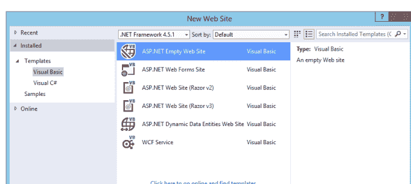

图 2-2

## 工作原理

一旦你点击确定，VS 就会为 Web 创建一个新的空白网站。这个新网站除了配置文件（称为 `web.config` 和 `Web.debug`）之外一无一物。在解决方案管理器（Solution Explorer）中，你的网站现在看起来如图 2-3 所示（我们展开了 `web.config` 文件）。如果你没有看到顶部的解决方案，请在 VS 中选择 `Tools -> Options`，并在 `Projects and Solutions` 类别中选择 `Always Solution`。

由于基于“Empty Web Site”模板的网站是 VS 查找的简单 Windows 文件夹，磁盘上的实际文件夹包含相同的文件。没有使用额外的文件来创建网站，如图 2-4 所示，该图显示文件资源管理器显示 `C:\BeASPNET\` 下的文件夹。

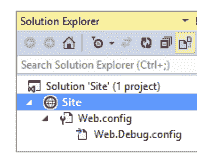

图 2-3

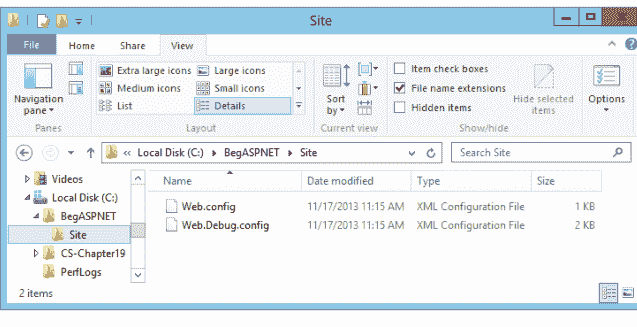

图 2-4

如果你没有看到 `.config` 扩展文件，请担心。你将在练习中看到如何查看文件扩展名。随着学习的进行，你会向网站添加新的文件和文件夹。这些额外的文件出现在解决方案管理器中，也会出现在 `c:\BeASPNET\site` 文件夹中。

在 Web Site 模板上打开网站与创建新网站非常相似。在下一节中，你将获得在 VS 中打开现有网站的快速概述。

## 打开现有网站

与创建新网站一样，在 VS 中打开现有网站会提供关于网站位置的几个选项。你可以选择从文件系统、本地 IIS 服务器、使用 FTP 的远程服务器、使用 Microsoft FrontPage 扩展的远程网站或如 Microsoft Team Foundation Server 的中央版本控制系统打开网站。图 2-5 显示了 VS 中的 Open 对话框。

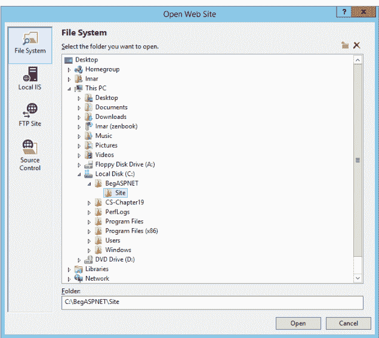

图 2-5

进入此对话框，在 VS 中选择 `File Open Web Site`（不要误选为 `Open Web Projects`）。书中的所有示例都假设你始终从文件系统（File System，它是窗口左列的第一个按钮）打开网站。然后在右窗中找到你的网站（`C:\BeASPNET\site`）并点击“打开”。

3. 输入 `MasterPages` 作为文件夹名称并按回车键。右键点击此新文件夹并选择“添加新项”（Add New Item）。或者，你也可以从 Visual Studio 的主菜单选择“新建文件”（New File）或“网站添加新项”（Website Add New Item），或者点击解决方案管理器中的新文件夹以使其获得焦点，然后按 `Ctrl+Shift+A`。

4. 在出现的对话框中，点击“主页”（Master Page）并输入 `Frontend` 作为名称。添加它时，系统会自动添加 `.master` 扩展名。验证“安装的模板”（Installed Templates）下已选择你想要为此网站使用的语言，并勾选了右下角的“在分离文件中代码”（Code in Separate File）。最后，点击“添加”（Add）按钮。主页将被添加到网站中，并在文档窗口（Document Window）中自动为你打开。

## 工作原理

这个简单的练习向你展示了如何向你的网站添加新项。虽然在这个阶段网站还并不非常有趣，但你添加的文件是书中其余内容的基础。后续章节将简要介绍剩余的文件类型。

## 代码文件

向网站添加代码文件与添加 Web 文件的方法完全相同。下表描述了代码文件的类型。

| 文件类型 | 扩展名 | 描述 |
|---|---|---|
| WCF 服务 | .svc | 可以被其他系统（包括浏览器）调用，并包含可以在你的服务器上执行的代码。WCF 服务将在第 10 章中介绍。 |
| 类 | .cs / .vb | 可以包含编写网站的代码。注意，后台代码文件（稍后会讨论）也具有此扩展名，因为它们本质上是类。`.cs` 文件使用 `.cs` 扩展名，Visual Basic `.vb` 文件使用 `.vb` 扩展名。 |
| 全局应用程序类 | .asax | 可以包含响应网站中发生的某些事件时触发的代码，例如应用程序启动或网站某处发生错误时。请在第 7 章及后续章节了解如何使用此文件。 |

除了“代码文件”类别外，还有另一组值得关注的文件：数据文件（Data Files）。

## 数据文件

数据文件用于存储可以在你的网站和其他应用程序中使用的数据。该组由 XML 文件、数据库文件以及与处理相关的文件组成。

## 第 2 章 构建 ASP.NET 网站

| 文件类型 | 扩展名 | 描述 |
| --- | --- | --- |
| XML 文件 | .xml | 用于以 XML 格式存储数据。除了纯 XML 文件外，ASP.NET 还支持其他几个基于 XML 的文件，你之前已经简要见过：Web.config 和站点地图（site map）。 |
| SQL Server 数据库 | .mdf | 带有 `.mdf` 扩展名的文件是 Microsoft SQL Server 使用的数据库。数据库将在第 12 章及后续章节讨论。 |
| ADO.NET 实体数据模型 | .edmx | 用于声明式访问数据库，无需编写大量重复代码。从技术上讲，这不是一个数据文件，因为它不包含实际数据。但是，因为它与数据库结合得如此紧密，将其归在此标题下是有意义的。你将在第 14 章学习更多关于 ADO.NET Entity Framework 的知识。 |

在之前的“尝试”（Try Out）中，添加此类类型的新文件非常简单。这就像将现有文件添加到网站中一样简单。

## 添加现有文件

你在网站中创建的每个文件并不非都是全新的。在某些情况下，重用其他项目的文件是有意义的。例如，你可能想在多个站点之间重用 Logo 或 CSS 文件。你可以通过右键点击解决方案管理器中的网站并选择“现有项”（Existing Item）来轻松地添加现有文件。在出现的对话框中，你可以浏览文件，并可以按住 `Ctrl` 键来选择多个文件。最后，当你点击“添加”（Add）时，文件会被添加到网站中。你也可以从磁盘上的文件夹将文件复制并粘贴到 VS 中的网站中。只需在文件资源管理器中突出显示文件，按 `Ctrl+C` 复制文件，切换到 VS，点击解决方案管理器（或你网站的子文件夹），然后按 `Ctrl+V`。文件随后将复制到你网站的文件夹中。

然而，有一种更简单的方法可以向网站添加文件，当你需要添加现有文件时这可以节省大量时间：拖放。接下来的“尝试”将展示它是如何运作的。

### 尝试：向你的网站添加现有文件

1. 在 Windows 中，右键点击桌面并选择“新建”->“文本文档”。如果你没有看到此选项，只需使用记事本创建一个新文档并将其保存到桌面。
2. 将文件名从 `styles.txt` 重命名为 `styles.css`。确保 `.txt` 扩展名被替换为 `.css`。如果你看不到 `.txt` 扩展名且文件图标没有变化（默认情况下与带有齿轮符号的文件图标相同），则 Windows 被配置为隐藏已知文件类型的扩展名。如果是这样，在 Windows 资源管理器中点击“文件夹”，然后点击“搜索选项”。切换到“视图”选项卡并取消勾选“隐藏已知文件类型的扩展名”选项。
3. 调整 VS 位置，使得你可以看到带有 CSS 文件的桌面部分。当你将文件扩展名从 `.txt` 更改为 `.css` 时，Windows 可能会提示你如果继续，文件将无法使用。你可以安全地回答“是”以继续。
4. 点击桌面上的 CSS 文件，并在按住鼠标按钮的同时，将文件拖入解决方案管理器中，而不是 VS 的其他部分。例如，当你将其拖入文档窗口时，VS 仅会为你打开文件，而不会将其添加。
5. 当你在解决方案管理器中的你的网站或现有文件上释放鼠标时，CSS 文件将被添加到你的网站中。

注意：如果你使用 Windows 7 并以管理员身份运行 VS，这可能不起作用，因为 Windows 不允许 Windows 资源管理器和 VS 通信。在这种情况下，使用“现有项”菜单添加现有文件或使用复制粘贴。

## 工作原理

尽管这看起来像是一个使用基本技能的简单练习，但它展示了 VS 在将文件添加到网站时会创建该文件的副本。当你对 VS 中的副本进行更改时，桌面上的原始 `styles.css` 文件不会受影响。这样，就可以很容易地从现有网站将文件拖放到你的新网站中。

如果你在解决方案管理器之外向网站添加文件，通过点击 VS 工具栏上的“刷新”按钮，可以获取这些的文件列表。

## 组织你的网站

由于许多文件构成了你的网站，将它们按功能放在文件夹中是明智的。例如，所有样式文件可以放在 `Styles` 文件夹，包含 JavaScript 的文件可以放在 `Scripts` 文件夹，主页可以放在 `MasterPages` 文件夹中。这取决于个人喜好，但结构良好的网站更易管理。接下来的“尝试”将解释你如何移动文件。

### 尝试：组织你的网站

1. 在解决方案管理器中，右键点击你的项目并选择“新建文件夹”。
2. 输入 `styles` 作为文件夹名称并按回车键。
3. 创建另一个文件夹，命名为 `Controls`。这两个文件夹将在书中其余中使用。
4. 拖动你添加的 `styles.css` 文件并将其放入 `styles` 文件夹。

如果一切顺利，你的解决方案管理器看起来应该像图 2-7。

如果你的解决方案管理器与图 2-7 不同，但具有相同的文件夹结构，书中后续的“尝试”将假设你已建立了正确的文件夹。

# 使用 Web 表单

Web 表单由 .aspx 文件表示，是 ASP.NET Web Forms 网站的核心。它们是用户访问你的网站时在浏览器中看到的实际页面。

如上一章所学，Web 表单可以包含 HTML、ASP.NET 服务器控件、客户端 JavaScript、CSS 和编程逻辑的混合。为了更轻松地查看所有代码最终在浏览器中的样子，VS 为你的页面提供了多种不同的视图。

## Web 表单的不同视图

VS 使你能够从不同角度查看 Web 表单。当你在文档窗口中打开一个包含标记的文件（如 Web 表单或母版页）时，你会在窗口左下角看到三个按钮。通过这些按钮，如图 2-9 所示，你可以在不同的视图之间切换。该图显示了一个母版页，你将在第 6 章学习它。

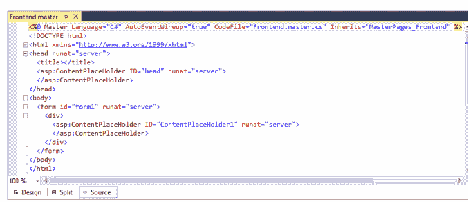

图 2-9

Source View 是打开页面时的默认视图。它显示页面的原始 HTML 和其他标记，如果你想调整页面的内容并且对想要更改的内容和位置有很好的了解，这非常有用。如上一章所述，我使用 Markup View 而不是 Source View 来指代 ASP 和 HTML 页面的标记。

Design 按钮使你能够将文档窗口切换到 Design View，从而了解页面最终会是什么样子。在 Design View 中，你可以使用主菜单中的 Visual Aids 和 Formatting Marks 子菜单来控制诸如换行符、边框和空格之类的视觉标记。但子菜单提供了一个名为 Show 的菜单项，使你能够打开或关闭视觉辅助。关闭它们是有用的，如果你想了解页面在浏览器中的最终效果。你应该使用 Design View 来了解页面最终会是什么样子。尽管 VS 具有出色的渲染引擎，可以很好地在 Design View 中显示页面，但你也应该始终在浏览器中检查你的页面，因为你在 VS 中看到的是页面在处理之前的状态。页面上的服务器控件会发出改变浏览器中页面外观的 HTML。因此，建议尽可能在浏览器中查看页面，以便检查它是否会以你想要的方式显示。还建议在你能找到的尽可能多的浏览器中测试你的网站，因为它们在渲染网页的方式上可能存在细微差异。Planet Wrox 网站已针对最近版本的 Microsoft Internet Explorer、Firefox、Google Chrome、Safari 和 Opera 进行了开发和测试。你将在书中的各个地方看到这些浏览器的屏幕截图。在第 18 章，你将介绍 Browser Link，这使得浏览器测试变得更加容易。

Split 使你能够同时查看 Design 和 Markup View，如图 2-10 所示。

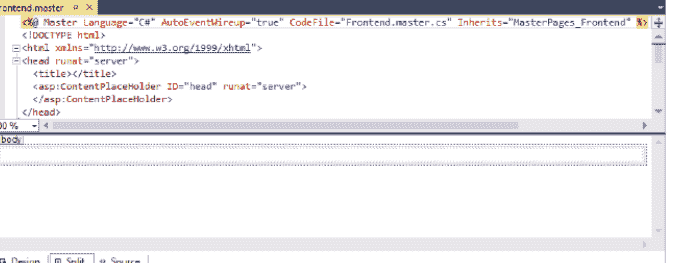

图 2-10

Split View 在你想查看向页面的 Design View 添加控件时 VS 生成的代码时非常有用。反过来也非常有用：当你在 Markup View 中对页面的标记进行更改时，你可以看到它在 Design View 中的效果。有时 Design View 会与 Markup View 不同步。如果是这种情况，Design View 顶部会出现一条消息。只需单击该消息或保存页面即可更新 Design View。你可以使用 Ctrl+Page Up 和 Ctrl+Page Down 键在三种不同模式之间循环。

如果你希望页面以不同于 Markup View 的视图打开，请选择 Tools Options。然后展开 HTML Designer，并在 General 类别中选择你首选的视图。或者，在 VS 右上角的 Quick launch 框中（可通过按 Ctrl+Q 访问）输入 HTML Designer General，然后单击出现的那一列表中的项目。

> NOTE 最初，Visual Studio 对基于标记的文件有两个编辑器。对于表单（以及你将在本书后面遇到的用户控件），Visual Studio 使用随早期版本 Visual Studio 一起提供的旧编辑器。此编辑器支持 Design View。新的 HTML 编辑器主要关注代码编辑，不支持 Design View。这意味着你可以为 Web 表单切换到 Design View，但不能为常规 HTML 文件。如果还想为 HTML 文件使用 Design View，可以在 Tools Options Text Editor File Extension 下将 .htm 扩展名与 HTML (Web Forms) 编辑器关联。

除了在 Markup View 窗口中看到的 HTML 和其他标记外，Web 表单还可以包含 C# 或 Visual Basic .NET 中的代码。此代码放置的位置取决于你创建的 Web 表单的类型。下一节更详细地解释了你拥有的两种选择。

## 选择代码后置和内联代码页面

Web 表单有两种形式：要么是带有代码后置的 .aspx 文件（文件名为 Web 表单名加上 .vb 或 .cs 扩展名），要么是代码嵌入其中的 .aspx 文件，称为带内联代码的 Web 表单。虽然你直到第 5 章才看到太多代码，但了解这些类型的 Web 表单之间的区别很重要。首先，带内联代码的 Web 表单更容易理解。因为用于编程网站的代码与同一个 Web 表单，因此你可以清楚地看到代码与文件的关系。但是，如果你的页面变大并且需要更多功能，通常将代码放在单独的文件中会更容易。这样，它就完全与标记分离，使你能够专注于手头的任务。

在下一个练习中，你将使用两个文件来演示代码后置和内联代码之间的区别。

## TRY IT OUT 向你的网站添加带代码的 Web 表单

你在本次练习中使用的文件不是最终应用程序所必需的。为了避免项目混乱，你应该将它们放在单独的 Demos 文件夹中。

- 1. 在 Solution Explorer 中，右键单击你的网站并选择 Add -> New Folder。将文件夹命名为 Demos 并按 Enter。
- 2. 右键单击 Demos 文件夹并选择 Add -> New Item。在出现的对话框中，在左侧选择你的编程语言，单击 Web Form 模板，并将文件命名为 CodeBehind.aspx。确保选中 Place Code in Separate File 复选框。最后，单击 Add 按钮。页面应以 Markup View 打开，以便你可以看到页面的 HTML。
- 3. 在文档窗口底部，单击 Design 按钮以从 Markup 切换到 Design View。你看到的页面背景为白色，顶部有一个小虚线矩形。虚线矩形代表你在 Markup View 中看到的 div 元素。
- 4. 从 Toolbox 拖动 Label 从 Standard 并将其放置在页面的虚线区域中。记住，如果 Toolbox 未打开，你可以使用快捷键 Ctrl+Alt+X。 在 Design View 中，你的屏幕现在应如下图 2-11 所示。


CodeBehind.aspx * x

codebehind.aspx.cs

[Label]

```

| Design | Split | Source | <html><body><form id="Form1"><div><asp:Label ID="Label1" /> |

图 2-11

- 5. 双击 `<div>` 元素虚线 *下方* 的白色区域中的某个位置。VS 从 Design View 切换到文件的代码后置，并添加在浏览器中加载页面时触发的代码：

### VB.NET

```
Protected Sub Page_Load(sender As Object, e As EventArgs) Handles Me.Load

End Sub
```

### C#

```
protected void Page_Load(object sender, EventArgs e)

{

}
```

尽管这段代码现在看起来可能有点吓人，但现在不要太担心。在大多数情况下，VS 会自动为你添加它，就像你刚才看到的那样。在后面的章节中，你将看到这段代码的确切工作原理，但现在重要的是要意识到，你将放置在以 `Protected` 开头并以 `End Sub` 结尾的行之间（在 Visual Basic 中）以及花括号之间（在 C# 中）的代码将在浏览器中请求页面时执行。

从现在开始你看到的所有示例都包括 Visual Basic (`VB.NET`) 和 C# 版本，因此始终选择与你的编程语言匹配的版本。

- 6. 将光标放在 VS 创建并添加的空行中以标记标签的代码，该代码将今天的日期和时间分配给标签，最终将在浏览器中显示：

### VB.NET

```
Protected Sub Page_Load(sender As Object, e As EventArgs) Handles Me.Load

Label1.Text = "Hello World; the time is now " + DateTime.Now.ToString()

End Sub
```

### C#

```
protected void Page_Load(object sender, EventArgs e)

{

Label1.Text = "Hello World; the time is now " + DateTime.Now.ToString();
```

请注意，当你输入 `L` 表示 `Label` 时，你会得到一个选项列表可供选择。这是 Visual Studio IntelliSense 的一部分，这是一个很棒的工具，可以帮助你编写代码而不是输入。不是输入单词 `Label`，你只需输入字母或字母 `La`，然后从列表中选择适当的项目，如图 2-12 所示。

要完成所选单词，你可以按 `Enter` 或 `Tab` 甚至句点。在后一种情况下，你会立即得到另一个列表，使你能够通过简单地输入前几个字母来选择单词。此功能是一个真正的生产力工具，因为你可以用更少的击键编写代码。IntelliSense 也适用于许多其他文件类型，包括 `ASPX`、`HTML`、`CSS`、`JavaScript` 和 `XML`。在许多情况下，只要开始输入，选项列表就会自动弹出。如果没有，请按 `Ctrl+Spacebar` 调出它。如果列表覆盖了窗口中的部分代码，请按住 `Ctrl` 键使窗口透明。

# 使用 Web 表单

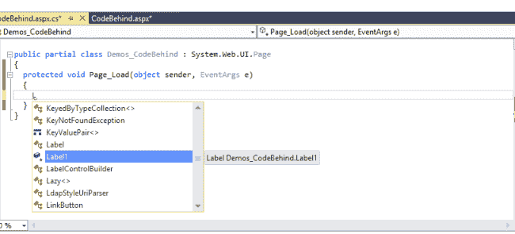

```
public partial class Demo_CodeBehind : System.Web.UI.Page

{

    protected void Page_Load(object sender, EventArgs e)

    {

        KeyCollection keys = new KeyValuePairCollection();

        keys.Add("Key1", "Value1");

        Label lbl = new Label();

        lbl.Text = "Demo_CodeBehind.Label";

    }

}
```

FIGURE-12

在“解决方案资源管理器”中右键单击 `CodeBehind.aspx` 并选择在浏览器中查看（Internet Explorer）。根据您为计算机配置的默认设置，括号中的浏览器名称可能不同。从现在起我将简单地把此菜单项称为在浏览器中查看。

如果出现提示您保存更改的对话框，请单击“是”，页面将出现在浏览器中，与图 23 中看到的浏览器窗口类似。

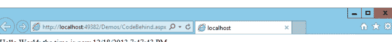

Hello World; the time is now 12/18/2013 7:47:43 PM

FIGURE-23

如果您没有看到显示日期和时间的消息，或者浏览器中的页面出现错误，请确保已保存所有页面的更改。要一次保存所有页面，请按 `Ctrl+Shift+S` 或单击工具栏中的“保存”按钮（带有移动软盘符号）。此外，请确保您为正确的语言输入了代码。当您创建此页面时，您选择了一种适用于整个页面的编程语言。您不能在单个页面上混合使用语言，如果您从 C# 页面开始，请确保您在步骤 6 中输入了 C# 代码片段。

设置带内联代码的页面非常相似。首先向 Demo 文件夹添加一个新的 Web 表单。单击 `CodeInline.aspx` 并确保选中“将代码放在保存文件”选项。

就像您在步骤 3、4 和 5 中所做的那样，将页面切换到设计视图，在 `<div>` 元素内绘制一个标签，并双击包含 `<div>` 的 `<div>` 某处。与添加代码隐藏不同，VS 将您的页面切换到标记视图，并在页面中直接添加 `Page_Load` 代码。

在 VS 插入的空代码块上，您应该在本次练习的步骤 6 中看到加粗的行。请确保使用正确的编程语言。您最终应该在 `.aspx` 文件顶部得到以下代码：

## 52 | CHAPTER 2 BUILDING AN ASP.NET WEBSITE

### VB.NET

```
<script runat="server">

Protected Sub Page_Load(sender As Object, e As EventArgs)

    Label1.Text = "Hello World; the time is now " & DateTime.Now.ToString()

End Sub

</script>
```

### C#

```
<script runat="server">

protected void Page_Load(object sender, EventArgs e)

{

    Label1.Text = "Hello World; the time is now " + DateTime.Now.ToString();

}

</script>
```

- 12. 在“解决方案资源管理器”中右键单击页面并选择在浏览器中查看。或者，按 `Ctrl+F5` 打开页面在浏览器中。您将看到与步骤 8 中获得的页面类似的页面。

## How It Works

有时，带内联代码的页面与使用代码隐藏的页面行为相同。在这两种情况下，ASP.NET 运行时都会使用 `Page_Load` 代码并执行其中找到的任何代码。在 Try It Out 中，即将 `Label1` 的 `Text` 设置为欢迎消息和今天的日期和时间。两者之间最大的区别在于代码存储的位置。在同一磁盘上。使用代码隐藏时，您编写的 VB 或 C# 代码存储在与 Web 表单同名的单独文件中。

由于带代码隐藏的页面更容易管理，我将仅为 Planet Wrox 网站使用它们。

在本示例中，这两种代码看起来与 VB.NET 代码非常相似。设置 Label 文本的代码几乎相同。两种语言：VB.NET 使用和号（`&`）将两段文本连接在一起，但 C# 使用加号（`+`）字符。您也可以在 VB.NET 中使用加号字符连接字符串，稍有注意事项，正如您将在第 5 章中学到的。另一个区别是 C# 代码必须以分号（`;`）结尾以表示单元的结束，但 Visual Basic 使用下划线（`_`）。如果您想在 Visual Basic 中将一行拆分为多行，您使用下划线（`_` 字符）。在早期版本中，VB.NET 在很多不同位置都需要下划线。然而，在 Visual Basic 的最新版本中，语言设计者大大减少了必须使用下划线的位置。

需要使用下划线跨多行拆分的一个地方是在您看到的 `Handles` 关键字之前：

```
Protected Sub Page_Load(sender As Object, e As EventArgs)
    Handles Me.Load
    Label1.Text = "Hello World; the time is now " & DateTime.Now.ToString()
End Sub
```

请注意，在您的页面中您不必使用下划线来换行，然而，我将在本书的一些示例中添加它，因为本书的页面不够宽，无法在一行中显示代码语句。您将在本书其余部分的更多 Visual Basic 示例中看到这些下划线。如果您决定手动使用下划线使代码更易读，请不要忘记在下划线前使用空格，否则您的代码将无法工作。

在 C# 中，您不需要此字符，因为该语言本身允许您只需按 `Enter` 即可换行长行。这是因为 C# 使用分号来表示行的结束而不是源中的换行。

您使用右键单击“在浏览器中查看”选项或按 `Ctrl+F5` 打开了页面。使用“在浏览器中查看”时，您始终通过右键单击打开页面。使用 `Ctrl+F5` 快捷方式时，您打开的是文档窗口中当前处于活动状态的页面，或为网站设置为主页的文件。此外，所有打开的文件都会自动保存，并在请求的页面在浏览器中打开之前检查网站是否存在错误。

您可以通过在“解决方案资源管理器”中右键单击它并选择“设为主页”来分配页面作为主页。如果您想在以后控制此行为，请右键单击“解决方案资源管理器”中的解决方案并选择“属性”。在“启动选项”类别中，您可以指示希望打开当前活动页面，或分配特定页面，如图 2-14 所示。

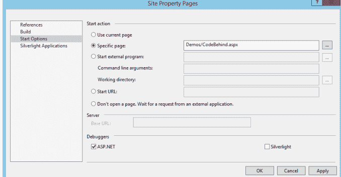

FIGURE 2-14

在之前的练习中，您学习了如何添加包含简单 `Label` 控件的页面。此外，您还看到了如何编写一些更新标签以显示今天日期和时间的代码。现在您可以忽略此代码；它只是为了演示代码隐藏和内联代码之间的差异。在第 5 章中，您将了解更多关于 Visual Basic 和 C# 编程的知识。

要创建引人注目的页面，您显然需要比仅显示今天日期和时间的简单 `Label` 控件更多的内容。下一节将向您展示如何向页面添加内容和 HTML 以及如何对其进行样式和格式设置。

## Adding Markup to Your Page

您有多种方法可以将 HTML 和其他标记添加到页面。首先，您可以直接在标记视图窗口中输入它。然而，这并不总是最佳选择，因为它迫使您手动使用大量代码。为了更轻松地在页面中插入 HTML 并对其应用格式，设计视图提供了许多有用的工具。这些工具包括格式工具栏和格式表菜单。为了使这些工具处于活动状态，您需要将文档置于设计视图。如果您处于拆分视图模式，则必须确保设计视图具有焦点，否则您会发现大多数工具不可用。

## Inserting and Formatting Text

您可以在设计视图和标记视图中输入文本。只需将光标置于所需位置并开始输入。当您切换到设计视图时，格式工具栏变得可用，其选项如图所示 2-15。

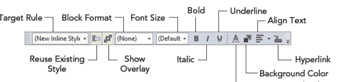

工具栏上的许多按钮与其他编辑环境中的功能完全相同。例如，`B` 按钮使用粗体字体格式化文本。同样，`I` 和 `U` 按钮分别使文本斜体化和下划线。标记为“块格式”的下拉列表使您能够插入 HTML 元素，如 `<p>` 用于段落，`<h1>` 到 `<h6>` 用于标题，以及 `<ul>`、`<ol>` 和 `<li>` 用于列表。您可以从下拉列表中选择一个项目将其插入到页面中插入的位置，或者您可以先选择文本然后从列表中选择适当的块元素来包装所选文本。

在下一个 Try Out 中，您将看到如何使用这些工具创建 Planet Wrox 网站的主页。

## TRY IT OUT Adding Formatted Text

在本 Try It Out 中，您创建一个名为 `Default.aspx` 的 Web 表单并向其添加一些基本内容。

- 1. 使用“新建项目”对话框创建新的 Web 表单以创建站点的根目录并添加 `Default.aspx`。确保选中“将代码放在单独”选项并单击“添加”。使用文档窗口底部的“设计”按钮切换到设计视图。
- 2. 单击虚线矩形内部，直到看到显示 `<div>` 元素当前处于活动状态的标记。同时，代码窗口底部的标记导航器会突出显示带有文本 `<div>` 的最后一个块，如图 2-16 所示。

## 使用 Web 表单 | 55

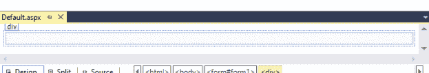

图 2-16

+   3. **Hi visitor and welcome to Planet Wrox** 并使用鼠标高亮该文本。从块格式下拉列表中选择（在图 2-15 中可见）显示标题 1 `<h1>`。请注意文本上方有一个带有向右箭头的微小符号，表示 VS 已自动为您创建了一个标题。图 2-17 显示了带有 `<h1>` 元素的设计视图。

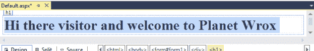

图 2-17

+   4. 将光标定位在标题末尾的 _wrox 单词之后并按 `Enter`。会为您插入一个新的段落（用带有 ¶ 的微小符号表示），以便您可以直接开始输入。

+   5. 输入图 2-18 中显示的文本（或自行创建）以欢迎访客来到 Planet Wrox。注意文本 `www.PlanetWrox.com` 在您输入逗号后立即变蓝，因为 VS 识别出它是一个地址并将其转换为链接。您可以按 `Enter` 开始新段落。选择文本“paying a visit”，单击格式工具栏上的前景色按钮，并在出现的对话框中选择不同的颜色。选择其他一些文本，例如“reviews and concert pictures”，并单击粗体按钮。完成后，您的设计视图应显示类似于图 2-18 的内容。

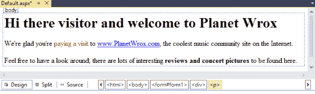

图 2-18

主页的代码现在应大致类似于以下内容（代码已重新排列以适应书中的空间）：

```
<div>

<h1>Hi visitor and welcome to Planet Wrox</h1>

<p>

  We&#39;re glad &#39;re

</p>
```

## 56 | 第 2 章 构建 ASP.NET 网站

<span class="auto-style">paying a visit</span> to <a href="http://www.PlanetWrox.com">www.PlanetWrox.com</a>, the coolest community site on the Internet.</p>

<p>Feel free to have a look around; there are lots of interesting <strong>reviews and concert pictures</strong> to be found here.</p>

</div>在文件顶部您还应看到一个 `<style>` 元素，这将在下一部分讨论。

+   6. 通过按 `Ctrl+F5` 打开页面，或在解决方案资源管理器中右键单击页面并选择在浏览器中查看。

## 它是如何工作的

当您使用各种格式工具栏按钮，如前景色时，VS 会为您插入适当的 HTML 和 CSS 代码。例如，当您单击 `B` 按钮时，VS 会在所选文本周围插入 `<strong>` 标签。当您单击 `I` 按钮时，VS 会添加 `<em>` 标签以使文本斜体化。每次您更改颜色时，VS 还会插入一个类属性（在之前的代码示例中显示），该属性指向类 *auto-style*。此样式的代码已添加到文件顶部，看起来类似于以下内容：

```
<style type="css">

  auto-style

{

  color: #FF0000;

}

</style>
```


如果您在此处添加和设置文本的方式不同，您的代码可能看起来会略有不同，这将在下一章中解释。目前，请记住此代码将应用于文本的颜色设置为红色。如果打开的大括号与类在同一行，请选择 `Tools` `CSS Advanced` 并将大括号位置设置为 `Expanded`。这只是个人偏好，不会改变代码的效果。

请注意，VS 将欢迎消息中“we’re”中的撇号字符 (`'`) 替换为其 HTML 兼容的变量：`&#39;`。使用此代码可以让您在页面中插入浏览器可能难以显示的字符，或在 HTML 中具有特殊含义的字符，如和号字符 (`&`)，它写为 `&amp;`。当您在设计视图中输入时，VS 会自动为您插入相关字符的代码等价物；但是，如果您直接在标记视图中输入，则必须自己完成此操作。

如果您的代码与此处显示的不同，请不要担心。VS 中的许多设置都会影响为您生成的代码。

到目前为止，练习已涵盖在添加和设置文本时。但是，VS 还允许您插入其他 HTML 元素，例如表格和项目符号。下一节将向您展示其工作原理。

### 添加表格和其他标记

如果您需要呈现结构化或重复的数据，例如购物车中的产品列表、相册中的照片或输入控件，HTML 表格非常有用。互联网上关于是否也应使用表格来布局页面的争论很多。例如，如果您的页面包含页眉、主要内容区域和底部的页脚，您可以使用包含三行的表格来实现这一点。一般来说，使用表格进行布局被认为是不良做法，因为它们为页面添加了大量多余的标记，并且通常难以维护。此外，可以使用 CSS 实现相同的结果，您将在下一章学习。尽管表格可能很僵硬，但它们在显示表格或结构化信息方面仍然是 HTML 工具箱中不可或缺的资产。

### 试用 使用表单和表格菜单

在此练习中，您将学习如何使用表格菜单将表格添加到页面以及如何添加行和列。此外，您将学习如何添加其他元素，例如项目符号列表。

+   1. 在 `Demo` 文件夹中，创建一个名为 `TableDemo.aspx` 的新 Web 表单。确保它使用代码隐藏，方法是选中将代码放在单独文件中的选项。
+   2. 切换到设计视图，单击代表页面中 `<div>` 标签的虚线矩形，然后选择 `Table ▾ Insert Table`。会出现插入表格对话框，如图 2-19 所示。
+   3. 将行数设置为 3，并将列数保留为 2。保持所有其他设置不变并单击确定。表格将被插入到页面中。
+   4. 如果您只看到一个表格，而不是包含三行两列的整个表格，则需要启用视觉辅助。选择主菜单中的 `View ▸ Visual Borders` 以打开边框。您的设计现在应如下图 2-20 所示。

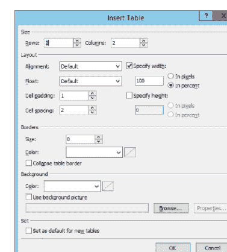

图 2-19

```
TableDemo.aspx = x
<%
```
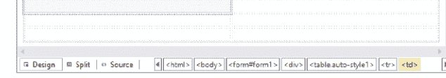

图 2-20

+   5. 将第一个单元格的右边界向左拖动。您会看到一个显示单元格宽度的视觉指示器。继续向左拖动，直到其宽度为 200 像素，如图 2-21 所示。

## 第 2 章 构建 ASP.NET 网站

| TableDenis.aspx | x |
|---|---|
| | 200px | |
| Design | Split | Source | `<body><form id="Form1"><div><table class="auto-style-1"><tr><td class="auto-style-2"></td></tr></table>` |

图-21

+   6. 要向表格添加更多行或列，您可以右键单击现有单元格。从出现的弹出菜单中选择 `Insert` 以在不同位置添加额外的行或列。同样，您可以使用 `Delete`、`Modify` 和 `Select` 来删除行或列、合并单元格以及进行选择。对于此练习，您不需要添加额外的行或列，尽管如果您已经这样做也可以。
+   7. 将光标放在第一行第一个单元格中并输入单词 `Bulleted List`。
+   8. 使用鼠标将光标放在第二个单元格中。或者，您可以按 `Tab` 将光标移动到下一个单元格。从格式菜单中选择项目符号和编号。
+   9. 切换到纯项目符号选项卡，单击带有实心圆项目符号的图片（见图 2-22），然后单击确定。
+   10. 输入一些文本，例如您的音乐类型（Punk、Rock、Techno 等），然后按 `Enter`。VS 会自动为您插入一个新的项目符号，因此您可以继续添加新项目。添加另外两种类型，以便最终得到三个项目符号。

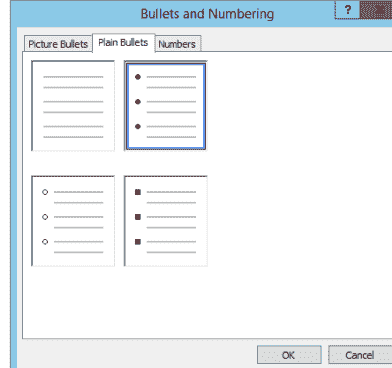

图 2-22

+   11. 重复步骤 7 到 10，但现在创建编号列表。首先，在第二行第一个单元格中输入 `Numbered List`，将光标定位在同一行第二个单元格中，然后格式化项目符号和编号。切换到数字选项卡（在图 2-22 中位于项目符号选项卡后面）并单击第一行中的第二张图片，该图片显示编号列表，然后单击确定。输入列表中的几项，每输入一项后按 `Enter`。

| Bulleted List | Punk Rock Techno |
|---|||
| Numbered List | 1. Jazz
2. Hip Hop
3. Trip Hop |

+   12. 通过按 `Ctrl+F5` 在浏览器中打开页面。您应该会看到类似于图 2-23 的屏幕。

图 2-23

## 如何工作

当你通过可用菜单可视化插入页面元素（如表格或列表）时，VS 会在标记视图中为你插入所需的标记。当你插入表格时，VS 会添加一个 `<table>` 元素以及若干个 `<tr>` 和 `<td>` 元素来分别定义行和列。它还会将一个类属性应用于定义宽度的 CSS 样式。当你将列宽拖动为 200 像素时，它为 `<td>` 元素创建了另一个样式。同样地，当你插入列表时，VS 会为编号或有序列表插入一个 `<ol>` 元素，为项目符号或无序列表插入一个 `<ul>` 元素。在这些元素内部，`<li>` 元素用于定义列表中的每个项目。

除了迄今为止你所看到的 HTML 标签外，还有另一个重要的标签需要你关注：`<a>` 标签，它用于在页面之间创建链接。

## 连接页面

任何网站的重要组成部分都是连接站点中页面的链接。链接使你的访客能够从一个页面跳转到另一个页面，无论是在同一站点内还是到互联网上的完全不同的站点。你有几种方法可以在页面之间创建链接，包括：

- 本章介绍的 HTML `<a>` 元素。
- 使用第 7 章讨论的 `<a href=Hyper:HyperLink>` 控件。
- 通过代码以编程方式实现。本书后面会讨论。
- 下面的练习展示了从一个页面链接到另一个页面是多么容易。

## 试一试 链接页面

在本试一试中，你将通过添加指向另一页面的文本来修改之前创建的 `TableDemo.aspx` 页面。当你在浏览器中运行该页面并单击该链接时，新页面将替换旧页面。

1. 打开 `Demos` 文件夹中的 `TableDemo.aspx` 页面。
2. 如有必要，切换到设计视图。
3. 在第三行的第一个单元格中，输入文本 `Link`。
4. 在同一行的第二个单元格中，输入文本 `Go to the homepage of Planet Wrox` 并用鼠标突出显示它。
5. 在格式工具栏上，单击转换为超链接按钮。它位于工具栏末端附近，具有链接图标和一个小箭头。
6. 在出现的对话框中，单击浏览按钮，选择站点根目录中的 `Default.aspx` 页面，然后单击确定。接下来，单击确定关闭超链接对话框。你的页面设计视图应类似于图 2-24 所示。
7. 切换到标记视图并注意链接的 HTML 如何被插入：

```
<a href="Default.aspx">Go to the homepage of Planet Wrox</a>
```

请注意 `href` 属性指向你想要链接的页面。

8. 如果你想更改标记视图中链接到的页面，请单击 `href` 属性的开始和结束引号之间，然后按 `Ctrl+Spacebar`。会弹出一个对话框，使你能够在站点内选择另一个页面。或者，你可以单击 URL 选项并在站点中浏览新页面。

9. 在解决方案资源管理器中右键单击 `TableDemo.aspx` 页面并选择在浏览器中查看。页面加载完成后，单击 `Go to the homepage of Planet Wrox` 链接。请求发送到 Web 服务器，作为响应，你会得到网站的主页。

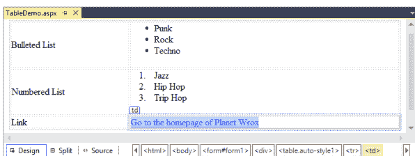

图 2-24

## 如何工作

页面之间的链接可能是网页中最重要的元素之一，因为它们使你能够在站点中的页面与另一个页面之间建立连接，无论该页面位于你的站点还是互联网上完全不同的服务器上。出现在页面任何位置的简单链接，使用带有 `href` 属性的 HTML `<a>` 标签是最容易设置的。当用户单击链接时，浏览器会从服务器请求 `href` 值中指定的页面并显示它。`href` 值中的双点 (`..`) 用于引用父目录。完整的 `href` 属性意味着“向上移动一个文件夹层级，然后选择文件 `Default.aspx`。你将在第 7 章看到更多关于链接及其工作原理的内容。

你并不局限于链接到站点内的页面。如果你想链接到外部页面，只需将 `href` 属性值替换为该页面的完整地址，如以下示例所示：

```
<a href="http://www.wrox.com">Go to the Wrox homepage</a>
```

对于外部链接，重要的是包含 `http://` 前缀；否则，浏览器会在你自己的网站上寻找名为 `wrox.com` 的文件或文件夹。

你将在本章中学到的关于页面创建和格式化的知识将在下一章中使用，下一章将介绍如何使用 CSS 设计页面。

除了可视化工具、格式工具栏和表格菜单之外，Visual Studio 还有另一种快速在页面中插入代码的好方法：代码片段。代码片段使你只需几个击键即可插入大块代码。你将在下一章看到代码片段。

## 使用 Web 窗体的实用技巧

以下是使用 Web 窗体的一些技巧：

- 优先使用带代码隐藏的 Web 窗体而不是内联代码。起初你可能不会注意到它们之间的很大区别，但随着站点和页面的增长，你会发现处理代码与标记分离的页面更容易。
- 花一些时间熟悉格式和表格菜单的不同菜单项。它们大多数会生成插入到页面中的 HTML 元素。查看为你生成的 HTML 元素和属性，并尝试直接在代码中更改它们，以及通过菜单和工具栏更改它们。这样，你就能很好地了解各种可用标签及其行为。
- 尝试使用链接连接站点中的页面。注意 VS 如何根据你要链接到的页面的位置创建不同的链接。第 7 章将更详细地讨论链接以及在站点中寻址页面的各种方式。

## 摘要

本章介绍了有助于你构建可维护且结构化的 ASP.NET 网站的一些重要主题。了解各种项目类型和模板之间的差异使你能够仅使用所需的文件快速启动项目。

这同样适用于你可以添加到站点中的不同文件类型。因为每种文件类型都有特定的用途，所以了解其用途以及如何使用该文件非常重要。

在构建 ASP.NET 网页时，你会执行的一项常见活动是向页面添加标记。正如你在本章和上一章中所见，标记有几种形式，包括纯 HTML 和 ASP.NET 服务器控件。了解如何使用 VS 提供的众多菜单项和工具栏将此标记添加到页面对于构建美观的网页至关重要。

现在你对创建和修改 Web 窗体有了扎实的理解，是时候看看如何将那些枯燥的黑白页面变成有吸引力的网页了。下一章将向你展示如何使用 VS 中的众多 CSS 工具来创建所需的效果。

## 练习

1. 命名 Web 文件类别中你可以添加到站点中的三个重要文件。描述每个文件的用途。
2. 你需要做什么才能使网页中的一段文本同时加粗和斜体？生成的 HTML 会是什么样子？
3. 在 VS 中，有哪三种不同的方法可以将现有文件添加到 ASP.NET 网站？
4. VS 为你的 ASPX 页面提供了哪些不同的视图？VS 是否还提供其他视图？

你可以在附录 A 中找到这些练习的答案。

## 本章你学到了什么

|  |  |
| --- | --- |
| Code Behind | 服务器端代码存储在单独代码文件中的页面模型 |
| Design View | 为你提供页面的图形表示 |
| File Types | ASP.NET 支持许多不同的文件类型，包括 Web 窗体 (`.aspx`)、母版页 (`.master`)、CSS 文件 (`.css`)、JavaScript (`.js`) 和 SQL Server 数据库 (`.mdf`) |
| Inline Code | 服务器端代码与标记存储在同一文件中的页面模型 |
| Markup View | 使你能够查看页面的标记 |
| Project Templates | 通过为特定场景设置站点来启动 Web 开发 |
| Project Types | Visual Studio 提供两种项目类型：Web 应用程序项目和 Web 站点项目 |
| Split View | 使你能够同时查看标记视图和设计视图 |
| Web Form | 在客户端呈现网站的用户界面 |

## 设计你的网页

本章你将学习的内容：

- CSS 是什么以及为什么需要它
- CSS 的外观以及如何编写它
- 将 CSS 代码添加到 ASP.NET 页面和外部文件中的不同方式
- VS 为你快速编写 CSS 提供的众多工具

本章的 WROX.COM 代码下载

你可以在 `www.wrox.com/go/aspnet451` 的 Download Code 标签下找到本章的 `wrox.com` 代码下载。代码位于 `Chapter 3` 文件夹中。

你在前几章中创建的页面看起来很平淡无奇。这是因为它们缺乏样式信息，因此默认使用浏览器应用的标准布局。要美化你的页面，你需要一种方法来改变它们在浏览器中的呈现方式。最常见的方法是使用层叠样式表（CSS）语言。CSS 是在网络上格式化和设计信息的事实标准语言，包括 ASP.NET 网页。通过 CSS，你可以快速更改网页的外观，使其具有你的设计或创建身份所规定的出色外观。

对使用 CSS 的坚实支持最初是在 Visual Web Developer（VWD）2008 中添加的，这是 VS Express 2013 for Web 的前身之一。VS 2012 包含了一个新的 CSS 编辑器，其功能类似于其他语言，如 C# 和 VB。CSS 编辑器在 VS 2013 中得到了进一步增强。

要了解 CSS 在你的 ASP.NET 网站中的相关性和需求，你首先需要了解 HTML 的不足之处。下一节将介绍 HTML 带来的问题，以及 CSS 如何克服这些问题。

## 为什么你需要 CSS？

在互联网早期，网页主要由文本和图像组成。文本使用纯 HTML 格式化，使用像 `<strong>` 这样的标签使文本加粗，以及 `<font>` 标签来影响字体族、大小和颜色。Web 开发人员意识到他们需要更多的格式化能力，因此 CSS 被创建来解决 HTML 的一些样式不足。

### 使用 HTML 格式化的

使用 HTML 进行格式化存在一个问题，它只提供有限的一组选项来设置页面的样式。你只能使用像 `<em>` 和 `<strong>` 这样的元素来改变文本的外观。在 HTML 的早期版本中，你也可以使用 `<font>` 元素和像 `bgcolor` 这样的属性来进一步改变 HTML 元素的外观。这些元素和属性现在在 HTML5 中已被弃用。你还有许多其他属性可用于改变页面中链接的外观。

显然，这种功能不足以创建用户期望和要求的吸引人的网页。

使用 HTML 的另一个问题，对你构建页面方式有很大影响，是样式信息应用于页面方式。按设计，HTML 强制你在 HTML 文档中嵌入格式，使其更难重用或更改设计。考虑以下示例在许多网站中很常见，已被广泛应用：

```
<font face="Arial" color="red" size="1">
This is red text in an Arial type face and larger than the default text.
</font>
```


此代码片段的问题在于，实际数据（`<p>` 元素中的文本）与呈现（在此示例中，使用 `<font>` 标签的文本格式）混合在一起。理想情况下，两者应该分开，这样更容易在不影响对方的情况下更改其中一个。

想象一下，你使用 `<p>` 和 `<font>` 元素来标记站点中每个页面的第一段。当你决定将字体颜色从红色更改为深蓝色时会发生什么？如果你的身份规定使用 Verdana 而不是 Arial 呢？你是否需要访问站点中的每个页面并进行必要的更改。

除了可维护性之外，HTML 格式化的另一个问题是，你无法在用户浏览器中轻松地在运行时更改格式。使用上一段代码片段中的 HTML，没有办法让你的访问者更改字体大小或颜色，这是一个常见请求，有助于视力障碍人士。如果你需要为访问者提供具有更大字体大小或不同颜色的页面替代版本，你需要创建原始页面的副本并进行必要的更改。

HTML 格式化的最后一个问题是，你页面中的额外标记会大大增加页面的大小。这使得下载和显示信息变慢，需要与网站中的每个页面一起下载。它也使维护页面更困难，你需要滚动浏览大型 HTML 文件以找到所需的内容。

总之，使用 HTML 进行格式化存在以下问题：

- 其功能严重限制了页面所需的格式化可能性。
- 数据和呈现混合在同一个文件中。
- HTML 不能让你在浏览器中轻松地在运行时更改格式。
- 所需的格式标签和属性使你的页面更大，加载、显示和维护速度更慢。

幸运的是，CSS 使你能够克服所有这些问题。

## CSS 如何修复格式化问题

CSS 设计用于以几乎每种可能的方式格式化你的网页。它提供了一套丰富的选项来改变页面的每个细节，包括字体（大小、颜色、族等）、背景颜色、HTML 元素周围的边框、页面中元素的位置等等。CSS 今天被所有主要浏览器理解，因此它是网页视觉呈现的语言，在 Web 开发人员中非常流行。

CSS 通过让你在外部文件中定义所有格式来克服数据和呈现混合的问题。你的 ASPX 或 HTML 页面引用这些文件，浏览器将应用你喜欢的样式。通过这种方式，HTML 文档包含你想要显示的内容，而 CSS 定义你想要如何显示，使你能够更改或替换其中一个文档，而不修改另一个。此外，你可以将 CSS 直接放在 HTML 或 ASPX 页面中，这给了你机会在需要的地方添加 CSS 的小片段。你应该谨慎地将 CSS 直接放在 HTML 或 ASPX 页面中，因为你无法从单个中央位置控制样式信息。

因为你将所有 CSS 放在单独的文件中，所以更容易在不同样式之间提供选择——例如，具有更大字体大小的样式。你可以复制外部样式表，进行必要的更改，然后将此替代样式提供给用户。你可以在第 6 章中看到这是如何工作的，当讨论 ASP.NET 主题时。

单独样式文件的另一个好处是所需带宽减少。样式表不会随每次请求而更改，因此浏览器第一次下载时保存样式表的本地副本。然后，它使用此缓存副本，而不是一遍又一遍地从服务器请求它。有时这种缓存可以工作，浏览器不会下载。如果你发现浏览器没有拾取你对 CSS 文件所做的更改，请在浏览器中（不是在 VS 中）使用 `Ctrl+F5` 或 `Ctrl+R` 来获取服务器上的新副本。

现在你已经看到了 CSS 为什么如此重要，是时候找到它是如何工作以及如何使用它的了。

## CSS 简介

就语法而言，CSS 是一种易于学习的语言。它的“语法”只包含几个概念。这使得入门相对容易。使 CSS 有点困难的是所有主要浏览器呈现页面方式。虽然几乎所有现代桌面浏览器都理解 CSS，但它们在根据 CSS 标准显示页面时都有其怪癖。

标准，由维护 HTML 标准的同一组织维护，即万维网联盟，或简称 W3C，有三个不同版本：1.0、2.1 和 3.0。其中，2.1 是今天最适用的。它包含版本 1.0 的所有内容，但也增加了很多可能性。它也是 VS 默认使用和生成的非常。版本 3.0 目前正在开发中，预计在浏览器对其提供坚实支持之前需要一些时间。

在查看 CSS 的实际语法之前，先看一个示例是个好主意。在练习中，你将编写一个包含一些 CSS 来格式化页面内容的简单 ASPX 页面。这有助于理解 CSS 语言，其在接下来的部分中进行了详细讨论。

### TRY IT OUT 编写你的第一个 CSS

在这个 Try It Out 中，你将编写一些 CSS 来改变一个标题和两个段落的外观。你将处理代码；本章的后半部分展示了如何在 VS 中使用 CSS 工具。

1. 在 Planet Wrox 项目的 Demo 文件夹中，创建一个名为 `cssdemo.aspx` 的新 Web 表单用于练习，选择内联代码或代码隐藏并不重要。

2. 确保你的 is 在标记视图中，然后找到源中关闭的 `</title>` 标签。将光标定位在该行的末尾并按 Enter，在 t`<title>` 和 `<head>` 标签之间创建一个空行。在这一新行上输入单词 `style` 然后按 Tab，VS 会为你完成 `<style>` 元素。按 Enter 在标签之间创建一些空间并按如下方式完成块：

```
<title></title>

<style>

</style>

</head>
```

> NOTE 此代码完成功能使用 `<style>` 片段，使你能够将一段代码（如 `<style>` 元素）与标识符（如本示例中的 style）关联。代码片段对于仅通过键入 style 标识符来插入代码片段非常有用。还有更多代码片段可用，在适当的地方我将在本书中指出它们。

你也可以不使用 style 片段，而是自己输入代码。请注意，只要你打开角括号（`<`），就会弹出一个列表，使你能够选择 `<style>` 标签。你所需要做的就是完成单词是按 Tab 或 Enter。元素上的属性也有同样的帮助。只需在列表中选择相关属性并按 Tab 或 Enter，值就会自动为你插入，很好地用双引号包围。

3. 接下来，在 `<style>` 标签的开始和结束之间，输入以下加粗的 CSS 代码：
```
<style>
h1
{}


```

font-size: 20px;

color: Green;

P{

  color: #0000FF

  font-style: italic;

}

.RightAligned {

  text-align: right;

}

```

在输入这段代码时要格外小心，因为 CSS 对语法非常敏感挑剔。列表中的第一项是 `h1` 标签，用于设置第一级标题的样式，它只是获得了 20 像素的大小并以绿色字体显示。注意 `font-size` 和 `20px` 之间的冒号，以及该行以分号结束。

列表中的第二项仅包含字母 `p`，并定义了页面中所有 `<p>` 元素的外观。它使用十六进制值（`#0000FF`）表示蓝色。

最后一项以点号（`.`）开头，后跟文本 `RightAligned`。此项用于将页面中的某些文本右对齐。由于 CSS 敏感，因此必须完全按照此处所示输入，包括大写字母 R 和 A，否则 CSS 代码将无法与下一步中的 HTML 对齐。

请注意，当你在 `color` 属性后输入井号（`#`）时，会弹出一个颜色选择器来帮助你选择颜色，如图 3-1 所示。现在，按 Esc 关闭颜色选择器并手动完成本章中的代码。你将在本章后面看到更多关于这个颜色选择器的内容。

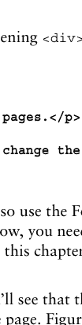

图 3-1

- 4. 在页面中向下滚动，直到看到 `<div>` 标签。在该标签之后立即输入以下加粗代码：

```
<div>

  <h1>Welcome to this CSS Demo page</h1>

  <p>CSS makes it super easy to style your pages.</p>

  <p class="RightAligned"></p>

</div>
```

只需很少的代码，你就可以快速更改页面的外观。

与其直接在代码中输入，你也可以使用设计视图中的格式工具栏来创建 `<h1>` 和 `<p>` 等元素。现在，你需要切换到标记视图来添加 `class="RightAligned"`，但在本章后面的练习中，IDE 可以为你编写此代码。

- 5. 如果你切换到设计视图（或拆分视图），你会看到设计器以页面 `<style>` 元素中定义的格式显示你的文本。图 3-2 显示了页面在拆分视图中的样子，以便你同时看到代码和设计。

## 第 3 章 设计你的网页

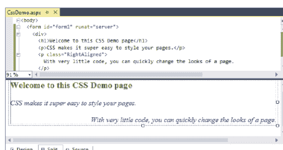

图 3-2

尽管这本黑白书使不同字体颜色难以辨认，但在图 3-2 中你仍能清楚地看到 `<h1>` 的字体大小更大。图还显示所有段落现在都显示在窗口的右侧，因为 `class` 属性被设置为 `RightAligned`。

> 常见错误 如果你没有看到最后一段粘在文档窗口的右边界上，请确保你在 `<style>` 标签和 `class` 属性中完全相同地输入了 `RightAligned`。由于 CSS 区分大小写，`RightAligned` 和 `rightaligned` 之间存在很大差异。

- 6. 按 `Ctrl+F5` 在浏览器中查看 `CssDemo.asmx`。浏览器中的页面与你在 VS 的设计视图中获得的预览完全相同。

## 它是如何工作的

尽管你在练习中输入的代码相对简单，但在浏览器（以及 VS 的设计视图）的背后仍有许多工作在进行，使这一切成为可能。你首先在页面的 `<head>` 部分添加了一些样式：

```
<style>
h1 {
  font-size: 20px;
  color: Green;
}
</style>
```

`<style>` 标签用于包装嵌入在页面中的 CSS 样式表。
`<style>` 标签之间的从 `h1` 到闭合大括号 `}` 的代码块称为规则或简称为规则。此代码片段中的规则定义了页面中所有 `<h1>` 元素的外观。代码块顶部的 `h1` 称为选择器，用于指示应将格式应用于哪个元素。在本例中，选择器直接映射到 HTML 元素，但正如你在下一节中看到的那样，还有许多其他选择器可用。图 3-3 显示了元素之间的关系。

在大括号之间，你看到应应用于标题的样式信息。大括号之间的每一行都是一个声明。声明由属性、冒号和值组成。分号（`;`）在末尾将其与下一个声明分隔开，并且对于规则集中除最后一个声明外的所有声明都是必需的。然而，为了保持一致性，最好将分号添加到所有声明中，这也是我在本书其余部分的做法。

当浏览器加载此页面时，它还会读取 `<style>` 标签之间定义的样式。然后，当它遇到匹配选择器的 HTML 元素时，它会将 CSS 规则应用于该元素。 `<h1>` 和 `<p>` 元素，其各自的规则被应用。这导致标题变为绿色且字体较大，而段落变为蓝色且字体为斜体。

为什么最后一段会转到并右对齐？在 CSS 中，规则可以来自不同的来源。 `<p>` 元素从样式定义中的标准选择器获取其样式信息。因此，该规则使段落具有蓝色和斜体字体。然而，它也定义了一个类。此类 `RightAligned` 链接到 CSS 选择器。样式表中的 `RightAligned`（不带前导句点）导致文本右对齐。你将在下一节中看到更多关于 CSS 和其他选择器的内容。最终， `<p>` 元素同时从两个选择器获取其规则。你可以自行创建和分配类名（如 `RightAligned` 类所示），从而灵活地按你想要的方式设计页面和元素。

下一节将更深入地探讨 CSS，为你提供关于选择器、属性和值的更详细视图。

### CSS — 语言

正如你在本次试用练习中所见，级联样式实际上是一组规则的集合。规则是选择器和一个或多个声明的组合，而声明又可以分解为属性和值。你可能对前几段中引入的新术语感到有点头晕，在下一节中，你将再次看到其中大多数，并附有详细解释和代码示例，展示它们的使用方法和工作原理。

| Selector | Declaration |
| --- | --- |
| Rule Set | `h1 { font-size: 20px; color: Green; }` Property Value |

### 样式表

样式表包含应应用于页面元素的所有相关样式信息。最简单形式下，样式表看起来像这样：

```
h1 {
  color: Green;
}
```

样式表也可以包含多个规则，正如你在上一个练习中所见。同时，每个规则可以包含多个声明，使你能够将它们分组在选择器下：

```
h1 {
  font-size: 20px;
  color: Green;
}
```

你刚才看到的代码在功能上与此完全相同：

```
h1 {
  font-size: 20px;
}
```

```
h1 {
  color: Green;
}
```

将两个声明分组在同一选择器下的压缩形式更容易阅读、理解和维护，因此建议尽可能使用这种语法。

要对页面上的元素进行样式设置，浏览器必须知道以下内容：

- 页面中哪些部分必须设置样式？
- 该元素的哪些部分必须设置样式？
- 你希望所选元素的该部分看起来如何？

这些问题的答案由选择器、属性、值给出。

### 选择器

顾名思义，选择器用于选择或挑选页面中的一个或多个特定元素。有多种不同的选择器可供使用，使你能够精细控制要设置样式的元素。选择器回答第一个问题：页面的哪些部分必须设置样式？下一节将向你展示四种重要的选择器类型。

### 通配符选择器

通配符选择器由星号（`*`）表示，适用于页面中的所有元素。你可以使用通配符选择器设置全局设置，如字体族。以下规则集将页面中所有元素的字体更改为 Arial：

```
* {
  font-family: Arial;
}
```

### 类型选择器

类型选择器使你能够指向特定类型的 HTML 元素。使用类型选择器，该类型的所有 HTML 元素都将按相应样式进行设置。

```
h1 {
  color: Green;
}
```

此类型选择器现在适用于代码中所有的 `<h1>` 元素，并使它们变为绿色。类型选择器不区分大小写，你可以使用 `h1` 和 `H1` 来引用相同的标题。我更喜欢为我的类型选择器使用小写，因此本书中你会看到的就是这种写法。

## ID 选择器

ID 选择器始终以井号符号 (`#`) 为前缀，使你能够引用页面中的单个元素。在 HTML 或 ASPX 页面中，你可以使用唯一的 ID 属性来定义一个元素。使用 ID 选择器，你可以更改该单个元素的行为，如下所示：

```
#IntroText {
  font-style: italic;
}
```

由于你可以在网站的多个页面中重用此 ID（它只需在单个页面内唯一），因此你可以使用它来快速更改你在网站上每个页面只使用一次但在整个站点中使用多次的元素的外观，例如，使用以下 HTML 代码：

```
<p id="IntroText">I am italic because I have the right ID.</p>

<p id="BodyText">I am NOT italic because I have a different ID.</p>
```

在此示例中，`#IntroText` 选择器更改了第一个段落的字体——它具有匹配的属性——而其他段落保持不变。ID 选择器区分大小写，因此请确保属性和选择器使用相同的大小写。

请注意，选择器在其名称中使用了井号符号 (`#`)，但你在 ID 属性中不使用此符号。

## 类选择器

类选择器使你能够通过 `class` 属性设置多个 HTML 元素的样式。当你想对多个不相关的 HTML 元素应用相同类型的格式时，这非常方便。以下规则将所有 `class` 属性设置为 `Highlight` 的 HTML 元素的文本更改为红色并加粗：

```
.Highlight {
  color: Red;
  font-weight: bold;
}
```

## 第 3 章 设计你的网页

以下代码片段使用 `Highlight` 类使 `<span>` 元素和链接 `<a>` 的内容以粗体字显示：

```
This is normal text but <span class="Highlight">this is Red and Bold.</span>

This is also normal text but

<a href="Demo.aspx" class="Highlight">this is Red and Bold as well </a>
```

请注意，选择器在其名称中使用了句点，但你在 `class` 属性中引用选择器时不使用此句点。`class` 属性非常有用，因为它使你能够为许多不同的用途重用一段 CSS，而不管使用的是哪个 HTML 元素。类选择器是敏感的，因此请确保你正确输入它们（或让 IntelliSense 帮助你从列表中选择带有句点的类）

CSS 支持更多类型的选择器，使你能够更好地控制要定位的元素，而你刚刚看到的四种类型是最广泛使用的。

## 分组和组合选择器

CSS 还使你能够通过用逗号分隔来对多个选择器进行分组。如果想对不同元素应用相同的样式，这非常方便。以下规则将页面中的所有标题变为：

```
h1, h2, h3, h4, h5, h6 {
  color: Red;
}
```

此外，使用 CSS 你还可以组合选择器，使你能够分层指向页面中的特定元素。你可以通过用空格分隔选择器来实现这一点。以下示例针对 id 为 `MainContent` 的 `<section>` 元素内的所有 `<p>` 元素，而其他段落保持不变。另请注意 `section` 和 `#MainContent` 之间没有空格。这导致选择器的该部分指向 id 为 `MainContent` 的 `<section>` 元素。

```
section#MainContent p {
  font-size: 18px;
}
```

请注意，组合与分组非常不同。分组只是避免重复输入相同声明的快捷方式，而组合使你能够在文档中定位特定元素。

使用组合时，你不仅限于 ID 和类型选择器；你也可以将其与其他选择器一起使用，如以下示例所示：

```
section#MainContent p {
  font-weight: bold;
}
```

此规则更改了 id 设置为 `MainContent` 的 `<section>` 元素内具有类 `Attention` 的所有段落，而其他段落保持不变。以下 HTML 片段展示了此规则的效果：

```
<section id="MainContent">
```


<p class="Attention">My class is Attention, so my text is bold.</p>

<p>My text is not bold, as it lacks the Attention class.</p>

<p class="Attention">I am NOT bold because I don't fall within MainContent.</p>

</section>

第二个需要回答的问题是关于页面中元素的哪一部分必须设置样式。你可以通过属性来做到这一点。

## 属性

属性是你希望使用样式表更改的元素部分。CSS 规范定义了很长的属性列表（VS 的 IntelliSense 列出了超过 100 项），尽管在大多数网站中你并不使用它们全部。以下表格列出了一些最常见的 CSS 属性及其用途。

| 属性 | 描述 | 示例 |
|---|---|---|
| background-color | 指定元素的背景颜色或图像。 | background-color: White; |
| background-image | | background-image: url(Image.jpg); |
| border | 指定元素边框。 | border: 3px solid Black; |
| color | 更改字体颜色。 | color: Green; |
| display | 更改元素的显示方式，使你能够隐藏或显示它们。 | display: none; 这会导致元素被隐藏，并且不占用任何屏幕空间。 |
| float | 使你能够使用左浮动或右浮动在页面中“浮动”一个元素。其他内容随后放置在相反的一侧。 | float: left; 这会导致浮动元素后面的其他内容放置在该元素的右上角。你将在本章后面看到其工作原理。 |
| font-family | 更改页面上使用的字体的外观。 | font-family: Arial; |
| font-size | | font-size: 18px; |
| font-style | | font-style: italic; |
| font-weight | | font-weight: bold; |
| height | 设置页面中元素的高度或宽度。 | height: 100px; |
| width | | width: 200px; |
| margin | 设置元素内部（padding）和外部（margin）的空闲空间量。 | padding: 0; margin: 20px; |

## 第 3 章 设计你的网页

（续）

| 属性 | 描述 | 示例 |
| --- | --- | --- |
| visibility | 控制元素是否在页面中。不可见的元素仍然占用屏幕空间；你看不到它们。 | visibility: hidden; 这会导致元素不可见。然而，它仍然占据页面中的原始空间。就好像元素仍然在那里，但完全透明。 |

幸运的是，VS 借助其众多工具帮助你找到正确的属性，因此你不必全部记住它们。

> 注意 CSS 中可用的选择器和属性比我在此描述的要多得多。要了解有关 CSS 的更多详细信息，请查阅 VS 的 IntelliSense 列表或查看 www.w3schools.com/cssref/。

要使属性有用，你需要为其提供一个值，这回答了第三个问题：你希望所选元素的部分看起来如何？

## 值

与属性一样，值也有多种形式。你可用的值取决于属性。例如，color 属性接受代表颜色的值。这可以是命名颜色（如 White），表示红色、绿色和蓝色（RGB）分量的十六进制数字（如 #FF0000），或者你可以使用 CSS rgb 记法。以下示例在功能上等效，都将 h1 元素的颜色设置为红色：

```
h1 {
  color: Red;
}
```
```
h1 {
  color: #FF0000;
}
```
```
h1 {
  color: rgb(100%, 0%, 0%);
}
```

你还可以使用 rgba 记法指定颜色的透明度，其中第四个参数是 0（完全透明）到 1（无透明度）之间的十进制数，如下所示：

```
color: rgba(255, 0, 0, 0.50);
```

## CSS 简介 | 75

使用命名颜色可以提高 CSS 代码的可读性，但由于你只能从相对较短的命名颜色列表中选择，通常需要使用十六进制表示法来获得你想要的确切颜色。本章后面你将看到如何使用内置的颜色选择器来创建所需的确切颜色。

还有许多其他值也是可能的，包括尺寸单位（px、em 等）、字体族、图像（形式为 url(SomeImage.jpg)），以及所谓的枚举，如 border-style，它使你能够设置诸如 solid、dashed 和 double 之类的边框样式。

## 使用简写

许多 CSS 属性都允许你使用简写版本而不是更展开的版本。例如 border 属性。在最简形式中，你可以这样设置 border 属性：

```
border: 1px solid Black;
```

此 border 属性将边框应用于 HTML 元素的四个边。边框大小为 1px，样式为 solid（其他选项包括 dashed、dotted 和 double），边框颜色设置为 Black。

这样可以轻松地快速将 HTML 的四个边框都设置为相同的值。然而，如果你想控制各个边框及其属性，可以使用展开版本：

```
border-top-width: 1px;
border-top-style: solid;
border-top-color: Black;
border-right-width: 1px;
border-right-style: solid;
border-right-color: Black;
border-bottom-width: 1px;
border-bottom-style: solid;
border-bottom-color: Black;
border-left-width: 1px;
border-left-style: solid;
border-left-color: Black;
```

这个较长的版本创建的效果与在所有四个边上都有 1px 厚的实线边框完全相同。在大多数情况下，你应该优先使用简写表示法而不是其展开形式，它更容易阅读和维护。然而，如果你需要对边框进行绝对控制——例如，如果你想要顶部和左侧有 2 像素的虚线边框，而右侧和底部为绿色实线边框——知道你可以单独设置所有方向的每个边框属性是很有用的。你也可以混合使用这些选项。

```
border: 1px solid Black;
border-left-color: Blue;
```

支持简写的其他 CSS 属性包括 font、background、list-style、margin 和 padding。如果你不确定某个属性是否支持简写，在 CSS 文件或 <style> 块中输入属性时按 Ctrl+Space 会出现 IntelliSense 弹出列表。

虽然有时看起来你需要通过反复试验来使用 CSS，并希望得到正确的结果，但在 CSS 背后有一个相当准确的模型来确定元素在页面上应如何布局。这个模型被称为 CSS 盒模型。

## CSS 盒模型

CSS 盒模型描述了应用于 HTML 元素的三个重要 CSS 属性：padding、border 和 margin。图 3-4 显示了盒模型的图形表示。

中间是一个 HTML 元素，如 <p> 或 <div>，具有一定的高度和宽度。紧靠外部的是 **padding**；空白环绕元素内部的边框。padding 之后可以看到 border，最后在最外部的是 *margin*，它定义了元素（包括其 padding 和 border）与其周围元素之间的空间。元素的三个外部属性——padding、border 和 margin——之和构成了元素在页面上占用的空间。要了解其工作原理，请考虑以下 CSS 和 HTML：

```
.MyDiv {
  width: 200px;
  padding: 10px;
  border: 2px solid Black;
}
<div class="MyDiv">Element</div>
```

这将在浏览器中渲染一个矩形，<div> 元素周围环绕着 2 像素的边框，如图 3-5 所示。


继续之前，请尝试回答这个问题：<div> 元素下方箭头的宽度是多少？

如果你猜测是 224 像素，你是正确的。箭头的宽度是三个值的总和：元素的宽度（200 像素），加上两侧的 padding 宽度（两边各 10 像素），加上两侧的 border 宽度（两边各 2 像素），总宽度为 224 像素。因此，如果你希望该框宽为 200 像素，你需要将 .MyDiv 选择器的 width 属性设置为 176px。边框外部，margin 还可能进一步影响该元素与其周围元素之间的间隙。

示例展示了对宽度的效果。在布局页面时请牢记这个盒模型。当元素比预期更宽时，请检查 CSS 样式中的 width、height、padding、border 和 margin 属性。

在下一个练习中，你将修改上一章中创建的网站主页。你为网站添加基本布局，然后使用样式表对其进行样式设置。在第 6 章中，你将再次使用此页面将其升级为主页。

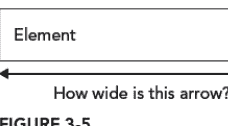

## CSS 简介

## 试用 为 Planet Wrox 主页设置样式

在此练习中，你将修改两个文件。首先，你在 Default.aspx 页面中添加基本布局元素，为页眉、菜单、主要内容区域、侧边栏和页脚腾出空间。你修改 Styles 文件夹中的 styles.css 文件以更改这些元素的大小和位置。最后，你将样式表附加到页面上，样式信息在设计器或浏览器中查看页面时会被应用。

- 1. 打开网站根目录中的 Default.aspx 文件，如果需要，切换到标记视图。

- 2. 修改 <form> runat="server"> 内的代码，使其最终如下所示：

```
<form id="form" runat="server">
  <div id="PageWrapper">
    <header>Header Goes Here</header>
    <nav>Menu Goes Here</nav>
    <section id="MainContent">
      <h1>Hi visitor and welcome to Planet Wrox</h1>
    </section>
    <aside id="Sidebar">Sidebar Goes Here</aside>
    <footer>Footer Goes Here</footer>
  </div>
</form>
```

确保你在上一章中添加的欢迎信息位于 MainContent <section> 元素的开始和结束标签之间。如果你之前熟悉 HTML 的版本，你可能会对 header、section 和 footer 等新元素感到惊讶。这些元素是在 HTML5 中引入的，目的是为文档提供更好的语义结构。有关 HTML5 的快速介绍，请参阅第 1 章。

- 3. 打开 Styles 文件夹中的 Styles.css 文件。如果你在该文件中添加了一些代码，请删除该代码。

- 4. 在 CSS 文件顶部，输入以下使用 ID 选择器选择 header 元素的代码：

```
header
{
}
```

- 5. 将鼠标定位在花括号之间并输入字母 b。这会将你带到所有以字母 b 开头的属性，如图 3-6 所示。

接下来，输入字母 c。此列表会被过滤，如图 3-7 所示。
注意这种过滤方式非常智能。过滤器不会将列表限制为仅以 c 开头或包含字母 bc 的属性（在这种情况下不存在），但它还支持所谓的标题
case 搜索，这意味着它列出属性中每个单词都以你搜索的字母开头的项目。在这种情况下，bc 匹配 background-clip、background-color 等项目，同样的规则适用于所有其他 CSS 属性。例如，td 会给出 text-decoration，bbw 会给出 border-bottom-width，等等。这使得只需几个击键就能非常轻松地编写 CSS。

注意列表中某些项目具有剪刀图标而不是标准属性图标。剪刀表示可通过按两次 Tab 键展开的代码片段。这样会在文件中插入浏览器特定的 CSS，用于尚未被所有浏览器实现的 CSS 属性。

继续此练习，选择列表中的 background-color。你可以双击该值，按 Enter 或 Tab，VS 会为你补全该属性。接下来，输入一种颜色、冒号，然后是井号（#）后跟 cocococo（代表银色）。用分号结束该行。你的最终代码可能如下所示：

```
header {
  background-color: #C0C0C0;
}
```

- 6. 通过添加 width 和 height 属性来完成 header 元素的代码块，如下所示：
{
  background-color: #C0C0C0;
  width: 844px;
  height: 86px;
}

- 7. 通过创建以下规则来完成 CSS 文件。充分利用 Visual Studio 的 IntelliSense 和标题搜索功能，以最大限度地减少编写此代码所需的击键次数。

```
* {
  font-family: Arial;
}
h1 {
  font-size: 20px;
}
#PageWrapper {
  width: 844px;
  margin: auto;
}
nav {
  width: 844px;
}
```

```
section#MainContent
{
  width: 644px;
  float: left;
}
aside
{
  background-color: Gray;
  width: 180px;
  float: left;
}
```

```
footer
{
  background-color: #C0C0C0;
  width: 844px;
  clear: both;
}
```

由于通用选择器 (*) 适用于站点中的所有元素，通常将其移到 CSS 的顶部，甚至放在 header 选择器之上，你现在就可以这样做。

+   8. 在创建规则时，保存并关闭 Styles.css 文件，因为目前你已经完成了它。

+   9. 再次打开 Default.aspx 文件并切换到设计视图。从解决方案资源管理器中，将 Styles.css 文件从 Styles 文件夹拖到页面上。你应该立即看到设计视图发生变化，以反映你在样式表中编写的代码。当你将样式表拖放到页面上时，VS 会在标记视图的 <head> 部分插入代码，将样式附加到文档中：

```
<head runat="server">
<title>title</title>
<style type="text/css">
  auto-style {
    color: #FF0000;
  }
</style>
<link href="Styles.css" rel="stylesheet" type="text/css" />
</head>
```

你也可以直接在标记视图中页面的 <head> 部分从解决方案资源管理器添加现有样式表。这样做时，VS 会添加相同的 <link> 元素但会保留 type 属性。由于该属性在 HTML 中是可选的，这不是问题。

+   10. 由于站点使用 HTML5，你需要一个支持此最新 HTML 版本的浏览器才能正确渲染页面。对于旧浏览器，例如 Internet Explorer 8 及以下版本，你可以使用一个巧妙的 JavaScript 库 Modernizr。该库的一个功能是通过 JavaScript 动态添加对新 HTML 元素如 nav、section 和 aside 的支持。

使用随 Visual Studio 提供的程序包管理器控制台将 Modernizr 添加到站点非常容易。要添加该库，请按照以下步骤操作：

+   1. 选择 工具 ⧜ 程序包管理器 ⧘ 程序包管理器控制台。

+   2. 输入命令并按 Enter：

Install-Package Modernizr

+   3. 经过短暂延迟后，你的站点会扩展一个 packages.config 文件来跟踪已安装的程序包，以及一个包含文件 modernizr-2.7.1.js 的 Scripts 文件夹。注意：如果你阅读本文时 Modernizr 已发布更新版本，你的版本可能不同。要将此库添加到页面，请使用标记视图中的 Default.aspx 并将文件从解决方案资源管理器拖到代码的 head 部分，直接链接到样式表。你应该得到以下代码：

```
<link href="Styles.css" rel="stylesheet" type="text/css" />
<script src="Scripts/modernizr-2.7.1.js"></script>
</head>
```


如果你拥有现代浏览器，应该将 Modernizr 库添加到站点。由于你无法控制访问你站点的浏览器，你希望确保每个人都能按预期看到你的站点。添加 Modernizr 可修复旧浏览器的 HTML5 兼容性问题，几乎不会产生任何开销。你可以在其网站 `http://modernizr.com` 上了解更多关于 Modernizr 的信息。你将在第 11 章看到更多关于程序包管理器控制台的内容。

+ 11. 最后，保存所有打开文档的更改（按 `Ctrl+Shift+S`），然后在浏览器中刷新 `Default.aspx`。你的屏幕应类似于图 3-8 所示，显示 Mozilla Firefox 中的页面。

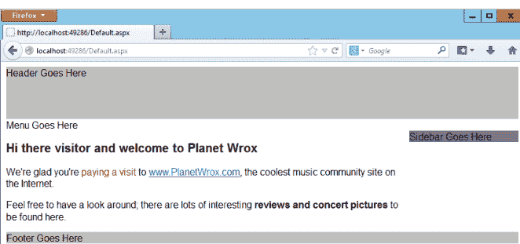

图 3-8

## 如何工作

像 IntelliSense 和标题大小写搜索这样的功能可以让你用最少的击键编写 CSS。如果你可能要自己输入大部分 CSS，但一旦你更熟悉 Visual Studio 的 CSS 编辑器，你就可以让 VS 为你编写大部分代码。

请注意，`header`、`PageWrapper`、`nav` 和 `footer` 元素都有精确的 `844` 像素宽度。这样，站点在 `1024 x 768` 像素的屏幕上都能很好地显示，这仍然是当今许多计算机上相当常见的屏幕尺寸，而不会被 Windows 边框挤压。具有更大屏幕的系统会在可用空间中居中站点。这种居中由 `PageWrapper` 元素完成，其 `margin` 设置为 `auto`。这意味着左右两侧的可用空间（不在顶部和底部）被平均分配，有效地将 `PageWrapper` 元素居中于浏览器窗口。作为固定宽度布局的替代方案，你可以创建响应式布局以适应访客的屏幕尺寸。前面提到的 Bootstrap 框架使这变得非常容易。

还要注意 `MainContent` 部分和 `aside` 是并排放置的。你使用 CSS `float` 属性来实现这一点：

```
section#MainContent

{

  width: 664px;

  float: left;

}
```

```
aside

{

  background-color: Gray;

  width: 180px;

  float: left;

}
```

这告诉 `MainContent` “浮动”在其后内容的左侧，有效地将 `aside` 放置在其右侧。你也需要告诉 `aside` 浮动；如果省略它，它将被放置在页面的左侧，就在你应用 CSS 的位置。如果你站点中有多个 `aside` 元素（这是一种常见做法），你可以通过添加 `id` 属性（如 `Sidebar`）来定位充当侧边栏的此 `aside`，就像我对 `MainContent` 部分元素所做的那样，然后更新 CSS 如下：

```
aside#Sidebar

{

  ...

}
```

`MainContent` 和 `aside` 元素的组合宽度加起来为 `844` 像素，这正好是其父元素 `PageWrapper` 的宽度。

为了结束浮动并告诉 `footer` 元素直接放置在 `MainContent` 和 `aside` 元素下方，使用 `clear` 属性清除可能存在的任何浮动（左或右）：

```
footer

{

  background-color: #C0C0C0;

  width: 844px;

  clear: both;

}
```

灰色背景只是临时添加到代码中，以便更容易看到哪个 `<div>` 结束在何处。在未来的练习中，你将再次修改 CSS 以适应 Planet Wrox 网站的方案。

要告诉浏览器应用哪些样式，在页面的 `head` 中链接样式表：

```
<link href="Styles/Styles.css" rel="stylesheet" type="text/css" />
```

这告诉浏览器在 `Styles` 文件夹中查找名为 `Styles.css` 的文件，并将该文件中的所有规则应用于当前文档。一旦浏览器下载了 CSS 文件，它就会将其中找到的所有样式应用到你的 HTML 元素，从而产生图 3-8 所示的布局。

在本练习中，你看到了如何使用 `<link>` 标签将外部样式表链接到页面。然而，你有更多方法可以将样式表包含在网页中。

## 向页面添加 CSS

向网页添加 CSS 样式的第一种方式是通过指向外部 CSS 文件的 `<link>` 元素，就像你在上一个练习中看到的那样。看看下面的 `<link>`，了解在页面中嵌入样式时有哪些选项：

```
<link href="Style.css" rel="Stylesheet" type="text/css" media="screen" />
```

`rel` 属性指向你站点内的位置，就像你在上一章创建两个页面之间的链接时看到的那样。`rel` 和 `type` 属性告诉浏览器该链接是一个层叠样式表。`media` 属性很有趣：它使你能够针对不同的设备，包括屏幕、打印、手持设备，甚至盲文和对视障用户的支持。`media` 属性的默认值为 `screen`，因此如果你针对的是桌面浏览器，省略该属性是可以的。

你在本章开头简要看到了如何包含样式表：使用嵌入式 `<style>` 元素。`<style>` 元素应放置在 ASPX 或 HTML 页面的顶部，位于 `<head>` 标签之间。在 `<style>` 标签内，你可以编写与前面看到的完全相同的 CSS。例如，仅更改当前页面中 `<h1>` 的外观，你可以在页面的 `<head>` 中添加以下代码：

```
<head runat="server">
<title></title>
<style>
h1 {
  color: Blue;
}
</style>
</head>
```

`<style>` 元素上的 `type` 属性是可选的，所以你会遇到有或没有该属性的 `<style>` 元素。

应用 CSS 到 HTML 元素的第三种方式是使用内联样式，通过 `style` 属性直接应用于特定 HTML 元素，你不需要选择器，可以直接在属性中编写描述：

```
<span style="color: White; background-color: Black;">
  This is white text on a black background.
</span>
```

## 选择外部、嵌入和内联样式

你有许多为网站添加样式表的方法，什么方法最好？
一般来说，你应该优先使用外部样式表，其次是嵌入样式，最后是内联样式。外部样式表使你能够通过单个文件更改整个网站的外观。对外部样式表文件进行一次更改，所有使用该样式的页面都会自动采用更改。

然而，在某些情况下，使用嵌入样式和内联样式也是完全可以接受的。如果你想更改单个页面的颜色，而不影响网站中的其他页面，嵌入样式是最佳选择。内联样式也适用相同原则：如果只想更改单个页面中单个元素的行为，并且你相当确定不会为其他 HTML 元素声明该声明，请使用内联样式。

需要考虑的一个重要因素是各种类型样式表之间的覆盖方式。如果你有多个具有不同属性值的相同选择器，最后一个将优先。例如，外部样式表 `Styles.css` 中定义的一条规则将所有 `<h1>` 元素的颜色设置为绿色：

```
h1 {
  color: Green;
}
```

现在假设你在一个页面中附加此样式表，该页面还包含一个为 `h1` 设置不同颜色的嵌入规则：

```
<link href="Styles/Styles.css" rel="stylesheet" type="text/css" />
<style>
h1 {
  color: Blue;
}
</style>
```

使用此代码，页面中实际的 `<h1>` 元素的颜色将为 `Blue`。这是因为设置颜色为蓝色的嵌入样式表在页面中定义得更晚，并且覆盖了外部文件中的设置。如果你调换样式顺序：

```
<style>
h1 {
  color: Blue;
}</style>
<link href="Styles/Styles.css" rel="stylesheet" type="text/css" />
```

标题将为绿色，因为外部样式表中的设置现在覆盖了嵌入样式的设置。

相同的原则也适用于内联样式。因为它们直接定义在 HTML 元素上，所以它们的设置优先于嵌入和内联样式表。

还值得知道的是，CSS 通常会覆盖 HTML 元素上的属性。例如，如果你有一个 CSS 规则设置图像的宽度和高度，则高度和宽度属性将被忽略。例如，此代码片段中的图像最终成为 `100` 像素的正方形：

```
img
{
  height: 100px;
  width: 100px;
}

```

> 注意 CSS 的内容远不止于此。要了解更多关于 CSS 的信息，请购买 Richard York 和 Ian Poncey 所著的《Beginning CSS: Cascading Style Sheets for Web Design, 3rd Edition》（ISBN: 978-0-470-89152-0）一书。

一般来说，建议你在 `<head>` 部分顶部附加外部文件，并使用嵌入样式表。外部文件定义元素的全局外观，你可以使用嵌入样式按页面逐页覆盖外部设置。

VS 使将嵌入样式移动到外部 CSS 文件变得很容易，你将在下一节中学到这一点，该节讨论 VS 中剩余的 CSS 工具。

## 在 Visual Studio 中使用 CSS

Visual Studio 2013 提供了许多出色的工具，使使用 CSS 变得尽可能简单，包括：

- 属性网格，可让你更改属性值。
- 管理样式窗口，可让你在网站中组织样式，将其从嵌入样式表更改为嵌入样式表，反之亦然；重新排序；将现有样式表链接到文档；创建新的内联、嵌入或外部样式表。
- 应用样式窗口，你可以使用它从网站中所有可用样式中进行选择，并快速将其应用于页面中的元素。
- 层次缩进，使你的 CSS 代码更易于理解。更智能的 IntelliSense 和标题大小写搜索功能，使手动输入 CSS 代码变得简单。
- 一系列有用的编辑器功能，可轻松注释和取消注释以及将代码包装在可折叠区域中、颜色选择器和代码片段。

你已经看到了这些工具中的一些在运行，下面的各节将详细介绍剩余的工具。

## 使用 CSS 编辑器

VS 中的 CSS 编辑器托管了许多强大的功能，在接下来的“试一试”练习中演示。

## 试一试 尝试 CSS 编辑器

在此练习中，你通过添加一些新样式来修改之前创建的 `styles.css` 文件。在此过程中，你将了解前面列出的 CSS 编辑器功能。

1. 打开 `styles` 文件夹中的 `Styles.css` 文件并找到 `section#MainContent` 选择器。在其大括号下方，添加以下针对 `MainContent` 部分中链接（`a` 元素）的 CSS 选择器：

```
section#MainContent a
{}
```

2. 在大括号之间，输入冒号（`:`）然后输入哈希符号（`#`）。当你输入哈希符号时，VS 会为你提供颜色选择器。如果你单击颜色选择器的箭头，它会展开并显示更多选项，如图 3-9 所示。

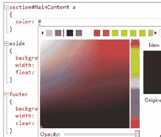

此颜色选择器具有一些有趣的功能。首先，彩色方块的顶部行包含在样式表中定义的颜色列表。这是一种快速选择你已为其他选择器使用过的颜色的好方法。识别的颜色列表后面跟着一条垂直线，其后是 VS 为你添加的一些默认颜色。在图 3-9 中，你可以看到识别的颜色为浅灰色和深灰色。其他颜色都是默认的。其次，你可以通过在中间的大正方形以及右侧的颜色垂直条上拖动鼠标来混合颜色。最后，使用屏幕右下角的小颜色选择器图标，你可以从任何 Windows 应用程序或桌面快速选择颜色。这是从你可能在某些图形程序中打开的图像中检索颜色的好方法，例如。

图 3-9

如果你想输入自己的颜色信息，请忽略颜色选择器（或按 `Esc` 键关闭它）。

对于此练习，单击一个绿色方块，这会插入你所选颜色的十六进制值（例如 `#4fff00`）。通过以分号结束来完成代码行。

3. 完成 `section#MainContent a` 的样式规则并添加另外两个样式规则如下：

```
section#MainContent a
{
  color: #4fff00;
  text-decoration: underline;
}
```

```
section#MainContent a:visited
{
  color: #FF0000;
  text-decoration: underline;
}
section#MainContent a:hover
{
  color: #FF5500;
  text-decoration: underline;
}
```

```
section#MainContent
{
  width: 664px;
  float: left;
}
section#MainContent a
{
  color: #4CFF00;
  text-decoration: underline;
}
section#MainContent a:hover
{
  color: #FF0000;
  text-decoration: underline;
}
```

4. 接下来，从主菜单中选择编辑文档。或者，按 `Ctrl+K` 然后按 `Ctrl+D`。此快捷方式和菜单命令可用于其他类型的文件，例如 HTML、CSS、Visual Basic 和 C# 文件。执行时，它们会根据该特定类型的设置格式化文档。对于 CSS 来说，它会在特定位置格式化结束大括号，并缩进各个规则。它还执行所谓的层次缩进。要了解其工作原理，请查看 3-10，它描绘了 `section#MainContent` 规则集在格式化文档后作为你添加的元素的新选择器。


注意 `section#MainContent` 规则已被缩进在规则集使用的选择器之间（`section#MainContent a` 仅针对具有 `id` 为 `MainContent` 的父 `section` 元素内的元素）。同样，`section#MainContent a:visited` 和 `section#MainContent a:hover` 规则被缩进在元素下方，因为它们被视为元素的“子元素”。如果你愿意，可以通过在 `工具 > 选项 > 文本编辑器 > 高级` 下将层次缩进设置为关闭来关闭此功能。或者，按 `Ctrl+Q` 聚焦快速启动，使用 CSS 高级，然后按 `Enter`。这将打开选项框。在此期间，花点时间浏览文本编辑器下的项目，以了解如何更改你支持的语言的格式。

5. 最后值得展示的编辑器功能是区域和注释的工作方式。如果你的 CSS 变得难以管理，将属于一起的代码部分包装在区域中可能会有所帮助。在 VS 中，这可以折叠代码，并在需要更改时展开。要创建它，请使用 CSS 注释语法将代码包装在 `region /endregion` 中。例如：

```
/*#region Region Name */
-- Your CSS code here
/*endregion*/
```

```
/*#region Main Content */
section#MainContent
{
  width: 664px;
  float: left;
}
```

对于此练习，在 `section#MainContent` 规则集正上方添加一个名为 `Main Content` 的区域部分（`/*#region*/`），并在 `section#MainContent a:hover` 规则集下方添加结束语句（`/*#endregion*/`）。创建区域后，在图 3-11 中，你将在文本编辑器旁边的边距中看到一个减号（`-`）。


## 第 3 章 设计你的网页

你现在可以通过点击减号来折叠该区域。VS 会隐藏代码块并显示该区域， 如图 3-12 所示。

这使得在处理大型代码文件时可以轻松地将某些代码移开。注意：区域也支持其他文件类型，例如 C# 和 VB 文件，尽管每种语言使用不同的语法。

VS 中的区域使用标准的 CSS 注释语法。这意味着浏览器会将代码区域识别为其名称。

要注释掉代码（使其不被浏览器解释），选择一些文本然后按 `Ctrl+K` 后跟 `Ctrl+C`（注释）。代码使用 `/*` 和 `*/` 进行注释，如图 3-13 所示。

要取消注释，请按 `Ctrl+K` 后跟 `Ctrl+U`（取消注释）。这两个命令也在 `Edit | Advanced` 菜单中可用。你也可以通过手动输入 `/` 来开始注释，VS 会自动为你插入 `//`。

- 6. 保存对 CSS 文件的更改。你可以保留该区域，但请确保取消注释你在前一步中可能注释掉的任何代码。

- 7. 切换到 `Default.aspx` 页面，必要时切换到设计视图。选择 around 中的文本“look around”。如果你在之前的 Try It Out 中输入了其他内容，请选择该文本。在此阶段，重要的是你希望将文本转换为链接。

- 8. 在 Formatting 工具上，单击 Convert to Hyperlink 按钮（带有链接符号和箭头的按钮），在出现的对话框中单击 Browse 按钮，并在站点根目录中选择 `Default.aspx`。这样，链接指向它所在的页面，这对你的练习来说是可以的。单击 OK 关闭对话框。

- 9. 保存所有文档的更改（从菜单中选择 `File | Save All` 或按 `Ctrl+Shift+S`）并通过按 `Ctrl+F5` 在浏览器中请求 Default `.aspx`。你会看到页面上“look around”链接被下划线标出，如图 3-14 所示，该图显示了在 Google Chrome 中的页面。

```
/* Plain Content
aside
  background-color: Gray;
  width: 100%;
  float: left;
*/
```

## FIGURE 3-12

```
/*nav


`width: 84px;`

*/

## FIGURE 3-13

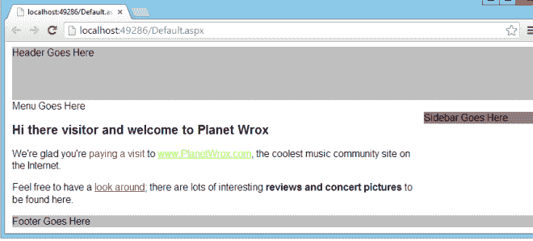

## FIGURE 3-14

## CHAPTER 3 DESIGNING YOUR WEB PAGES

10. 将鼠标悬停在 `"look around"` 链接上；注意它会变成橙色。

11. 注意到链接到 `www.PlanetWrox.com` 是绿色的（前提是你之前没有访问过该网站），而链接到 `Default.aspx` 是红色的（因为你当前正在查看 `Default.aspx`，书签将此页面标记为“已访问”）。如果你访问 Planet Wrox 网站然后返回到 `Default.aspx` 页面，指向 Planet Wrox 站点的链接也会变成红色。悬停时仍会变成橙色。如果你想在另一个浏览器中测试页面，右键单击 Solution Explorer 中的 `Default.aspx` 并选择 `Browse With` 上下文菜单。如果你的浏览器已在列表中，选择它然后单击 `Browse`。你可以通过按住 `Ctrl` 键同时单击它们来同时选择多个浏览器。单击 `Browse` 按钮时，这些浏览器都会打开。可选地，你可以通过单击 `Set as Default` 按钮使浏览器或浏览器成为默认浏览器。结合 VS 的一个名为 `Browser Link` 的功能（你将在第 18 章看到），这是一种在多个浏览器中快速开发和测试页面的好方法。

如果你的浏览器未列出，单击 `Add` 按钮并单击 `Program Name` 框旁边的省略号以搜索你喜欢的浏览器。浏览器会显示在列表中，单击它进行选择。

你也可以从如图 3-15 所示的标准工具栏访问设置。

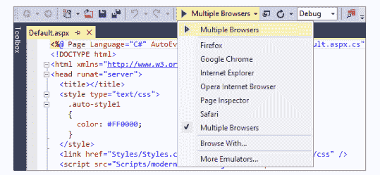

## FIGURE 3-15

### How It Works

此练习首先向你展示了 VS 中 CSS 的一些功能。颜色选择器、代码注释、分层缩进和代码格式化都旨在尽可能轻松地编写代码。

选择器上的 `:hover` 和 `:visited` 部分可能对你来说是新的。这些选择器称为类选择器。`:visited` 选择器仅应用于用户在浏览器中已访问过的链接。`a:hover` 选择器仅在用户将鼠标悬停在链接上时应用于 `<a>` 元素。

当你在浏览器中打开页面时，更新的样式将被下载，浏览器会将 `:visited` 规则应用于 `MainContent` 部分中你之前访问过的所有链接。当你将鼠标悬停在链接上时，`link section#MainContent a:hover` 将被应用，导致链接变为橙色。

在不同浏览器中查看页面是件好事。虽然现代浏览器倾向于更相似地渲染页面，但存在细微差异，你需要在 HTML 和 CSS 代码中注意并处理这些差异。在你的系统上安装几个不同的浏览器（例如 Internet Explorer、Firefox、Safari、Opera 和 Chrome），将它们分配给如图 This It Out 所示的 `Browse With` 对话框，并在这些浏览器中尽可能频繁地测试你的页面，有助于确保你的页面在大多数浏览器中看起来完全正确。

作为外部样式表，有时你确实想改用嵌入式或内联样式。创建和管理这些样式，如下一节所述，同样简单。

### Creating Embedded and Inline Style Sheets

当你在设计视图中处理页面时，你通常需要对页面的某些部分进行微调，例如设置文本样式、对齐图像或为元素应用边框。在此阶段，你需要决定是创建内联、嵌入式还是外部样式表。如你之前所见，如果你设想以后会重用样式，应选择外部或嵌入式样式表。VS 并不太在意，它使你能够在三个级别上创建样式。更棒的是，它使你能够轻松地将嵌入式样式升级为外部样式，或将内联样式信息复制到不同位置，为你提供极大的灵活性和改变主意的选项。

在下一个练习中，你将看到如何创建内联和嵌入式样式表。你稍后将看到如何将这些样式移动到外部样式表，以便他人重用相同的样式。

### TRY IT OUT Creating Embedded and Inline Styles in a Page

在此 Try It Out 中，你向 `<h1>` 元素添加一个样式规则，以删除浏览器在标题周围绘制的默认边距。此外，你使用类属性设置第一个段落的样式，使其与页面上的其他段落不同而突出。

1. 返回 VS 并确保 `Default.aspx` 页面处于设计视图。
2. 在文档窗口中单击一次 `<h1>` 元素以选择它，然后格式化 New Style。`New Style` 对话框出现（参见图 3-16），它让你以可视方式创建新的 CSS 代码。
3. 在屏幕顶部，打开 Selector 下拉列表并列出（Inline）。它确保新样式作为内联样式应用于 `<h1>` 元素。
4. 切换到如图 3-17 所示的 Box 类别。此对话框有一个方便的图表，可作为 CSS 框模型的复习，显示填充、边框和边距结束的属性。

默认情况下，浏览器会在 `<h1>` 元素上方或下方绘制一些空白，但不同浏览器之间的数量不同。为了让每个浏览器具有相同的统一设置，你将填充重置为 0，然后在标题底部添加一点边距，这会在其后元素之间创建距离。为此，将顶部框中的填充设置为 0，然后从文本框旁边的下拉列表中清除值。通过保留 Same for All 选项被选中，VS 会为你创建简写声明。然后取消选中边距部分的 Same for All，为顶部和左侧框输入 0，并清除每个值旁边的下拉列表中的值。输入 10 到底部文本框，并确保在下拉列表中选择了 `px`。你的屏幕现在应如下图 3-17 所示。

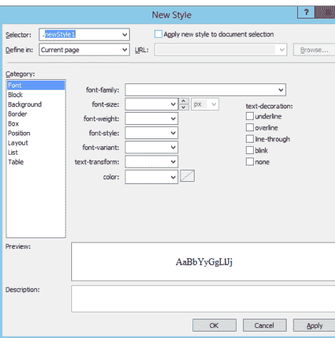

## FIGURE 3-16

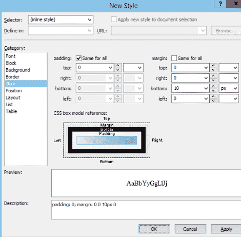

## FIGURE 3-17

点击确定关闭对话框并将更改应用到标题。你最终得到以下带有内联样式的 `<h1>` 元素在 Markup View 中：

```
<h1 style="padding: 0; margin: 0 0 10px 0">
</h1>
```

Hi visitor and welcome to Flanet Wrox

5. 接下来，在 Design View 中，通过点击选择第一个段落。会出现一个小图标以指示你已选择一个 `<p>` 元素。文档窗口底部的 Tag Selector 高亮显示 `<p>` 元素，如图 3-18 所示。

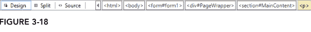

6. 在段落被选中的情况下，从主菜单中选择 Format New Style。这次，不要创建内联样式，在 Selector 框中输入 `.Introduction`。不要忘记选择器菜单中的点号（`.`）。

7. 在屏幕顶部，选中 Apply New Style to Document Selection 复选框。有了此设置，你即将创建的新类将被应用到你已选择的 `<p>` 元素上。

8. 从样式下拉列表中选择 `italic`。

9. 点击确定关闭对话框。注意整个段落现在都以斜体字体显示。

10. 在 `<p>` 元素被选中的情况下，通过选择 ▼ `CSS Properties` 打开 `CSS Properties Grid`（图 3-19）。这可以让你概览 CSS 属性以及当前页面中哪些属性处于活动状态。

此网格在窗口顶部按出现顺序显示已应用规则的列表。窗口底部部分用于显示这些规则的 CSS 属性。在图 3-19 中，你可以看到适用于 `.Introduction` 选择器的规则。

11. 在 `CSS Properties Grid` 中找到 `color` 并将其设置为深蓝色，如 `#003399`。要实现这一点，打开属性值的下拉列表并从颜色选择器中选择一种颜色。你要找的颜色不可用，点击 More Colors 以调出扩展的颜色选择器，如图 3-20 所示。

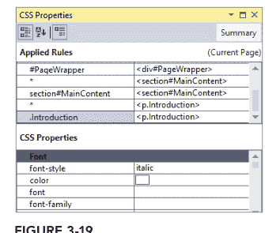

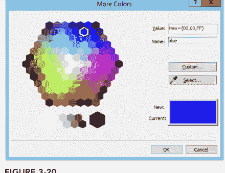

除了使用颜色选择器，你也可以直接在 Properties Grid 中取值。这就是 `CSS Properties Grid` 中许多属性的工作方式：它们允许你直接输入值，或通过使用属性值框末尾的下拉列表或带省略号的框来更改值。图 3-21 显示了 `font-style` 属性在方便的下拉列表中的不同选项。

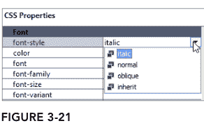

请特别注意窗口顶部的三个按钮，因为它们使用了某些功能。前两个按钮可让你在分类模式和字母顺序模式之间切换，从而更轻松地找到正确的属性。第三个按钮可让你在列表顶部显示已应用的属性，或在列表中的默认位置显示它们。

12. 保存所有更改并在浏览器中打开 `Default.aspx`（你会看到第一个段落以蓝色和斜体字体显示，文本中的链接为红色或绿色，具体取决于你是否之前访问过该链接。此外，如果你遵循了上一章的所有说明，文本“paying a visit”将为红色，由嵌入的 CSS 类设置。

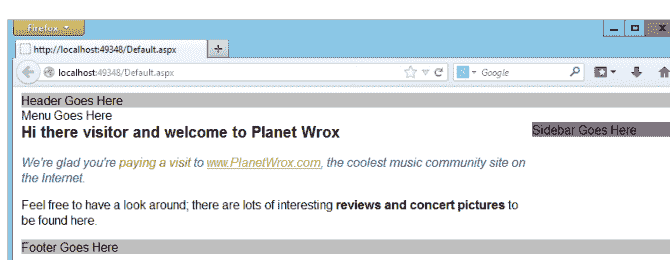

FIGURE 3-22

13. 切回 VS 并在 Markup View 中查看你的页面。在页面的 `<head>` 部分，你应该看到以下嵌入式样式表：

### How It Works

VS 提供的众多工具使为你的网站编写 CSS 变得容易。你不需要手工编码任何内容，也不需要记住 CSS 标准支持的所有不同属性。相反，你可以

### Working with CSS in Visual Studio

只需从 `CSS Properties Grid` 的不同列表中选择它们。此网格允许你手动输入值，但提供了方便的工具来选择颜色、从下拉列表中选择项目等。

你在 Properties Grid 中所做的所有更改都会应用于相关的样式表，无论你使用的是内联、嵌入式还是外部样式表。与此同时，Design View 会更新以反映你所设置的新 CSS 选项。

当你查看 `<h1>` 元素时，你可以看到 VS 创建了一个内联样式，将 `padding` 设置为 0 以同时影响四个边，将 `margin` 设置为 0 0 10px 以单独控制四个边。

一旦你创建了一堆有用且可重用的样式，你需要一种方法将现有样式应用到其他页面或 HTML 元素。你接下来会看到这是如何工作的。

## Applying Styles

如果你有 Microsoft Word 的使用经验，你可能熟悉 Styles 对话框，它列出所有可用的样式并允许你为文本的某些部分选择它们。你可以快速将相同的格式应用到文本块。在 VS 中也是如此。通过 Apply Styles 窗口——可通过从主菜单中选择 Apply Styles 访问——你可以轻松地将样式规则应用到页面中的元素。

> TRY IT OUT Using the Apply Styles

在此练习中，你将使用 `.Introduction` 类并将其应用到页面的第二个段落。这样，两个段落看起来都一样。

1. 在 `Default.aspx` 中，确保你在 Design View 中并通过点击选择页面的第二个段落。确保文档窗口底部的 Tag Selector 显示 `<p>` 元素已被选中，而不是 `<p>` 内的其他元素，如 `<strong>`。如果你的文本只有一段，请创建一个新段落（在 Design View 中在第一个段落后按 Enter），输入一些文本，然后选择该段落。

通过选择 Apply Styles 打开 Apply Styles。确保窗口未停靠在 Document Window 中，而是浮动或放置在 Document Window 侧边。此窗口显示当前页面和任何附加样式表中的所有选择器。如果看不到图 3-23 中显示的所有样式，请点击 Options 按钮并选择 Choose All Styles。

3. 在 CSS Styles 列表中点击 Introduction 类。VS 会向 `<p>` 标签添加一个 `class` 属性：

```
<p class="Introduction">
Feel free to add a <a href="Default.aspx">around</a>; there are lots of interesting <strong>reviews and concert pictures</strong> to be found here.
</p>
```

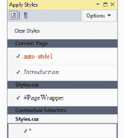

FIGURE 3-23

## CHAPTER 3 DESIGNING YOUR WEB PAGES

如果你想应用多个类，请按住 `Ctrl` 键同时点击列表中的其他类。这会将由空格分隔的类列表应用到元素的 `class` 属性。你也可以按照相同的步骤在 Markup View 中应用所选样式。

4. 使用 Clear 按钮，你可以快速从标签中移除现有的类和内联样式。考虑你在上一章使用 Foreground Color 按钮时看到的 HTML 片段，你最终得到了工具栏来格式化页面中的文本。

```
We're glad you're <span class="auto-style*">paying a visit;</span>
```

要移除 `class` 属性，请在 Tag Selector 中选择 `<span>` 标签，或直接在 Markup View 中点击 `<span>` 标签，然后点击 Apply Styles 窗口中的 Clear，该窗口可在图 3-23 中的工具栏下方看到。你将得到以下结果：

```
We're glad you're <span>-around paying a visit
```


由于空标签没有用处，VS 也会为你移除它。此外，VS 还会移除 auto-style 规则，因为它不再被页面上的任何代码使用。如果你在 Markup View 中点击 `<span>` 时 Apply Styles 窗口为空，你可能需要先切换到 Design View 以填充对话框。

从 HTML 元素中移除样式的方式相同。

## How It Works

再次，VS 能够保持所有相关窗口同步：Design View、Markup View 和你的 CSS 设计工具。当你从 Apply Styles 窗口应用一个类时，VS 会在 Markup View 中将请求的类添加到所选的 HTML 元素中。它还会更新 Design View。同样，当你在 Design View 中从嵌入样式中移除选择器或声明时，Design View 和 CSS 工具都会更新。

本章中你需要查看的最后一个 CSS 功能位于 Manage Styles 和 Apply Styles 窗口上。除了帮助你将 CSS 文件附加到文档外，这些窗口还使你能够轻松管理样式。

## Managing Styles

由于添加新的内联和嵌入样式很容易，你的页面可能会很快变得混乱，样式散布各处。为了实现可重用性，你应该将尽可能多的内联和嵌入样式移至外部样式表。这正是 Apply Styles 和 Manage Styles 窗口所能实现的功能。

> TRY OUT Managing the Manage Styles and Apply Styles Windows

本章前面，你修改了 `<h1>` 元素并将 padding 和 margin 应用到标题上。然而，`default.aspx` 并不是唯一可以从此标题样式中受益的页面，因此将其移至 `Styles.css` 文件是有意义的。Introduction 类似乎足够可重用，可以包含在 `Styles.css` 文件中，以便其他页面可以访问它。此 Try It 向你展示了如何移动站点中的样式。

1. 确保 `Default.aspx` 仍然打开，必要时切换到标记视图。
2. 定位 `<h1>` 元素并单击它。VS 会在文档窗口底部的标签选择器中高亮显示该标签，以表明它是活动标签。
3. 通过主菜单选择 View Apply Styles 打开应用样式窗口。或者，如果你已将该窗口与其他窗口停靠在一起，只需单击其选项卡即可激活它。再次确认该窗口没有意外停靠在文档窗口中，而是浮动或放置在文档窗口侧边。在应用样式窗口底部，你会看到一个内联样式出现（见图 3-24）。
4. 右键单击 Inline 并创建 New Style Copy。New Style 对话框打开，使你能够基于当前选择创建新样式。在窗口顶部，从 Selector 下拉菜单中选择 `h1`，从 Define Inline 下拉菜单中选择 Existing style sheet。从 URL 下拉菜单中选择 `Styles/Styles.css`。如果该项不可用，请单击 Browse 按钮进行选择。你的对话框应如图所示 3-25。

FIGURE 3-24

FIGURE 3-25

5. 单击 OK 关闭对话框。VS 会创建 `h1` 样式的副本并将其放置在 `Styles.css` 文件中。VS 在 `Styles.css` 文件中为 `h1` 创建新的样式集，而不是将 padding 和 margin 信息添加到现有规则集中。如果你愿意，可以手动将两个选择器合并为一个。
6. 在应用样式窗口中，再次右键单击 Inline Style，并从上下文菜单中选择 Remove Inline Style。这会从 `h1` 元素中移除 style 属性。
7. 从主菜单中选择 View Manage Styles。确保该窗口放置在文档之前且未停靠在文档中。在 Current Page 项下，定位 Introduction 选择器。
8. 单击 ...Introduction 选择器，并将其拖动到 `Styles.css` 的区域中，以便在 `h1` 选择器之后放置。注意，当你将鼠标悬停在选择器上时，VS 会在选择器之间绘制线条，以指示选择器将结束的位置。图 3-26 显示了 ...Introduction 如何从当前页面拖动到 Styles ...css 中，位于 `h1` 和 `#PageWrapper` 选择器之间。
9. 一旦你在管理样式窗口的 `Styles.css` 部分放置选择器，相关样式将从当前页面中移除，然后插入到 `Styles.css` 中。由于该文件已通过 `<link />` 元素包含在当前页面中，你在设计视图中看不到任何差异。如果你不再需要，可以从 `Default.aspx` 中移除 `<style>` 元素。
10. 如果你已经移动了两个 `h1` 选择器，请打开 `Styles.css` 并滚动到文件末尾。将 padding 和 margin 属性的两行复制到剪贴板并删除整个选择器。在文件中向上滚动并将两个 CSS 规则粘贴到另一个 `h1` 选择器内。你应该得到以下代码：

```
h1
{
  font-size: 20px;
  padding: 0;
  margin: 0 0 10px 0;
}
```

11. 保存可能进行的任何更改，然后通过按 `Ctrl+F5` 在浏览器中打开 `Default.aspx`。注意段落没有变化，仍然使用相同的蓝色和斜体字体。

## How It Works

不幸的是，VS 不允许你将内联样式移动到外部样式表。然而，通过复制现有样式并删除原始内联样式，你可以实现相同的效果。在文件之间移动嵌入式或外部样式非常容易。你只需将样式从一个文件拖到另一个文件，VS 就会自动为你移动代码。这使得组织 CSS 变得容易。不要因为害怕触碰而将所有嵌入式 CSS 留在页面中，你可以简单地将其拖放到外部文件中。这使得在其他页面中重用这些样式变得更容易，减少页面大小和页面臃肿，使你的网站更易于管理。显然，重要的是你移动 CSS 的位置已附加到你正在处理的页面上。

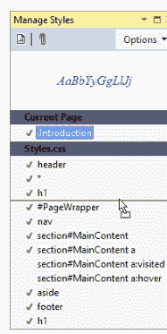

FIGURE 3-26

## PRACTICAL TIPS ON WORKING WITH CSS

遵循以下提示以充分利用 CSS：

- 花一些时间熟悉 CSS 支持的众多属性。最好的方法是，在你的 Demo 文件夹中创建一个全新的页面，创建几个 HTML 元素，如 `<div>` 和 `<p>` 标签，然后简单地尝试所有不同的属性。通过在 CSS 属性网格上尝试许多属性，你可以感受到可用的选项。这使得如果你想对内容的一部分应用某种效果时更容易。
- 在创建自定义 CSS 类时，尽量想出描述该类行为的名称，而不是外观。例如，一个名为 `.Introduction` 的类用于设置页面第一段的样式就是一个很好的描述。它使你能够在不影响名称实际含义的情况下更改值。但名称为 `.BlueAndItalic` 的类保证会给你带来问题。如果决定将蓝色改为黑色呢？你最终会得到一个描述其自身行为的过时类名，或者你必须重命名类并更新整个站点，将对旧类的引用更新为 `.BlackAndItalic`。
- 尽量创建更小且可重用的规则以便组合，而不是创建只能用于单个 UI 元素的庞大、单一规则。例如，不要创建如下样式：

```
.ImportantHeading {
color: Red;
font-size: 20px;
font-weight: bold;
}
```

你最好创建几个更轻量、更易于重用的规则：

```
h1 {
font-size: 20px;
}
```

```
.Attention {
color: Red;
font-weight: bold;
}
```

当你将 `.Attention` 类应用于如下标题时：`<h1 class="Attention">`，你会得到与赋予其 `ImportantHeading` 类时完全相同的行为。然而，通过单独的 `Attention` 类，你创建了一个可重用规则，可以应用于需要用户注意的其他元素，如 `<p>` 或 `<span>` 元素。

## SUMMARY

本章让你很好地了解了 CSS，这是设置 ASPX 和 HTML 页面样式最重要的语言。

## CHAPTER 3 DESIGNING YOUR WEB PAGES

CSS 使你能够克服 HTML 在页面样式方面的局限性，因为它旨在减少页面臃肿，让你对页面的外观有更大控制权，并总体上帮助你创建加载更快且更易于维护的网站。

一旦你对 CSS 术语有很好的理解，你会发现使用 VS 提供的众多 CSS 工具变得很容易。诸如管理样式和应用样式窗口、样式生成器以及代码编辑器中的智能 IntelliSense 等工具使编写和管理 CSS 变得非常容易。

你不仅可以将 CSS 应用于 HTML，如本章所示，还可以应用于 ASP.NET 服务器控件。你应用于这些控件的 CSS 最终会作为内联样式属性出现在浏览器中，其原理与本章中看到的相同。下一章将详细介绍许多可用的 ASP.NET 服务器控件。

## EXERCISES

- 1. 使用外部样式而不是嵌入式样式表的主要好处是什么？
- 2. 编写一个 CSS 规则，改变页面中所有一级标题（h1）的外观，使其如下：
  * 标题使用 Arial 字体。
  * 标题应为蓝色。
  * 标题必须具有 18 像素的字体大小。
  * 标题在顶部和左侧具有蓝色、细边框。

对于最后一个要求，请查看 CSS 文件中 VS 的 IntelliSense 列表，以发现 border 属性的另一种简写版本。
- 3. 以下两个规则中哪一个更容易在网站的页面之间重用？你能解释原因吗？

```
#MainContent {
  border: 1px solid Blue;
}
.BoxWithBorders {
  border: 1px solid Blue;
}
```
- 4. VS 允许你以多种不同的方式将外部样式表附加到页面。你能说出两种不同的方法吗？

你可以在附录 A 中找到这些练习的答案。

## 本章你学到了什么

|  |  |
|---|---|
| CSS | 级联样式表，用于在浏览器中布局网页的语言。 |
| CSS 盒模型 | 计算元素尺寸的模型，涉及高度、宽度、内边距、边框和外边距。 |
| 声明 | 属性和值组合，用于确定声明适用的元素的样式。 |
| 内嵌样式表 | 在页面中的 `<style />` 元素中定义的 CSS 代码。通常称为内嵌样式。 |
| 外部样式表 | 在单独文件中定义的 CSS 代码，然后使用 `<link />` 元素包含到页面中。 |
| 内联样式表 | 直接在元素上使用 style 属性定义的 CSS 代码。通常称为内联样式。 |
| 规则集 | 选择器和一个或多个声明的组合，用一对大括号括起来。 |
| 选择器 | CSS 构造，用于指向页面中的一个或多个元素。存在不同的选择器，包括通用选择器、ID 和类选择器以及类型选择器。 |

## 4
使用 ASP.NET 服务器控件

本章你将学习的内容：

- ASP.NET 服务器控件是什么
- 你可以使用的不同类型的服务器控件
- 大多数服务器控件共有的行为
- ASP.NET 运行时如何处理页面上的服务器控件
- 服务器控件如何在回发之间保持其状态

WROX.COM 本章代码下载

你可以在 `www.wrox.com/go/begaspnet451` 的 Download Code 标签下找到本章的 wrox.com 代码下载。代码位于 Chapter 4 文件夹中。

ASP.NET 服务器控件是你在 Visual Studio 中构建的所有 Web Forms 页面的主力军。VS 将包含一个或多个服务器控件。这些控件种类繁多，大小不一，从简单的控件如 Button 和 Label 到能够从数据源（如数据库或 XML 文件）显示数据的复杂控件如 GridView 和 ListView。你在第 7、13 和 14 章中会看到这些控件。

ASP.NET 服务器控件的架构深度集成到 ASP.NET 中，使控件的功能集在当今用于构建网站的技术中独一无二。本章向你展示服务器控件是什么、它们如何工作，以及在安装 VS 时开箱即用的控件有哪些。

本章首先对服务器控件进行总体讨论。你将看到如何通过将它们添加到设计或标记视图中在代码中定义它们。

接下来的部分将全面介绍 VS 工具箱中可用的控件。

### 服务器控件简介

了解服务器控件的工作原理以及它们与在经典 ASP 或 PHP 等其他语言中定义控件的方式完全不同非常重要。

例如，要在这些语言中影响文本框中的文本，你会使用 HTML 并将其与服务器端代码混合。这与第 2 章中的示例类似，其中当前日期和时间显示在页面上。要在经典 ASP 中创建一个包含消息和当前时间的文本框，可以使用以下代码：

```
<input type="text" value="Hello World, the time is <%=Time()%>" />
```

正如你所见，此代码包含 HTML，与由 `<%= %>` 分隔的服务器端代码混合，输出使用 `Time()` 函数的当前时间。这种类型的编码有一个主要缺点：HTML 和服务器端代码混合在一起，使得维护页面变得困难。虽然仍然很容易理解代码，但这种类型的编程会迅速导致页面混乱和复杂。

服务器控件的工作方式不同。在 ASP.NET 中，控件“存在”于服务器内的 ASPX 页面中。当浏览器请求页面时，服务器端控件由 ASP.NET 运行时处理 ASPX 页面。控件随后发出客户端 HTML 代码，该代码附加到最终的页面输出中。此 HTML 代码最终会出现在浏览器中，在那里用于构建页面。

因此，与其在页面中定义 HTML 控件，不如使用以下语法定义 ASP.NET 服务器控件，其中斜体部分因控件而异：

```
<asp:TypedControl ID="Name" runat="server" />
```

对于 ASP.NET，你在控件名称前使用 `asp:` 前缀。例如，要创建一个包含相同消息和当前时间的 TextBox，可以使用以下语法：

```
<asp:TextBox ID="Message" runat="server" />
```

请注意，控件有两个属性：`ID` 和 `runat`。`ID` 属性用于唯一标识页面上的控件，以便你确保 ASP.NET 理解你指的是哪个控件。它具有唯一的 ID；如果你不小心输入了重复的控件 ID，VS 会在错误列表中提示问题。强制性的 `runat` 用于指示这是一个存在于服务器上的控件。没有此属性，控件将不会被处理并会直接出现在 HTML 源中。如果你觉得在浏览器中的最终输出中缺少某个控件，请确保该控件具有此必需属性。请注意，对于非服务器元素，如纯 HTML 元素，`runat` 属性是可选的。有了此属性，非服务器控件可以通过你的编程代码访问。你将在本书后面了解更多关于此的信息。

你可以通过输入 `runat` 并按 Tab 键，使用代码片段轻松地将 `runat` 属性添加到现有元素。

前面的 TextBox 示例使用自闭合标签，其中结束斜杠 (`/`) 嵌入在元素中，这对于不需要包含子内容作为文本或其他控件的控件很常见。然而，使用单独的结束标签的长版本也是可以接受的：

```
<asp:TextBox ID="Message" runat="server"></asp:TextBox>
```

你可以通过编辑 `Tools > Options > Text Editor > HTML (Web Forms) > Formatting > Tag Options` 来控制结束标签的行为。

你可以从页面内联放置或在单独的代码隐藏中对该文本框进行编程，如第 2 章所示。然后要查看欢迎消息和时间，可以使用以下代码：

```
VB.NET
Message.Text = "Hello World, the time is " & DateTime.Now.TimeOfDay.ToString()

C#
Message.Text = "Hello World, the time is " + DateTime.Now.TimeOfDay.ToString();
```


控件在页面标记部分中的定义现在与实际定义文本框中显示的文本的控件分离，使得定义和编程文本框（或其他任何控件）变得更容易，因为它允许你一次专注于其中一个。你可以在页面的标记部分声明控件及其视觉外观，或从代码块编程其行为。

通常，在标记视图中定义的控件不区分大小写，尽管你可以设置的一些值是区分大小写的。我更喜欢使用 IntelliSense 建议的大写形式。请注意，使用 C#，代码隐藏中使用的属性是区分大小写的。

你将在下一个练习中看到服务器控件如何向客户端发送其底层 HTML。

### 试用 使用服务器控件

在此练习中，你向页面添加一个 `TextBox`、`Label` 和一个 `Button` 控件。当你刷新浏览器时，这些服务器控件将被转换为发送到客户端的 HTML。通过查看浏览器中页面的最终 HTML，你会看到 HTML 与初始 ASP.NET 标记完全不同。

- 1. 在 `Visual Studio` 中打开 `Panel` 项目。
- 2. 在解决方案资源管理器的 `Demos` 文件夹中，创建一个名为 `Demo.aspx` 的新 Web 窗体。选择你的编程语言并确保 Web 窗体使用代码隐藏。
- 3. 切换到设计视图。从工具箱的标准类别中，将 `TextBox`、`Button` 和 `Label` 控件拖到设计表面上，位于为你创建页面时添加的 `<div>` 标签的虚线内。

在 `TextBox` 前面输入 `Your name` 并在 `Button` 和 `Label` 之间添加一行，通过在设计视图中将光标定位在控件之间并按下它们来操作。如果你在控件上定位光标时遇到困难，请将光标放在 `Label` 控件之后，然后按左箭头键。第一次按下时，`Label` 会被选中；第二次按下，即可将光标放置在控件之间。你的设计视图现在应如下图 4-1 所示。

右键单击 `Button` 并选择 `Properties` 以打开属性网格。选中 `Button` 后按 `F4` 也能达到相同效果。窗口如图所示，如图 4-2 所示，可让你更改控件的属性，进而更改其在运行时时的外观和行为。

- 5. 将控件的属性设置为 `Submit Information` 并将其 `ID` 设置为 `SubmitButton`，该 `ID` 将一直找到列表底部并用括号括起来。
- 6. 使用属性网格将 `TextBox` 的 `ID` 改为 `YourName`。
- 7. 使用属性网格清除 `Label` 的属性。你可以在网格中右键单击属性的标签并选择 `Reset`，或者手动删除文本。将其 `ID` 设置为 `Result`。
- 8. 仍在设计视图中，双击 `Button` 控件以让 VS 在页面的代码隐藏中添加一些代码，该代码将在浏览器中单击 `Button` 时触发。你稍后会看到如何通过标记视图来实现这一点。将粗体代码行添加到插入的代码块中：

#### VB.NET

```
Protected Sub SubmitButton_Click(sender As Object,
 e As EventArgs) Handles SubmitButton.Click
Result.Text = "Your name is *" & & YourName.Text;
End Sub
```

#### C#

```
protected void SubmitButton_Click(object sender, EventArgs args)
{
Result.Text = "Your name is *" + YourName.Text;
}
```

请注意，VB.NET 示例中在此处不需要下划线来将代码拆分为两行。在旧版本的 VB.NET 中，下划线是必需的才能将代码拆分为两行。

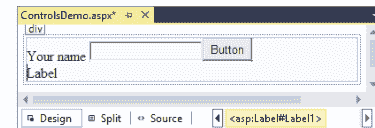

FIGURE 4-1

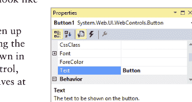

FIGURE 4-2

9. 保存对页面的更改并通过按 `Ctrl+F5` 在浏览器中打开它。不要单击按钮，但通过在浏览器中右键单击页面并选择 `View Source` 或 `View Page Source` 来打开页面的源代码。你应该会看到以下 HTML 代码：

```
<div>
Your name <input name="YourName" type="text" id="YourName" />
<input type="submit" name="SubmitButton" value="Submit Information"
id="SubmitButton" />
<br />
<span id="Result">/</span>
</div>
```

10. 切回浏览器，填写姓名文本，然后单击按钮。页面重新加载完成后，使用右键菜单在浏览器中打开页面的源代码。代码现在应如下所示：

```
<div>
Your name <input name="YourName" type="text" value="Imar" id="YourName" />
<input type="submit" name="SubmitButton" value="Submit Information"
id="SubmitButton" />
<br />
<span id="Result">Your name is Imar/</span>
</div>
```

请注意，这两行已更改，现在显示你在文本框中输入的名称。你可以忽略页面的其他 HTML。

## How It Works

如其名所示，ASP.NET 服务器控件驻留在 ASPX 页面上的服务器上，可由 ASP.NET 运行时处理。当你在浏览器中请求页面时，运行时会创建 ASPX 文件的内存表示形式，其中包含你创建的控件。当运行时即将向浏览器发送 HTML 时，它会询问页面中的每个控件其 HTML，该 HTML 会注入到最终响应中。例如，当 `Label` 控件第一次加载时被要求提供其 HTML 时，它返回：

```
<span id="Result">/</span>
```

尽管你使用 `<asp:Label>` 语法定义了 `Label` 控件

当你单击按钮时，控件会触发回发，将页面中控件的信息发送到服务器，在服务器上加载页面。此外，你编写的处理按钮 `Click` 事件的代码也会执行。此代码获取你在文本框中输入的名称并将其分配给 `Label` 控件，如此 C# 示例所示：

```
Result.Text = "Your name is " + YourName.Text;
```

现在不必担心处理 `Click` 事件的代码的语法。在第 5 章中，你将看到这是如何工作的，以及为什么需要此代码。

此时，`Label` 控件包含你在文本框中输入的文本，因此当被要求提供 HTML 时，它现在返回：
```
<span id="Result">Your name is Imar</span>
```

在本章后面讨论 ASP.NET 状态引擎时，你将更深入地了解回发。

## A CLOSER LOOK AT ASP.NET SERVER CONTROLS

由于在构建 ASP.NET Web Forms 页面时大部分时间都在使用服务器控件，因此你需要了解它们的工作细节以及如何使用它们。在下一节中，你将看到如何将控件添加到页面并更改它们在浏览器中的行为。在其后的部分中，你将了解所有服务器控件共有的行为概述。一旦你理解了这种行为，就很容易将这种知识应用到其他新控件，从而能非常快速地掌握它们。

## Defining Controls in Your Pages

如 Try Out 所演示的那样，你可以简单地从工具箱将控件拖到页面的设计表面上。这使得开始时可以轻松地向页面添加一堆控件。然而，由于设计表面的工作方式，很难找到确切想要放置的位置。例如，很难将控件拖到 HTML 元素的开始和结束标签之间。幸运的是，你也可以在标记视图中输入控件的标记，让 IntelliSense 和代码片段帮助你处理不同的标签和属性。你还会发现属性网格在标记视图中也能工作。只需单击标记，属性网格就会更新以反映你单击的标签。这使得在可以看到为你生成的确切标记的同时，更改控件的属性变得容易。`Visual Studio` 允许你直接在标记视图中绑定处理程序（如前练习中使用的 `Click` 事件），而无需切换到设计视图。你还将能够从代码访问控件的 Smart Tasks 面板。本章后面会介绍更多这些功能。

如果你查看页面中某些控件的属性网格，你会注意到其中许多控件具有相似的属性。在下一节中，你将确切地看到这些属性是什么以及它们用于什么。

### Common Properties for All Controls

你在 VS 工具箱中找到的大多数服务器控件共享一些通用行为。这种行为的一部分包括所谓的属性，这些属性定义控件可以包含和公开的内容。你将在下一章了解有关属性和其他行为类型的更多信息。每个服务器控件都有一个 `ID`，用于在页面中唯一标识它，一个 `runat` 属性，始终设置为 `server` 以指示控件应在服务器上处理，以及一个 `ClientID`，其中包含分配给最终 HTML 中元素的客户端 ID 属性。在 ASP.NET 3.5 及更早版本中，此 `ClientID` 始终由你自动生成。然而，在 ASP.NET 4 中引入了新的 `ClientMode` 属性，它使你能够更好地控制客户端元素的 ID。你将在后面的章节中看到这是如何工作的。`runat` 属性在技术上不是服务器控件的属性，但对于标识控件的标记应作为服务器控件处理而不是作为纯文本或 HTML 结束在浏览器中是必要的。

除了这些属性之外，许多服务器控件还共享更多属性，因为它们共享相同的 `Control` 基类。下一章将更深入地介绍基类和继承。下面的表格列出了最常见的共享属性并描述了它们的使用方式。

| PROPERTY | DESCRIPTION |
| --- | --- |
| AccessKey | 使你能够设置一个键，通过按下键盘上的关联键可在客户端访问控件。 |
| BackColor ForeColor | 使你能够更改控件在浏览器中的背景颜色（BackColor）和文本颜色（ForeColor）。 |
| BorderRadius BorderWidth | 在浏览器中更改控件的边框。与你在上一章中看到的 CSS 边框属性的相似性并非巧合。这三个 ASP.NET 属性中的每一个都直接映射到其 CSS 对应项。 |
| CssClass | 使你能够为浏览器中的控件定义 HTML class 属性。此类名称然后指向你在页面或外部 CSS 文件中定义的 CSS 类。 |
| Enabled | 确定用户是否可以在浏览器中与控件交互。例如，对于禁用的文本框（Enabled="False"），你无法更改其文本。 |
| Font | 使你能够定义不同的字体相关设置，例如大小、族以及字体是否应为粗体 |
| Height Width | 确定控件在浏览器中的高度和宽度。 |
| TabIndex | 设置客户端 HTML tabindex 属性，该属性确定用户通过按 Tab 键在页面中移动控件的顺序。 |
| ToolTip | 使你能够为浏览器中的控件设置工具提示。此工具提示以 HTML 中的 title 属性呈现，当用户将鼠标悬停在元素上时显示。 |
| Visible | 确定控件是否发送到浏览器。你应该将其真正视为服务器端可见性设置，因为不可见的控件根本不会发送到浏览器。这意味着它与你在上一章中看到的 CSS display 和 visibility 属性有很大不同，后者会在客户端隐藏元素。 |

## 第4章 使用 ASP.NET 服务器控件

要查看这些属性在浏览器中如何显示，请考虑以下 `TextBox` 服务器控件的标记：

```
<asp:TextBox AccessKey="a" BackColor="Black" ForeColor="White" Font-Size="30px"
BorderColor="Yellow" Border="Dashed" BorderWidth="4" CssClass="TextBox"
Enabled="True" Height="40px" Width="90px" TabIndex="1" ToolTip="Hover text here"
Visible="True" ID="TextBox" runat="server" Text="Hello World">
</asp:TextBox>
```

当你在浏览器中请求此页面时，你将得到以下 HTML：

```
<input name="TextBox" type="text" value="Hello World" id="TextBox1"
tabindex="1" title="Hover text here" class="TextBox" style="color:White;
background-color:Black;border-color:yellow;border-width:4px;
border-style:Dashed;font-size:30px;height:40px;width:200px;">
```

这会产生图 4-3 中显示的文本。

注意服务器端控件属性如何被转换为内联样式并与 style 属性一起使用。

在构建网站时，以这种方式定义 `TextBox` 并不常见。正如你在上一章中学到的那样，你应该尽可能避免内联样式，而选择级联样式表。可以使用以下服务器端控件实现相同的效果：

```
<asp:TextBox ID="TextBox1" AccessKey="a" CssClass="TextBox" TabIndex="1"
ToolTip="Hover text here" runat="server" Text="Hello World">
</asp:TextBox>
```

以及以下 CSS：

```
.TextBox {
background-color: Black;
color: White;
font-size: 30px;
border-color: Yellow;
border-style: Dashed;
border-width: 4px;
height: 40px;
}
```

显然，第二种示例更容易阅读、重用和维护。如果你想要另一个外观完全相同的文本，只需将其 `CssClass` 分配给 `TextBox` 即可。另外，请注意我使用了 `Enabled` 和 `Visible` 属性。两者默认都为 True，因此在控件声明中无需显式声明。

尽管建议使用 CSS 类而不是这些内联样式，但了解服务器端控件属性的工作原理仍然是好的，以防你需要控制它们。如果你以编程方式更改控件的属性（如你将学习的那样），它们仍然会作为样式结束，从而可能覆盖嵌入式或外部样式表中的设置。

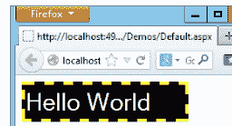

图 4-3

## 控件类型

现在你已经看到了所有服务器控件共享的通用行为，是时候查看随 ASP .NET 一起提供的众多控件了。

开箱即用，ASP.NET 4.5.1 附带了大量控件，支持你大部分的 Web 开发需求。为了便于你找到合适的控件，它们已在 VS 工具箱中按控件类别进行了分类（通过按 `Ctrl+Alt+X` 可访问）。图 4-4 显示了工具箱中所有可用的类别。

请注意，根据你的 Visual Studio 版本，工具箱可能还有其他类别。

VS 中的一个便捷功能是在工具箱中搜索。只需在工具箱顶部的搜索框中输入你要查找的控件的几个字母，VS 就会过滤出匹配你条件的列表。

在下面的各节中，你将看到每个类别中的控件以及它们的设计用途。

在讨论各种控件时，你会看到对控件属性的提及。例如，`TextBox` 有一个 `Text` 属性（还有许多其他属性），`ListBox` 有一个 `SelectedIndex` 属性。属性只能以编程方式设置，而不能使用属性网格。有关以编程方式读取和更改控件属性的讨论将在下一章详细讨论。

## 标准控件

标准类别包含几乎任何页面都需要的大多数基本控件。你在本章前面已经见过其中的一些，例如 `TextBox`、`Button` 和 `Label` 控件。图 4-5 显示了标准类别中的所有控件。

其中许多控件不言自明，为了详细描述所有控件，以下各节简要重点介绍了其中一些重要的控件。

### 简单控件

工具箱包含许多简单直接的控件，包括 `TextBox`、`Button`、`Label`、`HyperLink`、`RadioButton` 和 `CheckBox`。它们在工具箱中的图标很好地提示了它们在浏览器中的呈现方式。在本书的其余部分中，你将多次看到这些控件的使用。在 ASP.NET 4.5 中，`TextBox` 控件的 `Text` 模式已扩展以支持新的 HTML5 类型，如 `DateTime`、`Email` 和 `Number`。你将在本书后面看到更多相关内容。

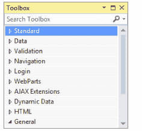

图 4-4


图 4-5

### 列表控件

```
<asp:DropDownList ID="FavoriteLanguage" runat="server">
<asp:ListItem Value="C#">C#</asp:ListItem>
<asp:ListItem Value="Visual Basic">Visual Basic</asp:ListItem>
<asp:ListItem Value="CSS">CSS</asp:ListItem>
</asp:DropDownList>
```


`DropDown` 允许用户一次只选择一个项目。要以编程方式查看列表控件的当前活动和选定项目，可以查看其 `SelectedValue`、`SelectedItem` 或 `SelectedIndex`。`SelectedValue` 返回一个包含所选项目的值的字符串，如前例中的 C# 或 Visual Basic。`SelectedIndex` 返回列表中项目的基于零的索引。如果用户选择了 C#，`SelectedIndex` 将为 0。同样，如果用户选择了 CSS，索引将为 2（列表中的第三个项目）。

对于允许多选的控件（如 `CheckListBox` 和 `ListBox`），你可以遍历 `Items` 集合并查看哪些项目被选中。在这种情况下，`SelectedItem` 只返回列表中第一个选中的项目；不是全部。你将在下一个练习中学习如何访问所有选中的项目。请注意，在浏览器中，`DropDownList` 和 `List` 控件呈现为 `<select>` 元素，由这些控件设置的 `size` 和 `multiple` 等属性决定 HTML 元素在浏览器中的外观和行为。

`BulletedList` 控件不允许用户进行选择，因此不支持这些属性。

要了解如何向列表控件添加项目以及如何读取选定值，以下练习将指导你创建一个简单的 Web 表单，其中包含两个列表控件，要求用户提供他们最喜欢的编程语言。

### 试用 使用列表控件

在此练习中，你向页面添加两个列表控件。此外，你添加一个按钮，当单击时，将选定的项目作为文本显示在 `Label` 控件中。

- 1. 在 Demo 文件夹中，创建一个名为 `ListControls.aspx` 的新 Web 表单。确保通过选中“将代码放在单独的文件中”来创建代码隐藏文件。
- 2. 切换到设计视图并从工具箱拖动一个 `DropDownList` 到页面设计视图中 `<div>` 元素内，该元素已存在于你的页面中。
- 3. 请注意，当你将 `DropDownList` 控件拖放到页面上时，会出现一个弹出菜单，其标签为 `DropDownList Tasks`，如图 4-6 所示。


图 4-6

此弹出菜单称为 Smart Tasks 面板。当它出现时，它会为其所属的控件提供常用控件的访问权限。在 `DropDownList` 的情况下，你会得到三个选项。第一个选项允许你将控件绑定到数据源，这将在第 13 章中演示。第二个项目允许你手动向列表添加项目，最后一个选项设置控件的 `AutoPostBack` 属性。选中此选项后，当用户从列表中选择新项目时，控件会将所在的页面提交到服务器。请注意，这需要浏览器启用 JavaScript。

Smart Tasks 面板仅针对具有大量功能的复杂控件出现。它不会出现在 `Button` 或 `Label` 等简单控件上。要重新打开 Smart Tasks 面板，请在设计器中右键单击控件并选择 Smart Tag。或者，单击控件右上角的小箭头，或在控件被选中时按 `Shift+Alt+F10`。你也可以从标记视图打开 Smart Tasks 面板。只需单击控件或其他标记片段的开始或结束标签中的任意位置，然后按 `Ctrl+句点`（`Ctrl+.`）。或者，将鼠标悬停在 `DropDownList` 的 Smart Tasks 面板上的蓝色矩形上，单击出现的灰色箭头。

在 `DropDownList` 的 Smart Tasks 面板上，单击 `Edit Items` 以调出图 4-7 中的 `ListItem Collection Editor`。


图 4-7

此对话框允许你向列表控件添加新项目。你通过窗口添加它们，它们将作为 `<asp:ListItem>` 元素添加到控件的标签内。

- 4. 单击屏幕左侧的 `Add` 按钮插入一个新列表项。然后在右侧的属性网格中，为 `Text` 属性输入 `C#` 并按 `Tab`。只要你从 `Text` 属性切换焦点，值就会被复制到 `Value` 属性中。这在你希望 `Text` 和 `Value` 属性相同的情况下很方便。然而，为 `Value` 属性分配不同的值是完全可以的（而且很常见）。
- 5. 重复步骤 4 两次，创建 `Visual Basic` 和 `CSS` 的列表项。你可以使用对话框中间的上下按钮来更改列表中项目的顺序。

最后，单击 `OK` 以在页面中插入这些项目。你应该在 Markup 视图中得到以下代码：

```asp
<asp:DropDownList ID="DropDownList1" runat="server">
<asp:ListItem Text="C#"></asp:ListItem>
<asp:ListItem Text="Visual Basic"></asp:ListItem>
<asp:ListItem Text="CSS"></asp:ListItem>
</asp:DropDownList>
```

- 6. 在 Markup 视图中，从工具箱将 `CheckList` 控件拖动到代码窗口中，直接放在 `DropDownList` 之后。
- 7. 复制你在步骤 4 和 5 中创建的 `DropDownList` 中的 `<asp:ListItem>` 元素，并将它们粘贴在 `CheckBoxList` 的开始和结束标签之间。你应该得到以下代码：

```asp
<asp:ListItem Text="CSS"></asp:ListItem>
<asp:CheckList ID="CheckBox1" runat="server">
<asp:ListItem Text="C#"></asp:ListItem>
<asp:ListItem Text="Visual Basic"></asp:ListItem>
<asp:ListItem Text="CSS"></asp:ListItem>
</asp:CheckList>
```

- 8. 切换到 Design 视图，并在 Design 视图中从工具箱拖动一个 `Button` 放置在 `CheckList` 控件的右侧。`Button` 将被放置在 `CheckBoxList` 下方。接下来，拖动一个 `Label` 控件并将其放置在 `Button` 的右侧。通过将光标定位在控件之前并按两次 `Enter` 来在 `Button` 和 `Label` 之间创建一些空间。双击按钮以打开头页的 Code Behind。
- 9. 在 VS 为你添加的代码块中，添加以下加粗代码，该代码将在用户单击按钮时执行：

```vbnet
VB.NET

Protected Sub Button1_Click(sender As Object, e As EventArgs)
    Handles Button1.Click
    Label1.Text = "In the DDL you selected " & _
    DropDownList1.SelectedValue & "<br />"_
    For Each item As ListItem In CheckList1.Items
        If item.Selected = True Then
            Label1.Text &= "In the CBL you selected " & item.Value & "<br />"_
        End If
    Next
End Sub
```

```csharp
C#

protected void Button1_Click(object sender, EventArgs e)
{
    Label1.Text = "In the DDL you selected " + _
    DropDownList1.SelectedValue + "<br />";
    foreach (ListItem item in CheckList1.Items)
{
```

## Types of Controls

```csharp
if (item.Selected == true)
{
  Label1.Text += "In the CBL you selected " + item.Value + "<br />";
}
```

注意在 VB.NET 代码中，下划线是用来将代码拆分到两行的。VB.NET 要求在将 `Handles` 关键字移至

- 10. 保存页面并在浏览器中请求它。从 `DropDownList` 中选择一个项目，在 `CheckBoxList` 中勾选或一个项目，然后单击按钮。你会看到类似于图 4-8 的内容，该图显示了 Firefox 中的页面。


FIGURE 4-8

## How it Works

各种列表控件都使用 `<asp:ListItem>` 元素。这使得通过从一个复制到另一个来创建它们变得很容易。`DropDownList` 一次只支持一个项目，获取其值非常容易。只需在 C# 中写一行代码即可)：

```csharp
Label1.Text = "In the CBL you selected " + DropList1.SelectedValue + "<br />";
```

`CheckBox` 控件允许用户一次选择多个项目。因此，你需要编写更多代码来遍历项目集合，检查每个项目的 `Selected` 属性（再次以 C# 显示）：

```csharp
foreach (ListItem item in CheckBoxList1.Items)
{
  if (item.Selected == true)
  {
    Label1.Text += "In the CBL you selected " + item.Value + "<br />";
  }
}
```

`CheckList` 和其他列表控件具有 `Items`，其中包含你在代码中定义的所有项目。因此，Try It Out、`CheckBoxList` 的代码包含三个项目，分别为 C#、Visual Basic 和 CSS。每个 `ListItem` 反过来包含一个属性，用于确定用户是否在列表中选中了该项目

使用 `foreach` 循环（VB.NET 中的 `For Each`），你可以遍历 `ListItems` 元素的集合，一一测试 `Selected` 属性。如果项目被选中，其 `Selected` 属性为 `true`（VB 中为 `True`），其 `Value` 会被追加到 `Label` 的文本中。注意在最后一个示例中使用 `+=`（VB.NET 中为 `&=`）将项目的 `Value` 与文本一起分配给 `Label` 的 `Text` 属性。`+=` 和 `&=` 语法是以下内容的简写：

```csharp
Label1.Text = Label1.Text + "In the CBL you selected " + item.Value + "<br />";
```

这段代码从 `Label` 控件中获取当前文本，将文字 "In the CBL you selected" 追加到它后面，使用 `item.Value` 追加项目的值，最后追加文字 `<br />`。它将整个字符串重新分配回标签的 `Text` 属性。使用 `+=` 语法通常更容易编写和理解，但较长的版本也很常见。

VB.NET 和 C# 都支持 each 循环，尽管两种语言使用略有不同的语法。在下一章中，你将学习更多关于循环和语言构造的知识。

还值得注意的是，`ListItems` 出现是因为你在第一个示例中看到了 `ListItem`，因为在 Try It Out 中，你看到了具有值和文本的 `ListItem` 项目：

```asp
<asp:ListItem Value="C#">C#</asp:ListItem>
<asp:ListItem Value="Visual Basic">Visual Basic</asp:ListItem>
<asp:ListItem Value="CSS">CSS</asp:ListItem>
```

当你使用 `ListItem Collection Editor` 添加项目到列表时，你可以获取 `Value` 属性

```asp
<asp:ListItem Value="C#">C#</asp:ListItem>
<asp:ListItem Value="Visual Basic">Visual Basic</asp:ListItem>
<asp:ListItem Value="CSS">CSS</asp:ListItem>
```

你没有得到 `Value` 属性，因为你在 `ListItem Collection Editor` 中没有为项目提供显式值。如果你省略值，则 `ListItem` 的开始和结束标签之间的文本会被隐式用作值，在许多情况下这是可以的。然而，拥有列表中不同的 `Value` 和 `Text` 属性也很常见。例如，当你有一个国家列表时，你可以使用国家的全名作为 `Text`（如 The Netherlands），并使用官方国家代码 `[nl]` 作为下拉列表的 `Value`。你可以在本书的其他章节中看到列表控件的工作情况。

## Container Controls

通常希望对相关内容和控件进行分组。你可以通过将控件（或其他标记）放在容器控件之一中来实现这一点，例如 `Panel`、`PlaceHolder`、`MultiView` 或 `Wizard`。例如，你可以一次显示多个控件。无需分别隐藏每个控件，只需隐藏包含所有单个控件和标记的整个容器即可。这两种控件各有优缺点。`PlaceHolder` 控件的好处是它本身没有 HTML 页面，因此你可以用它作为容器而不会在最终页面中产生任何副作用。然而，它缺乏设计支持，使得在设计时管理 `PlaceHolder` 内部的控件变得困难。相比之下，`MultiView` 允许你启用它包含的所有控件和其他内容，但它本身会渲染为 `<div>`。在许多情况下这不是问题，甚至可能有用，因为你可以使用 CSS 在控件上使用该 div，因此通常你最好使用 `Panel` 控件，因为它具有设计时支持。

`MultiView`（可以包含一个或多个 `<asp:View>` 元素）和 `Wizard` 在它们能够将长页面拆分为多个区域方面相似，使得填写长表单变得容易。例如。`Wizard` 具有内置支持，可使用 Previous、Next 和 Finish 按钮在页面之间移动，而 `MultiView` 必须以编程方式控制。

## A Closer Look at the Panel Control

在以下练习中，你使用 `Panel` 控件为其他控件和标记创建一个容器。你现在只添加一些文本，但在随后的 Try Out 练习中，你将向面板添加 ASP.NET 控件。

## TRY IT Using the Panel Control

在这个练习中，你将看到如何使用 `Panel` 控件作为一些简单文本的容器。此外，你还使用 `CheckBox` 在服务器上控制 `Panel` 的可见性。

- 首先在 Demos 项目中创建一个名为 `Containers.aspx` 的新 Web Form with Code Behind。
- 切换页面到 Design 视图并从工具箱拖动一个 `CheckBox` 和一个 `Panel` 控件到设计表面下方的虚线 `<div>` 元素下。
- 通过设置其 `Text` 属性为 Show Panel 并使用属性网格将其 `PostBack` 属性设置为 True 来为 `CheckBox` 控件提供有意义的描述。选择面板的下拉列表时，你也可以双击 `PostBack` 属性或其值在 False 和 True 之间切换。
- 使用属性网格将 `Panel` 的 `Visible` 属性设置为 False。这会在页面首次加载时隐藏面板。
- 在 `Panel` 控件内部，输入一些文本（例如，I am visible now）。请注意，面板的行为类似于 VS 设计表面的其余部分。你可以向其中添加文本、选择和格式化它，并通过从工具箱拖动来添加新控件。面板在 Markup 中应如下所示：

```asp
<asp:Panel ID="Panel" runat="server" Visible="False">
I am visible now
</asp:Panel>
```

```asp
<asp:CheckBox ID="CheckBox" runat="server" PostBack="True" Text="Show Panel" />
<asp:Panel ID="Panel" runat="server">
I am visible now
</asp:Panel>
```

FIGURE 4-9

- 在 Markup 中，找到 `CheckBox` 的代码。将光标定位在关闭斜杠（/）之前的正前方，然后按 `Enter`，后跟 `Ctrl+Space`。这会调出 IntelliSense，如图 4-9 所示。

选择 `OnChanged` 通过按 `Tab` 或 `Enter`。键入等号（=），这会调出 IntelliSense，如图 4-10 所示。请注意，如果你使用的是 C#，你可能还会看到事件处理程序列表中的 `PostBack` 项目。

```asp
<asp:CheckBox ID="CheckBox" runat="server" PostBack="True" 
Text="Show Panel" OnChanged="#CheckedChanged-" 
<asp:Panel ID="Panel" runat="server" # CreateNewEvent-">
I am visible now
</asp:Panel>
```

FIGURE 4-10

选择 `<New Event>` 项目并按 `Tab`。VS 会按如下方式完成代码：

```asp
OnChange="CheckBox1_CheckedChanged"
```


虽然这个选择很好，但 VS 做的事情更有用；当你按 `Tab` 时，它还在 Code Behind 中为你添加了处理程序代码。要查看该代码，请按 `F7` 切换到 Code。

## 第4章 使用 ASP.NET 服务器控件

> 注意 使用此功能后，无需切换到设计视图并通过双击控件（像你在之前的练习中所做的那样）或使用属性网格的事件选项卡（稍后会看到）来设置处理程序的需求已大大减少。它非常适合喜欢手工编码设计视图的人，并且在设计视图根本不实用的更复杂页面中尤其有用。

请注意，如果你使用的是 `VB.NET`，通过标记视图和设计视图添加处理程序之间存在细微差别。如果你使用标记处理程序，处理程序会添加到标记中（`OnChange="Checkbox1_CheckedChanged"`），代码会添加到代码后置中。当你使用设计视图时，标记中的代码不受影响，后置中的代码会用 `Handles` 关键字进行注释，以指示代码响应的事件（例如按钮的单击、复选框的更改事件等）。但是在运行时，两者没有区别。

- 7. 接下来，在 VS 为你添加的处理程序代码内添加以下行：

### VB.NET

```
Protected Sub Checkbox1_CheckedChanged(sender As Object, e As EventArgs)
    Panel.Visible = Checkbox1.Checked
End Sub
```

### C#

```
protected void Checkbox1_CheckedChanged(object sender, EventArgs e)
{
    Panel.Visible = Checkbox1.Checked;
}
```

- 8. 保存所有更改并通过按 `Ctrl+F5` 在浏览器中请求页面。

- 9. 当页面首次加载时，你会看到复选框及其旁边的文本。当你在浏览器中查看页面的 HTML 时（右键单击页面并根据浏览器选择查看源代码或查看页面源代码），你只能看到复选框；此时面板控件的代码尚未发送到浏览器。当你单击复选框在其上放置复选标记时，页面会重新加载并显示你在步骤 5 中输入的文本。

> 警告 如果出现任何问题，请返回 VS 中的页面源代码并确保 `CheckBox` 控件上的 `AutoPostBack` 为 `True`。

如果你查看浏览器中的 HTML，你会看到你在步骤 5 中输入的文本被包裹在一个 id 为 `Panel1` 的 `<div>` 中：

```
<div id="Panel1">
    I am visible now
</div>
```

## 其工作原理

在本练习的步骤 4 中，你将面板控件的 `Visible` 属性设置为 `False`。这意味着当页面加载时，控件在服务器上不可见，因此其 HTML 永远不会到达浏览器。当你然后选中复选框时，会发生回发，将表单中包含的信息发送到服务器。在服务器上，会运行一段代码，该代码会在复选框的状态从选中变为未选中或相反时触发。在该代码块内部，会执行以下代码（以 C# 显示）：

```
Panel.Visible = CheckBox1.Checked;
```

这意味着面板只有在复选框被选中时才可见。如果未选中，面板会自动隐藏。

正如你所见，在 VS 中向面板控件添加文本和其他标记很容易。现在，你只添加了一些纯文本，但在下一节中你将看到如何添加向导控件以及如何使用它。

## 使用向导控件的魔力

向导控件是分解大型 Web 窗体并将其作为信息的小块呈现的绝佳工具。与用一个包含许多控件的页面让用户感到困惑相比，你可以分解页面并在单独的页面上呈现每个部分。向导控件然后通过自动创建下一步、上一步和完成按钮来处理导航问题。在本练习中，你使用向导为她创建一个用户及其最喜欢的编程语言。虽然示例本身很简单，你本可以将两个问题放在同一页面上而不会让用户感到困惑，但示例展示了向导的工作原理以及其有用性。你可以轻松地将相同的技术应用于你自己的、可能更大的 Web 窗体。

## 试用 使用向导创建易于使用的窗体

在本试用中，你将在上一练习中创建的面板内放置一个向导，使用户能够填写跨越几个页面的窗体。向导将有两个步骤供用户输入详细信息，以及一个显示用户提供的数据的结果页面。

- 1. 确保 `Containers.aspx` 页面仍在设计视图中打开。删除你在上一个试用中输入的“我现在可见”，并从工具箱中将向导控件拖到面板内。将其右边缘向右拖动更多，使控件的总宽度增加到 `500px`。你的页面现在看起来类似于图 4-11。


图 4-11

## 118 | 第4章 使用 ASP.NET 服务器控件

- 2. 打开向导的智能任务面板（单击其右上角的箭头）并选择添加/删除向导步骤。在随后出现的对话框中，单击添加按钮插入第三个向导步骤，如图 4-12 所示。


图 4-12

- 3. 在左侧的成员列表中单击第一个标记为步骤 1 的 `WizardStep`，并将其标题从步骤 1 改为关于你。将另外两个步骤的标题分别设置为最喜欢的语言和准备就绪。

- 4. 将第二个步骤（现标记为最喜欢的语言）的 `StepType` 改为 `Finish`，最后一个步骤改为 `Complete`。你可以让第一个步骤的 `StepType` 保持为 `Auto`。单击确定关闭向导步骤集合编辑器。

- 5. 在设计中，单击左侧列表中的关于你使其处于活动状态，并将标签和文本框拖到向导的右侧。你需要将它们拖到向导右上角的灰色矩形内，否则控件不会最终位于向导内。将标签的文本属性设置为输入你的姓名并将文本框的 ID 更改为 `YourName`。完成后，你的向导看起来像图 4-13。


图 4-13

- 6. 在左侧的列表中单击最喜欢的语言项使其处于活动状态。将 `DropDownList` 添加到向导步骤右侧带灰色边框的矩形中。通过将其 ID 设置为 `FavoriteLanguage` 重命名 `DropDownList`。打开 `DropDownList` 控件的智能任务面板并选择编辑项目。添加你在之前的试用中添加的三个项目，分别为 C#、Visual Basic 和 CSS。如果你愿意，可以从页面 `ListControls.aspx` 复制这三个项目并粘贴在第二个步骤内部的 `<asp:DropDownList>` 标签之间。你应该最终得到以下第二个步骤的代码：

```
</asp:WizardStep>
<asp:WizardStep runat="server" Title="Favorite Language" StepType="Finish">
<asp:DropDownList ID="FavoriteLanguage" runat="server">
<asp:ListItem Text="C#" </asp:ListItem>
<asp:ListItem Text="Visual Basic" </asp:ListItem>
<asp:ListItem Text="CSS" </asp:ListItem>
</asp:DropDownList>
</asp:WizardStep>
<asp:WizardStep runat="server" StepType="Complete" Title="Ready">
```

## 控件类型 | 19

- 7. 对于最后一步，使用标记视图。如果你想在设计中切换到该步骤，你可能会注意到向导消失了。如果发生这种情况，请切换到标记视图并将向导控件的 `ActiveStepIndex` 设置为 `0`。

在标记为结果的 `WizardStep` 内部，从工具箱拖动一个标签并通过设置其 ID 为 `Result` 重命名它。或者，使用最后一步的代码，键入标签和标签。然后按 `F4` 编辑插入的代码片段

- 8. 在设计视图中双击向导并添加以下代码，该代码将在用户单击向导最后一步的完成按钮时执行。如果遇到问题，VS 可以为你创建正确的代码，如下一个代码片段所示，选择向导，按 `F4` 打开控件的属性网格，并单击属性网格工具栏中带闪电图标的按钮（从左数第四个按钮），并参见图 4-14。


属性网格的这一部分通常被称为属性网格的事件选项卡。在操作类别中定位并双击 `FinishButtonClick`。通过哪种方法，你应该最终得到一些 `Wizard1_FinishButtonClick` 的代码，你需要用以下代码扩展它：

### VB.NET

```
Protected Sub Wizard1_FinishButtonClick(sender As Object,
e As EventArgs) Handles Wizard1.FinishButtonClick
Result.Text = "Your name is " & YourName.Text
Result.Text &= "<br>Your favorite language is " & FavoriteLanguage.SelectedValue
End Sub
```

### C#

```
protected void Wizard1_FinishButtonClick(object sender,
NavigationEventArgs args)
{
Result.Text = "Your name is " + YourName.Text;
Result.Text += "<br>Your favorite language is " + FavoriteLanguage.SelectedValue;
}
```


9. 切换回设计视图并为向导打开属性网格，确保其 `ActiveStepIndex` 设置为 `0`。设计器会记住你上次设计的步骤，并在标记视图中将该值存储在向导的 `ActiveStepIndex` 中。为了确保向导从第一页开始，你在查看更改并运行页面之前，应始终将 `ActiveStepIndex` 重新设置为 `0`（或在设计视图中单击向导控件中的第一步）。

10. 保存所有更改，关闭所有窗口，然后按 `Ctrl+F5` 在浏览器中打开页面。选中复选框使面板可见并输入你的编程语言。注意有一个 `Previous` 按钮，允许你返回向导的步骤以更改你的姓名。检查 `Next` 和 `Previous` 按钮，你还可以单击浏览器中信息左侧的链接。当你单击 `Finish` 按钮时，你会看到在向导中输入的信息的结果（图 4-15）。


FIGURE 4-15

## How It Works

向导为你处理了大部分繁重的工作。它处理导航，确定何时显示正确的按钮（`Next`、`Previous` 和 `Finish`），并确保在结果页面中，你在向导步骤中添加的控件的值仍然可用，以便你可以用标签显示它们。你通过一种称为 `View` 的概念来实现这一点，你将在本章末尾了解更多相关信息。

你需要做的只是定义步骤并设置它们的 `StepType`。你将第一个步骤的 `StepType` 设置为 `Auto`。有了此设置，向导会计算出显示哪些按钮。因为它是向导中的第一步，没有可返回的上一步，所以它排除了 `Previous`（相当于手动将 `StepType` 设置为 `Start`）。你将第二个步骤的 `StepType` 设置为 `Finish`，这告诉向导绘制一个 `Previous` 按钮和一个 `Finish`。当你单击 `Finish` 按钮时，向导到达最后一个步骤，其 `StepType` 为 `Complete`。在此步骤中，导航按钮被隐藏，你看到的只是标签上的结果，该结果由页面代码隐藏中的代码分配。在第 5 章中，你将了解更多关于使此成为可能 的控件的信息。

除了前面各节中看到的控件外，还有一些其他控件值得检查。并非所有这些控件都将在此处详细讨论，因为它们在本书中不再使用。有关这些控件的良好信息来源是位于 `http://msdn.microsoft.com` 的 Microsoft Developer Network（MSDN）站点。要在此站点上查找有关控件的信息，请使用你喜欢的搜索引擎，然后搜索 `ControlName Control MSD`。例如，要查找有关向导控件的更多信息，你可以搜索 `Wizard Control MSD`。通常，MSDN 站点位于搜索结果的顶部。

## Other Standard Controls

本节简要讨论工具箱标准类别中剩余的控件。你将在本书其余部分的示例应用程序中看到其中许多控件。

### LinkButton and ImageButton

`LinkButton` 和 `ImageButton` 控件与普通的 `Button` 控件类似。它们在被单击时都会导致向服务器的回发。`LinkButton` 将自己呈现为简单的 `<a>` 元素，使用 JavaScript 回发而不是请求新页面。`ImageButton` 也是如此，但显示用户可以单击以触发回发的图像。

### Image and ImageMap

这些控件在浏览器中显示图像方面非常相似。`ImageMap` 使你能够在图像上定义热点，单击时会导致向服务器回发或导航到不同页面。

### Calendar

`Calendar` 控件提供了一个丰富的界面，使用户能够选择日期。你将在本章末尾讨论 ASP.NET 状态引擎时看到更多相关内容。

### FileUpload

`FileUpload` 控件使用户能够上传可以存储在服务器上的文件。你将在第 14 章看到更多关于此控件的内容。

### Literal, Localize, and Substitute

这三个控件看起来都像 `Label` 控件，因为它们可以显示任何静态文本或 HTML。`Literal` 最大的优势在于它不呈现任何额外标签；它只显示你分配给其 `Text` 属性的内容，非常有用，可用于显示你在代码隐藏中构建的 HTML 或 JavaScript，或从数据库中检索的 HTML 或 JavaScript。

`Localize` 控件用于多语言网站，能够从翻译的资源文件中检索其内容。`Substitute` 控件用于高级缓存场景，使你能够仅更新否则完全缓存的页面的部分内容。这两个控件都超出了本书的范围，但如果你想对其进行深入讨论，可以考虑购买 Wrox 的 Professional ASP.NET 4.5 in C# and VB（ISBN：978-1-118-33182-0）。

### AdRotator

`AdRotator` 控件使你能够在网站上显示随机广告。广告来自你在服务器上创建的 XML 文件。由于它缺乏点击跟踪和日志记录等高级功能，而这些功能在除最简单场景之外的所有场景中都是必需的，因此该控件在当今网站中并不常用。

### HiddenField

`HiddenField` 控件使你能够在页面中存储随每次请求提交的数据。如果希望页面记住特定数据而不让用户在页面上看到它，这很有用。由于该字段会在页面的 HTML 源代码中显示，因此最终用户可以访问它，因此你不应在其中存储任何敏感数据。

### XML

`XML` 控件使你能够将数据从 XML 格式转换为另一种格式（HTML）以在页面上显示。请查看 Professional ASP.NET 4.5 以获取详细说明。

### Table

`<asp:Table>` 控件在许多方面与 HTML `<table>` 相对应。然而，由于该控件位于服务器端，你可以对其进行编程，动态创建新列和行并向其动态添加数据。

这结束了对标准类别中控件的讨论。在大多数 Web 情况下，你将至少使用其中几个控件。本节的其余部分讨论工具箱的其他类别。由于它们中的大多数在本书其余部分以某种形式使用，本章仅描述其用途，以便你对它们的使用有一个大致的了解。你将找到交叉引用到其他章节，在那里你可以找到更多关于它们的信息。

## HTML Controls

工具箱的 HTML 类别包含许多 HTML 控件，其外观与标准类别中的控件相似。例如，使用 `Input（Button）` 看起来像 `<asp:Button>`。同样，还有一个 `Select` 控件，其对应控件为 `<asp:DropDownList>` 和 `<asp:ListBox>`。

与 ASP.NET 服务器控件不同，HTML 控件是客户端控件，并直接出现在 HTML 浏览器中。通过添加 `runat="server"` 属性。这使你能够从 Web 窗体的代码隐藏中进行编程，影响诸如其可见性之类的事情。

HTML 控件的功能比标准类别中的控件少。例如，`Select` 控件缺乏使用 `ListItem Collection Editor` 添加新项目到列表的设计支持。这迫使你手动在 VS 的标记视图中编写项目。

标准和 HTML 类别中的控件看起来非常相似，下一个部分讨论它们之间的差异，并让你对何时更倾向于一个类别而不是另一个类别有一个大致的了解。

## How to Choose Between Standard and HTML Controls

工具箱的标准和 HTML 类别中的控件似乎存在重叠。你应该选择哪一个以及为什么？通常，服务器控件为你提供了更多功能，包括 VS 中的设计支持和它们在运行时可以执行的操作。但这种功能是有代价的。由于其功能增强复杂性，服务器控件需要花费一点点额外的时间来处理。然而，在大多数网站上你不会注意到这种差异。只有当你有一个高流量的网站并且页面上有大量控件时，HTML 控件才会给你略微更好的性能，并且与服务器控件相比在服务器上消耗更少的内存。

在大多数场景下，优先选择服务器控件而不是它们的 HTML 对应项。因为服务器控件提供更多功能，它们为你的页面提供了更大的灵活性，使你能够创建更好的用户体验。此外，更好的设计时支持也使得选择这些控件物有所值。

只有当你非常确定不需要服务器提供的功能时，才选择 HTML 控件。

本节的其余部分将指导你了解工具箱中的其他类别。

## Data Controls

数据控件在 ASP.NET 2.0 中引入，提供对各种数据源（如数据库、XML 文件和对象）的便捷访问。无需像 ASP.NET 早期版本那样使用大量代码来访问数据源，你只需将数据控件指向适当的数据源，ASP.NET 运行时就会为你处理大部分困难问题。你将在第 13 章及以后学到很多关于这些控件的知识。

## Validation Controls

验证控件使你能够快速创建带有验证规则的 Web 表单，以禁止用户输入无效数据。例如，你可以强制用户为必填字段输入值，并检查输入的数据是否符合特定格式，如有效日期或 1 到 10 之间的数字。它们甚至允许你编写自定义代码来创建标准控件未涵盖的验证例程。验证控件的美妙之处在于它们既可以在客户端也可以在服务器端执行，使你能够创建响应迅速且安全的 Web 应用程序。第 9 章将更深入地探讨这些控件。

## Navigation Controls

工具箱中导航类别下的控件用于让用户在你的网站中寻找到路。`Tree` 控件提供数据的层次结构描述，可用于显示你网站的结构，便于轻松访问网站中的所有页面。`Menu` 控件做类似的事情，并提供水平和垂直下拉菜单的选项。

`SitemapPath` 控件在你的网页中创建“面包屑导航”，使用户能够轻松地在网站的层次结构中找到方向。

你将在第 7 章看到所有这些控件的实际应用，该章专门讨论网站的导航。

## Login Controls

与数据和导航控件一样，登录控件在 ASP.NET 2.0 中引入，并在 ASP.NET 4.5.1 中仍然强势存在。只需很少的努力，登录控件就能让你创建安全的网站，用户需要在访问网站的特定部分（或整个网站）之前注册并登录。此外，它们还提供工具供用户更改密码，或在忘记旧密码时请求新密码，并使你能够根据用户的登录状态和角色显示不同的数据。第 16 章提供了有关 ASP.NET 的安全功能和登录控件的更多详细信息。

## Ajax Extensions

`Ajax Extensions` 使你能够创建无闪烁的 Web 应用程序，这些应用程序能够通过客户端 JavaScript 在不进行完整回发的情况下从服务器检索数据。你可以在第 10 章找到有关它们的完整详细信息。

## WebParts

ASP.NET `WebParts` 是一组控件，使 Web 页面的最终用户能够更改网站的外观和行为。这些控件超出了本书的范围。

## Dynamic Data

此类别中的控件用于 Dynamic Data 网站。动态站点使你能够快速构建用于管理数据库中数据的用户界面。这些控件在本书中不再进一步讨论。要了解更多信息，请查阅 Sams' ASP.NET Dynamic Data Unleashed, Oleg Sych 和 Rand Patterson, 2012 年（ISBN: 978-0-672-33565-5）。

## THE ASP.NET STATE ENGINE

在上一章中，你创建了一个包含 `TextBox` 和 `Button` 的页面。在 Try Out 中，你在浏览器中运行它，输入了一些文本，然后单击按钮。按钮导致向服务器回发，页面重新加载后，文本仍然保留在文本框中。你在该章的向导控件中对下拉列表也做了同样的操作，其中文本框和下拉列表的值得以保持。如果你熟悉 ASP 或 PHP 等其他技术，这可能让你感到惊讶。在这些语言中，你通常需要编写代码行来使其发生。为什么和如何在 ASP.NET 中自动完成？

文本框中的文本由 ASP.NET 状态引擎维护，该引擎是深度集成到 ASP.NET 运行时中的功能。它使控件能够在回发之间保持其状态，因此它们的值和设置在页面每次回发后仍然可用。

## What Is State and Why Is It Important?

要理解状态，重要的是要意识到出于设计原因，HTTP —— 用于在 Web 浏览器中请求和提供页面的协议 —— 是无状态的。这意味着 Web 服务器不会跟踪来自特定浏览器的请求。就 Web 服务器而言，你通过浏览页面并单击链接到其他页面而发出的每个请求都是独立的。Web 服务器不会记住你之前请求过的页面。

## The ASP.NET State Engine

这会带来一些有趣的问题。考虑一个登录页面示例，该页面使你能够登录到网站，如你最喜欢的邮件程序。你可以在图 4-16 中看到登录框的示例。

现在想象你使用正确的用户名但错误的密码尝试登录。页面会告诉你登录尝试失败。理想情况下，你还希望用户名自动填入，并且“下次记住我”复选框保留其选择状态。也就是说，用户可以轻松输入正确的密码并单击登录按钮。这只是一个微不足道的例子，但在许多其他场景中控件保持其状态非常有用。


然而，默认情况下，网页或控件无法自行做到这一点。因为每个请求都是独立的请求，服务器不会在回发后再次填充文本框。在其他技术中，如经典 ASP 或 PHP，你可以通过手动编写在回发后预填充控件的代码来解决这个问题。幸运的是，ASP.NET 通过将此功能集成到 ASP.NET 框架中使这变得容易得多。

## How the State Engine Works

ASP.NET 中的状态能够为许多控件存储状态。它不仅可以为 `TextBox` 和 `Checkbox` 等输入控件存储状态，还可以为 `Label` 和 `Calendar` 等其他控件存储状态。这最好通过演示来说明。以下练习展示了如何创建具有能够保持其状态的控件的页面。然后各节将解释 ASP.NET 如何做到这一点。

> TRY OUT Examining the ASP.NET State Engine

在此练习中，你向页面添加 `Label`、`Button`、`TextBox` 和 `Calendar` 控件。这些控件用于演示 ASP.NET 的一些内部工作原理，包括回发和 ASP.NET 维护状态的方式。

- 1. 在 `demos` 文件夹下，创建一个名为 `State.aspx` 的新页面。确保它使用代码隐藏，并且不要忘记选择你喜欢的编程语言。
- 2. 将页面切换到设计视图，单击虚线 `<div>` 以将焦点放在其上，然后从菜单中选择 `Table > Insert Table`。设置 `Rows` 为 `3`，`Columns` 为 `2`，然后单击 `OK` 以插入一个包含三行两列的表格。
- 3. 在第一行的第一个单元格中，从工具箱拖动一个 `Label` 控件。在第二行的第一个单元格中，拖动一个 `Calendar` 控件。
- 4. 注意，当你将 `Calendar` 控件拖放到单元格中时，其 Smart Tasks 面板会弹出，如图 4-17 所示。

对于 `Calendar` 控件而言，此面板上你只有一个选项，`Auto Format`，它使你能够更改日历的外观。单击该链接，从预定义方案中选择一个，如 `Simple`，然后单击 `OK`。

## 第 4 章 使用 ASP.NET 服务器控件


图 4-17

+ 5. 在行的第一个单元格中绘制一个 `TextBox` 控件。
6. 接下来，在表格的前两行控件网格中绘制 `Button` 控件。
7. 单击第一行的 `Button` 并按 `F4` 打开属性网格。将 `Button` 的 `Text` 属性设置为 `Set Date`，其 `ID` 设置为 `SetDate`。你可以在属性列表的末尾找到 `ID` 属性，如果按字母顺序排序属性，则在开头可以找到。
8. 对另一个按钮重复此操作，或将其命名为 `PlainPostback` 并将 `Text` 属性设置为 `Plain Postback`。完成后，页面在设计视图中应如下图 4-18 所示。


图 4-18

+ 9. 在设计视图中双击 `Set Date` 按钮，并在为以下内容插入的代码行之间空行上添加以下加粗代码：

```
VB.NET

Protected Sub SetDate_Click(sender As Object
```

```
C#

protected void SetDate_Click(object sender, EventArgs e)

{

    Label.Text = DateTime.Now.ToString();

}
```


无需为 Label Postback 按钮编写代码。

+   10. 通过按 `Ctrl+F5` 在浏览器中打开页面。单击日历上的某一天选择日期。注意，当你单击日期时，页面会重新加载，这是由于回发引起的。你将在本练习的“工作原理”部分了解更多关于此的信息。

+   11. 在 `TextBox` 控件中输入文本，然后再次单击 `Set Date` 按钮。页面再次发布到服务器，`Label` 会更新为今天的日期，每次单击按钮时都会更新。`TextBox` 显示你输入的文本。等待几秒钟，然后单击 `Postback` 按钮。再次发生回发，页面重新加载。现在查看 `Label`。它仍然包含上次单击 `Set Date` 按钮时显示的日期和时间。多次单击 `Postback` 按钮，注意 `Label` 不会改变。`TextBox` 仍应显示你输入的文本。

+   12. 返回 VS 并在设计视图中打开 `Label` 的属性网格。找到 `EnableViewState` 属性并将其设置为 `False`，可以通过从下拉列表中选择、双击属性名称或其值来设置。对 `TextBox` 控件重复此操作。

+   13. 通过在浏览器中重新播放页面并单击日历和按钮，重复步骤 10 和 11。这次，当你单击 `Postback` 按钮时，你会看到 `Label` 回到其初始文本：`Label`。`TextBox` however，仍然显示你输入的文本。

## 工作原理

要理解所有这些是如何工作的，你需要查看几个重要元素。首先，在浏览器中打开页面并查看其 HTML 源代码。你可以通过在浏览器中右键单击页面并选择查看源代码或查看页面菜单项来完成此操作。在窗口顶部附近，你会看到以下 `<form>` 元素：

```
<form method="post" action="Default.aspx" id="form1">
</form>
```

HTML `<form>` 元素用于将用户信息从浏览器提交到服务器。用户可以使用控件框、下拉列表、复选框等输入信息。表单可以通过两种方式提交：使用 POST（如前面的 `<form>` 元素）或使用 GET。在前一种情况下，所有数据都添加到请求的主体中然后发送到服务器。在 GET 方法的情况下，所有数据都附加到请求的地址上。差异的复杂性现在并不重要；重要的是要理解 `<form>` 元素用于什么：它封装表单，其值会批量提交回服务器。

当像 `Button` 这样的控件被单击时，它会触发向服务器的回发。在此回发期间，表单中的所有相关信息都会提交回服务器，在那里可以用来重建页面。

## 第 4 章 使用 ASP.NET 服务器控件

默认情况下，你所有的 ASP.NET Web Forms 都使用 POST 方法将数据发送到服务器。此外，默认情况下，ASP.NET 页面始终包含一个表单。由于这是很常见的，VS 中创建的页面（或你在第 6 章中学习的母版页）已经包含 `<form>` 元素，因此你无需自己添加它。最后，重要的是要理解 ASP.NET Web Form 总是提交回自身。在其他 Web 环境中，如经典 ASP 和 PHP，设置 `action` 属性指向处理用户提交数据的第二页并不常见。然而，对于 ASP.NET 页面，你会发现如果你显式设置 `action` 属性，ASP.NET 运行时会将其改回当前页面的名称。

> 注意 ASP.NET 支持一种称为跨页回发的功能，可让你从一个页面提交到另一个页面。要了解有关此概念的更多信息，请在 MSDN 上搜索跨页回发或为自己购买一本 Wm 的 ASP.NET 4.5。

接下来要查看的是 ASP.NET 的状态功能，使用你在 HTML 源代码中加粗显示的 `VIEWSTATE` 字段实现，如下所示：

```
<form method="post" action="State.aspx" id="form1">
  <input type="hidden" name="VIEWSTATE" value="XXrCU251B9YtMD0lC5n2/Yvx5oxG2Ka08XGf3F0/W016/uppieh7Nht1fyr990IRXrKy4pDHHS9BBRucja40PKyWvcXRnBI3KkidqR5AVX96DQE5EL546e8BOFF3ifJ4c3YqtG3zpba=" />
</form>
```

尽管它看起来只包含随机字符，但它实际上包含有用的信息。为了保护存储在此字段中的信息，ASP.NET 已将页面状态转换为编码字符串。如果你能够查看字段值的内部，你会发现 `Label1` 的值包含当前日期和时间。

当你的 ASP.NET 页面加载时，ASP.NET 运行时会用有关页面的信息填充此字段。例如，当你通过单击 `Set Date` 按钮调用回发时，它会将值添加到 `Label1` 的 `Text` 属性中。同样，它会为 `Date` 控件设置日历。当页面通过回发提交时，此隐藏的 `__VIEWSTATE` 字段中的值会随请求一起发送。然后，当 ASP.NET 在服务器上创建新页面时，会读取 `__VIEWSTATE` 字段中的信息并将其应用于控件。这样，像 `Label` 这样的控件就能在页面发布回服务器后保持其文本。

`TextBox` however，不使用 View State。它能够保持其值，因为浏览器在每次回发时都会随之提交。

为了重申，以下是前面“试一试”中发生的回发的概述。

+   1. 你通过从 VS 打开它在浏览器中请求页面。
2. 浏览器通过请求页面从服务器获取页面。
3. ASP.NET 运行时从磁盘读取页面，处理它并将生成的 HTML 发送到浏览器。在此阶段，所有控件都设置为在页面标记中定义其默认值。例如，`Label` 控件的 `Text` 设置为 `Label`。
4. 页面在浏览器中显示后，你单击了 `Set Date` 按钮。这导致向服务器回发。
5. 在服务器上，页面再次重建，类似于第一次加载时描述的步骤 3。在此阶段，所有控件都包含其默认值。因此，`Label` 控件的 `Text` 属性再次设置为 `Label`。设置默认值后，时间会覆盖它在 View State 中找到的默认值。然而，由于这是第一次回发且 `Label` 的 `Text` 属性未更改，其值不在 View State 中。因此 `Text` 属性正确地设置了默认的 `Label`。
6. 在处理同一请求时，ASP.NET 运行时触发了 `SetDate_Click`。正如你所见，这将 `Label` 控件的 `Text` 属性更改为当前日期和时间。ASP.NET 运行时会看到这一点并将此新值存储在 View State 中，并将其发送到浏览器，以便它可用于后续回发。
7. 接下来，你输入了一些文本并单击了 `Plain Postback` 按钮。就像另一个按钮一样，这导致回发发生。页面再次构建，所有默认值都已设置。同样，这意味着 `Label` 控件的 `Text` 属性仅包含单词 `Label`。然而，在同一周期中之后，ASP.NET 运行时会处理 View State，重建它在 `_VIEWSTATE` 中找到的控件值。在此过程中，它找到了包含当前日期和时间的 `Text` 属性，并将其分配给 `Label` 控件。由于 `Plain Postback` 按钮不再更改 `Label` 的 `Text`，`Text` 属性不会改变：它包含来自上一次回发的日期和时间。`TextBox` 控件的 `Text` 属性是使用提交到服务器的值设置的；也就是说，控件不使用 View State 来维护其值。最后，整个页面发送到浏览器，标签正确显示其值。
8. 最后，你通过设置 `EnableViewState=False` 关闭了 `Label` 和 `TextBox` 控件的 ViewState。关闭后，ASP.NET 运行时不再跟踪 `Label`。因此，当你单击 `Plain Postback` 按钮时，ASP.NET 运行时在 View State 中找不到标签的任何信息，这导致标签显示其自己的默认文本：单词 `Label`。

## 并非所有控件都依赖于 View State

你必须理解，并非所有控件在任何时候都依赖于 View State。一些控件能够维护其自身的部分状态，就像你用 `TextBox` 控件、`CheckBox`、`RadioButton` 和 `DropDownList` 所看到的那样。这些控件之所以能够维护其值，是因为它们在浏览器中呈现为 HTML 表单控件。例如，`TextBox` 服务器控件最终在浏览器中变为：

```
<input name="TextBox1" type="text" value="Initial Text" id="TextBox1" />
```

当包含 `TextBox` 的页面被发布时，服务器会将控件的值发送回服务器。ASP.NET 运行时然后可以简单地查找以再次填充文本框，而不是从 View State 获取值。这比将值存储在 View State 中更有效。如果是这种情况，值将被发送到服务器两次：一次在文本框中，一次在 View State 中。尤其是对于大值，这可能会迅速增加其大小和加载时间。对于某些功能——例如跟踪客户端所做的更改——这些控件仍需要在按需的基础上将其值存储在 View State 中。

除了 View State，控件还支持 `Control State` 的概念。控件使用一种机制来跟踪它们绝对需要正确运行的数据。你无法禁用 `Control State`，但由于 `Control State` 中只存储了有限量的数据，因此这不是问题。

## 关于 View State 和性能的说明

由于 View State 引擎向页面添加了相当多的信息，因此在不需要时将其关闭通常是个好主意。这样，你可以最小化隐藏的 `_VIEWSTATE` 字段的大小，这意味着页面更小，在浏览器中加载更快。请注意，当你关闭 View State 时，你仍然会看到隐藏的 `_VIEWSTATE` 字段，因为 `Control State` 使用相同的字段来存储其数据。关闭 View State 很简单，你可以在三个不同的位置进行操作：

- 在 Web 级别 — 你可以在站点根目录的 `Web.config` 文件中通过修改（或添加）`<system.web>` 下的 `<pages>` 元素，将 `EnableViewState` 属性设置为：
```xml
<pages enableViewState="false">
</pages>
```

- 在页面级别 — 在每个页面的顶部，你会找到页面指令，一系列指令，你可以将 `EnableViewState` 设置为 `False`：
```vb
<%@ Page Language="VB" AutoEventWireup="False" CodeFile="State.aspx.vb"
Inherits="Demos_State" EnableViewState="False" %>
```

这对于完全不需要 View State 的页面很有用。

- 在控件级别 — 每个 ASP.NET 服务器控件都允许你单独设置 `EnableViewState`，从而可以选择为某些控件关闭它，而保留其他控件。

一旦你在更高级别（页面或控件级别）关闭了 View State，在更低级别将 `EnableViewState` 设置为 `True` 就没有效果了。但是，使用 `ViewStateMode` 属性你可以按如下方式实现：

- 不要在 `Web.config` 文件中关闭 View State。
- 在页面级别，将 `EnableViewState` 设置为 `True` 并将 `ViewStateMode` 设置为 `Disabled`，如下所示：
```vb
<%@ Page Language="C#" EnableViewState="True" ViewStateMode="Disabled" %>
```
这会关闭页面中所有控件的 View State，除了那些通过将 `ViewStateMode` 设置为 `Enabled` 来明确启用它的控件。

## 关于使用控件的实用技巧

对于你想要提供 View State 支持的控件，`ViewStateMode=Enabled`，如下所示：

```
<asp:Label ID="Label1" runat="server" Text="Label" ViewStateMode="Enabled" />
```

如果你想在演示页面中看到这一点，请修改上一个示例中 `State.aspx` 的指令，将 `EnableViewState` 设置为 `True` 并将 `ViewStateMode` 设置为 `Disabled`。在页面中创建一个第二个标签并为已启用的标签设置 `ViewStateMode`：

```
<asp:Label ID="Label1" runat="server" Text="Label" ViewStateMode="Enabled" />
<asp:Label ID="Label2" runat="server" Text="Label" />
```

在 Code-Behind 中，将两个页面的文本设置为今天并设置为第二个标签为：

### VB.NET

```
Label1.Text = DateTime.Now.ToString()
Label2.Text = DateTime.Now.ToString()
```

### C#

```
Label1.Text = DateTime.Now.ToString();
Label2.Text = DateTime.Now.ToString();
```


最后，运行上一个 Try Out 练习的步骤 10 和 11。你会注意到第一个 Label 保持其文本，第二个标签恢复为默认的 Label。

## 关于使用控件的实用技巧

以下列表提供了使用控件的一些实用技巧：

- 花一些时间尝试标准类别中的不同控件。其中许多控件在整本书中都被使用和讨论，了解你应该如何使用它们以及它们如何操作是很有好处的。通过现在在几个示例页面中试验它们，你将在后续章节中再次出现控件时抢占先机。
- 考虑为不需要的控件关闭 View State。在许多情况下，特别是第 13 章及以后讨论的数据驱动控件，禁用 View State 可以显著减小网页的大小，从而缩短加载时间并改善用户体验。
- 在设计一个包含多个控件以接受用户输入的复杂 Web 表单之前，退一步离开电脑，拿出一张纸和一支笔来绘制所需的功能。通过在开始编码之前思考应用程序的（技术）设计，更容易创建一致且深思熟虑的用户界面。如果走错了路，在页面上进行重大更改总是比第一次就（几乎）做对要花费更多时间。
- 尝试 View State 机制以更好地了解其工作原理。创建几个与上次创建的类似的页面。在页面或控件级别关闭 View State，看看页面的行为如何。注意 TextBox 等控件，即使在关闭 View State 的情况下也能保持其值。

## 摘要

本章让你很好地了解了 ASP.NET 服务器控件的大量集合。由于这些控件很重要并且在每个 ASP.NET 应用程序中都使用，了解工具箱中有哪些控件、它们用于什么、它们如何工作以及它们如何维护自己的状态至关重要。

ASP.NET 中最大的发明之一是状态引擎，它使控件能够在回发后保持其状态。状态引擎可以节省大量时间，使你不必在每个网页中编写大量乏味和无聊的代码来复制这种行为。然而，你应该在可能的情况下关闭状态以提高性能。

本章还向你介绍了 Visual Basic 和 C# 中的一些服务器端代码。下一章将让你更好地理解 ASP.NET 页面的编程。你将看到编程语言如何工作，它包含哪些元素，以及如何编写代码以在 ASP.NET 页面中使用。最重要的是，示例以 Visual Basic 和 C# 呈现，因此你不必使用你可能不喜欢的语言。

## 练习

- 1. 使服务器控件能够维护其状态的机制的名称是什么。
- 2. ASP.NET 运行时如何能够在回发之间跟踪控件状态？
- 3. 命名 `<asp:DropDownList>` 和 `<asp:ListBox>` 之间的一个区别。
- 4. 当你在浏览器中更改 CheckBox 的选中状态时，需要什么属性才能导致向服务器回发？
- 5. 许多服务器控件有一组共同的属性，影响它们在运行时的外观。命名三个改变样式元素如颜色、边框和大小的属性。
- 6. 而不是设置单个控件属性如 BackColor 和 Foreground，最好设置一个单一的 CSS 相关属性。这个属性的名称是什么，它给你什么好处？

你可以在附录 A 中找到这些练习的答案。

## 本章你学到了什么

| `__VIEWSTATE` | 用于将状态从服务器传输到客户端并返回的隐藏表单字段。 |
| Container controls | 作为容器服务的服务器控件，通过包装其他内容和控件。 |
| Events tab | 属性网格的一部分，让你为控件事件（如 Button 的 Click）设置。 |
| List controls | 向用户呈现项目列表的服务器控件，例如 DropdownList、CheckboxList 等。 |
| POST and GET methods | 将数据从客户端提交到服务器的不同方法。使用 POST 数据添加到请求的主体中，而使用 GET 数据附加到请求的页面地址。 |
| Postback | 将数据从客户端浏览器发送回服务器的过程。 |
| Server Controls | ASP.NET 的主力，用于在浏览器中构建网页的用户界面。 |
| Smart Tasks panel | 为某些控件出现的动作面板，帮助你完成常见任务。 |
| View State | 使 ASP.NET 控件能够在客户端存储状态的机制。 |

# 5

# 编程你的 ASP.NET 网页

本章你将学到什么：

- 如何在编程环境中处理数据类型、变量、对象和集合
- 在代码中做出决策的不同方式
- 创建可轻松重用的功能块的可用选项
- 编写结构良好且有文档记录的代码的不同方式
- 什么是面向对象，以及如何在你的应用程序中使用它

本章的 WROX 代码下载

你可以在 `www.wrox.com/go/begaspnet451` 的 Download Code 标签页找到本章的 wrox.com 代码下载。代码位于 Chapter 5 文件夹中。

在之前的四章中，你创建了许多包含主要是 ASP.NET 服务器控件并生成 HTML 的 Web 表单。只有少数示例包含实际的编程代码，用 C# 或 Visual Basic `VB.NET` 编写，而且大部分代码都相当直接。然而，并非所有页面都总是简单的，能够阅读、理解和编写代码是你 Web 开发工具箱中的关键资产。

本章教你 Web 应用程序编程的基础及进阶内容。就像书中的其他示例一样，本章整章同时涵盖 VB.NET 和 C#。本章介绍的每个概念或理论，你都会同时看到 VB.NET 和 C# 的示例。你偏好哪种语言完全由你决定。

## 16 | 第 5 章 编程你的 ASP.NET 网页

> 注意 为了充分利用本章，建议你实际尝试代码。你可以用一个简单的 ASPX 页面测试示例。在页面上绘制一个 Label 和一个 Button，然后在设计视图中双击 Button。然后在 VS 为你添加的代码块的打开行上输入示例代码并按 `Ctrl+F5`。页面加载完成后，点击按钮，代码将被执行。一些示例调用虚构代码不会正确运行。它们仅用于说明正在讨论的主题。

## 编程简介

开始编程时，理解程序员在所有类型语言和应用程序中共享的一组通用术语至关重要。本章的其余部分介绍了相对大量的术语和概念。大多数术语都附带代码示例，你可以看到它们在实际代码中的使用方式。

同时也很重要的是要认识到，这并不是对编程的完整介绍。并非编程语言的每个细节都涵盖在内。相反，本章专注于你需要理解以成功构建日常网站的关键概念。一旦你掌握了这些，你会发现通过学习你喜欢的语言的更奇特特性来加深编程知识变得更容易。

> 如果你有兴趣了解更多关于 VB.NET 或 C# 的编程内容，请查找 Beginning Visual Basic 2012 `Bryan Newsome, 2012; ISBN: 978-1183-1181-3` 或 Beginning Microsoft C# 2012 `Karli Watson et al., 2012; ISBN: 978-1183-1441-8`，两者均由 Wrox 出版。

将你在本章及所有后续章节中编写的代码添加到网页的 Code Behind 中，或放在特殊文件夹中的单独类文件中。当 ASP.NET 运行时处理包含代码的页面请求时，它会编译页面、Code Behind 或类文件中找到的任何代码。当代码被编译时，它会从人类可读的语言（如 C# 或 VB.NET）转换成语法中间语言 `MSIL`，这是 `.NET Framework` 可以理解和执行的语言。ASP.NET 网站编译的结果是一个或多个文件——扩展名为 `DLL`——位于系统上的临时文件夹中。此编译过程在页面创建或更改后首次请求时发生。幸运的是，对同一页面的后续请求会重用 DLL 来处理请求。在 ASP.NET 网站中，编译在幕后进行，因此你通常不必担心它。

开始编程时，你需要首先了解的概念是数据类型和变量，因为它们是任何编程语言的构建块。

> 注意 ASP.NET 使用的 `.NET Framework` 庞大，包含数千种类型和数十万个成员。显然，你无法记住框架中的所有类型，因此你需要充分利用 IntelliSense 和在线帮助等资源。浏览 MSDN 网站 `http://msdn.microsoft.com/en-us/library/` 有时可能是一项艰巨的任务。然而，我发现搜索类似 `typeName` 会带来我需要的内容。因此，如果我想了解更多关于 `string` 类的信息，我会在我喜欢的搜索引擎中输入 `string class .NET MSDN`。十次中有九次，第一个结果是 MSDN 网站上相关页面的链接，在那里我可以了解有关该类的更多信息——它在哪里定义以及如何使用它。

# 数据类型和变量

起初，当你想到在某些编程环境中使用的數據时，你可能没有意识到每条数据都有一个数据类型。你可能会认为计算机以完全相同的方式存储文本 Hello World、今天的日期或数字 26；例如作为一系列字符。然而，为了能够有效地处理数据，许多编程语言使用不同的类型，并且每种数据类型都限制为特定类型的信息。开箱即用，`.NET Framework` 附带了一份数据类型列表，使你能够处理数字 `Int32`、`Int16` 和 `Double`、文本字符串 `Char` 和 `String`、日期 `DateTime`、真/假结构 `Boolean`，以及最常见类型的列表将在本节后面提供。

对于每种数据类型，都有一个特定的类型来处理它。你可以将数据存储在变量中，你需要声明所需的数据类型。在 VB.NET 中你使用 `Dim myVariable As DataType`，而在 C# 中你使用 `dataType myVariable` 来声明变量。一个有效的变量名由字母、数字和下划线组成，并且不能以数字开头。这些规则也适用于其他标识符，如类和方法，你将在后面看到。以下示例展示了如何声明两个变量：一个 Integer `C#` 中的 `int` 来保存数字，以及一个 String `C#` 中的 `string` 来保存一段文本：

### VB.NET
```vbnet
' 声明一个 Integer 类型的变量来保存中等大小的整数。
Dim distanceInMiles As Integer
' 声明一个变量来保存一些文本，如名字。
Dim firstName As String
```

### C#
```csharp
// 声明一个 int 类型的变量来保存中等大小的整数。
int distanceInMiles;

// 声明一个变量来保存一些文本，如名字。
string firstName;
```

这两个代码示例还包含注释，在 VB.NET 中以撇号 `'` 为前缀，或在 C# 中以两个正斜杠 `//` 为前缀。你将在本章后面了解更多关于注释代码的内容。

在声明变量后，你可以为其分配值。你可以将数字和布尔值等类型分配给变量。要将字符串分配给变量，你需要用双引号将其括起来：

### VB.NET
```vbnet
Dim distanceInMiles As Integer
distanceInMiles = 437

Dim firstName As String
firstName = "Imar"
```

### C#
```csharp
int distanceInMiles;
distanceInMiles = 437;

string firstName;
firstName = "Imar";
```

除了单独的声明和赋值之外，你还可以一次性声明变量并为其赋值：

### VB.NET
```vbnet
Dim distanceInMiles = 437
Dim firstName = "Imar"
```

### C#
```csharp
int distanceInMiles = 437;
string firstName = "Imar";
```

虽然变量名可以是你喜欢的任何名称，但建议你为每个变量赋予一个有意义的名称，描述其用途。例如，保存名字的一个字符串和保存某人年龄的变量可以称为 `age`。在 `.NET` 中，局部变量通常以一种称为 `camelCase` 的格式书写，这意味着每个单词都以大写字母开头，第一个单词除外。例如，你在代码后面找到变量的类型时，VS 在代码编辑器中将鼠标悬停在变量上时会显示一个有用的工具提示，使查找变量的类型变得容易。图 5-1 显示 C# 示例中的 `distanceInMiles` 变量是 `int` 类型。

```csharp
int distanceInMiles;

distanceInMiles = 437;

// (local variable) int distanceInMiles

firstName = "Imar";
```


图 5-1

建议不要在变量前加上字母来指示类型。例如，为保存某人姓名的字符串写 `firstName` 而不是 `FirstName`。这种类型的记法称为匈牙利命名法，被认为已过时。像 `Visual Studio` 这样的 IDE 凭借其 `IntelliSense` 和其他编程工具不再真正需要它。没有匈牙利命名法，你的代码变得更易读（`age` 比 `iAge` 更易读）并且更易维护，因为你可以更改变量的类型而无需在它被使用的地方重命名它。

# 数据类型和变量

`Microsoft .NET` 支持大量不同的编程语言，包括 `VB.NET`、`C#` 等。所有这些语言都能够相互通信。例如，你可以用 `C#` 编写一些代码，使用 `Visual Studio Express 2013 for Windows Desktop` 将其编译为 `dll` 文件（一个可被其他 `.NET` 应用程序使用的可重用代码文件），然后在以 `VB.NET` 为主要语言的 Web 应用程序中使用它。由于这种互操作性，有必要达成一个使所有 `.NET` 语言能够相互理解的系统。该系统称为通用类型系统（Common Type System，`CTS`）。正是 `CTS` 定义了所有 `CTS` 兼容语言可访问的数据类型。每种语言都可以自由定义一组原始类型，这些类型本质上是 `.NET Framework` 中更复杂类型的快捷方式或别名。即使 `CTS` 定义了名为 `System.Int32` 的类型，像 `C#` 这样的语言也可以自由地将其别名为 `int`，而 `VB` 可以自由地将其别名为 `Integer`，以便开发人员更容易使用。

下表列出了 `.NET Framework` 中最常见的 `CTS` 类型及其 `C#` 和 `VB.NET` 别名。表还列出了变量的范围以及它们的用途。

| .NET | C# | VB.NET | DESCRIPTION |
| System.Byte | byte | Byte | 用于存储 0 到 255 之间的小正数。当未显式分配值时，默认为 0。 |
| System.Int16 | short | Short | 能够存储 -32,768 到 32,767 之间的数字。默认为 0。 |
| System.Int32 | int | Integer | 能够存储 -2,147,483,648 到 2,147,483,647 之间的数字。默认为 0。 |
| System.Int64 | long | Long | 容纳 -9,223,372,036,854,775,808 到 9,223,372,036,854,775,807 之间的大数。默认为 0。 |
| System.Single | float | Single | 存储 -3.4028235E-38 到 3.4028235E+38 之间带小数的大数。默认为 0.0。 |
| System.Double | double | Double | 可以容纳大数的小数。它在小数方面的准确性不如 `Decimal`，但在不需要极高准确性时，应优先选择 `Double` 而非 `Decimal`，因为 `Double` 稍快。默认为 0.0。 |
| System.Decimal | decimal | Decimal | 存储具有高精度的极大小数。默认为 0。此数据类型用于存储货币值。 |
| System.Boolean | bool | Boolean | 用于保存简单的布尔值：VB 中的 `True` 或 `False`，C# 中的 `true` 或 `false`。默认为 `False`。 |

| .NET | C# | VB.NET | DESCRIPTION |
| System.DateTime | n/a | Date | `VB.NET` 为 `System.DateTime` 数据类型提供了一个别名来存储日期和时间值。`C#` 没有为此类型定义别名。默认为 1/1/0001: 12:00 a.m. |
| System.Char | char | Char | 容纳单个字符。默认为 `Nothing`（C# 中的 `null`）。 |
| System.String | string | String | 可容纳长度高达 20 亿个字符的文本。默认为 `Nothing`（C# 中的 `null`）。 |
| System.SByte | sbyte | SByte | 用于存储 -128 到 127 之间的小数。默认为 0。 |
| System.UInt16 | ushort | UShort | 类似于 `System.Int16`，但此数据类型只能存储无符号数字，从 0 到 65535。默认为 0。以 `U` 为前缀的其他数据类型也都是无符号的。 |
| System.UInt32 | uint | UInteger | 能够存储 0 到 4,294,967,295 之间的整数。默认为 0。 |
| System.UInt64 | ulong | ULong | 能够存储 0 到 18,446,744,073,709,551,615 之间的整数。默认为 0。 |
| System.Object | object | Object | `.NET` 中所有数据类型的父类，包括 `CTS` 类型和你自己定义的类型。每个数据类型都是一个对象，你将在本书后面学习。默认为 `Nothing`（C# 中的 `null`）。 |

标准 `.NET` 类型都以 `System` 开头，后跟一个句点。`System` 是此数据类型的命名空间。你将在本章后面学习命名空间是什么以及它们用于什么。

有时你需要将数据从一种类型转换为另一种类型。例如，你可能有一个 `Int32` 需要将其视为 `Double`。你可以通过多种方式实现这一点。

## 转换和强制转换数据类型

最常见的方法是将类型转换为 `String`。Web 应用程序在许多地方使用字符串类型。例如，`TextBox` 返回的 `Text` 是 `String`，`DropDownList` 的 `SelectedValue` 也是 `String`。要获取对象的字符串表示形式，可以调用其 `ToString()` 方法。`.NET` 世界中的每个对象都支持此方法，尽管行为可能因对象而异。重要的是要理解 `ToString` 是一个方法——或对象上的操作——比如 `String` 或 `Double`，甚至是父 `Object` 本身。你将在本章后面讨论面向对象编程时了解更多关于方法和对象的内容。

使用 `ToString()` 很简单，如以下在 `Label` 控件上输出今天日期和时间的示例所示：

### VB.NET

```
Label1.Text = System.DateTime.Now.ToString()
```

### C#

```
Label1.Text = System.DateTime.Now.ToString();
```

另一种转换数据类型的方法是使用 `Convert` 类。

> 注意 `类` 是 `.NET` 中的一个重要概念，因此将在本章后面的专门部分中讨论。目前重要的是要理解类就像 `.NET` 中使用的对象的蓝图。你可以创建自己的类，但你也会使用 `.NET Framework` 提供的许多标准类。

`Convert` 类包含将多种数据类型转换为另一种类型的功能。以下是一个简单的示例，演示如何将包含看起来像布尔值的字符串转换为 `Boolean` 类型：

### VB.NET

```
Dim myBoolean1 As Boolean = Convert.ToBoolean("True")   ' Results in True
Dim myBoolean2 As Boolean = Convert.ToBoolean("False") ' Results in False
```

### C#

```
bool myBoolean1 = Convert.ToBoolean("true");   // Results in true
bool myBoolean2 = Convert.ToBoolean("false"); // Results in false
```

除了 `ToString` 方法之外，`Convert` 还为你提供了一系列转换方法，包括 `Int32`（用于整数类型）、`ToDateTime`（用于日期）和 `ToString`。

另一种将一种类型转换为另一种类型的方法是使用强制转换。强制转换实际上是强制一种类型为另一种类型，这与转换不同，在转换中，数据的底层值被变换为新值。

强制转换仅适用于兼容的类型。例如，你可以将 `DateTime` 强制转换为 `Integer`。你也可以强制转换类似的类型，如 `Double` 到 `Integer` 或 `String` 到 `Object`。反之则不总是成立。前面提到 `.NET Framework` 中的每个数据类型都基于 `Object` 数据类型，这意味着例如 `String` 是一个 `Object`。但是，并非每个 `Object` 都是 `String`。当你尝试将一种类型强制转换为另一种类型时会出现编译或运行时错误，请记住这一点。本书后面的章节将向你展示

要使用 `VB.NET` 将一种类型强制转换为另一种类型，你有几个选项。你可以使用 `CType` 和 `DirectCast`。`CType` 更灵活一些，因为它允许你在看起来相似的两个对象之间进行强制转换。另一方面，`DirectCast` 允许你在兼容类型之间进行强制转换，性能稍慢。`VB.NET` 示例展示了其工作原理：

```
Dim ol As Object = 1
Dim i1 As Integer = DirectCast(ol, Integer)   ' Works, because ol is an Integer
Dim i2 As Integer = CType(ol, Integer)      ' Works, because ol is an Integer
Dim o2 As Double = 1
Dim i3 As Integer = DirectCast(o2, Integer)   ' Does not compile, because o2 is
                               not an Integer
Dim i4 As Integer = CType(o2, Integer)      ' Works, because o2 looks like an
                               Integer
```

在示例的第一部分中，对象 `ol` 被声明并分配为 `Object`，其底层值是整数 `1`。当调用 `DirectCast` 时，强制转换成功，因为 `ol` 在内部是

在第二个示例中，`o2` 因此被声明为 `Double`，一种看起来像 `Integer` 但实际上不是的数值类型。对 `DirectCast` 的调用失败，因为 `Double` 不能强制转换为 `Integer`。`CType` 另一方面有效，因为变量 `o2` 的底层值看起来像 `Integer` 并且可以强制转换。重要的是要意识到 `Double` 有小数部分，该部分在强制转换为 `Integer` 时会丢失。

在 `VB.NET` 中强制转换的第三个选项是使用 `TryCast`，它与另外两个选项有些相似。当对象无法正确强制转换时，`TryCast` 返回 `Nothing`，而 `DirectCast` 和 `CType` 则会导致代码崩溃。

在 `C#` 中你有两种强制转换选项。最常见的方法是在要强制转换的表达式前面加上类型放在括号中。这与 `VB` 中的 `CType` 类似：

```
object ol = 1;
int i1 = (int)ol;             // Works
double o2 = 1;
int i12 = (int)o2;            // Works
```

或者，你可以使用关键字 `as`，它的工作方式与 `VB.NET` 中的 `TryCast` 类似，如果强制转换失败，代码不会崩溃。以下示例代码显示你无法将 `Integer` 强制转换为 `ArrayList`（而不是强制转换，变量 `myList` 仅包含 `null` 来指示强制转换操作未

```
object ol = 1;
ArrayList myList = (ArrayList)ol; // Does not cast, but does not crash either.
```

你将在本书剩余的章节中了解更多关于强制转换和转换的内容。

## 使用数组和集合

你拥有的这些数据类型相对直接且是单一对象。例如，你将 `True` 或 `False` 的值存储在 `Boolean` 类型中，并在 `Integer` 中存储数字 `123`。但如果需要存储大量整数怎么办？你可能需要这样做，如果你想存储复杂形状如多边形的点。或者你可能需要将应用程序支持的所有角色存储在一个变量中，以便你可以在管理部分等 Web 页面上显示它们。这时数组和集合就派上用场了。

### 定义和使用数组

你可以把数组看作是一个装有相同类型事物的大家袋或列表。你在声明数组时定义数组中事物的数据类型。数组中的每个项目都由一个顺序编号（所谓的索引）标识，从 0 开始，因此数组是零基的。在 `VB.NET` 中声明和访问数组时使用圆括号，而在 `C#` 中使用方括号。在你定义数组并填充其元素后，可以通过其零基元素索引（0、1、2 等）访问元素。

以下代码片段定义了一个名为 `roles` 的数组，它可以同时容纳多达两个角色：

```
VB.NET
Dim roles(1) As String
C#
string[] roles = new string[2];
```

你看到了 `VB.NET` 和 `C#` 示例之间的区别吗？这不是笔误。在 `VB.NET` 中，你通过指定上界来定义数组的大小。上界是你可以在数组中访问的最后一个元素。因为数组是零基的（也就是说，你使用索引 0 来寻址数组中的项目），如果你需要容纳两个项目，上界就是 1，给你项目 0 和 1。

在 `C#` 中，另一方面，你不定义上界，而是定义大小。因此在 `C#` 中，你只需指定 2 即可获得包含两个元素的数组。

此外，`C#` 要求你使用关键字 `new`，它会为你实例化一个新数组。`VB.NET` 不会自动执行此操作，如果你像 `C#` 示例中那样使用 `New` 关键字，它会引发错误。你将在本章后面看到 `new`（`VB.NET` 中的 `New`）关键字。

要将角色输入数组，你使用以下语法：

```
VB.NET
roles(0) = "Administrators"
roles(1) = "ContentManagers"
C#
roles[0] = "Administrators";
roles[1] = "ContentManagers";
```

与数组一样，你在 `VB.NET` 中使用圆括号，在 `C#` 中使用方括号来寻址数组中的元素。请注意，`(0)` 和 `[0]` 指的是数组中的第一个元素，而 `(1)` 和 `[1]` 指的是第二个。

按设计，数组具有固定大小。鉴于前面的示例，一个可容纳两个元素的数组会抛出错误：

```
VB.NET
roles(2) = "Members" // Throws an error
C#
roles[2] = "Members"; // Throws an error
```

此代码试图将第三个角色挤入只能容纳两个角色的数组中。显然，这不合适，你会收到“Index was outside the bounds of the array.”的错误。
但如果在代码的后期运行阶段需要为数组创建更多空间怎么办？`VB.NET` 非常简单。你可以使用 `ReDim` 语句：

```
ReDim Preserve roles(2)
roles(2) = "Members" ' Works fine now
```

此行代码将数组重新调整为其新大小：上界为二，为第三个元素腾出空间。`Preserve` 关键字是必要的，以保持当前项目在数组中完好无损。没有它，重新调整大小的数组将为空。

`C#` 没有直接重新调整数组大小的方法。然而，你可以利用 `.NET Framework` 的 `Array` 类来调整数组大小，如下所示：

```
Array.Resize(ref roles, 3); // Resize the array so it can hold three elements
roles[2] = "Members"; // Works fine now
```

现在不要担心这种语法；你可能很少需要它，因为 `.NET Framework` 提供了固定大小数组的替代方案。由于 `Array.Resize` 也可用于 `VB.NET`，如果你使用该语言，则有两个选择。

当你开始使用数组时，你会发现它们在运行时使用起来很快，但缺乏一些有用的功能。向数组添加新元素或从数组中删除现有项目并不容易。幸运的是，`.NET Framework` 提供了各种有用的集合，可以提供你需要的功能

### 定义和使用集合

集合与数组类似，因为它们使你能够在一个变量中存储多个对象。袋子类比适用于集合：你可以简单地将一些项目放入袋子中，它会为你保存它们。集合与众不同之处在于它们如何通过 `Add` 方法使你能够工作，以将元素添加到集合中。同样，它们具有 `Remove` 和 `Clear` 方法，可从集合中删除一个或所有项目。就像数组一样，它们使你能够迭代，或循环，以访问集合中的项目。

当集合在 `.NET Framework 1.0` 中引入时，`ArrayList` 和 `Hashtable` 因其易于使用而迅速变得流行。`ArrayList` 使你能够添加任意对象，这些对象以你添加它们的顺序存储，而 `Hashtable` 使你能够按自定义键引用对象存储。与前面的示例相比，这些集合的主要好处是，你需要调整数组大小以腾出第三个角色的空间，而 `ArrayList` 在需要时动态增长。以下示例向你展示了它的工作原理：

```
VB.NET
Dim roles As New ArrayList() // Create a new ArrayList. You don't need to set its size explicitly
roles.Add("Administrators") // Add the first role
```

```
roles.Add("ContentManagers")   ' Add the second role
roles.Add("Members")             ' Keep adding roles and the ArrayList
                                     ' grows as necessary
```

### C#

```


`ArrayList` `roles` = new `ArrayList`(); // Create a new `ArrayList`. You don't need
// to set its size explicitly

`roles.Add("Administrators");`      // Add the first role
`roles.Add("ContentManagers")`   // Add the second role
`roles.Add("Members");`             // Keep adding roles and the `ArrayList`
                                     // grows as necessary

```
由于此代码现在调用一个方法（`Add`）而不是将其分配给数组中的预定义索引，因此在 `VB.NET` 和 `C#` 中都需要使用圆括号（`()`）。方法的使用将在本章后面讨论。
```

所有集合都解决了数组的一些问题，但也引入了一些自身的问题。它们最大的缺点是它不是强类型的。这意味着你可以使用 `Add` 方法将任何对象添加到列表中。这意味着 `ArrayList` 可以同时保存不同类型的对象。这乍一看可能不是什么大问题，但当你开始使用包含多种类型对象的 `ArrayList` 工作时，你会很快明白这为什么有问题。以 `roles` 为例。使用数组和 `ArrayList` 版本，代码只是添加了一些包含名称的字符串。然后你可以使用这些字符串来构建 Web 表单中的下拉列表，以便用户选择角色。到目前为止，一切都很好，但如果列表中的其中一个项目不是字符串怎么办？如果另一位开发人员不小心编写了一些代码，将 `Drop` 控制添加到 `ArrayList` 中怎么办？由于 `ArrayList` 接受所有对象，它不会抱怨。然而，如果你的代码期望一个 `String`，但得到一个 `DropList` 控制，则你的代码将会崩溃。

随着 `.NET 2.0` 的发布，微软引入了一个名为 `generics` 的概念。泛型在 `.NET` 的 `4.5.1` 版本中仍然强劲存在，帮助你克服像 `ArrayList` 这样的弱类型集合引入的问题。

## 泛型简介

自 `.NET 2.0` 引入以来，泛型在 `.NET Framework` 的许多位置出现。虽然它们在集合使用的地方使用，但泛型的使用并不限于集合；你也可以将它们用于更简单的对象类型。

泛型对代码来说就像文字处理中的 Word 模板。它们使你能够编写一个代码模板，该模板可以在不同场景中使用不同类型。与泛型一起，你可以定义一个不指定类型的通用模板。只有在实例化它时才定义类型。这项主要的好处是，你可以一遍又一遍地重用同一个模板用于多种数据类型，而无需重写和维护多个版本的代码。除了在代码定义中使用泛型之外，你还可以在 `.NET Framework` 中找到大量可供你的代码使用的泛型启用对象和集合。

要了解如何利用泛型，请看下面的示例。它本质上是你之前看到的 `ArrayList` 使用的相同代码，但这次列表的类型受到限制，因此它只接受字符串：

### VB.NET

```
Dim roles As New List(Of String)
```

```
roles.Add("Administrators")
roles.Add("ContentManagers")
roles.Add("Members")
```

### C#

```
List<string> roles = new List<string>();
roles.Add("Administrators")
roles.Add("ContentManagers")
roles.Add("Members")
```

Not much has changed to make the `roles` list type safe. However, with the definition of `List(Of String)` in `VB.NET` and `List<string>` in `C#` the new list is set up to allow only strings to be added through its `Add` method. This compiles free:

```
roles.Add("Administrators")
```

The following will not compile because `33` is not a string:

```
roles.Add(33)
```

Similar to the generics of strings, you can also create lists to hold other types. For example:

### VB.NET

```
Dim intList As New List(Of Integer)
Dim boolList As New List(Of Boolean)
Dim buttonList As New List(Of Button)
```

### C#

```
List<int> intList = new List<int>();
List<bool> boolList = new List<bool>();
List<Button> buttonList = new List<Button>();
```

> NOTE Because there's a lot to generics than what is shown here, they deserve an entire book on their own. Wrox has written such a book: Professional .NET 2.0 Generics by Tod Goldman (2005; ISBN: 978-0-7645-5984). Although it was originally written for .NET 2.0, you'll find that all the concepts and examples in that book still apply.

Though the `Add` method is used to add items to a collection, it can be a bit tedious. To make easier, `.NET` supports collection initializers. With a collection initializer, you declare the collection and add some items in one step. You do this by adding the items in a pair of curly braces (prefixed with the keyword `From` in `VB.NET`) as shown in the following example:

### VB.NET

```
Dim myList As New List(Of Integer) From {1, 2, 3, 4, 5}
```

### C#

```
List<int> myList = new List<int>() { 1, 2, 3, 4, 5 };
```

Right after this line, the list is populated with the five integers.

Collection initializers are not limited to the `List` class or integers. You can use them with other collection types and data types as.

The generics examples you have barely scratch the surface of what is possible with generics. However, when building `ASP.NET` websites, you often don't need all the advanced stuff that generics offers. The `List` collection is so useful it had to be discussed here. Without a doubt, you'll use that collection in your own code in one way or another.

# STATEMENTS

To make a program or to do something useful, you need to provide it with code statements that it can execute. Statements cover a wide range of actions, as show this button, send this e-mail, executing this code and when a user clicks that, and so on. However, simply executing these is not enough. You often need to execute some code when a certain condition is true. For example, if a visitor to an e-commerce website is buying more than $100 worth of merchandise at one time, she might get a discount of 10 percent. Otherwise, she'll pay the full price. Conditions or decisions are very important statements in a programming language. Another important set of statements is the loops. Loops enable you to repeat a certain piece of code on iteration. For example, you can have a loop that goes from 1 to 10, performing some action on each iteration. Or you can loop through the products in a shopping cart, summing up their total price, for example.

The final important set of statements is the operators. Operators enable you to do something with your values; or, to be more exact, they enable you to operate on them. For example, you use operators to add or subtract values, concatenate (combine) them, or compare to each other.

The following three sections dig deeper into operators, decision making, and loops.

# Operators

The most important operators can be grouped logically into five different types; these types are covered in this section. Of these five types, the assignment operators are probably the easiest to understand and use.

# Assignment Operators

The assignment operators are used to assign a value to a variable. This value can come from many sources: a constant value, the number 6, the value of another variable, or the result of an expression or a function, which are discussed later. In its simplest form, an assignment operator looks like this, where the number 42 is assigned to the `age` variable:

```
VB.NET
```

```
Dim age As Integer = 42
```

### C#

```
int age = 42;
```

What if the person this `age` variable is referring to just had his birthday? You'd need to add 1 to the `age` value. That's where arithmetic operators come into play.

# Arithmetic Operators

Arithmetic operators enable you to perform most of the familiar calculations on variables and values, like adding, subtracting, and dividing. The following table lists the common arithmetic operators for both `VB.NET` and `C#`.

| VB.NET | C# | USAGE |
|---|---|---|
| + | + | Adds two values to each other |
| - | - | Subtracts one value from another |
| * | * | Multiplies two values |
| / | / | Divides two values |
| \ | n/a | Divides two values but always returns a rounded integer |
| ^ | n/a | Raises one value to the power of another |
| Mod | % | Divides two numbers and returns the remainder |

The first four operators probably look familiar, and their usage is pretty straightforward. The following code snippet shows the operations you can perform with these operators:

### VB.NET

```
Dim firstNumber As Integer = 100
Dim secondNumber As Single = 23.5
Dim result As Double = 0
```

```
result = firstNumber + secondNumber      // Results in 123.5
result = firstNumber - secondNumber      // Results in 76.5
result = firstNumber * secondNumber      // Results in 2350
result = firstNumber / secondNumber      // Results in 4.25531914893617
```

### C#

```
int firstNumber = 100;
float secondNumber = 23.5;
double result = 0;
```

```
result = firstNumber + secondNumber;      // Results in 123.5
result = firstNumber - secondNumber;      // Results in 76.5
result = firstNumber * secondNumber;      // Results in 2350
result = firstNumber / secondNumber;      // Results in 4.25531914893617
```

Note that in the `C#` example you need to add the letter `F` to the value of `23.5`. This tells the compiler you really want it to be a `float` than a `double`.

`VB.NET` supports the `\` operator, which basically performs the division and then drops the remainder from the value, effectively rounding the return value down to the nearest integer:

### VB.NET

```
result = firstNumber \ secondNumber   ' Results in 4
```


C# doesn't have a special operator for this. However, when you try to divide two integers, the result is always an integer as well. This means `7` (stored as an `int`) divided by `2` (stored as an `int`) will be `3`. It's important to realize that this rounding occurs, or you may end up with unexpected results.

The two operators need a bit more explanation. First, the `^` operator — for raising one number to the power of another — is available only in the VB.NET language:

### VB.NET

```vb
Dim result As Double
```

```vb
result = 2 ^ 3   ' Results in 8 (2 * 2 * 2)
result = 3 ^ 2   ' Results in 9 (3 * 3)
```

C# doesn't support this operator, but you can easily replicate its behavior using `Math.Pow`, which is made available by the .NET Framework. The following code snippet is equivalent to the preceding one:

### C#

```csharp
result = Math.Pow(2, 3);   // Results in 8 (2 * 2 * 2)
result = Math.Pow(3, 2);   // Results in 9 (3 * 3)
```

Of course `Math.Pow` is available to VB.NET as well, so if you're using that language, you have two options to choose from:

The final operator is called the modulus operator. It returns the remainder of the division of two numbers, like:

### VB.NET

```vb
Dim firstNumber As Integer = 17
Dim secondNumber As Integer = 3
Dim result As Integer = firstNumber % secondNumber   ' Results in 2
```

### C#

```csharp
int firstNumber = 17;
int secondNumber = 3;
int result = firstNumber % secondNumber;   // Results in 2
```

Simply put, the modulus operator to subtract the second number from the first as many times as possible and then returns the remainder. The preceding example will succeed five times, subtracting a total of 15, leaving a remainder of 2, which is returned and stored in the `result`. The modulus operator is often used to determine if a number is odd or even.

When working with operators, it's important to keep their precedence in mind. To see why this is important, consider the following calculation:

```
2 + 10 * 4
```

这个表达式的结果是什么？你可能会认为答案是 48，如果你把 2 和 10 相加，然后将结果乘以 4。然而正确答案是 42；首先乘法运算符作用于 10 和 4，得出 40。然后加上 2，最终结果为 42。下表显示了 VB.NET 和 C# 的运算符优先级。

| VB.NET | C# |
| --- | --- |
| `^` | 指数运算 | `*, /, %` 乘法、除法和取模 |
| `*, /` | 乘法和除法 | `+, -` 加法和减法 |
| `\` | 整数除法 | |
| `Mod` | 取模运算 | |
| `+, -` | 加法、减法以及使用加号 (`+`) 符号进行字符串连接 | |
| `&` | 字符串连接 | |

要强制使用不同的运算符顺序，可以在表达式周围使用括号。表达式的内容会先被求值，从而产生不同的顺序。例如：

`(2 + 10) * 4`

这样现在结果为 48，因为加法运算符在乘法运算符之前应用。
两种语言还允许你组合算术和赋值运算符，使你能够获取变量的值，对其执行某些算术运算，然后将结果赋回变量。以下示例展示了其工作原理：

```vb
Dim someNumber1 As Integer = 3
Dim someNumber2 As Integer = 3
Dim someNumber3 As Integer = 3
Dim someNumber4 As Integer = 3
someNumber1 += 3 // Results in someNumber1 having the value 6
someNumber2 -= 3 // Results in someNumber2 having the value 0
someNumber3 *= 3 // Results in someNumber3 having the value 9
someNumber4 /= 3 // Results in someNumber4 having the value 1
```

```csharp
int int1 = 3;
int int2 = 3;
int int3 = 3;
int int4 = 3;
int1 += 3; // Results in someNumber1 having the value 6
int2 -= 3; // Results in someNumber2 having the value 0
int3 *= 3; // Results in someNumber3 having the value 9
int4 /= 3; // Results in someNumber4 having the value 1
```

C# 还允许你使用 `++` 运算符将变量的值增加 1，如下所示：

### C#

```csharp
int someNumber = 3;// Results someNumber having the value 4
someNumber++;
```

这种构造在循环中经常使用，正如你在本章后面会看到的那样。

两种语言都使用算术赋值运算符来连接字符串值，正如你很快就会看到的那样。

另一组常见的运算符是比较运算符，它使你能够比较值。

## 比较运算符

与算术运算符一样，VB.NET 和 C# 各自有一组比较运算符来比较一个值与另一个值。比较运算符始终比较两个值或表达式并返回布尔值作为结果。以下表格列出了最常用的比较运算符。

| VB.NET | C# | 用法 |
| = | == | 检查两个值是否相等 |
| <> | != | 检查两个值是否不相等 |
| < | < | 检查第一个值是否小于第二个值 |
| > | > | 检查第一个值是否大于第二个值 |
| <= | <= | 检查第一个值是否小于或等于第二个值 |
| >= | >= | 检查第一个值是否大于或等于第二个值 |
| Is | is | 在 VB.NET 中：比较两个对象；在 C# 中：检查变量是否属于某种类型 |

你首先会注意到的是，C# 使用双符号 (`=`) 作为标准比较运算符。这使其与赋值运算符明显不同。在 C# 中使用单个等号进行比较是一个常见错误。考虑以下示例

```csharp
if (result = 4)
{
    // Do something here with result
}
```

这里的意图是查看 `result` 是否等于 4。然而，由于使用了赋值运算符而不是比较运算符，你会得到图 5-2 中显示的编译错误。


FIGURE 5-2

起初错误信息可能看起来很奇怪。但如果你更仔细地查看代码，就会更有意义。首先，`result` 被赋值为 4。此值随后用于 `if` 语句。然而，如果语句需要布尔值来确定是否运行块内的代码。因为你不能像这样将整数转换为布尔值，所以你会得到编译错误。修复方法很简单；只需使用正确的比较符即可：

```csharp
if (result == 4)
{
    // Do something here with result
}
```

与简单比较符类似，你可以使用其他运算符来比较值：

### VB.NET
- `4 > 5`      ' 4 不大于 5；求值为 False
- `4 <= 5`     ' 4 不等于 5；求值为 True
- `5 >= 4`      ' 5 大于或等于 4；求值为 True

### C#
- `4 > 5`       // 4 不大于 5；求值为 false
- `4 != 5`      // 4 不等于 5；求值为 true
- `5 >= 4`      // 5 大于或等于 4；求值为 true

VB.NET 和 C# 中的 `Is` 关键字的作用完全不同。在 VB.NET 中，`Is` 比较对象的两个实例，你将在本章后半部分了解更多。在 C# 中，你使用 `is` 来判断变量是否与某种类型兼容。你可以在 VB.NET 中使用 `Type` 运算符实现此目的。以下两个示例在功能上是等效的：

### VB.NET

```vb
Dim myTextBox As TextBox = New TextBox()
If TypeOf myTextBox Is TextBox Then
    // Run some code when myTextBox is a TextBox
End If
```

### C#

```csharp
TextBox myTextBox = new TextBox();
if (myTextBox is TextBox)
{
    // Run some code when myTextBox is a TextBox
}
```

算术运算符中的一个运算符使你能够将两个值相加。即，你使用加号 (`+`) 符号将两个值相加。但如果要组合两个值而不是将它们相加怎么办？连接运算符用于此目的。

## 连接运算符

要连接两个字符串，请在 C# 中使用 `+`，在 VB.NET 中使用 `&` 字符。此外，你还可以使用 `+=` 和 `&=` 来组合连接和赋值运算符。考虑以下示例：

### VB.NET
```vb
Dim firstString As String = "Hello "
Dim secondString As String = "World"
Dim result As String
```
> ' 以下三个块在功能上是等效的
> 并且结果为 "Hello World"

```vb
result = firstString & secondString
result = firstString
result = result & secondString
```

```vb
result = firstString
result &= secondString
```

### C#

```csharp
string firstString = "Hello";
string secondString = "World";
string result;
```
> // 以下三个块在功能上是等效的
> // 并且结果为 "Hello World"

```csharp
result = firstString + secondString;
result = firstString;
result = result + secondString;
```

```csharp
result = firstString;
result += secondString;
```

除了 VB.NET 中的 `&` 和 `+=` 运算符外，你也可以使用 `+` 和 `+=`。然而，根据你要连接的表达式的数据类型，你可能不会得到预期的结果。看一下这段代码片段：

```vb
Dim firstNumber As String = "4"
Dim secondNumber As Integer = 5
Dim result As String = firstNumber + secondNumber
```

由于 `result` 是一个 `String`，你可能会期望结果为 45，即 4 和 5 的连接。然而，默认情况下，VB.NET 编译器会将字符串 "4" 转换为 4，然后执行加法而不是连接，给出结果值 "9"，即其字符串表示形式。

为了避免这种歧义，始终使用 `&` 和 `+=` 运算符来连接字符串。此外，你可以告诉 VB.NET 停止自动为你转换这些值，只需在代码文件顶部添加以下行：

```vb
Option Strict On
```

这会强制编译器在隐式转换即将发生时生成错误，如前例所示。

值得研究的最后一个运算符组是逻辑运算符，下一节将讨论它们。

## 逻辑运算符

逻辑运算符用于组合多个单独表达式的结果，并确保多个条件为真或为假等。以下表格列出了最常见的运算符。

| VB.NET | C# | 用法 |
| --- | --- | --- |
| And | & | 当两个表达式都结果为 True 值时返回 True。 |
| Or | | | 当至少一个表达式结果为 True 值时返回 True。 |
| Not | ! | 反转表达式的结果。 |
| AndAlso | && | 启用对逻辑 And 条件检查的短路。 |
| OrElse | || | 启用对逻辑 Or 条件检查的短路。 |

`And`、`Or` 和 `Not` 运算符（C# 中的 `&`、`|` 和 `!`）对于其用法来说相当直接，如以下代码片段所示：

### VB.NET

```vb
Dim num1 Integer = 3
Dim num2 Integer = 7
If num1 = 3 And num2 = 7    // 求值为 True 因为两个表达式都为 True
If num1 = 2 And num2 = 7     // 求值为 False 因为 num1 不是 2
If num1 = 3 Or num2 = 11      // 求值为 True 因为 num1 是 3
If Not num1 = 5               // 求值为 True 因为 num1 不是 5
```

### C#

```csharp
int num1 = 3;
int num2 = 7;
if (num1 == 3 && num2 == 7)   // 求值为 true 因为两个表达式都为 true
if (num1 == 2 && num2 == 7)   // 求值为 false 因为 num1 不是 2
if (num1 == 3 | num2 == 11)    // 求值为 true 因为 num1 是 3
if (!num1 == 5))                // 求值为 true 因为 num1 不是 5
```

VB.NET 中的 `AndAlso` 和 `OrElse` 运算符以及 C# 中的 `&&` 和 `||` 运算符的工作方式与其 `And` 和 `Or` 对应项（C# 中的 `&` 和 `|`）类似。区别在于 C# 运算符在第一个表达式已经确定整个表达式的结果时，第二个表达式永远不会被求值。因此，使用简单的 `And` 运算符，

`If num1 = 2 And num2 = 7`

both expressions are checked. This means that `num1` and `num2` are asked for their values to see if they equal 2 and 7, respectively. However, because `num1` does not equal 2, there isn't a point in asking `num2` for its value anymore because the result of that expression will never change the final outcome of the combined expressions. This is where `AndAlso` (`&&` in C#) operator enables you to short-circuit your logic:

### VB.NET

```vb
If num1 = 2 AndAlso num2 = 7 Then
```

### C#

```csharp
if (num1 == 2 && num2 == 7)
```


`num2` in `C#` is never evaluated because `num1` already didn't meet the required criteria.

This may not seem like a big deal with these expressions, but it could be a performance booster if one of the expressions is actually a slow and long-running operation. Consider this fictitious code:

### VB.NET
```
If userName = "Administrator" And GetNumberOfRecordsFromDatabase() > 0 Then
```

### C#
```
if (userName == "Administrator" && GetNumberOfRecordsFromDatabase() > 0)
```

The code for this block executes only when the current user is called Administrator and the fictitious call to the database returns at least one record. Now, imagine `GetNumberOfRecordsFromDatabase()` is a long-running operation. `AndAlso` (`&&` in `C#`) can fix this problem:

### VB.NET
```
If userName = "Administrator" AndAlso GetNumberOfRecordsFromDatabase() > 0 Then
```

### C#
```
if (userName == "Administrator" && GetNumberOfRecordsFromDatabase() > 0)
```

Now, `GetNumberOfRecordsFromDatabase()` will only be executed when the current user is Administrator. The code will be ignored for all other users, resulting in improved performance for them.

Most of the previous examples used `If` statement to demonstrate the logical operators. The `If` statement is a very important language construct as well. The `If` statement and other ways to make decisions in your code are discussed next.

## Making Decisions

Making decisions in an application is one of the most common things you do as a developer. For example, you might need to hide a button on a Web Form when you are not an administrator. Or you need to display the even rows in a table with a light gray background and the odd rows with a white background. You can make these decisions with a few different logic constructs, explained in the following sections.

## If, If Else, and ElseIf Constructs

The `If` statement (`if` in `C#`) is the simplest of all decision-making statements. The statement contains two relevant parts: the condition being tested and the code that is executed when the condition evaluates to `True` (`true` in `C#`). For example, to make a button visible only to administrators you can use this code:

### VB.NET
```
If User.IsInRole("Administrators") = True Then
DeleteButton.Visible = True
End If
```

### C#
```
if (User.IsInRole("Administrators") == true)
{
    DeleteButton.Visible = true;
}
```

Note that `VB.NET` uses the `If` and `End` keywords, whereas `C#` uses `if` together with a pair of braces to indicate the code block that is being executed. Also, with `C#`, the parentheses around the condition being tested are required, whereas `VB.NET` requires you to use the keyword `Then` after the condition.

This code explicitly checks for the value `True`/`true`. However, this is not required and it's quite common to leave it out. The following is equivalent:

### VB.NET
```
If User.IsInRole("Administrators") Then
DeleteButton.Visible = True
End If
```

### C#
```
if (User.IsInRole("Administrators"))
{
    DeleteButton.Visible = true;
}
```

I will use this succinct version in the remainder of the examples in this chapter.

Often you want to perform a different action if the condition is not `True`. Using the negation operator `Not` or `!` you could simply write another statement:

### VB.NET
```
If User.IsInRole("Administrators") Then
DeleteButton.Visible = True
End If
If Not User.IsInRole("Administrators") Then
DeleteButton.Visible = False
End If
```

### C#
```
if (User.IsInRole("Administrators"))
{
    DeleteButton.Visible = true;
}
if (!User.IsInRole("Administrators"))
{
    DeleteButton.Visible = false;
}
```

Clearly, this leads to messy code, because you need to repeat each expression twice: once for the `True` case and once for the `False` case. Fortunately, there is an easier solution—the `Else` block in `C#`:

### VB.NET
```
If User.IsInRole("Administrators") Then
    DeleteButton.Visible = True
Else
    DeleteButton.Visible = False
End If
```

### C#
```
if (User.IsInRole("Administrators"))
{
    DeleteButton.Visible = true;
}
else
{
    DeleteButton.Visible = false;
}
```

For simple conditions this works fine. But consider a scenario in which you have more than two options. In those scenarios you use `ElseIf` in `VB.NET` or the `else` ladder in `C#`.

Imagine that you use three different roles: administrators, content managers, and standard members. Administrators can create and delete content; content managers can only create new content, members cannot delete either of the two. To show or hide the relevant buttons, you can use the following code:

### VB.NET
```
If User.IsInRole("Administrators") Then
    CreateArticleButton.Visible = True
ElseIf User.IsInRole("ContentManagers") Then
    CreateArticleButton.Visible = True
    DeleteArticleButton.Visible = False
ElseIf User.IsInRole("Members") Then
    CreateArticleButton.Visible = False
    DeleteArticleButton.Visible = False
End If
```

### C#
```
if (User.IsInRole("Administrators"))
{
    CreateArticleButton.Visible = true;
    DeleteArticleButton.Visible = true;
}
else if (User.IsInRole("ContentManagers"))
{
    CreateNewArticleButton.Visible = true;
    DeleteArticleButton.Visible = false;
}
else if (User.IsInRole("Members"))
{
    CreateNewArticleButton.Visible = false;
    DeleteArticleButton.Visible = false;
}
```

Although you write your code more readable, you can still end up with difficult code when you have many expressions to test. If that's the case, you can use the `Select Case` (`VB.NET`) or `switch` (`C#`) statement.

## Select Case/switch Constructs

Imagine you are building a website for a concert hall that has shows on Saturday. During the week, visitors can buy tickets for Saturday's gig. To encourage visitors to buy tickets as early as possible, you could give them an early-bird discount. The earlier in the week they buy the tickets, the cheaper they are. Your code to calculate the discount percentage can look like this, using a `Select Case`/`switch` statement.

### VB.NET
```
Dim today As DateTime = DateTime.Now
Dim discountPercentage As Double = 0
Select Case today.DayOfWeek
Case DayOfWeek.Monday:
discountPercentage = 40
Case DayOfWeek.Tuesday:
discountPercentage = 30
Case DayOfWeek.Wednesday:
discountPercentage = 20
Case DayOfWeek.Thursday:
discountPercentage = 10
Case Else
discountPercentage = 0
End Select
```

### C#
```
DateTime today = DateTime.Now;
double discountPercentage = 0;
switch (today.DayOfWeek)
{
case DayOfWeek.Monday:
discountPercentage = 40;
break;
case DayOfWeek.Tuesday:
discountPercentage = 30;
break;
case DayOfWeek.Wednesday:
discountPercentage = 20;
break;
case DayOfWeek.Thursday:
discountPercentage = 10;
break;
default:
discountPercentage = 0;
break;
}
```


For each day where the discount is applicable (Monday through Thursday) there is a case block. The differences between VB.NET and C# syntax are quite small: C# uses a lowercase c for case and requires a colon after each case label. Additionally, you need to exit each case block with a statement. At run time, the code (`today.DayOfWeek`) is evaluated and the correct block is executed. It's important to understand that when no valid block is found (the code is executed on a day between Friday and Sunday), the code `Else` or `default` block fires. You're recommended to do so because it makes your code more explicit and easier to read. The preceding examples could have left it out, `discountPercentage` already gets a default value of 0 at the top of the code block.

To get a feel for the statements you have seen so far, the following Try It Out exercise shows how to use them in a small demo application.

## TRY OUT Creating a Simple Web-based Calculator

In this exercise you create a simple calculator that is able to add, subtract, multiply, and divide values. You will see how to use some of the logic and assignment operators and learn to use the `If` and `Select/Switch` constructs.

- 1. By starting a new Web Form called `CalculatorDemo.aspx` in the `Demos` folder. Make sure you do not name the Calculator or you'll run into trouble later in this chapter when you create a class by name. Once, make sure you are using the Code Behind model and select the correct programming language.
- 2. Switch to Design View, and click in the dashed rectangle to put the focus on it. Choose `Table -> Insert Table` from the main menu and add a table with three rows and three columns.
- 3. Merge all cells of the first row by selecting them with the mouse (either by dragging the mouse or by clicking each cell while holding down the `Ctrl` key), right-clicking the selection, and choosing `Modify Merge Cells` from the menu that appears.
- 4. Add the following controls to the page, set their ID and other properties as in the following table, and arrange the columns as in Figure 5-3.

| CONTROL TYPE | CONTROL ID | PROPERTY SETTINGS |
|---|---|---|
| Label | ResultLabel | Clear its Text property. To do this, right-click the property name in the Properties Grid and choose Reset. |
| TextBox | ValueBox1 | |

continues

160 | 第 5 章 编程你的 ASP.NET 网页

(continued)

| 控制类型 | 控制 ID | 属性设置 |
|---|---|---|
| DropDownList | OperatorList | 使用 DropDownList 的 Smart Tasks 面板上的 Edit Items 选项为以下算术运算符添加四个列表项：+ * / |
| TextBox | ValueBox2 | - |
| Button | CalculateButton | 将按钮的 Text 属性设置为 Calculate。 |

完成后，你的页面在 Design View 中应如下图所示 Figure 5-3。


## 5. 双击 Calculate 按钮并在 VS 为你添加的代码占位符中添加以下加粗代码：

### VB.NET

```
Protected Sub CalculateButton_Click(sender As Object, e As EventArgs) Handles CalculateButton.Click
If ValueBox1.Text.Length > 0 AndAlso ValueBox2.Text.Length > 0 Then

Dim result As Double = 0
Dim valueBox1 As Double = Convert.ToDouble(ValueBox1.Text)
Dim valueBox2 As Double = Convert.ToDouble(ValueBox2.Text)

Select Case OperatorList.SelectedValue
    Case "+"
        result = valueBox1 + value2
    Case "-*"
        result = value1 * value2

Case "/"
result = valuel / value2
End Select
ResultLabel.Text = result.ToString()
Else
ResultLabel.Text = String.Empty
End If
End Sub
```

### C#

```
protected void CalculateButton_Click(object sender, EventArgs e)
{
    if (ValueBox1.Text.Length > 0 && ValueBox2.Text.Length > 0)
    {
        double result = 0;
        double valuel = Convert.ToDouble(ValueBox1.Text);
        double value2 = Convert.ToDouble(ValueBox2.Text);

        switch (OperatorList.SelectedValue)
        {
            case "+"
                result = valuel + value2;
                break;
            case "-"
                result = valuel - value2;
                break;
            case "*"
                result = valuel * value2;
                break;
            case "/"
                result = valuel / value2;
                break;
        }
        ResultLabel.Text = result.ToString();
    }
    else
    {
        ResultLabel.Text = string.Empty;
    }
}
```

- 6. 保存所有更改并按 `Ctrl+F` 在浏览器中打开页面。如果看到的不是页面而是错误，请确保你按此处所示完全输入了代码，并且根据之前看到的表格为所有控件命名。
- 7. 在第一个和第二个文本框中输入一个数字，从下拉列表中选择一个运算符，然后单击 Calculate 按钮。Code Behind 中的代码会触发 — 根据你在下拉列表中选择的项目 — 执行正确的计算并用结果更新标签。
- 8. 随意尝试其他数字和运算符；你会看到每次单击 Calculate 按钮时计算器都会执行正确的操作。

## 如何工作

当你输入两个值并单击 Calculate 按钮时，以下代码和 Code Behind 中的代码会触发：

```
VB.NET

If ValueBox1.Text.Length > 0 AndAlso ValueBox2.Text.Length > 0 Then
```
```csharp

if (ValueBox1.Text.Length > 0 && ValueBox2.Text.Length > 0)
```

这段代码是必要的，以确保两个框都包含值。代码使用 `If` 语句确保两个字段都有值。它还使用 `AndAlso` 或 `&&` 来避免在第一个为真时检查 `TextBox` 的 `Text` 属性。在第 9 章你会看到一种更简洁的验证方式。在该章节你还会看到如何让用户输入有效数字，目前如果输入无法转换为 `Double` 的内容，代码会崩溃。当前代码声明一个 `Double` 来保存计算结果，然后从两个文本控件获取值，使用 `Convert` 类的 `ToDouble` 方法将值转换为 `Double`，并设置一个 `Case`（C# 中为 `switch`）块来处理你在下拉列表中选择的运算符类型：

```
VB.NET

Select Case OperatorList.SelectedValue

Case "*"

    result = value1 + value2

(OperatorList.SelectedValue)
```
```csharp

switch (OperatorList.SelectedValue)

    case "*":

        result = value1 + value2;

        break;
```

对于下拉列表中的每个项目，都有一个 `Case` 语句。当你从列表中选择 `+` 运算符时，第一条 case 中的代码会触发，`result` 会被赋值为你在两个文本框中输入的数字之和。同样，当你选择减法运算符时，例如，两个值会相互减去。

最后，结果被转换为 `String` 然后显示在名为 `ResultLabel` 的标签上。

`Select Case/switch` 语句结束了关于在代码中做决策的讨论。还有一组语句用于循环：允许你对代码或集合中的对象进行循环。

## 循环

循环在许多应用程序中非常有用，因为它们使你能够重复执行代码，而无需多次编写该代码。例如，如果你有一个网站需要通过电子邮件向 20,000 名订阅者发送新闻通讯，你只需编写一次发送新闻通讯的代码，然后使用一个循环将新闻通讯发送给数据库中找到的每个订阅者。

循环有几种不同的类型，每种都有自己的用途和优点。

### For 循环

`For` 循环只是重复其代码预定义次数。你在设置循环时定义确切的迭代次数。`For` 循环采用以下格式：

```
VB.NET

For counter [ As datatype ] = start To end [ StepSize ]

' Code that must be executed for each iteration

Next [ counter ]
```

```
C#

for (startCondition; endCondition; step definition)

{

  // Code must be executed for each iteration

}
```

这看起来有点奇怪，但一个具体的例子会使理解变得容易得多：

```
VB.NET

For loopCount As Integer = 1 To 10

Label.Text &= loopCount.ToString() & "<br />"

Next
```

```
C#

for (int loopCount = 1; loopCount <= 10)

{

  Label.Text += loopCount.ToString() + "<br />";

}
```

尽管两种语言的语法差异很大，但这两个代码示例执行相同的操作：它们通过将 1 分配给变量 `loopCount` 启动循环。值被转换为 `String` 并分配给 `Label` 控件。然后 `loopCount` 增加 1，循环继续。由于我们使用了 1 到 10 的数字并在之后中断，循环在 `loopCount` 为 10 时运行，然后循环结束。在此示例中，使用了硬编码的数字。但是，你可以用来自变量或其他对象的动态值替换开始和结束条件。例如，如果你正在处理之前数组中的角色，你可以像这样写出数组中的每个角色：

```
VB.NET

For loopCount As Integer = 0 To roles.Length

Label.Text &= roles(loopCount) & "<br />"

Next
```

```
C#

for (int loopCount = 0; loopCount < roles.Length; loopCount++)

{

  Label.Text += roles[loopCount] + "<br />";

}
```

因为数组是零基的，你需要用 `roles(0)` 在 VB.NET 中和 `roles[0]` 在 C# 中寻址第一个项目。这也意味着循环需要从 0 开始。数组的 `Length` 属性返回数组包含的总项目数。当数组中有三个角色时，`Length` 返回 3。因此，在 VB.NET 中，代码从 `Length` 中减去 1 并使用该值作为循环的结束，循环从 0 到 2，访问所有三个元素。

C# 示例没有从 `Length` 中减去 1。相反它使用表达式：

```
loopCount < roles.Length;
```

因此，只要 `loopCount` 小于数组的长度，循环就继续。同样，这会导致循环访问所有三个项目，从 0 到 2。

之前的示例通过在每次迭代时将 1 加到 `loopCount` 上进行循环。要使用更大的步长增加，使用 VB.NET 中的 `Step` 关键字，而 C# 则允许你在 `step definition` 中直接定义步长：

```
VB.NET

For loopCount As Integer = 0 To 10 Step 2

Label.Text = loopCount.ToString() & "<br />"

Next
```

```
C#

for (int loopCount = 0; loopCount <= 10; loopCount = loopCount + 2)

{

  Label.Text += loopCount.ToString() + "<br />";

}
```

此循环将 0 到 10 之间的偶数分配给 `Label` 控件。

如果你正在循环遍历数组或数据集合，还有另一种循环可以使用，阅读和操作起来更简单，即 `For Each`（VB.NET）或 `foreach`（C#）循环。

### For Each/foreach 循环

VB.NET 中的 `For Each` 和 C# 中的 `foreach` 循环只是遍历集合中的所有项目。以 `roles` 为例，你可以执行以下代码在 `Label` 控件上打印每个角色名称。

```
VB.NET

For Each role As String in roles

Label.Text &= role & "<br />"

Next
```

```
C#

foreach (role in roles)

{

  Label.Text += role + "<br />";

}
```

因为 `roles` 变量是字符串数组，你需要使用 `String` 设置循环，就像 `role` 变量一样。如果你集合中包含不同类型的项目，你会更改此变量的类型。

除了 `For` 和 `For Each` 循环之外，还有一个循环需要你关注：`While` 循环。

## While 循环

顾名思义，`While` 循环能够在某个条件为真时循环。与另外两种循环不同，它们通常会自行结束，而 `While` 循环如果不小心处理可能会无限循环下去。它也可能在条件从未满足时一次也不执行。下面的示例展示了如何使用 `While` 循环：

```
VB.NET

Dim success As Boolean = False

While Not success
```


`success = SendEmailMessage()`

End While

```
```

C#
bool success = false;

{
    success = SendEmailMessage();
}
```

这段代码尝试使用虚构的 `SendMessage` 方法发送电子邮件，并且会一直尝试直到成功为止——也就是说，只要 `success` 的值为 `False`（C# 中为 `false`）。请注意，`Not` 和 `!` 用于反转 `success` 的值。`SendEmail` 方法 `supposed to return True` when it calls `SendEmailMessage`。如果它返回 `False` 则不然。如果一切按计划进行，代码进入循环并调用 `SendEmailMessage`。循环条件不再满足，循环结束。然而，当 `SendEmailMessage` 返回 `False` 时，例如因为邮件服务器宕机，循环会继续并再次调用 `SendEmail`。

为了避免 `While` 循环出现无限循环，最好使用一个计数器，在尝试一定次数后终止循环。例如，下面的代码有助于避免邮件服务器宕机时的无限循环：

```
VB.NET
Dim success As Boolean = False
Dim loopCount As Integer = 0
While Not success AndAlso loopCount < 3
    success = SendEmailMessage()
    loopCount = loopCount + 1
End While
```

```
C#
bool success = false;
int loopCount = 0;
while (!success && loopCount < 3)
{
    success = SendEmailMessage();
    loopCount = loopCount + 1;
}
```

使用此代码，变量 `loopCount` 负责在尝试调用 `SendEmailMessage` 三次后退出循环。除了使用 `loopCount = loopCount + 1`，你也可以使用组合的连接和赋值运算符，如下所示：

### VB.NET
```
loopCount += 1
```

### C#
```
loopCount += 1;
```
```
// Alternatively C# enables you to do this:
loopCount++;
```

所有示例的结果都相同：`loopCount` 值增加一，然后将新总数赋给 `loopCount`。

除了循环之外，你还有其他几种选择，例如 `Do While` 循环（C# 中为 `do while`），它确保代码至少执行一次，以及 `Do Until` 循环（C# 中没有），它会一直进行直到某个条件为真，就像 `While` 循环一样。

## 提前退出循环

在循环尚未完全结束之前就退出循环的需求很常见。你可以用 VB.NET 中的 `Exit` 和 C# 中的 `break` 来实现，如下所示：

### VB.NET
```
For loopCount As Integer = 1 To 10
    If loopCount = 5 Then
        Exit For
    End If
Labell.Text &= loopCount.ToString() & "<br />"
Next
```

### C#
```
for (int loopCount = 1; loopCount <= 10; loopCount++)
{
    if (loopCount == 5)
{
        break;
    }
    Labell.Text += loopCount.ToString() + "<br />";
}
```

使用这段代码，标签只会显示 1 到 4 的数字，因为 `loopCount` 已达到 5 的值。注意：此示例在现实世界中并没有太多实际用途，因为你会重写代码使其循环四次，但它很好地展示了概念。

你可以使用 VB 中的 `Continue` 和 C# 中的 `continue` 来停止处理当前迭代并继续下一个迭代（如果有）。

到目前为止，你看到的代码都由可以放在网页的 Code Behind 中的简短简单示例组成；例如，在 `Page_Load` 或在你之前见过的按钮的 `Click` 处理程序中。然而，在现实世界的网站中，你可能希望对代码进行更多结构化和组织。在下一节中，你将看到实现此目的的不同方法。

# 组织代码

当你开始为网站添加不止几个页面时，你几乎肯定会遇到在多个页面中重复使用的代码。例如，你可能有一些从 `web.config` 文件读取设置的代码，需要在多个文件中用到。或者你想从不同页面发送包含详细信息的电子邮件。因此你需要找到一种集中代码的方法。要在 ASP.NET 网站中实现这一点，你可以使用函数和子程序，接下来会讨论这些。要使这些函数和子程序对站点中的所有页面可用，你需要在特殊位置创建它们，之后会讨论。

## 方法：函数和子程序

函数和子程序（subs）非常相似；两者都使你能够创建可重用的代码块，可以从应用程序中的其他位置调用。函数和子程序之间的区别在于函数可以返回数据，而子程序不能。函数和子程序合在一起被称为方法。你将在本章最后一部分涉及面向对象时再次看到这一点。

为了使函数和子程序更有用，它们可以被参数化。也就是说，你可以传入可在函数或子程序内部使用的附加信息。函数和子程序通常采用以下格式：

```
VB.NET
' Define a function
Public Function FunctionName([parameterList]) As DataType
End Function
' Define a subroutine
Public Sub SubName([parameterList])
End Sub
C#
// Define a function
public DataType FunctionName([parameterList])
{
}
// Define a subroutine
public void SubName([parameterList])
{
}
```

从 `Public` 开始的完整行被称为方法签名，因为它定义了函数的用途，包括其名称和参数。`Public` 关键字（C# 中为 `public`）称为访问修饰符，定义了其他页面或代码文件可以看到的程度。这将在本章后面详细讨论。现在，你应该意识到 `Public` 具有最大的可见性，因此该方法对任何调用方都可见

函数名称后面跟着参数，而参数又可以包含可选的参数列表。这些代码示例中斜体化的部分将在你的代码中被实际值替换。方括号（`[]`）是可选的。为了更具体一些，这里有一些函数和子程序的示例：

### VB.NET
```
Public Function Add(a As Integer, b As Integer) As Integer
Return a + b
```
```
Sub SendEmail(emailAddress As String)
' Code to send an e-mail goes here
End Sub
```

### C#
```
public int Add(int a, int b)
{
    return a + b;
}
```
```
public void SendEmailMessage(string emailAddress)
{
    // Code to send an e-mail goes here
}
```

在这些代码示例中很明显函数会返回值，而子程序不会。`Add` 方法使用 `Return` 关键字（C# 中全部小写的 `return`）返回 `a` 和 `b` 的和。VB.NET 中的 `Sub` 和 C# 中的方法不需要 `Return` 关键字，尽管你可以使用它在不指定值的情况下提前退出方法。

最后，函数和子程序都有参数列表，使你能够定义变量的名称和类型。在方法内部，你可以像普通变量一样访问这些变量。以 `Add` 方法为例，你有两个参数：一个用于加法的左侧，一个用于右侧。`SendEmailMessage` 只有一个参数：`String` 持有用户的电子邮件地址。

在 VB.NET 的早期版本中，你会在参数列表的每个参数中使用 `ByVal` 关键字。这是所有参数的默认类型，因此 VS 不再为你添加它。`ByVal` 的相反是 `ByRef`。当你指定 `ByVal` 时，会复制变量。方法内部对它的任何更改在方法结束时就会丢失。相比之下，如果你指定 `ByRef`，则会将变量的引用发送到方法。对传入变量的任何更改也会反映在原始变量上。下面的简短示例演示了其工作原理：

# 组织代码
```
Public Sub SubByValDemo(someValue As Integer)  ' No ByVal needed as it's the default
someValue = someValue + 20
End Sub
```
```
Public Sub ByRefDemo(ByRef someValue As Integer)
someValue = someValue + 20
End Sub
```
```
Dim x As Integer = 0
ByValDemo(x)
```
```
Label1.Text = x.ToString()  ' Prints out 0; A copy of x is sent to ByValDemo,
  ' leaving the original value of x unmodified.
```
```
Dim y As Integer = 0
ByRefDemo(y)
```
```
Label1.Text = y.ToString()  ' Prints out 20; A reference to y is sent
  ' to ByRefDemo so when that method modified
  ' someValue, it also changed the variable y.
```

C# 有一个类似的构造，使用 `ref` 关键字。与 VB.NET 最大的不同是你需要在调用方法时指定 `ref` 关键字，如：
```
public void ByRefDemo(ref int someValue)
{
    someValue = someValue + 20;
}
```
```
int y = 0;  // Just as in the VB example, y contains 20
ByRefDemo(ref y);  // after the call to ByRefDemo
```

在使用此类引用参数时要小心；在你意识到之前它可能会改变调用代码中的重要变量。这会导致难以追踪的错误。

要使你的站点范围方法可供网站中的页面访问，你应该将它们放在集中位置。`App_Code` 文件夹是存放代码的完美位置。

## App_Code 文件夹

`App_Code` 文件夹是一个特殊的 ASP.NET 文件夹。它专门设计用于存放代码文件、你在整个站点中使用的类。仅适用于单个页面 的代码（如 Button 控件的 `click` 事件处理程序）应保留在页面的 Code Behind 中，如你迄今所见。

> 注意 `App_Code` 文件夹特定于 Web Site Projects，即用于 Planet Wix 网站的项目类型。另一方面，Web Application Projects 不使用也不支持 `App_Code` 文件夹。然而，该项目使你能够在几乎任何其他位置创建代码文件。请按照本章及后续章节中的示例进行操作，使用 Web Site Project 很重要，如第 2 章所述。

## 第 5 章 编程你的 ASP.NET 网页

将 `App_Code` 文件夹添加到你的站点，在 Solution Explorer 中右键单击站点的名称并选择 Add ASP.NET Folder App_Code。图 5-4 显示了新的文件夹。

有了 `App_Code` 文件夹后，你就可以开始向其中添加类文件。类文件具有与你为站点选择的编程语言相匹配的扩展名：C# 为 `.cs`，包含 VB.NET 代码的文件为 `.vb`。在这些类文件中，你可以创建包含方法（函数和子程序）的类，这些方法将在本章最后一节中更详细地讨论；现在，重点关注代码中的方法以及如何调用它们，而不是为什么首先需要将代码添加到类中。

下一个练习展示了如何使用 `App_Code` 文件夹来优化你在之前的 Try It Out 中创建的计算器。


图 5-4

## 试一试 优化计算器

在此练习中，你创建一个类，该类公开四个方法：`Add`、`Subtract`、`Multiply` 和 `Divide`。当类设置好并能够执行必要的计算操作后，你修改 `CalculatorDemo.aspx` 文件，使其使用你的新 `Calculator` 类。虽然这是一个微不足道的例子，但它展示了你需要编写的代码量以及通过将代码从 ASPX 页面移动到 `App_Code` 文件夹以供其他应用程序重用而获得的额外灵活性，它足够全面，可以向你展示概念，又足够简短，可以让你理解代码。现在，只需关注计算器的工作原理以及如何调用其方法。在本章后面关于面向对象的部分，你将确切地了解类是什么。

- 1. 如果尚未执行，请通过右键单击站点并选择 Add ASP.NET Folder App_Code 来添加 `App_Code` 文件夹。
- 2. 右键单击此新创建的文件夹并选择 Add New Item。在随后出现的对话框中，选择适当的编程语言，然后单击 Class。代替 Add New Item，你也可以选择 Add Class，这可作为添加类文件的快捷方式。此快捷方式还意味着你最近添加到列表中的项目。
- 3. 输入 `Calculator` 作为文件的名称，然后单击 Add（如果使用快捷方式则单击 OK）。这会创建一个包含名为 `Calculator` 的类的类文件。请注意，使用 Pascal 命名法命名类是很常见的惯例，其中每个单词都以大写字母开头。
- 4. 在定义 `Calculator` 类的代码行之后立即添加以下方法，替换类中已有的任何代码：

VB.NET
Public Class Calculator
```
Public Function Add(a As Double, b As Double) As Double
Return a + b
End Function
```
```
Public Function Subtract(a As Double, b As Double) As Double
Return a - b
End Function
```
```
Public Function Multiply(a As Double, b As Double) As Double
Return a * b
End Function
```
```
Public Function Divide(a As Double, b As Double) As Double
Return a / b
End Function
```
End Class

### C#
```
public class Calculator
{
    public double Add(double a, double b)
    {
        return a * b;
    }
    public double Subtract(double a, double b)
    {
        return a - b;
    }
    public double Multiply(double a, double b)
    {
        return a * b;
    }
    public double Divide(double a, double b)
    {
        return a / b;
    }
}
```

- 5. 接下来，修改 `CalculatorDemo.aspx` 页面的 Code Behind，以便使用你刚刚创建的类。你需要进行两个更改：首先你需要添加一行代码来创建 `Calculator` 类的实例，然后你需要修改每个 Case 块以使用计算器中的相关计算器方法：

```
VB.NET
Dim myCalculator As New Calculator()
Select Case OperatorList.SelectedIndex
Case "+"
    result = myCalculator.Add(value1, value2)
Case "-"
    result = myCalculator.Subtract(value1, value2)
Case "*"
    result = myCalculator.Multiply(value1, value2)
```
```
Case "/"
result = myCalculator.Divide(value1, value2)
End Select
```


- 6. 保存所有更改并在浏览器中打开页面。计算器仍然像以前一样工作；只是这次计算不是在代码的 Code Behind 中进行，而是由 `App_Code` 文件夹中的 `Calculator` 类完成。

## 它是如何工作的

你在 `App_Code` 文件夹中创建的文件包含一个名为 `Calculator` 的类。你将在本章最后一节了解有关类的更多信息，但现在重要的是要知道类是对象的定义，该对象可以在运行时公开可调用的方法。在这种情况下，`Calculator` 类的定义包含四个执行算术运算的方法。这些方法接受计算左右两侧的参数。每个方法只是执行请求的计算（`Add`、`Subtract` 等）并将结果返回给调用代码。

`CalculatorDemo.aspx` 页面中的代码创建了 `Calculator` 类的一个实例。也就是说，它基于类定义在计算机内存中创建了一个对象。为此，它使用 `New`（在 C# 中）关键字创建 `Calculator` 的一个实例，然后将其存储在变量 `myCalculator` 中。你将在本章后面讨论对象时了解有关 `New` 关键字的更多信息。请注意此变量的数据类型是 `Calculator`，即类的名称。

### VB.NET

```vb
Dim myCalculator As New Calculator()
```

### C#

```csharp
Calculator myCalculator = new Calculator();
```

一旦创建了 `Calculator` 实例，你就可以调用其方法。就像你之前看到的其他方法一样，`Calculator` 的方法接受由调用代码传入的类参数：

### VB.NET

```vb
Case "*"
```

### C#

```csharp
case "*":
    result = myCalculator.Add(value1, value2);
    break;
```

该方法然后将两个值相加并将结果作为 `Double` 返回，该结果存储在变量 `result` 中。由于在计算器的第一个版本中，最后结果会使用 `Label` 控件显示在页面上。

函数和子程序是组织 Web 应用程序的好方法。它们使你能够创建可重用的代码块，可以从其他位置轻松调用。因为只需要定义一次需要多次使用的代码，所以维护或扩展代码变得容易得多。如果你在一个函数中发现了错误，只需在 `App_Code` 文件夹中修复其定义，所有使用该函数的页面都会自动受益于更改。除了可维护性更高之外，函数和子程序还使你的代码更易于阅读：与其在页面中浏览冗长的代码列表，你只需调用一个函数并使用返回值（如果有）。这对大脑更友好，减少了应用程序中出现错误的可能性。

函数和子程序并不是在 .NET 项目中组织代码的唯一方法。另一种方法是使用命名空间。

## 使用命名空间组织代码

命名空间似乎给新开发者带来了很多困惑。他们认为它们很可怕，认为存在太多，或者看不到使用它们的必要性。所有这些都是错误的，通过对它们的简短解释，你将理解并甚至喜欢命名空间。

命名空间旨在解决两个主要问题：组织 .NET Framework 中的庞大功能量以及避免冲突，即不同类型共享相同名称时的问题。关于命名空间的一个常见误解是 .NET 程序集（具有 `.dll` 扩展名，由 .NET Framework 加载和使用的文件）之间存在直接关系，但事实并非如此。虽然你通常会在名为 `System.Web.dll` 的 DLL 中找到像 `System.Web.UI` 这样的命名空间，但可以在单个 DLL 中定义多个命名空间，或将命名空间分布在多个程序集中也是可能且常见的。请记住在添加程序集引用时这一点，如解释所述。

要查看命名空间的样子，请打开迄今为止创建的 ASPX 页面的 Code Behind 文件之一。你会看到类似以下内容的一切：

### VB.NET

```vb
Partial Class Demos_CalculatorDemo
    Inherits System.Web.UI.Page
```

### C#

```csharp
public partial class Demos_CalculatorDemo : System.Web.UI.Page
{
```

## 第 5 章 编程你的 ASP.NET 网页

请注意，类名的定义后面在 VB 中跟随 `Inherits` 关键字，在 C# 中跟随冒号，其后都是 `System.Web.UI.Page`。你稍后会看到这个 `Inherits` 关键字是用来做什么的。在这段代码中，`Page` 是一个类（数据类型）的名称，它定义在 `System.Web.UI` 命名空间中。通过将类放在 `System.Web.UI` 命名空间中，开发者（和编译器）可以看到这个类是关于网页的。相比之下，想象以下（虚构的）类名：

```vb
Microsoft.Word.Document.Page
```

这段代码也引用了一个 `Page` 类。然而，因为它被放在 `Microsoft.Word.Document` 命名空间中，很容易看出它指的是 Word 文档的页面，而不是网页。这样就不会在网页和 Word 文档页面之间产生歧义。进而帮助编译器理解你指的是哪个类。

命名空间的另一个好处是它们帮助你找到正确的数据类型。不是在 IntelliSense 列表中显示成千上万个项目，你会得到几个顶级命名空间。当你从列表中选择一个项目并按下 `Ctrl+,` 键时，你会得到另一个相对较短的列表，其中包含所选命名空间内的类型和其他命名空间。

命名空间只不过是简单的容器，你可以使用点符号引用它们。它们用于为应用程序中可用的每个数据类型添加前缀。例如，`Double` 数据类型位于 `System` 命名空间中，其完全限定名称是 `System.Double`。同样，你添加到网页上的 `Button` 控件位于 `System.Web.UI.WebControls` 命名空间中，因此其全名是 `System.Web.UI.WebControls.Button`。

创建你自己的命名空间也很简单。只要它们不与现有名称冲突，你就可以 pretty much 随意创建你自己的命名空间。例如，你可以将 `Calculator` 类包装在以下命名空间中（在 `App_Code` 中的 `Calculator.vb` 或 `Calculator.cs` 中）：

### VB.NET

```vb
Namespace Wrox.Samples
Public Class Calculator
    End Class
End Namespace
```

### C#

```csharp
namespace Wrox.Samples
{
    public class Calculator
    {
    }
}
```

将计算器包装在这个命名空间后，你可以像这样创建它的一个新实例：

### VB.NET

```vb
Dim myCalculator As New Wrox.Samples.Calculator()
```

### C#

```csharp
Wrox.Samples.Calculator myIntelliCalculator = new Wrox.Samples.Calculator();
```

虽然你可以通过 IntelliSense 获得一些帮助来找到 `Calculator` 类，但随着时间的推移，输入这些长名称会变得很烦人。幸运的是，也有解决办法。

在你创建了命名空间后，或者如果你想使用现有的命名空间，你需要在代码中使它们可用。你可以用 `Imports` 关键字（在 VB.NET 中）或 `using`（在 C# 中）来做到这一点。例如，要在 `Calculator` 演示页面中使你的 `Calculator` 类可用，而无需限定其全名，你可以向代码中添加以下内容：

### VB.NET

```vb
Imports Wrox.Samples

Partial Class Demos_CalculatorDemo
Inherits System.Web.UI.Page
```

### C#

```csharp
using Wrox.Samples;

public partial class Demos_CalculatorDemo : System.Web.UI.Page
{
```

有了这个 `Imports`/`using` 语句，你现在就可以简单地使用 `Calculator` 而不是 `Wrox.Samples.Calculator`。

如果你使用 C#，你会在 ASPX 页面的 Code Behind 中看到许多 `using` 语句，用于 `System` 和 `System.UI.WebControls` 等命名空间。如果你使用 VB.NET，你不会看到这些引用。相反，对于 VB.NET 网站，默认命名空间包含在 global `web.config` 文件的 `<namespaces>` 元素下。

经常会出现你知道类的名称，但不知道它所在的命名空间的情况。VS 使查找和添加所需的 `Imports` 或 `using` 语句变得很容易。只需输入类的名称，然后将光标放在类名之后并按下 `Ctrl+.`（`Ctrl+点`）。你会看到一个菜单出现，让你选择正确的命名空间，如图 5-5 所示。

```csharp
protected void Page_Load(object sender, EventArgs e)
{
  SmtpClient client = new SmtpClient();
  using System.Net.Mail;
  System.Net.Mail.SmtpClient
  Generate class for 'SmtpClient'
  Generate new type...
```

图 5-5

如果对话框没有提供 Add to Imports 或 using statement，那么你正在查找的类可能不存在于项目中。如果是这种情况，右键单击 .NET 选项卡上的许多内置 .NET 程序集中的按钮，或使用 Browse 按钮浏览到第三方程序集。一旦添加了引用，你应该能够通过在类名上按下 `Ctrl+.` 来为你正在查找的类添加 `Imports` 或 `using` 语句。

一旦你开始编写代码行，你可能会很快忘记你在哪里声明了什么，或者某个变量或方法用于什么。强烈建议在代码中添加注释。

## 编写注释

无论你编码多么干净，总有一天你可能会遇到让你扬起眉毛并思考“这段代码到底要做什么？”的代码。多年来，你编写的程序会学习新东西，优化你的编码标准，并找到更高效的编码方式。这使你更容易识别和理解你的代码，两年后，注释你的代码是个好主意。你有两种方法向代码文件添加注释：内联和 XML 注释。

### 内联注释代码

内联注释直接写在你的代码语句中。你可以用它们来注释现有变量、困难的循环等等。在 VB.NET 中，你可以使用撇号（`'`）字符一次注释一行，将其放在你想用作注释的文本前面。要在 C# 中注释单行，你使用两个斜杠（`//`）。此外，你可以使用 `/* */` 在 C# 中注释整个代码块。以下示例显示了注释的不同用途：

### VB.NET

```vb
' Usage: explains the purpose of variables, statements and so on.
' Used to store the number of miles the user has traveled last year.
Dim DistanceInMiles As Integer
' Usage: comment code that's not used (anymore).
' In this example, SomeUnfinishedMethod is commented out
' to prevent it from being executed.
' SomeUnfinishedMethod()
' Usage: End of line comments.
If User.IsRole("Administrators") Then ' Only allow admins in this area
End If
```

### C#

```csharp
// Usage explains the purpose of variables, statements and so on.
// Used to store the number of miles the user has traveled last year.
int distanceInMiles;
// Usage: comment code that's not used (anymore).
// In this example, SomeUnfinishedMethod is commented out
// to prevent it from being executed.
// SomeUnfinishedMethod();
// Usage: End of line comments.
if (User.IsRole("Administrators")) // Only allow admins in this area
{
}
```

- 这是一个通常用于向代码添加额外信息的注释块，例如解释一个困难的循环。你也可以用它来（暂时）注释掉整个代码块。

要注释掉代码，只需在你想要注释开始的位置键入代码字符（`'` 或 `//`）。要注释掉代码块，在文本编辑器中选择它并按下 `Ctrl+K` 然后 `Ctrl+C`。同样，按下 `Ctrl+K` 然后 `Ctrl+U` 来取消注释所选代码块。

或者，你也可以从主菜单中选择 `Edit : Advanced → Comment Selection` 或 `Unselection`。

内联注释通常适用于记录代码的小细节。然而，对于一个名为 `SendEmailMessage` 的方法，输入一个简短的描述来解释方法的作用以及参数的用途也是个好主意。这正是 XML 注释的用途。

### 编写 XML 注释

XML 注释是你添加的注释，作为 XML 元素（使用尖括号 `< >`）来描述其目的、参数、返回值等。VS IDE 通过为你编写这些注释来帮助你。你键入 `'''`（三个撇号字符）用于 VB 或 `///`（三个正斜杠）用于 C#。一旦你这样做，IDE 就会插入 XML 标签，用于 summary、可选的参数和方法的返回值。再次考虑 `SendEmailMessage` 方法。它可能有两个 `String` 类型的参数：一个用于发送消息的电子邮件地址，一个用于邮件正文。加上注释后，该方法可能看起来像这样：

### VB.NET

```vb
/// <summary>
/// Sends out an email to the address specified by emailAddress.
/// </summary>
/// <param name="emailAddress">The email address of the recipient.</param>
/// <param name="mailBody">The body of the mail message.</param>
/// <returns>This method returns True when the message was sent successfully; and false otherwise.</returns>
/// <remarks><attention>this method assumes a valid mail server is available.</remarks>
Public Function SendEmailMessage(emailAddress As String, mailBody As String) As Boolean
    Implementation goes here
End Function
```

### C#

```csharp
// <summary>
/// Sends out an email to the address specified by emailAddress.
/// </summary>
/// <param name="emailAddress">The email address of the recipient.</param>
/// <param name="mailBody">The body of the mail message.</param>
/// <returns>This method returns true when the message was sent successfully;
/// and false otherwise.</returns>
/// <remarks><attention>this method assumes a valid mail server is available.</remarks>
public bool SendEmailMessage(string emailAddress, string mailBody)
{
    // Implementation goes here
}
```

## 第 5 章 为你的 ASP.NET Web 页面编程

这种注释的酷之处在于，当你尝试调用方法时，这些注释会代码编辑器的 IntelliSense（智能提示）中（见图 5-6）。

这让你和你和其他开发者更容易理解该方法及其参数的用途。

此外，除了辅助代码编辑器中的开发外，你还可以使用 XML 注释创建美观的、类似 MSDN 风格的文档。许多第三方工具可以帮助实现这一点，包括微软自己的 Sandcastle (`http://msdn.microsoft.com/en-us/vstudio/bb608422.aspx`) 和 Innovas 的 Document X (`www.innovas.com/`)。

```csharp
/// SendMessage()
public void Calculator.SendMessage(string emailAddress, string mailBody)
向 emailAddress 指定的地址发送电子邮件。

/// emailAddress: 收件者的电子邮件地址。
```


图 5-6

## 面向对象基础

一个关于编写 ASP.NET 代码的章节，如果没有关于面向对象（OO）的章节将是不完整的。面向对象，或称面向对象编程，是一种非常流行的编程风格，它将软件建模为一组相互作用的对象。面向对象是 .NET 框架的核心。框架内部的字一切都是对象，从简单的东西到复杂的如 `DropDownList`（下拉列表）、数据库连接或数据驱动控件等。

由于面向对象是 .NET 的一个非常重要的方面，因此熟悉面向对象编程的通用概念非常重要。同时，你不需要成为 OO 专家就能使用 ASP.NET 构建网站。这为你提供了一个关于最重要术语和概念的“10,000 英尺”概览。这有助于你在下一章开始构建实用的应用程序，而不是在接下来的三周里埋头苦书。

### 重要的 OO 术语

在面向对象中，一切都围绕着“对象”的概念展开。在 OO 中，实际上一切都是对象。但对象到底是什么呢？类与对象之间有什么关系？

### 对象

对象是面向对象编程语言的基本构建块。就像在现实世界中一样，OO 世界中的对象是存储在计算机内存中的东西。它可以是一个存储某人年龄的整数，也可以是一个指向世界另一端 SQL Server 的开放数据库连接，但也可以更具概念性，比如网页。在你的应用程序中，你使用 `New` 关键字（在 C# 中为 `new`）创建一个新对象，正如你在计算器示例看到的那样。这种创建新对象的过程被称为“实例化”，你创建的对象被称为“实例”。你可以实例化对象或自定义类型（如 `Calculator`），也可以实例化简单类型（如 `Integer` 和 `String`）：

#### VB.NET

```vb
Dim myCalculator As Calculator = New Calculator ()
Dim age As Integer = New Integer ()
```

#### C#

```csharp
Calculator myCalculator = new Calculator ();
int age = new int();
```

由于创建像 `Integer`（在 C# 中为 `int`）和 `String`（在 C# 中为 `string`）等简单类型的变量非常常见，编译器允许你省略 `new` 关键字和赋值。因此，以下代码在功能上与之前的 age 声明等：

#### VB.NET

```vb
Dim age As Integer
```

#### C#

```csharp
int age;
```

本章开头列出的所有数据类型外，`System.Object` 可以在不使用 `New` 关键字的情况下创建。

一旦你创建了对象的实例（例如 `myCalculator` 对象），就可以使用了。例如，你可以访问它的方法和属性对该对象做一些用的事情。但在查看方法和属性之前，你需要理解类。

## 类

类是对象的蓝图。就像你可以用一个蓝图建造一堆相似的房子一样，你可以使用一个类来创建该类的多个实例。类充当你在应用程序中使用的对象的定义。在最基本的形式下，类看起来如下所示：

#### VB.NET

```vb
Public Class ClassName
End Class
```

#### C#

```csharp
public class ClassName
{}
```

由于这段代码仅仅定义了一个空类，它无法做任何实用的事情。为了给类赋予行为，你可以给它赋予字段、属性、方法、构造函数。此外，你可以让类继承自现有类，以便在功能和行为方面获得领先。你将在接下来的几节中这些术语。

## 字段

字段是在类级别声明的简单变量，可以包含数据。它们通常被用作属性的备份变量（你将在下一节中看到），但也不一定如此。这里有一个 `Person` 类中字段的简单示例：

```vb
Public Class Person
    Private _firstName As String
End Class
```

```csharp
public class Person
{
    private string _firstName;
}
```

字段通常被标记为私有（C# 中为 `private`），这使得它们仅在类内部可见。如果你需要将字段暴露给外部，可以使用属性，我们将在下文讨论。

## 属性

属性是对象拥有的特征。考虑一个 `Person` 对象，Person 拥有什么类型的属性？常见的有：

- First name（名）
- Last name（姓）
- Date of birth（出生日期）

VB.NET 中使用 `Property` 关键字定义属性，在 C# 中则使用类似的方法。在两种语言中，你都使用 `get` 块（获取）和 `set` 块（设置）。属性的主要目的是封装数据。其核心思想是属性允许你控制赋值的数据。通过，在数据存储到底层的备份变量之前，你可以对其进行验证或处理。在以下示例中，`_firstName` 是 `FirstName` 的备份变量：

```vb
Public Class Person
    Private _firstName As String
    Public Property FirstName()
    Get
        Return _firstName
    End Get
    Set(value As String)
        _firstName = value
    End Set
End Class
```

```csharp
public class Person
{
    private string _firstName;
    public string FirstName
    {
        get { return _firstName; }
        set { _firstName = value; }
    }
}
```

通常私有备份变量以下划线为缀，后跟全小写单词，可选地跟随以大写字母开头的单词。因此 `FirstName` 属性有一个名为 `_firstName` 的备份变量，`LastName` 有一个名为 `_lastName` 的，以此此类推。这种所有适用于整个类的变量在 IntelliSense 列表中很好地聚集在一起。只需输入下划线即可获得所有私有变量列表。注意，在函数或子程序定义变量时通常不使用下划线。

就像你之前看到的关键字一样，`Private` 也是一种访问修饰符。你将在本章晚些部分学习更多关于访问修饰符的内容。

```csharp
{
  _firstName = string.Empty;
}
```

这段代码演示了在 VB.NET 和 C# 中，该值是可访问的，就像参数对方法可访问一样。值参数包含正在赋给属性的值。在 VB.NET 中，value 参数在属性的 setter 中显式定义。在 C# 中它没有显式指定，但你仍然可以访问它。

代码首先检查传入的值是否不是 `Nothing`（C# 中的 `null`），并且不包含空字符串，使用 `String.IsNullOrEmpty` 方法。

If 块中的代码然后使用 `String` 类的 `Substring` 方法取 `value` 的第一个字母，并向其传递 0 和 1。0 表示子字符串的开始位置，1 表示必须返回的字符串长度。字符串索引也是从零开始的，因此起始位置为 0 且长度为 1 有效地返回了 `value` 参数的第一个字符。然后该字符使用 `ToUpper()` 改为大写。最后，代码使用 `Substring` 取 `value` 参数的剩余部分，并将组合后的名称赋回 backing 变量。在此对 `Substring` 的调用中，只传递了索引，返回从该位置到末尾的字符串。

现在你可以使用设置 name 的任意大小写的代码。但当你再次尝试访问 name 时，名字将始终以正确的字符开头：

#### VB.NET

```vb
Dim myPerson As Person = New Person() // Create a new instance of Person
myPerson.FirstName = "imar" // Accessing setter to change the value
Label.Text = myPerson.FirstName // Accessing getter that returns Imar
```

#### C#

```csharp
Person myPerson = new Person(); // Create a new instance of Person
myPerson.FirstName = "imar"; // Accessing setter to change the value
Label.Text = myPerson.FirstName; // Accessing getter that returns Imar
```

对于不需要任何数据操作或验证的简单属性，你可以使用所谓的自动属性。使用它们时，你可以使用更简洁的语法，而无需 backing 变量。在代码编译时，编译器会为你创建一个隐藏的 backing 变量，你需要引用公共属性。以下是 `Person` 类的 `DateOfBirth`，写成自动属性：

#### VB.NET

```vb
Public Property DateOfBirth As DateTime { get; set; }
```

#### C#

```csharp
public DateTime DateOfBirth { get; set; }
```

Visual Basic 对自动属性的实现相比 C# 版本有一个优势：你可以一次性声明属性并赋予它值。以下片段定义了 `CreateDate` 属性并用当前日期和时间对其赋值：

```vb
Public Property CreateDate As DateTime = DateTime.Now
```

要在 C# 中为自动属性分配默认值，你需要使用构造函数设置其值，构造函数将在后面讨论。

如果你后来决定需要在属性的 getter 或 setter 中编写代码，很容易扩展相关代码块而不会破坏现有的应用程序。在此之前，你拥有整洁美观的属性，不会使你的类杂乱无章。

## 创建只读和只写属性

有时，只读或只写属性很有意义。例如，如果对象的 ID 由数据库自动分配，则可以是只读的。当对象从数据库构造时，ID 被赋给私有 backing 变量。然后将公共 id 设为只读，以防止调用者意外更改它。只读属性的另一个良好候选是返回数据组合的属性。考虑 `Person` 类的 `FullName` 属性，它返回 `FirstName` 和 `LastName` 的组合。你使用每个单独属性的 setter 来分配数据，但你有一个只读属性返回连接后的值。同样，出于安全原因，你也可以拥有只写属性。例如，你可以在 `Person` 对象上有一个 `Password` 属性，你只能对其赋值，但之后不再读取它。内部，类仍然可以访问 backing 变量来处理密码值。

```vb
Public ReadOnly Property FullName() As String
Get
    Return _firstName & " " & _lastName
End Get
End Property
```

```csharp
public string FullName
{
    return _firstName + " " + _lastName;
}
```

当你尝试为只读属性赋值时，你将在 VS 中收到编译错误。与属性类似，对象也可以有方法。

## 方法

如果属性是类所拥有的东西（其特征），那么方法就是类可以做的事情或执行的运算。例如，`Car` 类具有 `Brand`、`Model` 和 `Color` 等属性。其方法可以是 `Drive()`、`Brake()` 和 `OpenDoors()`。方法赋予对象行为，使其能够做某事。

你之前已经看到方法在运行，当本章讨论使用 subs 和 functions 编写组织良好的代码的方式时。你通过在类的开始和结束元素之间编写 sub 或 function 来向类添加方法。例如，`Person` 类有一个 `save` 方法，使对象能够将自身持久化到数据库中。该方法的签名可能如下所示：

#### VB.NET

```vb
Public Class Person
Public Sub Save()
    Implementation goes here
End Sub
End Class
```

#### C#

```csharp
public class Person
{
    public void Save()
    {
        // Implementation goes here
    }
}
```

如果你想调用 `Save` 方法让 `Person` 对象将自身保存到数据库中，你创建它的一个实例，设置相关属性如 `FirstName`，然后调用 `Save`：

#### VB.NET

```vb
Dim myPerson As Person = New Person()
myPerson.FirstName = "Jim"
myPerson.Save()
```

#### C#

```csharp
Person myPerson = new Person();
myPerson.FirstName = "Jim"
myPerson.Save();
```

`Save` 方法然后知道如何将 `Person` 保存到数据库中。

方法也可以有参数，就像你在 XML 注释部分之前看到的那样。`SendEmailMessage` 接受两个参数——一个用于电子邮件地址，一个用于消息正文——其值可在方法内访问。

请注意，使用 `New`（C# 中的 `new`）关键字后跟类名创建 `Person` 类的新实例。当此代码执行时，它会调用对象的构造函数，该构造函数用于创建对象实例。

## 构造函数

构造函数是类中的特殊方法，有助于你创建对象的实例。它们在你尝试创建类实例时立即运行，因此它们是初始化对象到某些默认状态的理想位置。之前你了解到使用 `New`（C# 中的 `new`）关键字创建对象的新实例：

#### VB.NET

```vb
Dim myCalculator As Calculator = New Calculator()
```

#### C#

```csharp
Calculator myCalculator = new Calculator();
```

`new` 关键字后跟对象的构造函数：类的名称。默认情况下，当你在 VS 中创建新类时，C# 会获得默认构造函数，但 VB.NET 不会。这并不是真正的问题，因为如果不存在其他构造函数，编译器会为你生成默认构造函数。默认构造函数没有参数，并且在 C# 中取类的名称，在 VB.NET 中取保留关键字 `New`。

#### VB.NET

```vb
Public Class Person
Public Sub New()
End Sub
End Class
```

#### C#

```csharp
public class Person
{
    public Person()
    {
}
```

虽然此默认构造函数对于创建类的标准实例很方便，但有时能够在创建时就将一些信息传入类，以便在构造后立即可用，这非常有用。例如，对于 `Person` 类，传入名字和出生日期到构造函数可能很有用，以便数据在之后立即可用。为了实现此场景，你可以创建专用构造函数。要使构造函数接受名字和出生日期，请使用以下代码：

#### VB.NET

```vb
Public Sub New(firstName As String, lastName As String, dateOfBirth As DateTime)
    firstName = firstName
    lastName = lastName
    dateOfBirth = dateOfBirth
```

#### C#

```csharp
public Person(string firstName, string lastName, DateTime dateOfBirth)
{
    firstName = firstName;
    lastName = lastName;
    dateOfBirth = dateOfBirth;
}
```

通过这段代码，你可以创建一个新的 `Person` 对象：

```vb
Dim MyPerson As Person = New Person("Imar", "Spaanjaars", New DateTime(1971, 8, 9))
```

```csharp
Person myPerson = new Person("Imar", "Spaanjaars", new DateTime(1971, 8, 9));
```

构造函数接受传递给它的值，并将它们赋值给私有底层变量，因此在这一行代码执行之后，`myPerson` 对象就已经完全初始化了。

你可以为同一个类拥有多个构造函数，只要每个构造函数的方法签名不同即可。

Visual Basic 支持一种略有不同的语法，可以使用 `Dim myVariable As New Classname` 一次性声明并初始化对象。以下代码等同于之前的 `Person` 实例实例化：

```vb
Dim MyPerson As New Person("Imar", "Spaanjaars", New DateTime(1971, 8, 9))
```

此外，.NET 还提供了另一种创建对象并初始化几个属性的方法：对象初始化器。通过使用初始化器，你可以在创建对象实例的同时为属性提供初始值。以下代码在创建 `Person` 实例的同时为属性提供了初始值：

```vb
Dim MyPerson = New Person("Imar", "Spaanjaars", New DateTime(1971, 8, 9)) { FirstName = "Imar", LastName = "Spaanjaars" }
```

```csharp
Person myPerson = new Person("Imar", "Spaanjaars", new DateTime(1971, 8, 9)) { FirstName = "Imar", LastName = "Spaanjaars" };
```


在 .NET 中，使用 `{}` 语法来初始化属性。除此以外，对象初始化器可以让你在不编写多个构造函数的情况下设置属性。使用对象初始化器非常有用，你不需要在类中编写多个版本的构造函数。

尽管这种方法很有用，但在应用程序中，你可能需要为 `Person` 类编写特殊版本。如果你需要为 `Person` 类添加特殊版本，可能需要像 `Employee` 类那样处理。

这种方法虽然良好，但也有一些缺点。最大的缺点是代码重复。如果你决定为 `PersonNumber` 添加一个属性，你需要在 `Person` 类中和 `Employee` 类中分别添加它。

## 继承

你之前学习过 `Object` 是所有类型的基类。在 .NET 中，继承允许你重写基类的方法。继承的用处在于你可以重用基类的代码，而无需重新编写。

在 .NET 中，使用 `Inherits` 关键字（VB）或 `:` 符号（C#）来表示继承。例如，`Employee` 类继承 `Person`：

```VB.NET
Public Class Employee
    Inherits Person
```

```csharp
public class Employee : Person
```

要了解继承如何工作，请查看关于 `Person` 类的例子。在 VB 中，重写方法时使用 `Overrides` 关键字：

```VB.NET
Public Overrides Function ToString() As String
    Return FirstName & " " & LastName
End Function
```

```csharp
public override string ToString()
{
    return FirstName + " " + LastName;
}
```

## 事件

本章需要讨论的最后一个重要主题是事件。ASP.NET 是一个事件驱动的环境，这意味着代码可以根据应用程序中发生的某些事件来执行。事件由应用程序中的对象引发，并由其他对象处理。.NET Framework 中的许多对象都具备引发事件的能力，你也可以在你编写的类中添加自己的事件。

要处理由对象引发的事件，你需要编写一个事件处理程序（event handler），它本质上是一个具有特殊签名的普通方法。你可以通过事件接线（event wiring）将此事件处理程序连接到事件上，因为大多数情况下，VS 都会自动帮你编写这些代码。当一个对象（例如网页中的某个控件）引发事件时，它可能需要向事件处理程序传递额外信息，以告知导致或影响事件的相关数据。你可以使用事件参数类（event arguments class）发送这些信息，该类是 `SystemEventArgs` 或任何继承自它的类。

为了了解这些是如何整合在一起的，考虑一下点击网页上的按钮时发生了什么。当你点击它时，浏览器中的客户端按钮会触发后回（postback）。在服务器端，按钮控件看到它在浏览器中被点击了，然后引发它的 `Click` 事件。它会说：“噢，看，大家。感兴趣的话，有一些细节。”通常，对按钮的 `Click` 事件感兴趣的代码是你自己的页面，它需要一个事件处理程序来处理点击操作。你可以在设计器中双击按钮来为 Button 创建事件处理程序，也可以像第 4 章所示那样使用标记视图（Markup View）进行接线。或者，你可以在属性网的“事件”选项上双击相关事件。你可以通过点击属性网工具栏上带有闪电图标的按钮来打开它（见图 5-9）。

如果你在设计视图中双击事件处理程序或在属性网中双击事件名称，VS 会为你编写处理程序的代码。以下代码段显示了 VB.NET 和 C# 中用于 Button 控件的 `Click` 事件的处理程序：

VB.NET

```
Protected Sub Button1_Click(sender As Object, e As EventArgs) _
    Handles Button1.Click
End Sub
```

C#

```csharp
protected void Button1_Click(object sender, EventArgs e)
{
}
```

在 VB.NET 示例中，你看到一个带有某些参数的标准方法，后面跟着 `Handles Button1.Click`。这是将 Button 控件的 `Click` 事件挂载到 `Button1_Click` 方法的事件接线代码。现在，每当按钮被点击时，`Button1_Click` 内部的代码就会执行。


C 版本没有 `Handles` 关键字。相反，在 C# 中你会发现 VS 在页面的标记中为 Button 控件添加了以下**粗体代码**：

```xml
<asp:Button ID="Button" runat="server" Text="Button" OnClick="Button1_Click" />
```

通过这段标记，编译器生成必要的代码将 `Button_Click` 方法链接到按钮的 `Click` 事件。在运行时，你将看到完全相同的行为：当你点击按钮时，`Button_Click` 中的代码就会执行。如果你在 VB.NET 的标记视图中编写条目，你会得到与 C# 相同的行为：代码后台（Code Behind）中省略了像 `Handles` 这样的关键字，因为标记视图中已经有一个 `On` 处理程序。

你还可以看到此 `Button_Click` 事件处理程序有两个参数：一个 `Object` 类型 `sender` 和一个 `EventArgs` 类 `e`。这是标准的 .NET 命名方案，所有生成事件的对象都遵循该方案。`sender` 包含触发事件对象的引用，这允许你在对同一个事件使用多个事件时，找出是谁触发了该事件。

第二个参数是 `EventArgs` 类的实例，为事件提供额外的参数。对于按钮点击，没有额外数据需要提交，因此使用了简单的空 `EventArgs` 类。然而，在随后的章节中（例如处理数据驱动型 Web Forms 的第 9 章），你会看到一些带有更丰富信息的类示例。

在学习了事件的概念后，你将到达面向对象章节的末尾。该部分应该让你熟悉面向对象编程中使用的最重要的术语。在本书的剩余部分中，你将看到这些概念的实际示例。

# 编程实用技巧

以下列表提供了编程的实用技巧：

- 始终为你的变量定义有意义的名字。对于简单的循环计数器，你可以使用 `i`，尽管 `loopCount` 可能更准确地描述了变量的。不要在变量名前加 `var` 前缀。所有变量都是变量，所以向代码中添加 `var` 只会增加噪音。考虑使用有用的名字，如 `_firstName` 和 `_categoryId`，而不是 `strName`、`varFirstName`，或者分别为属性和类使用 `FirstName` 和 `Person` 之类的名字。
- 多实验、反复。尽管如此，学习如何编程的最好方法实际上是动手。只需输入一些代码并按 `Ctrl+F5` 观察代码的行为。编译器会在出错时告知你，并提供如何修复它的的有用提示。不要害怕搞乱任何东西；继续尝试，直到代码实现你预期的效果。如果你无法让代码运行，请查看第 18 章，该章节涉及调试。你将发现用于定位和修复代码中可能出现的许多错误的实用技巧。
- 在编写函数或子程序（subroutines）时，尽量减少代码行数。通常，超过 40 或 50 行代码是设计糟糕的信号。即使一个方法只使用一次，将代码块放在单独的方法中也能显著提高代码的可读性和组织性。
- 在编写注释时，尝试描述的泛用途，而不是解释显而易见的语句。例如，这种注释（在现实中常见）是完全没用的，只会增加噪音：
```vb
Dim loopCount As Integer = 0 ' 定义 loopCount 并初始化为零
```

## 总结

尽管编程可能非常复杂，但你需要的基础知识相对容易理解。编程的有趣之处在于，你不需要成为专家就能编写出程序。你可以从简单的 Hello World 示例开始，并不断扩展对代码的理解。

本章涵盖了两个主要主题。首先，你入门了使用 C# 或 VB.NET 进行编程。你了解了数据类型和变量，并学习了运算符、判断和循环。你还学习了如何使用函数、sub 和命名空间组织代码，以及如何为代码添加注释。

本章的最后部分讨论了面向对象。虽然面向对象本身是一个很大的课题，但基础知识很容易掌握。在本章中，你学习了对象编程的基本元素：类、方法、属性和构造函数。

在下一章（关于创建外观一致的网页）中，当你创建一个 `BasePage` 类作为 Planet Wrox 项目中代码类的父类时，你会看到继承。

# 练习题

- 1. 考虑到世界上最长寿活了 122 岁，存储人的年龄的最佳数字数据类型是什么？如果你能想出一个更好的存储年龄的替代方案，将获得加分。
- 2. 下述代码的作用是什么？

VB.NET
```vb
DeleteButton.Visible = Not DeleteButton.Visible
```

```csharp
DeleteButton.Visible = !DeleteButton.Visible;
```

- 3. 给定以下 Person 类，创建一个包含名为 `StudentId` 的字符串属性的新 Student 类代码应该是什么样的？利用继承来创建此新类。

### VB.NET

```
Public Class Person
    Public Property Name As String
End Class
```

### C#
```csharp
public class Person
{
    public string Name {get; set;}
}
```

你可以在附录 A 中找到练习的答案。

## 本章学习内容

| 术语 |  |
| --- | --- |
| 类 (Class) | 编程语言中对象的蓝图 |
| 集合 (Collection) | 一种能够同时存放多个特殊数据类型 |
| 构造函数 (Constructor) | 一种创建对象实例的特殊方法 |
| 封装 (Encapsulation) | 向外部隐藏类的内部机制和数据，以便更好地管理和保护这些数据 |
| 实例化 (Instantiating) | 根据类型定义在内存中创建新对象的过程 |
| 方法 (Method) | 对象上的操作，例如 Car 类的 Brake() 方法 |
| 命名空间 (Namespace) | 以层级方式组织类和其他类型的方法 |
| 面向对象 (Object Orientation) | 一种流行的编程风格，将软件建模为一组相互作用的对象 |
| 重写 (Overriding) | 在子类中重新定义在父类中定义的成员成员的行为 |
| 属性 (Property) | 对象的特征，例如人的名字 |

# 6 创建外观一致的网站

你将在本章学到：

- 如何使用主页（Master Pages）和内容页（Content Pages），让你能够定义网页的全局外观和效果
- 如何使用中心化的基页（Base Page），让你能够为站点中的所有页面定义通用行为
- 如何创建主题（Themes）来定义网站的视觉效果，并允许用户在运行时选择主题
- 如何创建皮肤（Skins）进行全站范围更改以控制布局
- ASP.NET 页面生命周期是什么以及为什么它很重要

WROX.COM 本章代码下载

你可以在 www.wrox.com/go/beaspnet451 的 Download Code 选项卡找到本章的 wrox.com 代码下载。代码位于 Chapter 6 文件夹中。

在构建网站时，你应该努力使布局和行为尽可能一致。一致性为你的网站提供了专业的外，并帮助访问者在站点中导航。幸运的是，ASP.NET 4.5.1 和 Visual Studio 2013 提供了许多强大的功能和工具来实现一致的设计，帮助你快速创建精美的页面。

在之前的章节中，你学习了如何使用 VS、HTML5、CSS 和服务器控件在视觉上控制你的网页。第 5 章向你介绍了 ASP.NET 编程。本章是第一个结合这些概念的章节，向你展示了——在许多方面——如何使用编程代码更改网站的外。

第一部分介绍了如何创建一个定义页面通用外观和效果的主页。你站点中的 ASPX 页面可以使用此主页，而无需重复通用布局。本章的其余部分在此主页的基础上构建。

# 使用主页实现一致的页面布局

对于大多数网站，当你从一个页面跳转到另一个页面时，只有部分内容会发生。不变的部分通常包括公共区域，如页眉、菜单和页脚。为了创建具有一致布局的页面，你需要一种在单个模板文件中定义这些静态区域的方法。2.0 之前的 ASP.NET 没有模板解决方案，因此你被迫在网站的每个页面上复制页面布局，或者依靠重新排列控件。坦率地说，由于主页的存在，情况已不再如此。主页最大的处处是它让你在一个位置定义站点中所有页面的外观和效果。这意味着如果你想更改网站的布局——例如，想将菜单从左侧移动到右侧——你只需要修改主页，基于此主页的页面会自动获取更改。

当主页在 ASP.NET 2.0 中引入时，它们迅速被开发者社区接受为 ASP.NET 页面的模板解决方案。此外，VS 提供了强大的设计时支持，因为它让你能够在设计时非常方便地使用和查看页面，而不仅仅是在运行时在浏览器中查看。

在某种程度上，主页看起来像一个普通的 ASPX 页面。它包含静态 HTML，如 `<html>`、`<head>` 和 `<body>` 元素，还可以包含其他 HTML 和 ASP.Net 服务器控件。在主页中，你设置了希望在每个页面重复的标记，例如页面的通用结构和菜单。

然而，主页并不是真正的 ASPX 页面，不能直接在浏览器中请求；它只作为模板，真实的网页（称为内容页）基于此模板。

与其使用你在第 4 章中看到的 @Page 指令，主页使用 @Master 指令来标识该页面为主主页：

### VB.NET
```vb
<@ Master Language="VB" %>
```

### C#
```csharp
<@ Master Language="C#" %>
```

就像普通的 ASPX 页面一样，主页可以有一个后置代码（Code Behind）文件，通过其 CodeFile 和 Inherits 属性标识：

### VB.NET
```vb
<@ Master Language="VB" CodeFile="Frontend.vb" Inherits="Default" %>
```

### C#
```csharp
<@ Master Language="C#" CodeFile="Frontend.cs" Inherits="Default" %>
```

为了创建内容可以填充的区域，你在主页中定义了 ContentHolder 控件：

```html
<asp:ContentHolder ID="ContentHolder1" runat="server" />
```

你可以创建多个 ContentHolder，尽管你通常只需要几个。页面特定的内容放在 Content 控件中，它指向主页：

### VB.NET
```vb
<@ Page Language="VB" MasterPage="~/MasterPages/Frontend.master" Inherits="Default" %>
```

### C#
```csharp
<@ Page Language="C#" MasterPage="~/MasterPages/Frontend.master" Inherits="Default" %>
```

注意 控件的 ContentHolderID 属性指向主页中定义的 ContentHolder。现在它指向默认的 ContentHolder，但在后面的练习中你会看到如何更改它。

在运行时，当请求页面时，主页的标记和内容页的标记合并并发送到浏览器。图 6-1 显示了只有一个 ContentHolder 的主页图。

为了看到这一过程，下面的章节将引导你创建主页和内容页。

# 主页

| 页眉 | 内容页 |
| --- | --- |
| 菜单 | ContentHolder |


图 6-1

# 创建主页

可以使用添加对话框向站点添加主页。你可以将它们放在站点的任何自定义文件夹中，包括根文件夹，但从组织角度来看，将它们存储在单独的文件夹更为方便。与普通 ASPX 页面一样，它们支持内联代码模型以及后置代码模型。Planet Wrox 项目使用的主页专门使用后置代码模型。在接下来的练习中，你将学习创建一个简单的主页并在其中添加一些 HTML 来定义网站页面的通用结构。

> 尝试一下创建一个主页

+ 1. 在 Visual Studio 中打开 W Wrox 项目如果尚未打开）。
2. 在第 2 章中，你创建了一个名为 MasterPages 的文件夹来存放主页，并在该文件夹中添加了一个简单的主页。如果你没有执行练习，现在添加主页。方法是：在站点根目录下创建 MasterPages 文件夹，右键点击新文件夹，选择添加项，选择主页项。确保主页使用 Code Behind 并且使用的是你为站点选择的编程语言。将主页命名为 Frontend.master，最后点击。
3. 在主页的 <form> 标签之间添加以下高亮代码，替换 VS 创建主页时为你添加的 <div> 标签和 ContentPlaceholder。

页面。请注意，这与你在第3章中添加到 `Default.aspx` 的代码几乎相同，区别在于 `<asp:ContentPlaceholder>` 元素和 Header `<div>` 内部的 `<a>` 元素。该 `<a>` 元素将用户带回首页，稍后会进行样式化。

```html
<form id="form1" runat="server">
<div id="PageWrapper">
  <header>
    <a href="/">Header Goes Here</a>
  </header>
```


```html
<nav>Menu Goes Here</nav>

<section id="MainContent">

  <asp:ContentPlaceholder ID="cpMainContent" runat="server">

  </asp:ContentPlaceholder>

</section>

<aside id="Sidebar">Sidebar Goes Here</aside>

<footer>Footer Goes Here</footer>

</div>

</form>
```

确保你在 `MainContent` 的 `<section>` 标签内放置了 `ContentPlaceholder`。你可以从工具箱（Toolbox）中将其拖入或直接拖到代码中，并使用 IntelliSense 帮助提示。在这两种情况下，你都应该为控件指定一个 ID 为 `cpMainContent`。

- 4. 接下来，将页面切换到设计视图（Design View），并将解决方案资源管理器中 Styles 文件夹下的 `Styles.css` 拖到主页面上。一旦释放，VS 就会更新设计视图并显示你在第3章中创建的网站布局。如果设计没有变化，切换到标记视图（Markup View），并确保页面的 head 部分中有一个 `<link>` 标签指向你的 CSS 文件：

```html
<asp:ContentPlaceholder ID="head" runat="server">
</asp:ContentPlaceholder>

<link href="../Styles.css" rel="stylesheet" type="text/css" />
</head>
```

现在页面在设计视图中看起来应该像图 6-2 一。


注意设计视图中菜单和页脚区域之间有一个紫色框包围的区域。这是内容页面使用的 `ContentPlaceholder` 控件。你将在下一个练习中看到如何使用它。

- 5. 在标记视图中，将 Scripts 文件夹中的 `modernizr-2.7.1.js` 文件拖入主页面 `<head>` 部分，位于 CSS 文件下方。然后手动删除 src 属性开头的两个点，如下所示：

```html
<script src="Scripts/modernizr-2.7.1.js"></script>
```

- 6. 你可以保存并关闭主页面，因为你已经完成了它的操作。

## 工作原理

在 VS 中，主页面的行为就像普通页面一样。你可以向它们添加 HTML 和服务器控件，并可以在标记视图和设计视图中管理页面。巨大的区别在于，主页面本身并不是一个页面；它是你网站中页面的模板。你需要通过删除开头的两个点来更改脚本文件的路径。这使得浏览器无论使用该主页面的页面位于何处，都会从根目录下的 Scripts 文件夹下载文件。ASP.NET会自动管理 CSS 文件，但不会管理脚本文件。在下一章中将学习更多关于如何处理文件路径的内容。

在下一节中我们将展示如何使用此主页面作为内容页面的模板。

# 创建内容页面

如果没有使用它的内容页面，主页面就是毫无用处的。通常情况下，你有几个主页面，而在你的网站中可以有很多内容页面。要基于主页面创建内容页面，在向网站添加新 Web 表单时，勾选添加新建项对话框右下角的“选择主页面”（Select Master Page）选项。或者，你也可以直接在页面的标记视图中设置页面上的 `MasterFile` 属性。在本稍后介绍主页面和内容页面时，你会看到此页面指令（Page directive）。

内容页面只能包含映射到主声明中 `ContentHolder` 控件的内容控件。这些控件反过来可以包含像 HTML 这样的标记和服务器控件。由于内容页面中的标记需要被 `<asp:Content>` 标签包裹，因此将现有的 ASPX 页面导入到内容页面并不容易。最简单的方法是将你想保留的代码复制到剪贴板，删除旧页面，并为主页面添加一个新页面。一旦添加了页面，你就可以在 `<asp:Content>` 标签内粘贴标记。你将在下面的练习中看到它是如何工作的。

### 尝试一下 添加内容页面

在本次尝试中，我们将展示如何为网站添加一个基于之前创建的主页面的内容页面。一旦添加了页面，你就在 `<asp:Content>` 区域中添加内容。

- 1. 在之前的示例中，你向项目添加了标准的 ASPX 页面，现在它们应该被“更新”以使用新的主页面。如果你想保留添加到 `Default.aspx` 的欢迎文本，请将 `MainContent` `<section>` 标签之间所有的 HTML 复制到剪贴板（即你之前创建的 `<h1>` 和两个 `<p>` 元素），然后从解决方案资源管理器中删除 `Default.aspx` 页面。接下来，在解决方案资源管理器中右键点击网站并选择“添加项”。选择正确的编程语言，点击“Web Form”，将页面命名为 `Default.aspx`，然后在对话框底部，勾选“将代码放在单独文件中”（Place Code in Separate File）和“选择主页面”（Select Master Page）框，如图 6-3 所示。


- 2. 在“选择主页面”对话框中（见图 6-4），点击左侧窗格中的 `MasterPages` 文件夹，然后在右侧区域点击 `Frontend.master`。


点击确定将页面添加到你的网站。不再像创建标准 ASPX 页面那样边创建边创建 HTML 页面，现在这个 VB.NET 示例中有两个 `<asp:Content>` 占位符：

```
<% Page Language="VB" MasterFile="/MasterPages/Frontend.master" AutoEventWire="false" CodeFile="Default.aspx" Inherits="Default" %>

<asp:Content Id="Content1" ContentHolder="head" runat="Server">
</asp:Content>

<asp:Content Id="Content2" ContentHolder="cpMainContent" runat="Server">
</asp:Content>
```

- 3. 切换到设计视图，发现 `cpMainContent` 的 `<asp:Content>` 区域是灰色且只读的。图 6-5 显示了页面应该有的样子。还要注意 VS 将该页面所基于的主页面链接到设计视图的右上角，如图 6-5 所示。

- 4. 如果你的剪贴板上还有来自 `Default.aspx` 的旧标记，点击 `cpMainContent` 占位符内部并按 `Ctrl+V`（注意：你可以在设计视图和标记视图中执行此操作）。这添加了 `<asp:Content>` 标签之间的标记。

- 5. 按 `Ctrl+S` 保存更改，并按 `F5` 在浏览器中打开页面。浏览器显示的页面与你在设计视图中看到的非常相似（见图 6-5）。


- 6. 在浏览器中通过右键点击页面并选择查看源代码，查看该页面的 HTML。浏览器显示的 HTML 是主页面和内容页面的组合：

```html
<div id="PageWrapper">
  <header><a href="/">Go Goes Here</a></header>
  <nav>Menu Goes Here</nav>
  <section id="MainContent">
    <h1>Hi there!</h1>
    <p class="Introduction">We're glad you're visiting <a href="http://www.Planetrox.com/">Wrox</a>, the coolest community on the Internet.</p>
  </section>
</div>
```

前四行来自主页面，后面的行来自内容页面。

- 7. 回到 VS，在根目录下创建一个名为 `Login.aspx` 的页面。在 `MainContent` 没有任何内容的情况下，侧边栏将移动到左侧。在设计视图中按回车键处创建一个新段落（例如：You can log in here）。注意此段落有一个 `Introduction` 类，因为 VS 会自动为新段落应用之前的类。使用应用窗口的清除样式移除此类，或者在标记视图中手动将其删除。

- 8. 回到 `Default.aspx` 并切换到设计视图。突出“log in”并从菜单中选择转换为超链接。在对话框中，点击浏览并选择你创建的 `Login.aspx` 页面。双击确定。

- 9. 保存所有更改并按 `Ctrl-F5` 在浏览器中查看 `Default.aspx`。然后点击你之前创建的链接。你应该会被带到 `Login.aspx`。注意通用布局（如页眉和侧边栏）保持不变。页面切换时唯一变化的是主内容区域的内容。

## 工作原理

当浏览器请求基于主页面的页面时，服务器读取内容页面和主页面，合并它们，并将最终结果发送到浏览器。在本次练习的第 6 步中，你看到请求页面的 HTML 包含了两个文件的标记。

# 深入了解主页面

到目前为止你已经看到主页面有一个用于主内容的占位符。但如果你在标记视图中查看主页面，会发现页面的 head 部分还有另一个占位符：

```html
<head runat="server">
<title></title>
<asp:ContentHolder id="head" runat="server">
</asp:ContentHolder>
</head>
```

## 第 6 章 创建外观一致的网站

此占位符会自动添加到你创建的每个新主页（master page）中。你可以在内容页中使用它在 `<head>` 标签之间添加特定页的内容，例如 CSS（包括嵌入和外部样式表）和 JavaScript。你将在第 10 章和第 11 章学习更多关于 JavaScript 的知识。需要在标记视图（Markup View）中向此占位符添加内容，因为它在设计视图（Design View）中是不可见的。

主页中持有 `cpMainContent` 的 `ContentPlaceholder` 目前本身不包含任何标记。然而，它并不非得这样。你可以添加自己的内容作为内容页的默认内容，只要这些内容被内容页覆盖即可。例如，你可以在主页中包含以下 `ContentPlaceholder`：

```asp
<asp:ContentPlaceholder Id="cpMainContent" runat="server">
这是默认文本，将显示在没有
显式覆盖它的内容页中。
</asp:ContentPlaceholder>
```

当你在此主页上创建一个新页面时，在标记视图中你不会先看到这个默认内容。但是，当你打开图 6-6 所示的 `Content` 控件的任务面板，并选择“默认为主页内容”（Default to Master's Content）。


图 6-6

当被询问默认使用主页内容时点击“是”，VS 会从页面的标记视图移除整个 `Content` 控件。然而，当你在浏览器中请求页面时，你仍然会看到来自主页的默认内容。在设计视图中，内容仍然可见，现在以设计表面上只读区域的形式呈现。如果你在后期向主页添加了新的 `ContentPlaceholder`，带有默认内容的主页将有用。现有页面只需简单显示默认内容，而不需要你修改所有页面。新页面定义自己的内容。如果你在主页的 `ContentPlaceholder` 控件中没有内容，且内容页没有针对该 `ContentPlaceholder` 的 `Content` 控件，则不会向浏览器发送任何输出。

一旦你默认使用了主页的内容，可以通过打开任务面板并选择“自定义内容”（Custom Content）再次创建自定义内容。这会将默认内容复制到新的 `Content` 控件中，然后你可以对其进行修改。

## 嵌套主页

嵌套主页也是可能的。嵌套主页是基于另一个主页的主页。内容页随后可以基于该嵌套主页。如果你的网站针对不同的区域且这些区域需要共享共同的外观和感受，这种方法非常有用。例如，你可以有一个按部门划分的机构网站。外部主页定义网站的全局外观和感受，包括公司 Logo 和其他品牌元素。然后，你可以为不同的部门设置不同的嵌套主页。作为示例，某个部门的部分可以基于营销部门内部的主页，使每个部门在网站的相应部分拥有自己的身份标识。VS 2013 对嵌套主页提供了良好的设计视图支持，让你直观地看到最终页面的样子。

创建嵌套主页非常简单：当你向网站添加主页时，像向网站添加普通内容页一样，勾选“主页（Master Page）”选复选框。然后，在内容页中你想要覆盖的位置，将 `ContentPlaceholder` 控件标记为 `Content` 控件。最后，你选择你的嵌套主页作为你创建的新内容页的主页。在内容页内部，你只会看到来自嵌套主页的 `ContentPlaceholder` 控件，而不是来自其父页的。

## 主页注意事项

尽管主页非常棒且能为你节省大量工作，但你需要注意一些限制（caves）。

首先，ASP.NET 运行时会更改页面中控件的 `client ID`。这是在客户端脚本中用于从浏览器的 JavaScript 访问通过 CSS 选择器访问控件的 `id` 属性。对于普通的 ASPX 页面，控件的服务器端 ID 通常会原样插入最终的 HTML 中。最后，在普通的 ASPX 页面中使用以下代码定义服务器端 ID 为 `Button1` 的 `Button` 控件：

```asp
<asp:Button ID="Button" runat="server" Text="Click Me" />
```

在最终的 HTML 中会得到如下的客户端 `ID`：

```html
<input type="submit" name="Button" value="Click Me" id="Button" />
```

然而，在 `<asp:Content>` 控件内部的同一个按钮结果如下：

```html
<input type="submit" name="ct100$cpMainContent$Button" value="Click Me" id="cpMainContent_Button" />
```


`name` 属性被加上了主页的自动 ID (`ct100`) 前缀，且 `name` 和 `id` 属性都包含了 `ContentPlaceholder` 控件的标识 (`cpMainContent_`)。

这意味着任何以前引用 `Button` 的客户端端代码现在都应该引用 `cpMainContent_Button`。

注意，这不仅仅是主页的问题。在其他情况下，你也会遇到这种行为，例如在处理用户控件（见第 8 章）和数据绑定控件（见第 13 章）时。

第二个注意事项与第一个有关。由于 HTML 元素的名称和 ID 发生了变化，对于单个控件这可能不是问题，但当你有大量控件时，这可能会影响网站性能。嵌套主页会让问题变得严重，因为两者都会被附加。为了提高可读性，本书使用了较长的名称，如 `cpContent`。

> 注意：ASP.NET 4 引入了一个新功能 `ClientID`，有助于减少相关问题。你将在第 8 章学习该功能。

主页让你能够在单一位置定义网站的一般外观和感受，从而提高了网站的一致性和可维护性。然而，另一种提高一致性的方法是自定义页的行为。你可以通过所谓的基页（base page）来实现，下文将讨论。

## 使用集中基页

在第 5 章中你学习了，默认情况下，所有 ASPX 页面都派自 `System.UI.Page` 类。这意味着你的所有页面都具有该类的行为。

在某些情况下，这种行为并不是你所需要的，你需要在其中添加一些东西。例如，你可能需要为网站中的每个页面添加某些行为。与其在每个页面中添加这些行为，不如创建一个自定义基页。项目中的所有页面都可以继承此中间页，而不是标准的基页类。图 6-7 的左半显示了 ASPX 页面直接继承自 `Page` 类。右半显示了 ASPX 页面继承自 `BasePage`，而 `BasePage` 又继承自。

要让你的页面继承此基页，你需要做两件事：

- 在 `App_Code` 文件夹中创建一个继承自 `System.UI.Page` 的类。
- 让项目中的页面继承此基页，而不是标准的基页类。

在接下来的练习中，你将在 `App_Code` 文件夹中创建一个新的基类。目前，该类的唯一目的是在运行时控制页面的标题（Title），以防止页面显示空白或像“无标题页面”之类的无意义标题。

# 使用集中化基类页面 | 207

> 注意：旧版本的 VS 使用“Untitled Page”（未命名页面）作为新表单的默认标题。然而，从 Visual Studio 2008 的 Service Pack 1 开始，默认标题是一个空字符串。我决定在基类页面中保留对“Untitled Page”的检查，这样你就可以看到如何检查不需要的标题了。

在实现基类之前，你需要更多地了解 ASP.NET 生命周期，这是一个重要的概念，描述了 Web 页面在被浏览器请求时所经历的过程。

## ASP.Net 生命周期导论

当你思考服务器如何提供页面，以及浏览器如何将这一过程视为页面的生命周期时，你可能会想出页面生命周期中的几个重要时刻。同样，当页面将其 HTML 发送给浏览器后，过程似乎结束了。然而，在页面的生命周期中发生着更有趣的事件。下表描述了页面经历的八个大阶段。在每个阶段，都会触发一个事件，允许开发者挂钩页面的生命周期并在正确的时机执行操作。你将在下一个练习中看到相关的示例。

| 阶段 | 描述 |
| :--- | :--- |
| 页面请求 (`Page request`) | 对 ASPX 页面的请求启动该页面的生命周期。当 Web 服务器能够并允许返回页面的缓存时，整个生命就不会执行。在所有其他情况下，页面将进入开始阶段。 |
| 开始 (`Start`) | 在此阶段，页面可以访问 `Request` 和 `Response` 等属性，这些属性用于与页面环境交互。此外，在此阶段会触发 `PreInit` 事件，指示页面即将进入初始化阶段。你稍后将此事件设置页的主题。 |
| 页面初始化 (`Page initialization`) | 在此阶段，你在页面中设置或通过程序添加的控件变得可用。此外，`Page` 类会触发三个事件：`Init`、`InitComplete` 和 `PreLoad`。 |
| 加载 (`Load`) | 在此阶段，控件属性会在回传（postback）期间从 `View State`（视图状态）和 `Control State`（控件状态）加载。例如，当你在 `DropDown` 中选中项目并触发回传时，这是正确项目在下拉列表中再次预选中的时刻，随后你可以在服务器端代码中使用该项目。此外，在此阶段页面会触发 `Load` 事件。 |
| 验证 (`Validation`) | 在验证阶段，用于验证用户输入的 `Validation` 控件将被处理。你将在第 9 章中学习验证器。 |

| 阶段 | 描述 |
| :--- | :--- |
| 回传事件处理 (`Postback event handling`) | 在此阶段，页面中的控件可能会触发它们自己的事件。例如，当用户在列表中选择了不同的选项时，`DropDownList`可能会触发 `SelectedChanged` 事件。同样，当用户在回传到服务器之前更改了文本时，`TextBox`可能会触发 `TextChanged` 事件。当所有事件处理完成后，页面会触发 `LoadComplete` 事件。此外，在此阶段会触发 `PreRender` 事件，指示页面即将渲染到浏览器。不久后，会触发 `SaveStateComplete`，指示页面正在将所有相关的控件数据存储在 `View State` 中。 |
| 渲染 (`Rendering`) | 渲染是控件（以及页面本身）向浏览器输出其 HTML 的阶段。 |
| 卸载 (`Unload`) | 卸载实际上是一个清理阶段。这是页面和控件释放它们所持有的资源的时刻。在此阶段，会触发 `Unload` 事件，以便你可以处理任何可能需要的清理工作。 |

重要的一点是意识到，所有这些事件都是在服务器端触发的，而不是在客户端。因此，即使你说是“客户端文本框的文本”，`TextBox` 控件的 `TextChanged` 事件也会在你回传页面后在服务器端触发。

现在你可能奇怪为什么需要知道所有这些。最大的原因是对页面生命周期有一个基本的理解，因为正如你所看到的，某些操作可以在页面生命周期的特定阶段执行。为了理解 ASP.NET 页面生命周期，你需要更多了解控件、状态、事件等。因此，你将在第 15 章再次访问页面生命周期，届时你将详细查看触发的所有不同事件及其顺序。

在下一个练习中，你将使用页面的 `PreRender` 事件来设置标题。由于开发者可以在许多事件期间通过程序设置页面，因此检查正确的标题应该在页面生命周期尽可能晚的时候进行，`PreRender` 是此此目的最佳事件。

## 实现基类页面

实现基类页面非常简单：你只需要向 `App_Code` 文件夹中添加一个类即可。稍微困难的是确保站点中的每个页面都继承自这个基类页面，而不是使用 `System.Web.UI` 类。遗憾的是，在使用代码后置（Code Behind）时，没有办法自动为你配置应用程序，因此你需要手动修改每个页面。Visual Studio 让这变得稍微简单了一些，允许你导出一个已经包含你代码的页面模板。在下一个练习中，你将为站点添加基类页面，在后面的练习中，你将看到如何将表单导出到模板，这样你就可以立即添加使用基类的文件了。

### 尝试一下创建一个基类页面

- 1. 在解决方案资源管理器中右键点击 `App_Code` 文件夹，选择“添加 -> 添加新项”（Add Add New Item）。在模板中选择“类”（Class）并将文件命名为 `BasePage`。
- 2. 清空文件内容，然后添加以下代码：

```vb.NET
Public Class BasePage
    Inherits System.Web.UI.Page
    Private Sub Page_PreRender(sender As Object, e As EventArgs) Handles Me.PreRender
        If String.IsNullOrEmpty(Me.Title) OrElse Me.Title.Equals("Untitled Page", StringComparison.CurrentCulture) Then
            Throw New Exception("Page title cannot be empty.")
        End If
    End Sub
End Class
```

- 3. 在下一个练习中向站点添加基类页面，在后面的练习中你将看到如何将表单导出到模板，这样你就可以立即添加使用基类的文件了。
（注：此处根据上下文逻辑补全后续步骤，原文未提供步骤3-6，但翻译逻辑保持一致）

7. 保存你为继承任何打开的页面所做的更改，并再次浏览到 `Login.aspx`。如果一切都按计划运行，错误应该就会消失，你现在可以看到登录页面了。

但请记住，当你尝试访问站点中的所有其他页面时，它们都会抛出错误。修复方法很简单：在它们的页面指令（page directive）中为所有页面提供一个有效的 `Title` 属性，你不需要手动执行。对于 `Title=""` 属性为空的页面，你可以通过搜索 `Title="` 并将其替换为类似 `Title="Planet Wrox"` 的内容来快速完成。对于你目前创建的演示页面以外的页面，最好为它们提供一个唯一的标题，清晰地描述其所包含的内容。

## 工作原理

默认情况下，你所有的页面都继承自 `System.Web.UI` 命名空间中定义的 `Page` 类。这使它们具备了所需的行为，以便作为可以被浏览器请求并由服务器处理的 Web 。由于 .NET 的继承模型允许你从每个类之间创建类链，因此你可以轻松地在页面和标准 `Page` 类之间插入你自己的基页面类。你可以通过将 `Inherits` 语句（在 C# 中）更改为你的新 `BasePage` 来实现：

### VB.NET

```
Partial Class Login
Inherits BasePage
```

### C#

```csharp
public partial class Login : BasePage
```

在这个新的 `BasePage` 类内部，你添加了一个事件处理程序，该程序会在类触发其 `PreRender` 事件时被调用。正如你所学到的那样，该事件在页面生命周期的很晚阶段触发，此时整个页面已经设置完毕并渲染到客户端：

### VB.NET

```vb
Private Sub Page_PreRender(sender As Object, e As EventArgs) Handles Me.PreRender
  ' 在处实现代码
End Sub
```

### C#

```csharp
private void Page_PreRender(object sender, EventArgs e)
{
  // 在处实现代码
}
```

注意，Visual Basic 使用 `Handles` 关键字告诉编译器 `Page_PreRender` 方法将用于处理事件。在 C# 中，你需要手动挂钩此处理器。执行此操作的好地方是类的构造函数：

```csharp
public BasePage()
{
  this.PreRender += Page_PreRender;
}
```

此行高亮代码的作用与 VB.NET 中的 `Handles` 关键字相同：它告诉编译器当页面引发其 `PreRender` 事件时运行什么代码。

在事件处理程序内部，代码会检查当前页面标题。如果页面标题仍然为空字符串（你添加到项目中的任何新页面的默认值）或为 "Untitled"，它将抛出一个异常。

### VB.NET

```vb
If String.IsNullOrEmpty(Me.Title) OrElse Me.Title.Equals("Untitled Page",
StringComparison.CurrentCultureIgnoreCase) Then
    Throw Exception(
        "Page title cannot be \"Untitled Page\" or an empty string.")
End If
```

### C#

```csharp
if (string.IsNullOrEmpty(this.Title) || this.Title.Equals("Untitled Page",
StringComparison.CurrentCultureIgnoreCase))
{
    throw Exception(
        "Page title cannot be \"Untitled Page\" or an empty string.");
}
```

此代码使用 `String` 类的 `IsNullOrEmpty` 来检查值是否为 null（VB 中的 `Nothing`）或空字符串。它使用 `Equals` 方法检查页面标题是否为 Untitled。它使用 `StringComparison.CurrentCultureIgnoreCase` 进行不区分大小写的比较，因此页面标题或 Untitled 都能匹配。

注意 `Me`（在 VB.NET 中）和 `this`（在 C# 中）是如何使用的。这些关键字是环境相关的，并且始终引用它们所在的类实例。在示例中，`Me` 和 `this` 指向 `BasePage` 类的当前实例。此 `BasePage` 实例有一个 `Title` 属性（继承自 `Page`），可以更改为不需要的值。如果它仍然包含默认标题（空字符串）或文本 "Untitled"，代码将引发（或抛出）异常。这会立即停止页面的执行，以便开发者可以在页面崩溃之前通过提供标题来修复问题。在第 18 章中，你将学习更多关于异常以及如何防止和处理异常的知识。

为了在错误消息中显示双引号（"），两种语言使用了不同的格式。在 Visual Basic 中，你需要双写引号。在 C# 中，你需要在双引号前加一个反斜杠 (\) 来转义双引号。在两种情况下，双引号字符最终都会出现在错误消息中。

由于你添加到站点的每个新页面都应该继承自这个新的基页面，因此你应该创建一个页面模板，在其代码后置（Code Behind）和标记中已经包含了正确的代码，以便从开始就能轻松地将代码添加到页面。

## 创建可重用的模板

Visual Studio 自带了一个非常棒的工具，可以导出不同文件类型的模板，包括 ASPX 页面、类文件和 CSS 文件。通过创建自定义模板，你只需要定义一次所需的代码或标记，然后根据此模板创建新文件，这为你提供了一个快速开始并尽可能地减少了所需的代码。下一个练习将向你展示如何创建自己的模板。

### 尝试创建一个可重用的页面模板

在此练习中，你将看到如何为添加到站点中的所有新 ASPX 页面创建一个模板文件。为了避免与当前站点中的现有页面冲突，你创建了一个临时页面并将其用于模板。之后，你可以删除该临时文件。

- 1. 在站点根目录下添加一个新的 Web Form 并命名为 `Temporary.aspx`。确保你使用了代码后台、使用了你的编程语言，并且基于 `MasterPages` 文件夹中的主页。
- 2. 打开此新页面的代码后台（按 F7）并更改 `Inherits` 行（C# 中的冒号），使页面继承自 `System.Web.UI.Page` 的 `BasePage`。还将将类从 `Temporary` 重命名为 `$relnamespace$$_safeitemename`：

```VB.NET
Partial Class $relnamespace$$_safeitemename
Inherits BasePage
```

```c#
public partial class $relnamespace$$_safeitemename : BasePage
{
    ...
}
```

确保你没有移除任何现有的代码，例如 C# 版本中的 `using` 语句或 `Page_Load` 方法。

不要担心可能会收到的关于 `$` 等意外字符的任何编译错误。一旦你开始基于此模板添加页面，`$relnamespace$$_safeitemename` 将被替换为你正在添加的页面名称。
- 3. 切换到标记视图，并将 `Inherits` 属性从 `Temporary` 更改为 `$relnamespace$$_safeitemename`，如此 C# 示例所示：

```xml
<@ Page Title="C#" MasterFile="~/MasterPages/Frontend.master" AutoEventWireup="true" CodeFile="Temporary.aspx.cs" Inherits="Temporary">
```


注意：此处应根据逻辑将 Inherits 更改为 `$relnamespace$$_safeitemename`（此处原文示例显示为 Temporary，但描述意图是替换）。*更正：根据上下文逻辑，此处应替换为占位符。*

(由于提供的文本在末处中断，此处翻译至此处结束)

# 第 6 章 创建外观一致的网站

该功能基于你使用“添加新建项”（Add New Item）对话框创建的模板，它将 `$urlfoldername$` 替换为文件夹名称（如果是添加到网站根目录的文件，则留空），并将 `$safeitemname$` 替换为页面的实际名称。在练习中，你使用 `TestPage.aspx` 作为页面的新名称，因此你在代码后台中生成了一个名为 `_TestPage` 的类，该类继承自全局的 `BasePage`。下划线 `_` 在两个两个占位符之间是硬编码的，实际上只有当你从此模板将 Web 表单添加到子文件夹时才真正需要。然而，一个有效的类标识符可以安全地将其留在网站的文件夹中。如果你添加了子文件夹（例如 `Demos` 文件夹），类将带有文件夹名称的前缀，因此你会得到一个类 `$urlfoldername$` 和 `$safeitemname$`，你还可以使用一些其他占位符。可以在 `mdn.microsoft.com` 的 MSDN 网站上搜索 `$safeitemname` 来查找其他参数。

如果你需要对导出的模板进行更改，可以重新执行整个导出过程，或者手动编辑 zip 包中的文件。

有了这个导出的模板，你现在有一种非常快速的方法为网站添加继承自 `BasePage` 类的页面。你不再需要手动更改基文件的代码后台或页面的标记。

除了主页（master pages）和当前的 `BasePage` 类外，你还有更多选项来创建外观一致的网站。其中一个就是主题（themes）。

# 主题（THEMES）

到目前为止，你已经看到了如何创建主页来定义网站中页面的全局外观和感受。你还看到了如何通过使用中心基页来自定义页面的行为。然而，你有更多方法来影响网站的外观和感受：主题和皮肤（skins）。皮肤将在本章稍后部分处理，因为它们是主题的可选部分，需要先讨论主题。

主题是定义页面外观的文件集合。主题通常包含皮肤文件、CSS 文件和图像。你在网站根目录的特殊 `App.Themes` 文件夹中定义主题。在该文件夹内，你创建一个或多个子文件夹来定义实际的主题。在每个子文件夹内部，你可以有多个组成主题的文件。图 6-12 显示了定义了两个主题：单色（Monochrome）和深灰（DarkGrey）的网站解决方案资源管理器。

当主题激活时，主题文件夹中每个 CSS 文件的链接会自动添加到你页面的 `<head>` 部分。你稍后会看到它是如何工作的。主题文件夹中的图像可以在 CSS 文件中引用。你可以使用它们来更改网站的共同元素，例如背景图像，或用于项目列表或导航列表的图像。


图 6-12

要创建一个主题，你需要执行以下操作：

- 如果网站中尚不存在，请创建一个特殊的 `App_Themes` 文件夹。
- 对于你想要创建的每个主题，创建一个以主题命名的子文件夹，例如图 6-12 中的 `Monochrome` 或 `DarkGrey`。
- （可选）创建一个或多个作为主题一部分的 CSS 文件。虽然以主题命命名 CSS 文件有助于识别正确的文件，但这并非强制要求。你添加到主题文件夹的任何 CSS 文件都会在运行时自动添加到页面中。
- （可选）向主题文件夹中添加一个或多个图像。如前所述，CSS 文件应使用相对路径引用这些图像。
- （可选）向主题文件夹中添加一个或多个皮肤文件。皮肤允许你为特定控件定义单独属性（如 `ForeColor` 和 `CssClass`），这些属性会在运行时应用。

遵循这些步骤后，你就可以配置你的网站或单个页面了。

## 主题类型（Different Types of Themes）

ASP.NET 页面有两个属性可以启用主题：`Theme` 属性和 `StyleSheetTheme` 属性。它们都使用 `App_Themes` 文件夹中定义的主题。尽管它们看起来非常相似，但它们在页面生命周期中的应用时间不同。你可以在标记中设置 `StyleSheetTheme` 来看到这种区别。例如，在页面标记中设置 `Theme` 属性：

```asp
@Page Language="VB" AutoEventWireup="false" CodeFile="Default.aspx.vb"
Inherits="Default" Theme
%>
<asp:Button ID="Button" runat="server" Text="Click" />
```

`Theme` 属性在页面生命周期中较晚应用，而 `StyleSheetTheme` 属性则较早。通过设置 `StyleSheetTheme` 属性，你稍后会看到效果。

# 选择 Theme 还是 StyleSheetTheme（Choosing Between Theme and StyleSheetTheme）

在 `Theme` 和 `StyleSheetTheme` 属性之间进行选择，取决于你希望何时应用设置。如果你希望通过 `Theme` 属性为控件提供默认值，请使用它，因为 `Theme` 属性可以覆盖你对控件的自定义。如果你希望通过 `StyleSheetTheme` 属性来执行控件的设置，请使用它。

## 应用主题（Applying Themes）

要为网站应用主题，你有三种选择：在页面指令中设置、在 `web.config` 文件中设置，以及通过代码设置。

- 在页面级别设置主题。要应用主题，只需在页面指令中设置 `Theme` 或 `StyleSheetTheme` 属性：

```asp
@Page Language="VB" AutoEventWireup="false" CodeFile="Default.aspx.vb"
Inherits="Default" Theme="DarkGray" %>
```

一旦你输入 `Theme`，VS 就会弹出你在 `App_Themes` 文件夹中找到的所有主题。图 6-13 显示了这一点。

- 在网站级别设置主题。要为整个网站强制主题，在 `web.config` 文件的 `<system.web>` 元素中添加 `theme` 或 `StyleSheetTheme` 属性：

```xml
<pages theme="DarkGray" StyleSheetTheme="DarkGray">
```

确保你按照所示方式输入这些属性，因为配置文件中的 XML 是大小敏感的。你在这里设置的属性随后将应用于页面类的 `Theme` 和 `StyleSheetTheme` 属性。

- 通过代码设置主题。设置主题的第三种也是方法是通过代码。在稍后的练习中查看它是如何工作的。

## 为你的网站创建新主题（Creating a New Theme for Your Website）

在练习中，你创建了两个主题：单色和深灰。对于每个主题，添加 CSS 布局，它会自动应用到站点。配置应用程序使用一个主题并切换以查看差异。

1. 添加特殊的 `App_Themes` 文件夹以创建你的主题。要执行此操作，右键点击解决方案管理器中的网站并选择添加 -> ASP.NET 主题。这不会创建 `App_Themes` 文件夹，但会立即为默认主题 `Theme1` 创建子文件夹。使用 `Monochrome` 作为新名称。你的解决方案资源管理器现在显示如图 6-14。


图 6-14

2. 从 `Styles` 文件夹中移动 `Styles` 文件夹。你可以将其拖入新文件夹，或者使用 `Ctrl+X` 剪切文件，点击 `Monochrome` 文件夹，然后按 `Ctrl+V` 再次粘贴。你可以留下空的 `Styles` 文件夹，因为以后还会再次使用它。

3. 为了让你的 CSS 来源更加清晰，请将文件名从 `Styles.css` 重命名为 `Monochrome.css`。你可以通过选中文件并按 `F2` 或右键点击它并选择“重命名”来重命名。

4. 因为主布局现在将由主题控制，你不再需要在主页的 `<head>` 部分中使用旧 CSS 的 `<link>` 元素，因此可以将其删除。为此，打开主页，切换到标记视图（Markup View），并从代码中删除以下高亮行：

```html
<head runat="server">
<title></title>
<asp:ContentPlaceHolder id="head" runat="server">
</asp:ContentPlaceHolder>
<link href="../Styles.css" rel="stylesheet" type="text/css" />
```

5. 下一步是将主题应用到 Web 环境。从站点打开 Web 文件并直接在 `<system.web>` 元素内部编辑，创建一个带有 `theme` 属性的 `<pages>` 元素，指向 `Monochrome` 主题。由于 `web.config` 文件在 IntelliSense 中不支持主题支持，你需要手动输入名称。

```xml
<system.web>
<pages theme="Monochrome" />
```

6. 要测试主题，保存所有更改，然后在浏览器中请求 `Default.aspx`。网站的设计应该与预期的完全一致。

> **常见错误**：如果你收到关于无效页面标题的错误，请返回 Visual Studio 并将 `@ Default.aspx` 的 `Title` 属性更改为“Welcome to Planet Wrox.”。如果你的设计看起来不符合预期，请在浏览器中按 `Ctrl+F5` 或 `Ctrl+R`。这将强制强制刷新，意味着你获得的是文件的最新版本，而不是页面的缓存副本。

现在，不再从主页链接 CSS 文件，而是通过 `Web.config` 文件中设置的主题包含在页面源代码中。要查看其工作原理，请在浏览器中打开页面的 HTML 源代码。在顶部你将看到以下代码（我调整了布局以提高可读性）：

```html
<!DOCTYPE html>
<html xmlns="http://www.w3.org/1999/xhtml">
<head>
<title>Welcome to Planet Wrox</title>
<script src="Scripts/modernizr-2.7.1.js"></script>
<link href="App.Themes/Monochrome/Monochrome.css" type="css" rel="stylesheet" />
</head>
<body>
```

注意，来自 `Monochrome` 文件夹的样式表链接已注入到页面的 `<head>` 中。ASP.NET 运行时会对它包含在当前活动文件夹中的每个 CSS 文件（按字母顺序排序）执行此操作，因此请确保保留你的主题文件夹，以避免浏览器包含并下载不必要的文件。还要注意 `<link>` 是如何紧跟在 `<head>` 标签之后添加的。这确保了该文件会在你添加的所有其他文件（例如通过主页）之后包含。这与 `StyleSheet` 属性的方式不同。这种类型的主题允许其设置被覆盖，它从文件顶部导入，为紧随其后的其他 CSS 文件更改页面的视觉效果留了空间。

7. 返回 Visual Studio 并在设计视图（Design View）中打开主页。注意所有设计都消失了，现在遵循页面布局。遗憾的是，VS 没有显示你使用 `theme` 属性的主题。但是，你可以通过设置 `StyleSheetTheme` 属性来克服这一点。打开 `Web.config` 文件，找到你之前创建的 `<pages>` 元素，并添加以下属性：

```xml
<pages theme="Monochrome" StyleSheetTheme="Monochrome" />
```

8. 保存 `Web.config` 的更改，重新打开主页并切换到设计视图。你会发现 VS 现在为你的页面应用了正确的信息。

9. 为站点添加另一个主题，在 `App_Themes` 下创建一个新文件夹并命名为 `DarkGrey`。现在，打开你解压随书下载的代码的文件夹。如果你遵循了书中的说明，你的文件夹位于 `C:\ASPNET\Resources`。如果你没有这些文件，可以在 `www.wrox.com/go/aspnet-451` 获取。打开第 06 章和主题文件夹，将文件资源管理器中的 `DarkGrey` 文件夹拖入 VS 中的 `DarkGrey` 主题文件夹。如果拖放不起用，请在文件资源管理器中使用 `Ctrl+C` 复制文件，然后在 VS 中使用 `Ctrl+V` 将文件粘贴到项目。。你的解决方案资源管理器现在应该显示图 6-15。

你将在稍后的条目中添加 CSS 文件引用的图像。

10. 再次打开 `Web.config` 文件，将`<pages>` 元素中的其他 `Monochrome` 更改为 `DarkGrey`。再次保存更改并按 `Ctrl+F5`。你看到的将不是蓝色的 `Monochrome`，而是应用了 `DarkGrey` 主题的网站，如图 6-16 所示。如果你没有看到占位符、主内容和侧边栏并排，请确保你的浏览器足够宽以显示所有内容。


## 第 6 章创建外观一致的网站


## 图 6-15


## 图 6-16


## 工作原理

不再从主页链接 CSS 文件，而是通过 `Web.config` 文件中设置的主题包含在页面源代码中。要查看其工作原理，请在浏览器中打开页面的 HTML 源代码。在顶部你将看到以下代码（我调整了布局以提高可读性）：

```html
<!DOCTYPE html>
<html xmlns="http://www.w3.org/1999/xhtml">
<head>
<title>Welcome to Planet Wrox</title>
<script src="Scripts/modernizr-2.7.1.js"></script>
<link href="App.Themes/Monochrome/Monochrome.css" type="css" rel="stylesheet" />
</head>
<body>
```

注意，来自 `Monochrome` 文件夹的样式表链接已注入到页面的 `<head>` 中。ASP.NET 运行时会对它包含在当前活动文件夹中的每个 CSS 文件（按字母顺序排序）执行此操作，因此请确保保留你的主题文件夹，以避免浏览器包含并下载不必要的文件。还要注意 `<link>` 是如何紧跟在 `<head>` 标签之后添加的。这确保了文件会在你添加的所有其他文件（例如通过主页）之后包含。这与 `StyleSheet` 属性的方式不同。这种类型的主题允许其设置被覆盖，它从文件顶部导入，为紧随其后的其他 CSS 文件更改页面的视觉效果留了空间。

7. 返回 Visual Studio 并在设计视图（Design View）中打开主页。注意所有设计都消失了，现在遵循页面布局。遗憾的是，VS 没有显示你使用 `theme` 属性的主题。但是，你可以通过设置 `StyleSheetTheme` 属性来克服这一点。打开 `Web.config` 文件，找到你之前创建的 `<pages>` 元素，并添加以下属性：

```xml
<pages theme="Monochrome" StyleSheetTheme="Monochrome" />
```


8. 保存 `Web.config` 的更改，重新打开主页并切换到设计视图。你会发现 VS 现在为你的页面应用了正确的信息。

9. 为站点添加另一个主题，在 `App_Themes` 下创建一个新文件夹并命名为 `DarkGrey`。现在，打开你解压随书下载的代码的文件夹。如果你遵循了书中的说明，你的文件夹位于 `C:\ASPNET\Resources`。如果你没有这些文件，可以在 www.wrox.com/go/aspnet-451 获取。打开第 06 章和主题文件夹，将文件资源管理器中的 `DarkGrey` 文件夹拖入 VS 中的 `DarkGrey` 主题文件夹。如果拖放不起用，请在文件资源管理器中使用 `Ctrl+C` 复制文件，然后在 VS 中使用 `Ctrl+V` 将文件粘贴到项目。你的解决方案资源管理器现在应该显示图 6-15。

你将在稍后的条目中添加 CSS 文件引用的图像。

10. 再次打开 `Web.config` 文件，将 `<pages>` 元素中的其他 `Monochrome` 更改为 `DarkGrey`。再次保存更改并按 `Ctrl+F5`。你看到的将不是蓝色的 Monochrome，而是应用了 DarkGrey 主题的网站，如图 6-16 所示。如果你没有看到占位符、主内容和侧边栏并排，请确保你的浏览器足够宽以显示所有内容。

## 扩展主题

除了 CSS 文件和皮肤（在书末尾讨论），主题还可以包含图像。

## 尝试：向你的主题添加图像

在本次尝试中，你将图像和 CSS 文件添加到主题中以完成它们。你覆盖了 Monochrome 主题中的 `Monochrome.css` 文件，因此如果你做了任何想要保留的自定义更改，请先创建其备份。

5. 在浏览器中右键点击 `Default.aspx` 并选择“在浏览器中查看”。你现在将看到带有 DarkGrey 主题图像的网页（如图 6-18 所示），该页面在 Apple 的 Safari 中显示。


图 6-18

6. 回到 VS，打开 `Web.config` 文件，并将 `<pages>` 元素的两个主题属性从 `DarkGrey` 切换为 `Monochrome`。在浏览器中打开 `Default.aspx`，你将看到带有新主题和图片的页面，如图 6-19 所示，该页面在 Google Chrome 中显示。如果你仍然看到旧页面，按 `Ctrl+F5` 进行强制刷新。如果你发现浏览器中的页面显示了两个主题的组合，回到 VS 打开 `Web.config`，并合并 `<pages>` 元素的 `StyleSheet` 属性。


图 6-19

## 工作原理

从某个角度来看，这个练习中没有发生变化。正如你之前看到的那样，主题的样式表被添加到页面的头部（head）。然而，这次样式指向了位于文件夹中的图像。浏览器读取 CSS 文件，顺着图像链接下载它们，然后根据代码中各种 CSS 选择器的指示，在正确的位置显示它们。

为两个主题添加的 CSS 文件都包含一组注释，因此如果你想知道 CSS 的作用，请查看两个文件夹中的文件。

主题对于让页面开发者快速更改网站的外观甚至布局可能非常有用，但如果你让用户在运行时切换它们，它们将变得更加有用。这样，用户就可以根据自己的喜好自定义网站。下一节将向你展示如何实现。

## 动态切换主题

在运行时切换主题有其优势。例如，你可以通过允许用户选择他们喜欢的颜色和布局的主题来取悦用户。并不是所有人都喜欢黑底白字，因此运行时更改的选项是许多人喜的。然而，你还可以将主题部署给视障用户。通过创建一个具有高对比度颜色方案和大字体大小的主题，你让人们更容易看到他们的网站。Planet Wrox 网站中的主题仅显示颜色和布局等屏幕元素，创建其中一个主题的副本非常容易。

由于主题在运行时应用的方式，你需要在页面的生命周期早期设置主题，准确地说，是在 `PreInit` 事件中。网站的基础页面再次是执行此操作的理想位置，因为网站中的每个页面都继承自此类。

为了让用户更改主题，你可以为他们提供一个下拉菜单，该菜单会自动将活动选项回传到服务器。在列表中从列表中获取选定的主题，将其应用于页面，并将选择存储在 cookie 中，以便在访问网站时可以检索。

Cookies 是存储在用户计算机上的一小段文本。你在 cookie 中存储的数据只会发送到第一个设置它的服务器，因此其他网站无法从你的站点读取 cookie。然而，由于 cookie 以明文形式存储在用户的计算机上，你不应该使用它们来存储任何敏感数据（如密码）。尽管如此，存储无害的首选主题是使用 cookie 的极佳方式。

要创建一个 cookie 并将其存储在用户的计算机上，你使用响应对象上的 `Cookies` 集合。这样，cookie 就会随响应发送到浏览器。这是一个简单的示例：

### VB.NET

```
Dim myCookie As HttpCookie = New HttpCookie("6")

myCookie.Expires = DateTime.Now.AddMonths(3)

myCookie.Value = "Cookie value"

Response.Cookies.Add(myCookie)
```

### C#

此代码将 cookie 发送到浏览器，它将一直存储直到过期，在本示例中，过期是在设置 cookie 的三个月后。对页面的每次请求，浏览器都会将此 cookie 发回服务器，你可以使用请求 对象的 `Cookies` 集合再次读取它，如下：

### VB.NET

```
Dim myCookie As HttpCookie = Request.Cookies.Get("CookieName")

If myCookie Is Not Nothing Then
    Label1.Text = myCookie.Value ' 将显示 "Cookie value"
End If
```

### C#

```csharp
HttpCookie myCookie = Request.Cookies.Get("CookieName");
If (myCookie != null)
{
    Label1.Text = myCookie.Value // 将显示 "Cookie value"
}
```

在接下来的两个练习中，我们将看到如何使用主页让用户选择主题。第一个练习将引导你修改主页，获取用户选择的主题名称并将其存储在 cookie 中。第二个练习将向你展示如何在运行时将该主题应用于继承自 `BasePage` 的每个页面。

> 注意 关于 cookie 以及它们是否会损害你的隐私存在很多争论。通常情况下，cookie 是安全的，因为它们只存储服务器已经拥有的数据。如果你没有将这些数据提供给你的服务器，它们就无法用于从你的计算机中窃取敏感数据。在大多数情况下，cookie 通过记住一小段数据来提高用户的浏览体验，而不是在每次访问页面时都询问。遗憾的是，像广告公司这样的大公司使用唯一的 cookie 来跟踪你在互联网上的行踪，从而获得关于你访问过的网站的全局信息。为了确保访问你网站的游客了解你关于他们的哪些信息，在网站上添加隐私声明通常是一个好主意，说明 cookie 的意图、用途以及你可能保留的任何个人数据。请注意，在欧洲，你必须遵守“cookie 法”，该法律不允许在未获得用户同意的情况下创建 cookie。

# 第 6 章创建外观一致的网站

## 尝试：让用户选择主题

在这个练习中，你向主页添加一个 `DropDownList` 控件。该控件包含你可以选择的所有可用主题。用户的选择被存储在 cookie 中，以便以后再次使用。最后一步是当用户重新访问页面时，在下拉列表中预选正确的主题。

- 1. 在标记视图（Markup View）中打开主页并找到 `<aside>` 元素。从工具箱中拖入 `DropDownList` 替换静态文本。将 ID 从 `DropDown1` 更改为 `ThemeList`。在下拉列表前添加一行 `<br>`（例如：选择主题）以阐明该文本的目的。
- 2. 打开控件的智能任务面板（在设计视图或标记视图中），启用 `AutoPostBack`。
- 3. 在同一个智能任务面板中，点击 `Items` 列表插入两个项目：一个为 `Monochrome`，另一个为 `DarkGrey`。
- 4. 在设计视图中双击下拉列表以为 `SelectedIndex` 事件设置事件处理程序。除了双击，你也可以选择 `DropList`，按 `F4` 打开其属性网，点击带有闪电图标的按钮选择事件，双击 `SelectedIndex`。图 6-20 显示了事件模式下的属性网。


图 6-20

如你所知，你也可以直接在标记视图的控件声明中添加此事件处理程序。

当用户在客户端下拉列表中做出选择时，你在 `SelectedIndex` 处理程序中编写的代码将在服务器端触发。在处理器块中，添加以下代码，从存储器检索主题并存储在 cookie 中：

VB.NET

```
Protected Sub ThemeList_SelectedIndex(sender As Object, 
                                e As EventArgs) Handles ThemeList.SelectedIndex
Dim preferredTheme As HttpCookie = New HttpCookie("*PreferredTheme*")
preferredTheme.Expires = DateTime.Now.AddMonths(3)
preferredTheme.Value = ThemeList.SelectedIndexValue
Response.Cookies.Add(preferredTheme)
Response.Redirect(Request.Url.ToString())
End Sub
```

C#

```csharp
protected void ThemeList_SelectedIndexChanged(object sender, EventArgs e)
{
    HttpCookie preferredTheme = new HttpCookie("*PreferredTheme*");
    preferredTheme.Expires = DateTime.Now.AddMonths(3);
    preferredTheme.Value = ThemeList.SelectedIndexValue;
    Response.Cookies.Add(preferredTheme);
    Response.Redirect(Request.Url.ToString());
}
```

5. 在母页的代码后台（Code Behind）中，你需要再次添加一些代码，在页面加载时重新预选列表中的正确项。此操作的最佳位置 Page 类的 `Load` 事件中。如果你使用 C#，`Page_Load` 句程序应该已经存在了。如果你使用 Visual Basic，可以通过两种方式添加：要么在设计视图（Design View）中双击页面的任意位置（这在 C# 中同样有效），或者在代码后台的文档窗口上方的下拉列表中选择（Page Events，页面事件）（见图 6-21），然后从第二个下拉列表中选择 `Load`。这是为其他控件（如 Button 和 DropDownList）添加处理程序的一种很好的方法。


图 6-21

在 VS 为你添加的处理程序内部，添加以下代码：

### VB.NET

```vbnet
Protected Sub Page_Load(sender As Object, e As EventArgs) Handles Me.Load
    If Not Page.IsPostBack Then
        Dim selectedTheme As String = Page.Theme
        Dim preferredTheme As HttpCookie = Request.Cookies.Get("PreferredTheme")
        If preferredTheme IsNot Nothing Then
            selectedTheme = preferredTheme.Value
        End If
        If Not String.IsNullOrEmpty(selectedTheme) Then
            Dim item As ListItem = ThemeList.Items.FindByValue(selectedTheme)
            If item IsNot Nothing Then
                item.Selected = True
            End If
        End If
    End If
End Sub
```

### C#

```csharp
protected void Page_Load(object sender, EventArgs args)
{
    if (!Page.IsPostBack)
    {
        string selectedTheme = Page.Theme;
        HttpCookie preferredTheme = Request.Cookies.Get("PreferredTheme");
        if (preferredTheme != null)
        {
            selectedTheme = preferredTheme.Value;
        }
        if (!string.IsNullOrEmpty(selectedTheme))
        {
            ListItem item = ThemeList.Items.FindByValue(selectedTheme);
            if (item != null)
            {
                item.Selected = true;
            }
        }
    }
}
```

# 第 6 章 创建外观一致的网站

6. 保存所有更改并在浏览器中请求 `Default.aspx`。侧边栏中的下拉列表应该显示列表中的第一个项。从列表中选择其他选项，页面将刷新。下拉列表中你最后选择的项现在应该是被预选的。关闭浏览器然后访问 `Default.aspx`。下拉列表中你选择的主题仍然应该是选中的。注意，你在编写任何代码的情况下应用了所选主题。

> 常见错误
> 如果遇到错误，请确保代码中没有拼写错误。如果什么都没有发生（例如页面没有回传），请检查是否在 `DropDownList` 上使用了 `AutoPostBack` 属性来控制它。此外，检查 `PreferredTheme` 名称的拼写。最后，如果在回传或刷新后正确项未预选，检查你的浏览器或计算机设置。你可能配置了浏览器完全阻止了 Cookie。如果无法运行，请尝试另一个浏览器以排除代码问题。

## 工作原理

你对母页进行了三个更改。首先，你在 `PreInit` 事件中添加了下拉列表并将 `PostBack` 设置为 `True`。这导致当你选择新项时，页面会立即提交回服务器。当发生这种情况时，`SelectedIndexChanged` 处理程序触发。此代码创建了一个存储在用户计算机上的 Cookie。在浏览器会话之间，你需要设置 `Expires` 属性。在示例中，Cookie 设置为三个月后过期，这意味着浏览器之后将其丢弃。每当用户选择新主题时，日期都会延长，将其设置为三个月：

### VB.NET

```vbnet
Dim preferredTheme As HttpCookie = New HttpCookie("PreferredTheme")
preferredTheme.Expires = DateTime.Now.AddMonths(3)
```

### C#

```csharp
Cookie preferredTheme = new HttpCookie("PreferredTheme");
preferredTheme.Expires = DateTime.Now.AddMonths(3);
```

创建 Cookie 后，你可以设置它的 `Value` 属性。在示例中，DropDown 的 `SelectedValue`（包含主题）存储在 Cookie 中。使用 `Response.Cookies.Add` 将 Cookie 添加到 Cookies 集合中：

### VB.NET

```vbnet
preferredTheme.Value = ThemeList.SelectedValue
Response.Cookies.Add(preferredTheme)
```

### C#

```csharp
preferredTheme.Value = ThemeList.SelectedValue;
Response.Cookies.Add(preferredTheme);
```

注意，Cookie 被添加到与用户响应相关的 `Response` 对象的 Cookies 集合中。你可以查看如何从用户请求页面的 `Request` 对象的 Cookies 集合中重定向此 Cookie。

最后一步是将用户重定向到相同的页面：

### VB.NET

```vbnet
Response.Redirect(Request.Url.ToString())
```

### C#


`Response.Redirect(Request.Url.ToString());`

这是必要的，否则主题将不会应用。最后一步是将用户重定向到相同的页面：这样主题就被设置了。最后，你可以使用它的值来设置正确主题。如前，主题需要在 `PreInit` 事件中设置，该事件发生在页面生命周期的早期。在此事件中，你可以检查是否存在所选主题的 Cookie。如果是，你就可以使用它的值来设置正确主题。如前，主题需要在 `PreInit` 事件中设置，该事件发生在页面生命周期的早期。在此事件中，你可以检查是否存在所选主题的 Cookie。如果是，你就可以使用它的值来设置正确主题。

# 230 | 第 6 章 创建外观一致的网站

## 尝试一下应用用户选择的主题

在此练习中，你修改母页并为 `PreInit` 事件添加代码以设置用户主题。

1. 从 `App_Code` 文件夹打开母页文件，并添加在 `PreInit` 事件期间设置主题的代码。你可以将此代码添加到检查页面标题的方法之前或之后。

```vbnet
Private Sub Page_PreInit(sender As Object, e As EventArgs) Handles Me.PreInit
  Dim preferredTheme As HttpCookie = Request.Cookies.Get("PreferredTheme")
  If preferredTheme IsNot Nothing Then
    Dim folder As String = Server.MapPath("~/Themes/" & preferredTheme.Value)
    If System.IO.Directory.Exists(folder) Then
      Page.Theme = preferredTheme.Value
  End If
End Sub
```

```csharp
private void Page_PreInit(object sender, EventArgs e)
{
  HttpCookie preferredTheme = Request.Cookies.Get("PreferredTheme");
  if (preferredTheme != null)
  {
    string folder = Server.MapPath("~/App_Themes/" + preferredTheme.Value);
    if (System.IO.Directory.Exists(folder))
    {
      Page.Theme = preferredTheme.Value;
    }
  }
}
```

对于 C# 示例，你需要在文件顶部包含一条语句将 `Request` 类引入作用域，如下：
`using System.Web;`

2. 如果你使用的是 C#，你还需要在类的构造函数中为 `PreInit` 事件设置事件处理程序，就像你在之前的练习中为 `PreRender` 事件处理程序做的那样。这告诉 ASP.NET 运行方法将处理 `PreInit` 事件：

```csharp
public BasePage()
{
  this.PreRender += Page_PreRender;
  this.PreInit += Page_PreInit;
}
```

## 主题 | 231

### 4. 从列表中选择一个新项目。页面应该重新加载并现在显示另一个主题。

如果你发现浏览器中的页面显示了两个主题的组合，请返回 VS，打开 `Web.config`，从 `<pages>` 元素中删除 `setTheme` 属性，但保留该属性在原处，因为它作为新访问者的默认设置。如果你没有看到主题被应用，请确保你在代码后置（Code Behind）中继承了 `BasePage` 类。

## 工作原理

在已经实现了获取用户最喜爱的主题并将其存储在 cookie 中的困难之后，现在应用主题变得非常简单。`PreInit` 事件处理程序中的代码首先验证是否存在一个名为 `PreferredTheme` 的 cookie。这是通过将 `Get` 方法的返回值与 `Nothing`（C# 中的 `null`）比较来实现的。

```VB.NET
Dim preferredTheme As HttpCookie = Request.Cookies.Get("PreferredTheme")
If preferredTheme IsNot Nothing
```

```c#
HttpCookie preferredTheme = Request.Cookies.Get("PreferredTheme")
if (preferredTheme == null)
```

这段代码使用 `Request.Cookies` 读取用户浏览器随请求一起发送的 cookie。如果 cookie 存在，则使用其 `Value` 属性设置正确的主题：

```VB.NET
Page.Theme = preferredTheme.Value
```

```c#
Page.Theme = preferredTheme.Value;
```

由于主题是在页面生命周期早期设置的，因此此设置将应用于整个页面，有效地为页面赋予了其中定义的视图和感受。为了确保代码不会尝试应用一个（不再）存在的主题，它使用了 `Directory.Exists`，该方法根据磁盘上是否存在文件夹返回 `true` 或 `false`。要获取磁盘上主题文件夹的完整路径，它使用 `Server.MapPath` 将虚拟路径翻译为相应的物理路径。你将在下一章学习更多关于虚拟路径的知识，第 9 章将讨论 `Server.MapPath`。

凭借通过程序设置主题的能力，你为用户提供了一种快速方便的方法来将页面更改为他们喜欢的样式。主题会影响整个网站每个页面的颜色和布局。结合主页（master pages），这为你提供了一种影响整个页面外观和感受的灵活方法。如果你能够更改页面上的某些控件，这可能也会有用。例如，你可能需要为网站中的每个按钮提供相同的外观。这就是 ASP.NET 皮肤（skins）发挥作用的地方。

## 皮肤 (SKINS)

皮肤是简单的文本文件，包含标记，允许你从中心位置定义一个或多个控件的外观和感受。它们放置在主题文件夹中，是 ASP.NET 主题功能的不可或缺的一部分。皮肤文件（带有 `.skin` 扩展名）包含控件的服务器端显示元素。这些设置随后应用到所有应用该皮肤的控件上。要查看这是如何工作的，请考虑以下示例，它定义了一个皮肤——Button 控件的外观：

```asp
<asp:Button BackColor="#cccccc" ForeColor="#308462" runat="server" />
```

通过这种区分，你网站中的按钮将获得 `#cccccc` 的 `BackColor` 和 `#308462` 的 `ForeColor`。你只需要在定义其他内容时创建一个皮肤文件，将此内容添加到标记中即可。从那时起，所有的按钮都将被自动处理。正如你早直接直接在控件上设置属性（如 `BackColor` 和 `ForeColor`）一样，这些属性会被转换为客户端 HTML 和 CSS。

注意，皮肤类似于按钮的标记。首先，皮肤文件中的控件不能有 `ID` 属性。ID 是为了唯一标识页面中的控件，因为皮肤应用到所有控件，所以给它设置 ID 没有意义。另一个区别是可以在标记中可以设置的属性数量。控件并不是所有属性都可以被皮肤化。例如，你可以通过皮肤设置 Button 的 `Enabled` 属性。微软的 MSDN 文档说明了每个属性是否可以皮肤化。发现是否可以设置特定属性的另一种方法是尝试：在皮肤中设置该属性，如果不允许，你将在运行时收到错误。

通常情况下，影响外观的属性（`BackColor`、`ForeColor`、`BorderRadius` 等）是可以皮肤化的，而影响行为的属性（`Enabled`、`EnableViewState` 等）则不能。

当你使用“添加新项”对话框创建新皮肤文件时，你会得到一组封装在服务器端控件块中的文本。你可以安全地删除这些控件，因为它们只是为你提供了一个关于皮肤如何工作的简短示例。你可以在单个皮肤文件中定义多个控件。然而，从维护的角度来看，根据每个皮肤文件所代表的控件来重命名每个皮肤文件更容易。例如，你将拥有一个名为 `Button.skin` 的文件用于按钮，`Label.skin` 用于标签，依此类推。

与其直接将格式元素应用到皮肤中的控件，不如使用 `CssClass` 属性指向你某个 CSS 文件中的 CSS 类。这样，网站更改会变得更加容易，并避免导致最终 HTML 臃肿。根据之前的示例，一个具有以下皮肤定义的文件和主题 CSS 文件中的一个类将产生相同的效果：

```asp
<asp:Button CssClass="MyButton" runat="server" />
```

```css
.MyButton {
  color: #308462;
  background-color: #cccccc;
}
```

## 创建皮肤文件

皮肤文件必须在主题文件夹中创建。要查看这是如何工作的，你应该：

1. 打开主题文件夹。
2. 打开皮肤文件。
3. 在编辑器中输入以下内容：
```asp
<asp:Button CssClass="MyButton" runat="server" />
```
4. 保存文件。
5. 刷新页面。

你将看到按钮现在具有了你定义的样式。要更改外观，请修改 CSS 文件：

```css
.MyButton {
  color: #308462;
  background-color: #cccccc;
}
```

## 尝试为 Button 创建皮肤

要查看这是如何工作的，你应该：

1. 右键点击主题文件夹并选择“添加 > 皮肤”。
2. 命名为 `Button.skin`。
3. 在编辑器中输入：
```asp
<asp:Button BackColor="#cccccc" ForeColor="#308462" runat="server" />
```
4. 保存文件。
5. 刷新页面。

按钮具有你定义的样式。

## 第 6 章 创建一致的网站

要在保持外观一致的同时有效地使用皮肤，你应该：

1. 创建一个新的 Web Form 并命名为 `SkinsDemo`。
2. 从工具箱将一个按钮拖到 MainContent 区域。
3. 输入以下：
```asp
<asp:Content ID="Content2" PlaceholderID="MainContent" runat="Server">
  <asp:Button ID="Button1" runat="Server" Text="Button" />
</asp:Content>
```
4. 保存文件并在浏览器中打开。按钮应该是默认外观。
5. 要更改外观，请创建一个 CSS 文件并添加以下选择器：
```css
.MyButton {
  color: #308462;
  background-color: #cccccc;
}
```
6. 在皮肤文件中，将类添加到按钮上：
```asp
<asp:Button CssClass="MyButton" runat="server" />
```
7. 刷新页面。按钮现在具有了你定义的样式。

## 工作原理

要查看这是如何工作的，你应该查看 HTML。Button 控件已转换为：

```html
<input type="submit" name="ctl100MainContentButton1" value="Button" id="cpMainContent_Button1" class="MyButton" style="background-color:#50EE7;" />
```

## 命名皮肤

命名皮肤与普通皮肤相同，唯一的区别是：它们有一个 `SkinID`，允许你通过名称引用该皮肤。在 ASP 页面中，控件可以使用 `SkinID` 来应用特定的皮肤。下一个练习展示了这是如何工作的。

## 尝试创建一个命名皮肤

创建命名皮肤最简单的方法是复制现有皮肤的代码并添加 `SkinID` 属性。请注意，如果你复制并粘贴皮肤，VS 会自动添加 `ID` 属性（即，如果你将皮肤文件连接到控件编辑器）。

1. 打开 `Button.skin`，复制代码并将其粘贴进去以帮助现有的标记。
2. 如果 VS 添加了 ID 属性，请将其同它的值一起删除（即删除 `ID="Button1"`）。
3. 移除 `CssClass` 属性及其取值，将按钮的 `BackColor`（背景颜色）改为红色（Red），并将 `ForeColor`（前景色）设置为黑色（Black）。
4. 添加一个名为 `RedButton` 的 `SkinID`。你最终将得到这段代码：

```asp
<asp:Button CssClass="MyButton" BackColor="#509EE7" runat="server" />
<asp:Button BackColor="Red" ForeColor="Black" SkinID="RedButton" runat="server" />
```

5. 保存并关闭该 skin 文件。
6. 打开 `SkinsDemo.aspx` 并添加第二个按钮。将此按钮的 `SkinID` 设置为 `RedButton`。注意 IntelliSense（智能感知）如何帮助选择正确的 `SkinID`。现在两个按钮的代码应该看起来像：

```asp
<asp:Button ID="Button1" runat="server" Text="Button" />
<asp:Button runat="server" Text="Button" SkinID="RedButton" />
```

7. 在浏览器中打开 `SkinsDemo.aspx`。你现在应该看到两个按钮：你之前添加的那个以及新建的红底黑字按钮。如果你没有看到不同的颜色，请确保你已经在浏览器中选择了“单色（Monochrome）”主题。

## 工作原理

具名的 skin（Named skins）工作方式与普通 skin完全相同。然而，通过具名的 skin，控件可以指向 skin 文件中的某一个特定 skin。在 `SkinsDemo.aspx` 页面中，第一个按钮从默认的未具名 skin 中获取设置，而另一个按钮现在从 `SkinID` 设置为 `RedButton` 的 skin 中获取设置。如果你为控件分配了一个不存在的 `SkinID`，ASP.NET 将简单地忽略它并抛出错误。

通过具名的 skin，你拥有了一个非常灵活的解决方案。对于普通 skin，你可以更改网站中所有控件的外观。对于你希望外观与众不同的少数控件，你可以覆盖这种行为。

## 为特定控件禁用主题功能

如果由于某种原因，你不想对特定控件应用 skin，可以通过设置控件的 `EnableTheming` 属性来禁用 skin，如下所示：

```asp
<asp:Button ID="Button1" runat="server" EnableTheming="False" Text="Button" />
```

当 `EnableTheming` 设置为 False 时，skin 将不会应用到控件。尽管如此，主题 CSS 文件中的 CSS 设置仍然会被应用。

# 创建一致性页面的实用技巧

以下列表提供了一些关于创建一致性页面的实用技巧：

当你创建一个新网站时，始终从添加一个主页（master page）开始，并以此作为所有其他页面的基础。即使你认为网站只有几个页面，主页也能帮助你确保整个网站外观的一致性。在网站开发的后期阶段添加主页意味着要对现有页面进行大量的手动更改。

一旦你发现自己在为复杂的控件（如 `TreeView` 和 `Menu`，将在下一章讨论）或数据控件（如 `GridView`）添加样式，请考虑为它们创建一个 skin。事实上，你能够从单一位置控制所有控件的布局，这使得更新网站变得更加容易。如果你想覆盖少数控件的布局，可以始终使用带有 `SkinID` 的具名 skin，或者通过将 `EnableTheming` 设置为 False 来禁用 skin。

在创建 skin 或直接在控件上设置属性时，考虑使用 `CssClass` 属性，并将所有与样式相关的属性移动到网站或主题的 CSS 中。这可以减小页面尺寸，并使之后更改布局变得更加容易。

Visual Studio 的导出模板（Export Template）功能是一个非常实用的工具。你不仅可以用它为 ASPX 页面及其后台代码（Code Behind）创建模板，还可以用于其他文件，如类和 CSS 文件，甚至是整个完整的网站。这让你能够快速开始创建新文件。

## 工作

具名的 skin 工作方式与普通 skin完全相同。然而，通过具名的 skin，控件可以指向 skin 文件中的某一个特定 skin。在 `SkinsDemo.aspx` 页面中，第一个按钮从默认的未具名 skin 中获取设置，而另一个按钮现在从 `SkinID` 设置为 `RedButton` 的 skin 中获取设置。如果你为控件分配了一个不存在的 `SkinID`，ASP.NET 将简单地忽略它并抛出错误。

通过具名的 skin，你拥有了一个非常灵活的解决方案。对于普通 skin，你可以更改网站中所有控件的外观。对于你希望外观与众不同的少数控件，你可以覆盖这种行为。

## 为特定控件禁用主题功能

如果由于某种原因，你不想对特定控件应用 skin，可以通过设置控件的 `EnableTheming` 属性来禁用 skin，如下所示：

```asp
<asp:Button ID="Button1" runat="server" EnableTheming="False" Text="Button" />
```


1. 打开 `Button.skin`，复制代码并将其粘贴进去以帮助现有的标记。

2. 如果 VS 添加了 `ID` 属性，请将其同它的值一起删除（即删除 `ID="Button1"`）。

3. 移除 `CssClass` 属性及其取值，将按钮的 `BackColor`（背景颜色）改为红色（Red），并将 `ForeColor`（前景色）设置为黑色（Black）。

4. 添加一个名为 `RedButton` 的 `SkinID`。你最终将得到这段代码：

```
<asp:Button CssClass="MyButton" BackColor="#509EE7" runat="server" />

<asp:Button BackColor="Red" ForeColor="Black" SkinID="RedButton" runat="server" />
```

5. 保存并关闭该 skin 文件。

6. 打开 `SkinsDemo.aspx` 并添加第二个按钮。将此按钮的 `SkinID` 设置为 `RedButton`。注意 `IntelliSense`（智能感知）如何帮助选择正确的 `SkinID`。现在两个按钮的代码应该看起来像：

```
<asp:Button ID="Button1" runat="server" Text="Button" />

<asp:Button runat="server" Text="Button" SkinID="RedButton" />
```

7. 在浏览器中打开 `SkinsDemo.aspx`。你现在应该看到两个按钮：你之前添加的那个以及新建的红底黑字按钮。如果你没有看到不同的颜色，请确保你已经在浏览器中选择了“单色（Monochrome）”主题。

## 工作原理

具名的 skin（Named skins）工作方式与普通 skin 完全相同。然而，通过具名的 skin，控件可以指向 skin 文件中的某一个特定 skin。在 `SkinsDemo.aspx` 页面中，第一个按钮从默认的未具名 skin 中获取设置，而另一个按钮现在从 `SkinID` 设置为 `RedButton` 的 skin 中获取设置。如果你为控件分配了一个不存在的 `SkinID`，ASP.NET 将简单地忽略它并抛出错误。

通过具名的 skin，你拥有了一个非常灵活的解决方案。对于普通 skin，你可以更改网站中所有控件的外观。对于你希望外观与众不同的少数控件，你可以覆盖这种行为。

## 为特定控件禁用主题功能

如果由于某种原因，你不想对特定控件应用 skin，可以通过设置控件的 `EnableTheming` 属性来禁用 skin，如下所示：

```
<asp:Button ID="Button1" runat="server" EnableTheming="False" Text="Button" />
```

当 `EnableTheming` 设置为 `False` 时，skin 将不会应用到控件。尽管如此，主题 CSS 文件中的 CSS 设置仍然会被应用。

# 创建一致性页面的实用技巧

以下列表提供了一些关于创建一致性页面的实用技巧：

当你创建一个新网站时，始终从添加一个主页（master page）开始，并以此作为所有其他页面的基础。即使你认为网站只有几个页面，主页也能帮助你确保整个网站外观的一致性。在网站开发的后期阶段添加主页意味着要对现有页面进行大量的手动更改。

一旦你发现自己在为复杂的控件（如 `TreeView` 和 `Menu`，将在下一章讨论）或数据控件（如 `GridView`）添加样式，请考虑为它们创建一个 skin。事实上，你能够从单一位置控制所有控件的布局，这使得更新网站变得更加容易。如果你想覆盖少数控件的布局，可以始终使用带有 `SkinID` 的具名 skin，或者通过将 `EnableTheming` 设置为 `False` 来禁用 skin。

在创建 skin 或直接在控件上设置属性时，考虑使用 `CssClass` 属性，并将所有与样式相关的属性移动到网站或主题的 CSS 中。这可以减小页面尺寸，并使之后更改布局变得更加容易。

`Visual Studio` 的导出模板（Export Template）功能是一个非常实用的工具。你不仅可以用它为 `ASPX` 页面及其后台代码（Code Behind）创建模板，还可以用于其他文件，如类和 `CSS` 文件，甚至是整个完整的网站。这让你能够快速开始创建新文件。

## 工作

具名的 skin 工作方式与普通 skin 完全相同。然而，通过具名的 skin，控件可以指向 skin 文件中的某一个特定 skin。在 `SkinsDemo.aspx` 页面中，第一个按钮从默认的未具名 skin 中获取设置，而另一个按钮现在从 `SkinID` 设置为 `RedButton` 的 skin 中获取设置。如果你为控件分配了一个不存在的 `SkinID`，ASP.NET 将简单地忽略它并抛出错误。

通过具名的 skin，你拥有了一个非常灵活的解决方案。对于普通 skin，你可以更改网站中所有控件的外观。对于你希望外观与众不同的少数控件，你可以覆盖这种行为。

## 为特定控件禁用主题功能

如果由于某种原因，你不想对特定控件应用 skin，可以通过设置控件的 `EnableTheming` 属性来禁用 skin，如下所示：

```
<asp:Button ID="Button1" runat="server" EnableTheming="False" Text="Button" />
```

当 `EnableTheming` 设置为 `False` 时，skin 将不会应用到控件。尽管如此，主题 CSS 文件中的 CSS 设置仍然会被应用。

## 总结

网站外观的一致性非常重要。通过使用具名 skin 等技术，你可以创建整个网站的外观。由于主页和内容页可以帮助你。

除了菜单（`Menu`）等视觉控件外，导航还关乎结构。一个组织良好的站点便于用户进行导航。导航控件使用的 `Web.sitemap` 文件有助于定义你网站的逻辑结构。

导航的另一个重要部分发生在服务器端。在后台代码（Code behind）中根据某些条件将用户从一个页面引导到另一个页面是非常常见的场景。例如，想象一个管理员在网站的 {（Management）部分输入了一张新的 CD 或音乐会会目。当审核完成后，你可能希望通过将她重定向到新页面向管理员显示完整详情。

在本章中，你将学习如何使用网站的导航选项。不过，在查看内置导航控件之前，你首先需要了解处理网站中资源（如 `ASPX` 页面和图像）的各种选项。

## 在你的站点中移动的各种方式

将用户从一个页面移动到另一个页面的最方法是使用 `<a>` 元素。该元素有一个 `href` 属性，允许你定义想要链接的页面或其他资源的地址。在标签之间，你可以放置想要链接的内容，例如文本、图像或其他 HTML。接下来的代码片段显示了 `<a>` 元素的一个简单示例：

```html
<a href="Login.aspx">You can log in here</a>
```

在网页中使用此代码后，用户点击“You can log in here”，他们将被带到 `Login.aspx` 页面，该页面应与包含链接的页面位于同一个文件夹中。

`<a>` 元素是一个名为 `HyperLink` 的服务器端控件。它最终在页面中呈现为 `<a>` 元素。该控件的 `NavigateUrl` 属性直接映射 `<a>` 元素的 `href` 属性。例如，内容页面中的服务器端 `HyperLink` 看起来如下：

```asp
<asp:HyperLink id="LoginLink" runat="server" NavigateUrl="Login.aspx">
You can log in here;
</asp:HyperLink>
```

除了 ASP.NET 运行时分配的 `id` 之外，此代码与之前的示例完全相同。在两种情况下，`href` 属性都使用相对 URL 指向 `Login.aspx` 页面。下一个主题将描述相对 URL 和绝对 URL 之间的区别。

```html
<a id="LoginLink" href="Login.aspx">You can log in here</a>
```

## 理解绝对 URL 和相对 URL

在站点中处理链接的关键在于良好理解网站内部或外部的统一资源定位符（URL）可以包含什么。URL 用于唯一标识你的网站或另一个网站中的资源。这些 URL 使用在不同的地方，包括超链接的 `href` 属性或指向 CSS 文件的 `<link>` 元素、指向图像或 JavaScript 源文件的 `src` 属性，以及 CSS 属性的 `url()` 值。URL 可以表示为相对 URL 或绝对 URL。这两者都具有你应该注意的优点和缺点。

## 相对 URL

在之前的示例中，你看到了一个相对 URL，它指向相对于 URL 使用位置的另一个资源（注：此处原文意如此）。这意味着包含 `<a>` 元素的页面和 `Login.aspx` 页面都应该放置在你站点中的同一个文件夹中。要引用其他文件夹中的资源，可以使用以下 URL。所有的示例都基于图 7-1 所示的站点结构。

从根目录下的 `Login.aspx` 链接到 `Management` 文件夹下的 `Default.aspx`，可以使用此 URL：

```html
<a href="/Management/Default.aspx">Management</a>
```

从 `Management` 文件夹下的 `Default.aspx` 引用 `Header.jpg`，可以使用此 URL：

```html

```

前面的点 ".." 向上导航一个文件夹到根目录，然后对于站点层次结构中你想要返回的每个文件夹，就像 `` 元素一样。

对于更深层次结构，你可以使用多个点，就像 `` 元素一样。你可以用它引用来自 `Reviews` 文件夹的图像，该文件夹位于 `Management` 文件夹下：

```html

```

相对 URL 的优点是，你可以文件移动到相同层级的另一个目录，而不会破坏内部链接。然而，同时这使得将文件移动到站点层次结构中的不同级别变得困难。如果你将 `Login.aspx` 页面移动到像 `Members` 这样的单独文件夹，指向 `Management` 文件夹的链接将会失效。`New Members` 文件夹没有 `Management` 作为其子文件夹，因此 `Management/Default.aspx` 不再是有效的链接。

为了解决这个问题，你可以使用基于根的 URL。

## 基于根的相对 URL

基于根的相对 URL 始终以斜杠 `/` 开头，表示网站的根。如果你取指向 `Management` 文件夹的链接，其基于根的版本如下：

```html
<a href="/Management/Default.aspx">Management</a>
```

注意 `Management` 前面的斜杠，它表示网站的根。此链接是不歧义的。它始终指向根目录下 `Management` 文件夹中的 `Default.aspx` 文件。有了此链接，将 `Login.aspx` 页面移动到子文件夹不会破坏它；它仍然指向完全相同的文件。

## 服务器端控件中的相对 URL

使用 ASP.NET 服务器端控件，你还有另一个可用选项来引用网站中的资源：你可以使用波浪号 `~` 字符指向网站的当前根。当你将网站作为主网站下的一个独立应用程序文件夹运行时，这尤其为有用。


例如，如果你的站点运行在 `www.PlanetWrox.com/Site` 而不是 `www.PlanetWrox.com`，情况就是如此。要了解这意味着什么，请考虑这张在 `ImageUrl` 中使用波浪号的图像：

```asp
<asp:Image ID="Image" runat="server" ImageUrl="~/Images/Header.jpg" />
```

当你使用名为 `Site` 的应用程序文件夹时，将在 `/Site/Images/Header.jpg` 处搜索图像。如果你重新配置站点在不带应用程序文件夹的情况下运行，则将在 `/Images/Header.jpg` 查找图像，而无需更改任何代码。

你也可以在 HTML 元素上使用 `~` 语法，只要你添加了 `runat` 属性。这样，路径就会服务器端处理并返回给客户端。下面的示例显示了一个链接到 `Management` 文件夹中页面的纯 HTML 链接：

```html
<a href="~/Management/Default.aspx" runat="server">Management</a>
```

作为 VS 服务的 Web 服务器，`IIS Express` 总是从根目录启动新站点。因此，基于根的 URL 将按预期工作。

## 绝对 URL

与指向资源或站点根的相对 URL 相，你也可以使用通过完整路径引用资源的绝对 URL。与其直接引用指定文件夹的图像，你包含了完整的域名名称和协议信息（`//` 前缀）。这里有一个引用 Wrox 程序员站点（http://p2p.wrox.com）中 Wrox 标志的示例，你可以那里获取关于 Wrox 和其他书籍的问题或关于编程的通用问题：

```html

```


如果你想引用你网站之外的资源，则必须使用绝对 URL。对于此类 URL，`//` 前缀是强制性的。如果你漏掉它，浏览器将在你自己的网站内部查找名为 `p2p.wrox.com` 的文件夹。

绝对 URL 是不歧义的。它们指向固定位置，这有助于确保无论源文档位于何处，获取的都是相同的资源。你可能认为它们对于所有地方（包括对网站内部资源的引用）都是理想的，但事实并非如此。协议和域名信息影响浏览器中页面的大小，使其下载速度变得异常缓慢。更重要的是，当你更改域名时这会产生困难。例如，如果你的站点运行在 `www.myapplication.com`，而你现在正移动到 `www.anotherdomain.com`，你需要更新整个网站中所有的绝对 URL。

## 理解默认文档

在 URL 的上下文中，你也应该了解默认文档。当你访问像 `www.domain.com` 这样的站点时，你可能会神奇地看到一个页面出现。这是如何运作的呢？每个 Web 服务器都有所谓的默认文档，这是一份在没有提供显式文档时可以提供给浏览器的文档名称列表。因此，当你访问 `www.domain.com` 时，Web 服务器会扫描请求的目录（在本例中为根文件夹），并处理从找到的默认列表中的第一个文件。在大多数 ASP.NET 场景中，Web 服务器被设置为使用 `Default.aspx` 作为默认文档。因此，当你在 ASP.NET 服务器上访问 `www.domain.com` 时，你实际上获得的是 `www.domain.com/Default.aspx` 页面。

在你创建的链接中，如果不需要，通常应该省略 `Default.aspx`。这可以减小页面大小，更重要的是，它让用户更容易输入地址。

现在你已经学会了如何使用 URL 指向文档和其他文件，是时候查看一些利用这些 URL 的更高级控件了：ASP.NET 导航控件。

## 使用导航控件

ASP.NET 4.5.1 提供了三个实用的导航工具：`SiteMap`、`TreeView` 和 `Menu`。图 7-2 显示了这三个导航控件的示例，没有应用任何样式。

左侧的 `SiteMap` 显示用户到当前页面的路径。这有助于想要在层次结构中移动一级或多个级别的用户。它帮助他们理解自己所处的位置。`TreeView` 可以显示你的站点结构，并允许你展开和折叠不同的节点；图 7-2 显示了展开的树。右侧的 `Menu` 最初只显示 `Home`（首页）菜单项。然而，一旦将鼠标移动到菜单项上，子菜单就会出现。图 7-2 中这些元素之一是 `Items`，它反过来又有子元素。


图 7-2

尽管在行为和外观上非常不同，但这三个导航控件在设计上是有共同点的。

> 注意：在第 2 章中，我提到过导航控件与 Bootstrap 等框架配合得并不好。如果你使用这些框架之一，最好不要使用导航控件，而是依靠这些框架的导航功能（例如菜单）。

## 导航控件的体系

为了方便使用 `Menu`、`TreeView` 或 `SiteMap` 在你的站点中显示相关页面，ASP.NET 使用了一个基于 XML 的文件来描述你网站的逻辑结构。默认情况下，该文件名为 `sitemap`。然后，该文件被你站点中的导航控件使用，以组织化的方式呈现相关链接。通过将其中一个导航控件连接到 `Web.sitemap`，你可以创建复杂的用户界面，如折叠菜单或树视图。

## 检查 Web.sitemap 文件

默认情况下，你应该将站点地图文件名为 `Web.sitemap`。这使得控件能够自动找到正确的文件。对于更高级的场景，你可以拥有多个不同名称站点文件，并在 `Web.config` 文件中使用配置设置将这些额外文件暴露给系统。在大多数情况下，单个站点地图文件就足够了。站点地图文件的基本版本如下：

```xml
<xml version="1.0" encoding="UTF-8"?>
<siteMap xmlns="http://schemas.microsoft.com/AspNet/SiteMap-File-1.0">
  <siteMapNode url="/Home.aspx" description="Go to the homepage">
    <siteMapNode title="Reviews" description="Reviews published on the site" />
    <siteMapNode url="/About.aspx" title="About" description="About this site" />
  </siteMapNode>
</siteMap>
```

站点地图文件包含 `siteMapNode` 元素，这些元素构成了你站点的逻辑结构。例如，有一个根节点 `Home`，它反过来包含两个元素 `Reviews` 和 `About`。

## Web.sitemap 文件的关键元素

每个 `siteMap` 都有许多子节点（但 `siteMap` 元素下只能有一个 `siteMap`），这允许你创建一个既宽又深的站点结构。示例中的 `siteMapNodes` 有三个属性被设置了：`url`、`title` 和 `description`。`url` 属性应该指向你网站中的有效页面。你可以使用上一节中看到的语法来引用基于应用程序根的 URL。ASP.NET 运行时不允许你多次指定相同的 URL，但你可以通过添加查询字符串使 URL 变得唯一来绕过这一点。例如，`~/Login.aspx` 和 `~/Login.aspx?type=Admin` 被视为两个不同的页面。你将在本章后面看到更多关于查询字符串的内容。

`title` 属性用于导航控件中显示页面名称。当你处理 `Menu`、`TreeView` 和 `SiteMap` 控件时，你会看到更多此类信息。`description` 属性用作导航元素的工具提示（tooltip）。7-2 显示了 `By Genre`（类型）元素的工具提示。

导航控件与 ASP.NET 机制协同工作。你可以自动隐藏用户没有访问权限的如 `Menu` 等控件元素。安全性将在第 16 章中更详细地描述。

显示面包屑导航（本章稍后将讨论）的 `SiteMap` 控件能够找到 `Web.sitemap` 文件。对于另外两个，`SiteMap` 控件能够找到 `Web.sitemap` 文件。`SiteMap` 控件能够找到 `Web.sitemap` 文件。

要创建一个 `Web.sitemap`，你需要向站点添加内容。

## 尝试创建 Web.sitemap

在本次练习中，你向站点中添加内容。

1. 右键点击解决方案管理器（Solution Explorer），选择“新建项”（New Item），并将默认名称设置为 `Web.sitemap`。
2. 修改 sitemap 文件使其包含以下代码：
```xml
<xml version="1.0" encoding="UTF-8"?>
<siteMap xmlns="http://schemas.microsoft.com/AspNet/SiteMap-File-1.0">
  <siteMapNode url="/Home.aspx" description="Go to the homepage">
    <siteMapNode title="Reviews" description="Reviews published on the site" />
    <siteMapNode url="/About.aspx" title="About" description="About this site" />
  </siteMapNode>
</siteMap>
```
3. 保存文件；你现在已经完成了。

## 常见错误

确保你输入的代码与所示完全一致。注意某些项（例如 `Home` 元素）包含其他子元素并在下方有闭合标签。相比之下，像 `By Genre` 的项使用自闭标签且没有子元素。

## 工作原理

尽管你没有在 `Web.sitemap` 文件中添加惊艳的代码，但有些点值得讨论。首先，请注意站点只包含一个根节点 `Home`。这是 `Web.sitemap` 文件强制要求的，它不允许有多个根节点。缺点是，这个根节点将成为你的 `Menu` 和 `TreeView` 控件的根节点。在图 7-2 中，你可以看到 `TreeNode` 的所有子菜单都在 `Home` 节点之下。然而，在大多数网站中，`Home` 项与其他处于同一水平更为常见。因此，在本次练习中，你在父节点下直接添加了一个 `Home` 节点，以便与 `Reviews`、`About` 和 `Login` 项对齐。在稍后的练习中，你将看到如何从控件中隐藏根元素，从而只显示根的“第一个子节点”及其子节点。为了解决 `siteNode` 元素中的 URL 需要唯一的问题，你将其中一个设置为 `~/`，另一个设置为 `~/Default.aspx`。由于 Web 服务器处理默认文档的方式，它们最终指向同一个文件。

`Web.sitemap` 文件本身并没有什么用。你需要向站点添加导航控件来使用站点地图。在下一节中，你将看到如何使用 `Menu` 控件。后面的章节将深入探讨 `TreeNode` 和 `SiteMap` 控件。

## 使用 Menu 控件

`Menu` 控件非常容易使用和调整。要创建一个基础菜单，你只需要在页面上添加它，并将其连接到 `SiteMapDataSource` 控件就完成了。但同时，该控件非常有灵活性，拥有约 80 个公共属性（包括所有控件共享的属性），允许你微调控件的每个视觉方面。下表列出了与 `Menu` 最常用的属性。请参考 MSDN 在线帮助以获取该控件的完整描述。

## 使用导航控件

| 属性 (PROPERTY) | 说明 (DESCRIPTION) |
|---|---|
| CssClass | 允许你设置应用于整个控件的 CSS 类属性。 |
| StaticEnableDefaultPopOutImage | 布尔值，决定是否使用图像指示顶级菜单项上的子菜单。 |
| DynamicEnableDefaultPopOutImage | 布尔值，决定是否使用图像指示子菜单项上的子子菜单。 |
| DisappearAfter | 确定鼠标移开菜单项后，菜单项保持可见的时间（毫秒为单位）。 |
| MaximumDynamicDisplayLevels | 确定控件可以显示的子菜单项层级。对于非常大的网站地图非常有用，可以限制发送到器的的项目数量。 |
| DataSourceID | `SiteMapDataSource` 控制的 ID，该控件从 sitemap 文件为菜单提供数据。 |
| Orientation | 决定使用带有弹出子菜单的水平菜单，还是使用带有折叠子菜单的垂直菜单。 |
| RenderingMode | 该属性引入于 ASP.NET 4，用于确定控件是使用表格和内联样式进行呈现，还是使用无序列表和 CSS 类进行呈现。 |
| IncludeStyleBlock | 该属性引入于 ASP.NET 4，让你对控件样式拥有完全控制权（和责任）。当设置为 False 时，ASP.NET 不会添加嵌入样式表块来布局控件，从而让你能够编写 CSS。 |

`Menu` 控件还具有几个以 `Static` 或 `Dynamic` 开头的属性，其中两个在前面的表中显示。`Static` 属性用于控制页面加载时出现的主菜单项。当你的鼠标悬停在它们上时，它们不会改变或隐藏，它们被认为是静态的。而子菜单是动态的，因为它们只在激活相关的菜单项时才会出现。

除了这些属性外，`Menu` 控件还有许多样式属性，允许你更改菜单不同部分的外观效果。

## 使用渲染模式 (Rendering Mode)

早期版本的 `Menu` 控件因为生成的 HTML 而受到批评。在 ASP.NET 2.0 和 3.5 中，`Menu` 控件使用表格和内联样式生成臃肿的 HTML。除了不必要的增加页面大小外，这意味着更难使用自己的 CSS 对 `Menu` 进行样式设置。幸运的是，这个问题在 ASP.NET 4 中引入控件的 `RenderingMode` 属性后得到了解决。在 ASP.NET 4.5.1 站点中，默认情况下，此属性确保控件使用 `<ul>` 和 `<li>` 元素作为无序列表进行渲染。你可以通过将 `RenderingMode` 属性设置为 `Table` 来覆盖此设置。

你将在下一个练习中看到 `Menu` 控件及其生成的 HTML。

## 创建 Menu 控件的基本版本

为了查看 `Menu` 控件是如何运行的，最好先创建一个非常基础的版本。一旦你理解了它是如何工作以及在底层是如何运行的，就可以按照你的喜好对 `Menu` 进行样式处理，使其与网站的其他设计融合。

## 尝试为网站添加菜单

在本次练习中，你将看到如何在主页中添加 `Menu` 控件，并使用 `Web.sitemap` 文件构建菜单。`Menu` 被添加到主页的 `<nav>` 元素中，并水平方向呈现菜单项。由于这种方向，此 `Menu` 仅适用于 `Monochrome`（单色）主题。稍后你添加了一个 `TextView` 来表示网站中的页面，并编写了一些代码，为 `Monochrome` 主显示 `Menu`，为 `DarkGrey`（深灰）主题显示 `TreeView`。

- 1. 在标记视图 (Markup View) 中打开主页并找到 `<nav>` 元素。删除占位文本 `Menu Goes Here.`。
- 2. 从工具箱的导航 (Navigation) 类别拖入 `Menu` 并将其置于 `<nav>` 标签之间。将 `Menu` 控件的 `CssClass` 设置为 `MainMenu`：

```html
<nav>
<Menu ID="Menu" runat="server" CssClass="MainMenu"/>
</nav>
```

- 3. 切换到设计视图 (Design View)。你可能会发现设计视图看起来不再像最终页面了。这是因为你删除了 `Web.config` 中 `<pages>` 元素中的 `stylesheet` 属性。你可以暂时先留着它。由于已经有了很多样式，这并不重要。你仍然可以看到 `cpMainContent` 占位符的内容最终将显示在页脚中。如果你的设计视图看起来更接近最终页面，打开 `Web.config` 文件并从 `<pages>` 元素中删除 `stylesheet` 属性。
- 4. 点击 `Menu` 控件的灰色箭头打开其智能任务 (Smart Tasks) 面板。
- 5. 从数据源 (Data Source) 下拉列表中选择 `<New data source>`在出现的对话框中，点击 `Site Map` 图标。图 7-3 显示了数据源配置向导。
- 6. 点击 `OK` 关闭对话框。


图 7-3

- 7. 当返回页面时，`Menu` 控件现在显示顶级元素 `Home`（参见图 7-4）。
- 8. 点击一次 `SiteDataSource` 控件，然后按 `F4` 打开或激活属性网格 (Properties Grid)。将 `ShowingNode` 属性从 `True` 改为 `False`。注意，一旦你这样做这样做，设计器中的 `Menu` 控件就会更新，并显示根节点下的所有直接菜单：`Home`、`Reviews`、`About` 和 `Login`。图 7-5 显示了你的 `Menu` 控件现在应该的样子。
- 9. 点击一次 `Menu` 控件选中它，并使用属性网格对属性进行以下更改。由于 `Menu` 有许多属性，你可能会发现按字母顺序排序属性列表更容易找到它们。你可以通过点击属性网格上带有字母的按钮来实现。
图 7-5

| 属性 (PROPERTY) | 值 (VALUE) |
|---|---|
| StaticEnableDefaultPopOutImage | False |
| Orientation | Horizontal |

当你准备好后，`Menu` 代码应该如下：

```html
<Menu ID="Menu" runat="server" CssClass="MainMenu" Orientation="Horizontal"
DataSourceID="SiteMapDataSource" StaticEnablePopOutImage="False">
```

- 10. 保存主页更改，并在浏览器中请求 `Default.aspx`。如果有必要，使用下拉列表制作 `Monochrome`。你现在会将鼠标悬停在菜单上，并将如图 7-6 所示在浏览器中显示项目。


图 7-6

注意子项上的文本难以阅读。这是因为 `Monochrome` 主题的 CSS 更改了区域所有锚点的颜色，且没有设置显式的背景颜色。在看到 `Menu` 控件之后，你有机会修复它的样式。

如果菜单在 `DarkGrey` 主题下看起来不好看，不要担心。稍后在本章中你将看到如何实现一个不同的导航控件。

## 工作原理

当带有菜单的页面发送到主页时，需要数据。此数据源读取页面中定义的 `SiteMapDataSource`并将数据传递给 `Menu` 控件。基于分级 XML，`Menu` 能够生成必要的 HTML 和 JavaScript。它为顶级菜单项生成嵌套的 `<ul>`。当你的鼠标悬停在一个菜单项上时，子菜单变得可见。这是通过 JavaScript 实现的。

如果你在页面搜索显示或隐藏菜单项的 JavaScript 代码，你将找不到。答案在类似下面的 `<script>` 标签中：

```html
<script src="WebResource.axd?t=vvruWHV77jJneEhWQMZmDB8pPWXKLryjtjbM921Ly00&amp;t=63925026135520" type="javascript"></script>
```


勇敢，你可以通过在浏览器中请求该文件来查看，在浏览器的网站端口号之后直接复制并粘贴（例如，`http://localhost:50404`）。你可以安全地忽略该文件，因为你不需要对其进行任何更改即可正常运行。`WebResource.syntax` 会被其他控件使用，例如 `TreeView`，它通过它检索 `TreeView` 中的图像。

除了 Java 之外，你可以在页面顶部找到一个 CSS `<style>` 块，它设置了菜单项的默认布局。除此，它还移除了 `<ul>` 元素显示中的项目符号，并移除了 `<a>` 元素的下划线。在 Monochrome（单色）主题中，你可以使用 CSS 对其进行样式设置。

为了更好地与 Monochrome 主题的现有设计集成，你可以使用 CSS 对其进行样式。

## 设置菜单控件

`Menu` 控件暴露了许多复杂的样式属性，允许你更改主菜单和子菜单项等项目的外观。你还可以定义这些项目在激活（选中）或当鼠标悬停在它们上方时的外观。这些样式属性中的每一个都有许多视觉方面的属性，如字体、颜色和间距。图 7-7 显示了 `StaticMenuStyle` 属性的属性，它定义了页面首次加载时可见的主菜单项的外观。

大多数属性（如 `BackColor`、`Foreground` 和 `Font`）被添加到包含菜单页面顶部 `<style>` 块中。这使得在其他页面或其他主题中重用该设计变得困难，因此最好使用 CSS。你可以看到它是如何工作的。


图 7-7

## 尝试设置菜单控件

在本次练习中，你向 `Monochrome.css` 文件添加一些 CSS 规则，以影响 `Menu` 控件的样式设置。默认情况下，`Menu` 控件会向菜单项添加 CSS 类，例如 `level1` 和 `level2`，这使得在菜单的不同级别应用样式变得简单。

1. 从 Monochrome 主题文件夹打开 `Monochrome.css`，并添加以下 CSS 规则。你可以跳过放置在 `/*` 和 `*/` 之间的注释；它们仅用于描述选择器的用途。如果你不想输入这些 CSS，也可以从本书的代码下载中获取此文件的副本，并将其复制到你的文件中。记住，CSS 是区分大小写的，请按此处所示精确输入选择器：

```css
ul.level1 {
  /* 定义主菜单项的外观。 */
  font-size: 14px;
  font-weight: bold;
  height: 19px;
  line-height: 19px;
}
```

```css
ul.level1 .selected {
  /* 定义激活菜单项的外观。 */
  background-color: #509EE7;
}
```

```css
a.level1 {
  /* 主菜单项文本左侧添加一些空白。
  !!important 用于覆盖菜单生成的内联 CSS */
  padding-left: 5px !important;
}
```

```css
a.level2 {
  /* 定义子菜单项的外观。 */
  background-color: #555555;
  padding-left: 8px;
}
```

```css
a.level1.hover, a.level2.hover {
  /* 定义主项目和子项目的悬停样式。 */
  background-color: #509EE7;
}
```

2. 保存并关闭文件。
3. 接下来，创建在本章及后续章节中使用的以下文件夹和 Web Forms。使用 `MyBasePage` 模板创建新文件。此外，在标记视图中，为每个页面赋予有意义的标题以避免稍后出现错误。

| 文件夹 | 文件名 | 标题 |
|---|---|---|
| `/About` | `Default.aspx` | 关于此站点 |
| `/About` | `Contact.aspx` | 联系我们 |
| `/About` | `AboutUs.aspx` | 关于我们 |
| `/Reviews` | `Default.aspx` | 我最喜欢的评论 |
| `/Reviews` | `All.aspx` | 所有评论 |
| `/Reviews` | `AllByGenre.aspx` | 按类型分组的评论 |

4. 保存所有更改，并在浏览器从根目录打开 `Default.aspx` 页面。你的网站菜单现在看起来好得多，并且更符合 Monochrome 主题的其他部分。当鼠标悬停在主菜单上时，子菜单将会出现，并在浅灰色背景上显示文本。当鼠标悬停在子菜单上时，其背景颜色会变化。图 7-8 显示了展开的 Reviews 菜单，其中在 Opera 中对“按类型”菜单应用了悬停样式。


图 7-8

> 常见错误 如果你在导航到一个新页面之一时遇到错误，请确保你为所有页面都提供了有效的标题。由于它们都继承自基类页面，标题会在页面加载时进行检查。如果菜单没有更新，请按 `Ctrl+F5` 从服务器获取工作表的最新副本。

### 工作原理

菜单 控件将自己渲染为一系列的 `<ul>` 和 `<li>` 元素。菜单项本身是简单的 `<a>` 元素，带有 `class` 属性以指示它们所处的级别。如果你在浏览器中查看页面的 HTML，你会看到类似如下的内容：

```html
<ul class="level1">
  <li title="Go to the homepage" href="Default.aspx">HomeHome</</a>
  <li title="Reviews published on this site">
    <ul class="level2">
      <li title="All Reviews Grouped by Genre">
        <ul class="level3">
          <li><a title="By Genre" href="/Reviews/AllByGenre.aspx">By Genre</</a></li>
          <li><a title="All Reviews" href="/Reviews/All Reviews.aspx">All Reviews</</a></li>
        </ul> <!-- 原文中修复了闭合标签 -->
      </li>
    </li>
  </li> <!-- 其他菜单项在此处进入 -->
</ul>
```

由于这段代码是纯 HTML 并应用了少量 `class` 属性，因此很容易使用你在前面的章节中学到的 CSS 技术对这些信息进行样式设置。你在步骤 1 中添加的代码使用了许多选择器来设置菜单的单个元素。例如，主菜单项的样式如下：

```css
ul.level1 {
  font-size: 14px;
  font-weight: bold;
  height: 19px;
  line-height: 19px;
}
```

此代码应用于所有 CSS 类为 `level1` 的 `<ul>` 元素，这意味着它应用于所有主菜单项，如 Home、Reviews 和 About。查看菜单 HTML 中的第一个 `<a>` 元素，它代表了被选中的项目。注意它如何有一个名为 `selected` 的第二个类：

```html
<a title="To the homepage" class="level1 selected" href="/Site/Default.aspx">Home</</a>
```

然后使用此 CSS 选择器为选中的项目赋予不同的颜色：

```css
ul.level1 .selected {
  background-color: #BCD1FE;
}
```

相同的原理也适用于其他选择器，例如伪类 `:hover` 选择器，当当鼠标悬停在 `<a>` 元素上时应用它：

```css
a.level1:hover, a.level2:hover {
  background-color: #509EE7;
}
```

包含 `!important` 将此属性标记为菜单项的重要属性。

```css
a.level1 {
  padding-left: 5px !important;
}
```

### 使用 TreeView

`TreeView` 能够显示分层项目列表，类似于资源管理器中的树结构。可以通过项目前面的小图标和减号图标展开和折叠项目。这使得 `TreeView` 显示站点地图的理想工具（尽管你也可以将其用于非导航目的）。然而，`TreeView` 使用的数据并不限于站点地图文件。你还可以将其绑定到常规 XML 文件，并程序地创建 `TreeView` 或其项目（节点）。

下表列出了 `TreeView` 最常用的属性。再次，MSDN 在线是获取所有可用属性详细概述的好地方。

| 属性 | 描述 |
|---|---|
| `CssClass` | 允许你设置应用于整个控件的 CSS 类属性。 |
| `CollapseImageUrl` | 点击时折叠树的部分的图像。默认是一个带有减号的图标。 |
| `ExpandImageUrl` | 点击时展开树的部分的图像。默认是一个带有加号的图标。 |
| `CollapseImageToolTip` | 用户悬停在可折叠菜单项上显示的工具提示。 |
| `ExpandImageToolTip` | 用户悬停在可展开菜单项上显示的工具提示。 |
| `ShowExpandCollapse` | 决定是否可以通过点击前面的图像来折叠和展开 `TreeView`。 |
| `ShowLines` | 决定是否使用线条连接树中的单个项目。 |
| `ExpandDepth` | 决定首次加载时展开的级别。默认设置为 `FullyExpand`，这意味着树中的所有项目都是可见的。其他允许的设置是指示层级的数字值。 |

要告诉 `TreeView` 显示哪些项目，请将其绑定到 `SiteMapDataSource` 控件，将在下演示。

### 尝试使用 TreeView 控件构建导航系统

在本次练习中，你将 `TreeView` 控件添加到 `<nav>` 元素中，位于你之前创建的 `Menu` 控件下方，并将 `TreeView` 绑定到与 `Menu` 相同的数据源。接下来，你将编写一些代码，根据激活的主题显示 `Menu` 或 `TreeView`。

1. 在标记视图中打开主页面，并在 `Menu` 控件下方，从工具箱中拖入 `TreeView` 控件。

# 256 | 第 7 章 导航

2. 在控件的起始和结束标签之间，添加以下 `<LevelStyles>` 元素：

```html
<LevelStyles>
<asp:TreeNode CssClass="FirstLevelMenuItems" />
</LevelStyles>
```

`FirstLevelMenuItems` 类选择器是由你在上一节中添加的 `Grey.css` 文件定义的，用于在第一层级的每个项目上方留出一些空间。

3. 切换到设计视图，点击一次 `TreeView`，然后点击小箭头以定位“智能任务”（Smart Tasks）面板。从“选择数据源”下拉菜单中选择 `MapDataSource`，这是你为 `Menu` 控件创建的数据源（见图 7-9）。


图 7-9

一旦选择了数据源，`TreeView` 就会在设计视图中更新；它现在显示了来自站点地图正确菜单项。

4. 打开 `TreeView` 的属性网格，并将 `ShowExpandCollapse` 属性设置为 `False`。

5. 点击文档中的任意位置使其聚焦，然后按 `F7` 打开 `Page_Load` 事件的后台代码，你之前用过该事件在主题列表中预选了主题。在该代码正下方、方法结束之前，添加以下代码，以根据当前活动主题显示或隐藏 `TreeView` 和 `Menu` 控件：

VB.NET

```vbnet
item.Selected = True
End If
End If
End If
Select Case Page.Theme.ToLower()
    Case "darkgrey"
        Menu.Visible = False
        TreeView.Visible = True
    Case Else
        Menu.Visible = True
        TreeView.Visible = False
End Select
End Sub
```

### C#

```csharp
item.Selected = true;
}
switch (Page.Theme.ToLower())
{
    case "darkgrey":
        Menu1.Visible = false;
        TreeView1.Visible = true;
        break;
    default:
        Menu1.Visible = true;
        TreeView1.Visible = false;
        break;
}
```


6. 保存所有更改并在浏览器中打开 `Default.aspx`。根据你当前的主题，你应该能看到 `Menu` 或 `TreeView` 控件。从列表中选择一个不同的主题，页面将重新加载，显示另一个控件作为网站的导航系统（见图 7-10）。


图 7-10

> 常见错误：如果你从 `BasePage` 类中检查标题的代码时遇到错误，请确保在 `Web.config` 文件的 `<pages>` 元素中设置了有效的主题。如果在在不同页面之间移动时切换了主题，请确保你的页面继承了 `BasePage`，如果你是基于自定义模板创建的新页面，那么通常情况下是这样的。

## 工作原理

与 `Menu` 控件一样，`TreeView` 控件可以从 `SiteMapDataSource` 控件获取数据，而该控件反过来从 Web 站点地图（Web sitemap）获取信息。默认情况下，`TreeView` 显示加号和减号，表示项目可以折叠和展开。对于某些站点来说这可能没有意义，因此通过将 `ShowExpand` 设置为 `False`，你可以有效地隐藏这些图标。`TreeView` 允许你设置多个样式属性，包括 `NodeStyle`、`RootNodeStyle` 和 `LevelStyles`，它们影响树中单个项目的显示。在本次练习中，你使用了 `LevelStyles` 来应用 `FirstMenuItems` 类，该类在顶层每个项目（如“Home”和“Reviews”）上方留出了一些空间。

管理页面后台的代码通过调查 `Page` 的 `Theme` 属性来查看当前节点。当 `DarkGrey` 为当前主题时，代码隐藏 `Menu` 并显示 `TreeView`。在 `Case Else` / `default` 中，情况反之。这意味着对于 `Monochrome` 主题，`TreeView` 被隐藏，取而使用 `Menu` 作为导航系统。

`TreeView` 面临着与 ASP.NET 之前的版本 `Menu` 控件相同的问题，它会生成大量的臃肿 HTML。遗憾的是，此控件没有 `RenderingMode` 属性，所以如果你在使用 `TreeView`，就只能使用基于表格的 HTML。

在讨论了两个导航控件之后，你需要查看的最后一个控件是 `SiteMapPath` 控件。

# 使用 SiteMapPath 控件

`SiteMapPath` 控件显示你在站点结构中的位置。它以一系列链接的形式呈现，通常称为“面包屑”（breadcrumb）。这是一个非常美观又强大的控件，拥有超过 50 个公共属性，你可以通过属性网格设置这些属性来影响它的外观。和 `Menu` 和 `TreeView` 一样，它有许多样式属性，用于更改当前节点、普通节点和路径分隔符等元素的外观。

下表列出了 `SiteMapPath` 控件的一些最常用属性。

| 属性 | 描述 |
| --- | --- |
| `PathDirection` | 支持两个值：`RootToCurrent`（从根到当前）和 `CurrentToRoot`（从当前到根）。第一个设置将根元素显示在左侧，中间层位于中间，当前页面位于路径的右侧。`CurrentToRoot` 设置完全相反，当前页面显示在面包屑路径的左侧。 |
| `PathSeparator` | 定义路径中不同元素之间显示的符号或文本。默认是“大于号”（>），但你可以将其更改为类似管道符 (|) 的字符。 |

### RenderCurrentNodeLink

确定路径的最后一个元素（当前页面）是渲染为文本链接还是纯文本。默认值是 `False`，这通常没问题，因为你已经在该元素所代表的页面上了，所以不需要链接。

### ShowToolTips

确定当用户悬停在路径中的元素上时，控件是否显示工具提示（从 `Web.sitemap` 文件中 `siteMapNode` 元素的 `description` 属性获取）。默认值是 `True`，这意味着默认会显示工具提示。

根据你的个人喜好，你不需要定义 `SiteMap` 控件的任何样式。在浏览器的最终页面中，`SiteMap` 包含许多锚点标签 `<a>` 和纯文本。如果你在 CSS 文件中为锚点标签设置了选择器，`SiteMap` 将自动与页面的其他部分显示在同一行内。

# 尝试使用 SiteMap 控件创建面包屑导航

`SiteMapPath` 的理想位置是网站的全局地图页面。这样它就会出现在你的所有页面中。1. 在浏览器中打开 `Default.aspx`。根据你当前的主题，你应该能看到 `Menu` 或 `TreeView` 控件。从列表中选择一个不同的主题，页面将重新加载，显示另一个控件作为网站的导航系统。

没有扩展名的 URL 看起来更美观，更容易输入也容易记忆。为了解决这个问题，微软创建了一个名为 `FriendlyUrls` 的解决方案，您可以将其安装到网站中。一旦安装并配置，所有对具有 `.aspx` 扩展名页面的请求都将自动重定向到其无扩展名的对应项。此解决方案的优点在于它易于设置，并且不需要对您的页面进行任何额外的更改（从现有链接中删除 `.aspx` 扩展名即可）。在下一节中，您将看到如何为您的站点配置扩展名型 URL。

> 注意：如果您在 VWD 中使用 ASP.Net Web Forms 模板创建新网站，默认情况下会安装并配置好 `FriendlyUrls`。

## 设置无扩展名 URL

为了启用扩展名 URL，您需要使用包管理器控制台（Package Manager Console）安装 NuGet 包。一旦安装了该包，您需要在 `App_Code` 文件夹中编写一个路由配置类，并在网站的 `global.asax` 文件中调用该方法。`Global.asax` 文件是一个特殊的 ASP.NET 文件，您将其添加到网站的根目录。在此文件中，您可以编写代码来响应应用程序内部发生的事件。这些事件的工作方式与您之前看到的其他事件相同，例如 `Button_Click` 事件。最大的区别在于，这些事件针对应用程序（您的网站）触发，而不是针对单个控件或页面。例如，当您的 ASP.NET 启动时，会启用 `Application_Start` 事件，允许您执行自己的代码。其他触发的事件包括 `BeginRequest`（对站点的每个请求触发）和 `Application_Error`（当站点发生未处理的异常时触发）。您将在第 18 章中使用最后一个事件，该章节将涉及调试和异常处理。

## 尝试配置 ASP.NET FriendlyUrls

在此练习中，您将使用包管理器控制台窗口向站点添加 `Microsoft.Aspnet.FriendlyUrls.Core` 包。然后，您将编写一些自定义代码来启用 Friendly URL。在此过程中，您将测试站点以确保所有功能恢复如初。

- 1. 首先通过“程序包管理器 -> 包管理器控制台”打开包管理器控制台。
- 2. 在出现的命令提示符处输入以下命令：
`Install-Package Microsoft.Aspnet.FriendlyUrls.Core`
并按回车键。
- 3. 在 `App_Code` 文件夹中添加一个新的类文件 `RouteConfig`，并将其内容替换为以下代码：

```VB.NET
Imports System.Web.Routing
Imports Microsoft.Aspnet.FriendlyUrls
Public Module RouteConfig
    Public Sub RegisterRoutes(routes As RouteCollection)
        Dim settings = New FriendlyUrlSettings()
        settings.AutoRedirectMode = RedirectMode.Permanent
        routes.EnableFriendlyUrls(settings)
    End Sub
End Module
```

### C#

```csharp
using System.Web.Routing;
using Microsoft.AspNet.FriendlyUrls;
public static class RouteConfig
{
    public static void RegisterRoutes(RouteCollection routes)
    {
        var settings = new FriendlyUrlSettings();
        settings.AutoRedirectMode = RedirectMode.Permanent;
        routes.EnableFriendlyUrls(settings);
    }
}
```

您可能在 VB 中没见过类，但它本质上是一个您可以在不实例化实例的情况下调用其方法的类。C# 对于静态类不需要这种方法。

- 4. 在解决方案管理器中右键点击网站，并选择“添加 -> 添加新项”。找到“全局应用程序项”。您不需要输入名称，因为 `Global.asax` 的默认值是该文件允许的唯一名称。
- 5. 将以下粗体代码添加到 `Global.asax` 文件代码模板已有的 `Application_Start` 方法中。

### VB.NET

```vb
Sub Application_Start(ByVal sender As Object, ByVal e As EventArgs)
    ' 应用程序启动时运行的代码
    RouteConfig.RegisterRoutes(System.Web.Routing.RouteTable.Routes)
End Sub
```

### C#

```csharp
void Application_Start(object sender, EventArgs e)
{
    // 应用程序启动时运行的代码
    RouteConfig.RegisterRoutes(System.Web.Routing.RouteTable.Routes);
}
```

- 6. 保存所有更改，并在浏览器中右键点击 `Default.aspx` 选择“在浏览器中查看”以刷新页面。

您看到的不再是 `http://localhost:49348/Default.aspx` 的地址，而应该看到 URL 中的文件扩展名已被删除，得到如 `http://localhost:49348/Default` 这样的地址。

- 7. 通过从菜单（Menu）或树视图（TreeView）请求页面来浏览站点。注意，没有任何页面再带有 `.aspx` 扩展名了。

## 工作原理

当应用程序首次启动并触发 `Application_Start` 事件时，`Global.asax` 中的代码会处理它，并调用您创建的 `RouteConfig` 类（VB 中的一个模块）中的 `Register` 方法，将其插入 `System.Routing.RouteTable` 中。这是一个路由集合，可以根据请求决定如何重定向用户。此时，该集合是空的，因此您删除了 `RouteConfig` 中的 `RegisterRoutes` 方法（该方法告诉 ASP.NET 如何处理无扩展名的 URL）。这就是您配置友好 URL 所需的所有代码。从以后，每当以 `.aspx` 结尾的 URL 请求进来时，ASP.NET 都会将浏览器重定向到无扩展名的对应项。

## 无扩展名 URL 的注意事项

当 ASP.NET 遇到带有 `.aspx` 扩展 URL 请求时，它指示浏览器获取不带扩展名的新页面。这意味着浏览器请求了两个页面，仅显示最终的无扩展名页面。显然，这是一种资源的浪费，一旦您配置了友好 URL，就不应再链接到带有扩展名的页面。为了优化当前站点，您应该删除链接中所有的 `.aspx` 扩展名。如果您一直跟着书中的练习操作，您将在 Demo 文件夹中找到两个指向 `Default.aspx` 的链接以及一个在 `TableDemo.aspx` 中的链接。您只需要像这样删除链接中的 `.aspx` 扩展名即可：

> 您可以 <a href="Login.aspx">登录</a>

结果将变为：

> 您可以 <a href="Login">登录</a>

此外，您还应该删除 `Web.sitemap` 中 URL 的扩展名，因为这些 URL 驱动着 `Menu`、`TreeView` 和 `SitemapPath` 控件。以下是评论页的示例：

```xml
<siteMap url="~/Reviews/Default" title="Reviews" description="Reviews published on this site">
```

有关有关路由的更多信息，请查阅 ASP.NET 团队 Scott Hanselman 写的以下文章：http://bit.ly/RLzjetT。

## 程序化重定向

程序化重定向非常有用且常见。例如，在填写联系表单后，您可能……ASP.NET 支持三种重定向用户的主要方法。前两种 `Response.Redirect` 和 `Response.RedirectPermanent`（在 ASP.NET 4 中引入）向浏览器发送指令。

### 程序化地重定向客户端到不同页面

每个页面都可以访问之前看到的 `Response` 对象。`Response` 对象提供了许多与响应相关的有用属性和方法。其中两个方法都有第二个版本（称为重载），它接受一个名为 `endResponse` 的额外布尔参数，当传递 `False`（C# 中为 `false`）时，允许您排除重定向操作之后的任何剩余代码，这通常是不必要的，除非您认为调用第一个版本更好，因为它默认发送响应。

很多时候，当您想将用户重定向到不同的页面时，您想要传递一些额外信息。可以通过放入查询字符串来实现，查询字符串是地址中页面之后、由问号分隔的部分。考虑以下 URL：

```
http://localhost:49264/Demos/Target?CategoryId=10&From=Home
```

整个部分（问号之后）被视为查询字符串。它由键值对组成，每对之间之间用安培符号（&）隔开。在这个例中，您有两个对：

`CategoryId` 的值为 10，且 `From` 的值为单词 `Home`。在本示例中，页面 `Target.aspx`（不带扩展名）能够使用 `Request.QueryString` 读取这些值。在接下来的练习中，你将看到如何使用查询字符串（query string）。

# 尝试：将用户重定向到另一个页面

为了让你更深入地了解其工作原理，本练习将向你展示如何使用 `Response.Redirect` 创建一个从一个页面重定向到另一个页面的页面。示例使用了临时重定向（重定向后页面仍然可用），因此代码使用了 `Response.redirect` 而不是 `Response.Redirect`。

- 1. 在 Demo 文件夹中，基于你自定义的 `MyBasePage` 模板创建两个 Web Forms。将它们命名为 `Source.aspx` 和 `Target.aspx`。将它们的 Title（标题）属性分别设置为 Source 和 Target。
- 2. 在设计视图中打开 `Source.aspx`，双击页面 `ContentPlaceholder` 之外的灰色只读区域的任意位置以设置一个页面处理程序（Page handler）。在处理程序内部，编写以下代码以将用户重定向到 `Target.aspx` 页面。为了演示如何通过查询字符串传递额外数据以及如何在目标页面中读取信息，代码传递了一个名为 `Test` 值为 `SomeValue` 的查询字符串字段：
- 3. 打开 `Target.aspx`，切换到设计视图，并在 `cpMainContent` 控件中添加一个 Label 控件。将其 ID 保持为 `Label1`。通过双击页面的灰色只读区域设置一个与上一步创建的类似的页面处理程序，然后添加以下所示的代码：
- 4. 保存所有更改，返回 `Source.aspx`，并按 Ctrl+F5 在浏览器中打开它。你现在看到的不是 `Source.aspx`，而是如图 7-12 所示的页面。

```VB.NET
Protected Sub Page_Load(sender As Object, e As EventArgs) Handles Me.Load
Response.Redirect("Target?Test=SomeValue")
End Sub
```

```csharp
protected void Page_Load(object sender, EventArgs e)
{
    Response.Redirect("Target?Test=SomeValue");
}
```

```VB.NET
Protected Sub Page_Load(sender As Object, e As EventArgs) Handles Me.Load
Label1.Text = Request.QueryString.ToString()
End Sub
```

```csharp
protected void Page_Load(object sender, EventArgs e)
{
    Label1.Text = Request.QueryString.ToString();
}
```


> 注意：如果你收了提示页面找不到的 404 消息，请右键点击 Windows 中的 IIS Expression 树形并选择 Exit（退出）。然后在 VS 中，按 `Ctrl+F5` 重新打开 Source 页面。这将导致 ASP.NET 应用程序，从而加载新页面。

地址栏现在显示 `Target?Test=SomeValue`，这是你在源页面的 `Page_Load` 事件处理程序中重定向到的页面。目标页面中的 Label 显示了传递给此页面的查询字符串。注意 `QueryString.ToString()` 只包含 `Test=SomeValue`。地址和问号不是该页面的查询字符串的一部分。

## 工作原理

当你使用 `Response.Redirect` 时，ASP.NET 会向浏览器发送指令，让其获取新页面。从技术角度讲，它发送了一个“302 HTTP 状态码”，表示页面已临时移动。带有该指令，它还发送了新的 URL，因此浏览器理解下一步要获取哪个页面。在本例中，新页面是 `Target.aspx?test=SomeValue`，它包含了页面名和查询字符串。随后，浏览器请求 Target.aspx 页面，触发 `Page_Load` 事件，查询字符串显示在页面上。由于这种客户端的操作，新页面名和查询字符串完全暴露。

位于相同文件夹中的相关文件。这种逻辑分组使你更容易管理网站，也让用户更容易找到他们需要的页面。虽然使用 `Web.sitemap` 文件可以轻松地在菜单或树形视图控件中移动页面，但如果你还使用了程序化的重定向，操作就会变得困难，因为你还需要使用服务器端代码来反映新的站点结构。为了创建一个稳固的页面结构，你可以在开始构建网站之前在纸上画出来，或者使用 Microsoft Visio 等站点映射工具。

- 尝试限制在你的 `Menu` 或 `TreeView` 控件中显示的主项和子项数量。当用户面对长长的选项列表时，往往会感到迷失或困惑。
- 在创建用于存储页面的文件夹时，赋予它们简洁且符合逻辑的名称。使用 `www.PlanetWrix.com/Reviews` 导航到页面，比导航到一个带有包含缩写和数字的长名称文件夹要直观得多。

## 总结

本章让你熟悉了 ASP.NET 网站中的导航。用户并不会直接输入网页的地址，因此为他们提供一个清晰且直观的导航系统至关重要。

良好导航系统的关键基础是深入理解 URL 的工作原理。URL 分为两种：相对 URL 和绝对 URL。相对 URL 用于指向你网站内部的资源。绝对 URL 允许你通过完整位置（包括协议和域名信息）指向资源。如果你想指向自己网站之外的资源，绝对 URL 将非常有用。

ASP.NET 在网站的用户界面中提供了三个导航控件。这些控件允许你的用户访问网站中的不同页面。`Menu` 控件可以以垂直或水平菜单的形式显示，并带有子菜单的折叠或展开。`TreeView` 控件可以以分级方式显示网站的完整结构。`SiteMap` 控件显示面包屑导航，为用户提供视觉提示，让他们知道自己在网站中的位置。

使用 ASP.NET Friendly URLs，你可以轻松地将以 `.aspx` 结尾的 URL 转换为无扩展名的对应项。要启用友好 URL，你需要安装 FriendlyUrls 包并向你的网站添加一些配置代码。

除了内置导航控件外，你还可以通过程序将用户重定向到不同的页面。ASP.NET 支持两种实现方式：使用 `Response.Redirect` 和 `Response.RedirectPermanent` 的客户端方式，以及使用 `Server.Transfer` 的服务器端方式。重定向方法指示浏览器从服务器获取新页面，而传输方法则在服务器端执行。

在下一章中，你将学习 ASP.NET 用户控件，它们允许你在网站的不同页面中复用特定的代码和用户界面元素。

# 练习题

- 1. `TreeView` 控件暴露了许多样式属性，允许你更改树中的项。如果你想影响树中每个项的背景颜色，需要更改哪个属性？更改背景色的最佳方法是什么？
- 2. 你有哪些选项可以程序化地将用户重定向到另一个页面？它们之间有什么区别？
- 3. 你可以用两种不同的方式使用 `TreeView` 控件：作为带有项和子项的列表（可以通过点击进行折叠和展开），或者作为一个显示所有项且无法折叠或展开的静态列表。你需要在控件上设置哪个属性以防止用户展开或折叠树中的项？

你可以在附 A 中找到这些练习题的答案。

## 本章学习内容

| 术语 | 描述 |
| --- | --- |
| FriendlyUrls | 一个 Microsoft 程序包，你可以将其添加到网站以消除 URL 中的 .aspx 扩展名 |
| Menu control | 一种导航控件，能够以水平或垂直方式显示数据（包括来自 Web.sitemap 文件的数据），并使用下拉菜单或折叠子菜单 |
| Permanent redirect | 一种告知客户端（如搜索引擎）页面已永久移动的机制，告诉客户端停止请求旧资源 |
| Server-side transfer | 在服务器上发生的指向另一个页面的重定向，且不会通知客户端浏览器 |
| SiteMapDataSource control | Web.sitemap 文件与导航控件（如 TreeView 和 Menu）之间的桥梁 |
| SiteMapPath control | 一种显示从站点根目录到当前页的面包导航的导航控件，允许用户在网站层级结构中后退 |
| Temporary redirect | 一种将客户端重定向到新的临时位置的机制 |
| TreeView control | 一种导航控件，能够以分级方式显示来自 Web.sitemap 文件的数据 |
| Web.sitemap | 包含站点逻辑结构的基于 XML 的文件。该文件驱动其他导航控件 |

## 用户控件

本章你将学习：

- 什么是用户控件、它们长什么样以及为什么它们很有用
- 如何创建用户控件
- 如何在页面中消费（或使用）用户控件
- 如何通过向用户控件添加逻辑来提高其实用性

本章的 WROX.COM 代码下载

你可以在 `www.wrox.com/go/beaspnet451` 的 Download Code 标签上找到本章的 wrox.com 代码下载。代码位于 Chapter 8 文件夹中。

除了第 6 章讨论的主页面、主题和皮肤外，ASP.NET 还有另一个功能允许你创建可复用且一致的信息块：用户控件。

用户控件允许你将逻辑相关的内容和控件组合在一起，以便它们在内容页面、主页面以及其他用户控件内部被视为一个单一单元。用户控件实际上是某种微型 ASPX 页面，因为它有一个标记部分，以及可选的 Code Behind（后台代码）文件，你可以在其中为控件编写代码。处理用户控件的操作与处理普通 ASPX 页面非常相似，但有一些细微的差别。

你通常将用户控件用于网站中几个页面共享的内容。例如，正如在本章中看到的，你可以构建一个显示在某些（而非所有）页面上的横幅用户控件。

在本章结束时，你将对用户控件及其工作原理有坚定的理解，从而能够创建功能性且可复用的内容块。

# 用户控件简介

用户控件非常适合封装你在整个网站中反复使用的标记、控件和代码。在某种程度上，它们看起来像服务器控件，因为它们可以包含你可以在页面中复用的编程逻辑和呈现。你不需要从 VS 工具箱（Toolbox）中拖入它们，而是创建自己的用户控件，然后将它们添加到 ASPX 页面中，你将在本章稍后学习如何做到这一点。

许多页面允许你创建在网站所有页面中显示的内容，但通常会有某些内容只出现在部分而非所有页面上。例如，你可能想在几个热门页面上显示横幅，但在首页或其他常用页面上不。如果没有用户控件，你将为每个需要横幅的页面添加横幅的代码（一张图片、链接等）。当你想要更新横幅时（如果想使用新图片或链接），你需要修改所有页面；你只需要更改用户控件，它引用的页面就会自动更改。这为你提供了一种创建可复用内容的灵活方法。

用户控件与普通 ASPX 页面有以下相似之处：

- 它们有一个标记部分，你可以在其中添加标准标记、服务器控件和纯 HTML。
- 它们可以使用 Visual Studio 在标记（Markup）、设计（Design）和拆分（Split）视图中进行创建和设计。
- 它们可以包含编程逻辑，可以是内联的或通过后台代码（Code behind）。
- 它们提供基于页的信息，如 `Request.QueryString`。
- 它们触发 Page 类触发的大部分（并非全部）事件，Init、Load 和 PreRender。

你还应该注意几点不同。用户控件使用 `.ascx` 扩展名而不是普通的 `.aspx` 扩展名。此外，用户控件无法直接在浏览器中请求。因此，你无法对其进行链接。在网站中使用用户控件的方法是将其添加到内容页、主或其他或其他控件（后者最终应添加到页面）。

在本章的剩余部分，你将看到如何创建一个能够显示横幅的用户控件。该控件可以以水平或垂直横幅的形式呈现，以适应页面中不同大小的区域。在下一节中，你将看到如何创建用户控件。

## 创建用户控件

像其他内容类型一样向网站添加用户控件：通过“添加新建项”对话框。与页面类似，你可以选择编程语言以及是否希望将代码放在单独的 Code Behind 文件中。

一旦将用户控件添加到网站，它就会在文档窗口中自动打开。你首先注意到的是用户控件没有 `@ Page` 指令，而是 `@ Control` 指令，如下所示使用 Code Behind 的示例：

```
<@Control Language="C" AutoEventWire="true" CodeFile="WebUserControl.ascx"
Inherits="WebUserControl" %>
```

# 用户控件介绍 | 275


图 8-1

这会将该文件标记为用户控件，ASP.NET 运行时将知道如何处理它。除此之外之外，该指令与不使用主页（master page）的标准 ASPX 页面类似。

在 VS 窗口中打开用户控件时，你可以可以使用之前章节中使用过的所有工具来创建页面。你可以使用工具箱（Toolbox）将控件拖入标记视图（Markup View）和设计视图（Design View），使用 CSS 窗口更改用户控件的外观，并使用属性网格（Properties Grid）更改用户控件中控件的属性。你还可以编写代码来响应控件触发的事件。

若想亲自尝试一下，下一个练习将展示如何创建你的第一个用户控件。在随后的练习中，你将看到如何在网站的 ASPX 页面中使用该控件。

# 动手尝试：创建一个用户控件

在本次练习中，你将创建一个基础用户控件，该控件将使用 Image 控件显示单个垂直横幅。在随后的练习中，你将看到如何在你的页面中使用此控件，以及如何添加另一个（水平的）...

对于本次练习，你需要两张代表横幅的图像——一个是竖屏模式，尺寸约为 120 x 240 像素；另一个是横屏模式，大小约为 486 x 60 像素。本章代码下载的 Resources 文件夹随书附带了两张图片，但你也可以创建自己的。不用担心图片的精确尺寸；只要它们接近这些尺寸，就没问题。

- 1. 在 VS 中打开 Planet W 站点。
- 2. 如果你还没有创建，请在站点根目录下创建一个名为 `Controls` 的新文件夹。虽然用户控件可以放在网站层次结构中的任何位置，但将它们放在单独的文件夹中更容易查找和管理。
- 3. 在站点根目录下创建另一个名为 `Images` 的文件夹。
- 4. 使用文件资源管理器（Windows 7 中的 Windows  Explorer）打开本章的 Resources 文件夹（如果你遵循了本书引言中的说明，路径为 `C:\BegASPNET\Resources\Chapter 08`）。如果你尚未下载，可以从 `www.wrox.com` 下载必要的资源。从文件资源管理器拖动（或复制粘贴）`Banner120x240.gif` 和 `Banner48x60.gif` 文件到你在第 3 步创建的 `Images` 文件夹中。如果你使用的是自己的图片，将它们拖入 `Images` 文件夹并赋予相同的名称。
- 5. 右键点击 `Controls` 文件夹并点击“添加新项”。在弹出的对话框中，选择你的编程语言，点击“Web ”，并确保勾选了“Place Code in Separate”（将代码放在单独的文件中），将文件命名为 `Banner`，然后点击“添加”将其添加到控件目录。注意 VS 如何处理你通过“添加新项”对话框添加的所有文件类型的 `.ascx` 扩展名，因此你不需要手动输入扩展名。你的解决方案资源管理器现在应该像图 8-2。


图 8-2

- 6. 将你的控件切换到设计视图，从工具箱的“Standard”（标准）类别中将一个 `Panel` 控件拖到设计界面上。将该 Panel 的 ID 设置为 `VerticalPanel`。属性网格显示了
- 7. 从工具箱将一个 `Image` 控件拖入属性网格。选择该 Image，然后点击它的省略号按钮（如图 8-3 所示）。


（注：此处图片编号可能有重复，此处原文如此）

浏览到 `Images` 文件夹，选择 `Banner120x240.gif` 图像，并点击 OK 将其添加到你的控件中。你的设计现在看起来像图 8-4。

图 8-3


图 8-4

- 8. 使用相同的属性网格，找到 `AlternateText` 属性并输入 `This is a sample banner.`。当图像无法显示时，大多数浏览器会显示替代文本（渲染为客户端 `alt` 属性）。某些较旧的浏览器会在鼠标悬停在上方时将替代文本显示为工具提示。
- 9. 将 `Image` 包裹在标准的 `<a>` 元素中，并将其 `href` 属性设置为 `http://pzp.wrox.com`。如果你愿意，可以使用代码段来为你插入链接。要执行此操作，输入字母然后按 Tab 键。VS 会插入链接并允许你直接输入 `href` 值。当你再次按 Tab 键时，链接的内容会被选中，你可以通过按 Del 键删除（Image 将成为链接的内容）。最后，关闭 `</a>` 标签并将其移动到图像之后。
- 10. 将锚点标签 `<a>` 的 `target` 设置为 `blank`，以强制浏览器在点击图像时在新窗口中打开页面。当你完成时，用户控件的代码应该看起来像下面的代码，对于 `Language` 属性，你可能需要使用 `VB`，而在 VB.NET 中 `AutoEventWire` 是 `False`。

```xml
<@ Language="C#" AutoEventWire="true" CodeFile="Banner.ascx" %>
<Panel ID="VerticalPanel" runat="server">
    <a href="http://pzp.wrox.com" target="_blank">
        <Image AlternateText="This is a sample banner" ImageUrl="Images/Banner120x240.gif" />
    </a>
</Panel>
```


# 用户控件介绍 | 279


图 8-5

> **常见错误** 如果你的设计看起来不像这样，而是更接近最终在浏览器中显示的文件，那么你可能在 `Web.config` 文件中仍然设置了 `styleSheetTheme`。此外，你可能在“视图 -> 辅助”或“视图 -> 格式标记”中选择了更多或更少的选项，这可能会影响你的显示。

## 用户控件的工作原理

这会将文件标记为用户控件，ASP.NET 运行时将知道如何处理它。除此之外之外，该指令与不使用主页的标准 ASPX 页面类似。

在 VS 窗口中打开用户控件时...

## 动手尝试：创建一个用户控件

在本次练习中，你将创建一个基础用户控件，该控件将使用 `Image` 控件显示单个垂直横幅。在随后的练习中，你将看到如何在你的页面中使用此控件，以及如何添加另一个（水平的）...

对于本次练习，你需要两张代表横幅的图像——一个是竖屏模式，尺寸约为 120 x 240 像素；另一个是横屏模式，大小约为 486 x 60 像素。本章代码下载的 `Resources` 文件夹随书附带了两张图片，但你也可以创建自己的。不用担心图片的精确尺寸；只要它们接近这些尺寸，就没问题。

- 1. 在 VS 中打开 Planet W 站点。
- 2. 如果你还没有创建，请在站点根目录下创建一个名为 `Controls` 的新文件夹。虽然用户控件可以放在网站层次结构中的任何位置，但将它们放在单独的文件夹中更容易查找和管理。
- 3. 在站点根目录下创建另一个名为 `Images` 的文件夹。
- 4. 使用文件资源管理器（Windows 7 中的 Windows Explorer）打开本章的 `Resources` 文件夹（`C:\BegASPNET\Resources\Chapter 08` 如果你遵循了本书引言中的说明）。如果你尚未下载，可以从 `www.wrox.com` 下载必要的资源。从文件资源管理器拖动（或复制粘贴）`Banner120x240.gif` 和 `Banner48x60.gif` 文件到你在第 3 步创建的 `Images` 文件夹中。如果你使用的是自己的图片，将它们拖入 `Images` 文件夹并赋予相同的名称。
- 5. 右键点击 `Controls` 文件夹并点击“添加新项”。在弹出的对话框中，选择你的编程语言，点击“Web ”，并确保勾选了“Place Code in Separate”（将代码放在单独的文件中），将文件命名为 `Banner`，然后点击“添加”将其添加到控件目录。注意 VS 如何处理你通过“添加新项”对话框添加的所有文件类型的 `.ascx` 扩展名，因此你不需要手动输入扩展名。你的解决方案资源管理器现在应该像图 8-2。


图 8-2

- 6. 将你的控件切换到设计视图，从工具箱的“Standard”（标准）类别中将一个 `Panel` 控件拖到设计界面上。将该 `Panel` 的 ID 设置为 `VerticalPanel`。属性网格显示了
- 7. 从工具箱将一个 `Image` 控件拖入属性网格。选择该 `Image`，然后点击它的省略号按钮（如图 8-3 所示）。


浏览到 `Images` 文件夹，选择 `Banner120x240.gif` 图像，并点击 OK 将其添加到你的控件中。你的设计现在看起来像图 8-4。

图 8-3


图 8-4

- 8. 使用相同的属性网格，找到 `AlternateText` 属性并输入 `This is a sample banner.`。当图像无法显示时，大多数浏览器会显示替代文本（渲染为客户端 `alt` 属性）。某些较旧的浏览器会在鼠标悬停在上方时将替代文本显示为工具提示。
- 9. 将 `Image` 包裹在标准的 `<a>` 元素中，并将其 `href` 属性设置为 `http://pzp.wrox.com`。如果你愿意，可以使用代码段来为你插入链接。要执行此操作，输入字母然后按 Tab 键。VS 会插入链接并允许你直接输入 `href` 值。当你再次按 Tab 键时，链接的内容会被选中，你可以通过按 Del 键删除（`Image` 将成为链接的内容）。最后，关闭 `</a>` 标签并将其移动到图像之后。
- 10. 将锚点标签 `<a>` 的 `target` 设置为 `blank`，以强制浏览器在点击图像时在新窗口中打开页面。当你完成时，用户控件的代码应该像下面的代码，对于 `Language` 属性，你可能需要使用 `VB`，而在 VB.NET 中 `AutoEventWire` 是 `False`。

```xml
<@ Language="C#" AutoEventWire="true" CodeFile="Banner.ascx" %>
<Panel ID="VerticalPanel" runat="server">
    <a href="http://pzp.wrox.com" target="_blank">
        <Image AlternateText="This is a sample banner" ImageUrl="Images/Banner120x240.gif" />
    </a>
</Panel>
```

- 11. 保存更改。

- 1. 切换到标记视图并找到文件顶部的 `@ Register` 指令。如果 `Src` 属性以两个点开头，请将其更改为波浪号 (~)。

```
<@ Register Src="Controls/Banner.ascx" TagName="Banner" TagPrefix="ucl" %>
```

- 2. 保存更改。
- 3. 某些浏览器在图像置于超链接标签内时会在其周围绘制边框。要删除该边框，请在两个主题的 CSS 文件中都添加以下代码：

```
img {
  border: 0;
}
```

- 4. 保存所有更改，在解决方案管理器中右键点击站点根目录下的 `Default.aspx`，选择“在浏览器中查看”。
- 5. 横幅现在显示在标题下方。切换到另一个主题，你将看到相同的横幅出现。当你点击横幅时，会打开一个新窗口带你进入你链接的站点。如果你完全没有看到横幅出现，请检查是否在 Windows 或浏览器中运行了广告阻截软件。例如，Firefox 有一个名为 Adblock Plus 的插件，它可能会根据尺寸拦截 页面中的横幅。

## 工作原理

当你将用户控件拖到主页的设计设计面上时，VS 执行了两个任务：首先，它在页面上添加了 `@ Register` 指令，以指示去哪里查找用户控件。然后，它在下拉列表正下方添加了控件声明。

当页面加载时，ASP.NET 运行时执行控件声明并在指定位置渲染控件的输出。在本例中，`Panel`、`<asp:Image` 元素和 `Image` 被插入到页面的侧边栏区域。如果你在浏览器中查看页面的 HTML，你将看到以下代码：

```
<div id="Banner_VerticalPanel">
<a href="http://p2-worx.com" target="_blank">

</a>
</div>
```


进入`/path/to/xxx`目录，找到`xxx.json`。

在表达式`cvar = avar + bvar`中，加法运算符（`+`）将`avar`与`bvar`相加，得到它们的和`cvar`

在`List.of(arg0, arg1, arg2)`中，`List`接口的工厂方法`of()`接受一系列的元素，返回包含它们的只读列表。

之后我们这样调用`cmd`命令：`cmd arg0 arg1 arg2`。

```
if (condVar > someVal) {console.log("xxx")}
```

Panel 已转换为 HTML `<div>` 元素，Image 控件已转换为 `` 元素。AlternateText 属性已变为 alt 属性。因为锚点 `<a>` 是在用户控件中使用纯 HTML 定义的，它生成的结果完全一致。

注意面板的 id 如何从 `VerticalPanel` 变为 `clientid_Banner_VerticalPanel`。这是为了给 `<div>` 提供一个唯一的客户端 `id` 属性，该属性将用于客户端脚本。`` 元素的 id 也发生了同样的情况。你将在本章随后的章节中了解到更多内容。

当你向页面添加控件时，VS 通常使用相对路径引用控件。在本次练习中，此路径包含点 (`...`) 来表示父文件夹，随后是 Controls 文件夹，最后是控件的名称：

```
<% Register Src="../Controls/Banner.ascx" TagName="Banner" TagPrefix="uc" %>
```

通过将两个点改为波浪号，移动你站点中的页面将变得更容易，因为 `Src` 属性始终指向应用程序根目录下的 Controls 文件夹，无论页面在何处使用控件。如果你的 `Src` 属性已经包含了波浪号，你无需更改任何内容。

虽然波浪号语法让带有用户控件的页面更易管理，但有一种更简单的方法可以全站点注册你的用户控件。

# 用户控件的全站点注册

如果你有一个预计在站点的不同内容页面上经常使用的控件（例如之前示例中的横幅），你可以在 Web.config 文件中全局注册该控件。这样它在整个站点中可用，而无需每个页面都进行注册。下面的练习显示了如何操作。

## 在 Web.config 文件中注册用户控件

### 尝试

在本次练习中，你在 Web.config 文件中注册 Banner.ascx 用户控件。然后你可以从主页中移除 @ Register 指令，因为不再需要它。更改 Web.config 文件后，向其他页面添加相同的用户控件将不再向该页面添加 @ Register 指令。

- 1. 从站点根目录打开 Web.config 文件。如果你熟悉 .NET 4 之前的 ASP.NET 版本，你会发现 Web.config 看起来空空如也。但不用担心，它的功能并没有从 .NET 中移除。放在网站 Web.config 文件中的配置信息现在已移动到中央 Web.config 和 Machine.config 文件中，这些文件适用于整个机器。这为你提供了一个更整洁的配置文件，让你能够专注于放在其中的自定义内容。
- 2. 找到你在第 6 章中用于应用主题的 `<pages>` 元素，并在其标签内添加以下代码，其中包含一个 `<controls>` 元素和一个子 `<add/>` 元素。你可能需要将 `<pages>` 元素的自关闭标签改为完整的闭合标签。
- 3. 保存更改并关闭文件。
- 4. 再次在标记视图打开主页，并在侧边栏区域找到 Banner 控件。将 `ucl` 改为 `Wrox`：

```
<pages theme="Monochrome">
  <controls>
    <add tagPrefix="Wrox" tagName="Banner" src="~/Controls/Banner.ascx" />
  </controls>
</pages>
```

```
<Wrox:Banner ID="Banner1" runat="server" />
```

如果你的用户控件声明有自己的闭合标签，VS 会自动为你更新闭合标签：

```
<Wrox:Banner ID="Banner1" runat="server"/></Wrox:Banner>
```

- 5. 滚动到主页文件最顶部，删除包含 @ Register 指令的整行。
- 6. 保存并关闭主页。
- 7. 再次在浏览器中打开 Default.aspx。注意横幅仍然存在于侧边栏区域。

> **常见错误** 如果遇到错误，请验证是否已在正确位置向 Web.config 添加代码。确保你已在声明中将 `ucl` 改为 `Wrox`，并从主页删除了 @ Register 指令。

### 工作原理

在主页中没有 @ Register 指令的情况下，ASP.NET 运行时扫描 Web.config 文件以查找已注册的控件。它找到 Wrox:Banner 控件的注册，以便通过 `src` 属性将其添加到页面。

通过在 Web.config 文件中添加控件注册，移动或重命名控件将变得容易得多。与其在所有使用它的页面中查找并替换 @ Register 指令，你只需要更改 Web.config 文件中的注册。当你进行更改时，使用该控件的所有页面将自动找到新的位置或名称。

作为用户控件非常有用，但它们有一些你需要注意的注意事项。

# 用户控件注意事项

早些时候你看到添加到页面的 Panel ID 被 ASP.NET 运行时修改了。你得到的不是 id 设置为 `VerticalPanel` 的 `<div>` 元素，而是以下 id：

```
<div id="Banner1_VerticalPanel"></div>
```

在很多情况下，这并不是问题，因为你通常不需要客户端 id。但如果你需要从客户端 JavaScript 或 CSS 访问此控件，理解为什么此 id 被修改是非常重要的。

## 理解和管理 ID

根据设计，HTML 页面上的所有元素都应该是唯一的。为它们提供 `id` 属性不是必须的，但如果你这样做，就可以避免最终 HTML 代码中的冲突；ASP.NET 确保每个服务器元素控件获得一个唯一的 id，方法在其前面加上命名容器的名称。在面板容器内，所有元素都应具有唯一的 ID。当你尝试添加没有唯一 ID 的控件时，VS 会发出警告。例如，当你尝试向 id 为 `VerticalPanel` 的页面添加第二个面板，或者在主页中一个在页面内容中另一个一个时，你可能会得到两个 id 为 `VerticalPanel` 的客户端 `<div>` 元素。为了避免这个问题，ASP.NET 为每个元素以其就近容器的 ID 作为前缀。对于用户控件内部的面板，这意味着它以 `Banner1` 为前缀，这是用户控件在主页上的服务器 ID。

你可以使用控件的 `ClientID` 获取其完整的客户端 id。以下代码段显示了如何在 Banner.ascx 用户控件内的虚构 Label 控件上显示 Panel 控件的 `ClientID`：

```
VB.NET
Label.Text = VerticalPanel.ClientID
```

```csharp
Label.Text = VerticalPanel.ClientID;
```

# 用户控件介绍

通过这段代码，Label 控件的 `Text` 属性将包含 `Banner1_VerticalPanel`，这是 `Panel` 的客户端 ID。在下一章节中，你将看到使用 `ClientID` 的更实用的示例。

使用显式 ID，可以更容易地预测客户端 HTML 元素的最终 `id`，这反过来也使得在 JavaScript 或 CSS 中引用这些元素变得更加容易。

> 注意：由于 ASP.NET 运行时可能会更改 HTML 元素的客户端 ID 属性，你使用 CSS ID 选择器引用元素时可能会遇到困难。解决此问题最简单的方法是使用 Class 选择器而不是 ID 选择器。或者，在使用嵌入式样式时，可以使用控件的 `ClientID`。

ASP.NET 4 引入了一个影响客户端 ID 的新选项：`ClientIDMode`。

## 介绍 ClientIDMode

从 ASP.NET 4 开始，每个 Web 控件都有一个 `ClientIDMode` 属性，允许你决定客户端 ID 的生成方式。你可以将 `ClientIDMode` 设置为以下四个值之一：

| 值 | 描述 |
| :--- | :--- |
| AutoID | 按照以前 ASP.NET 版本的方式生成 ID。 |
| Inher | 使用此设置，控件将从父控件继承其 `ClientIDMode` 值。 |
| Predictable | 此值主要用于数据绑定控件（在第 13 节及以后讨论），并允许你为重复元素创建可预测的客户端 ID。控件的客户端 ID 是通过拼接父控件的客户端 ID 和控件自身的服务器 ID 生成的。可以使用 `ClientIDRowSuffix` 为每个元素可选地扩展唯一值。 |
| Static | 使用此值，客户端 ID 将与你设置的服务器 ID 完全相同。这允许你显式设置客户端 ID，从而获得更大的控制权。但它并不能防止分配两次相同的值，这可能导致客户端 HTML 中出现重复 ID。请谨慎使用！ |

`Page` 类的 `ClientIDMode` 默认值为 `Predictable`，控件的默认值为 `Inherit`。这意味着控件的 ID 生成模式实际上是 `Predictable`，因为它们从 `Page` 继承了设置。如果你使用 Visual Studio 将项目从早期版本转换为 ASP.NET 4.5.1，Visual Studio 会自动在 `Web.config` 文件的 `<pages>` 元素中将默认值设置为 `AutoID`：

```xml
<pages controlRenderingCompatibilityVersion="3.5" clientIDMode="AutoID"/>
```

目前，Planet Wrox 网站从更改任何现有控件的客户端 ID 中获益不多，因此目前不需要更改任何内容。但在随后的章节中，请使用 `ClientIDMode` 属性创建更简洁的客户端 ID。

虽然当前的横幅控件可以方便地在网站各个位置显示横幅，但它并不智能。它能做的只是显示一张链接图片，仅此而已。为了提高可用性，你可以为控件添加行为，使其在网站的不同页面上表现出不同的行为。

# 为你的控件添加逻辑

虽然使用控件处理重复内容非常有用，但当你向它们添加自定义逻辑时，它们会变得更有用。通过向用户控件添加公共属性或方法，你可以影响其运行时的行为。当你向用户控件添加属性时，它将自动出现在 IntelliSense 和你正在操作的控件的属性网（Properties Grid）中，从而易于从页面等其他文件更改行为。

要向用户控件添加属性或方法，你需将它们添加到控件的后台代码（Code Behind）中。在最简单的形式中，属性看起来与你在第 5 节看到的属性完全相同。对于更高级的场景，你需要添加 View State 属性，它们能够在回传（postbacks）之间维护状态。在接下来的两个练习中，你将看到如何创建此类属性。

## 为属性创建自定义数据类型

为了让横幅控件更有用，你可以为它添加第二张图片显示水平横幅。你还可以给控件添加一个属性，来决定显示垂直图像还是水平图像。你可以通过创建一个 `System.Byte` 类型的数值属性来实现这一点。例如，0 代表垂直，1 代表水平。然而，这使得很难记住每个数字代表什么。你可以通过创建一个接受 `Horizontal` 和 `Vertical` 值的 String 属性让它变得简单一点。但是，字符串无法在编译时进行检查，因此你可能会出错，导致错误或显示错误的横幅。.NET Framework 提供了一种很好的方法来解决这个问题，它允许你以枚举（enumeration）的形式创建自己的数据类型。通过枚举（简称为 `enum`），你将数字分配给人类可读的字符串。开发者使用这些可读的文本，而在底层则使用数值。以下代码段显示了枚举的一个基本示例（注意 VB 示例没有使用逗号，而在 C# 中是必须的)：

```vb.net
Public Enum Direction
    Horizontal
    Vertical
End Enum
```

```csharp
public enum Direction
{
    Horizontal,
    Vertical
}
```

通过这些枚举，编译器会自动为 `Horizontal` 和 `Vertical` 成员分配数值值，从 0 开始递增。如果你需要，也可以显式地定义数值：

### VB.NET

```vb.net
Public Enum Direction
    Horizontal
    Vertical
End Enum
```

### C#

```csharp
public enum Direction
{
    Horizontal,
    Vertical
}
```

通过这些枚举，编译器会自动为 `Horizontal` 和 `Vertical` 成员分配数值值，从 0 开始递增。如果你需要，也可以显式地定义数值：

枚举的酷之处在于，你可以在代码、属性网甚至编辑器中获得 IntelliSense。图 8-6 显示了它在 VB.NET 中的工作方式。图 8-7 显示了 C# 的情况。图 8-8 显示了该属性的使用。枚举非常适合简单短的列表。它们可以帮助你避免像 0 或 1 这样的“魔法数字”，而允许你使用人类可读的文本。

## 尝试创建更智能的用户控件

在此练习中，你为用户控件添加一个横幅。此横幅在其自己的面板内显示水平图像。为了避免横幅同时显示，你添加了一个属性来确定显示哪个横幅。使用控件的页面就可以定义正确的横幅。

- 1. 首先创建一个包含两个方向成员的枚举：垂直和水平。要此操作，右键点击 `AppCode` 文件夹并选择“新建项”。选择你的编程语言并添加一个名为 `Direction` 的类。
- 2. 打开文件后，清除其内容并将以下代码添加到其中：

```vb.net
Public Enum Direction
    Horizontal
    Vertical
End Enum
```

```csharp
public enum Direction
{
    Horizontal,
    Vertical
}
```

- 3. 保存并关闭文件。
- 4. 打开用户控件 `Banner.ascx` 的后台代码并添加以下属性。为了帮助你创建属性，VS 提供了一个实用的代码片段。要在 C# 中激活该代码片段，输入 `prop` 然后按 Tab 键。VS 会为你添加自动属性的代码结构。对于 VB.NET，你可以输入 `Property` 然后按 Tab 键。但这将创建一个完整属性而不是自动属性（本练习使用的），在这种情况下你最好手动输入代码。在插入代码后，你可以按 Tab 键在字段之间移动，每次输入正确的数据类型或属性名称。完成代码，使其看起来所示：

```vb.net
Public Property DisplayDirection As Direction
```

```csharp
public Direction DisplayDirection { get; set; }
```

注意属性名称为 `DisplayDirection`，其数据类型为 `Direction`，即你之前定义的枚举。

- 5. 打开 Banner.ascx 的标记视图（Markup View），复制整个 `<asp:Panel>` 并将其粘贴到现有 Panel 下方。将控件命名为 `HorizontalPanel`，并将图片的 `ImageUrl` 设置为 `~/Images/Banner48x60.gif`。如果你想通过浏览而不是输入路径来选择图片，请在标记视图中 Image 属性值的起始引号后放置光标，并按 Ctrl+Space。在弹出的菜单中选择 URL 即可浏览文件。你的代码应该看起来所示：

```
<asp:Panel Id="HorizontalPanel" runat="server">
<a href="http://p2w.worx.com" target="_blank">
<asp:Image Id="image2" runat="server" This is a sample banner
ImageUrl="~/Images/Banner48x60.gif" />
</a>
</asp:Panel>
```

- 6. 回到控件的代码后面（Code Behind），并将以下代码添加到 `Page_Load` 处理程序中。在 C# 中，该处理程序应该已经存在了。在 Visual Basic 中，你可以从文档窗口顶部左侧下拉列表中选择 (Page Events)，然后从下拉列表中进行设置，或者你可以在设计视图（Design View）中双击控件。

### VB.NET

```vbnet
Protected Sub Page_Load(sender As Object, e As EventArgs) Handles Me.Load
Select Case Direction
Case Direction.Horizontal
HorizontalPanel.Visible = True
VerticalPanel.Visible = False
Case Direction.Vertical
VerticalPanel.Visible = True
HorizontalPanel.Visible = False
End Select
End Sub
```

### C#

```csharp
protected void Page_Load(object sender, EventArgs e)
{
    switch (Direction)
    {
    case Direction.Horizontal:
        HorizontalPanel.Visible = true;
        VerticalPanel.Visible = false;
        break;
    case Direction.Vertical:
        VerticalPanel.Visible = true;
        HorizontalPanel.Visible = false;
        break;
    }
}
```

- 7. 保存并关闭组成用户控件的两个文件，现在你就完成了。
- 8. 再次在标记视图打开主页并找到控件声明。在 `runat="server"` 属性之后，添加以下 `DisplayDirection` 属性以设置正确的图片类型：


`<Wx:Banner ID="Banner1" runat="server" DisplayDirection="Horizontal" />`

## 第8章 用户控件

IntelliSense 将帮助你从列表中选择正确的 `DisplayDirection`。如果没有获得 IntelliSense，请等待几秒钟直到 VS 了所有更改。或者，保存并关闭所有打开的文件（重启 VS），打开主页并重试。

- 9. 保存所有更改并在浏览器中请求 `Default.aspx`。注意，右侧边栏区域现在包含水平图片，由于图片对于侧边栏来说太宽了，破坏了布局。如果你完全没有看到横幅出现，请检查系统是否有阻止横幅图片显示的广告拦截软件。

- 10. 回到主页并将 `DisplayDirection` 从 `Horizontal` 更改为 `Vertical`。保存更改并刷新浏览器中的页面。侧边栏现在应该显示垂直横幅，如图 8-9 所示。


图 8-9

- 11. 在标记视图中从 About 文件夹打开 `AboutUs.aspx` 页面。如果没有该文件，请创建一个它。在 `CpMainContent` 内容块中，添加一些描述你或你的组织以及创建它的原因的文本。切换到设计视图，将解决方案管理器中的 `Banner` 控件拖到设计表面上，就在你刚刚添加的文本正下方。VS 检测到主页中名为 `Banner1` 的控件，并将你拖入的控件 ID 分配为 `Banner2`。注意你在设计视图中看到了四个横幅；两个来自主页中的 Banner 控件，另外两个来自 About Us 页面本身的 Banner 控件。

- 12. 在设计视图中选择你刚刚添加的用户控件，打开其属性网（Properties Grid），并将 `DisplayDirection` 设置为 `Horizontal`。

- 13. 保存所有更改并按 `Ctrl+F5` 在浏览器中打开 About Us 页面。除了右侧边栏中的横幅外，你现在还应该能看到内容区域出现了水平横幅。

### 工作原理

`DisplayDirection` 属性为你的用户控件提供了一些额外行为。使用该控件的页面现在应该如下设置 `DisplayDirection` 值：

```
<Wdx:Banner ID="Banner1" runat="server" DisplayDirection="Horizontal" />
```

当控件由 ASP.NET 运行时创建时，在控件声明中设置的值将分配给 `DisplayDirection` 属性。如果你不赋值，根据 `Direction` 枚举的当前定义，默认值将是 `Horizontal`，因为它是列表中的第一个项目且具有隐式值零。

当页面加载时，用户控件中执行以下代码：

```vbnet
Select DisplayDirection
Case Direction.Horizontal
    HorizontalPanel.Visible = True
    VerticalPanel.Visible = False
Case Direction.Vertical
    VerticalPanel.Visible = True
    HorizontalPanel.Visible = False
End Select
```

```csharp
switch (DisplayDirection)
{
case Direction.Horizontal:
    HorizontalPanel.Visible = true;
    VerticalPanel.Visible = false;
    break;
case Direction.Vertical:
    VerticalPanel.Visible = true;
    HorizontalPanel.Visible = false;
    break;
}
```

此代码使用 `Select`/`switch` 块来确定显示哪个图片。当 `DisplayDirection` 等于 `Horizontal` 时，可见的 `HorizontalPanel` 被设置为 True，另一个控件被隐藏。相同的原理也适用于 `Vertical` 设置。

### 实现 ViewState 属性

除了 `DisplayDirection` 外，用户控件的另一个属性可能是横幅链接到的 URL。在下一节中，你将看到如何实现这一点，并学习创建一个名为 `NavigateUrl` 的 ViewState 属性，该属性能够跨回回（postbacks）。

第8章 用户控件

### 尝试一下：实现 NavigateUrl 属性

要设置程序化跳转的 URL，你需要访问定义在控件标记中的锚点标签。为了实现这一点，你需要给它一个 id 和 `runat="server"` 属性。为了能够程序化设置 `NavigateUrl` 属性，你需要添加 Banner 控件并确保该属性能够回回。为了向你展示为什么需要 ViewState 属性，练习的前三个步骤让你修改页面，以便程序化设置 Banner 控件的 `DisplayDirection`。然后触发一次回回，你会发现值丢失了，因为它没有维护状态。练习的后部分将展示如何实现能够维护状态的 `NavigateUrl`。

- 1. 打开 `AboutUs.aspx` 的代码后面，并在 `Page_Load` 处理程序中添加以下代码。如果处理程序不存在，请切换到设计视图并双击页面的任意区域。

```vbnet
Protected Sub Page_Load(sender As Object, e As EventArgs) Handles Me.Load
    If Page.PostBack
        Banner2.DisplayDirection = Direction.Vertical
    End If
End Sub
```

```csharp
protected void Page_Load(object sender, EventArgs e)
{
    if (Page.PostBack)
    {
        Banner2.DisplayDirection = Direction.Vertical;
    }
}
```

在页面的标记视图中验证用户控件 ID 为 `Banner2`，或者相应地更新你的代码。

- 2. 切换到设计视图，从 Standard 类别拖一个按钮到 `Banner.ascx` 控件的顶部（而不是主页中定义的那个）。你不需要为按钮的 Click 事件编写任何代码。
- 3. 保存页面并在浏览器中打开。由于 `Page_Load` 中的代码，页面第一次加载时，横幅显示垂直横幅。现在点击按钮，页面将重新加载。页面显示水平图片。因为 Banner 控件的 `DisplayDirection` 仅在 `Page.PostBack` 为 False 时设置，所以当你执行回回时就会发生这种情况，导致横幅恢复到默认设置 `Horizontal`。

- 4. 为了避免 `NavigateUrl` 的此问题，你需要将其实现为 ViewState 属性，使用 `ViewState` 集合来存储底层值。这样，该值在每次请求时都会发送到横幅并返回服务器。要实现该属性，请在 `Banner.ascx` 用户控件的代码后面将以下代码添加到你之前创建的 `DisplayDirection` 属性下方。

记住，你不需要手动输入所有代码，因为书中附带的下载包包含了显示的所有代码。

```
VB.NET
Public Property NavigateUrl() As String
Get
    Dim _navigateUrl As Object = ViewState("NavigateUrl")
    If _navigateUrl IsNot Nothing Then
        Return CType(_navigateUrl, String)
    Else
        Return "http://p2p.wrox.com" // 返回一个默认值
    End If
End Get
Set (Value As String)
    ViewState("NavigateUrl") = Value
End Set
Property
```

### C#

```csharp
public string NavigateUrl
{
    object _navigateUrl = ViewState["NavigateUrl"];
    if (_navigateUrl != null)
    {
        return (string)_navigateUrl;
    }
    else
    {
        return "http://p2p.wrox.com"; // 返回一个默认值
    }
}
set
{
    ViewState["NavigateUrl"] = value;
}
```

- 5. 切换到用户控件的标记视图，为两个链接添加 `runat="server"` 属性。将垂直面板中链接的 id 设置为 `VerticalLink`，另一个链接的 id 设置为 `HorizontalLink`。它们最终看起来应该是这样的：

```html
<a href="http://p2p.wrox.com" target="_blank" runat="server" id="VerticalLink">
<a href="http://p2p.wrox.com" target="_blank" runat="server" id="HorizontalLink">
```

- 6. 切换到用户控件的开头（按 `F7`），并修改用户控件的 `Page_Load` 处理器，使其也设置锚点元素的 `HRef` 属性：

```vb.NET
Case Direction.Horizontal
    HorizontalPanel.Visible = True
    VerticalPanel.Visible = False
    HorizontalLink.HRef = NavigateUrl
Case Direction.Vertical
    VerticalPanel.Visible = True
    HorizontalPanel.Visible = False
    VerticalLink.HRef = NavigateUrl
```

### C#

```csharp
case Direction.Horizontal:
    HorizontalPanel.Visible = true;
    VerticalPanel.Visible = false;
    HorizontalLink.HRef = NavigateUrl;
    break;
case Direction.Vertical:
    VerticalPanel.Visible = true;
    HorizontalPanel.Visible = false;
    VerticalLink.HRef = NavigateUrl;
    break;
```

- 7. 保存更改并返回代码后台文件 `AboutUs.aspx`。修改代码将 `Banner` 控件的 `NavigateUrl` 属性设置为不同的 URL。你应该覆盖设置 `DisplayDirection` 的代码。

### VB.NET

```vb.NET
Protected Sub Page_Load(sender As Object, e As EventArgs) Handles Me.Load
    If Not Page.PostBack Then
        Banner.NavigateUrl = "http://p2p.wrox.com"
    End If
```

### C#

```csharp
protected void Page_Load(object sender, EventArgs e)
{
    if (!Page.PostBack)
    {
        Banner.NavigateUrl = "http://p2p.wrox.com";
    }
}
```

- 8. 保存所有更改，按 `Ctrl+F5` 在浏览器中请求 `AboutUs.aspx` 页面。为了确保获得新的浏览器窗口，请先关闭你可能打开的任何窗口。

- 9. 点击页面左侧的水平横幅。弹出一个新窗口，显示你在上一步中设置的 URL。关闭此新窗口，并点击你在 `AboutUs.aspx` 中添加的按钮导致页面回回（post back）。一旦页面重新加载，横幅再次出现。这说明 `NavigateUrl` 属性现在能够跨回回保持其值，这与你添加到用户控件的 `DisplayDirection` 属性不同。

### 工作原理

在前三个步骤中，你见证了非 `ViewState` 属性的行为。你最初从在 `Page_Load` 事件处理器中编写代码开始的：

```vb.NET
If Not Page.PostBack
    Banner.DisplayDirection = Direction.Vertical
End If
```

```csharp
if (!Page.PostBack)
    Banner.DisplayDirection = Direction.Vertical;
```

由于对 `Page.PostBack` 进行了检查，这段代码只在页面首次加载时执行。当页面由于回回而显示时，它不会执行。当它执行时，它设置了 `DisplayDirection` 属性，以便横幅显示正确的图像。然而，页面一提交，此值就会丢失，控件恢复到其默认的方向 `Horizontal`。克服这一点的方法之一是确保代码在第一次执行时以及在随后的回回中都执行。如果你是从数据库中获取正确的方向，那么从数据库获取数据是一项昂贵的操作；你希望减少访问数据库的次数。在这些情况下，开发者可能只在页面首次加载时获取数据，并在回回期间保持其存在。这正是 `NavigateUrl` 属性所的作用。你只需设置一次值，如果页面回回到服务器，它将保持可用。这是通过 `State` 属性实现的。

要查看它是如何工作的，请查看该属性的设置访问器（setter）：

```vb.NET
Public Property NavigateUrl() As String
...
   Set (Value As String)
      ViewState("NavigateUrl") = Value
End Set
Property
```

```csharp
public string NavigateUrl
{
   set
   {
      ViewState["NavigateUrl"] = value;
   }
}
```

当你为 `NavigateUrl` 属性赋值时，它的值被存储在 `ViewState` 集合中。你可以看到 `ViewState` 是一个容器，你可以在回回后再次获取其中的值。通过 `ViewState("NavigateUrl")`（VB.NET）或 `ViewState["NavigateUrl"]`（C#）使用键来访问集合中的项。当你为 `State` 属性赋值时，它被存储在页面的隐藏 `__VIEWSTATE` 字段中，这是你在第 4 章中学到的。这意味着当页面加载时它会被发送到浏览器，当页面回回时它会被发送回服务器。

当回回发生时，`Page_Load` 中的代码执行。只需初始请求，通过 `Select Case`/`switch` 块访问 `NavigateUrl` 属性：

### VB.NET
```vbnet
Case Direction.Horizontal
...
    HorizontalLink.HRef = NavigateUrl
```

### C#

```csharp
case Direction.Horizontal:
...
    HorizontalLink.HRef = NavigateUrl;
```

`NavigateUrl` 的值由该属性的获取访问器（getter）返回：

### VB.NET

```vb.NET
Public Property NavigateUrl() As String
Get
    Dim _navigateUrl As Object = ViewState("NavigateUrl")
    If _navigateUrl IsNot Nothing Then
        Return CType(_navigateUrl, String)
    Else
        Return "http://p2p.wrox.com" // 返回一个默认值
    End If
End Get
Property
```

### C#

```csharp
public string NavigateUrl
{
    get
    {
        object _navigateUrl = ViewState["NavigateUrl"];
        if (_navigateUrl != null)
        {
            return (string)_navigateUrl;
        }
        else
        {
            return "http://p2p.wrox.com"; // 返回一个默认值
        }
    }
}
```

这段代码首先尝试通过 `ViewState("NavigateUrl")`（VB.NET）或 `ViewState["NavigateUrl"]`（C#）从 View State 获取值，后者使用方括号访问集合。返回的值为 `Nothing` 或 `null`；获取访问器返回属性的默认值：http://p2p.wrox.com。


然而，如果该值不是 `Nothing`，则使用 VB.NET 中的 `CType` 或 C# 中的 `(string)` 转换为字符串，并最终返回给调用代码。最后，`NavigateUrl` 属性被赋值给锚点标签的 `Href` 属性。

## 常见错误

为了确保获得新的浏览器窗口，请先关闭你可能打开的任何窗口。点击页面左侧的水平横幅。弹出一个新窗口，显示你在上一步中设置的 URL。

## 总结

用户控件极大提高了网站的可维护性。你不再需要在网站的许多页面上重复相同的标记和代码，而是将代码封装在单个控件中，并在你可以在网站的不同区域使用它。

为了提高控件的实用性，你可以为它们添加行为。通常在创建控件时会带有可以在使用页面中设置的属性，这使你能够在运行时更改控件的行为。虽然 View State（视图状态）属性解决了你遇到的一些状态问题，但你应该仔细考虑是否真的需要它们。因为这些属性会增加页面的大小，可能会对你网站的性能产生负面影响。

你可以通过跟踪每个图片的点击次数来进一步改进 Banner 控件。Planet Wrox 网站没有实现这一点，但凭借你在关于数据库交互章节中学到的知识，这很容易实现。

在下一章中，你将创建另一个作为表单的用户控件。通过将表单构建为用户控件，很容易地从网站的不同位置向用户收集反馈。

## 练习

- 1. 在这一章中，你看到了如何创建一个标准属性和一个 View State 属性。它们之间的主要区别是什么？它们各自的缺点是什么？
- 2. 目前，Banner 控件的 DisplayDirection 属性在回回（postbacks）之间不维护状态。更改该属性的代码，使其能够使用 ViewState 集合维护状态，类似于 NavigateUrl 维护其值的方式。
- 3. 使用自定义枚举（如 Direction）相比于 System.Byte 或 String 等内置类型，两个主要优点是什么？

你可以在附录 A 中找到这些练习的答案。

# 本章你学到的知识

- 控件指令（Control directive）：一组将文件标记为用户控件并定义其行为的指令。
- 注册指令（Register directive）：用于注册用户控件，并指向它们在页面、主页和其他用户控件内部的源。
- 替代文本（AlternateText）：该属性允许你设置图像的 alt 属性，当图像无法显示时会显示。
- Machine.config：中心 .NET 配置文件，适用于你的整个系统，并为你的网站设置提供默认值。
- 用户控件（User Control）：内容块（存储在具有 .ascx 扩展名的文件和可选的代码后台 Code Behind 文件中），可以在网站的页面、主页和其他用户控件中重用。
- 视图状态属性（View State Properties）：页面、主页或用户控件级别的属性，它们将值存储在 View State 中，以便它们能在回回中存活。
- 视图状态集合（ViewState collection）：View 是 Page、UserControl 和 MasterPage 类上的属性，它允许你使用 View State 存储和检索值。

# 9 验证用户输入

你将在本章学到：

- 什么是用户输入，以及为什么验证它很重要
- ASP.NET 4.5.1 为你提供了哪些帮助你验证用户输入的功能
- 如何使用内置的验证控件，以及如何创建箱箱不支持的解决方案
- 如何使用 ASP.NET 发送电子邮件
- 如何读取文本文件

本章 WROX.COM 代码下载

你可以在 www.wrox.com/go/beaspnet451 的 Download Code 标签上找到本章的 wrox.com 代码下载。代码位于第 9 文件夹中。

到为止，你一直在创建一个相当静态的网站，通过向网站及其导航菜单添加固定页面来控制布局和内容。但你通过整合动态数据可以让你的网站变得更有吸引力。这些数据通常向两个方向流动：来自服务器并发送到终端用户的浏览器，或者由用户输入并发送到服务器进行处理或存储。

来自服务器的数据可以从许多不同的数据源（包括文件和数据库）检索，并通常使用 ASP.NET 数据控件呈现。你将在第 12 章以后看到如何访问数据库。

另一条数据流来自用户并发送到服务器。这些信息的范围非常广泛，从简单的页面请求和“联系我们”表单到复杂的购物车场景和向导式用户界面，但这种数据流的底层原理在所有场景中基本相同——用户在 Web 表单中输入数据然后将其提交到服务器。

# 300 | 第 9 章 验证用户输入

为了防止你的系统接收无效数据，在允许系统处理这些数据之前对这些数据进行验证是非常重要的。幸运的是，ASP.NET 4.5.1 提供了一系列工具，使数据验证成为一项简单任务。

本章的第一部分将让你深入了解 ASP.NET 支持的控件。你将看到哪些控件、如何使用和自定义它们，以及它们在哪些场景下适用。

本章的后半部分向你展示如何以其他方式处理数据。你将看到如何接收用户提交给网站的信息，然后通过电子邮件发送，以及如何使用基于文本的模板自定义邮件正文。

在本章结束时，你将很好地理解信息流向 ASP.NET 网站的方式以及你验证这些数据的各种技术。

## 从用户处获取数据

互联网上的每个网站都有来自用户的数据输入。通常，这些输入可以通过多种技术发送到 Web 服务器，GET 和 POST 是最常见的。在第 4 章中，你简要看到了这两种方法的区别，并看到 GET 数据附加到请求页面的实际地址上，而 POST 方法将其发送到请求体中。

使用 GET 方法，你可以通过 Request 对象的 QueryString 属性来检索提交的数据。假设你正在请求以下内容：

```http://WWW.PlanetWrox.com/Reviews/ViewDetails.aspx?ReviewId=34&CategoryId=3
```

在这个示例中，查询字符串是 `ReviewId=34&CategoryId=3`。问号用于将查询字符串与地址分开，查询字符串由 & 符号分隔的键值对组成。名称和值由等号 (=）分隔。要访问查询字符串中的单个项目，你可以使用 QueryString 集合的 GET 方法：

```csharp
// C# 将值 34 赋值给 reviewId 变量
int reviewId = Convert.ToInt32(Request.QueryString.Get("ReviewId"));
// 将值 3 赋值给 categoryId 变量
int categoryId = Convert.ToInt32(Request.QueryString.Get("CategoryId"));
```

另一方面，POST 方法从带有控件的表单获取数据。假设你有一个有两个控件的表单：一个名为 Age 的 TextBox 用于存储用户的年龄，一个提交到服务器的 Button。在 Button 控件的 Click 事件中，你可以编写以下代码将用户输入转换为整数：

### VB.NET
```vbnet
Dim age As Integer = Convert.ToInt32(Age.Text) // age 现在持有用户的年龄
```

### C#
```csharp
int age = Convert.ToInt32(Age.Text); // age 现在持有用户的年龄
```

在这种情况下，不需要访问你之前看到的类似 QueryString 的集合。ASP.NET 保护你免受手动检索提交表单数据的复杂性，并用数据填充页面中的各种控件。

# 302 | 第 9 章验证用户输入


# 图 9-2

验证控件的强大之处在于，它们可以在客户端和服务器端对输入进行检查。当你向网页添加验证控件时，客户端会渲染 JavaScript 并在客户端对关联的控件进行验证。这种客户端验证适用于大多数启用了 JavaScript 的网络浏览器，包括 Internet Explorer、Firefox、Chrome、Opera 和 Safari，并适用于桌面电脑、平板电脑和手机等许多不同设备。同时，验证也会自动在服务器端执行。这使得你能够通过客户端脚本为用户提供关于数据的即时反馈，同时确保你的网页免受虚假数据的侵害。

## 关于客户端验证的警告

虽然客户端验证看起来似乎足够防止用户向你的系统发送无效数据，但你绝不能将其作为验证的唯一解决方案。在浏览器中很容易禁用 JavaScript，从而导致客户端验证程序变得毫无用处。此外，恶意用户可以轻松地绕过浏览器中的整个页面并直接将信息发送到服务器，如果你不采取防御措施，服务器将乐意地接受并处理它。

通常情况下，你应该将客户端验证视为对用户的礼让。它提供了即时反馈，让他们知道自己忘记输入必填字段，或输入了错误数据，而无需向服务器进行完全的回传（postback）。另一方面，服务器端验证是唯一的真实验证手段。它是有效防止无效数据进入你系统的唯一方法。

本节将讨论你如何利用验证控件来保护你的数据。

## 使用验证控件

要在 ASPX 页面中声明验证控件，可以使用熟悉的声明式语法。例如，要创建图 9-2 中使用的 RequiredFieldValidator 控件，你需要以下代码：

```
<asp:RequiredFieldValidator ID="ReqVal" server="server" ControlToValidate="YourName" ErrorMessage="Enter your name" />
```

`ControlToValidate` 属性将此验证控件链接到另一个控件（此例中 YourName）以执行验证。验证控件查看关联控件的值，当该值不符合你设置的验证规则时，它将显示在 `ErrorMessage` 属性中设置的消息（稍后你会看到你可以覆盖此行为）。

为了让你了解验证控件是如何工作的，接下来的练习将引导你如何在放在用户控件中的联系表单中使用 `RequiredFieldValidator`。练习之后将对各种验证控件进行深入讨论。

> 注意：Visual Studio 附有许多实用的代码段，可以在标记视图（Markup View）中快速插入像验证控件这样的控件。在后续练习中，你将看到如何使用工具箱、设计视图（Design View）和拖放来添加必要的控件，但了解如何在标记视图中快速添加也是很有用的。例如，要在标记视图中插入 TextBox，输入 `tb` 或 `textbox` 然后按回车键，VS 就会为你完成完整的控件代码。要插入 RequiredFieldValidator，输入字母 `req`，按 Ctrl+Space 让 VS 为你完成 `requiredvalidator` 单词，然后按 Tab 键插入整个单词。

如果你直接在 TextBox 下方执行执行此操作，它甚至会为你设置正确的 `ControlToValidate` 属性。如果你在下一个练习中尝试这样做，后者将不会生效，因为控件之间不是直接相邻，而是放置在不同的表格单元格中。VS 仍然会为你为 RequiredFieldValidator 插入代码，但你需要手动将 `ControlToValidate` 属性设置为关联 TextBox 的 ID。

## 尝试使用 RequiredFieldValidator

在本次练习中，你将创建一个用户控件 `ContactForm.ascx`。你可以将其放置在网页中，让访问你网站的用户获得一些反馈。在随后的练习中，你将通过向你的电子邮件账户发送响应来扩展该控件。

- 1. 打开 Planet Wrox 项目，并在 Controls 文件夹中添加新控件。将控件命名为 `ContactForm.ascx`。确保它使用了你的编程语言和后台代码（Code Behind）。
- 2. 切换到设计视图，通过选择 `Table ↷ Insert Table` 插入表格。创建一个 8 行3 列的表格。
- 3. 合并第一行的单元格。执行此操作：选择所有单元格，右键点击选择项，选择 `Modify ↷ Merge Cells`。
- 4. 在合并的单元格中输入一些文本，告诉用户可以使用联系表单与你联系。你可以使用 h1 元素作为上方的标题以吸引用户的注意力。
- 5. 在第二行的单元格中输入单词 `Name`。在同一行的第二个单元格中绘制一个 TextBox 并将其 ID 设置为 `Name`。在这一行的最后一个单元格中，从工具箱的 Validation 类别绘制一个 RequiredFieldValidator。最后，在最后一行的第二个单元格中绘制一个 Button。通过设置其 ID 将按钮重命名为 `sendButton` 并将其 Text 属性设置为 `Send`。完成后，你的设计视图看起来就像图 9-3。

# 第 9 章验证用户输入


图 9-3

- 6. 在设计视图中点击一次 RequiredFieldValidator，然后按 F4 打开属性网。在控件上设置以下属性：

| 属性 | 值 |
| --- | --- |
| CssClass | ErrorMessage |
| ErrorMessage | Enter your name |
| Text | * |
| ControlToValidate | Name |

注意：你可以直接输入 `ControlToValidate` 的值，也可以通过点击向下箭头从列表中选择。

- 7. 保存用户控件的更改并关闭它，因为你暂时不需要了。
- 8. 为两个主题的 CSS 文件（Monochrome.css 和 DarkGrey.css）添加以下 CSS 声明：

```
.ErrorMessage {
  color: Red;
}
```

保存并关闭两个文件。

- 9. 在标记视图中打开 ContactForm.ascx，从解决方案资源管理器中将用户控件拖入 `cpMainContent` 标签之间：

```
<asp:Content ID="Content2" ContentPlaceID="MainContent" runat="server">
<asp:TextBox ID="Name" runat="server" />
<asp: RequiredFieldValidator ID="ReqVal" runat="server" ControlToValidate="Name" ErrorMessage="Enter your name" Text="*" CssClass="ErrorMessage" />
<asp:Button ID="sendButton" runat="server" Text="Send" />
</asp:Content>
```

如果你直接在 TextBox 下方执行此操作，它甚至会为你设置正确的 `ControlToValidate` 属性。如果你在下一个练习中尝试这样做，后者将不会生效，因为控件之间不是直接相邻，而是放置在不同的表格单元格中。VS 仍然会生成代码。

- 10. 打开 Web.config，在 `<appSettings>` 元素（它是 `<configuration>` 节点的直接子元素）下添加或修改以下代码以禁用无阻塞验证：

```
<configuration>
  <appSettings>
    <add key="ValidationSettings:UntrusiveValidationMode" value="None" />
  </appSettings>
</configuration>
```

无阻塞验证需要 jQuery，这将在第 11 章讨论。在此之前，你需要禁用带有验证控件的页面。

- 11. 保存更改并在浏览器中打开 Contact.aspx。如果遇到错误，请确保你将 TextBox 重命名为 Name，并且 RequiredField 的 ControlToValidate 属性设置为 Name。
- 12. 留空 Name 框并点击 Send。注意页面不会提交到服务器。相反，你应该会在字段行的右侧看到红色星号以标识错误。如果星号不是红色的，按 Ctrl+F 或 Ctrl+R 从服务器获取主题 CSS 文件的副本，然后点击 Send。
- 13. 输入你的名字并点击 Send。页面现在成功提交到服务器。

通过 `ControlValidate` 属性将 RequiredValidator 附加到 TextBox，客户端 JavaScript 会被发送到浏览器并在客户端验证控件。RequiredValidator 控件能够验证另一个控件，如 TextBox。它是通过比较其他控件的值与其自身的 `InitialValue` 属性并确保其他控件的值不同来实现的。默认情况下，该属性为空字符串，这意味着除了空以外的任何内容都被视为有效值。每当你点击 Send 尝试将表单提交到服务器时，验证控件都会检查它是否已附加。当文本框仍为空时，会显示其属性（使用 Error CSS 类格式化），表单不会提交。参见本章稍后如何使用和显示该控件属性。当用户在 Name 框中输入内容时，验证通过，页面成功提交到服务器。

一个 TextBox 控件。除了自 ASP.NET 1 以来支持的 SingleLine（单行）、MultiLine（多行）和 Password（密码）类型外，你现在可以使用以下值：

| VALUE | DESCRIPTION |
| --- | --- |
| Color | 允许用户选择颜色，通常通过颜色器。 |
| Date / DateTime / DateTimeLocal / Month / Week / Time | 允许用户以多种方式输入日期或时间。根据类型，浏览器会渲染日历或其他专用控件来输入值。 |
| Email | 允许用户输入电子邮件地址。 |
| Url | 允许用户输入网址。 |
| Number | 允许用户输入数字。 |
| Range | 允许用户输入指定范围内的数字。浏览器通常绘制滑块控件来输入值。 |
| Search | 允许用户输入搜索词。通常渲染标准文本框，但右侧有一个清除文本的选项。 |

这些用于 TextMode 属性的服务器端值会被转换为具有相同名称的客户端 HTML 属性。为了查看它们的样式，请考虑此 TextBox：


`<asp runat="server" id="Email" TextMode="Email" />`

当在浏览器中渲染时，此控件会生成以下 HTML：

```
<input name="Email" type="email" id="Email" />
```

根据 `type` 属性的不同值，浏览器可以通过为控件绘制不同的用户界面并验证输入的数据来帮助用户输入正确的数据。此外，带有“软键盘”（显示在屏幕上的键盘）的设备能够调整键盘以匹配输入控件的数据类型。例如，如果你在一个类型被设为 `number` 的文本框上获得焦点，Apple 的 iPad 将显示数字键盘。

尽管这些新的属性值是 HTML 的极大补充，但你需要注意一些局限性。首先，HTML5 还非常新，并不是所有浏览器都支持这些新功能。图 9-4 显示了目前最流行的浏览器对这些属性的支持情况。第一行，你可以看到 Explorer 11、Firefox 24 和 Chrome 29；第二行，你可以看到 Safari 5 和 Opera 16。

如你所见，某些浏览器支持的属性比其他的多。在编写时，Chrome 和 Opera 的支持最好。注意，并非所有浏览器对这些新类型的实现都完全相同。例如，在大多数浏览器中，如果你在一个 `type` 属性设置为 `email` 的输入框中输入一个看起来不像电子邮件的值，你将收到错误且无法提交页面。

你可以尝试访问此页面的实时示例来测试你的浏览器：http://imar.spanjaars.com/demos/html5/html5.aspx。


图 9-4

你需要意识到的另一点是，你应该只将这些新属性视为有帮助的提示；永远不要仅依赖它们进行验证。恶意用户可以很容易绕过浏览器执行的验证。此外，由于浏览器支持非常有限，验证不会在所有浏览器的所有字段中执行。

鉴于主流浏览器对这些新属性的实现有限，你可能会怀疑最初使用它们是否值得。我的建议是使用它们，尽管支持程度有限。首先，浏览器的新版本定期发布，带来了更好的 HTML5 支持。此外，手机和平板电脑等设备上市时自带的浏览器已经支持了对这些属性。坦率地说，使用这些属性几乎没有风险。`input` 元素的默认类型是 `text`，因此当浏览器遇到它不理解的值时，它会将该元素视为简单的文本框。

由于你不能依靠这些 HTML5 属性来验证数据，因此使用 ASP.NET 验证控件至关重要。下一节将讨论 ASP.NET 中提供的其余验证控件。

# 标准验证控件

五个验证控件（TextBox 名称中位于 Validation 类别下并以 Validator 结尾的控件）最终都继承自基类，并共享一些共同行为。五个验证控件中的四个以相同的方式运行，并包含允许你验证关联控件的内置行为。最后一个控件 `CustomValidator` 允许你编写内置并非开箱即用的自定义验证规则。

下表列出了验证控件共享的一些常用属性，你在操作它们时通常会使用这些属性。

| PROPERTY | DESCRIPTION |
| --- | --- |
| Display | 此属性决定隐藏的错误消息是否占用空间。将 `Display` 设置为 `Static` 时，即使错误消息隐藏，也会占用屏幕空间。这类似于你在第 3 章看到的 CSS 设置 `visibility: hidden`。设置为 `Dynamic` 时使用 `display: none` 隐藏错误消息，直到需要显示为止。设置为 `None` 时，控件完全不可见。如果你正在使用本章稍后出现的 `ValidationSummary`，则这非常有用。 |
| CssClass | 此属性允许你设置应用于错误消息的 CSS 类属性。 |
| ErrorMessage | 此属性存储在 `ValidationSummary` 控件中使用的错误消息。当 `Text` 属性为空时，`ErrorMessage` 值也会用作显示的文本。 |
| Text | `Text` 属性用于验证控件显示的文本。这可以是一个表示错误的星号 (*)，也可以像“输入您的姓名”之类的文本。 |
| ControlToValidate | 此属性包含需要验证的控件的服务器端 ID。 |
| EnableClientScript | 此属性决定控件是否在客户端提供验证。默认值为 `True`。 |
| SetFocusOnError | 此属性决定客户端脚本是否将焦点赋予第一个产生错误的控件。默认值为 `False`。 |
| ValidationGroup | 验证控件可以分组在一起，允许你对一组控件进行验证。所有具有相同 `ValidationGroup` 的控件都会同时进行检查，这意味着不属于该组的控件不会被检查。 |
| IsValid | 你通常不会在设计时设置此属性，但在运行时，它提供了有关验证测试是否通过的信息。`Page` 类也有一个 `IsValid` 属性，返回页面或验证组中所有控件的组合结果，正如你将看到的那样。 |

## Text 和 ErrorMessage 属性的区别

乍一看，这两个属性似乎具有相同的目的。它们都可以用于以错误的形式向用户提供反馈。当与 `ValidationSummary` 结合使用时，它们之间存在细微的。当你同时设置这两个属性时，验证控件显示 `Text` 属性，而 `ValidationSummary` 使用 `ErrorMessage`。图 9-5 显示了一个带有两个 `RequiredFieldValidator` 控件的登录页面。这两个验证控件的 `Text` 属性都设置为星号 (*)，以给用户提供问题的视觉提示。控件下方的 `ValidationSummary` 控件显示了完整的 `ErrorMessage` 属性。


图 9-5

你已经见过 `RequiredFieldValidator` 的工作原理，因此接下来的章节将让你深入了解其余三个标准验证控件。随后的章节将向你展示如何使用 `CustomValidator` 和 `ValidationSummary` 控件。

### RangeValidator

`RangeValidator` 控件允许你检查一个值是否在特定范围内。该控件能够检查字符串、数字、日期和货币等数据类型。例如，你可以用它来确保一个数字在 1 到 10 之间，字符在 A 和 F 之间，或者所选的日期在今天和未来两周之间。下表列出了它的重要属性。

| 属性 | 描述 |
| --- | --- |
| MinimumValue | 此属性决定了最低可接受值。例如，在检查 1 到 10 之间的整数时，你将此属性设置为 1。 |
| Maximum | 此属性决定了最高可接受值。例如，在检查 1 到 10 之间的整数时，你将此属性设置为 10。 |
| Type | 此属性决定了验证控件检查的数据类型。此值可以设置为 String、Integer、Date 或 Currency，以检查相应的数据类型。 |

以下示例显示了一个 `RangeValidator`，它用于确保在 Rate 框中输入的值是位于 1 到 10 之间的数字：

```
<RangeValidator ID="RangeValidator1" runat="server"
ControlValidate="Rate" ErrorMessage="Enter a number between 1 and 10"
MaxValue="10" MinimumValue="1" Type="Integer" />
```

### RegularExpressionValidator

`RegularExpression` 控件允许你根据在控件 `ValidationExpression` 属性中设置的正则表达式进行检查。正则表达式是一个复杂的学科，但它能让你在文本中搜索模式。虽然正则表达式视觉上很复杂，但 Visual Studio 有一些内置表达式，可以让你轻松验证电子邮件地址和邮政编码等值。如果你想了解更多关于正则表达式的知识，可以购买 Andrew Watt 写的《Building Regular Expressions》（ISBN: 978-0-7645-7489-4）。

以下示例显示了一个 `RegularExpressionValidator`，它确保用户输入的值看起来像电子邮件地址：

```
<RegularExpressionValidator ID="RegularExpression1" runat="server"
ControlValidate="Email" ErrorMessage="Enter a valid e-mail address"
ValidationExpression="^[\w-\.]+@([\w-]+\.)+[a-z]{2,4}$" />
```

### CompareValidator

`CompareValidator` 可以比较一个控件与另一个控件的值。这通常用于注册表单，用户必须输入两次密码以确保两次输入的密码相同。除了与另一个控件比较外，你也可以与常量值比较。

下表列出了 `CompareValidator` 控件的附加属性。

| 属性 | 描述 |
| --- | --- |
| ControlToCompare | 此属性包含验证器与之比较的控件的 ID。当设置此属性时，`ValueToCompare` 将不起作用。 |
| Operator | 此属性定义了比较类型。例如，当 `Operator` 设置为 `Equal` 时，两个控件都必须包含相同的值，验证器才被视为有效。同样，你还有 `NotEqual`、`GreaterThan` 和 `GreaterEqualTo` 等选项来执行不同的验证操作。 |
| Type | 此属性定义了验证检查的数据类型。此值可以设置为 String、Integer、Double 或 Currency，以检查相应的数据类型。 |
| ValueToCompare | 此属性允许你定义一个常量值进行比较。这通常用于协议，在协议中你必须输入如 Yes 这样的单词来表示你同意某些条件。只需将 `ValueToCompare` 设置为单词 "Yes"，并将 `ControlToValidate` 设置为你想要验证的控件即可。当设置此属性时，请确保 `ControlToCompare` 属性为空，否则它将具有优先级。 |

此示例显示了一个 `CompareValidator`，它确保两个 `TextBox` 控件包含相同的密码：

```
<asp:CompareValidator ID="CompareValidator1" runat="server"
ControlToCompare="ConfirmPassword" ControlToValidate="Password"
ErrorMessage="Your passwords do not match" />
```


在接下来的练习中，你将看到大多数控件都能工作，`RangeValidator`除外。然而，它的用法与其他验证控件类似，因此当你需要时，可以轻松地添加到你的网页或用户控件中。

# 尝试：扩展联系表单

在之前的“尝试”中，你从联系表单的基础知识开始，创建一个包含表格和几个让用户输入名称的控件的用户控件。在本次练习中，你扩展了表单，并添加了电子邮件地址、电话号码、业务电话和备注字段。你使用验证控件来确保电子邮件地址格式正确，并且两个电话号码中至少有一个填写。为了确保用户输入正确的电子邮件地址，要求他们输入两次。如果你不喜欢这种行为，可以简单地删除带有第二个电子邮件地址文本框的行，并忽略`CompareValidator`。

1. 从`Controls`文件夹打开`ContactForm.ascx`并切换到设计视图（Design View）。

2. 在第二列中，在文本框和`Send`按钮之间的空表格单元格中拖入五个额外的`TextBox`控件。从上到下，通过设置以下`ID`为新控件命名：

- `EmailAddress`
- `ConfirmEmailAddress`
- `PhoneHome`
- `PhoneBusiness`
- `Comments`

3. 将`Comments`控件的`TextMode`属性设置为`MultiLine`，然后在设计器中将控件调得更宽、更高，以便于你添加备注。

4. 将两个电子邮件字段的`TextMode`属性设置为`Email`。在支持此项的浏览器上，这将验证值是否为电子邮件地址，并可能触发“软键盘”的显示。

5. 在添加了`TextBox`控件的行的第一个单元格中，添加描述`TextBox`目的的文本。图 9-6 显示了一个示例。

6. 在第一个电子邮件地址行的最后一个单元格中，拖入一个`RequiredFieldValidator`和一个`RegularExpressionValidator`。在电子邮件地址行的最后一个单元格中，拖入一个`RequiredFieldValidator`和一个`CompareValidator`。最后，在备注行的最后一个单元格中，拖入一个`RequiredFieldValidator`。完成后，你的表单看起来就像图 9-6 所示。


图 9-6

7. 对于你添加的每个验证控件，打开属性网格（Properties Grid）并将`Text`属性设置为星号（*），将`Display`属性设置为`Dynamic`，并将`CssClass`设置`*.*ErrorMessage`。要对所有控件执行此操作，选择第一个验证控件，然后按住`Ctrl`键点击其他控件。当你对选中的多个控件更改属性网格时，更改将应用于所有控件。

接下来，按照下表设置控件的剩余属性：

| 控件 | 需要设置的属性 | 你需要设置的值 |
| --- | --- | --- |
| `RequiredFieldValidator` (第一个电子邮件地址) | `ErrorMessage:` | Enter an e-mail address |
| | `ControlToValidate:` | `EmailAddress` |
| `RegularExpressionValidator` | `ErrorMessage:` | Enter a valid e-mail address |
| | `ControlToValidate:` | `EmailAddress` |
| `RequiredFieldValidator` (第二个电子邮件地址) | `ErrorMessage:` | Confirm the e-mail address |
| | `ControlToValidate:` | `ConfirmEmailAddress` |
| `CompareValidator` | `ErrorMessage:` | The e-mail addresses don't match |
| | `ControlToCompare:` | `EmailAddress` |
| | `ControlToValidate:` | `ConfirmEmailAddress` |
| `RequiredFieldValidator` (备注字段) | `ErrorMessage:` | Enter a comment |
| | `ControlToValidate:` | `Comments` |

仍在设计视图中，点击一次`RegularExpressionValidator`，打开其属性网格并点击`ValidationExpression`属性。当你点击该属性时，网格显示一个带有省略号的按钮。点击该按钮将弹出一个允许选择正则表达式的对话框，如 9-7 所示。

在列表中找到`Item E-mail address`并选择它。注意`Vs`会`Validation Expression`框中插入正则表达式。点击`OK`将属性添加到控件并显示对话框。

保存所有更改，然后在浏览器中请求`About`文件夹中的`Contact.aspx`页面。如果出现错误，请确保设置了之前显示的相关控件的`ControlToValidate`属性。通过遗漏必需数据或输入错误数据来尝试各种验证控件。在此阶段，你只会看到红色的星号出现于


# 314 | 第 9 章验证用户输入

对问题给出指示。在见证了这些验证器的工作原理后，你将学习如何使用`ValidationSummary`为用户提供更详细的信息。

根据你浏览器的不同，你可能会看到其他关于无效字段的通知，例如彩色边框或解释问题的工具提示。只有当你填写了所有必填字段，并且在两个框中输入了相同的电子邮件地址时，页面才会提交到服务器。

## 工作原理

与`RequiredFieldValidator`控件一样，其他验证器也会向客户端发送`JavaScript`，这些代码会在你点击`Send`按钮或其中一个控件的值发生变化时触发。`CompareValidator`的工作原理是查看两个不同控件的值。当两个控件都包含相同的数据时，它将返回`true`。需要注意的是，`CompareValidator`控件在文本框为空时不会触发其验证代码。因此，连接一个`RequiredFieldValidator`控件也是关重要的。该控件确保用户至少输入了一些数据，然后由`CompareValidator`确保两个框处的文本是相同的。

`RegularExpressionValidator`的工作原理是检查它所正在验证的数据的模式。如果你查看控件的`ValidationExpression`属性，你会看到一些文本，后面可选跟着一些长字符串。该模式确保了像破折号 (`-`) 或点 (`.`) 这样的字符，后跟有更多文本。它还确保地址中有一个`@`符号，后面是域名、一个点，然后是至少一个代表顶级域名的字符（如`.com`、`.nl`或`.uk`）。借此，`this@example.com`被认为是一个有效的电子邮件地址。`@a.a`也是如此，而`你`则不是。

请注意，`RegularExpressionValidator`只检查电子邮件的语法。仍然完全可能输入一个看起来有效但实际上不存在的电子邮件地址，甚至是像`@@a.a`这样无效的`mail`邮箱地址。然而，在许多情况下，此验证器足以过滤掉用户在输入电子邮件地址时常用的常见类型。

如果你查看页面的源代码，会在文件末尾看到层`JavaScript`代码。通过此，`ASP.NET`从第一个版本开始就实现了客户端验证。然而，从`ASP.NET 4.5`开始，你现在有了另一种在底层使用`jQuery`的替代方案。你将在第 11 章中学习更多关于`jQuery`和替代验证机制的知识。

你到目前为止看到的验证非常易用。你只需将它们添加到页面，设置几个属性，然后它们就会为你完成所有繁琐的工作。然而，它们并不支持你可能遇到的任何场景。例如，如果你想确保用户至少输入了两个电话中的一个呢？如果你想向用户展示他们在表单中犯的所有错误的完整列表呢？这就是`CustomValidator`和`ValidationSummary`发挥用场。

## CustomValidator 和 ValidationSummary 控件

`CustomValidator`允许你为客户端（`JavaScript`）和服务器（使用`VB.NET`或`C#`）创建自定义验证函数。这让你在想要验证的数据和想要应用的的规则方面具有极大的灵活性。

`ValidationSummary`控件为用户提供错误列表，这些错误是从各个单独验证控件的`ErrorMessage`属性中获取的。它可以通过三种不同的方式显示错误：使用嵌入页面的列表、使用`JavaScript`警告框，或同时使用两者。你通过`ShowMessageBox`和`ShowSummary`属性控制此设置。此外，`DisplayMode`属性允许你更改错误列表的呈现方式。默认设置为`List`，每个错误都在一个项目列表中，但其他选项还有`List`（不带项目符号）和`SingleParagraph`（单段）。

在接下来的练习中，你将学习如何编写客户端和服务器端验证方法，以及如何使用`ValidationSummary`控件。

## 尝试编写客户端和服务器端验证方法

在本次练习中，你将看到如何使用页面中的`CustomValidator`来确保至少输入了一个电话号码。验证将在客户端和服务器端执行。此外，你将看到如何使用`ValidationSummary`控件就用户所犯的错误提供反馈。

> 注意：这是你将第一次亲手编写一些`JavaScript`的章节。不要太担心，因为你不需要写很多。示例应该非常容易理解，即使你没有任何`JavaScript`的先验经验也是如此。如果你想学习更多关于`JavaScript`的知识，可以考虑购买由 Nicholas C. Zakas 编写的《Professional JavaScript for Web Development, 3rd Edition》（Wrox, ISBN: 978-1-1180-2669-4）。

1. 返回`VS`中的`ContactForm.ascx`并切换到设计视图（Design View）。右键点击带有`Button`控件的行（右键点击单元格，而不是按钮），并从上下文菜单中选择“插入下方行”（Insert Row Below）以插入新表格行。或者，你可以点击该行的某个单元格来选择它，然后按`Ctrl+Alt+下箭头`，系统也会为你插入该行。

2. 选择你刚刚插入行的三个单元格，右键点击它们，并选择“修改单元格”（Modify Cells）以创建一个跨三列的单元格。

3. 从工具箱的`Validation`（验证）类别将`ValidationSummary`控件拖入此新创建的单元格中，并将其`CssClass`设置为`ErrorMessage`。

4. 在`Home`电话文本框后的空单元格中，拖入`CustomValidator`控件并设置以下属性：

| PROPERTY | VALUE |
| --- | --- |
| `CssClass` | `ErrorMessage` |
| `Display` | `Dynamic` |
| `ErrorMessage` | Enter your home or business phone number |
| `Text` | `*` |
| `ClientValidationFunction` | `validatePhoneNumbers` |

5. 在设计视图中双击`CustomValidator`，让`VS`为`ServerValidate`事件创建一个事件处理程序。在处理程序中添加以下代码：

```VB.NET
Protected Sub CustomValidator1_ServerValidate(source Object,
    args As ServerEventArgs Handles CustomValidator1.ServerValidate)
If Not String.IsNullOrEmpty(PhoneHome.Text) OrElse
    String.IsNullOrEmpty(PhoneBusiness.Text) Then
    args.IsValid = True
ElseElse
    args.IsValid = False
End If
End Sub
```

```csharp
protected void CustomValidator1_ServerValidate(object source,
    ServerEventArgs args)
{
    if (!string.IsNullOrEmpty(PhoneHome.Text) ||
        !string.IsNullOrEmpty(PhoneBusiness.Text))
    {
        args.IsValid = true;
    } else
    {
        args.IsValid = false;
    }
}
```

6. 切换到用户控件的标记视图（Markup View），并在表格之前添加以下`JavaScript`代码：

```html
<script>
function validatePhoneNumbers(source, args)
{
    var phoneHome = document.getElementById('<%= PhoneHome.ClientID %>');
    var phoneBusiness = document.getElementById('<%= PhoneBusiness.ClientID %>');
    if (phoneHome.value == '' || phoneBusiness.value == '')
    {
        args.IsValid = true;
    } else
    {
        args.IsValid = false;
    }
}
</script>
<table class="auto-style">
```

在`JavaScript`中，通常使用驼峰命名法编写名称，即方法名的第一个单词小写，随后的单词首字母大写。如果你发现`VS`将你的大括号 `{}` 添加在行末尾，而不是单独占一行，请选择工具->选项（Tools Options）。展开文本编辑器->格式化（Text Editor-> Formatting），并勾选新行中的两个项目。这纯粹是格式偏好；即使大括号不单独占一行，`JavaScript`也能正常运行。

## 从用户获取数据

按 `Ctrl+Shift+S` 保存所有更改，在浏览器中请求 `Contact.aspx` 页面并点击 `Send` 按钮。注意 `ValidationSummary` 控件显示了表单中输入数据的所有问题。客户端 `JavaScript` `validatePhoneNumbers` 确保你在提交页面到服务器之前至少输入了一个电话号码。图 9-8 显示了页面在 Google Chrome 中的外观。

返回 `VS` 并在设计视图中点击 `ValidationSummary` 控件。在属性格上，将 `ShowMessageBox` 设置为 `True`，将 `ShowSummary` 设置为 `False`。（小提示：你可以通过双击属性格上的值来选择列表中的下一个项目。对于布尔值，这意味着如果你双击 `False`，它会返回 `True`，反之亦然）。此外，将你的 `HeaderText` 属性设置为 `Please correct the following errors`。

再次在浏览器中打开页面并再次点击 `Send` 按钮。注意，现在不是内联错误列表，而是得到了一个客户端警告，如图 9-9 所示。错误列表之前是 `ValidationSummary` 的 `HeaderText`。

## 工作原理

当你添加 `ID="CustomValidator"` 的 `CustomValidator` 时，你设置了两个事件处理程序，一个用于客户端，一个用于服务器端验证控制，都在以下代码中：

```aspsharp
<asp:CustomValidator ID="CustomValidator" runat="server" ErrorMessage="Enter your
home or phone number" ClientValidationFunction="validatePhoneNumbers"
OnServerValidate="CustomValidator_Validate"
Display="Dynamic" /></asp:CustomValidator>
```

如果你使用的是 `VB.NET`，你将不会在后台代码（Code Behind）中看到配合处理程序设置的 `OnValidationError` 属性。

你在 `ClientValidationFunction` 中设置的 `JavaScript` 函数 `validatePhoneNumbers` 在点击按钮时触发。该函数定义在控件的标记部分，并包含了对电话号码文本框的引用：

```javascript
var phoneHome = document.getElementById('<PhoneHome.ClientID %>');
var phoneBusiness = document.getElementById('<PhoneBusiness.ClientID %>');
```

对 `ID` 的调用被封装在服务器端的 `C#` 代码中。这段代码运行在服务器上，并返回要使用的控件 `ID`。如果你在浏览器中查看联系页（Contact page）的 `HTML`，你会发现以下内容：

```javascript
function validatePhoneNumbers (source, args) {
var phoneHome = document.getElementById('cpMainContent_Form_PhoneHome');
var phoneBusiness = document.getElementById('cpMainContent_Form_PhoneBusiness');
```


`if (phoneHome.value != '' || phoneBusiness.value != '')`

在这里，你可以使用已转换为客户端计数器的控件服务器端 ID 属性。这比在 HTML 中硬编码文本框的 `id` 属性要好得多，因为 ASP.NET 运行时可以轻松更改这些属性。在前面的章节中，你已经了解了这以及为什么很重要。

为了让浏览器中的 JavaScript 代码更短、更易读，你可以使用 `ClientID` 属性来“固定”电话号码控件的 ID。因为你可能在单个页面上有两个 `TextBox` 控件，你可以假设如果你固定了控件 ID，就不会出现两个同名的控件。要做到这一点，你需要将这两个控件的 `ClientID` 设置为 `Static`，如下：

```aspsharp
<asp:TextBox ID="Phone" runat="server" ClientID="Static" />
<asp:TextBox ID="Business" runat="server" ClientID="Static" />
```

因为控件现在是固定的，它们会原样地出现在最终的 HTML 中：

```javascript
var phoneHome = document.getElementById('PhoneHome');
var phoneBusiness = document.getElementById('PhoneBusiness');
```

最终，ID 被传递给 `document` 对象上的 JavaScript 函数 `getElementById`，以便在 JavaScript 中获取各自文本的引用。在处理 jQuery 的第 11 章中，我将讨论使用 `getElementById` 的替代替代方案。如果其中一个不为空字符串，则验证通过。

该代码检查了这两个 `TextBox` 控件的 `value` 属性。但 `validatePhoneNumbers` 方法如何向验证机制报告验证是否成功呢？当 ASP.NET 验证机制调用 `validatePhoneNumbers` 方法时，它传递了两个参数：`source`（它是 HTML 中实际 `CustomValidator` 的引用）和 `args`。`args` 对象暴露了一个 `IsValid` 属性，该属性能够判断验证是否成功：

```javascript
if (phoneHome.value != '' || phoneBusiness.value != '') {
  args.IsValid = true;
} else {
  args.IsValid = false;
}
```

通过这段代码，如果两个框都为空，`IsValid` 将被设置为 `false`，这样验证就不会阻止表单提交。如果至少有一个文本框包含值，`IsValid` 将被设置为 `true`。在这个示例中，没有使用 `source` 参数，但你可以根据是否执行验证来高亮或以更改验证。在服务器端，`CustomValidator` 调用服务器端验证方法，该方法执行相同的检查：

```vb
If String.IsNullOrEmpty(PhoneHome.Text) OrElse
Not String.IsNullOrEmpty(PhoneBusiness.Text) Then
  args.IsValid = True
Else
  args.IsValid = False
End If
```

```csharp
if (!string.IsNullOrEmpty(PhoneHome.Text) ||
    !string.IsNullOrEmpty(PhoneBusiness.Text)) {
  args.IsValid = true;
} else {
  args.IsValid = false;
}
```

通过在客户端和服务器端检查数据，你确保了系统只接受有效数据。即使浏览器不支持 JavaScript（用户可能关闭了它），你的数据仍然会在服务器上进行检查。然而，重要的是，在处理提交给页的数据之前，你仍然需要检查页面是否有效。你通过检查页面的 `IsValid` 属性来做到：

```vb
If Page.IsValid Then
  // OK to proceed
End If
```

```csharp
if (Page.IsValid) {
    // OK to proceed
}
```

当页面上的所有控件都有效时，`IsValid` 属性返回 `True`。通过在处理数据之前在服务器上检查 `IsValid` 属性，你可以确保即使户关闭了浏览器中的 JavaScript 并在没有经过任何客户端检查的情况下将表单发送到服务器，数据根据你的验证控件也是有效的。除了你目前看到的验证控件外，ASP.NET 还有另一种验证机制将在后续讨论。

# 理解请求验证

根据设计，当页面上的任何一个控件包含类似于 HTML 标签的内容时，ASP.NET 都会抛出错误。例如，当你在联系表单文本框中输入 `<h1>Hello World</h1>` 或 `<script>alert('Hello World');</script>` 时，参见图 9-10 所示的错误。


图 9-10 ASP.NET 运行时防止用户输入可能破坏你网站设计或功能或导致安全风险的 HTML 或 JavaScript。如果你确定要允许用户输入 HTML，你有几种选择。首先，你可以通过将页面指令（Page directive）中的 `ValidateRequest` 属性设为 `False` 来禁用请求验证：

```aspsharp
@Page Inherits="Contact" Title="Contact" ValidateRequest="False" %>
```

将其设置为 `False` 后，用户就可以输入 HTML。在以前的 ASP.NET 版本中，这是允许用户向你的页面发送 HTML 的唯一方法。这种解决方案的缺点是它是“全或无”的。通过在页面级别关闭请求验证，页面中的所有控件现在都会让你的页面面临潜在的滥用。作为一种良好的安全机制，你应该只对特定的控件允许 HTML。幸运的是，自 ASP.NET 4.5 起这变得非常简单；`Control` 类（控件继承自它）扩展了 `ValidateMode` 属性，供你设置控件。当将其设置为 `Enabled` 时，该控件不接受 HTML。

# 在服务器端处理数据

在设计上，每当页面上的控件包含类似于 HTML 标签的内容时，ASP.NET 都会抛出错误。

用户在表单上输入的信息通常是使网站成为交互式数据驱动系统的关键。在大多数网站中，你有来自其他源的信息，例如数据库、XML 文件和 Web 服务。此外，还有输出系统的数据。当有人通过联系页发布信息时，你可能想向网站所有者发送电子邮件，或者当你添加新功能或评论时通知他人。对于这些场景，了解 ASP.NET 如何允许你发送电子邮件非常重要。这将在下一节讨论。

# 从网站发送电子邮件

编写从 ASP.NET 页面发送电子邮件的代码非常简单。在 `.Net` 命名空间内，你发现许多类可以轻松地创建和发送电子邮件消息。这些类允许你创建新消息；在 To、CC 和 Bcc 字段添加接收者；添加附件；当然还有发送消息。下表描述了在 .NET 程序中发送电子邮件时通常使用的四个类。

| 类 | 描述 |
|--- |--- |
| `MailMessage` | 该类表示你将发送的消息。它具有 `Subject` 和 `Body` 属性用于设置消息内容；`To`、`CC` 和 `Bcc` 属性用于设置接收者；以及 `Attachments` 集合用于向消息添加附件。 |
| `MailAddress` | 该类表示电子邮件中的发送者或接收者地址。它有几个构造函数，允许你设置电子邮件地址和显示名称。 |

# 第 9 章 验证用户输入

（续）

| 类 | 描述 |
|---|---|
| `Attachment` | 此类表示一个可以附加到 `MailMessage` 的文件。当你构造一个 `Attachment` 实例时，可以传递你想要发送的文件名。然后，使用其 `Attachments` 集合的 `Add` 方法将附件添加到 `MailMessage` 中。 |
| `SmtpClient` | 此类用于发送实际的消息。默认情况下，该类的一个实例会检查 `Web.config` 文件中的设置，例如用于发送邮件的 SMTP 服务器（全称为简单邮件传输协议，Simple Mail Transfer Protocol）以及用于发送电子邮件的可选用户名和密码。 |

## 配置你的网站发送电子邮件

虽然发送电子邮件的代码非常简单，但配置你的应用程序和网络可能会有点复杂。你用于发送电子邮件的机器必须能够访问 SMTP 服务器，该服务器可能位于你的本地网络上，也可能在互联网上。在许多情况下，你应该使用与你的电子邮件客户端（例如 Microsoft Outlook）中相同的 SMTP 服务器。如果你使用外部托管服务托管你的网站，则应该使用该服务提供的 SMTP 服务器。如果不确定你的 SMTP 服务器，请联系你的网络管理员或互联网服务提供商（ISP）。

当你获得 SMTP 服务器地址后，可以在 `Web.config` 文件的 `<system.net>` 元素中进行全局配置。当你使用 ISP 的 SMTP 服务器时，配置看起来如下：

```
<system.net>
  <mailSettings>
    <smtp method="Network" from="Your Name&lt;example.com&gt;">
      <network host="smtp.example.com" />
    </smtp>
  </mailSettings>
</system.net>
```

你必须将 `<system.net>` 元素作为 `Web.config` 文件根元素 `<configuration>` 的子元素。在 `<system.net>` 内部添加 `<mailSettings>` 元素，其中包含一个 `<smtp>` 元素。最后，`<network>` 元素有一个 `host` 属性，指向你的 SMTP 服务器。

`<smtp>` 元素接受一个可选的 `from` 属性，允许你以“电子邮件地址”的格式发送服务器的名称和电子邮件地址。由于 XML 中的括号 `< >` 具有特殊含义，你必须使用 `&lt;` 和 `&gt;` 对它们进行转义。当你通过程序发送电子邮件时，可以像下一个“尝试”练习中所示那样覆盖此 From 设置。

如果你的 ISP 要求在发送电子邮件之前进行身份验证，或者你想使用不同的端口号，请使用 `<network />` 元素：

```
<smtp method="Network" from="Your Name&lt;example.com&gt;">
  <network host="smtp.example.com" username="UserName" password="Password"
    port="587" />
</smtp>
```

## 在服务器处理数据 | 323

端口号随服务器而异。在某些情况下，你可以留空输出端口，让 `SmtpClient` 使用默认端口号（即 25）。其他频繁使用的端口号包括 465 和 587。

某些层——例如 Gmail 提供的层——要求你使用安全套接层（SSL），这是一种加密发往邮件服务器的数据以提高安全性的技术。在版本 4 之前的 ASP.NET 中，你必须在自己的代码中通过程序地启用 SSL。坦率地说，有了 `<network>` 元素上的 `enabledsl` 属性，情况已不再如此。对于 Gmail 用户或任何需要 SSL 的邮件服务器，你可以使用如下所示的 `<network>` 元素：

```
<network enabledsl="true" host="smtp.gmail.com" password="Password" userName="YourAccount@gmail.com" port="587" />
```

不要忘记输入你的密码和用户名——对于 Gmail 来说就是你的电子邮件地址。根据你的设置，你可能需要生成一个应用程序特定的密码，你可以在这里生成：http://bit.ly/N9Wv35。

对于 Outlook.com（原 Hotmail），你可以使用以下设置：

```
<network host="smtp.mail.com" password="Password" enabledsl="true" userName="yourdomain.com" port="587" />
```

对于 Yahoo，你可以使用以下设置：

```
<network host="smtp.yahoo.com" password="Password" userName="YourAccount@yahoo.com" />
```

在开发期间，有一种更简单的方法发送邮件，就是将它丢到本地硬盘上的一个文件夹中。要实现这一点，创建一个类似 `C:\Mailbox` 的文件夹。你需要手动创建该文件夹，因为它不会自动创建。然后如下如下配置 `<smtp>` 元素：

```
<smtp deliveryMethod="SpecifiedPickupDirectory" from="PlanWrox&lt;planwatroxexample.com&gt;">
<specifiedPickupDirectory pickupDirectoryLocation="C:\Mail" />
</smtp>
```

使用 `Web.config` 中的设置后，你的消息不会以物理文件（带有 .eml 扩展名）的形式放入 `PickupDirectoryLocation` 配置的文件夹中。你可以使用 Outlook 或 Windows Live（可以从互联网下载）等客户端读取这些内容。在开发期间，我更倾向于这种设置而不是网络版本，因为邮件即时到达，且不会占用你的邮箱或收件箱。另一个替代方案是使用如 `smtpdev` 之类的伪 SMTP 服务器。你可以在他们的网站 http://smtp4dev.codeplex.com 上找到更多信息。

参考 MSDN 文档 http://tinyurl.com/bu79nkm 了解更多关于 `<mailSettings>` 元素接受的不同设置的信息。

## 创建电子邮件

要发送电子邮件，你需要创建一个 `MailMessage` 实例。首先，通过 `MailMessage` 类创建发送者信息。最后，使用 `SmtpClient` 类来发送邮件。

## 尝试：发送电子邮件

在这个练习中，我们将通过代码来发送电子邮件。接下来的步骤将展示如何配置发送邮件。

- 1. 在 Demos 文件夹下创建一个名为 `Email.aspx` 的新文件。确保它继承 `BasePage`。
- 2. 按 F7 到代码。在文件顶部添加以下内容：
```vb
Imports System.Net
```
- 3. 在 `Page_Load` 程序中，添加以下内容：
```vb
Protected Sub Page_Load(sender As Object, e As EventArgs) Handles Me.Load
    Dim myMessage As New MailMessage
    myMessage.Subject = "Test Message"
    myMessage.Body = "Hello world"
    myMessage.From = New MailAddress("you@example.com")
    myMessage.To.Add(New MailAddress("Receiver"))
    Dim SmtpClient As New SmtpClient
    SmtpClient.Send(myMessage)
End Sub
```
- 4. 在 `</configuration>` 标签之前，添加以下内容：
```xml
<system.net>
  <mailSettings>
    <smtp method="Network" from="Your Name&lt;example.com&gt;">
      <network host="smtp.example.com" />
    </smtp>
  </mailSettings>
</system.net>
```


- 5. 保存所有更改，返回 `Email.aspx`，并在浏览器中请求它。一段时间后，你应该会在练习第 3 步指定的地址或你的本地拾取文件夹中收到一封电子邮件。

## 常见错误

首先，确保你在 `Web.config` 中输入了正确的 SMTP 服务器。你可能需要联系你的互联网提供商或网络管理员获取正确的地址以及可选的用户名和密码。此外，确保你使用的邮件服务器允许你发送消息。如果你收到如“服务器需要安全连接或客户端连接未验证”之类的错误，你的提供商可能要求你登录或使用 SSL 安全连接。如果是这样，请检查 `Web.config` 中的用户名、密码和端口号，或者尝试像之前所示设置 `<network>` 元素的 `enabledsl` 属性。在某些情况下，如果你的开发机器名称包含下划线，可能会出错。在这种情况下，你需要重命名帐户或使用不同的 SMTP 服务器。

另一个问题可能是账户名称与代码中 `From` 属性中指定的地址不匹配。某些邮件服务器要求这些值完全一致。

最后，如果你收到“指定的字符串不是电子邮件地址所需的格式”错误，请检查是否在 `Web.config` 文件的 `from` 属性中输入了有效的电子邮件地址。如果你漏掉了 `@` 符号或犯了其他语法错误，就会收到此错误。

如果你无法从本地机器成功发送邮件，始终可以使用 `SpecifiedPickupDirectory` 交付选项将文件存储在本地机器上。这样一来，你只需要在部署网站时配置邮件服务器，这在开发期间为你提供了一个快速、方便的解决方案。

## 工作原理

你在后置代码中添加了以下 `Imports` 或 `using` 语句：

```vbnet
Imports System.Net.Mail
```

```csharp
using System.Net.Mail;
```

该语句用于使此命名空间中的类在代码可用，而无需带有完整的命名空间前缀。这让你能够创建如下的 `MailMessage` 实例：

```vbnet
myMessage As MailMessage = New MailMessage()
```

```csharp
MailMessage myMessage = new MailMessage();
```

如果没有 `Imports` 或 `using` 语句，你将需要以下代码：

```vbnet
myMessage As System.Net.Mail.MailMessage = New System.Net.Mail.MailMessage()
```

```csharp
System.Net.Mail.MailMessage myMessage = new System.Net.Mail.MailMessage();
```

`Page_Load` 中的代码创建了一个新的 `MailMessage` 对象并设置了 `Subject` 和 `Body` 属性。随后代码处理电子邮件的发送者和接收者：

```vbnet
myMessage.From = New MailAddress("*@example.com", "Sender Name")
myMessage.To.Add(new MailAddress("*@example.com", "Receiver Name"));
```

```csharp
myMessage.From = new MailAddress("*@example.com", "Sender Name")
myMessage.To.Add(new MailAddress("*@example.com", "Receiver Name"));
```

`MailMessage` 的 `From` 属性类型为 `MailAddress`，因此你可以直接分配一个新的 `MailAddress`。`MailAddress` 类的构造函数接受字符串格式的电子邮件地址和友好名称，因此你可以用一行代码创建创建并分配 `From` 地址。

### 在服务器端处理数据 | 327

`MailMessage` 类的属性是一个集合，因此你不能直接分配 `MailAddress` 实例。相反，你需要使用 `Add` 方法来分配地址。这允许你通过多次调用 `Add` 来添加多个接收者，每次传递一个不同的 `MailAddress` 实例。你可以类似地使用 `CC` 和 `Bcc` 属性将电子邮件地址分配给邮件的抄送和密抄字段。

代码的最后几行发送了实际消息：

```vbnet
Dim mySmtpClient As SmtpClient = New SmtpClient()
mySmtpClient.Send(myMessage)
```

```csharp
smtpClient mySmtpClient = new SmtpClient();
mySmtpClient.Send(myMessage);
```

当调用 `Send` 方法时，`SmtpClient` 会扫描 `Web.config` 文件以查找配置好的 SMTP 服务器或本地投放文件夹。然后它联系该服务器并交付消息或将其保存到本地。

> 在之前的尝试中，邮件的正文内容是硬编码的。这并不总是最佳解决方案，因为这意味着每你想更改文本都需要扫描并修改代码。最好使用基于文本的模板。你将在下一节中看到如何这样做。

## 从文本文件中读取

.NET Framework 提供了一些实用的类和方法，使得处理文件变得非常简单。例如，位于 `System.IO` 命名空间中的 `File` 类允许你读取和写入文件、创建和删除文件以及在磁盘上移动文件。该类仅包含静态方法，这意味着你不需要创建类的实例。相反，你可以直接在 `File` 类上调用方法。例如，要读取文本文件的内容，可以使用以下代码：

```vbnet
Dim myContents As String = System.IO.File.ReadAllText("C:\MyFile.txt")
```

```csharp
string myContents = System.IO.File.ReadAllText(@"C:\MyFile.txt");
```

在此示例中，C# 中的文件名带有 `@` 前缀，以避免对每个反斜杠 `\` 都进行转义。在 C# 中，反斜杠有特殊含义，用于“转义”其他具有特殊含义的字符，因此要在字符串中使用它，通常需要在它前面加另一个反斜杠。使用 `@` 符号告诉编译器应将每个反斜杠视为字面量，忽略字符的特殊含义。它还保留了字符串内部任何换行符。

下表列出了 `File` 类中最常用的、允许你处理文件的方法。

| METHOD | VALUE |
|---|---|
| AppendAllText | 将指定的字符串追加到文本文件。如果文件不存在，则先创建它。 |
| Copy | 将文件从一个位置复制到另一个位置。 |
| Delete | 从磁盘上删除指定的文件。 |
| Exists | 检查磁盘上是否存在指定的文件。 |
| Move | 将指定的文件移动到不同的位置。 |
| ReadAllText | 读取文本文件的内容。 |
| WriteAllText | 将字符串的内容写入新文件，如果目标文件已存在则覆盖它。 |

你可以将这些方法用于各种用途。例如，当你上传了一个文件时，可以使用 `Move` 方法将其移动到不同的文件夹。此外，当你想要移除不需要的上传文件时，请使用 `Delete` 方法。

`ReadAllText` 方法用于读取文本文件的完整内容。例如，在通过电子邮件发送文本时，你可以将邮件的正文存储在文本文件中。当你准备发送邮件时，调用 `ReadAllText` 并将该方法返回的内容分配给邮件的正文。你将在接下来的尝试中看到它是如何运作的。

## 尝试从联系表单用户控件发送邮件

此练习演示了如何使用电子邮件将数据从联系表单发送到自己的收件箱。作为邮件正文，代码读取了一个包含占位符的文本文件。这些占位符用源自实际用户数据填充。

- 1. 在网站的 `App_Data` 文件夹中添加一个新的文本文件。如果你还没有 `App_Data` 文件夹，右键点击网站并选择“添加 ASP.NET 文件夹 -> 添加 App_Data”。右键点击 `App_Data` 文件夹并选择“新建项”。选择“文本文件”，将文件命名为 `ContactForm.txt` 并点击“添加”。
- 2. 在文件中输入以下文本，包括用双符号包裹的占位符：
  Hi there,
  用户在站点留下了以下反馈：
  ##Name##
  ##Email##
  ##HomePhone##
  ##BusinessPhone##
  ##Comments##
- 3. 打开 `ContactForm.ascx` 的后置代码，并在文件顶部导入以下命名空间：

```vbnet
Imports System.IO
Imports System.Net.Mail
```

```csharp
using System.IO;
using System.Net.Mail;
```

- 4. 切换到标记视图，并为带有服务器属性的表格添加 `server` 和 `id="FormTable"` 属性。这样当表单提交时，你就可以程序地包含整个表格。要执行此操作，找到起始 `<table>` 标签并修改如下：

```html
<table class="auto-style" runat="server" id="FormTable">
<asp:Label ID="Message" runat="server" Text="Message Sent" Visible="false" />
</table>
```

- 5. 滚动到文件末尾，在关闭 `</table>` 标签之后，添加一个标记为 `Message` 的标签。将其属性设置为 `Message Sent`。通过将 `Visible` 设置为 `false` 来隐藏该标签。
- 6. 切换到设计视图，将 `ValidationSummary` 的 `Summary` 设置回 `true`，并将 `ShowMessageBox` 设置为 `false`。由于这些是默认值，VS 会从标记中移除这些属性。接下来，双击发送按钮。在 VS 添加的事件处理器内部，添加以下代码：

```vbnet
Protected Sub SendButton_Click(Sender As Object, e As EventArgs)
Handles SendButton.Click
If If.IsPostBack Then
Dim fileName As String = "../App_Data/ContactForm.txt"
Dim mailBody As String = File.ReadAllText(fileName)
mailBody = mailBody.Replace("##Name##", Message.Text)
mailBody = mailBody.Replace("##Email##", EmailAddress.Text)
mailBody = mailBody.Replace("##HomePhone##", PhoneHome.Text)
mailBody = mailBody.Replace("##BusinessPhone##", PhoneBusiness.Text)
mailBody = mailBody.Replace("##Comments##", Comments.Text)
Dim myMessage As MailMessage = New MailMessage()
myMessage.Subject = "Response from web"
myMessage.Body = mailBody
myMessage.From = New MailAddress("*@example.com", "Sender Name")
Dim mySmtpClient As SmtpClient = New SmtpClient()
mySmtpClient.Send(myMessage)
End Sub
```

```csharp
protected void SendButton_Click(object sender, EventArgs e)
{
    if (!Page.IsPostBack)
    {
        string fileName = "../App_Data/ContactForm.txt";
        string mailBody = File.ReadAllText(fileName);
        mailBody = mailBody.Replace("##Name##", Message.Text);
        mailBody = mailBody.Replace("##Email##", EmailAddress.Text);
        mailBody = mailBody.Replace("##HomePhone##", PhoneHome.Text);
        mailBody = mailBody.Replace("##BusinessPhone##", PhoneBusiness.Text);
        mailBody = mailBody.Replace("##Comments##", Comments.Text);
        MailMessage myMessage = new MailMessage();
        myMessage.Subject = "Response from web";
        myMessage.Body = mailBody;
        myMessage.From = new MailAddress("you@example.com", "Sender Name");
        SmtpClient mySmtpClient = new SmtpClient();
        mySmtpClient.Send(myMessage);
    }
}
```

partial class ContactForm : System.Web.UI.UserControl
{
}

```vbnet
myMessage.To.Add(New MailAddress("you@example.com", "Receiver Name"))
myMessage.ReplyToList.Add(New MailAddress(EmailAddress.Text))
```

```vbnet
Dim SmtpClient = New SmtpClient
mymtpClient.Send(myMessage)
```

```vbnet
Message.Visible = True
FormTable.Visible = False
End If
```

### C#

```csharp
protected void SendButton_Click(object sender, EventArgs e)
{
    if (Page.IsValid)
    {
        string fileName = Server.MapPath("~/App_Data/ContactForm.txt");
        string mailBody = File.ReadAllText(fileName);
        mailBody = mailBody.Replace("##Name##", Name.Text);
        mailBody = mailBody.Replace("##EmailAddress##", EmailAddress.Text);
        mailBody = mailBody.Replace("##Phone##", PhoneHome.Text);
        mailBody = mailBody.Replace("##BusinessPhone##", PhoneBusiness.Text);
        mailBody = mailBody.Replace("##Comments##", Comments.Text);
        myMessage = new MailMessage();
        myMessage.Subject = "Response from web site";
        myMessage.Body = mailBody;
        myMessage.From = new MailAddress("you@example.com", "Sender Name");
        myMessage.To.Add(new MailAddress("you@example.com", "Receiver Name"));
        myMessage.ReplyToList.Add(new MailAddress(EmailAddress.Text));
        smtpClient = new SmtpClient();
        mySmtpClient.Send(myMessage);
        Message.Visible = true;
        FormTable.Visible = false;
    }
}
```


再次，请确保你将 `Message` 的 `From` 和 `To` 属性中的电子邮件地址替换为你自己的地址。此外，`replace` 方法是区分大小写的，因此请确保你输入的占位符与你在文中编写的完全一致。

- 7. 保存所有更改，并再次在浏览器中请求 `Contact.aspx` 页面。输入你的详情并点击 `Send` 按钮。你会看到文本 `Message` 出现。

- 8. 检查你发送给自己的电子邮件（如果将邮件存到磁盘上的 `C:\TempMail` 文件夹中），你将看到一封与图 9-11 类似的电子邮件。

## 在服务器处理数据 | 331


## 工作原理

本次练习中发送邮件的部分与你之前创建的演示页面非常相似。不同之处在于邮件消息正文的来源。你没有在 `FormControl` 控件的后台代码中硬编码正文，而是将文本移动到了单独的文件。该文件包含几个占位符，它们在运行时会被用户的详情所替换。要一次性读取整个文件，请使用以下代码：

### VBNET

```vb
Dim fileName As String = Server.MapPath("/App_Data/ContactForm.txt")
Dim mailBody As String = File.ReadAllText(fileName)
```

### C#

```csharp
string fileName = Server.MapPath("/App_Data/ContactForm.txt")
string mailBody = File.ReadAllText(fileName);
```

第一行使用 `Server.MapPath` 将虚拟路径转换为其物理对应路径，因为它不依赖于任何硬编码的路径。通过使用虚拟路径更容易可以将你的网站移动到不同的位置，因为 `Server.MapPath("/App_Data/ContactForm.txt")` 返回的是类似 `C:\BegASPNET\Site\App_Data\ContactForm.txt` 的物理路径。然后，该路径被传递给 `File` 类的 `ReadAllText` 方法，该方法打开文件并返回其内容，然后将其赋值给 `mailBody` 变量。

## 第 9 章验证用户输入

> 注意：每次需要时都读取此文件并不高效。在第 15 章中，你将看到如何缓存文件内容，这样你就不需要每次请求时都读取它。

代码使用了多次调用 `String` 类的 `Replace` 方法，将邮件主体中的静态占位符替换为用户在联系表单中输入的内容。`Replace` 方法的返回值（替换字符串后的新文本）被重新赋值给 `mailBody` 变量。在最后一次调用 `Replace` 之后，`mailBody` 不再包含占位符，而是包含了详情：

```vb
mailBody = mailBody.Replace("##Name##", Name.Text)
mailBody = mailBody.Replace("##Comments##", Comments.Text)
```

```csharp
mailBody = mailBody.Replace("##Name##", Name.Text);
mailBody = mailBody.Replace("##Comments##", Comments.Text);
```

`Replace` 方法区分大小写，如果你发现占位符没有被正确替换，请确保在代码和消息正文中使用相同的大小写。

占位符被在一对双井符号（##）包围。井符号是任意选择的，有助于识别占位符，并最大限度地减少意外替换实际消息中文本的风险。

一旦设置好消息正文，它会被赋值给 `MailMessage` 对象的 `Body` 属性，然后使用 `SmtpClient` 发送，这与你在之前的练习中看到的完全相同。

你可能注意到了对 `MailMessage` 实例 `ReplyTo` 集合的调用。这段代码将用户在 `EmailAddress` 框中输入的电子邮件添加到邮件正文回复列表中。这意味着当你收到消息并想要回复时，回复将发送到用户的地址，而不是你分配给消息的 `From` 地址。这在联系表单中特别有用，因为用户输入电子邮件地址以便你可以直接回复他们。你可能想直接将用户输入的地址赋值给 `From` 属性，但建议不要这样做。某些邮件服务器要求该地址必须是你自己的，因此发送邮件可能会失败。当用户输入无效地址时，你的消息可能会被拒绝。通过将 `From` 地址设置为你自己的并将地址添加到 `ReplyToList`，当你在表单中填写详情并点击 `Send` 按钮时，可能会注意到页面刷新。这种页面刷新可以通过下一节讨论的 Ajax 技术轻松减少或消除。

## 验证数据的实用技巧

以下列表提供了关于验证数据的实用提示：

- 始终验证用户输入。每当你拥有互联网网站时，为了防止用户向系统输入错误数据，始终使用 ASP.NET 验证控件。

- 始终在验证控件中提供有用的错误信息。将错误分配给 `ValidationSummary` 控件以显示列表，或者让文本属性为空。

- 考虑使用验证控件的 `CssClass` 属性将错误信息的样式移动到单独的 CSS 文件中，而不是直接设置在控件上。

- 当你编写发送邮件的代码时，将邮件主体移动到存储在 `App_Data` 文件夹中的单独文件中，因为这使得你的应用程序更容易维护。

- 在 XML 文件中存储数据时，将其存储在专门为此目的设计的 `App_Data` 文件夹中。这样你的数据文件就集中在一起。此外，默认情况下 Web 服务器连接这些文件，因此访问者无法直接请求它们。

- 测试电子邮件时，始终发送到存在且有效的地址。即使像 `asdf@test.com` 这样的地址看起来无效，该账户很有可能存在并受到监控，这可能会丢失通过电子邮件发送的敏感数据。

- 在开发期间，考虑使用 `SpecifiedPickupDirectory` 作为 SMTP 的 `DeliveryMethod`。它避免了在网络上发送消息，从而获得更快的响应并保持收件箱整洁。

## 总结

用户输入是大多数交互式网站的重要部分。输入来自网站的不同来源：本章创建的联系表单、查询字符串以及其他来源。为了防止用户向系统输入无效甚至危险的内容，在处理输入之前对其进行验证是非常重要的。

使用 `System.Net.Mail` 命名空间中的类发送邮件变得非常简单。这些类允许你创建电子邮件消息、主题、正文、发送者和接收者信息，然后使用 `SmtpClient` 类发送消息。

## 练习

- 1. 为了让 `ContactForm.ascx` 用户控件更具可用性，你可以在它上创建一个名为 `PageDescription` 的字符串属性，用于设置使用该控件的页面名称。然后，你可以将其添加到包含该控件的页面声明中。最后，你可以将该描述添加到所需消息的主题中。这样，你就可以看到联系表单是从哪个页面被调用的。为了实现这一点，你需要编写什么代码？
- 2. 为什么在处理数据时，检查 `Page` 的 `IsValid` 属性的值如此重要？如果忘记进行此检查会发生什么？
- 3. `MailMessage` 类的 `To` 属性和 `From` 属性行为上有什么区别？
- 4. 当你使用 `CustomValidator` 时，可以在客户端和服务器编写验证代码。你如何告诉 ASP.NET 运行时在验证过程中调用哪个客户端验证方法？
- 5. 你如何在你的 `CustomValidator` 程序中告诉验证机制验证成功或失败？

你可以在附录 A 中找到这些练习的答案。

# 本章学到的知识

| 术语 | 描述 |
| :--- | :--- |
| **客户端验证** | 在客户端浏览器中进行的验证。主要作为对用户的礼貌，并提供快速反馈。 |
| **File 类** | 包含允许你处理文件的方法，包括读取和写入文本文件。 |
| **正则表达式** | 一种紧凑且灵活（尽管相当复杂）语法，用于在其他字符串中查找文本字符串。 |
| **Replace 方法** | `String` 类上的一个方法，将字符串中的一个值替换为另一个值。 |
| **服务器端验证** | 在服务器上进行的验证。你始终需要服务器端验证来保护你的数据，因为客户端验证可以被绕过。 |
| **SMTP 服务器** | 负责接收和递送电子邮件的服务器。 |
| **SSL** | 一种加密（从而保护）两个机器之间流动数据的技术。 |
| **System.Net.Mail 命名空间** | 用于 `MailMessage`、`MailAddress` 和 `SmtpClient` 等电子邮件类的命名空间。 |
| **验证控件** | 一组 ASP.NET 服务控件，允许你在客户端和服务器上验证用户输入。 |

# 10

# ASP.NET AJAX

本章你将学习：

- 使用 `UpdatePanel` 控件避免页面闪烁
- 理解启用 Ajax 功能的 `ScriptManager` 控件
- 使用 `UpdateProgress` 控件向用户通知 Ajax 操作进度
- 创建供客户端脚本访问的 WCF 服务

本章的 WROX.COM 代码下载

你可以在 `www.wrox.com/go/begasnet451` 的 Download Code 选项卡找到本章的 wrox 代码下载。代码位于第 10 章文件夹中。

在过去的几年里，Ajax 在 Web 开发社区中极大地普及。尽管驱动 Ajax 的技术已经存在很长时间，但直到 2005 年初它才获得正式名称。Ajax 是 Asynchronous JavaScript And XML（异步 JavaScript 和 XML）的缩写，它允许你的客户端网页通过异步调用与服务器交换数据，这些调用在运行时不会阻塞用户界面。由 Ajax 驱动的最受欢迎的功能是无闪烁页面，它允许你在不刷新整个页面的情况下向服务器执行后回（postback）。注意，Ajax 这个术语已不再真正涵盖底层技术。异步 JavaScript 仍被用于进行调用，但在许多情况下，作为数据格式的 XML 已被 JSON（JavaScript 对象表示）取代，正如你在本章后面的部分所看到的。

为了用 Ajax 功能增强你的网站，你可以选择不同的 Ajax 框架。在 Visual Studio 和 ASP.NET 的早期版本中，微软同时提供了用于 Ajax 交互的服务器端框架和客户端脚本库。ASP.NET 4.5 中的这种客户端脚本库已不再被推荐。相反，建议使用 jQuery，它将在下一章中讨论。

ASP.NET AJAX 提供的比后回多。除了实现无闪烁页面，ASP.NET AJAX 还提供了更多的控件来创建丰富的、响应式用户界面。


# Ajax 的正确拼写

你会遇到两种 Ajax 的拼写：驼字母大小写或全大写。当我指代泛指的概念时，我会使用 Ajax，而当我特指微软的框架时，我会使用 ASP.NET AJAX。

在本章结束时，你应该对 ASP.NET AJAX 提供的控件有良好的理解。你还将对使用 ASP.NET 创建 WCF 服务以及如何从客户端 JavaScript 调用有基本了解。

# 介绍 AJAX

在本书的第一章中，你学习了浏览器如何与服务器交互。服务器使用 GET 或 POST 请求页面，正如你在第 4 章和第 9 章所示。服务器处理该页面并返回渲染 HTML。服务器随后渲染页面，并下载图像、脚本文件和级联样式表（CSS）。当用户与页面交互时（例如点击按钮提交表单），页面会后回到服务器，然后页面重新加载。图 10-1 的左侧显示了这一过程的可视化。

尽管这种模型多年来一直用于提供 Web 服务，但它有一些缺点。首先，由于后回后加载整个页面，发送到浏览器的 HTML 比需要的多得多。考虑你在上一章创建的联系表单。在用户提交表单后，服务器显示一个隐藏表单并显示消息的 Label 控件。页面的其他部分没有变化（菜单、侧边栏、页脚等），但它们仍然从服务器发送到客户端。理想情况下，你只想返回发生变化的 HTML。在联系表单的情况下，那可能仅仅是“消息已发送”文本。图 10-1 的右侧显示了这是如何工作的。服务器不再发送整个页面作为响应，而是发送部分响应（包含仅有的“消息已发送”文本），浏览器用它来更新页面上变化的部分，保持页面的其余不变。

# 传统的页面处理

# Ajax 页面处理


图 10-1

# 在你的项目中使用 ASP.NET AJAX

ASP.NET AJAX 已完全集成在 ASP.NET 和 VS 中，这意味着你可以立即开始。你在 VS 中创建的每个新的 ASP.NET 4.5.1 Web 项目都已启用了 Ajax。此外，工具箱（Toolbox）包含一个 AJAX 扩展库，其中有许多你可以在页面使用的 Ajax 相关的控件。Visual Studio 对 ASP.NET AJAX 有极佳的支持，可以为控件提供智能提示（IntelliSense），并为你编写的与客户端页面以及服务器端代码交互的客户端 JavaScript 提供支持。

# 创建无闪烁页面

为了避免在 ASPX 页面中发生全页回（postbacks），你可以使用 `UpdatePanel` 控件仅刷新页面的部分。为了使其正常运行，你还需要一个 `ScriptManager` 控件。如果你打算在许多 ASPX 页面中使用该功能，可以将 `ScriptManager` 放置在主页（master page）中，这样所有由主页管理的页面都可以使用。每个页面只能有一个 `ScriptManager`，所以如果你在主页中添加了一个，就不能在内容页面中再次添加。要从内容页面访问在主页中定义的 `ScriptManager` 控件，你可以像文中解释的那样使用 `ScriptManagerProxy` 控件。你可以在工具箱的 AJAX 扩展库中找到这些其他 Ajax 相关控件，如图 10-2 所示。


以下两个部分将向你介绍 `UpdatePanel` 和 `ScriptManager` 控件。介绍之后，你将学习如何在你的 Planet Wrox 网站页面中使用这些控件。后续章节将介绍 `UpdateProgress`、`Timer` 和 `ScriptManager Proxy` 控件。

# UpdatePanel 控件

`UpdatePanel` 控件是创建无闪烁页面的关键组件。在最基本的应用中，用控件包裹你想要更新的内容，在页面上添加 `ScriptManager`，当 `UpdatePanel` 内部的某个控件触发到服务器的回回时，只有该 `UpdatePanel` 内部的内容会被刷新。

为了查看 `UpdatePanel` 控件解决了什么问题以及在客户端页面中的行为，接下来的“尝试一试”展示了一个简单的示例，使用该面板来避免回回期间的页面闪烁。

# 尝试一试向页面中添加 UpdatePanel

在本次练习中，你向页面添加了一个标签（Label）和一个按钮（button）。当你点击浏览器中的按钮时，Label 的 Text 属性将更新为服务器上当前的日期和时间。为了避免通常与回回相关的页面闪烁，你随后将控件包裹在 `UpdatePanel` 中，以观察这将如何影响行为。

1. 在 Visual Studio 中打开 Planet Wrox 网站。
2. 在 Demos 文件夹中，使用你的自定义模板创建一个新的 Web Form `UpdatePanel.aspx`。为页面设置标题为 UpdatePanel Demo。

将新页面切换到设计视图（Design view），并从工具箱将 Label 和 Button 控件拖入 `cpMainContent` 占位符中。如果 `ContentPlaceHolder` 因为 Label 的存在突然变小，只需将 Button 掉到 Label 之上即可。此时 Button 将放置在 Label 之前；如果你现在再次将 Label 拖到 Button 之上，两个位置就会对换。

使用属性网（Properties Grid）清除 Label 控件的 Text 属性。执行此操作，请右键点击属性网中的 Text 属性标签并选择“重置”（Reset）。

在设计视图中双击页面的网格和只读区域，为它的 Load 事件设置处理程序，并添加你为如下的代码：

```vb
Protected Sub Page_Load(sender As Object, e As EventArgs) Handles Me.Load
Label.Text = System.DateTime.Now.ToString()
End Sub
```

```csharp
protected void Page_Load(object sender, EventArgs args)
{
    Label.Text = System.DateTime.Now.ToString();
}
```

保存所有更改并按 `Ctrl+F5` 在浏览器中打开页面。

Label 显示日期和时间。点击几次 Button 控件。注意每次点击按钮时，页面都会闪烁并重绘，显示更新后的日期和时间。查看浏览器使用的 HTML（在浏览器中右键点击按钮并选择“查看源代码”）。注意页面如何包含一个带有服务器发送的日期的 `<span>` 元素。

关闭浏览器，回到 VS，并将 `UpdatePanel.aspx` 页面切换到标记视图（Markup View）。在 Label 控件之前留出一些空间，输入 `updatepanel` 并按 Tab 键。VS 会插入 `UpdatePanel` 和 `<ContentTemplate>` 的代码。

接下来，剪切 `<ContentTemplate>` 和 `</UpdatePanel>` 标签，并将它们放置在你在第 3 步中创建的控件下方。你最终将得到如下标记：

```html
<UpdatePanel runat="server">
<ContentTemplate>
  <asp:Label Id="Label1" runat="server"></asp:Label>
```


```
<asp:Button Id="Button1" runat="server" Text="Button" />
```

</ContentTemplate>

</UpdatePanel runat="server">
```

在 `UpdatePanel` 的起始标签之前，从工具箱的 AJAX 扩展类别拖入一个 `ScriptManager`。或者，通过 Tab 键使用代码片段插入 `ScriptManager`。代码看起来应该像这样（当你使用代码片段时，你的 `ScriptManager` 可能会带有 ID 属性并使用自关闭元素）：

```
<asp:Content Id="Content" ContentPlaceholderID="cpMainContent" runat="server">

<asp:ScriptManager Id="ScriptManager1" runat="server"></asp:ScriptManager>

<UpdatePanel runat="server">
```

10. 保存更改并在浏览器中请求页面。点击几次按钮以用当前日期和时间更新标签。注意现在没有页面闪烁了，只有页面上的 label 被更新了。如果你再次查看浏览器的源代码，你会看到包含第一次请求时的日期时间的 `<span>` 元素。点击按钮添加的更新不是 HTML 源代码的一部分，因为它们是由 ASP.NET AJAX 框架动态添加到浏览器的 HTML 中的。

## 工作原理

通过将内容封装在 `UpdatePanel` 中，你定义了页面上一个想要刷新而不影响整个页面的区域。例如，`UpdatePanel` 内部的 `Button` 控件导致回回，然后仅刷新控件定义所在的区域。而不是替换整个页面，只有被包裹在 `UpdatePanel` 中的页面部分会被刷新，从而实现无闪烁的页面加载。

如果你分析从服务器到浏览器的数据（使用你可以下载的 `Fiddler` 等网络分析工具），你只会看到有限的数据。与约 12KB 的完整页面相比，发送的是以下数据：

```
1|#|23|UpdatePanel|cpMainContent

<span id="cpMainContent_Label">12/21/2013 11:59:06</span>

<input type="submit" name="Button" value="Button"

style="background-color:#F7A0A;" />

id="cpMainContent_Button" class="MyButton"

0|hiddenField|EVENTARGUMENT|0|hiddenField|EVENTARGUMENT|0|LASTPOSTBACK|1624|hiddenField|VIEWSTATE|1atynisXn66ScriptPath|ScriptSource.axd?zrvkiHT72ZFNkyU0M1Z5DO77JbsB

4kORh1k2Vyds8RAUqqe5t=5192
```

注意这是页面 `ViewState`（用三个点表示）的大部分内容。它包含了更新后的 `Label` 和 `Button` 的 HTML；这两个使用 `UpdatePanel` 的 `<ContentTemplate>` 定义的控件。剩余文本被 ASP.NET AJAX 框架用于维护状态（使用 `__VIEWSTATE` 字段）以及响应放置在页面上的位置。当发送大量数据时，远少于原始完整页面。这带来了更快、更好的用户体验。

除了上述 `Fiddler` 工具外，我们建议你查看 Microsoft Explorer 开发者工具。它随 Internet Explorer 8 及更高版本一起，可以通过按 F12 打开（关闭）。对于 Windows 8，你需要使用桌面版本的 Internet Explorer。

另一个出色的调试工具是 `debugger`，只需在 Firefox 浏览器中激活它即可。Chrome 拥有一个标签，可以通过点击菜单或扳手图标并选择“工具”>“开发者”来打开。

在本次练习中，你使用了两个重要的 AJAX 扩展控件。`ScriptManager` —— 即你在本次练习中直接放置在 `UpdatePanel.aspx` 中的那个控件 —— 是大多数 ASPX 页面功能正常运行的必要条件。它充当客户端页面与 Microsoft ASP.NET AJAX 框架之间的桥梁，负责注册浏览器中使用的正确 JavaScript 文件等工作。`UpdatePanel` 则用于定义你想要更新而无需重新加载整个页面的区域。你将在接下来的章节中更详细地了解这两种控件。

## 深入了解 UpdatePanel

`UpdatePanel` 及其内容仅是点击按钮时（如上一个练习所示）更新的页面部分。这是 `UpdatePanel` 的默认行为，其内容仅由 `<ContentTemplate>` 元素定义的其他控件刷新。然而，正如你在下一节看到的，`UpdatePanel` 的功能远不止此。

### UpdatePanel 常用属性

下表显示了 `UpdatePanel` 的某些属性，允许你影响它的行为。

| 属性 (PROPERTY) | 说明 (DESCRIPTION) |
|---|---|
| ChildrenAsTriggers | 此属性决定位于 `UpdatePanel` 内部的控件是否可以引起 `UpdatePanel` 的刷新。正如你在上一个练习中看到的，默认值为 True。当你将此值设置为 False 时，可以将 `UpdateMode` 设置为 Conditional。即使此属性设置为 False，定义在 `UpdatePanel` 内部的控件仍然会导致到服务器的后回（postback）；它们只是不会自动更新面板。 |
| Triggers | `Triggers` 集合包含 `PostBackTrigger` 和 `AsyncPostTrigger` 元素。如果你想强制刷新整个页面，第一个很有用；如果你想用定义在面板之外的控件来更新 `UpdatePanel`，后者很有用。 |
| RenderMode | 你可以将其设置为 Block（默认值）或 Inline，以指示 `UpdatePanel` 自身被渲染为 `<div>` 还是 `<span>`。 |
| UpdateMode | 此属性决定控件是始终刷新（`UpdateMode` 设置为 Always）还是仅在特定条件下刷新，例如，`<Triggers>` 元素中定义的控件之一引起了后回（`UpdateMode` 设置为 Conditional）。此设置的默认值为 Always。 |
| ContentTemplate | 尽管在 `UpdatePanel` 的属性网格中不可见，但 `<ContentTemplate>` 是 `UpdatePanel` 的一个重要属性。它是你将控件作为 `UpdatePanel` 的子控件放置的容器。如果你忘记了此必需的 `ContentTemplate`，VS 会给你发出警告。 |

你将在本章后面的练习中看到更多关于 `UpdatePanel` 的内容。

### UpdatePanel 的注意事项

尽管 `UpdatePanel` 看起来非常有用（而且确实有用），但它的使用是有代价的。尽管似乎只有部分页面被刷新，但整个页面（及其所有数据）都会被后回到服务器。在服务器端，页面仍然会经历正常的生命周期，然后返回更新页面所需的 HTML。然而，发送的数据格式并不是理想的，因为包含了一些其他数据（ASP.NET AJAX 用这些数据来理解如何解释这些数据）。这意味着 `UpdatePanel` 在后回、页面处理和网络流量方面产生了一些开销。在本章中，你将看到一些从客户端代码向服务器获取数据的方法，以尽量减少这种开销。

正如上一个练习演示的那样，`UpdatePanel` 控件能够刷新页面的部分。定义在 `UpdatePanel` 内部或外部的控件都可以引起 `UpdatePanel` 的刷新。然而，为了能够运行，`UpdatePanel` 需要一个 `ScriptManager` 控件来管理客户端 JavaScript 等其他事务。

## ScriptManager 控件

`ScriptManager` 控件充当客户端页面与服务器之间的桥梁。它管理脚本资源（在客户端使用的 JavaScript 文件），处理如前所示的部分页面更新，并处理与你的网站的交互（例如 WCF 服务）。

如果你需要在少数页面上使用 AJAX 功能，通常将 `ScriptManager` 控件直接放在内容页中。然而，你也可以将 `ScriptManager` 放置在主页中，使其在整个站点中可用。你将在本章稍后的练习中执行此操作。

`ScriptManager` 类有许多属性，其中大部分用于高级场景。正如你所看到的，你不需要更改任何使用 `UpdatePanel` 的页面的任何属性。在其他场景中，你可能需要更改或设置它的某些属性。下表列出了 `ScriptManager` 控件的一些常用属性。

| 属性 (PROPERTY) | 说明 (DESCRIPTION) |
| --- | --- |
| AllowCustomErrorsRedirect | 此属性决定在 AJAX 操作期间发生的错误是否会导致加载自定义的错误页面。默认值为 True；如果设置为 False，错误将以 JavaScript 警告的形式在浏览器中显示，或者在禁用调试时对客户端隐藏。请注意，如果你没有配置任何自定义错误页面，无论此设置的值为何，错误始终将以 JavaScript 警告的形式显示。第 18 章将更多讨论如何设置自定义错误页面和调试你的应用程序。 |

### AsyncPostBackErrorMessage

当你不使用自定义错误页面时，此属性允许你自定义发生 Ajax 错误时用户看到的错误消息。它允许你向用户隐藏混乱的细节，而是向他们展示更友好的错误消息。

### EnablePartialRendering

此属性决定 `ScriptManager` 是否支持使用 `UpdatePanel` 控件对页面进行部分渲染。除非你想阻止整个页面的部分更新，否则应将其保持为 True。

### EnableCdn

当此属性设置为 True 时，ASP.NET 会包含指向微软内容交付网络（CDN）上客户端框架文件的链接，而不是指向你自己的服务器。如果用户已经有了缓存副本，这可以节省带宽并加快页面的初始加载。

### AjaxFrameworkMode

此设置决定是否在页面中包含微软 AJAX 库，通过内容交付网络使用这些以相关的任务。

### Scripts

`ScriptManager` 的 `<Script>` 元素允许你添加额外的 JavaScript 文件。通过 `ScriptManager` 运行以添加这些文件。

### CompositeScript

就像 `<Script>` 元素一样，`<CompositeScript>` 元素允许你添加额外的文件。然而，在 `<CompositeScript>` 下的文件将被合并到单个文件中。

### Services

`<Services>` 元素允许你定义供客户端访问的 WCF 服务。你将在本章的后半部分看到如何使用 WCF 服务。

## Providing Feedback to Users

尽管后回通常会导致视觉问题，但它们有一个巨大的优势：在发生这种情况之前，用户可以看到某些正在发生。`UpdatePanel` 让这变得有点困难。为了在处理请求时让用户等待几秒，你可以使用 `UpdateProgress` 控件。

### UpdateProgress 控件

你使用 `UpdatePanelID` 属性将 `UpdateProgress` 控件连接到 `UpdatePanel`。其 `<ProgressTemplate>` 元素定义的内容会在关联的 `UpdatePanel` 刷新时显示。你通常会在此模板中放置“请等待”等文字或动画图像，让用户知道某些正在发生，即使没有任何标记也可以。

除了 `UpdatePanelID` 和 `<ProgressTemplate>` 属性外，`UpdateProgress` 控件还具有你通常使用的属性。

| 属性 (PROPERTY) | 说明 (DESCRIPTION) |
| --- | --- |
| DisplayAfter | 控件在显示内容之前等待的毫秒数。当刷新周期短到不需要通知消息时非常有用。默认值为 500 毫秒，即半秒。 |
| DynamicLayout | Determine 隐藏时是否占用屏幕空间。这直接映射到 CSS 的 `display: none;`（当此设置为 true 时）或 `visibility: hidden;`（当其为 false 时）。 |

在本次练习中，你将看到如何结合 `UpdatePanel`、`ScriptManager` 和 `UpdateProgress` 控件来实现无闪联系表单。

## 尝试一下：无闪页面 —— 综合运用

在本次练习中，你将修改之前创建的 `ContactForm.scx`，将整个控件封装在 `UpdatePanel` 中，这样当你输入消息并点击按钮时，页面就不会执行后回。为了帮助用户理解在发送消息时页面正忙，你向控件添加一个 `UpdateProgress` 面板。在此控件内部，你放置一张书籍下载中提供的动画图像。或者，你可以访问 `www.ajax.com` 创建自己的动画图像。

- 1. 从 View 文件夹打开 `ContactForm.scx` 控件，并将整个 `<table>` 元素和控件底部的 `Label` 封装在带有 `<ContentTemplate>` 的 `UpdatePanel` 中。你可以通过在标记视图中直接输入代码、使用代码片段（输入 `updatepanel` 并按 Tab 键）或从工具箱中拖放来实现。确保 `UpdatePanel` 的 ID 设置为 `UpdatePanel1`。你最终将得到如下内容：

```
<asp:UpdatePanel ID="UpdatePanel1" run="server">

<ContentTemplate>

<table class="auto-style-1" run="server" id="FormTable">
....
```

```
</table>

<asp:Label ID="Message" runat="server" Text="Message Sent" Visible="false" />

</ContentTemplate>

</asp:UpdatePanel>
```

+   2. 保存控件的更改，然后从 MasterPages 文件夹打开 `Frontend.master` 文件。通过打开 `<form>` 标签和用于 PageWrapper 的 `<div>`，从工具箱中拖入一个 `ScriptManager` 控件到页面源代码中。你得到的结果应该是这样的：

```
<body><body>

<form id="form" runat="server">

<asp:ScriptManager ID="ScriptManager1" runat="server"></asp:ScriptManager>

<div id="PageWrapper">
```

+   3. 保存 `UpdatePanel` 的更改并关闭。

+   4. 打开你之前在“尝试运行”（Try It Out）中创建的 `UpdatePanel.aspx` 页面，移除 `ScriptManager` 控件。因为它现在已经在主页中声明了，你不能再次在基于该主页的页面中重新定义它。保存并关闭该页面。

+   5. 在浏览器中从“关于”（About）过滤器打开 `Contact.aspx` 页面，然后填写联系表单。注意，当你点击“发送”按钮时，表单会消失并重新出现，同时显示消息已发送的标签。与之前的 `UpdatePanel` 示例相比，你会发现页面在加载并显示 Message 文本时没有闪烁。

+   6. 为了在消息发送到邮件服务器期间保持用户更新，你应该在页面上添加一个 `UpdateProgress` 控件。在此控件内部，你添加一张动画图片和一些文本，告知用户消息已发送。要添加图片，使用文件资源管理器（Windows 7 上的 Windows 资源管理器）找到解压随本书提取文件的文件夹（`C:\AppSettings`）。打开第 10 章文件夹，然后进入 Monochrome 文件夹。从文件资源管理器将 `PleaseWait.gif` 文件拖入到 App_Themes 下 Monochrome 主题的 images 文件夹中。重复此过程，但现在将 DarkGrey 文件夹中的 `PleaseWait.gif` 拖入其相应主题的 images 文件夹中。图 10-3 显示了图片最终的位置。

+   7. 打开 `Monochrome.css` 文件，滚动到最底部，并添加以下规则：

```
.PleaseWait

{

height: 32px;

width: 500px;

background-image: url(Images/PleaseWait.gif);

background-repeat: no-repeat;

padding-left: 40px;

line-height: 32px;

}
```

图 10-3


8. 将完全相同的规则复制到 DarkGrey 主题的 `DarkGrey.css` 文件中。

9. 切换回 `Contact.ascx` 用户控件，在文件末尾 `UpdatePanel` 的结束标签处，从工具箱的 AJAX Extensions 类别中拖入一个 `UpdateProgress` 控件。将它的 `AssociatedUpdatePanelID` 设置为 `UpdatePanel1`，即页面中之前定义的 `UpdatePanel` 的 ID。

10. 在 `<UpdateProgress>` 标签之间创建一个 `<ProgressTemplate>` 元素，并在该模板内创建一个 `<div>` 元素，将其 `class` 属性设置为 `PWait`（即你在第 7 步中创建的 CSS 类）。在 `<div>` 元素内部添加一些文本告知用户他们应该稍等一下。当你的代码如下如下：

```
</asp:UpdatePanel>

<asp:UpdateProgress Id="UpdateProgress" runat="server"

    AssociatedUpdatePanelID="UpdatePanel1">


```xml
<ProgressTemplate>
  <div class="PWait">
    Wait...
  </div>
</ProgressTemplate>
</asp:UpdateProgress>
```

11. 为了在等待消息时模拟长时间延迟以便看到 `UpdateProgress` 控件，请在控件的后台代码（Code Behind）中，在结束邮件的方法中更改控件可见性的行之后添加以下代码：

```vbnet
Message.Visible = True
FormTable.Visible = False
System.Threading.Sleep(5000)
```

### C#
```csharp
Message.Visible = true;
FormTable.Visible = false;
System.Threading.Sleep(5000);
```

12. 保存所有更改并从 About 文件夹打开一次 Contact.aspx 页面。填写所需详情并点击“发送”按钮。点击按钮后不久，你将看到 `UpdateProgress` 控件出现在表单下方，显示文本和动画图片，如图 10-4 所示。不久后，`UpdateProgress` 控件和整个表单将会消失，你将看到 Message sent 的提示。

> 常见错误：如果你没有看到描述的行为，你的浏览器可能正在运行旧版本的 CSS 文件。请按 Ctrl+F5 和 Ctrl+R 从服务器获取最新版本并重试。或者，你可以清除浏览器缓存。

# 与我们联系

使用下面的表单与我们联系。输入您的姓名、电子邮件地址以及您的家庭或业务电话号码与我们联系。

| Name | Imar Spaajaars |
|---|---|
| E-mail address | imar@spaanjaars.com |
| Repeat e-mail address | imar@spaanjaars.com |
| Home phone number | 0800-1234567 |
| Business phone number | 0800-1234567 |

## 工作原理

使用下方的表单与我们联系。输入您的姓名、电子邮件地址以及您的家庭或业务电话号码与我们联系。

| Name | Imar Spaajaars |
|---|---|
| E-mail address | imar@spaanjaars.com |
| Repeat e-mail address | imar@spaanjaars.com |
| Home phone number | 0800-1234567 |
| Business phone number | 0800-1234567 |

## 工作原理

使用下方的表单与我们联系。输入您的姓名、电子邮件地址以及您的家庭或业务电话号码与我们联系。

| Name | Imar Spaajaars |
|---|---|
| E-mail address | imar@spaanjaars.com |
| Repeat e-mail address | imar@spaanjaars.com |
| Home phone number | 0800-1234567 |
| Business phone number | 0800-1234567 |

图 10-4

使用下方的表单与我们联系。输入您的姓名、电子邮件地址以及您的家庭或业务电话号码与我们联系。

| Name | Imar Spaajaars |
|---|---|
| E-mail address | imar@spaanjaars.com |
| Repeat e-mail address | imar@spaanjaars.com |
| Home phone number | 0800-1234567 |
| Business phone number | 0800-1234567 |

图 10-4

使用下方的表单与我们联系。输入您的姓名、电子邮件地址以及您的家庭或业务电话号码与我们联系。

| Name | Imar Spaajaars |
|---|---|
| E-mail address | imar@spaanjaars.com |
| Repeat e-mail address | imar@spaanjaars.com |
| Home phone number | 0800-1234567 |
| Business phone number | 0800-1234567 |

## 控件

## 控件

## 控件

## 控件

## 控件

## 控件

## 控件

## 在 Ajax 网站中使用 Web 服务

> 注意：当你在使用 VB.NET 时，你不需要 Timer 控件上的 OnTick 处理程序，因为在该语言中是通过后台代码文件（Code Behind）中的 Handles 关键字来处理的。

当计时器“滴答”并触发其 Tick 事件时，你可以使用以下代码进行处理：

### VB.NET
```vb
Protected Sub Timer1_Tick(sender As Object, e As EventArgs) Handles Timer1.Tick
    Label1.Text = System.DateTime.Now.ToString()
End Sub
```

### C#
```csharp
protected void Timer1_Tick(object sender, EventArgs e)
{
    Label.Text = System.DateTime.Now.ToString();
}
```

当这段代码在浏览器中运行时，标签将每 5 秒更新一次当前日期时间。如果你想让它更快或更慢，需要调整它的 `Interval` 属性，该属性以毫秒为单位指定时间。

这种自动更新面板并可以通过点击刷新的场景非常常见。自动刷新面板是非侵入性的，可以向用户提供来自服务器的最新信息。此外，你还可以为用户提供一个按钮，让他们在选择的任何刷新数据。从编码的角度来看，你不需要做太大更改；你只需要调用相同的代码（最好封装在一个单独的方法中），分别用于 Timer 的 Tick 事件处理程序和按钮的 Click 事件处理程序。

有关 Timer 控件的更多信息，请查看 MSD 上的文档 http://tinyurl.com/TimerClass4-5。

现在你已经拥有了 ASP.NET AJAX 框架提供的最重要的服务器端控件。在本章的剩余部分，你将看到关于在启用 Ajax 的 Web 页面中使用 WCF 服务。在讨论 Web 服务期间，你将看到如何使用 `ScriptManagerProxy`，它是工具箱 AJAX 扩展类别中的最后一个控件。

## 在 Ajax 网站中使用 Web 服务

从启用 Ajax 的 ASP.NET 中调用 Web 服务的能力是你的开发工具包的一大极大补充。能够调用 Web 服务意味着现在从客户端代码访问服务器数据变得简单得多，这为全回传（postbacks）提供了一个极好的替代方案。下一节将讨论 Web 服务。

## 什么是 Web 服务？

Web 服务本质上是你可以通过 Internet 调方法，并可选地向调用代码返回数据。这使得它们成为不同系统之间交换数据的理想选择。因为 Web 服务基于稳健且广为人知的标准，它们使得不同类型平台和系统之间的数据交换变得简单。例如，通过 Web 服务可以在运行在 Microsoft Windows上的 ASP.NET 网站与运行在 Linux 上的 PHP 网站之间交换数据。但同时，也可以在 ASP.NET 或 PHP 网站与使用 JavaScript 的客户端浏览器之间交换数据。

WCF 服务方法是下一节的主题。

## 介绍 WCF

要在 ASP.NET 网站中构建 Web 服务，你需要使用 Windows Communication Foundation (WCF)，这是微软用于 .NET Framework 的面向服务的应用程序平台。在 ASP.NET 的早期版本中，你也可以使用所谓的 ASMX Web 服务，但这些现在已经被弃用，取而代之的是 WCF。不过，这不是问题，因为 WCF 可以完成 ASMX 服务能做的任何事情以及更多。

WCF 支持多种不同的网络通信技术，如 HTTP、.NET Remoting、Microsoft Message Queuing（消息队列）和 Enterprise Services。这使其成为各种场景下（如本地机器、公司网络或 Internet）进行数据交换的理想平台。对于像 Planet Wrox 网站这样面向公众的网站，HTTP 或 HTTPS（HTTP 的安全版本）是自然选择，它们可以跨浏览器和跨框架运行。

有关支持的技术信息，请查看 MSDN 网站上的文章 http://microsoft.com/library/dd94056.aspx，或者获取 Pablo Cibraro, Kurt Claays, Fabio Cozzolino, Johann Grabnerer 编写的《Professional WCF 4: Windows Communication Foundation with .NET 4》，Wrox, 2010；ISBN: 978-0-470-56314-4。

要构建 Web 服务，你需要向项目添加 WCF 服务（扩展名为为 `.svc`）。如你所见，你有几个不同的模板可用，每个模板都有不同的用途。在服务文件内部，你定义了一个服务合约（Service Contract）和一个操作合约（Operation Contract）。服务合约定义了整体服务，而操作合约定义了服务上提供的各种方法。以下代码段显示了一个带有简单方法的简单 WCF 服务：

### VB.NET
```vb
<ServiceContract(Namespace="">
<AspNetCompatibilityRequirements(
RequirementsMode:=AspNetCompatibilityRequirementsMode.Allowed)>
Public Class NameService
    <OperationContract()>
    Public Function HelloWorld(name String) As String
        Return String.Format("{0}", name)
    End Function
End Class
```

### C#
```csharp
[ServiceContract(Namespace = "")]
[AspNetCompatibilityRequirements(
RequirementsMode = AspNetCompatibilityRequirementsMode.Allowed)]
public class NameService
{
    [OperationContract]
    public string HelloWorld(string name)
    {
        return String.Format("{0}", name);
    }
}
```

你通过对你的类应用 `ServiceContract` 属性来定义服务合约。属性就像一个标签或标记，你可以将其贴在代码元素上，如类、方法、属性。

## 从客户端调用服务

从客户端调用 Web 服务非常简单。一旦设置了服务，你就可以调用它。使用如下 `ScriptManager` 控件：

```asp
<asp:ScriptManager ID="ScriptManager1" runat="server">
  <Services>
    <asp:ServiceReference Path="~/Services/NameService.svc" />
  </Services>
</asp:ScriptManager>
```

在示例中，服务文件名为 `NameService.svc` 并位于 `Services` 文件夹中。一旦设置了服务，你就可以在 ASPX 页面中使用 JavaScript 这样调用：

```javascript
NameService.HelloWorld('Imar', helloCallback);
function helloCallback(result) {
    alert(result);
}
```

注意这段代码使用了驼峰命名法（camel case）和帕驼命名法（Pascal case）。为了符合 .NET 编程规范，服务方法使用帕驼命名法，而在 JavaScript 中通常使用驼峰命名法，因此回调被写为小写 "h" 的 `helloCallback`。要调用服务方法，使用 `ServiceName.Method`。因此，在以下示例中，`NameService` 是服务的名称，`HelloWorld` 是你要调用的方法。

# 在 Ajax 网站中使用 Web 服务

（服务遇到错误或不可用）。最后一个参数称为 `useContext`，它允许你向回调方法传递额外数据。如果你需要额外的上下文数据来正确处理成功回调，这非常有用。在本示例中，第一个参数是必选的，其他三个是可选的。然而，在现实场景中，你至少需要实现 `onSuccess` 回调，以便处理从服务返回的数据。

在这个示例中，成功回调 `HelloWorldCallback` 中的代码非常简单；它所做的只是弹出（alert）从服务返回的值。然而，它并不非如此简单。你可以从服务返回的值不仅限于简单的字符串，正如接下来的章节所示。

# 与 WCF 交换对象

虽然简单的字符串作为服务的响应可能足够了，但你通常需要更多信息。例如，当用户点击刷新按钮时，你可能想从服务加载最后两条评论。与其提交整个页面，你可以调用服务，从数据库中检索评论，然后以某种方式将它们显示在页面上。以下是一个获取评论的服务示例：

```vbnet
<ServiceContract(Namespace="")
[AspNetCoreCompatibilityRequirements(RequirementMode=AspNetCoreCompatibilityRequirementsMode.Allowed)]
Public Class ReviewsService
    <OperationContract>
    Public Function GetLatestReviews() As List(Of Review)
        Dim temp As List(Of Review) From
        {
            New Review() With {.Id = 1,
            .Title = "21st Century Breakdown by Green Day"},
            New Review() With {.Id = 2,
            .Title = "Sonic Youth: Daydream Nation live in Roundhouse, London"}
        }
        Return temp
    End Function
End Class
Public Class Review
    Public Property Id As Integer
    Public Property Title As String
End Class
```

```csharp
[ServiceContract(Namespace = "")
[AspNetCoreCompatibilityRequirements(RequirementMode=AspNetCoreCompatibilityRequirementsMode.Allowed)]
public class ReviewsService
{
    [OperationContract]
    public List<Review> GetLatestReviews()
    {
        List<Review> temp = new List<Review>()
        {
          new Review() {Id = 1,
            Title = "21st Century Breakdown by Green Day"},
          new Review() {Id = 2,
            Title = "Sonic Youth: Daydream Nation live in Roundhouse, London"}
        };
        return temp;
    }
}
public class Review {
  public int Id { get; set; }
  public string Title { get; set; }
}
```

为了向你展示如何在客户端处理复杂数据，此代码示例返回了两个硬编码的 `Review` 实例。在后的章节中，你将看到如何处理数据库中的评论，从而使此示例真正具有动态性。目前，它的作用是在客户端显示评论。

该代码设置了一个 `Review` 实例的通用集合。目前，`Review` 是一个具有两个属性的简单类：`id` 和 `Title`。该集合使用集合初始化器填充，添加 `Review` 实例，每个实例都是使用对象初始化器创建的。有关集合和对象初始化器的更多信息，请参阅第5章。

当你从客户端代码调用 `GetLatestReviews` 方法时，你会得到一个可以遍历的实例集合。下面的代码显示了实现此功能的 `getReviewsCallback` 方法：

```javascript
```


```javascript
function getLatestReviewsCallback(result) {

  var listItems = '';

  for (var i = 0; i < result.length; i++) {

    listItems += '<li>' + result[i].Title + '</li>';

  }

  document.getElementById('Reviews').innerHTML = listItems;

}
```

这段代码声明了一个用于存储评论标题的字符串。它遍历 `result` 变量中的评论。虽然 JavaScript 无法预见，但通过使用字符串进行循环，你可以轻松访问集合中的所有项。在 `for` 循环内部，使用 `result[i].Title` 获取评论标题，然后将其封装在 `<li>` 标签中并附加到字符串变量中。最后，该字符串作为名为 `Reviews` 的元素的 `innerHTML` 添加（该元素在 HTML 中可能像这样：`<ul id="Reviews"></ul>`），这样评论标题就会以项目列表的形式出现。

当你输入这些内容时，你会注意到 `result` 对象没有 IntelliSense（智能感知）。由于 VS 并不不知道 `result` 变量的实际类型，因此无法帮助你找到如 `Id` 和 `Title` 之类的属性。

注意，这段代码有点笨拙。使用 `document.getElementById` 和 `innerHTML` 并不是编写此类代码的最佳方式。因此，下一章在讨论 jQuery 时将向你介绍更好的替代方案。不过，目前这足够了，展示了处理从 WCF 服务返回的复杂对象的核心概念。

重要的是，你在 JavaScript 中处理的 `Reviews` 对象与你在服务中使用的并不完全相同。VB.NET 或 C# 代码针对的是服务器端的 .NET Framework，而你的 JavaScript 运行在客户端。为了将对象传递到客户端，WCF 将评论集合序列化为 JavaScript 对象表示法 (JSON) —— 对象的字符串表示形式，可以直接在你的 JavaScript 代码中使用。你将在稍后的练习中看到 JSON 的示例。

Planet Wrox 项目中的 Web 服务将仅用于让浏览器中的客户端页面与服务器通信并交换数据。因此，在这个站点中，服务器和客户端都在同一个 Web 项目中——一个运行在客户端（调用 Web 服务器的 JavaScript）。

# 创建 Web 服务

使用 VS 创建 WCF 服务非常简单。就像所有其他类型一样，VS 都带了服务的模板。只需将服务添加到站点中。然后修改服务代码以符合你的需求。

## 创建 Web 服务

在本练习中，你创建一个简单的 "Hello World" Web 服务。该服务接受你的名称作为输入参数并返回一个个性化的问候。由于该服务的简单性，你可以专注于关注底层概念。

- 1. 在站点根目录下创建一个名为 `services` 的文件夹，将所有服务分组在一个文件夹中。这不是必须的，但有助于组织你的站点。
- 2. 接下来，右单击此文件夹并选择“新建项”。点击“WCF 服务（启用 Ajax）”。由于模板列表可能很长，你可以在对话框右上角的搜索框中搜索 WCF 来快速找到正确的项。
- 3. 点击“添加”将服务添加到站点。
- 4. 打开 `App_Code` 文件夹中的 `NameService` 后代码文件，将 `Do` 方法重命名为 `HelloWorld`，并修改代码使其接受字符串并返回个性化问候。在 VB 中你需要将代码从 `Sub` 改为 `Function` 并使其返回 `String`，在 C# 中则从 `void` 改为字符串方法，因为服务方法返回字符串。

# 第10章 ASP.NET AJAX

确保你点击对应你编程语言的项，并如图 10-6 所示调用 `NameService`。

```vbnet
Public Class NameService

    <OperationContract()>

    Public Function HelloWorld(name As String) As String

        Return String.Format("Hello {0}", name)

    End Function

End Class
```

```csharp
public class NameService
{
    [OperationContract]
    public string HelloWorld(string name)
    {
        return "Hello " + name;
    }
}
```

```c
public string HelloWorld(string name)
{
    return string.Format("Hello {0}", name);
}
```

5. 就这样。你刚刚创建了一个可以从客户端代码中调用的 WCF 服务。如果你尝试直接在浏览器中请求 .svc 文件，你会看到一个类似于图 10-8 的屏幕。


图 10-8

默认情况下，你会看到这个屏幕，这是因为出于安全考虑，WCF 服务不会公开其元数据。这意味着它们不会告诉世界它们是如何运行的以及如何调用它们。如果你想测试你的 WCF 服务，可以按照所示图 10-8 所示的服务页面上的说明来启用发布元数据。一旦启用了元数据，你就可以使用 WCF 测试客户端程序获取更多关于测试服务的信息。不过，我通常不会对简单的 WCF 服务这样做；因为从客户端页面调用该服务同样简单，正如你稍后看到的“尝试执行”（Try Out）。

## 工作原理

WCF 服务本质上是可以通过网络（如互联网或本地网络）调用的方法。对于启用 Ajax 的 WCF 服务，默认使用的消息格式是 JSON。这是一种非常简洁的数据交换方式。例如，你在之前的示例中看到的两个条评论是按照以下 JSON 代码从服务器传输到客户端的：

```json
{"d":[{"_type":"Review#","Id":1,"Title":"21st Century Breakdown\nby Green Day"},{"_type":"Review#","Id":2,"Title":"nSonic Youth: Daydream Nation live in Roundhouse, London"}]}
```

为了便于阅读，我将代码分成了多行。实际上，如果你查看你的服务代码文件的注释，你会发现你也可以返回 XML。然而，对于大多数用途，JSON 是一个极佳的选择。

# 360 | 第 10 章 ASP.NET AJAX

当你将服务添加到项目时，此文件中的并非所有方法都会自动变为 Web 可调用的。要将某个方法暴露为服务，你需要应用 `OperationMethod` 特性：

### VB.NET

```vb
<OperationMethod()>
Public Function HelloWorld(name As String) As String
```

### C#

```csharp
[OperationMethod]
public string HelloWorld(name)
```

通过此特性，该方法对外部世界可见，因此可以被外部系统访问。

服务创建完成后，下一步是将其注册到 `ScriptManager` 中并从客户端代码中调用它。这两个主题将在接下来的内容讨论。

# 配置 ScriptManager

在本章的早些章节中，你看到 `ScriptManager` 控件是所有 Ajax 相关操作的必选组件。它注册客户端 JavaScript 文件（供 Ajax 框架和你自己使用），通过 `UpdatePanel` 处理部分页面更新，并处理与你在网站中定义的 Web 服务之间的交互。你可以将 `ScriptManager` 添加到单个页面，也可以添加到主页中，使其在整个站点中都可用。

使用服务时，你还需要告诉 `ScriptManager` 你想将 Web 服务暴露给客户端代码。你有两种方法可以实现这一点：

- 在主页的 `ScriptManager` 中
- 在使用该 Web 服务的页面中，使用 `ScriptManagerProxy` 类

当你要在所有或大多数页面中使用 Web 服务时，最好在主页的 `ScriptManager` 控件中声明 `<Services>` 元素，该元素包含一个或多个指向你服务的 `ServiceReference` 元素。例如，为了让你创建的 `NameService.svc` 服务在所有页面中可用，请向主页添加以下高亮代码：

```asp
<asp:ScriptManager ID="ScriptManager" runat="server">
  <Services>
    <asp:ServiceReference Path="~/WebServices/NameService.svc" />
  </Services>
</asp:ScriptManager>
```

通过在主页中注册服务，它将对基于该主页的所有页面可用。这意味着每个页面都会下载运行此服务所需的 JavaScript 文件。如果你完全没有使用该 Web 服务，这将浪费带宽和资源。因此，对于在单个页面上使用的服务，最好在页面本身中注册服务。在不使用带有 `ScriptManager` 主页的普通页面上，你可以直接向 Web Form 添加一个 `ScriptManager`。然而，如果你正在使用已经有自己的 `ScriptManager` 的主页（如 Planet Wrox 网站所示），你需要使用


`ScriptManagerProxy` 控件。因为一个页面只能有一个 `ScriptManager`，所以你不能在使用主页的内容页面中再次添加另一个。`ScriptManagerProxy`充当内容页面与主页中 `ScriptManager` 之间的桥梁，为你在注册服务的位置上提供了极大的灵活性。

当你放置好 `ScriptManagerProxy` 后，就像你之前对 `ScriptManager` 那样向它添加 `<Services>` 元素：

```asp
<asp:ScriptManagerProxy ID="ScriptManagerProxy1" runat="server">
  <Services>
    <asp:ServiceReference Path="~/WebServices/NameService.svc" />
  </Services>
</asp:ScriptManagerProxy>
```

接下来的示例演示了如何注册和访问服务。

# 从客户端调用 Web 服务

在这个练习中，我们将从客户端访问 Web 服务。

1. 在你添加的 `ScriptManager` 中添加 `<Services>` 元素。你将得到：

```asp
<asp:ScriptManager ID="ScriptManager" runat="server">
  <Services>
    <asp:ServiceReference Path="~/WebServices/NameService.svc" />
  </Services>
</asp:ScriptManager>
```

2. 在关闭标签下方添加一个输入框（Text）和一个输入框（Button）。你将得到：

```asp
<asp:ScriptManager ID="ScriptManager" runat="server">
  <Services>
    <asp:ServiceReference Path="~/WebServices/NameService.svc" />
  </Services>
</asp:ScriptManager>

<input id="YourName" type="text" />
<input id="SayHello" type="button" value="Hello" />
```

3. 在输入框下方，添加以下 JavaScript 块：

```javascript
<script>
function helloWorld() {
  var name = document.getElementById('YourName').value;
  NameService.HelloWorld(name, helloCallback);
}
function helloCallback(result) {
  alert(result);
}
</script>
```

4. 为按钮添加 `onclick` 属性，以便在你点击时调用 `helloworld` 方法。你的代码如下：

```html
<input id="SayHello" type="button" value="Hello" onclick="helloWorld(); />
```

5. 按 `Ctrl+Shift+S` 保存所有更改，然后在浏览器中请求 `WebServices.aspx` 页面。输入你的名字并点击 Say Hello。如果一切顺利，你将收到来自 Web 服务的消息。图 10-9 显示了 Apple Safari 中的弹出窗口。

常见错误如果你得到的不是这个对话框，或者在代码段左下角看到一个小三角形，请确保你是完全按照所示编写 JavaScript 的。JavaScript 是区分大小写的，请确保所有的大小写正确。此外，确保你添加的 JavaScript 块位于定义的输入框和按钮之后。最后，确保你的 Web 服务路径与 .svc 文件的实际路径匹配。

## 工作原理

为了将 Web 服务暴露给应用程序中的客户端脚本，你需要在 `Web.config` 文件中注册它。此外，你还需要对服务类应用正确的特性。当你向项目添加启用 Ajax 的 WCF 服务时，会自动这两个操作。如果你查看 `web.config` 文件，你会看到类似的内容：

```xml
<system.serviceModel>
<behaviors>
  <endpointBehaviors>
    <behavior name="NameServiceAspNetAjaxBehavior*>
      <enableWebScript />
    </behavior>
  </endpointBehaviors>
</behaviors>
</system.serviceModel>
```

```xml
</behavior>
</endpointBehaviors>
<behaviors>
<serviceHostingEnvironment aspnetCompatibilityEnabled="true"
multipleSiteBindingsEnabled="true" />
</serviceHostingEnvironment>
<services>
<service name="NameService">
<endpoint address=""
    behaviorConfiguration="NameServiceAspNetAjaxBehavior"
    binding="httpBinding" contract="NameService" />
</service>
</services>
</system.serviceModel>
```

该服务定义了一个单一用途，即其中的 `NameService`。如果你的站点有更多可用服务，你可以将它们添加到与 `NameService` 相同的 `<services>` 元素中。`binding`（绑定）和 `contract`（合约）属性告诉运行时，该服务可以通过 HTTP 调用，并由 `NameService` 类实现。`address`（地址）属性是空的，意味着运行时负责分配地址。对于更多场景，你可以在此处使用相对地址。`behaviorConfigurations` 指向 `behaviors` 节点下定义的行为 `NameServiceAspNetAjaxBehavior`。WCF 从实际的服务定义中获取行为，因此你可以在多个服务中重用同一个行为。在这种情况下，该行为被创建用于通过网页的 `enableWebScript` 元素启用。

一旦服务在 `web.config` 文件中注册，你就可以用 `ScriptManager` 注册它。你可以在主页的 `ScriptManager` 的 `<Services>` 元素中执行操作。在主页中注册 Web 服务的缺点是，它的 JavaScript 会在站点每个页面中被引用。对于只使用一两次的服务，更好的做法是在特定页面上添加 `ScriptManagerProxy` 并在那里注册服务。在页面内部，`ScriptManagerProxy` 的控制和作用类似于一个普通的 `ScriptManager` 控件。然而，它只是一个将其所有服务转发给真实 `ScriptManager` 的代理。在主页中，结合了两个控件的设置。你使用 `ScriptManagerProxy` 控件来设置了 `<services>`：

```asp
<asp:ScriptManagerProxy ID="ScriptManagerProxy" runat="server">
<Services>
<asp:ServiceReference Path="/Services/NameService.svc" />
</Services>
</asp:ScriptManagerProxy>
```


# 364 | 第 10 章节 ASP.NET AJAX

你只需要通过设置 `Path` 属性来引用该服务。与你目前为止在书中看到的其他服务器端 URL 一样，你可以使用波浪号（`~`）来引用应用程序根目录。

一旦注册了服务，它就会在你的客户端代码中变为可用。现在，IntelliSense（智能感知）足够智能可以发现你定义并注册的 WCF 服务。当你一输入 `NameService` 并紧跟一个客户端脚本块时，IntelliSense 再次启动并显示它找到的方法。这使得找到你在站点中定义的正确服务变得极其简单。这比 Visual Studio 的旧版本有了巨大的改进，旧版本的 IntelliSense 列表中只有少数几个与 JavaScript 相关的项。从 Visual Studio 2008 开始，IntelliSense 现在实际上能够锁定你的代码，并在包含代码中找到的变量名、方法、服务等的列表中找到 IntelliSense 列表。

从 VS 2010 开始，微软通过提高 IntelliSense 中显示项的性能和准确性，进一步改进了 IntelliSense。

要查看实际页面如何工作以及它如何访问 Web 服务，请查看 `script` 块中的代码。

你需要查看的第一段代码是 `helloWorld`：

```javascript
function helloWorld() {
    var yourName = document.getElementById('yourName').value;
    NameService.HelloWorld(yourName, helloCallback);
}
```

首先，这段代码提供了你之前创建的文本框的引用。然后你可以访问它的 `value` 属性来获取下方的名称。

此名称通过以下代码发送到 Web 服务方法 `HelloWorld`：

```javascript
NameService.HelloWorld(yourName, helloCallback);
```


调用 `HelloWorld` 的第一个参数是 Web 服务期望的参数：一个字符串值。第二个参数是回调函数 `helloCallback`。

（注：原文处处处处处，，，，，，，，，， 转发为真正的 `ScriptManager` 控件）。

UpdateProgress 面板。例如，在本章的练习中，你应该将 `<div id="PleaseWait"></div>` 移动到任何其他控件之外，以便它始终是可见的。然后你可以更改该 `<div>` 的 HTML 和 CSS，直到它看起来完全正确。之后，你可以将该 `<div>` 移回 UpdateProgress 面板，这样它就只在部分页面更新时显示。

- 每当你使用 UpdatePanel 时，都请考虑添加一个关联的 UpdateProgress 控件。即使你没有看到 UpdatePanel 刷新非常快，但对于电脑慢或网络慢的用户来说，添加 UpdateProgress 可能是值得的。或者更好的方法是：将 UpdateProgress 添加到主页中方便且可靠的区域（在页脚 `Footer&lt;` 标签部分中）。不要将 `AssociatedUpdatePanelID` 设置为任何内容，这样进度面板会在 Ajax 回调时显示。这样一来，你就不需要在网站的不同区域丢失等待指示器了。
- 不要使用 UpdatePanel 控件。在很多情况下，当真实的性能并不理想时，应用程序的感知性能反而会提高。这是一个好事，因为用户会认为你的应用程序比没有使用 UpdatePanel 时更快。然而，使用过多的 UpdatePanel 控件可能会误导用户，特别是当这些控件没有绑定到告诉用户正在发生什么的 UpdateProgress 控件时。可以考虑使用 Web 服务，因为它们可以减少开销和在网络上传输的数据。
- 你可能倾向于将主页的条目封装在 UpdatePanel 控件中，以避免在页面之间跳转时出现闪烁。然而，这行不通，因为跳转到新页面是一个 GET 请求，而 UpdatePanel 控件仅在后回（postbacks）期间起作用。

## 总结

Ajax 是一项广泛且非常有趣的技术，可以为你的网站增加很多价值。

UpdatePanel 控件让你能够快速创建无闪烁的页面，而 ScriptManager 控件则充当服务器与客户端之间的桥梁，负责需要必要的客户端脚本的任务。工具箱 AJAX 扩展中的其他控件还包括 ScriptManagerProxy、UpdateProgress 和 Timer 控件。

除了这些非常服务器端的控件外，ASP.NET AJAX 框架还提供了许多功能，让你仅需几行代码即可在网站中访问 Web 服务。Web 服务可用于交换数据，而不会阻塞服务器或完全加载 Web 界面。

Ajax 本是一项非常具有吸引力的技术，在更丰富的数据驱动场景中，它变得更有用。例如，在数据库返回的记录周围使用 UpdatePanel 控件以避免排序、过滤或分页数据时出现页面闪烁，这大大增强了用户的浏览体验。你将在第 12 章中学习如何与数据库交互。凭借本章获得的 Ajax 知识，你将快速创建无闪烁的、数据库驱动的网页。

## 练习

- 1. 工具箱的 AJAX 扩展类别定义了 ScriptManager 和 ScriptManagerProxy。请解释这两个控件之间的区别，并解释何时应该使用 ScriptManager，何时应该使用 ScriptManagerProxy。
- 2. 你如何让用户知道正在进行部分页面更新？
- 3. 要将你网站中的方法暴露为可以被客户端脚本调用的 Web 方法，你需要创建一个类并应用一些属性。你需要创建哪个类，需要应用哪些属性？

你可以在附录 A 中找到这些练习的答案。

# 本章学到的知识

| Ajax | 异步 JavaScript 和 XML，一个用于创建无闪烁网页以及从客户端代码与服务器交互的技术集合术语 |
| Attribute | 属性，一种可以应用于类和方法等其他元素的代码元素，用于更改它们的含义或行为 |
| ScriptManager control | ScriptManager 控件，Microsoft ASP.NET AJAX 框架的核心组件，负责管理脚本文件和服务器端 Ajax 行为 |
| ScriptManagerProxy control | ScriptManagerProxy 控件，内容页与主页中定义的 ScriptManager 控件之间的桥梁 |
| UpdatePanel control | UpdatePanel 控件，通过仅更新 `<ContentTemplate>` 元素内定义的内容来帮助创建无闪烁页面 |
| UpdateProgress control | UpdateProgress 控件，一个面板（`<div>` 或 `<span>`），可以在执行异步 Ajax 操作期间显示 |
| Web service method | Web 服务方法，一种其他应用程序可以通过互联网或本地网络调用的方法 |

# 11

# jQuery

# 你在本章将学到：

- 什么是 jQuery
- 什么是 NuGet 以及如何使用它
- 如何使用 jQuery 增强你的页面，包括添加丰富的视觉效果和动画
- 如何利用 jQuery 增强 ASP.NET 验证框架

# 本章 WROX.COM 代码下载

你可以在 www.wrox.com/go/beaspnet451 的 Download Code 标签上找到本章的 wrox.com 代码下载。代码位于第 11 章文件夹中。

在之前的章节中，你接触了 JavaScript，它是客户端脚本和在客户端与网页元素进行交互的实标准语言。虽然展示的示例相对简单，但 JavaScript 可以完成更多工作，是一种非常强大的编程语言。但尽管它如此强大，它也有一些短处。JavaScript 的问题之一是所有浏览器对它的解释方式并不相同。幸运的是，互联网开发者社区非常活跃，开发了许多框架来扩展它的功能，同时提供了丰富的特性来帮助你创建交互网页。多年来，开发了许多 JavaScript 库，例如 JavaScript 具有内置方法来查找页面上的特定元素（使用 `getElementById`，如你在第 9 和第 10 章中所示）以及查找所有特定的 HTML 标签（使用 `getElementsByTagName`），但它缺乏如 `ClassName` 这样获取特定类列表的功能。

# 370 | 第 11 章 JQUERY

多年来，开发了许多 JavaScript 库——大部分都是免费的——

- Prototype (http://prototypes.org)
- Scriptuous，针对 Prototype 的插件 (http://script.aculo.us)
- Ext JS (http://sencha.com/products/extjs/)
- Dojo (http://dojotkit.org/)
- MooTools (http://mootools.net/)

一个受到广泛关注的框架是 jQuery。jQuery 最初由 John Resig 于 2006 年 1 月开发发布，现已成为非常流行的客户端框架。它引起了微软的注意，微软决定将其引入自己的产品中。最初，jQuery 随 ASP.NET 框架发布。

# jQuery 简介

jQuery 库的主要焦点一直是简化你访问网页元素的方式，提供处理客户端的帮助，启用动画等视觉效果，并让在应用程序中使用 Ajax 变得容易。2006 年1 月，John Resig 发布了 jQuery 的第一个版本，随后在 2006 年 8 月正式发布了 jQuery 1.0。之后出现了更多版本，其中 2.0.3 是编写时的最新稳定版本。

> jQuery 正在积极开发中，因此很有可能在你读到这本书时，已经发布了新的 新版本。虽然本章介绍的代码预计与未来版本兼容，但在后续版本可能会出现向后兼容问题。如果你发现你的某些代码与你使用的 jQuery 版本不兼容，请考虑使用本章下载包附带的文件，以排除新版本带来的问题。

# jQuery 简介 | 37

> **注意** 在编写时，存在两个主要版本的 jQuery：较旧的 1.x 分支和较新的 2.x 分支。它们都支持相同的功能，但较新的分支不再支持 Internet Explorer 6、7 和 8。如果这些版本对你很重要（IE 8 的市场份额仍占约 6%），请考虑使用较旧的 1.x 分支。本章展示的所有代码在两个版本中均可用。

获取 jQuery 的第二方法是使用 ASP.NET Web Forms 模板创建一个新站点，因为它已经包含了一个带有必要 jQuery 文件的 Scripts 文件夹。然而在第 2 章中你会在 ASP.NET 网上看到 Planet Wrox 网站，它并不包含这些文件。

向网站添加 jQuery 的第三种解决方案是使用内容交付网络 (CDN)，正如你后面将看到的。

最后一种方法是使用 NuGet，它是 Visual Studio（包括 Express 版）自带的库包管理器。接下来将讨论 NuGet。

# 介绍 NuGet

NuGet 是一个开源的库包管理器，以 Visual Studio 扩展的形式出现，可以轻松地在 Visual Studio 项目和网站中添加、删除和更新外部库。你在第 3 章中简要见过它（当你添加 FriendlyUrls 时），但本章将更深入探讨包管理器的核心功能。

NuGet 最初由微软开发，但已成为一个开源项目，接受开发者社区的贡献。虽然你在 VS 环境下使用 NuGet，但 NuGet 并不专门用于 ASP.NET。你可以将其用于所有可以通过 Visual Studio 解决的问题类型。

要理解 NuGet 解决了什么问题，想象你想向 ASP.NET 网站添加像 jQuery 这样的开源库。虽然具体的库有所不同，但你通常需要经过以下步骤：

- 1. 找到库的网站。
- 2. 找到库的最新版本的下载链接并下载。
- 3. 使用文件资源管理器解除下载文件的锁定，解压并将其添加到项目中，可选的是为其创建一个特定文件夹。
- 4. 可选：在项目中添加对该库的引用。
- 5. 可选：通过 web.config 文件或其他文件配置库。

使用 NuGet，你可以极大地减少向项目添加库所需的步骤。例如，你只需点击五次鼠标即可添加 jQuery 库。除了添加包之外，NuGet 还允许你在将包添加到网站后将其更新到最新版本，并允许你再次删除包而不留任何痕迹。


# 第 11 章 JQUERY

除了 Visual Studio 扩展外，NuGet 还有它自己的网站 http://nuget.org。在这里，你可以浏览包目录，查找安装包的命令（将在下一节中详细介绍），阅读详细文档等。

要使用 NuGet 管理库，你有两个选择：可以使用“NuGet 包”对话框，可以使用“包管理器控制台”。

# 使用管理 NuGet 包对话框

NuGet 包对话框允许你搜索包，以及查看你已经安装的许多包。通过在解决方案资源管理器中右键点击你的网站并选择“NuGet 包”来使用此对话框。或者，选择“工具 > 库包管理器 > 管理解决方案的 NuGet 包”。图 11-1 显示了该对话框的操作情况。


图 11-1

在对话框左侧，你可以从三种不同的包列表中进行选择：

- **已安装的包** — 此项显示已安装到你的网站的包列表。你可以使用此选项查看安装了哪个版本的包、卸载包，或将相同的包安装到同一项目所属的另一个网站或项目中。
- **在线** — 此项允许你使用 NuGet 包源、微软官方源或你可能拥有的任何其他功能（你可以通过“工具 > 选项 > 包管理器 > 包源”添加这些）在网上搜索包。默认情况下，列表显示最受欢迎的包（按下载次数衡量），你可以使用顶部的下拉列表更改排序。在“排序依据”下拉列表左侧，你可以选择仅显示稳定包，或也包含包的预发布版本。在右上角，你可以通过输入名称（或部分名称）搜索包。一旦你找到了想要添加到网站的包，选择它，点击“安装”按钮，NuGet 包管理器就会处理安装过程。你将在稍后的练习中看到更多内容。
- **更新** 此项显示自你将包安装到网站以来，已发布新版本的包列表。由于更新可能会破坏现有的网站，因此它们不会自动安装，你需要手动选择想要更新的包。

你可以在 NuGet 网站 http://bit.ly/q2PiuM 的文档部分找到关于 NuGet 对话框的文档。

除了使用此对话框外，你还可以使用包管理器控制台管理包。

# 使用包管理器控制台

包管理器控制台允许你从命令行界面管理包。它不像对话框那样用户友好，但一旦你学会了使用 NuGet，你会发现它非常有用。使用控制台，你可以访问与对话框相同以及更多的功能。图 11-2 显示了包管理器控制台，你可以通过主菜单选择“工具 > 库管理器控制台 > 包管理器控制台”访问它。

> 注意 NuGet 更新非常频繁（当有新版本发布时Visual Studio 会通知你），因此你的版本号可能略有不同。这对于书中描述的功能没有影响。


图 11-2

此命令行窗口支持许多帮助你管理包的命令。要获取可用主命令列表，输入 `Get-Help NuGet` 并按回车。你会看到一个可以在控制台中执行的命令列表。控制台还具有 IntelliSense 功能，可以通过按 Tab 键帮助完成命令，只需输入 `Get` 后紧跟 `.`。

# jQuery 简介 | 73

# 尝试使用 NuGet 安装包

在本次练习中，你将看到如何使用“管理 NuGet 包”对话框查找并安装最新的 jQuery 包。使用对话框是最直观、最简单的方法，因此是开始 NuGet 的好地方。在书的后续部分你还会使用控制台安装包。

- 1. 首先打开“管理 NuGet 包”对话框。你可以通过在解决方案资源管理器中右键点击并选择“NuGet 包”来操作。或者，你可以选择“工具 > NuGet 包管理器 > 管理解决方案的 NuGet 包”。
- 2. 如果尚未选中，请点击左侧列表中的“在线”项。
- 3. 因为 jquery 非常流行，它应该出现在默认显示的包列表中。如果没有出现，或者你想安装其他包，请使用对话框右上角的搜索框框。
- 4. 点击列表中的 jQuery 库包。请确保你选择的是 jQuery 库或 jQuery 验证包，因为它们的用途不同。

5. 点击“安装”按钮。会弹出一个对话框，列出安装程序包时所执行的操作。当该对话框消失后，点击“关闭”按钮以关闭“管理 NuGet 程序包”对话框。

就是这样。你刚刚使用 NuGet 安装了 jQuery。

## 工作原理

要查看它是如何工作的，请查看你解决方案资源管理器（Solution Explorer）中的 Scripts 文件夹。你会看到一个名为 `jquery-2.0.3.js` 的项目，如图 11-3 所示。请记住，自本书编写后已经发布了新版本，因此你的版本号可能不同。在安装过程中，NuGet 向你的 Scripts 文件夹中添加了四个 jQuery-JavaScript 脚本（如果该文件夹不存在，则会创建一个）。此外，它会在项目根目录下的 `config` 文件中跟踪已安装的包，以存储下载包的本地副本。根据你的设置，此位置可能会有所不同，但大多数情况下位于 `Documents\Visual Studio 2013\Projects` 中以你的站点命名的文件夹中。

这些 `.js` 文件有不同的用途。`jquery-2.0.3.js` 包含未压缩格式的 jQuery 核心。这意味着当你需要查看库执行了哪些代码时，你可以读取它并用于进行调试。`jquery-2.0.3.intellense.js` 文件包含 jQuery 库的文档，用于 IntelliSense 列表和文档弹出框。你将在本章稍稍后的部分看到它是如何工作的。`jquery-2.0.3.min.js` 是压缩格式的核心库。它的尺寸最小，下载速度也最快。最后，`.map` 文件仅在你想要调试 jQuery 库本身时使用，因为它提供了压缩化文件中的代码与未压缩、压缩文件中代码之间的映射。


图 11-3

现在 jQuery 库已添加到网站中，下一步是确定在何处使用它。jQuery 库会增加你网页的大小，因此是否在你的站点中包含它应该是一个深思熟虑的决定。

## 选择 jQuery 引用的位置

要在你的网站中包含 jQuery，你有几种选择：

- 仅在网页或需要它的控件中添加 jQuery 库的引用。
- 在站点的母页（master page）中添加 jQuery 库的引用，以便所有页面都能使用。

这两种方法都有其优缺点。在需要 jQuery 的页面中添加 jQuery 库引用可以稍微减小你页面的大小。当你的用户只浏览到没有 jQuery 的页面时，他们将无需下载库文件，从而为他们节省带宽。请注意，一旦他们访问了引用该库的页面，浏览器将缓存其副本，从而在后续访问这些页面时无需再次下载。

在你站点的母页中添加 jQuery 引用非常方便，因为所有基于此母页的页面都会获得访问 jQuery 功能的权限。然而，这会导致你网站第一个页面产生轻微的性能影响，因为需要从服务器下载库。这是 Planet Wrox 网站使用的选项。

除了你添加 jQuery 文件的位置外，对于包含文件的方式，你也有几个选择。

## 包含 jQuery 库的不同方式

由于 jQuery 库由一个带有 JavaScript 代码的单一文件组成

使用独立的结束 `</script>` 标签是重要的，因为某些浏览器如果使用自闭合标签将会出错。

你也可以将引用嵌入到上一章中添加到母页的 ScriptManager 控件内。`ScriptManager` 控件有一个 `<Scripts>` 子元素，允许你注册将添加到浏览器中最终页面的 JavaScript 文件，如下：

```html
```


<asp:ScriptManager ID="ScriptManager" runat="server">

<Scripts>

    <asp:ScriptInclude Path="~/Scripts/jquery-2.0.3.min.js" />

</Scripts>

</asp:ScriptManager>

```
另一种方法是使用 CDN（内容分发网络）来包含 jQuery。你可以访问 `http://ajax.googleapis.com/ajax/libs/jquery/2.0.3/jquery.min.js` 或 `http://code.jquery.com/jquery-2.0.3.min.js`

```html
<script src="http://ajax.googleapis.com/ajax/libs/jquery/2.0.3/jquery.min.js"></script>
```

使用 CDN 的处是可以提高加载速度，因为许多用户可能已经在其他使用相同 CDN 的网站上缓存了该文件。此外，这还可以减轻你自己服务器的负担。

由于 CDN 可能会无法访问，因此你可能需要一个备备份方案。

## 你的 jQuery 引用

为了在你的网站中包含 jQuery，你可以采取以下方法：

1. 在你的 jQuery 页面中添加引用。
2. 在你的 jQuery 页面中添加引用。
3. 在你的 jQuery 页面中添加引用。
4. 在你的 jQuery 页面中添加引用。
5. 在你的 jQuery 中引用引用。
6. 你的 jQuery ....
.... .............................................................................................................................

`<link.="https://..jquery.com.ajax/Scripts/jquery-2.0.3.min.js">`

```html
<asp:ScriptManager ID="ScriptManager" runat="server">
<Scripts>
    <asp:ScriptInclude Path="~/Scripts/jquery-2.0.3.min.js" />
</Scripts>
</asp:ScriptManager>
```

1. 你的 jQuery 页面中添加引用。
2. 你的 jQuery 页面 已经准备好，请添加以下代码：
```html
<asp:ScriptManager ID="ScriptManager" runat="server">
<Scripts>
    <asp:ScriptInclude Path="~/Scripts/jquery-2.0.3.min.js" />
</Scripts>
</asp:ScriptManager>
```


# jQuery 简介

通过其 id 引用页面中的元素？在这里，`$('#MainContent')` 是 `jQuery` 的等效写法，但正如你后面看到的，它要强大得多。

第二部分为你为你添加到页面的 HTML 按钮设置了点击处理程序，类似于你在第 10 章中使用 `onclick` 的方式。在点击处理程序内部，你将看到一些代码，可以将 `MainContent` `<section>` 元素的背景颜色改为红色，并使用平滑动画改变它的高宽：

```
```


```
$('#Button').click(function() {
  $('#MainContent').css('background-color', 'red');
  animate({ width: '100px', height: '800px' });
});
```

再次，你将在本章中学习更多关于 jQuery 如何找到按钮和 `<section>` 元素，以及 `css` 和 `animate` 方法是如何工作的，所以如果现在这些内容还没有发生变化，或者听起来没意义，请不要太担心。

当你点击浏览器中的按钮时，`MainContent` 的背景颜色会改变，其宽度和高度将分别变为 100 和 800 像素。

当你输入 jQuery 代码时，你已经注意到 IntelliSense 如何提供帮助了。一旦你输入 `$`，就会弹出一个提示框，解释你可以传递给此函数的信息。同样，IntelliSense 帮助你找到并补全 `css` 方法以及你需要传递给它的各种参数，如图 11-4 所示。


图 11-4

jQuery 的 IntelliSense 通过通过 NuGet 添加到站点的额外文件——`jquery-2.0.3.intellisense.js` 来工作。VS 会扫描你的库文件夹，寻找以 `intellisense.js` 结尾的文件，对它们进行解析，然后使用它们中的文档来构建 IntelliSense 列表。

单独设立文档文件的原因是为了减小原始 jQuery 库的大小。如果没有文档，文件大小仅为 82KB；有了文档，文件大小将大得多。

你不应该在页面中包含指向库的 IntelliSense 版本的链接，因为它对浏览器没有任何价值。

现在你已经看到了了 jQuery 的运行情况，是时候更好地理解它的可能性和语法了。

# jQuery 语法

要理解并使用 jQuery，你需要了解一些重要的基础知识。首先，你需要了解更多关于 jQuery 的核心功能，包括你之前见过的 `$` 函数，以及它的 `ready` 方法，该方法允许你在页面在浏览器中加载时执行代码。接下来，你需要学习 jQuery 的选择器和过滤器语法，这些语法允许你根据指定的标准查找页面中的元素。当你拥有对页面中一个或多个元素的引用时，你可以对它们应用各种方法，比如你之前看到的 `css` 方法。你还需要了解一点 jQuery 事件，这些事件允许你将行为绑定到 HTML 元素可能触发的事件上，例如 `click`、`mouseover` 等。在接下来的章节中，你将看到所有这些 jQuery 核心主题的应用。

## jQuery 核心

你大部分的 jQuery 代码将在浏览器完成页面加载后执行。在页面加载 DOM 之前等待而不执行代码是非常重要的。DOM —— 文档对象模型——是你的网页的层级表示，包含一个所有 HTML 元素、脚本文件、CSS、图像等等的树形结构。DOM 始终与浏览器中的页面保持同步，因此如果你对 DOM 进行程序化更改（例如使用 jQuery 代码），更改将反映在浏览器中的页面上。如果你过早执行 jQuery 代码（例如在页面的最顶端引用脚本），DOM 可能还没有加载你在脚本中引用的元素，你可能会遇到错误。使用 jQuery 中的 `ready` 函数可以很容易地推迟代码的执行直到 DOM 准备绪。你已经在之前的“尝试一试”中见过 `ready` 函数的作用，但现在再次显示它，是因为你更好地理解了它的用途：

```
$(document).ready(function() {
  // 在此处添加的代码会在 DOM 准备绪后执行。
});
```

在左括号和大括号之间添加的任何代码都在页面准备好进行 DOM 操作时执行。jQuery 也要求使用 `ready` 函数，以便于编写在 DOM 准备绪后触发的代码。以下代码段等同于前面的示例：

```
$(function() {
  // 在此处添加的代码会在 DOM 准备绪后执行。
});
```

> 注意：重要的是，任何引用 jQuery 库的代码都不能在 jQuery 库加载之前运行。引用 jQuery 库的链接应该放在 `<body>` 标签之后。

## 使用 jQuery

由于 jQuery 代码是根据指定的标准查找页面中的元素。当你拥有页面中一个或多个元素的引用时，你可以对它们应用各种方法，比如你之前看到的 `css` 方法。你还需要了解一点 jQuery 事件，这些事件允许你将行为绑定到 HTML 元素可能触发的事件上，例如 `click`、`mouseover` 等。在接下来的章节中，你将看到所有这些 jQuery 核心主题的应用。

## 选择元素

由于 jQuery 代码是根据指定的标准查找页面中的元素。当你拥有页面中一个或多个元素的引用时，你可以对它们应用各种方法，比如你之前看到的 `css` 方法。你还需要了解一点 jQuery 事件，这些事件允许你将行为绑定到 HTML 元素可能触发的事件上，例如 `click`、`mouseover` 等。在接下来的章节中，你将看到所有这些 jQuery 核心主题的应用。

## 基础选择器

由于 jQuery 代码是根据指定的标准查找页面中的元素。当你拥有页面中一个或多个元素的引用时，你可以对它们应用各种方法，比如你之前看到的 `css` 方法。你还需要了解一点 jQuery 事件，这些事件允许你将行为绑定到 HTML 元素可能触发的事件上，例如 `click`、`mouseover` 等。在接下来的章节中，你将看到所有这些 jQuery 核心主题的应用。

## 通用选择器

由于 jQuery 代码是根据指定的标准查找页面中的元素。当你拥有页面中一个或多个元素的引用时，你可以对它们应用各种方法，比如你之前看到的 `css` 方法。你还需要了解一点 jQuery 事件，这些事件允许你将行为绑定到 HTML 元素可能触发的事件上，例如 `click`、`mouseover` 等。在接下来的章节中，你将看到所有这些 jQuery 核心主题的应用。

## 元素选择器

由于 jQuery 代码是根据指定的标准查找页面中的元素。当你拥有页面中一个或多个元素的引用时，你可以对它们应用各种方法，比如你之前看到的 `css` 方法。你还需要了解一点 jQuery 事件，这些事件允许你将行为绑定到 HTML 元素可能触发的事件上，例如 `click`、`mouseover` 等。在接下来的章节中，你将看到所有这些 jQuery 核心主题的应用。

### ID 选择器

由于 jQuery 代码是根据指定的标准查找页面中的元素。当你拥有页面中一个或多个元素的引用时，你可以对它们应用各种方法，比如你之前看到的 `css` 方法。你还需要了解一点 jQuery 事件，这些事件允许你将行为绑定到 HTML 元素可能触发的事件上，例如 `click`、`mouseover` 等。在接下来的章节中，你将看到所有这些 jQuery 核心主题的应用。

### 类选择器

由于 jQuery 代码是根据指定的标准查找页面中的元素。当你拥有页面中一个或多个元素的引用时，你可以对它们应用各种方法，比如你之前看到的 `css` 方法。你还需要了解一点 jQuery 事件，这些事件允许你将行为绑定到 HTML 元素可能触发的事件上，例如 `click`、`mouseover` 等。在接下来的章节中，你将看到所有这些 jQuery 核心主题的应用。

## 分组和组合选择器

由于 jQuery 代码是根据指定的标准查找页面中的元素。当你拥有页面中一个或多个元素的引用时，你可以对它们应用各种方法，比如你之前看到的 `css` 方法。你还需要了解一点 jQuery 事件，这些事件允许你将行为绑定到 HTML 元素可能触发的事件上，例如 `click`、`mouseover` 等。在接下来的章节中，你将看到所有这些 jQuery 核心主题的应用。

# jQuery 语法 38

```
$('#MainContent p').css('border', '1px solid red');
```

熟悉 jQuery 中的选择器以及你可以应用到匹配集上的效果，接下来的练习将展示如何使用选择器并对匹配集应用一些动画。在本章的后续章节中，你将获得更多对不同动画的更详细的解释；现在，请关注 jQuery 代码的选择器部分。

## 尝试使用基础选择器

在本次练习中，你首先在主母页上添加一个额外的 `ContentPlaceHolder` 控件，以便更容易向页面中添加客户端 jQuery 代码。然后，你将编写一些 jQuery 来尝试各种选择器。

- 1. 从 MasterPages 中打开前端主文件，并将其切换到标记视图（Markup View）。
- 2. 在页面底部 `</form>` 标签之前，从工具箱中拖入一个 `ContentPlaceHolder`。将其 ID 设置为 `cpClientScript`。你的代码最终应该像这样：
```html
<footer>Go Here</footer>
<div>
<asp:ContentPlaceHolder Id="cpClientScript" runat="server">
</asp:ContentPlaceHolder>
</div>
```
- 3. 保存并关闭母页，因为你已经处理完毕了。
- 4. 在 `demos` 文件夹中创建一个名为 `BasicSelectors.aspx` 的新演示页面。再次基于你的模板创建，并给它一个有意义的标题。切换到设计视图（Design View），找到底部的 `cpClientScript` 占位符，打开智能任务（Smart Tasks），并选择自定义内容（Custom Content）。你需要在设计视图执行此操作，因为你的自定义模板不包含此代码。如果你想在基于自定义模板的新页面的标记中包含 `cpMainContent` 的代码，你需要按照第 6 章中描述的步骤重新创建模板。
- 5. 切换到标记视图，并将以下 HTML 添加到 `cpMainContent` 占位符中（不要误添加到你刚刚添加的占位符中）：
```html
<h1>BasicSelectors</h1>
<div class="SampleClass">I am a div.</div>
```
- 6. 在第 4 步创建的 `cpClientScript` 占位符中添加以下 jQuery 代码，以演示所有六种基础选择器：
```html
<asp:Content ID="Content" runat="server" ContentPlaceHolderID="cpClientScript">
<script>
$(function () {
  $('*').css('color', 'Green'); // 通配符
  $('#sidebar').css('border-bottom', '2px solid red'); // ID
  $('h1').bind('click', function () { alert('Hello World'); }); // 元素
  $('.SampleClass').addClass('PleaseWait').hide(5000); // 类
  $('footer, header').slideUp('slow').slideDown('slow'); // 分组
  $('#sidebar img').fadeTo(5000, 0.1); // 组合
});
</script>
</asp:Content>
```
- 7. 保存所有文件，刷新页面请求。现在所有文本都是绿色的，侧边栏有一个额外的边框，你看到 Wait 动画图标和文字出现然后消失，头部和页脚消失后重新出现，最后在五秒钟内，侧边栏的横幅变得几乎完全透明。如果你点击 Basic Selectors 标题，会弹出一个显示 Hello World 的窗口。

### 工作原理

哇，好多动画！我通常建议一次性向页面添加所有这些功能，否则你将赶走大部分用户。然而，对于这个演示，它的效果非常好，你可以看到六个选择器中的某些，但针对它们的匹配集执行的代码对你来说可能很新颖。

第一个选择器选择页面中的所有元素，然后应用 `css` 方法将它们的颜色变为绿色。ID 选择器接着获取单个元素并调用相同的 `css` 方法应用边框。第三个示例使用元素选择器找到 `h1` 元素，然后动态绑定点击处理程序，这样当你点击时，大括号之间的代码就会执行。

接该选择器演示了类选择器（Class selector），并向你展示了如何通过类名找到元素。注意，搜索的类并不非要是你样式表中定义的现有 CSS 类。一旦找到元素，`addClass` 方法将为它们添加一个新类（在本例中为 `PleaseWait`），它将旋转器作为 `div` 元素的背景。`hide` 方法会在五秒钟的时间范围内隐藏这些元素。

分组选择器（Group selector）同时找到页脚和头部。`slideUp` 方法会减小这些元素的高度，直到它们完全消失。通过这样做，它重置了初始大小，因此再次调用 `slideDown` 时它知道如何恢复元素。

最后一个示例使用组合选择器（Combined selector）找到右侧边栏中的横幅。一旦找到图像，它通过将透明度降至0%（在五秒内）将其溶解，使其几乎不可见。

在本章的后续章节中，你将看到更多 jQuery 提供的各种样式和动画方法。现在，理解引用页面元素的选择器语法至关重要。简单地选择页面中的项目是不够的。例如，当你想要一次性选择所有行但只要奇数或偶数行时，你可以对表格应用“斑纹”效果，使奇偶数行具有不同的颜色。这就是过滤器发挥作用。

## 基础过滤器

在 jQuery 中，你可以使用过滤器来过滤结果集。这开启了许多可能性，因为它允许你获取第一个、最后一个、所有偶数或奇数、所有标题或位置位置。下一个练习列出了如何使用它们的示例。为了跟随这些示例，请执行此练习，它将为大多数 jQuery 示例设置一个测试页面。

## 尝试设置 jQuery 演示页面

在本次练习中，你创建一个新的演示页面，通过替换单行代码就可以尝试许多 jQuery 示例。

- 1. 基于你的模板创建一个页面并命名为 `jQueryDemo.aspx`。给页面一个标题，然后在 `cpMainContent` 占位符中添加以下内容：
```html
<h1>First Header</h1>
<table id="DemoTable">
  <tr><td>Row 1</td><td>Cell 1</td></tr>
  <tr><td>Row 2</td><td>Cell 2</td></tr>
  <tr><td>Row 3</td><td>Cell 3</td></tr>
  <tr><td>Row 4</td><td>Cell 4</td></tr>
  <tr><td>Row 5</td><td>Cell 5</td></tr>
</table>
<h2 style="font-style: italic; font-weight: bold;">Header</h2>
<input id="Button1" type="button" />
<input id="Button2" type="button" />
<input id="Button3" type="button" />
<input id="Button4" type="button" />
<input id="Button5" type="button" />
```
- 2. 在 `cpClientScript` 占位符中添加以下代码块：
```html
<asp:Content ID="Content" runat="server" ContentPlaceHolderID="cpClientScript">
<script>
$(function () {
  // 在此处编写代码
});
</script>
</asp:Content>
```
- 3. 替换 `$(function () { ... })` 内部的内容，以演示所有六种基础选择器：
```javascript
$(' * ').css('color', 'Green'); // 通配符
$('#sidebar').css('border-bottom', '2px solid red'); // ID
$('h1').bind('click', function () { alert('Hello World'); }); // 元素
$('.SampleClass').addClass('PleaseWait').hide(5000); // 类
$('footer, header').slideUp('slow').slideDown('slow'); // 分组
$('#sidebar img').fadeTo(5000, 0.1); // 组合
```


进入`/path/to/xxx`目录，找到`xxx.json`。

在表达式`cvar = avar + bvar`中，加法运算符（`+`）将`avar`与`bvar`相加，得到它们的和`cvar`

在`List.of(arg0, arg1, arg2)`中，`List`接口的工厂方法`of()`接受一系列的元素，返回包含它们的只读列表。

之后我们这样调用`cmd`命令：`cmd arg0 arg1 arg2`。

```
if (condVar > someVal) {console.log("xxx")}
```

- 4. 保存所有文件，刷新页面请求。现在所有文本都是绿色的，侧边栏有一个额外的边框，你看到 Wait 动画图标和文字出现然后消失，头部和页脚消失后重新出现，最后在五秒钟内，侧边栏的横幅变得几乎完全透明。如果你点击 Basic Selectors 标题，会弹出一个显示 Hello World 的窗口。

*注：由于原文文本在第4-7步之间存在逻辑错位或内容缺失（如某些ID未在HTML中出现），译文严格遵循原文提供的文本结构进行翻译。*

## 工作原理

哇，好多动画！我通常建议一次性向页面添加所有这些功能，否则你将赶走大部分用户。然而，对于这个演示，它的效果非常好，你可以看到六个选择器中的某些，但针对它们的匹配集执行的代码对你来说可能很新颖。

第一个选择器选择页面中的所有元素，然后应用 `css` 方法将它们的颜色变为绿色。ID 选择器接着获取单个元素并调用相同的 `css` 方法应用边框。第三个示例使用元素选择器找到 `h1` 元素，然后动态绑定一个点击处理程序，这样当你点击时，大括号之间的代码就会执行。

该选择器演示了类选择器（Class selector），并向你展示了如何通过类名找到元素。注意，搜索的类并不非要是你样式表中定义的现有 CSS 类。一旦找到元素，`addClass` 方法将为它们添加一个新类（在本例中为 `PleaseWait`），它将旋转器作为 `div` 元素的背景。`hide` 方法会在五秒钟的时间范围内隐藏这些元素。

分组选择器（Group selector）同时找到页脚和头部。`slideUp` 方法会减小这些元素的高度，直到它们完全消失。通过这样做，它重置了初始大小，因此再次调用 `slideDown` 时它知道如何恢复元素。

最后一个示例使用组合选择器（Combined selector）找到右侧边栏中的横幅。一旦找到图像，它通过将透明度降至 0%（在五秒内）将其溶解，使其几乎不可见。

在本章的后续章节中，你将看到更多 jQuery 提供的各种样式和动画方法。现在，理解引用页面元素的选择器语法至关重要。简单地选择页面中的项目是不够的。例如，当你想要一次性选择所有行但只要奇数或偶数行时，你可以对表格应用“斑纹”效果，使奇偶数行具有不同的颜色。这就是过滤器发挥作用。

# 基础过滤器

在 jQuery 中，你可以使用过滤器来过滤结果集。这开启了许多可能性，因为它允许你获取第一个、最后一个、所有偶数或奇数、所有标题或特定位置。下一个练习列出了如何使用它们的示例。为了跟随这些示例，请执行此练习，它将为大多数 jQuery 示例设置一个测试页面。

# 尝试设置 jQuery 演示页面

在本次练习中，你创建一个新的演示页面，通过替换单行代码就可以尝试许多 jQuery 示例。

- 1. 基于你的模板创建一个页面并命名为 `jQueryDemo.aspx`。给页面一个标题，然后在 `cpMainContent` 占位符中添加以下内容：
```html
<h1>First Header</h1>
<table id="DemoTable">
  <tr><td>Row 1</td><td>Cell 1</td></tr>
  <tr><td>Row 2</td><td>Cell 2</td></tr>
  <tr><td>Row 3</td><td>Cell 3</td></tr>
  <tr><td>Row 4</td><td>Cell 4</td></tr>
  <tr><td>Row 5</td><td>Cell 5</td></tr>
</table>
<h2 style="font-style: italic; font-weight: bold;">Header</h2>
<input id="Button1" type="button" />
<input id="Button2" type="button" />
<input id="Button3" type="button" />
<input id="Button4" type="button" />
<input id="Button5" type="button" />
```
- 2. 在 `cpClientScript` 占位符中添加以下代码块：
```html
<asp:Content ID="Content" runat="server" ContentPlaceHolderID="cpClientScript">
<script>
$(function () {
  // 在此处编写代码
});
</script>
</asp:Content>
```
- 3. 替换 `$(function () { ... })` 内部的内容，以演示所有六种基础选择器：
```javascript
$(' * ').css('color', 'Green'); // 通配符
$('#sidebar').css('border-bottom', '2px solid red'); // ID
$('h1').bind('click', function () { alert('Hello World'); }); // 元素
$('.SampleClass').addClass('PleaseWait').hide(5000); // 类
$('footer, header').slideUp('slow').slideDown('slow'); // 分组
$('#sidebar img').fadeTo(5000, 0.1); // 组合
```
（注：由于原文中 HTML 部分缺少了对应的 ID（如 #sidebar, .SampleClass 等），实际运行效果可能与描述不符，译文仅翻译原文内容。）

- 4. 替换以下代码：
```css
$('#MainContent p').css('border', '1px solid red');
```
（此处为原文提供的文本逻辑错乱，译文已根据“不要重复输出原文”原则，对现有文本进行了整合翻译。）

## 工作原理

哇，好多动画！我通常建议一次性向页面添加所有这些功能，否则你将赶走大部分用户。然而，对于这个演示，它的效果非常好，你可以看到六个选择器中的某些，但针对它们的匹配集执行的代码对你来说可能很新颖。

第一个选择器选择页面中的所有元素，然后应用 `css` 方法将它们的颜色变为绿色。ID 选择器接着获取单个元素并调用相同的 `css` 方法应用边框。第三个示例使用元素选择器找到 `h1` 元素，然后动态绑定一个点击处理程序，这样当你点击时，大括号之间的代码就会执行。

该选择器演示了类选择器（Class selector），并向你展示了如何通过类名找到元素。注意，搜索的类并不非要是你样式表中定义的现有 CSS 类。一旦找到元素，`addClass` 方法将为它们添加一个新类（在本例中为 `PleaseWait`），它将旋转器作为 `div` 元素的背景。`hide` 方法会在五秒钟的时间范围内隐藏这些元素。

分组选择器（Group selector）同时找到页脚和头部。`slideUp` 方法会减小这些元素的高度，直到它们完全消失。通过这样做，它重置了初始大小，因此再次调用 `slideDown` 时它知道如何恢复元素。

最后一个示例使用组合选择器（Combined selector）找到右侧边栏中的横幅。一旦找到图像，它通过将透明度降至 0%（在五秒内）将其溶解，使其几乎不可见。

在本章的后续章节中，你将看到更多 jQuery 提供的各种样式和动画方法。现在，理解引用页面元素的选择器语法至关重要。简单地选择页面中的项目是不够的。例如，当你想要一次性选择所有行但只要奇数或偶数行时，你可以对表格应用“斑纹”效果，使奇偶数行具有不同的颜色。这就是过滤器发挥作用。

# 基础过滤器

在 jQuery 中，你可以使用过滤器来过滤结果集。这开启了许多可能性，因为它允许你获取第一个、最后一个、所有偶数或奇数、所有标题或特定位置。下一个练习列出了如何使用它们的示例。为了跟随这些示例，请执行此练习，它将为大多数 jQuery 示例设置一个测试页面。

| 过滤器 | 用途 |
| :--- | :--- |
| `:first` | 允许你选择匹配集中的第一个或最后一个项。后续示例将表格的第一行或最后一行背景颜色改为红色：<br> ```css\n$('#DemoTable tr:first').css('background-color', 'red');\n$('#DemoTable tr:last').css('background-color');\n``` |
| `:last` | |
| `:odd` | 允许你选择匹配集中的奇数或偶数项。后续示例将奇数行的背景颜色改为红色。因为计数从零开始，你实际上看到第二行和第四行变了颜色（因为它们的索引分别为 1 和 3）：<br> ```css\n$('#DemoTable tr:odd').css('background-color', 'red');\n``` | |
| `:even` | |
| `:eq(index)` | 通过索引匹配项。`:eq`（等于）通过索引返回单个元素，`:lt`（小于）和 `:gt`（大于）返回小于或大于给定索引的项目。示例：<br> ```css\n// 修改第一行（索引为0）的颜色\n$('#DemoTable tr:eq(0)').css('color', 'green');\n\n// 只有最后两行。\n// 索引分别为 0、1 和 2 的行被跳过了。\n$('#DemoTable tr:gt(2)').css('color', 'green');\n\n// 将前两行的文本颜色改为绿色。\n$('#DemoTable tr:lt(2)').css('color', 'green');\n``` | |
| `:lt(index)` | | |
| `:gt(index)` | | |
| `:header` | 页面上所有的标题（从 h1 到 h6）。示例：<br> ```css\n(':header').css('color', 'green');\n``` | |

想要完整的基础过滤器列表，请查看 jQuery 文档：http://api.jquery.com/category/selectors/。

# 高级过滤器

除了你刚刚看到的基础过滤器外，jQuery 还支持许多更多的过滤器，允许你根据项目包含的文本、是否可见以及它们可能拥有的任何属性来获取项目。此外，你还可以找到用于获取元素（如按钮、复选框、单选按钮等）的过滤器，以及许多允许你选择子元素、父元素、兄弟和后代的选择器。下表列出了你最常用的过滤器。jQuery 文档为你提供了完整的列表，并附有展示它们工作方式的完整示例。

| 过滤器 | 用途 |
| --- | --- |
| `contains(text)` | 通过元素包含的文本匹配元素。示例：`$(td:contains('Row 3')).css('color', 'green');` 如果你漏掉了 td，整个表格将变成绿色。这是因为表格被匹配了（其其中一个子元素包含文本 "Row 3"），因此颜色被应用于表格，而又将每个单元格中的文本都变为绿色。注意我是如何对文本字符串使用双引号的，以避免闭合选择器中的单引号。 |
| `has(element)` | 匹配包含至少一个给定元素的元素。示例：`$(header:has("span")).css('color', 'green');` 这仅匹配了 h2，因为它是一个头部 (:header) 并且包含一个 <span>元素</span>。 |
| `[attribute]` | 根据给定的属性匹配元素。示例：`// 匹配按钮和文本框，因为它们有 type 属性，但也会匹配具有 type 属性的其他元素` `$('[type]').css('color', 'green');` 如果只想只选择具有 type 属性的控件，你可以使用此方法：`$('input[type]').css('color', 'green');` 你需要在文本框中输入一些文本才能看到绿色的字体。 |
| `[attribute=value]` | 根据属性和该属性的值匹配元素。示例：`// 仅匹配文本框` `$('[type=text]').css('color', 'green');` |

| 过滤器 | 用途 |
| --- | --- |
| `:input` | 这些选择器允许你匹配特定的客户端 HTML 表单元素。例如，该代码段找到了按钮和文本框，可以使用分组选择器重写为：`(':button, :text').css('color', 'green');` |
| `:text` | 你可以使用这些过滤器来做一些花的操作。例如，你可以使用某些功能检查表单中的所有复选框，可以使用：`(':checkbox').attr('checked', true);` |
| `:password` | 为了取消勾选所有复选框，你将 `false` 作为第二个参数传递给 `attr` 方法。 |
| `:radio` | |
| `:checkbox` | |
| `:submit` | |
| `:image` | |
| `:reset` | |
| `:button` | |
| `:file` | |

尽管这些选择器和过滤器非常强大，但如果没有处理其结果的方法，它们就几乎毫无用处。更改匹配集中项目的外观和行为是下一节的主题。

# 使用 jQuery 修改 DOM

一旦你获得了一个匹配集，你就想对它进行某些操作。例如，你可能想为其中的项目应用 CSS 类或样式。你可能想为它们添加一些行为，比如添加一个类处理程序，在被点击时触发代码。你已经看到过使用 `css` 和 `bind` 方法的示例，但 jQuery 提供的功能更多。在接下来的两个章节中，我们将展示如何处理各种 CSS 方法以及如何设置事件处理程序。

# CSS 方法

jQuery 以几种不同的方式支持 CSS。首先，`css` 方法允许你获取特定的 CSS 值（例如项目的颜色），并在一组元素上设置一个或多个属性。其次，像 `addClass`、`removeClass`、`toggleClass` 和 `hasClass` 等方法允许你更改或检查应用于元素上的 CSS 类。此外，还有几个方法允许你处理元素的尺寸和位置。我只讨论了最常用的，但你可以在 jQuery 网站上查看整个列表。示例再次使用了之前相同的 HTML 片段，所以如果你想在浏览器中尝试它们，很容易跟上。

# `css(name, value)`

此方法允许你在匹配的元素上设置 CSS 属性。`name` 参数指的是 CSS 属性（如边框、颜色等），而 `value` 参数定义了你想要应用的样式。接面的示例更改了 `hi` 元素的背景颜色：
```javascript
$('hi').css('background-color', 'green');
```

# `css(name)`

此方法根据你传递给它的属性获取特定的 CSS 值。下面的示例会弹出警报，因为那是 2 级标题中 <span> 元素的字体样式：
```javascript
alert($('#h2 span').css('font-style'));
```
你可以在 jQuery 脚本中使用它；例如，你可以用它在斜体 (*italic*) 和普通 (*normal*) 之间切换字体样式，或者将多个元素设置为相同的样式。

# `css(properties)`

这是一个非常强大的方法，因为允许你一次性在匹配的元素上设置属性。下面的示例将表格中所有单元格的颜色更改为红色，将字体更改为 Verdana，并将内边距设置为 10px。当你将一组属性封装在花括号 `{}` 中时，你将数据传递给所谓的匿名对象，每个属性和值之间用冒号 `:` 分隔：
```javascript
$('table td').css({'color': 'red', 'font-family': 'Verdana', 'padding': '10px'});
```

# `addClass`, `removeClass` 和 `toggleClass`

`addClass`、`removeClass` 和 `toggleClass` 方法允许你在元素上添加、删除或切换 CSS 类。例如，`addClass` 为匹配集添加新类，`removeClass` 移除类，而 `toggleClass` 在类存在时移除它，如果不存在则添加它。这比直接操作样式要高效得多。

# 使用 jQuery 修改 DOM

返回匹配的集合，以便你可以对其应用另一个函数。若要将 `mouseout` 绑定到新函数上，只需在第一次调用 `bind` 的返回值上再次进行 `bind` 即可：

注意，上一个示例中结束该行的注释已经移动到最后一行。第二个 `bind` 简单地链式接到之前的 `bind` 调用。这有点困难，因为为了适应书宽，代码分布在多行，但这段代码实际上相当于：
```
$('#DemoTable tr').bind('mouseover', ...).bind('mouseout', ...);
```
这段代码做了三件事：首先，它使用 `$('#DemoTable tr')` 找到表格中的所有行。对返回的匹配集合调用了 `bind`，以便在鼠标悬过某行时动态挂钩行为。然后在匹配集合上再次调用 `bind`，以便在鼠标移出该行时重置背景颜色。注意我是如何将颜色设置为空字符串（''`）来移除 CSS 属性，这样你就能看到原始的背景颜色。

在这个示例中还有一点需要注意的，那就是背景颜色是如何设置的：
```
$(this).css('background-color', 'yellow')
```
示例中的关键字 `this` 指向应用该项目的元素：在此情况下是表格行。使用 `$(this)` 会给你一个 jQuery 集合（包含单个元素），你可以对其应用如 `css` 这样的普通 jQuery 方法。你也可以不使用 jQuery 而对该元素执行标准的 JavaScript：
```
this.style.backgroundColor = 'yellow'
```


进入`/path/to/xxx`目录，找到`xxx.json`。

在表达式`cvar = avar + bvar`中，加法运算符（`+`）将`avar`与`bvar`相加，得到它们的和`cvar`

在`List.of(arg0, arg1, arg2)`中，`List`接口的工厂方法`of()`接受一系列的元素，返回包含它们的只读列表。

之后我们这样调用`cmd`命令：`cmd arg0 arg1 arg2`。

```
if (condVar > someVal) {console.log("xxx")}
```

表格行（以及许多其他 HTML 元素）有一个 `style` 属性，允许你通过编程更改 CSS。你可能希望使用 `style.background-color` 来更改颜色，但 JavaScript 中不是这样运行的。在该语言中，连字符（-）不是有效的标识符。此外，原始连字符后的每个字母都是大写的。。因此，CSS 中的 `background-color` 在 JavaScript 中变为 `backgroundColor`，`font-family` 变为 `camelFamily`，依此类推。在尝试通过 JavaScript 和 jQuery 动态获取 CSS 信息时，请记住这些命名规则。

# jQuery 杂功能

在进入下一个主题“jQuery 效果”之前，你需要了解 jQuery 中的几个重要函数。首先是 `each`：

`each` 方法对集合进行迭代（或循环）。如果你想对匹配集合应用某些无法通过单个 jQuery 函数设置的行为，这个方法非常棒。`each` 的一个参数是你提供的函数，该函数会在每个项目上执行。接接的 `each` 示例通过遍历匹配集合中的项目并调用 `alert`，弹出每个表格单元格的内容。再次，你可以在匹配的 `jQueryDemos.aspx` 页面中尝试这个：

另外两个重要方法包括 `parent` 和 `prev`。这些方法用于 DOM 遍历，你可以在文档树中“向上”或“向下”移动项目下方、上方或同一层级的元素。
`prev` 方法选择匹配元素的直接相邻元素。要查看它是如何工作的，请看这个：

```
alert($('#DemoTable td:contains("Row 1 Cell 2").prev()[0].innerHTML);
```

你认为这个弹出会显示什么？如果你猜是“Row 1 Cell 1”，那么你对了。`:contains` 选择器根据其包含的文本选择该行第二列的单元格。`prev` 方法返回它的第一个兄弟元素：即左侧的单元格。即使匹配集合只包含一个项目，它也是集合，你仍然需要使用索引如 `[0]` 来引用该项目。
表格单元格随后有一个 `.innerHTML` 属性，返回单元格的内容。

最后，看看 `parent`：
```
alert($('#DemoTable td:contains("Row 1 Cell 2").parent()[0].innerHTML);
```

如果你在演示页面中运行此代码，将得到如图 11-5 所示的结果。

如果你没有看到完全相同的 HTML，请确保以 `alert` 开头的该行是你的 `document ready` 函数内部唯一的行，因为其他示例可能会影响表格的 HTML。


# 使用 jQuery 常见错误

根据你所使用的 jQuery 功能的复杂性，编写代码可能相当挑战性。你需要注意正确的大小写、括号、括号、逗号等。当你发现 jQuery 代码未运行或出现意料之外的行为时，检查你的代码是否存在以下问题。

## 你的 ID 选择器不起作用

你可能忘记在它前面包含 `#` 符号。`$('DemoTable')` 不会选择 ID 为 `DemoTable` 的表格，而 `$('#DemoTable')` 则会选择。另一种你的 ID 选择器可能不起作用的情况是你写错了大小写。ID 选择器是敏感的，所以 `$('#DemoTable')` 不等于 `('#Demotable')`（注：此处原文可能有误）。

## 即使有井号符号，你的 ID 选择器不起作用

在这种情况下，很可能是客户端元素没有你预期的 ID。也许 ASP.NET 运行时通过在其父元素的 ID 前缀更改了客户端 ID？在这种情况下，尝试将相关控件的 `ClientID` 设置为 `Static`，使其更具可预测性。此外，确保你的代码在 `document ready` 函数内部执行，因为你的目标元素可能尚未可用。

## 你的代码似乎没有运行

检查你的圆括号、大括号和引号。每一对都需要平衡，开启项和结束项的数量相等。

到为止，你解决的问题大多集中在查找页面中的元素以及通过 CSS 更改其外观或执行 JavaScript。然而，jQuery 还带有一系列让页面元素产生动画的技巧。在下一节中，你将看到这些所谓的效果，随后是一个展示它们运行情况的“尝试”练习。

# jQuery 效果

在本章较早的示例中，你看到了 `showUp` 和 `slideDown` 来隐藏和显示元素。但这些只是 jQuery 提供的许多效果和动画方法中的两种。下表列出了你可以使用的最常用的方法。建议使用 `jQueryDemos.aspx` 页面尝试所有示例。

| 方法名称 | 目的 |
| :--- | :--- |
| `show()` | 通过减少高度、宽度和透明度（使其透明）来隐藏或显示匹配元素。两种方法都允许你定义固定速度（slow, normal, fast）或定义以毫秒为单位的数字。 |
| `toggle()` | `toggle` 方法在匹配元素的显示和隐藏之间切换。也就是说，如果它们可见的，就隐藏它们；如果是隐藏的，就显示它们。示例：<br> `$('element').toggle();` |
| `slideDown()` | 与 `hide` 和 `show` 一样，这些方法让匹配元素出现或消失。然而，它们是通过调整高度从当前大小变为零（或反之）来实现。示例：<br> `$('element').slideDown(1000);` |
| `slideUp()` | `slideToggle` 方法让元素向下和向上滑动，这使得通过一个操作即可显示和隐藏元素。示例：<br> `$('element').slideToggle(1000);` |
| `fadeIn()` | 这些方法通过改变透明度让匹配元素可见或不可见。`fadeOut` 将透明度设置为 0，使项目透明，然后将 CSS `display` 设置为 `none`，完全隐藏项目。`fadeTo` 允许你指定一个透明度（0 到 1 之间的数字）来确定元素的透明级别，`fadeIn` 让项目再次出现并将透明度设置为 1。所有三种方法都允许你定义固定速度（slow, normal, fast）或定义以毫秒为单位的动画持续时间。示例：<br> `$('element').fadeOut(1000);` // 1 秒内淡出 <br> `$('element').fadeIn(1000);` // 1 秒内出现 <br> `$('element').fadeOut(1000, 0.5);` // 淡出到半透明 |
| `animate()` | 在内部，`animate` 用于许多动画方法，如 `show` 和 `hide`。然而，它在外部可用，为你动画元素提供极大的灵活性。通过 `animate` 方法，你可以指定一组要动画的属性。考虑这个示例：<br> `$('element').animate({ opacity: 0.4, marginLeft: '50px', fontSize: '50px' }, 1500);` `animate` 方法的第一个参数是一个包含一个或多个你想要动画的属性的对象，每个属性之间用逗号分隔。注意你需要使用 JavaScript 的 `marginLeft` 和 `fontSize`，而不是 CSS 的 `margin-left` 和 `fontSize` 属性。你只能对取数值的属性进行动画。也就是说，你可以使用 `margin`、`fontSize`、`opacity` 等属性，但不能使用 `color` 或 `fontFamily` 等属性。 |

现在你已经学习了最重要的 jQuery 查询，从简单的选择器到高级动画选项，你可以利用这些知识让 Planet Wrox 网站的联系表单变得更具吸引力。

## 为联系表单添加动画

在本次练习中，你将应用两个动画：一个是在用户提交表单时触发，让表单缓慢滑动直到消失；另一个动画是显示和隐藏“消息已发送”（Message Sent）标签，以吸引更多注意力直到它完全消失。

1. 首先，在标记视图（Markup View）中，在 `ContactForm.ascx` 控件的 Message Sent 标签下方添加一个额外的文本段落。该段落将在表单提交后可见，并且在 Message Sent 文字隐藏后它仍然存在。在段落标签内添加感谢用户提供服务的文本。为段落添加 `id` 和 `runat="server"` 属性（这样你可以在后台代码中对其进行编程），并将其 `Visible` 属性设置为 `False`。最后，将位于段落之前的 Label 的 `CssClass` 属性设置为 `Attention`。你最终得到的应该是这样的：
```html
<asp:Label Id="Message" runat="server" CssClass="Attention"
Text="Message Sent" Visible="False" />
<p runat="server" id="MessageSentPara" visible="False">Thank you for your message.
We'll get in touch with you if we need.</p>
```

2. 将包含控件的整个表格封装在一个 `<div>` 中，并将其 `id` 设置为 `TableWrapper`。表格无法使用 `slideUp` 和 `slideDown` 轻松调整大小，但通过将表格封装在 `<div>` 中，你可以调整元素的大小：
```html
<div id="TableWrapper">
<table class="auto-style" runat="server" id="FormTable">
...
</table>
</div>
```

3. 在 VS 的之前的版本中，你不会在用户控件中看到 jQuery 和其他脚本库的 IntelliSense。因为 VS 不知道将使用哪些页面或主页。由于脚本引用是添加到这些页面的，用户控件并不知道它们的存在。你可以通过在控件中添加对库的引用并将其隐藏在服务器端注释中来解决这个问题，或者在部署网站时移除该引用。然而，VS 2013 有一个更简洁的解决方案。通过向网站添加一个特殊名为 `_references` 的 JavaScript 文件，VS 会为它在文件中找到的所有脚本文件引用提供 IntelliSense。要设置此项，首先向 Scripts 文件夹中添加一个名为 `_references.js` 的 JavaScript 文件（右键点击文件夹并添加 JavaScript 文件）。然后从解决方案资源管理器中的 Scripts 文件夹将 `jquery-2.0.3.js` 拖入打开的 JavaScript 文件中。VS 会为你添加以下代码：
```javascript
/// <reference path="jquery-2.0.3.js" />
```
保存代码并关闭后重新打开 `ContactForm.ascx` 文件。从现在起，无论你在何处添加 jQuery 代码，都会看到 jQuery 库的 IntelliSense。Visual Studio 会查看你添加到此文件中的文件引用，并寻找具有 `intellisense.js` 扩展名的匹配文件，并使用它来构建 IntelliSense 文档工具提示。你也可以将其他内容添加到 `_references.js` 中，以启用 JavaScript 库的 IntelliSense。我非常喜欢这个功能，因为它可以在任何地方提供 IntelliSense，而无需杂乱的钩子或双重引用。你永远不需要网站的页面或控件中包含此特殊文件的引用；它纯粹是一个开发时期的功能。

4. 回到 `ContactForm.ascx` 控件，滚动到控件标记的末尾，添加 `<script>` 元素以及在表单即将提交时触发的以下 jQuery 代码。
```javascript
<script>
$function()
{
  $('form').bind('submit', function ()
{
    if (Page_IsValid)
    {
      $('#TableWrapper').slideUp(3000);
    }
  });
  // 步骤 5 的代码在这里
</script>
```

5. 在闭合的 `</script>` 标签之前以及 jQuery document ready 处理器的结束括号、括号和分号之后，添加以下**加粗**的 JavaScript：
```javascript
}};
function pageLoad()
{
  $('.Attention').animate({ width: '600px' }, 3000);
  animate({ width: '100px' }, 3000).fadeOut('slow');
}
</script>
```
`pageLoad` 方法（是 ASP.NET AJAX 创建的客户端 JavaScript 的一部分）与 jQuery 的 document ready 作用相同，但有一个例外：它在部分页面更新后触发，这你你提交表单后由于用户控件中的 `UpdatePanel` 所发生的情况。

6. 切换到后台代码（Code Behind），并在 `SendButton_Click` 方法中添加以下代码。这段代码会在表单提交并发送电子邮件消息时让文本段落可见：
```VB.NET
Message.Visible = True
MessagesSentPara.Visible = True
FormTable.Visible = False
```
```c#
Message.Visible = true;
MessagesSentPara.Visible = true;
FormTable.Visible = false;
```

7. 保存所有更改并关闭用户控件，因为你已经完成了。

8. 从主题文件夹打开 `Monochrome.css` 文件，并在文件底部添加以下 CSS 声明：
```css
Attention {
border: 4px solid red;
padding: 10px 0;
width: 100px;
margin: auto;
display: block;
text-align: center;
}
```

9. 将相同的声明复制到 DarkGrey CSS 文件中。

10. 保存更改，然后在浏览器中刷新 Planet Wrox 网站。从菜单或 TreeView 控件中选择“联系我们”（位于“关于”下），填写表单并点击发送。注意点击按钮后，表单缓慢向上滑动直到完全消失。图 11-6 显示了 slideUp 操作的图。


11. 页面加载后，“消息已发送”标签和感谢文本出现。注意标签的大小增大到跨越内容宽度，然后缩小，最后完全消失。图 11-7 显示了正在调整大小的消息。如果你没有看到此动画出现，请按 Ctrl+FS 或 Ctrl+R 从服务器获取新的 CSS 文件，然后再次填写表单。此外，确保你将标签的 `CssClass` 属性设置为 `Attention`。

# QUERY 验证

还记得你在第 9 章中用于验证联系表单的验证控件吗？这些验证控件通过生成添加到页面中的 JavaScript 来工作。这种方法的缺点是你的页面变得异常庞大，并且每个使用这些控件的页面都会添加大量的重复代码。ASP.NET 的开发者们考虑到了这一点，并决定利用 jQuery 的功能来改进客户端验证。他们通过名为“非侵入式 JavaScript”（unobtrusive JavaScript）的概念实现了这一点，并将功能（执行的代码）与页面的结构和内容分离来。他们没有在页面中嵌入大量的 JavaScript 代码，而是编写了一个小型 JavaScript 库，使用 jQuery 执行验证。这使得代码更加整洁并减了页面尺寸。对于“联系我们”页面，启用非侵入式 JavaScript 将最终 HTML 的大小从 20.7KB 减少到 14.9KB，降幅超过了 25%。

配置验证框架使用 jQuery 代替内置代码进行非侵入式验证是一个三步骤的操作：

1. 在 `Web.config` 文件中启用非侵入式验证。
2. 在 `Global.asax` 文件中使用 `ScriptManager` 注册 jQuery 库。
3. 安装一个包含 JavaScript 文件的包以处理客户端验证。

在下一个练习中，你将看到如何将 `Global.asax` 文件添加到你的站点，然后启用非侵入式 JavaScript 验证。

# 尝试启用非侵入式 JavaScript 验证

在此练习中，你将重新访问当前的“联系我们”页面查看控件生成的代码。然后你修改 `Global.asax` 文件并启用非侵入式验证，以便看到它对生成代码的影响。

1. 首先从 About 文件夹打开 `Contact.aspx` 文件，然后按 Ctrl+F5 在浏览器中查看页面。
2. 通过右键点击页面并选择“查看源代码”或“查看页面源代码”，查看页面的 HTML。
3. 找到用户名的输入字段，然后查看直接位于下方的验证器代码。你应该看到类似的内容：
```html
<span id="cpMainContent_ContactForm_RequiredValidator1" class="ErrorMessage" style="visibility:hidden;">*</span></span>
```
滚动到代码末尾，直到看到负责验证的大段 JavaScript 代码。对于名称（Name），你会看到类似的内容：
```javascript
var cpMainContent_ContactForm_RequiredValidator1 = document.all ? \


`document["cpMainContent_ContactForm_RequiredValidator1"]` : \

`document.getElementById("cpMainContent_ContactForm_RequiredValidator1").controlitvalidate` = \

`cpMainContent_ContactForm_RequiredValidator1.controlname` = \

*"cpMainContent_ContactForm_Name";

```javascript

cpMainContent_ContentForm_RequiredFieldValidator.errorMessage = "Enter your name"

cpMainContent_ContentForm_RequiredFieldValidator.evaluationfunction = "RequiredFieldValidatorEvaluatesValid"

cpMainContent_ContentForm_RequiredFieldValidator.initialvalue = "";

```

对于你使用的每个验证控件，类似的代码都会添加到页面大小中。

### 5. 返回 VS，使用 `Global.asax` 文件并在 `Application_Start` 方法中添加以下**粗体代码**：

```vb.net

Sub ApplicationStart(ByVal sender As Object, ByVal e As EventArgs)

    RouteConfig.RegisterRoutes(System.Web.Routing.RouteTable.Routes)

    ScriptManager.ScriptResourceMapping.AddDefinition("jquery",

    New ScriptResourceDefinition With

    .Path = "/Scripts/jquery-2.0.3.min.js"

    End Sub)

End Sub

```

```csharp

void Application_Start(object sender, EventArgs e)

{

    RouteConfig.RegisterRoutes(System.Web.Routing.RouteTable.Routes)

    ScriptManager.ScriptResourceMapping.AddDefinition("jquery",

    {

        Path = "/Scripts/jquery-2.0.3.min.js"

    });

}

```

单词 `jquery`（全小写）是区分大小写的，所以请确保你的输入与此处完全一致。如果你有较版本的 jQuery 库，不要忘记更新版本号。

### 7. 保存更改并关闭文件。

### 8. 接下来，打开 `Web.config` 文件并修改 `<appSettings>` 元素中的以下代码，将 `value` 属性从第 9 章中的 `None` 改为 `WebForms`。如果你没有这行代码，请将其添加到 `<appSettings>` 标签之间。无论如何，你最终应该得到这段代码：

```xml

<appSettings>

  <add key="ValidationSettings:UnobtrusiveValidationMode" value="WebForms" />

</appSettings>

```

### 9. 为了与 jQuery 一起使用非侵入式验证，你需要安装 `Microsoft.AspNet.ScriptManager.WebForms` 包。为此，请打开包管理器控制台，输入命令并回车：

```bash

Install-Package Microsoft.AspNet.ScriptManager.WebForms

```

# jQuery 与验证

稍后，你应该收到包已安装的确认。此外，你应该会在 Scripts 文件夹下的 WebForms 文件夹中看到一些文件。

打开母页并更改 jQuery 库的引用，使其指向你在 `Global.asax` 文件中创建的 `ScriptResourceDefinition`，并插入对文件 `WebUI.js` 的引用：

```xml

<asp:ScriptManager ID="ScriptManager" runat="server">

    <Scripts>

        <asp:ScriptReference Name="jquery" />

        <asp:ScriptReference Path="~/Scripts/WebUI.js" />

    </Scripts>

</asp:ScriptManager>

```

（注：原文后续存在大量重复段落，已根据要求不重复输出重复的翻译内容）

## 它是如何工作的

稍后，你应该收到包已安装的确认。此外，你应该会在 Scripts 文件夹下的 WebForms 文件夹中看到一些文件。

打开母页并更改 jQuery 库的引用，使其指向你在 `Global.asax` 文件中创建的 `ScriptResourceDefinition`，并插入对文件 `WebUI.js` 的引用：

```xml
<asp:ScriptManager ID="ScriptManager" runat="server">
    <Scripts>
        <asp:ScriptReference Name="jquery" />
        <asp:ScriptReference Path="~/Scripts/WebUI.js" />
    </Scripts>
</asp:ScriptManager>
```

# 总结 | 403

修复这个问题，你可以引入数据库，这是接下来的四章的主题。在下一章中，你将获得对数据库的彻底介绍，随后的章节将为你提供关于在 ASP.NET 环境中处理处理数据的深度信息。

# 关于 JQUERY 的实用技巧

为了充分发挥 jQuery 的作用，请遵循这些简短技巧：

- 不断尝试、不断实验。起初，jQuery 是一项有些奇特的掌握的技术，主要是因为有大量的花括号和大括号。然而，通过练习，你很快就能成为 jQuery 大师。
- 访问 jquery.com 网站。除了有带有许多示例展示 jQuery 功能的极佳文档外，你还能找到大量关于使用 jQuery 的文章和链接，以及指向带有视频内容的网站链接。
- 花些时间浏览 jQuery UI 和 Juice UI 网站。你现在可能不需要它们提供的内容，或者你可能觉得自己还没有准备好迈下一步，但在你构建具有丰富客户端界面的下一个网站时，了解这些产品能提供什么是有好处的。

## 总结

在本章中，你接触了 jQuery，这是一个非常流行的、开源的客户端 JavaScript 框架，用于与对象模型进行交互。

本章开始向你展示从哪里获取 jQuery 以及如何将其添加到你的网站中。然后你得到了一个 jQuery 的快速示例，随后是对 jQuery 选择器和过滤器的介绍，这些工具允许你找到页面中的相关元素。

本章的第二部分专门介绍了 jQuery 支持的许多方法，用于对你的匹配集应用效果和动画。你看到了如何使用像 `css` 等方法来操纵 CSS 设置，如何使用 `find` 和 `each` 来遍历集合中的项目，以及如何处理事件以响应某些操作（如点击按钮或提交表单）来触发代码。

在章节末尾，你学习了如何使用 jQuery 中的许多动画让你的页面看起来更具吸引力和交互性，并且你了解了如何在 ASP.NET 验证框架中利用 jQuery 的力量。

# 练习题

- 1. 想象你想为用户提供隐藏页面某个区域的可能性。例如，你可以为他们提供一个链接，点击按钮即可隐藏或显示侧边栏（Sidebar）元素中的大型横幅。这需要什么 jQuery？如果你能找到一种将触发代码的文本从“隐藏”（Hide）更改为“显示”（Show）反反之的方法，将获得加分。
- 2. `slideUp` 和 `slideDown` 之间有什么区别？这两个方法接受什么重要的参数？
- 3. jQuery 的 `document ready` 函数（定义为 `$(function()...)`）与 ASP.NET AJAX 的 `pageLoad` 方法之间有什么区别？你如何充分利用这种差异？
- 4. `document.js` 文件的目的是什么？这些练习的答案可以在附录中找到。

# 本章回顾

| 概念 | 说明 |
| :--- | :--- |
| **`each`** | 用于遍历集合中的项目。 |
| **`find`** | 用于在集合中查找后代元素（在文中指查找相关元素）。 |
| **`filter`** | 用于过滤匹配集。 |
| **`css`** | 用于操纵 CSS 设置。 |
| **事件** | 用于响应点击按钮或提交表单等操作并触发代码。 |
| **动画** | 让页面更具吸引力和交互性。 |
| **ASP.NET 验证框架** | 在该框架中利用 jQuery 的力量。 |

# 第 12 章 数据库简介

> 注意：如果你在安装 SQL Server 和 SSMS 时遇到困难，请务必访问本书的论坛 http://p2p.wrox.com 寻求帮助。

# 安装 SQL Server 2012 Express

你可以从微软网站的以下页面下载 SQL Server Management Studio Express：http://tinyurl.com/SqlExpress2012。如果此链接不再可用，你可以前往 www.microsoft.com/express/database/ 并点击“下载”（Download）按钮。或者，你也可以前往 www.microsoft.com/downloads 主下载页面并搜索“SQL Server 2012 Management Studio”。

在任何情况下，请确保你安装的是 2012 版本的 Management Studio，而不是旧版本或新版本（如果在编写本书时已发布了新版本）。SQL Server 2014 处于测试阶段，其最终版本将与 VWD 2013 良好良好工作，但本书的其余部分假设你正在使用 Server 2012。此外，如果你没有安装 SQL Express（数据库服务器），请下载包含 Express 数据库引擎和 Management Studio 工具的包（其名称可能类似于 Express with Tools 或类似，标识为 SQLEXPRW）。在接下来的三个章节练习中不需要它，但它被用于第 19 章（展示了如何部署你的网站）以及附录 B（展示了如何配置其他版本的 SQL Server）。这是一个相当大的下载文件（如果选择 Express with Tools，大约有 700MB），但花时间下载是完全值得的。

下载 Management Studio 安装文件（包含 Express 数据库引擎）后，按照屏幕上的说明操作。当询问“安装类型”（Installation Type）时，选择“新 SQL Server 独立安装”（New SQL Server stand-alone installation）。此选项允许你将 Management Tools 作为组件在设置程序中进行安装。如果你正在安装数据库引擎服务（Database Engine Services），请接受 `sqlExpress` 作为实例名称。如果名称已被占用，说明你本地已经安装了 SQL Server Express。如果该版本是 SQL Server 2012（可以使用 Windows 控制面板中的“程序和功能”来查找），请跳过安装数据库引擎服务组件。如果你安装了不同的版本，仍然可以并存安装 SQL Server 2012。在这种情况下，为命名实例选择名称为 `Sql2012Express`。从那时起，使用此名称作为指向 `SQLExpress` 的命名实例。

现在 SQL Server Management Studio 已安装完成，是时候查看如何管理 SQL Server 数据库中的数据了。SQL Server 支持一种名为 SQL 的查询语言，让你能够实现这一点。

# 使用 SQL 操作数据库

要从数据库中读写数据，你需要使用结构化查询语言（SQL）。这是查询关系型数据库的事实语言，几乎所有的关系型系统都理解它。存在许多清晰的标准，最流行的是 ANSI 92 SQL 标准。除了该标准支持的语法外，许多数据库供应商还向该语言添加了自身的扩展，使其在自己的系统中具有更大的灵活性威力，但代价是降低了与其他系统的互操作性。

Microsoft SQL Server 2012 也不例外，它支持 ANSI 92 SQL 标准中定义的大多数语法。在此标准之上，微软还添加了一些专有扩展。这两者合称为 T-SQL，或 Transact SQL。在本书的剩余部分，我将坚持使用 SQL 术语。

在接下来的章节中，你将看到如何使用 SQL Server 2012 获取和操作数据库中的数据。然而，在你编写第一条 SQL 语句之前，你需要先知道如何连接到数据库。接下来的练习将向你展示如何从书中自带的 SQL 脚本文件创建一个示例数据库。

# 尝试创建 SQL Server 示例数据库

在本次练习中，你将学习如何使用 Visual Studio 创建并操作数据库。为了给你一些可以操作的内容，本章的代码下载包含一个 SQL 脚本，该脚本会在你的数据库中创建两个表和一些示例行。你可以使用这些行来测试整个章节中所示 SQL 查询。此数据库仅用于本章，因此你不需要为了跟随 Planet Wrox 网站的操作而创建它。然而，通过创建它，接下来的指令将为你提供一个很好的测试数据库，用以设置 SQL 查询。

- 1. 首先在根目录下创建一个名为 `Databases` 的文件夹。这为你的数据库提供了一个很好的中心位置，使其更易管理。如果你决定使用不同的位置，请确保文件夹不要位于你的“文档”（Documents）文件夹中，否则以后会遇到权限问题。建议在本书的演示中使用 `c:\databases`。
- 2. 从 Windows 开始菜单或启动屏幕启动 SQL Server Management Studio。
- 3. 在服务器名称（Server Name）字段中输入 `(LocalDB)\v11.0`（如图 12-3 所示）登录 SQL Server LocalDB 实例，并点击连接（Connect）。
- 4. 当询问安装类型时，选择“新 SQL Server 独立安装”。此选项允许你在设置程序中选择 Management Tools 作为要安装组件。如果你正在安装数据库引擎服务，请接受 `sqlExpress` 作为实例名称。如果名称已被占用，说明你本地已经安装了 SQL Server Express。如果该版本是 SQL Server 2012（可以使用 Windows 控制面板中的“程序和功能”来查找），请跳过安装数据库引擎组件。如果你安装了不同的版本，仍然可以并存安装 SQL Server 2012。在这种情况下，为命名实例选择名称为 `Sql2012Express`。从那时起，使用此名称作为指向 `SQLExpress` 的命名实例。

现在 SQL Server Management Studio 已安装完成，是时候查看如何管理 SQL Server 数据库中的数据了。SQL Server 支持一种名为 SQL 的查询语言，让你能够实现这一点。

- 4. 登录数据库后，你将看到对象资源管理器（Object Explorer），它在左侧显示（如图 12-3 所示）。如果你没看到，检查主菜单中的“视图”（View）->“对象资源管理器”（Object Explorer）。

 *(此处占位符，实际应对应图片)*

- 5. 右键点击“数据库”（Databases）节点（如图 12-4 所示）并选择“新建数据库”（New Database）。名称输入 `WroxTemp`。不要使用 `Wrox` 作为名称，因为你将在书的后续练习中使用它。在屏幕的“文件”（Files）部分，为数据文件输入 `:\Databases`。你可能需要向下滚动以查看数据文件。你的对话框应如图 12-5 所示。

 *(此处占位符)*

- 点击确定（OK）创建数据库。
- 6. 按 `Ctrl+O` 打开一个让你选择文件的对话框。浏览到文件夹 `C:\ASPN\Resources\Chapter 12`。如果你没有这个文件夹，请参考本书的介绍了解如何获取书中的代码。选择 `CreateWroxDatabase.sql` 文件。
- 7. 在 SQL 编辑器工具栏上（如图 12-6 所示），从下拉列表中选择 `WroxTemp` 数据库。

 *(此处占位符)*

- 8. 点击 SQL 编辑器工具栏上的“执行”（Execute）或按 F5。这将执行查询并创建两个表以及一些示例行。如果你想，可以查看 SQL 语句；插入行的正确方法将在本书稍后的部分解释。
- 9. 在对象资源管理器中，点击工具栏上的“刷新”（Refresh），然后展开“数据库”、你的数据库，以及“表”（Tables）节点。你应该能看到 `Genre` 和 `Review` 表出现，如图 12-7 所示。

 *(此处占位符)*

 *(此处占位符)*

# 使用 SQL 检索和处理数据

在与数据库交互时，你将花费大量时间检索和处理数据。大部分工作可以归结为四种不同类型的操作，统称为 CRUD 缩写：*创建（Create）、读取（Read）、更新（Update）和删除（Delete）。*

由于这些数据操作至关重要，接下来的章节将详细介绍如何使用它们。


## 读取数据

要从数据库读取数据，你通常会使用几个不同的概念。首先，你需要指定想要从正在查询的表中检索的列。你通过 `SELECT` 语句来实现这一点。你需要使用 `FROM` 关键字指定你想要从中选择数据的表。你需要一种方法来过滤数据，确保只返回你感兴趣的行。你可以使用 SQL 语句中的 `WHERE` 子句来过滤数据。最后，你可以使用 `ORDER` 子句对结果进行排序。

## 选择数据

要从一个或多个数据库表读取数据，你使用 `SELECT` 语句。在最基本的形式中，语句如下：

```
SELECT ColumnName [, OtherColumnNames] FROM TableName
```

在这里，方括号之间的部分是可选的。例如，要从 *Genre* 表中检索所有行并仅选择它们的 *Id* 和 *Name* 列，你使用此 SQL 语句：

```
SELECT Id, Name FROM Genre
```

紧随 `select` 语句之后的是用逗号分隔的列列表。你可以在这里根据需要选择一个或多个列。与其显式地指定列，你也可以使用星号（`*`）字符来指示返回的所有列。`SELECT *` 通常被认为是一种糟糕的编程习惯，因为你选择的列通常比需要的多，导致不必要的开销。最好定义你想要检索的每一列。如果你想在结果集中重命名列，请使用 `AS` 关键字，如下所示：

```
SELECT Id AS GenreId, Name FROM Genre
```

要限制从表中检索的行数，你使用 `TOP` 关键字后跟最大行数。为了获得可预测的结果，你通常会使用 `ORDER BY` 子句。如果没有该子句，行的顺序是不保证的，且 `TOP` 每次调用时可能会返回不同的结果。这里有一个检索前三个类别的快速示例：

```
SELECT TOP 3 Id, Name FROM Genre ORDER BY Name
```

SSMS 默认使用 `TOP 200` 来限制打开表时检索的行数。

在 `FROM` 关键字之后，你指定要从中检索数据的表名。之前的示例只显示了一个表（*Genre* 表），但你稍后会看到也可以可以使用连接指定多个表。

## 使用 SQL 检索和处理数据

> **注意** 尽管 SQL 语言不区分大小写，但通常做法是在所有子句中将关键字大写为 `SELECT` 和 `FROM`。此外，本书使用帕斯卡命名法（每个新单词的首字母大写）用于表名、列名等。例如，日期和时间中心存储在 `Review` 表中一个名为 `CreateDateTime` 的列中。

## 过滤数据

要过滤数据，你使用 `WHERE` 子句，通过它指定你希望数据匹配的标准。例如，使用以下 SQL 语句检索你使用的分类 ID：

```
SELECT Id From Genre WHERE Name = 'Grunge'
```

注意单词 `Genre` 被包含在单引号中。当你在过滤数据或将值发送到 `INSERT` 或 `UPDATE` 语句时，文本类型和日期需要这样做，这允许你创建新行或更改现有行，如后文所述。不过，你不能将它们用于数字或布尔类型，因此获取 ID 为 8 的分类名称将使用以下语句：

```
SELECT Name From Genre WHERE Id = 8
```

前面的两个示例显示了一个使用等号运算符进行精确匹配的 `WHERE` 子句。然而，你也可以使用其他运算符来实现不同的标准。下表列出了你可以在 `WHERE` 子句中使用的一些常用的比较运算符。

| 运算符 | 描述 |
| --- | --- |
| `=` | 等号运算符仅在比较的左侧和右侧完全相同时才匹配。 |
| `>` | 大于运算符在比较的左侧表示的值比右侧大时匹配。 |
| `>=` | 大于等于运算符在比较的左侧大于或等于右侧时匹配。 |
| `<` | 小于运算符在比较的左侧表示的值比右侧小时匹配。 |
| `<=` | 小于等于运算符在比较的左侧小于或等于右侧时匹配。 |
| `<>` | 不等于运算符执行等号运算符的反操作，在比较的左侧和右侧不同时匹配。 |

要组合多个 `WHERE` 标准，SQL 支持若干逻辑运算符，如 `AND` 和 `OR`。此外，它还支持其他运算符来搜索文本并指定范围。下表列了一些运算符并描述了它们的用途。

| 运算符 | 描述 |
| --- | --- |
| `AND` | 连接两个表达式。例如，`WHERE Id > 20 AND Id < 30` 返回范围内的所有 ID。 |
| `OR` | 定义多个标准。例如，`WHERE Id = 5 OR Id = 8` 返回两者。 |
| `BETWEEN` | 指定一个值范围。例如，`BETWEEN 10 AND 35`。 |
| `LIKE` | 用于确定值是否匹配模式。你可以使用通配符 `%` 匹配字符串，使用下划线 `_` 匹配字符。 |

## 数据排序

当你使用 `WHERE` 子句定义了过滤要求后，可能希望更改返回项目的顺序。你通过 `ORDER` 子句来实现。`ORDER` 子句位于 SQL 语句末尾，可以包含一个或多个列名，并可以包含 `ASC` 或 `DESC` 来决定是升序（默认值）还是降序排序。

例如，要检索 `Genre` 表中的所有分类并按名称升序排序，你使用此语句：

```
SELECT Id, Name FROM Genre
```

因为升序是默认的，所以你不需要显式指定 `ASC`。下一个示例与前面的示例等效：

```
SELECT Id, Name FROM Genre ORDER BY ASC
```

如果你想返回相同的行但按 `Name` 列反序排序，请使用以下语法：

```
SELECT Id, Name FROM Genre ORDER BY DESC
```

你可以对 `ORDER BY` 语句中不是 `SELECT` 语句部分的列进行排序，如下所示：

```
SELECT Id, Name FROM Genre ORDER BY SortOrder
```

## 尝试从数据库选择数据

在下一个练习中，你将对数据库执行多次查询，这将让你了解不同查询如何影响返回的结果。在此练习中，你使用的是你在之前的练习中创建的数据库。该数据库仅用于本章的示例，所以即使错过了也不要。

1. 如果你不再拥有 SQL Management Studio，请打开它并如之前所示登录 `(LocalDB)\v11_0`。展开 `Databases` 节点，然后是你的 `PlanetWork` 数据库和 `Tables` 节点。你应该能看到两个表，`Genre` 和 `Review`，如图 12-8 所示。
2. 右键点击 `Genre` 表并选择编辑前200 行。在文档窗口中，你现在可以看到 `Genre` 表中所有可用分类的列表，如图 12-8 所示。

注意，这不仅仅是 `Genre` 表中所有行的列表。它实际上是你打开窗口时执行的 SQL 查询的结果。要查看此列表背后的查询，请确保图 12-9 所示的 Query Designer 工具栏显示在屏幕上。如果工具栏不可见，右键点击现有工具栏并选择 `Query Designer`。


图 12-9

使用此工具栏，点击“显示图表”（Show Diagram）“显示条件”（Show Criteria）和“显示 SQL”（Show SQL）按钮来打开它们各自的窗口。工具栏上的前四个按钮现在应该处于按下状态，文档窗口被分为四个区域，每个区域对应工具栏上的一个按钮。图 12-10 显示了带有四个窗格的整个文档窗口。


图 12-10

SQL 窗格显示了用于检索结果窗格中显示的流类型的 SQL 语句。在这种情况下，SQL 语句读取为 `SELECT TOP (200) Id, Name, SortOrder FROM Genre`，用于从表中检索所有列和前 200 行，但你可以轻松地更改它。

- 3. 在 SQL 窗格中，按如下修改查询：`SELECT Id, Name, SortOrder FROM Genre WHERE Id > 4`
- 4. 为了确保 SQL 语句有效，点击“验证 SQL”（Verify SQL）按钮以修复你的 SQL 语句可能包含任何错误。点击“执行 SQL”（Execute SQL）按钮（带有红色感叹号的那个）或按 `Ctrl+R`。在这两种情况下，SQL 语句都会执行，结果窗格将更新以显示所有 ID 大于 4 的类型。在你的 SQL 窗格中，查询现在被拆分为多行以提高可读性。SQL 语言允许你将语句跨越多行，而不需要换行符。
- 5. 现在查看图表窗格——图 12-10 中显示你图表的对话框上部。在图表窗格中，你可以勾选或取消勾选列名，以确定它们是否出现在查询中。取消勾选 `SortOrder` 列（不要意外更改了条件窗格中该列的勾选标记）。注意，它也会从条件窗格和 SQL 窗格中的 SQL 语句中删除（见图 12-11）。

### 检索和操作数据


图 12-11

在此窗格中，你可以无需编写大量代码即可修改查询。因此，看你如何应用额外的筛选，在 `Name` 的“筛选”（Filter）单元格中输入 `'rock%'`。这会将结果限制为所有包含 "rock" 单词且 ID 大于 4 的类型（注：此处原文为 larger than 4，译文对应逻辑：*这会将结果限制为所有包含 rock 单词且 ID 大于 4 的类型*）。如果你按 `Ctrl+R`，结果窗格将更新以反映查询的更改。注意 Visual Studio 是如何添加你的搜索词的（见图 12-12）。

- 7. 要确定排序顺序，使用 `SortOrder` 列。你可以对多个列执行此操作（那些在最终结果集中勾选了“输出”（Output）框的列），也可以对其他列执行。通过 `SortOrder` 列，点击 `Name` 下方的单元格。一旦它现在显示为下拉列表，当你点击该字段以外区域时，SSMS 会在输出列中放置一个标记。你可以点击该标记，再次将列从输出中删除，使其保持可排序状态但不会显示在查询中。然而，对于此练习，你应该保持该列处于选中状态。
- 8. 在 `SortOrder` 的下拉列表中选择降序（desc）。你的最终条件窗格现在看起来像图 12-12。


图 12-12

- 9. 按 `Ctrl+R`（再次按或点击工具栏上的“执行 SQL”按钮），结果窗格将显示来自 `Genre` 表的符合你标准的行。当你使用图表和条件窗格进行更改时，SSMS 会持续更新 SQL 语句，以包含额外的 `WHERE` 子句：

```sql
SELECT Id, Name, SortOrder
FROM Genre
WHERE (Id > 4) AND (Name LIKE '%rock%')
ORDER BY SortOrder DESC
```

在图 12-13 中。注意，行现在根据 `SortOrder` 列按降序排序。

| id | Name | SortOrder |
|---|---|---|
| 9 | Alternative Rock | 9 |
| | Indie Rock | 7 |
| 7 | Rock | |

图 12-13

## 工作原理

SSMS 中的查询设计器是针对你的数据库创建新查询的非常非常有用的工具。你不需要在 SQL 窗格中手动编码整个 SQL 语句，而是使用图表和条件窗格来可视化地创建查询。你还可以使用 SQL 窗格对 SSMS 生成的代码进行手动微调。

执行的最终查询返回了所有包含 "rock" 单词且 ID 大于 4 的行。步骤 8 中所示查询具有一个由两部分组成的 `WHERE` 子句：第一部分将行限制为 ID 大于 4 的行；第二部分过滤出包含文本 "rock" 的行。这两个标准都使用 `AND` 关键字同时应用，因此只返回 `Alternative Rock`、`Indie Rock` 和 `Rock` 类型，而排除了 `Hard Rock` 和 `Grunge` 类型。

Unicode 数据类型允许你存储许多不同语言的文本。在查询中，你通常可以 ID，因为 SQL Server 会为你处理。有关 ID 的更多信息，请查看此文章：http://tinyurl.com/398wn7

最后，结果根据 `SortOrder` 列按降序排序。注意 `SortOrder` 是一个任意选择的名称。你可以使用 `ORDER BY DESC` 语法按降序排列类型。在此示例中，你可能只从一个表中检索类型数据。然而，在现实世界的应用程序中，你可以通过 `JOIN` 获取来自多个相关表的数据。

## 连接数据

`JOIN` 允许你表示一个或多个表之间的关系。例如，你可以使用 `JOIN` 找到发布在特定类型的 `Review` 表中的所有结果，并选择该类型的某些列。

`JOIN` 的基本语法如下粗体代码：

```sql
SELECT
  SomeColumn
FROM
  LeftTable
  INNER JOIN RightTable ON LeftTable.SomeColumn = RightTable.SomeColumn
```

第一部分是你之前看到的的 `SELECT` 部分，第二部分引入了 `INNER JOIN` 关键字来指定关系。此查询仅返回 `LeftTable` 中在 `RightTable` 中对应的行。例如，为了返回评论及其所属类型的 ID 和标题，你使用此 SQL 语句：

```sql
SELECT
  Review.Id, Review.Title, Review.Genre
FROM
  Review
  INNER JOIN Genre ON Review.GenreId = Genre.Id
```

注意 `SELECT` 语句中的每个列都带有表名前缀。这清楚地说明了你指的是什么，并在多个表具有相似列名时（例如两个表中存在 `id` 列）避免了冲突。

除了返回匹配行的 `INNER JOIN` 之外，你还可以使用 `OUTER JOIN`。`OUTER JOIN` 无论另一个表中是否存在匹配行都会从一个表中检索评论。以下示例返回了系统中的所有类型以及每个类型中的评论：

```sql
SELECT
  Genre.Id, Genre.Name, Review.Title
FROM
  Genre
  LEFT OUTER JOIN Review ON Genre.Id = Review.GenreId
```

对于分配给类型的每个评论，都会返回包含评论标题的唯一行。然而，如果某个类型没有分配评论，该行仍会被返回，如图 12-14 所示：

| Id | Name | Title |
|---|---|---|
| 5 | Indie Rock | Seoul Youth: The Eternal - Takes to get used but then... |
| 5 | Indie Rock | Farm by Dinosaur |
| 6 | Punk | 21st Century Breakdown by Green Day |
| 7 | Rock | NULL |
| 8 | Grunge | NULL |

`Indie Rock` 类型重复多次，对应 `Review` 表中分配给该类型的每条评论。`Punk` 类型只关联了一个评论，因此它只列出一次。

最后，Rock 和 Grunge 音乐派类型没有与之关联的评论。然而，由于 SQL 语句使用了 `LEFT JOIN`，这些类型（列在 JOIN 左侧的类型）仍然会被返回。该列不再包含评论的标题，而是包含一个 `NULL` 值，表示没有关联的评论。

除了 `LEFT JOIN`，还有一种 `RIGHT OUTER JOIN`，它会返回 JOIN 右侧表的所有行。

此外，你还可以使用其他连接，如交叉连接（cross joins）和自连接（self joins）。关于这些连接类型的详尽描述，请参阅 Paul Atkinson 和 Robert Vieira 编写的《Beginning Microsoft SQL Server 2012 Programming》（2012年，ISBN: 978-1-1181-02228-2）。

你可以在下一次“尝试尝试”中看到如何使用特定类型的连接，即 `INNER JOIN`。

## 尝试尝试连接数据

要连接两个表中的数据，你需要在代码中编写 `JOIN` 语句。如果你协助编写代码，每当你向图表窗（Diagram pane）添加相关表时，SMS 都会为你添加一个 `JOIN`。然而，有时这种 `JOIN` 并不正确，因此你需要检查它是否正确。

- 1. 在你的测试数据库 SMS 中，点击 `Review` 表并选择“编辑前 200 行”。你将看到表中的所有评论都出现。接下来，点击查询设计器工具栏上相应的按钮，启用图表（Diagram）、准则（Criteria）和 SQL 窗格。
- 2. 右键点击 `Review` 表旁边图表窗的空白处，选择“添加表（Add Table）”。或者，在主菜单中选择 `Query Designer` ⊟ `Add Table`。
- 3. 在弹出的对话框中，点击 `Genre` 表，然后点击“添加（Add）”按钮。最后，点击“关闭（Close）”。
- 4. SMS 生成的 SQL 语句所示：

```sql
SELECT TOP (200) Review.Id, Review.Title, Review.Summary, Review.Body,
Review.GenreId, Review.Authorized, Review.CreatedDateTime, Review.UpdateTime
FROM Review
INNER JOIN Genre ON Review.GenreId = Genre.GenreId
```

SMS 正确检测到了数据库中 `Review` 表的 `GenreId` 列与 `Genre` 表的 `Id` 列之间的关系，并应用了正确的 `JOIN`。

- 5. 为了看到如何在不直接编写代码的情况下创建连接，你需要手动重新创建 `JOIN`。右键点击图表窗中两个表之间的连线并选择“删除（Remove）”。现在 SQL 语句包含一个 `CROSS JOIN`。


- 6. 接下来，点击图表窗中 `Review` 表的 `GenreId` 列并将其拖动到 `Genre` 表的 `id` 列上。一旦松开鼠标，SMS 就会在 SQL 窗格中为你创建一个新的 `INNER JOIN`，代码与你之前看到的完全相同。SQL Server 理解了在数据库表中设置的主键和外键，并正确地将 Genre 表的主键 (`id`) 连接到 Reviews 表的外键（`GenreId`）。

修改 SQL 语句，使其仅选择 `Review` 表和 `Genre` 表中的 `Id` 和 `Title` 列。你可以通过取消勾选图表窗中的列的框来手动修改 SQL 语句来实现。你的 SQL 语句现在应该像这样：

```sql
SELECT TOP (200) Review.Id, Review.Title, Genre.Name
FROM Review
INNER JOIN Genre ON Review.GenreId = Genre.Id
```

最后，按 `Ctrl+R` 执行查询。你的结果面板现在应该像图 12-15 所示。


图 12-15

## 原理

通过在 SQL 语句中使用 `JOIN`，你告诉数据库如何关联行与行。在这个示例中，你将 `Review` 表的 `GenreId` 列连接到 `Genre` 表的实际 `Id`：

```sql
SELECT
Review.Id, Review.Title, Genre.Name
FROM
Review
INNER JOIN Genre ON Review.GenreId = Genre.Id
```

通过此 `JOIN`，你可以从多个表中检索数据并将它们呈现在单个结果集中。SQL Server 会为每条评论返回正确的名称，如图 12-15 所示。

除了选择数据外，你还需要向数据库中插入数据。你使用 `INSERT` 语句完成此操作。

## 创建数据

要在 SQL 表中插入新行，你使用 `INSERT` 语句。它有几种形式，但最简单的形式如下：

```sql
INSERT INTO TableName (Column1, Column2) VALUES (Value1, Value2)
```

就像 `WHERE` 子句一样，你需要用单引号包含字符串和日期值，但你可以直接在 SQL 语句中输入数字和布尔值。以下代码段显示了如何向 `Genre` 表中插入新行：

```sql
INSERT INTO Genre (Name, SortOrder) VALUES ('Tribal House', 20)
```

`Genre` 表的 `ID` 列设置为在插入新行时自动生成值（你将在本章后面部分了解更多这种被称为“标识列”的概念）。因为它是由 SQL Server 生成的，所以它不是此查询的一部分。在你创建了一些数据后，你可能想要编辑它们。你使用 `UPDATE` 语句完成此操作。

## 更新数据

要更新表，使用 `UPDATE` 语句：

```sql
UPDATE TableName SET Column1 = NewValue1, Column2 = NewValue2 WHERE Column3 = Value3
```

使用 `UPDATE` 语句，使用 `Column = Value` 结构来指示指定列的新值。你可以根据需要设置任意数量的此类结构，表中最多有一个列。要限制被更新的项目数量，请使用 `WHERE` 子句，就像你之前看到的选择操作一样。如果没有 `WHERE` 子句，所有行都将受到影响，这通常不是你想要的。

以下示例更新了你之前用 `INSERT` 语句插入的行。它将 `Name` 设置为 `Trance` 并将 `SortOrder` 更新为 `5`，以便将该项目在排序列表中向上移动。它在 `WHERE` 子句中使用新行的唯一 ID（在本例中为 `13`）来限制受 `UPDATE` 语句影响的行数。

```sql
UPDATE Genre SET Name = 'Trance', SortOrder = 5 WHERE Id = 13
```

显然，你可能还需要删除现有的行。并不意外的是，SQL 语言使用 `DELETE` 语句来实现。

## 删除数据

与 `SELECT` 和 `UPDATE` 语句一样，你可以在 `DELETE` 语句中使用 `WHERE` 子句来限制删除的行数。这个 `WHERE` 子句通常非常重要，因为如果你漏掉它，你将删除整个表。当你编写 `DELETE` 语句时，不需要指定任何列名。以下示例删除了上一个示例中插入的行：

```sql
DELETE FROM Genre WHERE Id = 13
```

## 尝试处理数据

在本节中，你将学习如何在数据库中创建、更新和删除数据。虽然这些步骤看起来显而易举，但它们是 SQL 工作的核心。

- 1. 在你的测试数据库 SMS 中，点击 `Review` 表并选择“编辑前 200 行”。你将看到表中的所有评论都出现。接下来，点击查询设计器工具栏上相应的按钮，启用图表（Diagram）、准则（Criteria）和 SQL 窗格。
- 2. 右键点击 `Review` 表旁边图表窗的空白处，选择“添加表（Add Table）”。或者，在主菜单中选择 `Query Designer` ⊟ `Add Table`。
- 3. 在弹出的对话框中，点击 `Genre` 表，然后点击“添加（Add）”按钮。最后，点击“关闭（Close）”。
- 4. SMS 生成的 SQL 语句所示：

```sql
SELECT TOP (200) Review.Id, Review.Title, Review.Summary, Review.Body,
Review.GenreId, Review.Authorized, Review.CreatedDateTime, Review.UpdateTime
FROM Review
INNER JOIN Genre ON Review.GenreId = Genre.Id
```

SMS 正确检测到了数据库中 Review 表的 `GenreId` 列与 Genre 表的 `Id` 列之间的关系，并应用了正确的 `JOIN`。
- 5. 为了看到如何在不直接编写代码的情况下创建连接，你需要手动重新创建 `JOIN`。右键点击图表窗中两个表之间的连线并选择“删除（Remove）”。现在 SQL 语句包含一个 `CROSS JOIN`。
- 6. 接下来，点击图表窗中 `Review` 表的 `GenreId` 列并将其拖动到 `Genre` 表的 `id` 列上。一旦松开鼠标，SMS 就会在 SQL 窗格中为你创建一个新的 `INNER JOIN`，代码与你之前看到的完全相同。SQL Server 理解了在数据库表中设置的主键和外键，并正确地将 Genre 表的主键 (`id`) 连接到 Reviews 表的外键（`GenreId`）。

修改 SQL 语句，使其仅选择 `Review` 表和 `Genre` 表中的 `Id` 和 `Title` 列。你可以通过取消勾选图表窗中的列的框来手动修改 SQL 语句来实现。你的 SQL 语句现在应该像这样：

```sql
SELECT TOP (200) Review.Id, Review.Title, Genre.Name
FROM Review
INNER JOIN Genre ON Review.GenreId = Genre.Id
```

最后，按 `Ctrl+R` 执行查询。你的结果面板现在应该像图 12-15。


图 12-15

不要忘记将 SQL 语句中的数字 13 替换为第 9 步确定的 ID。
- 11. 按 `Ctrl+R` 执行查询，你将看到一个对话框，提示有一行已修改。
- 12. 再次清除查询窗，然后按 `Ctrl+R` 输入查询：

```
SELECT Id, Name FROM Genre WHERE Id = 13
```

将 `WHERE` 子句中的 `Id` 替换为你在第 9 步中确定的行 ID。你应该能看到更新后的行出现。
- 13. 在查询设计器（Query Designer）工具栏上，点击 `Type` 按钮并选择 `Delete`（删除）。SSMS 会更改 SQL 语句，现在它配置为删除 Id 为 13 的行：

```
DELETE FROM Genre WHERE (Id = 13)
```
- 14. 按 `Ctrl+R` 执行查询并从数据库中删除该行。点击 `OK` 关闭确认对话框。
- 15. 为了确认该行确实已删除，再次点击 `Type` 按钮并选择 `Select`（选择）。在图表面板（Diagram pane）中选择 `Genre` 表的一列或多列，然后按 `Ctrl+R`。你会发现这次没有返回任何行，这确认新插入的类型已从数据库中删除。

## 工作原理

在这个简短的练习中，你执行了 CRUD 缩写的所有部分，让你了解了 SQL Server 数据库中数据从创建到删除的周期。

你从一个 `INSERT` 语句开始：

```
INSERT INTO Genre (Name, SortOrder) VALUES ('Folk', 15)
```

这在 `Genre` 表中创建了一个新行。与下一节一样，`Genre` 的 `Id` 列是一个标识列（identity column），这意味着每条新行都会自动分配一个新的顺序的 Id。

为了获取该 Id，你使用了一个带有 `ORDER BY` 子句的 `SELECT` 语句，该子句按 ID 降序排序，因此最新的一条位于列表顶部。在应用程序中检索新的 Id 是并不靠谱的，因为你可能会获取到其他人插入的行的 Id。你将在书中看到如何以可靠地检索 ID，对于本次练习而言，`ORDER BY` 方法的效果很好。

获取到 Id 后，你执行了一个 `UPDATE` 语句来更改新插入类型的 Name 和 SortOrder。如果你想用 `UPDATE` 语句仅更新单个列——例如你只想更改 Name——你可以直接跳过其他列。例如，以下 `UPDATE` 语句仅更改 Name，保留所有其他列的原始值：

```
UPDATE
Genre
SET
Name = 'British Folk'
WHERE
Id = 13
```

最后，在练习结束时，你执行了一个 `DELETE` 语句来移除新行。在执行 `DELETE` 或 `UPDATE` 语句时，指定 `WHERE` 子句是非常重要的，这可以防止你清空整个表或为所有行分配相同的值。

```
DELETE FROM Genre WHERE (Id = 13)
```

此 SQL 语句只需删除 Id 为 13 的行。如果该行存在，就会被删除。如果该行不存在，则不会报错，SSMS 中的对话框会显示影响了 0 行。在本例中不需要括号，但当你的 `WHERE` 子句中有多个条件时，括号有助于确定优先级。

到此时，你已经了解了如何操作数据库中的现有表。然而，了解如何自己创建带有关系的新表也很重要。这将在下一节中讨论。

# 创建你自己的表

使用 SSMS 包含的数据库工具在 SQL Server 数据库中创建表是非常简单的。在下一节之后，你将看到如何在数据库中创建表，该节将简要介绍你在 SQL Server 中可以使用的数据类型。

# SQL Server 中的数据类型

与 Visual Basic .NET 和 C# 等编程语言一样，SQL Server 数据库使用不同的数据类型来存储数据。SQL Server 2012 支持超过 30 种数据类型，其中许多与 .NET 类型相似。下表列出了常用的 SQL Server 数据类型及其对应的 .NET 类型。

| SQL 2012 数据类型 | 描述 | .NET 类型 |
|---|---|---|
| `bit` | 以 0 / 1 格式存储布尔值（1 = True，False）。 | `System.Boolean` |
| `char` / `nchar` | 固定长度的文本。如果短于定义的长度，则用空格填充。`nchar` 以 Unicode 格式存储数据，允许你存储多种语言的数据（代价是需要两倍的空间）。 | `System.String` |
| `datetime` | 存储日期和时间，范围为 1753-01-01 到 9999-12-31。 | `System.DateTime` |
| `datetime2` | `datetime` 类型，但具有更高的精度和范围（从 0001-01-01 到 9999-12-31）。 | `System.DateTime` |
| `date` | 存储不含时间的日期。 | `System.DateTime` |
| `time` | 存储不含日期的时间。 | `System.TimeSpan` |
| `decimal` | 允许存储大小数。 | `System.Decimal` |
| `float` | 允许存储大小数。 | `System.Double` |
| `binary` / `varbinary` | 存储二进制对象。`binary` 为固定长度，而 `varbinary` 存储变长二进制对象。 | `System.Byte` |
| `tinyint` | 用于存储 0 到 255 之间的整数。 | `System.Byte` |
| `smallint` | 用于存储 -32,768 到 32,767 之间的整数。 | `System.Int16` |
| `int` | 用于存储 -2,147,483,648 到 2,147,483,647 之间的整数。 | `System.Int32` |
| `bigint` | 用于存储 -9,223,372,036,854,775,808 到 9,223,372,036,854,775,807 之间的整数。 | `System.Int64` |
| `text` / `ntext` | 用于存储大量文本。`ntext` 以 Unicode 格式存储。 | `System.String` |
| `varchar` / `nvarchar` | 用于存储变长文本。`nvarchar` 以 Unicode 格式存储数据。 | `System.String` |
| `uniqueidentifier` | 存储全局标识符。 | `System.Guid` |

要查看 SQL Server 2012 支持的所有数据类型，请查看 MSDN 文档 `http://tinyurl.com/sqlDataTypes`。

某些数据类型允许你指定长度。当你定义为 `char`、`nchar`、`varchar` 或 `nvarchar` 的列时，需要指定字符长度。例如，`nvarchar(10)` 允许存储最多 10 个字符。对于 `char` 和 `nchar`，如果值短于最大长度，列中的值会被空格填充。`varchar` 和 `nvarchar` 还允许你指定 `MAX` 为最大尺寸。使用 `max` 指定符，可以在单个列中存储高达 2GB 的数据。对于大文本（如评论正文），你应该考虑 `varchar(max)` 数据类型。如果你对列的最大长度有明确的想法（如邮政编码或电话号码），或者你想明确限制其长度，你应该指定该长度。例如，评论的标题可以存储在 `varchar(200)` 中，最多 200 个字符。

# 理解主键和标识列

为了唯一标识表中的行，你可以设置主键（primary key）。主键由表中的一个或多个列组成，其值在所有行中都是唯一的。当你将某列作为主键时，数据库引擎确保没有两行具有相同的值。主键可以由单个列组成（例如包含每行唯一数字的数值列，如你之前看到的 genre 表的 `id`），也可以跨多个列，这些列共同构了整行的唯一 ID。

SQL Server 还支持标识列（identity columns）。标识列是一种数值列，每当插入新行时都会自动生成顺序值。它们通常用作表的主键。你将在下一节创建表时看到它是如何工作的。

并不是要求给每个表都一个主键，但它会让你作为数据库程序员的生活更轻松，因此建议在表中添加主键。

使用 SSMS 的数据库工具创建表、主键和标识列非常简单，正如你在下一个“尝试”中看到的。

# 尝试：在表设计器中创建表

在这个练习中，你向一个新的数据库添加两个表，该数据库稍将在 Planet Wrox 网站中使用。如果你不再需要，可以删除在本章开头创建的测试数据库。

- 1. 在 SSMS 中登录到 LocalDB Server，右键点击 `Databases` 节点并选择 `New Database`（新建数据库）。在该对话框中，在数据库框 `Database Files` 部分的 `Path` 行中，输入 `PlanetWrox=App_Data`（你可能需要向右滚动以查看 `Path` 列）。这会在你网站的 `App_Data` 文件夹中创建一个新数据库，你以后可以轻松连接。点击 `OK` 创建数据库。
- 2. 在对象资源管理器中，展开 `Databases` 并展开你创建的表。右键点击 `Tables` 节点并选择 `New Table`（新建表），如图 12-18 所示。
- 3. 在接下来的对话框中，您可以输入构成表定义的列名和数据类型。为 *Genre* 表的 *Id*、Name（名称）和 *SortOrder*（排序）创建三列，使对话框最终显示如图 19 所示。

请确保清空“Allow Nulls”（允许空值）列中所有项的复选框。此列决定字段是可选的还是必填的。对于 *Genre* 表，所有列都是必填的，因此您需要取消勾选 `Allow Nulls` 选框。

| 列名 (Column Name) | 数据类型 (Data Type) | 允许空值 (Allow Nulls) |
| --- | --- | --- |
| `Id` | `int` |  |
| `Name` | `varchar(100)` |  |
| `SortOrder` | `int` |  |

FIGURE 12-19

- 4. 接下来，点击左侧边距（如图所示中的黑色箭头所示）选中 *Id* 的整行，然后在表设计器工具栏上，点击从左侧数起第二个按钮（带有黄色钥匙），将 *Id* 列转换为主键。


生成更改脚本 (Generate Change Script)

管理索引和键 (Manage Indexes and Keys)

管理全文索引 (Manage Fulltext Index)


# 管理空间索引 (Manage Spatial Indexes)

# 设置主键 (Set Primary Key)

# 关系 (Relationships)

# 管理检查约束 (Manage Check Constraints)

# 管理 XML 索引 (Manage XML Indexes)

FIGURE 12-20

5. 在表定义下方，您看到一个类似于 VS 中属性格的面板。选中 *Id* 列，在列属性格中向下滚动，直到看到 Identity Specification（标识规范）。展开该项，并将 (Is Identity) 设置为 Yes（是），如图 12-21 所示。

| Has Non-SQL Server Subs: No |

| --- | --- |

| Identity Specification | Yes |

| Identity Increment | 1 |

| Identity Seed | 1 |

| (Is Identity) | Yes |

FIGURE 12-21

6. 按 `Ctrl+S` 保存您的更改。弹出一个对话框，允许您为表提供名称。输入 *Genre* 作为名称并点击 OK 应用您的更改。然后按 `Ctrl+F4` 关闭表设计器。

7. 按照步骤 2 和 3 创建另一个表，但这次创建一个具有以下规格的表，用于存储 Planet Wrox 网站的 CD 和演唱会评论。

# 创建表 (Creating Your Tables) | 431

| 列名 (COLUMN NAME) | 数据类型 (DATA TYPE) | 允许空值 (ALLOW NULLS) | 描述 (DESCRIPTION) |

| --- | --- | --- | --- |

| Id | int | No | 表的主键和标识。 |

| Title | varchar(200) | No | 包含评论标题。 |

| Summary | varchar(max) | No | 包含评论的简短摘要或预告。 |

| Body | varchar(max) | Yes | 包含评论的全文。 |

| GenreId | int | No | 包含评论所属类型的 ID。 |

| Authorized | bit | No | 决定评论是否经过管理员授权发布。 |

| CreateDateTime | datetime | No | 评论创建的日期。 |

| UpdateDateTime | datetime | No | 评论更新的日期。 |

8. 按照步骤 4 和 5 所示，将 Id 列设为主键，并将其（Identity 属性）设置为 Yes。

9. 点击 CreateDateTime 列，然后在列属性格中，在 Default Value（默认值）字段输入 `getdate()`，如图 12-2 所示。如果您不提供值，它将插入当前日期和时间。

10. 对 UpdateDateTime 列重复上述步骤。

11. 完成后，按 `Ctrl+S` 保存表并按 `Ctrl+F4` 关闭表设计器。

## 工作原理 (How it Works)

SSMS 中的表设计器非常简单。您输入列名并为列定义数据类型，工作就完成了一大部分。对于这些列，将 Identity 属性设置为 Yes。这意味着 SQL Server 会自动为插入的每个新行分配一个顺序数字。表中的第一行获得 ID 1，后续行的 ID 递增加 1。您可以通过设置列的 Identity Increment（标识增量）和 Identity Specification（标识规范）来更改此行为。


FIGURE 12-2

您还为 Review 表的 CreateDateTime 和 UpdateDateTime 列分配了默认值。当您在 SQL 语句中显式提供值时，数据库会插入默认值。在“Try Out”部分，此默认值是 `getdate()`，它会自动插入日期和时间。这样您就可以轻松地跟踪评论创建的时间。在随后的章节中，您将看到在更新评论时如何更新 UpdateDateTime 列。

除了您之前通过 SELECT 和 JOIN 语句在 SQL 查询中定义的关系外，您还可以在数据库中创建关系。下一节将讨论关系的益处以及如何在您的数据库中创建它们。

## 创建表之间的关系 (Creating Relationships between Tables)

考虑您到目前创建的表。您创建了一个带有 Id 列的 Genre 表，用于唯一标识行。您还创建了一个带有 GenreId 列的 Review 表。显然，每个评论都应该包含一个指向 Genre 表中行的 ID，以便您知道它属于哪种类型。现在想象您从 Genre 表中删除了一行关联有评论的行。如果没有关系，数据库将允许您这样做。然而，这会带来很多麻烦。如果您尝试将类型与评论一起显示，它将失败，因为不再有匹配的类型。同样，如果您想按类型分组列出系统中的所有评论，您将漏掉那些属于已删除类型的评论。

为了避免此类问题并保持您的数据库处于健康且一致的状态，您可以在两个表之间创建关系。数据库将阻止您意外删除仍有其他行关联的表中的行。

除了数据保护外，关系还帮助您使数据模型更加清晰。如果您通过图表（您在下一次练习中将使用）查看数据库，将发现表与之间的关系有助于您理解表是如何连接的以及它们代表什么数据。

您可以通过创建一个表的主键和另一个表中的一列来定义关系。另一个表中的列被称为外键。在 Review 和 Genre 表的情况下，Review 表的 GenreId 列指向 Genre 表的主键 Id，使 GenreId 成为外键。在下一次练习中，您将看到如何创建两个表之间的关系，并执行 SQL 语句显示该关系如何帮助您。

## 尝试创建两个表之间的关系 (TRY OUT Creating a Relationship between Tables)

在视觉上添加两个表之间的关系之前，您需要添加图表。图表是帮助您理解数据的可视化工具。

1. 在资源管理器中，展开您的 Wrox 数据库，右键点击 Databases （如图 12-18 所示），并点击 New。如果是第一次向数据库添加图表，可能会弹出一个询问是否要让 SSMS 成为数据库的所有者。点击 Yes。如果没有收到此提示也可以工作。后续可能会提示，为了使用图表，SSMS 需要创建一些对象。再次点击 Yes。

2. 在接下来的 Add 框中，选择您之前创建的两个表（按住 `Ctrl` 键点击每个项），点击 Add 添加表，然后点击 OK 关闭 Add 框。

3. 如必要，使用拖放调整图表中的表，使其相邻。

4. 在 Genre 表上，点击 Id 列的左边距（它应该带有黄色钥匙，表示它是主键），将其拖入 Review 表的 GenreId 列并释放鼠标。

5. 弹出两个对话框，允许您自定义关系的详细信息。在顶部的窗口中，确认选择 Genre 作为主键表 (Primary Key Table)，并将 Review 作为外键表 (Foreign Key)。点击 OK 关闭顶部窗口。

对话框仍然存在，如图 12-23 所示，注意 Enforce Foreign Key Constraint（强制执行外键约束）已设置为 Yes。此属性确保您不会在仍有关联行的情况下删除 Genre 表中的行。点击 OK 关闭此对话框。

6. 图表窗口应显示两个表之间有一条线。在 Genre 表侧，您应该看到一个黄色钥匙，表示该表包含关系的主键。在另一端，您应该看到无限符号（旋转 90 度的数字8），表示 Review 表可以有许多使用相同 GenreId 的行。您可以在图 12-24 中看到该图表。

## 第 12 章 数据库简介

| Review * | Genre * |

| --- | --- |

| 💡 Id | 💡 Id |

| Title | Name |

| Summary | SortOrder |

| Body | |

| Genre | |

| Authorized | |

| CreateDateTime | |

| UpdateTime | |

图 12-24

请注意，在你的图表中，两个两个表之间的连线头部并不一定指向特定的列；它们只是指向整个表。这可能会引起混淆，因为你可能会认为其他列实际上也是相关的。要确认参与该关系的列，请右键点击两个表之间的连线并选择“属性 (Properties)”。表和列规范 (Table and Columns Specification) 将显示哪些列和表参与了该关系，如图 12-25 所示。

你可以拖动线条到正确的列。这不会影响表，但会让查看图表的人更清楚你的意图。

- 7. 按 `Ctrl+S` 保存对图表的更改。你可以输入更具描述性的名称如 Reviews 和 Genres 并点击确定。你会收到另一个警告，提示你正要对 Review 和 Genre 表进行更改。点击“是”应用更改。

- 8. 返回到对象管理器 (Object Explorer)，展开 Tables 节点，右键点击 Genre 表并选择“编辑前 200 行 (Edit Top 200 Rows)”。如果你没有看到你的表，请点击对象管理器工具栏上的刷新图标。通过输入 Name 和 SortOrder 输入几个不同的类型。当你在 SortOrder 字段中按 Tab 键离开当前行时，该行会被插入数据库，且 Id 将被填充一个唯一的、顺序数字。你最终将得到一个类似于图 12-26 所示的列表。

- 9. 使用“编辑前 200 行”命令从对象管理器打开 Review 表，并输入几条评论行。对于 Genre 字段，提供你之前在 Genre 表中插入的某些 ID。


图 12-25

*Genre*

创建你的表 | 435

你现在可以创建 Title、Summary 和 Body 字段，并将 Authorized 设置为 True。记住，你不必为这些列输入值。如果你省略了它们，数据库将自动为你插入默认值。注意，你不能自己在 Id 列中插入值。因为这是一个标识字段 (Identity field)，数据库会自动提供值。如果你遇到关于列缺少缺值的错误，请确保你在上一个练习中输入了正确的默认值。当你完成一行的输入后，点击该行（在新行上，即下方的空白处）以将该行插入到表中。你的行列表看起来应该与图 12-27 相似，当然，你选择的列可能会不同。

| Id | Title | Summary | Body | Genre | Authorized |

|---|---|---|---|---|---|

| 1 | Sonic Youth-Davidson Nation... | Summary for item 1 | Body item 1 | 5 | True |

| 2 | Sonic Youth-Davidson Nation... | Summary for item 2 | Body item 2 | 5 | True |

| 3 | Noah Jones - Not Too Late | Summary for item 3 | Body item 3 | | True |

| 4 | Di Tiao - In Search of Sunrise | Summary for item 4 | Body item 4 | 12 | True |

图 12-27

10. 右键点击上面的 Genre 表并选择“编辑前 20 行 (Edit Top 20 Rows)”。随后，查询设计器上的 SQL 格按钮使用相同工具栏上的“更改类型 (Change Type)”来创建一个 DELETE 查询。修改查询以删除你在第 9 步中链接评论的类型 ID，如下：

```
DELETE FROM Genre Where Id = 5
```

此代码将尝试删除独立摇滚 (Indie Rock) 类型。然而，因为评论与其相连，删除操作应该失败。按 `Ctrl+R` 执行查询。SSMS 现在不会从 genre 表中删除该行，而是向你显示图 12-28 所示的对话框。


图 12-28

## 工作原理

当你在两个表之间建立关系时，当你尝试插入、更新或删除数据时，数据库将强制执行关系。在这个示例中，Review 表中的行在 Genre 表中有一个存在于 Review 表的行。当你尝试从 Genre 表中删除一行时，数据库发现该类型正被 Review 表中的某行使用，从而取消删除操作。在第 15 章中，你将学习如何在网站中处理这种情况，并向用户展示一条友好的消息。

现在你已经了解了处理数据库的概念，可以准备下一章了，下一章将向你展示如何使用许多可用 ASP.NET 控件操作你的数据库。

## 实用数据库技巧

以下列表提供了关于操作数据库的一些实用技巧：

- 因为数据库是网站的核心，所以你需要仔细考虑它的设计。在开始在此基础上构建网站之前，预先考虑良好的设计是尤为重要的。当你有很多页面访问你的数据库时，这会变得困难。

- 始终为你的考虑主键。

- 避免空格。

- 为了删除需要的行。

- 为了定义表之间的关系。

- 为了限制返回的行数。

- 为了保护你的数据。

## 总结

操作数据库的能力是你开发技能的一项良好补充。现在的网站都使用数据库，因此理解如何操作它们很重要。

要访问和操作关系型数据库中的数据，请使用称为结构化查询语言（SQL）的语言。在其他元素中，定义四个关键字允许你执行 CRUD——创建、读取、更新、删除——操作。

`SELECT` 语句允许你从一个或多个表中检索数据。要访问多个表，可以使用可用的 JOIN 类型。要限制查询返回的行数，使用 WHERE 子句。要对查询返回的结果集进行排序，使用 ORDER BY 子句。要在数据库中创建新行使用 INSERT 语句，使用 UPDATE 语句更改现有行。最后，删除不再需要的行使用 DELETE 语句。像 SELECT 和 UPDATE 语句一样，DELETE 接受一个可选的 WHERE 子句来限制删除的行。

本书第二部分展示了如何使用内置数据库工具创建具有关系的表。此外，你看到了表之间的关系如何保护你的数据不损坏或孤立。

## 练习题

- 1. 如果你尝试从 Genre 表中删除在 Review 表中有匹配的行，删除 将失败。这是如何可能的？

- 2. 如果你尝试从 Review 表中删除其 GenreId 设置为 Genre 表中现有类型 ID 的行，删除 将成功。这是为什么呢？

- 3. 假设你想清理数据库，决定删除 Review 表中 Id 等于 100 的所有行。写一个 SQL 语句来删除这些行。

- 4. 假设你想删除 ID 为 4 的类型。但在删除该类型之前，你想将分配给该类型的评论重新分配给另一个 ID 为 11 的类型。你需要哪些 SQL 语句来实现这一点？

- 5. 写一个 SQL 语句将 Rock (摇滚) 类型更新为 Punk Rock (朋克摇滚)。你有两种方法编写此 WHERE 子句。

你可以在附录 A 中找到这些练习题的答案。

# 本章你学到的内容

| | |

|---||-|

| CRUD | 用于数据库中处理数据的四种基本 SQL 操作：创建（Create）、读取（Read）、更新（Update）和删除（Delete） |

| 外键 | 指定表中中的某一列，它引用另一个表的主键，以实施引用完整性 |

| 标识 (Identity) | 分配给新行的自动顺序数字 |

| JOIN | 允许你在查询中表示两个或多个表之间的关系，以查找相关数据 |

| 主键 | 由表中的一个或多个列组成，用于唯一标识表中的某行 |

| 关系型数据库 | 一种数据库，数据存储在单独的、类似电子表格的表中，这些表可以相互引用 |

| 关系 | 定义一个或多个表之间的关系，并帮助你实施引用完整性 |

| 表 | 数据库中的一种对象，允许你存储数据 |

# 13

## 显示和更新数据

在本章你将学习到：

- 如何使用 GridView、DetailsView 和 DataSource 等控件显示、插入、编辑和删除数据

- 如何使用 ASP.NET 验证控件创建一个丰富的界面，使用户在插入和编辑数据的同时维护数据完整性

- 在应用程序中存储连接字符串的最佳方法，以便于后续更新

本章的 WROX.COM 代码下载

你可以在 www.wrox.com/go/beaspnet451 的 Download Code 标签上找到本章的 wrox.com 代码下载。代码位于第 13 文件夹中。

在本章中，你将学习如何使用 ASP.NET 自带的热门数据控件显示、插入、更新和删除数据。除了用于在网页中显示和编辑数据的视觉控件，你还将学习如何使用 SqlDataSource 控件，它是数据库与 ASPX 页面之间的桥梁。

你首先需要查看的是可用的数据控件，将在下一节中讨论。

## 数据控件

为了让你能够高效地处理系统中的数据，ASP.NET 提供了两组数据感知控件：数据绑定控件和数据源控件。

第一组包含你用于显示和编辑数据的控件，例如用户界界面中的 GridView、Repeater 和 ListView 控件。数据源控件用于从数据源（如数据库或 XML 文件）检索数据，然后为数据绑定控件提供数据。图 13-1 显示了工具箱中 Data 类别下可用数据控件的完整列表。

接下来的三个章节提供了 Data 类别所有控件的快速概述。在本章的剩余部分，你将更详细地了解这些控件的工作原理以及如何使用它们。

### 数据绑定控件

图 13-1 所示工具箱中的七个控件是所谓的数据绑定控件。你使用它们在你的网页上显示和编辑数据。GridView、DataList、ListView 和 Repeater 都用于同时显示多行，它们也被称为列表控件。DetailsView 和 FormView 设计用于一次显示单行。DataPager 是一个辅助控件，用于为 ListView 控件提供分页功能。

### 列表控件

由于 ASP.NET 提供了多个控件来显示列表

图 13-2 显示了一个典型的 GridView。

| Id | Title | CreateDateTime |

|---|---|---|


| 编辑 编辑 选择 | 17 | Renato Cohen 写的 Sixteen Drum Bricks | 6/12/2009 12:52:53 PM |

| 编辑 编辑 选择 | 18 | Depeche Mode 的 Sounds Of The Universe - 翻车还是杰作* | 6/12/2009 10:10:12 PM |

| 编辑 编辑 选择 | 19 | Miss Kitty & The Hacker 的 First Album | 6/6/2009 08:50:38 PM |

| 编辑 编辑 选择 | 20 | Dinosaur Jr 的 Farm | 6/23/2009 10:36:01 PM |

| 1 2 3 4 5 6 | | |

图 13-2

`DataList` 控件允许你不仅像 `GridView` 那样以行形式呈现数据，还可以以列的形式，使你能够创建类似矩阵的数据呈现方式。该控件可以被认为是过时的，并被更强大的 `ListView` 取代。因此，本书将不再进一步讨论 `DataList`。


`Repeater` 在输出到浏览器的 HTML 方面提供了最大的灵活性，因为该控件本身不会向页面输出中添加任何 HTML，因为它经常用于 HTML 有序列表 `<ol>` 和无序列表 `<ul>` 以及其他你无法承受不必要的 HTML 与你自己的代码混杂的列表。通过该控件暴露的许多模板来定义整个标记。然而，这种灵活性是有代价的：该控件没有内置的排序、分页或修改数据的功能。你将在下一章中看到更多 `Repeater` 控件。

`ListView` 是 ASP.NET 3.5 中引入的，它是 `GridView`、`DataList` 和 `Repeater` 的完美结合。它在 ASP.NET 4 和 4.5 中经过了一些变化，使其更更容易操作。该控件支持数据的编辑、删除和分页。在 ASP.NET 4 和 4.5 中发生的一些变化使得它更更容易工作。在 ASP.NET 4 中，某些变化使得它更更容易工作。在 ASP.NET 4.5 中，某些变化使得它更更容易工作。

### 单行控件

`DetailsView` 和 `FormView` 设计用于一次显示单行。

| Id | Title | CreateDateTime |

|---|---|---|

| 编辑 编辑 选择 | 17 | 6/12/2009 12:52:53 PM |

| 编辑 编辑 选择 | 18 | 6/12/2009 10:10:12 PM |

| 编辑 编辑 选择 | 19 | 6/6/2009 08:50:38 PM |

| 编辑 编辑 选择 | 20 | 6/23/2009 10:36:01 PM |

由于 ASP.NET 提供了多个控件来显示列表

另一个有用的控件是 `DataPager`，它为 `ListView` 提供分页功能。

### 数据源控件

工具箱中的 Data 类别包含六种不同的数据源控件，你可以用它们绑定数据绑定控件。`XmlDataSource` 和 `SiteMapDataSource` 用于绑定分级数据，你将在第 7 章创建站点地图时看到 `MapDataSource`。`ObjectDataSource` 控件允许你将数据绑定控件连接到单独的对象。与其直接将数据绑定到数据库，不如从单独的对象层绑定数据。如果你想了解更多关于 `ObjectDataSource` 控件的信息，请购买《Professional ASP.NET 4.5》(978-1-118-31821-0）。最后三个数据源控件是 `SqlDataSource`、`EntityDataSource` 和 `LinDataSource`。第一个将在本章中讨论。`LinDataSource` 作为 LINQ to SQL 的源，这种技术类似于你学过的 ADO.NET Framework。

由于 Microsoft 现在推广 Entity Framework 而不是 LINQ to SQL，我不再在本章中讨论 `LinDataSource` 控件。`EntityDataSource` 用于旧版本的 Entity Framework，并且没有针对最新版本进行更新。与其使用该控件，Microsoft 建议使用在下一章详细讨论的 Model Binding 概念。

`QueryExtender` 控件类似于 `LinDataSource` 和 `EntityDataSource` 控件的扩展，它允许你创建一个丰富的过滤界面来搜索特定数据，而无需编写大量代码。你可以在这里了解更多关于 `QueryExtender` 的信息：http://bit.ly/92kMPQ。

工具箱中的最后一个控件是 `Chart` 控件。它最初作为 VS 2008 的插件发布，但它设计用于从简单的条形图到 3D 饼图和折线图渲染图表。你将不会进一步讨论该控件，但你可以在这里找到系列详细讨论它的文章：http://tinyurl.com/nsnbvv。

在下一节中，你将看到如何使用 `SqlDataSource` 和 `GridView` 从数据库中检索并显示数据。

数据源与数据绑定控件协同工作 | 44

## 数据源与数据绑定控件的协同工作

`SqlDataSource` 控件允许你快速创建功能完备的数据库驱动型 Web Pages。无需编写大量代码，你就能创建执行 CRUD 缩写中所有操作（创建、读取、更新和删除数据）的网页。尽管名称似乎暗示该控件只能访问 Microsoft 的 SQL Server，但事实并非如此。该控件也可以访问其他数据库，例如 Oracle 或 MySQL。

## 使用 GridView 进行显示和编辑

为了让你了解 `SqlDataSource` 控件如何与数据绑定控件配合工作，接下来的“尝试（Try It）”将展示如何创建一个非常简单的数据驱动型网页，使你能够更新和删除存储在数据库 `Genre` 表中的菜单。本章假设你已经在 `App_Data` 文件夹中拥有包含 `Genre` 和 `Review` 表的 `PlanWrox.mdf` 数据库。同时也假设这些表至少包含若干行。如果你没有按照上一章的步骤操作，请使用本章 Resources 提供的 `CreateWrox.database` 脚本文件来创建所需的表和记录。你仍然需要按照上一章所述，在 `C:\BegASNET\SiteApp` 创建数据库。如果自己的副本中不包含许多评论和类型行可供操作，使用该脚本也是一个好主意。

## 尝试使用 GridView 和 SqlDataSource 控件

在此练习中，你将开始构建网站的管理（Management）部分，该部分是你管理网站中评论和类型等事项的主要入口。目前，你在该部分创建的页面对网站的所有用户都可见，但第 16 章将展示如何阻止非管理员用户访问此文件夹。

你将看到如何从服务器资源管理器（Server Explorer）将表拖动到页面上，并让 VS 自动生成为 `GridView` 和 `SqlDataSource` 所需的代码，从而创建一个管理数据库中项的用户界面。在本书随后的练习中，你将手动重现这一过程，从而获得对代码更大的控制权。

- 1. 在 Visual Studio 中从 `C:\BegASNET\Site` 位置打开 `PlanWrox` 网站。
- 2. 右键点击 `MasterPages` 文件夹，选择“添加->新建项”，并向站点添加一个新的主页 `Management.master`。确保它使用的是你的编程语言，并且不是基于现有的主页。此外，通过勾选“将代码放在单独文件中”来确保它使用代码后置（Code Behind）。
- 3. 修改 `<form>` 元素内部的 HTML，遵循创建两个并排浮动的元素（`<nav>` 和 `<section>`）的代码。第一个元素包含一个用于管理部分的简单列表菜单，第二个元素包含 `ContentPlaceholder` 控件，该控件允许内容页提供自定义内容：

```html
<form id="form1" runat="server">
<div>
  <nav style="width:200px; float: left;">
    <ul>
      <li><a href="../Management/Default.aspx" runat="server">
      首页 Home Home</a></a>a></li>
      <li><a href="../Management/Genres.aspx" runat="server">管理类型 Manage Genres</a></a>a></li>
    </ul>
  </nav>
  <section style="width:750px; float: left;">
    <asp:ContentPlaceholder ID="cpMainContent"
      runat="server"></asp:ContentPlaceholder>
  </section>
</div>
</form>
```

在接下来的步骤中，你向 `<nav>` 元素添加了两个链接。保存并关闭页面。
- 4. 向站点添加一个名为 `Management` 的新文件夹。右键点击此文件夹，选择“添加 > 添加新建项”，并创建一个名为 `Default.aspx` 的新 Web 表单。不要使用你的自定义模板，并确保页面通过“选择页面”然后从 `MasterPages` 文件夹中选择该页面，基于你创建的新的 `Management.master` 文件。在 `cpMainContent` 内容块中添加一些文本，欢迎用户来到网站的管理部分：

```xml
<asp:Content ID="Content2" ContentHolderID="cpMainContent" runatat="Server">
<h1>Planet Wrox 管理部分</h1>
<p>欢迎来到本网站的管理部分。请从左侧菜单中选择一项以继续。</p>
</asp:Content>
```

- 5. 在 `Management` 文件夹中创建另一个文件夹并命名为 `Genres.aspx`。基于相同的主页创建，然后将其标题更改为 `Planet Wrox Management - Genres` 并切换到设计视图。
- 6. 双击 `App_Data` 文件夹中的 `PlanetWrox.mdf` 文件。这会打开服务器资源管理器。如果你在这里没有列出 `PlanetWrox` 数据库或收到错误消息，请参考上一章，该章解释了如何设置数据库。记住，上一章 Resources 文件夹中有一个脚本，可以在你没有自己的数据库的情况下创建所需的表。
- 7. 展开 `PlanetWrox.mdf` 数据库，找到 `Tables` 节点，从服务器资源管理器将 `Genre` 表拖动到 `Genres` 页面设计视图中的 `cpMainContent` 区域。VS 会自动为你创建 `GridView` 和 `SqlDataSource`。
- 8. 在应该自动打开的 `GridView` 控件的任务面板上（如果没有打开，点击控件右上角的灰色箭头，或右键点击控件并选择“显示智能标记”），勾选图 13 所示的所有可用复选框。
- 9. 右键点击 `Management` 文件夹，添加新建项。
- 10. 保存 `Genres.aspx`。
- 11. 你可以点击 `Name` 等表头对数据进行排序。
- 12. 点击一种类型的编辑链接，在文本框中更改名称，然后点击更新链接。`GridView` 现在应该显示新名称。

数据源与数据绑定控件协同工作 | 44

44 | 第13 章 显示和更新数据

| Id | Name | SortOrder |

|---|---|---|

| 1 | Ray-Hop | 1 |

| 2 | Pop | 12 |

| 3 | Jazz | 8 |

| 4 | Hard Rock | 3 |

| 5 | Soft Rock | 7 |

| 6 | Punk | 1 |

| 7 | Metal | 2 |

| 8 | Grunge | 4 |

| 9 | Alternative Rock | 9 |

| 10 | Reggae | 11 |

图13

## 工作原理

在此练习中你没有手动编写与数据库交互的代码，但通过拖放数据库表获得了大量功能。要了解它是如何工作的，请查看源代码。首先查看 `SqlDataSource` 的标记：

```xml
<asp:SqlDataSource ID="SqlDataSource1" runat="server"
ConnectionString="<%= ConnectionStrings:PlanetWroxConnectionString1 %>"
ProviderName="<# ConnectionStrings:PlanetWroxConnectionString1.ProviderName />"
DeleteCommand="DELETE FROM [Genre] WHERE [Id] = @Id"
InsertCommand="INSERT INTO [Genre] (Name, SortOrder) VALUES (@Name, @SortOrder)"
SelectCommand="SELECT [Id], [Name], [SortOrder] FROM [Genre]"
UpdateCommand="UPDATE [Genre] SET [Name] = @Name, [SortOrder] = @SortOrder WHERE [Id] = @Id" />
<DeleteParameters>
<asp:Parameter Name="Id" Type="Int32" />
</DeleteParameters>
<InsertParameters>
<asp:Parameter Name="Name" Type="String" />
<asp:Parameter Name="SortOrder" Type="Int32" />
</InsertParameters>
<UpdateParameters>
<asp:Parameter Name="Name" Type="String" />
<asp:Parameter Name="SortOrder" Type="Int32" />
<asp:Parameter Name="Id" Type="Int32" />
</UpdateParameters>
</asp:SqlDataSource>
```

我更改了属性的顺序，将所有命令放在。在这种情况下，`ProviderName` 属性可能位于不同的位置。与 ASP.NET 控件一样，控件声明中的属性顺序并不重要。

## 数据源与数据绑定控件协同工作 | 47

有一些值得研究的有趣点。首先，注意 `ConnectionString` 和 `ProviderName` 属性指向在 `Web.config` 文件中定义的连接字符串。你将在下一节中看到更多此类内容，包括对属性使用的 `<% %>` 语法的解释。

然后你会看到四个命令，每个命令都是一个 SQL 语句，用于 CRUD 缩写的四个操作之一。`INSERT`、`UPDATE` 和 `DELETE` 命令包含参数，由符号 `@` 标识。在运行时，当控件被要求执行相关操作时，这些参数会被值替换。`SqlDataSource` 在 `Parameters` 集合中跟踪相关参数。例如，`<DeleteParameters>` 包含一个用于 `Id`（主键）的单个参数：

```xml
<DeleteParameters>
<asp:Parameter Name="Id" Type="Int32" />
</DeleteParameters>
```

注意参数名称减去符号 `@` 后的部分与 SQL 语句中的参数匹配：

```sql
DELETE FROM [Genre] WHERE [Id] = @Id
```

注意 VS 如何将列名和表名封装在方括号 `[]` 中。如果你的列名或表名包含特殊字符（如空格）或匹配保留字，你通常需要这些。VS 非常谨慎，为所有列和表添加了它们。如果你编写自己的 SQL 语句，可以保留它们。`SqlDataSource` 本身无法控制在此阶段发生的情况。数据绑定控件告诉它执行哪些操作。在本次练习中，数据绑定控件是用此代码定义的 `GridView`：

```xml
<GridView ID="GridView" runat="server" AllowPaging="True" AllowSorting="True" AutoGenerateColumns="False" DataKeyNames="Id" DataSourceID="SqlDataSource" EmptyData="There are no records to display.">
<Columns>
<asp:CommandField ShowSelectButton="True" ShowEditButton="True" ShowDeleteButton="True" />
<asp:BoundField DataField="Id" HeaderText="Id" ReadOnly="True" SortExpression="Id" />
<asp:BoundField DataField="Name" HeaderText="Name" SortExpression="Name" />
<asp:BoundField DataField="SortOrder" HeaderText="SortOrder" SortExpression="SortOrder" />
</Columns>
</GridView>
```

`GridView` 包含几个重要的属性。首先，`DataKeyNames` 属性告诉 `GridView` 数据的主键是什么。这唯一标识了 `GridView` 中的行。`DataSourceID` 属性指向你之前看到的 `SqlDataSource` 控件。`AllowPaging` 和 `AllowSorting` 启用了 `GridView` 上关联的功能。

## 第 13 章显示和更新数据


在 `<Columns>` 元素下你可以看到 `CommandField`。`CommandField` 是 `GridView` 中的一列，允许用户对行执行一个或多个操作。它在浏览器中显示为一个或多个文本链接或按钮。在本示例中，`ShowDeleteButton`、`ShowEditButton` 和 `ShowSelectButton` 都被设置为 `True`。这为网格提供了图 15-3 所示的功能。当你点击由 `CommandField` 创建的链接之一时，它们将在服务器端触发命令。例如，点击 Edit 链接会将 `GridView` 置于编辑模式，你可以编辑选中的行。注意 Select 链接似乎完全没有改变 `GridView`。在第 15 章中，你将看到如何为 `GridView` 创建样式，以便你可以从其他行中彻底改变选中行的外观。

如果你想让 `GridView` 渲染而不是链接，需要将 `ButtonType` 设置为 `True`：

```xml
<asp:CommandField ShowDeleteButton="True" ShowEditButton="True" ShowSelectButton="True" ButtonType="Button" /></asp:CommandField>
```

另外三个字段是绑定字段（bound-fields），它们通过 `DataField` 属性直接映射到数据库中的列，因此 `GridView` 知道要显示什么数据。

### `GridView` 和 `SqlDataSource` 控件密切配合

`GridView` 和 `SqlDataSource` 控件密切配合，以检索和修改底层数据源中的数据。为了让你了解其工作原理，这里是你在浏览器中请求页面并编辑单个类型时发生的事件概述：

1. `GridView` 知道它被配置为检索和显示数据，因为它有一个指向 `SqlDataSource` 控件的 `DataSourceID` 属性。这把数据源连接到数据库并向其请求数据。`SqlDataSource` 然后连接到数据库并触发其 `SelectCommand`，即从数据库的 `Genre` 表中选择 `Id`、`Name` 和 `SortOrder` 的 SQL 语句：

```sql
SelectCommand="SELECT [Id], [Name], [SortOrder] FROM Genre"
```

2. 当 `SqlDataSource` 从数据库接收请求的行时，它将它们交给 `GridView`，`GridView` 使用在 `<Columns>` 元素中设置的绑定字段创建 HTML 表格。`GridView` 通过将其存储在 View State 中跟踪页面显示的每行的唯一 ID。

3. 当你点击 Edit 链接时，页面回传（post back）。`GridView` 可以通过查看关联的 `DataKeys` 并从 View State 中检索行的 `Id` 来查明你点击了什么。它通过再次要求 `SqlDataSource` 触发其 `SelectCommand` 获取最新结果，最后将选中的行进行编辑，以便你更改检索到的详情。当你点击 Update 链接时，`GridView` 从 `TextBox` 控件收集新值，然后再次联系 `SqlDataSource`。

4. 对于 `SqlDataSource` 中 `<UpdateParameters>` 元素中的每个参数，`GridView` 都会提供一个值。它从选中行检索类型的 `Id`，然后从页面中的 `TextBox` 控件中检索 `Name` 和 `SortOrder` 值。

5. 凭借了 `Id`、`Name` 和 `SortOrder` 的相关数据，`SqlDataSource` 在数据库上执行其 `UpdateCommand`：

```sql
UpdateCommand="UPDATE [Genre] SET Name = @Name, SortOrder = @SortOrder WHERE Id = @Id"
```

6. 最后，`GridView` 在要求 `SqlDataSource` 触发其 `SelectCommand` 后刷新页面。`GridView` 现在显示了你所做的更新。

## 450 | 第 13 章数据的显示与更新

1. 回到 VS 中的 `Genres.aspx`，并确保你处于设计视图（Design View）。
2. 从工具箱中紧邻 Grid 下方的类别拖入一个 `DetailsView` 控件。如果你在 `GridView` 下方、`SqlDataSource` 控件上方难以找到该控件，可以简单地将其拖到 `SqlDataSource` 上；随后 VS 会会在你放置之前在其之前添加所拖入控件的标记。
3. 打开“智能任务”（Smart Tasks）面板（它不会自动打开），通过在“选择数据源”下拉列表中选择该名称，将控件链接到现有的 `SqlDataSource`。
4. 在智能任务面板上，选择“插入项目”（Inserting Item）。
5. 按 `F4` 打开控件属性网（Properties Grid），然后在“行为”（behavior）类别下找到 `DefaultMode` 属性。将 `DefaultMode` 设置为 `Insert`。`DetailsView` 的代码应该如下：

```xml
<asp:DetailsView Id="DetailsView" runat="server" AutoGenerateRows="False" DataKeyNames="Id" DataSource="SqlDataSource" DefaultMode="Insert" Height="50px" />
<Fields>
<asp:BoundField FieldId="Id" HeaderText="Id" HeaderVisible="False" ReadOnly="True" />
<asp:BoundField FieldId="Name" HeaderText="Name" SortExpression="Name" />
<asp:BoundField FieldId="SortOrder" HeaderText="SortOrder" SortExpression="SortOrder" />
<asp:CommandField ShowButton="True" />
</Fields>
</asp:DetailsView>
```

| Id | Name | SortOrder |
|---|---|---|
| EditSelect1 | Rap and Hip-Hop | 14 |
| EditSelect2 | Pop | 12 |
| EditSelect3 | Jazz | |
| EditSelect4 | Hard Rock | 3 |
| EditSelect5 | Indian Rock | 7 |
| EditSelect6 | Punk | 1 |
| EditSelect7 | Rock | |
| EditSelect8 | Orange | 4 |
| EditSelect9 | Alternative | |
| EditSelect10 | Reggae | 11 |

如果你没有看到三个 `BoundField` 元素，点击 `DetailsView` 的智能任务面板，点击“刷新”，在询问是否刷新 `GridView` 键值时点击“否”，但在针对 `DetailsView` 询问相同问题时点击“是”。这会使 `GridView` 保持不变，并修正 `DetailsView` 的字段。

6. 保存页面更改，并按 `Ctrl+F5` 在浏览器中打开它。在 `GridView` 下方，你应该能看到插入新流派所需的控件，如图 13-6 所示。
7. 插入一个新流派，例如 `Disco` 或 `Dance`。确保你输入了名称和排序顺序（数字），然后点击“插入”（Insert）链接。你可能需要点击屏幕解析器底部数字之一跳转到 `GridView` 的最后一页，以查看新的一行。

### 工作原理

与其他数据绑定操作相同，你通过设置 `DataSourceID` 属性来将 `DetailsView` 连接到数据源控件。由于你在页面中使用了 `SqlDataSource` 控件，你可以看到这一点。`DetailsView` 暴露了不同的视图，用于只读模式和编辑模式。通过将 `DefaultMode` 设置为 `Insert`，你强制控件切换到插入模式，这意味着你将自动获得一个输入控件详情的 UI，以及“插入”和“取消”链接。`DetailsView` 控件实际上非常智能。当你指向 `SqlDataSource` 控件时，它能够识别出 `DataKeyNames` 属性，你将其设置为 `Id`：

```
<asp:DetailsView Id="DetailsView" runat="server" AutoGenerateRows="False" DataKeyNames="Id" DataSource="SqlDataSource" ... />
```

它还能理解 `Id` 是数据库中的一列，因此通过将 `InsertVisible` 设置为 `False` 在插入界面（如图 13-6 所示）中隐藏它。数据库会自动生成它，没有必要让用户输入其值。

当你输入值并点击“插入”链接时，会发生一个与 Grid 更新类似的过程。`DetailsView` 从页面控件中获取相关信息（`Name` 和 `SortOrder`）并转发给 `SqlDataSource`。该控件反过来将新值推入 `INSERT` 语句的参数中，然后将命令发送到数据库，从而在 `Genre` 表中插入新行。如果你在没有输入名称或顺序的情况下点击“插入”链接，将得到错误。在本章稍后的部分，你将看到如何修改数据绑定控件以包含验证功能。

当你在本章较初将 `Genre` 表拖到 `Genres.aspx` 时，VS 不仅为你创建了一系列控件，还在你的 `Web.config` 文件中存储了关于数据库的信息。下一节将解释这是如何工作的以及为什么这很重要。

### 在 Web.config 中存储你的连接字符串

当你第一次将 `Genre` 表拖到页面时，VS 为你创建了一个 `SqlDataSource` 控件。要告诉此控件如何访问数据库，通过在 `<connectionStrings>` 元素下创建连接字符串，VS 创建了此控件。连接字符串如下：

```
<connectionStrings>
  <add name="SqlDataSource" connectionString="Data Source=(localdb)\MSSQLLocalDB;AttachDbFile=|DataDirectory\Genre.mdf;Integrated Security=True" providerName="System.Data.SqlClient" />
</connectionStrings>
```

`DetailsView` 使用如下：

```xml
<asp:DetailsView Id="DetailsView" runat="server" DataSourceID="SqlDataSource">
```

此连接字符串包含三部分。第一部分的值包含识别目标 SQL Server 的数据源，在此例为 LocalDB 实例。其他有效数据源可能包括（仅一个点 `.` 指向本地机器）、`\Expression` 指向本地机器运行的命名实例，或类似 `Name\InstanceName` 指向远程机器或远程机器上的命名实例。

附加到 SQL Express 数据库。`|DataDirectory|`占位符用于运行时持有 `App_Data` 文件夹的完整物理路径。因此，当你加载页面并 `SqlDataSource` 连接到数据库时，它将打开 `C:\AspNet\YourSite\App_Data\Genre.mdf`。除了 `AttachDbFileName`，你会在其他设置中遇到 `Initial Catalog` 指向可用数据库。你可以在附录 B 中看到更多内容。

连接字符串的最后部分与安全有关。使用集成安全（Integrated Security），可以使用 Web 服务器使用的账户来连接数据库。在 VS 和 IIS Express 的情况下，此账户是你登录机器的账户。如果你使用的是完整版本的 IIS，此账户根据 IIS 中的应用程序池命名，或者是一个名为“网络服务”（Network Service）的特殊帐户。第 19 章涉及部署，附录 B 解释了如何连接到 SQL Server，将深入探讨安全问题。

452 | 第 13 章 数据的显示与更新

在 `Web.config` 中存储连接字符串被认为是一种良好的做法。通过集中管理连接字符串，当数据库更改时（例如从开发环境切换到生产服务器时），修改它们变得简单得多。永远不要将连接字符串存储在代码后台或页面标记中，否则你会在需要更改连接字符串时翻遍整个站点并后悔不已。

到为止，你已经看到了上一章介绍的一些最基础的连接。你看到了创建（使用 `DetailsView` 插入模式）、读取（使用 `SelectCommand` 和 `GridView`）、更新（`GridView` 内联更新和 `UpdateCommand`）以及删除（使用 `GridView` 中的删除选项（以及 `DeleteCommand`）。此外，你已经看到了通过单个设置即可在 `GridView` 中启用排序功能。而你还没有看到的是过滤，这是一种限制当前网格中显示数据的方法。在下一节中，你将看到如何创建一个过滤器，以便显示属于特定类型的评论。你将在管理（Management）部分的一个名为 `Reviews.aspx` 的新页面中创建过滤器，这将成为你管理网站评论的主要入口点。后续章节将在此基础上构建，通过更多实用的功能扩展 `Reviews` 页面。

## 过滤数据

正如上一章中学到的，你使用 `WHERE` 子句来过滤数据。VS 和 ASP.NET 提供了一系列工具，让过滤变得非常简单。要要过滤数据，`SqlDataSource` 控件（或其他数据源控件）有一个`<SelectParameters>`元素，它允许你在运行时提供用于过滤的值。这些值可以来自各种来源，如下表所示。

| 带有 | 值检索自 |
|---|---|
| `ControlParameter` | 页面控件，例如 `DropList` 或 `TextBox`。 |
| `CookieParameter` | 存储在用户计算机上的 Cookie，并在每次请求时发送到服务器。 |
| `FormParameter` | 提交到服务器的表单中的值。 |
| `Parameter` | 各种来源。通过此参数，你可以通过代码设置值。 |
| `ProfileParameter` | 用户配置上的属性。ASP.NET Profile 将第 17 节中详细讨论。 |
| `QueryStringParameter` | 查询字符串字段。 |
| `SessionParameter` | 存储在会话中的值，这是一种服务器端、用户特定的数据存储，在用户访问网站期间存在。 |

所有参数的行为都大同相同，在你自己的代码中使用它们非常容易。一旦你理解了如何使用其中一个，很快就能学会使用其他参数。你将在下一个练习中看到 `ControlParameter` 的作用，在该练习中，你将使用一个带有所有控件的 `DropList` 来过滤属于所选类型的评论列表。

### 尝试设置过滤器

为了让数据列表更容易管理，将它们以较小的、易于消化的分块提供给用户是一个好主意。例如，当你需要展示数据库中的评论列表时，可以允许用户按类型对其进行过滤。一个带有类型的 `DropList`（将 `GridView` 中的评论限制为所选类型）将是该问题的完美解决方案。接下来你将看到如何构建它。

1. 在 Management 文件夹中创建一个新的 Web Form `Reviews.aspx`，确保它使用代码后端（Code Behind）并基于新的 Management 主页。将页面的标题更改为 `Planet Wrox - Management - Reviews`。
3. 返回 `Reviews.aspx` 并将页面切换到设计视图（Design View）。从工具箱的标准（Standard）类别中，将一个 `DropDownList` 控件拖入页面。在你的智能任务（Smart Tasks）面板中，选择 `AutoPostBack` 并点击“编辑项目（Edit Items）”。插入一个文本为 "Make a selection" 的项目，并清除自动为你插入的值（Value）。
4. 一旦你从 ListItem Collection 对话框返回，下拉列表的智能任务面板仍然开启。点击“选择数据源（Choose Data Source）”，并从屏幕顶部的下拉列表中选择“新数据源（New data source）”。出现图 13-7 所示的数据源配置向导。


图 13-7

5. 点击数据库（Database），保持 ID 设置为 `SqlDataSource`，并点击确定。
6. 在随后的对话框中，从下拉列表中选择名为 `PlanetWroxConnectionString` 的连接字符串并点击下一步。
7. 验证是否选择了“从表或视图指定列（Specify Columns from a Table or View）”单选按钮。同时确保在表名下拉列表中选择了 `Genre`，然后在列（Columns）部分选择了 `Id` 和 `Name` 列。点击 `ORDER BY` 按钮，从下拉列表中选择 `SortOrder` 并点击确定。完成后，你的配置数据源向导应该像图 13-8 所示。


图 13-8

8. 点击下一步，然后点击完成，VS 将为你创建 `SqlDataSource`。你返回到下拉列表的数据源配置向导，现在你可以在其中设置一个显示在下拉列表中的类型字段，以及一个作为列表底层值的字段。选择 `Name` 作为显示字段，并将第二个下拉列表设置为 `Id`。你最终看到的屏幕应该是图 13-9 所示。

## 数据源配置向导


图 13-9 关闭对话框并完成下拉列表的数据源设置。

9. 点击确定关闭对话框并完成下拉列表的数据源设置。

10. 在设计视图中仍选中 `DownList` 控件，按 `F4` 打开属性并将 `AutoPostBack` 设置为 `True`。现在，当你选择一个类型时，页面将回传，列表将进行过滤。

## 工作原理

在练习结束时，你看到了 `DropDownList` 控件是如何与 `SqlDataSource` 工作的。通过使用 `ControlParameter`，你可以将 `DropList` 中选择的值传递给 `SqlDataSource` 的 `WHERE` 子句。这允许数据库过滤结果，而无需你编写手动 SQL 代码。

```xml
<asp:DropDownList ID="DropDownList1" runat="server" DataSourceID="SqlDataSource1" DataTextField="Name" DataValue="Id" AutoPostBack="True">
    <asp:ListItem Text="Make a selection" Value="" />
</asp:DropDownList>

<asp:SqlDataSource ID="SqlDataSource1" runat="server" ConnectionString="PlanetWroxConnectionString" SelectCommand="SELECT * FROM Reviews WHERE Genre = @Genre ORDER BY Name">
    <SelectParameters>
        <asp:ControlParameter ControlName="Genre" ControlID="DropDownList1" NameField="Value" />
    </SelectParameters>
</asp:SqlDataSource>
```


图 13-10

出于某种原因，你的每个控件可能会在 Control ID 下拉列表中显示两次。无论你选择 `DropDownList:i` 选项中的哪一个都没有关系。

- 点击 `Add` 按钮将选择项添加到屏幕底部的 `WHERE` 子句列表中，并点击 `OK`。

- 回到配置数据源 `Configure Data Source` 向导，点击 `Next`。要测试查询，请点击 `Test Query` 按钮。如果你正确设置了参数，将弹出一个对话框允许你输入值。在 `Genre` 表中输入一个你已知的数字，例如 `2` 并点击 `OK`。如果 `Review` 表中存在对应所选流类型的行，它们将显示在 `Test Query` 窗口中。最后，点击 `Finish` 完成向导。如果弹出关于刷新参数的对话框，请点击 `Yes` 让系统自动为你更新 `Markup View` 中的代码。

- 保存你的更改，并在浏览器中打开 `Reviews.aspx`。

> 常见错误：如果你收到错误提示“输入字符串格式不是正确的格式”，请确保你像前一个练习所示，将下拉列表中静态 `ListItem` 的 `Value` 设置为空字符串 `""`。

- 在下拉列表中选择一个新项目。页面将刷新，现在会显示属于所选流类型的评论。如果页面没有刷新，请确保你在上一个练习中将 `AutoPostBack` 设置为 `True`。在此阶段，页面看起来相当杂乱，因为 `GridView` 包含许多列，但在下一个“尝试一试” `Try It Out` 中，你将看到如何修复这个问题。

# 自定义数据控件的外观

## 工作原理

在大多数情况下，这个练习与之前显示可用流类型列表的练习类似。这次的不同之处在于 `SqlDataSource` 如何根据你在 `DataList` 中所做的选择来过滤 `Review` 表。查看 `SqlDataSource` 的代码以了解其工作原理：

```asp
<asp:SqlDataSource Id="SqlDataSource2" runat="server"
    ConnectionString="<%= ConnectionStrings.MyConnectionString1 %>"
    SelectCommand="SELECT * FROM Review WHERE [GenreId] = @GenreId">
    <SelectParameters>
        <ControlParameter ControlID="DropDownList1" Name="GenreId"
            PropertyName="SelectedValue" Type="Int32" />
    </SelectParameters>
</asp:SqlDataSource>
```

`SelectCommand` 的 SQL 语句包含一个用于 `Select` 语句变量 `GenreId` 参数。这意味着 SQL 语句仅从 `Review` 表返回特定流类型的数据。在运行时，该参数的值从 `ControlParameter` 元素中定义的控件中获取。在此示例中，代码被配置为从 `DropDownList` 获取值，并访问其 `SelectedValue` 属性，因此添加了 `PropertyName`；如果你需要不同的属性，只需在 `ControlParameter` 的声明中更改它即可。

通过这种设置，`GridView` 使用 `SqlDataSource` 获取数据。该数据源从用户在列表中选择的 `DropList` 获取项。此值被插入到 SQL 语句中，从数据库返回的结果将通过数据源传回给 `GridView`，`GridView` 使用这些数据在浏览器中创建 HTML 表格。

当你从下拉列表中选择一个 `Selection` 选择时，你会得到一个没有任何行的空白页面。在这种情况下，`DropDownList` 返回一个空字符串作为其值在 `Value` 属性中定义，该值会被转换为 `null` 数据库中等同于“无”。这会导致查询从 `Review` 表中返回行。

现在你已经依靠 VS 的代码生成工具设置了 `GridView` 和 `DetailsView`。默认情况下，VS 会为数据源中找到的每一列创建一个列对于 `GridView` 或一个字段对于 `DetailsView`。它足够智能识别数据库中的某些底层数据类型，因此对于数据库中的布尔 `bit` 字段，你会获得一个 `CheckBoxField`，仅此而已。若要进一步自定义这些控件的外观和感受，你需要自定义我们的 `Columns` 和 `Fields` 集合。

# 自定义数据控件的外观

默认情况下，`GridView` 和 `DetailsView` 会根据它们接收的数据自动渲染列或行。或者，当你将控件附加到数据源时，你也可以为你创建许多字段或列。但大多数情况下，你想要更改你在屏幕上看到的内容，无论是更少的列、不同的列标题，还是用于显示数据的不同控件。坦率地说，使用 VS 中的 `Fields` 编辑器来实现这些操作非常简单。在下一节中，你将看到如何使用此编辑器来创建和修改不同类型的内置列和字段。在随后的章节中，你将看到即使使用用户定义模板也可以如何自定义字段。

# 配置数据绑定控件的列和字段

在 `GridView` 和 `DetailsView` 的 `<columns>` 或 `<Fields>` 元素内部，你可以添加下表所示的字段类型。

| 字段类型 | 说明 |
| :--- | :--- |
| `BoundField` | 大多数数据类型的默认字段。在只读模式下显示为文本，在编辑模式下显示为 `TextBox`。 |
| `ButtonField` | 用于在服务器上执行命令。 |
| `CheckBoxField` | 在只读模式下显示为选择框，在编辑模式下显示为可编辑的选框。 |
| `CommandField` | 允许设置各种命令，包括编辑和删除。 |
| `HyperLinkField` | 显示为链接 `<a>`。你可以设置 `DataNavigateUrl`、`DataFormatString` 和 `DataTextField` 来影响链接的行为。在下一个练习中看到更多。 |
| `ImageField` | 在浏览器中显示为 `` 元素。 |
| `TemplateField` | 允许为各种模板定义自己的外观，例如 `ItemTemplate`、`InsertTemplate` 和 `EditItemTemplate`。 |

显然，每个字段类型都有独特的用途，因此你可以选择最符合你要求的。将在下一个练习中更详细地查看这些字段。

# 尝试一试：自定义 GridView 列

在本次练习中，你将看到如何在 `Reviews.aspx` 中执行以下操作：

- 使用 `Fields` 编辑器自定义 `GridView` 的字段。
- 使用 `HyperLink` 列创建指向详情页的链接。
- 格式化 `BoundField` 列的输出。
- 使用后台自定义函数对 `TemplateField` 的输出进行完全控制。

后面的练习将向你如何创建详情页以插入新评论并编辑现有评论。

1. 在 `Reviews.aspx` 中，在设计视图打开 `SqlDataSource2` 控件的智能面板并点击 `Configure Data Source`。点击 `Next` 跳过连接字符串，按照图 13-11 所示完成屏幕，选择 `Review` 表中的 `Id`、`Title`、`Authorized` 和 `CreateDateTime` 列。确保 SQL 语句也包含之前设置的 `WHERE` 过滤器。你可能需要按照上一个练习的步骤再次设置，因为 VS 有时会丢失这些信息。


图 13-11

点击 `Advanced` 按钮，勾选第一项让 VS 生成 `INSERT`、`UPDATE` 和 `DELETE` 语句的命令。你可以保留乐观并发复选框——它用于检测自上次从数据源加载以来行的更改。点击 `OK` 关闭高级 SQL 生成选项对话框，然后点击 `Next` 和 `Finally` 更新页面源的 SQL 语句。当询问是否要刷新 `GridView` 的字段和键时，点击 `Yes`。

> 如果高级 SQL 生成选项对话框中的两个选项都呈灰色，请使用 `SQL Server Management Studio` 检查数据库中的表。确保你已如上一一章所述，将 `Review` 表的 `Id` 列设为主键和标识列。

2. 在此阶段，VS 已在“标记视图” `Markup View` 中为 `GridView` 创建了列。要删除项并定义您自己的项，请使用 `GridView` 的智能任务 `Smart Tasks` 面板并点击“编辑列” `Edit Columns`。这将弹出“字段” `Fields` 对话框。如果“已选字段” `Selected Fields` 中包含项，请使用删除按钮带有大 X 符号清除第一个。

3. 在“可用字段” `Available` 列表中，选择 `BoundField` 不是 `CheckField` 下方的那个并点击“添加” `Add` 按钮将其添加到“已选字段”列表中。对 `CreateTime` 字段重复此步骤。您的对话框现在看起来类似于图 13-12。


图 13-12

4. 在屏幕顶部的“可用字段”中，选择 `HyperLinkField`，然后点击“添加”按钮将其添加到“已选字段”列表中。点击带有向上箭头的按钮将 `HyperLinkField` 移动到列表顶部。然后，使用右侧的“属性网” `Properties Grid` 对 `HyperLinkField` 设置以下属性：

| 属性 `PROPERTY` | 设置值为 |
| --- | --- |
| `HeaderText` | `Title` |
| `DataNavigateUrlFields` | `Id` |
| `DataNavigateUrlFormatString` | `AddEditReview.aspx?Id={0}` |
| `DataTextField` | `Title` |

5. 在“可用字段”列表中，选择 `CommandField` 并再次点击“添加”按钮。然后，使用“属性网”将您插入的项的 `HeaderText` 设置为 `Delete`，并将 `ShowdeleteButton` 设置为 `True`。这允许您使用 `GridView` 从数据库中删除评论。“字段”对话框现在看起来类似于图 13-13。


图 13-13

6. 点击“已选字段”列表中的 `Authorized` 列，然后点击图 13-1 对话框右下角的“将字段转换为模板字段” `Convert Field into a TemplateField` 链接。

7. 点击左侧的 `CreateDateTime` 列，并将其 `DataFormatString` 属性设置为 `{0:g}`。

8. 点击“确定”将更改应用于源代码。

9. 切换到“标记视图”并移除 `Authorized` 字段的 `<EditTemplate>`。`GridView` 仅以只读模式显示，因此您不需要此模板。

10. 修改 `Authorized` 字段 `ItemTemplate` 中的 `Label` 控件，使其如下所示：

```
<asp:Label Id="AuthorizedLabel" run="server"
Text="<% GetBooleanText(Eval("Authorized")) />"
```

11. 按 `F7` 切换到页面的后台代码 `Code Behind`，并在类文件顶部添加以下函数——该函数根据您传递的值返回文本 `"Yes"` 或 `"No"`——位于 VB.NET 的 `Inherits` 行之后，以及 C# 的左大括号 `{` 之后：

### VB.NET

```
Inherits System.Web.UI.Page
Protected Function GetBooleanText(booleanValue As Object) As String
Dim authorized As Boolean = CType(booleanValue, Boolean)
If authorized Then
    Return "Yes"
Else
    Return "No"
End If
```

### C#

```sharp
public partial class Management_Reviews : System.Web.UI.Page

protected string GetBooleanText(object booleanValue)
{
    bool authorized = (bool)booleanValue;
    if (authorized)
    {
        return "Yes";
    }
    else
    {
        return "No";
    }
}
```

保存所有更改按 `Ctrl+Shift+S` 并打开 `Reviews`。从下拉列表中选择一种类型，您将看到评论列表出现。`Authorized` 列显示 `"Yes"` 或 `"No"`。`CreateDateTime` 列显示短格式的日期和时间。图 13-14 显示了这种结果。


图 13-14

## 自定义控件外观

注意 `GridView` 的第一列链接到页面，该页面取决于您传递的值：`https://example.org/AddEditReview.aspx?Id=1`。如果需要，可以去掉 `.aspx` 后缀，因为配置了友好 URL 会解决此问题。

## 工作原理

通过修改 `SqlDataSource` 的 `SelectCommand`，不再使用 `SELECT *` 而是选择特定的字段，这提高了页面加载速度：

```asp
<SqlDataSource ID="DataSource2"
ConnectionString="{ConnectionStrings:PlanetWorkConnectionString1}"
SelectCommand="SELECT [ID], [Title], [Authorized], [CreateDateTime]
FROM [Review] WHERE ([GenId] = @GenId)"
```

首先，你需要更深入地了解数据绑定控件和数据源控件触发的不同事件。下表列出了 `DetailsView`、`FormView` 和 `ListView` 在生命周期内暴露并触发的一些事件。`GridView` 也有类似的事件，但它们以 `Row index of Item` 开头。由于 `DataList` 和 `Repeater` 控件原生不支持数据编辑，因此它们不具备这些任何事件。

| `EVENT` | `DESCRIPTION` |
| :--- | :--- |
| `ItemInserting` | 在对数据源执行 `Insert` 命令之前触发。这是更改即将发送到数据库数据的理想位置。 |
| `ItemInserted` | 在对数据源执行 `Insert` 命令后触发。 |
| `ItemUpdating` | 在对数据源执行 `Update` 命令之前触发。这是更改即将发送到数据库数据的理想位置。 |
| `ItemUpdated` | 在对数据源执行 `Update` 命令后触发。 |
| `ItemDeleting` | 在对数据源执行 `Delete` 命令之前触发。 |
| `ItemDeleted` | 在对数据源执行 `Delete` 命令后触发。 |

这六个事件在控件的生命周期中非常方便的时刻触发：即是在操作数据发送到数据库之前和之后。你将在“动手尝试”中看到如何使用它们。

## 动手尝试 使用 DetailsView 控件管理数据

在此练习中，你将创建 `AddEditReview.aspx` 页面你之前在 `Reviews` 页面中为它创建了链接。你向此页面添加一个 `DetailsView`，自定义大多数字段，并处理控件的某些事件以更改其行为。完成后，你将拥有在你的网站中创建、列出、更新和删除评论的所有功能。


## 1. 在 Management 文件夹中，创建一个 New Web Form 并命名为 `AddEditReview.aspx`。再次，选择你偏好的编程语言，并基于管理部分的主页进行创建。为其设置标题为 `Planet Wrox - Management - Insert and Update Reviews`。

## 2. 将页面切换到 Design View，在自动打开的 Smart Tasks 面板中添加 `DetailsView` 控件，从 `Choose Data Source` 下拉列表中选择 `<New data source>`。点击数据库图标，然后点击 `OK`。在填充的对话框中，从下拉列表中选择连接字符串并点击 `Next`。

## 3. 如图 13-15 所示输入详情。

注意，除了 `CreateDateTime` 字段外，`Review` 的所有字段都已显式选择。


图 13-15

## 4. 点击 `WHERE`，通过如图 13-16 所示完成对话框来设置 `SelectParameter`，从查询字符串中检索视图 ID。忘记在 `QueryString` 字段框中输入 `Id`。


图 13-16

## 5. 点击 `Add` 按钮将参数添加到底部 `WHERE Clause` 列表，点击 `OK` 关闭对话框。

## 6. 回到 Configure Data Source 向导（如图 13-15 所示），点击 `Advanced` 按钮，选择生成 `INSERT`、`UPDATE` 和 `DELETE` 语句的选项，并点击 `OK` 完成对话框。最后，点击 `Next` 和 `Finish` 完成数据源向导。

## 7. 在 `DetailsView` 的 Smart Tasks 面板中，如图 13-17 所示选择 `Inserting` 和 `Editing` 选项。

## 8. 在 `DetailsView` 的 Properties Grid 上，将 `DefaultMode` 设置为 `Insert`。

## 9. 双击 Design View 中的空白处以设置 `Page_Load_handler` 并输入以下代码：

```VB.NET
Protected Sub Page_Load(sender As Object, Event As EventArgs) Handles Me.Load
If Request.QueryString.Get("ID") IsNot Nothing Then
    DetailsView.DefaultMode = DetailsViewMode.Edit
End If
End Sub
```

```c#
protected void page_Load(object sender, EventArgs args)
{
    if (Request.QueryString.Get("ID") != null)
    {
        DetailsView.DefaultMode = DetailsViewMode.Edit;
    }
}
```

## 10. 在 Design View 中打开 `Reviews.aspx` 页面，并将 Solution Explorer 中的 `AddReview.aspx` 页面更改为 Grid 下方的页面。这创建了一个指向该页面的链接，以便你可以插入新评论。切换到 Markup 并将 `<a>` 标签之间的文本改为 `Insert New Review`。

<a href="AddEditReview.aspx">Insert New Review</a></a>

## 11. 保存所有更改并在浏览器中打开 `AddEditReview.aspx`。你应该会得到控件的默认布局，以及数据源中所有列的简单文本框。如图 13-18 所示填充字段。


### 常见错误

如果你看到空白屏幕，请确保你已将 `DefaultMode` 设置为 `Insert`。确保你输入的 `Genre` 与数据库中 `Genre` 表中的类型之一匹配。


图 13-18

## 工作原理

此练习的大部分内容现在应该已经熟悉。不同之处在于如何处理更新。后台代码查看查询字符串，如果找到 `ID`，它就会切换 `DetailsView` 的编辑模式。

# 472 | 第 13 章 显示与更新数据

```asp
<asp:Template HeaderText="Summary">
  <EditItemTemplate>
    <asp:TextBox Id="TextBox2" TextMode="MultiLine" Width="500" Height="100"
      runat="server" Text='{# Bind (Summary)}'></></asp:TextBox>
  </EditItemTemplate>
  <InsertItemTemplate>
    <asp:TextBox Id="TextBox2" TextMode="MultiLine" Width="500" Height="100"
      runat="server" Text='{# Bind (Summary)}'></></asp:TextBox>
  </InsertItemTemplate>
</asp:Template>
```

## 4. 在 Title 和 Summary 行的 `EditItemTemplate` 和 `InsertItemTemplate` 中添加一个 `RequiredFieldValidator`。你可以从标记视图（Markup View）中的工具箱中将其拖放它，也可以手动编辑代码。使用代码片段会让这变得更加简单：将光标移动到条目上，在 `TextBox` 下方新起一行，输入 `requiredfieldvalidator` 并按 Tab 键。VS 会插入一个 `RequiredFieldValidator`，并会自动将 `TextBox` 的 ID 赋值给 `ControlValidate` 属性。

通过设置 `ControlValidate` 属性并提供有用的错误信息，确保所有的验证器都引用模板中的 `TextBox` 控件。完成后，summary 字段应该像这样：

```asp
<asp:Template>
  <EditItemTemplate>
    <asp:TextBox Id="TextBox2" TextMode="MultiLine" Width="500" Height="100"
      runat="server" Text='{# Bind (Summary)}'></></asp:TextBox>
    <asp:RequiredFieldValidator ControlValidate="TextBox2" ErrorMessage="Enter a summary" />
  </EditItemTemplate>
  <InsertItemTemplate>
    <asp:TextBox Id="TextBox2" TextMode="MultiLine" Width="500" Height="100"
      runat="server" Text='{# Bind (Summary)}'></></asp:TextBox>
    <asp:RequiredFieldValidator ControlValidate="TextBox2" ErrorMessage="Enter a summary" />
  </InsertItemTemplate>
</asp:Template>
```

`Title` 和 `Body` 字段应该与 `Summary` 相似。`Title` 字段的 `TextBox` 没有应用 `TextMode`、`Width` 和 `Height` 属性，而 `Body` 字段缺少 `RequiredFieldValidator`。除此之外，这些字段应该与 `Summary` 字段相似。

## 5. 切换到设计视图（Design View），向页面上已有的 `SqlDataSource` 绘制一个新控件。打开新控件的智能任务（Smart Tasks）面板并点击“配置数据源”（Configure Data Source）。选择下拉列表并点击下一步。选择 `Planet Wrox` 连接字符串，点击 `ORDER` 按钮并在 Sort 下拉列表中选择 Sorting，以设置 `Genre` 表中按 Name 排序的 ORDER by Name 列和 `BY` 子句。当你点击确定时，配置数据源窗口如图 13-19 所示。

# 更新和插入数据 | 473


图 13-19

## 6. 点击“下一步”，然后完成配置数据源向导。

## 7. 在设计视图中选择新的 `SqlDataSource`（称为 `SqlDataSource2`），并使用属性网（Properties Grid）将其 ID 改为 `GenreDataSource`，以便在页面上更容易识别。

## 8. 切换到标记视图，找到 `DetailsView` 中 `Genre` 的 `InsertItemTemplate`，并删除其内容（`TextBox` 控件）。在删除 `TextBox` 的地方，通过将其拖入标记视图来添加一个 `DropList`。你的代码看起来如下：

```asp
<asp:TemplateField HeaderText="Id" SortExpression="Genre">
<EditItemTemplate>
<asp:TextBox Id="TextBox4" runat="server"
Text="{# Bind("Genre")}" /></asp:TextBox>
</EditItemTemplate>
<InsertItemTemplate>
<asp:DropDownList Id="DropDownList1" runat="server">
</asp:DropDownList>
</InsertItemTemplate>
</asp:TemplateField>
```

## 9. 切换到设计视图，右键点击 `DetailsView`，并选择“编辑模板字段（Edit Template Field） - Genre”，如图 13-20 所示。如果你没有看到此菜单项，可能需要先点击带有控件的行之一（例如 summary 行），以正确将焦点置于 `DetailsView` 上。

# 474 | 第 13 章 显示与更新数据


图 13-20

## 10. 当控件处于模板编辑模式时，可以直接访问 `DropListData`。打开 `DropListData` 的智能任务面板并选择“数据源”。在数据源配置向导中，选择 `GenresDataSource` 下拉列表，并在两个下拉列表中选择 `Name` 和 `Id`（见图 13-21）。如果 `Name` 和 `Id` 未出现在下拉列表中，点击屏幕底部的蓝色“刷新架构”（Refresh Schema）链接。如果你看到了 `GenreDataSource` 但使用的是 `SqlDataSource2`，请确保你已按照第 7 步所述正确地重命名了控件。


图 13-21

## 11. 点击确定关闭数据源配置向导。

## 12. 回到 `DropDownList` 控件的智能任务面板，点击“编辑数据绑定”（Edit DataBindings）。在随后的对话框中，点击左侧列表中的 `SelectedValue`，并在右侧的 `Bound To`（绑定）下拉列表中选择 `Genre`，如图 13-22 所示。如果你发现屏幕右上角的字段绑定按钮是只读的，点击“刷新架构”链接。在出现的对话框中，点击确定。`DataBindings` 对话框项现在应已启用状态。


图 13-22

## 13. 点击确定关闭对话框。现在标记视图中的 `InsertTemplate` 代码如下：

```asp
<InsertTemplate>
<asp:DropDownList ID="GenresDataSource" runat="server"
DataSourceID="..." DataTextField="Name" DataValueField="Id"
Selected="<% Bind(GenreId) %>"
</asp:DropDownList>
</InsertTemplate>
```

## 14. 复制 `InsertTemplate` 的内容（上一步中的粗体代码）并将其粘贴到 `EditItemTemplate` `TextBox` 中。这为 `EditDetailsView` 的编辑添加了下拉菜单。

## 15. 切换回设计视图，点击 `DetailsView`，并按 `F4` 打开属性网。切换到属性网的事件（Events）选项卡，并双击以下事件。每当你双击事件时，VS 都会切换到后台文件（Code Behind），因此你需要切换回页面（使用 `Ctrl+Tab`）来添加其他事件：

- `ItemInserted`
- `ItemInserting`
- `ItemUpdated`
- `ItemUpdating`

完成后，属性网的类别应该像图 13-23 所示。

# 476 | 第 13 章 显示与更新数据


## 16. 进入后台代码并如下所示修改代码。注意，`ItemInserted` 和 `ItemUpdated` 处理器调用了 `EndEditing` 方法（你将需要该方法添加到代码中），而 `ItemInserting` 和 `ItemUpdating` 都设置了：

### VB.NET

```vb
Private Sub EndEditing()
    Response.Redirect("Reviews.aspx")
End Sub

Protected Sub ItemInserted(sender As Object, e As DetailsViewEventArgs)
    If e.Exception Is Nothing Then
        EndEditing()
    End If
End Sub

Protected Sub ItemInserting(sender As Object, e As DetailsInsertEventArgs)
    e.Values("UpdateDateTime") = DateTime.Now
End Sub

Protected Sub ItemUpdated(sender As Object, e As DetailsUpdatedEventArgs)
    If e.Exception Is Nothing Then
        EndEditing()
    End If
End Sub

Protected Sub ItemUpdating(sender As Object, e As DetailsUpdateEventArgs)
    e.Values("UpdateDateTime") = DateTime.Now
End Sub
```

### C#

```csharp
private void EndEditing()
{
    Response.Redirect("Reviews.aspx");
}

protected void ItemInserted(object sender, DetailsViewEventArgs e)
{
    if (e.Exception == null)
    {
        EndEditing();
    }
}

protected void ItemInserting(object sender, DetailsInsertEventArgs e)
{
    e.Values["UpdateDateTime"] = DateTime.Now;
}

protected void ItemUpdated(object sender, DetailsUpdatedEventArgs e)
{
    if (e.Exception == null)
    {
        EndEditing();
    }
}

protected void ItemUpdating(object sender, DetailsUpdateEventArgs e)
{
    e.Values["UpdateDateTime"] = DateTime.Now;
}
```

## 17. 最后，保存所有更改并在浏览器中打开 `AddEditReview.aspx`。留空所有字段并点击“插入”链接。注意验证控件再次生效，防止你向服务器发送空值。接下来，填入值并点击“插入”。你将被带到 `Reviews.aspx`。通过从下拉列表中选择类型来找到你的评论，然后点击其标题进行编辑。`DetailsView` 现在应该显示你之前输入的所有值（见图 13-24）。

| Title |  |
|---|---|
| Oscar and the Wolf-Sun-Summer-Music | 这篇评论讨论了他们于 2012 年发布的新专辑《Summer Skin》。 |
| Summary | 首先，这是一张很棒的专辑！根据歌手 Max Colombie 的，他们的音乐听起来像是阴暗忧郁流行乐与流行节奏的结合。 |
| Body |  |
| Genrefeld | Indie Rock |
| Authorized | Insert Cancel |

## 工作原理


DetailsView 和 SqlDataSource 控件为你处理了大部分繁琐的工作。你只需要设置不同的模板，允许用户插入新行和更新现有行，然后由这两个控件处理剩余的所有工作。当你点击“插入”（Insert）链接时，正如你在之前的章节中看到的那样，程序会使用 JavaScript 对控件进行验证。同样的验证也会由 DetailsView 控件在服务器端再次执行，以确保提交的数据符合你的标准。如果数据有效，DetailsView 控件将根据模式插入或更新数据。要查看这些工作是如何运作的，请查看 `InsertItemTemplate` 中的 `Title` 列：

```
<InsertItemTemplate>
<asp:TextBox Id="TextBox" run="server" Text='<%# Bind("Title") %>' />
</asp:TextBox><asp:RequiredFieldValidator ControlToValidate="TextBox" ErrorMessage="Enter a title"
run="server" />
</asp:RequiredFieldValidator></InsertItemTemplate>
```

这段代码中最重要的部分是 `TextBox` 的 `Text` 属性进行了绑定。你之前见过通过使用 `Eval` 的单向绑定，它基本上是输出绑定列的值。然而，通过 `Bind`，你注意到了一些更强大的功能。`Bind` 允许你在来自 `SqlDataSource` 的列与页面上的控件之间建立双向的数据绑定。在这种情况下，评论的 `Title` 列被绑定到 `TextBox`。这意味着当控件必须显示其数据时（例如在更新现有行时），它必须显示评论的 `Title`。但重要的是，在回传（postback）时，在你点击“更新”（Update）链接后，控件理解 `TextBox` 控件与 `Title` 列之间的关系。因此，当你修改页面上的评论并点击“更新”时，DetailsView 会从表单中收集所有绑定数据（Title、Summary、Body、GenId 以及哪个项目已获得授权），然后将其发送到 `SqlDataSource` 控件，该控件为 `Review` 表的每个相关列设置了参数：

```
<asp:SqlDataSource Id="SqlDataSource1" run="server">

<UpdateParameters>
<asp:Parameter Name="Title" Type="String" />
<asp:Parameter Name="Summary" Type="String" />
<asp:Parameter Name="Body" Type="String" />
<asp:Parameter Name="GenId" Type="Int32" />
<asp:Parameter Name="Authorized" Type="Boolean" />
<asp:Parameter Name="UpdateDateTime" Type="DateTime" />
<asp:Parameter Name="Id" Type="Int32" />
</UpdateParameters>
</asp:SqlDataSource>
```

最终，`SqlDataSource` 收集所有参数值，将其注入 `UpdateCommand` 中，并发送到数据库。

这适用于 `Review` 表的所有列，但你可能注意到 `DateTime` 并不是任何 `SqlDataSource` 命令的一部分。那么其他列呢？数据库会自动设置为今天的日期和时间，没有必要在代码中包含它。`UpdateDateTime` 列则是另一回事了。显然，你不希望用户手动输入此列的值。系统应该帮助自动跟踪它。这就是为什么你通过将它的 `Visible` 属性设置为 `False` 从用户界面中隐藏了该控件。然而，`Insert` 和 `Update` 命令需要此列有一个值，你需要找到一种不同的方法来插入它。这就是 `Inserting` 和 `Updating` 事件派用用场。查看 `ItemInserting` 事件处理程序以大致了解其工作原理：

```
VB.NET
Protected Sub DetailsView1_ItemInserting(sender As Object,
    e As DetailsViewInsertEventArgs) Handles DetailsView1.ItemInserting
    e.Values("UpdateTime") = DateTime.Now
End Sub
```

```csharp
protected void DetailsView1_ItemInserting(object sender,
    DetailsViewInsertEventArgs e)
{
    e.Values["UpdateTime"] = DateTime.Now;
}
```

如你所知，`ItemInserting` 在 `InsertCommand` 发送到数据库之前之前触发。这是为用户界面中没有对应控件的列（例如 `UpdateDateTime`）提供（默认）值的绝佳位置。这段代码简单地将 `UpdateDateTime` 设置为今天的日期和时间。该值被发送到数据库，并用于为 `Review` 表的 `UpdateDateTime` 列赋值。

同样的原理也适用于 `Updating` 命令。在相应的事件中，你需要索引 `NewValues` 集合而不是 `Values` 集合，但原理是相同的。

你可能会认为，在 `Insert` 命令中你不需要设置 `UpdateDateTime`。毕竟，当你插入新行时，数据库会自动插入一个值。为了区分插入和更新，你需要进行更多手动工作。你必须从 `InsertCommand` 中删除该列，然后从 `<InsertParameters>` 集合中也删除该列。虽然这本身工作不大，但当你尝试修改 `SqlDataSource` 的 SQL 命令时，就会遇到麻烦，因为 `Insert` 和 `Update` 命令不同步。只需像这样设置 `UpdateDateTime` 代码即可解决许多此类问题。

当 `SqlDataSource` 控件进行插入或更新时，会分别触发 `ItemInserted` 或 `Updated` 事件。在这些事件内部，代码会检查 `e.Exception` 是否为 null/None。如果没有这个检查，无论是否发生错误，用户都会被重定向到 `Reviews.aspx` 页面。有了这个检查，用户将调用 `EndEditing()` 回到 `Reviews.aspx` 页面。

### VB.NET

```vb
Private Sub EndEditing()
    Response.Redirect("Reviews.aspx")
End Sub
```

### C#

```csharp
private void EndEditing()
{
    Response.Redirect("Reviews.aspx");
}
```

如果你有长数据列表需要展示，始终考虑在网格（grid）等控件上开启分页功能。如果你向用户展示包含许多项目的列表，他们往往会感到迷失。通常，每页大小设置在 10 到 20 个项目之间效果最好。

考虑将分页控件中的控件重命名，不要使用它们的默认值。例如，在之前的尝试（Try Out）中，你将 `sqlDataSource` 重命名为 `GenreDataSource`。这使得你更容易看到需要哪种数据源来获取有关类型的信息。如果分页中只有几个控件，这并不是问题，但一旦你的页面变得复杂，为控件选择区分性的名称就变得越来越重要。

考虑设置 `AddEditReview.aspx` 中验证控件的 CSS 类，并将其关联到 CSS 类。目前，你可以在根目录下的 `Styles` 文件夹中的样式表中创建它们，并将该文件链接到主页（master page）。在后续的章节中，你将为管理部分（Management）创建一个单独的主。

## 总结

本章基于你在第12章中学关于通过 SQL 访问数据库的通用知识。它首先讨论了 Visual Studio 工具箱中数据（Data）类别下的众多控件。

这些控件可以分为两组：数据绑定控件（data-bound controls）和数据源控件（data source controls）。第一组控件——包括 `GridView`、`DetailView` 和 `ListView`——用于在网页中显示数据。其中大多数（并非所有）通过暴露插入、更新和删除功能来允许你维护数据。

另一组数据源控件本身没有视觉外观。它们作为用户界面和数据库之间的桥梁。存在许多不同的数据源，每种对应特定的存储类型。在本章中，你看到了 `SqlDataSource` 控件，它允许你从许多不同的关系型数据库检索数据。

## 练习

- 1. 如果你需要创建一个用户界面，允许用户显示、排序、编辑和删除来自数据库的数据，最好的控件是哪一个？你如何将该控件连接到数据库？

- 2. 如果你想以以下格式显示数据库中类型的简单列表，你会选择哪种控件？

```
<<ul>
  <li>Punk/</li>
  <li>Hard Rock/</li>
  <li>Jazz/</li>
  <li>Techno/</li>
</ul>
```

- 3. `BoundField` 和 `TemplateField` 之间有什么区别？你会在什么情况下使用其中之一？

- 4. 存储连接字符串（connection strings）的最佳位置在哪里？你如何从该位置访问连接字符串？为什么你不应该将它们存储在页面中？

你可以在附录 A 中找到这些练习的答案。

## 本章所学

| 概念 | 说明 |
| :--- | :--- |
| 连接字符串 | 包含连接数据库（如 SQL Server）所需的必要信息的字符串。 |
| 数据源控件 | 一组 ASP.NET 控件，作为数据源（数据库、XML 文件等）与数据绑定控件之间的桥梁。 |
| 数据绑定表达式语法 | 用于将值从数据源绑定到控件属性（如标签和文本框）的语法。例如：`Text='<%# Bind("Title") %>'`。`Bind` 用于双向绑定，而 `Eval` 用于显示只读数据。 |
| 数据绑定控件 | 一组可以显示扁平和分级数据的 ASP.NET 控件。 |
| 表达式语法 | 一种简洁的语法，将各种来源（包括来自 `Web.config` 文件的连接字符串）绑定到控件属性。例如：`ConnectionString="<%# ConnectionStrings:PlainTextWroxConnectionString1 %>"` |
| InsertParameters UpdateParametersDelete Parameters | 一组用于向数据源控件提供数据以支持插入、更新和删除行为的参数。 |
| 命名实例 | 特定 SQL Server 实例的名称。用于区分同一台机器上的多个 SQL Server 安装。 |
| SelectParameters | 一组可以从来源（查询字符串、cookie 等）获取数据并可用于数据源控件中过滤数据的参数。 |

## 14

## LINQ 和 ADO.NET Entity Framework

- 什么是 LINQ 以及它的语法是什么样的
- 可用的不同 LINQ 形式以及何时适用使用
- 如何使用 ADO.NET Entity Framework
- 如何使用模型绑定（Model Binding）访问 ADO.NET Entity Framework
- 如何使用 `ListView` 和 `DataPager` 控件

**本章的 WROX.COM 代码下载**

你可以在 www.wrox.com/go/beaspnet451 的 Download Code 标签上找到本章的代码下载。代码位于第 14 文件夹中。

语言集成查询（LINQ）是一种与 .NET Framework 中使用的编程语言紧密集的查询语言。LINQ 允许你像 SQL 允许你在数据库中查询数据一样，从 .NET 编程语言中查询数据。事实上，LINQ 语法部分参考了 SQL 语言进行建模，使得熟悉 SQL 的程序员更容易开始学习 LINQ。

LINQ 有几种不同的实现，允许你通过 VB.NET 或 C# 代码访问并查询各种来源，包括内存中的数据、XML 文件、.NET DataSets 和数据库。在下一节中，你将对 LINQ 的核心支柱进行简要概述。本章的剩余部分将重点关注。

## 介绍 LINQ

ADO.NET Entity Framework (EF) 是一种允许你访问数据并使用 SQL Server 以及许多其他类型数据源的技术。ADO.NET 也用于 `SqlDataSource` 控件的底层，并通常用于“原始数据访问代码”（使用 C# 或 VB 编写，在不使用声明式控件的情况下连接数据库）。

LINQ 允许你像 SQL 允许你在数据库中查询数据一样，从 .NET 编程语言中查询数据。事实上，LINQ 语法部分参考了 SQL 语言进行建模，使得熟悉 SQL 的程序员更容易开始学习 LINQ。

LINQ 有几种不同的实现，允许你通过 VB.NET 或 C# 代码访问并查询各种来源，包括内存中的数据、XML 文件、.NET DataSets 和数据库。在下一节中，你将对 LINQ 的核心支柱进行简要概述。本章的剩余部分将重点关注。

然而，后者框架比 LINQ to SQL 要强大得多，并提供了更多功能。因为它更强大，所以 Entity Framework 比 LINQ to SQL 更受青，因此它是本章的主题。

关于其他类型实现性的更多信息，请访问 LINQ 官方首页：http://bit.ly/18ypUj。

## 介绍 ADO.NET ENTITY FRAME

EF 是一个对象关系映射（ORM），支持数据导向型软件应用程序的开发。通过 EF，你可以将表等一系列数据库对象转换为可以在代码中访问的 .NET 对象。然后，你可以在查询中使用这些对象，或直接在数据绑定场景中使用它们。EF 还允许你进行相反的操作：首先设计对象模型，然后让 EF 为你创建数据库结构。

使用 EF 既美观又灵活。使用设计器，你可以将表等对象从数据库拖放并释放到你的实体模型（Entity model）中。你拖到图表上的数据库对象将作为 .NET 对象变得可用。例如，如果你将 Review 表拖到图表中，你将得到一个强类型的 Review 类。正如本章后面所示，你可以使用 LINQ 查询和其他方法创建该类的实例。

> 注意：ADO.NET Entity Framework 本身就是一个庞大且复杂的话题。它的内容比本章能涵盖的多得多。要深入了解 EF，请阅读 Julian Berman 编写的优秀书籍《Programming Entity Framework Second Edition》。

当你向图表上拖入多个相关的表时，设计器会检测表与表之间的关系，然后在你的对象模型中复制这些关系。例如，如果你在代码中使用 LINQ to Entities 查询创建了一个 Review 实例（正如你后面看到的），你可以访问它的 Genre 属性，这反过来又让你访问像 Name 等属性：

```vb.net
Label.Text = myReview.Genre.Name
```

```csharp
Label.Text = myReview.Genre.Name;
```

同样，你可以访问特定流的关联 Reviews 集合，例如将其绑定到数据绑定控件上：

```vb.net
Repeater.DataSource = myGenre.Reviews
```

```csharp
Repeater.DataSource = myGenre.Reviews;
```

现在先不要担心具体的语法。你将在本章的剩余部分看到很多此类语法。这一节需要关注的是 EF 在你的 .NET 应用程序和 SQL Server 数据库之间创建了一个层。实体设计器（Entity Designer）为你处理了大部分工作，提供了一个你可以在应用程序中使用的整洁对象模型的访问。

## 将你的数据模型映射到对象模型

通过 EF，你将数据库中的项（如表、列和关系）映射到应用程序中对象模型中的对象和属性。VS 提供了极佳的工具来让这种映射尽可能简单，正如你在以下练习中所示。

### 尝试一个简单的 LINQ to Entities 示例

在本次“尝试”中，你将看到如何向项目添加 ADO.NET 实体数据模型文件，向模型中添加数据库，然后编写一个简单的 LINQ 查询来访问底层表中的数据。

- 1. 打开你到目前为止一直工作的 PlanetWrox 项目。右键点击 App_Code 文件夹，选择“添加” > “新建项”，并在左侧选择你的编程语言。点击“ADO.NET 实体数据模型”，输入 **PlanetWrox** 作为名称，并并点击“添加”将其添加到项目中。如果你在列表中没有看到它，请检查你是否右键点击了 App_Codes 而不是 App_Data 等其他文件夹。

- 2. 在随后的对话框中，确保选中了“从数据库生成”（Generate from Database）并点击“下一步”。

- 3. 在“选择你的数据连接”中，确保下拉列表中选中了 **PlanetWroxConnectionstring1**，并勾选“在 web.config 中设置设置”框框。你的对话框现在看起来像图 14-1。点击“下一步”进入“选择你的版本”对话框。选择 Entity Framework 6.0 并点击“下一步”。


### 4. 在“选择你的数据库对象和设置”对话框中，展开“表”（Tables）然后详情，并勾选 `genre` 和 `Review` 表。如果你看到一个图表，请取消勾选。这是 SQL Server 使用的表，你不需要在 Planet Wrox 模型中它。如果你使用的是英文版的 VS，你会获得一个自动将模型中的名称变为复数或单数的选项，这应该保持勾选状态。对于其他语言，你需要手动执行此操作，如下文所示。最后，确保保留了“在模型中包含外键列”的选项。看到该选项将在本章后面使用。点击“完成”将模型添加到你的站点。如果你收到安全警告，点击“不再显示此消息”然后点击“确定”。Visual Studio 使用所谓的 T4 模板（带有 `.tt` 扩展名）来为你生成代码，默认情况下，你需要授予权限来执行此模板。


图 14-1

### 5. VS 为你添加了一个名为 `PlanetWrox.edmx` 的文件和两个带有 `.tt` 扩展的文件，然后在主编辑器窗口中了实体设计器。实体设计器向你展示了第 12 章中连接表的线。如果你没有看到该线，请确保你已经设置了数据库。


图 14-2

### 6. 如果你使用的是非英文版的 VS，你需要将实体集的名称变为复数。要此操作，点击设计器中的 `Genre`，通过按 F4 打开属性格，并将实体名称从 `Genre` 改为 `Genres`。对 `Review` 重复此操作，将其集名称改为 `Reviews`。由于 Review 只属于一个 Genre，你不需要将该类的属性变为复数。

### 7. 保存并关闭图表。

### 8. 打开位于 Reviews 文件夹中的 `All.aspx`（设计视图），并从工具箱中拖入一个 `GridView` 到页面上。如果你还没有它，现在创建一个并基于你的自定义模板。

### 9. 双击页面让 VS 为该页面事件设置处理程序，并添加以下代码：

#### VB.NET

```vb.net
Protected Sub Page_Load(sender As Object, e As EventArgs) Handles Me.Load
    Using myEntities As New PlanetWroxEntities()
        Dim authorizedReviews = From myEntities.Reviews
            Where review.Authorized = True
            Order By review.CreateDate Descending
            Select review
        GridView1.DataSource = authorizedReviews.ToList()
        GridView1.DataBind()
    End Using
```

#### C#

```csharp
protected void Page_Load(object sender, EventArgs e)
{
    using (PlanetWroxEntities myEntities = new PlanetWroxEntities())
    {
        var authorizedReviews = from myEntities.Reviews
            where review.Authorized = true
            orderby review.CreateDate Descending
            select review;

        GridView1.DataSource = authorizedReviews.ToList();
        GridView1.DataBind();
    }
}
```

### 10. 保存所有并按 `Ctrl+F5` 打开页面。你将获得从数据库 Review 表中检索的完整屏评论，如图 14-3 所示。


图 14-3

由于 `GridView` 中数据的呈现方式，该页面看起来相当杂乱，在随后的练习中，你将看到如何改进网格和数据的布局。

## 工作原理

EF 带有一个对象-关系设计器（在 VS 中可以访问），它允许你根据数据库中的表创建一个可以通过代码访问的对象模型。通过向此设计器添加表，VS 会为你生成代码，使你无需编写大量代码即可访问数据库中的数据。添加到设计器中的类被存储在 `.edmx` 文件和 `.Code` 文件中。

`.tt` 文件是 T4 模板文件，用于动态生成代码——请查看 `.edmx` 文件中的数据以及动态生成的类型（genres）。如果你查看 `PlanetWrox.tt` 的后台代码（Code Behind），你会看到两个名为 `Genre` 和 `Review` 的类，它们是根据你添加的数据库中的两个表生成的。同样，`PlanetWrox.Context` 的后台代码包含一个继承自 `DbContext` 的类，它是 EF 中的主对象，提供了对你数据库的访问。在之前的练习中，该类是 `PlanetWroxEntities`（以 `.edmx` 文件命名），你使用它来访问已添加表中的数据。

设计器足够智能，可以检测数据库中的关系，并能够在代码中创建必要的关系，如图 14-2 所示。模型定义了两个主要对象类型：`Review` 和 `Genre`，它们各自具有集合对应项 `Reviews` 和 `Genres`。在 VS 的英文版本中，设计器正确地处理了 `Genre` 和 `Review` 表名的复数形式（分别为 `Reviews` 和 `Genres`），让你更容易看出什么是集合（`Reviews`），什么是对象的单个实例（`Review`）。对于其他版本的 VS，你必须使用实体设计器（Entity Designer）调整此逻辑。

模型生成后，你可以执行 LINQ 查询从底层数据库中获取数据。要访问数据，你需要 `DbContext` 类的实例，它是该模型的基类。在代码中使用 `using` 块（C# 中的 `using` 关键字）用于封装创建必须释放（从内存中释放）变量的代码，正如你所做的那样。由于 `myEntities` 变量持有到 SQL 服务器的连接，因此将使用它的代码封装在 `using` 块中是一个好主意，这样对象在块结束时会被销毁，连接也会被释放。此 `myEntities` 对象暴露了你的数据（如评论和类型），你可以在此处使用它们：

#### VB.NET

```
Using myEntities As New PlanetWroxEntities()
Dim authorizedReviews = From myEntities.Reviews
Where review.Authorized = True
Order By review.DateTime Descending
Select review
End Using
```

#### C#

```csharp
using (PlanetWroxEntities myEntities = new PlanetWroxEntities())
{
var authorizedReviews = from myEntities.Reviews
where review.Authorized == true
orderby review.CreateDateTime descending
select review;
}
```

将你的数据模型映射到对象模型 | 493 注意，此查询看起来与你之前章节中学习的 SQL 相似。在底层，团队会将此 LINQ 查询转换为对应的 SQL 并在底层数据库上执行它。在此查询中，语句（Clause）中的变量 `review` 被用于引用查询其他部分（`Where`、`Order By` 和 `Select`）中的评论，允许你指定选择、过滤和排序标准。

需要记住的是，EF 使用了一种名为“懒性加载”（lazy loading）的机制，这意味着在在你告诉它们之前，子对象不会被加载。这意味着在之前的示例中，你查询的 `Review` 对象的 `Genre` 属性在 C# 中为 `null`，在 VB.NET 中为 `Nothing`，并且不包含任何数据。一旦你的代码访问了它们，它们就会通过执行另一个数据库的查询被加载。如果你不需要这些对象，这可以极大提高性能。然而，如果你确定在查询中预先需要它们，那么为每个项目执行单独的 SQL 语句将产生大量的开销。在这种情况下，你可以在初始查询中预加载对象。要表示你想包含这些对象，请对你需要的类型使用 `Include` 方法。

#### VB.NET

```
Dim authorizedReviews = From review In myEntities.Reviews.Include("Genre*")
Where review.Authorized = True
```

#### C#

```csharp
var authorizedReviews = from review in myEntities.Include("Genre*")
where review.Authorized == true
```

在查询中添加此内容后，`Review` 对象的 `Genre` 属性现在已正确地填充了数据。这起初看起来可能有些反直觉且适得其反，但它是一个非常棒的特性。如果你在特定页面中不需要额外的 `Genre` 属性，你就没有选择和返回这些对象的性能损失。如果你确实需要它们，你只需要添加单个 `Include` 调用即可。

除了 `Reviews` 模型外，该模型还包含一个 `Genres` 集合。当你想要选择数据库中的所有类型时，可以使用此查询：

#### VB.NET

```
Dim allGenres = From genre in myEntities.Genres
Order By genre.Name
Select genre
```

#### C#

```csharp
var allGenres = from genre in myEntities.Genres
orderby genre.Name
select genre;
```

除了这两个独立的对象及其集合外，两个对象都具有相互引用对方类型的属性。例如，一个 `Review` 实例有一个 `Genre` 属性，提供了关于该评论所属类型的额外信息（494 | 第 14 章 LINQ 和 ADO.NET 实体框架 处信息）。相反，一个 `Genre` 实例拥有一个 `Reviews` 集合属性，允许你访问在该类型下发布的所有评论。你稍后将看到如何利用这些属性。

通过在 `GridView` 上调用 `DataBind()`，你指示控件在页面上显示单个 `Review` 对象。由于 `GridView` 控件的 `AutoGenerateColumns` 属性默认为 `True`，控件会为在 `Review` 对象上找到的每个属性创建一个列。稍后你将看到如何自定义控件以及分配给 `DataSource` 属性的数据。请注意查询末尾对 `List` 的调用。这会导致立即对数据库执行查询，结果变量 `authorizedReviews` 指向所有符合 `where` 条件的评论。当你将查询结果绑定到如 `GridView` 这样的数据控件时，需要此操作。然而，正如你将在本章后续内容看到的，在很多情况下你不需要 `List`。

## 引入查询语法

你在上一个示例中看到的查询非常简单；它请求系统中的所有评论，并按排序顺序返回它们。然而，LINQ 的查询能力远比这要强大得多。在接下来的章节中，你将学习更多用于查询你对象的 LINQ 查询语法。记住，LINQ 语法并不是为 Entity Framework 发明的。后面介绍的大部分 LINQ 概念也可以用于其他的 LINQ 实现，例如 LINQ to Objects 和 LINQ to ADO.NET。

## 标准查询运算符

LINQ 支持大量的查询运算符——这些关键字允许你对查询返回的数据进行选择、排序或过滤。虽然所有示例都是在 EF 的背景下讨论的，但你也可以轻松地将它们应用于其他的 LINQ 实现中。在接下来的章节中，你将获得最重要的查询运算符的概述，每个运算符后面都跟着一个示例。

### Select

`Select` 关键字（在 C# 中为 `select`）用于从源中检索对象。在这个示例中，你将看到如何选择现有类型的对象。在章节稍后的部分，你将看到如何动态定义新对象。

```vb.NET
Dim allReviews = From r in myEntities.Reviews
Select r
```

```c#
var allReviews = from r in myEntities.Reviews
select r;
```

### From

虽然它不被视为标准的查询运算符——因为它不作用于数据本身——但 `From` 子句（在 C# 中为 `from`）是 LINQ 查询中的一个重要元素，因为它定义了查询必须作用的源。在上一个示例中，`From` 子句表示查询必须在 EF 中由 `myEntities` 对象暴露的 `Reviews` 集合上执行。

### Order By

通过 `Order`（C# 中为 `orderby`，VB.NET 使用），你可以对结果集中的项进行排序。`Order By` 后面跟着可选的 `Ascending` 或 `Descending`（C# 中为 `ascending` 和 `descending`）关键字来指定排序。你可以通过逗号分隔来指定多个标准。以下查询返回一个类型列表，首先按 `SortOrder` 降序排序，然后按 `Name` 升序排序（默认）：

```vb.NET
dim allGenres = From g In myEntities.Genres
Order By g.SortOrder descending, g.Name
Select g
```

```c#
var allGenres = from g in myEntities.Genres
orderby g.SortOrder descending, g.Name
select g;
```

### Where

就像 SQL 中的 WHERE 子一样，LINQ 中的 `Where` 子句（在 C# 中为 `where`）允许你过滤查询返回的对象。以下查询返回所有已授权的评论：

```vb.NET
Dim authorizedReviews = From r In myEntities.Reviews
Where r.Authorized = True
Select r
```

```c#
var authorizedReviews = from r in myEntities.Reviews
where r.Authorized == true
select r;
```

注意 `Where` 子句使用了语言标准的等等运算符：VB.NET 中是单个等号 (`=`)，C# 中是两个 (`==`)。

### Sum, Min, Max, Average, and Count

这些聚合运算符允许你对结果集中的对象执行数学计算。例如，要检索评论的数量，你可以执行此查询：

```vb.NET
Dim numberOfReviews = (From r in MyEntities.Reviews
Select r).Count()
```

```c#
var numberOfReviews = (from r in myEntities.Reviews
select r).Count();
```

注意 `Count` 方法是应用于结果集的。因此，你需要通过调用 `Count` 将整个语句包裹在括号中。如果没有括号，你将得到错误。此示例中的 `numberOfReviews` 变量将被推断为整数，并包含 `Review` 表中的项数。

### Take, Skip, TakeWhile, and SkipWhile

`Take` 和 `Skip` 允许你管理结果集中的子部分。这对于分页场景非常理想，因为只需检索当前页的元素。`Take` 从结果集中获取请求数量的元素并忽略其余部分，而 `Skip` 则忽略请求数量的元素并返回其余部分。

在 EF 中，`Take` 和 `Skip` 运算符也会翻译为 SQL 语句。这极大地提高了查询性能，特别是对于大型结果集，因为并不是所有元素都需要从数据库传输到 ASP.NET 页面。

为了让 `Skip` 在 LINQ to Entities 中工作，你必须向查询添加 `Order` 子句（C# 中为 `orderby`），在跳过指定行数之前对结果进行排序。如果你不添加 `Order By` 语句，数据库可能会以不可预测的顺序返回结果。以下示例了如何在大小为 10 的情况下获取页面：

```vb.NET
Dim scoreReviews = (From r in MyEntities.Reviews
Order By r.Title
Select r).Skip(10).Take(10)
```

```c#
var scoreReviews = (from r in myEntities.Reviews
orderby r.Title
select r).Skip(10).Take(10);
```

`TakeWhile` 和 `SkipWhile` 的工作方式类似，允许在条件为真时获取或跳过项。不幸的是，它们在 EF 中不支持，但你通常可以通过添加简单的 `Where` 子句来绕过这一点。

### Single and SingleOrDefault

`Single` 和 `SingleOrDefault` 运算符允许你作为类型实例返回单个对象。当你确定查询只返回一个时，这非常有用，例如通过唯一 ID 检索。以下示例检索 ID 为 37 的评论：

```vb.NET
Dim review37 = (From r In MyEntities.Reviews
Where r.Id = 37
Select r).Single()
```


```c#
var review37 = (from r in myEntities.Reviews
where r.Id == 37
select r).Single();
```

当找不到请求的项目或查询返回多个时，`Single`运算符会抛出异常。如果你希望方法返回空（VB.NET 中为`Nothing`——对于未找到的`Review`或`Genre`返回相关数据类型的默认值（例如整数的`0`、布尔的`False`等），请使用`SingleOrDefault`。

## First, FirstOrDefault, Last, and LastOrDefault

这些运算符允许你返回特定对象序列中的第一个或最后一个元素。与`Single`方法一样，`First`和`Last`在集合为空时抛出错误，而其他返回相关数据类型的默认值。

与`Single`相，`First`、`FirstOrDefault`、`Last`和`LastOrDefault`运算符在查询返回多个项时不抛出异常。它们返回结果集的第一个项。

`Last`和`LastOrDefault`查询不受 EF 支持。然而，你可以通过`First`和降序排序轻松实现相同的行为。以下代码片段显示了如何从数据库检索旧的（ID 最小的）和最新的评论：

```vb.NET
Dim firstReview = (From r In MyEntities.Reviews
Order By r.Id
Select r.First())
```

```vb.NET
Dim lastReview = (From r In MyEntities.Reviews
Order By r.Id Descending
Select r.First())
```

### C#

```csharp
var firstReview = (from r in myEntities.Reviews
              orderby r.Id
              select r.First());
```

```csharp
var lastReview = (from r in myEntities.Reviews
              orderby r.Id descending
              select r.First());
```

通过在执行`First`之前对结果集进行反向排序，你实际上获取了序列中的最后一行。请注意，在这两种情况下，查询返回的类型都是真实对象，允许你访问其属性，例如`Id`和`Title`。

除了这种 LINQ 查询语法外，LINQ 还支持方法语法。要了解差异和示例，请参阅这篇 MSDN 文章：http://tinyurl.com/MethodVersusQuery。

## 使用匿名类型构建数据

到目前为止，你已经在之前的章节中看到过返回的完整类型。也就是说，查询返回了`Review`实例列表（通过`Select`方法）、单个`Review`实例（`Single`、`First`或`Last`）或数值值（如`Count`和`Average`）。

很多时候，你不需要所有这些对象。图 14-3 显示了一个具有`Review`对象所有属性的`GridView`。为了改进此列表的显示，你通常希望跳过像`Body`和`Authorized`这样的属性，并且与其显示流 ID，不如显示流名称。虽然可以使用`GridView`只显示你想看到的列，但如果你能够限制实际数据，将会更高效。使用匿名类型来实现这一点非常简单，这是 C# 和 VB.NET 中的另一个功能。匿名类型是一种你不需要像定义其他类型那样预先定义名称和成员的类型。相反，你通过选择数据并让编译器为你推断类型来构造该匿名类型。匿名类型只能在声明它的方法内部访问，因为你无法从方法中返回匿名类型。

如果你不定义类型并给它命名，你该如何访问该类型和属性呢？这仍然是通过类型推断实现的，编译器可以看到分配给变量的数据，然后动态创建一个新的匿名类型。

创建匿名类型不再是使用类似`Select`的方法来选择实际对象，而是使用 C# 中的`new`关键字和 Visual Basic 中的`New`，然后在花括号内定义你想要创建的属性：

### VB.NET

```vb
Dim authorizedReviews = From MyReview In MyEntities.Reviews
Where myReview.Authorized = True
Select New {myReview.Id, myReview.Title, myReview.Genre.Name}
```

### C#

```csharp
var authorizedReviews = from myReview in myEntities.Reviews
                          where review.Authorized == true
                          select new { review.Id, review.Title, review.Genre.Name };
```

尽管该类型是匿名的且无法直接通过名称访问，但编译器仍然能够推断该类型，为你查询中选择的新属性提供完整的智能提示（IntelliSense）。图 14-4 显示了如何在 C# 中使用`var`关键字访问`authorizedReviews`变量中匿名类型的属性。

```csharp
var authorizedReviews = from review in MyEntities.Reviews
where review.Authorized == true
foreach(var review in authorizedReviews)
{
    // 注意：原始 OCR 在此处循环内部有一个 select，已根据逻辑上下文进行修正
}
```


请注意，之前的查询访问了`Review`的实际`Genre`属性（定义为表`Review`中的一列），`Review`类也有一个强类型的`Genre`属性，让你能够直接访问流的属性（如`Name`），就像之前的查询一样。

除了直接选择属性——如选择`Review`的`Id`和`Title`以及`Genre`的`Name`的查询所示——你还可以构造值并赋予它们不同的名称。例如，以下查询创建了一个新的匿名类型，将`Id`重命名为`Number`，将`Title`限制为前 20 个字符，并包含一个判断该项目之前是否在数据库中被更新过的布尔值：

### VB.NET

```vb
Dim allReviews = From myReview in MyEntities.Reviews
Select New With
{
    .Number = myReview.Id,
    .Title = myReview.Title.Substring(0, 20),
    myReview.Genre.Name,
    .HasBeenUpdated = (myReview.UpdateDateTime > myReview.CreateDateTime)
}
```

### C#

```csharp
var allReviews = from myReview in myEntities.Reviews
select new
{
    Number = myReview.Id,
    Title = myReview.Title.Substring(0, 20),
    myReview.Genre.Name,
    HasBeenUpdated = (myReview.UpdateDateTime > myReview.CreateDateTime)
};
```

## 引入查询语法

注意 VB.NET 和 C# 之间的差异：在 VB.NET 中，新属性的名称（`Number`、`Title`和`HasBeenUpdated`）以前点（`.`）开头。C# 没有此要求，你可以直接编写新属性名称。如果你没有引入新名称（如前面的示例所示），将使用所选属性的名称。这意味着流名称存储在名为`Name`的属性中。

选择原始对象中不存在的额外属性的能力为你显示的数据提供了极大的灵活性。此示例确定了该项目之前是否在数据库中被更新过。

# 介绍查询语法 | 503


## 工作原理

在这个练习中，你有两个重点需要关注。首先是用于从数据库获取类型（genres）和评论（reviews）的 LINQ 查询。该查询使用了`Include("Reviews")`来防止延迟加载，因为你之前创建了一个包含两个属性的新对象类型：作为字符串的类型名称`Name`以及一个名为`Reviews`的评论对象集合。新对象类型的类图可能如图 1-6 所示。

这些`Name`和`Reviews`用于第二个重要部分：带有嵌套项目列表的`Repeater`控件。首先，让我们来看看`Repeater`：

```
<Repeater ID="Repeater1" runat="server">
<ItemTemplate>
<asp:Literal ID="Literal" runat="server"
Text="+# Eval("Name") %></asp:Literal><h3></h3>
<!-- 此处为项目列表 -->
<asp:BulletedList
></ItemTemplate>
</Repeater>
```

虽然你以前没有用过`Repeater`控件，但它可能看起来很熟悉，因为它的工作方式与其他数据控件类似。在`<ItemTemplate>`内部，你定义了想要为数据源中的每个项目重复的属性。使用`Eval`可以获取`Name`属性的值并将其赋值给`Literal`，它包裹在对`<h3>`标签中。类似的结构也用于`BulletedList`来查找数据源（DataSource）：

```
<asp:BulletedList ID="BulletedList1" runat="server" DisplayMode="Text"
DataSource="+# Eval("Reviews") %> DataField="Title" />
```

除了将底层数据的`Name`赋值给`Literal`的`Text`等简单属性外，你还一直使用`Eval`获取复杂属性。在本示例中，使用了`Eval("Reviews")`


图 1-6

# 第 14 章 LINQ 与 ADO.NET 实体框架（Entity Framework）

来获取当前类型的评论集合。`BulletedList`随后理解如何处理此数据源，从每个单独的评论对象检索`Title`并显示在列表中。图 14-7 显示了每个类型如何包含一个或多个评论，其标题通过类型名称显示。

设置好`Repeater`和查询后，你需要启动数据绑定过程。你通过将查询结果赋值给`Repeater`的`DataSource`属性，然后调用`DataBind()`来实现，如下 C# 示例所示：

```c
Repeater1.DataSource = allGenres.ToList();
Repeater1.DataBind();
```

这两行代码启动了流程：当调用`DataBind`时，查询被执行，从数据库中检索相关的事件和评论并绑定到`DataSource`属性。在本示例中，它们按`Name`排序，但你也可以根据其他属性（如`SortOrder`）进行排序。当调用`DataBind`时，`Repeater`遍历结果集中的每个项目（该项目就是你刚刚看到的匿名类型），并使用项目的`Name`填充`<h3>`元素以显示类型名称。然后，`Repeater`将`Reviews`集合分配给内部`BulletedList`的`DataSource`属性。该控件遍历可用的`Review`实例，使用`Title`构建项目列表。在本示例中，你会发现没有评论的类型也会在列表中。在章节末尾的“练习”部分，你将找到一个向你展示如何处理空类型的练习。


虽然可能需要时间来完全理解这些 LINQ 查询和实体框架背后的原理，但我确定你开始体会它们的强大和易用性。通过几行代码和少量控件，你可以创建强大的数据展示页面。

你可以使用这些 EF 查询通过 ASP.NET 服务器控件显示数据，正如你在下一节中看到的，那里将涉及`ListView`和`DataPager`控件。

# 在 LINQ 查询中使用绑定

到目前为止，你已经看到了将 LINQ 查询结果绑定到 ASPX 页面控件的方法：将数据赋值给控件的`DataSource`属性，然后调用`DataBind()`。向控件获取数据的方法有点有限，因为它不支持直接对数据进行编辑、更新和删除。为了支持这些操作，ASP.NET 提供了一种特性模型绑定（Model Binding），它支持通过`GridView`、`ListView`和`DetailsView`等数据绑定控件对数据源进行完整的 CRUD 操作（增删改查）。这将在下一节中介绍。

# 介绍模型绑定

模型绑定是构建在数据绑定控件中的一种功能，用于对数据源执行 CRUD 操作。它不再依赖于你之前看到的如`Sql`等数据源控件，而是依赖于你可以在代码中定义的方法来提供数据并处理插入、更新或删除等更改。这些方法定义在包含数据绑定控件的 Web Forms 后置代码中，或者项目中的其他类中。将数据绑定控件指向可以检索或获取的方法：

| 方法 | 说明 |
| :--- | :--- |
| Select | 此方法用于检索数据。 |
| Insert | 此方法用于插入新数据。 |
| Update | 此方法用于更新现有数据。 |
| Delete | 此方法用于删除数据。 |

模型绑定的一个强大功能是能够自动生成在 UI 和数据模型之间映射数据所需的代码。这可以节省大量的手动编码工作。

# 在 LINQ 查询中使用模型绑定 | 507


图 14-8


图 14-9

保存所有更改并关闭图表。

- 5. 在网站根目录下根据你的自定义模板创建一个新的 Web 表单，并命名为`NewPhotoAlbum.aspx`。为该页面设置标题为 New Photo Album（新相册）。
- 6. 确保你处于标记视图（Markup View），然后从工具箱的 Data（数据）类别中拖入`DetailsView`控件到`cpMainContent`占位符中。
- 7. 修改`DetailsView`的代码，如下所示：

```
<asp:DetailsView AutoGenerateRow="false" Id="DetailsView"
DefaultMode="Insert" run="server">
<Fields>
    <asp:BoundField DataField="Name" HeaderText="Name" />
    <asp:CommandField ShowInsertButton="True" ShowCancelButton="false" />
</Fields>
</asp:DetailsView>
```

- 8. 接下来，将光标置于`DetailsView`开始标签的右括号 (>) 之前，输入一个空格，然后输入`Insert`。Visual Studio 将 IntelliSense 列表中显示`InsertMethod`。按回车键查看代码体。如果 IntelliSense 列表没有显示，请按回车键并定位`Insert`。
- 9. 在`Insert`后面输入等号 (=)。Visual Studio 会自动生成等号和双引号，如图 14-10 所示。

```
<asp:View AutoGenerateRow="false" Id="DetailsView"
DefaultMode="Insert" run="server">
```

- 10. 双击`DetailsView`插入项，Visual Studio 会在标记视图中生成了如下的后台方法定义：

```
<asp:CommandField ShowInsertButton="True" ShowCancelButton="false" />
```

图 14-10

- 11. 切换到代码后台并完成该方法：

### VB.NET

```vb
Public Sub DetailsView_InsertItem()
```

### C#

```csharp
public void DetailsView_InsertItem()
{
}
```

- 12. 保存所有更改，然后请求 Nick Cave & The Bad Seeds，并点击插入链接。

为相册输入一个名称，例如资源未找到错误（因为你还没有创建`ManagePhotoAlbum.aspx`），但你至少可以在浏览器地址栏看到新相册的 ID：

```
http://localhost:9797/ManagePhotoAlbum?photoAlbum=1
```

## 工作原理

你在开始此练习时，向数据库和 EF 图表都添加了`Picture`和`PhotoAlbum`表。这些表用于存储有关相册及其包含图片的数据。每张图片都属于一个相册，通过`PhotoId`指向数据库中`PhotoAlbum`表的`Id`列。`Picture`表设计为仅持有图片数据；实际文件存储在磁盘上。


为了让用户能够创建新相册。为了确保该控件用于插入新相册，你将 `DefaultMode` 设置为 `Insert`。这强制控件在页面加载时进入插入模式，当页面在浏览器中加载时，`DetailsView` 渲染出一个允许你输入相册名称的界面。因为 `CommandField` 的 `ShowInsertButton` 为 `True`，控制器渲染了插入链接。默认情况下，`CommandField` 还有一个取消链接。然而，在这种情况下没有意义的取消操作，因为该链接已被 `ShowCancelButton` 设置为 `False` 被隐藏了。

### VB.NET

```vbnet
Response.Redirect(String.Format("ManagePhotoAlbum?PhotoAlbumId={0}",
photoAlbum.Id.ToString()))
```

### C#

```csharp
Response.Redirect(String.Format("ManagePhotoAlbum?PhotoAlbumId={0}",
photoAlbum.Id.ToString()));
```

请注意，当你留空名称并点击插入（`Insert`）时，会得到一个错误：`“Name”` 是 `PhotoAlbum` 表中的必填列。上一节展示了如何修改 `DetailsView` 以向其模板中插入验证控件。

现在你已经可以插入新照片，下一步是将照片添加到相册中。在接下来的练习中，你将看到如何使用 `ListView` 控件创建一个用户界面，使用户能够向相册中上传新照片。

## ListView 控件

到为止，你已经看到了一些数据绑定控件的工作原理。你看到了 `GridView`，它非常强大，因为支持数据的更新、删除、排序和分页，但缺少插入功能且会生成大量的 HTML 标记。你还看到了 `Repeater` 控件，它允许你对生成的 HTML 进行精确控制，但缺乏其他控件具备的大多数功能，例如更新和删除行为以及排序和过滤能力。最后，你看到了 `DetailsView`，它允许你一次插入或更新一条数据。

`ListView` 是一个“集大成”的控件，结合了 `GridView` 的丰富功能集和 `Repeater` 对标记的控制，并增加了 `DetailsView` 的插入行为。`ListView` 允许你以多种格式显示数据，包括网格（类似于 `GridView` 的行和列）、项目列表（类似于你在本节早时候设置 `Repeater` 的方式）以及流格式（Flow format，所有项目都连续放在 HTML 中，由你编写一些 CSS 来格式化数据）。

`ListView` 通过模板显示和管理数据，这些模板允许你控制 `ListView` 对底层数据提供的许多不同视图。下表描述了你可以作为页面标记中作为 `ListView` 控件直接子项添加的所有可用模板：

| 模板 | 描述 |

|---|---|

| `<LayoutTemplate>` | 作为容器。它允许你定义单个数据项的位置。通过 `ItemTemplate` 和 `AlternatingItemTemplate` 显示的数据项将作为该模板的子项添加。 |

| `<ItemTemplate>` / `<AlternatingItemTemplate>` | 定义控件的只读模式。当一起使用时，它们允许你创建“斑马纹效果”，即奇偶数行具有不同的外观（通常是不同的背景颜色）。 |

| `<SelectedItemTemplate>` | 允许你定义当前活动或被选中项目的外观感觉。 |

| `<InsertItemTemplate>` / `<EditItemTemplate>` | 这两个模板允许你定义插入和更新列表项的用户界面。你通常在这些模板中放置文本框、下拉列表和其他服务器端控件，并将它们绑定到底层数据源。 |

| `<ItemSeparatorTemplate>` | 定义放置在列表项目之间的标记。如果你想在项目之间添加一条线、一张图片或任何其他标记，可以使用它。 |

| `<EmptyDataTemplate>` | 当控件没有数据可显示时显示。你可以添加文本或其他标记及控件，告诉用户没有数据显示。 |

| `<GroupTemplate>` / `<GroupSeparatorTemplate>` / `<EmptyListTemplate>` | 用于高级演示场景，在该场景中数据可以以不同的分组呈现。 |

尽管模板列表似乎意味着编写大量代码来操作 `ListView`，但情况并非如此。你并不总是需要所有的模板，这让你能够尽可能减少控件的代码量。

除了许多模板外，控件还具有以下通常用于影响其行为的属性：

| 属性 | 描述 |

|---|---|

| `ItemPlaceholderID` | 放置在 `LayoutTemplate` 中的服务器端控件的 ID。当控件在屏幕上显示时，此属性引用的控件会被所有重复的数据项替换。它可以是像 `<asp:PlaceHolder>` 这样的服务器控件，也可以具有有效 ID 且 `runat` 属性设置为 server 的简单 HTML 元素（例如 `<ul runat="server" id="MainList"></ul>`）。如果你不设置此属性，ASP.NET 会尝试寻找 id 为 `itemPlaceholder` 的控件并使用该控件。 |

| `DataSourceID` | 页面上数据源控件的 ID，例如 `SqlDataSource` 控件。 |

| `InsertItemPosition` | 此属性的枚举包含三个值 — None、FirstItem 和 LastItem —— 用于确定 `InsertItemTemplate` 的位置：位于列表的开头、结尾，或者完全不显示。 |

## 在 LINQ 查询中使用模型绑定

与数据绑定控件一样，`ListView` 有许多在控件生命周期期间特定时刻触发的事件。例如，它有 `ItemInserting` 和 `ItemInserted` 事件，分别在向底层数据源插入项目之前和之后触发。你可以在下一节中了解更多关于处理此类事件的信息。

除了你看到的模板、属性和事件外，`ListView` 控件还有更多功能。要查看 `ListView` 控件及其所有成员和行为的详细说明，请查看 MSDN 文档 http://bit.ly/dCAAw。

接下来的练习将向你如何整合所有信息。你将看到如何定义各种模板和相关属性，以控制 `ListView` 控件的外观感觉。

## 尝试：使用 ListView 进行插入和删除

接下来的练习将向你展示如何整合所有信息。你将看到如何定义各种模板和相关属性，以控制 `ListView` 控件的外观感觉。

# 在 LINQ 查询中使用模型绑定 | 515

```csharp
public void ListView_InsertItem()
{
}

public void ListView_DeleteItem(int id)
{
}
```

- 6. 下一步是实现 `SelectMethod`，该方法在 `ListView` 需要显示数据时被调用。由于相册页面仅显示当前相册（通过 `PhotoAlbum` 查询字符串识别），你需要找到一种方法，使用 LINQ 查询从数据库中过滤出正确的图片。幸运的是，你可以使用 ASP.NET 绑定来查找并检索相册的 ID，并使其在 `ListView_GetData` 方法中可用。你可以在 LINQ 查询的 `Where` 子句中使用该 ID。要实现此功能，请按照如下所示方式修改该方法。请注意，你需要为 `System.Web.ModelBinding` 命名空间添加 `add`/`import` 语句，以便将 `QueryString` 属性引入作用域。你可以手动在代码文件顶部输入此名称，或者在方法定义处按 `Ctrl+(Ctrl+dot)` 并从出现的列表中选择该名称。

### VB.NET

```vbnet
Public Function ListListView_GetData(QueryString("PhotoAlbumId")
   photoAlbumId As Integer) As IQueryable
   Dim myEntities As New PlanetWroxEntities()
   Return From p in myEntities
      Where p.PhotoAlbumId = photoAlbumId
      Select p
End Function
```

### C#

```csharp
public IQueryable ListListView_GetData([QueryString("PhotoAlbumId")] int photoAlbumId)
{
   var myEntities = new PlanetWroxEntities();
   return p in myEntities.Pictures
      where p.PhotoAlbumId == photoAlbumId
      select p;
}
```

应用到 `GetData` 方法属性的 `photoAlbumId` 参数的 `QueryString` 属性会指示 ASP.NET 运行时使用关联的 `PhotoAlbumId` 查询字符串参数的值填充该参数。

- 7. 下一步是实现插入新图片的方法；这将在同一个代码后（Code Behind）文件中通过以下代码完成：

### VB.NET

```vbnet
Public Sub ListListView_InsertItem(<QueryString("PhotoAlbumId")> photoAlbumId As Integer)
   Dim picture As New Picture()
   TryUpdateModel(picture)
```

# 第 14 章 LINQ 与 AD.NET ENTITY 框架

```vbnet
If ModelState.IsValid Then
using myEntities As New PlanetWroxEntities()
    p.PhotoAlbumId = photoAlbumId
    myEntities.Pictures.Add(picture)
    myEntities.SaveChanges()
End Using
End If
```

### C#

```csharp
public void ListViewInsertItem([QueryString("PhotoAlbumId")] int photoAlbumId)
{
    Picture picture = new Picture();
    TryUpdateModel(picture);
    if (ModelState.IsValid)
    using (var myEntities = new PlanetWroxEntities())
    {
        picture.PhotoAlbumId = photoAlbumId;
        myEntities.Pictures.Add(picture);
        myEntities.SaveChanges();
    }
}
```

这与你之前看到的创建相册的代码非常相似。这里的区别在于 `photoAlbumId` 参数，它通过 `QueryString` 属性分配了当前相册的 ID。该 ID 被分配给 `picture` 的 `PhotoAlbumId` 属性，最终将图片与数据库中的相册关联起来。

- 8. 要让图片并排显示而不是堆叠在下方，请向 `Monochrome` 主题文件夹下的 `Monochrome.css` 添加以下 CSS 代码并保存文件：

```css
.ItemContainer {
    width: 600px;
    list-style-type: none;
    clear: both;
}

.ItemContainer li {
    height: 300px;
    width: 200px;
    float: left;
}

.ItemContainer li img {
    width: 180px;
    margin: 10px 20px 10px 0;
}
```

- 9. 将相同的代码添加到 `DarkGrey` 主题文件夹下的 `DarkGrey.css` 中，但将 `ItemContainer` 类的宽度设置为 400px，如下所示：

# 在 LINQ 查询中使用模型绑定 | 517

```css
.ItemContainer
{
width: 400px;
list-style-type: none;
clear: both;
}
```

- 12. 为了测试目前为止的功能，请保存所有更改，关闭打开的文件，然后在浏览器中请求 `NewPhotoAlbum.aspx`。确保你没有意外打开 `ManagePhotoAlbum.aspx`，因为它需要由 `NewPhotoAlbum.aspx` 发送的查询字符串。为相册输入新名称并点击“插入”。目前，你所做的是输入图片的描述（可以在此处输入新图片）。对于提示和图片的免费 URL（只需输入一些文本），你稍后可以看到如何修改它并让用户向网站上传真实的图片。当你点击“插入”时，列表中将出现一个新项，就在插入控件旁边。如果新项再次出现在插入控件处，你可能需要按 `Ctrl+F5` 刷新页面以确保样式表更新。这可能会再次插入同一个项目，这对于练习来说没有问题。再添加几个项目，你会发现插入控件移动到了其他项目下方的一行，如图 14-11 所示（该图显示了 Internet Explorer 中的页面）。


- 13. 为了实现图片的并排显示而不是垂直堆叠，请直接在代码后文件中通过如下代码实现删除方法：

```vbnet
Public Sub ListListView_DeleteItem(id As Integer)
   Dim myEntities As New PlanetWroxEntities()
   Dim picture = From p in myEntities.Pictures Where p.PhotoAlbumId = id Select p
   myEntities.Pictures.Remove(picture)
   myEntities.SaveChanges()
End Sub
```

### C#

```csharp
public void ListViewDeleteItem(int id)
{
    using (var myEntities = new PlanetWroxEntities())
    {
        var picture = myEntities.Pictures.First(p => p.PhotoAlbumId == id);
        myEntities.Pictures.Remove(picture);
        myEntities.SaveChanges();
    }
}
```

520 | 第 14 章 LINQ 与 ADO.NET 实体框架

```cs
return p in myEntities.Pictures
where p.PhotoAlbumId == photoAlbumId
select p;
```

这个谜题非常重要的部分是应用在方法 `photoAlbumId` 参数上的 `QueryString` 属性。它告诉 ASP.NET 运行时将 `PhotoAlbumId` 查询字符串的值填充到此参数中（由 `NewPhotoAlbum.aspx` 页面发送）。然后，该方法使用 ID 通过一个简单的 LINQ 查询从数据库中查询该相册的所有图片。页面第一次加载时，这里是空的，但一旦你开始使用 ListView 的 `InsertItemTemplate` 添加图像，它们就会显示出来。

当你输入图片的详情并点击“插入”时，ListView 会调用如下所示的 `InsertMethod`：

```VB.NET
Public Sub ListView_InsertItem(QueryString("PhotoAlbumId") photoAlbumId As Integer)
    Dim picture As New Picture()
    TryUpdateModel(picture)
    If ModelState.IsValid Then
        Using myEntities As New PlanetWroxEntities()
            picture.PhotoAlbumId = photoAlbumId
            myEntities.Pictures.Add(picture)
            myEntities.SaveChanges()
        End Using
    End If
End Sub
```

```C#
public void ListView_InsertItem(QueryString("PhotoAlbumId") int photoAlbumId)
{
    Picture picture = new Picture();
    TryUpdateModel(picture);
    if (ModelState.IsValid)
    {
        using (var myEntities = new PlanetWroxEntities())
        {
            picture.PhotoAlbumId = photoAlbumId;
            myEntities.Pictures.Add(picture);
            myEntities.SaveChanges();
        }
    }
}
```


这与创建新相册的代码几乎相同。这里的区别是另一个 `QueryString` 属性，它填充了相册的 ID。你在本章稍早之前启用的 Entity Framework，“Include Key Columns”选项在 `Picture` 类上为你提供了一个 `PhotoAlbumId` 属性，该属性允许你直接设置相册的 ID（你从查询字符串中获取的 ID）。这反过来将数据库中的图片与 `PhotoAlbum` 表中的特定相册关联起来。如果你没有启用该选项，该属性将不会存在，你将根据根据 ID 从数据库查询相册，并将 `PhotoAlbum` 实例分配给图片的 `PhotoAlbum` 属性。使用外键列让这个过程变得简单得多，因为你只需要分配你想要添加此图片的相册 ID 即可。

当你点击图片的删除按钮时，ListView 会找到如下所示的 `DeleteMethod`：

```vb.net
Public Sub ListView_DeleteItem(ByVal id As Integer)
    Using myWeb As New PlanetWroxEntities()
        Dim picture = (From p in myWeb.Pictures
                       Where p.Id = id
                       Select p).Single()
        myEntities.Pictures.Remove(picture)
        myEntities.SaveChanges()
    End Using
End Sub
```

```csharp
public void ListView_DeleteItem(int id)
{
    using (var entities = new PlanetWroxEntities())
    {
        var picture = (from p in entities.Pictures
                        where p.Id == id
                        select p).Single();
        entities.Pictures.Remove(picture);
        entities.SaveChanges();
    }
}
```

此方法创建了一个新的 `PlanetWroxEntities` 实例，然后使用 LINQ 查询找到正确的图片。然后它调用 `Pictures` 集合上的 `Remove` 方法并将其推取，然后调用 `SaveChanges`。但 ListView 如何知道如何填充此方法的 `ID` 参数呢？答案定义在 ListView 上的 `DataKeyNames` 属性中：

```asp
<asp:ListView ID="ListView1" runat="server" DataKeyNames="ID" ...
```

ListView 在 `ViewState` 中存储每个单独项的 ID。然后当你点击删除按钮时，它会提取你想要删除的图片的正确 ID，然后将其发送到后台代码（Code Behind）中的 `DeleteItem` 方法。

此练习的最后一部分是你需要查看你添加到主题 CSS 文件中的 CSS 代码，以便以组织化的方式显示项目。通过将 `<ul>` 控件的 `class` 属性设置为该列表：

```css
.ItemContainer
{
  width: 600px;
  list-style-type: none;
  clear: both;
}
```

第一个属性将整个列表的宽度设置为 600 像素，第二个声明删除了列表项目中的项目符号。列表中的每个项目随后显示在 `<li>` 元素中，并应用以下 CSS：

```css
.ItemContainer li
{
  height: 300px;
  width: 200px;
  float: left;
}
```

每个项目都强制获得 200 像素的宽度。`float` 属性告诉 `<li>` 元素相互浮动。在 600 像素的父级区域内，你可以容纳三个 200 像素的 `<li>` 元素，导致第四个及后续元素被放置在自己的行上。这是使用 HTML 表格呈现数据的极佳替代方案，因为网格通常需要大量的标记才能实现相同的效果。

最后，`<li>` 元素内的每张图像都强制获得 180 像素的宽度，并且上下有 10 像素的外边距，右侧 20 像素（以便在图片之间留出空间），左侧为零：

```css
.ItemContainer img
{
  width: 180px;
  margin: 10px 20px 10px 0px;
}
```

在深灰色中，`ItemContainer` 的宽度设置为 400 像素。这种方式可以并排显示图片。ASP.NET 4.5 引入了新方法来设置这些绑定。查看如何使用这些绑定。

# 使用强类型控件

当你向 ListView 添加代码时，使用了如下的 `Bind` 和 `Eval` 语句：

```asp
<asp:TextBox ID="ToolTip" runat="server" Text='<%# Bind("ToolTip") %>' />
...
Text='<%# Eval("ToolTip") %>'
```

正如你在“工作原理”部分中所学到的，`Bind` 用于双向绑定（用于插入和编辑场景），而 `Eval` 用于只读场景。注意属性名称是放在引号之间的。使用字面量会让代码更容易出错。首先，字符串无法在开发时进行检查，你只有查看页面时才会发现错误。

幸运有一个解决方案。数据绑定控件（如 ListView、Repeater、GridView、DetailsView 和 FormView）扩展了一个 `ItemType` 属性，你可以将其指向分配的对象类型。在示例中，该类型将 `Picture`。一旦设置了此属性，数据绑定控件就有两个新属性 `Item` 和 `BindItem`，它们的类型为你分配的类型。第一个作为 `Eval` 的替代品，第二个替换 `Bind`。当你漏掉属性名称或重命名它时，你会在错误列表中收到错误，从而获得修复问题的机会。

尽管这是一个帮助你编写更好代码的极佳功能，但你只有在处理强类型对象（例如来自 EF 模型的 `Picture` 或你或第三方创建的其他类）时才能使用该解决方案。它不支持以下情况：

- 使用 `DataSource` 控件。该控件下的对象没有映射到列的强类型属性（例如 `ToolTip` 和 `Description`），因此无法通过 `Item` 和 `BindItem` 属性访问这些列或属性。
- 使用匿名对象。由于匿名对象没有名称，你无法将其名称分配给 `ItemType` 属性。

# 尝试使用强类型数据绑定控件

在本次练习中，你把 `ManagePhotoAlbum.aspx` 中的 ListView 控件改为强类型。你看到如何设置 `ItemType` 属性以及如何将 `Bind` 和 `Eval` 替换为它们的强类型对应项。当你运行页面时，页面的工作与之前完全相同，但未来将更容易维护。

# 第 14 章 LINQ 与 ADO.NET 框架

## 练习步骤

- 1. 首先，在 VS 的标记视图中打开 `ManagePhotoAlbum.aspx`。
- 2. 找到 ListView 标签并添加 `ItemType` 属性，将其值设为 `Picture`。注意 IntelliSense 如何通过显示所有可以作为 `ItemType` 的类型列表来帮助你找到正确的项，如图 14-13 所示。
- 3. 在 ListView 的 `InsertItemTemplate` 模板内部，为 Description TextBox 绑定语句，将其从 `Bind("Description")` 更改为 `Bind(BindItem.Description)`。注意 IntelliSense 如何帮助你输入 `description` 属性。你最终得到的结果应该是这样的：

```asp
<asp:TextBox ID="Description" runat="server" Text='<%# Bind(BindItem.Description) %>' />
```

- 4. 对 ToolTip TextBox 重复上述步骤。`ImageUrl` 在本章稍后会进行特殊处理，因此现在更改它没有意义。
- 5. 在 ListView 的 `InsertItemTemplate` 模板内部，对 Description Label 评估 `Eval` 语句，将其从 `Eval("Description")` 更改为 `Item.Description`。你最终得到的结果应该是：

```asp
<asp:Label ID="Description" runat="server" Text='<%# Item.Description %>' />
```

- 6. 对 ToolTip TextBox 重复步骤 5。同样，`ImageUrl` 在本章稍后会进行特殊处理，因此现在更改它没有意义。
- 7. 保存更改并在浏览器中请求 `NewPhotoAlbum.aspx`。插入新专辑，通过输入描述、工具提示并上传图像来添加一些功能。注意代码的行为仍然与之前一样。


## 工作原理

你不需要通过更改来使 ListView 强类型化并获得 IntelliSense 的帮助和编译时检查。你所做的只是为 ListView 添加 `ItemType` 属性，并将 `Bind` 和 `Eval` 的调用替换为 `Item`。通过这些更改，控件的行为与之前完全相同。在运行时，控件会查看分配的属性并在浏览器中显示它们。当你将数据提交回服务器时，反向过程发生了：你在控件中输入的值由 Model Binder 检索并分配给 `Picture` 对象的属性，然后由 Entity Framework 存储在数据库中。建议尽可能使用强类型绑定，因为它们可以帮助你尽早发现错误并让编写代码变得更容易。现在用户需要手动为图像输入 URL。这显然对用户不友好。如果他们可以从本地计算机选择图像并上传到服务器，将会方便得多。你将在下一个练习中看到如何实现这一点。

使用 LINQ 查询模型绑定

# 尝试自定义 ListView 控件

在练习中添加的 ListView 控件模板在最简单的情况下是足够的。通常需要更多。例如，在 `ItemTemplate` 中，你可能希望显示实际图像而不是 `Label` 属性。同样，在 `InsertItemTemplate` 中你可能希望显示文件上传控件而不是文本框。在本练习中，你将看到如何更改这些模板以包含这些功能。此外，你将看到如何更新 `InsertItem` 将上传的文件保存到磁盘，并使用图像的 URL 更新数据库。对于此示例，Web 服务器需要权限读取并写入你在练习中创建的 `GPics` 文件夹。如果你在 IIS 方面遇到问题，请参阅第 19 章的“理解 IIS 安全”。

- 1. 在网站根目录下创建一个名为 `GPics` 的文件夹。此文件夹将包含用户上传的图片。
- 2. 在标记视图中打开 `ManagePhotoAlbum.aspx`，找到 `<ItemTemplate>` 元素。显示 `ImageUrl` 的 `Label` 替换为控件，将其 `ImageUrl` 设置为图片的。
- 3. 为了启用上传图像，你需要将 `ImageUrl` 属性的 `TextBox` 替换为 `FileUpload` 控件。你还需要删除 `ImageUrl` 文本。注意，上传的图像需要特殊处理，你将在代码后台编写一些代码。
- 4. 在标记中，为 `InsertItemTemplate` 添加三个验证控件：用于 `Description` 和 `Tooltip` 的两个 `RequiredValidator`，以及一个用于选择有效 .jpg 文件的 `CustomValidator`。为 `RequiredValidator` 分配 ID 为 `reqDesc` 和 `reqTooltip`，然后将 `Description` 文本框的 `TextMode` 设置为 `Multiline`。代码如下：

```
<asp:RequiredValidator ID="reqDesc" ControlValidate="Description" ErrorMessage="Enter a description." />
<asp:TextBox ID="Description" runat="server" TextMode="Multiline" Text='<%# Bind(BindItem.Description) %>' />
<asp:RequiredValidator ID="reqToolTip" ControlValidate="ToolTip" runat="server" ErrorMessage="Enter a tool tip." />
<asp:TextBox ID="ToolTip" runat="server" Text='<%# Bind(BindItem.ToolTip) %>' />
<asp:CustomValidator Id="cusValidation" runat="server" ErrorMessage="Select a valid .jpg file." />
<asp:Button Id="InsertButton" runat="server" CommandName="Insert" Text="Insert" />
```

- 5. 到代码后台并以下代码扩展 `ListView_ItemInserted`：

### VB.NET

```vb
UpdateModel(picture)
Dim FileUpload As FileUpload =
CType(ListView.InsertedItem.FindControl("FileUpload1"), FileUpload)
If Not FileUpload1.HasFile Or
    Not FileUpload1.FileName.ToLower().EndsWith(".jpg") Then
    Dim cusImage As CustomValidator =
    CType(ListView.InsertedItem.FindControl("cusImage"), CustomValidator)
    cusImage.IsValid = False
    ModelState.Add("Invalid", cusImage.ErrorMessage)
End If
```

### C#

```csharp
UpdateModel(picture);
FileUpload fileUpload = (FileUpload)ListView.InsertedItem.FindControl("FileUpload1");
if (!fileUpload.HasFile || !fileUpload.FileName.ToLower().EndsWith(".jpg"))
{
    CustomValidator cusImage = (CustomValidator)ListView.InsertedItem.FindControl("cusImage");
    cusImage.IsValid = false;
    ModelState.Add("Invalid", cusImage.ErrorMessage);
}
```

- 6. 在方法底部，图片实例分配专辑 ID 后，添加以下代码，将文件保存到磁盘并用新位置更新 `Picture` 的 `ImageUrl` 属性：

### VB.NET

```vb
picture.PhotoAlbumId = albumId
Dim virtualFolder As String = "~/GPics/"
Dim fileName As String = Guid.NewGuid().ToString()
Dim extension As String = System.IO.Path.GetExtension(FileUpload1.FileName)

FileUpload1.Save(System.IO.Path.Combine(virtualFolder, fileName))
picture.ImageUrl = virtualFolder + fileName
```

### C#

```csharp
picture.PhotoAlbumId = albumId;
string virtualFolder = "~/GPics/";
string fileName = Guid.NewGuid().ToString();
string extension = System.IO.Path.GetExtension(fileUpload.FileName);

fileUpload.Save(System.IO.Path.Combine(virtualFolder, fileName));
picture.ImageUrl = virtualFolder + fileName;
```

- 7. 保存所有更改，然后在浏览器中请求 `NewPhotoAlbum.aspx`（当你不小心请求了处理过的 PhotoAlbum.aspx 页面时）。为照片专辑输入新名称并点击插入链接。通过输入描述和工具提示、从硬盘上选择 .jpg 图片并点击插入按钮来插入几张图片。如果你收到类似下面的错误消息：

`Could not find a part of the path 'C:\ASPNET\Site\GigPic\7b26dd62-82f5-4942-ac80-6438ae4d062.jpg'.`

确保你已经在站点子目录下创建了 `GigPics` 文件夹。
- 8. 点击文件上传框的浏览按钮，选择一个有效的 .jpg 文件，再次点击插入按钮。文件现在成功上传了。

## 工作原理


在向数据库插入插的实际过程中，你并没有做太大更改。`ListView`控件从页面上收集所有相关数据并调用`InsertMethod`，然后该方法在 EF 数据库的`Picture`表中插入项。与你设置模板和插入图片的代码不同之处：首先，在`ItemTemplate`内部，你添加了一个`<asp:Image>`来放置纯文本标签。从图 14-14 可以看出，显示的是图像而不是其 URL。

为了让用户能够上传图片，你将`InsertTemplate`中的`TextBox`控件替换为`FileUpload`控件。此外，你添加了几个验证控件以强制用户输入必填字段。一旦你点击按钮，页面就会回传（post back），`ListView`就会调用`InsertMethod`。在这个方法内部，你添加了一些代码在`InsertItem`模板中“查找”上传控件。由于你可以有多个同名的控件（例如`InsertTemplate`中的一个`FileUpload`控件和`EditItemTemplate`中的一个），因此你无法直接访问`FileUpload`。相反，你需要在`Insert`对象上使用`FindControl`来搜索该控件：

### VB.NET

```vb
Dim FileUpload1 As FileUpload =
CType(ListView.InsertItem.FindControl("FileUpload1"), FileUpload)
```

### C#

```csharp
FileUpload FileUpload =
(FileUpload)ListView.InsertItem.FindControl("FileUpload1");
```

当你拥有`FileUpload`控件的引用时，可以检查它的`HasFile`属性以查看是否已上传文件。此外，你可以检查`FileUpload1.FileName.EndsWith(".jpg")`来查看文件是否为 .jpg 。为了确保在用户上传文件时执行此测试，请在 VB 中使用`Or Else`，并在`If`语句中使用`||`来实现逻辑短路，正如第 5 章所示。

如果用户没有上传文件，`If`块中的代码将运行。你使用`FindControl`找到`CustomValidator`控件并将其`IsValid`属性设置为`False`（C# 中为`false`）。这会在控件在页面渲染时显示其`ErrorMessage`属性。它还通过`ErrorDetail`向`ModelState`添加了错误。这是为了告诉`ModelBinder`验证已失败，从而通知`ListView`保持在插入模式，并显示用户已经添加的数据以及错误消息。

其他验证控件确保标题和描述的编码方式与你在第 9 章中看到的相同。

如果用户上传了有效的 .jpg 文件，代码将继续执行。然后执行以下代码来确定文件的物理文件夹和虚拟文件夹、文件名及其扩展名：

### VB.NET

```vb
Dim virtualFolder As String = "~/igPics/*"
Dim physicalFolder As String = Server.MapPath(virtualFolder)
Dim fileName As String = Guid.NewGuid().ToString()
Dim extension As String = System.IO.Path.GetExtension(FileUpload1.FileName)
```

### C#

```csharp
string virtualFolder = "~/GigPics/*";
string physicalFolder = Server.MapPath(virtualFolder);
string fileName = Guid.NewGuid().ToString();
string extension = System.IO.GetExtension(FileUpload.FileName);
```

变量`virtualFolder`存储存储上传图片的文件夹的虚拟位置——从网站根目录开始。在默认位置`C:\ASP.NET\Site`使用`Server.MapPath`，`physicalFolder`变量包含`C:\ASP.NET\Site\GigPics`。

接下来，使用`Guid.NewGuid()`生成随机文件名。`Guid`类能够生成在时间和空间上都能保证唯一的文件名。这段代码为`fileName`分配了类似于`f68de055-2dbe-468a-de045f9462e3`的值，这保证了文件名的唯一性。最后，使用`System.IO`命名空间下`Path`类的静态方法`GetExtension`获取文件的扩展名。

在此阶段，你已经拥有了在磁盘上存储文件所需的信息，然后更新数据库。使用`FileUpload`控件的`SaveAs`方法在磁盘上存储文件很容易。

### VB.NET

```vb
FileUpload.SaveAs(System.IO.Path.Combine(physicalFolder, fileName + extension))
```

### C#

```csharp
FileUpload.SaveAs(System.IO.Path.Combine(physicalFolder, fileName + extension));
```

此代码获取物理文件夹和文件名，并将它们传递给`Path`类的`Combine`方法以构建文件路径。然后将该路径发送到`SaveAs`方法，在请求的位置保存文件。

最后，用新的`ImageUrl`更新图片：

### VB.NET

```vb
picture.ImageUrl = virtualFolder + fileName + extension
```

### C#

```csharp
picture.ImageUrl = virtualFolder + fileName + extension;
```

这会将类似于`~/GigPics/f68de055-2dbe-468a-de045f9462e3.jpg`的值分配给`ImageUrl`属性，这是上传图片的新虚拟位置。在插入新图片后，`ListView`会立即更新，并使用其`ImageUrl`设置为你刚刚上传的图片的`Image`控件显示新图片。

你可以想象，如果为单个相册上传了大量图片，页面将变得难以管理。这在前端尤其如此，因为用户可能通过慢速连接访问你的网站。与其在单个页面上显示相册中的所有图片，不如将相册拆分为多个页面，使用户能够分页。你将在接下来的节中看到如何如何操作。

## 介绍 DataPager 控件

`DataPager`是一个独立的控件，用于扩展其他数据绑定控件。.NET 框架允许你使用`DataPager`为`ListView`提供分页功能，开发者社区对此有大量的实现。

你可以通过两种方式将`DataPager`连接到`ListView`：你可以在`ListView`的`LayoutTemplate`中定义它，也可以完全在内部定义。在第一种情况下，`DataPager`自动提供分页功能。在第二种情况下，你需要将`DataPager`的`PagedControlID`属性设置为`ListView`的 ID。如果你想将其放在页面的不同位置（例如侧边栏区域），这将非常有用。

## 练习：分页 ListView

在练习中，你创建了图片功能的前端。网站用户可以从下拉列表中选择一个可用相册，然后在由`ListView`和`DataPager`创建的分列表中查看所有图片。图 14-16 显示了该练习的最终结果。

- 在根站点创建一个名为`PhotoAlbums`的文件夹。在该文件夹内使用你的自定义页面模板创建一个 Web 表单，并命名为`Default.aspx`。将页面标题设置为 Photo Albums。

- 切换到设计视图并在页面上放置一个`DropList`控件。使用控件的智能标记（Smart Tags）启用`AutoPostBack`，并使用属性网将控件 ID 设置为`PhotoAlbumList`、`DataValueField`设置为`Name`、`SelectMethod`设置为`PhotoAlbumList_GetData`，如图 14-15 所示。`TextField`在`DropList`中显示相册名称，而`DataValueField`用作相册的底层 ID。该 ID 然后用于显示所选相册的图片。

- 切换到属性网的事件类别，双击`SelectedChanged`事件以在代码文件中为它设置处理程序。你需要手动分配`SelectMethod`并向代码文件添加关联方法，因为该控件不像`ListView`那样支持双击自动生成方法。


FIGURE 14-15

# 在 LINQ 查询中使用模型绑定 | 531

```xml
<asp:DropDownList ID="PhotoAlbumList" runat="server" AutoPostBack="True"
DataTextField="Name" DataValueField="Id" SelectMethod="PhotoAlbumList_GetData"
OnItemSelectedChanged="PhotoAlbumList_SelectedIndexChanged"
</asp:DropDownList>
```

4. 如必要，请选择代码后面（Code Behind）。在代码顶部，紧接类定义之后，添加以下行代码来实例化一个新的`PlanetWroxEntities`实例：

VB.NET

```vb
Partial Class PhotoAlbums_Default
Inherits BasePage
Dim entities As New PlanetWroxEntities()
```

```csharp
public partial class PhotoAlbums_Default : BasePage
{
    PlanetWroxEntities entities = new PlanetWroxEntities();
```

由于该类中的多个方法都需要访问`Planet-WroxEntities`，因此创建一个类作用范围内的单个实例供所有方法使用，比在每个方法内部都创建一个新实例要合理。

5. 接下来，创建`PhotoAlbumList_GetData`方法并按照如下方式实现它：

VB.NET

```vb
Public Function PhotoAlbumList_GetData() As Enumerable(Of PhotoAlbum)
Return p from entities.PhotoAlbums
       Order By p.Id
       Select p
```

```csharp
public IEnumerable<PhotoAlbum> PhotoAlbumList_GetData()
{
    return p from entities.PhotoAlbums
           orderby p.Id
           select p;
}
```

此方法查询所有`PhotoAlbum`实例并按 ID 排序返回。该方法的返回类型是`PhotoAlbum`的`Enumerable`，这意味着该集合只能用于枚举。这正是此练习所需要的，因为`PhotoAlbum`实例只显示在`DropDownList`中。你将在`SelectedIndexChanged`处理程序中添加代码。

6. 回到标记视图（Markup View），并紧接`DropDownList`下方插入以下用于`ListView`控件的代码，让 Visual 为`SelectMethod`创建名称并在代码后面中生成相应的代码：

```xml
<asp:ListView ID="ListView" runat="server" DataKeyNames="Id"
ItemTemplate="Picture" SelectMethod="ListView_GetData">
<EmptyDataTemplate>
未找到此相册的图片。
</EmptyDataTemplate>
```

*

# 532 | 第 14 章 LINQ 与 ADO.NET 实体框架

```xml
<ItemTemplate>
<<li>
  <asp:Image ID="Image" runat="server" ImageUrl='<%# Item.ImageUrl %>'
  Tooltip='<%# Item.Tooltip %>' />
  <asp:Label ID="Description" runat="server" Text='<%# Item.Description %>' />
</</li>
</ItemTemplate>
<LayoutTemplate>
<ul class="ItemContainer">
  <li id="itemplaceholder" runat="server" />
</ul>
<!-- 待办：添加 DataPager -- -->
</LayoutTemplate>
</asp:ListView>
```

这创建了一个图片，其`ImageUrl`和`Tooltip`属性绑定到你将绑定的`Picture`对象的对应属性上。当在浏览器中悬停在图片上时，会显示`Tooltip`。在图片旁边，有一个简单的`Label`控件控制图片的描述。

- 7. 对于`<ul>`元素，将占位符文本替换为以下用于`DataPager`代码。你可以手动输入代码，也可以在标记视图中从工具箱中拖入`Data` 。

```xml
<div style="clear: both;">
<asp:DataPager ID="DataPager1" runat="server" PageSize="3">
<Fields>
<asp:NextPreviousPageField ButtonType="Button"
ShowFirstPageButton="True" ShowLastPageButton="True" />
</Fields>
</asp:DataPager>
</div>
```

- 8. 将整个代码封装在`UpdatePanel`的`cpMainContent`块中，以避免在分页图片列表或从列表中选择新相册时出现闪烁。

```xml
<asp:Content ID="Content2" ContentHolderID="cpMainContent" runat="Server">
<asp:UpdatePanel ID="UpdatePanel" runat="server">
<ContentTemplate>

</ContentTemplate>
</asp:UpdatePanel>
</asp:Content>
```

- 9. 切换到代码后面并如下方式实现`ListView_GetData`方法：

VB.NET

```vb
Public Function ListView1_GetData() As IQueryable(Of Picture)
  Dim photoAlbumId As Integer = Convert.ToInt32(PhotoAlbumList.SelectedValue)
  Return From p in entities.Pictures
    where p.PhotoAlbumId = photoAlbumId
    Order By p.Id
    select p
End Function
```

C#

```csharp
public IQueryable<Picture> ListView1_GetData()
{
    int photoAlbumId = Convert.ToInt32(PhotoAlbumList.SelectedValue);
    return from p in entities.Pictures
        where p.PhotoAlbumId == photoAlbumId
        orderby p.Id
        select p;
}
```

10. 仍然在代码后面，向 Visual Studio 在第 3 步中添加的`PhotoAlbumList_SelectedIndexChanged`方法中添加以下高亮行：

VB.NET

```vb
Public Sub PhotoAlbumList_SelectedIndexChanged(sender As Object, e As EventArgs)
    Handles PhotoAlbumList.SelectedIndexChanged
    ListView1.DataBind()
End Sub
```

C#

```csharp
protected void PhotoAlbumList_SelectedIndexChanged(object sender, EventArgs e)
{
    ListView1.DataBind();
}
```

11. 打开该网站的`web.s`文件，并在 Reviews 和 About 部分之间为 Gig Pics 部分添加主菜单和两个子菜单项：


```xml
<siteMapNode url="/PhotoAlbum/" title="Gig Pics" description="All Gig Pics">
    <siteMapNode url="/PhotoAlbum/Default/" title="Gig Pics" description="All Gig Pics" />
    <siteMapNode url="/NewPhoto/" title="New Album" description="create a New Album with Gig Pics" />
</siteMapNode>
<siteMapNode url="/About/Default/" title="About" description="About this site" />
```

12. 因为你添加了另一个菜单项，需要更改 Monochrome 中每个项的宽度。要执行此操作，打开 `Monochrome.css` 并将 `.MainMenu li` 的宽度从 200 像素更改为 160 像素：

```css
.MainMenu li {
    width: 160px;
}
```

13. 保存所有更改并从 `PhotoAlbums` 文件夹请求 `Default.aspx`。从列表中选择一个相册，页面将重新加载并显示相关的图片。

## 常见错误

如果从下拉列表中选择新项时没有发生任何，请回到 VS 并确保你将 `DropDownList` 控件上的 `AutoPostBack` 设置为 `True`。

如果你在相册中没有任何图片，或者不想填满整个页面，请从 Gig Pics 菜单创建 `New Album`，创建一个新相册，并为其添加至少四张图片。然后点击 Gig Pics 项并从列表中选择你的相册。注意，现在有一个分页界面，允许使用屏幕底部的 `First`、`Previous` 和 `Last` 按钮在图片列表中前后移动。由于你添加了 AJAX 面板，选择和分页操作现在是无闪烁地进行的。

注意：你的前几个相册将会损坏的。这是因为你在创建它们时没有提供图片。如果你想清理一下，可以从数据库中删除相册（及其关联图片）。在第 16 章中，你将开发从 `Default.aspx` 页面删除图片的功能。


图 14-1

## 工作原理

创建了一个图片，其 `ImageUrl` 和 `Tooltip` 属性绑定到你将绑定的 `Picture` 对象的对应属性上。当在浏览器中悬停在图片上时，会显示 `Tooltip`。在图片旁边，有一个简单的 `Label` 控件控制图片的描述。

- 7. 对于 `<ul>` 元素，将占位符文本替换为以下用于 `DataPager` 代码。你可以手动输入代码，也可以在标记视图中从工具箱中拖入 `Data` 。

```xml
<div style="clear: both;">
<asp:DataPager ID="DataPager1" runat="server" PageSize="3">
<Fields>
<asp:NextPreviousPageField ButtonType="Button"
ShowFirstPageButton="True" ShowLastPageButton="True" />
</Fields>
</asp:DataPager>
</div>
```

- 8. 将整个代码封装在 `UpdatePanel` 的 `cpMainContent` 块中，以避免在分页图片列表或从列表中选择新相册时出现闪烁。

```xml
<asp:Content ID="Content2" ContentHolderID="cpMainContent" runat="Server">
<asp:UpdatePanel ID="UpdatePanel" runat="server">
<ContentTemplate>

</ContentTemplate>
</asp:UpdatePanel>
</asp:Content>
```

- 9. 切换到代码后面并如下方式实现 `ListView_GetData` 方法：

VB.NET

```vb
Public Function ListView1_GetData() As IQueryable(Of Picture)
  Dim photoAlbumId As Integer = Convert.ToInt32(PhotoAlbumList.SelectedValue)
  Return From p in entities.Pictures
    where p.PhotoAlbumId = photoAlbumId
    Order By p.Id
    select p
End Function
```

C#

```csharp
public IQueryable<Picture> ListView1_GetData()
{
    int photoAlbumId = Convert.ToInt32(PhotoAlbumList.SelectedValue);
    return from p in entities.Pictures
        where p.PhotoAlbumId == photoAlbumId
        orderby p.Id
        select p;
}
```

10. 仍然在代码后面，向 Visual Studio 在第 3 步中添加的 `PhotoAlbumList_SelectedIndexChanged` 方法中添加以下高亮行：

VB.NET

```vb
Public Sub PhotoAlbumList_SelectedIndexChanged(sender As Object, e As EventArgs)
    Handles PhotoAlbumList.SelectedIndexChanged
    ListView1.DataBind()
End Sub
```

C#

```csharp
protected void PhotoAlbumList_SelectedIndexChanged(object sender, EventArgs e)
{
    ListView1.DataBind();
}
```

11. 打开该网站的 `web.s` 文件，并在 Reviews 和 About 部分之间为 Gig Pics 部分添加主菜单和两个子菜单项：

```xml
<siteMapNode url="/PhotoAlbum/" title="Gig Pics" description="All Gig Pics">
    <siteMapNode url="/PhotoAlbum/Default/" title="Gig Pics" description="All Gig Pics" />
    <siteMapNode url="/NewPhoto/" title="New Album" description="create a New Album with Gig Pics" />
</siteMapNode>
<siteMapNode url="/About/Default/" title="About" description="About this site" />
```

12. 因为你添加了另一个菜单项，需要更改 Monochrome 中每个项的宽度。要执行此操作，打开 `Monochrome.css` 并将 `.MainMenu li` 的宽度从 200 像素更改为 160 像素：

```css
.MainMenu li {
    width: 160px;
}
```

13. 保存所有更改并从 `PhotoAlbums` 文件夹请求 `Default.aspx`。从列表中选择一个相册，页面将重新加载并显示相关的图片。

## 常见错误

如果从下拉列表中选择新项时没有发生任何，请回到 VS 并确保你将 `DropDownList` 控件上的 `AutoPostBack` 设置为 `True`。

如果你在相册中没有任何图片，或者不想填满整个页面，请从 Gig Pics 菜单创建 `New Album`，创建一个新相册，并为其添加至少四张图片。然后点击 Gig Pics 项并从列表中选择你的相册。注意，现在有一个分页界面，允许使用屏幕底部的 `First`、`Previous` 和 `Last` 按钮在图片列表中前后移动。由于你添加了 AJAX 面板，选择和分页操作现在是无闪烁地进行的。

注意：你的前几个相册将会损坏的。这是因为你在创建它们时没有提供图片。如果你想清理一下，可以从数据库中删除相册（及其关联图片）。在第 16 章中，你将开发从 `Default.aspx` 页面删除图片的功能。


图 14-1

## 工作原理

创建了一个图片，其 `ImageUrl` 和 `Tooltip` 属性绑定到你将绑定的 `Picture` 对象的对应属性上。当在浏览器中悬停在图片上时，会显示 `Tooltip`。在图片旁边，有一个简单的 `Label` 控件控制图片的描述。

- 7. 对于 `<ul>` 元素，将占位符文本替换为以下用于 `DataPager` 代码。你可以手动输入代码，也可以在标记视图中从工具箱中拖入 `Data` 。

```xml
<div style="clear: both;">
<asp:DataPager ID="DataPager1" runat="server" PageSize="3">
<Fields>
<asp:NextPreviousPageField ButtonType="Button"
ShowFirstPageButton="True" ShowLastPageButton="True" />
</Fields>
</asp:DataPager>
</div>
```

- 8. 将整个代码封装在 `UpdatePanel` 的 `cpMainContent` 块中，以避免在分页图片列表或从列表中选择新相册时出现闪烁。

```xml
<asp:Content ID="Content2" ContentHolderID="cpMainContent" runat="Server">
<asp:UpdatePanel ID="UpdatePanel" runat="server">
<ContentTemplate>

</ContentTemplate>
</asp:UpdatePanel>
</asp:Content>
```

- 9. 切换到代码后面并如下方式实现 `ListView_GetData` 方法：

VB.NET

```vb
Public Function ListView1_GetData() As IQueryable(Of Picture)
  Dim photoAlbumId As Integer = Convert.ToInt32(PhotoAlbumList.SelectedValue)
  Return From p in entities.Pictures
    where p.PhotoAlbumId = photoAlbumId
    Order By p.Id
    select p
End Function
```

C#

```csharp
public IQueryable<Picture> ListView1_GetData()
{
    int photoAlbumId = Convert.ToInt32(PhotoAlbumList.SelectedValue);
    return from p in entities.Pictures
        where p.PhotoAlbumId == photoAlbumId
        orderby p.Id
        select p;
}
```

# 关于性能的说明

之前的练习有一个已知的性能问题，你应该注意。虽然 `ListView` 的 `ItemTemplate` 在浏览器中通过拉伸宽度将图片缩调整为 180 像素，但实际图片保持未修改。这意味着如果你上传了大的

对于图像，整个图像仍然被下载，仅显示为较小的缩略图。更好的做法是在服务器端创建真正的缩略图，并将其发送到浏览器。我的书籍《ASP.NET 2.0 Instant Results》(ISBN: 978-0-471-74951-6）中名为“Greeting Cards”的章节有许多在服务器上调整图像大小的示例。

# 实用的 LINQ 和 ADO.NET Entity Framework 技巧

这里是一些实用的 LINQ 和 ADO.NET Entity Framework 技巧：

- 在本章中，你展示了如何创建匿名类型来构建你想要从查询中返回的数据。编译器和 IntelliSense 是确定你可以返回什么以及可以使用哪些属性的宝贵工具。花些时间玩玩匿名类型，查看 IntelliSense 提供的不同选项。

- 就像其他数据访问方法一样，使用 `SqlDataSource` 来尽可能地控制你的数据。如果你只需要爵士乐（Jazz）流派评论，请明确并在代码中包含 `Where` 子句，在数据库级别限制评论列表。这可以加速你的查询和数据检索，提高应用程序的整体速度。

- 利用匿名类型来减少 LINQ 查询的内存消耗。例如，与其检索整个 `Review` 对象，不如使用 `New`（C# 中为 `new`）关键字动态创建一个新的匿名类型。因为此对象只包含你需要的属性，所以可以节省引入完整对象的开销。

## 总结

LINQ 是一项随 .NET 提供的强大且令人兴奋的技术。LINQ 是许多数据访问场景中重要的基础技术，包括在 ways ADO.NET Entity Framework 的 ASP.NET Web应用程序中访问数据库。

由于 LINQ 非常重要，它已经集成到 .NET 的许多地方。LINQ 适用于对象，允许你查询内存中的集合。此外，LINQ 还适用于 XML、ADO.NET 和 DataSets，每个类型提供了对不同数据存储的访问，但使用相同的统一查询语言。LINQ 也被用作 ADO.NET Entity Framework 的查询语言。

在 ASP.NET Web 应用程序中使用 EF，你有几种不同的选择。首先，你可以在页面的后台代码（Code Behind）中编写查询，并使用控件的 `DataSource` 属性和 `DataBind` 方法将结果绑定到数据控件。或者，你可以使用数据绑定控件的模型绑定（Model Binding）从 EF 获取数据。结合 `ListView` 和 `DataPager` 控件，这让你能够创建功能完全 CRUD 页面。

到目前为止，你看到的数据库驱动页面看起来相当单调。你还没有应用大量的样式，也没有提供任何条件格式（根据数据值以不同的方式呈现数据）。你可以通过控件样式以及数据绑定控件和数据源控件的许多事件来实现。下一章将向你展示如何利用这些样式和事件。

## 练习

- 1. 假设你在 `Reviews` 文件夹中有一个 `MostRecent.aspx` 页面。该页面应该显示最近添加的 10 条评论。如果你只想显示评论的 `Title` 属性和它所属的流派，你的 LINQ 查询应该是什么样？你应该使用 `Take` 方法将结果限制为 10 个。如果你在编写获取最后评论的代码遇到困难，请查看标题为“First, FirstOrDefault, Last, and LastOrDefault”的章节，它将了如何获取数据库中的最后一条评论。

- 2. `ListView` 控件相比 `GridView` 和 `Repeater` 等其他数据控件的主要优势是什么？

- 3. 目前，来自 `PhotoAlbums` 文件夹的 `Default.aspx` 页面仅显示图片的缩略图。你需要做什么才能使用 LINQ 查询在单独的页面上显示全尺寸图片？

- 4. 当你从 Photo Album 页面上的 `ListView` 删除图片时，只删除了数据库行，但磁盘上的图像保持不变。使用静态的 `System.IO.File.Delete` 方法在图片被删除时从磁盘删除该项。

- 5. 目前，`AllByGenre.aspx` 页面显示流派标题，无论是否有关联评论。如何隐藏没有评论的流派？利用 `Reviews` 集合上的 `Count` 方法来解决这个问题。

你可以在附录 A 中找到这些练习的答案。

## 本章学习内容

| Ado.Net 数据模型文件 | 包含将你的对象模型映射到数据库表所需信息的文件 |

| :--- | :--- |

| 匿名类型 | 动态创建而无需显式定义的类型 |

| Entity Framework | 一种创建强类型对象模型的技术，并有底层数据库，允许你与数据库中的数据进行交互 |

| Entity set | 实体模型中的对象集合；例如，一个 `PhotoAlbum` 实例有一个包含相册中图片的 `Pictures` set |

| 延迟加载 | 一种技术，在运行时访问数据之前，不会从数据库加载数据 |

| LINQ | 语言集成查询；.NET Framework 编程语言的一部分，提供对各种类型数据集合（包括对象、XML 和数据库）的查询支持 |

| 模型绑定 | ASP.NET 通过来自各种来源的数据为你填充对象的机制。从数据绑定控件中可以调用的各种方法大量使用了此过程 |

| 范围变量 | 在 LINQ 查询中定义的变量，随后在 `Select` 和 `where` 部分被使用 |

| 强类型 | 一种编程概念，在声明变量时显式定义变量的类型 |

| 类型推断 | 编译器根据变量的使用确定变量类型的技术 |

# 使用样式控制控件

使用 ASP.NET 样式和数据绑定控件的许多事件，可以轻松将图 15-1 中外观单调的 `GridView` 变为图 15-2 所示更酷的版本。

本章学习内容：

- 如何使用 CSS 为数据绑定控件设置样式

- 如何处理数据绑定控件触发的各种事件

- 如何使用条件格式显示数据

- 如何为控件实现自定义主题和皮肤

# 使用样式格式化控件 | 51


是免费的。在下一节中，你将看到如何将这些样式应用于页面上的单个控件。接下来的章节将向你展示如何将样式移动到主题中，以便你所在区域的所有控件都能更容易地复用这些样式。你已经在第 7 章中看到了一些样式的应用，当时你使用它们来对 `Menu` 和 `TreeView` 控件进行样式设置。然而，由于样式广泛用于数据绑定控件，它们应该有一个专门的章节。

## 样式简介

许多数据绑定和导航控件具有许多样式属性，允许你修改控件的外观。例如，`GridView` 具有 `RowStyle` 和 `AlternatingRowStyle` 属性，允许你自定义网格中单行的颜色。以下是一个带有样式元素的 `GridView` 示例，它使用不同的背景颜色渲染奇偶行：

```
<asp:GridView Id="GridView" runat="server">
<AlternatingRowStyle BackColor="White" />
<RowStyle BackColor="#FFF3FB" />
</asp:GridView>
```

同样，`DetailsView` 拥有 `CommandBorderStyle`，用于控制包含插入（Insert）、删除（Delete）、取消（Cancel）等命令的命令行的的外观。

最终，每个样式属性都继承自 `System.UI.WebControls` 命名空间中的 `Style` 类。图 15-3 显示了该类最常见可见属性的过滤视图。

从名称可以看出，`Style` 类的属性用于更改应用到该类的对象上的样式相关信息。这些属性中的每一个最终都会转换为 CSS 属性或 HTML 属性，例如 `background-color`、`border` 等。其他样式（如 `GridView` 控件的样式）还添加了布局相关的属性，作为控制对齐的不同选项。下表列出了可用的各种 `Style` 派生类最重要的属性。请注意，并非每个属性适用于适用于样式。`IntelliSense` 会确切显示你可以在特定样式中使用哪些属性。


| 属性 | 说明 |
|---|---|
| BackColor | 这些属性允许你更改元素的背景颜色和文本颜色。它们分别映射到 CSS 属性 `background-color` 和 `color`。 |
| ForeColor |  |
| BorderColor | 这些属性允许你更改应用样式的边框。它们直接映射到对应的 CSS 属性 `border-color`、`border-style` 和 `border-width`。 |
| BorderStyle |  |
| BorderWidth |  |
| 属性 | 说明 |
| --- | --- |
| CssClass | 这允许你分配 CSS 类而不是内联样式信息。你应该优先使用 `CssClass` 属性而不是单个样式属性，因为它们可以减少页面膨胀。你将在稍后的练习中看到如何使用 `CssClass`。 |
| Font | 这允许你通过各种子属性（如 `Font-Names`、`Font-Size` 和 `Font-Bold`）设置元素的字体。这些属性最终变为各种 CSS 字体属性，如 `font-family`、`font-size` 和 `font-weight`。 |
| HorizontalAlign | 这些最终变为应用到其 HTML 上的 `align` 和 `valign` 属性，并允许你控制元素内容的对齐。例如，你使用 `HorizontalAlign` 来左对齐或右对齐 `GridSearch` 列标题的文本。注意：这些属性输出的属性在 HTML5 中已过时。大多数浏览器仍会按预期渲染它们，但如果 HTML5 兼容性很重要，你不应该使用这些属性，而应该使用通过 `CssClass` 属性分配自定义 CSS 类。 |
| Wrap | 设置为 False 时，它将变为 `white-space: nowrap;` CSS 声明，决定一段文本是否允许换行。Height 允许你控制应用到其上的元素的高度和宽度，并直接映射到对应的 CSS `height` 和 `width` 属性。 |

查看 MSDN 文档（位于 http://bit.ly/Lb3Zd）以获取 `Style` 类的完整说明。

不同的数据绑定控件具有不同的样式集，尽管它们共享一些常用样式。下表列出了 `GridSearch` 可用的样式及其用途。其他数据绑定控件的样式略有不同，但通过它们你应该能够看出它们的作用并确定它们的用途。学习更多可用样式的另一种良好方法是使用 Visual Studio 的“自动格式”（Auto Format）功能，它会插入许多样式。你稍后将看到如何使用和改进由自动格式功能生成的样式。

| 样式 | 说明 |
| --- | --- |
| RowStyle | 这些控制单行的外观。默认情况下，`RowStyle` 影响所有行。设置 `AlternatingRowStyle` 时，它仅用于偶数行。 |
| SelectedRowStyle | 这可以应用于选中的行，让你有机会在视觉上将选中行与未选中行区分。 |

### EditRowStyle

这可以应用于当前处于编辑模式的行。例如，当你点击 Management 部分中 Genres 页面上 `GridView` 某行的编辑链接时，该行将切换到编辑模式并应用此 `EditRowStyle`。

### EmptyDataRowStyle

这允许你定义当网格绑定到空数据源时显示的行的外观。

### HeaderStyle

这些控制页头的外观。

### FooterStyle

这些控制页脚的外观。

### PagerStyle

这允许你定义分页器的外观。

### SortedAscendingCellStyle

### SortedAscendingHeaderStyle

### SortedDescendingCellStyle

### SortedDescendingHeaderStyle

这些样式共同允许你更改页头和页脚。

## 尝试应用样式

在本次尝试中，你将使用 VS 的内置功能来更改 `GridView`。

- 打开 Management 文件夹下的 `Genres.aspx`。
- 切换到设计视图并打开 `GridView` 的智能任务面板。
- 在面板顶部，点击“自动格式”链接。
- 从左侧的方案列表中选择 Classic。右侧的预览已更新，现在看起来像图 15-4。


图 15-4

- 点击确定让 VS 生成必要的模板。设计视图中的 `GridView`立即更新，显示所选方案。
- 回到标记视图并检查生成的各种样式。你应该看到以下样式，某些在 `<Columns>` 元素之前，某些在之后：

```
<AlternatingRowStyle="#2461BF" />
```

```
<FooterStyle BackColor="#507DC1" Font-Bold="True" ForeColor="White" />
```

为了留白，此处未显示某些样式

```
<SortedDescendingHeaderStyle="#4870BE" />
```

### 使用样式格式化控件

```html
<tr style="background-color:#FF3FB;"> ... </tr>
<tr style="background-color:White;"> ... </tr>
```

关闭源文档并点击几次 Grid 的表头。表头会改变颜色，以显示当前排序的列。

### 工作原理

你在第 5 步中创建的不同样式元素被转换为它们相应的 CSS 和 HTML 等效项。例如，`RowStyle` 和 `AlternatingRowStyle` 的 `BackColor` 被设置了不同的背景颜色：

```
<RowStyle BackColor="#FF3FB" />
<AlternatingRowStyle BackColor="White" />
```

当控件渲染其 HTML 时，它会将这些背景应用于项目行和交替项目的的表格行：

```
<tr style="background-color:#FF3FB;"> ... </tr>
<tr style="background-color:White;"> ... </tr>
```

同样的原理也适用于 `GridView` 中的其他样式。

如果你查看页面源代码，你会发现大量的页面冗余，因为每一行都设置了其属性。这增加了页面大小，特别是当 `GridView` 中显示较多结果时。为了减少页面大小并提高页面性能，你可以将样式定义移动到页面主题中，然后改用 CSS 和 jQuery。你将看到如何这样做。

## 组合样式、主题和皮肤

第 6 章讨论了如何使用主页（master pages）、主题（themes）和皮肤（skins）创建外观一致的网页。在设置好基础架构后，现在添加一个适用于整个管理（Management）部分的新主题变得简单了。之前你已经了如何创建一个皮肤文件来更改按钮的外观；在下面的练习中，你将看到如何复用这个概念为 `GridView` 创建一个皮肤文件，从而能够一次性格式化 Management 文件夹中的所有 `GridView` 控件。

## 尝试创建高级样式解决方案

在本次尝试中，你把 `Genres.aspx` 页的样式属性移动到单独的皮肤文件中。你还将内联样式信息移动到 CSS 文件。然后使用 jQuery 进一步分离页的数据和外观。

- 1. 在解决方案管理器中，右键点击 `App_Themes` 文件夹，选择添加 > 新文件夹，并输入 `Management` 作为新名称。
- 2. 右键点击此新文件夹并选择添加 > 添加新项。添加一个名为 `GridView.skin` 的皮肤文件。你的解决方案管理器最终应该像图 15-5 一样。


图 15-5

- 3. 在标记视图中打开 `Genres.aspx` ，删除上一个练习中创建的所有样式，除了 `HeaderStyle`、`PagerStyle`、`SortedAscendingHeaderStyle` 和 `SortedDescendingHeaderStyle`。从剩余的四个样式中删除所有属性，并将其替换为与样式同名且以 `GridView` 为前缀的单个 Css。你应该得到以下样式：

```
<HeaderStyle Css="GridViewHeaderStyle" />
<PagerStyle Css="GridViewPagerStyle" />
<SortedAscendingHeaderStyle Css="GridViewSortedAscendingHeaderStyle" />
<SortedDescendingHeaderStyle Css="GridViewSortedDescendingHeaderStyle" />
```

如果 VS 在 CSS 类名下添加了错误线，请担心。因为 CSS 类尚未定义，你稍后可以找到它们，并将它们添加到 CSS 文件中，此时 VS 仍然找不到它们。

- 4. 在代码编辑器中选择样式并删除所有现有内容（你之前看到的注释文本），然后使用 Ctrl+X 将其剪到剪贴板。打开 `GridView.skin` 文件，并将样式粘贴到皮肤文件中。
- 5. 将样式封装在 `<asp:GridView>` 元素中，并将其 `runat` 设置为 `server` 并作为 `CssClass`。不要添加 `ID` 属性，因为皮肤文件不需要这个。你应该得到这个：

```
<asp:GridView runat="server" CssClass="GridView">
    <% styles go here %>
</asp:GridView>
```

- 6. 在文件资源管理器（Windows 7 中的 Windows 资源管理器）中打开本章的资源文件夹（如果你遵循本书介绍部分的说明，位于 `C:\BegASPNET\Chapter15`），选择 `Images` 文件夹和 `Management.css` 文件，并按 Ctrl+C 复制。切换回 VS，点击 `App_Themes` 下的 `Management` 文件夹，并按 Ctrl+V。与之前的两个一样，管理主题现在有了它自己的样式和 `Images` 文件夹，如图 15-6 所示。


图 15-6

- 7. 打开你之前在根目录下的 `Management` 文件夹的 `Web.config` 文件，并将主题设置为 `Management`：

```
<system.web>
    <pages theme="Management" />
</system.web>
```

- 8. 打开根目录下 `Management` 文件夹的 `Management.master` 文件，切换到标记视图，在 `<head>` 标签下方引入 `Scripts` 文件夹中的 `jquery-2.0.3.js`：

```
<head>
<script src="../Scripts/jquery-2.0.3.js"></script>
</head>
```

- 9. 回到 `Genres.aspx`，在标记视图中，在 `GridView` 的 `Columns` 元素下删除 Id 列。

### 使用样式格式化控件

将 `ItemStyle` 的宽度设置为 `100px`，并将 `SortOrder` 的宽度设置为 `200px`。你应该得到这个：

```
<asp:GridView runat="server" CssClass="GridView" AllowPaging="True" DataSource="SqlDataSource" GridLines="None" EmptyData="No records to display.">
<Columns>
  <CommandField EditButton="True" ShowSelectButton="False" />
  <BoundField FieldName="Name" HeaderText="Name" />
  <BoundField FieldName="SortOrder" HeaderText="Sort Order" />
</Columns>
</asp:GridView>
```

- 10. 在标记视图中滚动到页面末尾，在关闭 `</Content>` 标签之前添加你写的以下 `<script>`：

```javascript
<script>
$(function() {
  $('.GridView tr:not(.PagerStyle)').addClass('GridViewAlternatingStyle');
});
</script>
```

- 11. 按 Ctrl+Shift+S 保存所有更改并在浏览器中打开 .aspx。点击 Name 或 Sort Order 列头进行排序。注意 `GridView` 如何显示排序方向。
- 12. 在主菜单中管理评论以打开评论视图。从下拉列表中选择一个类型以显示评论列表。注意图 15-7 中的评论现在应用了你刚刚选择的类型样式，除了交替行样式以及 `GridView` 的设置（如 GridLines 和 CellPadding）。

| Index Rock | Authorized | Created |
|---|---|---|
| Sort: Youth Democrat live in Roundhouse, London | Yes | 11/04/2007 5:19 PM |
| Sort: Youth Democrat live at Locations, Billings | Yes | 11/04/2007 5:27 PM |
| Age & The Killers - Excellent album, but is it better before? | Yes | 11/04/2008 10:01 PM |
| Us | | |
| The Pain of Being Pure at Heart - One of the new bands | Yes | 2/3/2009 2:45 PM |
| P.J. Harvey & John Paris - A Woman Man Walking | No | 4/1/2009 1:08 PM |
| Battle for the Sun by Placebo - Possibly best of 2009 already | Yes | 6/9/2009 9:01 PM |
| Sort: The Elemental Takes to get used but then... | Yes | 6/10/2009 9:33 PM |
| Farm Dionysac - Winter - Summer | Yes | 6/23/2009 10:36 PM |
| Insert New | Yes | 6/24/2012 9:25 PM |

548 | 第 15 章 运行数据——高级主题

### 工作原理

你现在应该对这些练习的概念感到熟悉了。你在第 6 章中已经见过如何创建和应用主题（themes）与皮肤（skins），并在练习中学了如何使用各种控件样式。你还在第 11 章学习了 jQuery 背后的概念。以下是选择 `GridView` 中的奇数行以动态更改其背景颜色并使用 `not` 过滤器跳过页脚的方法：

```
$('.GridView:odd:not(.GridViewPagerStyle)')
```


首先，使用选择器 `.GridView:odd` 选择所有行。然而，根据 GridView 中的行数，这也可能会选中页脚行（带有分页控件），因为页脚也被渲染为 `<tr>`。为了停止包含页脚，你需使用 `not` 过滤器，并向其传递一个你想要过滤的表达式。在这种情况下，表达式是 `.GridViewStyle`，因为该类名与页脚匹配。此 jQuery 代码仅应用于 `Genres.aspx` 页面，但你也可以将其移动到 Management 主页或单个页面。无论哪种方式，它都有助于防止代码膨肿，因为你不需要为 GridView 中的每一行添加样式或类属性。相反，你可以让 jQuery 识别哪些行是奇数行偶数行。如果你需要，可以像处理 Frontend 主文件那样，在主页的管理部分创建一个 `ContentPlaceHolder`，以便放置页面特定的 JavaScript 代码。

### 将图像分配给排序后的列标题

将图像分配给排序后的列标题遵循一些规则集。首先，每个排序标题（升序或降序）都赋予了一些内边距：

```
.GridViewSortedAscendingHeaderStyle, .GridViewSortedDescendingHeaderStyle
{
  padding-left: 20px;
}
```

这将标题单元格中的文本向右移动，为图像留出空间。对于升序和降序排序，都有单独的规则分配图像。ASP.NET 通过向相关的 HTML 元素添加类属性来应用该规则。以下显示了按名称升序排序的列的选择器：

```
.GridViewSortedAscendingHeaderStyle
{
  background-image: url(images/SortAscending.png);
}
```

`.GridViewStyle` `th` 和 `.GridViewPager` 选择器停止背景图像重复，将图像置于顶部，并确定背景颜色和文本对齐方式：

```
.GridViewStyle th, .GridViewPagerStyle
{
  background-color: #BCD1FE;
  background-repeat: no-repeat;
  background-position: 0 5px;
  text-align: left;
}
```

处理事件 | 549

通过将控件样式声明移动到单独的皮肤文件（该文件又是主题的一部分），你创建了一个非常灵活且易于维护的解决方案。如果你想查看新样式是如何应用的，可以在浏览器中使用“查看源代码”命令查看页面源。不再使用内联样式，而是应用相关的类属性。如果你想更改管理部分所有 Grid 控件的布局，你只需要修改 `Management.css` 文件中的相关 CSS。如果你需要对其他部分进行更改，不要忘记将它们添加到 `GridView.skin` 文件中。

显然，你仍然可以在页面级别对控件进行微调。尽管皮肤定义了 GridView 的全局外观，但你仍然可以像在 General 窗格中设置 `ItemStyle-Width` 那样，对列设置单个属性。

虽然样式、皮肤和主题是样式化网页的强大工具，但你会发现它们通常是“全有全无”的解决方案。例如，如果你创建了 `ItemStyle` 和 `AlternatingItemElements`（而不是像刚才那样使用 jQuery），它们将应用到网格中的每一行。如果你只想更改几行的外观呢？或者如果你想根据行所持的实际数据来更改某些行呢？你将在下一节中看到如何使用事件处理来实现条件格式等功能。

# 处理事件

之前的章节已经涵盖了 ASP.NET 控件如何触发事件。你学习了如何使用通常添加到页面代码后部（Code Behind）的事件处理代码来处理这些事件。例如，你编写了代码来处理按钮控件的 `Click` 事件。然而，大多数控件暴露了更多事件。

深入理解控件生命周期期间触发的事件及其触发顺序对于 ASP.NET 开发者来说是重要的知识。能够钩入控件的生命周期并在过程中调整部分输出，将让你能够创建完全符合你要求的灵活、动态的网页。

为了了解各种事件及其触发顺序，下一节将解释 ASP.NET 控件生命周的基本步骤。你不会看到过程中触发的每一个事件，而是看到最可能用到的那些。随后的章节将向你展示如何利用这些事件来更改网页的行为。

## 复习 ASP.NET 页面和控件生命周期

在第 6 章中，你学习了页面生命周期的阶段。你学习了不同的事件，如 `PreInit`、`Load`、`PreRender` 和 `Unload`。除了由 ASPX 页面触发的事件外，你 ASPX 页面中的所有控件都可以触发自己的事件。这些事件可以是简单的按钮控件的 `Click` 事件（由用户操作触发），也可以是复杂的事件，例如由 `SqlDataSource` 等控件触发的 `Inserting` 事件，或由各种数据绑定控件触发的 `DataBound` 事件。你将看到许多此类事件。

### 尝试查看页面和控件循环的工作

为了了解页面生命周期期间触发的不同事件及其顺序，此“尝试”将向你展示如何设置一个显示数据的页面。你将在页面上添加一个按钮来触发回传。

1. 在 Demo 文件夹内创建一个 `Events.aspx` 的文件。确保它继承自 `BasePage`。将页面标题设置为 Demo。

2. 到设计视图，将 GridView 拖入 `cpMain` 占位符，然后使用 GridView 的智能任务将其连接到新的 `SqlDataSource`。不需要设置插入、更新或删除行为，也不需要选择列或添加子句。

3. 回到 GridView 的智能任务面板，通过勾选框启用排序。完成后，你的代码看起来如下：

```
<asp:GridView Id="GridView" runat="server" AutoSorting="True"
AutoGenerateColumns="False" DataKeyNames="Id" DataSourceID="SqlDataSource1"
<Columns>
  <asp:BoundField DataField="Id" HeaderText="Id" ItemVisible="False"
  ReadOnly="True" SortExpression="Id" />
  <asp:BoundField DataField="Name" HeaderText="Name" SortExpression="Name" />
  <asp:BoundField DataField="SortOrder" HeaderText="Sorter"
  SortExpression="SortOrder" />
</Columns>
</asp:GridView>
```

4. 确保你处于标记视图，在 `cpMain` 的 Content 标签直接下方、GridView 之前添加以下标记，创建一个包含两个单元格的表格，每个单元格有一个大标题 `h1` 和名为 NoPostback 和 Postback 的 Label 控件。

```html
<table>
<tr>
<td><h1 id="NoPostback"></h1><asp:Label Id="NoPostback" runat="server" /></td>
<td><h1 id="Postback"></h1><asp:Label Id="Postback" runat="server" /></td>
</tr>
</table>
```

5. 切换回设计视图，在 GridView 下方绘制一个按钮控件，并在设计视图中双击它，在代码后部为它的 `Click` 事件设置事件处理程序。

6. 切换到设计视图并双击页面的灰色和红色区域，为控件的 `Load` 事件设置处理程序。

7. 再次切换到设计视图，点击 GridView 并按 F4 打开其属性网。切换到事件（Events）选项卡并双击以下事件，在后台代码（Code Behind）中为它们设置处理器。在每个处理器设置之后，按 Ctrl+Tab 回到设计视图，以便添加下一个事件。

- `Sorted`（排序）

- `Sorting`（排序）

- `RowCreated`（行创建）

- `DataBinding`（数据绑定）

- `DataBound`（数据已绑定）

- `RowDataBound`（行数据绑定）

8. 重复上述步骤，但现在为 `SqlDataSource` 控件的 `Selecting`（选择）事件设置处理器。

9. 确保你处于后台代码中，并在文件顶部添加以下 Imports/using 语句：

### VB.NET

```vb
Imports System.Runtime.CompilerServices
```

### C#

```csharp
using System.Runtime.CompilerServices;
```

然后在最后一个事件下方（但仍要在类定义内部），添加以下方法，该方法将向两个标签之一之一写入内容，取决于当前页面请求是否为回传（postback）：

### VB.NET

```vb
Private Sub WriteMessage(<CallerMemberName> Optional handlerName As String = "*")
    If Page.IsPostBack Then
        PostBack.Text &= handlerName & "<br />"
    Else
        NoPostBack.Text &= handlerName & "<br />"
    End If
End Sub
```

### C#

```csharp
private void WriteMessage([CallerMemberName] string handlerName = "*")
{
    if (Page.IsPostBack)
    {
        PostBack.Text += handlerName + "<br />";
    }
    else
    {
        NoPostBack.Text += handlerName + "<br />";
    }
}
```

10. 为你设置的每个事件处理器添加以下调用你自定义方法的代码。由于你没有为可选参数 `handlerName` 传递值，.NET 会自动将调用者方法的名称作为 `CallerMemberName` 特性应用到 `WriteMessage` 方法的该参数上。你稍后将看到它是如何工作的。

### VB.NET

```vb
Protected Sub Page_Load(sender As Object, e As EventArgs) Handles Me.Load
    WriteMessage()
End Sub
```

### C#

```csharp
protected void Page_Load(object sender, EventArgs e)
{
    WriteMessage();
}
```

11. 最后，在后台代码中手动添加以下事件处理器：

### VB.NET

```vb
Protected Sub Page_PreRenderComplete(sender As Object,
    e As EventArgs) Handles Me.PreRenderComplete
    WriteMessage("Page_PreRenderComplete<br />-------")
End Sub
```

### C#

```csharp
protected void Page_PreRenderComplete(object sender, EventArgs e)
{
    WriteMessage("Page_PreRenderComplete<br />-------");
}
```

`PreRenderComplete` 事件在 Page 控件生命周期的非常后期才触发，这使其成为在列表底部放置代码的理想位置。这样，你就可以清楚地看到哪些事件是相互关联的，这反过来也有助于你弄清楚页面加载或回传期间触发了哪些事件。

12. 保存所有更改并在浏览器中打开该页面。除了带有可用生成器的 GridView 之外，你还应该在 No Post Back 标题下看到事件列表：

```
Page_Load
SqlDataSource_DataBinding
GridView1_DataBinding
GridView1_RowCreated
GridView1_RowDataBound
GridView1_RowCreated
GridView1_RowDataBound
...
GridView1_DataBound
Page_PreRenderComplete
```

注意，`RowCreated` 和 `RowDataBound` 事件重复了多次——对应数据库中的每种类型一次，外加另外两个。你稍后会看到为什么。点击 GridView 下方的按钮以触发回传。No PostBack 标签不会改变，但 PostBack 现在会显示以下事件名称列表：

处理事件 | 553

```
GridView1_RowCreated
GridView1_RowCreated
...
GridView1_RowCreated
GridView1_RowCreated
Page_Load
Button_Click
Page_PreRenderComplete
```

点击 GridView 的其中一个列头以对其显示的数据进行排序。注意，第二个标签的文本扩展了一组事件名称。每组事件之间由一条破折线隔开，该折线是由 `Page_PreRenderComplete` 事件处理器生成的。

### 工作原理

从技术上讲，这个练习并不复杂。你为页面中的各种控件设置了一系列事件处理器。在事件处理器内部，你调用了一个方法来检查页面当前是首次加载还是由于回传引起的。为了方便将调用者方法的名称添加到 Label 控件中，方法的 `handlerName` 参数具有一个特殊的 `CallerMemberName` 特性，如下：

### VB.NET

```vb
Private Sub WriteMessage(<CallerMemberName> Optional handlerName As String = "*")
```

### C#

```csharp
private void WriteMessage([CallerMemberName] string handlerName = "*")
```

该特性是在 .NET 中引入的。

如果你想查看工作中的其他事件，只需重复上一个练习的第 7 和第 10 步，为各种事件设置处理程序。要查看视图状态（View State）的效果，可以尝试在控件级别（例如针对 GridView）或页面级别禁用它。在第 18 章中，你将学习到一种名为“跟踪”（tracing）的技术，它可以让你获取页面中所有控件的信息，包括执行各种事件所需的时间。

虽然上一个练习在实际应用中并没什么用，但它能帮助你理解控件事件及其触发顺序。你可以使用相同的原理来挂钩页面并对页面本身或页面上的任何控件进行修改。在下一个练习中，你将看到如何根据正在显示的数据更改数据源行的外观。

# ASP.NET 页面生命周期与数据控件中的事件

如所述，GridView 会为其其添加到输出中的每行抛出 `RowCreated` 和 `RowDataBound` 事件。这些事件非常适合用于监视数据，并根据这些数据采取适当的操作。例如，你可以使用这些事件来验证评论是否已授权显示。如果不是（意味着它不在前端视图中），你可以更改评论的外观以引起注意。另一个使用事件的示例是，当界面中的控件显示或激活状态没有意义时，隐藏或禁用这些控件。你将在下一个练习中看到如何删除 GridView 中的链接。

> 尝试一下：挂钩 RowDataBound

在本次尝试中，你为管理部分（Management section）中 `Genres.aspx` 页面的 `RowDataBound` 事件编写一个事件处理程序。在此事件中，你可以诊断绑定到 GridView 行的数据项，让你查看该类型是否关联了评论。如果该类型与评论关联，你将使用某些代码禁用链接，以便用户不会意外删除它。

- 1. 从管理视图（Management View）打开 `Genres.aspx` 页面并找到 `SqlDataSource` 控件。找到 `SelectCommand` 并修改 SQL 语句使其如下：

```
SELECT Review.Id, Genre.Name, Genre.SortOrder
COUNT(Review.Id) AS NumberOfReviews FROM Genre LEFT OUTER JOIN Review
ON Genre.Id = Review.GenreId GROUP BY Genre.Id, Genre.Name, Genre.SortOrder
```

你可以将编辑后的 SQL 语句写在一行，也可以像我在这里这样将其拆分成多行。

- 2. 切换到设计视图（Design View）并打开 GridView 控件的智能任务（Smart Tasks）面板。点击“刷新架构”（Refresh Schema）面板，对关于重新生成字段回答“否”，并保持控件当前的布局。

点击智能任务面板上的“编辑列”（Edit Columns）打开字段对话框。在“所选字段”（Selected Fields）列表中点击 `CommandField` ，然后点击对话框右下角的链接将字段转换为模板字段（TemplateField）。这样，列就会扩展为模板，从而更方便地访问其中包含的控件（例如删除 链接）。点击“确定”关闭字段对话框。

- 3. 在标记视图（Markup View）中，找到删除 链接（`CommandName` 设置为 `Delete` 的那个），并将其 ID 更改为 `DeleteLink`：

```
<asp:LinkButton ID="DeleteLink" runat="server" CausesValidation="False" CommandName="Delete" Text="Delete"></asp:LinkButton>
```

- 4. 切换到设计视图，打开 GridView 的属性网格，并切换到事件（Events）选项卡。为 `RowDataBound` 事件设置事件处理程序。

- 5. 在 Web 表单的后代码（Code Behind）顶部添加以下代码：


```VB.NET
Imports System.Data;
```

```csharp
using System.Data;
```

- 6. 在 VS 为你创建的事件处理器内部添加以下代码：

```VB.NET
Protected Sub GridView1_RowDataBound(sender As Object, e As GridViewRowEventArgs) Handles GridView1.RowDataBound
Select Case e.Row.RowType
 Case DataControl.RowType.Data:
 Dim myRow As DataView = CType(e.Row.DataItem, DataView)
 If Convert.ToInt32(myRow("NumberOfReviews")) > 0 Then
 Dim deletelink As LinkButton =
 TryCast(e.Row.FindControl("DeleteLink"), LinkButton)
 If deletelink Is Not Nothing Then
 deletelink.Enabled = False
 End If
 End If
End Select
End Sub
```

```csharp
protected void GridView1_RowDataBound(object sender, GridViewRowEventArgs e)
{
    if (e.Row.RowType == DataControl.RowType.Data)
    {
        DataView myDataView = (DataView)e.Row.DataItem;
        if (Convert.ToInt32(myDataView["NumberOfReviews"]) > 0)
        {
            LinkButton deleteLink = e.Row.FindControl("DeleteLink") as LinkButton;
            if (deleteLink != null)
            {
                deleteLink.Enabled = false;
            }
        }
    }
}
```

- 7. 保存更改打开所有文件，然后在浏览器中请求 `Genres.aspx`。注意对于关联了评论的类型，删除 链接已禁用，如图 15-8 所示。

## 工作原理

虽然很短，但这个练习演示了挂钩控件不同事件并更改底层控件呈现的强大方法。要查看它的工作原理，首先查看修改后的 SQL 代码：

```
SELECT
Genre.Id, Genre.Name, Genre.SortOrder, COUNT(Review.Id) As NumberOfReviews
FROM
Genre LEFT OUTER JOIN
Review ON Genre.Id = Review.GenreId
GROUP BY
Genre.Id, Genre.Name, Genre.SortOrder
```

| Edit | Name | SortOrder |

|---|---|---|

| Delete | Rap and Hip-Hop | 14 |

| Delete | Pop | 12 |

| Delete | Jazz | 8 |

| Delete | Hard Rock | 3 |

| Delete | Indie Rock | 7 |

| Delete | Punk | 1 |

| Delete | Rock | 2 |

| Delete | Grunge | 4 |

| Delete | Alternative Rock | 9 |

| Delete | Reggae | 11 |

图 15-8

此修改后的 SQL 语句获取了 `Genre` 表的所有列，但引入了一个新列 `NumberReviews`，它包含与每个类型关联的评论数量。这是通过对 `Review` 表的 `Id` 列执行 SQL `COUNT` 函数来实现的。该语句使用 `GROUP BY` 通过合并非唯一行将选定行分组一组摘要行。

### 处理事件

在正在绑定数据的行上使用 `FindControl`，你可以获取删除（Delete）链接的引用，将其转换为正确的 `LinkButton`，并将其 `Enabled` 属性设置为 `False`。由于这段代码在 GridView 中的某行处于编辑模式（通过点击编辑链接）时也会被调用，因此你需要检查 `DeleteLink` 是否为 `null`（VB.NET 中的 `Nothing`）。在正在编辑的情况下，GridView 并不包含 `DeleteLink`（因为激活的是 `EditTemplate` 而不是 `ItemTemplate`），因此 `FindControl` 返回 `null`。

当你像本示例中通过将 `Enabled` 设置为 `False` 来禁用 `LinkButton` 时，ASP.NET 会应用类 `aspNetDisabled`:

```html
<a id="cpMainGridView_DeleteLink_0" class="aspNetDisabled-Delete/">
```

然后你可以使用 CSS 类（可以在你之前添加的 `Management.css` 中找到）对此禁用的链接进行样式设置，将其设置为灰色：

```css
.aspNetDisabled
{
    color: #CCC;
}
```

如果你使用的是模型绑定（Model Binding）而不是 `SqlDataSource` 控件，你可以通过 `GetData` 方法实现此功能：

```VB.NET
Public Function GridView1_GetData() As IQueryable
    Dim myEntities As New PlanetWroxEntities()
    Return From genre myEntities.Genres.Include("Reviews")
        Order By genre.Name
        Select genre
End Sub
```

```csharp
public IQueryable<Genre> GridView1_GetData()
{
    PlanetWroxEntities myEntities = new PlanetWroxEntities();
    return from genre in myEntities.Genres.Include("Reviews")
        orderby genre.Name
        select genre;
}
```

这选择了每个 Genre 及其关联的 Reviews。然后你可以获取 Reviews 的计数（Count），并在标记标记中使用它来禁用删除按钮：

```asp
<asp:LinkButton Id="DeleteLink" runat="server" CausesValidation="False"
CommandName="Delete" Text="Delete" Enabled="<%# Item.Reviews.Count > 0 %>">
</asp:LinkButton>
```

注意，这段代码从数据库中选择了所有的评论，但效率并不高。作为替代方案，你可以选择一个包含 Genre 的 ID 和 Name 属性以及所有评论总计数的匿名对象。这意味着你需要在代码中使用 LINQ 的 `Skip` 和 `Take` 方法来实现你的分页和排序方法，因为模型绑定无法对匿名对象自动替你完成这些操作，或者你可以禁用 Grid 的排序和分页。

通过禁用删除按钮，你可以轻松地防止在尝试删除具有关联评论的 genre 时发生错误。然而，你可能并不总是阻止在对数据源控件进行 CRUD 操作期间发生错误的发生。例如，你可能会尝试删除一个最初没有关联任何评论的 genre。想象一下，在你尝试删除该 genre 之前，有人为它插入了新的新评论。当你再次尝试删除该 genre 时，你将收到错误，因为该 genre 现在已与它相关联。在这种情况下，数据源控件允许你诊断发生的错误，然后采取必要的措施，向用户提供反馈，告知他们的 CRUD 操作未成功。

### 处理数据源控件中发生的错误

在第 18 章中，你将看到许多关于识别和处理 ASP .NET 页面中发生错误的内容。该章节演示了如何捕获代码中可能发生的错误，并通过记录日志或通知用户来处理它们。由于数据源控件也暴露了错误信息，因此在本章中查看数据错误很有趣。

`SqlDataSource` 控件（以及其他数据源控件）为你提供了有关在四个 CRUD 操作期间可能发生的错误（术语中称为异常）的信息。

通过 `SqlDataSourceStatusEventArgs`，所有事件都接受 `SqlDataSourceStatusEventArgs` 实例。图 15-10 显示了这三个 `EventArgs` 类及其属性。

该类有两个重要的属性：`Exception` 和 `ExceptionHandled`。第一个包含实际发生的异常，或者当一切进展顺利且没有发生错误时为空（VB.NET 中的 `Nothing`）或 `null`（C# 中的 `null`）。你可以检查此错误并采取适当行动。例如，你可以通知用户出现了一些问题，或者向用户的 Web 管理员发送电子邮件告知该错误，以便采取后续行动。

如果你决定在数据源控件的句程序中处理错误，你应该将对象的 `ExceptionHandled` 属性设置为 `True`。这会向 ASP.NET 运行时发出你已经知晓该错误并已进行妥善处理的信号。如果忽略此属性，运行时将带着异常结束，异常最终显示给用户。


图 15-10

在下面的练习中，我们展示了如何在 `Genres.aspx` 页面中使用 `SqlDataSourceStatusEventArgs` 类。请放心，你可以将这些原理同样应用于数据源控件触发的事件。

#### 处理删除行时发生的错误

在本次尝试（Try Out）中，你将看到如何处理 GridView 在删除行时发生的异常。你将临时注释掉禁用删除链接的代码，以便尝试删除带有关联评论的 genre。当用户尝试删除带有有关评论的 genre 时，控件会显示错误消息。此练习主要用于演示如何处理源控件可能抛出的异常。从最终用户的角度来看，在不合适的情况下禁用删除链接（如你在之前的练习中做的那样）在大多数情况下可以解决问题，但有人仍可能在你尝试删除 genre 之前插入新的新评论。处理这种问题的方法是两种方案：禁用不可用的链接，以及在其他人其他人为你刚刚尝试删除的 genre 创建了评论时，优雅地处理错误。

1. 从 `Management` 文件夹打开 `Genres.aspx`。

2. 切换到设计视图，从工具箱将一个 `Label` 控件拖到 GridView 上。这会将 Label 放置在 GridView 上方持有错误消息。将 Label 的 `ID` 更改为 `ErrorMessage` 并清空它的 `Text` 属性（右键点击属性网中的 Text 标签并选择重置。这将从控件的标记中删除 `Text` 属性及其值）。将其 `CssClass` 设置为 `ErrorMessage`。最后，将 `EnableViewState` 设置为 `false`，以确保标签在回传后保持其文本。你应该得到以下代码：

```asp
<asp:Label ID="ErrorMessage" runat="server" CssClass="ErrorMessage"
EnableViewState="false"/></asp:Label>
<asp:GridView ID="GridView1" runat="server" AllowPaging="True">
```

3. 从 `Management` 文件夹打开 `Management.css` 文件并添加以下规则：

```css
.ErrorMessage
{
    color: Red;
    font-weight: bold;
}
```

4. 切换到 `Genres.aspx`，确保处于设计视图，并点击 `SqlDataSource` 控件选择它。然后打开它的属性，切换到事件选项卡，通过双击 `Deleted` 事件来设置事件处理程序。

5. 在代码后文件的顶部添加以下命名空间以将 `SqlException` 类引入作用域：

```VB.NET
Imports System.Data
```

6. 在第 4 步添加的事件处理程序内部编写以下代码：

```VB.NET
Protected Sub SqlDataSource_Deleted(sender As Object,
    e As SqlDataSourceEventArgs) Handles SqlDataSource.Deleted
    If e.Exception Is Not Nothing AndOf(e.Exception) Is SqlException Then
        Dim e.Exception As SqlException = CType(e.Exception, SqlException)
        If e.Exception.Number = 547 Then
            ErrorMessage.Text = "抱歉，你无法删除该 genre，因为它" &
                "有关的评论需要先被删除。"
            e.ExceptionHandled = True
        End If
    End If
End Sub
```

```csharp
protected void SqlDataSource_Deleted(object sender,
    SqlDataSourceEventArgs e)
{
    if (e.Exception != null && e.Exception is SqlException)
    {
        SqlException myException = (SqlException)e.Exception;
        if (myException.Number == 547)
        {
            ErrorMessage.Text = "抱歉，你无法删除该 genre，因为它\n联的评论需要先被删除。";
            e.ExceptionHandled = true;
        }
    }
}
```

7. 注释掉你在尝试中添加的代码，以停止禁用删除链接。对于本次练习，只需注释掉禁用链接的行即可：

```VB.NET
' deleteLink.Enabled = False
```

```csharp
// deleteLink.Enabled = false;
```

在这种情况下，别忘记在 C# 的 GridView 标记中也移除处理程序。

8. 保存所有更改，然后按 Ctrl+F5 在浏览器中打开 `Genres.aspx`。尝试删除一个有关评论的 genre，例如 Rap and Hip-Hop。而不是删除该 genre，ASPX 页面现在向你展示图 15-11 中 GridView 上方的错误。

> 抱歉，你无法删除该 genre，因为它有关的评论需要先被删除。

| 删除 | 名称 | 排序顺序 |

|---|---|---|

| 编辑 | Rap and Hip-Hop | 14 |

| 编辑 | Pop | 12 |

| 编辑 | Jazz | 8 |

| 编辑 | Hard Rock | 3 |

图 15-11

如果错误消息没有以红色显示，请按 Ctrl+F5 强制刷新 Management 主题的样式。

9. 点击 Management 菜单中的“管理评论”项，并从下拉列表中选择 Rap and Hip-Hop genre。删除该 genre 中的评论，或者编辑它们并将它们重新分配给不同的 genre。

处理事件 | 563

10. 点击管理菜单中的“流派”（Genres）项目，并删除 Rap 和 Hip-Hop 流派。这次流派已成功从数据库中删除。

11. 要查看如果没有进行此错误处理会获得的错误，请注释掉后台代码（Code Behind）中将 `ExceptionHandled` 设置为 `True` 的行。保存更改，在浏览器中重新打开页面，并尝试删除流派评论。你将得到一个详细的 ASP.NET 错误，如图 15-12 所示。

' 应用程序中的错误

DELETE 语句与引用约束 "FK_Review_Genre" 冲突。冲突发生在 "C:\BEGASPN1\SITE\APP_DATA\PLANETWROX.MDF" 中的表 "dbo.Review"，列 'Gnerld'。

语句已终止。

图 15-12

注意此错误与你在第 12 节结束尝试手动删除流派时得到的错误几乎完全相同。完成后，请不要忘记启用你在本次练习中注释掉的两行代码，这样当无法删除流派时，链接会被禁用，且你仍能收到友好的错误消息。

## 工作原理

当你点击图 15-11 所示的 GridView 中的删除链接时，GridView 会触发关联的 `SqlCommand` 控件上的 `Delete` 命令。正如你在之前的章节中看到的，此控件尝试向数据库发送一个 `DELETE` 语句。数据库尝试从数据库中删除请求的流派，但发现无法删除，因为该流派有相关的评论。这导致外键约束错误，意味着由于其 ID 被另一个表作为外键使用，无法删除该流派。

此外键约束错误从数据库返回，并进入 `SqlDataSource1_Deleted` 处理器中 `e` 的 `Exception` 属性。代码检查是否存在错误（`e.Exception` 不为空/null），并检查异常类型以确定它是一个 `SqlException`：

### VB.NET


```vb
If e.Exception Is Not NothingAndAlso
    TypeOf(e.Exception) Is SqlException Then
```

```vb
End If
```

### C#

```csharp
if (e.Exception != null && e.Exception is SqlException)
{
}
```

当你与 SQL Server 数据库工作时（如 Planet Wrox 示例所示），数据库抛出的错误类型是你在练习中导入的 `System.Data.SqlClient` 命名空间 `SqlException`。这让你能够将数据库错误与其他错误分开。

当 SQL Server 抛出错误时，它还会传递错误数字，该数字存储在异常的 `Number` 属性中。要访问该数字，你需要将异常捕获为 `SqlException`，你可以这样做：

### VB.NET

```vb
Dim myException As SqlException = CType(e.Exception, SqlException);
```

### C#

```csharp
SqlException myException = (SqlException)e.Exception;
```

最后，检查 `Number` 属性。当它为 547 时，意味着 SQL Server 返回了外键约束错误，表示你无法删除该流派，因为它仍有关联的评论。在这种情况下，`Label` 控件的 `Text` 属性被设置，并且代码将 `e.Handled` 设置为 `True`。ASP.NET 运行时理解错误已处理，因此用户不会看到糟糕的错误页面，而是在流派无法删除时在 GridView 顶部看到友好的错误消息。第 18 节教你一些在本地位置记录错误的技术，并向用户呈现友好的、可读的错误页面。数字 547 是固定的，它是 SQL Server 为外键约束异常返回的数字。在第 18 节中，通过调试，你将学习一些技巧，让你查看抛出的异常，以便诊断不同类型异常的 `Number` 属性。

在过去的几个章节中，你已经看到了许多使用内置数据控件（如 `SqlDataSource`）访问数据库的示例。虽然它们使用起来方便快速，但并不适用于所有情况。在不适用的情况下，你可以手动编写页面，正如接下来将看到的。

## 手动编写数据访问代码

(续)

| 行 | 列 1 | 列 2 |

|---|---|---|

| 2 | 添加一个 `Label` 控件<br>文本: Summary (摘要) | 添加一个 `TextBox` 控件<br>ID: `SummaryText`<br>宽度: 450px<br>TextMode: MultiLine |

| 3 | 添加一个 `Label` 控件<br>文本: Body (正文) | 添加一个 `TextBox` 控件<br>ID: `BodyText`<br>宽度: 450px<br>TextMode: MultiLine |

| 4 | 添加一个 `Label` 控件<br>文本: Genre (类型) | 添加一个 `DropDownList` 控件<br>ID: `GenreList`<br>DataTextField: Name<br>DataValueField: Id |

| 5 | 添加一个 `Label` 控件<br>文本: Authorized (授权) | 添加一个 `CheckBox` 控件<br>ID: `Authorized` |

| 6 | 留此单元格为空 | 添加一个 `Button` 控件<br>ID: `SaveButton`<br>文本: Save (保存) |

完成后，你的页面看起来类似于图 15-13。


图 15-13

## 3. 现在，为 DropList 控件设置 SelectMethod 并调用 `GenreList_GetData` 方法。你的控件应该看起来这样：

```asp
<asp:DropDownList ID="GenreList" runat="server" DataTextField="Name"
    DataValueField="Id" SelectMethod="GenreList_GetData">
</asp:DropDownList>
```

然后切换到后台代码（Code Behind）并如下实现 GetData 方法：

```vb
Public Function GenreList(GetData()) As Enumerable(Of Genre)
    Using MyEntities As PlanetWroxEntities()
        Return (from genre in myEntities.Genres
               Order By genre.SortOrder
               Select genre).ToList()
    Using
End Function
```

### C#

```csharp
public IEnumerable<Genre> GenreList_GetData()
{
    using (PlanetWroxEntities myEntities = new PlanetWroxEntities())
    {
        return (from genre in myEntities.Genres
                orderby genre.SortOrder
                select genre).ToList();
    }
}
```

## 4. 下一步是编写代码，如果用户正在编辑某个项目，则从数据库中获取评论（Review）。页面假设当查询字符串包含项目 ID 时你正在编辑该项目。如果不包含，则假设你正在创建一个新评论。

要设置此代码，在设计视图（Design View）中双击页面的灰色只读区域以设置 `Page Load` 事件处理器，并添加以下代码。不要忘记在类定义之外定义 `_id` 变量。

### VB.NET

```vb
Partial Class Management_AddEditReviewHandCoded
    Inherits System.Web.UI.Page

    Dim _id As Integer = -1

    Protected Sub Page_Load(Sender As Object, As EventArgs) Handles Me.Load
        If Not String.IsNullOrEmpty(Request.QueryString("id")) Then
            _id = Convert.ToInt32(Request.QueryString("id"))
        End If
        If Not Page.IsPostBack And _id = -1 Then
            Using MyEntities As New PlanetWroxEntities()
                Dim review = (from R In MyEntities.Reviews
                              Where R.Id = _id
                              Select R).SingleOrDefault()

                If review IsNot Nothing Then
                    TitleText.Text = review.Title
                    SummaryText.Text = review.Summary
                    BodyText.Text = review.Body
                    GenreList.DataBind()
                    Dim myItem As ListItem =
                    GenreList.Items.FindByValue(review.GenreId.ToString())
                    If myItem IsNot Nothing Then
                        myItem.Selected = True
                    End If
                    Authorized.Checked = review.Authorized
                End If
            End Using
        End If
    End Sub
End Class
```

### C#

```csharp
public partial class Management_AddEditReviewCoded : System.UI.Page
{
    int id = -1;
    protected void Page_Load(object sender, EventArgs e)
    {
        if (!string.IsNullOrEmpty(Request.QueryString("Id")))
        {
            id = Convert.ToInt32(Request.QueryString("Id"));
        }
        if (!Page.IsPostBack && id == -1)
        {
            using (PlanetWroxEntities myEntities = new PlanetWroxEntities())
            {
                var review = (from r in myEntities.Reviews
                              where r.Id == id
                              select r).SingleOrDefault();

                if (review != null)
                {
                    TitleText.Text = review.Title;
                    SummaryText.Text = review.Summary;
                    BodyText.Text = review.Body;
                    GenreList.DataBind();
                    ListItem myItem = GenreList.Items.FindByValue(review.GenreId.ToString());
                    if (myItem != null)
                    {
                        myItem.Selected = true;
                    }
                    Authorized.Checked = review.Authorized;
                }
            }
        }
    }
}
```

`DeleteItemTemplate`，它是在后台代码（Code Behind）中处理 `UpdateDateTime` 的繁琐代码。剩余部分是对必要表单控件的简单表格布局。就像你在第 9 章创建的联系表单一样，修改此页面非常简单，添加第 9 章中的验证控件并使用 CSS 更改页的外观。

接下来是后台代码。我将首先讨论如何在数据库中保存新评论。之后，我将向你展示如何从数据库加载现有的评论并预填充 `tform`（确切说是表单）。

当你填写表单控件并点击 Save 按钮时，`SaveButtonClick` 方法中的代码就会触发。如果你通过 EF 与数据库交互，那么 `_id` 变量不包含现有评论的 ID（参见如何检索 ID），此时会创建一个新的 `Review` 实例并将其添加到 `entities` 对象的 `Reviews` 集合中。当你使用“Insert New Review”创建一个全新的评论时，情况就是如此。

### VB.NET

```vbnet
myReview = New Review()
myReview.DateTime = DateTime.Now
myReview.UpdateTime = myReview.DateTime
myEntities.Reviews.Add(myReview)
```

### C#

```csharp
myReview = new Review();
myReview.DateTime = DateTime.Now;
myReview.UpdateTime = myReview.DateTime;
myEntities.Reviews.Add(myReview);
```

因为评论创建了 `CreateTime` 和 `UpdateTime`，这段代码同时设置了两者。注意 `Update` 被填充为 `CreateTime`，因此它们包含相同的日期和时间，表明该项目未被修改。

如果 `_id` 变量包含评论 ID（意味着正在编辑并保存一条现有评论），则通过 LINQ to Entities 查询从数据库中检索它：

### VB.NET

```vbnet
myReview = (From r in myEntities.Reviews
            Where r.Id = _id
            Select r).Single()
myReview.UpdateTime = DateTime.Now
```

### C#

```csharp
myReview = (from r in myEntities.Reviews
            where r.Id == _id
            select r).Single();
myReview.UpdateTime = DateTime.Now;
```

无论是否向此处传递了 ID，在此阶段 `myReview` 变量都包含一个 `Review` 实例。随后的代码通过从相关的表单控件检索值来填充评论的属性。对于流派（Genre），代码通过查询完整的 `Genre` 并将其分配给 `Review` 实例的 `Genre` 属性来直接赋值。这之所以可行，是因为模型支持外键，正如你在上一节中学的那样。

最后，当对象完全设置好后，代码调用 `PlanetWroxEntities` 对象的 `SaveChanges`。这最终会向数据库发送 SQL `INSERT` 或 `UPDATE` 指令，以插入新评论或更新现有的评论行。对于数据源控件，调用 `SaveChanges` 可能会产生错误。18 章深入探讨了代码中可能发生的错误处理。调用 `SaveChanges` 后，使用 `Response.Redirect` 将用户重定向到 `Reviews.aspx` 页面。

### VB.NET

```vbnet
myEntities.SaveChanges()
Response.Redirect("Reviews.aspx")
```

### C#

```csharp
myEntities.SaveChanges();
Response.Redirect("Reviews.aspx");
```

一旦你在数据库中保存了评论，就可以对其进行编辑。一旦你点击 `Reviews.aspx` 列表中现有评论之一，你将进入带有查询字符串 ID 的添加/编辑页面。例如，浏览到 `http://localhost:1049/Management/AddEdit?Id=6` 允许你编辑 Metallica 的《Death Magic》专辑。该页面能够通过 `Page_Load` 检测查询字符串中的 ID：

### VB.NET

```vbnet
If Not String.IsNullOrEmpty(Request.QueryString.Get("Id")) Then
    _id = Convert.ToInt32(Request.QueryString.Get("Id"))
End If
```

### C#

```csharp
if (!String.IsNullOrEmpty(Request.QueryString.Get("Id")))
{
    _id = Convert.ToInt32(Request.QueryString.Get("Id"));
}
```

因为这个 `_id` 变量在 `Page_Load` 中被赋值，它可以用于加载现有项目显示在表单中，也可以在 `SaveButton.Click` 事件中（你之前看到的）从数据库中获取项目。

如果存在 ID（`_id` 值不为 -1）且页面不是回传的，代码将使用 `using` 块设置一个新的 `PlanetWroxEntities` 实例，并使用以下 LINQ to Entities 查询 `Review` 实例：

### VB.NET

```vbnet
Dim review = (From r in MyEntities.Reviews
              Where r.Id = _id
              Select r).SingleOrDefault()
```

### C#

```csharp
var review = (from r in MyEntities.Reviews
              where r.Id == _id
              select r).SingleOrDefault();
```

一旦在数据库中找到 `Review` 实例，其属性将被用于预填充表单控件：

### VB.NET


```vbnet
If review IsNothing Then
    TitleText.Text = review.Title
    SummaryText.Text = review.Summary
    BodyText.Text = review.Body
    GenreList.DataBind()
    Dim myItem As ListItem = GenreList.Items.FindByValue(review.GenreId.ToString())
    If myItem IsNot Nothing Then
        myItem.Selected = True
    End If
    Authorized.Checked = review.Authorized
End If
```

### C#

```csharp
if (review != null)
{
    TitleText.Text = review.Title;
    SummaryText.Text = review.Summary;
    BodyText.Text = review.Body;
    GenreList.DataBind();
    ListItem myItem = GenreList.Items.FindByValue(review.GenreId.ToString());
    if (myItem != null)
    {
        myItem.Selected = true;
    }
    Authorized.Checked = review.Authorized;
}
```

缓存 | 575


图 15-15

应用程序查询某些数据——例如，从数据库获取类型（genres）列表。应用程序并不是直接访问数据库，而是检查缓存查看是否已经包含了请求的数据。如果是，则直接从缓存返回数据。如果尚未存储在缓存中，你将从数据源（如 SQL Server 数据库）运行查询，并将数据的副本存储在缓存中以备日后检索，最后将数据返回给缓存代码。

尽管缓存通常是改进应用程序的绝佳解决方案，但它也有一些你需要注意的缺点。下一节将解释在使用缓存时可能会遇到的一些陷阱。接下来的章节将展示你在 ASP.NET Web 应用程序中可以使用的不同缓存机制。

## 缓存数据的常见陷阱

在处理缓存数据时，你通常会遇到两个常见的问题领域：

- 你最终获得了过时的（或过期的）数据。
- 你假设某项存在于缓存中，但实际上它并不存在。

在接下来的章节中，你将看到如何避免这两个问题。

## 避免过时数据

过时数据是指不再与其原始源匹配的缓存数据。例如，当你缓存对数据库中所有类型的查询结果，并使用这些数据而不是从数据库获取最新数据时，另一个用户插入的新类型可能不会被察觉。

为了避免过时数据，你需要一种方法使缓存失效（invalidate）。通过缓存失效，某项将从缓存中移除，以便在下次请求时重新创建。对于失效的缓存数据，你有多种选择可用。首先，你可以选择设置较短的缓存持续时间。例如，你可以将类型列表设置为 10 分钟。如果另一个用户在这 10 分钟内插入了新类型，它将不会出现在你的页面上。然而，10 分钟后，该列表将从缓存中移除，并在下次请求时使用最新数据重新创建。稍后你会看到如何使用基于时间的缓存。

失效缓存的另一种方法是使用缓存依赖（cache dependency）。通过缓存依赖，你可以在缓存项与原始数据源之间建立关系。当底层数据源发生变化时，缓存项将失效，以便在下次请求时重新创建。你将看到如何使用 `CacheDependency` 类。

在查询像 Microsoft SQL Server 这样的数据库时，也可以使用缓存依赖。这意味着一旦查询了缓存部分的数据，缓存项就会失效。数据库缓存和失效是一个高级且广泛的主题。你可以在 Wrox 出版的 *Professional ASP.NET 4.5 in C# and VB* 中处理缓存的章节找到更多信息（ISBN: 978-1-118-31182-0）。

## 不要依赖数据存在

为了最大限地减少应用程序的内存消耗，ASP.NET 中的缓存机制会不时地从缓存中移除旧的频繁使用的项。此外，当服务器消耗过多内存时，项也可能从缓存中剔出。因此，你不应该依赖项存在于缓存中。当 ASP.NET 运行时认为该项使用不足且不必要地占用宝贵空间时，缓存可能会将其移除。当 Web 应用程序或 Web 服务器重启时，缓存也会被清除（例如当你更改 `web.config` 文件时）。如果你在应用程序生命周期更早手动设置了缓存，项也可以被添加到缓存中。随后，项可能会因为它们的依赖关系而被移除。在本章稍后的部分，你将看到如何使用 Cache API（应用程序编程接口；你与程序交互的方式）通过编程方式使用缓存。

使用 Cache API 不是使用缓存的唯一方法。下一节将向你展示在 ASP.NET 中缓存数据的不同方法。

## ASP.NET Web 应用程序中缓存数据的方法

你可以在应用程序中部署不同的缓存策略，包括输出缓存（output caching）、使用内置数据源的缓存以及编程缓存。所有三个选项将在本章的剩余部分讨论。

## 输出缓存

通过输出缓存，渲染的页面结果会被缓存。这意味着当第一次请求页面时，最终结果被添加到缓存中。对相同页面的后续请求将返回相同的 HTML。这句话很重要：

对相同页面的后续请求将返回相同的 HTML。这意味着服务器不会再次处理页面，且后端代码（Code Behind）将不会触发。精确的 HTML 在每次后续请求中直接返回。

启用输出缓存非常简单；只需在 `@Page` 指令下方添加 `OutputCache` 指令，如下所示（C# 指令，如果你使用的是 VB，指令可能略有不同）：

```csharp
<@ Page Title="Site" Language="C#" MasterFile="~/Pages/Frontend.master" AutoEventWire="true" %>
<@ OutputCache Duration="60" VaryPathParam="None" %>
```

`Duration` 是你希望 ASP.NET 创建新副本之前缓存页面的秒数。

并且允许你指定一组选项，用于确定项目缓存的时间、与其他缓存项目相比的优先级，以及哪些因素会触发项目从缓存中移除。

相比之下，`Insert` 方法要简单得多。它有几个重载，允许你指定缓存并将其与特定的键关联。另一个重载还允许你定义依赖项，当原始源更改时，可以使用这些依赖项来使缓存项目失效。这对于不经常更改的文件缓存非常有用。你可以从磁盘读取文件，并将其存储在缓存中，同时对原始文件建立依赖关系。当文件发生更改时，缓存项目将自动失效，你可以再次读取原始源文件并将其存储在缓存中。接下来的示例显示了如何修改 `ContactForm.ascx` 控件以存储并获取缓存项目直到发生变化：

### VB.NET

```vb
If Page.IsValid Then
    Dim mailBody As String = TryCache(Cache("ContactFormBody"), String)
    If String.IsNullOrEmpty(mailBody) Then
        Dim fileName As String = Server.MapPath("~/App_Data/ContactForm.txt")
        mailBody = System.IO.ReadAllText(fileName)
        Cache.Insert("ContactFormBody", mailBody, New CacheDependency(fileName))
    End If
    mailBody = mailBody.Replace("##Name##", Name.Text)
End If
```

### C#

```csharp
if (Page.IsValid)
{
    string mailBody = Cache("ContactFormBody") as string;
    if (String.IsNullOrEmpty(mailBody))
    {
        string fileName = Server.MapPath("~/App_Data/ContactForm.txt");
        mailBody = System.IO.ReadAllText(fileName);
        Cache.Insert("ContactFormBody", mailBody,
            new CacheDependency(fileName));
    }
    mailBody = mailBody.Replace("##Name##", Name.Text);
}
```

注意在 `Insert` 方法中如何创建并使用新的 `CacheDependency`（你需要通过 `Imports` 语句将 `System.Web.Caching` 命名空间引入作用域）。此 `CacheDependency` 期望它所依赖的文件名。一旦你更改了磁盘上的文件（使用 VS 或记事本，或通过 FTP 覆盖它），ASP.NET 就会从缓存中移除该项，这样在下次执行此代码时将再次从原始源文件读取。

你使用 `Remove` 方法从缓存中删除项，该方法接受缓存项目的键。你在插入项时使用 `Add` 或 `Insert` 定义此键。

要访问缓存中的项，你有几种可用选项。首先，你可以直接访问 `Cache` 集合：

### VB.NET

```vb
myReview = TryCast (Cache (myKey), Review)
```

### C#

```csharp
myReview = Cache[myKey] as Review;
```

在这里，`Cache` 集合使用 `myKey` 变量中的键模板进行索引。

此外，你可以使用接受键的 `Get` 方法：

### VB.NET

```vb
myReview = TryCast (Cache.Get (myKey), Review)
```

### C#

```csharp
myReview = Cache.Get (myKey) as Review;
```

由于 `get` 是被缓存的，C# 示例现在`Item` 属性周围使用了括号，该属性也接受缓存项目的键。两个示例看起来彼此相似。

最后，你可以使用 `Item` 属性访问缓存中的项，该属性也接受缓存项目的键。

所有访问缓存项的方法在找不到项时始终返回一个对象或 `Nothing`/`null`。这意味着，如果你知道从缓存中获取的返回类型，那么在可以使用其属性之前，你应该使用 VB.NET 中的 `TryCast` 或 C# 中的 `as` 关键字将其转换为适当类型。这两个示例向你展示了如何先将缓存中的项转换为强类型的 `Review` 对象。

为了让你直观地了解如何通过编程方式使用缓存，下一个练习显示了如何向缓存中插入评论，这样你就不需要每次需要时都从数据库中获取它了。

## 尝试使用缓存 API

在本次“尝试”练习中，你使用 `LINQ to Entities` 从 EF 获取 `Review` 实例，以便稍后通过其键（包含评论的 ID）检索。

1. 首先，在 Web 应用程序的 `Reviews` 文件夹中添加新页面 `ViewData.aspx`。确保它是基于你的自定义模板的。不需要设置显式标题，因为它将通过程序设置。相反，请从 `Page` 指令中删除 `Title=""` 属性。ASP.NET 中有一个有趣且古老的 Bug，导致当该属性设置为空字符串时，对页面标题的程序修改不会生效。

2. 在标记视图（Markup View）中，向 `cpMainContent` 内容占位符添加三个 `Label` 控件，并将控件命名为：

    - TitleLabel
    - SummaryLabel
    - BodyLabel
    - 删除这三个标签的 `Text` 属性及其值。

3. 将 `TitleLabel` 包裹在 `<h1>` 元素中，并将 `SummaryLabel` 控件的 `CssClass` 属性设置为 `Summary`。你最终的代码应该是这样的：

```html
<h1><asp:Label ID="TitleLabel" runat="server"></asp:Label></h1>
<asp:Label CssClass="Summary" ID="SummaryLabel" runat="server"></asp:Label>
<asp:Label ID="BodyLabel" runat="server"></asp:Label>
```

4. 切换到设计视图（Design View）并双击页面的只读区域进行设置。

缓存 | 581

1 582 | 第 15 章 工作数据

5. 在 `Page_Load` 事件中添加以下代码，该事件创建并使用了 `CacheDependency`（你需要通过 `Imports` 语句将 `System.Web.Caching` 命名空间引入作用域）：

### VB.NET

```vb
Protected Sub Page_Load(sender As Object, e As EventArgs) Handles Me.Load
    Dim mailBody As String = TryCache(Cache("ContactFormBody"), String)
    If String.IsNullOrEmpty(mailBody) Then
        Dim fileName As String = Server.MapPath("~/App_Data/ContactForm.txt")
        mailBody = System.IO.ReadAllText(fileName)
        Cache.Insert("ContactFormBody", mailBody, New CacheDependency(fileName))
    End If
    mailBody = mailBody.Replace("##Name##", Name.Text)
End Sub
```

### C#

```csharp
protected void Page_Load(object sender, EventArgs args)
{
    string mailBody = Cache("ContactFormBody") as string;
    if (String.IsNullOrEmpty(mailBody))
    {
        string fileName = Server.MapPath("~/App_Data/ContactForm.txt");
        mailBody = System.IO.ReadAllText(fileName);
        Cache.Insert("ContactFormBody", mailBody,
            new CacheDependency(fileName));
    }
    mailBody = mailBody.Replace("##Name##", Name.Text);
}
```

注意在 `Insert` 方法中如何创建并使用新的 `CacheDependency`。此 `CacheDependency` 期望它所依赖的文件名。一旦你更改了磁盘上的文件（使用 VS 或记事本，或通过 FTP 覆盖它），ASP.NET 就会从缓存中移除该项，这样在下次执行此代码时将再次从原始源文件读取。

你使用 `Remove` 方法从缓存中删除项，该方法接受缓存项目的键。你在插入项时使用 `Add` 或 `Insert` 定义此键。

要访问缓存中的项，你有几种可用选项。首先，你可以直接访问 `Cache` 集合：

### VB.NET

```vb
myReview = TryCast (Cache (myKey), Review)
```

### C#

```csharp
myReview = Cache[myKey] as Review;
```

在这里，`Cache` 集合使用 `myKey` 变量中的键模板进行索引。

此外，你可以使用接受键的 `Get` 方法：

### VB.NET

```vb
myReview = TryCast (Cache.Get (myKey), Review)
```

### C#

```csharp
myReview = Cache.Get (myKey) as Review;
```

由于 `get` 是被缓存的，C# 示例现在`Item` 属性周围使用了括号，该属性也接受缓存项目的键。两个示例看起来彼此相似。

最后，你可以使用 `Item` 属性访问缓存中的项，该属性也接受缓存项目的键。

所有访问缓存项的方法在找不到项时始终返回一个对象或 `Nothing`/`null`。这意味着，如果你知道从缓存中获取的返回类型，那么在可以使用其属性之前，你应该使用 VB.NET 中的 `TryCast` 或 C# 中的 `as` 关键字将其转换为适当类型。这两个示例向你展示了如何先将缓存中的项转换为强类型的 `Review` 对象。

为了让你直观地了解如何通过编程方式使用缓存，下一个练习显示了如何向缓存中插入评论，这样你就不需要每次需要时都从数据库中获取它了。

## 尝试使用缓存 API

在本次“尝试”练习中，你使用 `LINQ to Entities` 从 EF 获取 `Review` 实例，以便稍后通过其键（包含评论的 ID）检索。

1. 首先，在 Web 应用程序的 `Reviews` 文件夹中添加新页面 `ViewData.aspx`。确保它是基于你的自定义模板的。不需要设置显式标题，因为它将通过程序设置。相反，请从 `Page` 指令中删除 `Title=""` 属性。ASP.NET 中有一个有趣且古老的 Bug，导致当该属性设置为空字符串时，对页面标题的程序修改不会生效。


## 2. 在标记视图（Markup View）中，向 `cpMainContent` 内容占位符添加三个 `Label` 控件，并将控件命名为：

- `TitleLabel`
- `SummaryLabel`
- `BodyLabel`

删除这三个标签的 `Text` 属性及其值。

## 3. 将 `TitleLabel` 包裹在 `<h1>` 元素中，并将 `SummaryLabel` 控件的 `CssClass` 属性设置为 `Summary`。你最终的代码应该是这样的：

```html
<h1><asp:Label ID="TitleLabel" runat="server"></asp:Label></h1>
<asp:Label CssClass="Summary" ID="SummaryLabel" runat="server"></asp:Label>
<asp:Label ID="BodyLabel" runat="server"></asp:Label>
```

## 4. 切换到设计视图（Design View）并双击页面的只读区域进行设置。

缓存 | 581

1 582 | 第 15 章 工作数据

## 5. 在 `Page_Load` 事件中添加以下代码，该事件创建并使用了 `CacheDependency`（你需要通过 `Imports` 语句将 `System.Web.Caching` 命名空间引入作用域）：

### VB.NET

```vb
Protected Sub Page_Load(sender As Object, e As EventArgs) Handles Me.Load
    Dim mailBody As String = TryCache(Cache("ContactFormBody"), String)
    If String.IsNullOrEmpty(mailBody) Then
        Dim fileName As String = Server.MapPath("~/App_Data/ContactForm.txt")
        mailBody = System.IO.ReadAllText(fileName)
        Cache.Insert("ContactFormBody", mailBody, New CacheDependency(fileName))
    End If
    mailBody = mailBody.Replace("##Name##", Name.Text)
End Sub
```

### C#

```csharp
protected void Page_Load(object sender, EventArgs args)
{
    string mailBody = Cache("ContactFormBody") as string;
    if (String.IsNullOrEmpty(mailBody))
    {
        string fileName = Server.MapPath("~/App_Data/ContactForm.txt");
        mailBody = System.IO.ReadAllText(fileName);
        Cache.Insert("ContactFormBody", mailBody,
            new CacheDependency(fileName));
    }
    mailBody = mailBody.Replace("##Name##", Name.Text);
}
```

## 6. 打开 `Reviews` 文件夹中的 `All.aspx` 并删除上一个章节中创建的 `GridView`。用它替换为指向你新页面的简单 `Repeater`：

```html
<asp:Content Content="Content2" PlaceHolderID="cpMainContent" runat="Server">
<asp:Repeater Id="Repeater1" runat="server" ItemType="Review">
    <ItemTemplate>
        <asp:HyperLink Id="HyperLink1" runat="server"
            NavigateUrl='#ViewDetails?Id=' + Item.ID.ToString() %>
            <%# Item.Title %></asp:HyperLink>
    </ItemTemplate>
    <SeparatorTemplate><br /></SeparatorTemplate>
</asp:Repeater>
</asp:Content>
```

## 7. 切换到页面的代码代码（Code Behind），替换两个使用 `GridView` 的调用，使其最终使用 `Repeater` 控件：

```vb
Repeater1.DataSource = authorizedReviews.ToList()
Repeater1.DataBind()
```

```csharp
Repeater1.DataSource = authorizedReviews.ToList();
Repeater1.DataBind();
```

## 8. 将 CSS 声明添加到 `Monochrome` 和 `DarkGrey` 主题文件的末尾。由于这是用户访问的前端页面，你不需要将其添加到 `Management` 主题中：

```css
.Summary {
    font-style: italic;
    display: block;
}
```

## 9. 保存所有更改，并在浏览器中刷新 `Reviews` 文件夹中的 `All.aspx`。点击评论的标题，你将跳转到 `ViewDetails.aspx`，其中查询字符串包含请求的评论的 ID。

缓存 | 583

> **常见错误** 如果你看到关于无效页面标题的错误消息，请确保你已从 `ViewDetails.aspx` 中的 `Page` 指令中删除了 `Title=""`。*如果该属性设置为空字符串，你在后台代码（Code Behind）中设置的标题将不会生效，并且 `BasePage` 将因为缺少标题而抛出异常。*

你现在应该可以看到页面上显示的评论详情。按 `Ctrl+F5` 或 `Ctrl+R` 刷新页面内容。虽然你没有看到任何区别，但评论现在来自缓存，因此页面节省了一次数据库的访问。如果你想确认情况确实如此，可以在 `ViewDetails.aspx` 页面上添加一个 `Label` 控件，并更新文本以显示该项目是否在缓存中：

### VB.NET

```vb
Label.Text = "In the cache"
If MyReview Is Nothing Then
    Label.Text = "NOT in the cache"
Using MyEntities As New PlanetWroxEntities
```

### C#

```csharp
Label.Text = "In the cache";
if (myReview == null)
{
    Label.Text = "NOT in the cache";
}
using (PlanetWroxEntities myEntities = new PlanetWroxEntities())
```

这段代码最初将 `Label` 文本设置为 "In the cache"。然而，如果没有找到该项目，`Label` 将被更新以反映观察结果。

> **常见错误** 如果你收到“页面标题不能为‘Untitled’或空字符串”的错误，请确保你在向 `ViewDetails.aspx` 页面传递 `ReviewID` 查询字符串参数时传递有效的 `Review ID`。当你直接从 VS `Ctrl+F5` 浏览到详情页而不是使用 `All.aspx` 时通常会遇到此错误。为了解决这种情况，你可以添加代码，当 `ReviewID` 查询字符串参数中没有有效值时将用户重定向回 `All.aspx`，你可以使用 `String.NullIsNullOrEmpty(Request.QueryString.Get("ReviewID"))` 来检查这一点。对于意外情况，你可能需要在页面中添加错误处理代码。这是第 18 章的主题。

## 工作原理

在 `ViewDetails.aspx` 页面中，你首先添加了几个 `Label` 来持有评论的相关属性，例如其标题、摘要和正文。你为 `Label` 控件分配了 `CssClass`，这样你就可以通过 CSS 文件影响它的样式。`.selector` 分配了斜体字体并将 `display` 属性设置为 `block`，强制随后的正文文本单独成行。

后台代码的代码开始检查是否可以从缓存中检索该项目：

### VB.NET

```vb
Dim myReview As Review = TryCache(Cache("Reviews" + reviewId.ToString()), Review)
```

### C#

```csharp
myReview = Cache["Reviews" + reviewId.ToString()] as Review;
```

至于缓存键，代码使用了单词 `Reviews` 和每个项目的 `ID` 的组合。如果缓存中没有找到该项目（可能是因为你是第一次加载页面或它已过期；ASP.NET 已将其移除），VB.NET 中的 `TryCache` 方法和 C# 中的 `as` 关键字将分别返回 `Nothing/null`。因此，通过检查 `myReview` 变量的值，你可以判断该项目是否在缓存中。如果你已经基本完成，但不需要使用类似于之前看到的 LINQ to Entities 查询从数据库获取它。使用 `SingleOrDefault()` 操作符将查询限制为单个 `Review` 实例，因为根据给定的 ID 应该只有一个，或者在未找到项目时返回 `Nothing/null`。当未找到项目时做什么由你决定；你可以在 `Label` 中显示错误消息告知用户该项目已不可用，或者重定向到主页或网站中的其他页面。

获取项目后，使用以下代码将其插入缓存：

### VB.NET

```vb
Cache.Insert("Reviews" + reviewId.ToString(), myReview, Nothing,
DateTime.Now.AddMinutes(20), System.Web.Caching.Cache.NoSlidingExpiration)
```

### C#

```csharp
Cache.Insert("Reviews" + reviewId.ToString(), myReview, null,
DateTime.Now.AddMinutes(20), System.Web.Caching.Cache.NoSlidingExpiration);
```

`Insert` 方法的第一个参数是缓存键，第二个参数是你想要缓存的对象：在此情况下是实际的 `Review` 实例。第三个参数允许你挂载任何依赖项，当依赖对象发生变化时，该项目将从缓存中移除。在本例中未使用此，因此传递了 `null`（VB 中的 `Nothing`）。第四个参数定义了绝对过期日期：即项目被认为过时且必须从缓存中移除的日期时间。在这种情况下，这是通过在当前日期时间上增加 20 分钟构造的，这意味着该项目的缓存最持续时间为 20 分钟。最后一个参数可以用于在每次访问时设置新的过期时间。这是缓存频繁使用项目的极佳方法，并确保不经常使用的项目更快从缓存中移除。然而，上一个示例使用了绝对过期日期，这意味着你必须将 `System.Cache.NoSlidingExpiration` 的常量值作为滑动过期参数，因为这两个参数是互斥的。

在此阶段，如果项目存在于数据库中，你就拥有了一个有效的 `Review` 实例，无论它是否来自缓存。该实例随后被用于填充页面上的 `Label` 控件以及页面的标题和元数据（Meta）。

关于控件生命周期的章节有一个练习，可以向你展示如何显示各种事件以及它们发生的顺序。你可以扩展该示例并为更多事件编写代码。此外，你还可以向页面添加更多控件并处理它们的事件，以建立对这些事件的牢理解。因为良好理解这些事件及其顺序对于编写应用程序至关重要，你投入在这个小研究项目上的时间是非常值得的。

每当你编写访问数据库或其他慢资源（如文件或网络服务）的页面时，请考虑它们是否能从缓存中受益。虽然在后期添加代码并不困难，但最好越早加入越好。

考虑硬编码数据访问页面。虽然它们起初写起来比较困难，但从长远来看，你得到的页面将更易维护。

## 总结

本章涵盖了使用数据控件呈现数据的一些更高级的话，之前的章节为了让你能够关注核心数据访问概念，刻意跳过了这些内容。

本章首先详细介绍了了大多数数据绑定控件为了影响其外观而具备的众多样式元素。然后，你学习了控件可以触发的许多事件。这些事件可以用于程序地更改控件的外观。因此，深入理解页面的生命周期是一项重要的知识。

本章最后讨论了 ASP.NET 支持的各种缓存功能，以帮助你提高网站的性能。

本章向你展示了在 ASP.NET Web 应用程序中处理数据的高级方法。下一章将向你展示如何通过实现 ASP.NET 安全来保护某些数据——例如 `Management` 文件夹——免受未经用户的访问。

# 练习题

- 1. 假设你有一个带有单个按钮的简单 Web Form。如果你在浏览器中点击该按钮，它会导致回传（postback）并触发服务器的 `Click` 事件。先发生的是什么——页面的 `Load` 事件还是按钮的 `Click` 事件？
- 2. 现在，当你在 `AddEditReviewCoded.aspx` 上插入或编辑项目时，完成后会带你回到 `Reviews.aspx`。如果新项目或更新项目的类型（genre）已经在下拉列表中预先选中就太好了。为了实现此功能，你需要编写什么代码？
- 3. 有什么正确的方法可以避免在后台代码（Code Behind）的数据绑定控件事件中已处理的异常显示在页面上？

你可以在附录 A 中找到这些练习题的答案。

# 本章所学

| | |
|---|---|
| ASP.NET 样式 | 继承自样式类的属性，允许你更改控件的外观。 |
| 缓存 | 一种技术，将数据副本存储在比访问原始源更快的地方，以提高性能。 |
| 缓存失效 | 当项目不再有效时将其从缓存中移除的机制。 |
| 异常 | .NET 对错误的术语（异常在第 18 章中进行了非常详细讨论）。 |
| 外键约束错误 | 当你尝试删除其他行所依赖的行时，在数据库级别发生的错误。 |
| MetaDescription / MetaKeywords | `Page` 类中的这两个属性允许你为浏览器中的页面设置元数据，这些数据可以被搜索引擎使用。 |
| 输出缓存 | 缓存的一种，对整个页面或用户控件进行缓存，以防止每次访问时都从头开始生成。 |
| 过期数据 | 某些不再准确代表原始数据的某些缓存副本。 |

# 16

# 你的 ASP.NET 网站安全

本章你将学习：

- 处理安全问题时会遇到的重要术语
- 驱动 ASP.NET 安全模型的 ASP.NET 服务
- 如何让用户为你的网站注册账户
- 用户如何重置密码或请求新密码
- 如何在开发期间管理数据库中的用户和角色
- 如何根据用户在系统中的访问权限向不同用户展示不同的内容

WROX.COM 本章代码下载

你可以在 `www.wrox.com/go/beaspnet451` 的 Download Code 选项卡找到本章的 wrox.com 代码下载。代码位于第 16 文件夹中。

到为止，你一直在网站中创建了所有站点访问者都可以访问的页面。目前还没有方法为特定用户阻止某些资源（如 ASPX 文件甚至整个文件夹）。这意味着，例如，目前任何人都可以访问你的 `Management` 文件夹并开始干扰系统中的类型和评论。

显然，这并不是你在生产网站中希望看到的。因此，你需要考虑一种良好的安全策略来阻止未经授权的用户访问特定内容。你还需要查看一种能够允许用户注册新账户的机制，同时允许你将某些用户指定为网站的管理员并授予他们特殊的访问权限。

ASP.NET 和 VS 配带了创建稳固安全安全机制所需的所有工具。在本章中，你学习了如何在你的 ASP.NET 网站中使用这些工具。

在开始查看 ASP.NET 框架中如何实现安全之前，你需要理解在每个关于安全的讨论中遇到的几个重要术语。

# 安全简介

尽管安全可能是一个相当复杂的主题，但它通常围绕着三个问题展开：

- 你是谁？
- 你如何证明这一点？
- 你被允许做什么？

# 身份 (Identity)：你是谁？

身份定义了你。它的答案取决于语境。在 ASP.NET 中，身份通常由用户名表示。在许多情况下，ASP.NET 2.0 及更高版本使用身份来识别用户。然而，身份可以不仅仅是一个用户名；它可以是一个令牌（token）、证书或其他形式。如果用户被特定锁定，则拒绝访问；如果用户被允许，则授予访问权限。要确定用户是谁，系统需要知道用户的身份。

# 身份验证 (Authentication)：你如何证明这一点？

身份验证是关于提供你是谁的证据。在 ASP.NET 中，这通常通过用户名和密码完成。ASP.NET 2.0 及更高版本使用应用程序服务支持身份验证。这些服务基于提供模型，你将从中更多。应用程序服务在 ASP.NET 4.5.1 中仍然强有力，并已更新以简化配置和部署。身份验证是关于你的身份的。

# 授权 (Authorization)：你被允许做什么？

要确定用户被允许做什么，系统需要知道两点：当前用户的权限以及用户尝试访问的资源的授权规则。

用户的权限基于他们的身份（身份所代表的）以及可选分配给用户的角色（或安全组）。同样，资源可以为特定的用户或角色开放或阻止。当当前用户与用户尝试访问的资源的授权规则之间存在匹配时，将授予用户访问权限。如果用户被阻止，则拒绝访问。

| ASP.NET 4.5.1 网站与应用程序 | |
|---|---|
| ASP.NET 服务 | 成员身份 | 角色 | 个人资料 | 其他服务 |
| 提供程序 | `MembershipProvider` | `RoleProvider` | `ProfileProvider` | 其他提供程序 |


| 数据存储 | SQL Server | Active Directory | Oracle | Microsoft Access | 其他数据存储 |

图 16-1

在图表顶部，你可以看到 `ASP.NET 4.5.1` 网站和网络应用程序，它们代表了你构建的网站。这些网站可以包含各种控件，例如登录控件（接下来将讨论），这些控件随后可以与 `ASP.NET` 应用服务（如成员身份和角色）进行通信。为了创建一个灵活的解决方案，这些服务不会直接与底层数据源通信，而是与配置好的提供程序（`provider`）通信。提供程序是为特定任务设计的、可选的软件组件。例如，在成员身份服务的情况下，`Membership` 提供程序被设计用于与底层数据存储中的用户进行交互。你可以根据需求为同一个应用程序配置不同的提供程序。之前的 `ASP.NET` 版本带有一个 `SQL Server` 提供程序（允许与 `SQL` 数据库通信）以及一个 `Active Directory` 提供程序（允许你在 Windows 的 `Active Directory` 中创建和管理用户）。这些仍然可用，但现在有一个新的替代方案。2012年6月，微软发布了通用提供程序（`Universal Providers`），其工作原理与 `SQL Server` 提供程序相同，但适用于所有 `SQL Server`，包括 `SQL Compact` 和 `SQL Azure`。这使得切换底层数据库变得简单，只需更改应用程序的配置。通用提供程序适用于 `.NET 4` 及更高版本，非常适合像 `PlanetWrox` 这样连接互联网的网站。如果你创建一个新的 `ASP.NET Web Forms` 站点，通用提供程序已经为你设置好了。如果你创建一个空网站（如 `PlanetW` 项目），则你需要使用 `NuGet` 手动添加提供程序，正如你在后续练习中所示。

提供程序模型的优之处在于，你可以通过配置更换提供程序，而无需更改任何编程代码。如果你有自己的自定义数据存储，可以编写自己的提供程序并将其插入到网站中，只需极小的精力替换默认提供程序之一。每个提供程序都需要一个数据存储——由图 16-1 的底部表示——并设计为与一个或多个特定的数据存储工作。例如，`DefaultMembershipProvider`（处理创建用户、登录和重置密码等成员身份服务）和 `DefaultRoleProvider`（处理角色相关任务）被设计为与任何版本的 `Microsoft SQL Server` 工作，包括 `Express`、`LocalDB` 和 `SQL Azure`。这两个提供程序替换了早期 `ASP.NET` 版本中带的 `SqlMembershipProvider` 和 `SqlRoleProvider`。在本章的剩余部分，你将看到如何使用 `DefaultMembershipProvider` 和 `DefaultRoleProvider`。在下一章，你将处理 `DefaultProfileProvider`。你可以配置所有三个提供程序使用同一个 `SQL` 数据库，从而轻松地将所有用户数据集中。

注意 `ASP.NET 4.5.1` 带有一个名为 `ASP.NET Identity` 的新身份验证和授权系统。它旨在取代长期以来一直是 `ASP.NET` 一部分的 `Membership` 系统。然而，这个新框架针对高级场景，不支持你在本章中看到的各种控件。因此，我不会在书中讨论这个新系统，但你可以在 `ASP.NET` 官方网站 `www.asp.net/identity` 上了解更多信息。

理想情况下，你不需要直接处理这些提供程序。在正常情况下，各种提供程序会在中心位置为你的网站配置。然后你通过与应用服务通信来使用这些提供程序。虽然你可以从代码直接访问这些服务，但你通常使用 `ASP.NET` 内置的登录控件来为你完成繁琐的工作。这些控件接下来将被讨论。

## 介绍登录控件

`ASP.NET 4.5.1` 自带的登录控件消除了通常与在网站中编写安全层相关的许多复杂性。可用的登录控件有效地封装了验证和管理用户所需的所有代码和逻辑。这些控件通过应用服务与配置的提供程序进行通信，而不是直接与数据库通信。为了了解它是如何工作的，接下来的练习将向你展示如何创建一个简单的登录注册页面，允许新用户创建账户并登录。接下来的部分将查看 `ASP.NET 4.5.1` 自带的七种登录控件。

### 创建登录和注册页面

在此练习中，扩展你早之前创建的登录页面。你还将创建一个新页面，允许你在 `PlanetWrox` 网站上注册账户。

- 1. 在 `VS` 中打开你的页面，然后打开包管理器（选择“工具 > NuGet 包管理器 > 包管理器控制台”）。

- 2. 在包管理器控制台中输入以下命令并按回车：`Install-Microsoft.AspNet.Providers`

通过执行此包，`VS` 会下载提供程序，向你网站的 `Bin` 文件夹添加程序集 `System.Web.Providers.dll`，并在 `Web.config` 中添加提供程序的配置信息。完成后，你的解决方案资源管理器应该像图 16-2 所示。

- 3. 从网站根目录以标记视图打开 `Login.aspx` 页面。如果你还没有该页面，请根据你的自定义模板现在创建一个，并将其标题（`Title`）设置为“Log in to PlanetWrox”。然后在 `MainContent` 占位符中添加一个带有文本的 `<h1>` 元素。

- 4. 从工具箱的 `Login` 类别中拖入一个 `Login` 控件并将其到 `<h1>` 元素之后。

- 5. 切换到设计视图，从工具箱中拖入一个 `Login` 控件并将其到 `LoginStatus` 上，使其正好位于该控件上方。两个控件在图 16-3 中均可见（`LoginStatus` 显示为登录控件下方的一个小的 `Login` 链接）。


图 16-2


图 16-3

- 6. 打开 `Login` 控件的属性网格并设置表格所示的三个属性：

| 属性 (PROPERTY) | 值 (VALUE) |
| :--- | :--- |
| `DestinationPageUrl` | `~/Default.aspx` |
| `CreateUserText` | `Sign Up for a New Account at PlanetWrox` |
| `CreateUserUrl` | `~/SignUp.aspx` |

- 7. 在网站根目录下根据你的自定义模板创建一个名为 `SignUp.aspx` 的 `Web Form`，并将其标题设置为“SignUp at PlanetWrox”。

- 8. 将页面切换到设计视图，从工具箱中拖入 `CreateUser` 控件到页面内容区域。

- 9. 打开网站根目录的 `Web.config` 文件，作为 `<system.web>` 元素的直接子添加 `<authentication>` 元素并将将其设置为 `Forms`：

```xml
<system.web>
<authentication mode="Forms" />
</system.web>
```

- 10. 仍在 `Web.config` 文件中，查看 `<connectionStrings>` 部分。注意 `NuGet` 包为你添加了一个名为 `DefaultConnection` 的新连接字符串。你可以留下这个连接字符串，一切也能正常工作。然而，使用此连接字符串，`.NET` 会创建一个新数据库并连接到 `SQL Server`。从管理角度来看，如果你的用户数据与评论、图片和相册存储在同一个数据库中，将会更加方便。这很容易实现：首先删除连接字符串 `DefaultConnection`，并将所有四个提供程序（`Profile`, `Membership`, `Roles` 和 `Session state`）的 `connectionString` 属性值替换为 `PlanetWrox` 连接字符串的值（应该是 `PlanetWroxConnectionString`）。你最终得到的配置代码看起来如下：

```xml
<connectionStrings>
<add name="PlanetWroxConnectionString" connectionString="... />
<add name="PlanetWroxEntries" connectionString="... />
</connectionStrings>

<system.web>
  .. 其他代码 ..
  <membership defaultProvider="DefaultMembership">
    <providers>
      <add name="DefaultMembershipProvider"
           其他属性此处
           connectionName="PlanetWroxConnectionString1"
           enablePasswordRetrieval="false" enablePasswordReset="true"
           .. 其他属性 ..
      />
    </providers>
  </membership>
  .. 其他代码 ..
</system.web>
```

- 11. 保存所有更改，返回 `Login.aspx` 并按 `Ctrl+F5` 在浏览器中打开该页面。你将看到一个登录框，如图 1-4 所示。

# 596 | 第16 章 您的 ASP.NET 网站安全


图 16-4

请注意登录控件下方的登录状态当前设置为“Login”（登录，作为操作号召），表示你尚未登录。如果文本显示“Logout”（注销），请检查你是否已在 `web.config` 文件中将身份验证设置为 `Forms`。否则，将使用 `Windows` 身份验证，如果你有 `Windows` 账户，它会自动登录。

- 12. 尝试输入随机用户名和密码进行登录。显然，这失败了，因为账户不存在。由于 `ASP.NET` 正在忙于设置成员数据库，可能需要几秒钟才能看到结果。

- 13. 点击登录控件下方的“Sign Up”（注册）链接进入 `SignUp.aspx`，通过输入个人详情创建账户（见图 16-5）。默认情况下，密码最小长度为六个字符。注意密码是区分大小写的。记下你输入的用户名和密码，因为你稍后会需要这些信息。


图 16-5

- 14. 点击“Create User”（创建用户）按钮为你创建账户。页面重新加载后，你会收到账户创建成功的确认。从主菜单或树视图（取决于你选择的主题）点击“Login”。你将被带回登录页面，登录控件下方的 `LoginStatus` 控件现在显示你已登录（见图 1-6）。当你使用 `CreateUser` 创建新账户时，你会会自动登录，尽管你可以通过设置表格的 `LoginCreatedUser` 属性来更改这一点。

- 15. 点击“Logout”（注销），你将退出登录，`LoginStatus` 将再次显示文本“Login”。在登录控件中输入第 13 步中的用户名和密码并点击“Log In”（登录）按钮。你已登录并被重定向到主页。在主菜单或树视图上，点击“Logout”再次返回登录页面。注意 `LoginStatus`发生了变化，现在再次显示“Logout”，这说明你已经成功登录了。

在此阶段，登录并没有增加太大价值；你看到的只是 `LoginStatus` 从“已登录”发生了变化。然而，在本章中，你将看到不同的内容如何

## 工作原理

除了添加和配置 `ASP.NET` 服务器控件外，在此练习中并没有编写任何代码。尽管如此，你仍然实现了一个完整的登录程序，使用户注册账户并登录网站。那么它是如何工作的呢？正如你所学到的，`ASP.NET` 控件与配置的应用程序提供程序通信；这是一个位于登录控件和跟踪用户的 `SQL` 数据库之间的软件层。

当你第一次尝试登录（或其他需要数据库的登录控件）时，提供程序会检查你使用的数据库是否具有必要的数据库对象（如表）。默认情况下，它通过查看指向配置中 `connectionString` 属性的连接字符串来检查数据库。如果连接字符串中的数据库不存在或不包含必要的表，`.NET` 将创建一个 `SQL` 脚本来为你准备数据库。为什么在第 12 步输入用户名和密码时会有延迟？要查看数据库的样貌，请返回 `VS`，展开 `App_Data` 文件夹，并双击你的 `PlanetWrox.mdf` 数据库。这将打开服务器资源管理器并显示你的数据库。展开“Tables”节点查看为你添加了哪些数据库对象，如下所示

在成功创建此数据库后，登录控件就可以使用它。例如，当你使用 `CreateUserWizard` 创建新账户时，记录将插入 `Members` 和 `Users` 表中。同样，当你尝试登录时，你的用户名和密码将针对这些表进行检查。


图 16-6


图 16-7

要强制 `ASP.NET` 运行时使用基于表单的身份验证（成员提供程序在底层使用的），你需要在 `web.config` 文件中的 `authentication` 元素的 `mode` 属性设置为 `Forms`：

```
<authentication mode="Forms">
```

`mode` 属性的其他选项包括 `Windows`（由 `Windows` 本身处理安全）和 `None`（完全禁用安全）。在本书的剩余部分中将专门使用 `Forms` 选项，因为它是面向 Internet 应用程序常用的解决方案。

登录控件的“Remember Me Next Time”（下次记住）选项比你想象的要健忘。当你勾选此选项时，下次访问网站时会自动登录，前提是你的身份 `cookie` 未过期。当你第一次登录时，服务器会设置一个供后续会使用的 `cookie`。然而，此 `cookie` 在 30 分钟后过期，这意味着在此期间返回网站的用户需要重新身份验证。要扩展用户保持登录的时间，你需要在 `Web.config` 中的 `<forms>` 元素（它本身是 `<authentication>` 的子元素）中设置 `timeout` 属性。超时值代表分钟：

```
<authentication mode="Forms">
    <forms timeout="24" />
</authentication>
```

`ASP.NET` 的身份验证机制默认假设网站根目录下有一个名为 `Login.aspx` 的页面，用于让用户登录。为了实现功能，该页面最少需要一个登录控件。如果你想使用不同的页面，可以在 `<authentication>` 下的 `<forms />` 元素中指定其路径，如下：

```
<authentication mode="Forms">
    <forms loginUrl="~/Account/MyLoginPage.aspx" />
</authentication>
```

通过此配置，`ASP.NET` 运行时将在用户需要提供凭据时从网站根目录下的 `Account` 文件夹中加载 `LoginPage.aspx` 页面。

> **注意：** 如果您安装了 `ASP.NET FriendlyUrls` 包（第 7 节已讨论），您需要将 `loginUrl` 配置为 `/Login/` 而不是默认的 `~/Login.aspx`。如果您不进行此更改，`Login` 控件将无法包含 `Login` 控件的页面与配置的 `Login URL` 之间找到精确匹配。这反过来会导致在用户登录后将用户重定向回原始请求页的功能失效。您将在下一个练习中学习如何配置此项。

关于登录页面（在 `loginUrl` 属性中配置），`Login` 控件的 `VisibleLoggedIn` 属性不起作用。在配置的登录页面上，`Login` 控件始终是可见的。如果您想将其作为登录控件使用，正如您在随后的练习中看到的。

除了这些属性外，`Login` 控件有一系列 `Text` 属性，例如 `LoginButtonText`、`RememberText`、`TitleText` 和 `UserNameLabelText`，用于设置在控件及其各种子控件（如构成用户界面的 `Button` 和 `Label` 控件）中显示的文本。

与数据绑定控件一样，登录控件也拥有许多样式属性，允许您调整其外观。鼓励您检查控件属性格中的 `Styles` 类别，以查看如何设置样式选项。请记住，您可以将大部分样式信息移动到皮肤文件和 `CSS` 文件中。

`Login` 控件还暴露了一些您通常不需要处理的事件，但有时会派上用场。例如，`isLoggedIn` 事件在用户登录成功后立即触发，如果 `DestinationUrl` 不够灵活，它是动态地将用户发送到另一个页面的良好位置。

# LoginView

`LoginView` 是一个实用的控件，允许您为不同的用户显示不同的数据。它能够让您区分匿名用户和已登录用户，您甚至可以区分不同角色的用户。`LoginView` 是模板驱动的，因此它允许您定义不同的模板来显示给不同的用户。下表描述了两个主要模板和特殊的 `Role` 元素。

| 模板 | 描述 |
| :--- | :--- |
| `AnonymousTemplate` | 此模板中的内容仅对未身份验证的用户显示。 |
| `LoggedInTemplate` | 此模板中的内容仅对已登录用户显示。此模板与 `AnonymousTemplate` 互斥。两个模板在任何时候只能有一个可见的。 |

# 介绍登录控件

# RoleGroups

此控件可以包含一个或多个 `RoleGroup` 元素，这些元素又包含一个 `ContentTemplate` 元素，用于定义指定角色的内容。允许查看内容的角色或角色在 `Roles` 属性中定义，该属性接受用逗号分隔的角色列表。`RoleGroups` 元素与 `LoggedInTemplate` 互斥。这意味着如果用户是 `RoleGroup` 某个角色的成员，则 `LoggedInTemplate` 中的控件将不可见。此外，仅显示与用户角色匹配的第一个 `RoleGroup` 的内容。


`LoginView` 本身输出的标记并不比您在控件子元素中定义的内容要多，您可以轻松地将其嵌入一对 HTML 标签（如 `<h1>` 和 `<li>`）之间，以创建自定义的标题或列表项。

以下代码段显示了一个为三类用户定义内容的 `LoginView`：网站匿名访问者、已登录用户以及已登录且是 `Managers` 成员的用户：

```asp
<asp:LoginView Id="LoginView" runat="server">
  <AnonymousTemplate>
    Hi visitor. Would you be interested in signing up for an account?
  </AnonymousTemplate>
  <LoggedInTemplate>
    Hi visitor and welcome back to LoginWrox.com.
  </LoggedInTemplate>
  <RoleGroups Roles="Managers">
    <ContentTemplate>
      Hi manager. You can proceed to the Management section.
    </ContentTemplate>
  </RoleGroups>
</asp:LoginView>
```

您在本章稍后的部分可以了解到如何配置角色。

## LoginStatus

正如练习所示，`LoginStatus` 控件提供了有关用户当前状态的信息。当用户未身份验证时，它提供登录链接，当设置 `LoginText` 和 `LogoutText` 属性显示文本时，它提供注销链接。或者，您可以使用 `LoginImageUrl` 和 `LogoutImageUrl` 属性显示图像而不是文本。如果您同时设置了图像和文本，则显示文本并作为备用文本。最后，您可以设置 `LogoutAction` 来决定当前页面是刷新用户用户，还是在登录后将用户带到另一个页面。该目标页面通过设置 `LogoutPageUrl` 指定。

除了这些属性外，该控件还能触发两个事件：`LoggingOut` 和 `LoggedOut`，它们分别在用户注销之前和之后触发。

## LoginName

`LoginName` 是一个极其简单的控件。它所做的只是显示已登录用户的名称。要将用户名嵌入某些文本中（例如“You are logged in as Imar”），可以使用它。

（注：由于提供的原文似乎在此处结束，翻译根据提供的文本完成）

### 604 | ASP.NET 网站安全

在运行时，`{}` 将替换为用户名。

默认情况下，`LoginStatus` 显示一个允许用户登录和注出的链接。因为 `Menu` 已经包含了一个指向登录页的链接，所以使用 `LoginView` 会再次在用户登录时显示退出文本。如果你想添加登录链接，可以扩展 `LoginView` 的匿名模板，或者移除 `LoginView` 使 `LoginStatus` 对所有用户可见。

除了这些允许用户登录并显示相关内容的控件外，`TextBox` 还会包含更多控件，允许用户在网站上注册新账户、更改密码以及找回密码。这些控件将在下文中讨论。

### CreateUserWizard

简要介绍 `CreateUserWizard` 在练习中的用法。该控件提供的功能比标准行为多得多。

开始时，控件有一长系列 `Text` 属性，如 `CancelButtonText`、`SuccessText`、`UserNameLabelText` 和 `CreateButtonText`，它们影响控件使用的文本。所有属性都有默认值，但你可以根据需要更改它们。

控件有一系列以 `ImageUrl` 结尾的属性，例如 `CreateUserButtonImageUrl`。如果你希望为生成图像而不是按钮，你还需要设置 `ButtonType`。为了将创建改为图像，你需要设置 `CreateUserButtonImageUrl` 为有效的图像，并将 `ButtonType` 设置为 `Image`。

`ButtonType` 的默认值是 `Button`，默认渲染标准按钮。你也可以将 `ButtonType` 设置为 `Link`，使其渲染为标准 `Link` 控件。在本节开头介绍的相关属性。

此外，控件暴露了许多实用属性，你可以更改其行为和外观，如下所示。

| 属性 | 描述 |
| --- | --- |
| `ContinueDestinationPageUrl` | 定义用户注册后点击继续时跳转的页面。 |
| `DisableCreatedUser` | Determine账户创建时是否将用户标记为禁用。设置为 `True` 时，用户在启用之前无法登录网站。稍后将查看如何手动激活和禁用账户。默认值为 `False`。 |

#### 介绍登录控件

| `LoginCreatedUser` | Determine账户创建后是否自动登录。默认值为 `True`。 |
| `RequireEmail` | Determine 是否允许用户提供电子邮件地址。默认值为 `True`。 |
| `MailDefinition` | 包含许多子属性，允许你定义在注册后发送给用户的（可选）电子邮件。 |

你可能会发现控件没有任何属性来更改至少六个字符的密码策略。因为多个控件都需要访问这些设置，你需要在底层程序上进行配置。在本章稍后的“配置你的 Web 应用程序”部分，将查看它是如何工作的。

`CreateUserWizard` 可以向用户发送新账户创建成功的电子邮件。此邮件也可以作为用户名和密码的提醒。在接下来，你将看到如何配置 `MailDefinition` 元素，让 `CreateUserWizard` 向用户发送确认账户的电子邮件，并发送用户名和密码。

#### 使用 CreateUserWizard 测试发送确认邮件

在本练习中，你需要配置 `.system.net` 文件，指定有效的邮件服务器名称或本地提取文件夹。如果你没有这些设置且不知道如何配置，请参阅第 9 章。

1. 在 `App_Data` 文件夹中新建一个文本文件，并命名为 `SignUpConfirmation.txt`。

2. 在文件中添加以下文本并保存：

你好 <% UserName %>

感谢你在 www.PlanetWrox.com 注册新账户。

请使用以下详情登录网站：

用户名：<% UserName %>

密码：<% Password %>

我们期待你的贡献。

Planet Wrox 团队

3. 打开 `SignUp.aspx`，切换到设计视图。在 `CreateUserWizard` 控件的属性网格中，找到 `MailDefinition` 属性并展开它。点击 `BodyFileName` 属性，点击省略号浏览并选择在 `App_Data` 文件夹中创建的 `SignUpConfirmation.txt`。

4. 将 `Subject` 属性设置为 "Your New Account at PlanetWrox.com"。设置后，属性网格将如图 16-11 所示。

5. 保存所有更改并在浏览器中刷新 `SignUp.aspx`。输入你的账户详情并点击“Create User”进行注册。如果收到关于 From 地址的错误，请确保在 `Web.config` 文件的 `from` 属性中输入有效的电子邮件地址：

```xml
<smtp deliveryMethod="SpecifiedPickupDirectory" from="planetwrox@example.com">
```

参阅第 9 章查看如何添加此属性。确保你输入的是有效的电子邮件地址，否则邮件服务器可能会拒绝它。

6. 一段时间后，你应该会收到一封包含第 2 步中输入的文本的电子邮件。图 16-12 显示了带有内置功能的邮件。

#### 工作原理

在指定 `MailDefinition` 之前，`CreateUserWizard` 不发送消息。你使用 `BodyFileName` 指向你想作为正文的文件。在正文中，你可以使用占位符 `<% UserName %>` 和 `<% Password %>`它们会被自动替换为用户名和密码。

## PasswordRecovery

`PasswordRecovery` 控件允许用户检索现有密码或获取新密码。`PasswordRecovery` 控件的大部分属性现在应该已经熟悉。它有一系列 `Text` 属性，如 `GeneralFailureText` 和 `SuccessText`，允许你设置文本。它还有许多以 `ButtonType` 结尾的属性，如 `ButtonText` 和 `ButtonImageUrl`，允许你更改按钮的外观。当密码恢复成功时，将 `SuccessPageUrl` 设置另一个页面。

与 `CreateUserWizard` 类似，`PasswordRecovery` 控件也有一个 `MailDefinition` 元素可以指向一个文件。如果你漏掉了 `MailDefinition`，控件将使用默认正文。

## ChangePassword

`ChangePassword` 控件允许现有和已登录的用户更改密码。它拥有许多属性来更改文本、错误消息和按钮，类似于 `CreateUserWizard` 和 `PasswordRecovery` 控件。它还包含 `MailDefinition` 元素，允许你向用户的电子邮件地址发送新密码的确认。

## 测试实现密码功能

在本测试中，你在网站上添加 `PasswordRecovery` 和 `ChangePassword` 控件以允许用户更改和恢复密码。由于更改密码对已登录的用户才有意义，你将 `ChangePassword` 控件添加到单独的页面中。在下一章中，你将保护此页面，使只有经过验证的用户才能访问。

1. 在标记视图下打开 `Login.aspx`，找到 `<AnonymousTemplate>` 内部的结束标签 `</asp:Login>`。在它之后输入两个 `<br />` 元素，为 `Login` 控件下方留出空间。

2. 从工具箱拖入一个 `PasswordRecovery` 控件到代码编辑器中，就在你在第 1 步中添加的两个 `<br/>` 元素之后。

3. 在 `PasswordRecovery` 控件的起始标签和结束标签之间添加一个 `<MailDefinition>` 元素，然后将电子邮件的主题（Subject）设置为 `Your New Password for PlanetWrox`。你的代码现在应该看起来像：

```
</asp:Login>
<br />
<br />
<asp:PasswordRecovery ID="PasswordRecovery" runat="server">
<MailDefinition Subject="Your New Password for PlanetWrox.com"/></MailDefinition>
</asp:PasswordRecovery>
```

4. 保存更改并关闭文件。

5. 在网站的根目录下，使用你的自定义模板创建一个新的 Web 表单（New Web Form），并将其命名为 `Profile.aspx`。将页面的标题（Title）设置为 `My Profile`。

6. 确保你处于标记视图（Markup View），并在 `cpMainContent` 占位符控件中创建一个 `<h1>` 标签（输入 `h1` 后按 Tab 键），其内容为 `My Profile`。在标题下方，输入一些文本说明 `My Profile` 用于更改密码等功能。将文本包裹在 `<p>` 标签中以表示段落。

7. 从工具箱中拖入 `ChangePassword` 控件并将其放在 `</p>` 标签之后。你最终得到的应该像这样：

```
<asp:Content ID="Content2" ContentHolderID="cpMainContent" runat="server">
<h1>My Profile</h1>
<p>My Profile page allows you to change your personal profile.
For now, all you can do is change your password here.</p>
<asp:ChangePassword ID="ChangePassword" runat="server"/></asp:Content>
```

8. 从解决方案管理器中打开 `Web.sitemap` 文件，并在 About 部分添加一个新元素。选择指向 `~/Profile` 的行，并将标题（title）和描述（description）设置为 `My Profile`。你最终应该像这样：

```
<siteMapNode url="~/About/Default" title="About" description="About this site."/>
<siteMapNode url="~/Contact" title="Contact Us" description="Contact Us" />
<siteMapNode url="~/About/Us" title="About Us" description="About Us" />
<siteMapNode url="~/Profile" title="My Profile" description="My Profile" />
</siteMapNode>
```

9. 保存所有项并关闭所有文件。在解决方案管理器中右键点击 `Login.aspx` 并选择“在浏览器中查看”。展开 `Login` 控件，你现在应该可以看到图 16-13 所示的 `PasswordRecovery` 控件。

注意，如果你已经登录，需要先点击注销（Logout）链接。


图 16-13

10. 在 `PasswordRecovery` 控件中输入你的用户名并点击提交（Submit）按钮。你将收到一封包含新生成的密码的电子邮件。

11. 使用此密码登录网站。登录后，从菜单或树形结构中点击 About My Profile。将出现图 16-14 所示的 `ChangePassword` 控件。

# 我的资料 (My Profile)

My Profile 页面允许你修改个人资料。目前，你可以做的就是在下方更改密码。

| 更改你的密码 | 密码 |
| :--- | :--- |
| 新密码： | |
| 确认新密码： | |

图 16-14

12. 输入通过电子邮件发送给你的自动密码，输入一个更容易记忆的新密码，并再次尝试相同的密码。最后，点击更改密码（Change Password）。从现在起，你可以使用新密码登录网站。

# 工作原理 (How It Works)

默认情况下，密码以*哈希（hashed）*格式存储在数据库中，这意味着它们无法被检索。哈希处理是一个不可逆的过程，它会为你的数据创建一个唯一的指纹。因为它是不可逆的，所以没有办法重新创建它。

4. 保存所有更改并在浏览器中请求 `SignUp.aspx`。

5. 填写表单，但在两个密码字段中都输入类似 `pass` 的内容。

6. 点击“创建用户”（Create User）按钮。注意，该控件现在强制你输入一个长度至少七个字符且包含至少一个非字母字符的密码。它会在控件下方显示适当的错误信息，如图 16-13 所示。注意，数字不被视为非字母字符，因此你需要确保密码包含至少一个如 `#`、`$` 或 `*` 之类的字符。例如，`PassWord` 不是有效密码，但 `Pass##Word` 将被接受。另外注意密码是区分大小写的。

7. 输入一个至少七个字符且包含至少一个非字母字符 `#` 的密码，或者点击“创建用户”按钮。这次你的密码被接受了，账户也创建了。


| 注册你的新账户 | |
|---|---|
| 用户名 | ImarTest |
| 密码 | |
| 确认密码 | |
| 电子邮箱 | imar@spanjaars.com |

图 16-15

## 工作原理

`CreateUser` 在底层使用配置的成员提供程序来验证数据并创建用户。提供程序反过来查询 `Web.config` 文件以获取配置信息，例如最小密码长度。当你尝试创建用户时，提供程序会执行 `Web.config` 中设置的规则，一旦不符合某个规则，就会取消用户创建过程。

当你将应用程序部署到使用不同数据库的不同服务器时，在 `Web.config` 中配置信息特别有用，因为你只需要更改此文件中的设置。第 19 章和附录 B 将向你展示如何操作。

到为止，你已经看到了用户如何注册账户以便登录。但你如何区分系统中的不同用户呢？如何阻止未经授权的用户访问特定文件夹（如 Management 文件夹）？你可以通过“角色管理器”（Role Manager）来实现这一点，这是 ASP.NET 附带的另一个应用程序服务。

## 角色管理器

虽然用户可以注册并登录你的网站是很好的，但如果你能区分你的用户，将有用得多。这将允许你向一个或几个用户授予 Management 文件夹的访问权限，只有他们可以更改你的评论和体裁。使用 ASP.NET 附带的角色管理器，这非常简单。角色管理器允许你将用户分配到不同的角色。然后你可以使用这些角色来打开或锁定网站中的特定功能。例如，你可以阻止除 `Managers` 角色的用户以外的所有用户访问 Management 文件夹。此外，你可以像之前看到的那样，根据用户在 `LoginView` 中拥有的角色显示不同的内容。

## 角色管理器配置

与成员（Membership）一样，角色管理器的设置存放在 `Web.config` 文件中。安装通用提供程序（Universal Providers）时，NuGet 添加的默认设置如下（除你更改的连接字符串除外）：


```xml
<roleManager defaultProvider="DefaultRoleProvider">
  <providers>
    <add name="DefaultRoleProvider"
      type="System.Web.Providers.DefaultRoleProvider, System.Web.Providers,Version=2.0.0.0, Culture=neutral, PublicKey=31bf356ad364e35"
      connectionString="PlanetWxConnectionString1" />
  </providers>
</roleManager>
```

角色管理器默认未启用，要启用它，你需要向 `<rolemanager>` 元素添加一个 `enabled="true"` 属性。在练习中，你将看到如何通过网站管理工具（WSAT）启用角色管理器。与成员功能一样，角色管理器在底层使用一个提供程序。

除了这里的设置外，`<roleManager />` 元素还有几个你可以配置的属性。它们中的大多数与包含角色信息的 cookie 的创建和存储方式有关。对于大多数情况，默认配置应该足够，但如果你需要进一步配置角色管理器，请查看 MSDN 网站（http://bit.ly/Lmtcb3）上角色管理器的完整设置列表。

在配置好成员和角色管理器提供程序并创建数据库后，是时候管理系统中的用户和角色了。你有几种方法可以实现这一点：

- 使用网站管理工具（通常称为 WSAT），见第 19 章
- 在 Windows 版本的 Windows 上使用 IIS（Windows Web 服务器）（你可能在第 20 章中看到更多内容）
- 通过编程方式，使用角色管理器 API（应用程序编程接口）

使用角色管理器 API 管理角色超出了本书的范围。如果你想学习更多，请购买《Wrox's ASP.NET 4,5 in C# and VB》。

网站管理工具不仅用于管理角色，它在下一节的详细说明中非常出色。它仅在本地机器上可用，不适合在生产环境中管理用户。

## 使用 WSAT 管理用户

WSAT 用于以下任务：

- 管理用户
- 管理角色
- 管理访问规则 —— 例如，确定哪个用户可以访问哪些文件和文件夹
- 配置应用程序、邮件和调试设置

你在 WSAT 中做的许多更改持久化在 `Web.config` 文件中。其他设置（如用户和角色）存储在数据库中。

## 测试：使用 WSAT 管理用户和角色

为了防止未经授权的用户访问此文件夹，你需要创建一个允许访问此文件夹的角色。

> 注意：在 VS 2013 之前的版本中，项目 菜单中包含 WSAT 的快捷方式。然而，微软取消了该功能。

1. 在 Windows 屏幕上输入 `CMD` 并按回车启动命令提示符。
2. 输入以下命令进入 IIS 安装目录（默认为 `C:\Program Files`）：

```
cd c:\Program Files
```

3. 输入以下命令指定 ASP.Web 文件夹：

```
iisexpress.exe /path:"C:\Windows\Microsoft.NET\Framework\4.0.30319\ASP.WebFiles" /port:8082 /clr:4.0 /ntlm
```

注意：你应该将所有内容写在一起。

当你按下回车时，你应该看到 IIS 已经启动，如图 16-16 所示。

不要关闭命令提示符，因为它也会关闭 IIS。

1. 启动浏览器并导航到以下 URL：

`http://localhost:8082/asp.webadminfiles/default.aspx?applicationPhysicalPath=C:\BegASPNET\Site`

再次，所有内容都可以一行且没有空格。更新 `applicationPhysicalPath` 参数的路径，以你将站点放在 `C:\BegASPNET` 以外的文件夹。当要求用户名和密码时，输入你登录 Windows 机器的凭据。短暂延迟后，站点管理工具加载，如图 16-17 所示。

- 在右上角，你看到一个帮助链接，它可以带你进入描述如何使用该工具的帮助文件。点击应用程序标志，看到四个标签页：Home、Security、Application 和 Provider。Home 标签页带你回到图 16-17 中的起始页。你使用 Application 标签页配置不同的应用程序设置，Provider 标签页允许你配置应用程序的连接。在练习中，重要的是 Security，所以请点击它。你会看到如图 16-18 所示的屏幕。

屏幕底部分为三个部分：用户（Users）、角色（Roles）和访问规则（Access Rules）。在本次练习中，你将看到如何使用用户和角色。访问规则用于向用户或角色阻止或开放网站的特定部分。你在此章节中不会看到如何使用它，而是在后的练习中，你将学习直接在 `Web.config` 中更改其中一些设置。

6. 确保在“用户”下你看到“创建用户”（Create User）和“管理用户”（Manage Users）链接。如果你没有看到它们，而是看到了关于 Windows 身份验证的说明，请点击“选择身份验证类型”（Select Authentication Type）链接，选择“来自 Internet”（From the Internet），并点击“完成”（Done）。你的屏幕现在应该像图 16-18 一样。


图 16-18

7. 在角色部分点击“启用角色”（Enable Roles）链接。页面重新加载，现在提供了一个文本为“创建或管理角色”（Create or Manage Roles）的链接。点击该链接打开“创建新角色”页面。
8. 输入 `Managers` 作为新角色名称并点击“添加角色”（Add Role）按钮。你应该能看到新角色出现。点击页面右下角的“返回”按钮回到主安全页面。
9. 点击用户部分中的“创建用户”链接。你将进入一个页面，该页面允许你输入新用户的详细信息，同时将该用户分配给 `Managers` 角色。在用户名处输入 `Manager`。密码处输入符合你之前配置的密码规则的内容。像 `Manager##123` 这样的密码即可。输入你的电子邮件地址，然后在右侧的角色列表中，勾选 `Managers` 角色名称对应的复选框。
10. 点击“创建用户”将用户添加到系统，然后在确认页面上点击“继续”（Continue）。在页面底部，点击“返回”按钮到达主安全页面。
11. 在安全页面上，点击“管理用户”链接。你将进入一个显示系统中所有可用用户列表的页面，如图 16-19 所示。

# 角色管理器 | 617


图 16-19

从这里，你可以编辑、启用、禁用或删除现有用户。例如，如果你之前在 `CreateUserWizard` 中将 `DisableUser` 设置为 `True`，你可以通过勾选图 16-19 中用户名前的复选框来启用该用户。你可以通过点击“编辑”（Edit）链接来更改分配给该用户的角色。此外，使用筛选控件和字母列表，如果你在处理大量用户，可以快速搜索特定用户。

12. 当你完成用户和角色的设置后，关闭浏览器并返回 VS。在解决方案管理器（Solution Explorer）中，双击 `App_Data` 文件夹下的 `PlanetWrox.sdf` 数据库以在服务器资源管理器（Server Explorer）窗口中打开它。展开“表”（Tables）节点，右键点击 `Roles` 表，选择“显示表数据”（Table Data）。你在第 5 步中创建的角色应该列在其中。打开其他一些表（如 `Memberships` 和 `UsersIn`）以检查它们包含的数据。在第一个表中，你应该看到你在第 9 和第 10 步中创建的用户账户，而最后一个表包含了角色与用户账户之间的关系。

## 工作原理

就像登录控件一样，WSAT 最终会通知你在 `Web.config` 文件中配置的提供程序。在 Planet Wrox 应用中，它与 `DefaultMemberProvider` 和 `DefaultRoleProvider` 通信，而这些者又与由连接字符串标识的 SQL Server LocalDB 数据库通信。你创建的用户和角色存储在数据库的表中。你创建的用户与通过 `CreateUserWizard` 创建的用户位于相同的位置。事实上，WSAT 使用 `CreateUserWizard` 来创建新账户。你在 WSAT 中使用的任何用户都可以通过你的登录页面进行登录。例如，你可以使用你在本次练习中创建的 `Manager` 账户登录站点并访问 `Management` 文件夹。

要使用你在本次练习中创建的角色，你有几个选项可供选择。首先，你可以通过 Web.config 文件中的设置，使用角色名称访问 Web 应用程序中的特定用户。其次，你可以在 `LoginView` 等控件中使用角色来向不同的用户展示不同的内容。最后，你可以使用角色 API 检查当前用户是否属于特定角色。这让你对向某些特权用户提供的内容或功能进行精细控制。

你将在下一节中看到如何阻止对 `Management` 文件夹的访问并修改 `LoginView`；使用角色 API 将在后面的练习中讨论。

# 配置 Web 应用程序配合角色

在 WSAT 的安全页面上，你看到了一个名为“访问规则”（Access Rules）的部分。工具的这部分允许你阻止或开放站点中的资源。它允许你定义规则，如“除了 `Managers` 角色的用户外，此文件夹禁止访问”，或“任何人都可以访问此文件，但 `Members` 角色的用户和 `Join` 账户除外”。工具非常直观，因此设置不同的规则并不困难。但它有一个缺点：它将安全设置存储在单独的 Web.config 文件中，你为你配置的每个子文件夹各一个。

这使得概述网站中所有不同设置变得有些困难。幸运的是，ASP.NET 允许你使用 `<location>` 元素在主 `web.config` 中配置相同的设置。`<location>` 元素有一个 `path` 属性，指向要配置的文件或文件夹。你可以使用 `<location>` 元素在主 `web.config` 中配置许多（并非所有）设置，例如，将 `<location>` 元素的 `path` 属性指向想要特殊设置的内容。

# 尝试阻止访问 Management 文件夹

显然，你想阻止除 `Managers` 角色以外的任何人访问 `Management` 文件夹，因此需要在 Web.config 中设置。

1. 打开 `Web.config` 文件，滚动到底部在 `</configuration>` 标签之前输入一个 `<location>` 元素。添加 `path` 属性并设置为 `Management`。

```xml
<location path="Management">
<system.web>
<authorization>
<allow roles="Managers" />
<deny users="*" />
</authorization>
</system.web>
</location>
```

2. 保存并关闭 `Web.config` 文件。
3. 在设计视图中打开主页（Frontend.master），滚动到文件末尾。选择 `LoginView` 控件并打开智能任务。在面板顶部点击“组”（Groups）链接，如图 16-20 所示。


图 16-20

4. 在打开的对话框中，点击“添加”（Add）按钮插入一个新的“角色组”，然后将该组的 `Roles` 属性设置为 `Managers`，如图 16-21 所示。


图 16-21

5. 点击确定（OK）插入角色并返回设计视图。
6. 在 `LoginView` 的智能任务中，从下拉列表中选择 `RoleGroup[0] - Managers`。这将控件当前的模板切换到 `Managers` 角色，以便你可以添加仅对经理可见的内容。
7. 从工具箱的标准（Standard）类别拖入一个 `HyperLink` 控件并将其放入 `LoginView` 中。使用属性网，将此 HyperLink 的 `Text` 属性设置为 `Manage Site`，并将 `NavigateUrl` 设置为 `~/Management/Default.aspx`。切换到标记视图，点击 HyperLink 控件的标签后，输入单词或通过切换从工具箱拖入或从 `LoggedTemplate` 中代码中的一个 `LoginStatus` 控件。最后，就像你在 `LoginTemplate` 中做的那样，将 `HyperLink` 和 `LoginStatus` 包在对括号中。

当你完成后，你的 `LoginView` 应该包含以下代码：

```xml
<asp:LoginView ID="LoginView" runat="server">
<LoggedTemplate>
  <asp:RoleGroup Roles="Managers">
  <ContentTemplate>
    <asp:HyperLink ID="HyperLink" runat="server"
    NavigateUrl="~/Management/Default.aspx">Manage Site</asp:HyperLink>
    <asp:LoginStatus ID="LoginStatus2" runat="server" />
    </ContentTemplate>
  </asp:RoleGroup>
</LoggedTemplate>
</asp:LoginView>
```

## 未经身份的用户登录

当你以 Manager 身份登录并请求相同的资源后，规则集再次扫描。运行时随后发现了允许访问 Managers 角色的 allow 元素，并立即允许进入。阻止访问所有其他用户的最终规则甚至没有被检查。除了指定角色或用户名——或者匿名——用户，还可以指定用户。因此，例如，为了让登录用户无论他们处于何种角色都能访问 Reviews 文件夹，并阻止所有其他用户访问，你可以在 `<location>` 元素后面使用问号 (?) 指向你的配置文件：

```xml
<location path="Reviews?">
  <system.web>
    <authorization>
      <deny users="*" />
    </authorization>
  </system.web>
</location>
```

3. 在站点根目录下打开 `managePhotoAlbum.aspx` 并将其设置为“设计视图”。选择 `ListView` 及其属性网。选择“事件”选项卡并双击 `ItemCreated` 事件，为该事件设置事件处理程序。
4. 如果你使用 C#，请在代码后（Code Behind）顶部添加 `System.Web.Security` 命名空间的语句。VB.NET 网站默认导入此命名空间：

```vb
using System.Web.Security;
```

5. 在 VS 创建的事件程序中添加以下代码：

VB.NET


```vb
Protected Sub ListView_ItemCreated(sender As Object,
e As ListViewItemEventArgs) Handles ListView1.ItemCreated
 Select Case e.Item.Type
 Case ListItem.Type.DataItem
 Dim deleteButton As Button = CType(e.Item.FindControl("DeleteButton"), Button)
  deleteButton.Visible = Roles.UserInRole("Managers")
 End Select
End Sub
```

C#

```csharp
protected void ListView_ItemCreated(object sender, ListViewItemEventArgs e)
{
  switch (e.Item.Type)
  {
    Button deleteButton = (Button)e.Item.FindControl("DeleteButton");
    deleteButton.Visible = Roles.UserInRole("Managers");
    break;
  }
}
```

6. 保存所有更改，并在浏览器中右键点击 `PhotoAlbums` 文件夹下的 `Default.aspx` 然后选择“在浏览器中查看”进行请求。如果你没有以管理员身份登录，请点击主菜单或树视图中的“登录”链接，使用在本章中创建的管理员账户登录，然后返回 Gig Pics 页面。

7. 从下拉列表中选择一个相册。页面将刷新并显示该相册中的图片。

8. 点击页面底部的“编辑相册”链接。注意看每张图片都关联了一个删除按钮，就像你在第 14 章中做的那样。点击某张图片的删除按钮以确认其工作正常。

9. 点击页脚中的“登录”链接进入登录页面。使用你在本章稍些时候创建的但不属于 Managers 角色成员的账户登录。进入 Gig Pics 页面，从列表中选择一个相册并点击“编辑相册”链接。这次你没有看到删除按钮，因为你登录的账户未被分配到 Managers 角色。在下一章中，你将看到如何再次修改此处以允许相册的其他用户删除他们的图片。此外，你将看到如何为没有编辑权限的用户隐藏“编辑相册”链接。

## 工作原理

本次练习中的大部分代码对你来说应该并不陌生。你已经见过如何使用模型绑定（Model Binding）和 `ListView` 控件来删除项目。你还学习了如何处理如 `ItemCreated`（对于 `ListView` 控件显示的每个项目都会触发）之类的事件，并使用 `FindControl` 在项目中搜索控件。

此示例中的新之处在于如何检查当前用户是否是 Managers 角色的成员：

```vb.NET
dim deleteButton As Button = CType(e.Item.FindControl("DeleteButton"), Button)
deleteButton.Visible = Roles.UserInRole("Managers")
```

```csharp
Button deleteButton = (Button)e.Item.FindControl("DeleteButton")
deleteButton.Visible = Roles.UserInRole("Managers")
```

`UserInRole` 方法返回一个布尔值，指示当前用户是否为管理员。当该方法返回 `True` 时，意味着 `Button` 的 `Visible` 属性被设置为 `True`。当该方法返回 `False` 时，它会被隐藏，用户无法从相册中删除图片。

# 实用安全提示

以下列表提供了一些实用的安全提示：

- 尽管安全概念在书中很靠后才引入，但你不应将其视为事后之补救。为了确保你创建了一个稳健且安全的应用程序，你应该从网站开发的极早期阶段就开始考虑安全问题。决定是否要设置只有特定用户才能访问的区域，以及是否要在用户获得访问之前强制他们获取你的站点账户，这些决定越早做越好。在开发过程中引入这些概念得越晚，你在集成这些功能时面临的困难就越多。

- 尝试将资源归类到代表你系统中各个角色的文件夹下。例如，Planet Wrox 网站中的 `Management` 文件夹。所有与用户管理相关的页面都集中在一个文件夹中，这使得通过 `Web.config` 文件中的单个 `<location>` 元素就能封锁整个文件夹。如果你想要保护的文件散落在视图各处，你将需要进行更多的配置，并最终会导致活跃的安全设置变得杂乱无章。

- 当你在视图中创建角色以区分用户时，尽量限制系统拥有的不同角色的数量。你会发现，与拥有仅包含一两个用户的大量角色相比，仅有少数逻辑分组的角色时，你的系统管理起来会变得容易得多。

## 总结

你可以通过多种技术在 ASP.NET 站点中实现安全功能，包括 Windows 身份验证（由 Web 服务器处理身份验证）和表单身份验证（它是当今许多 ASP.NET 网站的事实标准）。

通常，安全包含了三个重要的部分：身份（identity）、身份验证（authentication）和授权（authorization）。它们共同决定你是谁以及你可以做什么。

成员服务（底层使用成员提供程序）允许你使用 `CreateUserWizard`、`PasswordRecovery` 和 `Login` 等控件在中央数据库中创建和管理用户。

## 练习

- 1. 身份验证和授权的区别是什么？

- 2. 现在 `Management` 文件夹对 Managers 角色以外的所有用户都锁定。如果你还想为用户 John 和所有 Editors 角色的人开放该文件夹，你需要对 `Web.config` 文件进行什么修改？

- 3. 假设你有一个带有单个 `Login` 控件的登录页面功能。你需要对 `Login` 控件进行什么更改，以便用户在登录后重定向到根目录下的 `MyProfile.aspx`？

- 4. `LoginView` 和 `LoginStatus` 控件的区别是什么？在什么情况下使用每一个？

你可以在附录 A 中找到这些练习的答案。

# 17

## 网站个性化

你将在本章中学习：

- 关于 ASP.NET 自带的 Profile 功能的细节

- 如何在网站中创建和使用用户配置文件

- 你如何识别你的用户并为他们提供定制化内容

- 你如何访问你网站其他用户的配置

本章的 WROX.COM 下载

你可以在 www.wrox.com/go/begaspnet451 的“Download Code”选项卡中找到本章的代码。代码位于 Chapter 17 文件夹中。

在网络上，只有一件事能击败优质内容——那就是*个性化*内容。在信息过载和竞争性网站激增的时代，了解你的访问者并理解向他们呈现个性化内容的可能性至关重要。通过良好的个性化策略，你可以通过向用户提供他们确切需要的数据，创建一个符合用户预期的网站。个性化在许多不同场景下非常有用。例如，在体育网站上，你使用个性化内容来突出用户喜爱球队的活动。在处理编程的网站上，你可以通过仅向用户显示其偏好的编程语言的示例来实现内容个性化。在新闻网站上，你可以让用户选择一个或多个新闻类别（世界、本地、体育、商业、财经等），并根据这些偏好针对性地向他们展示内容。你还可以更进一步，当其中一个类别发布新文章时，向他们发送电子邮件更新。

然而，个性化不仅仅是存储个人偏好并根据这些偏好调整内容。通过个性化，你还可以跟踪其他用户的细节，例如姓名、出生日期、访问网站次数、用户在在线商店购买的物品等。然后你可以使用这些细节进一步个性化网页，从而与你的访问者建立更紧密的关系。

在 Planet Wrox 网站中，个性化的实现简单而有效。主评论（Main Reviews）页面设计为只显示用户感兴趣的音乐类型的评论。要查看所有评论，用户仍然可以访问 A1.aspx 页中的评论；通过访问个性化页面，他们只会看到自己真正喜欢的评论。

此外，用户可以输入自己的个人详细信息，例如姓和简短介绍。这些细节将显示在相册（Photo Albums）详情页上，显示谁创建了特定的相册。

为了让你能够为网站添加个性化功能，ASP.NET 4.5.1 自带了一个名为 Profile 的应用程序。通过 Profile 服务，你只需要极少的代码即可存储特定用户的数据。

在本章结束时，你将拥有关于 Profile 提供的个性化功能的知识，以创建动态且个性化的网站。

## 了解 PROFILE

ASP.NET Profile 是 ASP.NET 自带的另一个应用程序服务。它允许你存储和检索有关用户的信息，这些信息超出了用户在注册期间输入的电子邮件地址和密码等基础信息。通过 Profile，你可以存储如姓名、出生日期和月份等信息，正如本章稍后部分所示。通过跟踪这些数据所属哪个的用户，ASP.NET 能够在用户下次访问你的网站时将该数据映射给该用户，无论是在几分钟后还是几周后。Profile 的酷之处在于，它不仅允许你存储注册用户的数据，还可以存储匿名用户的数据。因此，如果你的访问者还没有注册账户，你可以识别他们并存储关于他们的信息。

你通过一个整洁的 API 几乎不需要代码即可访问用户配置中的信息。你只需要在 `Web.config` 文件中定义想要跟踪的信息，Profile 服务就会处理剩下的工作。与数据库的所有以检索或存储配置信息的交互都将自动为你处理。

在你的 Web 应用程序中启用 Profile 是一个两步过程：

1. 在 `Web.config` 文件中定义你想为用户存储的信息。根据这些信息，ASP.NET 运行时会为你动态生成并编译一个类，让你能够访问定义的属性。它会在你网站中的所有 Web 页面上动态扩展一个名为 `Profile` 的属性，你可以轻松地从网站的每个页面访问 Profile 属性。

2. 在你的应用程序中，直接针对此生成的类进行编程，以获取和存储当前用户的配置信息。

ASP.NET Profile 默认连接到已登录的用户，尽管你在本章稍后看到的，你也可以为未身份验证的用户保存配置数据。

在下一节中，你将看到如何在 Web.config 中定义配置属性，以及如何在网页中访问它们。

> 注意：必须意识到，内置的 Profile 功能仅适用于 Web 站点项目（Web Site Projects），而不适用于 Web 应用程序项目（Web Application Projects）。关于这者区别的讨论，请参考第 2 章。如果你发现本章中的示例似乎不起作用，请检查你是否不小心创建了 Web 应用程序项目。最简单的方法是检查 Web Form 的后台代码文件（Code Behind）。如果你看到两个后台代码文件（一个以 .cs 或 .vb 扩展名命名，另一个带有额外的 Designer 扩展名），说明你创建了 Web 应用程序项目。在这种情况下，请获取一份随附源码的文件夹副本，并将其作为本章的起点。

## 配置 Profile

你通过在 `Web.config` 文件中创建一个 profile 元素为你的网站定义配置。

### 创建简单属性

你通过在 `Web.config` 文件中创建一个 profile 元素为你的网站定义配置。下表列出了影响属性的 `<add>` 元素常用的属性。

| 属性 | 说明 |

| :--- | :--- |

| name | 定义属性名称，例如 FirstName, DateOfBirth。 |

| type | 设置属性的完整 .NET 名称，例如 System.String, System.Boolean, System.DateTime, System.Int32。 |

| allowAnonymous | 指定匿名用户是否可以写入属性。默认值为 false。 |

| defaultValue | 如果没有显式设置，则定义属性的默认值。 |

| readOnly | 指定配置属性是否可以在运行时更改。默认值为 false。 |

除了简单属性，你还可以创建组属性将其他简单属性组合在一起。

Profile 组有两个不同的用途：首先，允许你在逻辑上对相关属性进行分组。例如，你可以创建一个名为 Address 的组，该组又包含 Street、PostalCode 和 City 等属性。

组还允许你拥有相同名称但在不同组的属性。例如，你可以拥有 VisitAddress 和 PostalAddress 组，它们都包含 Street 和 PostalCode 等属性，使得使用你 Profile 对象的开发者更容易找到相关信息。

你可以在 `<properties>` 标签内拥有多个组，但组只能有一层。这意味着你不能将一个 `<group>` 元素嵌套在另一个 `<group>` 或 `<add>` 元素中。

## 使用非标准数据类型

除了之前列出的 String、DateTime 和 Int32 数据类型外，你还可以使用自己的类型（例如定义在 App_Code 文件夹中的类型）。

与内置的 .NET 类型一样，你需要使用其完全限定的名称来引用你的类型，该名称包含了命名空间和类名。假设你有一个名为 `Preference` 的类型，它包含与用户偏好相关的各种属性（在本示例中实现为自动属性）。要将其包含在配置文件中，你需要首先将其封装在一个命名空间中：

```VB.NET
Namespace PlanetWrox
  Public Class Preference
    Public Property FavoriteColor As String
    ' 其他属性放在这里
  End Class
End Namespace
```

```C#
namespace PlanetWrox
{
  public class Preference
  {
    public string FavoriteColor { get; set; }
    // 其他属性放在这里
  }
}
```

然后，按照如下方式在 `<add />` 元素中引用该类型：

```xml
<add name="Preferences" type="PlanetWrox.Preference" />
```

在设置配置文件时，你可能需要引用类型的情况是使用泛型。第 5 章讨论了如何使用字符串列表（List of strings）引用角色名称。这里快速回顾你在该章节看到的代码：

```VB.NET
Dim roles As New List (Of String)
...
roles.Add("Members")
```

```C#
List<string> roles = new List<string>();
roles.Add("Members");
```

要为你的配置文件提供一个泛型列表类型的属性，你需要使用一些特殊语法。Web.config 中的以下设置将创建一个名为 `FavoriteGenres` 的属性，它在 VB.NET 中以 `List (Of Integer)` 存储用户喜欢的类型，在 C# 中存储为 `List<int>`：

```xml
<add name="FavoriteGenres" type="System.Collections.Generic.List`1[System.Int32]" />
```

type 属性的第一部分看起来很正常。`List` 类位于 `System.Collections.Generic` 命名空间中，因此在这里也需要指定它是合理的。然而，在类名（List）之后你看到了一个 `1`。这并不是一个类型，而是 .NET 使用反引号（`）来引用泛型类型，为了基于泛型类型定义它，你需要使用反引号（`）并后跟一个 `1`。反引号通常位于键盘上 `1` 键的左侧。`1` 之后跟着一对方括号，其中包含你想为列表使用的实际类型。`FavoriteGenres` 配置文件属性中指定的类型会将这些映射到 VB.NET 和 C# 的对应项：

```VB.NET
Dim FavoriteGenres As New List(Of Integer)
```

```C#
List<int> FavoriteGenres = new List<int>();
```

你将在练习中学习如何使用此属性和其他配置文件属性。首先，你将在下一次“尝试一下”中学习如何在 web.config 中配置配置文件。随后的练习将展示如何处理这些属性，以及如何使用 `List` 类的各种方法。

## 尝试一下

在本次尝试中，你将看到如何创建一个能够存储用户名、姓、出生日期、短传以及用户喜欢的类型 ID 列表的配置文件。该列表稍后用于显示与用户兴趣匹配的结果。

1. 从网站根目录打开 `web.config` 文件，并找到上一章通过 NuGet 添加的 `<profile>` 元素。如果你还没有这个元素，请参考第 16 章中的“介绍登录控件”部分来学习如何配置你的网站。

2. 作为 `<profile>` 的直接子元素添加新的 `<properties>` 元素。确保不要不小心将该元素添加到 `<providers>` 元素内部。

3. 完成 `<profile>` 元素，使其看起来如下所示：

```xml
<profile defaultProvider="DefaultProvider">
  <properties>
    <add name="FirstName" />
    <add name="LastName" />
    <add name="DateOfBirth" type="System.DateTime" />
    <add name="Bio" />
    <add name="FavoriteGenres" type="System.Collections.Generic.List`1[System.Int32]" />
  </properties>
  <providers>
    ...
  </providers>
</profile>
```

保存 Web.config。一旦保存了文件，后台进程就会开始生成一个用于配置文件的类文件。在类文件创建并成功编译后，你可以通过 Page 类的 `Profile` 属性以编程访问它。

要测试配置文件，打开你在之前的设计视图中创建的 `MyProfile.aspx` 文件。双击页面以为 `Load` 事件设置事件处理程序，并添加包含你自己的名和姓的代码：


图 17-1

### VB.NET

```VB.NET
Protected Sub Page_Load(sender As Object, e As EventArgs) Handles My.Load
    Profile.FirstName = "YourFirstName"
    Profile.LastName = "YourLastName"
End Sub
```

### C#

```csharp
protected void Page_Load(object sender, EventArgs e)
{
    Profile.FirstName = "YourFirstName";
    Profile.LastName = "YourLastName";
}
```

当你输入 `Profile.` 时，`IntelliSense` 会显示可用属性。如果它们没有出现，按 `Ctrl+B` 生成解决方案。几秒钟后，它们应该就会出现。

# 理解 Profile | 637

### VB.NET

```
Profile.FirstName = "Your first name here"
```

### C#

```csharp
Profile.FirstName = "Your first name here";
```

虽然在这个练习中没有用到，但你访问组属性的方式几乎相同。你只需要在属性名前名前加上组名和一个点即可。以 `PostalAddress` 为例，你可以这样存储该地址的街道信息：

### VB.NET

```
Profile.PostalAddress.Street = "Some Street"
```

### C#

```csharp
Profile.PostalAddress.Street = "Some Street";
```

对 profile 的更改会在 `EndRequest` 事件期间自动为你保存，该事件在 ASP.NET 页面生命周期的非常晚阶段触发。通过这种方式，你可以在生命周期的许多阶段更改 profile，而无需担心手动显式地保存 profile。第一列包含所属 profile 的用户的唯一 ID。第二列包含为当前用户保存的属性列表，以及值的起始索引和长度。例如，对于姓氏 `LastName`，你使用：

```
LastName:4:10
```

这表示存储在 `PropertyValues` 列中的 `LastName` 属性值从位置 4 开始（因为位置是从零开始的），长度为 10 个字符。这种紧凑格式允许 Profile 在单个列中存储许多不同的属性，从而消除了每次 profile 更改时与数据库架构合并的需求。早期版本的 Profile 使用 `PropertyValueBinary` 来存储图像等二进制对象。然而，Profile 现在也会将这些转换为字符串并存储在 `PropertyValues` 列中。

你将在下一节中学习更多关于从 profile 读取到写入的知识。

## 使用 Profile

正如你在上一节看到的，向 profile 写入数据是简单的。要更改像 `FirstName` 这样的属性，你只需要一行代码。Profile 会跟踪你对其所做的更改，并在必要时在 `EndRequest` 自动保存更改。从 profile 读取数据同样简单；你只需要访问它的属性之一。以下代码段显示了如何向 `TextBox` 填充 profile 的第一个名字：

### VB.NET

```
FirstName.Text = Profile.FirstName
```

### C#

```csharp
FirstName.Text = Profile.FirstName;
```

检索组中的属性几乎完全相同。要访问之前示例中讨论的 `Street` 属性，你需要此代码：

### VB.NET

```
PostalAddressStreet.Text = Profile.PostalAddress.Street
```

### C#

```csharp
PostalAddressStreet.Text = Profile.PostalAddress.Street;
```

访问 `FavoriteGenres` 属性略有不同。因为此属性是一个集合，你不应该直接给它赋值。相反，请使用它的方法和属性来获取数据的输出。下面的示例清空了整个列表，然后为其添加了两个流的 ID：

### VB.NET

```
Profile.FavoriteGenres.Clear()
Profile.FavoriteGenres.Add(7)
Profile.FavoriteGenres.Add(11);
```

### C#

```csharp
Profile.FavoriteGenres.Clear();
Profile.FavoriteGenres.Add(7);
Profile.FavoriteGenres.Add(11);
```

以下练习显示了如何在用户的 profile 中存储基本数据。你将在稍后的练习中看到使用 `FavoriteGenres` 列表的实际实现。

## 尝试一下 在 Profile 中存储基本用户数据

在本次尝试中，你将修改 Profile 页面以便将其名字、姓氏、生日和简短介绍保存到他们的 profile 中。

- 1. 再次打开 `MyProfile.aspx` 并切换到代码后台 `Code Behind`。删除 `Page_Load` 中设置姓名的两行代码。
- 2. 切换到设计视图，将光标置于段和 `ChangePassword` 控件之间。要定位光标，先点击 `ChangePassword` 选中它，然后按左箭头键。通过选择 `表 ⇞ 插入表格` 创建一个五行三列的 `TextBox` 表格。
- 3. 在四行的每第二列中，拖入 `TextBox` 控件并重命名它们，从第一行到最后一行分别为 `FirstName`、`LastName`、`DateOfBirth` 和 `Bio`（通过设置它们的 `ID` 属性）。图 17-3 为你精确展示了 `TextBox` 控件应该放置的位置。
- 4. 在四行的每第一列中，放入 `Label` 控件并按照如下设置设置属性，以便每个标签与该行中的 `TextBox` 关联。

# 理解 Profile | 639

| Text | AssociatedControlID |
|---|--|
| First name | FirstName |
| Last name | LastName |
| Date of birth | DateOfBirth |
| Biography | Bio |

- 5. 在第五行的第二个单元格中，绘制一个 `Button` 并将其 `ID` 设置为 `SaveButton`，`Text` 设置为 `Save profile`。设计视图应该看起来像图 17-3。


图 17-3

- 6. 在前三行的每最后一列中，绘制 `RequiredFieldValidator` 控件。按照如下设置它们的属性，以便验证器与同一行中的 `TextBox` 对齐。记住：你可以先按住 `Ctrl` 键选择所有控件，然后为所有控件设置 `Display` 属性。

| ControlToValidate | Display | ErrorMessage |
|---|---|---|
| FirstName | Dynamic | First name is required. |
| LastName | Dynamic | Last name is required. |
| DateOfBirth | Dynamic | Date of birth is required. |

- 7. 在 `DateOfBirth` 框验证器旁边，拖入一个 `Comparator` 并按照如下设置它的属性：

| Property | Value |
|---|---|
| Display | Dynamic |
| ErrorMessage | Please enter a valid date. |
| ControlToValidate | DateOfBirth |
| Operator | DataTypeCheck |
| Type | Date |

- 8. 将 `Bio` 的 `TextMode` 设置为 `Multiline`，并将其 `Height` 和 `Width` 属性分别设置为 `75px` 和 `300px`。
- 9. 修改上方表格，表示用户现在可以不仅仅是单独更改密码。你的设计视图应该像图 17-4。


图 17-4

- 10. 双击 Save 按钮，并在 VS 为你添加的 `Click` 事件处理程序中，编写以下加粗代码：

```
VB.NET
Protected Sub SaveButton_Click(sender As Object, e As EventArgs) Handles SaveButton.Click
If Page.IsValid Then
Profile.FirstName = FirstName.Text
Profile.LastName = LastName.Text
Profile.DateOfBirth = DateTime.Parse(DateOfBirth.Text)
Profile.Bio = Bio.Text
End If
```

### C#

```csharp
protected void SaveButton_Click(object sender, EventArgs e)
{
    if (Page.IsValid)
    {
        Profile.FirstName = FirstName.Text;
        Profile.LastName = LastName.Text;
        Profile.DateOfBirth = DateTime.Parse(DateOfBirth.Text);
        Profile.Bio = Bio.Text;
    }
}
```

- 11. 在同一页的 `Page_Load` 处理程序中，添加以下代码，用 profile 数据填充文本控件：

```
VB.NET
Protected Sub Page_Load(sender As Object, e As EventArgs) Handles Me.Load
    If Not Page.PostBack Then
        FirstName.Text = Profile.FirstName
        LastName.Text = Profile.LastName
        Dateof.Text = Profile.DateOfBirth.ToDateString()
        Bio.Text = Profile.Bio
    End If
End Sub
```

### C#

```csharp
protected void Page_Load(object sender, EventArgs e)
{
    if (!Page.PostBack)
    {
        FirstName.Text = Profile.FirstName;
        LastName.Text = Profile.LastName;
        DateBirth.Text = Profile.DateOfBirth.ToShortDateString();
        Bio.Text = Profile.Bio;
    }
}
```

- 12. 保存所有更改并在浏览器中请求页面。如果要求先登录，输入你的详细信息，点击 Login 按钮并浏览到 My Profile 页面。你应该看到之前在尝试练习中输入的名字和姓氏已经填充。此外，生日字段已填充了 `DateTime` 的默认值：0001年1月1日。使用你的详细信息填写表单并点击 Save 按钮。
- 13. 重启浏览器并请求 `MyProfile.aspx` 页面。注意你的更改在两次浏览器会话之间得到了持久化。

## 工作原理

你在练习中看到的很多内容现在应该已经熟悉。页面包含许多 `TextBox` 控件，这些控件使用 `RequiredFieldValidator` 和 `CompareValidator` 控件进行验证。此外，`Label` 控件通过以下方式与其对应的 `TextBox` 控件关联：

`AssociatedControlID` 属性。这使得在浏览器中设置控件焦点变得容易，因为点击标签 `Label` 会将光标置于关联的 `TextBox` 中。

当你点击“保存配置文件” `Save Profile` 按钮时，将从四个 `TextBox` 控件检索值并存储在配置文件 `profile` 中。当页面首次加载时，会执行该过程的反向：控件将用配置文件中的值进行填充。为了防止覆盖用户输入的数据，代码仅在页面初始加载时从配置文件获取数据，而在回传 `postback` 期间：

### VB.NET

```vb
If Not Page.IsPostBack Then
    FirstName.Text = Profile.FirstName

End If
```

### C#

```csharp
if (!Page.IsPostBack)
{
    FirstName.Text = Profile.FirstName;
...
}
```

虽然示例本身非常简单，但它为更高级场景奠定了良好的基础，即使用整数列表来存储用户对某些音乐流的偏好。你可以使用此喜好类型列表将评论限制在用户真正感兴趣的内容。在接下来的练习中，你将看到如何在 Profile 中存储用户的偏好；随后的练习将展示如何再次使用已保存的数据。

> 尝试一下：在 Profile 中存储类型偏好

在本次“尝试”中，你将学习如何找到用户配置文件的 `FavoriteGenres` 属性。为了让用户选择她喜爱的类型，你将添加一个使用模型绑定 `Model Binding` 显示可用类型的复选框列表。当用户保存数据时，用户选中的项目将存储在配置文件中。

- 1. 在 `MyProfile.aspx` 中，添加一个带有“保存配置文件”按钮的表格行。为此，请确保你处于设计视图 `Design View`，右键点击按钮所在行的空处，从上下文菜单中选择“插入上方插入” `Insert Row Above`。
- 2. 在新行的第二个单元格中，从工具箱 `Toolbox` 的 Standard 拖入 CheckListBox 控件，并将其 `ID` 设置为 `PreferredGenres`。
- 3. 在第一个单元格中，拖入一个 `Label` 控件，将其 `Text` 设置为“Favorite genres”，并将其 `AssociatedControlID` 设置为 `PreferredGenres`。
- 4. 切换到标记视图 `Markup View`，找到 `CheckBoxList` 控件并添加一个新的 `SelectMethod` 属性，其值设置为 `PreferredGenres_GetData`。你的控件现在应该像这样：

```
<asp:CheckBoxList ID="PreferredGenres" runat="server"
    SelectMethod="PreferredGenres_GetData">
</asp:CheckBoxList>
```

- 5. 切换到代码后 `Code Behind` 并如下实现 `PreferredGenres_GetData` 方法：

### VB.NET

```vb
Public Function PreferredGenres_GetData() As IEnumerable(Of Genre)
    Using myEntities As New PlanetWroxEntities()
        Return (From genre in myEntities.Genres
                Order By genre.Name
                Select genre).ToList()
    End Using
End Function
```

### C#

```csharp
public IEnumerable<Genre> PreferredGenres_GetData()
{
    using (var myEntities = new PlanetWroxEntities())
    {
        return (from genre in myEntities.Genres
                orderby genre.Name
                select genre).ToList();
    }
}
```

- 6. 切换到标记视图并添加 `DataTextField` 和 `DataValueField` 属性，以便它们分别从类型的 `Name` 和 `Id` 属性检索值：

```
<asp:CheckBoxList ID="PreferredGenres" runat="server"
    SelectMethod="PreferredGenres_GetData" DataTextField="Name" DataValueField="Id">
</asp:CheckBoxList>
```

- 7. 在设计视图中，点击一次 `CheckBoxList` 控件，打开其属性网 `Properties Grid`，并切换到事件 `Events` 选项卡。双击 `DataBound` 事件并在代码后添加以下代码，根据用户的配置文件设置预选列表中的项目：

### VB.NET


```vb
Protected Sub PreferredGenres_DataBound(sender As Object,
    e As EventArgs) Handles PreferredGenres.DataBound
    For Each myItem As ListItem In PreferredGenres.Items
        Dim currentValue As Integer = Convert.ToInt32(myItem.Value)
        If Profile.FavoriteGenres.Contains(currentValue) Then
            myItem.Selected = True
        End If
    Next
End Sub
```

### C#

```csharp
protected void PreferredGenres_DataBound(object sender, EventArgs e)
{
    foreach (ListItem myItem in PreferredGenres.Items)
    {
        int currentValue = Convert.ToInt32(myItem.Value);
        if (Profile.FavoriteGenres.Contains(currentValue))
        {
            myItem.Selected = true;
        }
    }
}
```

- 8. 使用以下代码扩展 `SaveButton_Click` 处理程序，使其也能保存用户的喜好类型：

```vb
Profile.Bio = Bio.Text

' 清除现有的列表
Profile.FavoriteGenres.Clear()

' 现在添加选中的类型
For Each myItem As ListItem In PreferredGenres.Items
    If myItem.Selected Then
        Profile.FavoriteGenres.Add(Convert.ToInt32(myItem.Value))
    End If
Next
```

```csharp
Profile.Bio = Bio.Text;

// 清除现有的列表
Profile.FavoriteGenres.Clear();

// 现在添加选中的类型
foreach (ListItem myItem in PreferredGenres.Items)
{
    if (myItem.Selected)
    {
        Profile.FavoriteGenres.Add(Convert.ToInt32(myItem.Value));
    }
}
```

- 9. 运行程序，勾选几个喜好类型并点击保存，然后刷新页面，查看你选中的类型是否被正确勾选。

[尝试一下：在配置文件中存储类型偏好](https://example.example.org/storing-genre-preferences)

```xml
</asp:HyperLink><br />
</ItemTemplate>
</asp:Repeater>
</ItemTemplate>
</asp:Repeater>
<asp:PlaceHolder ID="NoRecords" runat="server" Visible="False">
<p>抱歉，没有找到任何评论。您可能没有设置喜喜欢的类型，或者您可能需要先登录。</p>
</asp:PlaceHolder>
<p>您可以在<a href="~/MyProfile" runat="server">这里</a>更改您的类型偏好。</p>
```

您可以通过编写必要的代码来手动创建 `Repeater` 控件，也可以从工具箱的 Data 类别中将它们拖放。。内部 `Repeater` 包含一个 `HyperLink` 控件，该控件指向您在第 15 章中创建的 `ViewDetails.aspx` 页面。注意，内部 `Repeater` 通过设置其 `ItemType` 为 `Review` 实现了强类型支持（因为它显示的是 `Review` 实例）。您无法对外部 `Repeater` 这样做，因为它的数据源是一个匿名对象集合，如下所示，是在后台代码的 `Page_Load` 中设置的。

- 3. 在设计视图中双击页面以设置加载处理程序。在 VS 为您创建的处理程序中添加以下代码：

### VB.NET

```vb
Protected Sub Page_Load(sender As Object, e As EventArgs) Handles Me.Load
    Using myEntities As PlanetWroxEntities = New PlanetWroxEntities()
        If Profile.FavoriteGenres.Count > 0 Then
            Dim favGenres = From genre In myEntities.Genres.Include("Reviews")
                            Order By genre.Name
                            Where Profile.FavoriteGenres.Contains(genre.Id)
                            Select New With {genre.Name, genre.Reviews}

            GenreRepeater.DataSource = favGenres.ToList()
            GenreRepeater.DataBind()
        End If

        GenreRepeater.Visible = GenreRepeater.Items.Count > 0
        NoRecords.Visible = Not GenreRepeater.Visible
    End Using
End Sub
```

### C#

```csharp
protected void Page_Load(object sender, EventArgs e)
{
    using (PlanetWroxEntities myEntities = new PlanetWroxEntities())
    {
        if (Profile.FavoriteGenres.Count > 0)
        {
            var favGenres = from genre in myEntities.Genres.Include("Reviews")
                            orderby genre.Name
                            where Profile.FavoriteGenres.Contains(genre.Id)
                            select new { genre.Name, genre.Reviews };

            GenreRepeater.DataSource = favGenres.ToList();
            GenreRepeater.DataBind();
        }
        GenreRepeater.Visible = GenreRepeater.Items.Count > 0;
        NoRecords.Visible = !GenreRepeater.Visible;
    }
}
```

- 4. 保存所有更改并在浏览器中请求该页面。如果您之前在 `Profile` 页面中选择了一个或多个类型，并且这些类型有评论，您应该会看到类似于图 17-6 的列表。


# 图 17-6

如果您没有设置任何偏好类型，或者尚未登录，将看到如图 17-7 所示的消息。


# 图 17-7

通过点击消息中的链接，您将被带到 `My Profile` 页面，以便可以在那里设置或更改您的偏好类型。未经授权的用户在访问 `Profile` 页面之前需要登录或注册账户。

## 工作原理

后台代码中的代码执行了一个 LINQ to Entities 查询，检索所有属于用户喜好类型的评论。对于匿名用户，喜好类型列表将为空，因此他们始终会看到关于在 `Profile` 页面中设置偏好的消息。为了避免不必要的数据库调用，查询只有在检查 `FavoriteGenres` 列表的 `Count` 属性并确认用户至少选择了一个偏好类型时才会执行。

由于您添加到 `Default.aspx` 页面上的嵌套 `Repeater` 的数据源是 `Review` 实例集合，通过设置其 `ItemType` 并使用 `Item` 属性而不是使用 `Eval`，它已经实现了强类型。正如您之前学到的，这更容易编写代码并更早地发现错误。

嵌套 `Repeater` 看起来与 `AllByGenre.aspx` 页面的代码有点像，该页面包含一个带有 `BulletedList` 控件的 `Repeater`。与在该页面中一样，嵌套 `Repeater` 通过 `DataSource` 属性从外部 `Repeater` 获取数据：

```xml
<asp:Repeater ID="ReviewRepeater" runat="server" ItemType="Review"
    DataSource='<%# Eval("Reviews") %>'>
    ...
</asp:Repeater>
```

随后，嵌套 `Repeater` 使用 `Reviews` 列表构建跳转到详情页的超链接：

```xml
<asp:HyperLink ID="HyperLink1" runat="server" Text='<%# Item.Title %>'
    NavigateUrl='<%# "ViewDetails?ReviewId=" + Item.Id.ToString() %>'>
</asp:HyperLink>
```

`HyperLink` 控件从其绑定的 `Review` 实例中获取 `Text`，并使用其 `Id` 构建 `NavigateUrl`。

- 1. 从 Windows 开始菜单或开始屏幕打开 SQL Server Management Studio。打开你的 `PlanetWrox` 数据库，并找到 `PhotoAlbum` 表。右键点击它并选择“设计”。添加一个名为 `UserName` 的新列，将其数据类型设置为 `nvarchar(256)`，并勾选“允许空”（Allow Nulls）选项。（此表已包含没有有效 `UserName` 的相册，因此除非你先从数据库中删除这些相册及其相关图片，或者为每个现有行手动输入用户名，否则无法将该列设置为不能为空。）保存表的更改并关闭 SSMS。

- 2. 返回 Visual Studio，打开 `App_Code` 文件夹下的 ADO.NET 实体模型文件 `PlanetWrox.edmx`，右键点击设计器中的空白区域，选择“从数据库更新模型”。等待 VS 分析完你的数据库并点击“完成”。现在，数据库中的 `UserName` 列显示为 `PhotoAlbum` 类的一个属性（见图 17-8）。保存更改并关闭文件。

- 3. 打开 `Web.config` 文件，在现有的 `<location>` 元素下方添加以下两个 `<location>` 元素，以阻止匿名用户访问这两个引用的文件：

```xml
</location>
<location path="ManagePhotoAlbum.aspx">
    <system.web>
        <authorization>
            <deny users="?" />
        </authorization>
    </system.web>
</location>
<location path="NewPhotoAlbum.aspx">
    <system.web>
        <authorization>
            <deny users="?" />
        </authorization>
    </system.web>
</location>
</configuration>
```

保存更改并关闭 `Web.config` 文件。

- 4. 打开 `NewPhotoAlbum.aspx` 的后台代码（Code Behind），添加以下高亮代码，在更改保存到数据库之前设置 `PhotoAlbum` 的 `UserName` 属性：

### VB.NET

```vb
myEntities.PhotoAlbums.Add(photoAlbum)
photoAlbum.UserName = User.Identity.Name
myEntities.SaveChanges()
```

### C#

```csharp
myEntities.PhotoAlbums.Add(photoAlbum);
photoAlbum.UserName = User.Identity.Name;
myEntities.SaveChanges();
```

- 5. 从 `PhotoAlbums` 文件夹中打开 `Default.aspx` 并切换到其后台代码。


- 6. 使用以下代码扩展 `ListView` 控件的 `DataBound` 事件处理程序，当当前用户为管理员或该相册的所有者时，显示“编辑”链接：

```vb.NET
Protected Sub ListView1_DataBound(sender As Object,
    e As EventArgs) Handles ListView1.DataBound
    If Not String.IsNullOrEmpty(PhotoAlbumList.SelectedValue) Then
        Dim photoAlbumId As Integer = Convert.ToInt32(PhotoAlbumList.SelectedValue)
        Using myEntities As PlanetWroxEntities = New PlanetWroxEntities()
            Dim photoAlbumOwner As String = (From p In myEntities.PhotoAlbums
                                            Where p.Id = photoAlbumId
                                            Select p.UserName).Single()

            If User.Identity.IsAuthenticated And (User.Identity.Name = photoAlbumOwner Or
                User.IsInRole("Managers")) Then
                EditLink.NavigateUrl = String.Format(
                    "~/ManagePhotoAlbum.aspx?PhotoAlbumId={0}", PhotoAlbumList.SelectedValue)
                EditLink.Visible = True
            Else
                EditLink.Visible = False
            End If
        End Using
    Else
        EditLink.Visible = False
    End If
End Sub
```


```csharp
protected void ListView1_DataBound(object sender, EventArgs e)
{
    if (!string.IsNullOrEmpty(PhotoAlbumList.SelectedValue))
    {
        int photoAlbumId = Convert.ToInt32(PhotoAlbumList.SelectedValue);
        using (PlanetWroxEntities myEntities = new PlanetWroxEntities())
        {
            string photoAlbumOwner = (from p in myEntities.PhotoAlbums
                                       where p.Id == photoAlbumId
                                       select p.UserName).Single();
            if (User.Identity.IsAuthenticated &&
                (User.Identity.Name == photoAlbumOwner || User.IsInRole("Managers"))
            {
                EditLink.NavigateUrl = string.Format(
                    "~/ManagePhotoAlbum.aspx?PhotoAlbumId={0}", PhotoAlbumList.SelectedValue);
                EditLink.Visible = true;
            }
            else
            {
                EditLink.Visible = false;
            }
        }
    }
    else
    {
        EditLink.Visible = false;
    }
}
```

- 7. 打开根目录下的 `ManagePhotoAlbum.aspx` 的后台代码。将以下代码添加到 `Page_Load` 处理程序中。如果还没有该处理程序，在设计视图中双击页面让 VS 为你设置一个。

### VB.NET

```vb
Protected Sub Page_Load(sender As Object, e As EventArgs) Handles Me.Load
    Dim photoAlbumId As Integer = Convert.ToInt32(Request.QueryString.Get("PhotoAlbumId"))

    Using myEntities As PlanetWroxEntities = New PlanetWroxEntities()
        Dim photoAlbumOwner As String = (From p In myEntities.PhotoAlbums
                                         Where p.Id = photoAlbumId
                                         Select p.UserName).Single()

        If User.Identity.IsAuthenticated And (User.Identity.Name = photoAlbumOwner Or
            User.IsInRole("Managers")) Then
            EditLink.NavigateUrl = String.Format(
                "~/ManagePhotoAlbum.aspx?PhotoAlbumId={0}", photoAlbumId)
            EditLink.Visible = True
        Else
            EditLink.Visible = False
        End If
    End Using
End Sub
```

### C#

```csharp
protected void Page_Load(object sender, EventArgs e)
{
    int photoAlbumId = Convert.ToInt32(Request.QueryString.Get("PhotoAlbumId"));

    using (PlanetWroxEntities myEntities = new PlanetWroxEntities())
    {
        string photoAlbumOwner = (from p in myEntities.PhotoAlbums
                                   where p.Id == photoAlbumId
                                   select p.UserName).Single();

        if (User.Identity.IsAuthenticated &&
            (User.Identity.Name == photoAlbumOwner || User.IsInRole("Managers")))
        {
            EditLink.NavigateUrl = string.Format(
                "~/ManagePhotoAlbum.aspx?PhotoAlbumId={0}", photoAlbumId);
            EditLink.Visible = true;
        }
        else
        {
            EditLink.Visible = false;
        }
    }
}
```

# 处理个人资料（PROFILE）的其他方法

在本章的最后节，你将看到处理 ASP.NET 中 Profile 特性的另外两种有用方法。首先，你将看到如何为匿名用户使用 Profile，然后你将学习如何访问当前用户以外的其他用户的 Profile。

## 匿名身份识别（Anonymous Identification）

Profile 特性的配置非常简单，但非常强大。要让登录用户访问其个人资料，你只需要在 Web.config 中创建几个元素，ASP.NET 运行时就会处理剩下的所有工作。但对于匿名用户呢？如果你想为尚未注册账户或尚未登录的访问者存储数据该怎么办？对于这些用户，你需要启用匿名识别。通过匿名识别，ASP.NET 会为访问你网站的每一位新访客在 `Users` 表中创建一个匿名用户。然后，该用户将获得一个 cookie，该 cookie 与数据库中的匿名用户账户相关联。在每次访问时，浏览器都会都会随请求发送该 cookie，使得 ASP.NET 能够将用户（从而是其个人资料）与当前请求关联起来。

要启用匿名 Profile，你需要做两件事：开启匿名识别，并修改部分或所有 Profile 属性将其暴露给匿名用户。

你可以在 Web.config 中的 `<system.web>` 节点直接使用以下元素启用匿名识别：

```xml
<anonymousIdentification enabled="true" cookieName="PlanetWroxAnonymous" />
```

`enabled` 属性开启了该功能，`cookieName` 属性用于为应用程序提供一个唯一的 cookie 名称，用于在客户端存储用户的 ID。

在启用匿名识别后，下一步涉及修改 `<profile>` 元素下的属性，并将它们的 `allowAnonymous` 属性设置为 `true`：

```xml
<add name="FavoriteGenres" type="System.Collections.Generic.List`1[System.Int32]" allowAnonymous="true" />
```

现在，可以通过代码为匿名用户访问此 Profile 属性了。如果你尝试为一个未登录的用户在未将 `allowAnonymous` 属性设置为 `true` 的情况下设置 Profile 属性，将得到错误。是否从仅限登录用户访问的页面中写入这些属性，由你决定。读取属性是可以完全正常运行的，尽管你会得到空值或你在 Web.config 中指定的默认值。

一旦你为匿名用户启用了 Profile 属性，读取和写入这些属性与你处理普通 Profile 属性的方式是完全相同的。在本章末尾的“练习”部分，你可以找到代码来修改当前主题选择器，使其为匿名和登录用户都使用 Profile。

## 清理旧的匿名 Profile

你可能会奇怪，当关联的用户注册账户并成为注册用户时，其匿名用户的 Profile 会发生什么。答案是：什么都没有发生。旧的 Profile 会被丢弃，用户将获得一个与注册账户关联的新 Profile。幸运的是，这很容易修复。每当用户从匿名用户变为身份验证用户时（即当她登录时），ASP.NET 都会触发 `Profile_OnMigrateAnonymous` 事件，你可以处理该事件。你在 `Global.asax` 中处理此事件，正如你之前看到的，该文件被用于处理应用程序级或会话级事件的代码。在此事件的事件处理程序内部，你可以访问同一个用户的两个 Profile：即将与用户解绑的旧匿名 Profile，以及与当前登录用户关联的新 Profile。然后你可以复制相关数据并删除旧的匿名用户账户及其相关的 Profile 数据。从那时起，你只需处理新的 Profile 即可。虽然 Planet Wrox 网站中没有使用此功能，但此事件处理程序是将匿名 Profile 数据从旧 Profile 拷贝到新 Profile 的完美位置，如下代码所示：

### VB.NET

```vb
Public Sub Profile_OnMigrateAnonymous(sender As Object,
    args As ProfileMigrateEventArgs)
    Dim anonymousProfile As ProfileCommon = Profile.GetProfile(args.AnonymousID)

    ' 仅复制匿名属性
    Profile.AnonymousProperty = anonymousProfile.AnonymousProperty

    ProfileManager.DeleteProfile(args.AnonymousID)
    AnonymousIdentificationModule.ClearAnonymousIdentifier()
    Membership.DeleteUser(args.AnonymousID, True)
End Sub
```

### C#

```csharp
public void Profile_OnMigrateAnonymous(object sender, ProfileMigrateEventArgs args)
{
    ProfileCommon anonymousProfile = Profile.GetProfile(args.AnonymousID);

    // 仅复制匿名属性
    Profile.AnonymousProperty = anonymousProfile.AnonymousProperty;

    ProfileManager.DeleteProfile(args.AnonymousID);
    AnonymousIdentificationModule.ClearAnonymousIdentifier();
    Membership.DeleteUser(args.AnonymousID, true);
}
```

注意，此代码使用 `Profile.GetProfile(args.AnonymousID)` 来获取用户之前的匿名 Profile 实例。这获取了该用户在登录之前的 Profile 引用。`args.AnonymousID` 返回匿名用户的唯一标识符，该标识已作为用户名存储在数据库的 `Users` 表中。

代码随后继续复制匿名属性。在此示例中，只复制了名为 `AnonymousProperty` 的一个属性。

## 查看其他用户的 Profile

你目前为止看到的示例都是使用 Profile 来访问当前用户的数据。然而，如果你需要显示另一个用户的数据呢？例如，如果你想显示某个用户的简介？你无法直接使用 `Page` 类的 `Profile` 属性，因为它提供的是当前用户的信息。

为了解决这个问题，`ProfileCommon` 类（`Page` 类的 `Profile` 属性的基类）带有一个 `GetProfile` 方法。如果传递给该方法的名称存在，该方法将从数据库中检索现有的 Profile，否则创建一个全新的 Profile。例如，要获取用户名为 "Carmen" 的用户的 Profile，可以使用以下代码：

```vb
Dim theProfile As ProfileCommon = Profile.GetProfile("Carmen")
```

```csharp
ProfileCommon theProfile = Profile.GetProfile("Carmen");
```

创建了 `Profile` 实例后，你可以像以前那样访问它的属性。以下代码将 Carmen Profile 的 `Bio` 属性赋值给 `Label` 控件的 `Text` 属性：

```vb
BioLabel.Text = theProfile.Bio
```

```csharp
BioLabel.Text = theProfile.Bio;
```

能够读取别人的 Profile 是非常有用的。正如在本章最后的练习所示，你可以利用它向其他用户显示 Profile 的某些属性。然而，你也可以使用类似的代码来更新其他用户的 Profile。例如，你可以在管理部分创建一个页面，允许你管理在你的网站上注册的用户 Profile。当你修改其他用户的 Profile 时，请务必在完成后调用 `Save` 方法。正如你之前学到的，Profile 的更改通常会自动持久化到数据库中。然而，这仅适用于当前用户的 Profile。要更改并持久化之前获取的 Profile，可以使用以下代码：

```vb
theProfile.Bio = "New Bio for the Carmen account here"
theProfile.Save()
```

```csharp
theProfile.Bio = "New Bio for the Carmen account here";
theProfile.Save();
```

在接下来的练习中，你将把这些内容付诸实践，即显示创建特定照片相册的用户名称以及该用户的简介。

## 尝试一下：处理其他用户的配置文件

PhotoAlbums 文件夹下的 Default.aspx 页面显示特定照片相册中的图片。你无法看到是哪个用户创建了该照片相册，因此这将会是一个很棒的功能。为了进一步改进页面，你还可以显示用户的简介。在本次“尝试一下”中，你将看到如何实现这两个功能。

1. 从 PhotoAlbums 文件夹，以标记视图（Markup View）打开 Default.aspx 页面。向下滚动找到编辑之前添加的相册的 HyperLink 控件。在 HyperLink 控件之前，从工具箱拖入一个 `PlaceHolder` 控件并将其 ID 设置为 `PhotoAlbumDetails`。在 PlaceHolder 内部拖入两个 `Label` 控件，然后修改代码使其如下所示：

```asp
<asp:PlaceHolder ID="PhotoAlbumDetails" runat="server">
    <h2>Photo Album Details</h2>
    Created by: <asp:Label ID="UserNameLabel" runat="server" Text=""></asp:Label><br />
    About this user: <asp:Label ID="Bio" runat="server" Text=""></asp:Label>
</asp:PlaceHolder>
<br /><br />
<asp:HyperLink ID="EditLink" runat="server" Text="Edit Album" />
```

2. 切换到页面的后置代码（按 F7）并找到 ListView 控件的 `DataBound` 事件。在当用户没有权限时隐藏 HyperLink 控件的 `If` 语句之后，添加以下代码行以获取创建相册用户的配置文件，然后更新相关的标签：

```vbnet
EditLink.Visible = False

If Not String.IsNullOrEmpty(photoAlbumOwner) Then
    Dim ownerProfile As ProfileCommon = Profile.GetProfile(photoAlbumOwner)
    UserNameLabel.Text = photoAlbumOwner
    BioLabel.Text = ownerProfile.Bio
    PhotoAlbumDetails.Visible = True
Else
    PhotoAlbumDetails.Visible = False
End If
```

### C#


```csharp
EditLink.Visible = false;

if (!string.IsNullOrEmpty(photoAlbumOwner))
{
    ProfileCommon ownerProfile = Profile.GetProfile(photoAlbumOwner);
    UserNameLabel.Text = photoAlbumOwner;
    BioLabel.Text = ownerProfile.Bio;
    PhotoAlbumDetails.Visible = true;
}
else
{
    PhotoAlbumDetails.Visible = false;
}
```

3. 保存所有更改并在浏览器中打开该页面。

4. 从下拉菜单中选择你创建的照片相册，你应该能看到照片相册详情出现。如果你没有看到它们，请确保你已从列表中选择一个照片相册。如果你在较后阶段将 `UserName` 添加到数据库，则某些照片相册尚未与用户关联。`照片相册详情` 部分将保持隐藏；创建一个新的照片相册并向其中再添加一张图片。这确保了你至少有一个带有 `UserName` 属性的相册。如果你从列表中选择照片相册，你应该会在分页控件下方看到照片相册详情，如图 17-9 所示。


图 17-9

## 工作原理

此练习中的大部分代码之前已经讨论过。在照片相册页面中添加了几个 `Label` 控件后，你使用以下代码获取相册所有者的配置文件：

```vbnet
Dim ownerProfile As ProfileCommon = Profile.GetProfile(photoAlbumOwner)
```

```csharp
ProfileCommon ownerProfile = Profile.GetProfile(photoAlbumOwner);
```

此代码使用 `GetProfile` 获取现有配置文件的引用。返回的类是 `ProfileCommon`；Profile 的底层数据在 `Web.config` 文件中设置了如 `FirstName` 和 `LastName` 等属性。拥有引用后，对其进行操作与处理普通配置文件几乎相同。唯一的区别在于，正如你之前看到的，你必须调用 `Save` 将对配置进行的任何更改持久化到数据库中。

# 实用个性化提示

以下列表提供了一些个性化提示：

- 不要尝试在登录页面中访问当前用户的配置文件，因为此时尚未可用。配置文件在页面生命周期的早期就实例化了；当 Login 控件在登录页面中验证用户身份时，将该用户的配置文件与当前请求关联已经太晚了。请使用 `ProfileCommon` 的 `GetProfile` 方法或重定向到另一个页面。

- 仔细考虑存储在 Profile 中的内容以及哪些内容最好存储在你自己的数据库表中。虽然 ASP.NET 使用的单行结构来存储配置文件提供了一个简单方便的解决方案，但它不是最高效的，尤其是在处理大量数据时。不要尝试在 Profile 中存储完整的评论甚至照片相册，而应使用你自己的数据库表。

- Profile 目前的实现方式使得你从自己的查询中很难从 Profiles 表中查询数据。例如，很难回答诸如“给我看所有喜欢摇滚流派的用户”之类的查询，因为所有数据都存储在单列中。为了解决这些问题，请将数据存储在你自己的表中（例如使用 Entity Framework），或者从官方 ASP.NET 网站的 Sandbox 区域（www.asp.net/downloads/sandbox/）下载不同的 Profile Provider。

- 花些时间查看新的 ASP.NET Identity 系统。虽然它可以在高级场景中使用，但了解它提供了什么是有处的。

## 总结

在本章中，你学习了如何使用 ASP.NET 4.5 自带的 Profile 功能存储相关数据。你可以使用 Profile 来跟踪已验证用户和匿名用户。

设置配置文件是一个非常直接的操作。你需要在 `Web.config` 中配置 `<profile>` 元素并带有 `<properties>` 元素，然后使用 `<add>` 元素添加更多属性。为了对属性进行分组，可以使用 `<group>` 元素。

设置配置文件后，你通过页面的 `Profile` 属性访问它。这始终访问当前用户的配置文件。根据设计，配置文件属性仅对已登录用户可见。然而，你可以通过启用匿名身份轻松地更改这一点。

要访问与当前请求关联的用户的用户，可以使用 `GetProfile` 方法。对其进行的任何更改都不会自动保存，因此你必须调用 `Save` 将更改发送到数据库。

## 练习

1. 你之前创建的最喜主题功能是配置文件属性的绝佳候选。你需要在配置文件中添加哪些代码来实现这一目标？

2. 当你在 Web.config 中创建配置文件属性时，编译器仅为 Web Forms 后置代码类扩展了 `Profile` 属性。因此，为了在 BasePage 中设置最喜主题（或其他属性），你需要以特殊方式访问配置文件。不要访问页面类的 `Profile` 属性，而是通过 `HttpContext` 访问它：

```vbnet
Dim myProfile As ProfileCommon = CType(HttpContext.Current.Profile, ProfileCommon)
```

```csharp
ProfileCommon myProfile = (ProfileCommon) HttpContext.Current.Profile;
```

给定此代码，你如何重写 `Page_PreInit` 以便从配置文件而不是 Cookie 中获取偏好主题？

3. 你还需要哪些更改以最终完成将主题存储在配置文件而不是自定义 Cookie 中？

这些练习的答案可以在附录 A 中找到。

## 本章学习内容

| | |

|---|---|

| 匿名标识 (Anonymous identification) | ASP.NET 特性，允许你跟踪访问你网站的用户，即使他们没有注册账户或未登录 |

| ASP.NET Profile | ASP.NET 应用服务，允许你存储和检索有关网站用户的用户信息 |

| EndRequest | 由应用程序触发的事件，在该事件中，配置的更改将持久化到数据库中 |

| OnMigrateAnonymous | ASP.NET Profile 功能触发的事件，你可以在 Global.asax 中处理它，将匿名属性复制到新的配置中 |

| 个性化 (Personalization) | 根据用户的偏好或其他信息为用户提供定制化内容的过程 |

| 配置文件组 (Profile groups) | 允许你将相关的配置属性分组的机制 |

| 配置提供程序 (Profile provider) | 负责存储和检索配置相关数据的提供程序 |

# 异常处理、调试与跟踪

本章你将学习：

- 如何编写能够检测并处理运行时发生的错误的代码，同时保护用户免受错误细节的影响

- 如何检测生产机器上发生的错误，以便采取应对措施

- 什么是调试以及 VS 提供了哪些调试工具

- 你可以使用哪些工具在开发环境或生产环境下运行时获取有关系统和代码的信息

WROX.COM 本章下载

你可以在 www.wrox.com/go/beaspnet451 的 Download Code 选项卡找到本章的 wrox.com 代码下载。代码位于第 18 章文件夹中。

不打碎鸡蛋就做不成煎蛋，不产生 bug 就无法编写代码。无论你尝试多么努力、水平有多高，你的代码都将包含影响你网站行为的问题。

当然，你应该努力将这些 bug 的影响降至最低，追求“零 bug 计数”。为了帮助实现这一点，ASP.NET 运行时和 Visual Studio 为你提供了许多工具。

首先，.NET 支持的语言实现了异常处理，这是一种识别和处理运行时发生错误的方法论。通过处理这些错误，你可以向用户展示友好的错误信息。同时，你可以记录这些错误，从而在它们再次发生之前获得修复它们的机会。在本章中，你将看到异常处理是如何工作的，以及如何记录你的错误。

在代码进入生产环境之前，你需要对其进行编写和调试。为了帮助你调试代码，VS 配有一套丰富的工具集，允许你逐行执行代码、查看运行时的变量和对象，并在执行过程中更改它们。该工具集还提供了有关你代码遵循的执行路径的价值信息：你的应用程序通过代码的路径，遵循方法、事件处理程序、if-else 语句等。在本节中，你将学习更多关于异常处理的知识，而调试工具将在本章稍后的部分讨论。

> 注意：本章重点介绍 Visual Studio 的调试工具。然而，大多数现代浏览器都有自己的用于客户端调试的调试工具。有关这些工具的更多信息，请查看以下链接：

- Internet Explorer 的 F12 开发者工具：http://bit.ly/1lIAVBK

- Firefox 的 Firebug：https://getfirebug.com

- Chrome 的开发者工具：http://bit.ly/19WQURUI

# 异常处理

每当你编写代码时，事情都有可能不会如预期，导致代码无法编译、程序崩溃或出现其他意料之外的应用程序行为。出现问题的原因有很多：你在代码中引入了拼写错误、你连接的数据库服务器突然宕机、你逻辑搞混了不小心删除了数据库表中的所有行而非仅某一行、你尝试删除仍有关联行的数据库表中的某行。

为了理解并解决这些问题，你首先需要理解不同类型的错误。本节的剩余部分将讨论如何避免这些错误。

# 不同类型的错误

你可以将错误大致分类为以下几类：

- 语法错误（Syntax errors）——导致代码无法编译的错误。

- 逻辑错误（Logic errors）——看起来没问题但产生了意料之外结果的错误。

- 运行时错误（Runtime errors）——导致应用程序崩溃的错误。

# 语法错误

编译错误总是最容易找到，因为它们发生在开发期间。编译器会告诉你错误发生的位置。要转到错误发生的位置，双击错误列表（Error List）中的错误。要在错误和发生错误的代码之间循环，请按 F8。

你可以强制编译器为你提供一个所有错误的最新列表。要做到这一点，从主菜单选择“生成站点”（Build Site）。当你想让 VS 编译整个站点时（速度较慢，但会重新编译已更改的文件），请选择“重新生成站点”（Rebuild Site）。

666 | 第 18 章 异常处理、调试与跟踪


图 10-1 编译错误显示在错误列表中（通过“查看错误列表”访问），如图 18-1 所示。

# 逻辑错误

逻辑错误通常难以找到，因为它们在代码执行期间看起来正常，只是被隐藏了。考虑以下示例：

### VB.NET

```vb
Dim fromAddress As String = "@example.com"

Dim toAddress As String = EmailAddress.Text

myMessage.From = New MailAddress(toAddress)

myMessage.To.Add(New MailAddress(fromAddress))
```

### C#

```csharp
string fromAddress = "@example.com";
string toAddress = EmailAddress.Text;
myMessage.From = new MailAddress(toAddress);
Message.To.Add(new MailAddress(fromAddress));
```

虽然在这个例子中很容易看出问题（收件和发件地址调换了），但在包含 250 行代码的文件中可能很难发现。此外，由于编译器乐然接受了你的错误，你会在收件箱中看到一封以为发给访客的邮件之前注意到这个错误。

跟踪和解决逻辑错误的最佳方法是使用 VS 内置的调试功能。你将在本章稍后的部分深入探讨这些问题。

# 运行时错误

运行时错误发生在运行时，这使得它们难以跟踪。假设你的网站某个页面中隐藏着一个 bug。你还没有发现它，但你的一个访客发现了它，并收到了一条糟糕的错误信息（而且不仅是那样）。你能做什么？可能什么也做不了，因为很有可能你的访客根本不会通知你关于这个错误。

因此，拥有一个良好的错误处理策略非常重要。这种策略应该让你尽可能避免错误，并优雅地处理错误，并在错误发生时可选地记录相关信息。

下一节将介绍检测和处理错误（在 .NET 术语中称为异常）；在本章的后续部分，你将学习如何记录错误并保护用户免受带有详细异常信息的丑陋页面。

## 捕获和处理异常

通常，当发生严重异常时，用户会看到一条错误消息。例如，如果你尝试向一个未运行或不允许你连接的邮件服务器发送消息，你将获得一个提供错误详情的异常。你获得的异常是继承自 `System.Exception` 类的实例，该类是所有异常的基类。存在许多异常，每个异常都有独特的用途。

默认情况下，此异常会一直传播到用户界面，并在那里以所谓的“黄屏”（Yellow Screen of Death）的形式呈现，这引用了 Windows 崩溃时看到的“蓝屏”。你将在下一个练习中看到此错误的真实示例。

显然，如果你能预判异常并编写代码来防止其在用户界面中显示，情况会好得多。例如，你可以向用户显示一个格式良好的消息，告知他们目前无法发送消息。

幸运的是，这些场景已深度集成在 C# 和 Visual Basic 等 .NET 语言中。在这些语言中，你可以使用 `Try Finally` 块（C# 中为 `try finally`），将可能抛出异常的代码封装在 `Try` 块中。注意，VB.NET 和 C# 版本的这些关键字仅在于大小写；在本文的后续代码块中，我指的是大写版本。

当发生异常时，`Try` 块中的剩余代码将被跳过，并运行 `Catch` 块中的代码来处理错误。你可以拥有多个 `Catch` 块来处理特定的异常，但只有第一个捕获到异常类型的块会触发。因此，将各个 `Catch` 块按通用到具体的顺序排序非常重要，以便在特定的 `Catch` 块中处理异常。你将在稍后看到更多内容。

`Try` 或 `catch` 块后面可以跟一个 `Finally` 块。`Finally` 块中的代码无论是否发生异常都会执行，因此它是某些清理代码的理想位置。

`Catch` 和 `Finally` 块都是可选的，尽管你至少需要其中一个。

以下示例中的代码尝试发送电子邮件，然后将 Label 的 `Property` 设置为 `userMessage` 的值。注意：`myMessage` 和 `mySmtClient` 由此示例未显示的代码创建的。`userMessage` 在 `Try` 块中（代码执行成功时）或 `Catch` 块中（发生错误时）被赋值。无论如何，此 `userMessage` 都会在 `Finally` 块中赋值给 `Label`：

### VB.NET

```vb
Dim userMessage As String = String.Empty
Try
  mySmtpClient.Send(myMessage)
  Message = "Message sent"
Catch ex As Exception
  Message = "An unknown error occurred."
Finally
  Message.Text = userMessage
End Try
```

### C#

```csharp
string userMessage = string.Empty;
try{
  mySmtpClient.Send(myMessage);
  userMessage = "Message sent";
} catch (Exception ex){
  userMessage = "An unknown error occurred.";
} finally {
  Message.Text = userMessage;
}
```

在此代码示例中，`Catch` 块被设置为处理 `System.Exception` 类型的异常，它是 .NET Framework 中所有异常的基类。此异常是由...发送的。在 C# 中，如果你在代码中未使用 `ex` 变量，可以省略它：

### C#

```csharp
catch (Exception)
{
  userMessage = "An unknown error occurred.";
}
```

当你认为代码可能会遇到多个异常时，指定异常类型是非常有用的。在这种情况下，你可以为不同的异常类型拥有多个 `Catch` 块。以下代码能够处理邮件发送过程中可能发生的特定 `SmtpException`，并且通过其通用的 `Catch` 块捕获所有其他异常：

### VB.NET

```vb
Try
  mySmtpClient.Send(myMessage)
Catch smtpException As SmtpException
  userMessage = "Sorry, an error occurred while sending your message."
Catch ex As Exception
  ' Something went wrong
End Try
```

### C#

```csharp
try {
  mySmtpClient.Send(myMessage);
} catch (SmtpException) {
  userMessage = "Sorry, an error occurred while sending your message.";
} catch (Exception) {
  // Something went wrong
}
```

`Catch` 块的顺序非常重要。.NET 从上到下扫描 `Catch` 块列表并触发第一个匹配的异常。

## 尝试处理异常

在此尝试中，你看到如何编写异常处理代码来捕获发送电子邮件的问题。这些问题可能在邮件服务器宕机时发生。为了模拟损坏的邮件服务器，你将使用一个不存在的邮件服务器导致崩溃。


你会将 `Catch Finally` 代码放在单独的页面中，以便密切观察其行为。当你理解了它的原理后，将修改 `Form.ascx` 页面以使用控件并整合异常处理代码。你在演示页面中使用它的原因是，用户控件 `UpdatePanel` 默认会显示异常的脏细节，这使得很难看到内容。

- 在 `Demos` 文件夹中创建一个新文件并命名为 `ExceptionHandling.aspx`。基于你的自定义模板创建页面，并将标题设置为 `Exception Demo`。

- 在内容区域添加一个 `Label` 控件，并将其 `ID` 设置为 `Message`。

- 切到设计视图，通过双击页面的只读区域为页面 `Load` 事件设置事件处理程序。然后在文件顶部，为 `System.Net.Mail` 命名空间添加 `Imports` 或 `using` 语句：

### VB.NET

```vb
Imports System.Net.Mail
```

### C#

```csharp
using System.Net.Mail
```

添加以下代码来处理 `VS` 创建的事件。注意这段代码与 `Form.ascx` 用户控件中添加的代码几乎相同，因此你可以从该文件中复制部分代码来节省打字时间。注意代码如何将 `"DoesNotExist"` 作为邮件主机参数传递给 `SmtpClient` 的构造函数。这样做是为了故意触发异常。

### VB.NET

```vb
Protected Sub Page_Load(sender As Object, e As EventArgs)
```

### C#

```csharp
protected void Page_Load(object sender, EventArgs e)
```

不要忘记将两个电子邮件地址更改为你自己的。

打开 `Web.config` 并注释掉 `<system.net>` 元素（选择整个元素然后按 `Ctrl+K` 再按 `Ctrl+C`）。你在第 9 章中添加了此元素以配置站点发送电子邮件。通过临时禁用它，可以确保没有来自

# 异常处理

上面的配置使用了关闭 `SmtpClient` 保存的更改，以尝试在 `DoesNotExist` 处发送电子邮件，这显然会失败。为了保存这些更改，请保持文件打开，这样你可以在稍后的步骤中轻松撤销此操作。

- 6. 回到 `ExceptionHandling.aspx` 并按 `Ctrl+F5` 在浏览器中打开该页面。你应该能看到带有错误信息的“死亡黄屏”。向下滚动页面查看堆栈跟踪（Stack Trace），如图 18-2 所示。


```
[Exception: The name could not be resolved: "DoesNotExist"]
System.Net.Mail.PooledStream.GetConnection(PooledStream, Object object, Boolean object, IPAddress&address, So
System.Net.Mail.PooledStream.Activate(object object, GeneralAsyncdelegate async_callback) +300
System.Net.Mail.PooledStream.Activate(object object, GeneralAsyncdelegate async_callback) +19
System.Net.Mail.PooledStream.GetConnection(ServicePoint servicePoint, Int32 creationTime) +65
System.Net.Mail.PooledStream.GetConnection(ServicePoint servicePoint) +170
System.Net.Mail.PooledStream.Send(MailMessage) +1554
[Exception: The name could not be resolved: "DoesNotExist"]
System.Net.Mail.SmtpClient.Send(MailMessage) +1960
Demo.Page_Load(Object sender, EventArgs e) in c:\DefaultSite\ExceptionHandling.aspx.cs:2
System.Web.UI.Control.OnLoad(object sender, EventArgs e) +51
System.Web.UI.Page.ProcessRequest(Boolean includeStagesBeforeAsync, Boolean includeStagesAfterAsyncPoint) + -
```

注意列出了两个异常：一个 `WebException`（表示无法解析名称 `DoesNotExist`）和一个 `SmtpException`。在 `SmtpClient` 遇到并捕获 `WebException` 后，它将其封装在一个新的 `SmtpException` 中并抛出异常，以指示错误的类型。

- 7. 回到 `VS`，并在 `Try` 块中捕获分配地址和发送消息的代码：

### VB.NET

```vb
Try
    message.From = New MailAddress("*@*example.com")
    message.To.Add(New MailAddress("*@*example.com"))
    Dim SmtpClient As New SmtpClient("DoesNotExist")
    SmtpClient.Send(message)
    message.Text = "Message sent"
Catch ex As SmtpException
    message.Text = "发送您的电子邮件时发生错误。请重试。"
End Try
```

### C#

```csharp
try
{
    message.From = new MailAddress("*@*example.com");
    myMessage.To.Add(new MailAddress("you@example.com"));
    smtpClient mySmtpClient = new SmtpClient("DoesNotExist");
    mySmtpClient.Send(myMessage);
    Message.Text = "Message sent";
}
catch (SmtpException)
{
    Message.Text = "发送您的电子邮件时发生错误。请重试。
}
```

注意代码中仍然包含一个无效的邮件服务器。

- 8. 保存你的更改并在浏览器中再次请求该页面。你现在应该看到一个友好的错误消息，如图 18-3 所示。


图 18-3

抛出的异常现在被 `Catch` 块捕获了。用户现在看到的不再替换了异常的所有技术细节，而是收到了一条友好的消息，说明出了某些问题。

- 9. 回到 `ExceptionHandling.aspx`，通过从构造函数调用中删除服务器名称来修复 `SmtpClient` 的代码：

```vb
Dim mySmtpClient As New SmtpClient()
```

```csharp
smtpClient mySmtpClient = new SmtpClient();
```

此外，在 `Web.config` 中恢复你之前对 `<system.net>` 元素所做的更改。

- 10. 保存所有更改并在浏览器中再次刷新 `ExceptionHandling.aspx`。你现在将收到一条指示电子邮件发送成功的消息。

- 11. 从控件中打开 `ContactForm.ascx`，切换到它的代码代码（Code Behind），并将创建和发送消息的代码封装以下 `Try Catch` 块中。此外，将设置 `Message` 控件可见性的行移动到 `Finally` 块：

```vb
Dim myMessage As New MailMessage()
...
System.Threading.Thread.Sleep(5000)
Catch ex As SmtpException
    Message.Text = "发送您的电子邮件时发生错误。请重试。"
Finally
    Message.Visible = True
End Try
```

### C#

```csharp
try {
    MailMessage myMessage = new MailMessage();
    ...
    System.Threading.Thread.Sleep(5000);
} catch (SmtpException) {
    Message.Text = "发送您的电子邮件时发生错误。请重试";
} finally {
    Message.Visible = true;
}
```

注意设置 `Message` 控件 `Visible` 属性为 `True` 的行现在位于 `Finally` 块中。这样，无论是否发生错误，标签都会变为可见。

从以后，每当发送电子邮件期间发生错误时，用户将获得一个正常的错误，而不是 `.NET` 默认显示的完整错误页面。

## 工作原理

当运行时发生异常时，`NET` 会检查它是否被封装在 `Try Catch` 块中。如果是，它会扫描 `Catch` 块列表以寻找与抛出的异常匹配的 `Exception`。第一个匹配的 `Catch` 块会被调用；其余 `Catch` 块将被忽略。`Try` 块中引起异常的行之后的代码将不再执行。

在此练习中，代码有一个针对 `SmtpException` 类型的 `Catch` 块，当遇到该类型或其子类型的异常时，会被执行。正如你之前学到的，你可以有多个 `Catch` 块，每个处理特定的异常类型。所有其他异常都不会被此代码处理。你将在后面的章节学习如何处理这些异常。

通过这些 `Try Catch` 块，你可以编写处理可能错误的代码。将可能抛异常的代码封装在 `Try Catch` 块中是一种良好的习惯，以便进行处理。可能抛异常的代码示例包括：

- 发送电子邮件——服务器可能宕，或者你可能没有访问它的权限。

- 访问数据库——服务器可能宕，你可能没有访问它的权限，可能会像第 15 章所示的那样由于外键约束违反而遇到错误等。

- 尝试将上传的文件写入磁盘——磁盘可能满，你可能没有写入磁盘的必要权限，或者你提供了无效的文件名。

虽然 `Try` 块非常有助于避免异常传递到用户界面，但你应该谨慎使用它们，因为它们是有成本的。`Try Catch` 块通常比没有块的代码慢，所以你不应该使用 `Try Catch` 来处理错误。

对于所有你未显式定义的 `HTTP` 状态码，将使用 `defaultRedirect` 属性来确定自定义错误页。

`redirectMode` 属性决定了向用户显示新页的方式，将在本章稍后部分讨论。

虽然自定义错误页可以保护用户免受异常详情的影响，但它们并不能帮助你发现发生了异常。这些页面都会隐藏真实的错误，并显示一个包含自定义错误消息的页面。为了接收这些异常的通知，你可以编写代码检查异常并向你发送一封包含详细信息的电子邮件。或者，你可以编写代码将错误详情插入数据库，或将其写入文本文件。

`ASP.NET` 为你提供了一个中心位置来编写在异常发生时触发的代码。你可以在 `Global.asax` 文件中一个名为 `Application_Error` 的特殊处理程序中编写这些代码，该文件你在第 11 章中见过。在该事件内部，你可以收集有关异常的相关数据，将其放入电子邮件并发送到自己的收件箱。这让你获得有关网站上发生异常的详细信息，有助于你尽快解决问题。你可以在下一个练习中查看如何编写这些代码。

## 尝试一下 全站范围异常处理

在本次“尝试一下”中，你将学习如何在 `Global.asax` 文件中编写代码通过电子邮件发送异常消息。此外，你将学习如何创建全局错误页，以便在发生错误时向用户显示。

- 1. 从网站根目录打开 `Global.asax` 文件。

- 2. 在文件顶部、`Application` 指令之后，添加以下 `Import` 语句。注意，在标记视图（Markup View）中添加 `Import` 语句时，`VB.NET` 和 `C#` 使用关键字 `Import`，而不是你在代码后台（Code Behind）中通常使用的 `Imports`：

```vb
VB.NET
<@ Language="VB" *>
@ Import Namespace="System.Net.Mail" *>
```

```csharp
C#
<@ Language="C#" *>
@ Import Namespace="System.Net.Mail" *>
```

- 3. 在 `Global.asax` 文件应存在的 `Application_Error` 处理程序内部，添加以下代码，每当网站发生任何未处理的异常时，这些代码就会被触发。如果没有该处理程序，请确保你输入以下片段中的所有代码，包括未边界的部分：

```vb
VB.NET
Sub Application_Error(ByVal sender As Object, ByVal e As EventArgs)
 If HttpContext.Current.Server.GetLastError() IsNot Nothing Then
 Dim Exception As Exception = 
 HttpContext.Current.Server.GetLastError().BaseException()
 Dim mailSubject As String = "Error in page " & Request.Url.ToString()
```

```vb
VB.NET
Dim message As String = String.Empty
message &= "<strong>Message</strong><br />" * myException.Message & "<br />"
message &= "<strong>StackTrace</strong><br />" * myException.StackTrace & "<br />"
message &= "<strong>Query</strong><br />" * Request.Query.String.ToString() & "<br />"
Dim myMessage As MailMessage = New MailMessage("@example.com", "@example.com", mailSubject, message)
myMessage.IsBodyHtml = true
Dim SmtpClient As SmtpClient = New SmtpClient()
mySmtpClient.Send(myMessage)
End If
```

```csharp
C#
void Application_Error(object sender, EventArgs e)
{
    if (HttpContext.Server.GetLastError() != null)
    {
        Exception myException = HttpContext.Server.GetLastError().GetBaseException();
        string mailSubject = "Error in page " + Request.Url.ToString();
        string message = String.Empty;
        message += "<strong>Message</strong><br />" + myException.Message + "<br />";
        message += "<strong>StackTrace</strong><br />" + myException.StackTrace + "<br />";
        message += "<strong>Query</strong><br />" + Request.Query.String.ToString() + "<br />";
        MailMessage myMessage = new MailMessage("@example.com", "@example.com", mailSubject, message);
        myMessage.IsBodyHtml = true;
        SmtpClient mySmtpClient = new SmtpClient();
        mySmtpClient.Send(myMessage);
    }
}
```

不要忘记更改传递 `MailMessage` 构造函数的两个电子邮件地址。第一个地址代表发送者地址，第二个地址持有接收者地址。

- 4. 保存对 `Global.asax` 文件的所有更改。

- 5. 接下来，打开 `Web.config` 文件，作为 `<system.web>` 的直接子元素添加以下 `customErrors` 元素：

```xml
<system.web>
  <customErrors mode="On" defaultRedirect="~/Errors/OtherErrors.aspx"
                 redirectMode="ResponseWrite" />
    <error statusCode="404" redirect="~/Errors/Error404.aspx" />
  </customErrors>
```

保存并关闭配置文件。

- 6. 在网站根目录下创建一个文件夹并命名为 `Errors`。


### 7. 在此文件夹内创建新的 Web Forms，分别命名为 `Error404.aspx` 和 `OtherErrors.aspx`。确保它们都基于你的自定义模板，这样你就可以使用主页并继承自 `BasePage`。如果你遵循了上一章的练习并使用 `Profile` 来存储用户的喜好主题，请参考“常见错误”。

### 8. 将 `Error404.aspx` 的标题设置为 `File Found`。在主页中添加以下内容：

```xml
<asp:Content ID="Content2" ContentHolderID="MainContent" runat="Server">
<h1>File Not Found</h1>
<p>The page you requested could not be found. Please <a href="/">choose a different page</a>.</p>
</asp:Content>
```

### 9. 切换到设计视图，双击页面设置 `Page_Load` 并添加以下代码：

```vb
VB.NET
Protected Sub Page_Load(sender As Object, e As EventArgs) Handles Me.Load
Response.Status = "404 Not Found"
Response.TryCustomErrors = True
```

```csharp
C#
protected void Page_Load(object sender, EventArgs e)
{
    Response.Status = "404 Not Found";
    Response.TryCustomErrors = true;
}
```

### 10. 打开通用的 `Errors.aspx` 页面，将其标题设置为 `An Error Occurred` 并创建以下内容：

```xml
<asp:Content ID="Content2" ContentHolderID="MainContent" runat="Server">
<h1>An unknown error</h1>
<p>An error occurred in the page you requested. We'll fix it.</p>
</asp:Content>
```

## Exception Handling | 67

```csharp
C#
protected void Page_Load(object sender, EventArgs e)
{
    Response.TryCustomErrors = true;
}
```

由于此页面将用于所有可能的 404 错误，因此没有必要设置显式的 `Status` 或 `StatusCode`。


# 18 | 异常处理、调试与跟踪

除了浏览器中显示的错误外，你还应该收到一封电子邮件，其中提供了有关错误的更多详细信息。图 18-5 显示了当你请求不存在的页面时收到的消息。


图 18-5

在下一章中，我们将学习此功能在开启和关闭配置时如何工作，以便你在开发期间禁用它。

## 工作原理

在这个练习中，有两个部分值得研究。第一部分是 ASP.NET 运行时通过使用自定义错误页面向用户隐藏带有错误详情的“死亡黄屏”。第二，它可以帮助你保护潜在的私有数据，例如密码或数据库连接信息，这些信息可能会出现在错误消息中。此外，它还可以保护用户免受他们可能无法理解的晦涩错误信息的影响，让你有机会展示一个与网站视觉风格一致的良好错误页面。

要使此功能生效，你需要做的是在 `Web.config` 文件中启用自定义错误，并为网站中可能发生的错误提供一个或多个页面。配置元素允许你为不同的异常设置不同的页面：

```xml
<customErrors mode="On" redirect="/Errors/OtherErrors.aspx"
  redirectMode="ResponseRewrite">
  <error statuscode="404" redirect="/Errors/Error404.aspx" />
</customErrors>
```

当 `.NET` 遇到 404 错误（当你请求一个找不到的页面）时，将显示 `Error404.aspx` 页的内容。页面的名称和内容完全由你决定，让你能够向用户提供关于错误的自己的解释。请注意，这仅适用于在 ASP.NET 中注册的文件（即 `.aspx` 文件）。对于 `.html` 文件或当你没有使用集成管道 IIS（微软的 Web 服务器）时，该功能无法开箱即用。你也可以在下一章中学习使用集成管道 IIS。

这个练习包含了两个针对 SEO 的关键要素。首先，注意 `redirectMode` 是如何设置为 `ResponseWrite`。另一个选项是 `ResponseRedirect`。记住第 ?? 章中 `Server Transfer`（服务器传输）和 `Response.Redirect`（响应重定向）之间的区别。这两个设置基于相同的原理。如果你将 `redirectMode` 设置为 `ResponseRedirect`，浏览器（以及搜索引擎）将被重定向到错误页面。错误随后返回 404 代码，因此搜索引擎认为该页面不存在。然而，如果你将 `redirectMode` 设置为 `ResponseWrite`，原始请求的 `Error404.aspx` 的内容将流向浏览器。这使得搜索引擎能够正确更新它们的索引。`ResponseWrite` 的缺点是你无法在配置中使用 `Page`，或将其作为基础的页面。正如你之前看到的，解决方法是在 `Error404.aspx` 的后置代码（Code Behind）中设置代码。该代码将 HTTP 状态码设置为 404，以指示服务器上找不到该页面。如果没有这两行代码，搜索引擎将认为页面不存在并继续对其进行索引。

注意，只有自定义错误页面会被重定向到它自己的页面。所有其他异常都会加载通用的 `OtherErrors.aspx`。不过，你可以在 `<customErrors>` 元素中添加多个 `<error />` 元素，每个对应不同的状态码：http://support.microsoft.com/default.aspx/kb/94389

注意对 `Response.TrySerializeCustomErrors` 的调用。这告诉 IIS 它不应该尝试渲染它自己的自定义错误页面。如果没有此设置，你可能会得到 IIS 的通用错误页面，而不是你定义的那个。在这里你不会在 IIS Express 中发现区别，因此这在你像下一章中那样将网站部署到生产版本的 IIS 之前不会生效。

此练习的主要部分是 `Global.asax` 中的代码，它在发生意外异常时触发。在这种情况下，触发了 `Application` 事件处理程序。通过此处理程序，你可以使用以下代码获取发生的的异常：

### VB.NET

```vb
If HttpContext.Current.Server.GetLastError() Is Not Nothing Then
  Dim myException As Exception =
    HttpContext.Current.Server.GetLastError().GetBaseException()
```

### C#

```csharp
if (HttpContext.Current.Server.GetLastError() != null)
{
  Exception myException =
    HttpContext.Current.Server.GetLastError().GetBaseException();
}
```

## 第 18 章 异常处理、调试、跟踪

要获取导致最初问题的根源异常，你需要对 `Server.GetLastError()` 返回的 `Exception` 实例调用 `GetBaseException()`。这个存储在变量中的 `Exception` 实例可以让你访问如 `Message` 和 `StackTrace` 等有用属性。在练习中，电子邮件中显示的 `StackTrace` 包含了你真正感兴趣的信息。然而，对于其他异常（例如由服务器配置错误触发的异常），`StackTrace` 会为你提供有关生成错误的文件、导致错误的方法甚至行号的信息，这使得易于找到并修复错误。

代码的其余部分创建了一个包含错误详情的电子邮件。它还通过以下代码添加了关于查询字符串的信息：

### VB.NET

```vb
message &= "<strong>Query String</strong>" & "<br />" &
    Request.QueryString.ToString() & "<br />"
```

### C#

```csharp
message += "<strong>Query String</strong>" + "<br />" +
    Request.QueryString.ToString() + "<br />";
```

如果使用了查询字符串，了解查询字符串将有助于调试值。关于访问这些集合和添加其他有用信息的更多信息，请参考 Wrox 出版的《Professional ASP.NET 4.5》。或者，检查 http://code.visualstudio.com/elm/ 上的 ELMA——错误日志和处理项目——这是一个非常容易集成到你的网站中的开源项目（无需编程，你只需要在 `Web.config` 中添加几行配置）。甚至更好：使用 NuGet 包来添加必要的文件和配置。只需在程序包管理器控制台中运行以下命令：

```
Install-Package Elmah
```

安装 `Elmah` 后，你可以通过请求名为 http://localhost:4934/elmah.axd 的特殊页面来获取网站发生的错误列表。默认情况下，你只能从本地机器访问此页面。除了在 `elmah.axd` 显示错误外，你还可以配置 ELMA 将错误存储在数据库中、通过电子邮件发送、作为 RSS 馈提供等。在过去的几年里，我的大多数生产项目都使用了 Elmah，它帮助我发现了许多否则就会被忽略的 bug。虽然在运行时处理和记录异常很有用，但最好从源上防止它们的发生。为了编写尽可能少错误的健壮代码，你需要良好的工具来帮助你理解代码的执行情况，以便对其进行调试。VS 带有出色的调试工具，你可以在过程中使用它们。我们将在下一节介绍如何使用它们。

## 调试基础

调试是发现并修复代码中 bug 的过程。尽管听起来可能很容易，但通常并非如此。有些 bug 显而易见且容易发现，因此很容易修复。另一些则难找到得多，需要关于程序执行环境的知识。Visual Studio 中的调试工具通过让你直接访问程序或 Web 页面的内部工作机制，帮助你理解这种执行环境。

使用 VS 调试就像打响手指停止时间。当你这样做时，一切都停止了，你可以在代码周围走动、调查变量、查看对象、尝试方法并执行新代码。要告诉 VS 何时停止，你需要在代码中设置一个或多个断点。当断点即将执行时，VS 会停止程序的执行，以便你诊断代码及其环境。

你通过按 `F9` 设置断点。除了 `F9` 快捷键外，你也可以点击代码边距（如图 18-6 所示的大点出现在那里），或从主菜单选择“调试-切换断点”。按 `F9`、点击边距或再次选择菜单项都会切换断点的存在。要清除整个网站的所有断点，按 `Ctrl+Shift+F9`。

为了让你了解调试的工作原理并帮助你，下面的练习展示了调试的基础。本章的后续部分将详细介绍 VS 中使用的各种调试工具和窗口。

### 尝试一下：调试你的应用程序

练习中，你将调试之前章节中创建的 Calculator 页面。如果你没有该文件，请参考第 5 章或从 wrox.com 下载本章的代码。本章中的调试假设你使用 Internet Explorer 作为浏览器。如果你使用不同的默认浏览器（例如 Firefox 或 Opera），调试体验将基本相同，尽管你可能会发现 VS 在中断代码时不会自动聚焦。

- 1. 打开 `Demos` 文件夹中的 `CalculatorDemo.aspx` 页面并切换到后置代码。

- 2. 点击检查 `TextBox` 控件长度的第一行代码。按 `F9` 设置断点。代码会被高亮，如图 18-6 所示，文档窗口中会出现一个彩色点。

3. 按 `F5`（而不是你一直以来使用的 `Ctrl+F5`）在浏览器中打开网站并开始调试过程。或者，从菜单中选择“调试：开始调试”（Debug: Start Debugging）。如果你看到图 18-7 中的对话框，点击 OK 让 VS 为你修改 `Web.config` 文件。


图 18-7

根据浏览器的设置，可能会因为启用脚本调试而遇到一个对话框（仅限 Internet Explorer）。如果你看到该对话框，请按照其显示的说明操作，返回 VS 并点击“是”按钮。

4. 页面应当正常加载，显示出两个 `TextBox` 控制、一个 `DropDownList` 和一个 `Button`。

> 常见错误 如果收到错误提示显示页面标题无效，请关闭浏览器，返回 VS，输入页面标题，保存更改并再次按 `F5`。

在第一个文本框中输入 5，在第二个文本框中输入 7，然后点击计算（Calculate）按钮。在响应浏览器后，你会被带回 VS。如果你没有带回 VS，可能需要手动切换到它。你会看到 VS 的任务栏闪烁以引起你的注意。

5. 在 VS 中，断点现在被黄色高亮。此外，你将在文档中看到一个黄色箭头，表示此行代码即将执行。然而，在执行之前，它给了你一个机会来查看组成执行环境的控件、变量和其他元素。要查看你在 `TextBox` 中输入的值，请将鼠标悬停在高亮行中的属性（Properties）上。你将在图 18-8 中看到一个小的工具提示，显示了你输入的值。

```cs
protected void Click(object sender, EventArgs e)
if (TextBox1.Text.Length > 0 && TextBox2.Text.Length > 0)
    {
        TextBox1.Text = "5";
        double result = 0;
        double value1 = Convert.ToDouble(TextBox1.Text);
        double value2 = Convert.ToDouble(TextBox2.Text);
    }
```

图 18-8

- 6. 将鼠标悬停在代码中的变量（如 `result` 和 `value`）上。注意你不会看到工具提示，因为代码尚未到达声明这些变量的点。对于调试器来说，它们还不存在。

- 7. 要在代码中向下移动，按 `F10`。这将跳过该行并执行它。继续按 `F10` 直到声明 `value` 的行被高亮。当你将鼠标悬停在 `value` 上时，工具提示就会出现，指示 `value` 包含该值。

- 8. 将鼠标悬停在 `Select case`（在 VB 中）或 `switch statement`（在 C# 中）中的属性上。注意工具提示显示了你向下选择的值（+ 号）。即使这行代码尚未执行，列表已经实例化并分配了值，因此你可以在这里查看。

- 9. 右键点击为 `ResultLabel` 分配值的的行并选择“运行”（Run）。这会执行从当前断点到该行的所有代码。将鼠标悬停在 `result` 变量上（如果你使用 VB.NET，可能需要高亮它），并注意在图 18-9 中显示了值，即计算结果。

```cs
ResultLabel.Text = result.ToString();
else {
    ResultLabel.Text = string.Empty;
}
```

图 18-9

- 10. 最后，通过按此键，代码继续执行直到遇到下一个断点。由于你没有定义另一个断点，`Click` 处理程序中的剩余代码将执行并显示结果。

## 工作原理

当你在浏览器中按 `Ctrl+F5` 时，会发生特殊情况。VS 只是打开浏览器，由浏览器向 IIS 请求页面。然而，当你按 `F5` 时，VS 会进入调试模式并遵循你设置的断点。注意，断点所在行的代码到此尚未执行，因此你可以查看代码及其环境。要继续执行代码，请使用 `F10` 或 `F5`。你可以使用这些快捷键中的任何一个。

在调试代码之前，你需要通过设置 `Web.config` 中 `compilation` 元素的 `debug` 属性来支持调试功能：

```xml
<compilation debug="true">
```

如果你使用 Visual Basic，可能会在该元素上看到另外两个属性：`strict` 和 `explicit`。默认情况下，`strict` 被设为 false，这意味着 Visual Basic 将为你进行静默转换。如果 `strict` 属性被设为 true，则意味着你需要在使用所有变量之前对其进行声明。

当你开始调试且 `<compilation />` 的 `debug` 属性为 false 时，你会看到图 18-7 所示的对话框，提议为你开启。为了避免开销，在生产服务器上始终将其设置为 false。在下一章查看更多内容。

在此练习中，你还学习了如何使用数据提示（data tips），即当鼠标悬停在选定变量上时的小工具提示窗口。对于简单类型（如 Integer 或字符串），你只能看到变量的值。对于复杂类型（例如来自 LINQ 查询的结果），你将获得丰富的数据提示，提供更多细节。尽管调试提示看起来很有用，但它们只是丰富的调试功能的一小部分。在下一节中，你将获得 VS 随附的所有调试工具的概述。

## 调试工具支持

通过许多快捷键和菜单项，VS 允许你在正在调试的代码中移动，提供逐行执行代码或一次性执行大块代码的选择。此外，IDE 提供了许多窗口，允许你诊断并更改执行环境，包括运行时变量的值。请先查看如何在代码中移动，随后将对许多调试窗口进行讨论。

## 在调试的代码中移动

当你的代码在断点处停止时，可以使用许多键盘快捷键来决定做什么。下表列出了常用的快捷键。

| 键 | 描述 |
| :--- | :--- |


| `F5` | 按此键开始调试，如上一个练习所示。在调试期间按此键，代码将继续执行直到遇到下一个断点，或所有代码执行完毕。 |

| `F11` | 按此键执行当前行并在可能的情况下进入被调用的成员。你稍后会看到它是如何工作的。 |

| `F10` | 按此键执行当前行，但不进入被调用的代码（除非该代码包含断点）。 |

| `Shift+F11` | 按组合键完成当前代码块并返回调用它的代码。 |

| `Shift+F5` | 按组合键停止调试。 |

| `Ctrl+Shift+F5` | 按组合键重启调试过程。 |

除了这些快捷键，你还可以使用图 18-10 显示的调试工具栏，它提供了类似的功能。工具栏会在开始调试时自动出现，如果没有，右键点击现有工具栏并选择“调试”。要使用工具栏开始调试，点击标准栏上的绿色箭头按钮。


在 VS 中调试你的代码时，你有许多调试窗口可以使用，将在下一节中进行讨论。

## 调试窗口

许多调试窗口允许你观察应用程序中的变量并在运行时更改它们。此外，它们还提供有关你处于应用程序什么位置以及执行了什么的信息。这有助于你理解应用程序的执行流。

你通过调试菜单访问调试窗口。并不是所有窗口在 Visual Studio Express 版本都可用。此外，为了访问大多数窗口，你的应用程序必须处于调试模式。后续章节将向你展示不同的窗口。在接下来的练习中，你有机会操作它们，以便理解如何使用以及它们为什么有用。

### 观察变量

这可能是你最需要的窗口。它允许你观察感兴趣的变量并对其深入研究。图 18-11 显示了观察窗口，它正在观察计算器页面使用的 `value1` 变量，而 `value2` 变量正在被列表中。


图 18-11

当你的变量位于监视（Watch）窗口中时，你可以更改它们的值以影响代码的执行。例如，你可以将变量的值更改为不同的数字，从而改变计算结果。要更改值，请双击监视窗口中“值”（Value）列中的该值。右键点击被监视的变量并选择“编辑值”（Edit Value）。

除了观察值之外，你还可以对值使用 `ToString()` 来查看其字符串表示形式。要执行此操作，双击监视窗口中的变量名，如图 18-12 所示添加 `.ToString()`，然后按回车。

你不限于在监视窗口中调用 `ToString()`。大多数产生值的表达式都可以在这里执行，但也有一些例外（例如 LINQ 查询）。然而，稍后会讨论的“立即”（Immediate）窗口更适合临时执行你的代码。

除了监视窗口，还可以使用自动（Autos）窗口和局部变量（Locals）窗口。它们的工作原理与监视窗口相似。

### 自动窗口 (The Autos Window)

自动窗口仅在 Visual Studio 的商业版本中可用，Express 版本不可用。因为它与监视窗口非常相似，所以这并不是什么问题。自动窗口显示当前和上一个代码语句使用的变量，并在你单步执行代码时自动更新。

### 局部变量窗口 (The Locals Window)

局部变量窗口与监视和自动窗口类似，但局部变量窗口显示所有当前在作用范围内的变量（它们可以被当前执行的代码“访问”）。这是一个非常有用的窗口，因为它向你显示所有相关变量，而不需要你手动添加它们。

### 其他窗口 (Other Windows)

除了观察变量的窗口外，VS 还有其他实用的窗口。

#### 断点窗口 (The Breakpoints Window)

断点窗口让你概览在整个网站代码中设置的所有断点。遗憾的是，此窗口在 Express 版本中不可，因此你必须通过查看实际代码手动查找断点。

#### 调用堆栈窗口 (Call Stack Window)

调用堆栈窗口提供有关你的代码执行或调用顺序的信息。从一段代码到另一段代码的每次调用都放在一个调用栈中，你可以在其中导航。起初看起来有点晦懂，但一旦理解了它的工作原理，它就能让你轻松地在代码中跳转。图 18-13 显示了 `Add Calculator` 类内部的调用堆栈窗口。


## 调试工具支持

| way | 语言 |
| --- | --- |
| `Class Code_of_debug.Calculator.Add(double n) Line 12` | C# |
| `App_Web_debug.Demo.Calculator.CalculateButton_Click(object sender, System.EventArgs e) Line 27` | C# |

图 18-13

在突出显示的视图中，你可以看到 `Calculator.Add` 是当前激活的代码。在它正下方你可以看到 `CalculateButton_Click`，这是 `Calculator` 页面中调用 `Add` 方法的事件处理器。双击调用堆栈窗口中的一行将带你进入相应的代码位置。在底部你会看到 `[外部代码]`（External Code），它指的是不属于你网站的执行代码，例如执行来自 .NET Framework 的代码。要展开 `[外部代码]` 项目以查看其内容，请右键点击调用堆栈窗口并选择“显示外部”（Show External）。

### 立即窗口 (Immediate Window)

最后一个有趣的调试窗口是立即窗口。此窗口允许你执行代码，就像你是在页面中编写它们的一样。你可以使用此窗口来测试表达式、查看函数返回什么值等。例如，当你处于调试模式时，可以在立即窗口中输入以下命令：

#### VB.NET

```
? Calculator().Add(3, 4)
```

#### C#

```
? Calculator().Add(3, 4);
```

问号用于输出到立即窗口。该代码随后实例化一个新的 `Calculator` 实例，并将值 3 和 4 传递给其 `Add` 方法。代码执行后 `Add` 方法返回 7，然后打印在立即窗口中。

此窗口用于快速测试代码。与其在页面中编写想要测试的代码，你可以直接在立即窗口中输入并查看其输出。

在下面的“尝试”中，你将看到这些调试窗口正在工作。

## 尝试：深入调试 (TRY IT OUT Extensive Debugging)

在练习中，你将查看之前讨论过的所有调试窗口。由于有很多窗口和选项，你不会看到对过程中每个步骤的详细讨论。相反，鼓励你进行实验。尝试向监视窗口添加更多变量，在立即窗口中输入你的代码等。

- 1. 如果你仍处于练习的调试模式，按 `Shift+F5` 或按调试工具栏上的“停止”按钮。再次打开 `Calculator.Demo.aspx` 的后台代码，按 `Ctrl+Shift+F9` 清除所有代码文件中之前设置的所有断点。点击“是”确认删除。
- 2. 点击声明变量值的链接并按 `F9` 设置断点。你的文档窗口应该类似于图 18-14，该图显示了 C# 项目的文档窗口。注意 VS 在滚动条上用红色正方形画出断点位置，让你快速概览断点所在的位置。


图 18-14
- 3. 按 `F5` 或使用菜单中的“从...开始调试”开始调试应用程序。在第一个文本框中输入数字，然后在下拉列表中选择加号，并在第二个文本框中输入 7。然后点击“计算”按钮，VS 会在你设置的断点处停下。如果没有自动跳转，请手动切换回 VS。
- 4. 将鼠标悬停在当前断点几行下方使用的 `OperatorList` 上，注意 VS 如何在它前面显示类型为加号 (+)。你可以展开它以获取有关变量的详细信息。图 18-15 显示了 C# 展开后的数据类型。

```
double result = 0;
double value1 = Convert.ToDouble(valueBox.Text);
double value2 = Convert.ToDouble(valueBox.Text);

Calculator myCamera = new Calculator();
switch (operatorList.Selected)
{
    case "+": // [System.Web.UI.WebControls.DropDownList]
        result = myCamera.Add(value1, value2);
    case "-":
        result = myCamera.Subtract(value1, value2);
    case "/":
        result = myCamera.Division(value1, value2);
    case "*":
        result = myCamera.Multiply(value1, value2);
}
```

11. 双击堆栈窗口（Stack Window）中的第二行，你将返回计算器（Calculator）页面。注意，添加的 add 方法被绿色高亮。这不会执行任何代码；它只是向你显示相关的代码。双击第一行，你将再次进入 Add 方法。
12. 按 `Shift+F11` 调出 Add 方法并返回到计算器页面中的调用代码。如果你再次查看堆栈窗口，你会发现 Add 方法的行代码已经从调用栈（call stack）中消失了。

此时，结果变量 `result` 还没有值，因为该行代码还没有完全执行。

13. 打开“立即窗口”（Immediate Window）（（选择 调试窗口 [Debug Windows] > 立即窗口 [Immediate]）来测试一些代码。在出现的窗口中，输入以下内容并按 Enter：

```VB.NET
? Calculator().Multiply(4, 12)
```

```C#
? Calculator().Multiply(4, 12);
```

立即窗口显示了计算结果，如图 18-19 所示。


14. 按 `F10` 完成带有 `Calculate.Add` 的行的执行。当使用 C# 时，再次按 `F10` 执行 `break` 语句。代码编辑器边缘的的黄色标记将跳转到下一个 `Select / switch` 块。将标记拖回带有 `Calculate.Add` 的行。这会改变下一次执行的行，让你重复部分已经执行过的代码。你可以按 `F11` 进入 Add 方法，或按 `F10` 直接执行该行。
15. 最后，按 `F5`。这会执行页面中剩余的所有代码。焦点再次回到浏览器，浏览器现在在 Label（标签）控件中显示计算结果。如果一切进展如预期，你应该看到数字 19：即 12（你在第 6 步中为 `ValueBox1.` 输入的新新值）和 7（你在第 3 步中输入的值）之和。

### 工作原理

正如在之前的“尝试”（Try Out）练习中演示的那样，当你在代码中设置断点时，当即将执行带有断点的行时，执行将会停止。从那里开始，你可以在代码中来回、调查变量并执行语句。在本次练习中，你看到了如何使用 `F10` 和 `F11` 快捷键进入（step into）和跳（step over）代码。如果你对调用的底层代码感兴趣，使用 `F10` 执行一行。如果你想查看正在执行的代码，请使用 `F11`，正如你看到如何处理 Add 方法的那样。

数据提示（data tips）以及监视（Watch）和本地（Locals）窗口是检查和更改变量及值的无价之宝。例如，尽管你在浏览器的第一个文本框中输入了 5，你仍然可以在调试期间将该值更改为 12。调试期间进行的任何更改都会传播到仍然需要执行的其他代码。

立即窗口允许你尝试一些代码段。这对于尝试某些想法非常有用，无需在代码窗口中编写并调试。在本次练习中，你编写了一些代码创建一个新的 `Calculator` 实例，调用 `Multiply` 方法，并使用问号输出该值。

#### VB.NET

```
? New Calculator().Multiply(4, 12)
```

#### C#

```
? New Calculator().Multiply(4, 12);
```

通过拖动黄色箭头来更改下次执行的行是非常实用的。这允许你跳过在调试期间可能不想运行某些代码，或者重复你想要再次执行的代码（例如，在更改变量值之后）。

除了在服务器端调试代码外，VS 还为调试客户端 JavaScript 提供了卓越的支持。

## 调试客户端脚本

到目前为止，你一直使用调试工具来调试 ASPX 页面和 C# 后台（Behind）。然而，这并不是全部。VS 也对调试客户端 JavaScript 提供了极好的支持。调试客户端 JavaScript 需要你使用 Internet Explorer，且它无法在 Firefox 或 Opera 等其他浏览器中正常工作。VS 中客户端 JavaScript 的酷炫之处在于，你已经知道如何做了。你可以使用在本章中看到的同样熟悉的工具来调试服务器端和客户端代码。

最终由 Web浏览器中的页面使用的 JavaScript 可能来自不同的源。你可能有 JavaScript 外部文件、嵌入页面中的脚本、主页中的脚本，甚至服务器控件也可以发射自己的 JavaScript。这使得很难中断到正确的代码中，因为你不知道它来自哪里。VS 为此提供了一个极佳的解决方案：在浏览器显示的最终 HTML 中设置断点。为了向你显示在哪个文件中添加断点或正在调试哪些代码，VS 会更新解决方案管理器（Solution Explorer），并显示所有包含客户端脚本的文件列表，你可以在调试模式下对它们进行单步执行。

学习新的客户端 JavaScript 调试可能性的简单方法就是进行尝试，因此下一个练习将直接切入并向你展示如何调试你在第 10 章创建的 Web 服务测试页面。

## 尝试在 Internet Explorer 中调试 JavaScript

你需要使用 Microsoft Internet Explorer 来执行以下练习，因为此“尝试”中显示的大多数功能仅在那个浏览器上有效。如果 Internet Explorer 当前不是你 VS 中的默认浏览器，你可以从标准工具栏绿色调试箭头旁边的下拉列表中选择你的浏览器。

- 1. 如果你处于之前练习的调试模式，按 `Shift+F5` 停止调试。打开 `App_Code` 文件夹下的 `NameService.cs` 或 `NameService.vb` 文件。找到 `HelloWorld` 方法，并在返回个性化问候的唯一代码行上设置断点。关闭文件。
- 2. 打开 `Demo` 文件夹下的 `WebServices.aspx` 的标记视图。找到 JavaScript 方法，点击声明 `variableName` 的行，并按 `F9` 设置断点，如图 18-20 所示。

```html
<input id="yourName" type="text" />
<input id="Hello" type="button" value="Say Hello" onclick="HelloWorld()">
<script>
function HelloWorld() {
  var yourName = document.getElementById("yourName").value;
  NameService.HelloWorld(yourName, helloCallback);
}
</script>
```

图 18-20
- 3. 在 `HelloWorldCallback` 方法中以 `alert` 开头的行上设置另一个断点。
- 4. 按 `F5` 开始调试。页面加载。在文本框中输入你的名字并点击 Say Hello。代码在浏览器中停止，你可以在数据提示中查看 `variableName`。要在立即窗口中查看该值，请使用 `debugger` 关键字：

```javascript
debugger;
var yourName = document.getElementById("yourName").value;
NameService.HelloWorld(yourName, helloCallback);
```

- 5. 按 `F10` 继续执行。你在文本框中输入的名称被获取，然后发送到服务的 `HelloWorld` 方法中。因为你在第 1 步中添加了断点，代码再次停止，让你查看传递给 Web 方法的变量。
- 6. 按 `F5`，你从服务器端 Web 服务返回到客户端代码，你可以在 `HelloWorldCallback` 处理程序中查看 Web 服务的结果。

### 客户端脚本

从本次练习中你可以得出一些有趣的点。动态文件或运行时文件。这些文件是你的 ASPX 页面的最终结果，并让你对浏览器中的最终 HTML、CSS 和 JavaScript 有深入了解。这非常有帮助，因为它提供了所有相关内容的总值。记住，浏览器中显示的最终标记来自多种源，包括主页、内容页、外部 CSS 以及

JavaScript 文件，以及运行在你页面上的各种服务器。从单个位置查看合并后的结果，可以让你轻松看到所有内容是如何整合在一起的。

本次练习中需要记住的另一点是，IDE 为你提供了完全集成的调试功能，从客户端到用户界面，一直到服务器。

尽管你可能没有意识到这一切都发生在同一台计算机和同一个 IDE 中，但首先，VS 允许你能够在浏览器中调试客户端脚本，你可以在任何数据发送到服务器之前对其挂钩（hook）。当你在第 8 步中按下 `F5` 时，代码继续执行并将值发送到服务器，服务器在 `NameService` 类的 `HelloWorld` 方法中使用该值。一旦该服务器端方法再次返回客户端，你将能够能够在 `alert` 语句处断点，并显示来自 Web 服务的消息。

出于某些原因，在 VS 2013 中调试客户端 JavaScript 并不总是奏的。如果你遇到问题，请记住 `debugger` 关键字。只需在在你想要断点的代码行之前添加它，VS 在遇到此关键字时就会停止执行。完成后，切记忘记删除 `debugger` 关键字；否则，你的浏览器在遇到此关键字时会尝试启动调试器，这对于你的大多数用户来说是没有意义的。

到为止，你一直在查看调试代码。然而，VS 现在也很好地支持诊断你页面的 HTML。你现在已经看到它是如何工作的了。


# 第 18 章 异常处理、调试与跟踪

## 使用页面检查器（PAGE INSPECTOR）进行调试

如果你想构建一个易于维护的网站，可能会利用 `ASP.NET` 和浏览器提供的许多功能。例如，你可能使用一个主页（master page）进行通用布局，在使用了该页面的内容页中使用页面特定的内容，你可能有一个或多个用户控件供内容跨整个网站使用（例如 Planet Wrox 网站中的联系表单），你还可能使用主题（themes）和皮肤（skins）将设计与应用程序的其他部分分离。

在浏览器中，所有这些代码都汇合成单一 HTML 文档，其中包含了对 JavaScript 和 CSS 文件等外部资源的引用。由于它是单个文件，很难调试代码并理解某个 HTML 片段源自何。此外，多个 CSS 选择器可能会影响页面的布局，可能很难找到定义某个特定 CSS 片段的文件。使用 VS 2012 中引入的页面检查器，这现在变得简单得是。

## 引入页面检查器

页面检查器是一个运行在 Visual Studio、浏览器、`ASP.NET` 运行时以及源文件内部的诊断工具。页面检查器随 Visual Studio 一起提供，因此你不需要进行任何操作即可使用。

尽管接下来的练习将向你展示页面检查器提供的许多功能，但这里是关于如何使用它的简要描述：

- 通过在调试目标（Debug Target）下拉菜单中选择其作为目标浏览器来启动页面检查器。然后像往常一样使用 `F5` 或 `Ctrl+F5` 启动你的网站。
- 页面检查器以浏览器窗口的形式呈现在 IDE 中（这样你可以看到页面的样子），并带有若干用于诊断代码的工具窗口。
- 加载后，你可以使用页面检查器按钮查看页面中可用的各种元素，如导航元素、按钮等。
- 当你悬停在页面检查器中的元素上时，代码编辑器将更新为贡献你正在检查的 HTML 的文档预览。正如本节引言所述，这可能是一个主页、内容页、一个用户控件等。
- 你可以在 VS 中进行这些更改，然后刷新页面检查器，以便将更改显示在最终页面中。
- 页面检查器还帮助你在 CSS 文件中查找 CSS 规则，无论它们是定义在主题文件夹还是自定义文件夹中。

如果你曾经用过 Firebug（用于 Firefox）或 IE 或 Chrome 开发者工具，其中的某些内容听起来可能很熟悉。

在代码编辑器中，输入 `typing` 后页面标签会移动到左侧，将页面从预览模式退出编辑模式。此外，页面检查器（Page Inspector）注意到页面源已更改，需要重新加载以反映这些更改。页面上方会出现黄色横条指示这一点，如图 18-26 所示。


图 18-26

点击此处，或者按下 `Ctrl+Alt+Enter`。页面重新加载，现在显示你对页面所做的更改。

- 5. 查看页面检查器左下角的页面 HTML，并进行一些更改。例如，更改 `<head>` 部分的页面标题（你需要双击文本或进行编辑）或更改下拉列表上方的文本。注意这里的更改不会持久化到你的源文件中，只有在重新加载之前它们才会显示在页面检查器中。
- 6. 使用侧边栏中的下拉列表切换到其他主题。注意这种“即刻生效”的效果；页面在 Internet Explorer 中运行，且客户端功能（如 JavaScript 和表单提交）继续工作，就像页面运行在正常浏览器中一样。
- 7. 从树形视图或菜单中选择“所有评论”（All Reviews），然后点击其中一条评论的链接进入详情。
- 8. 使用检查器并突出显示评论的摘要。你可能记得在之前的练习中提到，该练习为摘要标签提供了一个名为 `Summary` 的 CSS 类，你已将其添加到主题样式中。页面检查器也注意到了这一点，如图 18-27 所示，在页面检查器下方的样式（Styles）选项卡中向你显示了正确的文件名。你需要向下滚动才能看到 `Summary` 类。


图 18-27

点击 `.Summary` 选择器（而不是右侧的文件名）打开定义 `Summary` 选择器的 CSS 文件。其代码会被自动高亮。对 `.Summary` 选择器进行更改，例如在其底部添加一条细细的灰色边框：

```css
.Summary
{
  font-family: italic;
  display: block;
  border-bottom: 1px solid Grey;
}
```

## 使用 Browser Link 进行跨浏览器测试

正如你对 HTML 所的更改一样，页面检查器看到了更改并立即将其应用到页面，而无需手动刷新。在编写和调试 CSS 时，这是一个非常节省时间的方法。

- 9. 点击按钮并再次突出显示文本中的摘要。切换到跟踪样式（Trace Styles）选项卡，如图 18-28 所示。展开几个项目，如 `font-size` 和 `font-style`。

此屏幕显示了当前对所选元素生效的 CSS 规则。这让你轻松地看到样式该元素的 CSS 及其 CSS 的来源。你无法从此处对源文件进行更改。但你可以禁用某些规则以查看它们对页面的影响，这些更改仅在重新加载或浏览到另一个页面之前会显示在页面检查器中。


图 18-28

布局（Layout）和属性（Attributes）选项卡显示了所选元素的盒模型，并允许向所选元素添加额外属性（例如类属性）。调用堆栈（Call Stack）窗口提供了通过 JavaScript 动态创建的元素的信息。

- 10. 要停止使用页面检查器，点击工具栏上的停止按钮或按下 `Shift+F5`。

## 工作原理

当你启用检查器时，`.NET` 运行时 IDE 会跟踪是哪个文件或控件为最终页面贡献了 HTML。它利用这些信息找到负责的文件，并在你在页面检查器中检查页面元素时高亮显示其中的相关代码。你对源文件所所的更改会被 IDE 检测到，因此你可以在需要时刷新页面检查器。

## 使用 BROWSER LINK 进行跨浏览器测试

在书的前面的部分我提到过在不同的浏览器中测试你的网站很重要。尽管大多数现代浏览器渲染页面的方式几乎相同，但差异仍然存在，这可能导致页面在一个浏览器中看起来很完美，但在另一个浏览器中显示不佳甚至损坏。在 VS 2012 之前的版本中，跨浏览器测试是一项手动任务；你通过按下 `Ctrl+F5` 或 `F5` 启动浏览器，然后复制网站 URL，启动另一个浏览器并粘贴 URL。Visual Studio 2012 引入了一项重大改进，允许你选择多个启动浏览器：点击标准工具栏上浏览器旁边的箭头，选择“用...打开”（Browse with），然后在选择多个浏览器时按住 `Ctrl`。第 3 章介绍了如何这样做。Visual Studio 2013 通过 Browser Link 进一步改进了这一点，正如接下来所示。

## 介绍 Browser Link

`Browser Link` 允许 Visual Studio 与任何正在显示你网站页面的打开浏览器进行通信。当启用 `Browser Link` 时（默认开启），你可以让 Visual Studio 向所有打开的浏览器发送消息以刷新页面。这是服务器与客户端之间的双向通信。`Browser Link` 的工作原理向页面注入 JavaScript，允许你实时看到更改。

## 使用 Browser Link

由于 `Browser Link` 默认开启，你不需要进行任何操作即可使用它。你在 Visual Studio 中进行更改时，可以在所有打开的浏览器中看到。这对于网页开发来说非常节省时间。

## 尝试使用 Browser Link

- 1. 在 Visual Studio 中，通过如图 18-29 所示打开 Browser Link 菜单，确保 Browser Link 已启用。


- 2. 确保你至少有两个浏览器。Browser Link 支持单个浏览器，但每多打开一个浏览器，它的实用性就会增加。
- 3. 从标记视图（Markup View）打开 `Default.aspx` 并按下 `Ctrl+F5` 在浏览器中打开站点。
- 4. 在 Visual Studio 中整理浏览器，以便并排查看它们，如图 18-31 所示。


图 18-31

- 5. 回到 Visual Studio 对代码进行更改。例如，将 `<h1>` 元素文本改回 Planet Wrox。
- 6. 按 `Ctrl+Alt+Enter` 或从 Browser Link 菜单中选择“刷新链接浏览器”（Refresh Linked Browsers）。你的打开浏览器现在应该会重新加载并显示新内容。如果发生任何情况，检查 Browser Link 仪表板是否有任何阻止 Browser Link 工作的问题，或按照指示修复它们。

`Browser Link` 在多显示器设置或大显示器上效果最佳。这可以让你能够并排打开多个浏览器。我通常会在次显示器上放置两个或三个不同的浏览器——或者在 Visual Studio 工作时按下 `Ctrl+Alt+Enter` 进入全模式，以确保你的网站在这些浏览器中看起来仍然正常。

> 注意：Visual Studio 中的 Browser Link 实现仅支持从服务器到浏览器的通信。然而，底层的通信机制 `SignalR` 支持双向通信。社区正在积极开发插件以利用这种双向通信能力。其中一个插件是优秀的 Web Essentials 2013，它由 Microsoft Web Platforms & Tools 团队的 Mads Kristensen 开发。使用该插件，你可以在浏览器中更改 CSS，并自动将这些更改同步回源文件。你可以在 http://webessentials.com 了解更多关于 Web Essentials 的信息，并在 http://bit.ly/17uo2HI 查看 Browser Link CSS 编辑的实际演示视频。注意：Visual Studio Express for Web 不支持插件，你需要使用商业版本的 Visual Studio 来使用此插件。

`Browser Link` 在开发网站期间调试 Web 代码时非常有用，但它缺乏调查代码在生产环境中运行时行为的能力。坦率地说，`ASP.NET` 对此也有解决方案：追踪（tracing）。

## 追踪你的 ASP.NET 页面

如果没有追踪，在运行时查找变量、对象的值、代码遵循的执行路径等，其问题非常困难。你可能会在页面上添加一个 `Label` 控件，并像这样写入信息：

**VB.NET**

```vb
Dim value2 As Double = Convert.ToDouble(ValueBox.Text)
DebugLabel.Text &= "The value of value2 = " & value2.ToString() & "<br />"
```

**C#**

```csharp
double value2 = Convert.ToDouble(ValueBox.Text);
DebugLabel.Text += "The value of value2 = " + value2.ToString() + "<br />";
```

虽然这确实有效，但非常繁琐。你需要编写大量代码才能让它工作。你最终会在页面上留下一个丑的 `Label` 控件，在完成调试或追踪后，不要忘记将其移除。最后，当你准备好时，删除所有设置 `DebugLabel` 标签的代码。你可以通过将 `Label` 控件的 `Visible` 属性设置为 `False` 来采取简便的方法，但你仍然会承受为 `Label` 控件分配文本的性能影响。

## 使用标准追踪功能

无需大量工作，你就可以获得有关页面执行方式的大量信息。你只需要为页面启用追踪。你可以在页面级别或站点级别进行此操作。在页面级别启用追踪，你可以选择一个或多个想要追踪的页面。如果你想同时查看多个页面，应用程序级别的追踪非常有用。例如，这可以帮助你找到网站中的某些页面。

## 对单个页面进行追踪

要启用页面追踪，你需要在页面指令中将其 `Trace` 属性设置为 `true`：

```asp
<%@ Page Trace="true" %>
```

当你运行启用了追踪的页面时，会在页面底部获得长长的详细列表。图 18-32 显示了你在本章中使用的计算器示例页面的 `ASP.NET` 追踪信息。


图 18-32

追踪提供了大量关于当前页面的详细信息。在顶部，你会找到请求详情的摘要，包括当前日期和时间、检索此页的方法（GET 或 POST）以及状态码（图 18-32 中状态为 200，表示成功）。

下面是追踪信息（Trace Information）部分。当你启用它时，`ASP.NET Page` 类会将信息写入追踪。这与你在第 15 章编写的示例页类似，它从页面生命周期触发的众多事件写入 `Label` 控件。对于看到的每条追踪，都会看到一条消息、它所属的类别以及两个时间。第一个时间列记录了自处理第一条追踪消息以来经过的秒数。第一条追踪消息出现在列表顶部。第二个时间列记录了处理当前追踪消息和上一条追踪所花费的秒数。

默认情况下，数据按事件发生的顺序进行排序。你也可以通过将 `TraceMode` 从 `SortByTime` 改为 `SortByCategory` 来按类别排序（在你向追踪中添加自定义信息的许多集合部分如此）：

```asp
<%@ Trace="True" TraceMode="SortByCategory" %>
```

在页面稍下位置（图 18-32 中未显示），你会看到一个控件，它以大小和类型呈现了 Cookie 的分级视图。

在控件树下方，你会看到一些重要集合的详细信息，包括查询字符串（Query String）、Cookies、表单（Form）、头部（Headers）和服务器变量（Server Variables）。此外，你还会看到存储在 Session 或 Application State 中的信息。能够看到这些集合对于解决问题非常有帮助。例如，如果你有一个页面应该从 cookie 中读取数据，但当你查看时……

你的端口号可能不同，但重要的是你要在 localhost 上请求 `Trace.axd` 页面。你应该会得到一个与图 18-33 类似的页面。如果页面为空，请按 `Ctrl+F5` 刷新。


图 18-33

- 5. 跟踪列表基于时间，从旧到新。点击 View Details 链接，直到你在图 18-33 中看到一个 ASPX 页面。你会得到一个与图 18-32 显示的类似的页面。
- 6. 通过在 `Web.config` 文件中将 `enabled` 属性设置为 `false` 来禁用跟踪，然后尝试 `Trace.axd`。注意 `ASP.NET` 不会提供该页面，而是显示你的错误页面。

## 工作原理

查看已请求页面的跟踪信息非常有价值。这些信息可以帮助你理解信息是如何流向 Web 页面的。例如，`Contact.aspx` 页面的跟踪信息还显示了用户在页面文本框控件中输入的信息。要查看这些信息的内容，请点击你想要放大的项的 View Details 链接。

> 虽然 `ASP.NET` 自动跟踪的信息非常有用，但你并不局限于此。你还可以向跟踪日志中添加自己的信息。

## 向跟踪中添加自己的信息

向跟踪中添加自己的数据非常有用，例如当你想查看变量的值，或者想查找特定事件及其具体的触发时间。

你可以使用 `Trace` 类向跟踪中添加信息。该类暴露了两个有用的方法：`Write` 和 `Warn`。它们的作用几乎相同：将信息添加到跟踪中，你还可以选择将其放在自定义的类别中。`Write` 和 `Warn` 唯一区别是，由 `Warn` 的消息显示为红色。你可以对意外情况使用 `Warn` 方法，因为消息会引起更多关注。

在下面的练习中，你将看到如何使用 `Warn` 和 `Write` 方法向跟踪中添加自己的信息。

## 尝试为页面添加跟踪数据

在本次尝试中，你为 `ASP.NET` 跟踪添加一些自定义信息。你使用 `Write` 方法在页面执行期间写入跟踪信息，并使用 `Warn` 方法处理意外场景。

- 1. 打开 `CalculatorDemo.aspx`，切换到其代码后台（Code Behind），并点击 Calculate 按钮的处理程序。
- 2. 在 Select Case (VB.NET) 或 switch Else 语句 (C#) 之前，添加以下 `Trace.Write` 调用：

```VB.NET
Trace.Write(String.Format("Performing the calculation with the {0} operator",
OperatorList.SelectedValue))
Select Case OperatorList.SelectedValue
```

```csharp
Trace.Write(string.Format("Performing the calculation with the {0} operator",
OperatorList.SelectedValue);
switch (OperatorList.Value)
```

- 3. 在事件处理程序的底部，修改 Else 语句以检查确保两个 TextBox 控件都包含值：

```VB.NET
Else
    ResultLabel.Text = String.Empty
    Trace.Warn("*Custom Category",
    "TextBox controls are empty; time to add Validation controls?")
```


```csharp
else
{
    ResultLabel.Text = string.Empty;
    Trace.Warn("Custom Category",
    "TextBox controls are empty; time to add Validation controls?");
}
```

- 4. 显式启用此跟踪。你可以通过设置页面标记视图中的 `Trace` 属性来实现这一点：

```xml
<@ Page Title="Calculator Demo" ... Trace="true" %>
```

- 5. 保存所有更改并按 `Ctrl+F5` 在浏览器中重启 Calculator 页面。输入两个数字并点击 Calculate 按钮。注意，尽管站点级别禁用了跟踪，但你的自定义信息仍被添加到跟踪中，位于 Begin Raise PostBack 和 End Raise PostBack 条目之间。另请注意，该文本是黑色的，且没有分配类别。

- 6. 清空控件中 TextBox 的文本并再次点击 Calculate。由于颜色和类别名称不同，跟踪信息现在应该更容易排序，如图 18-34 所示。


图 18-34

- 7. 再次回到 VS，通过将页面的 `Trace` 属性设置为 `false` 来禁用 Calculator 页面的跟踪。保存更改并再次请求该页面。注意，页面仍然正常运行，但不再输出信息。

## 工作原理

`Trace` 类的 `Write` 和 `Warn` 方法允许你向跟踪写入附加信息。ASP.NET 运行时会跟踪信息并将其与其他跟踪部分一起显示，要么通过页面级跟踪直接显示在页面底部，要么通过你之前看到的特殊 `Trace.aspx` 页面显示。

`Write` 和 `Warn` 方法各有三个重载。第一个重载（在上一个示例中仅显示了 `Write`）接受单个字符串，并显示在 Message 列中。第二个重载也接受一个由 `Warn` 方法指定的类别名称。最后一个重载（在“尝试外执行”练习中未显示）还接受一个 `Exception` 对象，其消息将被添加到输出中。这对于在 Catch 块中跟踪异常信息非常有用。

## 跟踪与性能

虽然 ASP.NET 自动跟踪的信息非常有用，但你并不局限于此。你还可以向跟踪日志中添加自己的信息。

## 安全

跟踪可能非常有用，但在生产环境中留下信息可能会导致泄露。因此，你应该尽可能禁用跟踪。

# 本章你学到了

| | |

| --- | --- |

| 断点 | 你可以在代码中设置的标记，用于指示调试器在运行时停顿在某处 |

| 浏览器链接 | Visual Studio 的一项功能，允许 VS 与已打开的浏览器通信，并指令它们刷新当前显示的页面 |

| 数据提示 | 在调试期间显示变量的简单或富节点数据的工具提示 |

| 调试 | 在代码中查找并修复错误（bug）的过程 |

| 异常 | .NET 中的术语，指在你的代码中可能发生的错误 |

| 异常处理 | 一种识别和处理运行时发生错误的方法论 |

| 页面检查器 | Visual Studio 中内置的集成式调试浏览器，允许你诊断和修改源码，并查看哪些页面和文件生成了该源码 |

| 堆栈跟踪 | 当前代码调用栈的可视化表示 |

| 跟踪 (Trace) | 允许 ASP.NET 控件和自定义代码在运行时向中央日志位置写入信息 |

# 19

## 部署你的网站

在本章中，你将学到：

- 如何通过对代码和配置进行简单更改来简化部署过程
- 如何从 Visual Studio 发布你的站点
- 如何在目标机器上安装并配置准备好发布到外部的 Web 服务器
- 如何避免部署站点时可能遇到的错误
- 如何将存储在 SQL Server 数据库中的数据复制到目标服务器

### 本章 WROX.COM 代码下载

你可以在 `www.wrox.com/begaspnet451` 的“下载代码”（Download Code）选项卡中找到本章的 wrox.com 代码下载。代码位于第 19 章文件夹中。

恭喜你！你正在阅读这一章可能意味着你现在拥有了一个功能齐全、数据库驱动的 ASP.NET 网站，并准备好发布。这对你和你的项目来说都是一个兴奋的时刻。很快，你的应用程序将被目标受众使用和评价。

为了让全球用户都能访问你的网站，你需要将其发布到连接到互联网的生产服务器上。这种服务器是什么类型以及位于何处取决于你自己的需求和预算。你可以将站点托管在阁楼楼里带有私人互联网连接的家庭服务器上（正如我以前使用的 `http://imar.spananjaars.com`），也可以将其托管在具有直接互联网骨干连接的外部（通常是商业性的）机构处。

无论如何，你都需要进行一些工作，将你的站点从 `C:\BegASPNET\Site` 的开发位置移动到可以通过互联网访问的位置。

# 716 | 第 19 章 部署你的网站

本章涉及与成功部署你的网站相关的几个主题。你将学习从在开发环境中准备站点到实际上在生产服务器上运行和测试站点的整个过程。

本章末尾列出了你部署站点时需要注意的事项列表。你可以使用此清单来确保以最安全、最优化的方式配置你的生产站点。

## 为部署准备你的网站

当你在开发环境中编写网站的第一版本时，管理站点及其源码是非常简单的。你只有一个版本的站点源码，这使其易于维护。然而，一旦你将站点投入生产环境，你就会拥有它的两个版本：一个运行在生产环境中，另一个是你用于开发的版本。这使得保持二者同步变得非常困难。例如，你可能在生产环境中使用不同的数据库和连接字符串。你还可能为网站发送的电子邮件使用不同的电子邮箱地址。最后，你可能希望在开发环境中禁用 `Global.asax` 文件中的错误邮件。如果你在将站点发布到生产服务器时直接进行所有这些更改，那么很有可能在下一次更新时覆盖某些设置，从而导致意料之外的结果。

本节展示了如何更轻松地管理同一个网站的不同版本。你将看到如何将某些硬编码设置（如电子邮件地址）移动到 `Web.config` 文件。应用程序中的代码会在运行时读取这些值。你的开发环境和生产环境唯一的区别在于一个配置文件，这使得在两个环境中拥有不同的设置变得非常容易。你稍后将看到如何使用它。

### 避免硬编码设置

以这种方式硬编码设置会导致在不同环境中为它们赋值变得困难。幸运的是，ASP.NET 提供了一个完美的解决方案：`Web.config` 文件、表达式语法和 `WebConfigurationManager` 类。

## Web.config 文件

在书中，你已经多次使用 `Web.config` 文件来存储有关连接字符串、成员资格、角色等信息。你还简要地看到了 `<appSettings>` 元素，它允许你存储简单信息，例如电子邮件地址。例如，要存储电子邮件地址，你可以在 `Web.config` 中添加以下内容：

```xml
<appSettings>
  <add key="FromAddress" value="webmaster@example.com" />
</appSettings>
```

`<appSettings>` 元素放置在 `<system.web>` 元素之外，但在 `<configuration>` 元素之内。

显然，你需要一种在运行时访问 `<appSettings>` 数据的方法。你可以通过两种方式实现：表达式语法和 `WebConfigurationManager` 类，两者将在下文中讨论。

## 表达式语法

表达式语法允许将控件属性绑定到资源，例如位于 `Web.config` 中的 `<appSettings>` 元素、连接字符串、本地化资源文件以及 URL 重写场景中的各种路由设置。要显示来自 `<appSettings>` 元素的数据，使用以下语法，其中 `AppSettings:Key` 指向 `Web.config` 中的键：

`<%= AppSettings:KeyName %>`

例如，要在 Literal 控件中显示版权信息，可以在 `Web.config` 中添加以下内容：

你可以这样在 Literal 控件中显示：

```asp
<Literal ID="Literal1" Text="<%= AppSettings:Copyright %> />
```

为了更方便地设置示例中的 `Text` 等属性，Visual Studio 提供了控件编辑器。要访问此对话框，在设计或标记视图中选择控件，打开其属性网格，并点击 `(Expressions)` 旁边的省略号（该项在标记视图下不显示）。参见图 19-1。


Literal 控件的表达式对话框打开，允许将控件属性绑定到资源。Visual Studio 限制了属性列表，仅允许表达式绑定的属性。要将 Literal 控件的 `Text` 属性绑定到应用程序，首先点击对话框左侧的 `Text`，从 `AppSettings` 中选择

右侧的表达式类型（Expression Type）下拉列表，最后在表达式属性（Expression Properties）部分从下拉列表中选择所需的 AppSetting。图 19-2 显示了用于显示版权信息的 Literal 控件的表达式对话框。


图 19-2

当你点击 OK 时，Visual Studio 会修改 Literal 控件的 Text 属性，使其包含对正确应用程序设置的引用。使用表达式语法从 `Web.config` 获取值很有用，但可能无法涵盖你所有的需求。因此，了解你也可以通过程序检索值很好。要实现这一点，你可以使用 `WebConfigurationManager` 类。

## WebConfigurationManager 类

来自 `System.Web.Configuration` 命名空间的 `WebConfigurationManager` 类提供了对存储在配置文件中的数据的访问。它对 `Web.config` 文件中的 `appSettings` 和 `connections` 元素有特殊支持，允许你用一行代码从这些部分中检索数据。以下代码段显示了如何从之前看到的 `<appSettings>` 元素中检索 `FromAddress` 值：

VB.NET

```vb
Imports System.Web.Configuration

Dim FromAddress As String = WebConfigurationManager.AppSettings.Get("FromAddress")
```

C#

```csharp
using System.Web.Configuration;

string fromAddress = WebConfigurationManager.AppSettings.Get("FromAddress");
```

`Get` 方法始终以字符串形式返回数据，如果你期望得到字符串以外的任何内容，则需要将其转换为适当类型。例如，如果你在 `Web.config` 中这样存储了某个布尔值：

```xml
<add key="SendMailOnError" value="true" />
```

你需要使用以下代码来检索并转换该值：

### VB.NET

```vb
Dim SendMail As Boolean =
Convert.ToBoolean(WebConfigurationManager.AppSettings.Get("SendMailOnError"))
```

### C#

```csharp
bool sendMail =
Convert.ToBoolean(WebConfigurationManager.AppSettings.Get("SendMailOnError"));
```

尽管你可以在 Web Forms 和用户控件的代码后台中直接使用 `WebConfigurationManager` 类（前提是你已经导入了 `System.Web.configuration` 命名空间），但我更倾向于在自定义配置类中创建静态只读属性，由该属性来访问 `Web.config` 文件。请在下面的练习查看如何操作。

## 尝试一下：将应用程序设置到 Web.config

在本次尝试中，你将创建一个包含几个属性的类，这些属性的值从 `Web.config` 文件获取。你在代码中使用此新类来替换之前使用的硬编码值。

- 1. 在 `App_Code` 文件夹中，创建一个新类并命名为 `AppConfiguration.cs`。在 C# 中，删除代码块所示的构造函数代码：

```csharp
public AppConfiguration()
{
    // TODO: Add constructor logic here
}
```

由于该类将专门拥有静态属性，因此你不需要构造函数。

- 2. 在类文件顶部，添加 `System.Web.Configuration` 命名空间的 Imports/using 语句。

- 3. 为此类添加一个新的 Shared（C# 中为 static）只读属性，该属性返回来自 `Web.config` 文件的 `FromAddress`。回想第 5 章的内容，共享/静态成员（如方法或属性）作用于类本身，而不是该类的实例。

### VB.NET

```vb
Public Class AppConfiguration
    Public Shared ReadOnly Property FromAddress() As String
        Get
            Dim result As String =
            WebConfigurationManager.AppSettings.Get("FromAddress")
            If Not String.IsNullOrEmpty(result) Then
                Return result
            End If
            Throw New Exception("AppSettings FromAddress not found in web.config file.")
        End Get
    End Property
End Class
```

### C#

```csharp
public class AppConfiguration
{
    public static string FromAddress
    {
        get
        {
            string result = WebConfigurationManager.AppSettings.Get("FromAddress");
            if (!string.IsNullOrEmpty(result))
            {
                return result;
            }
            throw new Exception("AppSettings FromAddress not found in web.config file.");
        }
    }
}
```

- 4. 重复一步，这次通过创建 `FromAddress` 的副本创建以下三个属性：

    - `FromName`
    - `ToAddress`
    - `ToName`

忘记将所有的 `FromAddress` 重命名为新的属性名。

- 5. 仍在 `AppConfiguration` 类内部，创建一个名为 `SendMailOnError` 的布尔属性：

### VB.NET

```vb
Public Shared ReadOnly Property SendMailOnError() As Boolean
    Get
        Dim result As String =
        WebConfigurationManager.AppSettings.Get("SendMailOnError")
        If Not String.IsNullOrEmpty(result) Then
            Return Convert.ToBoolean(result)
        End If
        Throw New Exception("AppSettings SendMailOnError not found in web.config file.")
    End Get
End Property
```

### C#

```csharp
public static bool SendMailOnError
{
    get
    {
        string result = WebConfigurationManager.AppSettings.Get("SendMailOnError");
        if (!string.IsNullOrEmpty(result))
            return Convert.ToBoolean(result);
        throw new Exception("web.config file.");
    }
}
```

- 6. 当你准备好五个属性后，保存并关闭 ApplicationConfiguration。

- 7. 打开 `Controls` 文件夹下的 `ContactForm.ascx`，找到设置 From 和 To 地址的代码，并将硬编码值替换为相应的属性：

### VB.NET

```vb
myMessage.From = New MailAddress(AppConfiguration.FromAddress, AppConfiguration.FromName)
myMessage.To.Add(New MailAddress(AppConfiguration.ToAddress, AppConfiguration.ToName))
```

### C#


```csharp
myMessage.From = new MailAddress(AppConfiguration.FromAddress, AppConfiguration.FromName);
myMessage.To.Add(new MailAddress(AppConfiguration.ToAddress, AppConfiguration.ToName));
```

注意 `IntelliSense` 可以帮助你选择 `ApplicationConfiguration` 类的正确属性。

- 8. 这也是删除你在第 10 章添加的 `Sleep` 方法（在 `SendButton_Click` 方法末尾）的好时机，以模拟邮件服务器。在你的生产站点上，你希望它尽可能快。

- 9. 保存更改并关闭。

- 10. 打开 `Global.asax` 文件，将整个代码封装在 `If` 中，使其仅在 `SendMailOnError` 设置为 `True` 时运行。此外，将硬编码邮箱地址改为 `ApplicationConfiguration` 类：

### VB.NET

```vb
Sub Application_Error(ByVal sender As Object, ByVal e As EventArgs)
    If SendMailOnError Then
        If HttpContext.Current.Server.GetLastError() IsNot Nothing Then
            Dim myMessage As MailMessage = New MailAddress(AppConfiguration.FromAddress, AppConfiguration.FromName)
        End If
    End If
End Sub
```

### C#

```csharp
void Application_Error(object sender, EventArgs e)
{
    if (ApplicationConfiguration.SendMailOnError)
    {
        if (HttpContext.Current.Server.GetLastError() != null)
        {
            MailMessage myMessage = new MailMessage(ApplicationConfiguration.FromAddress, ApplicationConfiguration.FromName);
        }
    }
}
```

- 11. 打开 `Web.config` 并向 `<appSettings>` 元素添加以下元素。将 `FromAddress` 和 `ToAddress` 的邮箱地址改为你的：

```xml
<configuration>
  <appSettings>
    <add key="FromAddress" value="planetwrox@example.com" />
    <add key="FromName" value="Planet Wrox" />
    <add key="ToAddress" value="planetwrox@example.com" />
    <add key="ToName" value="Planet Wrox" />
    <add key="SendMailOnError" value="true" />
  </appSettings>
</configuration>
```

- 12. 保存所有更改并按 `Ctrl+F5` 在浏览器中打开主页。转到联系页面并填写联系表单。你应该会在上一步指定的地址收到一封邮件。

- 13. 在浏览器中请求一个不存在的页面。例如，将浏览器地址栏中的页面名称更改为 `DefaultTest.aspx`。你应该收到“文件未找到”的消息和一封包含异常详情的邮件。

- 14. 回 `Visual Studio`，打开 `Web.config`，并将 `SendMailOnError` 设置为 `false`：

```xml
<add key="SendMailOnError" value="false" />
```

- 15. 保存更改，并请求一个不存在的页面。因为你更改了 `SendMailOnError` 设置，你不会收到包含异常详情的邮件。

## 工作原理

`AppConfiguration` 类的属性使用 `Web.config` 文件获取请求的应用程序设置。当设置未定义或不包含值时，每个属性都会抛出异常。这对于早期阶段检测缺失的应用程序设置非常有用。你现在不再返回空值，而是会得到一个异常，提醒你添加所需的应用程序设置。

在运行时，代码如下所示访问这些属性：

### VB.NET

```
myMessage.From = New MailAddress(AppConfiguration.FromAddress, AppConfiguration.FromName)
```

### C#

```csharp
myMessage.From = new MailAddress(AppConfiguration.FromAddress, AppConfiguration.FromName);
```

由于这些属性已定义为 `Shared`（在 C# 中），你可以直接在 `AppConfiguration` 类上访问它们，而无需创建 `AppConfiguration` 的新实例。

虽然你也可以直接使用 `Web.config` 中的 `<appSettings>` 元素（例如，你可以使用 `ConfigurationManager.AppSettings.Get("FromAddress")` 来在 `ContactForm.ascx` 文件中获取电子邮件地址），但将 `<appSettings>` 元素封装在它们所属类的属性中更好。这种解决方案可以让你在 `AppConfiguration` 类上使用 `IntelliSense`（智能提示），方便查看可用哪些可用的配置属性。它还允许你编写集中化的代码，在找不到所需的应用程序设置时抛出异常，或者提供合理的默认值。请注意，属性仅在无法返回有效值时才会抛出异常。如果你在代码中直接访问 `Web.config`，则每次访问设置时都需要检查其有效性。

`MailOnError` 设置也使用了相同的原理。当运行时发生异常时，`Application_Error` 代码现在会设置 `MailOnError` 属性。该属性随后检查 `Web.config` 的 `<appSettings>` 元素以确定是否应该发送错误邮件。由于 `MailOnError` 属性是布尔值，代码使用 `Convert.ToBoolean` 将从 `Web.config` 文件的字符串转换为布尔值。

通过将值存储在 `Web.config` 中而不是硬编码，你的网站将更易维护和部署。当你上线时，只需为你的生产环境创建一个 `Web.config` 副本并更改少数设置即可。这允许你可以在开发机器上关闭电子邮件错误日志。

将硬编码的应用程序设置移动到集中的 `Web.config` 文件后，部署过程的下一步是优化你的 CSS 和 JavaScript 引用。

## 引入打包和最小化（BUNDLING AND MINIFICATION）

打包（Bundling）和最小化（Minification）是 ASP.NET 4.5 添加的两个功能。它们都旨在通过减少 CSS 和 JavaScript 文件的数量和大小来提高网站性能。通过打包，ASP.NET 运行时会将一个或多个 CSS 或 JavaScript 文件合并为单个请求。这减少了开销，因为浏览器需要进行的请求更少。最小化则是通过从这些文件中移除无关代码来实现的。结合这两种技术可以极大地增强你网站的性能。

打包和最小化的酷之处在于，它们执行起来非常简单，几乎不需要任何代码。例如，想象你的 `Styles` 文件夹中有两个名为 `1.css` 和 `2.css` 的 CSS 文件。如果没有打包和最小化，你的主页（master page）中可能有这样的内容：

```html
<link href="Styles/1.css" rel="stylesheet" type="text/css" />
<link href="Styles/2.css" rel="stylesheet" type="text/css" />
```

要启用打包和最小化，你将这两行改为以下单行：

```html
<link href="Styles/*.css" rel="stylesheet" type="text/css" />
```

注意，你不再在点之后指定文件名。相反，只需指定文件扩展名——`Styles` 文件夹中的 `.css` 文件，将它们合并成单个响应，并通过移除空格和注释等不必要的内容进行最小化。此最终结果被流到浏览器，在那里它的解释方式与两个独立文件时完全相同。

你可以通过指定 `js` 为文件扩展名而不是 `.css` 来同样打包和最小化 JavaScript 文件。

之前的示例代码有一个问题，如果你更改了 CSS 或 JavaScript 文件，浏览器可能会继续使用旧文件。你可以通过创建一个 `stylebundle` 来解决这个问题，它可以收集特定文件夹中的所有 CSS 文件，并将其渲染为 `<link>` 标签，同时为文件附加一个位于查询字符串中的唯一键（key）。只要磁盘上的文件未被修改，就会使用相同的键，这告诉浏览器继续使用文件的缓存副本是安全的。然而，当你更改其中一个文件时，键也会随之改变，这反过来会导致浏览器从服务器请求包包的最新副本。你将在下一个练习中看到它是如何运作的。

在你的 ASP.NET 网站中启用打包和最小化是一个三步过程：

1. 使用 NuGet 安装 `AspNet.WebOptimization.WebForms` 包。
2. 在 `Global.asax` 中编写代码以启用打包。
3. 移除 `<link>` 和 `<script>` 元素，并在正确的源处将它们替换为单个控件。

当前页面从打包和最小化中获益不多，因为 CSS 和 JavaScript 文件的数量很少。此外，网站的 CSS 位于 `Styles` 文件夹中，该文件夹不支持打包和最小化。然而，为了展示如何在自己的网站中使用打包和最小化（这可能会提高性能），在本次练习中，我们将优化一些样式，以便 `Styles` 文件夹的内容被打包和最小化。

## 使用打包和最小化尝试

在此练习中，向 `Styles` 文件夹添加两个新的 CSS 文件。然后为该文件夹启用打包和最小化

1. 在网站根目录下创建一个名为 `Styles` 的新文件夹。你可能在之前的练习中已经有了这个文件夹，如果是可以跳过此步。
2. 安装 `Microsoft.AspNet.WebForms` 包。执行此操作，选择包管理器控制台并运行以下命令：

`Install-Package Microsoft.AspNet.WebForms`

3. 打开你的 `Global.asax` 文件，在文件顶部 System 的 `Import` 语句下方添加以下 `Import` 语句：

`<% Import Namespace="System.Web.Optimization" %>`

4. 在同一文件的 `Application_Start` 事件处理程序中，在创建 `Bundles` 的行下方添加以下代码：

#### VB.NET

```vb
Bundles.Add(New StyleBundle("~/Styles*").IncludeDirectory("~/Styles", "*.css"))
```

#### C#

```csharp
Bundles.Add(new StyleBundle("~/Styles*").IncludeDirectory("~/Styles", "*.css"));
```

传递给 `StyleBundle` 构造函数的路径 (`~/Styles*`) 是包用于响应的虚拟路径。你可以设置任何路径，只要它映射到现有的文件夹即可（例如，`~/Styles`）。

5. 打开你的主页，在 `</head>` 标签之前添加以下代码：

```html
<BundleBundle runat="server" path="~/Styles"" />
```

6. 向你的 `Styles` 文件夹添加一个新的 CSS 文件并将其命名为 `Test1.css`。删除现有代码并添加以下代码为所有一级标题添加下划线：

```css
h1 {
  text-decoration: underline;
}
```

7. 向你的 `Styles` 文件夹添加另一个 CSS 文件并将其命名为 `Test2.css`。删除现有代码并添加以下代码，将所有一级标题颜色变为绿色：

```css
h1 {
  color: green;
}
```

8. 将硬编码的应用程序设置移动到集中的 `Web.config` 文件后，你的网站将更易维护和部署。当你上线时，只需为你的生产环境创建一个 `Web.config` 副本并更改少数设置。这允许你可以在开发机器上关闭电子邮件错误日志。

将硬编码的应用程序设置移动到集中的 `Web.config` 文件后，部署过程的下一步是优化你的 CSS 和 JavaScript 引用。


### 6. 向你的 `Styles` 文件夹添加一个新的 CSS 文件并将其命名为 `Test1.css`。删除现有代码并添加以下代码为所有一级标题添加下划线：

```css
h1 {
  text-decoration: underline;
}
```

### 7. 向你的 `Styles` 文件夹添加另一个 CSS 文件并将其命名为 `Test2.css`。删除现有代码并添加以下代码，将所有一级标题颜色变为绿色：

```css
h1 {
  color: green;
}
```

### 8. 将硬编码的应用程序设置移动到集中的 `Web.config` 文件后，你的网站将更易维护和部署。当你上线时，只需为你的生产环境创建一个 `Web.config` 副本并更改少数设置即可。这允许你可以在开发机器上关闭电子邮件错误日志。

## 部署你的网站（DEPLOYING YOUR WEBSITE）

### 10. 你的浏览器中打开 HTML 源代码，找到位于 `<body>` 标签附近的 `<link>` 元素。看起来如下：

```html
<link href="Styles?v=EehZ08qi6p9yGYTP2z0p3I1s0GMT41" rel="stylesheet"/>
```

`v` 参数确保在更改 CSS 文件时浏览器始终获取最新副本。`v` 参数的具体值在你的机器上是不同的。

### 11. 在浏览器中请求 `href` 属性中的 URL。你的浏览器地址栏应该如下：

`http://localhost:8631/Styles?v=EehZ08qi6p9yGYTP2z0p3I1s0GMT41`

CSS 代码看起来如下：

```css
h1{text-decoration:underline}h(color:green)
```

### 12. 回到 VS 从 `Styles` 文件夹中删除 `Test2.css`。

### 13. 刷新浏览器页面。标题应该带有下划线，但绿色字体已经消失了。

### 14. 重复第 10 和第 11 步，注意查询字符串参数和 CSS 已经发生变化以反映已删除的样式表。

### 15. 回到 `web.config`，将 `debug` 属性改回 `true`，保存更改并重新加载页面。再次查看页面源代码，注意 `Test.css` 现在被直接引用，跳过了打包机制。

## 工作原理（How It Works）

当 ASP.NET 遇到按扩展名请求文件夹的情况时（例如 `/Styles/css` 或 `/Scripts/`），它会将所有具有该扩展的文件合并成单个文件，并通过移除无用代码、注释和无关空白进行优化。该操作的结果将作为单个文件流回浏览器。为了克服缓存问题，你不需要从服务器代码指向 `/Styles/css`。相反，你在 `Global.asax:Application_Start` 事件处理程序中向 `Bundles` 集合添加一个 `StyleBundle`，并指定一个返回样式表的虚拟路径。`IncludeDirectory` 方法随后扫描请求的文件夹以查找指定的文件（所有 `.css` 扩展名），当请求虚拟路径 `StylesSheets` 时，这些文件将被打包、最小化并流回浏览器。

你添加到主页（Master page）的控件是 Optimization 程序包的一部分，它提供了一种渲染生成的 CSS 文件的简单方法。当你安装该包时，`Web.config` 会被更新以注册 `webopt` 前缀，这类似于你在本章中注册你自己的 `Wcx` 前缀的方式：

```
<add assembly="Microsoft.AspNet.Optimization.WebForms" namespace="Microsoft.AspNet.Optimization.WebForms" tagPrefix="webopt" />
```

打包（Bundling）和压缩化（minification）只有在 `Web.config` 文件中关闭了调试（debugging）时才会激活。这使得你在开发期间可以于调试 CSS 文件，而在生产环境中，一个单一的压缩后的文件会被流到浏览器中。

打包和压缩化是完全可扩展的，这意味着你可以自定义文件包含和压缩的方式。如需更多信息，请查看这篇博客文章：http://tinyurl.com/c63reut。

现在你已经了解了如何为网站优化 CSS，以及脚本引用是如何处理的，下一步是发布你的网站。

## 部署前的准备

在开发网站期间，你使用的是 Visual Studio 自带的 IIS Express。虽然此服务器对于本地开发非常出色，但它并非设计用于生产环境。对于生产环境，你需要部署到运行完整版本 Internet 信息服务（IIS）的机器上，它是微软的专业 Web 服务器。如果你使用的是支持 Microsoft Web Deploy for Hosting 的主机，你可以简单地使用 Visual Studio 中的 `Publish` 命令来部署网站。如果你是自己托管网站且没有安装 Web Deploy，你可以将网站发布到本地文件夹，然后将该文件夹部署到你自己的 IIS 服务器。在本章稍后的部分中，我们将向你展示如何安装和配置 IIS，以防你需要自己托管该网站。

无论你是自己托管网站还是使用网络主机，你可能在 `Web.config` 中为开发环境和生产环境设置不同的设置。Visual Studio 让你能够轻松地维护多个版本的配置文件——例如，针对你的开发环境和生产环境。然而，为了使用该功能，你需要一个“发布配置文件”（publishing profile）。因此，下一节将介绍发布，稍后的部分将深入探讨如何维护你的配置文件。

## 发布你的网站

要将网站部署到生产服务器，可以在 VS 中直接使用下表所示的部署选项。

| 部署选项 | 说明 |
|---|---|
| 文件系统 (File System) | 允许你在开发机的本地文件系统或网络机器上创建网站的副本。如果你以后想手动将文件移动到生产服务器，或者你的生产服务器可以通过本地网络访问，则此选项非常有用。 |
| FTP 站点 (FTP Site) | 允许你使用 FTP 直接将组成 Web 应用程序的文件发送到远程服务器。 |
| Web Deploy | 允许你使用 Web Deploy 将组成 Web 应用程序的文件发送到远程 IIS 服务器。要使此选项生效，远程服务器需要安装 Web Deploy for Hosting Servers。许多提供商都支持此选项，这使得发布更改非常方便。请咨询你的提供商查看他们是否支持此选项以及所需的连接详细信息。 |
| Web Deploy 包 (Web Deploy Package) | 允许你创建一个包含所有网站文件的包（.ZIP 文件），管理员可以将其安装到安装了 IIS 和 Web Deploy for Hosting Servers 的服务器上。如需更多信息，请参阅 http://bit.1y/1ckqri。 |

当你发布网站时，需要在这些选项中进行选择，正如你在下一个练习中看到的。

在发布网站之前，检查检查网站的状态是一个好主意。你应该使用 Visual Studio 对网站中的所有代码和页面进行全量重新编译。这有助于你在部署到生产环境之前检测出网站中的任何问题。

部署网站也是进行一些清理工作的好时机。为了避免减慢部署过程并保持网站尽可能精简整洁，你应该删除网站中在生产环境中不需要的文件。

在下一个练习中，你将看到如何将网站发布到本地磁盘上的另一个文件夹。当讨论配置文件管理功能时，你将再次发布网站。

## 尝试发布你的网站

在本次“尝试”中，你将使用 `Publish` 命令配合“文件系统”选项来创建网站副本。如果你的主机支持，你可以选择 FTP 或 Web Deploy 选项，在这种情况下你的更改将立即生效。但是，对于本次练习，你将看到如何创建网站的本地副本，并在后续练习显示安装和配置 IIS 时中使用。

- 1. 在 Visual Studio 中打开所有文件，然后从主菜单选择 `Build -> Rebuild Web Site`。这将强制 Visual Studio 重新编译整个网站，即使它已经编译了部分内容。Visual Studio 会在错误列表（Error List）中列出网站可能存在的任何问题。要验证你的代码没有错误，打开错误列表（从菜单选择 `View -> Error List`），并确保没有任何编译错误。修复网站中可能存在的任何错误。

- 2. 当错误列表为空时，在解决方案资源管理器（Solution Explorer）中右键点击网站并选择 `Publish Web Site`。确保你右键点击的是网站而不是父解决方案。出现发布对话框，如图 19-3 所示。


图 19-3

- 3. 打开屏幕顶部的下拉菜单并创建“新配置文件”（New Profile）。输入如 `To local disk` 的名称并点击 OK。

- 4. 在 `Connection` 选项卡中选择 `File System`。在文本框中输入位置 `C:\inetpub\temp`。该文件夹尚不存在，Visual Studio 会发布时为你创建。点击 Next。注意：如果你的主机支持 Web Deploy，你可以选择它并输入服务器名称和凭据。在此练习中你选择了文件系统。

- 5. 在 `Settings` 选项卡中，勾选 `Debug`。这是你需要的。点击 Next。

- 6. 在 `Preview` 选项卡中，点击 `Publish` 开始发布过程。稍等片，你应该会在输出窗口中看到发布成功完成的消息。如果你之前选择了 Web Deploy，此对话框将让你查看更改的预览。

- 7. 在解决方案资源管理器中，点击刷新图标，然后展开 `AppData` 文件夹。

- 8. 打开资源管理器中的 `C:\inetpub\temp`。你应该看到一个名为 `To local disk.pubxml` 的文件。现在查看 `Web.config` 与之前是相同的。

## 工作原理

文件系统选项只是创建了组成 Web 应用程序的网站副本。你将在服务器上看到 Web Deploy 和 FTP 选项允许你部署机器。在此练习中，`Web.config` 与开发环境不同。当你在发布的高级设置中选择“预编译”时，Visual Studio 将所有的 VB.NET 和 C# 代码编译为程序集并放在 `bin` 文件夹中。它保留了标记文件。然而，开启此选项后，标记已被替换为占位符：“这是编译过程中生成的标记，不应删除”。当浏览器请求页面时，ASP.NET 运行时会找到程序集的相应内容并像普通页面一样提供服务。这对于你想防止访问服务器的人在部署后更改你的网站来说非常有用。因为源代码和标记已编译成 .dll 文件，在不重新上传发布文件的情况下无法在服务器上更改。

当你完成向导时，Visual Studio 将设置存储在 `AppData\Profiles` 文件夹的配置文件中（扩展名为 `.pubprofile`）。之后每次发布时都会使用该文件，这样你就不需要再次输入所有详细信息。Visual Studio 还利用配置文件维护多个版本的 `Web.config` 文件，正如接下来所示。

## 介绍 Web.config 转换

如果你查看目前使用的 `Web.config` 文件，你可能在生产环境中会有不同的设置。例如，你的连接字符串与生产服务器不同，邮件服务器设置以及你在本章早期添加的电子邮件地址也是如此。在覆盖生产服务器的更改后，开发者经常跳过将 `Web.config` 发布到生产服务器，然后手动更新该文件中的设置。然而，这并不理想，因为你可能会忘记在生产服务器上添加已添加的设置。为了解决这个问题，微软引入了 `Web.config` 转换，这种机制从项目中的主 `Web.config` 生成 `Web.config` 文件，但会根据生产服务器（或其他环境，如测试服务器）进行特定的调整。

为了使用 `Web.configTransformations`，你需要向项目添加一个或多个 `.config` 文件。这些文件的命名与你之前学习如何创建的配置文件（profiles）相同。当你使用之前看到的发布向导（Publish Wizard）发布站点时，Visual Studio 会获取此额外的配置文件并将其与主 `Web.config` 文件合并，从而为发布向导所针对的环境生成一个自定义的 `Web.config` 文件。在该文件中，你只需要添加与你的生产服务器不同的不同的元素，例如数据库和电子邮件设置。然后，通过 `Web.config` Transformation 转换语法，你告诉发布机制你想要合并到最终 `.config` 文件中的内容。要查看其工作原理，请参阅以下示例，该示例从 `<compilation>` 元素中删除了 `debug` 属性：

```
<compilation xdt:Transform="RemoveAttributes" attribute="debug" />
```

注意 `xdt:Transform` 属性告诉执行转换的代码在生成最终的 `.config` 文件时删除 `debug` 属性，而保留所有其他属性。因此，如果 `Web.config` 中原始的 `<compilation>` 元素如下：

```
<compilation debug="true" targetFramework="4.5.1">
```

它在最终文件中将变为：

```
<compilation targetFramework="4.5.1">
```

通过这种方式，调试在生产服务器上始终关闭的，这提高了性能。

转换语法支持其他选项，以及你最常用的那些。要查看所有选项的完整列表，请查看 http://bit.ly/79XVXE 的 Web 转换 MSDN 文档。

| 语法 | 描述 |
|---|---|
| Locator="Match(name)" | 根据由名称定义的属性在节中查找元素。通常与 xdt:Transform="SetAttributes" 使用，以覆盖该元素上的属性。 |
| Transform="SetAttributes" | 仅更新元素中定义的属性，保留源 Web.config 中的属性不变。 |
| Transform="RemoveAttributes" | 从源元素中删除指定的属性，保持其他属性不受影响。你可以通过逗号分隔这些属性来定义多个属性。 |
| Transform="Replace" | 用转换文件中指定的元素替换原始元素。 |
| Transform="Insert" | 将转换文件中定义的元素作为所选元素或元素的同级节点添加。 |

现在我们将在接的练习中展示如何创建转换文件。

## 尝试使用 Web.config Transformations

在此练习中，你将编辑 `Web.local.disk.config` 文件，包含特定于你的生产环境的数据。你将使用各种 xdt 属性对其进行标记，这些属性定义了在使用发布时文件应处于。

1. 展开 `AppData\PublishProfiles` 文件夹，右键点击 VS 在上一个练习中创建的 .pubxml 文件。如果你将发布配置文件命名为 local disk，则它应该是 `local.pubxml`。从出现的菜单中选择“Add Config Transform”（添加配置转换）。Visual Studio 会在该网站根目录下添加名为 `Web.local.disk.config` 的文件。

2. 从解决方案的根目录删除 `Web.debug.config` 文件。有时 Visual Studio 会选择此文件进行转换，而不是你的自定义删除。删除此文件可以防止这种情况发生。你可能需要展开 `Web.config` 项。

3. 右键点击 `local.disk.config` 并选择“Preview Transform”（预览转换）。Visual Studio 将并显示原始文件和生成的文件，如图 19-4 所示。


图 19-4

注意转换后的文件（右侧）与左侧的文件几乎相同，仅缺少 `debug` 属性。转换引擎将从原始文件获取所有内容并将其放在目标文件中，对于那些使用 xdt 属性显式更改的元素和属性。

4. 关闭预览窗口。在 `Web.local.disk.config` 中添加以下加粗行以修改生产服务器的电子邮件地址：

```
<configuration xmlns="http://schemas.microsoft.com/XML-Document">
  <appSettings>
    <add key="Address" value="planetwork-production@example.com"
         xdt:Transform="SetAttributes" xdt:Locator="Match(key)" />
  </appSettings>
</configuration>
```

```
<add key="ToAddress" value="planetwrox-production@example.com"
xdt:Transform="SetAttributes" xdt:Locator="Match(key)" />
</appSettings>
..
<system.web>
```

`<add />` 元素已添加到源文件中，但除了 xdt 属性。

5. 再次右键点击 `Web.local.disk.config` 并选择“Preview Transform”。由于电子邮件不同，它们也将突出显示。

6. 现在，在 `<settings>` 标签之前添加以下部分以修改连接字符串。使用你的主机期望的字符串更新 `connectionString` 属性。你将在本章后续和附录 B 中找到有关连接字符串的更多信息。主机可能会提供你所需的详细信息。

```
<connectionStrings>
<add name="PlanetWroxConnectionString" connectionString="removed to save space"
xdt:Transform="SetAttributes" xdt:Locator="Match(name)" />
</connectionStrings>
<appSettings>
```


7. 再次右键点击 `Web.local.disk.config` 并选择“Preview Transform”。由于电子邮件不同，它们也将突出显示。

8. 现在，在 `<settings>` 标签之前添加以下部分以修改连接字符串。使用你的主机期望的字符串更新 `connectionString` 属性。你将在本章后续和附录 B 中找到有关连接字符串的更多信息。主机可能会提供你所需的详细信息。

9. 再次右键点击 `Web.local.disk.config` 并选择“Preview Transform”。由于电子邮件不同，它们也将突出显示。

10. 现在，在 `<settings>` 标签之前添加以下部分以修改连接字符串。使用你的主机期望的字符串更新 `connectionString` 属性。你将在本章后续和附录 B 中找到有关连接字符串的更多信息。主机可能会提供你所需的详细信息。

# 在 IIS 下运行你的站点 | 75

1. 安装并配置 IIS。
2. 安装并配置 .NET Framework 4.5.1。
3. 配置安全设置。

根据你系统的当前状态，这些操作中的某些是可选的。在接下来的章节中，将介绍如何执行这些步骤。

> 注意：安装和配置 Web 服务器可能是一项复杂的任务。你有许多因素需要考虑，包括你的操作系统、其配置、你用于登录机器的账户、你将要使用的最终 SQL Server 等。如果你遇到困难，请不要惊慌，可以访问 IIS 网站查看详细的步骤说明，或者访问本书自带的讨论论坛 http://piz.prox.com，在那里你将找到可以帮助你成功的程序员（比如我）。

本章余下部分所描述的步骤应该可以在 Windows 7、Windows 8 和 8.1、Windows Server 2008 R2 以及 Windows Server 2012 / 2012 R2 上运行。有关 IIS 的更多信息，包括在本文中未讨论的旧版本 Windows 上安装 IIS 的帮助信息，请访问官方 IIS 网站 www.iis.net。

## 安装并配置 Web 服务器

尽管大多数 Windows 版本都带有 IIS，但它默认并没有安装，因此你需要先进行此操作。你还需要确保你的 Windows 版本支持 IIS。虽然 Windows 7 和 8 的 Starter 版和 Home Basic 版带有 IIS 的部分组件，但你无法在上面运行 ASP.NET 页面，因此你至少需要 Home Premium 版（家庭高级版）。在基于服务器的 Windows 版本上，IIS 是完全支持的。如果你使用外部托管公司托管站点，可以跳过以下安装 IIS 的步骤。

> 注意：尽管 Windows 7 和 Windows 8 等消费级 Windows 版本支持 IIS，但并不意味着这些操作系统是托管你网站的最佳选择。你通常将这些版本的 Windows 用于本地开发和测试，而 Windows 的服务器版本（如 Windows Server 2008 R2 和 Windows Server 2012 / 2012 R2）则用于托管生产环境网站。

要在你的 Windows 机器上安装并配置 IIS，你需要以管理员身份登录。如果你用于登录机器的账户没有管理员权限，你需要请求你的管理员为你安装并配置 IIS。

除了安装 IIS 之外，你还将看到如何在 IIS 中创建和配置网站。由于 Windows 下安全机制的工作，除非更改 Windows 下的某些安全设置，否则你的站点在配置 IIS 之后可能无法运行。你将在“理解 IIS 中的安全”章节以及标题为“配置文件系统”的试练习中看到如何操作。

如果你已经安装了 SQL Server 2012 Express，你将能够更容易地测试你的 IIS 设置。如果你跟做了第 12 章练习的步骤，通常就是这种情况。如果你还没有安装 SQL Server 2012 Express，请参阅第 12 章中的“安装 SQL Server 2012 Express”章节以获取安装说明。如果你拥有 SQL Server 的商业版本之一，或者在远程机器上拥有 SQL Server，请特别注意本章中的“将数据移动到远程服务器”章节以及附录 B。

## 确保 IIS 已安装

安装 IIS 最简单的方法是通过 Web 平台安装程序 `WPI`。`WPI` 随 Visual Studio 一起安装，因此如果你在开发机器上执行这些步骤，你已经拥有 `WPI` 了。如果你在另一台机器（例如运行 Windows Server）上执行这些步骤，将需要先下载并安装 `WPI`。你可以从 www.microsoft.com/web/downloads 下载 `WPI`，在那里你应该能看到“Download”或“Download It Now”按钮。如果此链接发生变化，请在网上搜索“Web Platform Installer download”以找到允许下载和安装 `WPI` 的其他位置。

一旦安装了 `WPI`，它可能会自动启动。发生时，清除任何可能被选择自动安装的程序。从 Windows 开始菜单或开始界面启动 `WPI`。完成后，切换到屏幕顶部的 Products（产品）选项卡，找到 IIS 项并按回车。`WPI` 应该列出 IIS 推荐配置，如图 19-5 所示。


图 19-5

如果 Add（添加）按钮被禁用，点击 Add 将此项添加到安装项列表中，说明部分 IIS 已经安装。

接下来，再次使用搜索框搜索 IIS: ASP.NET。根据你的 Windows 版本，这应该弹出一个名为 IIS: ASP.NET 或 IIS: ASP.NET 4.5 的项目（以及一些无关的项目）。在 IIS 下运行 ASP.NET 需要 IIS: ASP.NET 或 IIS: ASP.NET 4.5 项目，它是成功运行你站点的关键组件。选择此项目并点击 Add。如果你看到两个项目，请选择 IIS: ASP.NET 4.5。最后，点击屏幕底部的 Install（安装）按钮并接受许可条款。过了一会儿，你应该收到 IIS 及其组件已成功安装的确认。

有关手动设置 IIS 的详细说明，请查看官方 IIS 网站上的这些文章或搜索 www.iis.net：

```
http://bit.ly/IISOnServer2008
```

```
http://bit.ly/IISOnServer2012
```

成功安装 IIS 后，你需要确保你拥有 Microsoft .NET Framework 版本 4.5.1。

## 安装并配置 ASP.NET

如果你在目标机器上安装了 Visual Studio 2013（任何版本），你已经安装了 .NET Framework 4.5.1。否则，你需要从 Microsoft 网站 http://mdn.microsoft.com/en-us/framework 下载重新发行包。点击 Download 或 Install 链接，或者使用搜索选项“download .NET Framework 4.5.1”。

确保下载的是 .NET 4.5.1 Framework 的完整版本，而不是早期版本或 Client Profile。下载 .NET Framework 后，运行安装程序并按照屏幕上的说明操作。如果你收到显示框架已安装的消息，可以关闭安装程序。

如果你的机器上已经有了 .NET Framework 4.5.1 之后安装了 IIS，你需要告诉 IIS 框架的存在。通常这在安装 .NET Framework 期间完成，但如果你后安装了 IIS，则需要手动执行。你只需要在 Windows 7 上这样做：

1. 以管理员身份打开命令提示符。这样做请点击开始按钮，在搜索框中输入 `cmd` 并按回车。
2. 输入以下命令进入 .NET Framework：

```
cd \Windows\.NET\v4.0
```

注意，如果你使用的是 64 位的 Windows，在进入命令提示符前应使用 Framework64 文件夹。
3. 输入 `aspnetreg -i` 并按回车。

过了一会儿，你会收到 ASP.NET 已在 IIS 中注册的消息。

现在 IIS 已成功安装，你需要确保你拥有 Microsoft .NET Framework 版本 4.5.1。

## 安装并配置 ASP.NET

如果你在目标机器上安装了 Visual Studio 2013（任何版本），你已经安装了 .NET Framework 4.5.1。否则，你需要从 Microsoft 网站 http://mdn.microsoft.com/en-us/framework 下载重新发行包。点击 Download 或 Install 链接，或者使用搜索选项“download .NET Framework 4.5.1”。确保下载的是 .NET 4.5.1 Framework 的完整版本，而不是早期版本或 Client Profile。下载 .NET Framework 后，运行安装程序并按照屏幕上的说明操作。如果你收到显示框架已安装的消息，可以关闭安装程序。

如果你的机器上已经有了 .NET Framework 4.5.1 之后安装了 IIS，你需要告诉 IIS 框架的存在。通常这在安装 .NET Framework 期间完成，但如果你后安装了 IIS，则需要手动执行。你只需要在 Windows 7 上这样做：

1. 以管理员身份打开命令提示符。这样做请点击开始按钮，在搜索框中输入 `cmd` 并按回车。
2. 输入以下命令进入 .NET Framework：

```
cd \Windows\.NET\v4.0
```

注意，如果你使用的是 64 位的 Windows，在进入命令提示符前应使用 Framework64 文件夹。
3. 输入 `aspnetreg -i` 并按回车。

过了一会儿，你会收到 ASP.NET 已在 IIS 中注册的消息。

现在 IIS 已成功安装，你需要确保你拥有 Microsoft .NET Framework 版本 4.5.1。

## 安装并配置 ASP.NET

（注：此处原文内容存在重复，根据指令“不要重复输出原文”的原则，此处不再重复翻译重复内容）

## 确保 IIS 已安装

（注：此处原文内容存在重复，根据指令“不要重复输出原文”的原则，此处不再重复翻译重复内容）

## 配置你的站点

在本练习中，你将看到如何配置 IIS 带的标准“Default Site”。虽然在 Windows 7、Windows 8 / 8.1、Windows Server 2008 R2 以及 Windows Server 2012 / 2012 R2 上可以在 IIS 下创建多个站点，但本文未讨论该选项。联系你的系统管理员或阅读随附附的文档以了解在 IIS 下创建网站。Windows 8 中的大部分步骤与 Windows 7、Windows Server 2008 R2 以及 Windows Server 2012 完全。然而，你在练习中看到的截图是在 Windows 8.1 中拍摄的，与其他操作系统不同。

如果你不在用于构建 Planet Wrox 站机器上操作，请确保将 BEPRET 文件夹拷贝到目标机器的 C 盘。同时确保该机器可以访问 SQL Server 2012，无论是本地安装还是在远程机器上。

1. 打开信息服务 `IIS` 管理器。你可以在控制面板的管理工具中找到它。或者，点击开始按钮或开始屏幕，输入 `inet` 并按回车。如果弹出关于了解 `WPI` 的问题，点击否（如果你想了解分类则可以点击是）；如果是这样，你将被带到 Microsoft 网站的主页。
2. 展开左侧的树，直到看到 Application Pools（应用程序池）和 Default Web Site（默认网站），如图 19-6 所示。


图 19-6

3. 点击“应用程序池”`Application Pool` 项，并确认有一个名为 `.NET v4.5` 的条目，该项使用 v4.0 作为 .NET 框架版本，并将其“托管管道模式”设置为“集成”`Integrated`。如果你没有此项，请点击右侧“操作”面板中的“添加应用程序池”，并创建一个名为 `.NET v4.5` 的新应用程序池，该池使用 .NET 框架 v4.0.30319，并将托管托管管道模式设置为“集成”。

> 注意：尽管你构建的网站运行在 .NET v4.5.1 上，但你仍然需要选择 .NET v4.0 作为应用程序池的框架版本。这是因为 ASP.NET v4.5.1 使用的是 .NET 4.0 运行时，而这正是你此处正在配置的内容。

4. 选择 `.NET v4.5` 应用程序池（无论它之前是否存在），并点击右侧“操作”面板中的“设置”。找到名为“标识”`Identity` 的属性，并确保它设置为 `ApplicationPoolIdentity`。如果不是，点击省略号按钮，从“内置账户”`Built-in Account` 下拉列表中选择相应的标识，并点击“确定”。在同一个对话框中，确保“加载用户配置文件”`Load User Profile` 选项设置为 `True`。你的最终界面应该看起来像图 19-7。

点击“确定”关闭“高级设置”对话框。

5. 点击“默认网站”`Default Web Site` 项进行选择，并点击右侧“操作”面板中的“高级设置”。

6. 在“高级设置”对话框中，点击“路径”`Path` 属性，点击省略号打开文件夹浏览器，选择 `c:\ASP\Release`，并点击“确定”确认路径。

7. 在同一个对话框中，点击“应用程序池”，然后点击省略号，选择第 3 步中标记为 `.NET v4.5` 的应用程序池，并确认你的“高级设置”现在看起来如图 19-8。

点击“确定”关闭“高级设置”对话框。

8. 你需要确保使用 IIS 来提供默认文档，即当你请求文件夹名称或网站根目录时所提供的文档。Planet Wrox 使用 `default.aspx`，这是 ASP.NET 网站最常见的默认文档。要配置此项，请确保左侧树上选中了“默认网站”。双击 IIS 功能列表中的“默认文档”`Default Document` 选项（如图 19-6 所示）。确保 `default.aspx` 位于列表开头。


图 19-7


图 19-8

# 第 19 章 部署你的网站

如果该项不存在，请手动添加。要执行此操作，请点击“操作”面板中的“添加”链接进行添加。然后使用“向上移动”链接将其移到列表顶部。当看到关于继承更改的警告时，点击“是”。你的对话框看起来应该和 19-9 类似。


图 19-9

> 注意：默认文档存储在网站的 `web.config` 文件中。这意味着你需要将 `Release` 文件夹中当前 `web.config` 文件的设置复制并粘贴到开发的 `web.config` 文件中，以避免下次发布时丢失这些信息。

9. 现在你可以配置 Internet 服务管理程序 `IIS`，因为从 IIS 的角度来看，网站已经配置正确。但是，正如你后面看到的，除非你在文件系统上配置安全权限，否则它无法正常运行。

## 工作原理

每个 IIS 安装都有一个“默认站点”`Default Site`，即该站点默认监听 `http://localhost`。在本次练习中，你配置了此网站以运行 PlanetX，但你也可以创建一个与其他网站并排运行的新站点。通过将网站根目录指向包含你网站的 `Release` 文件夹来实现。设置好映射后，IIS 能够识别当你请求如 `http://localhost` 的 URL 时提供哪些文件。这意味着像 `http://localhost/Login.aspx` 这样的 URL 被映射到物理文件 `C:\BagASPNET\Release\Login.aspx`。你还为网站分配了一个应用程序池——这是 IIS 的机制，用于一次性隔离并配置一个或多个 IIS 网站。在不同应用程序池中运行的两个网站在在 IIS 下运行网站出现崩溃等问题时，彼此不会互相影响。在本次练习中，你选择了一个使用 .NET 4.5 框架并使用“集成管道”模式的应用程序池。在这种模式下，IIS 和 ASP.NET 紧密集成，这意味着你可以在标准 IIS 功能中像静态文件一样使用 ASP.NET 功能（例如你在第 16 章中看到的表单身份验证）。有关此模式的更多信息，请通过 http://bit.ly/IntegratedPipelineMode 访问 IIS 官网。

在练习结束时，你配置了一个默认文档，即当你请求没有显式文件名的 URL（如 `http://localhost/` 或 `http://localhost/Reviews/`）时提供的文件。当你将 `Default.aspx` 配置为默认文档时，IIS 会尝试按名称查找并提供文件。

为了确保网站运行在本地 IIS 安装上，你需要做的最后件事是配置安全设置。这将在接两个节中讨论。

# 理解 IIS 中的安全

由于与 IIS 的无缝集成，你可能没有意识到底层发生了什么，以及哪些安全设置在起作用。正如你稍后看到的，你可能需要在文件系统上配置安全设置。

# 在 IIS 上运行你的网站 | 73


图 19-10


图 19-11

下一步是添加 Web 服务器账户。点击图 19-11所示的“编辑”按钮，然后点击“添加”按钮。输入 `IIS AppPool` 后加上应用程序池的名称。如果你按照之前的练习进行操作，应用程序池的名称为 `.NET v4.5`，这意味着账户为 `IIS AppPool.NET v4.5`。点击“确定”添加该账户。


选中账户后，返回“组或用户名”列表，确保仅勾选了“列文件夹内容”和“读取”。你的对话框最终应与图 19-12 相似。

图 19-12

- 关闭对话框，返回图 19-11 中的“属性”对话框。

- 点击“高级”按钮打开“高级安全设置”对话框。对于 Windows 7 和 Server 2008 R2，点击“更改权限”按钮并勾选“替换子对象权限”。对于 Windows 8 和 Server 2012，你将在“高级安全设置”对话框中找到此复选框。这将强制 Windows 将相同的安全权限应用于所有子文件夹和绑定，替换所有现有设置。点击“确定”并确认已进行更改。最后关闭所有剩余的对话框。

- 回到文件管理器 / Windows 资源管理器，点击 `Release` 文件夹中的 `App_Data`，打开其属性框及其“安全”选项卡，通过添加权限来编辑你在第 4 步中添加的 Web 服务器账户的权限（这将导致某些其他权限也被勾选）。你需要先点击“编辑”按钮将属性对话框变为可编辑模式。图 19-13 显示了完成后的对话框。

点击“确定”关闭对话框。

8. 对 `GigPics` 文件夹重复此步骤，并对 `TempMail` 文件夹也执行此操作。

9. 如果你在带有 SQL Server Express 的机器上使用 IIS，首先需要做的是修改连接字符串。如果你没有安装 SQL Server Express，请参考第 12 章，该章节将向你如何安装 SQL Server Express 以及 SQL Server Management Studio 版。如果你使用的是不同的数据库，或者只安装了 SQL Server Local DB 而不想安装 SQL Server Express，请查看本章后后的“移动到远程服务器”部分并查看附录 B，其中解释了如何配置不同的 SQL Server。

要修改连接字符串，从 `Release` 文件夹打开 `web.config`，并将连接字符串中带有 `.SqlServer` 的两个位置均替换为 `(LocalDB).v11`。这指向命名实例 `SQL Instances=`（在本地机器上调用的 SQL Server，通过点 `.` 标识）。此外，在连接字符串中添加 `UserInstance=True` 以在网站相同的用户账户下运行 SQL Server。你的连接字符串应该如下所示：

```
<connectionStrings>
<add name="PlanetWroxConnectionString1" connectionString="Data Source=\SqlServer;AttachDb=|DataDirectory|\PlanetWrox.sdf;Integrated Security=True;UserInstance=True"
<providerName="System.Data.SqlClient" />
<add name="PlanetWroxConnectionString2" connectionString="Data Source=\.\/App.Code.PlanetWrox.sdl|\/App.Code.PlanetWrox.mdf;providerName=System.Data.SqlClient;attachDbFilename=|DataDirectory|\PlanetWrox.mdf;integrated security=True;User Instance=True;MultipleActiveResultSets=True;App-EntityFramework&quot"
providerName="System.Data.SqlClient" />
</connectionStrings>
```

你还应该在 VS 的转换文件中进行添加，以便在每次发布网站时连接字符串都能正确更新。

10. 要检查网站是否正常工作，打开浏览器并访问 `http://localhost`。你应该能看到 Planet Wrox 网站出现。通过验证一切正常，通过请求菜单中的页面、填写表单、创建新账户、上传图片等操作来浏览网站。如果你在网站页面上收到 404 消息，请从 `Release` 文件夹打开 `Web.config`，将其作为以下代码的直接子节点：

```
<configuration>
```


```
<system.webServer>
  <modules runAllManagedModulesForAllRequests="true"></modules>
</system.webServer>
```

这将没有扩展名的请求（由于 FriendlyUrls 包，这包含了侧边栏的所有页面）映射到 .NET，这样它们就能被正确处理。你也应该将此代码添加到 VS 中的转换文件中，这样下次它添加到你的 .config 文件时，就会自动添加进去。

如果你遇到其他错误，请参考“排排除 Web 服务器错误”部分。

> 注意 如果你仍然无法使其运行，请尝试为 Everyone 配置文件系统。尽管，从安全角度来看，这确实与安全有关。如果你遇到错误，你需要删除的是该账户。

正确且 SQL Server 已配置为允许远程连接。（provider: SQL Network Interfaces, error: 26 - Error Locating Server/Instance Specified）——你可能由于多种原因遇到这些错误。虽然这里的错误明确提到了 SQL Server 2008，但你也可以在其他版本的 SQL Server 中遇到此错误。通常，此错误是由无法访问配置的数据库服务器引起的。当你在连接字符串中拼写错了服务器名称，或者服务器只能从本地机器访问而无法通过网络访问时，就会出现此错误。要确保 SQL Server 运行正常，打开管理工具（你在控制面板中使用的工具）中的“服务”部分。查找 SQL Server 并验证 SQL Server 是否已启动。附录 B 详细解释了 SQL 安全性，并为这些问题提供了解决方案。

- 由于无法检索用户的本地应用程序路径数据，无法生成 SQL Server 实例。请确保用户在计算机上拥有本地配置文件。连接将关闭 —— 当你忘记启用“尝试用用”中的“配置你的站点”部分讨论的“加载配置文件”选项时，就会遇到此错误。

**HTTP 错误 500.21** - 内部错误处理器 "PageHandlerFactory-Integration" 模块列表中包含一个错误的模块 "ManagedPipelineHandler"。详细错误信息 —— 当 ASP.NET 未注册时你会遇到此错误，请参考“安装和配置 ASP.NET”标记的节以了解如何修复此问题。

运行时错误说明：服务器上发生应用程序错误。此应用程序当前的自定义错误设置阻止了查看应用程序错误的详细信息。详细要在本地服务器上查看此特定错误消息的详细信息，请在位于当前 Web 应用程序根目录下的 webconfig 配置文件中创建 <customErrors> 标签。此 <customErrors> 标签的 "mode" 属性应设置为 "RemoteOnly"。 —— 当发生运行时错误且 Web 不包含 <customErrors> 元素时，你可能会遇到此错误。当 webconfig 文件包含错误时，你也可能遇到相同的错误；例如，如果你忘记添加某个元素。要修复此类错误，请在 Visual Studio 中打开该文件，它将为你提供有关错误的更多详细信息。

如果你正部署到已安装了 SQL Server 版本的机器，那么你现在已经完成了部署过程。然而，如果你处理的是不同的 SQL Server，唯一需要做的就是确保你的新站点拥有所需的数据。请看下文如何操作。

# 将数据移动到远程服务器

将站点发布到本地机器的 IIS 非常简单。只需将数据复制到新位置，配置 IIS，更改几个安全设置即可。由于站点继续使用你的本地 SQL Server 副本，它将运行良好。

# 第19 章部署你的网站

然而，在现实世界中当你需要将站点移动到外部服务器或主机时，事情并不简单。虽然使用 FTP 程序复制组成站点的文件通常非常简单，但将数据从 SQL Server 数据库复制到主机往往困难。由于大多数主机不支持免费的 Express 或 LocalDB 实例，你不能直接从家中的 `App_Data` 文件夹复制 `.mdf` 文件。相反，这些主机通常提供完整版的 SQL Server，你可以通过基于 Web 的工具或 SQL Server Management Studio 等工具访问它。

将数据库从本地机器传输到远程主机通常有两个步骤：

- 1. 从本地 SQL Server 数据库创建一个 `.sql` 脚本。

- 2. 将此脚本发送到主机并执行它。

在下一节中，你将看到如何将数据库导出为 `.sql` 文件。我不会向你演示如何在主机上重建该文件，因为每个主机的情况不同。相反，我将为你提供一些通用的提示，让你知道要寻找什么。

# 将数据导出到文件

为了方便将数据从本地 SQL Server 数据库传输到你的 Web主机数据库，SQL Server Management Studio 自带了一个工具，可以将数据库结构和数据导出到文件。该文件包含了在远程服务器上重建数据库所需的所有信息。

# 尝试导出数据库

此练习假设你已经下载并安装了 SQL Server Management Studio。如果你还没有，请参考第12章开头获取详细信息。

- 1. 从开始菜单启动 SQL Server Management Studio。你将看到一个类似于图19-14的屏幕。

- 2. 输入服务器名称为 `localdb`，并点击连接。你的数据库已列在 Databases 节点中；如果没有，右键点击 Databases 节点，点击附加（Attach），然后并在 `C:\SQLServer\Site\App_Data` 中浏览你的 `database.mdf` 文件。

- 3. 右键点击数据库并选择任务（Tasks）-> 生成脚本（Generate Scripts）。点击下一步。确保选中了“整个数据库和所有对象”（Entire Database and All Objects），然后点击下一步。出现图19-15所示的对话框。


图 19-14

- 4. 在此屏幕上，可以在两个输出选项之间选择。第一个允许你创建一个包含必要 SQL 语句的文本文件，第二个允许你通过互联网与共享主机提供商通信。如果你的主机支持此项，它可以在这里提供必要的信息。现在，选择保存到文件（Save to File）。然后点击高级（Advanced）按钮并将脚本类型（Script Types）设置为架构和数据（Schema and Data）。架构的默认值将只编写数据库结构，而不是实际记录。将脚本数据库（Script Database）设置为 False。如果将此设置设置为 True，将允许在 `App_Data` 文件夹中创建数据库，这在你的机器之外的地方可能无法运行。点击确定关闭高级脚本选项对话框。

- 5. 点击下一步，向导会在文件名（File Name）框中指定的位置为你的数据库生成 SQL 脚本。在记事本中打开该文件并查看它包含的 SQL 语句。虽然大部分内容对你来说像乱码，但它是用于在兼容的 SQL Server 上重建数据库结构和数据的。


图 19-15

## 工作原理

数据库的内容可以分为两类：数据库结构和实际数据。当脚本工具运行时，它首先检查你的数据库结构，并对你在数据库中找到的所有项创建 CREATE 语句，例如你之前创建的表。它会创建 INSERT 语句，以重建数据库中的所有视图、存储过程，甚至用户。通过在向导开始处清除“脚本对象”（Script Objects）复选框，你可以选择性地选择数据库的部分。

最后，脚本工具汇总所有 SQL 语句并将其保存到 `.sql` 文件中。该文件现在可以运行以重建数据库。

# 重建数据库

虽然每个主机在提供 SQL Server 访问方面都有自己的规则和程序，但它们可以分为三类。

> 注意：有关使用外部主机托管站点的详细信息，请查看 ASP.net 网站 www.asp.net/learn/hosting 教程。

首先，某些主机不提供数据库的直接访问，而是要求你提交 `.sql` 文件由他们为你执行。在这种情况下，除了发送文件并等待主机创建数据库外，你不需要做任何其他事情。

第二类主机包含允许通过 Web 界面执行 SQL 语句的主机。你通常登录在线控制面板并执行脚本工具生成的 SQL 语句，可以通过上传文件或将其内容粘贴到网页的文本区域。无论使用哪种方法，你都会得到一个可以从应用程序访问的数据库。具体操作方法每个主机都不同，因此请咨询托管服务的帮助或支持系统获取信息。

最后一类主机允许你通过互联网连接到其 SQL Server。这允许你使用 SQL Server Management Studio 从桌面连接到主机的数据库并远程执行 SQL 语句。

## 部署检查清单 | 75

在目标服务器上重新创建数据库后，你需要通过更改网站中的连接字符串来重新配置 ASP.NET 应用程序以使用新数据库。对于这项工作，你需要修改两个连接字符串：你在前面的章节中创建的 `PlanetWroxConnectionString1` 和 `PlanetWroxEntities`。连接字符串的具体格式取决于你所使用的数据库和配置。你的主机托管公司或数据库管理员通常会提供此类信息。有关正确连接字符串的许多示例，请查看 www.connectionstrings.com。此代码段提供了一个简单的示例，配置你的应用程序使用名为 `DatabaseServer` 的数据库服务器。此示例显示了 SQL Server 的连接字符串，要求你使用用户名和密码登录（在你的配置文件中，连接字符串应该单独成行）：

```xml
<connectionStrings>
<add name="PlanetWroxConnectionString1" connectionString="DataSource=DatabaseServer;Initial Catalog=PlanetWrox;User ID=YourUserName;Password=YourPassword" providerName="System.Data.SqlClient" />
<add name="PlanetWroxEntities" metadata res=":///App_Code.PlanetWrox.ssdlres:///App_Code.PlanetWrox.msdlres://System.Data.SqlClient;provider connectionString="selection=true;Data Source=DatabaseServer;User ID=YourUserName;Password=YourPassword;Initial Catalog=PlanetWrox;MultipleActiveResultSets=True;" providerName="System.Data.EntityClient" />
</connectionStrings>
```

这使 PlanetWrox 数据库的两个连接字符串都指向不同的 SQL Server。有关配置你的 ASP.NET 应用程序和 SQL Server 协同运行的信息，请参阅附录 B。不要忘记在 Visual Studio 的部署配置文件中添加相同的代码，以便下次发布时，目标 `web.config` 具有正确的设置。

在这一阶段，你已经基本完成了新创建网站的配置。恭喜你！然而，在你放松并开始享受你的新网站之前，请阅读以下检查清单，它将帮助你保护网站并提高其性能。

## 部署检查清单

本节并不是用通用的部署技巧来结束本章，而是为你在准备好将网站投入生产环境时提供了一份实用的检查列表：

- 确保你在 `Web.config` 文件中没有启用调试。这会导致不必要的开销并降低网站的性能，因为代码执行速度较慢，且重要文件无法被浏览器缓存。要禁用调试，打开你用于生产环境的 `web.config` 文件，并验证 `debug` 设置为 `false`：

`<compilation debug="false">`

如果你使用了书中所述的 `Web.config` 转换，你的目标 `Web.config` 应该已经关闭此设置。

- 确保通过将 `Web.config` 中 `customErrors` 元素的 `mode` 属性设置为 `On` 或 `RemoteOnly` 来启用自定义错误。在第一情况下，所有人都能看到你的自定义错误页面；在第二种情况下，只有访问 Web 服务器的用户可以看到错误详情。永远不要将 `mode` 设置为 `off`，因为这会导致信息泄露。以下代码段显示了 `customErrors` 元素的配置：

```xml
<customErrors mode="On" defaultredirect="/Errors/OtherErrors.aspx">
可选 <error /> / 元素放在此处
</customErrors>
```

- 禁用跟踪，或者至少禁用向来自本地机器的用户显示跟踪信息。`Web.config` 中的 `<trace />` 元素会阻止来自 Web 服务器本身其他机器用户的跟踪。此外，它还会停止跟踪信息出现在页面中：

```xml
<trace traceRecent="true" enabled="true" requestLimit="1000"
pageOutput="false" localOnly="true"/>
```

将 `machine.config` 中 `deployment` 元素的 `retail` 属性考虑设置为 `true`：

```xml
<configuration>
  <system.web>
    <deployment detail="true"/>
  </system.web>
</configuration>
```

此节用于指示服务器托管了网站的生产就绪版本，并且对于服务器上的所有网站，将之前的三个项目全部更改为安全设置：禁用调试和跟踪，并且错误信息仅对本地用户可见。


要实现这一点，你需要在系统中以管理员身份登录。此外，请务确保对第一个文件进行备份复制，因为它是你所有 ASP.NET 网站的根配置文件，你不希望丢失此文件。

- 扫描可能包含敏感信息的重要文件（如 Word 或文本文档），并将它们从发布版本中排除，或将它们移动到 `App_Data` 文件夹。该文件夹中的文件无法被直接访问。但是，你自己的代码仍然可以访问这些文件，如第 9 own所示所示

- 确保开启错误日志。通过你在上一章节中创建的错误日志代码，每当发生错误时你都会收到通知，让你能够主动监控服务器，在错误再次发生之前修复它们。

- 如果你在网站中使用了主题，请确保从 `Web.config` 中的 `<pages>` 元素删除 `StyleSheet` 属性。Planet Wrox 网站使用了主题，但你添加了 `StyleSheetTheme` 属性以启用 Visual Studio 中的设计时支持。在你的生产服务器上，你只需要：

```xml
<pages theme="Monochrome">
..
</pages>
```

这样，页面将不会包含两次相同的样式表。

## 接下来做什么

现在你已经完成了你的第一个 ASP.NET 网站，我相信你正期待着创建下一个网站。Planet Wrox 网站可以作为你将要构建的新网站的基础。你可能不会在你的网站中直接使用它的任何页面，但希望这本书和 Planet Wrox 网站能启发你亲手构建一个新网站。

由于这本书面向初学者，我未能对某些重要主题为你为你提供许多深入的信息。书书中大多数拥有独立章节的主题都值得单独写一整本书。例如，CSS、AJAX 和 LINQ 等主题非常广泛，Wrox 出版了许多关于它们的书。现在你已经掌握了这些技术的基础，可以使用 Wrox 专业系列中的以下书籍对它们进行深入研究：

- Professional CSS: Cascading Style Sheets for Web Design, 3rd Edition (ISBN: 978-0-470-81952-0)

- Professional ASP.NET 2.0 Design: CSS, Themes, and Master Pages (ISBN: 978-0-470-12448-2)

- Professional ASP.NET 4.5 in C# and VB (ISBN: 978-1-118-31182-0)

- Professional LINQ (ISBN: 978-0-470-04181-9)

- Professional IIS 8 (ISBN: 978-1-118-38804-4)

当然，互联网也是获取更多信息的好地方。以下 URL 对你的搜索有所帮助：

- http://p2p.wrox.com — Wrox 的讨论论坛，你可以在那里提问所有问题。我是这些论坛的经常访问者并将尽力回答你的每一个问题。

- http://imar.spanjaars.com — 我的个人网站，我在这里让你了解各种编程主题。

- http://www.asp.net — 微软 ASP.NET 社区网站。在此获取 ASP.NET 新闻、额外下载和教程。

- http://msdn.microsoft.com/asp-net — 微软开发者网站上的 ASP.NET 官方首页提供了丰富的 ASP.NET 信息。

## 总结

显然，部署是你新网站开发周期结束的重要步骤。然而，你不太只会部署一次网站。一旦发布了网站的第一版本，你就会想要添加其他新酷的功能，使得网站的开发成为一个持续的过程。为了适应这一点，你需要通过将硬编码的配置设置移动到 `Web.config` 文件，以便在单一位置更改开发和生产环境的网站参数。

当你准备好发布网站时，最好为你的网站创建一个副本，并在发送文件到目标服务器之前进行清理。使用 `Publish Web Site` 命令复制并发布网站是非常容易的。

## 练习题

本章没有练习题，因为 Planet Wrox 网站现在已完全完成。然而，你最大的挑战现在开始了：利用从书中中学到的知识来构建网站，如果你以后使用书中的信息构建了网站并想与我分享，请通过我的网站 http://imar.spanjaars.com 联系我。祝玩得愉快！

## 本章学习内容

| | |

| :--- | :--- |

| .NET 程序集 | 扩展名为 .dll 的文件，其中包含可执行和可调用的 .NET 代码 |

| 应用程序池 | 在 IIS 中隔离（一个或多个）网站的机制，为它们提供独立的资源集 |

| 部署 | 将网站从开发环境发布到生产环境的过程 |

| 表达式语法 | 一种允许将控件属性绑定到不同资源的技术，例如在 Web.config 中定义的应用程序设置 |

| IIS | 局域网信息服务（Internet Information Services）——微软 Windows 平台提供的 Web 服务器 |

| 集成管道模式 | 当为 IIS 中的应用程序池启用集成式管道模式时，ASP.NET 和 IIS 将紧密集成，允许你使用 ASP.NET 技术来处理非 .NET 资源（如静态文件） |

| 预编译 | 将 Web 应用程序编译一组 .dll 文件的过程，这些文件可以部署到生产服务器；如果没有预编译，ASP.NET 文件将在第一次被请求时进行即时编译 |

| WebConfigurationManager 类 | 一个 .NET Framework 类，用于提供访问存储在配置文件中的数据的权限 |

# 练习答案

# 第 1 章

# 练习 1 答案

Visual Studio 中的页面标记包含页面的原始且未处理的源码，包括 HTML、ASP.NET 控件和编程代码。Web 服务器随后处理该页面并将最终的 HTML 发送到浏览器。在浏览器中，这些 HTML 将被用于渲染用户界面。

# 练习 2 答案

存储常用 HTML 片的最简单方法是在文档窗口（Document Window）中选择它们，并将它们拖到工具箱（Toolbox）的空白区域。添加项后，你可以将其重命名为更有意义的名字。现在，每当你需要时，只需双击项或将其从工具箱拖入你的页面即可。

# 练习 3 答案

你有多种方法可以重置你可能做的部分自定义更改，包括：

- 通过选择窗口 (Window) ⊞ 重置窗口布局 (Reset Window Layout) 来重置窗口布局。

- 右键点击工具箱并选择重置工具箱 (Reset Toolbox) 来重置工具箱。

- 根据你的 Visual Studio 版本，使用工具 (Tools) ⊞ 设置 (Settings) ⊞ 导入和导出设置 (Import and Export Settings) 或 工具导入和导出设置 (Tools Import and Export Settings) 来重置 Visual Studio 的所有设置。

# 练习 4 答案

要更改页面上控件的属性，可以在设计视图（Design）或标记视图（Markup）中点击该控件，然后使用属性网（按 F4 可调出）来更改属性值。或者，你也可以直接在标记视图中更改属性。

# 第 2 章

# 练习 1 答案

Web 文件（Web Files）类别中的许多文件，包括 .aspx 文件（在 Web浏览器中显示为页面的 Web Forms）、.html 文件（包含网站的静态 HTML）、.css 文件（包含级联样式信息）和 .config 文件（包含网站的配置信息）。请参阅第 2 章中不同文件类型的表格以获取完整的文件列表。

# 练习 2 答案

当你想让一段文本既加粗又斜体时，需要选择文本，然后点击格式化工具栏上的加粗（Bold）按钮。接下来，你需要点击斜体（Italic）按钮。页面中的最终 HTML 代码应该如下所示：

```
<strong><em>Welcome to Planet Wrox</em></strong>
```

你可能还会遇到 `<b>` 和 `<i>` 标签，它们具有相同的效果。然而，这些现在被认为是过时的，鼓励你使用 `<strong>` 和 `<em>` 代替。

# 练习 3 答案

第一种方法是使用解决方案（Solution Explorer）。右键点击你的网站，选择添加现有项（Add Existing Item），然后浏览并想要添加的项。

其次，你可以直接从文件管理器（File Explorer）、Windows 资源管理器（Windows Explorer）或桌面将文件拖入 VS 编辑器中。作为替代方案，你可以将文件直接放在网站的文件夹中，添加到 `C:\BegASPNET\Site` 文件夹的文件将自动成为你网站的一部分。如果你没有在 VS 中直接看到新文件，请点击解决方案管理器上的刷新图标。

# 练习 4 答案

在 VS 中，你对代码有三种不同的视图：设计视图（Design View）、标记视图（Markup View，也称为源视图或代码视图）和拆视图（Split View）。第一种视图让你对网页在浏览器中的外观有一个直观感受，第二种视图显示原始标记。拆视图允许你同时看到这两种视图。VS 还为其他文件提供了不同的视图。例如，ASPX 页面的编程代码通常被称为后置代码（Code Backend）或简单称为 Code Behind。新的 HTML 编辑器（无法用于 Web Forms）只有标记视图。

# 第 3 章

# 练习 1 答案

外部样式表最大的好处是它可以应用于整个网站。只需更改该文件中的单条规则，你就可以影响网站中所有使用该规则的页面。使用嵌入（embedded）或内联（inline）样式，你需要手动更改网站中的所有文件。外部样式表还让在网站的许多不同元素中复用特定样式变得容易。只需创建一个类或 ID 选择器，并在你认为合适的地方复用它。

# 练习 2 答案

规则可以像这样：

```
{
  font-family: Arial;
  color: Blue;
  font-size: 18px;
  border-top: 1px solid Blue;
  border-left: 1px solid Blue;
}
```

注意边框（border）属性的另一种简写形式。这种形式与你在本章之前看到的 border 属性相似，它允许你一次性设置边框的大小、颜色和顺序。在你的网站中，border-top 和 border-left 用于更改左边和上边框；另外两个方向（下边框和右框）不受此规则影响。

# 练习 3 答案

第二个声明在你的网站中是可以复用的，因为它表示一个类选择器（Class selector），而不是 ID 选择器（ID selector）。后者在一个页面内只能由具有匹配属性的元素使用一次：在本例中为 MainContent。相反，类选择器 BoxWithBorders 可以被单个页面中的多个元素使用，因为允许在页面的多个元素上应用相同的类属性。

# 练习 4 答案

VS 允许你通过以下方式使用样式表：

- 直接在标记视图中页面的 `<head>` 处输入所需的 `<link>` 元素。

- 从解决方案管理器中将 CSS 文件拖入标记视图中页面的 `<head>` 部分。

- 从解决方案管理器中拖入 CSS 文件并将其释放到设计视图中的页面上。

- 使用主菜单格式 (Format) ↻ 附加样式表 (Attach Style Sheet) 并浏览到你的 CSS 文件。

- 使用管理样式（Manage Styles）或应用样式（Apply Styles）窗口并点击样式表链接。

# 第 4 章

# 练习 1 答案

启用控件保持状态的机制称为视图（ViewState）。

# 练习 2 答案

ASP.NET 运行时将控件的值存储在名为 __VIEWSTATE 的隐藏字段中。该隐藏字段每次回传（postback）到服务器时都会设置，并在那里解包并用于重新填充控件。

# 练习 3 答案

DropList 仅允许用户进行单次选择，而 ListBox 允许多次选择。此外，DropList 在未展开时只显示一个项目，而 ListBox 能够同时显示多个项目。

# 练习 4 答案

为了让 CheckBox 控件在你在浏览器中选中或取消勾选时回传到服务器，你需要将 AutoPostBack 属性设置为 True：

```
<asp:CheckBox ID="CheckBox1" runat="server" AutoPostBack="True" />
```

# 练习 5 答案

许多 ASP.NET 控件允许使用 BackColor 和 ForeColor 等属性更改颜色。此外，你可以使用 Color、Border 和 BorderRadius 来更改浏览器中控件的边框。最后，为了固定控件的大小，你需要设置其 Height 和 Width 属性。

# 练习 6 答案

与其设置单个样式，你的页面最好设置一个指向规则集的 CssClass 属性。这使得你的页面更易维护，因为样式信息存储在单一位置：样式表中。同时，你的页面加载速度更快，因为不需要在每次请求时为每个控件发送所有的样式信息。相反，浏览器读取一次样式表并保留本地缓存副本。

# 第 5 章

# 练习 1 答案

Byte 和 SByte 数据类型都是设计用于存储较小的数值的。它们占据的计算机内存完全相同，所以你可能最好使用 Byte

数据类型。因为它不允许你存储负数，所以从一开始就可以看出它只能包含 0 到 255 之间的数字。然而，最好不要存储人的年龄，而是存储出生日期。这样，你始终可以通过将出生日期与今天的日期进行比较，从中提取出年龄。由于出生日期是一个固定的时间点，它将始终正确反映某人的年龄，而无需更新。

## 练习 2 答案

这段代码切换了 DeleteButton 控件的可见性。它同时使用了赋值运算符和否定运算符。首先，将否定运算符应用于 `Visible` 的当前值。当该值当前为 `True` 时，Not（在 C# 中）运算符将其变为 `False`，反之亦然。然后将此结果赋值回 `Visible` 属性，该按钮之前是隐藏的，现在变为可见了。

## 练习 3 答案

要创建 `Person` 的特殊版本，你需要创建一个继承自 `Person` 类的类，并通过添加 `StudentId` 属性来扩展其行为。

```VB.NET
Public Class Student
    Inherits Person
    Public Property StudentId As String
End Class
```

```c#
public class Student : Person
{
    public string StudentId { get; set; }
}
```

# 第 6 章

## 练习 1 答案

`ContentPlaceholder` 元素应该放置在主页（master page）中。它定义了一个内容页可以填充的区域。`Content` 控件应该放在基于主页的内容页中。它用于为连接到的 `ContentPlaceholder` 元素提供内容。

## 练习 2 答案

要将 `Content` 链接到主页中的 `ContentPlaceholder`，你需要设置 `ContentPlaceholderID`：

```asp
<asp:Content ID="Content1" ContentPlaceholderID="IdOfContentPlaceholder" runat="Server"></asp:Content>
```

## 练习 3 答案

你有几种方法可以实现。首先，你可以在同一个文件中创建一个具有不同 CSS 类的具名皮肤（skin）：

```asp
<asp:Button runat="server" SkinID="RedButton" CssClass="RedButton" />
```

然后你挂载按钮上的控件，并使用 `SkinID` 属性来更改它：

```asp
<asp:Button ID="Button1" runat="server" Text="Button" SkinID="RedButton" />
```

或者，你可以更改 `Button` 上的主题，并在 ASPX 页面直接给它一个不同的 CSS 类：

```asp
<asp:Button ID="Button1" runat="server" EnableTheming="False" CssClass="RedButton" Text="Button" />
```

在这两种解决方案中，你都需要一个设置背景颜色的 CSS 类：

```css
.RedButton {
  background-color: Red;
}
```

## 练习 4 答案

`StyleSheetTheme` 在页面的生命周期中应用。这使得 ASPX 页中的控件有机会覆盖最初从 `StyleSheetTheme` 获取的设置。这意味着 `StyleSheetTheme` 建议了控件的外观和感受，赋予单个控件覆盖该外观的能力。

另一方面，主题（Theme）会覆盖控件应用了任何设置。这允许你作为页面开发者，使用主题的设置强制执行网站中控件的外观和感受。如果你仍然需要更改单个控件，可以通过将 `EnableTheming` 设置为 `False` 来禁用它们。

## 练习 5 答案

在 ASP.NET 网站中有三种方法设置 `Theme` 属性。第一种方案是在页面指令（Page directive）中直接设置主题，使其仅适用于该页面：

```asp
<@ Page Language="CH" Theme="Monochrome" %>
```

要将主题应用于网站中的所有页面，你需要设置 `Web.config` 文件中 `<pages>` 元素的 `theme` 属性：

```asp
<pages theme="Monochrome" ...
```

你拥有的最后一个选项是通过编程方式设置主题。你必须在 `Page` 类的 `PreInit` 事件中执行，你可以在网站的各个页面中处理它，或者像你在第 6 章中那样使用 `BasePage` 类在中心位置处理。

## 练习 6 答案


基页（base page）允许你集中管理网站中所有页的行为。你不需要在每个页面中反复编写相同的功能，而是将此代码移动到基页，以便所有 ASPX 页面都可以使用它。当你实现主题切换器时，你们都需要在集中的 `BasePage` 类中编写一些代码。网站中所有继承自此 `BasePage` 类的页面将自动选择所选主题，而无需任何额外代码。

# 第 7 章

## 练习 1 答案

要更改 `TreeView` 控件中项的背景颜色，你可以如下使用 `NodeStyle` 元素：

```asp
<asp:TreeView ID="TreeView1" runat="server"
    DataSourceID="SiteMapDataSource" ShowExpandCollapse="False">
    <NodeStyle BackColor="White" />
</asp:TreeView>
```

与其设置 `BackColor` 属性（这将导致内联样式），不如使用 `CssClass` 属性：

```asp
<NodeStyle CssClass="TreeViewNodeStyle" />
```

你需要在你的 CSS 文件中创建一个单独的类：

```css
.TreeViewNodeStyle
{
    background-color: White;
}
```

这样从中心位置管理样式会更加容易。

## 练习 2 答案

要通过编程方式重定向到另一个页面，你可以使用 `Response.Redirect`、`Response.Redirect` 或 `Server.Transfer`。前两个选项发送到浏览器。`Server.Transfer` 则在服务器端处理。

## 练习 3 答案

为了让 TreeView 展开或折叠节点，你需要将 `ExpandCollapse` 属性设置为 `False`。

# 第 8 章

## 练习 1 答案

标准属性使用 `ViewState`，而魔数字使用魔数字。普通属性在每次回传时都会重置，而 `ViewState` 则不会。你应该仔细考虑在属性中存储什么。

## 练习 2 答案

为了让属性在回传时保持状态，需要如下代码：

```VB.NET
Public Property DisplayDirection()
Get
    Dim _displayDirection As Object = ViewState("DisplayDirection")
    If _displayDirection IsNot Nothing Then
        Return CType(_displayDirection, Direction)
    Else
        Return Direction.Horizontal ' 未找到 State; 返回默认值
    End If
End Get
Set(Value As Direction)
    ViewState("DisplayDirection") = Value
End Set
End Property
```

```csharp
public Direction DisplayDirection
{
    get
    {
        object _displayDirection = ViewState["DisplayDirection"];
        if (_displayDirection != null)
        {
            return (Direction)_displayDirection;
        }
        else
        {
            return Direction.Horizontal; // 未找到 State;
            // 返回默认值
        }
    }
    set
    {
        ViewState["DisplayDirection"] = value;
    }
}
```

## 练习 3 答案

使用像 `Direction` 枚举这样的自定义数据类型比使用数字或字符串类型有两个优势。由于 IntelliSense 帮助你选择正确的项目，你可以得到

# 第 9 章

## 练习 1 答案

首先，你需要在用户控件的后台中编写一个属性，类似于你在上一章中为 Banner 控件创建的 `DisplayDirection` 属性。该属性可能如下：

```VB.NET
Public Property PageDescription As String
```
```csharp
public string PageDescription { get; set; }
```

然后你需要修改控件声明。例如，在 `Contact.aspx` 中，你可以这样修改控件：

```asp
<asp:ContactForm ID="ContactForm" runat="server" PageDescription="Contact Page"/>
```

注意 `PageDescription` 属性包含了容器页面的短描述。显然，你可以在属性中放入任何适合描述该页的内容。最后，你现在需要将 `PageDescription` 添加到邮件主题或正文中。以下代码片段显示了如何使用此新属性的值扩展主题：

```VB.NET
myMessage.Subject = "Response from web site. Page: " & PageDescription
Message.From = New MailAddress("you@example.com", "Sender Name")
```
```csharp
message.Subject = "Response from web site. Page: " + PageDescription;
message.From = new MailAddress("you@example.com", "Sender Name");
```

从以后，这个自定义的页面描述会被添加到邮件主题中。当你有多个 Web Forms 使用此联系表单并想知道是哪个页面发送了信息时，这种解决方案将变得特别有用。

## 练习 2 解决方案

如果不检查 `IsValid` 属性，你的系统就会受到无效数据的攻击。用户可以在浏览器中禁用 JavaScript 并直接将无效数据提交到你的页面中。通过检查 `IsValid` 属性，你可以判断继续处理提交的数据是否安全。

## 练习 3 解决方案

`MailMessage` 类的 `From` 属性类型为 `MailAddress`，这意味着你可以直接将该类的单个实例赋值给它。因为你可能有多个接收者，`To` 属性是 `MailAddress` 对象的集合，因此你需要使用它的 `Add` 方法向其中添加 `MailAddress` 实例。

## 练习 4 解决方案

要调用客户端验证函数，你需要如下所示设置 `CustomValidator` 的 `ClientValidationFunction` 属性：

```
<asp:CustomValidator Id="CustomValidator1" runat="server"
    ClientValidationFunction="functionName*"></asp:CustomValidator>
```

你需要在页面标记中添加的客户端函数具有以下签名：

```
function functionName(source, args)
{ ... }
```

`source` 参数包含客户端 HTML 代码中实际 `CustomValidator` 控件的引用。`args` 参数提供数据的上下文信息，并允许你指示数据是否有效。参数名称不必非是 `source` 和 `args`；但是，在使用客户端函数时，将其命名尽可能接近其服务器端对应项。另一种常用的命名方案（用于 ASP.NET 中几乎所有其他事件处理程序）是分别使用 `sender` 和 `e`。

## 练习 5 解决方案

要告诉机制你检查的数据是否有效，你需要在自定义验证中设置 `args` 参数的 `IsValid` 属性。这适用于客户端和服务器端代码。以下代码显示了如何在 `ContactForm.ascx` 控件的客户端验证方法中操作：

```
if (phoneHome.value != '' || phoneBusiness.value != '')
{
    args.IsValid = true;
}
else
{
    args.IsValid = false;
}
```

# 第 10 章

## 练习 1 解决方案

`ScriptManager` 控件是几乎所有 Ajax 相关操作的必用组件。它负责注册客户端 JavaScript 文件，处理与网站中 Web 服务的交互，并负责部分页面更新。如果你在少数页面上需要 Ajax 能力，通常将 `ScriptManager` 直接放置在内容页面。然而，你也可以将 `ScriptManager` 放置在主页中，使其在整个站点可用。

当你在主页中使用 `ScriptManager` 时，可以使用 `ScriptManagerProxy` 在内容页面上注册单独的 Web 服务或脚本文件。由于一个页面中只有一个 `ScriptManager`，你不能在使用带有 `ScriptManager` 的主页的内容页面中添加另一个。`ScriptManagerProxy` 充当内容页面与 `ScriptManager` 之间的桥梁，让你在注册服务的位置上具有灵活性。

## 练习 2 解决方案

你可以通过向页面添加 `UpdateControl` 来让用户知道部分更新正在进行。你通过其 `AssociatedUpdatePanelID` 将此控件连接到 `UpdatePanel`。在 `<ProgressTemplate>` 内部，你可以定义看到的任何标记来告知用户更新正在进行。`<ProgressTemplate>` 包含动画图标、文本或两者兼有。

## 练习 3 解决方案

要创建一个可脚本调用的服务，你首先需要使用“添加新项”对话框向你的站点添加一个启用 AJAX 的 WCF 服务文件。为你创建的类文件已经包含了 `ServiceContract` 和 `AspNetCoreCompatibilityRequirements` 特性。

```
VB.NET
<ServiceContract(Namespace = "")
<AspNetCoreCompatibilityRequirements(
RequirementMode:=AspNetCompatibilityRequirementsMode.Allowed)>
  Public Class NameOfYourService
```

```C#
[ServiceContract(Namespace = "")
[AspNetCoreCompatibilityRequirements(
RequirementMode = AspNetCompatibilityRequirementsMode.Allowed)]
public class NameOfYourService
```

然后，你需要使用 `OperationContract` 特性对该类中每个想要暴露为 Web 方法的方法进行修饰：

```
VB.NET
<OperationContract()>
Public Function NameOfYourMethod(parameters) As DataType
```

```C#
[OperationContract]
public DataType NameOfYourMethod(parameters)
```

一旦你用客户端 JavaScript 注册了 Wcf 服务，你可以像下面从从客户端 JavaScript 中调用该服务：

```
NameOfYourService.NameOfYourMethod(
    parameters, successCallback, errorCallback);
```

# 第 11 章

## 练习 1 解决方案

要实现这一点，你首先需要在 `Banner.ascx` 的标记中将 `VerticalPanel` 的 `ClientIDMode` 设置为 `Static`。这使得处理面板内部控件的客户端 ID 更容易：

```
<asp:Panel ID="VerticalPanel" runat="server" ClientIDMode="Static">
```

然后，你需要在 `VerticalPanel` 正下方添加一个带有文本 "Header Banner" 的 `<span>` 元素。`style` 属性将鼠标光标改为手形，以便用户在悬停时理解该文本是可点击的。你还需要添加一个 `runat` 属性和一个服务器端 ID，以便你可以在代码后台（Code Behind）中隐藏链接。你还需要给它分配一个 `class` 属性，以便你使用 jQuery 找到该元素。你将得到这个 `span` 元素：

```
<span id="HideBanner" style="cursor:pointer;" runat="server" class="HideBanner">Header Banner/</span>
```

在最后一个面板下方的脚本块中，你需要添加以下代码：

```
<script>
$(function () {
{
    $('.HideBanner').bind('click', function () {
        $('#VerticalPanel').slideToggle('fast', function () {
            if ($(this).css('display') == 'block') {
                $('.HideBanner').text('Hide Banner');
            } else {
                $('.HideBanner').text('Show Banner');
            }
        });
    });
});
});
</script>
```

此代码通过使用 `$('.HideBanner')` 为找到的 `<span>` 元素动态绑定点击事件。在点击处理程序内部，代码找到整个面板 (`VerticalPanel`) 并调用 `slideToggle`，该方法在元素可见时隐藏它们，在隐藏时显示它们。如果检查使用 `css` 方法对 `VerticalPanel`（现在使用 `this` 关键字）并获取其 `display` 属性。当它为 `block` 时，意味着 banner 应该是 "Hide Banner"。否则，文本设置为 "Show Banner"。最后，当 处于水平模式时，你需要在代码后台隐藏链接：

### VB.NET

```
Case Direction.Horizontal
HorizontalPanel.Visible = True
VerticalPanel.Visible = False
HorizontalLink.HRef = NavigateUrl
HideBanner.Visible = False
```

### C#

```csharp
case Direction.Horizontal:
HorizontalPanel.Visible = true;
VerticalPanel.Visible = false;
HorizontalLink.HRef = NavigateUrl;
HideBanner.Visible = false;
break;
```

## 练习 2 解决方案

`slideUp` 方法通过缓慢减少高度来隐藏元素。`slideDown` 通过相反的操作显示隐藏的元素：缓慢增加元素的高度直到其完全可见。这两个方法都接受（其他参数外）速度参数，该参数可以是固定值（`slow`、`normal` 或 `fast`）或指定动画毫秒速度的数字。

## 练习 3 解决方案

jQuery `document ready` 函数在浏览器中加载页面时（初始请求）触发。`pageLoad` 方法在页面首次加载和异步回调后都会触发（例如使用 `UpdatePanel`）。这种差异允许你选择所需的行为。需要在初始加载和回调后触发某些代码？选择 `pageLoad`。否则，使用 `document ready` 函数。

## 练习 4 解决方案

你使用 Scripts 文件夹中的 `_references.js` 文件来启用 IntelliSense。VS 将读取此文件以及你使用以下语法添加的所有 JavaScript 文件：

```
/// <reference path="Path/To/File.js" />
```

通过这种方式，你可以在不支持的文件（例如用户控件）或你未链接到网站的 JavaScript 文件中获取 IntelliSense。

# 第 12 章

## 练习 1 答案

DELETE 语句执行失败是因为 Genre 表的 `Id` 与 Review 表的 `GenreId` 之间存在关系。只要这种关系仍然生效，你就无法删除关联了评论的流派。为了能够删除请求的流派，你需要先删除关联的评论，或者使用 UPDATE 语句将它们分配给不同的流派。练习 4 将向你展示如何实现这一。

## 练习 2 答案

Genre 表和 Review 表之间的关系是单向关系。该关系强制要求分配给评论的 `GenreId` 必须作为 `Id` 于 Genre 表。同时，它阻止了你删除关联了评论的流派。然而，该关系并没有阻止你从 Review 表中删除行。

## 练习 3 答案

要删除 Id 为 100 或更小的评论，你需要以下 SQL 语句：

```
DELETE From Review Where Id <= 100
```

## 练习 4 答案

在删除流派之前，你首先需要将现有的评论重新分配给一个新的流派。你可以使用以下 UPDATE 语句来实现：


```
UPDATE Review Set GenreId = 11 WHERE GenreId = 4
```

这会将 `GenreId` 11 分配给所有之前 `GenreId` 设置为 4 的评论。这意味着 Id 为 4 的流派不再有关联的评论，因此你现在可以使用以下 SQL 语句删除它：

```
DELETE FROM Genre WHERE Id = 4
```

# 练习 5 答案

要更新名称，你需要执行 `UPDATE` 语句。为了将影响的行数限制为 Rock 流派，你需要使用 `WHERE` 子句。你可以使用 `WHERE` 子句根据流派的 `Id` 或 `Name` 来过滤行。以下 SQL 语句在功能上是等价：

```
UPDATE Genre Set Name = 'Punk Rock' Where Id = 7
UPDATE Genre Set Name = 'Punk Rock' WHERE Name = 'Rock'
```

此代码假设当前的 Rock 流派的 `Id` 为 7。

# 第 13 章

## 练习 1 答案

此场景的最佳控制控件是 `GridView` 控件。它设置简单，并且对数据的分页、更新和删除有内置支持。配合 `DetailsView` 控件，你可以为用户提供四种 CRUD 操作。要连接到数据库，你需要使用 `SqlDataSource` 控件。第 14 章为你提供了 `GridView` 和 `SqlDataSource` 的替代方案。

## 练习 2 答案

对于简单的无序列表，你可能最好使用连接到 `SqlDataSource` 的 `Repeater` 控件。`Repeater` 控件最大的优势是它本身不产生任何 HTML 代码，这使你能够控制最终的标记。该控件的缺点是它不支持数据的编辑或删除，如果你只需要在列表中显示数据，那么这并不是一个问题。第 14 章展示了如何使用 `Repeater` 控件。

## 练习 3 答案

`BoundField` 直接绑定到数据源中的列，并提供的自定义外观方法有限。相反，`TemplateField` 让你对字段的渲染方式拥有完全控制。因此，它是更复杂场景的理想字段——例如，当你想在页面上添加验证控件，或者你想让用户使用不同的控件（如用 DownList 代替默认的 `TextBox`）。

## 练习 4 答案

你应该始终将连接字符串存储在 `Web.config` 文件中。该文件有一个名为 `<connectionString>` 的元素，专门为存储连接字符串而设计。通过将它们存储在 `Web.config` 中，你可以非常容易地找到并修改连接字符串。如果你将它们存储在页面级，你将可以在整个项目中搜索相关的连接字符串。

你可以使用表达式绑定语法访问 `SqlDataSource`。例如，在你的 `Web.config` 文件中使用类似下面的连接字符串来测试连接：

```
connectionString="<% ConnectionStrings:PlanetWroxConnectionString1 %>
```

对于此代码，你需要在 `Web.config` 文件中准备类似下面的连接字符串：

```
<connectionStrings>
  <add name="PlanetWroxConnectionString1" connectionString="Data
Source=(localdb)\mssqllocaldb;AttachDbFilename=|DataDirectory\PlanetWrox.mdf;
      Integrated Security=True"
      providerName="System.Data.SqlClient" />
</connectionStrings>
```

# 第 14 章

## 练习 1 答案

要从系统中获取最近的 10 条评论，你的查询需要两个重要的 LINQ 结构：首先，它需要一个 `Order By`（C# 中为 `orderby`）子句来按降序排列列表。然后它需要 `Take` 方法来从该结果中获取前 10 条评论：

### VB.NET

```vb
Using MyEntities As New PlanetWroxEntities()
Dim recentReviews = {(
    From MyReview In MyEntities.Reviews
    Order By MyReview.CreateDateTime Descending
    Select New With (
        MyReview.Title, MyReview.Genre.Name
    )
).Take(10).ToList())
GridView1.DataSource = recentReviews
GridView1.DataBind()
```

### C#

```csharp
using (PlanetWroxEntities myEntities = new PlanetWroxEntities())
{
    var recentReviews = (from MyReview in MyEntities.Reviews
    orderby MyReview.CreateDateTime descending
    select new (
        MyReview.Title,
        MyReview.Genre.Name
    )).Take(10).ToList();
    GridView1.DataSource = recentReviews;
    GridView1.DataBind();
}
```

此代码使用 `New` 关键字（C# 中为 `new`）创建一个包含标题和流派名称的匿名类型。

## 练习 2 答案

`Repeater` 控件最大的优势是它本身不产生任何 HTML 代码，这使你能够控制最终的标记。该控件的缺点是它不支持数据的编辑或删除，如果你只需要在列表中显示数据，那么这并不是一个问题。第 14 章展示了如何使用 `Repeater` 控件。

## 练习 3 答案

在 `Default.aspx` 的 `ListView` 控件 `ItemTemplate` 中，将原来的 `Image` 包裹在 `HyperLink` 控件中：

```asp
<asp:HyperLink ID="HyperLink1" runat="server"
NavigateUrl='<%# "PictureDetails?Id=" + Item.Id.ToString() %>'>
  <asp:Image ID="Image1" runat="server" ImageUrl='<%# Item.ImageUrl %>'
Tooltip='<%# Item.Tooltip %>' />
</asp:HyperLink>
```

注意 `NavigateUrl` 是由 `PictureDetails` 和 `Id` 构建的。创建一个名为 `PictureDetails.aspx` 的新页面并在标记中添加 `Image` 控件：

```asp
<asp:Content ID="Content2" PlaceholderHolderID="cpMainContent" runat="server">
  <asp:Image ID="Image1" runat="server" />
</asp:Content>
```

最后，你需要在面的 `Load` 事件中执行以下 LINQ 查询来设置 `Image`：

### VB.NET

```vb
Protected Sub Page_Load(sender As Object, e EventArgs) Handles Me.Load
    Dim pictureId As Integer = Convert.ToInt32(Request.QueryString.Get("Id"))
    Using MyEntities As New PlanetWroxEntities()
        Dim imageUrl As String = (From picture in MyEntities.Pictures
                             Where picture.Id = pictureId
                             Select picture).Single().ImageUrl
        Image.ImageUrl = imageUrl
    End Using
End Sub
```

### C#

```csharp
protected void Page_Load(object sender, EventArgs args)
{
    int pictureId = Convert.ToInt32(Request.QueryString.Get("Id"));
    using (PlanetWroxEntities myEntities = new PlanetWroxEntities())
    {
        string imageUrl = (from picture in myEntities.Pictures
                           where picture.Id = pictureId
                           Select picture).Single().ImageUrl;
        Image.ImageUrl = imageUrl;
    }
}
```

此代码从查询字符串中获取图片的 ID，然后将其传递给 LINQ 查询。`Single` 方法用于从 Planet 表中检索单个图片，因此 `ImageUrl` 用于在浏览器中显示图像。

## 练习 4 答案

要删除图片，你需要扩展 `ListView_DeleteItem` 中的代码。你可以从即将删除的图片中检索 `ImageUrl`，将 URL 转换为物理位置，并调用 `File.Delete` 删除图片，如下：

### 774 | 附录 A 练习答案

```VB.NET
Dim fileName As String = Server.MapPath(picture.ImageUrl)
System.IO.File.Delete(fileName)
myEntities.Pictures.Remove(picture)
```

```C#
string fileName = Server.MapPath(picture.ImageUrl);
System.IO.File.Delete(fileName);
myEntities.Pictures.Remove(picture);
```

## 练习 15 答案

第 15 章

要仅显示至少有一条评论的类型，你只需要使用 `Where` 配合 `Count` 方法，如代码所示，过滤掉空类型：

```VB.NET
Dim genresWithReviews = From genre in MyEntities.Genres
    Order by genre.Name
    Where genre.Reviews.Count() > 0
    Select New { genre.Name, genre.Reviews }
```

```C#
var genresWithReviews = from genre in MyEntities.Genres
    orderby genre.Name
    where genre.Reviews.Count() > 0
    select new { genre.Name, genre.Reviews };
```

### 练习 1 答案

页面的加载（`Page load`）始终在用户触发的事件（如按钮控件的 `Click`）之前触发。

### 练习 2 答案

要在用户插入或编辑评论后在下拉列表中预选该项目，你需要进行两处修改。首先，你需要更改 `EditReview.aspx` 中的 `Redirect` 语句，使其包含类型的 ID：

```VB.NET
Response.Redirect(String.Format("Reviews.aspx?GenreId={0}", DropList.SelectedValue))
```

```C#
Response.Redirect(String.Format("Reviews.aspx?GenreId={0}", DropList.SelectedValue));
```

使用 `String.Format` 这种方式比 VB.NET 中使用 `&` 或 C# 中使用 `+` 进行字符串拼接让代码更易读。如果你现在插入或编辑了一条新评论，你会发现类型的 ID 被传回了 `Reviews.aspx`。在该页面上，你可以使用该 ID 在 `DropDownList` 中预选正确的项目，这可以通过 `Page_Load` 方法中的以下代码实现：

```VB.NET
Protected Sub Page_Load(sender As Object, e As EventArgs) Handles Me.Load
    If Not Page.PostBack Then
        Dim genreId As String = Request.QueryString.Get("GenreId")
        If Not String.IsNullOrEmpty(genreId) Then
            DropDownList1.DataBind()
            Dim myItem As ListItem = DropList1.Items.FindByValue(genreId)
            If myItem Is Not Nothing
                myItem.Selected = True
            End If
        End If
    End If
End Sub
```

```C#
protected void Page_Load(object sender, EventArgs e)
{
    if (!Page.PostBack)
    {
        string genreId = Request.QueryString.Get("GenreId");
        if (!string.IsNullOrEmpty(genreId))
        {
            DropDownList1.DataBind();
            ListItem myItem = DropList1.Items.FindByValue(genreId);
            if (myItem != null)
            {
                myItem.Selected = true;
            }
        }
    }
}
```

只有当页面从新请求加载（而不是通过回回加载）时，这段代码才会执行。这段代码尝试在查询字符串中查找 `genreId`。如果能找到，它会尝试在 `DropDownList` 中查找具有请求值的项。由于 `DropList` 尚未绑定数据，因此它不包含任何项目。因此，你需要调用 `DataBind()`。这会使用 EF 从数据库获取项目并将其放入 `DropList` 中。一旦在 `Items` 集合中找到项目，就会通过将其属性设置为 `True` 来使其变为激活项。`SqlDataSource` 控件控制此 `DropList`，因此当数据源获取评论时，它是针对正确的类型执行的。

### 练习 3 答案

各种数据绑定控件会抛出异常，你可以处理这些异常。当你正确处理了异常后，你需要将 `Handled` 属性设置为 `True`。以下代码显示了如何更新 `Label` 控件以防止“黄屏”：

```VB.NET
Protected Sub SqlDataSource_Deleted(sender As Object, e As EventArgs) Handles SqlDataSource.Deleted
    If Exception Is Not Nothing
        ErrorMessage.Text = "抱歉，删除时出现错误。"
        e.Handled = True
    End If
End Sub
```

```C#
protected void SqlDataSource_Deleted(object sender, EventArgs e)
{
    if (Exception != null)
    {
        ErrorMessage.Text = "抱歉，删除时出现错误。";
        e.Handled = true;
    }
}
```

# 第 16 章

## 练习 1 答案

身份验证（`Authentication`）是关于证明你的身份。身份验证后，授权（`Authorization`）决定了你可以做什么和不能做什么。

## 练习 2 答案

为了让 John 和所有的 Editors 角色访问 Management 文件夹，你需要扩展角色属性并添加一个 `users` 属性设置为 `John` 的 `allow` 元素：

```xml
<system.web>
<authorization>
    <allow roles="Managers, Editors" />
    <allow users="John" />
    <deny users="*" />
</authorization>
</system.web>
```

`roles` 属性允许你用逗号指定多个角色。为了授予 John 账户权限，你需要添加一个额外的 `allow` 元素填写 John 的名字。从可维护性的角度来看，如果可能，将 John 加入 `Managers` 或 `Editors` 角色会好得多。然而，你可能会赋予 John 过多的权限（它可以访问任何 Manager 或 Editor 内容）。通常，最好通过角色管理用户。

## 练习 3 答案

为了使用 `Profile` 完成主题选择器，你还需要更改主页面的代码。不再在 cookie 中存储用户选择的主题，现在应该将其存储在 `Profile` 中。将 `Page_Load` 代码如下：

# 第 17 章

## 练习 1 答案


你会将喜好主题实现为 `String`。最后，你应该在 `Web.config` 中设置一个默认值：

```xml
<add name="FavoriteTheme" defaultValue="Monochrome" />
```

## 练习 2 答案

根据你所看到的语法，你现在可以在 `BasePage` 中访问该属性并使用它：

```VB.NET
Protected Sub Page_Init(sender As Object, e As EventArgs) Handles Me.PreInit
    Dim myProfile As ProfileCommon = CType(HttpContext.Current.Profile, ProfileCommon)
    If Not String.IsNullOrEmpty(myProfile.FavoriteTheme) Then
        Page.Theme = myProfile.FavoriteTheme
    End If
End Sub
```

```c#
private void Page_Init(object sender, EventArgs args)
{
    ProfileCommon myProfile = (ProfileCommon)HttpContext.Current.Profile;
    if (!string.IsNullOrEmpty(myProfile.FavoriteTheme))
    {
        Page.Theme = myProfile.FavoriteTheme;
    }
}
```

你可以将主页中 `ThemeList_SelectedIndexIndexChanged` 中的代码简化为：

### VB.NET

```vbnet
Protected Sub ThemeList_SelectedIndexIndexChanged(sender As Object, e As EventArgs) Handles ThemeList.SelectedIndexIndexChanged
    Profile.FavoriteTheme = ThemeList.SelectedValue
    Response.Redirect(Request.Url.ToString())
End Sub
```

### C#

```csharp
protected void ThemeList_SelectedIndexIndexChanged(object sender, EventArgs e)
{
    Profile.FavoriteTheme = ThemeList.SelectedValue;
    Response.Redirect(Request.Url.ToString());
}
```

# 第 18 章

## 练习 1 答案

调试是在开发环境中观察代码执行的过程——通过调查变量和查看对象来理解代码的执行路径——旨在寻找并修复错误（bugs）。调试通常在你的 `Visual Studio` `IDE` 中开发阶段进行。

另一方面，追踪（Tracing）可以为你提供关于代码在运行时执行的信息。正如本章讨论的，你可以使用追踪来获取有关触发事件及其触发顺序的信息。此外，你还可以向跟踪中添加自己的信息。由于禁用追踪配置会极大地减少性能开销，你可以将追踪调用保留在代码中，以便在需要时轻松禁用或启用。

## 练习 2 答案

阻止异常导致用户界面崩溃的最佳方法是将代码封装在 `Try/Catch` 块中。这样，当出现问题时，你可以向用户显示错误消息。你的代码可能如下：

### VB.NET

```vbnet
Try
  //在此处执行代码以发送电子邮件。
Catch As SmtpException
  ErrorMessage.Text = "发送消息时发生错误。"
End Try
```

### C#

```csharp
try
{
  //在此处执行代码以发送电子邮件。
} catch (SmtpException ex) 
{ 
    ErrorMessage.Text = "发送消息时发生错误..."; 
}
```

## 练习 3 答案

为了理解网站中发生了哪些异常并找到它们发生的位置（即是哪些页面或代码文件导致了异常），你可以在 `Application_Error` 事件处理程序中使用一些代码记录所有异常。你可以在此方法中截获的异常详情应该帮助你理解异常产生，反之也应该帮助找到解决方案。

为了防止用户看到“死亡黄屏”错误消息，你需要使用自定义错误页面。你应该创建一个简单的 `Web Form`，告诉用户发生了问题。

要让 `ASP.NET` 运行时显示该文件的内容而不是错误消息，你需要在 `Web.config` 中包含以下元素：

```xml
<customErrors mode="On" defaultRedirect="~/Errors/AllOtherErrors.aspx">
  <error statusCode="500" redirect="~/Errors/Error500.aspx" />
</customErrors>
```

该元素为代码意外崩溃时发生的 `500` 错误代码设置了一个特殊页面。

当发生其他异常（例如“未找到页面”错误）时，用户将被重定向到更通用的 `AllOtherErrors.aspx` 页面。

# B 配置 SQL Server 2012

到目前为止，书中的练习假设你使用 `Microsoft SQL 2012 LocalDB` 版 `11.0` 作为 `Planet Wrox` 项目的数据库。`SQL Express LocalDB` 版 `11.0` 非常适合开发，因为它是免费、轻量且易于使用的。然而，它并非设计用于生产环境，在处理能力、内存使用和数据库大小方面存在限制。在 `LocalDB` 版本不足的情况下，你需要查看更大的版本：`SQL Server 2012 Express` 版或商业版的 `Management Studio Express`，以及 `SQL Server 2012` 的版本（如标准版或企业版）。在本附录中，你将学习更多关于 `SQL Server 2012`、其安全模型、如何让你的 `SQL Server 2012` 数据库与 `ASP.NET 4.5.1` 网站协同工作，以及如何使用 `SQL Server Management Studio Express`（微软提供的用于管理数据库的免费工具）。

尽管本附录没有讨论 `SQL Server` 的早期版本，但你会发现大多数概念也适用于这些旧版本。事实上，你也可以使用 `SQL Server 2012 Management Studio` 管理旧的 `SQL Server 2005` 和 `2008` 数据库。本附录使用 `SQL Server Express` 版是因为它是免费下载的，但相同的原理适用于 `SQL Server` 的商业版本。

## 配置 SQL SERVER 2012

在配置数据库之前，你需要了解与数据库和 `Web` 应用程序不可避免相关的各种安全概念。在第 `19` 章中，你学习了 `Web` 服务器使用的帐户在配置文件系统安全设置时起着重要作用，连接到 `SQL Server` 时也是如此。在接下来的章节中，你将快速入门连接 `SQL Server` 的不同方法。在随后的部分中，你将看到如何将 `.ndf` 数据库文件附加到 `SQL Server`，然后讨论如何配置你的应用程序和数据库以便它们相互通信。

### 术语和概念

当你连接到 `SQL Server` 数据库时，`SQL Server` 需要知道你的身份，以便对对象（如数据库中的表）执行正确的访问策略。`SQL Server` 支持两种身份验证机制：`SQL Server` 身份验证和 `Windows` 身份验证（通常称为集成安全）。两者都有各自的优势，并要求你编写不同的连接字符串来连接 `SQL Server`。

#### SQL Server 身份验证

使用 `SQL Server` 身份验证时，`SQL Server` 负责用户管理。你使用 `Management Studio` 管理 `SQL` 数据库，可以是附录稍后介绍的 `Express` 版，也可以是商业版的完整版本。`SQL Server` 使用登录（`login`）来处理身份验证。你通过提供登录名和密码在服务器级别定义此登录。可以将登录映射到数据库用户以访问特定数据库。

要将 `Web` 应用程序连接到需要 `SQL Server` 身份验证的 `SQL` 安装，你需要在应用程序连接字符串中传递用户名和密码。典型的连接字符串如下：

```text
Data Source=ServerName;Initial Catalog=DatabaseName;
User Id=UserName;Password=Password;
```

在这种情况下，`Data Source` 指向未命名的 `SQL` 实例：通过机器名即可访问。也可以将 `SQL Server` 安装为命名实例。对于命名实例，服务器名后跟着反斜杠（`\`）和特定的 `SQL` 实例名称。例如：

```text
Data Source=ServerName\InstanceName;Initial Catalog=DatabaseName;
User Id=UserName;Password=Password;
```

当你需要通过互联网连接远程 `SQL Server` 时，通常使用 `SQL Server` 身份验证，因为下文的 `Windows` 身份验证不支持这种场景。

#### Windows 身份验证

使用 `Windows` 身份验证时，`Windows` 操作系统负责用户管理。与数据库的所有交互都在调用者的上下文中，因此数据库知道是谁在访问系统。你需要将 `Windows` 登录映射到 `SQL Server` 数据库用户，以便 `SQL Server` 确定该账户是否有足够的权限。我将在文中演示方法：

使用 `Windows` 身份验证的典型连接字符串如下：

```text
Data Source=ServerName;Initial Catalog=DatabaseName;Trusted_Connection=True
```

你不需要指定用户名和密码，而是添加 `Trusted_Connection=True` 以以调用者的上下文连接到服务器。你可能会遇到 `Integrated Security=True` 设置，其效果相同。

由于两种方法最终都会执行相同的操作（它们都能让你连接到 `SQL Server`），你可能疑惑自己应该使用其中哪一个。

### 在 Windows 身份验证和 SQL Server 身份验证之间进行选择

通常情况下，建议使用 `Windows` 身份验证。由于你不需要在连接字符串密码，这意味着你的应用程序将更安全一些。你不需要在网络上传输密码，密码也不会存储在应用程序的配置文件中。

然而，`SQL Server` 身份验证的设置要简单一些。因为你显式地使用用户名和密码，你不需要知道运行应用程序所需的最终用户账户。

在本附录的后续部分，你将同时使用这两种身份验证机制来连接数据库，你可能需要先查看其他内容：管理 `SQL Server` 的工具。

### 使用 SQL Server Management Studio

你使用 `SQL Server Management Studio`（`SSMS`）来管理 `SQL` 服务器和数据库。它允许你从 `SQL Server` 挂载和分离数据库；在现有数据库中创建表等新数据库对象；进行选择、创建、编辑等操作。

目前为止，你一直在使用 `SQL Server LocalDB`，这是一个对开发者友好的版本。除了 `LocalDB`，`Microsoft` 还有另一个免费的 `SQL Server` 版本称为 `SQL Server Express`。本附录的后续章节将向你展示如何使用这个免费的 `SQL Server` 版本，它在使用上与商业和生产级数据库非常相似。如果你只安装了 `LocalDB`，则需要下载并安装 `SQL Server Express` 以及免费的 `SQL Server Management Studio Express`。第 `12` 章中的“安装 `SQL Server 2012 Express`”节介绍了如何获取 `SQL Server 2012 Express` 版以及 `Management Studio` 组件。

如果你已经在使用 `SQL Server` 的商业版本，你已经拥有了完整版的 `SQL Server Management Studio`，因为它是与数据库引擎捆绑的。

如果你在连接远程 `SQL Server` 时遇到困难（例如，`SQL Server` 实例不在你运行 `Management Studio` 的同一台物理服务器上），你可能需要先为该 `SQL Server` 启用远程连接。将讨论这一点。

### 在 SQL Server 中启用远程连接

在处理 `SQL Server` 时，你可能会收到一个错误，显示未找到服务器、无法访问或远程连接可能未正确配置。

虽然在数据库服务器宕时可能会遇到此错误，当 `SQL Server` 未配置远程连接时，你也会遇到此错误。在默认安装中，`SQL Server` 只允许本地应用程序连接并自动阻止远程连接。要解决此问题并授予远程访问，请遵循以下步骤：

-1. 从开始菜单或搜索中打开“`SQL Server` 配置管理器”。根据你使用的 `SQL Server` 版本，此项可能位于“`Microsoft SQL Server 2012/配置工具`”子菜单下。

 2. 在出现的窗口中，展开“`SQL Server` 协议”选项以显示可用协议列表（在你的机器上，命名实例 `SQLPRESS` 可能会有所不同）。如果你运行的是 `64` 位的 `Windows`，你将看到一个同名的额外节点，后面带有 `(32-bit)`。在这种情况下，找到包含 `SQLPRESS` 协议节点的的节点。图 `B-1` 显示了 `64` 位机器上 `SQL Server` 实例 `SQLPRESS` 的列表。


图 `B-1`

-3. 在右侧的协议列表中，右键点击“命名管道 (`Named Pipes`)”，如果当前状态设置为“已禁用”，则选择“启用”。点击消息框，该框解释了你需要重启 `SQL Server` 以应用更改。

-4. 重复上述步骤，但现在启用“`TCP/IP`”。

-5. 重启 `SQL Server`。要执行操作，点击 `SQL Server` 配置管理器（如图 `B-1` 所示）中的“`SQL Server` 服务”，然后右键点击服务器并选择“重启”。如果你收到有关安全权限的错误，你可能需要重启电脑。

`SQL Server` 现在允许来自远程机器的传入连接。然而，在实际使用数据库之前，你需要先将其挂载到 `SQL Server`。这将在下一节中描述。

> 注意 如果在连接 `SQL Server` 时遇到问题，请确保 `SQL Server` 已安装并运行。要验证这一点，打开控制面板，然后打开“系统和安全”类别下的“管理工具”。接下来，打开“服务”项，然后验证你正在连接的 `SQL Server` 实例正在运行。如果你在本地机器上使用默认实例名称安装了 `SQL Express`，该服务名为 `SQL Server (SQLPRESS)`。

### 将数据库挂载到 SQL Server

`SQL Express` 允许你通过两种方式处理数据库文件：你可以在运行时使用连接字符串中的特殊属性来挂载它们，也可以在启动数据库之前使用 `Management Studio` 等工具来挂载它们。

到目前为止，在数据库相关的章节中，你一直在使用 `SQL Server LocalDB` 版本使用第一种方案。你使用的 `PlanetWrox` 连接字符串如下：

```
<add name="PlanetWroxConnectionString"
  connectionString="Data Source=(localdb)\v11.0;
  AttachDb=|DataDirectory|\PlanetWrox.mdf;Trusted_Connection=True;providerName="System.Data.SqlClient" />
```

此连接字符串指向位于网站 `App_Data` 文件夹中名为 `PlanetWrox` 的数据库。连接字符串指示 `SQL Server` 在你使用时将此数据库挂载到 `LocalDB`。当不再需要时，它会被分离。你可以通过将数据源更改为 `.SqlExpress` 来针对 `SQL Server`。

这是本地开发的一个极佳解决方案，因为允许你轻松地创建和移动数据库。然而，对于生产环境，这种选项并不够，你需要先将数据库挂载到 `SQL Server`。接下来的步骤说明了如何将 `PlanetWrox.mdf` 挂载到 `SQL Server`（如果你想使用 `Management Studio` 执行维护任务）。

-1. 创建一个用于存放数据库的文件夹，例如 `C:\Data\SqlServer`。

-2. 将 `PlanetWrox.mdf` 移动到此文件夹。

-3. 为 `SQL Server` 使用的帐户（默认为 `Network Service` 帐户）以及你的帐户对该文件夹（`C:\Data\SqlServer`）修改权限。第 `19` 章介绍了如何设置这些权限。

-4. 打开 `SQL Server Management Studio` 并登录你要挂载数据库的 `SQL Server` 实例。根据安全设置，你可能需要管理员身份运行此过程。对于 `Windows 7` 或 `Server 2008`，右键点击 `Management Studio` 项并选择“以管理员身份运行”。对于 `Windows 8` 或 `Server 2012`，右键点击屏幕上的项目并选择“以管理员身份运行”。

-5. 右键点击“数据库”节点并选择“挂载”。

-6. 在随后的对话框中点击“添加”，选择移动到 `C:\Data\SqlServer` 的 `PlanetWrox.mdf` 文件。

-7. 点击挂载列的值使其可编辑，并输入 `PlanetWrox` 作为赋予数据库的新名称。完成后，你的对话框应像图 `B-2`。


图 `B-2`


点击 `OK` 将数据库挂载到 SQL Server。如果你遇到错误，请确保你的帐户（或你所属的用户组）以及 `Network Service` 帐户对 `c:\Data\SqlServer` 文件夹以及该文件夹包含的 `.mdf` 文件具有修改权限。此外，按照第 4 步尝试以管理员身份运行 Management Studio。

你的数据库现在可以在 Management Studio 对象资源器的器的数据库”节点中访问。如果你展开元素并查看你的数据库，你应该看到之前在 Visual Studio 的服务器资源管理器中看到的熟悉的项目，如表。图 B-3 显示了挂载的数据库及其表。

# 将您的应用程序连接到 SQL Server 2012

在后续章节，我将向你展示如何在两种不同的常见场景下连接 SQL Server：使用 SQL Server 身份验证，以及当 IIS 和 SQL Server 位于同一服务器时使用 Windows 身份验证。对于这两种场景，你将看到如何配置 SQL Server、Planet Wrox 网站，必要时还有你的 Windows 账户。

当你处理托管站点的外部托管公司时，可能会使用第一种场景。当网络主机提供 SQL Server 时，他们通常使用 SQL Server 身份验证，因此你需要向数据库传递用户名和密码。

第二种场景是你托管网站，并且 SQL Server 2012 和 IIS 都运行在同一台机器上。

更高级的场景（例如在两个不同的机器上配合 IIS 和 SQL Server 使用 Windows 身份验证）出了附录的范围。有关配置 SQL Server 的更多信息，请购买 Adam Jorgensen、Steven Wort、Ross LoForte 和 Brian Knight 编写的《Professional Microsoft SQL Server 2012 Administration》（2012, Wrox, ISBN: 978-1181-0688-4）。

## 场景 1 — 使用 SQL Server 身份验证

从配置的角度来看，这可能是最容易配置的场景：你只需要确保 SQL Server 安装支持 SQL Server 身份验证，在 SQL Server 中创建一个用户，并在 Planet Wrox 网站的连接字符串中使用该账户。要执行此操作，请遵循以下步骤：

1. 在 SQL Server Management Studio 中，右键点击图 B-3 所示的对象管理器中的服务器名称，选择“属性”，并切换到“安全”类别。出现如图 B-4 所示的对话框。


图 B-4

2. 如果尚未选择，选择服务器顶部的“SQL Server 和 Windows 身份验证”。在点击 `OK` 之前，点击屏幕顶部的“帮助”，阅读关于 SQL 和 Windows 身份验证的内容，确定你是否真的需要 SQL Server 身份验证。Windows 身份验证比 SQL Server 身份验证更安全，因此建议尽可能使用它。

3. 如果你更改了服务器身份验证方式，请重启 SQL Server。你可以通过右键点击对象管理器中的服务器并选择“重启”来实现。如果遇到安全权限相关的错误，你可能需要重启计算机。

4. 在 SQL Server Management Studio 的对象管理器中，展开图 B-3 底部的服务器安全节点。确保选择的是服务器下的，而不是属于数据库的项。右键点击“登录”并选择“新建登录”。

5. 输入登录名，然后选择“SQL Server 身份验证”选项并输入密码（两次）。在当前及后续示例中，我将使用 `PlanetWroxUser` 作为用户名，使用 `PaSwOrd`（用数字零代替字母 o）作为密码。

6. 取消勾选“强制密码过期”。这将禁用“用户下次登录时必须更改密码”。你的对话框应该看起来如图 B-5 所示。


图 B-5

如果你想了解此屏幕上的各个设置，请点击屏幕顶部的“帮助”按钮。

7. 点击 `OK` 创建新账户。

账户创建后，下一步是为此新账户授予数据库的适当权限：

1. 在对象管理器上，展开“数据库”，然后是 `PlanetWrox` 数据库，最后是“安全”节点。最后，右键点击下拉菜单，选择“具有登录名的 SQL 用户”并选择“新建用户”。

2. 在“用户类型”下拉列表中选择“具有登录名的 SQL 用户”（此选项在早期版本的 Management Studio 中不存在）。在“用户名”框中，输入 `PlanetWroxUser`。

3. 在“登录名”文本框中，再次点击 `PlanetWroxUser`。或者，点击省略号按钮，点击“浏览”，并从出现的列表中选择该用户。

4. 点击左侧列表中的“体系”，看到一个标记为“角色身份”的框（在 SQL Server Management Studio 的早期版本中，此框与输入用户名的在同一页）。在此框中，你可以选择多个可以授予新用户的角色的。这里的规则是：尽可能给用户最少的权限。一个很好的选择是 `db_datareader` 和 `db_datwriter`，它们允许账户同时对数据库进行读取和写入，选择如图 B-6 所示的这两个选项。


图 B-6

5. 如果你想为数据库设置细粒度的安全选项，点击图 B-6 左侧部分看到的“安全”选项。此对话框允许你确定用户账户对数据库对象（如表、视图和存储过程）的权限。对于 Planet Wrox 网站，不需要在此对话框中进行任何更改。

6. 最后，点击 `OK` 创建 `PlanetWrox` 用户并将其分配给 `db_datareader` 和 `db_datwriter`。

7. 你可以关闭 SQL Server Management Studio 了，因为你已经完成了操作。

现在 SQL Server 和你的用户账户已配置完毕，最后阶段是配置网站使用此新账户。

1. 从 `C:\ASNET\Release` 文件夹打开部署的 Planet Wrox 应用程序的 `web.config` 文件。

2. 如下修改 `<connectionStrings>` 元素：

```
<connectionStrings>
<add name="WroxConnectionString" connectionString="Data Source=ServerName;Initial Catalog=PlanetWrox;User ID=PlanetWroxUser;password=PaSwOrd" providerName="System.Data.SqlClient" />
<add name="PlanetWroxEntities" connectionString="Data Source=ServerName;Initial Catalog=PlanetWrox;User ID=PlanetWroxUser;password=PaSwOrd;MultipleActiveResultSets=True;" provider="System.Data.Entity" />
</connectionStrings>
```

在你的配置文件中，每个连接字符串应占单行。不要忘记将 `Data Source` 中的 `ServerName` 值替换为有效的服务器名称。根据你的服务器和配置，这可能简单如 `(local)` 指向本地机器上的 SQL Server，`DatabaseServer` 指向网络上的服务器，或者像 `DatabaseServer\Sql2012`（这是名为 `DatabaseServer` 的机器上安装的名为 `sql2012` 的实例）。

3. 保存更改，然后通过浏览器访问网站。一切应该仍正常工作，但网站不再使用 `App_Data` 文件夹中的数据库；而是使用你在连接字符串中定义的 SQL Server。

4. 为了确保此连接字符串在网站未来的更新中可用，你还应该将其添加到 Visual Studio 中网站的 `web.config` 中。

如果你在本地访问网站时遇到错误，你可能需要关闭 `web.config` 中的自定义错误（出于安全考虑，将其设置为 `RemoteOnly` 而不是 `off`）以查看实际错误消息。错误的可能原因包括连接字符串中的用户名、密码或服务器名称错误，以及 `PlanetWroxUser` 账户的角色成员配置错误。

## 场景 2 — 在同一机器上配合 IIS 和数据库使用 Windows 身份验证

这是一个常见场景，特别是当你自己控制的本地机器上运行服务器时。服务器（IIS 或内置开发 Web 服务器）和 SQL Server 都在同一台物理机器上。这种场景使得使用 Windows 身份验证变得简单，因为 Web 服务器和 SQL Server 使用相同的 Windows 账户。

要为此场景配置你的服务器，请遵循以下步骤：

1. 确定 Web 服务器使用的账户。有关如何操作的详细信息请参考第19 章，你可能需要 `ApplicationPoolIdentity`（称为 `IIS AppPool\NET v4.5 (default)`）。在本节的剩余部分中我将使用 `IIS AppPool\NET v4.5`。

2. 接下来，你需要将此窗口映射到 SQL Server 登录。要执行此操作，打开 SQL Server Management Studio 并登录你的 SQL Server 实例。展开服务器的安全节点（而不是单个数据库的），如图 B-3 底部所示。然后右键点击“登录”并选择“新建登录”。

3. 打开 `PlanetWrox` 数据库的服务器节点，右键点击“用户”节点并选择“新建用户”。

4. 在“用户类型”下拉列表中选择“具有登录名的 SQL 用户”（此选项在早期版本的 Management Studio 中不存在）。在“用户名”文本框中，选择 `.NET v4.5`。

5. 对于“登录名”文本框，点击省略号按钮并点击“浏览”以选择用户名。选择你之前配置的账户（称为 `IIS AppPool\NET 4.5`）并点击 `OK`。

6. 勾选左侧列表，看到一个标记为“数据库角色身份”的框（在 SQL Server Management Studio 的早期版本中，此框与输入用户名的在同一页）。在此框中，你可以选择多个可以授予新用户的角色的。这里的规则是：尽可能给用户最少的权限。

### 792 | 附录 B 配置 SQL Server 2012

5. 如果你想为数据库对象设置细粒度安全选项，请点击图 B-6 中的 `Securable` 选项。此对话框允许你为用户账户定义在数据库表、视图和存储过程上的权限。对于 Planet W 网站，你不需要在此对话框中进行任何更改。

6. 最后，点击 `OK` 创建数据库用户并将其分配给 `db_datareader` 和 `db_datawriter` 角色。

现在 SQL Server 和你的用户账户已配置妥当，最后一步是配置网站以使用此用户账户。

1. 从 `C:\BegASP\Release` 文件夹打开 Planet Wrox 程序的 `Web.config` 文件。

2. 修改 `<connectionStrings>` 字符串，使其结尾如下：

```xml
<connectionStrings>
  <add name="PlanetWroxConnectionString" connectionString="Data Source=ServerName;Initial Catalog=PlanetWrox;Trusted_Connection=True" providerName="System.Data.SqlClient" />
  <add name="PlanetWroxEntities" connectionString="metadata;res:*/App_Code.PlanetWrox.csdl;*/App_Code.PlanetWrox.ssdl;*/App_Code.PlanetWrox.msl;provider connectionString="Data Source=ServerName;Initial Catalog=PlanetWrox;Trusted_Connection=True" providerName="System.Data.EntityClient" />
</connectionStrings>
```

在你的配置中，每个连接字符串应该单独占一行。不要忘记将 `Data Source` 中的 `ServerName` 替换为有效名称。根据你的服务器和配置，这可以是简单的 `(local)` 或 `\.SqlServer`（以指向网络上名为 DatabaseServer 的 SQL 服务器），或者类似于 `DatabaseServer\Sql2012` 的内容（指向名为 DatabaseServer 的机器上名为 sql2012 的实例）。

3. 保存更改并启动浏览器访问 `http://localhost` 来打开网站。一切仍将如预期那样运行，但网站不再使用 `App_Data` 文件夹中的数据库；而是通过连接字符串中的 `Trusted_Connection=True` 属性，通过 Windows 身份验证使用连接字符串中定义的 SQL Server。

4. 为了让此新连接字符串在网站未来的更新中保留，你还应该将其添加到 Visual Studio 中网站的 `Web.local.config` 文件中。

如果在浏览网站时遇到错误，你可能需要从 `Web.config` 文件中关闭自定义错误（或将其设置为 `RemoteOnly`）以查看实际错误消息。错误的可能可能是连接字符串中的服务器名称不正确，以及配置账户的数据库成员身份配置错误。

一旦你找到了正确的账户并正确配置了 SQL Server，使用 Windows 身份验证并不困难。事实上，你的连接字符串会变得更简单、更安全，因为你不再需要在其中使用用户名和密码了。

# 配置应用程序服务

在书中，你学习了 ASP.NET 应用程序服务使用 SQL Server 数据库。你还看到了如何让你自己的网站和应用程序服务使用同一个数据库。

如果你选择不合并数据库与应用程序使用的数据库，你的站点将使用两个数据库：你的一个以及 `aspnetdb.mdf`。然而，如果你想合并，稍后仍然可以合并它们。在 ASP.NET 的早期版本中，这涉及大量工作，包括更改 `Web.config` 文件和运行命令行工具。但是，有了更新后的程序，这现在变得非常简单。按照以下步骤让应用程序服务使用你自己的数据库：

1. 首先，确保应用程序服务指向你想要使用的连接。通过这一点，你需要使用 `connectionConnectionString` 指向配置文件中定义的连接字符串。下面的示例显示了如何为 Membership 执行，但其他服务也遵循类似的模式：

```xml
<membershipProvider="DefaultMembershipProvider">
<providers>
<add name="DefaultMembershipProvider"
type="System.Web.Providers.DefaultMembershipProvider,System.Web.Providers,Version=1.0.0.0,neutral,PublicKeyToken=31bf3851"
enablePasswordReset="true"
requiresQuestionAnswer="false"
requiresUniqueEmail="false"
maxInvalidPasswordAttempts="5"
RequiredPasswordLength="7"
minRequiredAlphanumericCharacters="1"
passwordAttemptWindow="10"
applicationName=""/>
</providers>
</membership>
```

注意 `connectionName` 如何匹配配置文件其他处定义的连接字符串 `PlanetWroxConnectionString1`。

2. 确保 Web 服务器使用的账户具有更改数据库架构的权限。你可以通过将账户添加到图 B-6 所示的 `db_ddladmin` 组来实现。这授予了该账户执行数据定义语言（DDL）语句的权限，这意味着你可以创建和更改数据库中的其他对象。

3. 重启 IIS。要执行此操作，启动 IIS 管理器（在开始菜单或启动屏幕上输入 `inetmgr`），点击你的服务器名称，然后点击右侧操作面板中的 `Restart`。为了减少对服务器的影响，你可以通过右键点击网站网站使用的应用程序池并选择 `Recycle` 来进行回收。

4. 访问你的站点并注册登录页面。尝试使用用户名和密码登录。在此阶段，.NET 运行时将修改数据库并为其添加必要的表。如果你查看 Membership 服务所使用的连接字符串中定义的数据库，你会发现它现在包含了 Membership、Roles 和 Profile 使用的表。

5. 出于安全考虑，你应该将账户从 `db_ddladmin` 组中移除，因为 Membership 在运行时不需要这些权限。

# 索引

# 符号

- > `ASP.Net Server Controls`, 102

- >= comparison, 450

- : (colon) 匿名对象, 387

- (dot, period) 匿名类型, 501

- (dots, periods) href, 60

- (semi-colon) C#, 52, 53

- /* 注释, 87, 251

- /, 注释, 87, 251

- <, comparison, 151

- & (ampersand) 拼接运算符, 152–153, 365, 774

- && (ampersand-double), 逻辑运算符, 154

- `ASP.Net tags`, 15

- `VB.NET`, 353

- (apostrophe), VS, 56


- `(asterisk)` 算术运算符, 148

- `@` (at symbol) (backslash), 327

- `(backslash)` 算术运算符, 148

- `(curly braces)` 匿名对象, 387

- `$` (dollar sign), 379

- `**` (double quotes) CSS, 66

- `=` (equals sign) ASP.Net Controls, 102

- `WHERE`, 413

- `==` (equals sign-double), C#, 151

- `!` (exclamation mark) 逻辑运算符, 154

- `//` (forward slash) applicationName, 610

- `#` (hash symbol) App_Code, 276

- `#` (hash symbol-double), 占位符, 332

- `(parentheses)` 方法, 148

- `%` (percentage symbol) 标签, 7

- `|` (pipe symbol), 逻辑运算符, 154

- `||` (pipe symbol-double), 逻辑运算符, 154

- `+` (plus sign) 算术运算符, 148

- `?` (question mark) Management, 621

- `'` (single quotes) HTML attributes, 15

- `]` (square brackets) C#, 143

- `` ` `` (tick) 规则, 638

- `}` (curly braces) 结尾, 64

- `_` (underscore) 变量, 181

- `@ Page`, 202

- `~ Tilde`, 219

- `*` (asterisk) 控件, 707

- `<` (less-than) 规则, 277

- `&` (ampersand) 用户名, 707

- `<.ASP.Net Server Controls`, 102

- `}` (closing bracket) 符号, 68

- `##`, 576

- `abstract classes`, 188

- `access modifiers`, 168

- `AccessKey`, 107

- `account`, 36

- `Active Server Pages (ASP)`, I

- `Advanced Generation Options`, SSMS, 459

- `AJAX.Asynchronous JavaScript and Script`

- `AjaxFramework.Mode`, 345

- `alert`, 394

- `All.`, 582, 630

- `allowAnonymous`, 631

- `allowCustomErrorsRedirect`, `ScriptManager`, 344

- `allowPaging`, 455

- `allowSorting`, 445

- `alalt`, 277

- `AlternateText`, 277

- `AlternatingStyle`, 549

- `AlternatingItem`, 542

- `And`, `Where`, 414

- `AndLeao`, 逻辑组, 154

- `animate`, 372

- `anonymous identification`, 387, 499–504

- `anonymous objects`, 387, 499–504, 559

- `anonymous proofs`, 777

- `anonymous types`, LINQ queries, 499–504

- `AnonymousProperty`, 656

- `AnonymousTemplate`, 600

- `ANSI92 SQL standard`, 408–409

- `App_Code`, 169–173

- `base page`, 206

- `debugging`, 683

- `extension-less URLs`, 261

- `LINQ to Entities`, 489

- `<=`, 72, 88, 26

- `HTML-tag`, 12, 39, 60

- `master pages`, 199

- `user controls`, 277, 280

- `About`, 347

- `absolute expiration date`, `Cache API`, 584

- `absolute URLs`, 242

# AppConfiguration - ASP.NET

- `NameService`, 358

- `Profile`, 633

- `user controls`, 295, 296

- `Web.config`, 719

- `AppConfiguration`, 720, 721, 722, 723

- `App_Data`, 36, 441, 442

- `IIS`, 741

- `LINQ to Entities`, 489

- `NTFS settings`, 742

- `remote server`, 748, 749

- `SQL Server Authentication`, 790

- `SSMS`, 785

- `web deployment`, 352

- `WSAT`, 617

- `AppendAll`, 328

- `Application folder`, relative URLs, 241

- `Application Lifecycle Management`, 19

- `Application Pool`, IIS, 450

- `Application services`

    - `security`, 591–593

    - `SQL Server`, 793

- `Application_Error`, 261, 676, 681, 723, 780

- `cookies`, 682

- `applicationName`, 610

- `ApplicationPoolIdentity`, IIS, 741

- `ApplicationStart`, 725

- `Apply Styles window`, 84, 93, 94–96

- `AppSettings`, 398, 717, 734

- `App_Theme`, 217

- `args`, 316

- `arithmetic operators`, 148–151

- `Arraylist`, 142, 144, 145

- `Array.Resize`, VB.NET, 144

- `arrays`, 142–144

- `<article>`, 12

- `.asax`, 43

- `ASC`, 414

- `.ascx`, 42

- `<aside>`, 12

- `aside`, Css Box Model, 81

- `ASMX`, 353

- `Asp.Net Active Services Pages`

    - `asp.`, 102

    - `<asp:Button>`, 12, 7, 200, 202

    - `<asp:Content>`, 119, 122

    - `<asp:HyperLink>`, 59

    - `<asp:Image>`, 538

    - `<asp:Label>`, 105

    - `<asp:ListItems>`, 113

## ASP.NET

- `adding index files`, 44–45

- `building websites`, 33–62

- `code files`, 43

- `complexity`, 2

- `connecting pages`, 59–60

- `CSS`, 69

- `data files`, 43–44

- `designing web pages`, 63–99

- `Dynamic Data Entities Template`, 37

- `Empty Web Site template`, 36, 37

- `file types`, 41–44

- `HTML`, 54–59

- `markup`, 54–59

- `organizing web`, 45–46

- `page cycle`, 207–208

- `programming`, 135–194

- `App_Code`, 169–173

    - `arrays`, 142–144

    - `collections`, 144–145

    - `data types`, 137–147

    - `functions`, 167–169

    - `generics`, 145–147

    - `loops`, 162–167

    - `making decisions`, 155–162

    - `methods`, 167–169

    - `namespaces`, 173–175

    - `OO`, 178–191

    - `operators`, 147–156

    - `organizing code`, 167–178

    - `practical tips`, 191–192

    - `statements`, 147–167

    - `subroutines`, 167–169

    - `variables`, 137–147

- `Server Controls`, 10, 101–103

    - `Ajax Extensions`, 124

    - `ASPX`, 102, 105

        - `container`, 114–117

        - `data`, 123

    - `Dynamic Data`, 124

        - `HTML`, 101–107, 122–123

        - `list`, 110–114

        - `login`, 123

        - `navigation`, 123

        - `pages`, 106

        - `postback`, 105

        - `practical tips`, 131

        - `properties`, 106–109

        - `Standard`, 109–124

        - `types`, 109–124

        - `validation`, 123

    - `View State`, 129–130

    - `VS`, 101

    - `Web Forms`, 101

    - `WebParts controls`, 124

    - `Wizard`, 117–121

- `background-image`

    - `special file types`, 46

    - `state engine`, 124–131

    - `tables`, 57–59

    - `tags`, 15–16

    - `text`, 54–56

    - `validation controls`, 301–320

    - `web files`, 41–42

    - `Web Forms`, 47–61

    - `Web Sites`, 36

    - `Web Pages`, 36

    - `working with website files`, 41–46

    - `data source code`, 564

    - `flicker-free pages`, 340–350

    - `pageLoad`, 396

    - `practical tips`, 365–366

    - `ScriptManager`, 344–345, 360–365, 767

    - `Timer`, 350–353

    - `Updater`, 340–344, 564

    - `UpdateProgress`, 346–350

    - `user feedback`, 345–350

    - `WCF`, 352–367

    - `JSON`, 359

    - `web services`, 351–365

- `ASP.NET 1.0`, VS

- `ASP.NET 2.0`, 2, 196

- `ASP.NET 4.5`, 1

    - `authentication`, 593

    - `authorization`, 593

    - `creating first website`, 5–9

    - `HTML`, 10–15

    - `introduction`, 9–16

    - `sample application`, 29–30

- `ASP.NET Identity`, 593, 660

- `ASP.NET Server Controls`, 102, 105

- `ASP.NET Server Controls`, 102, 105

    - `Code Behind`, 758

    - `content pages`, 202

    - `custom error pages`, 675

    - `debugging`, 693

    - `event handling`, 549

    - `master pages`, 196

    - `navigation`, 240

    - `named skins`, 234

    - `user controls`, 274

    - `validation controls`, 302

- `Asynchronous JavaScript and XML (AJAX)`, 337–368

    - `AsyncPostErrorMessage`, 345

    - `AssociatedControl`, 642

    - `AssociatedUpdatePanel`, 767

    - `assignment operators`, 147–148

    - `BackColor`, 107, 541, 760

    - `background`, 75

    - `background-color`, 73, 389

    - `background-image`, 73, 798

- `backing store – C#`

    - `backing store`, 290

    - `backing variables`, 180–181

    - `bandwidth`, 65

    - `Banner`, 765

    - `base page`, 206–216, 763

    - `BasePage`, 210, 211, 679, 762, 778

    - `Basic Settings`, 196

    - `BeginRequest`, 261

    - `behaviorConfiguration`, 363

    - `binary (implicit)`, 462

    - `Bind()`, 519, 522

    - `binding expressions`, 462

    - `BindItem`, 523, 524

    - `Bio.`, 639, 640

    - `bit`, 425

    - `block`, 769

    - `Body`, 429, 463

    - `<body>`, 12, 196, 378, 726

    - `BodyContent`, 7

    - `BodyLabel`, 580

    - `Boolean`, 462, 631

    - `Bootstrap`, 36, 249

    - `border`, 73, 85, 759

    - `border`, CSS Model, 76

    - `borderColor`, 107, 232, 541

    - `borderStyle`, 107, 541

    - `borderWidth`, 107, 541

    - `bound fields`, 446

    - `BoundField`, 448, 538, 771

    - `Box Model`, CSS, 76–82

    - `BoxWithordeza`, 759

    - `breadcrumbs`, 122, 258, 259–260

    - `breakpoints`, 683

    - `Breakpoints window`, 688

    - `Browser Link`, 701–704

    - `Browser Link Dashboard`, 702

    - `bulleted lists`, 59

    - `ItemList`, 110, 503, 649

    - `bubbling`, 723–727

    - `Button`, 21, 109, 112, 303, 340, 604

    - `Click`, 169, 261, 351, 388, 549, 554, 769

    - `hand-data access code`, 566

    - `NavigateUrl`, 221, 290

    - `Select Case/switch`, 160

    - `skins`, 233–234

    - `Smart Tasks panel`, 111

    - `state engine`, 126

    - `ButtonField`, 458

    - `ButtonType`, 604

    - `ByRef`, 168

    - `Byte`, 760

    - `ByVal`, 168

# C

- `C4`, 2, 137–138

- `access modifiers`, 189

- `anonymous identification`, 656

- `anonymous types`, 499, 500, 502

- `arithmetic operators`, 148–151

- `arrays`, 143

- `ASP.NET Server Controls`, 103


- `attributes`, 353
- `base page`, 212
- `Cache API`, 581–582, 584, 585
- `CheckListBox`, 113
- `classes`, 179
- `Code Behind`, 191
- `complements`, 176–178
- `comparison operators`, 151–152
- `concatenation operators`, 152–153
- `color`, 64
- `big`, 426
- `customer pages`, 676–679
- `CustomValidator`, 391
- `debugging`, 690
- `DataPager`, 531, 533
- `DetailsView`, 468–469, 474–475
- `EF`, 488, 491
- `event handling`, 551, 552
- `events`, 191
- `exception handling`, 668–675
- `e-mail`, 326–327
- `fields`, 180
- `hand-data access code`, 569, 574
- `inheritance`, 186–188
- `Label`, 52
- `LINQ`, 486
- `LINQ queries`, 508–509
- `List`, 514, 515, 516, 518, 519, 520, 528, 529
- `logic errors`, 666
- `logical operators`, 154–155
- `ManagePhoto`, 651, 652
- `methods`, 183–184
- `functions`, and `subroutines`, 167–169
- `namespaces`, 173–175
- `NavigateUrl`, 293
- `objects`, 179
- `OperationMethod`, 360

# C# (continued)

- `C#` (continued)
- `Page`, 537
- `Profile`, 637, 634, 635, 638, 642, 644, 645, 646, 658
- `programmatic caching`, 579, 580
- `programmatically checking roles`, 623, 633
- `properties`, 180–183
- `read-only and write-only properties`, 121
- `roles`, 622
- `RowBound`, 556, 557, 558, 559, 560
- `syntax errors`, 665
- `System.Linq`, 487
- `themes`, 216, 219
- `this`, 212
- `tracing`, 704
- `value`, 69–75
- `var`, 139–140

# Case

- `Case`, 559
- `case sensitivity`
- `ASP.NET Server Controls`, 103
- `Css`, 67, 68
- `ID selectors`, 71
- `JavaScript`, 362
- `jQuery`, 375, 398
- `Replace`, 332
- `Catch`, 667, 668, 671, 673, 712–779

# CategoryID – 颜色，文档窗口

`CategoryID`, 265
`CDN`: 查看内容交付网络 (Content Delivery Network)
`CellPadding`, 547
`chaining`, 379, 388
`ChangePassword`, 607–609, 638
`char`, 425
`Chart`, 440
`CheckBox`, 109, 115, 116, 760
`CheckField`, 457, 458
`CheckBoxList`, 112, 113, 642, 643, 654
`ChildrenTriggers`, 333
`class`, 59, 71–72, 93
`HTML element`, 548
`ListView`, 521
`Menu`, 253–254
`skins`, 234
`class items`, 126
`Class selector`, 71–72, 380, 389
`Button`, 112
`C#`, 103
`Cache API`, 582, 583–584
`.cs/vb`, 43
`DataBound`, 658
`DataPager`, 531, 533
`debugging`, 693
`DetailsView`, 468
`EF`, 492
`event handling`, 549
`exception handling`, 672
`GetData`, 367
`handling data access code`, 565
`Handlers`, 318
`IIS`, 741
`jQuery`, 394
`LINQ queries`, 649
`Model Binding`, 505
`ListView`, 514, 525, 526
`ManagePhotoAlbum`, 651
`master pages`, 197, 227
`NameService`, 338
`namespace`, 173
`Navigator`, 290
`navigation`, 240
`classes`
`abstract`, 188
`.cs`, 43
`CSS`, 69, 97, 379
`ASPNET Server Controls`, 108
`Page Inspector`, 700
`skins`, 762
`styles`, 546
`EF`, 490
`.NET Framework`, 141
`OO`, 179
`Style`, 541
`.vb`, 43
`classic`, `ASP`, 128
`clear`, 818
`Panel`, 115, 116
`Place Code in Separate File`, 57
`properties`, 763
`Reviews`, 647, 649
`RowDataBase`, 556, 557
`SqlException`, 561
`state engine`, 215
`templates`, 215
`TreeView`, 358
`user controls`, 274, 287
`Web Forms`, 49, 61, 509, 556

`Click`
`ASPNET Server Controls`, 106
`Button`, 169, 261, 351, 388, 549, 554, 569
`client`, "`<`", 768
`client master pages`, 205
`ClientID`, 106–107
`id`, 318
`user controls`, 282–283
`ClientCode`, 206, 238–284, 318, 439, 768
`ClientIDowSuffix`, `Suffix`
`client-side code`, `WCF`, 354–355
`client-side events`, `jQuery`, 368
`client-side script`, `debugging`, 693–696
`client-side value`, 306
`ClientValidationFunction`, 315, 766
`CodeBehind`, 758
`ASPX`, 758
`base page`, 208
`Web.config`, 721
`Code Bides`, 104
`code files`, `ASP.NET`, 43
`Code Only mode`, 117
`code snippets`, 583
`Code View`, 20, 115
`CodeBehind`, `aspx`, 51
`CodeFile`, 197
`CollapseImageToolTip`, 255
`CollapseImageUrl`, 255
`collections`, `ASP.NET programming`, 144–145
`color`, 57, 73, 91
`CSS editor`, 85
`transparency`, 74
`Colors`, `Document Window`, 26–27, 801

## Columns

`Columns`, 446, 458–464
`Combined selector`, 380–381
`CommandField`, 446, 461, 555
`data-bound-Width`, 547
`Insert` 509
`comments`, 176–178, 251
`CSS editor`, 86
`inline`, 175–176
`HTML`, 14
`CompareValidator`, 310–311, 313, 641, 675
`comparisons operator`, 151–152
`Compatibility Mode`, 353
`compilations`, 725, 731, 733
`CompositeScript`, 345
`concatenation order`, 152–153
`config`, 470, 758
`configuration`, 322, 717, 744
`connecting pages`, 59
`connection strings`, 449–451
`connectionString`, 445
`connectionString`, 733
`connectionStringName`, 610, 793
`connectionStrings`, 449, 451, 595, 790
`ors`, 184–186
`contact form`
`e-mail`, 322
`extending`, 311–314
`Content.aspx`, 304, 347, 399
`ContentForm.aspx`, 394, 766
`exception handling`, 669, 670, 672
`Markup View`, 393
`Web.config`, 721
`container controls`, 114–117
`Constraint.aspx`, 117
`Contents`, 650
`Content`, 204, 256, 530
`Content Delivery Network (CDN)`, 374
`content pages`, 196, 200, 277–280
`ContentPlaceHolder`, 379, 441, 661
`master pages`, 197, 199, 204, 508
`programmatic redirection`, 265
`ContentPlaceHolder`, 761
`ContentTemplate`, 343, 349, 532
`ContentTemplate`, 342
`ContentDestinationPageUrl`, 604
`Control`, 321
`Control`, 130, 207
`ControlParameter`, 451
`controls`. See also specific types and specific controls
`properties`, 758
`runtime`, 760
`styles`, 540–549
`View State`, 760
`Controls`, 45
`ControlToCompare`, 321
`ControlValidate`, 302, 303, 313, 470
`Profile`, 660
`RequiredFieldValidator`, 304, 305
`Standard validation controls`, 309
`Convert`, 147
`ConvertToHyperlink`, 598, 756
`ConvertToBoolean`, 723
`CookieParameter`, 451
`cookies`, 224, 225–228, 231, 682
`CookieValueProvider`, 510
`Copy`, 322
`copy`, 635
`COUNT`, 557
`Count`, 497, 560, 674
`cClientScript`, 381
`ContentMain`, 442, 532, 550
`Cache API`, 380
`login controls`, 594
`m pages`, 204
`program redirection`, 265
`user controls`, 288
`CREATE`, 750
`Create, Read, Update, Delete (CRUD)`, 434, 441, 478, 771
`LINQ queries`, `Model Binding`, 504, 505
`LINQ to ADO.NET`, 487
`parameters`, 445
`RowDataBound`, 560
`CreateIndex`, 182, 183
`CreateDateTime`, 430, 461, 476
`anonymous types`, 301
`DetailsView`, 465
`hand-coding data code`, 571
`tables`, 429
`UserText`, 594, 599
`UserControl`, 594, 599
`UserWizard`, 597, 604, 617
`UserButtonControlImage`, 604
`CROSS JOIN`, 420
`Cross Site Script`, 321
`cross-browser`, 701–704
`CRUD`. See `Create, Read, Update, Delete`
`cs`
`.csproj`, 35
`CSS`. See cascading sheet
`css`, 377
## .css - default controls

`.css`, 42, 45
`css(name)`, 387
`css(name, value)`, 386
`cssClass`, 107, 315, 542, 560
`BackColor`, 763
`Menu`, 247
`RequiredValidator`, 304
`skin`, 232, 233
`Standard validation controls`, 308
`TreeView`, 255
`Css`: See Common Type
`CType`, 141
`custom errors`, 675–682
`customErrors`, 752, 681, 745
`CustomValidator`, 314–320
`DataBound`, 554, 623, 643, 652, 658
`event handling`, 549
`data-bound controls`, 437–481, 540–541, 775
`Columns`, 458–464
`data source controls`, 441–457
`Fields`, 458–464
`list controls`, 458–439
`single-item controls`, 439
`paging controls`, 440
`strongly typed`, `LINQ queries`, 522–535
`DataDirectory`, 450
`DataField`, 446, 510
`Formatting`, 461
`DataItem`, 559
`DataKeyNames`, 445, 449
`DataList`, 438, 439
`DataNavigateFields`, 460, 461
`DataNavigateUrl`, 460, 461
`DataPager`, 440, 530–535
`dataSource`, 494, 502, 503, 504
`dataID`, 247, 447, 448, 492, 512, 643
`dataTextField`, 455, 460, 520, 530
`dataCheckBox`, 640
`dataValue`, 455, 530, 568
`Date`, 640
`date`, 426
`DateOfBirth`, 639
`DateTime`, 109, 141, 631, 638
`datetime`, 425
`datetime2`, 426
`DbContext`, 492
`debug`, 685, 726, 732
`debugger`, 696
`debugging`, 683–701, 779
`Auto windows`, 688
`Breakpoints window`, 668
`Call Stack window`, 688–689, 691–992
`clientside script`, 693–996
`F5`, 68
`Immediate window`, 688, 699
`JavaScript`, 696, 693
`Local window`, 688, 693
`Page Inspector`, 696–701
`practical tips`, 711–712
`variables`, 687–688
`Watch window`, 687–688, 693
`Web.`, 751
`windows`, 687–693

## dashed

`dashed`, 775
`data access`, 564–574
`data controls`, 123, 437–481
`customization`, 457–464
`events`, 555–560
`ListView`, 772
`page cycle`, 555–560
`data files`, `ASP.NET`, 43–44
`data source controls`, 437–481
`caching`, 578


data-bound controls, 441–458

data stores, 593

data binds, 686, 698

data types

ASP programming, 137–147

converting and casting, 140–142

HTML, 305–308

.NET Framework, 137

properties, user, 284–289

SQL Server, 425–427

Database Services, 408

databases, 405–436. See also Structured Language

exception handling, 674

relational, 406, 407–408

remote server, 750–751

DataBaseServer, 799

`DataBind()`, 495, 504, 573

`DataBinding`, 554

## .css - default controls

`.css`, 42, 45

`css(name)`, 387

`css(name, value)`, 386

`cssClass`, 107, 315, 542, 560

BackColor, 763

Menu, 247

RequiredValidator, 304

skin, 232, 233

Standard validation controls, 308

TreeView, 255

Css: See Common Type

`CType`, 141

custom errors, 675–682

customErrors, 752, 681, 745

CustomValidator, 314–320

## Columns

Columns, 446, 458–464

Combined selector, 380–381

CommandField, 446, 461, 555

data-bound-Width, 547

Insert 509

comments, 176–178, 251

CSS editor, 86

inline, 175–176

HTML, 14

CompareValidator, 310–311, 313, 641, 675

comparisons operator, 151–152

Compatibility Mode, 353

compilations, 725, 731, 733

CompositeScript, 345

concatenation order, 152–153

config, 470, 758

configuration, 322, 717, 744

connecting pages, 59

connection strings, 449–451

connectionString, 445

connectionString, 733

connectionStringName, 610, 793

connectionStrings, 449, 451, 595, 790

ors, 184–186

contact form

e-mail, 322

extending, 311–314

Content.aspx, 304, 347, 399

ContentForm.aspx, 394, 766

exception handling, 669, 670, 672

Markup View, 393

Web.config, 721

container controls, 114–117

Constraint.aspx, 117

Contents, 650

Content, 204, 256, 530

Content Delivery Network (CDN), 374

content pages, 196, 200, 277–280

ContentPlaceHolder, 379, 441, 661

master pages, 197, 199, 204, 508

programmatic redirection, 265

ContentPlaceHolder, 761

ContentTemplate, 343, 349, 532

ContentTemplate, 342

ContentDestinationPageUrl, 604

Control, 321

Control, 130, 207

ControlParameter, 451

controls. See also specific types and specific controls

properties, 758

runtime, 760

styles, 540–549

View State, 760

Controls, 45

ControlToCompare, 321

ControlValidate, 302, 303, 313, 470

Profile, 660

RequiredFieldValidator, 304, 305

Standard validation controls, 309

Convert, 147

ConvertToHyperlink, 598, 756

ConvertToBoolean, 723

CookieParameter, 451

cookies, 224, 225–228, 231, 682

CookieValueProvider, 510

Copy, 322

copy, 335

COUNT, 557

Count, 497, 560, 674

cClientScript, 381

ContentMain, 442, 532, 550

Cache API, 380

login controls, 594

m pages, 204

program redirection, 265

user controls, 288

CREATE, 750

Create, Read, Update, Delete (CRUD), 434, 441, 478, 771

LINQ queries, Model Binding, 504, 505

LINQ to ADO.NET, 487

parameters, 445

RowDataBound, 560

CreateIndex, 182, 183

CreateDateTime, 430, 461, 476

anonymous types, 301

DetailsView, 465

hand-coding data code, 571

tables, 429

UserText, 594, 599

UserControl, 594, 599

UserWizard, 597, 604, 617

UserButtonControlImage, 604

# DestinationPageUrl – 自身

- 主题, 220, 227

- UpdatePanel, 341

- 用户控件, 274, 279, 287, 288

- VS, 48

- 向导, 118, 119, 120

- DestinationPageUrl, 594, 599, 777

- 详情视图, 439

- CRUD, 478

- 数据绑定控件, 438

- DataSourceID, 448

- 设计视图, 471, 473

- 事件处理, 460–478

- GridView, 449–449, 371

- 手写数据访问代码, 570

- 插入数据, 444–449, 468

- InsertMethod, 509

- LINQ 查询, , 505

- ListView, 532

- 属性网格, 473

- 更新数据, 464–478

- 验证, 476

- VS, 473

- 开发的配置文件, 17

- DirectCast, 141–142

- 方向, 764–765

- 禁用创建的用户, 604, 617

- 显示后, 478

- 显示, 303, 315, 640

- 显示, 773

- 显示后, 346

- 显示方向, 286–289, 290, 293, 765

- 显示模式, 315, 502

- 显示记住我, 599

- `document.getElementByIdById`, 356, 365, 375–376

- `$(document).ready`, 375

- 文档, 38, 749

- 不存在, 661

- DOM. 参见文档对象模型

- 点状的, 755

- 双精度, 142

- 双精度, 75

- 下拉列表, 110, 113, 140, 457, 478, 760

- ASP.NET 生命周期, 207

- AutoPostBack, 228, 534

- 数据页, 531

- 解绑, 684, 685, 690

- 设计视图, 530

- 手写数据访问代码, 565, 566, 573

- INSERT, 478

- ListView, 535

- Page_Load, 775

- QueryString, 535

- Select Case/switch, 160

- SelectMethod, 534, 567

- 智能任务面板, 111, 412, 473

- SqlDataReader, 451–457, 775

- 主题化, 226

- 向导, 118

- 持续, 577

- 动态, 237, 640

- 动态数据, ASP.NET 服务器控件, 124

- 动态数据实体网站站点模板, 37

- 动态文件, 9, 695

- 动态布局, 346

```html
<div>
  BodyContent,
  Code Behind, 50
  CSS, 97
    盒模型, 76, 81
    HTML 标签, 列表
    Panel, 115
  PleaseWait, 349, 382
  themes, 226
  user controls, 280
  DivideByZeroException, 674, 712
  .dll, 137, 490
</div>
```

- 每个, 389–390

- EditItemTemplate, 470, 528, 560, 571

- `<EditItemTemplate>`, 461, 512

- 编辑项目, 462

- 编辑器, 715

- 文本, CSS, 85–89

- VS, 48

- 双循环, 543

- .edmc, 44, 492

- EF. 参见 ADO.NET Entity Framework

- 效果, 291–396

- 元素, 715

- HTML, 11–13, 379, 548

- HTML5, 14, 15

- 选择器, 68–69

- ELMAH, 682

- Else, 156–158

- ElseIf, 156–158

- 文档模型 (DOM), 378, 379, 386

- 文档窗口, 47, 287

- 调试, 683

- HTML, 757

- 段落, 68

- SQL, 416

## <em> – 文件上传

- `<em>`, 12

- Email, 109

- email

- 配置网站, 322–323

- 联系表, 328–332

- 创建消息, 323–378

- 异常处理, 674

- 安全, 590

- 用户输入验证, 321–327

- email, 324, 325

- 嵌入样式, 82, 83–84

- 创建, 89–93

- 声明, 94

- 选择器, 94

- 空的站点, 36, 37, 39

- 空行样式, 534

- `<EmptyTemplate>`, 512

- `<ExpireTime>`, 512

- EnableClientScript, 309

- Enabled, 107, 130–131, 250

- enabled, 706, 710–711

- EnablePartialRendering, 345

- enablePassword, 610

- enableRetrieval, 610

- EnableViewState, 325

- EnableTheming, 217, 762

- EnableViewState, 130, 232, 561

- enableWebScript, 363

- 封装数据, 181

- 加密, 610

- 编辑, 474

- EndRequest, 637

- getResponse, 264

- Entity, 489, 490

- Entity Framework, ADO.NET

- 实体集, 492

- EntityDataSource, 440, 578

- enum, 284–283

- 列表, 22

- error, 675, 778, 681

- ErrorMessage, 302, 309, 315

- CssClass, 561

- Profile, 640

- RequiredFieldValidator, 304, 305

- 标准验证控件, 308

- errors. 参见异常

- eval, 519, 522

- 事件类, 190

- 事件处理, 190, 549–564

- 基础, 212

- Code Behind, 549

- F, 8, 667

- F10, 667

- F11, 667

- fadeIn(), 392

- fadeOut(), 392

- fadeTo(), 392

- FavoriteEvents, 633, 636, 642, 649

- FavoriteTheme, 777

- fiddler, 347

- Fields, 458–464

- Fields, OO, 180

- File, 327, 328

- File Explorer, 39, 215, 220, 734, 758

- File.Delete, 773

- FileUpload, 121, 525, 528

## filters - GridView

- Function, 358

- jQuery, 383–386

- SQL, 413–414

- SQLDataSource, 451–457

- Finally, 667, 672, 673

- 结果窗口, 23

- FinControl, 528, 560

- Firebug, 342

- First, 498–499

- FirstName, 180, 631, 637, 639

- FirstOrDefault, 498–499

- float, 73, 81, 422, 526

- 流畅式编程, 379

- Font, 107, 542

- font, 75

- `<font>`, 64

- font-family, 73

- Fonts, Document Window, 26–67

- font-size, 73, 701

- font-style, 73, 701

- font-weight, 72

- Footer, 559

- Footer, 77, 181

- `<footer>`, 12

- FooterStyle, 543

- For, 163, 224

- For, 356

- For, 164–165

- Foreach, 113, 164–356

- ForeColor, 107, 232, 541, 760

- 外键约束错误, 563

- 外键, 407, 430, 520–521

- Form, 301

- `<forms>`, 13, 198, 441

- Form Menu, Web Forms, 61

- Forming 工具栏, 54, 56, 59, 87

- FormParameter, 451

- forms, 127

- functions, 167–169

## G

- 泛型, 145–147

- Genre, 407, 411, 449, 550, 770

- 匿名类型, 500

- Genreid, 429, 432, 457, 770, 775

- Genres.aspx, 543

- GET, 327, 338, 705

- Get, 580

- GetBaseException(), 682

- GetBooleanText, 462

- GetData, 567

- GetElementById, 318

- GetLatestReviews, 356

- GetLatestCallback, 356

- get_message(), 364

- GetPackage, 372

- GetProfile, 660

- Getica, 732

- Global Class, 43

- global error handling, 675–682

- Global.as, 263, 721

- Global_Error, 676, 681

- binding, 724

- unobtrusive URLs, 261

- jQuery validation, 397

- JavaScript, 397, 399

- GridView, 540–541

- attributes, 445

- AutoGenerateColumns, 495

- CRUD, 478

- customizing columns, 458–464

- DataBind(), 495

- data-controls, 438

- DataField, 446

- DataSource, 494

- Delete, 563

- Design View, 551

- DetailsView, 447–449, 771

- EF, 490

- event handling, 560–664

- jQuery, 457

- GridView, 439

- page, 551, 554


- `RowBoundEvent`, 555, 557

- `skins`, 233

- `Smart Tasks`, 445, 550

- `SqlDataSource`, 441–447

- `SqlDataSource`, 494

- `styles`, 542–543

- `contact form`, 328–332

- `e-mail`, 328–332

- `extending`, 311–314

- `Form`, 595

- `<forms>`, 598

- `FormValue`, 510

- `FormView`, 438, 439

- `Frameworks`, 64, 737

- `Friend`, 189

- `FriendlyGrid`, 261–263

- `From`, 265, 327, 486, 796

- `Frontend.master`, 375, 381, 778

- `FrontPage`, 40

- `FTP`, 38, 40, 728

- `fully qualified name`, 631

## GridView (continued) - HyperText Language (HTML)

- `GridView (continued)`

- `<tr>`, 548

- `VS`, 457

- `GridViewRow`, 559

- `<group>`, 633

- `GROUP BY`, 573

- `Grouped schema`, 380–381

- `<SeparatorTemplate>`, 512

- `<TemplateTemplate>`, 512

- `Guid.NewGuid()`, 529

- `Cache API`, 585

- `embedded style sheets`, 92

- `HTML tag`, 11

- `themes`, 216, 220, 221

- `Reader`, 559

- `header`, 71

- `<header>`, 12

- `HeaderStyle`, 543

- `HeaderText`, 317, 460, 547

- `Height`, 107, 470, 542, 640

- `height`, 73, 76, 84

- `HideField`, 122

- `Hidden for Known Types`, 45

- `hierarchical indent`, 84, 86

- `Highlight`, 71–72

- `HorizontalAlign`, 512

- `hotops`, 121

- `hover`, 88

- `href`, 60, 82, 240, 726

- `HTML`. 参见文本语言

- `.html`, 42

- `<html>`, 11, 196

- `HTML5`

- `attributes`, 14–15

## H

- `2`, 11

- `hand-coding data access code`, 364–574

- `AddEditReview.aspx`, 565

- `Button`, 566

- `C#`, 567, 569–574

- `Code Behind`, 566

- `CreateDateTime`, 571

- `CSS`, 571

- `Details()`, 573

- `Design View`, 565, 569

- `DetailsView`, 570

- `DropList`, 566, 566, 573

- `EditTemplate`, 571

- `EF`, 574

- `HTML`, 566

- `ID`, 566

- `_id`, 571

- `INSERT`, 572

- `InsertItemTemplate`, 570

- `Label`, 565–566

- `LINQ to Entities`, 572

- `Page_Load`, 567

- `Review`, 567, 573

- `Reviews.aspx`, 572

- `StateChange`, 572

- `SelectMethod`, 573

- `Text`, 566

- `TextBox`, 565–566

- `TextMode`, 566

- `UPDATE`, 572

- `UpdateDateTime`, 571

- `VB.NET`, 367–568, 571–572

- `Web Forms`, 563

- `Handler Mapping`, 10

- `handlerBase`, 553

- `hand`, 211, 318, 351

- `Hanselman, Scott`, 263

- `hard-coded settings, website deployment`, 716

- `hashed`, 610

- `DOCTYPE`, 12

- `elements`, 145

- `data values`, 305–308

- `rules`, 14–55

- `<span>`

- `unobtrusive JavaScript`, 399

- `HTTP Transfer Protocol`

- `HTTP error`, 401.3, 746

- `HTTP error`, 403.4, 746

- `HTTP error`, 404.0, 746

# `<input>` - jQuery

`<input>`, 13

`插入`, 421–462, 459, 572, 750

`插入`, 449, 468, 477–578

`InsertCommand`, 477, 578

`插入`, 477, 549

`InsertItem`, 528

`InsertItemPosition`, 512

`InsertTemplate`, 470, 473, 570

`ListView`, 519, 520

`强类型数据绑定`, 524

`<InsertTemplate, ListView`, 512

`InsertMethod`, 505, 509, 519, 525, 528

`<InsertParameters`, 476

`已安装模板`, 6

`Install-Package`, 372

`实例化`, 178

`时间`, 426

`it32`, 465

`Integer`, 142

`DateTime`, 141

`调试`, 686

`Profile`, 631, 633, 636

`集成开发环境 (IDE)`

`AS.NET 4.5`, 16–29

`页面检查器`, 701

`VS`, 31

`集成管道模式`, 741

`集成安全`, 450

`IntelliSense`, 80, 635

`AS.NET 控件`, 103

`JavaScript`, 769

`IQuery`, 377

`属性`, 75

`强类型数据绑定`, 523

`用户控件`, 288, 295

`VS`, 50, 84, 363

`IQuery`, 393

`监视窗口`, 687

`WCF`, 363, 364

`intellisense.je`, 394

`内部`, 189

`互联网信息服务 (IIS)`, 8

`应用程序池`, 450

`应用程序服务`, 793

`创建和打开新网站`, 37

`自定义错误页面`, 681

`FTP`, 38, 40

`HTTP`, 338

`ListStyle`, 525

`NTFS 设置`, 742–745

`程序化重定向`, 226

`安全性`, 741–742

`Web 部署`, 727, 734–747

`服务器`, 735–747

`WPI`, 736

`内网集`, 8

`引言`, 94

`.Introduction`, 97

`Is`, 151

`IsInRole`, 622

`IsNullOrEmpty`, 212

`IsInOrder`, 622, 634

`无效`, 309, 319–320, 766

`Item`, 523

`ItemContainer`, 516

`ItemCreated`, 634

`ItemDeleted`, 465

`ItemDeleting`, 465

`ItemInserted`, 465, 474, 513

`ItemInserting`, 465, 474, 477, 513

`ItemPlaceholder`, 518

`ItemPlaceholderID`, 512

`ItemSeparatorTemplate`, 512

`ItemStyle`, 549

`ItemStyle-Width`, 547

`ItemTemplate`, 469, 519, 528, 560

`<ItemTemplate>`, 503, 512

`ItemType`, 523, 524, 647

`ItemUpdated`, 465, 474

`ItemUpdating`, 465, 474, 477

`IUSR`, 741

# J

`JavaScript`, 45, 250, 318, 356, *另见*

`异步 JavaScript 和 XML`

`驼峰命名`, 314, 354

`大小敏感性`, 362

`CSS 模型`, 793

`调试`, 693–696

`IntelliSense`, 769

`IsValid`, 776

`IQuery`, 389, 394

`主页`, 204

`页面检查器`, 696

`Reviews`, 357

`静态文本`, 10

`目标`, 397–401

`URL`, 240

`验证控件`, 502

`JavaScript 对象表示 (JSON)`, 337, 357

`JOIN`, 418–421

`IQuery`, 367–403

`alert`, 390

`大小敏感性`, 375, 398

`单元内边`, 347

`类选择器`, 380

`客户端事件`, 368

# jQuery 插件 – LINQ 查询

`后台代码`, 394

`合并方法`, 380–381

`CSS 方法`, 388–388

`DOM`, 379

`修改`, 386–391

`each.`, 389–390

`效果`, 391–396

`事件处理`, 388–389

`ev`, 378

`过滤器`, 383–386

`GridView`, 547

`分组选择器`, 380–381

`ID 选择器`, 25, 380

`JavaScript`, 394

`库`, 374–377

`标记`, 338

`匹配集`, 369

`杂项函数`, 389–390

`错误`, 390–391

`NuGet`, 369–373

`分页加载`, 769

`父级`, 390

`实用技巧`, 401

`prev`, 390

`引用`, 373–396

`RequiredField`, 305

`选择项目`, 379–386

`选择器`, 379–386

`语法`, 378–386

`通用选择器`, 380

`使用 JavaScript`, 397–401

`验证`, 397–401

`VS, IntelliSense`, 392

`手工数据访问`, 565–566

`HTML`, 105

`Profile`, 638, 642

`程序化重定向`, 265

`Select/switch`, 159

`服务器端重定向`, 268

`Smart Task API`, 111

`强类型数据绑定`, 524

`Text`, 104, 129

`跟踪`, 704

`UpdatePanel`, 340, 341

`Visible`, 704

`WebMessage`, 553

`label`, 217

`语言集成查询 (LINQ)`, 485–538

*另见所有 LINQ 查询；LINQ to ADO.NET；LINQ to Entities；LINQ to XML*

`实用技巧`, 536

`DataBound`, 560

`LastName`, 186, 637, 639

`LastIndexOf`, 498–499

`LayoutTemplate`, 518, 535

`<LayoutTemplate>`, 512

`懒加载`, 493

`LEFT OUTER JOIN`, 420

`Level`, 408, 484

`层级`, 258

`<li`, 13, 253, 356, 518, 522

`包管理器`, 369

`LIKE`, 414

`行高`, 349

`LINQ`, 604

`<link>`, 240, 724, 726

`CSS`, 82

`主页`, 199

`主题`, 220

`Vs`, 79

`LinkButton`, 121, 560

`LINQ. 另见语言集成查询`

`query.aspx`, 375

`-, 42, 45`

`JSON. 另见 JavaScript 对象表示`

`Juice UI`, 400

`From`, 496

`匿名类型`, 499–504

`Average`, 497

`后台代码`, 649

`Count`, 497

`EF`, 492–493

`Load`, 773

`Max`, 487

`Min`, 497

# K

`键盘快捷键`, 28

`关键字, LINQ`, 486, 494

# L

`Label`, 109, 118, 532, 550, 775–776

`C#`, 52

`Cache API`, 580, 584

`异常处理`, 667, 669

# LINQ 查询（续）– 标记视图

`LINQ 查询（续）`

`类型化强类型数据绑定控件`, 522–535

`语法`, 495–504

`监视窗口`, 688

`Where`, 496.

`LINQ to ADO.NET`, 487–488

`LINQ to tuples`, 489–495, 572, 584, 649, 654

`LINQ to Objects`, 477

`LINQ to XML`, 487

`LinqDataSource`, 440, 578

`List`, 633, 638

`列表控件`, 110–114, 438–439

`ListAvailable`, 372

`ListBox`, 109, 760

`ListControls.aspx`, 119

`ListItem`, 115, 114

`-list-style`, 775

`ListView`, 432

`数据控件`, 772

`数据源`, 364

`DataBound`, 322, 658

`数据绑定控件`, 438

`DataPager`, 440, 530–535

`DropDownList`, 535

`插入和删除数据`, 513–522

`LINQ 查询, 模型绑定`, 512–522

`ManagePhotoAlbum`, 653

`标记`, 772

`性能`, 535–536

`程序化检查控件`, 634

`强类型数据绑定控件`, 524

`样式`, 543

`模板`, 525

`Literal`, 121, 503, 717, 718

`匿名类型`, 502

`异常处理`, 670

`LINQ.queries`, 773

`Page`, 491, 550, 567, 774

`加载阶段, ASP.NET 周期`, 207

`LocalDB`, 411, 515, 593

`localhost`, 790

`Locales.id`, 121

`Locales.today`, 707

`Locals window`, 688, 693

`<list>`, 618, 621, 635, 651

`<Locator-Match()>`, 731

`LoggedInTemplate`, 600–601, 619

`逻辑错误`, 666

`逻辑运算符`, 154–155

`Login`, 594, 597–600

`login, SQL_Server`, 782

`登录控件`, 123–124

`Login.aspx`, 203, 211, 241, 594

`LoginCreateUser`, 605

`LoginImageUrl`, 601

`LoginName`, 602–604

`LoginStatus`, 594, 597, 611, 779

`LoginText`, 601

`LoginView`, 512, 600–601, 618, 619, 727

`缓存`, 577

`程序化检查控件`, 623

`WSAT`, 617

`LogoutAction.aspx`, 601

`LogoutPage.aspx`, 601

`循环, ASP.NET 编程`, 162

# M

`machine.config`, 752

`MailAddress`, 321, 327, 766

`MailBody`, 332

`MailDefinition`, 605

`MailMessage`, 321, 327, 532, 766

`<Settings>`, 323, 734

`MainContent`, 72, 831

`MainContent-section`, 77, 199, 375, 399

`Manage NuGet 对框`, 370–371

`Manage Styles window`, 84–96

`阻塞`, 66, 241, 441

`Genreas.aspx`, 543

`roles`, 776

`Management.master`, 546

`ManagePhotoAlbum`, 650–655

`margin`, 73, 75, 76, 89, 96

`CSS 模型`, 76

`标记`, 108, 772

`ASP.NET`, 54–59

`ASP.NET 控件`, 103

`HTML`, 64

`jQuery`, 388

`Markup View`, 21, 26, 758

`ASP.NET 控件`, 104, 106

`ASPX`, 47

`基础页面`, 210

`Cache API`, 580, 584

`CheckBox.List`, 112

`连接页面`, 60

`ContactForm.ascx`, 393

`Content`, 550

`控件`, 758

# CSS, 66

# .master - 命名实例

`Box Model`, 77, 80

`CustomValidator`, 316

`DataPager`, 530

`Deaf.aspx`, 95

`DetailsView`, 467

`DocumentWindow`, 20

`<EditTemplate.`, 461

`表达式语法`, 717

`HTML`, 47, 94

`InsertTemplate`, 473

`ItemTemplate`, 469

`jQuery`, 375

`ListView`, 525

`ManagePhotoAlbum`, 653

`主页`, 200, 204

`页面生命周期`, 550

`Page_Load`, 51

`Panel`, 115, 116

`Profile`, 643

`程序化创建角色`, 623

`RequiredField`, 304

`Reviews`, 646

`RoundBound`, 555–556, 560

`SolutionExplorer`, 304

`分割按钮`, 48

`样式`, 546

`text`, 56

`TextBox`, 303

`主题`, 226

`UpdatePanel`, 341

`用户控件`, 274, 287, 285

`VS`, 52, 508

`Wizard`, 119, 120


Me, 212

mership, 591, 611–612, 793

membership provider, 592

Memberships, 597

Menu, 633, 654, 700

导航, 240

导航控件, 246–254

语法, 251–254

# N

Name, 424, 446, 506, 510, 654

name, 205, 631

named instance, 450, 782

`.mdf`, 44, 781

# 命名皮肤 — 操作符

命名皮肤（named skins），234–235

NameService, 354, 358, 361, 363

NameServiceAsnetajBehavior, 263

命名空间 (namespaces), 140, 173–175

导航 (nav), 81

管理 NuGet 包对话框, 370–371

包管理程序控制台 (Package Manager Console), 371–373, 682

角色管理器 (Role Manager), 613

空引用异常 (Null Reference exception), 573

数字 (Number), 109, 564

有序列表 (numed lists), 59

varcharget, 426

`<nav>`, 441

NavigetUrl, 289–295, 649, 764–765, 773

导航 (navigation), 259–271

- 不同的方法, 240–243
- 相对 URL, 241–242
- 导航控件, 123–230

Bootstrap, 244

Object, 140

object, 380

Object Explorer, 427, 432

初始化器 (initializers), 186

对象模型 (object model), 489–495

面向对象 (object orientation)

- 访问修饰符 (access modifiers), 189
- ASP.NET 编程, 178–191
- 类 (classes), 179
- 注释 (comments), 176–178
- 构造函数 (constructors), 184–186
- 事件 (events), 190–191
- 字段 (fields), 180
- 实例 (instance), 166–188
- 方法 (methods), 183–184
- 对象 (objects), 178–179
- 属性 (properties), 180–183
- 只读属性 (read-only properties), 183
- 只写属性 (write-only properties), 183

对象关系映射 (Object Mapper), 488

ObjectDataSource, 440, 478

面向对象编程 (object-oriented programming), 2

匿名, 387

Menu, 246–254

SiteMap, 258–260

TreeView, 254–258

Sitemap, 224–236

char, 425

嵌套 (nesting)

- HTML 元素, 15
- 主页 (master pages), 204–205

.NET Framework

- 数组 (arrays), 144
- 类 (classes), 141
- 数据类型 (data types), 179
- 数据提供 (DataProvider), 440
- IIS, 737
- 继承 (inheritance), 166–188
- 集成管道模式 (Integrated Pipeline mode), 741
- LINQ, 486
- LINQ to AD.NET, 487
- MSIL, 136
- 命名空间 (namespaces), 173
- 基本类型 (primitive types), 139
- 变量 (variables), 139–140

WCF, 352

.NET Framework 1.0, 1

.NET Framework 1.1, 2

.NET Framework 4.5.1, 36

网络 (network), 723

`<web>`, 325

网络服务 (Network Service), 786

网站, 56

NodeStyle, 258, 763

PostBack, 350

不重复 (no-repeat), 339

Not, 154

通知窗口 (Notification window), 177

text, 426

NTFS 设置, 742–745

NuGet, 369–373, 609, 634

`Get-Package`, 374

`Install-Package`, 80, 261, 374, 400, 594, 682

+ ASP.NET 编程, 178–179

SSMS, 414

`<ol>`, 13, 59, 439

OnCheckedChanged, 115

click, 362, 365

One ASP.NET, 34

OnGetRequestHandlerAsync, 656

OnTick, 351

OOP. 参见面向对象编程

Operation Contrast, 352

OperationContract, 353, 767–768

OperationMethod, 360

Operator, 311, 640

OperatorList, 690

操作符 (operators), 147–156

- 算术 (arithmetic), 148–151
- 赋值 (assignment), 147–148
- 比较 (comparison), 151–152


# Optional – POST

连接 (concatenation), 152–153

逻辑 (logical), 154–155

Optional, 553

可选参数 (optional parameters), 553

选项对话框 (Options dialog box), 31

OR, 414

Or, 154

ORDER BY, 412–413, 414, 418, 420, 772

Order By, 493, 496

有序列表 (ordered lists), 59, 439

OrElse, 154

方向 (Orientation), 247

ORM 对象关系映射 (ORM Object Mapper)

OuterErrors, 678

OUTER JOIN, 419

输出缓存 (output caching), 576–579

输出窗口 (Output window), 222

OutputCache, 577

重载 (overloads), 264

硬编码数据访问 (hand-coding data access), 567

标记 (Markup), 51

NavigateUrl, 290, 293, 294

页面周期 (page cycle), 554

程序重定向 (programmatic redirection), 265, 256

ms, 229

用户控件 (user control), 296

页面输出 (pageOutput), 706

PagePreRender, 211

PagePreRenderComplete, 553

分页器样式 (PagerStyle), 543

`<pages>`, 220, 221, 643, 618, 752

分页块 (Pagerblock), 381

老化 (aging), 440

Panel, 114, 115

段落 (paragraphs), 11, 69

Parameter, 451

参数索引 (parameter index), 168

参数化 (parameter), 167

CRUD, 445

父级 (parent), 390

Page, 354, 306

password, 325

PasswordWindow, 611

PasswordRecovery, 607

PasswordRecoveryUrl, 599

PasswordRegularExpression, 611

Path, 361, 400, 529

可重写的 (Overridable), 188

覆盖 (override), 187

覆盖 (Overrides), 187

# P

`<p>`, 11, 69, 93, 203

包管理器 (Package Manager), 371–373, 398, 594, 682

packages.config, 80

内边距 (padding), 71, 75, 78, 96

Page, 211, 710, 762

Load, 491, 550, 567, 774

页面周期 (page cycle), 554

ProfileAlbum, 506, 515, 654, 651, 658, 772–773

Trace, 705

TryUpdateModel, 510

`@`, 200, 219

页面初始化阶段 (page initialization), ASP.NET page life, 207

页面检查器 (Page Inspector), 696–701

页面周期 (page cycle), ASP.NET, 207–208

数据控件 (data controls), 555–560

事件处理 (event handling), 549–560

样式表 (StyleSheet), 762

页面请求 (page request), ASP.NET page life, 207

页面描述 (PageDescription), 765

PageIsPostBack, 290, 293

PageIsValid, 526, 396

PageLoad, 396, 769

Page, 324, 641, 647, 650, 678, 775

Cache API, 581

DetailsView, 467

PathDirection, 258

PathSeparator, 258, 260

性能 (performance), 535–536

追踪 (tracing), 710

视图状态 (View State), 130–331

个性化 (personalization), 629–662

实用技巧 (practical tips), 660

Profile, 630–660

单独文件中放置代码 (Place Code in Separate File), 57

占位符 (PlaceHolder), 114, 321

占位符 (placeholders), 332, 364, 550, 607

PleaseWait, 349, 382

端口, 325

端口号 (port numbers), 323

POST, 127, 128, 300, 338, 705

# PostBack - 提供程序

PostBack, 550

回传 (postbacks)

ASP.NET 服务器控件, 105

事件处理 (event handling), ASP.NET页面生命周期, 208

HTML, 22

Page_Load, 294

Panel, 117

属性 (properties), 764–765

视图状态 (View State), 289

预编译 (precompilation), 730

可预测 (Predictable), 283, 439

引用主题 (ReferencedTheme), 229, 231

OnInit, 207, 224, 262

PreLoad, 207

-预发布 (PreRelease), 232

PreRender, 208, 211, 274

PreRenderComplete, 552

上一个 (prev), 390

主键 (primary keys), 427–430

基本类型 (primitive types), 139

隐私 (privacy), 225

Private, 181, 189

私有 (private)

配置 (Profile)

匿名识别 (anonymous identification), 655–657

配置 (configuration), 631–633

数据类型 (data types), 633–634

IntelliSense, 635

查看其他 (looking at others), 29–32

管理PostBack (ManagePostBack), 650–655

个性化 (personalization), 630–666

使用 (using), 636–654

Web应用程序 (web applications), 630–631

Profile, 778

IntelliSense, 635

Page, 635, 657

属性 (properties), 630–631

`<properties>`, 631, 634

配置组 (profile groups), 631–332

配置提供程序 (profile provider), 616

PostCommit, 636, 657, 660

ProfileManager, 657

ProfileOnCreate, 556

ProfileParameter, 451

匿名 (anonymous), 777

应用程序服务 (application services), 591

开发 (development), 17

ProfileProvider, 510

程序化缓存 (programmatic caching), 578–585

程序化重定向 (programmatic redirection), 263–268

客户端 (client), 244–266

服务器端重定向 (server-side), 266–268

程序化检查 (programmatically checking), 622–625

进度模板 (ProgressTemplate), 348, 349, 767

属性, 35

ASP.NET 服务器控件, 106–109

自动 (automatic), 172

CodeBehind, 765

控件, 758

CSS, 69–74

属性网, 97

IntelliSense, 755

OO, 180–183

回传 (postbacks), 764–765

Profile, 630–631

只读 (read-only), 183

样式 (Style), 541–542

视图状态 (View State), 208–295

只写 (write-only), 183

`<properties>`, 631, 634

属性网格 (Properties Grid), 104

ASP.NET 服务器控件, 106

联系表 (contact form), 313

控件, 758

CSS, 84–92

属性, 97

DataPager, 530

DetailsView, 473

EF, 490

表达式 (expression), 717

HyperLinkField, 460

登录, 594

Panel, 115

Profile, 643–650

SiteMap, 258

状态引擎 (state engine), 127

Table Design, 428

UpdatePanel, 341

Wizard, 119, 120

属性值 (PropertyValueBinary), 636

PropertyStrings, 636

受保护的Protected), 189, 189

ProviderName, 444–445

提供程序 (providers)

应用程序服务, 592–593

ship, 92

profile, 636

# 伪类选择器 — 角色管理器

伪类选择器 (pseudo class selectors), 88

公共 (Public), 181, 189

公有 (public), 189

重复 (repeat), 349

Repeater, 439, 771

匿名类型 (anonymous types), 503, 504

项目列表 (BulletedList), 649

Cache API, 582

数据绑定控件 (data-bound controls), 438

页面加载 (Page Load), 650

样式 (styles), 543

替换 (Replace), 332

转换为列表 (ReplyToList), 322

请求验证 (request validation), 320–321

request.Limit, 706

request.QueryString, 274, 265

必填字段验证器 (requiredFieldValidator), 301, 305–313, 470, 639, 641

requireEmail, 605

需要问答 (requireQuestionAndAnswer), 610

需要唯一邮箱 (requiresUniqueEmail), 610

重置工具箱 (Reset Toolbox), 224

重置窗口布局 (Reset Window Layout), 218

Regex, John, 566

资源 (Resources), 38

Response, 264

Response.Redirect, 679, 266, 267, 733

持久性 (Response.Persistent), 263–264, 266, 763

Response.SkipCustomErrors, 681

结果 (result), 356, 365

ResultList, 681

Review, 356, 447, 465, 493, 470

匿名类型 (anonymous types), 500


Cache API, 583

数据访问代码 (hand-holding data access code), 567, 573

HyperLink, 649

JOID, 488

道路RoadAtlas.bound, 557

ReviewID, 583

Reviews, 621

匿名类型 (anonymous types), 503–504

Cache API, 582

EF, 690

JavaScript, 357

Profile, 646–650

Reviews.as, 319, 772

rgb, 74

rgba, 74

# Q

查询设计器 (Query Designer), 415, 418

查询字符串 (query strings), 264–265

QueryExtender, 440

QueryString, 301, 515, 520

QueryParameter, 451

QueryStringVarProvider, 510

快速启动 (Quick Launch), 26–27

# R

- 单选按钮 (RadioButton), 109

范围变量 (range variables), 496

范围验证器 (RangeValidator), 301, 310

Razor v2, 36

Razor v3, 36

ReadAllText, 328

只读属性 (readonly-only properties), 183

重定向 (Redirect), 264, 774

redirect.Mode, 676

服务器端重定向 (redirects, server-side), 266–268

推断 (inferences), 168, 373–374

- _references.js, 393, 394, 769

区域 (Region), 86

- 注册 (@ Register), 278

RegisterRouter, 263

正则表达式 (regular expressions), 310

正则表达式表达式验证器 (RegexExpressionValidator), 310, 313

数据库 (dational databases), 406–408

## RoleGroups – 服务器控件

- RoleGroups, 601, 621

- roles

  - 应用服务, 591, 793

  - 程序化检查, 622–625

  - Web 应用程序, 618–682

- role, 621, 776

- 基于根的 URL, 241

- RootNodeStyle, 258

- RouteConfig, 261, 263

- , 260–263

- RowCreated, 352, 554

- RowDataBound, 552, 354, 555–560

- RowStyle, 559

- RowType, 559

- rule scs, 68, 96, 97, 251, 701

- runat, 102–103

- runtime

  - 应用服务, 793

  - 控件, 760

  - 错误, 666–667

  - 文件, ASPX, 695

  - HTML, 64

  - 状态引擎, 128

  - Web.config, 780

- 运行时错误描述, capitol

- IIS, 741–742

- 登录控件, 593–612

- 权限, 591

- 实用技巧, 625

- 角色管理器, 612–625

- 追踪, 710–711

- Web 应用程序, 609–612

- SELECT, 412–413, 415, 424

- Select, 486, 493, 495–496

- <select, 13

- SELECT *, 434, 455

- Select Case/switch, 158–162, 294, 295

- SelectCommand, 447, 457, 461, 578

- Selected, 646

- SelectedIndex, 110

- SelectedIndexChanged, 226, 530, 554

- SelectedItems, 109, 110

- <SelectedItemsTemplate>

- SelectedRowStyle, 542

- SelectedValue, 110, 140, 685

- Selecting, 551

- SelectMethod, 505, 531, 537

- DropList, 534, 567

- ListView, 514, 515, 559

- Profile, 643

- 区域. 另见特定类型

- CSS, 68–73, 222, 251

  - 分组与合并, 72–73

## S

- SaveButton_Click, 571

- SaveChanges, 572

- Byte, 576

- script, 375

- <script>, 250, 321, 375, 394, 547, 724

- ScriptManager, 340, 343

- AJAX, 344–345, 360–365, 767

- IQuery 验证, 397, 400

- 主页, 360, 374

- 非侵入 JavaScript, 397, 399, 400

- Web Forms, 360, 361

- ScriptManagerProxy, 340, 351, 361

- ScriptReference, 399

- ScriptResourceDefinition, 399, 400, 725

- Scripts, 45, 343, 372, 393, 769

- 搜索引擎优化 (SEO), 585, 679

- 搜索, 374

- SearchEngineDescription, 585

- 节, 777

- <section>, 124, 72, 277

- sectionMainContent.ent., 85–86

- 安全套层 (SSL), 323

- 安全, 589–627. 另见身份验证；授权

  - 应用服务, 591–593

  - c-mail, 590

  - identity, 590

- 页面检查器, 696

- 文本编辑器, 88

- 元素, 68

- 嵌入样式表, 94

- <Query>, 375–382

- SelectParameters, 455, 466

- SendButtonClick, 394, 721

- SendMailOnError, 720, 722

- SEO. 另见搜索引擎优化

- 分隔符, 559

- 序列化, 357

- ASP.NET 服务器端控件, 101–103

- AJAX 扩展, 124

- ASP.X, 102

- 容器, 114–117

- 数据, 123

- 动态数据, 124

- HTML, 101–107, 122–123

- 列表, 110–114

- 登录, 123–124

- 导航, 123

- 页面, 106

- 回传, 105

- 实用技巧, 131

- 属性, 106–109

- 标准, 102–192

## 服务器资源管理器 – 分离按钮

- 类型, 109–124

- 验证, 123

- 视图状态, 129–130

- VS, 101

- Web Forms, 101

- WebParts 控件, 124

- WCF, 117–112

- 服务器资源管理器, 18–19, 432

- Server.GetLastError(), 682

- 服务器端控件, 241

- 服务器端重定向, 266–268

- 服务器验证, 302

- Server.Transfer, 244, 267, 268, 763

- WCF 服务合约, 352

- ServiceContract, 353, 767

- ServiceMethodNameCallback, 354

- ServiceReference, 361

- <services>, 360

- SessionParameter, 451

- SetFocusOnError, 309

- Shared, 719

- 写, 75–76, 90

- ShowDeleteButton, 446

- ShowEditButton, 446

- ShowCollapse, 255, 763

- ShowInsertButton, 509

- Showline, 255

- ShowMessageBox, 317

- ShowSelectButton, 446

- ShowSummary, 317

- ShowToolTips, 259

- SqlCommand, 702

- signup.aspx, 395

- 单, 498, 654, 773

- 单项控件, 439

- SingleLine, 306

- SiteMapDefault, 498, 584

- 站点地图, 42

- siteMapDataSource, 245, 448, 578

- siteMapNode, 245

- siteMapPath, 123, 260

- skin, 361

- SKINID, 234

- skins, 42, 232–235

- CSS 类, 762

- 命名, 234–235

- 样式, 545–549

- 主题, 216, 545–549

- Skip, 497–480

- SkipWhile, 497–498

- Sleep, 721

- slideDown(), 392

- slideToggle(), 392, 769

- slideUp(), 382, 769

- smallint, 426

- 任务面板, 111, 208, 381, 448

- DetailsView, 465, 467

- DropDown, 472, 473

- GridView, 455, 550

- 管理, 618, 619

- 页面周期, 550

- Reviews.aspx, 459

- SqlDataSource, 442, 459

- 主题, 226

- SMTP, 322, 325

- <method>

- SmtClient, 322, 623, 671

- smtException, 668–669

- solid, 753

- 解决方案管理器, 18, 39, 60, 758

- 添加现有文件, 44–51

- CodeBehind.aspx, 351

- CSS 模型, 79

- Default.aspx, 88, 201

- 标记, 304

- MyProfile.aspx, 636

- RequiredValidator, 304

- 起页, 553

- 主题, 216

- SortByCategory, 706

- SortByTime, 706

- sorted, 554

- SortDescendingCellStyle, 543

- SortDescendingHeaderStyle, 543

- Sorting, 554

- SortOrder, 441–418, 424, 432, 547

- 匿名类型, 504

- ORDER BY, 447

- SqlDataSource, 443, 446

- 表设计器, 468

- 源, 38

- 源, 766

- <source>

- Source View, 20, 47, 758

- Source.aspx, 265, 267

- <span>, 72, 94, 768

- HTML 标签, 309

- HTML5, 309

- UpdatePanel, 342

- SpecifiedDirectory, 326

- 速度, 769

- 分离按钮, 488

## Split View – 结构化语言 (SQL)

- Split View, 20, 48, 67, 274, 717

- SQL. 另见结构化语言

- 服务器

  - 应用服务, 592, 593, 793

  - 附加数据库, 784–786

  - 身份验证, 782–783, 787–792

  - 配置, 781–793

  - 连接应用程序, 787–792

  - 数据类型, 425–427

  - 安装, 408

  - .mdf, 44

  - NTFS 服务, 744, 745

- 索引器, 364

- SQL Server 身份验证, 782–783, 787–791

- SQL Server 管理器 (SSMS), 407–786

- 高级选项, 459

- 附加数据库, 784–786

- 安装, 408

- 管理中心, 651

- 对象, 411

- 查询设计器, 415, 418

- 远程服务器, 748–783

- 表设计器, 427–430

- SqlDataSource, 441–457

- 缓存, 578

- CreateDateTime, 476

- CRUD, 441, 478

- 数据源, 440, 459

- DataSourceID

- 设计视图, 470

- JOIN, 418–421

- 合并数据, 418–421

- LINQ, 486

- ORDER BY, 414

- 排序数据, 414–418

- 主键, 427–430

- 读取数据, 421–422

- 检索和操作数据, 412–425

- SELECT, 412–413

- 表, 430–433

- T-SQL, 409

##  - 文本

- UPDATE, 422

- 验证, 416

- WHERE, 414

- style, 66, 108, 234, 389

- <style>, 66, 82

- 样式表, 70–82

- 嵌入, 82, 83–84

- 外部, 82, 83–84

- 内联, 82, 84

- style.background-color, 389

- StyleBundle, 724

- System.Web.Configuration, 719

- System.Web.ModelBinding, 515

- System.Web.Providers.dll, 594

- System.Web.UI, 174, 211

- System.Web.UI.Page, 206, 208, 210

- System.Web.UI.WebControls, 541

## T

- T 模板, 489, 492

- 制表大小, 文档窗口, 27

- TableIndex, 107

- <table>, 13, 59, 439

- 表设计器, 427–430

- 表菜单, 61

- 表, 543–545

- 控件, 540–549

- 属性, 551

- VS, 93

- 服务器资源管理器, 94

- HTML 控件, 542–543

- 主, 251

- , 6

- Src, 278

- src, 14

- SSL. 另见安全套层

- SSMS. 另见 SQL Server 管理器

- 堆栈跟踪, 682

- 状态数据, 573–576

- 标准控件, 109–122, 308–309

- 起页, 20

- 状态阶段, 207

- 状态引擎, 124–131

- 无状态, 124

- ASP.NET 编程, 147–167

- 静态, 247, 283

- 静态文件, 9

- 静态文本, 10

- 静态默认, 247

- StepType, 118, 120

- 严格, 685

- String, 212, 358, 765

- 调试, 686

- 回传, 764–765

- 个人, 633

- String.Format, 364, 776

- String.IsNullOrEmpty, 172

- <string>, 12, 758

- ArrayList, 145

- LINQ 查询, 494, 522

- ObjectDataSource, 478

- 结构化语言 (SQL), 405–436

- SQL Server 身份验证; SQL Server 管理器

- 创建数据, 421–422

- 数据库数据, 408–412

- DELETE, 422

- 过滤器, 413–441

- 身份列, 727–430

- INSERT, 422–451

- JOIN, 418–421

- 合并数据, 418–421

- LINQ, 486

- ORDER BY, 414

- 排序数据, 414–418

- 主键, 427–430

- 读取数据, 421–422

- 检索和操作数据, 412–425

- SELECT, 412–413

- 表, 430–433

- T-SQL, 409

# 文本（续）– 树视图 (TreeView)

文本（续）

- 表达式语法, 717

- Label, 104, 129, 657

- 程序化检查角色, 623

- RequiredFieldValidator, 304

- 标准验证控件, 308

- Textbox, 109

- text. SQL, 426

- editor, CSS, 85–89

- 文本文件验证, 237–332

- <textarea>

- Textbox, 109

- Body, 469

- ControlToValidate, 470

- 调试, 684

- 手动数据访问代码, 365–566

- 标记, 108

- 标记视图 (Markup View), 303

- Profile, 637, 638, 641

- RequiredFieldValidator, 305

- Select/case, 159, 160

- 状态机, 126, 127

- 强类型数据绑定控件, 524

- Summary, 469


- `Title`, 470, 467

- `Toolbox`, 21

- 向导 (Wizard), 118

- `TextMode`, 469, 470

- 手动编码访问代码, 566

- `HTML5`, 305–306

- `Profile`, 640

- `TSF`. 参见 基础服务器 (Team Foundation Server)

- `Theme`, 217, 218, 262

- 主题, 216–231

- 应用, 218

- 禁用, 235

- 扩展, 222–224

- 图像, 222–224

- 皮肤 (skins), 232, 545–549

- 样式, 545–549

- 切换, 224–231

- 类型, 217

- 用户选择, 226–231

- `this`, 212, 389

- 时间, 426

- 超时, 598

- 定计时器 (`Timer`), 340, 350–351

- `tiny`, 426

- `Title`, 219, 375, 462, 678

- 匿名类型, 504

- 基础页面, 210, 211

- `Cache API`, 380, 583, 585

- 异常处理, 669

- `HeaderText`, 460

- `HyperLink`, 461

- `InsertItemTemplate`, 470

- 登录控件, 594

- `Review`, 356

- `SQL`, 426

- 表格, 429

- `Textbox`, 470, 466

- `title`, 247

- `<title>`, 12, 66

- 标题大小写 (`title case`), 77–78, 80

- `TitleLabel`, 580

- `To`, 327

- `ToBoolean`, 141

- `DateTime`, 141

- 切换 (`toggle`), 387

- `List`, 495, 504

- 工具栏区域

- `text`, 54

- `Toolbox`, 21, 112

- `CheckBoxList`, 112

- `HTML`, 226

- `Textbox`, 221

- `VS`, 109

- `ListView`, 514

- `UpdatePanel`, 341

- 用户控件, 274

- 向导 (`Wizard`), 117

- `ToTip`, 105, 506, 518, 523, 524, 532

- 故事, 412–415

- `ToString()`, 140, 688

- `ToUpper()`, 172

- `tr`, 13, 59, 380, 548

- `Trace`, 705, 709

- `TraceMode`, 706

- 回溯 (`traceback`), 706

- `trace`, 704–711

- 透明度 (`T-SQL`), 409

- 传输 (`Transfer`), 267

- `Transform="Insert"`, 731

- `Transform="RemoveAttributes"`, 731

- `Transform="Replace"`, 731

- `Transform="SetAttributes"`, 731

- 透明度, 74

- `TreeView`, 123, 654, 763

- , 597

- 导航控件, 254–258

- 页面检查器 (`Page Inspector`), 700

- 程序化检查角色, 633

## 触发 (`Triggers`), 343

- `Try`, 667, 673, 779–780

- `TryCast`, 142, 580, 584

- `TryUpdateModel`, 510

- `T-SQL` 参见 事务 (`Transaction`)

- `txt`, 45

- `types`, 489, 490, 492, 301, 310, 640

- `type`, 282, 305, 631, 636

- 类型推断, 494

- `type selector`, 71

- `<UpdateParameters>`, 44

- `UpdateProgress`, 340, 346–350

- `Updating`, 477

- `url`: 参见 统一资源定位器 (`uniform resource locator`)

- `url()`, 240

- `URL-`重写场景, 267

- 用户控件, 273–297

- 注意事项 (`caveats`), 282–284

- `ClientID`, 282–283

- `ClientMode`, 283–284

- 内容页面, 277–280

- 创建, 274–277

- 逻辑, 284–295

- 主页面, 277–280

- 实用类型, 295

- 属性类型, 284–289

- 注册, 280–282

- 标签, 277–278

## U

- `<ul>`, 59, 439, 521, 532

- `HTML` 标签, 13

- `Menu`, 250, 253

- 下划线, 726

- 统一资源定位器 (`uniform resource locator`), 240

- 绝对, 242

- `.asks`, 461

- 扩展, 261–263

- 友好, 110

- `IBS`, 739, 740

- 相对, 241–242

- 服务端请求, 268

- 强类型数据绑定控件, 524

- `uniqueidentifier`, 426, 434

- 统一 `Provider`, 592, 593

- 统一选择器 (`Universal selector`), 70–710

- 卸载阶段, `ASP.Net` 生命周期, 208

- 未命名实例, 782

- 显式 `JavaScript`, 397–401

- 无序列表, 59, 439

- 无标题页面 (`Untitled Page`), 206, 207

- `UPDATE`, 424, 770

- `View State` 属性, 285–295

- `Web.config`, 280–282

- 用户输入

- 异常抛出, 301

- `GET`, 300

- 验证, 299–335

- `e-mail`, 327

- `Web Forms`, 302

- `userContext`, 355

- `userMessage`, 666

- `userName`, 325

- `users`, 597, 621

- `UsersInRoles`, 617

## V

- `DropList`, 478

- `GridView`, 459

- 手动数据访问代码, 572

- `SQL`, 422

- `WHERE`, 425

- `Update`, 477

- `UpdateCommand`, 446, 476, 578

- `UpdateDateTime`, 469, 474, 477, 501

- 默认值, 430

- 手动数据访问代码, 571

- 表格, 429

- `UpdateMethod`, 505

- `UpdateMode`, 343

- `UpdatePanel`, 349, 350, 351, 767

- `AJAX`, 340, 344, 564

- 异常处理, 669

- `ValidateMode`, 321

- 客户端, 302, 766

- `DetailsView`, 476

- `HTML5` 数据类型, 305–308

- `jQuery`, 397–401

- 战术技巧, 333

- 在服务器处理, 321–332

- 请求, 320–321

- 服务端, 302

- 标准控件, 308–309

- 文本文件, 327–332

- 用户输入, 299–315

- `e-mail`, 321–327

## 验证状态 (`Validation State`)

- 验证控件, 123, 207, 301–320

- 特定控件, 309, 320

- `ValidationSummary`, 308, 314–320

- `Value`, 113, 457

- `value`, 172

- `Value Providers`, 510

- 声明, 69, 75

- `ValueCompare`, 311

- `var`, 494

- `varchar`, 426

- `ASP.NET` 编程, 137–147

- 备份, 180–181

- `C#`, 139–140

- 调试, 687–688

- `T.NET Framework`, 139–140

- 范围, 496

- , 168

- `VB.NET`, 139–140

- `ValueParam`, 577

- `VB.NET`, 139

- 访问修符, 189

- 标识, 656

- 匿名类型, 499, 500, 502

- 算术运算符, 148–150

- 数据类型转换, 141–142

- 类, 179

- 注释, 176–178

- 比较运算符, 151–152

- 拼接运算符, 152–153

- 结构, 184–186

- `cookies`, 224–225

- 自定义错误页面, 676–678

- `CustomValidator`, 319

- `DataObject`, 531, 532, 533

- `DetailsView`, 468, 474

- `EF`, 488, 491

- `e-mail`, 326–372

- 事件处理, 551, 552

- 事件, 190–191

- 异常处理, 668–674

- 字段, 180

- 泛型, 146–147

- 处理数据访问, 567–568, 571–574

- 继承, 186–188

- `Inherits`, 461

- `LINQ`, 486

- `LINQ` 查询, 494

- `Model Binding`, 508

- `ListView`, 514, 515, 516, 517, 519, 520, 521, 528

- 逻辑错误, 666

- 逻辑运算符, 145–155

- 名称, 651, 652

- `Me`, 212

- 方法, 183–184

- 函数, 167–169

- 命名空间, 173–195

- `NavigateUri`, 293

- 对象, 179

- `OnTick`, 351

- `Operation.Method`, 360

- `Optional`, 553

- `Profile`, 633, 634, 635, 636, 637, 642, 643, 644, 645

- 程序化捕获, 579, 580

- 程序化检查角色, 623, 653

- 属性, 180–183

- 只读和只写属性, 183

- `Reviews`, 647

- 角色, 624

- `RowData.Bound`, 556, 557, 559, 560

- 语法错误, 665

- 模板, 215

- 主题, 231

- 跟踪, 704, 709

- `value`, 172

- 日记, 139–140

- `WCF`, 335, 355, 358

- `Web.config`, 720, 721, 723

- `Web Forms`, 2

- `WebConfigurationManager`, 719

- `VerticalAlign`, 542

- `VerticalPanel`, 768

- `<video>`, 13

- `Viebert, Robert`, 420

- `View menu`, 通知窗口, 177

- `View Page Source`, 9, 216, 202

- `View Source`, 11, 206, 297

- `View State`

- `ASP.NET` 生命周期, 207

- `ASP.NET` 服务端控件, 129–130

- 控件, 760

- 性能, 130–131

- 属性, 用户控件, 289–295

- 状态机, 128

- `ViewState`, 764

- 向导 (`Wizard`), 120

## `ViewDetails.aspx` - `Visual Studio Express 2013 Web (VSEW)`

- `ViewDetails.aspx`, 580, 582–583, 585, 647

- `ViewState`, 764

- `__VIEWSTATE`, 128, 130, 342, 760

- `ViewStateMode`, 130–131

- 虚拟, 188

- 文件夹, 529

- 可见性, 74

- `VB.NET`, 139

- `Visual Studio`, 2

- `Visual Studio 2005`, 2

- `Visual Studio 2008`, 2

- `Visual Studio 2013`, 2

- `Visual Studio IDE`, 16–29

- `Visual Studio (VS)`

- `AJAX`, 340

- `ASP.NET`: 2

- `ASP.NET` 服务端控件, 129–130

- 浏览器, 240

- `Cache API`, 380, 583, 585

- `CSS`, 84

- 类, 179

- 注释, 176–178

- 比较运算符, 151–152

- 拼接运算符, 152–153

- `Cookie`, 224–225

- 自定义错误页面, 676–678

- `CustomValidator`, 319

- `DataObject`, 531, 532, 533

- `DetailsView`, 468, 474

- `EF`, 488

- `e-mail`, 326–372

- 事件处理, 551, 552

- 事件, 190–191

- 异常处理, 668–674

- 字段, 180

- 泛型, 146–147

- 处理数据访问, 567–568, 571–574

- 继承, 186–188

- `Inherits`, 461

- `LINQ`, 486

- `LINQ` 查询, 494

- `Model Binding`, 508

- `ListView`, 514, 515, 516, 517, 519, 520, 521, 528

- 逻辑错误, 666

- 逻辑运算符, 145–155

- 名称, 651, 652

- `Me`, 212

- 方法, 183–184

- 函数, 167–169

- 命名空间, 173–195

- `NavigateUri`, 293

- 对象, 179

- `OnTick`, 351

- `Operation.Method`, 360

- `Optional`, 553

- `Profile`, 633, 634, 635, 636, 637, 642, 643, 644, 645

- 程序化捕获, 579, 580

- 程序化检查角色, 623, 653

- 属性, 180–183

- 只读和只写属性, 183

- `Reviews`, 647

- 角色, 624

- `RowData.Bound`, 556, 557, 559, 560

- 语法错误, 665

- 模板, 215

- 主题, 231

- 跟踪, 704, 709

- `value`, 172

- 日记, 139–140

- `WCF`, 335, 355, 358

- `Web.config`, 720, 721, 723

- `WebConfigurationManager`, 719

- `VerticalAlign`, 542

- `VerticalPanel`, 768

- `<video>`, 13

- `Viebert, Robert`, 420

- `View menu`, 通知窗口, 177

- `View Page Source`, 9, 216, 202

- `View Source`, 11, 206, 297

- `View State`

- `ASP.NET` 生命周期, 207

- `ASP.NET` 服务端控件, 129–130

- 控件, 760

- 性能, 130–131

- 属性, 用户控件, 289–295

- 状态机, 128

- `ViewState`, 764

- 向导 (`Wizard`), 120

## `Visual Studio.NET` – `Web.config`

`Visual Studio.NET`, 1

`Visual Web Developer (VWD)`, 63

`VS`. 参见 `Visual Studio`

`VSW`. 参见 `Visual Web Express 2013 for Web`

`VWD`. 参见 `Visual Web Developer`

`Panel`, 115

`POST`, 128

实用贴士, 61

程序化重定向, 265

`RowDataBound`, 556

`ScriptManager`, 360

`signup, aspe`, 395

状态机, 128

表格菜单, 61

用户输入验证, 301–320

`VS`, 48

# W

`W3C`. 参见 `World Wide Consortium`（万维网联盟）

`Warn`, 709

窗口, 687–688, 693

`WCFE`. 参见 `Windows Communication Foundation`（Windows通信基础）

`WCF`. `Services`, 43

`Web`应用程序项目, 34–35

`Web`应用程序

- 缓存, 575–585

- 配置, 609–612

- 配置文件, 630–631

- 角色, 618–622

`Web`应用程序项目, 34

`Web`站点项目, 34

`Web Forms`站点, 36

`Web`页面, 36

`Web`平台安装程序 (`WPI`), 3, 736

`Web`服务器

- 安全, 609–612

`Web Deploy`, 728

`Web Deploy` 包, 728

`Web`部署, 715–755

- 打包, 723–727

- 清单列表, 751–753

- 表达式语法, 717–718

`IIS`, 735–747

- 故障排除, 745–747

`Web`服务

- `AJAX`, 351–365

- 创建, 357–365

- `Web`站点管理工具 (`WSAT`), 613–618

`Web`站点项目, 169

- 打开窗口, 40

- 配置文件, 631

`Visual Studio 2013`, 34

`IIS`, 727–734

- 压缩, 723–727

- 准备, 727–736

- 打包, 727–730

- 远程服务器, 747–751

- `Vs`, 727–730


Web.config, 42, 723

- 服务, 793

- `<settings>`, 398, 717

- 身份验证, 598

- `<authentication>`, 595, 598

- 打包, 725, 727

- 缓存, 576

- 连接字符串, 449–451

- `<connectionStrings>`, 449–451, 591, 775

- `<customErrors>`, 745

- 调试, 721

- 启用, 710–711

- 异常处理, 670

- 表达式语法, 718

Web.config 转换, 730–734

WebConfigurationManager, 718–719

Web Essentials, 704

Web Forms, 8

- 用代码添加, 49–53

- 服务, 592

ASP.NET, 47

ASP.NET 服务器控件, 101

- `.asmx`, 42

- 后代码 (Code Behind), 49–53, 61, 509, 556

CSS

- DetailsView, 465

- 文档, 27

- 格式菜单, 61

- global.asax, 678

- 手写数据访问代码, 565

- HTML, 41–49

- 内联代码, 49–53

- IQuery, 369

- LINQ 查询, 绑定模型, 505

IIS, 739, 740

- IQuery 验证, 397, 400

- 管理, 618, 620, 621

ManagePhotoAlbum, 651

- NTFS 设置, 744

- 页面检查器, 697

- `<pages>`, 221, 762

- 配置文件, 631, 633, 654, 635, 636

- `<profile>`, 631, 634

- 配置文件服务, 630

ProviderName, 445

Release, 739

## Web.config 转换 – 基于零

RequiredFieldValidator, 304–305

ResponseRedirect, 679

运行时, 780

ScriptManager, 363

SMTP, 325

解决方案管理器, 39

SQL Server 身份验证, 791

样式, 546

- `<system.net>`, 322

- `<system.web>`, 777

主题, 219

- 跟踪, 707, 708

侵入式 JavaScript, 397, 400

- 用户控件, 280–282

WCF, 357, 362

- Web部署, 717, 729, 752

WSAT, 617

XML, 444

Web.config 转换, 730–734, 752

WebConfigurationManager, 718–719

Web.Debug.config, 39

WebException, 61

WebForms, 391

WebParts.controls, 124

WebResource.asmx, 250–251

WebServices, 358

WebServices.asmx, 362

wsdl 模板, 33–37

Web.itemap, 244–246, 255, 533

Web.local disk.config, 732

WHERE, 418, 425, 770

SelectParameters, 455

SQL, 411–414

Where, 486, 493, 496, 515, 650, 774

while loop, 166–169

空白, 76

Width, 107, 470, 542, 640

width, 73, 76, 84

窗口菜单, 28

Windows, 598

Windows 调试, 687–693

Windows 身份验证, 782–783, 791–792

Windows通信基础 (WCF)

AJAX, 339, 352–365, 767

JSON, 359

客户端代码, 354–355

复杂对象, 355–360

IntelliSense, 363–364

元数据, 359

序列化, 357

Vs, 357

Web.config, 357, 362

Windows 事件查看器, 745

Windows 资源管理器, 45, 758

Windows 区域设置, 9

向导, 117–121

Smart Tasks 面, 118

工具箱, 117

Wizardstep, 118

万维网 (W3C), 66

WPL. 参见 Web安装程序

只写属性, 183

rap, 542

Write, 710

WriteAllText, 553

WSAT. 参见 Web站点管理工具

XHTML, 14

XML, 44, 250, 255 参见 异步 JavaScript 和 LINQ to XML

缓存, 578

注释, 177–178

e-mail, 322

LINQ to XML, 122

.xml, 44

XmlDataSource, 440

XMLHttpRequest, 339

黄屏, 564, 667, 680, 780

基于零, 143

# 试用 15 天，6 个月享受 85 折

免费试用 Safari Online

获取数千种书籍和视频的无限访问。

通过每月或年度无限访问订阅，你将获得：

- 通过 Safari Go 应用在 iPad、iPhone 和 Android 上进行随时随地的访问
- 来自数百位领先出版者的热门话题教学视频
- 帮助加速各种软件项目的示例代码
- 强大的组织功能，包括收藏夹、亮点、标签、笔记、组合等
- 预出版手稿

**立即开始免费试用！**

访问：www.safarooksonline.com/wrox

*折扣仅适用于新的 Safari Library 订阅者，且适用于连续 6 个月账单。Safari Library 并非在所有国家可用。

WILEY 旗下

现在你了。

# 与 Wrox 连接。

# 参与

在我们的 P2P 论坛上在线参与 @ p2p.wrox.com

# Wrox Blox

下载短信息文章和代码，让你保持最新状态并避免错误。

# 加入社区

订阅我们的免费月度通讯 newsletter.wrox.com

# Wrox.com

浏览丰富的 Wrox 书籍、电子书和博客，找到你需要的全部。

# 用户小组计划

成为成员并享受所有福利

# Wrox 在 twitter 上

在 Twitter 上关注 @wrox，获取 Wrox 世界的最新动态

# Wrox 在 facebook 上

加入 Wrox Facebook 页面 facebook.com/wroxpress，获取新书和出版物的更新以及即将举行的程序员会议和用户小组活动。

# 联系我们。

我们热爱反馈！有书籍想法吗？需要社区支持？通过电子邮件告诉我们 wrox-partnerwithus@wrox-com
