# Visual Studio 2015 C# 6 编程入门指南

## 关于技术编辑

**JOHN MUELLER** 是一名自由作者和技术编辑。写作在他血液中，他迄今已出版 99 本书籍和超过 600 篇文章。主题范围从网络到人工智能，从数据库管理到深入编程。他的一些当前书籍包括面向初学者的 Python、面向数据科学家的 Python 和 MATLAB 等主题的书籍。他还撰写了 Java 电子学习套件、一本关于使用 JavaScript 进行 HTML5 开发的书籍以及另一本关于 CSS3 的书籍。他的技术编辑技能帮助超过 63 位作者完善了手稿内容。John 已为 *Data Based Advisor* 和 *Coast Compute* 杂志提供技术编辑服务。务必阅读 John's 博客 http://blog.johnmuellerbooks.com/。

例如第5章中的数组。在第6章中，你将开始以函数形式封装代码，这使得执行重复操作变得更加容易，也使代码更具可读性。

到第7章开始时，你将掌握 C# 语言的基础知识，并将重点放在调试应用程序上。这涉及在应用程序执行时查看输出跟踪信息，以及 Visual Studio 如何利用其强大的调试环境捕获错误并引导你找到解决方案。

从第8章开始，你将学习面向对象编程（OOP），首先了解该术语的含义并回答永恒的问题“什么是对象？” OOP 起初似乎相当困难。整章第8章都致力于揭开其神秘面纱并解释其优点所在，而你直到本章末尾才真正处理大量 C# 代码。

一切在第9章发生变化，当你将理论付诸实践并开始在 C# 应用程序中使用 OOP 时。这就是 C# 真正强大的地方。你将首先了解如何定义类和接口，然后在第10章继续学习类成员（包括字段、属性和方法）。在该章末尾，你将开始组装一个纸牌游戏应用程序，该应用程序在多个章节中开发，有助于说明 OOP。

一旦你了解了 OOP 在 C# 中的工作原理，第11章将继续探讨常见的 OOP 场景，包括处理对象集合以及比较和转换对象。第12章介绍了一个在 .NET 2.0 中引入的非常有用的 C# 特性：泛型，它使你能够创建非常灵活的类。接下来，第13章继续讨论 C# 语言和 OOP 的一些额外技术，尤其是事件，例如在 Windows 编程中变得非常重要。第13章通过关注随语言 3.0、4、5 和 6 版本引入的 C# 语言特性来总结基础知识。

## Windows 编程（第14–15章）

第14章首先介绍什么是 Windows 编程以及如何在 Visual Studio 中实现。它重点介绍 WPF 作为一种工具，使你能够以图形方式构建桌面应用程序并以最少的精力和时间组装高级应用程序。你将从 WPF 编程的基础开始，并在本章和第15章中积累知识，第15章演示了如何在应用程序中使用 .NET Framework 提供的丰富控件。

## 云编程（第16–17章）

第16章首先描述什么是云编程并讨论云优化堆栈。云环境与传统编程方式并不完全相同，因此讨论并定义了一些云编程模式。为了完成本章，你需要一个 Azure 账户，该账户是免费的，以便你可以创建 App Services Web 应用，然后使用 Azure SDK 与 C#，从 ASP.NET 4.6 Web 应用程序创建和访问存储账户。

示例的源代码可从 Wrox 网站下载：

`www.wrox.com/go/beginningvisualc#2015programming`

## 约定

为了帮助你充分利用文本并跟踪正在发生的事情，我们在整本书中使用了多种约定。

### 试一试

试一试是一个练习，你应按照书中的文本进行操作。

- 1. 通常由一系列步骤组成。
- 2. 每个步骤都有编号。
- 3. 使用你的数据库副本完成这些步骤。

### 其工作原理

在每次试一试之后，你输入的代码将得到详细解释。

> **警告** 警告包含重要且不应忘记的信息，与周围文本直接相关。

> **注意** 注意表示对当前讨论的注释、提示、建议、技巧和旁注。

关于文本中的样式：

- 我们在介绍时用 *突出显示* 新术语和重要词语。
- 我们像这样显示键盘操作：Ctrl+A。
- 我们像这样显示文本中的文件名、URL 和代码：`persistence.properties`。

我们以两种不同的方式呈现代码：

- 对于大多数代码示例，我们使用无高亮的等宽字体。
- 我们使用粗体强调在当前上下文中特别重要的代码或显示与之前代码片段的更改。


## P2P.WROX.COM

为作者和同行讨论，请加入 P2P 论坛 http://p2p.wrox.com。 这些论坛是一个基于 Web 的系统，您可以在此发布与 Wrox 书籍及相关技术有关的留言，并与其他读者和技术用户互动。 论坛提供订阅功能，当论坛有新帖子发布时，会通过电子邮件向您发送您感兴趣的话题。 Wrox 的作者、编辑、其他行业专家以及您的同行读者都在这些论坛上。

在 http://p2p.wrox.com，您会找到多个不同的论坛，它们不仅在您阅读本书时能帮助您，也能在您开发自己的应用程序时提供帮助。 要加入论坛，只需按照以下步骤操作：

- 1. 访问 http://p2p.wrox.com 并点击 Register 链接。
- 2. 阅读使用条款并点击 Agree。
- 3. 填写加入所需的必填信息，以及您希望提供的任何可选信息，然后点击 Submit。
- 4. 您将收到一封电子邮件，其中包含有关如何验证您的账户并完成加入流程的信息。

> 注意 您可以在不加入 P2P 的情况下阅读论坛中的留言，但如果要发布自己的留言，则必须加入。

加入后，您可以发布新留言并回复其他用户发布的留言。 您可以在任何时间通过网络阅读留言。 如果您希望将特定论坛的新留言通过电子邮件发送给您，请在论坛列表中点击论坛名称旁边的 Subscribe to this Forum 图标。

有关如何使用 Wrox P2P 的更多信息，请务必阅读 P2P FAQs，以了解论坛软件的工作原理以及与 P2P 和 Wrox 书籍相关的许多常见问题解答。 要阅读常见问题解答，请在任何 P2P 页面上点击 FAQ 链接。

.NET 垃圾回收通过定期检查计算机的内存并移除其中不再需要的任何内容来工作。 这没有固定的时间框架；它可能每秒发生数千次，每隔几秒发生一次，或随时发生，但您可以放心，它一定会发生。

这里对程序员有一些影响。 因为这项工作会在不可预测的时间为您完成，所以应用程序必须考虑到这一点。 需要大量内存运行的代码应自行清理，而不是等待垃圾回收发生，但这并没有听起来那么棘手。

## 综合起来

在继续之前，让我们总结一下如前所述创建 .NET 应用程序所需的步骤：

- 1. 应用程序代码使用 .NET 兼容的语言（如 C#）编写（见图 1-1）。
- 2. 该代码被编译为 CIL，并存储在程序集中（见图 1-2）。

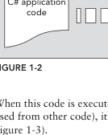

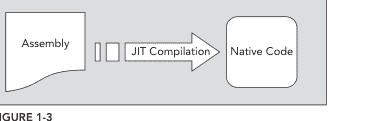

- 3. 当此代码被执行时（如果它是可执行文件则独立执行，或从其他代码中使用），它必须首先使用 JIT 编译器编译为本地代码（见图 1-3）。


## [OCR错误]

## [OCR错误]

### [OCR错误]

- 1. 工程名称：拱墅区申花单元GS0404-13地块 15班幼儿园建设工程
- 2. 建设单位：杭州市拱墅区城市建设发展投资集团有限公司
- 3. 建设地点：本项目位于杭州市拱墅区申花单元GS0404-13地块，地块位于湖墅北路以东，湖州街以北。
- 4. 项目概况：本项目为15班幼儿园，总建筑面积约8160平方米，其中地上建筑面积约5320平方米，地下建筑面积约2840平方米。
- 5. 设计使用年限：50年
- 6. 建筑耐火等级：地上二级，地下一级
- 7. 建筑防水等级：屋面一级，地下室一级
- 8. 抗震设防烈度：6度
- 9. 结构类型：框架结构
- 10. 设计规模：15班幼儿园

这些类型中的任何一种可能还需要某种形式的数据库访问，这可以通过 .NET Framework 中的 ADO.NET（Active Data Objects .NET）部分、通过 ADO.NET Entity Framework，或通过 C# 的 LINQ（Language Integrated Query）功能来实现。 还可以利用许多其他资源，例如创建网络组件的工具、输出图形、执行复杂数学任务等。

## 本书中的 C#

本书的第一部分介绍 C# 语言的语法和用法，对 .NET Framework 的强调并不太多。 这是必要的，因为如果没有扎实的 C# 编程基础，就完全无法使用 .NET Framework。 事实上，您将从更简单的开始，并在掌握基础知识后再涉及更复杂的 OOP 主题。 这些内容从第一性原理教授，假设没有任何编程知识。

在那之后，您就可以开始开发更复杂（但更有用）的应用程序了。 第二部分涉及基于云的 Web 应用程序编程，第三部分探讨数据访问（用于 ORM 数据库概念、文件系统和 XML 数据）以及 LINQ。 本书的第四部分介绍桌面和 Windows Store 应用程序编程。

## Visual Studio 2015

在本书中，您使用 Visual Studio 2015 开发工具进行所有 C# 编程，从简单的命令行应用程序到更复杂的项目类型。 开发工具或集成开发环境（IDE），如 Visual Studio，并不是开发 C# 应用程序所必需的，但它使事情变得容易得多。 您（如果愿意）可以在基本的文本编辑器中操作 C# 源代码文件，例如无处不在的记事本应用程序，并使用 .NET Framework 提供的命令行编译器将代码编译成程序集。 然而，当您拥有 IDE 的帮助时，为什么还要这样做呢？

## Visual Studio Express 2015 产品

除了 Visual Studio 2015，Microsoft 还提供几种更简单的开发工具，称为 Visual Studio Express 或 Community 2015 产品。 这些工具可免费在 https://www.visualstudio.com/en-us/downloads/download-visual-studio-vs 获取。

各种 Express 产品使您能够创建几乎任何您可能需要的 C# 应用程序。 它们作为精简版的 Visual Studio 运行，并保留相同的外观和感觉。 虽然它们提供了与 Visual Studio 相同的许多功能，但一些显著的功能缺失了，不过数量不足以阻止您使用这些工具来学习本书的章节。

> 注意 本书使用的是 Visual Studio 2015 的 Enterprise 版本，因为当时 Express 产品尚未发布。 在撰写时，计划发布一个名为 Visual Studio Express 2015 for Windows Desktop 的 Express 产品，这应该足以跟随本书的第一部分。 本书的其余部分也可能允许您使用 Visual Studio Express 2015 for Windows 10 和 Visual Studio Express 2015 for Web，但在撰写时我们不能确定这一点是否成立。

## 解决方案

当您使用 Visual Studio 开发应用程序时，您通过创建 *解决方案* 来进行。 在 Visual Studio 的术语中，解决方案不仅仅是一个应用程序。 解决方案包含 *项目*，可能是 WPF 项目、云/Web 应用程序项目等。 因为解决方案可以包含多个项目，所以您可以将相关代码集中在一个地方，即使最终会编译为硬盘上各个位置的多个程序集。

这非常有用，因为它使您能够同时处理共享代码（可能放置在 GAC 中）和使用该代码的应用程序。 当只使用一个开发环境时，调试代码会容易得多，因为您可以逐步执行多个代码模块中的指令。

## 本章学到的内容

| 主题 | 关键概念 |
|---|---|
| .NET Framework 基础 | .NET Framework 是 Microsoft 的最新开发平台，目前版本为 4.6。它包括通用类型系统（CTS）和通用语言运行时（CLR）。.NET Framework 应用程序使用面向对象编程（OOP）方法编写，通常包含托管代码。托管代码的内存管理由 .NET 运行时处理；这包括垃圾回收。 |
| .NET Framework 应用程序 | 使用 .NET Framework 编写的应用程序首先被编译为 CIL。当应用程序执行时，CLR 使用 JIT 根据需要将此 CIL 编译为本地代码。应用程序被编译，不同的部分被链接到包含 CIL 的程序集中。 |
| C# 基础 | C# 是 .NET Framework 包含的语言之一。它是 C++ 等早期语言的演进，可用于编写各种应用程序，包括 Web 和桌面应用程序。 |
| 集成开发环境（IDEs） | 您可以使用 Visual Studio 2015 用 C# 编写任何类型的 .NET 应用程序。您也可以使用免费但功能较弱的 Express 产品系列用 C# 创建 .NET 应用程序。这两种 IDE 都使用解决方案，解决方案可以包含多个项目。 |


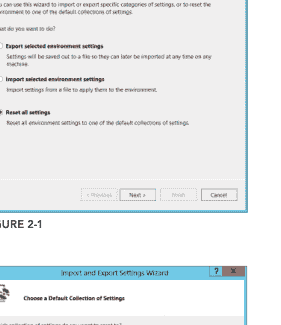

图 2-1

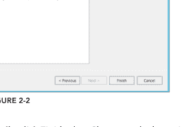

图 2-2

最后，单击“完成”，再单击“关闭”以应用设置。

Visual Studio 的环境布局完全可以自定义，但此处使用默认设置即可。在选择了“C# 开发人员设置”后，其布局如图 2-3 所示。

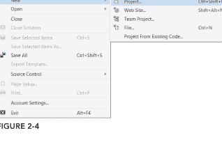

图 2-4

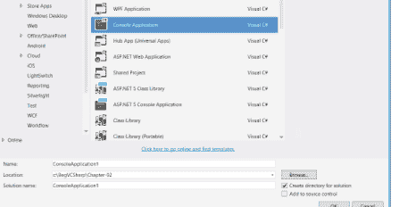

图 2-5

- 2.  确保在出现的窗口左侧窗格中选中“Visual C#”节点，并在中间窗格中选择“控制台应用程序”项目类型（见图 2-5）。将“位置”文本框更改为 `C:\BegVCSharp\Chapter02`（如果该目录不存在，则会自动创建）。保留“名称”文本框中的默认文本（ConsoleApplication1）以及其他设置不变（参见图 2-5）。
- 3.  单击“确定”按钮。
- 4.  项目初始化完成后，在主窗口中显示的文件里添加以下几行代码：

```
namespace ConsoleApplication1
{
    class Program
    {
        static void Main(string[] args)
        {
            // Output text to the screen.
            Console.WriteLine("The first app in Beginning Visual C# 2015!");
            Console.ReadKey();
        }
    }
}
```

- 5.  选择“调试” -> “开始调试”菜单项。片刻之后，您应该会看到如图 2-6 所示的窗口。

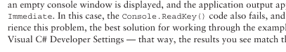

图 2-6

- 6.  按任意键退出应用程序（您可能需要先单击控制台窗口使其获得焦点）。只有当应用了本章前面所述的 Visual C# 开发人员设置时，才会出现图 2-6 中的显示。例如，若应用了 Visual Basic 开发人员设置，则会显示一个空的控制台窗口，而应用程序输出会出现在一个标注为“即时”的窗口中。在这种情况下，`Console.ReadKey()` 代码也会失败，并且您会看到错误。如果您遇到此问题，那么在阅读本书示例时，最佳解决方案是应用 Visual C# 开发人员设置——这样，您看到的结果将与这里显示的结果一致。

## 工作原理

目前，我不会剖析到目前为止使用的代码，因为这里的重点是介绍如何使用开发工具来运行代码。显然，Visual Studio 为您完成了大量工作，使编译和执行代码的过程变得简单。事实上，即使这些基本步骤也有多种执行方式——例如，您可以通过前面提到的菜单项、按 Ctrl+Shift+N 或单击工具栏中相应的图标来创建新项目。

同样，您的代码可以通过多种方式编译和执行。您在示例中使用的过程——选择“调试”->“开始调试”——也有一个键盘快捷键（F5）和一个工具栏图标。您还可以使用“调试”->“开始执行（不调试）”菜单项（或按 Ctrl+F5）在不处于调试模式下运行代码，或者使用“生成”->“生成解决方案”或按 F6 来编译项目而不运行它（无论调试开启或关闭）。请注意，您可以通过工具栏图标执行项目而不进行调试，或生成项目，尽管这些图标默认情况下不会出现在工具栏上。编译代码后，您还可以直接在 Windows 资源管理器中运行生成的 .exe 文件，或从命令提示符运行它。为此，请打开命令提示符窗口，将目录更改为 `C:\BegVCSharp\Chapter02\ConsoleApplication1\ConsoleApplication1\bin\Debug\`，键入 `ConsoleApplication1`，然后按 Enter 键。

> **注意** 在后续示例中，当您看到“创建新的控制台项目”或“执行代码”的说明时，可以选择任意方法来执行这些步骤。除非另有说明，所有代码都应在启用调试的情况下运行。此外，本书中“启动”“执行”和“运行”这三个术语可以互换使用，示例后的讨论总是假定您已经退出了示例中的应用程序。

控制台应用程序在执行完毕后会立即终止，这意味着如果您直接通过 IDE 运行它们，可能没有机会查看结果。为了在前面的示例中解决这个问题，代码被指示在终止之前等待按键，使用了以下代码行：

```
Console.ReadKey();
```

您会在后续的许多示例中看到这种技术的使用。现在您已经创建了一个项目，可以更详细地了解开发环境的某些区域。

## 解决方案资源管理器

默认情况下，“解决方案资源管理器”窗口停靠在屏幕的右上角。与其他窗口一样，您可以将其移动到任何位置，也可以通过单击图钉图标将其设置为自动隐藏。“解决方案资源管理器”窗口与另一个名为“类视图”的有用窗口共享空间，您可以通过“视图”->“类视图”显示它。图 2-7 显示了这两个窗口展开所有节点后的样子（当窗口停靠时，您可以通过单击窗口底部的选项卡在两个窗口之间切换）。

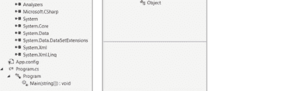

图 2-7

下面的“试试看”仅展示了此操作的基本过程，您将看到如何在不涉及应用程序实际工作的太多细节的情况下启动并运行一个桌面应用程序。您将在这里使用 WPF，这是 Microsoft 推荐的用于创建桌面应用程序的技术。稍后，您将详细了解桌面应用程序，并进一步了解 WPF 是什么以及它的功能。

### 试一试 创建一个简单的 Windows 应用程序：WpfApplication1\MainWindow.xaml 和 WpfApplication1\MainWindow.xaml.cs

- 1.  在与之前相同的位置（`C:\BegVCSharp\Chapter02`）创建一个类型为“WPF 应用程序”的新项目，使用默认名称 `WpfApplication1`。如果第一个项目仍然打开，请确保选中“创建新解决方案”选项以启动新解决方案。这些设置如图 2-10 所示。

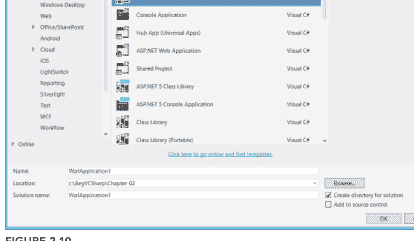

图 2-10

- 2.  单击“确定”创建项目。您应该会看到一个新的选项卡，它分为两个窗格。顶部窗格显示一个名为 MainWindow 的空窗口，底部窗格显示一些文本。这些文本实际上是用于生成窗口的代码，您会看到它随着您修改 UI 而变化。
- 3.  单击屏幕左上角的“工具箱”选项卡，然后双击“常用 WPF 控件”部分中的“Button”条目，向窗口添加一个按钮。
- 4.  双击已添加到窗口中的按钮。

Content 属性，当前设置为 Button，将该值更改为 Click Me，如图 2-12 所示。

设计器中按钮上显示的文本也应反映这一更改，XAML 代码也应如此，如图 2-13 所示。

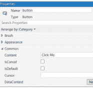

图 2-12

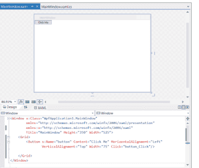

图 2-13

这个按钮有许多属性，从颜色和大小的简单格式设置，到更晦涩的设置（如数据绑定，它使您能够建立与数据的链接）。如前一个示例中简要提到的，更改属性通常会导致代码的直接更改，并且

## 3 变量和表达式

### 本章将学习的内容

- 理解 C# 的基本语法
- 使用变量
- 使用表达式

### WROX.COM 本章代码下载

您可以在 www.wrox.com/go/beginningvisualc#2015programming 的 Download Code 选项卡中找到本章的 wrox.com 代码下载。代码位于第 3 章下载中，并根据本章中的名称分别命名。

要有效使用 C#，理解您在创建计算机程序时实际上在做什么非常重要。也许对计算机程序最基本的描述是：它是操作数据的一系列操作。即使是最复杂的示例也是如此，包括大型的、功能丰富的 Windows 应用程序（如 Microsoft Office 套件）。虽然这对应用程序用户来说通常完全不可见，但它始终在幕后进行。

为了进一步说明这一点，请考虑您电脑的显示单元。屏幕上的内容通常非常熟悉，很难将其想象成除“动态图像”之外的其他东西。事实上，您看到的只是某些数据的表示，而其原始形式仅仅是存储在计算机内存某处的 0 和 1 的流。屏幕上的任何操作——移动鼠标指针、单击图标、在文字处理器中键入文本——都会导致内存中的数据被移动。

当然，更简单的情况也同样能说明这一点。使用计算器应用程序时，您以数字形式提供数据，并对这些数字执行运算，就像用纸笔一样——但速度要快得多！


这使您可以将此代码折叠成单行，并在以后需要查看详细信息时再次展开。此处包含的 using 语句以及紧随其后的 namespace 语句将在本章末尾进行解释。

> 注意 以 # 开头的任何关键字实际上是预处理器指令，严格来说并不是 C# 关键字。除本文所述的两个 #region 和 #endregion 之外，这些指令可能相当复杂，并且用途非常专门。完成本书的学习后，您可以自行研究这一主题。

目前不必担心示例中的其他代码，因为前几章的目的是解释基本的 C# 语法，因此应用程序执行到达调用 Console.WriteLine() 的点的确切方法并不重要。稍后，这些额外代码的意义将会变得清晰。

## 变量

如前所述，变量涉及数据的存储。本质上，您可以将计算机内存中的变量想象成放在架子上的盒子。您可以把东西放进盒子再取出来，或者只是看一下盒子里是否有东西。变量也是如此；您可以将数据放入其中，并在需要时取出或查看。

尽管计算机中的所有数据本质上都是相同的（一系列 0 和 1），变量有不同的类型，称为类型。再次使用盒子类比，盒子有不同的形状和大小，因此某些物品只能放入特定盒子。这种类型系统的理由是，不同类型的数据可能需要不同的处理方法，通过将变量限制为单独的类型，您可以避免混淆它们。例如，将构成数字图片的 0 和 1 系列当作音频文件处理是没有意义的。

要使用变量，您必须声明它们。这意味着您必须为它们分配名称和类型。在声明变量后，您可以将它们用作存储您声明它们所持数据类型的存储单元。

C# 声明变量的语法仅指定类型和变量名：

```
<type> <name>;
```

如果您尝试使用未声明的变量，代码将无法编译，但在这种情况下编译器会准确告诉您问题的所在，因此这并不是灾难性的错误。尝试在未为变量分配值的情况下使用它也会导致错误，但同样，编译器会检测到这一点。

### 简单类型

简单类型包括构成应用程序基本构建块的数字和 Boolean（true 或 false）值等类型。与复杂类型不同，简单类型不能具有

### 表 3-1（续）

| 类型 | 别名 | 允许的值 |
|---|---|---|
| int | System.Int32 | 介于 −2147483648 和 2147483647 之间的整数 |
| uint | System.UInt32 | 介于 0 和 4294967295 之间的整数 |
| long | System.Int64 | 介于 −9223372036854775808 和 9223372036854775807 之间的整数 |
| ulong | System.UInt64 | 介于 0 和 18446744073709551615 之间的整数 |

某些变量名称前面的 u 字符是 unsigned 的简写，意味着您不能在这些类型的变量中存储负数，如前表中“允许的值”列所示。

当然，您还需要存储浮点值，即非整数值。您可以使用三种浮点变量类型：float、double 和 decimal。前两种以 m × 2^e 的形式存储浮点数，其中 m 和 e 的允许值因类型而异。decimal 使用另一种形式 m × 10^e。这三种类型在表 3-2 中显示，连同 m 和 e 的允许值，以及这些限制在实际数值上的体现。

### 表 3-2：浮点类型

| 类型 | 别名 | 最小 M | 最大 M | 最小 E | 最大 E | 近似最小值 | 近似最大值 |
|---|---|---|---|---|---|---|---|
| float | System.Single | 0 | 2^24 | −149 | 104 | 1.5 × 10^−45 | 3.4 × 10^38 |
| double | System.Double | 0 | 2^53 | −1075 | 970 | 5.0 × 10^−324 | 1.7 × 10^308 |
| decimal | System.Decimal | 0 | 10^28 | −28 | 0 | 1.0 × 10^−28 | 7.9 × 10^28 |

除了数值类型之外，还有三种其他简单类型可用（见表 3-3）。

### 表 3-3：文本和布尔类型

| 类型 | 别名 | 允许的值 |
|---|---|---|
| char | System.Char | 单个 Unicode 字符，以 0 到 65535 之间的整数存储 |
| bool | System.Boolean | 布尔值，true 或 false |
| string | System.String | 字符序列 |

请注意，构成字符串的字符数量没有上限，因为它可以使用不同量的内存。

Boolean 类型 bool 是 C# 中最常用的变量类型之一，事实上，在其他语言的代码中类似的类型同样十分常见。拥有一个可以是 true 或 false 的变量对应用程序的逻辑流程有重要影响。作为一个简单的例子，考虑有多少问题可以用 true 或 false（或 yes 和 no）来回答。比较变量值之间的差异或验证输入只是您很快就会研究的布尔变量的两种编程用途。

现在您已经看到了这些类型，请考虑一个声明并使用它们的简短示例。在下面的试一试中，您使用一些简单的代码声明两个变量，为它们分配值，然后输出这些值。

### 试一试 使用简单类型变量：Ch03Ex01\Program.cs

- 1. 创建一个新的控制台应用程序 Ch03Ex01 并将其保存在目录 C:\BegVCSharp\Chapter03 中。
- 2. 向 Program.cs 添加以下代码：
- 3. 执行代码。结果如图 3-1 所示。

```
static void Main(string[] args)
{
    int myInteger;
    string myString;
    myInteger = 17;
    myString = "myInteger\" is";
    Console.WriteLine($"{myString} {myInteger}");
    Console.ReadKey();
}
```

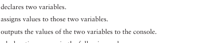

### 工作原理

添加的代码执行三个任务：

- 它声明了两个变量。
- 它为这两个变量分配值。
- 它将这两个变量的值输出到控制台。

变量声明发生在以下代码中：

```
int myInteger;
string myString;
```

第一行声明了一个类型为 int、名为 myInteger 的变量，第二行声明了一个名为 myString 的类型为 string 的变量。

> **注意** 变量命名是受限制的；您不能使用任意字符序列。您将在标题为“Variable Naming”的部分中了解这一点。

接下来的两行代码分配值：

```
myInteger = 17;
myString = "\"myInteger\" is";
```

在这里，您使用 = 赋值运算符将两个固定值（在代码中称为字面值）分配给变量（本章的“Expressions”部分对运算符有更多细节）。您将整数值 17 分配给 myInteger，并将以下字符串（包括引号）分配给 myString：

```
"myInteger" is
```

以这种方式分配字符串字面值时，需要用双引号将字符串括起来。因此，如果字符串本身包含某些字符，例如双引号字符，可能会导致问题，您必须通过用代表您想要使用的字符的字符序列（转义序列）替换某些字符来转义它们。在此示例中，您使用序列 \" 来转义双引号：

```
myString = "\"myInteger\" is";
```

如果您没有使用这些转义序列并尝试按如下方式编码，您将得到编译器错误：

```
myString = ""myInteger" is";
```

请注意，分配字符串字面值是另一个必须注意换行符的情况 — C# 编译器拒绝跨越多行的字符串字面值。如果您想添加换行符，则应在字符串中使用换行符的转义序列，即 \n。例如，考虑以下赋值：

```
myString = "This string has a\nline break.";
```

该字符串将在控制台视图中按如下方式显示在两行上：

```
This string has a
line break.
```

所有转义序列都由反斜杠符号后跟一组少量字符中的一个组成（您稍后会看到完整集合）。由于该符号用于此目的，因此反斜杠符号本身也有一个转义序列，即两个连续的反斜杠 \\。

回到代码，还有一行新内容需要查看：

```
Console.WriteLine($"{myString} {myInteger}");
```


### 表 3-4：字面值

| 类型 | 类别 | 后缀 | 示例/允许值 |
|---|---|---|---|
| bool | 布尔 | 无 | True 或 false |
| int, uint, long, ulong | 整数 | 无 | 100 |
| uint, ulong | 整数 | u 或 U | 100U |
| long, ulong | 整数 | l 或 L | 100L |
| ulong | 整数 | ul, uL, Ul, UL, lU, LU, lu, 或 LU | 100UL |
| float | 实数 | f 或 F | 1.5F |
| double | 实数 | 无, d, 或 D | 1.5 |
| decimal | 实数 | m 或 M | 1.5M |
| char | 字符 | 无 | 'a', 或转义序列 |
| string | 字符串 | 无 | "a...a", 可能包含转义序列 |

## 字符串字面值

本章前面你已经看到了可在字符串字面值中使用的一些转义序列。表 3-5 列出了这些序列以供参考。

### 表 3-5：字符串字面值的转义序列

| 转义序列 | 生成的字符 | 字符的 Unicode 值 |
|---|---|---|
| \' | 单引号 | 0x0027 |
| \" | 双引号 | 0x0022 |
| \\ | 反斜杠 | 0x005C |
| \0 | 空 | 0x0000 |
| \a | 警告（发出蜂鸣声） | 0x0007 |
| \b | 退格 | 0x0008 |
| \f | 走纸换页 | 0x000C |
| \n | 新行 | 0x000A |

| 运算符 | 类别 | 示例表达式 | 结果 |
|---|---|---|---|
| / | 二元 | `var1 = var2 / var3;` | var1 被赋值为 var2 除以 var3 的结果。 |
| % | 二元 | `var1 = var2 % var3;` | var1 被赋值为 var2 除以 var3 时的余数。 |
| + | 一元 | `var1 = +var2;` | var1 被赋值为 var2 的值。 |
| - | 一元 | `var1 = -var2;` | var1 被赋值为 var2 的值乘以 -1。 |

> **NOTE** +（一元）运算符有点奇怪，因为它对结果没有影响。它不会强制值变为正值，如你可能假设的那样——如果 var2 为 -1，则 +var2 也是 -1。然而，它是一个被普遍认可的运算符，因此关于此运算符最有用的事实将在本书后面介绍运算符重载时显示。

示例使用简单数值类型，因为使用其他简单类型时结果可能不明确。例如，如果你将两个布尔值相加会怎样？在这种情况下，什么也不会发生，因为如果尝试使用 +（或其他数学运算符）与 bool 变量一起使用，编译器会报错。添加 char 变量也稍微令人困惑。记住 char 变量实际上以数字形式存储，因此添加两个 char 变量也会产生一个数字（准确地说是 int 类型）。这是一个隐式转换的例子，你将在不久后学到更多相关内容（以及显式转换），因为它也适用于 var1、var2 和 var3 为混合类型的情况。

当与字符串类型变量一起使用时，二元 + 运算符是有意义的。在这种情况下，表项应如表 3-7 所示。

### 表 3-7 字符串连接运算符

| 运算符 | 类别 | 示例表达式 | 结果 |
|---|---|---|---|
| + | 二元 | `var1 = var2 + var3;` | var1 被赋值为存储在 var2 和 var3 中的两个字符串的连接值。 |

然而，其他数学运算符都不能与字符串一起使用。

## 试一试 使用数学运算符操作变量：Ch03Ex02\Program.cs

1. 创建一个新的控制台应用程序 Ch03Ex02 并将其保存到目录 C:\BegVCSharp\Chapter03。

2. 将以下代码添加到 Program.cs：

```csharp
static void Main(string[] args)
{
    double firstNumber, secondNumber;
    string userName;
    Console.WriteLine("Enter your name:");
    userName = Console.ReadLine();
    Console.WriteLine($"Welcome {userName}!");
    Console.WriteLine("Now give me a number:");
    firstNumber = Convert.ToDouble(Console.ReadLine());
    Console.WriteLine("Now give me another number:");
    secondNumber = Convert.ToDouble(Console.ReadLine());
    Console.WriteLine($"The sum of {firstNumber} and {secondNumber} is " +
        $"{firstNumber + secondNumber}.");
    Console.WriteLine($"The result of subtracting {secondNumber} from " +
        $"{firstNumber} is {firstNumber - secondNumber}.");
    Console.WriteLine($"The product of {firstNumber} and {secondNumber} " +
        $"is {firstNumber * secondNumber}.");
    Console.WriteLine($"The result of dividing {firstNumber} by " +
        $"{secondNumber} is {firstNumber / secondNumber}.");
    Console.WriteLine($"The remainder after dividing {firstNumber} by " +
        $"{secondNumber} is {firstNumber % secondNumber}.");
    Console.ReadKey();
}
```

3. 执行代码。显示如图 3-2 所示。


图 3-2

4. 输入你的名字并按 Enter。图 3-3 显示了显示内容。


图 3-3

5. 输入一个数字，按 Enter，输入另一个数字，然后再次按 Enter。图 3-4 显示了一个示例结果。

### 表 3-9（续）

| 运算符 | 类别 | 示例表达式 | 结果 |
|---|---|---|---|
| /= | 二元 | var1 /= var2; | var1 被赋值为 var1 除以 var2 的结果。 |
| %= | 二元 | var1 %= var2; | var1 被赋值为 var1 除以 var2 时的余数。 |

正如你所见，额外的运算符会导致 var1 包含在计算中，因此代码 `var1 += var2;` 与 `var1 = var1 + var2;` 的结果完全相同

> **NOTE** `+=` 运算符也可以与字符串一起使用，就像 `+` 一样。

使用这些运算符，尤其是在使用长变量名时，可以使代码更易于阅读。

## 运算符优先级

当表达式被求值时，每个运算符按顺序处理，但这并不一定意味着从左到右求值这些运算符。作为一个简单的例子，考虑以下内容：`var1 = var2 + var3;`

这里，+ 运算符在 = 运算符之前起作用。还有其他情况运算符优先级并不那么明显，如下所示：`var1 = var2 + var3 * var4;`

在前面的例子中，* 运算符先起作用，然后是 + 运算符，最后是 = 运算符。这是标准数学顺序，它提供了与在纸上计算等效代数计算时所期望的相同结果。

同样，你可以通过使用括号来控制运算符优先级，如此示例所示：`var1 = (var2 + var3) * var4;`

这里，括号中的内容先被求值，意味着 + 运算符在 * 运算符之前起作用。

表 3-10 显示了到目前为止你遇到的运算符的优先级顺序。具有相同优先级的运算符（如 * 和 /）从左到右求值。

### 表 3-10：运算符优先级

| 优先级 | 运算符 |
|---|---|
| 最高 | ++, --（用作前缀）；+, -（一元） |
|  | *, /, % |
|  | +, - |
|  | =, *=, /=, %=, +=, -= |
| 最低 | ++, --（用作后缀） |

> **NOTE** 你可以使用括号来覆盖此优先级顺序，如前所述。此外，请注意 ++ 和 --，当用作后缀时，在概念上只有最低优先级，如表 3-10 所描述。它们不作用于例如赋值表达式的结果，因此你可以认为它们的优先级高于所有其他运算符。然而，由于它们在表达式求值后更改其操作数的值，因此将它们的优先级视为表 3-10 所示更容易。

## 命名空间

在继续之前，值得考虑另一个重要主题——命名空间。这些是 .NET 提供应用程序代码容器的 .NET 方式，以便代码及其内容可以唯一标识。命名空间也用作对 .NET Framework 中项目进行分类的手段。其中大部分是类型定义，例如本章中的简单类型（System.Int32 等）。

默认情况下，C# 代码包含在全局命名空间中。这意味着此代码中包含的项目可以通过按名称引用它们而从全局命名空间中的其他代码访问。你可以使用 namespace 关键字显式定义用大括号括起来的代码块的命名空间。此类命名空间中的名称如果从此命名空间外部的代码中使用，必须限定名称。

限定名称是包含其所有分层信息的名称，这基本上意味着如果你有一个命名空间中的代码需要使用在不同命名空间中定义的名称，你必须包含对该命名空间的引用。限定名称使用句点字符（.）在命名空间级别之间，如下所示：

```
namespace LevelOne
{
    // code in LevelOne namespace
    // name "NameOne" defined
}
// code in global namespace
```


这段代码定义了一个命名空间 LevelOne，以及该命名空间中的一个名称 NameOne（此处未显示实际代码以保持讨论的通用性；定义位置处会出现一条注释）。在 LevelOne 命名空间内编写的代码可以直接使用 NameOne 引用此名称——无需限定。然而，全局命名空间中的代码必须使用限定名称 LevelOne.NameOne 来引用此名称。

这里再注意一个重要点：using 语句本身并不会赋予你访问另一个命名空间中名称的权限。除非命名空间中的代码以某种方式链接到你的项目，即在项目中的源文件中定义，或在链接到项目的其他代码中定义，否则你将无法访问其中包含的名称。此外，如果包含命名空间的代码已链接到你的项目，那么无论是否使用 using，你都可以访问该代码中包含的名称。using 只是使你更方便地访问这些名称，并且可以缩短原本冗长的代码，使其更易读。

回到本章开头所示的 ConsoleApplication1 中的代码，适用于命名空间的以下行出现：

```
using System;
using System.Collections.Generic;
using System.Linq;
using System.Text;
using System.Threading.Tasks;
namespace ConsoleApplication1
{
    ...
}
```

以 using 关键字开头的五行用于声明 System、System.Collections.Generic、System.Linq、System.Text 和 System.Threading.Tasks 命名空间将在此 C# 代码中使用，并且应可在本文件中的所有命名空间中无需限定即可访问。System 命名空间是 .NET Framework 应用程序的根命名空间，包含控制台应用程序所需的所有基本功能。其他四个命名空间在控制台应用程序中经常使用，因此只是以防万一而存在。此外，请注意，为应用程序代码本身，即 ConsoleApplication1 本身，声明了一个命名空间。

C# 6 新增了 using static 关键字。此关键字允许将静态成员直接包含到 C# 程序的作用域中。例如，本章中的两个“试一试”代码演练都使用了 System.Console.WriteLine() 方法，它是 System.Console 静态类的一部分。请注意，在这些示例中，需要包含 Console 类与 WriteLine() 方法。当 using static System.Console 命名空间被添加到包含的命名空间列表中时，访问 WriteLine() 方法不再需要前面的静态类名。

## 本章所学内容

| 主题 | 关键概念 |
|---|---|
| 基本 C# 语法 | C# 是一种区分大小写的语言，每行代码以分号结束。如果行过长，可以缩进以便于阅读，或标识嵌套块。你可以使用 // 或 /* ... */ 语法包含非编译注释。代码块也可以折叠到区域中，以提高可读性。 |
| 变量 | 变量是具有名称和类型的数据块。.NET Framework 为你定义了大量简单类型，例如数值和字符串（文本）类型。变量必须声明并初始化后才能使用。你可以为变量分配字面值以初始化它们，并且可以在单个步骤中声明并初始化变量。 |
| 表达式 | 表达式由运算符和操作数构成，其中运算符对操作数执行操作。运算符有三种类型——一元、二元和三元——分别操作 1、2 和 3 个操作数。数学运算符对数值执行操作，而赋值运算符将表达式的结果放入变量中。运算符具有固定的优先级，决定了它们在表达式中处理的顺序。 |
| 命名空间 | .NET 应用程序中定义的所有名称，包括变量名，都包含在命名空间中。命名空间是分层的，通常需要根据包含它们的命名空间来限定名称，以便访问它们。 |

## 布尔逻辑

上一章介绍的 bool 类型只能保存两个值之一：true 或 false。此类型通常用于记录某项操作的结果，以便你可以据此采取行动。特别是，bool 类型用于存储比较的结果。

> **注意** 作为历史补充，19 世纪中叶英国数学家乔治·布尔的工作构成了布尔逻辑的基础。

例如，考虑本章引言中提到的情况，即你希望根据变量 myVal 是否小于 10 来执行代码。为此，你需要知道语句“myVal 小于 10”是否 true 或 false 的指示——也就是说，你需要知道比较的布尔结果。

布尔比较需要使用布尔比较运算符（也称为关系运算符），如表 4-1 所示。

### 表 4-1：布尔比较运算符

| 运算符 | 类别 | 示例表达式 | 结果 |
|---|---|---|---|
| == | 二元 | `var1 = var2 == var3;` | var1 被赋值为 true，如果 var2 等于 var3，否则为 false。 |
| != | 二元 | `var1 = var2 != var3;` | var1 被赋值为 true，如果 var2 不等于 var3，否则为 false。 |
| < | 二元 | `var1 = var2 < var3;` | var1 被赋值为 true，如果 var2 小于 var3，否则为 false。 |
| > | 二元 | `var1 = var2 > var3;` | var1 被赋值为 true，如果 var2 大于 var3，否则为 false。 |
| <= | 二元 | `var1 = var2 <= var3;` | var1 被赋值为 true，如果 var2 小于或等于 var3，否则为 false。 |
| >= | 二元 | `var1 = var2 >= var3;` | var1 被赋值为 true，如果 var2 大于或等于 var3，否则为 false。 |

表 4-1 中的所有情况下，var1 都是 bool 类型变量，而 var2 和 var3 的类型可能各不相同。

```
int myInt = ToInt32(ReadLine());
bool isLessThan10 = myInt < 10;
bool isBetween0And5 = (0 <= myInt) && (myInt <= 5);
WriteLine($"Integer less than 10? {isLessThan10}");
WriteLine($"Integer between 0 and 5? {isBetween0And5}");
WriteLine($"Exactly one of the above is true? {isLessThan10 ^ isBetween0And5}");
ReadKey();
}
```

3. 执行应用程序并在提示时输入一个整数。结果如图 4-1 所示。

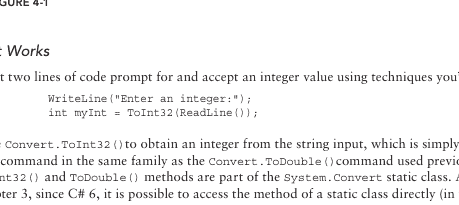

图 4-1

### 工作原理

前两行代码使用你已熟悉的技术提示并接受整数值：

```
WriteLine("Enter an integer:");
int myInt = ToInt32(ReadLine());
```

你使用 Convert.ToInt32() 从字符串输入中获取整数，这只是与之前使用的 Convert.ToDouble() 命令同族的另一个转换命令。ToInt32() 和 ToDouble() 方法都属于 System.Convert 静态类。如第 3 章所述，自 C# 6 起，可以通过将 using static System.Convert 类包含到包含的命名空间列表中，直接访问静态类的方法（在此示例中为 System.Convert）。另请注意，没有检查以确保用户实际输入的是整数。如果提供非整数值，例如字符串，在尝试执行转换时将发生异常。你可以使用 try{...}...catch{} 块来处理此问题，或使用 GetType() 方法在执行转换前检查输入值是否为整数。两种方法都在后续章节中讨论。

接下来，两个布尔变量 isLessThan10 和 isBetween0And5 被声明并赋予与名称描述相匹配的逻辑值：

```
bool isLessThan10 = myInt < 10;
bool isBetween0And5 = (0 <= myInt) && (myInt <= 5);
```

这些变量在接下来的三行代码中使用，其中前两行输出它们的值，而第三行对它们执行操作并输出结果。你在假设用户输入 7 的情况下逐步分析此代码，如屏幕截图所示。

第一个输出是操作 myInt < 10 的结果。如果 myInt 为 6，小于 10，则结果为 true，这就是你看到的显示。myInt 的值为 10 或更高时结果为 false。

第二个输出是一个更复杂的计算：(0 <= myInt) && (myInt <= 5)。它使用两个比较操作来确定 myInt 是否大于或等于 0 且小于或等于 5，

添加括号使此类表达式更清晰无害。编译器知道按什么顺序处理运算符，但我们人类容易忘记这些事情（而且你可能想要改变顺序）。将上一个表达式写成

```
var1 = (var2 <= 4) && (var2 >= 2);
```

通过显式指定计算顺序解决了这个问题。

## 分支

分支是指控制接下来应执行哪一行代码的行为。跳转到的行由某种条件语句控制。该条件语句基于使用布尔逻辑对测试值与一个或多个可能值进行比较。

本节描述了 C# 中可用的三种分支技术：

- 三元运算符
- if 语句
- switch 语句

### 三元运算符

执行比较最简单的方法是使用上一章提到的三元（或条件）运算符。你已经见过作用于一个操作数的 unary 运算符，以及作用于两个操作数的 binary 运算符，所以不会感到惊讶，这个运算符作用于三个操作数。语法如下：

```
<test> ? <resultIfTrue> : <resultIfFalse>
```

这里，<test> 被求值以获得布尔值，运算符的结果根据该值是 <resultIfTrue> 还是 <resultIfFalse>。

你可以按如下方式使用它来测试名为 myInteger 的 int 变量的值：

```
string resultString = (myInteger < 10) ? "Less than 10"
: "Greater than or equal to 10";
```

三元运算符的结果是两个字符串之一，两者都可以分配给 resultString。要分配哪个字符串的选择是通过将 myInteger 的值与 10 进行比较来决定的。在这种情况下，小于 10 的值会导致第一个字符串被分配，大于或等于 10 的值会导致第二个字符串被分配。例如，如果 myInteger 为 4，则 resultString 将被分配字符串 Less than 10。

### if 语句

if 语句是做出决策的一种更灵活、更有用的方式。与 ?: 语句不同，if 语句没有结果（因此你不能在赋值中使用它们）；相反，你使用该语句有条件地执行其他语句。

```
case <comparisonVal2>:
    <code to execute if <testVar> == <comparisonVal1> or
                             <testVar> == <comparisonVal2> >
    break;
...
```

这些条件也适用于 default 语句。没有规定该语句必须在比较列表中排在最后，如果你愿意，可以将其与 case 语句堆叠。使用 break 或 return 添加断点可确保在所有情况下结构中都存在有效的执行路径。

以下“试一试”使用 switch 语句根据你为测试字符串输入的值向控制台写入不同的字符串。

### 试一试 使用 switch 语句：Ch04Ex03\Program.cs

- 1. 创建一个新的控制台应用程序，命名为 Ch04Ex03 并将其保存到目录 `C:\BegVCSharp\Chapter04`。
- 2. 将以下代码添加到 Program.cs：

```
static void Main(string[] args)
{
    const string myName = "benjamin";
    const string niceName = "andrea";
    const string sillyName = "ploppy";
    string name;
    WriteLine("What is your name?");
    name = ReadLine();
    switch (name.ToLower())
    {
        case myName:
            WriteLine("You have the same name as me!");
            break;
        case niceName:
            WriteLine("My, what a nice name you have!");
            break;
        case sillyName:
            WriteLine("That's a very silly name.");
            break;
    }
    WriteLine($"Hello {name}!");
    ReadKey();
}
```

- 3. 执行代码并输入一个名字。结果如 图 4-3 所示。

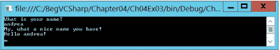

图 4-3

### 工作原理

代码设置了三个常量字符串，从用户接受一个字符串，然后根据输入的字符串向控制台写入文本。这里，字符串是名字。

当你将输入的名字（在变量 name 中）与你的常量值进行比较时，你首先使用 name.ToLower() 将其强制转换为小写。这是一个适用于所有字符串变量的标准命令，当你不确定用户输入了什么时非常有用。使用这种技术，字符串 Benjamin、benJamin、benjamin 等都与测试字符串 benjamin 匹配。

switch 语句本身尝试将输入的字符串与你定义常量值进行匹配，如果成功，则输出个性化消息以向用户问候。如果没有匹配，则提供通用问候。

## 循环

循环是指语句的重复执行。这种技术非常方便，因为它意味着你可以重复操作任意多次（成千上万，甚至数百万次），而无需每次都编写相同的代码。

作为一个简单示例，考虑以下用于计算 10 年后银行账户中金额的代码，假设每年支付利息且没有其他资金流入或流出账户：

```
double balance = 1000;
double interestRate = 1.05; // 5% interest/year
balance *= interestRate;
balance *= interestRate;
balance *= interestRate;
balance *= interestRate;
balance *= interestRate;
balance *= interestRate;
balance *= interestRate;
balance *= interestRate;
balance *= interestRate;
balance *= interestRate;
```

重复编写 10 次相同的代码似乎有点浪费，如果你想将持续时间从 10 年更改为其他值怎么办？你必须手动复制所需次数的代码行，这会很麻烦！幸运的是，你不必这样做。相反，你可以有一个循环，按所需次数执行你想要的指令。

另一种重要的循环类型是在满足特定条件之前循环。这些循环比前面详细说明的情况稍微简单一些（尽管同样有用），因此是良好的起点。

### do 循环

do 循环的工作方式如下。你标记为循环的代码被执行，进行布尔测试，如果该测试求值为 true，则代码再次执行，依此类推。当测试求值为 false 时，循环退出。

do 循环的结构如下，其中 <Test> 求值为布尔值：

```
do
{
    <code to be looped>
} while (<Test>);
```

**注意** while 语句后的分号是必需的。

例如，你可以使用以下代码将数字 1 到 10 按列写入：

```
int i = 1;
do
{
    WriteLine("{0}", i++);
} while (i <= 10);
```

这里，你使用 ++ 运算符的后缀版本在 i 写到屏幕后递增其值，因此你需要检查 i <= 10 以包含写入控制台的数字中的 10。

以下“试一试”将此用于前面显示的代码的略微修改版本，其中你计算了 10 年后账户中的余额。这里，你使用循环根据起始金额和固定利率计算达到账户中指定金额需要多少年。

### 试一试 使用 do 循环：Ch04Ex04\Program.cs

- 1. 创建一个新的控制台应用程序，命名为 Ch04Ex04 并将其保存到目录 C:\BegVCSharp\Chapter04。
- 2. 将以下代码添加到 Program.cs：

```
static void Main(string[] args)
{
    double balance, interestRate, targetBalance;
    WriteLine("What is your current balance?");
    balance = ToDouble(ReadLine());
    WriteLine("What is your current annual interest rate (in %)?");
    interestRate = 1 + ToDouble(ReadLine()) / 100.0;
    WriteLine("What balance would you like to have?");
    targetBalance = ToDouble(ReadLine());
    int totalYears = 0;
    do
    {
        balance *= interestRate;
        ++totalYears;
    }
    while (balance < targetBalance);
    WriteLine($"In {totalYears} year{(totalYears == 1 ? "" : "s")} you'll have a balance of {balance}.");
    ReadKey();
}
```


```
{
    if ((i % 2) == 0)
        continue;
    WriteLine(i);
}
```

在前面的示例中，只要 i 除以 2 的余数为零，continue 语句就会停止当前循环的执行，因此只会显示数字 1、3、5、7 和 9。

## 无限循环

通过编码错误或设计，都可能定义出永不结束的循环，即所谓的无限循环。以下是一个非常简单的例子：

```
while (true)
{
    // code in loop
}
```

这可能是有用的，而且你始终可以使用诸如 break 语句之类的代码或手动使用 Windows 任务管理器来退出此类循环。然而，当这种情况意外发生时，可能会很烦人。考虑以下与上一节中的 for 循环类似的循环：

```
int i = 1;
while (i <= 10)
{
    if ((i % 2) == 0)
        continue;
    WriteLine($"{i++}");
}
```

在这里，i 要等到循环中的最后一行代码才会被递增，而这行代码位于 continue 语句之后。如果执行到这个 continue 语句（当 i 为 2 时就会发生），下一个循环周期将使用相同的 i 值，继续循环，测试相同的 i 值，继续循环，等等。这将导致应用程序冻结。请注意，即使应用程序冻结，仍然可以通过正常方式退出，因此如果发生这种情况，就不必重新启动。

## 练习

- 4.1 如果有两个整数分别存储在变量 var1 和 var2 中，你可以执行什么布尔测试来确定其中一个（但不是两个）大于 10？
- 4.2 编写一个包含练习 1 中逻辑的应用程序，从用户那里获取两个数字并显示它们，但拒绝两个数字都大于 10 的输入并要求输入两个新数字。
- 4.3 下面的代码有什么问题？

```
int i;
for (i = 1; i <= 10; i++)
{
    if ((i % 2) == 0)
        continue;
    WriteLine(i);
}
```

练习的答案可在附录 A 中找到。

这里，sourceVar 中存储的值被放置到 destinationVar 中。当你使用两个 WriteLine() 命令输出这些变量时，会得到以下输出：

```
sourceVar val: a
destinationVar val: 97
```

即使这两个变量存储的是相同的信息，它们也会根据其类型以不同的方式解释。

存在许多简单类型的隐式转换；bool 和 string 没有隐式转换，但数值类型有几种。参考表 5-1 显示了编译器可以隐式执行的数值转换（请记住 chars 以数字形式存储，因此 char 属于数值类型）。

### 表 5-1：隐式数值转换

| 类型 | 可安全转换到 |
| --- | --- |
| byte | short, ushort, int, uint, long, ulong, float, double, decimal |
| sbyte | short, int, long, float, double, decimal |
| short | int, long, float, double, decimal |
| ushort | int, uint, long, ulong, float, double, decimal |
| int | long, float, double, decimal |
| uint | long, ulong, float, double, decimal |
| long | float, double, decimal |
| ulong | float, double, decimal |
| float | double |
| char | ushort, int, uint, long, ulong, float, double, decimal |

不用担心——你不需要死记硬背这个表，因为实际上很容易推断出编译器可以隐式执行的转换。在第 3 章中，表 3-1、3-2 和 3-3 显示了每种简单数值类型的可能值范围。这些类型的隐式转换规则是：任何可能值范围完全包含在类型 B 的可能值范围内的类型 A 都可以隐式转换为该类型。

其原因很简单。如果你尝试将一个值放入变量中，但该值超出了变量可取的值范围，就会出问题。例如，short 类型变量可以存储高达 32767 的值，而 byte 的最大允许值为 255，因此如果尝试将 short 值转换为 byte 值，可能会出现问题。如果 short 持有 256 到 32767 之间的值，那么它根本放不进 byte 中。

## 使用 Convert 命令进行显式转换

本书中许多 Try It Out 示例中你使用的显式转换类型与本章迄今为止看到的类型有点不同。你一直在用诸如 `ToDouble()` 之类的命令将字符串值转换为数字，这显然对每个可能的字符串都不会起作用。

例如，如果你尝试使用 `ToDouble()` 将像 Number 这样的字符串转换为 double 值，执行代码时将看到图 5-3 所示的对话框。

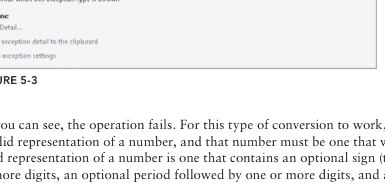

图 5-3

正如你所见，操作失败了。要使这种转换工作，所提供的字符串 *必须* 是数字的有效表示，并且该数字不得导致溢出。

数字的有效表示包含可选的符号（即加号或减号）、零个或多个数字、可选的小数点后跟一个或多个数字，以及可选的 "e" 或 "E" 后跟可选的符号、一个或多个数字，并且除此序列前后的空格外没有其他内容。利用所有这些可选元素，你可以识别出像 -1.2451e-24 这样复杂的字符串为数字。

需要注意的重要一点是，这些转换 *总是* 进行溢出检查，而 `checked` 和 `unchecked` 关键字以及项目属性设置均不起作用。

下一个 Try It Out 是一个示例，涵盖了本节的许多转换类型。它声明并初始化了多种类型的变量，然后在它们之间进行隐式和显式转换。

### 试一试 实践中的类型转换：Ch05Ex01\Program.cs

- 1. 创建一个新的控制台应用程序，命名为 Ch05Ex01，并将其保存在目录 C:\BegVCSharp\Chapter05 中。
- 2. 向 Program.cs 添加以下代码：

```
static void Main(string[] args)
{
    short shortResult, shortVal = 4;
    int integerVal = 67;
    long longResult;
    float floatVal = 10.5F;
    double doubleResult, doubleVal = 99.999;
    string stringResult, stringVal = "17";
    bool boolVal = true;

    WriteLine("Variable Conversion Examples\n");
    doubleResult = floatVal * shortVal;
    WriteLine($"Implicit, -> double: {floatVal} * {shortVal} -> { doubleResult }");
    shortResult = (short)floatVal;
    WriteLine($"Explicit, -> short: {floatVal} -> {shortResult}");
    stringResult = Convert.ToString(boolVal) + Convert.ToString(doubleVal);
    WriteLine($"Explicit, -> string: \"{boolVal}\" + \"{doubleVal}\" -> {stringResult}");
    longResult = integerVal + Convert.ToInt64(stringVal);
    WriteLine($"Mixed, -> long: {integerVal} + {stringVal} -> {longResult}");
    ReadKey();
}
```

- 3. 执行代码。结果如 图 5-4 所示。

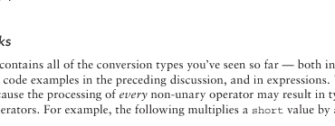

图 5-4

### 工作原理

此示例包含迄今为止你所见过的所有转换类型——既包括前面讨论中的简短代码示例中的简单赋值，也包括表达式。你需要考虑这两种情况，因为每个非一元运算符的处理都可能导致类型转换，而不仅仅是赋值运算符。例如，以下代码将 short 值乘以 float 值：

```
shortVal * floatVal
```

在这种情况下，如果未指定显式转换，则在可能的情况下将使用隐式转换。在此示例中，唯一合理的隐式转换是将 short 转换为 float（因为将 float 转换为 short 需要显式转换），因此将使用此转换。

然而，如果你愿意，可以通过以下方式覆盖此行为：

```
shortVal * (short)floatVal
```


> > **注意** 有趣的是，两个 short 值相乘并不会返回 short 值。因为这个运算的结果很可能超过 32767（short 可以容纳的最大值），所以它实际上返回 int。
> >
> > 转换过程乍一看似乎很复杂，但只要按照运算符优先级顺序将表达式分解成各个部分，你应该就能弄明白。

## 复杂变量类型

除了所有简单变量类型之外，C# 还提供了三种稍微复杂一些（但非常有用）的变量类型：枚举（通常称为 enums）、结构（有时称为 structures）和数组。

### 枚举

到目前为止，你见过的每种类型（`string` 除外）都有一组明确定义的允许值。诚然，在 double 这样的类型中，这个集合非常大，实际上可以视为一个连续区间，但它仍然是一个固定集合。最简单的例子是 bool 类型，它只能取两个值之一：`true` 或 `false`。

在许多其他情况下，你可能希望有一个变量能够从一组固定的结果中取一个值。例如，你可能希望有一个方向（orientation）类型，可以存储 north、south、east 或 west 中的一个值。

在这种情况下，*枚举*会非常有用。枚举在方向类型中正是你想要的：它们允许定义一个类型，该类型可以取你提供的有限值集合中的一个值。因此，你需要做的是创建你自己的枚举类型 orientation，它可以取四个可能值之一。

请注意，这里还涉及一个额外的步骤——你不仅仅声明一个给定类型的变量；你需要声明并详细定义一个用户自定义类型，然后再声明一个这种新类型的变量。

### 定义枚举

可以使用 enum 关键字按下述方式定义枚举：

```
enum <typeName>
{
    <value1>,
    <value2>,
    <value3>,
    ...
    <valueN>
}
```

请注意，这样可能会导致问题，例如在定义之后指定的值（如 <value2> = <value1>）与其他值相同。例如，在下面的代码中，<value4> 将与 <value2> 具有相同的值：

```
enum <typeName> : <underlyingType>
{
    <value1> = <actualVal1>,
    <value2>,
    <value3> = <value1>,
    <value4>,
    ...
    <valueN> = <actualValN>
}
```

当然，如果这正是你想要的行为，那么这段代码没有问题。另外请注意，以循环方式赋值会导致错误：

```
enum <typeName> : <underlyingType>
{
    <value1> = <value2>,
    <value2> = <value1>
}
```

下面的“试一试”演示了所有这些内容的一个示例。该代码定义并使用了一个名为 orientation 的枚举。

### 试一试 使用枚举：Ch05Ex02\Program.cs

- 1. 创建一个名为 Ch05Ex02 的新控制台应用程序，并将其保存到目录 C:\BegVCSharp\Chapter05 中。
- 2. 将以下代码添加到 Program.cs 中：

```
namespace Ch05Ex02
{
    enum orientation : byte
    {
        north = 1,
        south = 2,
        east = 3,
        west = 4
    }
    class Program
    {
        static void Main(string[] args)
        {
            orientation myDirection = orientation.north;
            WriteLine($"myDirection = {myDirection}");
            ReadKey();
        }
    }
}
```

### 定义结构

结构使用 struct 关键字按下述方式定义：

```
struct <typeName>
{
    <memberDeclarations>
}
```

<memberDeclarations> 部分包含变量声明（称为结构的数据成员），其格式与通常情况几乎相同。每个成员声明采用以下形式：

```
<accessibility> <type> <name>;
```

为了允许调用结构的代码访问结构的数据成员，可以为 <accessibility> 使用关键字 public。例如：

```
struct route
{
    public orientation direction;
    public double      distance;
}
```

定义好结构类型后，可以通过定义新类型的变量来使用它：

```
route myRoute;
```

此外，你可以通过句点字符访问这个复合变量的数据成员：

```
myRoute.direction = orientation.north;
myRoute.distance  = 2.5;
```

下面的“试一试”演示了这一点，其中使用了上一个“试一试”中的 orientation 枚举以及前面展示的 route 结构。然后在代码中操作该结构，让你感受结构的工作方式。

### 试一试 使用结构：Ch05Ex03\Program.cs

- 1. 创建一个名为 Ch05Ex03 的新控制台应用程序，并将其保存到目录 C:\BegVCSharp\Chapter05 中。
- 2. 将以下代码添加到 Program.cs 中：

```
namespace Ch05Ex03
{
    enum orientation: byte
    {
        north = 1,
        south = 2,
        east = 3,
        west = 4
    }
    struct route
    {
        public orientation direction;
        public double distance;
    }
    class Program
    {
        static void Main(string[] args)
        {
            route myRoute;
            int myDirection = -1;
            double myDistance;
            WriteLine("1) North\n2) South\n3) East\n4) West");
            do
            {
                WriteLine("Select a direction:");
                myDirection = ToInt32(ReadLine());
            }
            while ((myDirection < 1) || (myDirection > 4));
            WriteLine("Input a distance:");
            myDistance = ToDouble(ReadLine());
            myRoute.direction = (orientation)myDirection;
            myRoute.distance = myDistance;
            WriteLine($"myRoute specifies a direction of {myRoute.direction} " +
            $"and a distance of {myRoute.distance}");
            ReadKey();
        }
    }
}
```

- 3. 执行代码，输入 1 到 4 之间的数字选择一个方向，然后输入一个距离。结果如图 5-7 所示。

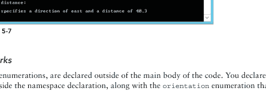

图 5-7

### 工作原理

结构（struct）与枚举一样，在代码主体之外声明。你的 route 结构就声明在 namespace 声明内部，并与其使用的 orientation 枚举一同声明：

```
enum orientation: byte
{
    north = 1,
    south = 2,
    east = 3,
    west = 4
}
```

此外，如果你愿意，可以组合使用这两种初始化方法：

```csharp
int[] myIntArray = new int[5] { 5, 9, 10, 2, 99 };
```

使用这种方法时，大小必须匹配。例如，你不能编写以下代码：

```csharp
int[] myIntArray = new int[10] { 5, 9, 10, 2, 99 };
```

这里，数组被定义为有 10 个成员，但只定义了 5 个，所以编译会失败。这带来的一个副作用是，如果你使用变量来定义大小，那么该变量必须是常量：

```csharp
const int arraySize = 5;
int[] myIntArray = new int[arraySize] { 5, 9, 10, 2, 99 };
```

如果省略 const 关键字，这段代码将无法编译。

与其他变量类型一样，不需要在声明数组的同一行对其进行初始化。下面这样做完全合法：

```csharp
int[] myIntArray;
myIntArray = new int[5];
```

在下面的“试一试”中，你将使用本节引言中的示例创建并使用一个字符串数组。

### 试一试 使用数组：Ch05Ex04\Program.cs

- 1. 创建一个名为 Ch05Ex04 的新控制台应用程序，并将其保存到目录 C:\BegVCSharp\Chapter05 中。
- 2. 将以下代码添加到 Program.cs 中：
- 3. 执行代码。结果如图 5-8 所示。

```csharp
static void Main(string[] args)
{
    string[] friendNames = { "Todd Anthony", "Kevin Holton",
        "Shane Laigle" };
    int i;
    WriteLine($"Here are {friendNames.Length} of my friends:");
    for (i = 0; i < friendNames.Length; i++)
    {
        WriteLine(friendNames[i]);
    }
    ReadKey();
}
```

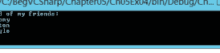


另外，你也可以使用字面值进行初始赋值。这里，你使用由逗号分隔的嵌套大括号块：

```csharp
double[,] hillHeight = { { 1, 2, 3, 4 }, { 2, 3, 4, 5 }, { 3, 4, 5, 6 } };
```

该数组的维度与前一个相同——即三行四列。通过提供字面值，这些维度被隐式定义。

要访问多维数组的单个元素，只需指定由逗号分隔的索引：

```csharp
hillHeight[2,1]
```

然后你可以像操作其他元素一样操作此元素。此表达式将访问先前定义第三个嵌套数组的第二个元素（值将为 4）。请记住计数从 0 开始，并且第一个数字是嵌套数组。换句话说，第一个数字指定一对大括号，第二个数指定该对大括号内的元素。你可以像图 5-10 所示那样直观地表示此数组。

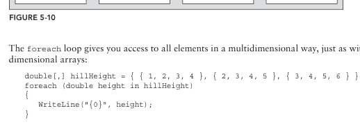

图 5-10

The `foreach` 循环使你能够像单维数组一样以多维方式访问所有元素：

```csharp
double[,] hillHeight = { { 1, 2, 3, 4 }, { 2, 3, 4, 5 }, { 3, 4, 5, 6 } };
foreach (double height in hillHeight)
{
    WriteLine("{0}", height);
}
```

输出元素的顺序与为字面值赋值时使用的顺序相同。序列如下（此处显示的是元素标识符而非实际值）：

```text
hillHeight[0,0]
hillHeight[0,1]
hillHeight[0,2]
```

```csharp
new int[] { 1, 3 },
new int[] { 1, 2, 4 },
new int[] { 1, 5 },
new int[] { 1, 2, 3, 6 },
new int[] { 1, 7 },
new int[] { 1, 2, 4, 8 },
new int[] { 1, 3, 9 },
new int[] { 1, 2, 5, 10 } );
```

以下代码将失败：

```csharp
foreach (int divisor in divisorsTo10)
{
    WriteLine(divisor);
}
```

失败的原因是数组 `divisorsTo10` 包含 `int[]` 元素，而不是 `int` 元素。相反，你必须遍历每个子数组以及数组本身：

```csharp
foreach (int[] divisorsOfInt in divisorsTo10)
{
    foreach (int divisor in divisorsOfInt)
    {
        WriteLine(divisor);
    }
}
```

如你所见，使用锯齿数组的语法可能会迅速变得复杂！在大多数情况下，使用矩形数组或更简单的存储方法更容易。尽管如此，可能确实存在被迫使用此方法的情况，了解其工作原理总是有益的。一个例子是在处理 XML 文档时发生，其中某些元素有子元素，而其他元素没有。

## 字符串操作

到目前为止，你对字符串的使用包括向控制台写入字符串、从控制台读取字符串以及使用 `+` 运算符连接字符串。在编写更有趣的应用程序的过程中，你会发现操作字符串是你经常做的事情。因此，花几页时间了解一下 C# 中一些更常见的字符串操作技术是值得的。

首先，字符串类型变量可以被视为 `char` 变量的只读数组。这意味着你可以使用如下语法访问单个字符：

```csharp
string myString = "A string";
char myChar = myString[1];
```

然而，你不能以这种方式为单个字符赋值。要获取可写入的 `char` 数组，可以使用以下代码。这使用了数组变量的 `ToCharArray()` 命令：

```csharp
string myString = "A string";
char[] myChars = myString.ToCharArray();
```

## 小目标检测

小目标检测是计算机视觉中的一个具有挑战性的问题，其中物体在图像中占据很小的区域，通常小于 32 × 32 像素。传统检测器由于信息和上下文有限而难以处理此类物体。

## 主要挑战

- 分辨率低且尺寸小
- 上下文和语义信息有限
- 前景与背景不平衡
- 特征提取和定位困难

近期的进展侧重于特征金字塔、多尺度训练和上下文增强，以缓解这些问题。

前面的代码也可以检测如下字符串：

```text
" YES"
"Yes "
```

你也可以通过在 `char` 数组中指定它们来使用这些命令删除其他任何字符，例如：

```csharp
char[] trimChars = { 't', 'e', 's' };
string userResponse = ReadLine();
userResponse = userResponse.ToLower();
userResponse = userResponse.Trim(trimChars);
if (userResponse == "y")
{
    // Act on response.
}
```

这会消除字符串开头或结尾的空格以及字母 `"e"` 和 `"s"` 的任何出现。只要字符串中没有其他字符，这将导致检测到如下字符串：

```text
"Yeeeees"
" y"
```

等等。

你还可以使用 `<string>.TrimStart()` 和 `<string>.TrimEnd()` 命令，它们分别从字符串开头和结尾修剪空格。这些也可以指定 `char` 数组。

你可以使用另外两个字符串命令来操作字符串的间距：`<string>.PadLeft()` 和 `<string>.PadRight()`。它们使你能够在字符串左侧或右侧添加空格以使其达到所需长度。你按如下方式使用它们：

```csharp
<string>.PadX(<desiredLength>);
```

以下代码获取在每个空格处分割字符串时得到的子字符串——也就是说，你得到一个单独单词的数组：

```csharp
string[] myWords;
myWords = myString.Split(separator);
```

接下来，你使用 `foreach` 遍历此数组中的单词并将每个单词写入控制台：

```csharp
foreach (string word in myWords)
{
    WriteLine($"{word}");
}
```

> **注意** 获取的每个单词都没有空格，无论是嵌入在单词内部还是在两端。使用 `Split()` 时分隔符会被移除。

## 练习

### 5.1 以下哪些转换不能隐式执行？

- a. `int` 到 `short`
- b. `short` 到 `int`
- c. `bool` 到 `string`
- d. `byte` 到 `float`

### 5.2 显示基于 `short` 类型且包含彩虹颜色加上黑白的颜色枚举的代码。此枚举可以基于 `byte` 类型吗？

### 5.3 以下代码能否编译？为什么？

```csharp
string[] blah = new string[5]
blah[5] = 5th string.
```

### 5.4 编写一个控制台应用程序，从用户接受一个字符串并输出字符顺序相反的字符串。

### 5.5 编写一个控制台应用程序，接受一个字符串并将字符串 `no` 的所有出现替换为 `yes`。

### 5.6 编写一个控制台应用程序，在字符串中每个单词周围加上双引号。

练习的答案可在附录 A 中找到。


## 函数

## 本章将学习的内容

- 定义和使用不接受或返回任何数据的简单函数
- 在函数之间传输数据
- 处理变量作用域
- 使用 `main()` 函数使用命令行参数
- 将函数作为结构体类型的成员提供
- 使用函数重载
- 使用委托

## WROX.COM 本章代码下载

你可以在 Download Code 选项卡上找到本章的 wrox.com 代码下载，网址为 www.wrox.com/go/beginning_visualcsharp2015programming。代码位于第 6 章下载中，并根据全章中的名称单独命名。

到目前为止你所看到的所有代码都以单个块的形式出现，或许带有一些循环来重复代码行，以及分支来有条件地执行语句。对数据执行操作意味着将所需代码放在你希望其工作的确切位置。

这种代码结构是有限的。通常，一些任务——例如在数组中找到最高值——可能需要在程序的多个位置执行。你可以在应用程序中根据需要放置相同（或几乎相同）的代码段，但这也有其自身的问题。即使是关于常见任务的一个微小细节的更改（例如纠正代码错误）也可能需要更改应用程序中分散的多个代码段。遗漏其中一个可能产生戏剧性后果并导致整个应用程序失败。此外，应用程序可能会变得非常冗长。


解决这个问题的方法是使用*函数*。C# 中的函数是一种提供代码块的手段，这些代码块可以在应用程序中的任何位置执行。

> **注意** 本章讨论的特定类型函数被称为方法，但方法在 .NET 编程中具有非常特殊的含义，这一点要到本书后面才会清楚。因此，目前暂不使用“方法”这一术语。

例如，你可以编写一个用来计算数组中最大值的函数。你可以在代码中的任何位置调用该函数，并在每次使用时复用相同的代码行。由于只需提供一次这段代码，你对它所做的任何更改都会影响所有使用该计算的地方。因此，可以把函数视为包含可复用代码的容器。

函数还有一个优点，就是能让代码更具可复用性，因为你可以用函数把相关的代码组合在一起。这样，由于代码的内部实现被分离出去，应用程序主体可以非常简短。这与在 IDE 中使用大纲视图折叠代码区域的方式类似，并且会让应用程序具有更合理的结构。

函数还可以用来创建多用途代码，使其能够对不同的数据执行相同的操作。你可以通过参数的形式向函数提供要处理的信息，也可以通过返回值的形式从函数获取结果。在前面的例子中，你可以将要搜索的数组作为参数传入，并将数组中的最大值作为结果值返回。这意味着每次都可以使用同一个函数来处理不同的数组。函数定义由名称、返回类型以及一组参数组成，参数用于指定函数所需的参数数量和类型。函数的名称和参数（但不包括返回类型）共同定义了函数的签名。

## 定义和使用函数

本节介绍如何将函数添加到应用程序中，然后从代码中使用（调用）它们。先从基础开始，你将了解一些不与被调用代码交换数据的简单函数，然后再了解更高级的函数用法。下面这个“动手试一试”练习将带你逐步完成这个过程。

## 动手试一试：定义和使用基本函数：Ch06Ex01\Program.cs

- 1. 创建一个名为 Ch06Ex01 的新控制台应用程序，并将其保存到目录 `C:\BegVCSharp\Chapter06` 中。
- 2. 将以下代码添加到 Program.cs 中：

```csharp
class Program
{
    static void Write()
```

当函数返回值时，你必须在两个方面修改函数：

- 在函数声明中指定返回值的类型，而不是使用 void 关键字。
- 使用 return 关键字结束函数执行，并将返回值传递给调用代码。

用代码来表示，就是你一直在看的这种类型的控制台应用程序函数，如下所示：

```csharp
static <returnType> <FunctionName>()
{
    ...
    return <returnValue>;
}
```

这里唯一的限制是 `<returnValue>` 必须是一个类型为 `<returnType>` 的值，或者可以被隐式转换为该类型的值。不过，`<returnType>` 可以是任意类型，包括你见过的更复杂的类型。它甚至可以像下面这样简单：

```csharp
static double GetVal()
{
    return 3.2;
}
```

不过，返回值通常是函数执行某些处理后的结果；上面的例子使用 const 变量也可以轻松实现。

当执行到 return 语句时，程序会立即将执行权交还给调用代码。该语句之后的任何代码行都不会被执行，不过这并不意味着 return 语句只能放在函数体的最后一行。你可以在代码中更早地使用 return，例如在执行某些分支逻辑之后。如果在 for 循环、if 块或任何其他结构中使用 return，会导致该结构立即终止，并使函数终止：

```csharp
static double GetVal()
{
    double checkVal;
    // checkVal assigned a value through some logic (not shown here).
    if (checkVal < 5)
        return 4.7;
    return 3.2;
}
```

这里会根据 checkVal 的值返回两个值之一。这种情况下唯一的限制是，必须在到达函数的结束 `}` 之前处理一条 return 语句。以下写法是非法的：

```csharp
static double GetVal()
{
    double checkVal;
    // checkVal assigned a value through some logic.
    if (checkVal < 5)
        return 4.7;
}
```

如果 checkVal 大于等于 5，则不会遇到 return 语句，这是不允许的。所有处理路径都必须到达一条 return 语句。在大多数情况下，编译器会检测到这一点，并给出错误提示“不是所有代码路径都返回值”。

只执行单行代码的函数可以使用 C# 6 中引入的一项功能，称为表达式体方法。下面的函数模式使用 `=>`（lambda 箭头）来实现这一功能。

```csharp
static <returnType> <FunctionName>() => <myVal1> * <myVal2>;
```

例如，在 C# 6 之前，Multiply() 函数是这样编写的：

```csharp
static double Multiply(double myVal1, double myVal2)
{
    return myVal1 * myVal2;
}
```

现在可以使用 `=>`（lambda 箭头）来编写。这里编写的代码以更简洁、更聚集的方式表达了方法的意图。

```csharp
static double Multiply(double myVal1, double myVal2) => myVal1 * myVal2;
```

## 参数

当函数需要接受参数时，你必须指定以下内容：

- 在函数定义中列出函数接受的参数及其类型
- 在每次函数调用中提供匹配的参数列表

> **注意** 仔细阅读 C# 规范会发现，参数（parameter）和实参（argument）之间存在细微区别。参数是函数定义的一部分，而实参是由调用代码传递给函数的。不过，这两个术语经常被混用，似乎也没有人不满意这种做法。

这会涉及下面的代码形式，你可以拥有任意数量的参数，每个参数都有类型和名称：

```csharp
static <returnType> <FunctionName>(<paramType> <paramName>, ...)
{
    ...
    return <returnValue>;
}
```

参数之间用逗号分隔，函数中的代码可以像使用变量一样访问每个参数。例如，一个简单的函数可以接受两个 double 参数并返回它们的乘积：

```csharp
static double Product(double param1, double param2) => param1 * param2;
```

函数 MaxValue() 定义了一个参数，即名为 intArray 的 int 数组。它的返回类型也是 int。最大值的计算很简单：首先将名为 maxVal 的局部整数变量初始化为数组中的第一个值，然后依次将这个值与数组中的后续元素进行比较。如果某个元素包含的值大于 maxVal，则用该值替换 maxVal 的当前值。循环结束后，maxVal 中就包含了数组中的最大值，并通过 return 语句返回。

Main() 中的代码声明并初始化一个简单的整数数组，用于 MaxValue() 函数：

```csharp
int[] myArray = { 1, 8, 3, 6, 2, 5, 9, 3, 0, 2 };
```

对 MaxValue() 的调用用于给 int 变量 maxVal 赋值：

```csharp
int maxVal = MaxValue(myArray);
```

接下来，你使用 WriteLine() 将该值输出到屏幕：

```csharp
WriteLine($"The maximum value in myArray is {maxVal}");
```

## 参数匹配

调用函数时，你必须提供与函数定义中指定的参数相匹配的实参。这意味着参数类型、参数数量和参数顺序都要匹配。例如，下面的函数

```csharp
static void MyFunction(string myString, double myDouble)
{
    ...
}
```

不能通过以下方式调用：

```csharp
MyFunction(2.6, "Hello");
```

在这里，你试图将 double 值作为第一个实参，将 string 值作为第二个实参传递，这与函数定义中参数的声明顺序不一致。由于参数类型错误，这段代码将无法编译。在本章后面的“重载函数”一节中，你将学到解决这个问题的有用技巧。

## 参数数组

C# 允许你为函数指定一个（且仅一个）特殊参数。这个参数必须位于函数定义中的最后一个位置，被称为参数数组。参数数组允许你使用可变数量的参数调用函数，并通过 params 关键字定义。

参数数组是简化代码的实用方式，因为你无需在调用代码中传递数组。相反，你可以传入多个相同类型的实参，它们会被放入一个数组中，供函数内部使用。


其次，必须使用已初始化的变量。C# 不允许你假设 ref 参数会在使用它的函数中被初始化。下面的代码同样是非法的：

```
int myNumber;
ShowDouble(ref myNumber);
WriteLine("myNumber = {myNumber}");
```

## Out 参数

除了按引用传递值之外，你还可以使用 `out` 关键字将给定参数指定为 out 参数，其使用方式与 `ref` 关键字相同（作为函数定义和函数调用中参数的修饰符）。实际上，这提供的行为与引用参数几乎完全相同：函数执行结束时参数的值会返回给函数调用中使用的变量。不过，两者之间存在重要差异：

- 将未赋值的变量用作 `ref` 参数是非法的，但你可以将未赋值的变量用作 `out` 参数。
- `out` 参数必须被使用它的函数视为未赋值的值。

这意味着，虽然调用代码可以将已赋值的变量用作 `out` 参数，但该变量中存储的值会在函数执行时丢失。

举个例子，考虑前面展示的 `MaxValue()` 函数的一个扩展版本，该函数返回数组的最大值。稍微修改该函数，使其获得数组中最大值元素的索引。为了简单起见，当有多个元素具有最大值时，只获取该值第一次出现的索引。为此，你通过按如下方式修改函数来添加一个 out 参数：

```
static int MaxValue(int[] intArray, out int maxIndex)
{
    int maxVal = intArray[0];
    maxIndex = 0;
    for (int i = 1; i < intArray.Length; i++)
    {
        if (intArray[i] > maxVal)
        {
            maxVal = intArray[i];
            maxIndex = i;
        }
    }
    return maxVal;
}
```

你可以像这样使用该函数：

```
int[] myArray = { 1, 8, 3, 6, 2, 5, 9, 3, 0, 2 };
int maxIndex;
WriteLine($"The maximum value in myArray is {MaxValue(myArray, out maxIndex)}");
WriteLine($"The first occurrence of this value is at element {maxIndex + 1}");
```

结果如下：

```
The maximum value in myArray is 9
The first occurrence of this value is at element 7
```

与 `ref` 关键字一样，你必须在函数调用中使用 `out` 关键字。

## 变量作用域

在上一节中，你可能一直想知道为什么需要与函数交换数据。原因是 C# 中的变量只能从代码的局部区域进行访问。一个给定的变量被认为具有一个作用域，在这个作用域内它可以被访问。

变量作用域是一个重要的主题，最好通过示例来介绍。下面的“试一试”演示了一种情况：一个变量在一个作用域中定义，却尝试在另一个作用域中使用它。

### 试一试 变量作用域：使用 Ch06Ex01\Program.cs

1. 对之前创建的 Program.cs 中的 Ch06Ex01 进行以下修改：

```
class Program
{
    static void Write()
    {
        WriteLine($"myString = {myString}");
    }
    static void Main(string[] args)
    {
        string myString = "String defined in Main()";
        Write();
        ReadKey();
    }
}
```

2. 编译代码并注意错误列表中出现的错误和警告：

```
The name 'myString' does not exist in the current context
The variable 'myString' is assigned but its value is never used
```

### 工作原理

哪里出了问题？好吧，在主应用程序主体（`Main()` 函数）中定义的变量 `myString` 无法从 `Write()` 函数中访问。

无法访问的原因是变量具有其有效的范围。该范围包括变量定义所在的代码块以及任何直接嵌套的代码块。函数中的代码块与调用它们的代码块是分离的。在 `Write()` 内部，名称 `myString` 是未定义的，而在 `Main()` 中定义的 `myString` 变量超出了作用域——它只能在 `Main()` 内部使用。

```
WriteLine("Now in Write()");
WriteLine($"Local myString = {myString}");
WriteLine($"Global myString = {Program.myString}");
}
static void Main(string[] args)
{
    string myString = "String defined in Main()";
    Program.myString = "Global string";
    Write();
    WriteLine("\nNow in Main()");
    WriteLine($"Local myString = {myString}");
    WriteLine($"Global myString = {Program.myString}");
    ReadKey();
}
```

现在结果如图 6-5 所示。

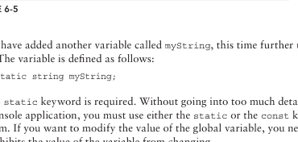

图 6-5

在这里，你添加了另一个名为 `myString` 的变量，这次它位于代码名称层次结构的更高层。该变量定义如下：

```
static string myString;
```

同样，`static` 关键字是必需的。这里不过多深入细节，只需理解在这种类型的控制台应用程序中，对于这种形式的全局变量，你必须使用 `static` 或 `const` 关键字。如果你想修改全局变量的值，则需要使用 `static`，因为 `const` 禁止变量的值被更改。

为了将该变量与 `Main()` 和 `Write()` 中同名的局部变量区分开来，你必须使用完全限定名来限定变量名，如第 3 章所述。这里，你将全局版本称为 `Program.myString`。只有当全局变量和局部变量同名时才有此必要；如果没有局部变量 `myString`，你可以直接使用 `myString` 来引用全局变量，而不必使用 `Program.myString`。当局部变量与全局变量同名时，称全局变量被隐藏了。

全局变量的值在 `Main()` 中通过以下代码设置：

```
Program.myString = "Global string";
```

并在 `Write()` 中通过以下代码访问：

```
WriteLine($"Global myString = {Program.myString}");
```

你可能想知道为什么不用这种技术与函数交换数据，而不是使用前面展示的参数传递。在某些情况下，这确实是一种可以接受的数据交换方式，例如，如果你编写一个用作插件或较大项目中短脚本的单一对象。然而，在许多场景下这并不是一个好主意。使用全局变量最常见的问题与并发管理有关。例如，一个全局变量可以被类中的许多方法或不同线程写入和读取。如果许多线程和方法都可以写入该全局变量，你能确定其中的值包含有效数据吗？如果没有一些额外的同步代码，答案很可能是否定的。此外，随着时间的推移，全局变量的实际意图可能会被遗忘，并在以后出于其他原因被使用。因此，是否使用全局变量的选择取决于所讨论函数的预期用途。

使用全局变量的问题在于，它们通常不适用于“通用”函数，这些函数应该能够处理你提供的任何数据，而不仅仅是特定全局变量中的数据。稍后你将更深入地了解这一点。

## 其他结构中的变量作用域

上一节中提出的其中一点在函数之间的变量作用域之外还有影响：变量的作用域包括它们被定义所在的代码块以及任何直接嵌套的代码块。你可以在本章下载的 VariableScopeInLoops\Program.cs 中找到接下来讨论的代码。这也适用于其他代码块，例如分支和循环结构中的代码块。考虑以下代码：

```
int i;
for (i = 0; i < 10; i++)
{
    string text = "Line " + Convert.ToString(i);
    WriteLine($"{text}");
}
WriteLine($"Last text output in loop: {text}");
```

这里，字符串变量 `text` 是 `for` 循环的局部变量。这段代码无法编译，因为循环外部的 `WriteLine()` 调用试图使用变量 `text`，而 `text` 在循环外部超出作用域。尝试按如下方式修改代码：

```
int i;
string text;
for (i = 0; i < 10; i++)
{
    text = "Line " + Convert.ToString(i);
    WriteLine($"{text}");
}
WriteLine($"Last text output in loop: {text}");
```

这段代码也会失败，因为变量必须先声明并初始化后才能使用，而 `text` 只在 `for` 循环中初始化。当退出循环块时，赋给 `text` 的值会丢失，因为它在块外部未被初始化。但是，你可以进行以下修改：

```
int i;
string text = "";
```


需要考虑的重要变量，以及在函数完成时 val2 将被赋予一个新值。相反，如果这个函数没有参数，那么你就无法对它所操作的数据做出任何假设。

可以随意使用这两种技术来交换数据。通常，应使用参数而不是全局数据；不过，某些情况下全局数据可能更合适，使用该技术也绝不算错误。

## MAIN() 函数

现在你已经了解了创建和使用函数时使用的大部分简单技术，是时候仔细看看 Main() 函数了。

前面你看到 Main() 是 C# 应用程序的入口点，该函数的执行涵盖了应用程序的执行。也就是说，当执行启动时，Main() 函数开始执行；当 Main() 函数结束时，执行终止。

Main() 函数可以返回 void 或 int，并且可以选择包含一个 string[] args 参数，因此你可以使用以下任何版本：

```csharp
static void Main()
static void Main(string[] args)
static int Main()
static int Main(string[] args)
```

第三个和第四个版本返回一个 int 值，该值可用于表示应用程序的终止方式，通常用作错误指示（尽管这绝不是强制性的）。一般来说，返回值为 0 表示正常终止（即应用程序已完成，可以安全地终止）。

Main() 的可选 args 参数为你提供了一种在运行时从应用程序外部获取信息的方式。这些信息采用命令行参数的形式。

当控制台应用程序执行时，任何指定的命令行参数都会被放入 args 数组中。然后你可以在应用程序中使用这些参数。下面的“试一试”演示了这一点。你可以指定任意数量的命令行参数，每个参数都会输出到控制台。

### 试一试：命令行参数：Ch06Ex04\Program.cs

1. 创建一个名为 Ch06Ex04 的新控制台应用程序，并将其保存到目录 C:\BegVCSharp\Chapter06 中。
2. 在 Program.cs 中添加以下代码：

```csharp
class Program
{
    static void Main(string[] args)
    {
        WriteLine($"{args.Length} command line arguments were specified:");
        foreach (string arg in args)
```

## 2.3 数据链路层

在学完物理层之后，我们了解了数字信号如何在介质中传输。本章我们将目光聚焦在一种很常见的局域网——以太网（Ethernet）上，学习它的数据链路层的寻址方式、帧格式，以及以太网交换机的工作原理。接着，我们将学习更普遍的数据链路层协议，包括差错检测方法、可靠传输机制以及它们不断演进的历程。最后，我们还会学习广域网中的数据链路层协议，包括高级数据链路控制（HDLC）和点对点协议（PPP）。

本章首先学习数据链路层的基本概念，认识逻辑链路控制（LLC）子层和介质访问控制（MAC）子层的区别与联系。然后，我们将深入研究以太网，学习以太网的帧结构、MAC地址、以及交换机的工作方式。接着，我们将介绍差错检测的基本方法，包括奇偶校验、循环冗余校验（CRC）等，并探讨可靠传输的几种实现机制，例如停止-等待协议、后退N帧协议和选择重传协议。最后，我们将学习广域网中的数据链路层协议，了解HDLC和PPP协议的工作原理。

本章的思维导图如下。

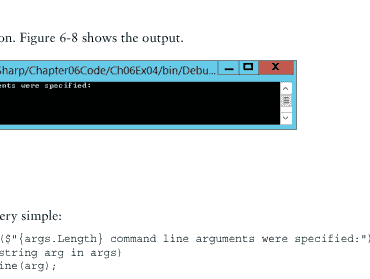

你只是像使用任何其他字符串数组一样使用 args 参数。你没有对这些参数做任何特殊处理，只是将指定的内容写到屏幕上。你通过 IDE 中的项目属性提供了参数。这样，每次从 IDE 运行应用程序时，都可以使用相同的命令行参数，而不必每次都在命令行提示符处输入。也可以通过在与项目输出相同的目录（C:\BegCSharp\Chapter06\Ch06Ex04\Ch06Ex04\bin\Debug）中打开命令提示符窗口并输入以下内容来获得相同的结果：

```
Ch06Ex04 256 myFile.txt "a longer argument"
```

每个参数之间用空格分隔。若要提供包含空格的参数，可以用双引号将其括起来，这样可以防止它被解释为多个参数。

## 结构函数

上一章介绍了用于在同一个位置存储多个数据元素的 struct 类型。实际上，struct 的功能远不止于此。例如，它们既可以包含数据，也可以包含函数。起初这可能看起来有点奇怪，但实际上非常有用。举一个简单的例子，考虑以下 struct：

```csharp
struct CustomerName
{
    public string firstName, lastName;
}
```

如果你有一个 CustomerName 类型的变量，并且想要向控制台输出全名，则必须从其组成部分构建名称。例如，对于一个名为 myCustomer 的 CustomerName 变量，你可能会使用以下语法：

```csharp
CustomerName myCustomer;
myCustomer.firstName = "John";
myCustomer.lastName = "Franklin";
WriteLine($"{myCustomer.firstName} {myCustomer.lastName}");
```

通过向 struct 添加函数，可以通过集中处理常见任务来简化此操作。例如，你可以向 struct 类型添加一个合适的函数，如下所示：

```csharp
struct CustomerName
{
    public string firstName, lastName;
    public string Name() => firstName + " " + lastName;
}
```

这看起来与本章中见到的其他函数非常相似，只是没有使用 static 修饰符。其中的原因将在本书后面变得清晰；目前，它是

```csharp
if (doubleArray[i] > maxVal)
    maxVal = doubleArray[i];
}
return maxVal;
}
```

这里的区别在于你使用的是 double 值。函数名 MaxValue() 相同，但（关键在于）其签名不同。这是因为函数的签名（如前所述）同时包含函数名称及其参数。定义两个具有相同签名的函数将是一个错误，但由于这两个函数具有不同的签名，因此没问题。

> 注意 函数的返回类型不是其签名的一部分，因此不能定义两个仅返回类型不同的函数；否则它们将具有相同的签名。

添加上述代码后，你有了两个版本的 MaxValue()，它们分别接受 int 和 double 数组，并分别返回 int 或 double 类型的最大值。

这类代码的妙处在于你不必显式指定要使用这两个函数中的哪一个。你只需提供一个数组参数，正确的函数会根据所用参数的类型执行。

还要注意 Visual Studio 中 IntelliSense 功能的另一个方面：当你在应用程序中有了前面显示的两个函数，然后继续键入函数名（例如 Main()）时，IDE 会显示该函数的可用重载。例如，如果你键入

```csharp
double result = MaxValue(
```

IDE 会给出两个 MaxValue() 版本的信息，你可以使用向上和向下箭头键在它们之间滚动，如图 6-9 所示。

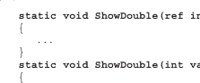

图 6-9

重载函数时包含函数签名的所有方面。例如，你可能有两个不同的函数，一个按值传递参数，另一个按引用传递参数：

```csharp
static void ShowDouble(ref int val)
{
    ...
}
static void ShowDouble(int val)
{
    ...
}
```

## 关于学生学习实验中主动学习的评估

这是一篇根据 ACS AuthorChoice 许可协议开放获取的文章，该许可允许出于非商业目的复制和重新分发文章或任何改编版本。

**引用本文：** *J. Chem. Educ.* 2024, 101, 12, 5102–5112

**在线阅读**

**文章推荐**

**摘要：** 主动学习在 STEM 教育中引起了广泛关注，但在学生学习实验中对其实施评估仍然是一个挑战。本文提出了一个用于评估本科化学实验室课程中主动学习的框架，重点关注实验设计、数据分析和学生反思。该框架整合了定性和定量措施，提供了学生参与度和学习成果的整体视图。一项试点研究的结果证明了该框架在识别主动学习实施中的优势和需要改进的领域方面的实用性。

### 1. 引言

主动学习被广泛认为是提高科学教育中学生理解和记忆保持的一种手段。在实验室环境中，主动学习鼓励学生直接参与实验过程，培养批判性思维和解决问题的能力。然而，评估这些方法的有效性存在重大的方法论挑战。传统评估方法往往无法捕捉学生参与主动学习任务时的细微差别。

本研究中提出的框架通过结合学生行为直接观察、实验报告分析和学生自我反思来应对这些挑战。这种多方面的方法允许对主动学习成果进行全面评估，包括认知和情感领域。该评估框架旨在适应不同的实验室课程和机构环境。


```csharp
double param2 = ToDouble(input.Substring(commaPos + 1,
                                          input.Length - commaPos - 1));
```

> **注意** 为演示目的，此处未包含任何用户输入验证。  
> 如果这是“真实”的代码，你将花费更多时间确保本地 `param1` 和 `param2` 变量中具有有效值。

接下来，你要求用户对这些数字进行乘法或除法运算：

```csharp
WriteLine("Enter M to multiply or D to divide:");
input = ReadLine();
```

基于用户的选择，你初始化 process 委托变量：

```csharp
if (input == "M")
    process = new ProcessDelegate(Multiply);
else
    process = new ProcessDelegate(Divide);
```

将函数引用分配给委托变量时，你使用略显奇怪的语法。类似于为数组赋值，你可以使用 new 关键字创建一个新的委托。在此关键字之后，你指定委托类型并提供一个参数，该参数引用你想要使用的函数——即 `Multiply()` 或 `Divide()` 函数。此参数与委托类型或目标函数的参数不匹配；它是委托赋值特有的语法。该参数只是要使用的函数名称，不带任何括号。

事实上，如果你愿意，这里可以使用稍微简单一些的语法：

```csharp
if (input == "M")
    process = Multiply;
else
    process = Divide;
```

编译器识别出 process 变量的委托类型与这两个函数的签名匹配，并自动为你初始化一个委托。你使用哪种语法取决于你，尽管有些人更喜欢使用长格式版本，因为这样一眼就能看出发生了什么。

最后，使用委托调用所选函数。无论委托引用哪个函数，相同的语法都适用：

```csharp
WriteLine($"Result: {process(param1, param2)}");
ReadKey();
}
```

在这里，你将委托变量视为函数名。不同于函数，你还可以对该变量执行其他操作，例如通过参数将其传递给函数，如以下简单示例所示：

```csharp
static void ExecuteFunction(ProcessDelegate process)
    => process(2.2, 3.3);
```

## 本章学到的内容

| 主题 | 关键概念 |
|---|---|
| 定义函数 | 函数使用名称、零个或多个参数以及返回类型来定义。函数的名称和参数共同定义了函数的签名。可以定义多个名称相同但签名不同的函数——这称为 `function overloading`。函数也可以在 `struct` 类型内定义。 |
| 返回值和参数 | 函数的返回类型可以是任意类型，如果函数不返回值则为 `void`。参数也可以是任意类型，由类型和名称对的逗号分隔列表组成。可变数量的指定类型参数可以通过参数数组指定。参数可以指定为 `ref` 或 `out` 参数，以便向调用方返回值。在调用函数时，指定的任何参数都必须在类型和顺序上与定义中的参数匹配，并且如果在参数定义中使用了这些关键字，则必须包含匹配的 `ref` 和 `out` 关键字。 |
| 变量作用域 | 变量的作用域根据其定义的代码块确定。代码块包括方法以及其他结构，例如循环体。可以定义多个名称相同但作用域不同的独立变量。 |
| 命令行参数 | 控制台应用程序中的 `Main()` 函数可以在执行时接收传递给应用程序的命令行参数。执行应用程序时，这些参数由空格分隔的参数指定，并且较长的参数可以用引号括起来。 |
| 委托 | 除了直接调用函数外，还可以通过委托调用它们。委托是使用返回类型和参数列表定义的变量。给定的委托类型可以匹配任何返回类型和参数与委托定义匹配的方法。 |

然后，你将学习 C# 中可用的错误处理技术。这些技术使你能够在可能出现错误的情况下采取预防措施，并编写足够健壮的代码以应对可能致命的错误。这些技术是 C# 语言的一部分，而非调试功能，但 IDE 也提供了一些工具来帮助你。

## Visual Studio 中的调试

之前，你学习了可以用两种方式执行应用程序：启用调试或不启用调试。默认情况下，从 Visual Studio (VS) 执行应用程序时，它会启用调试。例如，按 F5 或单击工具栏中的绿色开始箭头时就会发生这种情况。要在不启用调试的情况下执行应用程序，请选择 Debug ▸ Start Without Debugging，或按 Ctrl+F5。

Visual Studio 允许你在多种配置中构建应用程序，包括 Debug（默认）和 Release。你可以使用标准工具栏中的解决方案配置下拉菜单在这些配置之间切换。

当你在调试配置中构建应用程序并在调试模式下执行它时，发生的不仅仅是代码的执行。调试构建维护有关应用程序的符号信息，以便 IDE 在执行每一行代码时确切知道发生了什么。符号信息意味着跟踪例如未编译代码中使用的变量名称，以便它们可以与编译后的机器代码应用程序中的值匹配，而后者不会包含此类人类可读信息。此信息包含在 .pdb 文件中，你可能在计算机的 Debug 目录中见过它们。

在发布配置中，应用程序代码会被优化，并且你无法执行这些操作。然而，发布构建运行速度也更快；当你完成应用程序的开发后，通常会向用户提供发布构建，因为它们不需要调试构建包含的符号信息。

本节描述了你可以用来识别和修复不符合预期的代码区域的调试技术，这一过程称为调试。这些技术根据其使用方式分为两个部分。一般来说，调试是通过中断程序执行或记录以供以后分析来进行的。在 Visual Studio 术语中，应用程序要么正在运行，要么处于中断模式——即正常执行被暂停。你将首先查看非中断模式（运行或正常）技术。

### 非中断（正常）模式下的调试

本书中你一直使用的一项命令是 WriteLine() 函数，它将文本输出到控制台。在开发应用程序时，此函数对于获取有关操作的额外反馈非常有用：

```csharp
WriteLine("MyFunc() Function about to be called.");
MyFunc(); // Do something.
WriteLine("MyFunc() Function execution completed.");
```

此代码片段展示了如何获取有关名为 MyFunc() 的函数的额外信息。这很好，但它会使控制台输出有点杂乱；而且当你开发其他类型的应用程序，例如桌面应用程序时，你将没有控制台来输出信息。作为替代方案，你可以将文本输出到单独的位置——IDE 中的输出窗口。

第 2 章描述了错误列表窗口，提到其他窗口也可以显示在同一位置。其中之一是输出窗口，对调试非常有用。要显示此窗口，请选择 View ▸ Output。此窗口提供与代码编译和执行相关的信息，包括编译期间遇到的错误。你还可以通过直接写入它来使用此窗口，如图 7-1 所示，以显示自定义诊断信息。

> **注意** 输出窗口包含一个下拉菜单，可以从中选择不同的模式，包括 Build、Deployment 和 Debug。这些模式分别显示编译和运行时信息。当你在本节中读到“写入输出窗口”时，它实际上是指“写入输出窗口的调试模式视图”。

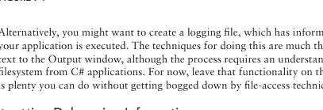

图 7-1

另外，你可能想要创建一个日志文件，在应用程序执行时向其中追加信息。执行此操作的技巧与将文本写入输出窗口的技巧非常相似，尽管该过程需要了解如何从 C# 应用程序访问文件系统。现在将该功能搁置一旁，因为在陷入文件访问技术之前，你可以做很多事情。

### 输出调试信息

在运行时向输出窗口写入文本很容易。你只需将 WriteLine() 的调用替换为所需的位置写入文本的调用即可。有两个命令可用于此操作：

- `Debug.WriteLine()`
- `Trace.WriteLine()`

这些命令在几乎完全相同的方式下运行，只有一个关键区别——前者仅在调试构建中工作；后者也适用于发布构建。事实上，Debug.WriteLine() 命令甚至不会被编译到发布构建中；它只是消失了，这无疑有其优势（例如，编译后的代码会更小）。

> 注意 Debug.WriteLine() 和 Trace.WriteLine() 方法都包含在 System.Diagnostics 命名空间中。using static 指令只能与静态类一起使用，例如包含 WriteLine() 方法的 System.Console。

这些函数的工作方式与 WriteLine() 并不完全相同。它们仅使用一个字符串参数来输出消息，而不是让你使用 {x} 语法插入变量值。这意味着你必须使用替代技术将变量值嵌入字符串中——例如，+ 拼接运算符。你也可以（可选地）提供第二个字符串参数，它会为输出文本显示一个类别。这使你能够一目了然地看到在输出窗口中显示哪些输出消息，当相似的消息从应用程序的不同位置输出时，这很有用。

这些函数的一般输出如下：

```
<category>: <message>
```

例如，以下语句，其可选类别参数为 "MyFunc"，

```
Debug.WriteLine("Added 1 to i", "MyFunc");
```

会产生以下结果：

```
MyFunc: Added 1 to i
```

下一个“试一试”演示了以这种方式输出调试信息。

## 试一试 将文本写入输出窗口：Ch07Ex01\Program.cs

- 1. 创建一个名为 Ch07Ex01 的新控制台应用程序并将其保存在目录 C:\BegVCSharp\Chapter07 中。
- 2. 按如下方式修改代码：

```
using System;
using System.Collections.Generic;
using System.Diagnostics;
using System.Linq;
using System.Text;
using System.Threading.Tasks;
using static System.Console;

namespace Ch07Ex01
{
    class Program
    {
        static void Main(string[] args)
        {
            int[] testArray = {4, 7, 4, 2, 7, 3, 7, 8, 3, 9, 1, 9};
            int[] maxValIndices;
            int maxVal = Maxima(testArray, out maxValIndices);
            WriteLine($"Maximum value {maxVal} found at element indices:");
            foreach (int index in maxValIndices)
            {
                WriteLine(index);
            }
            ReadKey();
        }

        static int Maxima(int[] integers, out int[] indices)
        {
            Debug.WriteLine("Maximum value search started.");
            indices = new int[1];
            int maxVal = integers[0];
            indices[0] = 0;
            int count = 1;
            Debug.WriteLine(string.Format(
                $"Maximum value initialized to {maxVal}, at element index 0."));
            for (int i = 1; i < integers.Length; i++)
            {
                Debug.WriteLine(string.Format(
                    $"Now looking at element at index {i}."));
                if (integers[i] > maxVal)
                {
                    maxVal = integers[i];
                    count = 1;
                    indices = new int[1];
                    indices[0] = i;
                    Debug.WriteLine(string.Format(
                        $"New maximum found. New value is {maxVal}, at element index {i}."));
                }
                else
                {
                    if (integers[i] == maxVal)
                    {
                        count++;
                        int[] oldIndices = indices;
                        indices = new int[count];
                        oldIndices.CopyTo(indices, 0);
                        indices[count - 1] = i;
                        Debug.WriteLine(string.Format(
                            $"Duplicate maximum found at element index {i}."));
                    }
                }
            }
            Trace.WriteLine(string.Format(
                $"Maximum value {maxVal} found, with {count} occurrences."));
            Debug.WriteLine("Maximum value search completed.");
            return maxVal;
        }
    }
}
```

```
indices[count - 1] = i;
Debug.WriteLine(string.Format(
    $"Duplicate maximum found at element index {i}."));
}
```

这通过将旧的 indices 数组备份到 oldIndices 中来实现，oldIndices 是此 if 代码块本地的整数数组。请注意，oldIndices 中的值使用 `<array>.CopyTo()` 函数复制到新的 indices 数组中。该函数只需采用目标数组和用于复制的第一个元素的索引，然后将所有值粘贴到目标数组中。

在整个代码中，使用 Debug.WriteLine() 和 Trace.WriteLine() 函数输出各种文本。这些函数使用 string.Format() 函数以与 WriteLine() 相同的方式将变量值嵌入字符串中。这比使用 + 拼接运算符更高效一些。

当你在调试模式下运行应用程序时，你会在循环中看到产生结果所采取步骤的完整记录。在发布模式下，你只会看到计算结果，因为发布构建中不会进行对 Debug.WriteLine() 的调用。

## 跟踪点

一种替代向输出窗口写入信息的替代方法是使用 *tracepoints*。这些是 Visual Studio 的功能，而不是 C# 的功能，但它们与使用 Debug.WriteLine() 具有相同的功能。本质上，它们使你能够在不修改代码的情况下输出调试信息。

为了演示跟踪点，你可以使用它们来替换前一个示例中的调试命令。 （请参阅本章下载代码中的 Ch07Ex01TracePoints 文件。）添加跟踪点的过程如下：

- 1. 将光标定位在想要插入跟踪点的行上。跟踪点将在执行此行代码 *before* 处理。
- 2. 右键单击代码行并选择 Breakpoint → Insert Tracepoint。右键单击放置在代码行旁边的红色圆圈并选择 Settings 菜单项。
- 3. 选中 Actions 复选框，并在 Log a message 部分的 Message 文本框中输入要输出的字符串。如果要输出变量值，请将变量名用大括号括起来。
- 4. 单击 OK。包含跟踪点的代码行左侧会出现一个红色菱形，并且该代码行本身显示为红色。

正如添加跟踪点的对话框标题和所需的菜单选择所暗示的那样，跟踪点是一种断点形式（如果需要，可以像断点一样导致应用程序执行暂停）。你稍后会在本章中看到断点，它们通常用于更高级的调试目的。

图 7-4 显示了 Ch07Ex01TracePoints 的第 32 行所需的跟踪点，其中行号适用于删除现有 Debug.WriteLine() 语句后的代码。

## 诊断输出与跟踪点对比

现在你已经看到了输出本质上相同信息的两种方法，请考虑每种方法的优缺点。首先，跟踪点没有 Trace 命令的等效项；也就是说，使用跟踪点无法在发布构建中输出信息。这是因为跟踪点不包含在你的应用程序中。跟踪点由 Visual Studio 处理，因此在编译后的应用程序版本中不存在。只有当你的应用程序在 Visual Studio 调试器中运行时，你才会看到跟踪点在起作用。

跟踪点的主要缺点也是其主要优点，即它们存储在 Visual Studio 中。这使得它们可以快速轻松地根据需要添加到你的应用程序中，但也使得它们很容易被删除。删除跟踪点只需单击指示其位置的红色菱形即可，如果你输出的是复杂的信息字符串，这可能会很烦人。

不过，跟踪点的一个好处是可以轻松添加额外的信息，例如 $FUNCTION，它会将当前函数名称添加到输出消息中。虽然使用 Debug 和 Trace 命令编写的代码也可以获得此信息，但获取起来更棘手。总结来说，使用这两种输出调试信息的方法如下：

- **Diagnostics output** — 在调试输出是你始终希望从应用程序输出的内容时使用，特别是当你想要输出的字符串很复杂，涉及多个变量或大量信息时。此外，如果你希望在发布模式下构建的应用程序执行期间输出，Trace 命令通常是唯一的选择。
- **Tracepoints** — 在调试应用程序时使用，以快速输出可能有助于你解决语义错误的重要信息。

## 中断模式下的调试

本章描述的其余调试技术在中断模式下工作。此模式可以通过多种方式进入，所有方式都会以某种方式使程序暂停。

### 进入中断模式

进入中断模式的最简单方法是当应用程序运行时单击 IDE 中的暂停按钮。此暂停按钮位于 Debug 工具栏上，你应该将其添加到 Visual Studio 默认出现的工具栏中。为此，右键单击工具栏区域并选择 Debug。图 7-6 显示了出现的 Debug 工具栏。


工具栏上的前三个按钮允许手动控制中断。在图 7-6 中，这些按钮呈灰色，因为它们不适用于当前未执行的程序。以下各节根据需要描述其余按钮。


当应用程序运行时，工具栏会更改为如图 7-7 所示的外观。


同样，调试版本只会编译到调试生成中。

这些函数需要三个参数。第一个是布尔值，值为 false 时会触发断言。第二个和第三个是字符串参数，用于将信息写入弹出对话框和“输出”窗口。前面的示例需要如下的函数调用：

```
Debug.Assert(myVar < 10, "myVar is 10 or greater.",
    "Assertion occurred in Main().");
```

断言在用户采用应用程序的早期阶段通常很有用。你可以发布包含 Trace.Assert() 函数的应用程序发布版本来持续监控情况。如果断言被触发，用户会得到通知，并且此信息可以传递给你。然后，即使你不知道问题是如何发生的，也能确定哪里出了问题。

例如，你可以在第一个字符串中提供错误的简要描述，并在第二个字符串中提供下一步操作的说明：

```
Trace.Assert(myVar < 10, "Variable out of bounds.",
    "Please contact vendor with the error code KCW001.");
```

如果此断言发生，用户将看到如图 7-9 所示的对话框。

诚然，这并不是世界上最友好的对话框，因为它包含大量可能让用户困惑的信息，但如果用户向你发送错误截图，你就能快速查明问题。

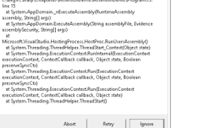

图 7-9

现在是时候来看看在应用程序执行暂停并进入中断模式后，你实际上可以做什么了。通常，你进入中断模式是为了查找代码中的错误（或者为了确认一切工作正常）。一旦进入中断模式，你可以使用各种技术，所有这些技术都让你能够分析代码以及应用程序在执行暂停点的确切状态。

## 监视变量内容

监视变量内容只是 Visual Studio 通过简化操作来提供大量帮助的一个例子。检查变量值最简单的方法是在中断模式下将鼠标悬停在源代码中的变量名上。此时会出现一个工具提示，显示有关该变量的信息，包括变量的当前值。

你还可以用同样的方式高亮整个表达式，以获取其结果信息。对于更复杂的值（例如数组），你甚至可以在工具提示中展开值，以查看各个元素项。

你可以将这些工具提示窗口固定到代码视图上，如果你对某个变量特别感兴趣，这会很有用。固定的工具提示会保留，因此即使你停止并重新启动调试，它们仍然可用。你还可以向固定的工具提示添加注释、移动它们，并且即使应用程序未运行，也能看到最后一个变量的值。

你可能已经注意到，运行应用程序时，IDE 中各个窗口的布局会发生变化。默认情况下，运行时可能出现以下变化（具体行为可能因安装而略有不同）：

- 属性窗口消失，其他一些窗口也可能消失，可能包括解决方案资源管理器窗口。
- 错误列表窗口被 IDE 窗口底部两个新窗口取代。
- 新窗口中出现几个新选项卡。

新的屏幕布局如图 7-10 所示。这可能与你的显示不完全一致，某些选项卡和窗口的外观也可能不完全相同，但后文所述这些窗口的功能是相同的，并且你可以通过“视图”菜单和“调试窗口”菜单（在中断模式下）以及拖动窗口在屏幕上重新定位来自定义此显示。

出现在左下角的新窗口对调试特别有用。它使你能在中断模式下监视应用程序中变量的值：

- 自动（Autos）— 当前和先前语句中使用的变量（Ctrl+D, A）
- 局部变量（Locals）— 作用域内的所有变量（Ctrl+D, L）
- 监视 N（Watch N）— 可自定义的变量和表达式显示（其中 N 为 1 到 4，位于“调试窗口”菜单的“监视”下）

所有这些选项卡的工作方式大致相同，并具有取决于其特定功能的各种附加功能。通常，每个选项卡都包含一个变量列表，其中包含每个变量的名称、值和类型信息。对于更复杂的变量（例如数组），可以使用变量名称左侧的 + 和 - 树形展开/折叠符号进一步查看，从而以树状视图查看其内容。例如，图 7-11 显示的是通过在示例代码中放置断点而得到的“局部变量”选项卡。它显示了数组变量 maxValIndices 之一的展开视图。

第六、第七和第八个图标控制中断模式下的程序流。它们依次如下：

- **逐语句** — 执行并移动到下一条要执行的语句。
- **逐过程** — 与逐语句类似，但不会进入嵌套代码块（包括函数）。
- **跳出** — 运行到代码块末尾，并在后面的语句处恢复中断模式。

要查看应用程序执行的每一项操作，你可以使用“逐语句”按顺序跟踪指令。这包括进入函数内部，例如前面示例中的 Maxima()。当光标到达第 17 行（即调用 Maxima() 的位置）时，单击此图标会使光标移动到 Maxima() 函数内的第一行。或者，当到达第 17 行时单击“逐过程”，光标会直接移动到第 18 行，而不会经过 Maxima() 中的代码（尽管这些代码仍会执行）。如果你确实进入了不感兴趣的函数，可以单击“跳出”返回调用该函数的代码。在逐步执行代码时，变量的值可能会发生变化。如果你关注前面讨论的监视窗口，就能清楚地看到这种情况的发生。

你还可以通过右键单击某行代码并选择“设置下一条语句”，或将黄色箭头拖到另一行代码来更改接下来要执行的代码行。这并不总是有效，例如在跳过变量初始化时。不过，这对于跳过有问题的代码行以查看会发生什么，或通过向后移动箭头来重复执行代码非常有用。

在存在语义错误的代码中，这些技术可能是你最有用的工具。你可以单步执行代码，直到预期出现问题的地方，错误会像正常运行程序一样产生。或者，你可以通过更改正在执行的代码使语句执行多次。在此过程中，你可以观察数据，看看到底哪里出了问题。本章稍后，你将逐步执行一些代码，以弄清示例应用程序中发生了什么。

## 即时窗口和命令窗口

命令窗口和即时窗口（位于“调试窗口”菜单中）使你能在应用程序运行时执行命令。命令窗口允许你手动执行 Visual Studio 操作（如菜单和工具栏操作），即时窗口则允许你除了执行源代码行之外，还能执行额外代码并计算表达式。

这些窗口本质上是相互关联的。你甚至可以通过输入命令在它们之间切换——输入 immed 可从命令窗口切换到即时窗口，输入 cmd 可切换回去。

本节将重点介绍即时窗口，因为命令窗口只对复杂操作真正有用。此窗口最简单的用法是计算表达式，有点像一次性使用“监视”窗口。为此，请输入表达式并按回车键。随后将显示所请求的信息。图 7-15 显示了一个示例。

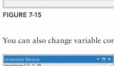

图 7-15

你还可以在此处更改变量内容，如图 7-16 所示。

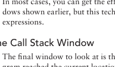

图 7-16

在大多数情况下，使用前面介绍的变量监视窗口可以更容易获得你想要的效果，但此技术对于调整值仍然很方便，并且适合测试表达式。

## 调用堆栈窗口

最后一个要查看的窗口是“调用堆栈”窗口，它显示程序到达当前位置的方式。简单来说，它显示当前函数以及调用它的函数、调用该函数的函数，依此类推（即嵌套函数调用列表）。调用发生的确切位置也会被记录。

在前面的示例中，在 Maxima() 中进入中断模式，或使用代码步进进入此函数，会显示图 7-17 所示的信息。

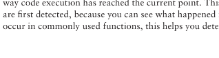

图 7-17

如果双击某个条目，将转到相应位置，从而让你能够跟踪代码执行到达当前点的方式。此窗口在首次检测到错误时特别有用，因为你可以看到错误发生前的情况。当错误发生在常用函数中时，这有助于你确定错误的来源。


- 如果存在 `catch` 块但没有匹配项，则会检查其他 `catch` 块。
- 如果 `catch` 块与异常类型匹配并且存在导致 `true` 的异常筛选器，则其中的代码会执行，然后执行 `finally` 块（如果存在）。
- 如果 `catch` 块与异常类型匹配并且没有异常筛选器，则其中包含的代码会执行，然后如果存在则执行 `finally` 块。
- 如果没有 `catch` 块与异常类型匹配，则如果存在则执行代码的 `finally` 块。

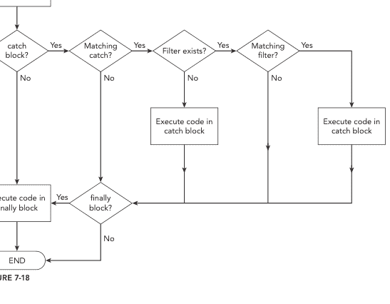

## 图 7-18

> **NOTE** 如果存在两个处理相同异常类型的 `catch` 块，则只有异常筛选器结果为 `true` 的 `catch` 块内的代码会被执行。如果还存在处理相同异常类型的 `catch` 块，且该块没有异常筛选器或异常筛选器结果为 `false`，则会被忽略。只有一个 `catch` 块的代码会被执行，且 `catch` 块的顺序不影响执行流程。

以下“试一试”演示了异常处理。它以多种方式展示了抛出和处理异常，以便你了解其工作原理。

## 试一试 异常处理：Ch07Ex02\Program.cs

- 1. 创建一个新的控制台应用程序，命名为 Ch07Ex02，并将其保存在目录 C:\BegVCSharp\Chapter07 中。
- 2. 按如下方式修改代码（此处显示的行号注释将帮助你在之后将代码与讨论对应起来，并且它们已在可下载代码中重复提供以方便你使用）：

```
class Program
{
    static string[] eTypes = { "none", "simple", "index",
        "nested index", "filter" };
    static void Main(string[] args)
    {
        foreach (string eType in eTypes)
        {
            try
            {
                WriteLine("Main() try block reached.");          // Line 21
                WriteLine($"ThrowException(\"{eType}\") called.");
                ThrowException(eType);
                WriteLine("Main() try block continues.");       // Line 23
            }
            catch (System.IndexOutOfRangeException e) when (eType == "filter")
            {
                WriteLine("Main() FILTERED System.IndexOutOfRangeException" +
                    $" catch block reached. Message:\n{e.Message}\n");
            }
            catch (System.IndexOutOfRangeException e)          // Line 32
            {
                WriteLine("Main() System.IndexOutOfRangeException catch " +
                    $"block reached. Message:\n{e.Message}\n");
            }
            catch                                           // Line 36
            {
                WriteLine("Main() general catch block reached.");
            }
            finally
            {
                WriteLine("Main() finally block reached.");
            }
            WriteLine();
        }
        ReadKey();
    }
    static void ThrowException(string exceptionType)
```

- 3. 运行应用程序。结果如 图 7-19 所示。

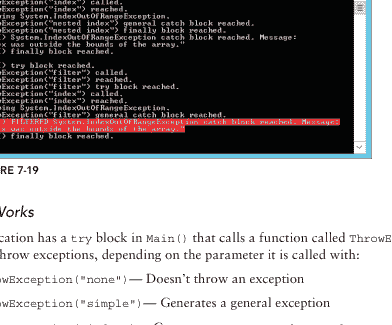

## 图 7-19

## 工作原理

该应用程序在 Main() 中有一个 try 块，它调用一个名为 ThrowException() 的函数。此函数可能会抛出异常，具体取决于调用时使用的参数：

- ThrowException("none") — 不会抛出异常
- ThrowException("simple") — 生成一个通用异常
- ThrowException("index") — 生成 System.IndexOutOfRangeException 异常
- ThrowException("nested index") — 包含自己的 try 块，其中包含调用 ThrowException("index") 以生成 System.IndexOutOfRangeException 异常的代码
- ThrowException("filter") — 包含自己的 try 块，其中包含调用 ThrowException("index") 以生成 System.IndexOutOfRangeException 异常的代码，其中异常筛选器的结果为 true。

这些字符串参数都保存在全局 eTypes 数组中，该数组在 Main() 函数中被遍历，以便使用每个可能的参数调用一次 ThrowException()。在此迭代期间，会向控制台写入各种消息以指示正在发生的情况。此代码为你提供了使用本章前面所示的代码逐步执行技术的绝佳机会。通过一次一行地逐步执行代码，你可以准确地看到代码执行的进展。

在代码的第 21 行添加一个新的断点（使用默认属性），其内容如下：

```
WriteLine("Main() try block reached.");
```

> **NOTE** 代码的引用是按其在可下载版本中出现的行号进行的。如果你关闭了行号，请记住你可以重新打开它们（选择 Tools → Options，然后在 Text Editor → C# → General 选项部分更改 Line numbers 设置）。前面的代码中包含注释，以便你无需打开文件即可跟随文本。

通过 `catch` 块的参数抛出异常）。再次逐步执行会带你进入 `finally` 块（但不会进入第二个 `catch` 块，因为异常已被处理）并返回到循环中，再次在第 23 行调用 `ThrowException()`。

当你到达 `ThrowException()` 中的 `switch` 结构时，这次你进入一个新的 `try` 块，从第 66 行开始。当你到达第 71 行时，你执行对 `ThrowException()` 的嵌套调用，这次参数为 "index"。你可以使用 Step Over 按钮跳过此处执行的代码行，因为你已经经过它们了。如前所述，这会生成一个 `System.IndexOutOfRangeException` 异常，但这次它在嵌套的 `try...catch...finally` 结构中被处理，即 `ThrowException()` 中的结构。此结构没有对此类异常的显式匹配，因此通用 `catch` 块（从第 73 行开始）处理它。

继续逐步执行代码，当你再次到达 `ThrowException()` 中的 `switch` 结构时，你进入从第 86 行开始的新 `try` 块。当你到达第 91 行时，你执行与之前相同的嵌套调用 `ThrowException()`。然而，这次当 `Main()` 中处理 `System.IndexOutOfRangeException` 的 `catch` 块检查筛选器表达式（`eType == "filter"`）时，结果为 true，并且该 `catch` 块被执行，而不是没有异常筛选器的处理 `System.IndexOutOfRangeException` 的 `catch` 块。

与之前的异常处理一样，你现在逐步执行此 `catch` 块和关联的 `finally` 块，并到达函数调用的末尾，但有一个关键区别。虽然抛出了异常，但它也被处理了——由 `ThrowException()` 中的代码处理。这意味着 `Main()` 中没有剩余的异常需要处理，因此你直接进入 `finally` 块，此时应用程序终止。

## 列出和配置异常

.NET Framework 包含大量异常类型，你可以在自己的代码中自由抛出和处理这些异常。IDE 提供了用于检查和编辑可用异常的对话框，可以通过 Debug ▸ Exception Settings 菜单项调用（或按 Ctrl+Alt+E）。图 7-20 显示了 Exception Settings 对话框。

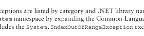

异常按类别和 .NET 库命名空间列出。你可以通过展开 Common Language Runtime Exceptions 加号来查看 `System` 命名空间中的异常。列表中包括你之前使用的 `System.IndexOutOfRangeException` 异常。

每个异常都可以使用异常类型旁边的复选框进行配置。选中后，调试器将在抛出异常时中断，即使是被处理的异常也会中断到调试器。

## 练习

7.1 “使用 Trace.WriteLine() 比使用 Debug.WriteLine() 更可取，因为 Debug 版本仅在调试构建中工作。”你同意这一说法吗？如果是，为什么？

7.2 提供一个简单应用程序的代码，其中包含一个循环，在 5,000 次循环后生成错误。使用断点在第 5,000 次循环导致错误之前进入中断模式。（注意：生成错误的一种简单方法是尝试访问不存在的数组元素，例如在包含 100 个元素的数组中访问 myArray[1000]。）

7.3 “finally 代码块仅在未执行 catch 块时执行。” 真或假？

7.4 给定以下代码中定义的枚举数据类型 orientation，编写一个应用程序，使用结构化异常处理（SEH）以安全的方式将字节类型变量转换为 orientation 类型变量。（注意：你可以使用 checked 关键字强制抛出异常，这里显示了一个示例。此代码应用于你的应用程序中。）

```
enum Orientation : byte
{
    North = 1,
    South = 2,
    East = 3,
    West = 4
}
myDirection = checked((Orientation)myByte);
```

这些练习的答案在附录 A 中。


## 属性和字段

属性和字段提供对对象中所含数据的访问。这些对象数据将不同对象区分开来，因为同一个类的不同对象可以在属性和字段中存储不同的值。

对象中包含的各种数据共同构成了该对象的状态。想象一个表示咖啡杯的类，名为 `CupOfCoffee`。当你实例化这个类（即创建该类的一个对象）时，必须为其提供一种状态，它才有意义。在这种情况下，你可以使用属性和字段，使使用该对象的代码能够设置所用咖啡的类型、咖啡是否含牛奶和/或糖、是否为速溶咖啡等。那么一个给定的咖啡杯对象就会具有给定的状态，例如“哥伦比亚滤挂咖啡，加牛奶和两块糖”。

字段和属性都是类型化的，因此你可以在其中存储字符串值、`int` 值等信息。然而，属性与字段的不同之处在于，属性不提供对数据的直接访问。对象可以使用户免受其数据中琐碎细节的影响，这些细节不必在现有属性中一一对应地表示。如果你使用字段来表示 `CupOfCoffee` 实例中的糖块数量，那么用户就可以在字段中放置任何他们喜欢的值，仅受用于存储此信息的类型限制。例如，如果你使用 `int` 存储此数据，那么用户可以使用 −2147483648 到 2147483647 之间的任何值，如第 3 章所示。显然，并非所有值都有意义，尤其是负数，而一些较大的正数可能需要一个非常大的杯子。如果你使用属性来存储此信息，你可以将此值限制为，比如说，0 到 2 之间的数字。

通常，对于状态访问，提供属性而非字段更好，因为你可以更好地控制各种行为。这一选择不会影响使用对象实例的代码，因为使用属性和字段的语法是相同的。

对象还可以明确地定义属性的读/写访问权限。某些属性可以是只读的，允许你查看它们的内容，但不能更改它们（至少不能直接更改）。这通常是同时读取多个状态片段的有用技术。你可以在 `CupOfCoffee` 类中有一个名为 `Description` 的只读属性，当被请求时，它返回一个表示该类实例状态的字符串（例如前面给出的字符串）。你可能能够通过查询多个属性来组装相同的数据，但这样的属性可以节省你的时间和精力。你可能也有以类似方式操作的只写属性。

除了属性的读写访问之外，你还可以为字段和属性指定一种不同的访问权限，称为可访问性。可访问性决定了哪些代码可以访问这些成员——即它们是可供所有代码访问（public），还是仅限类内代码访问（private），或者应使用更复杂的方案（本章稍后讲到相关内容时会更详细地介绍）。一种常见做法是将字段设为 private，并通过 public 属性提供对它们的访问。这意味着类内的代码可以直接访问字段中存储的数据，而 public 属性则隔离外部用户与此数据的接触，并防止他们向其中放置无效内容。公共成员被称为由类公开。

将其可视化的一个方法是把它等同于变量的作用域。例如，私有字段和属性可以被认为是拥有它们的对象所局部的，而公共字段和属性的作用域还包括对象外部的代码。

这些使得实例化对象的代码能够以多种方式创建对象，也许可以为对象中存储的数据提供初始值。

在 C# 中，使用 `new` 关键字调用构造函数。例如，你可以通过以下方式使用默认构造函数实例化一个 `CupOfCoffee` 对象：

```
CupOfCoffee myCup = new CupOfCoffee();
```

对象也可以使用非默认构造函数实例化。例如，`CupOfCoffee` 类可能有一个非默认构造函数，在实例化时使用参数来设置咖啡豆类型：

```
CupOfCoffee myCup = new CupOfCoffee("Blue Mountain");
```

构造函数与字段、属性和方法一样，可以是 public 或 private。类外部的代码不能使用私有构造函数实例化对象；它必须使用公共构造函数。通过这种方式，例如，你可以强制类的用户使用非默认构造函数（通过将默认构造函数设为 private）。

有些类没有公共构造函数，这意味着外部代码无法实例化它们（它们被称为不可创建的）。然而，这并不使它们完全无用，稍后你将看到这一点。

## 析构函数

析构函数由 .NET Framework 用于在对象之后进行清理。通常，你不必为析构函数方法提供代码；默认操作会为你完成这项工作。但是，如果在对象实例被删除之前需要完成任何重要的事情，你可以提供特定的指令。

例如，当变量超出作用域时，它可能无法从你的代码中访问；然而，它可能仍存在于你计算机内存中的某个地方。只有当 .NET 运行时执行其垃圾回收清理时，该实例才被完全销毁。

## 静态和实例类成员

除了具有特定于对象实例的成员（如属性、方法和字段）之外，类还可以具有静态（也称为共享，特别是对我们的 Visual Basic 同行来说）成员，因此它们可以是方法、属性或字段。静态成员在类的实例之间共享，因此可以被认为是给定类的对象的全局成员。静态属性和字段使你能够访问独立于任何对象实例的数据，而静态方法使你能够执行与类类型相关但不特定于对象实例的命令。实际上，使用静态成员时，你甚至不需要实例化对象。

例如，你一直在使用的 `Console.WriteLine()` 和 `Convert.ToString()` 方法是静态的。你完全不需要实例化 `Console` 或 `Convert` 类（事实上，如果你尝试，你会发现你无法做到，因为如前所述，这些类的构造函数不是公开可访问的）。

> **注意** 虚拟成员不能是私有的，因为这会导致一个悖论——你不能在说一个成员可由派生类重写的同时又说它无法从派生类访问。

在动物示例中，你可以将 `EatFood()` 设为 virtual，并在任何派生类上为其提供新的实现——例如，仅在 `Cow` 类上，如图 8-8 所示。这会在 `Animal` 和 `Cow` 类上显示 `EatFood()` 方法，以表示它们有自己的实现。

基类也可以定义为抽象类。抽象类不能直接实例化；要使用它，你需要继承它。抽象类可以拥有抽象成员，这些成员在基类中没有实现，因此必须在派生类中提供实现。如果 `Animal` 是抽象类，那么 UML 将如图 8-9 所示。

> **注意** 抽象类名称以斜体显示（或其方框使用虚线）。

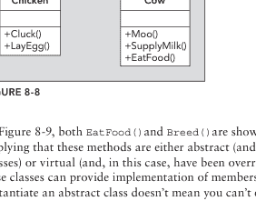

在图 8-9 中，`EatFood()` 和 `Breed()` 都显示在派生类 `Chicken` 和 `Cow` 中，这意味着这些方法要么是抽象的（因此必须在派生类中重写），要么是虚拟的（在这种情况下，已在 `Chicken` 和 `Cow` 中被重写）。当然，抽象基类可以提供成员的实现，这非常常见。你不能实例化抽象类这一事实并不意味着你不能在其中封装功能。


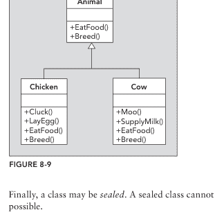

图 8-9

最后，类可以被密封。密封类不能用作基类，因此不可能有派生类。

C# 为所有对象提供了一个通用基类，名为 `object`（它是 .NET Framework 中 `System.Object` 类的别名）。你将在第 9 章中更深入地了解这个类。

> 注意 本章前面描述的接口也可以继承其他接口。与类不同，接口可以继承多个基接口（就像类可以支持多个接口一样）。

## 多态性

继承的一个结果是，从基类派生的类在它们公开的方法和属性上会有重叠。因此，通常可以用相同的语法来处理从具有公共基类型的类实例化的对象。例如，如果一个名为 `Animal` 的基类有一个名为 `EatFood()` 的方法，那么从派生类 `Cow` 和 `Chicken` 调用此方法的语法将是相似的：

```
Cow myCow = new Cow();
Chicken myChicken = new Chicken();
myCow.EatFood();
myChicken.EatFood();
```

多态性更进一步。你可以将派生类型的变量赋给基类型之一的变量，如下所示：

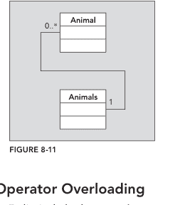

图 8-11

## 运算符重载

在本书前面，你已经看到了如何使用运算符来操作简单的变量类型。有时，对从你自己的类实例化的对象使用运算符是合乎逻辑的。这是可能的，因为类可以包含关于如何对待运算符的指令。

例如，你可以向 `Animal` 类添加一个名为 `Weight` 的新属性。然后你可以使用以下代码来比较动物的重量：

```
if (cowA.Weight > cowB.Weight)
{
    ...
}
```

使用运算符重载，你可以提供在代码中隐式使用 `Weight` 属性的逻辑，这样你就可以编写如下代码：

```
if (cowA > cowB)
{
    ...
}
```

在这里，大于运算符（`>`）已被重载。重载运算符是指你已经为其编写了执行相应操作代码的运算符——此代码被添加到它操作的某个类的类定义中。在前面的示例中，你使用了两个 `Cow` 对象，因此运算符重载定义包含在 `Cow` 类中。你还可以用同样的方式重载运算符以处理不同的类，其中一个（或两个）类定义包含实现此功能的代码。

你只能以这种方式重载现有的 C# 运算符；你不能创建新的运算符。但是，你可以为诸如 `+` 或 `>` 之类的运算符提供一元（单操作数）和二元（双操作数）用法的实现。你将在第 13 章中了解如何在 C# 中做到这一点。

## 本章小结

| 主题 | 关键概念 |
|---|---|
| 对象和类 | 对象是 OOP 应用程序的构建块。类是用于实例化对象的类型定义。对象可以包含数据，和/或公开其他代码可以使用的操作。数据可以通过属性提供给外部代码，操作可以通过方法提供给外部代码。属性和方法都被称为类成员。属性可以允许读访问、写访问或两者都允许。类成员可以是公共的（对所有代码可用）或私有的（仅对类定义内的代码可用）。在 .NET 中，一切都是对象。 |
| 对象生命周期 | 通过调用其构造函数之一来实例化对象。当不再需要对象时，通过执行其析构函数来销毁它。为了在对象使用后进行清理，通常需要手动释放它。 |
| 静态成员和实例成员 | 实例成员仅在类的对象实例上可用。静态成员只能通过类定义直接使用，并且不与实例关联。 |
| 接口 | 接口是可以在类上实现的公共属性和方法的集合。实例类型的变量可以被赋值为任何其类定义实现了该接口的对象的值。只有接口定义的成员可以通过该变量使用。 |
| 继承 | 继承是一个类定义可以从另一个类派生的机制。类从其父类继承成员，且只能有一个父类。子类不能访问其父类中的私有成员，但可以定义受保护的成员，这些成员仅在该类或其派生类内可用。子类可以重写父类中定义为虚成员的成员。所有类的继承链都以 `System.Object` 结束，在 C# 中其别名为 `object`。 |
| 多态性 | 从派生类实例化的所有对象都可以被视为父类的实例。 |
| 对象关系和特性 | 对象可以包含其他对象，也可以表示其他对象的集合。要在表达式中操作对象，你通常需要通过运算符重载来定义运算符如何与对象一起工作。对象可以公开由某些内部进程触发的事件，客户端代码可以通过提供事件处理程序来响应事件。 |

## 智能拣选系统

智能拣选系统是一种自动化程度较高的拣选系统，集成了视觉识别、重量感应、PLC控制等多种技术，能够实现对商品的自动识别、称重与精准分拣。

- **设备智能拣选**：通过视觉识别、重量感应等技术，自动识别商品并精准投放。
- **自动分拣**：根据商品编码与重量信息，自动输送至对应区域。
- **监控管理**：实时监控设备运行状态，提供异常预警与统计报表。

该系统广泛应用于电商仓储、快递物流、医药分拣等场景，有效提升拣选效率与准确率，降低人工成本。

操作流程：

1. 条码扫描
2. 自动称重
3. 智能分拣
4. 复核打包

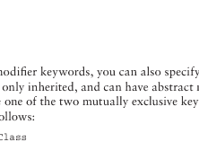

C# 类定义中只允许有一个基类；如果你继承自抽象类，则必须实现所有继承的抽象成员（除非派生类也是抽象的）。

编译器不允许派生类的可访问性高于其基类。这意味着内部类可以继承自公共基类，但公共类不能继承自内部基类。以下代码是合法的：

```
public class MyBase
{
    // Class members.
}
internal class MyClass : MyBase
{
    // Class members.
}
```

以下代码将无法编译：

```
internal class MyBase
{
    // Class members.
}
public class MyClass : MyBase
{
    // Class members.
}
```

如果没有使用基类，该类仅继承自基类 `System.Object`（在 C# 中别名为 `object`）。最终，所有类的继承层次结构的根都是 `System.Object`。稍后你将更仔细地了解这个基础类。

除了以这种方式指定基类之外，你还可以在冒号字符后指定支持的接口。如果指定了基类，它必须是冒号后的第一项，然后是接口。如果没有指定基类，则直接在冒号后指定接口。必须使用逗号将基类名称（如果有）和接口名称彼此分隔。

例如，你可以向 `MyClass` 添加一个接口，如下所示：

```
public class MyClass : IMyInterface
{
    // Class members.
}
```

所有接口成员必须在任何支持该接口的类中实现，尽管如果你不想对某个给定接口成员做任何操作，你可以提供“空”实现（没有功能代码），并且你可以在抽象类中将接口成员实现为抽象成员。

以下声明无效，因为基类 `MyBase` 不是继承列表中的第一项：

```
public class MyClass : IMyInterface, MyBase
{
    // Class members.
}
```


关键字`abstract`和`sealed`是不允许的，因为这两个修饰符在接口的上下文中都没有意义（接口不包含实现，因此不能直接实例化，并且必须可继承才有用）。

接口继承的指定方式与类继承类似。主要区别在于可以使用多个基接口，如下所示：

```
public interface IMyInterface : IMyBaseInterface, IMyBaseInterface2
{
    // Interface members.
}
```

接口不是类，因此不从System.Object继承。但是，System.Object的成员可以通过接口类型变量使用，纯粹是为了方便。此外，如前所述，不可能像类那样实例化接口。下面的“试一试”提供了一些类定义以及使用它们的代码示例。

## 试一试 定义类：Ch09Ex01\Program.cs

- 1. 创建一个名为Ch09Ex01的新控制台应用程序，并将其保存在目录C:\BegVCSharp\Chapter09中。
- 2. 按如下方式修改Program.cs中的代码：

```
using static System.Console;
namespace Ch09Ex01
{
    public abstract class MyBase {}
    internal class MyClass : MyBase {}
    public interface IMyBaseInterface {}
    internal interface IMyBaseInterface2 {}
    internal interface IMyInterface : IMyBaseInterface, IMyBaseInterface2 {}
    internal sealed class MyComplexClass : MyClass, IMyInterface {}
    class Program
    {
        static void Main(string[] args)
        {
            MyComplexClass myObj = new MyComplexClass();
            WriteLine(myObj.ToString());
            ReadKey();
        }
    }
}
```

- 3. 执行项目。图9-1显示了输出。

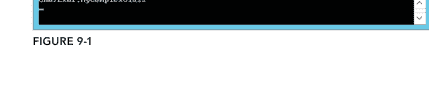

图9-1

## SYSTEM.OBJECT

因为所有类都继承自System.Object，所以所有类都可以访问该类的受保护成员和公共成员。因此，有必要了解一下其中有哪些可用成员。System.Object包含表9-2中描述的方法。

表9-2：System.Object的方法

| 方法 | 返回类型 | 虚拟 | 静态 | 描述 |
|---|---|---|---|---|
| Object() | N/A | No | No | System.Object类型的构造函数。由派生类型的构造函数自动调用。 |
| ~Object()（也称为Finalize()——参见下一节） | N/A | No | No | System.Object类型的析构函数。由派生类型的析构函数自动调用；不能手动调用。 |
| Equals(object) | bool | Yes | No | 将此方法调用的对象与另一个对象进行比较，如果相等则返回true。默认实现检查object参数是否引用了同一个对象（因为对象是引用类型）。如果要以不同的方式比较对象，例如比较两个对象的状态，可以重写此方法。 |
| Equals(object, object) | bool | No | Yes | 比较传入的两个对象，检查它们是否相等。此检查使用Equals(object)方法执行。如果两个对象都是null引用，则此方法返回true。 |
| ReferenceEquals(object, object) | bool | No | Yes | 比较传入的两个对象，检查它们是否引用同一个实例。 |

### 表9.2（续）

| 方法 | 返回类型 | 虚拟 | 静态 | 描述 |
|---|---|---|---|---|
| ToString() | string | Yes | No | 返回与对象实例对应的字符串。默认情况下，这是类类型的限定名称，但可以重写此方法以提供适合该类类型的实现。 |
| MemberwiseClone() | object | No | No | 通过创建新的对象实例并复制成员来复制对象。此成员复制不会导致这些成员的新实例。新对象的任何引用类型成员都引用与原始类相同的对象。此方法是受保护的，因此只能从类内部或派生类中使用。 |
| GetType() | System.Type | No | No | 以System.Type对象的形式返回对象的类型。 |
| GetHashCode() | int | Yes | No | 在需要时用作对象的哈希函数。哈希函数以某种压缩形式返回标识对象状态的值。 |

这些是.NET Framework中对象类型必须支持的基本方法，尽管你可能永远不会使用其中一些方法（或者只在特殊情况下使用它们，例如GetHashCode()）。

在使用多态时，GetType()很有用，因为它使你可以根据对象的类型对对象执行不同的操作，而不是像通常那样对所有对象执行相同的操作。例如，如果有一个函数接受object类型的参数（意味着你可以向它传递几乎任何内容），那么在遇到某些对象时，你可以执行额外的任务。结合使用GetType()和typeof（一个C#运算符，将类名转换为System.Type对象），你可以执行如下比较：

```
if (myObj.GetType() == typeof(MyComplexClass))
{
    // myObj is an instance of the class MyComplexClass.
}
```

返回的System.Type对象能够做的远不止这些，但这里只介绍这些。重写ToString()方法也非常有用，尤其是在对象的内容可以很容易地用单个人类可读字符串表示的情况下。在后续章节中你会反复看到这些System.Object方法，所以必要时你将了解更多细节。

## 构造函数和析构函数

在C#中定义类时，通常不需要定义相关的构造函数和析构函数，因为如果你不提供它们，编译器会在生成代码时自动添加。但是，如果需要，你可以提供自己的构造函数和析构函数，以便分别初始化和清理对象。

可以使用以下语法向类添加简单的构造函数：

```
class MyClass
{
    public MyClass()
    {
        // Constructor code.
    }
}
```

此构造函数与包含它的类同名，没有参数（使其成为类的默认构造函数），并且是公共的，因此可以使用此构造函数实例化类的对象（有关更多信息，请参阅第8章）。

也可以使用私有默认构造函数，这意味着不能使用此构造函数创建该类的对象实例（它是不可创建的——同样，请参阅第8章的讨论）：

```
class MyClass
{
    private MyClass()
    {
        // Constructor code.
    }
}
```

最后，可以通过提供参数以类似的方式向类添加非默认构造函数：

```
class MyClass
{
    public MyClass()
    {
        // Default constructor code.
    }
    public MyClass(int myInt)
    {
        // Nondefault constructor code (uses myInt).
    }
}
```

你可以提供无限数量的构造函数（直到内存耗尽或参数集用完，所以也许“几乎无限”更合适）。

析构函数的声明语法略有不同。.NET中使用的析构函数（由System.Object类提供）称为Finalize()，但这并不是你用来声明析构函数的名称。你不需要重写Finalize()，而是使用以下语法：

```
class MyClass
{
    ~MyClass()
    {
        // Destructor body.
    }
}
```

因此，类的析构函数使用类名（就像构造函数一样）声明，并带有波浪号（~）前缀。析构函数中的代码在垃圾回收发生时执行，使你可以释放资源。析构函数被调用后，还会隐式调用基类的析构函数，包括调用System.Object根类中的Finalize()。这种技术使.NET Framework能够确保这一点，因为重写Finalize()意味着需要显式执行基类调用，这有潜在危险（你将在下一章学习如何调用基类方法）。

### 构造函数执行顺序

如果你在类的构造函数中执行多个任务，那么将这些代码集中在一个地方会很方便，这具有与将代码拆分为函数相同的好处，如第6章所示。你可以使用方法（参见第10章）来实现这一点，但C#提供了一种很好的替代方法。你可以配置任何构造函数在执行自己的代码之前调用任何其他构造函数。

不过，首先你需要更仔细地了解默认情况下实例化类实例时会发生什么。除了有助于集中初始化代码（如前所述）之外，这本身也值得了解。在开发过程中，由于构造函数调用期间的错误，对象的行为往往与你预期的不同——通常是你没有正确实例化类的继承层次结构中的某个基类，或者没有正确地向基类构造函数提供信息。了解对象生命周期这一阶段发生的事情，可以更容易地解决这类问题。

要实例化派生类，必须先实例化其基类。要实例化该基类，必须先实例化它自己的基类，依此类推，一直回到System.Object（所有类的根）。因此，无论使用哪个构造函数来实例化类，总是会先调用System.Object.Object()。

无论你在派生类中使用哪个构造函数（默认构造函数还是非默认构造函数），除非另有指定，否则将使用基类的默认构造函数。（你将在

看看如何更改此行为（稍后）。以下是说明执行顺序的简短示例。请考虑以下对象层次结构：

```
public class MyBaseClass
{
    public MyBaseClass()
    {
    }
    public MyBaseClass(int i)
    {
    }
}
public class MyDerivedClass : MyBaseClass
{
    public MyDerivedClass()
    {
    }
    public MyDerivedClass(int i)
    {
    }
    public MyDerivedClass(int i, int j)
    {
    }
}
```

你可以按如下方式实例化 MyDerivedClass：

```
MyDerivedClass myObj = new MyDerivedClass();
```

在这种情况下，将发生以下事件序列：

- System.Object.Object() 构造函数将执行。
- MyBaseClass.MyBaseClass() 构造函数将执行。
- MyDerivedClass.MyDerivedClass() 构造函数将执行。

或者，你可以使用以下方式：

```
MyDerivedClass myObj = new MyDerivedClass(4);
```

序列如下：

- System.Object.Object() 构造函数将执行。
- MyBaseClass.MyBaseClass() 构造函数将执行。
- MyDerivedClass.MyDerivedClass(int i) 构造函数将执行。

最后，你可以使用以下方式：

```
MyDerivedClass myObj = new MyDerivedClass(4, 8);
```

## 备考注会，需要多长时间？

在注册会计师（CPA）考试的备考旅程中，一个经常被提及的问题是：“我需要准备多久才能通过考试？”这个问题没有一个固定的答案，因为备考时间的长短受到多种因素的影响，包括个人的学习基础、专业背景、可投入的学习时间以及学习效率等。

一般来说，注册会计师考试共分为专业阶段和综合阶段。专业阶段包括会计、审计、财务成本管理、税法、经济法和公司战略与风险管理六个科目。每个科目的难度和内容量有所不同，因此需要的时间也各不相同。

在制定备考计划时，考生可以根据自己的实际情况，选择一年报考一科或者多科。当然，科学合理地估算每个科目的学习时间，是制定有效计划的关键。下面，我们通过一系列的分析和假设，来大致估算一下注会各个科目的备考时间。

### 问题一：报考科目数量对整体备考周期有何影响？

如果考生选择一次性报考六科，那么通常需要至少一年的时间进行高强度的学习。但这种方式风险较高，因为一旦某科失利，第二年该科成绩可能作废，形成连环影响。较多考生选择2至3年完成专业阶段，这样既保证了学习质量，又能有效分散压力。

### 问题二：哪些科目最难，需要更多时间精力？

普遍认为，《会计》是六科中难度最大的科目，它是学习其他科目的基础，内容繁杂且深入，所需备考时间也最长。其次是《审计》和《财务成本管理》，这两科逻辑性极强，需要大量的理解和练习。相比之下，《税法》《经济法》和《公司战略与风险管理》记忆性内容较多，需要的时间相对较少。

> **提示**：这里的“时间估算”是基于大多数考生的平均水平得出的，具体到个人，可能需要根据实际情况进行调整。

从每年注会考试的出考率来看，各考场的平均出考率仅在35%上下。有大量考生因为准备不充分而选择放弃考试。这从侧面说明，充足的备考时间与科学合理的规划，对最终能否顺利通过考试至关重要。建议各位考生结合自身情况，尽量提早规划，为各科目预留充足的学习时间。

(本文内容为背景介绍，仅供参考。)

这里可以使用许多符号，包括表 9-3 中显示的符号。

## 表 9-3：类视图图标

| 图标 | 含义 | 图标 | 含义 | 图标 | 含义 |
|---|---|---|---|---|---|
| 项目图标 | 项目 | 属性图标 | 属性 | 事件图标 | 事件 |
| 命名空间图标 | 命名空间 | 字段图标 | 字段 | 委托图标 | 委托 |
| 类图标 | 类 | 结构体图标 | 结构体 | 程序集图标 | 程序集 |
| 接口图标 | 接口 | 枚举图标 | 枚举 |  |  |
| 方法图标 | 方法 | 枚举项图标 | 枚举项 |  |  |

其中一些用于除类之外的类型定义，例如枚举和结构体类型。某些条目下方可以放置其他符号，表示其访问级别（公共条目不显示符号）。这些列在表 9-4 中。

## 表 9-4：附加类视图图标

| 图标 | 含义 | 图标 | 含义 | 图标 | 含义 |
|---|---|---|---|---|---|
| 私有图标 | 私有 | 受保护图标 | 受保护 | 内部图标 | 内部 |

不使用符号来表示抽象、密封或虚拟条目。

除了可以在此处查看这些信息外，您还可以访问其中许多项目的相关代码。双击某个项目，或右键单击并选择“转到定义”，将直接带您进入项目中定义该项目的代码（如果可用）。如果代码不可用，例如在无法访问的基础类型中的代码（如 System.Object），则您可以选择“浏览定义”，它将带您进入对象浏览器视图（在下一节中描述）。

出现在图 9-3 中的另一个条目是项目引用。这使您能够查看项目引用的程序集，其中包括（其中之一）mscorlib 和 System 中的核心 .NET 类型、System.Data 中的数据访问类型以及 System.Xml 中的 XML 操作类型。此处的引用可以展开，显示这些程序集中包含的命名空间和类型。

您可以通过右键单击某个项目并选择“查找所有引用”来查找代码中类型和成员的出现位置；搜索结果列表会显示在“查找符号结果”窗口中，该窗口作为选项卡窗口出现在屏幕底部的“错误列表”显示区域中。您还可以使用“类视图”窗口重命名项目。如果这样做，您将有选项在代码中出现该项目的所有位置重命名对该项目的引用。这意味着您没有任何借口在类名中出现拼写错误，因为您可以随意更改它们！

此外，您可以使用名为“调用层次结构”的视图在代码中导航，该视图可通过类视图窗口中的右键菜单选项“查看调用层次结构”访问。此功能对于查看类成员如何相互交互非常有用，您将在下一章中了解它。

## 对象浏览器

对象浏览器是类视图窗口的扩展版本，使您能够查看项目可用的其他类，甚至外部类。它要么自动进入（例如，在上一节中提到的情况下），要么通过“视图 ⇨ 对象浏览器”手动进入。该视图出现在主窗口中，您可以像浏览类视图窗口一样浏览它。

此窗口提供与类视图相同的信息，但还显示更多 .NET 类型。当选择某个项目时，您还会在第三个窗口中获得有关它的信息，如图 9-4 所示。

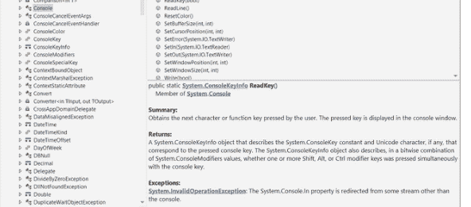

图 9-4

在这里，已选择 Console 类的 ReadKey() 方法。（Console 位于 mscorlib 程序集的 System 命名空间中。）右下角的信息窗口显示方法签名、方法所属的类以及方法的函数摘要。当您探索 .NET 类型时，或只是想回忆某个类能做什么时，这些信息会很有用。

此外，您可以在自己创建的类型中使用此信息窗口。对 Ch09Ex01 中之前创建的代码进行以下更改：

```
/// <summary>
/// This class contains my program!
/// </summary>
class Program
{
    static void Main(string[] args)
    {
        MyComplexClass myObj = new MyComplexClass();
        WriteLine(myObj.ToString());
        ReadKey();
    }
}
```

返回对象浏览器。更改会反映在信息窗口中。这是 XML 文档的一个示例，本书未涵盖该主题，但在有空时值得学习。

**注意** 如果您手动进行了此代码更改，那么您会注意到只需键入三个斜杠（///）就会导致 IDE 为您添加大部分其余代码。它会自动分析您正在应用 XML 文档的代码并构建基本的 XML 文档——如果您需要更多证据，这更证明 Visual Studio 是一个很棒的工具！

## 添加类

Visual Studio 包含可加快某些常见任务的工具，其中一些适用于面向对象编程。其中一个工具“添加新项向导”可让您以最少的输入将新类添加到项目中。

此工具可通过“项目 ⇨ 添加新项”菜单项访问，也可通过在“解决方案资源管理器”窗口中右键单击项目并选择相应项访问。无论哪种方式，都会出现一个对话框，让您选择要添加的项。要添加类，请在模板窗口中选择“类”项，如图 9-5 所示，为将包含类的文件提供文件名，然后单击“添加”。创建的类将根据您提供的文件名命名。


- 实现接口的类带有棒棒糖符号。
- 抽象类以虚线轮廓和斜体名称显示。
- 密封类以粗黑轮廓显示。

点击对象会在屏幕底部的类详细信息窗口中显示额外信息（如果此窗口未出现，请右键单击对象并选择“类详细信息”）。在这里，您可以查看（并修改）类成员。您也可以在属性窗口中修改类详细信息。

从工具箱中，您可以向图表添加新的项目，例如类、接口和枚举，并定义图表中对象之间的关系。这样做时，新项目的代码会自动为您生成。

## 类库项目

除了在项目内将类放在单独的文件中，您还可以将它们放在完全独立的项目中。仅包含类（以及其他相关的类型定义，但没有入口点）的项目称为类库。

类库项目编译为 .dll 程序集，您可以通过从其他项目（可能属于同一解决方案，但不必如此）添加引用来访问其内容。这扩展了对象提供的封装，因为可以在不触及使用它们的项目的情况下修订和更新类库。这意味着您可以轻松升级由类提供的服务（可能影响多个消费者应用程序）。

以下“试一试”提供了类库项目及其包含的类的使用示例的示例。

## 试一试 使用类库：Ch09ClassLib 和 Ch09Ex02\Program.cs

1. 创建一个类型为类库的新项目，命名为 Ch09ClassLib，并将其保存在目录 c:\BegVCSharp\Chapter09 中，如图 9-7 所示。
2. 将文件 Class1.cs 重命名为 MyExternalClass.cs（通过在解决方案资源管理器窗口中右键单击文件并选择重命名）。在出现的对话框中单击“是”。
3. MyExternalClass.cs 中的代码会自动更改以反映类名称的更改：
4. 使用文件名 MyInternalClass.cs 向项目添加一个新类。
5. 修改代码，使类 MyInternalClass 明确为 internal：
6. 编译项目（该项目没有入口点，因此不能像正常情况那样运行——相反，您可以通过选择“生成 ➔ 生成解决方案”来构建它）。

```
public class MyExternalClass
{
}
```

```
internal class MyInternalClass
{
}
```

11. 打开对象浏览器窗口并检查新引用以查看其包含哪些对象（参见图 9-9）。

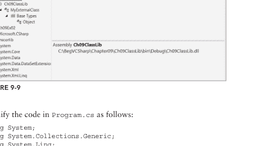

图 9-9

12. 按如下方式修改 Program.cs 中的代码：

```csharp
using System;
using System.Collections.Generic;
using System.Linq;
using System.Text;
using System.Threading.Tasks;
using static System.Console;
using Ch09ClassLib;
namespace Ch09Ex02
{
    class Program
    {
        static void Main(string[] args)
        {
            MyExternalClass myObj = new MyExternalClass();
            WriteLine(myObj.ToString());
            ReadKey();
        }
    }
}
```

13. 运行应用程序。结果如图 9-10 所示。

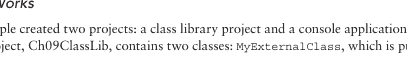

图 9-10

## 工作原理

此示例创建了两个项目：一个类库项目和一个控制台应用程序项目。类库项目 Ch09ClassLib 包含两个类：可公开访问的 MyExternalClass 和内部可访问的 MyInternalClass。请注意，当您创建它时，该类默认隐式为 internal，因为它没有访问修饰符。明确说明可访问性是良好的做法，因为它使代码更易于阅读，这就是为什么要添加 internal 关键字的原因。控制台应用程序项目 Ch09Ex02 包含使用类库项目的简单代码。

> 注意 当应用程序使用外部库中定义的类时，您可以称该应用程序为该库的客户端应用程序。使用您定义的类的代码通常也类似地称为客户端代码。

要使用 Ch09ClassLib 中的类，您已将 Ch09ClassLib.dll 的引用添加到控制台应用程序。就此示例而言，您只需指向类库的输出文件，虽然将此文件复制到 Ch09Ex02 本地的位置也同样容易，这样您就可以在不影响控制台应用程序的情况下继续开发类库。要用新版本替换旧程序集版本，只需将新生成的 DLL 文件复制到旧文件上即可。

添加引用后，您使用对象浏览器查看了可用的类。由于 MyInternalClass 是 internal，因此您无法在此显示中看到它——它无法供外部项目访问。但是 MyExternalClass 是可访问的，并且是您在控制台应用程序中使用的类。

您可以将控制台应用程序中的代码替换为尝试使用内部类的代码，如下所示：

```
static void Main(string[] args)
{
    MyInternalClass myObj = new MyInternalClass();
    WriteLine(myObj.ToString());
    ReadKey();
}
```

如果您尝试编译此代码，您会收到以下编译错误：

```
'Ch09ClassLib.MyInternalClass'
is inaccessible due to its protection level
```

这种在 C# 和 .NET Framework 中使用外部程序集中的类的方式是关键的编程技术。事实上，这正是您在使用 .NET Framework 中的任何类时所做的，因为它们以相同的方式处理。

## 接口与抽象类

本章演示了如何创建接口和抽象类（目前尚无成员——您将在第 10 章中了解它们）。这两种类型在许多方面相似，因此了解何时应使用其中一种技术会很有用。

首先是相似之处：抽象类和接口都可以包含可被派生类继承的成员。接口和抽象类都不能直接实例化，但可以声明这些类型的变量。如果这样做，您可以使用多态性将继承自这些类型的对象分配给这些类型的变量。在这两种情况下，您都可以通过这些变量使用这些类型的成员，尽管您无法直接访问派生对象的其他成员。

现在是不同之处：派生类只能从单个基类继承，这意味着只能直接继承单个抽象类（尽管继承链中可能包含多个抽象类）。相反，类可以使用任意数量的接口，但这并不会造成巨大差异——无论哪种方式都可以实现类似的结果。只是接口的方式略有不同。

抽象类可以同时具有抽象成员（这些成员没有代码体，必须在派生类中实现，除非派生类本身也是抽象的）和非抽象成员（这些成员具有代码体，可以是虚拟的，以便在派生类中重写）。相比之下，接口成员必须在使用的类上实现——它们不具有代码体。此外，接口成员按定义是公共的（因为它们 intended for external use），但抽象类的成员也可以是私有（只要它们不是抽象的）、受保护的、内部的或受保护内部的（其中受保护内部成员仅可从应用程序内的代码或从派生类访问）。此外，接口不能包含字段、构造函数、析构函数、静态成员或常量。

> **注意** 抽象类旨在用作共享某些核心特征的对象族的基类，例如共同目的和结构。接口旨在供在更根本的层面上可能有所不同的类使用，但仍能做一些相同的事情。

例如，考虑一个代表火车的对象族。基类 Train 包含火车的核心定义，例如轮轨距和发动机类型（可能是蒸汽、柴油等）。然而，该类是抽象的，因为不存在“通用”火车。要创建“实际”火车，您需要添加特定于该火车的特征。例如，您派生出 PassengerTrain、FreightTrain 和 424DoubleBogey 等类，如图 9-11 所示。

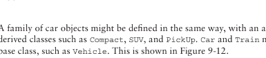

图 9-11

汽车对象的族可以以相同的方式定义，抽象基类为 Car，派生类为 Compact、SUV 和 PickUp。Car 和 Train 甚至可以从共同的基类（如 Vehicle）派生。这如图 9-12 所示。


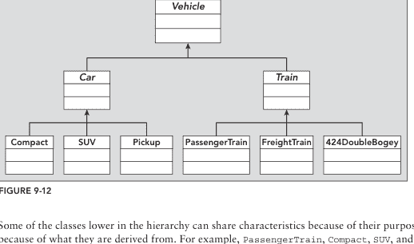

图 9-12

层次结构中较低的一些类可以因其用途而共享特性，而不仅仅是因为它们派生自什么。例如，PassengerTrain、Compact、SUV 和 Pickup 都能载客，因此它们可能有一个 IPassengerCarrier 接口。FreightTrain 和 Pickup 可以承载重物，因此它们可能也都有一个 IHeavyLoadCarrier 接口。如图 9-13 所示。

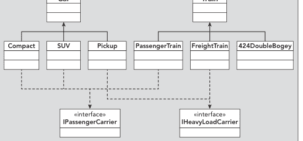

图 9-13

在分配具体细节之前，通过这种方式分解对象系统，你可以清楚地看到哪些情况应该使用抽象类而不是接口，反之亦然。这个示例的结果无法仅通过使用接口或仅使用抽象继承来实现。

## 结构类型

第 8 章指出，结构和类非常相似，但结构是值类型，而类是引用类型。这实际上对你意味着什么？嗯，最简单的方法是看一个例子，比如下面的试一试。

### 试一试 类与结构：Ch09Ex03\Program.cs

- 1. 创建一个名为 Ch09Ex03 的新控制台应用程序项目，并将其保存在目录 C:\BegVCSharp\Chapter09 中。
- 2. 修改代码如下：

```csharp
namespace Ch09Ex03
{
    class MyClass
    {
        public int val;
    }
    struct myStruct
    {
        public int val;
    }
    class Program
    {
        static void Main(string[] args)
        {
            MyClass objectA = new MyClass();
            MyClass objectB = objectA;
            objectA.val = 10;
            objectB.val = 20;
            myStruct structA = new myStruct();
            myStruct structB = structA;
            structA.val = 30;
            structB.val = 40;
            WriteLine("objectA.val = {objectA.val}");
            WriteLine("objectB.val = {objectB.val}");
            WriteLine("structA.val = {structA.val}");
            WriteLine("structB.val = {structB.val}");
            ReadKey();
        }
    }
}
```

你在本书前面已经见过类似的行为，对于像 int 这样的简单变量类型。结果是，两个结构类型变量包含不同的结构。在托管 C# 代码中，使用指针的整个技术对你隐藏了，这使得你的代码更加简单。在 C# 中可以使用不安全代码来访问诸如指针操作之类的底层操作，但这是一个高级主题，这里不讨论。

## 浅复制与深复制

按值而不是按引用（即像结构那样复制）将对象从一个变量复制到另一个变量可能相当复杂。因为单个对象可以包含对许多其他对象的引用，例如字段成员等，因此可能涉及大量处理。简单地将每个成员从一个对象复制到另一个对象可能行不通，因为其中一些成员本身可能是引用类型。

.NET Framework 考虑到了这一点。你可以使用从 System.Object 继承的 MemberwiseClone() 方法创建对象的简单副本，其中每个成员都被复制到新对象。这是一个受保护的方法，但很容易在对象上定义一个调用此方法的公共方法。这种复制方法称为浅复制，因为它不考虑引用类型成员。这意味着新对象中的引用成员与源对象中的等效成员引用相同的对象，这在许多情况下并不理想。如果你想通过复制值（而不是引用）来创建所涉及成员的新实例，则需要执行深复制。

有一个接口可以实现，使你能够以标准方式进行深复制：ICloneable。如果使用此接口，则必须实现它包含的单个方法 Clone()。此方法返回 System.Object 类型的值。你可以通过任意选择实现方法体来使用任何所需的处理来获取此对象。这意味着如果你愿意，可以实现深复制，尽管确切的行为不是强制性的，因此如果你愿意，也可以执行浅复制。对于此方法实际返回的内容没有规则或限制，因此许多人建议避免使用它。相反，他们建议实现自己的深复制方法。你将在第 11 章更详细地了解此接口。

## 练习

### 9.1 以下代码有什么问题？

```
public sealed class MyClass
{
    // 类成员。
}
public class myDerivedClass : MyClass
{
    // 类成员。
}
```

9.2 你将如何定义不可创建的类？

9.3 为什么不可创建的类仍然有用？你如何利用它们的功能？

9.4 在一个名为 Vehicles 的类库项目中编写代码，实现本章前面讨论的 `Vehicle` 对象系列。有九个对象和两个接口需要实现。

9.5 创建一个名为 Traffic 的控制台应用程序项目，引用 `Vehicles.dll`（在问题 4 中创建）。包含一个名为 `AddPassenger` 的函数，该函数接受任何具有 `IPassengerCarrier` 接口的对象。为了证明代码有效，请使用每个支持此接口的对象的实例调用此函数，在每个实例上调用从 `System.Object` 继承的 `ToString` 方法，并将结果写入屏幕。

练习答案见附录 A。

## 本章所学内容

| 主题 | 关键概念 |
|---|---|
| 类和接口定义 | 类使用 `class` 关键字定义，接口使用 `interface` 关键字定义。你可以使用 `public` 和 `internal` 关键字定义类和接口的可访问性，并且类可以定义为 `abstract` 或 `sealed` 以控制继承。父类和接口在类名或接口名后面的冒号后的逗号分隔列表中指定。在类定义中只能指定一个父类，并且它必须是列表中的第一项。 |
| 构造函数和析构函数 | 类自带默认构造函数和析构函数实现，你很少需要提供自己的析构函数。你可以使用可访问性、类名和任何所需参数来定义构造函数。基类的构造函数在派生类的构造函数之前执行，你可以使用 `this` 和 `base` 构造函数初始化器关键字控制类内的执行顺序。 |
| 类库 | 你可以创建仅包含类定义的类库项目。这些项目不能直接执行；必须通过可执行应用程序中的客户端代码访问它们。Visual Studio 提供了各种用于创建、修改和检查类的工具。 |
| 类家族 | 类可以分组为表现出共同行为或共享共同特征的家族。你可以通过继承共享基类（可以是抽象的）或实现接口来实现这一点。 |
| 结构定义 | 结构的定义方式与类非常相似，但请记住，结构是值类型，而类是引用类型。 |
| 复制对象 | 复制对象时，必须小心复制它可能包含的任何对象，而不是简单地复制对这些对象的引用。复制引用称为浅复制，而完整复制称为深复制。你可以使用 `ICloneable` 接口作为在类定义中提供深复制能力的框架。 |

```
class MyClass
{
    public static int MyInt;
}
```

静态字段通过定义它们的类访问（在前面的示例中为 MyClass.MyInt），而不是通过该类的对象实例访问。你可以使用关键字 const 创建常量值。const 成员按定义是静态的，因此你不需要使用 static 修饰符（实际上，使用它是一个错误）。

## 定义方法

方法使用标准函数格式，以及可访问性和可选的 static 修饰符，如下例所示：

```
class MyClass
{
    public string GetString() => "Here is a string.";
}
```

> 注意 与公共字段一样，.NET Framework 中的公共方法使用 PascalCasing 命名。

请记住，如果你使用 static 关键字，则此方法只能通过类访问，而不能通过对象实例访问。你还可以在方法定义中使用以下关键字：

- virtual — 方法可以被重写。
- abstract — 方法必须在非抽象派生类中被重写（仅在抽象类中允许）。
- override — 方法重写基类方法（如果重写方法，则必须使用）。
- extern — 方法定义在别处。

以下是一个方法重写的示例：

```
public class MyBaseClass
{
    public virtual void DoSomething()
    {
        // 基类实现。
    }
}
public class MyDerivedClass : MyBaseClass
{
    public override void DoSomething()
    {
        // 派生类实现，重写基类实现。
    }
}
```


定义的第一行与字段定义非常相似的部分。不同之处在于该行末尾没有分号；相反，你有一个包含嵌套 get 和 set 块的代码块。

get 块必须具有与属性类型相同的返回值。简单的属性通常与一个控制对该字段访问的私有字段相关联，在这种情况下，get 块可以直接返回字段的值：

// Field used by property.
private int myInt;
// Property.
public int MyIntProp
{
    get { return myInt; }
    set { // Property set code. }
}
```
由于其可访问性级别（它是 private），类外部的代码不能直接访问此 myInt 字段。相反，外部代码必须使用属性来访问字段。set 函数以类似的方式为字段分配值。在这里，你可以使用关键字 value 来引用从属性使用者接收到的值：

// Field used by property.
private int myInt;
// Property.
public int MyIntProp
{
    get { return myInt; }
    set { myInt = value; }
}
```
value 等同于与属性相同类型的数值，因此如果属性使用与字段相同的类型，那么在这种情况下你永远不必担心类型转换。

这个简单的属性除了屏蔽对 myInt 字段的直接访问之外几乎没有其他作用。当你对过程施加更多控制时，属性的真正威力就会显现出来。例如，你可以按如下方式实现 set 块：
```
set
{
    if (value >= 0 && value <= 10)
        myInt = value;
}
```
在这里，只有当分配给属性的值在 0 到 10 之间时，你才会修改 myInt。在这种情况下，你需要做出一个重要的设计选择。如果使用了无效值，你应该怎么做？你有四个选项：

- 什么都不做（如前面的代码所示）。
- 为字段分配默认值。
- 假装什么都没出错但记录该事件以供将来分析。
- 抛出异常。

或者，你可以隐藏基类方法：
```csharp
public class MyBaseClass
{
    public virtual void DoSomething() => WriteLine("Base imp");
}
public class MyDerivedClass : MyBaseClass
{
    new public void DoSomething() => WriteLine("Derived imp");
}
```
基类方法不必是 virtual 才能工作，但效果完全相同，前面的代码只需要更改一行。对于 virtual 或非 virtual 的基类方法，结果如下：
```
Base imp
```
尽管基实现被隐藏了，但你仍然可以通过基类访问它。

## 调用重写或隐藏的基类方法
无论你重写还是隐藏一个成员，你仍然可以从派生类访问基类成员。在许多情况下这会很有用，例如以下情况：

- 当你想从派生类的使用者那里隐藏继承的公共成员，但仍希望从类内部访问其功能时
- 当你想在继承的 virtual 成员的实现上进行添加，而不是简单地用新的重写实现替换它时

要实现这一点，你使用 `base` 关键字，它指的是派生类中包含的基类的实现（与在控制构造函数时使用的方式类似，如上一章所示）：
```csharp
public class MyBaseClass
{
    public virtual void DoSomething()
    {
        // Base implementation.
    }
}
public class MyDerivedClass : MyBaseClass
{
    public override void DoSomething()
    {
        // Derived class implementation, extends base class implementation.
        base.DoSomething();
        // More derived class implementation.
    }
}
```
此代码从 MyDerivedClass 中包含的 DoSomething() 版本内部执行 MyBaseClass（MyDerivedClass 的基类）中包含的 DoSomething() 版本。由于 base 使用对象实例工作，因此在 static 成员内部使用它会出错。

要从 MyClass 外部实例化 MyNestedClass，你必须限定名称，如下所示：
```
MyClass.MyNestedClass myObj = new MyClass.MyNestedClass();
```
然而，你可能无法做到这一点，例如如果嵌套类声明为 private。此功能存在的一个原因是定义对包含类私有的类，以便命名空间中的其他代码无法访问它们。另一个原因是嵌套类可以访问其包含类的 private 和 protected 成员。下一个 Try it Out 将检查此功能。

## 试一试 使用嵌套类：Ch10Ex02
1. 创建一个新的控制台应用程序，命名为 Ch10Ex02，并将其保存在目录 C:\BegVCSharp\Chapter10 中。
2. 按如下方式修改 Program.cs 中的代码：
```
namespace Ch10Ex02
{
    public class ClassA
    {
        private int state = -1;
        public int State
        {
            get { return state; }
        }
        public class ClassB
        {
            public void SetPrivateState(ClassA target, int newState)
            {
                target.state = newState;
            }
        }
    }
    class Program
    {
        static void Main(string[] args)
        {
            ClassA myObject = new ClassA();
            WriteLine($"myObject.State = {myObject.State}");
            ClassA.ClassB myOtherObject = new ClassA.ClassB();
            myOtherObject.SetPrivateState(myObject, 999);
            WriteLine($"myObject.State = {myObject.State}");
            ReadKey();
        }
    }
}
```
等价于：
```
public class MyClass : IMyInterface1, IMyInterface2 { ... }
```
Partial 类定义可以在单个 partial 类定义中包含基类，也可以在多个 partial 类定义中包含。不过，如果在多个定义中指定了基类，则它必须是同一个基类；请记住，C# 中的类只能从单个基类继承。

## 部分方法定义
Partial 类也可以定义 partial 方法。Partial 方法在一个 partial 类定义中定义而没有方法体，并在另一个 partial 类定义中实现。在这两个地方都使用了 partial 关键字：
```
public partial class MyClass
{
    partial void MyPartialMethod();
}
public partial class MyClass
{
    partial void MyPartialMethod()
    {
        // Method implementation
    }
}
```
Partial 方法也可以是 static，但它们始终是 private 且不能有返回值。它们使用的任何参数都不能是 out 参数，尽管可以是 ref 参数。它们也不能使用 virtual、abstract、override、new、sealed 或 extern 修饰符。

鉴于这些限制，partial 方法的目的并不立即显而易见。事实上，它们在代码编译方面很重要，而不是使用方面。考虑以下代码：
```
public partial class MyClass
{
    partial void DoSomethingElse();
    public void DoSomething()
    {
        WriteLine("DoSomething() execution started.");
        DoSomethingElse();
        WriteLine("DoSomething() execution finished.");
    }
}
public partial class MyClass
{
    partial void DoSomethingElse() =>
        WriteLine("DoSomethingElse() called.");
}
```
在这里，partial 方法 DoSomethingElse() 在第一个 partial 类定义中定义并调用，并在第二个中实现。当从控制台应用程序调用 DoSomething() 时，输出结果如你所期望的那样：
```
DoSomething() execution started.
DoSomethingElse() called.
DoSomething() execution finished.
```
如果你完全删除第二个 partial 类定义或 partial 方法实现（或注释掉代码），输出将如下所示：
```
DoSomething() execution started.
DoSomething() execution finished.
```
你可能会认为这里发生的事情是，当调用 DoSomethingElse() 时，运行时发现该方法没有实现，因此继续执行下一行代码。实际上发生的事情稍微微妙一些。当你编译包含没有实现的 partial 方法定义的代码时，编译器实际上会完全删除该方法。它也会删除对该方法的任何调用。当你执行代码时，不会进行实现检查，因为没有调用需要检查。这导致性能略有——但仍然显著——提升。

与 partial 类一样，partial 方法在自定义自动生成或设计器创建的代码时很有用。设计器可能会声明 partial 方法，你可以根据情况选择实现或不实现。如果你不实现它们，就不会有性能损失，因为在编译后的代码中该方法实际上不存在。

此时考虑一下为什么 partial 方法不能有返回类型。如果你能令自己满意地回答这个问题，你就可以确定你完全理解了这个主题——所以这留作练习。

## 示例应用程序
为了说明到目前为止你一直在使用的一些技术，在本节中你将开发一个类模块，你可以在后续章节中构建并使用它。该类模块包含两个类：

- Card — 代表标准扑克牌，包含梅花、方块、红心或黑桃的花色，以及介于 Ace 和 King 之间的点数
- Deck — 代表一副完整的 52 张牌的牌组，可按在牌组中的位置访问牌并具有洗牌功能

你还将开发一个简单的客户端以确保一切正常工作，但你暂时不会在完整的纸牌游戏应用程序中使用牌组。

## 规划应用程序
此应用程序的类库 Ch10CardLib 将包含你的类。不过，在编写任何代码之前，你应该规划你的类的所需结构和功能。


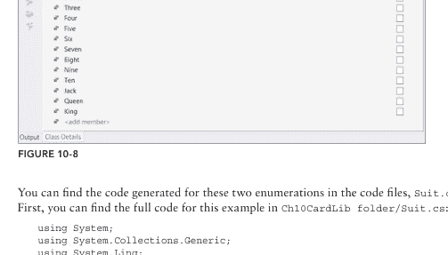

**图10-8**

你可以在代码文件Suit.cs和Rank.cs中找到这两个枚举的代码。首先，你可以在Ch10CardLib文件夹/Suit.cs中找到该示例的完整代码：

```csharp
using System;
using System.Collections.Generic;
using System.Linq;
using System.Text;
namespace Ch10CardLib
{
    public enum Suit
    {
        Club,
        Diamond,
        Heart,
        Spade,
    }
}
```

并且你可以在Ch10CardLib文件夹/Rank.cs中找到该示例的完整代码：

```csharp
using System;
using System.Collections.Generic;
using System.Linq;
using System.Text;
namespace Ch10CardLib
{
    public enum Rank
    {
        Ace = 1,
        Deuce,
        Three,
        Four,
        Five,
        Six,
        Seven,
        Eight,
        Nine,
        Ten,
        Jack,
        Queen,
        King,
    }
}
```

或者，你可以通过添加Suit.cs和Rank.cs代码文件，然后输入代码来手动添加此代码。请注意，代码生成器在最后一个枚举成员之后添加的多余逗号不会阻止编译，也不会导致创建额外的“空”成员——尽管它们看起来有点凌乱。

### 添加Card类

要添加Card类，你将结合使用类设计器和代码编辑器。在类设计器中添加类与添加枚举非常相似——你可以从工具箱中将适当的条目拖到图表中。在这种情况下，你将一个Class拖入图表，并将新类命名为Card。

使用“类详细信息”窗口添加字段rank和suit，然后使用“属性”窗口将该字段的“常量类型”设置为readonly。你还需要添加两个构造函数——一个私有默认构造函数和一个公共构造函数，后者接受两个参数newSuit和newRank，类型分别为Suit和Rank。最后，你重写ToString()，这需要你在“属性”窗口中将“继承修饰符”改为override。

图10-9显示了“类详细信息”窗口以及输入了所有信息的Card类。（你可以在Ch10CardLib\Card.cs中找到此代码。）

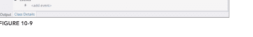

**图10-9**

接下来，按如下方式修改Card.cs中的类代码（或者将显示的代码添加到Ch10CardLib命名空间中名为Card的新类中）：

```csharp
assigned[destCard] = true;
newDeck[destCard] = cards[i];
}
newDeck.CopyTo(cards, 0);
}
}
```

此方法的最后一行使用System.Array类的CopyTo()方法（每次创建数组时都会使用）将newDeck中的每张牌复制回cards中。这意味着你使用相同的Card对象集合，并保存在同一个cards对象中，而不是创建任何新实例。如果你改为使用cards = newDeck，那么你将用另一个对象实例替换cards引用的对象实例。如果代码的其他部分保留了对原始cards实例的引用，这可能会导致问题——因为原始实例不会被洗牌！

这就是类库代码的全部内容。

### 类库的客户端应用程序

为简单起见，你可以在包含类库的解决方案中添加一个客户端控制台应用程序。为此，只需在解决方案资源管理器中右键单击解决方案，然后选择“添加 ▸ 新建项目”。新项目名为Ch10CardClient。

要从这个新的控制台应用程序项目中使用你创建的类库，请添加对Ch10CardLib类库项目的引用。你可以通过“引用管理器”对话框的“项目”选项卡来完成此操作，如图10-12所示。

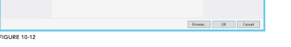

**图10-12**

选择该项目并单击“确定”以添加引用。

由于这是你创建的第二个项目，你还需要将其指定为解决方案的启动项目，即单击“运行”时执行的项目。为此，只需在解决方案资源管理器窗口中右键单击项目名称，然后选择“设置为启动项目”菜单选项。

接下来，添加使用新类的代码。这不需要什么特别的操作，因此以下代码即可（你可以在Ch10CardClient\Program.cs中找到此代码）：

```csharp
using System;
using System.Collections.Generic;
using System.Linq;
using System.Text;
using System.Threading.Tasks;
using static System.Console;
using Ch10CardLib;
namespace Ch10CardClient
{
    class Program
    {
        static void Main(string[] args)
        {
            Deck myDeck = new Deck();
            myDeck.Shuffle();
            for (int i = 0; i < 52; i++)
            {
                Card tempCard = myDeck.GetCard(i);
                Write(tempCard.ToString());
                if (i != 51)
                    Write(", ");
                else
                    WriteLine();
            }
            ReadKey();
        }
    }
}
```

图10-13显示了运行此应用程序时得到的结果。

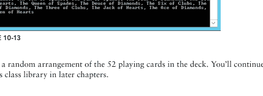

**图10-13**

这是牌组中52张扑克牌的随机排列。你将在后续章节中继续开发和实践这个类库。

## 本章要点

| 主题 | 关键概念 |
|---|---|
| 成员定义 | 你可以在类中定义字段、方法和属性成员。字段通过可访问性、名称和类型来定义。方法通过可访问性、返回类型、名称和参数来定义。属性通过可访问性、名称以及get和/或set访问器来定义。各个属性访问器可以拥有自己的可访问性，但必须低于整个属性的可访问性。 |
| 成员隐藏和重写 | 属性和方法可以在基类中定义为`abstract`或`virtual`，以定义继承。派生类必须实现抽象成员，并且可以使用`override`关键字重写虚成员。它们还可以使用`new`关键字提供新的实现，并使用`sealed`关键字阻止对`virtual`成员的进一步重写。基类实现可以使用`base`关键字调用。 |
| 接口实现 | 实现接口的类必须将该接口定义的所有成员实现为公共成员。你可以隐式或显式实现接口，其中显式实现只能通过接口引用使用。 |
| 分部定义 | 你可以使用`partial`关键字将类定义拆分到多个代码文件中。你还可以使用`partial`关键字创建分部方法。分部方法有一些限制，包括不能有返回值或`out`参数，并且如果没有提供实现，则不会被编译。 |

## 11 集合、比较和转换

### 本章你将学习

- 定义和使用集合
- 了解可用的集合类型
- 比较类型并使用is运算符
- 比较值并重载运算符
- 定义和使用转换
- 使用as运算符

### 本章WROX.COM代码下载

你可以在www.wrox.com/go/beginning-visual-csharp-2015-programming的“下载代码”选项卡中找到本章的wrox.com代码下载。代码位于“第11章”下载中，并根据本章中的名称单独命名。

现在你已经掌握了C#中所有基本的OOP技术，但还有一些更高级的技术值得熟悉。这些技术与编写代码时必须定期解决的某些问题有关。了解它们将使你的学习进展更加容易，并使你能够专注于应用程序中其他可能更重要的方面。在本章中，你将了解以下内容：

- **集合** — 集合使你能够维护对象组。与你之前章节中使用的数组不同，集合可以包含更高级的功能，例如控制对它们所包含对象的访问、搜索和排序，以及


更多。你将学习如何使用和创建集合类，并学习一些充分利用它们的强大技术。

- **比较** — 处理对象时，你通常希望在它们之间进行比较。这在集合中尤其重要，因为排序就是通过这种方式实现的。你将了解多种比较对象的方法，包括运算符重载，以及如何使用 `IComparable` 和 `IComparer` 接口对集合进行排序。
- **转换** — 前面的章节向你展示了如何将对象从一种类型转换为另一种类型。在本章中，你将学习如何根据需要自定义类型转换。

## 集合

在第 5 章中，你学习了如何使用数组创建包含多个对象或值的变量类型。然而，数组有其局限性。最大的局限性是，一旦数组被创建，其大小就固定了，因此如果不创建新的数组，就无法向现有数组的末尾添加新项。这通常意味着用于操作数组的语法会变得过于复杂。OOP 技术使你能够创建在内部执行大部分此类操作的类，从而简化使用项目列表或数组的代码。

C# 中的数组作为 `System.Array` 类的实例实现，并且只是被称为 *集合类* 的一种类型。总体而言，集合类用于维护对象列表，并且可能比简单数组提供更多功能。其中大部分功能是通过实现 `System.Collections` 命名空间中的接口来实现的，从而标准化集合语法。该命名空间还包含一些其他有趣的内容，例如以 `System.Array` 以外的方式实现这些接口的类。

因为集合的功能（包括使用 [index] 语法访问集合项等基本功能）可通过接口使用，所以你并不局限于使用 `System.Array` 等基本集合类。相反，你可以创建自己的自定义集合类。这些类可以针对你想要枚举的对象（即你想要维护集合的对象）更具体一些。正如你将看到的，这样做的一个优点是自定义集合类可以是 *强类型的*。也就是说，当你从集合中提取项时，不需要将它们转换为正确的类型。另一个优点是可以公开专用方法。例如，你可以提供一种快速获取项目子集的方法。在扑克牌示例中，你可以添加一个方法来获取特定花色的所有 `Card` 项。

`System.Collections` 命名空间中的几个接口提供了基本集合功能：

- `IEnumerable` — 提供遍历集合中项目的**能力**
- `ICollection` — 提供获取集合中项目数量并将项目复制到简单数组类型的能力（继承自 `IEnumerable`）
- `IList` — 为集合提供项目列表以及访问这些项目的能力，以及与项目列表相关的一些其他基本功能（继承自 `IEnumerable` 和 `ICollection`）
- `IDictionary` — 与 `IList` 类似，但提供通过键值而非索引访问的项目列表（继承自 `IEnumerable` 和 `ICollection`）

5. 按如下方式修改 Chicken.cs 中的代码：

```
namespace Ch11Ex01
{
    public class Chicken : Animal
    {
        public void LayEgg() => WriteLine($"{name} has laid an egg.");
        public Chicken(string newName) : base(newName) {}
    }
}
```

6. 按如下方式修改 Program.cs 中的代码：

```
using System;
using System.Collections;
using System.Collections.Generic;
using System.Linq;
using System.Text;
using System.Threading.Tasks;
using System.Console;
namespace Ch11Ex01
{
    class Program
    {
        static void Main(string[] args)
        {
            WriteLine("Create an Array type collection of Animal " +
            "objects and use it:");
            Animal[] animalArray = new Animal[2];
            Cow myCow1 = new Cow("Lea");
            animalArray[0] = myCow1;
            animalArray[1] = new Chicken("Noa");
            foreach (Animal myAnimal in animalArray)
            {
                WriteLine($"New {myAnimal.ToString()} object added to Array" +
                $" collection, Name = {myAnimal.Name}");
            }
            WriteLine($"Array collection contains {animalArray.Length} objects.");
            animalArray[0].Feed();
            ((Chicken)animalArray[1]).LayEgg();
            WriteLine();
            WriteLine("Create an ArrayList type collection of Animal " +
            "objects and use it:");
            ArrayList animalArrayList = new ArrayList();
            Cow myCow2 = new Cow("Rual");
            animalArrayList.Add(myCow2);
            animalArrayList.Add(new Chicken("Andrea"));
            foreach (Animal myAnimal in animalArrayList)
            {
                WriteLine($"New {myAnimal.ToString()} object added to ArrayList " +
                $" collection, Name = {myAnimal.Name}");
            }
            WriteLine($"ArrayList collection contains {animalArrayList.Count} " +
            "objects.");
            ((Animal)animalArrayList[0]).Feed();
```

对 ArrayList 对象中项目的任何修改导致数组中剩余 N 项时，将以保持索引从 0 到 N-1 的方式执行。例如，移除索引为 0 的项会导致所有其他项在数组中向后移动一个位置，因此你使用索引 0 访问 Chicken 对象，而不是 1。你不再拥有索引为 1 的项（因为你最初只有两项），因此如果尝试以下操作，将会抛出异常：

```
((Animal)animalArrayList[1]).Feed();
```

ArrayList 集合使你能够使用 AddRange() 方法一次添加多个项。此方法接受具有 ICollection 接口的任何对象，其中包括代码中前面创建的 animalArray 数组：

```
animalArrayList.AddRange(animalArray);
```

要检查它是否有效，你可以尝试访问集合中的第三项，即 animalArray 中的第二项：

```
((Chicken)animalArrayList[2]).LayEgg();
```

AddRange() 方法不是 ArrayList 暴露的任何接口的一部分。此方法特定于 ArrayList 类，并展示了你可以在集合类中表现出自定义行为的事实，超出你所查看的接口所要求的范围。此类还公开了其他有趣的方法，例如 InsertRange()，用于在列表的任何位置插入对象数组，以及用于排序和重新排序数组等任务的方法。

最后，你利用了可以对同一对象拥有多个引用的事实。使用 IndexOf() 方法（IList 接口的一部分），你可以看到 myCow1（最初添加到 animalArrayList 的对象）现在不仅是 animalArrayList 集合的一部分，而且也是其索引：

```
WriteLine($"The animal called {myCow1.Name} is at index " +
$"{animalArrayList.IndexOf(myCow1)}.");
```

作为此的扩展，接下来的两行代码通过对象引用重命名对象，并通过集合引用显示新名称：

```
myCow1.Name = "Mary";
WriteLine($"The animal is now called {((Animal)animalArrayList[1]).Name}.");
```

## 定义集合

现在你知道了使用更高级的集合类可以实现什么，是时候学习如何创建自己的强类型集合了。一种方法是手动实现所需的方法，但这可能是一个耗时且复杂的过程。或者，你可以从一个类派生你的集合，例如 System.Collections.CollectionBase，这是一个抽象类，为你提供了集合的大部分实现。强烈推荐这种选择。

CollectionBase 类公开了 IEnumerable、ICollection 和 IList 接口，但只提供了部分所需实现——尤其是 Clear() 和 RemoveAt() 方法

6. 按如下方式修改Animals.cs中的代码：

```csharp
using System;
using System.Collections;
using System.Collections.Generic;
using System.Linq;
using System.Text;
using System.Threading.Tasks;
namespace Ch11Ex02
{
    public class Animals : CollectionBase
    {
        public void Add(Animal newAnimal)
        {
            List.Add(newAnimal);
        }
        public void Remove(Animal newAnimal)
        {
            List.Remove(newAnimal);
        }
        public Animal this[int animalIndex]
        {
            get { return (Animal)List[animalIndex]; }
            set { List[animalIndex] = value; }
        }
    }
}
```

7. 按如下方式修改Program.cs：

```csharp
static void Main(string[] args)
{
    Animals animalCollection = new Animals();
    animalCollection.Add(new Cow("Donna"));
    animalCollection.Add(new Chicken("Kevin"));
    foreach (Animal myAnimal in animalCollection)
    {
        myAnimal.Feed();
    }
    ReadKey();
}
```

8. 运行应用程序。结果如图11-2所示。


图11-2

所用的是与存储项关联的键，而不是int索引，这可以使集合更加用户友好。

与索引集合一样，有一个基类可用于简化IDictionary接口的实现：DictionaryBase。这个类也实现了IEnumerable和ICollection，提供了适用于任何集合的基本集合操作能力。

DictionaryBase和CollectionBase一样，实现了其支持接口所获得的部分（但不是全部）成员。与CollectionBase一样，Clear和Count成员已实现，但RemoveAt()没有，因为它是IList接口上的方法，而不会出现在IDictionary接口上。不过，IDictionary确实有一个Remove()方法，这是你在基于DictionaryBase的自定义集合类中应该实现的方法之一。

以下代码展示了Animals类的另一个版本，这次是派生自DictionaryBase。代码中包括了Add()、Remove()和键访问索引器的实现：

```csharp
public class Animals : DictionaryBase
{
    public void Add(string newID, Animal newAnimal)
    {
        Dictionary.Add(newID, newAnimal);
    }
    public void Remove(string animalID)
    {
        Dictionary.Remove(animalID);
    }
    public Animals() {}
    public Animal this[string animalID]
    {
        get { return (Animal)Dictionary[animalID]; }
        set { Dictionary[animalID] = value; }
    }
}
```

这些成员之间的差异如下：

- **Add()** — 接受两个参数，一个键和一个值，存储在一起。字典集合有一个从DictionaryBase继承的成员Dictionary，该成员是一个IDictionary接口。该接口有自己的Add()方法，接受两个object参数。你的实现接受一个string值作为键，以及一个Animal对象作为与该键一起存储的数据。
- **Remove()** — 接受一个键参数，而不是对象引用。指定键值的项将被移除。
- **索引器** — 使用字符串键值而不是索引，通过继承的Dictionary成员访问存储项。同样，这里需要强制转换。

基于DictionaryBase的集合与基于CollectionBase的集合的另一个区别是，foreach的工作方式略有不同。上一节中的集合允许你直接从集合中提取Animal对象。对DictionaryBase派生类使用foreach会得到DictionaryEntry结构体，这是System.Collections命名空间中定义的另一种类型。要访问Animal对象本身，必须使用该结构体的Value成员，也可以使用该结构体的Key成员来获取关联的键。要获得与之前代码等效的代码：

```csharp
foreach (Animal myAnimal in animalCollection)
{
    WriteLine($"New {myAnimal.ToString()} object added to custom " +
        $"collection, Name = {myAnimal.Name}");
}
```

你需要以下代码：

```csharp
foreach (DictionaryEntry myEntry in animalCollection)
{
    WriteLine($"New {myEntry.Value.ToString()} object added to " +
        $"custom collection, Name = {{(Animal)myEntry.Value).Name}}");
}
```

可以重写此行为，以便通过foreach直接访问Animal对象。有几种方法可以做到这一点，最简单的是实现一个迭代器。

## 迭代器

在本章前面，你看到了IEnumerable接口使你可以使用foreach循环。让你的类在foreach循环中使用往往是有益的，而不仅仅是像前面部分展示的那些集合类。

然而，重写此行为或提供自己的自定义实现并不总是简单的。为了说明这一点，有必要仔细研究一下foreach循环。以下步骤展示了foreach循环遍历名为collectionObject的集合时实际发生的事情：

+   1. 调用collectionObject.GetEnumerator()，返回一个IEnumerator引用。此方法通过实现IEnumerable接口可用，尽管这是可选的。
+   2. 调用返回的IEnumerator接口的MoveNext()方法。
+   3. 如果MoveNext()返回true，则使用IEnumerator接口的Current属性获取一个对象引用，该对象用于foreach循环。
+   4. 重复上述两个步骤，直到MoveNext()返回false，此时循环终止。

要在你的类中启用此行为，必须重写几个方法，跟踪索引，维护Current属性等等。这可能是大量的工作而收效甚微。

更简单的替代方案是使用迭代器。实际上，使用迭代器会在后台为你生成大量代码，并正确地将它们连接起来。而且，迭代器的语法更容易掌握。

迭代器的一个好的定义是：一个按顺序为foreach块提供所有需要使用的值的代码块。通常，这个代码块是一个方法，尽管你也可以使用属性访问器和其他代码块作为迭代器。为了简单起见，这里只讨论方法。

无论代码块是什么，其返回类型都是受限的。也许与预期相反，这个返回类型与被枚举的对象类型并不相同。例如，在一个表示Animal对象集合的类中，迭代器块的返回类型不能是Animal。两种可能的返回类型是前面提到的接口类型，IEnumerable或IEnumerator。你按如下方式使用这些类型：

- 要迭代一个类，使用名为`GetEnumerator()`的方法，其返回类型为`IEnumerator`。
- 要迭代一个类成员（例如方法），使用`IEnumerable`。

在迭代器块中，通过使用yield关键字选择要在foreach循环中使用的值。语法如下：

```
yield return <value>;
```

有了这些信息，你就可以构建一个非常简单的示例，如下所示（你可以在SimpleIterators\Program.cs中找到此代码）：

```csharp
public static IEnumerable SimpleList()
{
    yield return "string 1";
    yield return "string 2";
    yield return "string 3";
}
static void Main(string[] args)
{
    foreach (string item in SimpleList())
        WriteLine(item);
    ReadKey();
}
```

这里，静态方法SimpleList()就是迭代器块。因为它是一个方法，所以使用IEnumerable作为返回类型。SimpleList()使用yield关键字向使用它的foreach块提供三个值，每个值都会写到屏幕上。结果如图11-3所示。


### 图11-3


显然，这个迭代器并不是特别有用，但它确实展示了实际中如何工作以及实现可以有多简单。查看代码时，你可能会好奇代码如何知道返回字符串类型的项。实际上，它并不知道；它返回的是 object 类型的值。如你所知，object 是所有类型的基类，因此你可以从 yield 语句中返回任何内容。

然而，编译器足够智能，你可以在 foreach 循环的上下文中将返回的值解释为任何你想要的类型。这里，代码要求的是字符串类型的值，所以这些就是你将要处理的值。如果你修改其中一行 yield，让它返回一个整数，那么在 foreach 循环中就会收到一个错误的强制转换异常。

关于迭代器还有一点。可以使用以下语句中断向 foreach 循环返回信息：

```
yield break;
```

当在迭代器中遇到此语句时，迭代器处理将立即终止，使用它的 foreach 循环也会终止。

现在是时候看一个更复杂——而且更有用！——的例子了。在这个“试一试”中，你将实现一个获取质数的迭代器。

## 试一试 实现迭代器：Ch11Ex03

- 1. 创建一个名为 Ch11Ex03 的新控制台应用程序，并将其保存到目录 C:\BegVCSharp\Chapter11 中。
- 2. 添加一个名为 Primes 的新类，并修改 Primes.cs 中的代码，如下所示：

```
using System;
using System.Collections;
using System.Collections.Generic;
using System.Linq;
using System.Text;
using System.Threading.Tasks;
namespace Ch11Ex03
{
public class Primes
{
private long min;
private long max;
public Primes() : this(2, 100) {}
public Primes(long minimum, long maximum)
{
if (minimum < 2)
min = 2;
else
min = minimum;
max = maximum;
}
public IEnumerator GetEnumerator()
{
for (long possiblePrime = min; possiblePrime <= max; possiblePrime++)
```

不能小于 2。这是合理的，因为 2 是最小的质数。有趣的代码都在 GetEnumerator() 方法中。该方法的签名满足迭代器块的规则，因为它返回 IEnumerable 类型：

```
public IEnumerable GetEnumerator()
{
```

要在上下限之间提取质数，你需要依次测试每个数字，因此从一个 for 循环开始：

```
for (long possiblePrime = min; possiblePrime <= max; possiblePrime++)
{
```

因为你不知道一个数字是否为质数，所以首先假设它是质数，然后检查它是否不是。这意味着要检查 2 到被测数字的平方根之间是否有任何数字是其因数。如果存在这样的因数，那么这个数字就不是质数，于是继续检查下一个数字。如果该数字确实是质数，那么使用 yield 将其传递给 foreach 循环：

```
bool isPrime = true;
for (long possibleFactor = 2; possibleFactor <= (long)Math.Floor(Math.Sqrt(possiblePrime)); possibleFactor++)
{
    long remainderAfterDivision = possiblePrime % possibleFactor;
    if (remainderAfterDivision == 0)
    {
        isPrime = false;
        break;
    }
}
if (isPrime)
{
    yield return possiblePrime;
}
}
```

如果将最小和最大限制设置为非常大的数字，这个代码会揭示一个有趣的事实。当你执行应用程序时，结果会一个一个地出现，中间有停顿，而不是一下子全部出现。这证明迭代器代码是一次返回一个结果，尽管在 yield 调用之间没有明显的代码终止位置。在幕后，调用 yield 确实会中断代码，当请求另一个值时会恢复——也就是说，当使用该迭代器的 foreach 循环开始新一轮循环时。

## 迭代器与集合

之前我们答应过要解释如何使用迭代器来遍历存储在字典类型集合中的对象，而不必处理 DictionaryItem 对象。在本章的可下载代码中，你可以在 DictionaryAnimals 文件夹中找到下一个项目的代码。回忆一下集合类 Animals：

```
public class Animals : DictionaryBase
{
    public void Add(string newID, Animal newAnimal)
```

```
{
    Dictionary.Add(newID, newAnimal);
}
public void Remove(string animalID)
{
    Dictionary.Remove(animalID);
}
public Animal this[string animalID]
{
    get { return (Animal)Dictionary[animalID]; }
    set { Dictionary[animalID] = value; }
}
```

你可以向代码中添加这个简单的迭代器来获得所需的行为：

```
public new IEnumerator GetEnumerator()
{
    foreach (object animal in Dictionary.Values)
        yield return (Animal)animal;
}
```

现在你可以使用以下代码遍历集合中的 Animal 对象：

```
foreach (Animal myAnimal in animalCollection)
{
    WriteLine($"New [{myAnimal.ToString()}] object added to " +
        $" custom collection, Name = {myAnimal.Name}");
}
```

## 深度复制

第 9 章描述了如何使用 System.Object .MemberwiseClone() 受保护方法执行浅复制，使用类似这里显示的 GetCopy() 方法：

```
public class Cloner
{
    public int Val;
    public Cloner(int newVal)
    {
        Val = newVal;
    }
    public object GetCopy() => MemberwiseClone();
}
```

假设你有引用类型的字段，而不是值类型（例如对象）：

```
public class Content
{
    public int Val;
}
public class Cloner
{
    public Content MyContent = new Content();
```

```
public Cloner(int newVal)
{
    MyContent.Val = newVal;
}
public object GetCopy() => MemberwiseClone();
}
```

在这种情况下，通过 GetCopy() 获得的浅复制有一个字段，该字段引用了与原始对象相同的对象。以下代码使用这个 Cloner 类，说明了浅复制引用类型的后果：

```
Cloner mySource = new Cloner(5);
Cloner myTarget = (Cloner)mySource.GetCopy();
WriteLine($"myTarget.MyContent.Val = {myTarget.MyContent.Val}");
mySource.MyContent.Val = 2;
WriteLine($"myTarget.MyContent.Val = {myTarget.MyContent.Val}");
```

第四行给 mySource.MyContent.Val 赋值，也就是原始对象的 MyContent 公共字段的 Val 公共字段，同时也改变了 myTarget.MyContent.Val 的值。这是因为 mySource.MyContent 与 myTarget.MyContent 引用同一个对象实例。上述代码的输出如下：

```
myTarget.MyContent.Val = 5
myTarget.MyContent.Val = 2
```

要解决这个问题，你需要执行深度复制。你可以直接修改之前使用的 GetCopy() 方法来实现，但更可取的是使用 .NET Framework 的标准方式：实现 ICloneable 接口，该接口只有一个方法 Clone()。这个方法不接收参数，返回 object 类型的结果，其签名与之前使用的 GetCopy() 方法完全相同。

要修改前面的类，请尝试使用以下深度复制代码：

```
public class Content
{
    public int Val;
}
public class Cloner : ICloneable
{
    public Content MyContent = new Content();
    public Cloner(int newVal)
    {
        MyContent.Val = newVal;
    }
    public object Clone()
    {
        Cloner clonedCloner = new Cloner(MyContent.Val);
        return clonedCloner;
    }
}
```

```
public object Clone()
{
    Cards newCards = new Cards();
    foreach (Card sourceCard in List)
    {
        newCards.Add((Card)sourceCard.Clone());
    }
    return newCards;
}
```

最后，在 Deck 类上实现 ICloneable。注意这里有一个小问题：Ch11CardLib 中的 Deck 类除了洗牌之外，无法修改它包含的卡牌。例如，无法修改 Deck 实例以使其具有特定的卡牌顺序。为了解决这个问题，为 Deck 类定义一个新的私有构造函数，允许在实例化 Deck 对象时传入特定的 Cards 集合。以下是此类中实现克隆的代码：

```
public class Deck : ICloneable
{
    public object Clone()
    {
        Deck newDeck = new Deck(cards.Clone() as Cards);
        return newDeck;
    }
    private Deck(Cards newCards)
    {
        cards = newCards;
    }
}
```

同样，你可以用一些简单的客户端代码来测试这一点。和之前一样，将这段代码放在客户端项目的 Main() 方法中进行测试（你可以在本章的在线下载中的 Ch11CardClient\Program.cs 中找到这段代码）：

```
Deck deck1 = new Deck();
Deck deck2 = (Deck)deck1.Clone();
WriteLine($"The first card in the original deck is: {deck1.GetCard(0)}");
WriteLine($"The first card in the cloned deck is: {deck2.GetCard(0)}");
deck1.Shuffle();
WriteLine("Original deck shuffled.");
WriteLine($"The first card in the original deck is: {deck1.GetCard(0)}");
WriteLine($"The first card in the cloned deck is: {deck2.GetCard(0)}");
ReadKey();
```

输出将与图 11-5 所示类似。


图 11-5


## 比较

本节介绍对象之间两种类型的比较：

- 类型比较
- 值比较

类型比较——即确定一个对象的类型，或它继承自什么——在 C# 编程的各个领域都很重要。通常当你传递一个对象——例如传递给方法——接下来发生的事情取决于对象的类型。你在这一章和前面的章节中已经零星地见过这一点，但在这里你将看到一些更有用的技术。

值比较也是你见过很多的东西，至少对于简单类型而言。当涉及到比较对象的值时，事情会变得稍微复杂一些。首先你必须定义比较的含义，以及诸如 > 之类的运算符在你的类上下文中的含义。这在集合中尤其重要，因为你可能希望根据某些条件对对象进行排序，也许是按字母顺序或根据更复杂的算法。

### 类型比较

在比较对象时，你通常需要知道它们的类型，这使你能够确定是否可以进行值比较。在第 9 章中，你看到了 GetType() 方法，所有类都从 System.Object 继承该方法，以及如何将此方法与 typeof() 运算符结合使用来确定（并根据）对象类型：

```
if (myObj.GetType() == typeof(MyComplexClass))
{
    // myObj is an instance of the class MyComplexClass.
}
```

你也见过 ToString() 的默认实现，它同样继承自 System.Object，可以获取对象类型的字符串表示。你也可以比较这些字符串，尽管这是一种相当混乱的实现方式。

本节演示了一种方便的简写方法：is 运算符。此运算符允许编写更易读的代码，并且如你将看到的，它具有检查基类的优势。不过在查看 is 运算符之前，你需要了解在处理值类型（与引用类型相对）时幕后经常发生的事情：装箱和拆箱。

### 装箱和拆箱

在第 8 章中，你学习了引用类型和值类型之间的区别，这在第 9 章中通过比较结构体（它们是值类型）和类（它们是引用类型）来说明。装箱是将值类型转换为 System.Object 类型或由值类型实现的接口类型的行为。拆箱是相反的转换。

例如，假设你有以下结构体类型：

```csharp
struct MyStruct
{
    public int Val;
}
```

你可以通过将其放入对象类型变量来装箱此类型的结构体：

```csharp
MyStruct valType = new MyStruct();
valType.Val = 5;
object refType = valType;
```

在这里，你创建了一个名为 valType 的 MyStruct 类型的新变量，为该结构体的 Val 成员分配一个值，然后将其装箱到对象类型变量（refType）中。

通过这种方式装箱变量创建的对象包含对值类型变量副本的引用，而不是对原始值类型变量的引用。你可以通过修改原始结构体的内容，然后将对象中包含的结构体拆箱到新变量中并检查其内容来验证这一点：

```csharp
valType.Val = 6;
MyStruct valType2 = (MyStruct) refType;
WriteLine($"valType2.Val = {valType2.Val}");
```

这段代码会给出以下输出：

```
valType2.Val = 5
```

然而，当你将引用类型分配给对象时，你会得到不同的行为。你可以通过将 MyStruct 改为类来看到这一点（忽略这个类名现在不合适这一事实）：

```csharp
class MyStruct
{
    public int Val;
}
```

在不更改之前所示的客户端代码的情况下（再次忽略命名不当的变量），你会得到以下输出：

```
valType2.Val = 6
```

你也可以将值类型装箱到接口类型，只要它们实现了该接口。例如，假设 MyStruct 类型实现了 IMyInterface 接口，如下所示：

```csharp
interface IMyInterface {}
struct MyStruct : IMyInterface
{
    public int Val;
}
```

然后你可以按如下方式将结构体装箱到 IMyInterface 类型：

```csharp
MyStruct valType1 = new MyStruct();
IMyInterface refType = valType1;
```

你可以使用正常的强制转换语法将其拆箱：

```csharp
MyStruct ValType2 = (MyStruct) refType;
```

如这些示例所示，装箱是在没有你干预的情况下执行的——也就是说，你不必编写任何代码使其成为可能。然而，拆箱值需要显式转换，并且需要你进行强制转换（装箱是隐式的，没有此要求）。

你可能会想知道为什么你实际上想要这样做。装箱非常有用的原因有两个。第一，它使你能够在项目类型为 object 的集合（如 ArrayList）中使用值类型。第二，它是使你能够在值类型（如 int 和结构体）上调用对象方法的内部机制。

值得注意的是，在访问值类型内容之前必须进行拆箱。

### is 运算符

尽管名字如此，is 运算符并不是确定对象是否为某种类型的方法。相反，is 运算符使你能够检查对象是否就是给定类型或可以转换为给定类型。如果是这样，则运算符求值为 true。

之前的示例展示了 Cow 和 Chicken 类，它们都继承自 Animal。使用 is 运算符将对象与 Animal 类型进行比较时，会对这三种类型的对象都返回 true，而不仅仅是 Animal。这是用之前所示的 GetType() 方法和 typeof() 运算符很难实现的事情。

is 运算符具有以下语法：

```
<operand> is <type>
```

该表达式的可能结果如下：

- 如果 <type> 是类类型，则当 <operand> 为该类型、继承自该类型或可以装箱为该类型时，结果为 true。
- 如果 <type> 是接口类型，则当 <operand> 为该类型或为实现该接口的类型时，结果为 true。
- 如果 <type> 是值类型，则当 <operand> 为该类型或可以拆箱为该类型的类型时，结果为 true。

以下“试一试”展示了其实际工作原理。

### 试一试 使用 is 运算符：Ch11Ex04\Program.cs

1. 在目录 C:\BegVCSharp\Chapter11 中创建一个名为 Ch11Ex04 的新控制台应用程序。
2. 按如下方式修改 Program.cs 中的代码：

```csharp
namespace Ch11Ex04
{
    class Checker
    {
        public void Check(object param1)
        {
            if (param1 is ClassA)
                WriteLine("Variable can be converted to ClassA.");
            else
                WriteLine("Variable can't be converted to ClassA.");
            if (param1 is IMyInterface)
                WriteLine("Variable can be converted to IMyInterface.");
            else
                WriteLine("Variable can't be converted to IMyInterface.");
            if (param1 is MyStruct)
                WriteLine("Variable can be converted to MyStruct.");
            else
                WriteLine("Variable can't be converted to MyStruct.");
        }
    }

    interface IMyInterface {}
    class ClassA : IMyInterface {}
    class ClassB : IMyInterface {}
    class ClassC {}
    class ClassD : ClassA {}
    struct MyStruct : IMyInterface {}

    class Program
    {
        static void Main(string[] args)
        {
            Checker check = new Checker();
            ClassA try1 = new ClassA();
            ClassB try2 = new ClassB();
            ClassC try3 = new ClassC();
            ClassD try4 = new ClassD();
            MyStruct try5 = new MyStruct();
            object try6 = try5;
            WriteLine("Analyzing ClassA type variable:");
            check.Check(try1);
            WriteLine("\nAnalyzing ClassB type variable:");
            check.Check(try2);
            WriteLine("\nAnalyzing ClassC type variable:");
            check.Check(try3);
            WriteLine("\nAnalyzing ClassD type variable:");
            check.Check(try4);
            WriteLine("\nAnalyzing MyStruct type variable:");
            check.Check(try5);
            WriteLine("\nAnalyzing boxed MyStruct type variable:");
            check.Check(try6);
            ReadKey();
        }
    }
}
```

3. 执行代码。结果如图 11-6 所示。


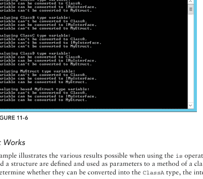

图 11-6

## 工作原理

本示例说明使用 is 运算符时可能出现的各种结果。定义了三个类、一个接口和一个结构体，并将它们用作某个类的一个方法的参数，该方法使用 is 运算符来确定它们是否可以转换为 ClassA 类型、接口类型和结构体类型。

只有 ClassA 和 ClassD（继承自 ClassA）类型与 ClassA 兼容。未继承自某个类的类型与该类不兼容。

ClassA、ClassB 和 MyStruct 类型都实现了 IMyInterface，因此它们都与 IMyInterface 类型兼容。ClassD 继承自 ClassA，因此它也兼容。因此，只有 ClassC 不兼容。

最后，只有 MyStruct 类型本身的变量以及该类型的装箱变量与 MyStruct 兼容，因为你不能将引用类型转换为值类型（当然，你可以解包先前已装箱的变量）。

## 值比较

考虑两个表示人的 Person 对象，每个对象都有一个整数类型的 Age 属性。你可能想比较它们以查看谁年纪更大。你可以简单地使用以下代码：

```
if (person1.Age > person2.Age)
{
    ...
}
```

```
=> (op1.val == op2.val);
public static bool operator !=(AddClass1 op1, AddClass1 op2)
=> !(op1 == op2);
public override bool Equals(object op1) => val == ((AddClass1)op1).val;
public override int GetHashCode() => val;
}
```

GetHashCode() 用于根据对象的状态为对象实例获取一个唯一的 int 值。这里使用 val 是可以的，因为它本身也是一个 int 值。

请注意 Equals() 使用 object 类型参数。你需要使用此签名，否则你将重载该方法而不是重写它，并且默认实现仍可供类的使用者访问。相反，你必须使用强制转换来获得所需的结果。在如下代码中，使用前面讨论过的 is 运算符检查对象类型通常是值得的：

```
public override bool Equals(object op1)
{
    if (op1 is AddClass1)
    {
        return val == ((AddClass1)op1).val;
    }
    else
    {
        throw new ArgumentException(
            "Cannot compare AddClass1 objects with objects of type "
            + op1.GetType().ToString());
    }
}
```

在此代码中，如果传递给 Equals 的操作数类型错误或无法转换为正确类型，则会抛出异常。当然，这种行为可能不是你想要的。你可能希望能够比较一种类型对象与另一种类型对象，在这种情况下需要更多的分支。或者，你可能希望将比较限制为两个对象类型完全相同的情况，这需要对第一个 if 语句进行如下更改：

```
if (op1.GetType() == typeof(AddClass1))
```

## 为 CardLib 添加运算符重载

现在你将再次升级你的 Ch11CardLib 项目，为 Card 类添加运算符重载。同样，你可以在本章代码下载的 Ch11CardLib 文件夹中找到以下类的代码。

不过首先，你将为 Card 类添加额外的字段，以允许使用王牌花色并提供将 A 牌置高的选项。你将它们设为 static，因为一旦设置，它们将适用于所有 Card 选项：

```
public class Card
{
    /// <summary>
    /// Flag for trump usage. If true, trumps are valued higher
    /// than cards of other suits.
    /// </summary>
```

```
public static bool useTrumps = false;
/// <summary>
/// Trump suit to use if useTrumps is true.
/// </summary>
public static Suit trump = Suit.Club;
/// <summary>
/// Flag that determines whether aces are higher than kings or lower
/// than deuces.
/// </summary>
public static bool isAceHigh = true;
```

这些规则适用于应用程序中每个 Deck 中的所有 Card 对象。不可能有两个牌堆，其中的牌遵循不同的规则。对于这个类库来说这是可以的，因为你可以安全地假设如果某个应用程序想要使用单独的规则，那么它可以自行维护这些规则，也许在切换牌堆时设置 Card 的静态成员。

由于你已经这样做了，值得为 Deck 类添加一些构造函数，以便用不同的特性初始化牌堆：

```
/// <summary>
/// Nondefault constructor. Allows aces to be set high.
/// </summary>
public Deck(bool isAceHigh) : this()
{
    Card.isAceHigh = isAceHigh;
}
/// <summary>
/// Nondefault constructor. Allows a trump suit to be used.
/// </summary>
public Deck(bool useTrumps, Suit trump) : this()
{
    Card.useTrumps = useTrumps;
    Card.trump = trump;
}
/// <summary>
/// Nondefault constructor. Allows aces to be set high and a trump suit
/// to be used.
/// </summary>
public Deck(bool isAceHigh, bool useTrumps, Suit trump) : this()
{
    Card.isAceHigh = isAceHigh;
    Card.useTrumps = useTrumps;
    Card.trump = trump;
}
```

这些构造函数都使用第 9 章中所示的 : this() 语法定义，因此在所有情况下，默认构造函数都会在非默认构造函数之前被调用，从而初始化牌堆。

> **注意** 在 == 和 > 运算符重载方法中实现的空条件运算符 (?.) 将在第 12 章中更详细地讨论。在 public static bool operator == 方法的此代码段中，card1?.suit 的 ?. 会在尝试检索 suit 中存储的值之前检查 card1 对象是否为 null。在后续章节实现该方法时这一点很重要。

现在将运算符重载（以及建议的重写）添加到 Card 类中：

```csharp
public static bool operator ==(Card card1, Card card2)
    => card1?.suit == card2?.suit && (card1?.rank == card2?.rank);
public static bool operator !=(Card card1, Card card2)
    => !(card1 == card2);
public bool Equals(object card) => this == (Card)card;
public override int GetHashCode()
    => return 13 * (int)suit + (int)rank;
public static bool operator >(Card card1, Card card2)
{
    if (card1.suit == card2.suit)
    {
        if (isAceHigh)
        {
            if (card1.rank == Rank.Ace)
            {
                if (card2.rank == Rank.Ace)
                    return false;
                else
                    return true;
            }
            else
            {
                if (card2.rank == Rank.Ace)
                    return false;
                else
                    return (card1.rank > card2?.rank);
            }
        }
        else
        {
            return (card1.rank > card2.rank);
        }
    }
    else
    {
        if (useTrumps && (card2.suit == Card.trump))
            return false;
        else
            return true;
    }
}
```

```
public static bool operator <(Card card1, Card card2)
    => !(card1 > card2);
public static bool operator >=(Card card1, Card card2)
{
    if (card1.suit == card2.suit)
    {
        if (isAceHigh)
        {
            if (card1.rank == Rank.Ace)
            {
                return true;
            }
            else
            {
                if (card2.rank == Rank.Ace)
                    return false;
                else
                    return (card1.rank >= card2.rank);
            }
        }
        else
        {
            return (card1.rank >= card2.rank);
        }
    }
    else
    {
        if (useTrumps && (card2.suit == Card.trump))
            return false;
        else
            return true;
    }
}
public static bool operator <=(Card card1, Card card2)
    => !(card1 > card2);
```

这里没什么特别需要注意的，除了 > 和 >= 重载运算符的代码稍长一些。如果你逐步执行 > 的代码，你可以看到它的工作原理以及为什么需要这些步骤。

你正在比较两张牌 card1 和 card2，其中假设 card1 是先放在桌上的那张。如前所述，当使用王牌时这一点变得很重要，因为王牌会击败非王牌，即使非王牌的点数更高。当然，如果两张牌的花色相同，那么花色是否为王牌花色就无关紧要了，所以这是你做的第一个比较：

```
public static bool operator >(Card card1, Card card2)
{
    if (card1.suit == card2.suit)
    {
```


只有另一个运算符（`>=`）使用了与此类似的代码，其他运算符都非常简单，因此没有必要对它们进行更详细的介绍。

下面这段简单的客户端代码测试了这些运算符。只需像前面 CardLib 示例中演示的客户端代码那样，将它放到客户端项目的 `Main()` 方法中即可进行测试（你可以在 Ch11CardClient\Program.cs 中找到这段代码）：

```csharp
Card.IsAceHigh = true;
WriteLine("Aces are high.");
Card.useTrumps = true;
Card.trump = Suit.Club;
WriteLine("Clubs are trumps.");
Card card1, card2, card3, card4, card5;
card1 = new Card(Suit.Club, Rank.Five);
card2 = new Card(Suit.Club, Rank.Five);
card3 = new Card(Suit.Club, Rank.Ace);
card4 = new Card(Suit.Heart, Rank.Ten);
card5 = new Card(Suit.Diamond, Rank.Ace);
WriteLine($"{card1.ToString()} == {card2.ToString()} ? {card1 == card2}");
WriteLine($"{card1.ToString()} != {card3.ToString()} ? {card1 != card3}");
WriteLine($"{card1.ToString()}.Equals({card4.ToString()}) ? " +
    $" {card1.Equals(card4)}");
WriteLine($"{card3.ToString()}.Equals({card4.ToString()}) ? " +
    $" {card3.Equals(card4)}");
WriteLine($"{card1.ToString()} < {card2.ToString()} ? {card1 < card2}");
WriteLine($"{card1.ToString()} <= {card3.ToString()} ? {card1 <= card3}");
WriteLine($"{card4.ToString()} > {card1.ToString()} ? {card4 > card1}");
WriteLine($"{card5.ToString()} > {card4.ToString()} ? {card5 > card4}");
WriteLine($"{card4.ToString()} > {card5.ToString()} ? {card4 > card5}");
ReadKey();
```

结果如图 11-7 所示。

在每种情况下，运算符的应用都将指定的规则考虑在内。在输出的最后四行中这一点尤为明显，它们演示了王牌牌面如何总是胜过非王牌牌面。


## 图 11-7

## 集合的排序

许多集合类都允许进行排序，既可以按对象之间的默认比较规则排序，也可以通过自定义方法排序。`ArrayList` 就是一个例子。它包含 `Sort()` 方法，该方法可以在不使用参数的情况下调用，此时将使用默认比较规则；也可以向它传递一个 `IComparer` 接口来比较对象对。

当你有一个填充了简单类型（如整数或字符串）的 `ArrayList` 时，默认比较器就足够了。对于你自己的类，你必须在类定义中实现 `IComparable`，或者创建一个支持 `IComparer` 的单独类用于比较。

请注意，`System.Collections` 命名空间中的一些类（包括 `CollectionBase`）并不公开排序方法。如果你想对从这个类派生的集合进行排序，就需要多做一些工作，自己对内部的 `List` 集合进行排序。

下面的“试一试”演示了如何使用默认比较器和非默认比较器对列表进行排序。

## 试一试 对列表进行排序：Ch11Ex05

- 1. 在目录 C:\BegVCSharp\Chapter11 中创建一个名为 Ch11Ex05 的新控制台应用程序。
- 2. 添加一个名为 Person 的新类，并按如下方式修改 Person.cs 中的代码：
- 3. 再添加一个名为 PersonComparerName 的新类，并按如下方式修改代码：

```
namespace Ch11Ex05
{
    public class Person : IComparable
    {
        public string Name;
        public int Age;
        public Person(string name, int age)
        {
            Name = name;
            Age = age;
        }
        public int CompareTo(object obj)
        {
            if (obj is Person)
            {
                Person otherPerson = obj as Person;
                return this.Age - otherPerson.Age;
            }
            else
            {
                throw new ArgumentException(
                    "Object to compare to is not a Person object.");
            }
        }
    }
}
```

```
using System;
using System.Collections;
```

```
for (int i = 0; i < list.Count; i++)
{
    WriteLine($"{(list[i] as Person).Name } ({(list[i] as Person).Age })");
}
WriteLine();
WriteLine(
"People sorted with nondefault comparer (by name):");
list.Sort(PersonComparerName.Default);
for (int i = 0; i < list.Count; i++)
{
    WriteLine($"{(list[i] as Person).Name } ({(list[i] as Person).Age })");
}
ReadKey();
}
}
```

- 5. 执行代码。结果如图 11-8 所示。

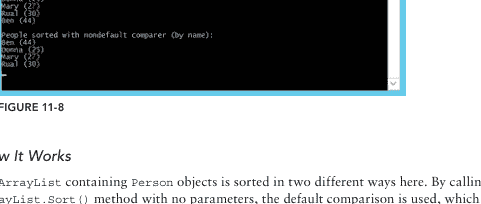

图 11-8

## 工作原理

这里以两种不同的方式对包含 Person 对象的 ArrayList 进行排序。通过不带参数调用 `ArrayList.Sort()` 方法，使用默认比较，即 Person 类中的 `CompareTo()` 方法（因为该类实现了 `IComparable`）：

```
public int CompareTo(object obj)
{
    if (obj is Person)
    {
        Person otherPerson = obj as Person;
        return this.Age - otherPerson.Age;
    }
    else
    {
        throw new ArgumentException(
            "Object to compare to is not a Person object.");
    }
}
```

此方法首先检查其参数是否可以与 Person 对象进行比较——也就是说，该对象是否可以转换为 Person 对象。如果存在问题，则抛出异常。否则，会比较两个 Person 对象的 Age 属性。

接下来，使用实现了 `IComparer` 的 PersonComparerName 类执行非默认比较排序。为了方便使用，该类有一个公共静态字段：

```
public static IComparer Default = new PersonComparerName();
```

这样你就可以像前面展示的 Comparer 类一样，使用 `PersonComparerName.Default` 获取一个实例。该类的 `CompareTo()` 方法如下：

```
public int Compare(object x, object y)
{
    if (x is Person && y is Person)
    {
        return Comparer.Default.Compare(
            ((Person)x).Name, ((Person)y).Name);
    }
    else
    {
        throw new ArgumentException(
            "One or both objects to compare are not Person objects.");
    }
}
```

同样，首先检查参数，确定它们是否为 Person 对象。如果不是，则抛出异常。如果是，则使用默认的 Comparer 对象来比较 Person 对象的两个字符串 Name 字段。

## 转换

到目前为止，每当需要将一种类型转换为另一种类型时，你都使用了强制转换，但这并不是唯一的方法。正如 int 可以在计算中隐式转换为 long 或 double 一样，你也可以定义所创建的类如何转换为其他类（隐式或显式）。为此，你需要重载转换运算符，这与本章前面重载其他运算符的方式非常相似。你将在本节的第一部分了解具体做法。你还将看到另一个有用的运算符——`as` 运算符，在使用引用类型时，它通常比强制转换更可取。

## 重载转换运算符

如前所示，除了重载数学运算符之外，你还可以定义类型之间的隐式和显式转换。如果你想在不相关的类型之间进行转换——例如，它们之间没有继承关系，也没有共享接口——那么这样做是必要的。

假设你在 ConvClass1 和 ConvClass2 之间定义了一个隐式转换。这意味着你可以编写如下代码：

```
ConvClass1 op1 = new ConvClass1();
ConvClass2 op2 = op1;
```

或者，你可以定义一个显式转换：

```
ConvClass1 op1 = new ConvClass1();
ConvClass2 op2 = (ConvClass2)op1;
```

作为示例，请考虑以下代码：

```
public class ConvClass1
{
    public int val;
    public static implicit operator ConvClass2(ConvClass1 op1)
    {
        ConvClass2 returnVal = new ConvClass2();
        returnVal.val = op1.val;
        return returnVal;
    }
}
public class ConvClass2
{
    public double val;
    public static explicit operator ConvClass1(ConvClass2 op1)
    {
        ConvClass1 returnVal = new ConvClass1();
        checked {returnVal.val = (int)op1.val;}
        return returnVal;
    }
}
```

在这里，ConvClass1 包含一个 int 值，ConvClass2 包含一个 double 值。由于 int 值可以隐式转换为 double 值，因此你可以在 ConvClass1 和 ConvClass2 之间定义隐式转换。但反过来就不行了，你应该将 ConvClass2 和 ConvClass1 之间的转换运算符定义为显式。

你可以像所示的那样使用 `implicit` 和 `explicit` 关键字来指定这一点。对于这些类，以下代码是可行的：

```
ConvClass1 op1 = new ConvClass1();
op1.val = 3;
ConvClass2 op2 = op1;
```

然而，反方向的转换则需要以下显式强制转换：

```
ConvClass2 op1 = new ConvClass2();
op1.val = 3e5;
ConvClass1 op2 = (ConvClass1)op1;
```

由于你在显式转换中使用了 checked 关键字，前面的代码会引发异常，因为 op1 的 val 属性太大，无法放入 op2 的 val 属性中。

## as 运算符

as 运算符使用以下语法将一种类型转换为指定的引用类型：

```
<operand> as <type>
```

这仅在特定情况下才有可能：

- 如果 <operand> 是 <type> 类型
- 如果 <operand> 可以隐式转换为 <type> 类型
- 如果 <operand> 可以装箱为 <type> 类型

如果无法从 <operand> 转换为 <type>，则表达式的结果将为 null。

通过显式转换可以将基类转换为派生类，但这并不总是有效。考虑前面示例中的两个类 ClassA 和 ClassD，其中 ClassD 继承自 ClassA：

```
class ClassA : IMyInterface {}
class ClassD : ClassA {}
```

以下代码使用 as 运算符将存储在 obj1 中的 ClassA 实例转换为 ClassD 类型：

```
ClassA obj1 = new ClassA();
ClassD obj2 = obj1 as ClassD;
```

这将导致 obj2 为 null。

但是，通过使用多态性，可以将 ClassD 实例存储在 ClassA 类型的变量中。以下代码说明了这一点，它使用 as 运算符将包含 ClassD 类型实例的 ClassA 类型变量转换为 ClassD 类型：

```
ClassD obj1 = new ClassD();
ClassA obj2 = obj1;
ClassD obj3 = obj2 as ClassD;
```

这次的结果是 obj3 最终包含与 obj1 相同对象的引用，而不是 null。

这一功能使 as 运算符非常有用，因为以下代码（使用简单强制转换）会导致抛出异常：

```
ClassA obj1 = new ClassA();
ClassD obj2 = (ClassD)obj1;
```

## 11.5 向 People 类添加一个迭代器，使您能够在 foreach 循环中获取所有成员的年龄，如下所示：

```
foreach (int age in myPeople.Ages)
{
    // Display ages.
}
```

练习的答案可以在附录 A 中找到。

通过将用于实例化泛型类的类型限制为支持给定接口或派生自特定类型的类型。此外，您不仅限于泛型类——您可以创建泛型接口、泛型方法（可以在非泛型类上定义），甚至泛型委托。所有这些都为您的代码增加了极大的灵活性，明智地使用泛型可以节省数小时的开发时间。

> 注意 如果您熟悉 C++，这是 C++ 模板与 C# 泛型类之间的一个区别。在 C++ 中，编译器检测您在何处使用了特定类型的模板——例如 A of B——并编译创建此类型所需的代码。在 C# 中，一切都在运行时发生。

您可能想知道这一切是如何实现的。通常，当您创建类时，它会被编译为您可以在代码中使用的类型。您可能会认为，当您创建泛型类时，它必须被编译成大量类型，以便您可以实例化它。幸运的是，情况并非如此——考虑到 .NET 中可能存在无限数量的类，这正好是件好事。在幕后，.NET 运行时允许在您需要时动态生成泛型类。给定的泛型类 A of B 在您通过实例化来请求它之前不会存在。

## 使用泛型

在您了解如何创建自己的泛型类型之前，值得先了解一下 .NET Framework 提供的泛型类型。其中包括 System.Collections.Generic 命名空间中的类型，您在代码中已经多次看到这个命名空间，因为它在控制台应用程序中默认包含。您还没有使用过该命名空间中的任何类型，但这种状况即将改变。本节将介绍该命名空间中的类型，以及如何使用它们来创建强类型集合并改进现有集合的功能。

不过，首先您将了解另一种更简单的泛型类型，它绕过了值类型的一个小问题：可空类型。

## 可空类型

在前面的章节中，您了解到值类型（包括大多数基本类型，如 int 和 double，以及所有结构体）与引用类型（string 和任何类）的区别之一在于它们必须包含一个值。它们可以在声明之后、赋值之前处于未赋值状态，但在该状态下您无法以任何方式使用该值类型。相反，引用类型可以为 null。

有时——这种情况出现的频率比您想象的更高（尤其是在处理数据库时）——拥有可以为 null 的值类型会非常有用。泛型通过 System.Nullable\<T\> 类型为您提供了一种实现方式，如下例所示：

```
System.Nullable<int> nullableInt;
```

请注意，此处的 result 变量也是 int? 类型。以下代码将无法编译：

```
int? op1 = 5;
int result = op1 * 2;
```

要使其正常工作，您必须执行显式转换或通过 Value 属性访问该值，这需要编写如下代码：

```
int? op1 = 5;
int result = (int)op1 * 2;
```

或者：

```
int? op1 = 5;
int result = op1.Value * 2;
```

只要 op1 有值，这就能正常工作——如果它为 null，那么您将收到 System.InvalidOperationException 类型的异常。

这引出了一个显而易见的问题：当涉及两个可空值的运算符计算中，其中一个或两个值为 null 时，会发生什么？例如以下代码中的 op1：

```
int? op1 = null;
int? op2 = 5;
int? result = op1 * op2;
```

答案是，对于除 bool? 之外的所有简单可空类型，操作的结果都是 null，您可以将此解释为“无法计算”。对于结构体，您可以定义自己的运算符来处理这种情况（如本章后面所示），而对于 bool?，为 & 和 | 定义了运算符，这些运算符可能会产生非 null 的返回值。表格中的结果在逻辑上完全合理——如果有足够的信息计算出计算结果，而无需知道其中一个操作数的值，那么该操作数是否为 null 就无关紧要了。

## ?? 运算符

为了进一步减少处理可空类型所需的代码量，并更轻松地处理可以为 null 的变量，您可以使用 ?? 运算符。它被称为空合并运算符（null coalescing operator），是一个二元运算符，使您能够为可能计算为 null 的表达式提供替代值。如果第一个操作数不为 null，则该运算符计算第一个操作数；如果第一个操作数为 null，则计算第二个操作数。在功能上，以下两个表达式是等价的：

```
op1 ?? op2
op1 == null ? op2 : op1
```

在这段代码中，op1 可以是任何可空表达式，包括引用类型，更重要的是，可以是可空类型。这意味着您可以使用 ?? 运算符在可空类型为 null 时提供默认值，如下所示：

```
int? op1 = null;
int result = op1 * 2 ?? 5;
```

因为在此示例中 op1 为 null，所以 op1 * 2 也为 null。但是，?? 运算符会检测到这一点，并将值 5 赋给 result。重要的是，请注意这里不需要显式转换即可将结果放入 int 类型的变量 result 中。?? 运算符会为您处理此转换。或者，您也可以将 ?? 计算的结果传递给 int?，没有任何问题：

```
int? result = op1 * 2 ?? 5;
```

这种行为使 ?? 运算符在处理可空变量时成为一个多功能的工具，也是提供默认值的一种便捷方式，无需在 if 结构中使用代码块，也无需使用常常令人困惑的三元运算符。

## ?. 运算符

该运算符通常被称为 Elvis 运算符或 null 条件运算符，它有助于克服由繁重的 null 检查引起的代码歧义。例如，如果您想获取某个客户的订单数量，则需要在设置数量值之前检查 null：

```
int count = 0;
if (customer.orders != null)
{
    count = customer.orders.Count();
}
```

如果您直接编写这段代码，而该客户没有订单（即为 null），则会抛出 System.ArgumentNullException：

```
int count = customer.orders.Count();
```

使用 ?. 运算符会使 int? 类型的 count 被设置为 null，而不是发生异常。

```
int? count = customer.orders?.Count();
```

将上一节讨论的空合并运算符 ?? 与 null 条件运算符 ?. 结合使用，可以在结果为 null 时设置默认值。

```csharp
int? count = customer.orders?.Count() ?? 0;
```

null 条件运算符的另一个用途是触发事件。事件将在第 13 章中详细讨论。触发事件最常见的方式是使用以下代码模式：

```csharp
var onChanged = OnChanged;
if (onChanged != null)
{
    onChanged(this, args);
}
```

此模式不是线程安全的，因为有人可能在 null 检查完成后立即取消订阅最后一个事件处理程序。如果发生这种情况，将抛出异常并导致应用程序崩溃。可以通过使用 null 条件运算符来避免这种情况，如下所示：

```csharp
OnChanged?.Invoke(this, args);
```


```
Theta = theta;
}
public static Vector operator +(Vector op1, Vector op2)
{
    try
    {
        // Get (x, y) coordinates for new vector.
        double newX = op1.R.Value * Sin(op1.ThetaRadians.Value)
            + op2.R.Value * Sin(op2.ThetaRadians.Value);
        double newY = op1.R.Value * Cos(op1.ThetaRadians.Value)
            + op2.R.Value * Cos(op2.ThetaRadians.Value);
        // Convert to (r, theta).
        double newR = Sqrt(newX * newX + newY * newY);
        double newTheta = Atan2(newX, newY) * 180.0 / PI;
        // Return result.
        return new Vector(newR, newTheta);
    }
    catch
    {
        // Return "null" vector.
        return new Vector(null, null);
    }
}
public static Vector operator -(Vector op1) => new Vector(-op1.R, op1.Theta);
public static Vector operator -(Vector op1, Vector op2) => op1 + (-op2);
public override string ToString()
{
    // Get string representation of coordinates.
    string rString = R.HasValue ? R.ToString() : "null";
    string thetaString = Theta.HasValue ? Theta.ToString() : "null";
    // Return (r, theta) string.
    return string.Format($"({rString}, {thetaString})");
}
}
```

## 4. 按如下方式修改 Program.cs 中的代码：

```
class Program
{
    static void Main(string[] args)
    {
        Vector v1 = GetVector("vector1");
        Vector v2 = GetVector("vector2");
        WriteLine($"v1 + v2 = {v1 + v2}");
        WriteLine($"v1 - v2 = {v1 - v2}");
        ReadKey();
    }
    static Vector GetVector(string name)
    {
        WriteLine($"Input {name} magnitude:");
```
```csharp
double? r = GetNullableDouble();
WriteLine($"Input {name} angle (in degrees):");
double? theta = GetNullableDouble();
return new Vector(r, theta);
}
static double? GetNullableDouble()
{
    double? result;
    string userInput = ReadLine();
    try
    {
        result = double.Parse(userInput);
    }
    catch
    {
        result = null;
    }
    return result;
}
```

5. 运行应用程序，并输入两个矢量的值。示例输出如图 12-1 所示。

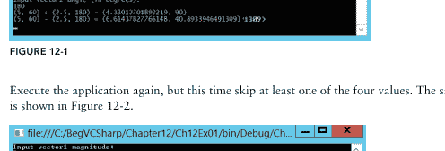

图 12-1

6. 再次运行应用程序，但这次跳过四个值中的至少一个。示例输出如图 12-2 所示。


图 12-2

## 工作原理

本示例创建了一个名为 Vector 的类，它表示具有极坐标（即具有大小和角度）的矢量，如图 12-3 所示。

坐标 r 和 θ 在代码中由公共字段 R 和 Theta 表示，其中 Theta 以度为单位。提供 ThetaRadians 是为了获取以弧度表示的 Theta 值——这是必要的，因为 Math 类在其静态方法中使用弧度。R 和 Theta 都是 `double?` 类型，因此它们可以为 null：

```
public class Vector
{
    public double? R = null;
    public double? Theta = null;
    public double? ThetaRadians
    {
        get
        {
            // Convert degrees to radians.
            return (Theta * PI / 180.0);
        }
    }
}
```

Vector 的构造函数对 R 和 Theta 的初始值进行归一化，然后给公共字段赋值：

```
public Vector(double? r, double? theta)
{
    // Normalize.
    if (r < 0)
    {
        r = -r;
        theta += 180;
    }
    theta = theta % 360;
    // Assign fields.
    R = r;
    Theta = theta;
}
```

Vector 类的主要功能是通过运算符重载来执行矢量的加法和减法，这需要一些这里不涉及的基础三角学知识。你可以看看这个网站 http://www.onlinemathlearning.com/basic-trigonometry.html，或者在网上搜索其他资源。代码的要点在于：如果获取 R 或 ThetaRadians 的 Value 属性时抛出异常——也就是说，如果其中任何一个为 null——那么就会返回一个“null”矢量：

```
public static Vector operator +(Vector op1, Vector op2)
{
    try
    {
        // Get (x, y) coordinates for new vector.
        ...
    }
```

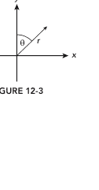

```
catch
{
    // Return "null" vector.
    return new Vector(null, null);
}
```

如果构成矢量的任一坐标为 null，则该矢量无效，此处用 R 和 Theta 都为 null 的 Vector 类来表示。Vector 类中的其余代码重写了扩展加法功能以包含减法所需的其他运算符，并重写 ToString() 以获得 Vector 对象的字符串表示形式。

Program.cs 中的代码通过让用户初始化两个矢量，然后将它们彼此相加和相减来测试 Vector 类。如果用户省略某个值，该值将被解释为 null，并且前面提到的规则将适用。

## System.Collections.Generic 命名空间

在本书目前几乎每个应用程序中，你都会看到以下命名空间：

```
using System;
using System.Collections.Generic;
using System.Linq;
using System.Text;
using System.Threading.Tasks;
```

System 命名空间包含 .NET 应用程序中使用的大多数基本类型。System.Text 命名空间包含与字符串处理和编码相关的类型。你将在本书后面了解 System.Linq 命名空间。System.Threading.Tasks 命名空间包含帮助你编写异步代码的类型，本书不涉及这一主题。但是 System.Collections.Generic 呢？为什么它在控制台应用程序中默认包含？

答案是：该命名空间包含处理集合的泛型类型，而且它很可能被频繁使用，因此它被配置为带 using 语句，供你无需限定即可使用。

现在你将了解这些类型，它们必定会让你的工作更轻松。它们使你几乎不用费力就能创建强类型的集合类。表 12-1 列出了本节将介绍的 System.Collections.Generic 命名空间中的两种类型。该命名空间中的更多类型将在本章后面介绍。

表 12-1：泛型集合类型

| 类型 | 说明 |
|---|---|
| List<T> | 类型为 T 的对象的集合 |
| Dictionary<K, V> | 类型为 V 的项的集合，与类型为 K 的键相关联 |

本节还将介绍与这些类一起使用的各种接口和委托。

## List<T>

与其像上一章那样从 CollectionBase 派生一个类并实现所需的方法，更快捷、更简单的方式是直接使用 List<T> 泛型集合类型。额外的好处是，许多通常需要你实现的方法（如 Add()）已经为你实现了。

创建类型为 T 的对象的集合需要以下代码：

```
List<T> myCollection = new List<T>();
```

就是这样。你无需定义任何类、实现任何方法或做任何其他事情。你也可以通过将 List<T> 对象传递给构造函数来设置集合的起始项列表。List<T> 还有一个 Item 属性，允许类似数组的访问：

```
T itemAtIndex2 = myCollection[2];
```

该类还支持其他几种方法，但这些已经足够你入门了。下面的 Try It Out 演示了如何在实际中应用 List<T>。

## 试一试 使用 List<T>：Ch12Ex02

- 1. 创建一个名为 Ch12Ex02 的新控制台应用程序，并将其保存在目录 C:\BegVCSharp\Chapter12 中。
- 2. 在解决方案资源管理器窗口中右键单击项目名称，然后选择“添加”>“现有项”选项。
- 3. 从 C:\BegVCSharp\Chapter11\Ch11Ex01\Ch11Ex01 目录中选择 Animal.cs、Cow.cs 和 Chicken.cs 文件，并单击“添加”。
- 4. 按如下方式修改你添加的三个文件中的命名空间声明：
      namespace Ch12Ex02
- 5. 按如下方式修改 Program.cs：
      static void Main(string[] args)
      {
        List<Animal> animalCollection = new List<Animal>();
        animalCollection.Add(new Cow("Rual"));
        animalCollection.Add(new Chicken("Donna"));
        foreach (Animal myAnimal in animalCollection)
        {
          myAnimal.Feed();
        }
        ReadKey();
      }


- 4. 按如下方式修改你添加的文件中的命名空间声明：

  ```csharp
  namespace Ch12Ex03
  ```

- 5. 添加一个名为 Vectors 的新类。

- 6. 按如下方式修改 `Vectors.cs`：

  ```csharp
  public class Vectors : List<Vector>
  {
      public Vectors()
      {
      }
      public Vectors(IEnumerable<Vector> initialItems)
      {
          foreach (Vector vector in initialItems)
          {
              Add(vector);
          }
      }
      public string Sum()
      {
          StringBuilder sb = new StringBuilder();
          Vector currentPoint = new Vector(0.0, 0.0);
          sb.Append("origin");
          foreach (Vector vector in this)
          {
              sb.AppendFormat($" + {vector}");
              currentPoint += vector;
          }
          sb.AppendFormat($" = {currentPoint}");
          return sb.ToString();
      }
  }
  ```

- 7. 添加一个名为 VectorDelegates 的新类。

- 8. 按如下方式修改 `VectorDelegates.cs`：

  ```csharp
  public static class VectorDelegates
  {
      public static int Compare(Vector x, Vector y)
      {
          if (x.R > y.R)
          {
              return 1;
          }
          else if (x.R < y.R)
          {
              return -1;
          }
          return 0;
      }

      public static bool TopRightQuadrant(Vector target)
      {
          if (target.Theta >= 0.0 && target.Theta <= 90.0)
          {
              return true;
          }
          else
          {
              return false;
          }
      }
  }
  ```

- 9. 按如下方式修改 `Program.cs`：

  ```csharp
  static void Main(string[] args)
  {
      Vectors route = new Vectors();
      route.Add(new Vector(2.0, 90.0));
      route.Add(new Vector(1.0, 180.0));
      route.Add(new Vector(0.5, 45.0));
      route.Add(new Vector(2.5, 315.0));
      WriteLine(route.Sum());
      Comparison<Vector> sorter = new Comparison<Vector>(
          VectorDelegates.Compare);
      route.Sort(sorter);
      WriteLine(route.Sum());
      Predicate<Vector> searcher =
          new Predicate<Vector>(VectorDelegates.TopRightQuadrant);
      Vectors topRightQuadrantRoute = new Vectors(route.FindAll(searcher));
      WriteLine(topRightQuadrantRoute.Sum());
      ReadKey();
  }
  ```

- 10. 运行应用程序。结果如图 12-4 所示。

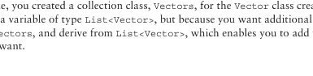

FIGURE 12-4

## 工作原理

在本示例中，你为在 Ch12Ex01 中创建的 Vector 类创建了一个集合类 Vectors。你本可以使用类型为 List<Vector> 的变量，但由于你想要额外的功能，你使用了一个新类 Vectors 并继承自 List<Vector>，这使你能够添加任何额外的成员。

其中一个成员 Sum() 返回一个字符串，按顺序列出每个向量，以及将它们全部相加的结果（使用原始 Vector 类中重载的 + 运算符）。由于每个向量都可以被视为方向和距离，这有效地构成了一条具有终点的路线：

```csharp
public string Sum()
{
    StringBuilder sb = new StringBuilder();
    Vector currentPoint = new Vector(0.0, 0.0);
    sb.Append("origin");
    foreach (Vector vector in this)
    {
        sb.AppendFormat($" + {vector}");
        currentPoint += vector;
    }
    sb.AppendFormat($" = {currentPoint}");
    return sb.ToString();
}
```

此方法使用位于 System.Text 命名空间中的便捷 StringBuilder 类来构建响应字符串。该类具有 Append() 和 AppendFormat()（此处使用）等成员，使组装字符串变得容易——性能优于连接单个字符串。你使用该类的 ToString() 方法来获取结果字符串。

你还创建了两个作为委托使用的方法，作为 VectorDelegates 的静态成员。Compare() 用于比较（排序），TopRightQuadrant() 用于搜索。在回顾 Program.cs 中的代码时，你将查看这些方法。

Main() 中的代码首先初始化一个 Vectors 集合，其中添加了几个 Vector 对象（你可以在 Ch12Ex03\Program.cs 中找到这段代码）：

```csharp
Vectors route = new Vectors();
route.Add(new Vector(2.0, 90.0));
route.Add(new Vector(1.0, 180.0));
route.Add(new Vector(0.5, 45.0));
route.Add(new Vector(2.5, 315.0));
```

Vectors.Sum() 方法用于按前面所述的方式输出集合中的项，这次按其初始顺序：

```csharp
WriteLine(route.Sum());
```

接下来，你创建了第一个委托 sorter。该委托的类型为 Comparison<Vector>，因此可以分配具有以下返回类型和参数的方法：

```csharp
int method(Vector objectA, Vector objectB)
```

这与 VectorDelegates.Compare() 匹配，后者是你分配给委托的方法：

```csharp
Comparison<Vector> sorter = new Comparison<Vector>(
    VectorDelegates.Compare);
```

## 修改 CardLib 以使用泛型集合类

你可以在最近几章中一直在构建的 CardLib 项目中做的一个简单修改是，将 Cards 集合类更改为使用泛型集合类，从而节省大量代码。Cards 类定义的所需修改如下（你可以在 Ch12CardLib\Cards.cs 中找到这段代码）：

```csharp
public class Cards : List<Card>, ICloneable { ... }
```

你还可以删除 Cards 的所有方法，除了 Clone()（ICloneable 所需）和 CopyTo()，因为 List<Card> 提供的 CopyTo() 版本使用的是 Card 对象数组，而不是 Cards 集合。Clone() 需要进行小的修改，因为 List<T> 类没有定义可使用的 List 属性：

```csharp
public object Clone()
{
    Cards newCards = new Cards();
    foreach (Card sourceCard in this)
    {
        newCards.Add((Card)sourceCard.Clone());
    }
    return newCards;
}
```

而不是在这里展示这段非常简单的修改的代码，CardLib 的更新版本，名为 Ch12CardLib，已包含在本章的可下载代码中，并附带上一章的客户端代码。

## 定义泛型类型

你现在已经学到足够多的关于泛型的知识，可以创建自己的泛型。你已经看到了大量涉及泛型类型的代码，并且已经大量练习了泛型语法。本节介绍以下内容的定义：

- 泛型类
- 泛型接口
- 泛型方法
- 泛型委托

你还将研究以下处理在定义泛型类型时出现的问题的更高级技术：

- default 关键字
- 约束类型
- 继承泛型类
- 泛型运算符

你可以通过使用多个 where 语句为泛型类所需的一个或所有类型定义约束：

```csharp
class MyGenericClass<T1, T2> where T1 : constraint1 where T2 : constraint2
{ ... }
```

你使用的任何约束都必须出现在继承说明符之后：

```csharp
class MyGenericClass<T1, T2> : MyBaseClass, IMyInterface
    where T1 : constraint1 where T2 : constraint2 { ... }
```

可用的约束如表 12-3 所示。

### 表 12-3：泛型类型约束

| 约束 | 定义 | 示例用法 |
|---|---|---|
| struct | 类型必须是值类型。 | 在需要值类型才能正常工作的类中——例如，类型为 T 的成员变量为 0 表示某种含义 |
| class | 类型必须是引用类型。 | 在需要引用类型才能正常工作的类中——例如，类型为 T 的成员变量为 null 表示某种含义 |
| base-class | 类型必须是 base-class 或继承自 base-class。你可以提供任何类名作为此约束。 | 在需要从 base-class 继承的某些基线功能才能正常工作的类中 |
| interface | 类型必须是 interface 或实现 interface。 | 在需要 interface 提供的某些基线功能才能正常工作的类中 |
| new() | 类型必须具有公共的无参数构造函数。 | 在需要能够实例化类型为 T 的变量的类中，也许在构造函数中 |

> **注意** 如果使用 `new()` 作为约束，它必须是为该类型指定的最后一个约束。

可以通过基类约束按如下方式使用一个类型参数作为另一个类型参数的约束：

```csharp
class MyGenericClass<T1, T2> where T2 : T1 { ... }
```


这里，T2 必须与 T1 属于相同类型，或者继承自 T1。这称为裸类型约束（naked type constraint），即使用一个泛型类型参数作为另一个泛型类型参数的约束。

如以下示例所示，循环类型约束是被禁止的：

```
class MyGenericClass<T1, T2> where T2 : T1 where T1 : T2 { ... }
```

此代码无法编译。在下面的“动手实践”中，你将定义并使用一个泛型类，该类使用前面章节中介绍的 Animal 类族。

## 动手实践：定义泛型类：Ch12Ex04

- 1. 创建一个名为 Ch12Ex04 的新控制台应用程序，并将其保存到 c:\BegVCSharp\Chapter12 目录中。
- 2. 在“解决方案资源管理器”窗口中右键单击项目名称，然后选择“添加现有项”选项。
- 3. 从 C:\BegVCSharp\Chapter12\Ch12Ex02\Ch12Ex02 目录中选择 Animal.cs、Cow.cs 和 Chicken.cs 文件，然后单击“添加”。
- 4. 按如下方式修改所添加文件中的命名空间声明：
- 5. 按如下方式修改 Animal.cs：
- 6. 按如下方式修改 Chicken.cs：
- 7. 按如下方式修改 Cow.cs：

```
namespace Ch12Ex04
```

```
public abstract class Animal
{
    ...
    public abstract void MakeANoise();
}
```

```
public class Chicken : Animal
{
    ...
    public override void MakeANoise()
    {
        WriteLine($"{name} says 'cluck!'" );
    }
}
```

```
public class Cow : Animal
{
    ...
    public override void MakeANoise()
    {
        WriteLine($"{name} says 'moo!'" );
    }
}
```

- 8. 添加一个名为 SuperCow 的新类，并按如下方式修改 SuperCow.cs 中的代码：

```
public class SuperCow : Cow
{
    public void Fly()
    {
        WriteLine($"{name} is flying!");
    }
    public SuperCow(string newName) : base(newName)
    {
    }
    public override void MakeANoise()
    {
        WriteLine(
            $"{name} says 'here I come to save the day!'" );
    }
}
```

- 9. 添加一个名为 Farm 的新类，并按如下方式修改 Farm.cs 中的代码：

```
using System;
using System.Collections;
using System.Collections.Generic;
using System.Linq;
using System.Text;
using System.Threading.Tasks;
namespace Ch12Ex04
{
    public class Farm<T> : IEnumerable<T>
        where T : Animal
    {
        private List<T> animals = new List<T>();
        public List<T> Animals
        {
            get { return animals; }
        }
        public IEnumerator<T> GetEnumerator() => animals.GetEnumerator();
        IEnumerator IEnumerable.GetEnumerator() => animals.GetEnumerator();
        public void MakeNoises()
        {
            foreach (T animal in animals)
            {
                animal.MakeANoise();
            }
        }
        public void FeedTheAnimals()
        {
            foreach (T animal in animals)
            {
                animal.Feed();
            }
        }
        public Farm<Cow> GetCows()
        {
            Farm<Cow> cowFarm = new Farm<Cow>();
```

## 协变与逆变

协变与逆变是协变性和逆变性的统称，这两个概念是在 .NET 4 中引入的。实际上，它们出现得更早（.NET 2.0 就已经支持），但在 .NET 4 之前，实现它们非常困难，因为这需要自定义编译过程。

理解这些术语含义的最简单方法，是将它们与多态进行比较。正如你所记得的，多态允许你将派生类型的对象放入基类型变量中，例如：

```
Cow myCow = new Cow("Geronimo");
Animal myAnimal = myCow;
```

这里，一个 Cow 类型的对象被放入了 Animal 类型的变量中——这是可行的，因为 Cow 派生自 Animal。

然而，对于接口则不能这样说。也就是说，以下代码无法运行：

```
IMethaneProducer<Cow> cowMethaneProducer = myCow;
IMethaneProducer<Animal> animalMethaneProducer = cowMethaneProducer;
```

假设 Cow 支持 IMethaneProducer<Cow> 接口，第一行代码没有问题。然而，第二行代码预设了两个接口类型之间存在某种关系，而这种关系并不存在，因此无法将其中一个转换为另一个。真的没有办法吗？使用本章目前介绍的技术当然不行，因为泛型类型的所有类型参数都是不变的。不过，可以在泛型接口和泛型委托上定义变体类型参数，以适应前面代码所展示的确切场景。

要使前面的代码正常工作，IMethaneProducer<T> 接口的类型参数 T 必须是协变的。使用协变类型参数实际上会在 IMethaneProducer<Cow> 和 IMethaneProducer<Animal> 之间建立继承关系，这样一种类型的变量就可以保存另一种类型的值，就像多态一样（尽管过程稍微复杂一些）。

作为对协变与逆变介绍的总结，你还需要了解另一种类型：逆变。它与协变类似，但方向相反。协变允许将泛型接口值放入包含基类型的变量中，而逆变则允许将该接口放入使用派生类型的变量中，例如：

```
IGrassMuncher<Cow> cowGrassMuncher = myCow;
IGrassMuncher<SuperCow> superCowGrassMuncher = cowGrassMuncher;
```

乍看之下，这似乎有些奇怪，因为使用多态无法实现同样的效果。然而，在某些情况下，这是一种很有用的技术，正如你将在“逆变”一节中看到的那样。

在接下来的两节中，你将了解如何在泛型类型中实现协变与逆变，以及 .NET Framework 如何利用协变与逆变来让编程更加容易。

对于接口定义，逆变类型参数只能用作方法参数，不能用作返回类型。

同样，理解这一点的最佳方式，是查看 .NET Framework 中使用逆变的示例。具有逆变类型参数的接口之一，也是你已经使用过的接口，是 IComparer<T>。你可以按如下方式为动物实现此接口：

```
public class AnimalNameLengthComparer : IComparer<Animal>
{
    public int Compare(Animal x, Animal y)
        => x.Name.Length.CompareTo(y.Name.Length);
}
```

此比较器根据动物名称的长度进行比较，因此你可以使用它对 List<Animal> 的实例进行排序。不过，通过逆变，即使 List<Cow>.Sort() 方法要求传入 IComparer<Cow> 的实例，你也可以使用它对 List<Cow> 的实例进行排序：

```
List<Cow> cows = new List<Cow>();
cows.Add(new Cow("Geronimo"));
cows.Add(new SuperCow("Tonto"));
cows.Add(new Cow("Gerald"));
cows.Add(new Cow("Phil"));
cows.Sort(new AnimalNameLengthComparer());
```

在大多数情况下，逆变是自动发生的事情——.NET Framework 已经加入了相关支持，以帮助完成这类操作。不过，.NET 4 及更高版本中两种变体的优点在于：在需要时，你可以使用本节所示的技术自行实现它们。

## 练习

### 12.1 以下哪些类型可以是泛型的？

- a. 类
- b. 方法
- c. 属性
- d. 运算符重载
- e. 结构
- f. 枚举

### 12.2 扩展 Ch12Ex01 中的 Vector 类，使 • 运算符返回两个向量的点积。

> 注意：两个向量的点积定义为它们的模的乘积，再乘以两者夹角的余弦值。

### 12.3 以下代码有什么问题？请修复它。

```
public class Instantiator<T>
{
    public T instance;
    public Instantiator()
    {
        instance = new T();
    }
}
```

### 12.4 以下代码有什么问题？请修复它。

```
public class StringGetter<T>
{
    public string GetString<T>(T item) => item.ToString();
}
```

### 12.5

创建一个名为 ShortList<T> 的泛型类，使其实现 IList<T>，并由一个具有最大容量的项目集合组成。此最大容量应为一个整数，可以传递给 ShortList<T> 的构造函数；如果未提供，则默认为 10。构造函数还应能够通过 IEnumerable<T> 参数接收项目初始列表。该类的功能应与 List<T> 完全相同，但如果尝试向集合中添加过多项目，或者传递给构造函数的 IEnumerable<T> 包含过多项目，则应抛出 IndexOutOfRangeException 类型的异常。

### 12.6 以下代码能否编译？如果不能，为什么？

```
public interface IMethaneProducer<out T>
{
    void BelchAt(T target);
}
```

练习答案见附录 A。


## 本章所学内容

| 主题 | 关键概念 |
|---|---|
| 使用泛型类型 | 泛型类型需要一个或多个类型参数才能工作。你可以通过在声明变量时传入所需的类型参数，将泛型类型用作变量的类型。具体做法是将逗号分隔的类型名称列表放在尖括号中。 |
| 可空类型 | 可空类型是可以接受指定值类型的任何值或 `null` 值的类型。你可以使用 `Nullable<T>` 或 `T?` 语法来声明可空类型变量。 |
| `??` 运算符 | 空合并运算符返回其第一个操作数的值；如果第一个操作数为 `null`，则返回第二个操作数的值。 |
| 泛型集合 | 泛型集合非常有用，因为它们内置了强类型支持。你可以使用 `List<T>`、`Collection<T>` 和 `Dictionary<K, V>` 等其他集合类型。这些集合还公开了泛型接口。要对泛型集合进行排序和搜索，可以使用 `IComparer<T>` 和 `IComparable<T>` 接口。 |
| 定义泛型类 | 定义泛型类型与其他类型非常相似，只需在指定类型名称的位置添加泛型类型参数即可。与使用泛型类型一样，你需要将这些参数指定为尖括号内的逗号分隔列表。你可以在代码中任何需要使用类型名称的地方使用泛型类型参数，例如在方法返回值和参数中。 |
| 泛型类型参数约束 | 为了在泛型类型代码中更有效地使用泛型类型参数，你可以限制使用该类型时可供提供的类型。你可以按基类、支持的接口、必须是值类型还是引用类型、是否支持无参数构造函数来约束类型参数。如果没有这些约束，你必须使用 `default` 关键字来实例化泛型类型的变量。 |
| 其他泛型类型 | 除了类之外，你还可以定义泛型接口、泛型委托和泛型方法。 |
| 变体 | 变体是类似于多态的概念，但应用于类型参数。它允许你在两个仅泛型类型参数不同的泛型类型之间互换使用。协变允许在目标类型的类型参数是源类型类型参数的基类时进行转换。逆变允许在关系相反时进行转换。协变类型参数使用 `out` 关键字定义，并且只能用作返回类型和属性 get 访问器类型。逆变类型参数使用 `in` 关键字定义，并且只能用作方法参数。 |

## 13

## 更多 C# 技术

## 本章你将学习

- 了解 `::` 运算符
- 理解全局命名空间限定符
- 创建自定义异常
- 使用事件
- 使用匿名方法
- 使用 C# 特性
- 使用初始化器
- 使用 `var` 类型和类型推断
- 使用匿名类型
- 使用 `dynamic` 类型
- 使用命名和可选方法参数
- 使用 Lambda 表达式

## WROX.COM 本章代码下载

你可以从 www.wrox.com/go/beginningvisualc#2015programming 的 Download Code 选项卡中找到本章的 wrox.com 代码下载。代码位于 Chapter 13 下载中，并根据本章中的名称单独命名。

在本章中，你将继续探索 C# 语言，了解一些在其他地方尚未完全涉及的零散内容。Anders Hejlsberg（C# 的发明者）和微软的其他人员一直在不断更新和完善这门语言。在撰写本书时，最新的更改是 C# 语言第 6 版的一部分，该版本随 Visual Studio 2015 产品线以及 .NET 4.6 一起发布。在本书的这个阶段，你可能会想还有什么其他需要的；事实上，以前版本的 C# 在功能方面并不缺乏。然而，这并不意味着没有办法让 C# 编程的某些方面更简单，也不意味着 C# 与其他技术之间的关系无法得到简化。

你还会对前几章中一直在构建的 CardLib 代码进行一些最终修改，甚至使用 CardLib 来创建一个纸牌游戏。

## `::` 运算符和全局命名空间限定符

`::` 运算符提供了访问命名空间中类型的另一种方式。如果你想使用命名空间别名，但别名与实际命名空间层次结构之间存在歧义，这可能是必要的。在这种情况下，命名空间层次结构的优先级高于命名空间别名。要了解这意味着什么，请考虑以下代码：

```
using MyNamespaceAlias = MyRootNamespace.MyNestedNamespace;
namespace MyRootNamespace
{
    namespace MyNamespaceAlias
    {
        public class MyClass {}
    }
    namespace MyNestedNamespace
    {
        public class MyClass {}
    }
}
```

MyRootNamespace 中的代码可以使用以下内容来引用类：

```
MyNamespaceAlias.MyClass
```

此代码引用的类是 MyRootNamespace.MyNamespaceAlias.MyClass，而不是 MyRootNamespace.MyNestedNamespace.MyClass。也就是说，命名空间 MyRootNamespace.MyNamespaceAlias 隐藏了 using 语句定义的别名，该别名指向 MyRootNamespace.MyNestedNamespace。你仍然可以访问 MyRootNamespace.MyNestedNamespace 命名空间及其包含的类，但需要不同的语法：

```
MyNestedNamespace.MyClass
```

或者，你可以使用 `::` 运算符：

```
MyNamespaceAlias::MyClass
```

使用此运算符会强制编译器使用 using 语句定义的别名，因此代码引用的是 MyRootNamespace.MyNestedNamespace.MyClass。

你还可以将 `global` 关键字与 `::` 运算符结合使用，这实际上是顶级根命名空间的别名。这有助于更清楚地表明你正在引用哪个命名空间，如下所示：

```
global::System.Collections.Generic.List<int>
```

这是你期望的类，即泛型 `List<T>` 集合类。它肯定不是以下代码定义的类：

```
namespace MyRootNamespace
{
    namespace System
    {
        namespace Collections
        {
            namespace Generic
            {
                class List<T> {}
            }
        }
    }
}
```

当然，你应该避免为命名空间起与现有 .NET 命名空间相同的名称，尽管在大型项目中可能会出现类似的问题，特别是当你作为大型团队的一部分工作时。使用 `::` 运算符和 `global` 关键字可能是访问所需类型的唯一方法。

## 自定义异常

第 7 章介绍了异常，并解释了如何使用 `try...catch...finally` 块来处理异常。你还看到了几个标准的 .NET 异常，包括异常的基类 `System.Exception`。有时，从这个基类派生你自己的异常类以在应用程序中使用，而不是使用标准异常，是很有用的。这使你能够向捕获异常的代码发送更具体的信息，并使捕获代码能够更具体地处理哪些异常。例如，你可以向异常类添加一个新属性，以允许访问某些底层信息，从而使异常接收者能够做出所需的更改，或者只是提供有关异常原因的更多信息。

> 注意 System 命名空间中有两个基本的异常类，它们都派生自 Exception：ApplicationException 和 SystemException。SystemException 用作 .NET Framework 预定义异常的基类。ApplicationException 提供给开发人员派生自己的异常类，但最新的最佳实践表明，你不应该从这个类派生异常；你应该使用 Exception。

### 向 CardLib 添加自定义异常

如何使自定义异常再次最好地通过升级 CardLib 项目来说明。`Deck.GetCard()` 方法当前在尝试时抛出一个标准的 .NET 异常


访问索引小于 0 或大于 51 的卡牌时，你会修改为使用自定义异常。

首先，你需要创建一个名为 Ch13CardLib 的新类库项目，将其保存在 BegVCSharp\Chapter13 目录下，并像之前一样从 Ch12CardLib 复制类，同时将命名空间相应改为 Ch13CardLib。接下来，定义异常。你可以通过在新类文件 CardOutOfRangeException.cs 中定义一个新类来完成，你可以通过 Project → Add Class 将此类添加到 Ch13CardLib 项目（你可以在 Ch13CardLib\CardOutOfRangeException.cs 中找到此代码）：

```
public class CardOutOfRangeException : Exception
{
    private Cards deckContents;
    public Cards DeckContents
    {
        get { return deckContents; }
    }
    public CardOutOfRangeException(Cards sourceDeckContents)
        : base("There are only 52 cards in the deck.")
    {
        deckContents = sourceDeckContents;
    }
}
```

此类的构造函数需要一个 Cards 类的实例。它允许通过 DeckContents 属性访问这个 Cards 对象，并向基类 Exception 构造函数提供合适的错误消息，以便通过类的 Message 属性获取该消息。

接下来，向 Deck.cs 添加使用此异常的代码，替换原来的标准异常（你可以在 Ch13CardLib\Deck.cs 中找到此代码）：

```
public Card GetCard(int cardNum)
{
    if (cardNum >= 0 && cardNum <= 51)
        return cards[cardNum];
    else
        throw new CardOutOfRangeException(cards.Clone() as Cards);
}
```

DeckContents 属性使用 Deck 对象当前内容的深拷贝（以 Cards 对象的形式）进行初始化。这意味着你可以在抛出异常时看到内容，因此后续对牌组内容的修改不会“丢失”此信息。

要测试这一点，可以使用以下客户端代码（你可以在 Ch13CardClient\Program.cs 中找到此代码）：

```
Deck deck1 = new Deck();
try
{
    Card myCard = deck1.GetCard(60);
}
```

> **注意** 事件中使用委托这一事实是委托如此有用的原因之一。这也是第六章花费一定篇幅介绍它们的原因。你可能希望回顾一下这些材料，以重温委托及其使用方法。

处理的基本顺序如下：首先，应用程序创建一个可以引发事件的对象。例如，假设一个即时消息应用程序创建了一个表示与远程用户连接的对象。当通过该连接收到来自远程用户的消息时，该连接对象可能会引发一个事件（见图 13-2）。


图 13-2

接下来，应用程序订阅该事件。你的即时消息应用程序可以定义一个与事件所指定的委托类型匹配的方法，并将该方法的引用传递给事件来实现订阅。事件处理程序方法可以是另一个对象上的方法，例如一个表示显示设备的对象，用于在即时消息到达时显示它们（见图 13-3）。


图 13-3

当事件被引发时，订阅者会收到通知。当即时消息通过连接对象到达时，显示设备对象上的事件处理程序方法会被调用。由于你使用的是标准方法，引发事件的对象可以通过参数传递任何相关信息，这使得事件非常通用。在示例中，一个参数可能是即时消息的文本，事件处理程序可以将其显示在显示设备对象上。如图 13-4 所示。


图 13-4

## 处理事件

如前所述，要处理事件，你需要通过提供一个事件处理程序方法来订阅事件，该方法的返回类型和参数必须与事件使用的委托所指定的类型和参数匹配。下面的示例使用一个简单的计时器对象来引发事件，从而调用处理程序方法。

### 试一试：处理事件（Ch13Ex01\Program.cs）

1. 创建一个名为 Ch13Ex01 的新控制台应用程序，并将其保存在目录 C:\BegVCSharp\Chapter13 中。

2. 修改 Program.cs 中的代码如下：

```
using System;
using System.Collections.Generic;
using System.Linq;
using System.Text;
using System.Threading.Tasks;
using System.Timers;
using static System.Console;

namespace Ch13Ex01
{
    class Program
    {
        static int counter = 0;

        static string displayString =
            "This string will appear one letter at a time.";

        static void Main(string[] args)
        {
            Timer myTimer = new Timer(100);
            myTimer.Elapsed += new ElapsedEventHandler(WriteChar);
            myTimer.Start();
            System.Threading.Thread.Sleep(200);
            ReadKey();
        }

        static void WriteChar(object source, ElapsedEventArgs e)
        {
            Write(displayString[counter++ % displayString.Length]);
        }
    }
}
```

3. 运行应用程序（一旦运行，按任意键将终止应用程序）。短暂片刻后，结果如图 13-5 所示。


图 13-5

### 工作原理

用于引发事件的对象是 System.Timers.Timer 类的一个实例。该对象使用一个时间段（以毫秒为单位）进行初始化。当使用其 Start() 方法启动 Timer 对象时，会引发一系列事件，这些事件根据指定的时间段在时间上间隔开。Main() 使用 100 毫秒的计时器周期初始化一个 Timer 对象，因此启动后它将每秒引发 10 次事件：

```
static void Main(string[] args)
{
    Timer myTimer = new Timer(100);
}
```

Timer 对象有一个名为 Elapsed 的事件，该事件所需的事件处理程序必须与 System.Timers.ElapsedEventHandler 委托类型的返回类型和参数匹配，该委托类型是 .NET Framework 中定义的标准委托之一。此委托指定了以下返回类型和参数：

```
void <MethodName>(object source, ElapsedEventArgs e);
```

Timer 对象在第一个参数中发送对自身的引用，在第二个参数中发送一个 ElapsedEventArgs 对象的实例。目前可以安全地忽略这些参数；稍后你会再研究它们。

在你的代码中，你有一个合适的方法：

```
static void WriteChar(object source, ElapsedEventArgs e)
{
    Write(displayString[counter++ % displayString.Length]);
}
```

该方法使用 Program 的两个静态字段 counter 和 displayString 来显示单个字符。每次调用该方法时，都会显示一个不同的字符。

下一个任务是将此处理程序连接到事件——即订阅事件。为此，你可以使用 += 运算符，以使用你的事件处理程序方法初始化的新委托实例的形式向事件添加处理程序：

```
static void Main(string[] args)
{
    Timer myTimer = new Timer(100);
    myTimer.Elapsed += new ElapsedEventHandler(WriteChar);
}
```

此命令（使用了一种看起来有点奇怪的、特定于委托的语法）会向列表中添加一个处理程序，该处理程序将在 Elapsed 事件被引发时被调用。只要所有处理程序都满足所需条件，你可以向此列表添加任意数量的处理程序。当事件被引发时，每个处理程序都会依次被调用。

Main() 剩下要做的就是启动计时器运行：

```
myTimer.Start();
```

你不希望应用程序在处理任何事件之前终止，因此你让 Main() 方法暂停。最简单的方法是请求用户输入，因为此命令在用户按下某个键之前不会完成处理：

```
ReadKey();
```

尽管 Main() 中的处理在此处实际上停止了，但 Timer 对象中的处理仍在继续。当它引发事件时，会调用 WriteChar() 方法，该方法与 ReadKey() 语句同时运行。包含 System.Threading.Thread.Sleep(200) 语句是为了让计时器有机会开始向控制台应用程序发送消息。

请注意，添加事件处理程序的语法可以使用上一章介绍的方法组概念稍微简化，如下所示：

```
myTimer.Elapsed += WriteChar;
```

最终结果完全相同，但你不必显式指定委托类型；编译器会根据使用它的上下文推断出该类型。然而，许多程序员不喜欢这种语法，因为它降低了可读性——不再可能一眼看出你正在使用哪个委托类型。如果你愿意，可以随意使用这种语法，但在本章中，为了更清楚，你使用的所有委托都将被显式引用。


## 定义事件

现在是时候定义并使用你自己的事件了。下面的“试一试”练习实现了本章前面介绍的即时消息场景的一个示例版本，创建一个 `Connection` 对象，由它引发事件，并由 `Display` 对象处理这些事件。

### 试一试：定义事件 Ch13Ex02

- 1. 创建一个名为 Ch13Ex02 的新控制台应用程序，并将其保存在目录 C:\BegVCSharp\Chapter13 中。
- 2. 添加一个名为 Connection 的新类，并按如下所示修改 Connection.cs：
- 3. 添加一个名为 Display 的新类，并按如下所示修改 Display.cs：

```
using System;
using System.Collections.Generic;
using System.Linq;
using System.Text;
using System.Threading.Tasks;
using System.Timers;
using static System.Console;
namespace Ch13Ex02
{
    public delegate void MessageHandler(string messageText);
    public class Connection
    {
        public event MessageHandler MessageArrived;
        private Timer pollTimer;
        public Connection()
        {
            pollTimer = new Timer(100);
            pollTimer.Elapsed += new ElapsedEventHandler(CheckForMessage);
        }
        public void Connect() => pollTimer.Start();
        public void Disconnect() => pollTimer.Stop();
        private static Random random = new Random();
        private void CheckForMessage(object source, ElapsedEventArgs e)
        {
            WriteLine("Checking for new messages.");
            if ((random.Next(9) == 0) && (MessageArrived != null))
            {
                MessageArrived("Hello Mami!");
            }
        }
    }
}
```

```
namespace Ch13Ex02
{
    public class Display
    {

```

```
public void Connect() => pollTimer.Start();
public void Disconnect() => pollTimer.Stop();
...
```

另外，在构造函数中，你为 Elapsed 事件注册了一个事件处理程序，这与第一个示例中的做法相同。处理程序方法 `CheckForMessage()` 平均每调用 10 次便会引发一次事件。稍后你将看到相关代码，但首先查看事件定义本身会更有帮助。

在定义事件之前，必须先定义一个用于该事件的委托类型——也就是说，委托类型指定了事件处理方法必须符合的返回类型和参数。你可以使用标准委托语法来定义，并在 Ch13Ex02 命名空间内将其定义为 public，以便外部代码可以使用该类型：

```
namespace Ch13Ex02
{
    public delegate void MessageHandler(string messageText);
}
```

这里的委托类型名为 `MessageHandler`，是一个带有单个 `string` 参数的 void 方法。你可以使用该参数将 `Connection` 对象接收到的即时消息传递给 `Display` 对象。一旦定义了委托（或者找到了合适的现有委托），就可以定义事件本身，将其作为 `Connection` 类的成员：

```
public class Connection
{
    public event MessageHandler MessageArrived;
}
```

你只需为事件命名（这里名为 `MessageArrived`），并使用 `event` 关键字声明它，同时指定要使用的委托类型（即前面定义的 `MessageHandler` 委托类型）。以这种方式声明事件后，你可以像调用具有委托指定的返回类型和参数的方法一样，直接通过名称来引发它。例如，你可以使用以下代码引发该事件：

```
MessageArrived("This is a message.");
```

如果委托定义时没有任何参数，那么你可以直接使用以下代码：

```
MessageArrived();
```

或者，你也可以定义更多参数，但这将需要更多代码来引发事件。`CheckForMessage()` 方法如下所示：

```
private static Random random = new Random();
private void CheckForMessage(object source, ElapsedEventArgs e)
{
    WriteLine("Checking for new messages.");
    if ((random.Next(9) == 0) && (MessageArrived != null))
    {
        MessageArrived("Hello Mami!");
    }
}
```

你使用前面章节中介绍的 `Random` 类的一个实例来生成 0 到 9 之间的随机数，如果生成的数字是 0，则引发事件，这种情况的发生概率约为 10%。

## 试一试：使用多功能事件处理程序 Ch13Ex03

- 1. 创建一个名为 Ch13Ex03 的新控制台应用程序，并将其保存在目录 C:\BegVCSharp\Chapter13 中。
- 2. 从 Ch13Ex02 中复制 Program.cs、Connection.cs 和 Display.cs 的代码，并确保将每个文件中的命名空间从 Ch13Ex02 改为 Ch13Ex03。
- 3. 添加一个名为 MessageArrivedEventArgs 的新类，并按如下所示修改 MessageArrivedEventArgs.cs：

```
namespace Ch13Ex03
{
    public class MessageArrivedEventArgs : EventArgs
    {
        private string message;
        public string Message
        {
            get { return message; }
        }
        public MessageArrivedEventArgs()
        {
            message = "No message sent.";
        }
        public MessageArrivedEventArgs(string newMessage)
        {
            message = newMessage;
        }
    }
}
```

- 4. 按如下所示修改 Connection.cs：

```
namespace Ch13Ex03
{
    // delegate definition removed
    public class Connection
    {
        public event EventHandler<MessageArrivedEventArgs> MessageArrived;
        public string Name { get; set; }
        ...
        private void CheckForMessage(object source, EventArgs e)
        {
            WriteLine("Checking for new messages.");
            if (((random.Next(9) == 0) && (MessageArrived != null)))
            {
                MessageArrived(this, new MessageArrivedEventArgs("Hello Mami!"));
            }
        }
        ...
    }
}
```

- 5. 按如下所示修改 Display.cs：

```csharp
public void DisplayMessage(object source, MessageArrivedEventArgs e)
{
    WriteLine($"Message arrived from: {((Connection)source).Name}");
    WriteLine($"Message Text: {e.Message}");
}
```

- 6. 按如下所示修改 Program.cs：

```csharp
static void Main(string[] args)
{
    Connection myConnection1 = new Connection();
    myConnection1.Name = "First connection.";
    Connection myConnection2 = new Connection();
    myConnection2.Name = "Second connection.";
    Display myDisplay = new Display();
    myConnection1.MessageArrived += myDisplay.DisplayMessage;
    myConnection2.MessageArrived += myDisplay.DisplayMessage;
    myConnection1.Connect();
    myConnection2.Connect();
    System.Threading.Thread.Sleep(200);
    ReadKey();
}
```

- 7. 运行应用程序。结果如图 13-7 所示。


图 13-7

## 工作原理

通过将引发事件的对象引用作为事件处理程序参数之一发送，你可以针对各个对象自定义处理程序的响应。该引用让你能够访问源对象，包括其属性。

通过发送包含在继承自 `System.EventArgs` 的类中的参数（如 `ElapsedEventArgs` 那样），你可以将所需的任何附加信息作为参数提供（例如 `MessageArrivedEventArgs` 类上的 `Message` 参数）。

此外，这些参数还受益于多态性。你可以为 `MessageArrived` 事件定义这样的处理程序：

```
public void DisplayMessage(object source, EventArgs e)
{
    WriteLine($"Message arrived from: {((Connection)source).Name}");
    WriteLine($"Message Text: {((MessageArrivedEventArgs)e).Message}");
}
```

应用程序的执行方式与之前完全相同，但 `DisplayMessage()` 方法现在更加通用（至少在理论上是如此——要使其达到生产质量还需要更多实现）。同一个处理程序也可以用于其他事件，例如 `Timer.Elapsed`，不过你需要进一步修改处理程序的内部逻辑，以便正确处理引发该事件时发送的参数。（以这种方式将它们强制转换为 `Connection` 和 `MessageArrivedEventArgs` 对象会导致异常；你应该改用 `as` 运算符，并检查是否为 null。）

## EventHandler 和泛型 EventHandler\<T> 类型

在大多数情况下，你应遵循上一节概述的模式，使用具有 void 返回类型和两个参数的事件处理程序。第一个参数的类型为 `object`，即事件源。第二个参数的类型派生自 `System.EventArgs`，将包含任意事件参数。由于这种模式非常常见，.NET 提供了两种委托类型来简化事件的定义：`EventHandler` 和 `EventHandler<T>`。这两者都是使用标准事件处理程序模式的委托。泛型版本允许你指定要使用的事件参数类型。

在之前的“试一试”练习中，你使用了泛型 `EventHandler<T>` 委托类型，从而看到了它的实际应用，如下所示：

```
public class Connection
{
    public event EventHandler<MessageArrivedEventArgs> MessageArrived;
    ...
}
```

这样做显然有好处，因为它简化了你的代码。通常，最佳实践是无论何时定义事件都使用这些委托类型。请注意，如果你有一个不需要事件参数数据的事件，你仍然可以使用 `EventHandler` 委托类型，只需将 `EventArgs.Empty` 作为参数值传入即可。

## 返回值与事件处理程序

到目前为止，你看到的所有事件处理程序的返回类型都是 void。事件也可以具有返回类型，但这可能会导致问题，因为一个给定事件可能会导致多个事件处理程序被调用。如果所有这些处理程序都返回值，那么实际返回的是哪个值可能会不明确。

系统通过只允许你访问事件处理程序返回的最后一个值来解决这个问题。该值将是最后一个订阅事件的事件处理程序返回的值。虽然这……


功能在某些情况下可能有用，建议您使用 void 类型的事件处理程序，并避免使用 out 类型参数（这将导致关于参数返回的值来源的相同歧义）。

## 匿名方法

而不是定义事件处理程序方法，您可以选择使用匿名方法。匿名方法实际上并不以传统意义上的方法存在——也就是说，它不是任何特定类的一个方法。相反，匿名方法纯粹是为了用作委托的目标而创建的。

创建匿名方法，您需要以下代码：

```
delegate(parameters)
{
    // Anonymous method code.
};
```

parameters 是与您正在实例化的委托类型匹配的参数列表，由匿名方法代码使用：

```
delegate(Connection source, MessageArrivedEventArgs e)
{
    // Anonymous method code matching MessageHandler event in Ch13Ex03.
};
```

例如，您可以使用此代码完全绕过 Ch13Ex03 中的 Display.DisplayMessage() 方法：

```
myConnection1.MessageArrived +=
    delegate(Connection source, MessageArrivedEventArgs e)
    {
        WriteLine($"Message arrived from: {source.Name}");
        WriteLine($"Message Text: {e.Message}");
    };
```

关于匿名方法的一个有趣点是，它们实际上是局部的，局限于包含它们的代码块，并且可以访问此作用域中的局部变量。如果您使用此类变量，则它会成为外部变量。外部变量在超出作用域时不会像其他局部变量那样被释放；相反，它们会一直存在，直到使用它们的匿名方法被销毁。这可能比您预期的要晚得多，因此绝对是需要小心的事情。如果外部变量占用大量内存，或者如果它使用在其他方面昂贵的资源（例如，数量有限的资源），则可能导致内存或性能问题。

## 扩展和使用 CardLib

现在您已经了解了定义和使用事件，您可以在 Ch13CardLib 中使用它们。您将添加到库中的事件将在使用 GetCard 获取 Deck 对象中的最后一个 Card 对象时生成，并将命名为 LastCardDrawn。该事件使订阅者能够

最后，有一个包含游戏逻辑本身的 PlayGame() 方法。您将在查看 Program.cs 中的代码后不久回到此方法。Game.cs 中的其余代码如下（您可以在 Ch13CardClient\Game.cs 中找到此代码）：

```csharp
using System;
using System.Collections.Generic;
using System.Linq;
using System.Text;
using System.Threading.Tasks;
using Ch13CardLib;
using static System.Console;
namespace Ch13CardClient
{
    public class Game
    {
        private int currentCard;
        private Deck playDeck;
        private Player[] players;
        private Cards discardedCards;
        public Game()
        {
            currentCard = 0;
            playDeck = new Deck(true);
            playDeck.LastCardDrawn += Reshuffle;
            playDeck.Shuffle();
            discardedCards = new Cards();
        }
        private void Reshuffle(object source, EventArgs args)
        {
            WriteLine("Discarded cards reshuffled into deck.");
            ((Deck)source).Shuffle();
            discardedCards.Clear();
            currentCard = 0;
        }
        public void SetPlayers(Player[] newPlayers)
        {
            if (newPlayers.Length > 7)
                throw new ArgumentException(
                    "A maximum of 7 players may play this game.");
            if (newPlayers.Length < 2)
                throw new ArgumentException(
                    "A minimum of 2 players may play this game.");
            players = newPlayers;
        }
        private void DealHands()
        {
            for (int p = 0; p < players.Length; p++)
            {
                for (int c = 0; c < 7; c++)
                {
                    players[p].PlayHand.Add(playDeck.GetCard(currentCard++));
                }
            }
        }
    }
}
```

```
public int PlayGame()
{
    // Code to follow.
}
}
```

Program.cs 包含 Main() 方法，该方法初始化并运行游戏。此方法执行以下步骤：

- 1. 显示介绍。
- 2. 提示用户输入 2 到 7 之间的玩家数量。
- 3. 相应地设置 Player 对象的数组。
- 4. 提示每个玩家输入姓名，用于初始化数组中的一个 Player 对象。
- 5. 创建一个 Game 对象并使用 SetPlayers() 方法分配玩家。
- 6. 使用 PlayGame() 方法开始游戏。
- 7. PlayGame() 的 int 返回值用于显示获胜消息（返回的值是 Player 对象数组中获胜玩家的索引）。

以下是此代码，添加了注释以提高清晰度（您可以在 Ch13CardClient\Program.cs 中找到此代码）：

```
static void Main(string[] args)
{
    // Display introduction.
    WriteLine("BenjaminCards: a new and exciting card game.");
    WriteLine("To win you must have 7 cards of the same suit in" +
              " your hand.");
    WriteLine();
    // Prompt for number of players.
    bool inputOK = false;
    int choice = -1;
    do
    {
        WriteLine("How many players (2-7)?");
        string input = ReadLine();
        try
        {
            // Attempt to convert input into a valid number of players.
            choice = Convert.ToInt32(input);
            if ((choice >= 2) && (choice <= 7))
                inputOK = true;
        }
        catch
        {
            // Ignore failed conversions, just continue prompting.
        }
    } while (inputOK == false);
    // Initialize array of Player objects.
Player[] players = new Player[choice];
// Get player names.
for (int p = 0; p < players.Length; p++)
{
    WriteLine($"Player {p + 1}, enter your name:");
    string playerName = ReadLine();
    players[p] = new Player(playerName);
}
// Start game.
Game newGame = new Game();
newGame.SetPlayers(players);
int whoWon = newGame.PlayGame();
// Display winning player.
WriteLine($"{players[whoWon].Name} has won the game!");
ReadKey();
}
```

现在您来到 PlayGame()，这是应用程序的主体。由于篇幅限制，我们无法提供此方法的许多细节，但代码已添加注释以使其更易理解。代码并不复杂；只是数量相当多。

游戏进行时，每个玩家查看自己的牌和桌上翻开的牌。他们可以拿起这张牌或从牌堆中抽取新牌。抽牌后，每个玩家必须弃掉一张牌，如果已拿起桌上的牌，则用另一张牌替换桌上的牌，或将弃牌放在桌上牌的顶部（同时将弃牌添加到 discardedCards 集合中）。

在考虑此代码时，请记住 Card 对象是如何被操作的。这些对象被定义为引用类型而不是值类型（使用 struct）的理由现在应该很清楚了。给定的 Card 对象似乎可以同时存在于多个地方，因为 Deck 对象、Player 对象的 hand 字段、discardedCards 集合以及 playCard 对象（桌上当前牌）都可以持有引用。这使得跟踪牌变得容易，并在从牌堆抽取新牌的代码中特别使用。只有当牌不在任何玩家的牌手中或 discardedCards 集合中时，才会被接受。

代码如下：

```
public int PlayGame()
{
    // Only play if players exist.
    if (players == null)
        return -1;
    // Deal initial hands.
    DealHands();
    // Initialize game vars, including an initial card to place on the
    // table: playCard.
    bool GameWon = false;
    int currentPlayer;
    Card playCard = playDeck.GetCard(currentCard++);
    discardedCards.Add(playCard);
    // Main game loop, continues until GameWon == true.
    do
    {
```


```csharp
// Loop through players in each game round.
for (currentPlayer = 0; currentPlayer < players.Length;
    currentPlayer++)
{
    //Write out current player, player hand, and the card on the
    // table.
    WriteLine($" {players[currentPlayer].Name}'s turn.");
    WriteLine("Current hand:");
    foreach (Card card in players[currentPlayer].PlayHand)
    {
        WriteLine(card);
    }
    WriteLine($"Card in play: {playCard}");
    // Prompt player to pick up card on table or draw a new one.
    bool inputOK = false;
    do
    {
        WriteLine("Press T to take card in play or D to draw:");
        string input = ReadLine();
        if (input.ToLower() == "t")
        {
            // Add card from table to player hand.
            WriteLine("Drawn: {playCard}");
            // Remove from discarded cards if possible (if deck
            // is reshuffled it won't be there any more)
            if (discardedCards.Contains(playCard))
            {
                discardedCards.Remove(playCard);
            }
            players[currentPlayer].PlayHand.Add(playCard);
            inputOK = true;
        }
        if (input.ToLower() == "d")
        {
            // Add new card from deck to player hand.
            Card newCard;
            // Only add card if it isn't already in a player hand
            // or in the discard pile
            bool cardIsAvailable;
            do
            {
                newCard = playDeck.GetCard(currentCard++);
                // Check if card is in discard pile
                cardIsAvailable = !discardedCards.Contains(newCard);
                if (cardIsAvailable)
                {
                    // Loop through all player hands to see if newCard
                    // is already in a hand.
                    foreach (Player testPlayer in players)
                    {
                        if (testPlayer.PlayHand.Contains(newCard))
                        {
                            cardIsAvailable = false;
                            break;
                        }
                    }
                }
            } while (!cardIsAvailable);
            // Add the card found to player hand.
            WriteLine($"Drawn: {newCard}");
            players[currentPlayer].PlayHand.Add(newCard);
            inputOK = true;
        }
    } while (inputOK == false);
    // Display new hand with cards numbered.
    WriteLine("New hand:");
    for (int i = 0; i < players[currentPlayer].PlayHand.Count; i++)
    {
        WriteLine($"{i + 1}: " +
            $"{players[currentPlayer].PlayHand[i]}");
    }
    // Prompt player for a card to discard.
    inputOK = false;
    int choice = -1;
    do
    {
        WriteLine("Choose card to discard:");
        string input = ReadLine();
        try
        {
            // Attempt to convert input into a valid card number.
            choice = Convert.ToInt32(input);
            if ((choice > 0) && (choice <= 8))
                inputOK = true;
        }
        catch
        {
            // Ignore failed conversions, just continue prompting.
        }
    } while (inputOK == false);
    // Place reference to removed card in playCard (place the card
    // on the table), then remove card from player hand and add
    // to discarded card pile.
    playCard = players[currentPlayer].PlayHand[choice - 1];
    players[currentPlayer].PlayHand.RemoveAt(choice - 1);
    discardedCards.Add(playCard);
    WriteLine($"Discarding: {playCard}");
    // Space out text for players
    WriteLine();
    // Check to see if player has won the game, and exit the
    // loop if so.
    GameWon = players[currentPlayer].HasWon();
    if (GameWon == true)
        break;
} while (GameWon == false);
// End game, noting the winning player.
return currentPlayer;
```

例如，假设你创建了一个带有非常简单方法的类。事实上，这个方法简单到你并不想单步执行它。但不幸的是——而且让你相当恼火——在调试应用程序代码时，你总是一遍遍地单步执行它。在这种情况下，你可以给该方法添加一个特性，告诉 Visual Studio 在调试时不要进入该代码；相反，Visual Studio 应该直接跳过它，继续执行下一条语句。代码如下：

```csharp
[DebuggerStepThrough]
public void DullMethod() { ... }
```

此代码中的特性是 `[DebuggerStepThrough]`。所有特性都通过这种方式添加：将特性名称用方括号括起来，放在其应用目标之前。你可以通过逗号分隔或各自用方括号括起来的方式，向单个目标添加多个特性。

前面代码中使用的特性实际上是在一个名为 `DebuggerStepThroughAttribute` 的类中实现的，位于 `System.Diagnostics` 命名空间中，因此如果你想使用这个特性，就需要为该命名空间添加 using 语句。你可以使用该特性的全名，也可以像你看到的代码那样，使用不带 `Attribute` 后缀的缩写名称。

当你以这种方式添加特性时，编译器会创建该特性类的一个实例，并将其与类或方法关联起来。某些特性可以通过构造函数参数或属性进行自定义，这些可以在添加特性时指定，例如：

```csharp
[DoesInterestingThings(1000, WhatDoesItDo = "voodoo")]
public class DecoratedClass { }
```

## 读取特性

为了读取特性值，你必须使用一种称为反射的技术。这是一种相当高级的技术，允许你在运行时动态检查类型信息，甚至可以在不知道对象是什么的情况下创建对象和调用方法。本书不详细讨论这种技术，但你需要了解一些基础知识才能使用特性。

本质上，反射涉及使用 `Type` 对象（你在本书多个地方见过）中存储的信息，以及 `System.Reflection` 命名空间中的类型来处理类型信息。你已经见过使用 `typeof` 运算符从类获取类型信息、以及使用 `GetType()` 方法从对象实例获取类型信息的快捷方式。使用反射，你可以继续从 `Type` 对象中查询成员信息。然后，你可以从类或其各个成员中获取特性信息。

最简单的方法——也是本书中你唯一会看到的方法——是使用 `Type.GetCustomAttributes()` 方法。此方法最多接受两个参数，并返回一个对象实例数组，每个实例都是一个特性实例。首先，你可以选择传递你感兴趣的特性的类型（其他特性将被忽略）。如果省略此参数，则返回所有特性。其次，你必须传递一个布尔值，指示是只查看类本身，还是查看类及其派生的所有类。

```csharp
Type classType = typeof(DecoratedClass);
object[] customAttributes = classType.GetCustomAttributes(true);
foreach (object customAttribute in customAttributes)
{
    WriteLine($"Attribute of type {customAttribute} found.");
}
```

以这种方式找到特性后，你就可以针对该特性采取任何适当的操作。这正是 Visual Studio 在遇到前面讨论的 `DebuggerStepThroughAttribute` 特性时所做的事情。

## 创建特性

你可以通过直接派生自 `System.Attribute` 类来创建自己的特性。有时候，你不需要做任何其他事情，因为如果你的代码只关心特性是否存在，则不需要额外的信息。但是，如果你希望特性可自定义，你可以提供非默认构造函数和/或可写属性。

你还需要决定关于特性的两件事：它可以应用于什么类型的目标（类、属性等），以及它是否可以多次应用于同一目标。你通过一个应用于特性的特性来指定这些信息，这个特性叫做 `AttributeUsageAttribute`（这带有一种恰到好处的禅意）。该特性有一个 `AttributeTargets` 类型的构造函数参数，这是一个枚举，允许你使用 `|` 运算符组合其值。它还有一个名为 `AllowMultiple` 的布尔属性，用于指定该特性是否可以多次应用。

例如，以下代码指定了一个可以（一次）应用于类或属性的特性：

```csharp
[AttributeUsage(AttributeTargets.Class | AttributeTargets.Method,
    AllowMultiple = false)]
class DoesInterestingThingsAttribute : Attribute
{
    public DoesInterestingThingsAttribute(int howManyTimes)
    {
        HowManyTimes = howManyTimes;
    }
    public string WhatDoesItDo { get; set; }
    public int HowManyTimes { get; private set; }
}
```

这个 `DoesInterestingThingsAttribute` 特性可以像前面的代码片段那样使用：

```csharp
[DoesInterestingThings(1000, WhatDoesItDo = "voodoo")]
public class DecoratedClass {}
```


而通过修改上一节中的代码，你可以访问该特性的属性：

```csharp
Type classType = typeof(DecoratedClass);
object[] customAttributes = classType.GetCustomAttributes(true);
foreach (object customAttribute in customAttributes)
{
    WriteLine($"Attribute of type {customAttribute} found.");
    DoesInterestingThingsAttribute interestingAttribute =
        customAttribute as DoesInterestingThingsAttribute;
    if (interestingAttribute != null)
    {
        WriteLine($"This class does {interestingAttribute.WhatDoesItDo} x " +
            $"{interestingAttribute.HowManyTimes}!");
    }
}
```

将本节中的所有内容综合起来并使用这段代码，你将得到如图 13-9 所示的结果。


**图 13-9**

特性可能极其有用，并广泛出现在 .NET 应用程序中——尤其是在 WPF 和 Windows Store 应用程序中。在本书的余下部分，你会反复遇到它们。

## 初始化器

到目前为止，你已经学会了以多种方式实例化和初始化对象。这始终要求你向类定义中添加代码以支持初始化，或者用单独的语句实例化和初始化对象。你还学习了如何创建各种类型的集合类，包括泛型集合类。此外，你可能已经注意到，没有一种简单的方法可以将创建集合与向集合中添加项结合起来。

对象初始化器提供了一种简化代码的方法，使你可以将对象的实例化与初始化结合起来。集合初始化器则提供了一种简单而优雅的语法，以便在一个步骤中创建集合并填充集合。本节将说明如何使用这两个功能。

### 对象初始化器

考虑下面的简单类定义：

```csharp
public class Curry
{
    public string MainIngredient { get; set; }
    public string Style { get; set; }
    public int Spiciness { get; set; }
}
```

这个类有三个属性，它们使用第 10 章中展示的自动属性语法定义。如果要实例化并初始化此类的一个对象实例，必须执行多条语句：

```csharp
Curry tastyCurry = new Curry();
tastyCurry.MainIngredient = "panir tikka";
tastyCurry.Style = "jalfrezi";
tastyCurry.Spiciness = 8;
```

这段代码使用了 C# 编译器提供的默认无参数构造函数（如果你在类定义中没有包含构造函数的话）。为了简化这种初始化，你可以提供一个合适的非默认构造函数：

```csharp
public class Curry
{
    public Curry(string mainIngredient, string style,
                 int spiciness)
    {
        MainIngredient = mainIngredient;
        Style = style;
        Spiciness = spiciness;
    }
    ...
}
```

这使你可以编写将实例化与初始化相结合的代码：

```csharp
Curry tastyCurry = new Curry("panir tikka", "jalfrezi", 8);
```

这样做可以正常工作，尽管它强制使用该类的代码使用这个构造函数，这会使之前使用无参数构造函数的代码无法工作。通常，特别是当类必须可序列化时，有必要提供一个无参数构造函数：

```csharp
public class Curry
{
    public Curry() { }
    ...
}
```

这样，你就可以随心所欲地以任何方式实例化和初始化 Curry 类了。不过，你在最初的类定义中添加了几行代码，这些代码除了为这种灵活性提供必要的基本机制外，并没有做太多事情。

现在让我们引入对象初始化器。这是一种无需向类添加代码（例如这里详述的构造函数）即可实例化和初始化对象的方法。当你实例化一个对象时，可以为每个要初始化的属性提供一个名称/值对，从而为公开可访问的属性或字段提供值。其语法如下：

```csharp
<ClassName> <variableName> = new <ClassName>
{
    <propertyOrField1> = <value1>,
    <propertyOrField2> = <value2>,
    ...
    <propertyOrFieldN> = <valueN>
};
```

例如，你可以将前面展示的实例化并初始化 Curry 类型对象的代码重写如下：

```csharp
Curry tastyCurry = new Curry
{
    MainIngredient = "panir tikka",
    Style = "jalfrezi",
    Spiciness = 8
};
```

通常，你可以将这样的代码放在一行中，而不会严重降低可读性。

使用对象初始化器时，你不必显式调用类的构造函数。如果省略构造函数括号（如前面的代码所示），就会自动调用默认的无参数构造函数。这发生在初始化器设置任何参数值之前，因此如果需要，你可以在默认构造函数中为参数提供默认值。或者，你也可以调用一个特定的构造函数。同样，这个构造函数会首先被调用，所以构造函数中对公共属性进行的任何初始化都可能被你在初始化器中提供的值覆盖。你必须能够访问所使用的构造函数（如果没有显式指定，则为默认构造函数），对象初始化器才能正常工作。

如果你要用对象初始化器初始化的某个属性比本例中使用的简单类型更复杂，那么你可能需要使用嵌套对象初始化器。这仅仅意味着使用你已经见过的完全相同语法：

```csharp
Curry tastyCurry = new Curry
{
    MainIngredient = "panir tikka",
    Style = "jalfrezi",
    Spiciness = 8,
    Origin = new Restaurant
    {
        Name = "King's Balti",
        Location = "York Road",
        Rating = 5
    }
};
```

此处初始化了一个类型为 Restaurant（这里未显示）的名为 Origin 的属性。该代码使用 string、string 和 int 类型的值，分别初始化 Origin 属性的三个属性——Name、Location 和 Rating。这种初始化使用了嵌套对象初始化器。

请注意，对象初始化器并不是非默认构造函数的替代品。你可以在实例化对象时使用对象初始化器来设置属性和字段值，但这并不意味着你总是知道需要初始化哪些状态。使用构造函数，你可以精确地指定对象运行所需的值，并立即执行代码来响应这些值。

### 集合初始化器

这对于主要用于数据表示的类型非常有效，因此，集合初始化器是本书后面所述的 LINQ 技术的绝佳搭配。

下面这个“试一试”练习将说明如何使用对象初始化器和集合初始化器。

### 试一试：使用初始化器：Ch13Ex04

1. 创建一个名为 Ch13Ex04 的新控制台应用程序，并将其保存在目录 `C:\BegVCSharp\Chapter13` 中。
2. 在“解决方案资源管理器”窗口中右键单击项目名称，然后选择“添加现有项”选项。
3. 从目录 `C:\BegVCSharp\Chapter12\Ch12Ex04\Ch12Ex04` 中选择 `Animal.cs`、`Cow.cs`、`Chicken.cs`、`SuperCow.cs` 和 `Farm.cs` 文件，然后点击“添加”。
4. 修改你添加的文件中的命名空间声明，如下所示：

   `namespace Ch13Ex04`

5. 从 Cow、Chicken 和 SuperCow 类中删除构造函数。

6. 修改 Program.cs 中的代码，如下所示：

```csharp
static void Main(string[] args)
{
    Farm<Animal> farm = new Farm<Animal>
    {
        new Cow { Name="Lea" },
        new Chicken { Name="Noa" },
        new Chicken(),
        new SuperCow { Name="Andrea" }
    };
    farm.MakeNoises();
    ReadKey();
}
```

7. 生成应用程序。你应会收到如图 13-10 所示的生成错误，因为 Farm 类中没有 `Add(T animal)` 方法定义。它将在下一步中添加。


**图 13-10**


- 将以下代码添加到 Farm.cs 中：

```
public class Farm<T> : IEnumerable<T> where T : Animal
{
  public void Add(T animal) => animals.Add(animal);
  ...
}
```

- 运行应用程序。结果如图 13-11 所示。


图 13-11

## 工作原理

此示例将对象初始化器和集合初始化器组合在一起，通过一步操作创建并填充对象集合。它使用了你在前几章中见过的 farmyard 对象集合，不过为了让初始化器能用于这些类，需要做两处修改。

首先，你从派生自基类 Animal 的类中移除构造函数。可以移除这些构造函数，因为它们设置了动物的 Name 属性，而你将改用对象初始化器来设置该属性。或者，你也可以添加默认构造函数。无论哪种情况，使用默认构造函数时，Name 属性会根据基类中的默认构造函数进行初始化，其代码如下：

```
public Animal()
{
  name = "The animal with no name";
}
```

然而，当对象初始化器与派生自 Animal 的类一起使用时，请记住，初始化器设置的任何属性都是在对象实例化之后、也就是在基类构造函数执行之后才设置的。如果在对象初始化器中提供了 Name 属性的值，该值将覆盖这个默认值。在示例代码中，除了添加到集合中的一项外，其余所有项的 Name 属性都被设置了。

其次，你向 Farm 类添加了一个 Add() 方法。这是为了应对以下形式的一系列编译器错误：

```
'Ch13Ex04.Farm<Ch13Ex04.Animal>' does not contain a definition for 'Add'
```

该错误揭示了集合初始化器底层功能的一部分。在幕后，编译器会为你在集合初始化器中提供的每一项调用集合的 Add() 方法。Farm 类通过一个名为 Animals 的属性公开了一个 Animal 对象集合。编译器无法猜测这正是你想要填充的属性（通过 Animals.Add()），因此代码会失败。为了解决这个问题，你向该类添加了一个 Add() 方法，该方法通过对象初始化器进行初始化。

不过，你也可以使用标准数组初始化器来实现这一点：

```
var myArray = new int?[] { 4, null, 2 };
```

最后一点：标识符 var 并不是一个禁止用作类名的标识符。这意味着，例如，如果你的代码中有一个名为 var 的类在作用域内（在同一个命名空间或引用的命名空间中），那么你就不能使用 var 关键字进行隐式类型化。

就其本身而言，类型推断并不是特别有用，因为在本节你看到的代码中，它只会让事情变得更复杂。使用 var 会使你难以一眼看出给定变量的类型。但是，你将在本章后面看到，推断类型的概念很重要，因为它是其他技术的基础。下一个主题——匿名类型，就是一个必须使用推断类型的例子。

## 匿名类型

编程一段时间后，你可能会发现，尤其是在数据库应用程序中，你会花费大量时间创建简单、乏味的数据表示类。拥有一组除了公开属性之外什么都不做的类族是很常见的。本章前面展示的 Curry 类就是一个完美的例子：

```csharp
public class Curry
{
    public string MainIngredient { get; set; }
    public string Style { get; set; }
    public int Spiciness { get; set; }
}
```

这个类不执行任何操作——它只是存储结构化数据。用数据库或电子表格的术语来说，你可以将这个类视为表示表中的一行。一个能够容纳此类实例的集合类，则可以表示表或电子表格中的多行。

这是对类的完全可接受的使用方式，但编写这些类的代码可能会变得单调乏味，而且对底层数据模式的任何修改都要求你添加、删除或修改定义这些类的代码。

匿名类型是简化这种编程模型的一种方式。匿名类型背后的思想是，你可以不使用定义这些简单的数据存储类型，而是利用 C# 编译器根据你想要存储的数据自动创建类型。

前面的 Curry 类型可以按如下方式实例化：

```csharp
Curry curry = new Curry
{
    MainIngredient = "Lamb",
    Style = "Dhansak",
    Spiciness = 5
};
```

或者，你也可以使用匿名类型，如以下代码所示：

```csharp
var curry = new
{
    MainIngredient = "Lamb",
    Style = "Dhansak",
    Spiciness = 5
};
```

这里有两个区别。首先，使用了 var 关键字。这是因为匿名类型没有你可以使用的标识符。在内部，它们确实有一个标识符，你稍后会看到，但该标识符在你的代码中不可用。其次，new 关键字后面没有指定类型名称。这正是编译器知道你想要使用匿名类型的方式。

IDE 会检测匿名类型定义并相应地更新 IntelliSense。对于前面的声明，你可以看到匿名类型，如图 13-14 所示。


图 13-14

在这里，变量 curry 的类型在内部是 `a`。显然，你不能在代码中使用这个类型——它甚至不是一个合法的标识符名称。这个 ` ` 只是 IntelliSense 中用来表示匿名类型的符号。IntelliSense 还允许你检查匿名类型的成员，如图 13-15 所示。


图 13-15

请注意，这里显示的属性被定义为只读属性。这意味着如果你想在数据存储对象中更改属性的值，你不能使用匿名类型。

匿名类型的其他成员实现方式，将在下面的“试一试”中演示。

## 试一试 使用匿名类型：Ch13Ex05\Program.cs

- 创建一个名为 Ch13Ex05 的新控制台应用程序，并将其保存在目录 C:\BegVCSharp\Chapter13 中。

- 按如下方式修改 Program.cs 中的代码：

```csharp
static void Main(string[] args)
{
    var curries = new[]
    {
        new { MainIngredient = "Lamb", Style = "Dhansak", Spiciness = 5 },
        new { MainIngredient = "Lamb", Style = "Dhansak", Spiciness = 5 },
        new { MainIngredient = "Chicken", Style = "Dhansak", Spiciness = 5 }
    };
    WriteLine(curries[0].ToString());
    WriteLine(curries[0].GetHashCode());
    WriteLine(curries[1].GetHashCode());
    WriteLine(curries[2].GetHashCode());
    WriteLine(curries[0].Equals(curries[1]));
    WriteLine(curries[0].Equals(curries[2]));
    WriteLine(curries[0] == curries[1]);
    WriteLine(curries[0] == curries[2]);
    ReadKey();
}
```

- 运行应用程序。结果如图 13-16 所示。


图 13-16

## 工作原理

在此示例中，你创建了一个匿名类型对象的数组，然后使用该数组对匿名类型提供的成员执行测试。创建匿名类型对象数组的代码如下：

```csharp
var curries = new[]
{
    new { MainIngredient = "Lamb", Style = "Dhansak", Spiciness = 5 },
    ...
};
```

这里使用了一个隐式类型化为匿名类型的数组，结合了本节和本章前面的“类型推断”部分的语法。结果是，curries 变量包含了匿名类型的三个实例。

创建此数组后，代码首先输出在匿名类型上调用 ToString() 的结果：

```
WriteLine(curries[0].ToString());
```

这会产生以下输出：

```
{ MainIngredient = Lamb, Style = Dhansak, Spiciness = 5 }
```

匿名类型中 ToString() 的实现会输出为该类型定义的每个属性的值。

接下来，代码对数组的三个对象分别调用 GetHashCode()：

```
WriteLine(curries[0].GetHashCode());
WriteLine(curries[1].GetHashCode());
WriteLine(curries[2].GetHashCode());
```

实现后，GetHashCode() 应根据对象的状态为对象返回一个唯一的整数。数组中的前两个对象具有相同的属性值，因此状态相同。这些调用的结果是这两个对象得到的整数相同，但第三个对象得到的整数不同。输出如下：

```
1789653062
1789653062
2116426892
```

接下来，调用 Equals() 方法，先比较第一个对象和第二个对象，再比较第一个对象和第三个对象：

```
WriteLine(curries[0].Equals(curries[1]));
WriteLine(curries[0].Equals(curries[2]));
```

结果如下：

```
True
False
```

匿名类型中 Equals() 的实现会比较对象的状态。如果一个对象的每个属性值与另一个对象上对应的属性值相同，则结果为 true。

然而，当你使用 == 运算符时，情况并非如此。如前面章节所示，== 运算符比较的是对象引用。最后一段代码执行了与上一段代码相同的比较，但使用的是 == 而不是 Equals()：

```
WriteLine(curries[0] == curries[1]);
WriteLine(curries[0] == curries[2]);
```


```csharp
using System.Collections.Generic;
using System.Linq;
using System.Text;
using System.Threading.Tasks;
using Microsoft.CSharp.RuntimeBinder;
namespace Ch13Ex06
{
    class MyClass1
    {
        public int Add(int var1, int var2) => var1 + var2;
    }
    class MyClass2 {}
    class Program
    {
        static int callCount = 0;
        static dynamic GetValue()
        {
            if (callCount++ == 0)
            {
                return new MyClass1();
            }
            return new MyClass2();
        }
        static void Main(string[] args)
        {
            try
            {
                dynamic firstResult = GetValue();
                dynamic secondResult = GetValue();
                WriteLine($"firstResult is: {firstResult.ToString()}");
                WriteLine($"secondResult is: {secondResult.ToString()}");
                WriteLine($"firstResult call: {firstResult.Add(2, 3)}");
                WriteLine($"secondResult call: {secondResult.Add(2, 3)}");
            }
            catch (RuntimeBinderException ex)
            {
                WriteLine(ex.Message);
            }
            ReadKey();
        }
    }
}
```

- 3. 运行应用程序。结果如图 13-17 所示。


图 13-17

## 工作原理

在本示例中，你使用一个返回两种对象类型之一的方法来获取动态值，然后尝试使用所获取的对象。代码可以顺利编译，但在尝试访问不存在的方法时会抛出异常（并被处理）。

首先，添加一个用于引入包含 `RuntimeBinderException` 异常的命名空间的 using 语句：

```
using Microsoft.CSharp.RuntimeBinder;
```

接下来，定义两个类 `MyClass1` 和 `MyClass2`，其中 `MyClass1` 具有 `Add()` 方法，而 `MyClass2` 不包含任何成员：

```
class MyClass1
{
    public int Add(int var1, int var2) => var1 + var2;
}
class MyClass2
{
}
```

然后，在 `Program` 类中添加一个字段（`callCount`）和一个方法（`GetValue()`），以提供获取这两个类中某个类实例的方式：

```
static int callCount = 0;
static dynamic GetValue()
{
    if (callCount++ == 0)
    {
        return new MyClass1();
    }
    return new MyClass2();
}
```

这里使用了一个简单的调用计数器，使该方法在第一次调用时返回 `MyClass1` 的实例，之后返回 `MyClass2` 的实例。请注意，`dynamic` 关键字可以用作方法的返回类型。

接下来，`Main()` 中的代码调用 `GetValue()` 方法两次，然后依次尝试对返回的两个值调用 `ToString()` 和 `Add()`。这段代码被放在 `try...catch` 块中，用于捕获可能发生的 `RuntimeBinderException` 类型的异常：

```
static void Main(string[] args)
{
    try
    {
        dynamic firstResult = GetValue();
        dynamic secondResult = GetValue();
        WriteLine($"firstResult is: {firstResult.ToString()}");
        WriteLine($"secondResult is: {secondResult.ToString()}");
        WriteLine($"firstResult call: {firstResult.Add(2, 3)}");
        WriteLine($"secondResult call: {secondResult.Add(2, 3)}");
    }
    catch (RuntimeBinderException ex)
    {
        WriteLine(ex.Message);
    }
    ReadKey();
}
```

果然，在调用 `secondResult.Add()` 时会抛出异常，因为 `MyClass2` 中不存在这样的方法。异常消息会准确地告诉你这一点。

`dynamic` 关键字还可以用于其他需要类型名称的位置，例如方法参数。你可以按如下方式重写 `Add()` 方法：

```
public int Add(dynamic var1, dynamic var2) => var1 + var2;
```

这不会对结果产生任何影响。在这种情况下，运行时会检查传递给 `var1` 和 `var2` 的值，以确定是否存在与 `+` 兼容的运算符定义。在传递两个 `int` 值的情况下，这样的运算符确实存在。如果使用了不兼容的值，则会抛出 `RuntimeBinderException` 异常。例如，如果你尝试执行：

```
WriteLine($"firstResult call: {0}", firstResult.Add("*2", 3));
```

异常消息如下：

```
Cannot implicitly convert type 'string' to 'int'
```

这里需要吸取的教训是，动态类型非常强大，但同时也需要注意其中的风险。如果使用强类型而不是动态类型，这类异常完全可以避免。对于你编写的大多数 C# 代码，应避免使用 `dynamic` 关键字。不过，如果确实遇到必须使用它的情况，那就放心使用并充分发挥它的作用吧——同时也应替过去那些无法使用这一强大工具的程序员感到一丝遗憾。

## 高级方法参数

C# 4 扩展了定义和使用方法参数时的可能性。这主要是为了解决使用外部定义的接口时出现的特定问题，例如 Microsoft Office 编程模型。在这类模型中，某些方法公开了大量参数，而这些参数并非每次调用都需要。过去，这意味着必须想办法指定缺少的参数，或者代码中会出现大量 `null`：

```
RemoteCall(var1, var2, null, null, null, null, null);
```

在这段代码中，完全无法直观地看出这些 `null` 值分别对应什么，也不清楚为什么要省略这些参数。

也许在理想情况下，应该为 `RemoteCall()` 方法提供多个重载，其中包括一个只需要两个参数的重载，如下所示：

```
RemoteCall(var1, var2);
```

假设你只想为第三个可选参数传递一个值。仅使用上一节介绍的语法时，如果不为第一个和第二个可选参数提供值，就无法做到这一点。

C# 4 还引入了命名参数，使你可以指定所需的任意参数。这不要求你对方法定义做任何特殊处理；它是一种在调用方法时使用的技术。语法如下：

```
MyMethod(
    <param1Name>: <param1Value>,
    ...
    <paramNName>: <paramNValue>);
```

只要命名参数确实存在，你就可以用这种方式指定任意数量的参数，而且参数顺序可以任意。命名参数也可以是可选的。

如果愿意，你还可以在一次方法调用中只对部分参数使用命名参数。当方法签名中有多个可选参数，但同时包含一些必需参数时，这种方式尤其有用。你可以先指定必需参数，然后以命名的可选参数结束调用。例如：

```
MyMethod(
    requiredParameter1Value,
    optionalParameter5: optionalParameter5Value);
```

不过，如果混合使用命名参数和位置参数，请注意必须先包含所有位置参数，然后才能包含命名参数。但是，只要始终使用命名参数，你也可以根据需要使用不同的顺序，如下例所示：

```
MyMethod(
    optionalParameter5: optionalParameter5Value,
    requiredParameter1: requiredParameter1Value);
```

如果这样做，则必须为所有必需参数提供值。

在下面的“动手试一试”中，你将看到如何使用命名参数和可选参数。

### 动手试一试：使用命名参数和可选参数：Ch13Ex07

- 1. 创建一个名为 `Ch13Ex07` 的新控制台应用程序，并将其保存到目录 `C:\BegVCSharp\Chapter13` 中。
- 2. 向项目中添加一个名为 `WordProcessor` 的类，并按如下方式修改其代码：

```csharp
public static class WordProcessor
{
    public static List<string> GetWords(
        string sentence,
        bool capitalizeWords = false,
        bool reverseOrder = false,
        bool reverseWords = false)
    {
        List<string> words = new List<string>(sentence.Split(' '));
        if (capitalizeWords)
            words = CapitalizeWords(words);
        if (reverseOrder)
            words = ReverseOrder(words);
        if (reverseWords)
            words = ReverseWords(words);
        return words;
    }

    private static List<string> CapitalizeWords(List<string> words)
    {
        List<string> capitalizedWords = new List<string>();
        foreach (string word in words)
        {
            if (word.Length == 0)
                continue;
            if (word.Length == 1)
                capitalizedWords.Add(
                    word[0].ToString().ToUpper());
            else
                capitalizedWords.Add(
                    word[0].ToString().ToUpper()
                    + word.Substring(1));
        }
        return capitalizedWords;
    }

    private static List<string> ReverseOrder(List<string> words)
    {
        List<string> reversedWords = new List<string>();
        for (int wordIndex = words.Count - 1;
            wordIndex >= 0; wordIndex--)
            reversedWords.Add(words[wordIndex]);
        return reversedWords;
    }

    private static List<string> ReverseWords(List<string> words)
    {
        List<string> reversedWords = new List<string>();
        foreach (string word in words)
            reversedWords.Add(ReverseWord(word));
        return reversedWords;
    }

    private static string ReverseWord(string word)
    {
        StringBuilder sb = new StringBuilder();
        for (int characterIndex = word.Length - 1;
            characterIndex >= 0; characterIndex--)
            sb.Append(word[characterIndex]);
        return sb.ToString();
    }
}
```

- 3. 按如下方式修改 `Program.cs` 中的代码：

```csharp
static void Main(string[] args)
{
```


```csharp
string sentence = "his gaze against the sweeping bars has "
    + "grown so weary";
List<string> words;
words = WordProcessor.GetWords(sentence);
WriteLine("Original sentence:");
foreach (string word in words)
{
    Write(word);
    Write(' ');
}
WriteLine("\n");
words = WordProcessor.GetWords(
    sentence,
    reverseWords: true,
    capitalizeWords: true);
WriteLine("Capitalized sentence with reversed words:");
foreach (string word in words)
{
    Write(word);
    Write(' ');
}
ReadKey();
}
```

4. 运行应用程序。结果如图 13-18 所示。


图 13-18

## 工作原理

在本示例中，你创建了一个执行简单字符串操作的实用工具类，并使用该类来修改字符串。该类公开的唯一公共方法包含一个必需参数和三个可选参数：

```csharp
public static List<string> GetWords(
    string sentence,
    bool capitalizeWords = false,
    bool reverseOrder = false,
    bool reverseWords = false)
{
    ...
}
```

该方法返回一个字符串值的集合，其中每个值都是原始输入中的一个单词。根据指定了三个可选参数中的哪些（如果有），可以对整个字符串集合或对单个单词值进行额外的转换。

> **注意** 这里不再更深入地探讨 `WordProcessor` 类的功能；你可以随时自行浏览代码。在此过程中，不妨思考一下如何改进这段代码。例如，单词 'twas 是否应该大写为 'Twas？你会如何实施这一更改？

调用此方法时，只使用了可用可选参数中的两个；第三个参数（reverseOrder）将使用其默认值 false：

```csharp
words = WordProcessor.GetWords(
    sentence,
    reverseWords: true,
    capitalizeWords: true);
```

另请注意，所指定的两个参数的放置顺序与它们的定义顺序不同。

最后需要指出的是，在处理带有可选参数的方法时，IntelliSense 会非常方便。在输入此“试一试”练习的代码时，你可能会注意到 `GetWords()` 方法的工具提示，如图 13-19 所示（你也可以如图所示，将鼠标指针悬停在该方法调用上看到此工具提示）。


图 13-19

这是一个非常有用的工具提示，因为它不仅显示可用参数的名称，还显示可选参数的默认值，因此你可以一眼看出是否需要覆盖某个特定默认值。

## Lambda 表达式

Lambda 表达式是 C# 3 中引入的一种构造，你可以使用它来简化 C# 编程的某些方面，尤其是与 LINQ 结合使用时。它们一开始可能很难掌握，主要是因为它们的用法非常灵活。Lambda 表达式与其他 C# 语言功能（如匿名方法）结合使用时极其有用。在暂时不考虑 LINQ（这是本书稍后才会讨论的主题）的情况下，匿名方法是研究这一主题的最佳切入点。先快速回顾一下。

### 匿名方法回顾

在本章前面，你已经了解了匿名方法——即以内联方式提供的方法，如果不用匿名方法，则需要一个委托类型变量。当你向事件添加事件处理程序时，事件序列如下：

1. 定义一个事件处理程序方法，其返回类型和参数与你想要订阅的事件所需的委托相匹配。
2. 声明一个用于该事件的委托类型的变量。
3. 将委托变量初始化为该委托类型的一个实例，该实例引用事件处理程序方法。
4. 将该委托变量添加到该事件的订阅者列表中。

实际上，事情比这要简单一些，因为你通常不会费心去用一个变量来存储委托——你在订阅事件时直接使用委托的实例即可。

之前你使用以下代码时就是这种情况：

```csharp
Timer myTimer = new Timer(100);
myTimer.Elapsed += new ElapsedEventHandler(WriteChar);
```

此代码订阅 `Timer` 对象的 `Elapsed` 事件。该事件使用 `ElapsedEventHandler` 委托类型，并通过方法标识符 `WriteChar` 实例化。结果是，当 `Timer` 引发 `Elapsed` 事件时，会调用 `WriteChar()` 方法。传递给 `WriteChar()` 的参数取决于 `ElapsedEventHandler` 委托定义的参数类型，以及 `Timer` 中引发事件的代码所传递的值。

实际上，C# 编译器可以通过方法组语法用更少的代码实现相同的结果：

```csharp
myTimer.Elapsed += WriteChar;
```

C# 编译器知道 `Elapsed` 事件所需的委托类型，因此它可以填补空白。但是，你应谨慎使用这种语法，因为它会使代码更难阅读，也更难确切了解正在发生的事情。当你使用匿名方法时，前面展示的事件序列就缩减为一步：

1. 使用一个内联匿名方法，其返回类型和参数与事件所需委托的返回类型和参数相匹配，即可订阅该事件。

内联匿名方法通过使用 `delegate` 关键字来定义：

```csharp
myTimer.Elapsed +=
    delegate(object source, ElapsedEventArgs e)
    {
        WriteLine("Event handler called after {0} milliseconds.",
            (source as Timer).Interval);
    };
```

这段代码与单独使用事件处理程序的效果一样好。主要区别在于，这里使用的匿名方法实际上对代码的其余部分是不可见的。例如，你不能在应用程序的其他位置重用此事件处理程序。此外，这里使用的语法——找不到更好的描述——有点笨拙。`delegate` 关键字会立刻让人困惑，因为它实际上被重载了——你既可以将它用于匿名方法，也可以用它定义委托类型。

### 用于匿名方法的 Lambda 表达式

这就引出了 Lambda 表达式。Lambda 表达式是简化匿名方法语法的一种方式。事实上，它们的作用不止于此，但本节将暂时从简处理。使用 Lambda 表达式，你可以将上一节末尾的代码重写如下：

```csharp
myTimer.Elapsed += (source, e) => WriteLine("Event handler called after " +
    $"{(source as Timer).Interval} milliseconds.");
```

乍一看，这……嗯，有点令人费解（除非你熟悉所谓的函数式编程语言，如 Lisp 或 Haskell）。然而，如果你仔细看，就能看到，或者至少推断出它是如何工作的，以及它与它所替代的匿名方法之间的关系。Lambda 表达式由三个部分组成：

- 括号内的（未指定类型的）参数列表
- `=>` 运算符
- 一个 C# 语句

参数的类型是根据上下文推断出来的，使用的逻辑与本章前面的“匿名类型”一节中展示的逻辑相同。`=>` 运算符只是将参数列表与表达式主体分隔开来。表达式主体在调用 Lambda 表达式时执行。


图 13-20

## 工作原理

此示例使用 Lambda 表达式生成函数，这些函数可用于返回对两个输入参数执行特定处理的结果。然后，这些函数对 25 对值进行操作，并将结果输出到控制台。

你首先要定义一个名为 `TwoIntegerOperationDelegate` 的委托类型，用来表示一个接受两个 `int` 参数并返回 `int` 结果的方法：

```csharp
delegate int TwoIntegerOperationDelegate(int paramA, int paramB);
```

稍后定义 Lambda 表达式时会用到这个委托类型。这些 Lambda 表达式会编译为返回类型和参数类型与该委托类型匹配的方法，你很快就会看到。

接下来，你添加一个名为 `PerformOperations()` 的方法，它接受一个 `TwoIntegerOperationDelegate` 类型的参数：

```csharp
static void PerformOperations(TwoIntegerOperationDelegate del)
{
```

此方法背后的思路是，你可以向它传递一个委托实例（或匿名方法或 Lambda 表达式，因为这些构造会编译为委托实例），然后该方法将使用各种值调用该委托实例所表示的方法：

```csharp
for (int paramAVal = 1; paramAVal <= 5; paramAVal++)
{
  for (int paramBVal = 1; paramBVal <= 5; paramBVal++)
  {
    int delegateCallResult = del(paramAVal, paramBVal);
```

然后将参数和结果输出到控制台：

```csharp
Write($"({paramAVal}, " +
    $"{paramBVal}) = {delegateCallResult}");
if (paramBVal != 5)
{
  Write(", ");
```


```
}
}
WriteLine();
}
```

在 Main() 方法中，你创建了三个 lambda 表达式并依次使用它们调用 PerformOperations()。其中第一个调用如下：

```
WriteLine($"(a, b) = a + b;");
PerformOperations((paramA, paramB) => paramA + paramB);
```

该处使用的 lambda 表达式如下：

```
(paramA, paramB) => paramA + paramB
```

再次，这可以分解为三个部分：

- 1. 参数定义部分。这里有两个参数，paramA 和 paramB。这些参数是无类型的，意味着编译器可以根据上下文推断这些参数的类型。在本例中，编译器可以确定 PerformOperations() 方法调用需要 TwoIntegerOperationDelegate 类型的委托。此委托类型有两个 int 参数，因此通过推断 paramA 和 paramB 均被键入为 int 变量。
- 2. => 运算符。它将 lambda 表达式参数与 lambda 表达式主体分隔开。
- 3. 表达式主体。它指定了一个简单操作，即 paramA 和 paramB 的求和。请注意，无需指定这是一个返回值。编译器知道为了创建一个可与 TwoIntegerOperationDelegate 一起使用的方法，该方法必须具有 int 的返回类型。因为指定的操作 paramA + paramB 的计算结果为 int，且未提供额外信息，编译器推断该表达式的结果应为该方法的返回类型。

然后用长格式书写，你可以将使用此 lambda 表达式的代码扩展为以下使用匿名方法 的代码：

```
WriteLine($"(a, b) = a + b;");
PerformOperations(delegate(int paramA, int paramB)
{
    return paramA + paramB;
});
```

剩余的代码以相同的方式使用两个不同的 lambda 表达式执行操作：

```
WriteLine();
WriteLine($"(a, b) = a * b;");
PerformOperations((paramA, paramB) => paramA * paramB);
WriteLine();
WriteLine($"(a, b) = (a - b) % b;");
PerformOperations((paramA, paramB) => (paramA - paramB)
    % paramB);
ReadKey();
```

之前的示例展示了具有 void 返回类型的委托对语句主体中使用的代码要求不那么严格：

```
myTimer.Elapsed += (source, e) => WriteLine("Event handler called after " +
    $"{(source as Timer).Interval} milliseconds.");
```

这里，语句不求值任何内容，因此它只是被执行，而在任何地方都不使用返回值。

鉴于 lambda 表达式可以被视为匿名方法语法的扩展，你可能不会感到惊讶地得知你也可以将多个语句作为 lambda 表达式语句主体包含在内。为此，你只需提供用大括号括起来的代码块，就像在 C# 中必须提供多行代码的任何其他情况一样：

```
(param1, param2) =>
{
    // Multiple statements ahoy!
}
```

如果将 lambda 表达式与具有非 void 返回类型的委托类型结合使用，则必须使用 return 关键字返回一个值，就像任何其他方法一样：

```
(param1, param2) =>
{
    // Multiple statements ahoy!
    return returnValue;
}
```

例如，之前你看到如何重写 Try It Out 中的以下代码，

```
PerformOperations((paramA, paramB) => paramA + paramB);
```

为：

```
PerformOperations(delegate(int paramA, int paramB)
{
    return paramA + paramB;
});
```

或者，你也可以按如下方式重写代码：

```
PerformOperations((paramA, paramB) =>
{
    return paramA + paramB;
});
```

这更符合原始代码，因为它保持了 paramA 和 paramB 参数的隐式类型。

在大多数情况下，lambda 表达式在使用单表达式时最有用——也最优雅。老实说，如果你需要多个语句，你的代码

## Lambda 表达式与集合

现在你已经了解了 Func<> 泛型委托，你可以理解 System.Linq 命名空间为数组类型提供的一些扩展方法（你在编码过程中可能在 IntelliSense 中看到过它们）。例如，有一个名为 Aggregate() 的扩展方法，其定义了三个重载如下：

```
public static TSource Aggregate<TSource>(
    this IEnumerable<TSource> source,
    Func<TSource, TSource, TSource> func);
public static TAccumulate Aggregate<TSource, TAccumulate>(
    this IEnumerable<TSource> source,
    TAccumulate seed,
    Func<TAccumulate, TSource, TAccumulate> func);
public static TResult Aggregate<TSource, TAccumulate, TResult>(
    this IEnumerable<TSource> source,
    TAccumulate seed,
    Func<TAccumulate, TSource, TAccumulate> func,
    Func<TAccumulate, TResult> resultSelector);
```

与前面显示的扩展方法一样，这乍一看似乎难以理解，但如果你将其分解，就能很容易地弄明白。该函数的 IntelliSense 告诉你它执行以下操作：

> 在序列上应用累加器函数。

这意味着累加器函数（你可以用 lambda 表达式的形式提供）将从头到尾应用于集合中的每个元素。此累加器函数必须有两个参数和一个返回值。一个输入是当前元素；另一个输入是种子值、集合中的第一个值，或前一次求值的結果。

在三个重载中最简单的重载中，只有一个泛型类型规范，可以从实例参数的类型推断出来。例如，在以下代码中，泛型类型规范将为 int（累加器函数暂时留空）：

```
int[] myIntArray = { 2, 6, 3 };
int result = myIntArray.Aggregate(...);
```

这等同于以下内容：

```
int[] myIntArray = { 2, 6, 3 };
int result = myIntArray.Aggregate<int>(...);
```

这里所需的 lambda 表达式可以从扩展方法规范推断出来。因为在此代码中类型 TSource 为 int，所以你必须为委托 Func<int, int, int> 提供一个 lambda 表达式。例如，你可以使用之前见过的：

```
int[] myIntArray = { 2, 6, 3 };
int result = myIntArray.Aggregate((paramA, paramB) => paramA + paramB);
```

此调用导致 lambda 表达式被调用两次，首先 paramA = 2 且 paramB = 6，然后 paramA = 8（第一次计算的结果）且 paramB = 3。最终结果

分配给变量 result 的值为 int 值 11——数组中所有元素的总和。

Aggregate() 扩展方法的另外两个重载类似，但使你能够执行稍微复杂一些的处理。这在下面的简短 Try It Out 中有所说明。

## 试一试 使用 Lambda 表达式与集合：Ch13Ex09\Program.cs

- 1. 创建一个新的控制台应用程序，命名为 Ch13Ex09，并将其保存在目录 C:\BegVCSharp\Chapter13 中。
- 2. 按如下方式修改 Program.cs 中的代码：
- 3. 运行应用程序。结果如图 13-21 所示。

```csharp
static void Main(string[] args)
{
    string[] curries = { "pathia", "jalfrezi", "korma" };
    WriteLine(curries.Aggregate(
        (a, b) => a + " " + b));
    WriteLine(curries.Aggregate<string, int>(
        0,
        (a, b) => a + b.Length));
    WriteLine(curries.Aggregate<string, string, string>(
        "Some curries: ",
        (a, b) => a + " " + b,
        a => a));
    WriteLine(curries.Aggregate<string, string, int>(
        "Some curries: ",
        (a, b) => a + " " + b,
        a => a.Length));
    ReadKey();
}
```


## 工作原理

在此示例中，你使用包含三个元素的字符串数组作为源数据，对 Aggregate() 扩展方法的每个重载进行了实验。

首先，执行简单的连接：

```
WriteLine(curries.Aggregate((a, b) => a + " " + b));
```


第一个元素对使用简单语法连接成一个字符串。这远非连接字符串的最佳方式——理想情况下你应该使用 string.Concat() 或 string.Format() 来优化性能——但在这里它提供了一种非常简单的方式来了解正在发生的事情。在第一次连接之后，结果连同数组中的第三个元素一起传回 lambda 表达式中，其方式与你之前看到的 int 值求和类似。结果是整个数组的连接，条目之间用空格分隔。你可以使用 string.Join() 方法以更简单的方式实现此效果，但本示例中说明的其余重载提供了 string.Join() 不具备的额外功能。

Aggregate() 函数的第二个重载被使用，该重载具有两个泛型类型参数 TSource 和 TAccumulate。在这种情况下，lambda 表达式必须采用 Func<TAccumulate, TSource, TAccumulate> 的形式。此外，必须指定类型为 TAccumulate 的种子值。此种子值在对 lambda 表达式的第一次调用中与第一个数组元素一起使用。后续调用采用对表达式之前调用的累加器结果。使用的代码如下：

```csharp
WriteLine(curries.Aggregate<string, int>(
    0,
    (a, b) => a + b.Length));
```

累加器（因此返回值的类型）为 int。累加器值最初设置为种子值 0，并且每次调用 lambda 表达式时，它都会与数组中元素的长度相加。最终结果是数组中每个元素的长度之和。

接下来你会看到 Aggregate() 的最后一个重载。它接受三个泛型类型参数，与上一个版本的区别仅在于返回值的类型可以与数组中元素的类型和累加器值不同。首先，此重载用于使用种子字符串连接字符串元素：

```csharp
WriteLine(curries.Aggregate<string, string, string>(
    "Some curries:",
    (a, b) => a + " " + b,
    a => a));
```

此方法最后一个参数 resultSelector 必须指定，即使（像本示例中一样）累加器值只是简单地复制到结果中。该参数是类型为 Func<TAccumulate, TResult> 的 lambda 表达式。

在代码的最后一部分中，Aggregate() 的同一版本再次使用，但这次返回值为 int。这里 resultSelector 使用一个返回累加器字符串长度的 lambda 表达式提供：

```csharp
WriteLine(curries.Aggregate<string, string, int>(
    "Some curries:",
    (a, b) => a + " " + b,
    a => a.Length));
```

本示例并没有做任何惊人的事情，但它演示了如何使用涉及泛型类型参数、集合以及看似复杂的语法的更复杂扩展方法。你将在本书后面看到更多此类内容。

## 练习

13.1. 编写事件处理程序的代码，该处理程序使用通用 `(object sender, EventArgs e)` 语法，可以接受本章前面所示代码中的 Timer.Elapsed 事件或 Connection.MessageArrived 事件。处理程序应输出一个字符串，指定接收到哪种类型的事件，以及 MessageArrivedEventArgs 参数的 Message 属性或 ElapsedEventArgs 参数的 SignalTime 属性，具体取决于发生的事件。

13.2. 修改纸牌游戏示例以检查流行纸牌游戏 rummy 更有趣的获胜条件。这意味着如果玩家的牌组包含两组“牌组”，其中一组由三张牌组成，另一组由四张牌组成，则玩家赢得游戏。一组定义为相同花色的牌序列（例如 3H、4H、5H、6H）或若干相同点数的牌（例如 2H、2D、2S）。

13.3. 为什么不能对以下类使用对象初始化器？在修改此类以启用对象初始化器的使用后，给出你在一步中实例化并初始化此类的代码示例：

```csharp
public class Giraffe
{
    public Giraffe(double neckLength, string name)
    {
        NeckLength = neckLength;
        Name = name;
    }

    public double NeckLength { get; set; }
    public string Name { get; set; }
}
```

13.4. 真或假：如果声明变量类型为 var，那么你就可以让它保存任何对象类型。

13.5. 当使用匿名类型时，如何比较两个实例以确定它们是否包含相同的数据？

13.6. 尝试纠正以下扩展方法的代码，其中包含一个错误：

```csharp
public string ToAcronym(this string inputString)
{
    inputString = inputString.Trim();
    if (inputString == "")
    {
        return "";
    }

    string[] inputStringAsArray = inputString.Split(' ');
    StringBuilder sb = new StringBuilder();

    for (int i = 0; i < inputStringAsArray.Length; i++)
    {
        if (inputStringAsArray[i].Length > 0)
        {
            sb.AppendFormat("{0}",
                inputStringAsArray[i].Substring(
                    0, 1).ToUpper());
        }
    }

    return sb.ToString();
}
```

13.7. 你将如何确保第 4 题中的扩展方法可供你的客户端代码使用？

13.8. 将此处所示的 ToAcronym() 方法重写为单条语句。代码应确保包含单词之间多个空格的字符串不会导致错误。提示：你需要使用 `?:` 三元运算符、string.Aggregate<string, string>() 扩展方法和 lambda 表达式来实现此目的。

练习的答案可在附录 A 中找到。

## 本章学到的内容

| 主题 | 关键概念 |
|---|---|
| 命名空间限定 | 为了避免命名空间限定的歧义，你可以使用 `::` 运算符强制编译器使用你创建的别名。你也可以使用全局命名空间作为顶级命名空间的别名。 |
| 自定义异常 | 你可以通过从根 Exception 类派生来创建自己的异常类。这很有帮助，因为它使你能够更好地控制捕获特定异常，并允许你自定义异常中包含的数据，以便有效地处理它。 |
| 事件处理 | 许多类公开事件，当其代码中发生某些触发时引发。你可以为这些事件编写处理程序，以便在引发时执行代码。这种双向通信是响应式代码的绝佳机制，并避免了你不得不编写原本会很复杂、冗长的代码来轮询对象以检测更改。 |
| 事件定义 | 你可以定义自己的事件类型，这涉及创建命名事件以及事件处理程序的委托类型。你可以使用没有返回类型的标准委托类型和派生自 System.EventArgs 的自定义事件参数，以允许多用途事件处理程序。你也可以使用 EventHandler 和 EventHandler<T> 委托类型以更简单的代码定义事件。 |
| 匿名方法 | 通常，为了使代码更易读，你可以使用匿名方法代替完整的事件处理程序方法。这意味着在添加事件处理程序的位置内联定义事件引发时要执行的代码。你通过 delegate 关键字实现这一点。 |
| 特性 | 有时，因为你使用的框架要求如此或因为你选择使用，你会在代码中使用特性。你可以使用 `[AttributeName]` 语法向类、方法和其他成员添加特性，并且可以通过从 System.Attribute 派生来创建自己的特性。你可以通过反射读取特性值。 |
| 初始化器 | 你可以在创建对象或集合的同时使用初始化器对其进行初始化。两种类型的初始化器都由大括号包围的代码块组成。对象初始化器允许你通过提供以逗号分隔的属性名/值对列表来设置属性值。集合初始化器只需以逗号分隔的值列表即可。当你使用对象初始化器时，你也可以使用非默认构造函数。 |
| 类型推断 | var 关键字允许你在声明变量时省略其类型。但是，只有在编译时可以确定类型时才可能这样做。使用 var 不会破坏 C# 的强类型方法，因为使用 var 声明的变量只有一个且唯一可能的类型。 |
| 匿名类型 | 对于用于结构化数据存储的许多简单类型，定义类型是不必要的。相反，你可以使用匿名类型，其成员从使用中推断出来。你使用对象初始化器语法定义匿名类型，并且你设置的每个属性都被定义为只读属性。 |
| 动态查找 | 使用 dynamic 关键字定义可以保存任何值的动态类型变量。然后你可以使用正常的属性或方法语法访问包含值中的成员，并且这些成员仅在运行时检查。如果在运行时尝试访问不存在的成员，将抛出异常。这种动态类型极大地简化了访问非 .NET 类型或编译时不可用类型信息的 .NET 类型所需的语法。然而，动态类型必须谨慎使用，因为你会失去编译时代码检查。你可以通过实现 IDynamicMetaObjectProvider 接口来控制动态查找的行为。 |
| 可选方法参数 | 通常，你可以定义一个具有大量参数的方法，其中许多参数很少使用。不是强制客户端代码为很少使用的参数指定值，你可以提供多个方法重载。或者，你可以将这些参数定义为可选（并为未指定的参数提供默认值）。调用你方法的客户端代码然后只需指定所需数量的参数。 |
| 命名方法参数 | 客户端代码可以通过位置或名称（或两者混合，其中位置参数先指定）指定方法参数值。命名参数可以按任何顺序指定。这在与可选参数结合使用时特别有用。 |
| Lambda 表达式 | Lambda 表达式本质上是定义匿名方法的简写方式，尽管它们具有隐式类型等额外功能。你使用以逗号分隔的参数列表（或无参数的空括号）、`=>` 运算符和表达式来定义 lambda 表达式。表达式可以是大括号包围的代码块。最多八个参数和可选返回类型的 lambda 表达式可以用 Action、Action<> 和 Func<> 委托类型表示。许多可与集合一起使用的 LINQ 扩展方法使用 lambda 表达式参数。 |


## 第二部分

## Windows 编程

- ► 第 14 章：基础桌面编程
- ► 第 15 章：高级桌面编程

- 可用于各种情况的动画分镜，包括用户触发的事件，例如按钮上的鼠标点击
- 可用于动态设置控件样式的可重用资源

## 关注点分离

多年来维护 Windows 应用程序存在的一个问题是，它们经常混合生成用户界面的代码和基于用户操作执行的代码。这使得多个开发人员和设计师难以在同一项目上协作。WPF 以两种方式解决了这个问题。首先，通过使用 XAML 而不是 C# 来描述 GUI，GUI 变得平台无关，实际上你甚至可以在没有任何代码的情况下渲染 XAML。其次，这意味着将 C# 代码放在与 GUI 代码不同的文件中感觉很自然。Visual Studio 使用一种称为代码后置文件的机制，这些是与 XAML 文件动态链接的 C# 文件。

由于 GUI 与代码分离，可以创建用于设计 GUI 的定制应用程序，而微软正是这样做的。Blend for Visual Studio 设计工具是设计师在为 WPF 创建 GUI 时最青睐的工具。该工具可以加载与 Visual Studio 相同的项目，但 Visual Studio 更侧重于开发人员，而 Expression Blend 则相反。这意味着在拥有设计师和开发人员的庞大项目中，每个人都可以使用自己偏好的工具在同一项目上协作，而不必担心无意中影响他人。

## XAML 实践

如前所述，XAML 是 XML，这意味着只要文件不太大，就能立即看出它描述了什么。看看这个小例子，看看你能否判断它做了什么：

```
<Window x:Class="Ch14Ex01.MainWindow"
    xmlns="http://schemas.microsoft.com/winfx/2006/xaml/presentation"
    xmlns:x="http://schemas.microsoft.com/winfx/2006/xaml"
    xmlns:d="http://schemas.microsoft.com/expression/blend/2008"
    xmlns:mc="http://schemas.openxmlformats.org/markup-compatibility/2006"
    xmlns:local="clr-namespace:WpfApplication1"
    mc:Ignorable="d"
    Title="Hello World" Height="350" Width="525">
    <Grid>
        <Button Content="Hello World"
            HorizontalAlignment="Left"
            Margin="220,151,0,0"
            VerticalAlignment="Top"
            Width="75"/>
    </Grid>
</Window>
```

此示例中的 XAML 创建了一个带有单个按钮的窗口。窗口和按钮都显示文本“Hello World”。XML 允许你在正确闭合标签的前提下将标签嵌套在其他标签内。当 XAML 中一个元素被放置在另一个元素内部时，该元素成为包含元素的 content，这意味着 Button 也可以这样写：

```
<Button HorizontalAlignment="Left"
Margin="220,151,0,0"
VerticalAlignment="Top"
Width="75"
    Hello World
</Button>
```

这里，Button 的 Content 属性已被移除，文本现在是 Button 控件的子节点。在 XAML 中，Content 可以是几乎任何东西，这在示例中也有体现：Button 元素是 Grid 元素的内容，而 Grid 元素本身是 Window 元素的内容。

大多数，如果不是全部，控件都可以有内容，并且改变内置控件外观的限制非常少。第 15 章更详细地探讨了这一点。

## 命名空间

前例中的 Window 元素是 XAML 文件的根元素。该元素通常包含多个命名空间声明。默认情况下，Visual Studio 设计器包含两个你应该注意的命名空间：http://schemas.microsoft.com/winfx/2006/xaml/presentation 和 http://schemas.microsoft.com/winfx/2006/xaml。第一个是 WPF 的默认命名空间，声明了大量用于创建用户界面的控件。第二个声明 XAML 语言本身。命名空间不必在根标签上声明，但这样做可以确保其内容在整个 XAML 文件中易于访问，因此几乎不需要移动声明。

> 注意 命名空间看起来像是 URL，但这具有误导性。事实上它们被称为统一资源标识符（URI）。只要 URI 能唯一标识一个资源，它可以是任何字符串。微软选择以通常用于 URL 的形式指定这些 URL，但如果你在浏览器中输入它们，将不会得到任何结果。

当你在 Visual Studio 中创建新窗口时，呈现命名空间始终声明为默认命名空间，语言命名空间声明为 xmlns:x。如 Window、Button 和 Grid 标签所示，这确保你不必为添加到窗口的控件添加前缀，但指定的语言元素必须以 x 为前缀。

你经常会看到的最后一个命名空间是系统命名空间：xmlns:sys="clr-namespace:System;assembly=mscorlib"。该命名空间允许你在 XAML 中使用 .NET Framework 的内置类型。通过这样做，你编写的标记可以显式声明正在创建的元素类型。例如，可以在标记中声明一个数组并说明数组的成员是字符串：

```
<Window.Resources>
<ResourceDictionary>
```

顺便说一下，也展开面板中的“常用 WPF 控件”节点。你将在本章中使用这里显示的大多数控件。

## WPF 控件

控件结合了预打包的代码和可用于创建更复杂应用程序的 GUI。它们可以定义默认的绘制方式和一组标准行为。一些控件，例如 `Label`、`Button` 和 `TextBox` 控件，易于识别，并且在 Windows 应用程序中已使用了约 20 年。其他控件，例如 `Canvas` 和 `StackPanel`，不显示任何内容，只是帮助你创建 GUI。

开箱即用的控件看起来就像你在标准 Windows 应用程序中期望控件的样子，并使用当前的 Windows 主题来绘制自己。所有这些都高度可定制，只需几次点击即可完全改变控件的显示方式。这种定制是通过控件上定义的属性完成的。WPF 使用你之前见过的普通属性，并增加了一种名为 `dependency property` 的新属性类型。这些将在第 15 章中详细讨论，但现在知道 WPF 的许多属性不仅仅是获取和设置值就足够了；例如，它们能够通知观察者更改。

除了定义屏幕上事物的外观外，控件还定义标准行为，例如点击按钮和在列表中选择某项的能力。你可以通过“处理”控件定义事件来改变用户对控件执行操作时发生的事情。事件处理程序的实现方式和时间因应用程序和控件而异，但一般来说，你总是会处理按钮的 `Click` 事件；对于 `ListBox` 控件，当用户更改选择时你通常需要做出反应，因此应处理 `SelectionChanged` 事件。对于其他控件，例如 `Label` 或 `TextBlock` 控件，你很少会实现任何事件。

> **警告** 尽管用户通常很高兴你花时间提供比标准 Windows 显示更有趣的用户界面，但在更改控件的标准行为时必须小心。想象一下，你将 `Button` 控件更改为仅在用户右键单击时才工作。你的用户会在左键单击按钮时没有任何反应时认为你的应用程序坏了。事实上，即使有极好的理由这样更改按钮，你可能应该使用另一种类型的控件而不是更改 `Button` 控件的行为。

你可以通过多种方式向窗口添加控件，但最常见的方式是从工具箱将它们拖放到设计视图或 XAML 视图中。


## 试一试 操作属性：Ch14Ex01\MainWindow.xaml

返回上一个示例并按照以下步骤操作。在更改属性时，注意更改如何影响 XAML 和设计视图。你将更改窗口使其看起来像图 14-1。

- 1. 首先在设计视图中选择第二个 Button 控件；这是当前填满整个窗口的按钮。
- 2. 你可以在最顶部的属性面板中更改控件的名称。将其更改为 rotatedButton。
- 3. 在 Common 节点下，将 Content 更改为 2nd Button。
- 4. 在 Layout 下，将 width 更改为 75，height 更改为 22。
- 5. 展开 Text 节点并通过单击 B 图标将文本更改为粗体。
- 6. 选择第一个按钮并将其拖动到第二个按钮上方的位置。Visual Studio 将通过吸附控件来协助定位。


图 14-1

- 7. 再次选择第二个按钮，并将鼠标指针悬停在其左上角。指针会变为两端带箭头的四分之一圆。向下拖动直到按钮倾斜向下。
- 8. 窗口的 XAML 代码现在应如下所示：

```
<Window x:Class="Ch14Ex01.MainWindow"
    xmlns="http://schemas.microsoft.com/winfx/2006/xaml/presentation"
    xmlns:x="http://schemas.microsoft.com/winfx/2006/xaml"
    xmlns:mc="http://schemas.openxmlformats.org/markup-compatibility/2006"
    xmlns:d="http://schemas.microsoft.com/expression/blend/2008"
    xmlns:local="clr-namespace:Ch14Ex01"
    mc:Ignorable="d"
    Title="MainWindow" Height="350" Width="525">
<Grid>
    <Button x:Name="Button" Content="Button" HorizontalAlignment="Left"
        Margin="218,113,0,0" VerticalAlignment="Top" Width="75"/>
<Button x:Name="rotatedButton" Content="2nd Button" Width="75" Height="22" FontWeight="Bold" Margin="218,138,224,159" RenderTransformOrigin="0.5,0.5" >
<Button.RenderTransform>
<TransformGroup>
<ScaleTransform/>
<SkewTransform/>
<RotateTransform Angle="-23.896"/>
<TranslateTransform/>
</TransformGroup>
</Button.RenderTransform>
</Button>
</Grid>
</Window>
```

- 9. 通过按 F5 运行应用程序。尝试调整窗口大小。注意第二个按钮会随窗口移动，而第一个按钮保持固定。

## 工作原理

在三个视图中的任何一个视图中应用的任何更改都会反映在其他视图中，但某些操作在特定视图中更容易执行。像按钮上显示的文本这样简单的更改可以在 XAML 视图中快速完成，但添加执行渲染变换所需的信息从设计视图中进行要快得多。

在本练习中，你首先更改了按钮的名称，这为按钮添加了 x:Name 属性。控件的名称在其命名空间范围内必须是唯一的，因此你只能将该名称用于一个控件。

接下来你更改了 Content 属性，设置了控件的 Height 和 Width，然后将字体更改为粗体。这样改变了控件在窗口内的显示方式。它过去会填满其容器的所有空间，但现在你将其限制为特定大小。

然后你将第一个按钮拖动到设计视图上的特定位置。如本章后面所述，此操作并不总是产生相同的结果，但取决于控件所在的容器。在这种情况下，使用 Grid 容器时，控件可以拖动到特定位置。此操作会在控件上设置 Margin 属性。这里还应提及另外两个属性：HorizontalAlignment="Left" 和 VerticalAlignment="Top"。设置这两个属性后，边距相对于窗口的左上角，因此控件被推到你在网格中放置的位置。如果你此时比较第一个和第二个按钮，你会注意到第二个控件未设置这些属性。通过省略对齐属性以及边距属性，控件会放置在容器的中心，即使在运行时也是如此。这意味着具有边距和对齐设置的第一个按钮在窗口调整大小时保持固定，但第二个按钮始终保持居中。

最后，你表演了一个小把戏。当显示 Rotate 鼠标指针时，通过拖动控件可以旋转控件。这是 XAML 和 WPF 的标准功能，可应用于所有控件，尽管有少数控件在控件本身旋转时无法更改其内容。这包括依赖于 Windows Forms 或旧 Windows 控件来显示内容的控件。

```
VerticalAlignment="Top" Width="75" Grid.Column="0" Grid.Row="0"
Height="22" />
...
</Grid>
```

这里，附加属性使用父元素名称、一个点和附加属性名称来引用。

在 WPF 中，附加属性有多种用途。你将在“控件布局”部分了解如何定位控件时，很快就会看到很多附加属性。你将学习容器控件如何定义附加属性，使子控件能够定义，例如要停靠到容器的哪些边缘。

## 事件

在第 13 章中，你学习了事件是什么以及如何使用它们。本节介绍特定类型的事件——具体来说是由 WPF 控件生成的事件——并介绍路由事件，这些事件通常与用户操作相关联。例如，当用户单击按钮时，该按钮会生成一个事件，指示刚刚发生了什么。处理事件是程序员为该按钮提供某些功能的手段。

你在本书中处理的许多事件对大多数控件都是通用的。这包括 LostFocus 和 MouseEnter 等事件。这是因为事件本身是从 Control 或 ContentControl 等基类继承的。其他事件如 DatePicker 的 CalendarOpened 事件则更具体，仅存在于专用控件上。一些最常用的事件列在表 14-1 中。

表 14-1：常用控件事件

| 事件 | 描述 |
|---|---|
| Click | 当控件被单击时发生。在某些情况下，当用户按下 Enter 键时也会发生此事件。 |
| Drop | 当拖放操作完成时发生——换句话说，当对象已被拖动到控件上方，并且用户释放鼠标按钮时。 |
| DragEnter | 当被拖动的对象进入控件边界时发生。 |
| DragLeave | 当被拖动的对象离开控件边界时发生。 |
| DragOver | 当对象被拖动到控件上方时发生。 |
| KeyDown | 当控件获得焦点时按键按下时发生。此事件总是在 KeyPress 和 KeyUp 之前发生。 |
| KeyUp | 当控件获得焦点时按键释放时发生。此事件总是在 KeyDown 事件之后发生。 |

## 表 14-1（续）

| 事件 | 描述 |
|---|---|
| GotFocus | 当控件获得焦点时发生。不要使用此事件来执行控件验证。改用 Validating 和 Validated。 |
| LostFocus | 当控件失去焦点时发生。不要使用此事件来执行控件验证。改用 Validating 和 Validated。 |
| MouseDoubleClick | 当控件被双击时发生。 |
| MouseDown | 当鼠标指针位于控件上方且鼠标按钮被按下时发生。这与 Click 事件不同，因为 MouseDown 在按钮被按下时立即发生，且在释放之前。 |
| MouseMove | 当鼠标在控件上移动时持续发生。 |
| MouseUp | 当鼠标指针位于控件上方且鼠标按钮被释放时发生。 |

你将在本章的示例中看到其中许多事件。

## 处理事件

添加事件处理程序有两种基本方法。一种方法是使用属性窗口中的事件列表，如图 14-2 所示，该列表在单击闪电按钮时显示。


图 14-2

要为特定事件添加处理程序，可以输入事件名称并按 Return，或者在事件列表中双击事件名称右侧。这会导致事件被添加到 XAML 标签中。处理事件的方法签名将被添加到 C# 代码隐藏文件中。


当你创建一个命令时，你还必须实现能够响应以下问题的代码：“此时此代码是否可供用户使用？” 这意味着当一个命令与按钮关联时，该按钮可以询问该命令是否可以执行并据此设置其状态。

与事件相比，命令的实现要复杂得多，因此你不会在第 15 章之前看到它们的使用，在那里它们将与菜单项一起使用。

## 试一试 路由事件：Ch14Ex01\MainWindow.xaml

本示例基于本章早些时候的示例构建。如果你之前添加了行和列，应该将其删除以匹配此示例中的 XAML。

1. 选择按钮 `rotatedButton` 并添加事件 `KeyDown`。你可以通过属性面板或直接输入 XAML 来完成此操作。将其命名为 `rotatedButton_KeyDown`。

2. 通过在 XAML 视图中单击其标签来选择 Grid，并向其添加相同的事件。将其命名为 `Grid_KeyDown`。

3. 在 XAML 视图中选择 Window 标签并再次添加该事件。将其命名为 `Window_KeyDown`。

4. 重复步骤 1 到 3，但将事件替换为 `PreviewKeyDown` 并更改事件名称以反映它是预览处理程序。XAML 应如下所示：

```
<Window x:Class="Ch14Ex01.MainWindow"
xmlns="http://schemas.microsoft.com/winfx/2006/xaml/presentation"
xmlns:x="http://schemas.microsoft.com/winfx/2006/xaml"
xmlns:d="http://schemas.microsoft.com/expression/blend/2008"
xmlns:mc="http://schemas.openxmlformats.org/markup-compatibility/2006"
xmlns:local="clr-namespace:Ch14Ex01"
mc:Ignorable="d"
Title="MainWindow" Height="350" Width="525" KeyDown="Window_KeyDown"
PreviewKeyDown="Window_PreviewKeyDown">
<Grid KeyDown="Grid_KeyDown" PreviewKeyDown="Grid_PreviewKeyDown"> <Button
x:Name="button" Content="Button" HorizontalAlignment="Left"
Margin="27,4,0,0" VerticalAlignment="Top" Width="75" Grid.Column="0"
Grid.Row="0"/>
<Button x:Name="rotatedButton" Content="2nd Button" Width="75" Height="22"
FontWeight="Bold" RenderTransformOrigin="0.5,0.5"
KeyDown="rotatedButton_KeyDown"
PreviewKeyDown="rotatedButton_PreviewKeyDown" Grid.Column="1"
Grid.Row="1" >
<Button.RenderTransform>
<TransformGroup>
<ScaleTransform/>
<SkewTransform/>
<RotateTransform Angle="-23.896"/>
<TranslateTransform/>
</TransformGroup>
</Button.RenderTransform>
</Button>
</Grid>
</Window>
```

5. 如果你直接输入了 XAML，右键单击每个事件并通过选择“导航到事件处理程序”菜单项将事件处理程序添加到代码隐藏中。

6. 将此代码添加到事件处理程序中：

```csharp
private void Grid_KeyDown(object sender, KeyEventArgs e)
{
    MessageBox.Show("Grid handler, bubbling up");
}
private void Grid_PreviewKeyDown(object sender, KeyEventArgs e)
{
    MessageBox.Show("Grid handler, tunneling down");
}
private void rotatedButton_KeyDown(object sender, KeyEventArgs e)
{
    MessageBox.Show("rotatedButton handler, bubbling up");
}
private void rotatedButton_PreviewKeyDown(object sender, KeyEventArgs e)
{
    MessageBox.Show("rotatedButton handler, tunneling down");
}
private void Window_KeyDown(object sender, KeyEventArgs e)
{
    MessageBox.Show("Window handler, bubbling up");
}
private void Window_PreviewKeyDown(object sender, KeyEventArgs e)
{
    MessageBox.Show("Window handler, tunneling down");
}
```

7. 通过按 F5 运行应用程序。

8. 通过单击它选择旋转按钮，然后按除 Return、Tab、Escape、空格键或箭头键之外的任意键。观察事件依次被执行。

9. 停止应用程序。

10. 转到 `Grid_PreviewKeyDown` 事件处理程序，并在 MessageBox 行下方添加此行：

```csharp
e.Handled = true;
```

11. 重复步骤 7 和 8。

## 其工作原理

`KeyDown` 和 `PreviewKeyDown` 事件演示了冒泡和隧道事件。当 `rotatedButton` 被选中时按下键，你会看到每个事件处理程序依次执行。

首先预览事件执行，从 Window 上的处理程序开始，然后是 Grid，最后是 `rotatedButton`。然后 `KeyDown` 事件执行，但顺序相反，从 `rotatedButton` 上的事件处理程序开始，以 Window 上的处理程序结束。

如果你使用步骤 8 中明确说明不使用的任何键，你会注意到预览事件仅在 Window 上触发。这是因为这些不被视为输入键，会被网格和按钮忽略。

- `StackPanel` — 此控件按顺序的水平或垂直布局放置其子控件。
- `WrapPanel` — 此控件按顺序的水平或垂直布局放置其子控件，如 `StackPanel`，但与单个行或列的控件不同，此控件会根据可用空间将子控件换行为多行或多列。

你将很快更详细地了解如何使用这些控件。但是，首先，有几个基本概念需要了解：

- 控件在堆叠顺序中的显示方式
- 如何使用对齐方式、边距和填充来定位控件及其内容
- 如何使用 `Border` 控件

## 堆叠顺序

当容器控件包含多个子控件时，它们会按特定的堆叠顺序绘制。你可能从绘图软件中熟悉这一概念。思考堆叠顺序的最佳方式是想象每个控件都包含在一个玻璃板中，而容器包含一堆这些玻璃板。因此，容器的外观就是你从顶部向下透过这些玻璃层看到的样子。容器中包含的控件会重叠，因此你所看到的内容取决于玻璃板顺序。如果一个控件在堆叠中更高，那么在重叠区域你会看到的就是该控件。较低的控件可能会被上面的控件部分或完全隐藏。

这也会影响鼠标单击窗口时的命中测试。目标控件将始终是重叠控件中位于最上层的那个。控件的堆叠顺序由它们在容器子控件列表中出现的顺序决定。容器中的第一个子控件放置在堆叠的最底层，最后一个子控件放置在最上层。介于第一个和最后一个子控件之间的子控件放置在越来越高的层上。控件的堆叠顺序对 WPF 中可使用的某些布局控件具有额外的影响，正如你将很快看到的那样。

## 对齐方式、边距、填充和尺寸

之前的示例使用了 `Margin`、`HorizontalAlignment` 和 `VerticalAlignment` 属性来在 Grid 容器中定位控件，但没有详细介绍其用法。你也见过如何使用 `Height` 和 `Width` 来指定尺寸。这些属性，连同你尚未查看的 `Padding`，对于所有布局控件（或大多数，如你将看到的那样）都是有用的，但方式不同。不同的布局控件还可以为这些属性设置默认值。你将在后续章节中通过示例看到很多内容，但在这样做之前，值得先介绍一下基础知识。

两个对齐属性 `HorizontalAlignment` 和 `VerticalAlignment` 决定了控件的对齐方式。`HorizontalAlignment` 可以设置为 Left、Right、Center 或 Stretch。Left 和 Right 倾向于将控件定位到容器的左侧或右侧边缘，Center 将控件定位

## DockPanel

`DockPanel` 控件顾名思义，使你能够将控件停靠到其边缘之一。这种布局应该对你很熟悉，即使你从未特意注意过。它就是例如 Word 中 `Ribbon` 控件保持在 Word 窗口顶部的方式，或 Visual Studio 中各种窗口的定位方式。在 Visual Studio 中，你也可以通过拖动来更改窗口的停靠方式。

`DockPanel` 有一个子控件可用于指定控件停靠到的边缘的单个附加属性：`DockPanel.Dock`。你可以将此属性设置为 `Left`、`Top`、`Right` 或 `Bottom`。

`DockPanel` 中控件的堆叠顺序极其重要，因为每次将控件停靠到边缘时，你也会减少后续子控件的可用空间。例如，你可能会将工具栏停靠到 `DockPanel` 的顶部，然后将第二个工具栏停靠到 `DockPanel` 的左侧。第一个控件将横跨 `DockPanel` 显示区域的整个顶部，但第二个控件仅沿左侧边缘从第一个工具栏底部延伸到 `DockPanel` 底部。

你指定的最后一个子控件（通常）会填充所有先前子控件定位后剩余的区域。（你可以控制此行为，这就是为什么此陈述有限定。）

当你在 `DockPanel` 中定位控件时，控件占用的区域可能小于 `DockPanel` 为该控件保留的区域。例如，如果你将一个 `Width` 为 100、`Height` 为 50 且 `HorizontalAlignment` 为 `Left` 的 `Button` 停靠到 `DockPanel` 的顶部，那么在 `Button` 右侧将有空间未被其他停靠的子控件使用。此外，如果 `Button` 控件的 `Margin` 为 20，则 `DockPanel` 顶部总共将保留 90 像素（控件高度加上顶部和底部边距）。你在使用 `DockPanel` 进行布局时需要考虑这种行为；否则，你可能会得到意外的结果。

图 14-4 显示了一个示例 `DockPanel` 布局。


图 14-4


此布局的代码如下所示（你可以在可下载代码的 `LayoutExamples\DockPanels.xaml` 中找到）：

```
<Window x:Class="LayoutExamples.DockPanels"
xmlns="http://schemas.microsoft.com/winfx/2006/xaml/presentation"
xmlns:x="http://schemas.microsoft.com/winfx/2006/xaml"
xmlns:d="http://schemas.microsoft.com/expression/blend/2008"
xmlns:mc="http://schemas.openxmlformats.org/markup-compatibility/2006"
xmlns:local="clr-namespace:LayoutExamples"
mc:Ignorable="d"
Title="DockPanel" Height="300" Width="300">
<DockPanel Background="AliceBlue">
<Border DockPanel.Dock="Top" Padding="10" Margin="5"
Background="Aquamarine" Height="45">
<Label>1) DockPanel.Dock="Top"</Label>
</Border>
<Border DockPanel.Dock="Top" Padding="10" Margin="5"
Background="PaleVioletRed" Height="45" Width="200">
<Label>2) DockPanel.Dock="Top"</Label>
</Border>
<Border DockPanel.Dock="Left" Padding="10" Margin="5"
Background="Bisque" Width="200">
<Label>3) DockPanel.Dock="Left"</Label>
</Border>
<Border DockPanel.Dock="Bottom" Padding="10" Margin="5"
Background="Ivory" Width="200" HorizontalAlignment="Right">
<Label>4) DockPanel.Dock="Bottom"</Label>
</Border>
<Border Padding="10" Margin="5" Background="BlueViolet">
<Label Foreground="White">5) Last control</Label>
</Border>
</DockPanel>
</Window>
```

这段代码使用了前面介绍的 Border 控件来清晰地在示例布局中标记出停靠控件区域，并使用 Label 控件输出简单的说明信息。要理解该布局，你必须从上到下阅读，逐一查看每个控件：

- 1. 第一个 Border 控件停靠在 DockPanel 的顶部。它在 DockPanel 中占用的总区域为顶部 55 像素（Height + 2 × Margin）。请注意，Padding 属性不影响此布局，因为它位于 Border 的边缘内部，但该属性确实控制嵌入的 Label 控件的位置。如果未受 Height 或 Width 属性约束，Border 控件会沿它所停靠的边缘填充所有可用空间，这就是它会横跨 DockPanel 伸展的原因。
- 2. 第二个 Border 控件也停靠在 DockPanel 的顶部，并从显示区域顶部再占用 55 像素。这个 Border 控件还包含 Width 属性，这使得该边框只占用 DockPanel 宽度的一部分。它位于中央，因为 DockPanel 中 HorizontalAlignment 的默认值为 Center。
- 3. 第三个 Border 控件停靠在 DockPanel 的左侧，并占用显示区域左侧 210 像素。
- 4. 第四个 Border 控件停靠在 DockPanel 的底部，并占用 30 像素加上它所包含的 Label 控件的高度（无论该高度是多少）。由于未显式指定高度，因此该高度由 Border 控件的 Margin、Padding 和内容决定。此 Border 控件锁定在 DockPanel 的右下角，因为它的 HorizontalAlignment 为 Right。
- 5. 第五个也是最后一个 Border 控件填充剩余空间。

运行此示例，尝试调整内容大小。请注意，控件在堆叠顺序中越靠前，其空间优先级越高。缩小窗口时，第五个 Border 控件可能会完全被堆叠顺序中更靠前的控件遮蔽。使用 DockPanel 控件布局时要小心，以免出现这种情况，或许可以为窗口设置最小尺寸。

## StackPanel

你可以将 StackPanel 视为 DockPanel 的精简版，不同之处在于，子控件停靠的边缘对这些控件而言是固定的。这两个控件之间的另一个区别是，StackPanel 的最后一个子控件不会填充剩余空间。但是，默认情况下，控件会伸展到 StackPanel 控件的边缘。

控件堆叠的方向由三个属性决定。Orientation 可以设置为 Horizontal 或 Vertical，HorizontalAlignment 和 VerticalAlignment 可用于确定控件堆栈是位于 StackPanel 的顶部、底部、左侧还是右侧边缘。你甚至可以使用所选的 alignment 属性的 Center 值，让堆叠的控件在 StackPanel 的中心堆叠。

图14-5 显示了两个 StackPanel 控件，每个控件都包含三个按钮。上面的 StackPanel 的 Orientation 属性设置为 Horizontal，下面的 StackPanel 的 Orientation 设置为 Vertical。


图14-5

此处使用的代码如下所示（你可以在可下载代码的 `LayoutExamples\StackPanels.xaml` 中找到）：

```xml
<Window x:Class="LayoutExamples.StackPanels"
xmlns="http://schemas.microsoft.com/winfx/2006/xaml/presentation"
xmlns:x="http://schemas.microsoft.com/winfx/2006/xaml"
xmlns:d="http://schemas.microsoft.com/expression/blend/2008"
xmlns:mc="http://schemas.openxmlformats.org/markup-compatibility/2006"
xmlns:local="clr-namespace:LayoutExamples"
mc:Ignorable="d"
Title="StackPanel" Height="300" Width="300">
    <Grid>
        <StackPanel HorizontalAlignment="Left" Height="128" VerticalAlignment="Top" Width="284" Orientation="Horizontal">
            <Button Content="Button" Height="128" VerticalAlignment="Top" Width="75"/>
            <Button Content="Button" Height="128" VerticalAlignment="Top" Width="75"/>
            <Button Content="Button" Height="128" VerticalAlignment="Top" Width="75"/>
        </StackPanel>
        <StackPanel HorizontalAlignment="Left" Height="128" VerticalAlignment="Top" Width="284" Margin="0,128,0,0" Orientation="Vertical">
            <Button Content="Button" HorizontalAlignment="Left" Width="284"/>
            <Button Content="Button" HorizontalAlignment="Left" Width="284"/>
            <Button Content="Button" HorizontalAlignment="Left" Width="284"/>
        </StackPanel>
    </Grid>
</Window>
```

## WrapPanel

WrapPanel 本质上是 StackPanel 的扩展版本；“放不下”的控件会被移到额外的行（或列）。图14-6 显示了一个包含多个形状的 WrapPanel 控件，窗口被调整为两种大小。


图14-6

实现此效果的代码如下所示（你可以在可下载代码的 `LayoutExamples\WrapPanel.xaml` 中找到）：

```xml
<Window x:Class="LayoutExamples.WrapPanel"
xmlns="http://schemas.microsoft.com/winfx/2006/xaml/presentation"
```

> 注意 你也可以在 Design View（设计视图）中单击网格的边缘来定义网格中的行和列。如果将鼠标指针移动到网格边缘，Design View 中会绘制一条黄色线条；如果单击该边缘，则会插入所需的 XAML。执行此操作时，设计器总是会设置行和列的 Width 和 Height 属性，但你可以删除它们或拖动线条以满足需要。

你可以使用 Width、Height、MinWidth、MaxWidth、MinHeight 和 MaxHeight 属性来控制调整大小。例如，设置列的 Width 属性可确保该列保持在该宽度。你也可以将列的 Width 属性设置为 `*`，这表示“在计算所有其他列的宽度后，填充剩余空间”。这实际上是默认值。当有多列的 Width 为 `*` 时，剩余空间会平均分配。`*` 值也可用于行的 Height 属性。Height 和 Width 的另一个可能值是 Auto，它会根据内容调整行或列的大小。你还可以使用 GridSplitter 控件，让用户通过单击和拖动来自定义行和列的尺寸。

Grid 控件的子控件可以使用附加的 Grid.Column 和 Grid.Row 属性指定它们所在的单元格。这两个属性都默认为 0，因此如果省略它们，子控件将放置在左上角的单元格中。子控件还可以使用 Grid.ColumnSpan 和 Grid.RowSpan 跨越表中的多个单元格，其中左上角的单元格由 Grid.Column 和 Grid.Row 指定。

## 试一试 使用行和列：Ch14Ex01\MainWindow.xaml

返回本章开头包含两个按钮的示例，并按照以下步骤操作。

- 1. 单击 XAML 视图中的 Grid 控件以选择它。
- 2. 将鼠标指针移动到 Design View 中网格的顶部边缘；你会看到一条橙色线条出现在网格表面。为按钮留出空间，单击以创建两列。
- 3. 在窗口的左边缘重复步骤2，创建两行。
- 4. 选择两个按钮中的第一个。请注意，添加行和列的操作会自动将 Grid.Row 和 Grid.Column 属性添加到按钮。将 Grid.Row 和 Grid.Column 附加属性更改为 0。
- 5. 调整 Margin 属性，使按钮在单元格中完全可见。
- 6. 第二个按钮也已调整。例如，已添加 Margin。现在，从第二个按钮中删除 Margin 属性。


- 7. 在 XAML 视图中于 Grid 控件的结束标签之前添加一个 GridSplitter 控件，并将其属性设置为如下：

  ```
  <GridSplitter Grid.RowSpan="2" Width="3" BorderThickness="2" BorderBrush="Black" />
  ```

- 8. 运行应用程序。完整的 XAML 应如下所示：

  ```
  <Window x:Class="Ch14Ex01.MainWindow"
  xmlns="http://schemas.microsoft.com/winfx/2006/xaml/presentation"
  xmlns:x="http://schemas.microsoft.com/winfx/2006/xaml"
  xmlns:d="http://schemas.microsoft.com/expression/blend/2008"
  xmlns:mc="http://schemas.openxmlformats.org/markup-compatibility/2006"
  xmlns:local="clr-namespace:Ch14Ex01"
  mc:Ignorable="d"
  Title="MainWindow" Height="350" Width="525" KeyDown="Window_KeyDown"
  PreviewKeyDown="Window_PreviewKeyDown">
  <Grid KeyDown="Grid_KeyDown" PreviewKeyDown="Grid_PreviewKeyDown">
  <Grid.RowDefinitions>
  <RowDefinition Height="109*"/>
  <RowDefinition Height="210*"/>
  </Grid.RowDefinitions>
  <Grid.ColumnDefinitions>
  <ColumnDefinition Width="191*"/>
  <ColumnDefinition Width="326*"/>
  </Grid.ColumnDefinitions>
  <Button x:Name="button" Content="Button" HorizontalAlignment="Left"
  Margin="27,4,0,0" VerticalAlignment="Top" Width="75" Grid.Column="0"
  Grid.Row="0"/>
  <Button x:Name="rotatedButton" Content="2nd Button" Width="75" Height="22"
  FontWeight="Bold" RenderTransformOrigin="0.5,0.5"
  KeyDown="rotatedButton_KeyDown"
  PreviewKeyDown="rotatedButton_PreviewKeyDown" Grid.Column="1"
  Grid.Row="1">
  <Button.RenderTransform>
  <TransformGroup>
  <ScaleTransform/>
  <SkewTransform/>
  <RotateTransform Angle="-23.896"/>
  <TranslateTransform/>
  </TransformGroup>
  </Button.RenderTransform>
  </Button>
  <GridSplitter Grid.RowSpan="2" Width="3" BorderThickness="2"
  BorderBrush="Black" />
  </Grid>
  </Window>
  ```

图 14-7 显示应用程序运行时的情况，分隔条被推到两个位置。


图 14-7

### 工作原理

通过将网格分为两列两行，您已更改控件在网格中的定位方式。当您将第一个按钮的 `Grid.Row` 和 `Grid.Column` 设置为 0 时，您将其从表单上的先前位置移动到左上部分。

第二个按钮基本保持原位，但当您拖动 `GridSplitter` 滑块时，您会看到按钮的边距现在相对于其所在的列的左边缘，这意味着在您移动滑块时它会在窗口中滑动。

## 游戏客户端

现在您已经了解了使用 WPF 和 Visual Studio 的基本含义，是时候开始使用控件创建一些有用的东西了。本章和第 15 章的剩余部分专门用于为你在前几章中开发的纸牌游戏编写游戏客户端。你将使用大量控件来编写游戏客户端，甚至你自己也会编写一个。

在本章中，您将编写游戏的支持对话框——其中包括关于、选项和新游戏窗口。

### 关于窗口

关于窗口，或有时称为关于对话框，用于显示有关应用程序开发人员和应用程序本身的信息。一些关于窗口相当复杂，例如在 Microsoft Office 应用程序和 Visual Studio 中找到的那些，并显示版本和许可信息。

按惯例，可以从帮助菜单访问关于窗口，在那里它通常是列表中的最后一项。

图 14-8 显示了您即将创建的已完成对话框的屏幕截图。

### 设计用户界面

关于窗口并不是用户会经常看到的东西。事实上，它通常位于帮助菜单上的原因是因为它通常只在用户需要查找有关应用程序版本的信息或在出现问题时联系谁时才使用。但这也意味着用户访问它是有特定目的的，如果您在应用程序中包含此类窗口，您应该将其视为重要。


图 14-8

无论何时设计应用程序，您都应努力保持外观和感觉尽可能一致。这意味着您应坚持使用几种选定的颜色，并在应用程序中的所有控件上使用相同的样式。对于 Karli Cards 来说，您将使用三种主要颜色——红色、黑色和白色。

如果您查看图 14-8，您会看到窗口左上角被 Wrox Press 标志占据。您之前没有使用过图像，但向应用程序添加一些精选图像可以使用户界面看起来更专业。

### 图像控件

`Image` 是一个非常简单的控件，可以发挥很大作用。它允许您显示单个图像并按需调整此图像的大小。该控件公开了两个属性，如表 14-2 所示。

表 14-2：图像控件

| 属性 | 描述 |
|---|---|
| Source | 使用此属性指定图像的位置。这可以是磁盘上的位置或网络上的某个位置。如您将在第 15 章中看到的，也可以创建静态资源并将其用作源。 |
| `Stretch` | 实际上很少有图像正好适合您的用途，有时在应用程序窗口调整大小时图像的大小必须发生变化。您可以使用此属性控制图像的行为。有四种可能性：<br>None — 图像不调整大小。<br>Fill — 图像调整大小以填充整个空间。这可能会扭曲图像。<br>Uniform — 图像保持纵横比，如果这会改变纵横比，则不会填充可用空间。<br>UniformToFill — 图像保持纵横比并填充可用空间。如果保持比例意味着图像的一部分对于可用空间来说太大，则图像会被裁剪以适应。 |

### 标签控件

您已经在之前的一些示例中看到过这种最简单的控件。它向用户显示简单的文本信息，在某些情况下还会传递有关快捷键的信息。该控件使用 `Content` 属性显示其文本。`Label` 控件在单行上显示文本。如果您用下划线（“_”）字符为字母加前缀，该字母将变为下划线，然后您就可以使用该前缀字母和 Alt 直接访问控件。例如，`_Name` 将快捷键 Alt+N 分配给标签后直接跟随的任何控件。

### 文本块控件

与 `Label` 类似，此控件显示简单文本而没有任何复杂格式。与 `Label` 不同，`TextBlock` 控件能够显示多行文本。无法格式化文本的各个部分。

`TextBlock` 即使文本不适合分配给控件的空间也会显示文本。在这种情况下，控件本身不提供任何滚动条，但必要时可以将其包装在方便的视图控件中：`ScrollViewer`。

### 按钮控件

与 `Label` 控件一样，您已经在很大程度上见过 `Button` 控件。这种控件无处不在，在用户界面上很容易识别。您的用户会期望他们可以左键单击它来执行操作——不多也不少。改变这种行为很可能会导致糟糕的界面设计和沮丧的用户。

默认情况下，按钮以单行简短文本或描述单击时发生的情况的图像显示自身。

按钮不包含用于显示图像或文本的属性，但您可以使用 `Content` 属性显示简单文本或在内容中嵌入 `Image` 控件以显示图像。您可以在下载的代码 Ch14Ex01\ImageButton.xaml 中找到此代码：

- 5. 选择新的画布并将图像控件拖到其上。将其属性更改如下：

  ```
  Height="56" Canvas.Left="0" Canvas.Top="0" Stretch="UniformToFill"
  Source=".\Images\Banner.png"
  ```

- 6. 右键单击项目并选择 添加 ▸ 新文件夹。创建一个名为 Images 的目录。

- 7. 在解决方案资源管理器中右键单击新目录并选择 添加 ▸ 现有项。浏览到本章的图像。全部选择并单击添加。横幅现在在设计中显示。

- 8. 选择 Canvas 并将标签控件拖到其上。将其属性更改如下：

  ```
  Canvas.Right="10" Canvas.Top="25" Content="Karli Cards" Foreground="#FFF7EFEF"
  FontFamily="Times New Roman"
  ```

- 9. 选择 Grid 并将新的画布控件拖到其上。将其属性更改为：

  ```
  Grid.Row="1" Background="Black"
  ```

- 10. 选择新的 Canvas 控件并将标签拖到其上。将其属性更改如下：

  ```
  Canvas.Left="5" Canvas.Top="0" FontWeight="Bold" FontFamily="Arial"
  Foreground="White"
  Content="Karli Cards © Copyright 2012 by Wrox Press and all readers"
  ```

- 11. 再次选择 Grid，并将最后一个 Canvas 拖到最底部的行。将其属性更改如下：

  ```
  Grid.Row="3"
  ```

- 12. 选择新的 Canvas 控件并将按钮拖到其上。将其属性更改为如下：

  ```
  Content="_OK" Canvas.Right="12" Canvas.Bottom="10" Width="75"
  ```

- 13. 再次选择 Grid，并将 StackPanel 拖到最后一个中心行。将其属性更改为：

  ```
  Grid.Row="2"
  ```

- 14. 选择 StackPanel 并按此顺序拖入两个标签控件和一个 TextBlock。

- 15. 将最上面的标签更改如下：

  ```
  Content="CardLib and Idea developed by Karli Watson" HorizontalAlignment="Left"
  VerticalAlignment="Top" Padding="20,20,0,0" FontWeight="Bold"
  Foreground="#FFB86F6F"
  ```

- 16. 将下一个标签更改如下：

  ```
  Content="Graphical User Interface developed by Jacob Hammer"
  HorizontalAlignment="Left" Padding="20, 0,0,0" VerticalAlignment="Top"
  FontWeight="Bold" Foreground="#FFB86F6F"
  ```

- 17. 将 TextBlock 更改如下：

  ```
  Text="Karli Cards developed with Visual C# 6 for Wrox Press.
  You can visit Wrox Press at http://www.wrox.com."
  ```

```
Margin="0, 10,0,0" Padding="20,0,0,0" TextWrapping="Wrap"
HorizontalAlignment="Left" VerticalAlignment="Top" Height="39"
```

18. 双击按钮，并在事件处理程序中添加以下代码：

```
private void Button_Click(object sender, RoutedEventArgs e)
{
    this.Close();
}
```

19. 在解决方案资源管理器中，双击 App.xaml 文件，并将名称 MainWindow.xaml 改为 About.xaml。

20. 运行应用程序。

## 如何运作

你首先在窗口上设置一些属性。通过设置 MinWidth 和 MinHeight，你可以防止用户将窗口调整到遮挡内容的程度。ResizeMode 设置为 CanResizeWithGrip，这会在窗口右下角显示一个小的抓手区域，提示用户窗口可以调整大小。

接下来你在网格中添加四行。通过这样做，你定义了窗口的基本结构。通过将第 1、2 和 4 行设置为固定高度，你确保只有第三行可以改变高度；这就是容纳内容的行。

然后你添加第一个 Canvas 控件。这为你提供了一个方便的地方来设置第一行的背景颜色。通过确保画布没有特定大小，你强制画布填充网格中的顶部行。

添加到画布上的 Image 控件固定在画布的左侧和顶部边缘。这确保了当窗口调整大小时，图像保持不动。你还为图像设置了固定的高度，但宽度保持开放。Stretch 属性设置为 UniformToFill，这允许 Image 控件以高度为依据来保持纵横比。控件只需根据高度和纵横比指定的比例改变其宽度。

对于第一行的最后一部分，你添加一个单一的 Label 控件并将其绑定到画布的右上角，确保当窗口调整大小时，Label 会随右边缘移动。

然后你开始处理第二行，第二行由另一个 Canvas 控件填充，其中添加了一个 Label。

底部的 Canvas 大同小异，但这次你向其中添加了一个按钮并将其绑定到画布的右下侧。这确保了当窗口调整大小时，按钮会粘在窗口的右下侧。文本 OK 前面的下划线 "_" 创建了一个 Alt+O 快捷方式来激活按钮。

最后，你在第三行添加一个 StackPanel 并向其中添加 Labels 和一个 TextBlock 控件。通过将第一个标签的 Padding 设置为 20, 20, 0, 0，你将控件的内容从上方行向下推 20 像素，并从左侧边缘向外推 20 像素。

下一个标签的内边距设置为 20,0,0,0，这将内容从边缘推出，因为两个标签之间的空间足够，不需要额外的空间。

## 表 14-3：TextBox 属性

| PROPERTY | DESCRIPTION |
|---|---|
| Text | TextBox 控件中当前显示的文本。 |
| IsEnabled | 当设置为 true 时，用户可以编辑 TextBox 中的文本。当为 false 时，文本变灰且用户无法将焦点给予该控件。 |
| TextWrapping | 有时你希望 TextBox 只显示单行文本。在这种情况下，你可以将此属性设置为 NoWrap。这是默认值。如果你希望文本显示在多行上，你可以将其设置为 Wrap 或 WrapWithOverflow。Wrap 会将超出框边缘的文本移到下一行。WrapWithOverflow 在某些情况下允许非常长的单词超出边缘，如果无法确定合适的断点。 |
| VerticalScrollBarVisibility | 如果你的 TextBox 允许用户输入多行文本，那么用户可能会输入超出框下边缘的文本。在这种情况下，最好显示滚动条。将此设置为 Auto，如果文本太长而无法显示时才出现滚动条。设置为 Visible 则始终显示，设置为 Hidden 或 Disabled 则永不显示滚动条。 |
| AcceptsReturn | 此属性控制文本如何输入到控件中。如果你将其设置为 false，即默认值，则用户无法使用 Return 换行。 |

## CheckBox 控件

CheckBoxes 向用户提供可选择或清除的选项。如果你想向用户提供可以打开或关闭的选项，或想让用户对问题回答是或否，就应该使用 CheckBox。例如，在选项对话框中，你希望用户回答是否应与电脑对战。为此使用了文本为“玩对战电脑”的 CheckBox。

CheckBox 设计为作为不受视图上其他 CheckBoxes 影响的单一实体使用。你有时会看到 CheckBoxes 以相互关联的方式使用，使得选择一个会导致另一个被清除，但这不是该控件的预期用途。如果你想要此功能，应该使用下一节所述的 RadioButton。

CheckBoxes 还可以显示第三种状态，称为“不确定”，它表示是/否答案无法回答。此状态通常在 CheckBox 用于显示有关其他事物的信息时使用。例如，CheckBoxes 有时用于指示树视图中是否选择了所有子节点。在这种情况下，CheckBox

## ComboBox 控件

与 RadioButton 和 CheckBox 控件一样，ComboBoxes 允许用户选择恰好一个选项。然而，ComboBoxes 在两个方面与另外两个有根本不同：

- ComboBoxes 在下拉列表中显示可能的选项。
- 可以允许用户输入新值。

ComboBoxes 通常用于显示长值列表，例如国家或州名，但可用于许多目的。在选项对话框中，使用了一个 ComboBox 来显示用户可以从中选择玩家数量的列表。虽然这同样可以使用 RadioButtons 来完成，但使用 ComboBox 节省了视图中的空间。

ComboBox 可以更改为在顶部显示一个 TextBox，允许用户输入他们认为缺失的任何值。本章的一个练习要求你向选项对话框添加一个 ComboBox，用户可以从中输入自己的姓名或从列表中选择。

两个属性 — IsReadOnly 和 IsEditable — 对控件的行为非常重要，并且共同提供了四种使用键盘选择 ComboBox 值的可能方式（见表 14-6）：

## 表 14-6：IsReadOnly 和 IsEditable 组合

|  | ISREADONLY IS TRUE | ISREADONLY IS FALSE |
|---|---|---|
| IsEditable is true | TextBox 会显示但控件不会对按键做出反应。如果在列表中做出选择，则可以在 TextBox 中选择文本。 | TextBox 会显示且用户可以输入任何她想要的内容。如果输入的内容在列表中，则会被选中。控件会在用户输入时显示最佳匹配。 |
| IsEditable is false | 当 IsEditable 为 false 时，IsReadOnly 不再有任何效果，因为 TextBox 不会显示。当控件被选中时，用户可以通过输入来从列表中选择值，但无法输入不在列表中的值。 | 当 IsEditable 为 false 时，IsReadOnly 不再有任何效果，因为 TextBox 不会显示。当控件被选中时，用户可以通过输入来从列表中选择值，但无法输入不在列表中的值。 |

ComboBox 是一个 Items 控件，这意味着你可以向其中添加多个项目。表 14-7 显示了 ComboBox 控件的附加属性。

## 表 14-7：其他 ComboBox 属性

| COMBOBOX PROPERTY | DESCRIPTION |
|---|---|
| Text | Text 属性表示在 ComboBox 顶部显示的文本。它是列表中的一个元素或用户输入的新文本。 |
| SelectedIndex | 表示列表中选中项的索引。如果为 -1 则表示未做出选择。如果用户输入了不在列表中的内容，也会如此。 |
| SelectedItem | 表示列表中的实际项目，而不仅仅是索引或文本。如果未选择任何内容或用户输入了新内容，则返回 null。 |

## TabControl

TabControl 与本节介绍的其他控件截然不同。它是一个布局控件，用于将控件分组到可以通过单击选择其页面的页面上。

当你想在一个窗口中显示大量信息但又不想使视图过于杂乱时，就会使用选项卡控件。在这种情况下，你应该将信息分成相关项目的组，并为每个组创建一个单独的页面。一般来说，你永远不应允许一个页面上的控件影响另一个页面上的控件。如果你这样做，用户将无法意识到另一个页面上发生了变化，并且在设置在她背后发生变化时会感到困惑。

默认情况下，每个页面由 TabItems 构建，默认情况下每个 TabItems 由单个 Grid 控件填充，但你可以根据需要将 Grid 更改为任何其他控件。在每个选项卡上，你可以布局你的 UI，并通过选择 TabItems 在选项卡之间切换。每个 TabItem 都有一个 Header，可用于显示选项卡本身。这可以作为 Content 控件使用，这意味着你可以自定义标题的显示方式，使其不仅仅是文本。

## 试一试 设计选项窗口：KarliCards Gui \Options.xaml

当你看到选项窗口时，你可能首先注意到它看起来与关于窗口非常相似，这确实如此。正因为如此，可以重用至少部分来自前一个示例的代码。

- 1. 在解决方案资源管理器中右键单击项目并选择添加窗口。将窗口命名为 Options.xaml。
- 2. 删除默认插入的 Grid 控件。
- 3. 打开前面描述的 About.xaml 窗口，复制 Grid 控件及其所有内容，并将其粘贴到新的 Options.xaml 文件中。


4. 像这样更改窗口的属性：
```
Title="Options" Height="345" Width="434" ResizeMode="NoResize"
```
5. 删除 StackPanel 及其所有内容。
6. 删除将 Grid.Row 属性设置为 3 的 Canvas 控件及其所有内容。
7. 从将 Grid.Row 属性设置为 1 的 Canvas 控件中删除 Label 控件。
8. 像这样更改 Grid.Row 属性设置为 0 的 Canvas 中的 Label 控件：
```
<Label Canvas.Right="10" Canvas.Top="13" Content="Options" Foreground="#FFF7EFFF" FontFamily="Times New Roman" FontSize="24" FontWeight="Bold" />
```
9. 将一个 StackPanel 拖入底行，并将其属性设置为：
```
Grid.Row="3" Orientation="Horizontal" FlowDirection="RightToLeft"
```
10. 像这样向 StackPanel 添加两个按钮：
```
<Button Content="_Cancel" Height="22" Width="75" Margin="10,0,0,0" Name="cancelButton" />
<Button Content="_OK" Height="22" Width="75" Margin="10,0,0,0" Name="okButton" />
```
11. 将一个 TabControl 拖入第二行，并将其属性设置为：
```
Grid.RowSpan="2" Canvas.Left="10" Canvas.Top="2" Width="408" Height="208"
Grid.Row="1"
```
12. 将两个 TabItem 控件的 Header 属性分别更改为 Game 和 Computer Player。

现在你的窗口看起来像图 14-11，是时候向选项卡项中插入一些内容了。


图 14-11

13. 选择 Game 选项卡项，并拖一个 CheckBox 控件到其中。像这样设置其属性：
```
Content="Play against computer" HorizontalAlignment="Left" Margin="11,33,0,0" VerticalAlignment="Top" Name="playAgainstComputerCheck"
```
14. 将一个 Label 控件，然后一个 ComboBox 控件拖入 TabItem 中，并像这样设置它们的属性：
```
<Label Content="Number of players" HorizontalAlignment="Left" Margin="10,54,0,0" VerticalAlignment="Top" />
<ComboBox HorizontalAlignment="Left" Margin="196,58,0,0" VerticalAlignment="Top" Width="86" Name="numberOfPlayersComboBox" SelectedIndex="0">
<ComboBoxItem>2</ComboBoxItem>
<ComboBoxItem>3</ComboBoxItem>
<ComboBoxItem>4</ComboBoxItem>
</ComboBox>
```
15. 选择第二个标题为 Computer Player 的 TabItem。将一个 Label 和三个 RadioButton 拖到 Grid 上，并像这样设置它们的属性：
```
<Label Content="Skill Level" HorizontalAlignment="Left" Margin="10,10,0,0" VerticalAlignment="Top"/>
<RadioButton Content="Dumb" HorizontalAlignment="Left" Margin="37,41,0,0" VerticalAlignment="Top" IsChecked="True" Name="dumbAIRadioButton"/>
<RadioButton Content="Good" HorizontalAlignment="Left" Margin="37,62,0,0" VerticalAlignment="Top" Name="goodAIRadioButton"/>
<RadioButton Content="Cheats" HorizontalAlignment="Left" Margin="37,83,0,0" VerticalAlignment="Top" Name="cheatingAIRadioButton"/>
```
16. 窗口的布局现已完成。打开 App.xaml 文件并将 StartupUri 更改为 Options.xaml。

17. 运行应用程序。

## 工作原理

窗口的 ResizeMode 设置为 NoResize。因此你可以随意放置控件，而无需担心窗口大小变化时会发生什么，因为用户无法再调整窗口大小。

第 9 步中的 StackPanel 有一个新属性 FlowDirection，设置为 RightToLeft。这会使添加到其中的两个按钮紧贴对话框的右边缘，而不是默认的左边缘。有趣的是，这也改变了两个按钮的 Margin 属性的含义，使 Left 和 Right 互换。

第二个选项卡上的 RadioButton 在设置时没有指定 GroupName，这使得它们被分组在一起。你在第一个上设置了 IsChecked 属性为 true，这使其成为默认选中项。

```
{
    private GameOptions _gameOptions;
    public Options()
    {
        if (_gameOptions == null)
        {
            if (File.Exists("GameOptions.xml"))
            {
                using (var stream = File.OpenRead("GameOptions.xml"))
                {
                    var serializer = new XmlSerializer(typeof(GameOptions));
                    _gameOptions = serializer.Deserialize(stream) as GameOptions;
                }
            }
            else
                _gameOptions = new GameOptions();
        }
        InitializeComponent();
    }
}
```

5. 转到设计视图，双击三个 RadioButton 中的每一个，将 Checked 事件处理程序添加到代码隐藏文件中。像这样更改处理程序：
```
private void dumbAIRadioButton_Checked(object sender, RoutedEventArgs e)
{
    _gameOptions.ComputerSkill = ComputerSkillLevel.Dumb;
}
private void goodAIRadioButton_Checked(object sender, RoutedEventArgs e)
{
    _gameOptions.ComputerSkill = ComputerSkillLevel.Good;
}
private void cheatingAIRadioButton_Checked(object sender, RoutedEventArgs e)
{
    _gameOptions.ComputerSkill = ComputerSkillLevel.Cheats;
}
```
6. 返回设计视图，选择 Game 选项卡上的 TextBox。单击属性面板上的闪电图标，然后双击 GotFocus 事件，将处理程序添加到代码隐藏文件中。

7. 输入此代码：
```
private void timeAllowedTextBox_GotFocus(object sender, RoutedEventArgs e)
{
    timeAllowedTextBox.SelectAll();
}
```
8. 在设计视图中再次选择 TextBox，并将 PreviewMouseLeftButtonDown 事件处理程序添加到代码隐藏文件中。

9. 输入此代码：
```
private void timeAllowedTextBox_PreviewMouseLeftButtonDown(object sender,
    MouseButtonEventArgs e)
{
    var control = sender as TextBox;
    if (control == null)
        return;
    Keyboard.Focus(control);
    e.Handled = true;
}
```
10. 运行应用程序。

## 工作原理

这个新类目前只是一些属性，用于存储 Options 窗口中的值。它被标记为 `Serializable`，以便可以将其保存到文件中。

每当用户选择某个 `RadioButton` 时，都会引发它的 `Checked` 事件。你处理此事件，以便设置 `GameOptions` 实例的 `ComputerSkillLevel` 属性的值。

## 数据绑定

数据绑定是一种以声明方式将控件与数据连接起来的方法。在 Options 窗口中，你处理了 `RadioButtons` 的 `Checked` 事件，以便设置 `GameOptions` 类中的 `ComputerSkillLevel` 属性。这种方法效果很好，你可以使用代码和事件处理来设置窗口中拥有的所有值，但通常更好的做法是将控件的属性直接绑定到数据。

绑定由四个组件组成：

- 绑定目标，指定在其上使用绑定的对象
- 目标属性，指定要设置的属性
- 绑定源，指定绑定使用的对象
- 源属性，指定哪个属性包含数据

你不必总是显式设置所有这些元素；尤其是绑定目标，通常由你在控件上设置绑定的这一事实隐式指定。

绑定源总是要设置的，以便使绑定生效，但它可以通过多种方式设置。在接下来的几节以及第 15 章中，你将会看到几种从数据源绑定数据的方法。

## DataContext

`DataContext` 控件定义了一个数据源，可用于元素的所有子元素上的数据绑定。你通常会有一个类的单个实例，其中包含视图中使用的大部分数据。如果是这种情况，你可以将窗口的 `DataContext` 设置为该对象的实例，从而使你能够在视图中绑定该类的属性。这将在“动态绑定到外部对象”一节中演示。

```csharp
public class NumberOfPlayers : ObservableCollection<int>
{
    public NumberOfPlayers()
    : base()
    {
        Add(2);
        Add(3);
        Add(4);
    }
}
```

3. 返回到 Options.xaml 文件的设计视图，然后选择 Window 根元素。

4. 选择包含 ComboBox 的 Canvas 元素，并在其下方、TabControl 声明上方添加此代码。

```xml
<Canvas.Resources>
    <local:NumberOfPlayers x:Key="numberOfPlayersData" />
</Canvas.Resources>
```

5. 选择 ComboBox，并从其中移除三个 ComboBoxItem。

6. 向其添加此属性：
```
ItemsSource="{Binding Source={StaticResource numberOfPlayersData}}"
```

## 工作原理

这个示例中包含了很多内容。NumberOfPlayers 类派生自一个名为 ObservableCollection 的特殊集合。这个基类是一个集合，已被扩展以使其更好地与 WPF 配合使用。在类的构造函数中，你向集合添加了值。

接下来，你在 Canvas 上创建了一个新资源。你本可以在 ComboBox 的任何父元素上创建此资源。当在某个元素上指定资源时，所有子元素都可以使用它。

最后，你将 ItemsSource 设置为一个绑定。ItemsSource 属性是专门设计的，允许你为 Items 控件上的项集合指定绑定。在绑定中，你只需要指定绑定源。绑定目标、目标属性和源属性的设置由 ItemsSource 属性处理。

## 动态绑定到外部对象

现在你可以按需动态创建对象来提供数据，并绑定到这些对象。如果你已经有一个实例化的对象想要用于数据绑定，该怎么办？在这种情况下，你需要在代码中进行一些管道操作。

对于 Options 窗口，你不希望每次打开窗口时选项都被清除，而且你希望用户所做的选择能够持久保留，并在应用程序的其余部分中使用。

你可以通过代码将 DataContext 属性的值设置为该实例来实现这一点。


## 动手试试 创建动态绑定：KarliCards Gui\GameOptions.cs

在本示例中，你将把选项窗口中的其余控件绑定到 `GameOptions` 实例。

- 1. 转到 `Options.xaml.cs` 代码隐藏文件。
- 2. 在构造函数的末尾、但位于 `InitializeComponent()` 上方，添加以下代码行：
  `DataContext = _gameOptions;`
- 3. 转到 `GameOptions` 类，并将其修改如下：

```csharp
using System;
using System.ComponentModel;
namespace KarliCards_Gui
{
    [Serializable]
    public class GameOptions : INotifyPropertyChanged
    {
        private bool _playAgainstComputer = true;
        private int _numberOfPlayers = 2;
        private ComputerSkillLevel _computerSkill = ComputerSkillLevel.Dumb;
        public int NumberOfPlayers
        {
            get { return _numberOfPlayers; }
            set
            {
                _numberOfPlayers = value;
                OnPropertyChanged(nameof(NumberOfPlayers));
            }
        }
        public bool PlayAgainstComputer
        {
            get { return _playAgainstComputer; }
            set
            {
                _playAgainstComputer = value;
                OnPropertyChanged(nameof(PlayAgainstComputer));
            }
        }
        public ComputerSkillLevel ComputerSkill
        {
            get { return _computerSkill; }
            set
            {
                _computerSkill = value;
                OnPropertyChanged(nameof(ComputerSkill));
            }
        }
        public event PropertyChangedEventHandler PropertyChanged;
        private void OnPropertyChanged(string propertyName)
        {
            PropertyChanged?.Invoke(this, new PropertyChangedEventArgs(propertyName));
        }
    }
    [Serializable]
    public enum ComputerSkillLevel
    {
        Dumb,
        Good,
        Cheats
    }
}
```

- 4. 返回 `Options.xaml` 并选择 `CheckBox`。按如下方式添加 `IsChecked` 属性：

```
IsChecked="{Binding Path=PlayAgainstComputer}"
```

- 5. 选择 `ComboBox` 并按如下方式修改，移除 `SelectedIndex` 属性，并更改 `ItemsSource` 和 `SelectedValue` 属性：

```
<ComboBox HorizontalAlignment="Left" Margin="196,58,0,0" VerticalAlignment="Top" Width="86" Name="numberOfPlayersComboBox" ItemsSource="{Binding Source={StaticResource numberOfPlayersData}}" SelectedValue="{Binding Path=NumberOfPlayers}" />
```

- 6. 选择并双击“确定”按钮，将点击事件处理程序添加到代码隐藏文件中。对“取消”按钮执行相同操作，并将以下代码添加到事件处理程序中：

```
private void okButton_Click(object sender, RoutedEventArgs e)
{
    using (var stream = File.Open("GameOptions.xml", FileMode.Create))
    {
        var serializer = new XmlSerializer(typeof(GameOptions));
        serializer.Serialize(stream, _gameOptions);
    }
    Close();
}
private void cancelButton_Click(object sender, RoutedEventArgs e)
{
    _gameOptions = null;
    Close();
}
```

- 7. 运行应用程序。

## 工作原理

将窗口的 `DataContext` 设置为 `GameOptions` 的一个实例后，只需在绑定中指定要使用的属性，即可绑定到此实例。第 4 步和第 5 步就是这样实现的。请注意，`ComboBox` 中的项目来自静态资源，但选中的值是在 `GameOptions` 实例中设置的。

`GameOptions` 类发生了较大变化。现在它实现了 `INotifyPropertyChanged` 接口，这意味着该类现在能够通知 WPF 某个属性已发生更改。为了使此通知正常工作，你必须调用由该接口定义的 `PropertyChanged` 事件的订阅者。为此，属性设置器必须主动调用它们，而这正是通过辅助方法 `OnPropertyChanged` 完成的。

调用 `OnPropertyChanged` 方法时，我们使用了 C# 6 引入的新表达式：`nameof`。当我们使用一个表达式调用 `nameof(...)` 时，它会获取最终标识符的名称。这对于 `OnPropertyChanged` 方法尤其有用，因为该方法需要以字符串形式传入发生更改的属性名称。

“确定”按钮的事件处理程序使用 `XmlSerializer` 将设置保存到磁盘。“取消”事件处理程序将游戏选项字段设置为 `null`，确保清除用户所做的选择。两个事件处理程序都会关闭窗口。

## 使用 ListBox 控件开始游戏

现在，只需再创建一个窗口，你就完成了游戏中所有辅助窗口的创建。在创建游戏棋盘之前的最后一个窗口用于让玩家添加新玩家，并选择将参加新游戏的玩家。此窗口将使用 `ListBox` 显示玩家姓名。

`ListBox` 和 `ComboBox` 通常可以用于相同的目的，但 `ComboBox` 通常只允许你选择一个条目，而 `ListBox` 通常允许用户选择多个项目。另一个关键区别是，`ListBox` 会将其内容显示在始终展开的列表中。这意味着它会占用窗口中更多的空间，但用户可以立即看到可用选项。

表 14-8 列出了 `ListBox` 控件的几个特别有用的属性。

表 14-8：有趣的 `ListBox` 属性

| 属性 | 说明 |
|---|---|
| SelectionMode | 此属性控制用户如何从列表中选择项目。有三个可能的值：`Single` 允许用户只选择一个项目；`Multiple` 允许用户在不按住 Ctrl 键的情况下选择多个项目；`Extended` 允许用户按住 Shift 键选择多个连续项目，并按住 Ctrl 键选择多个不连续项目。 |
| SelectedItem | 获取或设置第一个选中的项目；如果未选中任何项目，则返回 `null`。即使选中了多个项目，也只会返回第一个项目。 |
| SelectedItems | 获取一个包含当前选中项目的列表。 |
| SelectedIndex | 工作方式类似于 `SelectedItem`，但返回的是索引而不是项目本身；如果未选中任何项目，则返回 `-1` 而不是 `null`。 |

## 动手试试 创建开始游戏窗口：KarliCards Gui\StartGame.xaml

新游戏开始时，该窗口会显示给玩家。玩家可以在此输入姓名，并从已知玩家列表中选择玩家。

- 1. 创建一个新窗口，并将其命名为 `StartGame.xaml`。
- 2. 从窗口中删除 `Grid` 元素，然后从 `Options.xaml` 窗口复制主 `Grid` 及其内容。
- 3. 删除 `Canvas` 控件中的所有内容，该控件的 `Grid.Row` 属性设置为 1。
- 4. 将窗口标题更改为“开始新游戏”，并设置以下属性：
  ```
  Height="345" Width="445" ResizeMode="NoResize"
  ```
- 5. 将网格第 0 行中标签的内容更改为“新游戏”。
- 6. 打开 `GameOptions.cs` 文件，并在类的顶部添加以下字段：
  ```
  private ObservableCollection<string> _playerNames =
      new ObservableCollection<string>();
  public List<string> SelectedPlayers { get; set; }
  ```
- 7. 前面的代码使用了 `System.Collections.Generic` 和 `System.Collections.ObjectModel` 命名空间，因此请包含以下内容：
  ```
  using System.Collections.Generic;
  using System.Collections.ObjectModel;
  ```
- 8. 添加一个构造函数，用于初始化 `SelectedPlayers` 集合：
  ```
  public GameOptions()
  {
      SelectedPlayers = new List<string>();
  }
  ```
- 9. 按如下方式向类中添加一个属性和两个方法：
  ```
  public ObservableCollection<string> PlayerNames
  {
      get
      {
          return _playerNames;
      }
      set
      {
          _playerNames = value;
          OnPropertyChanged("PlayerNames");
      }
  }
  public void AddPlayer(string playerName)
  {
      if (_playerNames.Contains(playerName))
          return;
      _playerNames.Add(playerName);
      OnPropertyChanged("PlayerNames");
  }
  ```
- 10. 返回 `StartGame.xaml` 窗口。
- 11. 在第 1 行网格中 `Canvas` 下方的网格中添加一个 `ListBox`、两个 `Label`、一个 `TextBox` 和一个 `Button`，并按照图 14-12 所示调整控件。


图 14-12

- 12. 按照表 14-9 所示设置控件的 `Name` 属性。

表 14-9：`Name` 属性

| 控件 | 名称 |
|---|---|
| TextBox | newPlayerTextBox |
| Button | addNewPlayerButton |
| ListBox | playerNamesListBox |

- 13. 按如下方式设置 `ListBox` 的 `ItemsSource`：

```
ItemsSource="{Binding Path=PlayerNames}"
```

- 14. 将 `ListBox` 的 `SelectionChanged` 事件处理程序添加到代码隐藏文件中，并添加以下代码：

```
private void playerNamesListBox_SelectionChanged(object sender,
    SelectionChangedEventArgs e)
{
    if (_gameOptions.PlayAgainstComputer)
        okButton.IsEnabled = (playerNamesListBox.SelectedItems.Count == 1);
    else
        okButton.IsEnabled = (playerNamesListBox.SelectedItems.Count ==
    _gameOptions.NumberOfPlayers);
}
```


如果游戏是与计算机对战，则只能有一个人类玩家；否则必须选择正确的人类玩家数量。

> **NOTE** 第15章讨论了样式、控件和项模板，并说明了为什么你不能总是知道控件内容的类型。

## 练习

- 14.1 `TextBlock` 控件可用于显示大量文本，但如果文本超出视口，控件本身并不能提供滚动文本的方式。通过将 `TextBlock` 与另一个控件组合，创建一个包含大量可滚动文本的 `TextBlock` 的窗口，并且只有在文本超出视口时才出现滚动条。

- 14.2 `Slider` 和 `ProgressBar` 控件有一些共同点，例如最小值、最大值和当前值。仅使用 `ProgressBar` 上的数据绑定，创建一个包含滑块和进度条的窗口，其中 `Slider` 控件控制进度条的最小值、最大值和当前值。

- 14.3 将上一题中的 `ProgressBar` 修改为从窗口左下角到右上角以对角线方式显示。

- 14.4 创建一个名为 `PersistentSlider` 的新类，并包含三个属性：`MinValue`、`MaxValue` 和 `CurrentValue`。该类必须能够参与数据绑定，并且所有属性都必须能够通知绑定控件其更改。
  - a. 在前两道练习中创建的窗口的代码后置中，创建一个类型为 `PersistentSlider` 的新字段，并使用一些默认值进行初始化。
  - b. 在构造函数中，将该实例绑定到窗口的数据源。
  - c. 将滑块的 `Minimum`、`Maximum` 和 `Value` 属性绑定到数据源。

练习的答案可在附录 A 中找到。

## 本章学到的内容

| 关键概念 | 描述 |
|---|---|
| XAML | XAML 是一种使用 XML 语法的语言，能够以声明式、分层的方式将控件添加到用户界面中。 |
| 数据绑定 | 可以使用数据绑定将控件的属性连接到其他控件的值。您还可以定义资源并使用在视图外部类中定义的代码作为数据源，既用于属性的值，也用于控件的内容。`DataContexts` 可用于指定现有对象实例的绑定源，从而允许您绑定到在应用程序其他部分创建的实例。 |
| 路由事件 | 路由事件是 WPF 中使用的特殊事件。它们有两种类型：冒泡和隧道。冒泡事件首先在激活的控件上调用，然后沿视图树向根元素冒泡。隧道事件则反向移动，从根元素到用户激活的控件。通过将事件参数的 `Handled` 属性设置为 true，可以停止冒泡和隧道。 |
| INotifyPropertyChanged | `INotifyPropertyChanged` 接口由将在 WPF 视图中使用的类实现。当类的属性设置器被调用时，它们会引发 `PropertyChanged` 事件，并带有所更改属性的名称。任何绑定到引发事件的属性的控件属性都会收到更改通知并可相应地更新自身。 |
| ObservableCollections | `ObservableCollection` 是一种集合，其中之一实现了 `INotifyPropertyChanged` 接口。当您想向 WPF 视图提供用于数据绑定的列表属性或值时，使用此专用集合。 |
| 内容控件 | 内容控件在其内容中可以包含单个控件。例如 `Button`。此控件可以是 `Grid` 或 `StackPanel`；它们允许您创建复杂的自定义。 |
| 项控件 | 项控件在其内容中可以包含控件列表。例如 `ListBox`。列表中的每个控件都可以自定义。 |
| 布局控件 | 您学习了使用一些用于帮助创建视图的控件：<br>1. `Canvas` 允许显式定位控件，但功能有限。<br>2. `StackPanel` 将控件水平或垂直堆叠。<br>3. `WrapPanel` 将控件堆叠并根据面板方向将其换行到下一行或列。<br>4. `DockPanel` 允许您将控件停靠到控件边缘或填充整个内容。<br>5. `Grid` 允许您定义行和列并使用它们来定位控件。 |
| UI 控件 | UI 控件在视图上显示自身，通常使用布局控件来指导其位置。使用了以下控件：<br>1. `Label` 控件显示简短文本。<br>2. `TextBlock` 控件显示可能需要多行显示的文本。<br>3. `TextBox` 控件允许用户提供文本输入。<br>4. `Button` 控件允许用户执行单个操作。<br>5. `Image` 控件用于显示图像。<br>6. `CheckBoxes` 让用户回答是/否问题，例如“Play Against Computer?”<br>7. `RadioButtons` 让用户从多个选项中恰好选择一个。<br>8. `ComboBoxes` 显示一个下拉项目列表，用户可从中选择单个项目。该控件还可以显示一个 `TextBox`，让用户输入新选项。<br>9. `ListBox` 控件显示项目列表。与 `ComboBox` 不同，列表始终展开。该控件允许选择多个项目。<br>10. `TabControls` 允许您将控件分组到页面上。 |

如果其中任何一种情况与您相符，请考虑使用路由命令。就游戏而言，菜单中的某些项目也可能需要从工具栏可用。此外，保存操作只有在游戏进行中时才应可用，并且可能同时从菜单和工具栏可用。

> **NOTE** 为了使示例正常工作，必须在 KarliCards GUI 项目中设置正确的默认命名空间。如果您收到编译错误，提示某个类或资源不是命名空间的成员，那么您可能使用了与书中不同的命名空间。KarliCards 解决方案使用两个根命名空间：`Ch13CardLib` 用于 Ch13CardLib 项目，`KarliCards_Gui` 用于 KarliCards GUI 项目。如果遇到问题，请尝试将项目中的命名空间更改为与书中使用的命名空间相匹配。

## 试一试  Creating the Main Window: KarliCards Gui\MainWindow.xaml

在此示例中，您为游戏创建主窗口。由于此窗口是应用程序的主窗口，因此它将使用您已创建的窗口。

- 1. 向项目添加一个新窗口，并将其命名为 `GameClient.xaml`。
- 2. 将标题更改为 "Karli Cards Game Client"，并删除 `Height` 和 `Width` 属性。
- 3. 将 `WindowState` 属性设置为 `Maximized`。
- 4. 添加此命名空间：
  `xmlns:src="clr-namespace:KarliCards_Gui"`
- 5. 从窗口中删除网格，并从 `StartGame` 窗口复制网格及其所有内容。
- 6. 删除 `<Grid>` 标签内的所有内容，除了位于 `Grid.Row = 0` 的画布和 `<Grid.RowDefinitions>`。
- 7. 将 `DockPanel` 控件拖到网格第 1 行。将其属性设置为如下：
  `Grid.Row="1" Margin="0"`
- 8. 选择 `DockPanel` 并在其上拖放 `Menu` 控件。请注意，控件会扩展以填充整个 `DockPanel` —— 这正是您想要的。
- 9. 更改菜单的属性，使其具有黑色背景、粗体字重和白色前景色：
  `Background="Black" FontWeight="Bold" Foreground="White"`
- 10. 在设计视图中右键单击菜单并选择添加菜单项。
- 11. 将 `Header` 属性更改为 `_File`。注意前导下划线。另外，如果尚未设置，请将前景色设置为白色。


12. 通过右键单击 _File 项并选择添加菜单项，在 _File 项内部添加另一个 MenuItem。按如下方式设置 Height、Width、Header 和 Foreground 属性：

```
<MenuItem Header="File" Foreground="White">
    <MenuItem Header="New Game..." Height="22" Width="200" Foreground="Black" />
</MenuItem>
```

13. 向 File 菜单添加以下 MenuItems：

```
<MenuItem Header="Open" Width="200" Foreground="Black"/>
<MenuItem Header="Save" Width="200" Foreground="Black" Command="Save">
    <MenuItem.Icon>
        <Image Source="Images\base\floppydisk_32.png" Width="20" />
    </MenuItem.Icon>
</MenuItem>
<Separator Width="145" Foreground="Black"/>
<MenuItem Header="_Close" Width="200" Foreground="Black" Command="Close"/>
```

14. 在与 File MenuItem 同一级别的菜单上添加这些 MenuItems。

```
<MenuItem Header="Game" Background="Black" Foreground="White">
    <MenuItem Header="_Undo" HorizontalAlignment="Left" Width="145" Foreground="Black"/>
</MenuItem>
<MenuItem Header="_Tools" Background="Black" Foreground="White">
    <MenuItem Header="_Options" HorizontalAlignment="Left" Width="145" Foreground="Black"/>
</MenuItem>
<MenuItem Header="Help" Background="Black" Foreground="White">
    <MenuItem Header="_About" HorizontalAlignment="Left" Width="145" Foreground="Black"/>
</MenuItem>
```

15. 将主网格控件的背景颜色更改为绿色。您可以通过单击 Background 框右侧的颜色框并选择 Custom Expression 来将背景颜色设置为标准颜色。然后输入您想要的颜色名称，在本例中为“Green。”

16. 在第一个网格控件上方，向窗口添加此命令绑定：

```
<Window.CommandBindings>
    <CommandBinding Command="ApplicationCommands.Close" CanExecute="CommandCanExecute" Executed="CommandExecuted" />
    <CommandBinding Command="ApplicationCommands.Save" CanExecute="CommandCanExecute" Executed="CommandExecuted" />
</Window.CommandBindings>
```

17. 将 Grid 第 0 行中标签的内容从“New Game”更改为“Karli Cards。”

18. 在第 2 行的网格中添加一个新网格，并将其命名为 contentGrid：

```
<Grid Grid.Row="2" x:Name="contentGrid" />
```

您的窗口现在应如下图所示 Figure 15-1。


图 15-1

19. 转到 GameClient.xaml.cs 代码隐藏文件并添加这两个方法：

```
private void CommandCanExecute(object sender, CanExecuteRoutedEventArgs e)
{
    if (e.Command == ApplicationCommands.Close)
        e.CanExecute = true;
    if (e.Command == ApplicationCommands.Save)
        e.CanExecute = false;
    e.Handled = true;
}
private void CommandExecuted(object sender, ExecutedRoutedEventArgs e)
{
    if (e.Command == ApplicationCommands.Close)
        this.Close();
    e.Handled = true;
}
```

20. 将 App.xaml 文件中的 StartupUri 更改为 GameClient.xaml 并运行应用程序。

## 工作原理

运行应用程序时，您会注意到 Game Client 窗口初始时以最大化方式显示，但您可以随意调整窗口大小。当您按住 Alt 键时，File 菜单获得焦点，且 File 中的 F 被下划线标出，表示您可以通过按 F 来展开菜单。

展开菜单时，您会看到 Save 菜单处于禁用状态，但它会显示一个磁盘图标，并在元素标题右侧显示文本“Ctrl-S”。这意味着当它启用时，您可以通过按 Ctrl-S 来访问它。您可能会想知道为什么会显示此内容，因为您在任何地方都没有设置快捷键。然而，您确实为该菜单项设置了命令：

```
<MenuItem Header="_Save" Width="200" Foreground="Black" Command="Save">
```

Save 命令由 WPF 定义。File 菜单中使用的 Save 和 Close 在 ApplicationCommands 类中定义，该类还定义了 Cut、Copy、Paste 和 Print。当您为 MenuItem 指定 Save 命令时，快捷键 Ctrl+S 会被分配给该菜单项，因为这是大多数 Windows 应用程序中用于访问该功能的标准键组合。

在代码隐藏文件中，您添加了两个用于确定命令状态和执行操作的 方法。在 XAML 中，您创建了两个使用这些方法的命令绑定，如下所示：

```
<Window.CommandBindings>
    <CommandBinding Command="ApplicationCommands.Close"
        CanExecute="CommandCanExecute" Executed="CommandExecuted" />
    <CommandBinding Command="ApplicationCommands.Save"
        CanExecute="CommandCanExecute" Executed="CommandExecuted" />
</Window.CommandBindings>
private void CommandCanExecute(object sender, CanExecuteRoutedEventArgs e)
{
    if (e.Command == ApplicationCommands.Close)
        e.CanExecute = true;
    if (e.Command == ApplicationCommands.Save)
        e.CanExecute = false;
    e.Handled = true;
}
private void CommandExecuted(object sender, ExecutedRoutedEventArgs e)
{
    if (e.Command == ApplicationCommands.Close)
        this.Close();
    e.Handled = true;
}
```

命令绑定的 CanExecute 部分指定了一个方法，该方法用于确定命令在当前是否应可供用户使用。Executed 部分指定了一个方法，当用户激活命令时应调用该方法。请注意，命令的激活位置无关紧要。如果菜单项和按钮都包含 Save 命令，绑定对两者都有效。

CommandCanExecute 的当前实现对于实际使用来说过于简单，在实际使用中您会执行一些计算来确定应用程序是否准备好保存任何内容。由于您还没有要保存的游戏，只需对 Save 命令返回 false 即可。您可以通过在 CanExecuteRoutedEventArgs 类上设置 e.CanExecute 属性来实现这一点。另一方面，Close 命令可以正常执行，因此您对它返回 true。

CommandExecuted 执行与 CommandCanExecute 相同的测试。如果它确定要执行的命令是 Close 命令，则关闭当前窗口。

## 创建和设置控件样式

是时候从游戏的客户端实现中脱离出来，更深入地关注游戏本身了。图形卡牌游戏的一个关键特性是……卡牌。显然，您不会在 WPF 随附的标准控件中找到“Playing Card”控件，因此您必须自己创建它。

WPF 最好的特性之一是它为设计师提供的对用户界面外观和感觉的完全控制。其核心是能够以您想要的方式对控件进行样式设置，二维或三维。直到现在，您一直在使用 .NET 提供的控件的基础样式，但实际可能性是无穷无尽的。

本节介绍两种基本技术：

- **样式** — 作为一批应用到控件的属性集合
- **模板** — 用于构建控件显示的控件

这里有一些重叠，因为样式可以包含模板。

### 样式

WPF 控件有一个名为 Style 的属性（继承自 FrameworkElement），可以将其设置为 Style 类的实例。Style 类相当复杂，能够实现高级样式功能，但其核心本质上是一组 Setter 对象。每个 Setter 对象负责根据其 Property 属性（要设置的属性的名称）和其 Value 属性（要设置的属性的值）来设置属性的值。您可以使用 Property 中使用的名称完全限定到控件类型（例如 Button.Foreground），或者可以设置 Style 对象的 TargetType 属性（例如 Button），使其能够解析属性名称。

以下代码展示了如何使用 Style 对象来设置 Button 控件的 Foreground 属性：

```
<Button>
    Click me!
    <Button.Style>
        <Style TargetType="Button">
            <Setter Property="Foreground">
                <Setter.Value>
                    <SolidColorBrush Color="Purple" />
                </Setter.Value>
            </Setter>
        </Style>
    </Button.Style>
</Button>
```

显然，在这种情况下，直接以通常的方式设置按钮的 Foreground 属性会容易得多。当您将样式转换为资源时，样式会变得更有用，因为资源可以重用。您将在本章后面的“WPF User Controls”部分学习如何执行此操作。

### 模板

控件是使用模板构建的，您可以对其进行自定义。模板由用于构建控件显示的控件层次结构组成，其中可能包括用于显示内容的控件（如按钮）的 content presenter。


```
<GradientStop Offset="0.5" Color="Azure" />
<GradientStop Offset="1.0" Color="Purple" />
</LinearGradientBrush.GradientStops>
</LinearGradientBrush>
<Setter.Value>
<Setter>
<Setter Property="Template">
<Setter.Value>
<ControlTemplate TargetType="Button">
<Grid>
<Grid.ColumnDefinitions>
<ColumnDefinition Width="50" />
<ColumnDefinition />
<ColumnDefinition Width="50" />
</Grid.ColumnDefinitions>
<Grid.RowDefinitions>
<RowDefinition MinHeight="50" />
</Grid.RowDefinitions>
<Ellipse Grid.Column="0" Height="50">
<Ellipse.Fill>
<RadialGradientBrush>
<RadialGradientBrush.GradientStops>
<GradientStop Offset="0.0" Color="Yellow" />
<GradientStop Offset="1.0" Color="Red" />
</RadialGradientBrush.GradientStops>
</RadialGradientBrush>
</Ellipse.Fill>
</Ellipse>
<Grid Grid.Column="1">
<Rectangle RadiusX="10" RadiusY="10">
<Rectangle.Fill>
<RadialGradientBrush>
<RadialGradientBrush.GradientStops>
<GradientStop Offset="0.0" Color="Yellow" />
<GradientStop Offset="1.0" Color="Red" />
</RadialGradientBrush.GradientStops>
</RadialGradientBrush>
</Rectangle.Fill>
</Rectangle>
<ContentPresenter Margin="20,0,20,0"
HorizontalAlignment="Center"
VerticalAlignment="Center" />
</Grid>
<Ellipse Grid.Column="2" Height="50">
<Ellipse.Fill>
<RadialGradientBrush>
<RadialGradientBrush.GradientStops>
<GradientStop Offset="0.0" Color="Yellow" />
<GradientStop Offset="1.0" Color="Red" />
</RadialGradientBrush.GradientStops>
</RadialGradientBrush>
</Ellipse.Fill>
</Ellipse>
</Grid>
</ControlTemplate>
</Setter.Value>
</Setter>
</Setter>
```

```
<Setter Property="FontSize" Value="18" />
<Setter Property="FontFamily" Value="arial" />
<Setter Property="FontWeight" Value="bold" />
```

接下来，使用属性元素语法设置 Button.Foreground 属性，因为这里使用的是画笔（brush）：

```
<Setter Property="Foreground">
    <Setter.Value>
        <LinearGradientBrush StartPoint="0.5,0" EndPoint="0.5,1">
            <LinearGradientBrush.GradientStops>
                <GradientStop Offset="0.0" Color="Purple" />
                <GradientStop Offset="0.5" Color="Azure" />
                <GradientStop Offset="1.0" Color="Purple" />
            </LinearGradientBrush.GradientStops>
        </LinearGradientBrush>
    </Setter.Value>
</Setter>
```

Style 对象的其余代码将 Button.Template 属性设置为一个 ControlTemplate 对象：

```
<Setter Property="Template">
    <Setter.Value>
        <ControlTemplate TargetType="Button">
            ...
        </ControlTemplate>
    </Setter.Value>
</Setter>
</Style>
</Button.Style>
</Button>
```

模板代码可以概括为一个 Grid 控件，它在一行中包含三个单元格。依次地，这些单元格包含一个 Ellipse、一个 Rectangle、用于模板的 ContentPresenter，以及另一个 Ellipse：

```
<Grid>
    <Ellipse Grid.Column="0" Height="50">
        ...
    </Ellipse>
    <Grid Grid.Column="1">
        <Rectangle RadiusX="10" RadiusY="10">
            ...
        </Rectangle>
        <ContentPresenter Margin="20,0,20,0"
            HorizontalAlignment="Center"
            VerticalAlignment="Center" />
    </Grid>
    <Ellipse Grid.Column="2" Height="50">
        ...
    </Ellipse>
</Grid>
```

```
public class InverseBoolConverter : IValueConverter
{
    public object Convert(object value, Type targetType, object parameter,
        System.Globalization.CultureInfo culture)
    {
        return !(bool)value;
    }
    public object ConvertBack(object value, Type targetType, object parameter,
        System.Globalization.CultureInfo culture)
    {
        return !(bool)value;
    }
}
```

- 3. 转到 Options.xaml 文件，并为窗口创建一个新的静态资源：

```
<Window.Resources>
    <local:InverseBoolConverter x:Key="inverseBool" />
</Window.Resources>
```

- 4. 将组合框的 IsEnabled 属性设置为以下绑定：

```
IsEnabled="{Binding ElementName=playAgainstComputerCheck,
Path=IsChecked, Converter={StaticResource inverseBool}}"
```

## 工作原理

这个转换器在该例中显然非常简单——如果值为 true，它就返回 false，反之亦然。本章后面你还会看到更复杂的转换器。

在 XAML 中，你为转换器创建一个资源，以便从需要它的绑定中引用它。在绑定中，你设置 Converter 属性来使用该转换器。

## 触发器

WPF 中的事件可以包含各种各样的事物，包括按钮单击、应用程序启动和关闭事件等。事实上，WPF 中有几种类型的触发器，它们都继承自基类 TriggerBase。其中一种触发器是 EventTrigger 类，它包含一个操作集合，每个操作都是派生自基类 TriggerAction 类的对象。当触发器被激活时，这些操作会被执行。

在 WPF 中，从 TriggerAction 继承的类并不多，但你当然可以定义自己的类。你可以使用 EventTrigger 通过 BeginStoryboard 操作触发动画，使用 ControllableStoryboardAction 操作情节提要，并使用 SoundPlayerAction 触发音效。由于后一种触发器主要用于动画，你将在下一节中了解它。

每个控件都有一个 Triggers 属性，你可以使用它直接在该控件上定义触发器。你也可以在更高层的层次结构中定义触发器——例如，如前所示，在 Window 对象上定义。在设置控件样式时，你最常使用的触发器类型是 Trigger（不过你仍然会使用 EventTrigger 来触发控件动画）。Trigger 类用于响应其他属性的变化来设置属性，并且在 Style 对象中使用时特别有用。

Trigger 对象的配置方式如下：

- 要定义 Trigger 对象监视哪个属性，请使用 Trigger.Property 属性。
- 要定义 Trigger 对象何时激活，请设置 Trigger.Value 属性。
- 要定义 Trigger 执行的操作，请将 Trigger.Setters 属性设置为 Setter 对象的集合。

这里提到的 Setter 对象与你在前面的“样式”一节中看到的对象完全相同。

例如，下面的触发器检查名为 MyBooleanValue 的属性的值，当该属性为 true 时，它会将 Opacity 属性的值设置为 0.5：

```
<Trigger Property="MyBooleanValue" Value="true">
    <Setter Property="Opacity" Value="0.5" />
</Trigger>
```

单独来看，这段代码说明不了太多问题，因为它没有与任何控件或样式关联。下面的代码更具说明性；它展示了在 Style 对象中使用 Trigger 的方式：

```
<Style TargetType="Button">
    <Style.Triggers>
        <Trigger Property="IsMouseOver" Value="true">
            <Setter Property="Foreground" Value="Yellow" />
        </Trigger>
    </Style.Triggers>
</Style>
```

当 Button.IsMouseOver 属性为 true 时，此代码会将 Button 控件的 Foreground 属性更改为黄色。IsMouseOver 是几个非常有用的属性之一，你可以使用它们作为快捷方式来获取有关控件和控件状态的信息。顾名思义，如果鼠标悬停在控件上，该属性为 true。这使你可以为鼠标悬停编写代码。其他类似属性包括 IsFocused（用于确定控件是否具有焦点）、IsHitTestVisible（用于指示是否可以单击控件，即它没有被堆叠顺序中更靠上的控件遮挡），以及 IsPressed（用于指示按钮是否被按下）。其中最后一个属性仅适用于继承自 ButtonBase 的按钮，而其他属性可用于所有控件。

你还可以通过使用 ControlTemplate.Triggers 属性获得很大回报，该属性使你能够为控件创建包含触发器的模板。默认的 Button 模板正是通过这种方式，能够在其模板中响应鼠标悬停、单击和焦点变化。如果你要自己实现此功能，也必须修改此项。


## 动画

动画是通过情节提要（Storyboard）来创建的。毫无疑问，定义动画的最佳方式是使用 Expression Blend 之类的设计器。不过，你也可以直接编辑 XAML 代码来定义动画，进而也可以通过代码隐藏文件来定义（因为 XAML 只是构建 WPF 对象模型的一种方式）。

情节提要使用 Storyboard 对象定义，该对象包含一个或多个时间线。你可以使用关键帧，或者使用若干个封装了整个动画的简单对象来定义时间线。复杂的情节提要甚至可以包含嵌套的情节提要。

Storyboard 包含在资源字典中，因此你必须使用 `x:Key` 属性来标识它。

在情节提要的时间线中，你可以对应用程序中任何类型为 double、Point 或 Color 的元素属性进行动画处理。这涵盖了你可能想要更改的大多数内容，因此非常灵活。有些操作你无法完成，例如将一种画笔替换为另一种画笔，但有了这三种类型，你几乎可以实现你能想象到的任何效果。

这三种类型各自都有两个可用的时间线控件，可以用作 Storyboard 的子级。这六个控件分别是 DoubleAnimation、DoubleAnimationUsingKeyFrames、PointAnimation、PointAnimationUsingKeyFrames、ColorAnimation 和 ColorAnimationUsingKeyFrames。通过附加属性 Storyboard.TargetName 和 Storyboard.TargetProperty，可以将每个时间线控件关联到特定控件的特定属性。例如，如果要为一个 Name 属性为 MyRectangle 的 Rectangle 控件的 Width 属性设置动画，你可以将这些属性设置为 MyRectangle 和 Width。你可以使用 DoubleAnimation 或 DoubleAnimationUsingKeyFrames 来为此属性设置动画。随着本章内容的深入，你将看到使用情节提要的示例。

接下来，你将了解不使用关键帧的简单动画时间线，然后继续了解使用关键帧的时间线。

### 不使用关键帧的时间线

不使用关键帧的时间线包括 DoubleAnimation、PointAnimation 和 ColorAnimation。这些时间线具有相同的属性名称，尽管这些属性的类型会根据时间线的类型而有所不同（请注意，所有 duration 属性在 XAML 代码中均以 [days.] hours:minutes:seconds 的形式指定）。表 15-2 描述了这些属性。

表 15-2：时间线属性

| 属性 | 说明 |
|---|---|
| Name | 时间线的名称，以便你可以从其他位置引用它。 |
| BeginTime | 情节提要触发后，时间线开始之前的等待时间。 |
| Duration | 时间线持续的时间长度。 |
| AutoReverse | 时间线完成时是否反向播放，并将属性恢复到其原始值。此属性为布尔值。 |
| RepeatBehavior | 将此设置为指定持续时间以使时间线按指示重复——后跟 x 的整数（例如 5x）表示将时间线重复指定次数；或使用 Forever 使时间线一直重复，直到情节提要暂停或停止。 |
| FillBehavior | 当情节提要仍在继续而时间线已完成时，时间线的行为。可以使用 HoldEnd 将属性保持为时间线完成时的值（默认值），或使用 Stop 将它们返回原始值。 |
| SpeedRatio | 控制动画相对于其他属性中指定值的速度。默认值为 1，但你可以在其他代码中更改它，以加快或减慢动画速度。 |
| From | 动画开始时属性的初始值。可以省略此值，以使用属性的当前值。 |
| To | 动画结束时属性的最终值。可以省略此值，以使用属性的当前值。 |
| By | 使用此值可将属性从当前值动画到当前值与指定值之和。你可以单独使用此属性，也可以与 From 结合使用。 |

例如，以下时间线将在五秒内将 Name 属性为 MyRectangle 的 Rectangle 控件的 Width 属性在 100 到 200 之间进行动画处理：

```
<Storyboard x:Key="RectangleExpander">
<DoubleAnimation Storyboard.TargetName="MyRectangle"
Storyboard.TargetProperty="Width" Duration="00:00:05"
From="100" To="200" />
</Storyboard>
```

### 使用关键帧的时间线

使用关键帧的时间线包括 DoubleAnimationUsingKeyFrames、PointAnimationUsingKeyFrames 和 ColorAnimationUsingKeyFrames。这些时间线类使用与上一节中的时间线类相同的属性，只不过它们没有 From、To 或 By 属性。相反，它们具有一个 KeyFrames 属性，该属性是关键帧对象的集合。

## WPF 用户控件

WPF 提供了一组在许多情况下都非常有用的控件。然而，与所有 .NET 开发框架一样，它也允许你扩展此功能。具体而言，你可以从 WPF 类层次结构中的类派生自己的类，从而创建自己的控件。

在你可派生的控件中，UserControl 是最有用的控件之一。此类为你提供了可能从 WPF 控件中获得的所有基本功能，并使你的控件能够无缝地融入现有的 WPF 控件套件。你可能希望通过 WPF 控件实现的任何功能——例如动画、样式和模板——都可以通过用户控件实现。

你可以通过“项目 → 添加用户控件”菜单项将用户控件添加到项目中。这会为你提供一个空白画布（实际上是一个空白的 Grid）作为起点。用户控件在 XAML 中使用顶级 UserControl 元素定义，而代码隐藏文件中的类派生自 System.Windows.Controls.UserControl 类。

将用户控件添加到项目后，你可以添加控件来布局该控件，并添加代码隐藏来配置该控件。完成后，你可以在整个应用程序中使用它，甚至可以在其他应用程序中重用它。

创建用户控件时，你需要了解的关键事项之一是如何实现依赖属性。第 14 章简要讨论了依赖属性，现在你离编写自己的控件越来越近，是时候深入了解一下它们了。

### 实现依赖属性

你可以向任何继承自 System.Windows.DependencyObject 的类添加依赖属性。此类位于 WPF 中许多类的继承层次结构中，包括所有控件和 UserControl。

要在类中实现依赖属性，请向类定义中添加一个类型为 System.Windows.DependencyProperty 的公共静态成员。此成员的名称由你决定，但最佳实践是遵循命名约定 `<PropertyName>Property`：

```
public static DependencyProperty MyStringProperty;
```

将此属性定义为静态的看起来可能很奇怪，因为你最终会得到一个可以为类的每个实例唯一定义的属性。WPF 属性框架会为你管理这些事情，因此你暂时不必为此担心。

你添加的成员必须使用静态 DependencyProperty.Register() 方法进行配置：

```
public static DependencyProperty MyStringProperty =
    DependencyProperty.Register(...);
```

此方法接受三到五个参数，如表 15-4 所示（这些参数按顺序显示，前三个参数是必需的）。

如果要为属性设置元数据，则必须使用从 PropertyMetadata 派生的对象（例如 FrameworkPropertyMetadata），并将此实例作为第四个参数传递给 Register()。FrameworkPropertyMetadata 构造函数有 11 个重载，它们接受表 15-5 中所示的一个或多个参数。

表 15-5：FrameworkPropertyMetadata 构造函数的重载

| 参数类型 | 用途 |
|---|---|
| object defaultValue | 该属性的默认值。 |
| FrameworkPropertyMetadataOptions flags | 来自 FrameworkPropertyMetadataOptions 枚举的标志组合，可用于为属性指定附加元数据。例如，你可以使用 AffectsArrange 来声明属性更改可能会影响控件布局。如果属性发生更改，这将导致窗口的布局引擎重新计算控件布局。有关此处可用选项的完整列表，请参阅 MSDN 文档。 |
| PropertyChangedCallback propertyChangedCallback | 属性值更改时要使用的回调方法。 |
| CoerceValueCallback coerceValueCallback | 属性值被强制时要使用的回调方法。 |
| bool isAnimationProhibited | 指定是否可以通过动画更改此属性。 |
| UpdateSourceTrigger defaultUpdateSourceTrigger | 当属性值被数据绑定时，此属性根据 UpdateSourceTrigger 枚举中的值确定数据源的更新时间。默认值为 PropertyChanged，这意味着绑定源会在属性更改后立即更新。这并不总是合适的——例如，TextBox.Text 属性对此属性使用 LostFocus 值。这样可以确保绑定源不会过早更新。你也可以使用值 Explicit 来指定仅在请求时才更新绑定源（通过调用从 DependencyObject 派生的类的 UpdateSource() 方法）。 |

使用 FrameworkPropertyMetadata 的一个简单示例是使用它来设置属性的默认值：


```
public static DependencyProperty MyStringProperty =
DependencyProperty.Register(
"MyString",
typeof(string),
typeof(MyClass),
new FrameworkPropertyMetadata("Default value"));
```

到目前为止，你已经了解了三种可以指定的回调方法，分别用于属性更改通知、属性强制转换和属性值验证。与依赖属性本身一样，这些回调都必须实现为公共静态方法。每个回调都有特定的返回类型和参数列表，你必须在回调方法中使用。

现在让我们回到正轨，继续开发 Karli Cards 的游戏客户端。在下面的“试一试”中，你将创建一个用户控件，用于在应用程序中表示一张扑克牌。

## 试一试 用户控件：KarliCards Gui.CardControl.xaml

返回到上一个“试一试”中的 KarliCards Gui 项目。

- 1. 本示例使用你在第13章创建的 CardLib 项目，因此必须将其添加到解决方案中。首先在“解决方案资源管理器”中右键单击解决方案名称，选择“添加现有项目”，浏览并选择第13章代码示例中的 `Ch13CardLib.csproj` 文件。
- 2. 在 KarliCards Gui 项目中右键单击“引用”，选择“添加引用”，以添加对 Ch13CardLib 项目的引用。在左侧树中单击“项目”下的“解决方案”，选择 Ch13CardLib，单击“确定”。
- 3. 向 KarliCards Gui 项目添加一个名为 `CardControl` 的新用户控件，并修改 `CardControl.xaml` 中的代码如下：

```
<UserControl x:Class="KarliCards_Gui.CardControl"
xmlns="http://schemas.microsoft.com/winfx/2006/xaml/presentation"
xmlns:x="http://schemas.microsoft.com/winfx/2006/xaml"
xmlns:mc="http://schemas.openxmlformats.org/markup-compatibility/2006"
xmlns:d="http://schemas.microsoft.com/expression/blend/2008"
xmlns:local="clr-namespace:KarliCards_Gui"
mc:Ignorable="d"
Height="154" Width="100" Name ="UserControl">
<UserControl.Resources>
<local:RankNameConverter x:Key="rankConverter"/>
<DataTemplate x:Key="SuitTemplate">
<TextBlock Text="{Binding}"/>
</DataTemplate>
<Style TargetType="Image" x:Key="SuitImage">
<Style.Triggers>
<DataTrigger Binding="{Binding ElementName=UserControl, Path=Suit}" Value="Club">
<Setter Property="Source" Value="Images/Clubs.png" />
</DataTrigger>
<DataTrigger Binding="{Binding ElementName=UserControl, Path=Suit}" Value="Heart">
<Setter Property="Source" Value="Images/Hearts.png" />
</DataTrigger>
```

```
</Image>
<Path Fill="#FFFFFFFF" Stretch="Fill" Stroke="{x:Null}"
Margin="0,0,35.218,-0.077" Data="F1 M10.5,51 L145.16457,51 C116.5986,
76.731148 115.63518,132.69684 121.63533,149.34013 133.45299,
182.120218 152.15821,195.69803 161.79765,200.07669 L110.5,200 C103.59644,
200 98.194,187.5 98,187.5 L98,63.5 C98,56.596439 103.59644,51 110.5,51 z">
<Path.OpacityMask>
<LinearGradientBrush EndPoint="0.957,1.127" StartPoint="0,-0.06">
<GradientStop Color="#FF000000" Offset="0"/>
<GradientStop Color="#00FFFFFF" Offset="1"/>
</LinearGradientBrush>
</Path.OpacityMask>
</Path>
</Grid>
</UserControl>
```

### 4. 向类添加三个依赖属性：

```
public static DependencyProperty SuitProperty = DependencyProperty.Register(
"Suit",
typeof(Ch13CardLib.Suit),
typeof(CardControl),
new PropertyMetadata(Ch13CardLib.Suit.Club,
new PropertyChangedCallback(OnSuitChanged)));
public static DependencyProperty RankProperty = DependencyProperty.Register(
"Rank",
typeof(Ch13CardLib.Rank),
typeof(CardControl),
new PropertyMetadata(Ch13CardLib.Rank.Ace));
public static DependencyProperty IsFaceUpProperty = DependencyProperty.Register(
"IsFaceUp",
typeof(bool),
typeof(CardControl),
new PropertyMetadata(true, new PropertyChangedCallback(OnIsFaceUpChanged)));
public bool IsFaceUp
{
 get { return (bool)GetValue(IsFaceUpProperty); }
 set { SetValue(IsFaceUpProperty, value); }
}
public Ch13CardLib.Suit Suit
{
 get { return (Ch13CardLib.Suit)GetValue(SuitProperty); }
 set { SetValue(SuitProperty, value); }
}
public Ch13CardLib.Rank Rank
{
 get { return (Ch13CardLib.Rank)GetValue(RankProperty); }
 set { SetValue(RankProperty, value); }
}
```

### 5. 向类添加更改事件处理程序：

```
public static void OnSuitChanged(DependencyObject source,
 DependencyPropertyChangedEventArgs args)
{
var control = source as CardControl;
control.SetTextColor();
}
private static void OnIsFaceUpChanged(DependencyObject source,
    DependencyPropertyChangedEventArgs args)
{
    var control = source as CardControl;
    control.RankLabel.Visibility = control.SuitLabel.Visibility =
        control.RankLabelInverted.Visibility =
        control.TopRightImage.Visibility =
        control.BottomLeftImage.Visibility = control.IsFaceUp ?
        Visibility.Visible : Visibility.Hidden;
}
```

### 6. 向类添加一个属性：

```
private Ch13CardLib.Card _card;
public Ch13CardLib.Card Card
{
    get { return _card; }
    private set { _card = value; Suit = _card.suit; Rank = _card.rank; }
}
```

### 7. 添加一个用于设置文本颜色的辅助方法，并重载构造函数以接收一个 Card 对象：

```
public CardControl(Ch13CardLib.Card card)
{
    InitializeComponent();
    Card = card;
}
private void SetTextColor()
{
    var color = (Suit == Ch13CardLib.Suit.Club || Suit == Ch13CardLib.Suit.Spade) ?
        new SolidColorBrush(Color.FromRgb(0, 0, 0)) :
        new SolidColorBrush(Color.FromRgb(255, 0, 0));
    RankLabel.Foreground = SuitLabel.Foreground = RankLabelInverted.Foreground =
        color;
}
```

### 8. 通过在项目中添加新类来添加新的值转换器。将其命名为 `RankNameConverter.cs` 并添加以下代码：

```
using System;
using System.Windows;
using System.Windows.Data;
namespace KarliCards_Gui
{
    [ValueConversion(typeof(Ch13CardLib.Rank), typeof(string))]
    public class RankNameConverter : IValueConverter
    {
        public object Convert(object value, Type targetType,
            object parameter, System.Globalization.CultureInfo culture)
        {
int source = (int)value;
if (source == 1 || source > 10)
{
    switch (source)
    {
        case 1:
            return "Ace";
        case 11:
            return "Jack";
        case 12:
            return "Queen";
        case 13:
            return "King";
        default:
            return DependencyProperty.UnsetValue;
    }
}
else
    return source.ToString();
}
public object ConvertBack(object value, Type targetType, object parameter, System.Globalization.CultureInfo culture)
{
    return DependencyProperty.UnsetValue;
}
}
```

### 9. 转到 `GameClient.xaml.cs` 代码隐藏文件，如下修改构造函数：

```
public GameClient()
{
    InitializeComponent();
    var position = new Point(15, 15);
    for (var i = 0; i < 4; i++)
    {
        var suit = (Ch13CardLib.Suit)i;
        position.Y = 15;
        for (int rank = 1; rank < 14; rank++)
        {
            position.Y += 30;
            var card = new CardControl(new Ch13CardLib.Card((Ch13CardLib.Suit)suit, (Ch13CardLib.Rank)rank));
            card.VerticalAlignment = VerticalAlignment.Top;
            card.HorizontalAlignment = HorizontalAlignment.Left;
            card.Margin = new Thickness(position.X, position.Y, 0, 0);
            contentGrid.Children.Add(card);
        }
        position.X += 112;
    }
}
```

### 10. 运行应用程序。结果如图15-3所示。

稍后你将查看这些属性的实现。现在只需知道它们是来自你在第10章开始构建的 CardLib 项目中的枚举。

这三个标签显示扑克牌的点数和花色。尽管它们绑定到不同的属性，但有许多共同之处。它们必须根据绑定属性的值以红色或黑色显示文本。在本示例中，颜色是在 Rank 更改时引发的事件中设置的，但你也可以使用触发器来实现：

```
<Label x:Name="SuitLabel"
Content="{Binding Path=Suit, ElementName=UserControl, Mode=Default}"
ContentTemplate="{DynamicResource SuitTemplate}" HorizontalAlignment="Center"
VerticalAlignment="Center" Margin="8,51,8,60" />
```

绑定属性值时，还可以通过数据模板指定如何呈现绑定内容。在本示例中，数据模板是 `SuitTemplate`，作为动态资源引用（尽管在这种情况下，静态资源绑定也完全可以）。此模板在用户控件的资源部分定义如下：

```
<UserControl.Resources>
    <DataTemplate x:Key="SuitTemplate">
        <TextBlock Text="{Binding}"/>
    </DataTemplate>
</UserControl.Resources>
```

因此，Suit 的字符串值被用作 TextBlock 控件的 Text 属性。同样的 DataTemplate 定义也复用于两个点数标签。Suit 是一个枚举，枚举中值的名称会自动转换为字符串，显示在 Text 属性中。

两个点数标签在绑定中包含一个值转换器。

```
<Label x:Name="RankLabel" Grid.ZIndex="1"
Content="{Binding Path=Rank, ElementName=UserControl, Mode=Default,
Converter={StaticResource ResourceKey=rankConverter}}"
ContentTemplate="{DynamicResource SuitTemplate}"
HorizontalAlignment="Left" VerticalAlignment="Top"
Margin="8,8,0,0" />
```

该转换器通过以下声明包含在 UserControl 资源中：

<local:RankNameConverter x:Key="rankConverter"/>

如果移除值转换器，控件仍然可以正常工作。你会看到 Ace、2、3、4 等。你还会看到枚举值的名称被转换为字符串——Ace、Deuce、Three、Four 等。虽然这在技术上是正确的，但看起来不太合适，因此你将值转换为数字和字符串的组合。

最后要注意的是 RankLabel 上的 `Grid.ZIndex="1"` 属性赋值。控件在 Grid 或 Canvas 上的 ZIndex 决定了保存该控件的可视层。如果两个或多个控件占据相同空间，则可以使用 ZIndex 将其中一个强制移到前面。通常所有控件的 ZIndex 都为 0，因此将单个控件设置为 1 意味着它被移到前面。这是必要的，因为路径的模糊效果原本会遮挡文本。


为使此数据绑定正常工作，你必须使用上一节学到的技术定义三个依赖属性。这些属性在用户控件的代码隐藏文件中定义如下（它们具有简单的 .NET 属性包装器，由于代码简单，此处无需展示）：

```
public static DependencyProperty SuitProperty = DependencyProperty.Register(
    "Suit",
    typeof(CardLib.Suit),
    typeof(CardControl),
    new PropertyMetadata(CardLib.Suit.Club,
new PropertyChangedCallback(OnSuitChanged)));
public static DependencyProperty RankProperty = DependencyProperty.Register(
    "Rank",
    typeof(CardLib.Rank),
    typeof(CardControl),
    new PropertyMetadata(CardLib.Rank.Ace));
public static DependencyProperty IsFaceUpProperty = DependencyProperty.Register(
    "IsFaceUp",typeof(bool),
    typeof(CardControl),
    new PropertyMetadata(true, new PropertyChangedCallback(OnIsFaceUpChanged)));
```

这些依赖属性使用回调方法来验证其值，同时 Suit 和 IsFaceUp 属性也各有一个用于值变化时触发的回调方法。

当 Suit 的值发生变化时，会调用 OnSuitChanged() 回调方法。该方法负责将文本颜色设置为红色（用于红心和方块）或黑色（用于梅花和黑桃）。它通过调用方法调用源上的一个实用方法来实现这一点。这是必要的，因为回调方法被实现为静态方法，但它会收到触发事件的用户控件实例作为参数，以便与之交互。所调用的方法是 SetTextColor()：

```
public static void OnSuitChanged(DependencyObject source,
    DependencyPropertyChangedEventArgs args)
{
    var control = source as CardControl;
    control.SetTextColor();
}
```

SetTextColor() 方法是私有的，但显然仍可从 OnSuitChanged() 访问，因为它们都是同一个类的成员，尽管它们分别是实例方法和静态方法。SetTextColor() 只是将控件各个标签的 Foreground 属性设置为一个纯色画刷，该画刷根据 Suit 的值而为黑色或红色。

当 IsFaceUp 发生变化时，控件会显示或隐藏用于显示控件当前值的图像和标签。

这就是你在 Card 控件中需要关注的全部内容。GameClient.xaml.cs 代码隐藏文件中的代码用于显示卡牌，而且只是临时性的。它为 13 种可能的点数各生成一张卡，并将每种花色显示在一列中。

```csharp
public Card Draw()
{
    if (cards.Count == 0) return null;

    var card = cards[0];
    cards.RemoveAt(0);
    return card;
}

public Card SelectCardOfSpecificSuit(Suit suit)
{
    Card selectedCard = cards.FirstOrDefault(card => card?.suit == suit);
    if (selectedCard == null) return Draw();
    cards.Remove(selectedCard);
    return selectedCard;
}

public object Clone()
{
    Deck newDeck = new Deck(cards.Clone() as Cards);
    return newDeck;
}

private void InsertAllCards()
{
    for (int suitVal = 0; suitVal < 4; suitVal++)
    {
        for (int rankVal = 1; rankVal < 14; rankVal++)
        {
            cards.Add(new Card((Suit)suitVal, (Rank)rankVal));
        }
    }
}

private void InsertAllCards(List<Card> except)
{
    for (int suitVal = 0; suitVal < 4; suitVal++)
    {
        for (int rankVal = 1; rankVal < 14; rankVal++)
        {
            var card = new Card((Suit)suitVal, (Rank)rankVal);
            if (except?.Contains(card))
                continue;
            cards.Add(card);
        }
    }
}
}
```

6. 游戏中将有两种类型的玩家：Player，由真实玩家控制；以及 ComputerPlayer，由游戏控制。这两个类未在此处的代码清单中列出，但你可以在本章的代码下载中找到它们，分别是 Player.cs 和 ComputerPlayer.cs。请将它们添加到 CardLib 项目中。

```
CreatePlayers();
InitializeGame();
GameStarted = true;
}
private void InitializeGame()
{
    AssignCurrentPlayer(0);
    CurrentAvailableCard = GameDeck.Draw();
}
private void AssignCurrentPlayer(int index)
{
    CurrentPlayer = Players[index];
    if (!Players.Any(x => x.State == PlayerState.Winner))
        Players.ForEach(x => x.State = (x == Players[index] ? PlayerState.Active :
PlayerState.Inactive));
}
private void InitializePlayer(Player player)
{
    player.DrawNewHand(GameDeck);
    player.OnCardDiscarded += player_OnCardDiscarded;
    player.OnPlayerHasWon += player_OnPlayerHasWon;
    Players.Add(player);
}
private void CreateGameDeck()
{
    GameDeck = new Deck();
    GameDeck.Shuffle();
}
private void CreatePlayers()
{
    Players.Clear();
    for (var i = 0; i < _gameOptions.NumberOfPlayers; i++)
    {
        if (i < _gameOptions.SelectedPlayers.Count)
            InitializePlayer(new Player { Index = i, PlayerName =
_gameOptions.SelectedPlayers[i] });
        else
            InitializePlayer(new ComputerPlayer { Index = i, Skill =
_gameOptions.ComputerSkill });
    }
}
```

17. 最后，为玩家生成的事件添加两个事件处理程序：

```
void player_OnPlayerHasWon(object sender, PlayerEventArgs e)
{
    Players.ForEach(x => x.State = (x == e.Player ? PlayerState.Winner :
PlayerState.Loser));
}
void player_OnCardDiscarded(object sender, CardEventArgs e)
{
    CurrentAvailableCard = e.Card;
    var nextIndex = CurrentPlayer.Index + 1 >= _gameOptions.NumberOfPlayers ? 0 :
        CurrentPlayer.Index + 1;
    if (GameDeck.CardsInDeck == 0)
```

```
if (e.Command == GameOptions.OptionsCommand)
    e.CanExecute = true;
if (e.Command == GameViewModel.ShowAboutCommand)
    e.CanExecute = true;
    e.Handled = true;
}

private void CommandExecuted(object sender, ExecutedRoutedEventArgs e)
{
    if (e.Command == ApplicationCommands.Close)
        this.Close();
    if (e.Command == GameViewModel.StartGameCommand)
    {
        var model = new GameViewModel();
        StartGame startGameDialog = new StartGame();
        var options = GameOptions.Create();
        startGameDialog.DataContext = options;
        var result = startGameDialog.ShowDialog();
        if (result.HasValue && result.Value == true)
        {
            options.Save();
            model.StartNewGame();
            DataContext = model;
        }
    }
    if (e.Command == GameOptions.OptionsCommand)
    {
        var dialog = new Options();
        var result = dialog.ShowDialog();
        if (result.HasValue && result.Value == true)
            DataContext = new GameViewModel(); // Clear current game
    }
    if (e.Command == GameViewModel.ShowAboutCommand)
    {
        var dialog = new About();
        dialog.ShowDialog();
    }
    e.Handled = true;
}
```

25. 从构造函数中删除除 InitializeComponent() 调用之外的所有内容。

## 工作原理

你又一次完成了大量工作，但运行应用程序时却几乎没有可见的变化，不过菜单已经改变了。“选项”和“新建游戏”菜单项已分配了快捷键，现在可以通过 Ctrl-O 和 Ctrl-N 访问。当你下拉菜单时会显示这些快捷键。这是因为你为菜单创建了两个新命令。你分别在 GameOptions.cs 和 GameViewModel.cs 中完成了这一点：

```
public static RoutedCommand OptionsCommand = new RoutedCommand("Show Options",
    typeof(GameOptions), new InputGestureCollection() { new List<InputGesture>
    { new KeyGesture(Key.O, ModifierKeys.Control) }})
public static RoutedCommand StartGameCommand =
```


5. Owner 属性需要一个回调，该回调应在属性每次更改时调用。你可以将其指定为 `PropertyMetadata` 类构造函数的第二个参数，该类用作 `register()` 方法的第四个参数。像这样更改注册：

```
public static readonly DependencyProperty OwnerProperty =
    DependencyProperty.Register(
        "Owner",
        typeof(Player),
        typeof(CardsInHandControl),
        new PropertyMetadata(null, new PropertyChangedCallback(OnOwnerChanged)));
```

6. 与 Owner 属性类似，PlayerState 和 PlayerOrientation 属性也应注册回调。对这两个属性重复步骤 4，并使用 `OnPlayerStateChanged` 和 `OnPlayerOrientationChanged` 作为回调方法的名称。

7. 添加回调方法：

```
private static void OnOwnerChanged(DependencyObject source,
    DependencyPropertyChangedEventArgs e)
{
    var control = source as CardsInHandControl;
    control.RedrawCards();
}
private static void OnPlayerStateChanged(DependencyObject source,
    DependencyPropertyChangedEventArgs e)
{
    var control = source as CardsInHandControl;
    var computerPlayer = control.Owner as ComputerPlayer;
    if (computerPlayer != null)
    {
        if (computerPlayer.State == PlayerState.MustDiscard)
        {
            Thread delayedWorker = new Thread(control.DelayDiscard);
            delayedWorker.Start(new Payload { Deck = control.Game.GameDeck,
                AvailableCard = control.Game.CurrentAvailableCard, Player = computerPlayer });
        }
        else if (computerPlayer.State == PlayerState.Active)
        {
            Thread delayedWorker = new Thread(control.DelayDraw);
            delayedWorker.Start(new Payload { Deck = control.Game.GameDeck,
                AvailableCard = control.Game.CurrentAvailableCard, Player = computerPlayer });
        }
    }
    control.RedrawCards();
}
private static void OnPlayerOrientationChanged(DependencyObject source,
    DependencyPropertyChangedEventArgs e)
{
    var control = source as CardsInHandControl;
    control.RedrawCards();
}
```

8. 回调需要一些辅助方法。首先添加在 `OnPlayerStateChanged` 方法中由 `delayedWorker` 线程使用的私有类和两个方法：

```
private class Payload
{
    public Deck Deck { get; set; }
    public Card AvailableCard { get; set; }
    public ComputerPlayer Player { get; set; }
}
private void DelayDraw(object payload)
{
    Thread.Sleep(1250);
    var data = payload as Payload;
    Dispatcher.Invoke(DispatcherPriority.Normal,
new Action<Deck, Card>(data.Player.PerformDraw), data.Deck, data.AvailableCard);
}
private void DelayDiscard(object payload)
{
    Thread.Sleep(1250);
    var data = payload as Payload;
    Dispatcher.Invoke(DispatcherPriority.Normal,
new Action<Deck>(data.Player.PerformDiscard), data.Deck);
}
```

9. 添加用于绘制控件的相关方法：

```
private void RedrawCards()
{
    CardSurface.Children.Clear();
    if (Owner == null)
    {
        PlayerNameLabel.Content = string.Empty;
        return;
    }
    DrawPlayerName();
    DrawCards();
}
private void DrawCards()
{
    bool isFaceup = (Owner.State != PlayerState.Inactive);
    if (Owner is ComputerPlayer)
        isFaceup = (Owner.State == PlayerState.Loser ||
Owner.State == PlayerState.Winner);
    var cards = Owner.GetCards();
    if (cards == null || cards.Count == 0)
        return;
    for (var i = 0; i < cards.Count; i++)
    {
        var cardControl = new CardControl(cards[i]);
        if (PlayerOrientation == Orientation.Horizontal)
            cardControl.Margin = new Thickness(i * 35, 35, 0, 0);
        else
```

## 17. 添加 DrawDecks 方法：

```
private void DrawDecks()
{
    controlCanvas.Children.Clear();
    if (CurrentPlayer == null || Deck == null || !GameStarted)
        return;
    List<CardControl> stackedCards = new List<CardControl>();
    for (int i = 0; i < Deck.CardsInDeck; i++)
    {
        stackedCards.Add(new CardControl(Deck.GetCard(i)) { Margin = new Thickness(150 + (i * 1.25), 25 - (i * 1.25), 0, 0), IsFaceUp = false });
        if (stackedCards.Count > 0)
            stackedCards.Last().MouseDoubleClick += Deck_MouseDoubleClick;
        if (AvailableCard != null)
        {
            var availableCard = new CardControl(AvailableCard) { Margin = new Thickness(0, 25, 0, 0) };
            availableCard.MouseDoubleClick += AvailableCard_MouseDoubleClick;
            controlCanvas.Children.Add(availableCard);
        }
    }
    stackedCards.ForEach(x => controlCanvas.Children.Add(x));
}
```

## 18. 最后，为卡牌添加事件处理器：

```
void AvailableCard_MouseDoubleClick(object sender, MouseButtonEventArgs e)
{
    if (CurrentPlayer.State != PlayerState.Active)
        return;
    var control = sender as CardControl;
    CurrentPlayer.AddCard(control.Card);
    AvailableCard = null;
    DrawDecks();
}
void Deck_MouseDoubleClick(object sender, MouseButtonEventArgs e)
{
    if (CurrentPlayer.State != PlayerState.Active)
        return;
    CurrentPlayer.DrawCard(Deck);
    DrawDecks();
}
```

19. 返回 `GameClient.xaml` 文件，移除当前位于第 2 行的 `Grid`。取而代之，插入一个新的停靠面板，如下所示：

```
<DockPanel Grid.Row="2">
    <local:CardsInHandControl x:Name="Player2Hand" DockPanel.Dock="Right" Height="380" Game="{Binding}"
        VerticalAlignment="Center" Width="180" PlayerOrientations="Vertical"
        Owner="{Binding Players[1]}" PlayerState="{Binding Players[1].State}" />
    <local:CardsInHandControl x:Name="Player4Hand" DockPanel.Dock="Left" Height="380" VerticalAlignment="Center"
        PlayerOrientation="Vertical" Owner="{Binding Players[3]}" Width="180"
        PlayerState="{Binding Players[3].State}" Game="{Binding}"/>
</DockPanel>
```

```
<local:CardsInHandControl x:Name="Player1Hand" DockPanel.Dock="Top" HorizontalAlignment="Center" Height="154" VerticalAlignment="Top" PlayerOrientation="Horizontal" Owner="{Binding Players[0]}" Width="380" PlayerState="{Binding Players[0].State}" Game="{Binding}"/>
<local:CardsInHandControl x:Name="Player2Hand" DockPanel.Dock="Bottom" HorizontalAlignment="Center" Height="154" VerticalAlignment="Top" PlayerOrientation="Horizontal" Owner="{Binding Players[2]}" Width="380" PlayerState="{Binding Players[2].State}" Game="{Binding}"/>
<local:GameDecksControl Height="180" x:Name="GameDecks" Deck="{Binding GameDeck}">
  AvailableCards="{Binding CurrentAvailableCard}"
  CurrentPlayer="{Binding CurrentPlayer}"
  GameStarted="{Binding GameStarted}"/>
</DockPanel>
```

20. 运行应用程序。默认情况下，`ComputerPlayer` 类处于启用状态，玩家人数设置为两名。这意味着你在“开始游戏”对话框中选择一个姓名。之后，你应该可以看到类似于图 15-4 的内容。


图 15-4

双击牌堆或可用卡牌来抽牌，然后点击手牌中的一张卡牌将其弃掉。

## 工作原理

虽然这个示例中有相当多的代码，但其中大部分是依赖属性，XAML 则完全是对这些属性进行数据绑定。`CardsInHandControl` 创建了三个属性，用于显示自身并对变化做出反应：`Game`、`Owner` 和 `PlayerState`。`Game` 和 `Owner` 主要用于绘制，而 `PlayerState` 还用于控制 `ComputerPlayer` 的行为。

```
private static void OnPlayerStateChanged(DependencyObject source,
    DependencyPropertyChangedEventArgs e)
{
    var control = source as CardsInHandControl;
    var computerPlayer = control.Owner as ComputerPlayer;
    if (computerPlayer != null)
    {
        if (computerPlayer.State == PlayerState.MustDiscard)
        {
            Thread delayedWorker = new Thread(control.DelayDiscard);
            delayedWorker.Start(new Payload
            {
                Deck = control.Game.GameDeck,
                AvailableCard = control.Game.CurrentAvailableCard,
                Player = computerPlayer
            });
        }
        else if (computerPlayer.State == PlayerState.Active)
        {
            Thread delayedWorker = new Thread(control.DelayDraw);
            delayedWorker.Start(new Payload
            {
                Deck = control.Game.GameDeck,
                AvailableCard = control.Game.CurrentAvailableCard,
                Player = computerPlayer
            });
        }
    }
    control.RedrawCards();
}
```

`OnPlayerStateChanged` 方法用于对玩家状态的变化做出反应，它会判断当前玩家是否为 `ComputerPlayer`。如果是，它会检查以确保计算机玩家抽牌或弃牌。如果是这种情况，它会为此创建一个工作线程，并在线程上执行这些方法。这允许应用程序在计算机等待时继续工作：

```
private void DelayDraw(object payload)
{
    Thread.Sleep(1250);
    var data = payload as Payload;
    Dispatcher.Invoke(DispatcherPriority.Normal,
        new Action<Deck, Card>(data.Player.PerformDraw), data.Deck, data.AvailableCard);
}
```


The Dispatcher is used to invoke the call. This ensures that the calls are made on the GUI thread.

Drawing the cards is pretty straightforward. The program simply stacks them vertically or horizontally depending on the settings in PlayerOrientation.

The GameDecksControl is even simpler. It uses the CurrentPlayer class to be notified that the CurrentPlayer has changed. When this happens, it hooks the CardDiscarded event on the player, and uses this event to be notified that the card was discarded.

Finally, you add a dock panel to the game client with a CardsInHandControl on each side and with a GameDecksControl in the middle:

```
<local:CardsInHandControl x:Name="Player1Hand" DockPanel.Dock="Top"
HorizontalAlignment="Center" Height="154" VerticalAlignment="Top"
PlayerOrientation="Horizontal" Owner="{Binding Players[0]}" Width="380"
PlayerState="{Binding Players[0].State}" Game="{Binding}" />
```

The binding for Game simply binds the DataContext of the game client directly to the Game property of the CardsInHandControl. The PlayerState is bound to the State property of a player. In this case, the player at index 0 is used to access the state.

### EXERCISES

15.1 The current game client has a problem. From the Options dialog box, you can set the skill level of the computer. The problem is that the radio buttons are not updated to reflect the choice the next time you open the Options dialog box. This is partly because there is nothing that tries to update them and partly because there is no value converter from ComputerSkillLevel. Fix this problem by creating a new value converter and setting the IsChecked binding instead of using the Checked event that is currently being used.

Hint: You must use the ConverterParameter part of the Converter binding.

15.2 The computer cheats, so you might want to allow the players to cheat as well. On the Options dialog box, create an option for the computer to play with open cards.

15.3 Create a status bar at the bottom of the game client that displays the current state of the game.

### WHAT YOU LEARNED IN THIS CHAPTER

| TOPIC | KEY CONCEPTS |
| --- | --- |
| Styles | You can use styles to create styles for XAML elements that can be reused on many elements. Styles allow you to set the properties of an element. When you set the `Style` property of an element to point to a style you have defined, the properties of the element will use the values you specified in the `Style` property. |
| Templates | Templates are used to define the content of a control. Using templates you can change how standard controls are displayed. You can also build complex custom controls with them. |
| Value converters | Value converters are used to convert to and from two types. To create a value converter, you must implement the interface `IValueConverter` on a class. |
| User controls | User controls are used to create code and XAML that can be reused easily in your own project. This code and XAML can also be exported for use in other projects. |

## 16 Basic Cloud Programming

### WHAT YOU WILL LEARN IN THIS CHAPTER

- Understanding the cloud, cloud programming, and the cloud optimized stack
- Programming for the cloud using cloud design patterns
- Using Microsoft Azure C# libraries to create a storage container
- Creating an ASP.NET 4.6 Web site that uses the storage container

### WROX.COM CODE DOWNLOADS FOR THIS CHAPTER

The wrox.com code downloads for this chapter are found at www.wrox.com/go/beginning-visual-c-2015-programming on the Download Code tab. The code is in the Chapter 16 download and individually named according to the names throughout the chapter.

In this book, the basics of C# programming are conveyed mostly using console applications, desktop applications with WPF, and Windows Universal Apps. Although these are viable and compelling development techniques, they are not good examples of programs to host and run in the cloud. These kinds of programs are classically deployed to and run on a user's computer, tablet, or mobile device. These programs are compiled into executables or dynamic linked libraries that have dependencies on preinstalled software like the .NET Framework, for example. These dependencies are generally assumed to be present on the location where they are installed, or they get included in the installation procedure. By contrast, an Internet application that is run in the cloud, based on ASP.NET, for instance, cannot rely on any such library or dependency being present on the computer or device from which the program is accessed. All dependencies instead are installed on the server hosting the Internet application and are accessed by a device using protocols such as HTTP, WS (web socket), FTP, or SMTP. Although console, desktop, and Windows Universal Apps can have dependencies in the cloud, like databases, storage containers, or web services, they themselves are generally not hosted there.

Programs that are accessed via web browsers and respond to REST API or WCF service requests are good candidates for running in the cloud. Development techniques used for creating those program types do not require any built-in dependency on the device from which they are called. In typical cases, those program types merely exchange information between themselves and render data in a legible and user-friendly fashion. Additionally, programs that receive and process large amounts of data are good candidates for running in the cloud, as utilizing the hyper-scalability of resources to accept and process the data is a fundamental feature of the cloud itself.

This chapter provides an overview of what the cloud is, some examples of patterns and techniques for successfully running a program in the cloud, and an example of creating and using cloud resources from an ASP.NET web site.

### THE CLOUD, CLOUD COMPUTING, AND THE CLOUD OPTIMIZED STACK

It is only a matter of time before you begin creating applications that run completely or partially in the cloud. It's no longer a question of "it" but "when." Deciding which components of your program will run in the cloud, the cloud type, and the cloud service model requires some investigation, understanding, and planning. For starters, you need to be clear on what the cloud is. The cloud is simply a large amount of commoditized computer hardware running inside a datacenter that can run programs and store large amounts of data. The differentiator is elasticity, which is the ability to scale up (for example, increase CPU and memory) and/or out (for example, increase number of virtual server instances) dynamically, then scale back down with seemingly minimal to no effort. This is an enormous difference from the current IT operational landscape where differentiated computer resources often go partially or completely unused in one area of the company, while in other areas there is a serious lack of computer resources. The cloud resolves this issue by providing access to computer resources as you need them, and when you don't need them those resources are given to someone else. For individual developers, the cloud is a place to deploy your program and expose it to the world. If by chance the program becomes a popular one, you can scale to meet your resources needs; if the program is a flop, then you are not out much money or time spent on setting up dedicated computer hardware and infrastructure.

Let's explore cloud type and cloud service models in more detail now. The common cloud types are public, private, and hybrid and are described in the following bullet points and illustrated in Figure 16-1.

- Public cloud is shared computer hardware and infrastructure owned and operated by a cloud provider like Microsoft Azure, Amazon AWS, Rackspace, or IBM Cloud. This cloud type is ideal for small and medium businesses that need to manage fluctuations in customer and user demands.
- Private cloud is dedicated computer hardware and infrastructure that exists onsite or in an outsourced data center. This cloud type is ideal for larger companies or those that must deliver a higher level of data security or government compliance.
- Hybrid cloud is a combination of both public and private cloud types whereby you choose which segments of your IT solution run on the private cloud and which run on the public cloud. The ideal solution is to run your business-critical programs that require a greater


一个云程序可以与任何其他云程序并行运行，因为它将依赖项包含在二进制包本身中。最后，通过使用名为 Mono 的 C# 开源版本，云程序可以被打包、编译并部署到非微软的操作系统上，例如 Mac OS X、Linux 或 UNIX。

## 云模式与最佳实践

在云环境中，预期会出现极短暂的延迟增加或停机时间，你的代码必须为此做好准备，并包含逻辑以成功从这些平台异常中恢复。如果您过去一直为本地或本地部署的程序执行编写代码，这将是一次重大的思维转变。你需要忘掉很多关于异常管理的知识，学会拥抱失败并创建代码以从此类故障中恢复。

在上一节中，诸如可移植性、可扩展性和弹性等词语在将这些概念集成到计划在云中运行的程序的上下文中有所涉及。但这里的可移植性具体意味着什么？如果程序可以在多个平台上移动或执行，则它是可移植的，例如 Windows、Linux 和 Mac OS X。例如，某些 ASP.NET 4.6 功能位于新的开源技术栈之上，为开发人员提供将代码编译为可在这些平台上运行的二进制文件的选项。传统上，使用 ASP.NET 编写程序的开发人员，背景为 C#，会使用 Internet Information Server (IIS) 在 Windows 服务器上运行它。然而，从核心云中心视角来看，你的程序及其所有依赖项能够在无需人工或程序化干预的情况下从一台虚拟机移动到另一台虚拟机，是此上下文中最适用的可移植性形式。请记住，云中的故障是预期的，并且你的程序正在运行的虚拟机（VM）可能在任何时候被清除，然后在另一台 VM 上重新全新构建。因此，你的程序需要具有可移植性并能够从此类事件中恢复。

可扩展性意味着你的代码在多个客户使用时响应良好。例如，如果你每分钟有 1,500 个请求，则大约为每秒 25 个并发请求，如果请求在 1 秒内完成并响应。然而，如果你每分钟有 15,000 个请求，则意味着每秒 250 个并发请求。云程序在 25 或 250 个并发请求下是否会以相同的方式响应？如果是 2,550 个呢？以下是一些用于管理可扩展性的云编程模式：

- **命令查询职责分离（CQRS）模式** — 该模式涉及将读取数据的操作与修改或更新数据的操作分离。
- **物化视图模式** — 这会修改存储结构以反映数据查询模式。例如，为特定高频查询创建视图可以使查询更高效。
- **分片模式** — 这将你的数据拆分为多个水平分片，每个分片包含数据的一个不同子集，而不是通过增加硬件容量进行垂直扩展。
- **代客钥匙模式** — 这使客户端能够直接访问数据存储以流式传输或上传大文件。不是让 Web 客户端管理对数据存储的门控，而是为客户端提供代客钥匙并直接访问数据存储。

> **注意** 这些模式涵盖了一些高级 C# 编程技术，因此仅提供了模式的描述。如果您有兴趣查看实现这些模式的实际 C# 代码，它们确实存在，可以通过在互联网上搜索找到。

弹性是指你的程序响应和从服务故障及异常中恢复的能力。历史上，IT 基础设施一直专注于故障预防，其中停机的可接受性极小，99.99% 或 99.999% 的 SLA（服务级别协议）是预期标准。然而，在云中运行程序需要一次可靠性思维转变，这种转变拥抱失败，明确以恢复而非预防为导向。拥有数据库、存储、网络和第三方服务等多个依赖项，其中一些没有 SLA，需要这种视角转变。针对停机或不被视为正常操作的情况做出用户友好的反应，使你的云程序具有弹性。以下是一些用于将弹性嵌入云程序中的云编程模式：

- **断路器模式** — 这是一种能够感知远程服务状态的代码设计，仅在服务可用时才尝试建立连接。这避免了在已知远程服务因之前失败而不可用时尝试请求并浪费 CPU 周期。
- **健康端点监控模式** — 这通过实现端点监控来检查基于云的应用程序是否功能可用。
- **重试模式** — 这在发生瞬态异常或失败后重试请求。该模式在给定时间范围内重试多次，并在重试尝试阈值被突破时停止。
- **限流模式** — 这管理云程序的消耗，以便满足 SLA 并使程序在高负载下保持功能正常。

使用本节中描述的一个或多个模式将有助于使你的云迁移更成功。所讨论的模式通过提高程序的可扩展性和弹性来增强其可用性。这反过来会带来更愉悦的用户或客户体验。

## 使用 Microsoft Azure C# 库创建存储容器

虽然有众多云提供商，但本章和下一章示例中使用的云提供商是 Microsoft。Microsoft 提供的云平台称为 Azure。Azure 有许多不同类型的功能。例如，IaaS 方案称为 Azure VM，PaaS 方案称为 Azure Cloud Services。此外，Microsoft 还有用于数据库的 SQL Azure、用于用户身份验证的 Azure Active Directory，以及用于存储 blob 的 Azure Storage，例如。

> **注意** 练习 1 要求您拥有 Microsoft Azure 订阅。如果您没有，可以在此注册免费试用：http://azure.microsoft.com。

### 试一试 使用 Microsoft Azure 存储客户端库创建 Azure 存储容器

你将使用 Visual Studio 2015 和 Microsoft Azure 存储客户端库创建一个控制台应用程序，以创建 Azure 存储容器并将 52 张牌上传到其中。

1. 通过在 Visual Studio 中选择 File → New → Project 创建一个新的控制台应用程序项目。在 New Project 对话框中（见图 16-5），选择类别 Visual C# 和子类别 Windows，然后选择控制台应用程序模板。将项目命名为 Ch16Ex01。


图 16-5

2. 通过右键单击 Ch16Ex01 并选择 Add → New Folder 为项目添加一个名为 Cards 的目录。将 52 张牌图像添加到目录中，类似于图 16-6 所示。图像可从源代码下载站点获得，名称为 0-1.PNG 到 3-13.PNG。


图 16-6

12. 现在图像已上传，为检查是否一切顺利，请添加此代码以列出存储在新创建的 Azure 存储容器中、名为 carddeck 的 blob。

```csharp
numberOfCards = 0;
foreach (IListBlobItem item in container.ListBlobs(null, false))
{
    if (item.GetType() == typeof(CloudBlockBlob))
    {
        CloudBlockBlob blob = (CloudBlockBlob)item;
        WriteLine($"Card image url '{blob.Uri}' with length " +
            $" of {blob.Properties.Length}");
    }
    numberOfCards++;
}
WriteLine($"Listed {numberOfCards.ToString()} cards.");
```

13. 现在，如果需要，你可以删除刚刚上传的图像。这主要是为了展示如何以编程方式从容器中删除 blob 文件的示例。

```csharp
WriteLine("Enter Y to delete listed cards, press enter to skip deletion:");
if (ReadLine() == "Y")
{
    numberOfCards = 0;
    foreach (IListBlobItem item in container.ListBlobs(null, false))
    {
        CloudBlockBlob blob = (CloudBlockBlob)item;
        CloudBlockBlob blockBlobToDelete = container.GetBlockBlobReference(blob.Name);
        blockBlobToDelete.Delete();
        WriteLine($"Deleted: '{blob.Name}' which was {blob.Name.Length} bytes.");
        numberOfCards++;
    }
    WriteLine($"Deleted {numberOfCards.ToString()} cards.");
}
```

14. 运行控制台应用程序并查看输出。你应该会看到类似于图 16-9 所示的内容。然后访问 Microsoft Azure 管理控制台，并在容器页面上查找新创建的容器，例如名为 carddeck，如图 16-10 所示。单击容器以查看其内容。


ListBlobs() 方法会返回一个 IEnumerable<IListBlobItem> 类型的现有 blob 列表。然后你遍历该列表并将其写入控制台。

```
foreach (IListBlobItem item in container.ListBlobs(null, false))
{
    if (item.GetType() == typeof(CloudBlockBlob))
    {
        CloudBlockBlob blob = (CloudBlockBlob)item;
        WriteLine($"Card image url '{blob.Uri}' with length of " +
        $" {blob.Properties.Length}");
    }
    numberOfCards++;
}
```

如前所述，容器中可以存储多种类型的项目，如 blob、表、队列和文件。因此，在将项目装箱为 CloudBlockBlob 之前，重要的是确认该项目确实是 CloudBlockBlob。其他需要检查的类型有 CloudPageBlob 和 CloudBlobDirectory。

要删除容器中的 blob，首先以与之前遍历并将其写入控制台时相同的方式检索 blob 列表。删除时的区别在于调用 GetBlockBlobReference (blob.Name) 来获取特定 blob 的引用，然后对该特定 blob 调用 Delete() 方法。

```
CloudBlockBlob blockBlobToDelete = container.GetBlockBlobReference(blob.Name);
blockBlobToDelete.Delete();
```

现在 Microsoft Azure 存储帐户和容器已创建并加载了 52 张牌组的图像，你可以创建一个 ASP.NET 网站来引用 Microsoft Azure 存储容器。

## 创建使用存储容器的 ASP.NET 4.6 网站

到目前为止，还没有对 Web 应用程序是什么进行深入探讨，也没有讨论 ASP.NET 的基本方面。本节提供了对这些技术视角的一些见解。

Web 应用程序会使 Web 服务器向客户端发送 HTML 代码。该代码在 Internet Explorer 等 Web 浏览器中显示。当用户在浏览器中输入 URL 字符串时，会向 Web 服务器发送 HTTP 请求。HTTP 请求包含所请求的文件名以及其他信息，例如标识客户端应用程序的字符串、客户端支持的语言以及属于该请求的其他数据。Web 服务器返回包含 HTML 代码的 HTTP 响应，Web 浏览器解释该代码以向用户显示文本框、按钮和列表。

ASP.NET 是一种使用服务器端代码动态创建网页的技术。这些网页的开发方式与客户端 Windows 程序有很多相似之处。无需直接处理 HTTP 请求和响应并手动创建要发送给客户端的 HTML 代码，你可以使用控件 such as `TextBox`、`Label`、`ComboBox` 和 `Calendar`，它们会创建 HTML 代码。

关于 Web 应用程序和 ASP.NET 的书籍不胜枚举。详细涵盖这些主题超出了本书的范围。然而，本节将快速介绍如何使用 ASP.NET 运行时并创建使用存储容器的 ASP.NET 网站。

在客户端系统上使用 ASP.NET 进行 Web 应用程序开发只需要一个简单的 Web 浏览器。你可以使用 Internet Explorer、Chrome、Firefox 或任何其他支持 HTML 的 Web 浏览器。客户端系统不需要安装 .NET。

在服务器系统上，需要 ASP.NET 运行时。如果系统上安装了 Internet Information Services (IIS)，则在安装 .NET Framework 时 ASP.NET 运行时会与服务器一起配置。在开发期间，无需使用 Internet Information Services，因为 Visual Studio 提供了自己的 ASP.NET Web 开发服务器，可用于测试和调试应用程序。

要了解 ASP.NET 运行时如何运行，请考虑来自浏览器的典型 Web 请求（见图 16-11）。客户端从服务器请求文件，例如 `default.cshtml`。ASP.NET Web 表单页通常具有文件扩展名 `.aspx`，（尽管 ASP.NET MVC 没有特定的文件扩展名），而 `.cshtml` 用于基于 Razor 的网站。因为这些文件扩展名已在 IIS 中注册或为 ASP.NET Web 开发服务器所知，所以 ASP.NET 运行时和 ASP.NET 工作进程开始发挥作用。IIS 工作进程名为 `w3wp.exe`，是 Web 服务器上应用程序的主机。对 `default.cshtml` 文件的首次请求时，ASP.NET 解析器启动，编译器将文件与关联的 C# 代码一起编译并创建程序集。然后，程序集由 .NET 运行时中的 JIT 编译器编译为本地代码。然后 Page 对象被销毁。不过，程序集会被保留以供后续请求使用，因此无需再次编译程序集。


图 16-11

> NOTE 第 3 步中的类与之前示例中使用的类非常相似。仅实施了少量修改，例如移除了 WriteLine() 和 ReadLine() 方法以及一些未使用的方法。查看 Card.cs 类，你会看到一个包含卡片图像链接的新构造函数。

- 4. 通过右键单击 CH16Ex02 解决方案添加一个 default.cshtml Razor v3 文件到项目中，然后选择 Add New Item... Visual C# Empty Page (Razor v3) as shown in Figure 16-13。


图 16-13

- 5. 打开 default.cshtml 文件并将以下代码放在页面顶部。

```
@{
    Player[] players = new Player[2];
    var player1 = Request["PlayerName1"];
    var player2 = Request["PlayerName2"];

    if (IsPost)
    {
        players[0] = new Player(player1);
        players[1] = new Player(player2);
        Game newGame = new Game();
        newGame.SetPlayers(players);
        newGame.DealHands();
    }
}
```

- 6. 接下来，在步骤 5 中添加的代码下方添加此语法。请特别注意 @card.imageLink，它是添加到 Card 类的新参数。

```
<!DOCTYPE html>
<html lang="en">
<head>
<meta charset="utf-8" />
<style>
body {font-family:Verdana; margin-left:50px; margin-top:50px;}
div {border: 1px solid black; width:40%; margin:1.2em;padding:1em;}
</style>
<title>SensCards: a new and exciting card game. </title>
</head>
<body>
@if (IsPost) {
<label id="labelGoal">Which player has the best hand.</label>
<br />
<div>
<p><label id="labelPlayer1">Player1: @player1</label></p>
@foreach(Card card in players[0].PlayHand)
{

}
</div>
<div>
<p><label id="labelPlayer2">Player2: @player2</label></p>
@foreach(Card card in players[1].PlayHand)
{

}
</div>
}
else
{
<label id="labelGoal">
Enter the players name and deal the cards.
</label>
<br /><br />
<form method="post">
<div>
<p>Player 1: @Html.TextBox("PlayerName1")</p>
<p>Player 2: @Html.TextBox("PlayerName2")</p>
<p><input type="submit" value="Deal Cards" class="submit"/></p>
</div>
</form>
}
</body>
</html>
```

- 7. 现在，通过按 F5 或 Visual Studio 内的 Run 按钮运行网站。浏览器将启动，你应该会看到与图 16-14 所示类似的页面渲染。首先会提示你输入玩家姓名。输入任意两个姓名。

你现在已使用 Razor v3 创建了一个简单的 ASP.NET 网站。ASP.NET 网站连接到 Azure 存储帐户和容器以显示扑克牌的图像。

## 工作原理

你一定注意到了在上一个练习中使用的名为 Razor 的新技术。Razor 是一个视图引擎，与 Visual Studio 2013 一起随 ASP.NET 3 MVC 引入。Razor 如你所见，使用类似 C# 的语言（也支持 VB），它放置在 @{...} 代码块中，并在浏览器请求页面时编译和执行。来看这段代码：

```
@{
Player[] players = new Player[2];
var player1 = Request["PlayerName1"];
var player2 = Request["PlayerName2"];

if (IsPost)
{
    players[0] = new Player(player1);
    players[1] = new Player(player2);
    Game newGame = new Game();
    newGame.SetPlayers(players);
    newGame.DealHands();
}
}
```

该代码封装在 @{...} 代码块中，并在访问时由 Razor 引擎编译和执行。当访问页面时，会创建一个 Player[] 类型的数组，并将查询字符串的内容填充到名为 player1 和 player2 的两个变量中。如果页面不是回发，即页面只是被请求（GET）而不是按钮点击（POST），那么 if (IsPost) { } 代码块中的代码不会执行。如果对页面的请求是 POST，即当你点击 Deal Cards 按钮时，会实例化玩家，开始新游戏，并发牌。

对 default.cshtml 文件的初始请求会执行此代码路径，因为它不是 POST。

```
else
{
    <label id="labelGoal">
        Enter the players name and deal the cards.
    </label>
    <br /><br />
    <form method="post">
    <div>
        <p>Player 1: @Html.TextBox("PlayerName1")</p>
        <p>Player 2: @Html.TextBox("PlayerName2")</p>
        <p><input type="submit"
            value="Deal Cards"
            class="submit">
        </p>
    </div>
    </form>
}
```


## 本章学习要点

| 主题 | 关键概念 |
|---|---|
| 定义云 | 云是一种由商品化计算机硬件组成的弹性结构，用于运行程序。这些程序以 IaaS、PaaS 或 SaaS 服务模式运行，并采用混合云、公有云或私有云类型。 |
| 定义云优化栈 | 云优化栈是一个概念，用于指代能够处理高吞吐量、占用空间小、可与同一服务器上的其他应用程序并行运行、并且支持跨平台的代码。 |
| 创建存储帐户 | 存储帐户可以包含无限数量的容器。存储帐户是控制对其内部创建的容器进行访问的机制。 |
| 使用 C# 创建存储容器 | 存储容器存在于存储帐户中，包含可从任何有 Internet 连接的位置访问的 blob、文件或数据。 |
| 从 ASP.NET Razor 引用存储容器 | 可以使用 C# 代码引用存储容器。你需要使用存储帐户名称、容器名称，以及需要访问的 blob、文件或数据的名称。 |


图 17-1

2. 接下来，单击“Empty ASP.NET 4.6 Template”（空 ASP.NET 4.6 模板），并勾选“Web API”复选框，以便将所需文件夹和核心引用添加到项目中。参见图 17-2。暂时取消选中“Host in the cloud”（托管在云中）复选框。（Web API 的发布将在本章稍后进行。）单击“确定”按钮。


图 17-2

3. 右键单击“Ch17Ex01”解决方案，然后选择“添加”→“新建文件夹”→“重命名”，添加一个名为“CardLib”的新文件夹。

4. 从下载站点下载示例代码，并将以下类文件放入你刚创建的 CardLib 文件夹中。下载完成后，右键单击 CardLib 文件夹，选择“添加”→“现有项...”，然后从下载的示例中选择这七个类。

- a. Card.cs
- b. Cards.cs

```
var handOfCards = players[0].PlayHand;
return handOfCards;
}
```

8. 现在 ASP.NET Web API 已创建完成，可以发布到云中。

恭喜！你已完成创建返回一手牌的 ASP.NET Web API。

## 工作原理

当你想要创建一个新的 ASP.NET Web API 时，有两种选择。第一种是本次动手练习所介绍的方法。你在“模板”选择窗口中选择“空”模板，意味着项目中只包含创建 ASP.NET Web API 所需的最基本内容。因此，添加到解决方案中的配置文件和二进制文件很少；这个 Web API 的占用空间非常小，恰好满足在云中最佳运行的需求。

另一种可行的方法是选择“Web API”模板（参见图 17-2），而不是“空”模板。该模板包含额外的配置文件、许多附加引用以及一个基本的 ASP.NET MVC 应用程序示例。由于本次动手练习相对较小，且不需要任何 MVC 功能，因此选择了“空”模板。如果你在未来的项目中需要其他功能和示例，可考虑选择“Web API”模板，因为它会构建数据管道，并提供许多经过验证的编码模式，供你在此基础上构建解决方案。

你将第 16 章示例中使用的同一个七张牌类添加到名为 CardLib 的目录中。GetHandOfCards() 方法的内容与第 16 章中的该方法相同。该方法接受一个参数 playerName，创建一个新的 Game，设置 Players，发一手牌，并将 Cards 类返回给 ASP.NET Web API 的调用方。额外的一行代码如下：`[Route("api/HandOfCards/{playerName}")]`

Route 注解是 ASP.NET 决定哪个 Web API 方法响应哪个请求的方式。你会逐渐意识到，发布后，当你与 ASP.NET Web API 交互时，并不会请求某个特定文件。与 ASP.NET Web Forms 应用程序不同，调用 Web API（或 ASP.NET MVC 应用程序）时，请求并不是发送到带有 .aspx 扩展名的文件。Web API 请求发送到 Web 服务器，参数包含在请求的 URL 中，以正斜杠分隔。例如："http://contoso.com/api/{controllerName}/Parameter1/Parameter2/etc..."。

> 注意 除了使用注解创建路由映射外，你也可以在 App_Start 目录下名为 WebApiConfig.cs 的文件中创建这些映射。

现在 ASP.NET Web API 已创建，接下来进入下一节，了解部署以及如何调用 Web API。


## 图 17-4

4. 创建完成后，将显示“发布 Web”窗口（图 17-5）。单击“发布”按钮，将 ASP.NET Web API 部署到云中。发布之前，你可以考虑单击“验证连接”按钮，以确保配置和凭据设置正确。


## 图 17-5

- 5. ASP.NET Web API 成功发布后，会打开一个浏览器，通知你 Web 应用已成功创建。你还可以查看 Visual Studio 中“输出”窗口的详细信息，以了解有关发布步骤的更多信息。

- 6. 检查 ASP.NET Web API 的响应。现在，它已可通过例如 `http://handofcards.azurewebsites.net/api/HandOfCards/Benjamin` 从全球访问，其中 `handofcards` 是创建 Microsoft Azure Web 应用时提供的名称，`Benjamin` 是玩家的名称。

> **注意** 默认情况下，不同的浏览器会以不同的方式呈现结果。例如，Internet Explorer 会提示你下载 JSON 文件，而 Chrome 会显示一些 XML 数据。重要的是你确实得到了响应。下一节将介绍如何使用该 API。

## 工作原理

当你在 Visual Studio 中发布 Web 应用时，它会在后台使用 Web Deploy 来执行实际部署。了解了这一点后，如果你对部署有特殊要求，可以在位于 `Properties\PublishProfiles` 目录中的发布配置文件里进行设置。`*.pubxml` 中的内容包含指定部署的配置项和依赖项。

部署完成后，浏览器会显示 Web 应用的主页（如图 17-6 所示），而不是 ASP.NET Web API。


图 17-6

与包含在 `.dll`、Web 服务或 WCF 服务中的传统 API 不同，在实践中直接访问 ASP.NET Web API 并不常见。相反，在所有情况下，对 API 的调用都来自另一个（使用 API 的）项目或解决方案中的代码。

ASP.NET Web API 部署完成后，任何能够发出 HTTP 请求并解析 JSON 文件的客户端都可以使用它。下面的动手练习提供你所需的所有说明，教你如何从 ASP.NET 网页调用刚刚发布的 ASP.NET Web API。

```
cards.Add((string)item.imageLink);
}
}
```

8. 最后，在第 7 步添加的代码正下方，添加标记和 Razor 代码，以触发对 ASP.NET Web API 的调用：

```html
<html>
<head>
<title>BensCards: Deal yourself a hand.</title>
</head>
<body>
@if (IsPost)
{
<label id="labelGoal">Here is your hand of cards.</label>
<br />
<div>
<p><label id="labelPlayer1">Player1: @playerName</label></p>
@foreach (string card in cards)
{

}
</div>
<label id="errorMessageLabel" />
}
else
{
<label id="labelGoal">
Enter the players name and deal the cards.
</label>
<br /><br />
<form method="post">
<div>
<p>Player 1: @Html.TextBox("PlayerName")</p>
<p><input type="submit" value="Deal Hand" class="submit"></p>
</div>
</form>
}
</body>
</html>
```

9. 按 F5 运行 ASP.NET 网站。页面呈现后，输入一个名称，并单击“发牌”按钮。ASP.NET 网站会调用 ASP.NET Web API，并渲染一手牌，类似于图 17-8 所示。


- 3. 点击 **STANDARD** 层级选框，然后点击页面底部的 **保存** 按钮，将你的 Web 应用扩展至 STANDARD 级别。
- 4. 配置保存后，向下滚动，即可看到容量缩放选项（参见图 17-10）。点击 **CPU SCALE BY METRIC** 设置。


**图 17-10**

- 5. 将最大 **实例数** 改为 5，并将 **目标 CPU** 分别设置为 50 和 80。
- 6. 保存配置。

### 工作原理

以 FREE 模式运行 Web 应用无法获得太多功能。它实际上仅用于测试和学习微软 Azure 平台的工作原理。自动缩放仅在 STANDARD 模式下可用，因此你必须扩展到该层级才能使用此功能。SHARED 和 BASIC 等其他模式也具备缩放能力，但需要手动配置才能实现。

默认情况下，自动缩放设置为：在每 5 分钟检查一次的时间段内，当 CPU 利用率在给定的 60 分钟时间段内平均处于 60% 到 80% 之间时，最多将该 Web 应用扩展到 3 个实例。

请注意图 17-10 中的 **实例大小** 下拉框。默认情况下，实例大小为小型，相当于 1 个 2.6 GHz CPU 和 1.75 GB 内存。这意味着当你扩展到三个实例时，你将获得三台不同的虚拟机，每台虚拟机配备 1 个 2.6 GHz CPU 和 1.75 GB 内存。如果你将 **实例大小** 设置为大型，则会获得三台虚拟机，每台配备 4 个 2.6 GHz CPU 和 7 GB 内存。


**图 17-13**

当你为 Web 应用创建缩放计划时，需要提供名称、开始日期、开始时间、结束日期和结束时间。借助这些信息，微软 Azure 平台会管理可用实例的数量，这些实例是在配置的时间段内为你的 Web 应用处理请求的虚拟机。你可以创建多个计划，每个计划都有各自的实例数和缩放设置。只需创建计划、保存，然后在需要时从计划下拉框中选择它，资源就会按预期变为可用。

### 练习

- 17.1 尝试从其他程序类型（如控制台应用程序或 Windows 通用应用）中调用 ASP.NET Web API，而不是从 ASP.NET Web Site 应用程序中调用。
- 17.2 在微软 Azure 平台上，一个 Web 应用可以拥有的最大实例数和最大大小是多少？

## 第四部分：数据访问

- 第 18 章：文件
- 第 19 章：XML 和 JSON
- 第 20 章：LINQ
- 第 21 章：数据库

## 18 文件

### 本章学习内容

- 了解 File 和 Directory 类
- 理解 .NET 如何使用流来访问文件
- 向文件写入数据以及从文件读取数据
- 读写压缩文件
- 序列化和反序列化对象
- 监视文件和目录的更改

### 本章的 WROX.COM 代码下载

你可以在 www.wrox.com/go/beginning visualc#2015programming 的 Download Code 选项卡中找到本章的 wrox.com 代码下载。代码位于 Chapter 18 下载中，程序名称与本章示例中使用的名称一致。

文件可以是在应用程序实例之间存储数据的好方法，也可以用于在应用程序之间传输数据。用户和应用程序配置设置可以存储起来，以便下次运行应用程序时进行检索。

本章将向你展示如何在应用程序中有效使用文件，介绍用于创建、读取和写入文件的主要类，以及用于从 C# 代码操作文件系统的支持类。虽然你不会详细研究所有类，但本章会深入讲解，让你充分理解相关概念和基本原理。

### File 和 Directory 类

File 和 Directory 工具类公开了许多用于操作文件和目录的静态方法（这一点并不令人意外）。这些方法使你能够移动文件、查询和更新属性，以及创建 FileStream 对象。正如你在第 8 章中学到的，静态方法可以在不创建类实例的情况下直接调用。

File 类一些最常用的静态方法如表 18-2 所示。

**表 18-2：File 类的静态方法**

| 方法 | 说明 |
|---|---|
| Copy() | 将文件从源位置复制到目标位置。 |
| Create() | 在指定路径创建文件。 |
| Delete() | 删除文件。 |
| Open() | 返回指定路径的 FileStream 对象。 |
| Move() | 将指定文件移动到新位置。你可以为新位置中的文件指定不同的名称。 |

Directory 类一些有用的静态方法如表 18-3 所示。

**表 18-3：Directory 类的静态方法**

| 方法 | 说明 |
|---|---|
| CreateDirectory() | 以指定路径创建目录。 |
| Delete() | 删除指定目录及其中的所有文件。 |
| GetDirectories() | 返回一个字符串对象数组，表示指定目录下的子目录名称。 |
| EnumerateDirectories() | 与 GetDirectories() 类似，但返回目录名称的 `IEnumerable<string>` 集合。 |
| GetFiles() | 返回一个字符串对象数组，表示指定目录中的文件名。 |
| EnumerateFiles() | 与 GetFiles() 类似，但返回文件名的 `IEnumerable<string>` 集合。 |
| GetFileSystemEntries() | 返回一个字符串对象数组，表示指定目录中的文件和目录名称。 |
| EnumerateFileSystemEntries() | 与 GetFileSystemEntries() 类似，但返回文件和目录名称的 `IEnumerable<string>` 集合。 |
| Move() | 将指定目录移动到新位置。你可以为新位置中的文件夹指定新名称。 |

当存在大量文件或目录时，三个 EnumerateXxx() 方法比对应的 GetXxx() 方法提供更好的性能。

### FileInfo 类

与 File 类不同，FileInfo 类不是静态的，也没有静态方法。此类仅在实例化时才有用。FileInfo 对象表示磁盘或网络位置上的文件，你可以通过提供文件路径来创建它：

```
FileInfo aFile = new FileInfo(@"C:\Log.txt");
```

> 注意 在本章中，你将使用表示文件路径的字符串，这意味着字符串中会有大量 `\` 字符。因此，你应该记住，可以在字符串值前面加上 `@`，这表示该字符串将被按字面解释。这样，`\` 就会被解释为 `\`，而不是转义字符。如果不使用 `@` 前缀，则需要使用 `\\` 代替 `\`，以避免该字符被解释为转义字符。在本章中，我们将坚持使用 `@` 前缀。

你也可以将目录名称传递给 FileInfo 构造函数，尽管实际意义不大。这样做会导致 FileInfo 的基类 FileSystemInfo 使用所有目录信息进行初始化，但 FileInfo 中与文件相关的任何方法或属性都不会起作用。

FileInfo 类公开的许多方法与 File 类的方法类似，但由于 File 是一个静态类，它每次方法调用都需要一个指定文件位置的字符串参数。因此，以下调用执行相同的操作：

```
FileInfo aFile = new FileInfo("Data.txt");
if (aFile.Exists)
    WriteLine("File Exists");
if (File.Exists("Data.txt"))
    WriteLine("File Exists");
```

在这段代码中，检查了文件 Data.txt 是否存在。请注意，这里没有指定目录信息，这意味着当前工作目录是唯一的位置。


examined. 此目录包含调用此代码的应用程序。你将在稍后，‘路径名称和相对路径’部分中更详细地了解这一点。

大多数 FileInfo 方法以这种方式镜像 File 方法。在大多数情况下，使用哪种技术并不重要，尽管以下标准可以帮助你决定哪种更合适：

- 如果只进行一次方法调用，使用静态 File 类上的方法是有意义的——单次调用会更快，因为 .NET Framework 不必经历实例化新对象然后调用方法的过程。
- 如果你的应用程序对文件执行多个操作，那么实例化 FileInfo 对象并使用其方法更有意义——这可以节省时间，因为对象已经引用文件系统上的正确文件，而静态类每次都必须找到它。

FileInfo 类还公开与底层文件相关的属性，其中一些可以被操作以更新文件。其中许多属性继承自 FileSystemInfo，因此适用于 FileInfo 和 DirectoryInfo 类。FileSystemInfo 的属性如表 18-4 所示。

### 表 18-4：FileSystemInfo 属性

| 属性 | 描述 |
|---|---|
| Attributes | 获取或设置当前文件或目录的属性，使用 FileAttributes 枚举。 |
| CreationTime, CreationTimeUtc | 获取或设置当前文件的创建日期和时间，以协调世界时（UTC）和非 UTC 版本提供。 |
| Extension | 检索文件的扩展名。此属性为只读。 |
| Exists | 确定文件是否存在。这是一个只读抽象属性，在 FileInfo 和 DirectoryInfo 中被重写。 |
| FullName | 检索文件的完整路径。此属性为只读。 |
| LastAccessTime, LastAccessTimeUtc | 获取或设置当前文件上次被访问的日期和时间，以 UTC 和非 UTC 版本提供。 |
| LastWriteTime, LastWriteTimeUtc | 获取或设置当前文件上次被写入的日期和时间，以 UTC 和非 UTC 版本提供。 |
| Name | 检索文件的完整路径。这是一个只读抽象属性，在 FileInfo 和 DirectoryInfo 中被重写。 |

特定于 FileInfo 的属性如表 18-5 所示。

### 表 18-5：FileInfo 属性

| 属性 | 描述 |
|---|---|
| Directory | 检索表示包含当前文件的目录的 DirectoryInfo 对象。此属性为只读。 |
| DirectoryName | 返回文件目录的路径。此属性为只读。 |
| IsReadOnly | 文件只读属性的快捷方式。此属性也可通过 Attributes 访问。 |
| Length | 获取文件的大小（以字节为单位），返回为 long 值。此属性为只读。 |

## DirectoryInfo 类

DirectoryInfo 类的工作方式与 FileInfo 类完全相同。它是一个实例化对象，表示机器上的单个目录。与 FileInfo 类类似，许多方法调用在 Directory 和 DirectoryInfo 之间重复。选择使用 File 或 FileInfo 的方法的准则也适用于 DirectoryInfo 方法：

- 如果只进行一次调用，请使用静态 Directory 类。
- 如果进行一系列调用，请使用实例化的 DirectoryInfo 对象。

DirectoryInfo 类继承了大部分属性自 FileSystemInfo，FileInfo 也是如此，尽管这些属性操作的是目录而不是文件。还有两个特定于 DirectoryInfo 的属性，如表 18-6 所示。

### 表 18-6：DirectoryInfo 类独有的属性

| 属性 | 描述 |
|---|---|
| Parent | 检索表示包含当前目录的目录的 DirectoryInfo 对象。此属性为只读。 |
| Root | 检索表示当前卷根目录的 DirectoryInfo 对象——例如 C:\ 目录。此属性为只读。 |

## 路径名称和相对路径

在 .NET 代码中指定路径名时，可以使用绝对或相对路径名。绝对路径名明确指定来自已知位置的文件或目录——例如 C: 驱动器。

### 表 18-7：流类

| 类 | 描述 |
|---|---|
| FileStream | 表示可以写入、读取或同时进行的文件。此文件可以异步或同步地写入和读取。 |
| StreamReader | 从流中读取字符数据，可以使用 FileStream 作为基类创建。 |
| StreamWriter | 向流写入字符数据，可以使用 FileStream 作为基类创建。 |

现在让我们看看如何使用这些类。

## FileStream 对象

FileStream 对象表示指向磁盘或网络路径上文件的一个流。尽管该类确实公开了从文件读取和写入字节的方法，但最常见的是你会使用 StreamReader 或 StreamWriter 来执行这些功能。这是因为 FileStream 类操作字节和字节数组，而 Stream 类操作字符数据。字符数据更容易处理，但某些操作，例如随机文件访问（访问文件中间某点的数据），只能由 FileStream 对象执行。你将在本章后面了解更多关于此的内容。

创建 FileStream 对象有几种方法。构造函数有许多不同的重载，但最简单的一个只需要两个参数：文件名和 FileMode 枚举值：

```
FileStream aFile = new FileStream(filename, FileMode.<Member>);
```

FileMode 枚举有多个成员，指定文件如何打开或创建。你很快就会看到这些可能性。另一个常用的构造函数如下：

```
FileStream aFile =
new FileStream(filename, FileMode.<Member>, FileAccess.<Member>);
```

第三个参数是 FileAccess 枚举的成员，是指定流用途的一种方式。FileAccess 枚举的成员如表 18-8 所示。

### 表 18-8：FileAccess 枚举成员

| 成员 | 描述 |
|---|---|
| Read | 仅以只读方式打开文件 |
| Write | 仅以只写方式打开文件 |
| ReadWrite | 以读写方式打开文件 |

尝试执行 FileAccess 枚举成员未指定的操作将导致抛出异常。此属性通常用作根据用户授权级别调整用户对文件的访问权限的一种方式。

在不使用 FileAccess 枚举参数的 FileStream 构造函数版本中，使用默认值，即 FileAccess.ReadWrite。

FileMode 枚举成员如表 18-9 所示。使用每个值时实际发生的情况取决于指定的文件名是否引用现有文件。请注意，本表中条目指的是流在创建时指向文件中的位置，这将在下一节中详细介绍。除非另有说明，否则流指向文件的开头。

### 表 18-9：FileMode 枚举成员

| 成员 | 文件存在时的行为 | 文件不存在时的行为 |
|---|---|---|
| Append | 文件被打开，流定位在文件末尾。只能与 FileAccess.Write 结合使用。 | 创建一个新文件。只能与 FileAccess.Write 结合使用。 |
| Create | 文件被销毁，并在其位置创建新文件。 | 创建一个新文件。 |
| CreateNew | 抛出异常。 | 创建一个新文件。 |
| Open | 文件被打开，流定位在文件开头。 | 抛出异常。 |
| OpenOrCreate | 文件被打开，流定位在文件开头。 | 创建一个新文件。 |
| Truncate | 文件被打开并擦除。流定位在文件开头。原始文件创建日期被保留。 | 抛出异常。 |

File 和 FileInfo 类都公开 OpenRead() 和 OpenWrite() 方法，使创建 FileStream 对象变得更容易。第一个以只读访问打开文件，第二个允许只写访问。这些方法提供快捷方式，因此你不必以参数形式向 FileStream 构造函数提供所有所需信息。例如，以下代码行以只读访问打开 Data.txt 文件：

```
FileStream aFile = File.OpenRead("Data.txt");
```


4. 运行应用程序。结果如图18-1所示。


图18-1

## 工作原理

这个应用程序打开自己的 .cs 文件进行读取。它通过下面这行代码中的 `..` 字符串在文件结构中向上导航两个目录：

```
FileStream aFile = new FileStream("../../Program.cs", FileMode.Open);
```

实际执行从文件特定位置进行定位和读取的两行代码如下：

```
aFile.Seek(174, SeekOrigin.Begin);
aFile.Read(byteData, 0, 200);
```

第一行将文件指针移到文件中的第174个字节处。这是 Program.cs 文件中 `namespace` 的 `n`；它前面的174个字符是 using 指令。第二行将接下来的200个字节读入字节数组 `byteData`。

请注意，这两行被包含在 try...catch 块中，以处理可能抛出的任何异常：

```
try
{
    aFile.Seek(113, SeekOrigin.Begin);
    aFile.Read(byteData, 0, 100);
}
catch (IOException e)
{
    WriteLine("An IO exception has been thrown!");
    WriteLine(e.ToString());
    ReadKey();
    return;
}
```

几乎所有涉及文件 I/O 的操作都可能抛出类型为 IOException 的异常。所有生产环境代码都应包含错误处理，尤其是在处理文件系统时。本章中的所有示例都包含基本的错误处理形式。

一旦你从文件中获取了字节数组，就需要将其转换为字符数组，以便可以将其显示到控制台。为此，请使用 System.Text 命名空间中的 Decoder 类。该类旨在将原始字节转换为更有用的项，例如字符：

```
Decoder d = Encoding.UTF8.GetDecoder();
d.GetChars(byteData, 0, byteData.Length, charData, 0);
```

与 Read() 方法一样，Write() 方法也有三个参数：一个包含要写入文件流的数据的字节数组、数组中开始写入的索引，以及要写入的字节数。

## StreamWriter 对象

操作字节数组并不是大多数人认为有趣的事情——在使用过 FileStream 对象之后，你可能想知道是否有更简单的方法。不必担心，因为一旦有了 FileStream 对象，你通常会创建一个 StreamWriter 或 StreamReader，并使用其方法来操作文件。如果你不需要将文件指针更改到任意位置的功能，这些类会使文件操作变得容易得多。

StreamWriter 类使你能够将字符和字符串写入文件，该类会为你处理底层转换并写入到 FileStream 对象。

创建 StreamWriter 对象的方法有很多种。如果已有 FileStream 对象，则可以使用它来创建 StreamWriter：

```
FileStream aFile = new FileStream("Log.txt", FileMode.CreateNew);
StreamWriter sw = new StreamWriter(aFile);
```

也可以直接从文件创建 StreamWriter 对象：

```
StreamWriter sw = new StreamWriter("Log.txt", true);
```

此构造函数接受文件名和一个布尔值，该布尔值指定是追加到文件还是创建新文件：

- 如果此值设置为 false，则创建新文件，或截断现有文件然后将其打开。
- 如果它设置为 true，则打开文件并保留数据。如果文件不存在，则创建新文件。

与创建 FileStream 对象不同，创建 StreamWriter 时不会提供类似的选项范围——除了用于追加或创建新文件的布尔值之外，你没有像使用 FileStream 类那样指定 FileMode 属性的选项。也没有设置 FileAccess 属性的选项，因此你始终拥有对该文件的读/写权限。要使用任何高级参数，你必须先在 FileStream 构造函数中指定它们，然后根据 FileStream 对象创建 StreamWriter，就像你在下面的“试一试”中所做的那样。

## 试一试：将数据写入输出流：StreamWrite\Program.cs

1. 创建一个名为 StreamWrite 的新控制台应用程序，并将其保存在目录 C:\BegVCSharp\Chapter18 中。
2. 你将再次使用 System.IO 命名空间，因此请在 Program.cs 文件顶部附近添加以下 using 指令：

```
using System;
using System.Collections.Generic;
using System.Linq;
using System.Text;
using System.Threading.Tasks;
using System.IO;
```

3. 将以下代码添加到 Main() 方法中：

```
static void Main(string[] args)
{
    try
    {
        FileStream aFile = new FileStream("Log.txt", FileMode.OpenOrCreate);
        StreamWriter sw = new StreamWriter(aFile);
        bool truth = true;
        // Write data to file.
        sw.WriteLine("Hello to you.");
        sw.Write($"It is now {DateTime.Now.ToLongDateString()}");
        sw.Write("and things are looking good.");
        sw.Write("More than that,");
        sw.Write($" it's {truth} that C# is fun.");
        sw.Close();
    }
    catch (IOException e)
    {
        WriteLine("An IO exception has been thrown!");
        WriteLine(e.ToString());
        ReadLine();
        return;
    }
}
```

4. 生成并运行项目。如果找不到错误，它应该会快速运行并关闭。由于你没有在控制台上显示任何内容，因此这不是一个非常令人激动的程序。

5. 转到应用程序目录并找到 Log.txt 文件。由于你使用了相对路径，该文件位于 StreamWrite\bin\Debug 文件夹中。

6. 打开文件。你应该会看到如图18-3所示的文本。


图18-3

## 工作原理

这个简单的应用程序演示了 StreamWriter 类的两个最重要的方法：Write() 和 WriteLine()。它们都有许多重载版本，用于执行更高级的文件输出，但在此示例中你使用了基本的字符串输出。

WriteLine() 方法将传递给它的字符串写入文件，并紧跟一个换行符。在示例中可以看到，这会导致下一个写入操作在新的一行开始：

```
sw.WriteLine("Hello to you.");
```

Write() 方法将传递给它的字符串写入文件，而不附加换行符，从而可以使用多个 Write() 语句编写完整的句子或段落。就像你可以将格式化数据写入控制台一样，也可以将格式化数据写入文件。例如，你可以使用内插字符串参数将变量的值写入文件：

```
sw.Write($"It is now {DateTime.Now.ToLongDateString()}");
```

DateTime.Now 保存当前日期；ToLongDateString() 方法用于将此日期转换为易于阅读的形式。

```
sw.Write("More than that,");
sw.Write($"it's {truth} that C# is fun.");
```

同样，你使用内插字符串参数，这一次与 Write() 配合使用来显示布尔值 truth——你之前将此变量设置为 true，其值会自动转换为字符串“True”以进行格式化。

你可以使用 Write() 和格式参数写入逗号分隔的文件：

```
[StreamWriter object].Write($"{100}, {"A nice product"}, {10.50}");
```

在更复杂的示例中，这些数据可能来自数据库或其他数据源。

## StreamReader 对象

输入流用于从外部源读取数据。通常，这将是磁盘或网络位置上的文件，但请记住，该源几乎可以是任何可以发送数据的东西，例如网络应用程序，甚至控制台。

StreamReader 类是你将用于从文件读取数据的类。与 StreamWriter 类一样，这是一个通用类，可用于任何流。在下一个“试一试”中，你将再次围绕 FileStream 对象构造它，以便它指向正确的文件。

StreamReader 对象的创建方式与 StreamWriter 对象大致相同。创建它的最常用方法是使用先前创建的 FileStream 对象：

```
FileStream aFile = new FileStream("Log.txt", FileMode.Open);
StreamReader sr = new StreamReader(aFile);
```

与 StreamWriter 一样，StreamReader 类可以直接从包含特定文件路径的字符串创建：

```
StreamReader sr = new StreamReader("Log.txt");
```

## 试一试：从输入流读取数据：StreamRead\Program.cs

1. 创建一个名为 StreamRead 的新控制台应用程序，并将其保存在目录 C:\BegVCSharp\Chapter18 中。


2. 通过在 Program.cs 顶部附近放置以下代码行导入 System.IO 和 System.Console 命名空间：

```
using System;
using System.Collections.Generic;
using System.Linq;
using System.Text;
using System.Threading.Tasks;
using System.IO;
using static System.Console;
```

3. 将以下代码添加到 Main() 方法中：

```
static void Main(string[] args)
{
    string line;
    try
    {
        FileStream aFile = new FileStream("Log.txt", FileMode.Open);
        StreamReader sr = new StreamReader(aFile);
        line = sr.ReadLine();
        // Read data in line by line.
        while(line != null)
        {
            WriteLine(line);
            line = sr.ReadLine();
        }
        sr.Close();
    }
    catch(IOException e)
    {
        WriteLine("An IO exception has been thrown!");
        WriteLine(e.ToString());
        return;
    }
    ReadKey();
}
```

4. 将在前一个示例中创建的 Log.txt 文件复制到 StreamRead\bin\Debug 目录。如果没有名为 Log.txt 的文件，FileStream 构造函数在找不到它时会抛出异常。

5. 运行应用程序。你应该会看到文件文本写入控制台，如图 18-4 所示。


图 18-4

另一种处理大文件的方法是在 .NET 4 中引入的，使用静态 File.ReadLines() 方法。事实上，File 有几个静态方法可用于简化读取和写入文件数据，但这个方法特别有趣，因为它返回一个 IEnumerable<string> 集合。你可以遍历此集合中的字符串，一次读取文件一行。使用此方法，你可以将前一个示例重写如下：

```
foreach (string alternativeLine in File.ReadLines("Log.txt"))
    WriteLine(alternativeLine);
```

正如你所见，在 .NET 中有几种方法可以实现相同的结果——即从文件读取数据。选择最适合你的技术。

## 异步文件访问

有时——例如，当你一次性执行大量文件访问操作或处理非常大的文件时——读写文件系统数据可能会很慢。如果是这种情况，你可能希望在等待时执行其他操作。对于桌面应用程序来说尤其重要，在后台工作时你希望应用程序对用户保持响应。

为此，.NET 4.5 引入了处理流的异步方式。这适用于 FileStream 类，以及 StreamReader 和 StreamWriter。如果你浏览过这些类的定义，你可能会注意到一些以 Async 后缀结尾的方法——例如，StreamReader 有一个名为 ReadLineAsync() 的方法，它是 ReadLine() 的异步版本。这些方法设计用于与基于任务的异步编程模型一起使用。

异步编程是一种高级技术，本书中未详细涵盖。然而，如果你有兴趣进行异步文件系统访问，那么这里就是开始的地方。你可能还想阅读 Christian Nagel、Jay Glynn 和 Morgan Skinner 所著的《Professional C# 5.0 and .NET 4.5.1》（Wrox，2014）以获取更多详细信息。

## 读取和写入压缩文件

在处理文件时，通常硬盘上会占用大量空间。这对于图形和声音文件尤其如此。你可能遇到过能够压缩和解压缩文件的实用程序，当你想移动它们或通过电子邮件发送它们时非常方便。System.IO.Compression 命名空间包含类，可让你使用 GZIP 或 Deflate 算法从代码中压缩文件——两者都是公开的，任何人都可以免费使用。

不过，压缩文件不仅仅是压缩它们。你可能已经看到商业应用程序如何将多个文件放在单个压缩文件中，通常称为存档。System.IO.Compression 命名空间中有类可实现类似功能。然而，为了本书的简单性，你只会查看一种场景：将文本数据保存到压缩文件中。你不太可能在外部实用程序中访问此文件，但该文件将比其未压缩的版本小得多！

这里要查看的 System.IO.Compression 命名空间中的两个压缩流类 DeflateStream 和 GzipStream 工作方式非常相似。在这两种情况下，你都用现有流初始化它们，对于文件而言，这将是 FileStream 对象。此后，你可以像使用任何其他流一样将它们与 StreamReader 和 StreamWriter 一起使用。你需要额外指定的只是流将用于压缩（保存文件）还是解压缩（加载文件），以便类知道如何处理流经的数据。这最好通过以下示例来说明。

## 试一试 读取和写入压缩数据：Compressor\Program.cs

-   1. 创建一个名为 Compressor 的新控制台应用程序并将其保存到目录 C:\BegVCSharp\Chapter18。
-   2. 在 Program.cs 顶部附近放置以下代码行。你需要导入 System.Console、System.IO 和 System.IO.Compression 命名空间以使用文件和压缩类：
-   3. 在 Main() 方法之前将以下方法添加到 Program.cs 的主体中：
-   4. 将以下代码添加到 Main() 方法中：

```
using System;
using System.Collections.Generic;
using System.Linq;
using System.Text;
using System.Threading.Tasks;
using System.IO;
using System.IO.Compression;
using static System.Console;
```

```
static void SaveCompressedFile(string filename, string data)
{
    FileStream fileStream =
        new FileStream(filename, FileMode.Create, FileAccess.Write);
    GZipStream compressionStream =
        new GZipStream(fileStream, CompressionMode.Compress);
    StreamWriter writer = new StreamWriter(compressionStream);
    writer.Write(data);
    writer.Close();
}
static string LoadCompressedFile(string filename)
{
    FileStream fileStream =
        new FileStream(filename, FileMode.Open, FileAccess.Read);
    GZipStream compressionStream =
        new GZipStream(fileStream, CompressionMode.Decompress);
    StreamReader reader = new StreamReader(compressionStream);
    string data = reader.ReadToEnd();
    reader.Close();
    return data;
}
```

```
static void Main(string[] args)
{
    try
    {
        string filename = "compressedFile.txt";
```

9. 将以下代码添加到 Watch! 按钮的 Click 事件处理程序中，该处理程序启动 FileSystemWatcher：

```
private void WatchButton_Click(object sender, RoutedEventArgs e)
{
    watcher.Path = System.IO.Path.GetDirectoryName(LocationBox.Text);
    watcher.Filter = System.IO.Path.GetFileName(LocationBox.Text);
    watcher.NotifyFilter = NotifyFilters.LastWrite |
        NotifyFilters.FileName | NotifyFilters.Size;
    AddMessage("Watching " + LocationBox.Text);
    // Begin watching.
    watcher.EnableRaisingEvents = true;
}
```

10. 创建一个名为 C:\TempWatch 的目录，并在该目录中创建一个名为 temp.txt 的文件。

11. 运行应用程序。如果一切构建成功，请单击 Browse 按钮并选择 C:\TempWatch\temp.txt。

12. 单击 Watch! 按钮开始监视文件。你在应用程序中看到的唯一变化是确认文件正在被监视的消息。

13. 使用 Windows 资源管理器，导航到 C:\TempWatch。在记事本中打开 temp.txt，向文件中添加一些文本并保存。

14. 重命名文件。

15. 你应该会看到所选监视文件的更改描述，如图 18-8 所示。


图 18-8

## 工作原理

此应用程序相当简单，但它演示了 FileSystemWatcher 的工作原理。尝试使用你放入监视文本框的字符串。如果你在一个目录中指定 *.*，它将监视该目录中的所有更改。

应用程序中的大部分代码与设置 FileSystemWatcher 对象以监视正确位置有关：

```
watcher.Path = System.IO.Path.GetDirectoryName(LocationBox.Text);
watcher.Filter = System.IO.Path.GetFileName(LocationBox.Text);
```


```
watcher.NotifyFilter = NotifyFilters.LastWrite | NotifyFilters.FileName | NotifyFilters.Size;
AddMessage("Watching " + LocationBox.Text);
// Begin watching.
watcher.EnableRaisingEvents = true;
```

该代码首先设置要监视的目录路径。它使用了一个你尚未见过的新对象：System.IO.Path。这是一个静态类，很像静态的 File 对象。它公开了许多静态方法，用于操作和提取文件位置字符串中的信息。你首先使用它的 GetDirectoryName() 方法来提取用户在文本框中输入的目录名。

下一行设置对象的筛选器。它可以是一个实际文件，在这种情况下它只监视该文件；也可以是类似 *.txt 的内容，在这种情况下它会监视指定目录中的所有 .txt 文件。同样，你使用 Path 静态对象从提供的文件位置提取信息。

NotifyFilter 是 NotifyFilters 枚举值的组合，用于指定什么构成更改。在此示例中，你已表明如果上次写入时间戳、文件名或文件大小发生变化，应用程序应收到更改通知。更新 UI 后，将 EnableRaisingEvents 属性设置为 true 以开始监视。

然而，在此之前，你必须创建对象并设置事件处理程序：

```
watcher = new FileSystemWatcher();
watcher.Deleted += (s, e) =>
AddMessage($"File: {e.FullPath} Deleted");
watcher.Renamed += (s, e) =>
AddMessage($"File renamed from {e.OldName} to {e.FullPath}");
watcher.Changed += (s, e) =>
AddMessage($"File: {e.FullPath} {e.ChangeType.ToString()}");
watcher.Created += (s, e) =>
AddMessage($"File: {e.FullPath} Created");
```

此代码使用 lambda 表达式为 watcher 对象在文件被删除、重命名、更改或创建时引发的事件创建匿名事件处理方法。这些事件处理程序仅使用一条信息性消息调用 AddMessage() 方法。显然，根据应用程序的不同，你可以实现更复杂的响应。当文件添加到目录时，你可以将其移动到其他位置，或读取内容并使用该信息启动新进程。可能性是无限的！

## 练习

- 18.1 哪个命名空间使应用程序能够处理文件？
- 18.2 何时使用 FileStream 对象写入文件，而不是使用 StreamWriter 对象？
- 18.3 StreamReader 类的哪些方法使你能从文件读取数据，每个方法有什么作用？
- 18.4 哪个类用于使用 Deflate 算法压缩流？
- 18.5 `FileSystemWatcher` 类公开了哪些事件，它们的作用是什么？
- 18.6 修改本章中构建的 FileWatch 应用程序，添加在不退出应用程序的情况下打开和关闭文件系统监视的功能。

练习的答案可在附录 A 中找到。

```
<author>
    <name>Sheridan Le Fanu</name>
    <nationality>Irish</nationality>
</author>
<rating>eerie</rating>
</story>
<story>
    <title>The Signalman</title>
    <author>
        <name>Charles Dickens</name>
        <nationality>English</nationality>
    </author>
    <rating>atmospheric</rating>
</story>
<story>
    <title>The Turn of the Screw</title>
    <author>
        <name>Henry James</name>
        <nationality>American</nationality>
    </author>
    <rating>a bit dull</rating>
</story>
</stories>
```

- 6. 现在可以让 Visual Studio 创建一个适合你编写的 XML 的架构。从 XML 菜单中选择 Create Schema 菜单选项即可。通过单击“Save as GhostStories.xsd”保存生成的 XSD 文件。
- 7. 返回 XML 文件，并在结束的 </stories> 标记之前键入以下 XML：

```
<story>
    <title>Number 13</title>
    <author>
        <name>M.R. James</name>
        <nationality>English</nationality>
    </author>
    <rating>mysterious</rating>
</story>
```

现在，当你开始键入开始标记时，你会得到 IntelliSense 提示。这是因为 Visual Studio 知道将新创建的 XSD 架构连接到正在键入的 XML 文件。

- 8. 在 Visual Studio 中，可以在 XML 和一个或多个架构之间创建此链接。选择“XML ⇨ Schemas”。这将弹出如图 19-1 所示的“XML Schemas”对话框。在 Visual Studio 识别的一长串架构顶部，你将看到 GhostStories.xsd。它的左侧有一个复选标记，表示此架构正用于当前 XML 文档。

一个表示 XmlDocument 根元素的 XmlElement 实例。此元素很重要，因为它让你可以访问文档中的每一点信息：

```
XmlDocument document = new XmlDocument();
document.Load(@"C:\BegVCSharp\Chapter19\
XML and Schema\books.xml");
XmlElement element = document.DocumentElement;
```

获得文档的根元素后，你就可以使用这些信息了。XmlElement 类包含用于操作树节点和属性的方法和属性。让我们首先检查用于导航 XML 元素的属性，如表 19-2 所示。

## 表 19-2：XmlElement 属性

| 属性 | 说明 |
|---|---|
| FirstChild | 返回此元素之后的第一个子元素。如果你还记得本章前面的 books.xml 文件，文档的根节点称为“books”，其后的下一个节点是“book”。在该文档中，根节点“books”的第一个子节点是“book”。 |
| `<books> Root node` |
| `<book> FirstChild` |
| FirstChild 返回一个 XmlNode 对象，你应该测试返回节点的类型，因为它不太可能总是 XmlElement 实例。在 Books 示例中，Title 元素的子元素实际上是一个 XmlText 节点，表示文本 Beginning Visual C# | |
| LastChild | 除了返回当前节点的最后一个子节点外，其操作与 FirstChild 属性完全相同。在 books 示例中，“books”节点的最后一个子节点仍将是“book”节点，但它将是表示“Beginning XML”一书的节点。 |
| `<books> Root node` |
| `  <book> FirstChild` |
| `    <title>Beginning Visual C# 2015</title>` |
| `    <author>Benjamin Perkins et al</author>` |
| `    <code>096689</code>` |
| `  </book>` |
| `  <book> LastChild` |
| `    <title>Beginning XML</title>` |
| `    <author>Joe Fawcett et al</author>` |
| `    <code>162132</code>` |
| `  </book>` |
| `</books>` | |
| ParentNode | 返回当前节点的父节点。在 books 示例中，“books”节点是两个“book”节点的父节点。 |
| NextSibling | FirstChild 和 LastChild 属性返回当前节点的叶节点，而 NextSibling 节点返回具有相同父节点的下一个节点。在 books 示例中，这意味着获取 title 元素的 NextSibling 将返回 author 元素，对其调用 NextSibling 将返回 code 元素。 |
| HasChildNodes | 使你能够检查当前元素是否具有子元素，而无需实际从 FirstChild 获取值并针对 null 进行检查。 |

## 表 19-2（续）

| 属性 | 说明 |
|---|---|

使用表 19-2 中的五个属性，可以遍历整个 XmlDocument，如下面的“试一试”所示。

## 试一试 遍历 XML 文档中的所有节点：Chapter19\LoopThroughXmlDocument\MainWindow.xaml.cs

在此示例中，你将创建一个小型 WPF 应用程序，它遍历 XML 文档的所有节点，并输出元素的名称或（对于 XmlText 元素）元素中包含的文本。此代码使用 Books.xml，你可以在前面的“架构”一节中看到该文件；如果你在学习该节时没有创建该文件，可以在本章可下载代码的 Chapter19\XML and Schemas\ 中找到它。

- 1. 首先创建一个新的 WPF 项目，选择“文件 ⇨ 新建 ⇨ 项目”。在出现的对话框中，选择“Windows ⇨ WPF 应用程序”。将项目命名为 LoopThroughXmlDocument，然后按 Enter。
- 2. 通过将 TextBlock 控件和 Button 控件拖到窗体上，设计如图 19-3 所示的窗体。
- 3. 将 TextBlock 控件命名为 textBlockResults，将按钮命名为 buttonLoop。让 TextBlock 填充按钮未使用的所有空间。
- 4. 为按钮的 Click 事件添加事件处理程序，并输入以下代码。别忘了将 using System.Xml; 添加到文件顶部的 using 区域：

```
private void buttonLoop_Click(object sender, RoutedEventArgs e)
{
    XmlDocument document = new XmlDocument();
    document.Load(booksFile);
    textBlockResults.Text = FormatText(document.DocumentElement as XmlNode, "", "");
}
private string FormatText(XmlNode node, string text, string indent)
{
```


```csharp
if (node is XmlText)
{
    text += node.Value;
    return text;
}
if (string.IsNullOrEmpty(indent))
    indent = "";
else
{
    text += "\r\n" + indent;
}
if (node is XmlComment)
{
    text += node.OuterXml;
    return text;
}
text += "<" + node.Name;
if (node.Attributes.Count > 0)
{
    AddAttributes(node, ref text);
}
if (node.HasChildNodes)
{
    text += ">";
    foreach (XmlNode child in node.ChildNodes)
    {
        text = FormatText(child, text, indent + "  ");
    }
    if ((node.ChildNodes.Count == 1 && (node.FirstChild is XmlText || node.FirstChild is XmlComment)))
        text += "</" + node.Name + ">";
    else
        text += "\r\n" + indent + "</" + node.Name + ">";
}
else
    text += " />";
return text;
}
private void AddAttributes(XmlNode node, ref string text)
{
    foreach (XmlAttribute xa in node.Attributes)
    {
        text += " " + xa.Name + "=\"" + xa.Value + "\"";
    }
}
```

- 5. 添加一个私有常量来保存加载的文件位置。你可以根据本地系统中的文件位置更改该位置：

```csharp
private const string booksFile = @"C:\BegVCSharp\Chapter19\XML and Schema\Books.xml";
```

- 6. 运行应用程序并单击 Loop。你应该会得到如图 19-4 所示的结果。

请记住，is 运算符可用于检查对象的类型，如果实例是指定类型则返回 true。即使根节点声明为 XmlNode，那也只是你将要处理的对象的基础类型。通过使用 is 运算符测试对象的类型，你能够在运行时确定对象的类型并据此选择要执行的操作。

在 FormatText 方法中，你为文本框生成文本。你必须知道 root 当前实例的类型，因为对于不同的元素，所要显示的信息获取方式不同：你想显示 XmlElements 的名称和 XmlText 元素的值。

## 更改节点的值

在你研究如何更改节点的值之前，重要的是要认识到节点的 value 很少是简单的事情。事实上，你会发现虽然所有派生自 XmlNode 的类都包含一个名为 Value 的属性，但它很少返回对你有用的任何内容。虽然这乍一看可能有点令人失望，但你会发现它实际上是相当合乎逻辑的。来看一下之前的 books 示例：

```xml
<books>
  <book>
    <title>Beginning Visual C# 2015</title>
    <author>Benjamin Perkins et al</author>
    <code>096689</code>
  </book>
  <book>
  </book>
</books>
```

文档中的每一对标签都会解析为 DOM 中的一个节点。请记住，当你遍历文档中的所有节点时，你会遇到多个 XmlElement 节点和三个 XmlText 节点。此 XML 中的 XmlElement 节点是 `<books>`、`<book>`、`<title>`、`<author>` 和 `<code>`。XmlText 节点是 title、author 和 code 的起始标签和结束标签之间的文本。虽然可以认为 title、author 和 code 的值是标签之间的文本，但该文本本身就是一个节点；正是该节点实际保存着值。其他标签除了其他节点外显然没有与其关联的值。

以下行位于之前 FormatText 方法顶部附近的 if 块中。当当前节点是 XmlText 节点时执行。

```csharp
text += node.Value;
```

你可以看到 XmlText 节点实例的 Value 属性被用来获取节点的值。

如果使用 Value 属性，类型为 XmlElement 的节点会返回 null，但如果使用另外两种方法之一：InnerText 和 InnerXml，就可以在 XmlElement 的起始标签和结束标签之间获取信息。这意味着你可以使用两种方法和一个属性来操作节点的值，如表 19-3 所述。

### 表 19-4：创建节点的方法

| 方法 | 描述 |
|---|---|
| CreateNode | 创建任何种类的节点。该方法有三个重载，其中两个可让你创建 XmlNodeType 枚举中定义的类型的节点，一个可让你以字符串形式指定要使用的节点类型。除非你非常确定要指定枚举之外的节点类型，否则请使用使用该枚举的两个重载。该方法返回一个 XmlNode 实例，然后可以显式地将其强制转换为适当的类型。 |
| CreateElement | CreateNode 的一个版本，仅创建 XmlElement 类型的节点。 |
| CreateAttribute | CreateNode 的一个版本，仅创建 XmlAttribute 类型的节点。 |
| CreateTextNode | 创建——没错，你猜对了——XmlText 类型的节点。 |
| CreateComment | 此方法在此列出是为了突出可以创建的节点类型的多样性。此方法不会创建 XML 文档所表示数据的一部分的节点，而是一个注释，供可能需要阅读数据的任何人阅读。你在应用程序中读取文档时也可以获取注释。 |

### 表 19-5：插入节点的方法

| 方法 | 描述 |
|---|---|
| AppendChild | 将子节点附加到类型为 XmlNode 或其派生类型的节点。请记住，你附加的节点会出现在调用该方法的节点的子节点列表底部。如果你不关心子节点的顺序，就没有问题；如果你在意，请记住按正确的顺序附加节点。 |
| InsertAfter | 控制你希望在何处插入新节点。该方法接受两个参数——第一个是新节点，第二个是新节点应在其后插入的节点。 |
| InsertBefore | 工作方式与 InsertAfter 完全相同，只是新节点在作为引用提供的节点之前插入。 |

在下面的试一试中，你在前面的示例基础上进行扩展，并在 books.xml 文档中插入一个 book 节点。示例中目前没有清理文档的代码，因此如果你多次运行它，很可能会得到大量相同的节点。

### 试一试 创建节点：Chapter19\LoopThroughXmlDocument\MainWindow.xaml.cs

此示例基于你之前创建的 LoopThroughXmlDocument 项目。按照以下步骤向 books.xml 文档添加一个节点：

- 1. 将 TextBlock 包装在 ScrollViewer 中，并将其 VerticalScrollBarVisibility 属性设置为 Auto。
- 2. 在表单上现有的按钮下方添加一个按钮，并将其命名为 buttonCreateNode。将其 Content 属性更改为 Create。
- 3. 为新按钮添加 Click 事件处理程序并输入以下代码：

```csharp
private void buttonCreateNode_Click(object sender, RoutedEventArgs e)
{
    // Load the XML document.
    XmlDocument document = new XmlDocument();
    document.Load(booksFile);
    // Get the root element.
    XmlElement root = document.DocumentElement;
    // Create the new nodes.
    XmlElement newBook = document.CreateElement("book");
    XmlElement newTitle = document.CreateElement("title");
    XmlElement newAuthor = document.CreateElement("author");
    XmlElement newCode = document.CreateElement("code");
    XmlText title = document.CreateTextNode("Beginning Visual C# 2015");
    XmlText author = document.CreateTextNode("Karli Watson et al");
    XmlText code = document.CreateTextNode("314418");
    XmlComment comment = document.CreateComment("The previous edition");
    // Insert the elements.
    newBook.AppendChild(comment);
    newBook.AppendChild(newTitle);
    newBook.AppendChild(newAuthor);
    newBook.AppendChild(newCode);
    newTitle.AppendChild(title);
    newAuthor.AppendChild(author);
    newCode.AppendChild(code);
    root.InsertAfter(newBook, root.LastChild);
    document.Save(booksFile);
}
```

- 4. 运行应用程序并单击 Create。然后单击 Loop，你应该会看到如图 19-5 所示的对话框。


```
<mass>18.998404</mass>
<density>1.696 g/cm3</density>
</specification>
</element>
<element Type="Noble Gas">
<name>Neon</name>
<symbol>Ne</symbol>
<number>10</number>
<specification>
<mass>20.1797</mass>
<density>0.901 g/cm3</density>
</specification>
</element>
</elements>
```

将 XML 文件保存为 Elements.xml。请记住在以下代码中更改文件的路径。此示例是一个小型查询工具，您可以使用它在代码提供的 XML 上测试不同的查询。

按照以下步骤创建具有查询功能的 WPF 应用程序：

+   1. 创建一个新的 WPF 应用程序并将其命名为 XPath Query。
+   2. 创建图 19-8 所示的对话框。按图所示命名控件，除了按钮应命名为 buttonExecute。将 TextBlock 包装在 ScrollViewer 控件中，并将其 VerticalScrollBarVisibility 属性设置为 Auto。
+   3. 转到代码视图并包含 using 指令。
+   4. 添加一个私有字段来保存文档，并在构造函数中初始化它：
+   5. 您需要一些辅助方法来在 textBlockResult TextBlock 中显示查询结果：

```
private XmlDocument document;

public MainWindow()
{
    InitializeComponent();
    document = new XmlDocument();
    document.Load(@"C:\BegVCSharp\Chapter19\XML and Schema\Elements.xml");
}
```

```
private void Update(XmlNodeList nodes)
{
    if (nodes == null || nodes.Count == 0)
    {
        textBlockResult.Text = "The query yielded no results";
        return;
    }
    string text = "";
    foreach (XmlNode node in nodes)
    {
        text = FormatText(node, text, "") + "\r\n";
    }
    textBlockResult.Text = text;
}
```

6. 更新构造函数以在应用程序启动时显示 XML 文件的全部内容：

```csharp
public MainWindow()
{
    InitializeComponent();
    document = new XmlDocument();
    document.Load(@"C:\BegVCSharp\Chapter19\XML and Schema\Elements.xml");
    Update(document.DocumentElement.SelectNodes("."));
}
```

7. 将之前的 Try It Out 部分中的两个方法 FormatText 和 AddAttributes 复制并粘贴到新项目中。

8. 最后，插入执行用户在文本框中输入内容的代码：

```csharp
private void buttonExecute_Click(object sender, RoutedEventArgs e)
{
    try
    {
        XmlNodeList nodes = document.DocumentElement.SelectNodes(textBoxQuery.Text);
        Update(nodes);
    }
    catch (Exception err)
    {
        textBlockResult.Text = err.Message;
    }
}
```

9. 运行应用程序并在 textBoxQuery 文本框中输入以下查询，以选择包含文本为 Hydrogen 的节点的元素节点：

```
element [name='Hydrogen']
```


图 19-8

## 工作原理

buttonExecute_Click 方法执行查询。由于您无法提前知道输入到 textBoxQuery 中的查询是否会产生单个节点或多个节点，因此您必须使用

`SelectNodes` 方法。这将返回一个 `XmlNodeList` 对象，或者如果使用的查询不合法，则抛出关于 XPath 的异常之一。

`Update` 方法负责遍历由 `SelectNodes` 选择的 `XmlNodeList` 的内容。它使用每个节点调用来自早期示例的 `FormatText`，而 `FormatText` 负责递归遍历节点树并创建可在 `textBoxResult` 控件中使用的可读文本。

在本章末尾的练习中，您将找到许多其他 XPath 查询可供尝试。在将它们输入 XPathQuery 应用程序以查看结果之前，请先自行确定查询的结果。

## 练习

19.1 将“创建节点”Try It Out 部分中的 Insert 示例更改为在 book 节点上插入名为 `Pages` 且值为 1000+ 的属性。

19.2 确定以下 XPath 查询的结果，然后通过将查询输入“选择节点”Try It Out 中的 XPathQuery 应用程序来验证您的结果。请记住，所有查询都在 `DocumentElement` 上执行，即 elements 节点。

```
//elements
element
element[@Type='Noble Gas']
//mass
//mass/..
element/specification[mass='20.1797']
element/name[text()='Neon']
Solution:
```

19.3 在许多 Windows 系统中，XML 的默认查看器是 Web 浏览器。如果您使用的是 Internet Explorer，将 `Elements.xml` 文件加载到其中时，您会看到 XML 的漂亮格式视图。为什么在文本框而不是浏览器控件中显示我们查询的 XML 不是理想的选择？

19.4 还使用 Newtonsoft 库将 JSON 转换为 XML 按钮（与本章所示示例相反）。

练习的答案可在附录 A 中找到。

## 本章学到的内容

| 主题 | 关键概念 |
|---|---|
| XML 基础 | XML 文档由 XML 声明、XML 命名空间、XML 元素和属性创建。XML 声明定义 XML 版本。XML 命名空间用于定义词汇表，而 XML 元素和属性用于定义 XML 文档内容。 |
| JSON 基础 | JSON 是一种在传输 JavaScript 和 Web 服务时使用的数据语言。JSON 比 XML 更紧凑但更难阅读。 |
| XML 模式 | XML 模式用于定义 XML 文档的结构。当您需要与第三方交换信息时，模式尤其有用。通过就交换的数据达成一致的模式，您和第三方将能够检查文档是否有效。 |
| XML DOM | 文档对象模型（XML DOM）是 .NET Framework 为创建和操作 XML 提供的类的基础。 |
| JSON 包 | 您可以使用 Newtonsoft 等 JSON 包将 XML 转换为 JSON，反之亦然，并对 JSON 执行与 .NET XML 类类似的其他操作。 |
| XPath | XPath 是查询 XML 文档数据的方式之一。要使用 XPath，您必须熟悉 XML 文档的结构，以便能够从中选择单个元素。虽然 XPath 可用于任何格式良好的 XML 文档，但创建查询时必须了解文档结构这一事实意味着确保文档有效也确保了查询在文档之间有效，只要文档符合相同的模式。 |

## 20

## LINQ

## 本章将学习的内容

- LINQ to XML
- LINQ providers
- LINQ query syntax
- LINQ method syntax
- Lambda expressions
- Ordering query results
- Aggregates (Count, Sum, Min, Max, Average)
- SelectDistinctQuery
- Group queries
- Joins

## WROX.COM 本章代码下载

您可以在“下载代码”选项卡上找到本章的 wrox.com 代码下载，网址为 www.wrox.com/go/beginning visual#2015programming。代码位于第 20 章下载中，并根据整章中的名称单独命名。

本章介绍语言集成查询（LINQ）。LINQ 是 C# 语言的扩展，它将数据查询直接集成到编程语言本身中。

在 LINQ 之前，这类工作需要编写大量循环代码，而诸如对找到的对象进行排序或分组之类的额外处理则需要更多代码，具体取决于数据源而有所不同。LINQ 提供了查询、排序和分组许多不同类型数据（XML、JSON、SQL 数据库、对象集合、Web 服务、企业目录等）的便携且一致的方式。

```
new XElement("customers",
    new XElement("customer",
        new XAttribute("ID", "A"),
        new XAttribute("City", "New York"),
        new XAttribute("Region", "North America"),
        new XElement("order",
            new XAttribute("Item", "Widget"),
            new XAttribute("Price", 100)
        ),
        new XElement("order",
            new XAttribute("Item", "Tire"),
            new XAttribute("Price", 200)
        )
    ),
    new XElement("customer",
        new XAttribute("ID", "B"),
        new XAttribute("City", "Mumbai"),
        new XAttribute("Region", "Asia"),
        new XElement("order",
            new XAttribute("Item", "Oven"),
            new XAttribute("Price", 501)
        )
    )
);
WriteLine(xdoc);
Write("Program finished, press Enter/Return to continue:");
ReadLine();
}
```

5. 编译并执行程序（您只需按 F5 开始调试）。您将看到此处显示的输出：

```
<customers>
  <customer ID="A" City="New York" Region="North America">
    <order Item="Widget" Price="100" />
    <order Item="Tire" Price="200" />
  </customer>
  <customer ID="B" City="Mumbai" Region="Asia">
    <order Item="Oven" Price="501" />
  </customer>
</customers>
Program finished, press Enter/Return to continue:
```

输出屏幕上显示的 XML 文档包含一组非常简化的客户/订单数据。请注意，XML 文档的根元素是 <customers>，它包含两个嵌套的 <customer> 元素。这些元素又包含多个嵌套的 <order> 元素。<customer> 元素有两个属性 City 和 Region，而 <order> 元素具有 Item 和 Price 属性。

按 Enter/Return 退出程序并使控制台屏幕消失。如果您使用的是 Ctrl+F5（不调试启动），可能需要按两次 Enter/Return。


在下面的试一试中，你加载、保存并操作一个 XML 元素及其子节点，就像你对 XML 文档所做的那样。

### 试一试 使用 XML 片段：BegVCSharp_20_2_XMLFragments

按照以下步骤在 Visual Studio 2015 中创建示例：

1. 要么修改之前的示例，要么在目录 C:\BegVCSharp\Chapter20 中创建一个名为 BegVCSharp_20_2_XMLFragments 的新控制台应用程序。
2. 打开主源文件 Program.cs。
3. 在 Program.cs 的开头添加对 System.Xml.Linq 命名空间的引用，如下所示：

```csharp
using System;
using System.Collections.Generic;
using System.Xml.Linq;
using System.Text;
using static System.Console;
```

如果修改的是之前的示例，则该引用已存在。

4. 在 Program.cs 中的 Main() 方法中添加 XML 元素，而不使用之前示例中使用的包含 XML 文档的构造函数：

```csharp
static void Main(string[] args)
{
    XElement xcust =
        new XElement("customers",
            new XElement("customer",
                new XAttribute("ID", "A"),
                new XAttribute("City", "New York"),
                new XAttribute("Region", "North America"),
                new XElement("order",
                    new XAttribute("Item", "Widget"),
                    new XAttribute("Price", 100)
                ),
                new XElement("order",
                    new XAttribute("Item", "Tire"),
                    new XAttribute("Price", 200)
                )
            ),
            new XElement("customer",
                new XAttribute("ID", "B"),
                new XAttribute("City", "Mumbai"),
                new XAttribute("Region", "Asia"),
                new XElement("order",
                    new XAttribute("Item", "Oven"),
                    new XAttribute("Price", 501)
                )
            )
        );
}
```

## LINQ 提供程序

LINQ to XML 只是一个 LINQ 提供程序的示例。Visual Studio 2015 和 .NET Framework 4.5 随附了多个内置 LINQ 提供程序，可为不同类型的数据提供查询解决方案：

- **LINQ 到对象** — 可对任何类型的 C# 内存中对象（如数组、列表和其他集合类型）进行查询。上一章中的所有示例都使用 LINQ to Objects。然而，本章中学到的技术可用于所有类型的 LINQ。
- **LINQ 到 XML** — 如你刚才所见，它使用与其他 LINQ 变体相同的语法和通用查询机制提供 XML 文档的创建和操作。
- **LINQ 到实体** — Entity Framework 是 .NET 4 中最新的一组数据接口类，由 Microsoft 推荐用于新开发。在本章中，你将向 Visual C# 项目添加一个 ADO.NET Entity Framework 数据源，然后使用 LINQ to Entities 对其进行查询。
- **LINQ 到 DataSet** — DataSet 对象是在 .NET Framework 的第一个版本中引入的。这种 LINQ 变体使遗留的 .NET 数据能够轻松地使用 LINQ 进行查询。
- **LINQ 到 SQL** — 这是一个已被 LINQ to Entities 取代的替代 LINQ 接口。
- **PLINQ** — PLINQ，即 Parallel LINQ，使用并行编程库扩展了 LINQ to Objects，该库可以将查询拆分以在多核处理器上同时执行。
- **LINQ 到 JSON** — 该库包含在上一章中使用的 Newtonsoft 包中，使用与其他 LINQ 变体相同的语法和通用查询机制支持 JSON 文档的创建和操作。

由于 LINQ 的变体如此之多，在入门书籍中不可能全部涵盖，但你将看到的语法和方法适用于所有变体。让我们接下来使用 LINQ to Objects 提供程序查看 LINQ 查询语法。

## LINQ 查询语法

在下面的试一试中，你使用 LINQ 创建一个查询，以在简单的内存中对象数组中找到一些数据并将其打印到控制台。

### 试一试 第一个 LINQ 程序：BegVCSharp_20_3_QuerySyntax\Program.cs

按照以下步骤在 Visual Studio 2015 中创建示例：

1. 在目录 C:\BegVCSharp\Chapter20 中创建一个名为 BegVCSharp_20_3_QuerySyntax 的新控制台应用程序，然后打开主源文件 Program.cs。
2. 请注意，Visual Studio 2015 默认在 Program.cs 中包含 System.Linq 命名空间：

```csharp
using System;
using System.Collections.Generic;
using System.Linq;
using System.Text;
using static System.Console;
using System.Threading.Tasks;
```

3. 将以下代码添加到 Program.cs 中的 Main() 方法：

```csharp
static void Main(string[] args)
{
    string[] names = { "Alonso", "Zheng", "Smith", "Jones", "Smythe",
    "Small", "Ruiz", "Hsieh", "Jorgenson", "Ilyich", "Singh", "Samba", "Fatimah" };
    var queryResults =
        from n in names
        where n.StartsWith("S")
        select n;
    WriteLine("Names beginning with S:");
    foreach (var item in queryResults) {
        WriteLine(item);
    }
    Write("Program finished, press Enter/Return to continue:");
    ReadLine();
}
```

4. 编译并执行程序（你只需按 F5 开始调试）。你将看到列表中以 S 开头的名称，按它们在数组中声明的顺序显示，如下所示：

```
Names beginning with S:
Smith
Smythe
Small
Singh
Samba
Program finished, press Enter/Return to continue:
```

只需按 Enter/Return 即可结束程序并使控制台屏幕消失。如果使用 Ctrl+F5（不调试启动），可能需要按两次 Enter/Return。那就完成了程序运行。

### 工作原理

第一步是引用 System.Linq 命名空间，当你在 Visual Studio 2015 中创建项目时会自动完成：

```csharp
using System.Linq;
```

LINQ 的所有底层基础系统支持类都位于 System.Linq 命名空间中。如果你在 Visual Studio 2015 之外创建 C# 源文件或编辑从早期版本创建的项目，你可能需要手动添加 using System.Linq 指令。

下一步是创建一些数据，在本示例中通过声明并初始化名称数组来完成：

```csharp
string[] names = { "Alonso", "Zheng", "Smith", "Jones", "Smythe", "Small",
"Ruiz", "Hsieh", "Jorgenson", "Ilyich", "Singh", "Samba", "Fatimah" };
```

3. 将以下代码添加到 Program.cs 中的 Main() 方法：

```csharp
static void Main(string[] args)
{
    string[] names = { "Alonso", "Zheng", "Smith", "Jones", "Smythe",
    "Small", "Ruiz", "Hsieh", "Jorgenson", "Ilyich", "Singh", "Samba", "Fatimah" };
    var queryResults = names.Where(n => n.StartsWith("S"));
    WriteLine("Names beginning with S:");
    foreach (var item in queryResults) {
        WriteLine(item);
    }
    Write("Program finished, press Enter/Return to continue:");
    ReadLine();
}
```

4. 编译并执行程序（你只需按 F5）。你将看到相同的输出，列表中以 S 开头的名称，按它们在数组中声明的顺序显示，如下所示：

```
Names beginning with S:
Smith
Smythe
Small
Singh
Samba
Program finished, press Enter/Return to continue:
```

### 工作原理

与之前一样，System.Linq 命名空间由 Visual Studio 2015 自动引用：

```csharp
using System.Linq;
```

通过声明并初始化名称数组，重新创建与之前相同的源数据：

```csharp
string[] names = { "Alonso", "Zheng", "Smith", "Jones", "Smythe", "Small", "Ruiz",
"Hsieh", "Jorgenson", "Ilyich", "Singh", "Samba", "Fatimah" };
```

不同的部分是 LINQ 查询，现在是对 Where() 方法的调用，而不是查询表达式：

```csharp
var queryResults = names.Where(n => n.StartsWith("S"));
```

C# 编译器将 lambda 表达式 n => n.StartsWith("S") 编译为匿名方法，Where() 在 names 数组的每个项上执行该方法。如果 lambda 表达式对某个项返回 true，则该项包含在 Where() 返回的结果集中。C# 编译器根据输入源（本例中为 names 数组）的定义推断 Where() 方法应接受 string 作为每个项的输入类型。

嗯，这一行发生了很多事情，不是吗？对于这种最简单的查询，方法语法实际上比查询语法更简短，因为你不需要 from 或 select 子句；然而，大多数查询比这更复杂。

示例的其余部分与前一个示例相同——你在一个 foreach 循环中打印查询结果，并在程序执行结束前暂停输出，以便你可以看到它：

```csharp
foreach (var item in queryResults) {
    WriteLine(item);
}
```


```
Write("Program finished, press Enter/Return to continue:");
ReadLine();
```

这些行的解释在此不再重复，因为该内容已在章节第一个示例之后的“How It Works”部分中介绍。让我们继续探索如何使用更多 LINQ 的功能。

## 查询结果排序

一旦你使用 where 子句（或 Where() 方法调用）定位到感兴趣的数据，LINQ 就能轻松地对结果数据执行进一步的处理——例如重新排序结果。在下面的“试一试”中，你将第一个查询的结果按字母顺序排列。

**TRY IT OUT** 查询结果排序：BegVCSharp_20_5_OrderQueryResults\ Program.cs

按照以下步骤在 Visual Studio 2015 中创建示例：

- 1. 你可以修改 QuerySyntax 示例，或在目录 C:\BegVCSharp\Chapter20 中创建一个名为 BegVCSharp_20_5_OrderQueryResults 的新控制台应用程序项目。
- 2. 打开主源文件 Program.cs。如前所述，Visual Studio 2015 会在 Program.cs 中自动包含 using System.Linq; 命名空间指令。
- 3. 在 Program.cs 中的 Main() 方法中添加以下代码：
- 4. 编译并执行程序。你将看到列表中以 S 开头的名称按字母顺序排列，如下所示：

```
static void Main(string[] args)
{
    string[] names = { "Alonso", "Zheng", "Smith", "Jones", "Smythe", "Small", "Ruiz", "Hsieh", "Jorgenson", "Ilyich", "Singh", "Samba", "Fatimah" };
    var queryResults =
        from n in names
        where n.StartsWith("S")
        orderby n
        select n;
    WriteLine("Names beginning with S ordered alphabetically:");
    foreach (var item in queryResults) {
        WriteLine(item);
    }
    Write("Program finished, press Enter/Return to continue:");
    ReadLine();
}
```

```
Names beginning with S:
Samba
Singh
Small
```

3. 添加以下方法来生成随机数字列表：

```
private static int[] GenerateLotsOfNumbers(int count)
{
    Random generator = new Random(0);
    int[] result = new int[count];
    for (int i = 0; i < count; i++)
    {
        result[i] = generator.Next();
    }
    return result;
}
```

4. 编译并执行程序。你将看到一个小于 1,000 的数字列表，如下所示：

```
Numbers less than 1000:
714
24
677
350
257
719
584
Program finished, press Enter/Return to continue:
```

## 工作原理

如前所述，第一步是引用 System.Linq 命名空间，在创建项目时 Visual Studio 2015 会自动完成此操作：

```
using System.Linq;
```

下一步是创建一些数据，在本示例中通过创建并调用 GenerateLotsOfNumbers() 方法来完成：

```
int[] numbers = GenerateLotsOfNumbers(12345678);
```

```
private static int[] GenerateLotsOfNumbers(int count)
{
    Random generator = new Random(0);
    int[] result = new int[count];
    for (int i = 0; i < count; i++)
    {
        result[i] = generator.Next();
    }
    return result;
}
```

这并不是一个简单的 数据集——数组中包含超过 1200 万个数字！在章节末尾的一个练习中，你将更改传递给 GenerateLotsOfNumbers() 方法的大小参数，以生成不同大小的随机数字集，并观察这如何影响查询结果。如练习中所见，这里显示的大小 12,345,678 刚好足够大，使程序能够生成一些小于 1,000 的随机数字，以便为此第一次查询提供显示结果。

这些值应随机分布在有符号整数的范围内（从零到超过二十亿）。通过使用种子 0 创建随机数生成器，你可以确保相同的集合

## 表 20-1：数值结果的聚合运算符

| 运算符 | 描述 |
|---|---|
| Count() | 结果计数 |
| Min() | 结果中的最小值 |
| Max() | 结果中的最大值 |
| Average() | 数值结果的平均值 |
| Sum() | 所有数值结果的总和 |

还有更多聚合运算符，例如 Aggregate()，用于以允许你编写自己的聚合函数的方式执行任意代码。然而，这些是面向高级用户的，因此超出了本书的范围。

> **NOTE** 因为聚合运算符返回的是简单标量类型而不是结果序列，因此使用它们会强制立即执行查询结果，而没有延迟执行。

在下面的“试一试”中，你修改大数字查询并使用聚合运算符，使用 LINQ 探索大数字查询的大于版本的结果集。

## 试一试 数值聚合运算符：BegVCSharp_20_7_NumericAggregates\Program.cs

按照以下步骤在 Visual Studio 2015 中创建示例：

- 1. 对于此示例，你可以修改刚刚创建的 LargeNumberQuery 示例，或在目录 C:\BegVCSharp\Chapter20 中创建一个名为 BegVCSharp_20_7_NumericAggregates 的新控制台项目。
- 2. 如前所述，创建项目时 Visual Studio 2015 会在 Program.cs 中包含 Linq 命名空间。你只需按以下代码和本“试一试”其余部分所示修改 Main() 方法。与前一个示例一样，此查询中未使用 orderby 子句。然而，where 子句的条件与前一个示例相反（数字大于 1,000（n > 1000），而不是小于 1,000）：

```
static void Main(string[] args)
{
    int[] numbers = GenerateLotsOfNumbers(12345678);
    WriteLine("Numeric Aggregates");
    var queryResults =
```

```
from n in numbers
where n > 1000
select n
;
WriteLine("Count of Numbers > 1000");
WriteLine(queryResults.Count());
WriteLine("Max of Numbers > 1000");
WriteLine(queryResults.Max());
WriteLine("Min of Numbers > 1000");
WriteLine(queryResults.Min());
WriteLine("Average of Numbers > 1000");
WriteLine(queryResults.Average());
WriteLine("Sum of Numbers > 1000");
WriteLine(queryResults.Sum(n => (long) n));
Write("Program finished, press Enter/Return to continue:");
ReadLine();
}
```

3. 如果尚未存在，请添加上一个示例中使用的相同 GenerateLotsOfNumbers() 方法：

```
private static int[] GenerateLotsOfNumbers(int count)
{
    Random generator = new Random(0);
    int[] result = new int[count];
    for (int i = 0; i < count; i++)
    {
        result[i] = generator.Next();
    }
    return result;
}
```

4. 编译并执行。你将看到计数、最小值、最大值和平均值，如下所示：

```
Numeric Aggregates
Count of Numbers > 1000
12345671
Maximum of Numbers > 1000
2147483591
Minimum of Numbers > 1000
1034
Average of Numbers > 1000
1073643807.50298
Sum of Numbers > 1000
13254853218619179
Program finished, press Enter/Return to continue:
```

此查询产生的结果比前一个示例多得多（超过 1200 万）。在此结果集上使用 orderby 肯定会对性能产生明显影响！结果集中最大的数字（最大值）超过二十亿，而最小的数字（最小值）正好超过一千一千，如预期。平均值约为十亿，接近可能值范围的中间。看起来 Random() 函数生成了良好的数字分布！

## 工作原理

程序的第一部分与前一个示例完全相同，使用对 System.Linq 命名空间的引用，并使用 GenerateLotsOfNumbers() 方法生成源数据：

```
int[] numbers = GenerateLotsOfNumbers(12345678);
```

查询与前一个示例相同，只是将 where 条件从小于改为大于：

```
var queryResults =
    from n in numbers
    where n > 1000
    select n;
```

如前所述，使用大于条件的此查询产生的结果比小于查询多得多（使用此特定数据集）。通过使用聚合运算符，你能够在无需打印每个结果或在 foreach 循环中进行比较的情况下探索查询结果。每个运算符都作为可以在结果集上调用的方法出现，类似于集合类型上的方法。

查看每个聚合运算符的使用：

- **Count():**
  ```csharp
  WriteLine("Count of Numbers > 1000");
  WriteLine(queryResults.Count());
  ```
  Count() 返回查询结果中的行数——在本例中为 12,345,671 行。
  
- **Max():**
  ```csharp
  WriteLine("Max of Numbers > 1000");
  WriteLine(queryResults.Max());
  ```
  Max() 返回查询结果中的最大值——在本例中为一个大于二十亿的数字：2,147,483,391，这非常接近 int 的最大值（int.MaxValue 或 2,147,483,647）。
  
- **Min():**
  ```csharp
  WriteLine("Min of Numbers > 1000");
  WriteLine(queryResults.Min());
  ```
  Min() 返回查询结果中的最小值——在本例中为 1,034。
  
- **Average():**
  ```csharp
  WriteLine("Average of Numbers > 1000");
  WriteLine(queryResults.Average());
  ```
  Average() 返回查询结果的平均值，在本例中为 1,073,643,807.50298，该值非常接近从 1,000 到超过二十亿的可能值范围的中间。这对于任意的大数字集来说意义不大，但它展示了可能的查询结果分析类型。你将在本章的最后一部分使用一些面向业务的数据查看这些运算符的更实际用途。


```
Sum();

    WriteLine("Sum of Numbers > 1000");
    WriteLine(queryResults.Sum(n => (long) n));
```

你将 lambda 表达式 n => (long) n 传递给 Sum() 方法调用以获取所有数字的总和。尽管 Sum() 具有无参数的重载，如 Count()、Min()、Max() 等，使用该版本的 方法调用会导致溢出错误，因为数据集中有太多大数字，它们的总和太大，无法放入标准 32 位 int 中，而无参数版本的 Sum() 返回的就是这种类型。lambda 表达式使你能够将 Sum() 的结果转换为 long 64 位整数，这正是你需要用来在不溢出的情况下保存超过 13 千万亿的总和——13,254,853,218,619,179。lambda 表达式使你能够轻松执行这种类型的修复。

> 注：除了返回 32 位 int 的 Count() 之外，LINQ 还提供了 LongCount() 方法，该方法以 64 位整数返回查询结果的计数。然而这是一个特例——如果需要数字的 64 位版本，则所有其他运算符都需要 lambda 或对转换方法的调用。

## 使用 SELECT DISTINCT 查询

熟悉 SQL 数据查询语言的你会认识到另一种查询，即 SELECT DISTINCT 查询，在其中你搜索数据中的唯一值——也就是说，查询会从结果集中删除任何重复值。在处理查询时，这是一个相当常见的需求。

假设你需要找到前面示例中使用的客户数据中的不同区域。你刚使用的 数据中没有单独的区域列表，因此你需要从客户列表本身中找到唯一的、不重复的区域列表。LINQ 提供了 Distinct() 方法，使查找这些数据变得容易。你将在下面的“试一试”中使用它。

### 试一试 投影：Select Distinct 查询：BegVCSharp_20_8_SelectDistinctQuery/Program.cs

按照以下步骤在 Visual Studio 2015 中创建示例：

- 1. 在目录 C:\BegVCSharp\Chapter20 中创建一个名为 BegVCSharp_20_8_SelectDistinctQuery 的新控制台应用程序。
- 2. 输入以下代码以创建 Customer 类和 customers 列表（List<Customer> customers）的初始化：
```
class Customer
{
    public string ID { get; set; }
}
```
```
Region="South America", Sales=1001 },
    new Customer { ID="T", City="Lima", Country="Peru",
Region="South America", Sales=2002 }
};
```
- 3. 在 Main() 方法中，在 customers 列表初始化之后，输入（或修改）如下所示的查询：
```
var queryResults = customers.Select(c => c.Region).Distinct();
```
- 4. 按如下所示完成 Main() 方法中的剩余代码。
```
foreach (var item in queryResults)
{
    WriteLine(item);
}
Write("Program finished, press Enter/Return to continue:");
ReadLine();
```
- 5. 编译并执行程序。你将看到客户存在的唯一区域：
```
North America
Asia
South America
Europe
Africa
Program finished, press Enter/Return to continue:
```

### 工作原理

Customer 类和 customers 列表的初始化与前一个示例相同。在查询语句中，你使用简单的 lambda 表达式调用 Select() 方法从 Customer 对象中选择区域，然后调用 Distinct() 仅返回 Select() 的唯一结果：

```
var queryResults = customers.Select(c => c.Region).Distinct();
```

由于 Distinct() 仅在方法语法中可用，因此你使用方法语法调用 Select()。然而，你也可以调用 Distinct() 来修改在查询语法中创建的查询：

```
var queryResults = (from c in customers select c.Region).Distinct();
```

由于查询语法由 C# 编译器翻译成与方法语法中使用的相同系列的 LINQ 方法调用，因此如果对可读性和风格有意义，你可以混合搭配。

## 按多级排序

现在你处理的是具有多个属性的对象，你可能会设想一种情况，即按单个字段排序查询结果是不够的。如果想要查询客户并按区域按字母顺序排序结果，但然后在区域内按国家或城市名称按字母顺序排序怎么办？LINQ 使这变得非常容易，如以下“试一试”所示。

### 试一试 按多级排序：BegVCSharp_20_9_MultiLevelOrdering\Program.cs

按照以下步骤在 Visual Studio 2015 中创建示例：

- 1. 修改前一个示例 BegVCSharp_20_8_SelectDistinctQuery，或在目录 C:\BegVCSharp\Chapter20 中创建一个名为 BegVCSharp_20_9_MultiLevelOrdering 的新控制台应用程序。
- 2. 按 BegVCSharp_20_8_SelectDistinctQuery 示例所示创建 Customer 类和 customers 列表（List<Customer> customers）的初始化；此代码与前面的示例完全相同。
- 3. 在 Main() 方法中，在 customers 列表初始化之后，输入以下查询：
- 4. 结果处理循环和 Main() 方法中的剩余代码与前面的示例相同。
- 5. 编译并执行程序。你将看到从所有客户中选择的属性，首先按区域按字母顺序排序，然后按国家，然后按城市，如下所示：

```
var queryResults =
    from c in customers
    orderby c.Region, c.Country, c.City
    select new { c.ID, c.Region, c.Country, c.City }
;
```

```
{ ID = O, Region = Africa, Country = Egypt, City = Cairo }
{ ID = J, Region = Africa, Country = Nigeria, City = Lagos }
{ ID = R, Region = Asia, Country = China, City = Beijing }
{ ID = I, Region = Asia, Country = China, City = Shanghai }
{ ID = D, Region = Asia, Country = India, City = Delhi }
{ ID = B, Region = Asia, Country = India, City = Mumbai }
{ ID = L, Region = Asia, Country = Indonesia, City = Jakarta }
{ ID = P, Region = Asia, Country = Iran, City = Tehran }
{ ID = M, Region = Asia, Country = Japan, City = Tokyo }
{ ID = G, Region = Asia, Country = Korea, City = Seoul }
{ ID = C, Region = Asia, Country = Pakistan, City = Karachi }
{ ID = H, Region = Asia, Country = Turkey, City = Istanbul }
{ ID = F, Region = Europe, Country = Russia, City = Moscow }
{ ID = Q, Region = Europe, Country = UK, City = London }
{ ID = K, Region = North America, Country = Mexico, City = Mexico City }
{ ID = N, Region = North America, Country = USA, City = Los Angeles }
{ ID = A, Region = North America, Country = USA, City = New York }
{ ID = E, Region = South America, Country = Brazil, City = São Paulo }
{ ID = S, Region = South America, Country = Colombia, City = Bogotá }
{ ID = T, Region = South America, Country = Peru, City = Lima }
Program finished, press Enter/Return to continue:
```

### 试一试 使用分组查询：BegVCSharp_20_10_GroupQuery\Program.cs

按照以下步骤在 Visual Studio 2015 中创建示例：

- 1. 在目录 C:\BegVCSharp\Chapter20 中创建一个名为 BegVCSharp_20_10_GroupQuery 的新控制台应用程序。
- 2. 按 BegVCSharp_20_8_SelectDistinctQuery 示例所示创建 Customer 类和 customers 列表（List<Customer> customers）的初始化；此代码与前面的示例完全相同。
- 3. 在 Main() 方法中，在 customers 列表初始化之后，输入两个查询：
- 4. 在 Main() 方法中继续，添加以下打印语句和 foreach 处理循环：
- 5. 结果处理循环和 Main() 方法中的剩余代码与前面的示例相同。编译并执行程序。以下是分组结果：

```
var queryResults =
    from c in customers
    group c by c.Region into cg
    select new { TotalSales = cg.Sum(c => c.Sales), Region = cg.Key }
;
var orderedResults =
    from cg in queryResults
    orderby cg.TotalSales descending
    select cg
;
```

```
WriteLine("Total\t: By\nSales\t: Region\n-----\t-----");
foreach (var item in orderedResults)
{
    WriteLine($"{item.TotalSales}\t: {item.Region}");
}
```

```
Total  : By
Sales  : Region
------
52997  : Asia
16999  : North America
12444  : Europe
8558   : South America
7000   : Africa
```

### 工作原理

Customer 类和 customers 列表的初始化与前面的示例相同。

在分组查询中，数据按键字段分组，该字段是每个组的所有成员共享值的字段。在此示例中，键字段是 Region：

```
group c by c.Region
```

你希望为每个组计算一个总计，因此你将分组到名为 cg 的新结果集中：

```
group c by c.Region into cg
```


在select子句中，你投影一个新的匿名类型，其属性为总销售额（通过引用`cg`结果集计算得出）和分组键值，你可以通过特殊的`group Key`来引用它：

```csharp
select new { TotalSales = cg.Sum(c => c.Sales), Region = cg.Key }
```

分组结果集实现了LINQ `IGrouping`接口，该接口支持`Key`属性。在处理分组结果时，你几乎总是希望以某种方式引用`Key`属性，因为它表示数据中每个分组的创建依据。

你希望按`TotalSales`字段对结果进行降序排序，以便查看哪个地区的总销售额最高、其次最高，依此类推。为此，你创建第二个查询来对分组查询的结果进行排序：

```csharp
var orderedResults =
    from cg in queryResults
    orderby cg.TotalSales descending
    select cg
;
```

第二个查询是一个带有`orderby`子句的标准`select`查询，正如你在前面的示例中所见；除了数据源来自前一个分组查询之外，它没有使用任何LINQ分组功能。

接下来，你打印出结果，并使用一些格式化代码来显示带有列标题的数据，并在总计和分组名称之间进行一些分隔：

```csharp
WriteLine("Total\t: By\nSales\t: Region\n---\t---");
foreach (var item in orderedResults)
{
    WriteLine($"{item.TotalSales}\t: {item.Region}*");
};
```

可以通过字段宽度和右对齐总计来以更复杂的方式格式化，但这只是一个示例，因此你不必费心——你可以足够清楚地看到数据，从而理解代码在做什么。

## 使用联接

你刚刚创建的客户和订单列表等数据集，具有共享键字段（ID），支持联接查询，你可以通过一个查询同时查询两个列表中的相关数据，并使用键字段将结果联接在一起。这类似于SQL数据查询语言中的`JOIN`操作；正如你所料，LINQ在查询语法中提供了`join`命令，你将在下面的试一试中使用它。

### 试一试 联接查询：BegVCSharp_20_11_JoinQuery\Program.cs

按照以下步骤在Visual Studio 2015中创建该示例：

- 1. 在目录 `C:\BegVCSharp\Chapter20` 中创建一个名为 `BegVCSharp_20_11_JoinQuery` 的新控制台应用程序。

## 本章你学到的内容

| 主题 | 关键概念 |
|---|---|
| LINQ是什么以及何时使用它 | LINQ是C#内置的查询语言。使用LINQ可以从大型对象集合、XML或数据库中查询数据。 |
| LINQ查询的组成部分 | LINQ查询包括`from`、`where`、`select`和`orderby`子句。 |
| 如何获取LINQ查询的结果 | 使用`foreach`语句遍历LINQ查询的结果。 |
| 延迟执行 | LINQ查询的执行会延迟到`foreach`语句执行时。 |
| 方法语法和查询语法 | 大多数LINQ查询使用查询语法，在需要时使用方法语法。对于任何给定的查询，查询语法和方法语法都会产生相同的结果。 |
| Lambda表达式 | Lambda表达式允许你使用方法语法在LINQ查询中即时声明一个方法。 |
| 聚合运算符 | 使用LINQ聚合运算符获取大型数据集的信息，而无需遍历每个结果。 |
| 分组查询 | 使用分组查询将数据分成组，然后排序、计算聚合值，并按组进行比较。 |
| 排序 | 使用`orderby`运算符对查询结果进行排序。 |
| 联接 | 使用`join`运算符在多个集合中通过单个查询查询相关数据。 |

## 基于深度学习的网络入侵检测研究综述

张伟 李娜

（北京邮电大学 网络空间安全学院，北京 100876）

**摘要：** 随着网络攻击技术的日益复杂，传统入侵检测方法已无法满足现代网络安全需求。近年来，深度学习在多个领域取得突破性进展，也被广泛应用于入侵检测。本文对基于深度学习的入侵检测方法进行综述，首先介绍了入侵检测的基本概念，然后重点分析了包括卷积神经网络（CNN）、循环神经网络（RNN）、深度自编码器（DAE）和生成对抗网络（GAN）在内的多种典型深度学习模型，并比较了它们的性能，最后指出了当前研究的不足和未来的发展方向。

**关键词：** 深度学习；入侵检测；卷积神经网络；循环神经网络；生成对抗网络

中图分类号：TP393.08 文献标志码：A

### 1 引言

随着互联网的飞速发展，网络攻击事件频发，给社会造成了巨大损失。入侵检测系统（IDS）作为网络安全的关键防线，能够实时监测网络流量并识别恶意行为。然而，传统入侵检测方法如基于特征匹配和统计学的方法，在面对新型攻击时往往力不从心。深度学习的出现为入侵检测带来了新的技术手段，通过多层神经网络自动提取数据特征，有效提高了检测准确率。

### 2 相关工作

早期入侵检测研究主要采用机器学习方法，如支持向量机和决策树。近年来，研究者开始尝试将深度学习模型应用于入侵检测。KDD Cup 99和NSL-KDD数据集被广泛用于评估模型性能。卷积神经网络能够提取空间特征，适用于网络流量的结构化数据；循环神经网络擅长处理时序特征，可用于流量序列建模；自编码器可通过重构误差检测异常。

- 4. 取消选中“包括预发布版”复选框，获取Entity Framework的最新稳定版本，如图21-2所示。单击“安装”按钮。


图21-2

- 5. 在“预览”对话框中单击“确定”，如图21-3所示。


图21-3

- 6. 现在出现Entity Framework的“许可接受”对话框，如图21-4所示。单击“我接受”按钮。


图21-4

- 7. 现在Entity Framework及其引用已添加到你的项目中。你可以在解决方案资源管理器的项目“引用”部分看到它们，如图21-5所示。

- 12. 接下来，在`Main()`函数中添加代码来创建几个`Book`对象，并将这些`Book`对象保存到数据库中：

```csharp
class Program
{
    static void Main(string[] args)
    {
        using (var db = new BookContext())
        {
            Book book1 = new Book { Title = "Beginning Visual C# 2015",
                Author = "Perkins, Reid, and Hammer" };
            db.Books.Add(book1);

            Book book2 = new Book { Title = "Beginning XML",
                Author = "Fawcett, Quin, and Ayers"};
            db.Books.Add(book2);

            db.SaveChanges();
        }
    }
}
```

- 13. 最后，添加一个简单LINQ查询的代码，用于在创建后列出数据库中的图书：

```csharp
var query = from b in db.Books
            orderby b.Title
            select b;

WriteLine("All books in the database:");
foreach (var b in query)
{
    WriteLine($"{b.Title} by {b.Author}, code={b.Code}");
}

WriteLine("Press a key to exit...");
ReadKey();
```

你的程序的完整代码现在应如下所示：

```csharp
using System.Data.Entity;
using System.ComponentModel.DataAnnotations;
using static System.Console;

namespace BegVCSharp_21_1_CodeFirstDatabase
{
    public class Book
    {
        public string Title { get; set; }
        public string Author { get; set; }
        public int Code { get; set; }
    }

    public class BookContext : DbContext
    {
        public DbSet<Book> Books { get; set; }
    }

    class Program
```

接下来，你在文件顶部其他`using`子句下方添加了Entity Framework命名空间：

```csharp
using System.Data.Entity;
```

然后，你添加了数据注释的`using`子句，以便添加提示告诉Entity Framework如何设置数据库，以及静态`System.Console`命名空间：

```csharp
using System.ComponentModel.DataAnnotations;
using static System.Console;
```

接下来，你添加了一个`Book`类，包含`Author`、`Title`和`Code`，类似于第19章中使用的示例。你使用`[Key]`特性将`Code`属性标识为数据库中每一行的唯一标识符。

```csharp
namespace BegVCSharp_21_1_CodeFirstDatabase
{
    public class Book
    {
        public string Title { get; set; }
        public string Author { get; set; }
        [Key] public int Code { get; set; }
    }
}
```

接下来，你创建了`BookContext`类，继承自Entity Framework中的`DbContext`（数据库上下文）类，用于在数据库中按需创建、更新和删除图书对象：

```csharp
public class BookContext : DbContext
{
    public DbSet<Book> Books { get; set; }
}
```

类成员`DbSet<Book>`是数据库中所有`Book`实体的集合。

接下来，你添加了代码，使用`BookContext`创建两个`Book`对象并将其保存到数据库：

```csharp
using (var db = new BookContext())
{
    Book book1 = new Book { Title = "Beginning Visual C# 2015", Author = "Perkins, Reid, and Hammer" };
    db.Books.Add(book1);

    Book book2 = new Book { Title = "Beginning XML", Author = "Fawcett, Quin, and Ayers" };
    db.Books.Add(book2);

    db.SaveChanges();
}
```

`using(var db = new BookContext())`子句允许你创建一个新的`BookContext`实例，用于花括号之间的所有后续代码。除了是一种方便的简写形式外，`using()`子句还确保程序结束时，数据库连接和与该连接关联的其他底层管道对象被正确关闭，即使出现异常或其他意外事件也是如此。

`Book`创建和赋值语句，例如：

```csharp
Book book = new Book { Title = "Beginning Visual C# 2015", Author = "Perkins, Reid, and Hammer" };
```


图 21-11

你将看到，使用 Code First 时，你只需创建 C# 对象和集合，Entity Framework 就会为你创建数据库结构，并让你轻松地导航数据库对象之间的关系，然后查询数据库中的相关对象。

## 试一试

导航数据库关系：BegVCSharp_21_2_DatabaseRelations

请按照以下步骤在 Visual Studio 2015 中创建示例：

- 1. 在目录 C:\BegVCSharp\Chapter21 中创建一个名为 BegVCSharp_21_2_DatabaseRelations 的新控制台应用程序项目。
- 2. 单击 OK 创建项目。
- 3. 像上一个示例一样，使用 NuGet 添加 Entity Framework。转到“工具” → “NuGet 包管理器” → “为解决方案管理 NuGet 程序包”。
- 4. 在 NuGet 包管理器中，选择 Entity Framework，取消选中“包括预发行版”复选框，并获取 Entity Framework 最新的稳定版本。单击 Install 按钮。由于上一步已经下载过，因此无需再次下载。在“预览更改”对话框中单击 OK，并在“许可证接受”对话框中单击“我接受”按钮。
- 5. 打开主源文件 Program.cs。与上一个示例一样，添加 System.Console、System.Data.Entity 和 DataAnnotations 命名空间的 using 语句，以及创建 Book 类的代码：

```csharp
using System.Data.Entity;
using System.ComponentModel.DataAnnotations;
using static System.Console;

namespace BegVCSharp_21_2_DatabaseRelations
{
    public class Book
    {
        public string Title { get; set; }
        public string Author { get; set; }
    }
}
```

然后，你创建了一个简单的 LINQ 查询，用于列出所有商店的信息：

```csharp
var query = from store in db.Stores
            orderby store.Name
            select store;
```

用于打印查询结果的代码非常简单，因为它只处理对象和集合，没有任何数据库特定的代码：

```csharp
WriteLine("Bookstore Inventory Report:");
foreach (var store in query)
{
    WriteLine($"{store.Name} located at {store.Address}");
    foreach (Stock stock in store.Inventory)
    {
        WriteLine($"-- Title: {stock.Item.Title}");
        WriteLine($"-- Copies in Store: {stock.OnHand}");
        WriteLine($"-- Copies on Order: {stock.OnOrder}");
    }
}
```

要在每家商店下面打印其库存，你只需像处理任何集合一样使用 foreach 循环。

## 处理迁移

开发代码时，你不可避免地会改变主意。你可能会为某个属性想出一个更好的名称，或者意识到需要新的类或关系。如果你更改了通过 Entity Framework 连接到数据库的类中的代码，则首次运行修改后的程序时会遇到图 21-14 中显示的 InvalidOperationException。


图 21-14

让数据库与已更改的类保持同步很复杂，但 Entity Framework 再次提供了一个使这一过程相对容易的机制。正如错误消息所建议的，你需要向程序添加 Code First Migrations 包。

为此，请转到“工具” → “NuGet 包管理器” → “包管理器控制台”。这会打开如图 21-15 所示的命令窗口。

要在数据库更新到新的类结构时启用自动迁移，请在包管理器控制台的 PM> 提示符下输入以下命令：

```
Enable-Migrations -EnableAutomaticMigrations
```


图 21-15

这会向你的项目添加一个 Migrations 类，如图 21-16 所示。


图 21-16

Entity Framework 会比较数据库和程序的时间戳，并在数据库与类不同步时提醒你。要更新数据库，只需在包管理器控制台的 PM> 提示符下输入以下命令：

```
Update-Database
```

## 从现有数据库创建和查询 XML

在最后一个示例中，你将结合到目前为止学到的有关 LINQ、数据库和 XML 的所有知识。

XML 通常用于在客户端和服务器计算机之间，或在多层应用程序的“层”之间传递数据。常见的做法是在数据库中查询某些数据，然后根据这些数据生成 XML 文档或片段，再传递给另一层。

在下面的“试一试”中，你创建查询以在前一个示例的数据库中查找某些数据，使用 LINQ to Entities 查询这些数据，然后使用 LINQ to XML 类将数据转换为 XML。这是 Database First（相对于 Code First 编程）的一个示例，即从现有数据库生成 C# 对象。

## 本章你学到的内容

| 主题 | 关键概念 |
| --- | --- |
| 使用数据库 | 数据库是持久化、结构化的数据存储库。虽然数据库种类很多，但用于业务数据的最常见类型是关系数据库。 |
| Entity Framework | Entity Framework 是一组用于在 C# 对象和关系数据库之间进行对象关系映射的 .NET 类。 |
| 如何使用 Code First 创建数据 | 通过使用 Entity Framework 中的 Code First 类，你可以利用对象关系映射直接从 C# 类和集合创建数据库。 |
| 如何将 LINQ 与数据库一起使用 | LINQ to Entities 可以利用用于创建数据的相同 Entity Framework 类，对数据库执行功能强大的查询。 |
| 如何导航数据库关系 | Entity Framework 可以通过在 C# 代码中使用虚拟属性和集合，创建并导航数据库中相关的实体。 |
| 如何从数据库创建和查询 XML | 可以通过在单个查询中组合 LINQ to Entities、LINQ to Objects 和 LINQ to XML，从数据库构造 XML。 |

## 第四部分

## 其他技术

- 第 22 章：Windows Communication Foundation
- 第 23 章：Windows Store 应用

## 22

## Windows Communication Foundation

## 本章你将学习：

- 了解 WCF
- 掌握 WCF 概念
- 理解 WCF 编程

## 本章的 WROX.COM 代码下载

本章的 wrox.com 代码下载可在 www.wrox.com/go/beginningvisualcsharp2015programming 的 Download Code 选项卡中找到。代码位于 Chapter 22 下载中，并按本章中的名称单独命名。

近年来，随着互联网使用日益普及，Web 服务迅速增加。Web 服务就像一个由计算机而不是人使用的网站。例如，你不必浏览关于自己最喜欢电视节目的网站，而可以使用桌面应用程序通过 Web 服务获取相同的信息。这里的优点是，同一个 Web 服务可以被各种应用程序甚至网站使用。此外，你也可以编写自己的应用程序或网站来使用第三方 Web 服务。也许你还可以把最喜欢电视节目的信息与地图服务结合起来，显示拍摄地点。

.NET Framework 已经支持 Web 服务一段时间了。不过，在较新版本的框架中，Web 服务与另一种称为远程处理（remoting）的技术相结合，创建了 Windows Communication Foundation（WCF），这是一种用于应用程序之间通信的通用基础结构。


这种实现方式的一个结果是，服务可以同时向多个客户端广播消息。

- **命名管道** — 使你能够与调用代码位于同一台计算机上、但在独立进程中运行的 WCF 服务进行通信。
- **MSMQ** — Microsoft 消息队列（MSMQ）是一种队列技术，它使应用程序发送的消息能够通过队列进行路由，最终到达目的地。MSMQ 是一种可靠的消息传递技术，可确保发送到队列的消息能够到达该队列。MSMQ 在本质上也是异步的，因此只有当队列中位于它前面的消息已被处理，并且有可用的处理服务时，排队的消息才会被处理。

这些协议通常使你能够建立安全连接。例如，可以使用 HTTPS 协议在 Internet 上建立 SSL 连接。TCP 通过使用 Windows 安全框架，在局域网中提供了丰富多样的安全可能性。UDP 不支持安全性。

为了连接 WCF 服务，你必须知道它的位置。实际上，这意味着要了解终结点的地址。

## 地址、终结点和绑定

你为服务使用的地址类型取决于你正在使用的协议。本章介绍的三种协议（不包括 MSMQ）的服务地址格式如下：

- **HTTP** — HTTP 协议的地址是常见的 URL 形式：http://<server>:<port>/<service>。对于 SSL 连接，还可以使用 https://<server>:<port>/<service>。如果你在 IIS 中托管服务，<service> 将是一个扩展名为 .svc 的文件。IIS 地址可能包含比此示例更多的子目录——也就是说，在 .svc 文件之前会有更多用 / 字符分隔的部分。
- **TCP** — TCP 地址的形式为 net.tcp://<server>:<port>/<service>。
- **UDP** — UDP 地址的形式为 soap.udp://<server>:<port>/<service>。某些 <server> 值是多播通信所必需的，但这超出了本章的范围。
- **命名管道** — 命名管道连接的地址与此类似，但没有端口号。其形式为 net.pipe://<server>/<service>。

服务的地址是一个基地址，你可以使用它来创建表示操作的终结点的地址。例如，你可以在 net.tcp://<server>:<port>/<service>/operation1 上有一个操作。

例如，假设你创建一个 WCF 服务，它只有一个操作，并为这里列出的所有三种协议配置了绑定。你可以使用以下基地址：

```
http://www.mydomain.com/services/amazingservices/mygreatservice.svc
net.tcp://myhugserver:8080/mygreatservice
net.pipe://localhost/mygreatservice
```

在 Web 服务中实现起来要困难得多。你还可以与 IIS 功能（例如 IIS 安全性）集成。

- 可执行文件 — 你可以在 .NET 中能创建的任何应用程序类型中托管 WCF 服务，例如控制台应用程序、Windows 窗体应用程序和 WPF 应用程序。
- Windows 服务 — 你可以在 Windows 服务中托管 WCF 服务，这意味着你可以使用 Windows 服务提供的实用功能。这些功能包括自动启动和故障恢复。
- Windows 激活服务 (WAS) — WAS 专门用于托管 WCF 服务，它基本上是 IIS 的简化版本，可在无法使用 IIS 的地方使用。

前面列表中的两个选项——IIS 和 WAS——为 WCF 服务提供了有用的功能，例如激活、进程回收和对象池。如果你使用另外两个托管选项中的任意一个，则该 WCF 服务被称为自托管。你偶尔会出于测试目的而自托管服务，但创建自托管的生产级服务也可能有非常充分的理由。例如，你可能遇到这样的情况：不允许在服务应该运行的计算机上安装 Web 服务器。如果服务在域控制器上运行，或者组织本地策略禁止运行 IIS，就会出现这种情况。在这种情况下，你可以在 Windows 服务中托管服务，其运行效果与其他方式完全一样。

## WCF 编程

既然你已经掌握了所有基础知识，是时候编写一些代码了。在本节中，你将首先查看一个简单的、由 Web 服务器托管的 WCF 服务和一个控制台应用程序客户端。在查看了所创建代码的结构之后，你将了解 WCF 服务和客户端应用程序的基本结构。然后，你将更详细地了解一些关键主题：

- 定义 WCF 服务契约
- 自托管 WCF 服务

### 试一试：一个简单的 WCF 服务和客户端：Ch22Ex01Client

1. 在目录 C:\BegVCSharp\Chapter22 中创建一个名为 Ch22Ex01 的新 WCF 服务应用程序项目。
2. 向解决方案中添加一个名为 Ch22Ex01Client 的控制台应用程序。
3. 在“生成”菜单上，单击“生成解决方案”。
4. 在 Ch22Ex01Client 项目中，右键单击“解决方案资源管理器”中的“引用”，然后选择“添加服务引用”。
5. 在“添加服务引用”对话框中，单击“发现”。
6. 当开发 Web 服务器已启动并加载有关 WCF 服务的信息后，展开该引用以查看其详细信息。请注意，服务中有两个方法：GetData 和 GetDataUsingDataContract。
7. 单击“确定”以添加服务引用。
8. 按如下方式修改 Ch22Ex01Client 应用程序中 Program.cs 的代码：

```csharp
using Ch22Ex01Client.ServiceReference1;
using static System.Console;

namespace Ch22Ex01Client
{
    class Program
    {
        static void Main(string[] args)
        {
            Title = "Ch22Ex01Client";
            string numericInput = null;
            int intParam;
            do
            {
                WriteLine("Enter an integer and press enter to call the WCF service.");
                numericInput = ReadLine();
            }
            while (!int.TryParse(numericInput, out intParam));
            ServiceClient client = new ServiceClient();
            WriteLine(client.GetData(intParam));
            WriteLine("Press a key to exit.");
            ReadKey();
        }
    }
}
```

9. 在“解决方案资源管理器”中右键单击 Ch22Ex01Client 项目，然后选择“设置为启动项目”。
10. 运行应用程序。在控制台应用程序窗口中输入一个数字，然后按 Enter。结果如图 22-1 所示。

    

    图 22-1

11. 退出应用程序，在“解决方案资源管理器”中右键单击 Ch22Ex01 项目中的 Service1.svc 文件，然后点击“在浏览器中查看”。
12. 查看窗口中的信息。
13. 单击网页顶部服务的链接以查看 WSDL。不要惊慌——你不需要理解 WSDL 文件中的所有内容！

### 工作原理

在此示例中，你创建了一个简单的、由 Web 服务器托管的 WCF 服务和一个控制台应用程序客户端。你使用了 WCF 服务项目的默认 Visual Studio 模板，这意味着你不必添加任何代码。相反，你使用了该默认模板中定义的操作之一。

这种配置使你可以将几乎任何能想到的配置应用于服务，甚至可以扩展此语法。

WCF 配置代码包含在 Web.config 或 app.config 文件的 <system.serviceModel> 配置节中。在此示例中，由于使用默认值，服务配置并不多。在 Web.config 文件中，配置节由一个子节组成，该子节提供对服务行为 <behaviors> 默认值的覆盖。Web.config 中 <system.serviceModel> 配置节的代码（为清晰起见，已移除注释）如下：

```
<system.serviceModel>
  <behaviors>
    <serviceBehaviors>
      <behavior>
        <serviceMetadata httpGetEnabled="true" httpsGetEnabled="true" />
        <serviceDebug includeExceptionDetailInFaults="false" />
      </behavior>
    </serviceBehaviors>
  </behaviors>
</system.serviceModel>
```

此节可以在 <behavior> 子节中定义一个或多个行为，这些行为可以在多个其他元素上重用。<behavior> 节可以指定名称以方便重用（以便可以从其他地方引用），也可以不使用名称（如本示例所示），以指定对默认行为设置的覆盖。

> 注意 如果使用非默认配置，你应会看到 <system.serviceModel> 内有一个 <services> 节，其中包含一个或多个 <services> 子节。相应地，<service> 节可以包含 <endpoint> 子节，每个子节（你猜对了）都为服务定义一个终结点。事实上，所定义的终结点是服务的基终结点。操作的终结点就是根据这些基终结点推断出来的。

Web.config 中的默认行为覆盖之一如下：

```
<serviceDebug includeExceptionDetailInFaults="false"/>
```

此设置可以设置为 true，以便在传输到客户端的任何错误中公开异常详细信息，这通常只在开发时才会允许。


如果你从 `<endpoint>` 元素中移除 `<bindings>` 节以及 `bindingConfiguration` 属性，那么客户端将使用默认的绑定配置。

包含名为 `BasicHttpBinding_IService1` 的 `<binding>` 元素，是为了让你可以用它来自定义绑定的配置。这里有许多你可能用到的配置设置，从超时设置到消息大小限制和安全设置。如果这些设置在服务项目中被指定为非默认值，那么你会在 `app.config` 文件中看到它们，因为它们会被复制过来。为了让客户端能够与服务通信，绑定配置必须匹配。本章不会深入探讨 WCF 服务配置。

这个示例涵盖了很多内容，在继续之前，值得总结一下你所学到的知识：

- WCF 服务定义：
  - 服务由包含操作协定成员的服务协定接口定义。
  - 服务在实现服务协定接口的类中实现。
  - 数据协定只是使用数据协定属性的类型定义。
- WCF 服务配置：
  - 你可以使用配置文件（`web.config` 或 `app.config`）来配置 WCF 服务。
- WCF Web 服务器托管：
  - Web 服务器托管使用 `.svc` 文件作为服务基地址。
- WCF 客户端配置：
  - 你可以使用配置文件（`web.config` 或 `app.config`）来配置 WCF 服务客户端。

下一节将更详细地探讨协定。

## WCF 测试客户端

在之前的“试一试”中，你同时创建了服务和客户端，以了解基本 WCF 架构的工作原理以及如何实现 WCF 服务的配置。但在实际中，你想要使用的客户端应用程序可能很复杂，并且正确测试服务可能很棘手。

为了简化 WCF 服务的开发，Visual Studio 提供了一个测试工具，你可以使用它来确保 WCF 操作正常工作。该工具会自动配置为与你的 WCF 服务项目一起使用，因此如果你运行项目，该工具就会出现。你只需确保要测试的服务（即 `.svc` 文件）被设置为 WCF 服务项目的启动页。或者，你也可以将测试客户端作为独立应用程序运行。在 64 位操作系统上，你可以在 `C:\Program Files (x86)\Microsoft Visual Studio 14.0\Common7\IDE\WcfTestClient.exe` 找到测试客户端。

## 服务协定

服务协定是通过将 System.ServiceModel.ServiceContractAttribute 属性应用于接口定义来定义的。你可以使用表 22-5 中所示的属性来自定义服务协定。

表 22-5：ServiceContractAttribute 属性

| 属性 | 说明 |
|---|---|
| Name | 指定服务协定的名称，该名称在 WSDL 中的 `<portType>` 元素中定义。 |
| Namespace | 定义 WSDL 中 `<portType>` 元素使用的服务协定的命名空间。 |
| ConfigurationName | 配置文件中使用的服务协定的名称。 |
| HasProtectionLevel | 确定服务使用的消息是否具有显式定义的保护级别。保护级别使你可以对消息进行签名，或签名并加密。 |
| ProtectionLevel | 用于消息保护的保护级别。 |
| SessionMode | 确定是否为消息启用会话。如果使用会话，那么你可以确保发送到服务不同终结点的消息是关联的——也就是说，它们使用相同的服务实例，因此可以共享状态等。 |
| CallbackContract | 对于双工消息传递，客户端除了服务协定之外还会公开一个协定。这是因为，如前所述，双工通信中的客户端也充当服务器。此属性使你可以指定客户端使用哪个协定。 |

## 操作协定

在定义服务协定的接口中，你可以通过应用 System.ServiceModel.OperationContractAttribute 属性将成员定义为操作。此属性具有表 22-6 中所述的属性。

表 22-6：OperationContractAttribute 属性

| 属性 | 说明 |
|---|---|
| Name | 指定服务操作的名称。默认值是成员名称。 |
| IsOneWay | 指定操作是否返回响应。如果将此属性设置为 true，那么客户端将不会等待操作完成后再继续执行。 |
| AsyncPattern | 如果设置为 true，则该操作将实现为两个方法，你可以使用这两个方法异步调用该操作：`Begin<methodName>()` 和 `End<methodName>()`。 |
| HasProtectionLevel | 参见上一节。 |
| ProtectionLevel | 参见上一节。 |
| IsInitiating | 如果使用会话，那么此属性确定调用此操作是否可以启动新会话。 |
| IsTerminating | 如果使用会话，那么此属性确定调用此操作是否终止当前会话。 |
| Action | 如果你使用寻址（WCF 服务的一项高级功能），那么操作会有一个关联的操作名称，你可以使用此属性指定该名称。 |
| ReplyAction | 与 Action 类似，但指定操作响应的操作名称。 |

> **注意** 在 .NET 4.5 Framework 中，当你添加服务引用时，无论 AsyncPattern 是否设置为 true，Visual Studio 都会生成异步代理方法来调用服务。这些方法带有 Async 后缀，使用 .NET 4.5 中包含的新异步技术，并且仅从调用代码的角度来看是异步的。在内部，它们调用同步 WCF 操作。

## 消息协定

前面的示例没有使用消息协定规范。如果你使用这些规范，那么你需要定义一个表示消息的类，并将 MessageContractAttribute 属性应用于该类。然后，你将 MessageBodyMemberAttribute、MessageHeaderAttribute 或 MessageHeaderArrayAttribute 属性应用于此类的成员。所有这些属性都位于 System.ServiceModel 命名空间中。除非你需要对 WCF 服务使用的 SOAP 消息进行高度控制，否则你可能不会想要这样做，因此这里不提供详细信息。

## 错误协定

如果你有特定的异常类型（例如自定义异常）想要提供给客户端应用程序，那么你可以将 System.ServiceModel.FaultContractAttribute 属性应用于可能生成此异常的操作。

## 试一试 WCF 协定：Ch22Ex02Contracts

1. 在目录 C:\BegVCSharp\Chapter22 中创建一个名为 Ch22Ex02 的新 WCF 服务应用程序项目。
2. 向解决方案中添加一个名为 Ch22Ex02Contracts 的类库项目，并删除 Class1.cs 文件。
3. 向 Ch22Ex02Contracts 项目添加对 System.Runtime.Serialization.dll 和 System.ServiceModel.dll 程序集的引用。
4. 向 Ch22Ex02Contracts 项目添加一个名为 Person 的类，并按如下方式修改 Person.cs 中的代码：

```csharp
using System.Runtime.Serialization;
namespace Ch22Ex02Contracts
{
    [DataContract]
    public class Person
    {
        [DataMember]
        public string Name { get; set; }
        [DataMember]
        public int Mark { get; set; }
    }
}
```

5. 向 Ch22Ex02Contracts 项目添加一个名为 IAwardService 的接口，并按如下方式修改 IAwardService.cs 中的代码：

```csharp
using System.ServiceModel;
namespace Ch22Ex02Contracts
{
    [ServiceContract(SessionMode = SessionMode.Required)]
    public interface IAwardService
    {
        [OperationContract(IsOneWay = true, IsInitiating = true)]
        void SetPassMark(int passMark);
        [OperationContract]
        Person[] GetAwardedPeople(Person[] peopleToTest);
    }
}
```

6. 在 Ch22Ex02 项目中，添加对 Ch22Ex02Contracts 项目的引用。
7. 从 Ch22Ex02 项目中删除 IService1.cs 和 Service1.svc。
8. 向 Ch22Ex02 添加一个名为 AwardService 的新 WCF 服务。
9. 从 Ch22Ex02 项目中删除 IAwardService.cs 文件。
10. 按如下方式修改 AwardService.svc.cs 中的代码：

```csharp
using System.Collections.Generic;
using Ch22Ex02Contracts;
namespace Ch22Ex02
{
    public class AwardService : IAwardService
```


DataMemberAttribute 属性无需自定义，且在此处无需重复此契约的代码。

The service contract is defined by applying the ServiceContractAttribute attribute to the IAwardService interface. The SessionMode property of this attribute is set to SessionMode.Required, as this service requires state:

服务契约是通过将 ServiceContractAttribute 属性应用于 IAwardService 接口来定义的。此属性的 SessionMode 属性设置为 SessionMode.Required，因为此服务需要状态：

```
[ServiceContract(SessionMode=SessionMode.Required)]
public interface IAwardService
{
```

The first operation contract, SetPassMark(), is the one that sets state, and therefore has the IsInitiating property of OperationContractAttribute set to true. This operation doesn't return anything, so it is defined as a one-way operation by setting IsOneWay to true:

第一个操作契约 SetPassMark() 用于设置状态，因此其 OperationContractAttribute 的 IsInitiating 属性被设置为 true。此操作不返回任何内容，因此通过将 IsOneWay 设置为 true 被定义为单向操作：

```
[OperationContract(IsOneWay=true,IsInitiating=true)]
void SetPassMark(int passMark);
```

The other operation contract, GetAwardedPeople(), does not require any customization and uses the data contract defined earlier:

另一个操作契约 GetAwardedPeople() 不需要任何自定义，并使用前面定义的数据契约：

```
[OperationContract]
Person[] GetAwardedPeople(Person[] peopleToTest);
}
```

Remember that these two types, Person and IAwardService, are available to both the service and the client. The service implements the IAwardService contract in a type called AwardService, which doesn't contain any remarkable code. The only difference between this class and the service class you saw earlier is that it is stateful. This is permissible, as a session is defined to correlate messages from a client.

请记住，这两种类型 Person 和 IAwardService 对服务和客户端都可用。服务在名为 AwardService 的类型中实现 IAwardService 契约，该类型不包含任何值得注意的代码。此类与您之前看到的服务类之间的唯一区别在于它是<|message|> 有状态的。这是允许的，因为会话用于关联来自客户端的消息。

To ensure that the service uses the wsHttpBinding binding, you added the following to Web.config for the service:

为确保服务使用 wsHttpBinding 绑定，您在服务的 Web.config 中添加了以下内容：

```
<protocolMapping>
  <add scheme="http" binding="wsHttpBinding" />
</protocolMapping>
```

This overrides the default mapping for HTTP binding. Alternatively, you could configure the service manually and keep the existing default, but this override is much simpler. However, be aware that this type of override is applied to all services in a project. If you have more than one service in a project, then you would have to ensure that this binding is acceptable to each of them.

这会覆盖 HTTP 绑定的默认映射。或者，您可以手动配置服务并保留现有默认值，但此覆盖要简单得多。然而，请注意，此类覆盖适用于项目中的所有服务。如果项目中有多个服务，则必须确保此绑定对它们每个都可接受。

The client is more interesting, primarily because of this code:

客户端更有趣，主要因为以下代码：

```
IAwardService client = ChannelFactory<IAwardService>.CreateChannel(
    new WSHttpBinding(),
    new EndpointAddress("http://localhost:38831/AwardService.svc"));
```

The client application has no app.config file to configure communications with the service, and no proxy class defined from metadata to communicate with the service. Instead, a proxy class is created through the ChannelFactory<T>.CreateChannel() method. This method creates a proxy class that implements the IAwardService client, although behind the scenes the generated class communicates with the service just like the metadata-generated proxy shown earlier.

客户端应用程序没有 app.config 文件来配置与服务的通信，也没有从元数据定义用于与服务通信的代理类。相反，通过 ChannelFactory<T>.CreateChannel() 方法创建代理类。此方法创建实现 IAwardService 客户端的代理类，尽管在幕后生成的类与服务通信的方式与前面显示的元数据生成的代理一样。

> NOTE If you create a proxy class with ChannelFactory<T>.CreateChannel(), the communication channel will, by default, time out after a minute, which can lead to communication errors. There are ways to keep connections alive, but they are beyond the scope of this chapter. Creating proxy classes in this way is an extremely useful technique that you can use to quickly generate a client application on-the-fly.

> 注意 如果您使用 ChannelFactory<T>.CreateChannel() 创建代理类，通信通道默认会在一分钟后超时，这可能导致通信错误。有保持连接活动的方法，但超出了本章范围。以这种方式创建代理类是一种非常有用的技术，可用于即时快速生成客户端应用程序。

## Self-Hosted WCF Services

## 自托管 WCF 服务

So far in this chapter you have seen WCF services that are hosted in web servers. This enables you to communicate across the Internet, but for local network communications it is not the most efficient way of doing things. For one thing, you need a web server on the computer that hosts the service. In addition, the architecture of your applications might be such that having an independent WCF service isn't desirable.

到目前为止，本章中您看到的 WCF 服务托管在 Web 服务器中。这使您能够通过 Internet 通信，但对于本地网络通信来说并不是最高效的方式。首先，托管服务的计算机上需要 Web 服务器。此外，您的应用程序的架构可能不希望拥有独立的 WCF 服务。

Instead, you might want to use a self-hosted WCF service. A self-hosted WCF service exists in a process that you create, rather than in the process of a specially made hosting application such as a web server. This means, for example, that you can use a console application or Windows application to host your service.

相反，您可能希望使用自托管 WCF 服务。自托管 WCF 服务存在于您创建的进程中，而不是像 Web 服务器这样的专用托管应用程序的进程中。这意味着，例如，您可以使用控制台应用程序或 Windows 应用程序来托管您的服务。

To self-host a WCF service, you use the System.ServiceModel.ServiceHost class. You instantiate this class with either the type of the service you want to host or an instance of the service class. You can configure a service host through properties or methods, or (and this is the clever part) through a configuration file. In fact, host processes, such as web servers, use a ServiceHost instance to do their hosting. The difference when self-hosting is that you interact with this class directly. However, the configuration you place in the <system.serviceModel> section of the app.config file for your host application uses exactly the same syntax as the configuration sections you've already seen in this chapter.

要自托管 WCF 服务，您使用 System.ServiceModel.ServiceHost 类。您可以使用要托管的服务的类型或服务类的实例来实例化此类。您可以通过属性或方法配置服务主机，或（这就是巧妙之处）通过配置文件进行配置。事实上，像 Web 服务器这样的主机进程使用 ServiceHost 实例来进行托管。自托管时的区别在于您直接与此类交互。然而，您在主机应用程序的 app.config 文件的 <system.serviceModel> 部分中放置的配置使用与本章中已看到的配置部分完全相同的语法。

You can expose a self-hosted service through any protocol that you like, although typically you will use TCP or named pipe binding in this type of application. Services accessed through HTTP are more likely to live inside web server processes, because you get the additional functionality that web servers offer, such as security and other features.

您可以将自托管服务通过任何您喜欢的协议公开，尽管通常在此类应用程序中您会使用 TCP 或命名管道绑定。通过 HTTP 访问的服务更有可能驻留在 Web 服务器进程中，因为您获得了 Web 服务器提供的附加功能，例如安全性和其他功能。

If you want to host a service called MyService, you could use code such as the following to create an instance of ServiceHost:

如果您想托管一个名为 MyService 的服务，您可以使用如下代码创建 ServiceHost 的实例：

```
ServiceHost host = new ServiceHost(typeof(MyService));
```

If you want to host an instance of MyService called myServiceObject, you could code as follows to create an instance of ServiceHost:

如果您想托管名为 myServiceObject 的 MyService 实例，您可以按如下方式编码以创建 ServiceHost 的实例：

```
MyService myServiceObject = new MyService();
ServiceHost host = new ServiceHost(myServiceObject);
```

```
VerticalAlignment="Center">
<Ellipse.Fill>
    <RadialGradientBrush>
        <GradientStop Color="#FFFFFFFF" Offset="0" />
        <GradientStop Color="#FFFFFFFF" Offset="1" />
    </RadialGradientBrush>
</Ellipse.Fill>
<Ellipse.Effect>
    <DropShadowEffect ShadowDepth="0" Color="#FFFFFFFF" BlurRadius="50" />
</Ellipse.Effect>
</Ellipse>
</Grid>
</Window>
```

4. Modify the code in MainWindow.xaml.cs as follows:

4. 按如下方式修改 MainWindow.xaml.cs 中的代码：

```
using System.Windows.Shapes;
using System.ServiceModel;
using System.Windows.Media.Animation;
namespace Ch22Ex03
{
    /// <summary>
    /// Interaction logic for MainWindow.xaml
    /// </summary>
    public partial class MainWindow : Window
    {
        private AppControlService service;
        private ServiceHost host;
        public MainWindow()
        {
            InitializeComponent();
        }
        private void Window_Loaded(object sender, RoutedEventArgs e)
        {
            service = new AppControlService(this);
            host = new ServiceHost(service);
            host.Open();
        }
        private void Window_Closing(object sender, System.ComponentModel.CancelEventArgs e)
        {
            host.Close();
        }
        internal void SetRadius(double radius, string foreTo, TimeSpan duration)
        {
            if (radius > 200)
            {
                radius = 200;
            }
            Color foreToColor = Colors.Red;
            try
            {
                foreToColor = (Color)ColorConverter.ConvertFromString(foreTo);
```

Rather than forcing your users to look at the complexity of your app through the menu, the app style presents the application to the users, and they can activate the menu when needed. When the menu is displayed, it should be simple, containing only the main options. It is up to you to decide where and when to display the menu.

与其强迫用户通过菜单查看应用程序的复杂性，应用程序样式会向用户展示应用程序，并在需要时激活菜单。当菜单显示时，它应保持简单，仅包含主要选项。显示菜单的位置和时间由您决定。

## Tiles and Badges

## 磁贴和徽章

Windows uses something called live tiles to display the apps on the Start menu and page. The “live” part of the name springs from the fact that the tiles can change based on the current content or state of the app. For example, you will see photo apps rotating through your pictures on the Start page, mail clients displaying the number of unread mails, games displaying screenshots from the last save, and so on. The possibilities are virtually endless.

Windows 使用称为动态磁贴的东西在“开始”菜单和页面上显示应用程序。名称中的“动态”部分源于磁贴可以根据应用程序的当前内容或状态而变化这一事实。例如，您会在“开始”页面上看到照片应用程序轮播您的图片，邮件客户端显示未读邮件数量，游戏显示上次保存的屏幕截图，等等。可能性几乎是无限的。

Providing a good tile for your application is more important than providing a good icon for a desktop application, and that’s pretty important as well. Tiles are embedded in the manifest for the application, and, as you will see later in the chapter, they are easy to include using Visual Studio.

为应用程序提供一个好的磁贴比为桌面应用程序提供一个好的图标更重要，而后者也很重要。磁贴嵌入在应用程序的清单中，并且，如本章后面将看到的那样，使用 Visual Studio 包含它们很容易。

A badge is a small version of the tile that Windows can use on the Lock Screen and in other situations. You don’t have to provide a badge for your app unless it will show notifications on the Lock Screen.

徽章是磁贴的小版本，Windows 可以在锁屏和其他情况下使用它。除非您的应用程序将在锁屏上显示通知，否则您不必为其提供徽章。

## App Lifetime

## 应用生命周期

Classic Windows Desktop applications can be closed by clicking a button in the top-right corner of the caption bar, but Universal apps don’t normally display a caption bar, so how do you close them? Generally speaking, you don’t need to close an app. Whenever a Universal app loses focus, it is suspended and will stop using processor resources entirely. This allows many apps to appear to be running at the same time, when in fact they are just suspended. The suspension happens automatically in Windows as soon as an app loses focus. It’s not really something that you notice as a user, but it is a very important fact to know and handle as an app developer.

经典 Windows 桌面应用程序可以通过单击标题栏右上角的按钮关闭，但通用应用程序通常不显示标题栏，那么如何关闭它们呢？一般来说，您不需要关闭应用程序。每当通用应用程序失去焦点时，它就会被挂起，并且完全停止使用处理器资源。这使得许多应用程序看起来同时在运行，而实际上它们只是被挂起。挂起在应用程序失去焦点时会在 Windows 中自动发生。作为用户，您可能不会真正注意到这一点，但作为应用程序开发人员，了解和处理这一事实非常重要。

## Lock Screen Apps

## 锁屏应用

Some apps should keep running when they lose focus. Examples of this kind of app include GPS navigation and audio-streaming apps. Users expect these types of apps to continue running even if they start driving or begin using other apps. If your app needs to keep running in the background, you must declare it as a Lock Screen app and provide information to display notifications on the Lock Screen.

某些应用程序在失去焦点时应继续运行。此类应用程序的示例包括 GPS 导航和音频流应用程序。用户期望这些类型的应用程序即使开始驾驶或开始使用其他应用程序也能继续运行。如果您的应用程序需要在后台继续运行，您必须将其声明为锁屏应用程序并提供信息以在锁屏上显示通知。

## APP DEVELOPMENT

## 应用开发

When you start developing Windows Universal apps, you have a number of options regarding programming and UI language. This book uses C# and XAML, but other possibilities include using JavaScript and HTML5, C++ and DirectX, or Visual Basic and XAML.

当您开始开发 Windows 通用应用程序时，您在编程和 UI 语言方面有多种选择。本书使用 C# 和 XAML，但其他可能性包括使用 JavaScript 和 HTML5、C++ 和 DirectX，或 Visual Basic 和 XAML。


用于创建通用应用用户界面的 XAML 与 WPF 所用的 XAML 并不完全相同，但二者非常接近，你应该能够轻松上手。你熟悉的许多控件也存在于通用应用中，尽管它们的外观往往与对应的 Windows 桌面版控件略有不同。此外，还有一些针对触控操作优化的控件。

> **注意** 与 Windows 8 应用的情况一样，微软已经为通用应用发布了设计指南。你可以在这里找到它：https://msdn.microsoft.com/library/windows/apps/hh65424.aspx

## 自适应显示

自适应显示是指能够根据用户操作而变化的显示方式，例如手机侧翻或窗口大小改变。当用户将手机侧翻时，你的应用应能优雅地从竖屏模式切换到横屏模式，并且无论部署在笔记本电脑还是手机上，都应能正常工作并保持良好的外观。

当你创建新的 Windows 通用应用项目时，首先会注意到设计器中显示的页面看起来相当小。这是因为该项目默认使用针对 5 英寸手机显示优化的视图。你可以使用图 23-2 所示的设备预览面板更改这一点。你也可以使用该面板将布局从竖屏改为横屏。


图 23-2

一个行为良好的应用能够在设备预览面板中显示的许多（如果不是全部）外形规格下良好地显示自身。考虑到该列表中的范围从 569x320 像素的物联网（IoT）设备到 3840x2160 像素的 Surface Hub，这是一项艰巨的任务。幸运的是，

```
<Setter Target="textBoxFirstName.(RelativePanel.Below)" Value="textBlockFirstName" />
<Setter Target="textBoxFirstName.(RelativePanel.AlignVerticalCenterWith)" Value="" />
<Setter Target="textBoxFirstName.(RelativePanel.AlignLeftWith)" Value="textBlockFirstName" />
</VisualState.Setters>
</VisualState>
<VisualState x:Name="wideView">
<VisualState.StateTriggers>
<AdaptiveTrigger MinWindowWidth="720" />
</VisualState.StateTriggers>
</VisualState>
</VisualStateGroup>
</VisualStateManager.VisualStateGroups>
```

5. 在设备预览下拉列表中更改目标显示。当你选择较小的手机屏幕之一时，TextBox 会跳到 TextBlock 下方。如果你选择平板电脑或其他较大的屏幕，TextBox 会跳回到 TextBlock 的右侧。

## 工作原理

示例中的可视状态管理器（Visual State Manager）必须作为根网格的第一个子元素放置。这使解释器能够找到所引用的控件。如果你将它放在其他位置，不会收到任何错误，但也不会得到预期结果。

可视状态管理器使用带有 MinWindowWidth 属性的 AdaptiveTrigger 来改变显示行为：

```
<AdaptiveTrigger MinWindowWidth="0" />
```

我们定义了两个状态：一个在视图宽度至少为 0 像素时激活，另一个在视图宽度至少为 720 像素时激活。你可能会认为当视图宽度超过 720 像素时两个状态都会被激活，但事实并非如此。相反，任何时候只有一个状态处于激活状态，并且会选择最匹配的那个。因此，当视图宽度为 1024 像素时，只会选择宽视图状态。

在 narrowView 中，我们设置了三个属性：

```
<VisualState.Setters>
<Setter Target="textBoxFirstName.(RelativePanel.Below)" Value="textBlockFirstName" />
<Setter Target="textBoxFirstName.(RelativePanel.AlignVerticalCenterWith)" Value="" />
<Setter Target="textBoxFirstName.(RelativePanel.AlignLeftWith)" Value="textBlockFirstName" />
```

首先，我们确保 TextBox 应移动到 TextBlock 下方。其次，我们清空 AlignVerticalCenterWith 属性。如果我们不更改此属性，它将覆盖将控件移动到 TextBlock 下方的指令。这是因为 AlignVerticalCenterWith 属性是直接在控件上设置的，因此如果我们保留它，它将优先于可视状态的 Below（下方）指令。另一种方法是避免在控件上直接设置任何属性，只使用视图状态。最后，我们将控件的左边缘对齐。

实际上，wideView 状态被留空。这意味着不应修改直接在控件上定义的属性，因此该状态是默认状态。

> 注意 当前版本的 Visual Studio 有时无法根据设备预览面板中的选择移动控件。如果发生这种情况，请从下拉列表中选择另一种视图大小，视图就会正确调整。

## FlipView

FlipView 是一个小巧而实用的控件，非常适合手持设备。它允许用户向左或向右轻扫来显示某些内容。它通常用于一次显示一张图像，并允许用户使用轻扫手势在图像之间切换。

默认情况下，FlipView 允许用户向左或向右轻扫来移动视图中的内容，但也可以改为向上或向下移动。使用鼠标时，滚动按钮同样有效。

## 试一试 FlipView：Ch23Ex02

- 1. 通过选择“文件”>“新建”>“项目”，然后展开“已安装”>“Visual C#”>“Windows”>“通用”，创建一个新的 Windows 通用应用项目。选择“空白应用（通用 Windows）”项目，并将其命名为 PictureViewer。
- 2. 在 MainPage 的 Grid 标签内添加三个 RelativePanel。
```
<RelativePanel Margin="20">
<RelativePanel x:Name="LeftPanel" Margin="0,10,0,0" >
</RelativePanel>
<RelativePanel x:Name="RightPanel" Margin="20,10,0,0">
</RelativePanel>
</RelativePanel>
```
- 3. 向名为 LeftPanel 的面板添加一个 FlipView，如下所示：
```
<FlipView x:Name="flipView" VerticalAlignment="Stretch"
HorizontalAlignment="Stretch" >
<FlipView.ItemTemplate>
<DataTemplate>
<Image x:Name="image" Source="{Binding}" Stretch="Uniform"/>
</DataTemplate>
</FlipView.ItemTemplate>
</FlipView>
```
- 4. 向名为 RightPanel 的面板添加三个 TextBlock，如下所示：
```
<TextBlock x:Name="textBlockCurrentImageDisplayName"
Margin="10,10,10,0" FontSize="24" FontWeight="Bold"
RelativePanel.AlignLeftWithPanel="True"
RelativePanel.AlignRightWithPanel="True" />
<TextBlock x:Name="textBlockCurrentImageHeight" Margin="10,10,10,0"
FontSize="24" FontWeight="Bold"
RelativePanel.AlignLeftWithPanel="True"
RelativePanel.AlignRightWithPanel="True"
RelativePanel.Below="textBlockCurrentImageDisplayName" />
<TextBlock x:Name="textBlockCurrentImageWidth" Margin="10,10,10,0"
FontSize="24" FontWeight="Bold"
RelativePanel.AlignLeftWithPanel="True"
RelativePanel.AlignRightWithPanel="True"
RelativePanel.Below="textBlockCurrentImageHeight" />
```
- 5. 添加以下可视状态管理器，以控制应用调整大小时的外观。将其作为 Grid 标签的第一个子元素添加：
```
<VisualStateManager.VisualStateGroups>
    <VisualStateGroup>
        <VisualState x:Name="narrowView">
            <VisualState.StateTriggers>
                <AdaptiveTrigger MinWindowWidth="0" />
            </VisualState.StateTriggers>
            <VisualState.Setters>
                <Setter Target="RightPanel.(RelativePanel.Below)" Value="LeftPanel" />
                <Setter Target="RightPanel.(RelativePanel.AlignLeftWithPanel)" Value="True" />
                <Setter Target="RightPanel.(RelativePanel.AlignRightWithPanel)" Value="True" />
                <Setter Target="RightPanel.Margin" Value="0,10,0,0" />
                <Setter Target="LeftPanel.(RelativePanel.AlignTopWithPanel)" Value="True" />
                <Setter Target="LeftPanel.(RelativePanel.AlignLeftWithPanel)" Value="True" />
                <Setter Target="LeftPanel.(RelativePanel.AlignRightWithPanel)" Value="True" />
                <Setter Target="LeftPanel.Height" Value="560" />
            </VisualState.Setters>
        </VisualState>
        <VisualState x:Name="wideView">
            <VisualState.StateTriggers>
                <AdaptiveTrigger MinWindowWidth="720" />
            </VisualState.StateTriggers>
            <VisualState.Setters>
                <Setter Target="RightPanel.(RelativePanel.AlignBottomWithPanel)" Value="True" />
                <Setter Target="RightPanel.(RelativePanel.AlignRightWithPanel)" Value="True" />
                <Setter Target="RightPanel.(RelativePanel.AlignTopWithPanel)" Value="True" />
                <Setter Target="RightPanel.Width" Value="200" />
                <Setter Target="LeftPanel.(RelativePanel.LeftOf)" Value="RightPanel" />
                <Setter Target="LeftPanel.(RelativePanel.AlignBottomWithPanel)" Value="True" />
            </VisualState.Setters>
        </VisualState>
    </VisualStateGroup>
</VisualStateManager.VisualStateGroups>
```


- 13. 选择“功能”选项卡并确保已勾选“图片库”功能。
- 14. 运行应用程序。

## 工作原理

代码使用三个 RelativePanel 来移动其内容。这些面板本身没有任何定位指令；相反，整个布局都在视觉状态管理器中定义。在本例中，我们使用两个自适应触发器，一个在视图宽度大于 720 像素时激活，另一个在视图宽度大于 0 像素时激活。

FlipView 本身在示例中几乎是最少的代码。

```
<FlipView x:Name="flipView" VerticalAlignment="Stretch"
HorizontalAlignment="Stretch" >
<FlipView.ItemTemplate>
<DataTemplate>
<Image x:Name="image" Source="{Binding}" Stretch="Uniform"/>
</DataTemplate>
</FlipView.ItemTemplate>
</FlipView>
```

在此代码中，我们告诉 FlipView 应使用此处定义的 ItemTemplate，而该模板仅包含一个 Image 控件。由此可见，你可以使用 FlipView 显示任何内容，而不仅仅是图像。

GetFiles 方法中的代码演示了可在应用中用于访问文件和资源的多个接口。本章后面我们将讨论沙盒应用的概念以及它们对代码的限制，但你已在此示例中看到了其中的一些实际应用。以下代码在应用有权访问时获取 StorageFolder 对象，如果没有访问权限则抛出 UnauthorizedAccessException 异常。

```
StorageFolder picturesFolder = KnownFolders.PicturesLibrary;
```

在普通的 .NET 中你没有这个类，并且是否授予访问权限的判定基于用户在文件系统中的权限。对于应用来说，这完全不同。在这里，你必须提前声明应用需要访问哪些资源，并且用户必须接受这些资源才能运行应用程序。在步骤 13 中，你声明了应用将包含访问图片库的功能。如果你没有这样做，运行应用时会收到异常。

接下来你使用 StorageFolder 的 GetFilesAsync 方法按日期顺序检索文件。

一旦获得文件，我们通过在 StorageFile 对象上调用 OpenAsync 来打开它们

```
using (Windows.Storage.Streams.IRandomAccessStream fileStream = await file.
OpenAsync(FileAccessMode.Read))
```

这会返回一个可用于访问文件内容的文件流。在本例中，我们不想写入它，因此仅指定只读访问。

最后，我们将 FlipView 的 ItemsSource 设置为从图片库加载的图像列表。

## 序列化、流和异步编程

在第 14 章中，你使用 `[Serializable]` 属性允许类被序列化。.NET for Universal 应用不包含此属性，但你可以使用类似的 `[DataContract]` 属性代替。`DataContract` 属性与 `DataContractSerializer` 类配合使用以序列化类的内容。为了将序列化内容写入或读取磁盘，你需要使用一些文件访问类型，但与普通 .NET 不同，你不能直接创建这些类型。相反，你使用文件选择器创建流对象，然后可将其与 `DataContractSerializer` 一起使用以保存和加载文件。

> 注意 本章可在 www.wrox.com/go/beginningvisualc#2015programming 下载的项目包含一个证书文件，你可能无法使用，但可以自行生成。请按以下步骤操作：
> 
> 1. 在项目打开的情况下，双击文件 Package.appxmanifest。
> 2. 选择 Packaging 选项卡。
> 3. 单击 Choose Certificate。
> 4. 从 Configure Certificate 中选择 Create test certificate。
> 5. 单击 OK。

下一个“试一试”演示使用 `DataContractSerializer` 与 `FileOpenPicker` 和 `FileSavePicker` 创建的流配合，以加载和保存数据模型的 XML 表示形式。

## 试一试 磁盘访问：Ch23Ex03

- 1. 在 Visual Studio 中通过选择 Blank App (Universal Windows) 创建一个新项目，并将其命名为 DataSerialization。
- 2. 在项目中创建一个名为 AppData 的新类。
- 3. 使用 `[DataContract]` 属性标记该类，并在该部分添加 `System.Runtime.Serialization` 命名空间：
- 4. 向类添加一个类型为 `int` 的属性，并使用 `[DataMember]` 属性标记它：

```
using System.Runtime.Serialization;

namespace DataSerialization
{
    [DataContract]
    class AppData
    {
    }
}
```

```
[DataMember]
public int TheAnswer { get; set; }
```

- 4. 重复步骤 3 两次，使项目中共有三个页面，分别命名为 BlankPage2 和 BlankPage3。
- 5. 打开 App.xaml.cs 代码隐藏文件并找到 OnLaunched 方法。此方法使用了你刚刚删除的 MainPage，因此将其引用改为 BlankPage1。
- 6. 在 BlankPage1 中，向网格中插入一个堆栈面板、一个 TextBlock 和三个按钮：

```
<Grid Background="{ThemeResource ApplicationPageBackgroundThemeBrush}">
<TextBlock x:Name="textBlockCaption" Text="Page 1" HorizontalAlignment="Center" Margin="10" VerticalAlignment="Top"/>
<StackPanel Orientation="Horizontal" Grid.Row="1" HorizontalAlignment="Center">
<Button Content="Page 2" Click="buttonGoto2_Click" />
<Button Content="Page 3" Click="buttonGoto3_Click" />
<Button Content="Back" Click="buttonGoBack_Click" />
</StackPanel>
</Grid>
```

- 7. 按如下方式添加单击事件的处理程序：

```
private void buttonGoto2_Click(object sender, RoutedEventArgs e)
{
    Frame.Navigate(typeof(BlankPage2));
}
private void buttonGoto3_Click(object sender, RoutedEventArgs e)
{
    Frame.Navigate(typeof(BlankPage3));
}
private void buttonGoBack_Click(object sender, RoutedEventArgs e)
{
    if (Frame.CanGoBack) this.Frame.GoBack();
}
```

- 8. 打开第二个页面（BlankPage2）并向其添加一个类似的堆栈面板：

```
<TextBlock x:Name="textBlockCaption" Text="Page 2" HorizontalAlignment="Center" Margin="10" VerticalAlignment="Top"/>
<StackPanel Orientation="Horizontal" Grid.Row="1" HorizontalAlignment="Center">
<Button Content="Page 1" Click="buttonGoto1_Click" />
<Button Content="Page 3" Click="buttonGoto3_Click" />
<Button Content="Back" Click="buttonGoBack_Click" />
</StackPanel>
```

- 9. 向事件处理程序添加导航：

```
private void buttonGoto1_Click(object sender, RoutedEventArgs e)
{
    Frame.Navigate(typeof(BlankPage1));
}
private void buttonGoto3_Click(object sender, RoutedEventArgs e)
{
    Frame.Navigate(typeof(BlankPage3));
}
private void buttonGoBack_Click(object sender, RoutedEventArgs e)
{
    if (Frame.CanGoBack) this.Frame.GoBack();
}
```

## 工作原理

运行应用时，你现在可以使用命令栏按钮在已访问的页面列表中前后移动。命令栏本身非常易于使用。

命令栏使用三种类型构建。第一种是 AppBarToggleButton。

```
<AppBarToggleButton x:Name="toggleButtonBold" Icon="Bold" Label="Bold" Click="AppBarToggleButtonBold_Click" />
```

这种类型的按钮可用于显示可打开或关闭的状态。

第二种类型是 AppBarButton，它的工作方式与其他按钮一样，事实上你可以看到 AppBarButtonBack 按钮的单击事件由与前一个示例中的 ButtonBack 相同的事件处理程序处理。

```
<AppBarButton Icon="Back" Label="Back" Click="buttonGoBack_Click"/>
```

命令栏中使用的第三种类型是 AppBarSeparator。此控件仅在栏上显示分隔符。

最后，两个按钮位于 CommandBar.SecondaryCommands 标签内：

```
<CommandBar.SecondaryCommands>
<AppBarButton Icon="Camera" Label="Take picture" />
<AppBarButton Icon="Help" Label="Help" />
</CommandBar.SecondaryCommands>
</CommandBar>
```

这些命令不会直接显示在命令栏上。相反，当你单击显示的三个点时，它们会作为下拉菜单显示。

## 管理状态

与桌面应用程序不同，应用必须随时准备被挂起。这发生在用户切换到另一个应用或桌面时，因此这是所有应用都必须处理的非常常见的情况。当应用被挂起时，Windows 会保存你的变量和数据结构的值，并在应用恢复时将其还原。但是，你的应用可能已被挂起很长时间，因此如果有随时间变化的数据，例如新闻源，则应在应用恢复时刷新它。

当应用被挂起时，你还应考虑保存应在应用的不同调用之间保持持久的数据，因为如果随后 Windows 或用户终止应用，你将没有机会这样做。

当你的应用即将被挂起时，会发送一个 Suspending 事件，你应处理它。当应用恢复运行时，它会收到 Resuming 事件。通过处理这两个事件并保存应用程序的状态，你可以将应用恢复到挂起前的状态，用户不应察觉到任何变化。


## 练习

- 23.1 扩展Ch23Ex06示例，在BlankPage1页面中添加一个WebView控件，并使用Navigate方法显示你选择的网页。为该页面添加一个事件处理程序，当应用从挂起状态恢复时，将webView导航到另一个网页。
- 23.2 如果你希望应用能作为录音机使用，必须确保应用有权访问设备上的麦克风。如何确保应用在使用设备上的麦克风时不会抛出UnauthorizedAccessException异常？
- 23.3 许多在Windows Phone上运行的应用使用一种称为Pivot的导航样式。你也可以创建使用此样式的Universal应用。创建一个使用Pivot控件显示三个视图的应用，一个显示网页，另一个显示文本“Hello Pivot!”，第三个显示Wrox徽标。你可以在此处找到徽标：http://media.wiley.com/assets/253/59/wrox_logo.gif

## 本章所学内容

| 关键概念 | 描述 |
|---|---|
| Windows Universal App XAML | Windows Universal App XAML与C#配合使用，用于为Windows Universal应用创建图形用户界面。它包含许多你在WPF中熟悉的控件，但有些已更改，有些缺失，并且引入了新控件。 |
| 可视化状态管理器 | 你了解了如何使用可视化状态管理器，仅通过更改控件的可视化状态即可改变控件和页面的外观。这大大减少了代码量，但代价是XAML稍微复杂一些。 |
| 应用状态 | Windows Universal应用在用户切换到另一个应用或桌面时会被挂起，因此在发生这种情况时处理挂起并保存应用状态非常重要。 |
| App Store账户 | 此账户用于将应用部署到Windows Store。 |
| 导航 | Windows Universal应用中的导航方式与Web应用中的导航方式非常相似，使用方法调用来在页面结构中前后移动。 |

## 附录

### 练习解答

第1章和第2章没有练习。

### 第3章解答

#### 练习1

```
super.smashing.great
```

#### 练习2

b），因为它以数字开头；e），因为它包含句点。

#### 练习3

不，字符串变量中可以包含的字符串大小没有理论限制。

#### 练习4

*和/运算符在此处优先级最高，其次是+、%，最后是+=。练习中的优先级可以使用括号说明如下：

```
resultVar += ((var1 * var2) + var3) % (var4 / var5);
```

#### 练习5

```
using static System.Console;
using static System.Convert;
static void Main(string[] args)
{
    int firstNumber, secondNumber, thirdNumber, fourthNumber;
    WriteLine("Give me a number:");
    firstNumber = ToInt32(ReadLine());
    WriteLine("Give me another number:");
    secondNumber = ToInt32(Console.ReadLine());
    WriteLine("Give me another number:");
    thirdNumber = ToInt32(ReadLine());
    WriteLine("Give me another number:");
    fourthNumber = ToInt32(ReadLine());
    WriteLine($"The product of {firstNumber}, {secondNumber}, " +
      $"{thirdNumber}, and {fourthNumber} is " +
      $"{firstNumber * secondNumber * thirdNumber * fourthNumber}.");
}
```

请注意，这里使用了Convert.ToInt32()，本章未涉及该方法。

### 第4章解答

#### 练习1

```
(var1 > 10) ^ (var2 > 10)
```

#### 练习2

```
using static System.Console;
using static System.Convert;
static void Main(string[] args)
{
    bool numbersOK = false;
    double var1, var2;
    var1 = 0;
    var2 = 0;
    while (!numbersOK)
    {
        WriteLine("Give me a number:");
        var1 = ToDouble(ReadLine());
        WriteLine("Give me another number:");
        var2 = ToDouble(ReadLine());
        if ((var1 > 10) && (var2 > 10))
        {
            numbersOK = true;
        }
        else
        {
            if ((var1 <= 10) && (var2 <= 10))
            {
                numbersOK = true;
            }
            else
            {
                WriteLine("Only one number may be greater than 10.");
            }
        }
    }
    WriteLine($"You entered {var1} and {var2}.");
}
```

#### 练习3

可以，因为byte类型可以保存0到255之间的数字，因此基于byte的枚举可以保存256个具有独立值的条目，如果为条目使用重复值，则可以保存更多。

#### 练习4

该代码无法编译，原因如下：

- 缺少语句结尾的分号。
- 第二行试图访问blab中不存在的第六个元素。
- 第二行试图分配一个未用双引号括起来的字符串。

#### 练习5

```
using static System.Console;
static void Main(string[] args)
{
    WriteLine("Enter a string:");
    string myString = ReadLine();
    string reversedString = "";
    for (int index = myString.Length - 1; index >= 0; index--)
    {
        reversedString += myString[index];
    }
    WriteLine($"Reversed: {reversedString}");
}
```

#### 练习6

```
using static System.Console;
static void Main(string[] args)
{
    WriteLine("Enter a string:");
    string myString = ReadLine();
    myString = myString.Replace("no", "yes");
    WriteLine($"Replaced \"no\" with \"yes\": {myString}");
}
```

#### 练习7

```
using static System.Console;
static void Main(string[] args)
{
    WriteLine("Enter a string:");
    string myString = ReadLine();
    myString = "\"" + myString.Replace(" ", "\"\" ") + "\"";
    WriteLine($"Added double quotes around words: {myString}");
}
```

或者使用String.Split()：

```
using static System.Console;
static void Main(string[] args)
{
    WriteLine("Enter a string:");
    string myString = ReadLine();
    string[] myWords = myString.Split(' ');
    WriteLine("Adding double quotes around words:");
    foreach (string myWord in myWords)
    {
        Write($"\"{myWord}\" ");
    }
}
```

### 第6章解答

#### 练习1

第一个函数的返回类型为bool，但没有返回bool值。

第二个函数有一个params参数，但该参数不在参数列表的末尾。

#### 练习2

```
using static System.Console;
static void Main(string[] args)
{
    if (args.Length != 2)
    {
        WriteLine("Two arguments required.");
        return;
    }
    string param1 = args[0];
    int param2 = ToInt32(args[1]);
    WriteLine($"String parameter: {param1}");
    WriteLine($"Integer parameter: {param2}");
}
```

请注意，此答案包含检查是否提供了两个参数的代码，虽然这不是问题的要求，但在这种情况下似乎很合理。

#### 练习3

```
using static System.Console;

class Program
{
    delegate string ReadLineDelegate();
    static void Main(string[] args)
    {
        ReadLineDelegate readline = new ReadLineDelegate(ReadLine);
        WriteLine("Type a string:");
        string userInput = readLine();
        WriteLine($"You typed: {userInput}");
    }
}
```

#### 练习4


图 A-1

#### 练习5

```
static void ManipulateDrink(HotDrink drink)
{
    drink.AddMilk();
    drink.Drink();
    ICup cupInterface = (ICup)drink;
    cupInterface.Wash();
}
```

请注意显式强制转换为ICup。这是必要的，因为HotDrink不支持ICup接口，但你知道可能传递给此函数的两个cup对象支持该接口。然而，这是危险的，因为可能存在从HotDrink派生的其他类，它们可能不支持ICup，但仍可能传递给此函数。要纠正这一点，你应该检查接口是否受支持：

```
static void ManipulateDrink(HotDrink drink)
{
    drink.AddMilk();
    drink.Drink();
    if (drink is ICup)
    {
        ICup cupInterface = drink as ICup;
        cupInterface.Wash();
    }
}
```

这里使用的is和as运算符将在第11章中介绍。


## 第9章 答案

### 练习 1

myDerivedClass 派生自 MyClass，但 MyClass 是密封的，不能从它派生。

### 练习 2

你可以通过将类定义为静态类，或者将其所有构造函数定义为私有，来定义一个不可创建的类。

### 练习 3

不可创建的类可以通过其所拥有的静态成员发挥作用。实际上，你甚至可以通过这些成员获取这些类的实例，如下所示：

```
class CreateMe
{
    private CreateMe()
    {
    }
    static public CreateMe GetCreateMe()
    {
        return new CreateMe();
    }
}
```

这里，公共构造函数可以访问私有构造函数，因为它是同一个类定义的一部分。

### 练习 4

为简单起见，以下类定义在同一个代码文件中展示，而不是为每个类单独列出代码文件：

```
namespace Vehicles
{
    public abstract class Vehicle
    {
    }
    public abstract class Car : Vehicle
    {
    }
    public abstract class Train : Vehicle
    {
    }
}
```

```
public interface IPassengerCarrier
{
}
public interface IHeavyLoadCarrier
{
}
public class SUV : Car, IPassengerCarrier
{
}
public class Pickup : Car, IPassengerCarrier, IHeavyLoadCarrier
{
}
public class Compact : Car, IPassengerCarrier
{
}
public class PassengerTrain : Train, IPassengerCarrier
{
}
public class FreightTrain : Train, IHeavyLoadCarrier
{
}
public class T424DoubleBogey : Train, IHeavyLoadCarrier
{
}
}
```

### 练习 5

```
using System;
using static System.Console;
using Vehicles;
namespace Traffic
{
    class Program
    {
        static void Main(string[] args)
        {
            AddPassenger(new Compact());
            AddPassenger(new SUV());
            AddPassenger(new Pickup());
            AddPassenger(new PassengerTrain());
            ReadKey();
        }
        static void AddPassenger(IPassengerCarrier Vehicle)
        {
            WriteLine(Vehicle.ToString());
        }
    }
}
```

## 第10章 答案

### 练习 1

```
class MyClass
{
    protected string myString;
    public string ContainedString
    {
        set
        {
            myString = value;
        }
    }
    public virtual string GetString() => myString;
}
```

### 练习 2

```
class MyDerivedClass : MyClass
{
    public override string GetString() => base.GetString() +
        " (output from derived class)";
}
```

### 练习 3

如果方法有返回类型，则它可以用作表达式的一部分：

```
x = Manipulate(y, z);
```

如果没有为分部方法提供实现，编译器会将其连同所有使用它的地方一起移除。在上述代码中，这会使 x 的结果不明确，因为没有可用的 Manipulate() 方法替代。可能在没有此方法的情况下，你只是想要忽略整行代码，但编译器无法判断这是否是你的意图。

没有返回类型的方法不会作为表达式的一部分被调用，因此编译器可以安全地移除对分部方法调用的所有引用。

类似地，不允许使用 out 参数，因为用作 out 参数的变量在方法调用之前必须是未定义的，并在方法调用之后被定义。移除方法调用会破坏这种行为。

### 练习 4

```
class MyCopyableClass
{
    protected int myInt;
```

```
}
set
{
    Dictionary[name] = value;
}
}
}
```

### 练习 2

```
public class Person
{
    private string name;
    private int age;
    public string Name
    {
        get
        {
            return name;
        }
        set
        {
            name = value;
        }
    }
    public int Age
    {
        get
        {
            return age;
        }
        set
        {
            age = value;
        }
    }
    public static bool operator >(Person p1, Person p2) =>
        p1.Age > p2.Age;
    public static bool operator <(Person p1, Person p2) =>
        p1.Age < p2.Age;
    public static bool operator >=(Person p1, Person p2) =>
        !(p1 < p2);
    public static bool operator <=(Person p1, Person p2) =>
        !(p1 > p2);
}
```

### 练习 3

```
public Person[] GetOldest()
{
    Person oldestPerson = null;
    People oldestPeople = new People();
    Person currentPerson;
    foreach (DictionaryEntry p in Dictionary)
{
    currentPerson = p.Value as Person;
    if (oldestPerson == null)
    {
        oldestPerson = currentPerson;
        oldestPeople.Add(oldestPerson);
    }
    else
    {
        if (currentPerson > oldestPerson)
        {
            oldestPeople.Clear();
            oldestPeople.Add(currentPerson);
            oldestPerson = currentPerson;
        }
        else
        {
            if (currentPerson >= oldestPerson)
            {
                oldestPeople.Add(currentPerson);
            }
        }
    }
    Person[] oldestPeopleArray = new Person[oldestPeople.Count];
    int copyIndex = 0;
    foreach (DictionaryEntry p in oldestPeople)
    {
        oldestPeopleArray[copyIndex] = p.Value as Person;
        copyIndex++;
    }
    return oldestPeopleArray;
}
```

由于没有为 Person 定义 == 运算符，此函数变得更加复杂，但仍然可以在没有该运算符的情况下构建逻辑。此外，返回 People 实例会更简单，因为在处理过程中操作这个类更容易。作为折中，函数全程使用 People 实例，最后再转换为 Person 实例数组。

### 练习 4

```
public class People : DictionaryBase, ICloneable
{
    public object Clone()
    {
        People clonedPeople = new People();
        Person currentPerson, newPerson;
        foreach (DictionaryEntry p in Dictionary)
        {
            currentPerson = p.Value as Person;
            newPerson = new Person();
            newPerson.Name = currentPerson.Name;
            newPerson.Age = currentPerson.Age;
```

```
public bool IsReadOnly
{
    get
    {
        return innerCollection.IsReadOnly;
    }
}
public bool Remove(T item) => innerCollection.Remove(item);
#endregion
#region IEnumerable<T> Members
public IEnumerator<T> GetEnumerator() =>
    innerCollection.GetEnumerator();
#endregion
#region IEnumerable Members
IEnumerator IEnumerable.GetEnumerator() => GetEnumerator();
#endregion
}
```

### 练习 6

不，不会。类型参数 T 被定义为协变。然而，协变类型参数只能用作方法的返回值，不能用作方法参数。如果你尝试这样做，将会得到以下编译器错误（假设你使用 VarianceDemo 命名空间）：

Invalid variance: The type parameter 'T' must be contravariantly valid on 'VarianceDemo.IMethaneProducer<T>.BelchAt(T)'. 'T' is covariant.

## 第13章 答案

### 练习 1

```
using static System.Console;
public void ProcessEvent(object source, EventArgs e)
{
    if (e is MessageArrivedEventArgs)
    {
        WriteLine("Connection.MessageArrived event received.");
        WriteLine($"Message: {(e as MessageArrivedEventArgs).Message }");
    }
    if (e is ElapsedEventArgs)
    {
        WriteLine("Timer.Elapsed event received.");
        WriteLine($"SignalTime: {(e as ElapsedEventArgs).SignalTime }");
    }
}
```

### 练习 2

按如下方式修改 Player.cs（一个修改过的方法，两个新方法——代码中的注释解释了这些更改）：

```
public bool HasWon()
{
    // get temporary copy of hand, which may get modified.
Cards tempHand = (Cards)PlayHand.Clone();
// find three and four of a kind sets
bool fourOfAKind = false;
bool threeOfAKind = false;
int fourRank = -1;
int threeRank = -1;
int cardsOfRank;
for (int matchRank = 0; matchRank < 13; matchRank++)
{
    cardsOfRank = 0;
    foreach (Card c in tempHand)
    {
        if (c.rank == (Rank)matchRank)
        {
            cardsOfRank++;
        }
    }
    if (cardsOfRank == 4)
    {
        // mark set of four
        fourRank = matchRank;
        fourOfAKind = true;
    }
    if (cardsOfRank == 3)
    {
        // two threes means no win possible
        // (threeOfAKind will be true only if this code
        // has already executed)
        if (threeOfAKind == true)
        {
            return false;
        }
        // mark set of three
        threeRank = matchRank;
        threeOfAKind = true;
    }
}
// check simple win condition
if (threeOfAKind && fourOfAKind)
{
    return true;
}
// simplify hand if three or four of a kind is found,
// by removing used cards
if (fourOfAKind || threeOfAKind)
{
    for (int cardIndex = tempHand.Count - 1; cardIndex >= 0; cardIndex--)
    {
        if ((tempHand[cardIndex].rank == (Rank)fourRank)
            || (tempHand[cardIndex].rank == (Rank)threeRank))
        {
            tempHand.RemoveAt(cardIndex);
        }
    }
}
// at this point the method may have returned, because:
// - a set of four and a set of three has been found, winning.
```


// - two sets of three have been found, losing.
// if the method hasn't returned then:
// - no sets have been found, and tempHand contains 7 cards.
// - a set of three has been found, and tempHand contains 4 cards.
// - a set of four has been found, and tempHand contains 3 cards.
// find run of four sets, start by looking for cards of same suit
// in the same way as before
bool fourOfASuit = false;
bool threeOfASuit = false;
int fourSuit = -1;
int threeSuit = -1;
int cardsofSuit;
for (int matchSuit = 0; matchSuit < 4; matchSuit++)
{
    cardsofSuit = 0;
    foreach (Card c in tempHand)
    {
        if (c.suit == (Suit)matchSuit)
        {
            cardsofSuit++;
        }
    }
    if (cardsofSuit == 7)
    {
        // if all cards are the same suit then two runs
        // are possible, but not definite.
        threeOfASuit = true;
        threeSuit = matchSuit;
        fourOfASuit = true;
        fourSuit = matchSuit;
    }
    if (cardsofSuit == 4)
    {
        // mark four card suit.
        fourOfASuit = true;
        fourSuit = matchSuit;
    }
    if (cardsofSuit == 3)
    {
        // mark three card suit.
        threeOfASuit = true;
        threeSuit = matchSuit;
    }
}
if (!(threeOfASuit || fourOfASuit))
{
    // need at least one run possibility to continue.
    return false;
}
if (tempHand.Count == 7)
{
    if (!(threeOfASuit && fourOfASuit))
    {
        // need a three and a four card suit.
        return false;
    }
}

// create two temporary sets for checking.
Cards set1 = new Cards();
Cards set2 = new Cards();
// if all 7 cards are the same suit...
if (threeSuit == fourSuit)
{
    // get min and max cards
    int maxVal, minVal;
    GetLimits(tempHand, out maxVal, out minVal);
    for (int cardIndex = tempHand.Count - 1; cardIndex >= 0; cardIndex--)
    {
        if ((((int)tempHand[cardIndex].rank < (minVal + 3))
            || ((int)tempHand[cardIndex].rank > (maxVal - 3))))
        {
            // remove all cards in a three card set that
            // starts at minVal or ends at maxVal.
            tempHand.RemoveAt(cardIndex);
        }
    }
    if (tempHand.Count != 1)
    {
        // if more than one card is left then there aren't two runs.
        return false;
    }
    if ((tempHand[0].rank == (Rank)(minVal + 3))
        || (tempHand[0].rank == (Rank)(maxVal - 3)))
    {
        // if spare card can make one of the three card sets into a
        // four card set then there are two sets.
        return true;
    }
    else
    {
        // if spare card doesn't fit then there are two sets of three
        // cards but no set of four cards.
        return false;
    }
}
// if three card and four card suits are different...
foreach (Card card in tempHand)
{
    // split cards into sets.
    if (card.suit == (Suit)threeSuit)
    {
        set1.Add(card);
    }
    else
    {
        set2.Add(card);
    }
}
// check if sets are sequential.
if (isSequential(set1) && isSequential(set2))
{
    return true;
}
}
else
{
    return false;
}
}
// if four cards remain (three of a kind found)
if (tempHand.Count == 4)
{
    // if four cards remain then they must be the same suit.
    if (!fourOfASuit)
    {
        return false;
    }
    // won if cards are sequential.
    if (IsSequential(tempHand))
    {
        return true;
    }
}
// if three cards remain (four of a kind found)
if (tempHand.Count == 3)
{
    // if three cards remain then they must be the same suit.
    if (!threeOfASuit)
    {
        return false;
    }
    // won if cards are sequential.
    if (IsSequential(tempHand))
    {
        return true;
    }
}
// return false if two valid sets don't exist.
return false;
}
// utility method to get max and min ranks of cards
// (same suit assumed)
private void GetLimits(Cards cards, out int maxVal, out int minVal)
{
    maxVal = 0;
    minVal = 14;
    foreach (Card card in cards)
    {
        if ((int)card.rank > maxVal)
        {
            maxVal = (int)card.rank;
        }
        if ((int)card.rank < minVal)
        {
            minVal = (int)card.rank;
        }
    }
}

// utility method to see if cards are in a run
// (same suit assumed)
private bool IsSequential(Cards cards)
{
    int maxVal, minVal;
    GetLimits(cards, out maxVal, out minVal);
    if ((maxVal - minVal) == (cards.Count - 1))
    {
        return true;
    }
    else
    {
        return false;
    }
}

## 练习 3

为了使用对象初始化器初始化类，你必须包含一个默认的、无参数的构造函数。你可以为这个类添加一个，或者移除已有的非默认构造函数。完成此操作后，你可以使用以下代码一步实例化并初始化这个类：

```
Giraffe myPetGiraffe = new Giraffe
{
    NeckLength = "3.14",
    Name = "Gerald"
};
```

## 练习 4

错误。当你使用 var 关键字声明变量时，变量仍然是强类型的；编译器决定变量的类型。

## 练习 5

你可以使用为你实现好的 Equals() 方法。请注意，你不能使用 == 运算符来做这件事，因为它比较变量以确定它们是否引用同一个对象。

## 练习 6

扩展方法必须是静态的：

```
public static string ToAcronym(this string inputString)
```

## 练习 7

你必须将扩展方法包含在一个静态类中，该静态类可以从包含客户端代码的命名空间访问。你可以通过将代码包含在同一命名空间中或导入包含该类的命名空间来实现这一点。

{
public class PersistentSlider : INotifyPropertyChanged
{
    private int _minValue;
    private int _maxValue;
    private int _currentValue;
    public int MinValue
    {
        get { return _minValue; }
        set { _minValue = value; OnPropertyChanged(nameof(MinValue)); }
    }
    public int MaxValue
    {
        get { return _maxValue; }
        set { _maxValue = value; OnPropertyChanged(nameof(MaxValue)); }
    }
    public int CurrentValue
    {
        get { return _currentValue; }
        set { _currentValue = value; OnPropertyChanged(nameof(CurrentValue)); }
    }
    public event PropertyChangedEventHandler PropertyChanged;
    protected void OnPropertyChanged(string propertyName) => PropertyChanged?.Invoke(this, new PropertyChangedEventArgs(propertyName));
}
}

- 1. 在代码后置文件中，按如下方式添加一个字段：
- ```csharp
- private PersistentSlider _sliderData = new PersistentSlider { MinValue = 1, MaxValue = 200, CurrentValue = 100 };
- ```
- 2. 在构造函数中，将当前实例的 DataContext 属性设置为你刚刚创建的字段：
- ```csharp
- this.DataContext = _sliderData;
- InitializeComponent();
- ```
- 3. 在 XAML 中，修改 Slider 控件以使用数据上下文。只需要设置 Path：
- ```xml
- <Window x:Class="Answers.Ch14Solution4"
-         xmlns="http://schemas.microsoft.com/winfx/2006/xaml/presentation"
-         xmlns:x="http://schemas.microsoft.com/winfx/2006/xaml"
-         Title="14.4 Solution" Height="300" Width="300">
-     <Grid>
-         <Slider HorizontalAlignment="Left" Margin="10,10,0,0"
-                 VerticalAlignment="Top"
-                 Width="264" Minimum="{Binding Path=MinValue}"
-                 Maximum="{Binding Path=MaxValue}" Value="{Binding Path=CurrentValue}"
-                 Name="valueSlider"/>
-         <ProgressBar HorizontalAlignment="Left" Height="24" Margin="-17,125,-10,0"
-                      VerticalAlignment="Top" Width="311"
-                      Minimum="{Binding ElementName=valueSlider, Path=Minimum}"
-                      Maximum="{Binding ElementName=valueSlider, Path=Maximum}"
-                      Value="{Binding ElementName=valueSlider, Path=Value}"
-                      RenderTransformOrigin="0.5,0.5">

<ProgressBar.RenderTransform>
<TransformGroup>
<ScaleTransform/>
<SkewTransform/>
<RotateTransform Angle="-36.973"/>
<TranslateTransform/>
</TransformGroup>
</ProgressBar.RenderTransform>
</ProgressBar>
</Grid>
</Window>

## 第15章 习题答案

### 练习1

解答：

- 1. 创建一个名为 ComputerSkillValueConverter 的新类，如下所示：

```
using Ch13CardLib;
using System;
using System.Windows.Data;

namespace KarliCards_Gui
{
    [ValueConversion(typeof(ComputerSkillLevel), typeof(bool))]
    public class ComputerSkillValueConverter : IValueConverter
    {
        public object Convert(object value, Type targetType, object parameter, System.Globalization.CultureInfo culture)
        {
            string helper = parameter as string;
            if (string.IsNullOrWhiteSpace(helper))
                return false;

            ComputerSkillLevel skillLevel = (ComputerSkillLevel)value;
            return (skillLevel.ToString() == helper);
        }

        public object ConvertBack(object value, Type targetType, object parameter, System.Globalization.CultureInfo culture)
        {
            string parameterString = parameter as string;
            if (parameterString == null)
                return ComputerSkillLevel.Dumb;

            return Enum.Parse(targetType, parameterString);
        }
    }
}
```

- 2. 向 Options.xaml 添加静态资源声明：

```
<Window.Resources>
    <src:ComputerSkillValueConverter x:Key="skillConverter" />
</Window.Resources>
```

- 3. 像这样修改单选按钮：

```
<RadioButton Content="Dumb" HorizontalAlignment="Left"
Margin="37,41,0,0" VerticalAlignment="Top" Name="dumbAIRadioButton"
IsChecked="{Binding ComputerSkill, Converter={StaticResource skillConverter},
ConverterParameter=Dumb}" />
<RadioButton Content="Good" HorizontalAlignment="Left"
Margin="37,62,0,0" VerticalAlignment="Top" Name="goodAIRadioButton"
IsChecked="{Binding ComputerSkill, Converter={StaticResource skillConverter},
ConverterParameter=Good}" />
<RadioButton Content="Cheats" HorizontalAlignment="Left"
Margin="37,83,0,0" VerticalAlignment="Top" Name="cheatingAIRadioButton"
IsChecked="{Binding ComputerSkill, Converter={StaticResource skillConverter},
ConverterParameter=Cheats}" />
```

- 4. 删除代码隐藏文件中的事件。

### 练习2

解答：

1. 向 Options.xaml 对话框添加一个新的复选框：

```
<CheckBox Content="Plays with open cards" HorizontalAlignment="Left"
Margin="10,100, 0,0" VerticalAlignment="Top"
IsChecked="{Binding ComputerPlaysWithOpenHand}" />
```

2. 向 GameOptions.cs 类添加一个新属性：

```
private bool _computerPlaysWithOpenHand;
public bool ComputerPlaysWithOpenHand
{
    get { return _computerPlaysWithOpenHand; }
    set
    {
        _computerPlaysWithOpenHand = value;
        OnPropertyChanged(nameof(ComputerPlaysWithOpenHand));
    }
}
```

3. 向 CardsInHandControl 添加一个新依赖属性：

```
public bool ComputerPlaysWithOpenHand
{
    get { return (bool)GetValue(ComputerPlaysWithOpenHandProperty); }
    set { SetValue(ComputerPlaysWithOpenHandProperty, value); }
}

public static readonly DependencyProperty ComputerPlaysWithOpenHandProperty =
    DependencyProperty.Register("ComputerPlaysWithOpenHand", typeof(bool),
    typeof(CardsInHandControl), new PropertyMetadata(false));
```

有关 VIEWSTATE 的信息，请阅读此文章：https://msdn.microsoft.com/en-us/library/ms972976.aspx

## 第17章 习题答案

### 练习1

```
...
using System.Net;
using System.IO;
using Newtonsoft.Json;
using static System.Console;
namespace handofcards
{
    class Program
    {
        static void Main(string[] args)
        {
            List<string> cards = new List<string>();
            var playerName = "Benjamin";
            string GetURL =
                "http://handofcards.azurewebsites.net/api/HandOfCards/" +
                playerName;
            WebClient client = new WebClient();
            Stream dataStream = client.OpenRead(GetURL);
            StreamReader reader = new StreamReader(dataStream);
            var results =
                JsonConvert.DeserializeObject<dynamic>(reader.ReadLine());
            reader.Close();
            foreach (var item in results)
            {
                WriteLine((string)item.imageLink);
            }
            ReadLine();
        }
    }
}
```

### 练习2

Web 应用 VM 的最大大小为 4 个 CPU/核心（约 2.6GHz），并配有 7GB 内存。

在标准模式下，最多可以拥有 10 个 VM。在高级模式下，最多可以拥有 50 个 VM。也就是说，在 50 台虚拟机上最多可获得 200 x 2.6GHz 核心和 350GB 内存。

请注意，这是针对 Web 应用的。你可以使用 Azure VM 或 Azure 云服务来获得更多核心和内存。

## 第18章 习题答案

### 练习1

System.IO

### 练习2

当需要对文件进行随机访问，或者处理的不是字符串数据时，可以使用 FileStream 对象向文件写入。

### 练习3

- - `Peek()`：获取文件中下一个字符的值，但不推进文件位置。
- - `Read()`：获取文件中下一个字符的值，并推进文件位置。
- - `Read(char[] buffer, int index, int count)`：从 `buffer[index]` 开始，将 `count` 个字符读入 `buffer`。
- - `ReadLine()`：获取一行文本。
- - `ReadToEnd()`：获取文件中的所有文本。

### 练习4

DeflateStream

### 练习5

- - `Changed`：在文件被修改时发生。
- - `Created`：在文件被创建时发生。
- - `Deleted`：在文件被删除时发生。
- - `Renamed`：在文件被重命名时发生。

### 练习6

添加一个按钮，用于切换 FileSystemWatcher.EnableRaisingEvents 属性的值。

## 第19章 习题答案

### 练习1

- 1. 双击“创建节点”按钮，进入执行此操作的事件处理程序。
- 2. 在创建 XmlComment 的代码下方，插入以下三行：

```
private void buttonConvertJSONtoXML_Click(object sender, RoutedEventArgs e)
{
    // Load the json document.
    string json = System.IO.File.ReadAllText
        (@"C:\BegVCSharp\Chapter19\XML and Schema\Books.json");

    XmlDocument document =
        Newtonsoft.Json.JsonConvert.DeserializeXmlNode(json);

    textBlockResults.Text =
        FormatText(document.DocumentElement as XmlNode, "", "");
}
```

## 第20章 习题答案

### 练习1

```
static void Main(string[] args)
{
    string[] names = { "Alonso", "Zheng", "Smith", "Jones", "Smythe",
    "Small", "Ruiz", "Hsieh", "Jorgenson", "Ilyich", "Singh", "Samba", "Fatimah" };

    var queryResults =
        from n in names
        where n.StartsWith("S")
        orderby n descending
        select n;

    Console.WriteLine("Names beginning with S:");

    foreach (var item in queryResults) {
        Console.WriteLine(item);
    }

    Console.Write("Program finished, press Enter/Return to continue:");
    Console.ReadLine();
}
```

### 练习2

小于 5,000,000 的集合中没有小于 1000 的数字：

```
static void Main(string[] args)
{
    int[] arraySizes = {     100,    1000,    10000,    100000,
    1000000, 5000000, 10000000, 50000000 };

    foreach (int i in arraySizes) {
        int[] numbers = generateLotsOfNumbers(i);
        var queryResults = from n in numbers
                            where n < 1000
                            select n;
        Console.WriteLine("number array size = {0}: Count(n < 1000) = {1}",
}
Console.Write("Program finished, press Enter/Return to continue:");
Console.ReadLine();
}
```

### 练习5

因为没有查询，所以输出全部名称。

```
static void Main(string[] args)
{
    string[] names = { "Alonso", "Zheng", "Smith", "Jones", "Smythe", "Small", "Ruiz", "Hsieh", "Jorgenson", "Ilyich", "Singh", "Samba", "Fatimah" };
    var queryResults = names;
    foreach (var item in queryResults) {
        Console.WriteLine(item);
    }
    Console.Write("Program finished, press Enter/Return to continue:");
    Console.ReadLine();
}
```

### 练习6

```
static void Main(string[] args)
{
    string[] names = { "Alonso", "Zheng", "Smith", "Jones", "Smythe", "Small", "Ruiz", "Hsieh", "Jorgenson", "Ilyich", "Singh", "Samba", "Fatimah" };
    // only Min() and Max() are available (if no lambda is used)
    // for a result set like this consisting only of strings
    Console.WriteLine("Min(names) = " + names.Min());
    Console.WriteLine("Max(names) = " + names.Max());
    var queryResults
        from n in names
        where n.StartsWith("S")
        select n;
    Console.WriteLine("Query result: names starting with S");
    foreach (var item in queryResults)
    {
        Console.WriteLine(item);
    }
    Console.WriteLine("Min(queryResults) = " + queryResults.Min());
    Console.WriteLine("Max(queryResults) = " + queryResults.Max());
    Console.Write("Program finished, press Enter/Return to continue:");
    Console.ReadLine();
}
```


## 练习 3

修改生成的类 Stock.cs、Store.cs 和 BookContext.cs 以使用 Inventory 和 Item 名称，然后在 Program.cs 中更改对它们的引用：

```csharp
public partial class Stock
{
    ...
    public virtual Store Store { get; set; }
}
public partial class Store
{
    ...
    public Store()
    {
        Inventory = new HashSet<Stock>();
    }
    ...
    public virtual ICollection<Stock> Inventory { get; set; }
}
public partial class BookContext : DbContext
{
    ...
    protected override void OnModelCreating(DbModelBuilder modelBuilder)
    {
        modelBuilder.Entity<Book>()
            .HasMany(e => e.Inventory)
            .WithOptional(e => e.Item)
            .HasForeignKey(e => e.Item_Code);

        modelBuilder.Entity<Store>()
            .HasMany(e => e.Inventory)
            .WithOptional(e => e.Store)
            .HasForeignKey(e => e.Store_StoreId);
    }
}
class Program
{
    static void Main(string[] args)
    {
        using (var db = new BookContext())
        {
            var query = from store in db.Stores
                        orderby store.Name
                        select store;
        }
    }
}
```

```
foreach (var s in query)
{
    XElement storeElement = new XElement("store",
        new XAttribute("name", s.Name),
        new XAttribute("address", s.Address),
        from stock in s.Inventory
        select new XElement("stock",
            new XAttribute("StockID", stock.StockId),
            new XAttribute("onHand",
                stock.OnHand),
            new XAttribute("onOrder",
                stock.OnOrder),
            new XElement("book",
                new XAttribute("title",
                    stock.Item.Title),
                new XAttribute("author",
                    stock.Item.Author)
            ) // end book
        ) // end stock
    ); // end store
    Console.WriteLine(storeElement);
}
```

## 练习 4

使用以下代码：

```
using System;
using System.Collections.Generic;
using System.Linq;
using System.Text;
using System.Threading.Tasks;
using System.Data.Entity;
using System.ComponentModel.DataAnnotations;

namespace BegVCSharp_21_Exercise4_GhostStories
{
    public class Story
    {
        [Key]
        public int StoryID { get; set; }
        public string Title { get; set; }
        public Author Author { get; set; }
        public string Rating { get; set; }
    }

    public class Author
    {
        [Key]
        public int AuthorId { get; set; }
        public string Name { get; set; }
        public string Nationality { get; set; }
    }

    public class StoryContext : DbContext
    {
        public DbSet<Author> Authors { get; set; }
```

```
public DbSet<Story> Stories { get; set; }
}
class Program
{
    static void Main(string[] args)
    {
        using (var db = new StoryContext())
        {
            Author author1 = new Author
            {
                Name = "Henry James",
                Nationality = "American"
            };
            Story story1 = new Story
            {
                Title = "The Turn of the Screw",
                Author = author1,
                Rating = "a bit dull"
            };
            db.Stories.Add(story1);

            db.SaveChanges();

            var query = from story in db.Stories
                        orderby story.Title
                        select story;

            Console.WriteLine("Ghost Stories:");
            Console.WriteLine();
            foreach (var story in query)
            {
                Console.WriteLine(story.Title);
                Console.WriteLine();
            }

            Console.WriteLine("Press a key to exit...");
            Console.ReadKey();
        }
    }
}
```

## 第 22 章 解答

### 练习 1

以上全部。

### 练习 2

你将实现一个数据契约，使用 DataContractAttribute 和 DataMemberAttribute 属性。

### 练习 3

使用 .svc 扩展名。

### 练习 4

这是一种做法，但通常将所有 WCF 配置放在单独的配置文件中更容易，要么是 web.config 要么是 app.config。

### 练习 5

```
[ServiceContract]
public interface IMusicPlayer
{
    [OperationContract(IsOneWay=true)]
    void Play();
    [OperationContract(IsOneWay=true)]
    void Stop();
    [OperationContract]
    TrackInformation GetCurrentTrackInformation();
}
```

你还希望有一个数据契约来封装曲目信息；前述代码中的 TrackInformation。

## 第 23 章 解答

### 练习 1

- 1. 按如下方式修改页面 BlankPage1 的 XAML：

```
<Page
x:Class="BasicNavigation.BlankPage1"
xmlns="http://schemas.microsoft.com/winfx/2006/xaml/presentation"
xmlns:x="http://schemas.microsoft.com/winfx/2006/xaml"
xmlns:local="using:BasicNavigation"
xmlns:d="http://schemas.microsoft.com/expression/blend/2008"
xmlns:mc="http://schemas.openxmlformats.org/markup-compatibility/2006"
mc:Ignorable="d" Loaded="Page_Loaded">

<Grid Background="{ThemeResource ApplicationPageBackgroundThemeBrush}">
    <CommandBar>
        <AppBarToggleButton x:Name="toggleButtonBold" Icon="Bold" Label="Bold" Click="AppBarToggleButtonBold_Click" />
        <AppBarSeparator />
        <AppBarButton Icon="Back" Label="Back" Click="buttonGoBack_Click"/>
        <AppBarButton Icon="Forward" Label="Forward" Click="AppBarButtonForward_Click"/>
    </CommandBar>
    <CommandBar.SecondaryCommands>
        <AppBarButton Icon="Camera" Label="Take picture" />
```

```
<PivotItem Header="Wrox Logo">
    <Grid>
        <Image Source="http://media.wiley.com/assets/253/59/wrox_logo.gif" />
    </Grid>
</PivotItem>
```

- 6. 最后，通过在页面的构造函数中调用 Navigate 来将 Web 视图控件导航到你选择的页面：

```
WebViewControl.Navigate(new Uri("http://www.wrox.com"));
```

## 索引

### 符号

- \ (反斜杠)，字符串，564
- . (句点)，48
- , (逗号)，96，112–113
- " (双引号)，38
- () 括号，48–49，110
- ?: 运算符，68
- -- 运算符，44
- - 运算符，42
- / 运算符，43
- - 运算符，43
- ? 运算符，306–307
- :: 运算符，342–343
- \\ (反斜杠)，38，41，564
- || 运算符，55–56
- |= 运算符，56
- + 运算符，42–43
- ++ 运算符，44，67
- += 运算符，47
- -= 运算符，47
- /= 运算符，48
- != 运算符，54
- = 运算符，38，47，86
- == 运算符，54，379
- % 运算符，43
- %= 运算符，48
- && 运算符，55–56
- &= 运算符，56
- /* 字符，注释，31–32
- // 字符，注释，31–32
- * 运算符，42
- ^= 运算符，48
- @ (at 符号)，39，564
- ^ = 运算符，56
- { } (大括号)，JSON，595
- < 运算符，54
- <= 运算符，54
- <> (尖括号)，泛型类型，302
- > 运算符，54
- >= 运算符，54

### A

- 关于窗口，433–434，436–439
- 绝对路径名，566–567，590，598
- 抽象类，174，188–190
- 抽象类
  - 声明，188–189
  - 继承和，174
  - 与接口对比，209–212
- abstract 关键字
  - 定义方法，219–220
  - 定义属性，222
  - 实现接口，234
- 抽象成员，在抽象类中，210
- 访问控制，存储账户，524–525
- 可访问性
- 对象的访问属性，166–167
- 定义访问器属性，220，222
- 定义嵌套类型，230–232
- 属性访问器，235
- protected，173
- 访问器，220
scaling web API at specific time, 554–556
scaling web API based on CPU usage, 552–554
scaling web API to user requirements, 551–552
assemblies, CIL code stored in, 6
assertions, entering break mode with, 146–147
assignment operators
Boolean, 56
inability to overload, 283
types of, 47–48
async programming, Universal Apps, 722
asynchronous file access, 581
attached property, WPF controls, 416–417
attributes
creating, 367–368
DataContract, 723
defined, 403
OptionalAttribute, 386
overview of, 365–366
reading, 366–367
Serializable, 723
ValueConversionAttribute, 472–473
WCF contract, 688–689
XML, 594
Auto Scaling, 552–554
auto-completion, of statements, 102–104
automatic properties, class members, 226–227
await keyword, 154

### B

backslash (\), 564
backslashes (\\), 38, 41
badges
adding, 733–734
Universal apps, 713
Windows Store apps, 733
base arrays
declaring arrays, 93–94
defined, 93
using foreach loops, 95–96

base keyword
constructor execution sequence, 198–199
member hiding and overrides, 229, 250
Beginning XML (Fawcett), 594
behaviors, WCF, 684, 689
best practices, cloud computing, 519–520
binary operators
Boolean assignment/bitwise operators as, 56
Boolean comparison operators as, 54–55
defined, 42
mathematical operators as, 42
overloading, 281–283
bindings
addresses, endpoints, and, 681–682
WCF, 679
WCF contract, 700
WCF service, 690–691
block-structured language, basic C# syntax, 30–31
bool type
as Boolean type, 36
no implicit conversion of, 79
overview of, 36–37
Boole, George, 54
Boolean
bitwise and assignment operators, 56–58
bool type. See bool type
comparison operators, 54–55
conditional Boolean operators, 55–56
overview of, 54
review, 75
Border control, 424, 427–428
Box, SaaS, 517
boxing, value types, 275–277
branching
defined, 53
with if statement, 59–63
overview of, 59
review, 75


- 分支
  - 使用 switch 语句，63–66
  - 使用三元运算符，59
- 中断模式
  - 断点，145–146
  - “调用堆栈”窗口，152
  - 调试，144–145
  - “即时”和“命令”窗口，151–152
  - 监视变量内容，148–150
  - 进入选项，146–147
  - 单步执行代码，150–151
- break 语句
  - 使用其退出无限循环，73
  - 使用其退出循环，72
  - 使用其终止 switch 语句，64–65
- 断点
  - 添加，145–146
  - 使用其查看跟踪点，143
- 冒泡事件，419
- Button 控件
  - 作为内容控件，458
  - 在游戏客户端示例中，435–436
  - 循环遍历 XML 文档中的所有节点，600–603
  - name 属性，455
  - 样式设置，470–471
  - 作为 UI 控件，459
- buttonCreateNode_Click()，606–607
- buttonExecute_Click()，614
- 按钮
  - 创建桌面应用程序，22–26
  - 示例，183–184
- buttonXMLtoJSON，610
- 字节数组
  - FileStream 类操作，568
  - LINQ to XML 构造函数，622
  - 读取数据，571–573
  - 写入数据，574–575
- byte 类型
  - 在枚举中，86, 88–89
  - 的显式转换，80–81
  - 的隐式数值转换，79
  - 作为整数类型，35
  - 使用结构，91–92
- C#
  - 基本语法，30–34
  - 使用 Azure 创建存储容器，520–521
  - .NET。参见 .NET Framework
  - 复习，12
  - 在本书中，10
  - 了解，8–9
  - 与非托管代码，6
  - 与 Visual Studio 2015，10–12
  - 使用其编写应用程序，9–10
  - wrox.com 下载，3
- C#，在其中编写程序
  - 控制台应用程序，17–20
  - 桌面应用程序，22–26
  - “错误列表”窗口，22
  - 概述，13–14
  - “属性”窗口，21–22
  - 复习，27
  - “解决方案资源管理器”，20–21
  - Visual Studio 2015 开发环境，14–17
  - wrox.com 下载，13
- C++ 语言，8–9
- “调用层次结构”视图，202
- “调用层次结构”窗口，248
- “调用堆栈”窗口，错误处理，152
- 回调方法，游戏，504–505, 507–508
- Canvas 控件
  - 完成游戏应用程序，503
  - 内容布局控件，422
  - 创建“关于”窗口，436–438
  - 设计“选项”窗口，444
  - 作为布局控件，459
  - 概述，424–425
- 区分大小写，C# 语法，32
- case 语句，64–65
- 强制转换，80
- catch 关键字
  - 使用其进行错误处理，153–155
  - 异常处理示例，156–160
- char 数组，FileStream，571–572, 574
- char 类型
  - 的隐式数值转换，79
  - 字符串操作，99–101
  - 作为文本类型，36
- CheckBox 控件
  - 创建“选项”窗口，440–441
  - 设计“选项”窗口，445
  - 作为 UI 控件，459
- checked 关键字，81–82
- CIL（公共中间语言）代码，5–6, 7
- 断路器模式，云编程，520
- “类详细信息”窗口，类图，206
- 类图，204, 205–206
- 类族，216
- class 关键字，188–189
- 类库，206–209
- 类库示例
  - 添加 Card 类，242–243
  - 添加客户端控制台，246–247
  - 添加 Deck 类，243–246
  - 添加 Suit 和 Rank 枚举，240–242
  - 规划 Card 和 Deck 类，238–239
  - 编写，239–240
- 类成员
  - 与可访问性修饰符，235
  - 将 Card 类添加到类库，242–243
  - 将客户端控制台添加到类库，246–247
  - 将 Deck 类添加到类库，243–246
  - 在类库中添加 Suit 和 Rank 枚举，240–242
  - 应用字段、方法和属性，223–225
  - 自动属性，226–227
  - “调用层次结构”窗口，248
  - 调用重写/隐藏的基类方法，229
  - 定义字段，218–219
  - 定义方法，219–220
  - 定义嵌套类型，230–232
  - 定义分部方法，237–238
  - 定义属性，220–222
  - 定义，218
  - 显式接口成员，234–235
  - 隐藏基类方法，227–229
  - 接口，232–234
  - 概述，217
  - 分部定义，235–237
  - 在类库中规划 Card 和 Deck 类，238–239
  - 重构，225–226
  - 复习，248–250
  - this 关键字，230
  - 编写类库应用程序，239–240
- “类视图”窗口，20–21, 200–203
- 类
  - 添加，203–204
  - 类图，204–206
  - 类库，206–209
  - “类视图”窗口，200–202
  - 集合，178
  - 通用 DOM，597–598
  - 构造函数执行顺序，196–200
  - 构造函数/析构函数，168–169
  - 包含，177–178
  - 定义构造函数和析构函数，195–196
  - 在 C# 中定义，188–190
  - 定义接口，190–191
  - 定义练习，191–192
  - 实现接口，233–234
  - 继承，172–175
  - 继承自 System.Object，193–195
  - 接口与抽象类，209–212
  - 使用“对象浏览器”处理，202–203
  - 对象类型，165
  - 运算符重载，179
  - 概述，187
  - 多态性，175–177
  - 与引用类型，180
  - 复习，216
  - 浅复制与深复制，214–215
  - 与结构，212–214
- 类，文件
  - 文件系统访问，567–568
  - 输入/输出，562–567
  - 监视文件系统，584–588
  - 复习，590
  - 流。参见“流”
- 单击事件，其事件处理程序，727–728
- Click Me 按钮，WPF，25–26
- 客户端
  - 添加客户端控制台，246–247
  - 与代理类，701, 707, 709
  - WCF 测试，691–693
- 云优化堆栈，538
- 云编程，高级
  - 从网站使用 Web API，547–551
  - 创建 Web API，540–543
  - 部署 Web API，544–546
  - 概述，539
  - 复习，556–557
  - 在特定时间缩放 Web API，554–556
  - 根据 CPU 使用率缩放 Web API，552–554
  - 根据用户需求缩放 Web API，551–552
- 云编程，基础
  - 最佳实践，519–520
  - 创建存储帐户，521–522
  - 创建存储容器，520–521, 523–530
  - 创建发两手牌的网站，532–537
  - 创建使用存储容器的网站，530–532
  - 概述，515–519
  - 复习，538
  - 使用 C# 编写应用程序，9
- CLR（公共语言运行时），.NET
  - 定义，5
  - 由它控制的托管代码，6
  - 编写 .NET 应用程序，8
- 代码
  - 使用特性修饰，365
  - 关注点分离，409
  - 单步执行，150–151
- 代码块，变量作用域，122
- Code First
  - 创建数据库对象，654–661
  - 导航数据库关系，663
  - 使用数据库对象，653
- 代码大纲，236
- 代码隐藏文件
  - 向其中添加方法，465
  - 完成游戏应用程序，503, 506
  - 与关注点分离，409
  - XAML，411
- 强制转换，强制实施属性，416
- 集合类，252
- CollectionBase 类，258–259
- CollectionDataContract，726
- 集合
  - 向 CardLib 添加纸牌集合，262–264
  - 与数组，253–255
  - 深复制，271–274
  - 定义，258–259
  - 示例：动物，260–262
  - 它们的工作原理，255–258
  - 用于键控集合的 IDictionary，264–266
  - 与索引器，259–260
  - 初始化器，371–372
  - 与迭代器，266–271
  - 与 lambda 表达式一起使用，399–401
  - ObservableCollection，450, 454, 458
  - 概述，178–179, 251–253
  - 复习，298–300
  - 排序，292–295
- 使用 Web API，547–551
- 包含，177–178
- 内容控件，422, 458
- 内容呈现器，用于模板，468
- ContentPresenter 控件，用于模板，468
- continue 命令，中断循环，72–73
- 协定，WCF
  - 创建，697–700
  - 数据协定，694
  - 错误协定，696
  - 功能，679
  - 消息协定，696
  - 操作协定，695–696
  - 服务协定，695
  - 类型，683–684
- 逆变性，与泛型类，336–337
- 控件事件类型，417
- 控制器，Web API 2 Controller，542
- 控件，工具箱窗口 UI，24
- 控件，用户
  - 添加到游戏应用程序，481–488
  - 实现依赖属性，478–481
  - 概述，478
- 控件，WPF
  - 添加到窗口，413
  - 布局，422–423
  - 概述，412
  - 属性，413–416
  - 为其指定位置，715
  - 堆叠顺序，423
  - 应用于其的样式和模板，467–471
  - 类型，422
  - UI，434–436
- ControlTemplate 类，468
- 转换
  - 显式，80–83
  - 工作原理，83–84
  - 隐式，78–80
  - 中的 as 运算符，297–298
  - 重载转换运算符，295–297
  - 概述，295
  - 理解，252
- 转换命令，显式转换，83
- Convert.ToDouble()，45–46, 51
- Convert.ToInt32()，57
- Convert.ToString()，89
- 协变性，与泛型类，336
- CPU 使用率，缩放 Web API，551–554
- CQRS（命令查询职责分离），519
- “创建架构”菜单选项，XML，596
- CreateAttribute() 方法，595–596, 605
- CreateComment() 方法，节点，605–607
- CreateElement() 方法，节点，605–607
- CreateNode() 方法，605–606
- CreateTextNode() 方法，605–607
- .cs 文件扩展名，21
- Ctrl+Shift+N，创建新项目，19
- CTS（公共类型系统），5
- 花括号（{ }），JSON，595
- 自定义异常
  - 添加到 CardLib，343–345
  - 定义，403
  - 概述，343

## D

- 数据绑定
  - 定义，458
  - 动态，450–453
  - 到本地对象，449
  - 概述，448
  - 静态，449–450
  - 与用户控件，487–488
- 数据协定，WCF
  - 创建，699
  - 创建服务协定，687–688
  - 定义，684
  - 为服务定义，694–700
- 数据语言，XML 和 JSON 作为，594


依赖属性（续）
定义，412
特性，416
实现，478–481
添加选项，502
将 Web API 部署到云，544–546
派生类
继承抽象类与，210
从父类继承，172–175
多态性与，173–176
对象之间的关系，177–178
设计，通用应用，712–713
设计视图
添加事件处理程序，447
操作控件属性，413–416
WPF，411–412
桌面应用程序
定义，14
使用 C# 编写，9, 22–26
析构函数，168–169, 195–196
开发，Windows 通用应用，711, 713–714
设备预览面板，714–717
诊断输出
输出调试信息，137–138
跟踪点与，144
向输出窗口写入文本，138–142
字典
`Dictionary<K,V>` 接口，311, 319–320
`IDictionary` 接口，264–266
回顾，300
尺寸属性，423–424
目录，监视文件系统，588
`Directory` 类，562, 563–564
`DirectoryInfo` 类，562, 566
离散关键帧，477
磁盘访问，通用应用，722–726
磁盘空间，缩放 Web API，551–552
显示

自适应，714–717
翻转视图用于，717–721
`.dll` 程序集，类库，206
DLL 灾难（DLL Hell），540
DLR（动态语言运行时），381
`do` 循环，66–69
`DockPanel` 控件
完成游戏应用程序，508–509
内容布局控件，422
创建主窗口，463
作为布局控件，459
概述，426–428
文档，创建 C#，32
领域模型，重构，489–494
双引号（" "），38
`double` 类型，36
`double` 值，128–131
动态数据绑定，450–453
`dynamic` 关键字，变量，381
动态语言运行时（DLR），381
动态查找
定义，404
动态类型，381–384
概述，380–381
动态类型，380–381
动态变量，380
## E
编辑器功能，WPF，411–412
元素
数组条目作为，93
XML，594
Elements.xml，611–615
Elvis 运算符（?），306–307
`Encoder` 对象，使用 `FileStream` 写入数据，574
端点，WCF
创建 WCF 服务，690
默认绑定，683
针对每个操作，679, 682
`#endregion` 关键字，34
实体数据模型，ADO.NET，673
实体框架
使用 NuGet 包管理器添加，663
自动创建 LINQ 对象，662
使用 Code First 创建数据库对象，654–656
创建数据库的本地服务器实例，661
处理数据库迁移，669–670
管理数据库详细信息，667
概述，653–654
实体关系模型，653
`enum` 关键字，枚举，85–88
枚举
定义，77
概述，85–89
回顾，105
`Enum.Parse()`，89
`Equals()` 方法，`System.Object` 方法，193
错误处理
Azure 存储帐户，527–528
异常处理示例，156–160
列出并配置异常，160–161
概述，153
回顾，162
`try.catch.finally`，153–156
错误列表窗口，Visual Studio 2015
定义，17
显示，137
编写 C# 程序，22
转义序列
用于字符串字面量，40–41
使用，38
事件处理程序
添加到应用页面，729
添加到代码中，180
匿名方法与，391–392

在 CardLib 中，357–365
用于单击事件，727–728
完成游戏应用程序，506, 508
定义，403
`EventHandler` 和泛型 `EventHandler<Ts>`，356
使用示例，347–349
用于游戏应用程序，502
循环遍历 XML 文档中的所有节点，600–601
监视文件系统，584, 586–587
多用途事件处理程序，353–356
在选项窗口中，446–448
引发事件与，345–346
注册，352
返回值与，356–357
自托管 WCF 服务与，707
用于用户控件，483–484
WPF 控件与，418–419
事件驱动应用程序，180
事件
匿名方法，357
在 CardLib 中，357–365
定义，403
定义，350–353
`EventHandler` 和泛型 `EventHandler<Ts>`，356
处理，347–349
管理状态，730
多用途事件处理程序，353–356
引发事件的对象（消费），180
概述，345–347
在游戏应用程序中引发，490
使用路由命令替代事件的原因，462–463
返回值与事件处理程序，356–357
WPF 控件，417–419
`EventTrigger` 类，473
异常处理。参见 错误处理
使用 `StreamReader` 读取数据，577–578
回顾，590
写入数据，573–575
`FileSystemInfo` 类，562, 565–566
`FileSystemWatcher` 类，562, 584–588
`finally` 关键字
错误处理，153–155
异常处理示例，156–160
`FirstChild` 属性，`XmlElement`，599
翻转视图，手册，717–721
`float` 类型，36, 79
浮点类型，36
流控制
布尔按位与赋值运算符，56–58
分支，59–66
循环。参见 循环
运算符优先级与，58–59
概述，53
回顾，73–75
使用布尔逻辑，54–56
`for` 循环，71–72, 95
`foreach` 循环
处理数组中的元素，95–96
遍历数组，256–257
遍历查询结果，629
迭代器与，266–267
Visual Studio 中的语句自动完成，104
字符串操作，100
与交错数组一起使用，98
与多维数组一起使用，97
`FormatText` 方法，循环遍历 XML 中的所有节点，602–603
`FrameworkPropertyMetadata` 构造函数，重载，480–481
`from` 子句，查询语法，627, 628
完全限定名称，121
函数式构造，LINQ to XML，619
函数
定义并使用简单函数，108–110
`Main()`，125–127

作为结构类型的成员，127–128
概述，107–108
参数，112–119
返回值，110–112
回顾，133–134
使用委托，130–133
使用函数重载，128–130
变量作用域。参见 变量作用域
## G
GAC（全局程序集缓存），将代码放置其中，6
垃圾回收，.NET，6–7
泛型类
约束类型，324–326
逆变与，336–337
协变与，336
`default` 关键字与，324
定义，322–323, 326–330
`Dictionary<K,V>` 接口，319–320
泛型委托，334
泛型接口，332
泛型方法，333–334
泛型运算符，331–332
泛型结构，332
继承，330–331
`List<T>` 接口，312, 314–319
空合并运算符（??），305–306
空条件运算符（?.），306–307
可空类型，303–304, 307–311
运算符与可空类型，304–305
概述，301–303
回顾，337–339
排序与搜索泛型列表，313–316
System.Collections.Generic，311–312
使用，303
将泛型集合类与 CardLib 结合使用，321
变体与，335
泛型委托，334
泛型 `EventHandler<T>`，356
泛型接口，332
泛型方法，333–334
泛型运算符，331–332
泛型结构，332
泛型类型，180
`get` 关键字，访问器属性，220, 222
`GetBytes()`，`FileStream`，574
`GetChars()`，`FileStream`，571–573
`GetCopy()` 方法，浅复制，271–272
`GetEnumerator()`，`IEnumerable`，266–267
`GetHashCode()`，`System.Object`，194
`GetType()`
`System.Object`，194
类型比较，275
使用布尔运算符，57
全局程序集缓存（GAC），将代码放置其中，6
全局命名空间
`::` 运算符，342–343
C# 代码包含于，48
全局变量
局部变量与，120–121
参数和返回值与，123–125
不适用于通用函数，122
GNU ZIP 算法（`GZipStream` 类），562, 581–583
`goto` 语句，`case` 语句的流控制，64
大于运算符（>），重载，179
`Grid` 控件
内容布局控件，422, 458–459
创建“关于”窗口，437–438
创建主窗口，464
设计“选项”窗口，443
概述，430–431
使用行和列，431–433
分组查询，LINQ，645–647, 650
`GZipStream` 类（GNU ZIP 算法），562, 581–583
## H
手持设备，翻转视图用于，717–721
`HasChildNodes` 属性，`XmlElement`，600
运行状况终结点监控模式，云端，520
高度，对齐属性，423–424
帮助菜单，“关于”窗口，434
隐藏方法，227–229
命中次数，“断点”窗口，146
`HorizontalAlignment`，控件属性，423–424
托管 WCF 服务，684–685
HTTP（超文本传输协议），680–681, 683
混合云，516–518
## I
IaaS（基础架构即服务），517–518
IBM Cloud，516–518
`ICloneable` 接口，214–215, 273–274
`ICollection` 接口，253, 265
`IComparable` 接口，290–291, 313–314
`IComparer` 接口
与 `IComparable` 比较，290–291
排序与搜索泛型列表，313–314
排序集合，295
IDE（集成开发环境），10–11, 12
`IDictionary` 接口，264–266
`IDisposable` 接口，172
`IEnumerable` 接口
集合与，253
定义泛型接口，332
`DictionaryBase` 类与，265
循环遍历集合，256–257
`IEnumerator` 接口，266–267
`if` 语句，59–63
IIS（Internet 信息服务）


## 接口（续）

可释放对象和，172
实现显式接口成员，234–235
为类成员实现，232–233
在类中实现，233–234
接口成员，210
接口多态，176–177
IValueConverter，472–473
概述，171–172
复习，171–172
System.Collections，252
与抽象类对比，209–212
内部类，188–189
internal 关键字，218
互操作性
动态查找和，380–381
在 .NET 中语言之间，4–5
中断循环，72–73
I/O（输入/输出）文件类
绝对与相对路径名和，566–567
DirectoryInfo 类，566
File 和 Directory 类，563–564
FileInfo 类，564–566
概述，562
IOException，571–572，576
is 运算符，277–279
Items 控件，422，458
迭代，通过查询结果，629
迭代器
集合和，266–268，270–271
实现，268–270
复习，300
IValueConverter 接口，472

## J

JavaScript 对象表示法。参见 JSON（JavaScript 对象表示法）
JIT（即时）编译器，5，8
连接，LINQ，647–648，650

## JSON（JavaScript 对象表示法）

基础，594–595
将 XML 转换为，609–610
包，616
解析文件，547–551
即时（JIT）编译器，5，8

## K

关键帧，和时间线，475–477
键
使用账户密钥访问存储账户，524–525
用于键控集合，264–266
键值对，定义集合，319–320
关键字
以 # 开头，34
表达式溢出检查，81–82
变量命名和，39

## L

Label 控件
关于窗口，437–438
在游戏应用程序中，435，503
选项窗口，444–445
作为 UI 控件，459
lambda 表达式
匿名方法和，391–393
集合和，399–400
定义，404
作为委托和表达式树，398
使用示例，393–396
与集合的示例，400–401
LINQ 和，631–633，650
概述，391
参数，396
复习，402–404
语句体，396–398
横向布局，从纵向更改为，714–717

## M

- 字面值（续）
  - 指定数组，93
  - 字符串字面值，40–41
  - 类型，39–40
- 动态磁贴，713
- LoadCompressedFile()，581–583
- 局部变量
  - 与全局对比，120–122
  - 使用相同名称，124
- 锁屏应用，713
- 逻辑（语义）错误，135
- long 类型
  - 隐式数值转换，79
  - 作为整数类型，36
  - 作为枚举中的底层类型，86
- 循环
  - 将 XML 转换为 JSON，609–610
  - 创建节点，606
  - 定义，53
- do 循环，66–69
- foreach 循环，95–96
- 无限循环，73–74
- 中断循环，72–73
- for 循环，71–72，93
- 概述，66
- 复习，75
- 遍历 XML 文档中的所有节点，600–603
- 变量作用域和，122–123
- while 循环，69–71
- Main()
  - 作为控制台应用程序的入口点函数，110
  - 读取和写入压缩文件，581–583
  - 使用 StreamReader 读取数据，578
  - 理解变量作用域，119–121
  - 使用命令行参数，125–127
  - 使用 StreamWriter 写入数据，576
- 主窗口
- 为游戏应用程序添加，462
- 创建，463–466
- MainWindow.xaml，23–24，585
- 受管代码
  - 垃圾回收和，6–7
  - 编写 .NET 应用程序，6，8
- Margin 属性，423–424
- 标记，C# 中的注释，31–32
- 匹配参数，114
- 物化视图模式，云，519
- 数学运算符
  - 自增/自减，44
  - 使用操作变量，45–47
  - 简单，42–43
- 字符串连接运算符，43
- Maxima()，141
- MaxValue()，113–114，118–119，128–129
- 成员
  - 抽象类，210
  - 类成员。参见类成员
  - 对象属性、字段和，167
  - 重构，225–226
- MemberwiseClone()，194
- 内存，扩展 Web API，551–552
- MenuItem，462，464
- 菜单
  - 为游戏应用程序添加，462
  - 创建主窗口，464
  - 开发通用应用，712
  - 使用路由命令，462–463
- 消息契约，WCF，683，696
- 消息模式，WCF，684
- 消息传输优化机制（MTOM），680
- MessageHandler，352
- 元数据
  - 在程序集中，6
  - 完成游戏应用程序，504
  - 配置 WCF 契约，689–690
- PropertyMetadata 类，480
method（显式）语法，LINQ
与 lambda 表达式结合，631–633
lambda 表达式作为扩展，397
概述，629
复习，650
methods
添加到代码隐藏文件，465
高级参数，385–386
匿名，357，391–393
用于调用被重写或隐藏的基类，229
用于完成游戏应用程序，504–506
用于创建节点，605
为类成员定义，219–220
应用示例，223–225
由对象公开，167–168
File 和 Directory 类，563
FileInfo 类，564–565
泛型，333–334
隐藏基类方法，227–229
用于插入节点，605–606
.NET 函数与，108
部分，237–238
使用 this 关键字，230
Microsoft Azure
云选项，516–518
从网站消费 ASP.NET Web API，547–551
创建存储账户，521–522
使用 C# 库创建存储容器，520–521
使用存储客户端库创建存储容器，523–530
部署 ASP.NET Web API，544–546
在特定时间扩展 Web API，554–556
基于 CPU 使用率扩展 Web API，552–554
根据用户需求扩展 Web API，551–552
Microsoft 中间语言（IL）。参见 CIL（通用中间语言）代码
Microsoft 中间语言（MSIL）。参见 CIL（通用中间语言）代码
Microsoft 消息队列（MSMQ），681，683
迁移，处理数据库，669–670
模型、视图、控制器（MVC），540
models
为游戏应用程序创建视图模型，494–502
重构域，489–494
Model-View-ViewModel（MVVM），489
modules，.NET 库，4
monitoring
文件系统，584–588
变量内容，148–150
Mono
C# 版本，519
开源 .NET，4
MSIL（Microsoft 中间语言）。参见 CIL（通用中间语言）代码
MSMQ（Microsoft 消息队列），681，683
MTOM（消息传输优化机制），680
多维数组，96–98
多用途代码，函数，108
多用途事件处理程序，353–356
MVC（模型、视图、控制器），540
MVVM（模型-视图-视图模型），489

## N

name 属性，WPF，455
命名方法参数，404
命名参数，386–390
命名管道，680–681，683
namespace 关键字，48
命名空间限定符，403
namespaces
全局命名空间限定符，342–343
复习，51–52
XAML，410–411
命名约定，变量，38
原生代码，C#，5，8
navigation
数据库关系，662–669
应用页面之间，726–728
在 Windows 通用应用中，737
nested blocks
基本 C# 语法，31
变量作用域和，122
嵌套对象初始化器，370–371
嵌套类型，定义类成员，230–232
.NET Framework
复习，12
理解，4
它由什么组成，4–5
使用它编写应用程序，5–8
new 关键字
实现接口，233–234
初始化数组，93
新建项目，Visual Studio，17–18
NextSibling 属性，XmlElement，600
node values，changing
创建节点，606–607
删除节点，607–609
插入新节点，604–606
概述，603–604
选择节点，609
非抽象成员，在抽象类中，210
nonbreak（正常）模式
调试，136–137
诊断输出与跟踪点对比，144
输出调试信息，137–138
跟踪点使用，142–143
向输出窗口写入文本，138–142
正常模式。参见 nonbreak（正常）模式
NotifyFilter，587–588
NuGet 包管理器，609–610
null 合并运算符（??），305–306
null 条件运算符（?），306–307
nullable types
示例，307–311
null 合并运算符（??），305–306
null 条件运算符（?），306–307
运算符和，304–305
引用类型与值类型对比，180
使用泛型，303–304
numeric aggregation，LINQ，637–641
numeric types
隐式转换，79
概述，35–36
O365，SaaS，517
Object()，System.Object，193
对象浏览器，202–203
面向对象编程。参见 OOP（面向对象编程）
object-relational mapping，Entity Framework 用于，653
objects
比较对象引用，379–380
构造函数/析构函数，168–169
可释放，172
动态数据绑定到外部，450–453
事件处理程序和，348
示例，181–184
初始化器，368–374
生命周期，168
公开的方法，167–168
属性和字段，166–167
关系，177
复习，186
浅拷贝与深拷贝对比，214–215
静态数据绑定到外部，449–450
理解，165
ObservableCollection
创建开始游戏窗口，454
定义，458
在静态数据绑定中，450

使用布尔运算符，58–59，63
概述，48–49
复习，51
首选项，Visual C# 开发设置，14–15
质数，枚举集合，269–270
private，访问对象的属性，166
私有云，516–518
private 关键字
定义嵌套类型，231
定义属性，221
成员定义，218
过程式编程，164
产品，Visual Studio Express，10
Program.cs，查看，21
编程
C#。参见 C#，编写程序
.NET Framework 支持，4–5
OOP。参见 OOP（面向对象编程）
通用应用选项，713
WCF，685–691
进度控件，457
prop 代码片段，自动属性，226
属性
自动，226–227
CheckBox 控件，441
ComboBox 控件，442–443
DirectoryInfo 类，566
应用示例，223–225
FileSystemInfo，565–566
FileSystemWatcher，584
Image 控件，434–435
ListBox 控件，453
MenuItem，462
对象，166–167
溢出，82
属性访问器，235
RadioButton 控件，441
只读，377–378
TextBox 控件，440
时间线，475–476
WCF 数据契约，694
WCF 操作契约，695–696
WCF 服务契约，695
WPF，操作控件，413–416
WPF 对齐、边距、填充、尺寸，423–424
WPF 附加，416–417
WPF 依赖，416
XmlElement，599
属性窗口，Visual Studio 2015，17，21–22
属性窗口，WPF，25–27
PropertyMetadata 类，480
protected 可访问性，173
protected 关键字，成员定义，218
代理类，WCF 客户端，701，707
公共类，188–190
公共云，516–518
公共接口，190–191
public 关键字
访问对象的属性，166
定义字段，218
定义方法，219–220
定义属性，220
定义结构体，90
成员定义，218
发布 Web 窗口，ASP.NET Web API，545

## Q
限定名，48
查询
LINQ。参见 LINQ（语言集成查询）
XML，从现有数据库，670–674
查询语法，LINQ，625–627，630，650

## R
Rackspace，云，516–518
RadioButton 控件
RadioButton 控件（续）
选项窗口，441，445
作为 UI 控件，459
随机访问文件
定义，570
从中读取数据，571–573
向其中写入数据，573–575
范围检查，验证用户输入，71
原始字节，FileStream，570–573
Razor v3，536，547–551
Read() 方法，FileStream，571–573
Read() 方法，StreamReader，579
读取属性值，366–367
读取文件数据
复习，590
使用 StreamReader，577–580
使用 FileStream，570–573
ReadKey()，控制台应用程序，20
ReadLine()，StreamReader，578–579
ReadLines()，StreamReader，580
readonly 关键字，定义字段，218
只读属性，匿名类型与，377–378
ReadToEnd()，StreamReader，579
矩形数组，98
ref 关键字，引用参数，117–118
重构，225–226，489–494
引用参数，116–118
引用类型
将值类型转换为，297–298
字符串作为，41
结构体与，212–213
值类型与，180，180
ReferenceEquals()，System.Object 方法，193
引用，在解决方案资源管理器中查看，21
反射
动态查找与，380–381
读取属性，366–367
#region 关键字，34
Register()，参数，479
关系数据库，652
关系运算符，布尔，54–55
关系，导航数据库，662–669
相对路径名，566–567
RelativePanel 控件
添加，717
移动内容，721
指定控件位置，715
发布版本，断点被忽略，145
远程处理，WCF 与，678–679
RemoveAll() 方法，节点，608–609
RemoveChild() 方法，节点，608–609
Representational State Transfer (REST)，WCF，679
请求/响应，WCF 消息模式，684
重置所有设置，Visual Studio，14–15
资源，按用户扩展 Web API，551–554
REST（Representational State Transfer），WCF，679
重试模式，云，520
返回
case 语句的流程控制，64–65
使用其中断循环，72
使用返回值，111
返回值
事件处理程序与，356–357
与函数交换数据，110–112
全局数据与参数，123–125
复习，134
使用委托，131
可重用代码，函数与，108
Route 注解，ASP.NET，543
路由命令
应用示例，420–422
与菜单，462–463
概述，419–420
路由事件，419，458
行，Grid 控件，431–433
运行时，托管代码作为，6

## S
SaaS（软件即服务），517–518
沙盒应用，722
SaveCompressedFile()，581–583
sbyte 类型
隐式数值转换，79
作为整数类型，35
作为枚举中的底层类型，86
在云中扩展 Web API
基于 CPU 使用率，552–554
在特定时间，554–556
满足用户需求，551–552
模式，XML，595–597
作用域。参见变量作用域
屏幕方向，在通用应用中，712
密封类，175，188–190
使用 XPath 搜索 XML，611–615
Seek() 方法，FileStream 文件指针，570
SEH（结构化异常处理）
C# 语法，153
作为错误处理。参见错误处理
select 子句，查询语法，627–629
SELECT DISTINCT 查询，LINQ，641–643
选择，LINQ 查询，628–629
SelectNodes()，XmlNode，609
SelectSingleNode()，XmlNode，598，609
自托管服务
创建，702–707
定义，685
概述，701–702
语义（逻辑）错误，135
Serializable 属性，723
序列化，722–726
服务器资源管理器，从中访问数据库，662
服务契约，WCF
属性属性，695
定义，683
编程，688，700
服务模型，云，517–518
set 关键字，访问器属性，220，222
浅拷贝，214–215
分片模式，云编程，519
共享（静态）成员，类，169–170，186
short 类型
显式转换，80–81
隐式数值转换，79–80
作为整数类型，35
作为枚举中的底层类型，86
ShowDouble()，116–118，124
签名，函数，129–130
大小，数组，93–95
Slider 控件，457
SOA（面向服务架构），WCF 与，679
SOAP（简单对象访问协议），WCF 与，679
软件即服务（SaaS），517–518
解决方案资源管理器窗口，Visual Studio 2015，16–17，20–21
解决方案，Visual Studio，11
排序集合，292–295
样条，作为关键帧，477
Split()，语句自动完成，102–104
SQL（结构化查询语言），关系数据库，652–653
SQL Server
创建数据库的本地服务器实例，661
安装 SQL Server Express，653
作为关系数据库，652
堆栈顺序
DockPanel 控件，426
WPF 控件，423
StackPanel 控件
作为内容控件，458
作为内容布局控件，423
创建关于窗口，437–438
设计选项窗口，444
作为布局控件，459
概述，428–429
开始调试，新项目，19
开始页，Visual Studio，17–18
不调试启动，新项目，19
状态
应用状态，737
管理，730
管理应用，730
对象的，166
从挂起恢复，731–733
语句体，lambda 表达式，396–398
语句
自动完成，102–104
基本 C# 语法，30
循环。参见循环
静态（共享）成员，类，169–170，186
静态类，170
静态构造函数，170
静态数据绑定，449–450
static 关键字
直接访问静态类的方法，57
定义字段，218–219
使用其定义函数，108–110
功能，49
用于全局变量，120–121
结构体函数不需要，127–128
静态方法，File 和 Directory 类，563
存储账户，创建，521–522
存储容器，云计算
使用 Azure C# 库创建，520–521
使用其创建网站，530–532
练习，523–530
商店账户，Windows Store，737
故事板
动画，475
其中使用的触发器，473
StreamReader 类
异步文件访问，581
定义，568
概述，577–580
流
异步文件访问，580
用于使用的类，567–568
FileStream 类，568–575
读取和写入压缩文件，580–583
复习，590
StreamReader 类，577–580
StreamWriter 类，575–577
理解，567
通用应用，722
StreamWriter 类
异步文件访问，581
定义，568
概述，575–577
读取和写入压缩文件，581，583
Stretch，作为对齐属性，423–424
字符串数组，95
字符串字面量，40–41
字符串变量，43
字符串
其中的 \ 字符和 @ 前缀，564
使用的二进制 + 运算符，43
定义，36–37
操作，99–104
无隐式转换，79
作为文本类型，36
使用，37–38
强类型，C# 作为，374
struct 关键字，90
结构体
添加函数，127–128
装箱，275–276
定义，77
定义，90
示例，212–213
泛型结构体，332
工作原理，90–92，213–214
概述，89，212
复习，105
拆箱，276–277
结构化异常处理（SEH）


## C
C# 语法，153
作为错误处理，参见错误处理
结构化查询语言（SQL），关系数据库，652–653
样式，应用于控件，467–471
事件订阅，345
挂起，应用在挂起后恢复，731–733
switch 语句，使用进行分支，63–66
符号信息，调试构建，136
同步，Visual C# 开发人员设置，14–15
语法，基础 C#，31–34
System 命名空间，159–160
System.Array，252–253
System.Attribute，367
System.Collections，252，292
System.Collections.Generic，311–312
System.Convert，57
System.Diagnostics，138–142
System.Exception，343
System.IO 命名空间，562，575–576
System.IO.Compression 命名空间，562，581–583
System.Linq 命名空间，621
System.Nullable<T>，303–304
System.Object
所有继承自的类，189，193–195
浅拷贝，271
System.Reflection，366–367
System.String，227
System.Xml 命名空间，598

## T
TabControl，443–444，459
标签，XML，594
任务管理器，退出无限循环，73
TCP（传输控制协议）
地址，681
绑定，683
与 WCF 服务通信，680
Team Explorer 窗口，Visual Studio 2015，17
模板
应用于控件，467–471
应用于用户控件，487
创建 Web API，543
三元（或条件）运算符
使用进行分支，59
定义，42
最常见用法，68
文本
类型，36–37
写入输出窗口，138–142
TextBlock 控件
添加，717
遍历 XML 文档中的所有节点，600–603
作为 UI 控件，459
textBlockResult 控件，610，613–615
TextBox 控件
与其他控件组合，457
创建关于窗口，437–439
创建选项窗口，439–440
在游戏客户端示例中，435
name 属性，455
this 关键字，230，260
节流模式，云编程，520
ThrowException()，159–160
抛出异常，154–160
瓦片
添加，733–734
常见于 Windows Store 应用，733
开发通用应用，713
时间，在特定时间扩展 Web API，554–556
时间线，475–477
ToCharArray()，99，574
ToLower()，字符串操作，100
工具栏
创建新项目，19
开发通用应用，712–713
工具箱窗口
Visual Studio 2015，16
WPF，23，24
ToString()，192，194
ToUpper()，字符串操作，100
Trace 命令，144
Trace.Assert()，断言，146–147
跟踪点，142–144
Trace.WriteLine()，137–138，160
传输控制协议。参见 TCP（传输控制协议）
TriggerAction 类，473
TriggerBase 类，473
触发器
自适应，715
在动画中，475
概述，473–474
Trim() 命令，字符串操作，100–101
TrimEnd() 命令，字符串操作，101
TrimStart() 命令，字符串操作，101
try 关键字，153–160
try.catch.finally，153–160
隧道事件，419
双向（全双工），WCF 消息模式，684
类型比较
is 运算符和，277–279
概述，275–277
复习，300
类型转换
显式转换，80–83
隐式转换，78–80
使用数学运算符，46
概述，78
实践中，83–85
复习，105
类型推断，374–376，404
typeof 运算符，89
类型。参见数据类型
类型安全语言，C# 作为，9

## U
u 字符，变量名，36
UDP（用户数据报协议）
地址，681
绑定，683
与 WCF 服务通信，680–681
UI（用户界面）
控件，459
创建桌面应用程序，22–26
为游戏设计，434
开发通用应用的语言，713
Visual Studio 选项，407
uint 类型
隐式数值转换，79
作为整数类型，36
作为枚举中的底层类型，86
ulong 类型
隐式数值转换，79
作为整数类型，36
作为枚举中的底层类型，86
UML（统一建模语言）
类图与，205
方法语法，167–168
可视化包含的类，178
使用类和对象，165
一元运算符
定义，42
递增/递减，44
作为数学运算符，43
重载，281–283
解箱，比较对象，275–277
unchecked 关键字，溢出检查，81–82
底层类型，枚举，86
下划线字符（_），变量命名，39
Unicode 转义序列，41
统一建模语言。参见 UML（统一建模语言）
通用应用
自适应显示，714–717
添加磁贴和徽章，733–734

## V
变量（续）
更改内容，152
使用创建表达式，42
声明，86
在 LINQ 查询中声明，627–628
动态，380
dynamic 关键字定义，381
枚举作为，85–89
作为字面值，39–41
使用数学运算符操作，46
监视变量内容，148–150
命名，39
外部，357
概述，34，77–78
引用类型与值类型，180
复习，51–52，104–105
浅拷贝与深拷贝，214–215
简单类型，34–39
使用语句自动完成，102–104
使用存储数据，30
字符串操作和，99–104
强类型语言和，374–376
结构体作为，89–92
类型转换和，78–85
协变，335–337
Vector 类，310–311，316–319
逐字字符串字面量，41
VerticalAlignment，423–424
视图模型
为游戏应用程序创建，494–502
MVVM 设计模式，489
目的，494
虚拟类，继承和，173–174
virtual 关键字
定义方法，219
定义属性，222
实现接口，234
Visual C# 开发人员设置，14–15，19
Visual State Manager，718–719，737
Visual Studio 2015
从网站消费 Web API，547–551
创建通用应用，711
创建 Web API，540–543
在其中创建 XML 文档，595–597
调试。参见 Visual Studio 中的调试
代码格式选项，31
概述，10
复习，12
解决方案，11
语句自动完成，102–104
测试 WCF 服务，691–693
Visual Studio Express 产品，10
使用编写 .NET 应用程序，5
Visual Studio 2015 开发环境
创建控制台应用程序，17–20
创建桌面应用程序，22–26
错误列表窗口，22
概述，14–17
属性窗口，21–22
解决方案资源管理器，20–21
void 关键字，108–111，125

## W
WAS（Windows 激活服务），WCF 服务，685
Watch 窗口，监视变量内容，149–150
WCF（Windows Communication Foundation）
地址、终结点和绑定，681–683
行为，684
通信协议，680–681
概念，680
契约，683–684
创建契约，697–700
数据契约，694
故障契约，696
托管 WCF 服务，684–685
消息契约，696
消息模式，684
触发器，473–474
用户控件，478，481–488
值转换器，472–473
视图模型，494–502
WPF（Windows Presentation Foundation），基础桌面编程
访问关于窗口，433–434
对齐、边距、填充和尺寸属性，423–424
附加属性，416–417
Border 控件，424
Canvas 控件，424–425
控件布局，422–423
控件，412–413
游戏示例中使用的控件，434–436
创建关于窗口，436–439
创建选项窗口，439–443
使用 ListBox 创建开始游戏窗口，453–457
数据绑定，448–449
依赖属性，416
设计选项窗口，443–445
设计用户界面，434
DockPanel 控件，426–428
动态数据绑定，450–453
编辑器功能，411–412
事件处理，418–419
事件，417–418
Grid 控件，430–433
在选项窗口中处理事件，446–448
概述，407–408
属性，413–416
复习，457–459
路由命令，419–422
路由事件，419
控件堆叠顺序，423
StackPanel 控件，428–429
静态数据绑定，449–450
控件类型，422
WrapPanel 控件，429–430
XAML 和，408–411
WrapPanel 控件
作为内容布局控件，423
作为布局控件，459
概述，429–430
Write()
定义和使用，108–110
在变量作用域中，119–121
使用 FileStream 写入数据，574–575
使用 StreamWriter 写入数据，576–577
WriteLine()
获取操作反馈，136–137
使用 StreamWriter 写入数据，576–577
写入数据
复习，590
使用 StreamWriter，575–577
使用 FileStream，573–575
WSDL（Web 服务描述语言），679
WYSIWYG（所见即所得），XAML 视图，411

## X
XAML（可扩展应用程序标记语言）
代码后置文件，411
定义，458
在 WPF 中定义用户界面，24–26
开发通用应用，713–714
示例，409–410
操作控件属性，413–416
命名空间声明，410–411
概述，408–409
路由事件，420–421
关注点分离，409
通用应用。参见 Windows 通用应用
值转换器，472
XAttribute，LINQ to XML 构造函数，621
XDeclaration，LINQ to XML 构造函数，622
XDocument，LINQ to XML 构造函数，621
XDocument，XML 片段，624
XElement，LINQ to XML 构造函数，621


XElement、XML 片段，624
XML（可扩展标记语言），670–674
XML（可扩展标记语言）与 JSON
更改节点值，603–609
将 XML 转换为 JSON，609–610
在 Visual Studio 中创建 XML 文档，595–597
JSON 基础，594–595
概述，593
复习，615–616
使用 XPATH 搜索 XML，611–615
XML 基础，594
XML DOM，597–603
XML 架构，595–597
XmlComment 类，598, 606–607
XmlDocument 类
将 XML 转换为 JSON，609–610
创建节点，606–607
定义，597–598
遍历所有节点，600–603
概述，598
移除节点，608–609
使用 XPATH 搜索 XML，611–615
XmlElement 类，598–599, 605–607
XmlNode 类
更改节点值。参见 节点值，更改
定义，597
使用 XPATH 搜索 XML，613–615
XmlNodeList 类，598
XmlText 类，598, 605–607
XPath，使用 XPath 搜索 XML，611–615
