# C++游戏编程入门指南（第3版）

## 致谢

你读过的每一本书都在延续一个巨大的谎言。我来揭露出版业肮脏的小秘密——书籍并非仅仅“由”一人撰写。是的，你只在封面上看到一个名字（包括这本），但需要一支敬业团队才能完成最终成品。作者不可能独自完成；我当然也不可能独自完成。所以我要感谢所有帮助这本书成为现实的人。

感谢 Jenny Davidson 担任项目编辑和文字编辑的双重角色。Jenny 让我按时完成任务，并让我的逗号各就各位。

感谢我的技术审校 Maneesh Sethi，他确保我的程序按照我说的方式运行。

感谢我的校对 Michael Beady。他的工作让这本书看起来很好——确实如此。

我还要感谢我的高级策划编辑 Emi Smith 给予我所有的鼓励。

最后，我要感谢所有在我成长过程中为我所玩游戏做出贡献的游戏程序员。他们激励我进入这个行业并创作自己的游戏。我希望我能激励一些读者也这样做。

## 关于作者

**迈克尔·道森**是一位游戏编程作者和讲师，教授学生编写自己游戏的艺术和科学。迈克曾为 UCLA Extension、The Digital Media Academy 和 The Los Angeles Film School 开发和教授游戏编程课程。此外，他的书籍已成为全国高校的必读材料。

迈克最初以制作人和设计师身份进入游戏行业，但他还在一个冒险游戏中“主演”过角色，玩家控制的主角名叫 Mike Dawson。在游戏中，玩家指挥 Dawson 的数字化图像，他必须在植入的外星胚胎从他头部出生之前阻止外星入侵。

现实生活中，迈克是《C++游戏编程入门》《Python编程：面向绝对初学者》《C++项目：基于文本游戏编程》和《Python编程指南》的作者。他获得南加州大学计算机科学学士学位。访问他的网站 `www.programgames.com` 了解更多或获取他任何书籍的支持。

# 引言

尖端的计算机游戏在视觉效果、音乐配乐和纯粹的肾上腺素冲击方面可与好莱坞的顶级作品相媲美。但游戏是一种与其他娱乐形式截然不同的娱乐形式；它们能让玩家长时间黏在显示器前。让游戏与众不同并使其如此引人入胜的是互动性。在计算机游戏中，你不仅仅是坐下来观看英雄与一切困难抗争，你就是英雄。

实现这种互动性的关键是编程。正是因为编程，才让外星生物、攻击中队或整个军队能够对玩家在不同情况下做出不同的反应。通过编程，游戏的故事可以以新的方式展开。事实上，由于编程的结果，游戏可以以游戏创作者可能从未想象过的方式对玩家做出回应。

尽管计算机编程语言 literally 有数千种，但 C++ 是游戏行业的标准。如果你去你最喜欢的商店的 PC 游戏区，随意拿起一款游戏，几乎可以肯定你手中的游戏很大程度上或完全是用 C++ 编写的。底线是：如果你想专业地编程计算机游戏，你必须了解 C++。

本书的目标是从游戏编程的角度向你介绍 C++ 语言。虽然没有任何一本书能让你同时精通 C++ 和游戏编程这两个深奥的主题，但本书将开启你的旅程。

## 本书适合谁

本书适合任何想编程游戏的人。它面向完全的初学者，假设没有任何之前的编程经验。如果你能熟练使用电脑，那么你就可以从这里开始你的游戏编程奥德赛。但正因为本书是为初学者编写的，并不意味着学习 C++ 和游戏编程会很容易。你必须阅读、工作和实验。到本书结束时，你将对专业人士的游戏编程语言有一个坚实的基础。

## 本书的组织方式

我从 C++ 和游戏编程的非常开始入手，假设没有任何经验。随着章节的进展，我会涵盖更高级的主题，在之前材料的基础上构建。

在每一章中，我涵盖一个或几个相关主题。我通过编写小巧的、与游戏相关的程序来一步一步地讲解概念，以演示每个想法。在每一章的末尾，我将一些最重要的概念结合在一个游戏中。本书的最后一章以最雄心勃勃的项目结束——它利用了整本书中介绍的所有主要概念。

除了学习 C++ 和游戏编程，你还将学习如何组织你的工作、将问题分解为可管理的块以及改进你的代码。你有时会被挑战，但永远不会感到不知所措。最重要的是，你在学习的同时会很有趣。在这个过程中，你将创建一些很酷的计算机游戏，并深入了解游戏编程的技艺。

- `第 1 章：类型、变量和标准 I/O：失落的财富。` 你将了解 C++ 的基础知识，游戏行业的标准语言。你将学习如何在控制台窗口中显示输出、执行算术计算、使用变量以及从键盘获取玩家输入。

- `第 2 章：真值、分支和游戏循环：猜我的数字。` 你将通过编写根据某些条件执行、跳过或重复代码段的程序来创建更有趣的游戏。你将学习如何生成随机数为你的游戏增加一些不可预测性。你还将了解游戏循环——一种组织游戏以保持行动持续进行的基本方式。

- `第 3 章：for 循环、字符串和数组：单词拼字。` 你将学习序列并处理字符串——字符序列，非常适合文字游戏。你还将学习软件对象——实体，可用于表示游戏中的对象，例如外星飞船、治疗药水，甚至玩家本人。

- `第 4 章：标准模板库：猜词游戏。` 你将了解一个强大的库——一个工具箱，游戏程序员（甚至非游戏程序员）依靠它来保存事物的集合，例如玩家背包中的物品。你还将学习可以帮助你规划更大游戏程序的技术。

- `第 5 章：函数：疯狂填词。` 你将学习如何将游戏程序分解为更小、更易管理的代码块。你将通过发现函数来实现这一点，函数是游戏程序中逻辑的基本单元。

- `第 6 章：引用：井字棋。` 你将学习如何以高效和清晰的方式在程序的不同部分之间共享信息。你还将看到人工智能（`人工智能`）的一个简短示例，并学习如何给电脑对手一点个性。

- `第 7 章：指针：井字棋 2.0。` 你将开始发现 C++ 中最底层和最强大的功能之一，例如如何直接寻址和操作计算机的内存。

- `第 8 章：类：宠物饲养员。` 你将学习如何通过面向对象编程创建自己的对象类型并定义它们之间的交互方式。在此过程中，你将创建自己的宠物来照顾。

- `第 9 章：高级类和动态内存：游戏大厅。` 你将扩展与计算机的直接连接，并学习根据游戏程序的需求获取和释放内存。你还将看到使用这种“动态”内存的陷阱以及如何避免它们。

- `第 10 章：继承和多态：二十一点。` 你将学习如何根据其他对象定义对象。然后你将把学到的所有内容整合到一个大型的最终游戏中。你将看到一个大型项目是如何设计和实现的，通过创建经典赌场游戏二十一点的版本（`tacky` 绿色毡布不包含）。

# 第 1 章：类型、变量和标准 I/O：失落的财富

游戏编程要求很高。它将程序员和硬件都推向极限。但它也可以极其令人满意。在本章中，你将了解 C++ 的基础知识，这是 AAA 游戏标题的标准语言。具体来说，你将学习：

- 在控制台窗口中显示输出

- 执行算术计算

- 使用变量存储、操作和检索数据

- 获取用户输入

- 使用常量和枚举

- 处理字符串

## 介绍 C++

C++ 被全球数百万程序员使用。它是编写计算机应用程序最流行的语言之一——也是编写大预算计算机游戏最流行的语言。

由 Bjarne Stroustrup 创建，C++ 是 C 语言的直接后代。事实上，C++ 保留了几乎所有 C 作为子集。然而，C++ 提供了更好的做事方式，还有一些全新的功能。

## 使用C++进行游戏开发

游戏程序员选择C++的原因有很多。以下是一些原因：

- `它很快。` 编写良好的C++程序可以快到惊人。C++的设计目标之一就是性能。如果你需要从程序中榨取更多性能，C++允许你使用`汇编语言`——最底层、人类可读的编程语言——直接与计算机硬件通信。

- `它很灵活。` C++是一种多范式语言，支持不同的编程风格，包括`面向对象编程`。不过，与其他一些现代语言不同，C++不会强制程序员采用某一种特定风格。

- `它支持良好。` 由于在游戏行业有着悠久的历史，C++游戏程序员可用的资源非常丰富，包括图形API以及2D、3D、物理和声音引擎。C++程序员可以利用所有这些现有代码，大大加快编写新游戏的过程。

## 创建可执行文件

你运行以启动程序的文件——无论是游戏还是商业应用程序——就是`可执行文件`。从C++`源代码`（C++语言中的指令集合）创建可执行文件需要几个步骤。这个过程如图1.1所示。

1. 首先，程序员使用`编辑器`编写C++源代码，该文件通常具有`.cpp`扩展名。编辑器就像程序的文字处理器；它允许程序员创建、编辑和保存源代码。

2. 程序员保存源文件后，调用C++`编译器`——一个读取源代码并将其转换为`目标文件`的应用程序。目标文件通常具有`.obj`扩展名。

3. 接下来，链接器根据需要将目标文件与任何外部文件链接起来，然后创建可执行文件，该文件通常以`.exe`扩展名结尾。此时，用户（或游戏玩家）可以通过启动可执行文件来运行程序。

图1.1

从C++源代码创建可执行文件的过程。

## 提示

> 我描述的过程是简单的情况。在C++中创建复杂应用程序通常涉及程序员（甚至是一个程序员团队）编写的多个源代码文件。

为了帮助自动化这个过程，程序员通常使用一个一体化的开发工具，称为IDE（集成开发环境）。IDE通常将编辑器、编译器和链接器以及其他工具组合在一起。Windows上一个流行（且免费）的IDE是Microsoft的Visual C++ Express Edition。你可以在`http://www.microsoft.com/express/`了解更多关于这个IDE的信息（并下载副本）。

## 处理错误

当我描述从C++源代码创建可执行文件的过程时，我漏掉了一个小细节——错误。人非圣贤，孰能无过，那么程序员就是我们中最人性的。即使是最好的程序员，写出的代码在第一次（或第五次）编译时也会产生错误。程序员必须修复错误并重新开始整个过程。以下是在C++编程中你会遇到的基本错误类型：

- `编译错误。` 这些错误发生在代码编译期间。结果是不会生成目标文件。这些可能是`语法错误`，意味着编译器无法理解某些内容。它们通常由像拼写错误这样简单的原因引起。编译器也会发出警告。虽然通常你不必理会这些警告，但你应该将它们视为错误，修复它们并重新编译。

- `链接错误。` 这些错误发生在链接过程中，可能表明程序引用的某些外部内容找不到。这些错误通常通过调整有问题的引用并重新开始编译/链接过程来解决。

- `运行时错误。` 这些错误发生在可执行文件运行时。如果程序做了非法操作，它可能会突然崩溃。但运行时错误还有一种更微妙的形式，即`逻辑错误`，它会使程序以意想不到的方式运行。如果你曾经玩过一个角色在空中行走（也就是说，一个本不应该在空中行走的角色）的游戏，那么你就看到了逻辑错误的作用。

### 现实世界

与其他软件创作者一样，游戏公司努力生产无缺陷的产品。他们的最后一道防线是质量保证人员（游戏测试员）。游戏测试员以玩游戏为生，但他们的工作并不像你想象的那么有趣。测试员必须一遍又一遍地玩游戏的相同部分——可能数百次——尝试意想不到的操作，并仔细记录任何异常情况。除了单调的工作，薪水也不高。但成为一名测试员是进入游戏公司的一个极好方式，正如谚语所说，从最底层做起。

## 理解ISO标准

C++的ISO标准是对C++的一种定义，精确描述了该语言应如何工作。它还定义了一组文件，称为标准库，其中包含常见编程任务的构建块，例如I/O——获取输入和显示输出。标准库使程序员的生活更轻松，并提供了基础代码，避免他们重复造轮子。在本书的所有程序中，我都会使用标准库。

## 提示

> ISO标准通常被称为ANSI标准或ANSI/ISO标准。这些不同的名称涉及审查和制定该标准的各个委员会的缩写。符合ISO标准的C++代码最常见的称呼就是标准C++。

我使用Microsoft的Visual C++ 2010 Express Edition来开发本书中的程序。这个IDE附带的编译器非常忠实于ISO标准，所以你应该也能使用其他现代编译器来编译、链接和运行所有这些程序。不过，如果你使用的是Windows，我建议使用Visual C++。

## 提示

> 关于如何使用Microsoft Visual C++ 2010 Express Edition创建、保存、编译和运行Game Over程序的分步说明，请参阅附录A。如果你使用的是其他编译器或IDE，请查阅其文档。

## 编写你的第一个C++程序

好了，理论已经足够了。是时候脚踏实地，编写你的第一个C++程序了。虽然它很简单，但下面的程序向你展示了程序的基本结构。它还演示了如何在控制台窗口中显示文本。

### 介绍Game Over程序

程序员接触一门新语言时，经典的第一个任务就是Hello World程序，它在屏幕上显示Hello World。Game Over程序给这个经典程序加上了一个游戏元素，显示`Game Over!`。图1.2展示了程序运行时的样子。

图1.2

你的第一个C++程序显示了电脑游戏中最臭名昭著的两个词。

你可以从Course Technology网站（`www.coursetech.com/downloads`）下载这个程序的代码。程序在Chapter 1文件夹中；文件名是`game_over.cpp`。

## 提示

> 你可以访问`www.coursetech.com/downloads`并搜索本书，下载本书中所有程序的源代码。一种搜索方式是通过ISBN（本书的标识号），即`1435457420`。

```cpp
// Game Over
// A first C++ program

#include <iostream>

int main()
{
        std::cout << "Game Over!" << std::endl;
        return 0;
}
```

我包含了文件`iostream`，它是标准库的一部分，因为它包含帮助我显示输出的代码。我在文件名周围加上小于（<）和大于（>）字符，告诉编译器在它保存随编译器附带的所有文件的地方查找该文件。像这样包含在程序中的文件称为头文件。

### 定义main()函数

下一个非空行是名为`main()`的函数的头部。

```
int main()
```

函数是一组编程代码，可以执行一些工作并返回一个值。在这种情况下，`int`表示函数将返回一个整数值。所有函数头在函数名后面都有一对括号。

所有C++程序都必须有一个名为`main()`的函数，它是程序的起点。真正的行动从这里开始。

下一行标记函数的开始。

```
{
```

程序的最后一行标记函数的结束。

```
}
```

所有函数都由一对花括号分隔，它们之间的所有内容都是函数的一部分。两个花括号之间的代码称为块，通常缩进以显示它形成一个单元。构成整个函数的代码块称为函数体。

### 通过标准输出显示文本

`main()`函数体中的第一行在控制台窗口中显示`Game Over!`，然后换行。

```
std::cout << "Game Over!" << std::endl;
```

`"Game Over!"`是一个字符串——一系列可打印字符。从技术上讲，它是一个字符串字面量，意味着它就是引号之间的字符。

`cout`是一个对象，定义在文件`iostream`中，用于将数据发送到标准输出流。在大多数程序（包括这个程序）中，标准输出流就是指计算机屏幕上的控制台窗口。

我使用 `输出运算符`（`<<`）将字符串发送到 `cout`。你可以把输出运算符想象成一个漏斗；它把开口侧的东西收集起来，导向尖端一侧。因此字符串被导向标准输出——屏幕。

我使用 `std` 作为 `cout` 的前缀来告诉编译器我的意思是来自标准库的 `cout`。`std` 是一个 `命名空间`。你可以把命名空间想象成电话号码的区号——它标识了某事物所属的组。你使用 `作用域解析运算符`（`::`）来为命名空间加上前缀。

最后，我向标准输出发送 `std::endl`。`endl` 在 `iostream` 中定义，并且也是 `std` 命名空间中的一个对象。向标准输出发送 `endl` 就像在控制台窗口中按下 Enter 键一样。事实上，如果我再向控制台窗口发送另一个字符串，它会出现在下一行。

我理解这可能有很多内容需要消化，所以请查看图 1.3，它对我刚刚描述的所有元素之间的关系进行了可视化表示。

图 1.3

标准 C++ 的一种实现包含一组称为标准库的文件，其中包括文件 `iostream`，它定义了各种事物，包括对象 `cout`。

## 终止语句

你会注意到函数的第一行以分号（;）结尾。这是因为该行是一个 `语句`——控制执行流程的基本单元。你所有的语句都必须以分号结尾——否则，你的编译器会抱怨错误信息，你的程序就无法编译。

## 从 main() 返回值

函数中的最后一行语句将 0 返回给操作系统。

```
return 0;
```

从 `main()` 返回 0 是表明程序没有问题结束的一种方式。操作系统不需要对返回值做任何事情。一般来说，你可以像我在这里一样简单地返回 0。

### 技巧

当你运行 Game Over 程序时，你可能只会看到一个控制台窗口出现并立刻消失。这是因为 C++ 运行得太快了，它在眨眼间打开控制台窗口，显示 `Game Over!`，然后关闭窗口。然而，在 Windows 中，你可以创建一个运行控制台程序并暂停的批处理文件，保持控制台窗口打开，以便你可以看到程序的结果。由于编译后的程序名为 `game_over.exe`，你可以简单地创建一个由以下两行组成的批处理文件

```
game_over.exe
pause
```

要创建批处理文件：


- 1. 打开一个文本编辑器，如记事本（不是 Word 或 WordPad）。

- 2. 输入你的文本。

- 3. 使用 `.bat` 扩展名保存文件，例如 `game_over.bat`。

最后，通过双击其图标运行批处理文件。你应该可以看到程序的结果，因为批处理文件会保持控制台窗口打开。

## 使用 STD 命名空间

由于使用 `std` 命名空间中的元素非常常见，我将向你展示两种直接访问这些元素的方法。这将节省你每次都使用 `std::` 前缀的麻烦。

## 介绍 Game Over 2.0 程序

Game Over 2.0 程序产生的结果与原始 Game Over 程序完全相同，如图 1.2 所示。但访问 `std` 命名空间中元素的方式有所不同。你可以从 Course Technology 网站（`www.courseptr.com/downloads`）下载此程序的代码。该程序位于第 1 章文件夹中；文件名是 `game_over2.cpp`。

```
// Game Over 2.0
// Demonstrates a using directive

#include <iostream>
using namespace std;

int main()
{
    cout << "Game Over!" << endl;
    return 0;
}
```

## 使用 using 指令

程序以相同的方式开始。我使用两个开头的注释，然后包含 `iostream` 用于输出。但接下来，我有一种新的语句类型。

`using namespace std;`

这个 `using` 指令使我可以直接访问 `std` 命名空间中的元素。同样，如果命名空间就像一个区号，那么这一行说的是 `std` 命名空间中的所有元素现在对我来说都应该像本地电话号码一样。也就是说，我不需要使用它们的区号（`std::` 前缀）来访问它们。

我可以直接使用 `cout` 和 `endl`，而不需要任何前缀。这现在可能看起来对你来说没什么大不了，但当你有几十个甚至几百个对这些对象的引用时，你会感谢我的。

## 介绍 Game Over 3.0 程序

好吧，还有另一种方法可以实现我在 Game Over 2.0 中做的事情：设置文件，使我不必显式使用 `std::` 前缀来访问 `cout` 和 `endl`。这正是我将在 Game Over 3.0 程序中向你展示的，该程序显示的文本与它的前辈相同。你可以从 Course Technology 网站（`www.courseptr.com/downloads`）下载此程序的代码。该程序位于第 1 章文件夹中；文件名是 `game_over3.cpp`。

```
// Game Over 3.0
// Demonstrates using declarations
```

## 第 1 章 ■ 类型、变量和标准 I/O：失落的财富

```
#include <iostream>
using std::cout;
using std::endl;

int main()
{
    cout << "Game Over!" << endl;
    return 0;
}
```

### 使用 using 声明

在这个版本中，我写了两个 `using` 声明。

```
using std::cout;
using std::endl;
```

通过声明我希望对我的程序本地的来自 `std` 命名空间的确切元素，我能够像在 Game Over 2.0 中一样直接访问它们。虽然比 `using` 指令需要更多的输入，但这种技术的优点是它清楚地列出了我计划使用的元素。此外，它不会使我不想使用的许多其他元素本地化。

### 了解何时使用 using

好吧，你已经看到了两种使命名空间中的元素对你的程序本地化的方法。但哪种技术最好？

语言纯粹主义者会说你不应该使用任何一种 `using` 版本，而应该始终用其标识符为命名空间中的每个元素加上前缀。在我看来，这就像你每次都用他名和姓称呼你最好的朋友一样。它似乎有点太正式了。

如果你讨厌输入，你可以使用 `using` 指令。一个不错的折中方案是使用 `using` 声明。在本书中，为了简洁起见，我大部分时间都会使用 `using` 指令。

### 实际应用

我列出了几种处理命名空间的选项。我也尝试解释了每种的优点，以便你可以在自己的程序中决定采用哪种方式。最终，决定可能不在你手中。当你在课堂或专业环境中从事项目时，你可能会收到负责人创建的编码标准。无论你个人喜好如何，听从发放成绩或薪水的人总是最好的。

## 使用算术运算符

无论你是统计击杀的敌人数量还是减少玩家的生命值，你都需要程序做一些数学运算。与其他语言一样，C++ 具有内置的算术运算符。

## 介绍 Expensive Calculator 程序

大多数认真的电脑游戏玩家都会在尖端的高性能游戏机上投入大量资金。下一个程序 Expensive Calculator，可以将这台怪物机器变成一个简单的计算器。该程序演示了内置算术运算符。图 1.4 展示了结果。

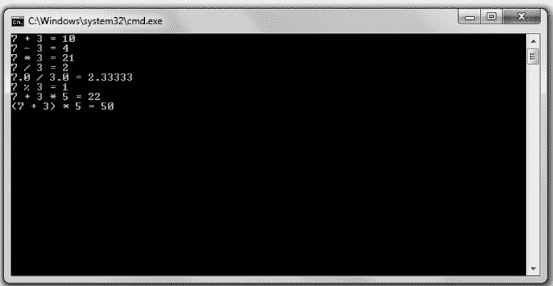

图 1.4

C++ 可以加、减、乘、除，甚至计算余数。

你可以从 Course Technology 网站（`www.courseptr.com/downloads`）下载此程序的代码。该程序位于第 1 章文件夹中；文件名是 `expensive_calculator.cpp`。

```
// Expensive Calculator
// Demonstrates built-in arithmetic operators
```

```
#include <iostream>
using namespace std;

int main()
{
    cout << "7 + 3 = " << 7 + 3 << endl;
    cout << "7 - 3 = " << 7 - 3 << endl;
    cout << "7 * 3 = " << 7 * 3 << endl;

    cout << "7 / 3 = " << 7 / 3 << endl;
    cout << "7.0 / 3.0 = " << 7.0 / 3.0 << endl;

    cout << "7 % 3 = " << 7 % 3 << endl;

    cout << "7 + 3 * 5 = " << 7 + 3 * 5 << endl;
    cout << "(7 + 3) * 5 = " << (7 + 3) * 5 << endl;

    return 0;
}
```

## 加、减和乘

我使用内置算术运算符进行加法（加号，`+`）、减法（减号，`-`）和乘法（星号，`*`）。图 1.4 中描绘的结果正是你所期望的。

每个算术运算符都是表达式的一部分——评估为单个值的东西。因此，例如，表达式 `7 + 3` 评估为 `10`，这就是发送到 `cout` 的内容。

## 了解整数和浮点除法

除法的符号是正斜杠（`/`），所以我在下一行代码中使用它。然而，输出可能会让你感到惊讶。根据 C++（以及那台昂贵的游戏机），7 除以 3 等于 2。发生了什么？好吧，任何只涉及整数（没有小数部分的数字）的算术计算的结果始终是另一个整数。由于 7 和 3 都是整数，结果必须是整数。结果的小数部分被丢弃。

要获得包含小数部分的结果，至少其中一个值需要是浮点数（带小数部分的数字）。我将在下一行是表达式 `7.0 / 3.0`。这次的结果是更精确的 `2.33333`。

### 陷阱

你可能会注意到，虽然 `7.0 / 3.0` 的结果（`2.33333`）包含小数部分，但它仍然被截断了。（真正的结果会在小数点后一直延伸出无限的 `3`。）重要的是要知道，计算机通常只为浮点数存储有限的有效数字。然而，C++ 提供了多种浮点数类别，以满足最苛刻的需求——即使是计算密集型的 3D 游戏。

## 使用模运算符

在下一个语句中，我使用了一个你可能不熟悉的运算符——模运算符（`%`）。模运算符返回整数除法的余数。在这个例子中，`7 % 3` 得到 `7 / 3` 的余数，即 `1`。

## 理解运算顺序

就像在代数中一样，C++ 中的算术表达式从左到右求值。但是某些运算符比其他运算符具有更高的优先级，无论位置如何都会被首先求值。乘法、除法和模运算符具有相同的优先级，高于加法和减法共享的优先级。

下一行代码提供了一个示例来帮助阐明这一点。因为乘法比加法具有更高的优先级，所以你首先计算乘法的结果。因此表达式 `7 + 3 * 5` 等价于 `7 + 15`，计算结果为 `22`。

如果你希望先进行优先级较低的操作，可以使用括号，括号的优先级高于任何算术运算符。因此在下一个语句中，表达式 `(7 + 3) * 5` 等价于 `10 * 5`，计算结果为 `50`。

## 提示

关于 C++ 运算符及其优先级级别的列表，请参阅附录 B。

## 声明和初始化变量

`变量`代表计算机内存中一个特定的部分，它被留出来供你存储、检索和操作数据。因此，如果你想跟踪玩家的得分，你可以为此创建一个变量，然后你可以检索得分并显示它。当玩家从空中击落外星敌人时，你还可以更新得分。

## 介绍游戏统计程序

游戏统计程序显示你可能想在太空射击游戏中跟踪的信息，例如玩家得分、玩家摧毁的敌人数量以及玩家是否开启了护盾。该程序使用一组变量来完成所有这些。图 1.5 展示了该程序。

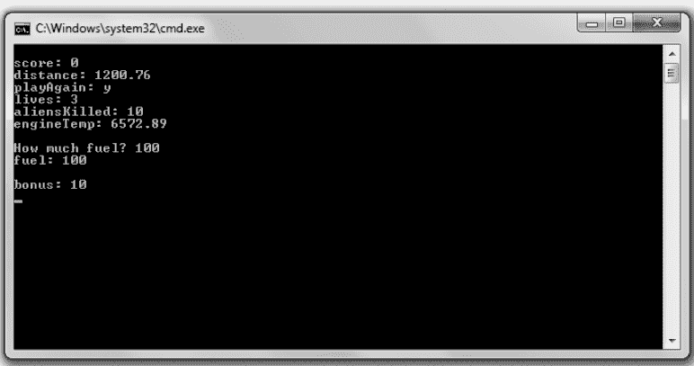

图 1.5

每个游戏统计数据存储在一个变量中。

你可以从 Course Technology 网站（`www.courseptr.com/downloads`）下载此程序的代码。该程序位于第 1 章文件夹中；文件名是 `game_stats.cpp`。

```
// Game Stats
// Demonstrates declaring and initializing variables
```

```
#include <iostream>
using namespace std;

int main()
{
    int score;
    double distance;
    char playAgain;
    bool shieldsUp;

    short lives, aliensKilled;

    score = 0;
    distance = 1200.76;
    playAgain = 'y';
    shieldsUp = true;
    lives = 3;
    aliensKilled = 10;

    double engineTemp = 6572.89;

    cout << "\nscore: "           << score << endl;
    cout << "distance: "       << distance << endl;
    cout << "playAgain: "       << playAgain << endl;
    //skipping shieldsUp since you don't generally print Boolean values
    cout << "lives: "           << lives << endl;
    cout << "aliensKilled:" << aliensKilled << endl;
    cout << "engineTemp: "      << engineTemp << endl;

    int fuel;
    cout << "\nHow much fuel? ";
    cin >> fuel;
    cout << "fuel: " << fuel << endl;

    typedef unsigned short int ushort;
    ushort bonus = 10;
    cout << "\nbonus: " << bonus << endl;

    return 0;
}
```

## 理解基本类型

你创建的每个变量都有一个 `类型`，它表示可以存储在变量中的信息类型。它告诉编译器要为变量预留多少内存，并精确地定义你可以对变量合法执行的操作。

`基本类型`——内置于语言中的类型——包括用于布尔值（`true` 或 `false`）的 `bool`、用于单个字符值的 `char`、用于整数的 `int`、用于单精度浮点数的 `float` 以及用于双精度浮点数的 `double`。

## 理解类型修饰符

你可以使用修饰符来改变类型。`short` 是一种修饰符，可以减少变量可以容纳的值的总数。`long` 是一种修饰符，可以增加变量可以容纳的值的总数。`short` 可能会减少变量所需的存储空间，而 `long` 可能会增加它。`short` 和 `long` 可以修饰 `int`。`long` 也可以修饰 `double`。

`signed` 和 `unsigned` 是仅适用于整数类型的修饰符。`signed` 表示变量可以存储正负值，而 `unsigned` 表示变量只能存储正值。`signed` 和 `unsigned` 都不会改变变量可以容纳的值的总数；它们只改变值的范围。`signed` 是整数类型的默认值。

好了，是否被所有的类型选项弄糊涂了？别担心。表 1.1 总结了常用类型以及一些修饰符。该表还提供了每种类型的值范围。

### 陷阱

> 列出的值范围基于我的编译器。你的可能不同。请查阅你编译器的文档。

## 提示

> 为简洁起见，`short int` 可以只写为 `short`，`long int` 可以只写为 `long`。

表 1.1 常用类型

| 类型 | 值 |
|---|---|
| `short int` | −32,768 到 32,767 |
| `unsigned short int` | 0 到 65,535 |
| `int` | −2,147,483,648 到 2,147,483,647 |
| `unsigned int` | 0 到 4,294,967,295 |
| `long int` | −2,147,483,648 到 2,147,483,647 |
| `unsigned long int` | 0 到 4,294,967,295 |
| `float` | 3.4E +/- 38（七位有效数字） |
| `double` | 1.7E +/- 308（15位有效数字） |
| `long double` | 1.7E +/- 308（15位有效数字） |
| `char` | 256 个字符值 |
| `bool` | `true` 或 `false` |

## 声明变量

好了，现在你已经对类型有了基本的了解，是时候回到程序了。我做的第一件事之一就是用下面的代码行声明一个变量（请求创建它）：

```
int score;
```

在这段代码中，我声明了一个 `int` 类型的变量，并将其命名为 `score`。你使用变量名来访问变量。你可以看到，要声明一个变量，你指定它的类型，后跟一个你选择的名字。因为声明是一条语句，所以必须以分号结尾。

在接下来的三行中，我又声明了三个不同类型的变量。`distance` 是 `double` 类型的变量。`playAgain` 是 `char` 类型的变量。`shieldsUp` 是 `bool` 类型的变量。

游戏（以及所有主要应用程序）通常需要大量变量。幸运的是，C++ 允许你在一条语句中声明多个相同类型的变量。这正是我在下一行中所做的。

```
short lives, aliensKilled;
```

这行代码创建了两个 `short` 变量——`lives` 和 `aliensKilled`。

尽管我在 `main()` 函数的开头定义了一堆变量，但你不需要在一个地方声明所有变量。正如你稍后在程序中所看到的，我经常在使用新变量之前才定义它。

## 命名变量

要声明变量，你必须提供一个名称，称为 `标识符`。要创建合法的标识符，你只需要遵循几条规则。

- 标识符只能包含数字、字母和下划线。

- 标识符不能以数字开头。

- 标识符不能是 C++ 关键字。

`关键字` 是 C++ 为自己保留的特殊单词。这样的单词不多，但要查看完整列表，请查看附录 C。

除了创建 `合法变量名` 的规则之外，以下是一些创建 `好变量名` 的指南。

- **选择描述性名称。** 变量名对其他程序员来说应该清晰明了。例如，使用 `score` 而不是 `s`。（这条规则的一个例外情况涉及仅使用很短时间的变量。在这种情况下，单个字母的变量名，如 `x`，是可以的。）

- **保持一致。** 关于如何编写多词变量名有不同的流派。是 `high_score` 还是 `highScore`？在本书中，我使用第二种风格，即第二个单词（以及任何其他单词）的首字母大写，称为 `驼峰式`。但只要保持一致，使用哪种方法并不重要。

- **遵循语言的传统。** 一些命名约定只是传统。例如，在大多数语言（包括 C++）中，变量名以小写字母开头。另一个传统是避免使用下划线作为变量名的第一个字符。以下划线开头的名称可能具有特殊含义。

- **控制长度。** 尽管 `playerTwoBonusForRoundOne` 具有描述性，但它可能使代码难以阅读。此外，长名称会增加拼写错误的风险。作为指导原则，尽量将变量名限制在更少

`char` 类型的变量可以存储 128 个 ASCII 字符值（假设你的系统使用 ASCII 字符集）。`ASCII`，即 `American Standard Code for Information Interchange` 的缩写，是一种用于表示字符的代码。想要查看完整的 ASCII 列表，请查阅附录 D。

## 为布尔变量赋值

在下面的语句中，我将 `shieldsUp` 的值赋为 `true`。

```
shieldsUp = true;
```

在我的程序中，这意味着玩家的护盾是开启的。

`shieldsUp` 是一个 `bool` 变量，这意味着它是一个布尔变量。因此，它只能表示 `true` 或 `false`。虽然很有趣，但你必须等到第 2 章“真值、分支和游戏循环：猜数字”才能了解更多关于这种变量的信息。

## 初始化变量

你可以在单个初始化语句中同时声明变量并为其赋值。这正是我接下来所做的。

```
double engineTemp = 6572.89;
```


这一行创建了一个名为 `engineTemp` 的 `double` 类型变量，其存储的值为 6572.89。

正如你可以在一条语句中声明多个变量一样，你也可以在一行语句中初始化多个变量。你甚至可以在一条语句中声明并初始化不同的变量。随意混合搭配！

### Hint

> 虽然你可以声明一个变量而不为其赋值，但最好在你能的时候用初始值初始化新变量。这会使你的代码更清晰，同时也消除了访问未初始化变量的可能性，而未初始化变量可能包含任何值。

## 显示变量值

要显示基本类型之一的变量的值，只需将其发送到 `cout` 即可。这正是我接下来在程序中所做的。请注意，我没有尝试显示 `shieldsUp`，因为你通常不会显示 `bool` 值。

### Trick

在本节的第一条语句中，我使用了所谓的转义序列——以反斜杠（`\`）开头的字符对，用于表示特殊的可打印字符。

```
cout << "\nscore: "     << score << endl;
```

我使用的转义序列是 `\n`，它代表换行。当作为字符串的一部分发送到 `cout` 时，就像在控制台窗口中按下 Enter 键一样。另一个有用的转义序列是 `\t`，它充当制表符。

还有其他转义序列可供使用。有关转义序列的列表，请参阅附录 E。

## 获取用户输入

另一种为变量赋值的方法是通过用户输入。因此，接下来我根据用户输入的值为新变量 `fuel` 赋值。为此我使用了以下行：

```
cin >> fuel;
```

与 `cout` 一样，`cin` 是在 `iostream` 中定义的对象，位于 `std` 命名空间中。要将值存储到变量中，我使用 `cin`，后跟 `>>`（提取运算符），再跟变量名。你也可以使用 `cin` 和提取运算符将用户输入获取到其他基本类型的变量中。为了证明一切正常，我向用户显示 `fuel`。

## 为类型定义新名称

你可以为现有类型定义一个新名称。事实上，我接下来在以下行中就是这样做的：

```
typedef unsigned short int ushort;
```

此代码将标识符 `ushort` 定义为类型 `unsigned short int` 的另一个名称。要为现有类型定义新名称，请使用 `typedef`，后跟当前类型，再跟新名称。`typedef` 通常用于为名称很长的类型创建更短的名称。

你可以使用新的类型名，就像使用原始类型一样。我初始化一个 `ushort` 变量（实际上只是一个 `unsigned short int`）名为 `bonus` 并显示其值。

## 了解应使用哪些类型

在基本类型方面，你有很多选择。那么你如何知道使用哪种类型呢？好吧，如果你需要整数类型，你最好使用 `int`。这是因为 `int` 通常被实现为占用计算机最有效处理的内存量。如果你需要表示大于最大 `int` 的整数值或永远不会为负的值，可以随意使用 `unsigned int`。

如果你内存紧张，可以使用需要更少存储空间的类型。然而，在大多数计算机上，内存不应成为大问题。（在游戏机或移动设备上编程是另一回事。）

最后，如果你需要浮点数，你最好使用 `float`，它同样很可能被实现为占用计算机最有效处理的内存量。

## 使用变量执行算术运算

一旦你有了带有值的变量，就需要在游戏过程中更改它们的值。你可能想为玩家击败 Boss 增加奖励，从而提高分数。或者你可能想减少气闸中的氧气水平。通过使用你已经熟悉的运算符（以及一些新运算符），你可以完成所有这些操作。

## 介绍 Game Stats 2.0 程序

Game Stats 2.0 程序操作表示游戏统计数据的变量并显示结果。图 1.6 显示了程序运行时的情况。

你可以从 Course Technology 网站（`www.courseptr.com/downloads`）下载此程序的代码。该程序位于第 1 章文件夹中；文件名是 `game_stats2.cpp`。

```
// Game Stats 2.0
// Demonstrates arithmetic operations with variables

#include <iostream>
using namespace std;
```

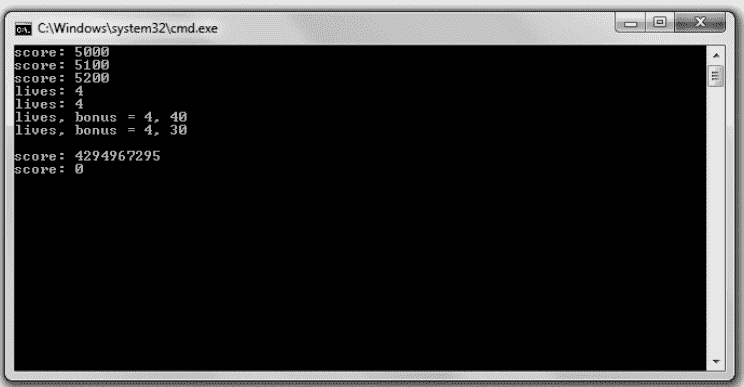

### Figure 1.6

每个变量都被以不同的方式改变。

```
int main()
{
    unsigned int score = 5000;
    cout << "score: " << score << endl;

    //altering the value of a variable
    score = score + 100;
    cout << "score: " << score << endl;

    //combined assignment operator
    score += 100;
    cout << "score: " << score << endl;

    //increment operators
    int lives = 3;
    ++lives;
    cout << "lives: "   << lives << endl;

    lives = 3;
    lives++;
    cout << "lives: "   << lives << endl;

    lives = 3;
    int bonus = ++lives * 10;
    cout << "lives, bonus = " << lives << ", " << bonus << endl;

    lives = 3;
    bonus = lives++ * 10;
    cout << "lives, bonus = " << lives << ", " << bonus << endl;

    //integer wrap around
    score = 4294967295;
    cout << "\nscore: " << score << endl;
    ++score;
    cout << "score: "   << score << endl;

    return 0;
}
```

### Trap

编译此程序时，你可能会收到类似 “[Warning] this decimal constant is unsigned.” 的警告。幸运的是，警告不会阻止程序编译和运行。警告是所谓的整数环绕的结果，你可能希望在自己的程序中避免这种情况；然而，在此程序中环绕是故意的，用来展示该事件的结果。你将在本程序的讨论中，在“处理整数环绕”部分了解有关整数环绕的信息。

### 修改变量的值

在我创建变量来保存玩家的分数并显示它之后，我通过将其增加 100 来修改分数。

```
score = score + 100;
```

此赋值语句表示取 `score` 的当前值，加上 100，并将结果重新赋给 `score`。实质上，该行将 `score` 的值增加了 100。

### 使用组合赋值运算符

前一行有一个更短的版本，我接下来使用它。

```
score += 100;
```

此语句产生的效果与 `score = score + 100;` 相同。`+=` 运算符称为组合赋值运算符，因为它将算术运算（此处为加法）与赋值结合起来。此运算符是“将右边的内容加到左边的内容上，并将结果重新赋给左边的内容”的简写。

所有你见过的算术运算符都有组合赋值运算符的版本。要查看列表，请查阅表 1.2。

Table 1.2 Combined Assignment Operators

| Operator | Example | Equivalent To |
|---|---|---|
| `+=` | `x += 5;` | `x = x + 5;` |
| `-=` | `x -= 5;` | `x = x - 5;` |
| `*=` | `x *= 5;` | `x = x * 5;` |
| `/=` | `x /= 5;` | `x = x / 5;` |
| `%=` | `x %= 5;` | `x = x % 5;` |

### 使用递增和递减运算符

接下来，我使用递增运算符（`++`），它将变量的值增加一。我使用该运算符将 `lives` 的值增加两次。首先我将其用于以下行：

```
++lives;
```

然后我再次将其用于以下行：

```
lives++;
```

这两行具有相同的净效果；它们将 `lives` 从 3 增加到 4。

正如你所见，你可以将运算符放在要递增的变量之前或之后。当运算符放在变量之前时，运算符称为前缀递增运算符；当运算符放在变量之后时，称为后缀递增运算符。

此时，你可能会认为后缀和前缀版本之间没有区别，但你错了。在仅递增单个变量的情况下（就像你刚才看到的那样），两个运算符产生相同的最终结果。但在更复杂的表达式中，结果可能不同。

为了演示这种重要的区别，我执行了一个在游戏关卡结束时合适的计算。我根据数量计算奖励玩家拥有的生命数，我也会递增该生命数。不过，我以两种不同的方式执行这个计算。第一次，我使用前缀递增运算符。

```
int bonus = ++lives * 10;
```

前缀递增运算符会在包含该变量的更大表达式求值之前递增该变量。`++lives * 10` 的求值过程是：先递增 `lives`，再将结果乘以 10。因此，这段代码等价于 `4 * 10`，结果当然是 40。这意味着现在 `lives` 为 4，`bonus` 为 40。

将 `lives` 重新设为 3 之后，我再次计算 `bonus`，这次使用后缀递增运算符。

```
bonus = lives++ * 10;
```

后缀递增运算符会在包含该变量的更大表达式求值之后递增该变量。`lives++ * 10` 的求值过程是：先将 `lives` 的当前值乘以 10。因此，这段代码等价于 `3 * 10`，结果当然是 30。然后，在此计算之后，`lives` 才被递增。这行代码执行完毕后，`lives` 为 4，`bonus` 为 30。

C++ 还定义了递减运算符 `--`。它的工作方式与递增运算符相同，区别在于它会递减一个变量。它同样有前缀和后缀两种形式。

### 处理整数回绕

当你将整数变量增大到超过其最大值时会发生什么？结果是你不会得到错误。相反，值会“回绕”到该类型的最小值。接下来，我演示这一现象。首先，我将 `score` 赋值为它能容纳的最大值。

```
score = 4294967295;
```

然后我递增该变量。

```
++score;
```

结果，`score` 变成 0，因为值发生了回绕，就像汽车里程表超过最大值时那样（见图 1.7）。

将整数变量递减到低于其最小值时，会将其“回绕”到最大值。

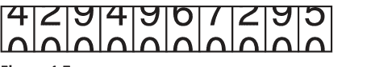

图 1.7

一种可视化 `unsigned int` 变量从最大值“回绕”到最小值的方式。

### 提示

请务必选择取值范围足够大的整数类型，以满足其预期用途。

## 使用常量

常量是你命名的不可更改的值。如果你的程序中有频繁出现的固定值，常量会非常有用。例如，如果你正在编写一个太空射击游戏，其中每架被击落的外星飞船值 150 分，你可以定义一个名为 `ALIEN_POINTS` 的常量，使其等于 150。这样，任何时候你需要某个外星飞船的分值时，都可以使用 `ALIEN_POINTS` 而不是字面量 150。

常量提供了两个重要好处。第一，它们使程序更清晰。一旦你看到 `ALIEN_POINTS`，你就知道它是什么意思。如果你查看某段代码看到 150，你可能不知道这个值代表什么。第二，常量使修改变得容易。例如，假设你对游戏进行了一些试玩测试，并决定每架外星飞船应该值 250 分。使用常量，你只需修改程序中 `ALIEN_POINTS` 的初始化。没有常量，你就不得不找出每一处出现的 150 并将其改为 250。

## 介绍 Game Stats 3.0 程序

Game Stats 3.0 程序使用常量来表示值。程序首先计算玩家的得分，然后计算策略游戏中单位的升级费用。图 1.8 显示了结果。

你可以从 Course Technology 网站（`www.courseptr.com/downloads`）下载该程序的代码。程序位于 `Chapter 1` 文件夹中；文件名为 `game_stats3.cpp`。

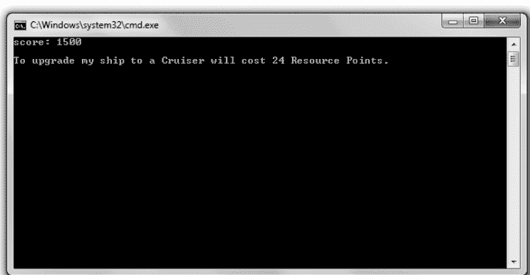

### 图 1.8

每项计算都涉及一个常量，使背后的代码更加清晰。

```
// Game Stats 3.0
// Demonstrates constants

#include <iostream>
using namespace std;

int main()
{
    const int ALIEN_POINTS = 150;
    int aliensKilled = 10;
    int score = aliensKilled * ALIEN_POINTS;
    cout << "score: " << score << endl;

    enum difficulty {NOVICE, EASY, NORMAL, HARD, UNBEATABLE};
    difficulty myDifficulty = EASY;

    enum shipCost {FIGHTER_COST = 25, BOMBER_COST, CRUISER_COST = 50};
    shipCost myShipCost = BOMBER_COST;
    cout << "\nTo upgrade my ship to a Cruiser will cost "
         << (CRUISER_COST - myShipCost) << " Resource Points.\n";

    return 0;
}
```

### 使用常量

我定义了一个常量 `ALIEN_POINTS`，用来表示单个外星飞船的分值。

```
const int ALIEN_POINTS = 150;
```

我只是使用关键字 `const` 来修饰这个定义。现在我可以像使用任何整数字面量一样使用 `ALIEN_POINTS`。另外，请注意我为常量选择的名字全部使用大写字母。这只是一个惯例，但这是一个常见的惯例。全大写的标识符会告诉程序员它代表一个常量值。

接下来，我在下面这行代码中使用这个常量：

```
int score = aliensKilled * ALIEN_POINTS;
```

我通过将击杀的外星飞船数量乘以单个外星飞船的分值来计算玩家的得分。在这里使用常量使这行代码非常清晰。

### 陷阱

> 你不能为常量赋新值。如果尝试这样做，将会产生编译错误。

### 使用枚举

枚举是一组 `unsigned int` 常量，称为枚举器。通常，枚举器彼此相关，并具有特定的顺序。下面是一个枚举的示例：

```
enum difficulty {NOVICE, EASY, NORMAL, HARD, UNBEATABLE};
```

这定义了一个名为 `difficulty` 的枚举。默认情况下，枚举器的值从 0 开始，逐次增加 1。因此 `NOVICE` 为 0，`EASY` 为 1，`NORMAL` 为 2，`HARD` 为 3，`UNBEATABLE` 为 4。要定义你自己的枚举，请使用关键字 `enum`，后跟一个标识符，再后跟花括号内的枚举器列表。

接下来，我创建这个新枚举类型的一个变量。

```
difficulty myDifficulty = EASY;
```

变量 `myDifficulty` 被设置为 `EASY`（等于 1）。`myDifficulty` 的类型是 `difficulty`，因此它只能保存枚举中定义的值之一。这意味着 `myDifficulty` 只能被赋值为 `NOVICE`、`EASY`、`NORMAL`、`HARD`、`UNBEATABLE`、0、1、2、3 或 4。

接下来，我定义另一个枚举。

```
enum shipCost {FIGHTER_COST = 25, BOMBER_COST, CRUISER_COST = 50};
```

这行代码定义了枚举 `shipCost`，它表示策略游戏中三种飞船的资源点费用。在其中，我向一些枚举器赋予了特定的整数值。这些数字表示每艘飞船的资源点价值。如果你愿意，可以给枚举器赋值。任何未被赋值的枚举器都会获得前一个枚举器的值加 1。因为我没有给 `BOMBER_COST` 赋值，所以它被初始化为 26。

接下来，我定义这个新枚举类型的一个变量。

```
shipCost myShipCost = BOMBER_COST;
```

然后，我演示如何在算术计算中使用枚举器。

```
(CRUISER_COST - myShipCost)
```

这段代码计算将 Bomber 升级为 Cruiser 的费用。该计算等同于 `50 - 26`，结果为 24。

## 介绍 LOST FORTUNE

本章的最后一个项目 Lost Fortune 是一个个性化冒险游戏，玩家输入几条信息，计算机利用这些信息来充实一个基本的冒险故事。图 1.9 显示了一次示例运行。

我不会一次性提供全部代码，而是逐节进行讲解。你可以从 Course Technology 网站（`www.courseptr.com/downloads`）下载该程序的代码。程序位于 `Chapter 1` 文件夹中；文件名为 `lost_fortune.cpp`。

### 设置程序

首先，我创建一些初始注释，包含两个必要的文件，并编写几条 `using` 指令。

```
// Lost Fortune
// A personalized adventure

#include <iostream>
#include <string>

using std::cout;
using std::cin;
using std::endl;
using std::string;
```

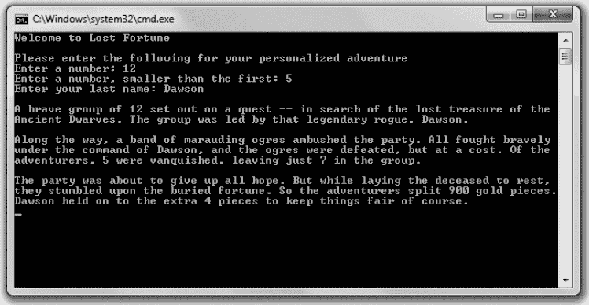

**图 1.9**

故事融入了玩家提供的细节。


# Chapter 1 ■ Types, Variables, and Standard I/O: Lost Fortune

我包含标准库中的 `string` 文件，以便可以通过变量使用字符串对象来访问字符串。关于字符串对象还有很多内容，但我先卖个关子。你将在第 3 章“For 循环、字符串和数组：Word Jumble”中了解更多。

此外，我使用 `using` 指令明确列出我计划访问的 `std` 命名空间中的对象。因此，你可以清楚地看到 `string` 位于命名空间 `std` 中。

## 从玩家获取信息

接下来，我从玩家那里获取一些信息。

```
int main()
{
    const int GOLD_PIECES = 900;
    int adventurers, killed, survivors;
    string leader;
```

```
//get the information
cout << "Welcome to Lost Fortune\n";
cout << "Please enter the following for your personalized adventure\n";
cout << "Enter a number: ";
cin >> adventurers;
cout << "Enter a number, smaller than the first: ";
cin >> killed;
survivors = adventurers - killed;
cout << "Enter your last name: ";
cin >> leader;
```

`GOLD_PIECES` 是一个常量，用于存储冒险者所寻求的财富中的金币数量。`adventurers` 存储探险任务中的冒险者数量。`killed` 存储旅途中被杀死的人数。我计算 `survivors` 来表示剩余的冒险者数量。最后，我获取玩家的姓氏，我将能够通过 `leader` 访问它。

### Trap

这种简单地使用 `cin` 从用户获取字符串的方式仅适用于不包含空白字符的字符串（例如制表符或空格）。有办法弥补这一点，但这确实需要讨论一种称为流的东西，而这超出了本章的范围。所以，以这种方式使用 `cin`，但要意识到其局限性。

### Telling the Story

接下来我使用变量来讲述故事。

```
//tell the story
cout << "\nA brave group of " << adventurers << " set out on a quest ";
cout << "- in search of the lost treasure of the Ancient Dwarves.";
cout << "The group was led by that legendary rogue, " << leader << "\n";
cout << "\nAlong the way, a band of marauding ogres ambushed the party.";
cout << "All fought bravely under the command of " << leader;
cout << ", and the ogres were defeated, but at a cost.";
cout << "Of the adventurers, " << killed << " were vanquished,";
cout << "leaving just " << survivors << " in the group.\n";
cout << "\nThe party was about to give up all hope. ";
cout << "But while laying the deceased to rest, ";
cout << "they stumbled upon the buried fortune. ";
cout << "So the adventurers split " << GOLD_PIECES << " gold pieces.";
cout << leader << " held on to the extra " << (GOLD_PIECES % survivors);
cout << " pieces to keep things fair of course.\n";

return 0;
}
```

代码和激动人心的叙述都很清楚。我要指出一件事。为了计算领导者保留的金币数量，我在表达式 `GOLD_PIECES % survivors` 中使用了取模运算符（`%`）。该表达式计算 `GOLD_PIECES / survivors` 的余数，即在将宝藏平均分配给所有幸存冒险者后剩下的金币数量。

### Summary

在本章中，你应该学习了以下概念：

- C++ 是 AAA 游戏编程中使用的主要语言。
- 程序是一系列 C++ 语句。
- C++ 程序的基本生命周期是 想法、计划、源代码、目标文件、可执行文件。
- 编程错误倾向于分为三类——编译错误、链接错误和运行时错误。
- 函数是一组可以做一些工作并返回值编程语句。
- 每个程序必须包含一个 `main()` 函数，它是程序的起点。
- `#include` 指令告诉预处理器将另一个文件包含到当前文件中。
- 标准库是一组文件，你可以在程序文件中包含它们以处理输入和输出等基本功能。
- `iostream` 是标准库的一部分，是一个包含帮助标准输入输出的代码的文件。
- `std` 命名空间包含来自标准库的元素。要访问命名空间中的元素，你需要用 `std::` 为元素加上前缀或使用 `using`。
- `cout` 是一个对象，定义在文件 `iostream` 中，用于将数据发送到标准输出流（通常是计算机屏幕）。
- `cin` 是一个对象，定义在文件 `iostream` 中，用于从标准输入流（通常是键盘）获取数据。
- C++ 具有内置算术运算符，例如熟悉的加法、减法、乘法和除法——甚至不熟悉的取模。
- C++ 为布尔值、单字符、整数和浮点值定义了基本类型。
- C++ 标准库提供了一种对象类型（`string`）用于字符串。
- 你可以使用 `typedef` 为现有类型创建新名称。
- 常量是不可变值的名称。
- 枚举是 `unsigned int` 常量的序列。

### Questions and Answers

Q: 为什么游戏公司使用 C++？

A: C++ 将速度、低级硬件访问和高层构造结合得比几乎任何其他语言都更好。此外，大多数游戏公司在 C++ 资源上投入了大量资金（既有可重用代码，也有程序员经验）。

Q: C++ 与 C 有什么不同？

A: C++ 是 C 编程语言的下一个迭代。为了获得认可，C++ 基本上保留了所有 C。然而，C++ 定义了做事的新方法，可以取代一些传统的 C 机制。此外，C++ 增加了编写面向对象程序的能力。

Q: 我应该如何使用注释？

A: 用于解释不寻常或不清晰的代码。你不应该对显而易见的东西进行注释。

Q: 什么是编程块？

A: 由大括号包围的一个或多个语句，形成一个单一单元。

Q: 什么是编译器警告？

A: 编译器发出的关于潜在问题的消息。警告不会停止编译过程。

Q: 我可以忽略编译器警告吗？

A: 你可以，但不应该。你应该处理警告并修复有问题的代码。

Q: 什么是空白？

A: 在源文件中创建空格的一组不可打印字符，包括制表符、空格和换行符。

Q: 什么是字面量？

A: 表示显式值的元素。`"Game Over!"` 是一个字符串字面量，而 32 和 98.6 是数字字面量。

Q: 为什么我总是应该尝试用值初始化新变量？

A: 因为未初始化变量的内容可能是任何值——甚至是对你的程序来说没有意义的值。

Q: 为什么程序员有时会使用 `myInt` 或 `myFloat` 这样的变量名？

A: 为了清楚地说明变量的类型。这种约定在编程教学中经常使用。

Q: `bool` 类型的变量有什么用？

A: 它们可以表示为真或假的条件，例如宝箱是否上锁或扑克牌是否正面朝上。

Q: `bool` 类型是如何得名的？

A: 该类型以英国数学家乔治·布尔的名字命名。

Q: 常量的名称必须是大写字母吗？

A: 不必。使用大写只是被接受的做法——但你应该使用它，因为这是其他程序员的期望。

Q: 如何用单个变量存储多个字符？

A: 使用字符串对象。

### Discussion Questions

1. 拥有广泛采用的 C++ 标准如何帮助游戏程序员？

2. 使用 `using` 指令的优点和缺点是什么？

3. 为什么要为现有类型定义新名称？

4. 为什么增量运算符有两个版本？它们之间有什么区别？

5. 如何使用常量来改进你的代码？

### Exercises

1. 创建六个合法变量名的列表——三个好的选择和三个坏的选择。解释每个名称为何属于好或坏类别。

2. 以下代码片段的每一行显示什么？解释每个结果。

```
cout << "Seven divided by three is " << 7 / 3 << endl;
cout << "Seven divided by three is " << 7.0 / 3 << endl;
cout << "Seven divided by three is " << 7.0 / 3.0 << endl;
```

3. 编写一个程序，从用户获取三个游戏分数并显示平均值。

# Chapter 2 ■ Truth, Branching, and the Game Loop: Guess My Number


到目前为止，你看到的程序都是线性的——每个语句按顺序从上到下执行。然而，要创建有趣的游戏，你需要编写根据某些条件执行（或跳过）代码段的程序。这就是本章的主要主题。具体来说，你将学习：

- 理解真值（C++ 的定义）
- 使用 `if` 语句分支到代码段
- 使用 `switch` 语句选择要执行的代码段
- 使用 `while` 和 `do` 循环重复代码段
- 生成随机数

## Understanding Truth

就 C++ 而言，真值是黑白分明的。你可以用相应的关键字 `true` 和 `false` 表示真和假。你可以用 `bool` 变量存储这样的布尔值，就像你在第 1 章中看到的那样。这里有一个快速复习：

```
bool fact = true, fiction = false;
```

这段代码创建了两个 `bool` 变量，`fact` 和 `fiction`。`fact` 为 `true`，`fiction` 为 `false`。尽管关键字 `true` 和 `false` 很方便，但任何表达式或值也可以被解释为真或假。任何非零值都可以解释为真，而 0 可以解释为假。

一种常见的可解释为真或假的表达式涉及比较事物。比较通常通过内置的关系运算符来完成。表 2.1 列出了这些运算符和一些示例表达式。

表 2.1 关系运算符

| 运算符 | 含义 | 示例表达式 | 计算结果 |
| --- | --- | --- | --- |
| `==` | 等于 | `5 == 5` | 真 |
| | | `5 == 8` | 假 |
| `!=` | 不等于 | `5 != 8` | 真 |
| | | `5 != 5` | 假 |
| `>` | 大于 | `8 > 5` | 真 |
| | | `5 > 8` | 假 |
| `<` | 小于 | `5 < 8` | 真 |
| | | `8 < 5` | 假 |
| `>=` | 大于或等于 | `8 >= 5` | 真 |
| | | `5 >= 8` | 假 |
| `<=` | 小于或等于 | `5 <= 8` | 真 |
| | | `8 <= 5` | 假 |

## 使用 `if` 语句

好了，是时候让真和假的概念发挥作用了。你可以使用 `if` 语句来测试一个表达式是否为真，并根据结果执行一些代码。下面是 `if` 语句的一种简单形式：

```
if (expression)
    statement;
```

如果 `expression` 为真，则执行 `statement`。否则，跳过 `statement`，程序分支到 `if` 语句之后的语句。

### 提示

> 每当你看到前面的代码示例中那样的一般性语句时，你都可以用单个语句或语句块来替换它，因为语句块被视为一个整体。

## 介绍 Score Rater 程序

Score Rater 程序使用 `if` 语句对玩家的分数进行评价。图 2.1 显示了该程序的运行效果。

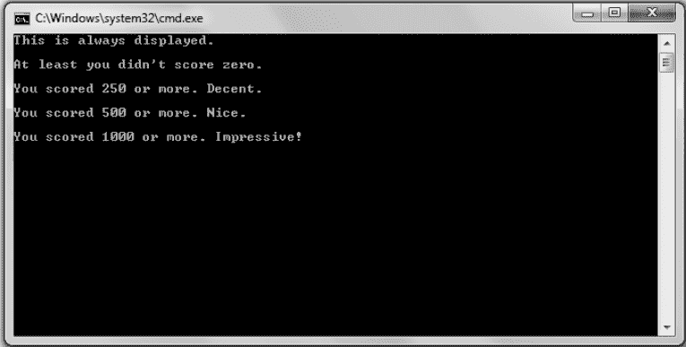

图 2.1

根据不同的 `if` 语句，消息会被显示（或不会显示）。

你可以从 Course Technology 网站（`www.courseptr.com/downloads`）下载该程序的代码。程序位于第 2 章文件夹中；文件名为 `score_rater.cpp`。

```
// Score Rater
// Demonstrates the if statement

#include <iostream>
using namespace std;

int main()
{
    if (true)
    {
        cout << "This is always displayed.\n\n";
    }
```

```
if (false)
{
    cout << "This is never displayed.\n\n";
}

int score = 1000;

if (score)
{
    cout << "At least you didn't score zero.\n\n";
}

if (score >= 250)
{
    cout << "You scored 250 or more. Decent.\n\n";
}

if (score >= 500)
{
    cout << "You scored 500 or more. Nice.\n\n";

    if (score >= 1000)
    {
        cout << "You scored 1000 or more. Impressive!\n";
    }
}

return 0;
}
```

## 测试真和假

在第一个 `if` 语句中，我测试了 `true`。因为 `true` 本来就是真的，所以程序显示消息“This is always displayed.”

```
if (true)
{
    cout << "This is always displayed.\n\n";
}
```

在下一个 `if` 语句中，我测试了 `false`。因为 `false` 不是真的，所以程序不会显示消息“This is never displayed.”

```
if (false)
{
    cout << "This is never displayed.\n\n";
}
```

### 陷阱

注意，在 `if` 语句中，你测试的表达式右括号后面不要加分号。如果你加了分号，就会创建一条与 `if` 语句配对的空语句，这实际上会使 `if` 语句失去作用。下面是一个例子：

```
if (false);
{
    cout << "This is never displayed.\n\n";
}
```

在 `(false)` 后面加上分号后，我创建了一条与 `if` 语句关联的空语句。前面的代码等同于：

```
if (false)
    ; // 一条空语句，什么也不做
{
    cout << "This is never displayed.\n\n";
}
```

我只是玩了下空白符，这并不会改变代码的含义。现在问题应该很清楚了。`if` 语句看到 `false` 值，于是跳过下一条语句（空语句）。然后程序继续愉快地执行 `if` 语句之后的语句，也就是显示消息“This is never displayed.”

要警惕这种错误。这是一个容易犯的错误，而且由于它并不违法，不会产生编译错误。

## 将值解释为真或假

你可以将任何值解释为真或假。任何非零值都可以解释为真，而 0 可以解释为假。我在下一个 `if` 语句中对此进行了测试：

```
if (score)
{
    cout << "At least you didn't score zero.\n\n";
}
```

`score` 是 1000，所以它是非零值，被解释为真。结果，消息“Okay, at least you didn't score zero.”被显示出来。

## 使用关系运算符

你可能在 `if` 语句中使用的最常见表达式，就是通过关系运算符比较值。这正是我接下来要演示的内容。我测试了分数是否大于或等于 250。

```
if (score >= 250)
{
    cout << "You scored 250 or more. Decent.\n\n";
}
```

因为 `score` 是 1000，所以语句块被执行，显示出玩家获得了不错分数的消息。如果 `score` 小于 1000，语句块就会被跳过，程序会继续执行语句块之后的语句。

### 陷阱

等于的关系运算符是 `==`（连续两个等号）。不要把它与 `=`（一个等号）混淆，后者是赋值运算符。

虽然用赋值运算符代替等于的关系运算符并不违法，但结果可能出乎你的意料。看看这段代码：

```
int score = 500;
if (score = 1000)
{
    cout << "You scored 1000 or more. Impressive!\n";
}
```

这段代码的结果是，`score` 被设置为 1000，并且消息“You scored 1000 or more. Impressive!”被显示出来。过程是这样的：虽然 `score` 在 `if` 语句之前是 500，但那已经改变了。当 `if` 语句的表达式 (`score = 1000`) 被求值时，`score` 被赋值为 1000。赋值语句的求值结果是 1000，因为这是一个非零值，所以表达式被解释为 `true`。结果，字符串被显示出来。

要警惕这种类型的错误。它很容易犯，并且在某些情况下（比如这个例子），它不会引起编译错误。

## 嵌套 `if` 语句


一个 `if` 语句可以让程序执行一条语句或一个语句块，其中可以包括其他 `if` 语句。当你编写一个 `if` 语句

## 介绍 Score Rater 2.0 程序

Score Rater 2.0 程序也会对用户输入的分数进行评价。但这一次，程序使用了带 `else` 子句的 `if` 语句。图 2.2 和图 2.3 显示了程序根据用户输入的分数可能显示的两种不同消息。

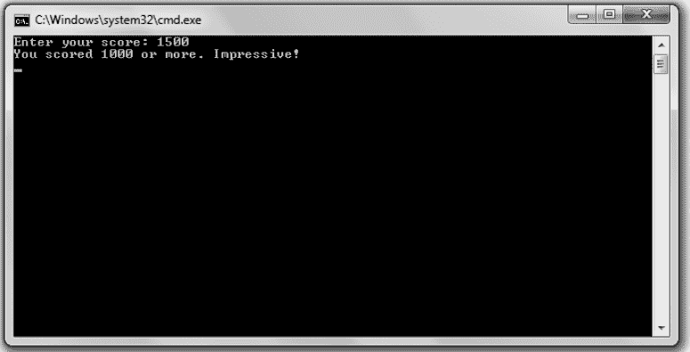

**图 2.2**

如果用户输入 1000 或更高的分数，他会得到祝贺。

你可以从 Course Technology 网站（www.courseptr.com/downloads）下载该程序的代码。程序位于第 2 章文件夹中；文件名为 `score_rater2.cpp`。

```cpp
// Score Rater 2.0

// Demonstrates an else clause

#include <iostream>

using namespace std;

int main()

{

    int score;

    cout << "Enter your score: ";

    cin >> score;

    if (score >= 1000)
    {
        cout << "You scored 1000 or more. Impressive!\n";
    }
    else
    {
        cout << "You scored less than 1000.\n";
    }

    return 0;
}
```

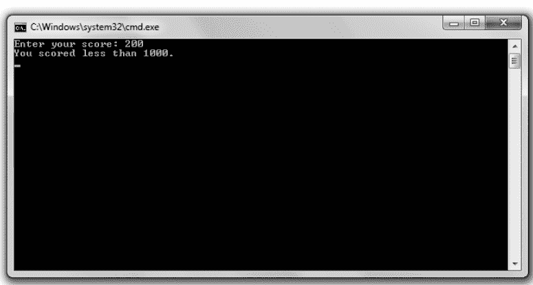

图 2.3

如果用户输入小于 1000 的分数，则不会有庆祝。

## 创建两条分支路径

你已经看到了 `if` 语句的第一部分，它的工作方式与之前一样。如果 `score` 大于 1000，就会显示消息“You scored 1000 or more. Impressive!”。

```cpp
if (score >= 1000)
{
    cout << "You scored 1000 or more. Impressive!\n";
}
```

这里的新颖之处在于，`else` 子句为程序在表达式为假时提供了一条分支语句。因此，如果 `(score >= 1000)` 为假，程序就会跳过第一条消息，转而显示消息“You scored less than 1000.”。

```cpp
else
{
    cout << "You scored less than 1000.\n";
}
```

## 使用带 ELSE 子句的 IF 语句序列

你可以将带 `else` 子句的 `if` 语句串联起来，创建一系列按顺序测试的表达式。第一个测试为真的表达式所关联的语句会被执行；否则，会执行最后一个（可选的）`else` 子句所关联的语句。下面是这样一系列语句的形式：

```cpp
if (expression1)
    statement1;
else if (expression2)
    statement2;
...
else if (expressionN)
    statementN;
else
    statementN+1;
```

如果 `expression1` 为真，则执行 `statement1`，并跳过序列中的其余代码。否则，测试 `expression2`；如果为真，则执行 `statement2`，并跳过序列中的其余代码。计算机会依次检查每个表达式（一直到 `expressionN`），并执行第一个为真表达式所关联的语句。如果没有表达式为真，则执行最后一个 `else` 子句所关联的语句，即 `statementN+1`。

## 介绍评分器 3.0 程序

评分器 3.0 程序也会对用户输入的分数进行评级。但这一次，程序使用了一系列带 `else` 子句的 `if` 语句。图 2.4 显示了程序的运行结果。

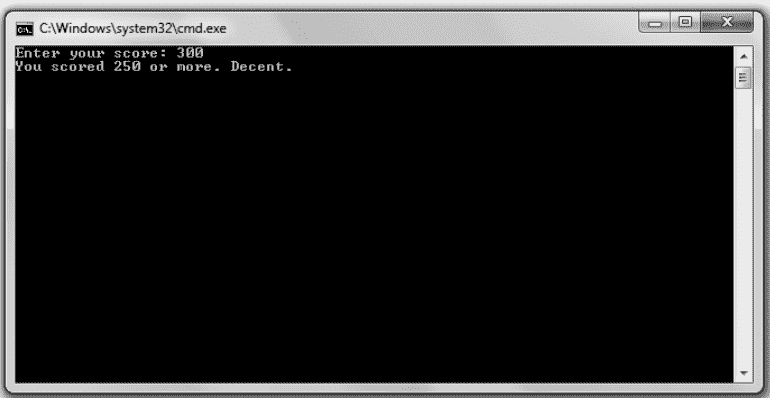

图 2.4

根据分数的不同，用户会收到多条消息中的一条。

你可以从 Course Technology 网站（www.courseptr.com/downloads）下载该程序的代码。程序位于第 2 章文件夹中；文件名是 `score_rater3.cpp`。

```cpp
// Score Rater 3.0
// Demonstrates if else-if else suite

#include <iostream>
using namespace std;

int main()
{
    int score;
    cout << "Enter your score: ";
    cin >> score;

    if (score >= 1000)
    {
        cout << "You scored 1000 or more. Impressive!\n";
    }
    else if (score >= 500)
    {
        cout << "You scored 500 or more. Nice.\n";
    }
    else if (score >= 250)
    {
        cout << "You scored 250 or more. Decent.\n";
    }
    else
    {
        cout << "You scored less than 250. Nothing to brag about.\n";
    }

    return 0;
}
```

## 创建带 else 子句的 if 语句序列

这个序列的第一部分你已经见过两次了，这次它的工作方式完全相同。如果 `score` 大于或等于 1000，就会显示“你得了 1000 分或更高。真厉害！”，然后程序会跳转到 `return` 语句。

```cpp
if (score >= 1000)
```

然而，如果表达式为 `false`，我们就知道 `score` 小于 1000，于是程序会计算序列中的下一个表达式：

```cpp
else if (score >= 500)
```

如果 `score` 大于或等于 500，就会显示“你得了 500 分或更高。不错。”，然后程序会跳转到 `return` 语句。然而，如果该表达式为 `false`，我们就知道 `score` 小于 500，于是程序会计算序列中的下一个表达式：

```cpp
else if (score >= 250)
```

如果 `score` 大于或等于 250，就会显示“你得了 250 分或更高。还行。”，然后程序会跳转到 `return` 语句。

然而，如果该表达式为 `false`，我们就知道 `score` 小于 250，此时会执行与最后一个 `else` 子句关联的语句，并显示“你得了不到 250 分。没什么可炫耀的。”

## 提示

虽然 `if else-if else` 语句组中的最后一个 `else` 子句不是必需的，但当序列中的所有表达式都不为 `true` 时，你可以用它来执行代码。

## 使用 switch 语句

你可以使用 `switch` 语句在代码中创建多个分支点。下面是 `switch` 语句的通用形式：

```cpp
switch (choice)
{
case value1:    statement1;
                break;
case value2:    statement2;
                break;
case value3:    statement3;
                break;
                .
                .
                .
case valueN:    statementN;
                break;
default:        statementN + 1;
}
```

该语句按顺序将 `choice` 与可能的值——`value1`、`value2` 和 `value3`——进行比较。如果 `choice` 与某个值相等，程序就执行相应的语句。当程序遇到 `break` 语句时，它会退出 `switch` 结构。如果 `choice` 与任何值都不匹配，则执行与可选的 `default` 关联的语句。

`break` 和 `default` 的使用都是可选的。不过，如果你省略了 `break`，程序会继续执行余下的语句，直到遇到 `break` 或 `default`，或者直到 `switch` 语句结束。通常你希望每个 `case` 都以一个 `break` 语句结束。

## 提示

虽然 `default` 分支不是必需的，但通常最好有一个作为兜底。

这里有一个例子可以巩固这些概念。假设 `choice` 等于 `value2`。程序会先将 `choice` 与 `value1` 进行比较。由于它们不相等，程序会继续执行。接下来，程序将 `choice` 与 `value2` 进行比较。由于它们相等，程序将执行 `statement2`。然后程序会遇到 `break` 语句并退出 `switch` 结构。

### 陷阱

你只能使用 `switch` 语句来测试 `int`（或可被当作 `int` 处理的值，例如 `char` 或枚举值）。`switch` 语句不适用于任何其他类型。

## 介绍菜单选择器程序

菜单选择器程序向用户显示一个菜单，其中列出了三个难度级别，并请他做出选择。如果用户输入的数字与列出的选项之一对应，程序就会显示一条消息确认该选择。如果用户做出了其他选择，程序会告诉他该选择无效。图 2.5 展示了程序的运行情况。

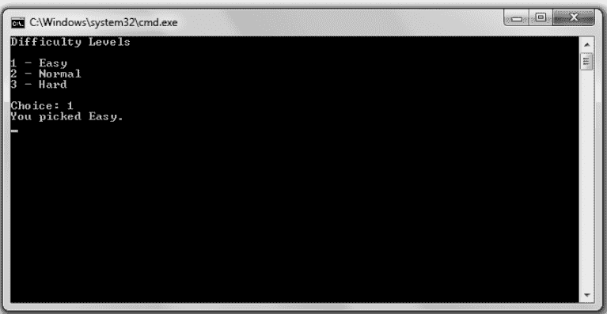

图 2.5

看起来我选了简单的那条路。

你可以从 Course Technology 网站（www.courseptr.com/downloads）下载该程序的代码。程序位于第 2 章文件夹中；文件名是 `menu_chooser.cpp`。

```cpp
// Menu Chooser
// Demonstrates the switch statement

#include <iostream>

using namespace std;

int main()
{
    cout << "Difficulty Levels\n\n";
    cout << "1 - Easy\n";
    cout << "2 - Normal\n";
    cout << "3 - Hard\n\n";

    int choice;
    cout << "Choice: ";
    cin >> choice;

    switch (choice)
    {
    case 1:
        cout << "You picked Easy.\n";
        break;
    case 2:
        cout << "You picked Normal.\n";
        break;
    case 3:
        cout << "You picked Hard.\n";
        break;
    default:
        cout << "You made an illegal choice.\n";
    }

    return 0;
}
```

> **玩了一场激动人心的游戏**

> 你想再玩一次吗？(y/n): y

>

> **玩了一场激动人心的游戏**

> 你想再玩一次吗？(y/n): y

>

> **玩了一场激动人心的游戏**

> 你想再玩一次吗？(y/n): n

>

> 好的，再见..

## 图 2.6

这种重复是通过 `while` 循环实现的。

```cpp
// Play Again

// Demonstrates while loops

#include <iostream>

using namespace std;

int main()

{

    char again = 'y';

    while (again == 'y')

    {

        cout << "\n**Played an exciting game**";

        cout << "\nDo you want to play again? (y/n): ";

        cin >> again;

    }

    cout << "\nOkay, bye.";

    return 0;

}
```

## 使用 while 循环

程序在 `main()` 函数中首先声明名为 `again` 的 `char` 变量，并将其初始化为 `'y'`。然后，程序通过测试 `again` 是否等于 `'y'` 来开始 `while` 循环。由于确实如此，程序会显示消息“**玩了一场激动人心的游戏**”，询问用户是否想再玩一次，并将回复存储在 `again` 中。只要用户输入 `y`，循环就会继续。

你会注意到，我必须在循环之前初始化 `again`，因为循环表达式中使用了这个变量。由于 `while` 循环在循环体（即重复执行的语句组）之前对表达式求值，你必须确保表达式中的任何变量在循环开始前都有值。

## 使用 do 循环

与 `while` 循环一样，`do` 循环允许你根据表达式重复执行一段代码。不同之处在于，`do` 循环在每次循环迭代之后才测试其表达式。这意味着循环体至少会执行一次。下面是 `do` 循环的通用形式：

```cpp
do
    statement;
while (expression);
```

程序执行 `statement`，然后只要 `expression` 测试为 `true`，循环就会重复。一旦 `expression` 测试为 `false`，循环就会结束。

## 介绍再来一次 2.0 程序

再来一次 2.0 程序在用户看来与最初的再来一次程序完全相同。与它的前身一样，再来一次 2.0 通过显示消息“**玩了一场激动人心的游戏**”并询问用户是否想再玩一次，来模拟玩一场激动人心的游戏。只要用户输入 `y`，他就会继续玩。不过，这一次程序使用 `do` 循环来实现重复。图 2.7 展示了该程序。

你可以从 Course Technology 网站（www.courseptr.com/downloads）下载该程序的代码。程序位于第 2 章文件夹中；文件名是 `play_again2.cpp`。

```cpp
// Play Again 2.0
// Demonstrates do loops

#include <iostream>
```

我在循环体中获得用户为 `again` 输入的新值。然后在循环表达式中再次进行测试。如果 `again` 等于 `'y'`，则循环重复；否则循环结束。

### 在现实世界中

尽管 `while` 循环和 `do` 循环几乎可以互换使用，但大多数程序员使用 `while` 循环。虽然在某些情况下 `do` 循环可能看起来更自然，但 `while` 循环的优点是它的表达式正好出现在循环顶部；你无需到循环底部去找它。

### 陷阱

如果你曾经遇到过游戏陷入同一个无休止循环的情况，那么你可能经历过无限循环——一种没有终止的循环。下面是一个无限循环的简单示例：

```cpp
int test = 10;
while (test == 10)
{
    cout << test;
}
```

在这种情况下，循环会进入，因为 `test` 为 10。但由于 `test` 从未改变，循环永远不会停止。因此，用户将不得不强制终止正在运行的程序。这个故事的寓意是什么？确保循环的表达式最终能变为假，或者有另一种方式让循环结束，例如下一节“使用 `break` 和 `continue` 语句”中描述的那样。

## 使用 break 和 continue 语句

你可以改变在循环中看到的行为。可以使用 `break` 语句立即退出循环，也可以使用 `continue` 语句直接跳到循环顶部。虽然你应该谨慎使用这些功能，但它们有时确实很有用。

### 介绍挑剔计数器程序

挑剔计数器程序通过 `while` 循环从 1 数到 10。它之所以挑剔，是因为它不喜欢数字 5——它会跳过它。图 2.8 显示了该程序的一次运行。

你可以从 Course Technology 网站（www.courseptr.com/downloads）下载该程序的代码。该程序位于第 2 章文件夹中；文件名是 `finicky_counter.cpp`。

**图 2.8.** 使用 `continue` 语句跳过了数字 5，循环以 `break` 语句结束。

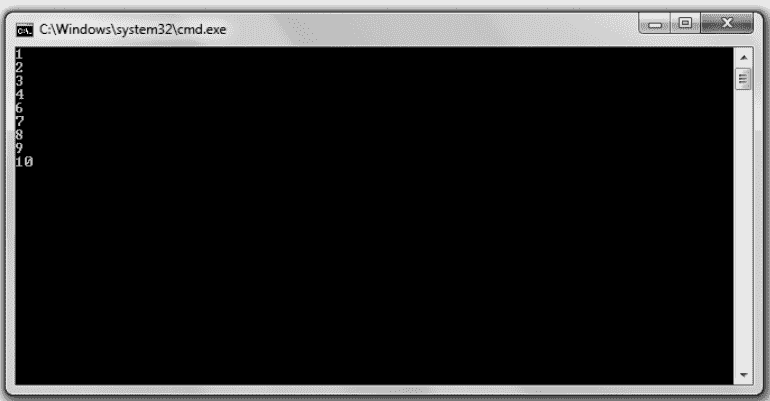

```cpp
// Finicky Counter
// Demonstrates break and continue statements

#include <iostream>

using namespace std;

int main()
{
    int count = 0;
    while (true)
    {
        count += 1;

        // end loop if count is greater than 10
        if (count > 10)
        {
            break;
        }
    }
```

### 使用 continue 语句跳回循环顶部

就在显示 `count` 之前，我添加了以下几行：

```cpp
// skip the number 5
if (count == 5)
{
    continue;
}
```

`continue` 语句的意思是“跳回循环顶部”。在循环顶部，测试 `while` 表达式，如果为真，则再次进入循环。因此，当 `count` 等于 5 时，程序不会执行到 `cout << count << endl;` 语句，而是直接回到循环顶部。结果，5 被跳过，永远不会显示。

### 理解何时使用 break 和 continue


你可以在创建的任何循环中使用 `break` 和 `continue`；它们不仅仅用于 `while (true)` 循环。但你应该谨慎使用它们。`break` 和 `continue` 都会使程序员更难看清循环的流程。

## 使用逻辑运算符

到目前为止，你已经看到了非常简单的表达式，并判断它们的真或假。然而，你可以使用逻辑运算符将更简单的表达式组合成更复杂的表达式。表 2.2 列出了逻辑运算符。

**表 2.2：逻辑运算符**

| 运算符 | 描述 | 示例表达式 |
| --- | --- | --- |
| `!` | 逻辑非 | `!expression` |
| `&&` | 逻辑与 | `expression1 && expression2` |
| `\|\|` | 逻辑或 | `expression1 \|\| expression2` |

### 介绍设计者网络程序

设计者网络程序模拟了一个计算机网络，只有一群经过筛选的游戏设计师才能成为其成员。和现实世界的计算机系统一样，

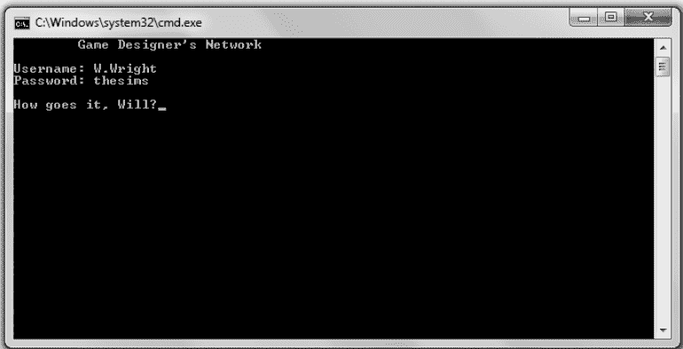

**图 2.11.** 看起来今天有一位精英用户登录了。

你可以从 Course Technology 网站（www.courseptr.com/downloads）下载该程序的代码。该程序位于第 2 章文件夹中；文件名是`designers_network.cpp`。

```cpp
// Designers Network
// Demonstrates logical operators

#include <iostream>
#include <string>
using namespace std;

int main()
{
    string username;
    string password;
    bool success;

    cout << "\tGame Designer's Network\n";

    do
    {
        cout << "\nUsername: ";
        cin >> username;

        cout << "Password: ";
        cin >> password;

        if (username == "S.Meier" && password == "civilization")
        {
            cout << "\nHey, Sid.";
            success = true;
        }

        else if (username == "S.Miyamoto" && password == "mariobros")
        {
            cout << "\nWhat's up, Shigeru?";
            success = true;
        }

        else if (username == "W.Wright" && password == "thesims")
        {
            cout << "\nHow goes it, Will?";
            success = true;
        }

        else if (username == "guest" || password == "guest")
        {
            cout << "\nWelcome, guest.";
            success = true;
        }

        else
        {
            cout << "\nYour login failed.";
            success = false;
        }
    } while (!success);

    return 0;
}
```

### 使用逻辑与运算符

逻辑与运算符 `&&` 允许你将两个表达式连接成一个更大的表达式，该表达式可以被计算为 `true` 或 `false`。仅当它所连接的两个表达式都为真时，新表达式才为真；否则为假。就像在英语中，“and”意味着两者都要。两个原始表达式都必须为真，新表达式才为真。下面是来自设计者网络程序的一个具体示例：

```cpp
if (username == "S.Meier" && password == "civilization")
```

表达式 `username == "S.Meier" && password == "civilization"` 只有在 `username == "S.Meier"` 和 `password == "civilization"` 都为真时才为真。这非常合适，因为我只希望在 Sid 同时输入他的用户名和密码时才授予他访问权限。只输入其中一个都行不通。

理解 `&&` 工作原理的另一种方式是查看真与假的所有可能组合（见表 2.3）。

**表 2.3** 使用与运算符的可能登录组合

| `username == "S.Meier"` | `password == "civilization"` | `username == "S.Meier" && password == "civilization"` |
| --- | --- | --- |
| `true` | `true` | `true` |
| `true` | `false` | `false` |
| `false` | `true` | `false` |
| `false` | `false` | `false` |

当然，设计者网络程序除了席德·梅尔外，也适用于其他用户。通过一系列使用 `&&` 运算符的 `if` 语句和 `else` 子句，程序检查三组不同的用户名和密码对。如果用户输入了可识别的组合，就会受到个性化的欢迎。

### 使用逻辑或运算符

逻辑或运算符 `||` 允许你将两个表达式连接成一个更大的表达式，该表达式可以被计算为 `true` 或 `false`。如果第一个表达式或第二个表达式为真，则新表达式为真；否则为假。就像在英语中，“or”意味着两者之一。如果第一个或第二个表达式为真，那么新表达式就为真。（如果两者都为真，那么更大的表达式仍然为真。）下面是来自设计者网络程序的一个具体示例：

```cpp
else if (username == "guest" || password == "guest")
```

表达式 `username == "guest" || password == "guest"` 在 `username == "guest"` 为真或 `password == "guest"` 为真时为真。这很合适，因为只要用户在用户名或密码中输入了 guest，我就希望以访客身份授予该用户访问权限。如果用户两者都输入 guest，那也没问题。

理解 `||` 工作原理的另一种方式是查看真与假的所有可能组合（见表 2.4）。

| `username == "guest"` | `password == "guest"` | `username == "guest" \|\| password == "guest"` |
| --- | --- | --- |
| `true` | `true` | `true` |
| `true` | `false` | `true` |
| `false` | `true` | `true` |
| `false` | `false` | `false` |

### 使用逻辑非运算符

逻辑非运算符 `!` 允许你切换一个表达式的真或假。如果原始表达式为假，则新表达式为真；如果原始表达式为真，则新表达式为假。就像在英语中，“not”表示相反。新表达式的值与原始表达式的值相反。

```cpp
} while (!success);
```

当 `success` 为假时，表达式 `!success` 为真。这非常合适，因为只有在登录失败时 `success` 才为假。在这种情况下，

## 提示

尽管你可以在更大的表达式中使用括号来改变其求值方式，但也可以使用*冗余括号*——那些不改变表达式值的括号——来使表达式更清晰。我举个简单的例子。看一下 Designers Network 程序中的以下表达式：

```cpp
(username == "S.Meier" && password == "civilization")
```

现在，这是一个带一些冗余括号的表达式：

```cpp
((username == "S.Meier") && (password == "civilization"))
```

虽然额外的括号不会改变表达式的含义，但它们确实有助于突出由 `&&` 运算符连接的两个较小的表达式。

使用冗余括号有点像一门艺术。它们是有帮助还是仅仅冗余？这需要程序员你来判断。

## 生成随机数

不可预测性可以为游戏增添刺激感。无论是即时战略（RTS）游戏中电脑对手策略的突然变化，还是第一人称射击（FPS）游戏中从任意一扇门中冒出的外星生物，玩家都会在一定的惊喜感中获得乐趣。生成随机数就是实现这种惊喜的一种方式。

## 掷骰子程序简介

“掷骰子”程序模拟六面骰子的滚动。计算机通过生成随机数来计算掷骰结果。图 2.12 显示了该程序的结果。

你可以从 Course Technology 网站（www.courseptr.com/downloads）下载该程序的代码。程序位于第 2 章文件夹中，文件名为 `die_roller.cpp`。

```cpp
// Die Roller
// Demonstrates generating random numbers

#include <iostream>
#include <cstdlib>
#include <ctime>

using namespace std;
```

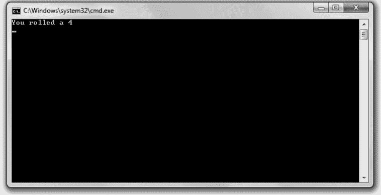

**图 2.12** 掷骰结果基于程序生成的随机数。

```cpp
int main()
{
    srand(static_cast<unsigned int>(time(0)));  //seed random number generator

    int randomNumber = rand();  //generate random number

    int die = (randomNumber % 6) + 1;  // get a number between 1 and 6
    cout << "You rolled a " << die << endl;

    return 0;
}
```

## 调用 rand() 函数

我在程序中首先做的事情之一是包含一个新文件：

```cpp
#include <cstdlib>
```

文件`cstdlib`包含（除其他内容外）处理随机数生成的函数。因为我包含了这个文件，所以我可以自由调用它所包含的函数，包括`rand()`函数，这正是我在`main()`中所做的：

```cpp
int randomNumber = rand();  //generate random number
```

正如你在第 1 章中学到的，函数是可以执行一些工作并返回值的代码片段。你可以通过使用函数名后跟一对括号来调用函数。如果函数返回一个值，你可以将该值赋给一个变量。这就是我在这里使用赋值语句所做的。我将`rand()`返回的值（一个随机数）赋给`randomNumber`。

## 提示

`rand()`函数生成一个介于 0 和至少 32767 之间的随机数。确切的上限取决于你的 C++ 实现。该上限存储在常量`RAND_MAX`中，该常量在`cstdlib`中定义。因此，如果你想了解`rand()`能生成的最大随机数，只需将`RAND_MAX`发送到`cout`。

函数也可以接受值并在其工作中使用这些值。你通过将这些值放在函数名后的括号之间（用逗号分隔）来提供这些值。这些值称为参数，当你提供它们时，就是在将它们传递给函数。我没有向`rand()`传递任何值，因为该函数不接受任何参数。

## 为随机数生成器设置种子

计算机基于公式生成伪随机数——并不是真正随机的数字。一种思考方式是，想象计算机从一本包含预定数字的巨书中读取。通过阅读这本书，计算机可以显得像生成了一串随机数。

但有一个问题：计算机总是从书的开头开始读取。因此，在程序中计算机总是生成相同序列的“随机”数字。在游戏中，这不是我们想要的。例如，我们不会希望每次玩双骰子游戏时都掷出相同的序列。

这个问题的一个解决方案是，在游戏程序开始时，告诉计算机从书中某个任意的位置开始读取。这个过程称为“为随机数生成器设置种子”。游戏程序员给随机数生成器一个数字，称为种子，以确定伪随机数序列中的起始位置。

以下代码为随机数生成器设置种子：

```cpp
srand(static_cast<unsigned int>(time(0)));  //seed random number generator
```

哇，这行代码看起来很神秘，但它做的事情很简单。它基于当前日期和时间来设置随机数生成器的种子，这非常完美，因为每次程序运行时当前日期和时间都会不同。

就实际代码而言，`srand()`函数为随机数生成器设置种子——你只需将一个`unsigned int`类型的种子传给它。这里传给函数的是`time(0)`的返回值——一个基于当前系统日期和时间的数字。代码`static_cast<unsigned int>`只是将这个值转换（或者说强制转换）为`unsigned int`。现在，你不需要理解这行代码的所有细微之处；你至少需要知道的是，如果希望程序在每次运行时生成不同的随机数序列，你的程序应该在调用`rand()`之前执行一次这行代码。

## 提示

关于将值从一种类型转换为另一种类型的各种强制转换形式的全面解释超出了本书的范围。

## 计算一定范围内的数字

生成随机数后，`randomNumber`包含一个介于 0 和 32767 之间的值（基于我的 C++ 实现）。但我需要 1 到 6 之间的数字，因此接下来我使用取模运算符生成该范围内的数字。

```cpp
int die = (randomNumber % 6) + 1;  // get a number between 1 and 6
```

任何正数除以 6 都会得到 0 到 5 之间的余数。在上面的代码中，我取这个余数并加 1，得到 1 到 6 的可能范围——这正是我想要的。你可以使用这种技术将随机数转换为所需范围内的数字。

### 陷阱

使用取模运算符从随机数中生成某个范围内的数字，可能并不总是产生均匀的结果。范围内的某些数字可能比其他数字更容易出现。不过，对于简单游戏来说，这不算问题。

## 理解游戏循环

*游戏循环*是游戏中事件流程的概括表示。事件的核心部分不断重复，这就是为什么它被称为循环。虽然每种游戏的实现可能大不相同，但几乎所有游戏的游戏循环基本结构都是相同的。无论你谈论的是简单的太空射击游戏还是复杂的角色扮演游戏（RPG），你通常都可以将游戏分解为游戏循环中相同的重复组件。图 2.13 提供了游戏循环的可视化表示。

以下是游戏循环各部分的说明：

- **设置。** 这通常涉及接受初始设置或加载游戏资源，如声音、音乐和图形。玩家也可能会看到游戏的背景故事和他的目标。

- **获取玩家输入。** 无论输入来自键盘、鼠标、操纵杆、轨迹球还是其他设备，都会捕获玩家的输入。

- **更新游戏内部状态。** 游戏逻辑和规则被应用到游戏世界中，同时考虑玩家的输入。这可能表现为物理系统确定对象的相互作用，也可能涉及例如敌方 AI 的计算。

- **更新显示。** 在大多数游戏中，这一过程对计算机硬件的负担最大，因为它通常涉及绘制图形。但是，这个过程也可以简单到只显示一行文本。

- **检查游戏是否结束。** 如果游戏没有结束（例如，玩家的角色仍然活着且玩家尚未退出），控制流将分支回获取玩家输入阶段。如果游戏结束，控制流将进入关闭阶段。

- **关闭。** 此时游戏结束。玩家通常会看到一些最终信息，例如他的得分。程序在必要时释放任何资源并退出。

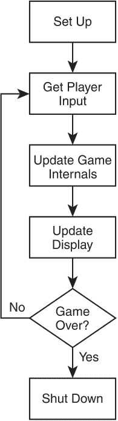

**图 2.13** 游戏循环描述了几乎适用于任何游戏的基本事件流。

## 猜猜我的数字游戏简介

本章的最终项目“猜猜我的数字”是一个经典的数字猜谜游戏。对于那些童年时错过这个游戏的人来说，游戏规则是这样的：电脑在 1 到 100 之间随机选择一个数字，玩家要尽量用最少的次数猜出这个数字。每次玩家输入一个猜测，电脑都会告诉他这个猜测是太高、太低，还是正好。一旦玩家猜中数字，游戏就结束。图 2.14 展示了“猜猜我的数字”的运行情况。你可以从 Course Technology 网站（www.courseptr.com/downloads）下载该程序的代码。程序位于第 2 章的文件夹中，文件名是 `guess_my_number.cpp`。

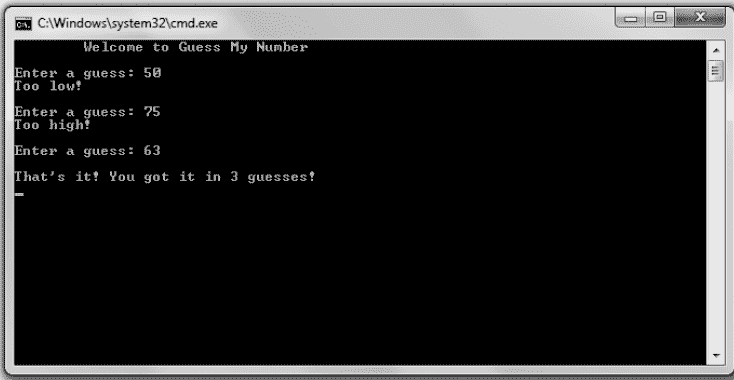

**图 2.14** 我只试了三次就猜中了电脑的数字。

## 应用游戏循环

甚至这个简单的游戏也可以用游戏循环的结构来审视。图 2.15 展示了游戏循环范式与游戏流程是多么契合。

## 设置游戏

和往常一样，我先写一些注释，并包含必要的文件。

```cpp
// Guess My Number
// The classic number guessing game

#include <iostream>
#include <cstdlib>
#include <ctime>

using namespace std;
```

我包含`cstdlib`，因为我打算生成一个随机数；我包含`ctime`，因为我想用当前时间作为随机数生成器的种子。

- 你可以使用关键字 `true` 和 `false` 来表示真或假。

- 你可以对任何值或表达式进行真假求值。

- 任何非零值都可以解释为 `true`，而 `0` 可以解释为 `false`。

- 创建要求值为 `true` 或 `false` 的表达式的常见方法是使用关系运算符比较值。


- `if` 语句测试一个表达式，并且仅当表达式为 `true` 时才执行一段代码。

- `if` 语句的 `else` 子句指定仅当 `if` 语句中测试的表达式为 `false` 时才应执行的代码。

- `switch` 语句测试一个可以视为 `int` 的值，并执行带有相应值标签的一段代码。

- 在 `switch` 语句中使用 `default` 关键字时，它指定了当 `switch` 语句中测试的值与任何列出的值都不匹配时要执行的代码。

- `while` 循环在表达式为 `true` 时执行一段代码，并且只要表达式为 `true` 就重复执行该代码。

- `do` 循环先执行一段代码，然后在表达式为 `true` 时重复执行该代码。

- 在循环中使用时，`break` 语句会立即结束循环。

- 在循环中使用时，`continue` 语句会立即让程序控制跳转到循环顶部。

- `&&`（AND）运算符将两个较简单的表达式组合成一个新表达式，仅当两个较简单的表达式都为 `true` 时，新表达式才为 `true`。

- `||`（OR）运算符将两个较简单的表达式组合成一个新表达式，只要其中有一个较简单的表达式为 `true`，新表达式就为 `true`。

- `!`（NOT）运算符创建一个新表达式，其真值与原始表达式相反。

- 游戏循环是游戏中事件流的通用表示，其核心部分会重复。

问：如果无限循环是坏事，那么 `while (true)` 循环不也是坏事吗？

答：不是。程序员创建 `while (true)` 循环时，应该提供一种让循环结束的方式（通常通过 `break` 语句）。

问：程序员为什么要创建 `while (true)` 循环？

答：`while (true)` 循环通常用于程序的主循环，比如游戏循环。

问：为什么有些人认为使用 `break` 语句退出循环是一种糟糕的编程方式？

答：因为不加区分地使用 `break` 语句会让人难以理解循环结束的条件。不过，有时将 `while (true)` 循环与 `break` 语句结合使用，可能比用更传统的方式创建同样的循环更清晰。

问：什么是伪随机数？

答：一种通常由公式生成的随机数。因此，一系列伪随机数并非真正随机，但对大多数用途来说已经足够。

问：什么是为随机数生成器设置种子？

答：就是给随机数生成器提供一个种子，例如一个整数，这会影响生成器产生随机数的方式。如果你不为随机数生成器设置种子，那么每次程序从头运行时，它都会产生相同的数字序列。

问：难道你不是总想在使用随机数生成器之前设置种子吗？

答：不一定。例如，为了进行测试，你可能希望程序每次运行时都产生完全相同的“随机”数序列。

问：我怎样才能生成更接近真正随机的数字？

答：有一些第三方库能够生成比 C++ 编译器通常自带的库更好的伪随机数。

问：所有游戏都使用游戏循环吗？

答：游戏循环只是看待典型游戏事件流的一种方式。而且，仅仅因为这一范式适用于某个特定游戏，并不一定意味着该游戏是通过一个循环包裹大部分代码来实现的。

## 讨论问题

- 1. 没有循环，哪些类型的程序会难以编写？

- 2. 与一系列 `if` 语句相比，`switch` 语句有哪些优点和缺点？

- 3. 在什么情况下，你可以省略 `switch` 语句中 `case` 末尾的 `break` 语句？

- 4. 什么时候应该使用 `while` 循环而不是 `do` 循环？

- 5. 用游戏循环描述你最喜欢的游戏。游戏循环适合它吗？

## 练习

- 1. 使用枚举来表示难度级别，重写本章的“菜单选择器”程序。变量 `choice` 的类型仍然是 `int`。

- 2. 下面的循环有什么问题？

```cpp
int x = 0;
while (x)
{
    ++x;
    cout << x << endl;
}
```

- 3. 编写“猜猜我的数字”程序的新版本，让玩家和电脑互换角色。也就是说，玩家选择一个数字，电脑必须猜出这个数字。

# 第 3 章

## for 循环、字符串和数组：单词重组


你已经了解了如何处理单个值，但在本章中，你将学习如何处理数据序列。你将进一步了解字符串——表示字符序列的对象。你还将看到如何处理任意类型的序列。而且你会发现一种非常适合这些序列的新循环类型。具体来说，你将学习：

- 使用 `for` 循环遍历序列

- 使用对象，对象将数据和函数结合在一起

- 使用 `string` 对象及其成员函数处理字符序列

- 使用数组存储、访问和操作任意类型的序列

- 使用多维数组更好地表示某些数据集合

## 使用 for 循环

你在第 2 章中已经见过一种循环——`while` 循环。那么，是时候认识另一种循环了——`for` 循环。与它的近亲 `while` 循环一样，`for` 循环允许你重复执行一段代码，但 `for` 循环特别适合计数和遍历一系列事物（例如 RPG 角色物品栏中的物品）。

下面是 `for` 循环的通用形式：

```cpp
for (initialization; test; action)
    statement;
```

`initialization` 是一个语句，用于为循环设置一些初始条件。（例如，它可能将计数器变量设置为 0。）每次循环体执行之前，都会测试表达式 `test`，就像 `while` 循环一样。如果 `test` 为 `false`，程序将转到循环之后的语句；如果 `test` 为 `true`，程序将执行 `statement`。接下来，执行 `action`（通常涉及递增计数器变量）。循环一直重复，直到 `test` 为 `false`，此时循环结束。

## 计数器程序简介

计数器程序可以正向计数、反向计数，以及按 5 计数。它甚至能输出一个由行和列组成的网格。所有这些功能都是通过使用 `for` 循环实现的。图 3.1 展示了该程序的运行情况。

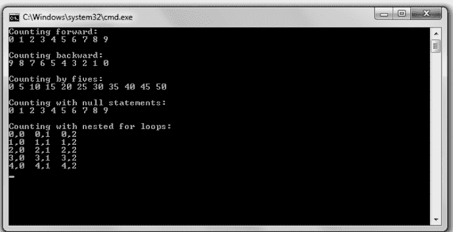

图 3.1

`for` 循环完成了所有计数，而一对嵌套的 `for` 循环则显示网格。

你可以从 Course Technology 网站（www.courseptr.com/downloads）下载该程序的代码。程序位于第 3 章的文件夹中，文件名是 `counter.cpp`。

```cpp
// Counter
// Demonstrates for loops

#include <iostream>

using namespace std;

int main()
{
    cout << "Counting forward:\n";
    for (int i = 0; i < 10; ++i)
    {
        cout << i << " ";
    }

    cout << "\n\nCounting backward:\n";
    for (int i = 9; i >= 0; --i)
    {
        cout << i << " ";
    }

    cout << "\n\nCounting by fives:\n";
    for (int i = 0; i <= 50; i += 5)
    {
        cout << i << " ";
    }

    cout << "\n\nCounting with null statements:\n";
    int count = 0;
    for ( ; count < 10; )
    {
        cout << count << " ";
        ++count;
    }

    cout << "\n\nCounting with nested for loops:\n";
    const int ROWS = 5;
    const int COLUMNS = 3;
    for (int i = 0; i < ROWS; ++i)
```

## 嵌套 for 循环

你可以通过将一个 `for` 循环放入另一个 `for` 循环中来嵌套它们。这就是我在下面的代码部分中所做的，它计算了一个网格的元素。外部循环从以下代码开始：

```cpp
for (int i = 0; i < ROWS; ++i)
```

它简单地执行其循环体 `ROWS`（五）次。但恰好这个循环内部还有另一个 `for` 循环，它从以下代码开始：

```cpp
for (int j = 0; j < COLUMNS; ++j)
```

因此，内部循环在外部循环的每次迭代中都会完整执行。在这种情况下，这意味着内部循环执行 `COLUMNS`（三）次，而外部循环迭代 `ROWS`（五）次，总共执行 15 次。具体来说，发生的情况如下：

- 1. 外部 `for` 循环声明 `i` 并将其初始化为 0。由于 `i` 小于 `ROWS`（5），程序进入外部循环体。

- 2. 内部循环声明 `j` 并将其初始化为 0。由于 `j` 小于 `COLUMNS`（3），程序进入其循环体，将 `i` 和 `j` 的值发送给 `cout`，显示 0, 0。

- 3. 程序到达内部循环体的末尾，将 `j` 增加到 1。由于 `j` 仍小于 `COLUMNS`（3），程序再次执行内部循环体，显示 0, 1。

- 4. 程序到达内部循环体的末尾，将 `j` 增加到 2。由于 `j` 仍小于 `COLUMNS`（3），程序再次执行内部循环体，显示 0, 2。

- 5. 程序到达内部循环体的末尾，将 `j` 增加到 3。然而这次，`j` 不小于 `COLUMNS`（3），内部循环结束。

- 6. 程序通过向 `cout` 发送 `endl` 来完成外部循环的第一次迭代，结束第一行。

- 7. 程序到达外部循环体的末尾，将 `i` 增加到 1。由于 `i` 小于 `ROWS`（5），程序再次进入外部循环体。

- 8. 程序到达内部循环，该循环再次从头开始，声明并将 `j` 初始化为 0。程序重复我在步骤 2 到 7 中描述的过程，显示网格的第二行。这个过程持续进行，直到所有五行都被显示出来。

再次强调，要记住的重要一点是，内部循环在外部循环的每次迭代中都会完整执行。

## 理解对象

到目前为止，你已经了解了如何在变量中存储单个信息片段，以及如何使用运算符和函数操作这些变量。但你在游戏中想要表示的大多数东西——例如，一艘外星飞船——都是对象。它们是封装的、内聚的事物，结合了各种属性（如能量级别）和能力（例如，发射武器）。通常，单独讨论这些属性和能力是没有意义的。

幸运的是，大多数现代编程语言允许你使用将数据和函数结合在一起的软件对象（通常简称为对象）。对象的数据元素称为数据成员，对象的函数称为成员函数。作为一个具体例子，考虑那艘外星飞船。一个外星飞船对象可能是一种名为 `Spacecraft` 的新类型，由游戏程序员定义，并且可能有一个用于其能量级别的数据成员和一个用于发射武器的成员函数。实际上，对象的能量级别可能存储在其 `int` 类型的数据成员 `energy` 中，而其发射武器的能力可能定义在名为 `fireWeapons()` 的成员函数中。

同一类型的每个对象都有相同的基本结构，因此每个对象将具有相同的数据成员和成员函数集。然而，作为个体，每个对象的数据成员都有自己的值。如果你有一个由五艘外星飞船组成的飞行中队，每艘飞船都会有自己的能量级别。一艘可能有 75 的能量级别，而另一艘可能只有 10，等等。即使两艘飞船具有相同的能量级别，它们也各自属于一个独特的飞船。每艘飞船还可以通过调用其成员函数 `fireWeapons()` 来发射自己的武器。

图 3.2 说明了外星飞船的概念。

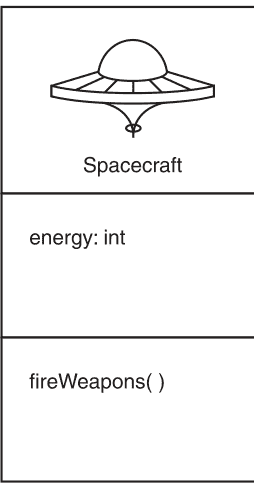

### 图 3.2

这个外星飞船定义的表示说明，每个对象将有一个名为 `energy` 的数据成员和一个名为 `fireWeapons()` 的成员函数。

对象的一个酷之处在于，你不需要知道实现细节就可以使用它们——就像你不需要知道如何制造汽车就可以驾驶汽车一样。你只需要知道对象的数据成员和成员函数——就像你只需要知道汽车的转向盘、油门踏板和制动踏板在哪里一样。

你可以像使用内置类型一样将对象存储在变量中。因此，你可以将外星飞船对象存储在 `Spacecraft` 类型的变量中。你可以使用成员选择运算符（`.`）访问数据成员和成员函数，方法是将该运算符放在对象的变量名之后。因此，如果你希望你的外星飞船 `ship` 仅在其能量级别大于 10 时发射武器，你可以编写：

```cpp
// ship is an object of Spacecraft type
if (ship.energy > 10)
{
    ship.fireWeapons()
}
```

## 索引 string 对象

`string` 对象存储一系列 `char` 值。你可以通过使用下标运算符（`[]`）提供索引号来访问任何单独的 `char` 值。这就是我接下来要做的：

```cpp
cout << "The character at position 0 is: " << phrase[0] << "\n\n";
```

序列中的第一个元素位于位置 0。在前面的语句中，`phrase[0]` 是字符 `G`。由于计数从 0 开始，所以字符串对象中的最后一个字符是 `phrase[11]`，即使该字符串对象有 12 个字符。

### 陷阱

> 一个常见的错误是忘记索引从位置 0 开始。记住，一个有 `n` 个字符的 `string` 对象可以从位置 0 到位置 `n−1` 进行索引。

你不仅可以使用下标运算符访问 `string` 对象中的字符，还可以重新赋值。这就是我接下来要做的：

```cpp
phrase[0] = 'L';
```

我将 `phrase` 的第一个字符改为字符 `L`，这意味着 `phrase` 变为 `"Lame Over!!!"`。

### 陷阱

> C++ 编译器在处理 `string` 对象和下标运算符时不会执行边界检查。这意味着编译器不会检查你是否试图访问不存在的元素。访问无效的序列元素可能会导致灾难性后果，因为可能会覆盖计算机内存中的关键数据。这样做可能会使程序崩溃，因此在使用下标运算符时要小心。

## 遍历 string 对象

鉴于你对 `for` 循环和 `string` 对象的新知识，遍历 `string` 对象的各个字符是一件轻而易举的事。这就是我接下来要做的：

```cpp
for (unsigned int i = 0; i < phrase.size(); ++i)
{
    cout << "Character at position " << i << " is: " << phrase[i] << endl;
}
```

该循环遍历 `phrase` 的所有有效位置。它从 0 开始，一直到 11。在每次迭代中，`string` 对象的一个字符通过 `phrase[i]` 显示。请注意，我将循环变量 `i` 设为 `unsigned int`，因为 `size()` 返回的值是 `unsigned` 整型。

### 现实世界

遍历序列是游戏中强大且经常使用的技术。例如，你可能在策略游戏中遍历数百个独立单位，更新它们的状态和命令。或者你可能遍历 3D 模型的顶点列表以应用一些几何变换。

## 使用 find() 成员函数

接下来，我使用成员函数 `find()` 来检查两个字符串字面量中的任何一个是否包含在 `phrase` 中。首先，我检查字符串字面量 `"Over"`：

```cpp
cout << "\nThe sequence 'Over' begins at location ";
cout << phrase.find("Over") << endl;
```

`find()` 成员函数在调用它的字符串对象中搜索作为参数提供的字符串。该成员函数返回你搜索的字符串对象在调用它的字符串对象中首次出现的位置编号。这意味着 `phrase.find("Over")` 返回 `"Over"` 在 `phrase` 中首次出现的位置编号。由于 `phrase` 是 `"Lame Over!!!"`，`find()` 返回 5。（记住，位置编号从 0 开始，所以 5 意味着第六个字符。）

但如果你搜索的字符串在调用它的字符串中不存在怎么办？接下来我处理这种情况：

```cpp
if (phrase.find("eggplant") == string::npos)
{
    cout << "'eggplant' is not in the phrase.\n\n";
}
```

由于 `phrase` 中不存在 `"eggplant"`，`find()` 返回一个定义在文件 `string` 中的特殊常量，我通过 `string::npos` 访问它。因此，屏幕显示消息：“'eggplant' is not in the phrase.”

通过 `string::npos` 访问的常量表示字符串对象可能的最大尺寸，因此它大于字符串对象中任何可能的有效位置编号。非正式地说，它意味着“不可能存在的位置编号”。它是表示一个字符串在另一个字符串中找不到的完美返回值。

### Hint

在使用 `find()` 时，你可以提供一个可选参数来指定程序开始查找子字符串的字符编号。以下行将从字符串对象 `phrase` 的位置 5 开始查找字符串字面量 `"eggplant"`。

```cpp
location = phrase.find("eggplant", 5);
```

## 使用 erase() 成员函数

`erase()` 成员函数从字符串对象中删除指定的子字符串。调用该成员函数的一种方法是指定子字符串的开始位置和长度，就像我在以下代码中所做的那样：

```cpp
phrase.erase(4, 5);
```

上一行删除从位置 4 开始的五个字符子字符串。因为 `phrase` 是 `"Lame Over!!!"`，成员函数删除子字符串 `Over`，并且因此 `phrase` 变为 `"Lame!!!"`。

调用 `erase()` 的另一种方法是只提供子字符串的开始位置。这会删除从该位置编号开始到字符串对象末尾的所有字符。这就是我接下来所做的：

```cpp
phrase.erase(4);
```

这一行删除字符串对象从位置 4 开始的所有字符。由于 `phrase` 是 `"Lame!!!"`，成员函数删除子字符串 `!!!`，并且因此 `phrase` 变为 `"Lame"`。

调用 `erase()` 的又一种方法是提供无参数，就像我在以下代码中所做的那样：

```cpp
phrase.erase();
```

上一行擦除 `phrase` 中的每个字符。因此，`phrase` 变为空字符串，等同于 `""`。

## 使用 empty() 成员函数

`empty()` 成员函数返回一个 `bool` 值——如果 `string` 对象为空则为 `true`，否则为 `false`。我在以下代码中使用 `empty()`：


## Using the find() Member Function

通过 `string::npos` 访问的常量表示字符串对象可能的最大尺寸，因此它大于字符串对象中任何可能的有效位置编号。非正式地说，它意味着“不可能存在的位置编号”。它是表示一个字符串在另一个字符串中找不到的完美返回值。

### Hint

在使用 `find()` 时，你可以提供一个可选参数来指定程序开始查找子字符串的字符编号。以下行将从字符串对象 `phrase` 开始位置 5 开始查找字符串字面量 `"eggplant"`。

```
location = phrase.find("eggplant", 5);
```

## Using the erase() Member Function

`erase()` 成员函数从字符串对象中删除指定的子字符串。调用该成员函数的一种方式是指定子字符串的开始位置和长度，就像我在以下代码中所做的那样：

```
phrase.erase(4, 5);
```

上一行删除从位置 4 开始的五个字符子字符串。因为 `phrase` 是 `"Lame Over!!!"`，成员函数删除子字符串 `Over`，并且因此 `phrase` 变为 `"Lame!!!"`。

另一种调用 `erase()` 的方式是只提供子字符串的开始位置。这会删除从该位置编号开始到字符串对象末尾的所有字符。这就是我接下来所做的：

```
phrase.erase(4);
```

这一行删除字符串对象从位置 4 开始的所有字符。由于 `phrase` 是 `"Lame!!!"`，成员函数删除子字符串 `!!!`，并且因此 `phrase` 变为 `"Lame"`。

又一种调用 `erase()` 的方式是提供无参数，就像我在以下代码中所做的那样：

```
phrase.erase();
```

上一行擦除 `phrase` 中的每个字符。因此，`phrase` 变为空字符串，等同于 `""`。

## Using the empty() Member Function

`empty()` 成员函数返回一个 `bool` 值——`true` 如果 `string` 对象为空，否则为 `false`。我在使用 `empty()` 的以下代码中：

```
if (phrase.empty())
{
    cout << "\nThe phrase is no more.\n";
}
```

因为 `phrase` 等于空字符串，`phrase.empty()` 返回 `true`，并且屏幕显示消息，“The phrase is no more.”

## USING ARRAYS

虽然 `string` 对象提供了处理字符序列的绝佳方式，但数组提供了处理任何类型元素的途径。这意味着你可以使用数组存储整数序列，例如高分列表。但这也意味着你可以使用数组存储程序员定义类型的元素，例如 RPG 角色可能携带的物品序列。

### Introducing the Hero’s Inventory Program

Hero’s Inventory 程序维护了一个典型 RPG 中英雄的物品栏。就像大多数 RPG 一样，英雄来自一个小而无关紧要的村庄，他的父亲被邪恶的军阀杀害了。（没有死去的父亲，哪来的任务？）现在英雄成年了，是他寻求复仇的时候了。

在这个程序中，英雄的物品栏由一个数组表示。数组是一个 `string` 对象的序列——每个物品一个。英雄会交易甚至找到新物品。图 3.4 显示了程序运行时的情况。

你可以从 Course Technology 网站 (www.courseptr.com/downloads) 下载此程序的代码。该程序位于第 3 章文件夹中；文件名是 `heros_inventory.cpp`。

```
cout << "\nYou trade your sword for a battle axe.";
inventory[0] = "battle axe";
cout << "\nYour items:\n";
for (int i = 0; i < numItems; ++i)
{
    cout << inventory[i] << endl;
}

cout << "\nThe item name '" << inventory[0] << "' has ";
cout << inventory[0].size() << " letters in it.\n";

cout << "\nYou find a healing potion.";
if (numItems < MAX_ITEMS)
{
    inventory[numItems++] = "healing potion";
}
else
{
    cout << "You have too many items and can't carry another.";
}
cout << "\nYour items:\n";
for (int i = 0; i < numItems; ++i)
{
    cout << inventory[i] << endl;
}

return 0;
}
```

### Creating Arrays

为数组中的元素数量定义一个常量通常是个好主意。这就是我使用 `MAX_ITEMS` 所做的，它表示英雄可以携带的最大物品数量：

```
const int MAX_ITEMS = 10;
```

你声明数组的方式与声明到目前为止看到的任何变量的方式大致相同：提供一个类型后跟一个名称。此外，你的编译器必须知道数组的大小，以便为其保留必要的内存空间。你可以在数组名称后、方括号内提供该信息。以下是我的英雄物品栏数组的声明方式：

```
string inventory[MAX_ITEMS];
```

前面的代码声明了一个 `inventory` 数组，包含 `MAX_ITEMS` 个字符串对象。（因为 `MAX_ITEMS` 是 10，这意味着 10 个字符串对象。）

#### Trick

你可以在声明数组时通过提供初始化列表——由逗号分隔的元素序列并用大括号括起来——来用值初始化数组。以下是一个示例：

```
string inventory[MAX_ITEMS] = {"sword", "armor", "shield"};
```

前面的代码声明了一个字符串对象数组 `inventory`，其大小为 `MAX_ITEMS`。数组的前三个元素初始化为 `"sword"`、`"armor"` 和 `"shield"`。

如果你在使用初始化列表时省略元素数量，数组将以列表中元素的数量作为大小创建。以下是一个示例：

```
string inventory[] = {"sword", "armor", "shield"};
```

因为初始化列表中有三个元素，前一行创建了一个名为 `inventory` 的数组，其大小为三个元素。其元素为 `"sword"`、`"armor"` 和 `"shield"`。

### Indexing Arrays

你索引数组的方式与索引字符串对象的方式类似。你可以通过使用下标运算符（[]）提供索引号来访问任何单个元素。

接下来，我使用下标运算符向英雄的物品栏添加三件物品：

```
int numItems = 0;
inventory[numItems++] = "sword";
inventory[numItems++] = "armor";
inventory[numItems++] = "shield";
```

我首先为英雄当前携带的物品数量定义 `numItems`。接下来我将 `"sword"` 分配给数组的位置 0。因为我使用后缀递增运算符，`numItems` 在向数组分配后递增。接下来的两行将 `"armor"` 和 `"shield"` 添加到数组中，使 `numItems` 在代码结束时具有正确的值 3。

现在英雄已配备了一些物品，我显示他的物品栏：

```
cout << "Your items:\n";
for (int i = 0; i < numItems; ++i)
{
    cout << inventory[i] << endl;
}
```

这应该让你想起字符串索引。代码遍历 `inventory` 的前三个元素，按顺序显示每个字符串对象。

接下来，英雄用战斧交换他的剑。我通过以下行实现这一点：

```
inventory[0] = "battle axe";
```

前面的代码用字符串对象 `"battle axe"` 重新分配 `inventory` 中位置 0 的元素。现在 `inventory` 的前三个元素是 `"battle axe"`、`"armor"` 和 `"shield"`。

#### Trap

数组索引从 0 开始，就像你对字符串对象所看到的那样。这意味着以下代码定义了一个五元素数组：

```
int highScores[5];
```

有效的位置编号是 0 到 4，包含。没有元素 `highScores[5]`！尝试访问 `highScores[5]` 可能会导致灾难性结果，包括程序崩溃。

### Accessing Member Functions of an Array Element

你可以通过编写数组元素，后跟成员选择运算符，然后是成员函数名称来访问数组元素的成员函数。这听起来有点复杂，但并不复杂。以下是一个示例：

```
cout << inventory[0].size() << " letters in it.\n";
```

代码 `inventory[0].size()` 意味着程序应调用元素 `inventory[0]` 的 `size()` 成员函数。在这种情况下，因为 `inventory[0]` 是 `"battle axe"`，调用返回 10，即字符串对象中的字符数。

### Being Aware of Array Bounds

正如你所学的那样，索引数组时必须小心。因为数组有固定大小，你可以创建一个整数常量来存储数组的大小。同样，这正是我在程序开始时所做的：

```
const int MAX_ITEMS = 10;
```

在接下来的几行中，我使用 `MAX_ITEMS` 来保护自己，避免向英雄的库存中添加另一个物品：

```
if (numItems < MAX_ITEMS)
{
    inventory[numItems++] = "healing potion";
}
else
{
    cout << "You have too many items and can't carry another.";
}
```

在上述代码中，我首先检查 `numItems` 是否小于 `MAX_ITEMS`。如果是，那么我可以安全地将 `numItems` 用作索引，并将一个新的字符串对象赋值给数组。在这种情况下，`numItems` 为 3，所以我把字符串 `"healing potion"` 赋给数组位置 3。如果不是这种情况，那么我就会显示消息：“You have too many items and can’t carry another.”

那么，如果你确实尝试访问数组边界之外的元素会发生什么？这取决于情况，因为你将访问计算机内存中某个未知的部分。最糟糕的是，如果你试图向数组边界之外的元素赋值，可能会导致程序做出不可预测的事情，甚至可能崩溃。

在使用索引之前，先测试以确保索引号是有效的数组位置，这被称为**边界检查**。当你想要使用的索引可能无效时，执行边界检查至关重要。

## 理解 C 风格字符串

在字符串对象出现之前，C++ 程序员使用以空字符结尾的字符数组来表示字符串。这些字符数组现在被称为 **C 风格字符串**，因为这种做法始于 C 程序。你可以像声明和初始化任何其他数组一样声明和初始化 C 风格字符串：

```
char phrase[] = "Game Over!!!";
```

C 风格字符串以称为空字符的字符结尾，以表示其结束。你可以将空字符写为 `'\0'`。在前面的代码中，我不需要使用空字符，因为它会自动存储在字符串的末尾。所以从技术上讲，`phrase` 有 13 个元素。（然而，处理 C 风格字符串的函数会说 `phrase` 的长度为 12，这很合理，并且与字符串对象的工作方式一致。）

与任何其他类型的数组一样，你可以在定义时指定数组大小。因此，另一种声明和初始化 C 风格字符串的方式是：

```
char phrase[81] = "Game Over!!!";
```

上面的代码创建了一个可以容纳 80 个可打印字符（加上其终止空字符）的 C 风格字符串。

C 风格字符串没有成员函数。但标准库中的 `cstring` 文件包含各种用于处理 C 风格字符串的函数。

字符串对象的一个优点是它们被设计为与 C 风格字符串无缝协作。例如，以下所有将 C 风格字符串与字符串对象一起使用的用法都是完全有效的：

```
string word1 = "Game";
char word2[] = "Over";
string phrase = word1 + word2;

if (word1 != word2)
{
	cout << "word1 and word2 are not equal.\n";
}

if (phrase.find(word2) != string::npos)
{
	cout << "word2 is contained in phrase.\n";
}
```

你可以连接字符串对象和 C 风格字符串，但结果始终是一个字符串对象（因此代码 `char phrase[] = word1 + word2;` 会产生错误）。你可以使用关系运算符比较字符串对象和 C 风格字符串。你甚至可以在字符串对象成员函数中使用 C 风格字符串作为参数。

C 风格字符串具有与数组相同的缺点。其中最大的缺点之一是它们的长度是固定的。因此，结论是：尽可能使用字符串对象，但如有必要，也要准备好处理 C 风格字符串。

## 使用多维数组

如你所见，序列非常适合游戏。你可以以字符串的形式使用它们来存储玩家姓名，也可以以数组的形式使用它们来存储 RPG 中的物品列表。但有时游戏的某部分需要的不仅仅是线性的列表。有时游戏的某部分确实需要更多维度。例如，虽然你可以用 64 个元素的数组来表示棋盘，但将其作为 8 × 8 元素的二维实体来处理确实更直观。幸运的是，你可以创建二维、三维（甚至更多维）的数组，以最好地满足游戏的需求。

### 介绍井字棋棋盘程序

井字棋棋盘程序显示一个井字棋棋盘。该程序显示棋盘并宣布 X 获胜。虽然该程序本可以使用一维数组编写，但它使用二维数组来表示棋盘。图 3.5 展示了该程序。

你可以从 Course Technology 网站（www.courseptr.com/downloads）下载此程序的代码。该程序位于第 3 章文件夹中；文件名为 `tic-tac-toe_board.cpp`。

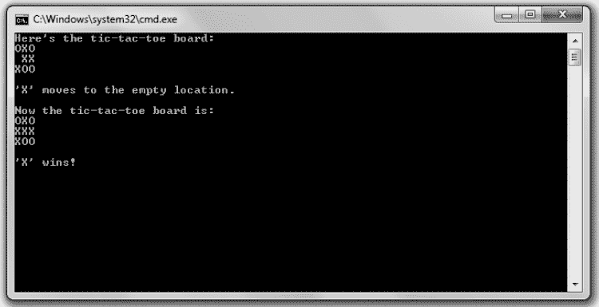

**图 3.5**  

井字棋棋盘由二维数组表示。

```
for (int j = 0; j < COLUMNS; ++j)
{
    cout << board[i][j];
}

cout << endl;
}
```

通过使用一对嵌套的 for 循环，我遍历二维数组并逐个显示字符元素，从而形成一个井字棋棋盘。

## 介绍单词乱序

单词乱序是一款益智游戏，计算机生成一个单词的乱序版本，其中字母顺序随机。玩家必须猜出这个单词才能赢得游戏。如果玩家卡住了，可以请求提示。图 3.6 展示了该游戏。

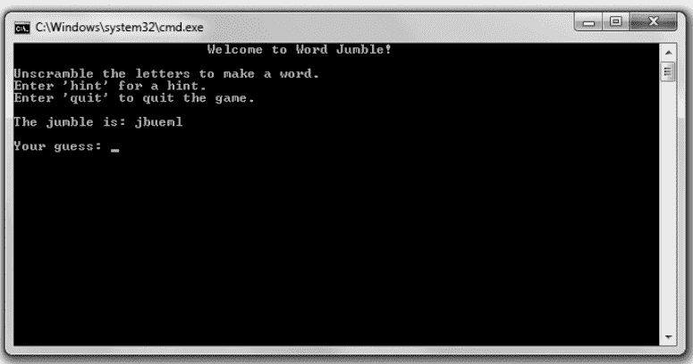

**图 3.6**

嗯……这个词看起来“乱序了”。

### 现实世界

尽管益智游戏通常不会进入游戏前十名榜单，但大公司仍然年复一年地发布它们。为什么？原因很简单：它们有利可图。益智游戏虽然通常不是热门大作，但仍然可以卖得很好。有很多玩家（休闲和硬核）会被设计精良的益智游戏所吸引。而且益智游戏的生产成本远低于那些需要大型制作团队和多年开发时间的高知名度游戏。

## 设置程序

像往常一样，我从一些注释和包含所需文件开始。你可以从 Course Technology 网站（www.coursetech.com/downloads）下载此程序的代码。该程序位于第 3 章文件夹中；文件名为 `word_jumble.cpp`。

```
// Word Jumble
// The classic word jumble game where the player can ask for a hint

#include <iostream>
#include <string>
#include <cstdlib>
#include <ctime>

using namespace std;
```

## 选择要乱序的单词

我的下一个任务是选择一个要乱序的单词——即玩家将尝试猜测的单词。首先，我创建一个单词和提示的列表：


```
int main()
{
    enum fields {WORD, HINT, NUM_FIELDS};
    const int NUM_WORDS = 5;
    const string WORDS[NUM_WORDS][NUM_FIELDS] =
    {
        {"wall", "Do you feel you're banging your head against something?"},
        {"glasses", "These might help you see the answer."},
        {"labored", "Going slowly, is it?"},
        {"persistent", "Keep at it."},
        {"jumble", "It's what the game is all about."}
    };
};
```

```
cin >> guess;
}
```

循环不断询问玩家猜测，直到玩家猜出单词或要求退出。

## 告别

当循环结束时，玩家要么赢了，要么退出了，所以是时候说再见了。

```
if (guess == theWord)
{
    cout << "\nThat's it! You guessed it!\n";
}

cout << "\nThanks for playing.\n";

return 0;
}
```

如果玩家猜出了单词，我会祝贺他或她。最后，我感谢玩家的参与。

## 总结

在本章中，你学习了以下概念：

- `for` 循环允许你重复一段代码。在 `for` 循环中，你可以提供初始化语句、要测试的表达式以及每次循环迭代后要执行的操作。

- `for` 循环通常用于计数或遍历序列。

- 对象是封装的、内聚的实体，它结合了数据（称为数据成员）和函数（称为成员函数）。

- `string` 对象（通常简称为字符串）定义在标准库的 `string` 文件中。`string` 对象允许你存储字符序列，并且还具有成员函数。

- `string` 对象的定义使其能够直观地使用熟悉的运算符，例如连接运算符和关系运算符。

- 所有字符串对象都有成员函数，包括确定字符串对象的长度、确定字符串对象是否为空、查找子字符串以及删除子字符串。

- 数组提供了一种存储和访问任何类型序列的方法。

- 数组的局限性在于它们具有固定长度。

- 你可以通过下标运算符访问字符串对象和数组的各个元素。

- 在尝试访问字符串对象或数组的各个元素时，不会强制执行边界检查。因此，边界检查由程序员负责。

- C 风格字符串是以空字符结尾的字符数组。它们是在 C 语言中表示字符串的标准方式。尽管 C 风格字符串在 C++ 中完全合法，但字符串对象是处理字符序列的首选方式。

- 多维数组允许使用多个下标访问数组元素。例如，棋盘可以用二维数组表示，8 × 8 个元素。

## QUESTIONS AND ANSWERS

Q: 哪种更好，`while` 循环还是 `for` 循环？

A: 两者没有本质上的优劣。选用最符合你需求的循环即可。

Q: 在什么情况下使用 `for` 循环比 `while` 循环更好？

A: 你可以用 `while` 循环完成任何 `for` 循环的工作；然而，有些情况更适合使用 `for` 循环。其中包括计数和遍历序列。

Q: 我可以用 `break` 和 `continue` 语句与 `for` 循环一起使用吗？

A: 当然可以。它们的行为与在 `while` 循环中一样：`break` 结束循环，而 `continue` 将控制跳转回循环顶部。

Q: 为什么程序员倾向于使用 `i`、`j` 和 `k` 等变量名作为 `for` 循环中的计数器？

A: 信不信由你，程序员主要出于传统才使用 `i`、`j` 和 `k`。这种做法始于 `FORTRAN` 语言的早期版本，其中整数变量必须以某些字母开头，包括 `i`、`j` 和 `k`。

Q: 我不必包含文件就能使用 `int` 或 `char` 类型，那么为什么我必须包含 `string` 文件才能使用字符串？

A: `int` 和 `char` 是内置类型。它们在任何 C++ 程序中都始终可访问。另一方面，`string` 类型不是内置类型。它是在文件 `string` 中的标准库中定义的。

Q: C 风格字符串是如何得名的？

A: 在 C 编程语言中，程序员用以空字符结尾的字符数组表示字符串。这种做法延续到了 C++。在 C++ 中引入了新的 `string` 类型后，程序员需要一种方法来区分两者。因此，旧方法被命名为 C 风格字符串。

Q: 为什么我应该使用字符串对象而不是 C 风格字符串？

A: 字符串对象相比 C 风格字符串有优势。最明显的是它们是动态可调整大小的。你在创建时不必指定长度限制。

Q: 我是否应该 ever 使用 C 风格字符串？

A: 只要可能就应选择字符串对象。如果你正在处理一个使用 C 风格字符串的现有项目，那么你可能不得不使用 C 风格字符串。

Q: 什么是运算符重载？

A: 它是一种允许你在不同上下文中以不同但可预测的结果定义熟悉运算符使用的过程。例如，用于加数的 `+` 运算符被 `string` 类型重载以连接字符串。

Q: 运算符重载会不会令人困惑？

A: 确实，通过重载运算符你赋予了它另一种含义。但新的含义仅适用于特定的新上下文。例如，在表达式 `4 + 6` 中，`+` 运算符很明显是加数，而在表达式 `myString1 + myString2` 中，`+` 运算符连接字符串。

Q: 我能使用 `+=` 运算符来连接字符串吗？

A: 可以，`+=` 运算符已被重载以适用于字符串。

Q: 要获取字符串对象中的字符数，我应该使用 `length()` 成员函数还是 `size()` 成员函数？

A: `length()` 和 `size()` 返回相同的值，因此你可以使用其中任何一个。

Q: 什么是谓词函数？

A: 一个返回 `true` 或 `false` 的函数。字符串对象成员函数 `empty()` 就是谓词函数的例子。

Q: 如果我尝试给数组边界之外的元素赋值会发生什么？

A: C++ 会允许你进行赋值。然而，结果是不可预测的，可能会导致你的程序崩溃。这是因为你在修改计算机内存中某个未知的部分。

Q: 为什么我应该使用多维数组？

A: 为了使处理一组元素更直观。例如，你可以用一维数组表示棋盘，如 `chessBoard[64]`，或者用更直观的二维数组表示，如 `chessBoard[8][8]`。

## DISCUSSION QUESTIONS

- 1. 你最喜欢的游戏中有哪些东西可以用对象表示？它们的数据成员和成员函数可能是什么？

- 2. 使用数组相对于一组独立变量的优势是什么？

- 3. 固定数组大小会带来哪些限制？

# CHAPTER 4

## THE STANDARD TEMPLATE LIBRARY: HANGMAN

到目前为止，你已经了解了如何使用数组处理值序列。但处理值集合有更复杂的方法。事实上，处理集合如此常见，以至于标准 C++ 的一部分专门用于此。在本章中，你将对这个重要库有一个介绍。具体来说，你将学习如何：

- 使用 `vector` 对象处理值序列

- 使用 `vector` 成员函数操作序列元素

- 使用迭代器遍历序列

- 使用库算法处理元素组

- 使用伪代码规划你的程序

## INTRODUCING THE STANDARD TEMPLATE LIBRARY

优秀的游戏程序员都很懒。不是他们不想工作；只是他们不想重复做已经完成的工作——尤其是如果它已经做得很好了。STL（*Standard Template Library*）代表了一套做得很出色的编程工作。它提供了一组容器、算法和迭代器等。

那么容器是什么，它如何帮助你编写游戏？嗯，容器让你存储和访问相同类型的集合值。是的，数组也能做到


同样的事情，但 STL 容器比简单可靠的数组提供更多灵活性和功能。STL 定义了多种容器类型；每种都以不同的方式工作以满足不同的需求。

STL 中定义的算法与它的容器一起工作。*算法*是游戏程序员反复应用于一组值的常见函数。它们包括用于排序、搜索、复制、合并、插入和删除容器元素的算法。妙处在于，同一个算法可以在许多不同的容器类型上发挥作用。

*迭代器*是标识容器中元素的对象，可以被操作以在元素之间移动。它们很适合遍历容器。此外，迭代器是 STL 算法所必需的。

所有这些在你看到其中一种容器类型的实际实现时就会变得更有意义，所以接下来就是它。

## USING VECTORS

`vector` 类定义了 STL 提供的一种容器。它符合 *动态数组* 的一般描述——一种可以根据需要增长和缩小大小的数组。此外，`vector` 定义了用于操作 vector 元素的成员函数。这意味着 vector 具有数组的所有功能外加更多。

此时，你可能在想：为什么要学习使用这些花哨的新 vector，当我已经可以用数组时？嗯，vector 相对于数组有某些优势，包括：

- Vector 可以根据需要增长而数组不能。这意味着如果你使用 vector 存储游戏中敌人的对象，vector 将会增长以容纳创建的敌人数量。如果你使用数组，你必须创建一个可以存储最大数量敌人的数组。而如果在游戏中，你需要的空间比预想的多，你就无能为力了。

- Vector 可以与 STL 算法一起使用而数组不能。这意味着通过使用 vector，你可以获得内置的搜索和排序等复杂功能。如果你使用数组，你必须编写自己的代码来实现相同的功能。

与数组相比，向量有一些缺点，包括：

- 向量需要额外一点内存作为开销。

- 当向量增大时，可能会有性能成本。

- 在某些游戏主机系统上，向量可能不可用。

总的来说，向量（以及 STL）在大多数项目中都是受欢迎的工具。

从用户的角度来看，英雄的库存 2.0 程序与其前身——第 3 章的英雄的库存程序——相似。新版本存储并处理一组表示英雄库存的 `string` 对象。然而，从程序员的角度来看，该程序有很大不同。这是因为新程序使用向量而不是数组来表示库存。图 4.1 显示了程序的结果。

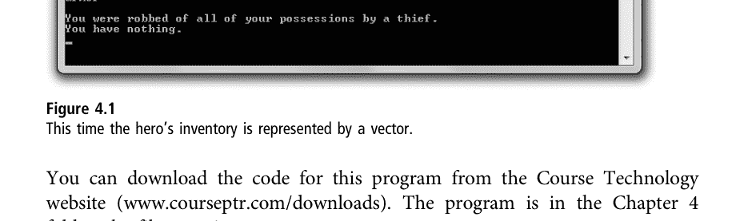

图 4.1 这次英雄的库存由向量表示。

你可以从 Course Technology 网站（www.coursetech.com/downloads）下载此程序的代码。该程序位于第 4 章文件夹中；文件名为 `heros_inventory2.cpp`。

```
// Hero's Inventory 2.0
// Demonstrates vectors

#include <iostream>
#include <string>
#include <vector>

using namespace std;

int main()
{
    vector<string> inventory;
    inventory.push_back("sword");
    inventory.push_back("armor");
    inventory.push_back("shield");

    cout << "You have " << inventory.size() << " items.\n";

    cout << "\nYour items:\n";
    for (unsigned int i = 0; i < inventory.size(); ++i)
    {
        cout << inventory[i] << endl;
    }

    cout << "\nYou trade your sword for a battle axe.";
    inventory[0] = "battle axe";
    cout << "\nYour items:\n";
    for (unsigned int i = 0; i < inventory.size(); ++i)
    {
        cout << inventory[i] << endl;
    }

    cout << "\nThe item name " << inventory[0] << " has ";
    cout << inventory[0].size() << " letters in it.\n";

    cout << "\nYour shield is destroyed in a fierce battle.";
    inventory.pop_back();
    cout << "\nYour items:\n";
    for (unsigned int i = 0; i < inventory.size(); ++i)
    {
        cout << inventory[i] << endl;
    }
}

cout << inventory[i] << endl;
}

cout << "\nYou were robbed of all of your possessions by a thief.";
inventory.clear();
if (inventory.empty())
{
    cout << "\nYou have nothing.\n";
}
else
{
    cout << "\nYou have at least one item.\n";
}

return 0;
}
```

## 准备使用向量

在声明向量之前，我必须包含包含其定义的文件：

```
#include <vector>
```

所有 STL 组件都位于 `std` 命名空间中，因此通过使用以下代码（我通常这样做），我可以引用向量而不必在其前面加上 `std:`：

```
using namespace std;
```

## 声明向量

好的，我在 `main()` 中做的第一件事是声明一个新向量。

```
vector<string> inventory;
```

上一行声明了一个名为 `inventory` 的空向量，它可以包含 `string` 对象元素。声明空向量没有问题，因为当你添加新元素时它会增大。

要声明你自己的向量，先写 `vector`，然后是你想与向量一起使用的对象类型（用 `<` 和 `>` 符号括起来），然后是向量名称。

## 提示

还有其他声明向量的方法。你可以通过在向量名称后的括号中指定一个数字来声明一个具有初始大小的向量。

```
vector<string> inventory(10);
```

前面的代码声明了一个向量，用于保存 `string` 对象元素，初始大小为 10。你也可以在声明时将所有向量元素初始化为相同的值。只需提供元素数量，后跟初始值，如下所示：

```
vector<string> inventory(10, "nothing");
```

前面的代码声明了一个大小为 10 的向量，并将所有 10 个元素初始化为 `"nothing"`。最后，你可以声明一个向量并用另一个向量的内容初始化它。

```
vector<string> inventory(myStuff);
```

前面的代码创建了一个新向量，其内容与向量 `myStuff` 相同。

## 使用 `push_back()` 成员函数

接下来，我给英雄与前一个版本相同的三个起始物品。

```
inventory.push_back("sword");
inventory.push_back("armor");
inventory.push_back("shield");
```

`push_back()` 成员函数向向量末尾添加一个新元素。在前面的几行中，我将 `"sword"`、`"armor"` 和 `"shield"` 添加到了 `inventory`。因此，`inventory[0]` 等于 `"sword"`，`inventory[1]` 等于 `"armor"`，`inventory[2]` 等于 `"shield"`。

## 使用 `size()` 成员函数

接下来，我显示英雄拥有的物品数量。

```
cout << "You have " << inventory.size() << " items.\n";
```

我通过 `inventory.size()` 调用 `size()` 成员函数来获取 `inventory` 的大小。`size()` 成员函数只是返回向量的大小。在这种情况下，它返回 3。

## 向量索引

接下来，我显示英雄的所有物品。

```
cout << "\nYour items:\n";
for (unsigned int i = 0; i < inventory.size(); ++i)
{
    cout << inventory[i] << endl;
}
```

与数组一样，你可以使用下标运算符对向量进行索引。事实上，前面的代码与原始英雄的库存程序中的相同代码部分几乎相同。唯一的区别是我使用了 `inventory.size()` 来指定循环何时结束。请注意，我将循环变量 `i` 设为 `unsigned int`，因为 `size()` 返回的值是无符号整数类型。

接下来，我替换英雄的第一个物品。

```
inventory[0] = "battle axe";
```

同样，与数组一样，我使用下标运算符为现有元素位置赋予新值。

尽管向量是动态的，但你不能通过应用下标运算符来增加向量的大小。例如，以下非常危险的代码片段不会增加向量 `inventory` 的大小：

```
vector<string> inventory; //creating an empty vector
inventory[0] = "sword"; //may cause your program to crash!
```

与数组一样，你可以尝试访问不存在的元素位置——但可能会带来灾难性的后果。前面的代码更改了计算机内存中某个未知部分，并可能导致程序崩溃。要在向量末尾添加新元素，请使用 `push_back()` 成员函数。

接下来，我显示英雄库存中第一个物品名称中的字母数。

```
cout << inventory[0].size() << " letters in it.\n";
```


```cpp
// Hero's Inventory 3.0
// Demonstrates iterators

#include <iostream>
#include <string>
#include <vector>

using namespace std;

int main()
{
    vector<string> inventory;
    inventory.push_back("sword");
    inventory.push_back("armor");
    inventory.push_back("shield");

    vector<string>::iterator myIterator;
    vector<string>::const_iterator iter;

    cout << "Your items:\n";
    for (iter = inventory.begin(); iter != inventory.end(); ++iter)
    {
        cout << *iter << endl;
    }

    cout << "\nYou trade your sword for a battle axe.";
    myIterator = inventory.begin();
    *myIterator = "battle axe";
    cout << "\nYour items:\n";
    for (iter = inventory.begin(); iter != inventory.end(); ++iter)
    {
        cout << *iter << endl;
    }

    cout << "\nThe item name '" << *myIterator << "' has ";
    cout << (*myIterator).size() << " letters in it.\n";

    cout << "\nThe item name '" << *myIterator << "' has ";
    cout << myIterator->size() << " letters in it.\n";
}

cout << "\nYou recover a crossbow from a slain enemy.";
inventory.insert(inventory.begin(), "crossbow");
cout << "\nYour items:\n";
for (iter = inventory.begin(); iter != inventory.end(); ++iter)
{
    cout << *iter << endl;
}

cout << "\nYour armor is destroyed in a fierce battle.";
inventory.erase((inventory.begin() + 2));
cout << "\nYour items:\n";
for (iter = inventory.begin(); iter != inventory.end(); ++iter)
{
    cout << *iter << endl;
}

return 0;
}
```

## 声明迭代器

在我为英雄的库存声明一个向量并添加与前几个版本相同的三个 `string` 对象之后，我声明了一个迭代器。

```cpp
vector<string>::iterator myIterator;
```

前面的代码声明了一个名为 `myIterator` 的迭代器，用于包含 `string` 对象的向量。要声明你自己的迭代器，请遵循相同的模式。先写容器类型，然后是容器将保存的对象类型（用 `<` 和 `>` 符号括起来），然后是作用域解析运算符（`::` 符号），然后是 `iterator`，最后是你新迭代器的名称。

那么什么是迭代器？迭代器是标识容器中特定元素的值。给定一个迭代器，你可以访问元素的值。给定正确的迭代器类型，你可以更改该值。迭代器还可以通过熟悉的算术运算符在元素之间移动。

一种思考迭代器的方式是将它们想象成便利贴，你可以将其贴在容器中的特定元素上。迭代器不是元素之一，而是一种引用元素的方式。具体来说，我可以使用 `myIterator` 来引用向量 `inventory` 的特定元素。也就是说，我可以将 `myIterator` 贴在该元素上。

## Chapter 4 ■ The Standard Template Library: Hangman

Post-it note on a specific element in `inventory`. Once I've done that, I can access the element or even change it through the iterator.

Next, I declare another iterator.

```cpp
vector<string>::const_iterator iter;
```

The preceding line of code creates a constant iterator named `iter` for a vector that contains `string` objects. A constant iterator is just like a regular iterator except that you can't use it to change the element to which it refers; the element must remain constant. You can think of a constant iterator as providing read-only access. However, the iterator itself can change. This means you can move `iter` all around the vector `inventory` as you see fit. You can't, however, change the value of any of the elements through `iter`. With a constant iterator the Post-it can change, but the thing it's stuck to can't.

Why would you want to use a constant iterator if it's a limited version of a regular iterator? First, it makes your intentions clearer. When you use a constant iterator, it's clear that you won't be changing any element to which it refers. Second, it's safer. You can use a constant iterator to avoid accidentally changing a container element. (If you attempt to change an element through a constant iterator, you'll generate a compile error.)

> **Trap**

>

> Using `push_back()` might invalidate all iterators referencing the vector.

Is all of this iterator talk a little too abstract for you? Are you tired of analogies about Post-it notes? Fear not—next, I put an actual iterator to work.

### Looping through a Vector

Next, I loop through the contents of the vector and display the hero's inventory.

```cpp
cout << "Your items:\n";
for (iter = inventory.begin(); iter != inventory.end(); ++iter)
{
    cout << *iter << endl;
}
```

In the preceding code, I use a for loop to move from the first to the last element of `inventory`. At this general level, this is exactly how I looped through the contents of the vector in Hero's Inventory 2.0. But instead of using an integer and the subscripting operator to access each element, I used an iterator. Basically, I moved the Post-it note through the entire sequence of elements and displayed the value of each element to which the note was stuck. There are a lot of new ideas in this little loop, so I'll tackle them one at a time.

### Calling the begin() Vector Member Function

In the initialization statement of the loop, I assign the return value of `inventory.begin()` to `iter`. The `begin()` member function returns an iterator that refers to a container's first element. So in this case, the statement assigns an iterator that refers to the first element of `inventory` (the string object equal to "sword") to `iter`. Figure 4.3 shows an abstract view of the iterator returned by a call to `inventory.begin()`. (Note that the figure is abstract because the vector `inventory` doesn't contain the string literals "sword", "armor", and "shield"; it contains string objects.)

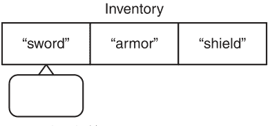

**Figure 4.3**  

A call to `inventory.begin()` returns an iterator that refers to the first element in the vector.

### Calling the end() Vector Member Function

In the test statement of the loop, I test the return value of `inventory.end()` against `iter` to make sure the two are not equal. The `end()` member function returns an iterator one past the last element in a container. This means the loop will continue until `iter` has moved through all of the elements in `inventory`. Figure 4.4 shows an abstract view of the iterator returned by a call to this member function. (Note that the figure is abstract because the vector `inventory` doesn't contain the string literals "sword", "armor", and "shield"; it contains string objects.)

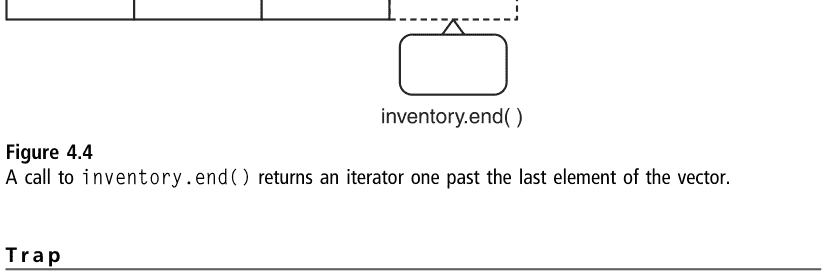

**Figure 4.4**  

A call to `inventory.end()` returns an iterator one past the last element of the vector.

The `end()` vector member function returns an iterator that's one past the last element in the vector—not the last element. Therefore, you can't get a value from the iterator returned by `end()`. This might seem counter-intuitive, but it works well for loops that move through a container.

The action statement in the loop, `++iter`, increments `iter`, which moves it to the next element in the vector. Depending upon the iterator, you can perform other mathematical operations on iterators to move them around a container. Most often, though, you'll find that you simply want to increment an iterator.

In the loop body, I send `*iter` to `cout`. By placing the dereference operator (`*`) in front of `iter`, I display the value of the element to which the iterator refers (not the iterator itself). By placing the dereference operator in front of an iterator, you're saying, "Treat this as the thing that the iterator references, not as the iterator itself."

Next, I change the first element in the vector from the string object equal to "sword" to the string object equal to "battle axe". First I set `myIterator` to reference the first element of `inventory`.

```cpp
myIterator = inventory.begin();
```

Then I change the value of the first element.

```cpp
*myIterator = "battle axe";
```

Remember, by dereferencing `myIterator` with `*`, the preceding assignment statement says, "Assign 'battle axe' to the element that `myIterator` references." It does not change `myIterator`. After the assignment statement, `myIterator` still refers to the first element in the vector.

Just to prove that the assignment worked, I then display all of the elements in `inventory`.

### Accessing Member Functions of a Vector Element

Next I display the number of characters in the name of the first item in the hero's inventory.

```cpp
cout << "\nThe item name " << *myIterator << " has ";
cout << ((*myIterator).size()) << " letters in it.\n";
```


The code `(*myIterator).size()` says, "Take the result of dereferencing `myIterator` and call that object's `size()` member function." Because `myIterator` refers to the `string` object equal to "battle axe", the code returns 10.

> **Hint**

>

> Whenever you dereference an iterator to access a data member or member function, surround the dereferenced iterator by a pair of parentheses. This ensures that the dot operator will be applied to the object the iterator references.

The code `(*myIterator).size()` is not the prettiest, so C++ offers an alternative, more intuitive way to express the same thing, which I demonstrate in the next two lines of the program.

```cpp
cout << "\nThe item name " << *myIterator << " has ";
cout << myIterator->size() << " letters in it.\n";
```

The preceding code does exactly the same thing the first pair of lines I presented in this section do; it displays the number of characters in "battle axe". However, notice that I substitute `myIterator->size()` for `(*myIterator).size()`. You can see that this version (with the `->` symbol) is more readable. The two pieces of code mean exactly the same thing to the computer, but this new version is easier for humans to use. In general, you can use the `->` operator to access the member functions or data members of an object that an iterator references.

> **Hint**

>

> Syntactic sugar is a nicer, alternative syntax. It replaces harsh syntax with something that's a bit easier to swallow. As an example, instead of writing the code `(*myIterator).size()`, I can use the syntactic sugar provided by the `->` operator and write `myIterator->size()`.

### Using the `insert()` Vector Member Function

Next I add a new item to the hero's `inventory`. This time, though, I don't add the item to the end of the sequence; instead, I insert it at the beginning.

```cpp
inventory.insert(inventory.begin(), "crossbow");
```

One form of the `insert()` member function inserts a new element into a `vector` just before the element referred to by a given iterator. You supply two arguments to this version of `insert()`—the first is an iterator, and the second is the element to be inserted. In this case, I inserted "crossbow" into `inventory` just before the first element. As a result, all of the other elements will move down by one. This version of the `insert()` member function returns an iterator that references the newly inserted element. In this case, I don't assign the returned iterator to a variable.

> **Trap**

>

> Calling the `insert()` member function on a `vector` invalidates all of the iterators that reference elements after the insertion point because all of the elements after the insertion point are shifted down by one.

Next I show the contents of the `vector` to prove the insertion worked.

### Using the `erase()` Vector Member Function

Next I remove an item from the hero's `inventory`. However, this time I don't remove the item at the end of the sequence; instead, I remove one from the middle.

```cpp
inventory.erase((inventory.begin() + 2));
```

One form of the `erase()` member function removes an element from a `vector`. You supply one argument to this version of `erase()`—the iterator that references the element you want to remove. In this case, I passed `(inventory.begin() + 2)`, which is equal to the iterator that references the third element in `inventory`. This removes the `string` object equal to "armor". As a result, all of the following elements will move up by one. This version of the `erase()` member function

返回一个引用被移除元素之后的元素迭代器。在这种情况下，我没有将返回的迭代器赋值给变量。

#### Trap

> 在 `vector` 上调用 `erase()` 成员函数会使所有引用移除点之后元素的迭代器失效，因为移除点之后的所有元素都会向上移动一位。

接下来我展示 `vector` 的内容以证明移除操作成功。

## USING ALGORITHMS

STL 定义了一组算法，允许你通过迭代器操作容器中的元素。算法存在于诸如搜索、随机化和排序等常见任务中。这些算法是你内置的灵活且高效的武器库。通过使用它们，你可以将以常见方式操作容器元素这种繁琐的任务交给 STL，这样你就可以专注于编写游戏。这些算法的强大之处在于它们是通用的——同一个算法可以与不同容器类型的元素一起工作。

### Introducing the High Scores Program

High Scores 程序创建一个高分 `vector`。它使用 STL 算法来搜索、洗牌和排序分数。图 4.5 说明了该程序。

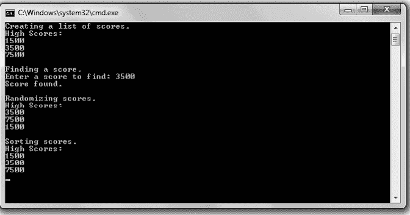

Figure 4.5

STL algorithms search, shuffle, and sort elements of a `vector` of high scores.

你可以从 Course Technology 网站 (`www.courseptr.com/downloads`) 下载此程序的代码。该程序位于 Chapter 4 文件夹中；文件名是 `high_scores.cpp`。

```
// High Scores
// Demonstrates algorithms

#include <iostream>
#include <vector>
#include <algorithm>
#include <ctime>
#include <cstdlib>

using namespace std;

int main()
{
    vector<int>::const_iterator iter;

    cout << "Creating a list of scores.";
    vector<int> scores;
    scores.push_back(1500);
    scores.push_back(3500);
    scores.push_back(7500);

    cout << "\nHigh Scores:\n";
    for (iter = scores.begin(); iter != scores.end(); ++iter)
    {
        cout << *iter << endl;
    }

    cout << "\nFinding a score.";
    int score;
    cout << "\nEnter a score to find: ";
    cin >> score;
    iter = find(scores.begin(), scores.end(), score);
    if (iter != scores.end())
{
    cout << "Score found.\n";
}
else
{
    cout << "Score not found.\n";
}

cout << "\nRandomizing scores.";
srand(static_cast<unsigned int>(time(0)));
random_shuffle(scores.begin(), scores.end());
cout << "\nHigh Scores:\n";
for (iter = scores.begin(); iter != scores.end(); ++iter)
{
    cout << *iter << endl;
}

cout << "\nSorting scores.";
sort(scores.begin(), scores.end());
cout << "\nHigh Scores:\n";
for (iter = scores.begin(); iter != scores.end(); ++iter)
{
    cout << *iter << endl;
}

return 0;
}
```

### Preparing to Use Algorithms

为了我能使用 STL 算法，我包含了它们的定义文件。

```
#include <algorithm>
```

如你所知，所有 STL 组件都位于 `std` 命名空间中。通过使用以下代码（我通常这样做），我可以在不使用 `std::` 前缀的情况下引用算法。

```
using namespace std;
```

### Using the `find()` Algorithm

在我显示 `vector` `scores` 的内容之后，我从用户那里获取一个要查找的值并将其存储在变量 `score` 中。然后我使用 `find()` 算法在 `vector` 中搜索该值：

```
iter = find(scores.begin(), scores.end(), score);
```

`find()` STL 算法在容器元素的指定范围内搜索一个值。它返回引用第一个匹配元素的迭代器。如果未找到匹配项，它返回指向范围末尾的迭代器。你必须传递起始点作为迭代器、结束点作为迭代器，以及要查找的值。算法从起始迭代器搜索到但不包括结束迭代器。在这种情况下，我将 `scores.begin()` 和 `scores.end()` 作为第一个和第二个参数传递以搜索整个 `vector`。我将 `score` 作为第三个参数传递以搜索用户输入的值。

接下来我检查值 `score` 是否被找到：

```
if (iter != scores.end())
{
    cout << "Score found.\n";
}
else
{
    cout << "Score not found.\n";
}
```

记住，`iter` 将引用 `vector` 中 `score` 的第一次出现，如果该值被找到。因此，只要 `iter` 不等于 `scores.end()`，我就知道 `score` 被找到了并显示一条消息。否则，`iter` 将等于 `scores.end()`，我知道 `score` 未被找到。

### Using the `random_shuffle()` Algorithm

接下来我准备使用 `random_shuffle()` 算法对分数进行随机化。就像生成单个随机数时一样，我在调用 `random_shuffle()` 之前为随机数生成器设置种子，这样每次运行程序时分数的顺序可能不同。

```
srand(static_cast<unsigned int>(time(0)));
```

然后我以随机方式重新排序分数。

```
random_shuffle(scores.begin(), scores.end());
```

`random_shuffle()` 算法随机化序列的元素。你必须提供序列的起始和结束点的迭代器。在这种情况下，我传递了 `scores.begin()` 和 `scores.end()` 返回的迭代器。这两个迭代器表示我想要洗牌 `scores` 中的所有元素。结果是，`scores` 包含相同的分数，但顺序是随机的。

然后我显示分数以证明随机化有效。

#### Trick

虽然你可能不想随机化高分列表，但 `random_shuffle()` 对于游戏来说是一个有价值的算法。你可以用它做各种事情，从洗牌一副牌到混合玩家在游戏关卡中会遇到的敌人的顺序。

### Using the `sort()` Algorithm

接下来我对分数进行排序。

```
sort(scores.begin(), scores.end());
```

`sort()` 算法按升序对序列的元素进行排序。你必须提供要排序的序列的起始和结束点的迭代器。在这种特定情况下，我传递了 `scores.begin()` 和 `scores.end()` 返回的迭代器。这两个迭代器表示我想要对 `scores` 中的所有元素进行排序。结果是，`scores` 包含所有按升序排列的分数。

最后，我显示分数以证明排序有效。

#### Trick

STL 算法的一个非常酷的属性是它们可以与 STL 之外定义的容器一起工作。这些容器只需要满足某些要求。例如，即使 `string` 对象不是 STL 的一部分，你也可以在它们上使用适当的 STL 算法。以下代码片段演示了这一点：

```
string word = "High Scores";
random_shuffle(word.begin(), word.end());
```

前面的代码随机洗牌 `word` 中的字符。如你所见，`string` 对象同时具有 `begin()` 和 `end()` 成员函数，分别返回指向第一个字符和最后一个字符之后位置的迭代器。这就是 STL 算法能与字符串一起工作的原因之一——因为它们就是这样设计的。

## UNDERSTANDING VECTOR PERFORMANCE

像所有 STL 容器一样，`vector` 为游戏程序员提供了处理信息的高级方法，但这种复杂性可能会带来性能成本。而如果有一件事游戏程序员痴迷，那就是性能。但别担心，`vector` 和其他 STL 容器是极其高效的。事实上，它们已经在已发布的 PC 和主机游戏中被使用过。然而，这些容器有其优势和劣势；游戏程序员需要了解各种容器类型的性能特征，以便他能为任务选择合适的容器。

### Examining Vector Growth

虽然 `vector` 在需要时动态增长，但每个 `vector` 都有特定的大小。当向 `vector` 添加新元素使 `vector` 超出其当前大小时，计算机重新分配内存，甚至可能将所有 `vector` 元素复制到这块新占用的内存空间中。这可能会导致性能下降。

关于程序性能最重要的是要记住是否需要关心。例如，`vector` 内存重新分配可能不会发生在程序的性能关键部分。在这种情况下，你可以安全地忽略重新分配的成本。此外，对于小型 `vector`，重新分配成本可能微不足道，因此再次可以安全地忽略它。然而，如果你需要更大程度地控制这些内存重新分配发生的时机，你可以做到。


## Using the `capacity()` Member Function

`capacity()` vector 成员函数返回 vector 的容量——换句话说，vector 在程序必须为其重新分配更多内存之前可以容纳的元素数量。vector 的容量与它的大小（vector 当前持有的元素数量）不是同一回事。以下代码片段有助于强调这一点：

```
cout << "Creating a 10 element vector to hold scores.\n";
vector<int> scores(10, 0); //initialize all 10 elements to 0
cout << "Vector size is:" << scores.size() << endl;
cout << "Vector capacity is:" << scores.capacity() << endl;
```

```
cout << "Adding a score.\n";
scores.push_back(0);  //memory is reallocated to accommodate growth
cout << "Vector size is:" << scores.size() << endl;
cout << "Vector capacity is:" << scores.capacity() << endl;
```

在我声明并初始化 vector 之后，这段代码报告其大小和容量均为 10。然而，在添加一个元素后，代码报告 vector 的大小为 11 而容量为 20。这是因为 vector 的容量在程序为其重新分配额外内存时每次都会翻倍。在本例中，当添加一个新分数时，内存被重新分配，vector 的容量从 10 翻倍到 20。

## 使用 `reserve()` 成员函数

`reserve()` 成员函数将 vector 的容量增加到作为参数提供的数量。使用 `reserve()` 可以让你控制额外内存重新分配发生的时间。以下是一个示例：

```
cout << "Creating a list of scores.\n";
vector<int> scores(10, 0);  //initialize all 10 elements to 0
cout << "Vector size is:" << scores.size() << endl;
cout << "Vector capacity is:" << scores.capacity() << endl;
```

```
cout << "Reserving more memory.\n";
scores.reserve(20);  //reserve memory for 10 additional elements
cout << "Vector size is:" << scores.size() << endl;
cout << "Vector capacity is:" << scores.capacity() << endl;
```

在我声明并初始化 vector 之后，这段代码报告其大小和容量均为 10。然而，在我为 10 个额外元素预留内存后，代码报告 vector 的大小仍为 10 而容量为 20。

通过使用 `reserve()` 使 vector 的容量足够大以满足你的目的，你可以推迟内存重新分配到你选择的时间。

### Hint

> 作为一名初学游戏程序员，了解 vector 内存分配的工作方式是好的；然而，不要为此过度执着。你编写的第一个游戏程序可能不会从更手动的 vector 内存分配流程中受益。

## 检查元素插入和删除

使用 `push_back()` 或 `pop_back()` 成员函数在 vector 末尾添加或删除元素是极其高效的。然而，在 vector 的任何其他位置添加或删除元素（例如使用 `insert()` 或 `erase()`）可能需要更多工作，因为你可能需要移动多个元素以适应插入或删除。对于小型 vector，开销通常可以忽略不计，但对于大型 vector（例如有数千个元素），在 vector 中间插入或删除元素可能会导致性能下降。

幸运的是，STL 提供了另一种序列容器类型 `list`，它允许无论序列大小如何都能高效地进行插入和删除。需要记住的重要一点是，一种容器类型并不是解决所有问题的方案。虽然 `vector` 是多功能的，也许是最受欢迎的 STL 容器类型，但在某些情况下另一种容器类型可能更合适。

> Trap

> 仅仅因为你想在序列中间插入或删除元素，并不意味着你应该放弃 `vector`。它对于你的游戏程序来说仍然是一个不错的选择。这真的取决于你如何使用序列。如果你的序列很小或只有少数几次插入和删除，那么 `vector` 仍然可能是你的最佳选择。

## 检查其他 STL 容器

STL 定义了多种容器类型，可分为两个基本类别——顺序和关联。使用顺序容器，你可以按顺序检索值，而关联容器则允许你基于键检索值。`vector` 是顺序容器的一个例子。

你可能会如何使用这些不同的容器类型？考虑一个在线回合制策略游戏。你可以使用顺序容器来存储一组你想要按顺序循环的玩家。另一方面，你可以使用关联容器通过查找唯一标识符（例如玩家的 IP 地址）以随机访问方式检索玩家信息。

最后，STL 定义了容器适配器，它们适配其中一个序列容器。容器适配器代表标准的计算机科学数据结构。虽然它们不是正式的容器，但看起来和感觉就像它们一样。表 4.1 列出了 STL 提供的容器类型。

Table 4.1 STL Containers

| Container | Type | Description |

|---|---|---|

| `deque` | Sequential | Double-ended queue |

| `list` | Sequential | Linear list |

| `map` | Associative | Collection of key/value pairs in which each key is associated with exactly one value |

| `multimap` | Associative | Collection of key/value pairs in which each key may be associated with more than one value |

| `multiset` | Associative | Collection in which each element is not necessarily unique |

| `priority_queue` | Adaptor | Priority queue |

| `queue` | Adaptor | Queue |

| `set` | Associative | Collection in which each element is unique |

| `stack` | Adaptor | Stack |

| `vector` | Sequential | Dynamic array |

## 规划你的程序

到目前为止，你所看到的所有程序都相当简单。正式在纸上规划其中任何一个的想法似乎像是过度设计。它不是——规划你的程序（即使是小的）几乎总是会节省时间和挫败感。

编程很像建筑。想象一下承包商在没有蓝图的情况下为你建造房子。糟糕！你可能会得到一栋有 12 个浴室、没有窗户、并且前门在二楼的房子。而且，它可能花费你估计价格的 10 倍。编程也是如此。没有计划，你很可能会在过程中挣扎并浪费时间。你甚至可能最终得到一个不太工作的程序。

## 使用伪代码

许多程序员使用伪代码草拟他们的程序——一种介于英语和正式编程语言之间的语言。任何理解英语的人都应该能够跟随伪代码。这里有一个例子：假设我想赚一百万美元。这是一个值得的目标，但我该怎么做呢？我需要一个计划。所以我制定了一个计划并用伪代码写下来。

```
If you can think of a new and useful product
    Then that's your product
Otherwise
    Repackage an existing product as your product
Make an infomercial about your product
Show the infomercial on TV
Charge $100 per unit of your product
Sell 10,000 units of your product
```

即使任何人，甚至非程序员，都能理解我的计划，我的伪代码感觉有点像程序。前四行类似于带有 `else` 子句的 `if` 语句，这是故意的。当你写计划时，你应该尝试融入你用伪代码表示的代码的感觉。

## 使用逐步细化

你的编程计划可能不会在一次草稿后就完成。通常，伪代码需要在实现为编程代码之前经过多次修改。逐步细化是用于重写伪代码使其准备好实现的一个过程。逐步细化很简单。基本上，它的意思是，“使其更详细。”通过将伪代码中描述的每个步骤分解为一系列更简单的步骤，计划变得更接近编程代码。使用逐步细化，你不断分解每个步骤，直到你觉得整个计划可以相当容易地翻译成程序。作为一个例子，取我赚一百万美元的主计划中的一个步骤：

```
Create an infomercial about your product
```

这可能看起来任务太模糊了。如何制作一个电视购物广告？使用逐步细化，你可以将单个步骤分解为其他几个步骤。所以它变成

```
Write a script for an infomercial about your product
Rent a TV studio for a day
Hire a production crew
Hire an enthusiastic audience
Film the infomercial
```

如果你觉得这五个步骤清晰且可实现，那么伪代码的这一部分就已经彻底细化了。如果你对某个步骤仍不明确，就继续细化它。继续这个过程，你将拥有一个完整的计划——以及一百万美元。

## 介绍 HANGMAN

在 Hangman 程序中，计算机选择一个秘密单词，玩家尝试一次猜一个字母。玩家允许八次错误猜测。如果他或她未能及时猜出单词，玩家将被吊死，游戏结束。图 4.6 显示了游戏。

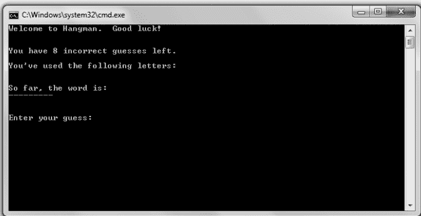

Figure 4.6

The Hangman game in action

## 规划游戏

在我写 C++ 的第一行代码之前，我使用伪代码规划游戏程序。

```
Create a group of words
Pick a random word from the group as the secret word
While player hasn’t made too many incorrect guesses and hasn’t guessed the secret word
    Tell player how many incorrect guesses he or she has left
    Show player the letters he or she has guessed
```

*向玩家显示其已猜中神秘单词中的几个字母*

*获取玩家的下一个猜测*

*当玩家输入了已经猜过的字母时*

*获取玩家的猜测*

*将新猜测加入已用字母集合*

*如果猜测的字母在神秘单词中*

*告诉玩家猜测正确*

*用新字母更新目前已猜出的单词*

*否则*

*告诉玩家猜测错误*

*增加玩家错误猜测的次数*

*如果玩家错误猜测次数过多*

*告诉玩家他或她已被吊死*

*否则*

*祝贺玩家猜出了神秘单词*

尽管这段伪代码没有涵盖我将要编写的每一行 C++ 代码，但我认为它很好地描述了我需要完成的任务。然后我就开始编写程序。

## 设置程序

和往常一样，我先写一些注释，并包含所需的头文件。

```
// Hangman
// The classic game of hangman

#include <iostream>
#include <string>
#include <vector>
#include <algorithm>
#include <ctime>
#include <cctype>

using namespace std;
```

注意，我包含了一个新文件——`cctype`。它是标准库的一部分，其中包含将字符转换为大写的函数，这样在比较单个字符时，我就可以进行“同等级别”的比较（大写对大写）。

## 初始化变量和常量

接下来，我启动 `main()` 函数，并为游戏初始化变量和常量。

```
int main()
{
    //setup
    const int MAX_WRONG = 8;  //maximum number of incorrect guesses allowed

    vector<string> words;  //collection of possible words to guess
    words.push_back("GUESS");
    words.push_back("HANGMAN");
    words.push_back("DIFFICULT");

    srand(static_cast<unsigned int>(time(0)));
    random_shuffle(words.begin(), words.end());
    const string THE_WORD = words[0];            //word to guess
    int wrong = 0;                               //number of incorrect guesses
    string soFar(THE_WORD.size(), '-');          //word guessed so far
    string used = "";                           //letters already guessed

    cout << "Welcome to Hangman. Good luck!\n";
```

`MAX_WRONG` 是玩家可以做出的最大错误猜测次数。`words` 是一个由候选猜测单词组成的 `vector`。我使用 `random_shuffle()` 算法对 `words` 进行随机化处理，然后将 `vector` 中的第一个单词赋给 `THE_WORD`，即玩家必须猜出的神秘单词。`wrong` 是玩家已经做出的错误猜测次数。`soFar` 是玩家目前已猜出的单词。`soFar` 初始是一串破折号——神秘单词中每个字母对应一个破折号。当玩家猜出神秘单词中的一个字母时，我会用该字母替换相应位置的破折号。

## 进入主循环

接下来，我进入主循环，该循环会一直持续，直到玩家错误猜测次数过多或猜出了单词。

```
//main loop
while ((wrong < MAX_WRONG) && (soFar != THE_WORD))
{
```

```
cout << "\n\nYou have " << (MAX_WRONG - wrong);
cout << " incorrect guesses left.\n";
cout << "\nYou've used the following letters:\n" << used << endl;
cout << "\nSo far, the word is:\n" << soFar << endl;
```

## 获取玩家的猜测

接下来，我获取玩家的猜测。

```
char guess;
cout << "\n\nEnter your guess: ";
cin >> guess;
guess = toupper(guess); //make uppercase since secret word in uppercase
while (used.find(guess) != string::npos)
{
    cout << "\nYou've already guessed " << guess << endl;
    cout << "Enter your guess: ";
    cin >> guess;
    guess = toupper(guess);
}

used += guess;

if (THE_WORD.find(guess) != string::npos)
{
    cout << "That's right! " << guess << " is in the word.\n";
    //update soFar to include newly guessed letter
    for (int i = 0; i < THE_WORD.length(); ++i)
    {
        if (THE_WORD[i] == guess)
        {
            soFar[i] = guess;
        }
    }
}
else
{
    cout << "Sorry, " << guess << " isn't in the word.\n";
    ++wrong;
}
```

我使用定义在 `cctype` 文件中的 `toupper()` 函数将猜测的字母转换为大写。这样做是为了在比对猜测字母与神秘单词中的字母时，能进行大写字母与大写字母的比较。

如果玩家猜了一个已经猜过的字母，我就让玩家重新猜测。如果玩家猜对了字母，我就更新目前已猜出的单词。否则，我告诉玩家该字母不在神秘单词中，并增加玩家的错误猜测次数。

## 结束游戏

此时，玩家要么已猜出单词，要么错误猜测次数已经超过限制。无论哪种情况，游戏都结束了。

```
//shut down
if (wrong == MAX_WRONG)
{
    cout << "\nYou've been hanged!";
}
else
{
    cout << "\nYou guessed it!";
}

cout << "\nThe word was " << THE_WORD << endl;

return 0;
}
```


我要么祝贺玩家，要么告诉他或她已被吊死的坏消息。然后我会揭示神秘单词。

## 本章小结

在本章中，你学习了以下概念：

- 标准模板库（STL）是一个功能强大的编程代码集合，提供了容器、算法和迭代器。
- 容器是允许你存储和访问同类型值集合的对象。
  - STL 中定义的算法可与容器一起使用，并提供处理对象组的常用函数。
  - 迭代器是标识容器中元素的对象，可以通过操作在元素之间移动。
  - 迭代器是充分利用容器的关键。许多容器成员函数都需要迭代器，STL 算法也需要它们。
  - 要获得迭代器引用的值，必须使用解引用运算符（`*`）对迭代器进行解引用。
  - `vector` 是 STL 提供的一种顺序容器。它的行为类似动态数组。
  - 遍历 `vector` 非常高效。在 `vector` 末尾插入或删除元素也非常高效。
  - 在 `vector` 中间插入或删除元素可能效率较低，尤其是在 `vector` 很大的情况下。
  - 伪代码介于英语和编程语言之间，用于规划程序。
  - 逐步细化是一个重写伪代码以使其能够投入实现的过程。

## 问题与解答

问：为什么 STL 很重要？

答：因为它节省了游戏程序员的时间和精力。STL 提供了常用的容器类型和算法。

问：STL 快吗？

答：绝对快。STL 经过数百名程序员的精心打磨，在每个支持的平台上都尽可能挖掘出最高性能。

问：什么时候应该使用 `vector` 而不是数组？

答：几乎总是如此。`vector` 高效且灵活。它们确实比数组多占用一些内存，但这种权衡几乎总是值得的。

问：`vector` 和数组一样快吗？

答：访问 `vector` 元素可以像访问数组元素一样快。另外，遍历 `vector` 也可以像遍历数组一样快。

问：如果我可以对 `vector` 使用下标运算符，为什么还需要迭代器？

答：有几个原因。第一，许多 `vector` 成员函数需要迭代器（`insert()` 和 `erase()` 就是两个例子）。第二，STL 算法需要迭代器。第三，大多数 STL 容器不能使用下标运算符，所以你迟早都要学会使用迭代器。

问：访问 `vector` 元素的最佳方式是什么——通过迭代器还是通过下标运算符？

答：这要看情况。如果你需要随机访问元素，那么下标运算符是最自然的选择。如果你需要使用 STL 算法，那么你必须使用迭代器。

问：那遍历 `vector` 的元素呢？我应该使用下标运算符还是迭代器？

答：两种方法都可以。不过，使用迭代器的一个优点是，它能让你灵活地用另一个 STL 容器（如 `list`）替换 `vector`，而不需要改动太多代码。

问：为什么 STL 定义了不止一种顺序容器类型？

答：不同的顺序容器类型有不同的性能特性。它们就像工具箱里的工具；每种工具最适合不同的工作。

问：什么是容器适配器？

答：容器适配器基于 STL 顺序容器之一；它们代表标准的计算机数据结构。虽然它们不是正式的容器，但它们的外观和使用感觉与容器并无二致。

问：什么是栈？

答：一种数据结构，其元素的移除顺序与添加顺序相反。这意味着最后添加的元素是第一个已移除。这就像现实生活中的栈，你从栈顶移除最后放入的那个元素。

问：什么是队列？

答：一种数据结构，其中的元素按照它们被添加的顺序被移除。这就像现实生活中的队列，比如一排人，排在第一位的人先得到服务。

问：什么是双端队列？

答：一种可以在任一端添加或移除元素的队列。

问：什么是优先队列？

答：一种支持查找和移除最高优先级元素的数据结构。

问：我什么时候会使用伪代码？

答：任何时候你想规划一个程序或一段代码时。

问：我什么时候会使用逐步求精？

答：当你想要让你的伪代码变得更加详细时。

## 讨论问题

1. 为什么游戏程序员应该使用 STL？
2. 与数组相比，向量有哪些优点？
3. 你可能用向量存储哪些类型的游戏对象？
4. 容器类型的性能特征如何影响使用它的决策？
5. 为什么程序规划很重要？

## 练习

1. 编写一个使用向量和迭代器的程序，允许用户维护他或她最喜欢的游戏列表。该程序应允许用户列出所有游戏标题、添加游戏标题和移除游戏标题。
2. 假设 `scores` 是一个持有 `int` 类型元素的向量，下面的代码片段（意图递增每个元素）有什么问题？

    ```cpp
    vector<int>::iterator iter;

    // increment each score

    for (iter = scores.begin(); iter != scores.end(); ++iter)
    {
        iter++;
    }
    ```

3. 为第 3 章的 Word Jumble 游戏编写伪代码。

此页有意留空

# 第5章

## 函数：疯狂填词

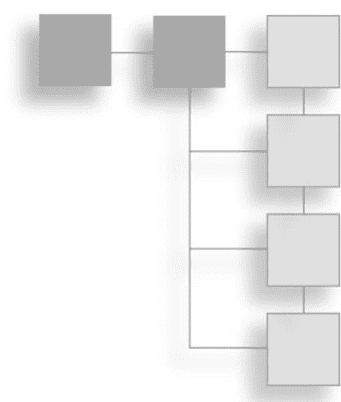

到目前为止，你见过的每个程序都只包含一个函数——`main()`。然而，一旦你的程序达到一定大小或复杂程度，像这样使用它就变得难以处理了。幸运的是，有一些方法可以把大型程序分解成更小的、一口大小的代码块。在本章中，你将学习一种方法——创建新函数。具体来说，你将学习：

- 编写新的函数
- 通过参数向新函数传入值
- 通过返回值从新函数返回信息
- 处理全局变量和常量
- 重载函数
- 内联函数

## 创建函数

C++ 允许你编写包含多个函数的程序。你的新函数工作方式与标准库中的函数完全一样——它们会去执行一个任务，然后将控制权返回给你的程序。编写新函数的一个很大优点是它允许你将代码分解成易于管理的部分。就像你已经了解的标准库函数一样，你的新函数应该做好一件事。

## 介绍 Instructions 程序

Instructions 程序的结果相当基础——几行文本，是一些游戏说明的开头部分。从输出来看，Instructions 似乎是你早在第 1 章就能写出来的程序。但这个程序在幕后有一个新元素——一个新函数。看看图 5.1，了解这段代码的朴素输出结果。

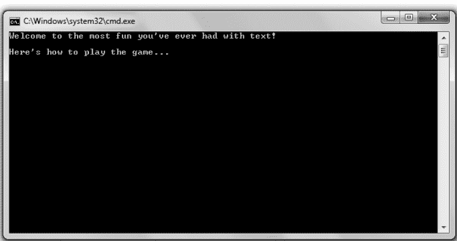

图 5.1

这些说明由一个函数显示。

你可以从 Course Technology 网站（www.courseptr.com/downloads）下载此程序的代码。该程序在第 5 章文件夹中；文件名是 `instructions.cpp`。

```cpp
// Instructions
// Demonstrates writing new functions

#include <iostream>

using namespace std;

// function prototype (declaration)
void instructions();
```

```cpp
int main()
{
    instructions();
    return 0;
}

// function definition
void instructions()
{
    cout << "Welcome to the most fun you've ever had with text!\n\n";
    cout << "Here's how to play the game...\n";
}
```

## 声明函数

在调用你编写的函数之前，你必须声明它。声明函数的一种方式是编写函数原型——描述函数的代码。你编写原型时，需要列出函数的返回值（如果函数不返回任何值，则为 `void`），后面跟函数名，再后面是一组圆括号内的参数列表。参数接收在函数调用中作为实参发送的值。

在 `main()` 函数之前，我写了一个函数原型：

```cpp
void instructions();
```

在前面的代码中，我声明了一个名为 `instructions` 的函数，它不返回值。（你可以通过我使用 `void` 作为返回类型来判断。）该函数也不接受任何值，因此没有参数。（你可以通过圆括号内没有任何内容来判断。）

原型并不是声明函数的唯一方式。实现同样目的的另一种方式是让函数定义本身充当声明。要做到这一点，你只需将函数定义放在调用该函数之前。

**提示：** 虽然你不必使用原型，但它们带来了很多好处——其中之一就是让你的代码更清晰。

## 定义函数

定义函数意味着编写所有使函数运转起来的代码。你定义函数时，需要列出函数的返回值（如果函数不返回任何值，则为 `void`），后面跟函数名，再后面是一组圆括号内的参数列表——就像函数原型一样（只是行尾不加分号）。这称为函数头。然后你用花括号创建一个块，其中包含函数执行时要执行的指令。这称为函数体。

在 Instructions 程序的末尾，我定义了简单的 `instructions()` 函数，它显示一些游戏说明。因为该函数不返回任何值，我不需要使用像在 `main()` 中那样的 `return` 语句。我只需用右花括号结束函数定义即可。

```cpp
void instructions()
{
    cout << "Welcome to the most fun you've ever had with text!\n\n";
    cout << "Here's how to play the game...\n";
}
```

> 陷阱：函数定义必须与其原型在返回类型和函数名上匹配；否则，会产生编译错误。

## 调用函数

你调用自己函数的方式与调用任何其他函数的方式相同——写出函数名，后跟一对圆括号，括号内包含一个有效的实参列表。在 `main()` 中，我仅用如下方式调用我新创建的函数：

```cpp
instructions();
```

这一行调用了 `instructions()`。每当你调用一个函数时，程序的控制权就会跳转到该函数。在这种情况下，这意味着控制权跳到 `instructions()`，程序执行该函数的代码，显示游戏说明。当函数结束时，控制权返回到调用代码。在这种情况下，这意味着控制权返回到 `main()`。`main()` 中的下一条语句（`return 0;`）被执行，程序结束。

## 理解抽象

通过编写和调用函数，你实践了所谓的抽象。抽象让你能够从大局思考，而无需担心细节。在这个程序中，我可以简单地使用 `instructions()` 函数，而无需担心显示文本的细节。我只需用一行代码调用该函数，它就能完成任务。

你可能会惊讶抽象无处不在，但人们一直在使用它。例如，考虑快餐店的两名员工。如果一个人告诉另一个人他刚刚装好一份 3 号餐并“加大”了，另一个人知道第一个员工是接了一份顾客的订单，走到保温灯下，拿了一个汉堡，走到油炸锅前，把最大的纸盒容器装满薯条，走到汽水机前，拿了最大的杯子，装满汽水，把所有的东西交给顾客，收了顾客的钱，并给顾客找了零钱。不仅这种详细程度会让谈话变得无聊，而且也没有必要。两位员工都理解装好一份 3 号餐并“加大”是什么意思。他们不必操心所有细节，因为他们正在使用抽象。

## 使用参数和返回值

正如你在标准库函数中看到的那样，你可以向函数提供一个值并得到一个返回值。例如，对于 `toupper()` 函数，你提供一个字符，该函数返回它的大写版本。你自己的函数也可以接收值并返回值。这允许你的函数与程序的其余部分进行通信。

## 介绍 Yes or No 程序

Yes or No 程序会询问用户一些玩家可能必须回答的典型问题。首先，程序要求用户表示是或否。然后程序变得更加具体，询问用户是否想要保存游戏。同样，程序的结果并不惊人；有趣的是它们的实现。每个问题都由一个与 `main()` 通信的不同函数提出。图 5.2 显示了程序的一次示例运行。

你可以从 Course Technology 网站（www.coursetech.com/downloads）下载此程序的代码。该程序在第 5 章文件夹中；文件名是 `yes_or_no.cpp`。

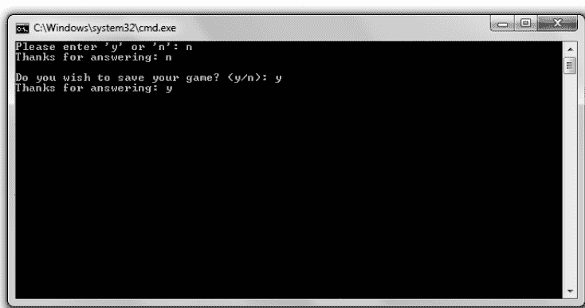

**图 5.2** 每个问题都由一个单独的函数提出，信息在这些函数与 `main()` 之间传递。

```cpp
// 是或否

// 演示返回值和参数

#include <iostream>

#include <string>

using namespace std;

char askYesNo1();

char askYesNo2(string question);

int main()

{

    char answer1 = askYesNo1();

    cout << "Thanks for answering: " << answer1 << "\n\n";

    char answer2 = askYesNo2("Do you wish to save your game?");

    cout << "Thanks for answering: " << answer2 << "\n";

    return 0;

}
```

```cpp
char askYesNo1()
{
    char response1;
    do
    {
        cout << "Please enter 'y' or 'n': ";
        cin >> response1;
    } while (response1 != 'y' && response1 != 'n');

    return response1;
}
```

```cpp
char askYesNo2(string question)
{
    char response2;
    do
    {
        cout << question << " (y/n): ";
        cin >> response2;
    } while (response2 != 'y' && response2 != 'n');

    return response2;
}
```

## 返回值

你可以从函数返回一个值，将信息发送回调用代码。要返回一个值，你需要指定返回类型，然后从函数返回该类型的值。

### 指定返回类型

我声明的第一个函数 `askYesNo1()` 返回一个 `char` 值。你可以从 `main()` 之前的函数原型看出这一点：

```cpp
char askYesNo1();
```

你也可以从 `main()` 之后的函数定义看出这一点：

```cpp
char askYesNo1(
```

## 使用 return 语句

`askYesNo1()` 要求用户输入 `y` 或 `n`，并在他输入之前一直询问。一旦用户输入了有效字符，函数就以下面这一行结束，该行返回 `response1` 的值。

```cpp
return response1;
```

请注意 `response1` 是一个 `char` 值。它必须是 `char`，因为我在函数原型和函数定义中都承诺返回的就是这个类型。

一个函数在遇到 `return` 语句时结束。一个函数拥有多个 `return` 是完全可以接受的。这只是意味着函数有多个可以结束的点。

### 技巧

你不必用 `return` 语句返回一个值。你可以在返回类型为 `void` 的函数中使用单独的 `return` 来结束函数。

## 使用返回值

在 `main()` 中，我用下面这一行调用函数，将函数的返回值赋给 `answer1`。

```cpp
char answer1 = askYesNo1();
```

这意味着 `answer1` 被赋值为 `'y'` 或 `'n'`——即用户在 `askYesNo1()` 提示时输入的字符。

接下来在 `main()` 中，我将 `answer1` 的值显示给所有人。

## 接受参数值

你可以向函数发送值，让它通过参数接收。这是将信息传入函数的最常见方式。

### 指定参数

我声明的第二个函数 `askYesNo2()` 接受一个参数值。具体来说，它接受 `string` 类型的值。你可以从 `main()` 之前的函数原型看出这一点：

```cpp
char askYesNo2(string question);
```

### 提示

你在原型中不必使用参数名；你只需要包含参数类型即可。例如，下面是声明 `askYesNo2()` 的一个完全有效的原型，它声明了一个有一个 `string` 参数并返回 `char` 的函数。

```cpp
char askYesNo2(string);
```

尽管你在原型中不必使用参数名，但这样做是个好主意。它使你的代码更清晰，而且付出很小。

从 `askYesNo2()` 的头文件可以看出，该函数接受一个 `string` 对象作为参数，并将该参数命名为 `question`。

```cpp
char askYesNo2(string question)
```

与原型不同，你必须在函数定义中指定参数名。你在函数内部使用参数名来访问参数值。

### 陷阱

函数原型中指定的参数类型必须与函数定义中列出的参数类型匹配。如果不匹配，你会产生一个糟糕的编译错误。

## 向参数传递值

`askYesNo2()` 函数是对 `askYesNo1()` 的改进。新函数允许你通过向函数传递一个字符串提示来提出自己的个性化问题。在 `main()` 中，我用以下方式调用 `askYesNo2()`：

```cpp
char answer2 = askYesNo2("Do you wish to save your game?");
```

此语句调用 `askYesNo2()` 并将字符串字面量参数 `"Do you wish to save your game?"` 传递给函数。

## 使用参数值

`askYesNo2()` 将 `"Do you wish to save your game?"` 接受到其参数 `question` 中，该参数在函数中像任何其他变量一样起作用。事实上，我用以下方式显示 `question`：

```cpp
cout << question << " (y/n): ";
```

### 提示

> 实际上，这里幕后还有更多事情。当字符串字面量 `"Do you wish to save your game?"` 被传递给 `question` 时，会创建一个等于该字符串字面量的 `string` 对象，并且该 `string` 对象被赋给 `question`。

就像 `askYesNo1()` 一样，`askYesNo2()` 会一直提示用户，直到他输入 `y` 或 `n`。然后函数返回该值并结束。

回到 `main()` 中，返回的 `char` 值被赋给 `answer2`，然后我将其显示出来。

## 理解封装


你在使用自己的函数时可能看不到返回值的需求。为什么不直接在 `main()` 中使用变量 `response1` 和 `response2` 呢？因为你不能；`response1` 和 `response2` 在它们被定义的函数之外不存在。事实上，在函数中创建的任何变量，包括其参数，都不能在其函数之外直接访问。这是一件好事，它被称为封装。封装通过隐藏或封装细节来帮助保持独立代码的真正分离。这就是你使用参数和返回值的原因——只交换需要交换的信息。此外，你不必在程序的其他部分跟踪函数内创建的变量。随着程序变大，这是一个巨大的好处。

封装听起来可能与抽象很像。那是因为它们密切相关。封装是抽象的一个原则。抽象让你不必担心细节，而封装则将细节隐藏起来。作为一个例子，考虑一个带有音量加减按钮的电视遥控器。当你使用电视遥控器改变音量时，你在使用抽象，因为你不需要知道电视内部发生了什么它就能工作。现在假设电视遥控器有 10 个音量级别。你可以通过遥控器访问它们全部，但你不能直接访问它们。也就是说，你不能直接获取特定的音量数字。你只能按音量加和音量减按钮，最终达到你想要的级别。实际的音量数字被封装起来，对你来说不可直接使用。

## 理解软件重用

你可以在其他程序中重用函数。例如，由于在游戏中询问用户是否问题是如此常见的事情，你可以创建一个 `askYesNo()` 函数并在所有未来的游戏程序中使用它。因此编写良好的函数不仅能在当前游戏项目中为你节省时间和精力，还能在未来的项目中为你节省精力。

### 现实世界

重新发明轮子总是浪费时间，因此 `软件重用`——在新项目中采用现有软件和其他元素——是游戏公司非常重视的技术。软件重用的好处包括：

- **提高公司生产力。** 通过重用已经存在的代码和其他元素，例如图形引擎，游戏公司可以用更少的努力完成项目。

- **提高软件质量。** 如果游戏公司已经有一个经过测试的代码，例如网络模块，那么公司就可以重用该代码，并确信它是无错误的。

- **提高软件性能。** 一旦游戏公司拥有一个高性能的代码片段，再次使用它不仅为公司节省了重新发明轮子的麻烦，还让他们免于重新发明一个效率更低的轮子。

你可以通过从一个程序复制并粘贴到另一个程序来重用你编写的代码，但有更好的方法。你可以将一个大的游戏项目分成多个文件。你将在第 10 章“继承与多态：二十一点”中学习这种技术。

## 处理作用域

变量的 `作用域` 决定了变量在程序中可以在哪里被看到。作用域允许你限制变量的可访问性，是封装的关键，有助于保持程序的各个部分，例如函数，彼此分离。

## 介绍作用域程序

作用域程序演示了作用域。该程序在三个不同的作用域中创建了三个同名变量。该程序显示了这些变量，你可以看到即使它们同名，变量也是完全独立的实体。图 5.3 显示了程序的结果。

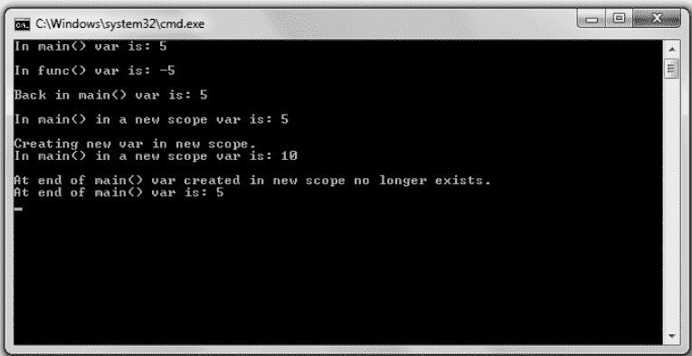

## Figure 5.3

即使同名，三个变量在各自的作用域中都有独特的存在。

你可以从 Course Technology 网站 (www.courseptr.com/downloads) 下载此程序的代码。程序位于 Chapter 5 文件夹中；文件名是 `scoping.cpp`。

```
// Scoping
// Demonstrates scopes

#include <iostream>

using namespace std;

void func();

int main()
{
    int var = 5;  // local variable in main()
    cout << "In main() var is: " << var << "\n\n";
```

```
func();

cout << "Back in main() var is: " << var << "\n\n";

{
    cout << "In main() in a new scope var is: " << var << "\n\n";

    cout << "Creating new var in new scope.\n";
    int var = 10;  // variable in new scope, hides other variable named var
    cout << "In main() in a new scope var is: " << var << "\n\n";
}

cout << "At end of main() var created in new scope no longer exists.\n";
cout << "At end of main() var is: " << var << "\n";

return 0;
}

void func()
{
    int var = -5;  // local variable in func()
    cout << "In func() var is: " << var << "\n\n";
}
```

## Working with Separate Scopes

每当你使用大括号创建一个块时，你就创建了一个作用域。函数就是一个例子。在作用域中声明的变量在该作用域之外不可见。这意味着在函数中声明的变量在该函数之外不可见。

在函数内部声明的变量被认为是局部变量——它们是局部的于该函数。这就是函数封装的原因。

你已经见过许多局部变量在实际中的应用。我在 `main()` 中又定义了一个局部变量：

```
int var = 5;  // local variable in main()
```

这一行声明并初始化了一个名为 `var` 的局部变量。我在下一行代码中将该变量发送给 `cout`：

```
cout << "In main() var is: " << var << "\n\n";
```

这正如你所期望的那样工作——显示了 5。

接下来我调用 `func()`。一旦进入函数，我就进入了 `main()` 定义的作用域之外的独立作用域。因此，我无法访问我在 `main()` 中定义的变量 `var`。这意味着当我在 `func()` 中用以下行再次定义一个名为 `var` 的变量时，这个新变量与 `main()` 中的名为 `var` 的变量完全分开。

```
int var = -5;  // local variable in func()
```

两者互不影响，这就是作用域的美妙之处。当你编写一个函数时，你不必担心另一个函数使用相同的变量名。

然后，当我在 `func()` 中用以下行显示 `var` 的值时，计算机显示 −5。

```
cout << "In func() var is: " << var << "\n\n";
```

这是因为就计算机在这个作用域所能看到的而言，只有一个名为 `var` 的变量——我在该函数中声明的局部变量。

一旦作用域结束，该作用域中声明的所有变量都将不复存在。它们被称为超出作用域。因此，接下来当 `func()` 结束时，其作用域也结束。这意味着 `func()` 中声明的所有变量都被销毁。因此，我在 `func()` 中声明的值为 −5 的 `var` 被销毁。

`func()` 结束后，控制权返回到 `main()` 并从中断的地方继续。接下来执行以下行，将 `var` 发送给 `cout`。

```
cout << "Back in main() var is: " << var << "\n\n";
```

再次显示了局部于 `main()` 的 `var` 的值（5）。

你可能会想知道我在 `func()` 中时在 `main()` 中创建的 `var` 发生了什么。好吧，该变量并未被销毁，因为 `main()` 尚未结束。（程序控制只是暂时转向 `func()`。）当程序暂时从一个函数退出进入另一个函数时，计算机会在第一个函数中保存其位置，安全地保存其所有局部变量的值，并在控制返回到第一个函数时恢复这些值。

### Hint

参数在函数中就像局部变量一样起作用。

## Working with Nested Scopes

你可以在现有作用域中使用一对大括号创建一个嵌套作用域。这就是我在 `main()` 中接下来所做的：

```cpp
{
    cout << "In main() in a new scope var is: " << var << "\n\n";

    cout << "Creating new var in new scope.\n";
    int var = 10;   // variable in new scope, hides other variable named var
    cout << "In main() in a new scope var is: " << var << "\n\n";
}
```

这个新作用域是 `main()` 中的一个嵌套作用域。我在这个嵌套作用域中做的第一件事是显示 `var`。如果一个变量未在作用域中声明，计算机将逐级向上查找嵌套作用域以找到你请求的变量。在这种情况下，因为 `var` 未在此嵌套作用域中声明，计算机向上查找一级到定义 `main()` 的作用域并找到 `var`。因此，程序显示该变量的值——5。

然而，我在这个嵌套作用域中接下来做的事是声明一个名为 `var` 的新变量并将其初始化为 10。现在当我将 `var` 发送到 `cout` 时，显示的是 10。这次计算机不需要向上查找任何嵌套作用域级别来找到 `var`；这里有一个局部于此作用域的 `var`。而且不用担心，我最初在 `main()` 中声明的 `var` 仍然存在；它只是被这个嵌套作用域中的新 `var` 隐藏了。

> **Trap**

> 虽然你可以在一系列嵌套作用域中声明同名变量，但这不是一个好主意，因为它会导致混淆。

接下来，当嵌套作用域结束时，等于 10 的 `var` 超出作用域并停止存在。然而，我创建的第一个 `var` 仍然存在，所以当我用以下行在 `main()` 中最后一次显示 `var` 时，程序显示 5。

```cpp
cout << "At end of main() var is: " << var << "\n";
```

### Hint

当你在 `for` 循环、`while` 循环、`if` 语句和 `switch` 语句内部定义变量时，这些变量在结构之外不存在。它们的行为就像在嵌套作用域中声明的变量。例如，在以下代码中，变量 `i` 在循环之外不存在。

```
for(int i = 0; i < 10; ++i)
{
    cout << i;
}
// i doesn't exist outside the loop
```

但要当心——一些旧的编译器并未正确实现标准 C++ 的此功能。我建议你使用具有现代编译器的 IDE，例如 Microsoft Visual C++ 2010 Express Edition。有关如何使用此 IDE 创建第一个项目的逐步说明，请参阅附录 A。

## Using Global Variables

通过封装的魔力，你所见过的函数都完全封闭且彼此独立。唯一将信息传入它们的方式是通过其参数，唯一将信息传出它们的方式是通过其返回值。好吧，这并不完全正确。还有另一种在程序各部分之间共享信息的方式——通过全局变量（可在程序任何部分访问的变量）。

## Introducing the Global Reach Program

Global Reach 程序演示了全局变量。该程序展示了你如何从程序的任何地方访问全局变量。它还展示了你如何在作用域中隐藏全局变量。最后，它展示了你如何从程序的任何地方更改全局变量。图 5.4 显示了程序的结果。

你可以从 Course Technology 网站 (www.courseptr.com/downloads) 下载此程序的代码。程序位于 Chapter 5 文件夹中；文件名是 `global_reach.cpp`。

```
// Global Reach
// Demonstrates global variables

#include <iostream>
```


## Figure 5.4

你可以从程序的任何地方访问和更改全局变量——但它们也可以在作用域中被隐藏。

```
using namespace std;

int glob = 10;  // global variable

void access_global();
void hide_global();
void change_global();

int main()
{
    cout << "In main() glob is: " << glob << "\n\n";
    access_global();

    hide_global();
    cout << "In main() glob is: " << glob << "\n\n";

    change_global();
    cout << "In main() glob is: " << glob << "\n\n";

    return 0;
}
```

```
void access_global()
{
    cout << "In access_global() glob is: " << glob << "\n\n";
}
```

```
void hide_global()
{
    int glob = 0;  // hide global variable glob
    cout << "In hide_global() glob is: " << glob << "\n\n";
}
```

```
void change_global()
{
    glob = -10;  // change global variable glob
    cout << "In change_global() glob is: " << glob << "\n\n";
}
```

## 声明全局变量

你在程序文件中在任何函数之外声明全局变量。以下这行就是我所做的，它创建了一个名为 `glob` 的全局变量并初始化为 10。

```
int glob = 10;  // global variable
```

## 访问全局变量

你可以在程序的任何地方访问全局变量。为了证明这一点，我在 `main()` 中用以下语句显示 `glob`：

```
cout << "In main() glob is: " << glob << "\n\n";
```

程序显示 10，因为作为全局变量，`glob` 可用于程序的任何部分。为了再次证明这一点，我接下来调用 `access_global()`，计算机执行该函数中的以下代码：

```
cout << "In access_global() glob is: " << glob << "\n\n";
```

再次显示 10。这是有道理的，因为我在每个函数中显示的是完全相同的变量。

## 隐藏全局变量

你可以像隐藏作用域中的其他任何变量一样隐藏全局变量；你只需声明一个同名的新变量即可。这正是我接下来调用 `hide_global()` 时所做的。该函数中的关键行并没有改变全局变量 `glob`；相反，它创建了一个名为 `glob` 的新变量，该变量局部于 `hide_global()`，并隐藏了全局变量。

```
int glob = 0;  // hide global variable glob
```

因此，当我在 `hide_global()` 中用以下行将 `glob` 发送给 `cout` 时，显示的是 0。

```
cout << "In hide_global() glob is: " << glob << "\n\n";
```

全局变量 `glob` 在 `hide_global()` 的作用域内保持隐藏，直到函数结束。

为了证明全局变量只是被隐藏而没有被改变，接下来我在 `main()` 中再次显示 `glob`：

```
cout << "In main() glob is: " << glob << "\n\n";
```

再次显示 10。

### 陷阱

> 虽然你可以在函数中声明与全局变量同名的变量，但这并不是一个好主意，因为它可能导致混淆。

## 修改全局变量

正如你可以在程序的任何地方访问全局变量一样，你也可以在程序的任何地方修改它。这正是我接下来调用 `change_global()` 函数时所做的。该函数中的关键行将 -10 分配给全局变量 `glob`。

```
glob = -10;  // change global variable glob
```

为了证明它有效，我在 `change_global()` 中显示该变量：

```
cout << "In change_global() glob is: " << glob << "\n\n";
```

然后回到 `main()` 中，我用以下语句将 `glob` 发送给 `cout`：

```
cout << "In main() glob is: " << glob << "\n\n";
```

因为全局变量 `glob` 被修改了，所以显示 -10。

## 最小化全局变量的使用

仅仅因为你可以这样做并不意味着你应该这样做。这是良好的编程格言。有时某些事情在技术上是可行的，但并不明智。使用全局变量就是一个例子。一般来说，全局变量会使程序变得混乱，因为很难跟踪它们不断变化的值。你应该尽可能限制全局变量的使用。

## 使用全局常量

与可能使程序变得混乱的全局变量不同，`全局常量`——可以在程序的任何地方访问的常量——可以帮助使程序更清晰。你声明全局常量的方式与声明全局变量类似——在任何函数之外声明它。而且由于你声明的是常量，所以需要使用 `const` 关键字。例如，以下行定义了一个全局常量（假设声明在任何函数之外）名为 `MAX_ENEMIES`，其值为 10，可以在程序的任何地方访问。

```
const int MAX_ENEMIES = 10;
```

### 陷阱

> 就像全局变量一样，你可以通过声明同名的局部常量来隐藏全局常量。然而，你应该避免这样做，因为它可能导致混淆。


# 全局常量

全局常量究竟如何使游戏编程代码更清晰呢？假设你正在编写一个动作游戏，你希望限制同时攻击可怜玩家的敌人数目。不是在各处使用数字字面量，例如 `10`，你可以定义一个等于 `10` 的全局常量 `MAX_ENEMIES`。然后每当你看到该全局常量名称时，你就知道它代表什么。

一个需要注意的地方：你只有在程序的多个部分需要常量值时才应使用全局常量。如果你只需要在特定作用域（例如单个函数）中使用常量值，则应使用局部常量代替。

你可以从 Course Technology 网站（www.courseptr.com/downloads）下载此程序的代码。该程序位于第 5 章文件夹中；文件名是 `give_me_a_number.cpp`。

```
// Give Me a Number
// Demonstrates default function arguments

#include <iostream>
#include <string>

using namespace std;

int askNumber(int high, int low = 1);

int main()
{
    int number = askNumber(5);
    cout << "Thanks for entering: " << number << "\n\n";

    number = askNumber(10, 5);
    cout << "Thanks for entering: " << number << "\n\n";

    return 0;
}

int askNumber(int high, int low)
{
    int num;
    do
    {
        cout << "Please enter a number" << " (" << low << " - " << high << "): ";
        cin >> num;
    } while (num > high || num < low);

    return num;
}
```

## 指定默认参数

函数 `askNumber()` 有两个参数——`high` 和 `low`。你可以从函数原型中看出这一点：

```
int askNumber(int high, int low = 1);
```

注意第二个参数 `low` 看起来像是被赋了值。在某种程度上确实如此。`1` 是一个默认参数，意味着如果在调用函数时没有为 `low` 传递值，`low` 将被赋值为 `1`。你通过在参数名后使用 `=` 后跟一个值来指定默认参数。

### 陷阱

一旦你在参数列表中指定了默认参数，你必须为其后的所有剩余参数指定默认参数。因此以下原型是有效的：

```
void setDisplay(int height, int width, int depth = 32, bool fullScreen = true);
```

而这个原型是非法的：

```
void setDisplay(int width, int height, int depth = 32, bool fullScreen);
```

顺便说一下，你不会在函数定义中重复默认参数，正如你在 `askNumber()` 的函数定义中所看到的那样。

```
int askNumber(int high, int low)
```

## 为参数分配默认参数

`askNumber()` 函数要求用户输入一个介于上限和下限之间的数字。函数会一直询问，直到用户输入范围内的数字，然后返回该数字。我第一次在 `main()` 中调用该函数的方式是：

```
int number = askNumber(5);
```

由于这段代码，`askNumber()` 中的参数 `high` 被赋值为 `5`。因为我没有为第二个参数 `low` 提供任何值，所以它被赋予默认值 `1`。这意味着函数会提示用户输入 `1` 到 `5` 之间的数字。

### 陷阱

当你调用具有默认参数的函数时，一旦省略了一个参数，你必须省略其后所有剩余参数。例如，给定原型

```
void setDisplay(int height, int width, int depth = 32, bool fullScreen = true);
```

```
setDisplay(1680, 1050);
while an ilegal call would be
setDisplay(1680, 1050, false);
```

一旦用户输入有效数字，`askNumber()` 就会返回该值并结束。回到 `main()` 中，该值被赋给 `number` 并显示出来。

## 覆盖默认参数

接下来我再次调用 `askNumber()`：

```
number = askNumber(10, 5);
```

这次我为 `low` 传递了一个值——`5`。这完全没问题；你可以为任何具有默认参数的参数传递参数，所传递的值将覆盖默认值。在这种情况下，这意味着 `low` 被赋值为 `5`。

因此，用户会被提示输入 `5` 到 `10` 之间的数字。一旦用户输入有效数字，`askNumber()` 就会返回该值并结束。回到 `main()` 中，该值被赋给 `number` 并显示出来。

## 函数重载

你已经看到你必须为每个编写的函数指定参数列表和单个返回类型。但如果想要一个更通用的函数——可以接受不同集合参数的函数——该怎么办？例如，假设你想编写一个函数对表示为 `float` 的顶点集执行 3D 变换，但你也希望该函数能处理 `int`。不是编写两个名称不同的独立函数，你可以使用函数重载，这样单个函数就可以处理不同的参数列表。这样，你就可以调用一个函数并将顶点作为 `float` 或 `int` 传递。

## 介绍 Triple 程序

Triple 程序将值 `5` 和 `"gamer"` 三倍化。该程序使用一个被重载为可处理两种不同类型参数的单个函数：`int` 和 `string` 来三倍化这些值。图 5.6 显示了该程序的示例运行。

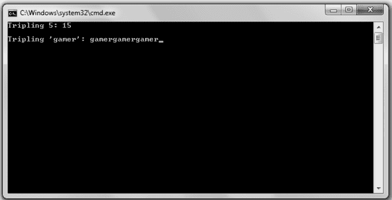

## Figure 5.6

函数重载允许你使用相同的函数名对两种不同类型的数值进行三倍运算。

你可以在 Course Technology 网站 (www.courseptr.com/downloads) 上下载此程序的代码。该程序位于 Chapter 5 文件夹中；文件名是 `triple.cpp`。

```
// Triple
// Demonstrates function overloading

#include <iostream>
#include <string>

using namespace std;

int triple(int number);
string triple(string text);

int main()
{
```

```
cout << "Tripling 5: " << triple(5) << "\n\n";
cout << "Tripling 'gamer': " << triple("gamer");

    return 0;
}
```

```
int triple(int number)
{
    return (number * 3);
}
```

```
string triple(string text)
{
    return (text + text + text);
}
```

## Creating Overloaded Functions

要创建重载函数，你只需编写多个具有相同名称但参数列表不同的函数定义即可。在 Triple 程序中，我为函数 `triple()` 编写了两个定义，每个定义都指定了不同的类型作为其单个参数。以下是函数原型：

```
int triple(int number);
string triple(string text);
```

第一个接受 `int` 参数并返回 `int`。第二个接受 `string` 对象并返回 `string` 对象。

在每个函数定义中，你可以看到我返回了发送值的三倍。在第一个函数中，我返回发送的 `int` 的三倍。在第二个函数中，我返回发送的字符串，重复三次。

### Trap

要实现函数重载，你需要为同一个函数编写多个定义，这些定义具有不同的参数列表。请注意，我没有提到返回类型。那是因为如果你编写两个函数定义，其中只有返回类型不同，你会生成编译错误。例如，你不能在程序中同时具有以下两个原型：

```
int Bonus(int);
float Bonus(int);
```

## Calling Overloaded Functions

你可以像调用任何其他函数一样调用重载函数，使用其名称并提供一组有效参数。但对于重载函数，编译器会根据参数值确定调用哪个定义。例如，当我用以下行调用 `triple()` 并使用 `int` 作为参数时，编译器知道要调用接受 `int` 的定义。因此，函数返回 `int` `15`。

```
cout << "Tripling 5: " << triple(5) << "\n\n";
```

我再次调用 `triple()`：

```
cout << "Tripling 'gamer': " << triple("gamer");
```

因为我使用字符串字面量作为参数，编译器知道要调用接受 `string` 对象的函数定义。因此，函数返回字符串对象 equal to gamergamergamer。

## INLINING FUNCTIONS

调用函数会带来少量性能开销。通常这不是大问题，因为开销相对较小。然而，对于微小的函数（例如一两行），有时可以通过内联它们来加快程序性能。通过内联函数，你要求编译器在每次调用的地方都复制一份函数。因此，程序控制不必每次调用函数时都跳转到不同的位置。

## Introducing the Taking Damage Program

Taking Damage 程序模拟了角色在受到辐射伤害时生命值的变化。角色每轮损失一半的生命值。幸运的是，程序只运行三轮，所以我们免于角色悲惨结局的困扰。程序内联了计算角色新生命值的微小函数。Figure 5.7 显示了程序结果。

你可以在 Course Technology 网站 (www.courseptr.com/downloads) 上下载此程序的代码。该程序位于 Chapter 5 文件夹中；文件名是 `taking_damage.cpp`。

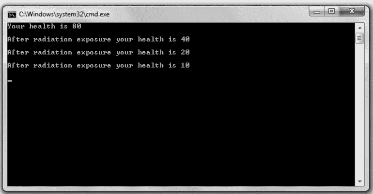

## Figure 5.7

角色以相当高效的方式接近死亡，他的生命值通过内联函数减少。

```
// Taking Damage
// Demonstrates function inlining

#include <iostream>

int radiation(int health);

using namespace std;

int main()
{
    int health = 80;
    cout << "Your health is " << health << "\n\n";

    health = radiation(health);
    cout << "After radiation exposure your health is " << health << "\n\n";

    health = radiation(health);
    cout << "After radiation exposure your health is " << health << "\n\n";

    health = radiation(health);
    cout << "After radiation exposure your health is " << health << "\n\n";
```

right at this place in the program. In fact, the compiler does this for all three calls to the function.

## Real World

虽然痴迷于性能是游戏程序员最喜欢的爱好，但在速度上过度关注是有危险的。事实上，许多开发人员采取的方法是先让他们的游戏程序运行良好，然后再为微小的性能提升进行调整。此时，程序员会 `profile` 他们的代码，通过运行一个分析游戏程序花费时间位置的实用程序（分析器）。如果程序员看到瓶颈，他或她可能会考虑诸如函数内联之类的手工优化。

## INTRODUCING THE MAD LIB GAME

Mad Lib 游戏要求用户帮助创建故事。用户提供一个人的名字、一个复数名词、一个数字和一个动词。程序收集所有这些信息并用它来创建个性化故事。Figure 5.8 显示了程序的示例运行。

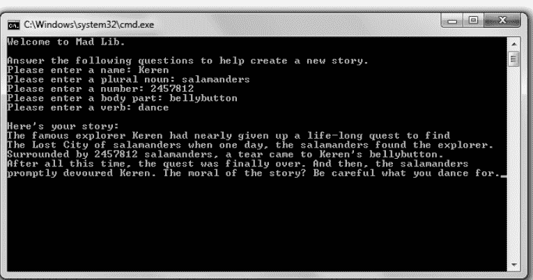

Figure 5.8

用户提供所有必要信息后，程序会显示文学杰作。

```
tellStory(name, noun, number, bodyPart, verb);

    return 0;
}
```

## The askText() Function

`askText()` 函数从用户获取一个字符串。该函数用途广泛，接受一个 `string` 类型的参数，用作提示用户。因此，我能够调用此单个函数来要求用户提供各种不同的信息，包括名字、复数名词、身体部位和动词。

```
string askText(string prompt)
{
    string text;
    cout << prompt;
    cin >> text;
    return text;
}
```

### Trap

请记住，`cin` 的这种简单用法仅适用于没有空白字符的字符串（例如制表符或空格）。因此，当用户被提示输入身体部位时，他可以输入 `bellybutton`，但 `medulla oblongata` 会导致程序出现问题。

有办法补偿这一点，但这确实需要讨论一种称为流的东西，这超出了本书的范围。所以以这种方式使用 `cin`，但要意识到其局限性。

## The askNumber() Function

`askNumber()` 函数从用户获取一个整数。虽然我在程序中只调用它一次，但它用途广泛，因为它接受一个 `string` 类型的参数，用作提示用户。

```
int askNumber(string prompt)
{
    int num;
    cout << prompt;
    cin >> num;
    return num;
}
```

- 你可以使用 `return` 语句从函数返回一个值。你也可以使用 `return` 来结束返回类型为 `void` 的函数。

- 变量的作用域决定了变量在程序中可以在哪里被看到。

- 全局变量可以从程序的任何部分访问。一般来说，你应该尽量限制对全局变量的使用。

- 全局常量可以从程序的任何部分访问。使用全局常量可以使程序代码更清晰。

- 默认参数在函数调用中未为参数指定值时会被分配给参数。

- 函数重载是为同一个函数创建多个定义的过程，每个定义的参数集都不同。

- 函数内联是要求编译器内联函数的过程——意味着编译器应该在代码中函数被调用的每个地方都复制一份函数。内联非常小的函数有时可以带来性能提升。

## QUESTIONS AND ANSWERS

Q: 为什么我应该编写函数？

A: 函数允许你将程序分解为逻辑块。这些块产生更小、更易管理的代码块，比单个庞大的程序更容易处理。

Q: 什么是封装？

A: 从核心来看，封装是关于保持事物分离。例如，函数封装提供了一个功能，即在函数中声明的变量在函数外部不可访问。

Q: 参数和参数有什么区别？

A: 参数是你在使用函数调用向函数传递值时使用的。参数是你在使用函数定义接受传递给函数的值时使用的。

Q: 一个函数中可以有多个 return 语句吗？

A: 当然可以。事实上，你可能希望使用多个 `return` 语句来指定函数的不同结束点。

Q: 什么是局部变量？

A: 在某个作用域中定义的变量。函数中定义的所有变量都是局部变量；它们对该函数是局部的。

Q: 隐藏一个变量是什么意思？

A: 当你在新的作用域中用与外部作用域中变量相同的名称声明它时，该变量就被隐藏了。结果是，你无法通过在内部作用域中使用其变量名来访问外部作用域中的变量。

Q: 变量何时超出作用域？

A: 变量在其被创建的作用域结束时超出作用域。

Q: 变量超出作用域是什么意思？

A: 这意味着变量不再存在。

Q: 什么是嵌套作用域？

A: 在现有作用域内创建的作用域。

Q: 参数必须与传递给它的参数名相同吗？

A: 不必。你可以自由使用不同的名称。只有值是从函数调用传递到函数。

Q: 我可以编写一个函数调用另一个函数吗？

A: 当然可以。事实上，每当你编写一个从 `main()` 调用的函数时，你就是在这样做。此外，你可以编写一个（除 `main()` 之外的）函数来调用另一个函数。

Q: 什么是代码分析？

A: 它是记录程序各个部分使用多少 CPU 时间的过程。

Q: 为什么要分析代码？

A: 为了确定程序中的任何瓶颈。有时重新审视这些代码段以尝试优化它们是有意义的。

Q: 程序员何时分析代码？

A: 通常在游戏项目编程接近尾声时。

Q: 什么是过早优化？

A: 在开发过程过早地尝试优化代码。代码优化通常在游戏项目编程接近尾声时才有意义。

### Discussion Questions

- 1. 函数封装如何帮助你编写更好的程序？

- 2. 全局变量如何使代码变得混乱？

- 3. 全局常量如何使代码更清晰？

- 4. 优化代码的利弊是什么？

- 5. 软件重用如何使游戏行业受益？

### Exercises

- 1. 以下原型有什么问题？

```
int askNumber(int low = 1, int high);
```

- 2. 使用函数重写第 4 章的 Hangman 游戏。包含一个用于获取玩家猜测的函数，以及另一个用于确定玩家猜测是否在秘密单词中的函数。

- 3. 使用默认参数，编写一个函数，要求用户输入一个数字并返回该数字。函数应从调用代码接受一个字符串提示。如果调用者未提供字符串提示，函数应使用通用提示。接下来，使用函数重载，编写一个实现相同结果的函数。


# CHAPTER 6: REFERENCES: Tic-Tac-Toe


引用的概念很简单，但其影响是深远的。在本章中，你将学习引用以及它们如何帮助你编写更高效的游戏代码。具体来说，你将学习如何：

- 创建引用
- 访问和更改被引用值
- 将引用传递给函数以更改参数值或提高效率
- 从函数返回引用以提高效率或更改值

## USING REFERENCES

*引用* 为变量提供了另一个名称。你对引用所做的任何操作都对它所引用的变量执行。你可以将引用视为变量的昵称——变量的另一个名称。在本章的第一个程序中，我将向你展示如何创建引用。然后，在接下来的几个程序中，我将向你展示为什么你会想要使用引用以及它们如何改进你的游戏程序。

### Introducing the Referencing Program

引用程序演示了引用。该程序声明并初始化一个变量来保存分数，然后创建一个引用该变量的引用。程序使用变量和引用显示分数，以表明它们访问的是同一个值。接下来，程序显示该单一值可以通过变量或引用进行更改。图 6.1 说明了该程序。

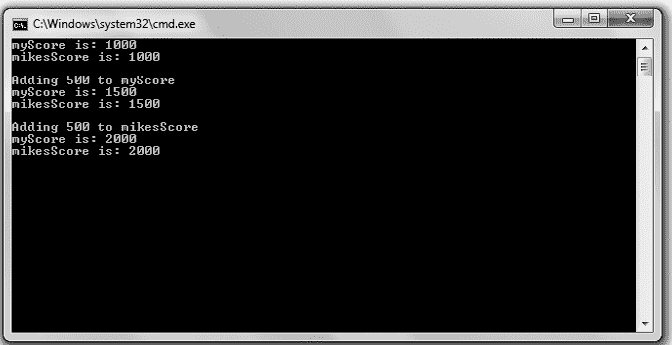

**Figure 6.1** 变量 `myScore` 和引用 `mikesScore` 都是对单个分数值的名称。

你可以从 Course Technology 网站 (www.courseptr.com/downloads) 下载此程序的代码。该程序位于第 6 章文件夹中；文件名是 `referencing.cpp`。

```
// Referencing
// Demonstrates using references

#include <iostream>

using namespace std;

int main()
{
    int myScore = 1000;
    int& mikesScore = myScore;  //create a reference

    cout << "myScore is: " << myScore << "\n";
    cout << "mikesScore is: " << mikesScore << "\n\n";

    cout << "Adding 500 to myScore\n";
    myScore += 500;
    cout << "myScore is: " << myScore << "\n";
    cout << "mikesScore is: " << mikesScore << "\n\n";

    cout << "Adding 500 to mikesScore\n";
    mikesScore += 500;
    cout << "myScore is: " << myScore << "\n";
    cout << "mikesScore is: " << mikesScore << "\n\n";

    return 0;
}
```

### Creating References

我在 `main()` 中做的第一件事是创建一个变量来保存我的分数。

```
int myScore = 1000;
```

然后我创建一个引用 `myScore` 的引用。

```
int& mikesScore = myScore;  //create a reference
```

前一行声明并初始化 `mikesScore`，这是一个引用 `myScore` 的引用。`mikesScore` 是 `myScore` 的别名。`mikesScore` 不保存自己的 `int` 值；它只是获取 `myScore` 所保存的 `int` 值的另一种方式。

要声明并初始化一个引用，请从引用将引用的值的类型开始，后跟引用运算符（`&`），后跟引用名称，后跟 `=`，后跟引用将引用的变量。

### Trick

> 有时程序员会在引用名称前加上字母“r”，以提醒他们正在处理引用。程序员可能会包含以下行：

```
int playerScore = 1000;
int& rScore = playerScore;
```

理解引用的一种方法是将其视为昵称。例如，假设你有一个朋友叫 Eugene，他（可以理解地）要求用昵称称呼他——Gibby（改进不大，但这是 Eugene 想要的）。因此，当你和朋友在派对上时，你可以使用 Eugene 或 Gibby 中的任何一个来叫他过来。你的朋友只有一个，但你可以用他的名字或对他的昵称来称呼他。这与变量及其引用变量的工作方式相同。你可以通过其变量名或对该变量的引用的名称来访问存储在变量中的单个值。最后，无论你做什么，请尽量不要给你的变量命名为 Eugene——为了他们的缘故。

### Trap

> 因为引用必须始终引用另一个值，所以你在声明它时必须初始化引用。如果不这样做，你会得到编译错误。以下行是完全非法的：

```
int& mikesScore; //don't try this at home!
```

### Accessing Referenced Values

接下来我将 `myScore` 和 `mikesScore` 发送到 `cout`。

```
cout << "myScore is: " << myScore << "\n";
cout << "mikesScore is: " << mikesScore << "\n\n";
```

这两行代码都显示 1000，因为它们各自访问存储数字 1000 的同一块内存。记住，只有一个值，它存储在变量 `myScore` 中。`mikesScore` 只是获取该值的另一种方式。

### Altering Referenced Values

接下来我将 `myScore` 的值增加 500。

```
myScore += 500;
```

当我将 `myScore` 发送到 `cout` 时，显示 1500，就像你期望的那样。当我将 `mikesScore` 发送到 `cout` 时，也显示 1500。同样，这是因为 `mikesScore` 只是变量 `myScore` 的另一个名称。从本质上讲，我两次都向 `cout` 发送同一个变量。

接下来我将 `mikesScore` 增加 500。

```
mikesScore += 500;
```

因为 `mikesScore` 只是 `myScore` 的另一个名称，所以前一行代码将 `myScore` 的值增加了 500。因此，当我接下来将 `myScore` 发送到 `cout` 时，显示 2000。当我将 `mikesScore` 发送到 `cout` 时，再次显示 2000。

### 陷阱

引用始终引用它初始化时所引用的变量。你不能重新分配一个引用使其引用另一个变量，因此，例如，以下代码的结果可能并不明显。

```
int myScore = 1000;
int& mikesScore = myScore;
int larrysScore = 2500;
mikesScore = larrysScore; //may not do what you think!
```

行 `mikesScore = larrysScore;` 并不会重新分配引用 `mikesScore` 使其引用 `larrysScore`，因为引用不能被重新分配。然而，由于 `mikesScore` 只是 `myScore` 的另一个名字，代码 `mikesScore = larrysScore;` 等价于 `myScore = larrysScore;`，它将 2500 赋给 `myScore`。而在所有事情结束后，`myScore` 变为 2500，而 `mikesScore` 仍然引用 `myScore`。

## 传递引用以修改参数

现在你已经了解了引用是如何工作的，你可能会想知道为什么要使用它们。好吧，当你将变量传递给函数时，引用非常有用，因为当你将变量传递给函数时，函数会得到该变量的副本。这意味着你传递的原始变量（称为参数变量）不能被更改。有时这正是你想要的，因为它使参数变量保持安全且不可更改。但有时你可能希望从函数内部更改传递给它的参数变量。你可以通过使用引用来实现这一点。

### 介绍 Swap 程序

Swap 程序定义了两个变量——一个保存我那可怜的低分，另一个保存你那令人印象深刻的高分。在显示分数后，程序调用一个旨在交换分数的函数。但由于只将分数值的副本发送到函数，保存分数的参数变量保持不变。接下来，程序调用另一个 swap 函数。这次，通过使用引用，参数变量的值成功交换——我获得了那个大大的分数，而你留下了那个小的分数。图 6.2 显示了程序的运行情况。

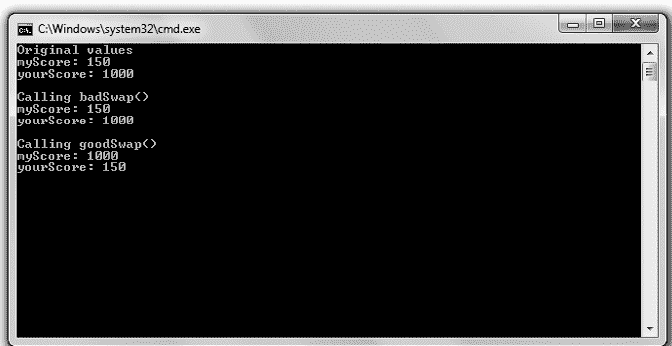

**图 6.2** 传递引用允许 `goodSwap()` 修改参数变量。

你可以从 Course Technology 网站 (www.courseptr.com/downloads) 下载此程序的代码。该程序位于第 6 章文件夹中；文件名是 `swap.cpp`。

```
// Swap
// Demonstrates passing references to alter argument variables

#include <iostream>

using namespace std;

void badSwap(int x, int y);
void goodSwap(int& x, int& y);

int main()
{
    int myScore = 150;
    int yourScore = 1000;
    cout << "Original values\n";
    cout << "myScore: " << myScore << "\n";
    cout << "yourScore: " << yourScore << "\n\n";

    cout << "Calling badSwap()\n";
    badSwap(myScore, yourScore);
    cout << "myScore: " << myScore << "\n";
    cout << "yourScore: " << yourScore << "\n\n";

    cout << "Calling goodSwap()\n";
    goodSwap(myScore, yourScore);
    cout << "myScore: " << myScore << "\n";
    cout << "yourScore: " << yourScore << "\n";

    return 0;
}

void badSwap(int x, int y)
{
    int temp = x;
    x = y;
    y = temp;
}

void goodSwap(int& x, int& y)
{
    int temp = x;
    x = y;
    y = temp;
}
```

### 按值传递

在声明并初始化 `myScore` 和 `yourScore` 之后，我将它们发送给 `cout`。正如你所期望的，150 和 1000 被显示出来。接下来我调用 `badSwap()`。

当你像到目前为止所看到的那样指定参数（作为普通变量，而不是引用）时，你表示该参数的参数将按值传递，这意味着参数将获得参数变量的副本，而不是访问参数变量本身。通过查看 `badSwap()` 的函数头，你可以知道对该函数的调用会按值传递两个参数。

```
void badSwap(int x, int y)
```

这意味着当我用以下行调用 `badSwap()` 时，`myScore` 和 `yourScore` 的副本会被发送给参数 `x` 和 `y`。

```
badSwap(myScore, yourScore);
```

具体来说，`x` 被赋值为 150，`y` 被赋值为 1000。因此，我在函数 `badSwap()` 中对 `x` 和 `y` 所做的任何操作都不会对 `myScore` 和 `yourScore` 产生任何影响。

当 `badSwap()` 的主体执行时，`x` 和 `y` 确实交换了值——`x` 变为 1000，`y` 变为 150。然而，当函数结束时，`x` 和 `y` 都超出作用域而不再存在。控制权随后返回到 `main()`，此时 `myScore` 和 `yourScore` 没有改变。然后，当我将 `myScore` 和 `yourScore` 发送给 `cout` 时，150 和 1000 再次被显示出来。可悲的是，我仍然有那个小的分数，你仍然有那个大的分数。

### 按引用传递

可以通过将参数传递给参数变量的引用来让函数访问参数变量。结果是对参数所做的任何操作都将对参数变量执行。要按引用传递，你必须首先将参数声明为引用。

你可以通过查看函数头来判断对 `goodSwap()` 的调用是否按引用传递两个参数。

```
void goodSwap(int& x, int& y)
```

这意味着当我用以下行调用 `goodSwap()` 时，参数 `x` 将引用 `myScore`，参数 `y` 将引用 `yourScore`。

```
goodSwap(myScore, yourScore);
```

这意味着 `x` 只是 `myScore` 的另一个名字，`y` 只是 `yourScore` 的另一个名字。当 `goodSwap()` 执行并且 `x` 和 `y` 交换值时，实际上发生的是 `myScore` 和 `yourScore` 交换值。

函数结束后，控制权返回到 `main()`，此时我将 `myScore` 和 `yourScore` 发送给 `cout`。这次显示的是 1000 和 150。变量的值已交换。我拿走了大分数，留给你小分数。终于成功了！

## 为提高效率而传递引用

按值传递变量会产生一些开销，因为你必须在将其分配给参数之前复制该变量。当我们谈论简单、内置类型的变量时，例如 `int` 或 `float`，开销可以忽略不计。但像代表整个 3D 世界这样的大对象复制起来可能很昂贵。相比之下，按引用传递是高效的，因为你不会复制参数变量。相反，你只需通过引用提供对现有对象的访问。

### 介绍 Inventory Displayer 程序

Inventory Displayer 程序创建一个字符串向量，表示英雄的库存。然后程序调用一个显示库存的函数。程序将项目向量作为引用传递给显示器函数，因此调用是高效的；向量不会被复制。但是有一个新的变化。程序将向量作为一种特殊的引用传递，该引用禁止显示器函数更改向量。图 6.3 向你展示了该程序。

你可以从 Course Technology 网站 (www.courseptr.com/downloads) 下载此程序的代码。该程序位于第 6 章文件夹中；文件名是 `inventory_displayer.cpp`。

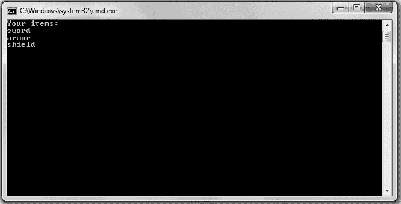

**图 6.3** 向量 `inventory` 以安全且高效的方式传递给显示英雄物品的函数。

不想更改参数变量？有没有办法在保护参数变量完整性的同时利用按引用传递的效率？有的。答案是传递常量引用。

### 提示

> 通常，你应该避免更改参数变量。尽量编写将新信息通过返回值发送回调用代码的函数。

### 将参数声明为常量引用

函数 `display()` 显示英雄库存的内容。在函数的头中，我指定一个参数——一个名为 `vec` 的字符串对象向量的常量引用。

```
void display(const vector<string>& vec)
```

常量引用是一种受限的引用。它像其他任何引用一样工作，只是你不能用它来更改它所引用的值。要创建常量引用，只需在引用声明中在类型前加上关键字 `const` 即可。

这对函数 `display()` 意味着什么？由于参数 `vec` 是常量引用，这意味着 `display()` 不能更改 `vec`。反过来，这意味着 `inventory` 是安全的；它不能被 `display()` 更改。通常，你可以以高效的方式将参数作为常量引用传递给函数，使其可访问但不可更改。这就像向函数提供对参数的只读访问。虽然常量引用对于指定函数参数非常有用，但你可以在程序的任何地方使用它们。

### 提示

> 常量引用还有另一种用处。如果你需要将一个常量值赋给一个引用，你必须将其赋给一个常量引用。（非常量引用不行。）

### 传递常量引用

回到 `main()` 中，我创建了 `inventory`，然后用以下行调用 `display()`，该行将向量作为常量引用传递。

```
display(inventory);
```

这就产生了一个高效且安全的函数调用。它高效是因为只传递了一个引用；向量不会被复制。它安全是因为向量引用的引用是常量引用；`display()` 不能改变 `inventory`。

### 陷阱

你不能修改标记为常量引用的参数。如果尝试这样做，你会生成编译错误。

接下来，`display()` 使用对 `inventory` 的常量引用列出向量中的元素。然后控制权返回到 `main()`，程序结束。

## 决定如何传递参数

到目前为止，你已经看到了三种不同的传递参数的方式——按值传递、作为引用传递、作为常量引用传递。那么如何决定使用哪种方法呢？以下是一些指导原则：

- **按值传递。** 当参数变量是基本内置类型之一时，按值传递，例如 `bool`、`int` 或 `float`。这些类型的对象非常小，按引用传递不会带来任何效率提升。你还应该在想要计算机复制变量时按值传递。你可能想要使用副本，如果你计划在函数中更改参数，但又不希望实际的参数变量受到影响。
- **作为常量引用传递。** 当你想高效地传递一个不需要更改的值时，传递常量引用。
- **作为引用传递。** 仅当你想更改参数变量的值时才传递引用。然而，你应该尽可能避免更改参数变量。

## 返回引用

就像传递值一样，当你从函数返回一个值时，你实际上返回的是该值的副本。再次强调，对于基本内置类型的值，这不是什么大问题。然而，如果你返回一个大型对象，这可能是一项昂贵的操作。返回引用是一种高效的替代方案。


## 介绍 Inventory Referencer 程序

Inventory Referencer 程序演示了返回引用。程序通过使用返回的引用来显示包含英雄物品的向量的元素。然后程序通过返回的引用更改其中一个物品。图 6.4 显示了程序的结果。

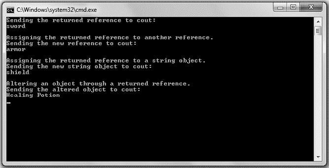

### 图 6.4

英雄的物品是通过使用返回的引用来显示和更改的。

你可以从 Course Technology 网站 (`www.courseptr.com/downloads`) 下载此程序的代码。该程序位于第 6 章文件夹中；文件名是 `inventory_referencer.cpp`。

```
// Inventory Referencer
// Demonstrates returning a reference

#include <iostream>
#include <string>
#include <vector>

using namespace std;

//returns a reference to a string
string& refToElement(vector<string>& inventory, int i);
```

```
int main()
{
    vector<string> inventory;
    inventory.push_back("sword");
    inventory.push_back("armor");
    inventory.push_back("shield");

    //displays string that the returned reference refers to
    cout << "Sending the returned reference to cout:\n";
    cout << refToElement(inventory, 0) << "\n\n";

    //assigns one reference to another -- inexpensive assignment
    cout << "Assigning the returned reference to another reference.\n";
    string& rStr = refToElement(inventory, 1);
    cout << "Sending the new reference to cout:\n";
    cout << rStr << "\n\n";

    //copies a string object -- expensive assignment
    cout << "Assigning the returned reference to a string object.\n";
    string str = refToElement(inventory, 2);
    cout << "Sending the new string object to cout:\n";
    cout << str << "\n\n";

    //altering the string object through a returned reference
    cout << "Altering an object through a returned reference.\n";
    rStr = "Healing Potion";
    cout << "Sending the altered object to cout:\n";
    cout << inventory[1] << endl;

    return 0;
}

//returns a reference to a string
string& refToElement(vector<string>& vec, int i)
{
    return vec[i];
}
```

## 返回引用

在从函数返回引用之前，你必须指定你正在返回一个引用。这就是我在 `refToElement()` 函数头中所做的。

```
string& refToElement(vector<string>& inventory, int i)
```

通过在指定返回类型时使用引用运算符 `string&`，我表示函数将返回一个字符串对象的引用（而不是字符串对象本身）。你可以使用我这样的方式使用引用运算符来指定函数返回特定类型对象的引用。只需将引用运算符放在类型名称之后即可。

函数 `refToElement()` 的主体只包含一个语句，该语句返回向量中位置 `i` 的元素的引用。

```
return vec[i];
```

请注意，`return` 语句中没有任何内容表明函数返回引用。函数头和原型决定函数返回对象还是对象的引用。

### 陷阱

尽管返回引用可以高效地将信息发送回调用函数，但你必须小心不要返回对超出作用域对象的引用——一个不再存在的对象。例如，以下函数返回对函数结束后再也不存在的 `string` 对象的引用——这是非法的。

```
string& badReference()
{
    string local = "This string will cease to exist once the function ends.";
    return local;
}
```

避免此类问题的一种方法是永远不要返回对局部变量的引用。

## 显示返回引用的值

在创建 `inventory` 向量后，我通过返回的引用显示第一个物品。

```
cout << refToElement(inventory, 0) << "\n\n";
```

前面的代码调用 `refToElement()`，它返回对 `inventory` 中位置 0 的元素的引用，然后将该引用发送到 `cout`。因此，`sword` 被显示。

## 将返回的引用分配给引用

接下来我用以下行将返回的引用分配给另一个引用，该行将对 `inventory` 中位置 1 的元素的引用分配给 `rStr`。

```
string& rStr = refToElement(inventory, 1);
```

这是高效的赋值，因为将引用分配给引用不涉及对象的复制。然后我将 `rStr` 发送到 `cout`，显示 `armor`。

## 将返回的引用分配给变量

接下来我将返回的引用分配给一个变量。

```
string str = refToElement(inventory, 2);
```

前面的代码并没有将引用分配给 `str`。它不能，因为 `str` 是一个 `string` 对象。相反，代码复制返回的引用所指的元素（`inventory` 中位置 2 的元素），并将该 `string` 对象的副本分配给 `str`。由于这种赋值涉及对象的复制，因此比将一个引用分配给另一个引用更昂贵。有时以这种方式复制对象的成本完全可以接受，但你应该意识到这种赋值相关的额外开销，并在必要时避免它。

接下来我将新的 `string` 对象 `str` 发送到 `cout`，显示 `shield`。

## 通过返回的引用更改对象

你也可以更改返回的引用所指的对象。这意味着你可以通过 `rStr` 更改英雄的物品，如以下代码行所示。

```
rStr = "Healing Potion";
```

由于 `rStr` 引用 `inventory` 中位置 1 的元素，因此此代码将 `inventory[1]` 更改为等于 `"Healing Potion"`。为了证明这一点，我使用以下行显示该元素，确实显示了 `Healing Potion`。

```
cout << inventory[1] << endl;
```

如果我想保护 `inventory`，以免 `refToElement()` 返回的引用被用来更改向量，我应该将函数的返回类型指定为常量引用。

## 介绍井字游戏

在本章项目中，你将学习如何使用一点人工智能（`Artificial Intelligence`）来创建一个电脑对手。在游戏中，玩家和电脑在一场高风险的人机对决井字游戏中展开较量。电脑玩得相当出色（虽然不完美），并且带有足够的态度让任何一场比赛都变得有趣。图 6.5 显示了一场比赛的开始。

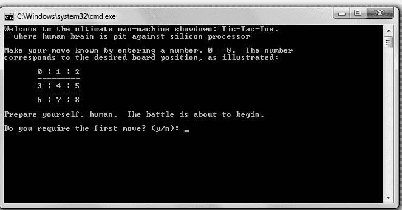

图 6.5

电脑充满了...自信。

## 规划游戏

这将是你迄今为止最雄心勃勃的项目。你当然拥有创建它所需的所有技能，但我将进行更长的规划部分，帮助你把握大局并了解如何创建更大的程序。记住，编程最重要的部分是规划编程。没有路线图，你永远到不了想去的地方（或者你会走得很慢，因为你走的是风景路线）。

### 现实世界

> 游戏设计师在程序员编写任何游戏代码之前，会花费无数小时在概念文件、设计文档和原型上。一旦设计工作完成，程序员就开始他们的工作——更多的规划。只有在程序员编写自己的技术设计之后，他们才会认真开始编码。这个故事的寓意？计划。推翻一份蓝图比推倒一栋 50 层大楼容易得多。

## 编写伪代码

又回到你最喜欢的语言——其实并不是一种语言——伪代码。因为我将为程序中的大多数任务使用函数，所以我可以相当抽象地思考代码。伪代码的每一行都应该感觉像一次函数调用。之后，我只需要编写计划所暗示的函数即可。以下是伪代码：

```
Create an empty Tic-Tac-Toe board
Display the game instructions
Determine who goes first
Display the board
While nobody's won and it's not a tie
    If it's the human's turn
        Get the human's move
        Update the board with the human's move
    Otherwise
        Calculate the computer's move
        Update the board with the computer's move
    Display the board
    Switch turns
Congratulate the winner or declare a tie
```

## 表示数据

好吧，我有一个不错的计划，但它相当抽象，并且谈论着在我的脑海中尚未真正定义的不同元素。我把走一步棋看作是在游戏板上放置一个棋子。但我到底要如何表示游戏板呢？或者一个棋子？或者一步棋？

由于我要将游戏板显示在屏幕上，为什么不直接用一个字符来表示一个棋子——`X` 或 `O`？一个空棋子只是一个空格。因此，棋盘本身可以是一个字符向量。井字棋盘上有九个方格，所以向量应该有九个元素。棋盘上的每个方格将对应向量中的一个元素。图 6.6 说明了我的意思。

棋盘上的每个方格或位置都由一个数字 `0–8` 表示。这意味着向量将有九个元素，使其位置编号为 `0–8`。由于每一步棋都指示棋子应放置的方格，因此一步棋也只是一个数字，`0–8`。这意味着一步棋可以表示为一个 `int`。

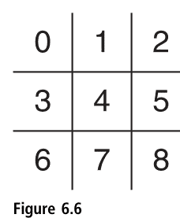

图 6.6

每个方格编号对应于表示棋盘的向量中的一个位置。

玩家和电脑所玩的阵营也可以用一个字符来表示——`X` 或 `O`，就像游戏棋子一样。表示当前回合阵营的变量也将是一个字符，要么是 `X`，要么是 `O`。

## 创建函数列表

伪代码启发了我需要的不同函数。我列出了它们，思考每个函数将做什么，它将有哪些参数，以及它将返回什么值。表 6.1 显示了我努力的结果。

## 设置程序

你可以从 Course Technology 网站（`www.courseptr.com/downloads`）下载此程序的代码。程序位于第 6 章文件夹中；文件名是 `tic-tac-toe.cpp`。我将在这里逐节介绍代码。

我首先在程序中包含我需要的文件，定义一些全局常量，并编写我的函数原型。

```
// Tic-Tac-Toe
// Plays the game of tic-tac-toe against a human opponent

#include <iostream>
#include <string>
#include <vector>
#include <algorithm>

using namespace std;
```

## 表 6.1 井字游戏函数

| Function | Description |

|---|---|

| `void instructions()` | Displays the game instructions. |

| `char askYesNo(string question)` | Asks a yes or no question. Receives a question. Returns either a `'y'` or an `'n'`. |

| `int askNumber(string question, int high, int low = 0)` | Asks for a number within a range. Receives a question, a low number, and a high number. Returns a number in the range from low to high. |

| `char humanPiece()` | Determines the human's piece. Returns either an `'X'` or an `'O'`. |

| `char opponent(char piece)` | Calculates the opposing piece given a piece. Receives either an `'X'` or an `'O'`. Returns either an `'X'` or an `'O'`. |

| `void displayBoard(const vector<char>& board)` | Displays the board on the screen. Receives a board. |

| `char winner(const vector<char>& board)` | Determines the game winner. Receives a board. Returns an `'X'`, `'O'`, `'T'` (to indicate a tie), or `'N'` (to indicate that no one has won yet). |

| `bool isLegal(const vector<char>& board, int move)` | Determines whether a move is legal. Receives a board and a move. Returns either `true` or `false`. |

| `int humanMove(const vector<char>& board, char human)` | Gets the human's move. Receives a board and the human's piece. Returns the human's move. |

| `int computerMove(vector<char> board, char computer)` | Calculates the computer's move. Receives a board and the computer's piece. Returns the computer's move. |

| `void announceWinner(char winner, char computer, char human)` | Congratulates the winner or declares a tie. Receives the winning side, the computer's piece, and the human's piece. |

```
// global constants
const char X = 'X';
const char O = 'O';
const char EMPTY = ' ';
const char TIE = 'T';
const char NO_ONE = 'N';

// function prototypes
void instructions();
char askYesNo(string question);
```

```
int askNumber(string question, int high, int low = 0);
char humanPiece();
char opponent(char piece);
void displayBoard(const vector<char>& board);
char winner(const vector<char>& board);
bool isLegal(const vector<char>& board, int move);
int humanMove(const vector<char>& board, char human);
int computerMove(vector<char> board, char computer);
void announceWinner(char winner, char computer, char human);
```

在全局常量部分，`X` 是字符 `'X'` 的简写，游戏中两种棋子之一。`O` 表示字符 `'O'`，游戏中另一种棋子。`EMPTY`，也是一个字符，表示棋盘上的一个空方格。它是一个空格，因为当它被显示时，它看起来像一个空方格。`TIE` 是一个表示平局游戏的字符。而 `NO_ONE` 是一个用于表示游戏双方都不存在的字符，我用它来表示还没有人获胜。

## main() 函数

正如你所见，`main()` 函数几乎完全就是我之前创建的伪代码。


```
// main function
int main()
{
    int move;
    const int NUM_SQUARES = 9;
    vector<char> board(NUM_SQUARES, EMPTY);

    instructions();
    char human = humanPiece();
    char computer = opponent(human);
    char turn = X;
    displayBoard(board);

    while (winner(board) == NO_ONE)
    {
        if (turn == human)
        {
            move = humanMove(board, human);
            board[move] = human;
        }
        else
        {
            move = computerMove(board, computer);
            board[move] = computer;
        }
        displayBoard(board);
        turn = opponent(turn);
    }

    announceWinner(winner(board), computer, human);

    return 0;
}
```

## `instructions()` 函数

此函数显示游戏说明，并给电脑对手一点态度。

```
void instructions()
{
    cout << "Welcome to the ultimate man-machine showdown: Tic-Tac-Toe.\n";
    cout << "--where human brain is pit against silicon processor\n\n";

    cout << "Make your move known by entering a number, 0 - 8. The number\n";
    cout << "corresponds to the desired board position, as illustrated:\n\n";

    cout << "      0 | 1 | 2\n";
    cout << "      ---------\n";
    cout << "      3 | 4 | 5\n";
    cout << "      ---------\n";
    cout << "      6 | 7 | 8\n\n";

    cout << "Prepare yourself, human. The battle is about to begin.\n\n";
}
```

## `askYesNo()` 函数

此函数询问一个是非问题。它会一直询问问题，直到玩家输入 `y` 或 `n`。它接收一个问题并返回 `'y'` 或 `'n'`。

```
char askYesNo(string question)
{
    char response;
    do
    {
        cout << question << " (y/n): ";
        cin >> response;
    } while (response != 'y' && response != 'n');

    return response;
}
```

## The `askNumber()` Function

这个函数要求输入一个范围内的数字，并且会一直询问直到玩家输入一个有效的数字。它接收一个问题、一个最高数字和一个最低数字。它返回范围内的一个数字。

```
int askNumber(string question, int high, int low)
{
    int number;
    do
    {
        cout << question << " (" << low << " - " << high << "): ";
        cin >> number;
    } while (number > high || number < low);

    return number;
}
```

如果查看这个函数的原型，你可以看到最低数字有一个默认值 0。我在程序后面调用函数时利用了这一事实。

## The `humanPiece()` Function

这个函数询问玩家是否想先走，并根据该选择返回玩家的棋子。按照井字棋的伟大传统，`X` 先走。

```
char humanPiece()
{
    char go_first = askYesNo("Do you require the first move?");
    if (go_first == 'y')
    {
        cout << "\nThen take the first move. You will need it.\n";
        return X;
    }
    else
    {
        cout << "\nYour bravery will be your undoing... I will go first.\n";
        return O;
    }
}
```

## The `opponent()` Function

这个函数接收一个棋子（`'X'` 或 `'O'`）并返回对手的棋子（`'X'` 或 `'O'`）。

```
char opponent(char piece)
{
    if (piece == X)
    {
        return O;
    }
    else
    {
        return X;
    }
}
```

## The `displayBoard()` Function

这个函数显示传递给它的棋盘。因为棋盘中的每个元素要么是空格，要么是 `'X'`，要么是 `'O'`，所以函数可以显示每一个。我在键盘上使用了几个其他字符来绘制一个看起来不错的井字棋棋盘。

```
void displayBoard(const vector<char>& board)
{
    cout << "\n\t" << board[0] << " | " << board[1] << " | " << board[2];
    cout << "\n\t" << "--------";
    cout << "\n\t" << board[3] << " | " << board[4] << " | " << board[5];
    cout << "\n\t" << "--------";
    cout << "\n\t" << board[6] << " | " << board[7] << " | " << board[8];
    cout << "\n\n";
}
```

请注意，表示棋盘的 `vector` 是通过常量引用传递的。这意味着 `vector` 被高效地传递；它不会被复制。它还意味着 `vector` 在传递过程中受到保护，不会被更改。由于我计划仅在此函数中显示棋盘而不更改它，因此这是完美的。

## The `winner()` Function

这个函数接收一个棋盘并返回获胜者。获胜者有四种可能的值。函数如果玩家获胜则返回 `X` 或 `O`。如果所有格子都被填满且没有人获胜，则返回 `TIE`。最后，如果没有人获胜并且至少有一个空格子，函数返回 `NO_ONE`。

```
char winner(const vector<char>& board)
{
    // all possible winning rows
    const int WINNING_ROWS[8][3] = { {0, 1, 2},
                                    {3, 4, 5},
                                    {6, 7, 8},
                                    {0, 3, 6},
                                    {1, 4, 7},
                                    {2, 5, 8},
                                    {0, 4, 8},
                                    {2, 4, 6} };
```

首先要注意的是，表示棋盘的 `vector` 是通过常量引用传递的。这意味着 `vector` 被高效地传递；它不会被复制。它还意味着 `vector` 受到任何更改的保护。

在此函数初始部分，我定义了一个名为 `WINNING_ROWS` 的常量二维 `int` 数组，它表示获得三连线并赢得游戏的所有八种方式。每条获胜行由一组三个数字表示——形成获胜行的三个棋盘位置。例如，组 `{0, 1, 2}` 表示顶行——棋盘位置 0、1 和 2。下一组 `{3, 4, 5}` 表示中间行——棋盘位置 3、4 和 5。依此类推....

接下来我检查是否任一玩家获胜。

```
const int TOTAL_ROWS = 8;

// if any winning row has three values that are the same (and not EMPTY),
// then we have a winner
for(int row = 0; row < TOTAL_ROWS; ++row)
{
    if ( (board[WINNING_ROWS[row][0]] != EMPTY) &&
        (board[WINNING_ROWS[row][0]] == board[WINNING_ROWS[row][1]]) &&
        (board[WINNING_ROWS[row][1]] == board[WINNING_ROWS[row][2]]) )
    {
        return board[WINNING_ROWS[row][0]];
    }
}
```

我遍历玩家获胜的每种可能方式，以查看是否有人连成三子。`if` 语句检查所讨论的三个格子是否包含相同的值且不是 `EMPTY`。如果是，则意味着该行有三个 `X` 或 `O`，其中一方获胜。函数然后返回此获胜行第一个位置的棋子。

如果没有玩家获胜，我检查是否平局。

```
// since nobody has won, check for a tie (no empty squares left)
if (count(board.begin(), board.end(), EMPTY) == 0)
    return TIE;
```

如果棋盘上没有空格子，则游戏为平局。我使用 STL `count()` 算法，该算法计算给定值在容器元素组中出现的次数，来计算 `board` 中 `EMPTY` 元素的数量。如果数量等于 0，函数返回 `TIE`。

最后，如果没有玩家获胜且游戏不是平局，则还没有赢家。因此，函数返回 `NO_ONE`。

```
// since nobody has won and it isn't a tie, the game ain't over
return NO_ONE;
}
```

## The `isLegal()` Function

这个函数接收一个棋盘和一个移动。它如果该移动在棋盘上是合法的则返回 `true`，如果不合法则返回 `false`。合法的移动由空格子的编号表示。

```
inline bool isLegal(int move, const vector<char>& board)
{
    return (board[move] == EMPTY);
}
```

再次注意，表示棋盘的 `vector` 是通过常量引用传递的。这意味着 `vector` 被高效地传递；它不会被复制。它还意味着 `vector` 受到任何更改的保护。

你可以看到我将 `isLegal()` 内联了。现代编译器在优化方面已经非常出色；然而，由于此函数只有一行，它是内联的良好候选。

## The `humanMove()` Function

下一个函数接收一个棋盘和玩家的棋子。它返回玩家想要移动的格子编号。函数会一直询问玩家想要移动到的格子编号，直到响应是合法移动。然后函数返回该移动。

```
int humanMove(const vector<char>& board, char human)
{
    int move = askNumber("Where will you move?", (board.size() - 1));
    while (!isLegal(move, board))
    {
        cout << "\nThat square is already occupied, foolish human.\n";
        move = askNumber("Where will you move?", (board.size() - 1));
    }
    cout << "Fine...\n";
    
    return move;
}
```

再次注意，表示棋盘的 `vector` 是通过常量引用传递的。这意味着 `vector` 被高效地传递；它不会被复制。它还意味着 `vector` 受到任何更改的保护。

## The `computerMove()` Function

这个函数接收棋盘和电脑的棋子。它返回电脑的移动。首先要注意的是，我没有通过引用传递棋盘。

```
int computerMove(vector<char> board, char computer)
```

相反，我选择按值传递，即使它没有按引用传递那么高效。我按值传递是因为我需要在空格子中放置棋子以确定最佳电脑移动时，对棋盘的副本进行操作和修改。通过使用副本，我保持表示棋盘的原始 `vector` 安全。

现在进入函数的核心。好吧，我如何编程一点 AI 让电脑打出像样的比赛？嗯，我为选择移动制定了一个基本的三步策略。

- 1. 如果电脑可以在此移动中获胜，就做出该移动。

- 2. 否则，如果人类可以在他的下一次移动中获胜，就阻止他。

- 3. 否则，取剩余的最佳空方格。最佳方格是中心。接下来最好的方格是角落，然后是其余的方格。

下一个函数部分实现了步骤 1。

```
{
    unsigned int move = 0;
    bool found = false;

    //if computer can win on next move, that's the move to make
    while (!found && move < board.size())
    {
        if (isLegal(move, board))
        {
            board[move] = computer;
            found = winner(board) == computer;
            board[move] = EMPTY;
        }

        if (!found)
        {
            ++move;
        }
    }
```

我开始遍历所有可能的移动，0–8。对于每个移动，我测试该移动是否合法。如果合法，我将电脑的棋子放入该位置。

`move`（`found` is true）that I want the computer to make (square number move) to block the human from winning on his next move.

Next, I check to see if I need to go on to Step 3 of my AI strategy. If I haven’t found a move yet (`found` is `false`), then I look through the list of best moves, in order of desirability, and take the first legal one.

```
//otherwise, moving to the best open square is the move to make
if (!found)
{
    move = 0;
    unsigned int i = 0;

    const int BEST_MOVES[] = {4, 0, 2, 6, 8, 1, 3, 5, 7};
    //pick best open square
    while (!found && i < board.size())
    {
        move = BEST_MOVES[i];
        if (isLegal(move, board))
        {
            found = true;
        }

        ++i;
    }
}
```

At this point in the function, I’ve found the move I want the computer to make—whether that’s a move that gives the computer a win, blocks a winning move for the human, or is simply the best empty square available. So, I have the computer announce the move and return the corresponding square number.

```
cout << "I shall take square number " << move << endl;
return move;
}
```

## Real World


> The Tic-Tac-Toe game considers only the next possible move. Programs that play serious games of strategy, such as chess, look far deeper into the consequences of individual moves and consider many levels of moves and countermoves. In fact, good computer chess programs can consider literally millions of board positions before making a move.

## The `announceWinner()` Function

This function receives the winner of the game, the computer’s piece, and the human’s piece. The function announces the winner or declares a tie.

```
void announceWinner(char winner, char computer, char human)
{
    if (winner == computer)
    {
        cout << winner << "'s won!\n";
        cout << "As I predicted, human, I am triumphant once more -- proof\n";
        cout << "that computers are superior to humans in all regards.\n";
    }
    else if (winner == human)
    {
        cout << winner << "'s won!\n";
        cout << "No, no! It cannot be! Somehow you tricked me, human.\n";
        cout << "But never again! I, the computer, so swear it!\n";
    }
    else
    {
        cout << "It's a tie.\n";
        cout << "You were most lucky, human, and somehow managed to tie me.\n";
        cout << "Celebrate... for this is the best you will ever achieve.\n";
    }
}
```

## SUMMARY

In this chapter, you should have learned the following concepts:

- A reference is an alias; it’s another name for a variable.
- You create a reference using `&`—the referencing operator.
- A reference must be initialized when it’s defined.
- A reference can’t be changed to refer to a different variable.
- Whatever you do to a reference is done to the variable to which the reference refers.
- When you assign a reference to a variable, you create a new copy of the referenced value.

Still others opt for `int &ref = var;`. The computer is fine with all three. There are cases to be made for each style; however, the most important thing is to be consistent.

Q: Why can’t I initialize a non-constant reference with a constant value?

A: Because a non-constant reference allows you to change the value to which it refers.

Q: If I initialize a constant reference with a non-constant variable, can I change the value of the variable?

A: Not through the constant reference because when you declare a constant reference, you’re saying that the reference can’t be used to change the value to which it refers (even if that value can be changed by other means).

Q: How does passing a constant reference save overhead?

A: When you pass a large object to a function by value, your program makes a copy of the object. This can be an expensive operation depending on the size of the object. Passing a reference is like only passing access to the large object; it is an inexpensive operation.

Q: Can I make a reference to a reference?

A: Not exactly. You can assign one reference to another reference, but the new reference will simply refer to the value to which the original reference refers.

Q: What happens if I declare a reference without initializing it?

A: Your compiler should complain because it’s illegal.

Q: Why should I avoid changing the value of a variable that I pass through a reference?

A: Because it could lead to confusion. It’s impossible to tell from only a function call whether a variable is being passed to change its value.

Q: Does that mean I should always pass a constant reference?

A: No. You can pass a non-constant reference to a function, but to most game programmers, this signals that you intend to change the argument variable’s value.

Q: If I don’t change the argument variables passed to functions, how should I get new information back to the calling code?

A: Use return values.

Q: Can I pass a literal through a non-constant reference?

A: No. If you try to pass a literal as a non-constant reference, you’ll generate a compile error.

Q: Is it impossible to pass a literal to a parameter that accepts a reference?

A: No, you can pass a literal as a constant reference.

Q: What happens when I return an object from a function?

A: Normally, your program creates a copy of the object and returns that. This can be an expensive operation, depending on the size of the object.

Q: Why return a reference?

A: It can be more efficient because returning a reference doesn’t involve copying an object.

Q: How can I lose the efficiency of returning a reference?

A: By assigning the returned reference to a variable. When you assign a reference to a variable, the computer must make a copy of the object to which the reference refers.

Q: What’s wrong with returning a reference to a local variable?

A: The local variable doesn’t exist once the function ends, which means that you’re returning a reference to a non-existent object, which is illegal.

### Discussion Questions

1. What are the advantages and disadvantages of passing an argument by value?
2. What are the advantages and disadvantages of passing a reference?
3. What are the advantages and disadvantages of passing a constant reference?
4. What are the advantages and disadvantages of returning a reference?
5. Should game AI cheat in order to create a more worthy opponent?

## EXERCISES

1. Improve the Mad Lib game from Chapter 5 by using references to make the program more efficient.

2. What’s wrong with the following program?

```
int main()
{
    int score;
    score = 1000;
    float& rScore = score;
    return 0;
}
```

3. What’s wrong with the following function?

```
int& plusThree(int number)
{
    int threeMore = number + 3;
    return threeMore;
}
```

This page intentionally left blank

# CHAPTER 7

## Pointers: Tic-Tac-Toe 2.0

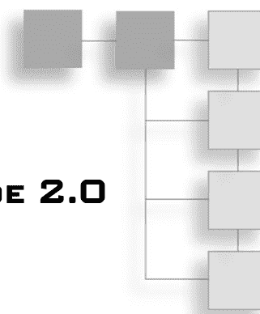

Pointers are a powerful part of C++. In some ways, they behave like iterators from the STL. Often, you can use them in place of references. But pointers offer functionality that no other part of the language can. In this chapter, you’ll learn the basic mechanics of pointers and get an idea of what they’re good for. Specifically, you’ll learn to:

- Declare and initialize pointers
- Dereference pointers
- Use constants and pointers
- Pass and return pointers
- Work with pointers and arrays

## Understanding Pointer Basics

Pointers have a reputation for being difficult to understand. In reality, the essence of pointers is quite simple—a pointer is a variable that can contain a memory address. Pointers give you the ability to work directly and efficiently with computer memory. Like iterators from the STL, they’re often used to access the contents of other variables. But before you can put pointers to good use in your game programs, you have to understand the basics of how they work.

### Hint

Computer memory is a lot like a neighborhood, but instead of houses in which people store their stuff, you have memory locations where you can store data. Just like a neighborhood where houses sit side by side, labeled with addresses, chunks of computer memory sit side by side, labeled with addresses. In a neighborhood, you can use a slip of paper with a street address on it to get to a particular house (and to the stuff stored inside it). In a computer, you can use a pointer with a memory address in it to get to a particular memory location (and to the stuff stored inside it).

## Introducing the Pointing Program

The Pointing program demonstrates the mechanics of pointers. The program creates a variable for a score and then creates a pointer to store the address of that variable. The program shows that you can change the value of a variable directly, and the pointer will reflect the change. It also shows that you can change the value of a variable through a pointer. It then demonstrates that you can change a pointer to point to another variable entirely. Finally, the program shows that pointers can work just as easily with objects. Figure 7.1 illustrates the results of the program.


You can download the code for this program from the Course Technology website (`www.courseptr.com/downloads`). The program is in the Chapter 7 folder; the filename is `pointing.cpp`.

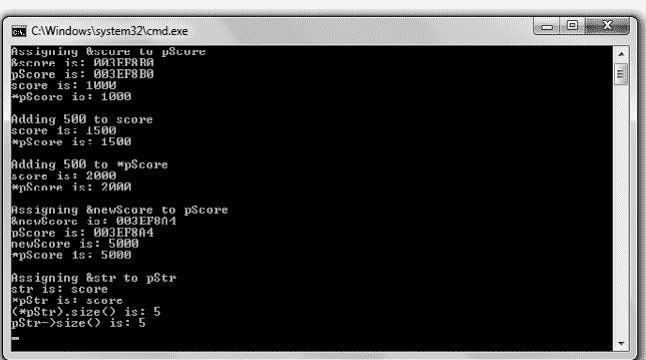

Figure 7.1

The pointer `pScore` first points to the variable `score` and then to the variable `newScore`, while the pointer `pStr` points to the variable `str`.

// Pointing

// Demonstrates using pointers

```
#include <iostream>

#include <string>

using namespace std;

int main()

{

    int* pAPointer;    //declare a pointer

    int* pScore = 0;    //declare and initialize a pointer

    int score = 1000;

    pScore = &score;    //assign pointer pScore address of variable score

    cout << "Assigning &score to pScore\n";

    cout << "&score is: " << &score << "\n";    //address of score variable

    cout << "pScore is: " << pScore << "\n";    //address stored in pointer

    cout << "score is: " << score << "\n";

    cout << "*pScore is: " << *pScore << "\n\n"; //value pointed to by pointer

    cout << "Adding 500 to score\n";

    score += 500;

    cout << "score is: " << score << "\n";

    cout << "*pScore is: " << *pScore << "\n\n";

    cout << "Adding 500 to *pScore\n";

    *pScore += 500;

    cout << "score is: " << score << "\n";

    cout << "*pScore is: " << *pScore << "\n\n";

    cout << "Assigning &newScore to pScore\n";

    int newScore = 5000;

    pScore = &newScore;

    cout << "&newScore is: " << &newScore << "\n";

    cout << "pScore is: " << pScore << "\n";

    cout << "newScore is: " << newScore << "\n";

    cout << "*pScore is: " << *pScore << "\n\n";

cout << "Assigning &str to pStr\n";

string str = "score";

string* pStr = &str;    //pointer to string object

cout << "str is: " << str << "\n";

cout << "*pStr is: " << *pStr << "\n";

cout << "(*pStr).size() is: " << (*pStr).size() << "\n";

cout << "pStr->size() is: " << pStr->size() << "\n";

return 0;

}
```

## 声明指针

在 `main()` 中的第一条语句中，我声明了一个名为 `pAPointer` 的指针。

```
int* pAPointer;    //declare a pointer
```

由于指针的工作方式非常独特，程序员经常在指针变量名前面加上字母“p”，以提醒他们该变量确实是一个指针。

就像迭代器一样，指针被声明为指向特定类型的值。`pAPointer` 是一个指向 `int` 的指针，这意味着它只能指向一个 `int` 值。例如，`pAPointer` 不能指向一个 `float` 或一个 `char`。另一种说法是，`pAPointer` 只能存储一个 `int` 的地址。

要声明自己的指针，请从指针将要指向的对象的类型开始，然后跟一个星号，然后是指针名称。当你声明指针时，可以在星号的两侧放置空白。所以 `int* pAPointer;`、`int *pAPointer;` 和 `int * pAPointer;` 都声明了一个名为 `pAPointer` 的指针。

### 陷阱

当你声明一个指针时，星号仅适用于紧随其后的单个变量名。因此，以下语句将 `pScore` 声明为指向 `int` 的指针，而 `score` 声明为 `int`。

```
int* pScore, score;
```

`score` 不是指针！它是一个类型为 `int` 的变量。一种使其更清晰的方法是调整空白并将语句重写为：

```
int *pScore, score;
```

然而，最清晰的声明指针的方法是在其自己的语句中声明它，如以下几行所示。

```
int* pScore;
int score;
```

## 初始化指针

与其他变量一样，你可以在声明指针的同一语句中初始化它。这就是我接下来用以下行所做的，它将 `0` 分配给 `pScore`。

```
int* pScore = 0; //declare and initialize a pointer
```

将 `0` 分配给指针具有特殊含义。松散地翻译，它的意思是：“指向 nothing。” 程序员称值为零的指针为空指针。你应该在声明指针时始终为其初始化一些值，即使该值为零。

## 提示

许多程序员将 `NULL` 分配给指针而不是 `0`，以使指针成为空指针。`NULL` 是一个在多个库文件中定义的常量，包括 `iostream`。

## 为指针分配地址

由于指针存储对象的地址，你需要一种方法将地址放入指针中。一种方法是获取现有变量的内存地址并将其分配给指针。这就是我在以下行中所做的，它获取变量 `score` 的地址并将其分配给 `pScore`。

```
pScore = &score; //assign pointer address of variable score
```

我通过在变量名前面加上 `&`、取地址运算符来获取 `score` 的地址。（是的，你以前见过 `&` 符号，当它用作引用运算符时。然而，在这种上下文中，`&` 符号获取对象的地址。）

作为前一行代码的结果，`pScore` 包含 `score` 的地址。就好像 `pScore` 精确知道 `score` 在计算机内存中的位置。这意味着你可以使用 `pScore` 访问 `score` 并操作存储在 `score` 中的值。图 7.2 作为 `pScore` 和 `score` 之间关系的视觉说明。

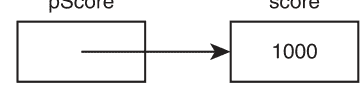

图 7.2

指针 `pScore` 指向 `score`，`score` 存储值 `1000`。

为了证明 `pScore` 包含 `score` 的地址，我使用以下行显示变量的地址和指针的值。

```
cout << "&score is: " << &score << "\n";    //address of score variable
cout << "pScore is: " << pScore << "\n";    //address stored in pointer
```

`pScore` 包含 `0x22ff5c`，这是 `score` 的地址。（`Pointing` 程序在你的系统上显示的具体地址可能不同。重要的是 `pScore` 和 `&score` 的值是相同的。）

## 解引用指针

就像你解引用迭代器以访问它所引用的对象一样，你解引用指针以访问它所指向的对象。你以同样的方式完成解引用——使用 `*`，解引用运算符。我将解引用运算符用于以下行，该行显示 `1000`，因为 `*pScore` 访问存储在 `score` 中的值。

```
cout << "*pScore is: " << *pScore << "\n\n"; //value pointed to by pointer
```

记住，`*pScore` 的意思是，“`pScore` 所指向的对象。”

### 陷阱

> 不要解引用空指针，因为它可能导致灾难性的结果。

接下来，我用以下行将 `500` 加到 `score`。

```
score += 500;
```

当我将 `score` 发送到 `cout` 时，会显示 `1500`，就像你期望的那样。当我将 `*pScore` 发送到 `cout` 时，`score` 的内容再次被发送到 `cout`，并且再次显示 `1500`。

接下来，我用以下行将 `500` 加到 `pScore` 所指向的值。

```
*pScore += 500;
```

由于 `pScore` 指向 `score`，前一行代码将 `500` 加到 `score`。因此，当我接下来将 `score` 发送到 `cout` 时，会显示 `2000`。然后，当我将 `*pScore` 发送到 `cout`...你猜对了，会再次显示 `2000`。

### 陷阱

当你想更改指针所指向对象的数值时，不要更改指针的值。例如，如果我想将 `pScore` 所指向的 `int` 加 `500`，那么以下行将是一个大错误。

```
pScore += 500;
```

前面的代码将 `500` 加到存储在 `pScore` 中的地址，而不是加到 `pScore` 原本指向的值。因此，`pScore` 现在指向可能包含任何内容的某个地址。像这样解引用指针可能导致灾难性的结果。

## 重新分配指针

与引用不同，指针可以在程序生命周期的不同时间指向不同的对象。重新分配指针的工作方式与重新分配任何其他变量一样。接下来，我用以下行重新分配 `pScore`。

```
pScore = &newScore;
```

作为结果，`pScore` 现在指向 `newScore`。为了证明这一点，我通过将 `&newScore` 发送到 `cout` 来显示 `newScore` 的地址，然后是存储在 `pScore` 中的地址。两个语句都显示相同的地址。然后我将 `newScore` 和 `*pScore` 发送到 `cout`。两者都显示 `5000`，因为它们都访问存储此值的同一块内存。

### 陷阱

当你想更改指针本身时，不要更改指针所指向的值。例如，如果我想更改 `pScore` 以指向 `newScore`，那么以下行将是一个大错误。

```
*pScore = newScore;
```

此代码只是更改 `pScore` 当前指向的值；它不会更改 `pScore` 本身。如果 `newScore` 等于 `5000`，则前面的代码等同于 `*pScore = 5000;` 而 `pScore` 仍然指向分配前相同的变量。

## 使用对象指针

到目前为止，`Pointing` 程序只处理内置类型 `int` 的值。但你也可以像使用值一样轻松地使用对象指针。我接下来用以下几行来演示这一点，这些行创建了 `str`，一个等于 `"score"` 的字符串对象，以及 `pStr`，一个指向该对象的指针。

```
string str = "score";
string* pStr = &str;    //pointer to string object
```

`pStr` 是指向 `string` 的指针，意味着它可以指向任何字符串对象。另一种说法是 `pStr` 可以存储任何字符串对象的地址。

你可以使用解引用运算符通过指针访问对象。这就是我接下来用以下这一行所做的。

```
cout << "*pStr is: " << *pStr << "\n";
```

通过使用解引用运算符 `*pStr`，我将 `pStr` 指向的对象 `str` 发送到 `cout`。结果，文本 `score` 被显示出来。

你可以通过指针调用对象的成员函数，就像你可以通过迭代器调用对象的成员函数一样。一种方法是使用解引用运算符和成员访问运算符，这就是我接下来用以下几行所做的。

```
cout << "(*pStr).size() is: " << (*pStr).size() << "\n";
```

代码 `(*pStr).size()` 的意思是：“取解引用 `pStr` 的结果并调用该对象的 `size()` 成员函数。” 因为 `pStr` 引用等于 `"score"` 的字符串对象，所以代码返回 `5`。

## 提示

每当你解引用指针以访问数据成员或成员函数时，请用一对括号将解引用的指针括起来。这可以确保点运算符会被应用于指针所指向的对象。

就像迭代器一样，你可以使用 `->` 运算符与指针，以更易读的方式访问对象成员。这就是我接下来用以下这一行演示的。

```
cout << "pStr->size() is: " << pStr->size() << "\n";
```

前面的语句再次显示了等于 `"score"` 的字符串对象中的字符数；然而，这次我可以用 `pStr->size()` 替代 `(*pStr).size()`，使代码更易读。

## 理解指针和常量

在你能在游戏程序中有效地使用指针之前，还有一些指针机制需要你理解。你可以使用 `const` 关键字来限制指针的工作方式。这些限制可以作为安全保障，并能使你的编程意图更清晰。由于指针非常灵活，限制指针的使用方式符合编程格言“只请求你需要的”。

### 使用常量指针

正如你所见，指针可以在程序的不同时间指向不同的对象。然而，通过在声明和初始化指针时使用 `const` 关键字，你可以限制指针使其只能指向它被初始化时指向的对象。这种指针称为常量指针。另一种说法是存储在常量指针中的地址永远不会改变——它是常量。以下是创建常量指针的示例：

```
int score = 100;
int* const pScore = &score;  //a constant pointer
```

前面的代码创建了一个指向 `score` 的常量指针 `pScore`。你通过在声明指针时将 `const` 放在指针名称的正前方来创建常量指针。

像所有常量一样，你必须在第一次声明常量指针时对其进行初始化。以下这一行是非法的，并且会产生一个大大的编译错误。

```
int* const pScore;  //illegal - - you must initialize a constant pointer
```

因为 `pScore` 是常量指针，所以它永远不能指向任何其他内存位置。以下代码也是相当非法的。

```
pScore = &anotherScore;  //illegal - pScore can't point to a different object
```

虽然你不能改变 `pScore` 本身，但你可以使用 `pScore` 来改变它所指向的值。以下这一行是完全合法的。

```
*pScore = 500;
```

困惑吗？不要。完全可以使用常量指针来改变它所指向的值。记住，常量指针的限制是其值——指针存储的地址——不能改变。

常量指针的工作方式应该让你想起某样东西——引用。就像引用一样，常量指针只能引用它被初始化时引用的对象。

## 提示

虽然你可以在程序中使用常量指针代替引用，但只要可能，你应该坚持使用引用。引用比指针具有更简洁的语法，并且可以使你的代码更易读。

### 使用指向常量的指针

正如你所见，你可以使用指针来改变它们所指向的值。然而，通过在声明指针时使用 `const` 关键字，你可以限制指针使其不能用于改变它所指向的值。这种指针称为指向常量的指针。以下是声明此类指针的示例：

```
const int* pNumber;  //a pointer to a constant
```

前面的代码声明了一个指向常量的指针 `pNumber`。你通过将 `const` 放在指针将要指向的值类型的正前方来声明指向常量的指针。

你按之前的方式为指向常量的指针分配地址。

```
int lives = 3;
pNumber = &lives;
```

然而，你不能使用该指针来改变它所指向的值。以下这一行是非法的。

```
*pNumber -= 1;  //illegal - - can't use pointer to a constant to change value
//that pointer points to
```

虽然你不能使用指向常量的指针来改变它所指向的值，但指针本身可以改变。这意味着指向常量的指针

可以在程序中指向不同的对象。以下代码是完全合法的。

```
const int MAX_LIVES = 5;
pNumber = &MAX_LIVES;  //pointer itself can change
```

### 使用指向常量的常量指针

指向常量的常量指针结合了常量指针和指向常量的指针的限制。这意味着指向常量的常量指针只能指向它被初始化时指向的对象。此外，它不能用于改变它所指向的对象的价值。以下是此类指针的声明和初始化：

```
const int* const pBONUS = &BONUS;  //a constant pointer to a constant
```

前面的代码创建了一个指向常量 `BONUS` 的常量指针到常量 `pBONUS`。

## 提示

像指向常量的指针一样，指向常量的常量指针可以指向非常量或常量值。

你不能重新分配指向常量的常量指针。以下这一行不合法。

```
pBONUS = &MAX_LIVES;  //illegal - - pBONUS can't point to another object
```

你不能使用指向常量的常量指针来改变它所指向的值。这意味着以下这一行是非法的。


```
*pBONUS = MAX_LIVES;  //illegal - - can't change value through pointer
```

在许多方面，指向常量的常量指针就像常量引用一样，它只能引用它被初始化时引用的值，并且不能用于改变该值。

## 提示

虽然你可以在程序中使用指向常量的常量指针代替常量引用，但只要可能，你应该坚持使用常量引用。引用比指针具有更简洁的语法，并且可以使你的代码更易读。

## 总结常量和指针

我已经介绍了关于常量和指针的大量信息，所以我想提供一个总结来帮助巩固新的概念。以下是你在使用`const`关键字声明指针时可以使用它的三种不同方式的示例：

- `int* const p = &i;`
- `const int* p;`
- `const int* const p = &I;`

第一个示例声明并初始化了一个常量指针。常量指针只能指向它被初始化时指向的对象。指针本身存储的值——内存地址——是常量，不能改变。常量指针只能指向非常量值；它不能指向常量。

第二个示例声明了一个指向常量的指针。指向常量的指针不能用于改变它所指向的值。指向常量的指针可以在程序的生命周期中指向不同的对象。指向常量的指针可以指向常量或非常量值。

第三个示例声明了一个指向常量的常量指针。指向常量的常量指针只能指向它被初始化时指向的值。此外，它不能用于改变它所指向的值。指向常量的常量指针可以被初始化为指向常量或非常量值。

## 传递指针

即使由于语法更简洁，引用是传递参数的首选方式，你仍然可能需要通过指针传递对象。例如，假设你正在使用一个返回指向 3D 对象的指针的图形引擎。如果你想让另一个函数使用此对象，你可能希望为了效率而传递指向该对象的指针。因此，了解如何传递指针以及引用是很重要的。

### 介绍 Swap Pointer Version 程序

Swap Pointer Version 程序的工作方式与第 6 章的 Swap 程序完全一样，只是 Swap Pointer Version 程序使用指针而不是引用。Swap Pointer Version 程序定义了两个变量——一个变量存放着我那可怜的低分，另一个变量存放着你那令人印象深刻的高分。显示分数后，程序调用一个旨在交换分数的函数。由于只有分数值的副本被发送给函数，原始变量保持不变。接下来，程序调用另一个交换函数。这一次，通过使用常量指针，原始变量的值被成功交换（让我得到高分，而留给你低分）。图7.3展示了该程序的运行情况。

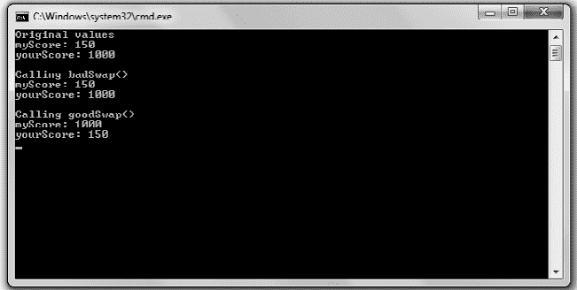

**图7.3**

传递指针允许函数修改其作用域之外的变量。

你可以从 Course Technology 网站（`www.courseptr.com/downloads`）下载该程序的代码。程序位于第7章文件夹中；文件名是`swap_pointer_ver.cpp`。

```cpp
// Swap Pointer
// Demonstrates passing constant pointers to alter argument variables

#include <iostream>

using namespace std;

void badSwap(int x, int y);
void goodSwap(int* const pX, int* const pY);

int main()
{
```

```
int myScore = 150;
int yourScore = 1000;
cout << "Original values\n";
cout << "myScore: " << myScore << "\n";
cout << "yourScore: " << yourScore << "\n\n";

cout << "Calling badSwap()\n";
badSwap(myScore, yourScore);
cout << "myScore: " << myScore << "\n";
cout << "yourScore: " << yourScore << "\n\n";

cout << "Calling goodSwap()\n";
goodSwap(&myScore, &yourScore);
cout << "myScore: " << myScore << "\n";
cout << "yourScore: " << yourScore << "\n";

return 0;
}

void badSwap(int x, int y)
{
    int temp = x;
    x = y;
    y = temp;
}

void goodSwap(int* const pX, int* const pY)
{
    //store value pointed to by pX in temp
    int temp = *pX;
    //store value pointed to by pY in address pointed to by pX
    *pX = *pY;
    //store value originally pointed to by pX in address pointed to by pY
    *pY = temp;
}
```

### 按值传递

在声明并初始化`myScore`和`yourScore`后，我将它们发送给`cout`。正如你所料，显示的是 150 和 1000。接下来我调用`badSwap()`，它按值传递两个参数。这意味着当我用以下代码行调用该函数时，`myScore`和`yourScore`的副本被发送给参数`x`和`y`。

```
badSwap(myScore, yourScore);
```

具体来说，`x`被赋值为 150，`y`被赋值为 1000。因此，在`badSwap()`中我对`x`和`y`所做的任何操作都不会影响`myScore`和`yourScore`。

当`badSwap()`执行时，`x`和`y`确实交换了值——`x`变为 1000，`y`变为 150。然而，当函数结束时，`x`和`y`都超出作用域。控制权随后返回`main()`，在其中`myScore`和`yourScore`没有改变。当我再次将`myScore`和`yourScore`发送给`cout`时，显示的是 150 和 1000。遗憾的是，我仍然拿着小分数，而你仍然拿着大分数。

### 传递常量指针

你已经看到，通过传递引用可以让函数访问变量。使用指针也可以实现这一目的。当你传递指针时，你只传递对象的地址。这可能非常高效，尤其是在处理占用大量内存的对象时。传递指针就像给朋友发电子邮件发送网站 URL，而不是试图把整个网站发送给他。

在将指针传递给函数之前，你需要将函数参数指定为指针。这正是我在`goodSwap()`的函数头中所做的。

```
void goodSwap(int* const pX, int* const pY)
```

这意味着`pX`和`pY`是常量指针，每个指针都将接受一个内存地址。我将参数设为常量指针是因为，虽然我打算更改它们所指向的值，但不打算更改指针本身。请记住，这正是引用的工作方式。你可以更改引用所指向的值，但不能更改引用本身。

在`main()`中，当我用以下代码行调用`goodSwap()`时，我传递了`myScore`和`yourScore`的地址。

```
goodSwap(&myScore, &yourScore);
```

请注意，我通过取地址运算符将变量的地址发送给`goodSwap()`。当你将对象传递给指针时，需要发送对象的地址。

在`goodSwap()`中，`pX`存储`myScore`的地址，`pY`存储`yourScore`的地址。对`*pX`所做的任何操作都会作用于`myScore`；对`*pY`所做的任何操作都会作用于`yourScore`。

`goodSwap()`的第一行获取`pX`所指向的值并将其赋给`temp`。

```
int temp = *pX;
```

因为`pX`指向`myScore`，`temp`变为 150。

下一行将`pY`所指向的值赋给`pX`所指向的对象。

```
*pX = *pY;
```

该语句复制存储在`yourScore`中的值 1000，并将其赋给`myScore`的内存位置。因此，`myScore`变为 1000。

函数中的最后一个语句将`temp`的值 150 存储在`pY`指向的地址中。

```
*pY = temp;
```

因为`pY`指向`yourScore`，`yourScore`变为 150。

函数结束后，控制权返回`main()`，在这里我将`myScore`和`yourScore`发送给`cout`。这一次，显示的是 1000 和 150。变量已经交换了值。终于成功了！

## 提示

你也可以传递指向常量的常量指针。其工作原理与传递常量引用非常相似，后者是为了高效传递你无需更改的对象。我改编了第6章中的 Inventory Displayer 程序（该程序演示了传递常量引用），使其改为传递指向常量的常量指针。你可以从 Course Technology 网站（`www.courseptr.com/downloads`）下载该程序的代码。程序位于第7章文件夹中；文件名是`inventory_displayer_pointer_ver.cpp`。

## 返回指针

在引用出现之前，游戏程序员从函数中高效返回对象的唯一选择就是使用指针。尽管使用引用的语法比使用指针更简洁，但你可能仍然需要通过指针返回对象。

### 引入 Inventory Pointer 程序

Inventory Pointer 程序演示了返回指针。通过返回的指针，程序显示甚至修改一个包含英雄物品栏的`vector`的值。图7.4显示了该程序的结果。

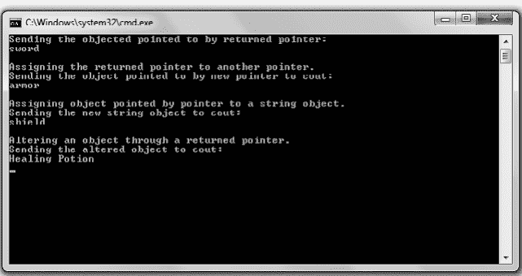

**图7.4**

函数返回一个指针（不是字符串对象），指向英雄物品栏中的每个物品。

你可以从 Course Technology 网站（`www.courseptr.com/downloads`）下载该程序的代码。程序位于第7章文件夹中；文件名是`inventory_pointer.cpp`。

```cpp
// Inventory Pointer
// Demonstrates returning a pointer

#include <iostream>
#include <string>
#include <vector>

using namespace std;

//returns a pointer to a string element
string* ptrToElement(vector<string>* const pVec, int i);

int main()
{
```

```
vector<string> inventory;
inventory.push_back("sword");
inventory.push_back("armor");
inventory.push_back("shield");

//displays string object that the returned pointer points to
cout << "Sending the objected pointed to by returned pointer:\n";
cout << *(ptrToElement(&inventory, 0)) << "\n\n";

//assigns one pointer to another - - inexpensive assignment
cout << "Assigning the returned pointer to another pointer.\n";
string* pStr = ptrToElement(&inventory, 1);
cout << "Sending the object pointed to by new pointer to cout:\n";
cout << *pStr << "\n\n";

//copies a string object - - expensive assignment
cout << "Assigning object pointed by pointer to a string object.\n";
string str = *(ptrToElement(&inventory, 2));
cout << "Sending the new string object to cout:\n";
cout << str << "\n\n";

//altering the string object through a returned pointer
cout << "Altering an object through a returned pointer.\n";
*pStr = "Healing Potion";
cout << "Sending the altered object to cout:\n";
cout << inventory[1] << endl;

    return 0;
}

string* ptrToElement(vector<string>* const pVec, int i)
{
    //returns address of the string in position i of vector that pVec points to
    return &((*pVec)[i]);
}
```

### 返回一个指针

在从函数返回指针之前，你必须指定返回的是指针。这正是我在`refToElement()`的函数头中所做的。

```
string* ptrToElement(vector<string>* const pVec, int i)
```

通过以`string*`开头，我的意思是该函数将返回一个指向字符串对象的指针（而不是字符串对象本身）。要指定函数返回指向特定类型对象的指针，请在返回类型的类型名称后加上星号。

函数`ptrToElement()`的主体只包含一个语句，该语句返回指向`pVec`所指向的向量中位置`i`的元素的指针。

```
return &((*pVec)[i]);
```

返回语句看起来可能有点晦涩，所以我会逐步解释。每当你遇到一个复杂的表达式时，就像计算机一样进行求值——从最内部的部分开始。我将从`(*pVec)[i]`开始，这意味着`pVec`所指向的向量中位置`i`的元素。通过将取地址运算符（`&`）应用于该表达式，它就变成了`pVec`所指向的向量中位置`i`的元素的地址。

#### 陷阱

尽管返回指针可以高效地将信息发送回调用函数，但你必须小心不要返回指向超出作用域对象的指针。例如，以下函数返回一个指针，如果使用它，可能会导致程序崩溃。

```
string* badPointer()
{
    string local = "This string will cease to exist once the function ends.";
    string* pLocal = &local;
    return pLocal;
}
```

这是因为`badPointer()`返回一个指向字符串的指针，而该字符串在函数结束后再也不存在。指向不存在对象的指针称为悬空指针。尝试解引用悬空指针可能导致灾难性后果。避免悬空指针的一种方法是永远不要返回指向局部变量的指针。

### 使用返回的指针显示值

在我创建`inventory`，即一个物品向量之后，我使用返回的指针显示一个值。

```
cout << *(ptrToElement(&inventory, 0)) << "\n\n";
```

前面的代码调用`ptrToElement()`，它返回指向`inventory[0]`的指针。（请记住，`ptrToElement()`并不是返回`inventory`元素的副本；它返回其中一个元素的指针。）然后该行将指针所指向的字符串对象发送给`cout`。结果，sword 被显示出来。

### 将返回的指针赋给指针

接下来我用以下行将返回的指针赋给另一个指针。

```
string* pStr = ptrToElement(&inventory, 1);
```

对`ptrToElement()`的调用返回指向`inventory[1]`的指针。该语句将该指针赋给`pStr`。这是一个高效的赋值，因为将指针赋给指针不需要复制字符串对象。

为了帮助你理解这行代码的结果，请查看图7.5，它显示了赋值后`pStr`的表示。（请注意，该图是抽象的，因为向量`inventory`不包含字符串字面量 "sword"、"armor" 和 "shield"；相反，它包含字符串对象。）

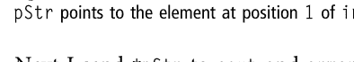

**图7.5**

`pStr`指向`inventory`中位置 1 的元素。

接下来我将`*pStr`发送给`cout`并显示 armor。

### 将返回指针所指向的值赋给变量

接下来我将返回指针所指向的值赋给一个变量。

```
string str = *(ptrToElement(&inventory, 2));
```

对`ptrToElement()`的调用返回指向`inventory[2]`的指针。然而，前面的语句并没有将此指针赋给`str`——它不能，因为`str`是一个字符串对象。相反，计算机悄悄地复制指针所指向的字符串对象并将其赋给`str`。为了进一步强调这一点，请查看图7.6，它提供了该赋值结果的抽象表示。

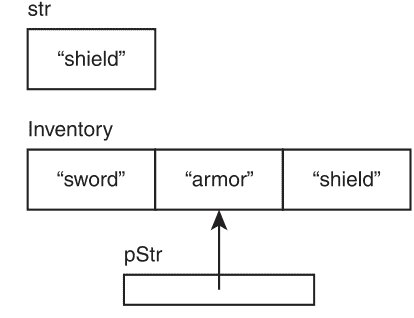

**图7.6**

`str`是一个全新的字符串对象，完全独立于`inventory`。

像这样的赋值，其中对象被复制，比一个指针赋给另一个指针的赋值更昂贵。有时复制对象的成本完全可以接受，但你应该意识到这种赋值相关的额外开销，并在必要时避免它。

### 通过返回的指针更改对象

你也可以更改返回的指针所指向的对象。这意味着我可以通过`pStr`更改英雄的`inventory`。

```
*pStr = "Healing Potion";
```


由于`pStr`指向`inventory`中位置 1 的元素，因此此代码将`inventory[1]`更改为等于`"Healing Potion"`。为了证明这一点，我用以下行显示该元素，它确实显示了`Healing Potion`。

```
cout << inventory[1] << endl;
```

对于抽象表示，请查看图 7.7，它显示了赋值后变量的状态。

## 提示

如果你想保护返回的指针所指向的对象，请确保限制该指针。返回指向常量的指针或指向常量的常量指针。

## inventory

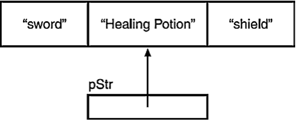

图 7.7

`inventory[1]`通过存储在`pStr`中的返回指针被更改。

## 理解指针与数组之间的关系

指针与数组有着密切的关系。事实上，数组名实际上是指向数组第一个元素的常量指针。由于数组的元素存储在连续的内存块中，你可以使用数组名作为指针来随机访问元素。这种关系对于如何传递和返回数组也有重要影响，如你将很快看到的那样。

## 介绍 Array Passer 程序

Array Passer 程序创建一个高分数组，然后使用数组名作为常量指针来显示它们。接下来，程序将数组名作为常量指针传递给一个增加分数的函数。最后，程序将数组名作为指向常量的常量指针传递给一个函数以显示新的高分。图 7.8 显示了程序的结果。

你可以从 Course Technology 网站 (`www.courseptr.com/downloads`) 下载此程序的代码。该程序位于第 7 章文件夹中；文件名是`array_passer.cpp`。

```
//Array Passer
//Demonstrates relationship between pointers and arrays

#include <iostream>

using namespace std;
```

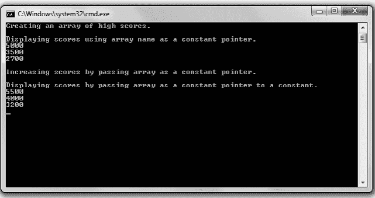

## 图 7.8

使用数组名作为指针，高分被显示、更改并传递给函数。

```
void increase(int* const array, const int NUM_ELEMENTS);
void display(const int* const array, const int NUM_ELEMENTS);

int main()
{
    cout << "Creating an array of high scores.\n\n";
    const int NUM_SCORES = 3;
    int highScores[NUM_SCORES] = {5000, 3500, 2700};

    cout << "Displaying scores using array name as a constant pointer.\n";
    cout << *highScores << endl;
    cout << *(highScores + 1) << endl;
    cout << *(highScores + 2) << "\n\n";

    cout << "Increasing scores by passing array as a constant pointer.\n\n";
    increase(highScores, NUM_SCORES);

    cout << "Displaying scores by passing array as a constant pointer to a constant.\n";
    display(highScores, NUM_SCORES);

    return 0;
}
```

```
void increase(int* const array, const int NUM_ELEMENTS)
{
    for (int i = 0; i < NUM_ELEMENTS; ++i)
    {
        array[i] += 500;
    }
}
```

```
void display(const int* const array, const int NUM_ELEMENTS)
{
    for (int i = 0; i < NUM_ELEMENTS; ++i)
    {
        cout << array[i] << endl;
    }
}
```

## 使用数组名作为常量指针

由于数组名是指向数组第一个元素的常量指针，因此你可以解引用该名称以获取第一个元素。我在创建名为`highScores`的高分数组后就是这样做的。

```
cout << *highScores << endl;
```

我解引用`highScores`以访问数组中的第一个元素并将其发送给`cout`。结果，显示 5000。

你可以通过简单的加法使用数组名作为指针来随机访问数组元素。你所要做的就是在解引用之前将你想要访问的元素的位置编号加到指针上。这比听起来简单。例如，我接下来用以下行访问`highScores`中位置 1 的分数，它显示 3500。

```
cout << *(highScores + 1) << endl;
```

在前面的代码中，`*(highScores + 1)`等同于`highScores[1]`。两者都返回`highScores`中位置 1 的元素。

接下来，我用以下行访问`highScores`中位置 2 的分数，它显示 2700。

```
cout << *(highScores + 2) << endl;
```

在前面的代码中，`*(highScores + 2)`等价于`highScores[2]`。两者都返回`highScores`中位置 2 的元素。一般来说，你可以将`arrayName[i]`写成`*(arrayName + i)`，其中`arrayName`是数组的名称。

## Passing and Returning Arrays

由于数组名是一个常量指针，因此你可以用它高效地将数组传递给函数。这正是我接下来所做的，使用以下行将指向数组第一个元素的常量指针和数组中的元素数量传递给`increase()`。

```
increase(highScores, NUM_SCORES);
```

### Hint

当你将数组传递给函数时，通常最好同时传递数组中的元素数量，这样函数就可以利用它来避免尝试访问不存在的元素。

正如`increase()`的函数头所示，数组名被接受为一个常量指针。

```
void increase(int* const array, const int NUM_ELEMENTS)
```

函数体将 500 加到每个分数上。

```
for (int i = 0; i < NUM_ELEMENTS; ++i)
{
    array[i] += 500;
}
```

我把`array`当作任何数组一样对待，并使用下标运算符来访问其每个元素。或者，我也可以把`array`当作指针对待，并用`*(array + i) += 500`替代表达式`array[i] += 500`，但我选择了可读性更好的版本。

`increase()`结束后，控制权返回到`main()`。为了证明`increase()`确实提高了高分，我调用一个函数来显示分数。

```
display(highScores, NUM_SCORES);
```

`display()`函数也接受`highScore`作为指针。然而，正如函数头所示，函数将其接受为指向常量的常量指针。

```
void display(const int* const array, const int NUM_ELEMENTS)
```

通过这种方式传递数组，我使其免受更改的影响。因为我只想显示每个元素，所以这是完美的方法。

最后，`display()`的函数体运行，所有分数都被列出，显示它们各自增加了 500。

### Hint

> 你可以将 C 风格字符串传递给函数，就像任何其他数组一样。此外，你可以将字符串字面量作为指向常量的常量指针传递给函数。

由于数组名是一个指针，因此你可以使用数组名返回数组，就像返回指向对象的任何其他指针一样。

## INTRODUCING THE TIC-TAC-TOE 2.0 GAME

本章的项目是第 6 章 Tic-Tac-Toe 游戏项目的修改版本。从玩家的角度来看，Tic-Tac-Toe 2.0 游戏看起来与原版完全相同，因为更改都在内部——我用指针替换了所有引用。这意味着诸如 Tic-Tac-Toe 棋盘之类的对象是以常量指针而不是引用形式传递的。这还有其他影响，包括必须传递 Tic-Tac-Toe 棋盘的地址而不是棋盘本身。

你可以从 Course Technology 网站 (`www.courseptr.com/downloads`) 下载新版程序的代码。该程序位于第 7 章文件夹中；文件名是`tic-tac-toe2.cpp`。我不会讲解代码，因为大部分内容保持不变。但即使更改的数量不大，这些更改也是重大的。这是一个很好的程序来研究，因为虽然你应该在可能时使用引用，但你也应该同样熟悉指针。

## SUMMARY

在本章中，你应该已经学习了以下概念：

- 计算机内存是有序组织的，每个内存块都有其唯一的地址。

- 指针是一个包含内存地址的变量。

- 在许多方面，指针的行为类似于 STL 中的迭代器。例如，就像迭代器一样，你使用指针间接访问对象。

- 要声明一个指针，你列出一个类型，后跟一个星号，后跟一个名称。

- 程序员经常在指针变量名前面加上字母`p`，以提醒他们该变量确实是一个指针。

- 就像迭代器一样，指针被声明为引用特定类型的值。

- 良好的编程实践是在声明时初始化指针。

- 如果你将 0 分配给指针，则该指针称为空指针。

- 要获取变量的地址，请在变量名前面加上取地址运算符`&`。

- 当指针包含对象的地址时，称其指向该对象。

- 与引用不同，你可以重新分配指针。也就是说，指针可以在程序生命周期中的不同时间指向不同的对象。

- 就像迭代器一样，你使用`*`解引用运算符来访问指针指向的对象。

- 就像迭代器一样，你可以使用`->`运算符与指针，以更易读的方式访问对象数据成员和成员函数。

- 常量指针只能指向它被初始化时指向的对象。你通过在指针名之前放置关键字`const`来声明常量指针，如`int* const p = &i;`。

- 你不能使用指向常量的指针来更改其指向的值。你通过在类型名之前放置关键字`const`来声明指向常量的指针，如`const int* p;`。

- 指向常量的常量指针只能指向它被初始化时指向的值，并且不能用于更改该值。你通过在类型名之前和指针名之前放置关键字`const`来声明指向常量的常量指针，如`const int* const p = &i;`。

- 你可以传递指针以提高效率或提供对对象的直接访问。

- 如果你想为了效率而传递指针，你应该传递指向常量的指针或指向常量的常量指针，这样通过指针就无法更改你传递访问权限的对象。

- 悬空指针是指向无效内存地址的指针。悬空指针通常是由删除指针所指向的对象引起的。解引用此类指针可能导致灾难性后果。

- 你可以从函数返回指针，但要小心不要返回悬空指针。

## Chapter 7 ■ Pointers: Tic-Tac-Toe 2.0

**Q:** 指针与它指向的变量有何不同？

**A:** 指针存储内存地址。如果指针指向一个变量，它存储该变量的地址。

**Q:** 存储已存在的变量的地址有什么好处？

**A:** 存储现有变量地址的一个巨大优势是，你可以为效率而将指向该变量的指针传递给函数，而不是按值传递变量。

**Q:** 指针是否必须始终指向现有变量？

**A:** 不。你可以创建一个指针，使其指向你需要时未命名的计算机内存块。你将在第 9 章“高级类和动态内存：游戏大厅”中了解更多关于以这种动态方式分配内存的内容。

**Q:** 为什么我应该在可能时使用引用而不是指针传递变量？

**A:** 因为引用提供的甜美语法糖。传递引用或指针是提供对对象访问的高效方式，但指针需要额外的语法（如解引用运算符）来访问对象本身。

**Q:** 为什么我应该在声明指针时或不久之后初始化它？

**A:** 因为解引用未初始化的指针可能导致灾难性后果，包括程序崩溃。

**Q:** 什么是悬空指针？

**A:** 指向无效内存位置的指针，任何数据都可能存在于该位置。

**Q:** 悬空指针有什么危险？

**A:** 与使用未初始化指针一样，使用悬空指针可能导致灾难性后果，包括程序崩溃。

**Q:** 为什么我应该将指针初始化为 0？

**A:** 通过将指针初始化为 0，你创建了一个空指针，它被理解为指向无物的指针。

**Q:** 那么解引用空指针是安全的，对吧？

**A:** 不！虽然将 0 分配给不指向对象的指针是良好的编程实践，但解引用空指针与解引用悬空指针一样危险。

**Q:** 如果我解引用空指针会发生什么？

**A:** 就像解引用悬空指针或未初始化指针一样，结果是不可预测的。最可能的是，你会使程序崩溃。

**Q:** 空指针有什么用？

**A:** 它们通常由函数作为失败的标志返回。例如，如果一个函数应该返回一个代表图形屏幕的对象的指针，但该函数无法初始化屏幕，它可能会返回一个空指针。

**Q:** 在声明指针时使用关键字`const`如何影响指针？

**A:** 这取决于你如何使用它。一般来说，你在声明指针时使用`const`来限制指针可以做什么。

**Q:** 通过使用`const`声明指针，我可以施加哪些限制？

**A:** 你可以限制指针只能指向它被初始化时指向的对象，或者你可以限制指针不能更改其指向的对象的价值，或两者兼而有之。

问：为什么我要限制指针能做什么？

答：为了安全。例如，你可能正在处理一个你知道不想更改的对象。

问：可以将常量值赋给哪种类型的指针？

答：指向常量的指针，或指向常量的常量指针。

问：如何安全地从函数返回指针？

答：一种方法是返回一个指向从调用函数接收到的对象的指针。这样，你返回的是一个指向存在于调用代码中的对象的指针。（在第 9 章中，当你学习动态内存时，你会发现另一种重要方法。）

## 讨论问题

- 1. 传递指针有哪些优点和缺点？

- 2. 什么情况下需要常量指针？

- 3. 什么情况下需要指向常量的指针？

- 4. 什么情况下需要指向常量的常量指针？

- 5. 什么情况下需要指向非常量对象的非常量指针？

## 练习

- 1. 编写一个程序，使用指向字符串对象的指针的指针。使用指针的指针来调用字符串对象的`size()`成员函数。

- 2. 重写第 5 章的最终项目——Mad Lib 游戏，使得没有字符串对象被传递给讲故事的那个函数。相反，该函数应接受指向字符串对象的指针。

- 3. 以下程序显示的三条内存地址是否都相同？解释代码中发生了什么。

此页有意留白

# 第 8 章

## 类：Critter 照料者

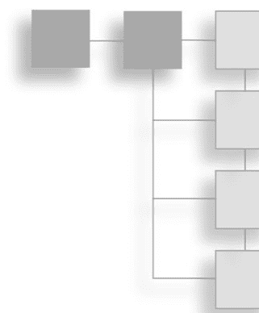

面向对象编程（OOP）是一种不同的编程思维方式。它是一种现代方法论，用于创建绝大多数游戏（以及其他商业软件）。在 OOP 中，你定义不同类型的对象，这些对象之间具有相互关系，允许对象进行交互。你已经使用过库中定义类型的对象，但 OOP 的关键特征之一是能够定义你自己的类型，并从中创建对象。在本章中，你将看到如何定义自己的类型并从这些类型创建对象。具体来说，你将学习到：

- 通过定义类来创建新类型

- 声明类数据成员和成员函数

- 从类实例化对象

- 设置成员访问级别

- 声明静态数据成员和成员函数

## 定义新类型

无论你谈论的是外星飞船、毒箭还是愤怒的变异鸡，游戏都充满了对象。幸运的是，C++允许你将游戏实体表示为软件对象，并包含成员函数和数据成员。这些对象的工作方式与你已经见过的其他对象（如`string`和`vector`对象）类似。但要使用一种新类型的对象（例如，愤怒的变异鸡对象），你必须先为其定义一种类型。

## 介绍 Simple Critter 程序

Simple Critter 程序定义了一种名为`Critter`的崭新类型，用于创建虚拟宠物对象。该程序使用这种新类型创建了两个`Critter`对象。然后，它给每只小动物一个饥饿程度。最后，每只小动物向世界打招呼并宣布它的饥饿程度。图 8.1 显示了程序运行结果。

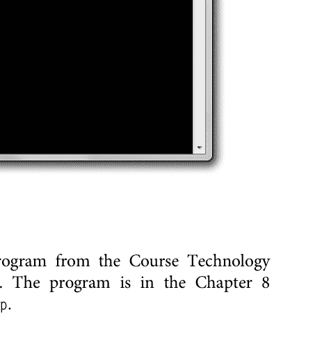

**图 8.1**

每只小动物都说“嗨”并宣布自己有多饿。

你可以从 Course Technology 网站 (`www.coursetech.com/downloads`) 下载此程序的代码。程序位于第 8 章文件夹中；文件名为`simple_critter.cpp`。

```
//Simple Critter
//Demonstrates creating a new type
#include <iostream>
using namespace std;
```

对于一个名为`Critter`的类。要定义一个类，以关键字`class`开头，后跟类名。按照惯例，类名以大写字母开头。你用大括号括住类体，并以分号结束。

## 声明数据成员

在类定义中，你可以声明类数据成员来表示对象品质。我只给小动物一种品质——饥饿。我认为饥饿是一个可以用整数表示的范围，所以我声明了一个`int`数据成员`m_Hunger`。

```
int m_Hunger;      // data member
```

这意味着每个`Critter`对象都有自己的饥饿程度，由它自己的名为`m_Hunger`的数据成员表示。请注意，我在数据成员名前加了前缀`m_`。一些游戏程序员遵循这种命名约定，以便数据成员能立即被识别出来。

## 声明成员函数

在类定义中，你还可以声明成员函数来表示对象能力。我给小动物一种能力——向世界打招呼并宣布它的饥饿程度——通过声明成员函数`Greet()`。

```
void Greet();      // member function prototype
```


这意味着每个`Critter`对象都有能力通过其成员函数`Greet()`说“嗨”并宣布自己的饥饿程度。按照惯例，成员函数名以大写字母开头。此时，我只声明了成员函数`Greet()`。不过别担心，我会在类外部定义它。

## 提示

> 你可能注意到了类定义中的关键字`public`。你现在可以忽略它。稍后在本章的“指定公共和私有访问级别”一节中，你会了解更多相关内容。

## 定义成员函数

你可以在类定义之外定义成员函数。在`Critter`类定义之外，我定义了`Critter`成员函数`Greet()`，它会说“嗨”并显示小动物的饥饿程度。

```
void Critter::Greet()    // member function definition
{
    cout << "Hi. I'm a critter. My hunger level is " << m_Hunger << ".\n";
}
```

这个定义看起来与你见过的任何其他函数定义一样，除了一点——我在函数名前加了`Critter::`前缀。当你在类外部定义成员函数时，需要用类名和作用域解析运算符对该函数进行限定，以便编译器知道该定义属于该类。

在成员函数中，我将`m_Hunger`发送到`cout`。这意味着`Greet()`显示的是通过该函数被调用的特定对象的`m_Hunger`值。这简单地说就是该成员函数显示小动物的饥饿程度。你可以通过简单地使用成员的名称，在任何成员函数中访问对象的数据成员和成员函数。

## 实例化对象

当你创建对象时，你就是从类实例化它。实际上，特定对象被称为类的实例。在`main()`中，我实例化了两个`Critter`实例。

```
Critter crit1;
Critter crit2;
```

因此，我有两个`Critter`对象——`crit1`和`crit2`。

## 访问数据成员

是时候让这些小动物工作了。接下来，我给第一只小动物一个饥饿程度。

```
crit1.m_Hunger = 9;
```

上面的代码将9赋给`crit1`的数据成员`m_Hunger`。就像访问对象的可用成员函数一样，你可以使用成员选择运算符访问对象的可用数据成员。

为了证明赋值成功，我显示小动物的饥饿程度。

```
cout << "crit1's hunger level is " << crit1.m_Hunger << ".\n";
```

上面的代码显示`crit1`的数据成员`m_Hunger`，并正确显示9。就像给可用数据成员赋值一样，你可以通过成员选择运算符获取可用数据成员的值。

接下来，我展示同样的过程适用于另一个`Critter`对象。

```
crit2.m_Hunger = 3;
cout << "crit2's hunger level is " << crit2.m_Hunger << ".\n\n";
```

这次，我将3赋给`crit2`的数据成员`m_Hunger`并显示它。

所以，`crit1`和`crit2`都是`Critter`的实例，但每个都独立存在，每个都有自己的身份。此外，每个都有自己的`m_Hunger`数据成员及其自己的值。

## 调用成员函数

接下来，我再次让小动物们展示它们的本领。我让第一只小动物打个招呼。

```
crit1.Greet();
```

上面的代码调用`crit1`的`Greet()`成员函数。该函数访问调用对象的`m_Hunger`数据成员来形成它显示的问候语。因为`crit1`的`m_Hunger`数据成员是9，所以函数显示文本：Hi. I'm a critter. My hunger level is 9.

最后，我让第二只小动物开口说话。

```
crit2.Greet();
```

上面的代码调用`crit2`的`Greet()`成员函数。该函数访问调用对象的`m_Hunger`数据成员来形成它显示的问候语。因为`crit2`的`m_Hunger`数据成员是3，所以函数显示文本：Hi. I'm a critter. My hunger level is 3.

## 使用构造函数

当你实例化对象时，你通常希望进行一些初始化——通常是给数据成员赋值。幸运的是，类有一个特殊的成员函数，称为构造函数，每次实例化新对象时都会自动调用它。这是一个很大的便利，因为你可以使用构造函数来执行新对象的初始化。

## 介绍 Constructor Critter 程序

Constructor Critter 程序演示了构造函数。该程序实例化一个新的 critter 对象，这会自动调用其构造函数。首先，构造函数宣布一个新的 critter 已经诞生。然后，它将传递给它的值赋给 critter 的饥饿等级。最后，程序调用 critter 的 greeting 成员函数，该函数显示 critter 的饥饿等级，从而证明构造函数确实初始化了 critter。图 8.2 显示了程序的结果。

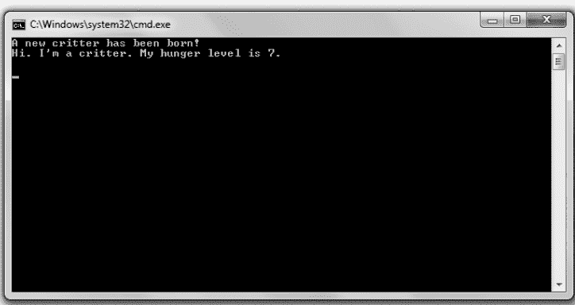

Figure 8.2

Critter 构造函数会自动初始化新对象的饥饿等级。

您可以从 Course Technology 网站 (www.courseptr.com/downloads) 下载此程序的代码。该程序位于第 8 章文件夹中；文件名是 constructor_critter.cpp。

```
//Constructor Critter
//Demonstrates constructors

#include <iostream>

using namespace std;

class Critter
{
public:
    int m_Hunger;

    Critter(int hunger = 0);      // constructor prototype
    void Greet();
};

Critter::Critter(int hunger)      // constructor definition
{
    cout << "A new critter has been born!" << endl;
    m_Hunger = hunger;
}

void Critter::Greet()
{
    cout << "Hi. I'm a critter. My hunger level is " << m_Hunger << ".\n\n";
}

int main()
{
    Critter crit(7);
    crit.Greet();

    return 0;
}
```

## 声明和定义构造函数

我用以下代码在 Critter 中声明一个构造函数：

```
Critter(int hunger = 0);      // constructor prototype
```

正如你从声明中看到的，构造函数没有返回类型。它不能——为构造函数指定返回类型是非法的。此外，在命名构造函数时你没有灵活性。你必须给它与类本身相同的名称。

### Hint

> 默认构造函数不需要参数。如果你没有定义默认构造函数，编译器会为你定义一个最小的默认构造函数，它只是调用类的任何数据成员的默认构造函数。如果你编写自己的构造函数，那么编译器不会为你提供默认构造函数。通常最好有一个默认构造函数，因此在必要时你应该确保提供自己的构造函数。实现此目的的一种方法是为构造函数定义中的所有参数提供默认值。

我在类外用以下代码定义构造函数：

```
Critter::Critter(int hunger)      // constructor definition
{
    cout << "A new critter has been born!" << endl;
    m_Hunger = hunger;
}
```

构造函数显示一条消息，说明一个新的 critter 已经诞生，并用传递给构造函数的参数值初始化对象的 m_Hunger 数据成员。如果没有传递值，则构造函数使用默认值 0。

### Trick

你可以使用成员初始化器作为在构造函数中为数据成员赋值的一种简写方式。要编写成员初始化器，请在构造函数参数列表后以冒号开始。然后键入你想要初始化的数据成员的名称，后跟你想要赋给数据成员的表达式，用括号括起来。如果你有多个初始化器，请用逗号分隔。这听起来比实际要复杂得多（而且也非常有用）。下面是一个示例，它将 hunger 赋给 m_Hunger 并将 boredom 赋给 m_Boredom。成员初始化器在你有许多数据成员需要初始化时尤其有用。

```
Critter::Critter(int hunger = 0, int boredom = 0):
    m_Hunger(hunger),
    m_Boredom(boredom)
{}  // empty constructor body
```

## 自动调用构造函数

你不会显式调用构造函数；然而，每当你实例化一个新对象时，其构造函数就会自动调用。在 main() 中，我用以下代码将我的构造函数付诸实践：

```
Critter crit(7);
```

当 crit 被实例化时，其构造函数会自动调用并显示消息 A new critter has been born!。然后，构造函数将 7 分配给对象的 m_Hunger 数据成员。

为了证明构造函数有效，在 main() 中，我调用对象的 Greet() 成员函数，果然，它显示 Hi. I'm a critter. My hunger level is 7.

## 设置成员访问级别

像函数一样，你应该将对象视为封装的实体。这意味着通常你应该避免直接更改或访问对象的数据成员。相反，你应该调用对象的成员函数，让对象维护自己的数据成员并确保其完整性。幸运的是，你可以在定义类时通过设置成员访问级别来强制执行数据成员限制。

## 介绍 Private Critter 程序

Private Critter 程序通过声明一个 critter 类来演示类成员访问级别，该类限制了对其饥饿等级数据成员的直接访问。该类提供了两个成员函数——一个允许访问数据成员，一个允许更改数据成员。程序创建一个新的 critter 并通过这些成员函数间接访问和更改 critter 的饥饿等级。然而，当程序尝试将 critter 的饥饿等级更改为非法值时，允许更改的成员函数会捕获非法值并且不进行更改。最后，程序使用合法值的饥饿等级设置成员函数，这工作得像个魔术。图 8.3 显示了程序的结果。


Figure 8.3

通过使用 Critter 对象的 GetHunger() 和 SetHunger() 成员函数，程序间接访问对象 m_Hunger 数据成员。

您可以从 Course Technology 网站 (www.courseptr.com/downloads) 下载此程序的代码。该程序位于第 8 章文件夹中；文件名是 private_critter.cpp。

```
//Private Critter
//Demonstrates setting member access levels

#include <iostream>

using namespace std;

class Critter
{
public:            // begin public section
    Critter(int hunger = 0);
    int GetHunger() const;
    void SetHunger(int hunger);

private:           // begin private section
    int m_Hunger;
};

Critter::Critter(int hunger):
    m_Hunger(hunger)
{
    cout << "A new critter has been born!" << endl;
}

int Critter::GetHunger() const
{
    return m_Hunger;
}
void Critter::SetHunger(int hunger)
{
    if (hunger < 0)
    {
        cout << "You can't set a critter's hunger to a negative number.\n\n";
    }
    else
    {
        m_Hunger = hunger;
    }
}

int main()
{
    Critter crit(5);
    //cout << crit.m_Hunger;  //illegal, m_Hunger is private!
    cout << "Calling GetHunger(): " << crit.GetHunger() << "\n\n";

    cout << "Calling SetHunger() with -1.\n";
    crit.SetHunger(-1);

    cout << "Calling SetHunger() with 9.\n";
    crit.SetHunger(9);
    cout << "Calling GetHunger(): " << crit.GetHunger() << "\n\n";

    return 0;
}
```

## 指定公共和私有访问级别

每个类数据成员和成员函数都有一个访问级别，它决定了你的程序中从何处可以访问它。到目前为止，我一直使用关键字 `public` 指定类成员具有公共访问级别。再次在 Critter 中，我用以下行开始一个公共部分：

```
public:        // begin public section
```

通过使用 `public:`，我的意思是随后出现的任何数据成员或成员函数（直到另一个访问级别说明符）都将是公共的。这意味着程序的任何部分都可以访问它们。因为我在此部分声明了所有成员函数，所以我的代码的任何部分都可以通过 Critter 对象调用任何成员函数。

接下来，我用以下行指定一个私有部分：

```
private:        // begin private section
```

通过使用 `private:`，我的意思是随后出现的任何数据成员或成员函数（直到另一个访问级别说明符）都将是私有的。这意味着只有 Critter 类中的代码可以直接访问它。由于我在此部分声明了 m_Hunger，所以只有 Critter 中的代码可以直接访问对象的 m_Hunger 数据成员。因此，我不能通过对象在 main() 中直接访问对象的 m_Hunger 数据成员，就像我在之前的程序中所做的那样。所以 main() 中的以下行，如果取消注释，将是非法的语句：

```
//cout << crit.m_Hunger;  //illegal, m_Hunger is private!
```

因为 m_Hunger 是私有的，所以我不能从不是 Critter 类一部分的代码中访问它。再次，只有 Critter 的一部分的代码可以直接访问数据成员。

我只向你展示了如何使数据成员私有，但你也可以使成员函数私有。此外，你可以重复访问修饰符。因此，如果你愿意，你可以在类中有一个私有部分，后跟一个公共部分，后跟另一个私有部分。最后，成员访问默认为私有。在你指定访问修饰符之前，你声明的任何类成员都将是私有的。

## 定义访问器成员函数

访问器成员函数允许间接访问数据成员。因为 m_Hunger 是私有的，所以我编写了一个访问器成员函数 GetHunger() 来返回数据成员的值。（现在你可以忽略关键字 const。）

```
int Critter::GetHunger() const
{
    return m_Hunger;
}
```

我在 main() 中用以下行将成员函数付诸实践：

```
cout << "Calling GetHunger(): " << crit.GetHunger() << "\n\n";
```

在前面的代码中，crit.GetHunger() 只是返回 crit 的 m_Hunger 数据成员的值，该值为 5。

需要。如果你在成员函数中不需要更改任何数据成员，那么最好将该成员函数声明为常量。它可以防止你在成员函数中意外地修改数据成员，并且能让其他程序员清楚你的意图。

### 陷阱

好吧，我撒了点小谎。常量成员函数可以修改静态数据成员。你将在本章稍后学习静态数据成员，具体在“声明和初始化静态数据成员”一节。还有，如果你用 mutable 关键字限定一个数据成员，那么即使是常量成员函数也可以修改它。现在，先不用担心这两个例外。

你可以通过在函数头部的末尾加上关键字 const 来声明一个常量成员函数。这就是我在 Critter 中所做的，如以下行所示，它将 GetHunger() 声明为常量成员函数。

```
int GetHunger() const;
```

这意味着 GetHunger() 不能更改 Critter 类中声明的任何非静态数据成员的值，也不能调用任何非常量的 Critter 成员函数。我将 GetHunger() 设为常量，因为它只返回一个值并且不需要修改任何数据成员。一般来说，Get 成员函数可以定义为常量。

## 使用静态数据成员和成员函数

对象很棒，因为每个实例都存储自己的数据集合，使其具有独特的身份。但如果想要存储有关整个类的一些信息，比如存在的实例总数怎么办？你可能想这样做，如果你创建了一堆敌人，并且希望它们根据总数来攻击玩家。例如，如果总数低于某个阈值，你可能希望敌人逃跑。你可以在每个对象中存储实例总数，但这会浪费存储空间。而且，随着总数的变化，更新所有对象也会很麻烦。相反，你真正想要的是为整个类存储一个单一值的方式。你可以用静态数据成员来实现这一点。

## 介绍 Static Critter 程序


`Static Critter`程序声明了一种新型的 critter，它有一个静态数据成员来存储已创建的 critter 总数。它还定义了一个静态成员函数来显示总数。在程序实例化任何新的 critter 对象之前，它通过直接访问保存总数的静态数据成员来显示 critter 的总数。接下来，程序实例化了三个新的 critter。然后它通过调用访问静态数据成员的静态成员函数来显示 critter 的总数。图 8.4 显示了程序的结果。


图 8.4

程序将 `Critter` 对象的总数存储在静态数据成员 `s_Total` 中，并以两种不同的方式访问该数据成员。

你可以从 Course Technology 网站 (www.courseptr.com/downloads) 下载此程序的代码。该程序位于第 8 章文件夹中；文件名是 `static_critter.cpp`。

```
//Static Critter
//Demonstrates static member variables and functions

#include <iostream>

using namespace std;

class Critter
{
public:
    static int s_Total;      //static member variable declaration
                            //total number of Critter objects in existence

    Critter(int hunger = 0);
    static int GetTotal();  //static member function prototype

private:
    int m_Hunger;
};

int Critter::s_Total = 0;   //static member variable initialization

Critter::Critter(int hunger):
    m_Hunger(hunger)
{
    cout << "A critter has been born!" << endl;
    ++s_Total;
}

int Critter::GetTotal()      //static member function definition
{
    return s_Total;
}

int main()
{
    cout << "The total number of critters is: ";
    cout << Critter::s_Total << "\n\n";

    Critter crit1, crit2, crit3;

    cout << "\nThe total number of critters is: ";
    cout << Critter::GetTotal() << "\n";

    return 0;
}
```

## 声明和初始化静态数据成员

静态数据成员是为整个类存在的一个单一数据成员。在类定义中，我声明了一个静态数据成员 `s_Total` 来存储已实例化的 `Critter` 对象数量。

```
static int s_Total;    //static member variable declaration
```

你可以像我一样声明自己的静态数据成员，只需以 `static` 关键字开头声明即可。我在变量名前面加上了 `s_`，以便可以立即识别为静态数据成员。

在类定义之外，我将静态数据成员初始化为 0。

```
int Critter::s_Total = 0;    //static member variable initialization
```

注意我用 `Critter::` 限定了数据成员名。在其类定义之外，你必须用其类名限定静态数据成员。执行完上一行代码后，与 `Critter` 类关联有一个单一值，存储在其静态数据成员 `s_Total` 中，值为 0。

## 提示

你也可以在非类函数中声明静态变量。静态变量在函数调用之间保持其值。

## 访问静态数据成员

你可以在程序的任何地方访问公共静态数据成员。在 `main()` 中，我用以下行访问 `Critter::s_Total`，它显示 0，即静态数据成员的值，也是已实例化的 `Critter` 对象的总数。

```
cout << Critter::s_Total << "\n\n";
```

## 提示

你也可以通过该类的任何对象访问静态数据成员。假设 `crit1` 是一个 `Critter` 对象，我可以用以下行显示 critter 的总数：

```
cout << crit1.s_Total << "\n\n";
```

我也在 `Critter` 构造函数中使用以下行访问此静态数据成员，它递增 `s_Total`。

```
++s_Total;
```

这意味着每次实例化一个新对象时，`s_Total` 都会递增。注意我没有用 `Critter::` 限定 `s_Total`。就像非静态数据成员一样，在其类内部你不需要用类名限定静态数据成员。

虽然我将静态数据成员设为 `public`，但你可以将静态数据成员设为 `private`——然后，像其他任何数据成员一样，你只能在类成员函数中访问它。

## 声明和定义静态成员函数

静态成员函数为整个类存在。我在 `Critter` 中用以下行声明了一个静态成员函数：

```
static int GetTotal();  //static member function prototype
```

你可以像我一样声明自己的静态成员函数，只需以 `static` 关键字开头声明即可。静态成员函数通常编写为与静态数据成员一起工作。

我定义了静态成员函数 `GetTotal()`，它返回静态数据成员 `s_Total` 的值。

```
int Critter::GetTotal()    //static member function definition
{
    return s_Total;
}
```

静态成员函数定义与迄今为止看到的非静态成员函数定义非常相似。主要区别在于静态成员函数不能访问非静态数据成员。这是因为静态成员函数为整个类存在，并且与类的任何特定实例无关。

## 调用静态成员函数

在 `main()` 中实例化三个 `Critter` 对象后，我再次用以下行显示 critter 的总数，它显示 3。

```
cout << Critter::GetTotal() << "\n\n";
```

为了正确标识静态成员函数，我必须用 `Critter::` 限定它。要从其类之外调用静态成员函数，你必须用其类名限定它。

## 提示

你也可以通过该类的任何对象访问静态成员函数。假设 `crit1` 是一个 `Critter` 对象，我可以用以下行显示 critter 的总数：

```
cout << crit1.GetTotal() << "\n\n";
```

由于静态成员函数为整个类存在，你可以在没有任何类实例存在的情况下调用静态成员函数。而且，就像私有静态数据成员一样，私有静态成员函数只能被同一类的其他成员函数访问。

## 介绍 Critter Caretaker 游戏

Critter Caretaker 游戏让玩家负责自己的虚拟宠物。玩家完全负责让 critter 保持快乐，这可不是一件小事。他可以喂养和陪玩 critter 来保持它心情良好。他还可以倾听 critter 来了解 critter 的感受，这可以从快乐到生气不等。图 8.5 展示了游戏。


## 图 8.5

如果你未能喂养或娱乐你的 critter，它的心情会变差。（但别担心——在适当的照顾下，你的 critter 可以恢复到阳光般的心情。）

你可以从课程技术网站（www.courseptr.com/downloads）下载此程序的代码。程序位于第8章文件夹中，文件名是 `critter_caretaker.cpp`。

## 规划游戏

游戏的核心就是小动物本身。因此，我首先规划我的 `Critter` 类。因为我想让这个小动物拥有独立的饥饿和无聊水平，所以我知道该类需要对应的私有数据成员。

- `m_Hunger`

- `m_Boredom`

小动物还应该有一个情绪，该情绪直接基于它的饥饿和无聊水平。我最初的想法是设置一个私有数据成员，但小动物的情绪实际上是根据其饥饿和无聊水平计算出来的值。因此，我决定设置一个私有成员函数，根据当前的饥饿和无聊水平实时计算小动物的情绪：

- `GetMood()`

接下来，我考虑公有成员函数。我想让小动物能够告诉玩家它的感受。我还希望玩家能够喂食小动物、和小动物玩耍，以降低它的饥饿和无聊水平。我需要三个公有成员函数来完成这些任务。

- `Talk()`

- `Eat()`

- `Play()`

最后，我还想要另一个成员函数来模拟时间的流逝，使小动物变得更饿、更无聊一些：

- `PassTime()`

我认为这个成员函数应为私有，因为它只会被其他成员函数（如 `Talk()`、`Eat()` 或 `Play()`）调用。

该类还将有一个构造函数来初始化数据成员。看一下图8.6，它展示了 `Critter` 类的模型。我为每个数据成员和成员函数都加了一个前缀符号来表示其访问级别；我用 `+` 表示公有，用 `-` 表示私有。


图8.6

`Critter` 类的模型。

## 规划伪代码

程序的其余部分将非常简单。它基本上是一个游戏循环，询问玩家是想要听小动物说话、喂食小动物、和小动物玩耍，还是退出游戏。以下是我设计的伪代码：

```
Create a critter
While the player doesn't want to quit the game
    Present a menu of choices to the player
    If the player wants to listen to the critter
        Make the critter talk
    If the player wants to feed the critter
        Make the critter eat
    If the player wants to play with the critter
        Make the critter play
```

## Critter 类

`Critter` 类是为代表玩家小动物的对象准备的蓝图。这个类并不复杂，大部分内容应该看起来很眼熟，但它足够长，分块处理是合理的。

### 类的定义

在写了一些初始注释和语句之后，我开始定义 `Critter` 类。

```
//Critter Caretaker
//Simulates caring for a virtual pet

#include <iostream>

using namespace std;

class Critter
{
public:
    Critter(int hunger = 0, int boredom = 0);
    void Talk();
    void Eat(int food = 4);
    void Play(int fun = 4);

private:
    int m_Hunger;
    int m_Boredom;

    int GetMood() const;
    void PassTime(int time = 1);
};
```

`m_Hunger` 是一个私有数据成员，代表小动物的饥饿水平；而 `m_Boredom` 是一个私有数据成员，代表它的无聊水平。我将在各自的小节中逐个介绍每个成员函数。

### 类的构造函数

构造函数接受两个参数：`hunger` 和 `boredom`。这两个参数都有默认值0，我在类定义中的构造函数原型中指定了它们。我用 `hunger` 初始化 `m_Hunger`，用 `boredom` 初始化 `m_Boredom`。

```
Critter::Critter(int hunger, int boredom):
    m_Hunger(hunger),
    m_Boredom(boredom)
{}
```

### `GetMood()` 成员函数

接下来，我定义 `GetMood()`。

```
inline int Critter::GetMood() const
{
    return (m_Hunger + m_Boredom);
}
```

这个内联成员函数的返回值代表小动物的情绪。作为饥饿和无聊水平之和，数值越大，小动物的情绪越差。我将这个成员函数设为私有，因为它只能由类的另一个成员函数调用。我把它设为常量，因为它不会导致任何数据成员发生改变。

### `PassTime()` 成员函数

`PassTime()` 是一个私有成员函数，用于增加小动物的饥饿和无聊水平。它会在每个小动物做某件事（吃东西、玩耍或说话）的成员函数末尾被调用，以模拟时间的流逝。我将这个成员函数设为私有，因为它只能由类的另一个成员函数调用。

```
void Critter::PassTime(int time)
{
    m_Hunger += time;
    m_Boredom += time;
}
```

你可以给这个成员函数传递已经过的时间量；否则，`time` 会使用默认参数值1，这个默认值是在 `Critter` 类定义的成员函数原型中指定的。

### `Talk()` 成员函数

`Talk()` 成员函数会播报小动物的情绪，可能是高兴、还行、沮丧或生气。`Talk()` 调用 `GetMood()`，并根据返回值显示相应的消息来指示小动物的情绪。最后，`Talk()` 调用 `PassTime()` 来模拟时间的流逝。

```
void Critter::Talk()
{
    cout << "I'm a critter and I feel ";

    int mood = GetMood();
    if (mood > 15)
    {
        cout << "mad.\n";
    }
    else if (mood > 10)
    {
        cout << "frustrated.\n";
    }
    else if (mood > 5)
    {
        cout << "okay.\n";
    }
    else
    {
        cout << "happy.\n";
    }

    PassTime();
}
```

### `Eat()` 成员函数

`Eat()` 会按参数 `food` 传入的数量减少小动物的饥饿水平。如果没有传入任何值，`food` 会使用默认参数值4。小动物的饥饿水平维持在受控范围内，不允许降到零以下。最后，调用 `PassTime()` 来模拟时间的流逝。

```
void Critter::Eat(int food)
{
    cout << "Brruppp.\n";
    m_Hunger -= food;
    if (m_Hunger < 0)
    {
        m_Hunger = 0;
    }

    PassTime();
}
```

### `Play()` 成员函数

`Play()` 会按参数 `fun` 传入的数量减少小动物的无聊水平。如果没有传入任何值，`fun` 会使用默认参数值4。小动物的无聊水平维持在受控范围内，不允许降到零以下。最后，调用 `PassTime()` 来模拟时间的流逝。

```
void Critter::Play(int fun)
{
    cout << "Whee!\n";

    m_Boredom -= fun;
    if (m_Boredom < 0)
    {
        m_Boredom = 0;
    }

    PassTime();
}
```

## `main()` 函数

在 `main()` 中，我实例化了一个新的 `Critter` 对象。因为我没有为 `m_Hunger` 或 `m_Boredom` 提供值，所以数据成员从0开始，小动物以快乐、满足的状态开启生活。接下来，我创建了一个菜单系统。如果玩家输入0，程序结束。如果玩家输入1，程序调用对象的 `Talk()` 成员函数。如果玩家输入2，程序调用对象的 `Eat()` 成员函数。如果玩家输入3，程序调用对象的 `Play()` 成员函数。如果玩家输入其他任何值，程序会告诉他选择无效。


```cpp
int main()
{
    Critter crit;
    crit.Talk();

    int choice;
    do
    {
        cout << "\nCritter Caretaker\n\n";
        cout << "0 - Quit\n";
        cout << "1 - Listen to your critter\n";
        cout << "2 - Feed your critter\n";
        cout << "3 - Play with your critter\n\n";

        cout << "Choice: ";
        cin >> choice;

        switch (choice)
        {
        case 0:
            cout << "Good-bye.\n";
            break;
        case 1:
            crit.Talk();
            break;
        case 2:
            crit.Eat();
            break;
        case 3:
            crit.Play();
            break;
        default:
            cout << "\nSorry, but " << choice << " isn't a valid choice.\n";
        }
    } while (choice != 0);

    return 0;
}
```

## 总结

在本章中，你应该已经了解了以下概念：

- 面向对象编程（OOP）是一种编程思维方式，在这种方式中，你定义不同类型的对象，以及它们之间相互交互的关系。

- 你可以通过定义类来创建新类型。

- 类是对象的蓝图。

- 在类中，你可以声明数据成员和成员函数。

- 在类定义之外定义成员函数时，需要使用类名和作用域解析运算符（`::`）来限定。

- 你可以通过在类定义中直接定义成员函数来使其内联。

- 你可以通过成员选择运算符（`.`）访问对象的数据成员和成员函数。

- 每个类都有一个构造函数——一种特殊的成员函数，每次实例化新对象时都会自动调用它。构造函数通常用于初始化数据成员。

- 默认构造函数不需要参数。如果你没有在类中提供构造函数定义，编译器会自动生成一个默认构造函数。

- 成员初始化器提供了一种在构造函数中为数据成员赋值的简写方式。

- 你可以在类中使用关键字 `public`、`private` 和 `protected` 设置成员访问级别。（你将在第9章“高级类和动态内存：游戏大厅”中了解 `protected`。）

- 公有成员可以通过对象被代码的任何部分访问。

- 私有成员只能被该类的成员函数访问。

- 访问器成员函数允许间接访问数据成员。

- 静态数据成员对整个类存在。

- 静态成员函数对整个类存在。

- 有些游戏程序员将私有数据成员命名为 `m_` 前缀，静态数据成员命名为 `s_` 前缀，以便一眼就能识别。

常量成员函数不能修改非静态数据成员，也不能调用其类的非常量成员函数。

## 问题与解答

问：什么是过程式编程？

答：一种范式，其中任务被分解为一系列较小的子任务，并以可管理的代码块（如函数）实现。在过程式编程中，函数和数据是分离的。

问：什么是对象？

答：一种将数据和函数结合在一起的实体。

问：为什么创建对象？

答：因为世界——尤其是游戏世界——充满了对象。通过创建自己的类型，你可以更直接、更直观地表示对象及其与其他对象的关系，这是其他方式难以做到的。

问：什么是面向对象编程？

答：一种通过对象完成工作的范式。它允许程序员定义自己的对象类型。对象之间通常存在关系，并且可以相互交互。

问：C++ 是面向对象编程语言还是过程式编程语言？

答：C++ 是一种多范式编程语言。它允许游戏程序员以过程式或面向对象的方式编写游戏——或者通过两者的结合（仅举几个选项）。

问：我应该总是尝试编写面向对象的游戏程序吗？

答：虽然几乎市场上的每一款商业游戏都使用了面向对象编程，但你并非必须采用这种范式来编写游戏。C++ 允许你使用几种编程范式之一。不过，一般来说，大型游戏项目几乎肯定能从面向对象方法中受益。

问：为什么不把所有类成员都设为公有？

答：因为这违背了封装的思想。

问：什么是封装？

答：自包含的性质。在面向对象编程的世界中，封装防止客户端代码直接访问对象的内部。相反，它鼓励客户端代码对对象使用已定义的接口。

问：封装有哪些好处？

答：在面向对象编程的世界中，封装能保护对象的完整性。例如，你可能有一个带有燃料数据成员的外星飞船对象。通过阻止对该数据成员的直接访问，你可以确保它永远不会成为非法值（如负数）。

问：我应该通过访问器成员函数提供对数据成员的访问吗？

答：有些游戏程序员说你不应该通过访问器成员函数提供对数据成员的访问，因为尽管这种访问是间接的，但它仍然违背了封装的思想。相反，他们说你应该编写类的成员函数，为客户提供其可能需要的一切功能，从而消除客户访问特定数据成员的需要。

问：什么是可变数据成员？

答：即使常量成员函数也能修改的数据成员。你可以使用关键字 `mutable` 创建可变数据成员。你也可以修改常量对象的可变数据成员。

问：为什么拥有默认构造函数很有用？

答：因为有时对象会在不向构造函数传递任何参数值的情况下自动创建——例如，当你创建对象数组时。

问：什么是结构体？

答：结构体与类非常相似。唯一真正的区别在于结构体的默认访问级别是公有的。你可以使用关键字 `struct` 定义结构体。

问：为什么 C++ 同时具有结构体和类？

答：这样 C++ 就能与 C 保持向后兼容。

问：什么时候应该使用结构体？

答：有些游戏程序员使用结构体仅将数据组合在一起，不包含函数（因为 C 结构就是这样的）。但最好尽可能避免使用结构体，而改用类。

## 讨论问题

- 1. 过程式编程有哪些优点和缺点？

- 2. 面向对象编程有哪些优点和缺点？

- 3. 访问器成员函数是类设计不佳的表现吗？请解释。

- 4. 常量成员函数对游戏程序员有什么帮助？

- 5. 什么时候动态计算对象的属性比将其存储为数据成员更好？

## 练习

- 1. 改进“小动物照顾者”程序，使你能够输入一个未列出的菜单选项，以揭示小动物的饥饿和无聊程度的确切值。

- 2. 修改“小动物照顾者”程序，使小动物通过暗示其饥饿和无聊程度来更清楚地表达自己的需求。

- 3. 下面的程序存在什么设计问题？

```cpp
#include <iostream>
using namespace std;

class Critter
{
public:
    int GetHunger() const {return m_Hunger;}
```

```cpp
private:
    int m_Hunger;
};

int main()
{
    Critter crit;
    cout << crit.GetHunger() << endl;
    return 0;
}
```

# 第9章

## 高级类和动态内存：游戏大厅

C++ 赋予游戏程序员对计算机的高度控制权。其中最基本的能力之一是对内存的直接控制。在本章中，你将了解 `动态内存`——由你自己管理的内存。但能力越大，责任越大，因此你还会看到动态内存的陷阱以及如何避免它们。你还将学习更多关于类的知识。具体来说，你将学习：

- 组合对象

- 使用友元函数

- 重载运算符

- 动态分配和释放内存

- 避免内存泄漏

- 生成对象的深拷贝

## 使用聚合

游戏对象通常由其他对象组成。例如，在赛车游戏中，一辆直线加速赛车可以被看作是由其他独立对象（如车身、四个轮胎和发动机）组成的单个对象。在其他情况下，你可能会将对象看作相关对象的集合。在动物园管理员模拟中，你可以将动物园看作任意数量的动物的集合。你可以使用 `聚合`——将对象组合起来，使一个对象成为另一个对象的一部分——在 OOP 中模拟对象之间的这类关系。例如，你可以编写一个 `Drag_Racer` 类，其中有一个 `engine` 数据成员，该成员是一个 `Engine` 对象。或者，你可以编写一个 `Zoo` 类，其中有一个 `animals` 数据成员，该成员是 `Animal` 对象的集合。

## 介绍“小动物农场”程序

“小动物农场”程序定义了一种具有名称的新型小动物。程序宣布新小动物的名称后，它会创建一个小动物农场——一组小动物的集合。最后，程序对农场调用 `roll`，每只小动物都会宣布自己的名字。图9.1显示了程序的结果。


图9.1

小动物农场是一组小动物的集合，每只小动物都有名称。

你可以从 Course Technology 网站（www.courseptr.com/downloads）下载此程序的代码。该程序位于第9章文件夹中；文件名是 `critter_farm.cpp`。

```cpp
//Critter Farm
//Demonstrates object containment

#include <iostream>
#include <string>
#include <vector>

using namespace std;

class Critter
{

public:

    Critter(const string& name = "");

    string GetName() const;

private:

    string m_Name;

};

Critter::Critter(const string& name):

    m_Name(name)

{}

inline string Critter::GetName() const

{

    return m_Name;

}

class Farm

{

public:

    Farm(int spaces = 1);

    void Add(const Critter& aCritter);

    void RollCall() const;

private:

    vector<Critter> m_Critters;

};

Farm::Farm(int spaces)

{

    m_Critters.reserve(spaces);

}

void Farm::Add(const Critter& aCritter)

{

    m_Critters.push_back(aCritter);

}

void Farm::RollCall() const

{

    for (vector<Critter>::const_iterator iter = m_Critters.begin();

        iter != m_Critters.end();

        ++iter)

    {

        cout << iter->GetName() << " here.\n";

    }

}

int main()

{

    Critter crit("Poochie");

    cout << "My critter's name is " << crit.GetName() << endl;

    cout << "\nCreating critter farm.\n";

    Farm myFarm(3);

    cout << "\nAdding three critters to the farm.\n";

    myFarm.Add(Critter("Moe"));

    myFarm.Add(Critter("Larry"));

    myFarm.Add(Critter("Curly"));

    cout << "\nCalling Roll...\n";

    myFarm.RollCall();

    return 0;

}
```

## 使用对象数据成员

在定义类时使用聚合的一种方法是声明一个可以保存另一个对象的数据成员。这就是我在 `Critter` 中所做的，使用以下行声明数据成员 `m_Name` 以保存一个 `string` 对象。

```cpp
string m_Name;
```

通常，当一个对象拥有另一个对象时，你会使用聚合。在这种情况下，一个 critter 有一个名字。这类关系被称为 `has-a` 关系。

我将 critter 名称的声明用于在实例化新对象时使用：

```cpp
Critter crit("Poochie");
```

这会调用 `Critter` 构造函数：

```cpp
Critter::Critter(const string& name):
    m_Name(name)
{
```

通过传递字符串字面量 `"Poochie"`，构造函数被调用并为名称实例化一个 `string` 对象，构造函数将其赋给 `m_Name`。一个名为 `Poochie` 的新 critter 就诞生了。

接下来，我使用以下行显示 critter 的名称：

```cpp
cout << "My critter's name is " << crit.GetName() << endl;
```

代码 `crit.GetName()` 返回 critter 名称的 `string` 对象的副本，然后将其发送到 `cout` 并显示在屏幕上。

## 使用容器数据成员

你也可以将容器用作对象的成员数据。这就是我在定义 `Farm` 时所做的。为该类声明的唯一数据成员只是一个保存 `Critter` 对象的 `vector`，名为 `m_Critter`。

```cpp
vector<Critter> m_Critters;
```

当我使用以下方式实例化一个新的 `Farm` 对象时：

```cpp
Farm myFarm(3);
```

它会调用构造函数：

```cpp
Farm::Farm(int spaces)
{
    m_Critters.reserve(spaces);
}
```

这会在 `Farm` 对象的 `m_Critter` `vector` 中为三个 `Critter` 对象分配内存。

接下来，我通过调用 `Farm` 对象的 `Add()` 成员函数向农场添加三个 critter。

```cpp
myFarm.Add(Critter("Moe"));
myFarm.Add(Critter("Larry"));
myFarm.Add(Critter("Curly"));
```

以下成员函数接受一个 `Critter` 对象的常量引用并将对象的副本添加到 `m_Critters` `vector` 中。

```cpp
void Farm::Add(const Critter& aCritter)
{
    m_Critters.push_back(aCritter);
}
```

### 陷阱

`push_back()` 将对象的副本添加到 `vector` 中——这意味着每次调用 `Add()` 时我都会为每个 `Critter` 对象创建额外的副本。在 `Critter Farm` 程序中这无关紧要，但如果我添加许多大型对象，这可能会成为性能问题。你可以通过使用指向对象的指针的 `vector` 来减少这种开销。你将在本章后面看到如何处理指向对象的指针。

最后，我通过 `Farm` 对象的 `RollCall()` 成员函数点名。

```cpp
myFarm.RollCall();
```

这会遍历 `vector`，调用每个 `Critter` 对象的 `GetName()` 成员函数，让每个 critter 说出自己的名字。

## 使用友元函数

`AND` 运算符重载

友元函数和运算符重载是与类相关的两个高级概念。友元函数可以完全访问类的任何成员。运算符重载允许你为内置运算符定义新的含义，使其与你自己的类的对象相关联。正如你将看到的，你可以将这两个概念结合使用。

## 介绍 Friend Critter 程序

`Friend Critter` 程序创建一个 `critter` 对象。然后它使用一个友元函数，该函数能够直接访问存储 `critter` 名称的私有数据成员以显示 `critter` 的名称。最后，程序通过将对象发送到标准输出来显示 `critter` 对象。这是

通过友元函数和运算符重载实现的。图 9.2 显示了程序的结果。


## 图 9.2

`critter` 的名称通过友元函数显示，`critter` 对象通过将其发送到标准输出来显示。

你可以从 Course Technology 网站 (www.courseptr.com/downloads) 下载此程序的代码。该程序位于第 9 章文件夹中；文件名是 `friend_critter.cpp`。


# 创建友元函数

友元函数可以访问其为友元的类的任何成员。你通过在类定义内部列出以关键字 `friend` 开头的函数原型来指定一个函数是类的友元。这就是我在 `Critter` 定义内部所做的，使用以下行表示全局函数 `Peek()` 是 `Critter` 的友元。

```cpp
friend void Peek(const Critter& aCritter);
```

这意味着 `Peek()` 可以访问 `Critter` 的任何成员，即使它不是该类的成员函数。`Peek()` 利用这种关系，通过访问私有数据成员 `m_Name` 来显示传递给该函数的 critter 的名称。

```cpp
void Peek(const Critter& aCritter)
{
    cout << aCritter.m_Name << endl;
}
```

当我在 `main()` 中使用以下行调用 `Peek()` 时，`crit` 的私有数据成员 `m_Name` 被显示，`Poochie` 出现在屏幕上。

```cpp
Peek(crit);
```

# 重载运算符

重载运算符听起来可能像是你想不惜一切代价避免的事情——就像“小心，那个运算符被重载了，她就要爆炸了！”——但事实并非如此。运算符重载让你可以为使用你定义的新类型时使用的内置运算符赋予意义。例如，你可以重载 `*` 运算符，以便当它与两个 3D 矩阵（从你定义的某个类实例化的对象）一起使用时，结果是矩阵的乘法。

要重载运算符，请定义一个名为 `operatorX` 的函数，其中 `X` 是你想要重载的运算符。这就是我在重载 `<<` 运算符时所做的；我定义了一个名为 `operator<<` 的函数。

```cpp
ostream& operator<<(ostream& os, const Critter& aCritter)
{
    os << "Critter Object - ";
    os << "m_Name: " << aCritter.m_Name;
    return os;
}
```

该函数重载了 `<<` 运算符，因此当我使用 `<<` 将 `Critter` 对象发送到 `cout` 时，数据成员 `m_Name` 会被显示出来。本质上，这个函数让我能够轻松地显示 `Critter` 对象。该函数可以直接访问 `Critter` 对象的私有数据成员 `m_Name`，因为我在 `Critter` 中通过以下代码行将该函数设为 `Critter` 类的友元：

```cpp
friend ostream& operator<<(ostream& os, const Critter& aCritter);
```

这意味着我只需使用 `<<` 运算符将 `Critter` 对象发送到 `cout`，就能轻松显示它，这正是我在 `main()` 中通过以下代码行所做的，这行代码会显示文本 “Critter Object - m_Name: Poochie”。

```cpp
cout << crit;
```

## 提示

> 对于游戏程序员来说，尽管有各种工具和调试选项可用，但有时候，简单地显示变量的值才是理解程序中正在发生什么的最佳方式。重载 `<<` 运算符能帮助你做到这一点。

这个函数之所以有效，是因为 `cout` 是 `ostream` 类型的对象，而 `ostream` 已经重载了 `<<` 运算符，因此你可以将内置类型发送到 `cout`。

# 动态分配内存

到目前为止，每当你声明一个变量时，C++ 都会为其分配必要的内存。当创建该变量的函数结束时，C++ 会释放这块内存。这种用于局部变量的内存被称为栈。但还有另一种内存，它独立于程序中的函数而存在。你，作为程序员，负责分配和释放这块内存，这类内存统称为堆（或自由存储区）。

在这一点上，你可能会想：“为什么要费心用另一种类型的内存？栈就挺好的，谢谢。”使用堆的动态内存能带来巨大的好处，可以用一个词概括：效率。通过使用堆，你可以在任何给定时间只使用所需的内存量。如果你有一个关卡有 100 个敌人的游戏，你可以在关卡开始时为敌人分配内存，并在关卡结束时释放内存。堆还允许你在一个函数中创建一个对象，即使该函数结束后你仍能访问它（而不必返回对象的副本）。你可能在一个函数中创建一个屏幕对象并返回对其的访问权。你会发现，动态内存在编写任何大型游戏时都是一个重要的工具。

# 介绍堆程序

堆程序演示了动态内存。该程序在堆上为一个整数变量动态分配内存，为其赋值，然后显示它。接下来，程序调用一个函数，该函数在堆上为另一个整数变量动态分配内存，为其赋值，并返回一个指向它的指针。程序获取返回的指针，用它来显示值，然后释放堆上分配的内存。最后，程序包含两个演示滥用动态内存的函数。我不会调用这些函数，但我用它们来说明使用动态内存时不应该做什么。图 9.3 展示了该程序。


图 9.3
这两个 `int` 值存储在堆上。

你可以从 Course Technology 网站（www.coursetech.com/downloads）下载此程序的代码。该程序位于第 9 章的文件夹中；文件名为 `heap.cpp`。

```cpp
// Heap
// Demonstrates dynamically allocating memory

#include <iostream>

using namespace std;

int* intOnHeap();  //returns an int on the heap

void leak1();  //creates a memory leak

void leak2();  //creates another memory leak

int main()
{
    int* pHeap = new int;
    *pHeap = 10;
    cout << "*pHeap: " << *pHeap << "\n\n";

    int* pHeap2 = intOnHeap();
    cout << "*pHeap2: " << *pHeap2 << "\n\n";

    cout << "Freeing memory pointed to by pHeap.\n\n";
    delete pHeap;
    cout << "Freeing memory pointed to by pHeap2.\n\n";
    delete pHeap2;

    //get rid of dangling pointers
    pHeap = 0;
    pHeap2 = 0;

    return 0;
}

int* intOnHeap()
{
    int* pTemp = new int(20);
    return pTemp;
}

void leak1()
{
    int* drip1 = new int(30);
}

void leak2()
{
    int* drip2 = new int(50);
    drip2 = new int(100);
    delete drip2;
}
```

# 使用 new 运算符

`new` 运算符在堆上分配内存并返回其地址。你使用 `new`，后面跟上你想要为其保留空间的值的类型。这就是我在 `main()` 的第一行所做的。

```cpp
int* pHeap = new int;
```

语句中的 `new int` 部分在堆上为一个 `int` 分配足够的内存，并返回该块内存在堆上的地址。语句的另一部分，`int* pHeap`，声明了一个局部指针 `pHeap`，它指向堆上新分配的内存块。

通过使用 `pHeap`，我可以操作堆上为整数保留的内存块。这就是我接下来要做的；我向该内存块赋值为 10，然后使用 `pHeap` 显示存储在堆上的该值，就像我使用任何其他指向 `int` 的指针一样。唯一的区别是 `pHeap` 指向堆上的内存块，而不是栈。

## 提示

你可以在分配堆内存的同时对其进行初始化，方法是在类型后面放置一个用括号包围的值。这比听起来更容易。例如，下面这行代码在堆上为一个 `int` 变量分配一块内存并将其赋值为 10。然后该语句将该块内存的地址分配给 `pHeap`。

```cpp
int* pHeap = new int(10);
```

堆内存的一个主要优势是，它可以比在哪个函数中分配的时间更长，意味着你可以在一个函数中创建堆上的对象，并返回指向它的指针或引用。这就是我用下面这行代码演示的：

```cpp
int* pHeap2 = intOnHeap();
```

该语句调用函数 `intOnHeap()`，该函数在堆上为 `int` 分配一块内存并为其赋值为 20。

```cpp
int* intOnHeap()
{
    int* pTemp = new int(20);
    return pTemp;
}
```

然后，该函数返回指向这块内存的指针。回到 `main()` 中，赋值语句将堆上这块内存的地址赋给 `pHeap2`。接下来，我使用返回的指针显示该值。

```cpp
cout << "*pHeap2: " << *pHeap2 << "\n\n";
```

## 提示

到目前为止，如果你想返回在函数中创建的值，你必须返回该值的副本。但是通过使用动态内存，你可以在函数中创建堆上的对象，并返回指向新对象的指针。

# 使用 delete 运算符

与栈上局部变量的存储不同，你在堆上分配的内存必须显式释放。当你用完使用 `new` 分配的内存时，应该用 `delete` 释放它。这就是我用下面这行代码所做的，它释放了堆上存储 10 的那块内存。

```cpp
delete pHeap;
```

该内存被返回给堆以供将来使用。其中存储的数据不再可用。接下来，我释放更多内存，释放堆上存储 20 的那块内存。

```cpp
delete pHeap2;
```

该内存被返回给堆以供将来使用，其中存储的数据不再可用。请注意，就 `delete` 而言，我在程序中分配要删除的堆内存的位置没有区别。

## 技巧

因为你需要在用完分配的内存后释放它，一个好的经验法则是每个 `new` 都应该有一个对应的 `delete`。事实上，一些程序员尽可能在写完 `new` 语句后立即写 `delete` 语句，以免忘记。

这里要理解的一个重要点是，前面两条语句释放了堆上的内存，但它们并不直接影响局部变量 `pHeap` 和 `pHeap2`。这会产生一个潜在问题，因为 `pHeap` 和 `pHeap2` 现在指向已返还给堆的内存，这意味着它们指向计算机在任何时候都可能以其他方式使用的内存。像这样的指针被称为悬空指针，它们相当危险。你绝不应该尝试解引用悬空指针。处理悬空指针的一种方法是将 0 分配给它们，这就是我用下面几行代码所做的，这两行代码重新赋值这两个悬空指针，使它们不再指向它们不应该指向的某些内存。

```cpp
pHeap = 0;
pHeap2 = 0;
```

处理悬空指针的另一种好方法是为它分配一个有效的内存地址。

## 陷阱

> 对悬空指针使用 `delete` 可能会导致程序崩溃。一定要将悬空指针设置为 0，或者重新分配它，使其指向新的、有效的内存块。

# 避免内存泄漏

允许程序员分配和释放内存的一个问题是，他可能会分配内存后失去访问它的任何途径，从而永远无法释放它。当内存像这样丢失时，就称为内存泄漏。如果泄漏足够大，程序可能会耗尽内存并崩溃。作为游戏程序员，避免内存泄漏是你的责任。

我在堆程序中编写了两个故意造成内存泄漏的函数，以向你展示在使用动态内存时不应该做什么。第一个函数是 `leak1()`，它只是在堆上为一个 `int` 值分配一块内存，然后结束。

```cpp
void leak1()
{
    int* drip1 = new int(30);
}
```

如果我调用这个函数，内存将永远丢失。（好吧，它会在程序结束前一直丢失。）问题在于 `drip1`，它是堆上新获取的内存块的唯一连接，是一个局部变量，并在函数 `leak1()` 结束时不复存在。因此，没有办法释放分配的内存。请查看图 9.4，了解泄漏发生的视觉表示。


**Figure 9.4** The memory that stores 30 can no longer be accessed to be freed, so it has leaked out of the system.

为避免此内存泄漏，我可以做两件事中的一件。我可以在 `leak1()` 中使用 `delete` 来释放内存，或者我可以返回指针 `drip1` 的副本。如果我选择第二个选项，我必须确保在程序的其他部分释放此内存。

创建内存泄漏的第二个函数是 `leak2()`。

```cpp
void leak2()
{
    int* drip2 = new int(50);
    drip2 = new int(100);
    delete drip2;
}
```


这个内存泄漏有点更微妙，但仍然存在泄漏。函数体中的第一行，`int* drip2 = new int(50);`，在堆上分配一块新内存，将 50 赋给它，并让 `drip2` 指向那块内存。到目前为止，一切都很好。第二行，`drip2 = new int(100);`，让 `drip2` 指向堆上的另一块新内存，其中存储 100。问题是，堆上存储 50 的内存现在没有任何指针指向它，因此程序无法释放该内存。因此，该块内存基本上已从系统中泄漏出去。请查看图 9.5，了解泄漏发生的视觉表示。


**Figure 9.5** By changing `drip2` so that it points to the memory that stores 100, the memory that stores 50 is no longer accessible and has leaked out of the system.

函数的最后一条语句，`delete drip2;`，释放存储 100 的内存，因此这不会成为另一个内存泄漏的来源。但请记住，堆上存储 50 的内存仍然已从系统中泄漏出去。此外，我不担心 `drip2`，它在技术上已成为一个悬空指针，因为它将在函数结束时不复存在。

## Working with Data Members and the Heap

你已经看到如何使用聚合来声明存储对象的成员数据，但你也可以声明指向堆上值的指针成员数据成员。你可能会出于与在其他情况下使用指针相同的一些原因使用指向堆上值的成员数据。例如，你可能想要为一个大型 3D 场景声明一个数据成员；然而，你可能只能通过指针访问 3D 场景。不幸的是，当你使用指向堆上值的成员数据时，由于某些默认对象行为的工作方式，可能会出现问题。但你可以通过编写成员函数来改变这些默认行为，从而避免这些问题。

### Introducing the Heap Data Member Program

堆数据成员程序定义了一种新型的 critter，其数据成员是指针，指向存储在堆上的对象。类定义了一些新的成员函数来处理对象被销毁、复制或分配给另一个对象的情况。程序销毁、复制和分配对象，以显示即使数据成员指向堆上的值，对象的行为也符合预期。图 9.6 显示了堆数据成员程序的结果。


**Figure 9.6** Objects, each with a data member that points to a value on the heap, are instantiated, destroyed, and copied.

你可以从 Course Technology 网站 (www.courseptr.com/downloads) 下载此程序的代码。该程序位于第 9 章文件夹中；文件名是 `heap_data_member.cpp`。

```cpp
//Heap Data Member

//Demonstrates an object with a dynamically allocated data member

#include <iostream>

#include <string>

using namespace std;

class Critter

{

public:

    Critter(const string& name = "", int age = 0);

    ~Critter();                        //destructor prototype

    Critter(const Critter& c);         //copy constructor prototype

    Critter& operator=(const Critter& c);  //overloaded assignment op

    void Greet() const;

private:

    string* m_pName;

    int m_Age;

};

Critter::Critter(const string& name, int age)

{

    cout << "Constructor called\n";

    m_pName = new string(name);

    m_Age = age;

}

Critter::~Critter()                     // destructor definition

{

    cout << "Destructor called\n";

    delete m_pName;

}

Critter::Critter(const Critter& c)      // copy constructor definition

{

    cout << "Copy Constructor called\n";

    m_pName = new string(*(c.m_pName));

    m_Age = c.m_Age;

}

Critter& Critter::operator=(const Critter& c)  // overloaded assignment op definition

{

    cout << "Overloaded Assignment Operator called\n";

    if (this != &c)

    {

        delete m_pName;

        m_pName = new string(*(c.m_pName));

        m_Age = c.m_Age;

    }

    return *this;

}

void Critter::Greet() const

{

    cout << "I'm " << *m_pName << " and I'm " << m_Age << " years old.\n";

    cout << "&m_pName: " << &m_pName << endl;

}

void testDestructor();

void testCopyConstructor(Critter aCopy);

void testAssignmentOp();

int main()

{

    testDestructor();

    cout << endl;

    Critter crit("Poochie", 5);

    crit.Greet();

    testCopyConstructor(crit);

    crit.Greet();

    cout << endl;

    testAssignmentOp();

    return 0;

}

void testDestructor()

{

    Critter toDestroy("Rover", 3);

    toDestroy.Greet();

}

void testCopyConstructor(Critter aCopy)

{

    aCopy.Greet();

}

void testAssignmentOp()

{

    Critter crit1("crit1", 7);

    Critter crit2("crit2", 9);

    crit1 = crit2;

    crit1.Greet();

    crit2.Greet();

    cout << endl;

    Critter crit3("crit", 11);

    crit3 = crit3;

    crit3.Greet();

}

```

### Declaring Data Members that Point to Values on the Heap

要声明指向堆上值的成员数据，首先需要声明一个指向指针的成员数据。这正是我在 Critter 中所做的，下面这一行将 `m_pName` 声明为指向字符串对象的指针。

```cpp
string* m_pName;
```

在类构造函数中，你可以在堆上分配内存，为内存分配一个值，然后让指针数据成员指向该内存。这正是我在构造函数定义中所做的，下面这一行为字符串对象分配内存，将 `name` 赋给它，并让 `m_pName` 指向堆上的那块内存。

```cpp
m_pName = new string(name);
```

我还声明了一个不是指针的数据成员：

```cpp
int m_Age;
```

这个数据成员在构造函数中以你之前见过的方式获取其值，使用简单的赋值语句：

```cpp
m_Age = age;
```

你将看到这些数据成员在 Critter 对象被销毁、复制和相互赋值时是如何被不同对待的。

现在，第一个具有堆上数据成员的对象是在 `main()` 调用 `testDestructor()` 时创建的。对象 `toDestroy` 具有一个 `m_pName` 数据成员，指向存储在堆上等于 `"Rover"` 的字符串对象。图 9.7 提供了 Critter 对象的视觉表示。请注意，该图像是抽象的，因为 critter 的名称实际上存储为字符串对象，而不是字符串文字。


**Figure 9.7** A representation of a Critter object. The string object equal to `"Rover"` is stored on the heap.

### Declaring and Defining Destructors

当对象的成员数据指向堆上的值时，可能会出现的一个问题是内存泄漏。这是因为当对象被删除时，指向堆值的指针会随之消失。如果堆值仍然存在，就会产生内存泄漏。为了避免内存泄漏，对象应在被销毁前自行清理，删除其关联的堆值。幸运的是，有一个成员函数，析构函数，在对象被销毁前被调用，可用于执行必要的清理。

如果不编写自己的析构函数，编译器为你创建的默认析构函数不会尝试释放数据成员可能指向的堆上的任何内存。这种行为对于简单的类通常是可以的，但当你有一个类，其数据成员指向堆上的值时，你应该编写自己的析构函数，以便在对象消失前释放与对象关联的堆上的内存，从而避免内存泄漏。这正是我在 Critter 类中所做的。首先，在类定义内部，我声明了析构函数。请注意，析构函数以类的名称开头，后跟 `~`（波浪号字符），并且没有参数也不返回值。

```cpp
Critter::~Critter()                 //destructor definition

{

    cout << "Destructor called\n";

    delete m_pName;

}

```

在 `main()` 中，我在调用 `testDestructor()` 时对析构函数进行了测试。该函数创建一个 Critter 对象 `toDestroy`，并调用其 `Greet()` 方法，该方法显示 `I’m Rover and I’m 3 years old. &m_pName: 73F2ED48003AF644`。该消息提供了一种查看对象 `m_Age` 数据成员的值和其 `m_pName` 数据成员指向的字符串的方法。但它也显示了指针 `m_pName` 中存储的堆上字符串的地址。重要的是要注意的是，在显示完 `Greet()` 消息后，函数结束，`toDestroy` 就可以被销毁了。幸运的是，在发生这种情况之前，`toDestroy` 的析构函数会自动被调用。析构函数会显示 `Destructor called` 并删除堆上等于 `"Rover"` 的字符串对象，在清理自身的同时不会泄漏内存。析构函数不会对 `m_Age` 数据成员做任何事。这完全没问题，因为 `m_Age` 不在堆上，而是 `toDestroy` 的一部分，会和 Critter 对象的其余部分一起被正确释放。

### Hint

当你有一个在堆上分配内存的类时，你应该编写一个析构函数来清理并释放该内存。

## Declaring and Defining Copy Constructors

有时对象会被自动复制给你。这发生在对象：

- 按值传递给函数
- 从函数返回
- 通过初始化器初始化为另一个对象
- 作为对象构造函数的单个参数提供

复制工作由一个特殊的成员函数完成，称为拷贝构造函数。与构造函数和析构函数一样，如果你不自己编写，默认的拷贝构造函数会为你提供。默认的拷贝构造函数只是将每个数据成员的值复制到新对象中同名的数据成员——逐成员复制。

对于简单的类，默认的拷贝构造函数通常就足够了。然而，当你有一个类，其数据成员指向堆上的值时，你应该考虑编写自己的拷贝构造函数。为什么？想象一个 Critter 对象，它有一个数据成员是指向堆上字符串对象的指针。仅使用默认拷贝构造函数，对象的自动复制会产生一个新对象，该对象指向堆上同一个字符串，因为新对象的指针只是简单地获得了原始对象指针中存储的地址的副本。这种逐成员复制会产生浅拷贝，其中副本的指针数据成员指向与原始对象指针数据成员相同的内存块。

让我给你一个具体的例子。如果我没有在 Heap Data Member 程序中编写自己的拷贝构造函数，当我通过以下函数调用按值传递一个 Critter 对象时，程序会自动对 `crit` 进行浅拷贝，名为 `aCopy`，在 `testCopyConstructor()` 中存在。

```cpp
testCopyConstructor(crit);
```

`aCopy` 的 `m_pName` 数据成员将指向与 `crit` 的 `m_pName` 数据成员完全相同的堆上字符串对象。图 9.8 显示了我的意思。请注意，该图像是抽象的，因为生物的名字实际上存储为字符串对象，而不是字符串字面量。


**Figure 9.8** 如果对 `crit` 进行浅拷贝，`aCopy` 和 `crit` 将各有一个数据成员指向堆上的同一块内存。

为什么这是个问题？一旦 `testCopyConstructor()` 结束，`aCopy` 的析构函数就会被调用，释放 `aCopy` 的 `m_pName` 数据成员指向的堆内存。因此，`crit` 的 `m_pName` 数据成员将指向已被释放的内存，这意味着 `crit` 的 `m_pName` 数据成员将成为悬空指针！图 9.9 为你提供了此情况的视觉表示。请注意，该图像是抽象的，因为生物的名字实际上存储为字符串对象，而不是字符串字面量。

你真正需要的是一个拷贝构造函数，它为每个指向堆对象的指针数据成员产生一个新对象，并在堆上为其分配自己的内存块——深拷贝。这就是我在为类定义拷贝构造函数时所做的，它取代了编译器提供的默认拷贝构造函数。首先，在类定义内部，我声明拷贝构造函数：

```cpp
Critter(const Critter& c);    //copy constructor prototype
```

接下来，在类定义外部，我定义拷贝构造函数：

```cpp
Critter::Critter(const Critter& c)    //copy constructor definition

{

    cout << "Copy Constructor called\n";

    m_pName = new string(*(c.m_pName));

    m_Age = c.m_Age;

}

```


**Figure 9.9** 如果浅拷贝的 Critter 对象被销毁，它与原始对象共享的堆内存将被释放。结果，原始对象将拥有一个悬空指针。


就像这个一样，拷贝构造函数必须与类同名。它不返回值，但接受一个对该类对象的引用——需要被复制的对象。引用应设为常量引用，以防止在复制过程中原始对象被更改。

拷贝构造函数的工作是将原始对象的任何数据成员复制到拷贝对象。如果原始对象的数据成员是指向堆上值的指针，拷贝构造函数应从堆上请求内存，将原始堆值复制到这块新内存中，然后让适当的拷贝对象数据成员指向这块新内存。

当我通过按值传递 `crit` 给函数来调用 `testCopyConstructor()` 时，我编写的拷贝构造函数会自动被调用。你可以从屏幕上出现的文本 `Copy Constructor called.` 看出这一点。我的拷贝构造函数创建一个新的 `Critter` 对象（拷贝），并在 `c` 中接受对原始对象的引用。

通过行 `m_pName = new string(*(c.m_pName));`，我的拷贝构造函数在堆上分配一块新的内存，获取原始对象指向的字符串的副本，将其复制到新内存中，并让拷贝的 `m_pName` 数据成员指向这块内存。下一行 `m_Age = c.m_Age;` 只是将原始对象的 `m_Age` 值复制到拷贝的 `m_Age` 数据成员。因此，`crit` 的深拷贝被制作，这就是在 `testCopyConstructor()` 中用作 `aCopy` 的对象。

当我调用 `aCopy` 的 `Greet()` 成员函数时，你可以看到拷贝构造函数起作用了。在我的示例运行中，成员函数显示了一条消息，其中一部分是 `I’m Poochie and I’m 5 years old`。消息的这一部分表明 `aCopy` 正确地获得了来自对象 `crit` 的数据成员值的副本。消息的第二部分，`&m_pName: 73F2ED48003AF660`，显示 `aCopy` 的数据成员 `m_pName` 指向的字符串对象存储在与 `crit` 的数据成员 `m_pName` 指向的字符串不同的内存块中，后者存储在内存位置 `73F2ED48003AF78C`，这证明了深拷贝已完成。请记住，我的示例运行中显示的内存地址可能与再次运行程序时显示的不同。然而，关键在于 `crit` 的 `m_pName` 和 `aCopy` 的 `m_pName` 中存储的地址彼此不同。

当 `testCopyConstructor()` 结束时，在函数中使用的 `Critter` 对象的拷贝，存储在变量 `aCopy` 中，被销毁。析构函数释放与拷贝关联的堆内存块，留下在 `main()` 中创建的原始 `Critter` 对象 `crit` 不受影响。图 9.10 显示了结果。请注意，该图像是抽象的，因为生物的名字实际上存储为字符串对象，而不是字符串字面量。


Figure 9.10
使用正确的拷贝构造函数，原始对象和拷贝各自指向堆上的自己的内存块。然后，当拷贝被销毁时，原始对象不受影响。

### Hint

> 当你有一个类，其数据成员指向堆上的内存时，你应该考虑编写一个拷贝构造函数，为新对象分配内存并创建深拷贝。

## Overloading the Assignment Operator

当赋值语句的两边都是同一类的对象时，就会调用该类的赋值运算符成员函数。与默认拷贝构造函数一样，如果你不自己编写，默认的赋值运算符成员函数也会为你提供。同样与默认拷贝构造函数一样，默认赋值运算符只提供逐成员复制。

对于简单的类，默认赋值运算符通常就足够了。然而，当你有一个类，其数据成员指向堆上的值时，你应该考虑编写自己的重载赋值运算符。如果你不这样做，在将一个对象赋给另一个对象时，你会得到对象的浅拷贝。为了避免这个问题，我为 `Critter` 重载了赋值运算符。首先，在类定义内部，我编写声明：

```cpp
Critter& Critter::operator=(const Critter& c);  //overloaded assignment op
```

接下来，在类定义外部，我编写成员函数定义：

```cpp
Critter& Critter::operator=(const Critter& c)  //overloaded assignment op def
{
    cout << "Overloaded Assignment Operator called\n";

    if (this != &c)
    {
        delete m_pName;
        m_pName = new string(*(c.m_pName));
        m_Age = c.m_Age;
    }

    return *this;
}
```

请注意，该成员函数返回一个 `Critter` 对象的引用。为了实现健壮的赋值操作，从重载的赋值运算符成员函数返回一个引用。

在 `main()` 中，我调用了一个函数来测试该类的重载赋值运算符。

```cpp
testAssignmentOp();
```

`testAssignmentOp()` 创建了两个对象并将一个赋给另一个。

```cpp
Critter crit1("crit1", 7);
Critter crit2("crit2", 9);
crit1 = crit2;
```

前面的赋值语句，`crit1 = crit2;`，调用了 `crit1` 的赋值运算符成员函数——`operator=()`——。在 `operator=()` 函数中，`c` 是指向 `crit2` 的常量引用。该成员函数的目标是将 `crit2` 的所有数据成员的值赋给 `crit1`，同时确保每个 `Critter` 对象对任何指针数据成员都有自己在堆上的内存块。

在 `operator=()` 显示出重载的赋值运算符已被调用后，它使用了 `this` 指针。什么是 `this` 指针？它是所有非静态成员函数自动拥有的一个指针，指向用于调用该函数的对象。在这种情况下，`this` 指向 `crit1`，即被赋值的对象。

下一行，`if (this != &c)`，检查 `crit1` 的地址是否不等于 `crit2` 的地址——也就是说，它测试对象是否未被自身赋值。因为不是，所以与 `if` 语句关联的代码块被执行。

在 `if` 块内部，`delete m_pName;` 释放了堆上 `crit1` 的 `m_pName` 数据成员所指向的内存。行 `m_pName = new string(*(c.m_pName));` 在堆上分配一个新的内存块，获取 `crit2` 的 `m_pName` 数据成员所指向的字符串的副本，将字符串对象复制到新的堆内存中，并使 `crit1` 的 `m_pName` 数据成员指向此内存。你应该对所有指向堆上内存的数据成员遵循此逻辑。

块中的最后一行，`m_Age = c.m_Age;` 只是简单地将 `crit2` 的 `m_Age` 值复制到 `crit1` 的 `m_Age` 数据成员。你应该对所有不是指向堆上内存的指针的数据成员遵循这种简单的逐成员复制。

最后，成员函数通过返回 `*this` 返回新 `crit1` 的副本。你应该对你编写的任何重载赋值运算符成员函数做同样的处理。

回到 `testAssignmentOp()` 中，我通过调用 `crit1.Greet()` 和 `crit2.Greet()` 来证明赋值是成功的。`crit1` 显示的消息是 `I'm crit2 and I'm 9 years old. &m_pName: 73F2ED48003AF644` 而 `crit2` 显示的消息是 `I'm crit2 and I'm 9 years old. &m_pName: 73F2ED48003AF634`。每个消息的第一部分，`I'm crit2 and I'm 9 years old.`，是相同的，表明值的复制是成功的。每个消息的第二部分是不同的，表明每个对象指向堆上的不同内存块，这证明我在赋值后避免了浅拷贝，并且拥有真正独立的对象。

在对重载赋值运算符的最后一次测试中，我演示了将对象自身赋给自身时会发生什么。接下来在函数中我就是这样做的，使用以下行：

```cpp
Critter crit3("crit", 11);
crit3 = crit3;
```

前面的赋值语句，`crit3 = crit3;`，调用了 `crit3` 的赋值运算符成员函数——`operator=()`——。`if` 语句检查 `crit3` 是否被自身赋值。因为是，所以成员函数只是通过 `return *this` 返回对该对象的引用。你应该在自己的重载赋值运算符中遵循此逻辑，因为在赋值中只有一个对象参与时可能会出现潜在问题。

### Hint

当你有一个类，其数据成员指向堆上的内存时，你应该考虑为该类重载赋值运算符。

## INTRODUCING THE GAME LOBBY PROGRAM

游戏大厅程序模拟了一个游戏大厅——通常在在线游戏中，玩家等待的区域。该程序实际上并不涉及在线组件。它创建了一条玩家可以等待的单一队列。程序的用户运行模拟并有四个选择。他可以向大厅添加一个人，从大厅中移除一个人（队列中的第一个人最先离开），清空大厅，或退出模拟。图 9.11 显示了程序的运行情况。


## Figure 9.11

大厅容纳的玩家按加入的顺序被移除。

## The Player Class

我做的第一件事是创建一个 `Player` 类来表示在大厅中等待的玩家。因为我不知道大厅中一次会有多少玩家，所以使用动态数据结构是有意义的。通常，我会去我的工具箱中使用 STL 中的容器。但我决定在该程序中采取不同的方法，并使用我管理的动态分配内存创建自己的容器。我这样做并不是因为这是一个更好的编程选择——总是要看看你是否能利用其他程序员做的好工作，比如 STL——而是因为它能成为一个更好的游戏编程示例。这是一个真正看到动态内存运行的好方法。

你可以从 Course Technology 网站（www.courseptr.com/downloads）下载此程序的代码。该程序位于第 9 章文件夹中；文件名是 `game_lobby.cpp`。以下是程序的开头，其中包含 `Player` 类：

```cpp
//Game Lobby
//Simulates a game lobby where players wait
#include <iostream>
```

```cpp
#include <string>
using namespace std;

class Player
{
public:
    Player(const string& name = "");
    string GetName() const;
    Player* GetNext() const;
    void SetNext(Player* next);
private:
    string m_Name;
    Player* m_pNext;    //Pointer to next player in list
};

Player::Player(const string& name):
    m_Name(name),
    m_pNext(0)
{}

string Player::GetName() const
{
    return m_Name;
}

Player* Player::GetNext() const
{
    return m_pNext;
}

void Player::SetNext(Player* next)
{
    m_pNext = next;
}
```

`m_Name` 数据成员保存玩家的名字。这很直接，但你可能对另一个数据成员 `m_pNext` 有疑问。它是指向 `Player` 对象的指针，这意味着每个 `Player` 对象可以保存一个名字并指向另一个 `Player` 对象。当我谈到 `Lobby` 类时，你会明白其中的要点。


## Figure 9.12

`Player` 对象可以保存一个名字并指向另一个 `Player` 对象。

该类对 `m_Name` 有一个 `get` 访问器方法，对 `m_pNext` 有 `get` 和 `set` 访问器成员函数。最后，构造函数很简单。它根据传递给构造函数的参数将 `m_Name` 初始化为字符串对象。它还将 `m_pNext` 设置为 `0`，使其成为空指针。

## The Lobby Class

`Lobby` 类表示玩家等待的大厅或队列。以下是类的定义：

```cpp
class Lobby
{
    friend ostream& operator<<(ostream& os, const Lobby& aLobby);
public:
    Lobby();
    ~Lobby();
    void AddPlayer();
    void RemovePlayer();
    void Clear();
private:
    Player* m_pHead;
};
```

数据成员 `m_pHead` 是一个指向 `Player` 对象的指针，表示队列中的第一个人。`m_pHead` 表示队列的头部。

由于每个 `Player` 对象都有一个 `m_pNext` 数据成员，你可以将一堆 `Player` 对象链接成一个链表。链表的各个元素通常被称为节点。图 9.13 提供了游戏大厅的视觉表示——一系列玩家节点链接在一起，队列头部有一个玩家。


## Figure 9.13

每个节点保存一个名字和指向列表中下一个玩家的指针。队列中的第一个玩家位于头部。

一种思考玩家节点的方法是将其视为运载货物并连接在一起的火车车厢群。在这种情况下，火车车厢运载名字作为货物，并通过指针数据成员 `m_pNext` 链接。`Lobby` 类在堆上为列表中的每个 `Player` 对象分配内存。`Lobby` 数据成员 `m_pHead` 提供对列表头部第一个 `Player` 对象的访问。

构造函数非常简单。它只是将数据成员 `m_pHead` 初始化为 `0`，使其成为空指针。

```cpp
Lobby::Lobby():
    m_pHead(0)
{
}
```

析构函数只是调用 `Clear()`，它从列表中移除所有 `Player` 对象，释放已分配的内存。

```cpp
Lobby::~Lobby()
{
    Clear();
}
```

`AddPlayer()` 在堆上实例化一个 `Player` 对象并将其添加到列表末尾。`RemovePlayer()` 移除列表中的第一个 `Player` 对象，释放已分配的内存。

我将函数 `operator<<()` 声明为 `Lobby` 的友元，这样我就可以使用 `<<` 运算符将 `Lobby` 对象发送到 `cout`。

### Trap

`Lobby` 类有一个数据成员 `m_pHead`，它指向堆上的 `Player` 对象。因为这个原因，我加入了一个析构函数来释放由 `Lobby` 实例化的堆上 `Player` 对象所占用的所有内存，以避免在 `Lobby` 对象被销毁时出现内存泄漏。但是，我没有在类中定义拷贝构造函数或重载赋值运算符。对于游戏大厅程序来说，这不是必要的。但如果我想要一个更健壮的 `Lobby` 类，我会定义这些成员函数。

## The Lobby::AddPlayer() Member Function

`Lobby::AddPlayer()` 成员函数将玩家添加到大厅队列的末尾。

```cpp
void Lobby::AddPlayer()
{
    //create a new player node
    cout << "Please enter the name of the new player: ";
    string name;
    cin >> name;
    Player* pNewPlayer = new Player(name);

    //if list is empty, make head of list this new player
    if (m_pHead == 0)
    {
        m_pHead = pNewPlayer;
    }

    //otherwise find the end of the list and add the player there
    else
    {
        Player* pIter = m_pHead;
        while (pIter->GetNext() != 0)
        {
            pIter = pIter->GetNext();
        }
        pIter->SetNext(pNewPlayer);
    }
}
```

函数首先从用户那里获取新玩家的姓名并用它在堆上实例化一个新的 `Player` 对象。然后它将对象的指针数据成员设置为空指针。

接下来，函数检查大厅是否为空。如果 `Lobby` 对象的 `m_pHead` 数据成员为 `0`，则表示队列中没有人。如果是这样，新的 `Player` 对象就成为队列的头部，`m_pHead` 被设置为指向堆上的新 `Player` 对象。

如果大厅不为空，玩家将被添加到队列末尾。函数通过一次移动一个节点遍历列表，使用 `pIter` 的 `GetNext()` 成员函数，直到到达 `GetNext()` 返回 `0` 的 `Player` 对象，表示它是列表中的最后一个节点。然后，函数使该节点指向堆上的新 `Player` 对象，这就相当于将新对象添加到列表末尾。图 9.14 说明了这一过程。


Figure 9.14
玩家列表在新玩家节点添加之前和之后的情形。

### Trap

`Lobby::AddPlayer()` 每次被调用时都会遍历整个 `Player` 对象列表。对于小型列表来说这不是问题，但对于大型列表，这种低效的过程可能会变得难以处理。有更有效的方法可以实现此函数的功能。在本章的练习之一中，你的任务将是实现其中一种更有效的方法。

## The Lobby::RemovePlayer() Member Function

`Lobby::RemovePlayer()` 成员函数移除队列头部的玩家。

```cpp
void Lobby::RemovePlayer()
{
}
```


```cpp
if (m_pHead == 0)
{
    cout << "The game lobby is empty.  No one to remove!\n";
}
else
{
    Player* pTemp = m_pHead;
    m_pHead = m_pHead->GetNext();
    delete pTemp;
}
```

函数测试 `m_pHead`。如果它为 0，则表示大厅为空，函数会显示一条相应消息。否则，列表中的第一个玩家对象将被移除。函数通过创建一个指针 `pTemp` 并让它指向列表中的第一个 `Player` 对象来实现这一点。然后函数将 `m_pHead` 设置为列表中的下一个对象——要么是下一个 `Player` 对象，要么是 0。最后，函数销毁 `pTemp` 指向的 `Player` 对象。查看图 9.15 以了解其工作原理的视觉表示。

## The Lobby::Clear() Member Function

`Lobby::Clear()` 成员函数移除大厅中的所有玩家。

```cpp
void Lobby::Clear()
{
    while (m_pHead != 0)
    {
        RemovePlayer();
    }
}
```

Figure 9.15
玩家列表在玩家节点被移除之前和之后的情形。

如果列表为空，则不进入循环，函数结束。否则，进入循环，函数通过调用 `RemovePlayer()` 不断移除列表中的第一个 `Player` 对象，直到没有 `Player` 对象为止。

## The operator<<( ) Member Function

`operator<<( )` 成员函数重载 `<<` 运算符，以便我可以通过将其发送到 `cout` 来显示 `Lobby` 对象。

```cpp
ostream& operator<<(ostream& os, const Lobby& aLobby)
{
    Player* pIter = aLobby.m_pHead;
    os << "\nHere's who's in the game lobby:\n";
    if (pIter == 0)
    {
        os << "The lobby is empty.\n";
    }
    else
    {
        while (pIter != 0)
        {
            os << pIter->GetName() << endl;
            pIter = pIter->GetNext();
        }
    }
    return os;
}
```

如果大厅为空，则相应的消息会被发送到输出流。否则，函数遍历列表中的所有玩家，使用 `pIter` 在列表中移动，并将他们的姓名发送到输出流。

## The main() Function

`main()` 函数显示大厅中的玩家，向用户展示一个选项菜单，并执行所请求的操作。

```cpp
int main()
{
    Lobby myLobby;
    int choice;
    do
    {
        cout << myLobby;
        cout << "\nGAME LOBBY\n";
        cout << "0 - Exit the program.\n";
        cout << "1 - Add a player to the lobby.\n";
        cout << "2 - Remove a player from the lobby.\n";
        cout << "3 - Clear the lobby.\n";
        cout << endl << "Enter choice: ";
        cin >> choice;
        switch (choice)
        {
            case 0: cout << "Good-bye.\n"; break;
            case 1: myLobby.AddPlayer(); break;
            case 2: myLobby.RemovePlayer(); break;
            case 3: myLobby.Clear(); break;
            default: cout << "That was not a valid choice.\n";
        }
    } while (choice != 0);
    return 0;
}
```

函数首先实例化一个新的 `Lobby` 对象，然后进入一个循环，该循环展示菜单并获取用户的选择。然后它调用相应的 `Lobby` 对象的成员函数。如果用户输入无效选择，则会告知用户。循环一直持续到用户输入 0 为止。

## SUMMARY

在本章中，你应该学习了以下概念：

- Aggregation is the combining of objects so that one is part of another.
- Friend functions have complete access to any member of a class.
- Operator overloading allows you to define new meanings for built-in operators as they relate to objects of your own classes.
- The stack is an area of memory that is automatically managed for you and is used for local variables.
- The heap (or free store) is an area of memory that you, the programmer, can use to allocate and free memory.
- The `new` operator allocates memory on the heap and returns its address.
- The `delete` operator frees memory on the heap that was previously allocated.
- A dangling pointer points to an invalid memory location. Dereferencing or deleting a dangling pointer can cause your program to crash.
- A memory leak is an error in which memory that has been allocated becomes inaccessible and can no longer be freed. Given a large enough leak, a program might run out of memory and crash.
- A destructor is a member function that’s called just before an object is destroyed. If you don’t write a destructor of your own, the complier will supply a default destructor for you.
- The copy constructor is a member function that’s invoked when an automatic copy of an object is made. A default copy constructor is supplied for a class if you don’t write one of your own.
- The default copy constructor simply copies the value of each data member to data members with the same names in the copy, producing a member-wise copy.
- Member-wise copying can produce a shallow copy of an object, in which the pointer data members of the copy point to the same chunks of memory as the pointers in the original object.
- A deep copy is a copy of an object that has no chunks of memory in common with the original.
- A default assignment operator member function, which provides only member-wise duplication, is supplied for you if you don’t write one of your own.
- The `this` pointer is a pointer that all non-static member functions automatically have; it points to the object that was used to call the function.

## QUESTIONS AND ANSWERS

Q: Why should you use aggregation?
A: To create more complex objects from other objects.

Q: What is composition?
A: A form of aggregation in which the composite object is responsible for the creation and destruction of its object parts. Composition is often called a “uses a” relationship.

Q: 何时应使用友元函数？

A: 当你需要一个函数能够访问类的非公有成员时。

Q: 什么是友元成员函数？

A: 一个可以访问另一个类所有成员的类的成员函数。

Q: 什么是友元类？

A: 一个可以访问另一个类所有成员的类。

Q: 运算符重载会不会变得令人困惑？

A: 会的。给运算符赋予过多含义或不直观的含义会导致代码难以理解。

Q: 当我在堆上实例化一个新对象时会发生什么？

A: 所有的数据成员都将占用堆上的内存而不是栈上。

Q: 我能否通过一个常量指针访问对象？

A: 可以。但你只能通过常量指针访问常量成员函数。

Q: 浅拷贝有什么问题？

A: 因为浅拷贝共享对同一块内存的引用，对一个对象的更改会反映在另一个对象中。

Q: 什么是链表？

A: 一种由一系列链接节点组成的有序动态数据结构。

Q: 链表与向量有何不同？

A: 链表允许在列表的任何位置插入和删除节点，但不允许像向量那样的随机访问。然而，在链表中间插入和删除节点可能比在向量中间插入和删除元素更高效。

Q: STL 中是否有一种容器类用作链表？

A: 有，`list` 类。

Q: 游戏大厅程序中使用的数据结构是链表吗？

A: 它与链表相似，但实际上是一个队列。

Q: 什么是队列？

A: 一种元素按进入顺序被移除的数据结构。此过程通常称为先进先出（FIFO）。

Q: STL 中是否有一种容器可用作队列？

A: 有，`queue` 容器适配器。

### Discussion Questions

1. 你可以用聚合创建哪些类型的游戏实体？
2. 友元函数是否破坏了 OOP 中的封装？
3. 动态内存为游戏程序提供了哪些优势？
4. 为什么内存泄漏难以追踪？
5. 是否应始终要求在堆上分配内存的对象释放它？

### Exercises

1. 通过编写 `Player` 类的友元函数来改进游戏大厅程序中的 `Lobby` 类，该函数允许 `Player` 对象被发送到 `cout`。接下来，更新允许 `Lobby` 对象被发送到 `cout` 的函数，使其使用你的新函数来发送 `Player` 对象到 `cout`。

2. 游戏大厅程序中的 `Lobby::AddPlayer()` 成员函数效率低下，因为它遍历所有玩家节点以将新玩家添加到队伍末尾。向 `Lobby` 类添加一个 `m_pTail` 指针数据成员，该成员始终指向队伍中最后一个玩家节点，并使用它更高效地添加玩家。

3. 以下代码有什么问题？

```cpp
#include <iostream>

using namespace std;

int main()
{
    int* pScore = new int;
    *pScore = 500;
    pScore = new int(1000);
    delete pScore;
    pScore = 0;
    return 0;
}
```

# CHAPTER 10 INHERITANCE AND POLYMORPHISM: BLACKJACK


类为你提供了表示具有属性和行为的游戏实体的完美方式。但游戏实体通常是相关的。在本章中，你将学习继承和多态，它们为你提供了表达这些联系的方式，并且可以使定义和使用类变得更简单、更直观。具体来说，你将学习：

- 从另一个类派生一个类
- 使用继承的数据成员和成员函数
- 重写基类成员函数
- 定义虚函数以实现多态
- 声明纯虚函数以定义抽象类

## INTRODUCING INHERITANCE

OOP 的关键要素之一是 *继承*，它允许你从现有类 *派生* 新类。这样做时，新类会自动 *继承*（或获得）现有类的数据成员和成员函数。就像免费获得了现有类所做的开发工作一样！

继承在你想要创建现有类的更专业版本时尤其有用，因为你可以向新类添加数据成员和成员函数来扩展它。例如，想象你有一个类 `Enemy`，它定义了游戏中一个敌人，具有成员函数 `Attack()` 和数据成员 `m_Damage`。你可以从 `Enemy` 派生一个新类 `Boss` 用于 Boss。这意味着 `Boss` 可以自动拥有 `Attack()` 和 `m_Damage`，而无需你为它们编写任何代码。然后，为了让 Boss 更难对付，你可以在 `Boss` 类中添加成员函数 `SpecialAttack()` 和数据成员 `DamageMultiplier`。请看图 10.1，它展示了 `Enemy` 和 `Boss` 类之间的关系。


图 10.1
`Boss` 从 `Enemy` 继承 `Attack()` 和 `m_Damage`，同时定义 `SpecialAttack()` 和 `m_DamageMultiplier`。

继承的众多优势之一是你可以重用已经编写的类。这种可重用性带来的好处包括：

- **更少的工作。** 无需重新定义你已有的功能。一旦你有一个为其他类提供基础功能的类，就不必再次编写该代码。
- **更少错误。** 一旦你有一个无 bug 的类，你可以重用它而不会在其中出现错误。
- **更清晰的代码。** 因为基类的功能在程序中只存在一次，你不必反复浏览相同的代码，这使得程序更容易理解和修改。

大多数相关的游戏实体都呼唤使用继承。无论是玩家面对的一系列敌人，玩家指挥的军事车辆中队，还是玩家使用的武器库存，你都可以使用继承来以彼此为基准定义这些游戏实体组，从而实现更快、更轻松的编程。

## Introducing the Simple Boss Program

Simple Boss 程序演示了继承。在其中，我定义了一个低级敌人的类 `Enemy`。从这个类，我派生了一个新的类 `Boss`，用于玩家必须面对的强力 Boss。然后，我实例化一个 `Enemy` 对象并调用其 `Attack()` 成员函数。接下来，我实例化一个 `Boss` 对象。我能够为 `Boss` 对象调用 `Attack()`，因为它从 `Enemy` 继承了该成员函数。最后，我调用 `Boss` 对象的 `SpecialAttack()` 成员函数，这是我在 `Boss` 中定义的特殊攻击。由于我在 `Boss` 中定义了 `SpecialAttack()`，只有 `Boss` 对象可以使用它。`Enemy` 对象没有这种特殊攻击。图 10.2 显示了程序的结果。


图 10.2
`Boss` 类继承 `Attack()` 成员函数，然后定义自己的 `SpecialAttack()` 成员函数。

你可以从 Course Technology 网站（www.courseptr.com/downloads）下载此程序的代码。该程序位于第 10 章文件夹中；文件名是 `simple_boss.cpp`。

```cpp
//Simple Boss
//Demonstrates inheritance
#include <iostream>
using namespace std;

class Enemy
{
public:
    int m_Damage;
    Enemy();
    void Attack() const;
};

Enemy::Enemy():
    m_Damage(10)
{}

void Enemy::Attack() const
{
    cout << "Attack inflicts " << m_Damage << " damage points!\n";
}

class Boss : public Enemy
{
public:
    int m_DamageMultiplier;
    Boss();
    void SpecialAttack() const;
};

Boss::Boss():


m_DamageMultiplier(3)

{}

void Boss::SpecialAttack() const

{

    cout << "Special Attack inflicts " << (m_DamageMultiplier * m_Damage);

    cout << " damage points!\n";

}

int main()

{

    cout << "Creating an enemy.\n";

    Enemy enemy1;

    enemy1.Attack();

    cout << "\nCreating a boss.\n";

    Boss boss1;

    boss1.Attack();

    boss1.SpecialAttack();

    return 0;

}

```

## Deriving from a Base Class

当我用以下行定义 `Boss` 时，我从 `Enemy` 派生 `Boss` 类：

```

class Boss : public Enemy

```

`Boss` 基于 `Enemy`。事实上，`Enemy` 被称为基类（或超类），而 `Boss` 是派生类（或子类）。这意味着 `Boss` 继承 `Enemy` 的数据成员和成员函数，受访问控制限制。在这种情况下，`Boss` 继承并可以直接访问 `m_Damage` 和 `Attack()`。就好像我在 `Boss` 中同时定义了 `m_Damage` 和 `Attack()` 一样。

### Hint

你可能已经注意到，我将类的所有成员都设为 `public`，包括其数据成员。我这样做是因为它使基类和派生类的最简单第一个示例更简单。你可能还注意到我在从 `Enemy` 派生 `Boss` 时使用了关键字 `public`。现在不要担心这个问题。我将在下一个示例程序 `Simple Boss 2.0` 中全部介绍。


要按照我的示例来派生出你自己的类。在类定义的类名后面，加一个冒号，后跟一个访问修饰符（如 `public`），再跟基类的名称。从派生类再派生新类是完全可行的，而且有时这么做非常有意义。不过，为了简单起见，本示例中我只处理一层继承。

实际上，有些基类成员函数不会被派生类继承，如下所示：

- 构造函数
- 拷贝构造函数
- 析构函数
- 重载的赋值运算符

你必须在派生类中自己编写这些函数的版本。

## 从派生类实例化对象

在 `main()` 中，我实例化了一个 `Enemy` 对象，然后调用它的 `Attack()` 成员函数。这和你预期的一样。程序接下来进入有趣的部分：当我实例化一个 `Boss` 对象时。

```

Boss boss1;

```

在这行代码之后，我得到了一个 `Boss` 对象，它的 `m_Damage` 数据成员等于 10，`m_DamageMultiplier` 数据成员等于 3。这是怎么发生的？虽然构造函数和析构函数不会从基类继承，但在创建或销毁实例时它们会被调用。实际上，基类构造函数会在派生类构造函数之前被调用，以创建最终对象中属于基类的部分。

在本例中，当 `Boss` 对象被实例化时，默认的 `Enemy` 构造函数会被自动调用，对象会得到一个值为 10 的 `m_Damage` 数据成员（就像任何 `Enemy` 对象一样）。然后，`Boss` 构造函数被调用，并赋予对象一个值为 3 的 `m_DamageMultiplier` 数据成员，从而完成对象的创建。在程序结束、`Boss` 对象被销毁时，顺序正好相反。首先，为该对象调用 `Boss` 类的析构函数，然后再调用 `Enemy` 类的析构函数。因为我在此程序中没有定义析构函数，所以在 `Boss` 对象销毁之前不会发生什么特殊的事情。

## 提示

> 对于派生类的对象会调用基类析构函数，这一事实确保了每个类都有机会清理对象中需要处理的部分，比如堆上的内存。

## 使用继承的成员

接下来，我调用 `Boss` 对象的一个继承成员函数，它会显示与 `enemy1.Attack()` 完全相同的信息。

```

boss1.Attack();

```

这完全合理，因为执行的是相同的代码，而且两个对象的 `m_Damage` 数据成员都等于 10。注意，这个函数调用的形式和 `enemy1` 的调用完全相同。`Boss` 从 `Enemy` 继承了该成员函数，这一事实对函数的调用方式没有任何影响。

接下来，我让 `Boss` 施展它的特殊攻击，会显示消息 `Special Attack inflicts 30 damage points!`

```

boss1.SpecialAttack();

```

这里需要关注的是，作为 `Boss` 的一部分而声明的 `SpecialAttack()`，使用了在 `Enemy` 中声明的数据成员 `m_Damage`。这完全没有问题。`Boss` 从 `Enemy` 继承了 `m_Damage`，在本例中，该数据成员与 `Boss` 类中的任何其他数据成员一样工作。

## 继承中的访问控制

当你从一个类派生另一个类时，你可以控制派生类对基类成员拥有多少访问权限。出于与希望向程序其余部分只提供必要的类成员访问权限相同的原因，你也希望只向派生类提供必要的类成员访问权限。并非巧合的是，你使用的是之前见过的那些访问修饰符——`public`、`protected` 和 `private`。（好吧，你之前还没见过 `protected`，但我将在“对类成员使用访问修饰符”一节中解释这个修饰符。）

## 介绍 Simple Boss 2.0 程序

`Simple Boss 2.0` 程序是本章前面 `Simple Boss` 程序的另一个版本。新版本 `Simple Boss 2.0` 对用户来说看起来完全相同，但代码略有不同，因为我对基类成员设置了一些限制。如果你想看看这个程序做了什么，可以回头看看图 10.2。

你可以从 Course Technology 网站（www.courseptr.com/downloads）下载此程序的代码。程序位于第 10 章文件夹中；文件名是 `simple_boss2.cpp`。

```

//Simple Boss 2.0

//Demonstrates access control under inheritance

#include <iostream>

using namespace std;

class Enemy

{

public:

    Enemy();

    void Attack() const;

protected:

    int m_Damage;

};

Enemy::Enemy():

    m_Damage(10)

{}

void Enemy::Attack() const

{

    cout << "Attack inflicts " << m_Damage << " damage points!\n";

}

class Boss : public Enemy

{

public:

    Boss();

    void SpecialAttack() const;

private:

    int m_DamageMultiplier;

};

Boss::Boss():

    m_DamageMultiplier(3)

{}

void Boss::SpecialAttack() const

{

    cout << "Special Attack inflicts " << (m_DamageMultiplier * m_Damage);

    cout << " damage points!\n";

}

int main()

{

    cout << "Creating an enemy.\n";

    Enemy enemy1;

    enemy1.Attack();

    cout << "\nCreating a boss.\n";

    Boss boss1;

    boss1.Attack();

    boss1.SpecialAttack();

    return 0;

}

```

## 对类成员使用访问修饰符

你已经见过访问修饰符 `public` 和 `private` 用于类成员，但你还可以对类成员使用第三个修饰符——`protected`。这就是我用于 `Enemy` 的数据成员的修饰符。

```

protected:

    int m_Damage;

```

被指定为 `protected` 的成员不能在类外部访问，但在某些继承情况下除外。复习一下，以下是成员访问的三个级别：

- `public` 成员可以被程序中的所有代码访问。
- `protected` 成员只能在其自身类和某些派生类中访问，具体取决于继承中使用的访问级别。
- `private` 成员只能在其自身类中访问，这意味着在任何派生类中都不能直接访问它们。

## 派生类时使用访问修饰符

当你从一个现有类派生类时，可以使用访问修饰符，比如 `public`，我就用它来派生 `Boss`。

```

class Boss : public Enemy

```

使用 `public` 派生意味着基类中的 `public` 成员成为派生类中的 `public` 成员，基类中的 `protected` 成员成为派生类中的 `protected` 成员，而基类中的 `private` 成员在派生类中不可访问。

### 技巧

> 即使基类数据成员是 `private` 的，你仍然可以通过基类成员函数间接使用它们。如果基类有访问器成员函数，你甚至可以获取和设置它们的值。

因为 `Boss` 使用关键字 `public` 从 `Enemy` 继承，所以 `Boss` 将 `Enemy` 的 `public` 成员函数作为 `public` 成员函数继承。这也意味着 `Boss` 将 `m_Damage` 作为 `protected` 数据成员继承。这个类本质上就像是我把这两个 `Enemy` 类成员的代码直接复制粘贴到 `Boss` 定义中一样。但通过继承之美，我不必这样做。结果是 `Boss` 类可以访问 `Attack()` 和 `m_Damage()`。

## 提示

> 你可以使用 `protected` 和 `private` 关键字派生新类，但它们很少使用，并且超出了本书的范围。

## 调用和覆盖基类成员函数

你并不是只能按原样使用在派生类中继承的每个基类成员函数。你有多种选择，可以自定义这些继承的成员函数在派生类中的工作方式。你可以在派生类中为它们提供新的定义来覆盖它们。你也可以从派生类的任何成员函数中显式调用基类成员函数。

## 介绍 Overriding Boss 程序

`Overriding Boss` 程序演示了在派生类中调用和覆盖基类成员函数。该程序创建一个嘲弄玩家然后攻击玩家的敌人。接下来，程序从派生类创建一个 `Boss`。`Boss` 也会嘲弄玩家并攻击玩家，但有趣的是，嘲弄和攻击的继承行为对 `Boss`（比敌人更自大一些）来说发生了变化。这些变化是通过函数覆盖和调用基类成员函数来实现的。图 10.3 显示了程序的结果。


图 10.3
`Boss` 类继承并覆盖了基类成员函数 `Taunt()` 和 `Attack()`，为这些函数在 `Boss` 中创建了新的行为。

你可以从 Course Technology 网站（www.courseptr.com/downloads）下载此程序的代码。程序位于第 10 章文件夹中；文件名是 `overriding_boss.cpp`。

```

//Overriding Boss

//Demonstrates calling and overriding base member functions

#include <iostream>

using namespace std;

```

```

class Enemy

{

public:

    Enemy(int damage = 10);

    void virtual Taunt() const;      //made virtual to be overridden

    void virtual Attack() const;     //made virtual to be overridden

private:

    int m_Damage;

};

Enemy::Enemy(int damage):

    m_Damage(damage)

{}

void Enemy::Taunt() const

{

    cout << "The enemy says he will fight you.\n";

}

void Enemy::Attack() const

{

    cout << "Attack! Inflicts " << m_Damage << " damage points.";

}

class Boss : public Enemy

{

public:

    Boss(int damage = 30);

    void virtual Taunt() const;      //optional use of keyword virtual

    void virtual Attack() const;     //optional use of keyword virtual

};

Boss::Boss(int damage):

    Enemy(damage)                   //call base class constructor with argument

{}

void Boss::Taunt() const      //override base class member function

{

    cout << "The boss says he will end your pitiful existence.\n";

}

```

## 提示

当你想要向基类构造函数传递特定值时，能够调用它是很有用的。

## 声明虚基类成员函数

任何你期望在派生类中被重写的继承自基类的成员函数，都应该使用关键字 `virtual` 声明为虚函数。当你将一个成员函数声明为 `virtual` 时，你就为成员函数的重写版本提供了一种方式，使其能按预期处理对象的指针和引用。由于我知道我会在派生类 `Boss` 中重写 `Taunt()`，所以我在基类 `Enemy` 中将 `Taunt()` 声明为 `virtual`。

```

void virtual Taunt() const;    //made virtual to be overridden

```

### 陷阱

虽然你可以重写非虚成员函数，但这可能导致你意想不到的行为。一个好的经验法则是，将任何要在派生类中重写的基类成员函数声明为虚函数。

在 `Enemy` 类定义之外，我定义了 `Taunt()`：

```

void Enemy::Taunt() const

{

    cout << "The enemy says he will fight you.\n";

}

```

注意，我没有在定义中使用关键字 `virtual`。你不在成员函数的定义中使用 `virtual`，只在声明中使用。

一旦成员函数被声明为虚函数，它在任何派生类中都是虚函数。这意味着当你重写一个虚成员函数时，不必在声明中使用关键字 `virtual`，但你最好还是使用它，因为它会提醒你该函数确实是虚函数。因此，当我在 `Boss` 中重写 `Taunt()` 时，我明确将其声明为 `virtual`，即使并不是必须的：

```

void virtual Taunt() const;    //optional use of keyword virtual

```

## 重写虚基类成员函数

重写的下一步是在派生类中为成员函数提供一个新的定义。我在 `Boss` 类中就是这样做的：

```

void Boss::Taunt() const    //override base class member function

```

```

{

    cout << "The boss says he will end your pitiful existence.\n";

}

```

当我通过任何 `Boss` 对象调用该成员函数时，这个新定义会被执行。对于所有 `Boss` 对象，它都会替换从 `Enemy` 继承的 `Taunt()` 定义。当我在 `main()` 中使用下面这行代码调用该成员函数时，会显示消息 “The boss says he will end your pitiful existence.”

```

aBoss.Taunt();

```

当你想在派生类中改变或扩展基类成员函数的行为时，重写成员函数是很有用的。

### 陷阱

不要将 override（重写）与 overload（重载）混淆。当你重写一个成员函数时，你在派生类中为其提供一个新的定义。当你重载一个函数时，你创建了具有不同签名的多个版本。

### 陷阱

当你重写一个重载的基类成员函数时，你会隐藏该基类成员函数的所有其他重载版本——这意味着访问该成员函数其他版本的唯一方式是显式调用基类成员函数。因此，如果你重写了一个重载的成员函数，最好重写该重载函数的每一个版本。

## 调用基类成员函数

你可以从派生类的任何函数中直接调用基类成员函数。你所需要做的就是在成员函数名前加上类名和作用域解析运算符。这就是我在为 `Boss` 类定义 `Attack()` 的重写版本时所做的：

```

void Boss::Attack() const     //override base class member function

{

    Enemy::Attack();           //call base class member function

    cout << " And laughs heartily at you.\n";

}


# 第10章 继承与多态：Blackjack

代码 `Enemy::Attack();` 显式调用了 `Enemy` 的 `Attack()` 成员函数。由于 `Boss` 中的 `Attack()` 定义覆盖了类继承而来的版本，就好像我扩展了“boss 攻击”的含义。我本质上是在说：当 boss 攻击时，boss 会完全按照 enemy 的方式行动，然后大笑。当我在 `main()` 中使用下面这行代码为 `Boss` 对象调用该成员函数时，会调用 `Boss` 的 `Attack()` 成员函数，因为我重载了 `Attack()`。

```
aBoss.Attack();
```

`Boss` 的 `Attack()` 成员函数做的第一件事是显式调用 `Enemy` 的 `Attack()` 成员函数，后者会显示消息 “Attack! Inflicts 30 damage points.”。然后，`Boss` 的 `Attack()` 成员函数会显示消息 “And laughs heartily at you.”。

### 技巧

> 你可以通过重写基类方法，然后在这个派生类的新定义中显式调用基类成员函数并添加一些功能，来扩展基类成员函数在派生类中的工作方式。

## 在派生类中使用重载的赋值运算符和复制构造函数

你已经知道如何为一个类编写重载的赋值运算符和复制构造函数。然而，为派生类编写它们则需要更多的工作，因为它们不会从基类中继承。

当你在派生类中重载赋值运算符时，通常需要调用基类的赋值运算符成员函数，你可以使用基类名称作为前缀来显式调用它。如果 `Boss` 派生自 `Enemy`，那么在 `Boss` 中定义的重载赋值运算符成员函数可以这样开头：

```
Boss& operator=(const Boss& b)

{

    Enemy::operator=(b);    //handles the data members inherited from Enemy

    //now take care of data members defined in Boss

```

对 `Enemy` 的赋值运算符成员函数的显式调用处理了从 `Enemy` 继承的数据成员。成员函数的其余部分将处理在 `Boss` 中定义的数据成员。

对于复制构造函数，你通常也需要调用基类的复制构造函数，你可以像调用任何基类构造函数一样调用它。如果 `Boss` 派生自 `Enemy`，那么在 `Boss` 中定义的复制构造函数可以这样开头：

```
Boss (const Boss& b): Enemy(b)  //handles the data members inherited from Enemy

{

    //now take care of data members defined in Boss

```

通过使用 `Enemy(b)` 调用 `Enemy` 的复制构造函数，你可以将 `Enemy` 的数据成员复制到新的 `Boss` 对象中。在 `Boss` 的复制构造函数的其余部分，你可以处理将在 `Boss` 中声明的数据成员复制到新对象中。

## 引入多态

OOP 的支柱之一是多态，这意味着一个成员函数会根据调用它的对象类型而产生不同的结果。例如，假设玩家面对的是一群坏蛋，而这群坏蛋由通过继承关联的不同类型的对象组成，比如敌人和 `Boss`。借助多态的神奇力量，你可以为这群坏蛋中的每一个对象调用同一个成员函数（比如攻击玩家），而每个对象的类型将决定确切的结果。对敌人对象的调用可以产生一种结果，比如一次微弱的攻击；而对 `Boss` 对象的调用则可以产生另一种结果，比如一次强力的攻击。这听起来很像重写，但多态是不同的，因为函数调用的效果是动态的，是在运行时根据对象类型决定的。但理解这一点的最好方式不是通过理论讨论，而是通过一个具体的例子。

## 介绍多态坏蛋程序

Polymorphic Bad Guy 程序演示了如何实现多态行为。它展示了当你使用指向基类的指针来调用继承的虚成员函数时会发生什么。它还展示了使用虚析构函数如何确保基类指针所指向的对象调用正确的析构函数。图 10.4 显示了程序的结果。

你可以从 Course Technology 网站（`www.courseptr.com/downloads`）下载该程序的代码。该程序位于 `Chapter 10` 文件夹中；文件名是 `polymorphic_bad_guy.cpp`。


**图 10.4**

通过多态性，对指向基类指针的对象的正确成员函数和析构函数会被调用。

```
//Polymorphic Bad Guy
//Demonstrates calling member functions dynamically

#include <iostream>

using namespace std;

class Enemy
{
public:
    Enemy(int damage = 10);
    virtual ~Enemy();
    void virtual Attack() const;

protected:
    int* m_pDamage;
};

Enemy::Enemy(int damage)
{
    m_pDamage = new int(damage);
}

Enemy::~Enemy()
{
    cout << "In Enemy destructor, deleting m_pDamage.\n";
    delete m_pDamage;
    m_pDamage = 0;
}

void Enemy::Attack() const
{
    cout << "An enemy attacks and inflicts " << *m_pDamage << " damage points.";
}

class Boss : public Enemy
{
public:
    Boss(int multiplier = 3);
    virtual ~Boss();
    void virtual Attack() const;

protected:
    int* m_pMultiplier;
};

Boss::Boss(int multiplier)
{
    m_pMultiplier = new int(multiplier);
}

Boss::~Boss()
{
    cout << "In Boss destructor, deleting m_pMultiplier.\n";
    delete m_pMultiplier;
    m_pMultiplier = 0;
}

void Boss::Attack() const
{
    cout << "A boss attacks and inflicts " << (*m_pDamage) * (*m_pMultiplier) << " damage points.";
}

int main()
{
    cout << "Calling Attack() on Boss object through pointer to Enemy:\n";
    Enemy* pBadGuy = new Boss();
    pBadGuy->Attack();

    cout << "\n\nDeleting pointer to Enemy:\n";
    delete pBadGuy;
    pBadGuy = 0;

    return 0;
}
```

## 使用基类指针指向派生类对象

派生类的对象也是基类的成员。例如，在多态坏家伙程序中，`Boss` 对象也是一个 `Enemy` 对象。这是有道理的，因为 `Boss` 实际上只是一种特殊的敌人。这也说得通，因为 `Boss` 对象拥有 `Enemy` 对象所有的成员。好吧，这有什么关系呢？好吧，因为派生类的对象也是基类的成员，所以你可以使用指向基类的指针指向派生类的对象。这就是我在 `main()` 中所做的，使用以下行，在堆上实例化一个 `Boss` 对象并创建一个指向 `Enemy` 的指针 `pBadGuy`，该指针指向 `Boss` 对象。

```
Enemy* pBadGuy = new Boss();
```

你为什么要这么做呢？这很有用，因为它允许你在不知道其确切类型的情况下处理对象。例如，你可以有一个接受指向 `Enemy` 的指针的函数，该函数可以处理 `Enemy` 或 `Boss` 对象。函数不需要知道传递给它的对象的确切类型；它可以处理对象以根据对象的类型产生不同的结果，只要派生成员函数被声明为 `virtual`。由于 `Attack()` 是 `virtual`，正确的成员函数版本将被调用（基于对象的类型），并且不会被指针类型固定。

我在 `main()` 中证明了行为将是多态的。记住 `pBadGuy` 是一个指向 `Enemy` 的指针，它指向一个 `Boss` 对象。因此，以下行通过指向 `Enemy` 的指针调用 `Boss` 对象的 `Attack()` 成员函数，这将正确地导致在 `Boss` 中定义的 `Attack()` 成员函数被调用，并在屏幕上显示文本 A boss attacks and inflicts 30 damage points.。

```
pBadGuy->Attack();
```

### 提示

virtual 函数通过引用以及通过指针产生多态行为。

### 陷阱

如果你在派生类中重写一个非 `virtual` 成员函数，并通过指向基类的指针在派生类对象上调用该成员函数，你会得到基类成员函数的结果，而不是派生类成员函数的定义。这通过一个例子更容易理解。如果在多态坏家伙程序中我没有将 `Attack()` 声明为 `virtual`，那么当我通过指向 `Enemy` 的指针在 `Boss` 对象上调用成员函数 `pBadGuy->Attack();` 时，我会得到消息 An enemy attacks and inflicts 10 damage points.。这将是由于早期绑定造成的，其中确切的成员函数是基于指针类型绑定的——在这种情况下为 `Enemy`。但由于 `Attack()` 被声明为 `virtual`，成员函数调用是基于运行时被指向的对象的类型，在本例中为 `Boss`，而不是由指针类型固定。我通过晚期绑定实现了这种多态行为，因为 `Attack()` 是 `virtual`。故事的寓意是，你应该只重写 `virtual` 成员函数。

### 陷阱

virtual 函数的好处不是免费的；与开销相关的性能成本是存在的。因此，你应该只在需要时使用 `virtual` 函数。

## 定义 virtual 析构函数

当你使用指向基类的指针指向派生类的对象时，你会遇到一个潜在问题。当你删除该指针时，只有基类的析构函数会被为该对象调用。这可能导致灾难性的结果，因为派生类的析构函数可能需要释放内存（如 `Boss` 的析构函数所做的）。解决方案，如你可能猜到的，是使基类的析构函数变为 `virtual`。这样，派生类的析构函数将被调用，这（总是）会导致基类的析构函数被调用，给每个类一个清理自己的机会。

当我声明 `Enemy` 的析构函数为 `virtual` 时，我将这一理论付诸实践。

```
virtual ~Enemy();
```

在 `main()` 中，当我用以下行删除指向 `Boss` 对象的指针时，`Boss` 对象的析构函数被调用，它释放了 `m_pDamageMultiplier` 指向的堆内存并显示消息 In Boss destructor, deleting m_pMultiplier.

```
    delete pBadGuy;
```

然后，`Enemy` 的析构函数被调用，它释放了 `m_pDamage` 指向的堆内存并显示消息 In Enemy destructor, deleting m_pDamage. 对象被销毁，与对象相关的所有内存都被释放。

### 技巧

一个好的经验法则是，如果一个类中有任何 `virtual` 成员函数，你也应该使析构函数变为 `virtual`。

## 使用抽象类

有时你可能想要定义一个类作为其他类的基类，但实例化该类的对象是没有意义的，因为它太通用了。例如，假设你有一个游戏中到处跑着各种类型的生物。虽然你有各种各样的生物，但它们都有两个共同点：它们有一个生命值并且可以打招呼。因此，你可以定义一个类 `Creature` 作为派生其他类（如 `Pixie`、`Dragon`、`Orc` 等）的基类。虽然 `Creature` 很有帮助，但实例化一个 `Creature` 对象真的没有意义。如果有一种方法可以表明 `Creature` 仅是基类，而不是用于实例化对象的类，那就太好了。好吧，C++ 让你可以定义这种类型的类，称为抽象类。

## 介绍抽象生物程序

抽象生物程序演示了抽象类。在该程序中，我定义了一个抽象类 `Creature`，可用作特定生物类的基类。我定义了这样一个类 `Orc`。然后，我实例化一个 `Orc` 对象并调用一个成员函数让兽人打招呼，调用另一个成员函数显示兽人的生命值。图 10.5 显示了程序的结果。


**图 10.5**

兽人是从抽象的全部生物类派生的类的一个实例化对象。

你可以从 Course Technology 网站（`www.courseptr.com/downloads`）下载此程序的代码。该程序位于第 10 章文件夹中；文件名是 `abstract_creature.cpp`。

```
//Abstract Creature
//Demonstrates abstract classes

#include <iostream>
using namespace std;

class Creature  //abstract class
{
public:
    Creature(int health = 100);
    virtual void Greet() const = 0;    //pure virtual member function
    virtual void DisplayHealth() const;

protected:
    int m_Health;
};

Creature::Creature(int health):
    m_Health(health)
```

你通过在函数头末尾放置等号和零来指定一个纯虚函数。这就是我在 `Creature` 中所做的，如下行所示：

```
virtual void Greet() const = 0;    //pure virtual member function
```

当一个类包含至少一个纯虚函数时，它就是一个抽象类。因此，`Creature` 是一个抽象类。我可以用它作为其他类的基类，但我不能从它实例化对象。

抽象类可以拥有数据成员和非纯虚的虚函数。在 `Creature` 中，我声明了一个数据成员 `m_Health` 和一个虚成员函数 `DisplayHealth()`。

### 从抽象类派生类

当你从抽象类派生一个新类时，你可以重写它的纯虚函数。如果你重写了它的所有纯虚函数，那么新类就不是抽象类，你可以从它实例化对象。当我从 `Creature` 派生 `Orc` 时，我用以下几行重写了 `Creature` 的一个纯虚函数：

```
void Orc::Greet() const

{

    cout << "The orc grunts hello.\n";

}
```

这意味着我可以从 `Orc` 实例化一个对象，这就是我在 `main()` 中用以下行所做的：

```
Creature* pCreature = new Orc();
```

代码在堆上实例化一个新的 `Orc` 对象，并将对象的内存位置赋给 `pCreature`，一个指向 `Creature` 的指针。即使我不能从 `Creature` 实例化对象，使用该类声明指针也是完全可以的。像所有基类指针一样，指向 `Creature` 的指针可以指向从 `Creature` 派生的任何类的对象，比如 `Orc`。

接下来，我用以下行调用 `Greet()`，即我在 `Orc` 中重写的纯虚函数：

```
pCreature->Greet();
```

正确的问候语 "The orc grunts hello." 被显示出来。最后，我调用在 `Creature` 中定义的 `DisplayHealth()`。

```
pCreature->DisplayHealth();
```


它也显示了正确的消息，`"Health: 120"`。

### 介绍 BLACKJACK 游戏

本章的最终项目是赌场纸牌游戏 Blackjack 的简化版本（不含俗气的绿色毛毡）。游戏规则如下：玩家被发下带有点数的牌。每位玩家试图达到总计 21 点而不超过该数。带数字的牌按面值计算。A 牌可算作 1 或 11（以对玩家最有利者为准），任何 J、Q 或 K 都算作 10。

电脑是庄家（赌场），它与一到七名玩家竞争。在回合开始时，所有参与者（包括庄家）都被发两张牌。玩家可以看到自己的所有牌以及总计。然而，庄家的一张牌暂时被隐藏。

接下来，每位玩家都有机会一次取一张额外牌，只要他喜欢就可以。如果玩家的总计超过 21（称为爆牌），玩家就输了。在所有玩家都有机会取额外牌后，庄家会揭示其隐藏的牌。庄家必须在总计为 16 或更少时继续取额外牌。如果庄家爆牌，所有未爆牌的玩家都获胜。否则，每个剩余玩家的总计与庄家的总计进行比较。如果玩家的总计大于庄家，他获胜。如果玩家的总计小于庄家，他输了。如果两个总计相同，玩家与庄家平局（也称为推牌）。图 10.6 显示了游戏。


**Figure 10.6**

一名玩家获胜；另一名则运气不佳。

### 设计类

在开始使用多个类的项目编码之前，先在纸上绘制它们是有帮助的。你可以列出清单并包含每个类的简要描述。表 10.1 显示了我对 Blackjack 游戏的此类清单的第一次尝试。

为了简化，所有成员函数都将是 `public`，所有数据成员都将是 `protected`。此外，我只使用 `public` 继承，这意味着每个派生类都将继承其基类的所有成员。

**Table 10.1 Blackjack Classes**

| Class | Base Class | Description |
|---|---|---|
| Card | None | 一张 Blackjack 扑克牌。 |
| Hand | None | 一只 Blackjack 手牌。`Card` 对象的集合。 |
| Deck | Hand | 一副 Blackjack 牌组。具有 `Hand` 没有的额外功能，如洗牌和发牌。 |
| GenericPlayer | Hand | 一个通用的 Blackjack 玩家。不是完整的玩家，而是人类玩家和电脑玩家的共同元素。 |
| Player | GenericPlayer | 一名人类 Blackjack 玩家。 |
| House | GenericPlayer | 电脑玩家，庄家。 |
| Game | None | 一局 Blackjack 游戏。 |

除了用文字描述你的类外，绘制某种家族树来可视化你的类之间的关系也是有帮助的。这就是我在图 10.7 中所做的。

接下来，最好更具体一些。问问自己关于这些类的问题。它们到底代表什么？它们能做什么？它们如何与其它类协同工作？


**Figure 10.7**

Blackjack 游戏类的继承层次结构。`GenericPlayer` 被着色，因为它最终成为一个抽象类。

我把 `Card` 对象看作是现实生活中的牌。你在从牌组发牌到手牌时不会复制一张牌；你移动它。对我来说，这意味着 `Hand` 将有一个数据成员，即指向 `Card` 对象的指针向量，这些对象存在于堆上。当一张牌从一个 `Hand` 移动到另一个 `Hand` 时，实际上是指针被复制和销毁。

我把玩家（人类玩家和电脑）看作是有名字的 Blackjack 手牌。这就是为什么我从 `Hand` 派生 `Player` 和 `House`（间接）。（另一种同样有效的做法是玩家拥有一只手牌。如果我走这条路，`Player` 和 `House` 将会有 `Hand` 数据成员而不是从 `Hand` 派生。）

我定义 `GenericPlayer` 来容纳 `Player` 和 `House` 共享的功能，而不是在两个类中重复此功能。

此外，我把牌组看作是与庄家分开的。牌组将以相同的方式向人类玩家和电脑控制的庄家发牌。这意味着 `Deck` 将有一个成员函数来发牌，该函数是多态的，可以与 `Player` 或 `House` 对象一起工作。

为了更详细地阐述，你可以列出你认为类将拥有的每个数据成员和成员函数，并附上每个的简要描述。这就是我在表 10.2 到 10.8 中接下来所做的。对于每个类，我只列出我在其中定义的内容。几个类当然会有从基类继承的成员。

**Table 10.2 Card Class**

| Member | Description |
|---|---|
| `Rank m_Rank` | 牌的点数（A、2、3 等）。`rank` 是所有 13 个点数的枚举。 |
| `Suit m_Suit` | 牌的花色（梅花、方块、红心或黑桃）。`suit` 是四种可能花色的枚举。 |
| `bool m_IsFaceUp` | 指示牌是否正面朝上。影响牌的显示方式和其价值。 |
| `int GetValue()` | 返回牌的价值。 |
| `void Flip()` | 翻转一张牌。正面朝上变为正面朝下，反之亦然。 |

**Table 10.3 Hand Class**

| Member | Description |
|---|---|
| `vector<Card*> m_Cards` | 牌的集合。存储指向 `Card` 对象的指针。 |
| `void Add(Card* pCard)` | 向手牌添加一张牌。向向量 `m_Cards` 添加指向 `Card` 的指针。 |
| `void Clear()` | 清除手牌中的所有牌。移除向量 `m_Cards` 中的所有指针，删除堆上所有关联的 `Card` 对象。 |
| `int GetTotal() const` | 返回手牌的总价值。 |

**Table 10.4 GenericPlayer Class (Abstract)**

| Member | Description |
|---|---|
| `string m_Name` | 通用玩家的姓名。 |
| `virtual bool IsHitting() const = 0` | 指示通用玩家是否想要再要一张牌。纯虚函数。 |
| `bool IsBusted() const` | 指示通用玩家是否爆牌。 |
| `void Bust() const` | 宣布通用玩家爆牌。 |

**Table 10.5 Player Class**

| Member | Description |
|---|---|
| `virtual bool IsHitting() const` | 指示玩家是否想要再要一张牌。 |
| `void Win() const` | 宣布玩家获胜。 |
| `void Lose() const` | 宣布玩家输了。 |
| `void Push() const` | 宣布玩家平局。 |

## 表 10.6 House 类

| 成员 | 描述 |
|---|---|
| `virtual bool IsHitting() const` | 表示庄家是否要再要一张牌。 |
| `void FlipFirstCard()` | 翻开第一张牌。 |

## 表 10.7 Deck 类

| 成员 | 描述 |
|---|---|
| `void Populate()` | 创建一副标准的 52 张牌。 |
| `void Shuffle()` | 洗牌。 |
| `void Deal(Hand& aHand)` | 给一手牌发一张牌。 |
| `void AdditionalCards(GenericPlayer& aGenericPlayer)` | 只要通用玩家还能要牌并且想要牌，就给他发额外的牌。 |

## 表 10.8 Game 类

| 成员 | 描述 |
|---|---|
| `Deck m_Deck` | 一副牌。 |
| `House m_House` | 赌场的牌，即庄家。 |
| `vector<Player> m_Players` | 人类玩家的集合。一个 `Player` 对象的 `vector`。 |
| `void Play()` | 进行一轮 Blackjack。 |

## 规划游戏逻辑

我规划的最后一部分是梳理一轮游戏的基本流程。我为 `Game` 类的 `Play()` 成员函数写了一些伪代码。以下是我的结果：

- 给玩家和庄家各发两张初始牌
- 隐藏庄家的第一张牌
- 显示玩家和庄家的手牌
- 给玩家发额外的牌

```
Reveal house's first card

Deal additional cards to house

If house is busted

    Everyone who is not busted wins

Otherwise

    For each player

        If player isn't busted

            If player's total is greater than the house's total

                Player wins

            Otherwise if player's total is less than house's total

                Player loses

            Otherwise

                Player pushes

Remove everyone's cards
```

到目前为止，你对 Blackjack 程序已经有了很多了解，而你甚至还没有看到一行代码！但这是一件好事。规划可能和编码一样重要（如果不是更重要的话）。因为我花了大量时间描述类，我不会描述代码的每一个部分。我只会指出重要或新颖的想法。你可以从 Course Technology 网站（www.courseptr.com/downloads）下载此程序的代码。该程序位于第 10 章文件夹中；文件名是 `blackjack.cpp`。

## 提示

`blackjack.cpp` 文件包含七个类。在 C++ 编程中，通常会根据单个类将此类文件拆分为多个文件。但是，使用多个文件编写单个程序的主题超出了本书的范围。

## Card 类

经过一些初始声明后，我为一张单独的扑克牌定义了 `Card` 类。

```
//Blackjack

//Plays a simple version of the casino game of blackjack; for 1 - 7 players

#include <iostream>

#include <string>

#include <vector>

#include <algorithm>

```

```
#include <ctime>

using namespace std;

class Card

{

public:

    enum rank {ACE = 1, TWO, THREE, FOUR, FIVE, SIX, SEVEN, EIGHT, NINE, TEN,

                JACK, QUEEN, KING};

    enum suit {CLUBS, DIAMONDS, HEARTS, SPADES};

    //overloading << operator so can send Card object to standard output

    friend ostream& operator<<(ostream& os, const Card& aCard);

    Card(rank r = ACE, suit s = SPADES, bool ifu = true);

    //returns the value of a card, 1 - 11

    int GetValue() const;

    //flips a card; if face up, becomes face down and vice versa

    void Flip();

private:

    rank m_Rank;

    suit m_Suit;

    bool m_IsFaceUp;

};

Card::Card(rank r, suit s, bool ifu): m_Rank(r), m_Suit(s), m_IsFaceUp(ifu)

{

int Card::GetValue() const

{

    //if a cards is face down, its value is 0

    int value = 0;

    if (m_IsFaceUp)

    {

        //value is number showing on card

        value = m_Rank;

        //value is 10 for face cards

        if (value > 10)

```

```

{

    value = 10;

}

}

return value;

}

void Card::Flip()

{

    m_IsFaceUp = !(m_IsFaceUp);

}

```

我定义了两个枚举 `rank` 和 `suit`，用作类的数据成员 `m_Rank` 和 `m_Suit` 的类型。这有两个好处。首先，它使代码更易读。`suit` 数据成员的值将像 `CLUBS` 或 `HEARTS` 而不是 `0` 或 `2`。其次，它限制了这两个数据成员可以拥有的值。`m_Suit` 只能存储 `suit` 中的值，`m_Rank` 只能存储 `rank` 中的值。

接下来，我使重载的 `operator<<()` 函数成为类的友元，以便可以在屏幕上显示一张牌对象。

`GetValue()` 返回一个 `Card` 对象的数值，可以在 0 到 11 之间。`A` 牌的价值为 11。 （我在 `Hand` 类中根据手牌中的其他牌处理将其计为 1 的情况。）一张面朝下的牌的值为 0。

## Hand 类

我为一组牌定义了 `Hand` 类。

```
class Hand

{

public:

    Hand();

    virtual ~Hand();

    //adds a card to the hand

    void Add(Card* pCard);

    //clears hand of all cards

    void Clear();

```

```
//gets hand total value, intelligently treats aces as 1 or 11

int GetTotal() const;

protected:

    vector<Card*> m_Cards;

};

Hand::Hand()

{

    m_Cards.reserve(7);

}

Hand::~Hand()

{

    Clear();

}

void Hand::Add(Card* pCard)

{

    m_Cards.push_back(pCard);

}

void Hand::Clear()

{

    //iterate through vector, freeing all memory on the heap

    vector<Card*>::iterator iter = m_Cards.begin();

    for (iter = m_Cards.begin(); iter != m_Cards.end(); ++iter)

    {

        delete *iter;

        *iter = 0;

    }

    //clear vector of pointers

    m_Cards.clear();

}

int Hand::GetTotal() const

{

    //if no cards in hand, return 0

    if (m_Cards.empty())

    {

        return 0;

```

```

```
//if a first card has value of 0, then card is face down; return 0
if (m_Cards[0]->GetValue() == 0)
{
    return 0;
}

//add up card values, treat each ace as 1
int total = 0;
vector<Card*>::const_iterator iter;
for (iter = m_Cards.begin(); iter != m_Cards.end(); ++iter)
{
    total += (*iter)->GetValue();
}

//determine if hand contains an ace
bool containsAce = false;
for (iter = m_Cards.begin(); iter != m_Cards.end(); ++iter)
{
    if ((*iter)->GetValue() == Card::ACE)
    {
        containsAce = true;
    }
}

//if hand contains ace and total is low enough, treat ace as 11
if (containsAce && total <= 11)
{
    //add only 10 since we've already added 1 for the ace
    total += 10;
}

return total;
}
```

### 陷阱

类的析构函数是虚函数，但请注意我在实际定义析构函数时在类之外没有使用 `virtual` 关键字。你只在类定义内部使用该关键字。别担心；析构函数仍然是虚的。

尽管我已经讲过这一点，但我还要再次指出。所有的 `Card` 对象都存在于堆上。任何牌的集合，例如 `Hand` 对象，都将有一个指向堆上那些对象的指针 `vector`。


Clear() 成员函数有一个重要的职责。它不仅从 `vector m_Cards` 中移除所有指针，还销毁相关的 `Card` 对象并释放它们在堆上占用的内存。这就像现实世界中的 `Blackjack` 游戏一样，一轮结束后牌会被丢弃。虚类析构函数调用 `Clear()`。

`GetTotal()` 成员函数返回手牌的点数总和。如果手牌包含 `A` 牌，它会将其计为 1 或 11，以对玩家最有利的方式计算。程序通过检查手牌是否至少包含一张 `A` 牌来实现这一点。如果有，它会检查将 `A` 牌视为 11 是否会使手牌点数超过 21。如果不会，则 `A` 牌被视为 11。否则，它被视为 1。

## GenericPlayer 类

我为通用的 `Blackjack` 玩家定义了 `GenericPlayer` 类。它并不代表完整的玩家。相反，它代表人类玩家和计算机玩家共有的元素。

```cpp
class GenericPlayer : public Hand
{
    friend ostream& operator<<(ostream& os,
                                const GenericPlayer& aGenericPlayer);

public:
    GenericPlayer(const string& name = "");

    virtual ~GenericPlayer();

    //indicates whether or not generic player wants to keep hitting
    virtual bool IsHitting() const = 0;

    //returns whether generic player has busted - has a total greater than 21
    bool IsBusted() const;

    //announces that the generic player busts
    void Bust() const;

protected:

    string m_Name;

};
```

```cpp
GenericPlayer::GenericPlayer(const string& name):
    m_Name(name)
{}
```

```cpp
GenericPlayer::~GenericPlayer()
{}
```

```cpp
bool GenericPlayer::IsBusted() const
{
    return (GetTotal() > 21);
}
```

```cpp
void GenericPlayer::Bust() const
{
    cout << m_Name << " busts.\n";
}
```

我将重载的 `operator<<()` 函数设为该类的友元，以便在屏幕上显示 `GenericPlayer` 对象。它接受一个 `GenericPlayer` 对象的引用，这意味着它也接受 `Player` 或 `House` 对象的引用。

构造函数接受一个 `string` 对象作为通用玩家的名字。析构函数自动为虚函数，因为它从 `Hand` 继承了这一特性。

`IsHitting()` 成员函数表示通用玩家是否想要另一张牌。由于这个成员函数对通用玩家来说没有实际意义，我将其设为纯虚函数。因此，`GenericPlayer` 成为一个抽象类。这也意味着 `Player` 和 `House` 都需要实现各自版本的该成员函数。

`IsBusted()` 成员函数表示通用玩家是否已经爆牌。因为玩家和庄家爆牌的方式相同——总点数大于 21——所以我把定义放在这个类中。

`Bust()` 成员函数宣布通用玩家爆牌。因为玩家和庄家爆牌的宣布方式相同，所以我把这个成员函数的定义放在这个类中。

## Player 类

`Player` 类代表人类玩家。它派生自 `GenericPlayer`。

```cpp
class Player : public GenericPlayer
{

public:

	Player(const string& name = "");

	virtual ~Player();

	virtual bool IsHitting() const;

	//announces that the player wins

	void Win() const;

	//announces that the player loses

	void Lose() const;

	//announces that the player pushes

	void Push() const;

};
```

```cpp
Player::Player(const string& name):
	GenericPlayer(name)
{}
```

```cpp
Player::~Player()
{}
```

```cpp
bool Player::IsHitting() const
{

	cout << m_Name << ", do you want a hit? (Y/N): ";

	char response;

	cin >> response;

	return (response == 'y' || response == 'Y');

}
```

```cpp
void Player::Win() const
{

	cout << m_Name << " wins.\n";

}
```

```cpp
void Player::Lose() const
{

    cout << m_Name << " loses.\n";

}
```

```cpp
void Player::Push() const
{

    cout << m_Name << " pushes.\n";

}
```

该类实现了从 `GenericPlayer` 继承的 `IsHitting()` 成员函数。因此，`Player` 不是抽象类。该类通过询问人类是否继续要牌来实现该成员函数。如果人类在问题后输入 `y` 或 `Y`，该成员函数返回 `true`，表示玩家继续要牌。如果人类输入其他字符，该成员函数返回 `false`，表示玩家不再要牌。

`Win()`、`Lose()` 和 `Push()` 成员函数分别简单地宣布玩家获胜、失败或平局。

## House 类

`House` 类代表庄家。它派生自 `GenericPlayer`。

```cpp
class House : public GenericPlayer
{

public:

    House(const string& name = "House");

    virtual ~House();

    //indicates whether house is hitting - will always hit on 16 or less

    virtual bool IsHitting() const;

    //flips over first card

    void FlipFirstCard();

};
```

```cpp
public:

    Deck();

    virtual ~Deck();

    //create a standard deck of 52 cards

    void Populate();

    //shuffle cards

    void Shuffle();

    //deal one card to a hand

    void Deal(Hand& aHand);

    //give additional cards to a generic player

    void AdditionalCards(GenericPlayer& aGenericPlayer);

};
```

```cpp
Deck::Deck()
{

    m_Cards.reserve(52);

    Populate();

}
```

```cpp
Deck::~Deck()
{}
```

```cpp
void Deck::Populate()
{

    Clear();

    //create standard deck

    for (int s = Card::CLUBS; s <= Card::SPADES; ++s)

    {

        for (int r = Card::ACE; r <= Card::KING; ++r)

        {

            Add(new Card(static_cast<Card::rank>(r),

                        static_cast<Card::suit>(s)));

        }

    }

}
```

```cpp
void Deck::Shuffle()
{

    random_shuffle(m_Cards.begin(), m_Cards.end());

}
```

```cpp
void Deck::Deal(Hand& aHand)
{

    if (!m_Cards.empty())

    {

        aHand.Add(m_Cards.back());

        m_Cards.pop_back();

    }

    else

    {

        cout << "Out of cards. Unable to deal.";

    }

}
```

```cpp
void Deck::AdditionalCards(GenericPlayer& aGenericPlayer)
{

    cout << endl;

    //continue to deal a card as long as generic player isn't busted and

    //wants another hit

    while (!aGenericPlayer.IsBusted() && aGenericPlayer.IsHitting())

    {

        Deal(aGenericPlayer);

        cout << aGenericPlayer << endl;

        if (aGenericPlayer.IsBusted())

        {

            aGenericPlayer.Bust();

        }

    }

}
```

## 提示

类型转换是将一种类型的值转换为另一种类型的值的方法。进行类型转换的一种方式是使用 `static_cast`。你可以在 `<` 和 `>` 之间指定你想要的新类型，然后在括号内给出你想从中获取新值的原始值，从而使用 `static_cast` 从另一种类型的值返回新类型的值。下面是一个返回 `double` 值 `5.0` 的示例。

```cpp
static_cast<double>(5);
```

`Populate()` 创建一副标准的 52 张牌。该成员函数遍历 `Card::suit` 和 `Card::rank` 值的所有可能组合。它使用 `static_cast` 将 `int` 循环变量转换为 `Card` 中定义的适当枚举类型。

`Shuffle()` 对牌堆中的牌进行洗牌。它使用标准模板库中的 `random_shuffle()` 随机重新排列 `m_Cards` 中的指针。这就是我包含 `<algorithm>` 头文件的原因。

`Deal()` 从牌堆中发一张牌给一手牌。它通过对象的 `Add()` 成员函数，将 `m_Cards` 末尾的指针副本添加到该对象。然后，它移除 `m_Cards` 末尾的指针，从而有效地转移这张牌。`Deal()` 的强大之处在于它接受一个 `Hand` 对象的引用，这意味着它可以同样良好地处理 `Player` 或 `House` 对象。而且通过多态性的魔力，`Deal()` 无需知道确切的对象类型就能调用对象的 `Add()` 成员函数。

`AdditionalCards()` 向通用玩家发额外的牌，直到该通用玩家停止要牌或爆牌。该成员函数接受一个 `GenericPlayer` 对象的引用，因此你可以向其传递 `Player` 或 `House` 对象。同样，通过多态性的魔力，`AdditionalCards()` 无需知道它处理的是 `Player` 对象还是 `House` 对象。它可以在不知道对象类型的情况下调用对象的 `IsBusted()` 和 `IsHitting()` 成员函数，并且将执行正确的代码。

## Game 类

`Game` 类代表一局二十一点游戏。

```cpp
class Game
{

public:

    Game(const vector<string>& names);

    ~Game();

    //plays the game of blackjack

    void Play();

```

```cpp
private:

    Deck m_Deck;

    House m_House;

    vector<Player> m_Players;

};
```

```cpp
Game::Game(const vector<string>& names)
{

    //create a vector of players from a vector of names

    vector<string>::const_iterator pName;

    for (pName = names.begin(); pName != names.end(); ++pName)

    {

        m_Players.push_back(Player(*pName));

    }

    //seed the random number generator

    srand(static_cast<unsigned int>(time(0)));

    m_Deck.Populate();

    m_Deck.Shuffle();

}
```

```cpp
Game::~Game()
{}
```

```cpp
void Game::Play()
{

    //deal initial 2 cards to everyone

    vector<Player>::iterator pPlayer;

    for (int i = 0; i < 2; ++i)

    {

        for (pPlayer = m_Players.begin(); pPlayer != m_Players.end();

            ++pPlayer)

        {

            m_Deck.Deal(*pPlayer);

        }

        m_Deck.Deal(m_House);

    }

    //hide house's first card

    m_House.FlipFirstCard();

}

//display everyone's hand

for (pPlayer = m_Players.begin(); pPlayer != m_Players.end(); ++pPlayer)

{

	cout << *pPlayer << endl;

}

cout << m_House << endl;

//deal additional cards to players

for (pPlayer = m_Players.begin(); pPlayer != m_Players.end(); ++pPlayer)

{

	m_Deck.AdditionalCards(*pPlayer);

}

//reveal house's first card

m_House.FlipFirstCard();

cout << endl << m_House;

//deal additional cards to house

m_Deck.AdditionalCards(m_House);

if (m_House.IsBusted())

{

	//everyone still playing wins

	for (pPlayer = m_Players.begin(); pPlayer != m_Players.end(); ++pPlayer)

	{

		if ( !(pPlayer->IsBusted()) )

		{

			pPlayer->Win();

		}

	}

}

else

{

	//compare each player still playing to house

	for (pPlayer = m_Players.begin(); pPlayer != m_Players.end(); ++pPlayer)

	{

		if ( !(pPlayer->IsBusted()) )

		{

			if (pPlayer->GetTotal() > m_House.GetTotal())

			{

				pPlayer->Win();

			}

			else if (pPlayer->GetTotal() < m_House.GetTotal())

			{

				pPlayer->Lose();

			}

			else

			{

				pPlayer->Push();

			}

		}

	}

}


{
    `pPlayer->Win()`;
}
else if (`pPlayer->GetTotal()` < `m_House.GetTotal()`)
{
    `pPlayer->Lose()`;
}
else
{
    `pPlayer->Push()`;
}
}
}

//remove everyone's cards
for (`pPlayer` = `m_Players.begin()`; `pPlayer` != `m_Players.end()`; ++`pPlayer`)
{
    `pPlayer->Clear()`;
}
`m_House.Clear()`;
}

类构造函数接受一个指向字符串对象向量的引用，这些字符串对象表示真人玩家的姓名。构造函数使用每个姓名实例化一个 `Player` 对象。接着，它生成随机数种子，然后填充并洗牌。

`Play()` 成员函数忠实地实现了我在前面编写的关于如何实现一轮游戏的伪代码。

## main() 函数

在声明了重载的 `operator<<( )` 函数之后，我编写了程序的 `main()` 函数。

```
//function prototypes

ostream& operator<<(ostream& os, const Card& aCard);

ostream& operator<<(ostream& os, const GenericPlayer& aGenericPlayer);

int main()

{

```

```

cout << "\t\tWelcome to Blackjack!\n\n";

int numPlayers = 0;

while (numPlayers < 1 || numPlayers > 7)

{

    cout << "How many players? (1 - 7): ";

    cin >> numPlayers;

}

vector<string> names;

string name;

for (int i = 0; i < numPlayers; ++i)

{

    cout << "Enter player name: ";

    cin >> name;

    names.push_back(name);

}

cout << endl;

//the game loop

Game aGame(names);

char again = 'y';

while (again != 'n' && again != 'N')

{

    aGame.Play();

    cout << "\nDo you want to play again? (Y/N): ";

    cin >> again;

}

    return 0;

}

```

`main()` 函数获取所有玩家的姓名并将它们放入一个字符串对象向量中，然后实例化一个 `Game` 对象，并传递对该向量的引用。`main()` 函数不断调用 `Game` 对象的 `Play()` 成员函数，直到玩家表示不想再玩为止。

## 重载 operator<<( ) 函数

下面的函数定义重载了 `<<` 运算符，这样我就可以将 `Card` 对象发送到标准输出。

```cpp

//overloads << operator so Card object can be sent to cout

ostream& operator<<(ostream& os, const Card& aCard)

{

    const string RANKS[] = {"0", "A", "2", "3", "4", "5", "6", "7", "8", "9",

                            "10", "J", "Q", "K"};

    const string SUITS[] = {"C", "d", "h", "s"};

    if (aCard.m_IsFaceUp)

    {

        os << RANKS[aCard.m_Rank] << SUITS[aCard.m_Suit];

    }

    else

    {

        os << "XX";

    }

    return os;

}

```

该函数将对象的 rank 和 suit 值用作数组索引。我在数组 `RANKS` 的开头放置了 "0"，以补偿 `Card` 中定义的 rank 枚举值从 1 开始的事实。

最后一个函数定义重载了 `<<` 运算符，这样我就可以将 `GenericPlayer` 对象发送到标准输出。

```cpp

//overloads << operator so a GenericPlayer object can be sent to cout

ostream& operator<<(ostream& os, const GenericPlayer& aGenericPlayer)

{

    os << aGenericPlayer.m_Name << ":\t";

    vector<Card*>::const_iterator pCard;

    if (!aGenericPlayer.m_Cards.empty())

    {

        for (pCard = aGenericPlayer.m_Cards.begin();

             pCard != aGenericPlayer.m_Cards.end();

             ++pCard)

        {

            os << *(*pCard) << "\t";

        }

        if (aGenericPlayer.GetTotal() != 0)

```

```

{

    cout << "(" << aGenericPlayer.GetTotal() << ")";

}

}

else

{

    os << "<empty>";

}

return os;

}

```

该函数显示通用玩家的姓名和牌，以及牌的总值。

## 总结

- OOP 的关键要素之一是继承，它允许你从现有类派生一个新类。新类自动继承现有类的数据成员和成员函数。
- 派生类不继承构造函数、拷贝构造函数、析构函数或重载的赋值运算符。
- 在实例化派生类对象时，基类构造函数会在派生类构造函数之前自动调用。
- 在销毁派生类对象时，基类析构函数会在派生类析构函数之后自动调用。
- 受保护成员只能在其自身类和某些派生类中访问，具体取决于派生访问级别。
- 使用公有派生意味着基类中的公有成员成为派生类中的公有成员，基类中的受保护成员成为派生类中的受保护成员，而私有成员（一如既往）不可访问。
- 你可以通过在派生类中给出新的定义来覆盖基类成员函数。
- 你可以从派生类显式调用基类成员函数。
- 你可以从派生类构造函数显式调用基类构造函数。
- 多态性是指成员函数根据调用它的对象类型产生不同结果的特性。
- 虚函数允许多态行为。
- 一旦成员函数被定义为虚函数，它在任何派生类中都是虚函数。
- 纯虚函数是一个无需给出定义的函数。通过在函数头末尾放置一个等号和一个零来指定纯虚函数。
- 抽象类至少有一个纯虚成员函数。
- 抽象类不能用于实例化对象。

## 问题与解答

问：可以有多少层继承？
答：理论上，随你想要的多少层都可以。但作为初学者程序员，你应该保持简单，尽量不超过几层。

问：友谊会被继承吗？也就是说，如果一个函数是基类的友元，它是否自动成为派生类的友元？
答：不会。

问：一个类可以有多个直接基类吗？
答：可以。这被称为 `多继承`。它很强大，但也会带来一系列棘手的问题。

问：为什么你想从派生类构造函数调用基类构造函数？
答：这样你可以精确控制基类构造函数的调用方式。例如，你可能想向基类构造函数传递特定值。

问：覆盖基类函数有什么危险吗？
答：有。通过覆盖基类成员函数，你会隐藏基类中该函数的所有重载版本。但是，你仍然可以通过使用基类名和作用域解析运算符显式调用被隐藏的基类成员函数。

问：如何解决隐藏基类函数的问题？
答：一种方法是覆盖基类函数的所有重载版本。

问：为什么你通常希望从派生类的赋值运算符成员函数调用基类的赋值运算符成员函数？
答：这样任何基类数据成员都能被正确赋值。

问：为什么你通常希望从派生类的拷贝构造函数调用基类的拷贝构造函数？
答：这样任何基类数据成员都能被正确拷贝。

问：当你用基类指针指向对象时，为什么可能会失去对对象的成员函数的访问？
答：因为非虚函数是根据指针类型和对象类型调用的。

问：为什么不把所有成员函数都设为虚函数，以防万一需要它们产生多态行为？
答：因为将成员函数设为虚函数会带来性能开销。

问：那么什么时候应该将成员函数设为虚函数？
答：当它们可能被基类继承时。

问：什么时候应该将析构函数设为虚函数？
答：如果类中有任何虚成员函数，你也应该将析构函数设为虚函数。不过，有些程序员说为了安全起见，应该始终将析构函数设为虚函数。

问：构造函数可以是虚函数吗？
答：不可以。这也意味着拷贝构造函数也不能声明为虚函数。

问：在 OOP 中，什么是切片？
答：切片是切掉对象的一部分。将派生类的对象赋值给基类类型的变量是合法的，但你会切掉（slice）该对象，丢失数据

在派生类中声明的成员，以及失去对派生类成员函数的访问。

问：如果无法从抽象类实例化任何对象，那抽象类有什么用？

答：抽象类可能非常有用。它们可以包含许多其他类将继承的公共类成员，这省去了你一遍又一遍定义这些成员的麻烦。

## 讨论题

- 1. 继承给游戏编程带来了哪些好处？
- 2. 多态如何扩展继承的能力？
- 3. 哪些种类的游戏实体适合通过继承来建模？
- 4. 哪些与游戏相关的类最适合实现为抽象类？
- 5. 为什么能够用基类指针指向派生类对象是有利的？

## 练习题

- 1. 通过添加一个从 `Boss` 类派生的新类 `FinalBoss`，改进 `Simple Boss 2.0` 程序。`FinalBoss` 类应定义一个新方法 `MegaAttack()`，其造成的伤害是 `SpecialAttack()` 方法造成伤害的 10 倍。
- 2. 改进 `Blackjack` 游戏程序，强制牌组在一轮开始前如果牌数不足则重新填充。
- 3. 通过添加一个从 `Orc` 派生的新类 `OrcBoss`，改进 `Abstract Creature` 程序。`OrcBoss` 对象的健康数据成员初始值应为 180。你还应重写虚成员函数 `Greet()`，使其显示：兽人首领咆哮着打招呼。

# 附录 A

## 创建你的第一个 C++ 程序

按照以下步骤，使用 Microsoft 的 Visual C++ 2010 Express（一个流行且免费的 Windows 平台 IDE）编写、保存、编译并运行你的第一个程序。

- 1. 从 http://www.microsoft.com/express/downloads 下载 Visual C++ 2010 Express。
- 2. 安装 Visual C++ 2010 Express，接受默认选项。
- 3. 启动 Visual C++ 2010 Express。你应该会看到图 A.1 所示的内容。
- 4. 从应用程序菜单中选择“文件”、“新建”、“项目”。在出现的“新建项目”对话框中，从“已安装的模板”窗格中选择“Win32”，并从右侧窗格中选择“Win32 控制台应用程序”。在“名称”字段中，输入 `game_over`。在“位置”字段中，通过单击“浏览”按钮浏览到保存项目的位置。我建议为项目创建一个新文件夹。（我将项目存储在 C:\Users\Mike\Desktop\game_over\。）最后但同样重要的是，确保勾选“为解决方案创建目录”复选框。你的“新建项目”对话框应类似于图 A.2。

> **提示**
> 
> 通常最好将每个项目存储在自己的文件夹中。


图 A.1
启动时的 Visual C++ 2010 Express。


图 A.2
填写完毕的“新建项目”对话框。


5. 在“新建项目”对话框填写完毕后，单击“确定”按钮。这将打开“Win32 应用程序向导—概述”。单击“下一步”按钮。这将进入“Win32 应用程序向导—应用程序设置”。在“其他选项”下，勾选“空项目”复选框。你的屏幕应如图 A.3 所示。


## 图 A.3

Win32 应用程序向导 – 应用程序设置，定义一个空项目。

6. 在“Win32 应用程序向导—应用程序设置”中，单击“完成”按钮。这将为你的项目创建并打开一个新解决方案，如图 A.4 所示。

## 提示

> 如果“解决方案资源管理器”未显示，请从应用程序菜单中选择“视图”、“其他窗口”、“解决方案资源管理器”。

7. 在“解决方案资源管理器”中，右键单击“源文件”文件夹。从出现的菜单中，选择“添加”、“新建项”。在出现的“添加新项”对话框中，选择“C++ 文件(.cpp)”。在“名称”字段中，输入 `game_over.cpp`。查看图 A.5 以获取填写完毕的“添加新项”对话框图像。


## 图 A.4

你新建的项目。


## 图 A.5

填写完毕的“添加新项”对话框。

8. 在“添加新项”对话框中，单击“添加”按钮。出现名为 `game_over.cpp` 的空 C++ 文件，可供编辑。在 `game_over.cpp` C++ 文件中，输入以下内容：

```
// Game Over

// A first C++ program

#include <iostream>

int main()

{

        std::cout << "Game Over!" << std::endl;

        return 0;

}
```


你的屏幕应如图 A.6 所示。

9. 从应用程序菜单中选择“文件”、“保存”。


**图 A.6**  
你编辑后的新 C++ 文件。

10. 从应用程序菜单中选择“调试”、“生成解决方案”。
11. 按 Ctrl+F5 运行项目，享受你的劳动成果。你应该会看到图 A.7 所示的结果。


**图 A.7**  
最大的回报：看到你的程序运行。

恭喜！你已经编写、保存、编译并运行了你的第一个 C++ 程序。

## 提示

关于 Microsoft Visual C++ 2010 Express 更详细的信息，请参阅其文档。

# 附录 B

## 运算符优先级

C++ 运算符优先级

| 优先级级别 | 运算符 | 描述 |
|---|---|---|
| 17 | `::` | 作用域解析 |
| 16 | `->` | 间接成员选择 |
| 16 | `.` | 成员选择 |
| 16 | `[]` | 数组索引 |
| 16 | `()` | 函数调用 |
| 16 | `()` | 类型构造 |
| 16 | `sizeof` | 字节大小 |
| 15 | `++` | 自增 |
| 15 | `--` | 自减 |
| 15 | `~` | 按位取反 |
| 15 | `!` | 逻辑非 |
| 15 | `+` | 一元加 |
| 15 | `-` | 一元减 |
| 15 | `*` | 解引用 |
| 15 | `&` | 取地址 |
| 15 | `()` | 强制转换 |
| 15 | `new` | 在堆上获取内存 |
| 15 | `delete` | 在堆上释放内存 |
| 14 | `->*` | 间接成员指针选择器 |
| 14 | `.*` | 成员指针选择器 |
| 13 | `*` | 乘法 |

# 附录 C

## 关键字

本附录包含 C++ 关键字的列表。

- `and`
- `auto`
- `bitand`
- `bitor`
- `bool`
- `break`
- `case`
- `catch`
- `char`
- `class`
- `compl`
- `const`
- `const_cast`
- `continue`
- `default`
- `delete`
- `do`
- `double`
- `dynamic_cast`
- `else`
- `enum`
- `explicit`
- `extern`
- `false`
- `float`
- `for`
- `friend`
- `goto`
- `if`
- `inline`
- `int`
- `long`
- `mutable`
- `namespace`
- `new`
- `not`
- `not_eq`
- `operator`
- `or`
- `or_eq`
- `private`
- `protected`
- `public`
- `register`
- `reinterpret_cast`
- `return`
- `short`


| `signed` | `throw` | `using` |
|---|---|---|
| `sizeof` | `true` | `virtual` |
| `static` | `try` | `void` |
| `static_cast` | `typedef` | `volatile` |
| `struct` | `typeid` | `wchar_t` |
| `switch` | `typename` | `while` |
| `template` | `union` | `xor` |
| `this` | `unsigned` | `xor_eq` |

# 附录 D

## ASCII 图表

ASCII 图表

| 十进制 | 十六进制 | 字符 |
|---|---|---|
| 0 | 00 | NUL |
| 1 | 01 | SOH |
| 2 | 02 | STX |
| 3 | 03 | ETX |
| 4 | 04 | EOT |
| 5 | 05 | ENQ |
| 6 | 06 | ACK |
| 7 | 07 | BEL |
| 8 | 08 | BS |
| 9 | 09 | HT |
| 10 | 0A | LF |
| 11 | 0B | VT |
| 12 | 0C | FF |
| 13 | 0D | CR |
| 14 | 0E | SO |
| 15 | 0F | SI |
| 16 | 10 | DLE |
| 17 | 11 | DC1 |
| 18 | 12 | DC2 |
| 19 | 13 | DC3 |
| 20 | 14 | DC4 |

（续）


### ASCII 图表（续）

| 十进制 | 十六进制 | 字符 |
|---|---|---:|
| 21 | 15 | NAK |
| 22 | 16 | SYM |
| 23 | 17 | ETB |
| 24 | 18 | CAN |
| 25 | 19 | EM |
| 26 | 1A | SUB |
| 27 | 1B | ESC |
| 28 | 1C | FS |
| 29 | 1D | GS |
| 30 | 1E | RS |
| 31 | 1F | US |
| 32 | 20 | SP |
| 33 | 21 | ! |
| 34 | 22 | " |
| 35 | 23 | # |
| 36 | 24 | $ |
| 37 | 25 | % |
| 38 | 26 | & |
| 39 | 27 | ' |
| 40 | 28 | ( |
| 41 | 29 | ) |
| 42 | 2A | * |
| 43 | 2B | + |
| 44 | 2C | , |
| 45 | 2D | - |
| 46 | 2E | . |
| 47 | 2F | / |
| 48 | 30 | 0 |
| 49 | 31 | 1 |
| 50 | 32 | 2 |
| 51 | 33 | 3 |
| 52 | 34 | 4 |
| 53 | 35 | 5 |
| 54 | 36 | 6 |
| 55 | 37 | 7 |
| 56 | 38 | 8 |
| 57 | 39 | 9 |

### ASCII 图表（续）

| 十进制 | 十六进制 | 字符 |
|---|---|---|
| 58 | 3A | : |
| 59 | 3B | ; |
| 60 | 3C | < |
| 61 | 3D | = |
| 62 | 3E | > |
| 63 | 3F | ? |
| 64 | 40 | @ |
| 65 | 41 | A |
| 66 | 42 | B |
| 67 | 43 | C |
| 68 | 44 | D |
| 69 | 45 | E |
| 70 | 46 | F |
| 71 | 47 | G |
| 72 | 48 | H |
| 73 | 49 | I |
| 74 | 4A | J |
| 75 | 4B | K |
| 76 | 4C | L |
| 77 | 4D | M |
| 78 | 4E | N |
| 79 | 4F | O |
| 80 | 50 | P |
| 81 | 51 | Q |
| 82 | 52 | R |
| 83 | 53 | S |
| 84 | 54 | T |
| 85 | 55 | U |
| 86 | 56 | V |
| 87 | 57 | W |
| 88 | 58 | X |
| 89 | 59 | Y |
| 90 | 5A | Z |
| 91 | 5B | [ |
| 92 | 5C | \ |
| 93 | 5D | ] |
| 94 | 5E | ^ |

### ASCII 图表（续）

| 十进制 | 十六进制 | 字符 |
|---|---|---|
| 95 | 5F | _ |
| 96 | 60 | ` |
| 97 | 61 | a |
| 98 | 62 | b |
| 99 | 63 | c |
| 100 | 64 | d |
| 101 | 65 | e |
| 102 | 66 | f |
| 103 | 67 | g |
| 104 | 68 | h |
| 105 | 69 | i |
| 106 | 6A | j |
| 107 | 6B | k |
| 108 | 6C | l |
| 109 | 6D | m |
| 110 | 6E | n |
| 111 | 6F | o |
| 112 | 70 | p |
| 113 | 71 | q |
| 114 | 72 | r |
| 115 | 73 | s |
| 116 | 74 | t |
| 117 | 75 | u |
| 118 | 76 | v |
| 119 | 77 | w |
| 120 | 78 | x |
| 121 | 79 | y |
| 122 | 7A | z |
| 123 | 7B | { |
| 124 | 7C | \| |
| 125 | 7D | } |
| 126 | 7E | ~ |
| 127 | 7F | DEL |

# 附录 E

## 转义序列

转义序列

| 转义序列 | 描述 |
|---|---|
| `\'` | 单引号 |
| `\"` | 双引号 |
| `\\` | 反斜杠 |
| `\0` | 空字符 |
| `\a` | 系统铃声 |
| `\b` | 退格 |
| `\f` | 换页 |
| `\n` | 换行 |
| `\r` | 回车 |
| `\t` | 水平制表符 |
| `\v` | 垂直制表符 |
| `\x` | 十六进制数字 |

# 索引

`-` (减法) 运算符，14  
`!` (NOT) 运算符，61tbl，66–67，77  
`!=` (不等于) 运算符，40tbl  
`##` (井号) 符号，7，35  
`%` (取模运算符)，15，72  
`&` (引用运算符)，189，217  
`&&` (AND) 运算符，61tbl，77  
`*` (解引用运算符)，128，146，230  
`*` (乘法) 运算符，14  
`.` (成员选择运算符)，88，259  
`/` (正斜杠)，14  
`::` (作用域解析运算符)，9，125，259，345  
`;` (分号)  
  `if` 语句，43  
  终止语句，9  
`[ ]` (下标运算符)，93，99，121，147  
`||` (OR) 运算符，61tbl，66  
`+` (加法) 运算符，14，92  
`++` (递增运算符)，27–28  
`<` (小于) 运算符，40tbl  
`<<` (输出运算符)，9  
`<=` (小于或等于) 运算符，40tbl  
`=` (赋值运算符)，21，44，313–315，346–347  
`==` (等于) 运算符，40tbl，44  
`>` (大于) 运算符，40tbl  
`>=` (大于或等于) 运算符，40tbl  
64 元素数组，103  

### A

抽象类，352–356，380，382  
  Abstract Creature 程序，352–354  
  声明纯虚函数，354–355  
  从中派生类，355–356  
  虚函数和，355  
Abstract Creature 程序，352–354  
抽象  
  封装和，160  
  函数，155  
访问控制，337–340  
  Simple Boss 2.0 程序，338–339  
  派生类时使用访问修饰符，340  
  使用类成员时的访问修饰符，339–340  
访问修饰符  
  派生类时使用，340  
  与类成员一起使用，339–340  
`access_global()` 函数，168  
访问  
  数组元素，246  
  数据成员，259–260  
  全局变量，168  
  数组元素的成员函数，100  
  向量元素的成员函数，129–130  
  引用值，190  
  静态数据成员，272–273  
访问器成员函数，267–268，282  
`action` 语句，`for` 循环，82  
`Add()` 成员函数，292  
Add New Item 对话框，386fig  
加法 (`+`) 运算符，14，92  
地址，变量，249  
高级类  
  聚合，287–292  
  容器数据成员，291–292  
  Critter Farm 程序，288–290  
  对象数据成员，290–291  
  友元函数  
    创建，295  
  Friend Critter 程序，292–294  
  Game Lobby 程序，315–325  
  Lobby 类，318–320  
  `Lobby::AddPlayer()` 成员函数，320–322  
  `Lobby::Clear()` 成员函数，322–323  
  `Lobby::RemovePlayer()` 成员函数，322  
  `main()` 函数，324–325  
  `operator<<( )` 成员函数，323–324  
  Player 类，316–318  
  运算符重载，295–296  
`again` 字符，循环，57–58  
聚合，287–292  
  容器数据成员，291–292  
  Critter Farm 程序，288–290  
  定义，325  
  对象数据成员，290–291  
AI (人工智能)，203  
算法，131–135，146  
  定义，116  
  `find()`，134  
  High Scores 程序，131–133  
  准备使用，133  
  `random_shuffle()`，134–135  
  `sort()`，135  
分配动态内存，296–303  
  避免内存泄漏，301–303  
  `delete` 运算符，300–301  
  Heap 程序，297–299  
  `new` 运算符，299–300  
更改  
  全局变量，169  
  迭代器，128  
  通过返回指针更改对象，243–244  
  通过返回引用更改对象，202  
  引用值，190–191  
  变量值，26  
美国信息交换标准代码 (ASCII)，22，393–396  
AND (`&&`) 运算符，61tbl，77  
`announceWinner()` 函数，Tic-Tac-Toe 游戏，217  
ANSI (ANSI/ISO) 标准，5  
`argument` 变量，191，197  
参数，70  
  与参数的区别，184  
  传递引用以更改，191–194  
算术运算符，13–15  
  加法，14  
  Expensive Calculator 程序，13–14  
  浮点除法，14–15  
  整数除法，14–15  
  取模运算符，15  
  乘法，14  
  运算顺序，15  
  减法，14  
Array Passer 程序，244–246  
数组，96–106  
  访问数组元素的成员函数，100  
  边界检查，100–101  
  创建，98–99  
  Hero's Inventory 程序，96–98  
  索引，99–100  
  多维，103–106  
    创建，105  
    索引，105–106  
    Tic-Tac-Toe Board 程序，103–105  
  指针和，244–248  
    Array Passer 程序，244–246  
    常量指针，246–247  
    传递和返回，247–248  
  与向量相比，117，146–147  
人工智能 (AI)，203  
ASCII (美国信息交换标准代码)，22，393–396  
`askNumber()` 函数  
  为参数分配默认值，173  
  Mad Lib 游戏，182  
  Tic-Tac-Toe 游戏，209  
`askText()` 函数，Mad Lib 游戏，182  
`askYesNo()` 函数  
  Mad Lib 游戏，157–158  
  Tic-Tac-Toe 游戏，208–209  
汇编语言，2  
分配值  
  给布尔变量，22  
  给字符变量，21–22  
  给浮点变量，21  
  给整数变量，21  
赋值运算符 (`=`)，21，44，313–315，346–347  
赋值语句，70  
关联容器，138  

### B

`badSwap()` 函数，193–194，236–237  
基类  
  构造函数，343–344，379  
  析构函数，379  
  成员函数，340–346  
    基类构造函数，343–344  
    调用，345–346  
    声明虚函数，344  
    Overriding Boss 程序，341–343  
    重写虚函数，344–345  
  指针，350–351  
`begin()` 迭代器成员函数，127，135  
Blackjack 游戏，356–379  
  `Card` 类，361–363  
  `Deck` 类，370–373  
  设计类，358–360  
  `Game` 类，373–376  
  `GenericPlayer` 类，366–367  
  `Hand` 类，363–366  
  `House` 类，369–370  
  `main()` 函数，376–377  
  重载 `operator()` 函数，377–379  
  规划游戏逻辑，360–361  
  `Player` 类，368–369  
块，8，37  
函数体，8  
`bool fullScreen` 参数，171  
`bool IsBusted() const` 成员，BlackJack GenericPlayer 类，359  
`bool m_IsFaceUp` 成员，BlackJack Card 类，359  
`bool` 类型，18，19tbl，37–38  
`bool` 变量，39，78  
Boole，George，38  
布尔变量，22  
边界检查，93，100–101，111  
分支，40–54  
  `if` 语句，40–51  
    带 `else` 子句，45–51  
    嵌套，44–45  
    关系运算符，44  
    Score Rater 程序，41–42  
    `true` 和 `false` 值，42–43  
  `switch` 语句，51–54  
    创建分支方式，54  
    Menu Chooser 程序，52–53  
`break` 语句，79，111  
  退出循环，60  
  Finicky Counter 程序，58–60  
  循环，77  
  `switch` 语句和，51  
  理解何时使用，61  
  `while (true)` 循环，60  
爆牌，BlackJack，356  

### C

C 编程语言，36  
C++ 程序，5–10  
  注释代码，7  
  使用 C++ 创建第一个程序，383–388  
  通过标准输出显示文本，8–9  
  Game Over 程序，5–6  
  包含其他文件，7–8  
  `main()` 函数，8，10  
  终止语句，9  
  空白字符，7  
调用  
  基类成员函数，345–346  
  构造函数，263–264  
  `end()` vector 成员函数，127–128  
  函数，70，154  
  内联函数，179–180  
  成员函数，260  
  重载函数，177  
  静态成员函数，273–274  
camel case，20  
`capacity()` 成员函数，136–137  
`Card` 类，BlackJack，357，359，361–363  
大小写敏感，20，38，258  
`cctype` 文件，142  
`change_global()` 函数，169  
`char` 类型，19tbl，112  
`char` 值，158  
字符变量，21–22  
`cin` 对象，36  
类，255–283  
  另请参见高级类  
  构造函数，260–264  
    自动调用，263–264  
    Constructor Critter 程序，261–262  
    声明和定义，262–263  
  Critter Caretaker 游戏，274–281  
    Critter 类，277–280  
    `main()` 函数，280–281  
    规划游戏，275–276  
    规划伪代码，276  
  定义，282  
  定义新类型，255–260  
    访问数据成员，259–260  
    调用成员函数，260  
    声明数据成员，258  
    声明成员函数，258  
    定义成员函数，258–259  
    实例化对象，259  
    Simple Critter 程序，256–257  
  设置成员访问级别，264–269  
    定义访问器成员函数，267–268  
    定义常量成员函数，268–269  
    Private Critter 程序，264–266  
    指定公有和私有，266–267  
  静态数据成员  
    访问，272–273  
    声明，272  
    初始化，272  
    Static Critter 程序，270–271  
  静态成员函数  
    调用，273–274  
    声明，273  
    定义，273  
    Static Critter 程序，270–271  
`clear()` 成员函数，122  
代码剖析，185–186  
组合赋值运算符，26–27  
注释代码，7  
注释，7，37  
编译错误，4  
编译器，定义，2  
编译器警告，37  
`computerMove()` 函数，Tic-Tac-Toe 游戏，213–216  
拼接字符串对象，92  
`const` 关键字，170，234，249，251，269  
常量迭代器，126  
常量成员函数，268–269  
常量指针，246–247，249  
常量引用，197–198，218  
常量，29–32  
  定义，36  
  枚举，31–32  
  Game Stats 3.0 程序，29–30  
  全局常量，170  
  概述，31  
  指针和，231–234  
Constructor Critter 程序，261–262  
构造函数，260–264  
  基类，379  
  自动调用，263–264  
  Constructor Critter 程序，261–262  
  声明和定义，262–263  
  从派生类实例化对象，336  
容器  
  适配器，147  
  关联容器，138  
  数据成员，291–292  
  定义，145  
  顺序容器，138–139  
`continue` 语句，59，61，77，111  
复制构造函数，326  
  声明，309–313  
  定义，309–313  
  在派生类中使用，346–347  
Counter 程序，82–84  
`cout` 对象，8–9，36  
Critter Caretaker 游戏，274–281  
  Critter 类，277–280  
    类构造函数，277–278  
    类定义，277  
    `Eat()` 成员函数，279–280  
    `GetMood()` 成员函数，278  
    `PassTime()` 成员函数，278  
    `Play()` 成员函数，280  
    `Talk()` 成员函数，279  
  `main()` 函数，280–281  
  规划游戏，275–276  
  规划伪代码，276  
Critter Farm 程序，288–290  
`cstdlib` 文件，78  
`cstring` 文件，102  
C 风格注释，7  
C 风格字符串，101–102  
花括号  
  函数，8  
  嵌套作用域，165  
  作用域，163  

### D

悬空指针，241，250–251，301，325  
数据成员，87，110  
  访问，259–260  
  容器，291–292  
  声明，258  
  堆和，303–315  
    声明和定义复制构造函数，309–313  
    声明和定义析构函数，308–309  
    声明指向堆上值的指针，307–308  
    Heap Data Member 程序，303–307  
    重载赋值运算符，313–315  
  对象，290–291  
`Deck` 类，BlackJack，357，360，370–373  
`Deck m_Deck` 成员，BlackJack Game 类，360  
声明  
  构造函数，262–263  
  复制构造函数，309–313  
  数据成员，258，307–308  
  析构函数，308–309  
  函数，153，183  
  迭代器，125–126  
  成员函数，258  
  多维数组，105  
  指针，226–227，249  
  引用，189  
  静态数据成员，272  
  静态成员函数，273  
  变量，19–20，165  
  向量，119–120  
深拷贝，310，326  
默认参数，171–174，184  
  为参数赋值，173–174  
  Give Me a Number 程序，171–172  
  忽略，174  
  指定，173  
默认赋值运算符，313，326  
默认构造函数，262–263，284  
默认复制构造函数，309，326  
默认析构函数，308  
`default` 关键字，77  
`default` 语句，51  
定义  
  访问器成员函数，267–268  
  常量成员函数，268–269  
  构造函数，262–263  
  复制构造函数，309–313  
  析构函数，308–309  
  枚举，31–32  
  函数，154  
  成员函数，258–259，282  
  类型的新名称，23  
  新类型，255–260  
    访问数据成员，259–260  
    调用成员函数，260  
    声明数据成员，258  
    声明成员函数，258  
    定义成员函数，258–259  
    实例化对象，259  
    Simple Critter 程序，256–257  
  静态成员函数，273  
  在 `switch` 语句内定义变量，166  
  虚析构函数，351–352  
`delete` 运算符，300–301，325  
`deque` STL 容器，139  
解引用运算符 (`*`)，128，146，230  
解引用  
  迭代器，128  
  指针，228–229，249  
派生类，379  
  来自基类，335–336  
  从抽象类派生，355–356  
  从派生类实例化对象，336–337  
  派生时使用访问修饰符，340  
  使用基类指针指向派生类对象，350–351  
  在派生类中使用重载赋值运算符和复制构造函数，346–347  
Designers Network Program，62–65  
析构函数，326  
  基类，379  
  声明，308–309  
  定义，308–309  
  从派生类实例化对象，336  
  虚析构函数，347  
  何时设为虚函数，381  
Die Roller 程序，68–69  
`display()` 函数  
  常量引用和，197  
  传递和返回数组，247–248  
`displayBoard()` 函数，Tic-Tac-Toe 游戏，210–211  
`do` 循环，56–58，77  
  逻辑非运算符，66  
  概述，57–58  
  Play Again 2.0 程序，56–57  
点运算符，230  
`double` 类型，18，19tbl  
双端队列，148  
动态数组，116  
动态内存  
  分配，296–303  
  避免内存泄漏，301–303  
  `delete` 运算符，300–301  
  Heap 程序，297–299  
  `new` 运算符，299–300  
  数据成员和堆，303–315  
    复制构造函数，309–313  
    声明，307–308  
    析构函数，308–309  
    Heap Data Member 程序，303–307  
    重载赋值运算符，313–315  

### E

早期绑定，351  
`Eat()` 成员函数，Critter 类，279–280  
编辑器，定义，2  
`else` 子句，`if` 语句，45–51，77  
  创建分支方式，47–48  
  带 `else` 的 `if` 语句，48–51  
  Score Rater 2.0 程序，46–47  
空语句，`for` 循环，85  
`empty()` 成员函数，96，122  
封装，160，184，284  
`end()` 成员函数  
  调用，127–128  
  字符串对象，135  
枚举，31–32，36  
枚举符，31  
等于 (`==`) 运算符，40tbl，44  
`erase()` 成员函数，95，130–131  
错误，4，35  
转义序列，23，397  
可执行文件，2–4  
`exit` 语句，85  
Expensive Calculator 程序，13–14  
表达式，14  

### F

`false` 值  
  解释，43  
  测试，42–43  
`find()` 算法，134  
`find()` 成员函数，94–95  
Finicky Counter 程序，58–60  
`float` 类型，19tbl  
浮点，14，21  
`for` 循环，81–87  
  Counter 程序，82–84  
  用其计数，84–85  
  在其中定义变量，166  
  嵌套，86–87  
  使用空语句，85  
FORTRAN 语言，112  
正斜杠 (`/`)，14  
自由存储区，296，325。另请参见堆  
释放内存，300  
Friend Critter 程序，292–294  
友元函数，325  
  创建，295  
  Friend Critter 程序，292–294  
函数体，154  
函数头，154  
函数内联，184  
函数，8，35，151–186  
  抽象，155  
  接受值到参数，158–160  
  调用，70，154  
  带默认参数调用，173  
  声明，153，183  
  默认参数，171–174  
    为参数赋值，173–174  
    Give Me a Number 程序，171–172  

### G

`Game` 类，BlackJack，357，360，373–376  
Game Lobby 程序，315–325  
  `Lobby` 类，318–320  
  `Lobby::AddPlayer()` 成员函数，320–322  
  `Lobby::Clear()` 成员函数，322–323  
  `Lobby::RemovePlayer()` 成员函数，322  
  `main()` 函数，324–325  
  `operator()` 成员函数，323–324  
  `Player` 类，316–318  
游戏循环，72–73，77  
Game Over 程序，5–6，10–12  
Game Stats 2.0 程序，24–26  
Game Stats 3.0 程序，29–30  
Game Stats 程序，16–17  
游戏测试员，4  
生成随机数，68–72  
  计算范围内的数字，71–72  
  Die Roller 程序，68–69  
  `rand()` 函数，69–70  
  播种，70–71  
通用语句，40  
`GenericPlayer` 类，BlackJack，357，359，366–367  
`GetMood()` 成员函数，Critter 类，278  
Give Me a Number 程序，171–172  
全局常量，170，184  
全局变量，166–170，184  
  访问，168  
  更改，169  
  声明，168  
  Global Reach 程序，166–168  
  隐藏，169  
  最小化使用，170  
`goodSwap()` 头文件，192，194，237  
大于 (`>`) 运算符，40tbl  
大于或等于 (`>=`) 运算符，40tbl  
Guess My Number 游戏，73–76  
  应用游戏循环，74  
  创建，76  
  结束，76  
  设置，74–75  

### H

`Hand` 类，BlackJack，357，359，363–366  
Hangman 游戏，141–145  
  结束，145  
  进入主循环，143–144  
  获取玩家猜测，144–145  
  初始化变量和常量，143  
  规划，141–142  
  设置，142  
has-a 关系，290  
头文件，8  
堆  
  数据成员与堆，303–315  
    声明和定义复制构造函数，309–313  
    声明和定义析构函数，308–309  
    声明指向堆上值的指针，307–308  
    Heap Data Member 程序，303–307  
    重载赋值运算符，313–315  
  内存，296，325  
Heap Data Member 程序，303–307  
Heap 程序，297–299  
Hero's Inventory 程序，96–98  
  2.0 版，117–119  
  3.0 版，123–125  
`hide_global()` 函数，169  
隐藏  
  全局变量，169  
  变量，185  
`high` 参数，`askNumber()` 函数，173  
High Scores 程序，131–133  
`House` 类，BlackJack，357，360，369–370  
`House m_House` 成员，BlackJack Game 类，360  
`humanMove()` 函数，Tic-Tac-Toe 游戏，213  
`humanPiece()` 函数，Tic-Tac-Toe 游戏，209–210  

### I

IDE（集成开发环境），3–4  
标识符，20，31  
`if` 语句，39–45  
  在其中定义变量，166  
  带 `else` 子句，48–51  
    创建 `else` 子句序列，50–51  
    Score Rater 3.0 程序，49–50  
  嵌套，44–45  
  关系运算符，44  
  Score Rater 程序，41–42  
  真值和假值  
    解释，43  
    测试，42–43  
递增运算符 (`++`)，27–28  
索引  
  数组，99–100  
  多维数组，105–106  
  字符串对象，93  
  向量，121  
无限循环，58，78–79  
继承，331–346，356–380  
  基类成员函数，340–346  
    调用，345–346  
    调用基类构造函数，343–344  
    声明为虚函数，344  
    Overriding Boss 程序，341–343  
    覆盖虚函数，344–345  
  二十一点游戏，356–379  
    `Card` 类，361–363  
    `Deck` 类，370–373  
    设计类，356–360  
    `Game` 类，373–376  
    `GenericPlayer` 类，366–367  
    `Hand` 类，363–366  
    `House` 类，369–370  
    `main()` 函数，376–377  
    重载 `operator()` 函数，377–379  
    规划游戏逻辑，360–361  
    `Player` 类，368–369  
  继承下的访问控制，337–340  
    访问修饰符，339–340  
    Simple Boss 2.0 程序，338–339  
  从基类派生，335–336  
  继承的成员，337  
  从派生类实例化对象，336–337  
  重载赋值运算符和复制构造函数，346–347  
  Simple Boss 程序，333–335  
初始化语句，`for` 循环，82  
初始化列表，99  
初始化  
  常量指针，231  
  指针，227，250  
  引用，189  
  静态数据成员，272  
  变量，22  
内联函数，177–180，268，282  
  调用内联函数，179–180  
  指定内联函数，179  
  Taking Damage 程序，177–179  
内层循环，86–87  
`insert()` 向量成员函数，130  
实例，类，259  
实例化对象，259，263  
`instructions()` 函数  
  Mad Lib 游戏，154  
  Tic-Tac-Toe 游戏，208  
Instructions 程序，152–153  
`int` 类型，18，19tbl，112  
`int` 参数，175  
`int GetTotal() const` 成员，BlackJack Hand 类，359  
`int GetValue()` 成员，BlackJack Card 类，359  
整数除法，14–15  
整数变量，21  
整数环绕，26，28–29  
整数，14，78  
集成开发环境（IDE），3–4  
`intOnHeap()` 函数，300  
Inventory Displayer 程序，195–196  
Inventory Pointer 程序，239–240  
`iostream` 文件，8–9，36  
`isLegal()` 函数，Tic-Tac-Toe 游戏，212–213  
ISO 标准，5  
遍历字符串对象，93–94  
迭代器，123–131  
  访问向量元素的成员函数，129–130  
  修改向量元素的值，128–129  
  声明，125–126  
  定义，116，146  
  `erase()` 向量成员函数，130–131  
  Hero's Inventory 3.0 程序，123–125  
  `insert()` 向量成员函数，130  
  遍历向量，126–128  
    修改迭代器，128  
    调用 `begin()` 向量成员函数，127  
    调用 `end()` 向量成员函数，127–128  
    解引用迭代器，128  
向量成员函数与迭代器，147  
通过迭代器遍历向量，126–128  
  修改迭代器，128  
  调用 `begin()` 向量成员函数，127  
  调用 `end()` 向量成员函数，127–128  
  解引用迭代器，128  

### K

关键字，20，391–392  

### L

后期绑定，351  
`length()` 成员函数，92  
小于 (`<`) 运算符，40tbl  
小于或等于 (`<=`) 运算符，40tbl  
链接错误，4  
链表，318–319  
`list` STL 容器，139  
字面量，37  
`Lobby` 类，Game Lobby 程序，318–320  
`Lobby::AddPlayer()` 成员函数，Game Lobby 程序，320–322  
`Lobby::Clear()` 成员函数，Game Lobby 程序，322–323  
`Lobby::RemovePlayer()` 成员函数，Game Lobby 程序，322  
局部变量，163，185  
逻辑错误，4  
逻辑运算符，61–68  
  Designers Network 程序，62–65  
  NOT 运算符，66–67  
  AND 运算符，65  
  OR 运算符，66  
  运算顺序，67–68  
`long double` 类型，19tbl  
`long int` 类型，19tbl  
`long` 修饰符，18  
循环体，56  
循环  
  `break` 语句  
    退出循环，60  
    Finicky Counter 程序，58–60  
  `continue` 语句  
    跳回循环顶部，61  
    理解何时使用，61  
    `while (true)` 循环，60  
  `do` 循环，56–58  
    概述，57–58  
    Play Again 2.0 程序，56–57  
  `while` 循环，54–56  
    概述，55–56  
    Play Again 程序，54–55  
Lost Fortune 游戏，32–35  
  从玩家获取信息，33–34  
  设置，32–33  
  讲述故事，34–35  
`low` 参数，`askNumber()` 函数，173  

### M

Mad Lib 游戏，180–183  
  `askNumber()` 函数，182  
  `askText()` 函数，182  
  `main()` 函数，181–182  
  设置，181  
  `tellStory()` 函数，183  
`main()` 函数，8，181–182  
  二十一点游戏，376–377  
  创建字符串对象，91  
  Critter Caretaker 游戏，280–281  
  声明向量，119  
  定义，35  
  Game Lobby 程序，324–325  
  初始化变量和常量，143  
  循环，55  
  从函数返回值，10  
  Tic-Tac-Toe 游戏，207–208  
`map` STL 容器，139  
成员访问级别，类，264–269  
  定义访问器成员函数，267–268  
  定义常量成员函数，268–269  
  `private`（私有），267  
  Private Critter 程序，264–266  
  `public`（公有），266  
成员访问运算符，230  
成员函数，87，110  
  另请参阅特定成员函数的名称  
  调用，260  
  声明，258  
  定义，258–259，282  
  内联，282  
成员初始化器，263，282  
成员选择运算符 (`.`)，88，259  
逐成员复制，309，326  
内存，24，224，248  
内存泄漏，301–303，326  
Menu Chooser 程序，52–53  
修饰符，类型，18–19  
取模运算符 (`%`)，15，72  
多维数组，103–106，111  
  创建，105  
  索引，105–106  
  Tic-Tac-Toe Board 程序，103–105  
`multimap` STL 容器，139  
多重继承，380  
乘法 (`*`) 运算符，14  
`multiset` STL 容器，139  
可变数据成员，284  

### N

命名空间，9。另请参阅 `std` 命名空间  
命名约定，258  
命名变量，20–21  
嵌套作用域，165–166，185  
嵌套  
  `if` 语句，44–45  
  `for` 循环，86–87  
`new` 运算符，299–300，325  
New Project 对话框，384fig  
换行符 (`\n`)，23  
`\n`（换行符），23  
节点，链表，319  
非常量引用，219  
非内联函数，调用，179  
非虚成员函数，覆盖，344，351  
非零值，43，77  
NOT (`!`) 运算符，61tbl，66–67，77  
不等于 (`!=`) 运算符，40tbl  
空字符，101  
空指针，227–228，249，251  

### O

对象数据成员，290–291  
目标文件，2  
面向对象编程。另请参阅 OOP  
对象  
  另请参阅字符串对象  
  通过返回指针修改，243–244  
  定义，283  
  实例化，259  
  概述，87–89  
OOP（面向对象编程），2，255，281，283  
  继承，331–333  
  多态，347  
运算符重载，92，112–113，295–296，325  
运算符优先级，389–390  
`operator()` 成员函数  
  二十一点游戏，377–379  
  Game Lobby 程序，323–324  
运算符。请参阅特定运算符  
`opponent()` 函数，Tic-Tac-Toe 游戏，210  
OR (`||`) 运算符，61tbl，66  
运算顺序  
  算术运算符，15  
  逻辑运算符，67–68  
外层循环，86–87  
作用域外  
  对象，201，241  
  变量，164，185  
输出运算符 (`<<`)，9  
输出流，8  
重载  
  赋值运算符，313–315  
  函数，174–177  
    调用，177  
    创建，176  
    Triple 程序，174–176  
  运算符，92，112–113，295–296，325  
  与覆盖的区别，345  
覆盖  
  基类成员函数，379  
  默认参数，174  
  非虚成员函数，344，351  
Overriding Boss 程序，341–343  

### P

`pAPointer` 指针，226  
参数，153  
  与实参的区别，184  
  为参数分配默认值，173–174  
  函数，158–160  
圆括号  
  解引用迭代器，129  
  运算顺序，15，67  
传递指针，234–238  
  常量指针，237–238  
  Swap Pointer Version 程序，234–236  
    按值传递，236–237  
传递引用  
  修改实参，191–194  
    按引用传递，194  
    按值传递，193–194  
    Swap 程序，191–193  
  常量引用，197–198  
  Inventory Displayer 程序，195–196  
  注意事项，196–197  
`PassTime()` 成员函数，Critter 类，278  
`Peek()` 全局函数，295  
规划程序，139–141  
  伪代码，139–140  
  逐步求精，140–141  
Play Again 2.0 程序，56–57  
Play Again 程序，54–55  
`Play()` 成员函数，Critter 类，280  
`Player` 类  
  二十一点游戏，357，359，368–369  
  Game Lobby 程序，316–318  
指针，223–250  
  数组与指针，244–248  
    Array Passer 程序，244–246  
    常量指针，246–247  
    传递和返回，247–248  
  分配地址，227–228  
  常量与指针，231–234  
  悬空指针，301，325  
  声明，226–227  
  声明数据成员，307  
  定义，248  
  解引用，228–229  
  初始化，227  
  传递，234–238  
    常量指针，237–238  
    Swap Pointer Version 程序，234–236  
      按值传递，236–237  
  Pointing 程序，224–226  
  重新分配，227  
  返回，238–244  
    Tic-Tac-Toe 2.0 游戏，248  
  与对象一起使用，230–231  
Pointing 程序，224–226  
Polymorphic Bad Guy 程序，347–350  
多态，347–380  
  抽象类，352–356  
    Abstract Creature 程序，352–354  
    声明纯虚函数，354–355  
    从抽象类派生类，355–356  
  二十一点游戏，356–379  
    `Card` 类，361–363  
    `Deck` 类，370–373  
    设计类，356–360  
    `Game` 类，373–376  
    `GenericPlayer` 类，366–367  
    `Hand` 类，363–366  
    `House` 类，369–370  
    `main()` 函数，376–377  
    重载 `operator()` 函数，377–379  
    规划游戏逻辑，360–361  
    `Player` 类，368–369  
定义虚析构函数，351–352  
Polymorphic Bad Guy 程序，347–350  
使用基类指针指向派生类对象，350–351  
`pop_back()` 成员函数  
  添加或删除元素，122  
  vectors，122  
后缀递增运算符，27–28  
运算符优先级，15  
谓词函数，113  
前缀递增运算符，27–28  
过早优化，186  
预处理器，7  
优先队列，148  
`priority_queue` STL 容器，139  
Private Critter 程序，264–266  
`private` 关键字，267  
私有成员，282  
  类访问级别，267  
  定义，340  
过程式编程，283  
分析代码，180  
程序，定义，35  
受保护成员，340，379  
原型，函数  
  概述，153  
  参数名称和，159  
`pScore` 指针，224  
伪代码  
  Critter Caretaker 游戏，276  
  定义，146  
  Tic-Tac-Toe 游戏，204  
  何时使用，148  
伪随机数，70，79  
`ptrToElement()` 函数，241–242  
公有派生，379  
公有继承，356  
`public` 关键字，258，266  
公有成员，282  
  类访问级别，266  
  定义，339  
纯虚函数，380  
`push_back()` 成员函数，292  
  添加或删除元素，138  
  vectors，120  
推送，BlackJack，356  
益智游戏，107  

### Q

队列，148  
`queue` STL 容器，139  

### R

`rand()` 函数，69–70  
生成随机数，68–72  
  计算范围内的数字，71–72  
  Die Roller 程序，68–69  
  `rand()` 函数，69–70  
  种子设置，70–71  
`random_shuffle()` 算法，134–135，143  
随机元素访问，147  
`rank m_Rank` 成员，BlackJack Card 类，359  
重新分配，vector 内存，136  
重新分配指针，229  
冗余括号，68  
引用运算符 (`&`)，189，217  
引用，187–217  
  与常量指针对比，232  
  创建，189–190  
  决定如何传递参数，198  
  定义，217  
  传递  
    以便修改参数，191–194  
    常量引用，197–198  
    Inventory Displayer 程序，195–196  
    陷阱，196–197  
  与指针对比，249  
  Referencing 程序，187–189  
  返回，198–203  
    通过引用修改对象，202  
    将引用分配给引用，202  
    将引用分配给变量，202  
    显示引用值，201  
    Inventory Referencer 程序，199–200  
    概述，200–201  
  Tic-Tac-Toe 游戏，203–217  
    `announceWinner()` 函数，217  
    `askNumber()` 函数，209  
    `askYesNo()` 函数，208–209  
    `computerMove()` 函数，213–216  
    创建函数列表，205  
    `displayBoard()` 函数，210–211  
    `humanMove()` 函数，213  
    `humanPiece()` 函数，209–210  
    `instructions()` 函数，208  
    `isLegal()` 函数，212–213  
    `main()` 函数，207–208  
    `opponent()` 函数，210  
    伪代码，204  
    表示数据，204–205  
    设置，205–207  
    `winner()` 函数，211–212  
  值  
    访问，190  
    修改，190–191  
Referencing 程序，187–189  
`refToElement()` 函数头，200–201，240  
关系运算符，40tbl，44  
`reserve()` 成员函数，137  
限制指针，243，251  
`return` 语句，50，158，184–185  
  构造函数返回类型，262  
  函数返回值，157–158  
  `return` 语句，158  
  指定返回类型，157  
  使用，158  
返回指针，238–244  
  通过返回修改对象，243–244  
  将指针分配给指针，242  
  将返回指针指向的变量值分配给变量，242–243  
  Inventory Pointer 程序，239–240  
  概述，240–241  
  用于显示值，241–242  
返回引用，198–203，220  
  通过返回修改对象，202  
  分配，202  
  将引用分配给引用，202  
  将引用分配给变量，202  
  显示值，201  
  Inventory Referencer 程序，199–200  
  概述，200–201  

### S

可重用性，类，332–333  
角色扮演游戏 (RPG)，72  
运行时错误，4  
作用域解析运算符 (`::`)，9，125，259，345  
作用域，161–166  
  隐藏全局变量，169  
  嵌套，165–166，185  
  Scoping 程序，161–163  
  分离，163–164  
Score Rater 程序，41–42  
  版本 2.0，46–47  
  版本 3.0，49–50  
播种随机数生成器，70–71，79，134  
自文档化代码，21  
分号 (`;`)  
  `if` 语句，43  
  终止语句，9  
分离作用域，163–164  
顺序容器，138，147  
`set` STL 容器，139  
浅拷贝，310  
`short int` 类型，19tbl  
`short` 修饰符，18  
`signed` 修饰符，18  
Simple Boss 2.0 程序，338–339  
Simple Boss 程序，333–335  
Simple Critter 程序，256–257  
64 元素数组，103  
`size()` 成员函数，92，120  
`skYesNo2()` 函数，158  
切片，OOP，381  
软件重用，161  
`sort()` 算法，135  
源代码，2  
`srand()` 函数，71，78  
栈，147，296，325  
`stack` STL 容器，139  
标准 I/O，5  
  显示文本，8–9  
  `std` 命名空间，10–13  
    Game Over 2.0 程序，10–11  
    Game Over 3.0 程序，11–12  
    `using` 声明，12–13  
    `using` 指令，11，13  
标准库，5，35  
Standard Template Library。参见 STL  
Static Critter 程序，270–271  
静态数据成员，282  
  访问，272–273  
  常量成员函数和，269  
  声明，272  
  初始化，272  
Static Critter 程序，270–271  
`static` 关键字  
  声明静态数据成员，272  
  声明静态成员函数，273  
静态成员函数，282  
  调用，273–274  
  声明，273  
  定义，273  
`std` 命名空间，10–13  
  算法，和，133  
  定义，36  
  Game Over 2.0 程序，10–11  
  Game Over 3.0 程序，11–12  
  `using` 声明，12–13  
  `using` 指令，11，13  
逐步细化  
  定义，146  
  何时使用，148  
STL (Standard Template Library)，115–149  
  算法，131–135  
    `find()`，134  
    High Scores 程序，131–133  
    准备使用，133  
    `random_shuffle()`，134–135  
    `sort()`，135  
  容器，138–139  
  Hangman 游戏，141–145  
    结束，145  
    进入主循环，143–144  
    获取玩家猜测，144–145  
    初始化变量和常量，143  
    规划，141–142  
    设置，142  
  迭代器，123–131  
    访问 vector 元素的成员函数，129–130  
    更改 vector 元素的值，128–129  
    声明，125–126  
    `erase()` vector 成员函数，130–131  
    Hero's Inventory 3.0 程序，123–125  
    `insert()` vector 成员函数，130  
    遍历 vector，126–128  
  概述，115–116  
  规划程序，139–141  
    伪代码，139–140  
    逐步细化，140–141  
  vectors，116–122，136–138  
    调用元素的成员函数，121–122  
    `clear()` 成员函数，122  
    声明，119–120  
    元素插入和删除，138  
    `empty()` 成员函数，122  
    增长，136–137  
      `capacity()` 成员函数，136–137  
      `reserve()` 成员函数，137  
    Hero's Inventory 2.0 程序，117–119  
    索引，121  
    `pop_back()` 成员函数，122  
    准备使用，119  
    `push_back()` 成员函数，120  
    `size()` 成员函数，120  
策略游戏，216  
流，34，182  
`string` 参数，175  
`string` 字面量，8  
`string m_Name` 成员，BlackJack GenericPlayer 类，359  
`string` 对象，33，38，89–96，135  
  数组，96–97  
  拼接，92  
  创建，91  
  定义，110  
  `empty()` 成员函数，96  
  `erase()` 成员函数，95  
  `find()` 成员函数，94–95  
  索引，93  
  遍历，93–94  
  `size()` 成员函数，92  
String Tester 程序，89–91  
字符串  
  C 风格字符串，101–102  
  概述，8  
Stroustrup，Bjarne，1  
结构，定义，284  
子类。参见派生类  
下标运算符 (`[ ]`)，93，99，121，147  
减法 (`-`) 运算符，14  
`suit m_Suit` 成员，BlackJack Card 类，359  
超类，335。参见基类  
Swap Pointer Version 程序，234–236  
Swap 程序，191–193  
`switch` 语句，39，51–54，77  
  创建分支方式，54  
  在其中定义变量，166  
  Menu Chooser 程序，52–53  
语法糖，130，250  
语法错误，4  

### T

制表符 (`\t`)，23  
Taking Damage 程序，177–179  
`Talk()` 成员函数，Critter 类，279  
`tellStory()` 函数，183  
终止语句，9  
`for` 循环测试表达式，82  
文本，通过标准输出显示，8–9  
`this` 指针，326  
Tic-Tac-Toe 2.0 游戏，248  
Tic-Tac-Toe Board 程序，103–105  
Tic-Tac-Toe 游戏，203–217  
  `announceWinner()` 函数，217  
  `askNumber()` 函数，209  
  `askYesNo()` 函数，208–209  
  `computerMove()` 函数，213–216  
  创建函数列表，205  
  `displayBoard()` 函数，210–211  
  `humanMove()` 函数，213  
  `humanPiece()` 函数，209–210  
  `instructions()` 函数，208  
  `isLegal()` 函数，212–213  
  `main()` 函数，207–208  
  `opponent()` 函数，210  
  伪代码，204  
  表示数据，204–205  
  设置，205–207  
  `winner()` 函数，211–212  
`toupper()` 函数，155  
`triple()` 函数，176  
Triple 程序，174–176  
真值  
  解释，43  
  测试，42–43  
真，39–40  
二维数组，103  
类型转换，372  
类型  
  参见类  
  定义新名称，23  
  基本类型，18  
  修饰符，18–19  
  理解使用哪个，24  

### U

`unsigned int` 类型，19tbl  
`unsigned long int` 类型，19tbl  
`unsigned` 修饰符，18  
`unsigned short int` 类型，19tbl  
`uppercase()` 函数，145  
`using` 声明，12–13  
`using` 指令，11，13  

### V

值  
  参见赋值  
  数据成员值，访问，260  
  显示，22–23  
  引用  
    访问，190  
    修改，190–191  
  从 `main()` 函数返回，10  
变量，16–24  
  分配返回引用，202  
  分配值，21–22  
    给布尔变量，22  
    给字符变量，21–22  
    给浮点变量，21  
    给整数变量，21  
  声明，19–20  
  定义新名称  
    用于类型，23  
  显示值，22–23  
  基本类型，18  
  Game Stats 程序，16–17  
  获取用户输入，23  
  全局。参见全局变量  
  初始化，22  
  命名，20–21  
  执行算术操作，24–29  
    修改变量值，26  
    组合赋值运算符，26–27  
    递减运算符，27–28  
    Game Stats 2.0 程序，24–26  
    递增运算符，27–28  
    整数溢出，28–29  
  作用域，161  
  类型修饰符，18–19  
  理解使用哪些类型，24  
`vector` 成员函数，115  
`vector` 对象，115  
`vector` STL 容器，139  
`vector<Card*> m_Cards` 成员，Blackjack Hand 类，359  
`vector<Player> m_Players` 成员，Blackjack Game 类，360  
vectors，116–122，136–138  
  与数组对比，146–147  
  调用元素的成员函数，121–122  
  `clear()` 成员函数，122  
  声明，119–120  
  定义，146  
  元素插入和删除，138  
  `empty()` 成员函数，122  
  增长，136–137  
    `capacity()` 成员函数，136–137  
    `reserve()` 成员函数，137  
  Hero's Inventory 2.0 程序，117–119  
  索引，121  
  用迭代器遍历，126–128  
    修改迭代器，128  
    调用 `begin()` vector 成员函数，127  
    调用 `end()` vector 成员函数，127–128  
    解引用迭代器，128  
  `pop_back()` 成员函数，122  
  准备使用，119  
  `push_back()` 成员函数，120  
  `size()` 成员函数，120  

### W

虚基类成员函数，344–345  
`virtual bool IsHitting() const = 0` 成员，BlackJack GenericPlayer 类，359  
`virtual bool IsHitting() const` 成员  
  BlackJack House 类，360  
  BlackJack Player 类，359  
虚析构函数，347  
虚函数，354–355，380  
`virtual` 关键字，268，365  
`void Add(Card* pCard)` 成员，BlackJack Hand 类，359  
`void AdditionalCards` 成员，BlackJack Deck 类，360  
`void Bust() const` 成员，BlackJack GenericPlayer 类，359  
`void Clear()` 成员，BlackJack Hand 类，359  
`void Deal(Hand& aHand)` 成员，BlackJack Deck 类，360  
`void Flip()` 成员，BlackJack Card 类，359  
`void FlipFirstCard()` 成员，BlackJack House 类，360  
`void Lose() const` 成员，BlackJack Player 类，359  
`void Play()` 成员，BlackJack Game 类，360  
`void Populate()` 成员，BlackJack Deck 类，360  
`void Push() const` 成员，BlackJack Player 类，359  
`void setDisplay` 原型，173–174  
`void Shuffle()` 成员，BlackJack Deck 类，360  
`void Win() const` 成员，BlackJack Player 类，359  
`while (true)` 循环，60，79  
`while` 循环，54–56，77  
  在其中定义变量，166  
  与 `for` 循环对比，111  
  概述，55–56  
  Play Again 程序，54–55  
空白字符，7，37，226  
Win32 Application Wizard – Application Settings，385fig  
`winner()` 函数，Tic-Tac-Toe 游戏，211–212  
Word Jumble 游戏，106–107  
  选择要打乱的词，107–108  
  进入游戏循环，109–110  
  退出，110  
  打乱单词，108–109  
  设置，107  
  欢迎玩家，109  

### Y

Yes or No 程序，155–157  
