# 通过游戏编程的 C++ 入门指南


## 关于作者

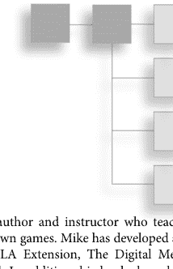

迈克尔·道森是一位游戏编程作家和讲师，教授学生们编写自己游戏的艺术与科学。迈克曾为加州大学洛杉矶分校继续教育学院、数字媒体学院和洛杉矶电影学院开发和教授游戏编程课程。此外，他的书籍已成为全国各地高校的必读教材。

迈克最初以制作人和设计师的身份进入游戏行业，但他也在一款冒险游戏中“出演”了主角——一个名叫迈克·道森的角色。在这款游戏中，玩家操控道森的数字化图像，他必须在外星胚胎从他的头颅中诞生之前阻止外星入侵。

在现实生活中，迈克是《通过游戏编程学C++》《Python编程入门》《C++项目：基于文本游戏的编程》和《Python编程指南》的作者。他获得了南加州大学计算机科学学士学位。访问他的网站 www.programgames.com 了解更多信息或获取他任何书籍的支持。

## 引言

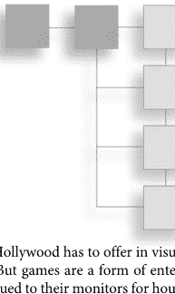

尖端电脑游戏在视觉效果、配乐和纯粹的肾上腺素刺激方面可以与好莱坞最优秀的作品相媲美。但游戏是一种与众不同的娱乐形式；它们能让玩家一连数小时目不转睛地盯着屏幕。游戏之所以与众不同、令人如此沉迷，在于其交互性。在电脑游戏中，你不仅仅是坐在那里观看一位英雄孤军奋战，你就是那位英雄。

实现这一交互性的关键在于编程。正是编程让一个外星生物、一支攻击中队或整支军队能在不同情况下对玩家做出不同的反应。通过编程，游戏的故事可以以新的方式展开。事实上，作为编程的结果，游戏能够以游戏创造者可能从未想象过的方式对玩家做出回应。

尽管计算机编程语言成千上万，C++仍是游戏行业的标准。如果你走进钟爱商店的PC游戏区，随手拿起一款游戏，那么极有可能你手中的游戏大部分或全部是用C++编写的。归根结底：如果你想专业地编写电脑游戏，就必须掌握C++。

本书的目标是从游戏编程的角度向你介绍C++语言。虽然没有哪一本书能让你同时精通C++和游戏编程这两个深奥的主题，但本书将开启你的旅程。

此页故意留白

## 在游戏中使用C++

游戏程序员选择C++的原因有很多。以下列举几点：

- **它很快。** 编写良好的C++程序可以快到惊人。C++的设计目标之一就是性能。如果你需要从程序中挤出更多性能，C++允许你使用*汇编语言*——这种最低级别、人类可读的编程语言——直接与计算机硬件通信。
- **它很灵活。** C++是一种多范式语言，支持不同的编程风格，包括*面向对象编程*。不过，与其他一些现代语言不同，C++不会将某种特定风格强加给程序员。
- **它支持良好。** 由于在游戏行业有着悠久的历史，C++游戏程序员可以利用大量资源，包括图形API以及2D、3D、物理和声音引擎。所有这些现成的代码都可以被C++程序员利用，从而大大加快编写新游戏的过程。

## 创建可执行文件

你用来启动程序的文件——无论是一款游戏还是一个商业应用程序——就是*可执行文件*。从C++*源代码*（用C++语言编写的一系列指令）创建可执行文件需要几个步骤。该过程如图1.1所示。

- 1. 首先，程序员使用*编辑器*编写C++源代码，这种文件通常具有`.cpp`扩展名。编辑器就像是程序的文字处理器；它允许程序员创建、编辑和保存源代码。
- 2. 程序员保存源文件后，调用C++*编译器*——一种读取源代码并将其转换为*目标文件*的应用程序。目标文件通常具有`.obj`扩展名。
- 3. 接下来，链接器根据需要将目标文件与任何外部文件链接，然后创建可执行文件，该文件通常以扩展名


工具。Windows上一个流行（且免费）的IDE是微软的Visual C++ Express Edition。你可以在 http://www.microsoft.com/express/ 找到关于这个IDE的更多信息（并下载一份副本）。

## 处理错误

在我描述从C++源码创建可执行文件的过程时，我漏掉了一个小细节——错误。如果犯错是人的天性，那么程序员就是我们之中最人性化的一群。即使是最好的程序员，第一次（或第五次）写出的代码也会产生错误。程序员必须修复错误，然后重新开始整个流程。以下是你用C++编程时将会遇到的基本错误类型：

- **编译错误。**这些错误发生在代码编译期间。结果是，不会生成目标文件。这些错误可能是*语法错误*，意味着编译器无法理解某些内容。它们通常由像拼写错误这样简单的问题引起。编译器也会发出警告。虽然你通常不必理会警告，但你应该把它们当作错误来处理，修复它们，然后重新编译。
- **链接错误。**这些错误发生在链接过程中，可能表明程序引用的某些外部内容找不到。这些错误通常通过调整有问题的引用并重新启动编译/链接过程来解决。
- **运行时错误。**这些错误发生在可执行文件运行时。如果程序做了非法操作，它可能会突然崩溃。但一种更微妙的运行时错误——*逻辑错误*——会让程序以非预期的方式运行。如果你玩过某个游戏，里面一个角色在空中行走（也就是说，一个本不该能在空中行走的角色），那你就亲眼见过逻辑错误了。

## 现实世界

和其他软件创作者一样，游戏公司努力生产没有缺陷的产品。他们的最后一道防线是质量保证人员（游戏测试员）。游戏测试员以玩游戏为生，但他们的工作并不像你想象的那么有趣。测试员必须一遍又一遍地玩游戏中的相同部分——可能数百次——尝试意想不到的操作，并一丝不苟地记录任何异常情况。除了枯燥的工作之外，薪水也不高。但成为一名测试员是进入游戏公司的一个绝佳途径，可以说是从最底层做起。

## 注释代码

程序的前两行是注释。

```
// Game Over
// A first C++ program
```

编译器完全忽略注释；它们是给人类看的。它们可以帮助其他程序员理解你的意图。但注释也可以帮助你自己。它们可以提醒你，自己是如何实现某个乍一看不太明了的功用的。

你可以使用两个连续的斜杠（//）创建注释。这之后的物理行上的任何内容都被视为注释的一部分。这意味着你也可以在同一行的C++代码之后添加注释。

## 提示

你还可以使用所谓的C风格注释，它可以跨越多行。你只需用`/*`开始注释，用`*/`结束注释。两个标记之间的所有内容都是注释的一部分。

## 使用空白

程序中的下一行是一个空行。编译器忽略空行。事实上，编译器忽略几乎所有空白——空格、制表符和换行符。像注释一样，空白也只是为我们人类服务的。

明智地使用空白有助于使程序更清晰。例如，你可以使用空行来分隔应该放在一起的代码段。我还在两个花括号之间的两行开头使用了空白（确切地说是制表符）来将它们区分开。

## 包含其他文件

程序中的下一行是一个预处理指令。你知道这一点是因为该行以`#`符号开头。

```
#include <iostream>
```

预处理器在编译器执行其工作之前运行，并根据各种指令替换文本。在这种情况下，这一行涉及`#include`指令，它告诉预处理器包含另一个文件的内容。

我使用输出运算符（`<<`）将字符串发送到`cout`。你可以把输出运算符想象成一个漏斗；它接受开口端的任何内容，并将其漏斗到尖头端。因此，字符串被漏斗到标准输出——屏幕。

我使用`std`作为`cout`的前缀，告诉编译器我指的是标准库中的`cout`。`std`是一个命名空间。你可以把命名空间想象成电话号码的区号——它标识某事物属于哪个组。你使用作用域解析运算符（`::`）来添加命名空间前缀。

最后，我将`std::endl`发送到标准输出。`endl`在`iostream`中定义，也是`std`命名空间中的一个对象。将`endl`发送到标准输出，就像在控制台窗口中按下回车键。事实上，如果我向控制台窗口发送另一个字符串，它会出现在下一行。

我知道这可能信息量有点大，所以请查看图1.3，它直观地展示了我刚才描述的所有元素之间的关系。

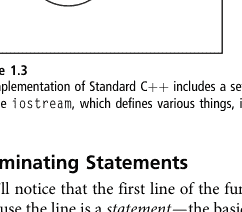

图1.3
标准C++的一种实现包括一组称为标准库的文件，其中包含文件`iostream`，它定义了各种内容，包括对象`cout`。

## 终止语句

你会注意到函数的第一行以分号（;）结尾。那是因为这一行是一条语句——控制执行流程的基本单元。所有语句都必须以分号结尾——否则，你的编译器会报错，你的程序将无法编译。

## 从main()返回值

函数中的最后一条语句将0返回给操作系统。

```
return 0;
```

从`main()`返回0是一种表示程序无问题结束的方式。操作系统不需要对该返回值做任何处理。通常，你可以像我这里一样简单地返回0。

## 技巧

当你运行Game Over程序时，你可能只会看到一个控制台窗口出现后立刻又消失。那是因为C++速度太快了，它打开一个控制台窗口，显示Game Over!，然后在一瞬间关闭窗口。不过，在Windows中，你可以创建一个批处理文件来运行你的控制台程序并暂停，使控制台窗口保持打开，这样你就能看到程序的运行结果。由于编译后的程序名为`game_over.exe`，你只需创建一个包含以下两行的批处理文件：

```
game_over.exe
pause
```

要创建批处理文件：

- 1. 打开一个文本编辑器，比如记事本（不要用Word或WordPad）。
- 2. 输入你的文本。
- 3. 以.bat扩展名保存文件，例如`game_over.bat`。

最后，通过双击其图标运行批处理文件。你应该能看到程序的结果，因为批处理文件会让控制台窗口保持打开。

## 使用 std 命名空间

由于从`std`命名空间中使用元素非常常见，我将向你展示两种直接访问这些元素的不同方法。这将省去你一直使用`std::`前缀的麻烦。

## 介绍Game Over 2.0程序

Game Over 2.0程序产生了与原始Game Over程序完全相同的结果，如图1.2所示。但在访问`std`命名空间元素的方式上有所不同。你可以下载代码：

```cpp
#include <iostream>
using std::cout;
using std::endl;

int main()
{
    cout << "Game Over!" << endl;
    return 0;
}
```

## 使用using声明

在这个版本中，我写了两条using声明。

```cpp
using std::cout;
using std::endl;
```

通过明确声明我想在当前程序中局部使用的`std`命名空间中的元素，我就能直接访问它们，就像在Game Over 2.0中那样。虽然这比using指令需要更多的输入，但这种技术的优点是它清楚地指明了我要使用的元素。此外，它不会把一堆我根本不打算使用的其他元素设为局部。

## 了解何时使用using

好了，你已经看到了两种将命名空间中的元素设为程序局部的方式。但哪种技术最好呢？

语言纯粹主义者会说，你不应该使用using的任一版本，而应该总是用其标识符来为命名空间中的每个元素加前缀。在我看来，那就好像总是用全名来称呼你最好的朋友一样。感觉有点太正式了。

如果你讨厌打字，可以使用using指令。一个不错的折中方案是使用using声明。在本书中，为了简洁起见，我大多数时候会使用using指令。

## 现实世界

> 我已经列出了几种处理命名空间的不同选项。我也尝试解释了每种选项的优点，这样你可以决定在自己的程序中采用哪种方式。但最终，这个决定可能并不由你掌控。当你在一个项目上工作时，无论是在课堂上还是在职场中，你可能会收到由……制定的编码标准。


负责人。不管你个人的喜好如何，最好还是听从那些发放成绩或薪水的人。

## 使用算术运算符

无论你是在统计击杀的敌人数量还是降低玩家的生命值，你都需要程序进行一些数学运算。与其他语言一样，C++ 具有内置的算术运算符。

### 介绍 Expensive Calculator 程序

大多数认真的电脑游戏玩家都会在尖端、高性能的游戏主机上投入大量资金。下一个程序 Expensive Calculator 可以将这台庞然大物变成一个简单的计算器。该程序演示了内置算术运算符。图 1.4 展示了结果。

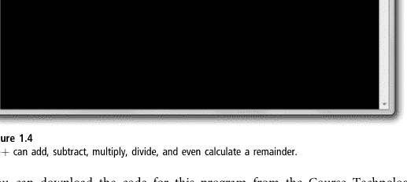

图 1.4
C++ 可以进行加法、减法、乘法、除法，甚至可以计算余数。

你可以从 Course Technology 网站 (www.courseptr.com/downloads) 下载此程序的代码。该程序位于第 1 章文件夹中；文件名是 expensive_calculator.cpp。

// 昂贵计算器
// 演示内置算术运算符

```cpp
#include <iostream>
using namespace std;

int main()
{
    cout << "7 + 3 = " << 7 + 3 << endl;
    cout << "7 - 3 = " << 7 - 3 << endl;
    cout << "7 * 3 = " << 7 * 3 << endl;

    cout << "7 / 3 = " << 7 / 3 << endl;
    cout << "7.0 / 3.0 = " << 7.0 / 3.0 << endl;

    cout << "7 % 3 = " << 7 % 3 << endl;

    cout << "7 + 3 * 5 = " << 7 + 3 * 5 << endl;
    cout << "(7 + 3) * 5 = " << (7 + 3) * 5 << endl;

    return 0;
}
```

### 加法、减法和乘法

我使用内置算术运算符进行加法（加号，+）、减法（减号，-）和乘法（星号，*）。图 1.4 中显示的结果正是你所期望的。

每个算术运算符都是表达式的一部分——表达式会求值得到单个值。例如，表达式 7 + 3 的求值结果为 10，这就是发送给 cout 的内容。

### 理解整数和浮点除法

除法的符号是正斜杠（/），所以我在下一行代码中使用它。然而，输出可能会让你感到惊讶。根据 C++（以及那台昂贵的游戏主机），7 除以 3 等于 2。怎么回事？好吧，仅涉及整数（没有小数部分数字）的任何算术计算结果始终是另一个整数。由于 7 和 3 都是整数，结果必须是整数。结果的小数部分会被丢弃。

要得到包含小数部分的结果，至少其中一个值需要是浮点数（带小数部分的数字）。我在下一行用表达式 7.0 / 3.0 演示了这一点。这次结果更准确，为 2.33333。

### 陷阱

你可能会注意到，虽然 7.0 / 3.0（2.33333）的结果包含小数部分，但它仍然被截断了。（真正的結果在小数点后会无限延伸 3。）重要的是要知道计算机通常只存储浮点数的有限数量的有效数字。然而，C++ 提供了浮点数类别，以满足最苛刻的需求——甚至包括计算密集型 3D 游戏的需求。

### 使用取模运算符

在下一个语句中，我使用了一个可能不熟悉你的运算符——取模运算符（%）。取模运算符返回整数除法的余数。在这种情况下，7 % 3 产生 7 / 3 的余数，即 1。

### 理解运算顺序

就像代数一样，C++ 中的算术表达式从左到右求值。但某些运算符的优先级高于其他运算符，并且无论位置如何都会先求值。乘法、除法和取模具有相同的优先级，其优先级高于加法和减法共享的优先级级别。

下一行代码提供了一个示例来帮助理解这一点。因为乘法的优先级高于加法，所以你先计算乘法的结果。因此表达式 7 + 3 * 5 等价于 7 + 15，求值结果为 22。

如果你希望优先级较低的操作先执行，可以使用括号，括号的优先级高于任何算术运算符。因此在下一个语句中，表达式 (7 + 3) * 5 等价于 10 * 5，求值结果为 50。

### 提示

有关 C++ 运算符及其优先级列表，请参阅附录 B。

## 声明和初始化变量

变量代表计算机内存中为你专门划分出来的一块区域，用于存储、检索和操作数据。因此，如果你想跟踪玩家的分数，你可以为其创建一个变量，然后检索分数以显示它。当玩家从天空中击毁外星敌人时，你也可以更新分数。

### 介绍 Game Stats 程序

Game Stats 程序显示了你在太空射击游戏中可能想要跟踪的信息，例如玩家的分数、玩家摧毁的敌人数量以及玩家是否开启护盾。该程序使用一组变量来实现所有这些功能。图 1.5 说明了该程序。

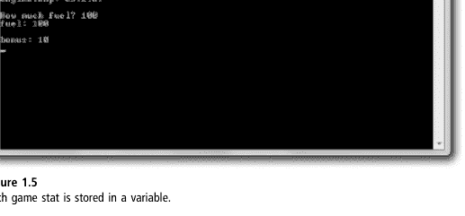

图 1.5
每个游戏统计数据都存储在一个变量中。

你可以从 Course Technology 网站 (www.courseptr.com/downloads) 下载此程序的代码。该程序位于第 1 章文件夹中；文件名是 game_stats.cpp。

// 游戏统计
// 演示声明和初始化变量

```cpp
#include <iostream>
using namespace std;

int main()
{
    int score;
    double distance;
    char playAgain;
    bool shieldsUp;

    short lives, aliensKilled;

    score = 0;
    distance = 1200.76;
    playAgain = 'y';
    shieldsUp = true;
    lives = 3;
    aliensKilled = 10;

    double engineTemp = 6572.89;

    cout << "\nscore: "      << score << endl;
    cout << "distance: "    << distance << endl;
    cout << "playAgain: "   << playAgain << endl;
    //skipping shieldsUp since you don't generally print Boolean values
    cout << "lives: "       << lives << endl;
    cout << "aliensKilled: "<< aliensKilled << endl;
    cout << "engineTemp: "  << engineTemp << endl;

    int fuel;
    cout << "\nHow much fuel? ";
    cin >> fuel;
    cout << "fuel: " << fuel << endl;

    typedef unsigned short int ushort;
    ushort bonus = 10;
    cout << "\nbonus: " << bonus << endl;

    return 0;
}
```

### 理解基本类型

你创建的每个变量都有一个类型，表示可以存储在变量中的信息种类。它告诉编译器为变量分配多少内存，并定义了可以合法地对变量执行的操作。

基本类型——那些完全内置于语言的类型——包括 bool 用于布尔值（true 或 false），char 用于单个字符值，int 用于整数，float 用于单精度浮点数，以及 double 用于双精度浮点数。

### 理解类型修饰符

你可以使用修饰符来改变类型。short 是一个可以减少变量可容纳的值总数 的修饰符。long 是一个可以增加变量可容纳的值总数 的修饰符。short 可能减少变量所需的存储空间，而 long 可能增加它。short 和 long 可以修饰 int。long 也可以修饰 double。

signed 和 unsigned 是仅适用于整数类型的修饰符。signed 表示变量可以存储正值和负值，而 unsigned 表示变量只能存储正值。signed 和 unsigned 都不会改变变量可容纳的值总数；它们只改变值的范围。signed 是整数类型的默认值。

好吧，被所有的类型选项弄糊涂了吗？别担心。表 1.1 总结了常用的类型，并加入了一些修饰符。该表还为每种类型提供了值的范围。

> 陷阱
> 列出的值范围基于我的编译器。你的可能不同。请查看编译器的文档。

> 提示
> 为了简洁，short int 可以简写为 short，long int 可以简写为 long。


表1.1 常用类型

| 类型 | 值 |
|------|--------|
| short int | -32,768 到 32,767 |
| unsigned short int | 0 到 65,535 |
| int | -2,147,483,648 到 2,147,483,647 |
| unsigned int | 0 到 4,294,967,295 |
| long int | -2,147,483,648 到 2,147,483,647 |
| unsigned long int | 0 到 4,294,967,295 |
| float | 3.4E +/- 38（七位有效数字） |
| double | 1.7E +/- 308（15 位有效数字） |
| long double | 1.7E +/- 308（15 位有效数字） |
| char | 256 个字符值 |
| bool | true 或 false |

## 声明变量

好了，既然你已经对类型有了基本的了解，是时候回到程序了。我做的第一件事之一就是使用下面这行代码声明一个变量（请求创建它）：

```
int score;
```

在这段代码中，我声明了一个 `int` 类型的变量，并将其命名为 `score`。你可以使用变量名来访问该变量。你可以看到，声明变量时需要指定类型，后面跟上你选择的名称。由于声明是一条语句，因此必须以分号结尾。

在接下来的三行中，我又声明了三个不同类型的变量。`distance` 是 `double` 类型的变量，`playAgain` 是 `char` 类型的变量，而 `shieldsUp` 是 `bool` 类型的变量。

游戏（以及所有大型应用程序）通常需要大量变量。幸运的是，C++ 允许你在一条语句中声明多个相同类型的变量。这正是我接下来在这一行中所做的。

```
short lives, aliensKilled;
```

这行代码创建了两个 short 变量——`lives` 和 `aliensKilled`。

超过 15 个字符。不过，最终还是要由你的编译器设定实际的上限。

**技巧**

> 自文档化代码的编写方式使得在不依赖任何注释的情况下，也能轻松理解程序中发生的事情。选择好的变量名是迈向这类代码的绝佳一步。

## 给变量赋值

在下一组语句中，我为声明的六个变量赋值。我将讲解几个赋值语句，并稍微讨论每种变量类型。

### 给整型变量赋值

在下面的赋值语句中，我将值 0 赋给 score。现在 score 存储的是 0。给变量赋值的方法是：先写变量名，然后是赋值运算符（=），接着是一个表达式。（是的，从技术上讲，0 是一个表达式，它的计算结果就是 0。）

```
score = 0;
```

### 给浮点型变量赋值

在下面的语句中，我将值 1200.76 赋给 distance。由于 distance 是 double 类型，我可以用它存储带小数部分的数字，这正是我所做的。

```
distance = 1200.76;
```

### 给字符型变量赋值

在下面的语句中，我为 playAgain 赋予单字符值 'y'。就像我在这里做的，你可以用单引号将字符括起来，将其赋给 char 类型的变量。

```
playAgain = 'y';
```

char 类型的变量可以存储 128 个 ASCII 字符值（假设你的系统使用 ASCII 字符集）。ASCII 是 American Standard Code for Information Interchange（美国信息交换标准码）的缩写，是一种表示字符的代码。要查看完整的 ASCII 列表，请参阅附录 D。

### 给布尔型变量赋值

在下面的语句中，我将值 true 赋给 shieldsUp。

```
shieldsUp = true;
```

在我的程序中，这意味着玩家的护盾已开启。

shieldsUp 是一个 bool 变量，也就是布尔变量。因此，它可以表示 true 或 false。虽然这很有趣，但你需要等到第 2 章“真值、分支与游戏循环：猜猜我的数字”才能了解更多关于这类变量的信息。

## 初始化变量

你可以用一条初始化语句同时声明变量并为其赋值。这正是在下一步中我要做的。

```
double engineTemp = 6572.89;
```

这行代码创建了一个名为 engineTemp 的 double 类型变量，存储的值是 6572.89。

就像你可以在一条语句中声明多个变量一样，你也可以在一条语句中初始化多个变量。你甚至可以在一条语句中声明并初始化不同的变量。随心所欲地混合搭配吧！

**提示**

> 虽然你可以声明一个变量而不给它赋值，但最好尽可能用初始值来初始化新变量。这会让你的代码更清晰，同时消除了访问未初始化变量的可能性，未初始化的变量可能包含任何值。

## 显示变量值

要显示基本类型变量的值，只需将其发送到 cout。这就是我接下来在程序中要做的。注意，我没有尝试显示 shieldsUp，因为通常不会显示 bool 值。

**技巧**

在本节的第一条语句中，我使用了一种叫作转义序列的东西——一对以反斜杠（\）开头的字符，用于表示特殊的可打印字符。

```
cout << "\nscore: " << score << endl;
```

我使用的转义序列是 \n，表示换行。当它作为字符串的一部分发送到 cout 时，就像在控制台窗口中按下了 Enter 键。另一个有用的转义序列是 \t，相当于 Tab 键。

你还可以使用其他转义序列。有关转义序列的列表，请参阅附录 E。

## 获取用户输入

给变量赋值的另一种方式是通过用户输入。接下来，我根据用户的输入为新变量 fuel 赋值。为此，我使用下面这行代码：

```
cin >> fuel;
```

和 cout 一样，cin 是定义在 iostream 中的对象，位于 std 命名空间中。要将值存储到变量中，我使用 cin，后跟 >>（提取运算符），再跟变量名。你也可以使用 cin 和提取运算符将用户输入获取到其他基本类型的变量中。为了证明一切正常，我将 fuel 显示给用户。

## 为类型定义新名称

你可以为现有类型定义一个新名称。事实上，这正是我接下来在这行代码中所做的：

```
typedef unsigned short int ushort;
```

这段代码将标识符 ushort 定义为类型 unsigned short int 的另一个名称。要为现有类型定义新名称，请使用 typedef，后跟当前类型，再跟新名称。typedef 通常用于为名称较长的类型创建更短的名称。

你可以像使用原始类型一样使用新类型名。我初始化了一个名为 bonus 的 ushort 变量（实际上就是 unsigned short int）并显示其值。

## 了解该使用哪些类型

在基本类型方面，你有很多选择。那么，你怎么知道该使用哪种类型呢？好吧，如果你需要整数类型，最好使用 int。这是因为 int 通常以计算机能最有效处理的内存大小来实现。如果你需要表示大于 int 最大值的整数值，或者永远不为负的值，可以放心使用 unsigned int。

如果内存紧张，你可以使用需要较少存储空间的类型。然而，在大多数计算机上，内存不应成为大问题。（在游戏机或移动设备上编程则是另一回事。）

最后，如果你需要浮点数，最好使用 float，它同样可能以计算机能最有效处理的内存大小来实现。

## 使用变量执行算术运算

一旦你有了带值的变量，你会在游戏过程中需要更改它们的值。你可能想为击败 Boss 的玩家增加分数奖励，从而提高分数。或者你可能想降低气闸舱中的氧气水平。通过使用你已经见过的运算符（以及一些新的运算符），你可以实现所有这些。

### 介绍 Game Stats 2.0 程序

Game Stats 2.0 程序操作表示游戏统计数据的变量并显示结果。图 1.6 展示了该程序的运行情况。

你可以从 Course Technology 网站（www.courseptr.com/downloads）下载此程序的代码。该程序位于第 1 章文件夹中；文件名是 game_stats2.cpp。

```cpp
// Game Stats 2.0
// Demonstrates arithmetic operations with variables

#include <iostream>
using namespace std;
```

算术运算（此处为加法）与赋值相结合。该运算符是下面这句话的简写：“将右侧的值加到左侧的值上，并把结果赋回左侧。”

对于你见过的所有算术运算符，都有对应的组合赋值运算符版本。要查看列表，请参阅表 1.2。

表 1.2 组合赋值运算符

| 运算符 | 示例 | 等价于 |
|---|---|---|
| += | x += 5; | x = x + 5; |
| -= | x -= 5; | x = x - 5; |
| *= | x *= 5; | x = x * 5; |
| /= | x /= 5; | x = x / 5; |
| %= | x %= 5; | x = x % 5; |

## 使用自增和自减运算符

接下来，我使用自增运算符（++），它使变量的值增加 1。我使用该运算符将 lives 的值增加两次。首先在下面一行中使用它：

```
++lives;
```

然后在下面一行中再次使用它：

```
lives++;
```

每一行产生的净效果相同；它将 lives 从 3 增加到 4。

如你所见，你可以将运算符放在要递增的变量的前面或后面。当你把运算符放在变量前面时，该运算符称为前缀自增运算符；当你把它放在变量后面时，则称为后缀自增运算符。

此时，你可能会认为后缀版本和前缀版本没有区别，但那就错了。在只递增单个变量的情况下（正如你刚才看到的），两个运算符产生相同的最终结果。但在更复杂的表达式中，结果可能不同。

为了演示这一重要区别，我执行一个适合游戏关卡结束时的计算。我根据数量计算奖励

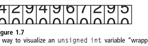

图 1.7
一种可视化 *unsigned int* 变量从最大值“回绕”到最小值的方式。

### 提示

务必选择一个范围足够大的整数类型，以适应其预期用途。

## 使用常量

*常量*是一个你命名后不可更改的值。当你有一个在程序中频繁出现的不变值时，常量非常有用。例如，如果你正在编写一个太空射击游戏，每个从天空中击落的外星人值 150 分，你可以定义一个名为 `ALIEN_POINTS` 的常量，等于 150。然后，任何时候你需要一个外星人的分值，都可以使用 `ALIEN_POINTS` 而不是字面量 150。

常量提供两个重要好处。首先，它们使程序更清晰。一旦看到 `ALIEN_POINTS`，你就知道它是什么意思。如果你查看一些代码并看到 150，你可能不知道这个值代表什么。其次，常量使修改变得容易。例如，假设你对游戏进行了一些试玩测试，并决定每个外星人应该值 250 分。使用常量，你只需更改程序中 `ALIEN_POINTS` 的初始化。如果没有常量，你将不得不找出每一个出现 150 的地方并改为 250。

### 介绍 Game Stats 3.0 程序

Game Stats 3.0 程序使用常量来表示值。首先程序计算玩家的分数，然后计算策略游戏中一个单位的升级成本。图 1.8 显示了结果。

你可以从 Course Technology 网站（www.courseptr.com/downloads）下载此程序的代码。程序位于 Chapter 1 文件夹中；文件名是 `game_stats3.cpp`。

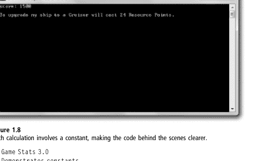

图 1.8

每项计算都涉及一个常量，使幕后的代码更清晰。

```
// Game Stats 3.0
// Demonstrates constants

#include <iostream>
using namespace std;

int main()
{
    const int ALIEN_POINTS = 150;
    int aliensKilled = 10;
    int score = aliensKilled * ALIEN_POINTS;
    cout << "score: " << score << endl;

    enum difficulty {NOVICE, EASY, NORMAL, HARD, UNBEATABLE};
    difficulty myDifficulty = EASY;

    enum shipCost {FIGHTER_COST = 25, BOMBER_COST, CRUISER_COST = 50};
    shipCost myShipCost = BOMBER_COST;
    cout << "\nTo upgrade my ship to a Cruiser will cost "
         << (CRUISER_COST - myShipCost) << " Resource Points.\n";

    return 0;
}
```

### 使用常量

我定义一个常量 `ALIEN_POINTS` 来表示一个外星人的分值。

```
const int ALIEN_POINTS = 150;
```

我只是使用关键字 `const` 来修改定义。现在我可以像使用任何整数字面量一样使用 `ALIEN_POINTS`。另外，注意我为常量选择的名字全部大写。这只是一种约定，但很常见。全大写的标识符告诉程序员它表示一个常量值。

接下来我将该常量用在下面一行：

```
int score = aliensKilled * ALIEN_POINTS;
```

我通过将击杀的外星人数乘以每个外星人的分值来计算玩家的分数。在这里使用常量使这行代码非常清晰。

### 陷阱

> 你不能给常量赋新值。如果你尝试，会产生编译错误。

### 使用枚举

枚举是一组无符号整型常量，称为枚举器。通常枚举器是相关的并具有特定顺序。这里是一个枚举示例：

```
enum difficulty {NOVICE, EASY, NORMAL, HARD, UNBEATABLE};
```

这定义了一个名为 difficulty 的枚举。默认情况下，枚举器的值从零开始，每次加一。所以 NOVICE 是 0，EASY 是 1，NORMAL 是 2，HARD 是 3，UNBEATABLE 是 4。要定义自己的枚举，使用关键字 enum，后跟标识符，再后跟花括号中的枚举器列表。

接下来我创建一个这种新枚举类型的变量。

```
difficulty myDifficulty = EASY;
```

变量 myDifficulty 被设置为 EASY（等于 1）。myDifficulty 的类型是 difficulty，所以它只能保存枚举中定义的值之一。这意味着 myDifficulty 只能被赋值为 NOVICE、EASY、NORMAL、HARD、UNBEATABLE、0、1、2、3 或 4。

接下来我定义另一个枚举。

```
enum shipCost {FIGHTER_COST = 25, BOMBER_COST, CRUISER_COST = 50};
```

这行代码定义了枚举 shipCost，它表示策略游戏中三种飞船的资源点成本。在其中，我向某些枚举器赋予了特定的整数值。这些数字代表每艘飞船的资源点值。如果你愿意，可以给枚举器赋值。任何未被赋值的枚举器，其值等于前一个枚举器的值加一。因为我没有给 BOMBER_COST 赋值，所以它被初始化为 26。

接下来我定义这种新枚举类型的一个变量。

```
shipCost myShipCost = BOMBER_COST;
```

然后我演示如何在算术计算中使用枚举器。

```
(CRUISER_COST - myShipCost)
```

这段代码计算将 Bomber 升级为 Cruiser 的成本。计算等同于 50 - 26，结果为 24。

## 介绍 Lost Fortune

本章的最后一个项目 Lost Fortune 是一个个性化冒险游戏，玩家输入几条信息，计算机使用这些信息来增强一个基本的冒险故事。图 1.9 显示了一个示例运行。

我不会一次性展示所有代码，而是一节一节地介绍。你可以从 Course Technology 网站（www.courseptr.com/downloads）下载此程序的代码。程序位于 Chapter 1 文件夹中；文件名是 lost_fortune.cpp。

### 设置程序

首先我创建一些初始注释，引入两个必要的文件，并编写几条 using 指令。

```
// Lost Fortune
// A personalized adventure

#include <iostream>
#include <string>

using std::cout;
using std::cin;
using std::endl;
using std::string;
```

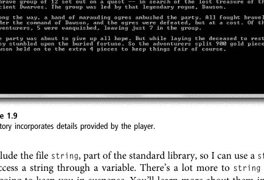

图 1.9
故事融入了玩家提供的细节。

我引入了标准库中的 string 文件，这样我就可以使用字符串对象通过变量来访问字符串。字符串对象还有很多内容，但我先卖个关子。你将在第 3 章“for 循环、字符串和数组：Word Jumble”中了解更多。

另外，我使用 using 指令来明确列出我计划访问的 std 命名空间中的对象。这样，你可以清楚地看到 string 位于命名空间 std 中。

### 获取玩家信息

接下来我从玩家那里获取一些信息。

```
int main()
{
    const int GOLD_PIECES = 900;
    int adventurers, killed, survivors;
    string leader;
```

## 我不想杀了你

ARTHUR BRYANT，GreenLeaf Industries 的一名年轻经理，有一个问题：他通常友善健谈的老板 Reginald 变得沉默而敌对。在一次紧张的早晨会议后，Arthur 发现 Reginald 计划解雇他。当他在咖啡店 overhear 两名警察提到名字 “Reginald” 以及对公司一系列盗窃案的调查时，Arthur意识到他的老板是刑事调查的目标。当 Arthur 跨越房间注视着 Reginald 时，两人分享了一刻相互理解的时刻，Arthur 知道他必须决定是否揭发他的老板，或保护他已学会尊重的男人。

当晚，Arthur 发现自己独自一人待在公寓里，反复回想他 overhear 的对话。Reginald 真的是个小偷吗？这似乎不可能。那个人是从零开始建立了 GreenLeaf，把一生都倾注在公司里。然而证据就在那里，坐在 Arthur 思维的后方，像一块他无法吞咽的石头。

Arthur 的手机震动了。是 Reginald 发来的短信：“你是对的。我对你不公平。我们能出来喝咖啡吗？” Arthur 盯着这条消息，他的手指悬在回复按钮上方。他的直觉告诉他要信任 Reginald，但他的头脑提醒他警察的话。

他输入：“好的。老地方，晚上7点。”

在咖啡店，Reginald 看起来比 Arthur 记得的老了。他的肩膀在夹克下似乎更沉重了。他们点了单，长久的一刻谁也没有说话。

“我知道调查的事，” Arthur 轻声说。“我听到两个警察在谈论。”

Reginald 的叉子撞击着他的盘子。“那你知道了。我希望在事情传开前亲自告诉你。公司出了问题，Arthur。不仅仅是财务问题——那种会跟你回家、夜夜缠着你的问题。” 他停顿，揉着太阳穴。“我没有偷，至少不是他们想的那样。我犯了错误，很糟糕的错误，但我从来没想伤害任何人。”

Arthur 观察着他老板的手，它们在咖啡杯周围颤抖。他想起那个曾经加班到很晚帮助他准备演示的人，Arthur 母亲住院时寄来水果篮的人。这就是同一个人，他告诉自己。就是上个月给他写生日卡的同一双手。

# 第2章

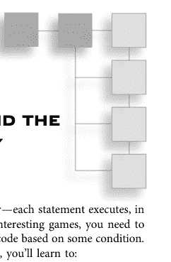

### 真相、分枝与游戏循环：猜数字

到目前为止，你所看到的程序都是线性的——每个语句按顺序从上到下执行。然而，要创建有趣的游戏，你需要编写根据某些条件执行（或跳过）代码段的程序。这就是本章的主要主题。具体来说，你将学习：
- 理解真值（按 C++ 的定义）
- 使用 if 语句分枝到代码段
- 使用 switch 语句选择要执行的代码段
- 使用 while 和 do 循环重复代码段
- 生成随机数

### 理解真值

就 C++ 而言，真值是非黑即白的。你可以用相应的关键字 true 和 false 表示真和假。你可以用 bool 变量存储这种布尔值，就像你在第 1 章看到的那样。这里有一个快速复习：

```
bool fact = true, fiction = false;
```

这段代码创建了两个 bool 变量，fact 和 fiction。fact 为 true 而 fiction 为 false。虽然关键字 true 和 false 很方便，但任何表达式或

### 介绍评分程序

Score Rater 程序使用 if 语句对玩家的分数进行评论。图 2.1 显示了程序的运行情况。

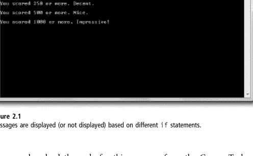

图 2.1
消息会根据不同的 if 语句显示（或不显示）。

你可以从 Course Technology 网站 (www.courseptr.com/downloads) 下载此程序的代码。该程序位于第 2 章文件夹中；文件名是 score_rater.cpp。

```cpp
// Score Rater
// Demonstrates the if statement

#include <iostream>
using namespace std;

int main()
{
    if (true)
    {
        cout << "This is always displayed.\n\n";
    }
```

### 使用关系运算符

你在使用 if 语句时最常见的表达式涉及使用关系运算符比较值。这就是我接下来要演示的。我测试分数是否大于或等于 250。

```
if (score >= 250)
{
    cout << "You scored 250 or more. Decent.\n\n";
}
```

因为 score 为 1000，所以该块被执行，显示玩家获得不错分数的消息。如果 score 低于 1000，该块将被跳过，程序将继续执行块之后的语句。

### 陷阱

等于关系运算符是 ==（两行等号）。不要将其与 =（一个等号）混淆，后者是赋值运算符。

虽然使用赋值运算符代替等于关系运算符并不违法，但结果可能不是你期望的。看看这段代码：

```
int score = 500;
if (score = 1000)
{
    cout << " You scored 1000 or more. Impressive!\n";
}
```

作为这段代码的结果，score 被设为 1000，并且消息 “You scored 1000 or more. Impressive!” 被显示。发生了什么：虽然 if 语句之前 score 为 500，但这会改变。当 if 语句的表达式 (score = 1000) 被求值时，score 被赋值为 1000。赋值语句求值为 1000，因为这是一个非零值，所以表达式被解释为 true。因此字符串被显示。

要警惕这种类型的错误。很容易犯，而且在某些情况下（如这种情况），它不会导致编译错误。

### 嵌套 if 语句

if 语句可以使程序执行一个语句或一组语句，包括其他 if 语句。当你在一个 if 语句内编写另一个 if 语句时，就称为嵌套。在下面的代码中，以 if (score >= 1000) 开始的 if 语句嵌套在以 if (score > 500) 开始的 if 语句内部。

```
if (score >= 500)
{
    cout << "You scored 500 or more. Nice.\n\n";
    
    if (score >= 1000)
    {
        cout << "You scored 1000 or more. Impressive!\n";
    }
}
```

因为 score 大于 500，程序进入语句块并显示消息 “You scored 500 or more. Nice.” 然后，在内部的 if 语句中，程序将 score 与 1000 进行比较。因为 score 大于或等于 1000，程序显示消息 “You scored 1000 or more. Impressive!”

### 提示

你可以嵌套任意多层。然而，如果你嵌套代码太深，就很难阅读。一般来说，你应该尽量将嵌套限制在最多几层。

### 使用 ELSE 子句

你可以为 if 语句添加 else 子句，以提供在测试表达式为假时执行的代码。这里是包含 else 子句的 if 语句的形式：

```
if (expression)
    statement1;
else
    statement2;
```

如果 expression 为真，则执行 statement1。然后程序跳过 statement2 并执行 if 套件之后的语句。如果 expression 为假，则跳过 statement1 并执行 statement2。statement2 完成后，程序执行 if 套件之后的语句。

### 介绍 Score Rater 2.0 程序

Score Rater 2.0 程序也对用户输入的分数进行评级。但这次，程序使用带有 else 子句的 if 语句。图 2.2 和 2.3 显示了程序根据用户输入的分数可能显示的两种不同消息。

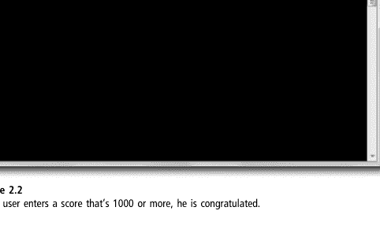

图 2.2
如果用户输入的分数为 1000 或以上，他会受到祝贺。

你可以从 Course Technology 网站 (www.courseptr.com/downloads) 下载此程序的代码。该程序位于第 2 章文件夹中；文件名是 score_rater2.cpp.

// Score Rater 2.0
// Demonstrates an else clause

#include <iostream>
using namespace std;

int main()
{
    int score;
    cout << "Enter your score: ";


```
cin >> score;

if (score >= 1000)
{
    cout << "You scored 1000 or more. Impressive!\n";
}
else
{
    cout << "You scored less than 1000.\n";
}

return 0;
}
```

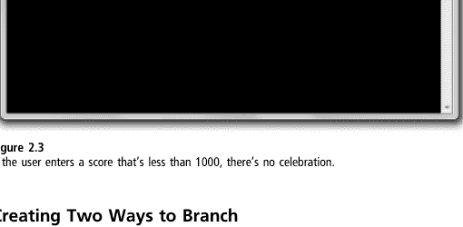

图 2.3
如果用户输入的分数小于 1000，就没有庆祝。

## 创建两种分支方式

你已经见过 if 语句的第一部分，它的工作方式与之前一样。如果 score 大于 1000，则会显示消息，“你获得了 1000 分或更多。令人印象深刻！”

```
if (score >= 1000)
{
    cout << "You scored 1000 or more. Impressive!\n";
}
```

这里有个转折。else 子句为程序在表达式为假时提供一个分支语句。因此，如果 (score >= 1000) 为假，则程序会跳过第一条消息，而改为显示消息，“你获得的分数小于 1000。”

```
else
{
    cout << "You scored less than 1000.\n";
}
```

## 使用带 else 子句的 if 语句序列

你可以将带有 else 子句的 if 语句链接在一起，以创建按顺序测试的表达式序列。第一个测试为真的表达式相关联的语句将被执行；否则，将运行最终（可选的）else 子句相关联的语句。下面是这样一系列的形式：

```
if (expression1)
    statement1;
else if (expression2)
    statement2;

...

else if (expressionN)
    statementN;
else
    statementN+1;
```

如果 expression1 为真，则执行 statement1 并跳过序列中剩余的代码。否则，测试 expression2，如果为真，则执行 statement2 并跳过序列中剩余的代码。计算机继续按顺序检查每个表达式（直到 expressionN），并执行第一个为真的表达式相关联的语句。如果没有任何表达式为真，则执行最终 else 子句相关联的语句 statementN+1。

## 介绍 Score Rater 3.0 程序

Score Rater 3.0 程序也对用户输入的分数进行评级。但这次，程序使用了一系列带有 else 子句的 if 语句。图 2.4 显示了程序的结果。

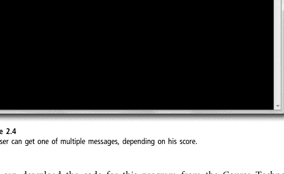

图 2.4
用户可以根据他的分数获得多条消息中的一条。

你可以从 Course Technology 网站 (www.courseptr.com/downloads) 下载此程序的代码。该程序位于第 2 章文件夹中；文件名是 score_rater3.cpp。

```
// Score Rater 3.0
// Demonstrates if else-if else suite

#include <iostream>
using namespace std;

int main()
{
    int score;
    cout << "Enter your score: ";
    cin >> score;
```

```
if (score >=1000)
{
    cout << "You scored 1000 or more. Impressive!\n";
}
else if (score >=500)
{
    cout << "You scored 500 or more. Nice.\n";
}
else if (score >=250)
{
    cout << "You scored 250 or more. Decent.\n";
}
else
{
    cout << "You scored less than 250. Nothing to brag about.\n";
}

return 0;
}
```

## 创建带 else 子句的 if 语句序列

你已经两次见过这个序列的第一部分，这次的工作方式也一样。如果 score 大于或等于 1000，则会显示消息，“你获得了 1000 分或更多。令人印象深刻！”并且计算机分支到 return 语句。

```
if (score >=1000)
```

然而，如果表达式为假，则我们知道 score 小于 1000，计算机将评估序列中的下一个表达式：

```
else if (score >=500)
```

如果 score 大于或等于 500，则会显示消息，“你获得了 500 分或更多。很不错。”并且计算机分支到 return 语句。然而，如果该表达式为假，则我们知道 score 小于 500，计算机将评估序列中的下一个表达式：

```
else if (score >=250)
```

如果 score 大于或等于 250，则会显示消息，“你获得了 250 分或更多。还不错。”并且计算机分支到 return 语句。

然而，如果该表达式为假，则我们知道 score 小于 250，与最终 else 子句相关联的语句将被执行，并显示消息，“你获得的分数小于 250。没有什么可炫耀的。”

> 提示
> 虽然 if else-if 结构中的最终 else 子句不是必需的，但你可以用它作为在序列中没有任何表达式为真时执行代码的一种方式。

## 使用 switch 语句

你可以使用 switch 语句在代码中创建多个分支点。下面是 switch 语句的通用形式：

```
switch (choice)
{
case value1:    statement1;
                break;
case value2:    statement2;
                break;
case value3:    statement3;
                break;
                .
                .
                .
case valueN:    statementN;
                break;
default:        statementN + 1;
}
```

switch 语句按顺序将 choice 与可能的值——value1、value2 和 value3——进行比较。如果 choice 等于某个值，则程序执行对应的语句。当程序遇到 break 语句时，它会退出 switch 结构。如果 choice 与任何值都不匹配，则执行可选的 default 相关联的语句。

break 和 default 的使用是可选的。然而，如果你省略了 break，程序将继续执行剩余的语句，直到遇到 break 或 default 或 switch 语句结束。通常你希望用一个 break 语句结束每个 case。

你可以从 Course Technology 网站 (www.courseptr.com/downloads) 下载此程序的代码。该程序位于第 2 章文件夹中；文件名是 menu_chooser.cpp。

```
// Menu Chooser
// Demonstrates the switch statement

#include <iostream>

using namespace std;

int main()
{
    cout << "Difficulty Levels\n\n";
    cout << "1 - Easy\n";
    cout << "2 - Normal\n";
    cout << "3 - Hard\n\n";

    int choice;
    cout << "Choice: ";
    cin >> choice;

    switch (choice)
    {
    case 1:
        cout << "You picked Easy.\n";
        break;
    case 2:
        cout << "You picked Normal.\n";
        break;
    case 3:
        cout << "You picked Hard.\n";
        break;
    default:
        cout << "You made an illegal choice.\n";
    }

    return 0;
}
```

## 创建多种分支方式

switch 语句创建了四个可能的分支点。如果用户输入 1，则执行与 case 1 相关联的代码并显示“你选择了简单”。如果用户输入 2，则执行与 case 2 相关联的代码并显示“你选择了普通”。如果用户输入 3，则执行与 case 3 相关联的代码并显示“你选择了困难”。如果用户输入任何其他值，则 default 触发并显示“你做出了非法选择”。

> **陷阱**
> 
> 你几乎总是希望用 `break` 语句结束每个 case。不要忘记它们；否则，你的代码可能会做一些你从未打算做的事情。

## 使用 while 循环

while 循环让你只要表达式为真就重复执行代码段。下面是 while 循环的通用形式：

```
while (expression)
    statement;
```

如果 expression 为假，程序将继续执行循环后的语句。如果 expression 为真，程序执行 statement 并循环回来再次测试 expression。这一循环会重复，直到 expression 测试为假，此时循环结束。

## 介绍 Play Again 程序

Play Again 程序模拟了一场激动人心的游戏的游玩。（好吧，通过“模拟激动人心的游戏的游玩”，我的意思是程序显示消息“**玩了一场激动人心的游戏**”。）然后程序询问用户是否想再次游玩。只要用户输入 y，他就会继续游玩。程序使用 while 循环实现这种重复。图 2.6 显示了程序的运行情况。

你可以从 Course Technology 网站 (www.courseptr.com/downloads) 下载此程序的代码。该程序位于第 2 章文件夹中；文件名是 play_again.cpp。


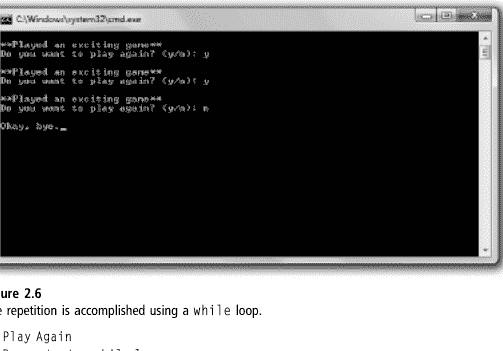

**图 2.6**

重复是通过 while 循环实现的。

```cpp
// Play Again
// Demonstrates while loops

#include <iostream>
using namespace std;

int main()
{
    char again = 'y';
    while (again == 'y')
    {
        cout << "\n**Played an exciting game**";
        cout << "\nDo you want to play again? (y/n): ";
        cin >> again;
    }

    cout << "\nOkay, bye.";

    return 0;
}
```

## 使用 while 循环进行循环

程序在 `main()` 函数中做的第一件事是声明名为 `again` 的 char 变量并将其初始化为 `'y'`。然后程序通过测试 `again` 是否等于 `'y'` 来开始 while 循环。因为是，程序显示消息“**玩了一场激动人心的游戏**”，询问用户是否想再次游玩，并将回复存储在 `again` 中。只要用户输入 y，循环就会继续。

你会注意到我必须在循环之前初始化 `again`，因为该变量在循环表达式中使用。因为 while 循环在循环体（重复的语句组）之前评估其表达式，所以你必须确保表达式中的任何变量在循环开始前都有值。

## 使用 do 循环

与 while 循环类似，do 循环允许你根据表达式重复一段代码。不同之处在于 do 循环在每次循环迭代后测试其表达式。这意味着循环体至少执行一次。这是一个 do 循环的通用形式：

```cpp
do
    statement;
while (expression);
```

程序执行 `statement`，然后只要 `expression` 测试为真，循环就重复。一旦 `expression` 测试为假，循环结束。

### 介绍 Play Again 2.0 程序

Play Again 2.0 程序对用户来说看起来与原始的 Play Again 程序完全相同。Play Again 2.0 与其前身一样，通过显示消息“**玩了一场激动人心的游戏**”并询问用户是否想再次游玩来模拟激动人心的游戏。只要用户输入 y，他就会继续游玩。不过这次，程序使用 do 循环来实现重复。图 2.7 展示了该程序。

你可以从 Course Technology 网站 (www.courseptr.com/downloads) 下载此程序的代码。该程序位于第 2 章文件夹中；文件名是 play_again2.cpp。

```cpp
// Play Again 2.0
// Demonstrates do loops

#include <iostream>
```

在循环体中从用户获取 again 的新值。然后我在循环表达式中测试 again。如果 again 等于 'y'，循环重复；否则循环结束。

### 现实世界

尽管你可以相当互换地使用 while 和 do 循环，但大多数程序员使用 while 循环。尽管在某些情况下 do 循环可能看起来更自然，但 while 循环的优点是其表达式出现在循环顶部；你不必在循环底部寻找它。

### 陷阱

如果你曾经遇到游戏卡在同一个无尽循环中，你可能经历过无限循环——一个没有尽头的循环。这是一个无限循环的简单示例：

```cpp
int test = 10;
while (test == 10)
{
    cout << test;
}
```

在这种情况下，因为 test 是 10，所以进入了循环。但由于 test 从未改变，循环永远不会停止。因此，用户必须终止正在运行的程序才能结束它。这个故事的寓意是什么？确保循环的表达式最终可以变为假，或者存在另一种让循环结束的方式，例如在下一节“使用 break 和 continue 语句”中描述的那样。

## 使用 break 和 continue 语句

可以改变你在循环中看到的行为。你可以使用 `break` 语句立即退出循环，并使用 `continue` 语句直接跳转到循环顶部。虽然你应该谨慎使用这些功能，但有时它们确实很有用。

### 介绍 Finicky Counter 程序

Finicky Counter 程序通过 while 循环从 1 数到 10。它很挑剔，因为它不喜欢数字 5——它会跳过它。图 2.8 显示了程序的运行。

你可以从 Course Technology 网站 (www.courseptr.com/downloads) 下载此程序的代码。该程序位于第 2 章文件夹中；文件名是 finicky_counter.cpp。

```cpp
//skip the number 5
if (count == 5)
{
    continue;
}

cout << count << endl;
}

return 0;
}
```

### 创建 while (true) 循环

我用以下行设置循环：

```cpp
while (true)
```

从技术上讲，这创建了一个无限循环。在警告避免无限循环后不久出现这一点可能看起来很奇怪，但这个特定的循环实际上不是无限的，因为我在循环体中放置了一个退出条件。

> **提示**
>
> 尽管 while (true) 循环有时可能比传统循环更清晰，但你也应尽量减少对这些循环的使用。

### 使用 break 语句退出循环

这是我放入循环中的退出条件：

```cpp
//end loop if count is greater than 10
if (count > 10)
{
    break;
}
```

因为每次循环体开始时 count 都会增加 1，所以它最终会达到 11。当它这样做时，break 语句（意思是“跳出循环”）被执行，循环结束。

### 使用 continue 语句跳回循环顶部

在显示 count 之前，我包含了以下行：

```cpp
//skip the number 5
if (count == 5)
{
    continue;
}
```

continue 语句的意思是“跳回循环顶部”。在循环顶部，while 表达式会被测试，如果为真则再次进入循环。所以当 count 等于 5 时，程序不会执行到 `cout << count << endl;` 语句。相反，它会直接回到循环顶部。因此，5 被跳过并且永远不会显示。

### 了解何时使用 break 和 continue

你可以在创建的任何循环中使用 `break` 和 `continue`；它们不仅仅用于 while (true) 循环。但你应该谨慎使用它们。`break` 和 `continue` 都可能使程序员更难看到循环的流程。

## 使用逻辑运算符

到目前为止，你看到的表达式相当简单，用于评估其真假。然而，你可以使用逻辑运算符组合更简单的表达式以创建更复杂的表达式。表 2.2 列出了逻辑运算符。

**表 2.2 逻辑运算符**

| Operator | Description | Sample Expression |
| --- | --- | --- |
| ! | 逻辑非 | !expression |
| && | 逻辑与 | expression1 && expression2 |
| \|\| | 逻辑或 | expression1 \|\| expression2 |

### 介绍 Designers Network 程序

Designers Network 程序模拟了一个计算机网络，其中只有一群精选的游戏设计师是成员。像现实世界的计算机系统一样，

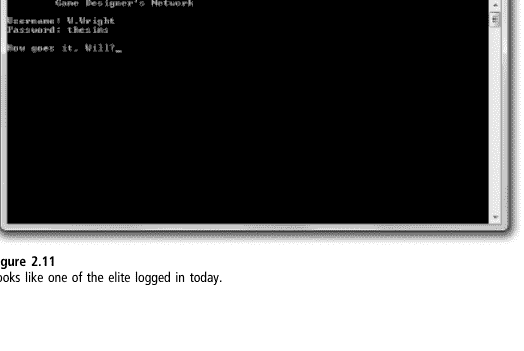

**图 2.11**

看起来今天其中一位精英登录了。

你可以从 Course Technology 网站 (www.courseptr.com/downloads) 下载此程序的代码。该程序位于第 2 章文件夹中；文件名是 designers_network.cpp。

```cpp
// Designers Network
// Demonstrates logical operators

#include <iostream>
#include <string>
using namespace std;

int main()
{
    string username;
    string password;
    bool success;

    cout << "\tGame Designer's Network\n";

    do
    {
        cout << "\nUsername: ";
        cin >> username;

        cout << "Password: ";
        cin >> password;

        if (username == "S.Meier" && password == "civilization")
        {
            cout << "\nHey, Sid.";
            success = true;
        }
        else if (username == "S.Miyamoto" && password == "mariobros")
        {
            cout << "\nWhat's up, Shigeru?";
            success = true;
        }
        else if (username == "W.Wright" && password == "thesims")
        {
            cout << "\nHow goes it, Will?";
            success = true;
        }
        else if (username == "guest" || password == "guest")
        {
            cout << "\nWelcome, guest.";
            success = true;
        }
        else
        {
            cout << "\nYour login failed.";
            success = false;
        }
    } while (!success);

    return 0;
}
```


第一个表达式或第二个表达式为真；否则为假。就像英语中“or”表示“或”一样。如果第一个或第二个表达式为真，则新表达式为真。（如果两个都为真，则更大的表达式仍然为真。）下面是来自 Designers Network 程序的具体示例：

```
else if (username == "guest" || password == "guest")
```

表达式 `username == "guest" || password == "guest"` 在 `username == "guest"` 为真或 `password == "guest"` 为真时为真。这非常完美，因为只要用户在用户名或密码中输入 guest，我就想授予其访问权限。如果用户两者都输入 guest，那也没问题。

理解 `||` 的另一种方式是查看所有真假的可能组合（见表 2.4）。

表 2.4 使用 OR 运算符的可能登录组合

| username == "guest" | password == "guest" | username == "guest" || password == "guest" |
|---|---|---|
| true | true | true |
| true | false | true |
| false | true | true |
| false | false | false |

## 使用逻辑非运算符

逻辑非运算符 `!` 可以切换表达式的真假。如果原表达式为假，新表达式为真；如果原表达式为真，新表达式为假。就像英语中“not”表示否定一样。新表达式的值与原始值相反。

我在 do 循环的布尔表达式中使用了非运算符：

```
} while (!success);
```

当 `success` 为 false 时，表达式 `!success` 为 true。这非常完美，因为只有在登录失败时 `success` 才为 false。在这种情况下，与 *do* 循环关联的代码块会再次执行，用户会被再次要求输入用户名和密码。

当 *success* 为 true 时，表达式 `!success` 为 false。这非常完美，因为当 *success* 为 true 时，用户已成功登录，循环结束。

理解 `!` 的另一种方式是查看所有真假的可能组合（见表 2.5）。

表 2.5 使用 NOT 运算符的可能登录组合

| security | !security |
|---|---|
| true | false |
| false | true |

## 理解运算顺序

和算术运算符一样，逻辑运算符也有优先级，影响表达式求值的顺序。逻辑非 `!` 的优先级高于逻辑与 `&&`，而逻辑与 `&&` 的优先级高于逻辑或 `||`。

与算术运算符一样，如果希望优先级较低的操作先求值，可以使用括号。可以创建涉及算术运算符、关系运算符和逻辑运算符的复杂表达式。运算符优先级将定义表达式元素求值的精确顺序。但是，最好尽量创建清晰简单的表达式，而不是需要精通运算符优先级列表才能解读的表达式。

有关 C++ 运算符及其优先级级别的列表，请参阅附录 B。

## 提示

尽管可以在较大的表达式中使用括号来改变求值方式，但也可以使用冗余括号——不改变表达式值的括号——来使表达式更清晰。让我举个简单的例子。看看下面来自 Designers Network 程序的表达式：

```
(username == "S.Meier" && password == "civilization")
```

现在，这里是带有一些冗余括号的表达式：

```
( username == "S.Meier") && (password == "civilization")
```

虽然额外的括号不会改变表达式的含义，但它们确实有助于让由 `&&` 运算符连接的两个较小的表达式更加突出。

使用冗余括号有点像一门艺术。它们是有帮助还是仅仅多余？这是作为程序员的你必须做出的决定。

## 生成随机数

不可预测感可以为游戏增添刺激。无论是在即时战略游戏中电脑对手策略的突变，还是在第一人称射击游戏中外星生物从任意门中冲出，玩家都需要一定程度的惊喜。生成随机数是实现这种惊喜的一种方式。

## 介绍掷骰子程序

掷骰子程序模拟六面骰子的掷出。计算机通过生成随机数来计算掷骰结果。图 2.12 显示了程序的结果。

你可以从 Course Technology 网站（www.courseptr.com/downloads）下载该程序的代码。程序位于第 2 章的文件夹中；文件名是 die_roller.cpp。

```
// Die Roller
// Demonstrates generating random numbers

#include <iostream>
#include <cstdlib>
#include <ctime>

using namespace std;
```

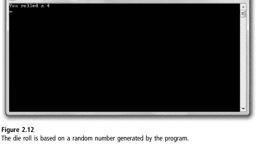

图 2.12

掷骰结果基于程序生成的随机数。

```
int main()
{
    srand(static_cast<unsigned int>(time(0)));  //seed random number generator
    int randomNumber = rand();  //generate random number
    int die = (randomNumber % 6) + 1;  // get a number between 1 and 6
    cout << "You rolled a " << die << endl;
    return 0;
}
```

## 调用 rand() 函数

在程序中我首先做的事情之一是包含一个新文件：
`#include <cstdlib>`
cstdlib 文件包含（除其他内容外）处理生成随机数的函数。因为我已经包含了该文件，所以我可以自由调用其中包含的函数，包括 `rand()` 函数，这正是我在 `main()` 中所做的：

```
int randomNumber = rand(); //generate random number
```

正如你在第 1 章中学到的，函数是可以完成某些工作并返回值的代码片段。你可以通过使用函数名后跟一对括号来调用函数。如果函数返回值，你可以将该值赋给变量。这就是我在这里使用赋值语句所做的。我将 `rand()` 返回的值（一个随机数）赋给 `randomNumber`。

> **提示**
> 
> `rand()` 函数生成一个介于 0 和至少 32767 之间的随机数。确切的上限取决于你的 C++ 实现。该上限存储在常量 `RAND_MAX` 中，它在 cstdlib 中定义。因此，如果你想知道 `rand()` 可以生成的最大随机数，只需将 `RAND_MAX` 发送到 cout。

函数也可以接受值用于其工作。你将这些值放在函数名后的括号内，用逗号分隔。这些值称为参数，当你提供它们时，你就是将它们传递给函数。我没有向 `rand()` 传递任何值，因为该函数不接受任何参数。

## 设置随机数生成器的种子

计算机基于公式生成伪随机数——而不是真正意义上的随机数。一种思考方式是想象计算机从一本巨大的预定数字书中读取。通过从这本书中读取，计算机可以表现出生成一系列随机数的样子。

但有一个问题：计算机总是从书的开头开始读取。因此，计算机在程序中总是会生成同一系列“随机”数字。在游戏中，这不是我们想要的。例如，我们不会希望每次玩双骰子游戏时都出现相同的掷骰序列。

设置随机数生成器的种子。游戏程序员给随机数生成器一个称为种子的数字，以确定伪随机数序列中的起始位置。

以下代码设置随机数生成器的种子：

```
srand(static_cast<unsigned int>(time(0))); //seed random number generator
```

哇，这行看起来相当神秘，但它的作用很简单。它基于当前日期和时间设置随机数生成器的种子，这非常完美，因为每次运行程序时当前日期和时间都会不同。

就实际代码而言，`srand()` 函数设置随机数生成器的种子——你只需向它传递一个 `unsigned int` 作为种子。这里传递给函数的是 `time(0)` 的返回值——一个基于当前系统日期和时间的数字。代码 `static_cast<unsigned int>` 只是将这个值转换（或强制转换）为 `unsigned int`。现在，你不必理解这一行的所有细微差别；你至少需要知道的是，如果你希望程序在每次运行时生成一系列不同的随机数，程序应该在调用 `rand()` 之前执行这一行一次。

> 提示
> 
> 关于将值从一种类型转换为另一种类型的各种形式的全面解释超出了本书的范围。

## 计算一个范围内的数字

生成随机数后，`randomNumber` 保存一个介于 0 和 32767 之间的值（基于我的 C++ 实现）。但我需要一个介于 1 和 6 之间的数字，所以接下来我使用取模运算符来生成该范围内的数字。

```
int die = (randomNumber % 6) + 1; // get a number between 1 and 6
```

任何正数除以 6 都会得到 0 到 5 之间的余数。在前面的代码中，我取这个余数并加 1，得到 1 到 6 的可能范围——正是我想要的。你可以使用这种技术将随机数转换为你要查找范围内的数字。


## 陷阱

使用取模运算符从随机数创建一个范围内的数字时，可能并不总能产生均匀的结果。范围内某些数字可能比其他数字更容易出现。不过，对于简单的游戏来说，这不成问题。

## 理解游戏循环

游戏循环是游戏中事件流程的通用表示。事件的核心部分会重复，因此被称为循环。虽然不同游戏的实现可能大相径庭，但几乎所有类型游戏的基本结构都是相同的。无论是一个简单的太空射击游戏，还是一个复杂的角色扮演游戏（RPG），你通常都可以将游戏分解为游戏循环中相同的重复组成部分。图 2.13 以可视化方式展示了游戏循环。

下面是对游戏循环各部分的说明：

- **设置。** 这通常涉及接受初始设置或加载游戏资源，例如声音、音乐和图形。玩家可能还会看到游戏背景故事及其目标。
- **获取玩家输入。** 无论是来自键盘、鼠标、操纵杆、轨迹球还是其他设备，都会捕获玩家的输入。
- **更新游戏内部状态。** 将游戏逻辑和规则应用于游戏世界，并考虑玩家输入。例如，这可能是物理系统确定对象之间的交互，也可能涉及敌方 AI 的计算。
- **更新显示。** 在大多数游戏中，这一过程对计算机硬件的负荷最大，因为它通常涉及绘制图形。不过，这个过程也可以简单到只显示一行文本。
- **检查游戏是否结束。** 如果游戏尚未结束（例如，玩家角色仍然存活且玩家没有退出），控制流程会分支回到获取玩家输入阶段。如果游戏结束，控制流程会进入关闭阶段。
- **关闭。** 此时游戏结束。玩家通常会得到一些最终信息，例如他的得分。程序在必要时释放任何资源，然后退出。

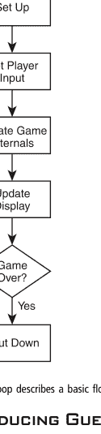

图 2.13
游戏循环描述了一个基本的事件流程，几乎适用于任何游戏。

## 介绍猜数字

本章的最终项目“猜数字”（Guess My Number）是经典的数字猜测游戏。对于那些童年错过这款游戏的人来说，规则是这样的：计算机在 1 到 100 之间随机选择一个数字，玩家尝试用尽可能少的次数猜出该数字。每次玩家输入猜测后，计算机会告诉他猜测偏高、偏低还是完全正确。一旦玩家猜中数字，游戏结束。图 2.14 展示了“猜数字”的运行情况。你可以从 Course Technology 网站（www.courseptr.com/downloads）下载该程序的代码。程序位于第 2 章文件夹中，文件名为 guess_my_number.cpp。

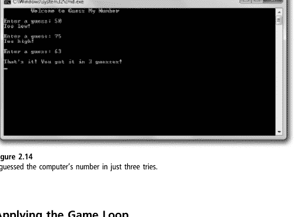

图 2.14
我只猜了三次就猜中了计算机的数字。

## 应用游戏循环

即使这个简单的游戏，也可以通过游戏循环的结构来审视。图 2.15 展示了游戏循环范式如何完美契合游戏的流程。

## 设置游戏

和往常一样，我首先写一些注释，并包含必要的文件。

// Guess My Number
// The classic number guessing game

#include <iostream>
#include <cstdlib>
#include <ctime>

using namespace std;

我包含 cstdlib 是因为我计划生成一个随机数。我包含 ctime 是因为我想用当前时间作为随机数生成器的种子。

## 创建游戏循环

接下来，我编写游戏循环。

```
do
{
    cout << "Enter a guess: ";
    cin >> guess;
    ++tries;

    if (guess > secretNumber)
    {
        cout << "Too high!\n\n";
    }
    else if (guess < secretNumber)
    {
        cout << "Too low!\n\n";
    }
    else
    {
        cout << "\nThat's it! You got it in " << tries << " guesses!\n";
    }
} while (guess != secretNumber);
```

我获取玩家的猜测，将尝试次数加一，然后告诉玩家他的猜测是偏高、偏低还是完全正确。如果玩家猜对了，循环结束。注意，这些 if 语句嵌套在 while 循环内部。

## 收尾游戏

一旦玩家猜出秘密数字，循环和游戏就结束了。接下来只需结束程序。

```
    return 0;
}
```

## 总结

在本章中，你学习了以下概念：

- 你可以使用表达式的真或假，分支到（或跳过）某些代码段。

问：如果无限循环是坏事，那么 while (true) 循环不也是坏事吗？

答：不是。当程序员创建 while (true) 循环时，他应该提供一种结束循环的方式（通常通过 break 语句）。

问：程序员为什么要创建 while (true) 循环？

答：while (true) 循环通常用于程序的主循环，例如游戏循环。

问：为什么有些人认为使用 break 语句退出循环是不良编程？

答：因为不加区分地使用 break 语句会让人难以理解循环结束的条件。不过，有时将 while (true) 循环与 break 语句结合使用，可能比用更传统的方式创建同样的循环更清晰。

问：什么是伪随机数？

答：伪随机数通常是由公式生成的随机数。因此，一系列伪随机数并不是真正随机的，但对于大多数用途来说已经足够好了。

问：什么是为随机数生成器设置种子？

答：就是给随机数生成器一个种子（例如一个整数），这会影响到生成器产生随机数的方式。如果不为随机数生成器设置种子，那么每次程序从头开始运行时，它都会产生相同的一系列数字。

问：难道不是总要在使用随机数生成器之前为其设置种子吗？

答：不一定。例如，出于测试目的，你可能希望程序每次运行时都产生完全相同的“随机”数字序列。

问：如何生成更真正随机的数字？

答：有一些第三方库生成的伪随机数比 C++ 编译器通常自带的更好。

问：所有游戏都使用游戏循环吗？

答：游戏循环只是看待典型游戏事件流程的一种方式。而且，仅仅因为这种范式适用于某个特定游戏，并不一定意味着该游戏是用一个环绕其大部分代码的循环来实现的。

## 讨论问题

- 1. 如果没有循环，哪些类型的编程任务会变得困难？
- 2. 与一系列 `if` 语句相比，`switch` 语句的优缺点是什么？
- 3. 什么时候可以省略 `switch` 语句中 `case` 末尾的 `break` 语句？
- 4. 什么时候应该使用 `while` 循环而不是 `do` 循环？
- 5. 用游戏循环来描述你最喜欢的游戏。游戏循环是否非常契合？

## 练习

- 1. 使用枚举来表示难度级别，重写本章中的“菜单选择器”（Menu Chooser）程序。变量 `choice` 仍然是 `int` 类型。
- 2. 下面的循环有什么问题？
```cpp
int x = 0;
while (x)
{
    ++x;
    cout << x << endl;
}
```
- 3. 编写一个新版本的“猜数字”程序，使玩家和计算机互换角色。也就是说，玩家选择一个数字，计算机必须猜出它是什么。

下面是 for 循环的通用形式：

```
for (initialization; test; action)
    statement;
```

initialization 是一条为循环设置初始条件的语句。（例如，它可以将计数器变量设置为 0。）表达式 test 在每次循环体执行之前都会被测试，就像 while 循环一样。如果 test 为假，程序将转到循环之后的语句。如果 test 为真，程序将执行 statement。接着执行 action（通常涉及递增计数器变量）。循环重复直到 test 为假，此时循环结束。

## 介绍计数器程序

计数器程序可以向前计数、向后计数以及按 5 计数，甚至还能按行和列数出一个网格。它通过使用 for 循环实现了所有这些功能。图 3.1 展示了该程序的运行情况。

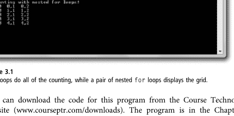

图 3.1

所有计数都由 for 循环完成，而一对嵌套的 for 循环则显示网格。

你可以从 Course Technology 网站（www.courseptr.com/downloads）下载该程序的代码。程序位于第 3 章文件夹中，文件名为 counter.cpp。


```
// Counter
// Demonstrates for loops

#include <iostream>

using namespace std;

int main()
{
    cout << "Counting forward:\n";
    for (int i = 0; i < 10; ++i)
    {
        cout << i << " ";
    }

    cout << "\n\nCounting backward:\n";
    for (int i = 9; i >= 0; --i)
    {
        cout << i << " ";
    }

    cout << "\n\nCounting by fives:\n";
    for (int i = 0; i <= 50; i += 5)
    {
        cout << i << " ";
    }

    cout << "\n\nCounting with null statements:\n";
    int count = 0;
    for ( ; count < 10; )
    {
        cout << count << " ";
        ++count;
    }

    cout << "\n\nCounting with nested for loops:\n";
    const int ROWS = 5;
    const int COLUMNS = 3;
    for (int i = 0; i < ROWS; ++i)
    {
        for (int j = 0; j < COLUMNS; ++j)
        {
            cout << i << "," << j << " ";
        }

        cout << endl;
    }

    return 0;
}
```

## 陷阱

如果你使用的是没有完全实现当前 C++ 标准的旧编译器，当你尝试编译此程序时，可能会遇到类似这样的错误：`error: 'i' : redefinition; multiple initialization`。最好的解决方案是使用现代的、符合标准的编译器。幸运的是，你可以从 http://www.microsoft.com/express/ 下载流行的（且免费的）Microsoft Visual C++ Express Edition IDE，其中包含一个现代编译器。

如果你必须使用旧编译器，就应该在一个作用域内只为所有 for 循环声明一次循环计数器变量。我在第 5 章“函数：疯狂填词”中讨论作用域这个主题。

## 使用 for 循环计数

第一个 for 循环从 0 数到 9。循环如下：

```
for (int i = 0; i < 10; ++i)
```

初始化语句 int i = 0 声明了 i 并将其初始化为 0。表达式 i < 10 表示只要 i 小于 10，循环就会继续。最后，动作语句 ++i 表示每次循环体结束后 i 都会递增。因此，循环迭代 10 次——分别对应 0 到 9 的每个值。在每次迭代期间，循环体都会显示 i 的值。

下一个 for 循环从 9 倒数到 0。循环如下：

```
for (int i = 9; i >= 0; --i)
```

这里，i 被初始化为 9，并且只要 i 大于或等于 0，循环就会继续。每次循环体结束后，i 都会递减。因此，循环显示 9 到 0 的值。

下一个循环以 5 为步长从 0 数到 50。循环如下：

```
for (int i = 0; i <= 50; i += 5)
```

这里，i 被初始化为 0，并且只要 i 小于或等于 50，循环就会继续。但请注意动作语句 i += 5。该语句在每次循环体结束后将 i 增加 5。因此，循环显示 0、5、10、15 等值。表达式 i <= 50 表示只要 i 小于或等于 50，就执行循环体。

你可以按自己的需要初始化计数器变量、创建测试条件并更新计数器变量。然而，最常见的做法是让计数器从 0 开始，并在每次循环迭代后将其递增 1。

最后，你在学习 while 循环时了解到的关于无限循环的注意事项同样适用于 for 循环。请确保你创建的循环能够结束；否则，你会让一位玩家感到非常不开心。

## 在 for 循环中使用空语句

你可以在创建 for 循环时使用空语句，就像我在下面的循环中所做的那样：

```
for ( ; count < 10; )
```

我在初始化语句和动作语句处都使用了空语句。这没问题，因为我在循环之前声明并初始化了 count，并在循环体内递增它。此循环显示与程序中第一个循环相同的整数序列。虽然这个循环看起来可能有些奇怪，但它是完全合法的。

## 提示

> 不同的游戏程序员有不同的传统。在上一章中，你看到了可以使用 while (true) 创建一个循环，直到遇到退出语句（例如 break）为止。有些程序员则更喜欢使用以 for (;;) 开头的 for 语句来创建这类循环。由于该循环中的测试表达式是空语句，因此循环会一直继续，直到遇到某个退出语句。

## 嵌套 for 循环

你可以将一个 for 循环放在另一个 for 循环内部，从而嵌套 for 循环。下面的代码段就是这样做的，它计算出一个网格的各元素。外层循环从以下代码开始：

```
for (int i = 0; i < ROWS; ++i)
```

它只是执行其循环体 ROWS（5）次。但恰好这个循环内部还有另一个 for 循环，从以下代码开始：

```
for (int j = 0; j < COLUMNS; ++j)
```

因此，内层循环会在外层循环的每次迭代中完整执行。在这种情况下，这意味着内层循环执行 COLUMNS（3）次，而外层循环迭代 ROWS（5）次，总共执行 15 次。具体来说，会发生以下情况：

- 1. 外层 for 循环声明 i 并将其初始化为 0。由于 i 小于 ROWS（5），程序进入外层循环体。
- 2. 内层循环声明 j 并将其初始化为 0。由于 j 小于 COLUMNS（3），程序进入其循环体，将 i 和 j 的值发送给 cout，显示 0, 0。
- 3. 程序到达内层循环体的末尾，并将 j 递增到 1。由于 j 仍然小于 COLUMNS（3），程序再次执行内层循环体，显示 0, 1。
- 4. 程序到达内层循环体的末尾，并将 j 递增到 2。由于 j 仍然小于 COLUMNS（3），程序再次执行内层循环体，显示 0, 2。
- 5. 程序到达内层循环体的末尾，并将 j 递增到 3。然而这一次，j 不小于 COLUMNS（3），内层循环结束。
- 6. 程序将 endl 发送到 cout，完成外层循环的第一次迭代，结束第一行。
- 7. 程序到达外层循环体的末尾，并将 i 递增到 1。由于 i 小于 ROWS（5），程序再次进入外层循环体。

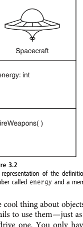

## 图 3.2

这张外星飞船的定义示意图表明，每个对象都将有一个名为 energy 的数据成员和一个名为 fireWeapons() 的成员函数。

对象很酷的一点是，你不需要知道实现细节就能使用它们——就像你不需要知道如何制造汽车才能开车一样。你只需要知道对象的数据成员和成员函数——就像你只需要知道汽车的转向盘、油门踏板和刹车踏板在哪里一样。

与内置类型一样，你可以将对象存储在变量中。因此，你可以将外星飞船对象存储在 Spacecraft 类型的变量中。你可以使用成员选择运算符 (.) 访问数据成员和成员函数，只需将该运算符放在对象的变量名之后。因此，如果你希望外星飞船 ship 仅当其能量等级大于 10 时才开火，可以这样编写：

```
// ship is an object of Spacecraft type
if (ship.energy > 10)
{
    ship.fireWeapons()
}
```

ship.energy 访问对象的 energy 数据成员，而 ship.fireWeapons() 调用对象的 fireWeapons() 成员函数。

虽然你还不能创建自己的新类型（例如外星飞船），但你可以使用先前定义的对象类型。而这正是接下来要讨论的内容。

## 使用字符串对象

string 对象在第 1 章中你已经简单接触过，它是处理字符序列的理想方式，无论你是在编写完整的单词拼图游戏，还是仅仅存储玩家姓名。string 实际上是一个对象，它提供了自己的成员函数集，使你可以对 string 对象执行一系列操作——从简单地获取其长度到执行复杂的字符替换。此外，string 的定义方式使其能够与你已经知道的一些运算符直观地配合工作。

## 介绍 String Tester 程序

String Tester 程序使用等于 "Game Over!!!" 的 string 对象，并告诉你它的长度、每个字符的索引（位置编号），以及是否可以在其中找到某些子字符串。此外，程序还会擦除 string 对象的部分内容。图 3.3 显示了程序的结果。

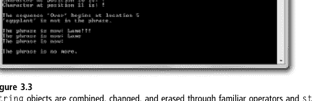

图 3.3
字符串对象通过熟悉的运算符和字符串成员函数进行组合、更改和擦除。


你可以从课程技术网站（www.courseptr.com/downloads）下载本程序的代码。程序位于第 3 章文件夹中；文件名是 `string_tester.cpp`。

```cpp
// String Tester
// Demonstrates string objects

#include <iostream>
#include <string>

using namespace std;

int main()
{
    string word1 = "Game";
    string word2("Over");
    string word3(3, '!');

    string phrase = word1 + " " + word2 + word3;
    cout << "The phrase is: " << phrase << "\n\n";

    cout << "The phrase has " << phrase.size() << " characters in it.\n\n";

    cout << "The character at position 0 is: " << phrase[0] << "\n\n";

    cout << "Changing the character at position 0.\n";
    phrase[0] = 'L';
    cout << "The phrase is now: " << phrase << "\n\n";

    for (unsigned int i = 0; i < phrase.size(); ++i)
    {
        cout << "Character at position " << i << " is: " << phrase[i] << endl;
    }

    cout << "\nThe sequence 'Over' begins at location ";
    cout << phrase.find("Over") << endl;

    if (phrase.find("eggplant") == string::npos)
    {
        cout << "'eggplant' is not in the phrase.\n\n";
    }

    phrase.erase(4, 5);
    cout << "The phrase is now: " << phrase << endl;

    phrase.erase(4);
    cout << "The phrase is now: " << phrase << endl;

    phrase.erase();
    cout << "The phrase is now: " << phrase << endl;

    if (phrase.empty())
    {
        cout << "\nThe phrase is no more.\n";
    }

    return 0;
}
```

## 创建 string 对象

在 `main()` 中我做的第一件事就是以三种不同的方式创建三个 string 对象：

```cpp
string word1 = "Game";
string word2("Over");
string word3(3, '!');
```

在这组代码的第一行中，我直接使用赋值运算符创建 string 对象 `word1`，方式与你见过的其他变量相同。结果是 `word1` 为 "Game"。

接下来，我通过将想要赋给变量的 string 对象放在一对圆括号中来创建 `word2`。结果是 `word2` 为 "Over"。

最后，我通过在一对圆括号中提供一个数字后跟一个字符来创建 `word3`。这会生成一个由所提供的字符组成的 string 对象，其长度等于该数字。结果是 `word3` 为 "!!!"。

## 连接 string 对象

接下来，我通过连接前三个 *string* 对象来创建一个新的 string 对象 *phrase*：

```cpp
string phrase = word1 + " " + word2 + word3;
```

结果是 *phrase* 为 "Game Over!!!"。

注意，你之前只见过对数字起作用的 `+` 运算符，它同样也能连接 *string* 对象。这是因为 `+` 运算符已被重载。当你第一次听到 *overloaded* 这个词时，可能会觉得这不是什么好事——运算符要爆炸了！但这是件好事。运算符重载重新定义了一个熟悉的运算符，使它在新的、之前未定义的情境中以不同方式工作。在这个例子中，我使用 `+` 运算符不是为了加数字，而是为了连接 *string* 对象。我之所以能做到这一点，仅仅是因为 *string* 类型专门重载了 `+` 运算符，并定义了它在与 string 对象一起使用时表示 *string* 对象连接。

## 使用 size() 成员函数

好的，是时候看看 *string* 的成员函数了。接下来，我使用成员函数 *size()*：

```cpp
cout << "The phrase has " << phrase.size() << " characters in it.\n\n";
```

*phrase.size()* 通过成员选择运算符 `.`（点号）调用 *string* 对象 *phrase* 的成员函数 *size()*。*size()* 成员函数只是返回该 *string* 对象大小的无符号整数值——也就是它的字符数量。因为 *string* 对象是 "Lame Over!!!"，所以该成员函数返回 12。（每个字符都计入，包括空格。）当然，对另一个 *string* 对象调用 *size()* 可能会根据该 *string* 对象中的字符数返回不同的结果。

### 提示

*string* 对象还有一个成员函数 *length()*，它与 *size()* 一样，返回 *string* 对象中的字符数。

## 对 string 对象进行索引

string 对象存储一个 char 值序列。你可以通过使用下标运算符（`[]`）提供索引号来访问任何单个 char 值。这正是我接下来要做的：

```cpp
cout << "The character at position 0 is: " << phrase[0] << "\n\n";
```

序列中的第一个元素位于位置 0。在上一条语句中，`phrase[0]` 是字符 G。并且由于计数从 0 开始，所以 string 对象中的最后一个字符是 `phrase[11]`，即使该 string 对象有 12 个字符。

### 陷阱

忘记索引从位置 0 开始是一个常见错误。请记住，一个有 n 个字符的 string 对象可以从位置 0 索引到位置 n - 1。

你不仅可以使用下标运算符访问 string 对象中的字符，还可以重新赋值它们。这就是我接下来要做的：

```cpp
phrase[0] = 'L';
```

我将 phrase 的第一个字符改为字符 L，这意味着 phrase 变成了 "Lame Over!!!"。

### 陷阱

C++ 编译器在处理 string 对象和下标运算符时不会进行边界检查。这意味着编译器不会检查你是否正在尝试访问一个不存在的元素。访问无效的序列元素可能导致灾难性后果，因为你可能会覆盖计算机内存中的关键数据。这样做可能会使程序崩溃，所以使用下标运算符时要格外小心。

## 遍历 string 对象

凭借你对 for 循环和 string 对象的新知识，遍历 string 对象中的各个字符轻而易举。这就是我接下来要做的：

```cpp
for (unsigned int i = 0; i < phrase.size(); ++i)
{
    cout << "Character at position " << i << " is: " << phrase[i] << endl;
}
```

循环遍历 phrase 的所有有效位置。它从 0 开始，一直到 11。在每次迭代中，string 对象的一个字符会通过 `phrase[i]` 显示出来。注意，我将循环变量 `i` 声明为 `unsigned int`，因为 `size()` 返回的值是无符号整数类型。

### 现实世界

遍历序列是游戏中的一项强大且常用的技术。例如，你可能需要遍历策略游戏中的数百个独立单位，更新它们的状态和指令。或者你可能需要遍历 3D 模型的顶点列表，以应用某种几何变换。

## 使用 find() 成员函数

接下来我使用成员函数 `find()` 来检查两个字符串字面量中是否有任何一个包含在 phrase 中。首先，我检查字符串字面量 "Over"：

```cpp
cout << "\nThe sequence 'Over' begins at location ";
cout << phrase.find("Over") << endl;
```

`find()` 成员函数在调用它的 string 对象中搜索作为参数提供的字符串。该成员函数返回你要搜索的 string 对象在调用它的 string 对象中第一次出现的位置编号。这意味着 `phrase.find("Over")` 返回 "Over" 在 phrase 中第一次出现的位置编号。由于 phrase 是 "Lame Over!!!"，`find()` 返回 5。（记住，位置编号从 0 开始，所以 5 表示第六个字符。）

但是如果你搜索的字符串不存在于调用它的 string 中会怎样？我接下来处理这种情况：

```cpp
if (phrase.find("eggplant") == string::npos)
{
    cout << "'eggplant' is not in the phrase.\n\n";
}
```

因为 "eggplant" 不存在于 phrase 中，`find()` 返回一个定义在 string 文件中的特殊常量，我通过 `string::npos` 访问它。因此，屏幕显示消息：“'eggplant' is not in the phrase.”

我通过 `string::npos` 访问的常量表示 string 对象可能的最大大小，因此它大于 string 对象中任何可能的有效位置编号。非正式地说，它的意思是“一个不可能存在的位置编号”。它是表示一个字符串在另一个字符串中找不到的完美返回值。

### 提示

使用 `find()` 时，你可以提供一个可选参数，指定程序从哪个字符位置开始查找子字符串。下面这行将开始从 string 对象 phrase 中的位置 5 开始寻找字符串字面量 "eggplant"。

```cpp
location = phrase.find("eggplant", 5);
```

## 使用 erase() 成员函数

`erase()` 成员函数从 string 对象中移除一个指定的子字符串。调用该成员函数的一种方式是指定起始位置和子字符串的长度，就像我在下面的代码中所做的那样：

```cpp
phrase.erase(4, 5);
```

上一行移除从位置 4 开始的五个字符的子字符串。因为 phrase 是 "Lame Over!!!"，该成员函数移除了子字符串 Over，结果是 phrase 变成了 "Lame!!!"。

调用 `erase()` 的另一种方式是只提供子字符串的起始位置。这会移除从该位置编号开始到 string 对象末尾的所有字符。这正是我接下来要做的：

```cpp
phrase.erase(4);
```

这一行移除了 string 对象中从位置 4 开始的所有字符。由于 phrase 是 "Lame!!!"，该成员函数移除了子字符串 !!!，结果是 phrase 变成了 "Lame"。

调用 `erase()` 的又一种方式是不提供任何参数，就像我在下面的代码中所做的那样：

```cpp
phrase.erase();
```


前一行擦除了 phrase 中的每个字符。结果，phrase 变成了空字符串，等同于 ""。

## 使用 empty() 成员函数

empty() 成员函数返回一个 bool 值——如果字符串对象为空则为 true，否则为 false。我在下面的代码中使用 empty()：

```cpp
if (phrase.empty())
{
    cout << "\nThe phrase is no more.\n";
}
```

因为 phrase 等于空字符串，所以 phrase.empty() 返回 true，屏幕显示消息 "The phrase is no more."

## 使用数组

虽然 string 对象提供了一种处理字符序列的绝佳方式，但数组提供了一种处理任意类型元素的方式。这意味着你可以使用数组存储整数序列，例如高分列表。但这也意味着你可以使用数组存储程序员定义类型的元素，例如 RPG 角色可能携带的一系列物品。

### 介绍英雄的背包程序

Hero’s Inventory 程序维护了一个典型 RPG 中英雄的背包。如大多数 RPG 一样，英雄来自一个小而无关紧要的村庄，他的父亲被邪恶的军阀杀害了。（没有死去的父亲，哪来的任务？）现在英雄已经成年，是他寻求复仇的时候了。

在此程序中，英雄的背包由一个数组表示。该数组是一个 string 对象序列——英雄拥有的每件物品对应一个。英雄会交易甚至找到新物品。图 3.4 显示了程序的运行情况。你可以从 Course Technology 网站 (www.courseptr.com/downloads) 下载此程序的代码。该程序位于第 3 章文件夹中；文件名是 heros_inventory.cpp。

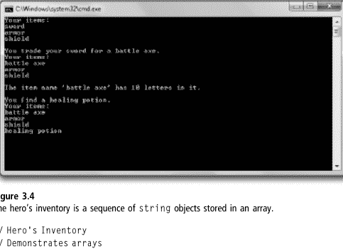

**图 3.4** 英雄的背包是一个存储在数组中的字符串对象序列。

```cpp
// Hero's Inventory
// Demonstrates arrays

#include <iostream>
#include <string>

using namespace std;

int main()
{
    const int MAX_ITEMS = 10;
    string inventory[MAX_ITEMS];

    int numItems = 0;
    inventory[numItems++] = "sword";
    inventory[numItems++] = "armor";
    inventory[numItems++] = "shield";

    cout << "Your items:\n";
    for (int i = 0; i < numItems; ++i)
    {
        cout << inventory[i] << endl;
    }

    cout << "\nYou trade your sword for a battle axe.";
    inventory[0] = "battle axe";
    cout << "\nYour items:\n";
    for (int i = 0; i < numItems; ++i)
    {
        cout << inventory[i] << endl;
    }

    cout << "\nThe item name " << inventory[0] << " has ";
    cout << inventory[0].size() << " letters in it.\n";

    cout << "\nYou find a healing potion.";
    if (numItems < MAX_ITEMS)
    {
        inventory[numItems++] = "healing potion";
    }
    else
    {
        cout << "You have too many items and can't carry another.";
    }
    cout << "\nYour items:\n";
    for (int i = 0; i < numItems; ++i)
    {
        cout << inventory[i] << endl;
    }

    return 0;
}
```

### 创建数组

为数组中的元素数量定义一个常量通常是个好主意。我就是这样做的，使用 MAX_ITEMS，它表示英雄最多能携带的物品数量：

```cpp
const int MAX_ITEMS = 10;
```

你声明数组的方式与声明到目前为止见过的任何变量的方式类似：提供一个类型后跟一个名称。此外，你的编译器必须知道数组的大小，以便为其预留必要的内存空间。你可以在数组名称后用方括号括起来提供该信息。以下是我的英雄背包数组的声明方式：

```cpp
string inventory[MAX_ITEMS];
```

上述代码声明了一个 inventory 数组，包含 MAX_ITEMS 个 string 对象。（因为 MAX_ITEMS 为 10，这意味着 10 个 string 对象。）

### 技巧

你可以在声明数组时通过提供初始化列表来为其赋初值——由逗号分隔并用大括号括起来的元素序列。以下是一个示例：

```cpp
string inventory[MAX_ITEMS] = {"sword", "armor", "shield"};
```

上述代码声明了一个 string 对象数组 inventory，其大小为 MAX_ITEMS。数组的前三个元素被初始化为 "sword"、"armor" 和 "shield"。

如果在使用初始化列表时省略元素数量，数组将以列表中元素的数量作为大小创建。以下是一个示例：

```cpp
string inventory[] = {"sword", "armor", "shield"};
```

因为初始化列表中有三个元素，所以前一行创建了一个名为 inventory 的数组，大小为三个元素。其元素为 "sword"、"armor" 和 "shield"。

### 索引数组

你索引数组的方式与索引 string 对象的方式类似。你可以通过下标运算符（[]）提供索引号来访问任何单个元素。

接下来，我使用下标运算符向英雄的背包中添加三件物品：

```cpp
int numItems = 0;
inventory[numItems++] = "sword";
inventory[numItems++] = "armor";
inventory[numItems++] = "shield";
```

我首先定义 numItems 表示英雄当前携带的物品数量。接下来我将 "sword" 分配给数组的第 0 个位置。因为我使用了后缀递增运算符，所以 numItems 在向数组赋值后递增。接下来的两行将 "armor" 和 "shield" 添加到数组中，在代码结束时使 numItems 保持正确的 3 的值。

现在英雄已经配备了一些物品，我显示他的背包：

```cpp
cout << "Your items:\n";
for (int i = 0; i < numItems; ++i)
{
    cout << inventory[i] << endl;
}
```

这应该让你想起字符串索引。代码遍历 inventory 的前三个元素，按顺序显示每个 string 对象。

接下来，英雄用战斧交换他的剑。我通过以下行实现这一点：

```cpp
inventory[0] = "battle axe";
```

上述代码将 inventory 中位置 0 的元素重新分配为 string 对象 "battle axe"。现在 inventory 的前三个元素为 "battle axe"、"armor" 和 "shield"。

### 陷阱

> 数组索引从 0 开始，就像你在使用 string 对象时看到的那样。这意味着以下代码定义了一个五元素的数组：
> 
> ```cpp
> int highScores[5];
> ```
> 
> 有效的位置编号为 0 到 4（含）。不存在元素 highScores[5]！尝试访问 highScores[5] 可能导致灾难性后果，包括程序崩溃。

### 访问数组元素的成员函数

你可以通过写出数组元素，然后是成员选择运算符，然后是成员函数名来访问数组元素的成员函数。这听起来有点复杂，但其实并不复杂。以下是一个示例：

```cpp
cout << inventory[0].size() << " letters in it.\n";
```

代码 inventory[0].size() 的意思是应该调用元素 inventory[0] 的 size() 成员函数。在这种情况下，因为 inventory[0] 是 "battle axe"，调用返回 10，即该 string 对象中的字符数。

### 注意数组边界

正如你所学的那样，索引数组时必须小心。因为数组大小固定，你可以创建一个整数常量来存储数组的大小。再次说明，这正是我在程序开始时所做的：

```cpp
const int MAX_ITEMS = 10;
```

在下面的几行中，我在向英雄的背包添加另一件物品之前使用 MAX_ITEMS 来保护自己：

```cpp
if (numItems < MAX_ITEMS)
{
    inventory[numItems++] = "healing potion";
}
else
{
    cout << "You have too many items and can't carry another.";
}
```

在上述代码中，我首先检查 numItems 是否小于 MAX_ITEMS。如果是，那么我就可以安全地使用 numItems 作为索引并将新的 string 对象分配给数组。在这种情况下 numItems 为 3，所以我将字符串 "healing potion" 分配给数组位置 3。如果不是这种情况，那么我就会显示消息 "You have too many items and can't carry another."

如果你确实尝试访问数组边界之外的元素会发生什么呢？这取决于情况，因为你将访问计算机内存中的某个未知部分。最坏的情况下，如果你尝试将某个值分配给数组边界之外的元素，你可能会导致程序出现不可预测的行为，甚至崩溃。

在使用索引号之前测试其是否为有效的数组位置称为边界检查。当你想使用的索引可能无效时，执行边界检查对你来说至关重要。

## 理解 C 风格字符串

在 string 对象出现之前，C++ 程序员使用以空字符结尾的字符数组来表示字符串。这些字符数组现在被称为 C 风格字符串，因为这种做法始于 C 程序。你可以像声明任何其他数组一样声明并初始化 C 风格字符串：

```cpp
char phrase[] = "Game Over!!!";
```

C 风格字符串以一个称为空字符的字符结尾以表示其结束。你可以把空字符写成 '\0'。我在之前的代码中不需要使用空字符，因为它已为我存储在字符串末尾。因此从技术上讲，phrase 有 13 个元素。（然而，处理

C 风格字符串会说该短语的长度为 12，这是有道理的，并且与字符串对象的工作方式一致。

与任何其他类型的数组一样，你可以在定义时指定数组大小。因此，声明和初始化 C 风格字符串的另一种方法是

```cpp
char phrase[81] = "Game Over!!!";
```

上述代码创建了一个可以容纳 80 个可打印字符（外加其终止空字符）的 C 风格字符串。

C 风格字符串没有成员函数。但 cstring 文件是标准库的一部分，其中包含用于处理 C 风格字符串的各种函数。

字符串对象的优点之一是它们设计为可与 C 风格字符串无缝协作。例如，以下所有内容都是使用 C 风格字符串与字符串对象的完全有效用法：

```cpp
string word1 = "Game";
char word2[] = " Over";

string phrase = word1 + word2;

if (word1 != word2)
{
    cout << "word1 and word2 are not equal.\n";
}

if (phrase.find(word2) != string::npos)
{
    cout << "word2 is contained in phrase.\n";
}
```

你可以连接字符串对象和 C 风格字符串，但结果始终是字符串对象（因此代码 `char phrase2[] = word1 + word2;` 会产生错误）。你可以使用关系运算符比较字符串对象和 C 风格字符串。而且甚至可以将 C 风格字符串用作字符串对象成员函数的参数。

C 风格字符串与数组有相同的缺点。其中最大的一个是它们的长度是固定的。因此寓意是：在可能的情况下使用字符串对象，但必要时也要准备好处理 C 风格字符串。

## 使用多维数组

正如你所见，序列对于游戏非常有用。你可以用字符串的形式来存储玩家的名字，或用数组的形式来存储 RPG 中的物品列表。但有时游戏的一部分需要的不只是一个线性列表。有时游戏的一部分确实需要更多的维度。例如，虽然你可以用 64 个元素的数组来表示棋盘，但将其作为 8 × 8 元素的二维实体来处理要直观得多。幸运的是，你可以创建二维或三维（甚至更多维度）的数组以最好地满足游戏需求。

### 介绍井字棋板程序

《井字棋板》程序显示一个井字棋板。程序显示棋盘并宣布 X 为获胜者。虽然程序可以用一维数组编写，但它使用二维数组来表示棋盘。图 3.5 说明了该程序。

你可以从 Course Technology 网站 (www.courseptr.com/downloads) 下载此程序的代码。该程序位于第 3 章文件夹中；文件名是 tic-tac-toe_board.cpp。

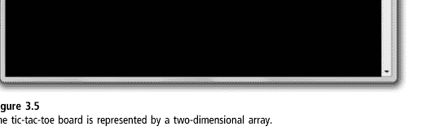

Figure 3.5
井字棋板由二维数组表示。

```cpp
// Tic-Tac-Toe Board
// Demonstrates multidimensional arrays

#include <iostream>

using namespace std;

int main()
{
    const int ROWS = 3;
    const int COLUMNS = 3;
    char board[ROWS][COLUMNS] = { {'O', 'X', 'O'},
                                  {' ', 'X', 'X'},
                                  {'X', 'O', 'O'} };

    cout << "Here's the tic-tac-toe board:\n";
    for (int i = 0; i < ROWS; ++i)
    {
        for (int j = 0; j < COLUMNS; ++j)
        {
            cout << board[i][j];
        }

        cout << endl;
    }

    cout << "\n'X' moves to the empty location.\n\n";
    board[1][0] = 'X';

    cout << "Now the tic-tac-toe board is:\n";
    for (int i = 0; i < ROWS; ++i)
    {
        for (int j = 0; j < COLUMNS; ++j)
        {
            cout << board[i][j];
        }

        cout << endl;
    }

    cout << "\n'X' wins!";

    return 0;
}
```

### 创建多维数组

程序中我做的第一件事之一就是声明并初始化井字棋板的数组。

```cpp
char board[ROWS][COLUMNS] = { {'O', 'X', 'O'},
    {' ', 'X', 'X'},
    {'X', 'O', 'O'} };
```

上述代码声明了一个 3 × 3（因为 ROWS 和 COLUMNS 都是 3）的二维字符数组。它还初始化了所有元素。

**提示**

完全可以不初始化就简单声明一个多维数组。下面是一个示例：

```cpp
char chessBoard[8][8];
```

上述代码声明了一个 8 × 8 的二维字符数组 chessBoard。顺便说一下，多维数组的每个维度不必具有相同的大小。以下是以单个字符表示的游戏地图的完全有效的声明：

```cpp
char map[12][20];
```

### 索引多维数组

程序中我做的下一件事是显示井字棋板。但在深入细节之前，我想解释如何索引单个数组元素。你通过为数组的每个维度提供一个值来索引多维数组的单个元素。这就是我在空格处放置 X 时所做的：

```cpp
board[1][0] = 'X';
```

上述代码将字符赋给 board[1][0] 处的元素（之前是 ' '）。然后我以与移动前相同的方式显示移动后的井字棋板。

```cpp
for (int i = 0; i < ROWS; ++i)
{
    for (int j = 0; j < COLUMNS; ++j)
    {
        cout << board[i][j];
    }

    cout << endl;
}
```

## 介绍单词拼乱游戏

Word Jumble 是一款拼图游戏，计算机创建单词的字母随机排序的版本。玩家必须猜出单词才能赢得游戏。如果玩家卡住了，他或她可以请求提示。图 3.6 显示了游戏。

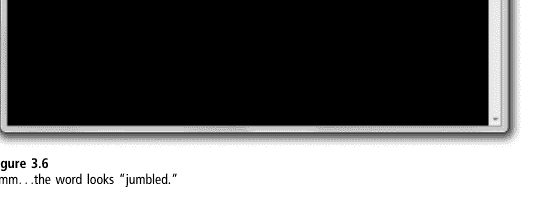

Figure 3.6
嗯……这个词看起来“乱了”。

### 实际应用

尽管拼图游戏通常不会进入游戏排行榜前十，但大型公司仍年年发布它们。为什么？原因很简单：它们有利可图。拼图游戏虽然通常不是大片，但仍能很好地销售。有许多玩家（休闲和硬核）被设计精良的拼图游戏的禅意所吸引。而且拼图游戏的制作成本远低于需要大型制作团队和多年开发时间的知名游戏。

### 设置程序

像往常一样，我从一些注释开始并包含我需要的[content]
C 风格字符串会说该短语的长度为 12，这是有道理的，并且与字符串对象的工作方式一致。

与任何其他类型的数组一样，你可以在定义时指定数组大小。因此，声明和初始化 C 风格字符串的另一种方法是

```cpp
char phrase[81] = "Game Over!!!";
```

上述代码创建了一个可以容纳 80 个可打印字符（外加其终止空字符）的 C 风格字符串。

C 风格字符串没有成员函数。但 cstring 文件是标准库的一部分，其中包含用于处理 C 风格字符串的各种函数。

字符串对象的优点之一是它们设计为可与 C 风格字符串无缝协作。例如，以下所有内容都是使用 C 风格字符串与字符串对象的完全有效用法：

```cpp
string word1 = "Game";
char word2[] = " Over";

string phrase = word1 + word2;

if (word1 != word2)
{
    cout << "word1 and word2 are not equal.\n";
}

if (phrase.find(word2) != string::npos)
{
    cout << "word2 is contained in phrase.\n";
}
```

你可以连接字符串对象和 C 风格字符串，但结果始终是字符串对象（因此代码 `char phrase2[] = word1 + word2;` 会产生错误）。你可以使用关系运算符比较字符串对象和 C 风格字符串。而且甚至可以将 C 风格字符串用作字符串对象成员函数的参数。

C 风格字符串与数组有相同的缺点。其中最大的一个是它们的长度是固定的。因此寓意是：在可能的情况下使用字符串对象，但必要时也要准备好处理 C 风格字符串。

## 使用多维数组

正如你所见，序列对于游戏非常有用。你可以用字符串的形式来存储玩家的名字，或用数组的形式来存储 RPG 中的物品列表。但有时游戏的一部分需要的不只是一个线性列表。有时游戏的一部分确实需要更多的维度。例如，虽然你可以用 64 个元素的数组来表示棋盘，但将其作为 8 × 8 元素的二维实体来处理要直观得多。幸运的是，你可以创建二维或三维（甚至更多维度）的数组以最好地满足游戏需求。

### 介绍井字棋板程序

《井字棋板》程序显示一个井字棋板。程序显示棋盘并宣布 X 为获胜者。虽然程序可以用一维数组编写，但它使用二维数组来表示棋盘。图 3.5 说明了该程序。

你可以从 Course Technology 网站 (www.courseptr.com/downloads) 下载此程序的代码。该程序位于第 3 章文件夹中；文件名是 tic-tac-toe_board.cpp。


Figure 3.5
井字棋板由二维数组表示。

```cpp
// Tic-Tac-Toe Board
// Demonstrates multidimensional arrays

#include <iostream>

using namespace std;

int main()
{
    const int ROWS = 3;
    const int COLUMNS = 3;
    char board[ROWS][COLUMNS] = { {'O', 'X', 'O'},
                                  {' ', 'X', 'X'},
                                  {'X', 'O', 'O'} };

    cout << "Here's the tic-tac-toe board:\n";
    for (int i = 0; i < ROWS; ++i)
    {
        for (int j = 0; j < COLUMNS; ++j)
        {
            cout << board[i][j];
        }

        cout << endl;
    }

    cout << "\n'X' moves to the empty location.\n\n";
    board[1][0] = 'X';

    cout << "Now the tic-tac-toe board is:\n";
    for (int i = 0; i < ROWS; ++i)
    {
        for (int j = 0; j < COLUMNS; ++j)
        {
            cout << board[i][j];
        }

        cout << endl;
    }

    cout << "\n'X' wins!";

    return 0;
}
```

### 创建多维数组

程序中我做的第一件事之一就是声明并初始化井字棋板的数组。

```cpp
char board[ROWS][COLUMNS] = { {'O', 'X', 'O'},
    {' ', 'X', 'X'},
    {'X', 'O', 'O'} };
```

上述代码声明了一个 3 × 3（因为 ROWS 和 COLUMNS 都是 3）的二维字符数组。它还初始化了所有元素。

**提示**

完全可以不初始化就简单声明一个多维数组。下面是一个示例：

```cpp
char chessBoard[8][8];
```

上述代码声明了一个 8 × 8 的二维字符数组 chessBoard。顺便说一下，多维数组的每个维度不必具有相同的大小。以下是以单个字符表示的游戏地图的完全有效的声明：

```cpp
char map[12][20];
```

### 索引多维数组

程序中我做的下一件事是显示井字棋板。但在深入细节之前，我想解释如何索引单个数组元素。你通过为数组的每个维度提供一个值来索引多维数组的单个元素。这就是我在空格处放置 X 时所做的：

```cpp
board[1][0] = 'X';
```

上述代码将字符赋给 board[1][0] 处的元素（之前是 ' '）。然后我以与移动前相同的方式显示移动后的井字棋板。

```cpp
for (int i = 0; i < ROWS; ++i)
{
    for (int j = 0; j < COLUMNS; ++j)
    {
        cout << board[i][j];
    }

    cout << endl;
}
```

## 介绍单词拼乱游戏

Word Jumble 是一款拼图游戏，计算机创建单词的字母随机排序的版本。玩家必须猜出单词才能赢得游戏。如果玩家卡住了，他或她可以请求提示。图 3.6 显示了游戏。


Figure 3.6
嗯……这个词看起来“乱了”。

### 实际应用

尽管拼图游戏通常不会进入游戏排行榜前十，但大型公司仍年年发布它们。为什么？原因很简单：它们有利可图。拼图游戏虽然通常不是大片，但仍能很好地销售。有许多玩家（休闲和硬核）被设计精良的拼图游戏的禅意所吸引。而且拼图游戏的制作成本远低于需要大型制作团队和多年开发时间的知名游戏。

### 设置程序

像往常一样，我从一些注释开始并包含我需要的


In the preceding code, I created a copy of the word jumble to...well, jumble. I generated two random positions in the string object and swapped the characters at those positions. I did this a number of times equal to the length of the word.

## Welcoming the Player

Now it's time to welcome the player, which is what I do next.

```
cout << "\t\t\tWelcome to Word Jumble!\n\n";
cout << "Unscramble the letters to make a word.\n";
cout << "Enter 'hint' for a hint.\n";
cout << "Enter 'quit' to quit the game.\n\n";
cout << "The jumble is: " << jumble;

string guess;
cout << "\n\nYour guess: ";
cin >> guess;
```

I gave the player instructions on how to play, including how to quit and how to ask for a hint.

## Hint

> As enthralling as you think your game is, you should always provide a way for the player to exit it.

## Entering the Game Loop

Next, I enter the game loop.

```
while ((guess != theWord) && (guess != "quit"))
{
    if (guess == "hint")
    {
        cout << theHint;
    }
    else
    {
        cout << "Sorry, that's not it.";
    }

    cout <<"\n\nYour guess: ";
cin >> guess;
}
```

The loop continues to ask the player for a guess until the player either guesses the word or asks to quit.

## Saying Goodbye

When the loop ends, the player has either won or quit, so it's time to say goodbye.

```
if (guess == theWord)
{
    cout << "\nThat's it! You guessed it!\n";
}

cout << "\nThanks for playing.\n";

return 0;
}
```

If the player has guessed the word, I congratulate him or her. Finally, I thank the player for playing.

## SUMMARY

In this chapter, you learned the following concepts:

- The for loop lets you repeat a section of code. In a for loop, you can provide an initialization statement, an expression to test, and an action to take after each loop iteration.
- for 循环让你重复一段代码。在 for 循环中，你可以提供初始化语句、用于测试的表达式以及每次循环迭代后要执行的操作。
- for loops are often used for counting or looping through a sequence.
- for 循环通常用于计数或遍历序列。
- Objects are encapsulated, cohesive entities that combine data (called data members) and functions (called member functions).
- 对象是封装的、内聚的实体，将数据（称为数据成员）和函数（称为成员函数）结合在一起。
- string objects (often called strings) are defined in the file string, which is part of the standard library. string objects allow you to store a sequence of characters and also have member functions.
- string 对象（通常称为字符串）在 string 文件中定义，该文件是标准库的一部分。string 对象允许你存储字符序列并且具有成员函数。
- string objects are defined so that they work intuitively with familiar operators, such as the concatenation operator and the relational operators.
- string 对象被定义为能够直观地与熟悉的运算符一起使用，例如连接运算符和关系运算符。
- All `string` objects have member functions, including those for determining a `string` object's length, determining whether or not a `string` object is empty, finding substrings, and removing substrings.
- 所有 `string` 对象都有成员函数，包括用于确定 `string` 对象的长度、确定 `string` 对象是否为空、查找子字符串以及删除子字符串的函数。
- Arrays provide a way to store and access sequences of any type.
- 数组提供了一种存储和访问任何类型序列的方法。
- A limitation of arrays is that they have a fixed length.
- 数组的局限性在于它们具有固定长度。
- You can access individual elements of `string` objects and arrays through the subscripting operator.
- 你可以通过下标运算符访问 `string` 对象和数组的各个元素。
- Bounds checking is not enforced when attempts are made to access individual elements of `string` objects or arrays. Therefore, bounds checking is up to the programmer.
- 在尝试访问 `string` 对象或数组的各个元素时，不会强制执行边界检查。因此，边界检查由程序员负责。
- C-style strings are character arrays terminated with the null character. They are the standard way to represent strings in the C language. And even though C-style strings are perfectly legal in C++, `string` objects are the preferred way to work with sequences of characters.
- C 风格字符串是以空字符结尾的字符数组。它们是在 C 语言中表示字符串的标准方式。即使 C 风格字符串在 C++ 中完全合法，`string` 对象仍是处理字符序列的首选方式。
- Multidimensional arrays allow for access to array elements using multiple subscripts. For example, a chessboard can be represented as a two-dimensional array, 8 × 8 elements.
- 多维数组允许使用多个下标访问数组元素。例如，棋盘可以表示为一个二维数组，8 × 8 个元素。

## QUESTIONS AND ANSWERS

Q: Which is better, a `while` loop or a `for` loop?
A: Neither is inherently better than the other. Use the loop that best fits your needs.

Q：`while` 循环和 `for` 循环哪个更好？
A：两者本身并没有优劣之分。使用最适合你需求的循环即可。

Q: When might it be better to use a `for` loop than a `while` loop?
A: You can create a `while` loop to do the job of any `for` loop; however, there are some cases that cry out for a `for` loop. Those include counting and iterating through a sequence.

Q：什么时候使用 `for` 循环比 `while` 循环更好？
A：你可以用 `while` 循环完成任何 `for` 循环的工作；然而，有些情况更适合使用 `for` 循环。其中包括计数和遍历序列。

Q: Can I use `break` and `continue` statements with `for` loops?
A: Sure. And they behave just like they do in `while` loops: `break` ends the loop and `continue` jumps back to the top of the loop.

Q：我可以在 `for` 循环中使用 `break` 和 `continue` 语句吗？
A：可以。它们的行为与在 `while` 循环中一样：`break` 结束循环，而 `continue` 跳回到循环顶部。

Q: Why do programmers tend to use variable names such as i, j, and k as counters in `for` loops?

In the expression 4 + 6, the + operator adds numbers, while in the expression myString1 + myString2, the + operator joins strings.

Q：为什么程序员倾向于在 `for` 循环中使用 i、j 和 k 等变量名作为计数器？

在表达式 4 + 6 中，+ 运算符对数字进行加法运算，而在表达式 myString1 + myString2 中，+ 运算符连接字符串。

Q: Can I use the += operator to concatenate strings?

A: Yes, the += operator is overloaded so it works with strings.

Q：我可以使用 += 运算符来连接字符串吗？
A：可以，+= 运算符已被重载以便与字符串一起使用。

Q: To get the number of characters in a string object, should I use the length() member function or the size() member function?

A: Both length() and size() return the same value, so you can use either.

Q：要获取字符串对象中的字符数，应该使用 length() 成员函数还是 size() 成员函数？
A：length() 和 size() 返回相同的值，所以你可以使用其中任何一个。

Q: What's a predicate function?

A: A function that returns either true or false. The string object member function empty() is an example of a predicate function.

Q：什么是谓词函数？
A：返回 true 或 false 的函数。string 对象的成员函数 empty() 就是谓词函数的例子。

Q: What happens if I try to assign a value to an element beyond the bounds of an array?

A: C++ will allow you to make the assignment. However, the results are unpredictable and might cause your program to crash. That's because you're altering some unknown part of your computer's memory.

Q：如果我尝试给数组边界之外的元素赋值会怎样？
A：C++ 会允许你进行赋值。然而，结果是不可预测的，可能会导致程序崩溃。这是因为你在修改计算机内存中某个未知的部分。

Q: Why should I use multidimensional arrays?

A: To make working with a group of elements more intuitive. For example, you could represent a chessboard with a one-dimensional array, as in chessBoard[64], or you could represent it with a more intuitive, two-dimensional array, as in chessBoard[8][8].

Q：为什么应该使用多维数组？
A：为了使处理一组元素更直观。例如，你可以用一维数组表示棋盘，如 chessBoard[64]，也可以用更直观的二维数组表示，如 chessBoard[8][8]。

## DISCUSSION QUESTIONS

- 1. What are some of the things from your favorite game that you could represent as objects? What might their data members and member functions be?
- 1. 你最喜欢的游戏中有哪些东西可以用作对象？它们的数据成员和成员函数可能是什么？
- 2. What are the advantages of using an array over a group of individual variables?
- 2. 使用数组而不是一组单独变量的优势是什么？
- 3. What are some limitations imposed by a fixed array size?
- 3. 固定数组大小会带来哪些限制？
- 4. What are the advantages and disadvantages of operator overloading?
- 4. 运算符重载的优点和缺点是什么？
- 5. What kinds of games could you create using string objects, arrays, and for loops as your main tools?
- 5. 使用字符串对象、数组和 for 循环作为主要工具，你可以创建哪些类型的游戏？

## EXERCISES

1. Improve the Word Jumble game by adding a scoring system. Make the point value for a word based on its length. Deduct points if the player asks for a hint.

1. 通过添加计分系统改进 Word Jumble 游戏。使单词的分数值基于其长度。如果玩家请求提示，则扣除分数。

2. What's wrong with the following code?

2. 下列代码有什么问题？

```
for (int i =0; i <=phrase.size(); ++i)
{
    cout << "Character at position " << i << " is: " << phrase[i] << endl;
}
```

3. What's wrong with the following code?

3. 下列代码有什么问题？

```
const int ROWS = 2;
const int COLUMNS = 3;
char board[COLUMNS][ROWS] = { {'0', 'X', '0'},
                              {' ', 'X', 'X'} };
```

# THE STANDARD TEMPLATE LIBRARY: HANGMAN

So far you've seen how to work with sequences of values using arrays. But there are more sophisticated ways to work with collections of values. In fact, working with collections is so common that part of standard C++ is dedicated to doing just that. In this chapter, you'll get an introduction to this important library. Specifically, you'll learn to:

到目前为止，你已经看到了如何使用数组处理值序列。但处理值集合还有更复杂的方法。事实上，处理集合如此常见，以至于标准 C++ 的一部分专门用于此。在本章中，你将对这个重要库有一个介绍。具体来说，你将学习：

- Use vector objects to work with sequences of values
- 使用 vector 对象处理值序列
- Use vector member functions to manipulate sequence elements
- 使用 vector 成员函数操作序列元素
- Use iterators to move through sequences
- 使用迭代器遍历序列
- Use library algorithms to work with groups of elements
- 使用库算法处理元素组
- Plan your programs with pseudocode
- 使用伪代码规划你的程序

## INTRODUCING THE STANDARD TEMPLATE LIBRARY

Good game programmers are lazy. It's not that they don't want to work; it's just that they don't want to redo work that's already been done—especially if it has been done well. The STL (Standard Template Library) represents a powerful collection of programming work that's been done well. It provides a group of containers, algorithms, and iterators, among other things.

优秀的游戏程序员都很懒。不是他们不想工作；只是他们不想重复做已经完成的工作——尤其是如果它已经做得很好了。STL（标准模板库）代表了一套做得很出色的编程工作集合。它提供了容器、算法和迭代器等。

So what's a container and how can it help you write games? Well, containers let you store and access collections of values of the same type. Yes, arrays let you do

那么容器是什么，它如何帮助你编写游戏呢？嗯，容器让你存储和访问相同类型的数值集合。是的，数组也能做到

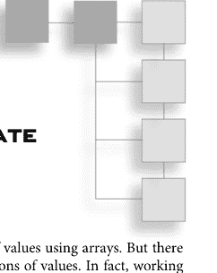

the same thing, but the STL containers offer more flexibility and power than a simple but trusty array. The STL defines a variety of container types; each works in a different way to meet different needs.

同样的事情，但 STL 容器比简单可靠的数组提供更多的灵活性和功能。STL 定义了多种容器类型；每种都以不同的方式工作以满足不同的需求。

The algorithms defined in the STL work with its containers. The algorithms are common functions that game programmers find themselves repeatedly applying to groups of values. They include algorithms for sorting, searching, copying, merging, inserting, and removing container elements. The cool thing is that the same algorithm can work its magic on many different container types.

STL 中定义的算法与其容器一起工作。这些算法是游戏程序员反复应用于一组值的常见函数。它们包括用于排序、搜索、复制、合并、插入和删除容器元素的算法。妙处在于同一个算法可以在许多不同的容器类型上发挥作用。

Iterators are objects that identify elements in containers and can be manipulated to move among elements. They're great for, well, iterating through containers. In addition, iterators are required by the STL algorithms.

迭代器是标识容器中元素的对象，可以被操作以在元素之间移动。它们非常适合……遍历容器。此外，迭代器是 STL 算法所必需的。

All of this makes a lot more sense when you see an actual implementation of one of the container types, so that's next.

所有这些在看到其中一种容器类型的实际实现时就会变得更有意义，所以接下来就是这个。

## Using Vectors

The vector class defines one kind of container provided by the STL. It meets the general description of a dynamic array—an array that can grow and shrink in size as needed. In addition, vector defines member functions to manipulate vector elements. This means that the vector has all of the functionality of the array plus more.

vector 类定义了 STL 提供的一种容器。它符合动态数组的一般描述——一种可以根据需要增长和缩小大小的数组。此外，vector 定义了用于操作 vector 元素的成员函数。这意味着 vector 具有数组的所有功能以及更多功能。

At this point, you may be thinking to yourself: Why learn to use these fancy new vectors when I can already use arrays? Well, vectors have certain advantages over arrays, including:

此时，你可能会想：为什么要学习使用这些花哨的新 vector，而我已经可以使用数组了呢？好吧，vector 相对于数组有某些优势，包括：

- Vectors can grow as needed while arrays cannot. This means that if you use a vector to store objects for enemies in a game, the vector will grow to accommodate the number of enemies that get created. If you use an array, you have to create one that can store some maximum number of enemies. And if, during play, you need more room in the array than you thought, you're out of luck.
- Vector 可以根据需要增长，而数组不能。这意味着如果你使用 vector 来存储游戏中敌人的对象，vector 将会增长以容纳创建的敌人数量。如果你使用数组，你必须创建一个可以存储最大数量敌人的数组。而且如果在游戏中，你需要的数组空间比预想的多，你就倒霉了。
- Vectors can be used with the STL algorithms while arrays cannot. This means that by using vectors you get complex functionality like searching and sorting, built-in. If you use arrays, you have to write your own code to achieve this same functionality.
- Vector 可以与 STL 算法一起使用，而数组不能。这意味着通过使用 vector，你可以获得内置的复杂功能，如搜索和排序。如果你使用数组，你必须编写自己的代码来实现相同的功能。


与数组相比，向量有几个缺点，包括：

- 向量需要一些额外的内存作为开销。
- 向量大小增长时可能会产生性能开销。
- 在某些游戏主机系统上可能无法使用向量。

总体而言，向量（以及 STL）在大多数项目中都是一种受欢迎的工具。

## 介绍英雄的背包 2.0 程序

从用户的角度来看，英雄的背包 2.0 程序与前作《第 3 章的英雄的背包程序》相似。新版本存储并操作一组表示英雄背包的字符串对象。然而，从程序员的角度来看，该程序截然不同。这是因为新程序使用向量而不是数组来表示背包。图 4.1 显示了该程序的结果。

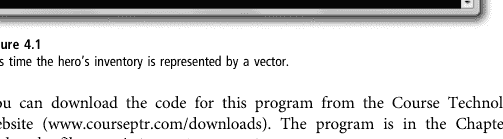

Figure 4.1
这次英雄的背包由向量表示。

你可以从 Course Technology 网站 (www.courseptr.com/downloads) 下载此程序的代码。该程序位于第 4 章文件夹中；文件名是 heros_inventory2.cpp。

```
cout << inventory[i] << endl;
}

cout << "\nYou were robbed of all of your possessions by a thief.";
inventory.clear();
if (inventory.empty())
{
    cout << "\nYou have nothing.\n";
}
else
{
    cout << "\nYou have at least one item.\n";
}

return 0;
}
```

## 为使用向量做准备

在我声明向量之前，我必须包含包含其定义的头文件：

```
#include <vector>
```

所有 STL 组件都位于 std 命名空间中，因此通过使用以下代码（我通常这样做），我就可以在不以 std:: 为前缀的情况下引用向量：

```
using namespace std;
```

## 声明向量

好吧，我在 main() 中做的第一件事就是声明一个新的向量。

```
vector<string> inventory;
```

上一行声明了一个名为 inventory 的空向量，它可以包含字符串对象元素。声明空向量是可以的，因为在添加新元素时它会增长。

要声明自己的向量，请写 vector，后跟你想与向量一起使用的对象类型（用 < 和 > 符号括起来），然后是向量名称。

## 提示

声明向量还有其他方法。你可以在向量名称后指定一个数字来声明一个具有起始大小的向量。

```
vector<string> inventory(10);
```

上述代码声明了一个用于保存字符串对象元素的向量，起始大小为 10。你也可以在声明时将向量的所有元素初始化为相同的值。你只需提供元素数量，后跟起始值，如下所示：

```
vector<string> inventory(10, "nothing");
```

上述代码声明了一个大小为 10 的向量，并将 10 个元素全部初始化为 "nothing"。最后，你可以声明一个向量并用另一个向量的内容对其进行初始化。

```
vector<string> inventory(myStuff);
```

上述代码创建了一个与向量 myStuff 内容相同的新向量。

## 使用 push_back() 成员函数

接下来，我给英雄提供与程序上一版本相同的三个初始物品。

```
inventory.push_back("sword");
inventory.push_back("armor");
inventory.push_back("shield");
```

push_back() 成员函数在向量的末尾添加一个新元素。在前面的几行中，我向 inventory 添加了 "sword"、"armor" 和 "shield"。因此，inventory[0] 等于 "sword"，inventory[1] 等于 "armor"，inventory[2] 等于 "shield"。

## 使用 size() 成员函数

接下来我显示英雄拥有的物品数量。

```
cout << "You have " << inventory.size() << " items.\n";
```

我通过调用 inventory.size() 来调用 size() 成员函数来获取 inventory 的大小。size() 成员函数只是返回向量的大小。在这种情况下，它返回 3。

就像数组一样，你可以通过写元素，后跟成员选择运算符，后跟成员函数名称来访问向量元素的成员函数。因为 inventory[0] 等于 "battle axe"，inventory[0].size() 返回 10。

## 使用 pop_back() 成员函数

我使用以下方法移除英雄的盾牌

```
inventory.pop_back();
```

pop_back() 成员函数删除向量的最后一个元素并将向量大小减少一。在这种情况下，inventory.pop_back() 从 inventory 中删除 "shield"，因为那是向量中的最后一个元素。此外，inventory 的大小从 3 减少到 2。

## 使用 clear() 成员函数

接下来我模拟小偷抢走英雄所有物品的行为。

```
inventory.clear();
```

clear() 成员函数删除向量的所有项目并将其大小设置为 0。执行上一行代码后，inventory 是一个空向量。

## 使用 empty() 成员函数

最后，我检查英雄的背包中是否有任何物品。

```
if (inventory.empty())
{
    cout << "\nYou have nothing.\n";
}
else
{
    cout << "\nYou have at least one item.\n";
}
```

向量成员函数 empty() 的工作方式与字符串成员函数 empty() 完全相同。如果向量对象为空，则返回 true；否则返回 false。因为在这种情况下 inventory 为空，所以程序显示消息，“You have nothing.”

## 使用迭代器

迭代器是充分发挥容器潜力的关键。有了迭代器，你可以遍历序列容器。此外，STL 的重要部分需要迭代器。许多容器成员函数和 STL 算法都以迭代器作为参数。因此，如果你想利用这些成员函数和算法的好处，就必须使用迭代器。

## 介绍英雄的背包 3.0 程序

英雄的背包 3.0 程序至少在开始时与它的两个前辈一样。该程序展示了一系列物品，替换第一个物品，并显示物品名称中的字母数。但随后程序做了一些新事情：它在组开头插入一个物品，然后从组中间移除一个物品。该程序通过使用迭代器完成了所有这些操作。图 4.2 显示了程序的运行情况。


Figure 4.2
该程序执行了一些向量操作，这些操作只能通过迭代器完成。

你可以从 Course Technology 网站 (www.courseptr.com/downloads) 下载此程序的代码。该程序位于第 4 章文件夹中；文件名是 heros_inventory3.cpp。

```
// Hero's Inventory 3.0
// Demonstrates iterators

#include <iostream>
#include <string>
#include <vector>

using namespace std;

int main()
{
    vector<string> inventory;
    inventory.push_back("sword");
    inventory.push_back("armor");
    inventory.push_back("shield");

    vector<string>::iterator myIterator;
    vector<string>::const_iterator iter;

    cout << "Your items:\n";
    for (iter = inventory.begin(); iter != inventory.end(); ++iter)
    {
        cout << *iter << endl;
    }

    cout << "\nYou trade your sword for a battle axe.";
    myIterator = inventory.begin();
    *myIterator = "battle axe";
    cout << "\nYour items:\n";
    for (iter = inventory.begin(); iter != inventory.end(); ++iter)
    {
        cout << *iter << endl;
    }

    cout << "\nThe item name " << *myIterator << " has ";
    cout << (*myIterator).size() << " letters in it.\n";

    cout << "\nThe item name " << *myIterator << " has ";
    cout << myIterator->size() << " letters in it.\n";

    cout << "\nYou recover a crossbow from a slain enemy.";
    inventory.insert(inventory.begin(), "crossbow");
    cout << "\nYour items:\n";
    for (iter = inventory.begin(); iter != inventory.end(); ++iter)
    {
        cout << *iter << endl;
    }

    cout << "\nYour armor is destroyed in a fierce battle.";
    inventory.erase((inventory.begin() + 2));
    cout << "\nYour items:\n";
    for (iter = inventory.begin(); iter != inventory.end(); ++iter)
    {
        cout << *iter << endl;
    }

    return 0;
}
```

## 声明迭代器

在我为英雄的背包声明一个向量并添加来自程序前几版的三个相同的字符串对象后，我声明一个迭代器。

```
vector<string>::iterator myIterator;
```

上一行声明了一个名为 myIterator 的迭代器，用于包含字符串对象的向量。要声明自己的迭代器，请遵循相同的模式。写容器类型，后跟容器将保存的对象类型（用 < 和 > 符号括起来），后跟作用域解析运算符（:: 符号），后跟迭代器类型，后跟新迭代器的名称。

那么迭代器是什么？迭代器是标识容器中特定元素的数值。给定一个迭代器，你可以访问该元素的值。给定正确类型的迭代器，你可以更改该值。迭代器还可以通过熟悉的算术运算符在元素之间移动。


在 inventory 的特定元素上贴一张便利贴。一旦我这样做了，就可以通过迭代器访问该元素，甚至修改它。

接下来，我声明另一个迭代器。

```cpp
vector<string>::const_iterator iter;
```

前面的代码行创建了一个名为 iter 的常量迭代器，用于包含 string 对象的 vector。常量迭代器与常规迭代器类似，只不过你不能使用它修改所引用的元素；该元素必须保持常量。你可以将常量迭代器视为提供只读访问。然而，迭代器本身是可以改变的。这意味着你可以按照自己的需要，在 vector inventory 中任意移动 iter。但你不能通过 iter 修改任何元素的值。对于常量迭代器，便利贴可以改变，但它所贴到的对象却不能变。

你可能会问，既然常量迭代器是常规迭代器的受限版本，为什么还要使用它呢？首先，它能让你的意图更加清晰。当你使用常量迭代器时，就清楚地表明你不会修改它所引用的任何元素。其次，它更安全。使用常量迭代器可以避免意外修改容器元素。如果你试图通过常量迭代器修改元素，就会产生编译错误。

### 陷阱

使用 push_back() 可能会使所有引用该 vector 的迭代器失效。

这些关于迭代器的讨论对你来说是否有点太抽象了？你是否厌倦了关于便利贴的类比？别担心——接下来，我会让一个真正的迭代器开始工作。

## 遍历 Vector

接下来，我遍历 vector 的内容并显示英雄的库存。

```cpp
cout << "Your items:\n";
for (iter = inventory.begin(); iter != inventory.end(); ++iter)
{
    cout << *iter << endl;
}
```

在前面的代码中，我使用 for 循环从 inventory 的第一个元素移动到最后一个元素。从总体层面看，这正是我在 Hero's Inventory 2.0 中遍历 vector 内容的方式。但这次我使用的是迭代器，而不是整数和下标运算符来访问每个元素。基本上，我让便利贴遍历了整组元素，并显示出便利贴所贴到的每个元素的值。这个小小的循环中包含了很多新概念，所以我将逐一进行解释。

### 调用 begin() Vector 成员函数

在循环的初始化语句中，我将 inventory.begin() 的返回值赋给 iter。begin() 成员函数返回一个指向容器第一个元素的迭代器。因此，在本例中，该语句将一个指向 inventory 第一个元素（即等于 "sword" 的 string 对象）的迭代器赋给 iter。

图 4.3 展示了调用 inventory.begin() 所返回迭代器的抽象视图。请注意，该图是抽象的，因为 vector inventory 包含的不是字符串字面量 "sword"、"armor" 和 "shield"，而是 string 对象。

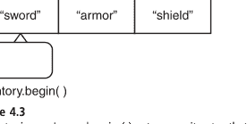

inventory.begin()

图 4.3  
调用 inventory.begin() 返回一个指向 vector 第一个元素的迭代器。

### 调用 end() Vector 成员函数

在循环的测试语句中，我将 inventory.end() 的返回值与 iter 进行比较，以确保二者不相等。end() 成员函数返回一个指向容器最后一个元素之后位置的迭代器。这意味着循环将持续进行，直到 iter 遍历完 inventory 中的所有元素。

图 4.4 展示了调用该成员函数所返回迭代器的抽象视图。请注意，该图是抽象的，因为 vector inventory 包含的不是字符串字面量 "sword"、"armor" 和 "shield"，而是 string 对象。

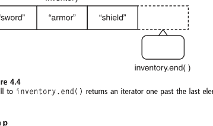

图 4.4  
调用 inventory.end() 返回一个指向 vector 最后一个元素之后位置的迭代器。

### 陷阱

end() vector 成员函数返回的迭代器位于 vector 最后一个元素之后——而不是最后一个元素本身。因此，你无法从 end() 返回的迭代器获取值。这看起来可能有些反直觉，但对于遍历容器的循环来说却非常有效。

### 修改迭代器

循环中的动作语句 ++iter 会对 iter 进行递增，使其移动到 vector 中的下一个元素。取决于迭代器的类型，你还可以对迭代器执行其他数学运算，让它们在容器中移动。不过，大多数情况下，你会发现你只是想要递增迭代器。

### 解引用迭代器

在循环体中，我将 *iter 发送给 cout。通过将解引用运算符（*）放在 iter 前面，我显示出迭代器所引用的元素的值（而不是迭代器本身）。将解引用运算符放在迭代器前面，就等于在说：“把它当作迭代器所引用的对象，而不是迭代器本身。”

### 修改 Vector 元素的值

接下来，我将 vector 中的第一个元素从等于 "sword" 的 string 对象改为等于 "battle axe" 的 string 对象。首先，我将 myIterator 设置为引用 inventory 的第一个元素。

```cpp
myIterator = inventory.begin();
```

然后我修改第一个元素的值。

### 提示

*语法糖（syntactic sugar）是一种更友好的替代语法。它用更易于接受的形式取代了生硬的语法。例如，与其编写代码 `(*myIterator).size()`，我可以使用 `->` 运算符提供的语法糖，写成 `myIterator->size()`。*

### 使用 insert() Vector 成员函数

接下来，我向英雄的库存中添加一个新物品。不过，这次我不是将物品添加到序列的末尾，而是将其插入到开头。

```cpp
inventory.insert(inventory.begin(), "crossbow");
```

insert() 成员函数的一种形式会将一个新元素插入到 vector 中给定迭代器所引用元素之前。使用这个版本的 insert() 需要提供两个参数——第一个是迭代器，第二个是要插入的元素。在本例中，我将 "crossbow" 插入到 inventory 中的第一个元素之前。结果，所有其他元素都会向后移动一位。这个版本的 insert() 成员函数返回一个指向新插入元素的迭代器。在本例中，我没有将返回的迭代器赋值给变量。

### 陷阱

对 vector 调用 insert() 成员函数会使所有引用插入点之后元素的迭代器失效，因为插入点之后的所有元素都会向后移动一位。

接下来，我显示 vector 的内容，以证明插入操作成功。

### 使用 erase() Vector 成员函数

接下来，我从英雄的库存中移除一个物品。不过，这次我不是移除序列末尾的物品，而是从中间移除一个。

```cpp
inventory.erase(inventory.begin() + 2);
```

erase() 成员函数的一种形式会从 vector 中移除一个元素。使用这个版本的 erase() 需要提供一个参数——即引用你要移除元素的迭代器。在本例中，我传入了 `(inventory.begin() + 2)`，它等于引用 inventory 中第三个元素的迭代器。这会移除等于 "armor" 的 string 对象。结果，所有后续元素都会向前移动一位。这个版本的 erase() 成员函数返回一个引用被移除元素之后元素的迭代器。在本例中，我没有将返回的迭代器赋值给变量。

### 陷阱

对 vector 调用 erase() 成员函数会使所有引用移除点之后元素的迭代器失效，因为移除点之后的所有元素都会向前移动一位。

接下来，我显示 vector 的内容，以证明移除操作成功。

## 使用算法

STL 定义了一组算法，让你可以通过迭代器操作容器中的元素。这些算法用于完成搜索、随机化和排序等常见任务。这些算法是你内置的灵活而高效的武器库。通过使用它们，你可以把以常见方式操作容器元素这种单调乏味的任务交给 STL，从而专注于编写游戏。这些算法的强大之处在于它们是通用的——同一个算法可以处理不同容器类型的元素。

### 介绍 High Scores 程序

High Scores 程序会创建一个包含最高分的 vector。它使用 STL 算法来搜索、打乱和排序这些分数。图 4.5 展示了该程序。

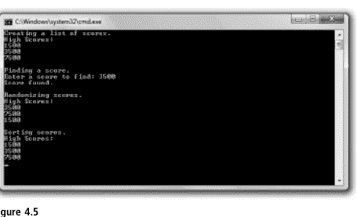

图 4.5  
STL 算法搜索、打乱并排序最高分 vector 中的元素。


你可以从 Course Technology 网站（www.courseptr.com/downloads）下载本程序的代码。该程序位于 Chapter 4 文件夹中，文件名为 high_scores.cpp。

// High Scores
// Demonstrates algorithms

#include <iostream>
#include <vector>
#include <algorithm>
#include <ctime>
#include <cstdlib>

using namespace std;

int main()
{
    vector<int>::const_iterator iter;

    cout << "Creating a list of scores.";
    vector<int> scores;
    scores.push_back(1500);
    scores.push_back(3500);
    scores.push_back(7500);

    cout << "\nHigh Scores:\n";
    for (iter = scores.begin(); iter != scores.end(); ++iter)
    {
        cout << *iter << endl;
    }

    cout << "\nFinding a score.";
    int score;
    cout << "\nEnter a score to find: ";
    cin >> score;
    iter = find(scores.begin(), scores.end(), score);
    if (iter != scores.end())
{
    cout << "Score found.\n";
}
else
{
    cout << "Score not found.\n";
}

cout << "\nRandomizing scores.";
srand(static_cast<unsigned int>(time(0)));
random_shuffle(scores.begin(), scores.end());
cout << "\nHigh Scores:\n";
for (iter = scores.begin(); iter != scores.end(); ++iter)
{
    cout << *iter << endl;
}

cout << "\nSorting scores.";
sort(scores.begin(), scores.end());
cout << "\nHigh Scores:\n";
for (iter = scores.begin(); iter != scores.end(); ++iter)
{
    cout << *iter << endl;
}

return 0;
}

## 准备使用算法

为了能够使用 STL 算法，我包含了定义它们的头文件。

```
#include <algorithm>
```

如你所知，所有 STL 组件都位于 std 命名空间中。通过使用下面的代码（我通常这样做），我可以直接引用算法，而无需在其前面加上 std::。

```
using namespace std;
```

## 使用 find() 算法

显示 vector scores 的内容后，我从用户那里获取一个要查找的值，并将其存储在变量 score 中。然后使用 find() 算法在 vector 中搜索该值：

```
iter = find(scores.begin(), scores.end(), score);
```

find() STL 算法在容器元素的指定范围内搜索某个值。它返回一个指向第一个匹配元素的迭代器。如果没有找到匹配项，则返回指向范围末尾的迭代器。你必须以迭代器的形式传递起始点、结束点以及要查找的值。算法从起始迭代器开始搜索，直到但不包括结束迭代器。在本例中，我传递了 scores.begin() 和 scores.end() 作为第一和第二个参数，以搜索整个 vector；传递 score 作为第三个参数，以搜索用户输入的值。

接下来，我检查是否找到了 score 值：

```
if (iter != scores.end())
{
    cout << "Score found.\n";
}
else
{
    cout << "Score not found.\n";
}
```

请记住，如果找到了该值，iter 将引用 vector 中第一次出现的 score。因此，只要 iter 不等于 scores.end()，我就知道找到了 score，并显示相应的消息。否则，iter 将等于 scores.end()，我就知道没有找到 score。

## 使用 random_shuffle() 算法

接下来，我准备使用 random_shuffle() 算法对分数进行随机排序。正如生成单个随机数时一样，在调用 random_shuffle() 之前，我需要先设置随机数生成器的种子，这样每次运行程序时分数的顺序都可能不同。

```
srand(static_cast<unsigned int>(time(0)));
```

然后，我以随机方式重新排列分数。

```
random_shuffle(scores.begin(), scores.end());
```

`random_shuffle()` 算法会随机化序列中的元素。你必须以迭代器的形式提供要打乱的序列的起始点和结束点。在本例中，我传递了由 `scores.begin()` 和 `scores.end()` 返回的迭代器。这两个迭代器表示我想要打乱 `scores` 中的所有元素。结果，`scores` 包含相同的分数，但顺序是随机的。

然后我显示分数，以证明随机化生效了。

## 技巧

> 尽管你可能不想打乱最高分列表，但 `random_shuffle()` 对游戏来说是一个非常有用的算法。你可以用它做各种各样的事情，从洗一副纸牌，到打乱玩家在游戏关卡中遇到的敌人的顺序。

## 使用 sort() 算法

接下来，我对分数进行排序。

```
sort(scores.begin(), scores.end());
```

`sort()` 算法按升序对序列中的元素进行排序。你必须以迭代器的形式提供要排序的序列的起始点和结束点。在本例中，我传递了由 `scores.begin()` 和 `scores.end()` 返回的迭代器。这两个迭代器表示我想要对 `scores` 中的所有元素进行排序。结果，`scores` 包含了所有按升序排列的分数。

最后，我显示分数，以证明排序生效了。

## 技巧

> STL 算法的一个很酷的特性是，它们可以与 STL 之外定义的容器一起工作。这些容器只需要满足某些要求。例如，即使 `string` 对象不是 STL 的一部分，你也可以对其使用适当的 STL 算法。下面的代码片段演示了这一点：

```
string word = "High Scores";
random_shuffle(word.begin(), word.end());
```

上面的代码随机打乱了 `word` 中的字符。如你所见，`string` 对象同时具有 `begin()` 和 `end()` 成员函数，它们分别返回指向第一个字符和最后一个字符之后位置的迭代器。这就是 STL 算法能够处理 `strings` 的部分原因——因为它们就是为此设计的。

## 理解 vector 的性能

与所有 STL 容器一样，vector 为游戏程序员提供了处理信息的复杂方法，但这种复杂性可能会带来性能开销。如果说游戏程序员痴迷于什么，那就是性能。不过别担心，vector 和其他 STL 容器都非常高效。事实上，它们已经被用于已发布的 PC 和主机游戏中。然而，这些容器各有优缺点；游戏程序员需要了解各种容器类型的性能特征，以便为工作选择正确的容器。

## 检查 vector 的增长

尽管 vector 会根据需要动态增长，但每个 vector 都有一个特定大小。当向 vector 添加新元素使其超过当前大小时，计算机将重新分配内存，甚至可能将所有 vector 元素复制到这块新占用的内存区域。这可能会导致性能下降。

关于程序性能，最重要的一点是要记住你是否需要关心。例如，vector 内存重分配可能不会发生在程序的性能关键部分。在这种情况下，你可以放心地忽略重分配的成本。此外，对于小的 vector，重分配成本可能微不足道，所以同样可以放心地忽略。但是，如果你需要在何时发生这些内存重分配方面有更大的控制权，你可以做到。

## 使用 capacity() 成员函数

capacity() vector 成员函数返回 vector 的容量——换句话说，即在程序必须为其重新分配更多内存之前，vector 可以容纳的元素数量。vector 的容量与其大小（vector 当前持有的元素数量）不是一回事。下面这段代码有助于说明这一点：

```
cout << "Creating a 10 element vector to hold scores.\n";
vector<int> scores(10, 0); //initialize all 10 elements to 0
cout << "Vector size is:" << scores.size() << endl;
cout << "Vector capacity is:" << scores.capacity() << endl;
```

```cpp
cout << "Adding a score.\n";
scores.push_back(0); //memory is reallocated to accommodate growth
cout << "Vector size is:" << scores.size() << endl;
cout << "Vector capacity is:" << scores.capacity() << endl;
```

在我声明并初始化 vector 之后，这段代码报告其大小和容量都是 10。然而，在添加一个元素后，代码报告 vector 的大小为 11，而容量为 20。这是因为每次程序为 vector 重新分配额外内存时，其容量都会翻倍。在本例中，当添加一个新分数时，内存被重新分配，vector 的容量从 10 翻倍到 20。

## 使用 reserve() 成员函数

reserve() 成员函数将 vector 的容量增加到参数指定的数量。使用 reserve() 可以让你控制额外内存重分配何时发生。下面是一个例子：

```cpp
cout << "Creating a list of scores.\n";
vector<int> scores(10, 0); //initialize all 10 elements to 0
cout << "Vector size is:" << scores.size() << endl;
cout << "Vector capacity is:" << scores.capacity() << endl;

cout << "Reserving more memory.\n";
scores.reserve(20); //reserve memory for 10 additional elements
cout << "Vector size is:" << scores.size() << endl;
cout << "Vector capacity is:" << scores.capacity() << endl;
```

在我声明并初始化 vector 之后，这段代码报告其大小和容量都是 10。然而，在我为 10 个额外元素预留内存后，代码报告 vector 的大小仍然是 10，而容量为 20。

通过使用 reserve() 使 vector 的容量对你的用途来说足够大，你可以将内存重分配延迟到你选择的时间。

## 提示

> 作为初学游戏程序员，了解 vector 内存分配的工作原理是件好事；不过，不要过度纠结于此。你编写的第一个游戏程序可能不会从更手动的 vector 内存分配过程中受益。


结构。虽然它们不是正式容器，但外观和使用感受与容器完全相同。表4.1列出了STL提供的容器类型。

表4.1 STL 容器

| 容器 | 类型 | 描述 |
|---|---|---|
| deque | 序列式 | 双端队列 |
| list | 序列式 | 线性列表 |
| map | 关联式 | 键/值对的集合，每个键恰好关联一个值 |
| multimap | 关联式 | 键/值对的集合，每个键可以关联多个值 |
| multiset | 关联式 | 每个元素不一定唯一的集合 |
| priority_queue | 适配器 | 优先队列 |
| queue | 适配器 | 队列 |
| set | 关联式 | 每个元素都唯一的集合 |
| stack | 适配器 | 栈 |
| vector | 序列式 | 动态数组 |

## 规划你的程序

到目前为止，你看到的所有程序都非常简单。在纸上正式规划它们中的任何一个，这种想法似乎有点小题大做。但事实并非如此——规划你的程序（即使是很小的程序）几乎总能节省时间（并减少挫败感）。

编程很像建筑施工。想象一位承包商在没有蓝图的情况下为你盖房子。哎呀！你最终可能会得到一栋有12个卫生间、没有窗户、前门在二楼的房子。而且，它可能会花掉你预估价格的10倍。编程也是如此。没有计划，你可能会在这个过程中苦苦挣扎，浪费时间，甚至最后得到一个并不能正常工作的程序。

### 使用伪代码

许多程序员使用伪代码来勾勒他们的程序——伪代码是一种介于英语和正式编程语言之间的语言。任何懂英语的人都应该能看懂伪代码。举个例子：假设我想赚一百万美元。这是一个有价值的目标，但我该怎么做才能实现呢？我需要一个计划。于是我想出一个计划，并用伪代码写下来。

```
If you can think of a new and useful product
Then that's your product
Otherwise
    Repackage an existing product as your product
    Make an infomercial about your product
    Show the infomercial on TV
    Charge $100 per unit of your product
    Sell 10,000 units of your product
```

虽然任何人，甚至非程序员，都能理解我的计划，但我的伪代码隐约有一种程序的感觉。前四行类似带 else 子句的 if 语句，这是有意为之。当你编写计划时，应该试着让伪代码体现出它所表示的代码的感觉。

### 使用逐步求精

你的编程计划可能不是只写一稿就能完成。通常，伪代码需要经过多轮修改，才能被实现为编程代码。逐步求精就是一种重写伪代码以使其准备好实现的过程。逐步求精非常简单。基本上，它的意思是“让它更详细”。通过把伪代码中描述的每一步分解为一系列更简单的步骤，计划就会更接近编程代码。使用逐步求精，你不断分解每一个步骤，直到你觉得整个计划可以相当容易地转换成程序。举个例子，从我赚一百万美元的总计划中取一步：

```
Create an infomercial about your product
```

这个任务可能显得过于笼统。你怎么制作电视购物广告？通过逐步求精，你可以把这个步骤分解为其他几个步骤。于是它变成：

```
Write a script for an infomercial about your product
Rent a TV studio for a day
Hire a production crew
Hire an enthusiastic audience
Film the infomercial
```

如果你觉得这五个步骤清晰可行，那么伪代码的这一部分就已经被彻底求精了。如果某个步骤你仍然不清楚，那就进一步细化。继续这个过程，你就会得到一个完整的计划——还有一百万美元。

## 介绍 Hangman 游戏

在 Hangman 程序中，计算机选择一个秘密单词，玩家每次猜一个字母。玩家最多可以猜错八次。如果未能及时猜出这个单词，玩家就会被绞死，游戏结束。图4.6展示了这个游戏。

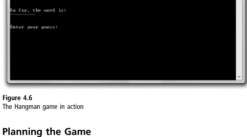

图4.6

运行中的 Hangman 游戏

### 规划游戏

在我编写任何一行 C++ 代码之前，我会使用伪代码来规划游戏程序。

```
Create a group of words
Pick a random word from the group as the secret word
While player hasn't made too many incorrect guesses and hasn't guessed the secret word
    Tell player how many incorrect guesses he or she has left
    Show player the letters he or she has guessed
Show player how much of the secret word he or she has guessed
Get player's next guess
While player has entered a letter that he or she has already guessed
    Get player's guess
Add the new guess to the group of used letters
If the guess is in the secret word
    Tell the player the guess is correct
    Update the word guessed so far with the new letter
Otherwise
    Tell the player the guess is incorrect
    Increment the number of incorrect guesses the player has made
If the player has made too many incorrect guesses
    Tell the player that he or she has been hanged
Otherwise
    Congratulate the player on guessing the secret word
```

虽然这段伪代码没有涵盖我将编写的每一行 C++，但我认为它很好地描述了我需要做的事情。然后我开始编写程序。

### 设置程序

和往常一样，我先添加一些注释，并包含我需要的文件。

```
// Hangman
// The classic game of hangman

#include <iostream>
#include <string>
#include <vector>
#include <algorithm>
#include <ctime>
#include <cctype>

using namespace std;
```

注意，我加入了一个新文件——cctype。它是标准库的一部分，其中包含用于将字符转换为大写的函数。我使用这些函数，以便在比较单个字符时可以进行同类比较（大写对大写）。

### 初始化变量和常量

接下来，我开始编写 main() 函数，并初始化游戏所需的变量和常量。

```cpp
int main()
{
    //setup
    const int MAX_WRONG = 8;  //maximum number of incorrect guesses allowed

    vector<string> words;  //collection of possible words to guess
    words.push_back("GUESS");
    words.push_back("HANGMAN");
    words.push_back("DIFFICULT");

    srand(static_cast<unsigned int>(time(0)));
    random_shuffle(words.begin(), words.end());
    const string THE_WORD = words[0];  //word to guess
    int wrong = 0;                     //number of incorrect guesses
    string soFar(THE_WORD.size(), '-'); //word guessed so far
    string used = "";                  //letters already guessed

    cout << "Welcome to Hangman. Good luck!\n";
}
```

MAX_WRONG 是玩家可以犯的最大错误猜测次数。words 是存放候选单词的向量。我使用 random_shuffle() 算法对 words 进行随机重排，然后将向量中的第一个单词赋给 THE_WORD，也就是玩家必须猜出的秘密单词。wrong 是玩家已经猜错的次数。soFar 是玩家到目前为止猜出的单词。soFar 初始时是一系列短横线——秘密单词中每个字母对应一个。当玩家猜中秘密单词中的一个字母时，我会用该字母替换相应位置的短横线。

### 进入主循环

接下来，我进入主循环，循环会一直运行，直到玩家错误猜测次数过多或猜出单词为止。

```cpp
//main loop
while ((wrong < MAX_WRONG) && (soFar != THE_WORD))
{
cout << "\n\nYou have " << (MAX_WRONG - wrong);
cout << " incorrect guesses left.\n";
cout << "\nYou've used the following letters:\n" << used << endl;
cout << "\nSo far, the word is:\n" << soFar << endl;
```

### 获取玩家的猜测

接下来，我获取玩家的猜测。

```cpp
char guess;
cout << "\n\nEnter your guess: ";
cin >> guess;
guess = toupper(guess); //make uppercase since secret word in uppercase
while (used.find(guess) != string::npos)
{
    cout << "\nYou've already guessed " << guess << endl;
    cout << "Enter your guess: ";
    cin >> guess;
    guess = toupper(guess);
}
used += guess;

if (THE_WORD.find(guess) != string::npos)
{
    cout << "That's right! " << guess << " is in the word.\n";
    //update soFar to include newly guessed letter
    for (int i = 0; i < THE_WORD.length(); ++i)
    {
        if (THE_WORD[i] == guess)
        {
            soFar[i] = guess;
        }
    }
}
else
{
    cout << "Sorry, " << guess << " isn't in the word.\n";
    ++wrong;
}
```


- STL 中定义的算法可以与其容器一起使用，并提供用于处理对象组的常用函数。
- 迭代器是标识容器中元素的对象，可对其进行操作以在元素之间移动。
- 迭代器是充分发挥容器作用的关键。许多容器成员函数都需要迭代器，STL 算法也需要它们。
- 要获取迭代器引用的值，必须使用解引用运算符（*）对迭代器进行解引用。
- vector 是 STL 提供的一种顺序容器。它的行为类似于动态数组。
- 遍历 vector 非常高效。从 vector 的末尾插入或移除元素也非常高效。
- 在 vector 中间插入或删除元素可能效率较低，尤其是在 vector 很大时。
- 伪代码介于英语和编程语言之间，用于规划程序。
- 逐步细化是一种重写伪代码以使其为实现做好准备的过程。

## 问题与答案

### 问：为什么 STL 很重要？
答：因为它为游戏程序员节省了时间和精力。STL 提供了常用的容器类型和算法。

### 问：STL 快吗？
答：当然。STL 经过数百名程序员的反复打磨，力求在每个支持的平台上尽可能榨取性能。

### 问：我应该什么时候使用 vector 而不是数组？
答：几乎总是如此。vector 高效且灵活。它们确实比数组需要多一点内存，但这种权衡几乎总是值得的。

### 问：vector 和数组一样快吗？
答：访问 vector 元素可以和访问数组元素一样快。此外，遍历 vector 也可以和遍历数组一样快。

### 问：如果我可以对 vector 使用下标运算符，为什么还需要迭代器？
答：原因有几个。首先，许多 vector 成员函数需要迭代器（insert() 和 erase() 就是两个例子）。其次，STL 算法需要迭代器。第三，大多数 STL 容器不能使用下标运算符，所以你迟早必须学会使用迭代器。

### 问：访问 vector 元素的最佳方式是什么——通过迭代器还是通过下标运算符？
答：这取决于情况。如果你需要随机访问元素，那么下标运算符是很自然的选择。如果你需要使用 STL 算法，那么你必须使用迭代器。

### 问：那遍历 vector 的元素呢？我应该使用下标运算符还是迭代器？
答：两种方法都可以。不过，使用迭代器的一个优点是，它可以让你灵活地替换为另一种 STL 容器（例如 list），而无需更改太多代码。

### 问：为什么 STL 定义了不止一种顺序容器类型？
答：不同的顺序容器类型具有不同的性能特性。它们就像工具箱里的工具；每种工具最适合不同的工作。

### 问：什么是容器适配器？
答：容器适配器基于 STL 顺序容器之一；它们代表了标准的计算机数据结构。虽然它们不是正式的容器，但它们的外观和使用体验与容器一样。

### 问：什么是栈？
答：一种数据结构，其中元素按照添加顺序的相反顺序移除。这意味着最后添加的元素最先被移除。这就像现实中的一叠物品，你移走的是你最后放在顶部的物品。

### 问：什么是队列？
答：一种数据结构，其中元素按照添加顺序移除。这就像现实中的排队，例如一列人，排在最前面的人先得到服务。

### 问：什么是双端队列？
答：一种可以在两端添加或移除元素的队列。

### 问：什么是优先队列？
答：一种支持查找并移除具有最高优先级元素的数据结构。

### 问：我什么时候会使用伪代码？
答：任何时候你想规划一个程序或一段代码。

### 问：我什么时候会使用逐步细化？
答：当你希望伪代码更加详细时。

## 讨论问题

- 1. 游戏程序员为什么要使用 STL？
- 2. 与数组相比，vector 有哪些优势？
- 3. 你可以使用 vector 存储哪些类型的游戏对象？
- 4. 容器类型的性能特性如何影响使用它的决策？
- 5. 为什么程序规划很重要？

## 练习

- 1. 编写一个使用 vector 和迭代器的程序，允许用户维护他或她最喜欢的游戏列表。程序应允许用户列出所有游戏标题、添加游戏标题和移除游戏标题。
- 2. 假设 scores 是一个存放 int 类型元素的 vector，下面的代码片段有什么问题（旨在递增每个元素）？

```
vector<int>::iterator iter;
//increment each score
for (iter = scores.begin(); iter != scores.end(); ++iter)
{
    iter++;
}
```
- 3. 为第 3 章中的 Word Jumble 游戏编写伪代码。

此页有意留空。

## 介绍 Instructions 程序

Instructions 程序的输出相当基础——几行文本，是某个游戏说明的开头。从输出看，Instructions 似乎是一个你在第 1 章就能编写的程序。但该程序在后台有一个新元素——一个新函数。看一下图 5.1，了解这段代码的简单输出。

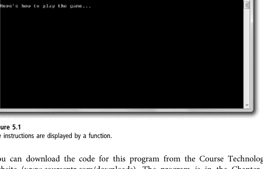

图 5.1
这些指令由一个函数显示。

你可以从 Course Technology 网站（www.courseptr.com/downloads）下载此程序的代码。该程序位于第 5 章文件夹中；文件名是 instructions.cpp。

```
// Instructions
// Demonstrates writing new functions

#include <iostream>

using namespace std;

// function prototype (declaration)
void instructions();
```

```c
int main()
{
    instructions();
    return 0;
}

// function definition
void instructions()
{
    cout << "Welcome to the most fun you've ever had with text!\n\n";
    cout << "Here's how to play the game...\n";
}
```

### 声明函数

在调用自己编写的函数之前，必须先声明它。声明函数的一种方式是编写*函数原型*——描述函数的代码。编写原型时，需要列出函数的返回值（如果函数不返回任何值，则列出 *void*），后跟函数名，再后跟括号内的参数列表。*参数*接收函数调用中作为实参发送的值。

就在 `main()` 函数之前，我编写了一个函数原型：

```
void instructions();
```

在上面的代码中，我声明了一个名为 `instructions` 的函数，它不返回值。（你可以看出这一点，因为我使用了 `void` 作为返回类型。）该函数也不接收任何值，因此没有参数。（你可以看出这一点，因为括号之间什么也没有。）

原型不是声明函数的唯一方式。另一种实现同样效果的方法是将函数定义本身作为其声明。要做到这一点，只需将函数定义放在函数调用之前。

### 提示

虽然你不一定要使用原型，但它们提供了很多好处——其中很重要的一点是让你的代码更清晰。

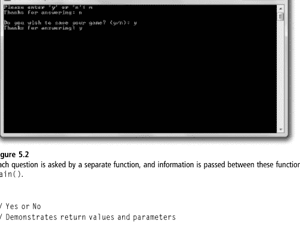

### 图 5.2

每个问题都由一个单独的函数提出，并且信息在这些函数与 main() 之间传递。

```
// Yes or No
// Demonstrates return values and parameters

#include <iostream>
#include <string>

using namespace std;

char askYesNo1();
char askYesNo2(string question);

int main()
{
    char answer1 = askYesNo1();
    cout << "Thanks for answering: " << answer1 << "\n\n";

    char answer2 = askYesNo2("Do you wish to save your game?");
    cout << "Thanks for answering: " << answer2 << "\n";

    return 0;
}
```


```
char askYesNo1()
{
    char response1;
    do
    {
        cout << "Please enter 'y' or 'n': ";
        cin >> response1;
    } while (response1 != 'y' && response1 != 'n');

    return response1;
}
```

```
char askYesNo2(string question)
{
    char response2;
    do
    {
        cout << question << " (y/n): ";
        cin >> response2;
    } while (response2 != 'y' && response2 != 'n');

    return response2;
}
```

## 返回值

你可以从函数中返回一个值，以将信息发送回调用代码。要返回值，你需要指定一个返回类型，然后从函数返回该类型的值。

## 指定返回类型

我声明的第一个函数 askYesNo1() 返回一个 char 值。你可以从 main() 之前的函数原型中看出这一点：

```
char askYesNo1();
```

你也可以从 main() 之后的函数定义中看出这一点：

```
char askYesNo1()
```

## 使用 return 语句

askYesNo1() 要求用户输入 y 或 n，并一直询问直到用户输入为止。一旦用户输入了有效字符，函数就会以下面这行代码结束，返回 response1 的值。

```
return response1;
```

注意，response1 是一个 char 值。它必须如此，因为这是我在函数原型和函数定义中都承诺返回的类型。

函数在遇到 return 语句时结束。一个函数有多个 return 是完全可接受的。这仅仅意味着函数有多个可能的结束点。

## 技巧

> 你不必非要使用 return 语句返回一个值。在无返回值（返回类型为 void）的函数中，你可以单独使用 return 来结束函数。

## 使用返回值

在 main() 中，我用下面这行代码调用函数，将函数的返回值赋给 answer1。

```
char answer1 = askYesNo1();
```

这意味着 answer1 被赋值为 'y' 或 'n'——即用户在 askYesNo1() 提示时输入的那个字符。

接下来，在 main() 中，我显示 answer1 的值，以便所有人查看。

## 接受参数值

你可以向函数发送它接受的值，并将这些值放入其参数中。这是向函数传递信息最常见的方式。

## 指定参数

我声明的第二个函数 askYesNo2() 接受一个值到参数中。具体来说，它接受一个 string 类型的值。你可以从 main() 之前的函数原型中看出这一点：

```
char askYesNo2(string question);
```

## 提示

在原型中，你不必使用参数名；只需包含参数类型即可。例如，下面是一个完全有效的原型，它声明了 askYesNo2()，一个带有一个 string 参数并返回 char 的函数。

```
char askYesNo2(string);
```

即使在原型中不必使用参数名，这样做也是个好主意。它能让你的代码更清晰，而且这点小努力是值得的。

从 askYesNo2() 的函数头可以看出，该函数接受一个 string 对象作为参数，并将该参数命名为 question。

```
char askYesNo2(string question)
```

与原型不同，在函数定义中必须指定参数名。在函数内部，你使用参数名来访问参数值。

## 陷阱

函数原型中指定的参数类型必须与函数定义中列出的参数类型匹配。如果不匹配，就会产生一个严重的编译错误。

## 将值传递给参数

askYesNo2() 函数是对 askYesNo1() 的改进。这个新函数允许你通过向函数传递一个字符串提示来提出你自定义的问题。在 main() 中，我这样调用 askYesNo2()：

```
char answer2 = askYesNo2("Do you wish to save your game?");
```

这条语句调用 askYesNo2()，并将字符串字面量参数 "Do you wish to save your game?" 传递给函数。

## 使用参数值

askYesNo2() 将 "Do you wish to save your game?" 接收到其参数 question 中，该参数在函数中就像任何其他变量一样。实际上，我用以下代码显示 question：

```
cout << question << " (y/n): ";
```

## 提示

> 实际上，这背后还有更多细节。当字符串字面量 "Do you wish to save your game?" 被传递给 question 时，会创建一个与该字符串字面量相等的 string 对象，并且这个 string 对象被赋值给 question。

就像 `askYesNo1()` 一样，`askYesNo2()` 会持续提示用户，直到他输入 y 或 n。然后函数返回该值并结束。

回到 `main()` 中，返回的 `char` 值被赋给 `answer2`，然后我显示它。

## 理解封装

在使用自己的函数时，你可能看不出返回值的必要性。为什么不直接在 `main()` 中使用 `response1` 和 `response2` 变量呢？因为你做不到；`response1` 和 `response2` 在定义它们的函数之外并不存在。事实上，你在函数中创建的任何变量，包括它的参数，都不能在函数外部直接访问。这是一件好事，它被称为 `encapsulation`。封装通过隐藏或封装细节，帮助独立的代码真正保持分离。这就是为什么你要使用参数和返回值——只传递需要交换的信息。而且，你不需要在程序的其余部分跟踪在函数内创建的变量。随着程序规模变大，这是一个巨大的好处。

封装听起来很像抽象。那是因为它们密切相关。封装是抽象的一个原则。抽象让你不必担心细节，而封装则向你隐藏细节。举个例子，考虑一个带有音量增加和降低按钮的电视遥控器。当你使用电视遥控器改变音量时，你正在使用抽象，因为你不需要知道电视内部发生了什么才能让遥控器工作。现在假设电视遥控器有 10 个音量级别。你可以通过遥控器到达所有级别，但你不能直接访问它们。也就是说，你不能直接获得一个特定的音量数字。你只能按下音量增加和音量降低按钮，最终达到你想要的级别。实际的音量数字被封装起来，你不能直接获取。

## 理解软件复用

你可以在其他程序中复用函数。例如，在游戏中向用户询问一个是或否的问题是很常见的，因此你可以创建一个 askYesNo() 函数，并在所有未来的游戏程序中使用它。所以，编写好的函数不仅能在当前游戏项目中节省时间和精力，还能在未来的项目中节省精力。

## 现实世界

重新发明轮子总是浪费时间，因此软件复用——在新项目中采用现有软件和其他元素——是游戏公司非常重视的一项技术。软件复用的好处包括：

- **提高公司生产力。** 通过复用已经存在的代码和其他元素（如图形引擎），游戏公司可以用更少的精力完成项目。
- **提高软件质量。** 如果游戏公司已经有一段经过测试的代码（如网络模块），那么公司可以在知道它没有错误的情况下复用该代码。
- **提高软件性能。** 一旦游戏公司有了一段高性能的代码，再次使用它不仅节省了公司重新发明轮子的麻烦，还避免了他们重新发明一个效率较低的轮子。

你可以通过将一个程序中的代码复制并粘贴到另一个程序中来复用你编写的代码，但还有更好的方法。你可以将一个大型游戏项目分成多个文件。你将在第 10 章“继承和多态：二十一点”中学习这一技术。

## 作用域

变量的作用域决定了变量在程序中的可见范围。作用域允许你限制变量的可访问性，并且是封装的关键，帮助保持程序中独立的部分（如函数）彼此分离。

## 介绍作用域程序

作用域程序演示了作用域。该程序在三个不同的作用域中创建了三个同名变量。程序显示这些变量的值


```
func();

cout << "Back in main() var is: " << var << "\n\n";

{
    cout << "In main() in a new scope var is: " << var << "\n\n";
    
    cout << "Creating new var in new scope.\n";
    int var = 10;  // variable in new scope, hides other variable named var
    cout << "In main() in a new scope var is: " << var << "\n\n";
}

cout << "At end of main() var created in new scope no longer exists.\n";
cout << "At end of main() var is: " << var << "\n";

    return 0;
}

void func()
{
    int var = -5;  // local variable in func()
    cout << "In func() var is: " << var << "\n\n";
}
```

## 使用独立作用域

每次使用大括号创建代码块时，你就创建了一个作用域。函数就是一个例子。在一个作用域中声明的变量在该作用域之外不可见。这意味着在函数中声明的变量在该函数之外不可见。

在函数内部声明的变量被视为局部变量——它们是局部的，仅属于该函数。这就是函数封装的原因。

你已经见过许多局部变量的实际应用。我在 main() 中再定义一个局部变量：

```
int var = 5;  // local variable in main()
```

这行代码声明并初始化了一个名为 var 的局部变量。我在下一行代码中将该变量发送到 cout：

```
cout << "In main() var is: " << var << "\n\n";
```

这正如你所预期的那样——显示出 5。

接下来我调用 func()。一旦进入该函数，我就进入了一个独立于 main() 定义的作用域之外的作用域。因此，我无法访问我在 main() 中定义的变量 var。这意味着当我用下面这行代码在 func() 中再次定义一个名为 var 的变量时，这个新变量与 main() 中的名为 var 的变量完全分开。

```
int var = -5; // local variable in func()
```

两者互不影响，这就是作用域的美妙之处。当你编写函数时，就不必担心另一个函数是否使用了相同的变量名。

然后，当我用下面这行代码在 func() 中显示 var 的值时，计算机显示 −5。

```
cout << "In func() var is: " << var << "\n\n";
```

这是因为在当前作用域中，计算机所能看到的只有一个名为 var 的变量——就是我在该函数中声明的局部变量。

一旦作用域结束，该作用域中声明的所有变量都将不复存在。它们被称为超出作用域。所以接下来，当 func() 结束时，其作用域也结束。这意味着 func() 中声明的所有变量都被销毁。因此，我在 func() 中声明的值为 −5 的 var 被销毁。

func() 结束后，控制权返回到 main()，并从中断的地方继续执行。接下来，执行下面这行代码，将 var 发送到 cout。

```
cout << "Back in main() var is: " << var << "\n\n";
```

main() 局部的 var 的值（5）再次被显示。

你可能会想我在 func() 中时，main() 中创建的 var 发生了什么。嗯，该变量并未被销毁，因为 main() 尚未结束。（程序控制只是短暂地绕道去了 func()。）当程序暂时从一个函数退出进入另一个函数时，计算机会保存它在第一个函数中的位置，安全地保存其所有局部变量的值，并在控制权返回到第一个函数时恢复这些值。

### Hint

参数在函数中就像局部变量一样起作用。

## 使用嵌套作用域

你可以在现有作用域中使用一对大括号创建一个嵌套作用域。这就是我在 main() 中接下来做的：

```
{
    cout << "In main() in a new scope var is: " << var << "\n\n";
    
    cout << "Creating new var in new scope.\n";
    int var = 10; // variable in new scope, hides other variable named var
    cout << "In main() in a new scope var is: " << var << "\n\n";
}
```

这个新作用域是 main() 中的一个嵌套作用域。我在这个嵌套作用域中做的第一件事是显示 var。如果一个变量未在作用域中声明，计算机将逐级向上查找嵌套作用域以找到你请求的变量。在这种情况下，因为 var 未在此嵌套作用域中声明，计算机向上查找一级到定义 main() 的作用域并找到 var。因此，程序显示该变量的值——5。

然而，我在这个嵌套作用域中接下来做的事是声明一个名为 var 的新变量并将其初始化为 10。现在当我将 var 发送到 cout 时，显示的是 10。这次计算机不必向上查找任何嵌套作用域级别来查找 var；该作用域中有一个局部的 var。并且不用担心，我最初在 main() 中声明的 var 仍然存在；它只是被这个嵌套作用域中的新 var 隐藏了。

### Trap

> 虽然你可以在一系列嵌套作用域中声明同名变量，但这并不是一个好主意，因为它可能导致混淆。

接下来，当嵌套作用域结束时，等于 10 的 var 超出作用域并不再存在。然而，我创建的第一个 var 仍然存在，所以当我用下面这行代码在 main() 中最后一次显示 var 时，程序显示 5。

```
cout << "At end of main() var is: " << var << "\n";
```

### Hint

当你在 for 循环、while 循环、if 语句和 switch 语句内部定义变量时，这些变量在其结构之外不存在。它们的行为就像在嵌套作用域中声明的变量。例如，在下面的代码中，变量 i 在循环之外不存在。

```
for(int i = 0; i < 10; ++i)
{
    cout << i;
}
// i doesn't exist outside the loop
```

但请注意——一些旧编译器并未正确实现标准 C++ 的这一功能。我建议你使用带有现代编译器的 IDE，例如 Microsoft Visual C++ 2010 Express Edition。有关如何使用此 IDE 创建第一个项目的逐步说明，请参阅附录 A。

## 使用全局变量

通过封装的魔力，你所见过的函数都完全封闭且彼此独立。将信息传入它们的唯一方式是通过参数，从它们中获取信息的唯一方式是通过返回值。嗯，这并不完全正确。还有另一种在程序各部分之间共享信息的方式——通过全局变量（可在程序任何部分访问的变量）。

## 介绍 Global Reach 程序

Global Reach 程序演示了全局变量。该程序展示了如何从程序的任何地方访问全局变量。它还展示了如何在作用域中隐藏全局变量。最后，它展示了你可以从程序的任何地方更改全局变量。图 5.4 显示了该程序的结果。

你可以从 Course Technology 网站 (www.courseptr.com/downloads) 下载此程序的代码。该程序位于第 5 章文件夹中；文件名是 global_reach.cpp。

```
// Global Reach
// Demonstrates global variables

#include <iostream>
```

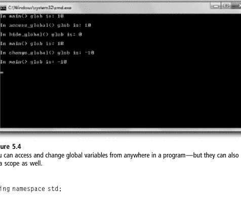

### Figure 5.4

你可以从程序的任何地方访问和更改全局变量——但它们也可以在作用域中被隐藏。

```
using namespace std;

int glob = 10;  // global variable

void access_global();
void hide_global();
void change_global();

int main()
{
    cout << "In main() glob is: " << glob << "\n\n";
    access_global();

    hide_global();
    cout << "In main() glob is: " << glob << "\n\n";

    change_global();
    cout << "In main() glob is: " << glob << "\n\n";

    return 0;
}
```

```
void access_global()
{
    cout << "In access_global() glob is: " << glob << "\n\n";
}
```

```
void hide_global()
{
    int glob =0;  // hide global variable glob
    cout << "In hide_global() glob is:" << glob << "\n\n";
}
```

```
void change_global()
{
    glob = -10;  // change global variable glob
    cout << "In change_global() glob is:" << glob << "\n\n";
}
```

## 声明全局变量

你在程序文件中的任何函数之外声明全局变量。这就是我在下面这行代码中所做的，它创建了一个名为 glob 并初始化为 10 的全局变量。

```
int glob =10;  // global variable
```

## 访问全局变量

你可以从程序的任何地方访问全局变量。为了证明这一点，我在 main() 中用以下代码显示 glob：

```
cout << "In main() glob is: " << glob << "\n\n";
```

程序显示 10，因为作为全局变量，glob 可用于程序的任何部分。为了再次证明这一点，我接下来调用 access_global()，计算机在该函数中执行以下代码：

```
cout << "In access_global() glob is: " << glob << "\n\n";
```

再次显示 10。这是有道理的，因为我在每个函数中显示的是完全相同的变量。


## 隐藏全局变量

你可以像隐藏作用域中的任何其他变量一样隐藏全局变量；只需用相同的名称声明一个新变量即可。这正是我接下来在调用 hide_global() 时所做的。该函数中的关键行并没有改变全局变量 glob；相反，它创建了一个名为 glob 的新变量，该变量局部于 hide_global()，从而隐藏了全局变量。

```cpp
int glob = 0; // hide global variable glob
```

因此，当我在 hide_global() 中用下面这行代码将 glob 发送给 cout 时，会显示 0。

```cpp
cout << "In hide_global() glob is: " << glob << "\n\n";
```

全局变量 glob 在 hide_global() 的作用域内保持隐藏，直到函数结束。

为了证明全局变量只是被隐藏而未被更改，接下来我在 main() 中用以下代码再次显示 glob：

```cpp
cout << "In main() glob is: " << glob << "\n\n";
```

再次显示 10。

**陷阱：** 虽然你可以在函数中声明与全局变量同名的变量，但这不是一个好主意，因为它可能导致混淆。

## 修改全局变量

就像你可以在程序的任何地方访问全局变量一样，你也可以在程序的任何地方修改它。这正是我接下来在调用 change_global() 函数时所做的。该函数中的关键行将 -10 赋给全局变量 glob。

```cpp
glob = -10; // change global variable glob
```

为了证明它有效，我在 change_global() 中用以下代码显示该变量：

```cpp
cout << "In change_global() glob is: " << glob << "\n\n";
```

然后，在 main() 中，我用以下代码将 glob 发送给 cout：

```cpp
cout << "In main() glob is: " << glob << "\n\n";
```

因为全局变量 glob 已被更改，所以显示 -10。

## 最小化全局变量的使用

仅因你能做并不意味着你应该做。这是良好的编程格言。有时某些事情在技术上是可行的，但并不明智。使用全局变量就是一个例子。一般来说，全局变量会使程序变得混乱，因为很难跟踪它们不断变化的值。你应尽可能限制全局变量的使用。

## 使用全局常量

与可能使程序变得混乱的全局变量不同，全局常量——可以在程序的任何地方访问的常量——可以帮助使程序更清晰。你声明全局常量的方式与声明全局变量类似——在任何函数之外声明它。而且由于你声明的是常量，需要使用 const 关键字。例如，下面这行代码定义了一个全局常量（假设声明在任何函数之外），名为 MAX_ENEMIES，值为 10，可以在程序的任何地方访问。

```cpp
const int MAX_ENEMIES = 10;
```

**陷阱：** 就像全局变量一样，你可以通过声明同名的局部常量来隐藏全局常量。然而，你应避免这样做，因为它可能导致混淆。

全局常量究竟如何使游戏编程代码更清晰呢？假设你正在编写一款动作游戏，想要限制同时攻击可怜玩家的敌人总数。不是在各处使用数字字面量，例如 10，你可以定义一个等于 10 的全局常量 MAX_ENEMIES。然后每当你看到该全局常量名称时，就能确切知道它代表什么。

需要注意一点：你只有在程序的多个部分需要常量值时才应使用全局常量。如果只需要在特定作用域（例如单个函数）中使用常量值，则应使用局部常量代替。

## 使用默认参数

当你编写一个参数几乎总是被赋相同值的函数时，你可以通过使用默认参数——如果未指定则赋给参数的值——来节省调用者不断指定该值的麻烦。这里有一个具体例子。假设你有一个设置图形显示的函数。其中一个参数可能是 bool fullScreen，它告诉函数是否以全屏或窗口模式显示游戏。现在，如果你认为该函数经常会用 true 调用 fullScreen，你可以为该参数提供 true 的默认参数，从而节省调用者在每次调用此显示设置函数时传递 true 给 fullScreen 的麻烦。

### 介绍《给我一个数字》程序

《给我一个数字》程序要求用户在两个不同的范围内输入两个不同的数字。每次提示用户输入数字时都会调用同一个函数。然而，对该函数的每次调用使用的参数数量不同，因为该函数对下限有一个默认参数。这意味着调用者可以省略下限的参数，函数会自动使用默认值。图 5.5 显示了程序的结果。

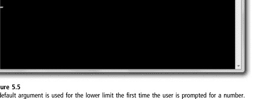

Figure 5.5  
第一次提示用户输入数字时，使用了下限的默认参数。

你可以从 Course Technology 网站 (www.courseptr.com/downloads) 下载此程序的代码。该程序位于第 5 章文件夹中；文件名是 give_me_a_number.cpp。

```cpp
// Give Me a Number
// Demonstrates default function arguments

#include <iostream>
#include <string>

using namespace std;

int askNumber(int high, int low = 1);

int main()
{
    int number = askNumber(5);
    cout << "Thanks for entering: " << number << "\n\n";

    number = askNumber(10, 5);
    cout << "Thanks for entering: " << number << "\n\n";

    return 0;
}

int askNumber(int high, int low)
{
    int num;
    do
    {
        cout << "Please enter a number" << " (" << low << " - " << high << "): ";
        cin >> num;
    } while (num > high || num < low);

    return num;
}
```

### 指定默认参数

函数 askNumber() 有两个参数——high 和 low。你可以从函数原型看出这一点：

```cpp
int askNumber(int high, int low = 1);
```

注意第二个参数 low 看起来像是被赋了值。某种程度上确实如此。1 是一个默认参数，意味着如果在调用函数时未向 low 传递值，low 将被赋值为 1。你通过在参数名后使用 = 后跟一个值来指定默认参数。

**陷阱：** 一旦你在参数列表中指定了默认参数，你必须为所有剩余参数指定默认参数。因此下面的原型是有效的：

```cpp
void setDisplay(int height, int width, int depth = 32, bool fullScreen = true);
```

而这个原型是非法的：

```cpp
void setDisplay(int width, int height, int depth = 32, bool fullScreen);
```

顺便说一下，你不会在函数定义中重复默认参数，正如你在 askNumber() 的函数定义中所看到的那样。

```cpp
int askNumber(int high, int low)
```

### 为参数分配默认参数

askNumber() 函数要求用户输入一个介于上限和下限之间的数字。函数会一直询问，直到用户输入范围内的数字，然后返回该数字。我首先在 main() 中这样调用该函数：

```cpp
int number = askNumber(5);
```

由于这段代码，askNumber() 中的参数 high 被赋值为 5。因为我没有为第二个参数 low 提供任何值，它被赋予默认值 1。这意味着函数会提示用户输入 1 到 5 之间的数字。

**陷阱：** 当你调用具有默认参数的函数时，一旦省略一个参数，你必须省略所有剩余参数。例如，给定原型

```cpp
void setDisplay(int height, int width, int depth = 32, bool fullScreen = true);
```

对该函数的有效调用是

```cpp
setDisplay(1680, 1050);
```

而非法的调用是

```cpp
setDisplay(1680, 1050, false);
```

一旦用户输入有效数字，askNumber() 返回该值并结束。在 main() 中，该值被赋给 number 并显示。

### 覆盖默认参数

接下来我再次这样调用 askNumber()：

```cpp
number = askNumber(10, 5);
```

这次我为 low 传递了一个值——5。这完全没问题；你可以为任何具有默认参数的参数传递参数，你传递的值将覆盖默认值。在这种情况下，这意味着 low 被赋值为 5。

因此，用户会被提示输入 5 到 10 之间的数字。一旦用户输入有效数字，askNumber() 返回该值并结束。在 main() 中，该值被赋给 number 并显示。

## 函数重载

你已经看到必须为编写的每个函数指定参数列表和单一返回类型。但如果想要一个更通用的函数——可以接受不同集合的参数——该怎么办？例如，假设你想编写一个对一组顶点执行 3D 变换的函数，这些顶点以 float 表示，但你也希望该函数能处理 int。不是编写两个名称不同的函数，你可以使用函数重载，使单个函数能够处理不同的参数列表。这样，你可以调用一个函数，并将顶点作为 float 或 int 传递。

### 介绍 Triple 程序

Triple 程序将值 5 和 “gamer” 三倍化。程序使用一个被重载以处理两种不同类型参数的单个函数——int 和 string——来三倍化这些值。图 5.6 显示了程序的示例运行。


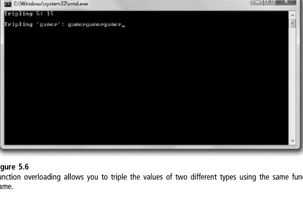

图 5.6

函数重载允许你使用相同的函数名对两种不同类型的值进行三倍运算。

你可以从 Course Technology 网站 (www.courseptr.com/downloads) 下载此程序的代码。该程序位于第 5 章文件夹中；文件名是 triple.cpp。

// Triple
// Demonstrates function overloading

#include <iostream>
#include <string>

using namespace std;

int triple(int number);
string triple(string text);

int main()
{
cout << "Tripling 5: " << triple(5) << "\n\n";
cout << "Tripling 'gamer': " << triple("gamer");
}

return 0;
}

int triple(int number)
{
    return (number * 3);
}

string triple(string text)
{
    return (text + text + text);
}

## 创建重载函数

要创建重载函数，你只需编写多个具有相同名称但参数列表不同的函数定义。在 Triple 程序中，我为函数 triple() 编写了两个定义，每个定义都指定了其单一参数的不同类型。以下是函数原型：

int triple(int number);
string triple(string text);

第一个接受 int 参数并返回 int。第二个接受字符串对象并返回字符串对象。

在每个函数定义中，你可以看到我返回了发送值的三倍。在第一个函数中，我返回发送的 int 的三倍。在第二个函数中，我返回发送的字符串，重复三次。

## 陷阱

> 要实现函数重载，你需要为同一个函数编写多个具有不同参数列表的定义。请注意，我没有提到任何关于返回类型的内容。那是因为如果你编写两个仅返回类型不同的函数定义，你会生成编译错误。例如，你不能在程序中同时具有以下原型：

int Bonus(int);
float Bonus(int);

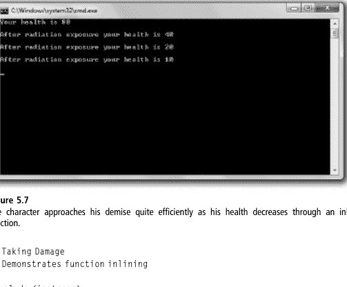

## 图 5.7

角色通过内联函数随着生命值下降而相当高效地走向灭亡。

```cpp
// Taking Damage
// Demonstrates function inlining

#include <iostream>

int radiation(int health);

using namespace std;

int main()
{
    int health = 80;
    cout << "Your health is " << health << "\n\n";

    health = radiation(health);
    cout << "After radiation exposure your health is " << health << "\n\n";

    health = radiation(health);
    cout << "After radiation exposure your health is " << health << "\n\n";

    health = radiation(health);
    cout << "After radiation exposure your health is " << health << "\n\n";
}
```

return 0;
}

inline int radiation(int health)
{
    return (health / 2);
}

## 为内联指定函数

要将函数标记为内联，只需在函数定义前加上 `inline`。我在定义以下函数时就是这样做的：

inline int radiation(int health)

请注意，在函数声明中你不使用 `inline`：

int radiation(int health);

通过用 `inline` 标记函数，你要求编译器将函数直接复制到调用代码中。这节省了函数调用的开销。也就是说，程序控制不必跳转到代码的另一部分。对于小型函数，这可能会带来性能提升。

然而，内联并不是性能的万能药。事实上，不加选择地内联可能导致更差的性能，因为内联函数会创建它的额外副本，这可能会显著增加内存消耗。

> **提示**
>
> 当你内联一个函数时，你实际上是对编译器提出一个请求，编译器拥有是否内联函数的最终决定权。如果你的编译器认为内联不会提升性能，它就不会内联该函数。

## 调用内联函数

调用内联函数与调用非内联函数没有区别，就像我第一次调用 `radiation()` 时看到的那样。

health = radiation(health);

这行代码将 `health` 赋值为其原始值的一半。

假设编译器批准了我对内联的请求，这段代码不会导致函数调用。相反，编译器会将减半 `health` 的代码直接放置在程序的此处。事实上，编译器会对函数的所有三次调用都这样做。

## 实际应用

尽管痴迷于性能是游戏程序员最喜欢的爱好，但过度关注速度是有危险的。事实上，许多开发者采取的方法是先让游戏程序运行良好，然后再为微小的性能提升进行调整。此时，程序员会通过运行一个实用程序（分析器）来分析游戏程序花费时间的地方，对代码进行分析。如果程序员看到瓶颈，他或她可能会考虑手工优化，例如函数内联。

## 介绍 MAD LIB 游戏

Mad Lib 游戏要求用户帮助创建故事。用户提供一个人的名字、一个复数名词、一个数字和一个动词。程序收集所有这些信息并用它来创建个性化故事。图 5.8 显示了程序的示例运行。

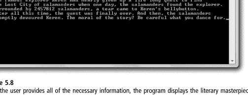

图 5.8

在用户提供所有必要信息后，程序会显示文学杰作。

你可以从 Course Technology 网站 (www.courseptr.com/downloads) 下载此程序的代码。该程序位于第 5 章文件夹中；文件名是 mad_lib.cpp。

## 设置程序

像往常一样，我用一些注释开始程序并包含必要的文件。

// Mad-Lib
// Creates a story based on user input

#include <iostream>
#include <string>

using namespace std;

string askText(string prompt);
int askNumber(string prompt);
void tellStory(string name, string noun, int number, string bodyPart,
    string verb);

从我的函数原型可以看出，除了 main() 之外，我还有三个函数——askText()、askNumber() 和 tellStory()。

## main() 函数

main() 函数调用所有其他函数。它调用 askText() 函数从用户获取名字、复数名词、身体部位和动词。它调用 askNumber() 从用户获取数字。它使用所有用户提供的信息调用 tellStory() 来生成并显示故事。

int main()
{
    cout << "Welcome to Mad Lib.\n\n";
    cout << "Answer the following questions to help create a new story.\n";

    string name = askText("Please enter a name: ");
    string noun = askText("Please enter a plural noun: ");
    int number = askNumber("Please enter a number: ");
    string bodyPart = askText("Please enter a body part: ");
    string verb = askText("Please enter a verb: ");
}
tellStory(name, noun, number, bodyPart, verb);

return 0;
}

## askText() 函数

askText() 函数从用户获取一个字符串。该函数用途广泛，接受一个 string 类型的参数，用作提示用户。因此，我能够调用此单个函数来询问用户各种不同的信息，包括名字、复数名词、身体部位和动词。

string askText(string prompt)
{
    string text;
    cout << prompt;
    cin >> text;
    return text;
}

## 陷阱

> 请记住，这种简单的 cin 用法仅适用于没有空白字符的字符串（如制表符或空格）。因此，当用户被提示输入身体部位时，他可以输入 bellybutton，但 medulla oblongata 会导致程序出现问题。
>
> 有办法补偿这一点，但这确实需要讨论一种称为流的东西，这超出了本书的范围。所以以这种方式使用 cin，但请注意其局限性。

## askNumber() 函数

askNumber() 函数从用户获取一个整数。虽然我在程序中只调用它一次，但它用途广泛，因为它接受一个 string 类型的参数，用作提示用户。

int askNumber(string prompt)
{
    int num;
    cout << prompt;
    cin >> num;
    return num;
}


## tellStory() 函数

tellStory() 函数接收用户输入的所有信息并用它来显示个性化的故事。

```
void tellStory(string name, string noun, int number, string bodyPart,
    string verb)
{
    cout << "\nHere's your story:\n";
    cout << "The famous explorer ";
    cout << name;
    cout << " had nearly given up a life-long quest to find\n";
    cout << "The Lost City of ";
    cout << noun;
    cout << " when one day, the ";
    cout << noun;
    cout << " found the explorer.\n";
    cout << "Surrounded by ";
    cout << number;
    cout << " " << noun;
    cout << ", a tear came to ";
    cout << name << "'s ";
    cout << bodyPart << ".\n";
    cout << "After all this time, the quest was finally over. ";
    cout << "And then, the ";
    cout << noun << "\n";
    cout << "promptly devoured ";
    cout << name << ".";
    cout << "The moral of the story? Be careful what you ";
    cout << verb;
    cout << " for.";
}
```

## 摘要

本章中，你应该已经学习了以下概念：

- 函数允许你将程序分解为可管理的块。
- 声明函数的一种方法是编写函数原型——列出函数的返回值、名称和参数类型的代码。
- 定义函数意味着编写使函数运行的所有代码。
- 你可以使用 `return` 语句从函数返回一个值。你也可以使用 `return` 来结束返回类型为 `void` 的函数。
- 变量的作用域决定了变量在程序中可见的位置。
- 全局变量可以从程序的任何部分访问。一般来说，你应该尽量限制全局变量的使用。
- 全局常量可以从程序的任何部分访问。使用全局常量可以使程序代码更清晰。
- 如果在函数调用中未为参数指定值，则默认参数将被分配给该参数。
- 函数重载是在同一函数创建多个定义的过程，每个定义的参数集不同。
- 函数内联是要求编译器内联函数的过程——意味着编译器应在代码中函数被调用的每个位置复制函数。内联非常小的函数有时可以带来性能提升。

## 问答

Q: 为什么我应该编写函数？

A: 函数允许你将程序分解为逻辑块。这些块导致更小、更易管理的代码块，比单一的整体程序更容易处理。

Q: 什么是封装？

A: 从核心来看，封装是关于保持事物分离。例如，函数封装提供了一种机制，使得在函数中声明的变量在函数外部不可访问。

Q: 参数和形参有什么区别？

A: 参数是在函数调用中用来向函数传递值的东西。形参是在函数定义中用来接收传递给函数的值的东西。

Q: 我可以在一个函数中拥有多个 `return` 语句吗？

A: 当然可以。事实上，你可能希望使用多个 `return` 语句来指定函数的不同结束点。

Q: 什么是局部变量？

A: 在作用域中定义的变量。函数中定义的所有变量都是局部变量；它们是该函数的局部变量。

Q: 隐藏一个变量是什么意思？

A: 当你在新的作用域内声明一个与外部作用域中变量同名的变量时，该变量就被隐藏了。因此，你无法通过在内部作用域中使用其变量名来访问外部作用域中的变量。

Q: 变量何时超出作用域？

A: 当创建它的作用域结束时，变量就超出作用域了。

Q: 变量超出作用域是什么意思？

A: 这意味着变量不再存在。

Q: 什么是嵌套作用域？

A: 在现有作用域内创建的作用域。

Q: 参数必须与传递给它的形参同名吗？

A: 不必。你可以自由使用不同的名称。只有值是从函数调用传递到函数的。

Q: 我可以编写一个调用另一个函数的函数吗？

A: 当然可以。事实上，每当你编写一个从 `main()` 调用的函数时，你就是在这样做。此外，你可以编写一个（除 `main()` 之外的）调用另一个函数的函数。

Q: 什么是代码分析？

A: 它是记录程序各个部分使用多少 CPU 时间的过程。

Q: 为什么要分析代码？

A: 为了确定程序中的任何瓶颈。有时重新审视这些代码段以尝试优化它们是有意义的。

Q: 程序员何时分析代码？

A: 通常在游戏项目的编程后期。

Q: 什么是过早优化？

A: 在开发过程过早地尝试优化代码。代码优化通常在游戏项目编程的后期才有意义。

## 讨论问题

- 1. 函数封装如何帮助你编写更好的程序？
- 2. 全局变量如何使代码变得混乱？
- 3. 全局常量如何使代码更清晰？
- 4. 优化代码的利弊是什么？
- 5. 软件重用如何使游戏行业受益？

## 练习

- 1. 以下原型有什么问题？

  ```c
  int askNumber(int low =1, int high);
  ```

- 2. 使用函数重写第 4 章的 Hangman 游戏。包含一个获取玩家猜测的函数和另一个确定玩家猜测是否在秘密单词中的函数。
- 3. 使用默认参数，编写一个函数，要求用户输入一个数字并返回该数字。该函数应从调用代码接收一个字符串提示。如果调用者未提供提示字符串，则函数应使用通用提示。接下来，使用函数重载，编写一个实现相同结果的函数。

## 参考：井字棋

参考的概念很简单，但其影响是深远的。在本章中，你将学习关于引用以及它们如何帮助你编写更高效的游戏代码。具体来说，你将学习如何：

- 创建引用
- 访问和更改引用值
- 将引用传递给函数以更改参数值或提高效率
- 从函数返回引用以提高效率或更改值

### 使用引用

引用为变量提供另一个名称。对引用所做的任何操作都会对它所引用的变量执行。你可以将引用视为变量的昵称——变量的另一个名字。在本章的第一个程序中，我将向你展示如何创建引用。然后，在接下来的几个程序中，我将向你展示为什么你想要使用引用以及它们如何改进你的游戏程序。

### 介绍引用程序

引用程序演示了引用。该程序声明并初始化一个变量来保存分数，然后创建一个引用该变量的引用。程序使用变量和引用显示分数，以表明它们访问的是同一个值。接下来，程序显示该单一值可以通过变量或引用进行更改。图 6.1 说明了该程序。


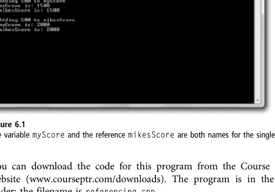

图 6.1
变量 myScore 和引用 mikesScore 都是单个分数值的名称。

你可以从 Course Technology 网站 (www.courseptr.com/downloads) 下载此程序的代码。该程序位于第 6 章文件夹中；文件名是 referencing.cpp。

```
// Referencing
// Demonstrates using references

#include <iostream>

using namespace std;

int main()
{
    int myScore = 1000;
    int& mikesScore = myScore;  //create a reference

    cout << "myScore is: " << myScore << "\n";
    cout << "mikesScore is: " << mikesScore << "\n\n";
```


```cpp
cout << "Adding 500 to myScore\n";
myScore += 500;
cout << "myScore is: " << myScore << "\n";
cout << "mikesScore is: " << mikesScore << "\n\n";

cout << "Adding 500 to mikesScore\n";
mikesScore += 500;
cout << "myScore is: " << myScore << "\n";
cout << "mikesScore is: " << mikesScore << "\n\n";

return 0;
}
```

## 创建引用

我在 `main()` 中做的第一件事是创建一个变量来保存我的分数。

```cpp
int myScore = 1000;
```

然后我创建一个指向 `myScore` 的引用。

```cpp
int& mikesScore = myScore; //创建一个引用
```

上面的代码行声明并初始化了 `mikesScore`，它是一个指向 `myScore` 的引用。`mikesScore` 是 `myScore` 的别名。`mikesScore` 不保存自己的 `int` 值；它只是访问 `myScore` 所保存的 `int` 值的另一种方式。

要声明并初始化一个引用，首先写出引用所指向的值类型，然后是引用操作符（`&`），接着是引用名，再是 `=`，最后是引用所指向的变量。

> **技巧**
>
> 有时程序员会在引用名前加上字母 `r` 前缀，以提醒自己正在使用引用。程序员可能会编写如下代码行：
>
> ```cpp
> int playerScore = 1000;
> int& rScore = playerScore;
> ```

理解引用的一种方式是把它们看作昵称。例如，假设你有一个朋友叫 Eugene，他（可以理解地）要求用昵称称呼他——Gibby（虽然没怎么改善，但这是 Eugene 想要的）。所以当你和朋友在聚会上时，你可以用 Eugene 或 Gibby 来叫他。你的朋友只有一个人，但你可以用他的名字或昵称来称呼他。变量和指向该变量的引用的工作方式与此相同。你可以通过变量名或指向该变量的引用的名字来访问存储在变量中的单个值。最后，无论你做什么，尽量不要把你的变量命名为 Eugene——为了它们好。

> **陷阱**
>
> 因为引用必须始终指向另一个值，所以必须在声明引用时对其进行初始化。如果不这样做，就会遇到编译错误。下面这行代码是完全不合法的：
>
> ```cpp
> int& mikesScore; //千万别在家里尝试！
> ```

## 访问被引用的值

接下来我把 `myScore` 和 `mikesScore` 都发送给 `cout`。

```cpp
cout << "myScore is: " << myScore << "\n";
cout << "mikesScore is: " << mikesScore << "\n";
```

两行代码都会显示 `1000`，因为它们访问的是同一块存储数字 `1000` 的内存。记住，只有一个值，它存储在变量 `myScore` 中。`mikesScore` 只是提供了另一种访问该值的方式。

## 修改被引用的值

接下来我将 `myScore` 的值增加 `500`。

```cpp
myScore += 500;
```

当我把 `myScore` 发送给 `cout` 时，显示的是 `1500`，正是你所期望的。当我把 `mikesScore` 发送给 `cout` 时，显示的也是 `1500`。这同样是因为 `mikesScore` 只是变量 `myScore` 的另一个名字。本质上，我两次都是将同一个变量发送给 `cout`。

接下来我将 `mikesScore` 增加 `500`。

```cpp
mikesScore += 500;
```

因为 `mikesScore` 只是 `myScore` 的另一个名字，所以上面的代码行会把 `myScore` 的值增加 `500`。因此，当我接下来把 `myScore` 发送给 `cout` 时，显示的是 `2000`。当我把 `mikesScore` 发送给 `cout` 时，显示的又是 `2000`。

> **陷阱**
>
> 引用始终指向它被初始化时所指向的变量。你不能重新赋值引用以使其指向另一个变量，因此，例如，下面代码的结果可能并不明显。
>
> ```cpp
> int myScore = 1000;
> int& mikesScore = myScore;
> int larrysScore = 2500;
> mikesScore = larrysScore; //可能不会达到你预期的效果！
> ```
>
> 代码行 `mikesScore = larrysScore;` 并不会重新赋值引用 `mikesScore` 使其指向 `larrysScore`，因为引用不能被重新赋值。然而，由于 `mikesScore` 只是 `myScore` 的另一个名字，代码 `mikesScore = larrysScore;` 等同于 `myScore = larrysScore;`，后者会把 `2500` 赋给 `myScore`。最终，`myScore` 变成了 `2500`，而 `mikesScore` 仍然指向 `myScore`。

## 传递引用以修改实参

现在你已经了解了引用是如何工作的，你可能会想为什么要使用它们。实际上，当你将变量传递给函数时，引用会非常有用，因为当你把一个变量传递给函数时，函数得到的是该变量的一个副本。这意味着你传递的原始变量（称为实参变量）不能被改变。有时这可能是你想要的，因为它能让实参变量保持安全且不可修改。但其他时候，你可能希望从函数内部修改传递给它的实参变量。你可以通过使用引用来实现这一点。

## 引入交换程序

Swap 程序定义了两个变量——一个保存我那可怜的低分，另一个保存你那令人印象深刻的高分。显示分数后，程序调用一个旨在交换分数的函数。但由于只有分数值的副本被发送到函数，保存分数的实参变量并未改变。接下来，程序调用另一个交换函数。这一次，通过使用引用，实参变量的值被成功交换——让我得到了那个超大的分数，并给你留下了小分数。图 6.2 显示了程序的运行情况。

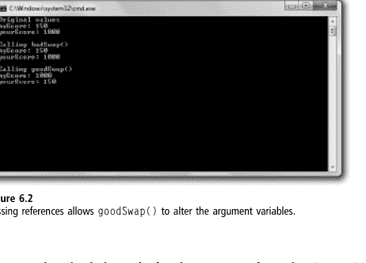

**图 6.2**  
传递引用允许 `goodSwap()` 修改实参变量。

你可以从 Course Technology 网站（www.courseptr.com/downloads）下载该程序的代码。程序位于 Chapter 6 文件夹中；文件名是 `swap.cpp`。

```cpp
// Swap
// Demonstrates passing references to alter argument variables

#include <iostream>

using namespace std;

void badSwap(int x, int y);
void goodSwap(int& x, int& y);

int main()
{
    int myScore = 150;
    int yourScore = 1000;
    cout << "Original values\n";
    cout << "myScore: " << myScore << "\n";
    cout << "yourScore: " << yourScore << "\n\n";
    cout << "Calling badSwap()\n";
    badSwap(myScore, yourScore);
    cout << "myScore: " << myScore << "\n";
    cout << "yourScore: " << yourScore << "\n\n";

    cout << "Calling goodSwap()\n";
    goodSwap(myScore, yourScore);
    cout << "myScore: " << myScore << "\n";
    cout << "yourScore: " << yourScore << "\n";

    return 0;
}

void badSwap(int x, int y)
{
    int temp = x;
    x = y;
    y = temp;
}

void goodSwap(int& x, int& y)
{
    int temp = x;
    x = y;
    y = temp;
}
```

## 按值传递

在声明并初始化 `myScore` 和 `yourScore` 之后，我把它们发送给 `cout`。如你所料，显示的是 `150` 和 `1000`。接下来我调用 `badSwap()`。

当你以目前所看到的方式指定一个参数（作为普通变量，而不是引用）时，你就是在指示该参数将以*按值传递*的方式接收实参，这意味着参数将获得实参变量的一个*副本*，而不是对实参变量本身的访问。通过查看 `badSwap()` 的函数头，你可以判断调用该函数时两个实参都是按值传递的。

```cpp
void badSwap(int x, int y)
```

这意味着当我用下面这行代码调用 `badSwap()` 时，`myScore` 和 `yourScore` 的副本会被发送给参数 `x` 和 `y`。

```cpp
badSwap(myScore, yourScore);
```

具体来说，`x` 被赋值为 `150`，`y` 被赋值为 `1000`。因此，我在 `badSwap()` 函数中对 `x` 和 `y` 所做的任何操作都不会对 `myScore` 和 `yourScore` 产生任何影响。

当 `badSwap()` 的核心代码执行时，`x` 和 `y` 确实交换了值——`x` 变成了 `1000`，`y` 变成了 `150`。然而，当函数结束时，`x` 和 `y` 都超出了作用域而不再存在。控制权随后返回 `main()`，此时 `myScore` 和 `yourScore` 并未改变。然后，当我把 `myScore` 和 `yourScore` 发送给 `cout` 时，显示的又是 `150` 和 `1000`。可悲的是，我仍然拿着小分数，而你仍然拿着大分数。

## 按引用传递

通过向参数传递实参变量的引用，可以让函数访问实参变量。这样一来，对参数所做的任何操作都会作用于实参变量。要按引用传递，你首先必须将参数声明为引用。

通过查看函数头，你可以判断对 `goodSwap()` 的调用会将两个实参按引用传递。

```cpp
void goodSwap(int& x, int& y)
```

这意味着当我用下面这行代码调用 `goodSwap()` 时，参数 `x` 将引用 `myScore`，参数 `y` 将引用 `yourScore`。

```cpp
goodSwap(myScore, yourScore);
```

这意味着 `x` 只是 `myScore` 的另一个名字，`y` 只是 `yourScore` 的另一个名字。当 `goodSwap()` 执行并交换 `x` 和 `y` 的值时，真正发生的是 `myScore` 和 `yourScore` 交换了值。

函数结束后，控制权返回 `main()`，在那里我把 `myScore` 和 `yourScore` 发送给 `cout`。这一次显示的是 `1000` 和 `150`。变量交换了值。我拿走了大分数，留给你小分数。终于成功了！


## 为了效率传递引用

按值传递变量会产生一些开销，因为在将其赋给参数之前必须复制该变量。当我们谈论简单、内置类型的变量时，例如 `int` 或 `float`，开销可以忽略不计。但大型对象，例如代表整个 3D 世界的对象，复制起来可能很昂贵。相反，按引用传递是高效的，因为你不会复制参数变量。相反，你只需通过引用提供对现有对象的访问。

### 介绍库存显示程序

Inventory Displayer 程序创建一个字符串向量，表示英雄的库存。程序随后调用一个函数来显示库存。程序将物品向量作为引用传递给 display 函数，因此调用是高效的；向量不会被复制。然而，有一个新情况。程序将向量作为一种特殊的引用传递，该引用禁止 display 函数更改向量。图 6.3 显示了该程序。

你可以从 Course Technology 网站 (www.courseptr.com/downloads) 下载此程序的代码。程序位于第 6 章文件夹中；文件名是 `inventory_displayer.cpp`。

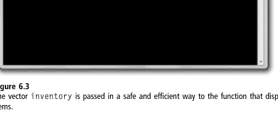

Figure 6.3
向量 *inventory* 以安全且高效的方式传递给显示英雄物品的函数。

```cpp
// Inventory Displayer
// Demonstrates constant references

#include <iostream>
#include <string>
#include <vector>

using namespace std;

//parameter vec is a constant reference to a vector of strings
void display(const vector<string>& inventory);

int main()
{
    vector<string> inventory;
    inventory.push_back("sword");
    inventory.push_back("armor");
    inventory.push_back("shield");

    display(inventory);

    return 0;
}

//parameter vec is a constant reference to a vector of strings
void display(const vector<string>& vec)
{
    cout << "Your items:\n";
    for (vector<string>::const_iterator iter = vec.begin();
        iter != vec.end(); ++iter)
    {
        cout << *iter << endl;
    }
}
```

### 理解引用传递的陷阱

一种高效地让函数访问大型对象的方法是通过引用传递它。然而，这引入了一个潜在问题。正如你在 Swap 程序中看到的，它使参数变量可以被更改。但如果不想更改参数变量怎么办？是否有一种方法可以在利用按引用传递效率的同时保护参数变量的完整性？有的。答案是传递常量引用。

> **Hint**
>
> 一般来说，你应避免更改参数变量。尝试编写通过返回值向调用代码发送新信息的函数。

### 将参数声明为常量引用

函数 display() 显示英雄库存的内容。在函数的头文件中，我指定一个参数——名为 vec 的字符串对象向量的常量引用。

```cpp
void display(const vector<string>& vec)
```

常量引用是一种受限的引用。它像其他任何引用一样工作，只是你不能用它来更改其引用的值。要创建常量引用，只需在引用声明中将关键字 const 放在类型之前即可。

这对函数 display() 有什么意义？因为参数 vec 是常量引用，这意味着 display() 不能更改 vec。反过来，这意味着 inventory 是安全的；它不能被 display() 更改。一般来说，你可以高效地将参数作为常量引用传递给函数，使其可访问但不可更改。这就像为函数提供对参数的只读访问。尽管常量引用对于指定函数参数非常有用，你可以在程序的任何地方使用它们。

> **Hint**
>
> 常量引用在另一个方面也很方便。如果需要将常量值赋给引用，你必须将其赋给常量引用。（非常量引用不行。）

### 传递常量引用

回到 main() 中，我创建 inventory，然后用以下行调用 display()，该行将向量作为常量引用传递。

```cpp
display(inventory);
```

这导致了一个高效且安全的函数调用。它是高效的，因为只传递了引用；向量没有被复制。它是安全的，因为向量引用是常量引用；inventory 不能被 display() 更改。

> **Trap**
>
> 你不能修改标记为常量引用的参数。如果尝试，你会生成编译错误。

接下来，display() 使用对 inventory 的常量引用列出向量中的元素。然后控制返回到 main()，程序结束。

## 如何决定传递参数

到目前为止，你已经看到了三种不同的传递参数的方式——按值、作为引用和作为常量引用。那么如何决定使用哪种方法呢？以下是一些指导原则：

- **By value.** 当参数变量是基本内置类型之一时，按值传递，例如 `bool`、`int` 或 `float`。这些类型的对象非常小，按引用传递不会带来任何效率提升。你还应该在想要计算机复制变量时按值传递。如果你计划在函数中更改参数，但又不希望实际参数变量受影响，则可能需要使用副本。
- **As a constant reference.** 当你想高效传递一个不需要更改的值时，传递常量引用。
- **As a reference.** 仅当你想更改参数变量的值时才传递引用。然而，你应尽可能避免更改参数变量。

## 返回引用

就像传递值一样，当从函数返回一个值时，你实际上返回的是该值的副本。对于基本内置类型的值来说，这不是什么大问题。然而，如果返回的是大型对象，这可能是一项昂贵的操作。返回引用是一种高效的替代方案。

### 介绍库存引用程序

Inventory Referencer 程序演示了返回引用。程序通过使用返回的引用来显示保存英雄库存的向量的元素。然后程序通过返回的引用更改其中一个物品。图 6.4 显示了程序的结果。

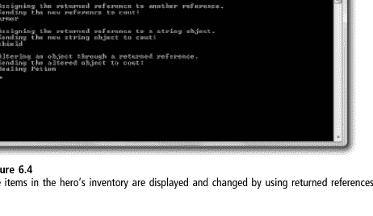

Figure 6.4
英雄库存中的物品通过使用返回的引用来显示和更改。

你可以从 Course Technology 网站 (www.courseptr.com/downloads) 下载此程序的代码。程序位于第 6 章文件夹中；文件名是 `inventory_referencer.cpp`。

```cpp
// Inventory Referencer
// Demonstrates returning a reference

#include <iostream>
#include <string>
#include <vector>

using namespace std;

//returns a reference to a string
string& refToElement(vector<string>& inventory, int i);

int main()
{
    vector<string> inventory;
    inventory.push_back("sword");
    inventory.push_back("armor");
    inventory.push_back("shield");

    //displays string that the returned reference refers to
    cout << "Sending the returned reference to cout:\n";
    cout << refToElement(inventory, 0) << "\n\n";

    //assigns one reference to another -- inexpensive assignment
    cout << "Assigning the returned reference to another reference.\n";
    string& rStr = refToElement(inventory, 1);
    cout << "Sending the new reference to cout:\n";
    cout << rStr << "\n\n";

    //copies a string object -- expensive assignment
    cout << "Assigning the returned reference to a string object.\n";
    string str = refToElement(inventory, 2);
    cout << "Sending the new string object to cout:\n";
    cout << str << "\n\n";

    //altering the string object through a returned reference
    cout << "Altering an object through a returned reference.\n";
    rStr = "Healing Potion";
    cout << "Sending the altered object to cout:\n";
    cout << inventory[1] << endl;

    return 0;
}

//returns a reference to a string
string& refToElement(vector<string>& vec, int i)
{
    return vec[i];
}
```

### 返回引用

在从函数返回引用之前，你必须指定你正在返回一个引用。这就是我在 refToElement() 函数头中所做的。

```cpp
string& refToElement(vector<string>& inventory, int i)
```


当我在指定返回类型时使用引用运算符 `string&`，我实际上是在说明该函数将返回一个指向 `string` 对象的引用（而不是 `string` 对象本身）。你可以像我这样使用引用运算符来指定函数返回对特定类型对象的引用。只需将引用运算符放在类型名之后即可。

`refToElement()` 函数的函数体仅包含一条语句，该语句返回向量中位置 `i` 处元素的引用。

```
return vec[i];
```

请注意，`return` 语句中没有任何内容表明该函数返回的是引用。函数头与函数原型决定了函数返回的是对象还是对象的引用。

### 陷阱

尽管返回引用可以是一种向调用函数传回信息的有效方式，但你必须小心，不要返回对已超出作用域的对象（即已不再存在的对象）的引用。例如，下面的函数返回一个 `string` 对象的引用，而该对象在函数结束后就不再存在了——这是非法的。

```
string& badReference()
{
    string local = "This string will cease to exist once the function ends.";
    return local;
}
```

避免此类问题的一种方法是：永远不要返回对局部变量的引用。

### 显示返回引用的值

在创建了物品向量 `inventory` 之后，我通过一个返回的引用来显示第一件物品。

```
cout << refToElement(inventory, 0) << "\n\n";
```

上面的代码调用了 `refToElement()`，该函数返回对 `inventory` 中位置 0 处元素的引用，然后将该引用发送给 `cout`。结果，屏幕上显示了 `sword`。

### 将返回的引用赋给另一个引用

接下来，我用下面这一行将返回的引用赋给另一个引用，该行语句将 `inventory` 中位置 1 处元素的引用取出，并赋给 `rStr`。

```
string& rStr = refToElement(inventory, 1);
```

这是一种高效的赋值，因为将一个引用赋给另一个引用不涉及对象的复制。然后我将 `rStr` 发送给 `cout`，屏幕上显示了 `armor`。

### 将返回的引用赋给一个变量

接下来，我将返回的引用赋给一个变量。

```
string str = refToElement(inventory, 2);
```

上面的代码并不是将引用赋给 `str`。它无法这样做，因为 `str` 是一个 `string` 对象。相反，代码会复制被返回引用所指的那个元素（即 `inventory` 中位置 2 处的元素），并将该字符串对象的新副本赋给 `str`。由于这类赋值涉及复制对象，因此比将一个引用赋给另一个引用更加耗费资源。有时，以这种方式复制对象的成本完全是可以接受的，但你应该意识到这类赋值带来的额外开销，并在必要时避免使用。

接下来，我将新的字符串对象 `str` 发送给 `cout`，屏幕上显示了 `shield`。

### 通过返回的引用修改对象

你还可以修改返回引用所指的对象。这意味着你可以通过 `rStr` 来改变英雄的库存，如下面的代码行所示。

```
rStr = "Healing Potion";
```

因为 `rStr` 引用的是 `inventory` 中位置 1 处的元素，所以这段代码会将 `inventory[1]` 修改为 `"Healing Potion"`。为了证明这一点，我用下面这一行显示该元素，确实会显示 `Healing Potion`。

```
cout << inventory[1] << endl;
```

如果我想保护 `inventory`，使 `refToElement()` 返回的引用无法被用来修改该向量，那么我应该将函数的返回类型指定为常量引用。

## 介绍井字棋游戏

在本章项目中，你将学习如何利用一点 AI（人工智能）来创建一个电脑对手。在游戏中，玩家与电脑将在井字棋中展开一场高风险的人机对决。电脑下棋相当强大（虽然并非完美），并且带有十足的“态度”，让任何对局都充满乐趣。图 6.5 显示了一场比赛的开始。

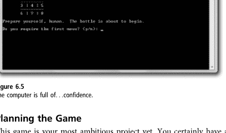

图 6.5
电脑充满了……自信。

### 规划游戏

这个游戏是你迄今为止最具雄心的项目。你无疑已经具备了创建它所需的全部技能，但我会用更长的规划部分来帮助你掌握全局，并理解如何创建更大的程序。请记住，编程最重要的部分是规划编程。如果没有路线图，你永远无法到达想去的地方（或者你需要花更长的时间，绕道而行，欣赏沿途风景）。

### 现实世界

> 在程序员编写任何游戏代码之前，游戏设计师会在概念文档、设计文档和原型上投入无数个小时的工作。设计工作完成后，程序员才开始他们的工作——更多的规划。只有在程序员编写完自己的技术设计之后，他们才会开始认真编码。这个故事告诉我们什么道理？要规划。废弃一张蓝图比拆除一栋 50 层的大楼要容易得多。

### 编写伪代码

让我们回到你最喜欢的、算不上语言的“语言”——伪代码。因为我将在程序中使用函数来处理大多数任务，所以我可以在一个相当抽象的水平上思考代码。每一行伪代码都应该感觉像一次函数调用。稍后，我所要做的就是编写计划中隐含的那些函数。下面是伪代码：

```
Create an empty Tic-Tac-Toe board
Display the game instructions
Determine who goes first
Display the board
While nobody's won and it's not a tie
    If it's the human's turn
        Get the human's move
        Update the board with the human's move
    Otherwise
        Calculate the computer's move
        Update the board with the computer's move
    Display the board
    Switch turns
Congratulate the winner or declare a tie
```

### 表示数据

好的，我有了一个好的计划，但它相当抽象，并且涉及一些我脑海中尚未明确定义的元素。我把“走一步棋”理解为在棋盘上放置一枚棋子。但我究竟该如何表示棋盘？棋子？或者一步棋？

既然我要在屏幕上显示棋盘，为什么不直接把棋子表示为一个字符——一个 `X` 或一个 `O` 呢？空的棋子可以只是一个空格。因此，棋盘本身可以是一个字符向量。井字棋棋盘有九个方格，所以该向量应该有九个元素。棋盘上的每个方格将对应向量中的一个元素。图 6.6 说明了我的意思。

棋盘上的每个方格或位置都由一个数字 0–8 表示。这意味着向量将有九个元素，其位置编号为 0–8。由于每一步棋都指示了一个应放置棋子的方格，因此一步棋也只是一个数字，0–8。这意味着一步棋可以用 `int` 来表示。

| 0 | 1 | 2 |
|---|---|---|
| 3 | 4 | 5 |
| 6 | 7 | 8 |

图 6.6
每个方格编号对应表示棋盘的向量中的一个位置。

玩家和电脑所执的一方也可以用字符来表示——要么是 `'X'`，要么是 `'O'`，就像棋子一样。一个用来表示当前回合所属方（side）的变量也应该是字符类型，要么是 `'X'`，要么是 `'O'`。

### 创建函数列表

伪代码启发了我将需要的各种函数。我列出了这些函数，并思考了每个函数的功能、它们将具有的参数以及它们将返回的值。表 6.1 展示了我努力的成果。

### 设置程序

你可以从 Course Technology 网站（www.courseptr.com/downloads）下载该程序的代码。程序位于第 6 章文件夹中，文件名是 `tic-tac-toe.cpp`。我将在这里逐节讲解代码。

在程序中，我首先做的是包含我需要的文件，定义一些全局常量，并编写函数原型。

```cpp
// Tic-Tac-Toe
// Plays the game of tic-tac-toe against a human opponent

#include <iostream>
#include <string>
#include <vector>
#include <algorithm>

using namespace std;
```


## 表 6.1 井字棋函数

| 函数 | 描述 |
|---|---|
| void instructions() | 显示游戏说明。 |
| char askYesNo(string question) | 询问一个是或否的问题。接收一个问题。返回 'y' 或 'n'。 |
| int askNumber(string question, int high, int low = 0) | 询问一个在指定范围内的数字。接收一个问题、一个最低数字和一个最高数字。返回从 low 到 high 范围内的一个数字。 |
| char humanPiece() | 确定人类玩家的棋子。返回 'X' 或 'O'。 |
| char opponent(char piece) | 根据给定的棋子计算出对手的棋子。接收 'X' 或 'O'。返回 'X' 或 'O'。 |
| void displayBoard(const vector<char>& board) | 在屏幕上显示棋盘。接收一个棋盘。 |
| char winner(const vector<char>& board) | 确定游戏赢家。接收一个棋盘。返回 'X'、'O'、'T'（表示平局）或 'N'（表示尚无赢家）。 |
| bool isLegal(const vector<char>& board, int move) | 判断一步棋是否合法。接收一个棋盘和一步棋。返回 true 或 false。 |
| int humanMove(const vector<char>& board, char human) | 获取人类玩家的走法。接收一个棋盘和人类玩家的棋子。返回人类玩家的走法。 |
| int computerMove(vector<char> board, char computer) | 计算计算机的走法。接收一个棋盘和计算机的棋子。返回计算机的走法。 |
| void announceWinner(char winner, char computer, char human) | 祝贺赢家或宣布平局。接收获胜方、计算机的棋子和人类玩家的棋子。 |

```cpp
// global constants
const char X = 'X';
const char O = 'O';
const char EMPTY = ' ';
const char TIE = 'T';
const char NO_ONE = 'N';

// function prototypes
void instructions();
char askYesNo(string question);
int askNumber(string question, int high, int low = 0);
char humanPiece();
char opponent(char piece);
void displayBoard(const vector<char>& board);
char winner(const vector<char>& board);
bool isLegal(const vector<char>& board, int move);
int humanMove(const vector<char>& board, char human);
int computerMove(vector<char> board, char computer);
void announceWinner(char winner, char computer, char human);
```

在全局常量部分，X 是字符 'X' 的简写，它是游戏中两种棋子之一。O 代表字符 'O'，是游戏中的另一种棋子。EMPTY 也是一个字符，代表棋盘上的空方格。它是一个空格，因为当它显示出来时，看起来就像一个空方格。TIE 是一个代表平局的字符。而 NO_ONE 是一个用于表示游戏双方中任何一方的字符，我用它来表示还没有人获胜。

## main() 函数

如你所见，main() 函数几乎完全就是我之前创建的伪代码。

```cpp
// main function
int main()
{
    int move;
    const int NUM_SQUARES = 9;
    vector<char> board(NUM_SQUARES, EMPTY);

    instructions();
    char human = humanPiece();
    char computer = opponent(human);
    char turn = X;
    displayBoard(board);

    while (winner(board) == NO_ONE)
    {
        if (turn == human)
        {
            move = humanMove(board, human);
            board[move] = human;
        }
        else
        {
            move = computerMove(board, computer);
            board[move] = computer;
        }
        displayBoard(board);
        turn = opponent(turn);
    }

    announceWinner(winner(board), computer, human);

    return 0;
}
```

## instructions() 函数

这个函数用于显示游戏说明，并让计算机对手带点挑衅的口气。

```cpp
void instructions()
{
    cout << "Welcome to the ultimate man-machine showdown: Tic-Tac-Toe.\n";
    cout << "--where human brain is pit against silicon processor\n\n";

    cout << "Make your move known by entering a number, 0 - 8. The number\n";
    cout << "corresponds to the desired board position, as illustrated:\n\n";

    cout << "*       0 | 1 | 2\n";
    cout << "*      -----|\n";
    cout << "*       3 | 4 | 5\n";
    cout << "*      -----|\n";
    cout << "*       6 | 7 | 8\n\n";

    cout << "*Prepare yourself, human. The battle is about to begin.\n\n";
}
```

## askYesNo() 函数

这个函数询问一个是或否的问题。它会反复提问，直到玩家输入 y 或 n。它接收一个问题，并返回 'y' 或 'n'。

```cpp
char askYesNo(string question)
{
    char response;
    do
    {
        cout << question << " (y/n): ";
        cin >> response;
    } while (response != 'y' && response != 'n');

    return response;
}
```

## askNumber() 函数

这个函数询问一个指定范围内的数字，并会一直询问，直到玩家输入一个有效的数字。它接收一个问题、一个最高数字和一个最低数字。它返回指定范围内的一个数字。

```cpp
int askNumber(string question, int high, int low)
{
    int number;
    do
    {
        cout << question << " (" << low << " - " << high << "): ";
        cin >> number;
    } while (number > high || number < low);

    return number;
}
```

如果你看一下这个函数的原型，就会发现最低数字的默认值为 0。当我在程序后面调用这个函数时，充分利用了这一特点。

## humanPiece() 函数

这个函数询问玩家是否想要先走，并根据选择返回人类玩家的棋子。正如井字棋的伟大传统所规定的那样，X 先走。

```cpp
char humanPiece()
{
    char go_first = askYesNo("Do you require the first move?");
    if (go_first == 'y')
    {
        cout << "\nThen take the first move. You will need it.\n";
        return X;
    }
    else
    {
        cout << "\nYour bravery will be your undoing... I will go first.\n";
        return O;
    }
}
```

## opponent() 函数

这个函数接收一个棋子（'X' 或 'O'），并返回对手的棋子（'X' 或 'O'）。

```cpp
char opponent(char piece)
{
    if (piece == X)
    {
        return O;
    }
    else
    {
        return X;
    }
}
```

## displayBoard() 函数

这个函数用于显示传入的棋盘。由于棋盘中的每个元素要么是空格、'X' 或 'O'，因此该函数可以逐个显示它们。我还使用了键盘上的其他几个字符来绘制一个像样的井字棋棋盘。

```cpp
void displayBoard(const vector<char>& board)
{
    cout << "\n\t" << board[0] << " | " << board[1] << " | " << board[2];
    cout << "\n\t" << "_______";
    cout << "\n\t" << board[3] << " | " << board[4] << " | " << board[5];
    cout << "\n\t" << "_______";
    cout << "\n\t" << board[6] << " | " << board[7] << " | " << board[8];
    cout << "\n\n";
}
```

注意，表示棋盘的 vector 是通过常量引用传递的。这意味着 vector 被高效地传递，不需要复制。同时，这也意味着 vector 被保护起来，不会被修改。由于我在此函数中只是显示棋盘而不修改它，因此这样做非常合适。

## winner() 函数

这个函数接收一个棋盘并返回赢家。赢家有四种可能的值。如果某一方玩家获胜，函数将返回 X 或 O。如果所有格子都被填满而无人获胜，则返回 TIE。最后，如果无人获胜且至少有一个空格，函数返回 NO_ONE。

```cpp
char winner(const vector<char>& board)
{
    // all possible winning rows
    const int WINNING_ROWS[8][3] = { {0, 1, 2},
                                     {3, 4, 5},
                                     {6, 7, 8},
                                     {0, 3, 6},
                                     {1, 4, 7},
                                     {2, 5, 8},
                                     {0, 4, 8},
                                     {2, 4, 6} };
```

首先要注意的是，表示棋盘的 vector 是通过常量引用传递的。这意味着 vector 被高效地传递，不需要复制。同时，这也意味着 vector 被保护起来，不会被修改。

在这个函数的初始部分，我定义了一个名为 WINNING_ROWS 的常量二维整数数组，它表示所有八种三连成线并赢得游戏的方式。每个获胜行都由一组三个数字表示——三个棋盘位置组成一个获胜行。例如，{0, 1, 2} 这一组代表最上面一行——棋盘位置 0、1 和 2。下一组 {3, 4, 5} 代表中间一行——棋盘位置 3、4 和 5。以此类推……

接下来我要检查双方玩家是否有人获胜。


```
const int TOTAL_ROWS = 8;

// if any winning row has three values that are the same (and not EMPTY),
// then we have a winner
for(int row = 0; row < TOTAL_ROWS; ++row)
{
    if ( (board[WINNING_ROWS[row][0]] != EMPTY) &&
        (board[WINNING_ROWS[row][0]] == board[WINNING_ROWS[row][1]]) &&
        (board[WINNING_ROWS[row][1]] == board[WINNING_ROWS[row][2]]) )
    {
        return board[WINNING_ROWS[row][0]];
    }
}
```

我遍历每位玩家可能获胜的所有方式，以判断是否有任何一方已经连成三子。if 语句检查所涉及的三个方格是否都包含相同的值，并且不为 EMPTY。如果是，则说明该行中有三个 X 或三个 O，有一方获胜。然后函数返回该获胜行第一个位置上的棋子。

如果双方都未获胜，我再检查是否为平局。

```
// since nobody has won, check for a tie (no empty squares left)
if (count(board.begin(), board.end(), EMPTY) == 0)
    return TIE;
```

如果棋盘上没有空方格，那么游戏就是平局。我使用 STL 的 count() 算法来统计 board 中 EMPTY 元素的数量，该算法会统计某个给定值在容器元素中出现的次数。如果数量等于 0，函数返回 TIE。

最后，如果双方都未获胜，且比赛不是平局，那就说明还没有赢家。因此，函数返回 NO_ONE。

```
// since nobody has won and it isn't a tie, the game ain't over
return NO_ONE;
}
```

## isLegal() 函数

该函数接收一个棋盘和一步棋。如果这一步在棋盘上是合法的，则返回 true；否则返回 false。合法走法由空方格的编号表示。

```
inline bool isLegal(int move, const vector<char>& board)
{
    return (board[move] == EMPTY);
}
```

再次注意，表示棋盘的 vector 通过常量引用传递。这意味着 vector 被高效地传递，不会被复制。这也意味着 vector 受到保护，不会被修改。

你可以看到，我将 isLegal() 声明为内联函数。现代编译器已经非常擅长自行优化；不过，由于这个函数只有一行，它是内联的合适候选。

## humanMove() 函数

这个函数接收棋盘和人类的棋子。它返回玩家想要移动的方格编号。函数会一直询问玩家想要落子的方格编号，直到得到合法的走法为止。然后函数返回该走法。

```
int humanMove(const vector<char>& board, char human)
{
    int move = askNumber("Where will you move?", (board.size() - 1));
    while (!isLegal(move, board))
    {
        cout << "\nThat square is already occupied, foolish human.\n";
        move = askNumber("Where will you move?", (board.size() - 1));
    }
    cout << "Fine...\n";
    
    return move;
}
```

再次注意，表示棋盘的 vector 通过常量引用传递。这意味着 vector 被高效地传递，不会被复制。这也意味着 vector 受到保护，不会被修改。

## computerMove() 函数

这个函数接收棋盘和计算机的棋子。它返回计算机的走法。首先要注意的是，我没有通过引用传递棋盘。

```
int computerMove(vector<char> board, char computer)
```

相反，我选择按值传递，尽管这不如按引用传递高效。我按值传递，是因为我需要在一个棋盘副本上操作和修改，在空方格中放置棋子，以确定计算机的最佳走法。通过使用副本，我保证表示棋盘的原始 vector 是安全的。

现在进入函数的核心部分。那么，我如何编写一点 AI，让计算机能够进行像样的对抗呢？好吧，我提出了一个简单的三步策略来选择走法。

- 1. 如果计算机这一步能赢，就走这一步。
- 2. 否则，如果人类下一步能赢，就堵住他。
- 3. 否则，选择剩余的最佳空方格。最佳方格是中心。次佳方格是四个角，然后是其余方格。

函数的下一部分实现了第 1 步。

```
{
unsigned int move = 0;
bool found = false;

//if computer can win on next move, that’s the move to make
while (!found && move < board.size())
{
    if (isLegal(move, board))
    {
        board[move] = computer;
        found = winner(board) == computer;
        board[move] = EMPTY;
    }

    if (!found)
    {
        ++move;
    }
}
```

我开始遍历所有可能的走法，即 0 到 8。对于每一步，我测试该走法是否合法。如果合法，我在相应的方格中放置计算机的棋子，并检查这一步是否能让计算机获胜。然后，我把该方格重新置空，以撤销这一步。如果这一步没有让计算机获胜，我就继续检查下一个空方格。然而，如果这一步确实让计算机获胜了，那么循环就会结束——我已经找到了希望计算机执行的走法（即方格编号 move）来赢下游戏。

接下来，我检查是否需要进入我的 AI 策略的第 2 步。如果还没有找到走法（found 为 false），那么我会检查人类是否能在下一步获胜。

```
//otherwise, if human can win on next move, that's the move to make
if (!found)
{
    move = 0;
    char human = opponent(computer);

    while (!found && move < board.size())
    {
        if (isLegal(move, board))
        {
            board[move] = human;
            found = winner(board) == human;
            board[move] = EMPTY;
        }

        if (!found)
        {
            ++move;
        }
    }
}
```

我开始遍历所有可能的走法，即 0 到 8。对于每一步，我测试该走法是否合法。如果合法，我在相应的方格中放置人类的棋子，并检查这一步是否能让人类获胜。然后，我把该方格重新置空，以撤销这一步。如果这一步没有让人类获胜，我就继续检查下一个空方格。然而，如果这一步确实让人类获胜了，那么循环就会结束——我已经找到了希望计算机执行的走法（即方格编号 move），以阻止人类在下一步获胜。

接下来，我检查是否需要进入我的 AI 策略的第 3 步。如果还没有找到走法（found 为 false），那么我会按照合意程度从高到低查看最佳走法列表，并选择第一个合法走法。

```
//otherwise, moving to the best open square is the move to make
if (!found)
{
    move = 0;
    unsigned int i = 0;

    const int BEST_MOVES[] = {4, 0, 2, 6, 8, 1, 3, 5, 7};
    //pick best open square
    while (!found && i < board.size())
    {
        move = BEST_MOVES[i];
        if (isLegal(move, board))
        {
            found = true;
        }

        ++i;
    }
}
```

在函数的这个位置，我已经找到了希望计算机执行的走法——无论是能让计算机获胜的走法、能阻挡人类获胜的走法，还是仅仅是当前最佳空方格的走法。所以，我让计算机宣布走法，并返回相应的方格编号。

```
cout << "I shall take square number " << move << endl;
return move;
}
```

## 现实世界

井字棋游戏只考虑下一步可能的走法。而下像国际象棋这类严肃策略游戏的程序，会深入得多地审视每一步棋的后果，并考虑多个层次的走法与应对。事实上，优秀的计算机国际象棋程序在走出一步棋之前，确实能分析数百万个棋盘局面。

## announceWinner() 函数

这个函数接收游戏胜者、计算机的棋子和人类的棋子。函数宣告胜者，或者宣布平局。

```cpp
void announceWinner(char winner, char computer, char human)
{
    if (winner == computer)
    {
        cout << winner << "'s won!\n";
        cout << "As I predicted, human, I am triumphant once more -- proof\n";
        cout << "that computers are superior to humans in all regards.\n";
    }
    else if (winner == human)
    {
        cout << winner << "'s won!\n";
        cout << "No, no! It cannot be! Somehow you tricked me, human.\n";
        cout << "But never again! I, the computer, so swear it!\n";
    }
    else
    {
        cout << "It's a tie.\n";
        cout << "You were most lucky, human, and somehow managed to tie me.\n";
        cout << "Celebrate... for this is the best you will ever achieve.\n";
    }
}
```

## 本章小结

在本章中，你应该已经了解了以下概念：

- 引用是一种别名；它是变量的另一个名字。
- 你使用 &（即引用运算符）创建引用。
- 引用在定义时就必须被初始化。
- 引用不能被更改以指向另一个变量。
- 你对引用所做的一切，实际上都是对引用所引用的变量所做的。
- 当你使用引用为某个变量赋值时，你创建的是被引用值的一个新副本。


-   当你按值将变量传递给函数时，你向函数传递该变量的副本。
-   当你按引用将变量传递给函数时，你传递的是对该变量的访问权限。
-   按引用传递比按值传递更高效，尤其是在传递大型对象时。
-   传递引用提供了对传递给函数的参数变量的直接访问。因此，函数可以更改参数变量。
-   常量引用不能用于更改其所引用的值。你通过使用关键字 `const` 来声明常量引用。
-   你不能将常量引用或常量值赋给非常量引用。
-   向函数传递常量引用可以保护参数变量不被该函数更改。
-   更改传递给函数的参数变量的值可能导致混淆，因此游戏程序员在传递非常量引用之前会考虑传递常量引用。
-   返回引用比返回值的副本更高效，尤其是在返回大型对象时。
-   你可以返回对象的常量引用，以便对象不能通过返回的引用被更改。
-   游戏 AI 的基本技术是让计算机在决定下一步要采取什么行动之前，考虑其所有合法走法以及对手的所有合法回应。

### 问答

Q: 不同程序员在声明引用时将引用运算符（&）放在不同的位置。我应该把它放在哪里？

A: 关于使用引用运算符，有三种基本风格。一些程序员选择 `int& ref = var;`，而其他人选择 `int & ref = var;`。还有一些人选择 `int &ref = var;`。计算机对这三种写法都接受。每种风格都有其道理；然而，最重要的是保持一致。

Q: 为什么我不能用常量值初始化非常量引用？

A: 因为非常量引用允许你更改其所引用的值。

Q: 如果我用非常量变量初始化常量引用，我可以更改该变量的值吗？

A: 不能通过常量引用更改，因为当你声明常量引用时，你表示该引用不能用于更改其所引用的值（即使该值可以通过其他方式更改）。

Q: 传递常量引用如何节省开销？

A: 当你按值将大型对象传递给函数时，你的程序会复制该对象。这可能是一项昂贵的操作，具体取决于对象的大小。传递引用就像只传递对大型对象的访问权限；这是一项廉价的操作。

Q: 我可以创建一个对引用的引用吗？

A: 并非完全如此。你可以将一个引用赋给另一个引用，但新引用将简单地引用原始引用所引用的值。

Q: 如果我声明一个引用而不初始化它会怎样？

A: 你的编译器应该会报错，因为这是非法的。

Q: 为什么我应该避免更改通过引用传递的变量的值？

A: 因为这可能导致混淆。仅从函数调用无法判断变量是否被传递以更改其值。

Q: 这是否意味着我应该始终传递常量引用？

A: 不是。你可以向函数传递非常量引用，但对大多数游戏程序员来说，这表示你打算更改参数变量的值。

Q: 如果我不更改传递给函数的参数变量，我该如何将新信息返回给调用代码？

A: 使用返回值。

Q: 我可以通过非常量引用传递字面量吗？

A: 不可以。如果你尝试将字面量作为非常量引用传递，你会生成编译错误。

Q: 将字面量传递给接受引用的参数是不可能的吗？

A: 不是，你可以作为常量引用传递字面量。

Q: 当我从函数返回一个对象时会发生什么？

A: 通常，你的程序会创建对象的副本并返回它。这可能是一项昂贵的操作，具体取决于对象的大小。

Q: 为什么要返回引用？

A: 它可以更高效，因为返回引用不涉及复制对象。

Q: 我如何失去返回引用的效率？

A: 通过将返回的引用赋给变量。当你将引用赋给变量时，计算机必须复制该引用所引用的对象。

Q: 返回对局部变量的引用有什么问题？

A: 局部变量在函数结束时就不存在了，这意味着你返回的是对不存在的对象的引用，这是非法的。

### 讨论问题

1. 按值传递参数的优点和缺点是什么？

2. 传递引用的优点和缺点是什么？

3. 传递常量引用的优点和缺点是什么？

4. 返回引用的优点和缺点是什么？

5. 游戏 AI 是否应该作弊以创造更值得的对手？

### 练习

1. 使用引用改进第 5 章的 Mad Lib 游戏，使程序更高效。

2. 下列程序有什么问题？

```
int main()
{
    int score;
    score = 1000;
    float& rScore = score;
    return 0;
}
```

3. 下列函数有什么问题？

```
int& plusThree(int number)
{
    int threeMore = number + 3;
    return threeMore;
}
```

# 第 7 章：指针：井字游戏 2.0

指针是 C++ 的强大组成部分。在某些方面，它们像 STL 中的迭代器一样工作。通常，你可以用它们代替引用。但指针提供了语言中其他部分无法提供的功能。在本章中，你将学习指针的基本机制，并了解它们的作用。具体来说，你将学习：

-   声明和初始化指针
-   解引用指针
-   使用常量和指针
-   传递和返回指针
-   使用指针和数组

### 理解指针基础

指针有难以理解的名声。实际上，指针的本质相当简单——指针是一个可以包含内存地址的变量。指针使你能够直接高效地操作计算机内存。像 STL 中的迭代器一样，它们通常用于访问其他变量的内容。但在你能在游戏程序中有效使用指针之前，你必须了解它们的工作原理。

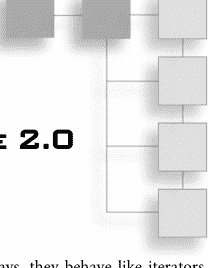

### 提示

计算机内存很像一个社区，但不是人们存放东西的房子，你有可以存储数据的内存位置。就像社区中房子并排坐落，用地址标记一样，计算机内存的块也并排坐落，用地址标记。在社区中，你可以使用一张写有街道地址的纸条到达特定的房子（以及里面存放的东西）。在计算机中，你可以使用包含内存地址的指针到达特定的内存位置（以及里面存储的东西）。

### 介绍 Pointing 程序

Pointing 程序演示了指针的机制。该程序为分数创建一个变量，然后创建一个指针来存储该变量的地址。该程序显示你可以直接更改变量的值，指针会反映该更改。它还显示你可以通过指针更改变量的值。然后它演示了你可以更改指针指向完全不同的变量。最后，程序显示指针可以和对象一样轻松地工作。图 7.1 说明了程序的结果。

你可以从 Course Technology 网站 (www.courseptr.com/downloads) 下载此程序的代码。该程序位于第 7 章文件夹中；文件名是 pointing.cpp。

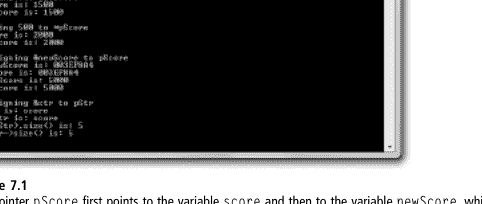

图 7.1 指针 pScore 首先指向变量 score，然后指向变量 newScore，而指针 pStr 指向变量 str。


```cpp
// Pointing
// Demonstrates using pointers

#include <iostream>
#include <string>

using namespace std;

int main()
{
    int* pAPointer;     // declare a pointer

    int* pScore = 0;    // declare and initialize a pointer

    int score = 1000;
    pScore = &score;    // assign pointer pScore address of variable score

    cout << "Assigning &score to pScore\n";
    cout << "&score is: " << &score << "\n";    // address of score variable
    cout << "pScore is: " << pScore << "\n";    // address stored in pointer
    cout << "score is: " << score << "\n";
    cout << "*pScore is: " << *pScore << "\n\n"; // value pointed to by pointer

    cout << "Adding 500 to score\n";
    score += 500;
    cout << "score is: " << score << "\n";
    cout << "*pScore is: " << *pScore << "\n\n";

    cout << "Adding 500 to *pScore\n";
    *pScore += 500;
    cout << "score is: " << score << "\n";
    cout << "*pScore is: " << *pScore << "\n\n";

    cout << "Assigning &newScore to pScore\n";
    int newScore = 5000;
    pScore = &newScore;
    cout << "&newScore is: " << &newScore << "\n";
    cout << "pScore is: " << pScore << "\n";
    cout << "newScore is: " << newScore << "\n";
    cout << "*pScore is: " << *pScore << "\n\n";

    cout << "Assigning &str to pStr\n";
    string str = "score";
    string* pStr = &str;  // pointer to string object
    cout << "str is: " << str << "\n";
    cout << "*pStr is: " << *pStr << "\n";
    cout << "(*pStr).size() is: " << (*pStr).size() << "\n";
    cout << "pStr->size() is: " << pStr->size() << "\n";

    return 0;
}
```

## 声明指针

在 `main()` 的第一条语句中，我声明了一个名为 `pAPointer` 的指针。

```cpp
int* pAPointer;    // declare a pointer
```

由于指针的工作方式非常独特，程序员通常会在指针变量名前加上字母 "p"，以提醒自己该变量确实是一个指针。

就像迭代器一样，指针被声明为指向特定类型的值。`pAPointer` 是一个指向 `int` 的指针，这意味着它只能指向 `int` 值。例如，`pAPointer` 不能指向 `float` 或 `char`。另一种说法是，`pAPointer` 只能存储 `int` 的地址。

要声明你自己的指针，首先写出指针将要指向的对象类型，后跟一个星号，再后跟指针名。声明指针时，可以在星号的两侧加上空白字符。因此 `int* pAPointer;`、`int *pAPointer;` 和 `int * pAPointer;` 都声明了一个名为 `pAPointer` 的指针。

### 陷阱

声明指针时，星号仅适用于紧跟其后的那个变量名。因此，下面的语句将 `pScore` 声明为指向 `int` 的指针，而 `score` 声明为 `int`。

```cpp
int* pScore, score;
```

`score` 不是指针！它是一个 `int` 类型的变量。让这一点更清晰的方法之一是调整空白并重写该语句：

```cpp
int *pScore, score;
```

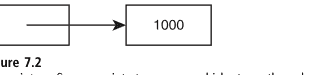

图 7.2 — 指针 `pScore` 指向 `score`，其中存储值 1000。

为了证明 `pScore` 包含 `score` 的地址，我用下面几行显示了变量的地址和指针的值。

```cpp
cout << "&score is: " << &score << "\n";    // address of score variable
cout << "pScore is: " << pScore << "\n";    // address stored in pointer
```

`pScore` 包含 `0x22ff5c`，这是 `score` 的地址。（`Pointing` 程序显示的具体地址在你的系统上可能不同。重要的是 `pScore` 和 `&score` 的值相同。）

## 解引用指针

就像你解引用迭代器以访问它所引用的对象一样，你解引用指针以访问它所指向的对象。你可以用同样的方式完成解引用——使用 `*`，即解引用运算符。我将解引用运算符用在了下面一行代码中，该行显示 1000，因为 `*pScore` 访问了 `score` 中存储的值。

```cpp
cout << "*pScore is: " << *pScore << "\n"; // value pointed to by pointer
```

记住，`*pScore` 的意思是“pScore 指向的对象”。

### 陷阱

> 不要解引用空指针，因为这可能导致灾难性后果。

接下来，我用下面一行代码将 500 加到 `score` 上。

```cpp
score += 500;
```

当我把 `score` 发送给 `cout` 时，显示 1500，正如你所料。当我把 `*pScore` 发送给 `cout` 时，`score` 的内容再次被发送给 `cout`，于是再次显示 1500。

接下来，我用下面一行代码将 500 加到 `pScore` 指向的值上。

```cpp
*pScore += 500;
```

因为 `pScore` 指向 `score`，所以上面的代码将 500 加到 `score`。因此，当我再次将 `score` 发送给 `cout` 时，显示 2000。然后，当我将 `*pScore` 发送给 `cout` 时……你猜对了，再次显示 2000。

### 陷阱

当你想改变指针指向的对象的值时，不要改变指针的值。例如，如果我想将 500 加到 `pScore` 指向的 `int` 上，那么下面这行代码将是一个大错误。

```cpp
pScore += 500;
```

前面的代码将 500 加到 `pScore` 存储的地址上，而不是 `pScore` 最初指向的值上。结果，`pScore` 现在指向某个可能包含任何内容的地址。解引用这样的指针可能导致灾难性后果。

## 重新赋值指针

与引用不同，指针在程序生命周期内的不同时刻可以指向不同的对象。重新赋值指针就像重新赋值任何其他变量一样。接下来，我用下面一行代码重新赋值 `pScore`。

```cpp
pScore = &newScore;
```

因此，`pScore` 现在指向 `newScore`。为了证明这一点，我通过将 `&newScore` 发送给 `cout` 来显示 `newScore` 的地址，随后显示 `pScore` 中存储的地址。两条语句显示相同的地址。然后，我将 `newScore` 和 `*pScore` 发送给 `cout`。两者都显示 5000，因为它们都访问存储该值的同一块内存。

### 陷阱

当你想改变指针本身时，不要改变指针指向的值。例如，如果我想将 `pScore` 改为指向 `newScore`，那么下面这行代码将是一个大错误。

```cpp
*pScore = newScore;
```

这段代码只是改变了 `pScore` 当前指向的值；它并没有改变 `pScore` 本身。如果 `newScore` 等于 5000，那么前面的代码等价于 `*pScore = 5000;`，而 `pScore` 仍然指向赋值之前它所指向的同一个变量。

## 使用指向对象的指针

到目前为止，`Pointing` 程序只使用了内置类型 `int` 的值。但你同样可以轻松地将指针用于对象。接下来我用下面几行代码演示这一点，这些代码创建了 `str`（一个等于 `"score"` 的 `string` 对象）和 `pStr`（一个指向该对象的指针）。

```cpp
string str = "score";
string* pStr = &str;  // pointer to string object
```

`pStr` 是一个指向 `string` 的指针，这意味着它可以指向任何 `string` 对象。另一种说法是，`pStr` 可以存储任何 `string` 对象的地址。

你可以使用解引用运算符通过指针访问对象。这就是我下面一行代码所做的。

```cpp
cout << "*pStr is: " << *pStr << "\n";
```

通过对 `*pStr` 使用解引用运算符，我将 `pStr` 指向的对象（`str`）发送给 `cout`。结果，文本 `score` 被显示出来。

你可以像通过迭代器调用对象的成员函数一样，通过指针调用对象的成员函数。其中一种方法是使用解引用运算符和成员访问运算符，这就是我下面几行代码所做的。

```cpp
cout << "(*pStr).size() is: " << (*pStr).size() << "\n";
```

代码 `(*pStr).size()` 表示：“获取解引用 `pStr` 的结果，并调用该对象的 `size()` 成员函数。”因为 `pStr` 引用等于 `"score"` 的 `string` 对象，所以该代码返回 5。

> **提示**
>
> 每当你解引用指针以访问数据成员或成员函数时，请用一对括号将解引用的指针括起来。这可以确保点运算符应用于指针指向的对象。

与迭代器一样，你可以将 `->` 运算符与指针一起使用，以更易读的方式访问对象成员。这就是我接下来用下面一行代码演示的内容。

```cpp
cout << "pStr->size() is: " << pStr->size() << "\n";
```


前面的语句再次显示了与 “score” 相等的字符串对象中的字符数；不过这一次，我可以用 pStr->size() 代替 (*pStr).size()，使代码更易读。

## 理解指针与常量

在你开始有效地在游戏程序中使用指针之前，还有一些指针机制需要理解。你可以使用 const 关键字来限制指针的工作方式。这些限制可以起到保护作用，也能让你的编程意图更清晰。由于指针非常灵活，限制指针的使用方式符合“只索取所需”的编程理念。

## 使用常量指针

如你所见，指针在程序中的不同时刻可以指向不同对象。但是，在声明并初始化指针时使用 const 关键字，可以限制指针只能指向它初始化时所指向的对象。这样的指针称为常量指针。换句话说，存储在常量指针中的地址永远不能改变——它是常量。下面是一个创建常量指针的示例：

```c
int score = 100;
int* const pScore = &score;  // a constant pointer
```

上面的代码创建一个常量指针 pScore，它指向 score。声明指针时，将 const 放在指针名称之前，即可创建一个常量指针。

与所有常量一样，你必须在首次声明常量指针时对其进行初始化。下面这行代码是非法的，会产生一个又大又明显的编译错误。

```c
int* const pScore;  // illegal -- you must initialize a constant pointer
```

因为 pScore 是一个常量指针，所以它永远不能指向任何其他内存位置。下面的代码同样是非法的。

```c
pScore = &anotherScore;  // illegal - pScore can't point to a different object
```

虽然你不能修改 pScore 本身，但可以使用 pScore 修改它所指向的值。下面这行代码完全合法。

```c
*pScore = 500;
```

感到困惑？不要这样。使用常量指针修改它所指向的值是完全没问题的。请记住，常量指针的限制在于它的值——指针存储的地址——不能改变。

常量指针的工作方式应该让你想起什么——引用。和引用一样，常量指针只能指向它初始化时指向的对象。

> 提示
> 
> 虽然你可以在程序中使用常量指针代替引用，但在可能的情况下应优先使用引用。引用的语法比指针更简洁，可以使代码更易读。

## 使用指向常量的指针

如你所见，可以使用指针修改它们所指向的值。但是，在声明指针时使用 const 关键字，可以限制指针，使它不能用于修改它所指向的值。这样的指针称为指向常量的指针。下面是声明此类指针的示例：

```c
const int* pNumber; //a pointer to a constant
```

上面的代码声明了一个指向常量的指针 pNumber。要声明指向常量的指针，请将 const 放在指针将要指向的值类型之前。

和之前一样，你可以将地址赋给指向常量的指针。

```c
int lives = 3;
pNumber = &lives;
```

但是，你不能使用该指针修改它所指向的值。下面这行是非法的。

```c
*pNumber = 1; //illegal -- can't use pointer to a constant to change value
//that pointer points to
```

虽然不能使用指向常量的指针修改它所指向的值，但指针本身可以改变。这意味着指向常量的指针可以指向程序中的不同对象。下面的代码完全合法。

```c
const int MAX_LIVES = 5;
pNumber = &MAX_LIVES; //pointer itself can change
```

## 使用指向常量的常量指针

指向常量的常量指针结合了常量指针和指向常量的指针的限制。这意味着，指向常量的常量指针只能指向初始化时指向的对象。此外，它不能用于修改所指向对象的值。下面是此类指针的声明和初始化：

```c
const int* const pBONUS = &BONUS; //a constant pointer to a constant
```

上面的代码创建了一个指向常量的常量指针 pBONUS，它指向常量 BONUS。

> 提示
> 
> 与指向常量的指针一样，指向常量的常量指针既可以指向非常量值，也可以指向常量值。

你不能重新赋值指向常量的常量指针。下面这行不合法。

```c
pBONUS = &MAX_LIVES; //illegal -- pBONUS can't point to another object
```

你不能使用指向常量的常量指针来修改它所指向的值。这意味着下面这行是非法的。

```c
*pBONUS = MAX_LIVES; //illegal -- can't change value through pointer
```

在很多方面，指向常量的常量指针的行为类似于常量引用：它只能引用初始化时引用的值，并且不能用于修改该值。

> 提示
> 
> 虽然你可以在程序中使用指向常量的常量指针代替常量引用，但在可能的情况下应优先使用常量引用。引用的语法比指针更简洁，可以使代码更易读。

一个保存着我那可怜的低分，另一个保存着你那令人印象深刻的高分。显示分数后，程序调用一个用于交换分数的函数。由于只有分数值的副本被发送到函数中，原始变量不会改变。接下来，程序调用另一个交换函数。这一次，通过使用常量指针，原始变量的值被成功交换（给予我那个巨大的分数，把小的留给你）。图 7.3 显示了程序的运行情况。

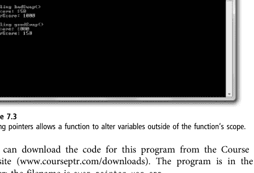

图 7.3
传递指针允许函数修改函数作用域之外的变量。

你可以从 Course Technology 网站（www.courseptr.com/downloads）下载该程序的代码。程序位于第 7 章文件夹中；文件名是 swap_pointer_ver.cpp。

```c
// Swap Pointer
// Demonstrates passing constant pointers to alter argument variables

#include <iostream>

using namespace std;

void badSwap(int x, int y);
void goodSwap(int* const pX, int* const pY);

int main()
{
int myScore = 150;
int yourScore = 1000;
cout << "Original values\n";
cout << "myScore: " << myScore << "\n";
cout << "yourScore: " << yourScore << "\n\n";

cout << "Calling badSwap()\n";
badSwap(myScore, yourScore);
cout << "myScore: " << myScore << "\n";
cout << "yourScore: " << yourScore << "\n\n";

cout << "Calling goodSwap()\n";
goodSwap(&myScore, &yourScore);
cout << "myScore: " << myScore << "\n";
cout << "yourScore: " << yourScore << "\n";

return 0;
}

void badSwap(int x, int y)
{
    int temp = x;
    x = y;
    y = temp;
}

void goodSwap(int* const pX, int* const pY)
{
    //store value pointed to by pX in temp
    int temp = *pX;
    //store value pointed to by pY in address pointed to by pX
    *pX = *pY;
    //store value originally pointed to by pX in address pointed to by pY
    *pY = temp;
}
```

## 按值传递

在声明并初始化 myScore 和 yourScore 之后，我将它们发送给 cout。如你所料，显示 150 和 1000。接下来，我调用 badSwap()，它传递两者

通过使用 string* 作为函数头的开头，我的意思是该函数将返回一个指向字符串对象的指针（而不是字符串对象本身）。要指定函数返回一个指向特定类型对象的指针，请在返回类型名称后放置一个星号。

函数 ptrToElement() 的函数体只包含一条语句，它返回一个指向 pVec 所指向量中位置 i 处元素的指针。

```c
return &((*pVec)[i]);
```

返回语句可能看起来有点晦涩，所以我将逐步解释它。每当你遇到复杂的表达式时，像计算机一样计算它——从最内层的部分开始。我先从 (*pVec)[i] 开始，它表示 pVec 所指向的向量中位置 i 处的元素。将取地址运算符（&）应用于该表达式，它就变成 pVec 所指向的向量中位置 i 处元素的地址。

## 陷阱

虽然返回指针可以是一种将信息传回调用函数的有效方式，但你必须小心，不要返回指向作用域之外对象的指针。例如，下面这个函数返回的指针如果被使用，可能会导致程序崩溃。

```c
string* badPointer()
{
    string local = "This string will cease to exist once the function ends.";
    string* pLocal = &local;
    return pLocal;
}
```

这是因为 badPointer() 返回一个指向字符串的指针，而该字符串在函数结束后不再存在。指向不存在对象的指针称为悬空指针。试图解引用悬空指针可能导致灾难性后果。避免悬空指针的一种方法是永远不要返回指向局部变量的指针。

## 使用返回的指针显示值

创建 inventory（一个包含物品的向量）之后，我用返回的指针显示一个值。

cout << *(ptrToElement(&inventory, 0)) << "\n\n";

上述代码调用 ptrToElement()，它返回一个指向 inventory[0] 的指针。（请记住，ptrToElement() 不会返回向量中某个元素的副本，

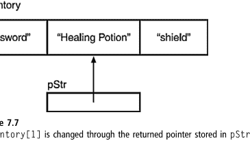

图 7.7
inventory[1] 是通过存储在 pStr 中的返回指针来更改的。

## 理解指针与数组之间的关系

指针与数组有着密切的关系。实际上，数组名本质上是指向数组第一个元素的常量指针。由于数组元素存储在连续的内存块中，你可以使用数组名作为指针来随机访问元素。这种关系对于如何传递和返回数组也有重要影响，正如你很快就会看到的。

## 介绍 Array Passer 程序

Array Passer 程序创建一个高分数组，然后使用数组名作为常量指针来显示它们。接下来，程序将数组名作为常量指针传递给一个用于增加分数的函数。最后，程序将数组名作为指向常量的常量指针传递给一个函数以显示新的高分。图 7.8 显示了程序的结果。

你可以从 Course Technology 网站 (www.courseptr.com/downloads) 下载此程序的代码。该程序位于第 7 章文件夹中；文件名是 array_passer.cpp。

```
//Array Passer
//Demonstrates relationship between pointers and arrays

#include <iostream>

using namespace std;
```

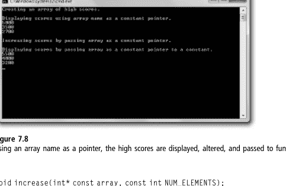

图 7.8

使用数组名作为指针，高分会被显示、修改并传递给函数。

```
void increase(int* const array, const int NUM_ELEMENTS);
void display(const int* const array, const int NUM_ELEMENTS);

int main()
{
    cout << "Creating an array of high scores.\n\n";
    const int NUM_SCORES = 3;
    int highScores[NUM_SCORES] = {5000, 3500, 2700};

    cout << "Displaying scores using array name as a constant pointer.\n";
    cout << *highScores << endl;
    cout << *(highScores + 1) << endl;
    cout << *(highScores + 2) << "\n\n";

    cout << "Increasing scores by passing array as a constant pointer.\n\n";
    increase(highScores, NUM_SCORES);

    cout << "Displaying scores by passing array as a constant pointer to a constant.\n";
    display(highScores, NUM_SCORES);

    return 0;
}
```

- 在许多方面，指针的行为类似于 STL 中的迭代器。例如，就像使用迭代器一样，你使用指针间接访问对象。
- 要声明一个指针，你列出一个类型，后跟一个星号，再后跟一个名称。
- 程序员经常用字母“p”作为指针变量名的前缀，以提醒他们该变量确实是指针。
- 就像迭代器一样，指针被声明为引用特定类型的值。
- 在声明指针时对其进行初始化是良好的编程实践。
- 如果将 0 分配给指针，则该指针称为空指针。
- 要获取变量的地址，请在变量名前放置取地址运算符 (&)。
- 当指针包含对象的地址时，称其指向该对象。
- 与引用不同，你可以重新分配指针。也就是说，在程序的生命周期中，指针可以在不同时间指向不同的对象。
- 就像迭代器一样，你使用 * 解引用运算符来访问指针指向的对象。
- 就像迭代器一样，你可以使用 -> 运算符与指针一起，以更易读的方式访问对象数据成员和成员函数。
- 常量指针只能指向它被初始化时指向的对象。你通过在指针名前放置关键字 const 来声明常量指针，如 int* const p = &i;。
- 你不能使用指向常量的指针来更改其指向的值。你通过在类型名前放置关键字 const 来声明指向常量的指针，如 const int* p;。
- 指向常量的常量指针只能指向它被初始化时指向的值，并且不能用于更改该值。你通过在类型名前和指针名前放置关键字 const 来声明指向常量的常量指针，如 const int* const p = &i;。
- 你可以传递指针以提高效率或提供对对象的直接访问。
- 如果你想为了效率而传递指针，你应该传递指向常量的指针或指向常量的常量指针，这样你传递访问权限的对象就不能通过指针被更改。
- 悬空指针是指向无效内存地址的指针。悬空指针通常是由删除指针指向的对象引起的。解引用此类指针可能导致灾难性后果。
- 你可以从函数返回指针，但要小心不要返回悬空指针。

## QUESTIONS AND ANSWERS

Q: 指针与它指向的变量有何不同？

A: 指针存储内存地址。如果指针指向一个变量，它存储该变量的地址。

Q: 存储已存在变量的地址有什么好处？

A: 存储现有变量地址的一个巨大优势是，你可以为了效率而传递指向该变量的指针，而不是按值传递变量。

Q: 指针是否必须始终指向已存在的变量？

A: 不一定。你可以创建指向所需时未命名计算机内存块的指针。你将在第 9 章“高级类与动态内存：游戏大厅”中更多地了解这种动态方式的内存分配。

Q: 为什么在可能的情况下我应该使用引用而不是指针来传递变量？

A: 因为引用提供的语法糖。传递引用或指针是提供对象访问的高效方式，但指针需要额外的语法（如解引用运算符）来访问对象本身。

Q: 为什么我应该在声明指针时或不久之后初始化它？

A: 因为解引用未初始化的指针可能导致灾难性后果，包括程序崩溃。

Q: 为什么我想限制指针的功能？
A: 为了安全。例如，你可能正在处理一个你知道不想更改的对象。

Q: 我可以给什么类型的指针分配一个常量值？
A: 指向常量的指针或指向常量的常量指针。

Q: 如何安全地从函数返回指针？
A: 一种方法是返回从调用函数接收到的对象的指针。这样，你返回的是在调用代码中存在的对象的指针。（在第 9 章中，当你学习动态内存时，你会发现另一种重要的方法。）

## DISCUSSION QUESTIONS

- 1. 传递指针的优点和缺点是什么？
- 2. 什么样的情况需要常量指针？
- 3. 什么样的情况需要指向常量的指针？
- 4. 什么样的情况需要指向常量的常量指针？
- 5. 什么样的情况需要指向非常量对象的非常量指针？

## EXERCISES

- 1. 编写一个包含指向字符串对象的指针的指针的程序。使用指向指针的指针调用字符串对象的 size() 成员函数。
- 2. 重写第 5 章的最终项目 Mad Lib 游戏，使讲述故事的函数不接收字符串对象。相反，该函数应接受指向字符串对象的指针。
- 3. 以下程序显示的三个内存地址是否都相同？解释代码中发生了什么。

```cpp
#include <iostream>
using namespace std;

int main()
{
    int a =10;
    int& b = a;
    int* c = &b;

    cout << &a << endl;
    cout << &b << endl;
    cout << &(*c) << endl;

    return 0;
}
```

此页特意留空


```
class Critter        // class definition — defines a new type, Critter
{
public:
    int m_Hunger;      // data member
    void Greet();      // member function prototype
};

void Critter::Greet()   // member function definition
{
    cout << "Hi. I'm a critter. My hunger level is " << m_Hunger << ".\n";
}

int main()
{
    Critter crit1;
    Critter crit2;

    crit1.m_Hunger = 9;
    cout << "crit1's hunger level is " << crit1.m_Hunger << ".\n";

    crit2.m_Hunger = 3;
    cout << "crit2's hunger level is " << crit2.m_Hunger << ".\n";

    crit1.Greet();
    crit2.Greet();

    return 0;
}
```

## 定义类

要创建新类型，可以定义一个类——代码将数据成员和成员函数分组。从类中，可以创建具有各自数据成员副本并可访问所有成员函数的独立对象。类就像蓝图。就像蓝图定义了建筑物的结构一样，类定义了对象的结构。就像工头可以根据同一蓝图建造许多房屋一样，游戏程序员也可以根据同一类创建许多对象。一些实际代码将有助于巩固这一理论。我在 Simple Critter 程序中以以下方式开始类定义

```
class Critter        // class definition — defines a new type, Critter
```

## 类成员

预计未来本市基础教育学龄人口规模变化趋势

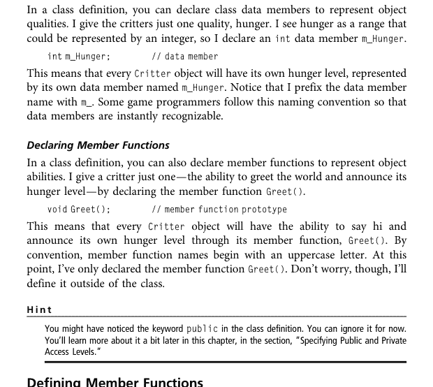

2029年将达到峰值184.5万

出生人口变化

小学在校生规模变化

初高中在校生规模变化

据预测，受出生人口变化影响，本市2025—2035年基础教育学龄人口呈先升后降态势，峰值出现在2029年附近。

```cpp
void Critter::Greet()  // member function definition
{
    cout << "Hi. I'm a critter. My hunger level is " << m_Hunger << ".\n";
}
```

该定义看起来像你见过的任何其他函数定义，除了有一点——我用 Critter:: 作为前缀来命名函数。当你在类外部定义成员函数时，需要用类名和作用域解析运算符对其进行限定，以便编译器知道该定义属于该类。

在成员函数中，我将 m_Hunger 发送到 cout。这意味着 Greet() 会显示通过该函数被调用的特定对象的 m_Hunger 值。这仅仅意味着成员函数显示了 critter 的饥饿程度。你可以在任何成员函数中仅通过使用成员的名称来访问对象的数据成员和成员函数。

## 实例化对象

当你创建一个对象时，你从一个类实例化它。事实上，特定的对象被称为类的实例。在 main() 中，我实例化了 Critter 的两个实例。

```cpp
Critter crit1;
Critter crit2;
```

因此，我有两个 Critter 对象——crit1 和 crit2。

## 访问数据成员

是时候让这些 critter 开始工作了。接下来，我给我的第一个 critter 设置一个饥饿程度。

```cpp
crit1.m_Hunger = 9;
```

前面的代码将 9 分配给 crit1 的数据成员 m_Hunger。就像访问对象的可用成员函数时一样，你可以使用成员选择运算符来访问对象的可用数据成员。

为了证明赋值成功，我显示 critter 的饥饿程度。

```cpp
cout << "crit1's hunger level is " << crit1.m_Hunger << ".\n";
```

前面的代码显示了 crit1 的数据成员 m_Hunger，并正确显示为 9。就像为可用数据成员赋值时一样，你也可以通过成员选择运算符获取可用数据成员的值。

接下来，我展示同样的过程对另一个 Critter 对象也适用。

```cpp
crit2.m_Hunger = 3;
cout << "crit2's hunger level is " << crit2.m_Hunger << ".\n\n";
```

这次，我将 3 分配给 crit2 的数据成员 m_Hunger 并显示它。

因此，crit1 和 crit2 都是 Critter 的实例，但各自独立存在，各自具有自己的身份。此外，每个都有自己的 m_Hunger 数据成员，具有自己的值。

## 调用成员函数

接下来，我再次让 critter 发挥作用。我让第一个 critter 打个招呼。

```
crit1.Greet();
```

前面的代码调用了 crit1 的 Greet() 成员函数。该函数访问调用对象的 m_Hunger 数据成员以形成其显示的问候。由于 crit1 的 m_Hunger 数据成员为 9，函数显示的文本为：Hi. I'm a critter. My hunger level is 9.

最后，我让第二个 critter 发声。

```
crit2.Greet();
```

前面的代码调用了 crit2 的 Greet() 成员函数。该函数访问调用对象的 m_Hunger 数据成员以形成其显示的问候。由于 crit2 的 m_Hunger 数据成员为 3，函数显示的文本为：Hi. I'm a critter. My hunger level is 3.

## 使用构造函数

当你实例化对象时，通常希望进行一些初始化——通常是为数据成员赋值。幸运的是，一个类有一个特殊的成员函数，称为构造函数，每次实例化新对象时都会自动调用。这是一个很大的便利，因为你可以使用构造函数来执行新对象的初始化。

```
public:
    int m_Hunger;

    Critter(int hunger = 0);    // constructor prototype
    void Greet();
};

Critter::Critter(int hunger)    // constructor definition
{
    cout << "A new critter has been born!" << endl;
    m_Hunger = hunger;
}

void Critter::Greet()
{
    cout << "Hi. I'm a critter. My hunger level is " << m_Hunger << ".\n\n";
}

int main()
{
    Critter crit(7);
    crit.Greet();

    return 0;
}
```

## 声明和定义构造函数

我在 Critter 中用以下代码声明一个构造函数：

```
Critter(int hunger = 0);    // constructor prototype
```

正如声明所示，构造函数没有返回类型。它不能——为构造函数指定返回类型是非法的。此外，在命名构造函数时你没有灵活性。你必须给它与类本身相同的名称。

> 提示
> 
> 默认构造函数不需要参数。如果你没有定义默认构造函数，编译器会为你定义一个最小的构造函数，它只是调用类的任何数据成员的默认构造函数。如果你编写自己的构造函数，那么编译器不会为你提供默认构造函数。通常最好有一个默认构造函数，因此在必要时应确保自行提供。实现此目的的一种方法是为构造函数定义中的所有参数提供默认值。

通过使用 private:，我的意思是其后（直到另一个访问级别说明符）出现的任何数据成员或成员函数都将是私有的。这意味着只有 Critter 类中的代码可以直接访问它。由于我在该部分声明了 m_Hunger，这意味着只有 Critter 中的代码可以直接访问对象的 m_Hunger 数据成员。因此，我不能像在之前的程序中那样通过对象在 main() 中直接访问对象的 m_Hunger 数据成员。所以 main() 中的以下行，如果取消注释，将是非法的语句：

//cout << crit.m_Hunger; //Illegal, m_Hunger is private!

因为 m_Hunger 是私有的，我不能从不属于 Critter 类的代码中访问它。再次强调，只有属于 Critter 的代码可以直接访问数据成员。

我只向你展示了如何使数据成员私有，但你也可以使成员函数私有。此外，你可以重复访问修饰符。因此，如果你愿意，可以在一个类中有一个私有部分，后跟一个公共部分，再后跟另一个私有部分。最后，成员访问默认为私有。在你指定访问修饰符之前，声明的任何类成员都将是私有的。

## 定义访问器成员函数

访问器成员函数允许间接访问数据成员。因为 m_Hunger 是私有的，我编写了一个访问器成员函数 GetHunger() 来返回数据成员的值。（现在你可以忽略 const 关键字。）

```
int Critter::GetHunger() const
{
    return m_Hunger;
}
```

我用以下行在 main() 中使用该成员函数：

```
cout << "Calling GetHunger(): " << crit.GetHunger() << "\n\n";
```

在前面的代码中，crit.GetHunger() 只是返回 crit 的 m_Hunger 数据成员的值，为 5。


## 技巧

就像使用普通函数一样，你也可以内联成员函数。内联成员函数的一种方法是将其直接定义在类定义内部，而那里通常只声明成员函数。如果你在一个类中包含成员函数定义，那么当然就不需要在类外部定义它了。

此规则的一个例外是，当你使用关键字 virtual 在类定义中定义成员函数时，该成员函数不会自动内联。你将在第 10 章“继承与多态：Blackjack”中学习有关虚函数的内容。

到目前为止，你可能会想，为什么要费劲把数据成员设为 private，只为通过访问器函数对其进行完全访问。答案是你通常不会授予完全访问权限。例如，看看我为设置对象的 m_Hunger 数据成员而定义的访问器成员函数 SetHunger()：

```
void Critter::SetHunger(int hunger)
{
    if (hunger < 0)
    {
        cout << "You can't set a critter's hunger to a negative number.\n\n";
    }
    else
    {
        m_Hunger = hunger;
    }
}
```

在这个访问器成员函数中，我首先检查传递给成员函数的值是否大于零。如果不是，则为非法值，我会显示一条消息，同时保持数据成员不变。如果值大于零，则进行更改。这样，SetHunger() 保护了 m_Hunger 的完整性，确保它不能被设置为负数。正如我在这里所做的，大多数游戏程序员会以 Get 或 Set 开头命名他们的访问器成员函数。

## 定义常量成员函数

常量成员函数不能修改其类的任何数据成员，也不能调用该类的非常量成员函数。为什么要限制成员函数能做什么？再次回到只请求所需内容的原则。如果你不需要在成员函数中更改任何数据成员，那么最好将该成员函数声明为常量。它可以防止你在成员函数中意外更改数据成员，并使你的意图对其他程序员更清晰。

> **陷阱**
> 
> 好吧，我撒了点小谎。常量成员函数可以更改静态数据成员。你将在本章稍后“声明和初始化静态数据成员”部分学习有关静态数据成员的内容。此外，如果你用 mutable 关键字限定一个数据成员，那么即使是常量成员函数也可以修改它。不过现在，先不用担心这两个例外。

你可以通过在函数头末尾加上关键字 const 来声明常量成员函数。这就是我在 Critter 中所做的，下面这一行声明 GetHunger() 为常量成员函数。

```
int GetHunger() const;
```

这意味着 GetHunger() 不能更改 Critter 类中声明的任何非静态数据成员的值，也不能调用任何非常量 Critter 成员函数。我将 GetHunger() 设为常量，因为它只返回一个值并且不需要修改任何数据成员。一般来说，Get 成员函数可以定义为常量。

## 使用静态数据成员和成员函数

对象很棒，因为每个实例都存储自己的数据集合，使其具有独特的身份。但如果想要存储有关整个类的一些信息，例如存在的实例总数怎么办？你可能想在创建了一堆敌人并希望它们根据总数与玩家战斗时这样做。例如，如果总数低于某个阈值，你可能希望敌人逃跑。你可以在每个对象中存储实例总数，但这会浪费存储空间。此外，随着总数的变化，更新所有对象会很麻烦。相反，你真正想要的是为整个类存储单个值的方法。你可以用静态数据成员来实现这一点。

## 声明和初始化静态数据成员

静态数据成员是整个类都存在的单个数据成员。在类定义中，我声明一个静态数据成员 s_Total 来存储已实例化的 Critter 对象数量。

```
static int s_Total; //static member variable declaration
```

你可以像我一样声明自己的静态数据成员，只需以 static 关键字开头声明即可。我在变量名前面加上了 s_ 前缀，以便可以立即识别为静态数据成员。

在类定义之外，我将静态数据成员初始化为 0。

```
int Critter::s_Total = 0; //static member variable initialization
```

注意我用 Critter:: 限定了数据成员名。在其类定义之外，你必须用其类名限定静态数据成员。执行完上一行代码后，与 Critter 类关联的有一个单一值，存储在其静态数据成员 s_Total 中，值为 0。

> 提示
> 
> 你也可以在非类函数中声明静态变量。静态变量在函数调用之间保持其值。

## 访问静态数据成员

你可以在程序的任何地方访问公共静态数据成员。在 main() 中，我用下面这一行访问 Critter::s_Total，它显示 0，即静态数据成员的值，也是已实例化的 Critter 对象总数。

```
cout << Critter::s_Total << "\n\n";
```

> 提示
> 
> 你也可以通过该类的任何对象访问静态数据成员。假设 crit1 是一个 Critter 对象，我可以用下面这一行显示 critter 的总数：
> 
> cout << crit1.s_Total << "\n\n";

我也在 Critter 构造函数中用下面这一行访问这个静态数据成员，它递增 s_Total。

```
++s_Total;
```

用符号表示其访问级别的成员函数；我用 + 表示 public，- 表示 private。

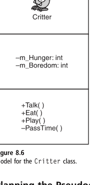

图 8.6
Critter 类的模型。

## 规划伪代码

程序的其余部分会相当简单。它基本上是一个游戏循环，询问玩家是否想听、喂养或与 critter 玩耍，或退出游戏。以下是我的伪代码：

```
Create a critter
While the player doesn't want to quit the game
    Present a menu of choices to the player
    If the player wants to listen to the critter
        Make the critter talk
    If the player wants to feed the critter
        Make the critter eat
    If the player wants to play with the critter
        Make the critter play
```

## Critter 类

Critter 类是代表玩家 critter 的对象的蓝图。该类并不复杂，大部分内容应该看起来很熟悉，但它足够长，以至于分块处理是有意义的。

## 类定义

在一些初始注释和语句之后，我开始 Critter 类。

```cpp
//Critter Caretaker
//Simulates caring for a virtual pet

#include <iostream>

using namespace std;

class Critter
{
public:
    Critter(int hunger = 0, int boredom = 0);
    void Talk();
    void Eat(int food = 4);
    void Play(int fun = 4);

private:
    int m_Hunger;
    int m_Boredom;

    int GetMood() const;
    void PassTime(int time = 1);
};
```

m_Hunger 是一个私有数据成员，表示 critter 的饥饿程度，而 m_Boredom 是一个私有数据成员，表示其无聊程度。我将在各自的章节中介绍每个成员函数。

## 类构造函数

构造函数接受两个参数 hunger 和 boredom。每个参数都有默认值零，我在类定义中的构造函数原型中指定了它。我使用 hunger 初始化 m_Hunger，并使用 boredom 初始化 m_Boredom。

```
Critter::Critter(int hunger, int boredom):
    m_Hunger(hunger),
    m_Boredom(boredom)
{}
```

## GetMood() 成员函数

接下来，我定义 GetMood()。

```
inline int Critter::GetMood() const
{
    return (m_Hunger + m_Boredom);
}
```

这个内联成员函数的返回值表示 critter 的情绪。作为 critter 饥饿度和无聊度的总和，critter 的情绪会随着数值的增加而变差。我将此成员函数设为私有，因为它只应由类的另一个成员函数调用。我将其设为常量，因为它不会导致数据成员的任何更改。

## PassTime() 成员函数

PassTime() 是一个私有成员函数，用于增加 critter 的饥饿度和无聊度。它在 critter 做某事（吃、玩或说话）的每个成员函数末尾被调用，以模拟时间的流逝。我将此成员函数设为私有，因为它只应由类的另一个成员函数调用。

```
void Critter::PassTime(int time)
{
    m_Hunger += time;
    m_Boredom += time;
}
```

你可以向成员函数传递已过去的时间量；否则，time 将获得默认值 1，我在 Critter 类定义中的成员函数原型中指定了它。


```cpp
if (m_Hunger < 0)
{
    m_Hunger = 0;
}

PassTime();
}
```

## Play() 成员函数

Play() 会按参数 fun 传入的数值来降低小动物的无聊程度。如果没有传入数值，fun 将使用默认参数值 4。小动物的无聊程度会被控制在合理范围内，不允许降到零以下。最后，调用 PassTime() 来模拟时间的流逝。

```cpp
void Critter::Play(int fun)
{
    cout << "Whee!\n";

    m_Boredom -= fun;
    if (m_Boredom < 0)
    {
        m_Boredom = 0;
    }

    PassTime();
}
```

## main() 函数

在 main() 中，我实例化一个新的 Critter 对象。由于没有为 m_Hunger 或 m_Boredom 提供数值，数据成员从 0 开始，小动物一出生就快乐而满足。接下来，我创建了一个菜单系统。如果玩家输入 0，程序结束；如果玩家输入 1，程序调用对象的 Talk() 成员函数；如果玩家输入 2，程序调用对象的 Eat() 成员函数；如果玩家输入 3，程序调用对象的 Play() 成员函数；如果玩家输入其他内容，则会被告知选择无效。

```cpp
int main()
{
    Critter crit;
    crit.Talk();
```

问：为什么 C++ 同时拥有结构和类？
答：为了让 C++ 保持与 C 的向后兼容性。

问：我应该在什么时候使用结构？
答：有些游戏程序员使用结构来仅将数据组合在一起，而不包含函数（因为 C 的结构就是这样工作的）。但也许最好尽可能避免使用结构，转而使用类。

## 讨论问题

- 1. 过程式编程的优点和缺点是什么？
- 2. 面向对象编程的优点和缺点是什么？
- 3. 访问器成员函数是否是类设计不佳的标志？请解释。
- 4. 常量成员函数对游戏程序员有何帮助？
- 5. 什么时候适合即时计算对象的属性，而不是将其存储为数据成员？

## 练习

- 1. 改进 Critter Caretaker 程序，使你可以输入一个未列出的菜单选项，以显示小动物饥饿和无聊程度的精确值。
- 2. 修改 Critter Caretaker 程序，使小动物通过提示其饥饿和无聊程度来更明确地表达自己的需求。
- 3. 以下程序存在什么设计问题？

```cpp
#include <iostream>
using namespace std;

class Critter
{
public:
    int GetHunger() const { return m_Hunger; }
```

下面是我在实例化新对象时对小动物名称的声明：

```cpp
Critter crit("Poochie");
```

这会调用 Critter 构造函数：

```cpp
Critter::Critter(const string& name)
{
    m_Name = name;
}
```

通过传递字符串字面量 "Poochie"，构造函数被调用，并实例化了一个用于表示名字的 string 对象，构造函数将其赋给 m_Name。一只名为 Poochie 的新小动物就此诞生。

接下来，我用下面一行代码显示小动物的名字：

```cpp
cout << "My critter's name is " << crit.GetName() << endl;
```

代码 crit.GetName() 返回小动物名字的 string 对象的一个副本，然后该副本被发送到 cout，并显示在屏幕上。

## 使用容器数据成员

你也可以将容器用作对象的数据成员。我在定义 Farm 时就是这样做的。我为该类声明的唯一数据成员就是一个包含 Critter 对象的 vector，名为 m_Critters。

```cpp
vector<Critter> m_Critters;
```

当我用下面的代码实例化一个新的 Farm 对象时：

```cpp
Farm myFarm(3);
```

它会调用构造函数：

```cpp
Farm::Farm(int spaces)
{
    m_Critters.reserve(spaces);
}
```

该构造函数在 Farm 对象的 m_Critters vector 中为三个 Critter 对象分配内存。

接下来，我通过调用 Farm 对象的 Add() 成员函数，向农场中添加三只小动物。

通过友元函数和运算符重载。图 9.2 显示了程序的运行结果。


### 图 9.2

小动物的名字通过友元函数显示，小动物对象则通过发送到标准输出来显示。

你可以从 Course Technology 网站（www.courseptr.com/downloads）下载该程序的代码。程序位于第 9 章文件夹中，文件名为 friend_critter.cpp。

```cpp
//Friend Critter
//Demonstrates friend functions and operator overloading

#include <iostream>
#include <string>

using namespace std;

class Critter
{
    //make following global functions friends of the Critter class
    friend void Peek(const Critter& aCritter);
    friend ostream& operator<<(ostream& os, const Critter& aCritter);

public:
    Critter(const string& name = "");

private:
    string m_Name;
};

Critter::Critter(const string& name):
    m_Name(name)
{}

void Peek(const Critter& aCritter);
ostream& operator<<(ostream& os, const Critter& aCritter);

int main()
{
    Critter crit("Poochie");

    cout << "Calling Peek() to access crit's private data member, m_Name: \n";
    Peek(crit);

    cout << "\nSending crit object to cout with the << operator:\n";
    cout << crit;

    return 0;
}

//global friend function which can access all of a Critter object's members
void Peek(const Critter& aCritter)
{
    cout << aCritter.m_Name << endl;
}

//global friend function which can access all of Critter object's members
//overloads the << operator so you can send a Critter object to cout
ostream& operator<<(ostream& os, const Critter& aCritter)
{
    os << "Critter Object - ";
    os << "m_Name: " << aCritter.m_Name;
    return os;
}
```

## 工作总结

过去一年，本部门围绕年度目标，扎实推进各项工作，圆满完成了既定任务。现将主要工作总结如下：

### 一、主要工作完成情况

- 1. **市场拓展**：新签合同额同比增长15%，重点客户满意度达98%。
- 2. **产品研发**：完成3个新版本迭代，上线5项核心功能。
- 3. **团队建设**：组织培训12场，新增认证工程师8名。

### 二、重点数据指标

| 指标 | 目标值 | 完成值 | 达成率 |
| --- | --- | --- | --- |
| 营业收入 | 5000万 | 5280万 | 105.6% |
| 项目交付 | 20个 | 22个 | 110% |
| 客户留存率 | 90% | 92.5% | 102.8% |

### 三、存在问题与不足

- 部分项目进度管控存在薄弱环节；
- 新产品市场推广力度仍需加强；
- 跨部门协作效率有待进一步提高。

该函数重载了 << 运算符，因此当我使用 << 将 Critter 对象发送到 cout 时，会显示数据成员 m_Name。本质上，这个函数让我可以轻松地显示 Critter 对象。该函数可以直接访问 Critter 对象的私有数据成员 m_Name，因为我在 Critter 中通过下面这行代码将该函数设为 Critter 类的友元：

```cpp
friend ostream& operator<<(ostream& os, const Critter& aCritter);
```

这意味着我只需使用 << 运算符将 Critter 对象发送到 cout，即可轻松显示它，这正是我在 main() 中使用下面这行代码所做的，它将显示文本 Critter Object - m_Name: Poochie。

```cpp
cout << crit;
```

> **提示**
> 
> 尽管游戏程序员拥有各种工具和调试选项，但有时仅仅显示变量的值就是了解程序中正在发生什么的最佳方式。重载 << 运算符可以帮助你做到这一点。

这个函数之所以有效，是因为 cout 的类型是 ostream，而 ostream 已经重载了 << 运算符，因此你可以将内置类型发送到 cout。

## 动态分配内存

到目前为止，每当你声明一个变量时，C++ 都会为其分配所需的内存。当创建该变量的函数结束时，C++ 会释放该内存。这种用于局部变量的内存被称为栈。但还有一种内存，它独立于程序中的函数而持续存在。你，也就是程序员，负责分配和释放这种内存，它统称为堆（或自由存储区）。

此时，你可能会想：“为什么要费心使用另一种类型的内存？栈已经很好用了，谢谢。”使用堆的动态内存带来了巨大的好处，可以用一个词来概括：效率。通过使用堆，你可以在任何给定时间只使用所需的内存量。如果你的某个游戏关卡中有 100 个敌人，你可以在关卡开始时为敌人分配内存，并在关卡结束时释放内存。堆还允许你在一个函数中创建一个对象，即使在该函数结束后你仍然可以访问它（而无需返回……的副本

## 1. 工作目标

学习液压机的结构和工作原理，以及掌握其操作技能。

## 2. 理论参考

液压机是用于将原动机的机械能转换为液体流动的能量，或将液体流动的能量转换为机械能的装置。液压机的主要元件是泵和液压马达。

An important point to understand here is that the two previous statements free the memory on the heap, but they do not directly affect the local variables pHeap and pHeap2. This creates a potential problem because pHeap and pHeap2 now point to memory that has been returned to the heap, meaning that they point to memory that the computer can use in some other way at any given time. Pointers like this are called dangling pointers and they are quite dangerous. You should never attempt to dereference a dangling pointer. One way to deal with dangling pointers is to assign 0 to them, and that's what I do with the following lines, which reassign both dangling pointers so they no longer point to some memory to which they should not point.

```
pHeap = 0;
pHeap2 = 0;
```

Another good way to deal with a dangling pointer is to assign a valid memory address to it.

## Trap

> 在悬空指针上使用 delete 可能会导致你的程序崩溃。务必将悬空指针设为 0，或重新分配使其指向一块新的、有效的内存。

## Avoiding Memory Leaks

One problem with allowing a programmer to allocate and free memory is that he might allocate memory and lose any way to get at it, thus losing any way to ever free it. When memory is lost like this, it's called a memory leak. Given a large enough leak, a program might run out of memory and crash. As a game programmer, it's your responsibility to avoid memory leaks.

I've written two functions in the Heap program that purposely create memory leaks in order to show you what not to do when using dynamic memory. The first function is leak1(), which simply allocates a chunk of memory on the heap for an int value and then ends.

```cpp
void leak1()
{
    int* drip1 = new int(30);
}
```


图 9.5
By changing drip2 so that it points to the memory that stores 100, the memory that stores 50 is no longer accessible and has leaked out of the system.

memory on the heap that stores 50 has still leaked out of the system. Also, I don't worry about drip2, which technically has become a dangling pointer, because it will cease to exist when the function ends.

## 使用数据成员和堆

You've seen how you can use aggregation to declare data members that store objects, but you can also declare data members that are pointers to values on the heap. You might use a data member that points to a value on the heap for some of the same reasons you would use pointers in other situations. For example, you might want to declare a data member for a large 3D scene; however, you might only have access to the 3D scene through a pointer. Unfortunately, problems can arise when you use a data member that points to a value on the heap because of the way that some default object behaviors work. But you can avoid these issues by writing member functions to change these default behaviors.

## 介绍堆数据成员程序

The Heap Data Member program defines a new type of critter with a data member that is a pointer, which points to an object stored on the heap. The class defines a few new member functions to handle situations in which an object is destroyed, copied, or assigned to another object. The program destroys, copies, and assigns objects to show that the objects behave as you'd expect, even with data members pointing to values on the heap. Figure 9.6 shows the results of the Heap Data Member program.

```
cout << "I'm " << *m_pName << " and I'm " << m_Age << " years old.\n";
cout << "&m_pName: " << &m_pName << endl;
}

void testDestructor();
void testCopyConstructor(Critter aCopy);
void testAssignmentOp();

int main()
{
    testDestructor();
    cout << endl;

    Critter crit("Poochie", 5);
    crit.Greet();
    testCopyConstructor(crit);
    crit.Greet();
    cout << endl;

    testAssignmentOp();

    return 0;
}

void testDestructor()
{
    Critter toDestroy("Rover", 3);
    toDestroy.Greet();
}

void testCopyConstructor(Critter aCopy)
{
    aCopy.Greet();
}

void testAssignmentOp()
{
    Critter crit1("crit1", 7);
    Critter crit2("crit2", 9);
    crit1 = crit2;
```


图 9.7
A representation of a Critter object. The string object equal to "Rover" is stored on the heap.

## 声明和定义析构函数

One problem that can occur when a data member of an object points to a value on the heap is a memory leak. That's because when the object is deleted, the pointer to the heap value disappears along with it. If the heap value remains, it produces a memory leak. To avoid a memory leak, the object should clean up after itself before it is destroyed by deleting its associated heap value. Fortunately, there's a member function, the destructor, that's called just before an object is destroyed, which can be used to perform the necessary cleanup.

A default destructor, which is created for you by the compiler if you don't write your own, doesn't attempt to free any memory on the heap that a data member might point to. This behavior is usually fine for simple classes, but when you have a class with data members that point to values on the heap, you should write your own destructor so you can free the memory on the heap associated with an object before the object disappears, avoiding a memory leak. That's what I do in the Critter class. First, inside the class definition, I declare the destructor. Notice that a destructor has the name of the class preceded by ~ (the tilde character) and does not have any parameters or return a value.

```cpp
Critter::~Critter()                      //destructor definition
{
    cout << "Destructor called\n";
    delete m_pName;
}
```

In main(), I put the destructor to the test when I call testDestructor(). The function creates a Critter object, toDestroy, and invokes its Greet() method, which displays I'm Rover and I'm 3 years old. &m_pName: 73F2ED48003AF644. The message provides a way to see the values of the object's m_Age data member and the string pointed to by its m_pName data member. But it also displays the address of the string on the heap stored in the pointer m_pName. The important thing to

the pointer of the original object. This member-wise copying produces a *shallow copy*, in which the pointer data members of the copy point to the same chunks of memory as the pointer data members in the original object.

Let me give you a specific example. If I hadn't written my own copy constructor in the Heap Data Member program, when I passed a `Critter` object by value with the following function call, the program would have automatically made a shallow copy of `crit` called `aCopy` that existed in `testCopyConstructor()`.

```
testCopyConstructor(crit);
```

`aCopy`'s `m_pName` data member would point to the exact same `string` object on the heap as `crit`'s `m_pName` data member does. Figure 9.8 shows you what I mean. Note that the image is abstract since the name of the critter is actually stored as a `string` object, not a string literal.


### 图 9.8

If a shallow copy of `crit` were made, both `aCopy` and `crit` would have a data member that points to the same chunk of memory on the heap.

Why is this a problem? Once `testCopyConstructor()` ends, `aCopy`'s destructor is called, freeing the memory on the heap pointed to by `aCopy`'s `m_pName` data member. Because of this, `crit`'s `m_pName` data member would point to memory that has been freed, which would mean that `crit`'s `m_pName` data member would be a dangling pointer! Figure 9.9 provides you with a visual representation of this. Note that the image is abstract since the name of the critter is actually stored as a `string` object, not a string literal.

What you really need is a copy constructor that produces a new object with its own chunk of memory on the heap for each data member that points to a heap object—a *deep copy*. That's what I do when I define a copy constructor for the


图9.9 如果Critter对象的浅拷贝被销毁，它与原对象共享的堆内存将被释放。结果，原对象将拥有一个悬空指针。

这个类替换了编译器提供的默认构造函数。首先，在类定义内部，我声明拷贝构造函数：

```cpp
Critter(const Critter& c);    //copy constructor prototype
```

接下来，在类定义外部，我定义拷贝构造函数：

```cpp
Critter::Critter(const Critter& c)    //copy constructor definition
{
    cout << "Copy Constructor called\n";
    m_pName = new string(*c.m_pName);
    m_Age = c.m_Age;
}
```

就像这个一样，拷贝构造函数必须与类同名。它不返回任何值，但接受对该类对象的引用——也就是需要被拷贝的对象。该引用应作为常量引用，以保护原对象在拷贝过程中不被更改。

拷贝构造函数的工作是将数据成员从原对象复制到拷贝对象。如果原对象的某个数据成员是指向堆中值的指针，则拷贝构造函数应从堆中申请内存，将原始堆值复制到新的内存块中，然后将拷贝对象的相应数据成员指向这块新内存。

当我通过按值传递crit调用testCopyConstructor()时，我编写的拷贝构造函数会被自动调用。从屏幕上出现的文本“Copy Constructor called.”可以看出这一点。我的拷贝构造函数创建了一个新的Critter对象（副本），并在c中接受对原对象的引用。

> 提示
> 当你的类有指向堆内存的数据成员时，应该考虑编写一个拷贝构造函数，为新对象分配内存并创建深拷贝。

## 重载赋值运算符

当赋值语句的两端都是同一个类的对象时，会调用该类的赋值运算符成员函数。与默认拷贝构造函数类似，如果你没有编写自己的赋值运算符，编译器会为你提供一个默认的赋值运算符成员函数。同样，与默认拷贝构造函数一样，默认赋值运算符只提供逐成员复制。

对于简单的类，默认赋值运算符通常足够了。然而，当你的类有一个指向堆中值的数据成员时，应考虑编写自己的重载赋值运算符。如果不这样做，当你将一个对象赋值给另一个对象时，最终会得到对象的浅拷贝。为了避免这个问题，我为Critter重载了赋值运算符。首先，在类定义内部，我写下声明：

```cpp
Critter& Critter::operator=(const Critter& c); //overloaded assignment op
```

接下来，在类定义外部，我写下成员函数定义：

```cpp
Critter& Critter::operator=(const Critter& c)  //overloaded assignment op def
{
    cout << "Overloaded Assignment Operator called\n";
    if (this != &c)
    {
        delete m_pName;
        m_pName = new string(*c.m_pName);
        m_Age = c.m_Age;
    }
    return *this;
}
```

注意，这个成员函数返回对一个Critter对象的引用。为了健壮的赋值操作，请从重载赋值运算符成员函数返回一个引用。

在main()中，我调用了一个测试这个类重载赋值运算符的函数。

```cpp
testAssignmentOp();
```

testAssignmentOp()创建两个对象，并将其中一个赋值给另一个。

```cpp
Critter crit1("crit1", 7);
Critter crit2("crit2", 9);
crit1 = crit2;
```

前面的赋值语句crit1 = crit2会为crit1调用赋值运算符成员函数operator=()。在operator=()函数中，c是对crit2的常量引用。该成员函数的目标是将crit2所有数据成员的值赋给crit1，同时确保每个Critter对象在堆上都有自己的内存块来存放指针数据成员。

在operator=()显示一条消息表明重载赋值运算符已被调用后，它使用了this指针。this指针是什么？它是所有非静态成员函数自动拥有的一个指针，指向用于调用函数的对象。在这个例子中，this指向crit1，即被赋值的对象。

下一行 if (this != &c) 检查crit1的地址是否不等于crit2的地址——也就是说，测试该对象是否没有被赋值给自己。因为确实不是，所以与if语句关联的代码块会执行。

在if代码块内，delete m_pName; 释放crit1的m_pName数据成员所指向的堆内存。m_pName = new string(*c.m_pName); 这一行在堆上分配一块新内存，获取crit2的m_pName数据成员所指向的字符串副本，将字符串对象复制到新的堆内存中，并将crit1的m_pName数据成员指向这块内存。对于所有指向堆内存的数据成员，你都应该遵循这个逻辑。

块中的最后一行 m_Age = c.m_Age; 只是将crit2的m_Age值复制到crit1的m_Age数据成员。对于所有不指向堆内存的数据成员，你应该遵循这种简单的逐成员复制。

最后，成员函数通过返回 *this 返回新crit1的副本。对于你编写的任何重载赋值运算符成员函数，都应该这样做。

回到testAssignmentOp()中，我通过调用crit1.Greet()和crit2.Greet()来证明赋值成功。crit1显示消息 “I'm crit2 and I'm 9 years old. &m_pName: 73F2ED48003AF644”，而crit2显示消息 “I'm crit2 and I'm 9 years old. &m_pName: 73F2ED48003AF634”。每条消息的第一部分 “I'm crit2 and I'm 9 years old.” 相同，表明值复制成功。每条消息的第二部分不同，表明每个对象指向堆上不同的内存块，这证明我避免了浅拷贝，并且在赋值后拥有了真正独立的对象。

在重载赋值运算符的最后一个测试中，我演示了将一个对象赋值给自身时会发生什么。这就是我在函数中接下来要做的，代码如下：

```cpp
Critter crit3("crit", 11);
crit3 = crit3;
```

前面的赋值语句crit3 = crit3; 会为crit3调用赋值运算符成员函数operator=()。if语句会检查crit3是否被赋值给它自己。因为的确如此，成员函数只需通过 return *this; 返回对对象的引用。你应该在自己编写的重载赋值运算符中遵循这个逻辑，因为如果赋值只涉及一个对象，可能会出现潜在问题。

## 提示

> 当你的类有指向堆内存的数据成员时，应考虑为该类重载赋值运算符。

## 游戏大厅程序简介

游戏大厅程序模拟一个游戏大厅——玩家等待的区域，通常出现在在线游戏中。该程序实际上不涉及在线组件。它创建了一条玩家可以等待的单一队列。程序的用户运行模拟，有四个选择：可以将一个人添加到大厅，从大厅移除一个人（队列中的第一个人首先离开），清空大厅，或退出模拟。图9.11展示了程序运行时的样子。


图9.12
一个Player对象可以保存一个名称，并指向另一个Player对象。

关于Lobby类。图9.12提供了Player对象的可视化表示。

该类有一个针对m_Name的get访问器方法，以及针对m_pNext的get和set访问器成员函数。最后，构造函数非常简单。它根据传递给构造函数的内容将m_Name初始化为一个字符串对象。它还将m_pNext设置为0，使其成为空指针。

## Lobby类

Lobby类表示玩家等待的大厅或队列。以下是类定义：

```cpp
class Lobby
{
    friend ostream& operator<<(ostream& os, const Lobby& aLobby);

    public:
        Lobby();
        ~Lobby();
        void AddPlayer();
        void RemovePlayer();
        void Clear();

    private:
        Player* m_pHead;
};
```

数据成员m_pHead是一个指向Player对象的指针，该对象表示队列中的第一个人。m_pHead表示队首。

由于每个Player对象都有一个m_pNext数据成员，你可以将许多Player对象链接成一个链表。链表中的单个元素通常


## 陷阱

Lobby 类有一个数据成员 m_pHead，它指向堆上的 Player 对象。因此，我编写了一个析构函数，用于释放由 Lobby 对象在堆上实例化的 Player 对象所占用的所有内存，以避免 Lobby 对象被销毁时发生内存泄漏。不过，我没有在类中定义复制构造函数或重载赋值运算符。对于 Game Lobby 程序来说，这并非必需。但如果我想要一个更健壮的 Lobby 类，我就会定义这些成员函数。

## Lobby::AddPlayer() 成员函数

Lobby::AddPlayer() 成员函数将一个玩家添加到大厅队列的末尾。

```
void Lobby::AddPlayer()
{
    //create a new player node
    cout << "Please enter the name of the new player: ";
    string name;
    cin >> name;
    Player* pNewPlayer = new Player(name);

    //if list is empty, make head of list this new player
    if (m_pHead == 0)
    {
        m_pHead = pNewPlayer;
    }
    //otherwise find the end of the list and add the player there
    else
    {
        Player* pIter = m_pHead;
        while (pIter->GetNext() != 0)
        {
            pIter = pIter->GetNext();
        }
        pIter->SetNext(pNewPlayer);
    }
}
```

该函数做的第一件事是从用户那里获取新玩家的姓名，并用它在堆上实例化一个新的 Player 对象。然后它将对象的指针数据成员设置为空指针。

接下来，函数检查大厅是否为空。如果 Lobby 对象的数据成员 m_pHead 为 0，则说明没有人排队。如果是这样，新的 Player 对象将变成队首，并且 m_pHead 被设置为指向堆上的一个新 Player 对象。

如果大厅不为空，则将玩家添加到队列的末尾。该函数通过 pIter 的 GetNext() 成员函数一次一个节点地遍历列表，直到到达一个 GetNext() 返回 0 的 Player 对象，这意味着它是列表中的最后一个节点。然后，函数让该节点指向堆上的新 Player 对象，从而将新对象添加到列表的末尾。图 9.14 说明了这一过程。


图 9.14

添加新玩家节点之前和之后的玩家列表。


图 9.15
移除玩家节点之前和之后的玩家列表。

```
RemovePlayer();
}
```

如果列表为空，则不会进入循环，函数结束。否则，进入循环，函数通过调用 RemovePlayer() 不断移除列表中的第一个 Player 对象，直到不再有 Player 对象为止。

## operator<<() 成员函数

operator<<() 成员函数重载了 << 运算符，这样我就可以通过将 Lobby 对象发送到 `cout` 来显示它。

```
ostream& operator<<(ostream& os, const Lobby& aLobby)
{
    Player* pIter = aLobby.m_pHead;
```

```
switch (choice)
{
    case 0: cout << "Good-bye.\n"; break;
    case 1: myLobby.AddPlayer(); break;
    case 2: myLobby.RemovePlayer(); break;
    case 3: myLobby.Clear(); break;
    default: cout << "That was not a valid choice.\n";
}
while (choice !=0);

return 0;
}
```

该函数首先实例化一个新的 Lobby 对象，然后进入一个循环，显示菜单并获取用户的选择。然后调用相应的 Lobby 对象的成员函数。如果用户输入了无效的选择，程序会告知用户。循环会一直持续到用户输入 0 为止。

## 小结

在本章中，你应该已经学到了以下概念：

- 聚合（Aggregation）是将对象组合起来，使一个对象成为另一个对象的一部分。
- 友元函数可以完整访问类的任何成员。
- 运算符重载允许你为内置运算符定义与你自己类的对象相关的新含义。
- 栈是一块由系统自动管理的内存区域，用于存放局部变量。
- 堆（或自由存储区）是一块由你（程序员）管理的内存区域，可以用来分配和释放内存。
- new 运算符在堆上分配内存并返回其地址。
- delete 运算符释放先前在堆上分配的内存。
- 悬空指针指向无效的内存位置。解引用或删除悬空指针可能导致程序崩溃。
- 内存泄漏是一种错误，指已分配的内存变得无法访问，并且再也无法释放。如果泄漏足够大，程序可能会耗尽内存并崩溃。
- 析构函数是一个成员函数，在对象即将被销毁时被调用。如果你不自己编写析构函数，编译器会为你提供一个默认析构函数。
- 复制构造函数是一个成员函数，在对对象进行自动复制时被调用。如果你不自己编写复制构造函数，类会获得一个默认的复制构造函数。
- 默认复制构造函数只是将每个数据成员的值复制到副本中同名的数据成员，从而产生逐成员复制。
- 逐成员复制可能会产生对象的浅拷贝，在这种情况下，副本的指针数据成员与原始对象中的指针指向相同的内存块。
- 深拷贝是对象的一种副本，它与原始对象不共享任何内存块。
- 如果你不自己编写默认赋值运算符成员函数，系统会为你提供一个只进行逐成员复制的默认赋值运算符成员函数。
- this 指针是所有非静态成员函数自动拥有的指针；它指向用于调用该函数的对象。

## 问与答

问：为什么要使用聚合？
答：为了从其他对象创建更复杂的对象。

问：什么是组合？
答：组合是聚合的一种形式，其中复合对象负责其对象组成部分的创建和销毁。组合通常被称为“使用一个”关系。

问：什么时候应该使用友元函数？
答：当你需要某个函数能够访问类的非公有成员时。

问：什么是友元成员函数？
答：一个类的成员函数，可以访问另一个类的所有成员。

问：什么是友元类？
答：一个类，可以访问另一个类的所有成员。

问：运算符重载难道不会变得令人困惑吗？
答：会。给运算符赋予过多或不直观的含义会导致代码难以理解。

问：当我在堆上实例化一个新对象时会发生什么？
答：所有数据成员都会占用堆上的内存，而不是栈上的内存。

问：我可以通过常量指针访问对象吗？
答：当然可以。但通过常量指针只能访问常量成员函数。

问：浅拷贝有什么问题？
答：由于浅拷贝共享对同一内存块的引用，对一个对象的更改会反映到另一个对象中。

问：什么是链表？
答：一种动态数据结构，由一系列链接的节点组成。

问：链表与 vector 有何不同？
答：链表允许在列表中的任意位置插入和删除节点，但不允许像 vector 那样随机访问。然而，在列表中间插入和删除节点可能比在 vector 中间插入和删除元素更高效。

问：STL 中有没有充当链表的容器类？
答：有，`list` 类。

问：Game Lobby 程序中使用的数据结构是链表吗？
答：它与链表有相似之处，但实际上是一个队列。

问：什么是队列？
答：队列是一种数据结构，其中元素按进入的顺序被移除。这个过程通常称为先进先出（FIFO）。

问：STL 中有没有一种充当队列的容器？
答：有，`queue` 容器适配器。

## 讨论题

- 1. 你可以使用聚合创建哪些类型的游戏实体？
- 2. 友元函数会破坏面向对象编程中的封装性吗？
- 3. 动态内存为游戏程序提供了哪些优势？
- 4. 为什么内存泄漏是难以追踪的错误？
- 5. 在堆上分配内存的对象是否总应该被要求释放内存？

## 练习题

- 1. 通过编写一个 `Player` 类的友元函数来改进 Game Lobby 程序中的 `Lobby` 类，该函数允许将 `Player` 对象发送到 `cout`。接下来，更新允许将 `Lobby` 对象发送到 `cout` 的函数，使其使用你新编写的用于将 `Player` 对象发送到 `cout` 的函数。
- 2. Game Lobby 程序中的 `Lobby::AddPlayer()` 成员函数效率低下，因为它需要遍历所有玩家节点才能将新玩家添加到队尾。请向 `Lobby` 类添加一个 `m_pTail` 指针数据成员，使其始终指向队列中最后一个玩家节点，并使用它来更高效地添加玩家。


## 3. 下列代码有什么问题？

```cpp
#include <iostream>
using namespace std;

int main()
{
    int* pScore = new int;
    *pScore = 500;
    pScore = new int(1000);
    delete pScore;
    pScore = 0;

    return 0;
}
```

本页特意留空

# 继承与多态：二十一点

类为你提供了表示具有属性和行为的游戏实体的完美方式。但游戏实体通常是相关的。在本章中，你将学习继承和多态，它们为你提供了表达这些联系的方法，并且可以使定义和使用类变得更简单、更直观。具体来说，你将学习：
- 从另一个类派生一个类
- 使用继承的数据成员和成员函数
- 重写基类成员函数
- 定义虚函数以实现多态
- 声明纯虚函数以定义抽象类


### 介绍继承

面向对象编程的一个关键要素是继承，它允许你从现有类派生出新类。当你这样做时，新类会自动继承（或获得）现有类的数据成员和成员函数。就像免费获得了对现有类所做的开发工作一样！

继承在你想要创建现有类的更专业版本时尤其有用，因为你可以向新类添加数据成员和成员函数来扩展它。例如，想象你有一个类 Enemy，它定义了游戏中敌人的 Attack() 成员函数和 m_Damage 数据成员。你可以从 Enemy 派生出一个新类 Boss 用于 Boss。 这意味着 Boss 可以自动拥有 Attack() 和 m_Damage，而无需为它们编写任何代码。然后，为了让 Boss 变得强大，你可以在 Boss 类中添加 SpecialAttack() 成员函数和 DamageMultiplier 数据成员。图 10.1 显示了 Enemy 和 Boss 类之间的关系。


图 10.1
Boss 从 Enemy 继承 Attack() 和 m_Damage，同时定义 SpecialAttack() 和 m_DamageMultiplier。

继承的众多优点之一是你可以重用已经编写过的类。这种可重用性带来的好处包括：
- **工作量更少。** 无需重新定义你已经拥有的功能。一旦你有一个为其他类提供基础功能的类，就不必再次编写该代码。
- **错误更少。** 一旦你拥有一个无 bug 的类，你可以重用它而不会在其中出现错误。
- **代码更清晰。** 因为基类的功能在程序中只存在一次，所以你不必反复浏览相同的代码，这使得程序更容易理解和修改。

大多数相关的游戏实体都渴望使用继承。无论是玩家面对的一系列敌人、玩家指挥的军事车辆中队，还是玩家使用的武器库存，你都可以使用继承来以彼此为基准定义这些游戏实体组，这将带来更快、更简单的编程。

### 介绍简单的 Boss 程序

简单的 Boss 程序演示了继承。在其中，我定义了一个低级敌人的类 Enemy。从这个类中，我派生出一个新类 Boss，用于玩家必须面对的强大的 Boss。然后，我实例化一个 Enemy 对象并调用其 Attack() 成员函数。接下来，我实例化一个 Boss 对象。我能够为 Boss 对象调用 Attack()，因为它从 Enemy 继承了该成员函数。最后，我调用 Boss 对象的 SpecialAttack() 成员函数以进行特殊攻击，我在 Boss 中定义了它。由于我在 Boss 中定义了 SpecialAttack()，只有 Boss 对象可以访问它。Enemy 对象没有这种特殊攻击。图 10.2 显示了程序的结果。


图 10.2
Boss 类继承 Attack() 成员函数，然后定义自己的 SpecialAttack() 成员函数。

要派生你自己的类，请遵循我的示例。在类定义中类名之后，放置一个冒号，后跟一个访问修饰符（如 public），后跟基类名。完全可以从派生类派生出新类，有时这样做非常有意义。但是，为了保持简单，我在这个示例中只处理一层的继承。

实际上，有几个基类成员函数不会被派生类继承。它们如下：
- 构造函数
- 拷贝构造函数
- 析构函数
- 重载的赋值运算符

你必须在派生类中为它们编写自己的版本。

### 实例化派生类的对象

在 main() 中，我实例化一个 Enemy 对象，然后调用其 Attack() 成员函数。这正如你所期望的那样工作。程序的有趣部分接下来开始，当我实例化一个 Boss 对象时。

```
Boss boss1;
```

在这行代码之后，我有一个 Boss 对象，其 m_Damage 数据成员等于 10，m_DamageMultiplier 数据成员等于 3。这是怎么做到的？虽然构造函数和析构函数不会从基类继承，但在实例创建或销毁时会被调用。事实上，基类构造函数在派生类构造函数之前被调用，以创建最终对象的一部分。

在这种情况下，当 Boss 对象被实例化时，默认的 Enemy 构造函数会自动调用，对象获得一个值为 10 的 m_Damage 数据成员（就像任何 Enemy 对象一样）。然后，Boss 构造函数被调用并完成对象的创建，通过赋予它一个值为 3 的 m_DamageMultiplier 数据成员。当程序结束时 Boss 对象被销毁时则会发生相反的情况。首先，Boss 类的析构函数为该对象调用，然后 Enemy 类的析构函数被调用。由于我在这个程序中没有定义析构函数，在 Boss 对象停止存在之前不会发生任何特殊情况。

> **提示**
> 
> 派生类对象的基类析构函数被调用这一事实确保每个类都有机会清理对象中需要处理的任何部分，例如堆上的内存。

### 使用继承的成员

接下来，我调用 Boss 对象的继承成员函数，它显示的消息与 enemy1.Attack() 完全相同。

```
boss1.Attack();
```

这完全有意义，因为执行的代码相同，并且两个对象都有一个等于 10 的 m_Damage 数据成员。注意函数调用看起来与 enemy1 的一样。Boss 从 Enemy 继承成员函数这一事实不会影响函数调用方式。

接下来，我让 Boss 使出特殊攻击，它显示的消息为 Special Attack inflicts 30 damage points！

```
boss1.SpecialAttack();
```

需要注意的是，作为 Boss 的一部分声明的 SpecialAttack() 使用了在 Enemy 中声明的数据成员 m_Damage。这完全没问题。Boss 从 Enemy 继承 m_Damage，在此示例中，该数据成员就像 Boss 类中的任何其他数据成员一样工作。

### 在继承下控制访问

当你从另一个类派生一个类时，你可以控制派生类对基类成员的访问程度。出于与你只想向程序的其余部分提供类成员所需访问量相同的理由，你也只想向派生类提供类成员所需的访问量。毫不巧合，你使用与之前看到相同的访问修饰符——public、protected 和 private。（好吧，你之前还没有看到 protected，但我会在“使用访问修饰符与类成员”部分解释该修饰符。）


```
private:
    int m_DamageMultiplier;
};
Boss::Boss():
    m_DamageMultiplier(3)
{
}
void Boss::SpecialAttack() const
{
    cout << "Special Attack inflicts " << (m_DamageMultiplier * m_Damage);
    cout << " damage points!\n";
}
int main()
{
    cout << "Creating an enemy.\n";
    Enemy enemy1;
    enemy1.Attack();
    cout << "\nCreating a boss.\n";
    Boss boss1;
    boss1.Attack();
    boss1.SpecialAttack();
    return 0;
}
```

## 使用类成员的访问修饰符

你之前已经见过使用 public 和 private 访问修饰符来修饰类成员，但还有第三种修饰符可以用于类成员——protected。我就是用它来修饰 Enemy 的数据成员。

```
protected:
    int m_Damage;
```

指定为 protected 的成员在类外部不可访问，除非在某些继承情况下。作为复习，这里是三种成员访问级别：

- public 成员可被程序中的所有代码访问。
- protected 成员仅在其自己的类和某些派生类中可访问，具体取决于继承时使用的访问级别。
- private 成员仅在其自己的类中可访问，这意味着它们在任何派生类中都不能直接访问。

## 派生类时使用访问修饰符

当你从一个已有的类派生出一个类时，可以使用访问修饰符，例如 public，我在派生 Boss 时就使用了它。

```
class Boss : public Enemy
```

使用 public 派生意味着基类中的 public 成员在派生类中变为 public 成员，基类中的 protected 成员在派生类中变为 protected 成员，而基类中的 private 成员在派生类中不可访问。

### 技巧

即使基类的数据成员是 private，你仍然可以通过基类成员函数间接使用它们。如果基类有访问器成员函数，你甚至可以获取和设置它们的值。

因为 Boss 使用关键字 public 从 Enemy 继承，所以 Boss 将 Enemy 的 public 成员函数作为 public 成员函数继承。这也意味着 Boss 将 m_Damage 继承为 protected 数据成员。该类本质上就像我只是简单地将这两个 Enemy 类成员的代码复制并粘贴到 Boss 定义中一样。但通过继承的美妙之处，我不必这样做。结果是 Boss 类可以访问 Attack() 和 m_Damage()。

### 提示

你可以使用 protected 和 private 关键字派生一个新类，但它们很少使用，且超出了本书的范围。

## 调用和重写基类成员函数

你不必按原样使用在派生类中继承的每个基类成员函数。你有选项可以自定义这些继承的成员函数在派生类中的工作方式。你可以通过给出

```
class Enemy
{
public:
    Enemy(int damage = 10);
    void virtual Taunt() const;     //made virtual to be overridden
    void virtual Attack() const;    //made virtual to be overridden

private:
    int m_Damage;
};

Enemy::Enemy(int damage):
    m_Damage(damage)
{}

void Enemy::Taunt() const
{
    cout << "The enemy says he will fight you.\n";
}

void Enemy::Attack() const
{
    cout << "Attack! Inflicts " << m_Damage << " damage points.";
}

class Boss : public Enemy
{
public:
    Boss(int damage = 30);
    void virtual Taunt() const;     //optional use of keyword virtual
    void virtual Attack() const;    //optional use of keyword virtual
};

Boss::Boss(int damage):
    Enemy(damage)                   //call base class constructor with argument
{}

void Boss::Taunt() const    //override base class member function
{
    cout << "The boss says he will end your pitiful existence.\n";
}
```

> 提示
> 能够调用基类构造函数在你想向其传递特定值时很有用。

### 声明虚基类成员函数

你期望在派生类中被重写的任何继承的基类成员函数都应使用关键字 virtual 声明为 virtual。当你将成员函数声明为 virtual 时，你提供了一种方式让重写版本的成员函数在使用指针和对象引用时按预期工作。由于我知道我会在派生类 Boss 中重写 Taunt()，因此我在基类 Enemy 中将 Taunt() 声明为 virtual。

```
void virtual Taunt() const;    //made virtual to be overridden
```

> 陷阱
> 虽然你可以重写非虚成员函数，但这可能导致你意想不到的行为。一个好的经验法则是将任何打算被重写的基类成员函数声明为 virtual。

在 Enemy 类定义之外，我定义 Taunt()：

```
void Enemy::Taunt() const
{
    cout << "The enemy says he will fight you.\n";
}
```

请注意，我在定义中没有使用关键字 virtual。你不会在成员函数的定义中使用 virtual，只在声明中使用。

一旦成员函数被声明为 virtual，它在任何派生类中都是 virtual。这意味着当你重写一个虚成员函数时，你不必在声明中使用关键字 virtual，但你仍应使用它，因为它会提醒你该函数确实是虚的。因此，当我在 Boss 中重写 Taunt() 时，我明确地将其声明为 virtual，即使我不必这样做：

```
void virtual Taunt() const;    //optional use of keyword virtual
```

### 重写虚基类成员函数

重写的下一步是在派生类中为成员函数提供新的定义。这就是我对 Boss 类所做的：

```
void Boss::Taunt() const    //override base class member function
```

```
{
    cout << "The boss says he will end your pitiful existence.\n";
}
```

当我通过任何 Boss 对象调用该成员函数时，这个新定义会被执行。它用新的定义替换了所有 Boss 对象从 Enemy 继承的 Taunt() 定义。当我在 main() 中用以下行调用该成员函数时，消息 The boss says he will end your pitiful existence. 会被显示。

aBoss.Taunt();

重写成员函数在你想更改或扩展派生类中基类成员函数的行为时很有用。

### 陷阱

> 不要将 override 与 overload 混淆。当你重写一个成员函数时，你在派生类中为其提供新的定义。当你重载一个函数时，你创建了具有不同签名的多个版本。

### 陷阱

> 当你重写一个被重载的基类成员函数时，你会隐藏基类成员函数的所有其他重载版本——这意味着访问这些其他版本的唯一方法是显式调用基类成员函数。因此，如果你重写一个重载的成员函数，最好重写该重载函数的所有版本。

### 调用基类成员函数

你可以直接从派生类的任何函数中调用基类成员函数。你所要做的就是用作用域解析运算符将类名作为前缀添加到成员函数名之前。这就是我在为 Boss 类定义 Attack() 的重写版本时所做的。

```
void Boss::Attack() const    //override base class member function
{
    Enemy::Attack();           //call base class member function
    cout << " And laughs heartily at you.\n";
}
```

代码 Enemy::Attack(); 显式调用 Enemy 的 Attack() 成员函数。因为 Boss 中 Attack() 的定义重写了类继承的
版本，就好像我扩展了“boss 攻击”这一定义的含义一样。我本质上说的是，当 boss 攻击时，boss 会完全像 enemy 那样做，然后大笑。当我在 main() 中用以下行调用 Boss 对象的成员函数时，由于我重载了 Attack()，因此会调用 Boss' Attack() 成员函数。

```
aBoss.Attack();
```

Boss' Attack() 成员函数做的第一件事是显式调用 Enemy 的 Attack() 成员函数，后者显示消息 Attack! Inflicts 30 damage points。然后，Boss' Attack() 成员函数显示消息 And laughs heartily at you.

### 技巧

你可以通过重写基类方法，然后从派生类中的这个新定义显式调用基类成员函数并添加一些功能，来扩展基类成员函数在派生类中的工作方式。

## 在派生类中使用重载赋值运算符和拷贝构造函数

你已经知道如何为一个类编写重载赋值运算符和拷贝构造函数。然而，为派生类编写它们需要多做一些工作，因为它们不会从基类继承。

当你在派生类中重载赋值运算符时，你通常希望调用基类的赋值运算符成员函数，你可以使用基类名作为前缀显式调用它。如果 Boss 从 Enemy 派生，那么在 Boss 中定义的重载赋值运算符成员函数可以开始于：

```
Boss& operator=(const Boss& b)
{
    Enemy::operator=(b);    //handles the data members inherited from Enemy
    //now take care of data members defined in Boss
}
```

对 Enemy 的赋值运算符成员函数的显式调用处理从 Enemy 继承的数据成员。成员函数的其余部分将处理在 Boss 中定义的数据成员。


对于复制构造函数，通常还需要调用基类的复制构造函数，其调用方式与调用任何基类构造函数相同。如果 `Boss` 派生自 `Enemy`，那么在 `Boss` 中定义的复制构造函数可以这样开头：

```cpp
Boss::Boss(const Boss& b): Enemy(b) //handles the data members inherited from Enemy
{
    //now take care of data members defined in Boss
}
```

通过以 `Enemy(b)` 调用 `Enemy` 的复制构造函数，你可以将该 `Enemy` 对象的数据成员复制到新的 `Boss` 对象中。在 `Boss` 复制构造函数的其余部分，你可以负责将 `Boss` 中声明的数据成员复制到新对象中。

## 引入多态

OOP 的支柱之一就是多态（polymorphism），它的含义是：同一个成员函数根据调用它的对象类型不同，会产生不同的结果。例如，假设玩家面对一群坏人，这群坏人由通过继承关联的不同类型的对象组成，比如普通敌人和 Boss。借助多态的神奇力量，你可以对群体中的每个坏人调用同一个成员函数，比如攻击玩家，而每个对象的类型将决定具体的执行结果。对敌人对象的调用可能产生一种结果，比如一次微弱的攻击；而对 Boss 对象的调用则可能产生另一种结果，比如一次强大的攻击。这听起来很像覆盖（overriding），但多态与之不同，因为函数调用的效果是动态的，在运行时根据对象类型确定。不过，理解这一点的最佳方式并不是理论讨论，而是通过一个具体的例子。

### 介绍多态坏人程序

多态坏人程序演示了如何实现多态行为。它展示了当你使用指向基类的指针来调用继承的虚成员函数时会发生什么。它还展示了如何使用虚析构函数确保指向基类的指针所指向的对象的正确析构函数被调用。图 10.4 显示了该程序的运行结果。

你可以从 Course Technology 网站（www.courseptr.com/downloads）下载此程序的代码。该程序位于第 10 章文件夹中；文件名为 polymorphic_bad_guy.cpp。

```
Enemy::~Enemy()
{
    cout << "In Enemy destructor, deleting m_pDamage.\n";
    delete m_pDamage;
    m_pDamage = 0;
}

void Enemy::Attack() const
{
    cout << "An enemy attacks and inflicts " << *m_pDamage << " damage points.";
}

class Boss : public Enemy
{
public:
    Boss(int multiplier = 3);
    virtual ~Boss();
    virtual void Attack() const;

protected:
    int* m_pMultiplier;
};

Boss::Boss(int multiplier)
{
    m_pMultiplier = new int(multiplier);
}

Boss::~Boss()
{
    cout << "In Boss destructor, deleting m_pMultiplier.\n";
    delete m_pMultiplier;
    m_pMultiplier = 0;
}

void Boss::Attack() const
{
    cout << "A boss attacks and inflicts " << (*m_pDamage) * (*m_pMultiplier)
         << " damage points.";
}
```

```
int main()
{
    cout << "Calling Attack() on Boss object through pointer to Enemy:\n";
    Enemy* pBadGuy = new Boss();
    pBadGuy->Attack();

    cout << "\n\nDeleting pointer to Enemy:\n";
    delete pBadGuy;
    pBadGuy = 0;

    return 0;
}
```

### 使用基类指针指向派生类对象

派生类的对象同时也是基类的成员。例如，在多态坏人程序中，`Boss` 对象也是 `Enemy` 对象。这很合理，因为 `Boss` 实际上只是敌人中一种特殊化的类型。同样合理的还有：`Boss` 对象拥有 `Enemy` 对象的全部成员。那么，这又怎样呢？嗯，因为派生类的对象同时也是基类的成员，所以可以使用指向基类的指针来指向派生类的对象。这就是我在 `main()` 中用下面这行代码所做的：它在堆上实例化了一个 `Boss` 对象，并创建了一个指向 `Enemy` 的指针 `pBadGuy`，该指针指向这个 `Boss` 对象。

```
Enemy* pBadGuy = new Boss();
```

到底为什么要这样做？这样做很有用，因为它允许你处理对象时无需知道它们的精确类型。例如，你可以有一个接受指向 `Enemy` 指针的函数，该函数既可以处理 `Enemy` 对象，也可以处理 `Boss` 对象。该函数不必知道传入对象的精确类型；只要派生成员函数被声明为虚函数，它就能根据对象类型产生不同的结果来处理该对象。因为 `Attack()` 是虚函数，所以将（根据对象类型）调用正确的成员函数版本，而不会由指针类型决定。

我在 `main()` 中证明了这种行为是多态的。请记住，`pBadGuy` 是指向 `Enemy` 的指针，指向一个 `Boss` 对象。因此，下面这行代码通过指向 `Enemy` 的指针调用了 `Boss` 对象的 `Attack()` 成员函数，这正确地导致在 `Boss` 中定义的 `Attack()` 成员函数被调用，并在屏幕上显示文本 `A boss attacks and inflicts 30 damage points.`。

```
pBadGuy->Attack();
```

### 提示

虚函数不仅可以通过指针产生多态行为，还可以通过引用产生多态行为。

### 陷阱

如果你在派生类中覆盖了一个非虚成员函数，并通过指向基类的指针在派生类对象上调用该成员函数，你将得到基类成员函数的结果，而不是派生类成员函数的定义。用一个例子更容易理解这一点。如果在多态坏人程序中我没有将 `Attack()` 声明为虚函数，那么当我用 `pBadGuy->Attack();` 通过指向 `Enemy` 的指针在 `Boss` 对象上调用该成员函数时，我会得到消息 `An enemy attacks and inflicts 10 damage points.`。这种情况会因早期绑定而发生，即根据指针类型（此处为 `Enemy`）绑定确切的成员函数。但正因为 `Attack()` 被声明为虚函数，成员函数的调用才基于运行时被指向的对象类型（此处为 `Boss`），而不是由指针类型决定。我之所以能实现这种多态行为，是因为 `Attack()` 是虚函数，这得益于晚期绑定。这个故事给我们的启示是：只应覆盖虚成员函数。

### 陷阱

虚函数的好处并非没有代价；它伴随着一定的性能开销。因此，只有在需要时才应使用虚函数。

### 定义虚析构函数

当你使用指向基类的指针指向派生类的对象时，存在一个潜在问题。当你删除指针时，只会为对象调用基类的析构函数。这可能导致灾难性的后果，因为派生类的析构函数可能需要释放内存（就像 `Boss` 的析构函数那样）。解决方案，你可能已经猜到了，就是将基类的析构函数声明为虚函数。这样，派生类的析构函数将被调用，而这（一如既往地）会导致基类析构函数的调用，从而让每个类都有机会清理自身。在将 `Enemy` 的析构函数声明为虚函数时，我就将这个理论付诸实践了。

```
virtual ~Enemy();
```


### 图 10.5

兽人是一个对象，实例化自一个从所有生物抽象基类派生的类。

你可以从 Course Technology 网站（www.courseptr.com/downloads）下载此程序的代码。该程序位于第 10 章文件夹中；文件名为 abstract_creature.cpp。

```
//Abstract Creature
//Demonstrates abstract classes

#include <iostream>
using namespace std;

class Creature  //abstract class
{
public:
    Creature(int health =100);
    virtual void Greet() const = 0;   //pure virtual member function
    virtual void DisplayHealth() const;

protected:
    int m_Health;
};

Creature::Creature(int health):
    m_Health(health)


```
void Creature::DisplayHealth() const
{
    cout << "Health: " << m_Health << endl;
}

class Orc : public Creature
{
public:
    Orc(int health = 120);
    virtual void Greet() const;
};

Orc::Orc(int health):
    Creature(health)
{}

void Orc::Greet() const
{
    cout << "The orc grunts hello.\n";
}

int main()
{
    Creature* pCreature = new Orc();
    pCreature->Greet();
    pCreature->DisplayHealth();

    return 0;
}
```

## 声明纯虚函数

纯虚函数是指不需要给出定义的函数。其背后的逻辑是，在类中可能没有该成员函数的良好定义。例如，我认为在我的 Creature 类中定义 Greet() 函数没有意义，因为问候真的取决于生物的具体类型——仙子闪烁，龙吹出一口烟，而兽人咕哝。


## 图 10.6

一名玩家获胜；另一名则运气不佳。

## 表 10.1 Blackjack 类

| 类 | 基类 | 描述 |
|---|---|---|
| Card | None | 一张 Blackjack 扑克牌。 |
| Hand | None | 一副 Blackjack 手牌。Card 对象的集合。 |
| Deck | Hand | 一副 Blackjack 牌堆。具有 Hand 不具备的额外功能，例如洗牌和发牌。 |
| GenericPlayer | Hand | 通用的 Blackjack 玩家。不是完整的玩家，而是人类玩家和电脑玩家的共同元素。 |
| Player | GenericPlayer | 人类 Blackjack 玩家。 |
| House | GenericPlayer | 电脑玩家，即庄家。 |
| Game | None | 一局 Blackjack 游戏。 |

除了用文字描述你的类之外，画一个类似家谱的东西来可视化类之间的关系会有所帮助。这就是我在图 10.7 中所做的。


图 10.7
Blackjack 游戏类的继承层次结构。`GenericPlayer` 被着色，因为它最终是一个抽象类。

我把 `Card` 对象看作是现实生活中的卡片。当你从牌堆发牌到手牌时，你不会复制一张卡片；你移动它。对我来说，这意味着 `Hand` 将有一个数据成员，即指向 `Card` 对象的指针向量，这些对象存在于堆上。当一张卡片从一个 `Hand` 移动到另一个 `Hand` 时，实际上是指针被复制和销毁。

我把玩家（人类玩家和电脑）看作是有名字的 Blackjack 手牌。这就是为什么我从 `Hand` 派生 `Player` 和 `House`（间接）。（另一种同样有效的观点是玩家拥有手牌。如果我采用这种方式，`Player` 和 `House` 将拥有 `Hand` 数据成员，而不是从 `Hand` 派生。）

我定义 `GenericPlayer` 来容纳 `Player` 和 `House` 共享的功能，而不是在两个类中重复此功能。

此外，我把牌堆看作是与庄家分离的。牌堆将以相同的方式向人类玩家和电脑控制的庄家发牌。这意味着 `Deck` 将有一个发牌的成员函数，该函数是多态的，可以与 `Player` 或 `House` 对象一起工作。

为了更详细地阐述，你可以列出你认为类将具有的数据成员和成员函数，并附上每个的简要描述。这就是我在表 10.2 到 10.8 中接下来要做的事情。对于每个类，我只列出我在其中定义的内容。几个类当然会有来自基类的继承成员。

### 表 10.2 Card 类

| 成员 | 描述 |
|---|---|
| rank m_Rank | 卡片的点数（A、2、3 等）。rank 是所有 13 种点数的枚举。 |
| suit m_Suit | 卡片的花色（梅花、方块、红心或黑桃）。suit 是四种可能花色的枚举。 |
| bool m_IsFaceUp | 指示卡片是否正面朝上。影响卡片的显示方式及其价值。 |
| int GetValue() | 返回卡片的值。 |
| void Flip() | 翻转一张卡片。正面朝上变为正面朝下，反之亦然。 |

### 表 10.3 Hand 类

| 成员 | 描述 |
|---|---|
| vector<Card*> m_Cards | 卡片集合。存储指向 Card 对象的指针。 |
| void Add(Card* pCard) | 向手牌添加一张卡片。向向量 m_Cards 添加指向 Card 的指针。 |
| void Clear() | 清空手牌中的所有卡片。移除向量 m_Cards 中的所有指针，删除堆上所有关联的 Card 对象。 |
| int GetTotal() const | 返回手牌的总价值。 |

### 表 10.4 GenericPlayer 类（抽象）

| 成员 | 描述 |
|---|---|
| string m_Name | 通用玩家的名字。 |
| virtual bool IsHitting() const = 0 | 指示通用玩家是否想要再要一张牌。纯虚函数。 |
| bool IsBusted() const | 指示通用玩家是否爆牌。 |
| void Bust() const | 宣布通用玩家爆牌。 |

### 表 10.5 Player 类

| 成员 | 描述 |
|---|---|
| virtual bool IsHitting() const | 指示玩家是否想要再要一张牌。 |
| void Win() const | 宣布玩家获胜。 |
| void Lose() const | 宣布玩家失败。 |
| void Push() const | 宣布玩家平局。 |

```
#include <ctime>

using namespace std;
class Card
{
public:
    enum rank {ACE = 1, TWO, THREE, FOUR, FIVE, SIX, SEVEN, EIGHT, NINE, TEN,
        JACK, QUEEN, KING};
    enum suit {CLUBS, DIAMONDS, HEARTS, SPADES};

//overloading << operator so can send Card object to standard output
friend ostream& operator<<(ostream& os, const Card& aCard);

Card(rank r = ACE, suit s = SPADES, bool ifu = true);

//returns the value of a card, 1 - 11
int GetValue() const;

//flips a card; if face up, becomes face down and vice versa
void Flip();

private:
    rank m_Rank;
    suit m_Suit;
    bool m_IsFaceUp;
};

Card::Card(rank r, suit s, bool ifu): m_Rank(r), m_Suit(s), m_IsFaceUp(ifu)
{}

int Card::GetValue() const
{
    //if a cards is face down, its value is 0
    int value = 0;
    if (m_IsFaceUp)
    {
        //value is number showing on card
        value = m_Rank;
        //value is 10 for face cards
        if (value > 10)
```
```
//gets hand total value, intelligently treats aces as 1 or 11
int GetTotal() const;

protected:
    vector<Card*> m_Cards;
};

Hand::Hand()
{
    m_Cards.reserve(7);
}

Hand::~Hand()
{
    Clear();
}

void Hand::Add(Card* pCard)
{
    m_Cards.push_back(pCard);
}

void Hand::Clear()
{
    //iterate through vector, freeing all memory on the heap
    vector<Card*>::iterator iter = m_Cards.begin();
    for (iter = m_Cards.begin(); iter != m_Cards.end(); ++iter)
    {
        delete *iter;
        *iter = 0;
    }
    //clear vector of pointers
    m_Cards.clear();
}

int Hand::GetTotal() const
{
    //if no cards in hand, return 0
    if (m_Cards.empty())
    {
        return 0
```

该图像包含一个文档编辑界面的用户界面截图。可见的主要文档内容大部分不完整、不清晰，无法可靠提取。

部分可见的手写风格文本和绘图元素存在，但模糊且无法阅读。

```
House::House(const string& name):
    GenericPlayer(name)
{}
```

```
House::~House()
{}
```

```
bool House::IsHitting() const
{
    return (GetTotal() <=16);
}
```

```
void House::FlipFirstCard()
{
    if (!m_Cards.empty())
    {
        m_Cards[0]->Flip();
    }
    else
    {
        cout << "No card to flip!\n";
    }
}
```

该类实现了从 GenericPlayer 继承的 IsHitting() 成员函数。因此，House 不是抽象的。该类通过调用 GetTotal() 来实现该成员函数。如果返回的总值为 16 或更小，则成员函数返回 true，表示庄家仍在要牌。否则，它返回 false，表示庄家不再要牌。

FlipFirstCard() 翻转庄家的第一张卡片。此成员函数是必要的，因为庄家在回合开始时隐藏其第一张卡片，然后在所有玩家都拿完所有额外卡片后才揭示它。

## Deck 类

Deck 类表示一副牌。它派生自 Hand。

```
class Deck : public Hand
{
```

```
{
    random_shuffle(m_Cards.begin(), m_Cards.end());
}
```

```
void Deck::Deal(Hand& aHand)
{
    if (!m_Cards.empty())
    {
        aHand.Add(m_Cards.back());
        m_Cards.pop_back();
    }
    else
    {
        cout << "Out of cards. Unable to deal.";
    }
}
```

```
void Deck::AdditionalCards(GenericPlayer& aGenericPlayer)
{
    cout << endl;
    //continue to deal a card as long as generic player isn't busted and
    //wants another hit
    while (!aGenericPlayer.IsBusted() && aGenericPlayer.IsHitting())
    {
        Deal(aGenericPlayer);
        cout << aGenericPlayer << endl;

        if (aGenericPlayer.IsBusted())
        {
            aGenericPlayer.Bust();
        }
    }
}
```

## 提示

类型转换是一种将一种类型的值转换为另一种类型的值的方式。进行类型转换的一种方式是使用 `static_cast`。通过指定你想要的新类型在 `<` 和 `>` 之间，并在括号内放置你想从中获取新值的原始值，你可以使用 `static_cast` 从一个值返回另一种类型的新值。下面是一个返回 `double` 值 5.0 的示例。

```
static_cast<double>(5);
```

```
private:
Deck m_Deck;
House m_House;
vector<Player> m_Players;
};
```

```
Game::Game(const vector<string>& names)
{
    //create a vector of players from a vector of names
    vector<string>::const_iterator pName;
    for (pName = names.begin(); pName != names.end(); ++pName)
    {
        m_Players.push_back(Player(*pName));
    }

    //seed the random number generator
    srand(static_cast<unsigned int>(time(0)));
    m_Deck.Populate();
    m_Deck.Shuffle();
}

Game::~Game()
{}

void Game::Play()
{
    //deal initial 2 cards to everyone
    vector<Player>::iterator pPlayer;
    for (int i = 0; i < 2; ++i)
    {
        for (pPlayer = m_Players.begin(); pPlayer != m_Players.end();
            ++pPlayer)
        {
            m_Deck.Deal(*pPlayer);
        }
        m_Deck.Deal(m_House);
    }

    //hide house's first card
    m_House.FlipFirstCard();

    //display everyone's hand
    for (pPlayer = m_Players.begin(); pPlayer != m_Players.end(); ++pPlayer)
    {
        cout << *pPlayer << endl;
    }
    cout << m_House << endl;

    //deal additional cards to players
    for (pPlayer = m_Players.begin(); pPlayer != m_Players.end(); ++pPlayer)
    {
        m_Deck.AdditionalCards(*pPlayer);
    }

    //reveal house's first card
    m_House.FlipFirstCard();
    cout << endl << m_House;

    //deal additional cards to house
    m_Deck.AdditionalCards(m_House);

    if (m_House.IsBusted())
    {
        //everyone still playing wins
        for (pPlayer = m_Players.begin(); pPlayer != m_Players.end();
            ++pPlayer)
        {
            if (!pPlayer->IsBusted())
            {
                pPlayer->Win();
            }
        }
    }
    else
    {
        //compare each player still playing to house
        for (pPlayer = m_Players.begin(); pPlayer != m_Players.end();
            ++pPlayer)
        {
            if (!pPlayer->IsBusted())
            {
                if (pPlayer->GetTotal() > m_House.GetTotal())
                {
                    pPlayer->Win();
                }
                else if (pPlayer->GetTotal() < m_House.GetTotal())
                {
                    pPlayer->Lose();
                }
                else
                {
                    pPlayer->Push();
                }
            }
        }
    }

    //remove everyone's cards
    for (pPlayer = m_Players.begin(); pPlayer != m_Players.end(); ++pPlayer)
    {
        pPlayer->Clear();
    }
    m_House.Clear();
}
```

类构造函数接受一个 `string` 对象向量的引用，这些对象表示人类玩家的名字。构造函数使用每个名字实例化一个 `Player` 对象。接着，它初始化随机数生成器，然后填充并洗牌。

`Play()` 成员函数忠实地实现了我之前编写的关于如何进行一轮游戏的伪代码。

## main() 函数

在声明重载的 `operator<<()` 函数之后，我编写了程序的 `main()` 函数。

```
//function prototypes
ostream& operator<<(ostream& os, const Card& aCard);
ostream& operator<<(ostream& os, const GenericPlayer& aGenericPlayer);

int main()
{
    cout << "\t\tWelcome to Blackjack!\n\n";

    int numPlayers = 0;
    while (numPlayers < 1 || numPlayers > 7)
    {
        cout << "How many players? (1 - 7): ";
        cin >> numPlayers;
    }

    vector<string> names;
    string name;
    for (int i = 0; i < numPlayers; ++i)
    {
        cout << "Enter player name: ";
        cin >> name;
        names.push_back(name);
    }
    cout << endl;

    //the game loop
    Game aGame(names);
    char again = 'y';
    while (again != 'n' && again != 'N')
    {
        aGame.Play();
        cout << "\nDo you want to play again? (Y/N): ";
        cin >> again;
    }

    return 0;
}
```

`main()` 函数获取所有玩家的名字，并将它们放入一个 `string` 对象向量中，然后实例化一个 `Game` 对象，传递该向量的引用。`main()` 函数持续调用 `Game` 对象的 `Play()` 成员函数，直到玩家表示不再想玩为止。

## 重载 operator<<( ) 函数

下面的函数定义重载了 `<<` 运算符，这样我就可以将 `Card` 对象发送到标准输出。

```
{
    cout << "(" << aGenericPlayer.GetTotal() << ")";
}
else
{
    os << "<empty>";
}
return os;
}
```

该函数显示通用玩家的名字和手牌，以及手牌的总点数。

## 总结

在本章中，你应该已经学到了以下概念：

- OOP 的关键要素之一是继承，它允许你从已有类派生新类。新类会自动继承已有类的数据成员和成员函数。
- 派生类不继承构造函数、拷贝构造函数、析构函数或重载的赋值运算符。
- 当派生类对象被实例化时，基类构造函数会在派生类构造函数之前自动被调用。
- 当派生类对象被销毁时，基类析构函数会在派生类析构函数之后自动被调用。
- 受保护成员只能在其自身类以及某些派生类中访问，具体取决于派生访问级别。
- 使用公有派生意味着基类中的公有成员成为派生类中的公有成员，基类中的受保护成员成为派生类中的受保护成员，而私有成员（一如既往）不可访问。
- 你可以通过在派生类中给基类成员函数提供新的定义来覆盖它们。
- 你可以从派生类中显式调用基类成员函数。
- 你可以从派生类构造函数中显式调用基类构造函数。
- 多态性是一种特性，根据调用成员函数的对象类型，该成员函数会产生不同的结果。
- 虚函数允许多态行为。
- 一旦成员函数被定义为虚函数，它在任何派生类中都是虚函数。
- 纯虚函数是你无需给出定义的函数。你可以在函数头末尾放置等号和零来指定纯虚函数。
- 抽象类至少有一个纯虚成员函数。
- 抽象类不能用于实例化对象。

## 问题与答案

问：你可以拥有多少级继承？
答：理论上，你想要多少级都可以。但作为初学者程序员，你应该保持简单，尽量不要超过几级。

问：友元关系会被继承吗？也就是说，如果一个函数是基类的友元，它会自动成为派生类的友元吗？
答：不会。

问：一个类可以有多个直接基类吗？
答：可以。这被称为*多重继承*。它很强大，但也会带来一系列棘手的问题。

问：为什么你想从派生类构造函数调用基类构造函数？
答：这样你可以精确控制基类构造函数是如何被调用的。例如，你可能想向基类构造函数传递特定的值。

问：覆盖基类函数有什么危险吗？
答：有。通过覆盖基类成员函数，你会隐藏基类中该函数的所有重载版本。然而，你可以


仍然可以通过使用基类名称和作用域解析运算符显式调用隐藏的基类成员函数。

Q: 如何解决隐藏基类函数的问题？
A: 一种方法是重写基类函数的所有重载版本。

Q: 为什么通常希望从派生类的赋值运算符成员函数中调用基类的赋值运算符成员函数？
A: 以便任何基类数据成员都能被正确赋值。

Q: 为什么通常希望从派生类的拷贝构造函数中调用基类的拷贝构造函数？
A: 以便任何基类数据成员都能被正确拷贝。

Q: 为什么当你用基类指针指向它时，可能会失去对对象成员函数的访问？
A: 因为非虚函数是基于指针类型调用的，而不是对象类型。

Q: 为什么不把所有成员函数都设为虚函数，以防将来需要它们的 polymorphic 行为？
A: 因为使成员函数变为虚函数会带来性能开销。

Q: 那么什么时候应该使成员函数变为虚函数？
A: 每当它们可能从基类继承时。

Q: 什么时候应该使析构函数变为虚函数？
A: 如果一个类中有任何虚成员函数，你也应该使析构函数变为虚函数。然而，一些程序员说为了安全起见，你应该始终使析构函数变为虚函数。

Q: 构造函数可以是虚函数吗？
A: 不可以。这也意味着拷贝构造函数也不能声明为虚函数。

Q: 在 OOP 中，什么是切片？
A: 切片是截断对象的一部分。将派生类对象赋值给基类变量是合法的，但你会切片对象，丢失派生类中声明的数据成员并失去对派生类成员函数的访问。

Q: 如果你不能从抽象类实例化任何对象，抽象类有什么用？
A: 抽象类可以非常有用。它们可以包含其他类将继承的许多公共类成员，这可以节省你反复定义这些成员的精力。

## 讨论问题
- 1. 继承给游戏编程带来了什么好处？
- 2. 多态如何扩展继承的能力？
- 3. 什么样的游戏实体可能适合通过继承来建模？
- 4. 什么样的游戏相关类最好实现为抽象？
- 5. 能够用基类指针指向派生类对象有什么优势？

## 练习
- 1. 通过添加一个新类 FinalBoss 来改进 Simple Boss 2.0 程序，该类派生自 Boss 类。FinalBoss 类应定义一个新方法 MegaAttack()，其造成的伤害是 SpecialAttack() 方法的 10 倍。
- 2. 通过在牌数不足时强制在回合开始前重新填充牌堆来改进 Blackjack 游戏程序。
- 3. 通过添加一个新类 OrcBoss 来改进 Abstract Creature 程序，该类派生自 Orc。OrcBoss 对象的 health 数据成员应初始为 180。你还应重写虚函数 Greet() 成员函数，使其显示：The orc boss growls hello。

## 附录 A
### 创建你的第一个 C++ 程序
按以下步骤使用 Microsoft 的 Visual C++ 2010 Express 编写、保存、编译和运行你的第一个程序，这是一款流行的 Windows 平台免费 IDE。

- 1. 从 http://www.microsoft.com/express/downloads 下载 Visual C++ 2010 Express。
- 2. 安装 Visual C++ 2010 Express，接受默认选项。
- 3. 启动 Visual C++ 2010 Express。你应该会看到图 A.1 中显示的内容。
- 4. 从应用程序菜单中选择 File, New, Project。在出现的 New Project 对话框中，从 Installed Templates 区域选择 Win32，并在右侧区域选择 Win32 Console Application。在 Name 字段中输入 game_over。在 Location 字段中，通过点击 Browse 按钮浏览到保存项目的[content]
仍然可以通过使用基类名称和作用域解析运算符显式调用隐藏的基类成员函数。

Q: 如何解决隐藏基类函数的问题？
A: 一种方法是重写基类函数的所有重载版本。

Q: 为什么通常希望从派生类的赋值运算符成员函数中调用基类的赋值运算符成员函数？
A: 以便任何基类数据成员都能被正确赋值。

Q: 为什么通常希望从派生类的拷贝构造函数中调用基类的拷贝构造函数？
A: 以便任何基类数据成员都能被正确拷贝。

Q: 为什么当你用基类指针指向它时，可能会失去对对象成员函数的访问？
A: 因为非虚函数是基于指针类型调用的，而不是对象类型。

Q: 为什么不把所有成员函数都设为虚函数，以防将来需要它们的 polymorphic 行为？
A: 因为使成员函数变为虚函数会带来性能开销。

Q: 那么什么时候应该使成员函数变为虚函数？
A: 每当它们可能从基类继承时。

Q: 什么时候应该使析构函数变为虚函数？
A: 如果一个类中有任何虚成员函数，你也应该使析构函数变为虚函数。然而，一些程序员说为了安全起见，你应该始终使析构函数变为虚函数。

Q: 构造函数可以是虚函数吗？
A: 不可以。这也意味着拷贝构造函数也不能声明为虚函数。

Q: 在 OOP 中，什么是切片？
A: 切片是截断对象的一部分。将派生类对象赋值给基类变量是合法的，但你会切片对象，丢失派生类中声明的数据成员并失去对派生类成员函数的访问。

Q: 如果你不能从抽象类实例化任何对象，抽象类有什么用？
A: 抽象类可以非常有用。它们可以包含其他类将继承的许多公共类成员，这可以节省你反复定义这些成员的精力。

## 讨论问题
- 1. 继承给游戏编程带来了什么好处？
- 2. 多态如何扩展继承的能力？
- 3. 什么样的游戏实体可能适合通过继承来建模？
- 4. 什么样的游戏相关类最好实现为抽象？
- 5. 能够用基类指针指向派生类对象有什么优势？

## 练习
- 1. 通过添加一个新类 FinalBoss 来改进 Simple Boss 2.0 程序，该类派生自 Boss 类。FinalBoss 类应定义一个新方法 MegaAttack()，其造成的伤害是 SpecialAttack() 方法的 10 倍。
- 2. 通过在牌数不足时强制在回合开始前重新填充牌堆来改进 Blackjack 游戏程序。
- 3. 通过添加一个新类 OrcBoss 来改进 Abstract Creature 程序，该类派生自 Orc。OrcBoss 对象的 health 数据成员应初始为 180。你还应重写虚函数 Greet() 成员函数，使其显示：The orc boss growls hello。

## 附录 A
### 创建你的第一个 C++ 程序
按以下步骤使用 Microsoft 的 Visual C++ 2010 Express 编写、保存、编译和运行你的第一个程序，这是一款流行的 Windows 平台免费 IDE。

- 1. 从 http://www.microsoft.com/express/downloads 下载 Visual C++ 2010 Express。
- 2. 安装 Visual C++ 2010 Express，接受默认选项。
- 3. 启动 Visual C++ 2010 Express。你应该会看到图 A.1 中显示的内容。
- 4. 从应用程序菜单中选择 File, New, Project。在出现的 New Project 对话框中，从 Installed Templates 区域选择 Win32，并在右侧区域选择 Win32 Console Application。在 Name 字段中输入 game_over。在 Location 字段中，通过点击 Browse 按钮浏览到保存项目的[content]
仍然可以通过使用基类名称和作用域解析运算符显式调用隐藏的基类成员函数。

Q: 如何解决隐藏基类函数的问题？
A: 一种方法是重写基类函数的所有重载版本。

Q: 为什么通常希望从派生类的赋值运算符成员函数中调用基类的赋值运算符成员函数？
A: 以便任何基类数据成员都能被正确赋值。

Q: 为什么通常希望从派生类的拷贝构造函数中调用基类的拷贝构造函数？
A: 以便任何基类数据成员都能被正确拷贝。

Q: 为什么当你用基类指针指向它时，可能会失去对对象成员函数的访问？
A: 因为非虚函数是基于指针类型调用的，而不是对象类型。

Q: 为什么不把所有成员函数都设为虚函数，以防将来需要它们的 polymorphic 行为？
A: 因为使成员函数变为虚函数会带来性能开销。

Q: 那么什么时候应该使成员函数变为虚函数？
A: 每当它们可能从基类继承时。

Q: 什么时候应该使析构函数变为虚函数？
A: 如果一个类中有任何虚成员函数，你也应该使析构函数变为虚函数。然而，一些程序员说为了安全起见，你应该始终使析构函数变为虚函数。

Q: 构造函数可以是虚函数吗？
A: 不可以。这也意味着拷贝构造函数也不能声明为虚函数。

Q: 在 OOP 中，什么是切片？
A: 切片是截断对象的一部分。将派生类对象赋值给基类变量是合法的，但你会切片对象，丢失派生类中声明的数据成员并失去对派生类成员函数的访问。

Q: 如果你不能从抽象类实例化任何对象，抽象类有什么用？
A: 抽象类可以非常有用。它们可以包含其他类将继承的许多公共类成员，这可以节省你反复定义这些成员的精力。

## 讨论问题
- 1. 继承给游戏编程带来了什么好处？
- 2. 多态如何扩展继承的能力？
- 3. 什么样的游戏实体可能适合通过继承来建模？
- 4. 什么样的游戏相关类最好实现为抽象？
- 5. 能够用基类指针指向派生类对象有什么优势？

## 练习
- 1. 通过添加一个新类 FinalBoss 来改进 Simple Boss 2.0 程序，该类派生自 Boss 类。FinalBoss 类应定义一个新方法 MegaAttack()，其造成的伤害是 SpecialAttack() 方法的 10 倍。
- 2. 通过在牌数不足时强制在回合开始前重新填充牌堆来改进 Blackjack 游戏程序。
- 3. 通过添加一个新类 OrcBoss 来改进 Abstract Creature 程序，该类派生自 Orc。OrcBoss 对象的 health 数据成员应初始为 180。你还应重写虚函数 Greet() 成员函数，使其显示：The orc boss growls hello。

## 附录 A
### 创建你的第一个 C++ 程序
按以下步骤使用 Microsoft 的 Visual C++ 2010 Express 编写、保存、编译和运行你的第一个程序，这是一款流行的 Windows 平台免费 IDE。

- 1. 从 http://www.microsoft.com/express/downloads 下载 Visual C++ 2010 Express。
- 2. 安装 Visual C++ 2010 Express，接受默认选项。
- 3. 启动 Visual C++ 2010 Express。你应该会看到图 A.1 中显示的内容。
- 4. 从应用程序菜单中选择 File, New, Project。在出现的 New Project 对话框中，从 Installed Templates 区域选择 Win32，并在右侧区域选择 Win32 Console Application。在 Name 字段中输入 game_over。在 Location 字段中，通过点击 Browse 按钮浏览到保存项目的[content]
仍然可以通过使用基类名称和作用域解析运算符显式调用隐藏的基类成员函数。

Q: 如何解决隐藏基类函数的问题？
A: 一种方法是重写基类函数的所有重载版本。

Q: 为什么通常希望从派生类的赋值运算符成员函数中调用基类的赋值运算符成员函数？
A: 以便任何基类数据成员都能被正确赋值。

Q: 为什么通常希望从派生类的拷贝构造函数中调用基类的拷贝构造函数？
A: 以便任何基类数据成员都能被正确拷贝。

Q: 为什么当你用基类指针指向它时，可能会失去对对象成员函数的访问？
A: 因为非虚函数是基于指针类型调用的，而不是对象类型。

Q: 为什么不把所有成员函数都设为虚函数，以防将来需要它们的 polymorphic 行为？
A: 因为使成员函数变为虚函数会带来性能开销。

Q: 那么什么时候应该使成员函数变为虚函数？
A: 每当它们可能从基类继承时。

Q: 什么时候应该使析构函数变为虚函数？
A: 如果一个类中有任何虚成员函数，你也应该使析构函数变为虚函数。然而，一些程序员说为了安全起见，你应该始终使析构函数变为虚函数。

Q: 构造函数可以是虚函数吗？
A: 不可以。这也意味着拷贝构造函数也不能声明为虚函数。

Q: 在 OOP 中，什么是切片？
A: 切片是截断对象的一部分。将派生类对象赋值给基类变量是合法的，但你会切片对象，丢失派生类中声明的数据成员并失去对派生类成员函数的访问。

Q: 如果你不能从抽象类实例化任何对象，抽象类有什么用？
A: 抽象类可以非常有用。它们可以包含其他类将继承的许多公共类成员，这可以节省你反复定义这些成员的精力。

## 讨论问题
- 1. 继承给游戏编程带来了什么好处？
- 2. 多态如何扩展继承的能力？
- 3. 什么样的游戏实体可能适合通过继承来建模？
- 4. 什么样的游戏相关类最好实现为抽象？
- 5. 能够用基类指针指向派生类对象有什么优势？

## 练习
- 1. 通过添加一个新类 FinalBoss 来改进 Simple Boss 2.0 程序，该类派生自 Boss 类。FinalBoss 类应定义一个新方法 MegaAttack()，其造成的伤害是 SpecialAttack() 方法的 10 倍。
- 2. 通过在牌数不足时强制在回合开始前重新填充牌堆来改进 Blackjack 游戏程序。
- 3. 通过添加一个新类 OrcBoss 来改进 Abstract Creature 程序，该类派生自 Orc。OrcBoss 对象的 health 数据成员应初始为 180。你还应重写虚函数 Greet() 成员函数，使其显示：The orc boss growls hello。

## 附录 A
### 创建你的第一个 C++ 程序
按以下步骤使用 Microsoft 的 Visual C++ 2010 Express 编写、保存、编译和运行你的第一个程序，这是一款流行的 Windows 平台免费 IDE。

- 1. 从 http://www.microsoft.com/express/downloads 下载 Visual C++ 2010 Express。
- 2. 安装 Visual C++ 2010 Express，接受默认选项。
- 3. 启动 Visual C++ 2010 Express。你应该会看到图 A.1 中显示的内容。
- 4. 从应用程序菜单中选择 File, New, Project。在出现的 New Project 对话框中，从 Installed Templates 区域选择 Win32，并在右侧区域选择 Win32 Console Application。在 Name 字段中输入 game_over。在 Location 字段中，通过点击 Browse 按钮浏览到保存项目的[content]
仍然可以通过使用基类名称和作用域解析运算符显式调用隐藏的基类成员函数。

Q: 如何解决隐藏基类函数的问题？
A: 一种方法是重写基类函数的所有重载版本。

Q: 为什么通常希望从派生类的赋值运算符成员函数中调用基类的赋值运算符成员函数？
A: 以便任何基类数据成员都能被正确赋值。

Q: 为什么通常希望从派生类的拷贝构造函数中调用基类的拷贝构造函数？
A: 以便任何基类数据成员都能被正确拷贝。

Q: 为什么当你用基类指针指向它时，可能会失去对对象成员函数的访问？
A: 因为非虚函数是基于指针类型调用的，而不是对象类型。

Q: 为什么不把所有成员函数都设为虚函数，以防将来需要它们的 polymorphic 行为？
A: 因为使成员函数变为虚函数会带来性能开销。

Q: 那么什么时候应该使成员函数变为虚函数？
A: 每当它们可能从基类继承时。

Q: 什么时候应该使析构函数变为虚函数？
A: 如果一个类中有任何虚成员函数，你也应该使析构函数变为虚函数。然而，一些程序员说为了安全起见，你应该始终使析构函数变为虚函数。

Q: 构造函数可以是虚函数吗？
A: 不可以。这也意味着拷贝构造函数也不能声明为虚函数。

Q: 在 OOP 中，什么是切片？
A: 切片是截断对象的一部分。将派生类对象赋值给基类变量是合法的，但你会切片对象，丢失派生类中声明的数据成员并失去对派生类成员函数的访问。

Q: 如果你不能从抽象类实例化任何对象，抽象类有什么用？
A: 抽象类可以非常有用。它们可以包含其他类将继承的许多公共类成员，这可以节省你反复定义这些成员的精力。

## 讨论问题
- 1. 继承给游戏编程带来了什么好处？
- 2. 多态如何扩展继承的能力？
- 3. 什么样的游戏实体可能适合通过继承来建模？
- 4. 什么样的游戏相关类最好实现为抽象？
- 5. 能够用基类指针指向派生类对象有什么优势？

## 练习
- 1. 通过添加一个新类 FinalBoss 来改进 Simple Boss 2.0 程序，该类派生自 Boss 类。FinalBoss 类应定义一个新方法 MegaAttack()，其造成的伤害是 SpecialAttack() 方法的 10 倍。
- 2. 通过在牌数不足时强制在回合开始前重新填充牌堆来改进 Blackjack 游戏程序。
- 3. 通过添加一个新类 OrcBoss 来改进 Abstract Creature 程序，该类派生自 Orc。OrcBoss 对象的 health 数据成员应初始为 180。你还应重写虚函数 Greet() 成员函数，使其显示：The orc boss growls hello。

## 附录 A
### 创建你的第一个 C++ 程序
按以下步骤使用 Microsoft 的 Visual C++ 2010 Express 编写、保存、编译和运行你的第一个程序，这是一款流行的 Windows 平台免费 IDE。

- 1. 从 http://www.microsoft.com/express/downloads 下载 Visual C++ 2010 Express。
- 2. 安装 Visual C++ 2010 Express，接受默认选项。
- 3. 启动 Visual C++ 2010 Express。你应该会看到图 A.1 中显示的内容。
- 4. 从应用程序菜单中选择 File, New, Project。在出现的 New Project 对话框中，从 Installed Templates 区域选择 Win32，并在右侧区域选择 Win32 Console Application。在 Name 字段中输入 game_over。在 Location 字段中，通过点击 Browse 按钮浏览到保存项目的[content]
仍然可以通过使用基类名称和作用域解析运算符显式调用隐藏的基类成员函数。

Q: 如何解决隐藏基类函数的问题？
A: 一种方法是重写基类函数的所有重载版本。

Q: 为什么通常希望从派生类的赋值运算符成员函数中调用基类的赋值运算符成员函数？
A: 以便任何基类数据成员都能被正确赋值。

Q: 为什么通常希望从派生类的拷贝构造函数中调用基类的拷贝构造函数？
A: 以便任何基类数据成员都能被正确拷贝。

Q: 为什么当你用基类指针指向它时，可能会失去对对象成员函数的访问？
A: 因为非虚函数是基于指针类型调用的，而不是对象类型。

Q: 为什么不把所有成员函数都设为虚函数，以防将来需要它们的 polymorphic 行为？
A: 因为使成员函数变为虚函数会带来性能开销。

Q: 那么什么时候应该使成员函数变为虚函数？
A: 每当它们可能从基类继承时。

Q: 什么时候应该使析构函数变为虚函数？
A: 如果一个类中有任何虚成员函数，你也应该使析构函数变为虚函数。然而，一些程序员说为了安全起见，你应该始终使析构函数变为虚函数。

Q: 构造函数可以是虚函数吗？
A: 不可以。这也意味着拷贝构造函数也不能声明为虚函数。

Q: 在 OOP 中，什么是切片？
A: 切片是截断对象的一部分。将派生类对象赋值给基类变量是合法的，但你会切片对象，丢失派生类中声明的数据成员并失去对派生类成员函数的访问。

Q: 如果你不能从抽象类实例化任何对象，抽象类有什么用？
A: 抽象类可以非常有用。它们可以包含其他类将继承的许多公共类成员，这可以节省你反复定义这些成员的精力。

## 讨论问题
- 1. 继承给游戏编程带来了什么好处？
- 2. 多态如何扩展继承的能力？
- 3. 什么样的游戏实体可能适合通过继承来建模？
- 4. 什么样的游戏相关类最好实现为抽象？
- 5. 能够用基类指针指向派生类对象有什么优势？

## 练习
- 1. 通过添加一个新类 FinalBoss 来改进 Simple Boss 2.0 程序，该类派生自 Boss 类。FinalBoss 类应定义一个新方法 MegaAttack()，其造成的伤害是 SpecialAttack() 方法的 10 倍。
- 2. 通过在牌数不足时强制在回合开始前重新填充牌堆来改进 Blackjack 游戏程序。
- 3. 通过添加一个新类 OrcBoss 来改进 Abstract Creature 程序，该类派生自 Orc。OrcBoss 对象的 health 数据成员应初始为 180。你还应重写虚函数 Greet() 成员函数，使其显示：The orc boss growls hello。

## 附录 A
### 创建你的第一个 C++ 程序
按以下步骤使用 Microsoft 的 Visual C++ 2010 Express 编写、保存、编译和运行你的第一个程序，这是一款流行的 Windows 平台免费 IDE。

- 1. 从 http://www.microsoft.com/express/downloads 下载 Visual C++ 2010 Express。
- 2. 安装 Visual C++ 2010 Express，接受默认选项。
- 3. 启动 Visual C++ 2010 Express。你应该会看到图 A.1 中显示的内容。
- 4. 从应用程序菜单中选择 File, New, Project。在出现的 New Project 对话框中，从 Installed Templates 区域选择 Win32，并在右侧区域选择 Win32 Console Application。在 Name 字段中输入 game_over。在 Location 字段中，通过点击 Browse 按钮浏览到保存项目的[content]
仍然可以通过使用基类名称和作用域解析运算符显式调用隐藏的基类成员函数。

Q: 如何解决隐藏基类函数的问题？
A: 一种方法是重写基类函数的所有重载版本。

Q: 为什么通常希望从派生类的赋值运算符成员函数中调用基类的赋值运算符成员函数？
A: 以便任何基类数据成员都能被正确赋值。

Q: 为什么通常希望从派生类的拷贝构造函数中调用基类的拷贝构造函数？
A: 以便任何基类数据成员都能被正确拷贝。

Q: 为什么当你用基类指针指向它时，可能会失去对对象成员函数的访问？
A: 因为非虚函数是基于指针类型调用的，而不是对象类型。

Q: 为什么不把所有成员函数都设为虚函数，以防将来需要它们的 polymorphic 行为？
A: 因为使成员函数变为虚函数会带来性能开销。

Q: 那么什么时候应该使成员函数变为虚函数？
A: 每当它们可能从基类继承时。

Q: 什么时候应该使析构函数变为虚函数？
A: 如果一个类中有任何虚成员函数，你也应该使析构函数变为虚函数。然而，一些程序员说为了安全起见，你应该始终使析构函数变为虚函数。

Q: 构造函数可以是虚函数吗？
A: 不可以。这也意味着拷贝构造函数也不能声明为虚函数。

Q: 在 OOP 中，什么是切片？
A: 切片是截断对象的一部分。将派生类对象赋值给基类变量是合法的，但你会切片对象，丢失派生类中声明的数据成员并失去对派生类成员函数的访问。

Q: 如果你不能从抽象类实例化任何对象，抽象类有什么用？
A: 抽象类可以非常有用。它们可以包含其他类将继承的许多公共类成员，这可以节省你反复定义这些成员的精力。

## 讨论问题
- 1. 继承给游戏编程带来了什么好处？
- 2. 多态如何扩展继承的能力？
- 3. 什么样的游戏实体可能适合通过继承来建模？
- 4. 什么样的游戏相关类最好实现为抽象？
- 5. 能够用基类指针指向派生类对象有什么优势？

## 练习
- 1. 通过添加一个新类 FinalBoss 来改进 Simple Boss 2.0 程序，该类派生自 Boss 类。FinalBoss 类应定义一个新方法 MegaAttack()，其造成的伤害是 SpecialAttack() 方法的 10 倍。
- 2. 通过在牌数不足时强制在回合开始前重新填充牌堆来改进 Blackjack 游戏程序。
- 3. 通过添加一个新类 OrcBoss 来改进 Abstract Creature 程序，该类派生自 Orc。OrcBoss 对象的 health 数据成员应初始为 180。你还应重写虚函数 Greet() 成员函数，使其显示：The orc boss growls hello。

## 附录 A
### 创建你的第一个 C++ 程序
按以下步骤使用 Microsoft 的 Visual C++ 2010 Express 编写、保存、编译和运行你的第一个程序，这是一款流行的 Windows 平台免费 IDE。

- 1. 从 http://www.microsoft.com/express/downloads 下载 Visual C++ 2010 Express。
- 2. 安装 Visual C++ 2010 Express，接受默认选项。
- 3. 启动 Visual C++ 2010 Express。你应该会看到图 A.1 中显示的内容。
- 4. 从应用程序菜单中选择 File, New, Project。在出现的 New Project 对话框中，从 Installed Templates 区域选择 Win32，并在右侧区域选择 Win32 Console Application。在 Name 字段中输入 game_over。在 Location 字段中，通过点击 Browse 按钮浏览到保存项目的[content]
仍然可以通过使用基类名称和作用域解析运算符显式调用隐藏的基类成员函数。

Q: 如何解决隐藏基类函数的问题？
A: 一种方法是重写基类函数的所有重载版本。

Q: 为什么通常希望从派生类的赋值运算符成员函数中调用基类的赋值运算符成员函数？
A: 以便任何基类数据成员都能被正确赋值。

Q: 为什么通常希望从派生类的拷贝构造函数中调用基类的拷贝构造函数？
A: 以便任何基类数据成员都能被正确拷贝。

Q: 为什么当你用基类指针指向它时，可能会失去对对象成员函数的访问？
A: 因为非虚函数是基于指针类型调用的，而不是对象类型。

Q: 为什么不把所有成员函数都设为虚函数，以防将来需要它们的 polymorphic 行为？
A: 因为使成员函数变为虚函数会带来性能开销。

Q: 那么什么时候应该使成员函数变为虚函数？
A: 每当它们可能从基类继承时。

Q: 什么时候应该使析构函数变为虚函数？
A: 如果一个类中有任何虚成员函数，你也应该使析构函数变为虚函数。然而，一些程序员说为了安全起见，你应该始终使析构函数变为虚函数。

Q: 构造函数可以是虚函数吗？
A: 不可以。这也意味着拷贝构造函数也不能声明为虚函数。

Q: 在 OOP 中，什么是切片？
A: 切片是截断对象的一部分。将派生类对象赋值给基类变量是合法的，但你会切片对象，丢失派生类中声明的数据成员并失去对派生类成员函数的访问。

Q: 如果你不能从抽象类实例化任何对象，抽象类有什么用？
A: 抽象类可以非常有用。它们可以包含其他类将继承的许多公共类成员，这可以节省你反复定义这些成员的精力。

## 讨论问题
- 1. 继承给游戏编程带来了什么好处？
- 2. 多态如何扩展继承的能力？
- 3. 什么样的游戏实体可能适合通过继承来建模？
- 4. 什么样的游戏相关类最好实现为抽象？
- 5. 能够用基类指针指向派生类对象有什么优势？

## 练习
- 1. 通过添加一个新类 FinalBoss 来改进 Simple Boss 2.0 程序，该类派生自 Boss 类。FinalBoss 类应定义一个新方法 MegaAttack()，其造成的伤害是 SpecialAttack() 方法的 10 倍。
- 2. 通过在牌数不足时强制在回合开始前重新填充牌堆来改进 Blackjack 游戏程序。
- 3. 通过添加一个新类 OrcBoss 来改进 Abstract Creature 程序，该类派生自 Orc。OrcBoss 对象的 health 数据成员应初始为 180。你还应重写虚函数 Greet() 成员函数，使其显示：The orc boss growls hello。

## 附录 A
### 创建你的第一个 C++ 程序
按以下步骤使用 Microsoft 的 Visual C++ 2010 Express 编写、保存、编译和运行你的第一个程序，这是一款流行的 Windows 平台免费 IDE。

- 1. 从 http://www.microsoft.com/express/downloads 下载 Visual C++ 2010 Express。
- 2. 安装 Visual C++ 2010 Express，接受默认选项。
- 3. 启动 Visual C++ 2010 Express。你应该会看到图 A.1 中显示的内容。
- 4. 从应用程序菜单中选择 File, New, Project。在出现的 New Project 对话框中，从 Installed Templates 区域选择 Win32，并在右侧区域选择 Win32 Console Application。在 Name 字段中输入 game_over。在 Location 字段中，通过点击 Browse 按钮浏览到保存项目的[content]
仍然可以通过使用基类名称和作用域解析运算符显式调用隐藏的基类成员函数。

Q: 如何解决隐藏基类函数的问题？
A: 一种方法是重写基类函数的所有重载版本。

Q: 为什么通常希望从派生类的赋值运算符成员函数中调用基类的赋值运算符成员函数？
A: 以便任何基类数据成员都能被正确赋值。

Q: 为什么通常希望从派生类的拷贝构造函数中调用基类的拷贝构造函数？
A: 以便任何基类数据成员都能被正确拷贝。

Q: 为什么当你用基类指针指向它时，可能会失去对对象成员函数的访问？
A: 因为非虚函数是基于指针类型调用的，而不是对象类型。

Q: 为什么不把所有成员函数都设为虚函数，以防将来需要它们的 polymorphic 行为？
A: 因为使成员函数变为虚函数会带来性能开销。

Q: 那么什么时候应该使成员函数变为虚函数？
A: 每当它们可能从基类继承时。

Q: 什么时候应该使析构函数变为虚函数？
A: 如果一个类中有任何虚成员函数，你也应该使析构函数变为虚函数。然而，一些程序员说为了安全起见，你应该始终使析构函数变为虚函数。

Q: 构造函数可以是虚函数吗？
A: 不可以。这也意味着拷贝构造函数也不能声明为虚函数。

Q: 在 OOP 中，什么是切片？
A: 切片是截断对象的一部分。将派生类对象赋值给基类变量是合法的，但你会切片对象，丢失派生类中声明的数据成员并失去对派生类成员函数的访问。

Q: 如果你不能从抽象类实例化任何对象，抽象类有什么用？
A: 抽象类可以非常有用。它们可以包含其他类将继承的许多公共类成员，这可以节省你反复定义这些成员的精力。

## 讨论问题
- 1. 继承给游戏编程带来了什么好处？
- 2. 多态如何扩展继承的能力？
- 3. 什么样的游戏实体可能适合通过继承来建模？
- 4. 什么样的游戏相关类最好实现为抽象？
- 5. 能够用基类指针指向派生类对象有什么优势？

## 练习
- 1. 通过添加一个新类 FinalBoss 来改进 Simple Boss 2.0 程序，该类派生自 Boss 类。FinalBoss 类应定义一个新方法 MegaAttack()，其造成的伤害是 SpecialAttack() 方法的 10 倍。
- 2. 通过在牌数不足时强制在回合开始前重新填充牌堆来改进 Blackjack 游戏程序。
- 3. 通过添加一个新类 OrcBoss 来改进 Abstract Creature 程序，该类派生自 Orc。OrcBoss 对象的 health 数据成员应初始为 180。你还应重写虚函数 Greet() 成员函数，使其显示：The orc boss growls hello。

## 附录 A
### 创建你的第一个 C++ 程序
按以下步骤使用 Microsoft 的 Visual C++ 2010 Express 编写、保存、编译和运行你的第一个程序，这是一款流行的 Windows 平台免费 IDE。

- 1. 从 http://www.microsoft.com/express/downloads 下载 Visual C++ 2010 Express。
- 2. 安装 Visual C++ 2010 Express，接受默认选项。
- 3. 启动 Visual C++ 2010 Express。你应该会看到图 A.1 中显示的内容。
- 4. 从应用程序菜单中选择 File, New, Project。在出现的 New Project 对话框中，从 Installed Templates 区域选择 Win32，并在右侧区域选择 Win32 Console Application。在 Name 字段中输入 game_over。在 Location 字段中，通过点击 Browse 按钮浏览到保存项目的[content]
仍然可以通过使用基类名称和作用域解析运算符显式调用隐藏的基类成员函数。

Q: 如何解决隐藏基类函数的问题？
A: 一种方法是重写基类函数的所有重载版本。

Q: 为什么通常希望从派生类的赋值运算符成员函数中调用基类的赋值运算符成员函数？
A: 以便任何基类数据成员都能被正确赋值。

Q: 为什么通常希望从派生类的拷贝构造函数中调用基类的拷贝构造函数？
A: 以便任何基类数据成员都能被正确拷贝。

Q: 为什么当你用基类指针指向它时，可能会失去对对象成员函数的访问？
A: 因为非虚函数是基于指针类型调用的，而不是对象类型。

Q: 为什么不把所有成员函数都设为虚函数，以防将来需要它们的 polymorphic 行为？
A: 因为使成员函数变为虚函数会带来性能开销。

Q: 那么什么时候应该使成员函数变为虚函数？
A: 每当它们可能从基类继承时。

Q: 什么时候应该使析构函数变为虚函数？
A: 如果一个类中有任何虚成员函数，你也应该使析构函数变为虚函数。然而，一些程序员说为了安全起见，你应该始终使析构函数变为虚函数。

Q: 构造函数可以是虚函数吗？
A: 不可以。这也意味着拷贝构造函数也不能声明为虚函数。

Q: 在 OOP 中，什么是切片？
A: 切片是截断对象的一部分。将派生类对象赋值给基类变量是合法的，但你会切片对象，丢失派生类中声明的数据成员并失去对派生类成员函数的访问。

Q: 如果你不能从抽象类实例化任何对象，抽象类有什么用？
A: 抽象类可以非常有用。它们可以包含其他类将继承的许多公共类成员，这可以节省你反复定义这些成员的精力。

## 讨论问题
- 1. 继承给游戏编程带来了什么好处？
- 2. 多态如何扩展继承的能力？
- 3. 什么样的游戏实体可能适合通过继承来建模？
- 4. 什么样的游戏相关类最好实现为抽象？
- 5. 能够用基类指针指向派生类对象有什么优势？

## 练习
- 1. 通过添加一个新类 FinalBoss 来改进 Simple Boss 2.0 程序，该类派生自 Boss 类。FinalBoss 类应定义一个新方法 MegaAttack()，其造成的伤害是 SpecialAttack() 方法的 10 倍。
- 2. 通过在牌数不足时强制在回合开始前重新填充牌堆来改进 Blackjack 游戏程序。
- 3. 通过添加一个新类 OrcBoss 来改进 Abstract Creature 程序，该类派生自 Orc。OrcBoss 对象的 health 数据成员应初始为 180。你还应重写虚函数 Greet() 成员函数，使其显示：The orc boss growls hello。

## 附录 A
### 创建你的第一个 C++ 程序
按以下步骤使用 Microsoft 的 Visual C++ 2010 Express 编写、保存、编译和运行你的第一个程序，这是一款流行的 Windows 平台免费 IDE。

- 1. 从 http://www.microsoft.com/express/downloads 下载 Visual C++ 2010 Express。
- 2. 安装 Visual C++ 2010 Express，接受默认选项。
- 3. 启动 Visual C++ 2010 Express。你应该会看到图 A.1 中显示的内容。
- 4. 从应用程序菜单中选择 File, New, Project。在出现的 New Project 对话框中，从 Installed Templates 区域选择 Win32，并在右侧区域选择 Win32 Console Application。在 Name 字段中输入 game_over。在 Location 字段中，通过点击 Browse 按钮浏览到保存项目的[content]
仍然可以通过使用基类名称和作用域解析运算符显式调用隐藏的基类成员函数。

Q: 如何解决隐藏基类函数的问题？
A: 一种方法是重写基类函数的所有重载版本。

Q: 为什么通常希望从派生类的赋值运算符成员函数中调用基类的赋值运算符成员函数？
A: 以便任何基类数据成员都能被正确赋值。

Q: 为什么通常希望从派生类的拷贝构造函数中调用基类的拷贝构造函数？
A: 以便任何基类数据成员都能被正确拷贝。

Q: 为什么当你用基类指针指向它时，可能会失去对对象成员函数的访问？
A: 因为非虚函数是基于指针类型调用的，而不是对象类型。

Q: 为什么不把所有成员函数都设为虚函数，以防将来需要它们的 polymorphic 行为？
A: 因为使成员函数变为虚函数会带来性能开销。

Q: 那么什么时候应该使成员函数变为虚函数？
A: 每当它们可能从基类继承时。

Q: 什么时候应该使析构函数变为虚函数？
A: 如果一个类中有任何虚成员函数，你也应该使析构函数变为虚函数。然而，一些程序员说为了安全起见，你应该始终使析构函数变为虚函数。

Q: 构造函数可以是虚函数吗？
A: 不可以。这也意味着拷贝构造函数也不能声明为虚函数。

Q: 在 OOP 中，什么是切片？
A: 切片是截断对象的一部分。将派生类对象赋值给基类变量是合法的，但你会切片对象，丢失派生类中声明的数据成员并失去对派生类成员函数的访问。

Q: 如果你不能从抽象类实例化任何对象，抽象类有什么用？
A: 抽象类可以非常有用。它们可以包含其他类将继承的许多公共类成员，这可以节省你反复定义这些成员的精力。

## 讨论问题
- 1. 继承给游戏编程带来了什么好处？
- 2. 多态如何扩展继承的能力？
- 3. 什么样的游戏实体可能适合通过继承来建模？
- 4. 什么样的游戏相关类最好实现为抽象？
- 5. 能够用基类指针指向派生类对象有什么优势？

## 练习
- 1. 通过添加一个新类 FinalBoss 来改进 Simple Boss 2.0 程序，该类派生自 Boss 类。FinalBoss 类应定义一个新方法 MegaAttack()，其造成的伤害是 SpecialAttack() 方法的 10 倍。
- 2. 通过在牌数不足时强制在回合开始前重新填充牌堆来改进 Blackjack 游戏程序。
- 3. 通过添加一个新类 OrcBoss 来改进 Abstract Creature 程序，该类派生自 Orc。OrcBoss 对象的 health 数据成员应初始为 180。你还应重写虚函数 Greet() 成员函数，使其显示：The orc boss growls hello。

## 附录 A
### 创建你的第一个 C++ 程序
按以下步骤使用 Microsoft 的 Visual C++ 2010 Express 编写、保存、编译和运行你的第一个程序，这是一款流行的 Windows 平台免费 IDE。

- 1. 从 http://www.microsoft.com/express/downloads 下载 Visual C++ 2010 Express。
- 2. 安装 Visual C++ 2010 Express，接受默认选项。
- 3. 启动 Visual C++ 2010 Express。你应该会看到图 A.1 中显示的内容。
- 4. 从应用程序菜单中选择 File, New, Project。在出现的 New Project 对话框中，从 Installed Templates 区域选择 Win32，并在右侧区域选择 Win32 Console Application。在 Name 字段中输入 game_over。在 Location 字段中，通过点击 Browse 按钮浏览到保存项目的[content]
- 4. 从应用程序菜单中选择 File, New, Project。在出现的 New Project 对话框中，从 Installed Templates 区域选择 Win32，并在右侧区域选择 Win32 Console Application。在 Name 字段中输入 game_over。在 Location 字段中，通过点击 Browse 按钮浏览到保存项目的[content]
仍然可以通过使用基类名称和作用域解析运算符显式调用隐藏的基类成员函数。

Q: 如何解决隐藏基类函数的问题？
A: 一种方法是重写基类函数的所有重载版本。

Q: 为什么通常希望从派生类的赋值运算符成员函数中调用基类的赋值运算符成员函数？
A: 以便任何基类数据成员都能被正确赋值。

Q: 为什么通常希望从派生类的拷贝构造函数中调用基类的拷贝构造函数？
A: 以便任何基类数据成员都能被正确拷贝。

Q: 为什么当你用基类指针指向它时，可能会失去对对象成员函数的访问？
A: 因为非虚函数是基于指针类型调用的，而不是对象类型。

Q: 为什么不把所有成员函数都设为虚函数，以防将来需要它们的 polymorphic 行为？
A: 因为使成员函数变为虚函数会带来性能开销。

Q: 那么什么时候应该使成员函数变为虚函数？
A: 每当它们可能从基类继承时。

Q: 什么时候应该使析构函数变为虚函数？
A: 如果一个类中有任何虚成员函数，你也应该使析构函数变为虚函数。然而，一些程序员说为了安全起见，你应该始终使析构函数变为虚函数。

Q: 构造函数可以是虚函数吗？
A: 不可以。这也意味着拷贝构造函数也不能声明为虚函数。

Q: 在 OOP 中，什么是切片？
A: 切片是截断对象的一部分。将派生类对象赋值给基类变量是合法的，但你会切片对象，丢失派生类中声明的数据成员并失去对派生类成员函数的访问。

Q: 如果你不能从抽象类实例化任何对象，抽象类有什么用？
A: 抽象类可以非常有用。它们可以包含其他类将继承的许多公共类成员，这可以节省你反复定义这些成员的精力。

## 讨论问题
- 1. 继承给游戏编程带来了什么好处？
- 2. 多态如何扩展继承的能力？
- 3. 什么样的游戏实体可能适合通过继承来建模？
- 4. 什么样的游戏相关类最好实现为抽象？
- 5. 能够用基类指针指向派生类对象有什么优势？

## 练习
- 1. 通过添加一个新类 FinalBoss 来改进 Simple Boss 2.0 程序，该类派生自 Boss 类。FinalBoss 类应定义一个新方法 MegaAttack()，其造成的伤害是 SpecialAttack() 方法的 10 倍。
- 2. 通过在牌数不足时强制在回合开始前重新填充牌堆来改进 Blackjack 游戏程序。
- 3. 通过添加一个新类 OrcBoss 来改进 Abstract Creature 程序，该类派生自 Orc。OrcBoss 对象的 health 数据成员应初始为 180。你还应重写虚函数 Greet() 成员函数，使其显示：The orc boss growls hello。

## 附录 A
### 创建你的第一个 C++ 程序
按以下步骤使用 Microsoft 的 Visual C++ 2010 Express 编写、保存、编译和运行你的第一个程序，这是一款流行的 Windows 平台免费 IDE。

- 1. 从 http://www.microsoft.com/express/downloads 下载 Visual C++ 2010 Express。
- 2. 安装 Visual C++ 2010 Express，接受默认选项。
- 3. 启动 Visual C++ 2010 Express。你应该会看到图 A.1 中显示的内容。
- 4. 从应用程序菜单中选择 File, New, Project。在出现的 New Project 对话框中，从 Installed Templates 区域选择 Win32，并在右侧区域选择 Win32 Console Application。在 Name 字段中输入 game_over。在 Location 字段中，通过点击 Browse 按钮浏览到保存项目的[content]
仍然可以通过使用基类名称和作用域解析运算符显式调用隐藏的基类成员函数。

Q: 如何解决隐藏基类函数的问题？
A: 一种方法是重写基类函数的所有重载版本。

Q: 为什么通常希望从派生类的赋值运算符成员函数中调用基类的赋值运算符成员函数？
A: 以便任何基类数据成员都能被正确赋值。

Q: 为什么通常希望从派生类的拷贝构造函数中调用基类的拷贝构造函数？
A: 以便任何基类数据成员都能被正确拷贝。

Q: 为什么当你用基类指针指向它时，可能会失去对对象成员函数的访问？
A: 因为非虚函数是基于指针类型调用的，而不是对象类型。

Q: 为什么不把所有成员函数都设为虚函数，以防将来需要它们的 polymorphic 行为？
A: 因为使成员函数变为虚函数会带来性能开销。

Q: 那么什么时候应该使成员函数变为虚函数？
A: 每当它们可能从基类继承时。

Q: 什么时候应该使析构函数变为虚函数？
A: 如果一个类中有任何虚成员函数，你也应该使析构函数变为虚函数。然而，一些程序员说为了安全起见，你应该始终使析构函数变为虚函数。

Q: 构造函数可以是虚函数吗？
A: 不可以。这也意味着拷贝构造函数也不能声明为虚函数。

Q: 在 OOP 中，什么是切片？
A: 切片是截断对象的一部分。将派生类对象赋值给基类变量是合法的，但你会切片对象，丢失派生类中声明的数据成员并失去对派生类成员函数的访问。

Q: 如果你不能从抽象类实例化任何对象，抽象类有什么用？
A: 抽象类可以非常有用。它们可以包含其他类将继承的许多公共类成员，这可以节省你反复定义这些成员的精力。

## 讨论问题
- 1. 继承给游戏编程带来了什么好处？
- 2. 多态如何扩展继承的能力？
- 3. 什么样的游戏实体可能适合通过继承来建模？
- 4. 什么样的游戏相关类最好实现为抽象？
- 5. 能够用基类指针指向派生类对象有什么优势？

## 练习
- 1. 通过添加一个新类 FinalBoss 来改进 Simple Boss 2.0 程序，该类派生自 Boss 类。FinalBoss 类应定义一个新方法 MegaAttack()，其造成的伤害是 SpecialAttack() 方法的 10 倍。
- 2. 通过在牌数不足时强制在回合开始前重新填充牌堆来改进 Blackjack 游戏程序。
- 3. 通过添加一个新类 OrcBoss 来改进 Abstract Creature 程序，该类派生自 Orc。OrcBoss 对象的 health 数据成员应初始为 180。你还应重写虚函数 Greet() 成员函数，使其显示：The orc boss growls hello。

## 附录 A
### 创建你的第一个 C++ 程序
按以下步骤使用 Microsoft 的 Visual C++ 2010 Express 编写、保存、编译和运行你的第一个程序，这是一款流行的 Windows 平台免费 IDE。

- 1. 从 http://www.microsoft.com/express/downloads 下载 Visual C++ 2010 Express。
- 2. 安装 Visual C++ 2010 Express，接受默认选项。
- 3. 启动 Visual C++ 2010 Express。你应该会看到图 A.1 中显示的内容。
- 4. 从应用程序菜单中选择 File, New, Project。在出现的 New Project 对话框中，从 Installed Templates 区域选择 Win32，并在右侧区域选择 Win32 Console Application。在 Name 字段中输入 game_over。在 Location 字段中，通过点击 Browse 按钮浏览到保存项目的[content]
仍然可以通过使用基类名称和作用域解析运算符显式调用隐藏的基类成员函数。

Q: 如何解决隐藏基类函数的问题？
A: 一种方法是重写基类函数的所有重载版本。

Q: 为什么通常希望从派生类的赋值运算符成员函数中调用基类的赋值运算符成员函数？
A: 以便任何基类数据成员都能被正确赋值。

Q: 为什么通常希望从派生类的拷贝构造函数中调用基类的拷贝构造函数？
A: 以便任何基类数据成员都能被正确拷贝。

Q: 为什么当你用基类指针指向它时，可能会失去对对象成员函数的访问？
A: 因为非虚函数是基于指针类型调用的，而不是对象类型。

Q: 为什么不把所有成员函数都设为虚函数，以防将来需要它们的 polymorphic 行为？
A: 因为使成员函数变为虚函数会带来性能开销。

Q: 那么什么时候应该使成员函数变为虚函数？
A: 每当它们可能从基类继承时。

Q: 什么时候应该使析构函数变为虚函数？
A: 如果一个类中有任何虚成员函数，你也应该使析构函数变为虚函数。然而，一些程序员说为了安全起见，你应该始终使析构函数变为虚函数。

Q: 构造函数可以是虚函数吗？
A: 不可以。这也意味着拷贝构造函数也不能声明为虚函数。

Q: 在 OOP 中，什么是切片？
A: 切片是截断对象的一部分。将派生类对象赋值给基类变量是合法的，但你会切片对象，丢失派生类中声明的数据成员并失去对派生类成员函数的访问。

Q: 如果你不能从抽象类实例化任何对象，抽象类有什么用？
A: 抽象类可以非常有用。它们可以包含其他类将继承的许多公共类成员，这可以节省你反复定义这些成员的精力。

## 讨论问题
- 1. 继承给游戏编程带来了什么好处？
- 2. 多态如何扩展继承的能力？
- 3. 什么样的游戏实体可能适合通过继承来建模？
- 4. 什么样的游戏相关类最好实现为抽象？
- 5. 能够用基类指针指向派生类对象有什么优势？

## 练习
- 1. 通过添加一个新类 FinalBoss 来改进 Simple Boss 2.0 程序，该类派生自 Boss 类。FinalBoss 类应定义一个新方法 MegaAttack()，其造成的伤害是 SpecialAttack() 方法的 10 倍。
- 2. 通过在牌数不足时强制在回合开始前重新填充牌堆来改进 Blackjack 游戏程序。
- 3. 通过添加一个新类 OrcBoss 来改进 Abstract Creature 程序，该类派生自 Orc。OrcBoss 对象的 health 数据成员应初始为 180。你还应重写虚函数 Greet() 成员函数，使其显示：The orc boss growls hello。

## 附录 A
### 创建你的第一个 C++ 程序
按以下步骤使用 Microsoft 的 Visual C++ 2010 Express 编写、保存、编译和运行你的第一个程序，这是一款流行的 Windows 平台免费 IDE。

- 1. 从 http://www.microsoft.com/express/downloads 下载 Visual C++ 2010 Express。
- 2. 安装 Visual C++ 2010 Express，接受默认选项。
- 3. 启动 Visual C++ 2010 Express。你应该会看到图 A.1 中显示的内容。
- 4. 从应用程序菜单中选择 File, New, Project。在出现的 New Project 对话框中，从 Installed Templates 区域选择 Win32，并在右侧区域选择 Win32 Console Application。在 Name 字段中输入 game_over。在 Location 字段中，通过点击 Browse 按钮浏览到保存项目的[content]
仍然可以通过使用基类名称和作用域解析运算符显式调用隐藏的基类成员函数。

Q: 如何解决隐藏基类函数的问题？
A: 一种方法是重写基类函数的所有重载版本。

Q: 为什么通常希望从派生类的赋值运算符成员函数中调用基类的赋值运算符成员函数？
A: 以便任何基类数据成员都能被正确赋值。

Q: 为什么通常希望从派生类的拷贝构造函数中调用基类的拷贝构造函数？
A: 以便任何基类数据成员都能被正确拷贝。

Q: 为什么当你用基类指针指向它时，可能会失去对对象成员函数的访问？
A: 因为非虚函数是基于指针类型调用的，而不是对象类型。

Q: 为什么不把所有成员函数都设为虚函数，以防将来需要它们的 polymorphic 行为？
A: 因为使成员函数变为虚函数会带来性能开销。

Q: 那么什么时候应该使成员函数变为虚函数？
A: 每当它们可能从基类继承时。

Q: 什么时候应该使析构函数变为虚函数？
A: 如果一个类中有任何虚成员函数，你也应该使析构函数变为虚函数。然而，一些程序员说为了安全起见，你应该始终使析构函数变为虚函数。

Q: 构造函数可以是虚函数吗？
A: 不可以。这也意味着拷贝构造函数也不能声明为虚函数。

Q: 在 OOP 中，什么是切片？
A: 切片是截断对象的一部分。将派生类对象赋值给基类变量是合法的，但你会切片对象，丢失派生类中声明的数据成员并失去对派生类成员函数的访问。

Q: 如果你不能从抽象类实例化任何对象，抽象类有什么用？
A: 抽象类可以非常有用。它们可以包含其他类将继承的许多公共类成员，这可以节省你反复定义这些成员的精力。


## 第8章：类

你好！

你好！我是方糖

昨天 15:05

输入

发送

## 附录 D

## ASCII 图表


ASCII 图表

| 十进制 | 十六进制 | 字符 |
|---|---|---|
| 0 | 00 | NUL |
| 1 | 01 | SOH |
| 2 | 02 | STX |
| 3 | 03 | ETX |
| 4 | 04 | EOT |
| 5 | 05 | ENQ |
| 6 | 06 | ACK |
| 7 | 07 | BEL |
| 8 | 08 | BS |
| 9 | 09 | HT |
| 10 | 0A | LF |
| 11 | 0B | VT |
| 12 | 0C | FF |
| 13 | 0D | CR |
| 14 | 0E | SO |
| 15 | 0F | SI |
| 16 | 10 | DLE |
| 17 | 11 | DC1 |
| 18 | 12 | DC2 |
| 19 | 13 | DC3 |
| 20 | 14 | DC4 |

(续)

## ASCII 图表（续）

| 十进制 | 十六进制 | 字符 |
|---|---|---|
| 21 | 15 | NAK |
| 22 | 16 | SYN |
| 23 | 17 | ETB |
| 24 | 18 | CAN |
| 25 | 19 | EM |
| 26 | 1A | SUB |
| 27 | 1B | ESC |
| 28 | 1C | FS |
| 29 | 1D | GS |
| 30 | 1E | RS |
| 31 | 1F | US |
| 32 | 20 | SP |
| 33 | 21 | ! |
| 34 | 22 | " |
| 35 | 23 | # |
| 36 | 24 | $ |
| 37 | 25 | % |
| 38 | 26 | & |
| 39 | 27 | ' |
| 40 | 28 | ( |
| 41 | 29 | ) |
| 42 | 2A | * |
| 43 | 2B | + |
| 44 | 2C | , |
| 45 | 2D | - |
| 46 | 2E | . |
| 47 | 2F | / |
| 48 | 30 | 0 |
| 49 | 31 | 1 |
| 50 | 32 | 2 |
| 51 | 33 | 3 |
| 52 | 34 | 4 |
| 53 | 35 | 5 |
| 54 | 36 | 6 |
| 55 | 37 | 7 |
| 56 | 38 | 8 |
| 57 | 39 | 9 |

## ASCII 图表（续）

| 十进制 | 十六进制 | 字符 |
|---|---|---|
| 95 | 5F | _ |
| 96 | 60 | ` |
| 97 | 61 | a |
| 98 | 62 | b |
| 99 | 63 | c |
| 100 | 64 | d |
| 101 | 65 | e |
| 102 | 66 | f |
| 103 | 67 | g |
| 104 | 68 | h |
| 105 | 69 | i |
| 106 | 6A | j |
| 107 | 6B | k |
| 108 | 6C | l |
| 109 | 6D | m |
| 110 | 6E | n |
| 111 | 6F | o |
| 112 | 70 | p |
| 113 | 71 | q |
| 114 | 72 | r |
| 115 | 73 | s |
| 116 | 74 | t |
| 117 | 75 | u |
| 118 | 76 | v |
| 119 | 77 | w |
| 120 | 78 | x |
| 121 | 79 | y |
| 122 | 7A | z |
| 123 | 7B | { |
| 124 | 7C | | |
| 125 | 7D | } |
| 126 | 7E | ~ |
| 127 | 7F | DEL |

## 附录 E

## 转义序列


| 转义序列 | 描述 |
|---|---|
| \' | 单引号 |
| \" | 双引号 |
| \\ | 反斜杠 |
| \0 | 空字符 |
| \a | 系统铃声 |
| \b | 退格 |
| \f | 换页 |
| \n | 换行 |
| \r | 回车 |
| \t | 水平制表符 |
| \v | 垂直制表符 |
| \x | 十六进制数字 |

本页特意留空

## 索引

—（减法）运算符，14
!（非）运算符，61tbl，66-67，77
!=（不等于）运算符，40tbl
#（井号）符号，7，35
%（取模运算符），15，72
&（引用运算符），189，217
&&（与）运算符，61tbl，77
*（解引用运算符），128，146，230
*（乘法）运算符，14
.（成员选择运算符），88，231
/（正斜杠），14
::（作用域解析运算符），9，125，259，345
;（分号）
if 语句，43
终止语句，9
[ ]（下标运算符），93，99，121，147
||（或）运算符，61tbl，66
+（加法）运算符，14，92
++（自增运算符），27-28
<（小于）运算符，40tbl
<<（输出运算符），9
<=（小于或等于）运算符，40tbl
=（赋值运算符），21，44，313-315，346-347
==（等于）运算符，40tbl，44
>（大于）运算符，40tbl
>=（大于或等于）运算符，40tbl
64元素数组，103
A
抽象类，352-356，380，382
Abstract Creature 程序，352-354

声明纯虚函数，354-355
从中派生类，355-356
与虚函数，355
Abstract Creature 程序，352-354
抽象
封装和，160
函数，155
访问控制，337-340
Simple Boss 2.0 程序，338-339
在派生类时使用访问修饰符，340
对类成员使用访问修饰符，339-340
访问修饰符
在派生类时使用，340
与类成员一起使用，339-340
access_global() 函数，168
访问
数组元素，246
数据成员，259-260
全局变量，168
数组元素的成员函数，100
向量元素的成员函数，129-130
引用值，190
静态数据成员，272-273
访问器成员函数，267-268，282
动作语句，for 循环，82
Add() 成员函数，292
Add New Item 对话框，386fig
加法（+）运算符，14，92
地址，变量，249

高级类
聚合，287-292
容器数据成员，291-292
Critter Farm 程序，288-290
对象数据成员，290-291
友元函数
创建，295
Friend Critter 程序，293-294
Game Lobby 程序，315-325
Lobby::AddPlayer() 成员函数，320-322
Lobby::Clear() 成员函数，322-323
Lobby::RemovePlayer() 成员函数，322
main() 函数，324-325
operator<<() 成员函数，323-324
Player 类，316-318
运算符重载，295-296
again 字符，循环，57-58
聚合，287-292
容器数据成员，291-292
Critter Farm 程序，288-290
定义，325
对象数据成员，290-291
AI（人工智能），203
算法，131-135，146
定义，116
find()，134
High Scores 程序，131-133
准备使用，133
random_shuffle()，134-135
sort()，135
分配动态内存，296-303
避免内存泄漏，301-303
delete 运算符，300-301
Heap 程序，297-299
new 运算符，299-300
修改
全局变量，169
迭代器，128
通过返回指针修改对象，243-244
通过返回引用修改对象，202
引用值，190-191
变量的值，26
美国信息交换标准代码（ASCII），22，393-396
AND（&&）运算符，61tbl，77
announceWinner() 函数，Tic-Tac-Toe 游戏，217
ANSI（ANSI/ISO）标准，5
参数变量，191，197
参数，70
与参数对比，184
传递引用以修改，191-194
算术运算符，13-15
加法，14
Expensive Calculator 程序，13-14
浮点除法，14-15
整数除法，14-15
取模运算符，15
乘法，14
运算顺序，15
减法，14
Array Passer 程序，244-246
数组，96-106
访问数组元素的成员函数，100
边界检查，100-101
创建，98-99
Hero's Inventory 程序，96-98
索引，99-100
多维，103-106

创建，105
索引，105-106
Tic-Tac-Toe Board 程序，103-105
指针和，244-248
Array Passer 程序，244-246
常量指针，246-247
传递和返回，247-248
与向量对比，117，146-147
人工智能（AI），203
ASCII（美国信息交换标准代码），22，393-396
askNumber() 函数
为参数分配默认值，173
Mad Lib 游戏，182
Tic-Tac-Toe 游戏，209
askText() 函数，Mad Lib 游戏，182
askYesNo1() 函数
Mad Lib 游戏，157-158
Tic-Tac-Toe 游戏，208-209
汇编语言，2
分配值
为布尔变量赋值，22
为字符变量赋值，21-22
为浮点变量赋值，21
为整数变量赋值，21
赋值运算符（=），21，44，313-315，346-347
赋值语句，70
关联容器，138
B
badSwap() 函数，193-194，236-237
基类
构造函数，343-344，379
析构函数，379
成员函数，340-346
基类构造函数，343-344
调用，345-346
声明为虚函数，344
Overriding Boss 程序，341-343
重写虚函数，344-345
指针，350-351
begin() 向量成员函数，127，135

Blackjack 游戏，356-379
Card 类，361-363
Deck 类，370-373
设计类，356-360
Game 类，373-376
GenericPlayer 类，366-367
Hand 类，363-366
House 类，369-370
main() 函数，376-377
重载 operator() 函数，377-379
规划游戏逻辑，360-361
Player 类，368-369
块，8，37
函数体，8
bool fullScreen 参数，171
bool isBusted() const 成员，Blackjack GenericPlayer 类，359
bool m_IsFaceUp 成员，Blackjack Card 类，359
bool 类型，18，19tbl，37-38
bool 变量，39，78
Boole，George，38
布尔变量，22
边界检查，93，100-101，111
分支，40-54
if 语句，40-51
带 else 子句，45-51
嵌套，44-45
关系运算符，44
Score Rater 程序，41-42
true 和 false 值，42-43
switch 语句，51-54
创建分支方式，54
Menu Chooser 程序，52-53
break 语句，79，111
退出循环，60
Finicky Counter 程序，58-60
循环，77
与 switch 语句，51
理解何时使用，61
while (true) 循环，60
busting，Blackjack，356
C
C 编程语言，36
C++ 程序，5-10
注释代码，7
使用它创建第一个程序，383-388


- 通过标准输出显示文本，8-9
- Game Over 程序，5-6
- 包含其他文件，7-8
- main() 函数，8，10
- 终止语句，9
- 空白，7
- 调用
  - 基类成员函数，345-346
  - 构造函数，263-264
  - end() 向量成员函数，127-128
  - 函数，70，154
  - 内联函数，179-180
  - 成员函数，260
  - 重载函数，177
  - 静态成员函数，273-274
- 驼峰命名法，20
- capacity() 成员函数，136-137
- Card 类，Blackjack，357，359，361-363
- 大小写敏感，20，38，258
- cctype 文件，142
- change_global() 函数，169
- char 类型，19-20，112
- char 值，158
- 字符变量，21-22
- cin 对象，36
- 类，255-283
  - 另见高级类
  - 构造函数，260-264
    - 自动调用，263-264
    - Constructor Critter 程序，261-262
    - 声明和定义，262-263
  - Critter Caretaker 游戏，274-281
    - Critter 类，277-280
    - main() 函数，280-281
    - 规划游戏，275-276
    - 规划伪代码，276
  - 定义，282
  - 定义新类型，255-260
    - 访问数据成员，259-260
    - 调用成员函数，260
    - 声明数据成员，258
    - 声明成员函数，258
    - 定义成员函数，258-259
    - 实例化对象，259
    - Simple Critter 程序，256-257
  - 设置成员访问级别，264-269
    - 定义访问器成员函数，267-268
    - 定义常量成员函数，268-269
    - Private Critter 程序，264-266
    - 指定 public 和 private，266-267
  - 静态数据成员
    - 访问，272-273
    - 声明，272
    - 初始化，272
    - Static Critter 程序，270-271
  - 静态成员函数
    - 调用，273-274
    - 声明，273
    - 定义，273
    - Static Critter 程序，270-271
- clear() 成员函数，122
- 代码剖析，185-186
- 组合赋值运算符，26-27
- 注释代码，7
- 注释，7，37
- 编译错误，4
- 编译器，定义，2
- 编译器警告，37
- computerMove() 函数，Tic-Tac-Toe 游戏，213-216
- 连接字符串对象，92
- const 关键字，170，234，249，251，269
- 常量迭代器，126
- 常量成员函数，268-269
- 常量指针，246-247，249
- 常量引用，197-198，218
- 常量，29-32
  - 定义，36
  - 枚举，31-32
  - Game Stats 3.0 程序，29-30
  - 全局，170
  - 概述，31
  - 指针与常量，231-234
- Constructor Critter 程序，261-262
- 构造函数，260-264
  - 基类，379
  - 自动调用，263-264
  - Constructor Critter 程序，261-262
  - 声明和定义，262-263
  - 定义，282
  - 从派生类实例化对象，336
- 容器
  - 适配器，147
  - 关联式，138
  - 数据成员，291-292
  - 定义，145
  - 顺序，138-139
- continue 语句，59，61，77，111
- 复制构造函数，326
  - 声明，309-313
  - 定义，309-313
  - 在派生类中使用，346-347
- Counter 程序，82-84
- cout 对象，8-9，36
- Critter Caretaker 游戏，274-281
  - Critter 类，277-280
    - 类构造函数，277-278
    - 类定义，277
    - Eat() 成员函数，279-280
    - GetMood() 成员函数，278
    - PassTime() 成员函数，278
    - Play() 成员函数，280
    - Talk() 成员函数，279
  - main() 函数，280-281
  - 规划游戏，275-276
  - 规划伪代码，276
- Critter Farm 程序，288-290
- cstdlib 文件，78
- cstring 文件，102
- C 风格注释，7
- C 风格字符串，101-102
- 花括号
  - 函数，8
  - 嵌套作用域，165
  - 作用域，163

## V

- 虚基类成员函数，344-345
- virtual bool IsHitting() const = 0 成员，Blackjack GenericPlayer 类，359
- virtual bool IsHitting() const 成员，Blackjack House 类，360
- virtual bool IsHitting() const 成员，Blackjack Player 类，359
- 虚析构函数，347
- 虚函数，354-355，380
- virtual 关键字，268，365
- void Add(Card* pCard) 成员，Blackjack Hand 类，359
- void AdditionalCards 成员，Blackjack Deck 类，360
- void Bust() const 成员，Blackjack GenericPlayer 类，359
- void Clear() 成员，Blackjack Hand 类，359
- void Deal (Hand& aHand) 成员，Blackjack Deck 类，360
- void Flip() 成员，Blackjack Card 类，359
- void FlipFirstCard() 成员，Blackjack House 类，360
- void Lose() const 成员，Blackjack Player 类，359
- void Play() 成员，Blackjack Game 类，360
- void Populate() 成员，Blackjack Deck 类，360
- void Push() const 成员，Blackjack Player 类，359
- void setDisplay 原型，173-174
- void Shuffle() 成员，Blackjack Deck 类，360
- void Win() const 成员，Blackjack Player 类，359

## W

- while (true) 循环，60，79
- while 循环，54-56，77
  - 在循环内部定义变量，166
  - 与 for 循环对比，111
  - 概述，55-56
  - Play Again 程序，54-55
- 空白，7，37，226
- Win32 应用程序向导 – 应用程序设置，385fig
- winner() 函数，Tic-Tac-Toe 游戏，211-212
- Word Jumble 游戏，106-107
  - 选择要打乱的单词，107-108
  - 进入游戏循环，109-110
  - 退出，110
  - 打乱单词，108-109
  - 设置，107
  - 欢迎玩家，109

## Y

- Yes or No 程序，155-157

