# iPad 应用开发入门指南


## 第一章　工业计算机行业相关概述

工业计算机是一种专门为工业环境设计的计算机系统，具有高可靠性、实时性、抗干扰性强等特点，能够在恶劣环境下稳定运行。工业计算机广泛应用于工业控制、智能制造、能源电力、交通运输、航空航天等领域，是现代工业自动化的重要组成部分。

工业计算机根据应用场景不同，可以分为嵌入式工业计算机、机架式工业计算机、便携式工业计算机等类型。嵌入式工业计算机主要应用于工业控制现场，具有体积小、功耗低、可靠性高等特点；机架式工业计算机适用于数据中心和服务器等场景；便携式工业计算机则适用于野外作业和移动应用场景。

随着工业4.0和智能制造的推进，工业计算机行业呈现快速发展的态势。工业计算机作为智能制造的核心设备，其市场需求持续增长，产品技术不断创新，行业前景广阔。

### 1.1 工业计算机行业定义及特点

工业计算机（Industrial Computer, IC）是指应用于工业控制、工业自动化、过程控制等领域的计算机系统。与传统商用计算机相比，工业计算机具有以下特点：

- 高可靠性：能够在高温、高湿、振动、粉尘等恶劣环境下长时间稳定运行
- 实时性：具备实时操作系统支持，能够及时响应工业控制指令
- 可扩展性：支持多种工业总线接口和扩展槽，便于系统集成和功能扩展
- 抗干扰能力：具有较强的电磁兼容性和抗干扰能力
- 长生命周期：工业计算机产品生命周期通常比商用计算机长

## 第二章　中国工业计算机行业发展环境分析

行业发展环境是影响行业发展的外部因素总和，包括政治环境、经济环境、社会环境和技术环境。中国工业计算机行业的发展受到多重环境因素的影响。

### 2.1 工业计算机行业政治环境

近年来，国家出台了一系列支持工业自动化和智能制造的政策文件，如《中国制造2025》、《新一代人工智能发展规划》、《关于深化"互联网+先进制造业"发展工业互联网的指导意见》等，这些政策为工业计算机行业的发展提供了有力的政策支持。

同时，国家对自主可控的信息技术产品的支持力度不断加大，鼓励国产工业计算机的发展。在政府对信息安全的要求下，关键信息基础设施领域对国产工业计算机的需求呈现出增长趋势。

### 2.2 工业计算机行业经济环境

中国经济持续稳定增长，为工业计算机行业提供了良好的经济环境。制造业投资的持续增长、工业转型升级的不断推进，都为工业计算机市场带来了较大的需求空间。此外，新兴产业发展迅速，如新能源汽车、半导体、生物医药等行业投资快速增长，也为工业计算机行业带来了新的市场机遇。

从国际环境来看，全球经济复苏和制造业回流为工业计算机出口提供了机遇。与此同时，国际贸易摩擦和技术封锁也给行业发展带来一定挑战，国产替代需求进一步凸显。

## 第三章　中国工业计算机行业发展现状分析

中国工业计算机行业经过多年发展，已经形成了较为完整的产业链和产品体系，市场规模持续扩大，技术水平不断提升，行业呈现出良好的发展态势。

### 3.2 中国工业计算机行业市场规模

根据研精毕智市场调研网数据显示，2023年中国工业计算机行业市场规模达到352.6亿元，同比增长约11.8%。预计到2024年市场规模将达到395.8亿元，到2029年有望突破650亿元。


图表：2019-2024年中国工业计算机市场规模（亿元）

| 年份 | 市场规模（亿元） | 增长率 |
|------|----------------|--------|
| 2019 | 198.3 | — |
| 2020 | 221.5 | 11.7% |
| 2021 | 256.8 | 15.9% |
| 2022 | 286.4 | 11.5% |
| 2023 | 352.6 | 11.8% |
| 2024E | 395.8 | 12.2% |

从市场规模变化趋势可以看出，中国工业计算机行业市场规模持续增长，且增长率保持在两位数以上。随着智能制造的深入推进和工业互联网的广泛应用，工业计算机市场需求将继续保持快速增长态势。

## 第四章　中国工业计算机行业竞争格局分析

中国工业计算机行业的竞争格局呈现出国外品牌与国内品牌并存的局面。国外品牌在高端市场占据一定优势，国内品牌则在中低端市场具有较强的竞争力，部分领先企业也在积极向高端市场拓展。

目前，中国工业计算机行业的竞争格局具有以下特征：行业内企业数量较多，但市场集中度逐步提升；头部企业的竞争优势不断增强；差异化竞争成为企业获取市场份额的重要手段。

## 第五章　中国工业计算机行业产业链分析

工业计算机产业链包括上游原材料和核心零部件供应、中游工业计算机产品制造和系统集成、下游工业应用领域三个环节。

从产业链上下游来看，行业上游主要包括芯片、存储器、处理器，电源模块、连接器，以及PCB板等原材料的生产供应商。行业中游主要是工业计算机的研发制造和系统集成企业。下游则主要是工业控制与自动化集成商和各个行业终端用户，如电力、交通、能源等。

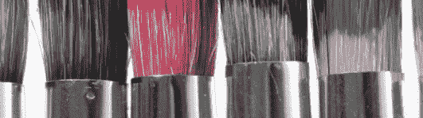

上游原材料对工业计算机行业的影响主要体现在成本端。其中芯片和存储器是工业计算机的核心部件，其价格波动直接影响产品的成本和市场竞争力。中游是整个产业链的核心环节，工业计算机制造企业的技术创新能力和系统集成能力是决定产品竞争力的关键因素。下游应用领域的需求变化直接决定了工业计算机行业的市场规模和发展方向。

## 第六章　中国工业计算机行业重点企业分析

本章节选取了中国工业计算机行业具有代表性的企业进行详细分析，包括企业的基本信息、经营情况、产品结构、技术实力和竞争优势等。

### 6.1 企业A

企业A是国内领先的工业计算机企业，专注于工业计算机、嵌入式系统、网络安全平台等产品的研发、生产和销售。产品广泛应用于工业自动化、智慧医疗、智能交通、安防监控等领域。

公司在行业内具有较强的技术研发能力和市场竞争力，拥有多项核心技术和专利，产品远销全球多个国家和地区。2023年公司实现营业收入42.5亿元，同比增长15.6%。

## 第七章　中国工业计算机行业投资前景分析

基于对中国工业计算机行业现状和竞争格局的深入分析，结合未来制造业智能化转型、国产替代趋势、新基建投资等因素，本报告认为中国工业计算机行业具有较好的投资前景。

工业计算机行业的投资价值主要体现在以下几个方面：

- 行业增长确定性较强：工业计算机行业受国家政策支持，市场需求持续增长，未来几年预计保持不低于10%的增速
- 国产替代空间大：目前国内高端市场仍由国外品牌主导，随着国产工业计算机技术不断进步，国产替代空间广阔
- 新兴应用场景不断涌现：边缘计算、AI、物联网等新技术的发展将带动工业计算机需求增长
- 行业进入壁垒较高：工业计算机行业对技术、品牌、客户资源等要求较高，新进入者面临较大挑战

> 建议投资者重点关注在工业计算机领域具有核心技术和优势客户资源的龙头企业，以及在新兴应用领域布局较为前瞻的企业。

## 第八章　中国工业计算机行业发展预测

结合当前工业计算机行业的发展态势和未来制造业转型升级的发展趋势，我们对2024-2029年中国工业计算机行业的发展前景进行了预测。

预测到2029年，中国工业计算机行业市场规模将达到约650亿元，2024-2029年复合年均增长率约为10.4%。行业将朝着智能化、自主化、定制化方向发展，国产工业计算机市场份额将进一步扩大。


图表：2024-2029年中国工业计算机市场规模预测（亿元）

| 年份 | 市场规模（亿元） | 增长率 |
|------|----------------|--------|
| 2024E | 395.8 | 12.2% |
| 2025E | 438.2 | 10.7% |
| 2026E | 485.6 | 10.8% |
| 2027E | 536.4 | 10.5% |
| 2028E | 590.3 | 10.0% |
| 2029E | 650.0 | 10.1% |

总体而言，中国工业计算机行业在政策支持、市场需求和技术进步的驱动下，未来发展前景广阔，行业将迎来更大的发展机遇。


致我的家人：

感谢你们在我撰写本书期间给予的理解与支持！我爱你们！

## 国务院关于同意在沈阳等6个城市开展服务业扩大开放综合试点的批复

商务部：

你部关于在沈阳等6个城市开展服务业扩大开放综合试点的请示收悉。现批复如下：

一、同意在沈阳市、南京市、杭州市、武汉市、广州市、成都市开展服务业扩大开放综合试点。试点期为自批复之日起3年。

二、要围绕本区域服务业发展特点，积极开展差异化探索，在加快发展现代服务业、推动服务业与制造业融合发展、促进服务业扩大开放等方面积累更多可复制可推广经验，为全国服务业高质量发展发挥示范带动作用。

三、要坚持稳中求进工作总基调，完整、准确、全面贯彻新发展理念，加快构建新发展格局，以推动高质量发展为主题，以深化供给侧结构性改革为主线，以改革创新为根本动力，以满足人民日益增长的美好生活需要为根本目的，统筹发展和安全，推进服务业扩大开放综合试点工作。

四、有关省级人民政府要加强对综合试点工作的组织领导，在风险可控的前提下，精心组织，大胆实践，推动试点工作取得实效。商务部要会同有关部门加强指导和协调，及时总结推广试点经验。

> 注意：本书中讨论的所有示例均使用 iPhone SDK 3.2 beta 3 编写和测试。尽管 Apple 继续将其称为 iPhone SDK，但它可用于开发 iPhone、iPod touch 和 iPad 应用程序。在撰写本书时（2010 年 3 月），Apple 继续使用“iPhone 模拟器”一词来指代可同时模拟 iPhone 和 iPad 的模拟器。尽管已尽一切努力确保屏幕截图尽可能最新，但当 iPhone SDK 退出 beta 版本后，您看到的实际屏幕可能会有所不同。

## 本书涵盖的内容

本书介绍了使用 iPhone SDK 进行 iPad 编程的基础知识。全书分为 18 章和四个附录。

第 1 章：iPad 编程入门，介绍 iPhone SDK 中的各种工具，并说明它们在 iPad 开发中的用途。

第 2 章：编写您的第一个 Hello World！应用程序，让您开始使用 Xcode 和 Interface Builder 构建 Hello World 应用程序。重点在于让您动手实践。后续章节将更详细地介绍各个部分和组件。

第 3 章：视图、插座变量和操作，介绍 iPad 编程的基本概念：插座变量和操作。您将学习插座变量和操作如何让您的代码与 Interface Builder 中的可视元素交互，以及为什么它们是每个 iPad 应用程序不可或缺的组成部分。您还将了解构成 iPad 应用程序用户界面的各种 UI 小部件（称为视图）。

第 4 章：视图控制器，讨论 iPhone SDK 中可用的各种视图控制器。您将学习如何开发不同类型的 iPad 应用程序——基于视图、基于窗口、基于拆分视图以及标签栏应用程序。

第 5 章：键盘输入，向您展示如何处理 iPad 中的虚拟键盘。您将了解如何按需隐藏键盘，以及如何确保在键盘显示时您的视图不会被键盘遮挡。

第 6 章：屏幕旋转，演示当设备旋转时如何重新调整应用程序的用户界面。您将了解设备旋转时触发的各种事件，还将学习如何强制应用程序以特定方向显示。

第 7 章：使用表视图，探索 iPhone SDK 中最强大的视图之一——表视图。表视图通常用于显示数据行。在本章中，您还将学习如何在表视图中实现搜索功能。

## 本书的结构

本书将学习 iPad 编程的任务分解为几个较小的部分，让您能够先消化每个主题，然后再深入更高级的主题。此外，有些章节会涵盖前一章已讨论过的主题。这是因为在 Xcode 和 Interface Builder 中通常有多种方法来完成同一件事，因此这种方法可以让您学习开发 iPad 应用程序的不同技巧。

如果您是 iPad 编程的完全初学者，请从第 1 章和第 2 章开始。一旦您掌握了基本操作，就可以进入附录，了解更多关于您正在使用的工具和语言的信息。当您准备好后，可以继续学习第 3 章，并逐步进入更高级的主题。

本书的一个特点是每章中的所有代码示例都独立于前面章节中讨论的示例。这样，您可以灵活地深入自己感兴趣的主题，并开始动手尝试“试试看”项目。

## 使用本书所需的工具

本书中的大多数示例都可以在 iPhone 模拟器（作为 iPhone SDK 的一部分）上运行。对于需要访问硬件（如加速度计）的练习，您需要一台真实的 iPad。一般来说，要充分利用本书，并不一定需要真实的 iPad 设备（但如果您计划在 AppStore 上部署应用程序，则绝对需要它来进行测试）。

## 约定

为了帮助您充分利用文本并掌握所讲内容，我们在全书中使用了一些约定。

## 试试看：这些是供您实践的练习或示例

“试试看”练习题在每章中出现一次或多次，作为您在阅读本书时同步实践的练习。

- 1. 它们通常由一组编号步骤组成。
- 2. 使用您的项目文件副本逐步完成这些步骤。

### 工作原理

每次“试试看”练习后，都会详细解释您输入的代码。

至于文本中的其他约定：

- 新术语和重要词语在首次出现时以*斜体*突出显示。
- 键盘组合的表示方式如下：Control-R。
- 文本中的文件名、URL 和代码的表示方式如下：`persistence.properties`。
- 代码以两种不同的方式呈现：
  - `我们对大多数代码示例使用不带突出显示的等宽字体。`
  - **我们使用粗体来强调在当前上下文中特别重要的代码。**

**警告** 像这样的框包含重要的、不可忘记的信息，与周围文本直接相关。

**注意** 注释、提示、建议、技巧以及与当前讨论相关的补充说明如下所示。

**常见错误** 此功能“常见错误”帮助您避免许多新手经常遇到的障碍。

## 源代码

在阅读本书中的示例时，您可以选择手动输入所有代码，也可以使用随书附带的源代码文件。本书中使用的所有源代码都可以在 www.wrox.com 下载。在网站上，只需找到本书的标题（使用搜索框或标题列表之一），然后点击书籍详情页面上的 Download Code 链接，即可获取本书的所有源代码。网站上包含的代码通过以下图标和/或 CodeNote 突出显示，如下所示：


列表会在标题中包含文件名。如果只是一个代码片段，您会在 CodeNote 中找到文件名，如下所示：

```
code snippet filename
```

- 3. 填写必填信息以及您想提供的任何可选信息，然后点击提交。
- 4. 您将收到一封电子邮件，其中包含如何验证您的账户并完成加入流程的信息。

加入后，您可以发布新消息并回复其他用户发布的消息。您可以随时在 Web 上阅读消息。如果您希望将某个论坛的新消息通过电子邮件发送给您，请在论坛列表中点击论坛名称旁边的“订阅此论坛”图标。

有关如何使用 Wrox P2P 的更多信息，请务必阅读 P2P 常见问题解答，了解论坛软件如何工作的答案，以及许多特定于 P2P 和 Wrox 书籍的常见问题。要阅读常见问题解答，请点击任何 P2P 页面上的 FAQ 链接。


## iPhone SDK 的组件

iPhone SDK 包含一套开发工具，帮助你为 iPhone、iPod touch 和 iPad 开发应用程序。它包含：

- Xcode —— 集成开发环境（IDE），使你能够管理、编辑和调试项目。
- Dashcode —— 集成开发环境（IDE），允许你开发基于 Web 的 iPhone 和 iPad 应用程序以及 Dashboard 小部件。Dashcode 不在本书的讨论范围内。
- iPhone Simulator —— 提供一个软件模拟器，用于在你的 Mac 上模拟 iPhone 或 iPad。
- Interface Builder —— 可视化编辑器，用于设计 iPhone 和 iPad 应用程序的用户界面。
- Instruments —— 分析工具，帮助你优化应用程序并实时监控内存泄漏。

以下各节将更详细地讨论除 Dashcode 之外的每个工具。

### Xcode

要启动 Xcode，请双击 Xcode 图标（位于 `/Developer/Applications` 文件夹中；参见图 1-3）。或者，使用更快的方法：通过 Spotlight——只需在搜索框中输入 Xcode，Xcode 就会出现在“顶部命中”位置。

图 1-4 显示了 Xcode 的欢迎屏幕。

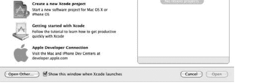

图 1-4

使用 Xcode，你可以使用图 1-5 所示的各种项目模板来开发不同类型的 iPhone、iPad 和 Mac OS X 应用程序。

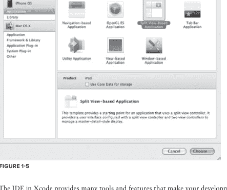

图 1-5

Xcode 中的 IDE 提供了许多工具和功能，使你的开发工作更加轻松。其中一项功能是“代码补全”（参见图 1-6），它会显示一个弹出列表，列出可用的类和成员（如方法、属性等）。

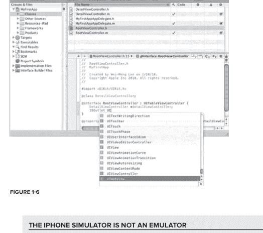

图 1-6

> **注意** 关于 Xcode 中一些最常用功能的更全面描述，请参阅附录 B。

### iPhone Simulator

iPhone Simulator（参见图 1-7）是一个非常有用的工具，你可以使用它来测试应用程序，而无需使用真正的 iPhone/iPod touch/iPad。iPhone Simulator 位于 `/Developer/Platforms/iPhoneSimulator.platform/Developer/Applications` 文件夹中。大多数时候，你不需要直接启动 iPhone Simulator——在 Xcode 中运行（或调试）应用程序时，它会自动打开 iPhone Simulator。Xcode 会自动将应用程序安装到 iPhone Simulator 上。

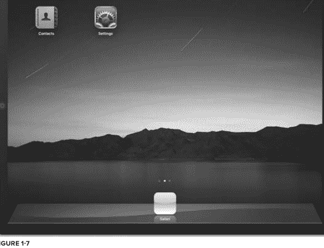

图 1-7

#### iPhone Simulator 不是模拟器

iPhone Simulator 是一个模拟器，而不是仿真器。那么两者有什么区别呢？简单来说，模拟器试图模仿真实设备的行为。就 iPhone Simulator 而言，它模拟真实 iPhone/iPad 设备的实际行为。然而，模拟器本身使用 Mac 上安装的各种库（如 QuickTime）来执行渲染，因此效果看起来与真实 iPhone 相同。此外，在模拟器上测试的应用程序被编译成 x86 代码，这是模拟器能够理解的字节码。

相比之下，仿真器模拟真实设备的工作方式。在仿真器上测试的应用程序被编译成真实设备使用的实际字节码。仿真器通过将字节码转换为运行仿真器的主机可以执行的形式来执行应用程序。

理解模拟与仿真之间微妙区别的一个好方法是：想象你试图让一个孩子相信玩刀是危险的。要“模拟”这一点，你假装用刀割伤自己并痛苦地呻吟。要“仿真”这一点，你拿起刀真的割伤自己。

iPhone Simulator 可以模拟不同版本的 iPhone OS（参见图 1-8）。如果你需要支持旧版本平台，以及在特定操作系统版本上测试和调试应用程序中报告的错误，这一功能非常有用。

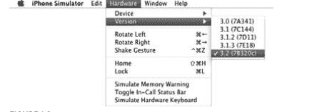

图 1-8

#### iPhone Simulator 的功能

iPhone Simulator 模拟真实 iPhone、iPod touch 或 iPad 设备的各种功能。

你可以在 iPhone Simulator 上测试的功能包括：

- 屏幕旋转——左、上、右
- 支持手势：
  - 轻点
  - 触摸并按住
  - 双击
  - 轻扫
  - 快速滑动
  - 拖拽
  - 捏合
- 低内存警告模拟

然而，iPhone Simulator 作为真实设备的软件模拟器，确实有其局限性。

iPhone Simulator 上不可用的功能包括：

- 拨打电话
- 访问加速计
- 发送和接收短信
- 从 App Store 安装应用程序
- 相机
- 麦克风
- OpenGL ES 的若干功能

> **注意** 在 SDK 的上一版本（3.1.3）中，iPhone Simulator 通过始终返回一个固定坐标来支持位置数据，例如北纬 37.3317 度、西经 122.0307 度。在 SDK 的最新版本中，iPhone Simulator 使用其所运行的 Mac 的位置数据并返回当前位置。

值得注意的是，iPhone Simulator 的速度与 Mac 的性能关系更紧密，而不是与真实设备相关。因此，在真实设备上测试应用程序，而不是完全依赖 iPhone Simulator 进行测试，这一点非常重要。

尽管 iPhone Simulator 存在局限性，它仍然是一个用于测试应用程序的实用工具。话虽如此，在将应用程序部署到 App Store 之前，在真实的 iPad 上进行测试是必不可少的。

#### 从 iPhone Simulator 卸载应用程序

iPhone Simulator 的 iPhone OS 文件系统的用户域存储在 `~/Library/Application Support/iPhone Simulator/` 文件夹中。

> **注意** `~/Library/Application Support/iPhone Simulator/` 文件夹也称为 `<iPhoneUserDomain>`。

所有第三方应用程序都存储在 `<iPhoneUserDomain>/<version_no>/Applications/` 文件夹中。当一个应用程序被部署到 iPhone Simulator 上时，主屏幕上会创建一个图标（参见图 1-9 的左侧），并且在 Applications 文件夹中会创建一个文件和一个文件夹（参见图 1-9 的右侧）。

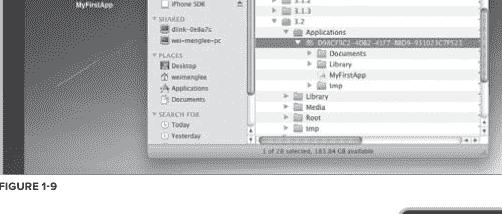

要卸载（删除）应用程序，请执行以下步骤：

1. 在主屏幕上点击并按住应用程序的图标，直到所有图标开始晃动。注意所有图标的左上角现在都显示了一个 X 按钮。
2. 点击要卸载的应用程序图标旁边的 X 按钮（参见图 1-10）。

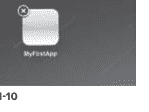

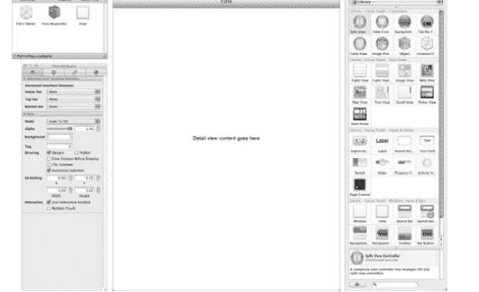

图 1-11

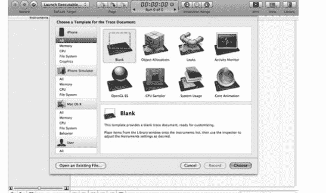

图 1-12

## iPhone OS 的体系结构

虽然本书不深入探讨 iPhone OS 的内部结构，但了解 iPhone OS 的一些重要方面是很有用的。图 1-13 显示了组成 Mac OS X 和 iPhone OS（用于 iPhone、iPod touch 和 iPad）的不同抽象层。

> **注意** iPhone OS 在架构上与 Mac OS X 非常相似，只是最顶层是 Cocoa Touch（用于 iPhone），而不是 Cocoa 框架。

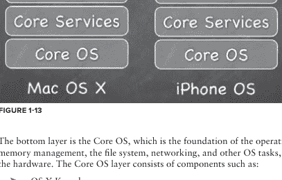

图 1-13

最底层是 Core OS，它是操作系统的基础。它负责内存管理、文件系统、网络和其他操作系统任务，并直接与硬件交互。Core OS 层由以下组件组成：

- OS X 内核
- Mach 3.0
- BSD
- 套接字
- 安全
- 电源管理
- 钥匙串
- 证书
- 文件系统
- Bonjour


| 框架名称 | 描述 |
|---|---|
| Foundation.framework | 提供 Objective-C 的基础类，例如 NSObject、基本数据类型、操作系统服务等。 |
| GameKit.framework | 提供游戏的网络功能；通常用于点对点连接和游戏内语音功能。 |
| IOKit.framework | 提供驱动程序开发功能。 |
| MapKit.framework | 为您的应用程序提供嵌入式地图界面。 |
| MediaPlayer.framework | 提供播放电影和音频文件的设施。 |
| MessageUI.framework | 提供基于视图控制器的电子邮件撰写界面。 |
| MobileCoreServices.framework | 提供对标准类型和常量的访问。 |
| OpenAL.framework | 提供 OpenAL 规范的实现。 |
| OpenGLES.framework | 提供用于 2D 和 3D 绘图的紧凑高效的 OpenGL API 子集。 |
| QuartzCore.framework | 提供配置动画和效果然后在硬件中渲染这些效果的能力。 |
| Security.framework | 提供保护您的数据和控制软件访问的能力。 |
| StoreKit.framework | 为应用程序提供应用内购买支持。 |
| SystemConfiguration.framework | 提供确定设备上网络可用性和状态的能力。 |
| UIKit.framework | 提供管理应用程序用户界面的基本对象。 |

## 开始之前的一些有用信息

你现在对 iPad 应用程序开发所涉及的工具已经有了大致了解。在你开始深入之前，以下章节讨论了一些有用的信息，可以让你的旅程更愉快。

## iPhone OS 版本

在撰写本文时，iPhone OS 已进入第三个修订版——即版本 3.2。其主要版本如下：

- 1.0 — iPhone 初始发布
- 1.1 — 为 1.0 增加额外功能和错误修复
- 2.0 — 随 iPhone 3G 发布；附带 App Store
- 2.1 — 为 2.0 增加额外功能和错误修复
- 2.2 — 为 2.1 增加额外功能和错误修复
- 3.0 — iPhone OS 的第三个主要版本
- 3.1 — 为 3.0 增加额外功能和错误修复
- 3.2 — 此版本仅为 iPad 发布；请参阅侧边栏了解 iPhone OS 3.2 的新内容

有关每个版本功能的详细描述，请查看 http://en.wikipedia.org/wiki/iPhone_OS_version_history。

## iPhone OS 3.2 中的新功能

2010 年 1 月，Apple 宣布了一款基于现有 iPhone OS 的新设备——iPad。iPad 是一款平板电脑，外形类似于 iPod touch，只是屏幕大得多。iPad 有六种不同的版本，其中三种支持 Wi-Fi，另外三种支持 Wi-Fi 和 3G 网络。iPad 将以三种存储配置发布：16GB、32GB 和 64GB。

iPhone OS 3.2 的一些重要新功能包括：

- 通过以原始屏幕尺寸或像素加倍模式运行来支持现有的 iPhone 应用程序。
- 新的 UI 功能，如 Popovers、分屏视图和自定义输入视图。
- 支持外部显示器。
- 使用手势识别器支持手势检测。
- 改进的文本支持，以允许应用程序具有更复杂的文本处理功能。
- 新的文件和文档支持，以促进构建以文档为中心的应用程序。

## 在真实设备上测试

初学者 iPad 程序员最常见的抱怨之一是无法在实际设备上测试他们开发的 iPad 应用程序。似乎很奇怪，作为设备的拥有者，他们甚至无法在上面测试自己的应用程序。事实证明，出于安全原因，Apple 要求所有应用程序都必须使用有效证书签名，而用于测试目的，则需要开发人员证书。

要在设备上测试你的应用程序，你必须注册 iPhone 开发者计划并请求将开发人员证书安装到你的设备上。

## 2

## 编写你的第一个 Hello World！应用程序

## 本章你将学到：

- 创建一个新的 iPad 项目
- 使用 Xcode 构建你的第一个 iPad 应用程序
- 使用 Interface Builder 设计你的 iPad 应用程序的用户界面（UI）
- 编写一些简单的代码以允许应用程序根据设备的方向旋转其内容
- 为你的 iPad 应用程序添加图标

现在你已经设置了所有工具和 SDK，可以开始为 iPad 开发了！对于编程书籍来说，通常以展示如何开发一个“Hello World！”应用程序来开始章节。这种方法让你可以快速使用各种工具，而不会陷入细节。它还提供了即时的满足感；你亲眼看到东西真的能工作，这可以成为提升士气、激励你学习更多的动力。

## 开始使用 Xcode

启动 Xcode，你应该会看到欢迎屏幕，如图 2-1 所示。

> NOTE 启动 Xcode 的最简单方法是输入 Xcode 到 Spotlight，然后按 Enter 键启动它。

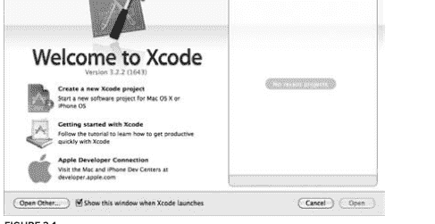

图 2-1

要创建新的 iPad 项目，请选择 File ▸ New Project。图 2-2 显示了使用 Xcode 可以创建的不同类型的项目。你在左侧面板中看到两个主要类别——iPhone OS 和 Mac OS X。iPad 使用 iPhone OS，因此点击 iPhone OS 下列出的 Application 项目以查看可用于开发 iPad 应用程序的不同模板。

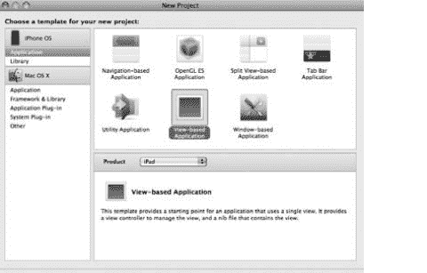

图 2-2

虽然你可以创建相当多的 iPad 应用程序类型，但对于本章，请选择 View-based Application 模板并点击 Choose 按钮。

> NOTE 后续章节将向你展示如何开发其他类型的 iPad 应用程序，例如 Tab Bar Application 和 Split View-based Application。

将项目命名为 HelloWorld 并点击 Save。Xcode 将继续为你选择的模板创建项目。图 2-3 显示了项目中的各种文件和文件夹。

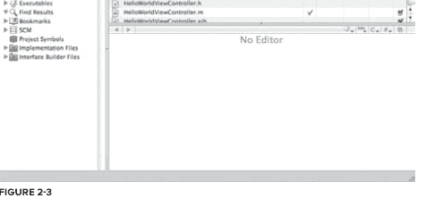

图 2-3

Xcode 的左侧面板显示项目中的组。你可以展开每个组或文件夹以显示其中包含的文件。Xcode 的右侧面板显示你在左侧面板中选择的组或文件夹中包含的文件。要编辑特定文件，请从列表中选择它，右侧面板底部的编辑器将打开文件进行编辑。如果你想要单独的编辑窗口，只需双击文件即可在新窗口中编辑它。

## 使用 Interface Builder

到目前为止，该项目还没有 UI。为了证明这一点，只需按 Command-R（或选择 Run ▸ Run），你的应用程序就会部署到包含的 iPhone Simulator。图 2-4 显示了 iPhone Simulator 上显示的空白屏幕。现在看到这一点很好，因为在你阅读本章的过程中，你会看到根据你的操作而发生的更改。

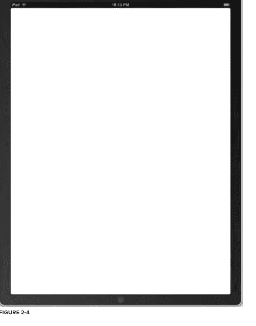

图 2-4

显然，空白屏幕并不是很有用。因此，是时候尝试向你的应用程序的 UI 添加一些视图了。在项目的 文件列表中，你会注意到两个带有 `.xib` 扩展名的文件——`MainWindow.xib` 和 `HelloWorldViewController.xib`。带有 `.xib` 扩展名的文件基本上是包含应用程序 UI 定义的 XML 文件。你可以通过修改其 XML 内容来编辑 `.xib` 文件，或者更简单（也更明智）地，使用 Interface Builder 编辑它们。

Interface Builder 是 iPhone SDK 的一部分，允许你通过拖放来构建 iPad（和 Mac）应用程序的 UI。

双击 `HelloWorldViewController.xib` 文件以启动 Interface Builder。图 2-5 显示了 Interface Builder 显示 `HelloWorldViewController.xib` 的内容（目前确实是空的）。如你所见，Library 窗口显示了你可以添加到 iPad 应用程序 UI 的各种视图。View 窗口显示了你的 UI 的图形布局。你很快就会看到其他窗口的使用。

> **NOTE** 如果你不熟悉它，请参阅附录 C 以快速学习 Interface Builder。

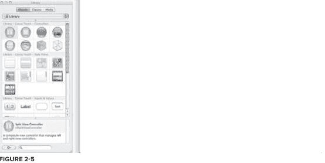

图 2-5

将 View 窗口设为横向模式（如果尚未处于横向模式，请点击窗口右上角的箭头切换方向），向下滚动到 Library 面板中的 Label 视图，并将 Label 视图拖放到 View 窗口中（参见图 2-6）。

添加 Label 视图后，选择它并选择 Tools ▸ Attributes Inspector。在 Text 字段中输入 Hello World！此外，在 Layout 旁边，点击居中的 Alignment 类型（参见图 2-7）。


接下来，在“对象库”（Library）窗口中，将一个“文本字段”（Text Field）视图拖放到“视图”（View）窗口中，接着再拖入一个“圆角矩形按钮”（Round Rect Button）视图。通过在“标题”（Title）字段中输入“点击我！”来修改“圆角矩形按钮”视图的属性（参见图 2-9）。

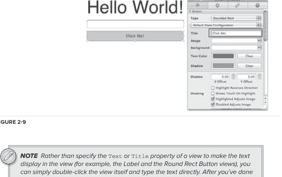

图 2-9

> **注意** 无需指定视图的“文本”（Text）或“标题”（Title）属性来让文本显示在视图中（例如，标签和圆角矩形按钮视图），只需双击视图本身并直接输入文本即可。完成此操作后，你可以重新排列视图并根据需要调整其大小。Interface Builder 会提供对齐参考线，帮助你以视觉美观的布局排列控件。

按 Command-S 保存 HelloWorldViewController.xib 文件。然后返回 Xcode，再按 Command-R 运行应用程序。此时 iPhone 模拟器会显示修改后的 UI（参见图 2-10）。

> **注意** 在 Xcode 中运行应用程序之前，始终记得在 Interface Builder 中保存所有更改。

点击“文本字段”视图，观察键盘自动出现（参见图 2-11）。

按下 iPhone 模拟器上的“主屏幕”按钮，你将看到应用程序已安装到模拟器中。要返回该应用程序，只需点击 HelloWorld 图标即可（参见图 2-12）。

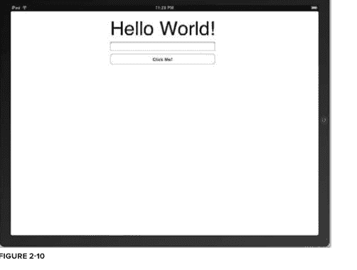

图 2-10

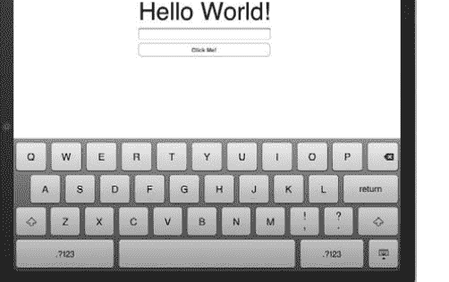

图 2-11

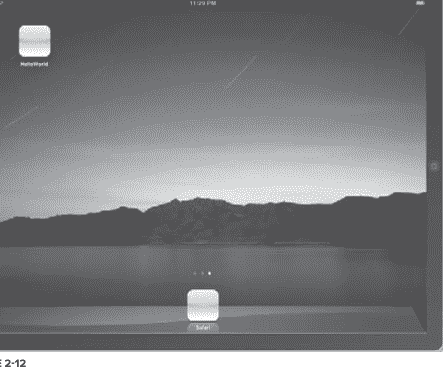

图 2-12

> **注意** 在同一时间，iPad 上只能运行一个应用程序（除 Apple 自带的一些内置应用外）。因此，当你按下 iPad 的主屏幕按钮时，你的应用程序会退出。点击应用程序图标会重新启动该应用程序。

## 更改屏幕方向

iPad 模拟器也支持更改视图方向。要更改视图方向模式，请按 Command→ 或 Command← 组合键。图 2-13 显示了处于竖屏模式的 iPhone 模拟器。

请注意，当你更改方向模式时，应用程序会自动正向翻转。这是通过 Xcode 项目中的一个代码文件以编程方式控制的。

在 Xcode 中，编辑 HelloWorldViewController.m 文件，查找以下代码段：

```
// Override to allow orientations other than the default portrait orientation.
- (BOOL)shouldAutorotateToInterfaceOrientation:(UIInterfaceOrientation)
interfaceOrientation {
    return YES;
}
```

## 摘要

随着人工智能技术的迅速发展，生成式人工智能（AIGC）在数字医疗领域的应用日益广泛。本文旨在探讨生成式AI在数字医疗中的应用现状、挑战及未来发展方向，以期为相关研究和实践提供参考。

关键词：生成式人工智能；数字医疗；人工智能；AIGC

## 1 引言

生成式人工智能（AIGC）是一种利用深度学习模型生成文本、图像、音频等新内容的技术。近年来，随着深度学习技术的飞速发展，生成式AI在数字医疗中的应用前景日益广阔。本文将从应用、挑战及未来趋势等方面进行系统阐述，分析生成式AI在医学影像分析、药物研发、个性化治疗等领域的潜力，以期为相关研究和实践提供参考。

## 2 生成式人工智能在数字医疗中的应用

### 2.1 医学影像分析

生成式AI在医学影像分析中发挥着重要作用。例如，基于生成对抗网络（GAN）和扩散模型的图像生成技术，能够生成高质量的医学图像，用于数据增强、病灶检测和影像重建，从而提升诊断准确性和效率。

### 2.2 药物研发

生成式AI在药物研发中同样具有巨大的应用潜力。通过生成新型分子结构、预测药物与靶点的相互作用，并优化药物候选物的性质，生成式AI能够显著缩短药物研发周期，降低研发成本，助力新药快速上市。

## 3 挑战与风险

### 3.1 数据隐私与安全

医疗数据具有高度敏感性，生成式AI训练过程中面临数据泄露和隐私保护不足的风险。如何在确保数据安全的前提下合理利用医疗数据，是亟需解决的关键问题。

### 3.2 算法偏见

生成式AI模型可能因训练数据的不平衡而产生算法偏见，导致对特定人群的诊断不准确。因此，如何降低算法偏见，提升模型的公平性和泛化能力，是生成式AI在医疗领域落地的重要挑战。

### 3.3 法律与伦理问题

生成式AI在医疗领域的应用涉及复杂的法律和伦理问题。例如，人工智能生成的诊疗建议能否被采纳，其责任由谁承担，这些问题尚需通过法律法规和伦理规范进一步明确。

## 4 结语

生成式人工智能在数字医疗中的应用前景广阔，但仍面临数据隐私、算法偏见和法律伦理等多重挑战。未来，需要加强技术研究、政策法规建设及跨学科合作，推动生成式AI在医疗领域的安全、高效应用。

## 参考文献

- [1] 张某某，李某某. 基于深度学习的医学图像处理[J]. 自动化学报，2019, 45(3): 123-135.
- [2] 王某某，赵某某. 生成对抗网络在医学影像中的应用综述[J]. 软件学报，2020, 31(7): 1-15.
- [3] 李某某，陈某某. 人工智能在药物研发中的应用研究[J]. 中国药科大学学报，2021, 52(2): 145-152.
- [4] 刘某某，孙某某. 生成式AI在医疗健康领域的应用与挑战[J]. 计算机研究与发展，2022, 59(5): 987-1001.
- [5] 赵某某，周某某. 大语言模型在医疗问答系统中的应用分析[J]. 中文信息学报，2023, 37(4): 45-56.
- [6] 陈某某，吴某某. 医疗大数据的隐私保护方法研究[J]. 信息安全学报，2020, 5(3): 36-48.
- [7] 孙某某，郑某某. 医学图像生成中的数据增强技术[J]. 中国生物医学工程学报，2021, 40(6): 701-709.
- [8] 周某某，钱某某. 生成式AI在个性化医疗中的应用探索[J]. 生命科学仪器，2022, 20(5): 23-31.
- [9] 吴某某，冯某某. 人工智能医疗产品的监管政策研究[J]. 中国医药导刊，2023, 25(2): 67-73.
- [10] 郑某某，黄某某. 生成式人工智能在远程医疗中的应用潜力[J]. 医学信息学杂志，2023, 44(8): 88-94.

> **注意** 在此时，不必担心其他文件，如 `HelloWorldAppDelegate.h` 和 `HelloWorldAppDelegate.m`。你将在后续章节中了解更多相关内容。

要限制应用程序仅支持某些方向模式，你需要以编程方式指定要支持的模式，例如：

```
// Override to allow orientations other than the default portrait orientation.
- (BOOL)shouldAutorotateToInterfaceOrientation:(UIInterfaceOrientation)interfaceOrientation {

    //return YES;
    return (interfaceOrientation==UIInterfaceOrientationPortrait ||
            interfaceOrientation==UIInterfaceOrientationLandscapeLeft);
}
```

此代码片段表示：当屏幕显示为“竖屏”（Portrait）或“左横向”（Landscape Left，即主屏幕按钮在左侧）模式时，你的应用程序才会自动正向翻转。图 2-14 显示，当屏幕显示为“右横向”（Landscape Right）模式时，应用程序不会自动正向翻转。

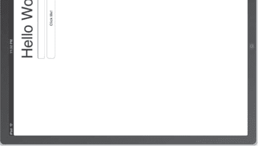

图 2-14

第 6 章将更详细地讨论屏幕旋转。

> **注意** iPad 应用程序支持所有横向和竖向显示模式非常重要。因此，建议你在 `shouldAutorotateToInterfaceOrientation:` 方法中返回 YES。上面的代码片段仅供参考。

## 视图重新定位

在上一节中，你看到当方向改变时，视图的大小和位置保持不变。在实际应用中，这种情况并不理想，因为它不能在用户使用应用程序时提供良好的体验。理想情况下，你应该重新定位屏幕上的视图，使其随视图方向的变化而变化。

要调整视图大小，请转到 Interface Builder，选择“标签”（Label）视图，然后选择“工具”（Tools）⌥“大小检查器”（Size Inspector）。通过单击两个方块内的各条线，按图 2-15 所示修改视图的“自动调整大小”（Autosizing）属性（仔细观察“自动调整大小”部分中设置的各种锚点）。这将使“标签”视图随视图方向的变化而扩展/收缩。同时，视图将锚定到屏幕顶部。

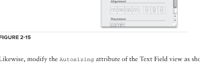

图 2-15

同样，按图 2-16 所示，通过单击两个方块内的各条线，修改“文本字段”视图的“自动调整大小”属性。

最后，按图 2-17 所示，通过单击两个方块内的线条，修改“圆角矩形按钮”控件的“自动调整大小”属性。这次，当视图方向改变时，你不会调整视图大小，而只是将其锚定到屏幕顶部。

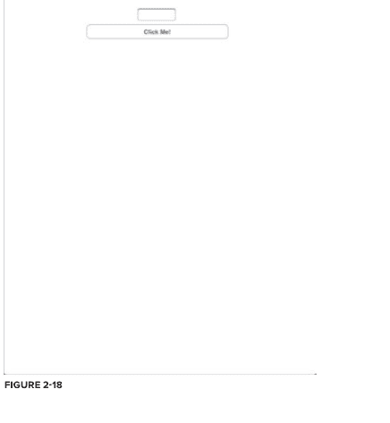

图 2-18

## 编写一些代码

至此，你应该已经足够熟悉 Xcode 和 Interface Builder，可以编写一些代码了。这将让你初步体验到 iPad 编程。

在 HelloWorldViewController.h 文件中，为 btnClicked: 操作添加声明：

```
#import <UIKit/UIKit.h>

@interface HelloWorldViewController : UIViewController {
}

-(IBAction) btnClicked:(id) sender;

@end
```

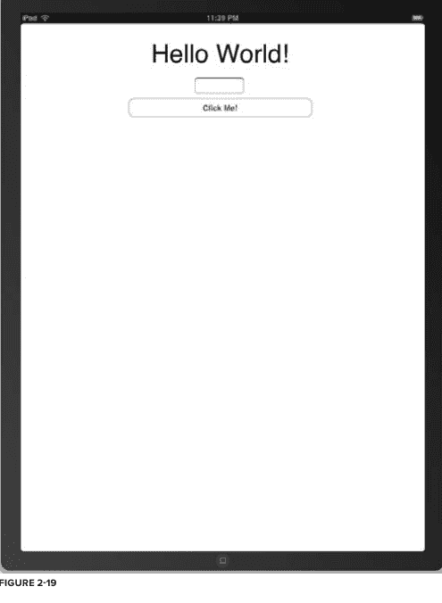

图 2-19

粗体语句创建了一个名为 btnClicked: 的操作（通常称为事件处理程序）。声明该操作后，保存文件并返回 Interface Builder。

在本章前面，你看到了一个标记为 `HelloWorldViewController.xib` 的窗口。此窗口中有三个组件：“文件所有者”（File's Owner）、“第一响应者”（First Responder）和“视图”（View）。按住 Control 键单击“视图”窗口中的“圆角矩形按钮”视图，并将其拖到 `HelloWorldViewController.xib` 窗口中的“文件所有者”项上（参见图 2-20）。此时会出现一个包含 `btnClicked:` 操作的小弹出菜单。选择 `btnClicked:` 操作。基本上，你在这里所做的是将“圆角矩形按钮”视图与操作（`btnClicked:`）关联起来，这样当用户单击该按钮时，该操作就会被调用。

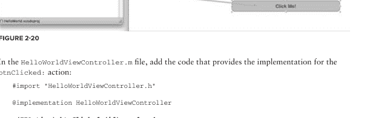

图 2-20

在 `HelloWorldViewController.m` 文件中，添加为 `btnClicked:` 操作提供实现的代码：

```
#import "HelloWorldViewController.h"

@implementation HelloWorldViewController

-(IBAction) btnClicked:(id) sender {
    //---display an alert view---
    UIAlertView *alert = [[UIAlertView alloc] initWithTitle:@"Hello World!"
                                                     message:@"iPad, here I come!"
                                                     delegate:self
                                            cancelButtonTitle:@"OK"
                                            otherButtonTitles:nil];
    [alert show];
    [alert release];
}
```

上述代码显示一个包含“iPad, here I come!”的警告框。

就是这样！返回 Xcode 并再次运行应用程序。这次，当你单击按钮视图时，会显示一个警告框（参见图 2-21）。

## 自定义应用程序图标

如前所述，安装到 iPhone 模拟器上的应用程序使用默认的白色图片作为图标。但是，你可以自定义此图标。为 iPad 应用程序设计图标时，请记住以下要点：

-   将图标设计为 72×72 像素。更大的尺寸也没关系，因为 iPad 会自动为你调整大小。要通过 App Store 分发，你需要准备 512×512 像素的图片。


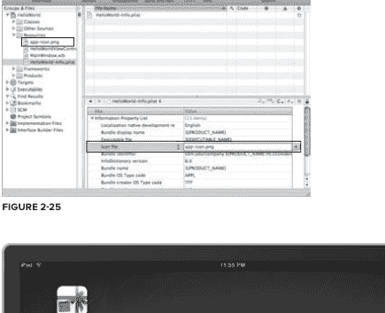

图 2-25

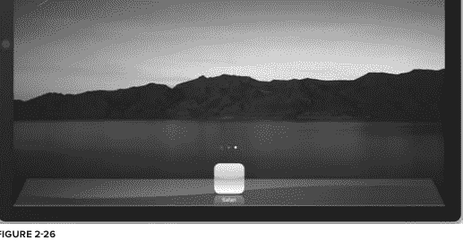

图 2-26

## 3 视图、出口和动作

### 本章你将学到：

- 如何声明和定义 outlet
- 如何声明和定义 action
- 如何将 outlet 和 action 连接到 View 窗口中的视图
- 如何使用 UIAlertView 向用户显示警告视图
- 如何使用 UIActionSheet 向用户显示一些选项
- 如何使用 UIPageControl 控制分页
- 如何使用 UIImageView 显示图像
- 如何使用 UIWebView 在应用程序中显示 Web 内容
- 如何在运行时动态地向应用程序添加视图

在上一章中，你构建了一个简单的 Hello World! iPad 应用程序，而没有理解太多关于事物如何协同工作的底层细节。事实上，学习 iPad 编程的最大障碍之一是在你能够运行应用程序之前需要学习的大量细节。本书旨在使 iPad 编程体验既有趣又可承受。因此，本章从创建 iPad 应用程序用户界面（UI）的基础知识开始，以及你的代码如何与各种图形小部件连接。

## 出口和动作

在 iPad 编程中，你需要理解的第一件事之一就是 outlet 和 action。如果你熟悉 Java 或 C# 等传统编程语言，这是一个需要一些时间来适应的概念——概念相似，只是做事的方式不同。在本节结束时，你将对 outlet 和 action 是什么以及如何创建它们有坚实的理解，并开始创建出色的 iPad 应用程序。

6. Control-click 并拖动 OK Button 视图到 File's Owner 项（参见图 3-3）。选择名为 `btnClicked:` 的 action。

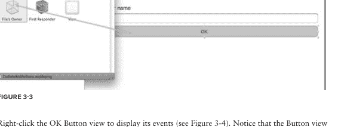

图 3-3

7. 右键单击 OK Button 视图以显示其事件（参见图 3-4）。请注意，Button 视图有多个事件，但其中一个特定事件——Touch Up Inside——现在已连接到你指定的 action（`btnClicked:`）。由于 Touch Up Inside 事件使用非常频繁，当你 control-click 并将其拖动到 File's Owner 项时，它会自动连接到 action。要将其他事件连接到 action，只需单击每个事件旁边显示的圆圈，然后将其拖动到 File's Owner 项即可。

8. 就这样！按 Command-R 在 iPhone Simulator 上测试应用程序。输入一个名称在 TextField 中并点击 OK 按钮。警告视图会显示欢迎消息（参见图 3-5）。

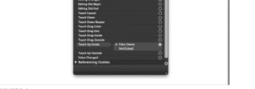

图 3-4

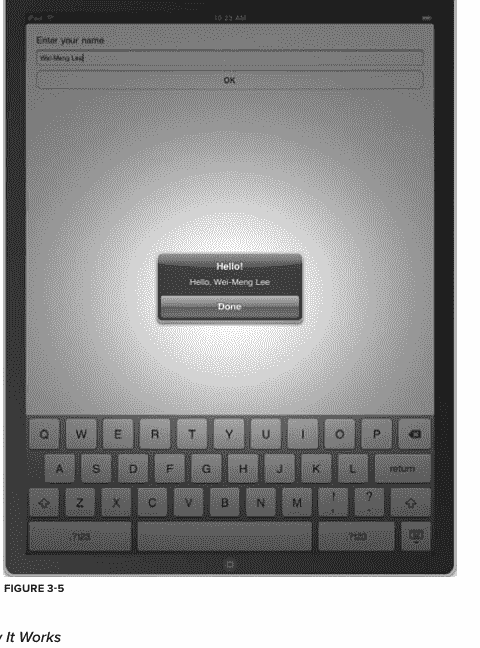

图 3-5

### 工作原理

在 iPad 中，你使用 action 和 outlet 将代码连接到 UI 中的各种视图。将 action 视为传统面向对象编程世界中的方法，而 outlet 视为对象引用。Action 使用 IBAction 关键字表示，而 outlet 使用 IBOutlet 关键字：

```
#import <UIKit/UIKit.h>

@interface OutletsAndActionsViewController : UIViewController {
```

```
//---declaring the outlet---
IBOutlet UITextField *txtName;
}

//---expose the outlet as a property---
@property (nonatomic, retain) UITextView *txtName;

//---declaring the action---
-(IBAction) btnClicked: (id) sender;

@end
```

IBOutlet 标识符用于为变量添加前缀，以便 Interface Builder 可以与 Xcode 同步显示和连接 outlet。@property 关键字指示编译器你希望 txtName outlet 作为属性公开。nonatomic 关键字表示无需确保属性以线程安全的方式使用，因为它不会在多个线程中使用。默认行为是 atomic，指定 nonatomic 实际上提高了应用程序的性能。

> 注意 IBOutlet 标签也可以添加到 @property 标识符中。这种语法在 Apple 文档中很常见：
> 
> @property (nonatomic, retain) IBOutlet UITextField *txtName;

> 注意 有关 nonatomic 和 retain 标识符的使用，请参阅附录 D，在那里你可以找到 Objective-C 的介绍，Objective-C 是用于 iPad 编程的语言。此外，稍后讨论的 @synthesize 关键字也在那里有更详细的解释。

IBAction 标识符用于同步 action 方法。Action 是可以处理 View 窗口中视图引发的事件的方法（例如，当按钮被点击时）。另一方面，outlet 允许你的代码以编程方式引用 View 窗口上的视图。

一旦你在 View Controller 的头文件（.h）中添加了 action 和 outlet，你就需要将它们连接到 Interface Builder 中的视图。

当你 control-click 并拖动 File's Owner 项到 TextField 视图并选择 txtName 时，你本质上是将你创建的 outlet（txtName）与 View 窗口上的 TextField 视图连接起来。一般来说，要连接 outlet，你需要 control-click 并拖动 File's Owner 项到 View 窗口上的视图。

> 警告 一个快速提示：要将 outlet 连接到视图，你将 File's Owner 项拖到 View 窗口中所需的视图上。

要连接 action，你需要 control-click 并拖动一个视图到 File's Owner 项。因此，对于 OK Button 视图，你需要 control-click 并拖动 OK Button 视图到 File's Owner 项，然后选择名为 btnClicked 的 action。

> **警告** 一个快速提示：要连接 action，你从 View 窗口中的视图拖动到 File's Owner 项。

在实现文件（.m）中，你使用 @synthesize 关键字指示编译器为指定的属性创建 getter 和 setter：

> **常见错误** 忘记添加 @synthesize 关键字是开发人员最常犯的错误之一。请记住添加此语句，否则在应用程序执行时你将遇到运行时错误。附录 D 更详细地介绍了 getter/setter。

```objc
#import "OutletsAndActionsViewController.h"

@implementation OutletsAndActionsViewController

//---synthesize the property---
@synthesize txtName;

//---displays an alert view when the button is clicked---
-(IBAction) btnClicked:(id) sender {
    NSString *str = [[NSString alloc]
        initWithFormat:@"Hello, %@", txtName.text];
    UIAlertView *alert = [[UIAlertView alloc]
        initWithTitle:@"Hello!"
        message:str
        delegate:self
        cancelButtonTitle:@"Done"
        otherButtonTitles:nil];
    
    [alert show];
    [str release];
    [alert release];
}

- (void)dealloc {
    //---release the outlet---
    [txtName release];
    [super dealloc];
}
```

btnClicked: action 只显示一个包含用户姓名的消息的警告视图。请注意它有一个类型为 id 的参数 sender。sender 参数允许你以编程方式找出实际调用此 action 的对象。这在你有多个视图连接到单个 action 时很有用。对于这种情况，你通常需要知道哪个视图调用了此方法，而 sender 参数将包含对调用视图的引用。

## 使用视图

到目前为止，你已经看到了许多视图在运行——Round Rect Button、TextField 和 Label。所有这些视图都非常简单，但它们为你提供了理解 outlet 和 action 背后概念的好机会。

要使用更多视图，你可以从 Interface Builder 中的 Library 窗口中定位它们（参见图 3-6）。

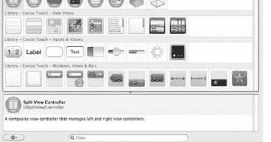

图 3-6

库分为以下几个部分：

- Controllers — 包含控制其他视图的视图，例如 View Controller、Tab Bar Controller、Navigation Controller 等
- Data Views — 包含显示数据的视图，例如 Image View、Table View、Data Picker、Picker View 等


## 工作原理

要使用 UIAlertView，首先需要实例化它，并使用各种参数进行初始化：

```objc
UIAlertView *alert = [[UIAlertView alloc]
    initWithTitle:@"Hello"
    message:@"This is an alert view"
    delegate:self
    cancelButtonTitle:@"OK"
    otherButtonTitles:nil];
```

第一个参数是警告视图的标题，这里设置为“Hello”。第二个参数是消息，这里设置为“This is an alert view”。第三个参数是委托，你需要将其设置为一个能够处理 UIAlertView 对象所触发事件的对象。在本例中，你将其设置为 `self`，这意味着事件处理程序将在当前类（即视图控制器）中实现。`cancelButtonTitle` 参数会显示一个按钮，用于关闭警告视图。最后，`otherButtonTitles` 参数允许你在需要时显示额外的按钮。如果不需要额外按钮，只需将其设置为 `nil`。

要以模态方式显示警告视图，请使用 `show` 方法：

```objc
[alert show];
```

> 常见错误 需要注意的是，使用 `show` 方法以模态方式显示警告视图，并不会导致程序在此时暂停执行。即使此时用户可能还没有关闭警告视图，该行之后的后续语句仍会继续执行。

对于警告视图的简单使用，你其实无需处理它所触发的事件。点击“OK”按钮（如 `cancelButtonTitle` 参数中所设置的）只会简单地关闭警告视图。

如果你需要显示多个按钮，则需要设置 `otherButtonTitles` 参数，如下所示：

```objc
UIAlertView *alert = [[UIAlertView alloc]
    initWithTitle:@"Hello"
    message:@"This is an alert view"
    delegate:self
    cancelButtonTitle:@"OK"
    otherButtonTitles:@"Option 1", @"Option 2", nil];
```

请注意，`otherButtonTitles` 参数必须以 `nil` 结尾，否则会出现运行时错误。

现在你有了三个按钮，就需要能够知道用户按下了哪个按钮——特别是按下的是“Option 1”还是“Option 2”。为此，你需要处理 UIAlertView 类引发的事件。你可以通过确保你的视图控制器实现 UIAlertViewDelegate 协议来实现这一点：

```objc
@interface UsingViewsViewController : UIViewController
<UIAlertViewDelegate> {
    //...
}
```

当某个按钮被点击时，`actionSheet:clickedButtonAtIndex:` 事件将会被触发：

```objc
- (void)actionSheet:(UIActionSheet *)actionSheet
clickedButtonAtIndex:(NSInteger)buttonIndex {
    NSLog([NSString stringWithFormat:@"%d", buttonIndex]);
}
```

图 3-9 显示了操作表（action sheet）显示时的样子。

请注意，OK 按钮（如方法名中的 `cancelButtonTitle:` 部分所指定的）不会显示。每个按钮的数值（`buttonIndex`）如下：

- Delete Message — 0
- Option 1 — 1
- Option 2 — 2

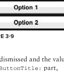

图 3-9

当用户点击操作表之外的区域时，操作表会被关闭，`buttonIndex` 的值变为 3。有趣的是，如果你在 `cancelButtonTitle:` 部分指定了 `nil`，那么当操作表关闭时，`buttonIndex` 的值将是 -1。

## 页码控件与图像视图

在 iPad 主屏幕的底部附近有一系列圆点（见图 3-10）。点亮的圆点表示当前选中的页面。当你滑动页面到下一页时，下一个圆点会被点亮，而第一个圆点会变暗。在图中，这些圆点表示第三页是活动页面。在 iPhone SDK 中，这一系列圆点由 UIPageControl 类表示。


图 3-10

在下面的练习中，你将学习如何在应用程序中使用页码控件视图，以在 ImageView 中显示的图像之间进行切换。

### 动手试一试 使用页码控件和图像视图

- 1. 使用上一节创建的 UsingViews 项目，通过从 Finder 中拖放的方式，向 Resources 文件夹添加五张图片。图 3-11 显示了添加到项目中的五张图片。
- 2. 双击 UsingViewsViewController.xib 文件，使用 Interface Builder 进行编辑。
- 3. 将两个 ImageView 拖放到 View 窗口上（见图 3-12）。此时，将它们重叠放置（但不要完全重叠），如图所示。
- 4. 选中第一个 ImageView，打开属性检查器窗口，将 Tag 属性设置为 0。选中第二个 ImageView，将 Tag 属性设置为 1（见图 3-13）。

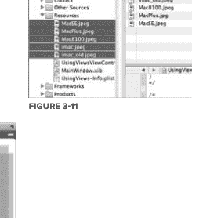

图 3-11


图 3-12

- 10. 在 Xcode 中，将以下以粗体显示的语句添加到 UsingViewsViewController.m 文件中：

```objc
#import "UsingViewsViewController.h"

@implementation UsingViewsViewController

@synthesize pageControl;
@synthesize imageView1, imageView2;

- (void)viewDidLoad {
    //---initialize the first ImageView to display an image---
    [imageView1 setImage:[UIImage imageNamed:@"iMac_old.jpeg"]];
    tempImageView = imageView2;

    //---make the first ImageView visible and hide the second---
    [imageView1 setHidden:NO];
    [imageView2 setHidden:YES];

    //---add the event handler for the page control---
    [pageControl addTarget:self
                    action:@selector(pageTurning:)
          forControlEvents:UIControlEventValueChanged];
    [super viewDidLoad];
}

//---when the page control's value is changed---
- (void) pageTurning: (UIPageControl *) pageControl {
    //---get the page number you can turning to---
    NSInteger nextPage = [pageControl currentPage];
    switch (nextPage) {
        case 0:
            [tempImageView setImage:
                [UIImage imageNamed:@"iMac_old.jpeg"]];
            break;
        case 1:
            [tempImageView setImage:
                [UIImage imageNamed:@"iMac.jpeg"]];
            break;
        case 2:
            [tempImageView setImage:
                [UIImage imageNamed:@"Mac@100.jpeg"]];
            break;
        case 3:
            [tempImageView setImage:
                [UIImage imageNamed:@"MacPlus.jpeg"]];
            break;
        case 4:
            [tempImageView setImage:
                [UIImage imageNamed:@"MacSE.jpeg"]];
            break;
    }
}
```

```objc
[UIView beginAnimations:@"flipping view" context:nil];
[UIView setAnimationDuration:0.5];
[UIView setAnimationCurve:UIViewAnimationCurveEaseInOut];
[UIView setAnimationTransition:UIViewAnimationTransitionFlipFromLeft
         forView:tempImageView
         cache:YES];
[tempImageView setHidden:YES];
[UIView commitAnimations];
```

```objc
[UIView beginAnimations:@"flipping view" context:nil];
[UIView setAnimationDuration:0.5];
[UIView setAnimationCurve:UIViewAnimationCurveEaseInOut];
[UIView setAnimationTransition:UIViewAnimationTransitionFlipFromRight
         forView:bgImageView
         cache:YES];
[bgImageView setHidden:NO];
[UIView commitAnimations];
```

具体来说，你将翻转过渡动画应用于 ImageView：

```objc
[UIView setAnimationTransition:UIViewAnimationTransitionFlipFromLeft
         forView:tempImageView
         cache:YES];
```

## 使用 Web 视图

要在你的应用程序中加载网页，你可以通过使用 UIWebView 在应用程序中嵌入一个 Web 浏览器。使用 Web 视图，你可以发送请求来加载 Web 内容，如果你想把现有的 Web 应用程序转换为原生应用程序（例如那些使用 Dashcode 编写的应用），这会非常有用。你只需要将所有 HTML 页面嵌入到 Xcode 项目的 Resources 文件夹中，然后在运行时将 HTML 页面加载到 Web 视图中即可。

> 注意 根据你的 Web 应用程序的复杂程度，如果它涉及服务器端技术（如 CGI、PHP 或其他），你可能需要做一些额外的工作来将 Web 应用程序移植到原生应用程序。

下面的“动手试一试”演示了如何使用 Web 视图加载网页。

### 动手试一试 使用 Web 视图加载网页

codefile UsingViews2.zip 可在 Wrox.com 下载

- 1. 使用 Xcode，创建一个新的基于视图的应用程序项目，并将其命名为 UsingViews2。
- 2. 双击 UsingViews2ViewController.xib 文件，使用 Interface Builder 进行编辑。


```objective-c
@implementation UsingViews2ViewController

@synthesize webView;

- (void)viewDidLoad {
    NSURL *url = [NSURL URLWithString:@"http://www.apple.com"];
    NSURLRequest *req = [NSURLRequest requestWithURL:url];
    [webView loadRequest:req];

    [super viewDidLoad];
}
- (void)dealloc {
    [webView release];
    [super dealloc];
}
```

7. 按 Command-R 在 iPhone 模拟器上测试应用程序。你应该会看到应用程序正在加载来自 Apple.com 的页面（见图 3-19）。

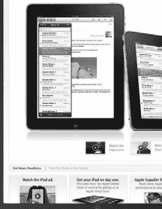

图 3-19

```objective-c
//---create a UIView object---
UIView *view =
    [[UIView alloc] initWithFrame:[UIScreen mainScreen].applicationFrame];
view.backgroundColor = [UIColor lightGrayColor];

//---create a Label view---
CGRect frame = CGRectMake(10, 15, 300, 20);
UILabel *label = [[UILabel alloc] initWithFrame:frame];
label.textAlignment = UITextAlignmentCenter;
label.backgroundColor = [UIColor clearColor];
label.font = [UIFont fontWithName:@"Verdana" size:20];
label.text = @"This is a label";
label.tag = 1000;

//---create a Button view---
frame = CGRectMake(10, 70, 300, 50);
UIButton *button = [UIButton buttonWithType:UIButtonTypeRoundedRect];
button.frame = frame;

[button setTitle:@"Click Me, Please!" forState:UIControlStateNormal];
button.backgroundColor = [UIColor clearColor];
button.tag = 2000;
[button addTarget:self
        action:@selector(buttonClicked:)
        forControlEvents:UIControlEventTouchUpInside];

[view addSubview:label];
[view addSubview:button];

self.view = view;
[label release];
}

- (IBAction) buttonClicked: (id) sender{
    UIAlertView *alert = [[UIAlertView alloc]
        initWithTitle:@"Action invoked!"
        message:@"Button clicked!"
        delegate:self
        cancelButtonTitle:@"OK"
        otherButtonTitles:nil];

    [alert show];
    [alert release];
}

@end
```

3. 按 Command-R 在 iPhone 模拟器中测试应用程序。图 3-20 显示标签和圆角矩形按钮视图已显示在视图上。点击按钮即可看到显示消息的警告视图。

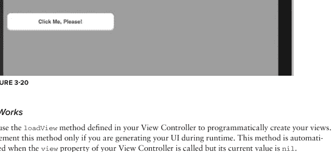

图 3-20

## 工作原理

你可以使用在视图控制器中定义的 loadView 方法以编程方式创建视图。只有在运行时生成 UI 时才实现此方法。当视图控制器的 view 属性被调用但其当前值为 nil 时，此方法会自动调用。

你创建的第一个视图是 UIView 对象，这使你能够将其用作容纳更多视图的容器：

```objective-c
//---create a UIView object---
UIView *view =
    [[UIView alloc] initWithFrame:[UIScreen mainScreen].applicationFrame];

//---set the background color to lightgray---
view.backgroundColor = [UIColor lightGrayColor];
```

接下来，你创建一个标签视图并将其设置为显示字符串：

```objective-c
//---create a Label view---
CGRect frame = CGRectMake(10, 15, 300, 20);
UILabel *label = [[UILabel alloc] initWithFrame:frame];
label.textAlignment = UITextAlignmentCenter;
label.backgroundColor = [UIColor clearColor];
label.font = [UIFont fontWithName:@"Verdana" size:20];
label.text = @"This is a label";
label.tag = 1000;
```

请注意，你还设置了 tag 属性，这对于在运行时搜索特定视图非常有用。

你还通过使用 UIButtonTypeRoundedRect 常量调用 buttonWithType: 方法来创建按钮视图。此方法返回一个 UIRoundedRectButton 对象（它是 UIButton 的子类）。

```objective-c
//---create a Button view---
frame = CGRectMake(10, 70, 300, 50);
UIButton *button = [UIButton buttonWithType:UIButtonTypeRoundedRect];
button.frame = frame;
```

当你再次运行应用程序时，你会注意到按钮与标签控件重叠（见图 3-21），因为按钮是最后添加的：

```objective-c
[view addSubview:label];
[view addSubview:button];
```

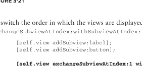

图 3-21

要在视图添加后切换其显示顺序，请使用 exchangeSubviewAtIndex:withSubviewAtIndex: 方法，如下所示：

```objective-c
[self.view addSubview:label];
[self.view addSubview:button];
[self.view exchangeSubviewAtIndex:1 withSubviewAtIndex:0];
[label release];
```

上述加粗语句交换了标签和按钮视图的顺序。当再次运行应用程序时，标签视图现在将出现在按钮视图之上（见图 3-22）。

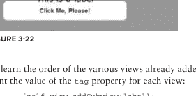

图 3-22

要了解已添加的各个视图的顺序，你可以使用以下代码段打印每个视图的 tag 属性值：

```objective-c
[self.view addSubview:label];
[self.view addSubview:button];
[self.view exchangeSubviewAtIndex:1 withSubviewAtIndex:0];

for (int i=0; i<[self.view.subviews count]; ++i) {
    UIView *view = [self.view.subviews objectAtIndex:i];
    NSLog(@"%@", [NSString stringWithFormat:@"%d %d", i, view.tag]);
}
```

以下方法递归打印 UIView 对象中包含的所有视图：

```objective-c
- (void) printViews: (UIView *) view {
    if ([view.subviews count] > 0) {
```

## 本章学到的内容

| 主题 | 关键概念 |
| --- | --- |
| 动作 | 动作是可以在视图窗口中处理由视图引发的事件（例如，当按钮被点击时等）的方法。 |
| 出口 | 出口允许你的代码以编程方式引用视图窗口上的视图。 |
| 使用代码添加出口 | 使用 IBOutlet 关键字：<br>`IBOutlet UITextField *nameTextField;` |
| 使用代码添加动作 | 使用 IBAction 关键字：<br>`- (IBAction)btnClicked:(id)sender;` |
| 连接动作 | 要链接动作，你始终从视图窗口中的视图拖动到 File's Owner 项上。 |
| 连接出口 | 要链接出口，你始终从 File's Owner 项拖动到视图窗口中所需的视图上。 |
| 使用 UIAlertView | `UIAlertView *alert = [[UIAlertView alloc]`<br>`initWithTitle:@"Hello"`<br>`message:@"This is an alert view"`<br>`delegate:self`<br>`cancelButtonTitle:@"OK"`<br>`otherButtonTitles:nil];` |
| 由 UIAlertView 触发的事件处理 | 确保你的视图控制器符合 UIAlertViewDelegate 协议。 |
| 使用 UIActionSheet | `UIActionSheet *action = [[UIActionSheet alloc]`<br>`initWithTitle:@"Title of Action Sheet"`<br>`delegate:self`<br>`cancelButtonTitle:@"OK"`<br>`destructiveButtonTitle:@"Delete Message"`<br>`otherButtonTitles:@"Option 1",`<br>`@"Option 2", nil];` |
| 由 UIActionSheet 触发的事件处理 | 确保你的视图控制器符合 UIActionSheetDelegate 协议。 |
| 为 UIPageControl 接线事件 | `[pageControl addTarget:self`<br>`action:@selector(pageTurning:)`<br>`forControlEvents:UIControlEventValueChanged];` |
| 使用 UIImageView | `[imageView1 setImage:`<br>`[UIImage imageNamed:@"iMac_old.jpeg"]];` |
| 使用 UIWebView | `NSURL *url =`<br>`[NSURL URLWithString:@"http://www.apple.com"];`<br>`NSURLRequest *req =`<br>`[NSURLRequest requestWithURL:url];`<br>`[webView loadRequest:req];` |

## 基于视图的应用程序模板

当你使用 Xcode 创建基于视图的应用程序项目时，你的应用程序中会自动有一个单一视图。直到现在，你一直在使用它，而没有太多了解其内部的工作原理。在下面的“试一试”中，你将深入细节并揭开使应用程序工作的所有魔法的面纱。

### 试一试 创建基于视图的应用程序项目

代码文件 viewBasedApp.zip 可在 Wrox.com 下载

1. 使用 Xcode 创建一个基于视图的应用程序项目并将其命名为 `viewBasedApp`。
2. 按 Command-R 在 iPhone 模拟器上测试应用程序。应用程序显示一个空屏幕，如图 4-1 所示。

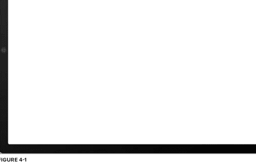

图 4-1


### 工作原理

您刚刚创建的是一个基于视图的应用程序。默认情况下，基于视图的应用程序模板包含一个由视图控制器类控制的单个视图。让我们剖析其内部工作原理，看看所有事物是如何协同工作的。

首先，查看 Xcode 中为您的项目创建的文件和文件夹。特别是，观察项目名称下列出的 Classes 和 Resources 文件夹（见图 4-2）。

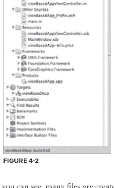

图 4-2

正如您所见，创建新项目时默认会为您创建许多文件。iPhone SDK 通过创建您在开发 iPad 应用程序时最常使用的一些项目来简化您的工作。表 4-1 描述了项目中创建的各种文件的用途。

> **注意** 创建的文件数量和类型取决于您选择的项目类型。基于视图的应用程序模板是理解所涉及的各种文件的良好起点。

## 表 4-1：项目中创建的各种文件

| 文件 | 描述 |
|------|-------------|
| viewBasedApp.app | 应用程序包（可执行文件），其中包含可执行文件以及随应用程序捆绑的数据。 |
| viewBasedApp_Prefix.pch | 包含项目中所有文件的预处理头文件。预处理头文件默认包含在项目中的其他文件中。 |
| viewBasedAppAppDelegate.h | 应用程序委托的头文件。 |
| viewBasedAppAppDelegate.m | 应用程序委托的实现文件。 |
| viewBasedAppViewController.h | 视图控制器的头文件。 |
| viewBasedAppViewController.m | 视图控制器的实现文件。 |
| viewBasedAppViewController.xib | 包含视图 UI 的 XIB 文件。 |
| CoreGraphics.framework | 用于低级 2D 渲染的基于 C 的 API。 |
| Foundation.framework | 用于基础系统服务（如数据类型、XML、URL 等）的 API。 |
| UIKit.framework | 提供构建和管理应用程序 UI 的基本对象。 |
| viewBasedApp-Info.plist | 一个字典文件，其中包含有关您的项目的信息，例如图标、应用程序名称等；信息以键/值对存储。 |
| main.m | 启动您的 iPad 应用程序的主文件。 |
| MainWindow.xib | 应用程序主窗口的 XIB 文件。 |

main.m 文件包含启动应用程序的代码，您很少需要修改它：

```
#import <UIKit/UIKit.h>

int main(int argc, char *argv[]) {
    NSAutoreleasePool * pool = [[NSAutoreleasePool alloc] init];
    int retVal = UIApplicationMain(argc, argv, nil, nil);
    [pool release];
    return retVal;
}
```

大部分繁重的工作由 UIApplicationMain() 函数完成，该函数检查 viewBasedApp-Info.plist 文件以获取有关项目的更多信息。特别是，它会查看您将用于项目的 main NIB 文件。图 4-3 显示了其内容

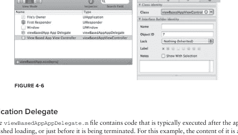

图 4-6

## 应用程序委托

viewBasedAppAppDelegate.m 文件包含通常在应用程序完成加载后或即将终止前执行的代码。对于本示例，其内容如下：

> **注意** 使用 Xcode 创建项目时，应用程序委托的文件名将始终附加字符串 AppDelegate。因此，如果项目名称为 viewBasedApp，则应用程序委托将称为 viewBasedAppAppDelegate。

```
#import "viewBasedAppAppDelegate.h"
#import "viewBasedAppViewController.h"

@implementation viewBasedAppAppDelegate

@synthesize window;
@synthesize viewController;

- (BOOL)application:(UIApplication *)application didFinishLaunchingWithOptions:(NSDictionary *)launchOptions {
    // Override point for customization after app launch
    [window addSubview:viewController.view];
    [window makeKeyAndVisible];
    return YES;
}

- (void)dealloc {
    [viewController release];
    [window release];
    [super dealloc];
}

@end
```

当应用程序完成启动后，它会向其委托发送 applicationDidFinishLaunchingWithOptions: 消息。在前一种情况下，它使用视图控制器获取其视图，然后将其添加到当前窗口以便显示。

viewBasedAppDelegate.h 文件包含 viewBasedAppAppDelegate 类成员的声明：

```
#import <UIKit/UIKit.h>

@class viewBasedAppViewController;

@interface viewBasedAppAppDelegate : NSObject <UIApplicationDelegate> {
    UIWindow *window;
    viewBasedAppViewController *viewController;
}

@property (nonatomic, retain) IBOutlet UIWindow *window;
@property (nonatomic, retain) IBOutlet viewBasedAppViewController *viewController;

@end
```

特别值得注意的是这一行：

```
@interface viewBasedAppAppDelegate : NSObject <UIApplicationDelegate> {
```

<UIApplicationDelegate> 语句指定委托类实现 UIApplicationDelegate 协议。简单来说，这意味着委托类将处理 UIApplicationDelegate 协议中定义事件（或消息）。UIApplicationDelegate 协议中的事件示例包括以下内容：

- Application:DidFinishLaunchingWithOptions:（您已在 viewBasedAppAppDelegate.m 文件中看到其实现。）
- applicationWillTerminate:
- applicationDidReceiveMemoryWarning:

应用程序委托类也是放置全局对象和函数的理想位置，因为它们可以从项目中的所有其他类访问。

> **注意** 协议将在附录 D 中更详细地讨论。

## 使用视图控制器控制您的 UI

在 iPad 编程中，您通常使用视图控制器来管理视图并执行导航和内存管理。在基于视图的应用程序的项目模板中，Xcode 会自动使用视图控制器来帮助您管理视图。将视图视为您在 iPad 上看到的屏幕（或窗口）。

本章前面您看到 MainWindow.xib 窗口包含 View Based App View Controller 项。双击该项时，会显示同名窗口（见图 4-7）。

> **注意** 使用 Xcode 创建项目时，视图控制器文件名将始终附加字符串 ViewController。因此，如果项目名称为 viewBasedApp，则应用程序委托将称为 viewBasedAppViewController。当视图控制器在 Interface Builder 中显示时，Interface Builder 会检查名称并在大小写发生变化时插入空格显示视图控制器；例如，viewBasedAppViewController 现在变为 View Based App View Controller。

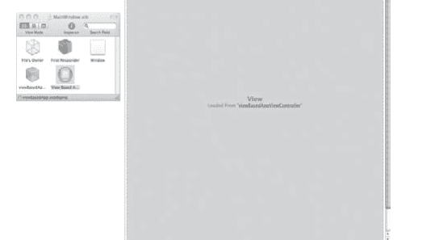

图 4-7

当您选择 File's Owner 项并查看其 Identity Inspector 窗口时，您应该会看到类指向 viewBasedAppViewController 类（见图 4-10）。这意味着 View 窗口由 viewBasedAppViewController 类控制。

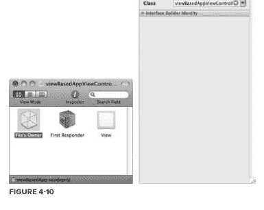

图 4-10

viewBasedAppViewController 类由两个文件表示——viewBasedAppViewController.h 和 viewBasedAppViewController.m。viewBasedAppViewController 类是您编写代码以与应用程序的视图交互的地方。

viewBasedAppViewController.h 文件的内容如下所示：

```
#import <UIKit/UIKit.h>

@interface viewBasedAppViewController : UIViewController {
}

@end
```

请注意，viewBasedAppViewController 类继承自 UIViewController 基类，该基类提供了视图窗口上可用的大多数功能。

viewBasedAppViewController.m 文件的内容如下所示：

```
#import "viewBasedAppViewController.h"

@implementation viewBasedAppViewController
```


## 基于窗口的应用程序模板

在本节中，您将发现使用 iPhone SDK 可以创建的另一种应用程序模板：基于窗口的应用程序模板。与基于视图的应用程序模板不同，基于窗口的应用程序模板默认不包含视图控制器。相反，它仅提供 iPad 应用程序的骨架，其余部分留给开发者——您需要添加自己的视图及其各自的视图控制器。正因为如此，基于窗口的应用程序为您提供了一个很好的方式来了解视图控制器的工作原理，并体会连接视图控制器和 XIB 文件所需的所有工作。当您了解视图控制器的工作原理后，您将能够创建更复杂的应用程序。

首先，执行以下试一试来编写一个基于窗口的应用程序，然后逐步向其添加视图控制器。

## 试一试  创建基于窗口的应用程序

*代码文件 windowBasedApp.zip 可在 Wrox.com 上下载*

- 1. 使用 Xcode 创建一个基于窗口的应用程序项目，并将其命名为 `windowBasedApp`。观察为此项目类型创建的文件（参见图 4-11）。除了通常的支持文件外，请注意只有一个 XIB 文件（`MainWindow.xib`）和两个委托文件（`windowBasedAppAppDelegate.h` 和 `windowBasedAppAppDelegate.m`）。
- 2. 按 Command-R 测试应用程序。在 iPhone 模拟器上显示一个空屏幕。这是因为基于窗口的应用程序模板仅提供简单 iPad 应用程序的骨架结构——只有一个窗口和应用程序委托。
- 3. 在 Xcode 中，双击 `MainWindow.xib` 在 Interface Builder 中编辑它。请注意，`MainWindow.xib` 窗口中有四项（参见图 4-12）：
  - File's Owner
  - First Responder
  - Window
  - Window Based App App Delegate
- 4. 从库窗口拖放一个视图控制器项到 `MainWindow.xib` 窗口（参见图 4-13）。您将在下一步中将此视图控制器项连接到您将添加到项目中的视图。

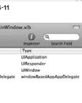

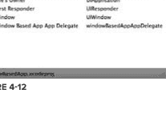

- 11. 在 windowBasedAppAppDelegate.m 文件中，插入以下以粗体显示的代码行：

```
#import "windowBasedAppAppDelegate.h"
#import "HelloWorldViewController.h"

@implementation windowBasedAppAppDelegate

@synthesize window;

//---synthesize the property---
//@synthesize viewController;

- (BOOL)application:(UIApplication *)application didFinishLaunchingWithOptions:(NSDictionary *)launchOptions {
    // Override point for customization after application launch
    //---add the new view to the current window---
    [window addSubview:viewController.view];
    
    [window makeKeyAndVisible];
    
    return YES;
}

- (void)dealloc {
    [viewController release];
    [window release];
    [super dealloc];
}

@end
```

- 12. 在 MainWindow.xib 窗口中，Control-单击并拖动 Window Based App App Delegate 项到 Hello World View Controller 项（参见图 4-20）。选择 viewController。这将把窗口与视图控制器关联起来。

- 13. 就这样！按 Command-R 在 iPhone 模拟器上测试应用程序。按钮出现在应用程序主屏幕上（参见图 4-21）。

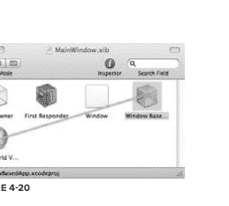

图 4-20

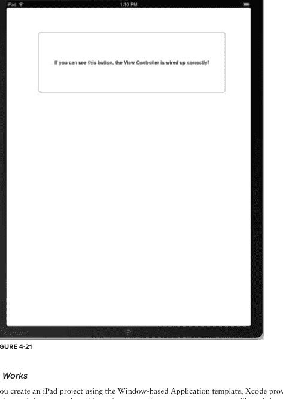

图 4-21

## 工作原理

当您使用基于窗口的应用程序模板创建 iPad 项目时，Xcode 只为您提供项目中的最少项目——一个 MainWindow.xib 文件和应用程序委托。您应该添加自己的视图控制器和视图。

在前面的练习中，您首先向 MainWindow.xib 窗口添加了一个视图控制器项。然后您添加了 UIViewController 类的一个实例（您将其命名为 HelloWorldViewController），以便将其连接到您刚刚添加的视图控制器。此控制器类包含您将编写的代码，用于处理视图与用户之间的交互。

当应用程序完成启动后，您使用 UIWindow 实例的 addSubview: 方法将由 HelloWorldViewController 对象表示的视图添加到窗口中，使其可见：

```
[window addSubview:viewController.view];
```

## 以编程方式添加视图控制器和视图

另一种常用的技术是在运行时以编程方式创建视图，而不使用 Interface Builder。这提供了很大的灵活性，尤其是在编写游戏时，应用程序的 UI 不断变化。

在下面的试一试中，您将学习如何使用 UIViewController 类的实例创建视图，然后以编程方式向其添加视图。

## 试一试  以编程方式添加视图控制器和视图

- 1. 使用 windowBasedApp 项目，在 Xcode 中右键单击 Classes 组并添加新文件。选择 UIViewController 子类项并将其命名为 MySecondViewController。确保未选中“With XIB for user interface”复选框。Xcode 现在应如 图 4-22 所示。

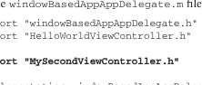

图 4-22

- 2. 在 windowBasedAppAppDelegate.m 文件中，添加以下粗体代码：

```
#import "windowBasedAppAppDelegate.h"
#import "HelloWorldViewController.h"

#import "MySecondViewController.h"

@implementation windowBasedAppAppDelegate

@synthesize window;
@synthesize viewController;

//---create an instance of the second view controller---
MySecondViewController *mySecondViewController;

- (BOOL)application:(UIApplication *)application didFinishLaunchingWithOptions:(NSDictionary *)launchOptions {
    //---instantiate the second view controller---
    mySecondViewController = [[MySecondViewController alloc] initWithNibName:nil bundle:nil];
    //---add the view from the second view controller---
    [window addSubview:mySecondViewController.view];
    //---comment this out so that it doesn't load the viewController---
    //[window addSubview:viewController.view];
    [window makeKeyAndVisible];
    return YES;
}

- (void)dealloc {
    [mySecondViewController release];
    [viewController release];
    [window release];
    [super dealloc];
}
```

- 3. 在 MySecondViewController.h 文件中，插入以下粗体代码行：

```
#import <UIKit/UIKit.h>

@interface MySecondViewController : UIViewController {
    //---create two outlets - label and button---
    UILabel *label;
    UIButton *button;
}

//---expose the outlets as properties---
@property (nonatomic, retain) UILabel *label;
@property (nonatomic, retain) UIButton *button;

@end
```

- 4. 在 MySecondViewController.m 文件中，添加 viewDidLoad() 方法并修改 dealloc 方法：

```
@synthesize label, button;

- (void)viewDidLoad {
    //---create a CGRect for the positioning---
    CGRect frame = CGRectMake(230, 10, 300, 50);
    //---create a Label view---
    label = [[UILabel alloc] initWithFrame:frame];
    label.textAlignment = UITextAlignmentCenter;
    label.font = [UIFont fontWithName:@"Verdana" size:20];
    label.text = @"This is a label";

    //---create a Button view---
    frame = CGRectMake(230, 100, 300, 50);
    button = [UIButton buttonWithType:UIButtonTypeRoundedRect];
    button.frame = frame;
    [button setTitle:@"OK" forState:UIControlStateNormal];
    button.backgroundColor = [UIColor clearColor];

    //---add the views to the View window---
    [self.view addSubview:label];
    [self.view addSubview:button];
    [super viewDidLoad];
}

- (void)dealloc {
    [label release];
    [button release];
    [super dealloc];
}
```

- 5. 按 Command-R 在 iPhone 模拟器上测试应用程序。标签和按钮视图出现在应用程序主屏幕上（参见图 4-23）。

## 工作原理

与之前的示例不同，在之前的示例中您向项目添加了视图控制器项、UIViewController 类的实例和 XIB 文件，此示例仅创建 UIViewController 类的实例并以编程方式将视图添加到主视图窗口。

在应用程序委托中，应用程序完成启动后，您创建已创建的 UIViewController 类的实例：

//---instantiate the second view controller---
mySecondViewController = [[MySecondViewController alloc]
initWithNibName:nil
bundle:nil];

您不需要 XIB 文件，因为您将使用的各种视图将以编程方式添加。因此 initWithNibName: 参数可以设置为 nil。

要加载由 UIViewController 类实例表示的视图窗口，您使用 UIWindow 实例的 addSubview: 方法：

//---add the view from the second view controller---
[window addSubview:mySecondViewController.view];


```objective-c
//---create a Label view---
label = [[UILabel alloc] initWithFrame:frame];
label.textAlignment = UITextAlignmentCenter;
label.font = [UIFont fontWithName:@"Verdana" size:20];
label.text = @"This is a label";

//---create a Button view---
frame = CGRectMake(10, 250, 300, 50);
button = [UIButton buttonWithType:UIButtonTypeRoundedRect];
button.frame = frame;
[button setTitle:@"OK" forState:UIControlStateNormal];
button.backgroundColor = [UIColor clearColor];

//---add the views to the current View---
[self.view addSubview:label];
[self.view addSubview:button];

[super viewDidLoad];
}
```

## 创建和连接操作

在前面的示例中，你看到了如何将 Label 和 Button 视图添加到主 View 窗口中。然而，你需要处理 Button 视图引发的事件，以便在用户按下它时执行某些操作。第 3 章介绍了使用 outlets 和 actions 以及如何使用 Interface Builder 将代码连接到它们，但在下面的“试一试”中，视图是通过代码创建的，因此你不能使用 Interface Builder 来连接操作和 outlets —— 你也必须通过代码来完成。

## 试一试 将操作链接到视图

- 1. 继续使用 windowBasedApp 项目，按如下方式在 MySecondViewController.h 文件中声明 buttonClicked: 操作（以粗体显示）：

```objective-c
#import <UIKit/UIKit.h>

@interface MySecondViewController : UIViewController {
    //---create two outlets - label and button---
    UILabel *label;
    UIButton *button;
}

    //---expose the outlets as properties---
    @property (nonatomic, retain) UILabel *label;
    @property (nonatomic, retain) UIButton *button;

    //---declaring the IBAction---
    -(IBAction) buttonClicked: (id) sender;

@end
```

- 2. 在 MySecondViewController.m 文件中，你为 buttonClicked: 操作提供实现：

```objective-c
- (IBAction) buttonClicked: (id) sender{
    UIAlertView *alert = [[UIAlertView alloc] initWithTitle:@"Action invoked!"
                                                     message:@"Button clicked!"
                                                    delegate:self
                                           cancelButtonTitle:@"OK"
                                           otherButtonTitles:nil];
    [alert show];
    [alert release];
}
```

- 3. 要将 Button 视图的相关事件（Touch Up Inside）与 buttonClicked: 操作连接起来，请将以下粗体代码添加到 viewDidLoad() 方法中：

```objective-c
- (void)viewDidLoad {
    //---create a CGRect for the positioning---
    CGRect frame = CGRectMake(10, 10, 300, 50);
    //---create a Label view---
    label = [[UILabel alloc] initWithFrame:frame];
    label.textAlignment = UITextAlignmentCenter;
    label.font = [UIFont fontWithName:@"Verdana" size:20];
    label.text = @"This is a label";
    //---create a Button view---
    frame = CGRectMake(10, 250, 300, 50);
    button = [UIButton buttonWithType:UIButtonTypeRoundedRect];
    button.frame = frame;
    [button setTitle:@"OK" forState:UIControlStateNormal];
    button.backgroundColor = [UIColor clearColor];
    //---add the action handler and set current class as target---
    [button addTarget:self
            action:@selector(buttonClicked:)
        forControlEvents:UIControlEventTouchUpInside];
    //---add the views to the current View---
    [self.view addSubview:label];
    [self.view addSubview:button];
    [super viewDidLoad];
}
```

- 4. 就这样！按下 Command-R 在 iPhone 模拟器上测试应用程序。点击 OK 按钮会显示一个警告视图（见图 4-24）。

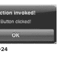

## 试一试 切换视图

- 1. 使用上一节创建的同一项目，将以下粗体代码添加到 MySecondViewController.m 文件中：

```objective-c
#import "MySecondViewController.h"

#import "HelloWorldViewController.h"

@implementation MySecondViewController

//---create an instance of the view controller---
HelloWorldViewController *viewController;

-(IBAction) buttonClicked: (id) sender{
    //---add the view of the view controller to the current View---
    viewController = [[HelloWorldViewController alloc]
        initWithNibName:@"HelloWorldViewController"
        bundle:nil];
    [self.view addSubview:viewController.view];
    /*
    UIAlertView *alert = [[UIAlertView alloc] initWithTitle:@"Action invoked!"
        message:@"Button clicked!"
        delegate:self
        cancelButtonTitle:@"OK"
        otherButtonTitles:nil];
    [alert show];
    [alert release];
    */
}
-(void)dealloc {
    [viewController release];
    [label release];
    [button release];
    [super dealloc];
}
```

- 2. 在 HelloWorldViewController.h 文件中声明 btnClicked: 操作：

```objective-c
#import <UIKit/UIKit.h>

@interface HelloWorldViewController : UIViewController {
}

-(IBAction) btnClicked:(id) sender;

@end
```

- 3. 在 HelloWorldViewController.m 文件中，按如下方式定义 btnClicked: 操作：

```objective-c
-(IBAction) btnClicked:(id) sender{
    //--remove the current view; essentially hiding the view--
    [self.view removeFromSuperview];
}
```

- 4. 双击 HelloWorldViewController.xib 文件以在 Interface Builder 中编辑它。Control-点击并拖动 View 窗口中的 Round Rect Button 到 HelloWorldViewController.xib 窗口中的 File's Owner 项目，然后选择 btnClicked:。

- 5. 在 Xcode 中，按下 Command-R 测试应用程序。现在当你在主 View 中点击 OK 按钮时，你将被带到 Hello World View。要关闭 View，请按下按钮。

## 工作原理

- 1. 对于此示例，你只需使用 addSubview: 方法将要切换到的 view controller 的 View 添加到当前视图中：

```objective-c
//--add the view of the view controller to the current View---
viewController = [[HelloWorldViewController alloc]
initWithNibName:@"HelloWorldViewController"
bundle:nil];
[self.view addSubview:viewController.view];
```

- 2. 要 dismiss 一个视图，你使用 removeFromSuperview: 方法：

```objective-c
//--remove the current view; essentially hiding the view---
[self.view removeFromSuperview];
```

## 为视图切换添加动画

你在上一节中看到的视图切换是瞬时的——两个视图会立即改变，没有任何视觉提示。iPad 的关键卖点之一就是其动画功能。因此，对于视图切换，你可以通过执行一些简单的动画，例如翻转一个视图窗口以显示另一个视图，使显示效果更具趣味性。以下是操作方法。

## 试一试 为过渡添加动画

- 1. 使用同一项目，将以下粗体代码添加到 MySecondViewController.m 文件中：

```objective-c
-(IBAction) buttonClicked: (id) sender{
    //--add the view of the view controller to the current View---
viewController = [[HelloWorldViewController alloc]
initWithNibName:@"HelloWorldViewController"
bundle:nil];

[UIView beginAnimations:@"flipping view" context:nil];
```

- UIViewAnimationCurveEaseOut — 导致动画开始时快速然后在完成时变慢
- UIViewAnimationCurveLinear — 使动画在其持续时间内均匀发生

setAnimationTransition: 方法在动画持续时间内对视图应用一种过渡类型。

```objective-c
[UIView setAnimationTransition: UIViewAnimationTransitionFlipFromLeft forView:self.view cache:YES];
```

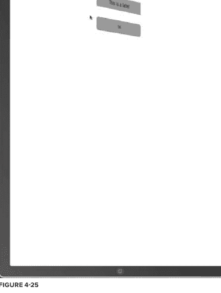

图 4-25

- 2. 观察在 Classes 和 Resources 文件夹中创建的文件（见图 4-28）。注意现在有两个 View Controller 类（`RootViewController` 和 `DetailViewController`）以及两个 XIB 文件。
- 3. 在 Xcode 中按下 Command-R 在 iPhone 模拟器上测试应用程序。图 4-29 显示了应用程序在横向模式下显示时的样子。当你将模拟器旋转到纵向模式时，应用程序现在看起来像图 4-30。

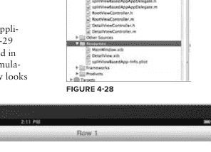

图 4-28


图 4-29


首先，观察 splitViewBasedAppAppDelegate.h 文件的内容：

```
#import <UIKit/UIKit.h>

@class RootViewController;
@class DetailViewController;

@interface splitViewBasedAppAppDelegate : NSObject <UIApplicationDelegate> {
    UIWindow *window;
    UISplitViewController *splitViewController;
    RootViewController *rootViewController;
    DetailViewController *detailViewController;
}

@property (nonatomic, retain) IBOutlet UIWindow *window;
@property (nonatomic,retain) IBOutlet UISplitViewController *splitViewController;
@property (nonatomic,retain) IBOutlet RootViewController *rootViewController;
@property (nonatomic,retain) IBOutlet DetailViewController *detailViewController;

@end
```

请注意，它包含一个类型为 UISplitViewController 的视图控制器对象（splitViewController），以及两个视图控制器（rootViewController 和 detailViewController）。UISplitViewController 是一个容器视图控制器，包含两个视图控制器，可让你实现主从界面。

接下来，查看 splitViewBasedAppAppDelegate.m 文件的内容：

```
#import "splitViewBasedAppAppDelegate.h"

#import "RootViewController.h"
#import "DetailViewController.h"

@implementation splitViewBasedAppAppDelegate

@synthesize window, splitViewController, rootViewController, detailViewController;

- (BOOL)application:(UIApplication *)application didFinishLaunchingWithOptions:(NSDictionary *)launchOptions {
    // Override point for customization after app launch
    // Add the split view controller's view to the window and display.
    // [window addSubview:splitViewController.view];
    [window makeKeyAndVisible];
    return YES;
}

- (void)applicationWillTerminate:(UIApplication *)application {
```

应用程序委托已连接到各个视图控制器，当你右键单击“Split View Based App App Delegate”项时即可看到（见图 4-36）。


图 4-36

让我们检查包含在 Split View Controller 中的两个视图控制器：RootViewController 和 DetailViewController。

观察 RootViewController.h 文件的内容：

```objc
#import <UIKit/UIKit.h>

@class DetailViewController;

@interface RootViewController : UITableViewController {
    DetailViewController *detailViewController;
}

@property (nonatomic, retain) IBOutlet DetailViewController *detailViewController;

@end
```

请注意，RootViewController 类继承自 UITableViewController 类，而不是你之前见过的 UIViewController 类。UITableViewController 类是 UIViewController 类的子类，提供显示包含数据行的表格的能力。（第 7 章更详细地讨论了 Table view。）

RootViewController.m 文件的内容如下：

```objc
#import "RootViewController.h"
#import "DetailViewController.h"

@implementation RootViewController

@synthesize detailViewController;

/*
    ---Other commented out code are omitted from this code listing---
*/

- (void)viewDidLoad {
    [super viewDidLoad];
    self.clearsSelectionOnViewWillAppear = NO;
}

// Ensure that the view controller supports rotation and
// that the split view can therefore show in
// both portrait and landscape.
- (BOOL)shouldAutorotateToInterfaceOrientation:
(UIInterfaceOrientation)interfaceOrientation {
    return YES;
}

// The size the view should be when presented in a popover.
- (CGSize)contentSizeForViewInPopover {
    return CGSizeMake(320.0, 600.0);
}

- (NSInteger)numberOfSectionsInTableView:(UITableView *)aTableView {
    // Return the number of sections.
    return 1;
}

- (NSInteger)tableView:(UITableView *)aTableView
numberOfRowsInSection:(NSInteger)section {
    // Return the number of rows in the section.
    return 10;
}

- (UITableViewCell *)tableView:(UITableView *)tableView
cellForRowAtIndexPath:(NSIndexPath *)indexPath {

    static NSString *CellIdentifier = @"CellIdentifier";

    // Dequeue or create a cell of the appropriate type.
    UITableViewCell *cell = [tableView
    dequeueReusableCellWithIdentifier:CellIdentifier];
    if (cell == nil) {
        cell = [[UITableViewCell alloc]
    initWithStyle:UITableViewCellStyleDefault
    reuseIdentifier:CellIdentifier] autorelease];
        cell.accessoryType = UITableViewCellAccessoryNone;
    }

    // Configure the cell.
    cell.textLabel.text =
        [NSString stringWithFormat:@"Row %d", indexPath.row];
    return cell;
}

- (void)tableView:(UITableView *)aTableView
didSelectRowAtIndexPath:(NSIndexPath *)indexPath {
/*
When a row is selected, set the detail view controller's
detail item to the item associated with the selected row.
*/
detailViewController.detailItem =
    [NSString stringWithFormat:@"Row %d", indexPath.row];
}
- (void)didReceiveMemoryWarning {
    // Releases the view if it doesn't have a superview.
    [super didReceiveMemoryWarning];

    // Relinquish ownership any cached data, images,
    // etc that aren't in use.
}
- (void)viewDidUnload {
    // Relinquish ownership of anything that
    // can be recreated in viewDidLoad or on demand.
    // For example: self.myOutlet = nil;
}
- (void)dealloc {
    [super dealloc];
}
@end
```

虽然 RootViewController.m 文件的内容包含许多与 Table view 相关的 方法，这里是对其中一些重要方法的简要总结：

- contentSizeForViewInPopover — 要显示的 PopoverView 的大小。
- numberOfSectionsInTableView: — 在 Table view 中显示的节数。
- tableView:numberOfRowsInSection: — 在 Table view 中显示的行数。
- tableView:cellForRowAtIndexPath: — 为每一行填充的数据。
- tableView:didSelectRowAtIndexPath: — 用户选择的 行。

接下来，查看 DetailViewController.h 文件：

```
#import <UIKit/UIKit.h>

@interface DetailViewController : UIViewController <UIPopoverControllerDelegate, UISplitViewControllerDelegate> {

    UIPopoverController *popoverController;
    UINavigationBar *navigationBar;

    id detailItem;
}

@property (nonatomic, retain) UIPopoverController *popoverController;
@property (nonatomic, retain) IBOutlet UINavigationBar *navigationBar;
@property (nonatomic, retain) id detailItem;
@end
```

请注意，DetailsViewController 类实现了以下协议：

- **UIPopoverControllerDelegate** — 它实现此协议，以便在 PopoverView 即将关闭时，你有机会收到通知（例如以便阻止其关闭）。
- **UISplitViewControllerDelegate** — 它需要实现此协议，因为当 iPad 改变方向时，需要隐藏/显示 PopoverView。

检查 DetailsViewController.m 文件的内容：

```
#import "DetailViewController.h"
#import "RootViewController.h"

@implementation DetailViewController

@synthesize navigationBar, popoverController, detailItem;

/*
 ---Other commented out code are omitted from this code listing---
 */

/*
 When setting the detail item, update the view and dismiss
 the popover controller if it's showing.
 */
- (void)setDetailItem:(id)newDetailItem {
    if (detailItem != newDetailItem) {
        [detailItem release];
        detailItem = [newDetailItem retain];

        // Update the view.
        navigationBar.topItem.title = [detailItem description];
    }

    if (popoverController != nil) {
        [popoverController dismissPopoverAnimated:YES];
    }
}

- (void)splitViewController:(UISplitViewController *)svc
    willHideViewController:(UIViewController *)aViewController
 withBarButtonItem:(UIBarButtonItem *)barButtonItem
  forPopoverController:(UIPopoverController *)pc {
    barButtonItem.title = @"Root List";
    [navigationBar.topItem setLeftBarButtonItem:barButtonItem
        animated:YES];
```

```
self.popoverController = pc;
}

// Called when the view is shown again in the split view,
// invalidating the button and popover controller.
- (void)splitViewController:(UISplitViewController *)svc
willShowViewController:(UIViewController *)aViewController
invalidatingBarButtonItem:(UIBarButtonItem *)barButtonItem {
    [navigationBar.topItem setLeftBarButtonItem:nil animated:YES];
    self.popoverController = nil;
}

// Ensure that the view controller supports rotation and that the
// split view can therefore show in both portrait and landscape.
- (BOOL)shouldAutorotateToInterfaceOrientation:
(UIInterfaceOrientation)interfaceOrientation {
    return YES;
}

- (void)viewDidUnload {
    // Release any retained subviews of the main view.
    // e.g. self.myOutlet = nil;
    self.popoverController = nil;
}

- (void)dealloc {
    [popoverController release];
    [navigationBar release];

    [detailItem release];
    [super dealloc];
}

@end
```

在这个控制器中，你需要处理两个重要事件（这两个事件都定义在 `UISplitViewControllerDelegate` 协议中）：

- `splitViewController:willHideViewController:withBarButtonItem:forPopoverController:` — 当 iPad 切换到纵向模式时触发（此时将显示 PopoverView，并隐藏 Table View）。
- `splitViewController:willShowViewController:invalidatingBarButtonItem:` — 当 iPad 切换到横向模式时触发（此时将隐藏 PopoverView，并显示 Table View）。

**3.** 在 Size Inspector 窗口中，按如下设置其 Autosizing 属性（另请参见图 4-38）：

- X: 152
- Y: 163
- W: 463
- H: 644


图 4-38

**4.** 在 Xcode 中，将图 4-39 所示的图像添加到 Resources 文件夹（你可以从 Wrox.com 下载这些图像以及本项目；有关详细信息，请参阅引言中标题为“源代码”一节）。

**5.** 在 DetailViewController.h 文件中，插入以下加粗语句：

```
#import <UIKit/UIKit.h>

@interface DetailViewController : UIViewController
    <UIPopoverControllerDelegate, UISplitViewControllerDelegate> {
```

```
// Configure the cell.
//cell.textLabel.text = [NSString stringWithFormat:@"Row %d", indexPath.row];
cell.textLabel.text = [listOfMovies objectAtIndex:indexPath.row];

return cell;
}
- (void)tableView:(UITableView *)aTableView
didSelectRowAtIndexPath:(NSIndexPath *)indexPath {
/*
When a row is selected, set the detail view controller's detail item to
the item associated with the selected row.
*/
// [detailViewController.detailItem =
// [NSString stringWithFormat:@"Row %d", indexPath.row];

detailViewController.detailItem =
    [NSString stringWithFormat:@"%@",
        [listOfMovies objectAtIndex:indexPath.row]];
}
- (void)dealloc {
    [listOfMovies release];
    [super dealloc];
}
```

## 8. 将以下加粗语句添加到 DetailViewController.m 文件中：

```
#import "DetailViewController.h"
#import "RootViewController.h"

@implementation DetailViewController

@synthesize navigationBar, popoverController, detailItem;

@synthesize imageView;

/*
When setting the detail item, update the view and dismiss the
popover controller if it's showing.
*/
- (void)setDetailItem:(id)newDetailItem {
    if (detailItem != newDetailItem) {
        [detailItem release];
        detailItem = [newDetailItem retain];

        // Update the view.
        navigationBar.topItem.title = [detailItem description];

        NSString *imageName = [NSString
            stringWithFormat:@"%@.jpg",navigationBar.topItem.title];
    }
}
```


图 4-42

## 工作原理

首先，你使用一部电影名称列表初始化一个可变数组：

```
- (void)viewDidLoad {
    //---initialize the array---
    listOfMovies = [[NSMutableArray alloc] init];
    [listOfMovies addObject:@"Training Day"];
    [listOfMovies addObject:@"Remember the Titans"];
    [listOfMovies addObject:@"John Q."];
    [listOfMovies addObject:@"The Bone Collector"];
```

## 试一试 创建标签栏应用程序

*TabBarApplication.zip 代码文件可从 Wrox.com 下载*

1. 使用 Xcode 创建一个新的标签栏应用程序项目，并将其命名为 `TabBarApplication`。

2. 检查项目的内容（参见图 4-43）。除了通常的应用程序委托文件外，它还包含两个视图控制器（`FirstViewController` 和 `SecondViewController`）以及三个 XIB 文件：`MainWindow.xib`、`FirstView.xib` 和 `SecondView.xib`。


图 4-43

3. 检查 `TabBarApplicationAppDelegate.h` 文件的内容，如下所示：

```
#import <UIKit/UIKit.h>
@interface TabBarApplicationAppDelegate : NSObject <UIApplicationDelegate, UITabBarControllerDelegate> {
    UIWindow *window;
    UITabBarController *tabBarController;
}
@property (nonatomic, retain) IBOutlet UIWindow *window;
@property (nonatomic, retain) IBOutlet UITabBarController *tabBarController;
@end
```

你现在使用的是 `UITabBarController` 类，而不是通常的 `UIViewController` 类，它继承自 `UIViewController` 类。TabBarController 是一种特殊的 `UIViewController` 类，包含一组视图控制器。

4. 当应用程序完成加载时，将加载 `UITabBarController` 实例的当前视图，这一情况在 `TabBarApplicationAppDelegate.m` 文件中显而易见：

```
#import "TabBarApplicationAppDelegate.h"
@implementation TabBarApplicationAppDelegate
```


图 4-46

## 工作原理

基本上，标签栏应用程序的魔力在于使用 UITabBarController 类。双击 MainWindow.xib 文件，你会看到它包含一个标签栏控制器项（参见图 4-47）。

## 试一试 添加标签栏项

1. 使用 TabBarApplication 项目，在 Interface Builder 中，从资源库中将一个标签栏项拖放到标签栏视图上（参见图 4-48）。


图 4-48


图 4-51


图 4-52


图 4-53

## 工作原理

在此示例中，你将一个标签栏项视图添加到标签栏视图，并将其连接到一个 XIB 文件及其对应的视图控制器类。

添加新的标签栏项视图非常简单：只需将标签栏项从资源库拖放到标签栏视图中即可。或者，你可以通过 MainWindow.xib 窗口中标签栏控制器项的属性检查器窗口来添加它（参见图 4-54）。单击 +（加号）按钮以添加新的视图控制器，标签栏视图会自动为你插入一个新的标签栏项视图。

4. 保存 `KeyboardInputsViewController.xib` 文件，并在 Xcode 中按 Command-R 以在 iPhone 模拟器上运行该应用程序。当应用程序加载时，键盘最初是隐藏的，当用户点击 TextField 视图时，键盘会自动出现（参见图 5-2）。


图 5-2


图 5-11

6. 在 Xcode 中，编辑 KeyboardInputsViewController.h 文件，并添加以下粗体语句：

```objc
#import <UIKit/UIKit.h>

@interface KeyboardInputsViewController : UIViewController {
    IBOutlet UITextField *textField;
}

@property (nonatomic, retain) UITextField *textField;

- (IBAction) doneEditing:(id) sender;

- (IBAction) bgTouched:(id) sender;

@end
```

7. 在 Interface Builder 中，按住 Control 键单击并将 File's Owner 项拖动到 TextField 视图上。应该会出现 textField 出口。选择它。

8. 在 KeyboardInputsViewController.xib 窗口中，按住 Control 键单击并将圆角矩形按钮视图拖动到 File's Owner 项上（参见图 5-12）。选择 bgTouched: 操作。

## 视图加载时自动显示键盘

有时你可能希望立即将 TextField 视图设置为活动视图并显示键盘，而无需等待用户进行操作。在这种情况下，你可以使用视图的 `becomeFirstResponder` 方法。以下代码表明，一旦视图窗口加载完成，TextField 视图将成为第一响应者：

```objc
- (void)viewDidLoad {
    [textField becomeFirstResponder];
    [super viewDidLoad];
}
```

## 检测键盘是否出现

到目前为止，你已经看到了使用完键盘后隐藏键盘的各种方法。然而，有一个问题需要注意。当键盘出现时，它会占据屏幕的很大一部分。如果你的 TextField 视图位于屏幕底部，它会被键盘遮挡。作为程序员，你有责任确保该视图被重新定位到屏幕的可见部分。令人惊讶的是，SDK 并没有处理这个问题；你必须自己完成这项艰巨的工作。

> **注意**：iPad 的键盘在竖屏模式下高度为 264 像素，在横屏模式下高度为 352 像素。

不过，首先，理解几个与键盘相关的关键概念对你来说很重要：

- 你需要能够以编程方式知道键盘何时显示或隐藏。为此，你的应用程序需要注册 `UIKeyboardWillShowNotification` 和 `UIKeyboardWillHideNotification`。
- 你还需要知道当前正在编辑哪个 TextField 视图以及何时开始编辑，以便你可以将其重新定位到屏幕的可见部分。你可以通过 `UITextFieldDelegate` 协议中可用的两个委托方法——`textFieldDidBeginEditing:` 和 `textFieldDidEndEditing:`——来获取这两条信息。

搞糊涂了吗？别担心；下面这个“试一试”会让一切变得明白。

### 试一试 移动视图

*可从 Wrox.com 下载的代码文件 ScrollingViews.zip*

1. 使用 Xcode，创建一个新的基于视图的应用程序项目，并将其命名为 `ScrollingViews`。


图 5-14

4. 在 Xcode 中，将以下以粗体突出显示的语句输入到 ScrollingViewsViewController.h 文件中并保存：

```objc
#import <UIKit/UIKit.h>

@interface ScrollingViewsViewController : UIViewController <UITextFieldDelegate> {
    IBOutlet UIScrollView *scrollView;
    IBOutlet UITextField *textField;
}
```

> **注意**：第 7 步很重要，因为它使委托方法（`textFieldDidBeginEditing:` 和 `textFieldDidEndEditing:`）能够由视图控制器处理。


```objc
return NO;
}
-(void) dealloc {
    [textField release];
    [scrollView release];
    [super dealloc];
}
```

10. 在 Xcode 中保存项目并按 Command-R 将应用程序部署到 iPhone 模拟器上。图 5-18 显示，当你单击 TextField 视图时，键盘出现，TextField 视图（以及其他视图）会滚动到屏幕中央。要隐藏键盘，只需单击 Return 键，视图就会恢复到原始位置。


图 5-18

### 工作原理

本示例演示了检测键盘是否出现的各种方法，以及如何重新定位相关视图，使其不被键盘遮挡。

首先，你声明了三个私有变量：

```objc
//---size of keyboard---
CGRect keyboardBounds;

//---size of application screen---
CGRect applicationFrame;

//---original size of ScrollView---
CGSize scrollViewOriginalSize;
```

keyboardBounds 用于存储键盘的大小（尤其是获取键盘的高度）。虽然你总是可以将键盘的高度硬编码为 264，但我不建议这样做，因为键盘的大小以后可能会发生变化。更好的做法是在运行时动态获取键盘的大小。

applicationFrame 用于存储屏幕的大小。与键盘的大小一样，最好在运行时动态获取这个值。

scrollViewOriginalSize 用于保存 ScrollView 视图的原始大小。这样做可以让你在用户完成编辑后（此时所有视图都需要移回其原始位置）将 ScrollView 恢复到其原始大小。

当视图加载时，你首先保存 ScrollView 视图的大小，并获取屏幕的大小：

```objc
-(void) viewDidLoad {
    scrollViewOriginalSize = scrollView.contentSize;
    applicationFrame = [[UIScreen mainScreen] applicationFrame];
    [super viewDidLoad];
}
```

在 viewWillAppear: 事件中（此方法在视图出现在屏幕之前调用），你注册两个通知——UIKeyboardWillShowNotification 和 UIKeyboardWillHideNotification。当键盘出现时（UIKeyboardWillShowNotification），会调用 keyboardWillShow: 方法。当键盘消失时，会调用 keyboardWillHide: 方法：

```objc
-(void) viewWillAppear:(BOOL)animated {
    //---registers the notifications for keyboard---
    [[NSNotificationCenter defaultCenter]
    addObserver:self
    selector:@selector(keyboardWillShow:)
    name:UIKeyboardWillShowNotification
    object:self.view.window];

    [[NSNotificationCenter defaultCenter]
    addObserver:self
    selector:@selector(keyboardWillHide:)
    name:UIKeyboardWillHideNotification
    object:nil];
}
```

在视图消失之前，你移除之前设置的通知：

```objc
-(void) viewWillDisappear:(BOOL)animated {
    [[NSNotificationCenter defaultCenter]
    removeObserver:self
    name:UIKeyboardWillShowNotification
    object:nil];

    [[NSNotificationCenter defaultCenter]
    removeObserver:self
    name:UIKeyboardWillHideNotification
    object:nil];
}
```

当你点击 TextField 视图时，会首先调用 textFieldDidBeginEditing: 方法。通过此方法，你可以知道正在编辑哪个 TextField 视图：

```objc
//---when a TextField view begins editing---
-(void) textFieldDidBeginEditing:(UITextField *)textFieldView {
    currTextField = textFieldView;
}
```

接下来，调用 keyboardWillShow: 方法。通过此方法，你尝试通过传递对 keyboardBounds 变量的引用来获取键盘的大小。现在你可以移动 ScrollView 视图，使 TextField 视图能够在键盘未覆盖的剩余可见空间中居中。你通过调用接下来定义的 moveScrollView: 方法来执行滚动：

```objc
//---when the keyboard appears---
-(void) keyboardWillShow:(NSNotification *) notification {
    //---gets the size of the keyboard---
    NSDictionary *userInfo = [notification userInfo];
    NSValue *keyboardValue =
    [userInfo objectForKey:UIKeyboardBoundsUserInfoKey];
    [keyboardValue getValue:&keyboardBounds];
    [self moveScrollView:currTextField];
}
```

在 moveScrollView: 方法中，你计算需要滚动的像素数，然后让 ScrollView 视图滚动其包含的视图，直到当前正在编辑的 TextField 视图位于屏幕可见区域的中心：

```objc
-(void) moveScrollView:(UIView *) theView {
    //---get the y-coordinate of the view---
    CGFloat viewCenterY = theView.center.y;
```


//---calculate how much visible space is left---
CGFloat freeSpaceHeight =
applicationFrame.size.height - keyboardBounds.size.height;

//---calculate how much the scrollView must scroll---
CGFloat scrollAmount = viewCenterY - freeSpaceHeight / 2.0;

if (scrollAmount < 0) scrollAmount = 0;

//---set the new scrollView contentSize---
scrollView.contentSize = CGSizeMake(applicationFrame.size.width,
applicationFrame.size.height +
keyboardBounds.size.height);

//---scroll the ScrollView---
[scrollView setContentOffset:CGPointMake(0, scrollAmount)
animated:YES];
}

当 TextField 视图放弃其 First Responder 状态时，`textFieldDidEndEditing:` 方法将被调用。此时，你将 ScrollView 视图恢复到其原始 content size：

//---when a TextField view is done editing---
-(void) textFieldDidEndEditing:(UITextField *) textFieldView {
[UIView beginAnimations:@"back to original size" context:nil];
scrollView.contentSize = scrollViewOriginalSize;
[UIView commitAnimations];
}

这里值得注意的是，你使用 `UIView` 类的 `beginAnimations` 方法来在恢复到原始大小的过程中为 ScrollView 视图设置动画。如果不使用此方法，ScrollView 将非常突然地恢复到原始大小，导致闪烁。

在键盘消失之前，`keyboardWillHide:` 方法将被调用。在这种情况下，你无需做太多事情：

//---when the keyboard disappears---
-(void) keyboardWillHide:(NSNotification *) notification {
}

最后，在 `dealloc` 方法中，你释放所有已创建的 outlet：

```
-(void) dealloc {
[textField release];
[scrollView release];
[super dealloc];
}
```


图 6-3

## 工作原理

默认情况下，使用 Xcode 创建的 iPad 应用程序项目支持所有方向——纵向和横向模式。这在 ScreenRotationsViewController.m 文件中很明显，其中包含 shouldAutorotateToInterfaceOrientation: 方法：

```objc
- (BOOL)shouldAutorotateToInterfaceOrientation:
(UIInterfaceOrientation)interfaceOrientation {
    return YES;
}
```

> 注意 在 iPad 上，屏幕旋转由操作系统自动处理。当操作系统检测到屏幕方向变化时，它会触发 shouldAutorotateToInterfaceOrientation: 事件；开发者需要决定应用程序在目标方向下应如何显示。

shouldAutorotateToInterfaceOrientation: 方法在 View 加载时以及设备方向改变时被调用。此方法传入一个参数——设备已更改到的方向。此事件的返回值决定当前方向是否受支持。默认情况下，你的 iPad 应用程序支持所有屏幕方向，因此它简单地返回 YES。

这意味着当设备旋转时，你的应用程序将旋转到所有方向（状态栏始终出现在顶部）。

要支持特定方向，只需执行相等性检查来指定受支持的方向。例如，以下代码片段显示仅支持横向左方向。

```
- (BOOL)shouldAutorotateToInterfaceOrientation:
(UIInterfaceOrientation)interfaceOrientation {
    //return YES;
    return (interfaceOrientation ==
        UIInterfaceOrientationLandscapeLeft);
}
```

这意味着你的应用程序仅在横向模式下且 Home 按钮位于左侧时才会直立显示（因此常量的名称为 UIInterfaceOrientationLandscapeLeft）。

如果用户将设备旋转到纵向模式或 Home 按钮位于右侧的横向模式（UIInterfaceOrientationLandscapeRight），应用程序将不会改变其方向。

虽然你可以指定应用程序支持的方向，但 Apple 特别指出你的应用程序应支持所有屏幕方向。

> **注意** 这里有一个简单的方法来区分 UIInterfaceOrientationLandscapeLeft 和 UIInterfaceOrientationLandscapeRight。只需记住 UIInterfaceOrientationLandscapeLeft 指的是 Home 按钮位于左侧，而 UIInterfaceOrientationLandscapeRight 指的是 Home 按钮位于右侧。

### 不同类型的屏幕方向

你总共有四个常量可用于指定屏幕方向：

- UIInterfaceOrientationPortrait — 以纵向模式显示屏幕
- UIInterfaceOrientationPortraitUpsideDown — 以纵向模式显示屏幕，但 Home 按钮位于屏幕顶部
- UIInterfaceOrientationLandscapeLeft — 以横向模式显示屏幕，Home 按钮位于左侧
- UIInterfaceOrientationLandscapeRight — 以横向模式显示屏幕，Home 按钮位于右侧

### willAnimateSecondHalfOfRotationFromInterfaceOrientation:

willAnimateSecondHalfOfRotationFromInterfaceOrientation: 事件在旋转进行到一半时触发。该方法如下所示：

```
- (void)willAnimateSecondHalfOfRotationFromInterfaceOrientation:
(UIInterfaceOrientation) fromInterfaceOrientation
 duration: (NSTimeInterval) duration {
}
```

fromInterfaceOrientation 参数表示其正在从中更改的方向，而 duration 参数表示旋转后半部分的持续时间，以秒为单位。

在此事件中，你通常执行诸如重新定位 View 上的视图、恢复媒体播放等任务。

### willRotateToInterfaceOrientation:

前两个事件连续触发——首先是 willAnimateFirstHalfOfRotationToInterfaceOrientation:，随后是 willAnimateSecondHalfOfRotationFromInterfaceOrientation: 事件。如果不需要两个单独的事件来处理旋转，可以使用更简单的 willRotateToInterfaceOrientation: 事件。

willRotateToInterfaceOrientation: 事件在方向开始之前触发。与前两个事件不同，这是一个单步过程。请注意，如果你处理此事件，willAnimateFirstHalfOfRotationToInterfaceOrientation: 和 willAnimateSecondHalfOfRotationFromInterfaceOrientation: 事件仍将被触发。

该方法如下所示：

```
- (void)willRotateToInterfaceOrientation:
(UIInterfaceOrientation) toInterfaceOrientation
 duration: (NSTimeInterval) duration {
}
```

toInterfaceOrientation 参数表示其正在更改到的方向，而 duration 参数表示旋转的持续时间，以秒为单位。

### willAnimateRotationToInterfaceOrientation:

willAnimateRotationToInterfaceOrientation: 事件在旋转动画开始之前触发。

> **注意** 如果你同时处理 willRotateToInterfaceOrientation: 和 willAnimateRotationToInterfaceOrientation: 事件，前者会先触发，随后是后者。

该方法如下所示：

```objective-c
- (void)willAnimateRotationToInterfaceOrientation:
(UIInterfaceOrientation) interfaceOrientation
duration: (NSTimeInterval) duration {

}
```

interfaceOrientation 参数指定其正在旋转到的目标方向。

> **注意** 如果你处理此事件，willAnimateFirstHalfOfRotationToInterfaceOrientation: 和 willAnimateSecondHalfOfRotationFromInterfaceOrientation: 事件将不再触发。

在下面的 Try It Out 中，当设备更改方向时，你将重新定位用户界面 (UI) 上的视图。

### **试一试** 在方向更改期间重新定位视图

1. 使用之前创建的项目，双击 ScreenRotationsViewController.xib 文件并向 View 添加一个 Round Rect Button 视图（见图 6-4）。


## 7 使用表格视图

## 本章你将学到：

- 如何手动向视图添加表格视图，并将数据源和代理连接到您的视图控制器
- 如何处理表格视图中的各种事件以填充项目
- 如何处理表格视图中的各种事件，以便用户可以选择其中包含的项目
- 如何在表格视图的行中显示文本和图像
- 如何在基于拆分视图的应用程序中使用表格视图
- 如何在表格视图中显示属性列表中的项目
- 如何将表格视图中的项目分组到各节中
- 如何为表格视图添加索引
- 如何为表格视图添加搜索功能
- 如何向表格视图中的行添加披露指示符和复选标记

iPad 应用程序中最常用的视图之一是表格视图。它用于显示用户可以从中选择的项目列表，或点击以显示更多信息。图 7-1 显示了设置应用程序中正在使用的表格视图。

在第 4 章中，当你开发基于拆分视图的应用程序项目时，你第一次接触到表格视图。 该章节并未完全深入探讨表格视图的工作原理，并且刻意省略了很多细节。 表格视图是一个如此重要的主题，值得单独用一章来介绍。

在本章中，你将详细检查表格视图，并探索使其成为如此多功能视图的各种构建块。

- 2. 通过查看尺寸检查器窗口观察其大小和定位。 这里，其位置为 (20,20)，大小为 371 x 37 像素。
- 3. 通过点击窗口右上角的箭头图标旋转视图的方向。
- 4. 通过将其重新定位到视图窗口的右下角来重新定位圆角矩形按钮视图（参见图 6-5）。 同时观察并记录其位置。


图 6-5

- 5. 在 ScreenRotationsViewController.h 文件中，添加以下以粗体显示的代码：

```
#import <UIKit/UIKit.h>

@interface ScreenRotationsViewController : UIViewController {
    IBOutlet UIButton *btn;
}
@property (nonatomic, retain) UIButton *btn;

@end
```

```
}
[self positionViews];
}
- (void)viewDidLoad {
    [self positionViews];
    [super viewDidLoad];
}
- (void)dealloc {
    [btn release];
    [super dealloc];
}
```

- 9. 保存项目并在 Xcode 中按 Command-R 将应用程序部署到 iPhone 模拟器。
- 10. 请注意，当 iPhone 模拟器处于纵向模式时，圆角矩形按钮视图显示在左上角。 但当你将方向更改为横向模式时，它会被重新定位到右下角（参见图 6-7）。


图 6-7

## 工作原理

本项目说明了当设备更改方向时如何重新定位应用程序上的视图。 你首先创建一个出口并将其连接到视图窗口上的圆角矩形按钮视图。

当设备正在旋转时，你处理 willAnimateSecondHalfOfRotationFromInterfaceOrientation: 事件，因为这样做可以让你知道设备正在更改到的目标方向。 当此事件触发时，你可以使用当前视图（self）的 interfaceOrientation 属性获取目标方向，如下所示：

```
UIInterfaceOrientation destOrientation = self.interfaceOrientation;
```

使用此信息，你通过你已定义的 positionViews 方法更改其 frame 属性，根据目标方向定位视图：

```objc
-(void) positionViews {
    UIInterfaceOrientation destOrientation = self.interfaceOrientation;
    if (destOrientation == UIInterfaceOrientationPortrait || destOrientation == UIInterfaceOrientationPortraitUpsideDown) {
        //---if rotating to portrait mode---
        btn.frame = CGRectMake(20, 20, 371, 37);
    } else {
        //---if rotating to landscape mode---
        btn.frame = CGRectMake(633, 691, 371, 37);
    }
}
```

你还应该在 viewDidLoad 方法中调用 positionViews 方法，以便在加载视图窗口时正确显示圆角矩形按钮：

```objc
- (void)viewDidLoad {
    [self positionViews];
    [super viewDidLoad];
}
```

## 处理视图定位的属性

在前面的示例中，你使用 frame 属性在运行时更改视图的位置。 frame 属性定义了视图相对于其父视图（包含它的视图）所占用的矩形。 使用 frame 属性可以设置视图的定位和大小。 除了使用 frame 属性外，你还可以使用 center 属性，它设置视图的中心，也相对于其父视图。 你通常在执行某些动画并且只想更改视图位置时使用 center 属性。

## 本章你学到了什么

| 主题 | 关键概念 |
|---|---|
| 处理设备旋转 | 实现 `shouldAutorotateToInterfaceOrientation:` 方法 |
| 支持的四种方向 | `UIInterfaceOrientationPortrait`<br>`UIInterfaceOrientationLandscapeLeft`<br>`UIInterfaceOrientationLandscapeRight`<br>`UIInterfaceOrientationPortraitUpsideDown` |
| 设备旋转时触发的事件 | `willAnimateFirstHalfOfRotationToInterfaceOrientation:`<br>`willAnimateSecondHalfOfRotationFromInterfaceOrientation:`<br>`willRotateToInterfaceOrientation:`<br>`willAnimateRotationToInterfaceOrientation:` |
| 用于更改视图位置的属性 | 使用 `frame` 属性更改视图的定位和大小<br>使用 `center` 属性更改视图的定位 |

- 5. 右键单击表格视图并将 dataSource 出口连接到文件的所有者项（参见图 7-4）。 对 delegate 出口执行相同的操作（参见图 7-5）。


图 7-2


图 7-3


图 7-4


图 7-5

## 工作原理

你实际上在第 7 步通过创建一个名为 `listOfMovies` 的 `NSMutableArray` 对象来启动应用程序，其中包含电影名称列表。 存储在此数组中的项目将由表格视图显示。

```objc
- (void)viewDidLoad {
    //---initialize the array---
    listOfMovies = [[NSMutableArray alloc] init];
    
    //---add items---
    [listOfMovies addObject:@"Training Day"];
    [listOfMovies addObject:@"Remember the Titans"];
    [listOfMovies addObject:@"John Q."];
    [listOfMovies addObject:@"The Bone Collector"];
    [listOfMovies addObject:@"Ricochet"];
    [listOfMovies addObject:@"The Siege"];
    [listOfMovies addObject:@"Malcolm X"];
    [listOfMovies addObject:@"Antwone Fisher"];
    [listOfMovies addObject:@"Courage Under Fire"];
    [listOfMovies addObject:@"He Got Game"];
    [listOfMovies addObject:@"The Pelican Brief"];
    [listOfMovies addObject:@"Glory"];
    [listOfMovies addObject:@"The Preacher's Wife"];
    
    [super viewDidLoad];
}
```

为了用项目填充表格视图，你需要处理 `UITableViewDataSource` 协议中包含的几个事件。 因此，你需要确保你的视图控制器符合此协议：

```objc
@interface TableViewExampleViewController : UIViewController
<UITableViewDataSource> {
}
```

> **注意** 严格来说，如果你已将 `dataSource` 出口连接到文件的所有者项，则无需添加前面的语句。 然而，同时执行两者也不会造成任何伤害。 不过，添加 `<UITableViewDataSource>` 协议有一个优点——编译器会在你忘记在代码中实现任何强制方法时发出警告，有助于防止错误。

`UITableViewDataSource` 协议包含多个可用于向表格视图提供数据的事件。 本示例中处理的两个事件是：

- `tableView:numberOfRowsInSection:`
- `tableView:cellForRowAtIndexPath:`


> 注意：`tableView:cellForRowAtIndexPath:` 事件并非从头到尾连续触发。例如，如果表视图有 100 行需要显示，该事件会先为可见的前 10 行连续触发。当用户向下滚动表视图时，`tableView:cellForRowAtIndexPath:` 事件会为接下来的几个可见行触发。

## 添加表头和表尾

只需在视图控制器中实现以下两个方法，就可以为表视图显示表头和表尾：

```
- (NSString *)tableView:(UITableView *)tableView titleForHeaderInSection:(NSUInteger)section {
    //---display "Movie List" as the header---
    return @"Movie List";
}
```

```
- (NSString *)tableView:(UITableView *)tableView titleForFooterInSection:(NSUInteger)section {
    //---display "by Denzel Washington" as the footer---
    return @"by Denzel Washington";
}
```

将前面的语句插入 TableViewExampleViewController.m 文件中并重新运行应用程序；你将看到表视图的表头和表尾，如图 7-7 所示。

## 添加图像

除了文本之外，你还可以在表视图单元格文本的旁边显示图像。假设你项目的 Resources 文件夹中有一个名为 apple.jpeg 的图像（参见图 7-8）。

> 注意：你可以直接将图像拖放到 Xcode 的 Resources 文件夹中。当出现提示时，请确保在项目中保存一份图像副本。

要在单元格文本旁边显示图像，请将以下以粗体显示的语句插入到 tableView:cellForRowAtIndexPath: 方法中：

```
- (UITableViewCell *)tableView:(UITableView *)tableView cellForRowAtIndexPath:(NSIndexPath *)indexPath {
    static NSString *CellIdentifier = @"Cell";

    //---try to get a reusable cell---
    UITableViewCell *cell = [tableView
    dequeueReusableCellWithIdentifier:CellIdentifier];

    //---create new cell if no reusable cell is available---
    if (cell == nil) {
        cell = [[UITableViewCell alloc]
        initWithStyle:UITableViewCellStyleDefault
        reuseIdentifier:CellIdentifier] autorelease];
    }

    //---set the text to display for the cell---
    NSString *cellValue = [listOfMovies objectAtIndex:indexPath.row];
    cell.text = cellValue;

    UIImage *image = [UIImage imageNamed:@"apple.jpeg"];
    cell.imageView.image = image;

    return cell;
}
```


## FIGURE 7-7


## FIGURE 7-8

按 Command-R 测试应用程序，你将看到图像显示在每行旁边（参见图 7-9）。


## FIGURE 7-9

对于此事件，要了解选择了哪一行，只需调用 `NSIndexPath` 对象（`indexPath`）的 `row` 属性，然后使用行号来引用 `listOfMovies` 数组：

```
NSString *movieSelected = [listOfMovies objectAtIndex:[indexPath row]];
```

获取所选电影后，只需使用 `UIAlertView` 类来显示它：

```
NSString *msg = [[NSString alloc] initWithFormat:@"You have selected %@",
    movieSelected];

UIAlertView *alert = [[UIAlertView alloc] initWithTitle:@"Movie selected"
    message:msg
    delegate:self
    cancelButtonTitle: @"OK"
    otherButtonTitles:nil];

[alert show];
```

> **注意**：`NSIndexPath` 类的 `row` 属性是 UIKit 框架为识别表视图中的行和节所做的扩展之一。因此请注意，`NSIndexPath` 类的原始类定义并不包含 `row` 属性。

## 缩进

`UITableViewDelegate` 协议中的另一个事件是 `tableView:indentationLevelForRowAtIndexPath:`。当你处理此事件时，它会针对屏幕上可见的每一行触发。要为某一行设置缩进，只需返回一个指示缩进级别的整数：

```
- (NSInteger)tableView:(UITableView *)tableView
indentationLevelForRowAtIndexPath:(NSIndexPath *)indexPath {
    
    return [indexPath row] % 2;

}
```

在前面的示例中，缩进根据当前行号在 0 和 1 之间交替。如果将上述代码插入 TableViewExampleViewController.m 文件中，图 7-11 显示了表视图的外观。

在实际应用中，表视图通常与基于拆分视图的应用程序（Split View-based Application）一起使用，因为用户从表视图中选择一项，然后在屏幕右侧查看所选项的详细信息，这是非常常见的。因此，iPhone SDK 中的基于拆分视图的应用程序模板默认使用 UITableViewController 类而不是 UIViewController 类。此外，你可以将表视图中的项目分组到各个节中，以便为每个节添加表头。


## FIGURE 7-11

## 使用表视图

在第 4 章中，你看到基于拆分视图的应用程序项目使用表视图在屏幕左侧显示项目列表。`RootViewController` 类以编程方式用行项目填充表视图；它没有使用 Interface Builder 中的表视图。虽然通过代码创建表视图完全没问题，但有时在 Interface Builder 中自定义表视图更容易。特别是，如果你想向表视图添加 SearchBar，在 Interface Builder 中操作要容易得多。

因此，在下面的“动手试一试”中，你将学习如何在基于拆分视图的应用程序项目中使用表视图，并将其映射到 Interface Builder 中的表视图。

## 动手试一试：将 XIB 文件映射到视图控制器

*codefile TableView.zip 可从 Wrox.com 下载*

- 1. 创建一个新的基于拆分视图的应用程序项目，并将其命名为 TableView。
- 2. 检查 TableView 项目中的文件，特别是 Classes 和 Resources 文件夹下创建的文件（参见图 7-12）。双击 MainWindow.xib 文件，在 Interface Builder 中编辑它。
- 3. 如第 4 章所示，MainWindow.xib 文件包含一个拆分视图控制器（参见图 7-13）。

拆分视图控制器视图的左侧映射到了 RootViewController 类（参见图 7-14）。


- 4. RootViewController 类使用 UITableViewController 类（而不是 UIViewController 类），因此拆分视图控制器的左侧将显示一个表视图：

```
#import <UIKit/UIKit.h>

@class DetailViewController;

@interface RootViewController : UITableViewController {
```


## FIGURE 7-15


## FIGURE 7-16


## FIGURE 7-17

- 3. 将属性列表命名为 Movies.plist。属性列表现在保存在项目的 Resources 文件夹中。选择它并创建项目列表，如图 7-23 所示。


## FIGURE 7-23

- 4. 在 RootViewController.h 文件中，添加以下以粗体显示的语句：

```
#import <UIKit/UIKit.h>

@class DetailViewController;

@interface RootViewController : UITableViewController {
    DetailViewController *detailViewController;

    NSDictionary *movieTitles;
    NSArray *years;
}

@property (nonatomic, retain) IBOutlet DetailViewController *detailViewController;
```

## 文档标题示例

这是一段示例正文内容，用于演示如何从图片中提取文本。在实际应用中，这段文字会被OCR或其他视觉模型准确识别出来。

### 二级标题示例

- 列表项一
- 列表项二
- 列表项三

这是图片中的另一段正文，位于列表之后，用来展示文档的段落结构。


## FIGURE 7-24

- 7. 你还可以将表视图的样式从 Plain 更改为 Grouped。在 RootView.xib 窗口中，选择 Table View 项并打开其属性检查器窗口（参见图 7-25）。将其 Style 属性设置为 Grouped。


## FIGURE 7-25


```objective-c
NSString *path = [[NSBundle mainBundle] pathForResource:@"Movies"
                                 ofType:@"plist"];

//---load the list into the dictionary---
NSDictionary *dic = [[NSDictionary alloc] initWithContentsOfFile:path];

//---save the dictionary object to the property---
self.movieTitles = dic;
[dic release];

//---get all the keys in the dictionary object and sort them---
NSArray *array = [[movieTitles allKeys]
                     sortedArrayUsingSelector:@selector(compare:)];

//---save the keys in the years property---
self.years = array;

[super viewDidLoad];
self.clearsSelectionOnViewWillAppear = NO;
}
```


图 7-27

要显示每个分区的电影，你需要实现 `tableView:cellForRowAtIndexPath:` 方法，并从 NSDictionary 对象中提取相关的电影标题：

```objective-c
- (UITableViewCell *)tableView:(UITableView *)tableView
cellForRowAtIndexPath:(NSIndexPath *)indexPath {
    static NSString *CellIdentifier = @"CellIdentifier";
    
    // Dequeue or create a cell of the appropriate type.
    UITableViewCell *cell = [tableView
    dequeueReusableCellWithIdentifier:CellIdentifier];
    
    if (cell == nil) {
        cell = [[[UITableViewCell alloc] initWithStyle:UITableViewCellStyleDefault
            reuseIdentifier:CellIdentifier] autorelease];
    }
    cell.accessoryType = UITableViewCellAccessoryNone;
    
    // Configure the cell.
    //---get the year---
    NSString *year = [years objectAtIndex:[indexPath section]];
    
    //---get the list of movies for that year---
    NSArray *movieSection = [movieTitles objectForKey:year];
    
    //---get the particular movie based on that row---
    cell.textLabel.text = [movieSection objectAtIndex:[indexPath row]];
    return cell;
}
```

最后，实现 `tableView:titleForHeaderInSection:` 方法，获取年份作为每个分区的标题：

```objective-c
- (NSString *)tableView:(UITableView *)tableView
titleForHeaderInSection:(NSUInteger)section {
    //---get the year as the section header---
    NSString *year = [years objectAtIndex:section];
    return year;
}
```

## 添加索引

电影列表非常短，因此滚动查看并不费事。然而，想象一下，如果列表包含跨越 100 年的 10,000 个标题，那么从列表顶部滚动到底部可能需要很长时间。表视图一个非常有用的特性是能够在视图右侧显示索引。要向表视图添加索引列表，只需实现 sectionIndexTitlesForTableView: 方法，并返回包含分区标题的数组，在本例中也就是 years 数组：

```objective-c
- (NSArray *)sectionIndexTitlesForTableView: (UITableView *)tableView {
    return years;
}
```

> 注意：如果表视图的“样式”属性设置为“分组”，索引将与表视图的布局重叠。

图 7-29 显示了显示在表视图右侧的索引。


图 7-29

## 添加搜索功能

与表视图相关的一个非常常见的功能是能够搜索表视图中包含的项目。例如，“通讯录”应用程序顶部有搜索栏，方便搜索联系人。

在下面的“试一试”练习中，你将向表视图添加搜索功能。

### 试一试 向表视图添加搜索栏

- 1. 使用上一节创建的项目，在 Interface Builder 中从库中拖出一个搜索栏，并将其放到表视图上（参见图 7-30）。


图 7-30

- 2. 右键单击搜索栏，将委托连接到“文件所有者”项（参见图 7-31）。

```objective-c
@implementation RootViewController

@synthesize detailViewController;
@synthesize movieTitles, years;
@synthesize searchBar;

- (void)viewDidLoad {
    //---path to the property list file---
    NSString *path = [[NSBundle mainBundle] pathForResource:@"Movies" ofType:@"plist"];
    //---load the list into the dictionary---
    NSDictionary *dic = [[NSDictionary alloc] initWithContentsOfFile:path];
    //---save the dictionary object to the property---
    self.movieTitles = dic;
    [dic release];
    //---get all the keys in the dictionary object and sort them---
    NSArray *array = [[movieTitles allKeys] sortedArrayUsingSelector:@selector(compare:)];
    //---save the keys in the years property---
    self.years = array;
    self.tableView.tableHeaderView = searchBar;
    searchBar.autocorrectionType = UITextAutocorrectionTypeYes;
    [super viewDidLoad];
    self.clearsSelectionOnViewWillAppear = NO;
}
- (void)dealloc {
    [searchBar release];
    [years release];
    [movieTitles release];
    [super dealloc];
}
```

- 6. 按下 Command-R 在 iPad 模拟器上测试应用程序。图 7-32 显示了显示在表视图顶部的搜索栏。
- 7. 返回 Xcode，编辑 RootViewController.h 文件并添加以下以粗体显示的语句：

```objective-c
#import <UIKit/UIKit.h>

@class DetailViewController;

@interface RootViewController : UITableViewController {

DetailViewController *detailViewController;
NSDictionary *movieTitles;
NSArray *years;

IBOutlet UISearchBar *searchBar;

BOOL isSearchOn;
BOOL canSelectRow;
NSMutableArray *listOfMovies;
NSMutableArray *searchResult;
}
@property (nonatomic, retain) IBOutlet DetailViewController *detailViewController;
@property (nonatomic, retain) NSDictionary *movieTitles;
@property (nonatomic, retain) NSArray *years;
@property (nonatomic, retain) UISearchBar *searchBar;
- (void) doneSearching: (id)sender;
- (void) searchMoviesTableView;
@end
```

- 8. 在 RootViewController.m 文件中添加以下方法：

```objective-c
//---fired when the user taps on the searchbar---
- (void)searchBarTextDidBeginEditing:(UISearchBar *)searchBar {
isSearchOn = YES;
canSelectRow = NO;
self.tableView.scrollEnabled = NO;

//---add the Done button at the top---
self.navigationItem.rightBarButtonItem =
[[[UIBarButtonItem alloc]
initWithBarButtonSystemItem:UIBarButtonSystemItemDone
target:self action:@selector(doneSearching:)]
autorelease];
}

//---done with the searching---
- (void) doneSearching:(id)sender {
isSearchOn = NO;
canSelectRow = YES;
self.tableView.scrollEnabled = YES;
self.navigationItem.rightBarButtonItem = nil;

//---hides the keyboard---
[searchBar resignFirstResponder];
```


图 7-32

- 9. 修改 RootViewController.m 文件中以粗体显示的以下方法：

```objective-c
- (void)viewDidLoad {
    //---path to the property list file---
    NSString *path = [[NSBundle mainBundle] pathForResource:@"Movies"
                                                     ofType:@"plist"];

    //---load the list into the dictionary---
    NSDictionary *dic = [[NSDictionary alloc] initWithContentsOfFile:path];

    //---save the dictionary object to the property---
    self.movieTitles = dic;
    [dic release];

    //---get all the keys in the dictionary object and sort them---

NSArray *array = [[movieTitles allKeys]
    sortedArrayUsingSelector:@selector(compare:)];

//---save the keys in the years property---
self.years = array;

//---Search---
self.tableView.tableHeaderView = searchBar;
searchBar.autocorrectionType = UITextAutocorrectionTypeYes;

//---copy all the movie titles in the
// listOfMovies array---
listOfMovies = [[NSMutableArray alloc] init];
for (NSString *year in array)   //---get all the years---
{
    //---get all the movies for a particular year---
    NSArray *movies = [movieTitles objectForKey:year];
    for (NSString *title in movies) {
        [listOfMovies addObject:title];
    }
}
//---used for storing the search result---
searchResult = [[NSMutableArray alloc] init];

isSearchOn = NO;
canSelectRow = YES;

[super viewDidLoad];
self.clearsSelectionOnViewWillAppear = NO;
}

- (NSInteger)numberOfSectionsInTableView:(UITableView *)aTableView {
    // Return the number of sections.
    //return 1;
    if (isSearchOn)
        return 1;
    else
        return [years count];
}

- (NSInteger)tableView:(UITableView *)aTableView
numberOfRowsInSection:(NSInteger)section {

    // Return the number of rows in the section.
    //return 10;
    if (isSearchOn) {
        return [searchResult count];
    } else {
        //---check the current year based on the section index---
        NSString *year = [years objectAtIndex:section];
        //---returns the movies in that year as an array---
        NSArray *movieSection = [movieTitles objectForKey:year];
        //---return the number of movies for that year as the number
        // of rows in that section ---
```


```objc
return [movieSection count];
}
- (UITableViewCell *)tableView:(UITableView *)tableView
    cellForRowAtIndexPath:(NSIndexPath *)indexPath {

    static NSString *CellIdentifier = @"CellIdentifier";

    // Dequeue or create a cell of the appropriate type.
    UITableViewCell *cell = [tableView
        dequeueReusableCellWithIdentifier:CellIdentifier];

    if (cell == nil) {
        cell = [[[UITableViewCell alloc] initWithStyle:UITableViewCellStyleDefault
                                     reuseIdentifier:CellIdentifier] autorelease];
        cell.accessoryType = UITableViewCellAccessoryNone;
    }

    // Configure the cell.
    if (isSearchOn) {
        NSString *cellValue = [searchResult objectAtIndex:indexPath.row];
        cell.textLabel.text = cellValue;
    } else {
        //--- get the year ---
        NSString *year = [years objectAtIndex:[indexPath section]];
        //--- get the list of movies for that year ---
        NSArray *movieSection = [movieTitles objectForKey:year];
        //--- get the particular movie based on that row ---
        cell.textLabel.text = [movieSection objectAtIndex:[indexPath row]];
    }
    return cell;
}
- (NSString *)tableView:(UITableView *)tableView
    titleForHeaderInSection:(NSInteger)section {
    //--- get the year as the section header ---
    NSString *year = [years objectAtIndex:section];
    if (isSearchOn)
        return nil;
    else
        return year;
}
- (NSArray *)sectionIndexTitlesForTableView:(UITableView *)tableView {
    if (isSearchOn)
        return nil;
    else
        return years;
}
- (void)dealloc {
    [listOfMovies release];
    [searchResult release];
    [searchBar release];
    [years release];
    [movieTitles release];
    [super dealloc];
}
```

10. 按 Command-R 在 iPad 模拟器上测试应用程序。

11. 点按搜索栏，键盘将出现（见图 7-33）。请注意以下事项：

- 当你输入时，表格视图会显示标题中包含你所输入字符的电影（见图 7-34）。你可以点按搜索结果进行选择。
- 当键盘出现且搜索栏中没有文本时，表格视图显示原始列表，并且行不可搜索。
- 当你点按“完成”按钮时，键盘消失并显示原始列表。


图 7-33

## 工作原理

这是不是挺多工作？不过别担心：实际上很容易理解。首先，你添加一个输出口（outlet）来连接搜索栏：

```objc
IBOutlet UISearchBar *searchBar;
```

你定义两个布尔变量，以便跟踪搜索过程是否正在进行以及用户是否可以选择表格视图中的行：

```objc
BOOL isSearchOn;
BOOL canSelectRow;
```

然后定义两个 NSMutableArray 对象，一个用于存储电影列表，另一个用于临时存储搜索结果：

```objc
NSMutableArray *listOfMovies;
NSMutableArray *searchResult;
```

当视图首次加载时，先将搜索栏与表格视图关联，然后将 NSDictionary 对象中的整个电影标题列表复制到 NSMutableArray 中：

```objc
//---Search---
self.tableView.tableHeaderView = searchBar;
searchBar.autocorrectionType = UITextAutocorrectionTypeYes;

//---copy all the movie titles in the dictionary into the listOfMovies array---
listOfMovies = [[NSMutableArray alloc] init];
for (NSString *year in years)  //---get all the years---
{
    //---get all the movies for a particular year---
    NSArray *movies = [movieTitles objectForKey:year];
    for (NSString *title in movies)
    {
        [listOfMovies addObject:title];
    }
}

//---used for storing the search result---
searchResult = [[NSMutableArray alloc] init];

isSearchOn = NO;
canSelectRow = YES;
```

当用户点按搜索栏时，`searchBarTextDidBeginEditing:` 事件（`UISearchBarDelegate` 协议中定义的方法之一）被触发。在此方法中，你在屏幕右上角添加一个“完成”按钮。当点按“完成”按钮时，将调用 `doneSearching:` 方法（你接下来定义该方法）。

```objc
//---fired when the user taps on the searchbar---
- (void)searchBarTextDidBeginEditing:(UISearchBar *)searchBar {
    isSearchOn = YES;
    canSelectRow = NO;
    self.tableView.scrollEnabled = NO;

    //---add the Done button at the top---
    self.navigationItem.rightBarButtonItem =
    [[[UIBarButtonItem alloc]
        initWithBarButtonSystemItem:UIBarButtonSystemItemDone
        target:self action:@selector(doneSearching:)]
        autorelease];
}
```

`doneSearching:` 方法使搜索栏放弃其第一响应者状态（从而隐藏键盘）。同时，你通过调用表格视图的 `reloadData` 方法重新加载表格视图。这会导致与表格视图相关的各个事件再次被触发。

```objc
//---done with the searching---
- (void) doneSearching:(id)sender {
    isSearchOn = NO;
    canSelectRow = YES;
}
```


图 7-36

图 7-37 显示了当用户点按单元格内容以及披露按钮时触发的两个不同事件。


```objc
tableView:didSelectRowAtIndexPath:
```

```objc
tableView:accessoryButtonTappedForRowWithIndexPath:
```

图 7-37

通常，你使用披露按钮来显示所选行的详细信息。

## 总结

本章探讨了表格视图，并说明了如何对其进行自定义，以各种形式显示条目。你还学习了如何在表格视图中实现搜索功能，这是实际应用中必不可少的功能。

## 练习

1. 说出在视图中使用表格视图时，你的视图控制器必须遵循的两个协议。简要描述它们的用途。
2. 如果要在表格视图中添加索引，需要实现哪个方法？
3. 说出你可以使用的三种披露和复选标记图像。其中哪一个处理用户点按？

练习的答案可在附录 A 中找到。

## 本章学习要点

| 主题 | 关键概念 |
|---|---|
| 向表格视图添加条目 | 处理 `UITableViewDataSource` 协议中的各种事件。 |
| 允许用户选择表格视图中的行 | 处理 `UITableViewDelegate` 协议中的各种事件。 |
| 向表格视图中的行添加图像 | 使用 `UITableViewCell` 类的 `imageView` 属性，并将其设置为包含图像的 `UIImage` 类的实例。 |
| 将属性列表与表格视图配合使用 | 使用以下代码片段定位属性列表：<br><pre><code>NSString *path = [[NSBundle mainBundle] pathForResource:@"Movies" ofType:@"plist"];</code></pre>然后使用 `NSDictionary` 和 `NSArray` 对象的组合来检索存储在属性列表中的键/值对。 |
| 在表格视图中将条目分组为节 | 实现以下方法：<br>- `numberOfSectionsInTableView:`<br>- `tableView:numberOfRowsInSection:`<br>- `tableView:titleForHeaderInSection:` |
| 向表格视图添加索引 | 实现 `sectionIndexTitlesForTableView:` 方法。 |
| 向表格视图中的行添加披露和复选标记图像 | 将 `UITableViewCell` 对象的 `accessoryType` 属性设置为以下之一：<br>- `UITableViewCellAccessoryDetailDisclosureButton`<br>- `UITableViewCellAccessoryCheckmark`<br>- `UITableViewCellAccessoryDisclosureIndicator` |
| 在表格视图中实现搜索 | 使用搜索栏视图，并处理 `UISearchBarDelegate` 协议中的各种事件。 |


图 8-7

- 5. 将项目 0 的类型更改为字典，并通过单击其左侧显示的箭头展开它（见图 8-8）。单击“添加子项”按钮为项目 0 添加一个子项。


图 8-8

- 6. 项目 0 下添加了一个新项目（见图 8-9）。单击“添加同级”按钮在项目 0 下添加另一个项目。


图 8-9

- 7. 请记住，您使用“添加同级”按钮在同一层级添加新项目。使用“添加子项”按钮在当前层级下添加新的子项目。

- 8. Root.plist 文件现在应如 图 8-10 所示。


图 8-10

```
[favoriteColor release];
[super dealloc];
}
```

代码片段 ApplicationSettingsViewController.m

- 8. 就这样！按 Command-R 在 iPhone 模拟器上测试应用程序。图 8-16 显示了加载了三种颜色的 PickerView。


图 8-16

## 工作原理

迄今为止，所做的工作为显示从偏好设置中检索到的值准备了用户界面。特别是，您需要准备 Picker 视图以显示用户可以从中选择的颜色列表。

要将 Picker 视图加载三种颜色，请确保 ApplicationSettingsViewController 类符合 UIPickerViewDataSource 和 UIPickerViewDelegate 协议：

```
@interface ApplicationSettingsViewController : UIViewController
<UIPickerViewDataSource, UIPickerViewDelegate> {
```

UIPickerViewDataSource 协议定义了用于使用项目填充 Picker 视图的方法，而 UIPickerViewDelegate 协议定义了用于使用户能够从 Picker 视图中选择项目的 方法。

在 ApplicationSettingsViewController.m 文件中，您首先在 viewDidLoad 方法中创建一个 NSMutableArray 对象来存储可供选择的颜色列表：

```objc
- (void)viewDidLoad {
    //--create an array containing the colors values---
    colors = [[NSMutableArray alloc] init];
    [colors addObject:@"Red"];
    [colors addObject:@"Green"];
    [colors addObject:@"Blue"];

    [super viewDidLoad];
}
```

要设置 Picker 视图中的组件数（列数），请实现 numberOfComponentsInPickerView: 方法：

```objc
//---number of components in the Picker view---
- (NSUInteger)numberOfComponentsInPickerView: (UIPickerView *)thePickerView {
    return 1;
}
```

要设置要在 Picker 视图中显示的项目数（行数），请实现 pickerView:numberOfRowsInComponent: 方法：

```objc
//---number of items(rows) in the Picker view---
- (NSUInteger)pickerView:(UIPickerView *)thePickerView
numberOfRowsInComponent:(NSUInteger)component {
    return [colors count];
}
```

要使用三种颜色填充 Picker 视图，请实现 pickerView:titleForRow:forComponent: 方法：

```objc
//---populating the Picker view---
- (NSString *)pickerView:(UIPickerView *)thePickerView
titleForRow:(NSInteger)row
forComponent:(NSInteger)component {
    return [colors objectAtIndex:row];
}
```

要在 Picker 视图中保存用户选择的颜色，请实现 pickerView:didSelectRow:inComponent: 方法：

```objc
//---the item selected by the user---
- (void)pickerView:(UIPickerView *)thePickerView didSelectRow:(NSUInteger)row
inComponent:(NSUInteger)component {
    favoriteColorSelected = [colors objectAtIndex:row];
}
```

所选颜色现在将保存在 favoriteColorSelected 对象中。

## 加载设置值

应用程序的用户界面准备就绪后，现在是时候了解如何以编程方式加载偏好设置的值然后在应用程序中显示它们了。此显示很有用，因为它使用户有机会查看设置的值，而无需转到“设置”应用程序。

## 试一试 加载设置值

- 1. 使用上一节中创建的项目，将以下方法插入到 ApplicationSettingsController.m 文件中：

可在 Wrox.com 上下载

```
- (IBAction) loadSettings: (id) sender{

NSUserDefaults *defaults = [NSUserDefaults standardUserDefaults];
loginName.text = [defaults objectForKey:@"login_name"];
password.text = [defaults objectForKey:@"password"];

//---find the index of the array for the color saved---
favoriteColorSelected = [[NSString alloc] initWithString:
[defaults objectForKey:@"color"]];

int selIndex = [colors indexOfObject:favoriteColorSelected];

//---display the saved color in the Picker view---
[favoriteColor selectRow:selIndex inComponent:0 animated:YES];
}
```

代码片段 ApplicationSettingsController.m

- 2. 按 Command-R 在 iPhone 模拟器上测试应用程序。当应用程序加载时，点按“加载设置值”按钮，您应该会在文本字段视图和 PickerView 中看到设置值（见图 8-17）。


图 8-17

## 工作原理

要加载偏好设置的值，您使用一个名为 NSUserDefaults 的类：

```
NSUserDefaults *defaults = [NSUserDefaults standardUserDefaults];
```

前面的语句返回 NSUserDefaults 类的唯一一个实例。将 NSUserDefaults 视为一个通用数据库，您可以使用它来存储应用程序偏好设置。

要检索偏好设置的值，您使用 objectForKey: 方法并指定要检索的偏好设置的 名称：

```
loginName.text = [defaults objectForKey:@"login_name"];
password.text = [defaults objectForKey:@"password"];

//---find the index of the array for the color saved---
favoriteColorSelected = [[NSString alloc] initWithString:
    [defaults objectForKey:@"color"]];
```

## 重置偏好设置值

有时您可能想要重置应用程序的偏好设置值。如果您在 Root.plist 文件中犯了错误并想要重置所有设置，则尤其如此。最简单的方法是从设备或模拟器中删除应用程序。为此，只需点按并按住应用程序的图标，当图标开始晃动时，点按 X 按钮以删除应用程序。与应用程序关联的偏好设置也将被删除。

另一种清除偏好设置值的方法是导航到包含应用程序的文件夹（在 iPhone 模拟器上）。iPhone 模拟器上的应用程序存储在以下文件夹中：~/Library/Application Support/iPhone Simulator/<version_no>/Applications/（请注意，波浪号符号（~）代表您的主目录，而不是根硬盘）。在此文件夹中，您需要找到包含应用程序的文件夹。在应用程序文件夹内有一个 Library/Preferences 文件夹。删除以 application_name.plist 结尾的文件（见图 8-18），您的偏好设置现在将被重置。


## 保存设置值

现在您已经了解了如何加载偏好设置的值，请使用以下“试一试”了解如何将值保存回偏好设置。这允许用户直接从应用程序内部修改其偏好设置，而不是使用“设置”应用程序来执行此操作。

## 试一试 保存设置值

- 1. 使用上一节中创建的相同项目，将以下方法插入 ApplicationSettingsViewController.m 文件中：

```
-(IBAction) saveSettings: (id) sender {
NSUserDefaults *defaults = [NSUserDefaults standardUserDefaults];
[defaults setObject:loginName.text forKey:@"login_name"];
[defaults setObject:password.text forKey:@"password"];
[defaults setObject:favoriteColorSelected forKey:@"color"];

UIAlertView *alert = [[UIAlertView alloc]
initWithTitle:@"Settings Values Saved"
message:@"Settings Saved"
delegate:nil
cancelButtonTitle:@"Done"
otherButtonTitles:nil];
[alert show];
[alert release];
}
```

- 2. 按 Command-R 在 iPhone 模拟器上测试应用程序。对登录名、密码和收藏颜色进行一些更改。当您单击“保存设置值”按钮时，所有更改都会在设备上完成（见图 8-19）。重新启动应用程序后，单击“加载设置值”按钮会显示更新的设置值。

## 工作原理

您使用与检索这些设置相同的方法将值保存回偏好设置；也就是说，您使用 NSUserDefaults 类：

```
NSUserDefaults *defaults = [NSUserDefaults standardUserDefaults];
[defaults setObject:loginName.text forKey:@"login_name"];
[defaults setObject:password.text forKey:@"password"];
[defaults setObject:favoriteColorSelected forKey:@"color"];
```

而不是使用 objectForKey: 方法，您现在使用 setObject:forKey: 方法来保存值。


## 9 文件处理

### 本章你将学到：

- 你的应用程序存储在 iPad 上的位置
- `Applications` 文件夹内的各个文件夹
- 如何在 `Documents` 和 `tmp` 文件夹中读写文件
- 如何使用属性存储结构化数据
- 如何以编程方式检索属性列表中存储的值
- 如何修改从属性列表检索到的值并将更改保存到文件
- 如何在运行时将捆绑资源复制到应用程序文件夹

到目前为止你开发的所有应用程序都比较简单——应用程序启动、执行一些有趣的操作，然后结束。在第 8 章中，你看到了如何利用应用程序设置功能将应用程序的偏好设置保存到由设置应用程序管理的中央位置。有时，你只需将一些数据保存到应用程序的文件夹中以便以后使用。例如，与将从远程服务器下载的文件保留在内存中相比，更有效且节省内存的方法是将其保存到文件中，以便以后使用（即使应用程序已关闭并重新启动）。

在本章中，你将了解更多关于如何在应用程序中持久化数据以便以后使用的方法。你将学习两种可用方法：将数据保存为文件和保存为属性列表。你还将学习如何将文本文件和数据库文件等资源与应用程序一起捆绑，以便当应用程序安装在用户设备上时，资源可以复制到设备的本地存储中并从那里使用。

### 了解应用程序文件夹

你的应用程序存储在 iPad 文件系统中，因此了解 iPad 的文件夹结构会很有用。

在桌面上，iPhone 模拟器的内容存储在 `~/Library/Application Support/iPhone Simulator/<version_no>/` 文件夹中。

> 注意 “~”（波浪号）代表当前用户的目录。具体而言，前述目录等价于：
> 
> `/Users/<username>/Library/Application Support/
>  iPhone Simulator/<version_no>/`

在此文件夹内有五个子文件夹：

- Applications
- Library
- Media
- Root
- tmp

Applications 文件夹包含你安装的所有应用程序（见图 9-1）。其中有几个具有长文件名的文件夹。这些文件名由 Xcode 生成，用于唯一标识你的每个应用程序。每个应用程序的文件夹包含你的应用程序的可执行文件（`.app` 文件，其中包含所有嵌入资源），以及一些其他文件夹，例如 Documents、Library 和 tmp。在 iPad 上，所有应用程序都在自己的沙箱环境中运行——也就是说，应用程序只能访问存储在其自己的文件夹中的文件；它无法访问其他应用程序的文件夹。


图 9-1

### 使用 Documents 和 Library 文件夹

Documents 文件夹是你存储应用程序使用的文件的位置，而 Library 文件夹存储应用程序特定的设置。tmp 文件夹存储应用程序所需的临时数据。

那么如何向这些文件夹写入数据呢？下面的“试一试”提供了这样做的示例。你可以下载指示的代码文件来完成项目。

### 试一试 从文件写入和读取

codefile FilesHandling.zip 可在 Wrox.com 下载

- 1. 使用 Xcode，创建一个新的基于视图的应用程序项目并将其命名为 FilesHandling。
- 2. 在 FilesHandlingViewController.h 文件中，添加以下粗体语句：
- 3. 在 FilesHandlingViewController.m 文件中，添加以下粗体语句：

```
#import <UIKit/UIKit.h>

@interface FilesHandlingViewController : UIViewController {
}
-(NSString *) documentsPath;
-(NSString *) readFromFile:(NSString *) filePath;
-(void) writeToFile:(NSString *) text withFileName:(NSString *) filePath;
@end
```

```
#import "FilesHandlingViewController.h"

@implementation FilesHandlingViewController

//---finds the path to the application's Documents directory---
-(NSString *) documentsPath {
    NSArray *paths =
        NSSearchPathForDirectoriesInDomains(
            NSDocumentDirectory, NSUserDomainMask, YES);
    
    NSString *documentsDir = [paths objectAtIndex:0];
    return documentsDir;
}

//---write content into a specified file path---
-(void) writeToFile:(NSString *) text withFileName:(NSString *) filePath {
    NSMutableArray *array = [[NSMutableArray alloc] init];
    [array addObject:text];
    [array writeToFile:filePath atomically:YES];
    [array release];
}
```

```
//---read content from a specified file path---
-(NSString *) readFromFile:(NSString *) filePath {
    //---check if file exists---
    if ([[NSFileManager defaultManager] fileExistsAtPath:filePath]) {
        NSArray *array = [[NSArray alloc] initWithContentsOfFile: filePath];
        NSString *data = [NSString stringWithFormat:@"%@", [array objectAtIndex:0]];
        [array release];
        return data;
    }
    else
        return nil;
}
- (void)viewDidLoad {
    //---formulate filename---
    NSString *fileName = [[self documentsPath] stringByAppendingPathComponent:@"data.txt"];
    //---write something to the file---
    [self writeToFile:@"a string of text" withFileName:fileName];
    //---read it back---
    NSString *fileContent = [self readFromFile:fileName];
    //---display the content read in the Debugger Console window---
    NSLog(fileContent);
    [super viewDidLoad];
}
```

- 4. 按 Command-R 在 iPhone 模拟器上测试应用程序。
- 5. 打开 Finder 并导航到应用程序的 Documents 文件夹。data.txt 文件现在可见（见图 9-2）。


图 9-2

- 6. 当你部署应用程序时，文件在真实设备上的位置是 /private/var/mobile/Applications/<application_id>/Documents/data.txt。

```
NSMutableArray *mutableTitles = [titles mutableCopy];

//---add a new title to the category---
[mutableTitles addObject:@"New App title"];

//---set the array back to the dictionary object---
[copyOfDict setObject:mutableTitles forKey:category];
[mutableTitles release];
}

//---write the dictionary to file---
fileName = 
[[self documentsPath] stringByAppendingPathComponent:@"Apps.plist"];
[copyOfDict writeToFile:fileName atomically:YES];
[dict release];
[copyOfDict release];
}

[super viewDidLoad];
}
```

- 5. 按 Command-R 在 iPhone 模拟器上测试应用程序。
- 6. 首次运行应用程序时，你会看到应用程序在你的应用程序的 Documents 目录中创建了一个新的 .plist 文件。双击 .plist 文件以使用属性列表编辑器查看它；你会看到每个应用程序类别下都有一个名为 New App title 的新项目（见图 9-5）。


图 9-5

- 7. 第二次运行应用程序时，它会将 Documents 目录中 .plist 文件的内容打印到调试器控制台窗口（见图 9-6），证明了属性列表存在于 Documents 文件夹中。


图 9-6

### 工作原理

此示例的第一部分展示了如何向应用程序添加属性列表文件。在属性列表文件中，你添加了三个键，表示 AppStore 中应用程序的类别：Entertainment、Games 和 Utilities。每个类别包含一个应用程序标题列表。

当视图加载时，你会在应用程序的 Documents 目录中查找名为 Apps.plist 的文件：

```objc
//---get the path to the property list file---
NSString *plistFileName =
    [[self documentsPath] stringByAppendingPathComponent:@"Apps.plist"];
```

如果找到文件，你会将其内容加载到 NSDictionary 对象中：

```objc
//---if the property list file can be found---
if ([[NSFileManager defaultManager] fileExistsAtPath:plistFileName]) {
    //---load the content of the property list file into a NSDictionary
    // object---
    NSDictionary *dict = [[NSDictionary alloc]
                          initWithContentsOfFile:plistFileName];
    //...
    //...
}
```

接下来，你遍历字典对象中的所有键，并在调试器控制台窗口中打印每个应用程序的标题：

```objc
//---for each category---
for (NSString *category in dict) {
    NSLog(category);
```

```objc
NSLog(@"==========");
//---return all titles in an array---
NSArray *titles = [dict valueForKey:@"category"];
//---print out all the titles in that category---
for (NSString *title in titles) {
    NSLog(title);
}
}
[dict release];
```

当应用程序首次运行时，Apps.plist 文件不可用，因此您需要从 Resources 文件夹加载它：

```objc
else {
    //---load the property list from the Resources folder---
    NSString *pListPath =
        [[NSBundle mainBundle] pathForResource:@"Apps" ofType:@"plist"];

    NSDictionary *dict =
        [[NSDictionary alloc] initWithContentsOfFile:pListPath];
    //...
    //...
}
```

由于您正在对字典对象进行更改，因此需要对字典对象进行可变拷贝并将其分配给 NSMutableDictionary 对象：

```objc
//---make a mutable copy of the dictionary object---
NSMutableDictionary *copyOfDict = [dict mutableCopy];
```

此步骤很重要，因为 NSDictionary 对象是不可变的，这意味着在从属性列表填充项目后，您无法向字典对象添加内容。使用 NSDictionary 类的 mutableCopy 方法可以让您创建字典对象的可变实例，即 NSMutableDictionary。

然后您检索一个包含可变字典对象中所有键的数组：

```objc
//---get all the different categories---
NSArray *categoriesArray =
    [[copyOfDict allKeys] sortedArrayUsingSelector:@selector(compare:)];
```

您使用此数组遍历字典中的所有键，以便为每个类别添加一些额外的标题：

```objc
//---for each category---
for (NSString *category in categoriesArray) {
}
```

请注意，您不能像这样使用 NSMutableDictionary 对象进行枚举：

```objc
for (NSString *category in copyOfDict) {
    //...
}
```

```objc
NSArray *paths = NSSearchPathForDirectoriesInDomains(
NSDocumentDirectory, NSUserDomainMask, YES);
NSString *documentsDirectory = [paths objectAtIndex:0];

//---get the path to the file you want to copy in the Documents folder---
NSString *filePath = [documentsDirectory stringByAppendingPathComponent:
 [NSString stringWithString:fileName]];
filePath = [filePath stringByAppendingString:@"."];
filePath = [filePath stringByAppendingString:ext];
[filePath retain];

//---check if file is already in Documents folder, if not, copy it from the bundle---
NSFileManager *fileManager = [NSFileManager defaultManager];

if (![fileManager fileExistsAtPath:filePath]) {
 //---get the path of the file in the bundle---
 NSString *pathToFileInBundle =
 [[NSBundle mainBundle] pathForResource:fileName ofType:ext];

 //---copy the file in the bundle to the Documents folder---
 NSError *error = nil;
 BOOL success =
 [fileManager copyItemAtPath:pathToFileInBundle
 toPath:filePath error:&error];

 if (success) {
 NSLog(@"File copied");
 }
 else {
 NSLog(@"%@", [error localizedDescription]);
 }
}
```

代码片段 FilesHandlingAppDelegate.m

此方法仅在文件尚未存在时将指定文件复制到 Documents 文件夹。

要在应用程序启动时复制属性列表，请在 application:didFinishLaunchingWithOptions: 事件中调用 copyFileInBundleToDocumentsFolder:withExtension: 方法：

```objc
- (BOOL)application:(UIApplication *)application
didFinishLaunchingWithOptions:(NSDictionary *)launchOptions {

 //---copy the txt files to the Documents folder---
 [self copyFileInBundleToDocumentsFolder:@"Apps" withExtension:@"plist"];

 // Override point for customization after app launch
 [window addSubview:viewController.view];
 [window makeKeyAndVisible];

 return YES;
}
```

这样做可确保属性列表在应用程序启动运行时始终被复制到 Documents 文件夹。

## 摘要

本章演示了如何将文件写入 iPhone 的文件系统以及如何将其读回。此外，您还了解了如何使用属性列表表示结构化数据，以及如何使用字典对象以编程方式处理属性列表。下一章将向您展示如何使用数据库存储更复杂的数据。

## 练习

- 1. 描述应用程序文件夹内各个文件夹的用途。
- 2. NSDictionary 类和 NSMutableDictionary 类有什么区别？
- 3. 在真实设备上命名 Documents 和 tmp 文件夹的路径。

练习的答案可在附录 A 中找到。

## 使用 SQLite3

要在应用程序中使用 SQLite3 数据库，首先需要在 Xcode 项目中添加 `libsqlite3.dylib` 库。请使用以下“试一试”了解如何操作。您需要下载本章中此项以及其余“试一试”功能所指示的代码文件。

## 试一试 准备项目以使用 SQLite3

*代码文件 Databases.zip 可在 Wrox.com 下载*

- 1. 使用 Xcode 创建一个新的基于视图的应用程序项目，并将其命名为 `Databases`。
- 2. 在项目中右键单击 `Frameworks` 文件夹并将 `libsqlite3.dylib` 库添加到项目中（参见图 10-1）。


图 10-1

- 3. 在 `DatabasesViewController.h` 文件中，声明一个类型为 `sqlite3` 的变量以及一个名为 `filePath` 的方法（请参阅加粗的代码）：

```objc
#import <UIKit/UIKit.h>

#import "sqlite3.h"
```

## 创建和打开数据库

在将必要的库添加到项目后，您可以打开数据库以供使用。您将使用 SQLite3 包含的各种 C 函数来创建或打开数据库，如以下“试一试”所示。

## 试一试 打开数据库

- 1. 使用之前创建的 Databases 项目，在 DatabasesViewController.m 文件中定义 openDB 方法：

```objc
#import "DatabasesViewController.h"

@implementation DatabasesViewController

-(NSString *) filePath {
    //...
}

-(void) openDB {
    //---create database---
    if (sqlite3_open([[self filePath] UTF8String], &db) != SQLITE_OK ) {
        sqlite3_close(db);
        NSAssert(0, @"Database failed to open.");
    }
}

- (void)viewDidLoad {
    [self openDB];
    [super viewDidLoad];
}

@end
```

## 工作原理

sqlite3_open() C 函数打开一个 SQLite 数据库，其文件名作为第一个参数指定：

`[[self filePath] UTF8String]`

在这种情况下，数据库的文件名使用 NSString 类的 UTF8String 方法指定为 C 字符串，因为 sqlite3_open() C 函数不理解 NSString 对象。

第二个参数包含指向 sqlite3 对象的句柄，在本例中为 db。

如果数据库可用，则打开数据库。如果未找到指定的数据库，则会创建一个新数据库。如果数据库成功打开，函数将返回值为 0（使用 SQLITE_OK 常量表示）。

以下来自 http://www.sqlite.org/c3ref/c_abort.html 的列表显示了各种 SQLite 函数返回的结果代码：

```objc
#define SQLITE_OK 0 /* Successful result */
#define SQLITE_ERROR 1 /* SQL error or missing database */
#define SQLITE_INTERNAL 2 /* Internal logic error in SQLite */
#define SQLITE_PERM 3 /* Access permission denied */
#define SQLITE_ABORT 4 /* Callback routine requested an abort */
#define SQLITE_BUSY 5 /* The database file is locked */
#define SQLITE_LOCKED 6 /* A table in the database is locked */
#define SQLITE_NOMEM 7 /* A malloc() failed */
#define SQLITE_READONLY 8 /* Attempt to write a readonly database */
#define SQLITE_INTERRUPT 9 /* Operation terminated by sqlite3_interrupt() */
#define SQLITE_IOERR 10 /* Some kind of disk I/O error occurred */
#define SQLITE_CORRUPT 11 /* The database disk image is malformed */
#define SQLITE_NOTFOUND 12 /* NOT USED. Table or record not found */
#define SQLITE_FULL 13 /* Insertion failed because database is full */
#define SQLITE_CANTOPEN 14 /* Unable to open the database file */
#define SQLITE_PROTOCOL 15 /* NOT USED. Database lock protocol error */
#define SQLITE_EMPTY 16 /* Database is empty */
#define SQLITE_SCHEMA 17 /* The database schema changed */
#define SQLITE_TOOBIG 18 /* String or BLOB exceeds size limit */
#define SQLITE_CONSTRAINT 19 /* Abort due to constraint violation */
#define SQLITE_MISMATCH 20 /* Data type mismatch */
#define SQLITE_MISUSE 21 /* Library used incorrectly */
#define SQLITE_NOLFS 22 /* Uses OS features not supported on host */
#define SQLITE_AUTH 23 /* Authorization denied */
#define SQLITE_FORMAT 24 /* Auxiliary database format error */
#define SQLITE_RANGE 25 /* 2nd parameter to sqlite3_bind out of range */
#define SQLITE_NOTADB 26 /* File opened that is not a database file */
#define SQLITE_ROW 100 /* sqlite3_step() has another row ready */
#define SQLITE_DONE 101 /* sqlite3_step() has finished executing */
```

## 检查创建的数据库

如果数据库创建成功，可以在 iPhone Simulator 上应用程序沙盒的 Documents 文件夹中找到它，路径为 ~/Library/Application Support/iPhone Simulator/3.2/Applications/<App_ID>/Documents/ 文件夹。图 10-2 显示了 database.sql 文件。


图 10-2


```
tableName, field1, field2, field1Value, field2Value];

char *err;
if (sqlite3_exec(db, [sql UTF8String], NULL, NULL, &err) != SQLITE_OK) {
    sqlite3_close(db);
    NSAssert(0, @"Error updating table.");
}
}

- (void)viewDidLoad {
    [self openDB];
    [self createTableNamed:@"Contacts" withField1:@"email" withField2:@"name"];

    for (int i=0; i<=2; i++) {
        NSString *email = [[NSString alloc] initWithFormat:
            @"user%d@learn2develop.net",i];
        NSString *name = [[NSString alloc] initWithFormat: @"user %d",i];
        [self insertRecordIntoTableNamed:@"Contacts"
            withField1:@"email" field1Value:email
            andField2:@"name" field2Value:name];
        [email release];
        [name release];
    }
    [super viewDidLoad];
}

@end
```

代码片段 DatabasesViewController.m

### 如何工作

本示例中的代码与前一个示例类似；你制定一个 SQL 字符串并使用 sqlite3_exec() C 函数将记录插入数据库：

```
NSString *sql = [NSString stringWithFormat:
    @"INSERT OR REPLACE INTO '%@' ('%@', '%@') VALUES ('%@','%@')",
    tableName, field1, field2, field1Value, field2Value];

char *err;
if (sqlite3_exec(db, [sql UTF8String], NULL, NULL, &err) != SQLITE_OK) {
    sqlite3_close(db);
    NSAssert(0, @"Error updating table.");
}
}
```

在 viewDidLoad 方法中，你通过调用 insertRecordIntoTableNamed:withField1:field1Value:andField2:field2Value: 方法向数据库插入三条记录：

```
for (int i=0; i<=2; i++) {
    NSString *email = [[NSString alloc] initWithFormat:
        @"user%d@learn2develop.net",i];
    NSString *name = [[NSString alloc] initWithFormat: @"user %d",i];

    [self insertRecordIntoTableNamed:@"Contacts"
```

```
sqlite3_bind_text(statement, 1, [field1Value UTF8String], -1, NULL);
sqlite3_bind_text(statement, 2, [field2Value UTF8String], -1, NULL);
}
```

> **NOTE** 将整数值绑定时，使用 `sqlite3_bind_int()` 函数。

在前面的调用之后，SQL 字符串如下所示：

```
INSERT OR REPLACE INTO Contacts ('email', 'name') VALUES
('user0@learn2develop.net', 'user0')
```

要执行 SQL 语句，你使用 `sqlite3_step()` 函数，然后使用 `sqlite3_finalize()` 函数删除准备好的 SQL 语句：

```
if (sqlite3_step(statement) != SQLITE_DONE)
    NSAssert(0, @"Error updating table.");

sqlite3_finalize(statement);
```

> **NOTE** 在上一节中，你使用 `sqlite3_exec()` 函数执行 SQL 语句。在本示例中，你实际上使用 `sqlite3_prepare()`、`sqlite3_step()` 和 `sqlite3_finalize()` 函数的组合来做同样的事情。事实上，`sqlite3_exec()` 函数实际上是这三个函数的包装器。对于非查询 SQL 语句（例如创建表、插入行等），最好始终使用 `sqlite3_exec()` 函数。

### 检索记录

现在记录已成功插入到表中，是时候将它们取出来了。这是一个确保它们确实已保存的好方法。下面的试一试将向你展示如何检索记录。

### 试一试 检索记录

1. 在 Databases 项目中，按如下方式定义 getAllRowsFromTableNamed: 方法并按粗体所示修改 viewDidLoad 方法：

```
-(void) openDB {
    //...
}

-(void) createTableNamed:(NSString *) tableName
    withField1:(NSString *) field1
    withField2:(NSString *) field2 {
    //...
}

-(void) insertRecordIntoTableNamed:(NSString *) tableName
    withField1:(NSString *) field1
    field1Value:(NSString *) field1Value
    andField2:(NSString *) field2
    field2Value:(NSString *) field2Value {
    //...
}

-(void) getAllRowsFromTableNamed: (NSString *) tableName {

    //---retrieve rows---
    NSString *qsql = @"SELECT * FROM CONTACTS";
    sqlite3_stmt *statement;

    if (sqlite3_prepare_v2( db, [qsql UTF8String], -1, &statement, nil) ==
    SQLITE_OK) {
        while (sqlite3_step(statement) == SQLITE_ROW) {
            char *field1 = (char *) sqlite3_column_text(statement, 0);
            NSString *field1Str = [[NSString alloc] initWithUTF8String: field1];
            char *field2 = (char *) sqlite3_column_text(statement, 1);
            NSString *field2Str = [[NSString alloc] initWithUTF8String: field2];

            NSString *str = [[NSString alloc] initWithFormat:@"%@ - %@",
                field1Str, field2Str];

            NSLog(str);

            [field1Str release];
            [field2Str release];
            [str release];
        }
        //---deletes the compiled statement from memory---
        sqlite3_finalize(statement);
    }
}

-(void)viewDidLoad {
    [self openDB];
    [self createTableNamed:@"Contacts" withField1:@"email" withField2:@"name"];

    for (int i=0; i<2; i++) {
        NSString *email = [[NSString alloc] initWithFormat:
            @"user%d@learn2develop.net",i];
```

命令如下：

- `sqlite3 mydata.sql`
- `CREATE TABLE IF NOT EXISTS Contacts (email TEXT PRIMARY KEY, name TEXT);`
- `INSERT INTO Contacts (email, name) VALUES ('weimenglee@gmail.com', 'weimenglee');`
- `SELECT * FROM Contacts`

> **NOTE** 请记住以分号 (;) 结束每个命令。
> 此外，默认情况下启动 Terminal 时，你位于主目录中。因此，运行 sqlite3 应用程序将把数据库文件保存在你的主目录中。

即使你可以使用 sqlite3 应用程序将记录插入数据库，使用图形工具来执行此操作会容易得多。为此，你可以使用 SQLite Database Browser，你可以从 http://sourceforge.net/projects/sqlitebrowser/ 免费下载。你可以使用 SQLite Database Browser（见图 10-5）对数据库文件执行各种各样的功能。


图 10-5

### 摘要

本章提供了 iPad 上使用的 SQLite3 数据库的快速介绍。有了 SQLite3，你现在可以以高效的方式存储所有结构化数据并对数据执行复杂的聚合。

# 第三部分 高级 iPad 编程技术

- ► CHAPTER 11: 简单动画
- ► CHAPTER 12: 识别手势
- ► CHAPTER 13: 访问加速度计

### 试一试 动画球

*代码文件 Animation.zip 可在 Wrox.com 下载*

1. 使用 Xcode，创建一个新的基于视图的应用程序项目并将其命名为 `Animation`。
2. 将名为 `tennisball.jpg` 的图像拖放到 Xcode 中的 `Resources` 文件夹中。当出现添加对话框时，选中“将项目复制到目标组的文件夹中（如果需要）”选项，以便将图像复制到项目中（见图 11-1）。
3. 双击 `AnimationViewController.xib` 文件以在 Interface Builder 中编辑它。
4. 将 ImageView 拖放到 View 窗口上并将其 Image 属性设置为 `tennisball.jpg`（见图 11-2）。

   确保 ImageView 的大小适合整个网球图像。稍后，你将在屏幕上移动 ImageView，因此不要用 ImageView 填满整个屏幕很重要。
5. 选择 View（ImageView 外部）并将背景颜色更改为黑色（见图 11-3）。
6. 从库中向 View 窗口添加一个 Label 和一个 Slider 视图（见图 11-4 左下角）。将 Slider 视图的 Initial 属性设置为 0.01。


图 11-1


图 11-4

7. 在 AnimationViewController.h 文件中，声明以下 outlets、字段和操作：

```
#import <UIKit/UIKit.h>

@interface AnimationViewController : UIViewController {

    IBOutlet UIImageView *imageView;
    IBOutlet UISlider *slider;

    CGPoint delta;
    NSTimer *timer;

    float ballRadius;

}

@property (nonatomic, retain) UIImageView *imageView;
@property (nonatomic, retain) UISlider *slider;

- (IBAction) sliderMoved:(id) sender;

@end
```


8. 回到 Interface Builder 中，按如下方式连接输出口和动作（图11-5显示了所有输出口和动作连接完成后的连接情况）：

-   按住Control键并点击，将File's Owner项拖拽到ImageView上，然后选择`imageView`。
-   按住Control键并点击，将File's Owner项拖拽到Slider视图上，然后选择`slider`。
-   将Slider视图拖拽到File's Owner项上，然后选择`sliderMoved:`。


图11-5

9. 在AnimationViewController.m文件中添加以下粗体语句：

```objc
#import "AnimationViewController.h"

@implementation AnimationViewController

@synthesize imageView;
@synthesize slider;

- (void) onTimer {
    imageView.center = CGPointMake(imageView.center.x + delta.x,
                                   imageView.center.y + delta.y);
    if (imageView.center.x > self.view.bounds.size.width - ballRadius ||
        imageView.center.x < ballRadius)
        delta.x = -delta.x;

    if (imageView.center.y > self.view.bounds.size.height - ballRadius ||
        imageView.center.y < ballRadius)
        delta.y = -delta.y;
}

- (void)viewDidLoad {
    ballRadius = imageView.frame.size.width / 2;
    [slider setShowValue:YES];
    delta = CGPointMake(12.0,4.0);

    timer = [NSTimer scheduledTimerWithTimeInterval:slider.value
                                              target:self
                                            selector:@selector(onTimer)
                                            userInfo:nil
                                             repeats:YES];

    [super viewDidLoad];
}

- (IBAction) sliderMoved:(id) sender {
    [timer invalidate];
    timer = [NSTimer scheduledTimerWithTimeInterval:slider.value
                                              target:self
                                            selector:@selector(onTimer)
                                            userInfo:nil
                                             repeats:YES];
}

- (void)didReceiveMemoryWarning {
    [super didReceiveMemoryWarning];
}

- (void)dealloc {
    [timer invalidate];
    [imageView release];
    [slider release];
    [super dealloc];
}

@end
```

10. 按Command-R在iPhone模拟器上测试应用程序。现在网球应该在屏幕上进行动画显示（见图11-6）。通过向右移动滑块来减慢动画速度，向左移动滑块来加快动画速度。

> **注**：`NSTimer`对象启动后，无法更改其触发间隔。因此，更改间隔的唯一方法是使当前定时器失效，然后创建一个新的`NSTimer`对象。

## 动画化视觉变化

你可能已经注意到，当将滑块向右移动时，动画会变慢并且变得不连贯。

为了让动画更平滑，你可以使用动画块对视觉变化进行动画处理。动画块的起点由`UIView`类的`beginAnimations:context:`类方法定义：

```objc
[UIView beginAnimations:@"my_own_animation" context:nil];

//---animate for the duration of the slider value (time interval)---
[UIView setAnimationDuration:slider.value];

//---set the animation curve type---
[UIView setAnimationCurve:UIViewAnimationCurveLinear];

imageView.center = CGPointMake(imageView.center.x + delta.x,
    imageView.center.y + delta.y);

[UIView commitAnimations];
```

要结束动画块，你需要调用`UIView`类的`commitAnimations`类方法。前面的代码在ImageView从一个位置移动到另一个位置时对其进行了动画处理（见图11-7）。这使动画比以前平滑得多。


## 视图变换

你可以使用`NSTimer`类，通过不断更改ImageView的位置来模拟一些简单的动画，但也可以使用iPhone SDK支持的变换技术来实现相同的效果。

变换在Core Graphics中定义，iPhone SDK支持标准仿射2D变换。你可以使用iPhone SDK执行以下仿射2D变换：

-   平移（Translation）——使用x轴和y轴指定的量移动视图的原点
-   旋转（Rotation）——按指定的角度旋转视图
-   缩放（Scaling）——按指定的x和y因子更改视图的缩放比例

### 旋转

```objc
NSTimer *timer;

float ballRadius;
float angle;
}

@property (nonatomic, retain) UIImageView *imageView;
@property (nonatomic, retain) UISlider *slider;
- (IBAction) sliderMoved:(id) sender;

@end
```

2. 在AnimationViewController.m文件中，添加以下粗体语句：

> **注**：如果你已在“平移”部分添加了执行平移的代码，请务必在添加onTimer方法中列出的代码之前移除该代码。

```objc
- (void)onTimer {
    //---rotation---
    imageView.transform = CGAffineTransformMakeRotation(angle);
    angle += 0.02;
    if (angle >= 6.285) angle = 0;

    imageView.center = CGPointMake(imageView.center.x + delta.x,
                                   imageView.center.y + delta.y);

    if (imageView.center.x > self.view.bounds.size.width - ballRadius ||
        imageView.center.x < ballRadius)
        delta.x = -delta.x;

    if (imageView.center.y > self.view.bounds.size.height - ballRadius ||
        imageView.center.y < ballRadius)
        delta.y = -delta.y;
}

- (void)viewDidLoad {
    //---set the angle to 0---
    angle = 0;
    ballRadius = imageView.frame.size.width / 2;
    [slider setShowValue:YES];
    delta = CGPointMake(12.0, 4.0);

    timer = [NSTimer scheduledTimerWithTimeInterval:slider.value
                                             target:self
                                           selector:@selector(onTimer)
                                           userInfo:nil
                                            repeats:YES];

    [super viewDidLoad];
}
```

3. 按Command-R测试应用程序。现在网球在屏幕上弹跳时会旋转。

### 工作原理

要旋转视图，请使用`CGAffineTransformMakeRotation()`函数返回的`CGAffineTransform`数据结构设置其`transform`属性。`CGAffineTransformMakeRotation()`函数接受一个参数，该参数包含要旋转的角度（以弧度为单位）。每次旋转后，你将角度递增0.02：

```objc
//---rotation---
imageView.transform = CGAffineTransformMakeRotation(angle);
angle += 0.02;
```

完整旋转需要360度，也就是2π弧度。如果角度超过6.2857（=2*3.142857），则将角度重置为0：

```objc
if (angle > 6.2857) angle = 0;
```

### 缩放

对于视图的缩放，你可以使用`CGAffineTransformMakeScale()`函数返回`CGAffineTransform`数据结构，并将其设置到视图的`transform`属性：

```objc
imageView.transform = CGAffineTransformMakeScale(angle, angle);
```

`CGAffineTransformMakeScale()`接受两个参数：x轴的缩放因子和y轴的缩放因子。

如果你用前面的语句修改之前的“动手试一试”中的代码，网球在屏幕上弹跳时会变大（见图11-9）。然后它会重置回原始大小，并再次变大。

## 动画化一系列图像

如果需要，选择“文件夹”选项，以便将每个图像复制到项目中。图11-10显示了已添加的图像。


3. 在Animations2ViewController.m文件中，添加以下粗体语句：

```objc
- (void)viewDidLoad {

    NSArray *images = [NSArray arrayWithObjects:
        [UIImage imageNamed:@"MacSE.jpeg"],
        [UIImage imageNamed:@"imac.jpeg"],
        [UIImage imageNamed:@"MacPlus.jpeg"],
        [UIImage imageNamed:@"imac_old.jpeg"],
        [UIImage imageNamed:@"Mac8100.jpeg"],
        nil];

    CGRect frame = CGRectMake(0,0,320,460);

    UIImageView *imageView = [[UIImageView alloc] initWithFrame:frame];
    imageView.animationImages = images;
    imageView.contentMode = UIViewContentModeScaleAspectFit;
    imageView.animationDuration = 3; //---seconds to complete one set
    // of animation---
    imageView.animationRepeatCount = 0; //---continuous---
    [imageView startAnimating];
    [self.view addSubview:imageView];
    [imageView release];
    [super viewDidLoad];
}
```

4. 按Command-R在iPhone模拟器上测试图像序列。这些图像会一张一张地显示在ImageView中（见图11-11）。


图 11-11

## 如何运作

你首先创建一个 NSArray 对象并用几个 UIImage 对象对其进行初始化：

```
NSArray *images = [NSArray arrayWithObjects:
    [UIImage imageNamed:@"MacSE.jpeg"],
    [UIImage imageNamed:@"iMac.jpeg"],
    [UIImage imageNamed:@"MacPlus.jpg"],
    [UIImage imageNamed:@"iMac_old.jpeg"],
    [UIImage imageNamed:@"Mac8100.jpeg"],
    nil];
```

然后实例化一个 UIImageView 对象：

```
CGRect frame = CGRectMake(0,0,320,460);
UIImageView *imageView = [[UIImageView alloc] initWithFrame:frame];
```

要让 ImageView 显示一系列图像，将其 animationImages 属性设置为 images 对象。你还需设置 ImageView 的显示模式：

```
imageView.animationImages = images;
imageView.contentMode = UIViewContentModeScaleAspectFit;
```

为了控制图像显示的速度，你将 animationDuration 属性设置为一个值。该值表示 ImageView 显示完整一组图像所需的时间（秒）。animationRepeatCount 属性使你能够指定动画的播放次数。将其设置为 0 表示无限循环播放：

```
imageView.animationDuration = 3;    //---seconds to complete one set
imageView.animationRepeatCount = 0; //---continuous---
```

最后，通过调用 startAnimating 方法启动动画。你还需通过调用 addSubview: 方法将 ImageView 添加到视图窗口中：

```
[imageView startAnimating];
[self.view addSubview:imageView];
```

## 摘要

本章中，你了解了 NSTimer 类的用途以及它如何帮助你执行一些简单的动画。你还学习了 iPhone SDK 支持的各种仿射变换。最后，你学习了 ImageView 以固定时间间隔播放一系列图像的能力。

## 练习

- 1. 名称 iPhone SDK 支持的三种仿射变换。
- 2. 如何暂停一个 NSTimer 对象然后使其继续？
- 3. 使用 UIView 类的 beginAnimations 和 commitAnimations 方法将代码块括起来有什么用途？

```
[UIView beginAnimations:@"some_text" context:nil];
//---code to effect visual change---
[UIView commitAnimations];
```

练习的答案可在附录 A 中找到。

## 本章学到的内容

| 主题 | 关键概念 |
|---|---|
| 使用 NSTimer 对象创建定时器 | 创建一个定时器对象，每半秒调用一次 onTimer 方法：
```objc
Timer = [NSTimer scheduledTimerWithTimeInterval:0.5 target:self selector:@selector(onTimer) userInfo:nil repeats:YES];
``` |
| 停止 NSTimer 对象 | `[timer invalidate];` |
| 动画化视觉变化 | ```objc
[UIView beginAnimations:@"some_text" context:nil];
//---code to effect visual change---
[UIView commitAnimations];
``` |
| 执行仿射变换 | 使用视图的 `transform` 属性。 |
| 平移 | 使用 `CGAffineTransformMakeTranslation()` 函数返回一个 `CGAffineTransform` 数据结构并将其设置为 `transform` 属性。 |
| 旋转 | 使用 `CGAffineTransformMakeRotation()` 函数返回一个 `CGAffineTransform` 数据结构并将其设置为 `transform` 属性。 |
| 缩放 | 使用 `CGAffineTransformMakeScale()` 函数返回一个 `CGAffineTransform` 数据结构并将其设置为 `transform` 属性。 |
| 使用 ImageView 动画播放一系列图像 | 将 `animationImages` 属性设置为包含 `UIImage` 对象的数组。
设置 `animationDuration` 属性。
设置 `animationRepeatCount` 属性。
调用 `startAnimating` 方法。 |


图 12-1

- 7. 返回 Xcode，编辑 GesturesViewController.h 文件并添加以下加粗语句：

```
#import <UIKit/UIKit.h>

@interface GesturesViewController : UIViewController {
    IBOutlet UIImageView *imageView;
}

@property (nonatomic, retain) UIImageView *imageView;

@end
```

- 8. 在 Interface Builder 中，通过按住 Control 键单击并拖动 File’s Owner 项到 ImageView 上，将 imageView outlet 连接到 ImageView。选择 imageView。

- 9. 在 Xcode 中，编辑 GesturesViewController.m 文件并添加以下加粗语句：

```
#import "GesturesViewController.h"

@implementation GesturesViewController

@synthesize imageView;

- (void)viewDidLoad {
    //---tap gesture---
    UITapGestureRecognizer *tapGesture =
```

```
```objc
[[UITapGestureRecognizer alloc]
    initWithTarget:self
    action:@selector(handleTapGesture:)];

tapGesture.numberOfTapsRequired = 2;
[imageView addGestureRecognizer:tapGesture];
[tapGesture release];

}
[super viewDidLoad];

//---handle tap gesture---
-(IBAction) handleTapGesture:(UIGestureRecognizer *) sender {
    if (sender.view.contentMode == UIViewContentModeScaleAspectFit)
        sender.view.contentMode = UIViewContentModeCenter;
    else
        sender.view.contentMode = UIViewContentModeScaleAspectFit;
}
- (void)dealloc {
    [imageView release];
    [super dealloc];
}
```
```


图 12-2

- 10. 要在 iPhone 模拟器上测试应用程序，请按 Command-R。

- 11. 图 12-3 显示了在 iPhone 模拟器上显示的图像。当你双击图像（在真实设备上为双击）时，图像会被放大（参见图 12-4）。再次双击图像时，它会恢复到原始大小。


图 12-3

## 如何运作

要检测视图上的轻点操作，首先创建一个 UITapGestureRecognizer 类的实例：

```
UITapGestureRecognizer *tapGesture =
    [[UITapGestureRecognizer alloc]
     initWithTarget:self
     action:@selector(handleTapGesture:)];
```

你将当前视图控制器（self）设置为手势识别器的目标（这意味着当在此当前视图控制器中检测到手势时，你将处理所有发送的消息）。action: 参数指定一个选择器，用于标识处理已识别手势的方法名称。

要识别双击，将 numberOfTapsRequired 属性设置为 2：

```
tapGesture.numberOfTapsRequired = 2;
```

## 离散手势与连续手势

存在两种类型的手势——离散和连续。离散手势在手势被识别时向目标发送一条消息。例如，当你在视图上双击且手势被检测到时，目标（处理手势的方法）仅被调用一次。另一方面，连续手势会在手势结束前多次向目标发送消息。捏合手势是连续手势的一个例子。当你把手指放在屏幕上并在视图上捏合时，目标会被反复调用，直到你将手指从屏幕上抬起。

UITapGestureRecognizer、UISwipeGestureRecognizer 和 UILongPressGestureRecognizer 都是离散手势识别器。

UIPinchGestureRecognizer、UIPanGestureRecognizer 和 UIRotationGestureRecognizer 都是连续手势识别器。

## 捏合

捏合手势在 iPad（以及 iPhone 和 iPod touch）上非常流行。在捏合手势中，你将两根手指放在屏幕上，然后将它们分开或靠近，以表示你想要放大或缩小视图的意图。下面的“试一试”将向你展示如何在应用程序中识别捏合手势以改变 ImageView 的大小。注意，本章中的所有“试一试”都使用你为第一个“试一试”下载的 zip 文件中的源代码和图像。

## 试一试  识别捏合

- 1. 使用前一个“试一试”中创建的同一项目，编辑 GesturesViewController.m 并添加以下加粗语句：

```
#import "GesturesViewController.h"

@implementation GesturesViewController

@synthesize imageView;

CGFloat lastScaleFactor = 1;

- (void)viewDidLoad {

    //---tap gesture---
    UITapGestureRecognizer *tapGesture =
    [[UITapGestureRecognizer alloc]
        initWithTarget:self
        action:@selector(handleTapGesture:)];

    tapGesture.numberOfTapsRequired = 2;
    [imageView addGestureRecognizer:tapGesture];
    [tapGesture release];

    //---pinch gesture---
    UIPinchGestureRecognizer *pinchGesture =
```

```objc
[[UIPinchGestureRecognizer alloc]
    initWithTarget:self
    action:@selector(handlePinchGesture:)];
[imageView addGestureRecognizer:pinchGesture];
[pinchGesture release];
}
[super viewDidLoad];
```

```objc
//---handle pinch gesture---
-(IBAction) handlePinchGesture:(UIGestureRecognizer *) sender {
    CGFloat factor = [(UIPinchGestureRecognizer *) sender scale];
    if (factor > 1) {
        //---zooming in---
        sender.view.transform = CGAffineTransformMakeScale(
            lastScaleFactor + (factor-1),
            lastScaleFactor + (factor-1));
    } else {
        //---zooming out---
        sender.view.transform = CGAffineTransformMakeScale(
            lastScaleFactor * factor,
            lastScaleFactor * factor);
    }
    if (sender.state == UIGestureRecognizerStateEnded) {
        if (factor > 1) {
            lastScaleFactor += (factor-1);
        } else {
            lastScaleFactor *= factor;
        }
    }
}
```

- 2. 要在 iPhone 模拟器上测试应用程序，请按 Command-R。
- 3. 按下 Option 键，你将能够在屏幕上模拟两根手指的触摸。你会在模拟器上看到两个半透明白色圆点。点击并拖动鼠标使它们分开。观察图像的大小会随着鼠标移动而变化（见图 12-5）。

## 工作原理

与 UITapGestureRecognizer 一样，你首先创建一个 UIPinchGestureRecognizer 实例，然后将其连接到手势处理程序：

```objc
//---pinch gesture---
UIPinchGestureRecognizer *pinchGesture =
    [[UIPinchGestureRecognizer alloc]
    initWithTarget:self
    action:@selector(handlePinchGesture:)];
[imageView addGestureRecognizer:pinchGesture];
[pinchGesture release];
```


图 12-5

当识别到捏合手势时，会调用 handlePinchGesture: 方法来处理它。请记住，捏合手势是一个连续手势，因此只要手指还在屏幕上，handlePinchGesture: 方法就会被反复调用。

要判断这是“放大”还是“缩小”手势，你需要检查 UIPinchGestureRecognizer 对象的 scale 属性：

```
CGFloat factor = [(UIPinchGestureRecognizer *) sender scale];
```

如果手指正在分开移动，scale 的值大于或等于 1。如果手指正在靠近，则该值小于 1。每次执行捏合手势时，你的应用程序都需要记住缩放因子，以便下次执行该手势时，可以基于图像上次绘制的大小来调整其大小。这会在捏合手势结束时（手指离开屏幕时）完成。你检查 sender.state 以确定手势是否已结束，然后继续保存最后的缩放因子：

```
if (sender.state == UIGestureRecognizerStateEnded) {
    if (factor > 1) {
        lastScaleFactor += (factor-1);
    } else {
        lastScaleFactor *= factor;
    }
}
```

```
[imageView addGestureRecognizer:pinchGesture];
[pinchGesture release];

//---rotate gesture---
UIRotationGestureRecognizer *rotateGesture =
    [[UIRotationGestureRecognizer alloc]
     initWithTarget:self
     action:@selector(handleRotateGesture:)];

[imageView addGestureRecognizer:rotateGesture];
[rotateGesture release];

}

//---handle rotate gesture---
-(IBAction) handleRotateGesture:(UIGestureRecognizer *) sender {
    CGFloat rotation = [(UIRotationGestureRecognizer *) sender rotation];
    CGAffineTransform transform = CGAffineTransformMakeRotation(
        rotation + netRotation);
    sender.view.transform = transform;

    if (sender.state == UIGestureRecognizerStateEnded){
        netRotation += rotation;
    }
}
```

- 2. 要在 iPhone 模拟器上测试应用程序，请按 Command-R。
- 3. 按下 Option 键，你将能够在屏幕上模拟两根手指的触摸。点击并沿顺时针或逆时针方向拖动鼠标。观察 ImageView 旋转（见图 12-6）。

## 工作原理

与往常一样，你创建一个 UIRotationGestureRecognizer 类的实例，并将其连接到处理程序方法：

```
//---rotate gesture---
UIRotationGestureRecognizer *rotateGesture =
    [[UIRotationGestureRecognizer alloc]
     initWithTarget:self
     action:@selector(handleRotateGesture:)];

[imageView addGestureRecognizer:rotateGesture];
[rotateGesture release];
```

当识别到旋转手势时，会调用 handleRotateGesture: 方法。由于旋转手势是一个连续手势，该方法会被反复调用。

要获取旋转量，你需要检查 UIRotationGestureRecognizer 对象的 rotation 属性：

```
CGFloat rotation = [(UIRotationGestureRecognizer *) sender rotation];
```


图 12-6

旋转量以弧度表示。为了确保 ImageView 基于其上次位置进行旋转，你需要在旋转手势完成时保存旋转角度：

```
if (sender.state == UIGestureRecognizerStateEnded) {
    netRotation += rotation;
}
```

最后，你使用 CGAffineTransformMakeRotation() 方法执行旋转：

```
CGAffineTransform transform = CGAffineTransformMakeRotation(
    rotation + netRotation);
sender.view.transform = transform;
```

## 平移（或拖拽）

大多数 iPad 用户都会遇到的一个非常常见的手势是平移（或拖拽）手势。平移是指用手指触摸屏幕上的视图，然后在手指仍停留在屏幕上时移动它。在下面的“试一试”中，你将使用 UIPanGestureRecognizer 来移动 ImageView。

## 试一试：识别平移

- 1. 使用上一个“试一试”中创建的项目，编辑 GesturesViewController.m 文件，添加以下粗体语句：

```
#import "GesturesViewController.h"

@implementation GesturesViewController

@synthesize imageView;

CGFloat lastScaleFactor = 1;

CGFloat netRotation;

CGPoint netTranslation;

- (void)viewDidLoad {
    //---tap gesture---
    UITapGestureRecognizer *tapGesture =
        [[UITapGestureRecognizer alloc]
            initWithTarget:self
            action:@selector(handleTapGesture:)];

    tapGesture.numberOfTapsRequired = 2;
    [self.imageView addGestureRecognizer:tapGesture];
    [tapGesture release];

    //---pinch gesture---
    UIPinchGestureRecognizer *pinchGesture =
        [[UIPinchGestureRecognizer alloc]
            initWithTarget:self
            action:@selector(handlePinchGesture:)];

    [imageView addGestureRecognizer:pinchGesture];
    [pinchGesture release];

    //---rotate gesture---
    UIRotationGestureRecognizer *rotateGesture =
        [[UIRotationGestureRecognizer alloc]
            initWithTarget:self
            action:@selector(handleRotateGesture:)];

    [imageView addGestureRecognizer:rotateGesture];
    [rotateGesture release];

    //---pan gesture---
    UIPanGestureRecognizer *panGesture =
        [[UIPanGestureRecognizer alloc]
            initWithTarget:self
            action:@selector(handlePanGesture:)];

    [imageView addGestureRecognizer:panGesture];
    [panGesture release];

    [super viewDidLoad];
}

//---handle pan gesture---
-(IBAction) handlePanGesture:(UIGestureRecognizer *) sender {

    CGPoint translation = [(UIPanGestureRecognizer *) sender translationInView:imageView];

    sender.view.transform = CGAffineTransformMakeTranslation(
        netTranslation.x + translation.x,
        netTranslation.y + translation.y);

    if (sender.state == UIGestureRecognizerStateEnded) {
        netTranslation.x += translation.x;
        netTranslation.y += translation.y;
    }
}
```

- 2. 要在 iPhone 模拟器上测试应用程序，请按 Command-R。
- 3. 点击 ImageView 并移动鼠标。观察 ImageView 跟随鼠标移动（见图 12-7）。


图 12-7


图 12-8

2. 编辑 GesturesViewController.m 并添加以下粗体语句：

```objc
#import "GesturesViewController.h"

@implementation GesturesViewController

@synthesize imageView;

CGFloat lastScaleFactor = 1;

CGFloat netRotation;

CGPoint netTranslation;

NSArray *images;
int imageIndex = 0;

- (void)viewDidLoad {
    //---tap gesture---
    UITapGestureRecognizer *tapGesture =
[[UITapGestureRecognizer alloc]
    initWithTarget:self
    action:@selector(handleTapGesture:)];
tapGesture.numberOfTapsRequired = 2;
[self.imageView addGestureRecognizer:tapGesture];
[tapGesture release];

//---pinch gesture---
UIPinchGestureRecognizer *pinchGesture =
    [[UIPinchGestureRecognizer alloc]
        initWithTarget:self
        action:@selector(handlePinchGesture:)];
[imageView addGestureRecognizer:pinchGesture];
[pinchGesture release];

//---rotate gesture---
UIRotationGestureRecognizer *rotateGesture =
    [[UIRotationGestureRecognizer alloc]
        initWithTarget:self
        action:@selector(handleRotateGesture:)];
[imageView addGestureRecognizer:rotateGesture];
[rotateGesture release];

//---pan gesture---
UIPanGestureRecognizer *panGesture =
    [[UIPanGestureRecognizer alloc]
        initWithTarget:self
        action:@selector(handlePanGesture:)];
//---comment this out---
//[imageView addGestureRecognizer:panGesture];
[panGesture release];

//---swipe gesture---
images = [[NSArray alloc] initWithObjects:@"architecture.jpeg",
    @"Buildings.jpeg",
    @"Bridge.jpeg", nil];

//---right swipe (default)---
UISwipeGestureRecognizer *swipeGesture =
    [[UISwipeGestureRecognizer alloc]
        initWithTarget:self
        action:@selector(handleSwipeGesture:)];
[imageView addGestureRecognizer:swipeGesture];
[swipeGesture release];

//---left swipe---
UISwipeGestureRecognizer *swipeLeftGesture =
    [[UISwipeGestureRecognizer alloc]
        initWithTarget:self
        action:@selector(handleSwipeGesture:)];
swipeLeftGesture.direction = UISwipeGestureRecognizerDirectionLeft;
[imageView addGestureRecognizer:swipeLeftGesture];
[swipeLeftGesture release];
}
    [super viewDidLoad];

//---handle swipe gesture---
-(IBAction) handleSwipeGesture:(UIGestureRecognizer *) sender {

UISwipeGestureRecognizerDirection direction =
    [(UISwipeGestureRecognizer *) sender direction];

switch (direction) {
    case UISwipeGestureRecognizerDirectionUp:
        NSLog(@"up");
        break;
    case UISwipeGestureRecognizerDirectionDown:
        NSLog(@"down");
        break;
    case UISwipeGestureRecognizerDirectionLeft:
        imageIndex++;
        break;
    case UISwipeGestureRecognizerDirectionRight:
        imageIndex--;
        break;
    default:
        break;
}

imageIndex = (imageIndex < 0) ? ([images count] - 1) :
            imageIndex % [images count];
imageView.image = [UIImage imageNamed:[images objectAtIndex:imageIndex]];
}

- (void)dealloc {
    [images release];
    [imageView release];
    [super dealloc];
}
```

-   3. 通过按 Command-R 在 iPhone 模拟器上测试应用程序。
-   4. 单击 ImageView 并将鼠标从左向右拖动，然后从右向左拖动。当您用鼠标滑动它时，ImageView 会更改其图像。

## 它是如何工作的

您首先使用三个图像的名称实例化 images NSArray 对象：

```
//---swipe gesture---
images = [[NSArray alloc] initWithObjects:@"architecture.jpg",
    @"Buildings.jpeg",
    @"Bridge.jpeg", nil];
```

> **注意** 记得注释掉平移手势识别器的语句。滑动手势识别器将无法与平移手势识别器一起使用。

## 长按

使用长按手势识别器来检测用户是否触摸视图然后保持按住。长按手势的非常常见的用途是在移动 Safari Web 浏览器中保存图像时。当您长按图像时，会弹出一个操作表，允许您保存或复制该图像。

以下的“试一试”将向您展示如何使用 UILongPressGestureRecognizer 识别长按。

### 试一试  识别长按

-   1. 使用上一个“试一试”中创建的同一项目，编辑 GesturesViewController.m 并添加以下粗体语句：

```
- (void)viewDidLoad {
    //---tap gesture---
    UITapGestureRecognizer *tapGesture =
    [[UITapGestureRecognizer alloc]
        initWithTarget:self
        action:@selector(handleTapGesture:)];
    tapGesture.numberOfTapsRequired = 2;
    [self.imageView addGestureRecognizer:tapGesture];
    [tapGesture release];
    //---pinch gesture---
    UIPinchGestureRecognizer *pinchGesture =
    [[UIPinchGestureRecognizer alloc]
        initWithTarget:self
        action:@selector(handlePinchGesture:)];
    [imageView addGestureRecognizer:pinchGesture];
    [pinchGesture release];
    //---rotate gesture---
    UIRotationGestureRecognizer *rotateGesture =
    [[UIRotationGestureRecognizer alloc]
        initWithTarget:self
        action:@selector(handleRotateGesture:)];
    [imageView addGestureRecognizer:rotateGesture];
}
```

```
//---long press gesture---
UILongPressGestureRecognizer *longpressGesture =
    [[UILongPressGestureRecognizer alloc]
        initWithTarget:self
        action:@selector(handleLongpressGesture:)];
```

您配置识别器，使其仅在用户用一根手指点击视图一秒钟，并且手指移动不超过原始接触点 15 像素时才识别长按：

```
longpressGesture.minimumPressDuration = 1;
longpressGesture.allowableMovement = 15;
longpressGesture.numberOfTouchesRequired = 1;
```

然后您将识别器附加到 ImageView：

```
[imageView addGestureRecognizer:longpressGesture];
[longpressGesture release];
```

当检测到长按时，将调用 handleLongpressGesture: 方法。在这里，您只需打印出一个操作表：

```
//---handle long press gesture---
- (IBAction) handleLongpressGesture:(UIGestureRecognizer *) sender {
    UIActionSheet *actionSheet = [[UIActionSheet alloc]
        initWithTitle:@"Image options"
        delegate:self
        cancelButtonTitle:nil
        destructiveButtonTitle:nil
        otherButtonTitles:@"Save Image",
            @"Copy", nil];
    //---remember to implement the UIActionSheetDelegate protocol in your
    // view controller---
    [actionSheet showInView:self.view];
    [actionSheet release];
}
```

> 注意 您需要在用户在操作表中单击按钮时实现必要的操作。此示例中未显示实现细节。不过请记住在您的视图控制器中实现 UIActionSheetDelegate 协议。

## 检测触摸

虽然手势识别器极大地简化了您检测手势的工作，但有时您只想检测屏幕上的触摸并执行某些自定义操作（例如编写涂鸦应用程序，让用户可以用手指绘制草图）。

要检测 iPad 屏幕上的触摸，您需要熟悉处理触摸检测的几个事件。通过这些事件，您将知道用户是否在您的应用程序上单点触控、双点触控或移动手指，并据此做出反应。这些事件是：

-   `touchesBegan:withEvent:` — 当一个或多个手指在视图或窗口中触摸时触发
-   `touchesMoved:withEvent:` — 当一个或多个手指在视图或窗口内移动时触发
-   `touchesEnded:withEvent:` — 当一个或多个手指从视图或窗口抬起时触发
-   `touchesCancelled:withEvent:` — 当系统事件（如低内存警告）取消触摸事件时触发

这些事件在 `UIResponder` 类中定义，该类是 `UIApplication`、`UIView` 及其子类的超类。因此，您可以在视图控制器中为这些事件实现事件处理程序。

> **注意** 这四个触摸事件是本章前面看到的手势识别器使用的基础事件。要创建自己的自定义手势识别器来识别自己的手势（例如八字形手势），您需要为这四个事件实现自己的事件处理程序。创建自己的自定义手势识别器超出了本书的范围。

## 检测单点触控

是时候启动引擎了！请确保下载此处指示的代码，以便您完成以下“试一试”活动，在其中您将了解如何检测用户何时在屏幕上轻点。

### 试一试 检测轻点

*代码文件 MultiTouch.zip 可在 Wrox.com 下载*

-   1. 使用 Xcode，创建一个新的基于视图的应用程序项目并将其命名为 `MultiTouch`。
-   2. 将图像拖放到 `Resources` 文件夹中。图 12-10 显示了一个名为 `apple.jpeg` 的图像，位于 `Resources` 文件夹中。
-   3. 双击 `MultiTouchViewController.xib` 文件以在 Interface Builder 中编辑它。
-   4. 使用 ImageView 填充 View 窗口。确保 ImageView 覆盖整个 View 窗口。


图 12-10

- 5. 选择 ImageView 并查看其属性检查器窗口（见图 12-11）。将其 Image 属性设置为 apple.jpeg。

- 6. 在 MultiTouchViewController.h 文件中，添加以下以粗体显示的语句：

```objc
#import <UIKit/UIKit.h>

@interface MultiTouchViewController : UIViewController {
    IBOutlet UIImageView *imageView;
}

@property (nonatomic, retain) UIImageView *imageView;

@end
```

- 7. 返回 Interface Builder，Control-单击并拖动 File's Owner 项到 ImageView。选择 ImageView。

- 8. 在 MultiTouchViewController.m 文件中，添加以下以粗体显示的语句：

```objc
#import "MultiTouchViewController.h"

@implementation MultiTouchViewController

@synthesize imageView;

//---fired when the user finger(s) touches the screen---
-(void) touchesBegan: (NSSet *) touches withEvent: (UIEvent *) event {

    //---get all touches on the screen---
    NSSet *allTouches = [event allTouches];

    //---compare the number of touches on the screen---
    switch ([allTouches count])
    {
        //---single touch---
        case 1: {
            //---get info of the touch---
            UITouch *touch = [[allTouches allObjects] objectAtIndex:0];
            //---compare the taps---
            switch ([touch tapCount])
            {
                //---single tap---
                case 1: {
                    imageView.contentMode = UIViewContentModeScaleAspectFit;
                } break;
                //---double tap---
                case 2: {
                    imageView.contentMode = UIViewContentModeCenter;
                } break;
            } break;
        }
    }
}
- (void)dealloc {
    [imageView release];
    [super dealloc];
}
```


图 12-11

- 9. 按 Command-R 在 iPhone 模拟器上测试应用程序。
- 10. 单击苹果图标以放大它（见图 12-12）。双击它以将其恢复到原始大小。


图 12-12

## 工作原理

该应用程序通过感应用户在 iPad 屏幕上的触摸来工作。当用户触摸屏幕时，View 或 View Controller 会触发一系列您可以处理的事件。有四个这样的事件：

- `touchesBegan:withEvent:`
- `touchesEnded:withEvent:`
- `touchesMoved:withEvent:`
- `touchesCancelled:withEvent:`

更仔细地查看第一个事件。touchesBegan:withEvent: 事件在屏幕上感应到至少一个触摸时触发。在此事件中，您可以通过调用 UIEvent 对象（event）的 allTouches 方法来知道屏幕上有多少个手指：

```objc
//---get all touches on the screen---
NSSet *allTouches = [event allTouches];
```

allTouches 方法返回一个包含 UITouch 对象集合的 NSSet 对象。要知道屏幕上有多少个手指，只需使用 count 方法计算 NSSet 对象中的 UITouch 对象数量即可。在这种情况下，您（此时）只关心单个触摸，因此您只实现一个触摸的情况：

```objc
//---compare the number of touches on the screen---
switch ([allTouches count])
{
    //---single touch---
    case 1: {
        //---get info of the touch---
        UITouch *touch = [[allTouches allObjects] objectAtIndex:0];

        //---compare the taps---
        switch ([touch tapCount])
        {
            //---single tap---
            case 1: {
                imageView.contentMode = UIViewContentModeScaleAspectFit;
            } break;

            //---double tap---
            case 2: {
                imageView.contentMode = UIViewContentModeCenter;
            } break;
        }
    } break;
}
```

您通过使用 NSSet 对象的 allObjects 方法返回一个 NSArray 对象来提取第一个触摸的详细信息。然后您使用 objectAtIndex: 方法获取第一个数组项。

UITouch 对象（touch）包含 tapCount 属性，它告诉您用户是单击屏幕还是执行了双击（或更多）。如果用户单击屏幕，您使用 UIViewContentModeScaleAspectFit 常量调整图像大小以适应整个 ImageView 视图。如果是双击，您使用 UIViewContentModeCenter 常量将其恢复到原始大小。

其他三个事件在本节中未讨论。touchesEnded:withEvent: 事件在用户的手指从屏幕抬起时触发。touchesMoved:withEvent: 事件在用户的手指或手指在屏幕上触摸并移动时持续触发。最后，如果应用程序在用户的手指仍在屏幕上时被中断，则会触发 touchesCancelled:withEvent: 事件。

> 注意 除了在 touchesBegan:withEvent: 事件中检测点击外，您也可以在 touchesEnded:withEvent: 事件中检测它们。

在下一节中，您将学习如何在应用程序中检测多点触控。

## 理解多点点击

当用户在屏幕上执行多点点击时，您的应用程序将多次触发 touchesBegan: 和 touchesEnded: 事件。例如，如果用户在屏幕上点击一次，touchesBegan: 和 touchesEnded: 事件将被触发一次，UITouch 对象的 tapCount 属性返回值为 1。然而，如果用户快速连续点击屏幕两次，则 touchesBegan: 和 touchesEnded: 事件将被触发两次；第一次触发这些事件时，tapCount 属性为 1，第二次触发时 tapCount 属性为 2。

理解多点点击的检测方式很重要，因为如果您正在检测双击，您的应用程序可能会冗余地执行为单击设计的代码块。例如，在前面的 Try It Out 中，双击图像首先会尝试将图像模式更改为 UIViewContentModeScaleAspectFit（这就是单击 supposed to 做的事情；在这种情况下，因为图像已经处于 UIViewContentModeScaleAspectFit 模式，用户不会注意到任何差异），然后再将其更改回 UIViewContentModeCenter 模式（这就是双击 supposed to 做的事情）。理想情况下，它不应该需要执行单击的代码块。

为了解决这个问题，您必须编写一些代码来检查是否确实会到来第二次点击：

- 当检测到单击时，使用 NSTimer 对象使用计时器。
- 当检测到双击时，停止计时器并检查第二次点击与第一次点击之间的时间差是否足够小（例如一秒的几分之一）以构成双击。如果是，则执行双击的代码。如果不是，则执行单击的代码。

如果您只是在应用程序中检测多点点击，最简单的方法是使用前面说明的 UITapGestureRecognizer。

## 检测多点触控

一旦您理解了上一节中的概念，检测多点触控其实非常简单。检测多点触控的能力非常有用，因为您可以用它在应用程序中对视图进行缩放。

以下 Try It Out 演示如何检测多点触控。

### 试一试 检测多点触控

- 1. 使用上一节创建的同一项目，通过添加以下以粗体显示的语句来修改 `touchesBegan:withEvent:` 方法：

```objc
- (void) touchesBegan: (NSSet *) touches withEvent: (UIEvent *) event {
    //---get all touches on the screen---
    NSSet *allTouches = [event allTouches];

    //---compare the number of touches on the screen---
    switch ([allTouches count])
    {
        //---single touch---
        case 1: {
            //---get info of the touch---
            UITouch *touch = [[allTouches allObjects] objectAtIndex:0];

            //---compare the taps---
            switch ([touch tapCount])
            {
                //---single tap---
                case 1: {
                    imageView.contentMode = UIViewContentModeScaleAspectFit;
                } break;
                case 2: {
                    imageView.contentMode = UIViewContentModeCenter;
                } break;
            }
        } break;

        //---double-touch---
        case 2: {
            //---get info of first touch---
            UITouch *touch1 = [[allTouches allObjects] objectAtIndex:0];

            //---get info of second touch---
            UITouch *touch2 = [[allTouches allObjects] objectAtIndex:1];

            //---get the points touched---
            CGPoint touch1PT = [touch1 locationInView:[self view]];
            CGPoint touch2PT = [touch2 locationInView:[self view]];

            NSLog(@"Touch1: %.0f, %.0f", touch1PT.x, touch1PT.y);
            NSLog(@"Touch2: %.0f, %.0f", touch2PT.x, touch2PT.y);
}
```


4. 打开调试器控制台窗口（按 Command-Shift-R），多次按住 Option 键单击 iPhone 模拟器的屏幕，观察输出（参见图 12-14）。


图 12-14

## 工作原理

与检测单点触摸时一样，你在 touchesBegan:withEvent: 事件中检查多点触摸。此时，你不再只接收第一次触摸的信息，而是同时获取第一次和第二次触摸的信息：

```objective-c
//---get info of first touch---
UITouch *touch1 = [[allTouches allObjects] objectAtIndex:0];

//---get info of second touch---
UITouch *touch2 = [[allTouches allObjects] objectAtIndex:1];
```

要获取每次触摸的坐标（以 CGPoint 结构表示），可以使用 UITouch 类的 locationInView: 方法，并将你希望触摸位置所在的视图传递给它：

```objective-c
//---get the points touched---
CGPoint touch1PT = [touch1 locationInView:[self view]];
CGPoint touch2PT = [touch2 locationInView:[self view]];
```

locationInView: 方法返回的坐标是相对于所指定视图的。在上面的代码片段中，显示的坐标相对于主 View 窗口。

CGPoint 结构的 x 和 y 坐标使用 CGFloat 类型表示，因此在调试器控制台窗口中打印它们时，需要使用 %f 格式说明符：

```objective-c
NSLog(@"Touch1: %.0f, %.0f", touch1PT.x, touch1PT.y);
NSLog(@"Touch2: %.0f, %.0f", touch2PT.x, touch2PT.y);
```

要检测超过两个触摸，只需扩展前面的代码，获取第三次触摸、第四次触摸等的信息。

> **注意**：使用 iPhone 模拟器时，多次在模拟器屏幕同一位置按住 Option 键单击，两个触摸的坐标通常会互换。

## 实现捏合手势

你可以将本章前面使用的 `UIPinchGestureRecognizer` 与你刚刚学到的多点触摸检测相结合，来实现你自己的捏合手势识别器。

在前面的捏合手势示例中，你使用 `CGAffineTransformMakeScale()` 方法来改变图像的大小。在本示例中，你将看到另一种在 ImageView 中改变图像大小的技术——你将在图像被捏合时改变其大小。

在下面的“动手实践”中，你将学习如何实现捏合手势，从而在 ImageView 中放大和缩小图像。

### 动手实践 放大和缩小

1. 使用在上一节创建的同一个项目，将下面以粗体显示的语句添加到 MultiTouchViewController.h 文件中：

```objective-c
#import <UIKit/UIKit.h>

@interface MultiTouchViewController : UIViewController {
    IBOutlet UIImageView *imageView;
}

@property (nonatomic, retain) UIImageView *imageView;

-(CGFloat) distanceBetweenTwoPoints:(CGPoint)fromPoint toPoint:(CGPoint)toPoint;
@end
```

2. 在 MultiTouchViewController.m 文件中，实现 distanceBetweenTwoPoints:toPoint: 和 touchesMoved:withEvent: 方法，并将以粗体显示的语句添加到 touchesBegan:withEvent: 方法中：

```objective-c
#import "MultiTouchViewController.h"

@implementation MultiTouchViewController

@synthesize imageView;

CGFloat originalDistance;

-(CGFloat) distanceBetweenTwoPoints:(CGPoint)fromPoint toPoint:(CGPoint)toPoint {
    float lengthX = fromPoint.x - toPoint.x;
```

## 1. 项目概述

本项目的目标是开发一套基于人工智能的文档分析系统，能够自动识别、提取并结构化处理多格式文档中的关键信息。

系统将支持文本、表格、图片等多种内容元素的混合解析，并输出统一的 JSON 格式结果，便于下游业务系统直接集成。

- 支持 PDF、Word、扫描件等常见格式
- 内置 OCR 识别模块
- 输出格式标准化

| 模块名称 | 功能描述 | 优先级 |
| --- | --- | --- |
| 文档解析 | 文本、表格、图片解析 | 高 |
| OCR 识别 | 扫描件文字识别 | 中 |
| 数据导出 | JSON/CSV 导出 | 低 |


> 注：所有模块均需遵循统一的数据接口规范。

## 工作原理

要检测捏合手势，你需要计算两只手指之间的距离，并不断比较该距离，从而判断两只手指是相互靠近还是远离。

要找到两只手指之间的距离，你定义了 distanceBetweenTwoPoints:toPoint: 方法：

```objective-c
-(CGFloat) distanceBetweenTwoPoints:(CGPoint)fromPoint
toPoint:(CGPoint)toPoint {
    float lengthX = fromPoint.x - toPoint.x;
    float lengthY = fromPoint.y - toPoint.y;
    return sqrt((lengthX * lengthX) + (lengthY * lengthY));
}
```

该方法接收两个 CGPoint 结构，然后计算它们之间的距离。这里没有什么高深的内容——只是勾股定理的实际应用。

当两只手指首次触摸屏幕时，你在 touchesBegan:withEvent: 方法中记录它们的距离（参见粗体代码）：

```objective-c
-(void) touchesBegan: (NSSet *) touches withEvent: (UIEvent *) event {
    //...
    //---double-touch---
    case 2: {
        //---get info of first touch---
        UITouch *touch1 = [[allTouches allObjects] objectAtIndex:0];
        //---get info of second touch---
        UITouch *touch2 = [[allTouches allObjects] objectAtIndex:1];
        //---get the points touched---
        CGPoint touch1PT = [touch1 locationInView:[self view]];
        CGPoint touch2PT = [touch2 locationInView:[self view]];
        NSLog(@"Touch1: %.0f, %.0f", touch1PT.x, touch1PT.y);
        NSLog(@"Touch2: %.0f, %.0f", touch2PT.x, touch2PT.y);
        //---record the distance made by the two touches---
        originalDistance = [self distanceBetweenTwoPoints:touch1PT toPoint:touch2PT];
    } break;
}
```

当两只手指在屏幕上移动时，你不断比较它们当前的距离与原始距离（参见图 12-16）。


图 12-16

如果当前距离大于原始距离，则为放大手势；否则为缩小手势：

```objective-c
//---fired when the user moved his finger(s) on the screen---
-(void) touchesMoved: (NSSet *) touches withEvent: (UIEvent *) event {
    //...
    //...
    //---double-touch---
    case 2: {
        //---get info of first touch---
        UITouch *touch1 = [[allTouches allObjects] objectAtIndex:0];
        //---get info of second touch---
        UITouch *touch2 = [[allTouches allObjects] objectAtIndex:1];
        //---get the points touched---
        CGPoint touch1PT = [touch1 locationInView:[self view]];
        CGPoint touch2PT = [touch2 locationInView:[self view]];
        NSLog(@"Touch1: %.0f, %.0f", touch1PT.x, touch1PT.y);
        NSLog(@"Touch2: %.0f, %.0f", touch2PT.x, touch2PT.y);
        CGFloat currentDistance =
            [self distanceBetweenTwoPoints:touch1PT
                                    toPoint:touch2PT];
        //---zoom in---
```

```objective-c
touchPoint.x < imageView.frame.origin.x +
imageView.frame.size.width &&
touchPoint.y > imageView.frame.origin.y &&
touchPoint.y < imageView.frame.origin.y +
imageView.frame.size.height) {
    [imageView setCenter:touchPoint];
} break;

//---double-touch---
case 2: {
    //---get info of first touch---
    UITouch *touch1 = [[allTouches allObjects] objectAtIndex:0];
    //---get info of second touch---
    UITouch *touch2 = [[allTouches allObjects] objectAtIndex:1];
    
    //...
    //...
} break;
}
```


## 工作原理

这个示例的概念非常简单。当手指轻触屏幕时，你检查手指的位置是否落在 ImageView 的范围内：

```objective-c
CGPoint touchPoint = [touch locationInView:[self view]];
if (touchPoint.x > imageView.frame.origin.x &&
    touchPoint.x < imageView.frame.origin.x + imageView.frame.size.width &&
    touchPoint.y > imageView.frame.origin.y &&
    touchPoint.y < imageView.frame.origin.y + imageView.frame.size.height) {
    [imageView setCenter:touchPoint];
}
```

如果确实在范围内，你只需调用 ImageView 的 setCenter 属性来重新定位它。

利用这种技术，你可以轻松编写一个拼图游戏应用，用户只需在屏幕上拖动拼图的不同拼块，即可重新排列它们。

## 小结

在本章中，你了解了 iPhone SDK 3.2 中包含的各种手势识别器的用法，它们使你可以轻松识别在 iPad 上常用的手势。此外，你还了解了如果希望自行跟踪用户的触摸，可以处理的各种事件。利用这些事件，你可以编写自己的例程来检测应用中的多点触摸，并运用这些知识创建一些真正有趣的应用。

## 练习

1. 说出 iPhone SDK 3.2 中包含的六种手势识别器的名称。
2. 说出哪些手势是离散的，哪些是连续的。
3. 说出应用中用于检测触摸的四个事件。
4. 多次轻点（multi-taps）和多点触摸（multi-touches）有什么区别？
5. 如何在 iPhone 模拟器上模拟多点触摸？

练习答案可在附录 A 中找到。


## 本章学习内容

| 主题 | 关键概念 |
|---|---|
| 新的手势识别器 | \* `UITapGestureRecognizer`<br>\* `UIPinchGestureRecognizer`<br>\* `UIPanGestureRecognizer`<br>\* `UISwipeGestureRecognizer`<br>\* `UIRotationGestureRecognizer`<br>\* `UILongPressGestureRecognizer` |
| 离散手势 | 离散手势在识别到手势时向目标发送单条消息。 |
| 连续手势 | 连续手势在手势结束前向目标发送多条消息。 |
| 检测视图上的触摸 | 在视图或视图控制器中处理以下事件：<br>\* `touchesBegan:withEvent:`<br>\* `touchesEnded:withEvent:`<br>\* `touchesMoved:withEvent:`<br>\* `touchesCancelled:withEvent:` |
| 检测点击（单击、双击等） | 你可以在 `touchesBegan:withEvent:` 或 `touchesEnded:withEvent:` 方法中检测点击。 |
| 实现捏合手势 | 比较两个触摸点之间的距离，推断手势是放大还是缩小。 |
| 实现拖动手势 | 确保触摸点落在相关视图所占据的区域内。 |

## 13 访问加速度计

### 本章你将学习：

- 如何从 iPad 获取加速度计数据
- 如何检测设备的摇动

iPad 内置的加速度计使你的程序能够检测设备的方向，并调整内容以适应新的方向。例如，当你将设备侧向旋转时，Safari 网页浏览器会自动将屏幕切换到横向模式，让你拥有更宽的观看空间。

在本章中，你将学习如何访问加速度计，以及如何使用 Shake API 来检测 iPad 的摇动。

### 使用加速度计

iPad 中的加速度计会测量设备相对于自由落体的加速度。值 1 表示设备正承受 1 g 的力（1 g 的力即地球的引力，你的设备在静止时承受的力）。加速度计沿 X、Y、Z 三个不同轴测量设备的加速度。图 13-1 展示了加速度计所测量的各个轴。表 13-1 显示了设备处于不同位置时三个轴的读数。请记住，你永远不会看到与这些完全相同的数据，因为由于加速度计的灵敏度，这些数据总是在波动。


图 13-1

表 13-1：X、Y 和 Z 轴的各种读数

| 位置 | X | Y | Z |
|---|---|---|---|
| 竖直直立状态 | 0.0 | -1.0 | 0.0 |
| 向左横向 | 1.0 | 0.0 | 0.0 |
| 向右横向 | -1.0 | 0.0 | 0.0 |
| 倒置状态 | 0.0 | 1.0 | 0.0 |
| 屏幕朝上平放 | 0.0 | 0.0 | -1.0 |
| 屏幕朝下平放 | 0.0 | 0.0 | 1.0 |

如果 iPad 保持竖直并快速向右移动，X 轴的值将从 0 增大为正值。如果快速向左移动，X 轴的值将从 0 减小为负值。如果设备快速向上移动，Y 轴的值将从 -1.0 增大为更大的值。如果设备快速向下移动，Y 轴的值将从 -1.0 减小为更小的值。

如果设备水平放置后掉落，Z 轴的值将从 -1.0 减小为更小的数值。如果向上移动，Z 轴的值将从 -1.0 增大为更大的数值。

> **注意** iPad 上使用的加速度计最大读数约为 +/- 2.3 g，分辨率约为 0.018 g。

在下面的“动手试一试”中，你将通过编程方式访问加速度计返回的数据。获取加速度计数据可以让你构建非常有趣的应用程序，例如水平仪，以及依赖运动检测的游戏。

### 动手试一试：访问加速度计数据

*代码文件 Accelerometer.zip 可从 Wrox.com 下载*

1. 使用 Xcode 创建一个新的基于视图的应用程序项目，并将其命名为 `Accelerometer`。
2. 双击 `AccelerometerViewController.xib` 文件，在 Interface Builder 中编辑。
3. 在 View 窗口中放置六个 Label 视图，如图 13-2 所示。将左侧的三个标签分别标记为 X 轴、Y 轴和 Z 轴。


图 13-2

4. 在 `AccelerometerViewController.h` 文件中，添加以下以粗体显示的语句：

```objectivec
#import <UIKit/UIKit.h>

@interface AccelerometerViewController : UIViewController <UIAccelerometerDelegate> {
    IBOutlet UILabel *labelX;
    IBOutlet UILabel *labelY;
    IBOutlet UILabel *labelZ;
}

@property (nonatomic, retain) UILabel *labelX;
@property (nonatomic, retain) UILabel *labelY;
@property (nonatomic, retain) UILabel *labelZ;

@end
```

5. 在 Interface Builder 中，按住 Control 键单击并将 File's Owner 项拖到右侧的三个 Label 视图上，然后分别选择 labelX、labelY 和 labelZ。
6. 在 AccelerometerViewController.m 文件中，添加以下以粗体显示的语句：

```objectivec
#import "AccelerometerViewController.h"
@implementation AccelerometerViewController
@synthesize labelX, labelY, labelZ;

- (void)viewDidLoad {
    UIAccelerometer *acc = [UIAccelerometer sharedAccelerometer];
    acc.delegate = self;
    acc.updateInterval = 1.0f/60.0f;
    [super viewDidLoad];
}

- (void)accelerometer:(UIAccelerometer *)acc didAccelerate:(UIAcceleration *)acceleration {
    NSString *str = [[NSString alloc] initWithFormat:@"%f g", acceleration.x];
    labelX.text = str;

    str = [[NSString alloc] initWithFormat:@"%f g", acceleration.y];
    labelY.text = str;

    str = [[NSString alloc] initWithFormat:@"%f g", acceleration.z];
    labelZ.text = str;

    [str release];
}

- (void)dealloc {
    [labelX release];
    [labelY release];
    [labelZ release];

    [super dealloc];
}
```

7. 按 Command-R 在 iPad 上测试应用程序。图 13-3 显示了当我的 iPad 平放（背面朝下）时应用上显示的数据。

> **注意** 要获取加速度计数据，你需要一台真实设备；iPhone 模拟器不会返回任何加速度计数据读数。


图 13-3

```objectivec
- (void)accelerometer:(UIAccelerometer *) acc
didAccelerate:(UIAcceleration *)acceleration {
    if (fabsf(acceleration.x) > kAccelerationThreshold) {
        NSLog(@"Shake detected");
    }
}
```

fabsf() 函数返回浮点数的绝对值。在本例中，如果 X 轴值的绝对值超过 2.2，则判定用户正在摇动设备。

### 使用 Shake API 检测摇动

从 iPhone OS 3.0 开始，Apple 宣布提供新的 Shake API，帮助你检测设备的摇动。实际上，该 API 以三个事件的形式提供，你可以在代码中处理它们：

- motionBegan:
- motionEnded:
- motionCancelled:

这三个事件定义在 UIResponder 类中，UIResponder 是 UIApplication、UIView 及其子类（包括 UIWindow）的父类。下面的“动手试一试”将演示如何使用这三个事件检测设备的摇动。

### 动手试一试：使用 Shake API

*代码文件 Shake.zip 可从 Wrox.com 下载*

1. 使用 Xcode 创建一个新的基于视图的应用程序项目，并将其命名为 Shake。
2. 双击 ShakeViewController.xib 文件，在 Interface Builder 中编辑。
3. 在 View 窗口中放置以下视图，你将看到图 13-4：
   - 文本字段
   - 日期选择器
4. 将以下以粗体显示的语句插入 ShakeViewController.h 文件中：

```objectivec
#import <UIKit/UIKit.h>

@interface ShakeViewController : UIViewController {
    IBOutlet UITextField *textField;
    IBOutlet UIDatePicker *datePicker;
}

@property (nonatomic, retain) UITextField *textField;
```

```objc
@property (nonatomic, retain) UIDatePicker *datePicker;
-(IBAction) doneEditing: (id) sender;
@end
```


图 13-4

- 5. 在 Interface Builder 中：
    - Control-点击并拖动 File's Owner 项到 TextField 视图并选择 textField。
    - Control-点击并拖动 File's Owner 项到 DatePicker 视图并选择 datePicker。
- 6. 右键点击 TextField 视图并将其 Did End On Exit 事件连接到 File's Owner 项（见图 13-5）。选择 doneEditing:。


图 13-5

## AI大模型落地加速 智能体成为新趋势

本报北京11月2日电 （记者张一）2026中国人工智能产业峰会今日在京开幕。与会专家表示，我国人工智能大模型正加速从“能用”向“好用”转变，智能体（Agent）应用成为行业新趋势，千行百业的数字化、智能化转型进入深水区。

中国工程院院士、人工智能专家李国杰在开幕式上指出，当前大模型技术路线呈现多元化发展态势，多模态融合、推理能力增强是主要突破方向。智能体技术能够将大模型的能力与具体业务场景深度耦合，实现从“被动问答”到“主动执行”的跨越，有望成为人工智能赋能实体经济的关键抓手。

- 1. 发布新一代行业大模型平台，支持多行业快速定制；
- 2. 启动“人工智能+”行动，聚焦制造、医疗、教育等十大重点领域；
- 3. 成立智能体产业联盟，推动建立相关评测标准与安全规范。


| 领域 | 应用场景 | 落地进度 |
|------|----------|----------|
| 工业制造 | 工艺参数智能优化 | 已规模应用 |
| 智慧医疗 | 辅助诊断与病历质控 | 试点推广中 |
| 智慧教育 | 个性化学习路径规划 | 已规模应用 |
| 数字政务 | 智能客服与政策问答 | 试点推广中 |

> 人工智能的下一程，关键不在于模型参数有多大，而在于能否真正解决实际问题、创造真实价值。

- 11. 在 Interface Builder 中，选择 View 窗口并查看其 Identity Inspector 窗口。将 ShakeView 选择为其类名（见图 13-7）。


图 13-7

- 12. 在 Interface Builder 中保存文件。

- 13. 按 Command-R 在 iPhone 模拟器上测试应用程序。通过在 Xcode 中按 Command-Shift-R 打开 Debugger Console 窗口。

- 14. 在 iPhone 模拟器中运行应用程序，选择 Hardware → Shake Gesture 来模拟摇动设备。观察 Debugger Console 窗口中打印的信息（见图 13-8）。


图 13-8

在 doneEditing: 方法中（当用户通过点击返回键 dismiss 键盘时触发），你使 View 成为 first responder：

```objc
-(IBAction) doneEditing: (id) sender {
    //---when keyboard is hidden, make the view
    // the first responder
    // or else the Shake API will not work---
    [self.view becomeFirstResponder];
}
```

如果不这样做，三个 motion-sensing 事件将不会触发。需要记住的关键点是，必须有某物成为 first responder。

motionBegan: 事件在 OS 怀疑设备正在被摇动时触发。如果最终 OS 判断该动作不是摇动，则会触发 motionCancelled: 事件。当 OS 最终确定该动作是摇动动作时，会触发 motionEnded: 事件。

## 摇动设备时执行操作

现在修改你的项目，使 iPad 被摇动时，DatePicker 视图重置为今天的日期。

### 试一试 摇动时重置 DatePicker

- 1. 在 ShakeViewController.m 文件中，添加以下以粗体显示的语句：

```objc
- (void)ResetDatePicker {
    [datePicker setDate:[NSDate date]];
}

- (void)motionEnded:(UIEventSubtype)motion withEvent:(UIEvent *)event {
    if (event.subtype == UIEventSubtypeMotionShake) {
        NSLog(@"motionEnded:");
        [self ResetDatePicker];
    }
}
```

- 2. 按 Command-R 在 iPhone 模拟器上测试应用程序。将 DatePicker 视图设置为某个日期。选择 Hardware → Shake Gesture 来模拟摇动设备。注意 DatePicker 视图现在会重置为今天的日期。

### 其工作原理

在此示例中，你首先添加了 ResetDatePicker 方法以将 DatePicker 视图重置为今天的日期：

```objc
- (void)ResetDatePicker {
    [datePicker setDate:[NSDate date]];
}
```

当设备被摇动时，你调用了 ResetDatePicker 方法将 DatePicker 视图重置为当前日期：

```objc
- (void)motionEnded:(UIEventSubtype)motion withEvent:(UIEvent *)event {
    if (event.subtype == UIEventSubtypeMotionShake) {
        NSLog(@"motionEnded:");
        [self ResetDatePicker];
    }
}
```

## 摘要

在本章中，你了解了如何获取 iPad 的加速度计数据。你还了解了如何使用 Shake API 来帮助确定设备是否被摇动。综合这些知识可以让你创建非常引人注目的应用程序。

## 练习

- 1. 命名你的 delegate 需要遵循以便在 iPad 上使用加速度计的协议。
- 2. 命名 iPhone SDK 3.0 中 Shake API 的三个事件。

练习的答案可在附录 A 中找到。

## 本章学到的内容

| 主题 | 关键概念 |
|---|---|
| 访问加速度计 | 确保你的 View Controller 遵循 `UIAccelerometerDelegate` 协议并创建 `UIAccelerometer` 类的实例。要监听加速度变化，请实现 `accelerometer:didAccelerate:` 方法。 |
| 检测摇动 | 你可以使用加速度计数据或使用 iPhone OS 3.0 中的新 Shake API。对于 Shake API，请处理以下事件：`motionBegan:`、`motionEnded:` 和 `motionCancelled:`。 |

## 14. Web 服务

### 本章你将学到：

- 了解在你的 iPad 应用程序中消费 Web 服务的各种方式
- 如何使用 SOAP、HTTP GET 和 HTTP POST 与 Web 服务通信
- 如何使用 `NSXMLParser` 类解析 Web 服务调用的结果

与外部世界通信是使你的 iPad 应用程序有趣且有用的方式之一。在今天如此多的 Web 服务提供大量有用功能的情况下，这一点尤其如此。然而，在 iPad 中消费 Web 服务并非易事。与其他开发工具（如 Microsoft Visual Studio）不同，Xcode 没有内置工具使消费 Web 服务变得容易。所有事情都必须手工完成，你需要知道如何形成发送给 Web 服务的相关 XML 消息，然后解析返回的 XML 结果。

本章解释了如何从你的 iPad 应用程序内部与 XML Web 服务通信。利用本章中的示例，你将拥有在自己的项目中所需消费其他 Web 服务的坚实基础。

> **NOTE** 有关 XML Web 服务的介绍，请查看此链接：http://www.w3schools.com/webservices/ws_intro.asp。

### 消费 XML Web 服务的基础

在创建用于消费 Web 服务的 Xcode 项目之前，检查一个真实的 Web 服务以了解可以消费它的不同方式是很有益的。我最喜欢的示例是使用 .NET 创建的 ASMX XML Web 服务。为了讨论目的，让我们看一个名为 IPToCountry 的 Web 服务，它允许你提供一个 IP 地址并返回该 IP 地址所属的国家。

IPToCountry Web 服务位于 http://www.ecubicle.net/iptocountry.asmx。如果你使用 Safari 加载此 URL，你将看到它公开了两个 Web 方法，如图 14-1 所示。


图 14-1

对于此示例，使用 FindCountryAsXml 方法作为示例，它将结果（国家）作为 XML 字符串返回。点击 FindCountryAsXml 链接会显示如图 14-2 所示的页面。

重要部分是页面上 Test 部分之后的各节。它们详细说明了消费 Web 服务的各种方式——SOAP、HTTP GET 和 HTTP POST。在 .NET 世界中，访问 Web 服务是一件相当直接的事情——Visual Studio 提供了一个内置工具，只需下载 WSDL 文档即可为 Web 服务创建 Web 代理服务对象。对于 iPad 开发，你需要亲自动手，因此你必须了解消费 Web 服务的底层机制。

### 使用 SOAP 1.1

消费 Web 服务的第一种方法是使用 SOAP（简单对象访问协议）。使用 SOAP 时，你需要使用 POST 方法向 Web 服务发送以下请求：

```http
POST /iptocountry.asmx HTTP/1.1
Host: www.ecubicle.net
Content-Type: text/xml; charset=utf-8
Content-Length: length
SOAPAction: "http://www.ecubicle.net/webservices/FindCountryAsXml"

<?xml version="1.0" encoding="utf-8"?>
<soap:Envelope xmlns:xsi="http://www.w3.org/2001/XMLSchema-instance"
```


```
xmlns:xsd="http://www.w3.org/2001/XMLSchema"
xmlns:soap="http://schemas.xmlsoap.org/soap/envelope/"
<soap:Body>
  <FindCountryAsXml xmlns="http://www.ecubicle.net/webservices/">
    <V4IPAddress>string</V4IPAddress>
  </FindCountryAsXml>
</soap:Body>
</soap:Envelope>
```


图 14-2

代码中粗斜体字是占位符，你需要用实际值替换它们。

在此示例中，有几点需要注意：

-   Web 服务的 URL 是“http://www.ecubicle.net/iptocountry.asmx”。这就是图 14-1 中显示的 URL。
-   SOAPAction 的 URL 是“http://www.ecubicle.net/webservices/FindCountryAsXml”。
-   请求的 Content-Type 是 text/xml; charset=utf-8。

HTTP 方法是 POST。

SOAP 请求如下：

```
<?xml version="1.0" encoding="utf-8"?>
<soap:Envelope xmlns:xsi="http://www.w3.org/2001/XMLSchema-instance" xmlns:xsd="http://www.w3.org/2001/XMLSchema" xmlns:soap="http://schemas.xmlsoap.org/soap/envelope/">
  <soap:Body>
    <FindCountryAsXml xmlns="http://www.ecubicle.net/webservices/">
      <V4IPAddress>string</V4IPAddress>
    </FindCountryAsXml>
  </soap:Body>
</soap:Envelope>
```

SOAP 请求的 Content-Length 是 SOAP 请求的总字符数。

Web 服务将返回以下响应：

```
HTTP/1.1 200 OK
Content-Type: text/xml; charset=utf-8
Content-Length: length

<?xml version="1.0" encoding="utf-8"?>
<soap:Envelope xmlns:xsi="http://www.w3.org/2001/XMLSchema-instance" xmlns:xsd="http://www.w3.org/2001/XMLSchema" xmlns:soap="http://schemas.xmlsoap.org/soap/envelope/">
  <soap:Body>
    <FindCountryAsXmlResponse xmlns="http://www.ecubicle.net/webservices/">
      <FindCountryAsXmlResult>xml</FindCountryAsXmlResult>
    </FindCountryAsXmlResponse>
  </soap:Body>
</soap:Envelope>
```

具体来说，结果（国家/地区）将包含在 XML 结果块中。你需要从 XML 结果中提取它。

## 使用 SOAP 1.2

使用 SOAP 1.2 与使用 SOAP 1.1 非常相似。下面显示了 SOAP 1.2 的 SOAP 请求：

```
POST /iptocountry.asmx HTTP/1.1
Host: www.ecubicle.net
Content-Type: application/soap+xml; charset=utf-8
Content-Length: length

<?xml version="1.0" encoding="utf-8"?>
<soap12:Envelope xmlns:xsi="http://www.w3.org/2001/XMLSchema-instance" xmlns:xsd="http://www.w3.org/2001/XMLSchema" xmlns:soap12="http://www.w3.org/2003/05/soap-envelope">
  <soap12:Body>
    <FindCountryAsXml xmlns="http://www.ecubicle.net/webservices/">
      <V4IPAddress>string</V4IPAddress>
    </FindCountryAsXml>
  </soap12:Body>
</soap12:Envelope>
```

SOAP 1.2 的 SOAP 响应将是：

```
HTTP/1.1 200 OK
Content-Type: application/soap+xml; charset=utf-8
Content-Length: length

<?xml version="1.0" encoding="utf-8"?>
<soap12:Envelope xmlns:xsi="http://www.w3.org/2001/XMLSchema-instance"
xmlns:xsd="http://www.w3.org/2001/XMLSchema"
xmlns:soap12="http://www.w3.org/2003/05/soap-envelope">
  <soap12:Body>
    <FindCountryAsXmlResponse xmlns="http://www.ecubicle.net/webservices/">
      <FindCountryAsXmlResult>xml result</FindCountryAsXmlResult>
    </FindCountryAsXmlResponse>
  </soap12:Body>
</soap12:Envelope>
```

## 使用 HTTP GET

如果你不想使用 SOAP，可以使用更简单的 HTTP GET 方法。以下是发送请求的格式：

```
GET /iptocountry.asmx/FindCountryAsXml?V4IPAddress=string HTTP/1.1
Host: www.ecubicle.net
HTTP/1.1 200 OK
Content-Type: text/xml; charset=utf-8
Content-Length: length
```

请注意以下事项：

-   Web 服务的 URL 是 http://www.ecubicle.net/iptocountry.asmx/FindCountryAsXml?V4IPAddress=string。此 URL 由主机名（第二行）与第一行中的 URL 拼接而成。要发送的数据被格式化为键/值对——key1=value1&key2=value2&key3=value3。
-   请求的 Content-Type 是 text/xml; charset=utf-8。
-   请求的 Content-Length 是 0，因为没有需要单独发送的内容（所有内容都通过查询字符串发送）。
-   HTTP 方法是 GET。
-   结果将按以下格式返回：
  ```
  <?xml version="1.0"?>
  xml result
  ```

## 使用 HTTP POST

除了使用 HTTP GET，你还可以使用 HTTP POST。以下是发送请求的格式：

```
POST /iptocountry.asmx/FindCountryAsXml HTTP/1.1
Host: www.ecubicle.net
Content-Type: application/x-www-form-urlencoded
Content-Length: length

V4IPAddress=string
```

请注意以下事项：

-   Web 服务的 URL 是 `http://www.ecubicle.net/iptocountry.asmx/FindCountryAsXml`。此 URL 由主机名（第二行）与第一行中的 URL 拼接而成。
-   请求的 `Content-Type` 是 `application/x-www-form-urlencoded`。
-   请求的 `Content-Length` 是 `V4IPAddress=string` 的长度。要发送的数据被格式化为键/值对——`key1=value1&key2=value2&key3=value3`。与 HTTP GET 不同，数据不会通过查询字符串发送，而是在 HTTP 标头之后发送。
-   HTTP 方法是 `POST`。
-   结果将按以下格式返回：
  ```
  HTTP/1.1 200 OK
  Content-Type: text/xml; charset=utf-8
  Content-Length: length
  
  <?xml version="1.0"?>
  xml result
  ```

## 使用 SOAP、HTTP GET 和 HTTP POST 调用 Web 服务

既然你已经了解了调用 Web 服务的三种方法，那么应该使用哪种方法呢？使用 HTTP GET（最简单的方法），你会看到，需要传递给 Web 服务的所有信息都可以通过查询字符串发送。然而，查询字符串的长度有限制，因此如果需要向 Web 服务传递大量数据，则不适合使用该方法。另一种方法是使用 HTTP POST 方法，它允许发送更多数据。然而，HTTP POST 也有其局限性。与 HTTP GET 一样，要发送的数据必须格式化为键/值对。但每个键/值对的大小限制为 1024 个字符。最通用的方法是使用 SOAP 方法，它允许通过 SOAP 请求将复杂数据类型发送到 Web 服务。

## 在 iPad 应用程序中调用 Web 服务

现在，你准备好处理在 iPad 应用程序中调用 Web 服务这一激动人心的任务了！首先，你学习如何使用 SOAP 方法与 Web 服务通信。

6.  执行以下操作：

    -   按住 Control 键单击 File's Owner 项，并将其拖到 Text Field 视图上。选择 ipAddress。
    -   按住 Control 键单击 File's Owner 项，并将其拖到 Activity Indicator 视图上。选择 activityIndicator。
    -   按住 Control 键单击 Round Rect Button 视图，并将其拖到 File's Owner 项上。选择 buttonClicked:。

7.  现在右键单击 File's Owner 项，你应该会看到如图 14-4 所示的连接。


图 14-4

8.  在 WebServicesViewController.m 文件中，添加以下加粗语句：

```
#import "WebServicesViewController.h"
@implementation WebServicesViewController

@synthesize ipAddress;
@synthesize activityIndicator;
```

9.  接下来，定义 buttonClicked: 方法，该方法将构建 SOAP 请求数据包并将其发送到 Web 服务：

```
- (IBAction)buttonClicked:(id)sender {

NSString *soapMsg = 
[NSString stringWithFormat:
"<?xml version=\"1.0\" encoding=\"utf-8\"?>"
"<soap:Envelope xmlns:xsi=\"http://www.w3.org/2001/XMLSchema-instance\" "
"xmlns:xsd=\"http://www.w3.org/2001/XMLSchema\" "
"xmlns:soap=\"http://schemas.xmlsoap.org/soap/envelope/\">"
"<soap:Body>"
"<FindCountryAsXml xmlns=\"http://www.ecubicle.net/webservices/\">"
"<v4IPAddress>%@</v4IPAddress>"
"</FindCountryAsXml>"
"</soap:Body>"
"</soap:Envelope>", ipAddress.text
```

```
//---print it to the Debugger Console for verification---
NSLog(soapMsg);

NSURL *url = [NSURL URLWithString:
    @"http://www.ecubicle.net/iptocountry.asmx"];
NSMutableURLRequest *req = [NSMutableURLRequest requestWithURL:url];

//---set the various headers---
NSString *msgLength = [NSString stringWithFormat:@"%d", [soapMsg length]];
[req addValue:@"text/xml; charset=utf-8" forHTTPHeaderField:@"Content-Type"];
[req addValue:@"http://www.ecubicle.net/webservices/FindCountryAsXml" forHTTPHeaderField:@"SOAPAction"];
[req addValue:msgLength forHTTPHeaderField:@"Content-Length"];

//---set the HTTP method and body---
[req setHTTPMethod:@"POST"];
[req setHTTPBody:[soapMsg dataUsingEncoding:NSUTF8StringEncoding]];

[activityIndicator startAnimating];

conn = [[NSURLConnection alloc] initWithRequest:req delegate:self];
if (conn) {
    webData = [[NSMutableData data] retain];
}
}
```

10.  在 WebServicesViewController.m 文件中，添加以下方法：

```
-(void) connection:(NSURLConnection *) connection
didReceiveResponse:(NSURLResponse *) response {
    [webData setLength: 0];
}

-(void) connection:(NSURLConnection *) connection
didReceiveData:(NSData *) data {
    [webData appendData:data];
}

-(void) connection:(NSURLConnection *) connection
didFailWithError:(NSError *) error {
    [webData release];
    [connection release];
}

-(void) connectionDidFinishLoading:(NSURLConnection *) connection {
    NSLog(@"DONE. Received Bytes: %d", [webData length]);
    NSString *theXML = [[NSString alloc] initWithBytes: [webData mutableBytes]
        length:[webData length]
        encoding:NSUTF8StringEncoding];
    //---shows the XML---
    NSLog(theXML);
```


```
[theXML release];

[activityIndicator stopAnimating];

[connection release];
[webData release];
}
-(void) dealloc {
    [ipAddress release];
    [activityIndicator release];
    [super dealloc];
}
```

11. 按 Command-R 测试 iPhone 模拟器上的应用程序。在文本字段中输入 IP 地址 34.5.6.7，然后点击查找国家按钮。

12. 在 Xcode 中，按 Shift-Command-R 打开调试器控制台窗口。观察以下内容已发送到 Web 服务：

```
<?xml version="1.0" encoding="utf-8"?>
<soap:Envelope xmlns:xsi="http://www.w3.org/2001/XMLSchema-instance" xmlns:xsd="http://www.w3.org/2001/XMLSchema" xmlns:soap="http://schemas.xmlsoap.org/soap/envelope/">
<soap:Body>
<FindCountryAsXml xmlns="http://www.ecubic.../webservices/">
<v4IPAddress>34.5.6.7</v4IPAddress>
</FindCountryAsXml>
</soap:Body>
</soap:Envelope>
```

13. Web 服务返回了以下内容：

```
<?xml version="1.0" encoding="utf-8"?>
<soap:Envelope xmlns:soap="http://schemas.xmlsoap.org/soap/envelope/" xmlns:xsi="http://www.w3.org/2001/XMLSchema-instance" xmlns:xsd="http://www.w3.org/2001/XMLSchema">
<soap:Body>
<FindCountryAsXmlResponse xmlns="http://www.ecubic.../webservices/">
<FindCountryAsXmlResult>
<IPCountryService xmlns="">
<Country>United States</Country>
</IPCountryService>
</FindCountryAsXmlResult>
</FindCountryAsXmlResponse>
</soap:Body>
</soap:Envelope>
```

Web 服务的响应表明你已成功与 Web 服务通信。现在的问题是如何解析 XML 以提取所需的相关结果。在本例中，你想要的结果封装在 <Country> 元素中。在下一节中，你将学习如何解析 XML 响应。

## 使用 HTTP POST 与 Web 服务通信

你也可以使用 HTTP POST 方法与 Web 服务通信。要使用 HTTP POST 与 Web 服务通信，只需修改 buttonClicked: 方法，如下所示：

```
- (IBAction)buttonClicked:(id)sender {
    NSString *postString =
    [NSString stringWithFormat:@"V4IPAddress=%@", ipAddress.text];
    NSLog(postString);
    NSURL *url = [NSURL URLWithString:
    @"http://www.ecubicle.net/ip2country.asmx/FindCountryAsXml"];
    NSMutableURLRequest *req = [NSMutableURLRequest requestWithURL:url];
    NSString *msgLength = [NSString stringWithFormat:@"%d", [postString length]];
    [req addValue:@"application/x-www-form-urlencoded"
     forHTTPHeaderField:@"Content-Type"];
    [req addValue:msgLength forHTTPHeaderField:@"Content-Length"];
    [req setHTTPMethod:@"POST"];
    [req setHTTPBody: [postString dataUsingEncoding:NSUTF8StringEncoding]];
    [activityIndicator startAnimating];
    conn = [[NSURLConnection alloc] initWithRequest:req delegate:self];
    if (conn) {
        webData = [[NSMutableData data] retain];
    }
}
```

基本上，你不再需要形成 SOAP 消息，而只需向 Web 服务发布一个简单的字符串，例如：

```
V4IPAddress=34.5.6.7
```

> **注意** 请注意，要使 HTTP POST 正常工作，Web 服务必须支持 HTTP POST 方法。务必参考 Web 服务的文档（或图 14-2 中显示的测试页面）以确认 Web 服务是否支持 HTTP POST。

Web 服务返回的结果将如下所示：

```
<?xml version="1.0" encoding="utf-8"?>
<IPCountryService>
<Country>United States</Country>
</IPCountryService>
```

NSXMLParser 对象读取 XML 文档并从头到尾扫描它。当它遇到文档中的各种项目（如元素、属性、注释等）时，它会通知其委托，以便采取适当的行动（如提取元素的值等）。

## 试一试 解析 XML 结果

- 1. 使用上一节创建的 WebServices 项目，将以下语句添加到 WebServicesViewController.h 文件中以解析 Web 服务的响应：

```
#import <UIKit/UIKit.h>

@interface WebServicesViewController : UIViewController {
IBOutlet UITextField *ipAddress;
IBOutlet UIActivityIndicatorView *activityIndicator;

NSMutableData *webData;
NSMutableString *soapResults;
NSURLConnection *conn;

NSXMLParser *xmlParser;
BOOL elementFound;
}

@property (nonatomic, retain) UITextField *ipAddress;
@property (nonatomic, retain) UIActivityIndicatorView *activityIndicator;

- (IBAction)buttonClicked:(id)sender;

@end
```

- 2. 在 WebServicesViewController.m 文件中，将以下加粗语句添加到 connectionDidFinishLoading: 方法中：

```
-(void) connectionDidFinishLoading:(NSURLConnection *) connection {

NSLog(@"DONE. Received Bytes: %d", [webData length]);
NSString *theXML = [[NSString alloc]
initWithBytes: [webData mutableBytes]
length:[webData length]
encoding:NSUTF8StringEncoding];

//---shows the XML---
NSLog(@"theXML");
[theXML release];

[activityIndicator stopAnimating];

if (xmlParser) {
[xmlParser release];
}

xmlParser = [[NSXMLParser alloc] initWithData: webData];
[xmlParser setDelegate: self];
```

```
didStartElement:(NSString *) elementName
namespaceURI:(NSString *) namespaceURI
qualifiedName:(NSString *) qName
attributes:(NSDictionary *) attributeDict {
    if ([elementName isEqualToString:@"Country"]) {
        if (![soapResults]) {
            soapResults = [[NSMutableString alloc] init];
        }
        elementFound = YES;
    }
}
```

在这里，你检查标签是否为 <Country>。如果是，你将布尔变量 elementFound 设置为 YES。

parser:foundCharacters: — 在找到元素的文本时触发：

```
-(void)parser:(NSXMLParser *) parser foundCharacters:(NSString *)string {
    if ([elementFound]) {
        [soapResults appendString: string];
    }
}
```

在这里，如果找到 <Country> 标签，你就开始将 Country 元素的值提取到 soapResults 对象中。

parser:didEndElement:namespaceURI:qualifiedName: — 在找到元素的末尾时触发：

```
//---when the end of element is found---
-(void)parser:(NSXMLParser *)parser
    didEndElement:(NSString *)elementName
    namespaceURI:(NSString *)namespaceURI
    qualifiedName:(NSString *)qName {
    if ([elementName isEqualToString:@"Country"]) {
        //---displays the country---
        NSLog(soapResults);
        UIAlertView *alert = [[UIAlertView alloc] initWithTitle:@"Country found!"
            message:soapResults
            delegate:self
            cancelButtonTitle:@"OK"
            otherButtonTitles:nil];
        [alert show];
        [alert release];
        [soapResults setString:@""];
        elementFound = FALSE;
    }
}
```

在这里，你只需查找 </Country> 标签，这样你就知道 Country 元素的值已被正确提取。然后你使用 UIAlertView 对象打印出该值。

## 摘要

本章探讨了在你的 iPad 应用程序中消费 Web 服务的各种方式——SOAP、HTTP GET 和 HTTP POST。你还学习了如何从 XML 文档中提取数据。希望你现在对消费 Web 服务所涉及的内容有了一个很好的了解。

## 练习

- 1. 命名在你的 iPad 应用程序中消费 Web 服务的三种方式。
- 2. 命名使用 `NSURLConnection` 类时需要处理的三个关键事件。
- 3. 描述 `NSXMLParser` 类解析 XML 文档内容的步骤。

练习的答案可在附录 A 中找到。

## 本章学到的内容

| 主题 | 关键概念 |
|---|---|
| Web 服务的消费方式 | SOAP 1.1/1.2, HTTP GET, and HTTP POST |
| 制定 URL 请求 | 使用 `NSMutableURLRequest` 类 |
| 建立 URL 连接 | 使用 `NSURLConnection` 类 |
| 存储字节缓冲区的类 | 使用 `NSMutableData` 类 |
| `NSURLConnection` 类触发的事件 | `connection:didReceiveResponse:`<br>`connection:didReceiveData:`<br>`connection:didFailWithError:`<br>`connectionDidFinishLoading:` |
| 解析 XML 内容 | 使用 `NSXMLParser` 类 |
| `NSXMLParser` 类触发的事件 | `parser:didStartElement:namespaceURI:qualifiedName:attributes:`<br>`parser:foundCharacters:`<br>`parser:didEndElement:namespaceURI:qualifiedName:` |


## 15
## 蓝牙编程

### 本章你将学到的内容：

- 如何在 Game Kit 框架中使用各种 API 进行蓝牙通信
- 如何使用 `GKPeerPickerController` 类查找对等蓝牙设备
- 如何从已连接设备发送和接收数据
- 如何实现蓝牙语音聊天

iPad 内置蓝牙功能，允许它与其他蓝牙设备通信，例如蓝牙耳机、iPhone、iPod touch 和 iPad。本章向你展示如何编写使用蓝牙与其他设备通信的 iPad 应用程序，执行诸如发送和接收文本消息以及语音聊天等任务。听起来可能很 daunting，但使用 iPhone SDK 进行蓝牙编程实际上相当简单。所有蓝牙功能都封装在 Game Kit 框架中。

> **注意** 要测试本章介绍的概念，你需要两台设备——运行 iPhone OS 3.0 或更高版本的 iPad、iPhone（3G 或 3GS）或 iPod touch（第二代或更高版本）。

### 使用 Game Kit 框架

iPhone SDK 中提供的一个不错的功能是 Game Kit 框架，其中包含允许通过蓝牙网络通信的 API。你可以使用这些 API 轻松创建点对点游戏和应用程序。与其他移动平台不同，使用

```
@interface BluetoothViewController : UIViewController <GKSessionDelegate, GKPeerPickerControllerDelegate> {
    GKSession *currentSession;
    IBOutlet UITextField *txtMessage;
    IBOutlet UIButton *connect;
    IBOutlet UIButton *disconnect;
    GKPeerPickerController *picker;
}

@property (nonatomic, retain) GKSession *currentSession;
@property (nonatomic, retain) UITextField *txtMessage;
@property (nonatomic, retain) UIButton *connect;
@property (nonatomic, retain) UIButton *disconnect;

-(IBAction) btnSend:(id) sender;
-(IBAction) btnConnect:(id) sender;
-(IBAction) btnDisconnect:(id) sender;

@end
```

4. 双击 BluetoothViewController.xib 在 Interface Builder 中编辑它。向 View 窗口添加以下视图（见图 15-2）：

    - 文本字段
    - 圆角矩形按钮（命名为 Send、Connect 和 Disconnect）

5. 在 BluetoothViewController.m 文件中，添加以下加粗语句：

```
#import "BluetoothViewController.h"

@implementation BluetoothViewController

@synthesize currentSession;
@synthesize txtMessage;
@synthesize connect;
@synthesize disconnect;
```

6. 返回 Interface Builder，执行以下操作：

    - Control-click 文件的 Owner 项目并将其拖放到 Text Field 视图上。选择 txtMessage。
    - Control-click 文件的 Owner 项目并将其拖放到 Connect 按钮上。选择 connect。
    - Control-click 文件的 Owner 项目并将其拖放到 Disconnect 按钮上。选择 disconnect。
    - Control-click Send 按钮并将其拖放到 File's Owner 项目上。选择 btnSend:。
    - Control-click Connect 按钮并将其拖放到 File's Owner 项目上。选择 `btnConnect:`。
    - Control-click Disconnect 按钮并将其拖放到 File's Owner 项目上。选择 `btnDisconnect:`。


图 15-2

7. 右键单击 File’s Owner 项目以验证所有连接是否正确建立（见图 15-3）。


图 15-3

8. 在 Xcode 中，在 BluetoothViewController.m 文件中，添加以下加粗语句：

```
-(void)viewDidLoad {
    [connect setHidden:NO];
    [disconnect setHidden:YES];
    [super viewDidLoad];
}
```

```
-(IBAction) btnConnect:(id) sender {
    picker = [[GKPeerPickerController alloc] init];
    picker.delegate = self;
    picker.connectionTypesMask = GKPeerPickerConnectionTypeNearby;

    [connect setHidden:YES];
    [disconnect setHidden:NO];
    [picker show];
}
```

```
-(void)peerPickerController:(GKPeerPickerController *)pk didConnectPeer:(NSString *)peerID toSession:(GKSession *) session {
    self.currentSession = session;
    session.delegate = self;
    [session setDataReceiveHandler:self withContext:nil];

    picker.delegate = nil;
    [picker dismiss];
    [picker autorelease];
}
```


图 15-4


图 15-5


图 15-6

### 工作原理

GKSession 对象用于表示两个已连接蓝牙设备之间的会话。你使用它在两个设备之间发送和接收数据。因此，你首先创建一个类型为 GKSession 的变量：

```
GKSession *currentSession;
```

GKPeerPickerController 类提供了一个标准 UI，让你的应用程序发现并连接到另一个蓝牙设备。这是连接到另一个蓝牙设备最简单的方法。

要发现并连接到另一个蓝牙设备，请按如下方式实现 btnConnect: 方法：

```
- (IBAction) btnConnect:(id) sender {
  picker = [[GKPeerPickerController alloc] init];
  picker.delegate = self;
  picker.connectionTypesMask = GKPeerPickerConnectionTypeNearby;

  [connect setHidden:YES];
  [disconnect setHidden:NO];
  [picker show];
}
```

connectionTypesMask 属性表示用户可以从中选择的连接类型。有两种类型可用：GKPeerPickerConnectionTypeNearby 和 GKPeerPickerConnectionTypeOnline。对于蓝牙通信，使用 GKPeerPickerConnectionTypeNearby 常量。GKPeerPickerConnectionTypeOnline 常量表示基于 Internet 的连接。

当检测到远程蓝牙设备并且用户已选择并连接到其中一个设备时，将调用 peerPickerController:didConnectPeer:toSession: 方法。它实现如下：

```
- (void)peerPickerController:(GKPeerPickerController *)picker
  didConnectPeer:(NSString *)peerID
  toSession:(GKSession *) session {
  self.currentSession = session;
  session.delegate = self;
  [session setDataReceiveHandler:self withContext:nil];
  picker.delegate = nil;
  [picker dismiss];
  [picker autorelease];
}
```

当用户已连接到对等蓝牙设备时，你将 `GKSession` 对象保存到 `currentSession` 属性中。这使你能够使用 `GKSession` 对象与远程设备通信。

如果用户取消蓝牙选取器，将调用 `peerPickerControllerDidCancel:` 方法。它定义如下：

```
- (void)peerPickerControllerDidCancel:(GKPeerPickerController *)picker {
    picker.delegate = nil;
    [picker autorelease];
    
    [connect setHidden:NO];
    [disconnect setHidden:YES];
}
```

要断开与已连接设备的连接，请使用 `GKSession` 对象的 `disconnectFromAllPeers` 方法：

```
-(IBAction)btnDisconnect:(id)sender {
    [self.currentSession disconnectFromAllPeers];
    [self.currentSession release];
    currentSession = nil;
    
    [connect setHidden:NO];
    [disconnect setHidden:YES];
}
```

当设备连接或断开连接时，将调用 `session:peer:didChangeState:` 方法：

```
- (void)session:(GKSession *)session
         peer:(NSString *)peerID
    didChangeState:(GKPeerConnectionState)state {
    switch (state) {
        case GKPeerStateConnected:
            NSLog(@"connected");
            break;
        case GKPeerStateDisconnected:
            NSLog(@"disconnected");
            [self.currentSession release];
            currentSession = nil;
            
            [connect setHidden:NO];
            [disconnect setHidden:YES];
            break;
    }
}
```

处理此事件可让你知道何时建立或结束连接。例如，当连接建立时，你可能希望立即开始向另一设备发送数据。


## 发送数据

一旦两台设备通过蓝牙连接，就可以开始互相发送数据。数据使用 NSData 对象（实际上是一个字节缓冲区）进行传输，因此你可以自由定义自己的数据格式来发送任何类型的数据（例如图像、文本文件、二进制文件等）。

下面的“试一试”演示了如何向另一台通过蓝牙连接的设备发送简单的文本消息。

### 试一试 向另一台设备发送文本

- 1. 使用上一节创建的项目，在 BluetoothViewController.m 文件中添加以下方法：

```objc
- (void) mySendDataToPeers:(NSData *) data {
    if (currentSession)
        [self.currentSession sendDataToAllPeers:data
                                    withDataMode:GKSendDataReliable
                                          error:nil];
}

- (IBAction) btnSend:(id) sender {
    //---convert an NSString object to NSData---
    NSData* data;
    NSString *str = [NSString stringWithString:txtMessage.text];
    data = [str dataUsingEncoding:NSASCIIStringEncoding];
    [self mySendDataToPeers:data];
}

- (void) receiveData:(NSData *)data
           fromPeer:(NSString *)peer
          inSession:(GKSession *)session
            context:(void *)context {
    //---convert the NSData to NSString---
    NSString* str;
    str = [[NSString alloc] initWithData:data encoding:NSASCIIStringEncoding];
    UIAlertView *alert = [[UIAlertView alloc] initWithTitle:@"Data received"
                                                    message:str
                                                   delegate:self
                                          cancelButtonTitle:@"OK"
                                          otherButtonTitles:nil];
    [alert show];
    [alert release];
}
```

- 2. 将应用程序部署到两台设备上。使用蓝牙连接设备。现在输入一些文本并开始发送到另一台设备。从另一台设备收到的数据显示在提醒视图中（见图 15-7）。


### 工作原理

要向已连接的蓝牙设备发送数据，请使用 `GKSession` 对象的 `sendDataToAllPeers:` 方法。发送的数据通过 `NSData` 对象传输。

`mySendDataToPeers:` 方法的定义如下：

```objc
- (void) mySendDataToPeers:(NSData *) data {
    if (currentSession)
        [self.currentSession sendDataToAllPeers:data
            withDataMode:GKSendDataReliable
            error:nil];
}
```

> **注意** 注意 `GKSendDataReliable` 常量的使用。此常量意味着 `GKSession` 对象会持续发送数据，直到成功传输或连接超时。数据按发送顺序传递。当你需要确保可靠送达时，请使用此常量。另一方面，`GKSendDataUnreliable` 常量表示 `GKSession` 对象只发送一次数据，如果发生错误不会重试。发送的数据可能被接收方乱序接收。对于必须快速到达才对接收方有用的小数据包，请使用此常量。

`btnSend:` 方法允许用户输入的文本被发送到远程设备：

```objc
- (IBAction) btnSend:(id) sender {
    //---convert an NSString object to NSData---
    NSData * data;
    NSString * str = [NSString stringWithString:txtMessage.text];
    data = [str dataUsingEncoding:NSASCIIStringEncoding];
    [self mySendDataToPeers:data];
}
```

当从另一台设备收到数据时，会调用 `receiveData:fromPeer:inSession:context:` 方法：

```objc
- (void) receiveData:(NSData *)data
    fromPeer:(NSString *)peer
    inSession:(GKSession *)session
    context:(void *)context {
    //---convert the NSData to NSString---
    NSString * str;
    str = [[NSString alloc] initWithData:data encoding:NSASCIIStringEncoding];
    UIAlertView *alert = [[UIAlertView alloc] initWithTitle:@"Data received"
        message:str
        delegate:self
        cancelButtonTitle:@"OK"
        otherButtonTitles:nil];
[alert show];
[alert release];
}
```

这里，收到的数据采用 NSData 格式。为了使用 UIAlertView 类显示它，你将其转换为 NSString 对象。

## 实现语音聊天

Game Kit 框架另一个很酷的功能是支持语音聊天。

Game Kit 中的语音聊天服务允许两台设备建立语音聊天。语音聊天可以通过 Internet 或蓝牙连接进行。本节介绍如何通过蓝牙通信信道实现语音聊天。

### 试一试 蓝牙语音聊天

*代码文件 BluetoothChat.zip 可在 Wrox.com 下载*

- 1. 使用 Xcode，创建一个新的基于视图的应用程序项目，并将其命名为 BluetoothChat。
- 2. 将 GameKit 和 AVFoundation 框架添加到项目的 Frameworks 文件夹中（见图 15-8）。
- 3. 将以下粗体语句添加到 BluetoothChatViewController.h 文件中：

```objc
#import <UIKit/UIKit.h>

#import <GameKit/GameKit.h>
#import <AVFoundation/AVFoundation.h>

@interface BluetoothChatViewController : UIViewController
<GKVoiceChatClient> {
    GKSession *currentSession;
    IBOutlet UIButton *connect;
    IBOutlet UIButton *disconnect;
    GKPeerPickerController *picker;
}
@property (nonatomic, retain) GKSession *currentSession;
@property (nonatomic, retain) UIButton *connect;
@property (nonatomic, retain) UIButton *disconnect;
-(IBAction) btnMute:(id) sender;
-(IBAction) btnUnmute:(id) sender;
-(IBAction) btnConnect:(id) sender;
```

- 按住 Control 键单击“文件所有者”项，并将其拖放到“断开连接”按钮上。
  - 选择 `disconnect`。
- 按住 Control 键单击“连接”按钮，并将其拖放到“文件所有者”项上。
  - 选择 `btnConnect:`。
- 按住 Control 键单击“断开连接”按钮，并将其拖放到“文件所有者”项上。
  - 选择 `btnDisconnect:`。
- 右键单击“静音”按钮，并将 Touch Down 事件连接到“文件所有者”项。
  - 选择 `btnMute:`。
- 右键单击“静音”按钮，并将 Touch Up Inside 事件连接到“文件所有者”项。
  - 选择 `btnUnmute:`。

- 8. 要验证所有连接是否正确，右键单击“文件所有者”项并查看其连接（见图 15-11）。


- 9. 将以下粗体语句添加到 BluetoothViewController.m 文件中：

```objc
#import "BluetoothViewController.h"

@implementation BluetoothViewController

@synthesize currentSession;
@synthesize connect;
@synthesize disconnect;

NSString *recorderFilePath;

AVAudioPlayer *audioPlayer;

- (void)viewDidLoad {
    [connect setHidden:NO];
    [disconnect setHidden:YES];
    [super viewDidLoad];
}
-(IBAction) btnConnect:(id) sender {
    //---Select a nearby Bluetooth device---
    picker = [[GKPeerPickerController alloc] init];
    picker.delegate = self;
    picker.connectionTypesMask = GKPeerPickerConnectionTypeNearby;

    [connect setHidden:YES];
    [disconnect setHidden:NO];

    [picker show];
}
-(IBAction) btnDisconnect:(id) sender {
    //---disconnected from the other device---
    [self.currentSession disconnectFromAllPeers];
    [self.currentSession release];
    currentSession = nil;

    [connect setHidden:NO];
    [disconnect setHidden:YES];
}
-(void) peerPickerController:(GKPeerPickerController *)pk
    didConnectPeer:(NSString *)peerID
    toSession:(GKSession *) session {
    self.currentSession = session;
    session.delegate = self;
    [session setDataReceiveHandler: self withContext:nil];
    picker.delegate = nil;
    [picker dismiss];
    [picker autorelease];
}
-(void) peerPickerControllerDidCancel:(GKPeerPickerController *)pk {
    picker.delegate = nil;
    [picker autorelease];

    [connect setHidden:NO];
    [disconnect setHidden:YES];
}
-(IBAction) btnMute:(id) sender {
    //---mute the voice chat---
    [GKVoiceChatService defaultVoiceChatService].microphoneMuted = YES;
}
-(IBAction) btnUnmute:(id) sender {
    //---unmute the voice chat---
    [GKVoiceChatService defaultVoiceChatService].microphoneMuted = NO;
}
```


```
NSURL *fileURL = [[NSURL alloc]
initFileURLWithPath: soundFilePath];

AVAudioPlayer *audioPlayer =
[[AVAudioPlayer alloc] initWithContentsOfURL:fileURL
error:nil];

[fileURL release];
[audioPlayer play];

NSError *error;
AVAudioSession *audioSession =
[AVAudioSession sharedInstance];

if (![audioSession
setCategory:AVAudioSessionCategoryPlayAndRecord
error:&error]) {
NSLog(
@"Error setting category: %@",
[error localizedDescription]);
}

if (![audioSession setActive: YES error: &error]) {
NSLog(@"Error activating audioSession: %@",
[error description]);
}

[GKVoiceChatService defaultVoiceChatService].client = self;
```

**警告** *如果你不启动音频播放器，语音聊天将无法工作。*

然后，你将获取 `GKVoiceChatService` 类的单例实例，并调用其 `startVoiceChatWithParticipantID:error:` 方法来启动语音聊天：

```
if (![[GKVoiceChatService defaultVoiceChatService]
startVoiceChatWithParticipantID:peerID error:&error]) {
NSLog(@"Error starting startVoiceChatWithParticipantID: %@",
[error userInfo]);
}
```

调用 `startVoiceChatWithParticipantID:error:` 方法会调用 `voiceChatService:sendData:toParticipantID:` 方法（该方法在 `GKVoiceChatClient` 协议中定义），后者利用当前蓝牙会话将配置数据发送到另一台连接的设备：

```
-(void) voiceChatService:(GKVoiceChatService *)voiceChatService
sendData:(NSData *)data
toParticipantID:(NSString *)participantID {
[currentSession sendData:data toPeers:
[NSArray arrayWithObject:participantID]
}
```

## 本章所学内容

| 主题 | 关键概念 |
|---|---|
| 查找对等蓝牙设备 | 使用 `GKPeerPickerController` 类 |
| 在两个蓝牙设备之间通信 | 使用 `GKSession` 类。 |
| 建立语音聊天 | 调用 `GKVoiceChatService` 类中的 `startVoiceChatWithParticipantID:error:` 方法<br>在发起方，调用 `GKVoiceChatClient` 协议中定义的 `voiceChatService:sendData:toParticipantID:` 方法<br>在接收方，调用 `GKVoiceChatClient` 协议中定义的 `receivedData:fromParticipantID:` 方法 |
| 将麦克风静音 | `[GKVoiceChatService defaultVoiceChatService].microphoneMuted = YES;` |


图 16-1

3. 在 BonjourViewController.h 文件中，添加以下粗体语句：

```
#import <UIKit/UIKit.h>
@interface BonjourViewController : UIViewController {
    //---outlets---
    IBOutlet UITableView *tbView;
    IBOutlet UITextView *debug;
}

//---expose the outlets as properties---
@property (nonatomic, retain) UITableView *tbView;
@property (nonatomic, retain) UITextView *debug;

@end
```

4. 在 BonjourViewController.xib 窗口中，执行以下连接：

-   按住 Control 键单击 File's Owner 项，然后将其拖放到 Table view 上。选择 `tbView`。
-   按住 Control 键单击 File's Owner 项，然后将其拖放到 Text view 上。选择 `debug`。
-   在 Table view 上右键单击，然后将 `dataSource` 插座连接到 File's Owner 项。
-   在 Table view 上右键单击，然后将 `delegate` 插座连接到 File's Owner 项。

5. 要验证所有连接是否正确，请右键单击 File's Owner 项并查看其连接（参见图 16-2）。


### 工作原理

因为将使用 Table view 显示网络上发现的用户列表，所以需要将 `dataSource` 和 `delegate` 插座设置为 File's Owner 项。TextView 将用于显示后台发生的各种情况。这对于调试你的应用，以及理解网络中接连发现服务时发生的事情非常有用。

## 发布服务

连接好所有视图和插座后，就可以使用 `NSNetService` 类发布服务了。下面的“试一试”将演示具体做法。

### 试一试  在网络上发布服务

1. 使用上一节创建的同一个项目，在 BonjourAppDelegate.h 文件中添加以下粗体语句：

```
#import <UIKit/UIKit.h>

@class BonjourViewController;

@interface BonjourAppDelegate : NSObject <UIApplicationDelegate> {
    UIWindow *window;
    BonjourViewController *viewController;

    //---use this to publish a service---
    NSNetService *netService;
}
@property (nonatomic, retain) IBOutlet UIWindow *window;
@property (nonatomic, retain) IBOutlet BonjourViewController *viewController;

@end
```

2. 在 BonjourAppDelegate.m 文件中，添加以下粗体语句：

```
#import "BonjourAppDelegate.h"
#import "BonjourViewController.h"

@implementation BonjourAppDelegate

@synthesize window;
@synthesize viewController;

- (BOOL)application:(UIApplication *)application didFinishLaunchingWithOptions:(NSDictionary *)launchOptions {
    // Override point for customization after app launch
    [window addSubview:viewController.view];
    [window makeKeyAndVisible];

    //---publish the service---
    netService = [[NSNetService alloc]
        initWithDomain:@""
        type:@"_MyService._tcp."
        name:@""
        port:9876];
    netService.delegate = self;
    [netService publish];
    return YES;
}
-(void)netService:(NSNetService *)aNetService didNotPublish:(NSDictionary *)dict {
    NSLog(@"Service did not publish: %@", dict);
}
-(void)applicationWillTerminate:(UIApplication *)application {
    //---stop the service when the application is terminated---
    [netService stop];
}
-(void)dealloc {
    [netService release];
    [viewController release];
    [window release];
    [super dealloc];
}
@end
```

### 工作原理

要在网络上发布服务，你可以使用 `NSNetService` 类来通告你在网络上的存在。

```
NSNetService *netService;
```

在这里，当应用程序完成启动（`application:DidFinishLaunchingWithOptions:`）时，你通过发布网络服务来通告你在网络上的存在。通过向 `NSNetService` 类传递几个参数来发布网络服务：

```
netService = [[NSNetService alloc]
initWithDomain:@""
type:@"_MyService._tcp."
name:@""
port:9876];
```

第一个参数指定服务的域。使用 `@""` 表示默认域。第二个参数表示服务类型和传输层。在此示例中，你将服务命名为 MyService，并使用 TCP 作为协议。注意，你需要为服务名称和协议加上下划线 (_) 前缀，并让协议以句点 (.) 结尾。第三个参数指定服务的名称——在此情况下你使用了空字符串。最后，通过第四个参数指定发布服务所使用的端口号。

若要发布服务，请使用 `NSNetService` 类的 publish 方法：

`[netService publish];`

你还实现了 `netService:didNotPublish:` 方法，这样，如果服务未能成功发布，你就可以向调试器控制台写入一条消息（或者向用户显示一个提醒）。

当应用程序退出（applicationWillTerminate:）时，你将停止发布服务：

```
- (void)applicationWillTerminate:(UIApplication *)application {
    //---stop the service when the application is terminated---
    [netService stop];
}
```

## 浏览服务

现在你已经了解了如何发布服务，下面来看看如何浏览已在网络上发布的服务。你将使用 `NSNetServiceBrowser` 类来发现网络上发布的服务。

### 试一试  浏览网络上的服务

1. 使用上一个“试一试”中的 Bonjour 项目，在 BonjourViewController.h 文件中添加以下粗体语句：

```
#import <UIKit/UIKit.h>

@interface BonjourViewController : UIViewController {
    IBOutlet UITableView *tbView;
    IBOutlet UITextView *debug;

    //---use for browsing services---
    NSNetServiceBrowser *browser;
    NSMutableArray *services;
}

- (void) resolveIPAddress:(NSNetService *)service;
- (void) browseServices;

@property (nonatomic, retain) UITableView *tbView;
@property (nonatomic, retain) UITextView *debug;

@property (readwrite, retain) NSNetServiceBrowser *browser;
@property (readwrite, retain) NSMutableArray *services;

@end
```

2. 在 BonjourViewController.m 文件中，添加以下粗体语句：

```
#import "BonjourViewController.h"

#import <netinet/in.h>
#import <arpa/inet.h>
@implementation BonjourViewController

@synthesize tbView;
@synthesize debug;
```


```
@synthesize browser;
@synthesize services;

//---设置 TableView 的行数---
- (NSInteger)tableView:(UITableView *)tableView
numberOfRowsInSection:(NSInteger)section {
    return [services count];
}

//---在 TableView 中显示每一行---
- (UITableViewCell *)tableView:(UITableView *)tableView
cellForRowAtIndexPath:(NSIndexPath *)indexPath {

    static NSString *CellIdentifier = @"Cell";

    UITableViewCell *cell = [tableView
        dequeueReusableCellWithIdentifier:CellIdentifier];
    if (cell == nil) {
        cell = [[[UITableViewCell alloc]
            initWithStyle:UITableViewCellStyleDefault
            reuseIdentifier:CellIdentifier] autorelease];
    }

    //---显示每个服务的主机名---
    cell.textLabel.text = [[services objectAtIndex:indexPath.row] hostName];

    return cell;
}

//---浏览服务---
- (void) browseServices {
    services = [NSMutableArray new];
    self.browser = [[NSNetServiceBrowser new] autorelease];
    self.browser.delegate = self;
    [self.browser searchForServicesOfType:@"_MyService._tcp." inDomain:@""];
}

- (void)viewDidLoad {
    debug.text = @"";
    [self browseServices];
    [super viewDidLoad];
}

//---找到服务---
- (void)netServiceBrowser:(NSNetServiceBrowser *)aBrowser
    didFindService:(NSNetService *)aService
    moreComing:(BOOL)more {

    [services addObject:aService];
    debug.text = [debug.text stringByAppendingString:
        @"Found service. Resolving address...\n"];
    [self resolveIPAddress:aService];
}
```

```
//---服务从网络中被移除---
-(void)netServiceBrowser:(NSNetServiceBrowser *)aBrowser
    didRemoveService:(NSNetService *)aService moreComing:(BOOL)more {
    [services removeObject:aService];
    debug.text = [debug.text stringByAppendingFormat:@"Removed: %@\n",
        [aService hostName]];
    [self.tbView reloadData];
}

//---解析服务的 IP 地址---
-(void) resolveIPAddress:(NSNetService *)service {
    NSNetService *remoteService = service;
    remoteService.delegate = self;
    [remoteService resolveWithTimeout:0];
}

//---解析成功---
-(void)netServiceDidResolveAddress:(NSNetService *)service {
    NSString    *name = nil;
    NSData      *address = nil;
    struct sockaddr_in *socketAddress = nil;
    NSString    *ipString = nil;
    int         port;

    //---获取服务的 IP 地址---
    for(int i=0; i < [[service addresses] count]; i++) {
        name = [service name];
        address = [[service addresses] objectAtIndex: i];
        socketAddress = (struct sockaddr_in *) [address bytes];
        ipString = [NSString stringWithFormat: @"%s",
            inet_ntoa(socketAddress->sin_addr)];
        port = socketAddress->sin_port;
        debug.text = [debug.text stringByAppendingFormat:
            @"Resolved: %@-->%s:%hu\n", [service hostName], ipString, port];
    }
    [self.tbView reloadData];
}

//---解析失败---
-(void)netService:(NSNetService *)service
    didNotResolve:(NSDictionary *)errorDict {

    debug.text = [debug.text stringByAppendingFormat:
        @"Could not resolve: %@\n", errorDict];
}

- (void)dealloc {
    [tbView release];
    [debug release];
    [browser release];
    [services release];

    [super dealloc];
}

@end
```

3. 就这样！将应用程序部署到至少两台设备上（一台在 iPhone 模拟器上，一台在真机上）。当应用程序运行时，它会搜索在同一网络上发布的所有服务。当发现服务时，它们的名称会出现在表视图中。图 16-3 显示了表视图，其中列出了已发现设备的主机名。在这个例子中：

- “Wei-Meng-Lees-iMac.local” 指的是正在运行该应用程序的 iPhone 模拟器。
- “Wei-Meng-Lees-iPod.local” 指的是正在运行该应用程序的我的 iPod touch。
- “Wei-Meng-Lees-iPhone.local” 指的是正在运行该应用程序的我的 iPhone。


图 16-3

## 工作原理

这里涉及的代码量相当大，所以让我们更详细地看一看。

首先，你定义了 `browseServices` 方法，它使用 `NSNetServiceBrowser` 类在默认域中搜索名为 “_MyService._tcp.” 的服务：

```
services = [NSMutableArray new];
self.browser = [[NSNetServiceBrowser new] autorelease];
self.browser.delegate = self;
[self.browser searchForServicesOfType:@"_MyService._tcp." inDomain:@""];
```

当发现服务时，会调用 `netServiceBrowser:didFindService:moreComing:` 方法。在此方法中，你将所有发现的服务添加到 `services` 可变数组中：

```
-(void)netServiceBrowser:(NSNetServiceBrowser *)aBrowser
 didFindService:(NSNetService *)aService
 moreComing:(BOOL)more {
    [services addObject:aService];
    debug.text = [debug.text stringByAppendingString:
        @"Found service. Resolving address...\n"];
    [self resolveIPAddress:aService];
}
```

你还会调用将要定义的 `resolveIPAddress:` 方法，尝试解析所发现服务的 IP 地址。

`resolveIPAddress:` 方法使用 `NSNetService` 实例（代表所发现的服务）的 `resolveWithTimeout:` 方法来获取其 IP 地址：

```
-(void) resolveIPAddress:(NSNetService *)service {
    NSNetService *remoteService = service;
    remoteService.delegate = self;
    [remoteService resolveWithTimeout:0];
}
```

如果成功解析了服务的 IP 地址，就会调用 `netServiceDidResolveAddress:` 方法。如果未能解析 IP 地址，则会调用 `netService:didNotResolve:` 方法。

在 `netServiceDidResolveAddress:` 方法中，你提取服务的所有可用 IP 地址并显示在 TextView 上，然后尝试使用 `UITableView` 类的 `reloadData` 方法重新加载表视图。

```
-(void)netServiceDidResolveAddress:(NSNetService *)service {
    NSString *name = nil;
    NSData *address = nil;
    struct sockaddr_in *socketAddress = nil;
    NSString *ipString = nil;
    int port;
    for(int i=0;i < [[service addresses] count]; i++) {
        name = [service name];
        address = [[service addresses] objectAtIndex: i];
        socketAddress = (struct sockaddr_in *) [address bytes];
        ipString = [NSString stringWithFormat:@"%s", inet_ntoa(socketAddress->sin_addr)];
        port = socketAddress->sin_port;
        debug.text = [debug.text stringByAppendingFormat:
            @"Resolved: %@->%s:%hu\n", [service hostName], ipString, port];
    }
    [self.tbView reloadData];
}
```

当服务从网络中被移除时，会调用 netServiceBrowser:didRemoveService: 方法，因此在该方法中，你将把该服务从 services 可变数组中移除：

```
-(void)netServiceBrowser:(NSNetServiceBrowser *)aBrowser
didRemoveService:(NSNetService *)aService moreComing:(BOOL)more {
[services removeObject:aService];
debug.text = [debug.text stringByAppendingFormat:@"Removed: %@\n", [aService hostName]];
[self.tbView reloadData];
}
```

其余代码涉及用已发现服务的主机名加载表视图。具体来说，你在表视图中显示每个服务的主机名：

```
//---在 TableView 中显示每一行---
- (UITableViewCell *)tableView:(UITableView *)tableView
cellForRowAtIndexPath:(NSIndexPath *)indexPath {

static NSString *CellIdentifier = @"Cell";

UITableViewCell *cell = [tableView
dequeueReusableCellWithIdentifier:CellIdentifier];
if (cell == nil) {
    cell = [[[UITableViewCell alloc]
        initWithStyle:UITableViewCellStyleDefault
        reuseIdentifier:CellIdentifier] autorelease];
}

//---显示每个服务的主机名---
cell.textLabel.text = [[services objectAtIndex:indexPath.row] hostName];

return cell;
}
```

在发现网络上的对等端之后，接下来你能做什么？你可以使用 TCP/IP 与网络上的对等端连接并向它们发送消息。使用 TCP/IP 进行网络编程超出了本书的范围。不过，感兴趣的读者可以从作者的网站 —— http://www.learn2develop.net —— 下载一个可运行的应用程序，它演示了如何使用 Bonjour 构建聊天应用程序。


## 生猪：现货依旧低迷，盘面弱势运行

生猪现货端依旧低迷表现，而今日期货盘面继续呈现弱势运行格局，其中近月11合约临近交割向现货回归，盘面表现相对抗跌；而远月合约相对偏弱，1月合约跌幅较大。

短期来看，市场悲观情绪仍未改善，产业端悲观情绪较浓，或压制生猪期价表现。不过需要注意的是，目前生猪现货价格已经跌至部分养殖户成本线下方，或将加快产能去化速度，关注后期生猪出栏节奏变化。

操作上，短期建议观望为主，或关注远月合约逢高做空机会；后期若生猪现货价格出现企稳回升，则考虑布局远月合约多单。

从技术面看，生猪期货主力合约今日呈现弱势下行态势，日线收阴，盘面跌破前期低点支撑，短期技术形态偏空。从基本面看，当前生猪供应压力仍存，需求端表现疲软，供强需弱格局延续，对生猪价格形成压制。

风险提示：生猪出栏节奏变化、疫情影响、宏观政策变化等。

评级：生猪期货（震荡偏弱）

2024年1月16日

## 17

## Apple 推送通知服务

### 本章你将学到：

- 了解如何使用 Apple 推送通知服务
- 如何生成证书请求
- 如何生成开发证书
- 如何创建 App ID
- 如何为推送通知配置 App ID
- 如何创建配置描述文件
- 如何配置设备
- 如何将 iPad 应用程序部署到设备上
- 如何使用推送通知提供者应用程序

iPad 的一个关键限制是其在后台运行应用程序的限制，这意味着需要持续连接状态的应用程序（如社交网络应用程序）在用户切换到另一个应用程序时将无法及时接收更新。

为克服这一限制，Apple 发布了 Apple 推送通知服务（APNs）。APNs 允许你的设备始终连接到 Apple 的推送通知服务器。当你想向用户设备上安装的应用程序发送推送通知时，你（提供者）可以联系 APNs，以便它将推送消息传递到目标设备上安装的特定应用程序。

当你的 iPad 应用程序使用 Apple 推送通知服务时，设备会通过开放的 TCP/IP 连接保持与 APNs 服务器的连接。要向运行在 iPad 设备上的应用程序发送通知，你需要编写一个与该服务器通信的提供者应用程序。你的提供者应用程序将向 APNs 服务器发送消息，服务器随后通过 TCP/IP 连接将消息推送到这些设备，从而将消息中继到运行你的应用程序的各种设备。

虽然编程 APNs 的步骤很直接，但仍有一些细节需要完成才能成功将消息推送到设备。本章将介绍如何使用 APNs 创建 iPad 应用程序。以下各节将更详细地介绍 APNs 编程的步骤。

## 生成证书请求

使用 APNs 的第一步是生成证书请求文件，以便你可以用它来请求两个开发证书——一个用于代码签名你的应用程序，一个供你的提供者用于向 APNs 服务器发送通知。下面的“试一试”将展示如何生成证书请求。

### 试一试 生成证书请求

1. 在你的 Mac OS X 中启动 Keychain Access 应用程序（你可以通过在 Spotlight 中输入“Keychain”来执行此操作）。
2. 选择 Keychain Access ⌘ 证书助理 ⌘ 从证书颁发机构请求证书（见图 17-1）
3. 输入所需信息并选择“保存到磁盘”选项。点击继续（见图 17-2）。


图 17-1


图 17-2

4. 使用建议的名称保存证书请求并点击保存（见图 17-3）。在下一个屏幕中点击完成。


图 17-3

### 工作原理

这部分很简单——使用 Keychain Access 应用程序生成证书请求，以便稍后将其发送给 Apple 以请求证书。

图 17-6


4. 点击“请求证书”按钮；图 17-7 所示的页面将打开。点击“选择文件”按钮并选择你在上一节中创建的证书请求文件。点击提交。


图 17-7

5. 你的证书现在正在等待批准。点击批准按钮（见图 17-8）。


图 17-8

批准按钮

6. 刷新页面，几秒钟后证书将准备就绪，你可以下载它。证书下载完成后，双击它以将其安装到 Keychain Access 应用程序中。图 17-9 显示了安装在 Keychain Access 应用程序中的开发证书。


图 17-9

### 工作原理

本次“试一试”生成了你需要对应用程序进行代码签名的开发证书，以便将其部署到真实的 iPad 上进行测试。安装在 Keychain Access 应用程序中的证书包含私钥和公钥对。在此阶段备份证书是个好主意，这样如果需要将开发工作转移到另一台计算机，你只需从备份中恢复证书即可。从 iPhone 开发门户下载证书并将其安装到另一台计算机上是行不通的，因为从 Apple 下载的证书仅包含公钥，而不包含私钥。

## 创建 App ID

使用 APNs 的每个 iPad 应用程序都必须有一个唯一的应用程序 ID 来标识自己。在下面的“试一试”中，你将为推送通知创建 App ID。

### 试一试 为你的应用程序创建 App ID

1. 在 iPhone 配置门户中，点击左侧的 App IDs 选项卡，然后点击“新建 App ID”按钮（见图 17-10）


图 17-10

2. 在描述中输入 `PushAppID`，并为 Bundle Seed ID 选择“生成新值”。对于 Bundle Identifier，输入 `net.learn2develop.MyPushApp`。点击提交（见图 17-11）。


图 17-11

3. 你现在应该可以看到你创建的 App ID，以及之前可能创建的 App ID（见图 17-12）。


图 17-12

4. 点击“选择文件”按钮以找到你之前保存的证书请求文件，然后点击生成（见图 17-14）。


图 17-14

5. 你的 SSL 证书现在将被生成。点击继续（见图 17-15）。


图 17-15

6. 点击“立即下载”按钮下载 SSL 证书，然后点击完成（见图 17-16）。


图 17-16

7. 你下载的 SSL 证书名为 aps.developer.identity.cer。双击它以将其安装到 Keychain Access 应用程序中（见图 17-17）。SSL 证书由你的提供者应用程序使用，以便联系 APNs 向你的应用程序发送推送通知。


图 17-17

### 工作原理

当 App ID 配置为推送通知时，你需要将之前生成的证书签名请求上传到 Apple，以便为你的提供者应用程序获取 SSL 证书。SSL 证书下载完成后，将其安装到你的 Keychain Access 应用程序中。

## 创建配置描述文件

接下来，你创建配置描述文件，以便你的应用程序可以安装到真实的 iPad 设备上。

### 试一试 创建配置描述文件

1. 在 iPhone 配置门户中，点击 Provisioning 选项卡并点击“新建配置文件”按钮（见图 17-18）。


2. 输入 `MyDevicesProfile` 作为配置文件名称。选择 `PushAppID` 作为 App ID。最后，勾选你想要配置的所有设备（你可以通过 Devices 选项卡在 iPhone 配置门户中注册这些设备）。点击提交（见图 17-19）。

3. 配置文件现在正在等待批准。几秒钟后它会出现（如果尚未准备好，只需刷新浏览器）。点击下载按钮下载配置文件（见图 17-20）。

4. 下载的配置文件名为 `MyDevicesProfile.mobileprovision`。


图 17-19


图 17-20

下载按钮

## 工作原理

配置文件（provisioning profile）将一个或多个开发证书与一个或多个设备以及一个 App ID 关联起来，这样你就可以将签名的 iPad 应用程序安装到真实的 iPad 上。

## 配置设备

创建配置文件后，现在你要将其安装到真实设备上。一旦设备完成配置，你已签名的 iPad 应用程序将能够在你的 iPad 上运行。

## 动手试一试：配置设备

- 1. 将 iPad 连接到 Mac。
- 2. 将下载的 `MyDevicesProfile.mobileprovision` 文件拖放到 Dock 上的 Xcode 图标上。
- 3. 在 Xcode 中启动 Organizer 应用程序，然后选择当前连接到 Mac 的设备。你应该会看到 `MyDevicesProfile` 已安装到设备上。

## 工作原理

所有你想要在其上测试应用程序的设备都必须进行配置。如果设备未配置，你将无法在其上安装应用程序。

## 创建 iPad 应用程序

最后，你可以编写你的 iPad 应用程序来接收推送通知。下面的“动手试一试”展示了如何通过编程方式接收来自 APNs 服务器的通知。

## 动手试一试：创建 iPad 应用程序

- 1. 在 Xcode 中，创建一个新的基于视图的应用程序项目，并将其命名为 `ApplePushNotification`。
- 2. 将 WAV 文件（此示例中显示为 `beep.wav`）拖放到 Xcode 的 Resources 文件夹中（参见图 17-21）
- 3. 展开 Xcode 中的 Targets 项，选择 `ApplePushNotification` 项。按 Command-i。然后在信息窗口中，单击 Properties 选项卡（参见图 17-22）。


图 17-22

- 4. 在 Identifier 文本框中，输入 `net.learn2develop.MyPushApp`（即你在图 17-11 中设置的 Bundle Identifier）。
- 5. 单击 Build 选项卡，在搜索框中输入 `Code Signing`。在 Any iPhone OS Device 项中，选择如图 17-23 所示的配置文件。


图 17-23

6. 在 `ApplePushNotificationAppDelegate.m` 文件中，输入以下粗体代码：

```
#import "ApplePushNotificationAppDelegate.h"
#import "ApplePushNotificationViewController.h"

@implementation ApplePushNotificationAppDelegate

@synthesize window;
@synthesize viewController;

- (void)applicationDidFinishLaunching:(UIApplication *)application {
    [window addSubview:viewController.view];
    [window makeKeyAndVisible];

    NSLog(@"Registering for push notifications...");
    [[UIApplication sharedApplication]
        registerForRemoteNotificationTypes:
        (UIRemoteNotificationTypeAlert | UIRemoteNotificationTypeBadge |
         UIRemoteNotificationTypeSound)];
}

- (void)application:(UIApplication *)app didRegisterForRemoteNotificationsWithDeviceToken:(NSData *)deviceToken {
    NSString *str = [NSString stringWithFormat:@"Device Token=%@",deviceToken];
    NSLog(str);
}

- (void)application:(UIApplication *)app didFailToRegisterForRemoteNotificationsWithError:(NSError *)err {
    NSString *str = [NSString stringWithFormat: @"Error: %@", err];
    NSLog(str);
}

- (void)application:(UIApplication *)application didReceiveRemoteNotification:(NSDictionary *)userInfo {
    for (id key in userInfo) {
        NSLog(@"key: %@, value: %@", key, [userInfo objectForKey:key]);
    }
}

- (void)dealloc {
    [viewController release];
    [window release];
    [super dealloc];
}

@end
```

7. 按 Command-R 在真实设备上测试应用程序。在 Xcode 中按 Shift-Command-R 显示调试控制台窗口。仔细观察打印出的设备令牌。设备令牌的格式为：xxxxxxxx xxxxxxxx xxxxxxxx xxxxxxx xxxxxxxx xxxxxxxx xxxxxxxx

xxxxxxxx。记录此设备令牌（你可能想将其剪切并粘贴到文本文件中）。稍后你将需要它，供你的提供方应用程序唯一标识将要接收推送通知的设备。

## 工作原理

要接收推送通知，首先需要使用你之前创建的 App ID 来配置应用程序。然后配置应用程序，使其使用与你的开发证书关联的正确配置文件进行签名。

要注册你的应用程序以接收推送通知，请使用 `UIApplication` 类的 `registerForRemoteNotificationTypes:` 方法：

```
[[UIApplication sharedApplication]
registerForRemoteNotificationTypes:
(UIRemoteNotificationTypeAlert | UIRemoteNotificationTypeBadge |
UIRemoteNotificationTypeSound)];
```

这将注册你的应用程序以接收三种类型的通知——警报、标记和声音。

如果注册成功，将调用 `application:didRegisterForRemoteNotificationsWithDeviceToken:` 事件：

```
- (void)application:(UIApplication *)app
didRegisterForRemoteNotificationsWithDeviceToken:(NSData *)deviceToken {
    NSString *str = [NSString
        stringWithFormat:@"Device Token=%@",deviceToken];
    NSLog(str);
}
```

此时，你打印出设备令牌。在真实应用程序中，你应该通过编程方式将设备令牌发送回提供方应用程序，以便其维护需要发送通知的设备列表。实际上，Apple 建议每次应用程序启动时，都将设备令牌发送给提供方应用程序，以告知提供方该应用程序仍在使用。

当注册失败时，将调用 `application:didFailToRegisterForRemoteNotificationsWithError:` 事件：

```
- (void)application:(UIApplication *)app
didFailToRegisterForRemoteNotificationsWithError:(NSError *)err {
    NSString *str = [NSString stringWithFormat: @"Error: %@", err];
    NSLog(str);
}
```

如果应用程序在收到推送通知时正在运行，将调用 `application:didReceiveRemoteNotification:` 事件：

```
- (void)application:(UIApplication *)application
didReceiveRemoteNotification:(NSDictionary *)userInfo {
    for (id key in userInfo) {
        NSLog(@"key: %@, value: %@", key, [userInfo objectForKey:key]);
    }
}
```

在这里，你可以检查收到的消息内容。如果应用程序在收到推送通知时未在运行，用户将看到类似图 17-24 的提示警报。

点击“查看”按钮将启动应用程序，并触发 `application:didReceiveRemoteNotification:` 事件。


图 17-24

## 创建推送通知提供方

推送通知提供方是一个由应用程序开发者编写的应用程序，用于通过 APNs 向 iPad 应用程序发送推送通知。

以下是通过 APNs 服务器向你的应用程序发送推送通知的基本步骤：

- 使用之前创建的 SSL 证书与 APNs 服务器通信。
- 构造你要发送的消息的有效负载（payload）。
- 将包含有效负载的推送通知发送到 APNs。

APNs 是一个流式 TCP 套接字，你的提供方可以使用 SSL 安全通信信道与之通信。你将推送通知（包含有效负载）作为二进制流发送。一旦连接到 APNs，请保持连接，并在连接持续时间内发送任意多条推送通知。

> 注意：避免为要发送的每条推送通知反复打开和关闭与 APNs 的连接。快速打开和关闭与 APNs 的连接将被视为拒绝服务（DOS）攻击，并可能阻止你的提供方将推送通知发送到你的应用程序。

推送通知消息的格式如图 17-25 所示（图来自 Apple 文档）：


图 17-25


```
return self;
}
```

4. 按 Command-R 测试应用程序。系统会要求您授予证书访问权限。点击“始终允许”（见图 17-27）。


图 17-27

5. 在 iPad 上，确保 ApplePushNotification 应用程序未运行。要向设备发送消息，请点击 Push 按钮。服务器本质上会向 APNs 发送以下消息：

```
{
  "aps": {
    "alert" : "You got a new message!",
    "badge" : 5,
    "sound" : "beep.wav"},
  "acme1" : "bar",
  "acme2" : 42
}
```

6. 如果消息推送正确，您将看到如图 17-28 所示的通知。

7. 通过按 Command-R 调试 ApplePushNotification 应用程序，并从 PushMeBaby 应用程序发送推送消息；调试器控制台窗口将显示以下输出：

```
2010-03-24 21:11:49.182 ApplePushNotification[1461:207]
  key: acme1, value: bar
2010-03-24 21:11:49.187 ApplePushNotification[1461:207]
  key: aps, value: {
    alert = "You got a new message!";
    badge = 5;
    sound = "beep.wav";
  }
2010-03-24 21:11:49.191 ApplePushNotification[1461:207]
  key: acme2, value: 42
```


图 17-28

## 本章所学内容

| 主题 | 关键概念 |
|---|---|
| 使用 APNs 的步骤 | 生成证书请求<br>生成开发证书<br>创建 App ID<br>为推送通知配置 App ID<br>创建配置描述文件<br>为设备配置描述文件<br>创建 iPad 应用程序<br>将应用程序部署到设备上<br>创建推送通知提供者应用程序 |
| 开发证书 | 您从 Apple 下载的证书仅包含公钥；私钥在生成证书请求时保存在钥匙串访问中。建议备份开发证书。 |
| 配置描述文件 | 指定允许部署您的应用程序的设备。 |
| 注册推送通知 | 使用 `UIApplication` 类的 `registerForRemoteNotificationTypes:` 方法。 |
| 获取设备令牌 | 可从 `application:didRegisterForRemoteNotificationsWithDeviceToken:` 事件获得 |
| 获取发送到设备的推送通知 | 可从 `application:didReceiveRemoteNotification:` 事件获得 |

## 18

## 显示地图

## 本章将学习的内容：

- 如何使用 Map Kit 框架显示 Google 地图
- 如何使用 Core Location 框架获取地理数据
- 如何获取旋转地图的方向数据
- 如何向地图添加标注
- 如何执行反向地理编码以获取地址

随着移动设备的普及，用户越来越习惯于随时获取位置信息。在本章中，您将学习如何使用 Map Kit 快速、轻松地向用户提供这些信息。

## 使用 Map Kit 显示地图并监控更改

iPhone SDK 3.2 随附 Map Kit 框架，这是一组与 Google Mobile Maps 服务配合使用的库。您可以使用 Map Kit 在 iPad 应用程序中显示地图，以及显示当前位置。事实上，您只需设置一个属性即可启用 Map Kit 跟踪当前位置，然后 Map Kit 会在您移动时自动显示当前位置。

在下面的“试一试”中，您将开始使用 Map Kit。特别是，您将使用 Map Kit 在地图上显示当前位置。

### 试一试 使用 Map Kit 入门

*codefile MapKit.zip 可在 Wrox.com 下载*

1. 使用 Xcode 创建基于视图的应用程序项目，并将其命名为 MapKit。
2. 将 MapKit.framework 框架添加到项目的 Frameworks 文件夹中（见图 18-1）。


图 18-1

3. 双击 MapKitViewController.xib 文件在 Interface Builder 中编辑它。
4. 使用以下视图填充 View 窗口（见图 18-2）：
   - MapView
   - 圆角矩形按钮（将其标签设为 Show My Location）
5. 在 MapKitViewController.h 文件中，添加以下加粗语句：

```
#import <UIKit/UIKit.h>

#import <MapKit/MapKit.h>

@interface MapKitViewController : UIViewController {
IBOutlet UIButton *btnShowLocation;
IBOutlet MKMapView *mapView;
}

@property (nonatomic, retain) UIButton *btnShowLocation;
@property (nonatomic, retain) MKMapView *mapView;

-(IBAction) showLocation:(id) sender;

@end
```


图 18-2

6. 在 Interface Builder 中，执行以下操作：

- Control-click 并拖动 File's Owner 项并将其放在 MapView 上。选择 `mapView`。
- Control-click 并拖动 File's Owner 项并将其放在 Show My Location 按钮上。选择 `btnShowLocation`。
- Control-click 并拖动 Show My Location 按钮并将其放在 File's Owner 项上。选择 `showLocation:`。

请注意，此属性仅指定用户的位置是否在地图上显示（以跳动蓝圈表示）；它不会将地图居中以显示用户的位置。因此，如果您正在查看其他位置的地图，您的当前位置指示器可能在地图上不可见。


图 18-3

请注意，您可以捏合地图来放大或缩小。随着地图缩放级别的变化，跟踪此信息非常重要，这样当用户重新启动应用程序时，您可以使用之前的缩放级别显示地图。

在下面的“试一试”中，您在用户更改缩放级别时跟踪地图缩放级别。

### 试一试 打印地图的缩放级别

1. 使用上一节创建的 MapKit 项目，编辑 MapKitViewController.h 文件并添加以下加粗语句：

```
#import <UIKit/UIKit.h>

#import <MapKit/MapKit.h>

@interface MapKitViewController : UIViewController
```

3. 双击 LBSViewController.xib 在 Interface Builder 中编辑它。使用以下视图填充 View 窗口（见图 18-6）：

- 标签（将其命名为 Latitude、Longitude 和 Accuracy）
- 文本字段


图 18-6

4. 在 LBSViewController.h 文件中，添加以下加粗语句：

```objc
#import <UIKit/UIKit.h>

#import <CoreLocation/CoreLocation.h>

@interface LBSViewController : UIViewController <CLLocationManagerDelegate> {
    IBOutlet UITextField *accuracyTextField;
    IBOutlet UITextField *latitudeTextField;
    IBOutlet UITextField *longitudeTextField;
    CLLocationManager *lm;
}

@property (retain, nonatomic) CLLocationManager *lm;
@property (retain, nonatomic) UITextField *accuracyTextField;
```

```
accuracyTextField.text = acc;

[acc release];
[lat release];
[lng release];

}
- (void) locationManager:(CLLocationManager *) manager
 didFailWithError:(NSError *) error {

 NSString *msg = [[NSString alloc]
 initWithString:@"Error obtaining location"];

 UIAlertView *alert = [[UIAlertView alloc]
 initWithTitle:@"Error"
 message:msg
 delegate:nil
 cancelButtonTitle: @"Done"
 otherButtonTitles:nil];

 [alert show];
 [msg release];
 [alert release];

 }
- (void) dealloc{
 [lm release];
 [latitudeTextField release];
 [longitudeTextField release];
 [accuracyTextField release];

 [super dealloc];
 }
@end
```

7. 按 Command-R 在 iPhone 模拟器上测试应用程序。观察报告的纬度、经度和精度（见图 18-7）。精度表示位置的不确定性半径，以米为单位。


图 18-7

> **注意** 您可以在 iPhone 模拟器上测试应用程序。请注意，对于模拟器，应用程序将报告您的 Mac 的位置。


## 工作原理

首先，要使用 CLLocationManager 类，你需要在视图控制器中实现 CLLocationManagerDelegate 协议：

```
@interface LBSViewController : UIViewController
<CLLocationManagerDelegate> {
```

当视图加载时，你创建一个 CLLocationManager 类的实例：

```
- (void) viewDidLoad {
    self.lm = [[CLLocationManager alloc] init];
    lm.delegate = self;
    lm.desiredAccuracy = kCLLocationAccuracyBest;
    lm.distanceFilter = kCLDistanceFilterNone;
    [lm startUpdatingLocation];
    [super viewDidLoad];
}
```

然后你使用 desiredAccuracy 属性来指定所需的精度。你可以使用以下常量来指定想要的精度：

- `kCLLocationAccuracyBest`
- `kCLLocationAccuracyNearestTenMeters`
- `kCLLocationAccuracyHundredMeters`
- `kCLLocationAccuracyKilometer`
- `kCLLocationAccuracyThreeKilometers`

虽然你可以指定想要的最佳精度，但实际精度无法保证。此外，指定更高精度的位置会花费大量时间和设备的电池电量。

distanceFilter 属性允许你指定设备在生成更新之前必须横向移动的距离。该属性的单位为米，相对于上一个位置。要接收所有移动的通知，请使用 kCLDistanceFilterNone 常量。

最后，你使用 startUpdatingLocation 方法启动位置管理器。用户可以在“设置”应用程序中启用/禁用定位服务。如果服务未启用而你继续进行位置更新，应用程序会询问用户是否希望启用定位服务。

要获取位置信息，你需要处理两个事件：

- `locationManager:didUpdateToLocation:fromLocation:`
- `locationManager:didFailWithError:`

```
mapView = [[MKMapView alloc]
    initWithFrame:CGRectMake(10, 60, 1004, 678)];

mapView.delegate = self;
mapView.mapType = MKMapTypeHybrid;

[self.view addSubview:mapView];

}
- (void) locationManager:(CLLocationManager *) manager
    didUpdateToLocation:(CLLocation *) newLocation
    fromLocation:(CLLocation *) oldLocation {

NSString *lat = [[NSString alloc] initWithFormat:@"%8.8f",
    newLocation.coordinate.latitude];
latitudeTextField.text = lat;

NSString *lng = [[NSString alloc] initWithFormat:@"%8.8f",
    newLocation.coordinate.longitude];
longitudeTextField.text = lng;

NSString *acc = [[NSString alloc] initWithFormat:@"%8.8f",
    newLocation.horizontalAccuracy];
accuracyTextField.text = acc;

[acc release];
[lat release];
[lng release];

//---update the map---
MKCoordinateSpan span;
span.latitudeDelta = .001;
span.longitudeDelta = .001;

MKCoordinateRegion region;
region.center = newLocation.coordinate;
region.span = span;

[mapView setRegion:region animated:TRUE];

}
- (void) dealloc{
    [mapView release];

    [lm release];
    [latitudeTextField release];
    [longitudeTextField release];
    [accuracyTextField release];
    [super dealloc];
}
```

4. 按 Command-R 在 iPhone 模拟器上测试应用程序。观察地图显示位置管理器报告的位置（见图 18-9）。地图的中心是报告的位置。


图 18-9

> 注意 如果你在 iPad 上测试应用程序，你会看到地图在你移动时动态更新。

## 工作原理

要在你的应用程序中使用 Map Kit，首先需要将 MapKit.framework 添加到你的项目中。

然后，你在视图控制器中实现 MKMapViewDelegate 协议来处理与 MapView 关联的各种方法：

```
@interface LBSViewController : UIViewController
<CLLocationManagerDelegate,
MKMapViewDelegate> {
```

当视图加载时，你创建一个 MKMapView 类的实例并设置地图类型（混合 — 地图和卫星）以显示：

```
//---display the map in a region---
mapView = [[MKMapView alloc]
    initWithFrame:CGRectMake(10, 60, 1004, 678)];

mapView.delegate = self;
mapView.mapType = MKMapTypeHybrid;

[self.view addSubview:mapView];
```

在这种情况下，你指定要显示的地图大小。你将 delegate 属性设置为 self，以便视图控制器可以实现 MKMapViewDelegate 协议中声明的所有方法。

要用地图填满整个视图窗口，你可以使用以下语句：

```
//---fill up entire screen---
mapView = [[MKMapView alloc] initWithFrame:self.view.bounds];
```

当位置信息更新时，你使用 mapView 对象的 setRegion: 方法将地图缩放到该位置：

```
//---update the map---
MKCoordinateSpan span;
span.latitudeDelta = .001;
span.longitudeDelta = .001;

MKCoordinateRegion region;
region.center = newLocation.coordinate;
region.span = span;

[mapView setRegion:region animated:TRUE];
```

> 注意 有关 MKMapView 类的更多信息，请参考 Apple 的文档 at http://developer.apple.com/iphone/library/navigation/Frameworks/CocoaTouch/MapKit/index.html

## 获取方向信息

iPad 配备了内置指南针。本次试用将向你展示如何使用此新功能以编程方式获取方向信息。

## 试一试 集成指南针

你需要一台真实设备（iPad）来测试此应用程序。

- 1. 使用 LBS 项目，将名为 Compass.gif 的图像添加到项目的 Resources 文件夹中（见图 18-10）。
- 2. 在 Interface Builder 中，将 ImageView 拖放到视图窗口中，并在属性检查器窗口中按如下方式设置其属性（另见图 18-11）：
  - 图像 — Compass.gif
  - 模式 — Aspect Fit
- 3. 向视图窗口添加一个标签视图（见图 18-12）。
- 4. 在 LBSViewController.h 文件中，添加以下粗体语句：


图 18-10

```
#import <UIKit/UIKit.h>
#import <CoreLocation/CoreLocation.h>
#import <MapKit/MapKit.h>

@interface LBSViewController : UIViewController
<CLLocationManagerDelegate,
```

6. 在 LBSViewController.m 文件中，添加以下粗体语句：

```
#import "LBSViewController.h"

@implementation LBSViewController

@synthesize lm;
@synthesize latitudeTextField;
@synthesize longitudeTextField;
@synthesize accuracyTextField;

@synthesize compass;
@synthesize heading;

- (void)viewDidLoad {
    self.lm = [[CLLocationManager alloc] init];
    lm.delegate = self;
    lm.desiredAccuracy = kCLLocationAccuracyBest;
    lm.distanceFilter = kCLDistanceFilterNone;

    [lm startUpdatingLocation];

    //---get the compass readings---
    [lm startUpdatingHeading];

    //---display the map in a region---
    mapView = [[MKMapView alloc] initWithFrame:CGRectMake(10, 60, 720, 678)];
    mapView.delegate = self;
    mapView.mapType = MKMapTypeHybrid;

    [self.view addSubview:mapView];

    [super viewDidLoad];
}

- (void)locationManager:(CLLocationManager *)manager didUpdateHeading:(CLHeading *)newHeading {

    heading.text = [NSString stringWithFormat:@"%f degrees", newHeading.magneticHeading];

    //---headings is in degrees---
    double d = newHeading.magneticHeading;

    //---convert degrees to radians---
    double radians = d/57.2957795;
    compass.transform = CGAffineTransformMakeRotation(-radians);
}

- (void)dealloc {
    [compass release];
    [heading release];
}
```

```
[lm release];
[latitudeTextField release];
[longitudeTextField release];
[accuracyTextField release];
}
    [super dealloc];
```

- 7. 按 Command-R 在 iPad 上测试应用程序。观察你在转动设备时图像的变化（见图 18-13）。


图 18-13

## 工作原理

获取方向信息与获取位置数据类似，你使用 Core Location 框架。不是调用 CLLocationManager 对象的 startUpdatingLocation 方法，而是调用 startUpdatingHeading 方法：

```
//---get the compass readings---
[lm startUpdatingHeading];
```


当方向信息可用时，locationManager:didUpdateHeading: 方法会持续触发：

```objc
- (void)locationManager:(CLLocationManager *)manager didUpdateHeading:(CLHeading *)newHeading {
    heading.text = [NSString stringWithFormat:@"%0.0f degrees", newHeading.magneticHeading];
    //---headings is in degrees---
    double d = newHeading.magneticHeading;
    //---convert degrees to radians---
    double radians = d/57.2957795;
    compass.transform = CGAffineTransformMakeRotation(-radians);
}
```

CLHeading 参数的 magneticHeading 属性包含以度为单位的方向读数，其中 0 表示磁北。然后根据方向值旋转 ImageView。请注意，你需要将度数转换为弧度，以供 CGAffineTransformMakeRotation() 方法使用。

## 旋转地图

上一节展示了如何根据从 Core Location 框架获取的方向信息，以编程方式旋转罗盘图像。利用这一概念，你还可以在设备方向发生变化时旋转地图。当你将地图用于导航目的时，这非常有用。MapView 本身不支持地图旋转，但下面的“试一试”将展示如何进行变通。

### 试一试：旋转地图

- 1. 使用 LBS 项目，双击 LBSViewController.xib 文件，在 Interface Builder 中编辑它。
- 2. 从库中拖放一个 View 视图，并通过其 Size Inspector 窗口设置其大小和位置，如下所示（另请参见图 18-14）：
  - X:10
  - Y: 60
  - W: 720
  - H: 678
- 3. 在 View 的 Attributes Inspector 窗口中，选中 Clip Subviews 选项（见图 18-15）。


图 18-14


图 18-15

```objc
lm.distanceFilter = kCLDistanceFilterNone;

[lm startUpdatingLocation];

//---get the compass readings---
[lm startUpdatingHeading];
}

//---display the map---
mapView = [[MKMapView alloc]
initWithFrame:CGRectMake(-140, -161, 1000,1000)];
// initWithFrame:CGRectMake(10, 60, 720, 678)];

mapView.delegate = self;
mapView.mapType = MKMapTypeHybrid;

//[self.view addSubview:mapView];
[self.viewForMap addSubview:mapView];

[super viewDidLoad];
}

- (void)locationManager:(CLLocationManager *)manager
didUpdateHeading:(CLHeading *)newHeading {

heading.text = [NSString stringWithFormat:@"%0.0f degrees",
newHeading.magneticHeading];

//---headings is in degrees---
double d = newHeading.magneticHeading;

//---convert degrees to radians---
double radians = d/57.2957795;
compass.transform = CGAffineTransformMakeRotation(-radians);

//---rotate the map---
mapView.transform = CGAffineTransformMakeRotation(-radians);
}

- (void)dealloc {
[viewForMap release];

[compass release];
[heading release];
[lm release];
[latitudeTextField release];
[longitudeTextField release];
[accuracyTextField release];

[super dealloc];
}
```

- 7. 将应用部署到真实设备上。观察当你旋转 iPad 时，地图也会随之旋转。

### 工作原理

地图旋转的原理其实非常简单。最初的想法是，最简单的方式是将变换应用到 mapView 上。然而，这样做不仅会旋转地图，还会旋转整个矩形（见图 18-16）。


图 18-16

诀窍在于将 mapView 嵌入另一个 View 视图中，并在此 View 内旋转它。因此，你在 View 窗口中添加了另一个 View（viewForMap），并将其设置为 Clip Subviews。本质上，添加到这个 View 中的所有视图都不会显示在其边界之外。

现在需要将地图设置为至少 988.98 x 988.98 像素，而不是以原始尺寸显示（见图 18-17）。这是地图可视矩形的对角线长度。为简单起见，将其向上取整为 1000 x 1000 像素：

```objc
//---display the map---
mapView = [[MKMapView alloc]
    initWithFrame:CGRectMake(-140, -161, 1000,1000)];
```

mapView 现在被添加到 viewForMap，而不是 self.view：

```objc
//[self.view addSubview:mapView];
[self.viewForMap addSubview:mapView];
```

回想一下，mapView 的初始位置是 (10, 60)：

```objc
initWithFrame:CGRectMake(10, 60,720,678)];
```

但现在必须改为 (-140, -161)：

```objc
initWithFrame:CGRectMake(-140, -161, 1000,1000)];
```


图 18-17

图 18-18 展示了新坐标 (-140, -161) 是如何得出的。请记住，当你尝试将一个视图添加到另一个视图时，指定的坐标始终是相对于你正在添加到的视图。在这种情况下，参考点 (0,0) 位于 viewForMap。


图 18-18

最后，要旋转地图，请将 CGAffineTransformMakeRotation() 方法应用于 mapView：

```objc
//---rotate the map---
mapView.transform = CGAffineTransformMakeRotation(-radians);
```

## 显示标注

到目前为止，你已经使用 Core Location 报告了当前位置和方向，然后使用 Map Kit 显示了一张表示你位置的地图。你可以对这个项目进行的一项视觉改进是，在地图上添加一个图钉，代表你当前的位置。

在下面的试一试中，你将学习如何在 Map Kit 中向地图添加标注。标注使你能够在地图上显示图钉，以表示某些位置。

### 试一试：显示图钉

- 1. 继续使用 LBS 项目，向项目的 Classes 文件夹中添加一个新的 Objective-C 类文件（见图 18-19）。


图 18-19

- 2. 将其命名为 MyAnnotation.m。添加后，你应该会在 Classes 文件夹下看到 MyAnnotation.h 和 MyAnnotation.m 文件（见图 18-20）。


图 18-20

- 3. 在 MyAnnotation.h 文件中填写以下内容：

```objc
#import <Foundation/Foundation.h>
#import <MapKit/MapKit.h>

@interface MyAnnotation : NSObject <MKAnnotation> {

CLLocationCoordinate2D coordinate;
NSString *title;
NSString *subTitle;
}

@property (nonatomic, readonly) CLLocationCoordinate2D coordinate;
@property (nonatomic, retain) NSString *title;
@property (nonatomic, retain) NSString *subTitle;

-(id)initWithCoordinate:(CLLocationCoordinate2D) c
title:(NSString *) t
subTitle:(NSString *) st;

-(void) moveAnnotation: (CLLocationCoordinate2D) newCoordinate;
-(NSString *)subtitle;
-(NSString *)title;

@end
```

- 4. 在 MyAnnotation.m 文件中填写以下内容：

```objc
#import "MyAnnotation.h"

@implementation MyAnnotation

@synthesize coordinate;
@synthesize title;
@synthesize subTitle;

-(NSString *)subtitle {
    return subTitle;
}

-(NSString *)title {
    return title;
}

-(id)initWithCoordinate:(CLLocationCoordinate2D) c
                 title:(NSString *) t
               subTitle:(NSString *) st {
    coordinate = c;
    self.title = t;
    self.subTitle = st;
    return self;
}

-(void) moveAnnotation: (CLLocationCoordinate2D) newCoordinate {
    coordinate = newCoordinate;
}

-(void) dealloc{
    [title release];
    [subTitle release];
    [super dealloc];
}

@end
```

- 5. 在 LBSViewController.h 文件中，添加以下粗体语句：

```objc
#import <UIKit/UIKit.h>
#import <CoreLocation/CoreLocation.h>
#import <MapKit/MapKit.h>

#import "MyAnnotation.h"

@interface LBSViewController : UIViewController <CLLocationManagerDelegate, MKMapViewDelegate> {
    IBOutlet UITextField *accuracyTextField;
    IBOutlet UITextField *latitudeTextField;
    IBOutlet UITextField *longitudeTextField;
    CLLocationManager *lm;

    MKMapView *mapView;

    IBOutlet UIImageView *compass;
    IBOutlet UILabel *heading;

    MyAnnotation *annotation;
}
@property (retain, nonatomic) CLLocationManager *lm;
@property (retain, nonatomic) UITextField *accuracyTextField;
@property (retain, nonatomic) UITextField *latitudeTextField;
@property (retain, nonatomic) UITextField *longitudeTextField;

@property (nonatomic, retain) UIImageView *compass;
```


@property (nonatomic, retain) UILabel *heading;

@end

6. 在 LBSViewController.m 文件中，添加以下粗体语句：

```
- (void) locationManager:(CLLocationManager *) manager
    didUpdateToLocation:(CLLocation *) newLocation
    fromLocation:(CLLocation *) oldLocation {

    //---display latitude---
    NSString *lat = [[NSString alloc] initWithFormat:@"%0.6f",
        newLocation.coordinate.latitude];
    //latitudeTextField.text = lat;
    latitudeTextField.text = @"37.3317";

    //---display longitude---
    NSString *lng = [[NSString alloc] initWithFormat:@"%0.6f",
        newLocation.coordinate.longitude];
    //longitudeTextField.text = lng;
    longitudeTextField.text = @"-122.031";

    //---display accuracy---
    NSString *acc = [[NSString alloc] initWithFormat:@"%0.6f",
        newLocation.horizontalAccuracy];
    accuracyTextField.text = acc;

    [acc release];
    [lat release];
    [lng release];

    //---update the map---
    MKCoordinateSpan span;
    span.latitudeDelta = .001;
    span.longitudeDelta = .001;

    MKCoordinateRegion region;

    region.center = newLocation.coordinate;

    region.span = span;

    [mapView setRegion:region animated:TRUE];

    //---display an annotation here---
    if (annotation) {
        [annotation moveAnnotation:newLocation.coordinate];
    }
    else {
        annotation = [[MyAnnotation alloc]
            initWithCoordinate:newLocation.coordinate
            title:@"You are here"
            subTitle:[NSString
                stringWithFormat:@"Lat: %@, Lng: %@",
                latitudeTextField.text,
                longitudeTextField.text]];
        [mapView addAnnotation:annotation];
    }
}
- (void)dealloc {
[annotation release];
[compass release];
[lm release];
[latitudeTextField release];
[longitudeTextField release];
[accuracyTextField release];
[super dealloc];
}
```

7. 按 Command-R 在 iPhone 模拟器上测试应用程序。你会看到图钉插入到当前位置。当你点击它时，它会显示注释视图中的信息，如图 18-21 所示。另请注意，当你在真实设备上测试时，随着你的移动，图钉会在地图上重新定位以表示你的当前位置。


图 18-21

## 工作原理

你首先创建 MyAnnotation 类，使其继承自 MKAnnotation 基类。在 MyAnnotation 类中，你实现了若干属性（包括 coordinate，它指定注释的中心点）和方法，特别是：

- title — 返回要在注释上显示的标题。
- subtitle — 返回要在注释上显示的副标题。
- moveAnnotation: — 更改注释的位置。

随着设备位置的变化，你显示一个注释来表示当前位置：

```
//---display an annotation here---
if (annotation) {
    [annotation moveAnnotation:newLocation.coordinate];
} else {
    annotation = [[MyAnnotation alloc]
        initWithCoordinate:newLocation.coordinate
        title:@"You are here"
        subTitle:[NSString
            stringWithFormat:@"Lat: %@, Lng: %@",
            latitudeTextField.text,
            longitudeTextField.text]];
    [mapView addAnnotation:annotation];
}
```

请注意，如果注释已存在，你只需通过调用 moveAnnotation: 方法来移动其位置。

## 反向地理编码

知道你的位置坐标很有用，在 Google 地图上显示你的位置也很酷，但能够知道你当前地址的能力更酷！从一对纬度和经度查找你的地址的过程称为反向地理编码。下面的试一试展示了如何通过经纬度获取某个位置的地址。你将通过 Map Kit 提供的 API 来实现。

### 试一试 获取地址

- 1. 在 LBS 项目中继续，将以下粗体语句添加到 LBSViewController.h 文件中：

```
#import <UIKit/UIKit.h>
#import <CoreLocation/CoreLocation.h>
#import <MapKit/MapKit.h>
#import "MyAnnotation.h"

#import <MapKit/MKReverseGeocoder.h>

@interface LBSViewController : UIViewController
<CLLocationManagerDelegate,
MKMapViewDelegate,
MKReverseGeocoderDelegate> {

    IBOutlet UITextField *accuracyTextField;
    IBOutlet UITextField *latitudeTextField;
    IBOutlet UITextField *longitudeTextField;
    CLLocationManager *lm;

MKMapView *mapView;

IBOutlet UIImageView *compass;
IBOutlet UILabel *heading;

MyAnnotation *annotation;

NSString *location;
MKReverseGeocoder *geocoder;
}

@property (retain, nonatomic) CLLocationManager *lm;
@property (retain, nonatomic) UITextField *accuracyTextField;
@property (retain, nonatomic) UITextField *latitudeTextField;
@property (retain, nonatomic) UITextField *longitudeTextField;

@property (nonatomic, retain) UIImageView *compass;
@property (nonatomic, retain) UILabel *heading;

@end
```

- 2. 在 LBSViewController.m 文件中，添加以下粗体语句：

- - (void)locationManager:(CLLocationManager *)manager didUpdateToLocation:(CLLocation *)newLocation fromLocation:(CLLocation *)oldLocation {
- //---perform reverse geocoding---
- if (!geocoder) {
- geocoder=[[MKReverseGeocoder alloc] initWithCoordinate:newLocation.coordinate];
- geocoder.delegate = self;
- [geocoder start];
- }
- //---display latitude---
- NSString *lat = [[NSString alloc] initWithFormat:@"%f", newLocation.coordinate.latitude];
- latitudeTextField.text = lat;
- //...
- //...
- //...
- }
- - (void)reverseGeocoder:(MKReverseGeocoder *)geo didFailWithError:(NSError *)error{
- [geocoder release];
- geocoder = nil;
- }
- - (void)reverseGeocoder:(MKReverseGeocoder *)geo didFindPlacemark:(MKPlacemark *)placemark {

```
location = [NSString stringWithFormat:@"%@, %@", placemark.locality, placemark.country];
annotation.subTitle = location;

[geocoder release];
geocoder = nil;
}
```

- 3. 按 Command-R 在 iPhone 模拟器上测试应用程序。注意注释视图现在显示该位置的地址（参见图 18-22）。


图 18-22

## 工作原理

要执行反向地理编码，请使用 Map Kit 框架中提供的 MKReverseGeocoder 类：

```
MKReverseGeocoder *geocoder;
```

当获得位置（通过 locationManager:didUpdateToLocation:fromLocation: 事件）时，你通过将其设置为位置坐标来实例化 MKReverseGeocoder 类：

```
//---perform reverse geocoding---
if (!geocoder) {
geocoder=[[MKReverseGeocoder alloc]
initWithCoordinate:newLocation.coordinate];
geocoder.delegate = self;
[geocoder start];
}
```

MKReverseGeocoder 类异步工作，并在找到地址时触发 reverseGeocoder:didFindPlacemark: 事件。因此，你需要在视图控制器中实现 MKReverseGeocoderDelegate 协议：

```
@interface LBSViewController : UIViewController
<CLLocationManagerDelegate,
MKMapViewDelegate,
MKReverseGeocoderDelegate> {
```

当找到地址时，你将地址显示为注释的副标题：

```
- (void)reverseGeocoder:(MKReverseGeocoder *)geo
 didFindPlacemark:(MKPlacemark *)placemark {
    location = [NSString stringWithFormat:@"%@, %@", placemark.locality, placemark.country];
    annotation.subTitle = location;
    
    [geocoder release];
    geocoder = nil;
}
```

如果找不到地址，则会触发 reverseGeocoder:didFailWithError: 事件：

```
- (void)reverseGeocoder:(MKReverseGeocoder *)geo
 didFailWithError:(NSError *)error{
    [geocoder release];
    geocoder = nil;
}
```

## 显示披露按钮

在地图上显示注释时，通常会为用户提供选择注释的选项，以便显示有关该位置的更多详细信息。例如，用户可能想要了解该位置的详细地址，或者你可以为所选位置提供路由信息。在 Map Kit 中，你可以通过披露按钮添加此选项。下面的试一试展示了如何在注释中显示披露按钮。

### 试一试 显示披露按钮

- 1. 在 LBS 项目中继续，将以下方法添加到 LBSViewController.m 文件中：

```
- (MKAnnotationView *)mapView:(MKMapView *)aMapView
 viewForAnnotation:(id)ann {
    NSString *identifier = @"myPin";
    MKPinAnnotationView *pin =
    (MKPinAnnotationView *)[aMapView
    dequeueReusableAnnotationViewWithIdentifier:identifier];
    
    if (pin == nil) {
        pin = [[[MKPinAnnotationView alloc] initWithAnnotation:ann
            reuseIdentifier:identifier] autorelease];
    } else {
        pin.annotation = ann;
    }
    
    //---display a disclosure button on the right---
```

```objc
UIButton *myDetailButton =
    [UIButton buttonWithType:UIButtonTypeDetailDisclosure];

myDetailButton.frame = CGRectMake(0, 0, 23, 23);

myDetailButton.contentVerticalAlignment =
    UIControlContentVerticalAlignmentCenter;

myDetailButton.contentHorizontalAlignment =
    UIControlContentHorizontalAlignmentCenter;

[myDetailButton addTarget:self action:@selector(checkButtonTapped:)
    forControlEvents:UIControlEventTouchUpInside];

pin.rightCalloutAccessoryView = myDetailButton;

pin.enabled = YES;
pin.animatesDrop=TRUE;
pin.canShowCallout=YES;

return pin;
}

-(void) checkButtonTapped:(id) sender {
//---know which button was clicked;
// useful for multiple pins on the map---
// UIControl *btnClicked = sender;

UIAlertView *alert = [[UIAlertView alloc]
    initWithTitle:@"Your Current Location"
    message:location
    delegate:self
    cancelButtonTitle:@"OK"
    otherButtonTitles:nil];

[alert show];
[alert release];
}
```

2. 按 Command-R 在 iPhone 模拟器上测试应用程序。注释视图现在在其右侧显示一个详细信息按钮（见图 18-23）。点击该按钮会显示一个警告视图。


图 18-23

### 工作原理

你所做的是重写 mapView:viewForAnnotation: 方法（在 MKMapViewDelegate 协议中定义），该方法在每次向地图添加注释时都会被触发。

注意以下代码块：

```objc
NSString *identifier = @"myPin";
MKPinAnnotationView *pin =
    (MKPinAnnotationView *) [mapView
    dequeueReusableAnnotationViewWithIdentifier:identifier];

if (pin == nil) {
    pin = [[MKPinAnnotationView alloc] initWithAnnotation:ann
                                    reuseIdentifier:identifier] autorelease];
} else {
    pin.annotation = ann;
}
```

它尝试重用当前屏幕上不可见的任何注释对象。想象一下地图上有 10,000 个注释；在内存中维护 MKPinAnnotationView 对象是不可行的（占用内存太多）。因此，此代码尝试重用当前屏幕上不可见的 MKPinAnnotationView 对象。

以下代码块在注释旁边显示一个详细信息按钮：

```objc
//---display a disclosure button on the right---
UIButton *myDetailButton =
    [UIButton buttonWithType:UIButtonTypeDetailDisclosure];

myDetailButton.frame = CGRectMake(0, 0, 23, 23);

myDetailButton.contentVerticalAlignment =
    UIControlContentVerticalAlignmentCenter;

myDetailButton.contentHorizontalAlignment =
    UIControlContentHorizontalAlignmentCenter;

[myDetailButton addTarget:self action:@selector(checkButtonTapped:)
    forControlEvents:UIControlEventTouchUpInside];

pin.rightCalloutAccessoryView = myDetailButton;

pin.enabled = YES;
pin.animatesDrop=TRUE;
pin.canShowCallout=YES;
```

当点击详细信息按钮时，它会触发 checkButtonTapped: 方法：

```objc
- (void) checkButtonTapped:(id) sender {
    //---know which button was clicked;
    // useful for multiple pins on the map---
    // UIControl *btnClicked = sender;

    UIAlertView *alert = [[UIAlertView alloc]
        initWithTitle:@"Your Current Location"
        message:location
        delegate:self
        cancelButtonTitle:@"OK"
        otherButtonTitles:nil];
    [alert show];
    [alert release];
}
```

在这种情况下，你只是简单地显示一个 Alert 视图。你也可以显示另一个视图窗口来显示更详细的信息。

### 摘要

本章介绍了如何使用 Map Kit 框架在你的 iPad 应用程序中显示 Google 地图。你还了解了如何使用 Core Location 框架来帮助你获取位置信息。结合 Map Kit 和 Core Location 框架，你可以创建非常引人注目的基于位置的服务。

### 练习

1. 命名 MKMapView 类中允许你在地图上显示当前位置的属性。
2. 命名你需要实现以便监控地图变化的协议。
3. 命名你需要调用以开始更新位置的方法。
4. 命名你需要调用以开始更新方向的方法。
5. 命名负责反向地理编码的类。

练习的答案可在附录 A 中找到。

# 第五部分

# 附录

- 附录 A：练习答案
- 附录 B：在 Xcode 中导航
- 附录 C：在 Interface Builder 中导航
- 附录 D：Objective-C 速成课程

## 第 3 章练习解答

#### 问题 1 的答案

在 .h 文件中：

```objc
//---declare an outlet---
IBOutlet UITextField *nameTextField;
///...
//---expose the outlet as a property---
@property (nonatomic, retain) UITextField *nameTextField;
```

在 .m 文件中：

```objc
@implementation BasicUIViewController

//---generate the getters and setters for the property---
@synthesize nameTextField;
- (void)dealloc {
    //---release the outlet---
    [nameTextField release];
    [super dealloc];
}
```

#### 问题 2 的答案

在 .h 文件中：

```objc
- (IBAction)btnClicked:(id)sender;
```

在 .m 文件中：

```objc
@implementation BasicUIViewController
///...
- (IBAction)btnClicked:(id)sender {
    //---your code for the action here---
}
```

#### 问题 3 的答案

当你只是想在某事发生时通知用户时，使用 Alert 视图。当你需要用户从一组选项中进行选择时，使用操作表。

#### 问题 4 的答案

```objc
- (void)loadView {
    //---create a UIView object---
    UIView *view =
        [[UIView alloc] initWithFrame:[UIScreen mainScreen].applicationFrame];
```

#### 问题 2 的答案

注册通知 `UIKeyboardWillShowNotification` 和 `UIKeyboardWillHideNotification`。

#### 问题 3 的答案

```objc
//---gets the size of the keyboard---
NSDictionary *userInfo = [notification userInfo];
NSValue *keyboardValue = [userInfo objectForKey:UIKeyboardBoundsUserInfoKey];
[keyboardValue getValue:&keyboardBounds];
```

## 第 6 章练习解答

#### 问题 1 的答案

```objc
-(BOOL)shouldAutorotateToInterfaceOrientation:
(UIInterfaceOrientation)interfaceOrientation {

    return (interfaceOrientation == UIInterfaceOrientationLandscapeLeft ||
            interfaceOrientation == UIInterfaceOrientationLandscapeRight);

}
```

#### 问题 2 的答案

`frame` 属性定义了视图相对于其父视图（包含它的视图）所占用的矩形。使用 `frame` 属性可以设置视图的位置和大小。除了使用 `frame` 属性外，你还可以使用 `center` 属性，它设置视图的中心，同样相对于其父视图。你通常在执行某些动画并且只想更改视图位置时使用 `center` 属性。

## 第 7 章练习解答

#### 问题 1 的答案

这两个协议是 `UITableViewDataSource` 和 `UITableViewDelegate`。

`UITableViewDataSource` 协议包含可用于向表格视图填充各种项目的事件。

`UITableViewDelegate` 协议包含可用于处理表格视图中行选择的事件。

#### 问题 2 的答案

要在表格视图中添加索引列表，你需要实现 `sectionIndexTitlesForTableView:` 方法。

#### 问题 3 的答案

三个详细信息和复选标记图像如下：

- UITableViewCellAccessoryDetailDisclosureButton
- UITableViewCellAccessoryCheckmark
- UITableViewCellAccessoryDisclosureIndicator

`UITableViewCellAccessoryDetailDisclosureButton` 图像处理用户的点击事件。事件名称是 `tableView:accessoryButtonTappedForRowWithIndexPath:`。

## 第 8 章练习解答

#### 问题 1 的答案

对于检索偏好设置值，你使用 `objectForKey:` 方法。对于保存偏好设置值，你使用 `setObject:forKey:` 方法。

#### 问题 2 的答案

你可以从设备或模拟器中删除应用程序，或者可以删除模拟器中应用程序文件夹内以 `application_name.plist` 结尾的文件。

#### 问题 3 的答案

Add Child 按钮由三条水平线表示。它向当前选中的项目添加一个子项目。另一方面，Add Sibling 按钮由加号 (+) 表示。它在与当前选中项目同一级别添加一个项目。

## 第 9 章练习解答

#### 问题 1 的答案

三个文件夹是 Documents、Library 和 tmp。Documents 文件夹可由开发者用于存储与应用程序相关的数据。Library 存储应用程序特定的设置，例如 NSUserDefaults 类使用的设置。tmp 文件夹可用于存储不会被 iTunes 备份的临时数据。


## DiT4Edit: 图像编辑的可扩展扩散 Transformer

Kunyang Han1,2 · Lv Tang2 · Qi Chu2 · Zongxin Yang2 · Junjing Guo2 · Bin Liu2 · Zhiyuan Zhao2 · Zhenchao Tang2 · Nenghai Yu2

1 浙江大学 2 中国科学技术大学

通讯作者: binliu@ustc.edu.cn; yunh@ustc.edu.cn

**摘要。** 扩散 Transformer (DiT) 在图像生成领域表现出色，但在图像编辑领域尚未充分探索。在本文中，我们提出了一个简单而强大的可扩展 DiT 框架，用于图像编辑。我们通过直接以文本条件作为输入来统一不同的编辑任务，并设计了一种新颖的互注意力机制来促进文本与图像令牌之间的交互。考虑到编辑任务对细节保持的高要求，我们提出的模型 (a) 有效处理高频细节的保留，(b) 全面解决多轮编辑中的累积误差问题，以及 (c) 在真实编辑场景中实现卓越的鲁棒性和可扩展性。大量实验证明，我们的方法在定性和定量评估中均达到了最先进水平。

**关键词: 扩散 transformers · 图像编辑 · 互注意力**


**图 1:** DiT4Edit、Adobe Firefly、InstructPix2Pix、UltraEdit 和 MGEdit 在简单多轮编辑和真实局部编辑场景下的定性比较。

### 1 引言

近年来，随着扩散模型的出现，图像生成领域经历了深刻的范式转变[27, 40, 42]。尤其是扩散 Transformer (DiT) [35] 的引入，代表了一次关键的理论演进，将扩散模型中的传统 U-Net 骨干网络[41] 替换为基于 Transformer 的架构。这一变化之所以重要，不仅仅因为它是一种架构上的替代；它构成了向可扩展且灵活的统一框架的根本转变。通过利用 Transformer 架构，DiT 实现了显著的可扩展性，并受益于大规模预训练，使其成为广泛生成应用中通用且强大的骨干网络。

然而，DiT 在图像生成中的成功并未平滑地迁移到图像编辑领域。图像生成和图像编辑之间的一个根本区别在于条件机制。在图像编辑中，条件不仅包括简单的类别标签或文本描述，还包括输入图像，而输入图像通常包含需要与用户指令结合考虑的高频细节。这些额外的复杂性使得将 DiT 直接应用于图像编辑任务变得颇具挑战。尽管诸如基于 UNet 的图像编辑方法[3, 4, 13, 15, 16] 以及最近基于 DiT 的尝试[7, 44] 探索了这一方向，但现有方法通常在编辑保真度、多轮稳定性和真实场景的泛化能力方面存在不足。我们深入研究了这些挑战，确定了三个核心问题：

- 1. **高频保留。** 在编辑过程中保留图像的高频细节，对于保持高质量的编辑效果至关重要。然而，Autoencoder (AE) 在对输入图像进行下采样时通常存在高频信息丢失的问题。因此，在生成过程中需要额外的高频补偿机制。现有方法通常通过将输入图像直接馈送到当前采样步骤来缓解此问题[22]，但这种做法导致交互不足，并且限制了模型控制输入条件的能力。

- 2. **多轮累积误差。** 多轮编辑要求模型在前一轮编辑结果的基础上进行迭代改进，而现有方法往往在传播过程中引入误差和噪声。

## 问题 2 的答案

三个事件是

- `motionBegan:`
- `motionEnded:`
- `motionCancelled:`

## 第 14 章 练习解答

### 问题 1 的答案

三种方式是：SOAP 1.1/1.2、HTTP GET 和 HTTP POST。

### 问题 2 的答案

三个关键事件是：

- `connection:didReceiveResponse:`
- `connection:didReceiveData:`
- `connectionDidFinishLoading:`

### 问题 3 的答案

NSXmlParser 类在解析 XML 文档内容时触发以下事件：

- `parser:didStartElement:namespaceURI:qualifiedName:attributes:`
- `parser:foundCharacters:`
- `parser:didEndElement:namespaceURI:qualifiedName:`

## 第 15 章 练习解答

### 问题 1 的答案

类是 GKPeerPickerController。

### 问题 2 的答案

类是 GKSession。

### 问题 3 的答案

从 `GKVoiceChatService` 类调用 `startVoiceChatWithParticipantID:error:` 方法。

### 问题 4 的答案

在发起方，调用 `GKVoiceChatClient` 协议中定义的 `voiceChatService:sendData:toParticipantID:` 方法。

在接收方，调用 `GKVoiceChatClient` 协议中定义的 `receivedData:fromParticipantID:` 方法。

## 第 16 章 练习解答

### 问题 1 的答案

类是 `NSNetService`。

### 问题 2 的答案

类是 `NSNetServiceBrowser`。

### 问题 3 的答案

方法名是 `netServiceBrowser:didFindService:moreComing:`。

### 问题 4 的答案

方法名是 `netServiceBrowser:didRemoveService:moreComing:`。

## 第 17 章 练习解答

### 问题 1 的答案

两个证书是开发证书和提供者应用程序的 SSL 证书。

### 问题 2 的答案

这是为了确保你拥有该证书的私钥和公钥对。

### 问题 3 的答案

方法是 `registerForRemoteNotificationTypes:`。

### 问题 4 的答案

设备令牌用于唯一标识推送通知的接收者，并且 APNs 服务器需要它。

### 问题 5 的答案

事件是 `application:didReceiveRemoteNotification:`。

## 第 18 章 练习解答

### 问题 1 的答案

属性是 `showsUserLocation`。

### 问题 2 的答案

协议是 `MKMapViewDelegate`。

### 问题 3 的答案

方法是 `startUpdatingLocation`。

### 问题 4 的答案

方法是 `startUpdatingHeading`。

### 问题 5 的答案

类是 `MKReverseGeocoder`。


## 在 Xcode 中导航

Xcode 是 Apple 用于开发 Mac OS X、iPhone 和 iPad 应用程序的集成开发环境（IDE）。它是一套应用程序，包括一组编译器、文档和 Interface Builder（在附录 C 中讨论）。

使用 Xcode，你可以在智能文本编辑器的舒适环境中构建你的 iPad 应用程序，并结合许多不同的工具来帮助调试你的 iPad 应用程序。如果你是 Xcode 的新手，本附录可以作为快速入门的有用指南。附录 C 更详细地介绍了 Interface Builder。

### 启动 Xcode

启动 Xcode 的最简单方法是 在 Spotlight 的文本框中输入 **Xcode**。或者，你可以通过导航到 `/Developer/Applications/` 文件夹并双击 Xcode 图标来启动 Xcode。

> > **注意**  为了方便，你还可以将 Xcode 图标拖到 Dock 中，这样以后就可以直接从 Dock 启动它。

在撰写本文时，可用的 Xcode 版本是 3.2.2。

### 支持的项目类型

Xcode 支持构建 iPhone、iPad 和 Mac OS X 应用程序。当你在 Xcode 中创建新项目时（通过选择 File ➜ New Project），你会看到如图 B-1 所示的新建项目对话框。

如你所见，你有两个主要的项目类型可供创建（iPhone OS 和 Mac OS X）。在 iPhone OS 类别下，你有 Application 和 Library 项目。


### 图 B-1

选择 Application 项目，你将看到可以创建的所有不同项目类型，如下所示：

- 基于导航的应用程序（仅 iPhone）
- OpenGL ES 应用程序（iPhone 和 iPad）
- 基于拆分视图的应用程序（仅 iPad）
- 标签栏应用程序（iPhone 和 iPad）
- 实用工具应用程序（仅 iPhone）
- 基于视图的应用程序（iPhone 和 iPad）
- 基于窗口的应用程序（iPhone 和 iPad）

对于基于导航的应用程序、基于拆分视图的应用程序、实用工具应用程序和基于窗口的项目类型，你可以选择使用 Core Data 进行存储。

> 注意 Core Data 是 Cocoa API 的一部分，最早在 iPhone SDK 3.0 中引入。它基本上是一个框架，用于在不担心存储和检索细节的情况下操作数据。Core Data 超出了本书的范围。

选择你想要创建的项目类型并单击 Choose 按钮。然后命名项目。

当项目创建后，Xcode 会显示构成你的项目的所有文件（见图 B-2）。

### 图 B-2


Xcode 窗口分为五个部分：

- **工具栏：** 显示常用操作的按钮。
- **组和文件列表：** 显示项目中的文件。文件被分组到文件夹和类别中以便更好地管理。
- **状态栏：** 显示当前操作的状态信息。
- **详细信息视图：** 显示在“组和文件列表”部分中选定的文件夹和组中包含的文件。
- **编辑器：** 显示适当的编辑器，显示当前选定的文件。

要编辑代码文件，请单击文件名以打开适当的编辑器。例如，如果你单击 .h 或 .m 文件，则会显示可编辑源代码的代码编辑器（见图 B-3）。单击 .plist 文件，XML 属性列表编辑器将启动（见图 B-4）。

### 自定义工具栏

Xcode 窗口包含工具栏部分，你可以在其中放置常用项目以便快速访问。默认情况下，以下项目放置在工具栏中：

- **概览：** 使你能够选择目标设置，例如活动 SDK（iPhone OS 版本和设备与模拟器）以及活动配置（Debug 或 Release）。
- **操作：** 指定可对所选项目执行的操作。
- **断点：** 将 Build and Run 项目（见下一项）切换为 Build and Debug，以便你可以将调试器附加到应用程序。


您可以通过右键单击工具栏并选择“自定义工具栏”来向工具栏添加项目。然后下拉面板会显示所有可以添加到工具栏的项目（见图 B-5）。要向工具栏添加项目，请直接将其拖放到工具栏上。


## 代码感知

现代 IDE 最常见的功能之一是 *代码补全*，它使 IDE 根据当前上下文自动尝试完成您正在输入的语句。在 Xcode 中，代码补全功能被称为 Code Sense。例如，在某个方法中输入字母 uial，例如 viewDidLoad() 方法，Code Sense 会自动建议 UIAlertView 类（见图 B-6；请注意，建议的字符以灰色显示）。要接受建议的词，只需按 Tab 或 Enter 键，或 Ctrl-/。


您也可以通过按 Esc 键（或按 F5）来调用 Code Sense 功能。Code Sense 会显示以您已输入的字母开头的单词列表（见图 B-7）。


图 B-14

```objc
-(void)willRotateToInterfaceOrientation:(UIInterfaceOrientation)toInterfaceOrientation duration:(NSTimeInterval)duration {
    if ([toInterfaceOrientation isEqualToInterfaceOrientationPortrait]) {
        win.frame = CGRectMake(320,480,320,480);
    } else
        win.frame = CGRectMake(180,243,288,371);
    }
```

> 注意 您可以通过单击断点来切换其状态以启用或禁用它。以深蓝色显示的断点已启用；以浅蓝色显示的断点已禁用。要删除断点，请单击一个断点并将其从其停放位置拖出。它会消失成一缕烟！

在应用程序中设置断点后，按 Command-Y 调试您的应用程序。代码将在断点处停止。

> 注意 如果您按 Command-R 运行应用程序，您的代码将不会在断点处停止。

当应用程序到达您设置的断点时，Xcode 会用红色箭头指示当前执行的行（见图 B-15）。


您可以通过选择 工具 ▸ 属性检查器 来打开属性检查器窗口。

## 连接检查器窗口

连接检查器窗口（见图 C-7）是在 Interface Builder 中将出口和动作连接到您的视图控制器的地方。其内容是动态的，会根据视图窗口中选择的项目而变化。

通过选择 工具 ▸ 连接检查器 打开连接检查器窗口。

## 大小检查器窗口

大小检查器窗口（见图 C-8）是在 Interface Builder 中配置视图的大小和定位的地方。

通过选择 工具 ▸ 大小检查器 打开它。


## 身份检查器窗口

身份检查器窗口（见图 C-9）是配置所选视图的各种属性的地方。

通过选择 工具 ▸ 身份检查器 打开身份检查器窗口。

## 库

库（工具 ▸ 库）包含一组视图，您可以用它们来构建 iPad 应用程序的用户界面。图 C-10 显示了库的视图集的一部分。

您可以配置库以在不同的模式下显示其视图（见图 C-11）：

- 图标
- 图标和标签（图 C-10 中显示的模式）
- 图标和描述
- 小图标和标签

图 C-12 显示了库以图标和描述模式显示。


## 出口和动作

出口和动作是 iPad 编程中的基本机制，通过它们您的代码可以连接到用户界面（UI）中的视图。当您使用出口时，您的代码可以以编程方式引用 UI 上的视图，而动作则充当事件处理程序，处理各种视图触发的各种事件。

## 方法 1

要连接出口，请 Control-单击并拖动 File's Owner 项目到您想要连接的视图（见图 C-16）。


当您释放鼠标按钮时，会出现一个列表，您可以从中选择正确的出口。在定义出口时（在库窗口中或在代码中），请记住您可以指定出口所引用的视图的类型。当您释放鼠标按钮时，Interface Builder 只列出与您选择的视图类型匹配的出口。例如，如果您将 `myOutlet1` 定义为 `UIButton` 并且您 Control-单击并拖动 File's Owner 项目到视图窗口上的文本字段视图，则 `myOutlet1` 不会出现在出口列表中。

要连接动作，请 Control-单击并拖动视图到 .xib 窗口中的 File's Owner 项目（见图 C-17）。


当您释放鼠标按钮时，会出现一个列表，您可以从中选择正确的动作。

当您连接了出口和动作后，一个良好的做法是通过右键单击它来查看 File's Owner 项目中的所有连接。图 C-18 显示 File's Owner 项目通过 `myOutlet1` 出口连接到文本字段视图，并且按钮的 `Touch Up Inside` 事件连接到 `myAction1:` 动作。


图 C-20


图 C-21

## D

## Objective-C 速成课程

Objective-C 是一种面向对象的编程语言，由 Apple 主要用于编程 Mac OS X 和 iPhone/iPad 应用程序。它是标准 ANSI C 语言的扩展，因此如果您已经熟悉 C 编程语言，应该很容易上手。本附录假设您已经具备一定的 C 编程背景，并侧重于该语言的面向对象方面。如果您来自 Java 或 .NET 背景，许多概念应该对您很熟悉；您只需要了解 Objective-C 的语法，特别是要注意内存管理部分。

Objective-C 源代码文件包含两种类型的文件：

- .h — 头文件
- .m — 实现文件

对于以下讨论，假设您使用 Xcode 创建了一个基于视图的应用程序项目，并在项目中添加了一个名为 SomeClass 的空类。

## 指令

如果您观察 SomeClass.h 文件的内容，您会注意到文件顶部有一个 #import 语句：

```
#import <Foundation/Foundation.h>

@interface SomeClass : NSObject {
}

@end
```

## 类实例化

要创建类的实例，通常使用 alloc 关键字（内存管理部分会详细介绍）为对象分配内存，然后将其返回给类类型的变量：

```
SomeClass *someClass = [SomeClass alloc];
```

在 Objective-C 中，声明对象时需要在对象名称前加上 * 字符。如果您声明的是原始类型变量（如 float、int、CGRect、NSUInteger 等），则不需要 * 字符。以下是一些示例：

```
CGRect frame;    //---CGRect is a structure---
int number;      //---int is a primitive type---
NSString *str;   //---NSString is a class
```

除了指定返回的类类型外，您还可以使用 id 类型，如下所示：

```
id someClass = [SomeClass alloc];
id str;
```

id 类型意味着变量可以引用任何类型的对象，因此 * 是隐含的。

## 字段

字段是对象的数据成员。例如，以下代码显示 SomeClass 有三个字段 — anotherClass、rate 和 name：

```
#import <Foundation/Foundation.h>

@class AnotherClass;

@interface SomeClass : NSObject {
    AnotherClass *anotherClass;
    float rate;
    NSString *name;
}
@end
```

## 访问权限

默认情况下，所有字段的访问权限为 @protected。但是，访问权限也可以是 @public 或 @private。以下列表显示了各种访问权限：

- @private — 仅对声明它的类可见
- @public — 对所有类可见
- @protected — 对声明它的类以及继承类可见


要调用这三个实例方法，首先需要创建类的一个实例，然后使用所创建的实例来调用它们：

```
SomeClass *someClass = [SomeClass alloc];
[someClass doSomething];
[someClass doSomething:@"some text"];
[someClass doSomething:@"some text" withAnotherPara:9.0f];
```

类方法可以直接使用类名调用，如下所示：

```
[SomeClass alsoDoSomething];
```

一般来说，当需要执行与类的特定实例（即对象）相关的操作时，应创建实例方法。例如，假设定义了一个表示员工信息的类。你可以公开一个实例方法，用于计算员工的加班工资。在这种情况下，你应该使用实例方法，因为该计算涉及特定员工对象的数据。

另一方面，类方法通常用于定义辅助方法。例如，你可能有一个名为 `getOvertimeRate` 的类方法，用于返回加班费率。由于所有员工的加班费率相同（假设贵公司如此），因此无需创建实例方法，类方法就足够了。

下一节将展示如何调用参数数量可变的方法。

## 消息发送（方法调用）

在 Objective-C 中，使用以下语法调用方法：

```
[object method];
```

严格来说，在 Objective-C 中并不是调用方法，而是向对象发送消息。传递给对象的消息在运行时才被解析，而不是在编译时强制执行。这就是为什么即使方法名拼写错误，编译器也不会阻止程序运行。不过，编译器会尝试警告你目标对象可能无法响应你的消息，因为目标对象会直接忽略该消息。图 D-1 展示了当 UITableView 初始化器的某个参数拼写错误时（`cancelButtonsTitle:` 应为 `cancelButtonTitle:`），编译器给出的警告。

> 为了便于理解，我使用更传统的术语“调用方法”来指代 Objective-C 的消息发送机制。


## 属性

在 Objective-C 2.0 之前，程序员必须声明方法才能使字段对其他类可访问，如下所示：

```
#import <Foundation/Foundation.h>

@class AnotherClass;

@interface SomeClass : NSObject {
    AnotherClass *anotherClass;
    float rate;
    NSString *name;
}

//---expose the rate field---
-(float) rate;          //---get the value of rate---
-(void) setRate:(float) value;  //---set the value of rate

//---expose the name field---
-(NSString *) name;     //---get the value of name---
-(void) setName:(NSString *) value;  //---set the value of name---

@end
```

这些方法称为 getter 和 setter（有时也称为访问器和修改器）。这些方法的实现可能如下所示：

```
#import "SomeClass.h"

@implementation SomeClass

-(float) rate {
    return rate;
}

-(void) setRate:(float) value {
    rate = value;
}

-(NSString *) name {
    return name;
}

-(void) setName:(NSString *) value {
    [value retain];
    [name release];
    name = value;
}

@end
```

要设置这些属性的值，需要调用以 `set` 关键字开头的方法：

```
SomeClass *sc = [[SomeClass alloc] init];
[sc setRate:5.0f];
[sc setName:@"Wei-Meng Lee"];
```

如所示，可以使用单个 `@synthesize` 关键字组合多个属性。不过，也可以将它们分成单独的语句：

```
@synthesize rate;
@synthesize name;
```

现在可以像往常一样使用属性：

```
//---setting using setRate---
[sc setRate:5.0f];
[sc setName:@"Wei-Meng Lee"];

//---setting using dot notation---
sc.rate = 5;
sc.name = @"Wei-Meng Lee";

//---getting---
NSLog([sc name]); //---using the name method
NSLog(sc.name);   //---dot notation
```

要使属性只读，请使用 `readonly` 关键字。以下语句使 `name` 属性只读：

```
@property (readonly) NSString *name;
```

## 初始化器

当你创建类的实例时，通常同时对其进行初始化。例如，在之前的示例（“类实例化”一节）中，你有这样一个语句：

```
SomeClass *sc = [[SomeClass alloc] init];
```

`alloc` 关键字为对象分配内存，当返回对象时，会在对象上调用 `init` 方法来初始化对象。回想一下，在 `SomeClass` 中，你并未定义名为 `init` 的方法。那么 `init` 方法从何而来？它实际上定义在 `NSObject` 类中，而 `NSObject` 是 Objective-C 中大多数类的基类。`init` 方法称为初始化器。

如果你想创建其他初始化器，可以定义以 `init` 单词开头的方法。（使用 `init` 单词更多是一种惯例，而非硬性规则。）

```
#import <Foundation/Foundation.h>

@class AnotherClass;

@interface SomeClass : NSObject {
    AnotherClass *anotherClass;
    float rate;
    NSString *name;
}

- (void) doSomething;
- (void) doSomething:(NSString *) str;
```

```
//...
}
return self;
}
```

定义初始化器的规则很简单：如果类正确初始化，则应返回对 self 的引用（因此类型为 `id`）。如果失败，则应返回 `nil`。

对于 `initWithName:` 初始化器的实现，请注意它调用了 `initWithName:andRate:` 初始化器：

```
- (id)initWithName:(NSString *) n {
    return [self initWithName:n andRate:0.0f];
}
```

通常，如果有多个初始化器，每个初始化器参数不同，你应该通过确保它们都调用一个执行超类 `init` 初始化器调用的初始化器来将它们链接起来。在 Objective-C 中，执行超类 `init` 初始化器调用的初始化器称为指定初始化器。

> **注意** 作为一般准则，指定初始化器应该是参数最多的那个。

要使用初始化器，现在可以在实例化时调用它们：

```
SomeClass *sc1 = [[SomeClass alloc] initWithName:@"Wei-Meng Lee" andRate:35];
SomeClass *sc2 = [[SomeClass alloc] initWithName:@"Wei-Meng Lee"];
```

## 内存管理

Objective-C 编程（尤其是 iPad）中的内存管理是一个非常重要的话题，每个 iPad 开发者都需要了解。与其他流行的语言一样，Objective-C 也支持垃圾回收，这有助于在对象超出作用域时移除不再使用的对象，从而释放可重复使用的内存。然而，由于实现垃圾回收涉及严重的开销，iPad 不支持垃圾回收。这就使得你（开发者）需要在对象不再需要时手动分配和释放对象的内存。

本节讨论 iPad 上内存管理的各个方面。

### 引用计数

为了帮助开发者分配和释放对象的内存，iPhone OS 使用一种称为引用计数的方案来跟踪对象，以确定它们是否仍然需要或可以被处理。引用计数基本上为每个对象使用一个计数器，每创建一个对象，计数增加 1。当对象被释放时，计数减少 1。当计数达到 0 时，操作系统回收与该对象关联的内存。

> **注意** 那么，如何释放 str2 呢？它是自动释放的。有关更多信息，请参阅“便捷方法和自动释放”一节。

如果你想确保即使 str 被释放，str2 仍然可用，需要使用 `retain` 关键字：

```
NSString *str = [[NSString alloc] initWithString:@"Hello"];
NSString *str2 = str;
[str2 retain];
[str release];
```

在上述情况下，str 的引用计数现在是 2。当你释放 str 时，str2 仍然有效。当你使用完 str2 后，需要手动释放它。

> **注意** 作为一般规则，如果你拥有一个对象（使用 `alloc` 或 `retain`），你需要释放它。

### release

当你使用完一个对象后，需要使用 `release` 关键字手动释放它：

```
NSString *str = [[NSString alloc] initWithString:@"Hello"];
//...do what you want with the object...
[str release];
```

当对对象使用 `release` 关键字时，该对象的引用计数会减少 1。当引用计数达到 0 时，对象使用的内存会被释放。

使用 `release` 关键字时需要记住的一个重要方面是，你不能释放不归你拥有的对象。例如，考虑上一节中使用的示例：

```
NSString *str = [[NSString alloc] initWithString:@"Hello"];
NSString *str2 = str;
[str release];
[str2 release]; //---this is not OK as you do not own str2---
```

尝试释放 str2 将导致运行时错误，因为不能释放不是自己拥有的对象。但是，如果使用 `retain` 关键字获得对象的所有权，那么你确实需要使用 `release` 关键字：

```
NSString *str = [[NSString alloc] initWithString:@"Hello"];
NSString *str2 = str;
[str2 retain];
[str release];
[str2 release]; //---this is now OK as you now own str2---
```


请注意，下面的语句

```
NSString *str2 = [[NSString stringWithFormat:@"%d", 4]];
```

与下面的语句具有相同的效果

```
NSString *str2 = @"4";
```

尽管自动释放对象通过自动释放不再需要的对象，似乎让编程变得更简单，但在使用它们时必须小心。考虑以下示例：

```
for (int i=0; i<=99999; i++){
    NSString *str = [[NSString stringWithFormat:@"%d", i]];
    //...
    //...
}
```

在循环的每次迭代中，你都会创建一个 NSString 对象。由于这些对象直到函数退出才会被释放，因此在自动释放池（见下一节）介入释放这些对象之前，你很可能会耗尽内存。

解决这一困境的一种方法是使用自动释放池，这将在下一节中讨论。

## 引用计数：类比的延续

继续我们关于图书馆房间的类比，想象你正要在管理员那里办理签退手续，却发现自己把书落在了房间里。你告诉管理员你已经用完了房间，现在想签退，但因为把书留在了房间里，你让管理员先不要关灯，以便你回去取书。之后，管理员可以在自己选择的时间关灯。这就是自动释放对象的行为。

## 自动释放池

所有自动释放对象都是临时对象，并被添加到自动释放池中。当当前方法退出时，池中包含的所有对象都会被释放。然而，有时你想要控制自动释放池何时清空，而不是等待操作系统来调用它。为此，你可以创建 NSAutoreleasePool 类的一个实例，如下所示：

```
for (int i=0; i<=99999; i++){
    NSAutoreleasePool *pool = [[NSAutoreleasePool alloc] init];
    NSString *str1 = [[NSString stringWithFormat:@"%d", i]];
    NSString *str2 = [[NSString stringWithFormat:@"%d", i]];
    NSString *str3 = [[NSString stringWithFormat:@"%d", i]];
    //...
    //...
    [pool release];
}
```

在这个示例中，循环每次迭代都会创建一个 NSAutoreleasePool 对象，循环内创建的所有自动释放对象——str1、str2 和 str3——都会进入该池。在每次迭代结束时，NSAutoreleasePool 对象被释放，因此其中包含的所有对象都会被自动释放。这确保你在任意时刻内存中最多只有三个自动释放对象。

## dealloc

你已经知道，通过使用 alloc 或 new 关键字，你拥有了所创建的对象。你也看到了如何使用 release 或 autorelease 关键字释放你拥有的对象。那么什么时候是释放它们的好时机呢？

根据经验法则，你应该在完成对象的使用后立即释放它们。因此，如果你在某个方法中创建了一个对象，应该在该方法退出前释放它。对于属性，回想一下你可以将 @property 编译器指令与 retain 关键字一起使用：

```
@property (retain, nonatomic) NSString *name;
```

由于属性的值会被保留，因此在退出应用程序之前释放它非常重要。一个合适的地方是在类的 dealloc 方法中（例如视图控制器）：

```
- (void) dealloc {
    [self.name release];    //---release the name property---
    [super dealloc];
}
```

类的 dealloc 方法在其对象的引用计数达到 0 时被触发。考虑以下示例：

```
SomeClass *scl = [[SomeClass alloc] initWithName:@"Wei-Meng Lee" andRate:35];
//...do something here...
[scl release];  //---reference count goes to 0; dealloc will be called---
```

前面的示例展示了当 scl 的引用计数变为 0 时（即调用 release 语句时），类中定义的 dealloc 方法将被调用。如果你没有在类中定义这个方法，则会调用基类中的实现。

## 内存管理技巧

在 iPad 编程中，内存管理是一个棘手的问题。尽管有一些工具可以用来测试内存泄漏，但本节介绍一些简单的方法，帮助你检测可能影响应用程序的内存问题。

首先，确保在视图控制器中实现 didReceiveMemoryWarning 方法：

```
- (void)didReceiveMemoryWarning {
    //---insert code here to free unused objects---
    [super didReceiveMemoryWarning];
}
```

每当 iPad 内存不足时，都会调用 didReceiveMemoryWarning 方法。你应该在此方法中插入代码，以释放你不需要的资源/对象。

此外，你还应该在应用程序委托中处理 applicationDidReceiveMemoryWarning: 方法：

```objc
- (void)applicationDidReceiveMemoryWarning:(UIApplication *)application {
    //---insert code here to free unused objects---
    [[ImageCache sharedImageCache] removeAllImagesInMemory];
}
```

在此方法中，你应该停止所有内存密集型活动，例如音频和视频播放。你还应该移除所有缓存在内存中的图像。

## 协议

在 Objective-C 中，协议声明了一个编程接口，任何类都可以选择实现该接口。协议声明了一组方法，采用类可以选择实现其中声明的一个或多个方法。定义协议的类预期会调用采用类所实现的协议中的方法。

理解协议最简单的方法是研究 UIAlertView 类。正如你在本书各章节中所体验到的，你可以通过创建 UIAlertView 的实例并调用其 show 方法，来简单地使用 UIAlertView 类：

```objc
UIAlertView *alert = [[UIAlertView alloc]
    initWithTitle:@"Hello"
    message:@"This is an alert view"
    delegate:self
    cancelButtonTitle:@"OK"
    otherButtonTitles:nil];
[alert show];
```

上述代码显示了一个带有一个按钮——OK——的警告视图。点击 OK 按钮会自动关闭警告视图。如果你想显示更多按钮，可以像这样设置 otherButtonTitles: 参数：

```objc
UIAlertView *alert = [[UIAlertView alloc]
    initWithTitle:@"Hello"
    message:@"This is an alert view"
    delegate:self
    cancelButtonTitle:@"OK"
    otherButtonTitles:@"Option 1", @"Option 2", nil];
```

现在警告视图会显示三个按钮——OK、Option 1 和 Option 2。但你怎么知道用户点击了哪个按钮呢？你可以通过处理警告视图在按钮被点击时触发的相关方法来确定。这组方法由 UIAlertViewDelegate 协议定义。该协议定义了以下方法：

- alertView:clickedButtonAtIndex:
- willPresentAlertView:

例如，假设你想要测试一个字符串是否包含有效的电子邮件地址。你可以向 NSString 类添加一个 isEmail 方法，以便在任何 NSString 实例上调用 isEmail 方法，如下所示：

```
NSString *email = @"weimenglee@gmail.com";
if ([email isEmail]) {
    ...
}
```

要做到这一点，你可以简单地创建一个新的类文件并按如下方式编码：

```
//---utils.h---
#import <Foundation/Foundation.h>

//---NSString is the class you are extending---
@interface NSString (stringUtils)

//---the method you are adding to the NSString class---
- (BOOL) isEmail;

@end
```

基本上，这看起来与声明一个新类相同，只是它不继承自任何其他类。stringUtils 是一个标识你所添加类别的名称，你可以使用任何你想要的名称。

接下来，你需要实现你添加的方法：

```
//---utils.m---
#import "Utils.h"

@implementation NSString (Utilities)

- (BOOL) isEmail {
    NSString *emailRegEx = @"(?... )";
    NSPredicate *regExPredicate = [NSPredicate predicateWithFormat:@"SELF MATCHES %@", emailRegEx];
    return [regExPredicate evaluateWithObject:self];
}

@end
```

- applicationFrame 变量，162
- 应用程序
  - 后台，20
  - Bonjour，UI 创建，405–407
  - 数据库打包，281–282
  - 调试
    - 断点，502–504
    - 错误，501
    - NSLog，504
    - 警告，502
  - 文件访问，254
  - 文件夹，254
    - Documents，255–258
    - Library，255–258
  - 图标
    - 添加，40–42
    - 定制，38–42
  - iPhone 模拟器，卸载，11–12
  - 键盘集成，141
  - 链接到动态库，271
  - 偏好设置
    - 创建，233–242
    - 简介，233
    - 修改，238–242
    - 偏好设置说明符，237
    - 设置，242–251
  - 推送通知，432–436
  - 从 Xcode 运行，500
  - 单窗口，20
  - 模板，24
  - 基于窗口的应用程序
    - 模板，89
- 应用程序文件夹，11，254
- 架构，iPhone OS，14–17
- 可变数组，126–128，191
- 属性，自动调整大小，34
- 属性检查器窗口，120，511

- 自动释放对象（Objective-C），535–537
- 自动释放池（Objective-C），537–538
- 自动调整大小属性，34
- 轴，读数，350
## B
- 后台应用程序，20
- Badge 属性，133
- 弹球动画，288–295
- becomeFirstResponder 方法，153
- beginAnimations:context: 方法，295
- bgTouched: 操作，152
- 绑定变量，277–278
- 蓝牙，385
  - 对等设备，搜索，386–392
  - 发送数据，393–395
  - 语音聊天，395–402
- Bonjour，405
  - 应用程序 UI 创建，405–407
  - 发布服务，408–410
  - 服务，浏览，410–415
  - 表格视图，405
- 弹跳球动画，288–295
- 调试中的断点，502–504
- 浏览服务（Bonjour），410–415
- 捆绑资源，复制，265–266
## C
- 缓存图像，107
- 类别（Objective-C），542–544
- 证书，APNs，420–425
- CGAffineTransform 数据
  - 结构，297
- CGAffineTransformMakeRotation()
  - 函数，299
- CGAffineTransformMakeScale() 函数，299–300
- CGAffineTransformMakeTranslation() 函数，297
- CGPoint 结构，341
- 复选标记，表格视图，227–229
- @class 编译器指令（Objective-C），521–522
- 类
  - 应用程序委托，84
  - CLLocationManager，452
  - DetailsViewController，118
  - GKPeerPickerController，391
  - GKVoiceChatService，401
  - MKAnnotation，472
  - MKMapView，457
  - MKReverseGeocoder，475
  - NSFileManager，258
  - NSTimer，287
  - NSUserDefaults，250
  - NSXMLParser，378–382
  - Objective-C
    - 访问权限，523–524
    - @class，521–522
    - @implementation，521
    - 初始化器，530–532
    - 实例化，523
    - @interface，520
    - 方法，524–526
    - 属性，527–530
  - RootViewController，204
  - UIAccelerometer，353
  - UIGestureRecognizer，306
  - UIPageControl，57
  - UIResponder，354
  - UITabBarController，130
  - UITableView，192
- UITableViewCell，192
- UITableViewController，115
- UIView，295
- UIViewController，98
- CLLocation 对象，453
- CLLocationManager 类，452
- Cocoa Touch 层，15–16
- 代码
  - 从代码创建视图，68–71
  - 编写代码，36–38
- 代码自动完成（Xcode），7，499–500
- Code Sense（Xcode），499–500
- commitAnimations: 方法，108
- commitAnimations 方法，295
- 指南针，方向信息，457–462
- 连接检查器窗口，511
- connectionTypesMask 属性，391
- 常量
  - 动画曲线，105
  - NSUserDomainMask，257
- 使用 Web 服务，366–368
  - HTTP GET 方法，369，378
  - HTTP POST 方法，369–370，377
  - SOAP 1.2，368–369
  - SOAP 方法，370–376
- contentSizeForViewInPopoverView 方法，117
- 连续手势，311
- 控件事件，102
- 便捷方法（Objective-C），535–537
- 位置坐标，448–453
- 复制捆绑资源，265–266
- Core Data，存储，269
- Core Graphics，变换，295

- 键盘
  - 外观，144
  - 数据输入，141
  - 检测键盘存在，153–164
  - 关闭键盘，146–152
  - 自动显示，153
  - 隐藏，144
  - 集成到应用程序，141
  - 语言，144
  - 使用的像素，153
  - 回车键，144
  - 调用的方法，164
  - 搜索栏，223
  - 快捷键，Interface Builder，509
  - 文本输入特性，144
  - 文本字段，142–144
- keyboardBounds 变量，162
- keyboardWillShow: 方法，162
- 钥匙串访问应用程序，420–421
- 关键字
  - alloc，530，533
  - IBAction，49
  - IBOutlet，49
  - new，533
  - nonatomic，50
  - @property，50
  - release，534–535
  - retain，533–534
  - @synthesize，51
## L
- 横向模式，19
- 横向方向，171
- 语言，键盘，144
- Library 文件夹，254，255–258
- 库窗口，52–53
  - 视图，52
- libsqlite3.dylib，271
- 线性变换，296
- 加载
  - 方向，179–180
  - Web 页面，Web 视图，65–68
- loadView 方法，70
- 位置
  - 蜂窝基站三角定位，448
  - 坐标，448–453
  - 使用地图显示，453–457
  - GPS，447
  - 反向地理编码，473–476
  - Wi-Fi 三角定位，448
- 位置管理器，启动，452
- locationManager:didUpdateHeading: 方法，461
- 长按手势，324–327
## M
- Mac OS X，iPhone SDK 与，4
- magneticHeading 属性，462
- Map Kit 框架，441
  - 标注，467–479
  - 显示当前位置，442–445
  - 打印地图缩放级别，445–447
- 将 Interface Builder 映射到视图控制器，200–205
- 地图
  - 方向信息，457–462
  - 位置显示，453–457
  - 打印缩放级别，445–447
  - 图钉，468–473
  - 旋转，462–467

- 参数
  - fromInterfaceOrientation，173
  - interfaceOrientation，174
  - toInterfaceOrientation，172，173
- 解析 Web 服务的 XML 响应，378–382
- 路径，Documents 文件夹，257
- Picker 视图，246
- 捏合手势，311–314
  - 图像，340
  - 实现，337–343
- 像素
  - 键盘，153
  - 分辨率，19
- Popover 视图，110
  - 关闭，118
- 纵向方向，171
- positionViews 方法，178
- 偏好设置。另请参阅应用程序偏好设置
  - 偏好设置说明符，237
  - PreferenceSpecifiers 键，236
    - 添加项目，238
  - PreferenceSpecifiers 键，237
- 项目模板（Xcode），7
  - 分组，25
  - 新建，24
- 属性
  - animationDuration，303
  - animationImages，303
  - animationRepeatCount，303
  - Badge 属性，133
  - connectionTypesMask，391
  - desiredAccuracy，452
  - distanceFilter，452
  - horizontalAccuracy，453
  - magneticHeading，462
  - numberOfTapsRequired，309
  - Objective-C，527–530
  - setCenter，346
  - transform，296–297
  - updateInterval，353
  - 视图定位，178
- @property 关键字，50
- 属性列表编辑器，259–265
- 属性列表模板，259
- 属性列表，259–265
- 属性列表模板，259
- 表格视图显示，205–213
- 协议
  - MKMapViewDelegate，456
  - Objective-C，539–540
    - 委托，540–541
  - UIAccelerometerDelegate，353
  - UIPickerViewDataSource，246
  - UIPopoverControllerDelegate，118
  - UISearchBarDelegate，223
  - UISplitViewControllerDelegate，118
  - UITableViewDataSource，191
- 描述文件，430–432
- 发布服务（Bonjour），408–410
- 推送通知
  - 应用程序创建，432–436
  - 配置，427–430
  - 提供者，436–439
- 推送通知服务器，419。另请参阅 APNs（Apple 推送通知服务）
- 推送通知服务，后台应用程序与，20
- 地图中的图钉，468–473
## R
- readFromFile: 方法，258
- 从文件读取，255–258
- 识别器对象，tapGesture，310
- 记录（数据库）
  - 插入，275–277
  - 检索，278–281
- 引用计数（Objective-C），532–539
- 注册 iPhone 开发者，注册，4
- release 关键字，534–535
- 方向改变时重新定位视图，174–178
- ResetDatePicker 方法，360–361
- 调整视图大小，34
- 分辨率，19
- 资源，捆绑的，265–266
- 响应者链，152
- retain 关键字，533–534
- 回车键，144
  - 调用的方法，164
- 反向地理编码，473–476
- 根级键，236
- 根视图控制器，113，115
- RootViewController 类，204
- 旋转地图，462–467
- 旋转仿射变换，297–299
  - 操作，295
- 旋转，167
  - 加速计，349
  - 事件处理，172–178
  - 横向模式，19
  - 响应，167–178
- 旋转手势，314–316
- 运行时，179
- 基于分视图的应用程序，110
- 运行时，旋转期间，179
## S
- SAX（用于 XML 的简单 API），378–382
- 缩放仿射变换，299–300
  - 操作，295
- 屏幕方向。另请参阅视图方向
  - 限制，33
- 屏幕分辨率，19
- 屏幕旋转。另请参阅旋转
- ScreenRotations，168–171
- scrollViewOriginalSize 变量，162
- 搜索栏
  - 第一响应者状态，223
  - 键盘，223
  - 表格视图，215–227
- searchBarTextDidBeginEditing: 事件，223
- 表格视图中的选择，196–198
- 选择器（Objective-C），541–542
- sendDataToAllPeers: 方法，394
- 向蓝牙设备发送数据，393–395
- setAnimationCurve: 方法，105
- setAnimationDuration: 方法，105
- setAnimationTransition: 方法，106
- setCenter 属性，346
- setOrientation: 方法，179
- 设置器（Objective-C），528
- Shake API
  - 事件，354
  - 简介，349
  - 使用，354–360
- 摇动检测，353–354
- 重置 DatePicker，360–361
- 移动视图，153–164
- shouldAutorotateToInterfaceOrientation: 方法，170–171
- 单击，检测，328–333
- 单窗口应用程序，20
- 大小检查器窗口，511


sliderMoved: 方法, 294
平滑动画, 295
SOAP（简单对象访问协议）, 366
使用 Web 服务, 370–376
SOAP 1.2, 使用 Web 服务, 368–369
iPhone 模拟器的速度, 10
基于拆分视图的应用
创建, 108–119
细节视图控制器, 112, 114
显示项目, 120–129
导航控制器, 112–113
根视图控制器, 113
旋转, 110
表视图与, 185
拆分视图控制器, 112
细节视图控制器, 115
根视图控制器, 115
Spotlight, Xcode 启动, 495
SQLite3
数据库库, 269
数据库
与应用程序捆绑, 281–282
打开, 272–273
libsqlite3.dylib, 271
为项目做准备, 270–271
函数返回的结果代码, 273
表, 创建, 274–275
sqlite3, 终端, 281
SQLite 数据库浏览器, 282
sqlite3_column_text() 函数, 281
sqlite3_exec() 函数, 276
sqlite3_step() 函数, 278–281
图标上的方角, 39
startUpdatingHeading 方法, 461
startUpdatingLocation 方法, 452
StringTable 键, 236

结构化数据, 存储, 键/值对, 259–265
轻扫手势, 319–324
切换视图, 102–104
动画, 104–108
@synthesize 关键字, 51
系统要求, iPhone SDK, 4

## T
标签栏应用
添加标签栏项目, 132–138
创建, 129–131
表视图
Bonjour 与, 405
复选标记, 227–229
披露指示器, 227–229
页脚, 193
页眉, 193
图像, 添加, 193–196
缩进, 198–199
索引, 213–214
Interface Builder 与, 199
简介, 185
方法, 117
填充, 128
属性列表数据, 205–213
调整大小, 186
搜索栏, 215–227
选择, 196–198
使用, 186–193
tableView:cellForRowAtIndexPath: 事件, 192
tableView:cellForRowAtIndexPath: 方法, 117
tableView:didSelectRowAtIndexPath: 方法, 117

tableView:numberOfRowsInSection: 事件, 192
tableView:numberOfRowsInSection: 方法, 117
tapGesture 识别器对象, 310
轻击
多次轻击, 333
识别, 306–311
模板
应用, 24
属性列表, 259
基于窗口的应用, 89
Xcode, 7
终端, sqlite3, 281
测试
开发者证书与, 18
在真实设备上, 18
文本输入特征, 144
TextField, 键盘输入, 142–144
定时器对象, 287
tmp 文件夹, 254
文件存储, 258–259
toInterfaceOrientation 参数, 172–173
工具栏, Xcode, 497–499
Touch Up Inside 事件, 48
触摸, 检测
多点触摸, 334–337
单点触摸, 328–333
touchesBegan: 事件, 333
touchesBegan:withEvent: 事件, 332
touchesEnded: 事件, 333
touchesEnded:withEvent: 事件, 333
transform 属性, 296–297
变换
线性, 296
技术, 295–300

变换视图, 295–300
过渡动画, 107
平移仿射变换, 296–297
操作, 295

## U
UI（用户界面）
操作, 242–251
输出口, 242–251
UIAccelerometer 类, 353
UIAccelerometerDelegate 协议, 353
UIActionSheetDelegate, 56–57
UIAlertView, 53–56
初始化, 55
实例化, 55
UIAlertViewDelegate, 56
UIApplicationDelegate, 84
UIApplicationMain() 函数, 80
UIGestureRecognizer 类, 306
UIImage 对象, 302
UIKeyboardWillHideNotification, 153
UIKeyboardWillShowNotification, 153
UILongPressGestureRecognizer, 306
UIPanGestureRecognizer, 306
UIPickerViewDataSource 协议, 246
UIPinchGestureRecognizer, 306
UIPopoverControllerDelegate 协议, 118
UIPresponder 类, 354
UIRotationGestureRecognizer, 306
UISearchBarDelegate 协议, 223
UISplitViewControllerDelegate 协议, 118
UISwipeGestureRecognizer, 306
UITabBarController 类, 130
UITableView 类, 192

UITableViewCell 类, 192
UITableViewController 类, 115
UITableViewDataSource 协议, 191
UITapGestureRecognizer, 306
UITouch 对象, 332
UIView 类, 295
UIView 对象, 70
UIViewAnimationCurveEaseIn, 105
UIViewAnimationCurveEaseInOut, 105
UIViewAnimationCurveEaseOut, 106
UIViewAnimationCurveLinear, 106
UIViewAnimationTransitionCurlDown, 107
UIViewAnimationTransitionCurlUp, 107
UIViewAnimationTransitionFlipFromLeft, 107
UIViewAnimationTransitionFlipFromRight, 107
UIViewAnimationTransitionNone, 107
UIViewContentModeCenter 常量, 333
UIViewController 类, 98
updateInterval 属性, 353
URLWithString 方法, 68
用户界面设计（Interface Builder）, 508–510
UTF8String 方法, 272

## V

值, 偏好设置
加载, 247–249
重置, 249
保存值, 250–251
变量
applicationFrame, 162
bind, 277–278

keyboardBounds, 162
scrollViewOriginalSize, 162
iPhone OS 的版本, 17–18
基于视图的应用项目, Xcode, 78–81
视图控制器, 55, 85–88
细节视图控制器, 112, 114
Interface Builder, 映射到, 200–205
概述, 77
根视图控制器, 113
拆分视图控制器, 112
标签栏控制器, 130
基于窗口的应用, 96–100
视图方向
更改, 31–34
重新定位, 34
viewDidLoad 方法, 178
视图
操作表, 56–57
操作与, 49
动态添加, 68–71
锚定, 34
代码与, 68–71
层次结构, 71–73
图像视图, 57–65
库窗口, 52
输出口与, 49
页面控件, 57–65
弹出框, 110
属性, 用于定位, 178
方向更改时重新定位, 174–178
调整大小, 34
移动, 153–164
基于拆分视图的应用, 108
切换, 102–104
动画, 104–108

- 表视图, 方法, 117
- 变换, 295–300
- UIAlertView, 53–56
- UIAlertViewDelegate, 56
- Web 视图, 65–68
- 基于窗口的应用, 96–100
- viewWillAppear: 事件, 162
- 语音聊天, 395–402

## W

- 网页, 在 Web 视图中加载, 65–68
- Web 服务
  - 使用, 365, 366–368
    - HTTP GET 方法, 369, 378
    - HTTP POST 方法, 369–370, 377
    - SOAP 1.2, 368–369
    - SOAP 方法, 370–376
- IPToCountry, 366
- SOAP 与, 370–376
- XML, 365
- XML 响应, 解析, 378–382
- Web 视图, 网页加载, 65–68
- willAnimateFirstHalfOfRotationToInterfaceOrientation: 事件, 172
- willAnimateRotationToInterfaceOrientation: 事件, 173–174
- willAnimateSecondHalfOfRotationFromInterfaceOrientation: 事件, 173, 178
- willRotateToInterfaceOrientation: 事件, 173
- 基于窗口的应用模板, 89
- 基于窗口的应用
  - 操作, 链接到视图, 100–102

- 视图控制器, 以编程方式添加, 96–100
- 视图, 以编程方式添加, 96–100
- 窗口
  - 属性检查器, 120
  - Interface Builder, 13
- writeToFile:atomically: 方法, 257
- writeToFile:withFileName: 方法, 257
- 写入
  - 代码, 36–38
  - 到文件, 255–258

## X

- Xcode
  - 应用
    - 调试, 501–505
    - 运行, 500
  - 代码补全, 7
  - 代码补全, 499–500
  - Code Sense, 499–500
  - 文档, 505
  - 文件名, 254
  - iPhone 模拟器, 7
  - 启动, 6, 495
  - 基于导航的应用, 496
  - OpenGL ES 应用, 496
  - 项目模板, 7
  - 支持的项目类型, 495–496
  - 项目
    - 组, 25
    - 新建, 24
  - 属性列表, 259–265
  - 基于拆分视图的应用, 496
  - 启动, 23
  - 标签栏应用, 496


## 将你的图书馆随身携带

现在，无论你身在何处，都可以在线访问完整的 Wrox 图书！只要订阅 Wrox 参考图书馆，所有图表、说明、屏幕截图和代码示例都可随时获取。无论何时何地需要答案，请访问 wrox.books24x7.com 并立即订阅！

查找以下类别的图书：

|  |  |
|---|---|
| ASP.NET | 开源 |
| C#/C++ | PHP/MySQL |
| 数据库 | SQL Server |
| Java | Visual Basic |
| Mac | Web |
| Microsoft Office | XML |
| .NET |  |

## 相关 Wrox 图书

### Beginning iPhone SDK Programming with Objective-C

ISBN: 978-0-470-50097-2

这本信息量丰富的书全面介绍了 iPhone SDK 和 Xcode 工具，以及创建原生 iPhone 应用所必需的 Objective-C 语言。扎实的内容和真实世界的示例引导你完成 iPhone 移动应用的开发过程，并可通过 Apple 的 iTunes Application Store 进行分发。

### Beginning Mac OS X Snow Leopard Programming

ISBN: 978-0-470-57752-3

本书是 Mac OS X 编程入门的可靠指南。你将学习如何使用所有 Mac OS X 系统自带的免费软件开发工具，在 Mac OS X Snow Leopard 上高效地编写程序。作者展示了如何综合运用各种编程语言来创建无缝的应用。

### Professional Android 2 Application Development

ISBN: 978-0-470-56552-0

由 Android 权威撰写，本书展示了如何利用 Android 2 的功能来增强现有产品或创建创新产品。作者通过一系列示例项目，向你介绍 Android 的新特性和新技术。

### Professional Xcode 3

ISBN: 978-0-470-52522-7

Apple 电脑销量的稳步增长引发了人们深入了解 Xcode 及其工具和功能的浓厚兴趣。本书自上而下地深入剖析了 Xcode 的各种工具。你将超越基础知识，深入探讨诸如安装最新版本的 Xcode 工具、自定义 Xcode 的外观和行为、创建和管理项目、使用内置类浏览器来构建复杂应用和结构等深度主题。有了这本书，你将能充分利用 Xcode 附带的各种工具。

### Safari and WebKit Development for iPhone OS 3.0

ISBN: 978-0-470-54966-7

随着 iPhone 和 iPod touch 取得无与伦比的成功，iPhone OS 3.0 已成为一个极具吸引力的平台，大量 Web 开发者正在为其设计和构建基于 Web 的移动应用。本书探讨了内置于 iPhone OS 3.0 的 Safari 和 WebKit 开发平台，并带你从零开始完成 iPhone Web 应用的创建过程。你将学习如何使用现有的开源框架来加快开发速度、模仿 Apple 内置应用的特点、在本地缓存数据，甚至以离线模式运行等。无论你是渴望为 iPhone OS 3.0 构建新的 Web 应用，还是想针对该平台优化现有网站，本书都能提供所需的一切。


## 学会开发成功——且盈利——的 iPad 应用程序

渴望开始为 iPad 开发应用程序吗？那么你手中的这本书正是你所需要的。这本全面的、动手实践的 iPad 开发指南，将带你掌握成功进行 iPad 应用编程所需的全部工具和技能。你首先将熟悉 iPhone® SDK、Xcode® 和 Interface Builder 工具，它们都为开发应用奠定了坚实的基础。接着，你将探索 Objective-C™ 语言的特性和语法，这是创建大多数 iPad 应用所必需的。此外，你还将了解如何将 iPhone SDK 的众多功能最佳地集成到你的应用中，从而将你的应用程序部署到 Apple App Store。

## iPad 应用开发入门：

-   解释了 iPhone SDK 支持的各种类型的 iPad 应用程序
-   讨论了各种屏幕方向以及处理旋转的方法
-   涵盖了本版本 iPhone SDK 中可用的新型手势识别器（Gesture Recognizers）
-   涵盖了基于 Split View 的新型 Application 项目类型
-   重点介绍了使用 SQLite3 的数据库存储
-   深入探讨了 Web Services、蓝牙编程和 Bonjour 编程
-   涵盖了 Apple Push Notification Services 编程

Wei-Meng Lee 是一位技术专家，也是 Developer Learning Solutions 的创始人，这是一家专门提供最新的 Microsoft 和 Apple 技术动手培训的技术公司。他还是《Beginning iPhone SDK Programming with Objective-C》的作者，并经常为在线出版物撰稿。

Wrox Beginning 指南旨在让学习编程语言和技术变得比你想象的更容易，提供结构化的教程格式，引导你掌握所涉及的所有技术。


## wrox.com

### 程序员论坛

加入我们的 Programmer to Programmer 论坛，就本书提出和回答编程问题，参与行业热门话题的讨论，并与来自世界各地的程序员同行交流。

### 代码下载

利用本书提供的免费代码示例，以及数百本其他书籍中的代码示例，所有这些都可以直接使用。

### 更多阅读

查找数百本书籍的文章、电子书、示例章节和目录，以及更多关于你关心的编程主题的参考资源。

