# iPad 应用开发入门指南


## 致我的家人：

在我准备这本书期间感谢你们的理解和支持！我爱你们所有人！

## 关于作者

**WEI-MENG LEE** 是一名技术专家，也是 Developer Learning Solutions (www.learn2develop.net) 的创始人，该公司是一家专注于最新 Microsoft 和 Mac OS X 技术实践培训的技术公司。他也是 Wrox 和 O'Reilly 的知名作者。

Wei-Meng 最早在新加坡开设了 iPhone 编程课程，此后获得了大量积极反馈。他对 iPad/iPhone 编程的实践方法使得理解该主题比阅读书籍、教程和 Apple 的文档更容易。

联系 Wei-Meng：weimenglee@learn2develop.net。

## 关于技术编辑

**TRENT SHUMAY** 是位于 Vancouver, BC 地区的 Finger Food Studios Inc. 的创始人兼首席架构师。毕业于 UBC 计算机科学专业后，Trent 在游戏和互动娱乐领域工作了十三年，手持游戏设备点燃了他对移动开发的热情。如今，Finger Food Studios 专注于开发媒体丰富、互动性强的移动和 Web 应用程序。您可以直接通过 trent@fingerfoodstudios.com 联系 Trent。

## 版权信息

### 出版说明

开课院系：计算机科学与技术学院

专业：软件工程

| 序号 | 课程名称 | 课程性质 | 学分 | 总学时 | 考核方式 | 考试日期 | 考试时间 | 考场地点 | 监考教师 |
|------|----------|----------|------|--------|----------|----------|----------|----------|----------|
| 1 | 软件项目管理 | 必修 | 3.0 | 48 | 考试 | 2025-01-08 | 09:00-11:00 | 教3-201 | 张伟、李娜 |
| 2 | 数据结构与算法 | 必修 | 4.0 | 64 | 考试 | 2025-01-10 | 09:00-11:00 | 教3-305 | 王强、刘芳 |
| 3 | 数据库原理 | 必修 | 3.5 | 56 | 考试 | 2025-01-12 | 14:00-16:00 | 教5-102 | 陈静、赵磊 |
| 4 | 计算机组成原理 | 必修 | 3.5 | 56 | 考试 | 2025-01-14 | 09:00-11:00 | 教3-401 | 刘洋、孙丽 |
| 5 | 软件测试技术 | 选修 | 2.5 | 40 | 考查 | 2025-01-16 | 14:00-16:00 | 教5-208 | 赵磊、周涛 |

说明：

- 1. 请各位同学携带学生证和身份证参加考试，两证缺一不可。
- 2. 考试开始30分钟后迟到考生不得进入考场。
- 3. 考试期间请将手机等电子设备关闭并交由监考教师统一保管。
- 4. 主考教师请在考试前30分钟到学院教学办公室领取试卷。
- 5. 监考教师请在考试前20分钟到达考场，做好考场布置工作。
- 6. 如遇特殊情况需调整考试安排，请提前一周与教学秘书联系。

制表人：王雪梅

审核人：李明远

日期：2024年12月20日

## 引言

**2010年1月27日，苹果公司宣布**了一款神奇且具有革命性的产品：iPad。iPad是一款基于iPhone OS的平板电脑。这意味着，一夜之间，就有超过15万个应用程序可以在iPad上运行。在iPad上编程与在iPhone上编程非常相似，只是增加了一些专为iPad设计的新功能，包括：

- 1. 新增了基于Split View的应用程序模板和新的Popover视图，这两者都将在第4章中介绍。
- 2. 新的手势识别器（Gesture Recognizers），将在第12章中介绍。

当我最初开始学习iPhone和iPad开发时，我经历了大多数开发者都会经历的相同旅程：编写一个Hello World应用程序，摆弄Interface Builder，尝试理解代码在做什么，然后重复这个过程。我也被视图控制器（View Controller）的概念搞得不知所措，不明白如果我只是想显示一个视图，为什么需要它。我在Windows Mobile和Android开发方面的背景并没有多大帮助，我不得不从零开始接触这个概念。

本书旨在帮助初学iPad开发者快速入门。它以循序渐进的方式涵盖各种主题，让你不会因细节而不知所措。我秉持“做中学”是最好的学习方式这一理念，因此在所有章节中都设置了大量“试一试”部分，先向你展示如何构建某个东西，然后解释其工作原理。

尽管iPad编程是一个庞大的主题，但本书的目标是让你掌握基础知识，帮助你理解SDK的底层架构，并理解为什么某些事情要以特定方式完成。本书无法涵盖与iPad编程相关的所有内容，但我相信，在读完本书（并完成练习）之后，你将有足够的能力去应对下一个iPad编程挑战。

### 本书读者对象

本书面向希望使用Apple iPhone SDK开始开发iPad应用程序的初学iPad开发者。要真正从本书中获益，你应该具备一定的编程背景，并且至少熟悉面向对象编程概念。如果你对Objective-C语言完全陌生，可以直接跳到附录D，该附录提供了该语言的概述。或者，你也可以将附录D作为快速参考，在阅读各章节时查阅语法并完成练习。根据你的学习模式，其中一种方法可能最适合你。

**注意** 本书中讨论的所有示例均使用iPhone SDK 3.2 beta 3编写和测试。尽管苹果继续将其称为iPhone SDK，但它可用于开发iPhone、iPod touch和iPad应用程序。在撰写本书时（2010年3月），苹果继续使用“iPhone模拟器”一词来指代允许你同时模拟iPhone和iPad的模拟器。虽然我们已尽一切努力确保屏幕截图尽可能最新，但当iPhone SDK不再处于测试版时，你看到的实际屏幕可能会有所不同。

### 本书涵盖内容

本书使用iPhone SDK介绍了iPad编程的基础知识。全书共分为18章和4个附录。

第1章：iPad编程入门，涵盖了iPhone SDK中的各种工具，并解释了它们在iPad开发中的用途。

第2章：编写你的第一个Hello World！应用程序，让你开始使用Xcode和Interface Builder来构建一个Hello World应用程序。重点是动手实践。各个部分和组件的更多细节将在后续章节中介绍。

第3章：视图、输出口和操作，涵盖了iPad编程的基本概念：输出口和操作。你将学习输出口和操作如何让你的代码与Interface Builder中的可视元素交互，以及为什么它们是每个iPad应用程序不可或缺的组成部分。你还将了解各种被称为视图的UI小部件，它们构成了iPad应用程序的用户界面。

第4章：视图控制器，讨论了iPhone SDK中可用的各种视图控制器。你将学习如何开发不同类型的iPad应用程序——基于视图的、基于窗口的、基于Split View的，以及标签栏应用程序。

第5章：键盘输入，向你展示了如何处理iPad中的虚拟键盘。你将了解如何按需隐藏键盘，以及如何确保键盘显示时不会遮挡你的视图。

第6章：屏幕旋转，演示了当设备旋转时如何重新调整应用程序UI的方向。你将了解设备旋转时触发的各种事件，以及如何强制应用程序以特定方向显示。

第7章：使用表视图，探讨了iPhone SDK中最强大的视图之一——表视图。表视图通常用于显示数据行。在本章中，你还将学习如何在表视图中实现搜索功能。


第8章“应用程序偏好设置”讨论了如何使用应用程序设置来持久化应用程序偏好。通过应用程序设置，您可以通过iPad上的“设置”应用程序访问与您的应用程序相关的偏好设置。

第9章“文件处理”展示了如何通过将数据保存到应用程序沙盒目录中的文件来持久化应用程序数据。您还将学习如何访问应用程序沙盒中可用的各种文件夹。

第10章“使用SQLite3进行数据库存储”涵盖了使用嵌入式SQLite3数据库库来存储数据。

第11章“简单动画”概述了可用于在iPad上实现简单动画的各种技术。您还将了解iPhone SDK支持的各种仿射变换。

第12章“手势识别”概述了iPhone SDK中可用的各种手势识别器，以帮助您的设备解释用户的输入手势。

第13章“访问加速度计”展示了如何访问每台iPad自带的加速度计。您还将学习如何检测设备的摇晃。

第14章“Web服务”教您如何在iPad应用程序中使用Web服务。您将学习与Web服务通信的各种方式——SOAP、HTTP GET和HTTP POST。您还将学习如何解析Web服务返回的XML结果。

第15章“蓝牙编程”探讨了使用Game Kit框架进行蓝牙编程。您将学习如何让两台iPad通过蓝牙连接进行通信。您还将学习如何通过蓝牙连接实现语音聊天。

第16章“Bonjour编程”展示了如何使用Bonjour协议在网络中发布服务。

第17章“Apple推送通知服务”解释了如何实现使用推送通知的应用程序。APNs允许您的应用程序即使在未运行的情况下也能持续接收来自服务提供商的状态更新。

第18章“显示地图”展示了如何使用Map Kit框架构建基于位置的服务应用程序。您还将学习如何获取地理位置数据并使用它们显示地图。

附录A“练习答案”包含了除第1章外每一章末尾练习的解答。

附录B“Xcode快速入门”快速介绍了Xcode的众多功能。

附录C“Interface Builder快速入门”概述了Interface Builder的众多功能。

附录D“Objective-C速成课程”提供了Objective-C的速成课程。不熟悉该语言的读者应在开始之前阅读本章。

## 本书的结构

本书将学习iPad编程的任务分解为几个较小的部分，让您在深入更高级的主题之前消化每个主题。此外，有几章涵盖前一章已经讨论过的主题。这是因为在Xcode和Interface Builder中通常有多种做事方式，因此这种方法让您学习开发iPad应用程序的不同技术。

如果您是iPad编程的完全新手，请从第1章和第2章开始。一旦您上手后，可以继续阅读附录，了解更多关于您使用的工具和语言。当您准备好后，可以继续第3章，并逐渐进入更高级的主题。

本书的一个特点是每章中的所有代码示例都独立于前面章节中讨论的示例。这样，您可以灵活地深入感兴趣的主题，并开始处理“试一试”项目。

## 使用本书所需的条件

本书中的大多数示例都在iPhone模拟器（它是iPhone SDK的一部分）上运行。对于访问硬件（如加速度计）的练习，您需要一台真正的iPad。一般来说，要充分利用本书，并不是必须拥有一台真正的iPad设备（尽管如果您计划在AppStore上部署应用程序，测试时绝对需要）。

## 约定

为了帮助您充分利用文本并跟踪内容，我们在全书中使用了一些约定。

## 试一试 这些是供您操作的练习或示例

“试一试”练习每章出现一次或多次，作为您在阅读本书时进行的练习。

- 1. 它们通常由一组编号步骤组成。
- 2. 使用您的项目文件副本逐步完成这些步骤。

### 工作原理

每次“试一试”之后，您输入的代码都会得到详细解释。

至于文本中的其他约定：

- 新术语和重要的词汇在首次出现时以斜体突出显示。
- 键盘组合以这种方式显示：Control-R。
- 文件名、URL和文本中的代码以这种方式显示：`persistence.properties.`
- 代码以两种不同方式呈现：
  - 我们使用无突出显示的等宽字体用于大多数代码示例。
  - 我们使用粗体来强调在当前上下文中特别重要的代码。

**警告** 像这样的框包含重要的、不可忘记的、与周围文本直接相关的信息。

**注意** 对当前讨论的注释、提示、诀窍、技巧和补充说明如下所示。

**常见错误** 这个“常见错误”功能可以帮助您避免许多新手会遇到的障碍。

## 源代码

在阅读本书示例时，您可以选择手动输入所有代码，或使用随书附带的源代码文件。本书使用的所有源代码都可以在www.wrox.com下载。在网站上，只需找到本书的标题（使用搜索框或其中一个标题列表），然后点击本书详情页上的“下载代码”链接，即可获取本书的所有源代码。网站上包含的代码会通过以下图标和/或CodeNote突出显示，如图标后面所示：

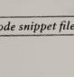

代码清单在标题中包含文件名。如果只是代码片段，您会在CodeNote中找到文件名，如下所示：

```
code snippet filename
```

下载代码后，只需使用您喜欢的压缩工具解压缩。或者，访问Wrox代码下载主页面 www.wrox.com/dynamic/books/download.aspx 查看本书及所有其他Wrox书籍的可用代码。

## 勘误

我们尽一切努力确保文本和代码中没有错误。然而，人非圣贤，错误难免。如果您在我们的某本书中发现错误，例如拼写错误或代码缺陷，我们将非常感谢您的反馈。通过提交勘误，您可能会为另一位读者节省数小时的困惑，同时帮助我们提供更高质量的信息。

要查找本书的勘误页面，请访问www.wrox.com，使用搜索框或其中一个标题列表找到该标题。然后，在书籍详情页上，单击“图书勘误”链接。在此页面上，您可以查看Wrox编辑已发布的所有针对本书提交的勘误。完整的书籍列表（包括每本书的勘误链接）也可在www.wrox.com/misc-pages/booklist.shtml获取。

**注意** 由于许多书籍具有相似的标题，您可能会发现按ISBN搜索最方便；本书的ISBN是978-0-470-64165-1。

如果您在“图书勘误”页面上没有找到“您的”错误，请访问www.wrox.com/contact/techsupport.shtml并填写那里的表单，将您发现的错误发送给我们。我们将检查信息，并在适当时在本书的勘误页上发布消息，并在本书的后续版本中修复问题。

## P2P.WROX.COM

要进行作者和同行讨论，请加入p2p.wrox.com上的P2P论坛。这些论坛是一个基于Web的系统，您可以在其中发布与Wrox书籍和相关技术相关的消息，并与其他读者和技术用户互动。论坛提供订阅功能，当论坛有新帖子时，会通过电子邮件向您发送您选择的感兴趣主题。Wrox的作者、编辑、其他行业专家以及您的读者同伴都会出现在这些论坛上。

在http://p2p.wrox.com，您会发现许多不同的论坛，这些论坛不仅会在您阅读本书时有所帮助，还会在您开发自己的应用程序时提供帮助。要加入论坛，只需按照以下步骤操作：

- 1. 转到p2p.wrox.com并单击“注册”链接。
- 2. 阅读使用条款并单击“同意”。


## 开始 iPad™ 应用开发

## 1. 开始 iPad 编程

### 本章你将学到：

- 如何获取 iPhone SDK
- iPhone SDK 包含的组件
- 开发工具的特性 — Xcode、Interface Builder、iPhone Simulator
- iPhone Simulator 的功能
- iPhone OS 的架构
- iPhone SDK 的框架
- iPad 的限制和特性

欢迎来到 iPad 编程的世界！你现在手握本书，说明你对开发 iPad 应用的想法着迷，并希望加入那些数以万计的开发者行列，他们的应用已部署在 App Store 上。

正如古老的中国谚语所说，“要完成你的使命，先磨利你的工具。”成功的编程首先要求你非常熟悉自己的工具。这一点对 iPad 编程来说再正确不过——在你甚至开始之前，你需要了解相当多的工具。因此，本章的目标是向你展示你需要掌握的各种相关工具和信息，以便加入 iPad 开发的潮流。

不再赘述，是时候开始工作了。

### 获取 iPhone SDK

要为 iPad 开发，你首先需要在 http://developer.apple.com/iphone/program/start/register/ 注册为注册 iPhone 开发者。注册是免费的，并为你提供访问 iPhone SDK（软件开发工具包）和其他有助于入门的资源。

> **NOTE** iPad 使用的操作系统（OS）与 iPhone 和 iPod touch 相同。因此，虽然你在为 iPad 开发，但仍会使用 iPhone SDK。因此，在整本书中你会经常看到术语“iPhone”。

注册后，你可以下载 iPhone SDK（版本 3.2；见图 1-1）。

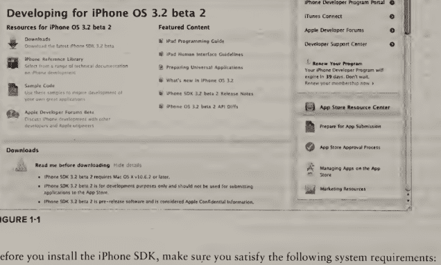

图 1-1

在安装 iPhone SDK 之前，请确保满足以下系统要求：

- 仅支持 Intel Mac，因此如果你使用的是其他处理器类型（如较旧的 G4 或 G5 Mac），你就没运气了。
- 你已使用最新的 Mac OS X 版本更新了系统。

### iPhone SDK 的组件

iPhone SDK 包含一套开发工具，帮助你为 iPhone、iPod touch 和 iPad 开发应用程序。它包括：

- Xcode — 集成开发环境（IDE），可让你管理、编辑和调试你的项目。
- Dashcode — 集成开发环境（IDE），可让你开发基于 Web 的 iPhone 和 iPad 应用程序以及 Dashboard 小部件。Dashcode 超出了本书的范围。
- iPhone Simulator — 提供软件模拟器，可在你的 Mac 上模拟 iPhone 或 iPad。
- Interface Builder — 用于设计 iPhone 和 iPad 应用程序用户界面的可视化编辑器。
- Instruments — 分析工具，可帮助你优化应用程序并实时监控内存泄漏。

以下各节将更详细地讨论每种工具（除 Dashcode 外）。

### Xcode

启动 Xcode，双击 Xcode 图标（位于 `/Developer/Applications` 文件夹中；参考图 1-3）。或者走捷径使用 Spotlight：只需在搜索框中输入 **Xcode**，Xcode 应该位于 Top Hit 位置。

图 1-4 显示了 Xcode 欢迎屏幕。

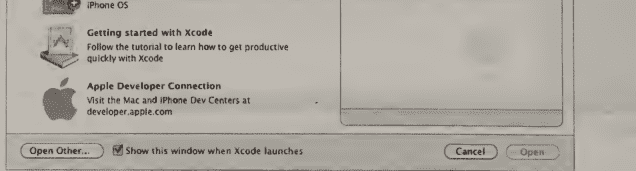

图 1-4

iPhone Simulator 可以模拟不同版本的 iPhone OS（见图 1-8）。如果需要支持较旧的平台版本以及在特定 OS 版本上测试和调试应用程序中报告的错误，此功能非常有用。

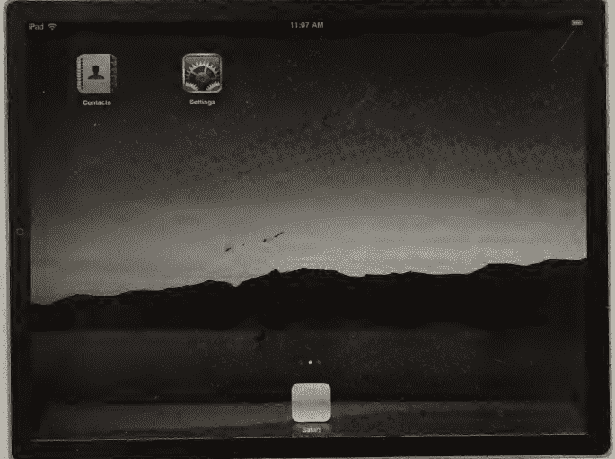

图 1-7

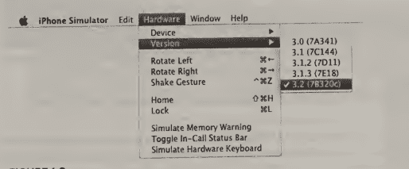

图 1-8

### iPhone Simulator 的特性

iPhone Simulator 模拟真实 iPhone、iPod touch 或 iPad 设备的各种功能。可以在 iPhone Simulator 上测试的功能包括：

- 屏幕旋转 — 左、上、右
- 手势支持：
  - Tap
  - Touch and Hold
  - Double Tap
  - Swipe
  - Flick
  - Drag
  - Pinch
- 低内存警告模拟

然而，iPhone Simulator 作为真实设备的软件模拟器，确实存在其局限性。iPhone Simulator 上不可用的功能包括：

- 进行电话呼叫
- 访问加速度计
- 发送和接收 SMS 消息
- 从 App Store 安装应用程序
- 相机
- 麦克风
- OpenGL ES 的多个功能

> **NOTE** 在 SDK 的上一个版本（3.1.3）中，iPhone Simulator 通过始终返回固定坐标来支持位置数据，例如北纬 37.3317 和西经 122.0307。在 SDK 的最新版本中，iPhone Simulator 使用其当前运行的 Mac 的位置数据并返回当前位置。

值得注意的是，iPhone Simulator 的速度与你的 Mac 的性能更紧密相关，而不是实际设备。因此，在测试时依赖 iPhone Simulator 进行测试是不够的，重要的是要在真实设备上测试你的应用程序。

尽管 iPhone Simulator 有局限性，但它绝对是测试你的应用程序的有用工具。话虽如此，在将应用程序部署到 App Store 之前，在真实 iPad 上测试应用程序是必不可少的。

### 从 iPhone Simulator 卸载应用程序

iPhone Simulator 的 iPhone OS 文件系统的用户域存储在 ~/Library/Application Support/iPhone Simulator/ 文件夹中。

> **NOTE** ~/Library/Application Support/iPhone Simulator/ 文件夹也称为 <iPhoneUserDomain>。

所有第三方应用程序都存储在 <iPhoneUserDomain>/<version_no>/Applications/ 文件夹中。当应用程序部署到 iPhone Simulator 时，主屏幕上会创建一个图标（图 1-9 左侧所示），并且在 Applications 文件夹内会创建一个文件和文件夹（图 1-9 右侧所示）。

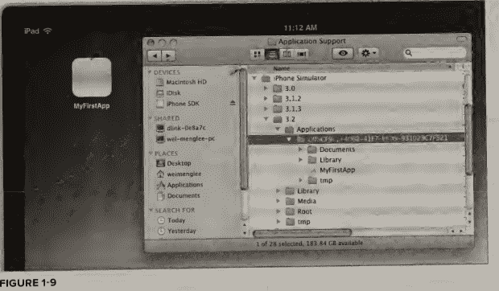

图 1-9

要卸载（删除）应用程序，请执行以下步骤：

1. 在主屏幕上点击并按住应用程序的图标，直到所有图标开始晃动。注意所有图标现在在其左上角都显示一个 X 按钮。
2. 点击要卸载的应用程序图标旁边的 X 按钮（见图 1-10）。

   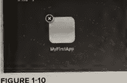

   图 1-10

3. 出现一个警告窗口，询问你是否确定要删除该图标。点击 Delete 确认删除。

> **WARNING** 当应用程序被卸载时，Applications 文件夹中对应的文件和文件夹会被自动删除。

将 iPhone Simulator 重置为原始状态的最简单方法是选择 iPhone Simulator ▸ 重置内容和设置。

### Interface Builder

Interface Builder 是一个可视化工具，可让你为 iPad 应用程序设计用户界面。使用 Interface Builder，你可以拖放视图到窗口上，然后使用 outlets 和 actions 连接各种视图，以便它们能够以编程方式与你的代码交互。

> **NOTE** Outlets 和 actions 在第 3 章中有更详细的讨论，附录 C 更详细地讨论了 Interface Builder。

图 1-11 显示了 Interface Builder 中的各个窗口。

### Instruments

Instruments（见图 1-12）应用程序允许你动态跟踪和分析你的 Mac OS X、iPhone 和 iPad 应用程序的性能。

使用 Instruments，你可以：

- 对你的应用程序进行压力测试。
- 监控你的应用程序是否存在内存泄漏。
- 深入了解你的应用程序的执行行为。
- 跟踪你的应用程序中难以重现的问题。

> **NOTE** 涵盖 Instruments 应用程序超出了本书的范围。有关更多信息，请参阅 Apple 的文档。


| 框架名称 | 描述 |
| --- | --- |
| Foundation.framework | 提供 Objective-C 的基础类，例如 NSObject、基本数据类型、操作系统服务等。 |
| GameKit.framework | 提供游戏的网络功能；通常用于点对点连接和游戏内语音功能。 |
| IOKit.framework | 提供驱动程序开发功能。 |
| MapKit.framework | 为您的应用程序提供嵌入式地图界面。 |
| MediaPlayer.framework | 提供播放电影和音频文件的功能。 |
| MessageUI.framework | 提供基于视图控制器的电子邮件撰写界面。 |
| MobileCoreServices.framework | 提供对标准类型和常量的访问。 |
| OpenAL.framework | 提供 OpenAL 规范的实现。 |
| OpenGLES.framework | 提供用于 2D 和 3D 绘图的紧凑高效的 OpenGL API 子集。 |
| QuartzCore.framework | 提供配置动画和效果然后在硬件中渲染这些效果的能力。 |
| Security.framework | 提供保护您的数据和控制软件访问的能力。 |
| StoreKit.framework | 为应用程序提供应用内购买支持。 |
| SystemConfiguration.framework | 提供确定设备上网络可用性和状态的能力。 |
| UIKit.framework | 提供管理应用程序 UI 的基本对象。 |

## 开始之前的一些有用信息

你现在对 iPad 应用程序开发涉及的工具已经有了一个大致的了解。在你开始深入之前，以下部分讨论了一些有用的信息，可以让你的旅程更愉快。

### iPhone OS 版本

撰写本文时，iPhone OS 已进入第三个修订版——即版本 3.2。其主要版本如下：

- 1.0 — iPhone 初始发布
- 1.1 — 1.0 的额外功能和错误修复
- 2.0 — 与 iPhone 3G 一同发布；附带 App Store
- 2.1 — 2.0 的额外功能和错误修复
- 2.2 — 2.1 的额外功能和错误修复
- 3.0 — iPhone OS 的第三个主要版本
- 3.1 — 3.0 的额外功能和错误修复
- 3.2 — 此版本仅面向 iPad 发布；请参阅侧边栏了解 iPhone OS 3.2 的新内容

有关每个版本功能的详细描述，请查看 http://en.wikipedia.org/wiki/iPhone_OS_version_history。

### iPhone OS 3.2 的新功能

2010 年 1 月，Apple 宣布了一款基于现有 iPhone OS 的新设备——iPad。iPad 是一款平板电脑，外形类似于 iPod touch，只是屏幕大得多。iPad 有六种不同的版本，其中三种支持 Wi-Fi，另外三种支持 Wi-Fi 和 3G 网络。iPad 将以三种存储配置发布：16GB、32GB 和 64GB。

iPhone OS 3.2 的一些重要新功能包括：

- 通过以原始屏幕尺寸或像素加倍模式运行来支持现有的 iPhone 应用程序。
- 新的 UI 功能，例如弹出窗口、分屏视图和自定义输入视图。
- 支持外部显示器。
- 支持使用手势识别器进行手势检测。
- 改进的文本支持，以允许应用程序具有更复杂的文本处理功能。
- 新的文件和文档支持，以促进构建以文档为中心的应用程序。

### 在真实设备上测试

初学者 iPad 程序员最常见的抱怨之一是无法在实际设备上测试他们开发的 iPad 应用程序。似乎很奇怪，作为设备的拥有者，他们甚至不能在上面测试自己的应用程序。事实证明，出于安全原因，Apple 要求所有应用程序都必须使用有效证书签名，而用于测试目的，则需要开发人员证书。

要在设备上测试您的应用程序，您必须注册 iPhone 开发者计划并请求将开发人员证书安装到您的设备上。

## 2 编写你的第一个 Hello World！应用程序

### 本章你将学到：

- 创建一个新的 iPad 项目
- 使用 Xcode 构建你的第一个 iPad 应用程序
- 使用 Interface Builder 设计你的 iPad 应用程序的用户界面（UI）
- 编写一些简单的代码以允许应用程序根据设备的方向旋转其内容
- 为你的 iPad 应用程序添加图标

现在你已经设置了所有工具和 SDK，你准备好开始为 iPad 开发了！对于编程书籍来说，通常以向你展示如何开发“Hello World！”应用程序来开始章节。这种方法让你可以快速使用各种工具，而不会陷入细节中。它还提供了即时的满足感：你亲眼看到东西真的能工作，这可以成为提升士气、激励你学习更多东西的动力。

### 开始使用 Xcode

启动 Xcode，你应该会看到欢迎屏幕，如图 2-1 所示。

> **注意** 启动 Xcode 的最简单方法是输入 Xcode 到 Spotlight，然后按 Enter 键启动它。

虽然你可以创建相当多的 iPad 应用程序类型，但对于本章，请选择基于视图的应用程序模板并单击“选择”按钮。

> **注意** 后续章节将向你展示如何开发其他类型的 iPad 应用程序，例如选项卡栏应用程序和基于分屏视图的应用程序。

将项目命名为 HelloWorld 并单击保存。Xcode 继续为你选择的模板创建项目。图 2-3 显示了项目中的各种文件和文件夹。

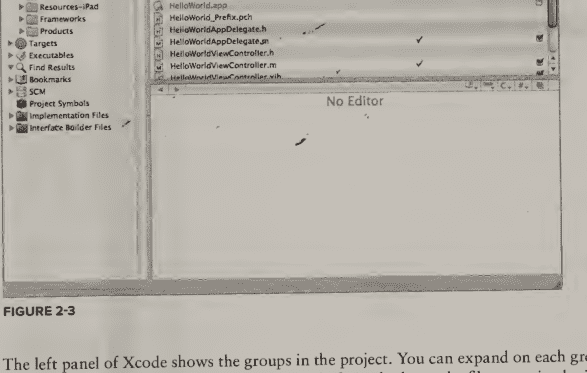

图 2-3

Xcode 的左侧面板显示项目中的组。你可以展开每个组或文件夹以显示其中包含的文件。Xcode 的右侧面板显示你在左侧面板中选择的组或文件夹中包含的文件。要编辑特定文件，请从列表中选择它，右侧面板底部的编辑器将打开文件以进行编辑。如果想要单独的编辑窗口，只需双击文件即可在新窗口中编辑它。

### 使用 Interface Builder

目前，该项目还没有 UI。为了证明这一点，只需按 Command-R（或选择 Run → Run），你的应用程序将被部署到包含的 iPhone 模拟器中。图 2-4 显示了 iPhone 模拟器上显示的空白屏幕。现在看到这一点很好，因为在你阅读本章的过程中，你会看到根据你的操作而发生的更改。

Interface Builder 是 iPhone SDK 的一部分，允许你通过拖放来构建 iPad（和 Mac）应用程序的 UI。

双击 `HelloWorldViewController.xib` 文件以启动 Interface Builder。图 2-5 显示了 Interface Builder 显示 `HelloWorldViewController.xib` 的内容（目前确实是空的）。如你所见，Library 窗口显示了你可以添加到 iPad 应用程序 UI 的各种视图。View 窗口显示了你的 UI 的图形布局。你很快就会看到其他窗口的使用。

> **注意** 如果你不熟悉 Interface Builder，请参阅附录 C 获取速成课程。

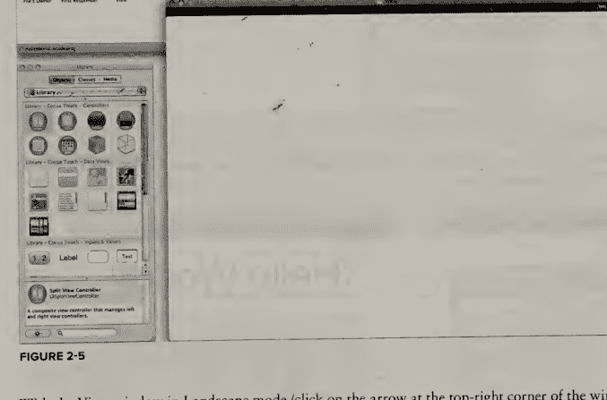

图 2-5

将 View 窗口置于横向模式（如果尚未处于横向模式，请单击窗口右上角的箭头切换方向），向下滚动到 Library 面板中的 Label 视图，然后将 `Label` 视图拖放到 View 窗口上（见图 2-6）。

添加 Label 视图后，选择它并选择 Tools → Attributes Inspector。在文本字段中输入 Hello World！此外，在 Layout 旁边，单击居中对齐类型（见图 2-7）。


接下来，从 Library 窗口将一个 Text Field 视图拖放到 View 窗口中，然后再拖放一个 Round Rect Button 视图。通过在 Title 字段中输入 Click Me! 来修改 Round Rect Button 视图的属性（见图 2-9）。

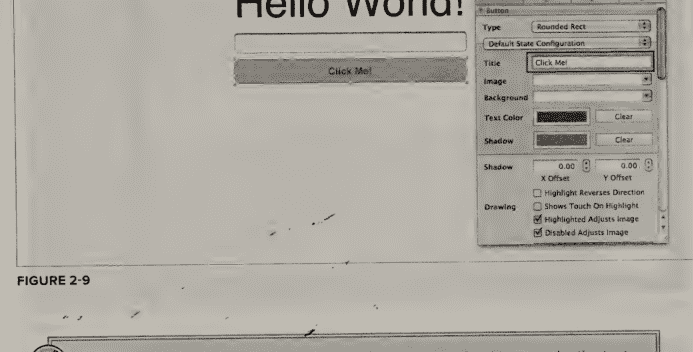

图 2-9

> 注 而不是指定视图的 Text 或 Title 属性来使文本在视图中显示（例如 Label 和 Round Rect Button 视图），你可以直接双击视图本身并直接输入文本。完成此操作后，你可以重新排列视图并按需调整其大小。Interface Builder 会提供对齐指南，帮助你以视觉上美观的布局排列控件。

通过按 Command-S 保存 HelloWorldViewController.xib 文件。然后返回 Xcode，通过按 Command-R 再次运行应用程序。iPhone Simulator 现在显示修改后的 UI（见图 2-10）。

> 注 请务必在 Xcode 中运行应用程序之前保存 Interface Builder 中的所有更改。

点击 Text Field 视图，观看键盘自动出现（见图 2-11）。按下 iPhone Simulator 上的 Home 按钮，你会看到应用程序已安装在模拟器上。要返回应用程序，只需点击 HelloWorld 图标即可（见图 2-12）。

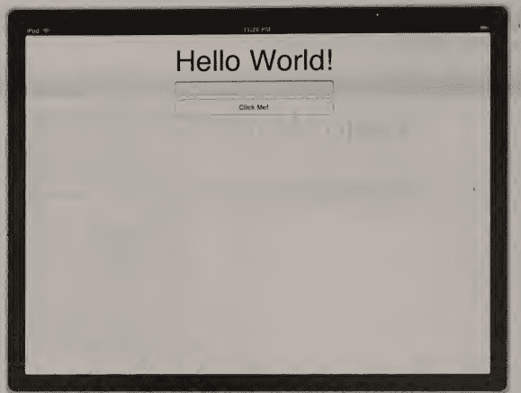

图 2-10

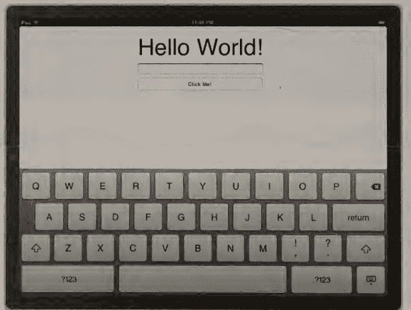

图 2-11

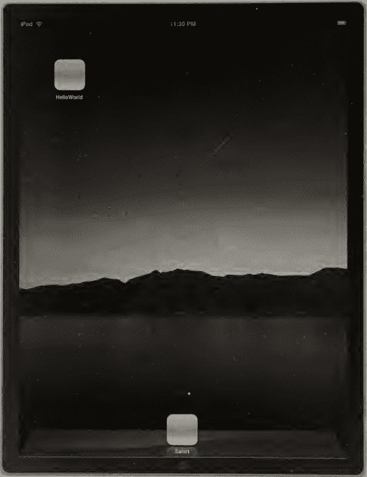

图 2-13

请注意，该方法返回 YES，表示所有方向模式均受支持，并且当方向模式更改时你的应用程序会自动翻转。

第 6 章更详细地讨论了屏幕旋转。

> **注** iPad 应用程序支持所有横向和纵向显示模式非常重要。因此，建议你在 `shouldAutorotateToInterfaceOrientation:` 方法中返回 YES。以上代码片段仅供参考。

## 视图重新定位

在上一节中，你看到随着方向的改变，视图的大小和位置保持不变。在现实世界中，这种情况是不理想的，因为它在使用应用程序时无法为用户提供良好的体验。理想情况下，你应该在屏幕上重新定位视图，使其随视图方向而变化。

要调整视图大小，请进入 Interface Builder，选择 Label 视图，然后选择 Tools ▸ Size Inspector。通过点击两个正方形内部的各种线条来修改视图的 Autosizing 属性，如图 2-15 所示（请仔细观察 Autosizing 部分中设置的各种锚点）。这将导致 Label 视图在视图方向改变时展开/收缩。同时，视图将锚定到屏幕顶部。

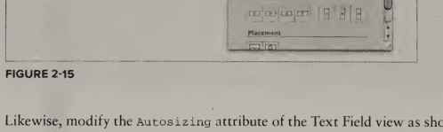

图 2-15

同样，通过点击两个正方形内部的各种线条来修改 Text Field 视图的 Autosizing 属性，如图 2-16 所示。

最后，通过点击两个正方形内的线条来修改 Round Rect Button 控件的 Autosizing 属性，如图 2-17 所示。这次，你不是在视图方向改变时调整视图大小。而是仅将其锚定到屏幕顶部。

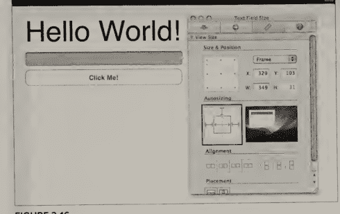

图 2-16

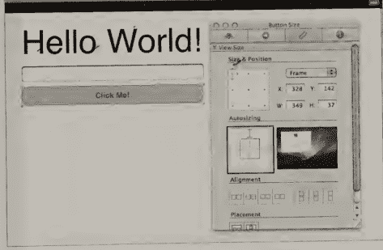

图 2-17

就这样！在 Interface Builder 中，点击屏幕右上角的箭头（见图 2-18），以旋转屏幕，从而立即查看所做的更改效果。

返回 Xcode 并再次运行应用程序。这次，注意控件在你旋转屏幕时自行重新定位和调整大小。图 2-19 显示了纵向模式下显示的视图。

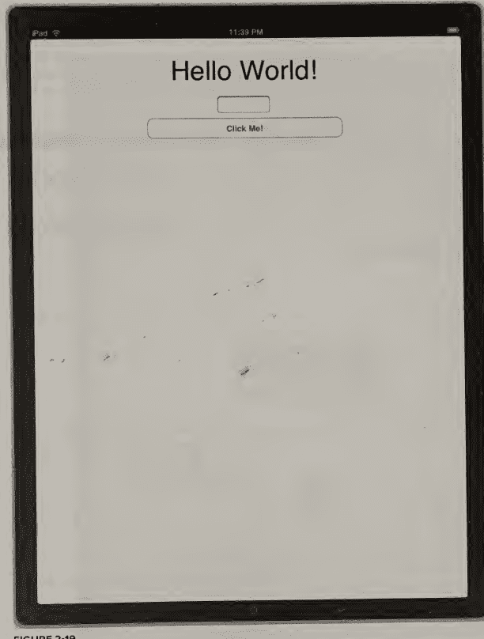

图 2-19

该粗体语句创建了一个动作（通常称为事件处理程序），名为 btnClicked:。在声明了该动作后，保存文件并返回 Interface Builder。

本章前面你看到一个名为 HelloWorldViewController.xib 的窗口。在此窗口中有三个组件：File's Owner、First Responder 和 View。在 View 窗口中 Control-click Round Rect Button 视图并将其拖到 HelloWorldViewController.xib 窗口中的 File's Owner 项（见图 2-20）。会出现一个包含 btnClicked: 动作的小弹出窗口。选择 btnClicked: 动作。基本上，你在这里做的是将 Round Rect Button 视图与动作（btnClicked:）链接起来，以便用户点击按钮时调用该动作。

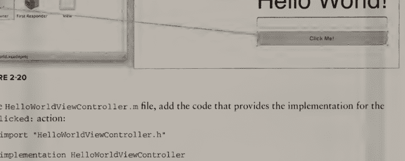

图 2-20

在 HelloWorldViewController.m 文件中，添加提供 btnClicked: 动作实现的<|message|>：

```objc
#import "HelloWorldViewController.h"

@implementation HelloWorldViewController

- (IBAction) btnClicked:(id) sender {
    //---display an alert view---
    UIAlertView *alert = [[UIAlertView alloc] initWithTitle:@"Hello World!"
                                                     message:@"iPad, here I come!"
                                                    delegate:self
                                           cancelButtonTitle:@"OK"
                                           otherButtonTitles:nil];
    [alert show];
    [alert release];
}
```

前述代码显示一个包含句子 “iPad, here I come!” 的警告框。

就这样！返回 Xcode 并再次运行应用程序。这次，当你点击 Button 视图时，会显示一个警告视图（见图 2-21）。

## 自定义应用程序图标

如你之前所见，安装在你的 iPhone Simulator 上的应用程序使用默认的白色图像作为图标。然而，你可以自定义此图标。在为你的 iPad 应用程序设计图标时，请注意以下几点：

- 将你的图标设计为 72 × 72 像素。更大尺寸也可以，因为 iPad 会自动为你调整大小。为了通过 App Store 分发，你需要准备一张 512 × 512 像素的图像。
- 为你的图标图像使用方形角落，因为 iPad 会自动将其圆角并添加光泽表面（你也可以关闭此功能）。

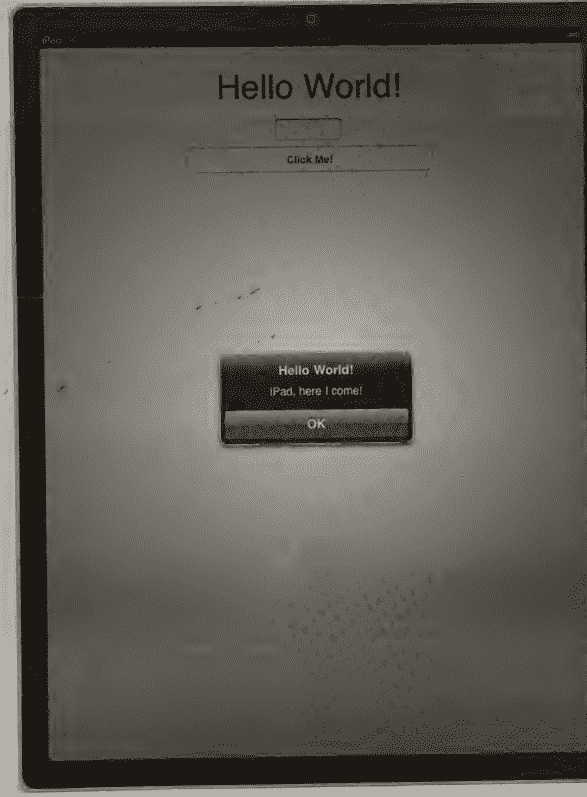

图 2-21

## 摘要

本章是开发你的第一个 iPad 应用程序的惊险之旅。虽然你可能仍有很多疑问，但本章的目的是让你入门。接下来的几章将更深入地探讨 iPad 编程的细节，所有那些神秘的项目协同工作的秘密将逐渐揭示。

## 练习

- 1. 你想在 Xcode 中为你的 iPad 项目添加一个图标。你应该提供什么尺寸的图像？
- 2. 如果你的应用程序想要支持特定的显示方向，你应该怎么做？
- 3. 在 Xcode 项目中将图像添加到 Resources 文件夹时，为什么需要选中“Copy items into destination group's folder (If needed)”选项？

练习的答案可在附录 A 中找到。

## 本章学到的内容

| 主题 | 关键概念 |
|---|---|
| Xcode | 创建你的 iPad 应用程序项目并编写操作应用程序的代码。 |
| Interface Builder | 使用 Library 中位于的各种视图构建你的 iPad UI。 |
| 重新定位视图 | 使用 Interface Builder 中的 Autosizing 功能，确保在方向改变时视图会调整大小。 |
| 添加应用程序图标 | 将图像添加到项目中，然后在 info.plist 文件的 Icon file 属性中指定图像名称。 |
| 为你的 iPad 应用程序创建图标 | 图标尺寸为 72 x 72 像素（主屏幕）和 48 x 48 像素（设置）。对于 AppStore 托管，尺寸为 512 x 512 像素。 |


## 3 视图、输出口和动作

### 本章学习内容

- 如何声明和定义输出口
- 如何声明和定义动作
- 如何将输出口和动作连接到视图窗口中的视图
- 如何使用 `UIAlertView` 向用户显示警告视图
- 如何使用 `UIActionSheet` 向用户显示一些选项
- 如何使用 `UIPageControl` 控制分页
- 如何使用 `UIImageView` 显示图像
- 如何使用 `UIWebView` 在应用程序中显示 Web 内容
- 如何在运行时动态地向应用程序添加视图

在上一章中，你构建了一个简单的 Hello World! iPad 应用程序，但没有过多了解各个部分如何协同工作的底层细节。事实上，学习 iPad 编程的最大障碍之一是，在应用程序能够正常运行之前，需要学习大量细节。本书旨在让 iPad 编程体验既有趣又不那么难以承受。因此，本章从创建 iPad 应用程序用户界面（UI）的基础知识开始，并介绍你的代码如何与各种图形组件建立连接。

### 输出口和动作

在 iPad 编程中，你首先需要理解的就是输出口和动作。如果你熟悉传统编程语言（如 Java 或 C#），这个概念需要一些时间来适应——概念相似，只是做事的方式不同。在本节结束时，你将扎实理解什么是输出口和动作，以及如何创建它们，并可着手创建出色的 iPad 应用程序。

#### 试一试：创建输出口和动作

1. 使用 Xcode 创建一个基于视图的应用程序项目，并将其命名为 `OutletsAndActions`。

2. 双击 `OutletsAndActionsViewController.xib` 文件，在 Interface Builder 中打开它进行编辑。Interface Builder 加载后，双击 `OutletsAndActionsViewController.xib` 窗口中的 View 项，以可视化方式显示视图窗口（见图3-1）。将三种视图放到视图窗口上——标签（Label）、文本框（TextField）和按钮（Button）。双击标签视图，将文本设置为“Enter your name”。同时，将按钮设置为“OK”字符串。

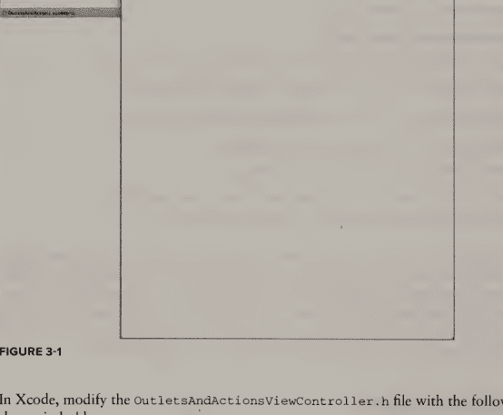

**图3-1**

3. 在 Xcode 中，使用以下加粗语句修改 `OutletsAndActionsViewController.h` 文件：

```objc
#import <UIKit/UIKit.h>

@interface OutletsAndActionsViewController : UIViewController {
    //---declaring the outlet---
    IBOutlet UITextField *txtName;
}
```

`btnClicked:` 动作只是显示一个警告视图，其中包含包含用户姓名的消息。请注意，它有一个 `id` 类型的参数 `sender`。`sender` 参数允许你以编程方式找出究竟是谁调用了这个动作。当多个视图连接到一个动作时，这非常有用。在这种情况下，你通常需要知道是哪个视图调用了此方法，而 `sender` 参数将包含对调用视图的引用。

### 使用视图

到目前为止，你已经看到了相当多的视图在发挥作用——圆角矩形按钮（Round Rect Button）、文本框（TextField）和标签（Label）。所有这些视图都很简单，但它们为你提供了理解如何应用输出口和动作背后概念的绝佳机会。

要使用更多视图，你可以在 Interface Builder 的库窗口中找到它们（见图3-6）。

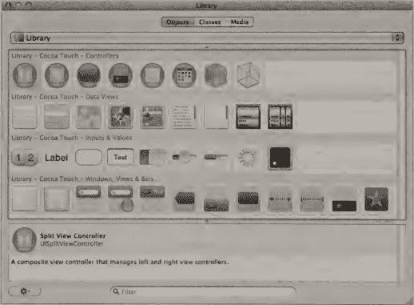

**图3-6**

库分为以下几个部分：

- **控制器（Controllers）** — 包含控制其他视图的视图，例如视图控制器（View Controller）、标签栏控制器（Tab Bar Controller）、导航控制器（Navigation Controller）等
- **数据视图（Data Views）** — 包含显示数据的视图，例如图像视图（Image View）、表视图（Table View）、日期选择器（Date Picker）、选择器视图（Picker View）等
- **输入和值（Inputs and Values）** — 包含接受用户输入以及显示值的视图，例如标签（Label）、圆角矩形按钮（Round Rect Button）、文本框（Text Field）等
- **窗口、视图和栏（Windows, Views and Bars）** — 包含显示其他各种视图的视图，例如视图（View）、搜索栏（Search Bar）、工具栏（Toolbar）等

在接下来的小节中，你将学习如何使用库中可用的部分视图。虽然本书的范围不包括展示每个视图的用法，但你将有机会在全书看到许多视图的实际应用。在本章中，你将学习处理视图的一些基本概念，以便可以毫无问题地使用其他视图。

#### 使用警告视图

库中未列出的视图之一是 `UIAlertView`。`UIAlertView` 向用户显示一个警告视图，通常是在运行时创建的。因此，你必须使用代码来创建它。

> **注意** 你实际上在第2章中见过 `UIAlertView`。在本节中，你将看到它实际是如何工作的。

当你需要向用户显示消息时，`UIAlertView` 非常有用。此外，当你想在运行时观察变量的值时，它还可以作为快速调试工具。

下面的练习将更详细地探讨 `UIAlertView`。请按指示下载代码。

#### 试一试：使用警告视图

*代码文件 UsingViews.zip 可在 Wrox.com 下载*

1. 使用 Xcode 创建一个新的基于视图的应用程序项目，并将其命名为 `UsingViews`。

2. 在 `UsingViewsViewController.m` 文件中，将以下加粗代码添加到 `viewDidLoad` 方法中：

```objc
- (void)viewDidLoad {

    UIAlertView *alert = [[UIAlertView alloc]
        initWithTitle:@"Hello"
        message:@"This is an alert view"
        delegate:self
        cancelButtonTitle:@"OK"
        otherButtonTitles:nil];

    [alert show];
    [alert release];
    [super viewDidLoad];
}
```

#### 工作原理

要使用 `UIAlertView`，首先要实例化它并使用各种参数对其进行初始化：

```objc
UIAlertView *alert = [[UIAlertView alloc]
    initWithTitle:@"Hello"
    message:@"This is an alert view"
    delegate:self
    cancelButtonTitle:@"OK"
    otherButtonTitles:nil];
```

第一个参数是警告视图的标题，你将其设置为“Hello”。第二个是消息，你将其设置为“This is an alert view”。第三个是代理，你需要将其设置为一个将处理 `UIAlertView` 对象触发事件的对象。在这种情况下，你将其设置为 `self`，这意味着事件处理程序将在当前类（即视图控制器）中实现。`cancelButtonTitle` 参数显示一个按钮，用于关闭警告视图。最后，`otherButtonTitles` 参数允许你在需要时显示其他按钮。如果不需要其他按钮，只需将其设置为 `nil`。

要以模态方式显示警告视图，请使用 `show` 方法：

```objc
[alert show];
```

> **常见错误** 需要注意的是，使用 `show` 方法以模态方式显示警告视图并不会使程序在该语句处暂停执行。即使你可能尚未关闭警告视图，该行之后的后续语句仍会继续执行。

对于警告视图的简单用途，你实际上不需要处理它触发的事件。点击“OK”按钮（如 `cancelButtonTitle` 参数中所设置）即可关闭警告视图。

如果你需要多个按钮，则需要设置 `otherButtonTitles` 参数，如下所示：

```objc
UIAlertView *alert = [[UIAlertView alloc]
    initWithTitle:@"Hello"
    message:@"This is an alert view"
    delegate:self
    cancelButtonTitle:@"OK"
    otherButtonTitles:@"Option 1", @"Option 2", nil];
```

请注意，你需要在 `otherButtonTitles` 参数末尾加上 `nil`，否则会发生运行时错误。

现在你有了三个按钮，你需要能够知道用户按下了哪个按钮——特别是按下了选项1还是选项2。为此，你需要处理 `UIAlertView` 类触发的事件。你可以通过确保视图控制器实现 `UIAlertViewDelegate` 协议来实现这一点：

```objc
@interface UsingViewsViewController : UIViewController
<UIAlertViewDelegate> {
    //...
```


UIAlertViewDelegate 协议包含与警告视图相关的多个方法。要确定用户点击了哪个按钮，你需要实现 `alertView:clickedButtonAtIndex:` 方法：

```objc
- (void)alertView:(UIAlertView *)alertView clickedButtonAtIndex:
(NSUInteger)buttonIndex {
    NSLog([NSString stringWithFormat:@"%d", buttonIndex]);
}
```

被点击按钮的索引将通过 `clickedButtonAtIndex:` 参数传入。

> 注意：关于 Objective-C 中协议概念的讨论，请参阅附录 D。

## 使用操作表（Action Sheet）

虽然警告视图可以显示多个按钮，但其主要用途仍是在发生某些事件时提醒用户。如果你需要显示一条包含多个选项供用户选择的消息，应使用操作表（Action Sheet）而不是警告视图。操作表显示一组按钮，用户可从中选择一个。

要使用操作表，请参考下面的代码片段：

```objc
UIActionSheet *action = [[UIActionSheet alloc]
    initWithTitle:@"Title of Action Sheet"
    delegate:self
    cancelButtonTitle:@"OK"
    destructiveButtonTitle:@"Delete Message"
    otherButtonTitles:@"Option 1", @"Option 2", nil];
[action showInView:self.view];
[action release];
```

要处理点击操作表中某个按钮时触发的事件，需要在视图控制器中实现 `UIActionSheetDelegate` 协议，如下所示：

```objc
#import <UIKit/UIKit.h>

@interface UsingViewsViewController : UIViewController
<UIActionSheetDelegate> {
}
```

当某个按钮被点击时，会触发 `actionSheet:clickedButtonAtIndex:` 事件：

```objc
- (void)actionSheet:(UIActionSheet *)actionSheet
clickedButtonAtIndex:(NSInteger)buttonIndex{

    NSLog([NSString stringWithFormat:@"%d", buttonIndex]);
}
```

图 3-9 展示了操作表显示时的样子。

请注意，OK 按钮（如方法中 `cancelButtonTitle:` 部分所指定的）并未显示。每个按钮对应的值（`buttonIndex`）如下：

- 删除消息（Delete Message）— 0
- 选项 1（Option 1）— 1
- 选项 2（Option 2）— 2

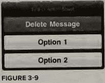

当用户点击操作表之外的区域时，操作表会被关闭，此时 `buttonIndex` 的值变为 3。有趣的是，如果你在 `cancelButtonTitle:` 部分指定为 `nil`，那么当操作表被关闭时，`buttonIndex` 的值将是 −1。

## 页面控件与图像视图

在 iPad 主屏幕的底部附近有一系列圆点（见图 3-10）。发光的圆点代表当前选中的页面。当你滑动页面到下一页时，下一个圆点会亮起，而第一个圆点会变暗。在图中，这些圆点表示第三个页面是当前活动页。在 iPhone SDK 中，这一系列圆点由 `UIPageControl` 类表示。

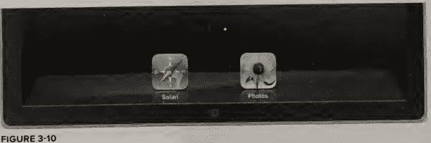

在下面的练习中，你将学习如何在自有应用中使用页面控件视图，在图像视图（ImageView）显示的图像之间进行切换。

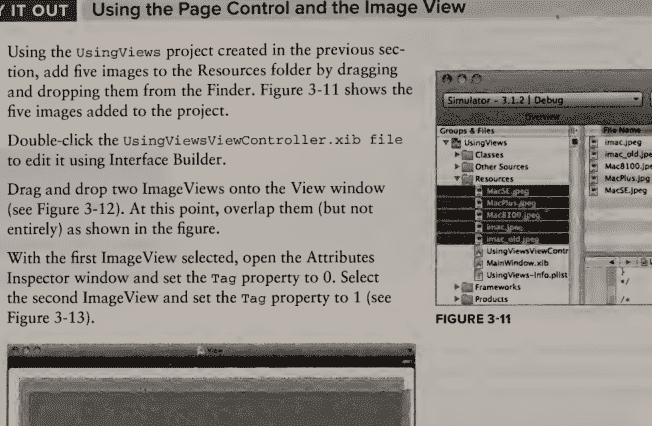

## 构建高可用的档案系统架构

文件存储是一种比较传统的存储方案，叫做 SAN（Storage Area Network，存储区域网络）和 NAS（Network Attached Storage，网络附加存储）。

在业务比较简单的时代，这个方案基本可以很好的支撑业务，但是随着业务数据量的增长，这种传统存储方案逐渐暴露出很多问题，最核心的问题是成本太高，因为需要通过购买高端服务器和磁盘阵列来提升存储性能，这样的成本往往是普通中小企业无法承受的。

另外，如果 NAS 和 SAN 中的某一台服务器出现故障，会导致整个系统不可用。为了解决这些问题，业界提出了`软件定义存储`的概念，SDS 的核心在于基于通用的硬件，通过软件定义存储的解决方案，降低存储成本，并通过软件层面数据副本机制，保证数据的高可靠。

接下来我们看一下国内的软件定义存储市场的整体情况，这里我列举了部分做存储厂商，其中包含一些老牌存储厂商，也有云厂商，比如华为、阿里云、腾讯云等，还有一些创业公司。

| 厂商 | 产品 | 类型 |
| --- | --- | --- |
| 华为 | OceanStor | 老牌存储厂商 |
| 阿里云 | 云盘 | 云厂商 |
| 腾讯云 | CBS | 云厂商 |
| 七牛云 | Kodo | 云厂商 |
| 杉岩数据 | USP | 创业公司 |
| XSKY | XStor | 创业公司 |

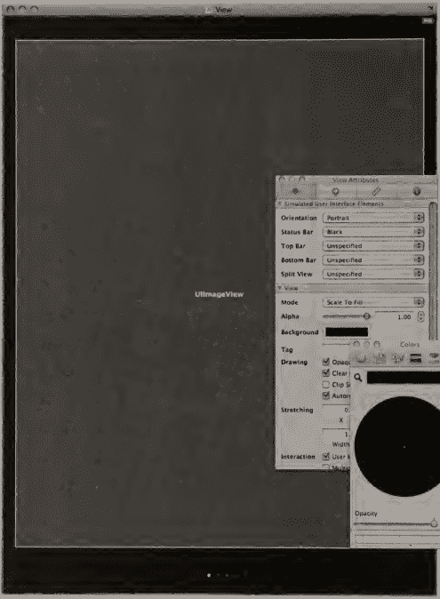

图 3-15

- 8. 在 Interface Builder 中，将三个出口（outlet）连接到 View 窗口上的视图。图 3-16 显示了为 `imageView1`、`imageView2` 和 `pageControl` 出口所做的连接。

- 9. 现在你可以重新排列 View 窗口上的图像视图，使它们彼此重叠。

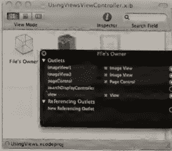

图 3-16

10. 在 Xcode 中，将以下以粗体显示的语句添加到 `UsingViewsViewController.m` 文件中：

```objc
#import "UsingViewsViewController.h"

@implementation UsingViewsViewController

@synthesize pageControl;
@synthesize imageView1, imageView2;

- (void)viewDidLoad {
    //---initialize the first ImageView to display an image---
    [imageView1 setImage:[UIImage imageNamed:@"iMac_old.jpeg"]];
    tempImageView = imageView2;

    //---make the first ImageView visible and hide the second---
    [imageView1 setHidden:NO];
    [imageView2 setHidden:YES];

    //---add the event handler for the page control---
    [pageControl addTarget:self
                    action:@selector(pageTurning:)
          forControlEvents:UIControlEventValueChanged];

    [super viewDidLoad];
}

//---when the page control's value is changed---
- (void) pageTurning: (UIPageControl *) pageController {

    //---get the page number you can turning to---
    NSInteger nextPage = [pageController currentPage];
    switch (nextPage) {
        case 0:
            [tempImageView setImage:
                [UIImage imageNamed:@"iMac_old.jpeg"]];
            break;
        case 1:
            [tempImageView setImage:
                [UIImage imageNamed:@"iMac.jpeg"]];
            break;
        case 2:
            [tempImageView setImage:
                [UIImage imageNamed:@"Mac8100.jpeg"]];
            break;
        case 3:
            [tempImageView setImage:
                [UIImage imageNamed:@"MacPlus.jpeg"]];
            break;
        case 4:
            [tempImageView setImage:
                [UIImage imageNamed:@"MacSE.jpeg"]];
            break;
    }
}
```

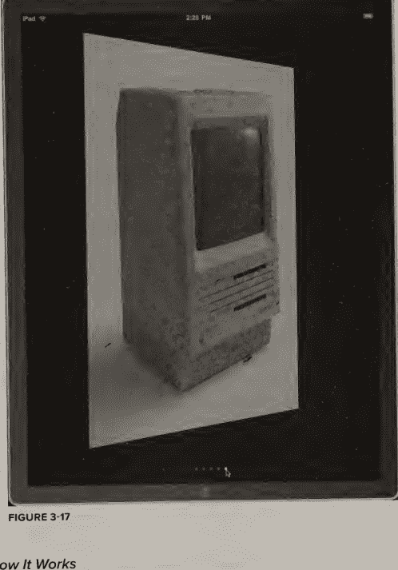

图 3-17

## 工作原理

当视图首次加载时，你先让其中一个图像视图显示图像，然后隐藏另一个：

```objc
//---initialize the first ImageView to display an image---
[imageView1 setImage:[UIImage imageNamed:@"iMac_old.jpeg"]];
tempImageView = imageView2;

//---make the first ImageView visible and hide the second---
[imageView1 setHidden:NO];
[imageView2 setHidden:YES];
```

然后，你将页面控件（Page Control）连接起来，使用户点击它时会触发一个事件并调用一个方法。在本例中，调用的是 `pageTurning:` 方法：

```objc
//---add the event handler for the page control---
[pageControl addTarget:self
    action:@selector(pageTurning:)
    forControlEvents:UIControlEventValueChanged];
```

在 `pageTurning:` 方法中，你根据页面控件的值来确定应加载哪张图像：

```objc
//---when the page control's value is changed---
- (void) pageTurning: (UIPageControl *) pageController {
    //---get the page number you can turning to---
    NSInteger nextPage = [pageController currentPage];
    switch (nextPage) {
        case 0:
            [tempImageView setImage:
                [UIImage imageNamed:@"iMac_old.jpeg"]];
            break;
        case 1:
            [tempImageView setImage:
                [UIImage imageNamed:@"iMac.jpeg"]];
            break;
        case 2:
            [tempImageView setImage:
                [UIImage imageNamed:@"Mac8100.jpeg"]];
            break;
        case 3:
            [tempImageView setImage:
                [UIImage imageNamed:@"MacPlus.jpeg"]];
            break;
        case 4:
            [tempImageView setImage:
                [UIImage imageNamed:@"MacSE.jpeg"]];
            break;
        default:
            break;
    }
    //...
}
```

然后，你通过使用 `UIView` 类中的各种方法来切换两个图像视图并为其添加动画效果：

```objc
//---switch the two ImageView views---
if (tempImageView.tag==0) { //---imageView1---
    tempImageView = imageView1;
    bgImageView = imageView1;
}
else {   //---imageView2---
    tempImageView = imageView1;
    bgImageView = imageView2;
}

//---animate the two views flipping---
```


```objc
[UIView beginAnimations:@"flipping view" context:nil];
[UIView setAnimationDuration:0.5];
[UIView setAnimationCurve:UIViewAnimationCurveEaseInOut];
[UIView setAnimationTransition:UIViewAnimationTransitionFlipFromLeft
    forView:tempImageView
    cache:YES];
[tempImageView setHidden:YES];
[UIView commitAnimations];

[UIView beginAnimations:@"flipping view" context:nil];
[UIView setAnimationDuration:0.5];
[UIView setAnimationCurve:UIViewAnimationCurveEaseInOut];
[UIView
    setAnimationTransition:UIViewAnimationTransitionFlipFromRight
    forView:bgImageView
    cache:YES];
[bgImageView setHidden:NO];
[UIView commitAnimations];
```

具体来说，你可以将翻转过渡应用到图像视图：

```objc
[UIView setAnimationTransition:UIViewAnimationTransitionFlipFromLeft
    forView:tempImageView
    cache:YES];
```

## 使用 Web 视图

若要从应用程序内部加载网页，可以通过使用 UIWebView 在应用程序中嵌入一个 Web 浏览器。使用 Web 视图，你可以发送一个请求来加载 Web 内容；如果你想把现有的 Web 应用程序转换为原生应用程序（例如使用 Dashcode 编写的程序），这将非常有用。你只需要将所有 HTML 页面嵌入到 Xcode 项目中的 Resources 文件夹中，并在运行时将 HTML 页面加载到 Web 视图中即可。

> **注意** 根据 Web 应用程序的复杂程度，如果涉及 CGI、PHP 等服务器端技术，你可能需要做一些额外的工作，才能将 Web 应用程序移植为原生应用程序。

下面的试一试演示了如何使用 Web 视图加载网页。

### 试一试：使用 Web 视图加载网页

*代码文件 UsingViews2.zip 可从 Wrox.com 下载*

1. 使用 Xcode 创建一个新的基于视图的应用程序项目，并将其命名为 UsingViews2。
2. 双击 UsingViews2ViewController.xib 文件，并使用 Interface Builder 对其进行编辑。
3. 在视图窗口中，从资源库中添加一个 Web 视图（参见图 3-18）。在 Web 视图的属性检查器窗口中，勾选“缩放页面以适合”（Scales Page to Fit）属性。

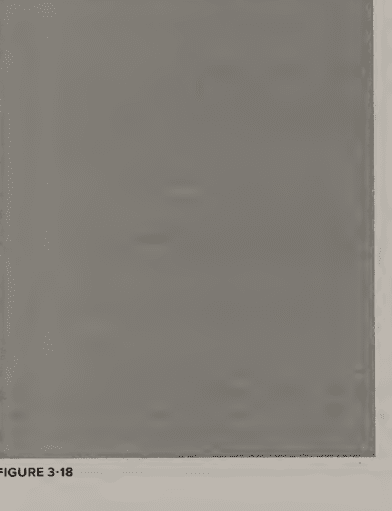

图 3-18

4. 在 UsingViews2ViewController.h 文件中，为 Web 视图声明一个输出口（outlet）：

```objc
#import <UIKit/UIKit.h>

@interface UsingViews2ViewController : UIViewController {
    IBOutlet UIWebView *webView;
}

@property (nonatomic, retain) UIWebView *webView;

@end
```

5. 在 Interface Builder 中，将 webView 输出口连接到 Web 视图。

6. 在 UsingViews2ViewController.m 文件中，添加下面以粗体显示的语句：

```objc
#import "UsingViews2ViewController.h"

@implementation UsingViews2ViewController

@synthesize webView;

- (void)viewDidLoad {
    NSURL *url = [NSURL URLWithString:@"http://www.apple.com"];
    NSURLRequest *req = [NSURLRequest requestWithURL:url];
    [webView loadRequest:req];

    [super viewDidLoad];
}

- (void)dealloc {
    [webView release];
    [super dealloc];
}
```

7. 按下 Command-R 在 iPhone 模拟器上测试应用程序。你应该看到应用程序从 Apple.com 加载页面（参见图 3-19）。

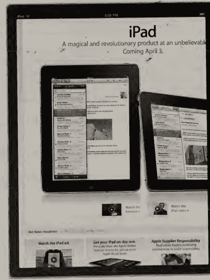

图 3-19

### 工作原理

要使用 URL 加载 Web 视图，首先需要调用 URLWithString: 方法，使用 URL 实例化一个 NSURL 对象：

```objc
NSURL *url = [NSURL URLWithString:@"http://www.apple.com"];
```

然后，通过将该 NSURL 对象传递给 NSURLRequest 的 requestWithURL: 方法，创建一个 NSURLRequest 对象：

```objc
NSURLRequest *req = [NSURLRequest requestWithURL:url];
```

最后，通过 loadRequest: 方法，使用该 NSURLRequest 对象加载 Web 视图：

```objc
[webView loadRequest:req];
```

## 使用代码动态添加视图

到目前为止，应用程序的所有 UI 都是使用 Interface Builder 以可视化方式创建的。尽管使用 Interface Builder 通过拖放构建 UI 相对容易，但有时使用代码创建 UI 效果更好。例如，当你需要动态 UI（如游戏）时就是这种情况。

> **注意** Interface Builder 可能易于使用，但有些人可能会感到困惑。因为使用 Interface Builder 做事通常有多种方式，所以可能会产生不必要的复杂性。我知道有些开发者坚持使用代码创建 UI。

在下面的试一试中，你将学习如何通过代码动态创建视图，这将帮助你理解视图是如何构建和操作的。

### 试一试：使用代码创建视图

*代码文件 DynamicViews.zip 可从 Wrox.com 下载*

1. 使用 Xcode 创建一个基于视图的应用程序项目，并将其命名为 DynamicViews。
2. 在 DynamicViewsViewController.m 文件中，添加下面以粗体显示的语句：

```objc
#import "DynamicViewsViewController.h"

@implementation DynamicViewsViewController

- (void)loadView {
    //---create a UIView object---
    UIView *view =
        [[UIView alloc] initWithFrame:[UIScreen mainScreen].applicationFrame];
    view.backgroundColor = [UIColor lightGrayColor];

    //---create a Label view---
    CGRect frame = CGRectMake(10, 15, 300, 20);
    UILabel *label = [[UILabel alloc] initWithFrame:frame];
    label.textAlignment = UITextAlignmentCenter;
    label.backgroundColor = [UIColor clearColor];
    label.font = [UIFont fontWithName:@"Verdana" size:20];
    label.text = @"This is a label!";
    label.tag = 1000;

    //---create a Button view---
    frame = CGRectMake(10, 70, 300, 50);
    UIButton *button = [UIButton buttonWithType:UIButtonTypeRoundedRect];
    button.frame = frame;

    [button setTitle:@"Click Me, Please!" forState:UIControlStateNormal];
    button.backgroundColor = [UIColor clearColor];
    button.tag = 2000;
    [button addTarget:self
        action:@selector(buttonClicked:)
        forControlEvents:UIControlEventTouchUpInside];

    [view addSubview:label];
    [view addSubview:button];

    self.view = view;
    [label release];
}

-(IBAction) buttonClicked: (id) sender{
    UIAlertView *alert = [[UIAlertView alloc]
        initWithTitle:@"Action invoked!"
        message:@"Button clicked!"
        delegate:self
        cancelButtonTitle:@"OK"
        otherButtonTitles:nil];

    [alert show];
    [alert release];
}

@end
```

3. 按下 Command-R 在 iPhone 模拟器中测试应用程序。图 3-20 显示，标签视图和圆角矩形按钮视图都已显示在视图上。点击按钮，可以看到一个显示消息的警告视图。

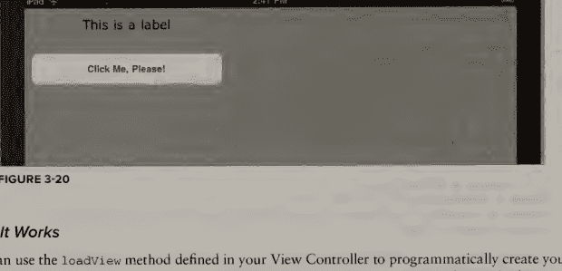

图 3-20

### 工作原理

你可以使用视图控制器中定义的 loadView 方法以编程方式创建视图。只有在运行时生成 UI 时才需要实现此方法。当视图控制器的 view 属性被访问但当前值为 nil 时，系统会自动调用此方法。

你创建的第一个视图是 UIView 对象，你可以将其用作更多视图的容器：

```objc
//---create a UIView object---
UIView *view =
    [[UIView alloc] initWithFrame:[UIScreen mainScreen].applicationFrame];

//---set the background color to lightgray---
view.backgroundColor = [UIColor lightGrayColor];
```

接下来，创建一个标签视图，并设置它显示一个字符串：

```objc
//---create a Label view---
CGRect frame = CGRectMake(10, 15, 300, 20);
UILabel *label = [[UILabel alloc] initWithFrame:frame];
label.textAlignment = UITextAlignmentCenter;
label.backgroundColor = [UIColor clearColor];
label.font = [UIFont fontWithName:@"Verdana" size:20];
label.text = @"This is a label!";
label.tag = 1000;
```

请注意，你还设置了 tag 属性，它对于在运行时查找特定视图非常有用。

你还可以通过调用 buttonWithType: 方法并传入 UIButtonTypeRoundedRect 常量来创建按钮视图。该方法返回一个 UIRoundedRectButton 对象（它是 UIButton 的子类）。

```objc
//---create a Button view---
frame = CGRectMake(10, 70, 300, 50);
UIButton *button = [UIButton buttonWithType:UIButtonTypeRoundedRect];
button.frame = frame;
```


```
[button setTitle:@"Click Me, Please!"
    forState:UIControlStateNormal];
button.backgroundColor = [UIColor clearColor];
button.tag = 2000;
```

然后，你需要为其 Touch Up Inside 事件连接一个事件处理程序，这样当按钮被点击时，就会调用 `buttonClicked:` 方法：

```
[button addTarget:self
    action:@selector(buttonClicked:)
    forControlEvents:UIControlEventTouchUpInside];
```

最后，将标签视图和按钮视图添加到之前创建的视图中：

```
[view addSubview:label];
[view addSubview:button];
```

最后，将视图对象赋值给当前视图控制器的 `view` 属性：

```
self.view = view;
```

**警告** 这里需要特别注意一点：在 `loadView` 方法中，你不应该获取 `view` 属性的值（但可以设置它），例如：

```
[self.view addSubview: label]; //---this is not OK---
self.view = view; //---this is OK---
```

*在该方法中试图获取 `view` 属性的值将导致循环引用，并可能引发内存溢出。*

## 理解视图层级结构

当视图被创建并添加时，它们会被添加到一个树形数据结构中。视图按照添加的顺序显示。为了验证这一点，请通过将之前创建的 `UIButton` 对象的位置改为 `CGRectMake(10, 30, 300, 50)` 来修改其位置，如下所示：

```
//---create a Button view---
frame = CGRectMake(10, 30, 300, 50);
UIButton *button = [UIButton buttonWithType:UIButtonTypeRoundedRect];
button.frame = frame;
[button setTitle:@"Click Me, Please!"
    forState:UIControlStateNormal];
button.backgroundColor = [UIColor clearColor];
button.tag = 2000;
[button addTarget:self
    action:@selector(buttonClicked:)
    forControlEvents:UIControlEventTouchUpInside];
```

```objective-c
for (int i=0; i<[view.subviews count]; ++i) {
    UIView *v = [view.subviews objectAtIndex:i];
    NSLog(@"View index: %d Tag: %d", i, v.tag);
    [self printViews:v];
}
} else
    return;
}
```

要从当前视图层级中移除视图，请使用要移除的视图的 `removeFromSuperview` 方法。例如，以下语句会移除标签视图：

```objective-c
[label removeFromSuperview];
```

## 本章小结

本章探讨了 `outlet` 和 `action` 在 iPad 应用中所扮演的角色。`Outlet` 和 `action` 是 iPad 开发的基石，因此理解它们的用法极其重要。在本书中，你会经常遇到它们。你还看到了如何使用库（Library）中一些常用的视图。

## 练习

- 1. 使用代码声明并定义一个 `UITextField` 视图的 `outlet`。
- 2. 使用代码声明并定义一个 `action`。
- 3. 何时使用警报视图（Alert view），何时使用操作表（action sheet）？
- 4. 从代码创建一个 `UIButton`，并将其 Touch Up Inside 事件连接到事件处理程序。

练习答案见附录 A。

## ▶ 本章学习要点

| 主题 | 关键概念 |
|---|---|
| **操作（Action）** | 操作是一种方法，可以处理视图窗口（View window）中视图引发的事件（例如按钮被点击等）。 |
| **出口（Outlet）** | 出口允许你的代码以编程方式引用视图窗口中的视图。 |
| **使用代码添加出口** | 使用 `IBOutlet` 关键字：<br>`IBOutlet UITextField *nameTextField;` |
| **使用代码添加操作** | 使用 `IBAction` 关键字：<br>`- (IBAction)btnClicked:(id)sender;` |
| **连接操作** | 要连接操作，你总是从视图窗口中的视图拖到 File’s Owner 项上。 |
| **连接出口** | 要连接出口，你总是从 File’s Owner 项拖到视图窗口中需要的视图上。 |
| **使用 UIAlertView** | ```objc
UIAlertView *alert = [[UIAlertView alloc]
    initWithTitle:@"Hello"
    message:@"This is an alert view"
    delegate:self
    cancelButtonTitle:@"OK"
    otherButtonTitles:nil];
``` |
| **处理 UIAlertView 触发的事件** | 确保你的视图控制器遵循 `UIAlertViewDelegate` 协议。 |
| **使用 UIActionSheet** | ```objc
UIActionSheet *action =
    [[UIActionSheet alloc]
    initWithTitle:@"Title of Action Sheet"
    delegate:self
    cancelButtonTitle:@"OK"
    destructiveButtonTitle:
    @"Delete Message"
    otherButtonTitles:@"Option 1",
    @"Option 2", nil];
``` |
| **处理 UIActionSheet 触发的事件** | 确保你的视图控制器遵循 `UIActionSheetDelegate` 协议。 |
| **为 UIPageControl 连接事件** | ```objc
[pageControl addTarget:self
    action:@selector(pageTurning:)
    forControlEvents:UIControlEventValueChanged];
``` |

| 主题 | 关键概念 |
|---|---|
| 使用 UIImageView | `[imageView1 setImage:
[UIImage imageNamed:@"iMac_old.jpeg"]];` |
| 使用 UIWebView | `NSURL *url =
[NSURL URLWithString:@"http://www.apple.com"];
NSURLRequest *req =
[NSURLRequest requestWithURL:url];
[webView loadRequest:req];` |

## 4 视图控制器

## 视图控制器

### 本章你将学到：

- - 了解 iPad 应用程序项目的结构
- - 如何创建基于窗口（Window-based）的应用程序，并手动向其中添加视图控制器和视图窗口
- - 如何在运行时动态创建视图
- - 如何通过代码将视图的事件与事件处理程序连接起来
- - 如何在运行时切换到另一个视图
- - 如何为视图切换制作动画
- - 如何创建基于分屏（Split View）的应用程序
- - 如何创建标签栏（Tab Bar）应用程序

到目前为止，你只接触过单视图应用程序——也就是只有一个视图控制器的应用程序。前面几章都使用了 iPhone SDK 中提供的基于视图的应用程序模板（View-based Application template），因为这是在 iPad 编程中入门的最简单方式。当你创建一个基于视图的应用程序时，默认会有一个视图控制器（iPhone SDK 将其命名为 `<project_name>ViewController`）。

在实际应用程序中，你常常需要多个视图控制器，每个控制器控制一个显示不同信息的视图。本章展示了你可以为 iPad 创建的各种类型的项目，以及每种项目如何利用不同类型的视图控制器。你还将学习如何在应用程序中创建多个视图，然后在运行时以编程方式在它们之间切换。此外，你还将学习如何使用 iPhone SDK 中内置的动画方法为视图切换添加动画效果。

## 基于视图的应用程序模板

当你使用 Xcode 创建一个基于视图的应用程序项目时，你的应用程序会自动拥有一个视图。到目前为止，你一直在使用它，但并不十分了解其底层工作机制。在接下来的“动手试一试”中，你将深入细节，揭开让应用程序运转的所有奥秘。

## 试一试 创建基于视图的应用程序项目

代码文件 `viewBasedApp.zip` 可从 Wrox.com 下载

- 1. 使用 Xcode 创建一个基于视图的应用程序项目，并将其命名为 `viewBasedApp`。
- 2. 按下 Command-R 在 iPhone 模拟器上测试应用程序。应用程序会显示一个空白屏幕，如图 4-1 所示。

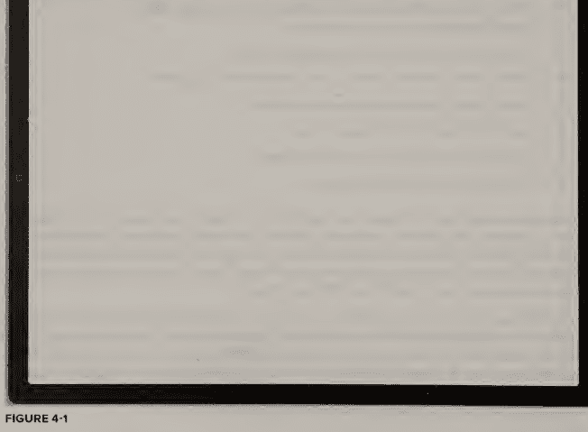

图 4-1

```
[super dealloc];
}
@end
```

当应用程序完成启动后，它会向委托发送 `applicationDidFinishLaunchingWithOptions:` 消息。在前面的例子中，它使用视图控制器来获取其视图，然后将其添加到当前窗口中，以便显示。

`viewBasedAppDelegate.h` 文件包含了 `viewBasedAppAppDelegate` 类成员的声明：

```
#import <UIKit/UIKit.h>

@class viewBasedAppViewController;

@interface viewBasedAppAppDelegate : NSObject <UIApplicationDelegate> {
    UIWindow *window;
    viewBasedAppViewController *viewController;
}

@property (nonatomic, retain) IBOutlet UIWindow *window;
@property (nonatomic, retain) IBOutlet viewBasedAppViewController *viewController;

@end
```

特别值得关注的是这一行：

```
@interface viewBasedAppAppDelegate : NSObject <UIApplicationDelegate> {
```

`<UIApplicationDelegate>` 语句指定了委托类实现 `UIApplicationDelegate` 协议。简单来说，这意味着委托类将处理 `UIApplicationDelegate` 协议中定义的事件（或消息）。`UIApplicationDelegate` 协议中的事件示例包括：

- - `Application:DidFinishLaunchingWithOptions:`（你在 `viewBasedAppAppDelegate.m` 文件中看到了它的实现。）
- - `applicationWillTerminate:`
- - `applicationDidReceiveMemoryWarning:`

应用程序委托类也是放置全局对象和函数的好地方，因为项目中的所有其他类都可以访问它们。

注：协议将在附录 D 中更详细地讨论。


如你所见，视图显示它是从 viewBasedAppViewController 加载的，这指的是你项目中的 viewBasedAppViewController.xib 文件的名称。

现在，双击 viewBasedAppViewController.xib 文件，在 Interface Builder 中编辑它。与 MainWindow.xib 文件一样，viewBasedAppViewController.xib 窗口中也包含几个对象。本例中包含 File's Owner、First Responder 和 View。

你可以右键单击（或按住 Control 键单击）File's Owner 项来查看其属性（参见图 4-8）。注意 view 出口已连接到 View 项。

View 项表示你的应用程序中显示的屏幕。双击 View 即可显示它（参见图 4-9）。

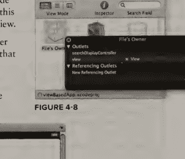

**FIGURE 4-8**

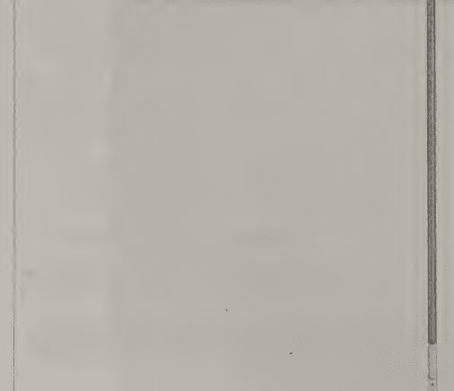

**FIGURE 4-9**

当你选择 File's Owner 项并查看其标识检查器（Identity Inspector）窗口时，应该会看到类指向 viewBasedAppViewController 类（参见图 4-10）。这意味着 View 窗口由 viewBasedAppViewController 类控制。

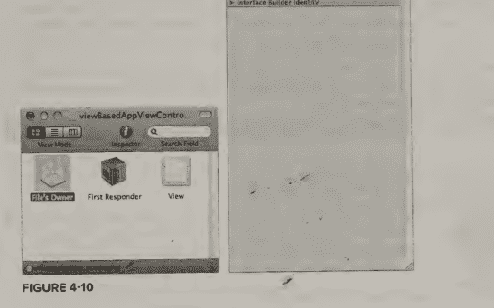

**FIGURE 4-10**

viewBasedAppViewController 类由两个文件表示——viewBasedAppViewController.h 和 viewBasedAppViewController.m。viewBasedAppViewController 类是你编写代码与应用程序视图交互的地方。

viewBasedAppViewController.h 文件的内容如下所示：

```objc
#import <UIKit/UIKit.h>

@interface viewBasedAppViewController : UIViewController {
}

@end
```

注意，viewBasedAppViewController 类继承自 UIViewController 基类，该基类提供了 View 窗口上可用的大部分功能。

viewBasedAppViewController.m 文件的内容如下所示：

```objc
#import "viewBasedAppViewController.h"

@implementation viewBasedAppViewController

/*
// The designated initializer. Override to perform setup that
// is required before the view is loaded.
- (id)initWithNibName:(NSString *)nibNameOrNil
bundle:(NSBundle *)nibBundleOrNil {
    if ((self = [super initWithNibName:nibNameOrNil
        bundle:nibBundleOrNil])) {
        // Custom initialization
    }
    return self;
}
*/

/*
// Implement loadView to create a view hierarchy
// programmatically, without using a nib.
- (void)loadView {
}
*/

/*
// Implement viewDidLoad to do additional setup after
// loading the view, typically from a nib.
- (void)viewDidLoad {
    [super viewDidLoad];
}
*/

// Override to allow orientations other than the
// default portrait orientation.
- (BOOL)shouldAutorotateToInterfaceOrientation:
(UIInterfaceOrientation)interfaceOrientation {
    return YES;
}

- (void)didReceiveMemoryWarning {
    // Releases the view if it doesn't have a superview.
    [super didReceiveMemoryWarning];
    // Release any cached data, images, etc that aren't in use.
}

- (void)viewDidUnload {
    // Release any retained subviews of the main view.
    // e.g. self.myOutlet = nil;
}

- (void)dealloc {
    [super dealloc];
}

@end
```

## 基于窗口的应用程序模板

在本节中，你将了解可以用 iPhone SDK 创建的另一种应用程序模板：基于窗口的应用程序模板。与基于视图的应用程序模板不同，基于窗口的应用程序模板默认不包含视图控制器。相反，它只提供一个 iPad 应用程序的骨架，其余部分留给开发人员——你需要添加自己的视图及其各自的视图控制器。因此，基于窗口的应用程序很好地帮助你理解视图控制器的工作原理，并体会连接视图控制器与 XIB 文件所需的全部工作。当你理解视图控制器的工作原理后，你就在创建更复杂应用程序的道路上了。

首先，请执行下面的“动手试一试”来编写一个基于窗口的应用程序，然后逐步向其中添加一个视图控制器。

### 动手试一试：创建基于窗口的应用程序

代码文件 windowBasedApp.zip 可在 Wrox.com 上下载。

- 1. 使用 Xcode，创建一个基于窗口的应用程序项目，并将其命名为 `windowBasedApp`。观察为此项目类型创建的文件（参见图 4-11）。除通常的支持文件外，注意只有一个 XIB 文件（`MainWindow.xib`）和两个委托文件（`windowBasedAppAppDelegate.h` 和 `windowBasedAppAppDelegate.m`）。

- 2. 按 Command-R 测试应用程序。iPhone Simulator 上显示一个空屏幕。这是因为基于窗口的应用程序模板仅为简单的 iPad 应用程序提供骨架结构——只有一个窗口和应用程序委托。

- 3. 在 Xcode 中，双击 `MainWindow.xib` 在 Interface Builder 中进行编辑。注意 `MainWindow.xib` 窗口中有四个项目（参见图 4-12）：
  - File's Owner
  - First Responder
  - Window
  - Window Based App App Delegate

- 4. 从库窗口（Library）中，将一个 View Controller 项拖放到 `MainWindow.xib` 窗口上（参见图 4-13）。你将把这个 View Controller 项连接到下一步中将要添加到项目中的视图。

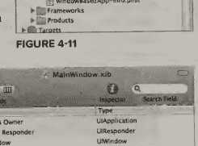

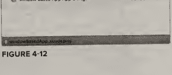

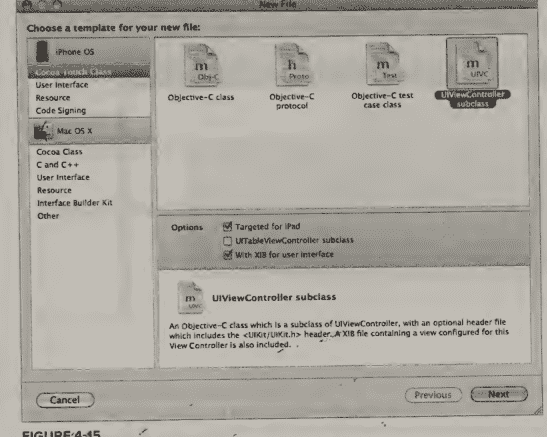

**FIGURE 4-15**

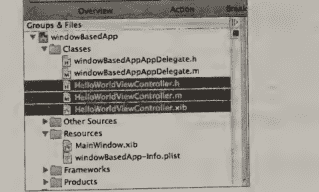

**FIGURE 4-16**

**注意** 为了保持项目整洁，建议你将 .xib 文件拖入 Resources 文件夹。

- 6. 双击 HelloWorldViewController.xib 文件，在 Interface Builder 中编辑它。

- 7. 向 View 窗口添加一个圆角矩形按钮（Round Rect Button），并按图 4-17 所示给按钮添加标签。

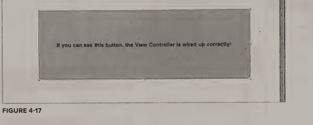

**FIGURE 4-17**

- 8. 在 Interface Builder 中，选择 MainWindow.xib 窗口中的 View Controller 项，并查看其标识检查器窗口。在 Class 下拉列表中，选择 HelloWorldViewController（参见图 4-18）。视图控制器的名称现在将变为 Hello World View Controller。

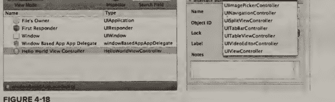

**FIGURE 4-18**

- 9. 查看 Hello World View Controller 的属性检查器（Attributes Inspector）窗口，并在 NIB Name 下拉列表中选择 HelloWorldViewController（参见图 4-19）。

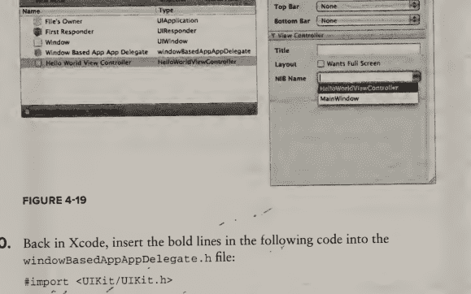

**FIGURE 4-19**

- 10. 回到 Xcode 中，将以下代码中的粗体行插入到 windowBasedAppAppDelegate.h 文件中：

```objc
#import <UIKit/UIKit.h>

//---add a forward reference to the HelloWorldViewController class---
@class HelloWorldViewController;

@interface windowBasedAppAppDelegate :
NSObject <UIApplicationDelegate> {
    UIWindow *window;

    //---create an instance of the view controller---
    HelloWorldViewController *viewController;
}

@property (nonatomic, retain) IBOutlet UIWindow *window;

//---expose the view controller as a property---
@property (nonatomic, retain) IBOutlet
HelloWorldViewController *viewController;

@end
```

这样它就可以连接到刚刚添加的 View Controller。该控制器类包含你将编写的、用于处理视图与用户之间交互的代码。

当应用程序启动完成后，你可以使用 UIWindow 实例的 addSubview: 方法，将 HelloWorldViewController 对象所代表的 View 添加到窗口中，使其可见：

```objc
[window addSubview:viewController.view];
```

## 以编程方式添加视图控制器和视图

另一种常用的技术是在运行时以编程方式创建视图，而不使用 Interface Builder。这提供了很大的灵活性，尤其是在编写应用程序 UI 不断变化的游戏时。

在下面的“动手试一试”中，你将学习如何使用 UIViewController 类的实例创建 View，然后以编程方式向其中添加视图。

### 动手试一试：以编程方式添加视图控制器和视图

- 1. 使用 windowBasedApp 项目，在 Xcode 中右键单击 Classes 组并添加一个新文件。选择 UIViewController 子类项，并将其命名为 MySecondViewController。确保“With XIB for user interface”复选框未选中。Xcode 现在应如图 4-22 所示。

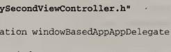

**FIGURE 4-22**

- 2. 在 windowBasedAppAppDelegate.m 文件中，添加以下粗体代码：

```objc
#import "windowBasedAppAppDelegate.h"
#import "HelloWorldViewController.h"

#import "MySecondViewController.h"

@implementation windowBasedAppAppDelegate

@synthesize window;
@synthesize viewController;
```


//---create an instance of the second view controller---
MySecondViewController *mySecondViewController;

- (BOOL)application:(UIApplication *)application
didFinishLaunchingWithOptions:(NSDictionary *)launchOptions {
    //---instantiate the second view controller---
    mySecondViewController = [[MySecondViewController alloc]
        initWithNibName:nil
        bundle:nil];
    //---add the view from the second view controller---
    [window addSubview:mySecondViewController.view];
    //---comment this out so that it doesn't load the viewController---
    //[window addSubview:viewController.view];
    [window makeKeyAndVisible];
    return YES;
}
- (void)dealloc {
    [mySecondViewController release];
    [viewController release];
    [window release];
    [super dealloc];
}

3. 在 MySecondViewController.h 文件中，插入以下加粗的代码行：

```
#import <UIKit/UIKit.h>

@interface MySecondViewController : UIViewController {
    //---create two outlets - label and button---
    UILabel *label;
    UIButton *button;
}

//---expose the outlets as properties---
@property (nonatomic, retain) UILabel *label;
@property (nonatomic, retain) UIButton *button;

@end
```

4. 在 MySecondViewController.m 文件中，添加 viewDidLoad() 方法并修改 dealloc 方法：

```
@synthesize label, button;
- (void)viewDidLoad {
    //---create a CGRect for the positioning---
    CGRect frame = CGRectMake(230, 10, 300, 50);
    //---create a Label view---
    label = [[UILabel alloc] initWithFrame:frame];
    label.textAlignment = UITextAlignmentCenter;
    label.font = [UIFont fontWithName:@"Verdana" size:20];
    label.text = @"This is a label";

    //---create a Button view---
    frame = CGRectMake(10, 250, 300, 50);
    button = [UIButton buttonWithType:UIButtonTypeRoundedRect];
    button.frame = frame;
    [button setTitle:@"OK" forState:UIControlStateNormal];
    button.backgroundColor = [UIColor clearColor];

    //---add the views to the current View---
    [self.view addSubview:label];
    [self.view addSubview:button];

    [super viewDidLoad];
}
```

## 研究助理招聘启事

清华大学交叉信息研究院机器智能课题组现面向社会公开招聘合同制研究助理1-2名，开展多模态大模型相关的研究工作。

研究方向包括但不限于多模态大模型、多模态理解与生成、大模型安全等。合作导师为赵行老师。

- 请附上个人简历，简要介绍自身研究特长
- 有意者请将个人简历及申请材料发送至邮箱：devin@tsinghua.edu.cn

邮件标题请注明“研究助理应聘+姓名”。合适者将安排面试。

## 创建和连接操作

在前面的示例中，你看到了如何将 Label 和 Button 视图添加到主 View 窗口中。然而，你需要处理 Button 视图引发的事件，以便在用户按下按钮时执行某些操作。第 3 章介绍了使用 outlets 和 actions 以及如何使用 Interface Builder 将代码连接到它们，但在下面的“试一试”中，视图是通过代码创建的，因此你不能使用 Interface Builder 来连接操作和 outlets —— 你也必须通过代码来完成。

### 试一试 将操作链接到视图

1. 在 windowBasedApp 项目中继续，声明 buttonClicked: 操作（以粗体显示），在 MySecondViewController.h 文件中如下所示：

```
#import <UIKit/UIKit.h>

@interface MySecondViewController : UIViewController {
    //---create two outlets - label and button---
    UILabel *label;
    UIButton *button;
}

//---expose the outlets as properties---
@property (nonatomic, retain) UILabel *label;
@property (nonatomic, retain) UIButton *button;

//---declaring the IBAction---
-(IBAction) buttonClicked: (id) sender;

@end
```

2. 在 MySecondViewController.m 文件中，你为 buttonClicked: 操作提供实现：

```
-(IBAction) buttonClicked: (id) sender {
    UIAlertView *alert = [[UIAlertView alloc] initWithTitle:@"Action invoked!"
                                                     message:@"Button clicked!"
                                                     delegate:self
                                            cancelButtonTitle:@"OK"
                                            otherButtonTitles:nil];
    [alert show];
    [alert release];
}
```

3. 要将 Button 视图的相关事件（Touch Up Inside）与 buttonClicked: 操作连接起来，请将以下加粗代码添加到 viewDidLoad() 方法中：

```
- (void)viewDidLoad {
    //---create a CGRect for the positioning---
    CGRect frame = CGRectMake(10, 10, 300, 50);
    
    //---create a Label view---
    label = [[UILabel alloc] initWithFrame:frame];
    label.textAlignment = UITextAlignmentCenter;
    label.font = [UIFont fontWithName:@"Verdana" size:20];
    label.text = @"This is a label";
    
    //---create a Button view---
    frame = CGRectMake(10, 250, 300, 50);
    button = [UIButton buttonWithType:UIButtonTypeRoundedRect];
    button.frame = frame;
    [button setTitle:@"OK" forState:UIControlStateNormal];
    button.backgroundColor = [UIColor clearColor];
    
    //---add the action handler and set current class as target---
    [button addTarget:self
               action:@selector(buttonClicked:)
     forControlEvents:UIControlEventTouchUpInside];
    
    //---add the views to the current View---
    [self.view addSubview:label];
    [self.view addSubview:button];
    
    [super viewDidLoad];
}
```

4. 就这样！按下 Command-R 在 iPhone 模拟器上测试应用程序。点击 OK 按钮会显示一个警告视图（见图 4-24）。

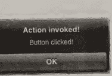

图 4-24

### 控制事件

可用于控件对象的事件列表如下：

- `UIControlEventTouchDown`
- `UIControlEventTouchDownRepeat`
- `UIControlEventTouchDragInside`
- `UIControlEventTouchDragOutside`
- `UIControlEventTouchDragEnter`
- `UIControlEventTouchDragExit`
- `UIControlEventTouchUpInside`
- `UIControlEventTouchUpOutside`
- `UIControlEventTouchCancel`
- `UIControlEventValueChanged`
- `UIControlEventEditingDidBegin`
- `UIControlEventEditingChanged`
- `UIControlEventEditingDidEnd`
- `UIControlEventEditingDidEndOnExit`
- `UIControlEventAllTouchEvents`
- `UIControlEventAllEditingEvents`
- `UIControlEventApplicationReserved`
- `UIControlEventSystemReserved`
- `UIControlEventAllEvents`

每个事件的用法详细说明请参阅：http://developer.apple.com/iphone/library/documentation/UIKit/Reference/UIControl_Class/Reference/Reference.html#/apple_ref/doc/constant_group/Control_Events.

## 切换到另一个视图

在现实生活中，你通常有多个视图，每个视图代表不同的信息。根据用户的选择，你然后切换到不同的视图以执行不同的任务。

因此，在本节中你将学习如何根据用户的选择切换到另一个视图。

### 试一试 切换视图

1. 使用上一节中创建的同一项目，将以下加粗代码添加到 MySecondViewController.m 文件中：

```
#import "MySecondViewController.h"

#import "HelloWorldViewController.h"

@implementation MySecondViewController

//---create an instance of the view controller---
HelloWorldViewController *viewController;

-(IBAction) buttonClicked: (id) sender {
    //---add the view of the view controller to the current View---
    viewController = [[HelloWorldViewController alloc]
                    initWithNibName:@"HelloWorldViewController"
                    bundle:nil];
    [self.view addSubview:viewController.view];
    /*
    UIAlertView *alert = [[UIAlertView alloc] initWithTitle:@"Action invoked!"
                    message:@"Button clicked!"
                    delegate:self
                    cancelButtonTitle:@"OK"
                    otherButtonTitles:nil];
    [alert show];
    [alert release];
    */
}

-(void)dealloc {
    [viewController release];
    [label release];
    [button release];
    [super dealloc];
}
```

2. 在 HelloWorldViewController.h 文件中声明 btnClicked: 操作：

```
#import <UIKit/UIKit.h>

@interface HelloWorldViewController : UIViewController {

}

-(IBAction) btnClicked:(id) sender;

@end
```

3. 在 HelloWorldViewController.m 文件中，按如下方式定义 btnClicked: 动作：

```objc
-(IBAction) btnClicked:(id) sender{
    //---remove the current view; essentially hiding the view---
    [self.view removeFromSuperview];
}
```

4. 双击 HelloWorldViewController.xib 文件，在 Interface Builder 中编辑它。按住 Control 键点击并将 View 窗口中的 Round Rect Button 拖到 HelloWorldViewController.xib 窗口中的 File's Owner 项上，然后选择 btnClicked:。

5. 在 Xcode 中，按 Command-R 测试应用程序。现在，当你在主视图中点击 OK 按钮时，会进入 Hello World 视图。要关闭此视图，请点击按钮。

## 工作原理

1. 在本例中，你只需使用 addSubview: 方法将（要切换到的）视图控制器的视图添加到当前视图：

```objc
//---add the view of the view controller to the current View---
viewController = [[HelloWorldViewController alloc]
    initWithNibName:@"HelloWorldViewController"
    bundle:nil];
[self.view addSubview:viewController.view];
```

2. 要关闭视图，使用 removeFromSuperview: 方法：

```objc
//---remove the current view; essentially hiding the view---
[self.view removeFromSuperview];
```

## 为视图切换添加动画

你在上一节中看到的视图切换是瞬间完成的——两个视图立即切换，没有任何视觉提示。iPad 的关键卖点之一就是其动画能力。因此，对于视图切换，你可以执行一些简单的动画（例如翻转一个视图窗口以显示另一个），让显示更有趣。下面是具体做法。

## 动手试一试：为过渡添加动画

1. 使用同一个项目，在 MySecondViewController.m 文件中添加以下粗体代码：

```objc
-(IBAction) buttonClicked: (id) sender{

    //---add the view of the view controller to the current View---
    viewController = [[HelloWorldViewController alloc]
        initWithNibName:@"HelloWorldViewController"
        bundle:nil];

    [UIView beginAnimations:@"flipping view" context:nil];
```

```objc
[UIView setAnimationDuration:1];
[UIView setAnimationCurve:UIViewAnimationCurveEaseInOut];
[UIView setAnimationTransition: UIViewAnimationTransitionFlipFromLeft forView:self.view cache:YES];

[self.view addSubview:viewController.view];

[UIView commitAnimations];
}
```

2. 在 HelloWorldViewController.m 文件中，添加以下以粗体显示的代码：
-(IBAction) btnClicked:(id) sender{

```objc
[UIView beginAnimations:@"flipping view" context:nil];
[UIView setAnimationDuration:1];
[UIView setAnimationCurve:UIViewAnimationCurveEaseIn];
[UIView setAnimationTransition: UIViewAnimationTransitionFlipFromRight forView:self.view.superview cache:YES];

[self.view removeFromSuperview];

[UIView commitAnimations];
```

3. 按 Command-R 在 iPhone 模拟器上测试应用程序。在两个视图上都点击 OK 按钮，注意两个视图相互翻转的方向（参见图 4-25 和图 4-26）。

## 工作原理

首先，检查应用于 MySecondViewController 的动画。执行动画时，先调用 UIView 类的 beginAnimations: 方法来启动动画块：

```objc
[UIView beginAnimations:@"flipping view" context:nil];
```

setAnimationDuration: 方法以秒为单位指定动画的持续时间。这里，你将其设为一秒：

```objc
[UIView setAnimationDuration:1];
```

setAnimationCurve: 方法设置动画中属性变化的曲线：

```objc
[UIView setAnimationCurve:UIViewAnimationCurveEaseInOut];
```

你可以为动画曲线使用以下常量：

- UIViewAnimationCurveEaseInOut — 使动画开始缓慢，在持续时间中点加速，然后在完成前再次减速
- UIViewAnimationCurveEaseIn — 使动画开始缓慢，然后逐渐加速
- UIViewAnimationCurveEaseOut — 使动画开始快速，然后减速直到完成
- UIViewAnimationCurveLinear — 使动画在持续时间内均匀进行

setAnimationTransition: 方法为动画期间应用于视图的过渡类型。

```objc
[UIView setAnimationTransition: UIViewAnimationTransitionFlipFromLeft forView:self.view cache:YES];
```

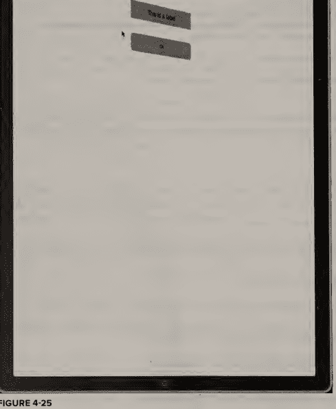

图 4-25

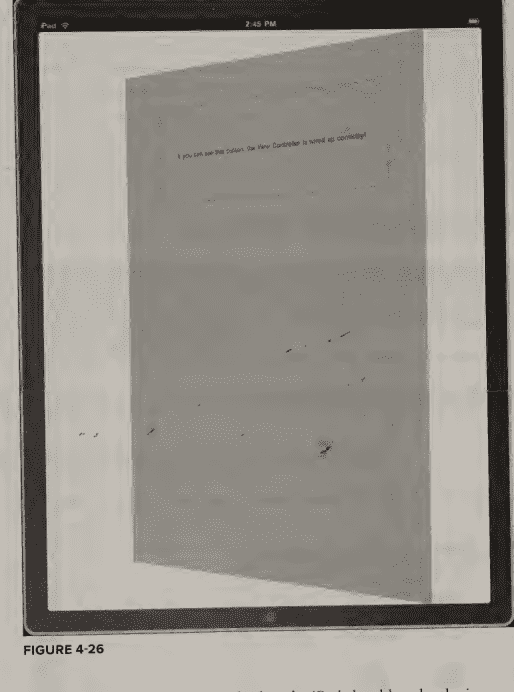

## 图 4-26

cache: 参数指定 iPad 是否应缓存视图图像并在过渡期间使用它。缓存图像可加快动画过程。以下常量可用于动画过渡：

- `UIViewAnimationTransitionNone` — 无过渡
- `UIViewAnimationTransitionFlipFromLeft` — 围绕垂直轴从左到右翻转视图
- `UIViewAnimationTransitionFlipFromRight` — 围绕垂直轴从右到左翻转视图
- `UIViewAnimationTransitionCurlUp` — 从底部向上卷起视图
- `UIViewAnimationTransitionCurlDown` — 从顶部向下卷起视图

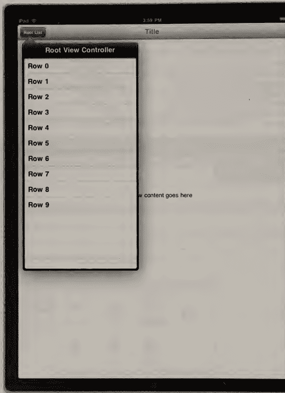

## 图 4-30

## 工作原理

基于 Split View（分割视图）的应用程序的神奇之处在于当设备旋转时它的变换。在横向模式下，应用程序在左侧显示一个行列表。当切换到纵向模式时，该行列表现在隐藏在一个 Popover 视图中。让我们看看这是如何实现的。

首先，观察 splitViewBasedAppAppDelegate.h 文件的内容：

```objc
#import <UIKit/UIKit.h>

@class RootViewController;
@class DetailViewController;

@interface splitViewBasedAppAppDelegate : NSObject <UIApplicationDelegate> {
    UIWindow *window;
    UISplitViewController *splitViewController;
    RootViewController *rootViewController;
    DetailViewController *detailViewController;
}

@property (nonatomic, retain) IBOutlet UIWindow *window;
@property (nonatomic,retain) IBOutlet UISplitViewController *splitViewController;
@property (nonatomic,retain) IBOutlet RootViewController *rootViewController;
@property (nonatomic,retain) IBOutlet DetailViewController *detailViewController;

@end
```

注意，它包含一个类型为 UISplitViewController 的视图控制器对象（splitViewController），以及两个视图控制器（rootViewController 和 detailViewController）。UISplitViewController 是一个容器视图控制器，包含两个视图控制器，使你能够实现主从接口。

接下来，查看 splitViewBasedAppAppDelegate.m 文件的内容：

```objc
#import "splitViewBasedAppAppDelegate.h"

#import "RootViewController.h"
#import "DetailViewController.h"

@implementation splitViewBasedAppAppDelegate

@synthesize window, splitViewController, rootViewController, detailViewController;

- (BOOL)application:(UIApplication *)application didFinishLaunchingWithOptions:(NSDictionary *)launchOptions {
    // Override point for customization after app launch
    // Add the split view controller's view to the window and display.
    [window addSubview:splitViewController.view];
    [window makeKeyAndVisible];
    return YES;
}

- (void)applicationWillTerminate:(UIApplication *)application {
    // Save data if appropriate
}
- (void)dealloc {
    [splitViewController release];
    [window release];
    [super dealloc];
}

@end
```

当应用程序加载时，splitViewController 对象中包含的视图会被添加到窗口中。

现在，双击 MainWindow.xib 文件以在 Interface Builder 中编辑它。你会看到 MainWindow.xib 包含一个名为 Split View Controller 的项（回想一下，对于 View-based Application 项目，你有一个 View Controller 项来代替）。

将 MainWindow.xib 文件切换为以列表视图模式显示，并观察 Split View Controller 项中的项目（参见图 4-31）：

- Navigation Controller
- Detail View Controller

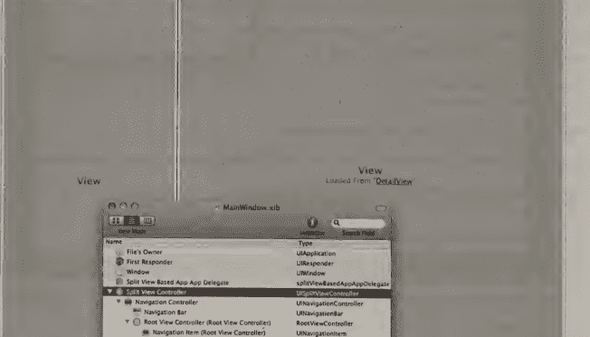

图 4-31


## 深度学习在医学图像分析中的应用综述

近年来，深度学习技术在医学图像分析领域取得了显著的进展，尤其是在计算机辅助诊断、病灶检测与分割、以及医学影像的自动解读等方向。卷积神经网络（CNN）作为深度学习的代表性模型，在医学图像特征提取方面展现出强大的能力，已经成为该领域的主流方法之一。

本文旨在系统地回顾深度学习在医学图像分析中的关键技术、典型应用以及面临的挑战，并展望未来的发展方向。文章首先介绍医学图像分析的传统方法及其局限性，进而引出深度学习模型的优势。随后，本文将重点讨论卷积神经网络、循环神经网络及生成对抗网络在医学图像分类、分割和生成任务中的应用。

### 一、深度学习的核心模型

卷积神经网络（CNN）通过卷积层、池化层和全连接层的组合，能够自动学习图像的层次化特征。典型的CNN架构包括LeNet、AlexNet、VGG、GoogLeNet和ResNet等。

- LeNet：早期网络，用于手写数字识别。
- AlexNet：在ImageNet竞赛中取得突破性成绩。
- ResNet：通过残差连接解决了深层网络的梯度消失问题。

| 模型 | 参数量 (M) | 准确率 | 特点 |
|------|------------|--------|------|
| LeNet | 0.06 | 98.5% | 浅层网络，入门级模型 |
| AlexNet | 60 | 84.6% | ReLU激活，Dropout |
| ResNet-50 | 25.6 | 93.3% | 残差学习，极深网络 |

下表对比了不同网络在医学图像分类任务中的表现。可以看出，随着模型深度和复杂度的增加，分类准确率也在逐步提升，但同时对计算资源的需求也相应增大。

细节视图控制器控制着拆分视图应用程序的右侧（参见图4-34）。

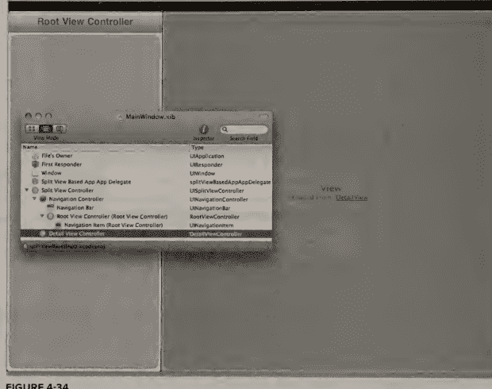

图4-34

细节视图控制器被映射到 DetailViewController 类（参见图4-35）。

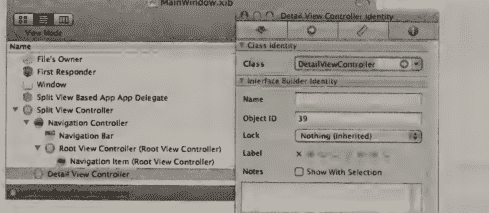

图4-35

应用程序委托连接到各个视图控制器，你可以在右键点击“Split View Based App App Delegate”项时看到这一点（参见图4-36）。

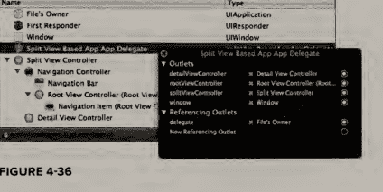

图4-36

让我们检查一下拆分视图控制器中包含的两个视图控制器：RootViewController 和 DetailViewController。

观察 RootViewController.h 文件的内容：

```
#import <UIKit/UIKit.h>

@class DetailViewController;

@interface RootViewController : UITableViewController {
    DetailViewController *detailViewController;
}

@property (nonatomic, retain) IBOutlet DetailViewController *detailViewController;

@end
```

注意，RootViewController 类继承自 UITableViewController 类，而不是你之前见过的 UIViewController 类。UITableViewController 类是 UIViewController 类的子类，提供了显示包含数据行的表格的能力。（第7章将更详细地讨论表视图。）

RootViewController.m 文件的内容如下：

```
#import "RootViewController.h"
#import "DetailViewController.h"

@implementation RootViewController

@synthesize detailViewController;

/*
    ---Other commented out code are omitted from this code listing---
```
```

@property (nonatomic, retain) IBOutlet UINavigationBar *navigationBar;
@property (nonatomic, retain) id detailItem;
@end

请注意，DetailViewController 类实现了以下协议：

- UIPopoverControllerDelegate —— 它实现这个协议是为了，如果 PopoverView 即将被关闭，你有机会收到通知（例如，你可以阻止它被关闭）。
- UISplitViewControllerDelegate —— 它需要实现这个协议，因为当 iPad 改变方向时，它需要隐藏/显示 PopoverView。

检查 DetailsViewController.m 文件的内容：

```
#import "DetailViewController.h"
#import "RootViewController.h"

@implementation DetailViewController

@synthesize navigationBar, popoverController, detailItem;

/*
    ---Other commented out code are omitted from this code listing---
*/

/*
When setting the detail item, update the view and dismiss
the popover controller if it's showing.
*/
- (void)setDetailItem:(id)newDetailItem {
    if (detailItem != newDetailItem) {
        [detailItem release];
        detailItem = [newDetailItem retain];

        // Update the view.
        navigationBar.topItem.title = [detailItem description];
    }

    if (popoverController != nil) {
        [popoverController dismissPopoverAnimated:YES];
    }
}

- (void)splitViewController:(UISplitViewController*)svc
    willHideViewController:(UIViewController *)aViewController
    withBarButtonItem:(UIBarButtonItem*)barButtonItem
    forPopoverController:(UIPopoverController*)pc {

    barButtonItem.title = @"Root List";
    [navigationBar.topItem setLeftBarButtonItem:barButtonItem
        animated:YES];
}
```

## 在基于拆分视图的应用程序中显示一些项目

现在你已经看到了一个基于拆分视图的应用程序的实际运行，是时候对它做一些修改，看看它对 iPad 有什么用处了。下面的“试一试”展示了一个电影列表，当选中一部电影时，详细信息视图上会显示一张图片。

### 试一试：显示一些项目

1. 使用 splitViewBasedApp 项目，双击 DetailView.xib 文件，在 Interface Builder 中编辑它。
2. 向 View 窗口添加一个 ImageView，并在“属性检查器”窗口中将它的 Mode 设置为 Aspect Fit（参见图4-37）。


3. 在“大小检查器”窗口中，按如下所示设置其 Autosizing 属性（另见图4-38）：

- X: 152
- Y: 163
- W: 463
- H: 644


图4-38

4. 在 Xcode 中，将图4-39所示的图像添加到 Resources 文件夹（你可以从 Wrox.com 下载这些图像以及这个项目；有关详细信息，请参阅引言中标题为“源代码”的部分）。
5. 在 DetailViewController.h 文件中，插入以下粗体语句：

```
#import <UIKit/UIKit.h>

@interface DetailViewController : UIViewController
<UIPopoverControllerDelegate, UISplitViewControllerDelegate> {
```

    imageView.image = [UIImage imageNamed:imageName];
}

if (popoverController != nil) {
    [popoverController dismissPopoverAnimated:YES];
}

9. 按下 Command-R 在 iPhone 模拟器上测试应用程序。图4-41显示了当模拟器处于横向模式时，应用程序在左侧显示电影列表。选择一部电影会显示电影图片。你还可以切换到纵向模式，并从 PopoverView 中选择电影（参见图4-42）。


图4-41

当在表视图中选中某个项目时，你将选中的电影通过其 detailItem 属性传递给 DetailViewController 对象：

```
- (void)tableView:(UITableView *)aTableView
didSelectRowAtIndexPath:(NSIndexPath *)indexPath {

    /*
     When a row is selected, set the detail view controller's
     detail item to the item associated with the selected row.
     */
    //detailViewController.detailItem =
    //    [NSString stringWithFormat:@"Row %d", indexPath.row];

    detailViewController.detailItem =
        [NSString stringWithFormat:@"%@",
         [listOfMovies objectAtIndex:indexPath.row]];
}
```

在 DetailViewController.m 文件中，你修改了 setDetailItem: 方法（它实际上是 detailItem 属性的设置器），以便能够显示图像。对于图像名称，你只需在电影名称后面附加一个 .jpg：

```
- (void)setDetailItem:(id)newDetailItem {
    if (detailItem != newDetailItem) {
        [detailItem release];
        detailItem = [newDetailItem retain];
    }
    // Update the view.
    navigationBar.topItem.title = [detailItem description];

    NSString *imageName = [NSString
        stringWithFormat:@"%@.jpg",navigationBar.topItem.title];
    imageView.image = [UIImage imageNamed:imageName];
    }

    if (popoverController != nil) {
        [popoverController dismissPopoverAnimated:YES];
    }
}
```

## 标签栏应用程序模板

你已经看到了 iPhone SDK 提供的三种应用程序模板的使用：基于视图的应用程序、基于窗口的应用程序和基于拆分视图的应用程序。针对 iPad 还有第四种应用程序模板：标签栏应用程序模板。下面的“试一试”使用标签栏应用程序模板创建一个项目，并展示标签栏应用程序的外观。请按此处说明下载必要的项目文件。


## 试一试 创建标签栏应用程序

*代码文件 TabBarApplication.zip 可在 Wrox.com 下载*

- 1. 使用 Xcode 创建一个新的标签栏应用程序项目，并将其命名为 TabBarApplication.
- 2. 查看项目的內容（见图 4-43）。除了通常的应用程序委托文件外，它还包含两个视图控制器（FirstViewController 和 SecondViewController）以及三个 XIB 文件：MainWindow.xib、FirstView.xib 和 SecondView.xib。
- 3. 查看 TabBarApplicationAppDelegate.h 文件的内容，内容如下：
- 4. 当应用程序加载完成时，UITabBarController 实例的当前视图将被加载，这一情况在 TabBarApplicationAppDelegate.m 文件中可见：


图 4-43

```
#import <UIKit/UIKit.h>
@interface TabBarApplicationAppDelegate : NSObject <UIApplicationDelegate, UITabBarControllerDelegate> {
    UIWindow *window;
    UITabBarController *tabBarController;
}
@property (nonatomic, retain) IBOutlet UIWindow *window;
@property (nonatomic, retain) IBOutlet UITabBarController *tabBarController;
@end
```

与通常的 UIViewController 类不同，您现在使用的是继承自 UIViewController 类的 UITabBarController 类。TabBarController 是一个专门的 UIViewController 类，包含一组视图控制器。

```
#import "TabBarApplicationAppDelegate.h"

@implementation TabBarApplicationAppDelegate

@synthesize window;
@synthesize tabBarController;

- (BOOL)application:(UIApplication *)application
didFinishLaunchingWithOptions:(NSDictionary *)launchOptions {

    // Add the tab bar controller's current view as a subview of the window
    [window addSubview:tabBarController.view];
    [window makeKeyAndVisible];

    return YES;
}
```

- 5. 双击 MainWindow.xib 文件在 Interface Builder 中编辑它。观察视图底部 Tab Bar 视图中包含的两个 Tab Bar Item 视图。
- 6. 单击标有 First 的第一个 Tab Bar Item（见图 4-44）。在 Identify Inspector 窗口中，观察到这是一个视图控制器，其实现类为 FirstViewController。如果查看其 Attributes Inspector 窗口，您会看到它链接到 FirstView.xib 文件（见图 4-45）。
- 7. 单击第二个 Tab Bar Item 并查看其 Attributes 和 Identity Inspector 窗口。与第一个 Tab Bar Item 类似，它分别指向 SecondView.xib 文件和 SecondViewController 类。
- 8. 在 Xcode 中，按 Command-R 在 iPhone 模拟器上运行应用程序（见图 4-46）。现在您可以触摸屏幕底部的 Tab Bar Items 在两个视图之间切换。


图 4-47

标签栏控制器包含一组视图控制器。在这种情况下，它有两个视图控制器。UITabBarController 实例中的第一个视图控制器在添加到当前视图时始终显示：

```
- (BOOL)application:(UIApplication *)application
didFinishLaunchingWithOptions:(NSDictionary *)launchOptions {
    // Add the tab bar controller's current view as a subview of the window
    [window addSubview:tabBarController.view];
    [window makeKeyAndVisible];
    return YES;
}
```

当用户触摸 Tab Bar Items 时，每个对应的视图控制器都会被加载以显示其视图。

> 注意 Tab Bar Item 实际上由一个视图控制器和一个 Tab Bar Item 对象组成。

默认情况下，标签栏应用程序模板仅包含两个 Tab Bar Items，因此在本节中，您将看到如何向现有标签栏添加更多 Tab Bar Items。

- 2. 选择新添加的 Tab Bar Item 并查看其 Attributes Inspector 窗口。将 Badge 属性设置为 5，将 Identifier 属性设置为 Search（见图 4-49）。观察 Tab Bar Item 外观的变化。确保单击 Tab Bar Item 的中心以便选中 Tab Bar Item；如果单击外部，则会选中视图控制器。


图 4-49

> **注意** Badge 属性是一种巧妙的方式，让您在 Tab Bar Item 上设置一些数字或其他文本，以便它可以作为快速视觉提示提醒用户某些事情。

- 4. 在 Xcode 中，右键单击 Xcode 中的 Classes 文件夹并选择 Add ⌥ New File。单击 Cocoa Touch Classes 类别并选择 `UIViewController` 子类。将文件命名为 `SearchViewController.m`（勾选“用于用户界面的 XIB”选项）。
- 5. 双击新创建的 `SearchView.xib` 文件在 Interface Builder 中打开它。向其中添加一个 Label 视图（见图 4-50）。

> **注意** 您不会在 SearchView.xib 文件中做太多事情。您只是添加一个 Label 视图，以便在用户点击 Tab Bar Item 时可以看到该视图成功加载。


图 4-50

- 6. 返回 `MainWindow.xib`，选择 Tab Bar Item 并查看其 Attributes Inspector 窗口（见图 4-51）。将其 NIB 名称设置为 `SearchViewController`。
- 7. 在 Search Tab Bar Item 的 Identity Inspector 窗口中，将类名设置为 `SearchViewController`（见图 4-52）。此步骤很重要；如果没有它，后续在视图控制器类上创建 outlets 和 actions 时您将收到运行时错误。
- 8. 在 Interface Builder 中保存项目。
- 9. 就这样！按 Command-R 在 iPhone 模拟器上测试应用程序。现在您可以触摸第三个 Tab Bar Item（Search）来查看标签（见图 4-53）。


图 4-51


图 4-52


图 4-53

## 工作原理

在此示例中，您向 Tab Bar 视图添加了一个 Tab Bar Item 视图，并将其连接到 XIB 文件及其对应的视图控制器类。

添加新的 Tab Bar Item 视图很简单：只需从库中拖动 Tab Bar Item 并将其拖放到 Tab Bar 视图中。或者，您也可以通过 MainWindow.xib 窗口中 Tab Bar Controller 项目的 Attributes Inspector 窗口添加它（见图 4-54）。单击 +（加号）按钮添加新的视图控制器，Tab Bar 视图会自动为您插入一个新的 Tab Bar Item 视图。

## 5 键盘输入

## 键盘输入

### 本章您将学习的内容：

- 如何为不同类型的输入自定义键盘
- 完成输入后使键盘消失的不同方法
- 如何检测键盘是否可见
- 如何移动视图为键盘腾出空间

iPad 的有争议方面之一是允许用户向 iPad 输入数据的多点触控键盘。iPad（以及 iPhone）的批评者批评其缺乏用于数据输入的物理键盘（除非购买外部键盘配件），而虚拟键盘的热衷支持者则宣称其易用性。

使 iPad 键盘如此强大的原因是它能够智能地跟踪您输入的内容，随后为正在输入的单词提供建议，并自动为您更正拼写和插入标点。更重要的是，键盘知道何时在正确的时间出现——当您点击 TextField 视图时出现，当您点击非输入视图时自动消失。此外，它还允许您以不同语言输入数据。

对于 iPad 应用程序程序员来说，主要关注点是如何将键盘集成到其应用程序中。如何在不再需要时让键盘自然消失？如何确保用户当前交互的视图不会被键盘遮挡？在本章中，您将学习以编程方式处理键盘的各种方法。


4. 保存 `KeyboardInputsViewController.xib` 文件，然后在 Xcode 中按下 Command-R，在 iPhone 模拟器上运行应用程序。当应用程序加载后，键盘最初是隐藏的；当用户点击 TextField 视图时，键盘会自动出现（见图 5-2）。


图 5-2

3. 保存 `KeyboardInputsViewController.xib` 文件。
4. 在 `KeyboardInputsViewController.m` 文件中，为 `doneEditing:` 操作提供实现：
5. 保存项目并按下 Command-R，在 iPhone 模拟器上运行应用程序。
6. 当应用程序出现在 iPhone 模拟器上时，点击 TextField 视图。键盘应该会出现。使用键盘在视图中输入一些文本，完成后点击 Return 键。现在键盘会消失。

```objc
#import "KeyboardInputsViewController.h"

@implementation KeyboardInputsViewController

-(IBAction) doneEditing:(id) sender{
[sender resignFirstResponder];
}
```

## 工作原理

你刚刚所做的是将 TextField 视图的 Did End on Exit 事件与你创建的 `doneEditing:` 操作连接起来。当你使用键盘编辑 TextField 视图的内容时，点击键盘上的 Return 键会触发 TextField 视图的 Did End on Exit 事件。在这种情况下，它会调用 `doneEditing:` 操作，其中包含以下语句：

```objc
[sender resignFirstResponder];
```

这里的 `sender` 指的是 TextField 视图，而 `resignFirstResponder` 要求 TextField 视图放弃其 First-Responder 状态。本质上，这意味着你不再想与 TextField 视图交互，也不再需要键盘。因此，键盘应自行隐藏。

> **注意** 视图中的 First Responder 总是指用户当前正在交互的视图。在此示例中，当你点击 TextField 视图时，它成为 First Responder 并自动激活键盘。

隐藏键盘的另一种方式是当用户点击 TextField 视图以外的区域时。这种方法更自然，不需要用户手动点击键盘上的 Return 键来隐藏键盘。下面的 Try It Out 展示了如何实现这种方法。

## 试一试 关闭键盘（技巧 2）

1. 使用 KeyboardInputs 项目，双击 `KeyboardInputsViewController.xib` 文件，使用 Interface Builder 编辑它。

2. 向 View 窗口添加一个 Round Rect Button 视图（见图 5-9）。


图 5-9

3. 选中 Round Rect Button 视图后，选择 Layout → Send to Back。这将使按钮显示在其他控件的后面。

4. 调整 Round Rect Button 视图的大小，使其覆盖整个屏幕（见图 5-10）。


图 5-10

5. 在 Attributes Inspector 窗口中，将 Round Rect Button 视图的 Type 设置为 Custom（见图 5-11）。


图 5-11

6. 在 Xcode 中，编辑 `KeyboardInputsViewController.h` 文件，并添加以下粗体语句：

```objc
#import <UIKit/UIKit.h>

@interface KeyboardInputsViewController : UIViewController {
    IBOutlet UITextField *textField;
}

@property (nonatomic, retain) UITextField *textField;

-(IBAction) doneEditing:(id) sender;

-(IBAction) bgTouched:(id) sender;

@end
```

7. 在 Interface Builder 中，按住 Control 键并将 File's Owner 项拖到 TextField 视图上。应该会出现 `textField` 出口。选择它。

8. 按住 Control 键并将 Round Rect Button 视图拖到 `KeyboardInputsViewController.xib` 窗口中的 File's Owner 项上（见图 5-12）。选择 `bgTouched:` 操作。

11. 就这样。在 Xcode 中按下 Command-R 将应用程序部署到 iPhone 模拟器上。然后，尝试以下操作：

- 点击 TextField 视图以调出键盘。
- 完成后，点击键盘上的 Return 键来关闭它。或者，点击 TextField 视图之外的任何空白区域来关闭键盘。

## 工作原理

在此示例中，你添加了一个 Round Rect Button 视图来覆盖应用程序 View 窗口中的所有空白区域。本质上，该按钮充当一张网，捕获 View 窗口上 TextField 视图之外的所有触摸。因此，当用户点击键盘和 TextField 视图之外的屏幕时（或在真设备上触摸），Round Rect Button 会触发 Touch Up Inside 事件，该事件由 `bgTouched:` 操作处理。在 `bgTouched:` 操作中，你明确要求 `textField` 放弃其 First-Responder 状态，从而导致键盘消失。

此示例中使用的技巧即使你的视图上有多个 TextField 视图也适用。假设你有三个 TextField 视图，其出口名为 `textField`、`textField2` 和 `textField3`。在这种情况下，`bgTouched:` 操作如下所示：

```objc
-(IBAction) bgTouched:(id) sender{
[textField resignFirstResponder];
[textField2 resignFirstResponder];
[textField3 resignFirstResponder];
}
```

因此，当调用 `bgTouched:` 操作时，所有三个 TextField 视图都会被要求放弃其 First-Responder 状态。对当前不是 First Responder 的视图调用 `resignFirstResponder` 方法是无害的；因此，上述语句是安全的，不会在运行时导致异常。

## 理解响应者链

前面的 Try It Out 是响应者链运行的一个很好的示例。在 iPad 中，事件通过一系列事件处理程序传递，这些处理程序称为响应者链。当你触摸 iPad 屏幕时，iPad 会生成事件，这些事件会沿着响应者链向上传递。响应者链中的每个对象都会检查自己是否能处理该事件。在前面的示例中，当用户点击 Label 视图时，Label 视图会检查自己是否能处理该事件。由于 Label 视图不处理 Touch 事件，因此该事件会沿着响应者链向上传递。你添加的大背景按钮现在成为下一个检查事件的对象。由于它处理 Touch Up Inside 事件，因此该事件被按钮消耗。

总之，响应者链中位置较高的对象首先检查事件，并在事件适用时处理它。任何对象都可以阻止事件在响应者链中的传播，如果它只部分处理事件，也可以将事件继续向上传递。

2. 使用 ScrollView 视图填充 View（见图 5-13）。调整 ScrollView 视图的大小，使其覆盖整个屏幕。


图 5-13

3. 向 ScrollView 添加 Label 视图、TextField 视图和 Round Rect Button 视图（见图 5-14）。将 Label 视图的文本设置为“Enter some text here”，将按钮的文本设置为“OK”。


图 5-14

4. 在 Xcode 中，将以下以粗体突出显示的语句输入到 `ScrollingViewsViewController.h` 文件中并保存：

```objc
#import <UIKit/UIKit.h>

@interface ScrollingViewsViewController : UIViewController <UITextFieldDelegate> {
    IBOutlet UIScrollView *scrollView;
    IBOutlet UITextField *textField;
    UITextField *currTextField;
}

@property (nonatomic, retain) UITextField *textField;
@property (nonatomic, retain) UIScrollView *scrollView;

@end
```

5. 在 Interface Builder 中，按住 Control 键并将 File's Owner 项拖到 TextField 视图上（见图 5-15）。选择 `textField`。


6. 按住 Control 键并将 File's Owner 项拖到 ScrollView 视图上（见图 5-16）。选择 `scrollView`。


图 5-16

7. 按住 Control 键并将 TextField 视图拖到 File's Owner 项上（见图 5-17）。选择 `delegate`。


```
return NO;
}
-(void) dealloc {
    [textField release];
    [scrollView release];
    [super dealloc];
}
```

10. 在 Xcode 中保存项目并按 Command-R 将应用程序部署到 iPhone 模拟器上。图 5-18 显示，当你点击 TextField 视图时，键盘会出现并且 TextField 视图（以及其他视图）会滚动到屏幕中央。要隐藏键盘，只需点击 Return 键，视图就会恢复到原始位置。


图 5-18

## 工作原理

本示例演示了检测键盘存在的各种方法，以及如何重新定位涉及的视图以使其不被键盘遮挡。

首先，你声明三个私有变量：

//---size of keyboard---
CGRect keyboardBounds;

//---size of application screen---
CGRect applicationFrame;

//---original size of ScrollView---
CGSize scrollViewOriginalSize;
```

keyboardBounds 用于存储键盘的大小（特别是获取键盘的高度）。虽然你可以始终将键盘高度硬编码为 264，但我不建议这样做，因为键盘大小以后可能会改变。更好的做法是在运行时动态获取键盘的大小。

applicationFrame 用于存储屏幕的大小。与键盘大小一样，最好在运行时动态获取该数值。

scrollViewOriginalSize 用于保存 ScrollView 视图的原始大小。这样做可以在用户完成编辑后将 ScrollView 恢复到原始大小（此时所有视图都需要移回原始位置）。

当 View 加载时，你首先保存 ScrollView 视图的大小并获取屏幕的大小：

```
-(void) viewDidLoad {
    scrollViewOriginalSize = scrollView.contentSize;
    applicationFrame = [[UIScreen mainScreen] applicationFrame];
    [super viewDidLoad];
}
```

在 viewWillAppear: 事件中（该方法在 View 出现在屏幕上之前被调用），你注册两个通知 — UIKeyboardWillShowNotification 和 UIKeyboardWillHideNotification。当键盘出现（UIKeyboardWillShowNotification）时，会调用 keyboardWillShow: 方法。当键盘消失时，会调用 keyboardWillHide: 方法：

```
-(void) viewWillAppear:(BOOL)animated {
    //---registers the notifications for keyboard---
    [[NSNotificationCenter defaultCenter]
        addObserver:self
        selector:@selector(keyboardWillShow:)
        name:UIKeyboardWillShowNotification
        object:self.view.window];

    [[NSNotificationCenter defaultCenter]
        addObserver:self
```

```
selector:@selector(keyboardWillHide:)
name:UIKeyboardWillHideNotification
object:nil;
]
```

在 View 消失之前，你移除之前设置的通知：

```
-(void) viewWillDisappear:(BOOL)animated {
    [[NSNotificationCenter defaultCenter]
        removeObserver:self
        name:UIKeyboardWillShowNotification
        object:nil];

    [[NSNotificationCenter defaultCenter]
        removeObserver:self
        name:UIKeyboardWillHideNotification
        object:nil];
}
```

当你点击 TextField 视图时，textFieldDidBeginEditing: 方法会首先被调用。通过此方法，你可以知道正在编辑的是哪个 TextField 视图：

//---when a TextField view begins editing---
-(void) textFieldDidBeginEditing:(UITextField *)textFieldView {
    currTextField = textFieldView;
}
```

接下来，keyboardWillShow: 方法会被调用。通过此方法，你尝试通过传递 keyboardBounds 变量的引用来获取键盘的大小。你现在准备移动 ScrollView 视图，以便 TextField 视图可以在不被键盘遮挡的剩余可见空间中居中。你通过调用接下来定义的 moveScrollView: 方法来执行滚动：

//---when the keyboard appears---
-(void) keyboardWillShow:(NSNotification *) notification {
    //---gets the size of the keyboard---
    NSDictionary *userInfo = [notification userInfo];
    NSValue *keyboardValue =
        [userInfo objectForKey:UIKeyboardBoundsUserInfoKey];
    [keyboardValue getValue:&keyboardBounds];

    [self moveScrollView:currTextField];
}
```

在 moveScrollView: 方法中，你计算需要滚动的像素数，然后让 ScrollView 视图滚动其包含的视图，直到当前正在编辑的 TextField 视图位于屏幕可见区域的中心：

```
-(void) moveScrollView:(UIView *) theView {
    //---get the y-coordinate of the view---
    CGFloat viewCenterY = theView.center.y;
```

```
//---calculate how much visible space is left---
CGFloat freeSpaceHeight =
    applicationFrame.size.height - keyboardBounds.size.height;

//---calculate how much the scrollview must scroll---
CGFloat scrollAmount = viewCenterY - freeSpaceHeight / 2.0;

if (scrollAmount < 0) scrollAmount = 0;

//---set the new scrollView contentSize---
scrollView.contentSize = CGSizeMake(applicationFrame.size.width,
                                    applicationFrame.size.height +
                                    keyboardBounds.size.height);

//---scroll the ScrollView---
[scrollView setContentOffset:CGPointMake(0, scrollAmount)
                    animated:YES];
}
```

当 TextField 视图放弃其 First Responder 状态时，textFieldDidEndEditing: 方法会被调用。此时，你将 ScrollView 视图恢复到其原始内容大小：

//---when a TextField view is done editing---
-(void) textFieldDidEndEditing:(UITextField *) textFieldView {
    [UIView beginAnimations:@"back to original size" context:nil];
    scrollView.contentSize = scrollViewOriginalSize;
    [UIView commitAnimations];
}
```

这里值得注意的一点是，你使用 UIView 类的 beginAnimations 方法来在 ScrollView 视图恢复到原始大小的过程中进行动画。如果不使用此方法，ScrollView 将非常突然地恢复到原始大小，导致闪烁。

就在键盘消失之前，keyboardWillHide: 方法会被调用。在这种情况下，你没什么可做的：

//---when the keyboard disappears---
-(void) keyboardWillHide:(NSNotification *) notification {
}
```

最后，在 dealloc 方法中，你释放所有创建的 outlet：

```
-(void) dealloc {
    [textField release];
    [scrollView release];
    [super dealloc];
}
```

## 处理键盘的 Return 键

之前，你看到如何将 IBAction 与 TextField 视图的 Did End On Exit 事件连接起来，以便用户点击 Return 键时隐藏键盘。或者，你也可以实现 textFieldShouldReturn: 方法（在 UITextFieldDelegate 协议中定义）。每当用户在键盘上点击 Return 键时，就会调用此方法：

```
- (BOOL) textFieldShouldReturn:(UITextField *) textFieldView {
    if (textFieldView == textField) {
        [textField resignFirstResponder];
    }
    return NO;
}
```

## 摘要

在本章中，你学习了在 iPad 应用程序中处理键盘的各种技术。特别是，本章向你展示了如何在完成数据输入后使键盘消失，如何检测键盘的存在或缺失，以及如何确保视图不被键盘遮挡。

## 练习

- 1. 如何隐藏 UITextField 对象的键盘？
- 2. 如何检测键盘是否可见或不可见？
- 3. 如何获取键盘的大小？

练习的答案可在附录 A 中找到。

## 本章学到的内容

| 主题 | 关键概念 |
|---|---|
| 让键盘消失 | 在 `UITextField` 对象上使用 `resignFirstResponder` 方法以放弃其 First-Responder 状态。 |
| 显示显示的不同类型的键盘 | 通过在 Attributes Inspector 窗口中更改 `UITextField` 对象的 Text Input Traits 来修改键盘类型。 |
| 处理键盘的 return 键 | 你可以处理 `UITextField` 对象的 Did End on Exit 事件，或者在你的视图控制器中实现 `textFieldShouldReturn:` 方法（请记住确保你的视图控制器类是 `UITextField` 对象的代理）。 |
| 检测键盘出现或隐藏时 | 注册两个通知 — `UIKeyboardWillShowNotification` 和 `UIKeyboardWillHideNotification`。 |
| 检测哪个 `UITextField` 对象开始编辑 | 在你的视图控制器中实现 `textFieldDidBeginEditing:` 方法。 |
| 检测哪个 `UITextField` 对象结束编辑 | 在你的视图控制器中实现 `textFieldDidEndEditing:` 方法。 |


## 6 屏幕旋转

## 屏幕旋转

### 本章你将学习：

- 如何支持四种不同类型的屏幕方向
- 设备旋转时触发的各种事件
- 当设备方向改变时，如何重新定位某个视图上的视图
- 如何在运行时动态更改屏幕旋转
- 如何在应用程序加载前设置应用程序的方向

第2章中的 Hello World! 应用程序演示了你的 iPad 应用程序如何支持纵向或横向模式下的查看。本章将更深入地探讨屏幕方向这一主题。具体来说，它演示了当设备旋转时如何管理应用程序的方向。你还将学习如何在设备旋转时重新定位视图，以便应用程序能够充分利用屏幕尺寸的变化。

## 响应设备旋转

现代移动设备支持的功能之一是检测设备当前方向（纵向或横向）的能力。应用程序可以利用这一点重新调整设备屏幕，以充分利用新的方向。iPad 上的 Safari 就是一个很好的例子。当你将设备旋转到横向方向时，Safari 会自动旋转其视图，使你有更宽的屏幕来查看页面内容（参见图 6-1）。


图 6-1

在 iPhone SDK 中，有多个事件可以处理，以确保你的应用程序能够感知方向变化。请在下面的“试一试”中查看这些事件。

## 试一试  支持不同的屏幕方向

代码文件 ScreenRotations.zip 可在 Wrox.com 下载

- 1. 使用 Xcode，创建一个新的基于视图的应用程序项目，并将其命名为 ScreenRotations。
- 2. 按 Command-R 在 iPhone 模拟器上测试该应用程序。
- 3. 按 Command ⌥（向右旋转）或 Command ⌥（向左旋转）组合键来更改 iPhone 模拟器的方向。注意，应用程序的屏幕方向会随着设备方向的变化而变化（参见图 6-2 和图 6-3）。


图 6-2


图 6-3

## 工作原理

默认情况下，你使用 Xcode 创建的 iPad 应用程序项目支持所有方向——纵向和横向模式。这体现在 ScreenRotationsViewController.m 文件中，其中有 shouldAutorotateToInterfaceOrientation: 方法：

```
- (BOOL)shouldAutorotateToInterfaceOrientation:
(UIInterfaceOrientation)interfaceOrientation {
    return YES;
}
```

> 注意：在 iPad 上，屏幕旋转由操作系统自动处理。当操作系统检测到屏幕方向变化时，它会触发 shouldAutorotateToInterfaceOrientation: 事件；由开发者决定应用程序在目标方向上的显示方式。

shouldAutorotateToInterfaceOrientation: 方法在视图加载时以及设备方向变化时被调用。该方法传入一个参数——设备已经改变到的方向。此事件的返回值决定当前方向是否受支持。默认情况下，你的 iPad 应用程序支持所有屏幕方向，因此它直接返回 YES。

要支持特定的方向，只需执行相等性检查来指定支持的方向。例如，下面的代码片段表明只支持横向左侧方向。

```objc
- (BOOL)shouldAutorotateToInterfaceOrientation:
(UIInterfaceOrientation)interfaceOrientation {
    //return YES;
    return (interfaceOrientation ==
        UIInterfaceOrientationLandscapeLeft);
}
```

这意味着你的应用程序只能在横向模式下以 Home 键位于左侧的方向正常显示（因此常量名为 UIInterfaceOrientationLandscapeLeft）。

如果用户将设备旋转到纵向模式，或者旋转到 Home 键位于右侧的横向模式（UIInterfaceOrientationLandscapeRight），应用程序将不会改变其方向。

尽管你可以指定应用程序支持的方向，但 Apple 特别指出，你的应用程序应支持所有屏幕方向。

> **注意**：这里有一个简单的方法来区分 UIInterfaceOrientationLandscapeLeft 和 UIInterfaceOrientationLandscapeRight。只需记住，UIInterfaceOrientationLandscapeLeft 指的是 Home 键位于左侧，而 UIInterfaceOrientationLandscapeRight 指的是 Home 键位于右侧。

## 屏幕方向的不同类型

- `UIInterfaceOrientationPortrait` — 以纵向模式显示屏幕
- `UIInterfaceOrientationPortraitUpsideDown` — 以纵向模式显示屏幕，但 Home 键位于屏幕顶部
- `UIInterfaceOrientationLandscapeLeft` — 以横向模式显示屏幕，Home 键位于左侧
- `UIInterfaceOrientationLandscapeRight` — 以横向模式显示屏幕，Home 键位于右侧

## 圆

### 一、圆的有关概念

- 1. 圆：在一个平面内，线段 $OA$ 绕它固定的一个端点 $O$ 旋转一周，另一个端点 $A$ 所形成的图形叫做圆。
- 2. 圆心：固定的端点 $O$ 叫做圆心。
- 3. 半径：线段 $OA$ 叫做半径。
- 4. 弦：连接圆上任意两点的线段叫做弦。
- 5. 直径：经过圆心的弦叫做直径。
- 6. 弧：圆上任意两点间的部分叫做圆弧，简称弧。
- 7. 半圆：圆的任意一条直径的两个端点把圆分成两条弧，每一条弧都叫做半圆。
- 8. 等圆：能够重合的两个圆叫做等圆。
- 9. 等弧：在同圆或等圆中，能够互相重合的弧叫做等弧。
- 10. 同心圆：圆心相同，半径不相等的两个圆叫做同心圆。

### 点与圆的位置关系

设 ⊙O 的半径为 $r$，点 $P$ 到圆心 $O$ 的距离为 $d$，则：

- 点 $P$ 在圆外 ⇔ $d > r$
- 点 $P$ 在圆上 ⇔ $d = r$
- 点 $P$ 在圆内 ⇔ $d < r$

### 二、圆的对称性

- 1. 圆是中心对称图形，对称中心是圆心。
- 2. 圆是轴对称图形，任何一条直径所在的直线都是它的对称轴。
- 3. 垂径定理：垂直于弦的直径平分这条弦，并且平分弦所对的两条弧。
- 4. 垂径定理的逆定理：平分弦（不是直径）的直径垂直于弦，并且平分弦所对的两条弧。

### 三、圆周角

- 1. 定义：顶点在圆上，并且两边都与圆相交的角叫做圆周角。
- 2. 圆周角定理：一条弧所对的圆周角等于它所对的圆心角的一半。
- 3. 推论：
  - 同弧或等弧所对的圆周角相等；
  - 半圆（或直径）所对的圆周角是直角；
  - 90° 的圆周角所对的弦是直径。

### 四、确定圆的条件

- 1. 不在同一直线上的三个点确定一个圆。
- 2. 经过三角形三个顶点可以作一个圆，这个圆叫做三角形的外接圆；外接圆的圆心叫做三角形的外心。
- 3. 锐角三角形的外心在三角形内部；直角三角形的外心在斜边中点；钝角三角形的外心在三角形外部。

该方法如下所示：

```
- (void)willAnimateRotationToInterfaceOrientation:
(UIInterfaceOrientation) interfaceOrientation
 duration: (NSTimeInterval) duration {
 }
```

> **注意**：如果你处理此事件，willAnimateFirstHalfOfRotationToInterfaceOrientation: 和 willAnimateSecondHalfOfRotationFromInterfaceOrientation: 事件将不再触发。

在下面的“试一试”中，你将在设备改变方向时重新定位用户界面（UI）上的视图。

## 试一试  在方向变化期间重新定位视图

- 1. 使用之前创建的项目，双击 ScreenRotationsViewController.xib 文件，并向视图添加一个“圆角矩形按钮”视图（参见图 6-4）。


- 2. 通过查看“大小检查器”窗口来观察其大小和位置。此处，其位置为 (20,20)，大小为 371×37 像素。
- 3. 通过单击窗口右上角的箭头图标来旋转视图的方向。
- 4. 将“圆角矩形按钮”视图重新定位到视图窗口的右下角（参见图 6-5）。同时观察并记下其位置。


图 6-5

- 5. 在 ScreenRotationsViewController.h 文件中，添加以下以粗体显示的代码：

```
#import <UIKit/UIKit.h>

@interface ScreenRotationsViewController : UIViewController {
    IBOutlet UIButton *btn;
}

@property (nonatomic, retain) UIButton *btn;

@end
```


6. 在 Interface Builder 中，通过控制点击 File's Owner 项目并拖动到 Round Rect Button 视图上（见图 6-6）来连接你创建的 outlet。选择 btn。


图 6-6

7. 在 Interface Builder 中保存项目。

8. 在 ScreenRotationsViewController.m 文件中，添加以下粗体代码：

```
#import "ScreenRotationsViewController.h"
@implementation ScreenRotationsViewController

@synthesize btn;

-(void) positionViews {

    UIInterfaceOrientation destOrientation = self.interfaceOrientation;

    if (destOrientation == UIInterfaceOrientationPortrait ||
        destOrientation == UIInterfaceOrientationPortraitUpsideDown) {
        //---if rotating to portrait mode---
        btn.frame = CGRectMake(20, 20, 371, 37);
    } else {
        //---if rotating to landscape mode---
        btn.frame = CGRectMake(633, 691, 371, 37);
    }
}

-(void)willAnimateSecondHalfOfRotationFromInterfaceOrientation:
(UIInterfaceOrientation) fromInterfaceOrientation
duration: (NSTimeInterval) duration {
```

## 工作原理

该项目说明了当设备改变方向时，如何重新定位应用程序上的视图。首先创建 outlet 并将其连接到 View 窗口上的 Round Rect Button 视图。

当设备正在旋转时，你处理 willAnimateSecondHalfOfRotationFromInterfaceOrientation: 事件，因为这样可以让你知道设备正在改变到的目标方向。当此事件触发时，你可以使用当前 View（self）的 interfaceOrientation 属性来获取目标方向，如下所示：

```
UIInterfaceOrientation destOrientation = self.interfaceOrientation;
```

利用此信息，你通过 positionViews 方法更改其 frame 属性来根据目标方向定位视图，该方法你已定义：

```
-(void) positionViews {

    UIInterfaceOrientation destOrientation = self.interfaceOrientation;

    if (destOrientation == UIInterfaceOrientationPortrait ||
        destOrientation == UIInterfaceOrientationPortraitUpsideDown) {
        //---if rotating to portrait mode---
        btn.frame = CGRectMake(20, 20, 371, 37);
    } else {
        //---if rotating to landscape mode---
        btn.frame = CGRectMake(633, 691, 371, 37);
    }
}
```

你还应在 viewDidLoad 方法中调用 positionViews 方法，以便在 View 窗口加载时 Round Rect Button 能正确显示：

```
-(void)viewDidLoad {
    [self positionViews];
    [super viewDidLoad];
}
```

## 处理视图定位的属性

在前面的示例中，你使用了 frame 属性在运行时更改视图的位置。frame 属性定义了视图相对于其 superview（包含它的视图）所占用的矩形。使用 frame 属性可以设置视图的定位和大小。除了使用 frame 属性外，你还可以使用 center 属性，它设置视图相对于其 superview 的中心。你通常在执行某些动画并且只想更改视图位置时使用 center 属性。

## 以编程方式旋转屏幕

你已经看到当用户旋转设备时，你的应用程序如何处理设备方向的变化。然而，有时（例如在开发游戏时），你希望强制应用程序在与设备方向无关的情况下以特定方向显示。

有两种情况需要考虑：

- 在应用程序运行时以编程方式旋转屏幕方向
- 在 View 加载时以特定方向显示屏幕

### 运行时旋转

在运行时，你可以通过在 UIDevice 类的实例上使用 setOrientation: 方法来以编程方式旋转屏幕。假设你希望用户在按下 Round Rect Button 视图时更改屏幕方向。使用前面创建的项目，你可以按如下方式编码：

```objc
-(IBAction) btnClicked: (id) sender{
    [[UIDevice currentDevice] setOrientation:UIInterfaceOrientationLandscapeLeft];
}
```

setOrientation: 方法接受一个参数，指定你想要更改到的方向。

> NOTE 在你以编程方式切换应用程序的方向后，当设备物理旋转时，你应用程序的旋转仍可能发生变化。它可以更改到的方向取决于你在 shouldAutorotateToInterfaceOrientation: 方法中设置的。

### 在加载时以特定方向显示视图

当 View 窗口加载时，默认情况下它始终以设备当前的方向显示。如果你的应用程序要求在加载时以特定方向显示 View 窗口，你可以通过设置状态栏的方向来实现，如下所示：

```objc
- (void)viewDidLoad {
    [UIApplication sharedApplication].statusBarOrientation =
    UIInterfaceOrientationLandscapeRight;
    [super viewDidLoad];
}
```

值得注意的是，前一节中描述的 setOrientation: 方法不能在 View 加载期间用于更改 View 的方向：

```
- (void)viewDidLoad {
    //---does not work during View loading time---
    [[UIDevice currentDevice] setOrientation:UIInterfaceOrientationLandscapeLeft];
    [super viewDidLoad];
}
```

同样，在 View 加载后（运行时）设置状态栏方向也不起作用：

```
//---does not work during run time---
[UIApplication sharedApplication].statusBarOrientation =
UIInterfaceOrientationLandscapeLeft;
```

> NOTE 你要更改到的方向必须首先在 shouldAutorotateToInterfaceOrientation: 事件中指定。

## 摘要

本章解释了 View Controller 类中的各种事件如何处理屏幕方向的变化。正确处理屏幕方向将使你的应用程序更易用并改善用户体验。

## 练习

- 1. 假设你希望你的应用程序仅支持横向右和横向左方向。你应如何修改你的代码？
- 2. 视图的 frame 和 center 属性有什么区别？

练习的答案可在附录 A 中找到。

## 本章学到的内容

| 主题 | 关键概念 |
|---|---|
| 处理设备旋转 | Implement the shouldAutorotateToInterfaceOrientation: method |
| 支持的四种方向 | UIInterfaceOrientationPortrait
UIInterfaceOrientationLandscapeLeft
UIInterfaceOrientationLandscapeRight
UIInterfaceOrientationPortraitUpsideDown |
| 设备旋转时触发的事件 | willAnimateFirstHalfOfRotationToInterfaceOrientation:
willAnimateSecondHalfOfRotationFromInterfaceOrientation:
willRotateToInterfaceOrientation:
willAnimateRotationToInterfaceOrientation: |
| 用于更改视图位置的属性 | Use the frame property for changing the positioning and size of a view
Use the center property for changing the positioning of a view |

## 第二部分

## 显示和持久化数据？

- 第 7 章：使用表格视图
- 第 8 章：应用程序首选项
- 第 9 章：文件处理
- 第 10 章：使用 SQLite3 进行数据库存储


图 7-1

## 一个简单的表格视图

在应用程序中使用 Table 视图的最佳方法是创建一个新的基于 View 的应用程序项目，然后手动向视图添加 Table 视图并将其连接到 View Controller。这样，你就能了解 Table 视图的各个构建块。

不用多说，使用以下试一试来创建一个新项目并了解如何组装 Table 视图！

## 试一试  使用表格视图

*代码文件 TableViewExample.zip 可在 Wrox.com 下载*

- 1. 创建一个新的基于 View 的应用程序项目并将其命名为 TableViewExample。
- 2. 双击 TableViewExampleViewController.xib 文件以在 Interface Builder 中编辑它。
- 3. 从库中拖动 Table View 项并将其放置到 View 窗口上（见图 7-2）。
- 4. 默认情况下，Table 视图填满整个 View 窗口。将 Table 视图调整为 View 窗口宽度的约三分之一，并通过 Attributes Inspector 窗口将其 Background 颜色设置为浅黄色（见图 7-3）。


图 7-4


图 7-5

## 工作原理

实际上，你是在第 7 步通过创建一个名为 `listOfMovies` 的 `NSMutableArray` 对象来启动应用程序，该对象包含一系列电影名称。这个数组中存储的项目将显示在表视图中。

```objc
-(void)viewDidLoad {
    //---initialize the array---
    listOfMovies = [[NSMutableArray alloc] init];
    
    //---add items---
    [listOfMovies addObject:@"Training Day"];
    [listOfMovies addObject:@"Remember the Titans"];
    [listOfMovies addObject:@"John Q."];
    [listOfMovies addObject:@"The Bone Collector"];
    [listOfMovies addObject:@"Ricochet"];
    [listOfMovies addObject:@"The Siege"];
    [listOfMovies addObject:@"Malcolm X"];
    [listOfMovies addObject:@"Antwone Fisher"];
    [listOfMovies addObject:@"Courage Under Fire"];
    [listOfMovies addObject:@"He Got Game"];
    [listOfMovies addObject:@"The Pelican Brief"];
    [listOfMovies addObject:@"Glory"];
    [listOfMovies addObject:@"The Preacher's Wife"];
    
    [super viewDidLoad];
}
```

要用项目填充表视图，你需要处理 `UITableViewDataSource` 协议中包含的几个事件。因此，你需要确保视图控制器遵循此协议：

```objc
@interface TableViewExampleViewController : UIViewController <UITableViewDataSource> {
}
```

> 注意 严格来说，如果你已经将 dataSource 插座连接到 File's Owner 项，则不需要添加上面的语句。不过，两者都做也没有任何坏处。添加 `<UITableViewDataSource>` 协议还是有一个好处的——如果你忘记在代码中实现任何必需的方法，编译器会发出警告，从而帮助防止错误。

`UITableViewDataSource` 协议包含几个你可以实现的事件，用于向表视图提供数据。本示例中处理的两个事件是：

- `tableView:numberOfRowsInSection:`
- `tableView:cellForRowAtIndexPath:`

`tableView:numberOfRowsInSection:` 事件指定你希望表视图显示多少行。在本例中，你将其设置为 `listOfMovies` 数组中的项目数：

```objc
//---insert individual row into the table view---
- (NSInteger)tableView:(UITableView *)tableView
numberOfRowsInSection:(NSInteger)section {

    return [listOfMovies count];
}
```

`tableView:cellForRowAtIndexPath:` 事件在表视图的特定位置插入一个单元格。表视图的每一行都会触发一次该事件。

在这里，你从数组中取出各个项目并插入到表视图中：

```objc
- (UITableViewCell *)tableView:(UITableView *)tableView
cellForRowAtIndexPath:(NSIndexPath *)indexPath {

    static NSString *CellIdentifier = @"Cell";

    //---try to get a reusable cell---
    UITableViewCell *cell = [tableView
        dequeueReusableCellWithIdentifier:CellIdentifier];

    //---create new cell if no reusable cell is available---
    if (cell == nil) {
        cell = [[[UITableViewCell alloc]
            initWithStyle:UITableViewCellStyleDefault
        reuseIdentifier:CellIdentifier] autorelease];
    }

    //---set the text to display for the cell---
    NSString *cellValue = [listOfMovies objectAtIndex:indexPath.row];
    cell.textLabel.text = cellValue;

    return cell;
}
```

具体来说，你使用 UITableView 类的 `dequeueReusableCellWithIdentifier:` 方法来获取 UITableViewCell 类的一个实例。`dequeueReusableCellWithIdentifier:` 方法返回一个可重用的表视图单元格对象。这一点很重要，因为如果你有一个很大的表（比如有 10,000 行），并且为每一行都创建一个 UITableViewCell 对象，将会对性能和内存造成严重影响。另外，由于表视图在任何时候都只显示固定数量的行，因此重用那些已滚出屏幕的单元格会更有意义。这正是 `dequeueReusableCellWithIdentifier:` 方法所做的。例如，如果表视图中可见 10 行，那么只会创建 10 个 UITableViewCell 对象——当用户滚动表视图时，这些对象始终会被重用。

```objc
static NSString *CellIdentifier = @"Cell";

//---try to get a reusable cell---
UITableViewCell *cell = [tableView
dequeueReusableCellWithIdentifier:CellIdentifier];

//---create new cell if no reusable cell is available---
if (cell == nil) {
    cell = [[[UITableViewCell alloc]
        initWithStyle:UITableViewCellStyleDefault
        reuseIdentifier:CellIdentifier] autorelease];
}

//---set the text to display for the cell---
NSString *cellValue = [listOfMovies objectAtIndex:indexPath.row];
cell.text = cellValue;

UIImage *image = [UIImage imageNamed:@"apple.jpeg"];
cell.imageView.image = image;

return cell;
```


图 7-7


图 7-8

按 Command-R 测试应用程序，你会看到每行旁边显示图像（参见图 7-9）。


图 7-9

请注意，UITableViewCell 对象已经具有 imageView 属性。你只需要创建一个 UIImage 类的实例，然后从项目的 Resources 文件夹中加载图像即可。

## 显示选中的项目

到目前为止，你已经了解了如何通过确保视图控制器遵循 UITableViewDataSource 协议，用项目填充表视图。该协议负责填充表视图，但如果你想在表视图中选择项目，则需要遵循另一个协议——UITableViewDelegate。

UITableViewDelegate 协议包含一些事件，这些事件允许你管理选择、编辑和删除行，以及显示页眉和页脚。

要使用 UITableViewDelegate 协议，请修改 TableViewExampleViewController.h 文件，添加如下以粗体显示的语句：

```objc
#import <UIKit/UIKit.h>

@interface TableViewExampleViewController : UIViewController
<UITableViewDataSource, UITableViewDelegate>{
}

@end
```

同样，如果你之前已将 delegate 插座连接到 File's Owner 项，则实际上不需要添加上面的语句（UITableViewDelegate）。不过，两者都做也没有坏处。

下面的“动手实践”展示了如何允许用户在表视图中进行选择。

### 动手实践：在表视图中进行选择

- 1. 使用之前创建的项目，将下面以粗体显示的语句添加到 TableViewExampleViewController.m 文件中：

```objc
#import "TableViewExampleViewController.h"

@implementation TableViewExampleViewController

NSMutableArray *listOfMovies;

- (void)tableView:(UITableView *)tableView
didSelectRowAtIndexPath:(NSIndexPath *)indexPath {
    NSString *movieSelected = [listOfMovies objectAtIndex:[indexPath row]];
    NSString *msg = [[NSString alloc] initWithFormat:@"You have selected %@", movieSelected];
    
    UIAlertView *alert = [[UIAlertView alloc] initWithTitle:@"Movie selected"
                                                     message:msg
                                                    delegate:self
```

对于此事件，要判断选择了哪一行，你只需调用 NSIndexPath 对象（indexPath）的 row 属性，然后使用行号在 listOfMovies 数组中引用对应的项目：

```objc
NSString *movieSelected = [listOfMovies objectAtIndex:[indexPath row]];
```

获取所选电影后，你只需使用 UIAlertView 类将其显示出来：

```objc
NSString *msg = [[NSString alloc] initWithFormat:@"You have selected %@", movieSelected];
UIAlertView *alert = [[UIAlertView alloc] initWithTitle:@"Movie selected" message:msg delegate:self cancelButtonTitle:@"OK" otherButtonTitles:nil];
[alert show];
```

> 注意 NSIndexPath 类的 row 属性是 UIKit 框架为支持在表视图中标识行和分区而添加的属性之一。因此，请注意 NSIndexPath 类的原始类定义中并不包含 row 属性。

## 缩进

UITableViewDelegate 协议中的另一个事件是 tableView:indentationLevelForRowAtIndexPath:。当你处理此事件时，屏幕上可见的每一行都会触发该事件。要为特定行设置缩进，只需返回一个整数，表示缩进级别：

```objc
- (NSInteger)tableView:(UITableView *)tableView indentationLevelForRowAtIndexPath:(NSIndexPath *)indexPath {
    return [indexPath row] % 2;
}
```

在上面的示例中，缩进根据当前行号在 0 和 1 之间交替。图 7-11 显示了将上述代码插入到 TableViewExampleViewController.m 文件后表视图的外观。

在实际应用中，表视图通常与基于拆分视图（Split View）的应用程序一起使用，因为用户从表视图中选择一个项目，然后在屏幕右侧查看所选项目的详细信息，这是非常常见的。因此，iPhone SDK 中的基于拆分视图的应用程序模板默认使用 UITableViewController 类而不是 UIViewController 类。此外，你可以将表视图中的项目分组为分区，以便为每个分区添加页眉。


图 7-11

## 使用表格视图

在第 4 章中，你看到基于拆分视图的应用程序项目使用表格视图在屏幕左侧显示项目列表。`RootViewController` 类以编程方式填充表格视图的行；它没有在 Interface Builder 中使用表格视图。虽然完全可以从代码创建表格视图，但有时在 Interface Builder 中自定义表格视图会更容易。特别是，如果你想向表格视图添加 SearchBar，在 Interface Builder 中操作会容易得多。

因此，在下面的试一试中，你将学习如何在基于拆分视图的应用程序项目中使用表格视图，并将其映射到 Interface Builder 中的表格视图。

## 试一试 将 XIB 文件映射到视图控制器

codefile TableView.zip 可在 Wrox.com 下载

- 1. 创建一个新的基于拆分视图的应用程序项目，并将其命名为 TableView.
- 2. 查看 TableView 项目中的文件，特别是 Classes 和 Resources 文件夹下创建的文件（见图 7-12）。双击 MainWindow.xib 文件在 Interface Builder 中编辑它。
- 3. 如第 4 章所示，MainWindow.xib 文件包含一个拆分视图控制器（见图 7-13）。

拆分视图控制器的左侧视图映射到 RootViewController 类（见图 7-14）。


图 7-12


图 7-13

- 4. RootViewController 类使用 UITableViewController 类（而不是 UIViewController 类），因此拆分视图控制器的左侧将显示表格视图：

```
#import <UIKit/UIKit.h>

@class DetailViewController;

@interface RootViewController : UITableViewController {
```

```
DetailViewController *detailViewController;
}

@property (nonatomic, retain) IBOutlet DetailViewController *detailViewController;

@end
```


图 7-14

- 5. 表格视图的内容是通过 RootViewController 类以编程方式创建的。然而，你也可以创建一个 XIB 文件，以便在 Interface Builder 中操作表格视图。为此，右键单击 Resources 文件夹并选择 Add ▸ New File。选择 iPhone OS 下列出的 User Interface 项目，然后选择 View XIB 模板（见图 7-15）。单击 Next。将 XIB 文件命名为 RootView.xib。
- 6. 双击新添加的 RootView.xib 文件在 Interface Builder 中编辑它。RootView.xib 窗口包含一个 View 项目。删除它并改从库中添加一个 Table View（见图 7-16）。
- 7. 右键单击 Table View 项目并将其 dataSource 和 delegate 出口连接到 File's Owner 项目（见图 7-17）。
- 8. 选择 File's Owner 项目并查看其 Identity Inspector 窗口。将其 Class 属性设置为 RootViewController（见图 7-18）。


图 7-15


图 7-16


图 7-17

- 9. Control-单击并拖动 File's Owner 项目到 Table View 上方（见图 7-19），然后选择 view。


图 7-18


图 7-19

- 10. 最后，双击 MainWindow.xib 文件在 Interface Builder 中编辑它。在 MainWindow.xib 窗口中，将 View Mode 切换到 List view（见图 7-20）。选择 Root View Controller 项目并查看 Attributes Inspector 窗口。将 NIB Name 属性设置为 RootView。


图 7-20

- 11. 在 Interface Builder 中保存文件。

- 12. 在 Xcode 中，按 Command-R 在 iPad 模拟器上测试应用程序。图 7-21 显示了拆分视图应用程序。


图 7-21

## 其工作原理

RootViewController 类继承自 UITableViewController 类：

```
@interface RootViewController : UITableViewController {
```

这意味着该类本身包含一个表格视图，并且 RootViewController.m 文件中包含的各种方法将用于填充表格视图。

将 RootViewController 类连接到 XIB 文件：

- 你首先创建了一个 View XIB 文件，然后用 Table View 项目替换了默认的 View 项目。
- 你还将 dataSource 和 delegate 出口连接到 File's Owner 项目。
- 然后将 File's Owner 项目设置为指向 RootViewController 类。
- 之后，你可以将 File's Owner 项目连接到 Table View 项目。

在最后一步，你将拆分视图控制器中的 Root View Controller 项目设置为指向新创建的 XIB 文件。

直到此阶段，你不会注意到任何不同——表格视图看起来与使用代码创建时完全相同。然而，在以下各节中，你将学习如何通过 Interface Builder 操作表格视图。

## 使用属性列表

在本章中，你使用 NSMutableArray 对象来保存电影名称列表。在现实生活中，你可能希望将列表存储在属性列表中。将电影名称列表存储在属性列表中可以让你组织信息，例如根据发行日期进行分组等等。

下面的试一试展示了如何将电影名称存储在属性列表中，然后检索它们以在表格视图中显示。

## 试一试 从属性列表显示数据

- 1. 使用上一节创建的项目，右键单击 Resources 文件夹并选择 Add ▸ New File。
- 2. 在 New File 对话框左侧的 Mac OS X 类别下选择 Resource 项目，并在对话框右侧选择 Property List 模板（见图 7-22）。单击 Next。


图 7-22

```
@property (nonatomic, retain) NSDictionary *movieTitles;
@property (nonatomic, retain) NSArray *years;

@end
```

- 5. 在 RootViewController.m 文件中，添加以下以粗体显示的语句：

```
#import "RootViewController.h"
#import "DetailViewController.h"

@implementation RootViewController

@synthesize detailViewController;

@synthesize movieTitles, years;

- (void)viewDidLoad {
    //---path to the property list file---
    NSString *path = [[NSBundle mainBundle] pathForResource:@"Movies"
        ofType:@"plist"];

    //---load the list into the dictionary---
    NSDictionary *dic = [[NSDictionary alloc] initWithContentsOfFile:path];

    //---save the dictionary object to the property---
    self.movieTitles = dic;
    [dic release];

    //---get all the keys in the dictionary object and sort them---
    NSArray *array = [[movieTitles allKeys]
        sortedArrayUsingSelector:@selector(compare:)];

    //---save the keys in the years property---
    self.years = array;

    [super viewDidLoad];
    self.clearsSelectionOnViewWillAppear = NO;
}

- (NSInteger)numberOfSectionsInTableView:(UITableView *)aTableView {
    // Return the number of sections.
    //return 1;
    return [years count];
}

- (NSInteger)tableView:(UITableView *)aTableView
numberOfRowsInSection:(NSInteger)section {
    // Return the number of rows in the section.
    //return 10;

    //---check the current year based on the section index---
    NSString *year = [years objectAtIndex:section];

    //---returns the movies in that year as an array---
    NSArray *movieSection = [movieTitles objectForKey:year];

    //---return the number of movies for that year as the number of rows in that
    // section ---
    return [movieSection count];
}
- (UITableViewCell *)tableView:(UITableView *)tableView
    cellForRowAtIndexPath:(NSIndexPath *)indexPath {
    
    static NSString *CellIdentifier = @"CellIdentifier";
    
    // Dequeue or create a cell of the appropriate type.
    UITableViewCell *cell = [tableView
        dequeueReusableCellWithIdentifier:CellIdentifier];
    
    if (cell == nil) {
        cell = [[[UITableViewCell alloc] initWithStyle:UITableViewCellStyleDefault
                                     reuseIdentifier:CellIdentifier] autorelease];
        cell.accessoryType = UITableViewCellAccessoryNone;
    }
    
    // Configure the cell.
    //---get the year---
    NSString *year = [years objectAtIndex:[indexPath section]];
    
    //---get the list of movies for that year---
    NSArray *movieSection = [movieTitles objectForKey:year];
    
    //---get the particular movie based on that row---
    cell.textLabel.text = [movieSection objectAtIndex:[indexPath row]];
    
    return cell;
}
- (NSString *)tableView:(UITableView *)tableView
    titleForHeaderInSection:(NSUInteger)section {
    //---get the year as the section header---
    NSString *year = [years objectAtIndex:section];
    return year;
}
- (void)dealloc {
    [years release];
    [movieTitles release];
    [super dealloc];
}
```

- 6. 按 Command-R 测试应用程序。你现在可以看到电影按年份组织的分区分组（见图 7-24）。


**图 7-24**

- 7. 你也可以将表视图的样式从 Plain 改为 Grouped。在 RootView.xib 窗口中，选择 Table View 项目并打开其属性检查器窗口（见图 7-25）。将其 Style 属性设置为 Grouped。


**图 7-25**

要显示每个区段的电影，你需要实现 tableView:cellForRowAtIndexPath: 方法并从 NSDictionary 对象中提取相关的电影标题：

```objc
- (UITableViewCell *)tableView:(UITableView *)tableView
cellForRowAtIndexPath:(NSIndexPath *)indexPath {

    static NSString *CellIdentifier = @"CellIdentifier";

    // Dequeue or create a cell of the appropriate type.
    UITableViewCell *cell = [tableView
    dequeueReusableCellWithIdentifier:CellIdentifier];

    if (cell == nil) {
        cell = [[UITableViewCell alloc] initWithStyle:UITableViewCellStyleDefault
        reuseIdentifier:CellIdentifier] autorelease];
        cell.accessoryType = UITableViewCellAccessoryNone;
    }

    // Configure the cell.
    //---get the year---
    NSString *year = [years objectAtIndex:[indexPath section]];

    //---get the list of movies for that year---
    NSArray *movieSection = [movieTitles objectForKey:year];

    //---get the particular movie based on that row---
    cell.textLabel.text = [movieSection objectAtIndex:[indexPath row]];
    return cell;
}
```

最后，你需要实现 tableView:titleForHeaderInSection: 方法以检索年份作为每个区段的标题：

```objc
- (NSString *)tableView:(UITableView *)tableView
titleForHeaderInSection:(NSInteger)section {

    //---get the year as the section header---
    NSString *year = [years objectAtIndex:section];
    return year;
}
```

## 添加索引

电影列表相当短，因此滚动浏览它并不是什么麻烦。然而，想象一下列表包含 10,000 个标题，跨越 100 年。在这种情况下，从列表顶部滚动到底部可能需要很长时间。表视图的一个非常有用的功能是它能够在视图右侧显示索引。要为你的表视图添加索引列表，你只需实现 sectionIndexTitlesForTableView: 方法并返回包含区段标题的数组，在本例中即为 years 数组：

```objc
- (NSArray *)sectionIndexTitlesForTableView: (UITableView *)tableView {
    return years;
}
```

> 注 如果表视图的 Style 属性设置为 Grouped，索引将与表视图的布局重叠。

图 7-29 显示了在表视图右侧显示的索引。


**图 7-29**


**图 7-31**

- 3. 在 RootViewController.h 文件中，添加以下以粗体显示的语句：

```objc
#import <UIKit/UIKit.h>

@class DetailViewController;

@interface RootViewController : UITableViewController {
    DetailViewController *detailViewController;
    NSDictionary *movieTitles;
    NSArray *years;
    IBOutlet UISearchBar *searchBar;
}

@property (nonatomic, retain) IBOutlet DetailViewController *detailViewController;
@property (nonatomic, retain) NSDictionary *movieTitles;
@property (nonatomic, retain) NSArray *years;
@property (nonatomic, retain) UISearchBar *searchBar;

@end
```

- 4. 在 Interface Builder 中，Control-点击并拖动 File's Owner 项目到 Search Bar 并选择 searchBar。

- 5. 在 RootViewController.m 文件中，添加以下以粗体显示的语句：

```objc
#import "RootViewController.h"
#import "DetailViewController.h"

@implementation RootViewController

@synthesize detailViewController;

@synthesize movieTitles, years;

@synthesize searchBar;

- (void)viewDidLoad {

    //---path to the property list file---
    NSString *path = [[NSBundle mainBundle] pathForResource:@"Movies"
                                                     ofType:@"plist"];

    //---load the list into the dictionary---
    NSDictionary *dic = [[NSDictionary alloc] initWithContentsOfFile:path];

    //---save the dictionary object to the property---
    self.movieTitles = dic;
    [dic release];

    //---get all the keys in the dictionary object and sort them---
    NSArray *array = [[movieTitles allKeys]
                      sortedArrayUsingSelector:@selector(compare:)];

    //---save the keys in the years property---
    self.years = array;

    self.tableView.tableHeaderView = searchBar;
    searchBar.autocorrectionType = UITextAutocorrectionTypeYes;

    [super viewDidLoad];
    self.clearsSelectionOnViewWillAppear = NO;
}

- (void)dealloc {
    [searchBar release];
    [years release];
    [movieTitles release];
    [super dealloc];
}
```

- 6. 按 Command-R 在 iPad 模拟器上测试应用程序。图 7-32 显示了在表视图顶部显示的 Search Bar。

- 7. 再次回到 Xcode，编辑 RootViewController.h 文件并添加以下以粗体显示的语句：

```objc
#import <UIKit/UIKit.h>

@class DetailViewController;

@interface RootViewController : UITableViewController {
```

```objc
//---refresh the TableView---
[self.tableView reloadData];
}

//---fired when the user types something into the search bar---
- (void)searchBar:(UISearchBar *)searchBar textDidChange:(NSString *)searchText
{
    //---if there is something to search for---
    if ([searchText length] > 0) {
        isSearchOn = YES;
        canSelectRow = YES;
        self.tableView.scrollEnabled = YES;
        [self searchMoviesTableView];
    }
    else {
        //---nothing to search---
        isSearchOn = NO;
        canSelectRow = NO;
        self.tableView.scrollEnabled = NO;
    }
    [self.tableView reloadData];
}

//---performs the searching using the array of movies---
- (void) searchMoviesTableView {
    //---clears the search result---
    [searchResult removeAllObjects];
    for (NSString *str in listOfMovies)
    {
        NSRange titleResultsRange = [str rangeOfString:searchBar.text
                                 options:NSCaseInsensitiveSearch];
        if (titleResultsRange.length > 0)
            [searchResult addObject:str];
    }
}

//---fired when the user taps the Search button on the keyboard---
- (void)searchBarSearchButtonClicked:(UISearchBar *)searchBar {
    [self searchMoviesTableView];
}

- (NSIndexPath *)tableView:(UITableView *)tableView
willSelectRowAtIndexPath:(NSIndexPath *)indexPath {
    if (canSelectRow)
        return indexPath;
    else
        return nil;
}
```


**图 7-32**

- 9. 修改 RootViewController.m 文件中以下以粗体显示的方法：

```objc
- (void)viewDidLoad {
    //---path to the property list file---
    NSString *path = [[NSBundle mainBundle] pathForResource:@"Movies"
                                                     ofType:@"plist"];

    //---load the list into the dictionary---
    NSDictionary *dic = [[NSDictionary alloc] initWithContentsOfFile:path];

    //---save the dictionary object to the property---
    self.movieTitles = dic;
    [dic release];

    //---get all the keys in the dictionary object and sort them---

NSArray *array = [[movieTitles allKeys]
    sortedArrayUsingSelector:@selector(compare:)];

//---save the keys in the years property---
self.years = array;

//---Search---
self.tableView.tableHeaderView = searchBar;
searchBar.autocorrectionType = UITextAutocorrectionTypeYes;

//---copy all the movie titles in the dictionary into the
// listOfMovies array---
listOfMovies = [[NSMutableArray alloc] init];
for (NSString *year in array)    //---get all the years---
{
    //---get all the movies for a particular year---
    NSArray *movies = [movieTitles objectForKey:year];
    for (NSString *title in movies) {
        [listOfMovies addObject:title];
    }
}
//---used for storing the search result---
searchResult = [[NSMutableArray alloc] init];

isSearchOn = NO;
canSelectRow = YES;

[super viewDidLoad];
self.clearsSelectionOnViewWillAppear = NO;
}

- (NSInteger)numberOfSectionsInTableView:(UITableView *)aTableView {
    // Return the number of sections.
    //return 1;
    if (isSearchOn)
        return 1;
    else
        return [years count];
}

- (NSInteger)tableView:(UITableView *)aTableView
numberOfRowsInSection:(NSInteger)section {
    // Return the number of rows in the section.
    //return 10;
    if (isSearchOn) {
        return [searchResult count];
    } else {
        //---check the current year based on the section index---
        NSString *year = [years objectAtIndex:section];
        //---returns the movies in that year as an array---
        NSArray *movieSection = [movieTitles objectForKey:year];
        //---return the number of movies for that year as the number
        // of rows in that section ---
```


```objc
return [movieSection count];
}
- (UITableViewCell *)tableView:(UITableView *)tableView
    cellForRowAtIndexPath:(NSIndexPath *)indexPath {
    
    static NSString *CellIdentifier = @"CellIdentifier";
    
    // Dequeue or create a cell of the appropriate type.
    UITableViewCell *cell = [tableView
        dequeueReusableCellWithIdentifier:CellIdentifier];
    
    if (cell == nil) {
        cell = [[UITableViewCell alloc] initWithStyle:UITableViewCellStyleDefault
            reuseIdentifier:CellIdentifier] autorelease];
        cell.accessoryType = UITableViewCellAccessoryNone;
    }
    
    // Configure the cell.
    if (isSearchOn) {
        NSString *cellValue = [searchResult objectAtIndex:indexPath.row];
        cell.textLabel.text = cellValue;
    } else {
        //---get the year---
        NSString *year = [years objectAtIndex:[indexPath section]];
        //---get the list of movies for that year---
        NSArray *movieSection = [movieTitles objectForKey:year];
        //---get the particular movie based on that row---
    }
    cell.textLabel.text = [movieSection objectAtIndex:[indexPath row]];
    }
    return cell;
}
- (NSString *)tableView:(UITableView *)tableView
titleForHeaderInSection:(NSUInteger)section {
    //---get the year as the section header---
    NSString *year = [years objectAtIndex:section];
    if (isSearchOn)
        return nil;
    else
        return year;
}
- (NSArray *)sectionIndexTitlesForTableView:(UITableView *)tableView {
    if (isSearchOn)
        return nil;
    else
        return years;
}
- (void)dealloc {
```


**图 7-34**

## 工作原理

工作量不小，对吧？不过别担心：实际上很容易理解。首先，你添加一个输出口（outlet）来连接到搜索栏：

```
IBOutlet UISearchBar *searchBar;
```

你定义两个布尔变量，以便跟踪搜索过程是否正在进行，以及用户是否可以选择表格视图中的行：

```
BOOL isSearchOn;
BOOL canSelectRow;
```

然后定义两个 NSMutableArray 对象，用一个来存储电影列表，另一个来临时存储搜索结果：

```
NSMutableArray *listOfMovies;
NSMutableArray *searchResult;
```

当视图首次加载时，你首先将搜索栏与表格视图关联，然后将 NSDictionary 对象中的整个电影标题列表复制到 NSMutableArray 中：

```objc
//---Search---
self.tableView.tableHeaderView = searchBar;
searchBar.autocorrectionType = UITextAutocorrectionTypeYes;

//---copy all the movie titles in the dictionary into the listOfMovies array---
listOfMovies = [[NSMutableArray alloc] init];
for (NSString *year in array)    //---get all the years---
{
    //---get all the movies for a particular year---
    NSArray *movies = [movieTitles objectForKey:year];
    for (NSString *title in movies)
    {
        [listOfMovies addObject:title];
    }
}

//---used for storing the search result---
searchResult = [[NSMutableArray alloc] init];

isSearchOn = NO;
canSelectRow = YES;
```

当用户点击搜索栏时，会触发 searchBarTextDidBeginEditing: 事件（该事件是 UISearchBarDelegate 协议中定义的方法之一）。在此方法中，你在屏幕右上角添加一个“完成”按钮。当点击“完成”按钮时，会调用 doneSearching: 方法（接下来你会定义它）。

```objc
//---fired when the user taps on the searchbar---
- (void)searchBarTextDidBeginEditing:(UISearchBar *)searchBar {
    isSearchOn = YES;
    canSelectRow = NO;
    self.tableView.scrollEnabled = NO;

    //---add the Done button at the top---
    self.navigationItem.rightBarButtonItem =
    [[[UIBarButtonItem alloc]
        initWithBarButtonSystemItem:UIBarButtonSystemItemDone
        target:self action:@selector(doneSearching:)]
        autorelease];
}
```

doneSearching: 方法让搜索栏放弃其第一响应者状态（从而隐藏键盘）。同时，你通过调用表格视图的 reloadData 方法来重新加载表格视图。这会导致与表格视图相关的各种事件被再次触发。

```objc
//---done with the searching---
- (void) doneSearching:(id)sender {
    isSearchOn = NO;
    canSelectRow = YES;
    self.tableView.scrollEnabled = YES;
    self.navigationItem.rightBarButtonItem = nil;

    //---hides the keyboard---
    [searchBar resignFirstResponder];

    //---refresh the TableView---
    [self.tableView reloadData];
}
```

当用户在搜索栏中键入内容时，每次输入一个字符都会触发 searchBar:textDidChange: 事件。在这种情况下，如果搜索栏中至少有一个字符，就调用 searchMoviesTableView 方法（接下来你会定义它）：

```
//---fired when the user types something into the searchbar---
- (void)searchBar:(UISearchBar *)searchBar textDidChange:(NSString *)searchText {

    //---if there is something to search for---
    if ([searchText length] > 0) {
        isSearchOn = YES;
        canSelectRow = YES;
        self.tableView.scrollEnabled = YES;
        [self searchMoviesTableView];
    }
    else {
        //---nothing to search---
        isSearchOn = NO;
        canSelectRow = NO;
        self.tableView.scrollEnabled = NO;
    }
    [self.tableView reloadData];
}
```

searchMoviesTableView 方法在 listOfMovies 数组上执行搜索。你使用 NSString 类的 rangeOfString:options: 方法，对每个电影标题执行不区分大小写的搜索。返回的结果是一个 NSRange 对象，其中包含搜索字符串在被搜索字符串中的位置和长度。如果长度大于零，说明找到了匹配项，于是将其添加到 searchResult 数组中：

```
//---performs the searching using the array of movies---
- (void) searchMoviesTableView {
    //---clears the search result---
    [searchResult removeAllObjects];

    for (NSString *str in listOfMovies)
    {
        NSRange titleResultsRange = [str rangeOfString:searchBar.text options:NSCaseInsensitiveSearch];

        if (titleResultsRange.length > 0)
            [searchResult addObject:str];
    }
}
```

要显示其中一个图片，在 tableView:cellForRowAtIndexPath: 事件中插入以下加粗语句：

```
- (UITableViewCell *)tableView:(UITableView *)tableView
cellForRowAtIndexPath:(NSIndexPath *)indexPath {
    static NSString *CellIdentifier = @"CellIdentifier";
    
    // Dequeue or create a cell of the appropriate type.
    UITableViewCell *cell = [tableView dequeueReusableCellWithIdentifier:CellIdentifier];
    if (cell == nil) {
        cell = [[UITableViewCell alloc] initWithStyle:UITableViewCellStyleDefault reuseIdentifier:CellIdentifier] autorelease];
        cell.accessoryType = UITableViewCellAccessoryDetailDisclosureButton;
    }
    
    // Configure the cell.
    if (isSearchOn) {
        NSString *cellValue = [searchResult objectAtIndex:indexPath.row];
        cell.textLabel.text = cellValue;
    } else {
        //---get the year---
        NSString *year = [years objectAtIndex:[indexPath section]];
        //---get the list of movies for that year---
        NSArray *movieSection = [movieTitles objectForKey:year];
        //---get the particular movie based on that row---
        cell.textLabel.text = [movieSection objectAtIndex:[indexPath row]];
    }
    
    return cell;
}
```

你可以为 accessoryType 属性使用以下常量：

- UITableViewCellAccessoryDetailDisclosureButton
- UITableViewCellAccessoryCheckmark
- UITableViewCellAccessoryDisclosureIndicator

图 7-36 展示了与上述三个常量相对应的不同类型图片。

在这三种图片类型中，只有 UITableViewCellAccessoryDetailDisclosureButton 能够处理用户的点击事件。（另外两种图片仅用于显示。）要处理用户点击 Disclosure 按钮时的事件，你需要实现 tableView:accessoryButtonTappedForRowWithIndexPath: 方法：

```
- (void)tableView:(UITableView *)tableView
accessoryButtonTappedForRowWithIndexPath:(NSIndexPath *)indexPath {
    //---insert code here---
    // e.g. navigate to another view to display detailed information, etc
}
```


## 摘要

本章探讨了表视图，并解释了如何自定义它以各种形式显示项目。你还学习了如何在表视图中实现搜索功能，这是实际应用中的一项基本功能。

## 练习

1. 说出在你的视图中使用表视图时，视图控制器必须遵循的两个协议，并简要描述它们的用途。
2. 如果想在表视图中添加索引，应实现哪个方法？
3. 说出可以使用的三种披露和复选标记图像。其中哪一个处理用户点击？

练习答案见附录 A。

## 本章所学内容

| 主题 | 关键概念 |
|---|---|
| 向表视图添加项目 | 处理 `UITableViewDataSource` 协议中的各种事件。 |
| 允许用户在表视图中选择行 | 处理 `UITableViewDelegate` 协议中的各种事件。 |
| 向表视图中的行添加图像 | 使用 `UITableViewCell` 类的 `imageView` 属性，并将其设置为包含图像的 `UIImage` 类的实例。 |
| 在表视图中使用属性列表 | 使用以下代码片段定位属性列表：<br>`NSString *path = [[NSBundle mainBundle] pathForResource:@"Movies" ofType:@"plist"];`<br>然后结合使用 `NSDictionary` 和 `NSArray` 对象来检索存储在属性列表中的键/值对。 |
| 在表视图中将项目分组为分区 | 实现以下方法：<br>- `numberOfSectionsInTableView:`<br>- `tableView:numberOfRowsInSection:`<br>- `tableView:titleForHeaderInSection:` |
| 向表视图添加索引 | 实现 `sectionIndexTitlesForTableView:` 方法。 |
| 向表视图中的行添加披露和复选标记图像 | 将 `UITableViewCell` 对象的 `accessoryType` 属性设置为以下值之一：<br>- `UITableViewCellAccessoryDetailDisclosureButton`<br>- `UITableViewCellAccessoryCheckmark`<br>- `UITableViewCellAccessoryDisclosureIndicator` |
| 在表视图中实现搜索 | 使用搜索栏视图，并处理 `UISearchBarDelegate` 协议中的各种事件。 |

在下一个“尝试一下”练习中，你将修改 Root.plist 文件，以便使用它来存储某些用户的凭据。当你正在编写一个要求用户登录服务器的应用程序时，这非常有用。当用户第一次使用你的应用程序时，他将提供登录凭据，例如用户名和密码。然后，你的应用程序可以将凭据存储在应用程序首选项中，以便下次用户使用你的应用程序时，应用程序可以自动检索凭据，而无需要求用户再次提供。

> 注意：有关每个键的使用的更多信息，请参阅 Apple 的“Settings Application Schema Reference”文档。最简单的定位方法是在网上搜索该标题。URL 是：http://developer.apple.com/iPhone/library/documentation/PreferenceSettings/Conceptual/SettingsApplicationSchemaReference/Introduction/Introduction.html。

## 尝试一下：修改应用程序首选项

1. 在 Xcode 中，选择 Root.plist 文件，并删除 PreferenceSpecifiers 键下的所有四个项目。方法是先选择 PreferenceSpecifiers 键下的各个项目，然后按 Delete 键。

2. 要在 PreferenceSpecifiers 键下添加新项目，请选择 PreferenceSpecifiers 键并单击 Add Child 按钮（参见图 8-5）。


图 8-5

3. 系统会为你添加一个新项目。要添加其他项目，请单击 Add Sibling 按钮（参见图 8-6）。再单击 Add Sibling 按钮三次。


图 8-6

4. Root.plist 文件现在应如图 8-7 所示。


图 8-7

5. 将 Item 0 的 Type 改为 Dictionary，并通过单击其左侧显示的箭头展开它（参见图 8-8）。单击 Add Child 按钮向 Item 0 添加一个子项目。


图 8-8

6. 新项目会添加到 Item 0 下（参见图 8-9）。单击 Add Sibling 按钮在 Item 0 下添加另一个项目。


图 8-9

7. 请记住，你使用 Add Sibling 按钮在同一级别内添加新项目。使用 Add Child 按钮在当前级别下添加新的子项目。

8. Root.plist 文件现在应如图 8-10 所示。


图 8-10

本示例中使用了以下首选项说明符：

- **PSGroupSpecifier** 用于显示设置的分组。在本例中，所有设置都分组在 Account Information 组下。
- **PSTextFieldSpecifier** 指定一个文本字段。
- **PSMultiValueSpecifier** 指定一个可选值的列表。Titles 项目包含用户可供选择的可见文本列表。Values 项目是用户所选文本对应的值。例如，如果用户选择 Blue Color 作为他最喜欢的颜色，则值 Blue 将被存储在 iPhone 上。


图 8-12


图 8-13

## 以编程方式访问设置值

如果你无法在应用程序中以编程方式访问首选项设置，那么这些设置几乎没有用处。在接下来的部分中，你将修改应用程序，以便可以加载首选项设置并以编程方式对其进行更改。

首先，使用下面的“尝试一下”练习，通过连接必要的 outlets 和 actions 来准备 UI。

### 尝试一下：准备 UI

1. 使用上一节创建的项目，双击 ApplicationSettingsViewController.xib 文件，在 Interface Builder 中编辑它。

2. 在 View 窗口中填充以下视图（参见图 8-14）：

   - 圆角矩形按钮
   - 标签

```objc
[favoriteColor release];
[super dealloc];
}
```

代码片段 ApplicationSettingsViewController.m

8. 就是这样！按 Command-R 在 iPhone 模拟器上测试应用程序。图 8-16 显示了加载了三种颜色的 PickerView。


图 8-16

### 工作原理

到目前为止，所做的所有工作都是在准备 UI，以显示从首选项设置中检索到的值。特别是，你需要准备 Picker 视图，以显示用户可从中选择的颜色列表。

要将三种颜色加载到 Picker 视图中，请确保 ApplicationSettingsViewController 类符合 UIPickerViewDataSource 和 UIPickerViewDelegate 协议：

```objc
@interface ApplicationSettingsViewController : UIViewController
<UIPickerViewDataSource, UIPickerViewDelegate> {
```

UIPickerViewDataSource 协议定义了用项目填充 Picker 视图的方法，而 UIPickerViewDelegate 协议定义了允许用户从 Picker 视图中选择项目的方法。

在 ApplicationSettingsViewController.m 文件中，你首先在 viewDidLoad 方法中创建一个 NSMutableArray 对象来存储可供选择的颜色列表：

```objc
- (void)viewDidLoad {
    //---create an array containing the colors values---
    colors = [[NSMutableArray alloc] init];
```

### 尝试一下：加载设置值

1. 使用上一节创建的项目，将以下方法插入到 ApplicationSettingsViewController.m 文件中：


```objc
- (IBAction) loadSettings: (id) sender{
NSUserDefaults *defaults = [NSUserDefaults standardUserDefaults];
loginName.text = [defaults objectForKey:@"login_name"];
password.text = [defaults objectForKey:@"password"];

//---find the index of the array for the color saved---
favoriteColorSelected = [[NSString alloc] initWithString:
[defaults objectForKey:@"color"]];

int selIndex = [colors indexOfObject:favoriteColorSelected];

//---display the saved color in the Picker view---
[favoriteColor selectRow:selIndex inComponent:0 animated:YES];
}
```

代码片段 ApplicationSettingsViewController.m

2. 按 Command-R 在 iPhone 模拟器上测试应用程序。当应用程序加载时，点击 Load Settings Values 按钮，你应该会在文本字段视图和 PickerView 中看到设置值（参见图 8-17）。


图 8-17


## 工作原理

要加载偏好设置的值，可以使用一个名为 NSUserDefaults 的类：

```objc
NSUserDefaults *defaults = [NSUserDefaults standardUserDefaults];
```

上述语句返回 NSUserDefaults 类的唯一实例。你可以把 NSUserDefaults 视为一个通用数据库，用于存储应用程序的偏好设置。

要检索偏好设置的值，可以使用 `objectForKey:` 方法并指定要检索的偏好设置的名称：

```objc
loginName.text = [defaults objectForKey:@"login_name"];
password.text = [defaults objectForKey:@"password"];

//---find the index of the array for the color saved---
favoriteColorSelected = [[NSString alloc] initWithString:
    [defaults objectForKey:@"color"]];
```

## 重置偏好设置的值

有时你可能想要重置应用程序的偏好设置值。如果你在 Root.plist 文件中犯了错误并想重置所有设置，尤其需要这样做。最简单的方法是从设备或模拟器中删除该应用程序。为此，只需长按应用程序的图标，当图标开始晃动时，点击 X 按钮删除该应用程序。与该应用程序关联的偏好设置也会被删除。

另一种清除偏好设置值的方法是导航到包含你的应用程序的文件夹（在 iPhone 模拟器上）。iPhone 模拟器上的应用程序存储在以下文件夹中：`~/Library/Application Support/iPhone Simulator/<version_no>/Applications/`（请注意，波浪符号（~）表示你的主目录，而不是根硬盘）。在此文件夹内，你需要找到包含你的应用程序的文件夹。在应用程序文件夹内有一个 Library/Preferences 文件夹。删除以 application_name.plist 结尾的文件（参见图 8-18），现在你的偏好设置将被重置。


图 8-18

## 保存设置值

既然你已经看到了如何加载偏好设置的值，请使用下面的“试一试”来了解如何将这些值保存回偏好设置。这允许用户直接从你的应用程序内修改他们的偏好设置，而不必使用“设置”应用程序来操作。

## 试一试  保存设置值

1. 使用上一节中创建的同一项目，在 ApplicationSettingsViewController.m 文件中插入以下方法：

```objc
-(IBAction) saveSettings: (id) sender {
    NSUserDefaults *defaults = [NSUserDefaults standardUserDefaults];
    [defaults setObject:loginName.text forKey:@"login_name"];
    [defaults setObject:password.text forKey:@"password"];
    [defaults setObject:favoriteColorSelected forKey:@"color"];
    
    UIAlertView *alert = [[UIAlertView alloc]
        initWithTitle:@"Settings Values Saved"
        message:@"Settings Saved"
        delegate:nil
        cancelButtonTitle: @"Done"
        otherButtonTitles:nil];
    
    [alert show];
    [alert release];
}
```

2. 按 Command-R 键在 iPhone 模拟器上测试应用程序。对登录名、密码和喜欢的颜色做一些更改。单击“保存设置值”按钮时，所有更改都会应用到设备上（参见图 8-19）。重新启动应用程序后，单击“加载设置值”按钮将显示更新后的设置值。

## 工作原理

保存值到偏好设置与检索这些设置使用的方法是相同的；也就是说，使用 NSUserDefaults 类：

```objc
NSUserDefaults *defaults = [NSUserDefaults standardUserDefaults];
[defaults setObject:loginName.text forKey:@"login_name"];
[defaults setObject:password.text forKey:@"password"];
[defaults setObject:favoriteColorSelected forKey:@"color"];
```

你现在使用 `setObject:forKey:` 方法来保存值，而不是使用 `objectForKey:` 方法。

## 本章所学内容

| 主题 | 关键概念 |
|---|---|
| 向应用程序添加偏好设置 | 向项目添加设置包文件并修改 Root.plist 文件。 |
| 加载偏好设置的值 | `NSUserDefaults *defaults = [NSUserDefaults standardUserDefaults];`<br>`NSString *strLoginname = [defaults objectForKey:@"login_name"];` |
| 重置偏好设置的值 | 要么从主屏幕删除整个应用程序，要么通过 Mac 上的 iPhone 模拟器文件夹将其删除。 |
| 保存偏好设置的值 | `NSUserDefaults *defaults = [NSUserDefaults standardUserDefaults];`<br>`[defaults setObject:loginName.text forKey:@"login_name"];` |

## 理解应用程序文件夹

你的应用程序存储在 iPad 文件系统中，因此了解 iPad 的文件夹结构会很有用。

在桌面电脑上，iPhone 模拟器的内容存储在 `~/Library/Application Support/iPhone Simulator/<|version_no|>` 文件夹中。

> **注意** “~”（波浪号）表示当前用户的目录。具体来说，前面的目录等同于：
>
> `/Users/<username>/Library/Application Support/iPhone Simulator/<|version_no|>`

在此文件夹中有五个子文件夹：

- Applications
- Library
- Media
- Root
- tmp

Applications 文件夹包含你安装的所有应用程序（参见图 9-1）。其中包含几个文件名很长的文件夹。这些文件名由 Xcode 生成，用于唯一标识你的每个应用程序。每个应用程序的文件夹都包含应用程序的可执行文件（`.app` 文件，其中包含所有嵌入的资源），以及一些其他文件夹，如 Documents、Library 和 tmp。在 iPad 上，所有应用程序都在各自的沙盒环境中运行——也就是说，应用程序只能访问存储在其自身文件夹中的文件，而不能访问其他应用程序的文件夹。


图 9-1

7. 双击 data.txt 文件查看其内容，如下所示：

```xml
<?xml version="1.0" encoding="UTF-8"?>
<!DOCTYPE plist PUBLIC "-//Apple//DTD PLIST 1.0//EN" "http://www.apple.com/DTDs/PropertyList-1.0.dtd">
<plist version="1.0">
<array>
<string>a string of text</string>
</array>
</plist>
```

8. 打开调试器控制台窗口（Shift-Command-R），你会看到应用程序输出字符串“a string of text”。

## 工作原理

首先定义 `documentsPath` 方法，该方法返回 Documents 目录的路径：

```objc
//---finds the path to the application's Documents directory---
-(NSString *) documentsPath {
    NSArray *paths =
    NSSearchPathForDirectoriesInDomains(
        NSDocumentDirectory, NSUserDomainMask, YES);
    NSString *documentsDir = [paths objectAtIndex:0];
    return documentsDir;
}
```

基本上，你使用 `NSSearchPathForDirectoriesInDomains()` 函数创建目录搜索路径列表，表明你想查找 Documents 目录（使用 `NSDocumentDirectory` 常量）。`NSUserDomainMask` 常量表示你想从应用程序的主目录开始搜索，而 `YES` 参数表示你想获取所有找到的目录的完整路径。

要获取 Documents 文件夹的路径，只需提取 paths 数组的第一项（因为在 iPad 应用程序的文件夹中只有一个 Documents 文件夹）。实际上，这段代码源自 Mac OS X API，在该 API 中可能返回多个文件夹。但在 iPad 的情况下，每个应用程序只能有一个 Documents 文件夹。

接下来定义 `writeToFile:withFileName:` 方法，该方法创建一个 NSMutableArray，并将要写入文件的文本添加到其中。

```objc
//--write content into a specified file path--
-(void) writeToFile:(NSString *) text withFileName:(NSString *) filePath {
    NSMutableArray *array = [[NSMutableArray alloc] init];
    [array addObject:text];
    [array writeToFile:filePath atomically:YES];
    [array release];
}
```

要将 NSMutableArray 的内容（一个称为序列化的过程）持久化到文件，可以使用其 `writeToFile:atomically:` 方法。`atomically:` 参数表示文件应首先写入临时文件，然后重命名为指定的文件名。这种方法可以保证文件永远不会损坏，即使在写入过程中系统崩溃也是如此。


要从文件中读取内容，可以定义 `readFromFile:` 方法：

```objective-c
//---read content from a specified file path---
-(NSString *) readFromFile:(NSString *) filePath {
    //---check if file exists---
    if ([[NSFileManager defaultManager] fileExistsAtPath:filePath]) {
        NSArray *array = [[NSArray alloc] initWithContentsOfFile:filePath];
        NSString *data = [NSString stringWithFormat:@"%@",
                          [array objectAtIndex:0]];
        [array release];
        return data;
    }
    else
        return nil;
}
```

首先，使用 `NSFileManager` 类的一个实例来检查指定文件是否存在。如果存在，则将文件内容读入一个 `NSArray` 对象。在这种情况下，由于你知道文件只包含一行文本，因此提取数组中的第一个元素。

有了这些方法后，就可以使用它们了。当视图加载时，为要保存的文件创建路径名。然后将一个文本字符串写入文件，并立即将其读回，在调试器控制台窗口中打印出来：

```objective-c
- (void)viewDidLoad {

    //---formulate filename---
    NSString *fileName =
        [[self documentsPath] stringByAppendingPathComponent:@"data.txt"];

    //---write something to the file---
    [self writeToFile:@"a string of text" withFileName:fileName];

    //---read it back---
    NSString *fileContent = [self readFromFile:fileName];

    //---display the content read in the Debugger Console window---
    NSLog(fileContent);

    [super viewDidLoad];
}
```

## 在临时文件夹中存储文件

除了将文件存储在 Documents 目录中，还可以将临时文件存储在 tmp 文件夹中。存储在 tmp 文件夹中的文件不会被 iTunes 备份，因此需要为确实要保留的文件寻找一个永久位置。要获取 tmp 文件夹的路径，可以调用 `NSTemporaryDirectory()` 函数，如下所示：

```objective-c
-(NSString *) tempPath{
    return NSTemporaryDirectory();
}
```

## Web 开发者申请表

请填写下面的表单。

名：

姓：

电子邮件：

电话：

地址：

城市：

州/省：

邮政编码：

国家：

可入职日期：

工作经验年限：

期望薪资：

首选联系方式：

电话
电子邮件

是否愿意搬迁？

是
否

```objective-c
stringByAppendingPathComponent:@"data.txt"];

//---write something to the file---
[self writeToFile:@"a string of text" withFileName:fileName];

//---read it back---
NSString *fileContent = [self readFromFile:fileName];

//---display the content read in the Debugger Console window---
NSLog(fileContent);

//---get the path to the property list file---
NSString *plistFileName =
    [[self documentsPath] stringByAppendingPathComponent:@"Apps.plist"];

//---if the property list file can be found---
if ([[NSFileManager defaultManager] fileExistsAtPath:plistFileName]) {
    //---load the content of the property list file into an NSDictionary
    // object---
    NSDictionary *dict = [[NSDictionary alloc]
        initWithContentsOfFile:plistFileName];
    //---for each category---
    for (NSString *category in dict) {
        NSLog(@"=========");
        //---return all titles in an array---
        NSArray *titles = [dict valueForKey:category];
        //---print out all the titles in that category---
        for (NSString *title in titles) {
            NSLog(title);
        }
    }
    [dict release];
}
else {
    //---load the property list from the Resources folder---
    NSString *plistPath =
        [[NSBundle mainBundle] pathForResource:@"Apps" ofType:@"plist"];

    NSDictionary *dict =
        [[NSDictionary alloc] initWithContentsOfFile:plistPath];

    //---make a mutable copy of the dictionary object---
    NSMutableDictionary *copyOfDict = [dict mutableCopy];

    //---get all the different categories---
    NSArray *categoriesArray =
        [[copyOfDict allKeys] sortedArrayUsingSelector:@selector(compare:)];

    //---for each category---
    for (NSString *category in categoriesArray) {

        //---get all the app titles in that category---
        NSArray *titles = [dict valueForKey:category];

        //---make a mutable copy of the array---
        NSMutableArray *mutableTitles = [titles mutableCopy];

        //---add a new title to the category---
        [mutableTitles addObject:@"New App title"];

        //---set the array back to the dictionary object---
        [copyOfDict setObject:mutableTitles forKey:category];
        [mutableTitles release];
    }

    //---write the dictionary to file---
    fileName =
        [[self documentsPath] stringByAppendingPathComponent:@"Apps.plist"];

    [copyOfDict writeToFile:fileName atomically:YES];
    [dict release];
    [copyOfDict release];
}

[super viewDidLoad];
}
```

5. 按 Command-R 在 iPhone 模拟器上测试应用程序。

6. 首次运行应用程序时，你会看到应用程序在你的应用的 Documents 目录中创建了一个新的 .plist 文件。双击该 .plist 文件，使用属性列表编辑器查看；你会看到每个应用程序类别都有一个名为 New App title 的新项目（见图 9-5）。


7. 再次运行应用程序，它将 Documents 目录中的 .plist 文件内容打印到调试器控制台窗口（见图 9-6），从而证明属性列表存在于 Documents 文件夹中。


图 9-6

## 工作原理

本示例的第一部分演示了如何向应用程序添加属性列表文件。在属性列表文件中，添加了三个键，分别代表 AppStore 中的应用程序类别：娱乐、游戏和工具。每个类别包含一个应用程序标题列表。

当视图加载时，在应用程序的 Documents 目录中查找名为 Apps.plist 的文件：

```objective-c
//---get the path to the property list file---
NSString *plistFileName =
    [[self documentsPath] stringByAppendingPathComponent:@"Apps.plist"];
```

如果找到该文件，则将其内容加载到一个 NSDictionary 对象中：

```objective-c
//---if the property list file can be found---
if ([[NSFileManager defaultManager] fileExistsAtPath:plistFileName]) {
    //---load the content of the property list file into a NSDictionary
    // object---
    NSDictionary *dict = [[NSDictionary alloc]
        initWithContentsOfFile:plistFileName];
    //...
    //...
}
```

接下来，遍历字典对象中的所有键，并在调试器控制台窗口中打印每个应用程序的标题：

```objective-c
//---for each category---
for (NSString *category in dict) {
    NSLog(category);
```

## 10 使用 SQLite3 进行数据库存储

### 本章你将学习

- 如何在 Xcode 项目中使用 SQLite3 数据库
- 如何创建和打开 SQLite3 数据库
- 如何使用各种 SQLite3 函数执行 SQL 字符串
- 如何使用绑定变量将值插入 SQL 字符串
- 如何将预先构建的 SQLite 数据库与应用程序捆绑在一起

对于简单的应用程序，可以将要持久化的数据写入简单的文本文件。对于更结构化的数据，可以使用属性列表。对于大型和复杂的数据，使用数据库存储会更高效。iPhone 自带 SQLite3 数据库库，可用于存储数据。将数据存储在数据库中后，应用程序可以填充表视图，或以结构化方式存储大量数据。

> 注意：除了使用 SQLite 存储数据之外，开发人员还可以使用另一个框架进行存储——Core Data。Core Data 是 Cocoa API 的一部分，最早在 iPhone SDK 3.0 中引入。它基本上是一个用于操作数据的框架，无需担心存储和检索的细节。Core Data 超出了本书的范围。

本章演示了如何在应用程序中使用嵌入式 SQLite3 数据库。


## 使用 SQLITE3

要在应用程序中使用 SQLite3 数据库，首先需要将 libsqlite3.dylib 库添加到 Xcode 项目中。通过下面的“试一试”来了解具体操作方法。你需要下载本章中此处及其他“试一试”功能所指定的代码文件。

### 试一试 准备项目以使用 SQLite3

代码文件 Databases.zip 可于 Wrox.com 下载

- 1. 使用 Xcode 创建一个新的基于视图的应用程序项目，并将其命名为 Databases。
- 2. 右键单击项目中的 Frameworks 文件夹，将 libsqlite3.dylib 库添加到项目中（参见图 10-1）。


图 10-1

- 3. 在 DatabasesViewController.h 文件中，声明一个 sqlite3 类型的变量以及一个名为 filePath 的方法（参见粗体代码）；

```
#import <UIKit/UIKit.h>

#import "sqlite3.h"
```

## 创建并打开数据库

将所需的库添加到项目后，你就可以打开数据库并使用了。你将使用 SQLite3 附带的多种 C 函数来创建或打开数据库，如下面的“试一试”所示。

### 试一试 打开数据库

- 1. 使用之前创建的 Databases 项目，在 DatabasesViewController.m 文件中定义 openDB 方法：

```
#import "DatabasesViewController.h"

@implementation DatabasesViewController

-(NSString *) filePath {
    //...
}

-(void) openDB {
    //---create database---
    if (sqlite3_open([[self filePath] UTF8String], &db) != SQLITE_OK ) {
        sqlite3_close(db);
        NSAssert(0, @"Database failed to open.");
    }
}

- (void)viewDidLoad {
    [self openDB];
    [super viewDidLoad];
}

@end
```

### 工作原理

sqlite3_open() C 函数用于打开一个 SQLite 数据库，该数据库的文件名由第一个参数指定：

`[[self filePath] UTF8String]`

在本例中，数据库的文件名通过 NSString 类的 UTF8String 方法以 C 字符串的形式指定，因为 sqlite3_open() C 函数无法理解 NSString 对象。

第二个参数包含一个指向 sqlite3 对象的句柄，在此例中为 db。

如果数据库存在，则打开该数据库。如果找不到指定的数据库，则会创建一个新数据库。如果数据库成功打开，该函数将返回值 0（使用 SQLITE_OK 常量表示）。

使用这些参数，你首先构造一个 SQL 字符串，然后使用 sqlite3_exec() C 函数创建表，该函数的重要参数包括 sqlite3 对象、SQL 查询字符串以及用于错误消息的变量指针。如果在创建数据库时出现错误，你将使用 NSAssert 方法停止应用程序并关闭数据库连接。

如果操作成功，将会创建一个名为 Contacts 的表，包含两个字段（email 和 name）。

> 注意 如需快速入门 SQL 语言，请参阅以下网址的 SQL 教程：
> http://w3schools.com/sql/default.asp

## 插入记录

创建表之后，你可以向其中插入一些记录。下面的“试一试”展示了如何向前一节中创建的表写入三行记录。

### 试一试 插入记录

- 1. 在 Databases 项目中，按如下所示定义 insertRecordIntoTableNamed:withField1:field1Value:andField2:field2Value: 方法，并按粗体所示修改 viewDidLoad 方法：

```
#import "DatabasesViewController.h"

@implementation DatabasesViewController

-(NSString *) filePath {
    //...
}

-(void) openDB {
    //...
}

-(void) createTableNamed:(NSString *) tableName
    withField1:(NSString *) field1
    withField2:(NSString *) field2 {
    //...
}

-(void) insertRecordIntoTableNamed:(NSString *) tableName
    withField1:(NSString *) field1
    field1Value:(NSString *) field1Value
    andField2:(NSString *) field2
    field2Value:(NSString *) field2Value {

NSString *sql = [NSString stringWithFormat:
    @"INSERT OR REPLACE INTO '%@' ('%@', '%@') VALUES ('%@','%@')",
tableName, field1, field2, field1Value, field2Value];

char *err;
if (sqlite3_exec(db, [sql UTF8String], NULL, NULL, &err) != SQLITE_OK) {
    sqlite3_close(db);
    NSAssert(0, @"Error updating table.");
}
}

- (void)viewDidLoad {
    [self openDB];
    [self createTableNamed:@"Contacts" withField1:@"email" withField2:@"name"];

    for (int i=0; i<=2; i++) {
        NSString *email = [[NSString alloc] initWithFormat:
            @"user%d@learn2develop.net",i];
        NSString *name = [[NSString alloc] initWithFormat: @"user %d",i];
        [self insertRecordIntoTableNamed:@"Contacts"
            withField1:@"email" field1Value:email
            andField2:@"name" field2Value:name];
        [email release];
        [name release];
    }
    [super viewDidLoad];
}

@end
```

代码片段 DatabasesViewController.m

### 工作原理

此示例中的代码与上一个示例类似；你构造一个 SQL 字符串，然后使用 sqlite3_exec() C 函数将记录插入数据库：

```
NSString *sql = [NSString stringWithFormat:
    @"INSERT OR REPLACE INTO '%@' ('%@', '%@') VALUES ('%@', '%@')",
    tableName, field1, field2, field1Value, field2Value];

char *err;
if (sqlite3_exec(db, [sql UTF8String], NULL, NULL, &err) != SQLITE_OK) {
    sqlite3_close(db);
    NSAssert(0, @"Error updating table.");
}
```

在 viewDidLoad 方法中，你通过调用 insertRecordIntoTableNamed:withField1:field1Value:andField2:field2Value: 方法向数据库中插入了三条记录：

```
for (int i=0; i<=2; i++) {
    NSString *email = [[NSString alloc] initWithFormat:
        @"user%d@learn2develop.net",i];
    NSString *name = [[NSString alloc] initWithFormat: @"user %d",i];
    [self insertRecordIntoTableNamed:@"Contacts"
```

```
withField1:@"email" field1Value:email
andField2:@"name" field2Value:name];
}
```

## 绑定变量

构造 SQL 字符串时最常见的任务之一是需要将值插入到查询字符串中，并确保该字符串格式正确且不含无效字符。在前一节中，你看到要向数据库中插入一行，必须像这样构造 SQL 语句：

```
NSString *sql = [NSString stringWithFormat:
 @"INSERT OR REPLACE INTO '%@' ('%@', '%@') VALUES ('%@', '%@')",
 tableName, field1, field2, field1Value, field2Value];

char *err;
if (sqlite3_exec(db, [sql UTF8String], NULL, NULL, &err) != SQLITE_OK) {
 sqlite3_close(db);
 NSAssert(0, @"Error updating table.");
}
```

SQLite 支持一种称为绑定变量的功能，帮助你构造 SQL 字符串。例如，前面的 SQL 字符串可以使用绑定变量改写为如下形式：

```
NSString *sqlStr = [NSString stringWithFormat:
 @"INSERT OR REPLACE INTO '%@' ('%@', '%@') VALUES (?,?)",
 tableName, field1, field2];

const char *sql = [sqlStr UTF8String];
```

这里，? 是一个占位符，供你替换为查询的实际值。在前面的语句中，假设 tableName 是 Contacts，field1 是 email，field2 是 name，则 sql 现在为：

```
INSERT OR REPLACE INTO Contacts ('email', 'name') VALUES (?,?)
```

> 注意 ? 只能插入到 SQL 语句的 VALUES 和 WHERE 部分；例如，不能将其插入表名。以下语句是无效的：
> INSERT OR REPLACE INTO ? ('email', 'name') VALUES (?,?)

要替换 ? 的值，需要创建一个 sqlite3_stmt 对象，并使用 sqlite3_prepare_v2() 函数将 SQL 字符串编译为二进制形式，然后使用 sqlite3_bind_text() 函数插入占位符的值，如下所示：

```
sqlite3_stmt *statement;

if (sqlite3_prepare_v2(db, sql, -1, &statement, nil) == SQLITE_OK) {
```

```objective-c
sqlite3_bind_text(statement, 1, [field1Value UTF8String], -1, NULL);
sqlite3_bind_text(statement, 2, [field2Value UTF8String], -1, NULL);
}
```

> > **注意** 若要绑定整数值，请使用 `sqlite3_bind_int()` 函数。

在前面的调用之后，SQL 字符串如下所示：

```sql
INSERT OR REPLACE INTO Contacts ('email', 'name') VALUES
    ('user0@learn2develop.net', 'user0')
```

要执行该 SQL 语句，可使用 `sqlite3_step()` 函数，随后使用 `sqlite3_finalize()` 函数删除已准备好的 SQL 语句：

```objective-c
if (sqlite3_step(statement) != SQLITE_DONE)
    NSAssert(0, @"Error updating table.");

sqlite3_finalize(statement);
```

> > **注意** 在上一节中，你使用 `sqlite3_exec()` 函数执行 SQL 语句。在本例中，你实际上使用 `sqlite3_prepare()`、`sqlite3_step()` 和 `sqlite3_finalize()` 函数的组合来完成同样的操作。事实上，`sqlite3_exec()` 函数正是这三个函数的封装。对于非查询类 SQL 语句（例如创建表、插入行等），始终使用 `sqlite3_exec()` 函数会更好。

## 检索记录

现在记录已成功插入表中，是时候将它们取出来了。这也是确认它们确实已保存的好方法。下面的“试一试”展示了如何检索记录。

### 试一试 — 检索记录

- 1. 在 Databases 项目中，按如下所示定义 `getAllRowsFromTableNamed:` 方法，并按粗体所示修改 `viewDidLoad` 方法：

```objective-c
#import "DatabasesViewController.h"

@implementation DatabasesViewController

- (NSString *) filePath {
    //...
}
```


```objective-c
NSString *name = [[NSString alloc] initWithFormat: @"user %d", 1];

[self insertRecordIntoTableNamed:@"Contacts"
    withField1:@"email" field1Value:email
    andField2:@"name" field2Value:name];

[self getAllRowsFromTableNamed:@"Contacts"];
sqlite3_close(db);
[super viewDidLoad];
}
@end
```

- 2. 按 Command-R 测试应用程序。在 Xcode 中，按 Command-Shift-R 显示调试器控制台窗口。应用程序加载后，调试器控制台会显示记录（见图 10-3），证明行确实在表中。


图 10-3

## 工作原理

要从表中检索记录，首先准备 SQL 语句，然后使用 `sqlite3_step()` 函数执行准备好的语句。`sqlite3_step()` 函数如果还有另一行就绪会返回 100（由 `SQLITE_ROW` 常量表示）的值。在这种情况下，使用 `while` 循环调用 `sqlite3_step()` 函数，只要它返回 `SQLITE_ROW` 就继续。

```objective-c
if (sqlite3_prepare_v2( db, [qsql UTF8String], -1, &statement, nil) == SQLITE_OK) {
    while (sqlite3_step(statement) == SQLITE_ROW) {
        char *field1 = (char *) sqlite3_column_text(statement, 0);
        NSString *field1Str = [[NSString alloc] initWithUTF8String: field1];

        char *field2 = (char *) sqlite3_column_text(statement, 1);
        NSString *field2Str = [[NSString alloc] initWithUTF8String: field2];

        NSString *str = [[NSString alloc] initWithFormat:@"%@ - %@",
                         field1Str, field2Str];
        NSLog(str);

        [field1Str release];
        [field2Str release];
        [str release];
    }
    //---deletes the compiled statement from memory---
    sqlite3_finalize(statement);
}
```

要检索行中第一个字段的值，使用 `sqlite3_column_text()` 函数，并向其传递 `sqlite3_stmt` 对象以及要检索的字段的索引。例如，要检索返回行的第一个字段，使用：

```objective-c
char *field1 = (char *) sqlite3_column_text(statement, 0);
```

要检索整数列（字段），使用 `sqlite3_column_int()` 函数。

## 将 SQLite 数据库与应用程序捆绑

虽然以编程方式创建 SQLite 数据库并在运行时使用它非常灵活，但大多数时候你只需要在开发的设计阶段创建数据库文件并将其与应用程序捆绑，以便在运行时使用。因此，与使用代码创建数据库文件不同，你需要在 Mac OS X 中创建它。

幸运的是，你可以通过在终端中使用 `sqlite3` 应用程序轻松地在 Mac OS X 中创建 SQLite 数据库文件。图 10-4 显示了创建名为 `mydata.sql` 的数据库所需的命令，其中包含一个名为 `Contacts` 的表，具有两个字段 `email` 和 `name`。它还向表中插入一行，然后检索出来以验证其是否正确插入。


图 10-4

命令如下：

- sqlite3 mydata.sql
- CREATE TABLE IF NOT EXISTS Contacts (email TEXT PRIMARY KEY, name TEXT);
- INSERT INTO Contacts (email, name) VALUES ('weimenglee@gmail.com', 'weimenglee');
- SELECT * FROM Contacts

> **NOTE** 记住要以分号（;）结束每个命令。
>
> 此外，默认情况下启动终端时，你位于主目录中。因此，运行 sqlite3 应用程序会将数据库文件保存在你的主目录中。

即使你可以使用 sqlite3 应用程序向数据库插入记录，使用图形工具来完成会容易得多。为此，你可以使用 SQLite 数据库浏览器，你可以从 http://sourceforge.net/projects/sqlitebrowser/ 免费下载。你可以使用 SQLite 数据库浏览器（见图 10-5）对数据库文件执行各种各样的功能。


图 10-5

## 摘要

本章提供了对 iPad 中使用的 SQLite3 数据库的快速介绍。有了 SQLite3，你现在可以以高效的方式存储所有结构化数据并对数据执行复杂聚合。

## 练习

- 1. 解释 sqlite3_exec() 函数与另外三个函数 sqlite3_prepare()、sqlite3_step() 和 sqlite3_finalize() 之间的区别。
- 2. 如何从 NSString 对象获取 C 风格字符串？
- 3. 编写从表中检索一组行的代码段。

练习的答案可在附录 A 中找到。

## 本章学到的内容

| 主题 | 关键概念 |
|---|---|
| 在应用程序中使用 SQLite3 数据库 | 需要在项目中添加对 libsqlite3.dylib 库的引用。 |
| 从 NSString 对象获取 C 风格字符串 | 使用 NSString 类的 UTF8String 方法。 |
| 创建并打开 SQLite3 数据库 | 使用 sqlite3_open() C 函数。 |
| 执行 SQL 查询 | 使用 sqlite3_exec() C 函数。 |
| 关闭数据库连接 | 使用 sqlite3_close() C 函数。 |
| 使用绑定变量 | 创建一个 sqlite3_stmt 对象。<br>使用 sqlite3_prepare_v2() C 函数准备语句。<br>使用 sqlite3_bind_text()（或 sqlite3_bind_int() 等）C 函数将值插入语句。<br>使用 sqlite3_step() C 函数执行语句。<br>使用 sqlite3_finalize() C 函数从内存中删除语句。 |
| 检索记录 | 使用 sqlite3_step() C 函数检索每一行。 |
| 从行中检索列 | 使用 sqlite3_column_text()（或 sqlite3_column_int() 等）C 函数。 |


图 11-2


图 11-3


图 11-4

- 7. 在 AnimationViewController.h 文件中，声明以下出口、字段和操作：

```objc
#import <UIKit/UIKit.h>

@interface AnimationViewController : UIViewController {

IBOutlet UIImageView *imageView;
IBOutlet UISlider *slider;

CGPoint delta;
NSTimer *timer;

float ballRadius;
}

@property (nonatomic, retain) UIImageView *imageView;
@property (nonatomic, retain) UISlider *slider;

-(IBAction) sliderMoved:(id) sender;

@end
```

- 8. 返回 Interface Builder，按如下方式连接出口和操作（见图 11-5，连接所有出口和操作后的连接）：

  - 按住 Control 键单击并拖动 File's Owner 项到 ImageView 并选择 `imageView`。
  - 按住 Control 键单击并拖动 File's Owner 项到 Slider 视图并选择 `slider`。
  - 按住 Control 键单击并拖动 Slider 视图到 File's Owner 项并选择 `sliderMoved:`。


图 11-5

- 9. 向 AnimationViewController.m 文件添加以下粗体语句：

```objc
#import "AnimationViewController.h"

@implementation AnimationViewController

@synthesize imageView;
@synthesize slider;

-(void) onTimer {
    imageView.center = CGPointMake(imageView.center.x + delta.x,
                                   imageView.center.y + delta.y);
    if (imageView.center.x > self.view.bounds.size.width - ballRadius ||
        imageView.center.x < ballRadius)
        delta.x = -delta.x;

    if (imageView.center.y > self.view.bounds.size.height - ballRadius ||
        imageView.center.y < ballRadius)
        delta.y = -delta.y;
}

- (void)viewDidLoad {

    ballRadius = imageView.frame.size.width / 2;
    [slider setShowValue:YES];
    delta = CGPointMake(12.0,4.0);

    timer = [NSTimer scheduledTimerWithTimeInterval:slider.value
                                             target:self
                                           selector:@selector(onTimer)
                                           userInfo:nil
                                            repeats:YES];
    [super viewDidLoad];
}

- (IBAction)sliderMoved:(id)sender {
    [timer invalidate];
    timer = [NSTimer scheduledTimerWithTimeInterval:slider.value
                                             target:self
                                           selector:@selector(onTimer)
                                           userInfo:nil
                                            repeats:YES];
}

- (void)didReceiveMemoryWarning {
    [super didReceiveMemoryWarning];
}

- (void)dealloc {
    [timer invalidate];
    [imageView release];
    [slider release];
    [super dealloc];
}

@end
```

- 10. 按 Command-R 在 iPhone 模拟器上测试应用程序。网球现在应该在屏幕上动画（见图 11-6）。通过将滑块向右移动来减慢动画速度，向左移动来加快速度。


> 注意：NSTimer 对象启动后，你无法更改其触发间隔。因此，更改间隔的唯一方式是使当前定时器失效并创建一个新的 NSTimer 对象。

## 动画化视觉变化

你可能已经注意到，当你将滑块向右移动时，动画会变慢并变得突兀。

为了让动画更平滑，你可以使用动画块（animation block）来动画化视觉变化。动画块的开始由 `UIView` 类的 `beginAnimations:context:` 类方法定义：

```objc
[UIView beginAnimations:@"my_own_animation" context:nil];

//---animate for the duration of the slider value (time interval)---
[UIView setAnimationDuration:slider.value];

//---set the animation curve type---
[UIView setAnimationCurve:UIViewAnimationCurveLinear];

imageView.center = CGPointMake(imageView.center.x + delta.x,
    imageView.center.y + delta.y);

[UIView commitAnimations];
```

要结束动画块，需要调用 `UIView` 类的 `commitAnimations` 类方法。前面的代码在 ImageView 从一个位置移动到另一个位置时对其进行了动画处理（见图 11-7）。这使动画比之前平滑得多。


## 变换视图

你可以使用 `NSTimer` 类通过不断改变 ImageView 的位置来模拟一些简单的动画，但也可以使用 iPhone SDK 支持的变换技术来实现相同的效果。

变换在 Core Graphics 中定义，iPhone SDK 支持标准的仿射 2D 变换。你可以使用 iPhone SDK 执行以下仿射 2D 变换：

-   平移（Translation）— 按照 x 轴和 y 轴指定的量移动视图的原点
-   旋转（Rotation）— 按照指定的角度移动视图
-   缩放（Scaling）— 按照指定的 x 和 y 因子更改视图的比例

使用 2D 变换时，你可以使用视图的 `transform` 属性，并将其设置为由 `CGAffineTransformMakeTranslation()` 函数返回的 `CGAffineTransform` 数据结构，如下所示：

```
//---in the AnimationViewController.h file---
CGPoint delta;
CGPoint translation;

//---in the viewDidLoad method---
delta = CGPointMake(12.0,4.0);
translation = CGPointMake(0.0,0.0);

-(void) onTimer {
    imageView.transform =
    CGAffineTransformMakeTranslation(translation.x, translation.y);

    translation.x += delta.x;
    translation.y += delta.y;

    if (imageView.center.x + translation.x >
        self.view.bounds.size.width - ballRadius ||
        imageView.center.x + translation.x < ballRadius)
        delta.x = -delta.x;

    if (imageView.center.y + translation.y >
        self.view.bounds.size.height - ballRadius ||
        imageView.center.y + translation.y < ballRadius)
        delta.y = -delta.y;
}
```

`CGAffineTransformMakeTranslation()` 函数接受两个参数——x 轴移动的值和 y 轴移动的值。

上述代码实现了与设置 ImageView 的 `center` 属性相同的效果。

### 旋转

旋转变换允许你使用指定的角度旋转视图。在下面的“动手试一试”中，你将修改上一个示例中的代码，使网球在屏幕上弹跳时旋转。

### 动手试一试：旋转网球

-   1. 在 AnimationViewController.h 文件中，添加 `angle` 变量的声明：

```
#import <UIKit/UIKit.h>

@interface AnimationViewController : UIViewController {
    IBOutlet UIImageView *imageView;
    IBOutlet UISlider *slider;

    CGPoint delta;
```

选择“如果需要”文件夹选项，以便将每个图像都复制到项目中。图 11-10 显示了添加后的图像。


图 11-10

-   3. 在 Animations2ViewController.m 文件中，添加以下粗体语句：

```
- (void)viewDidLoad {

    NSArray *images = [NSArray arrayWithObjects:
                         [UIImage imageNamed:@"MacSE.jpeg"],
                         [UIImage imageNamed:@"imac.jpeg"],
                         [UIImage imageNamed:@"MacPlus.jpeg"],
                         [UIImage imageNamed:@"imac_old.jpeg"],
                         [UIImage imageNamed:@"Mac8100.jpeg"],
                         nil];

    CGRect frame = CGRectMake(0,0,320,460);

    UIImageView *imageView = [[UIImageView alloc] initWithFrame:frame];
    imageView.animationImages = images;
    imageView.contentMode = UIViewContentModeScaleAspectFit;
    imageView.animationDuration = 3;       //---seconds to complete one set
                                           // of animation---
    imageView.animationRepeatCount = 0;    //---continuous---
    [imageView startAnimating];
    [self.view addSubview:imageView];
    [imageView release];

    [super viewDidLoad];
}
```

-   4. 按 Command-R 在 iPhone 模拟器上测试图像序列。这些图像将一张一张地显示在 ImageView 中（见图 11-11）。


图 11-11

### 工作原理

首先创建一个 NSArray 对象，并用几个 UIImage 对象初始化它：

```objc
NSArray *images = [NSArray arrayWithObjects:
    [UIImage imageNamed:@"MacSE.jpeg"],
    [UIImage imageNamed:@"iMac.jpeg"],
    [UIImage imageNamed:@"MacPlus.jpg"],
    [UIImage imageNamed:@"iMac_old.jpeg"],
    [UIImage imageNamed:@"Mac6100.jpeg"],
    nil];
```

然后实例化一个 UIImageView 对象：

```objc
CGRect frame = CGRectMake(0,0,320,460);
UIImageView *imageView = [[UIImageView alloc] initWithFrame:frame];
```

要让 ImageView 显示图像序列，请将其 `animationImages` 属性设置为 `images` 对象。你还需要设置 ImageView 的显示模式：

```
imageView.animationImages = images;
imageView.contentMode = UIViewContentModeScaleAspectFit;
```

要控制图像显示的速度，请将 `animationDuration` 属性设置为一个值。该值表示 ImageView 显示一整套图像所需的秒数。`animationRepeatCount` 属性允许你指定动画重复的次数。如果希望无限期显示，请将其设置为 0：

```
imageView.animationDuration = 3;    //---seconds to complete one set
// of animation---
imageView.animationRepeatCount = 0; //---continuous---
```

最后，通过调用 `startAnimating` 方法启动动画。你还需要调用 `addSubview:` 方法将 ImageView 添加到视图窗口中：

```
[imageView startAnimating];
[self.view addSubview:imageView];
```

## 本章小结

在本章中，你了解了 NSTimer 类的实用性，以及它如何帮助你执行一些简单的动画。你还学习了 iPhone SDK 支持的各种仿射变换。最后，你学习了 ImageView 按固定时间间隔动画显示一系列图像的能力。

## 练习

-   1. 说出 iPhone SDK 支持的三种仿射变换。
-   2. 如何暂停 NSTimer 对象，然后让它继续？
-   3. 使用 UIView 类的 `beginAnimations` 和 `commitAnimations` 方法将代码块括起来有什么作用？
```
[UIView beginAnimations:@"some_text" context:nil];
//---code to effect visual change---
[UIView commitAnimations];
```

练习的答案见附录 A。

## 本章所学内容

| 主题 | 关键概念 |
|---|---|
| 使用 NSTimer 对象创建定时器 | 创建一个定时器对象，它将每半秒调用一次 onTimer 方法：
Timer = [NSTimer scheduledTimerWithTimeInterval:0.5 target:self selector:@selector(onTimer) userInfo:nil repeats:YES]; |
| 停止 NSTimer 对象 | [timer invalidate]; |
| 动画化视觉变化 | [UIView beginAnimations:@"some_text" context:nil];
//---code with effect visual change---
[UIView commitAnimations]; |
| 执行仿射变换 | 使用视图的 transform 属性。 |
| 平移 | 使用 CGAffineTransformMakeTranslation() 函数返回 CGAffineTransform 数据结构，并将其设置为 transform 属性。 |
| 旋转 | 使用 CGAffineTransformMakeRotation() 函数返回 CGAffineTransform 数据结构，并将其设置为 transform 属性。 |
| 缩放 | 使用 CGAffineTransformMakeScale() 函数返回 CGAffineTransform 数据结构，并将其设置为 transform 属性。 |
| 使用 ImageView 动画显示一系列图像 | 将 animationImages 属性设置为包含 UIImage 对象的数组。
设置 animationDuration 属性。
设置 animationRepeatCount 属性。
调用 startAnimating 方法。 |


## 图 12-1

7. 回到 Xcode，编辑 GesturesViewController.h 文件，添加以下加粗语句：

```
#import <UIKit/UIKit.h>

@interface GesturesViewController : UIViewController {
    IBOutlet UIImageView *imageView;
}

@property (nonatomic, retain) UIImageView *imageView;

@end
```

8. 在 Interface Builder 中，通过控制点击并拖动 File's Owner 项到 ImageView 上，将 imageView outlet 连接到 ImageView。选择 imageView。

9. 在 Xcode 中，编辑 GesturesViewController.m 文件并添加以下加粗语句：

```
#import "GesturesViewController.h"

@implementation GesturesViewController

@synthesize imageView;

- (void)viewDidLoad {
    //---tap gesture---
    UITapGestureRecognizer *tapGesture =
```
```
[[UITapGestureRecognizer alloc]
    initWithTarget:self
    action:@selector(handleTapGesture:)];

tapGesture.numberOfTapsRequired = 2;
[imageView addGestureRecognizer:tapGesture];
[tapGesture release];

[super viewDidLoad];
}

//---handle tap gesture---
-(IBAction) handleTapGesture:(UIGestureRecognizer *) sender {
    if (sender.view.contentMode == UIViewContentModeScaleAspectFit)
        sender.view.contentMode = UIViewContentModeCenter;
    else
        sender.view.contentMode = UIViewContentModeScaleAspectFit;
}
- (void)dealloc {
    [imageView release];
    [super dealloc];
}
```


## 图 12-2


## 图 12-4

将手势识别器附加到视图上，在本例中为 imageView，将 tapGesture 对象传递给 addGestureRecognizer: 方法：

```
[imageView addGestureRecognizer:tapGesture];
```

最后，释放 tapGesture 识别器对象：

```
[tapGesture release];
```

当应用程序检测到双击时，handleTapGesture: 方法将被调用：

```
//---handle tap gesture---
-(IBAction) handleTapGesture: (UIGestureRecognizer *) sender {
    if (sender.view.contentMode == UIViewContentModeScaleAspectFit)
        sender.view.contentMode = UIViewContentModeCenter;
    else
        sender.view.contentMode = UIViewContentModeScaleAspectFit;
}
```

在 handleTapGesture: 中，你可以通过 sender.view 对象引用识别出该手势的视图，在本例中为 imageView（或者，你也可以通过 self.imageView 直接引用 ImageView）。此方法很有用，因为你可能有多个视图附加到同一个手势处理程序，而 sender.view 会自动引用识别出手势的视图。

在此手势处理程序中，你在 UIViewContentModeScaleAspectFit 和 UIViewContentModeCenter 模式之间切换图像。


## 图 12-5

当识别到捏合手势时，handlePinchGesture: 方法将被调用以处理它。请记住，捏合手势是连续手势，因此只要手指仍在屏幕上，handlePinchGesture: 方法就会被反复调用。

要判断这是否是“放大”或“缩小”手势，你需要检查 UIPinchGestureRecognizer 对象的 scale 属性：

```
```objc
CGFloat factor = [(UIPinchGestureRecognizer *)sender scale];
```
```

如果手指张开，则 scale 的值大于或等于 1。如果手指靠近，则值小于 1。每次执行捏合手势时，你的应用程序都需要记住缩放因子，以便下次执行手势时，可以根据上次绘制的大小调整图像大小。这是在捏合手势结束时完成的（当手指离开屏幕时）。你检查 sender.state 以查看手势是否已结束，然后继续保存上次的缩放因子：

```
```objc
if (sender.state == UIGestureRecognizerStateEnded) {
    if (factor > 1) {
        lastScaleFactor += (factor-1);
    } else {
        lastScaleFactor *= factor;
    }
}
```
```

## 试一试 识别平移

1. 使用上一个试一试中创建的同一项目，编辑 GesturesViewController.m，添加以下加粗语句：

```
```objc
#import "GesturesViewController.h"

@implementation GesturesViewController

@synthesize imageView;

CGFloat lastScaleFactor = 1;

CGFloat netRotation;

CGPoint netTranslation;

- (void)viewDidLoad {
    //---tap gesture---
    UITapGestureRecognizer *tapGesture =
    [[UITapGestureRecognizer alloc]
        initWithTarget:self
            action:@selector(handleTapGesture:)];

    tapGesture.numberOfTapsRequired = 2;
    [self.imageView addGestureRecognizer:tapGesture];
    [tapGesture release];

    //---pinch gesture---
    UIPinchGestureRecognizer *pinchGesture =
    [[UIPinchGestureRecognizer alloc]
        initWithTarget:self
            action:@selector(handlePinchGesture:)];

    [imageView addGestureRecognizer:pinchGesture];
    [pinchGesture release];

    //---rotate gesture---
    UIRotationGestureRecognizer *rotateGesture =
    [[UIRotationGestureRecognizer alloc]
        initWithTarget:self
            action:@selector(handleRotateGesture:)];

    [imageView addGestureRecognizer:rotateGesture];
    [rotateGesture release];

    //---pan gesture---
    UIPanGestureRecognizer *panGesture =
    [[UIPanGestureRecognizer alloc]
        initWithTarget:self
            action:@selector(handlePanGesture:)];

    [imageView addGestureRecognizer:panGesture];
    [panGesture release];
}
```
```

```
[super viewDidLoad];
}

//---handle pan gesture---
-(IBAction) handlePanGesture:(UIGestureRecognizer *) sender {
    CGPoint translation = [(UIPanGestureRecognizer *) sender translationInView:imageView];
    sender.view.transform = CGAffineTransformMakeTranslation(
        netTranslation.x + translation.x,
        netTranslation.y + translation.y);
    if (sender.state == UIGestureRecognizerStateEnded) {
        netTranslation.x += translation.x;
        netTranslation.y += translation.y;
    }
}
```

- 2. 要在 iPhone 模拟器上测试应用程序，请按 Command-R。
- 3. 点击 ImageView 并移动鼠标。观察 ImageView 是否随鼠标移动（见图 12-7）。


## 图 12-7

## 工作原理

你创建一个 UIPanGestureRecognizer 类的实例并将其连接到一个处理方法：

```
UIPanGestureRecognizer *panGesture =
    [[UIPanGestureRecognizer alloc]
        initWithTarget:self
            action:@selector(handlePanGesture:)];

[imageView addGestureRecognizer:panGesture];
[panGesture release];
```

当识别到平移手势时，handlePanGesture: 方法将被调用。平移是连续手势，因此此方法会被反复调用。

要获取平移量，你需要检查 UIPanGestureRecognizer 对象的 translation 属性：

```
CGPoint translation = [(UIPanGestureRecognizer *) sender translationInView:imageView];
```

为了确保 ImageView 可以从上次绘制的位置移动，你在手势结束时保存当前的平移量：

```
if (sender.state == UIGestureRecognizerStateEnded) {
    netTranslation.x += translation.x;
    netTranslation.y += translation.y;
}
```

最后，你使用 CGAffineTransformMakeTranslation() 方法移动 ImageView：

```
sender.view.transform = CGAffineTransformMakeTranslation(
                        netTranslation.x + translation.x,
                        netTranslation.y + translation.y);
```

## 滑动

你会遇到的另一个常见手势是滑动。使用滑动手势，用户用手指触摸屏幕，朝特定方向移动，然后抬起手指。滑动手势通常用于在视图之间切换（例如在照片应用程序中查看一系列照片）。

以下试一试说明如何使用 UISwipeGestureRecognizer 识别滑动手势，然后在 ImageView 中显示不同的图像。

## 试一试 识别滑动

- 1. 使用上一个试一试中创建的同一项目，将名为 Buildings.jpeg 和 Bridge.jpeg 的两张图片拖放到 Xcode 项目的 Resources 文件夹中。当出现 Add 对话框时，勾选 Copy Item into Destination Group's Folder (If Needed) 选项，以便将每张图片复制到项目中（见图 12-8）。


```objc
[imageView addGestureRecognizer:swipeLeftGesture];
[swipeLeftGesture release];
}
[super viewDidLoad];

//---handle swipe gesture---
-(IBAction) handleSwipeGesture:(UIGestureRecognizer *) sender {

    UISwipeGestureRecognizerDirection direction =
        [(UISwipeGestureRecognizer *) sender direction];

    switch (direction) {
        case UISwipeGestureRecognizerDirectionUp:
            NSLog(@"up");
            break;
        case UISwipeGestureRecognizerDirectionDown:
            NSLog(@"down");
            break;
        case UISwipeGestureRecognizerDirectionLeft:
            imageIndex++;
            break;
        case UISwipeGestureRecognizerDirectionRight:
            imageIndex--;
            break;
        default:
            break;
    }

    imageIndex = (imageIndex < 0) ? ([images count] - 1) : imageIndex % [images count];
    imageView.image = [UIImage imageNamed:[images objectAtIndex:imageIndex]];
}
-(void)dealloc {
    [images release];
    [imageView release];
    [super dealloc];
}
```

- 3. 按 Command-R 在 iPhone 模拟器上测试应用程序。
- 4. 单击 ImageView，然后从左向右拖动鼠标，再从右向左拖动。当你用鼠标滑动时，ImageView 会改变其显示的图像。

## 工作原理

你首先使用三张图片的名称实例化 images NSArray 对象：

```objc
//---swipe gesture---
images = [[NSArray alloc] initWithObjects:@"architecture.jpg",
    @"Buildings.jpeg",
    @"Bridge.jpeg", nil];
```

> 注意：请记住要注释掉平移手势识别器的相关语句。轻扫手势识别器将无法与平移手势识别器一起工作。

## 长按

使用长按手势识别器来检测用户是否正在触摸视图并持续按住不放。长按手势一个非常常见的用途是在移动 Safari 网页浏览器中保存图片。当你长按一张图片时，会弹出一个操作列表，允许你保存或复制该图片。

下面的“动手实践”向你展示如何使用 UILongPressGestureRecognizer 识别长按操作。

### 动手实践：识别长按操作

- 1. 使用上一个“动手实践”中创建的项目，编辑 GesturesViewController.m，添加以下加粗语句：

```objc
- (void)viewDidLoad {

    //---tap gesture---
    UITapGestureRecognizer *tapGesture =
    [[UITapGestureRecognizer alloc]
        initWithTarget:self
        action:@selector(handleTapGesture:)];

    tapGesture.numberOfTapsRequired = 2;
    [self.imageView addGestureRecognizer:tapGesture];
    [tapGesture release];

    //---pinch gesture---
    UIPinchGestureRecognizer *pinchGesture =
    [[UIPinchGestureRecognizer alloc]
        initWithTarget:self
        action:@selector(handlePinchGesture:)];

    [imageView addGestureRecognizer:pinchGesture];
    [pinchGesture release];

    //---rotate gesture---
    UIRotationGestureRecognizer *rotateGesture =
    [[UIRotationGestureRecognizer alloc]
        initWithTarget:self
        action:@selector(handleRotateGesture:)];

    [imageView addGestureRecognizer:rotateGesture];
    [rotateGesture release];

    //---pan gesture---
    UIPanGestureRecognizer *panGesture =
        [[UIPanGestureRecognizer alloc]
            initWithTarget:self
            action:@selector(handlePanGesture:)];
    //---comment this out---
    //[imageView addGestureRecognizer:panGesture];
    [panGesture release];

    //---swipe gesture---
    images = [[NSArray alloc] initWithObjects:@"architecture.jpg",
                         @"Buildings.jpeg",
                         @"Bridge.jpeg", nil];

    //---right swipe (default)---
    UISwipeGestureRecognizer *swipeGesture =
        [[UISwipeGestureRecognizer alloc]
            initWithTarget:self
            action:@selector(handleSwipeGesture:)];
    [imageView addGestureRecognizer:swipeGesture];
    [swipeGesture release];

    //---left swipe---
    UISwipeGestureRecognizer *swipeLeftGesture =
        [[UISwipeGestureRecognizer alloc]
            initWithTarget:self
            action:@selector(handleSwipeGesture:)];
    swipeLeftGesture.direction = UISwipeGestureRecognizerDirectionLeft;
    [imageView addGestureRecognizer:swipeLeftGesture];
    [swipeLeftGesture release];

    //---long press gesture---
    UILongPressGestureRecognizer *longpressGesture =
        [[UILongPressGestureRecognizer alloc]
            initWithTarget:self
            action:@selector(handleLongpressGesture:)];
    longpressGesture.minimumPressDuration = 1;
    longpressGesture.allowableMovement = 15;
    longpressGesture.numberOfTouchesRequired = 1;
    [imageView addGestureRecognizer:longpressGesture];
    [longpressGesture release];
}

//---handle long press gesture---
-(IBAction) handleLongpressGesture:(UIGestureRecognizer *) sender {
    UIActionSheet *actionSheet = [[UIActionSheet alloc]
```

要检测 iPad 屏幕上的触摸，你需要熟悉几个处理触摸检测的事件。通过这些事件，你将知道用户是在你的应用程序上单击、双击还是移动手指，并做出相应的响应。这些事件如下：

- touchesBegan:withEvent: — 当一个或多个手指在视图或窗口中按下时触发
- touchesMoved:withEvent: — 当一个或多个手指在视图或窗口中移动时触发
- touchesEnded:withEvent: — 当一个或多个手指从视图或窗口中抬起时触发
- touchesCancelled:withEvent: — 当系统事件（如内存不足警告）取消触摸事件时触发

这些事件定义在 UIResponder 类中，UIResponder 是 UIApplication、UIView 及其子类的父类。因此，你可以在视图控制器中为这些事件实现事件处理程序。

> 注意：这四个触摸事件是本章前面你看到的各种手势识别器所使用的底层事件。要创建你自己的自定义手势识别器来识别你自己的手势（例如“8”字形手势），你需要为这四个事件实现你自己的事件处理程序。创建你自己的自定义手势识别器超出了本书的讨论范围。

## 检测单次触摸

是时候让引擎运转起来了！请确保下载此处指示的代码，以便你能够完成下面的“动手实践”活动，在其中你将看到如何检测用户何时点击屏幕。

### 动手实践：检测点击

MultiTouch.zip 代码文件可在 Wrox.com 下载。

- 1. 使用 Xcode 创建一个新的基于视图的应用程序项目，并将其命名为 MultiTouch。
- 2. 将一张图片拖放到 Resources 文件夹中。图 12-10 显示了一个位于 Resources 文件夹中名为 apple.jpeg 的图片。
- 3. 双击 MultiTouchViewController.xib 文件，在 Interface Builder 中进行编辑。
- 4. 在 View 窗口中放置一个 ImageView。确保 ImageView 覆盖整个 View 窗口。


- 5. 选择 ImageView，查看其“属性检查器”窗口（参见图 12-11）。将其 Image 属性设置为 `apple.jpeg`。
- 6. 在 `MultiTouchViewController.h` 文件中，添加以下加粗语句：

```objc
#import <UIKit/UIKit.h>

@interface MultiTouchViewController : UIViewController {
    IBOutlet UIImageView *imageView;
}

@property (nonatomic, retain) UIImageView *imageView;

@end
```

- 7. 回到 Interface Builder 中，按住 Control 键单击并将 File’s Owner 项拖到 ImageView 上。选择 `ImageView`。
- 8. 在 `MultiTouchViewController.m` 文件中，添加以下加粗语句：

```objc
#import "MultiTouchViewController.h"

@implementation MultiTouchViewController

@synthesize imageView;

//---fired when the user finger(s) touches the screen---
-(void)touchesBegan: (NSSet *) touches withEvent: (UIEvent *) event {

    //---get all touches on the screen---
    NSSet *allTouches = [event allTouches];

    //---compare the number of touches on the screen---
```


## 工作原理

本应用程序通过感应 iPad 屏幕上的用户触摸来工作。当用户触摸屏幕时，视图或视图控制器会触发一系列你可以处理的事件。共有以下四个事件：

- touchesBegan:withEvent:
- touchesEnded:withEvent:
- touchesMoved:withEvent:
- touchesCancelled:withEvent:

仔细观察第一个事件。当屏幕上至少感应到一个触摸时，`touchesBegan:withEvent:` 事件就会被触发。在该事件中，你可以通过调用 `UIEvent` 对象（event）的 `allTouches` 方法来获知屏幕上有多少根手指：

```
//---get all touches on the screen---
NSSet *allTouches = [event allTouches];
```

allTouches 方法返回一个 NSSet 对象，其中包含一组 UITouch 对象。要知道屏幕上有多少根手指，只需使用 count 方法计算 NSSet 对象中 UITouch 对象的数量即可。在本例中，你（此刻）只对单次触摸感兴趣，因此只实现针对一次触摸的情况：

```
//---compare the number of touches on the screen---
switch ([allTouches count])
{
    //---single touch---
    case 1: {
        //---get info of the touch---
        UITouch *touch = [[allTouches allObjects] objectAtIndex:0];

        //---compare the taps---
        switch ([touch tapCount])
        {
            //---single tap---
            case 1: {
                imageView.contentMode = UIViewContentModeScaleAspectFit;
            } break;

            //---double tap---
            case 2: {
                imageView.contentMode = UIViewContentModeCenter;
            } break;
        }
    } break;
}
```

你通过使用 NSSet 对象的 allObjects 方法（返回一个 NSArray 对象）来提取第一次触摸的详细信息，然后使用 objectAtIndex: 方法获取数组中的第一项。

UITouch 对象（touch）包含 tapCount 属性，该属性用于告知用户是在屏幕上单击、双击（或更多次点击）。如果用户在屏幕上单击，你将调整

4. 打开调试控制台窗口（按 Command-Shift-R），然后在 iPhone 模拟器屏幕上多次按住 Option 键点击，观察输出（见图 12-14）。


图 12-14

## 工作原理

与检测单次触摸时一样，你在 touchesBegan:withEvent: 事件中检查多点触摸。现在，你不再只获取第一次触摸的信息，而是同时获取第一次和第二次触摸的信息：

```
//---get info of first touch---
UITouch *touch1 = [[allTouches allObjects] objectAtIndex:0];

//---get info of second touch---
UITouch *touch2 = [[allTouches allObjects] objectAtIndex:1];
```

要获取每个触摸点的坐标（以 CGPoint 结构表示），请使用 UITouch 类的 locationInView: 方法，并将你想在其中定位触摸点的视图传递给它：

```
//---get the points touched---
CGPoint touch1PT = [touch1 locationInView:[self view]];
CGPoint touch2PT = [touch2 locationInView:[self view]];
```

locationInView: 方法返回的坐标是相对于指定视图的。在上述代码片段中，显示的坐标相对主 View 窗口。

CGPoint 结构的 x 和 y 坐标使用 CGFloat 类型表示，因此在调试控制台窗口中打印它们时，需要使用 %f 格式说明符：

```
NSLog(@"Touch1: %.0f, %.0f", touch1PT.x, touch1PT.y);
NSLog(@"Touch2: %.0f, %.0f", touch2PT.x, touch2PT.y);
```

要检测两个以上的触摸点，你只需扩展上述代码，获取第三个、第四个触摸点等的信息。

> 注意：使用 iPhone 模拟器时，当你按住 Option 键点击模拟器屏幕上的同一位置时，两个触摸点的坐标常常会互换。

## 实现捏合手势

你可以将本章前面使用的 UIPinchGestureRecognizer 与你刚刚学到的多点触摸检测知识相结合，来实现自己的捏合手势识别器。

在之前的捏合手势示例中，你使用了 CGAffineTransformMakeScale() 方法来改变图像大小。在本示例中，你将看到另一种在 ImageView 中更改图像大小的方法——你将在图像被捏合的过程中改变其大小。

在下面的“动手实践”中，你将学习如何实现捏合手势，以便在 ImageView 中放大和缩小图像。

## 动手实践：放大和缩小

1. 使用上一节创建的项目，在 MultiTouchViewController.h 文件中添加下面以粗体显示的语句：

```objc
#import <UIKit/UIKit.h>

@interface MultiTouchViewController : UIViewController {
    IBOutlet UIImageView *imageView;
}

@property (nonatomic, retain) UIImageView *imageView;

-(CGFloat) distanceBetweenTwoPoints: (CGPoint)fromPoint toPoint: (CGPoint)toPoint;

@end
```

2. 在 MultiTouchViewController.m 文件中，实现 distanceBetweenTwoPoints:toPoint: 和 touchesMoved:withEvent: 方法，并将以粗体显示的语句添加到 touchesBegan:withEvent: 方法中：

```objc
#import "MultiTouchViewController.h"

@implementation MultiTouchViewController

@synthesize imageView;

CGFloat originalDistance;

-(CGFloat) distanceBetweenTwoPoints:(CGPoint)fromPoint toPoint:(CGPoint)toPoint {
    float lengthX = fromPoint.x - toPoint.x;

-(void) touchesMoved: (NSSet *) touches withEvent: (UIEvent *) event {
    //---get all touches on the screen---
    NSSet *allTouches = [event allTouches];
    
    //---compare the number of touches on the screen---
    switch ([allTouches count])
    {
        //---single touch---
        case 1: {
        } break;
        
        //---double-touch---
        case 2: {
            //---get info of first touch---
            UITouch *touch1 = [[allTouches allObjects] objectAtIndex:0];
            
            //---get info of second touch---
            UITouch *touch2 = [[allTouches allObjects] objectAtIndex:1];
            
            //---get the points touched---
            CGPoint touch1PT = [touch1 locationInView:[self view]];
            CGPoint touch2PT = [touch2 locationInView:[self view]];
            
            NSLog(@"Touch1: %.0f, %.0f", touch1PT.x, touch1PT.y);
            NSLog(@"Touch2: %.0f, %.0f", touch2PT.x, touch2PT.y);
            
            CGFloat currentDistance = [self distanceBetweenTwoPoints:touch1PT
                                                            toPoint:touch2PT];
            
            //---zoom in---
            if (currentDistance > originalDistance) {
                imageView.frame = CGRectMake(imageView.frame.origin.x - 2,
                                            imageView.frame.origin.y - 2,
                                            imageView.frame.size.width + 4,
                                            imageView.frame.size.height + 4);
            }
            else {
                //---zoom out---
                imageView.frame = CGRectMake(imageView.frame.origin.x + 2,
                                            imageView.frame.origin.y + 2,
                                            imageView.frame.size.width - 4,
                                            imageView.frame.size.height - 4);
            }
            originalDistance = currentDistance;
        } break;
    }
}
```

3. 按 Command-R 在 iPhone 模拟器上测试应用程序。
4. 单击 ImageView 将其放大。若要放大和缩小图像，请按住 Option 键点击图像（见图 12-15）。

## 工作原理

为了检测捏合手势，你需要计算两根手指之间的距离，并不断比较该距离，从而判断两根手指是在相互靠近还是远离。

要计算两根手指之间的距离，你需要定义 distanceBetweenTwoPoints:toPoint: 方法：

```
-(CGFloat) distanceBetweenTwoPoints:(CGPoint)fromPoint
    toPoint:(CGPoint)toPoint {
    float lengthX = fromPoint.x - toPoint.x;
    float lengthY = fromPoint.y - toPoint.y;
    return sqrt((lengthX * lengthX) + (lengthY * lengthY));
}
```

该方法接收两个 CGPoint 结构，然后计算它们之间的距离。这里并没有什么高深的学问——只是勾股定理的实际应用。

当两根手指第一次触摸屏幕时，你可以在 touchesBegan:withEvent: 方法中记录它们之间的距离（参见粗体代码）：

```
-(void) touchesBegan: (NSSet *) touches withEvent: (UIEvent *) event {
    //...
    //---double-touch---
    case 2: {
        //---get info of first touch---
        UITouch *touch1 = [[allTouches allObjects] objectAtIndex:0];
        //---get info of second touch---
        UITouch *touch2 = [[allTouches allObjects] objectAtIndex:1];

        //---get the points touched---
        CGPoint touch1PT = [touch1 locationInView:[self view]];
        CGPoint touch2PT = [touch2 locationInView:[self view]];

        NSLog(@"Touch1: %0.0f, %0.0f", touch1PT.x, touch1PT.y);
        NSLog(@"Touch2: %0.0f, %0.0f", touch2PT.x, touch2PT.y);

        //---record the distance made by the two touches---
        originalDistance = [self distanceBetweenTwoPoints:touch1PT
            toPoint:touch2PT];
    } break;
}
```

当两根手指在屏幕上移动时，你会不断比较它们当前的距离与原始距离（见图 12-16）。


**图 12-16**

如果当前距离大于原始距离，则为放大手势。否则，为缩小手势：

```objc
//---fired when the user moved his finger(s) on the screen---
-(void) touchesMoved: (NSSet *) touches withEvent: (UIEvent *) event {
    //...
    //---double-touch---
    case 2: {
        //---get info of first touch---
        UITouch *touch1 = [[allTouches allObjects] objectAtIndex:0];
        //---get info of second touch---
        UITouch *touch2 = [[allTouches allObjects] objectAtIndex:1];
        //---get the points touched---
        CGPoint touch1PT = [touch1 locationInView:[self view]];
        CGPoint touch2PT = [touch2 locationInView:[self view]];
        NSLog(@"Touch1: %.0f, %.0f", touch1PT.x, touch1PT.y);
        NSLog(@"Touch2: %.0f, %.0f", touch2PT.x, touch2PT.y);
        CGFloat currentDistance =
            [self distanceBetweenTwoPoints:touch1PT
                                   toPoint:touch2PT];
        //---zoom in---
        if (currentDistance > originalDistance) {
            imageView.frame = CGRectMake(
                imageView.frame.origin.x - 2,
                imageView.frame.origin.y - 2,
                imageView.frame.size.width + 4,
                imageView.frame.size.height + 4);
        }
        else {
            //---zoom out---
            imageView.frame = CGRectMake(
                imageView.frame.origin.x + 2,
                imageView.frame.origin.y + 2,
                imageView.frame.size.width - 4,
                imageView.frame.size.height - 4);
        }
        originalDistance = currentDistance;
    } break;
    ...
}
```

## 实现拖动手势

另一种可以实现的手势是拖动，即在屏幕上触摸一个项目，然后通过移动手指将其拖动。在下面的试一试中，你将学习如何通过实现拖动手势在屏幕上拖动 ImageView。

### 试一试：拖动 ImageView

1. 使用之前创建的 MultiTouch 项目，调整 ImageView 的大小，使其适合图像的大小（见图 12-17）。
2. 将以下以粗体显示的语句添加到 `touchesMoved:withEvent:` 方法中：

```objc
//---fired when the user moved his finger(s) on the screen---
-(void) touchesMoved: (NSSet *) touches withEvent: (UIEvent *) event {

    //---get all touches on the screen---
    NSSet *allTouches = [event allTouches];

    //---compare the number of touches on the screen---
    switch ([allTouches count])
    {
        //---single touch---
        case 1: {
            //---get info of the touch---
            UITouch *touch = [[allTouches allObjects] objectAtIndex:0];

            //---check to see if the image is being touched---
            CGPoint touchPoint = [touch locationInView:[self view]];

            if (touchPoint.x > imageView.frame.origin.x &&
                touchPoint.x < imageView.frame.origin.x +
                    imageView.frame.size.width &&
                touchPoint.y > imageView.frame.origin.y &&
                touchPoint.y < imageView.frame.origin.y +
                    imageView.frame.size.height) {
                [imageView setCenter:touchPoint];
            }
        } break;

        //---double-touch---
        case 2: {
            //---get info of first touch---
            UITouch *touch1 = [[allTouches allObjects] objectAtIndex:0];
            //---get info of second touch---
            UITouch *touch2 = [[allTouches allObjects] objectAtIndex:1];

            //...
            //...
        } break;
    }
}
```


**图 12-17**


**图 13-1**

**表 13-1：X、Y 和 Z 轴的各种读数**

| 位置 | X | Y | Z |
| --- | --- | --- | --- |
| 垂直直立位置 | 0.0 | -1.0 | 0.0 |
| 横向左 | 1.0 | 0.0 | 0.0 |
| 横向右 | -1.0 | 0.0 | 0.0 |
| 倒置 | 0.0 | 1.0 | 0.0 |
| 平放向上 | 0.0 | 0.0 | -1.0 |
| 平放向下 | 0.0 | 0.0 | 1.0 |

如果 iPad 保持直立并快速向右移动，X 轴的值将从 0 增加到正值。如果快速向左移动，X 轴的值将从 0 减小到负值。如果设备快速向上移动，Y 轴的值将从 -1.0 增加到更大的值。如果设备快速向下移动，Y 轴的值将从 -1.0 减小到更小的值。

如果设备处于水平状态然后掉落，Z 轴的值将从 -1.0 减小到更小的数字。如果向上移动，Z 轴的值将从 -1.0 增加到更大的数字。

**注意** iPad 上使用的加速度计的最大读数约为 +/- 2.3 g，分辨率约为 0.018 g。

在下面的试一试中，你将以编程方式访问加速度计返回的数据。获取加速度计数据可以让你构建非常有趣的应用程序，例如水平仪，以及依赖于运动检测的游戏。

### 试一试：访问加速度计数据

代码文件 Accelerometer.zip 可在 Wrox.com 下载

1. 使用 Xcode，创建一个新的基于视图的应用程序项目并将其命名为 Accelerometer。
2. 双击 AccelerometerViewController.xib 文件以在 Interface Builder 中编辑它。
3. 如图 13-2 所示，用六个 Label 视图填充 View 窗口。将左侧的三个标签分别标记为 X-axis、Y-axis 和 Z-axis。


**图 13-2**

4. 在 AccelerometerViewController.h 文件中，添加以下以粗体显示的语句：

```objc
#import <UIKit/UIKit.h>

@interface AccelerometerViewController : UIViewController <UIAccelerometerDelegate> {
    IBOutlet UILabel *labelX;
    IBOutlet UILabel *labelY;
    IBOutlet UILabel *labelZ;
}

@property (nonatomic, retain) UILabel *labelX;
@property (nonatomic, retain) UILabel *labelY;
@property (nonatomic, retain) UILabel *labelZ;

@end
```

5. 在 Interface Builder 中，Control-单击并拖动 File’s Owner 项到右侧的每个三个 Label 视图上，分别选择 labelX、labelY 和 labelZ。

```objc
- (void)accelerometer:(UIAccelerometer *)accelerometer
        didAccelerate:(UIAcceleration *)acceleration {
    if (fabsf(acceleration.x) > kAccelerationThreshold)
    {
        NSLog(@"Shake detected");
    }
}
```

fabsf() 函数返回浮点数的绝对值。在这种情况下，如果 X 轴值记录的绝对值超过 2.2，则认为用户正在摇动设备。

## 使用 Shake API 检测摇动

从 iPhone OS 3.0 开始，Apple 宣布了新的 Shake API 的可用性，该 API 可帮助你检测设备摇动。实际上，此 API 以三种事件的形式出现，你可以在代码中处理这些事件：

- `motionBegan:`
- `motionEnded:`
- `motionCancelled:`

这三个事件在 UIResponder 类中定义，UIResponder 是 UIApplication、UIView 及其子类（包括 UIWindow）的超类。下面的试一试将向你展示如何使用这三个事件检测设备的摇动。

### 试一试：使用 Shake API

代码文件 Shake.zip 可在 Wrox.com 下载

1. 使用 Xcode，创建一个新的基于视图的应用程序项目并将其命名为 Shake。
2. 双击 ShakeViewController.xib 文件以在 Interface Builder 中编辑它。
3. 用以下视图填充 View 窗口，你将看到图 13-4：
   - 文本字段
   - 日期选择器


**图 13-4**

4. 将以下以粗体显示的语句插入到 ShakeViewController.h 文件中：

```objc
#import <UIKit/UIKit.h>

@interface ShakeViewController : UIViewController {
    IBOutlet UITextField *textField;
    IBOutlet UIDatePicker *datePicker;
}

@property (nonatomic, retain) UITextField *textField;
@property (nonatomic, retain) UIDatePicker *datePicker;

-(IBAction) doneEditing: (id) sender;

@end
```

5. 在 Interface Builder 中：
   - Control-单击并拖动 File’s Owner 项到 TextField 视图并选择 `textField`。
   - Control-单击并拖动 File’s Owner 项到 DatePicker 视图并选择 `datePicker`。

6. 右键单击 TextField 视图并将其 Did End on Exit 事件连接到 File’s Owner 项（见图 13-5）。选择 `doneEditing:`。


**图 13-5**


7. 将以下以粗体显示的语句插入到 ShakeViewController.m 文件中：

```objc
#import "ShakeViewController.h"

@implementation ShakeViewController

@synthesize textField, datePicker;

- (void) viewDidAppear:(BOOL)animated {
    [self.view becomeFirstResponder];
    [super viewDidAppear:animated];
}

- (IBAction) doneEditing: (id) sender {
    //---when keyboard is hidden, make the view
    // the first responder
    // or else the Shake API will not work---
    [self.view becomeFirstResponder];
}

- (void)motionBegan:(UIEventSubtype)motion
withEvent:(UIEvent *)event {
    if (event.subtype == UIEventSubtypeMotionShake) {
        NSLog(@"motionBegan:");
    }
}

- (void)motionCancelled:(UIEventSubtype)motion
withEvent:(UIEvent *)event {
    if (event.subtype == UIEventSubtypeMotionShake) {
        NSLog(@"motionCancelled:");
    }
}

- (void)motionEnded:(UIEventSubtype)motion
withEvent:(UIEvent *)event {
    if (event.subtype == UIEventSubtypeMotionShake) {
        NSLog(@"motionEnded:");
    }
}

- (void)dealloc {
    [textField release];
    [datePicker release];
    [super dealloc];
}
```

8. 在 Xcode 中右键单击 Classes 组，然后选择 Add ▸ New File。在左侧选择 Cocoa Touch Class 项，并选择 Objective-C 类模板。选择 UIView 子类（见图 13-6），然后单击 Next。

9. 单击 Next，并将文件命名为 ShakeView.m。

11. 在 Interface Builder 中，选择 View 窗口并查看其 Identity Inspector 窗口。选择 ShakeView 作为它的类名（见图 13-7）。


图 13-7

12. 在 Interface Builder 中保存文件。

13. 按 Command-R 在 iPhone Simulator 上测试应用。在 Xcode 中按 Command-Shift-R 打开 Debugger Console 窗口。

14. 在 iPhone Simulator 中运行应用时，选择 Hardware ▸ Shake Gesture 模拟摇动设备。观察 Debugger Console 窗口中打印的信息（见图 13-8）。


图 13-8

15. 轻点 TextField 视图以调出键盘。再次选择 Hardware ▸ Shake Gesture 模拟摇动设备。观察 Debugger Console 窗口中打印的值。

16. 轻点键盘上的 return 键关闭键盘。再次模拟摇动模拟器，并观察 Debugger Console 上的输出。

## 工作原理

请注意，用于监测摇晃的三个事件只有在您的视图中有第一响应者时才会触发。因此，当视图出现时，您要做的第一件事就是使其成为第一响应者（在 ShakeViewController.m 文件中）：

```objc
- (void) viewDidAppear:(BOOL)animated {
    [self.view becomeFirstResponder];
    [super viewDidAppear:animated];
}
```

然而，默认情况下，视图不能成为第一响应者，因此您需要创建一个 UIView 子类（ShakeView.m），以便覆盖默认的 canBecomeFirstResponder 方法并返回 YES：

```objc
- (BOOL)canBecomeFirstResponder {
    return YES;
}
```

这样做可以让您的视图成为第一响应者。默认情况下，Interface Builder 将您的视图与 UIView 基类连接（大多数情况下您无需对此做任何操作）。现在您需要告诉 Interface Builder 使用新创建的 ShakeView 子类。

接下来，您在 ShakeViewController.m 文件中处理这三个事件：

```objc
- (void)motionBegan:(UIEventSubtype)motion withEvent:(UIEvent *)event {
    if (event.subtype == UIEventSubtypeMotionShake) {
        NSLog(@"motionBegan:");
    }
}

- (void)motionCancelled:(UIEventSubtype)motion withEvent:(UIEvent *)event {
    if (event.subtype == UIEventSubtypeMotionShake) {
        NSLog(@"motionCancelled:");
    }
}

- (void)motionEnded:(UIEventSubtype)motion withEvent:(UIEvent *)event {
    if (event.subtype == UIEventSubtypeMotionShake) {
        NSLog(@"motionEnded:");
    }
}
```

对于每个事件，您首先检查运动确实是一次摇晃；然后在 Debugger Console 中打印调试语句。

在 doneEditing: 方法中（当用户通过轻点 return 键关闭键盘时会触发该方法），您将视图设置为第一响应者：

```objc
- (IBAction) doneEditing: (id) sender {
  //---when keyboard is hidden, make the view
  // the first responder
  // or else the Shake API will not work---
  [self.view becomeFirstResponder];
}
```

如果不这样做，三个运动感应事件就不会触发。要记住的关键点是，必须有一个第一响应者。

当操作系统怀疑设备正在被摇动时，会触发 motionBegan: 事件。如果操作系统最终确定动作不是摇晃，则会触发 motionCancelled: 事件。当操作系统最终确定动作是一次摇晃时，会触发 motionEnded: 事件。

## 当设备被摇动时执行操作

现在修改您的项目，使 iPad 被摇动时，DatePicker 视图重置为今天的日期。

### 试一试：摇动时重置 DatePicker

1. 在 ShakeViewController.m 文件中，添加以下以粗体显示的语句：

```objc
- (void)ResetDatePicker {
  [datePicker setDate:[NSDate date]];
}

- (void)motionEnded:(UIEventSubtype)motion withEvent:(UIEvent *)event {
  if (event.subtype == UIEventSubtypeMotionShake) {
    NSLog(@"motionEnded:");
    [self ResetDatePicker];
  }
}
```

2. 按 Command-R 在 iPhone Simulator 上测试应用。将 DatePicker 视图设置为某个日期。选择 Hardware ▸ Shake Gesture 模拟摇动设备。注意 DatePicker 视图现在会重置为今天的日期。

### 工作原理

在此示例中，您首先添加了一个 ResetDatePicker 方法，将 DatePicker 视图重置为今天的日期：

```objc
- (void)ResetDatePicker {
  [datePicker setDate:[NSDate date]];
}
```

## 本章所学内容

| 主题 | 关键概念 |
|---|---|
| 访问加速度计 | 确保您的视图控制器遵循 `UIAccelerometerDelegate` 协议，并创建 `UIAccelerometer` 类的一个实例。要监听加速度的变化，请实现 `accelerometer:didAccelerate:` 方法。 |
| 检测摇晃 | 您可以利用加速度计数据，也可以使用 iPhone OS 3.0 中新的 Shake API。对于 Shake API，请处理以下事件：`motionBegan:`、`motionEnded:` 和 `motionCancelled:`。 |

## 第四部分 网络编程技术

- ► 第14章：Web 服务
- ► 第15章：蓝牙编程
- ► 第16章：Bonjour 编程
- ► 第17章：Apple 推送通知服务
- ► 第18章：显示地图

## 14 Web 服务

### 本章您将学到：

- 了解在 iPad 应用中消费 Web 服务的各种方式
- 如何使用 SOAP、HTTP GET 和 HTTP POST 与 Web 服务通信
- 如何使用 NSXMLParser 类解析 Web 服务调用的结果

与外界通信是让您的 iPad 应用变得有趣且有用的方式之一。如今尤其如此，因为有如此多的 Web 服务提供了如此多有用的功能。然而，在 iPad 中消费 Web 服务并非易事。与其他开发工具（如 Microsoft Visual Studio）不同，Xcode 没有内置的工具来简化消费 Web 服务的流程。一切都必须手动完成，您需要知道如何构造相关的 XML 消息发送给 Web 服务，然后解析返回的 XML 结果。

本章讲解如何从您的 iPad 应用内与 XML Web 服务通信。通过学习本章中的示例，您将拥有在自己项目中消费其他 Web 服务所需的坚实基础。

> 注意：有关 XML Web 服务的介绍，请查看此链接：http://www.w3schools.com/webservices/ws_intro.asp。


## XML Web 服务消费基础

在创建 Xcode 项目以消费 Web 服务之前，先检查一个真实的 Web 服务以了解可以消费它的不同方式是很有益的。我最喜欢的示例是使用用 .NET 创建的 ASMX XML Web 服务。为了讨论目的，让我们来看一个名为 IPToCountry 的 Web 服务，它允许你提供一个 IP 地址并返回该 IP 地址所属的国家。

IPToCountry Web 服务位于 http://www.ecubicle.net/iptocountry.asmx 。如果使用 Safari 加载此 URL，你会看到它公开了两个 Web 方法，如图 14-1 所示。


图 14-1

对于本示例，以 FindCountryAsXml 方法为例，它将结果（国家）作为 XML 字符串返回。点击 FindCountryAsXml 链接会显示如图 14-2 所示的页面。

页面上显示的 Test 部分之后的各部分是重要的内容。它们详细说明了消费 Web 服务的各种方式——SOAP、HTTP GET 和 HTTP POST。在 .NET 世界中，访问 Web 服务相当直接——Visual Studio 提供了内置工具，只需下载 WSDL 文档即可为 Web 服务创建 Web 代理服务对象。对于 iPad 开发，你需要亲自动手，因此必须了解消费 Web 服务的底层机制。

## 使用 SOAP 1.1

消费 Web 服务的第一种方法是使用 SOAP（简单对象访问协议）。使用 SOAP 时，你需要使用 POST 方法向 Web 服务发送以下请求：

```
POST /iptocountry.asmx HTTP/1.1
Host: www.ecubicle.net
Content-Type: text/xml; charset=utf-8
Content-Length: length
SOAPAction: "http://www.ecubicle.net/webservices/FindCountryAsXml"
```

```
<?xml version="1.0" encoding="utf-8"?>
<soap:Envelope xmlns:xsi="http://www.w3.org/2001/XMLSchema-instance"
xmlns:xsd="http://www.w3.org/2001/XMLSchema"
xmlns:soap="http://schemas.xmlsoap.org/soap/envelope/">
<soap:Body>
  <FindCountryAsXml xmlns="http://www.ecubicle.net/webservices/">
    <V4IPAddress>string</V4IPAddress>
  </FindCountryAsXml>
</soap:Body>
</soap:Envelope>
```


图 14-2

代码中的粗斜体字是需要替换为实际值的占位符。

在本示例中，有几件重要的事情需要注意：

- Web 服务的 URL 为 "http://www.ecubicle.net/iptocountry.asmx"。这就是图 14-1 中显示的 URL。
- SOAPAction 的 URL 为 "http://www.ecubicle.net/webservices/FindCountryAsXml"。
- 请求的 Content-Type 为 text/xml; charset=utf-8。

HTTP 方法为 POST。

SOAP 请求为：

```
<?xml version="1.0" encoding="utf-8"?>
<soap:Envelope xmlns:xsi="http://www.w3.org/2001/XMLSchema-instance" xmlns:xsd="http://www.w3.org/2001/XMLSchema" xmlns:soap="http://schemas.xmlsoap.org/soap/envelope/">
  <soap:Body>
    <FindCountryAsXml xmlns="http://www.ecubicle.net/webservices/">
      <V4IPAddress>string</V4IPAddress>
    </FindCountryAsXml>
  </soap:Body>
</soap:Envelope>
```

SOAP 请求的 Content-Length 是 SOAP 请求字符的总数。

Web 服务将返回以下响应：

```
HTTP/1.1 200 OK
Content-Type: text/xml; charset=utf-8
Content-Length: length

<?xml version="1.0" encoding="utf-8"?>
<soap:Envelope xmlns:xsi="http://www.w3.org/2001/XMLSchema-instance" xmlns:xsd="http://www.w3.org/2001/XMLSchema" xmlns:soap="http://schemas.xmlsoap.org/soap/envelope/">
  <soap:Body>
    <FindCountryAsXmlResponse xmlns="http://www.ecubicle.net/webservices/">
      <FindCountryAsXmlResult>xml</FindCountryAsXmlResult>
    </FindCountryAsXmlResponse>
  </soap:Body>
</soap:Envelope>
```

特别是，结果（国家）将被包含在 XML 结果块中。你需要从 XML 结果中提取它。

## 使用 SOAP 1.2

使用 SOAP 1.2 与使用 SOAP 1.1 非常相似。以下显示了 SOAP 1.2 的 SOAP 请求：

```
POST /iptocountry.asmx HTTP/1.1
Host: www.ecubicle.net
Content-Type: application/soap+xml; charset=utf-8
Content-Length: length

<?xml version="1.0" encoding="utf-8"?>
<soap12:Envelope xmlns:xsi="http://www.w3.org/2001/XMLSchema-instance" xmlns:xsd="http://www.w3.org/2001/XMLSchema" xmlns:soap12="http://www.w3.org/2003/05/soap-envelope">
  <soap12:Body>
    <FindCountryAsXml xmlns="http://www.ecubicle.net/webservices/">
      <V4IPAddress>string</V4IPAddress>
    </FindCountryAsXml>
  </soap12:Body>
</soap12:Envelope>
```

SOAP 1.2 的 SOAP 响应将为：

```
HTTP/1.1 200 OK
Content-Type: application/soap+xml; charset=utf-8
Content-Length: length

<?xml version="1.0" encoding="utf-8"?>
<soap12:Envelope xmlns:xsi="http://www.w3.org/2001/XMLSchema-instance" xmlns:xsd="http://www.w3.org/2001/XMLSchema" xmlns:soap12="http://www.w3.org/2003/05/soap-envelope">
  <soap12:Body>
    <FindCountryAsXmlResponse xmlns="http://www.ecubicle.net/webservices/">
      <FindCountryAsXmlResult>xml result</FindCountryAsXmlResult>
    </FindCountryAsXmlResponse>
  </soap12:Body>
</soap12:Envelope>
```

## 使用 HTTP GET

如果你不想使用 SOAP，可以使用更简单的 HTTP GET 方法。以下是发送请求的格式：

```
GET /iptocountry.asmx/FindCountryAsXml?V4IPAddress=string HTTP/1.1
Host: www.ecubicle.net
```

```
HTTP/1.1 200 OK
Content-Type: text/xml; charset=utf-8
Content-Length: length
```

请注意以下事项：

- Web 服务的 URL 为 http://www.ecubicle.net/iptocountry.asmx/FindCountryAsXml?V4IPAddress=string 。此 URL 是通过将第二行的主机名与第一行的 URL 连接形成。发送的数据格式为键/值对——key1=value1&key2=value2&key3=value3。
- 请求的 Content-Type 为 text/xml; charset=utf-8。
- 请求的 Content-Length 为 0，因为没有需要单独发送的内容（所有内容都通过查询字符串发送）。
- HTTP 方法为 GET。
- 结果将以以下格式返回：
  ```
  <?xml version="1.0"?>
  xml result
  ```

## 使用 HTTP POST

除了使用 HTTP GET，你还可以使用 HTTP POST。以下是发送请求的格式：

```
POST /iptocountry.asmx/FindCountryAsXml HTTP/1.1
Host: www.ecubicle.net
Content-Type: application/x-www-form-urlencoded
Content-Length: length

V4IPAddress=string
```

请注意以下事项：

- Web 服务的 URL 为 http://www.ecubicle.net/iptocountry.asmx/FindCountryAsXml 。此 URL 是通过将第二行的主机名与第一行的 URL 连接形成。
- 请求的 Content-Type 为 application/x-www-form-urlencoded。
- 请求的 Content-Length 为 V4IPAddress=string 的长度。发送的数据格式为键/值对——key1=value1&key2=value2&key3=value3。与 HTTP GET 不同，数据不会通过查询字符串发送；它在 HTTP 头之后发送。
- HTTP 方法为 POST。
- 结果将以以下格式返回：
  ```
  HTTP/1.1 200 OK
  Content-Type: text/xml; charset=utf-8
  Content-Length: length
  
  <?xml version="1.0"?>
  xml result
  ```

## 使用 SOAP、HTTP GET 和 HTTP POST 消费 Web 服务

现在你已经看到了消费 Web 服务的三种方式，应该使用哪种方法？使用 HTTP GET（最简单的方法），你会看到需要传递给 Web 服务的所有信息都可以通过查询字符串发送。然而，查询字符串的长度有限，因此不适合需要传递大量数据到 Web 服务的情况。另一种选择是使用 HTTP POST 方法，它允许发送更多数据。然而，HTTP POST 也有其局限性。与 HTTP GET 一样，发送的数据必须格式化为键/值对。但每个键/值对的大小限制为 1024 个字符。最通用的方法是使用 SOAP 方法，它允许通过 SOAP 请求向 Web 服务发送复杂数据类型。

## 在你的 iPad 应用中消费 Web 服务

现在你准备好迎接在你的 iPad 应用中消费 Web 服务的激动人心的任务了！首先，你将学习如何使用 SOAP 方法与 Web 服务通信。


## 6. 执行以下操作：

-   按住 Control 键单击 File's Owner 项并将其拖放到 Text Field 视图上。选择 ipAddress。
-   按住 Control 键单击 File's Owner 项并将其拖放到 Activity Indicator 视图上。选择 activityIndicator。
-   按住 Control 键单击 Round Rect Button 视图并将其拖放到 File's Owner 项上。选择 buttonClicked:。

## 7. 现在右键单击 File's Owner 项，您应该会看到如图 14-4 所示的连接。


图 14-4

## 8. 在 WebServicesViewController.m 文件中，添加以下粗体语句：

```
#import "WebServicesViewController.h"
@implementation WebServicesViewController

@synthesize ipAddress;
@synthesize activityIndicator;
```

## 9. 接下来，定义 buttonClicked: 方法，该方法将制定 SOAP 请求数据包并将其发送到 Web 服务：

```
- (IBAction)buttonClicked:(id)sender {
    NSString *soapMsg =
    [NSString stringWithFormat:
    @"<?xml version=\"1.0\" encoding=\"utf-8\"?>"
    "<soap:Envelope xmlns:xsi=\""
    "http://www.w3.org/2001/XMLSchema-instance\" "
    "xmlns:xsd=\"http://www.w3.org/2001/XMLSchema\" "
    "xmlns:soap=\"http://schemas.xmlsoap.org/soap/envelope/\">"
    "<soap:Body>"
    "<FindCountryAsXml xmlns=\"http://www.ecubicle.net/webservices/\">"
    "<V4IPAddress>%@</V4IPAddress>"
    "</FindCountryAsXml>"
    "</soap:Body>"
    "</soap:Envelope>", ipAddress.text
];

//---print it to the Debugger Console for verification---
NSLog(soapMsg);

NSURL *url = [NSURL URLWithString:
@"http://www.ecubicle.net/iptocountry.asmx"];
NSMutableURLRequest *req = [NSMutableURLRequest requestWithURL:url];

//---set the various headers---
NSString *msgLength = [NSString stringWithFormat:@"%d", [soapMsg length]];
[req addValue:@"text/xml; charset=utf-8" forHTTPHeaderField:@"Content-Type"];
[req addValue:@"http://www.ecubicle.net/webservices/FindCountryAsXml" forHTTPHeaderField:@"SOAPAction"];
[req addValue:msgLength forHTTPHeaderField:@"Content-Length"];

//---set the HTTP method and body---
[req setHTTPMethod:@"POST"];
[req setHTTPBody:[soapMsg dataUsingEncoding:NSUTF8StringEncoding]];

[activityIndicator startAnimating];

conn = [[NSURLConnection alloc] initWithRequest:req delegate:self];
if (conn) {
    webData = [[NSMutableData data] retain];
}
```

## 10. 在 WebServicesViewController.m 文件中，添加以下方法：

```
-(void) connection:(NSURLConnection *) connection
 didReceiveResponse:(NSURLResponse *) response {
    [webData setLength: 0];
}

-(void) connection:(NSURLConnection *) connection
 didReceiveData:(NSData *) data {
    [webData appendData:data];
}

-(void) connection:(NSURLConnection *) connection
 didFailWithError:(NSError *) error {
    [webData release];
    [connection release];
}

-(void) connectionDidFinishLoading:(NSURLConnection *) connection {
    NSLog(@"DONE. Received Bytes: %d", [webData length]);
    NSString *theXML = [[NSString alloc]
        initWithBytes: [webData mutableBytes]
        length:[webData length]
        encoding:NSUTF8StringEncoding];
    //---shows the XML---
    NSLog(theXML);
    [theXML release];

    [activityIndicator stopAnimating];

    [connection release];
    [webData release];
}
-(void) dealloc {
[ipAddress release];
[activityIndicator release];
[super dealloc];
}
```

## 11. 按 Command-R 在 iPhone 模拟器上测试应用程序。在 Text Field 中输入 IP 地址 34.5.6.7，然后点击 Find Country 按钮。

## 12. 在 Xcode 中，按 Shift-Command-R 打开 Debugger Console 窗口。观察以下内容已发送到 Web 服务：

```
<?xml version="1.0" encoding="utf-8"?>
<soap:Envelope xmlns:xsi="http://www.w3.org/2001/XMLSchema-instance"
xmlns:xsd="http://www.w3.org/2001/XMLSchema"
xmlns:soap="http://schemas.xmlsoap.org/soap/envelope/">
<soap:Body>
<FindCountryAsXml xmlns="http://www.ecubicle.net/webservices/">
<V4IPAddress>34.5.6.7</V4IPAddress>
</FindCountryAsXml>
</soap:Body>
</soap:Envelope>
```

## 13. Web 服务的响应如下：

```
<?xml version="1.0" encoding="utf-8"?>
<soap:Envelope xmlns:soap="http://schemas.xmlsoap.org/soap/envelope/"
xmlns:xsi="http://www.w3.org/2001/XMLSchema-instance"
xmlns:xsd="http://www.w3.org/2001/XMLSchema">
<soap:Body>
<FindCountryAsXmlResponse xmlns="http://www.ecubicle.net/webservices/">
<FindCountryAsXmlResult>
<IPCountryService xmlns="">
<Country>United States</Country>
</IPCountryService>
</FindCountryAsXmlResult>
</FindCountryAsXmlResponse>
</soap:Body>
</soap:Envelope>
```

Web 服务的响应表明您已成功与 Web 服务通信。现在的问题是如何解析 XML 以提取您想要的相关结果。在本例中，您想要的结果封装在 <Country> 元素中。在下一节中，您将学习如何解析 XML 响应。

## 工作原理

花点时间检查一下您刚才所做的工作。首先，您创建 SOAP 请求数据包：

```
NSString *soapMsg =
[NSString stringWithFormat:
@"<?xml version=\"1.0\" encoding=\"utf-8\"?>"
@"<soap:Envelope xmlns:xsi=\""
@"http://www.w3.org/2001/XMLSchema-instance\" "
@"xmlns:xsd=\"http://www.w3.org/2001/XMLSchema\" "
@"xmlns:soap=\"http://schemas.xmlsoap.org/soap/envelope/\">"
@"<soap:Body>"
@"<FindCountryAsXml xmlns=\"http://www.ecubicle.net/webservices/\">"
@"<V4IPAddress>%@</V4IPAddress>"
@"</FindCountryAsXml>"
@"</soap:Body>"
@"</soap:Envelope>", ipAddress.text
];
```

接下来，您使用 NSMutableURLRequest 和 NSURL 对象的实例创建 URL 加载请求对象：

```
NSURL *url = [NSURL URLWithString:@"http://www.ecubicle.net/iptocountry.asmx"];
NSMutableURLRequest *req = [NSMutableURLRequest requestWithURL:url];
```

然后，您使用各种标头（如 Content-Type、SOAPAction 和 Content-Length）填充请求对象。您还设置 HTTP 方法和 HTTP 正文：

```
NSString *msgLength = [NSString stringWithFormat:@"%d", [soapMsg length]];
[req addValue:@"text/xml; charset=utf-8" forHTTPHeaderField:@"Content-Type"];
[req addValue:@"http://www.ecubicle.net/webservices/FindCountryAsXml" forHTTPHeaderField:@"SOAPAction"];
[req addValue:msgLength forHTTPHeaderField:@"Content-Length"];

[req setHTTPMethod:@"POST"];
[req setHTTPBody: [soapMsg dataUsingEncoding:NSUTF8StringEncoding]];
```

在向 Web 服务发出实际请求之前，您让 Activity Indicator 视图开始动画，为用户提供视觉反馈，表明应用程序正在等待 Web 服务的响应：

```
[activityIndicator startAnimating];
```

为了与 Web 服务建立连接，您使用 NSURLConnection 类以及刚刚创建的请求对象：

```
conn = [[NSURLConnection alloc] initWithRequest:req delegate:self];
if (conn) {
    webData = [[NSMutableData data] retain];
}
```

NSURLConnection 对象现在将继续向 Web 服务发送请求，并在从 Web 服务接收到响应时异步调用各种方法（您将在下一步定义这些方法）。NSMutableData 类的 data 方法返回一个空数据对象。NSMutableData 对象表示字节缓冲区的包装器，您将使用它来接收来自 Web 服务的传入数据。

当数据开始从 Web 服务流式传输时，将调用 connection:didReceiveResponse: 方法，您需要在此处实现该方法：

```
-(void) connection:(NSURLConnection *) connection
didReceiveResponse:(NSURLResponse *) response {
    [webData setLength: 0];
}
```

在这里，您将 webData 的长度初始化为零。

随着数据从 Web 服务逐步传入，将调用 connection:didReceiveData: 方法。在这里，您将把接收到的数据追加到 webData 对象：

```
-(void) connection:(NSURLConnection *) connection
    didReceiveData:(NSData *) data {
    [webData appendData:data];
}
```

如果传输过程中出现错误，将调用 connection:didFailWithError: 方法：

```
-(void) connection:(NSURLConnection *) connection
didFailWithError:(NSError *) error {
    [webData release];
    [connection release];
}
```

重要的是您要优雅地处理通信失败，以便用户稍后可以重试。

当连接完成并成功下载响应时，将调用 connectionDidFinishLoading: 方法：

```
-(void) connectionDidFinishLoading:(NSURLConnection *) connection {
    NSLog(@"DONE. Received Bytes: %d", [webData length]);
    NSString *theXML = [[NSString alloc]
        initWithBytes: [webData mutableBytes]
        length:[webData length]
        encoding:NSUTF8StringEncoding];
    //---shows the XML---
    NSLog(theXML);
    [theXML release];

    [activityIndicator stopAnimating];

    [connection release];
    [webData release];
}
```

在这里，您只需将从 Web 服务接收到的 XML 响应打印到 Debugger Console 窗口，然后停止 Activity Indicator 视图的动画。


## 使用 HTTP POST 与 Web 服务通信

你还可以使用 HTTP POST 方法与 Web 服务通信。要使用 HTTP POST 与 Web 服务通信，只需修改 buttonClicked: 方法，如下所示：

```
- (IBAction)buttonClicked:(id)sender {

NSString *postString =
    [NSString stringWithFormat:@"V4IPAddress=%@", ipAddress.text];

NSLog(postString);

NSURL *url = [NSURL URLWithString:
    @"http://www.ecubicle.net/ipcountry.asmx/FindCountryAsXml"];
NSMutableURLRequest *req = [NSMutableURLRequest requestWithURL:url];
NSString *msgLength = [NSString stringWithFormat:@"%d", [postString length]];

[req addValue:@"application/x-www-form-urlencoded"
    forHTTPHeaderField:@"Content-Type"];
[req addValue:msgLength forHTTPHeaderField:@"Content-Length"];

[req setHTTPMethod:@"POST"];
[req setHTTPBody: [postString dataUsingEncoding:NSUTF8StringEncoding]];

[activityIndicator startAnimating];
conn = [[NSURLConnection alloc]initWithRequest:req delegate:self];
if (conn) {
    webData = [[NSMutableData data] retain];
}
}
```

基本上，你不再需要构造 SOAP 消息，而是简单地向 Web 服务发布一个字符串，例如：

```
V4IPAddress=34.5.6.7
```

> NOTE 请注意，要使 HTTP POST 正常工作，Web 服务必须支持 HTTP POST 方法。务必参考 Web 服务的文档（或图 14-2 所示的测试页面）确认 Web 服务是否支持 HTTP POST。

Web 服务返回的结果将如下所示：

```
<?xml version="1.0" encoding="utf-8"?>
<IPCountryService>
    <Country>United States</Country>
</IPCountryService>
```

## 使用 HTTP GET 与 Web 服务通信

使用 HTTP GET 与 Web 服务通信比使用 HTTP POST 更简单，因为所有请求信息都通过查询字符串传递。以下显示了修改后的 buttonClicked: 方法，用于使用 HTTP GET 访问 Web 服务：

```
- (IBAction)buttonClicked: (id)sender {
    NSString *queryString =
        [NSString stringWithFormat:
         @"http://www.ecubicle.net/iptocountry.asmx/FindCountryAsXml?V4IPAddress=%@",
         ipAddress.text];
    
    NSURL *url = [NSURL URLWithString:queryString];
    NSMutableURLRequest *req = [NSMutableURLRequest requestWithURL:url];
    
    [req addValue:@"text/xml; charset=utf-8" forHTTPHeaderField:@"Content-Type"];
    [req addValue:@"0" forHTTPHeaderField:@"Content-Length"];
    
    [req setHTTPMethod:@"GET"];
    
    [activityIndicator startAnimating];
    
    conn = [[NSURLConnection alloc] initWithRequest:req delegate:self];
    if (conn) {
        webData = [[NSMutableData data] retain];
    }
}
```

运行修改后的应用程序时查看调试器控制台，你应该会看到如下响应：

```
<?xml version="1.0" encoding="utf-8"?>
<IPCountryService>
    <Country>United States</Country>
</IPCountryService>
```

> NOTE 请注意，要使 HTTP GET 正常工作，Web 服务必须支持 HTTP GET 方法。务必参考 Web 服务的文档（或图 14-2 所示的测试页面）确认 Web 服务是否支持 HTTP GET。

## 解析 XML 响应

在 iPhone SDK 中，你可以使用 NSXMLParser 对象解析 Web 服务返回的 XML 响应。NSXMLParser 类是 Simple API for XML（SAX）机制的实现，该机制按顺序解析 XML 文档。

NSXMLParser 对象读取 XML 文档并从头到尾扫描它。在遇到文档中的各种项目（如元素、属性、注释等）时，它会通知其代理，以便采取适当的行动（如提取元素的值等）。

### 试一试 解析 XML 结果

1. 使用上一节创建的 WebServices 项目，在 WebServicesViewController.h 文件中添加以下语句以解析 Web 服务的响应：

```
#import <UIKit/UIKit.h>

@interface WebServicesViewController : UIViewController {
IBOutlet UITextField *ipAddress;
IBOutlet UIActivityIndicatorView *activityIndicator;

NSMutableData *webData;
NSMutableString *soapResults;
NSURLConnection *conn;

NSXMLParser *xmlParser;
BOOL elementFound;
}

@property (nonatomic, retain) UITextField *ipAddress;
@property (nonatomic, retain) UIActivityIndicatorView *activityIndicator;
- (IBAction)buttonClicked:(id)sender;

@end
```

2. 在 WebServicesViewController.m 文件中，在 connectionDidFinishLoading: 方法中添加以下粗体语句：

```
- (void) connectionDidFinishLoading:(NSURLConnection *) connection {

NSLog(@"DONE. Received Bytes: %d", [webData length]);
NSString *theXML = [[NSString alloc]
initWithBytes: [webData mutableBytes]
length:[webData length]
encoding:NSUTF8StringEncoding];

//----shows the XML---
NSLog(theXML);
[theXML release];

[activityIndicator stopAnimating];

if (xmlParser) {
[xmlParser release];
}

xmlParser = [[NSXMLParser alloc] initWithData: webData];
[xmlParser setDelegate: self];
[xmlParser setShouldResolveExternalEntities:YES];
[xmlParser parse];

[connection release];
[webData release];
}
```

3. 在 WebServicesViewController.m 文件中添加以下方法：

```
//---when the start of an element is found---
-(void) parser: (NSXMLParser *) parser
didStartElement: (NSString *) elementName
namespaceURI: (NSString *) namespaceURI
qualifiedName: (NSString *) qName
attributes: (NSDictionary *) attributeDict {

if ([elementName isEqualToString:@"Country"]) {
if (!soapResults) {
soapResults = [[NSMutableString alloc] init];
}
elementFound = YES;
}
}

//---when the text in an element is found---
-(void)parser: (NSXMLParser *) parser foundCharacters: (NSString *)string {
if (elementFound) {
[soapResults appendString: string];
}
}

//---when the end of element is found---
-(void)parser: (NSXMLParser *)parser
didEndElement: (NSString *)elementName
namespaceURI: (NSString *)namespaceURI
qualifiedName: (NSString *)qName {
if ([elementName isEqualToString:@"Country"]) {
//---displays the country---
NSLog(soapResults);
UIAlertView *alert = [[UIAlertView alloc] initWithTitle:@"Country found!"
message:soapResults
delegate:self
cancelButtonTitle:@"OK"
otherButtonTitles:nil];

[alert show];
[alert release];
[soapResults setString:@""];
elementFound = FALSE;
}
}

-(void) dealloc {
[soapResults release];
[ipAddress release];
[activityIndicator release];
[super dealloc];
}
```

4. 通过按 Command-R 在 iPhone 模拟器上测试应用程序。输入 IP 地址并单击 Find Country 按钮。应用程序将显示结果，如图 14-5 所示。


图 14-5

### 其工作原理

要解析 XML 结果，你需要创建 NSXMLParser 类的一个实例，然后用 Web 服务返回的响应对其进行初始化。NSXMLParser 是 Simple APIs for XML（SAX）解析器的实现。它以事件驱动的方式按顺序解析 XML 文档。当解析器遇到 XML 文档中的各种元素、属性等时，它会触发事件，你可以在其中插入自己的事件处理程序来执行处理。

当 NSXMLParser 对象遇到 XML 文档中的各种项目时，它会触发多个方法，你需要定义这些方法：

- `parser:didStartElement:namespaceURI:qualifiedName:attributes:` — 在找到元素的开始标签时触发：

```
//---when the start of an element is found---
-(void) parser:(NSXMLParser *) parser
didStartElement:(NSString *) elementName
namespaceURI:(NSString *) namespaceURI
qualifiedName:(NSString *) qName
attributes:(NSDictionary *) attributeDict {
    if ([elementName isEqualToString:@"Country"]) {
        if (!soapResults) {
            soapResults = [[NSMutableString alloc] init];
        }
        elementFound = YES;
    }
}
```

这里，你检查标签是否为 <Country>。如果是，你将布尔变量 elementFound 设置为 YES。

- `parser:foundCharacters:` — 在找到元素的文本时触发：

```
-(void)parser:(NSXMLParser *) parser foundCharacters:(NSString *)string {
    if (elementFound) {
        [soapResults appendString: string];
    }
}
```

这里，如果找到 <Country> 标签，你开始将 Country 元素的值提取到 soapResults 对象中。

- `parser:didEndElement:namespaceURI:qualifiedName:` — 在找到元素的结束位置时触发：

```
//---when the end of element is found---
-(void)parser:(NSXMLParser *)parser
didEndElement:(NSString *)elementName
namespaceURI:(NSString *)namespaceURI
qualifiedName:(NSString *)qName {
    if ([elementName isEqualToString:@"Country"]) {
        //---displays the country---
        NSLog(soapResults);
        UIAlertView *alert = [[UIAlertView alloc] initWithTitle:@"Country found!"
                                                         message:soapResults
                                                        delegate:self
                                               cancelButtonTitle:@"OK"
                                               otherButtonTitles:nil];
        [alert show];
        [alert release];
        [soapResults setString:@""];
        elementFound = FALSE;
    }
}
```

这里，你只需查找 </Country> 标签，这样你就知道 Country 元素的值已被正确提取。然后你使用 UIAlertView 对象打印出该值。


## 摘要

本章探讨了在 iPad 应用程序中消费 Web 服务的各种方式——SOAP、HTTP GET 和 HTTP POST。你还学习了如何从 XML 文档中提取数据。希望你现在对消费 Web 服务所涉及的内容有了一个大致的了解。

## 练习

- 1. 命名在你的 iPad 应用程序中消费 Web 服务的三种方式。
- 2. 命名使用 NSURLConnection 类时需要处理的三个关键事件。
- 3. 描述 NSXMLParser 类解析 XML 文档内容所涉及的步骤。

练习的答案可在附录 A 中找到。

## 本章学到的内容

| 主题 | 关键概念 |
|---|---|
| 消费 Web 服务的方式 | SOAP 1.1/1.2, HTTP GET, and HTTP POST |
| 制定 URL 请求 | Use the `NSMutableURLRequest` class |
| 建立 URL 连接 | Use the `NSURLConnection` class |
| 用于存储字节缓冲区的类 | Use the `NSMutableData` class |
| NSURLConnection 类触发的事件 | `connection:didReceiveResponse:`<br>`connection:didReceiveData:`<br>`connection:didFailWithError:`<br>`connectionDidFinishLoading:` |
| 解析 XML 内容 | Use the `NSXMLParser` class |
| NSXMLParser 类触发的事件 | `parser:didStartElement:namespaceURI:qualifiedName:attributes:`<br>`parser:foundCharacters:`<br>`parser:didEndElement:namespaceURI:qualifiedName:` |

## 15 蓝牙编程

## 蓝牙编程

### 本章将学习的内容：

- 如何使用 Game Kit 框架内的各种 API 进行蓝牙通信
- 如何使用 GKPeerPickerController 类查找对等蓝牙设备
- 如何从已连接设备发送和接收数据
- 如何实现蓝牙语音聊天

iPad 配备了内置的蓝牙功能，允许它与其他蓝牙设备（如蓝牙耳机、iPhone、iPod touch 和 iPad）通信。本章向你展示如何编写使用蓝牙与其他设备通信的 iPad 应用程序，执行诸如发送和接收文本消息以及语音聊天等任务。听起来可能令人望而生畏，但使用 iPhone SDK 进行蓝牙编程实际上相当简单。所有蓝牙功能都封装在 Game Kit 框架中。

> 注 要测试本章涵盖的概念，你需要两台设备——运行 iPhone OS 3.0 或更高版本的 iPad、iPhone（3G 或 3GS）或 iPod touch（第二代或更高版本）。

## 使用 Game Kit 框架

iPhone SDK 中提供的一个不错的功能是 Game Kit 框架，其中包含允许通过蓝牙网络通信的 API。你可以使用这些 API 轻松创建点对点游戏和应用程序。与其他移动平台不同，使用

```
@interface BluetoothViewController : UIViewController
<GKSessionDelegate, GKPeerPickerControllerDelegate> {
    GKSession *currentSession;
    IBOutlet UITextField *txtMessage;
    IBOutlet UIButton *connect;
    IBOutlet UIButton *disconnect;
    GKPeerPickerController *picker;
}
@property (nonatomic, retain) GKSession *currentSession;
@property (nonatomic, retain) UITextField *txtMessage;
@property (nonatomic, retain) UIButton *connect;
@property (nonatomic, retain) UIButton *disconnect;
-(IBAction) btnSend:(id) sender;
-(IBAction) btnConnect:(id) sender;
-(IBAction) btnDisconnect:(id) sender;
@end
```

4. 双击 BluetoothViewController.xib 以在 Interface Builder 中编辑它。向 View 窗口添加以下视图（见图 15-2）：

- 文本字段
- 圆角矩形按钮（命名为 Send、Connect 和 Disconnect）

5. 在 BluetoothViewController.m 文件中，添加以下加粗语句：

```
#import "BluetoothViewController.h"
@implementation BluetoothViewController
@synthesize currentSession;
@synthesize txtMessage;
@synthesize connect;
@synthesize disconnect;
```

6. 返回 Interface Builder，执行以下操作：

- Control-click 文件的 Owner 项目并将其拖放到 Text Field 视图上。选择 txtMessage。
- Control-click 文件的 Owner 项目并将其拖放到 Connect 按钮上。选择 connect。
- Control-click 文件的 Owner 项目并将其拖放到 Disconnect 按钮上。选择 disconnect。
- Control-click Send 按钮并将其拖放到文件的 Owner 项目上。选择 btnSend:。

- Control-click Connect 按钮并将其拖放到文件的 Owner 项目上。选择 `btnConnect:`。
- Control-click Disconnect 按钮并将其拖放到文件的 Owner 项目上。选择 `btnDisconnect:`。


图 15-2

7. 右键单击文件的 Owner 项目以验证所有连接是否正确建立（见图 15-3）。


图 15-3

8. 在 Xcode 中，在 BluetoothViewController.m 文件中，添加以下加粗语句：

```
-(void)viewDidLoad {
    [connect setHidden:NO];
    [disconnect setHidden:YES];
    [super viewDidLoad];
}
```

```
-(IBAction)btnConnect:(id)sender {
    picker = [[GKPeerPickerController alloc] init];
    picker.delegate = self;
    picker.connectionTypesMask = GKPeerPickerConnectionTypeNearby;

    [connect setHidden:YES];
    [disconnect setHidden:NO];
    [picker show];
}
```

```
-(void)peerPickerController:(GKPeerPickerController *)pk didConnectPeer:(NSString *)peerID toSession:(GKSession *)session {
    self.currentSession = session;
    session.delegate = self;
    [session setDataReceiveHandler:self withContext:nil];

    picker.delegate = nil;
    [picker dismiss];
    [picker autorelease];
}
```

```
- (void)peerPickerControllerDidCancel:(GKPeerPickerController *)pk {
    picker.delegate = nil;
    [picker autorelease];

    [connect setHidden:NO];
    [disconnect setHidden:YES];
}
```

```
- (IBAction)btnDisconnect:(id)sender {
    [self.currentSession disconnectFromAllPeers];
    [self.currentSession release];
    currentSession = nil;

    [connect setHidden:NO];
    [disconnect setHidden:YES];
}
```

```
- (void)session:(GKSession *)session
     peer:(NSString *)peerID
 didChangeState:(GKPeerConnectionState)state {

    switch (state) {
        case GKPeerStateConnected:
            NSLog(@"connected");
            break;
        case GKPeerStateDisconnected:
            NSLog(@"disconnected");
            [self.currentSession release];
            currentSession = nil;

            [connect setHidden:NO];
            [disconnect setHidden:YES];
            break;
    }
}
```

```
- (void)dealloc {
    [txtMessage release];
    [currentSession release];
    [super dealloc];
}
```

9. 将应用程序部署到两台设备上（iPad、iPhone 或 iPod touch）。如果部署到 iPad 以外的设备，请确保更改 UI 以适应较小的屏幕。
10. 应用程序部署到两台设备后，在两台设备上启动应用程序。在每台设备上点击 Connect 按钮。你将看到用于发现其他设备的标准 UI（见图 15-4）。
11. 经过几秒钟后，两台设备应该能够找到彼此（见图 15-5）。点击找到设备的名称，应用程序尝试连接到它。
12. 当另一台设备尝试连接你时，你会看到如图 15-6 所示的弹出窗口。点击 Accept 连接，点击 Decline 拒绝连接。


图 15-4


图 15-5


图 15-6

## 工作原理

GKSession 对象用于表示两个已连接蓝牙设备之间的会话。你使用它在两个设备之间发送和接收数据。因此，你首先创建一个类型为 GKSession 的变量：

```
GKSession *currentSession;
```

GKPeerPickerController 类提供了一个标准 UI，让你的应用程序发现并连接到另一个蓝牙设备。这是连接到另一个蓝牙设备的最简单方法。

要发现并连接到另一个蓝牙设备，请按如下方式实现 btnConnect: 方法：

```
- (IBAction) btnConnect:(id) sender {
    picker = [[GKPeerPickerController alloc] init];
    picker.delegate = self;
    picker.connectionTypesMask = GKPeerPickerConnectionTypeNearby;

    [connect setHidden:YES];
    [disconnect setHidden:NO];
    [picker show];
}
```

connectionTypesMask 属性指示用户可以从中选择的连接类型。有两种类型可用：GKPeerPickerConnectionTypeNearby 和 GKPeerPickerConnectionTypeOnline。对于蓝牙通信，使用 GKPeerPickerConnectionTypeNearby 常量。GKPeerPickerConnectionTypeOnline 常量表示基于 Internet 的连接。

当检测到远程蓝牙设备并且用户已选择并连接到其中一个时，将调用 peerPickerController:didConnectPeer:toSession: 方法。它实现如下：

```
- (void)peerPickerController:(GKPeerPickerController *)picker
    didConnectPeer:(NSString *)peerID
    toSession:(GKSession *)session {
    self.currentSession = session;
    session.delegate = self;
    [session setDataReceiveHandler:self withContext:nil];
    picker.delegate = nil;
}
```


```
[picker dismiss];
[picker autorelease];
}
```

当用户连接到对等蓝牙设备时，您将 `GKSession` 对象保存到 `currentSession` 属性中。这样您就可以使用 `GKSession` 对象与远程设备进行通信。

如果用户取消蓝牙选择器，则会调用 `peerPickerControllerDidCancel:` 方法。其定义如下：

```
- (void)peerPickerControllerDidCancel:(GKPeerPickerController *)picker {
    picker.delegate = nil;
    [picker autorelease];

    [connect setHidden:NO];
    [disconnect setHidden:YES];
}
```

要断开与已连接设备的连接，请使用 `GKSession` 对象的 `disconnectFromAllPeers` 方法：

```
-(IBAction) btnDisconnect:(id) sender {
    [self.currentSession disconnectFromAllPeers];
    [self.currentSession release];
    currentSession = nil;

    [connect setHidden:NO];
    [disconnect setHidden:YES];
}
```

当设备连接或断开时，会调用 `session:peer:didChangeState:` 方法：

```
- (void)session:(GKSession *)session
    peer:(NSString *)peerID
    didChangeState:(GKPeerConnectionState)state {
    switch (state) {
        case GKPeerStateConnected:
            NSLog(@"connected");
            break;
        case GKPeerStateDisconnected:
            NSLog(@"disconnected");
            [self.currentSession release];
            currentSession = nil;

            [connect setHidden:NO];
            [disconnect setHidden:YES];
            break;
    }
}
```

处理此事件可让您了解连接何时建立或结束。例如，当连接建立时，您可能希望立即开始向其他设备发送数据。

## 发送数据

一旦两台设备通过蓝牙连接，您就可以开始相互发送数据。数据通过 `NSData` 对象（实际上是一个字节缓冲区）进行传输，因此您可以自由定义自己的数据格式，以发送任何类型的数据（如图像、文本文件、二进制文件等）。

下面的“试一试”展示了如何向另一台已连接蓝牙的设备发送简单的文本消息。

### 试一试：向另一台设备发送文本

- 1. 使用上一节创建的项目，将以下方法添加到 `BluetoothViewController.m` 文件中：

```
- (void) mySendDataToPeers:(NSData *) data {
    if (currentSession)
        [self.currentSession sendDataToAllPeers:data
                                    withDataMode:GKSendDataReliable
                                           error:nil];
}

- (IBAction) btnSend:(id) sender {
    //---convert an NSString object to NSData---
    NSData* data;
    NSString *str = [NSString stringWithString:txtMessage.text];
    data = [str dataUsingEncoding:NSASCIIStringEncoding];
    [self mySendDataToPeers:data];
}

- (void) receiveData:(NSData *)data
            fromPeer:(NSString *)peer
          inSession:(GKSession *)session
            context:(void *)context {
    //---convert the NSData to NSString---
    NSString *str;
    str = [[NSString alloc] initWithData:data encoding:NSASCIIStringEncoding];
    UIAlertView *alert = [[UIAlertView alloc] initWithTitle:@"Data received"
                                                    message:str
                                                   delegate:self
                                          cancelButtonTitle:@"OK"
                                          otherButtonTitles:nil];
    [alert show];
    [alert release];
}
```

- 2. 将应用程序部署到两台设备上。使用蓝牙连接这些设备。现在输入一些文本并开始向另一台设备发送。从另一台设备接收到的数据会显示在警告视图中（参见图 15-7）。


### 工作原理

要向已连接的蓝牙设备发送数据，请使用 `GKSession` 对象的 `sendDataToAllPeers:` 方法。您发送的数据通过 `NSData` 对象进行传输。

`mySendDataToPeers:` 方法的定义如下：

```
- (void) mySendDataToPeers:(NSData *) data {
    if (currentSession)
        [self.currentSession sendDataToAllPeers:data
            withDataMode:GKSendDataReliable
            error:nil];
}
```

> 注意 `GKSendDataReliable` 常量的使用。此常量意味着 `GKSession` 对象会持续发送数据，直到成功传输或连接超时。数据按发送顺序传递。当您需要确保可靠传输时，请使用此常量。另一方面，`GKSendDataUnreliable` 常量表示 `GKSession` 对象仅发送一次数据，如果发生错误则不会重试。发送的数据可能会被接收方乱序接收。对于必须快速到达才对接收方有用的小数据包，请使用此常量。

`btnSend:` 方法允许将用户输入的文本发送到远程设备：

```
-(IBAction) btnSend:(id) sender {
    //---convert an NSString object to NSData---
    NSData *data;
    NSString *str = [NSString stringWithString:txtMessage.text];
    data = [str dataUsingEncoding: NSASCIIStringEncoding];
    [self mySendDataToPeers:data];
}
```

当从其他设备接收到数据时，会调用 `receiveData:fromPeer:inSession:context:` 方法：

```
- (void) receiveData:(NSData *)data
    fromPeer:(NSString *)peer
    inSession:(GKSession *)session
    context:(void *)context {
    //---convert the NSData to NSString---
    NSString *str;
    str = [[NSString alloc] initWithData:data
        encoding:NSASCIIStringEncoding];
    UIAlertView *alert =
    [[UIAlertView alloc] initWithTitle:@"Data received"
        message:str
        delegate:self
        cancelButtonTitle:@"OK"
        otherButtonTitles:nil];
[alert show];
[alert release];
}
```

这里，接收到的数据采用 `NSData` 格式。要使用 `UIAlertView` 类显示它，您需要将其转换为 `NSString` 对象。

## 实现语音聊天

Game Kit 框架的另一个酷炫功能是支持语音聊天。

Game Kit 中的语音聊天服务允许两台设备建立语音聊天。语音聊天可以通过 Internet 或蓝牙连接进行。本节将向您展示如何通过蓝牙通信通道实现语音聊天。

### 试一试：蓝牙语音聊天

代码文件 BluetoothChat.zip 可在 Wrox.com 下载

- 1. 使用 Xcode 创建一个新的基于视图的应用程序项目，并将其命名为 `BluetoothChat`。
- 2. 将 GameKit 和 AVFoundation 框架添加到项目的 Frameworks 文件夹中（参见图 15-8）。
- 3. 将以下粗体语句添加到 `BluetoothChatViewController.h` 文件中：

```
#import <UIKit/UIKit.h>

#import <GameKit/GameKit.h>
#import <AVFoundation/AVFoundation.h>

@interface BluetoothChatViewController : UIViewController <GKVoiceChatClient>

GKSession *currentSession;

IBOutlet UIButton *connect;
IBOutlet UIButton *disconnect;

GKPeerPickerController *picker;

@end

@property (nonatomic, retain) GKSession *currentSession;
@property (nonatomic, retain) UIButton *connect;
@property (nonatomic, retain) UIButton *disconnect;

- (IBAction) btnMute:(id) sender;
- (IBAction) btnUnmute:(id) sender;
- (IBAction) btnConnect:(id) sender;
```

- 按住 Control 键单击 File's Owner 项，并将其拖放到 Disconnect 按钮上。
- 选择 disconnect。
- 按住 Control 键单击 Connect 按钮，并将其拖放到 File's Owner 项上。
- 选择 btnConnect:。
- 按住 Control 键单击 Disconnect 按钮，并将其拖放到 File's Owner 项上。
- 选择 btnDisconnect:。
- 右键单击 Mute 按钮，将 Touch Down 事件连接到 File's Owner 项。
- 选择 btnMute:。
- 右键单击 Mute 按钮，将 Touch Up Inside 事件连接到 File's Owner 项。
- 选择 btnUnmute:。

8. 要验证所有连接是否正确，请右键单击 File's Owner 项并查看其连接（参见图 15-11）。


图 15-11

9. 将以下粗体语句添加到 `BluetoothViewController.m` 文件中：

```
#import "BluetoothViewController.h"

@implementation BluetoothViewController

@synthesize currentSession;
@synthesize connect;
@synthesize disconnect;

NSString *recorderFilePath;

AVAudioPlayer *audioPlayer;

- (void)viewDidLoad {
    [connect setHidden:NO];
```


[disconnect setHidden:YES];

[super viewDidLoad];
}

-(IBAction) btnConnect:(id) sender {
    //---Select a nearby Bluetooth device---
    picker = [[GKPeerPickerController alloc] init];
    picker.delegate = self;
    picker.connectionTypesMask = GKPeerPickerConnectionTypeNearby;

    [connect setHidden:YES];
    [disconnect setHidden:NO];

    [picker show];
}

-(IBAction) btnDisconnect:(id) sender {
    //---disconnected from the other device---
    [self.currentSession disconnectFromAllPeers];
    [self.currentSession release];
    currentSession = nil;

    [connect setHidden:NO];
    [disconnect setHidden:YES];
}

-(void) peerPickerController:(GKPeerPickerController *)pk
      didConnectPeer:(NSString *)peerID
      toSession:(GKSession *) session {
    self.currentSession = session;
    session.delegate = self;
    [session setDataReceiveHandler: self withContext:nil];
    picker.delegate = nil;
    [picker dismiss];
    [picker autorelease];
}

-(void) peerPickerControllerDidCancel:(GKPeerPickerController *)pk {
    picker.delegate = nil;
    [picker autorelease];

    [connect setHidden:NO];
    [disconnect setHidden:YES];
}

-(IBAction) btnMute:(id) sender {
    //---mute the voice chat---
    [GKVoiceChatService defaultVoiceChatService].microphoneMuted = YES;
}

-(IBAction) btnUnmute:(id) sender {
    //---unmute the voice chat---
    [GKVoiceChatService defaultVoiceChatService].microphoneMuted = NO;
}

```objc
//---returns a unique ID that identifies the local user---
-(NSString *) participantID {
    return currentSession.peerID;
}

-(void) voiceChatService:(GKVoiceChatService *) voiceChatService
    sendData:(NSData *) data
    toParticipantID:(NSString *)participantID {

    [currentSession sendData:data toPeers:
        [NSArray arrayWithObject:participantID]
        withDataMode:GKSendDataReliable error:nil];
}

-(void) session:(GKSession *)session
    peer:(NSString *)peerID
    didChangeState:(GKPeerConnectionState)state {

    switch (state) {
    case GKPeerStateConnected: {
        //---plays an audio file---
        NSString *soundFilePath = [[NSBundle mainBundle]
            pathForResource:@"beep" ofType:@"wav"];

        NSURL *fileURL = [[NSURL alloc]
            initFileURLWithPath: soundFilePath];

        AVAudioPlayer *audioPlayer=
            [[AVAudioPlayer alloc] initWithContentsOfURL:fileURL
                error:nil];

        [fileURL release];
        [audioPlayer play];

        NSError *error;
        AVAudioSession *audioSession =
            [AVAudioSession sharedInstance];

        if (![audioSession
            setCategory:AVAudioSessionCategoryPlayAndRecord
            error:&error]) {
            NSLog(
                @"Error setting category: %@",
                [error localizedDescription]);
        }

        if (![audioSession setActive: YES error: &error]) {
            NSLog(@"Error activating audioSession: %@",
                [error description]);
        }

        [GKVoiceChatService defaultVoiceChatService].client = self;

        //---initiating the voice chat---
```
if (![[GKVoiceChatService defaultVoiceChatService] startVoiceChatWithParticipantID:peerID error:&error]) {
    NSLog(@"Error starting startVoiceChatWithParticipantID: %@", [error userInfo]);
}
} break;

case GKPeerStateDisconnected: {
[[GKVoiceChatService defaultVoiceChatService]
stopVoiceChatWithParticipantID:peerID];

[self.currentSession release];
currentSession = nil;

[connect setHidden:NO];
[disconnect setHidden:YES];
} break;
}
```

```
-(void) receiveData:(NSData *)data
fromPeer:(NSString *)peer
inSession:(GKSession *)session
context:(void *)context {
//---start the voice chat when initiated by the client---
[[GKVoiceChatService defaultVoiceChatService]
receivedData:data fromParticipantID:peer];
}
```

```
-(void)dealloc {
    if (currentSession) [currentSession release];
    [connect release];
    [disconnect release];

    [super dealloc];
}

@end
```

10. 要测试应用程序，请将应用程序部署到两台设备上。（对于 iPod touch，您需要将其连接到外部麦克风，因为它本身不带麦克风。）然后运行应用程序并按下“连接”按钮，使用蓝牙相互连接。一旦两台设备连接成功，您就可以开始聊天了！要暂时静音对话，请按住“静音”按钮。松开后，对话将恢复。祝您玩得开心！

## 工作原理

当两台蓝牙设备连接时，您首先播放蜂鸣声并启动音频会话（通过 session:peer:didChangeState: 方法）：

```
//---plays an audio file---
NSString *soundFilePath = [[NSBundle mainBundle]
pathForResource:@"beep" ofType:@"wav"];
```

```
NSURL *fileURL = [[NSURL alloc]
    initFileURLWithPath: soundFilePath];

AVAudioPlayer *audioPlayer = 
    [[AVAudioPlayer alloc] initWithContentsOfURL:fileURL
    error:nil];

[fileURL release];
[audioPlayer play];

NSError *error;
AVAudioSession *audioSession =
    [AVAudioSession sharedInstance];

if (![audioSession
    setCategory:AVAudioSessionCategoryPlayAndRecord
    error:&error]) {
    NSLog(@"Error setting category: %@",
        [error localizedDescription]);
}

if (![audioSession setActive: YES error: &error]) {
    NSLog(@"Error activating audioSession: %@",
        [error description]);
}

[GKVoiceChatService defaultVoiceChatService].client = self;
```

> **警告** 如果您不启动音频播放器，语音聊天将无法工作。

然后您检索 GKVoiceChatService 类的单例实例并调用其 startVoiceChatWithParticipantID:error: 方法来启动语音聊天：

```
if (![[GKVoiceChatService defaultVoiceChatService]
    startVoiceChatWithParticipantID:peerID error:&error]) {
    NSLog(@"Error starting startVoiceChatWithParticipantID: %@",
        [error userInfo]);
}
```

调用 startVoiceChatWithParticipantID:error: 方法会调用 voiceChatService:sendData:toParticipantID: 方法（该方法在 GKVoiceChatClient 协议中定义），该方法利用当前的蓝牙会话将配置数据发送到另一台已连接设备：

```
-(void) voiceChatService:(GKVoiceChatService *)voiceChatService
    sendData:(NSData *)data
    toParticipantID:(NSString *)participantID {
    [currentSession sendData:data toPeers:
        [NSArray arrayWithObject:participantID]
        withDataMode:GKSendDataReliable error:nil];
}
```

当接收到配置数据后，另一台设备通过调用 receivedData:fromParticipantID: 方法（也在 GKVoiceChatClient 协议中定义）启动 Voice Chat 服务：

```
- (void) receiveData:(NSData *)data
fromPeer:(NSString *)peer
inSession:(GKSession *)session
context:(void *)context {
    [[GKVoiceChatService defaultVoiceChatService]
    receivedData:data fromParticipantID:peer];
}
```

GKVoiceChatService 使用在两台设备之间交换的配置信息并创建自己的连接来传输语音数据。

您可以通过将 microphoneMuted 属性设置为 YES 来静音麦克风：

```
[GKVoiceChatService defaultVoiceChatService].microphoneMuted = YES;
```

## 总结

您已经看到使用蓝牙连接两台 iPad（或 iPhone 和 iPod touch）是多么容易。使用本章介绍的概念，您可以轻松构建联网游戏和其他有趣的应用程序。您还看到了 Game Kit 框架如何提供 GKVoiceChatService 类，使两台设备之间的语音通信变得无缝。您无需知道语音如何在两台设备之间传输——您需要知道的只是调用相关方法来初始化聊天。不过有一个重要点需要注意——语音聊天不仅仅适用于蓝牙；它适用于任何通信通道。事实上，如果您使用 TCP/IP 连接两台设备，您可以通过线路传输语音。

## 练习

- 1. 您可以使用哪个类来定位对等蓝牙设备？
- 2. 名称负责管理两个已连接蓝牙设备之间会话的对象。
- 3. 从 GKVoiceChatService 类中命名您需要调用以建立语音聊天的方法。
- 4. 命名在 GKVoiceChatClient 协议中定义的建立语音聊天通道的两个方法。
- 
- 练习的答案可在附录 A 中找到。


## 16 Bonjour 编程
## Bonjour 编程
### 本章你将学习：
- 如何使用`NSNetService`类在网络中发布服务
- 如何使用`NSNetServiceBrowser`类发现网络中的服务
- 如何解析网络中服务的IP地址，以便与之通信

Bonjour 是 Apple 对 Zeroconf 协议的实现，该协议支持自动发现 IP 网络上的计算机、设备和服务。在本章中，你将学习如何使用`NSNetService`类在 iPad 上实现 Bonjour 来发布服务。你还将使用`NSNetServiceBrowser`类来发现已发布的服务。

## 创建应用程序

你要做的第一件事是为应用程序创建用户界面。你将使用表视图显示你在网络上发现的用户。当发现用户时，他们将被添加到表视图中。

### 动手实践 创建应用程序的用户界面

1. 使用 Xcode，创建一个基于视图的应用程序项目，并将其命名为 Bonjour。
2. 双击`BonjourViewController.xib`文件，在 Interface Builder 中进行编辑。将以下视图添加到视图窗口中（参见图 16-1）：
   - 标签（设置其文本为“Discovered Users”）
   - 表视图
   - 文本视图


图 16-1

3. 在 BonjourViewController.h 文件中，添加以下加粗语句：

```objc
#import <UIKit/UIKit.h>
@interface BonjourViewController : UIViewController (
//---outlets---
```

```objc
IBOutlet UITableView *tbView;
IBOutlet UITextView *debug;
}

//---expose the outlets as properties---
@property (nonatomic, retain) UITableView *tbView;
@property (nonatomic, retain) UITextView *debug;

@end
```

4. 在 BonjourViewController.xib 窗口中，进行以下连接：
   - 按住 Control 键单击 File’s Owner 项，并将其拖放到表视图上。选择 tbView。
   - 按住 Control 键单击 File’s Owner 项，并将其拖放到文本视图上。选择 debug。
   - 右键单击表视图，并将 dataSource 出口连接到 File’s Owner 项。
   - 右键单击表视图，并将 delegate 出口连接到 File’s Owner 项。

5. 为了验证所有连接均正确完成，右键单击 File’s Owner 项并查看其连接（参见图 16-2）。


### 工作原理

因为你将使用表视图来显示网络中发现的用户列表，所以需要将 dataSource 和 delegate 出口设置为 File’s Owner 项。文本视图将用于显示后台发生的各种事件。这对于调试应用程序以及理解在网络中发现服务时发生的情况非常有用。

```objc
return YES;
}
-(void)netService:(NSNetService *)aNetService didNotPublish:(NSDictionary *)dict {
    NSLog(@"Service did not publish: %@", dict);
}
-(void)applicationWillTerminate:(UIApplication *)application {
    //---stop the service when the application is terminated---
    [netService stop];
}
-(void)dealloc {
    [netService release];
    [viewController release];
    [window release];
    [super dealloc];
}
@end
```

### 工作原理

要在网络上发布服务，你可以使用 NSNetService 类来通告你的存在。

```objc
NSNetService *netService;
```

在这里，当应用程序完成启动（application:didFinishLaunchingWithOptions:）时，你通过发布网络服务来通告你的存在。你通过向 NSNetService 类传递多个参数来发布网络服务：

```objc
netService = [[NSNetService alloc]
    initWithDomain:@""
    type:@"_MyService._tcp."
    name:@""
    port:9876];
```

第一个参数指定服务的域。你使用@""表示默认域。第二个参数表示服务类型和传输层。在此示例中，你将服务命名为 MyService，并使用 TCP 作为协议。注意，你需要在服务名称和协议前加下划线（_），并以句点（.）结束协议。第三个参数指定服务的名称——在此例中你使用了空字符串。最后，通过第四个参数指定发布服务所用的端口号。

要发布服务，你可以使用 NSNetService 类的 publish 方法：

```objc
[netService publish];
```

你还实现了 netService:didNotPublish: 方法，以便在服务未成功发布时，向调试器控制台写入一条消息（或者向用户显示一个警告）。

当应用程序退出（`applicationWillTerminate:`）时，你将停止发布服务：

```objc
- (void)applicationWillTerminate:(UIApplication *)application {
    //---stop the service when the application is terminated---
    [netService stop];
}
```

## 浏览服务

现在你已经了解了如何发布服务，接下来让我们看看如何浏览网络中已发布的服务。你将使用`NSNetServiceBrowser`类来发现已发布的网络服务。

### 动手实践 浏览网络上的服务

1. 使用上一个“试一试”中的 Bonjour 项目，将以下加粗语句添加到`BonjourViewController.h`文件中：

```objc
#import <UIKit/UIKit.h>

@interface BonjourViewController : UIViewController {
    IBOutlet UITableView *tbView;
    IBOutlet UITextView *debug;

    //---use for browsing services---
    NSNetServiceBrowser *browser;
    NSMutableArray *services;
}

- (void)resolveIPAddresses:(NSNetService *)service;
- (void)browseServices;

@property (nonatomic, retain) UITableView *tbView;
@property (nonatomic, retain) UITextView *debug;

@property (readwrite, retain) NSNetServiceBrowser *browser;
@property (readwrite, retain) NSMutableArray *services;

@end
```

2. 在`BonjourViewController.m`文件中，添加以下加粗语句：

```objc
#import "BonjourViewController.h"

#import <netinet/in.h>
#import <arpa/inet.h>
@implementation BonjourViewController

@synthesize tbView;
@synthesize debug;
```

```objective-c
//---services removed from the network---
- (void)netServiceBrowser:(NSNetServiceBrowser *)aBrowser
       didRemoveService:(NSNetService *)aService moreComing:(BOOL)more {
    [services removeObject:aService];
    debug.text = [debug.text stringByAppendingFormat:@"Removed: %@\n",
                  [aService hostName]];
    [self.tbView reloadData];
}

//---resolve the IP address(es) of a service---
- (void) resolveIPAddress: (NSNetService *)service {
    NSNetService *remoteService = service;
    remoteService.delegate = self;
    [remoteService resolveWithTimeout:0.0];
}

//---managed to resolve---
- (void)netServiceDidResolveAddress:(NSNetService *)service {
    NSString        *name = nil;
    NSData          *address = nil;
    struct sockaddr_in *socketAddress = nil;
    NSString        *ipString = nil;
    int             port;

    //---get the IP address(es) of a service---
    for(int i=0;i < [[service addresses] count]; i++ ) {
        name = [service name];
        address = [[service addresses] objectAtIndex: i];
        socketAddress = (struct sockaddr_in *) [address bytes];
        ipString = [NSString stringWithFormat: @"%s",
            inet_ntoa(socketAddress->sin_addr)];
        port = socketAddress->sin_port;
        debug.text = [debug.text stringByAppendingFormat:
            @"Resolved: %@:%hu\n", [service hostName], ipString, port];
    }
    [self.tbView reloadData];
}

//---did not manage to resolve---
- (void)netService:(NSNetService *)service
      didNotResolve:(NSDictionary *)errorDict {

    debug.text = [debug.text stringByAppendingFormat:
                  @"Could not resolve: %@\n", errorDict];
}

- (void)dealloc {
    [tbView release];
    [debug release];
    [browser release];
    [services release];

    [super dealloc];
}

@end
```


3. 搞定！将应用程序部署到至少两台设备上（一台是 iPhone 模拟器，一台是真机）。当应用程序运行时，它会搜索同一网络上发布的所有服务。随着服务的发现，它们的名称会出现在 Table 视图中。图 16-3 显示了 Table 视图展示已发现设备的主机名。在这个示例中：

- “Wei-Meng-Lees-iMac.local” 指的是运行该应用程序的 iPhone 模拟器。
- “Wei-Meng-Lees-iPod.local” 指的是运行该应用程序的 iPod touch。
- “Wei-Meng-Lees-iPhone.local” 指的是运行该应用程序的 iPhone。


图 16-3

## 工作原理

这里涉及不少代码。让我们更详细地看一看。

首先，你定义了 `browseServices` 方法，该方法使用 `NSNetServiceBrowser` 类在默认域中搜索名为“_MyService._tcp.”的服务：

```
services = [NSMutableArray new];
self.browser = [[NSNetServiceBrowser new] autorelease];
self.browser.delegate = self;
[self.browser searchForServicesOfType:@"_MyService._tcp." inDomain:@""];
```

当发现服务时，会调用 `netServiceBrowser:didFindService:moreComing:` 方法。在该方法中，你将所有发现的服务添加到 `services` 可变数组中：

```
-(void)netServiceBrowser:(NSNetServiceBrowser *)aBrowser
    didFindService:(NSNetService *)aService
    moreComing:(BOOL)more {
    [services addObject:aService];
    debug.text = [debug.text stringByAppendingString:
        @"Found service. Resolving address...\n"];
    [self resolveIPAddress:aService];
}
```

你还会尝试通过调用将要定义的 `resolveIPAddress:` 方法来解析所发现服务的 IP 地址。

`resolveIPAddress:` 方法使用 `NSNetService` 实例（代表所发现的服务）的 `resolveWithTimeout:` 方法来获取其 IP 地址：

```
-(void) resolveIPAddress:(NSNetService *)service {
    NSNetService *remoteService = service;
    remoteService.delegate = self;
    [remoteService resolveWithTimeout:0];
}
```

如果成功解析了服务的 IP 地址，就会调用 `netServiceDidResolveAddress:` 方法。如果未能解析 IP 地址，则会调用 `netService:didNotResolve:` 方法。

在 `netServiceDidResolveAddress:` 方法中，你提取服务的所有可用 IP 地址并将它们显示在 TextView 上。然后，你使用 `UITableView` 类的 `reloadData` 方法尝试重新加载 Table 视图。

```
-(void)netServiceDidResolveAddress:(NSNetService *)service {
    NSString        *name = nil;
    NSData          *address = nil;
    struct sockaddr_in *socketAddress = nil;
    NSString        *ipString = nil;
    int             port;
    for(int i=0;i < [[service addresses] count]; i++ ) {
        name = [service name];
        address = [[service addresses] objectAtIndex: i];
        socketAddress = (struct sockaddr_in *) [address bytes];
        ipString = [NSString stringWithFormat: @"%s",
            inet_ntoa(socketAddress->sin_addr)];
        port = socketAddress->sin_port;
        debug.text = [debug.text stringByAppendingFormat:
            @"Resolved: %@->%@:%hu\n", [service hostName], ipString, port];
    }
    [self.tbView reloadData];
}
```

当服务从网络中被移除时，会调用 `netServiceBrowser:didRemoveService:` 方法，因此在该方法中，你会从 `services` 可变数组中移除该服务：

```
-(void)netServiceBrowser:(NSNetServiceBrowser *)aBrowser
    didRemoveService:(NSNetService *)aService moreComing:(BOOL)more {
    [services removeObject:aService];
    debug.text = [debug.text stringByAppendingFormat:@"Removed: %@\n",
        [aService hostName]];
    [self.tbView reloadData];
}
```

其余代码涉及使用已发现服务的主机名加载 Table 视图。具体来说，你在 Table 视图中显示每个服务的主机名：

```
//---display the individual rows in the TableView---
-(UITableViewCell *)tableView:(UITableView *)tableView
cellForRowAtIndexPath:(NSIndexPath *)indexPath {

    static NSString *CellIdentifier = @"Cell";

    UITableViewCell *cell = [tableView
        dequeueReusableCellWithIdentifier:CellIdentifier];
    if (cell == nil) {
        cell = [[UITableViewCell alloc]
            initWithStyle:UITableViewCellStyleDefault
            reuseIdentifier:CellIdentifier] autorelease];
    }

    //---display the hostname of each service---
    cell.textLabel.text = [[services objectAtIndex:indexPath.row] hostName];

    return cell;
}
```

既然已经发现了网络中的对等节点，接下来可以做什么？你可以使用 TCP/IP 与网络中的对等节点连接并向它们发送消息。使用 TCP/IP 进行网络编程超出了本书的范围。不过，感兴趣的读者可以从作者网站 —— http://www.learn2develop.net 下载一个可运行的应用程序，该应用程序演示了如何使用 Bonjour 构建一个聊天应用程序。

## 本章总结

本章解释了如何使用 `NSNetService` 类在网络上发布服务，以及如何使用 `NSNetServiceBrowser` 类发现本地网络上的服务。一旦在网络中发现对等节点，你就可以连接到它们并启动点对点通信。聊天应用程序是 Bonjour 应用程序的一个很好的示例。

## 练习题

1. 在网络上发布服务，可以使用哪个类？
2. 发现网络上的服务，可以使用哪个类？
3. 当发现服务时，调用哪个方法？
4. 当移除服务时，调用哪个方法？

练习题的答案见附录 A。

## 本章所学内容

| 主题 | 关键概念 |
|---|---|
| 发布服务 | 使用 `NSNetService` 类 |
| 发现服务 | 使用 `NSNetServiceBrowser` 类 |
| 解析服务的 IP 地址 | 使用 `NSNetService` 对象的 `resolveWithTimeout:` 方法 |
| 获取服务的 IP 地址 | 使用 `NSNetService` 对象的 `addresses` 方法 |
| 发现服务时调用的方法 | `netServiceBrowser:didFindService:moreComing:` |
| 移除服务时调用的方法 | `netServiceBrowser:didRemoveService:moreComing:` |

## 17 Apple 推送通知服务

### 本章学习内容：

- 了解如何使用 Apple 推送通知服务
- 如何生成证书请求
- 如何生成开发证书
- 如何创建 App ID
- 如何为推送通知配置 App ID
- 如何创建配置文件
- 如何配置设备
- 如何将 iPad 应用程序部署到设备
- 如何使用推送通知提供程序应用程序

iPad 的主要限制之一是它限制应用程序在后台运行，这意味着需要保持持续连接状态的应用程序（例如社交网络应用程序）在用户切换到另一个应用程序时将无法及时收到更新。

为了克服这一限制，Apple 发布了 Apple 推送通知服务（APNs）。APNs 使你的设备能够持续连接到 Apple 的推送通知服务器。当你想要向安装在用户设备上的应用程序发送推送通知时，你（提供者）可以联系 APNs，以便它将推送消息传递到目标设备上安装的特定应用程序。

当你的 iPad 应用程序使用 Apple 推送通知服务时，设备会通过开放的 TCP/IP 连接保持与 APNs 服务器的连接。要向运行在 iPad 设备上的应用程序发送通知，你需要编写一个与该服务器通信的提供程序应用程序。你的提供程序应用程序将消息发送到 APNs 服务器，APNs 服务器再通过 TCP/IP 连接将消息推送到运行你的应用程序的各种设备。

虽然 APNs 编程的步骤很简单，但你需要执行一些细节才能确保消息成功推送到设备。在本章中，你将学习如何使用 APNs 创建一个 iPad 应用程序。以下各节将更详细地介绍 APNs 编程的步骤。

## 生成证书请求

使用 APNs 的第一步是生成证书请求文件，以便用它来请求两个开发证书——一个用于对你的应用程序进行代码签名，另一个用于你的提供程序向 APNs 服务器发送通知。下面的“试一试”展示了如何生成证书请求。

### 试一试 生成证书请求

1. 在 Mac OS X 中启动“钥匙串访问”应用程序（你可以在 Spotlight 中输入“Keychain”来启动）。
2. 选择“钥匙串访问”⌘“证书助理”⌘“从证书颁发机构请求证书”（见图 17-1）。


3. 输入所需信息并选择“存储到磁盘”选项。点击“继续”（见图 17-2）。


图17-2

4. 使用建议的名称保存证书请求，然后点击保存（见图17-3）。在下一个屏幕点击“完成”。


图17-3

### 工作原理

这部分很简单——使用“钥匙串访问”应用程序生成证书请求，以便稍后将其发送给Apple以请求证书。

## 生成开发证书

生成证书请求后，你需要用它向Apple请求开发证书。开发证书将用于对你的应用程序进行代码签名，以便你将应用程序部署到真实设备上。

### 动手实践——生成开发请求

- 1. 登录 `http://developer.apple.com/iphone` 的 iPhone 开发者计划。点击页面右侧的 iPhone 配置门户（见图17-4）。


**图17-4**

- 2. 打开欢迎页面（见图17-5）。


**图17-5**

- 3. 点击左侧的“证书”标签。出现如图17-6所示的页面。

- 5. 你的证书正在等待批准。点击“批准”按钮（见图17-8）。


图17-8

“批准”按钮

- 6. 刷新页面，几秒钟后证书将准备就绪，你可以下载它。下载证书后，双击它将其安装到“钥匙串访问”应用程序中。图17-9显示了已安装在“钥匙串访问”应用程序中的开发证书。


图17-9

### 工作原理

这个动手实践生成你需要的开发证书，以便对应用程序进行代码签名，使其能够部署到真实iPad上进行测试。安装在“钥匙串访问”应用程序中的证书包含私钥和公钥对。此时最好备份证书，这样如果将来需要将开发工作转移到另一台计算机，你可以直接从备份中恢复证书。从iPhone开发门户下载证书并安装到另一台计算机是行不通的，因为从Apple下载的证书只包含公钥，不包含私钥。

## 创建 App ID

每个使用APNs的iPad应用程序都必须有一个唯一标识自身的应用程序ID。在接下来的动手实践中，你将为一个推送通知创建App ID。

### 动手实践：为你的应用程序创建 App ID

- 1. 在 iPhone 配置门户中，点击左侧的“App IDs”标签，然后点击“新建 App ID”按钮（见图17-10）。

- 2. 在“描述”中，输入 `PushAppID`，并为“Bundle Seed ID”选择“生成新值”。对于“Bundle Identifier”，输入 `net.learn2develop.MyPushApp`。点击提交（见图17-11）。


图17-10


图17-11

- 3. 现在你应该能看到你创建的 App ID，以及你可能之前创建的 App ID（见图17-12）。


图17-12

- 4. 点击“选择文件”按钮定位到之前保存的证书请求文件，然后点击“生成”（见图17-14）。


图17-14

- 5. 现在将生成你的 SSL 证书。点击“继续”（见图17-15）。


图17-15

- 6. 点击“立即下载”按钮下载SSL证书，然后点击“完成”（见图17-16）。


图17-16

- 7. 你下载的SSL证书名为 aps.developer.identity.cer。双击它将其安装到“钥匙串访问”应用程序中（见图17-17）。SSL证书由你的提供者应用程序使用，以便联系APNs向你的应用程序发送推送通知。


图17-17

### 工作原理

当 App ID 配置用于推送通知时，你需要将之前生成的证书签名请求上传到Apple，以便为你的提供者应用程序获取SSL证书。下载SSL证书后，将其安装到“钥匙串访问”应用程序中。

## 创建描述文件

接下来，你创建一个描述文件，以便你的应用程序可以安装到真实的 iPad 设备上。

### 动手实践：创建描述文件


- 1. 在 iPhone 配置门户中，点击“Provisioning”标签，然后点击“新建描述文件”按钮（见图17-18）。

- 2. 输入 `MyDevicesProfile` 作为描述文件名称。选择 `PushAppID` 作为 App ID。最后，勾选所有你想配置的设备（你可以通过“Devices”标签在 iPhone 配置门户中注册这些设备）。点击提交（见图17-19）。

- 3. 描述文件现在正在等待批准。几秒钟后，它会出现（如果还没有准备好，只需刷新浏览器）。点击“下载”按钮下载描述文件（见图17-20）。

- 4. 下载的描述文件名为 `MyDevicesProfile.mobileprovision`。


图17-19


下载按钮

图17-20


图17-22

- 4. 在“Identifier”文本框中，输入 net.learn2develop.MyPushApp（即你在图17-11中设置的 Bundle Identifier）。

- 5. 点击“Build”标签，在搜索框中输入 Code Signing。在“Any iPhone OS Device”项中，选择如图17-23所示的配置文件。


图17-23

- 6. 在 ApplePushNotificationAppDelegate.m 文件中，输入以下加粗代码：

```objc
#import "ApplePushNotificationAppDelegate.h"

#import "ApplePushNotificationViewController.h"

@implementation ApplePushNotificationAppDelegate

@synthesize window;
@synthesize viewController;

- (void)applicationDidFinishLaunching:(UIApplication *)application {
    [window addSubview:viewController.view];
    [window makeKeyAndVisible];

    NSLog(@"Registering for push notifications...");
    [[UIApplication sharedApplication]
    registerForRemoteNotificationTypes:
    (UIRemoteNotificationTypeAlert | UIRemoteNotificationTypeBadge |
     UIRemoteNotificationTypeSound)];
}

- (void)application:(UIApplication *)app
didRegisterForRemoteNotificationsWithDeviceToken:(NSData *)deviceToken {

    NSString *str = [NSString
    stringWithFormat:@"Device Token=%@",deviceToken];
    NSLog(str);
}

- (void)application:(UIApplication *)app
didFailToRegisterForRemoteNotificationsWithError:(NSError *)err {

    NSString *str = [NSString stringWithFormat: @"Error: %@", err];
    NSLog(str);
}

- (void)application:(UIApplication *)application
didReceiveRemoteNotification:(NSDictionary *)userInfo {

    for (id key in userInfo) {
        NSLog(@"key: %@, value: %@", key, [userInfo objectForKey:key]);
    }
}

- (void)dealloc {
    [viewController release];
    [window release];
    [super dealloc];
}

@end
```

- 7. 按 Command-R 在真机上测试应用程序。在 Xcode 中，按 Shift-Command-R 显示调试器控制台窗口。仔细观察打印出的设备令牌。设备令牌的格式为：xxxxxxxx xxxxxxxx xxxxxxxx xx xxxx xxxxxxxx xxxxxxxx xxxxxxxx


xxxxxxx. 记录此设备令牌（你可能需要将其剪切并粘贴到文本文件中）。稍后在你的提供方应用程序中，你将需要它来唯一标识将接收推送通知的设备。

## 工作原理

要接收推送通知，你首先需要使用之前创建的 App ID 配置应用程序。然后，你需要将应用程序配置为使用与开发证书关联的正确配置文件进行签名。

要为你的应用程序注册推送通知，请使用 `UIApplication` 类的 `registerForRemoteNotificationTypes:` 方法：

```objc
[[UIApplication sharedApplication]
registerForRemoteNotificationTypes:
(UIRemoteNotificationTypeAlert | UIRemoteNotificationTypeBadge |
UIRemoteNotificationTypeSound)];
```

这会为你的应用程序注册三种类型的通知——提示、标记和声音。

如果注册成功，将调用 `application:didRegisterForRemoteNotificationsWithDeviceToken:` 事件：

```objc
- (void)application:(UIApplication *)app
didRegisterForRemoteNotificationsWithDeviceToken:(NSData *)deviceToken {
    NSString *str = [NSString
        stringWithFormat:@"Device Token=%@",deviceToken];
    NSLog(str);
}
```

此时，你可以打印出设备令牌。在实际应用程序中，你应该以编程方式将设备令牌发送回提供方应用程序，以便其维护需要接收通知的设备列表。事实上，Apple 建议你的应用程序每次启动时都将设备令牌发送给提供方应用程序，以告知提供方该应用程序仍在使用中。

当注册失败时，将调用 `application:didFailToRegisterForRemoteNotificationsWithError:` 事件：

```objc
- (void)application:(UIApplication *)app
didFailToRegisterForRemoteNotificationsWithError:(NSError *)err {
    NSString *str = [NSString stringWithFormat: @"Error: %@", err];
    NSLog(str);
}
```

如果应用程序在收到推送通知时正在运行，将调用 `application:didReceiveRemoteNotification:` 事件：

```objc
- (void)application:(UIApplication *)application
didReceiveRemoteNotification:(NSDictionary *)userInfo {
    for (id key in userInfo) {
        NSLog(@"key: %@, value: %@", key, [userInfo objectForKey:key]);
    }
}
```

在这里，你可以检查收到的消息内容。如果应用程序在收到推送通知时未运行，则用户将看到类似图 17-24 的提示。

单击“视图”按钮会启动应用程序并触发 `application:didReceiveRemoteNotification:` 事件。


图 17-24

## 创建推送通知提供方

推送通知提供方是由应用程序开发人员编写的一个应用程序，用于通过 APNs 向 iPad 应用程序发送推送通知。

以下是通过 APNs 服务器向你的应用程序发送推送通知的基本步骤：

-   使用你之前创建的 SSL 证书与 APNs 服务器通信。
-   构造要发送消息的负载（payload）。
-   将包含负载的推送通知发送到 APNs。

APNs 是一个流式 TCP 套接字，你的提供方可以使用 SSL 安全通信通道与之通信。你以二进制流形式发送推送通知（包含负载）。连接到 APNs 后，请保持连接，并可在连接持续时间内发送任意数量的推送通知。

> **注意** 不要为每条要发送的推送通知反复打开和关闭到 APNs 的连接。快速打开和关闭与 APNs 的连接将被视为拒绝服务（DOS）攻击，并可能阻止你的提供方将推送通知发送到你的应用程序。

推送通知消息的格式如图 17-25 所示（图来自 Apple 文档）：


图 17-25

> **注意** 有关更多详细信息，请参阅 Apple Push Notification Service 编程指南。该指南的完整路径是 http://developer.apple.com/iphone/library/documentation/NetworkingInternet/Conceptual/RemoteNotificationsPG/Introduction/Introduction.html。

负载是一个 JSON 格式的字符串（最大 256 字节），携带你想要发送到应用程序的信息。负载示例如下：

```json
{
  "aps": {
    "alert" : "You got a new message!",
    "badge" : 5,
    "sound" : "beep.wav"},
  "acme1" : "bar",
  "acme2" : 42
}
```

为了避免从零开始开发推送通知提供方的麻烦，你可以使用由 Stefan Hafenegger 编写的 PushMeBaby 应用程序（适用于 Mac OS X）（获取地址：http://stefan.hafenegger.name/download/PushMeBabySource.zip）。

下面的“试一试”展示了如何修改 PushMeBaby 应用程序以向你的应用程序发送通知。

## 试一试 修改提供方应用程序

-   1. 下载 PushMeBaby 应用程序的源代码，然后在 Xcode 中打开它。
-   2. 在 Xcode 中右键单击 Resources 文件夹，然后选择“添加现有文件”。选择你之前下载的 aps_developer_identity.cer 文件（参见图 17-26）。
-   3. 在 ApplicationDelegate.m 文件中，按粗体所示修改代码，将 xxxxxxxx xxxxxxxx xxxxxxxx xxxxxxxx xxxxxxxx xxxxxxxx xxxxxxxx xxxxxxxx 替换为你之前获取的实际设备令牌：


```objc
- (id)init {
    self = [super init];
    if(self != nil) {
        self.deviceToken = @"xxxxxxxx xxxxxxxx xxxxxxxx xxxxxxxx xxxxxxxx xxxxxxxx xxxxxxxx xxxxxxxx";

        self.payload = @"{\"aps\":{\"alert\":\"You got a new message!\",\"badge\":5,\"sound\":\"beep.wav\"},\"acme1\":\"bar\",\"acme2\":42}";

        self.certificate = [[NSBundle mainBundle]
            pathForResource:@"aps_developer_identity" ofType:@"cer"];
    }
    return self;
}
```

-   4. 按 Command-R 测试应用程序。系统会要求你授予证书访问权限。点击“始终允许”（参见图 17-27）。


图 17-27

-   5. 在 iPad 上，确保 ApplePushNotification 应用程序未在运行。要向设备发送消息，请点击“推送”按钮。服务器基本上会向 APNs 发送以下消息：

```json
{
  "aps": {
    "alert" : "You got a new message!",
    "badge" : 5,
    "sound" : "beep.wav"},
  "acme1" : "bar",
  "acme2" : 42
}
```

-   6. 如果消息推送正确，你将看到如图 17-28 所示的通知。


图 17-28

-   7. 按 Command-R 调试 ApplePushNotification 应用程序，并从 PushMeBaby 应用程序发送推送消息；调试器控制台窗口将显示以下输出：

```text
2010-03-24 21:11:49.182 ApplePushNotification[1461:207]
key: acme1, value: bar
2010-03-24 21:11:49.187 ApplePushNotification[1461:207]
key: aps, value: {
  alert = "You got a new message!";
  badge = 5;
  sound = "beep.wav";
}
2010-03-24 21:11:49.191 ApplePushNotification[1461:207]
key: acme2, value: 42
```

## 工作原理

基本上，提供方的角色是向 APNs 服务器发送通知，由其转发到设备。因此，你发送的消息格式如下：

```json
{
  "aps": {
    "alert" : "You got a new message!" ,
    "badge" : 5,
    "sound" : "beep.wav"},
  "acme1" : "bar",
  "acme2" : 42
}
```

本质上，beep.wav 文件名告知客户端在收到通知时播放 beep.wav 文件。

## 总结

在本章中，你了解了构建使用 Apple Push Notification 服务的 iPad 应用程序所需的各种步骤。请花些时间逐步完成获取开发证书和配置文件的过程，因为这些步骤常常让开发人员措手不及。但一旦你成功运行，付出是值得的！

## 练习

-   1. 说出使用 Apple Push Notification 服务需要生成的两种证书。
-   2. 为什么建议在“钥匙串访问”应用程序中备份开发证书？
-   3. 说出注册推送通知的方法。
-   4. 设备令牌的用途是什么？
-   5. 说出可以获取推送到设备上的通知的事件。

练习的答案可在附录 A 中找到。


## 本章学到的内容

| 主题 | 关键概念 |
|---|---|
| 使用 APNs 的步骤 | 生成证书请求<br>生成开发证书<br>创建 App ID<br>为推送通知配置 App ID<br>创建配置描述文件<br>为设备配置描述文件<br>创建 iPad 应用程序<br>将应用程序部署到设备上<br>创建推送通知提供者应用程序 |
| 开发证书 | 您从 Apple 下载的证书仅包含公钥；私钥在生成证书请求时保存在 Keychain Access 中。建议备份开发证书。 |
| 配置描述文件 | 指定允许部署您应用程序的设备。 |
| 注册推送通知 | 使用 `UIApplication` 类的 `registerForRemoteNotificationTypes:` 方法。 |
| 获取设备令牌 | 可从 `application:didRegisterForRemoteNotificationsWithDeviceToken:` 事件获得 |
| 获取发送到设备的推送通知 | 可从 `application:didReceiveRemoteNotification:` 事件获得 |

## 高强螺栓检验要求

| 检验项目 | 检验标准 | 检验方法 | 工具 | 缺陷描述 |
| --- | --- | --- | --- | --- |
| 高强螺栓的长度、规格 | 长度L≤4d，规格D≤24mm | 目测、量测 | 游标卡尺、卷尺 | 高强螺栓的长度、规格与图纸不相符 |
| 高强螺栓的等级 | 强度等级8.8级或10.9级，即性能等级：8.8或10.9级 | 目测、量测 | 游标卡尺 | 高强螺栓的等级不符合要求 |
| 高强螺栓的表面 | 螺栓表面应无锈蚀、无油污、无黑皮、无损伤 | 目测 | 目视、游标卡尺 | 螺栓表面有锈蚀、油污、黑皮、损伤 |
| 螺栓、螺母、垫圈的配合 | 螺栓、螺母、垫圈应配套使用，规格相符合 | 目测、量测 | 目视、游标卡尺 | 螺栓、螺母、垫圈规格不配套 |
| 螺栓连接副的扭矩系数 | 扭矩系数平均值在0.110～0.150，标准差≤0.010 | 抽样检验、扭矩系数复验、紧固 | 扭矩扳手、电动力矩扳手 | 扭矩系数不合格 |
| 螺栓连接副的紧固 | 螺栓应分两次紧固，第一次初拧，第二次终拧 | 目测、紧固检验 | 扭矩扳手 | 一次性紧固，没有进行初拧、终拧 |

## 螺栓和螺钉的检验要求

| 检验项目 | 检验标准 | 检验方法 | 工具 | 缺陷描述 |
| --- | --- | --- | --- | --- |
| 螺栓和螺钉的长度、规格 | 长度L≤4d，规格D≤24mm | 目测、量测 | 游标卡尺、卷尺 | 螺栓和螺钉的长度、规格与图纸不相符 |
| 螺栓和螺钉的等级 | 性能等级：4.8、5.6、8.8、10.9级 | 目测、量测 | 游标卡尺 | 螺栓和螺钉的等级不符合要求 |
| 螺栓和螺钉的表面 | 螺栓和螺钉表面应无锈蚀、无油污、无黑皮、无损伤 | 目测 | 目视、游标卡尺 | 螺栓和螺钉表面有锈蚀、油污、黑皮、损伤 |
| 螺栓、螺钉、垫圈的配合 | 螺栓、螺钉、垫圈应配套使用，规格相符合 | 目测、量测 | 目视、游标卡尺 | 螺栓、螺钉、垫圈规格不配套 |
| 螺栓连接副的紧固 | 螺栓应分两次紧固，第一次初拧，第二次终拧 | 目测、紧固检验 | 扭矩扳手 | 一次性紧固，没有进行初拧、终拧 |

## 试一试 使用 Map Kit 入门

代码文件 MapKit.zip 可在 Wrox.com 下载

1. 使用 Xcode，创建一个基于视图的应用程序项目并将其命名为 MapKit。
2. 将 MapKit.framework 框架添加到项目的 Frameworks 文件夹中（见图 18-1）。


图 18-1

3. 双击 MapKitViewController.xib 文件以在 Interface Builder 中编辑它。
4. 使用以下视图填充 View 窗口（见图 18-2）：
   - MapView
   - 圆角矩形按钮（将其标签设为 Show My Location）
5. 在 MapKitViewController.h 文件中，添加以下粗体语句：

```objc
#import <UIKit/UIKit.h>

#import <MapKit/MapKit.h>

@interface MapKitViewController : UIViewController {
    IBOutlet UIButton *btnShowLocation;
    IBOutlet MKMapView *mapView;
}

@property (nonatomic, retain) UIButton *btnShowLocation;
@property (nonatomic, retain) MKMapView *mapView;

-(IBAction) showLocation:(id) sender;

@end
```


图 18-2

6. 在 Interface Builder 中，执行以下操作：
   - Control-click 并拖动 File's Owner 项并将其放到 MapView 上。选择 mapView。
   - Control-click 并拖动 File's Owner 项并将其放到 Show My Location 按钮上。选择 btnShowLocation。
   - Control-click 并拖动 Show My Location 按钮并将其放到 File's Owner 项上。选择 showLocation:。

7. 在 MapKitViewController.m 文件中，添加以下粗体语句：

```objc
#import "MapKitViewController.h"

@implementation MapKitViewController

@synthesize btnShowLocation;
@synthesize mapView;

-(IBAction) showLocation:(id) sender {

    if ([[btnShowLocation titleForState:UIControlStateNormal] isEqualToString:@"Show My Location"]) {
        [btnShowLocation setTitle:@"Hide My Location" forState:UIControlStateNormal];
        mapView.showsUserLocation = YES;
    } else {
        [btnShowLocation setTitle:@"Show My Location" forState:UIControlStateNormal];
        mapView.showsUserLocation = NO;
    }
}

-(void)dealloc {
    [mapView release];
    [btnShowLocation release];
    [super dealloc];
}
```

8. 按 Command-R 在 iPhone 模拟器上测试应用程序。您现在应该可以看到地图。点击 Show My Location 按钮查看当前位置（见图 18-3）。您还可以通过捏合地图来缩小，通过在屏幕上张开两根手指来放大。

> 注意 地图可能需要长达 20 秒来定位当前位置。此外，iPhone 模拟器中显示的位置锁定在加州库比蒂诺的 Apple 总部，而不是您的实际位置。

## 工作原理

要在地图上显示当前位置，只需将 MKMapView 对象的 showsUserLocation 设置为 YES：

```objc
mapView.showsUserLocation = YES;
```

地图将使用 Core Location 框架（在本章第二部分讨论）自动获取设备的当前位置。只要 showsUserLocation 属性设置为 YES，地图将持续更新以显示用户的位置。

请注意，此属性仅指定用户的位置是否在地图上显示（以跳动蓝色圆圈表示）；它不会将地图居中以显示用户的位置。因此，如果您正在查看其他位置的地图，您的当前位置指示器可能在地图上不可见。


图 18-3

请注意，您可以通过捏合来放大或缩小地图。随着您更改地图的缩放级别，跟踪此信息非常重要，这样当用户重新启动应用程序时，您可以使用之前的缩放级别显示地图。

在下面的试一试中，您在用户更改缩放级别时跟踪地图缩放级别。

## 试一试 打印地图的缩放级别

1. 使用上一节创建的 MapKit 项目，编辑 MapKitViewController.h 文件并添加以下粗体语句：

```objc
#import <UIKit/UIKit.h>

#import <MapKit/MapKit.h>

@interface MapKitViewController : UIViewController
<MKMapViewDelegate> {
    IBOutlet UIButton *btnShowLocation;
    IBOutlet MKMapView *mapView;
}

@property (nonatomic, retain) UIButton *btnShowLocation;
@property (nonatomic, retain) MKMapView *mapView;

-(IBAction) showLocation:(id) sender;

@end
```

2. 在 MapKitViewController.m 文件中，添加以下粗体语句：

```objc
-(void)viewDidLoad {
    //---connect the delegate of the MKMapView object to
    // this view controller programmatically; you can also connect
    // it via Interface Builder---
    mapView.delegate = self;
    mapView.mapType = MKMapTypeHybrid;

    [super viewDidLoad];
}
```

```objc
-(void)mapView:(MKMapView *)mv regionWillChangeAnimated:(BOOL)animated {
    //---print out the region span - aka zoom level---
    MKCoordinateRegion region = mapView.region;
    NSLog([NSString stringWithFormat:@"%f",region.span.latitudeDelta]);
    NSLog([NSString stringWithFormat:@"%f",region.span.longitudeDelta]);
}
```

3. 按 Command-R 在 iPhone 模拟器上测试应用程序。放大和缩小地图并观察在调试器控制台窗口中打印出的值（见图 18-4）。

## 工作原理

每当您更改地图的缩放级别时，mapView:regionWillChangeAnimated: 事件将被触发。因此，如果您想知道何时捏合地图，请实现此事件的处理程序。mapView:regionWillChangeAnimated: 事件在 MKMapViewDelegate 协议中定义，因此您需要在视图控制器中实现此协议：

```objc
@interface MapKitViewController : UIViewController
<MKMapViewDelegate> {
```


图 18-4

MKCoordinateRegion 结构包含一个名为 center 的成员（类型为 CLLocationCoordinate2D）和另一个名为 span 的成员，类型为 MKCoordinateSpan。MKCoordinateSpan 结构反过来包含两个成员——latitudeDelta 和 longitudeDelta（两者类型均为 CLLocationDegrees，即 double）：

```objc
NSLog([NSString stringWithFormat:@"%8f", region.span.latitudeDelta]);
NSLog([NSString stringWithFormat:@"%8f", region.span.longitudeDelta]);
```

这两个成员定义了地图显示的距离范围：

- latitudeDelta — 一度纬度大约为 111 公里（69 英里）。
- longitudeDelta — 一度经度在赤道处跨越约 111 公里（69 英里）的距离，但在两极缩小为 0 公里。

在放大和缩小地图时检查这两个结构的值——它们是地图缩放级别的良好指示器。

## 获取位置数据

如今，移动设备通常配备 GPS 接收器。由于美国政府提供的众多绕地球运行的卫星，您可以使用 GPS 接收器轻松找到位置。然而，GPS 需要开阔的天空才能工作，因此在室内无法工作。


另一种有效定位你的位置的方法是通过手机基站三角定位。当手机开启时，它会不断与周围的基站保持联系。通过识别基站的标识，可以利用包含基站标识及其精确地理位置的各种数据库，将这些信息关联到物理位置。基站三角定位相比 GPS 有其优势，因为它在室内也能工作，无需从卫星获取信息。然而，它不如 GPS 精确，因为其准确性取决于你所处的区域。基站三角定位在基站密集的人口稠密地区效果最好。

第三种定位方法依赖于 Wi-Fi 三角定位。设备不连接基站，而是连接到 Wi-Fi 网络，并通过数据库检查服务提供商，以确定该提供商服务的区域。在本文介绍的三种方法中，Wi-Fi 三角定位的精确度最低。

在 iPad 上，Apple 提供了 Core Location 框架来帮助你确定你的物理位置。这个框架的妙处在于它综合使用了以上三种方法，无论采用哪种方式，对开发者来说都是完全透明的。你只需指定所需的精度，Core Location 就会确定获取结果的最佳方式。

听起来很神奇？确实如此。下面的“动手试一试”展示了如何用代码实现。

## 动手试一试 获取位置坐标

codefile LBS.zip 可从 Wrox.com 下载

- 1. 使用 Xcode，创建一个基于视图的应用程序项目，并将其命名为 LBS。
- 2. 将 CoreLocation.framework 框架添加到 Frameworks 文件夹中（见图 18-5）。


图 18-5

- 3. 双击 LBSViewController.xib，在 Interface Builder 中进行编辑。在 View 窗口中添加以下视图（见图 18-6）：

  - 标签（分别命名为 Latitude、Longitude 和 Accuracy）
  - 文本字段


图 18-6

- 4. 在 LBSViewController.h 文件中，添加以下以粗体显示的语句：

```objc
#import <UIKit/UIKit.h>

#import <CoreLocation/CoreLocation.h>

@interface LBSViewController : UIViewController <CLLocationManagerDelegate> {
IBOutlet UITextField *accuracyTextField;
IBOutlet UITextField *latitudeTextField;
IBOutlet UITextField *longitudeTextField;
CLLocationManager *lm;
}

@property (retain, nonatomic) CLLocationManager *lm;
@property (retain, nonatomic) UITextField *accuracyTextField;
@property (retain, nonatomic) UITextField *latitudeTextField;
@property (retain, nonatomic) UITextField *longitudeTextField;

@end
```

- 5. 在 Interface Builder 中，执行以下操作：

  - 按住 Control 键单击并拖动 File's Owner 项目，将其放到第一个文本字段视图上。选择 `latitudeTextField`。
  - 按住 Control 键单击并拖动 File's Owner 项目，将其放到第二个文本字段视图上。选择 `longitudeTextField`。
  - 按住 Control 键单击并拖动 File's Owner 项目，将其放到第三个文本字段视图上。选择 `accuracyTextField`。

- 6. 在 LBSViewController.m 文件中，添加以下以粗体显示的语句：

```objc
#import "LBSViewController.h"

@implementation LBSViewController

@synthesize lm;
@synthesize latitudeTextField;
@synthesize longitudeTextField;
@synthesize accuracyTextField;

- (void) viewDidLoad {
    self.lm = [[CLLocationManager alloc] init];
    lm.delegate = self;
    lm.desiredAccuracy = kCLLocationAccuracyBest;
    lm.distanceFilter = kCLDistanceFilterNone;

    [lm startUpdatingLocation];

    [super viewDidLoad];
}

- (void) locationManager:(CLLocationManager *) manager
    didUpdateToLocation:(CLLocation *) newLocation
    fromLocation:(CLLocation *) oldLocation {

    //---display latitude---
    NSString *lat = [[NSString alloc] initWithFormat:@"%f",
        newLocation.coordinate.latitude];
    latitudeTextField.text = lat;

    //---display longitude---
    NSString *lng = [[NSString alloc] initWithFormat:@"%f",
        newLocation.coordinate.longitude];
    longitudeTextField.text = lng;

    //---display accuracy---
    NSString *acc = [[NSString alloc] initWithFormat:@"%f",
        newLocation.horizontalAccuracy];
    accuracyTextField.text = acc;

    [acc release];
    [lat release];
    [lng release];

}

- (void) locationManager:(CLLocationManager *) manager
    didFailWithError:(NSError *) error {

NSString *msg = [[NSString alloc]
    initWithString:@"Error obtaining location"];

UIAlertView *alert = [[UIAlertView alloc]
    initWithTitle:@"Error"
    message:msg
    delegate:nil
    cancelButtonTitle: @"Done"
    otherButtonTitles:nil];
[alert show];
[msg release];
[alert release];

}

- (void) dealloc{
[lm release];
[latitudeTextField release];
[longitudeTextField release];
[accuracyTextField release];

[super dealloc];
}

@end
```

- 7. 按 Command-R 在 iPhone 模拟器上测试应用程序。观察报告的纬度、经度和精度（见图 18-7）。精度表示位置不确定性的半径，以米为单位。


图 18-7

> **注意** 你可以在 iPhone 模拟器上测试应用程序。请注意，对于模拟器，应用程序将报告你 Mac 的位置。

### 工作原理

首先，要使用 CLLocationManager 类，你需要在视图控制器中实现 CLLocationManagerDelegate 协议：

```objc
@interface LBSViewController : UIViewController
<CLLocationManagerDelegate> {
```

当视图加载时，你创建 CLLocationManager 类的实例：

```objc
- (void) viewDidLoad {
    self.lm = [[CLLocationManager alloc] init];
    lm.delegate = self;
    lm.desiredAccuracy = kCLLocationAccuracyBest;
    lm.distanceFilter = kCLDistanceFilterNone;
    
    [lm startUpdatingLocation];
    
    [super viewDidLoad];
}
```

然后，你使用 `desiredAccuracy` 属性指定所需的精度。你可以使用以下常量来指定所需的精度：

- kCLLocationAccuracyBest
- kCLLocationAccuracyNearestTenMeters
- kCLLocationAccuracyHundredMeters
- kCLLocationAccuracyKilometer
- kCLLocationAccuracyThreeKilometers

虽然你可以指定所需的最高精度，但并不保证实际精度。此外，指定更高精度的位置会消耗大量时间和设备电池电量。

`distanceFilter` 属性允许你指定设备在生成更新之前必须横向移动的距离。该属性的单位是米，相对于其最后位置。要接收所有移动的通知，请使用 `kCLDistanceFilterNone` 常量。最后，你使用 `startUpdatingLocation` 方法启动位置管理器。用户可以在“设置”应用程序中启用/禁用位置服务。如果服务未启用而你继续进行位置更新，应用程序将询问用户是否要启用位置服务。要获取位置信息，你需要处理两个事件：

- locationManager:didUpdateToLocation:fromLocation:
- locationManager:didFailWithError:

当新的位置值可用时，`locationManager:didUpdateToLocation:fromLocation:` 事件被触发。如果位置管理器无法确定位置，它会触发 `locationManager:didFailWithError:` 事件。

当获取到位置值时，你使用 CLLocation 对象显示其纬度、经度及其精度：

```objc
- (void) locationManager:(CLLocationManager *) manager
    didUpdateToLocation:(CLLocation *) newLocation
    fromLocation:(CLLocation *) oldLocation {

    //---display latitude---
    NSString *lat = [[NSString alloc] initWithFormat:@"%f",
        newLocation.coordinate.latitude];
    latitudeTextField.text = lat;

    //---display longitude---
    NSString *lng = [[NSString alloc] initWithFormat:@"%f",
        newLocation.coordinate.longitude];
    longitudeTextField.text = lng;

    //---display accuracy---
    NSString *acc = [[NSString alloc] initWithFormat:@"%f",
        newLocation.horizontalAccuracy];
    accuracyTextField.text = acc;

    [acc release];
    [lat release];
    [lng release];
}
```

CLLocation 对象的 `horizontalAccuracy` 属性指定以米为单位的精度半径。

## 使用地图显示位置

获取一个位置的位置值很有趣，但如果你无法在地图上直观地定位它，就没多大用处。因此，最理想的情况是使用位置信息并将其显示在地图上。在下面的“动手试一试”中，你将使用本章第一部分学到的 Map Kit 来显示 Core Location 框架返回的位置坐标的地图。此外，你将看到如何以编程方式创建地图，而不是在 Interface Builder 中创建。

### 动手试一试 使用地图显示位置

- 1. 使用你刚刚创建的 LBS 项目，将 MapKit.framework 添加到 Frameworks 文件夹（见图 18-8）。


图 18-8

- **2.** 添加以下粗体语句到 LBSViewController.h 文件中：

```objc
#import <UIKit/UIKit.h>
#import <CoreLocation/CoreLocation.h>

#import <MapKit/MapKit.h>

@interface LBSViewController : UIViewController <CLLocationManagerDelegate, MKMapViewDelegate> {
    IBOutlet UITextField *accuracyTextField;
    IBOutlet UITextField *latitudeTextField;
    IBOutlet UITextField *longitudeTextField;
    CLLocationManager *lm;
    MKMapView *mapView;
}

@property (retain, nonatomic) CLLocationManager *lm;
@property (retain, nonatomic) UITextField *accuracyTextField;
@property (retain, nonatomic) UITextField *latitudeTextField;
@property (retain, nonatomic) UITextField *longitudeTextField;

@end
```

- **3.** 在 LBSViewController.m 文件中，添加以下粗体语句：

```objc
- (void) viewDidLoad {
    self.lm = [[CLLocationManager alloc] init];
    lm.delegate = self;
    lm.desiredAccuracy = kCLLocationAccuracyBest;
    lm.distanceFilter = kCLDistanceFilterNone;
    [lm startUpdatingLocation];

    //---display the map in a region---
    mapView = [[MKMapView alloc]
        initWithFrame:CGRectMake(10, 60, 1004, 678)];

    mapView.delegate = self;
    mapView.mapType = MKMapTypeHybrid;

    [self.view addSubview:mapView];

    [super viewDidLoad];
}

- (void) locationManager:(CLLocationManager *) manager
    didUpdateToLocation:(CLLocation *) newLocation
    fromLocation:(CLLocation *) oldLocation {

    NSString *lat = [[NSString alloc] initWithFormat:@"%f",
        newLocation.coordinate.latitude];
    latitudeTextField.text = lat;

    NSString *lng = [[NSString alloc] initWithFormat:@"%f",
        newLocation.coordinate.longitude];
    longitudeTextField.text = lng;

    NSString *acc = [[NSString alloc] initWithFormat:@"%f",
        newLocation.horizontalAccuracy];
    accuracyTextField.text = acc;

    [acc release];
    [lat release];
    [lng release];

    //---update the map---
    MKCoordinateSpan span;
    span.latitudeDelta=.001;
    span.longitudeDelta=.001;

    MKCoordinateRegion region;
    region.center = newLocation.coordinate;
    region.span = span;

    [mapView setRegion:region animated:TRUE];

}

- (void) dealloc{
    [mapView release];
    [lm release];
    [latitudeTextField release];
    [longitudeTextField release];
    [accuracyTextField release];
    [super dealloc];
}
```

- **4.** 按 Command-R 在 iPhone 模拟器上测试应用程序。观察地图显示位置管理器报告的位置（见图 18-9）。地图的中心是报告的位置。


图 18-9

> **注意** 如果你在 iPad 上测试应用程序，你会看到地图在你移动时动态更新自身。

## 工作原理

要在你的应用程序中使用 Map Kit，你首先需要将 MapKit.framework 添加到你的项目中。

然后，你在视图控制器中实现 MKMapViewDelegate 协议以处理与 MapView 关联的各种方法：

```objc
@interface LBSViewController : UIViewController
<CLLocationManagerDelegate,
MKMapViewDelegate> {
```

当视图加载后，你创建 MKMapView 类的实例并设置地图类型（混合 — 地图和卫星）以显示：

```objc
//---display the map in a region---
mapView = [[MKMapView alloc]
    initWithFrame:CGRectMake(10, 60, 1004, 678)];

mapView.delegate = self;
mapView.mapType = MKMapTypeHybrid;

[self.view addSubview:mapView];
```

在这种情况下，你指定要显示的地图大小。你将 delegate 属性设置为 self，以便视图控制器可以实现 MKMapViewDelegate 协议中声明的所有方法。

要使用地图填满整个视图窗口，你将使用以下语句：

```objc
//---fill up entire screen---
mapView = [[MKMapView alloc] initWithFrame:self.view.bounds];
```

当位置信息更新时，你使用 mapView 对象的 setRegion: 方法放大到该位置：

```objc
//---update the map---
MKCoordinateSpan span;
span.latitudeDelta=.001;
span.longitudeDelta=.001;

MKCoordinateRegion region;
region.center = newLocation.coordinate;
region.span = span;

[mapView setRegion:region animated:TRUE];
```

> **注意** 有关 MKMapView 类的更多信息，请参阅 Apple 的文档 http://developer.apple.com/iphone/library/navigation/Frameworks/CocoaTouch/MapKit/index.html。

## 获取方向信息

iPad 配备了内置指南针。本 Try It Out 向你展示如何使用此新功能以编程方式获取方向信息。

### 试一试 集成指南针

你需要一台真实设备（iPad）来测试此应用程序。

- **1.** 使用 LBS 项目，将名为 Compass.gif 的图像添加到项目的 Resources 文件夹中（见图 18-10）。
- **2.** 在 Interface Builder 中，将 ImageView 拖放到视图窗口中，并在属性检查器窗口中按如下方式设置其属性（另见图 18-11）：
  - Image — Compass.gif
  - Mode — Aspect Fit
- **3.** 向视图窗口添加一个标签视图（见图 18-12）。
- **4.** 在 LBSViewController.h 文件中，添加以下粗体语句：


```objc
#import <UIKit/UIKit.h>
#import <CoreLocation/CoreLocation.h>
#import <MapKit/MapKit.h>

@interface LBSViewController : UIViewController
<CLLocationManagerDelegate,
MKMapViewDelegate> {
    IBOutlet UITextField *accuracyTextField;
    IBOutlet UITextField *latitudeTextField;
    IBOutlet UITextField *longitudeTextField;
    CLLocationManager *lm;
    MKMapView *mapView;
    IBOutlet UIImageView *compass;
    IBOutlet UILabel *heading;
}

@property (retain, nonatomic) CLLocationManager *lm;
@property (retain, nonatomic) UITextField *accuracyTextField;
@property (retain, nonatomic) UITextField *latitudeTextField;
@property (retain, nonatomic) UITextField *longitudeTextField;

@property (nonatomic, retain) UIImageView *compass;
@property (nonatomic, retain) UILabel *heading;

@end
```


图 18-11

图 18-12

- **5.** 在 Interface Builder 中，执行以下操作：
  - Control-click and drag the File's Owner item and drop it over the ImageView. Select compass.
  - Control-click and drag the File's Owner item and drop it over the Label view. Select heading.
- **6.** 在 LBSViewController.m 文件中，添加以下粗体语句：

```objc
#import "LBSViewController.h"

@implementation LBSViewController

@synthesize lm;
@synthesize latitudeTextField;
@synthesize longitudeTextField;
@synthesize accuracyTextField;

@synthesize compass;
@synthesize heading;

- (void)viewDidLoad {
    self.lm = [[CLLocationManager alloc] init];
    lm.delegate = self;
    lm.desiredAccuracy = kCLLocationAccuracyBest;
    lm.distanceFilter = kCLDistanceFilterNone;

    [lm startUpdatingLocation];

    //---get the compass readings---
    [lm startUpdatingHeading];

    //---display the map in a region---
    mapView = [[MKMapView alloc]
        initWithFrame:CGRectMake(10, 60, 720, 678)];
    mapView.delegate = self;
    mapView.mapType = MKMapTypeHybrid;

    [self.view addSubview:mapView];

    [super viewDidLoad];
}

- (void)locationManager:(CLLocationManager *)manager
    didUpdateHeading:(CLHeading *)newHeading {
    heading.text = [NSString stringWithFormat:@"%f degrees",
        newHeading.magneticHeading];

    //---heading is in degrees---
    double d = newHeading.magneticHeading;

    //---convert degrees to radians---
    double radians = d/57.2957795;
    compass.transform = CGAffineTransformMakeRotation(-radians);
}

- (void)dealloc {
    [compass release];
    [heading release];
    [lm release];
    [latitudeTextField release];
    [longitudeTextField release];
    [accuracyTextField release];

    [super dealloc];
}
```

- **7.** 按 Command-R 在 iPad 上测试应用程序。观察你在转动设备时图像的变化（见图 18-13）。


图 18-13

### 工作原理

获取方向信息与获取位置数据类似。你使用 Core Location 框架。不是调用 CLLocationManager 对象的 startUpdatingLocation 方法，而是调用 startUpdatingHeading 方法：

```objc
//---get the compass readings---
[lm startUpdatingHeading];
```

当方向信息可用时，locationManager:didUpdateHeading: 方法会持续触发：

```
- (void)locationManager:(CLLocationManager *)manager didUpdateHeading:(CLHeading *)newHeading {
    heading.text = [NSString stringWithFormat:@"%f degrees", newHeading.magneticHeading];
    
    //---heading is in degrees---
    double d = newHeading.magneticHeading;
    
    //---convert degrees to radians---
    double radians = d/57.2957795;
    compass.transform = CGAffineTransformMakeRotation(-radians);
}
```

CLHeading 参数的 magneticHeading 属性将包含以度为单位的读数，其中 0 代表磁北。ImageView 然后根据航向值进行旋转。请注意，你需要将角度转换为弧度以供 CGAffineTransformMakeRotation() 方法使用。

## 旋转地图

上一节展示了如何根据从 Core Location 框架获得的方向航向信息以编程方式旋转罗盘图像。利用这一概念，你也可以在设备方向改变时旋转地图。当你将地图用于导航目的时，这非常有用。MapView 本身并不支持地图旋转，但下面的试一试展示了如何变通实现。

### 试一试 旋转地图

- 1. 使用 LBS 项目，双击 LBSViewController.xib 文件在 Interface Builder 中编辑它。
- 2. 从库中拖放一个 View 视图，并通过其 Size Inspector 窗口按如下方式设置其大小和位置（另请参阅图 18-14）：
  - X:10
  - Y:60
  - W:720
  - H:678
- 3. 在 View 的 Attributes Inspector 窗口中，勾选 Clip Subviews 选项（见图 18-15）。

### 图 18-14


### 图 18-15


- 4. 在 Xcode 中，将以下粗体语句添加到 LBSViewController.h 文件中：

```
#import <UIKit/UIKit.h>
#import <CoreLocation/CoreLocation.h>
#import <MapKit/MapKit.h>
#import "MyAnnotation.h"
#import <MapKit/MKReverseGeocoder.h>

@interface LBSViewController : UIViewController <CLLocationManagerDelegate,
MKMapViewDelegate,
MKReverseGeocoderDelegate> {
IBOutlet UITextField *accuracyTextField;
IBOutlet UITextField *latitudeTextField;
IBOutlet UITextField *longitudeTextField;
CLLocationManager *lm;

MKMapView *mapView;

IBOutlet UIImageView *compass;
IBOutlet UILabel *heading;

MyAnnotation *annotation;

NSString *location;
MKReverseGeocoder *geocoder;

}
IBOutlet UIView *viewForMap;

@property (retain, nonatomic) CLLocationManager *lm;
@property (retain, nonatomic) UITextField *accuracyTextField;
@property (retain, nonatomic) UITextField *latitudeTextField;
@property (retain, nonatomic) UITextField *longitudeTextField;

@property (nonatomic, retain) UIImageView *compass;
@property (nonatomic, retain) UILabel *heading;

@property (nonatomic, retain) IBOutlet UIView *viewForMap;

@end
```

- 5. 在 Interface Builder 中，Control-点击并拖动 File's Owner 项并将其放置在新添加的 View 视图上。选择 viewForMap。

- 6. 将以下粗体语句添加到 LBSViewController.m 文件中：

```
@synthesize viewForMap;

- (void)viewDidLoad {
    self.lm = [[CLLocationManager alloc] init];

    if ([CLLocationServicesEnabled]) {
        lm.delegate = self;
        lm.desiredAccuracy = kCLLocationAccuracyBest;
    }
```

### 工作原理

地图旋转的原理其实非常简单。乍一看，最简单的方法是将变换应用于 mapView。然而，这样做不仅会旋转地图，还会旋转整个矩形（见图 18-16）。


### 图 18-16

诀窍是将 mapView 嵌入到另一个 View 视图中，并在 View 内旋转它。因此，你在 View 窗口中添加了另一个 View（viewForMap）并将其设置为 Clip Subviews。基本上，添加到此 View 的所有视图都不会在其边界之外显示。

而不是以原始大小显示地图，现在你需要将其设置为至少 988.98 x 988.98 像素（见图 18-17）。这是地图可视矩形对角线的长度。为简单起见，将其向上取整为 1000 x 1000 像素：

```
//---display the map---
mapView = [[MKMapView alloc]
    initWithFrame:CGRectMake(-140, -161, 1000,1000)];
```

mapView 现在被添加到 viewForMap，而不是 self.view：

```
//[self.view addSubview:mapView];
[self.viewForMap addSubview:mapView];
```

请回忆，mapView 的初始位置为 (10, 60)：

```
initWithFrame:CGRectMake(10, 60,720,678)];
```

但它现在必须改为 (-140, -161)：

```
initWithFrame:CGRectMake(-140, -161, 1000,1000)];
```


### 图 18-17

图 18-18 显示了新坐标 (-140, -161) 的推导方法。请记住，当你尝试将一个视图添加到另一个视图时，指定的坐标始终相对于你要添加到的视图。在本例中，参考点 (0,0) 位于 viewForMap。


### 图 18-18

最后，要旋转地图，请将 CGAffineTransformMakeRotation() 方法应用于 mapView：

```
//---rotate the map---
mapView.transform = CGAffineTransformMakeRotation(-radians);
```

## 显示标注

到目前为止，你已使用 Core Location 报告当前位置和航向，然后使用 Map Kit 显示代表你位置的地图。对项目可以做的一个视觉改进是在地图上添加一个图钉，表示当前位置。

在下面的试一试中，你将学习如何在 Map Kit 中向地图添加标注。标注使你能够在地图上显示图钉，表示某些位置。

### 试一试 显示图钉

- 1. 继续使用 LBS 项目，向项目的 Classes 文件夹添加一个新的 Objective-C 类文件（见图 18-19）。


图 18-19

- 2. 将其命名为 MyAnnotation.m。添加后，你应该在 Classes 文件夹下看到 MyAnnotation.h 和 MyAnnotation.m 文件（见图 18-20）。


图 18-20

- 3. 按如下方式填充 MyAnnotation.h 文件：

```
#import <Foundation/Foundation.h>
#import <MapKit/MapKit.h>

@interface MyAnnotation : NSObject <MKAnnotation> {

    CLLocationCoordinate2D coordinate;
    NSString *title;
    NSString *subTitle;
}

@property (nonatomic, readonly) CLLocationCoordinate2D coordinate;
@property (nonatomic, retain) NSString *title;
@property (nonatomic, retain) NSString *subTitle;

- (id)initWithCoordinate:(CLLocationCoordinate2D) c
                 title:(NSString *) t
               subTitle:(NSString *) st;

- (void) moveAnnotation: (CLLocationCoordinate2D) newCoordinate;
- (NSString *)subtitle;
- (NSString *)title;

@end
```

- 4. 按如下方式填充 MyAnnotation.m 文件：

```
#import "MyAnnotation.h"

@implementation MyAnnotation

@synthesize coordinate;
@synthesize title;
@synthesize subTitle;

- (NSString *)subtitle {
    return subTitle;
}
```

```
longitudeTextField.text]];
    [mapView addAnnotation:annotation];
}
}
-(void)dealloc {
    [annotation release];
    [compass release];
    [lm release];
    [latitudeTextField release];
    [longitudeTextField release];
    [accuracyTextField release];
    [super dealloc];
}
```

- 7. 按 Command-R 在 iPhone 模拟器上测试应用程序。你会看到图钉插入到当前位置。当你点击它时，它会显示如图所示的标注视图中的信息（图 18-21）。另外请注意，当你在真实设备上测试时，随着你的移动，图钉将在地图上重新定位以代表你的当前位置。


图 18-21

### 工作原理

你首先创建继承自 MKAnnotation 基类的 MyAnnotation 类。在 MyAnnotation 类中，你实现了多个属性（包括 coordinate，它指定标注的中心点）和方法，特别是：

- - title — 返回要在标注上显示的标题。
- - subtitle — 返回要在标注上显示的副标题。
- - moveAnnotation: — 更改标注的位置。


随着设备位置的变化，你显示一个标注来表示当前位置：

//---display an annotation here---
if (annotation) {
    [annotation moveAnnotation:newLocation.coordinate];
}
else {
    annotation = [[MyAnnotation alloc]
        initWithCoordinate:newLocation.coordinate
        title:@"You are here"
        subtitle:[NSString
        stringWithFormat:@"Lat: %f, Lng: %f",
        latitudeTextField.text,
        longitudeTextField.text]];
    [mapView addAnnotation:annotation];
}
请注意，如果已存在标注，只需通过调用 moveAnnotation: 方法来移动其位置。

## 反向地理编码

在了解你的位置坐标很有用并且在 Google Maps 上显示你的位置很酷的同时，能够知道你当前地址的能力更酷！从一对纬度和经度查找地址的过程称为反向地理编码。下面的“试一试”展示了如何通过其纬度和经度获取某个位置的地址。你将通过 Map Kit 提供的 API 来实现。

### 试一试 获取地址

1. 在 LBS 项目中继续，将以下粗体语句添加到 LBSViewController.h 文件中：

```
#import <UIKit/UIKit.h>
#import <CoreLocation/CoreLocation.h>
#import <MapKit/MapKit.h>
#import "MyAnnotation.h"

#import <MapKit/MKReverseGeocoder.h>

@interface LBSViewController : UIViewController
<CLLocationManagerDelegate,
MKMapViewDelegate,
MKReverseGeocoderDelegate> {

IBOutlet UITextField *accuracyTextField;
IBOutlet UITextField *latitudeTextField;
IBOutlet UITextField *longitudeTextField;
CLLocationManager *lm;

MKMapView *mapView;

IBOutlet UIImageView *compass;
IBOutlet UILabel *heading;

MyAnnotation *annotation;

NSString *location;
MKReverseGeocoder *geocoder;
}

@property (retain, nonatomic) CLLocationManager *lm;
@property (retain, nonatomic) UITextField *accuracyTextField;
@property (retain, nonatomic) UITextField *latitudeTextField;
@property (retain, nonatomic) UITextField *longitudeTextField;

@property (nonatomic, retain) UIImageView *compass;
@property (nonatomic, retain) UILabel *heading;

@end
```

2. 在 LBSViewController.m 文件中，添加以下粗体语句：

```
- (void) locationManager:(CLLocationManager *) manager
  didUpdateToLocation:(CLLocation *) newLocation
  fromLocation:(CLLocation *) oldLocation {

    //---perform reverse geocoding---
    if (!geocoder) {
        geocoder=[[MKReverseGeocoder alloc]
            initWithCoordinate:newLocation.coordinate];
        geocoder.delegate = self;
        [geocoder start];
    }

    //---display latitude---
    NSString *lat = [[NSString alloc] initWithFormat:@"%f",
        newLocation.coordinate.latitude];
    latitudeTextField.text = lat;
    //...
    //...
    //...
}
```

```
- (void)reverseGeocoder:(MKReverseGeocoder *)geo
  didFailWithError:(NSError *)error{

    [geocoder release];
    geocoder = nil;
}
```

```
- (void)reverseGeocoder:(MKReverseGeocoder *)geo
  didFindPlacemark:(MKPlacemark *)placemark {
    location = [NSString stringWithFormat:@"%@, %@",
        placemark.locality, placemark.country];
    annotation.subtitle = location;

    [geocoder release];
    geocoder = nil;
}
```

3. 按 Command-R 在 iPhone 模拟器上测试应用程序。注意，标注视图现在显示该位置的地址（见图 18-22）。


图 18-22

### 工作原理

要执行反向地理编码，请使用 Map Kit 框架中提供的 MKReverseGeocoder 类：

```
MKReverseGeocoder *geocoder;
```

当获得一个位置（通过 locationManager:didUpdateToLocation:fromLocation: 事件）时，你通过将其设置为位置坐标来实例化 MKReverseGeocoder 类：

```
//---perform reverse geocoding---
if (!geocoder) {
    geocoder=[[MKReverseGeocoder alloc]
        initWithCoordinate:newLocation.coordinate];
    geocoder.delegate = self;
    [geocoder start];
}
```

MKReverseGeocoder 类异步工作，并在找到地址时会触发 reverseGeocoder:didFindPlacemark: 事件。因此，你需要在视图控制器中实现 MKReverseGeocoderDelegate 协议：

```
@interface LBSViewController : UIViewController
<CLLocationManagerDelegate,
MKMapViewDelegate,
MKReverseGeocoderDelegate> {
```

当找到地址时，你将地址显示为标注的副标题：

```
- (void)reverseGeocoder:(MKReverseGeocoder *)geo didFindPlacemark:(MKPlacemark *)placemark {
    location = [NSString stringWithFormat:@"%@, %@", placemark.locality, placemark.country];
    annotation.subtitle = location;
    
    [geocoder release];
    geocoder = nil;
}
```

如果找不到地址，将触发 reverseGeocoder:didFailWithError: 事件：

```
- (void)reverseGeocoder:(MKReverseGeocoder *)geo didFailWithError:(NSError *)error{
    [geocoder release];
    geocoder = nil;
}
```

## 显示详细信息按钮

在地图上显示标注时，通常会提供一个选项让用户选择标注以显示有关位置的更多详细信息。例如，用户可能想要了解该位置的详细地址，或者你可以为所选位置提供路线信息。在 Map Kit 中，你可以通过详细信息按钮添加此选项。下面的“试一试”展示了如何在标注中显示详细信息按钮。

### 试一试 显示详细信息按钮

1. 在 LBS 项目中继续，将以下方法添加到 LBSViewController.m 文件中：

```
- (MKAnnotationView *)mapView:(MKMapView *)aMapView viewForAnnotation:(id)ann {
    NSString *identifier = @"myPin";
    MKPinAnnotationView *pin = (MKPinAnnotationView *)[aMapView dequeueReusableAnnotationViewWithIdentifier:identifier];
    
    if (pin == nil) {
        pin = [[[MKPinAnnotationView alloc] initWithAnnotation:ann reuseIdentifier:identifier] autorelease];
    } else {
        pin.annotation = ann;
    }
    //---display a disclosure button on the right---
    UIButton *myDetailButton =
        [UIButton buttonWithType:UIButtonTypeDetailDisclosure];

    myDetailButton.frame = CGRectMake(0, 0, 23, 23);

    myDetailButton.contentVerticalAlignment =
        UIControlContentVerticalAlignmentCenter;

    myDetailButton.contentHorizontalAlignment =
        UIControlContentHorizontalAlignmentCenter;

    [myDetailButton addTarget:self action:@selector(checkButtonTapped:)
        forControlEvents:UIControlEventTouchUpInside];

    pin.rightCalloutAccessoryView = myDetailButton;

    pin.enabled = YES;
    pin.animatesDrop=TRUE;
    pin.canShowCallout=YES;

    return pin;
}
```

```
-(void) checkButtonTapped:(id) sender {
    //---know which button was clicked;
    //---useful for multiple pins on the map---
    // UIControl *btnClicked = sender;

    UIAlertView *alert = [[UIAlertView alloc]
        initWithTitle:@"Your Current Location"
        message:location
        delegate:self
        cancelButtonTitle:@"OK"
        otherButtonTitles:nil];

    [alert show];
    [alert release];
}
```

2. 按 Command-R 在 iPhone 模拟器上测试应用程序。标注视图现在在其右侧显示一个详细信息按钮（见图 18-23）。点击该按钮会显示一个警告视图。


图 18-23

### 工作原理

你所做的是重写 mapView:viewForAnnotation: 方法（在 MKMapViewDelegate 协议中定义），该方法在每次向地图添加标注时都会触发。

请注意以下代码块：

```
NSString *identifier = @"myPin";
MKPinAnnotationView *pin =
(MKPinAnnotationView *)[mapView
dequeueReusableAnnotationViewWithIdentifier:identifier];

if (pin == nil) {
    pin = [[[MKPinAnnotationView alloc] initWithAnnotation:ann
        reuseIdentifier:identifier] autorelease];
} else {
    pin.annotation = ann;
}
```

它尝试重用当前屏幕上不可见的任何标注对象。想象一下地图上有 10,000 个标注；在内存中维护 MKPinAnnotationView 对象是不可行的（占用太多内存）。因此，此代码尝试重用当前屏幕上不可见的 MKPinAnnotationView 对象。

以下代码块在标注旁边显示一个详细信息按钮：

```
//---display a disclosure button on the right---
UIButton *myDetailButton =
[UIButton buttonWithType:UIButtonTypeDetailDisclosure];

myDetailButton.frame = CGRectMake(0, 0, 23, 23);

myDetailButton.contentVerticalAlignment =
UIControlContentVerticalAlignmentCenter;

myDetailButton.contentHorizontalAlignment =
UIControlContentHorizontalAlignmentCenter;

[myDetailButton addTarget:self action:@selector(checkButtonTapped:)
forControlEvents:UIControlEventTouchUpInside];

pin.rightCalloutAccessoryView = myDetailButton;

pin.enabled = YES;
pin.animatesDrop=TRUE;
pin.canShowCallout=YES;
```

当点击详细信息按钮时，它会触发 checkButtonTapped: 方法：

```
-(void) checkButtonTapped:(id) sender {
//---know which button was clicked;
// useful for multiple pins on the map---
// UIControl *btnClicked = sender;

UIAlertView *alert = [[UIAlertView alloc]
```


### 问题 3 的答案

```objc
//---add the action handler and set current class as target---
[button addTarget:self
action:@selector(buttonClicked:)
forControlEvents:UIControlEventTouchUpInside];

//...
//...
//...

-(IBAction) buttonClicked:(id) sender{
   //---do something here---
}
```

### 问题 4 的答案

在 HelloWorldViewController.h 文件中，添加以下以粗体显示的代码：

```objc
#import <UIKit/UIKit.h>

@interface HelloWorldViewController : UIViewController {

}

-(IBAction) btnClicked:(id) sender;

@end
```

在 HelloWorldViewController.m 文件中，添加以下代码：

```objc
-(IBAction) btnClicked:(id) sender{
UIAlertView *alert = [[UIAlertView alloc]
initWithTitle:@"Button Clicked!"
message:@"Button was clicked!"
delegate:self
cancelButtonTitle:@"OK"
otherButtonTitles:nil];

[alert show];
[alert release];
}
```

在 HelloWorldViewController.xib 文件中，按住 Control 键单击并拖动按钮，将其拖放到 File's Owner 项上。选择 btnClicked:。

## 第5章 习题解答

### 问题 1 的答案

首先，处理 Did End on Exit 事件（或在视图控制器中实现 textFieldShouldReturn: 方法）。然后调用 UITextField 对象的 resignFirstResponder 方法，释放其第一响应者状态。

### 问题 2 的答案

注册 UIKeyboardWillShowNotification 和 UIKeyboardWillHideNotification 通知。

### 问题 3 的答案

```
//---gets the size of the keyboard---
NSDictionary *userInfo = [notification userInfo];
NSValue *keyboardValue = [userInfo objectForKey:UIKeyboardBoundsUserInfoKey];
[keyboardValue getValue:&keyboardBounds];
```

## 第6章 习题解答

### 问题 1 的答案

```
-(BOOL)shouldAutorotateToInterfaceOrientation:
(UIInterfaceOrientation)interfaceOrientation {
    return (interfaceOrientation == UIInterfaceOrientationLandscapeLeft ||
            interfaceOrientation == UIInterfaceOrientationLandscapeRight);
}
```

### 问题 2 的答案

frame 属性定义了视图相对于其父视图（包含它的视图）所占的矩形区域。使用 frame 属性可以设置视图的位置和大小。除了 frame 属性，还可以使用 center 属性，它设置视图的中心，同样相对于父视图。通常在执行动画且只想更改视图位置时，会使用 center 属性。

## 第7章 习题解答

### 问题 1 的答案

这两种协议是 UITableViewDataSource 和 UITableViewDelegate。

UITableViewDataSource 协议包含的事件可让你用各种项目填充表视图。UITableViewDelegate 协议包含的事件可让你处理表视图中行的选择。

### 问题 2 的答案

这三个事件是：

- `motionBegan:`
- `motionEnded:`
- `motionCancelled:`

## 第14章 习题解答

### 问题 1 的答案

这三种方式是：SOAP 1.1/1.2、HTTP GET 和 HTTP POST。

### 问题 2 的答案

三个关键事件是：

- `connection:didReceiveResponse:`
- `connection:didReceiveData:`
- `connectionDidFinishLoading:`

### 问题 3 的答案

NSXmlParser 类在解析 XML 文档内容时会触发以下事件：

- `parser:didStartElement:namespaceURI:qualifiedName:attributes:`
- `parser:foundCharacters:`
- `parser:didEndElement:namespaceURI:qualifiedName:`

## 第15章 习题解答

### 问题 1 的答案

该类是 GKPeerPickerController。

### 问题 2 的答案

该类是 GKSession。

### 问题 4 的答案

设备令牌用于唯一标识推送通知的接收者，APNs 服务器需要它。

### 问题 5 的答案

该事件是 application:didReceiveRemoteNotification:。

## 第18章 习题解答

### 问题 1 的答案

该属性是 showsUserLocation。

### 问题 2 的答案

该协议是 MKMapViewDelegate。

### 问题 3 的答案

该方法是 startUpdatingLocation。

### 问题 4 的答案

该方法是 startUpdatingHeading。

### 问题 5 的答案

该类是 MKReverseGeocoder。


图 B-2

Xcode 窗口分为五个部分：

- 工具栏：显示常用操作的按钮。
- 组和文件列表：显示项目中的文件。文件按文件夹和类别分组，以便更好地管理。
- 状态栏：显示当前操作的状态信息。
- 详细信息视图：显示在“组和文件列表”部分中选定的文件夹和组所包含的文件。
- 编辑器：显示相应的编辑器，展示当前选中的文件。

要编辑代码文件，请单击文件名以打开相应的编辑器。例如，如果单击 .h 或 .m 文件，将显示可编辑源代码的代码编辑器（见图 B-3）。单击 .plist 文件，将启动 XML 属性列表编辑器（见图 B-4）。

## 自定义工具栏

Xcode 窗口包含工具栏部分，你可以在其中放置常用项目以快速访问。默认情况下，工具栏中会放置以下项目：

- 概览：允许你选择目标设置，如活动 SDK（iPhone OS 版本以及设备与模拟器），以及活动配置（Debug 或 Release）。
- 操作：指定可对所选项目执行的操作。
- 断点：将 Build and Run 项（见下一项）切换为 Build and Debug，以便你能够将调试器附加到应用程序。
- 构建并运行：允许你构建和部署应用程序。
- 任务：停止任何正在进行的操作。
- 信息：显示所选项目的详细信息。
- 搜索：筛选当前显示在“详细信息视图”部分中的项目。


### 图 B-3


### 图 B-4

你可以通过右键单击工具栏并选择“自定义工具栏”来向工具栏添加项目。随后会出现一个下拉窗格，显示所有可以添加到工具栏的项目（见图 B-5）。要将项目添加到工具栏，请直接将其拖到工具栏上。


图 B-5

## 代码感知

现代 IDE 最常见的功能之一是代码补全，它使 IDE 根据当前上下文自动尝试补全你正在输入的语句。在 Xcode 中，代码补全功能被称为 Code Sense。例如，在某个方法（如 viewDidLoad() 方法）中输入字母 uial，Code Sense 会自动建议 UIAlertView 类（见图 B-6；注意建议的字符以灰色显示）。要接受建议的单词，只需按 Tab 或 Enter 键，或按 Ctrl-/。


图 B-6

你也可以按 Esc 键（或按 F5）调用 Code Sense 功能。Code Sense 会显示以你输入的字母开头的单词列表（见图 B-7）。


图 B-7

Xcode 会自动识别你正在输入的代码，并插入相关参数占位符。例如，如果你调用某个对象的方法，Xcode 会插入各种参数的占位符。图 B-8 显示了在输入“i”后为 UIAlertView 对象插入的占位符示例。要接受各种参数的占位符，请按 Tab 键（也可以按 Enter 键或 Ctrl-/）。


图 B-8

按 Ctrl-/ 可移动到每个参数占位符，然后输入值。或者，单击每个占位符并直接键入覆盖。

## 运行应用程序

要执行应用程序，首先选择要使用的活动 SDK。你还需要选择是在真实设备上测试，还是使用附带的 iPhone Simulator（iPhone Simulator 3.2 可模拟 iPad）。你可以通过从“概览”列表中选择来完成此操作（见图 B-9）。

要运行应用程序，请按 Command-R，Xcode 将构建应用程序并将其部署到所选设备或模拟器上。


图 B-9


## 调试你的应用程序

调试你的 iPad 应用程序是开发过程中必不可少的一部分。Xcode 提供了调试工具，帮助你在执行应用程序时跟踪和检查代码。以下各节介绍了开发 iPad 应用程序时可以使用的一些技巧和窍门。

### 错误

当你尝试运行应用程序时，Xcode 会先尝试构建项目，然后才能将应用程序部署到真实设备或模拟器上。Xcode 检测到的任何语法错误都会立即以红色高亮显示。图 B-10 展示了 Xcode 高亮显示语法错误的情况。该代码块的错误是 [[UIAlertView alloc] 语句缺少大括号符号（{）：

```objc
UIAlertView *alert = [[UIAlertView alloc] initWithTitle:@"Hello World!"
    message:@"Hello, my World"
    delegate:self
    cancelButtonTitle:@"OK"
    otherButtonTitles:nil];
```


图 B-10

你还可以点击窗口右下角的错误图标查看错误列表（见图 B-11）。


图 B-11


图 B-13

```objc
- (void)willRotateToInterfaceOrientation:(UIInterfaceOrientation)toInterfaceOrientation duration:(NSTimeInterval)duration {
    if (toInterfaceOrientation == UIInterfaceOrientationPortrait) {
        btn.frame = CGRectMake(20, 280, 371);
    } else {
        btn.frame = CGRectMake(189,243,288,371);
    }
}
```

图 B-14

> 注意：你可以通过点击断点来切换其状态，以启用或禁用断点。深蓝色显示的断点已启用；浅蓝色显示的断点已禁用。要移除断点，请点击一个断点并将其拖离原位，它会化作一缕青烟消失！

在应用程序中设置断点后，按 Command-Y 调试应用程序，代码将在断点处停止。

> 注意：如果你按 Command-R 运行应用程序，代码将不会在断点处停止。

当应用程序执行到你所设置的断点时，Xcode 会用红色箭头指示当前执行的行（见图 B-15）。

```objc
- (void)willRotateToInterfaceOrientation:(UIInterfaceOrientation)toInterfaceOrientation duration:(NSTimeInterval)duration {
    if (toInterfaceOrientation == UIInterfaceOrientationPortrait) {
        btn.frame = CGRectMake(20, 280, 371);
    } else {
        btn.frame = CGRectMake(189,243,288,371);
    }
}
```

图 B-15

此时，你可以做以下几件事：

- 单步进入（Shift-Command-I）— 进入函数/方法中的语句。
- 单步跳过（Shift-Command-O）— 执行函数/方法中的所有语句，然后继续执行下一条语句。
- 单步跳出（Shift-Command-T）— 执行完函数或方法中的所有语句，然后继续执行函数调用后的下一条语句。
- 如果要恢复应用程序的执行，请按 Option-Command-P。
- 你还可以通过点击“显示调试器”（Show Debugger）按钮（图 B-16 中用方框标出）来检查变量和对象的值。你也可以将鼠标悬停在感兴趣的对象和变量上查看它们的值。


### 使用 NSLog

除了设置断点来跟踪应用程序的流程之外，你还可以使用 NSLog() 函数向调试器控制台窗口打印调试消息。以下语句在应用程序改变方向时向调试器控制台窗口打印一条消息：

```objc
- (void)willRotateToInterfaceOrientation:
(UIInterfaceOrientation) toInterfaceOrientation
 duration: (NSTimeInterval) duration {
    NSLog(@"In the willRotateToInterfaceOrientation:duration: event handler");
    UIInterfaceOrientation destOrientation = toInterfaceOrientation;
    if (destOrientation == UIInterfaceOrientationPortrait) {
        btn.frame = CGRectMake(20,20,280,37);
    }
    else {
        btn.frame = CGRectMake(180,243,280,37);
    }
}
```

图 B-17 显示了调试器控制台窗口中的输出（按 Shift-Command-R 可显示该窗口）。


### 文档

在开发过程中，你经常需要查阅 iPhone SDK 中使用的各种方法、类和对象。最好的查阅方式是参考文档。Xcode 允许你通过 Option 键快速轻松地浏览类、属性和方法的定义。要查看某项的帮助文档，只需按下 Option 键，光标就会变为十字准线。双击要查看的项，会出现一个显示所选项目摘要的小窗口（见图 B-18）。点击窗口右上角的图标，即可显示完整的“开发者文档”窗口。


## 附录 C

### 熟悉 Interface Builder

Interface Builder 是 iPhone SDK 附带的工具之一。它是一个可视化设计工具，可用于构建 iPad 应用程序的用户界面。虽然它不是开发 iPad 应用程序的严格必需工具，但 Interface Builder 在你学习 iPad 应用程序开发的过程中扮演着不可或缺的角色。本附录介绍 Interface Builder 的一些重要功能。

### .XIB 窗口

启动 Interface Builder 最直接的方法是双击 Xcode 项目中的任意 .xib 文件。例如，如果你创建的是基于视图的应用程序项目，那么在 Xcode 的 Resources-iPad 文件夹中会有两个 .xib 文件。双击其中任意一个都会启动 Interface Builder。

启动 Interface Builder 后，你看到的第一个窗口与你的 .xib 文件同名（见图 C-1）。

此窗口中包含若干项目，根据你双击的内容，你应该会看到以下一些项目：

- 文件所有者
- 第一响应者
- 视图、表视图、窗口等
- 一些视图控制器和委托


默认情况下，.xib 窗口以图标模式显示。但你也可以切换到列表模式，在列表模式下可以更详细地查看某些项目。例如，图 C-2 显示了在列表模式下查看时，“视图”项目会显示其中包含的视图层次结构。


图 C-2

### 设计视图

要设计应用程序的用户界面，通常需要双击 .xib 窗口中的“视图”项目（或表视图等其他项目）来直观地显示窗口。要向视图窗口中添加视图，可以从“库”（Library）窗口中列出的对象中进行拖放（有关“库”窗口的更多信息，请参阅“库”一节）。图 C-3 显示了一个标签视图（Label view）被拖放到视图窗口上的情形。


图 C-3

当你在窗口上放置视图时，会出现网格线来引导你。

视图窗口还允许你旋转视图的方向，以便查看视图旋转到横屏方向时的效果（见图 C-4 中的方框；点击右上角的箭头即可旋转窗口）。


图 C-4

### Interface Builder 键盘快捷键

当你在视图窗口中添加更多视图时，你会发现自己花了很多时间来确定它们相对于其他视图的实际大小和位置。下面是一些让事情更简单的小技巧：

- 要在视图窗口中复制视图，只需按住 Option 键并拖动视图即可。
- 如果当前选中了一个视图，按住 Option 键并将鼠标移到该视图上，即可显示该视图的大小信息（见图 C-5 左侧）。如果将鼠标移到另一个视图上，则会显示该视图与选中视图之间的距离（见图 C-5 右侧）。


虽然你可以通过编写代码来连接动作和输出口，但Interface Builder通过允许你使用拖放技术简化了这一过程。

## 创建输出口和动作

要在Interface Builder中创建动作，请打开Library窗口并点击Classes选项卡。选择你正在处理的视图控制器，然后点击窗口下部的Actions选项卡（参见图C-13；在此示例中，选中的视图控制器是HelloWorldViewController）。

点击加号(+)按钮并为你的动作命名。如果你希望向动作传递额外的参数（当有多个视图连接到同一个动作时很有用），请记得在动作名称末尾加上冒号(:)字符。冒号字符允许动作具有类型为id的输入参数（你可以将其更改为其他类型），如下所示：

```
- (IBAction) myAction1:(id) sender;
```

请务必注意，在图C-13中，该动作列在HelloWorldViewController.xib标题下。这是因为该动作是在Interface Builder中定义的。

同样，点击Outlets选项卡为你的视图控制器添加一个输出口。点击Outlets部分的加号(+)按钮来创建一个输出口（参见图C-14）。为你要定义的输出口标明具体类型总是好的。


图 C-13


图 C-14

或者，如果你不想在视图控制器类中手动输入输出口和动作的声明，你可以在Interface Builder中创建输出口和动作（如前所述），选择File's Owner项，然后选择File ▸ Write Class Files。这样做会让Interface Builder为你已经在Library窗口中添加的输出口和动作生成代码。使用此选项时，Interface Builder首先会询问你是要替换还是合并视图控制器文件（如果它们已经存在）。替换文件会导致现有文件被替换，你对文件所做的所有更改都将丢失。因此，这不是推荐的选项。合并文件则允许你选择要合并到现有文件中的代码段。这是更安全的选项。


图 C-15

请注意，对于Interface Builder生成的代码，输出口不会作为属性暴露。你必须手动添加代码，使用@property关键字和@synthesize关键字来暴露属性，并为属性生成getter和setter。

> 注意：通常，手动定义输出口和动作总是比让Interface Builder为你做更容易。

## 连接输出口和动作

你有两种方法可以将输出口和动作连接到视图；下面将分别讨论。

### 方法1

对于连接输出口，按住Control键单击并拖动File's Owner项到你想要连接的视图（参见图C-16）。


图 C-16

当你释放鼠标按钮时，会出现一个列表，你可以从中选择正确的输出口。在定义输出口时（在Library窗口或代码中），请记住你可以指定输出口所指的视图类型。当你释放鼠标按钮时，Interface Builder只会列出与你选择的视图类型匹配的输出口。例如，如果你将myOutlet1定义为UIButton，然后按住Control键单击并将File's Owner项拖放到View窗口中的Text Field视图上，myOutlet1将不会出现在输出口列表中。

对于连接动作，按住Control键单击并将视图拖到.xib窗口中的File's Owner项上（参见图C-17）。


图 C-17

当你释放鼠标按钮时，会出现一个列表，你可以从中选择正确的动作。

当你连接完输出口和动作后，一个好的做法是右键单击File's Owner项来查看所有连接。图C-18显示了File's Owner项通过myOutlet1输出口连接到Text Field视图，并且按钮的Touch Up Inside事件连接到myAction1:动作。

```
#import "AnotherClass.h"

@interface SomeClass : NSObject {
    AnotherClass *anotherClass;
}
@end

//---AnotherClass.h---
#import <Foundation/Foundation.h>
#import "SomeClass.h" //---cannot simply import here---

@interface AnotherClass : NSObject {
    SomeClass *someClass;  //---using an instance of SomeClass---
}
@end
```

这样做会导致循环包含。为了防止这种情况，Objective-C使用@class编译器指令作为前置声明，以告知编译器你指定的类是有效类。你通常在头文件中使用@class编译器指令，而在实现文件中可以使用#import编译器指令来告诉编译器更多关于你所使用类的内容。

使用@class编译器指令后，程序现在看起来像这样：

```
//---SomeClass.h---
#import <Foundation/Foundation.h>

@class AnotherClass;  //---forward declaration---

@interface SomeClass : NSObject {
    AnotherClass *anotherClass;
}
@end

//---AnotherClass.h---
#import <Foundation/Foundation.h>

@class SomeClass;     //---forward declaration---

@interface AnotherClass : NSObject {
    SomeClass *someClass;
}
@end
```

> 注意：尽可能使用前置声明的另一个显著原因是它可以减少编译时间，因为编译器不需要遍历那么多包含的头文件及其包含项等。

## 类实例化

要创建类的实例，通常使用alloc关键字（在内存管理部分会有更多介绍）为对象分配内存，然后将其返回给一个类类型的变量：

```
SomeClass *someClass = [SomeClass alloc];
```

在Objective-C中，声明对象时需要在对象名称前加上*字符。如果你声明的是原始类型的变量（如float、int、CGRect、NSInteger等），则不需要*字符。以下是一些示例：

```
CGRect frame;    //---CGRect is a structure---
int number;      //---int is a primitive type---
NSString *str;    //---NSString is a class
```

除了指定返回的类类型之外，还可以使用id类型，如下所示：

```
id someClass = [SomeClass alloc];
id str;
```

id类型意味着该变量可以引用任何类型的对象，因此*是隐式隐含的。

## 字段

字段是对象的数据成员。例如，以下代码显示SomeClass有三个字段——anotherClass、rate和name：

```
#import <Foundation/Foundation.h>

@class AnotherClass;

@interface SomeClass : NSObject {
    AnotherClass *anotherClass;
    float rate;
    NSString *name;
}

@end
```

## 访问权限

默认情况下，所有字段的访问权限是@protected。然而，访问权限也可以是@public或@private。以下列表显示了各种访问权限：

- @private — 仅对声明它的类可见
- @public — 对所有类可见
- @protected — 对声明它的类以及继承类可见

使用上一节中显示的示例，如果现在尝试从另一个类（如AnotherClass）访问SomeClass中的字段，你将无法看到它们：

```
SomeClass *someClass = [SomeClass alloc];
someClass->rate = 5;    //---rate is declared protected---
someClass->name = @"Wei-Meng Lee";    //---name is declared protected---
```

> 注意：观察一下，要直接访问类中的字段，需要使用->运算符。

要使rate和name在类外部可见，请通过添加@public编译器指令来修改SomeClass.h文件：

```
#import <Foundation/Foundation.h>

@class AnotherClass;

@interface SomeClass : NSObject {
    AnotherClass *anotherClass;

    @public
    float rate;

    @public
    NSString *name;
}

@end
```

以下两条语句现在是有效的：

```
someClass->rate = 5;    //---rate is declared protected---
someClass->name = @"Wei-Meng Lee";    //---name is declared protected---
```

虽然可以直接访问字段，但这样做违背了面向对象编程的封装规则的设计原则。更好的方法是将你想要暴露的两个字段封装在属性中。请参阅本附录后面的“属性”部分。

## 方法

方法是定义在类中的函数。Objective-C支持两种类型的方法——实例方法和类方法。

实例方法只能使用类的实例来调用。实例方法以减号(-)字符为前缀。

类方法可以直接使用类名调用，不需要类的实例即可工作。类方法以加号(+)字符为前缀。


要调用这三个实例方法，首先需要创建类的一个实例，然后使用创建的实例调用它们：

```
SomeClass *someClass = [SomeClass alloc];
[someClass doSomething];
[someClass doSomething:@"some text"];
[someClass doSomething:@"some text" withAnotherPara:9.0f];
```

类方法可以直接使用类名调用，如下所示：

```
[SomeClass alsoDoSomething];
```

一般来说，当你需要执行与类的特定实例（即对象）相关的某些操作时，就会创建实例方法。例如，假设你定义了一个表示员工信息的类。你可能会公开一个实例方法，允许你计算员工的加班工资。在这种情况下，你使用实例方法是因为计算涉及特定员工对象特有的数据。

另一方面，类方法通常用于定义辅助方法。例如，你可能有一个名为 GetOvertimeRate: 的类方法，它返回加班工作的费率。由于所有员工的加班费率都相同（假设贵公司如此），则无需创建实例方法，因此类方法就足够了。

下一节将展示如何调用具有可变数量参数的方法。

## 消息发送（调用方法）

在 Objective-C 中，你使用以下语法调用方法：

```
[object method];
```

严格来说，在 Objective-C 中你并不调用方法；而是向对象发送消息。传递给对象的消息在运行时解析，而不在编译时强制执行。这就是为什么即使你可能拼错了方法名，编译器也不会阻止你运行程序的原因。不过它会尝试警告你目标对象可能无法响应你的消息，因为目标对象只会简单地忽略该消息。图 D-1 显示了编译器在 UIAlertView 的初始化器参数拼写错误时发出的警告（cancelButtonsTitle: 应为 cancelButtonTitle:）。

> 注 为便于理解，我使用更常规的术语“调用方法”来指代 Objective-C 的消息发送机制。

```
-(IBAction) buttonClicked: (id) sender{
UIAlertView *alert = [[UIAlertView alloc] initWithTitle:@"action invoked!"
message:@"Button clicked!"
delegate:self
cancelButtonsTitle:@"OK"
otherButtonTitles:nil];
}
warning: no '-initWithTitle:message:delegate:cancelButtonsTitle:otherButtonTitles' method found.
(Messages without a matching method signature will be assumed to return 'id' and accept '...' as arguments.)
```

如图所示，你可以使用单个 @synthesize 关键字组合多个属性。然而，你也可以将它们拆分为单独的语句：

```
@synthesize rate;
@synthesize name;
```

现在你可以像往常一样使用你的属性：

//---setting using setRate---
[sc setRate:5.0f];
[sc setName:@"Wei-Meng Lee"];

//---setting using dot notation---
sc.rate = 5;
sc.name = @"Wei-Meng Lee";

//---getting---
NSLog([sc name]); //---using the name method
NSLog(sc.name); //---dot notation
```

要使属性只读，请使用 readonly 关键字。以下语句使 name 属性只读：

```
@property (readonly) NSString *name;
```

## 初始化器

当你创建类的实例时，通常会同时对其进行初始化。例如，在之前的示例中（在类实例化部分），你有以下语句：

```
SomeClass *sc = [[SomeClass alloc] init];
```

alloc 关键字为对象分配内存，并且当对象返回时，会在对象上调用 init 方法来初始化对象。请回想一下，在 SomeClass 中，你没有定义名为 init 的方法。那么 init 方法来自哪里？它实际上是在 NSObject 类中定义的，而 NSObject 是 Objective-C 中大多数类的基类。init 方法被称为初始化器。

如果你想创建额外的初始化器，可以定义以 init 词开头的方法。（使用 init 词更多是一种规范，而非硬性规则。）

```
#import <Foundation/Foundation.h>

@class AnotherClass;

@interface SomeClass : NSObject {
    AnotherClass *anotherClass;
    float rate;
    NSString *name;
}

-(void) doSomething;
-(void) doSomething:(NSString *) str;
```

```
//...
}
return self;
}
```

定义初始化器的规则很简单：如果类被正确初始化，它应该返回对 self 的引用（因此类型为 id）。如果初始化失败，它应该返回 nil。

对于 initWithName: 初始化器的实现，请注意它调用了 initWithName:andRate: 初始化器：

```
- (id)initWithName:(NSString *) n {
    return [self initWithName:n andRate:0.0f];
}
```

一般来说，如果你有多个具有不同参数的初始化器，你应该通过确保它们都调用同一个执行对超类 init 初始化器调用的初始化器来将它们链接起来。在 Objective-C 中，执行对超类 init 初始化器调用的初始化器称为指定初始化器。

> 注 作为一般指导，指定初始化器应为参数数量最多的那个。

要使用初始化器，你现在可以在实例化时调用它们：

```
SomeClass *sc1 = [[SomeClass alloc] initWithName:@"Wei-Meng Lee" andRate:35];
SomeClass *sc2 = [[SomeClass alloc] initWithName:@"Wei-Meng Lee"];
}
```

## 内存管理

Objective-C 编程中的内存管理（尤其是针对 iPad）是一个非常重要的话题，每个 iPad 开发者都需要了解。与其他流行语言一样，Objective-C 支持垃圾回收，这有助于在对象超出作用域时移除未使用的对象，从而释放可重复使用的内存。然而，由于实现垃圾回收涉及严重的开销，iPad 不支持垃圾回收。这就要求你作为开发者，在对象不再需要时手动分配和释放对象的内存。

本节讨论 iPad 上内存管理的各个方面。

### 引用计数

为了帮助你为对象分配和释放内存，iPhone OS 使用一种称为引用计数的机制来跟踪对象，以确定它们是否仍需要或可以被丢弃。引用计数基本上为每个对象使用一个计数器，并且随着每个对象的创建，计数增加 1。当对象被释放时，计数减少 1。当计数达到 0 时，操作系统会收回与该对象关联的内存。

在 Objective-C 中，有几个重要的关键字与内存管理相关。以下各节将分别介绍它们。

### alloc

alloc 关键字为你正在创建的对象分配内存。你在本书的几乎所有练习中都见过它。示例如下：

```
NSString *str = [[NSString alloc] initWithString:@"Hello"];
```

在此示例中，你正在创建一个 NSString 对象并用默认字符串对其进行实例化。当对象创建时，该对象的引用计数为 1。因为是你创建了它，所以该对象属于你，在你使用完后释放内存是你的责任。

> 注 请参阅“release”部分了解如何释放对象的信息。

那么你如何知道对象是否被拥有，以及由谁拥有？考虑以下示例：

```
NSString *str = [[NSString alloc] initWithString:@"Hello"];
NSString *str2 = str;
```

在此示例中，你对 str 使用了 alloc 关键字，因此你拥有 str。因此，当你不再需要它时，你需要释放它。然而，str2 只是指向 str，所以你不拥有 str2，这意味着在使用完后无需释放 str2。

### new

除了使用 alloc 关键字为对象分配内存外，你还可以使用 new 关键字，如下所示：

### retain

retain 关键字将对象的引用计数增加 1。考虑之前的示例：


在这个示例中，循环的每次迭代都会创建一个 `NSAutoreleasePool` 对象，循环内创建的所有自动释放对象——`str1`、`str2` 和 `str3`——都会进入该池。每次迭代结束时，`NSAutoreleasePool` 对象被释放，因此其中包含的所有对象都会被自动释放。这样可以确保在任何时刻，内存中最多只有三个自动释放对象。

## dealloc

你已经知道，通过使用 `alloc` 或 `new` 关键字，你就拥有了所创建的对象。你也已经了解了如何使用 `release` 或 `autorelease` 关键字来释放你拥有的对象。那么，什么时候是释放它们的最佳时机呢？

按照经验法则，你应该在不再需要某个对象时立即释放它。因此，如果你在某个方法中创建了一个对象，就应该在退出该方法之前释放它。对于属性，回想一下，你可以将 `@property` 编译器指令与 `retain` 关键字一起使用：

```
@property (retain, nonatomic) NSString *name;
```

由于属性的值会被保留，因此在退出应用程序之前释放它非常重要。一个合适的位置是在类的 `dealloc` 方法中（例如视图控制器）：

```
-(void) dealloc {
    [self.name release];    //---释放 name 属性---
    [super dealloc];
}
```

每当对象的引用计数达到 0 时，类的 `dealloc` 方法就会被触发。考虑以下示例：

```
SomeClass *sc1 = [[SomeClass alloc] initWithName:@"Wei-Meng Lee" andRate:35];
//...在这里做一些事情...
[sc1 release];  //---引用计数变为 0；dealloc 将被调用---
```

前面的示例表明，当 `sc1` 的引用计数变为 0（即调用 `release` 语句）时，类中定义的 `dealloc` 方法将被调用。如果你没有在类中定义这个方法，那么基类中的实现将被调用。

## 内存管理技巧

在 iPad 编程中，内存管理是一个棘手的问题。尽管有一些工具可以用来测试内存泄漏，但本节将介绍一些简单的方法，帮助你检测可能影响应用程序的内存问题。

首先，确保在视图控制器中实现 `didReceiveMemoryWarning` 方法：

```
- (void)didReceiveMemoryWarning {
    //---在这里插入代码以释放未使用的对象---
    [super didReceiveMemoryWarning];
}
```

每当你的 iPad 内存不足时，`didReceiveMemoryWarning` 方法就会被调用。
你应该在此方法中插入代码，以释放你不需要的资源/对象。

此外，你还应该在应用程序委托中处理 `applicationDidReceiveMemoryWarning:` 方法：

```
- (void)applicationDidReceiveMemoryWarning:(UIApplication *)application {
    //---在这里插入代码以释放未使用的对象---
    [[ImageCache sharedImageCache] removeAllImagesInMemory];
}
```

在此方法中，你应该停止所有内存密集型活动，例如音频和视频播放。
你还应该移除内存中缓存的所有图片。

## 协议

在 Objective-C 中，协议声明了一个程序化接口，任何类都可以选择实现该接口。
协议声明了一组方法，采用该协议的类可以选择实现其中声明的一个或多个方法。定义协议的类预期会调用采用类所实现的协议方法。

理解协议最简单的方式是研究 `UIAlertView` 类。正如你在本书各章中所体验到的，你可以简单地创建 `UIAlertView` 类的实例并调用其 `show` 方法来使用它：

```
UIAlertView *alert = [[UIAlertView alloc]
    initWithTitle:@"Hello"
    message:@"This is an alert view"
    delegate:self
    cancelButtonTitle:@"OK"
    otherButtonTitles:nil];

[alert show];
```

上述代码显示了一个带有一个按钮——OK 的警告视图。点击 OK 按钮会自动关闭警告视图。如果你想显示额外的按钮，可以这样设置 `otherButtonTitles:` 参数：

```
UIAlertView *alert = [[UIAlertView alloc]
    initWithTitle:@"Hello"
    message:@"This is an alert view"
    delegate:self
    cancelButtonTitle:@"OK"
    otherButtonTitles:@"Option 1", @"Option 2", nil];
```

现在，警告视图显示三个按钮——OK、Option 1 和 Option 2。但是，你如何知道用户点击了哪个按钮呢？你可以通过处理警告视图在按钮被点击时触发的相关方法来确定。这组方法由 `UIAlertViewDelegate` 协议定义。该协议定义了以下方法：

- alertView:clickedButtonAtIndex:
- willPresentAlertView:
- didPresentAlertView:
- alertView:willDismissWithButtonIndex:
- alertView:didDismissWithButtonIndex:
- alertViewCancel:

如果你想实现 `UIAlertViewDelegate` 协议中的任何方法，你需要确保你的类（本例中为视图控制器）遵循该协议。一个类使用尖括号（&lt;&gt;）来遵循协议，如下所示：

```
@interface UsingViewsViewController : UIViewController
<UIAlertViewDelegate> { //---这个类遵循 UIAlertViewDelegate
//协议---
}
//...
```

> 注意：要遵循多个委托，请用逗号分隔协议，例如 `&lt;UIAlertViewDelegate, UITableViewDataSource&gt;`。

在类遵循协议之后，你可以在你的类中实现该方法：

```
- (void)alertView:(UIAlertView *)alertView
clickedButtonAtIndex:(NSInteger)buttonIndex {

NSLog([NSString stringWithFormat:@"%d", buttonIndex]);
}
```

## 委托

在 Objective-C 中，委托只是一个被另一个对象指定为负责处理事件的对象。考虑你之前见过的 `UIAlertView` 示例：

```
UIAlertView *alert = [[UIAlertView alloc]
initWithTitle:@"Hello"
message:@"This is an alert view"
delegate:self
cancelButtonTitle:@"OK"
otherButtonTitles:nil];
```

`UIAlertView` 类的初始化器包含一个名为 `delegate` 的参数。将这个参数设置为 `self`，意味着当前对象负责处理该 `UIAlertView` 类实例触发的所有事件。如果你不需要处理该实例触发的事件，可以将其设置为 `nil`：

```
UIAlertView *alert = [[UIAlertView alloc]
initWithTitle:@"Hello"
```

上述代码表明你正在动态创建一个 `UIButton` 对象。为了处理按钮引发的事件（例如 Touch Up Inside 事件），你需要调用 `UIButton` 类的 `addTarget:action:forControlEvents:` 方法：

```
[button addTarget:self action:@selector(buttonClicked:) forControlEvents:UIControlEventTouchUpInside];
```

`action:` 参数接受一个类型为 `SEL`（选择器）的参数。在上述代码中，你传入的是你在类中定义的方法名——`buttonClicked:`：

```
-(IBAction) buttonClicked: (id) sender {
    //...
}
```

或者，你可以创建一个 `SEL` 类型的对象，然后使用 `NSSelectorFromString` 函数（该函数接受一个包含方法名的字符串）来实例化它：

```
NSString *nameOfMethod = @"buttonClicked:";
SEL methodName = NSSelectorFromString(nameOfMethod);
```

现在，对 `addTarget:action:forControlEvents:` 方法的调用如下所示：

```
[button addTarget:self action:methodName forControlEvents:UIControlEventTouchUpInside];
```

> **注意** 在命名选择器时，请务必指定方法的完整名称。例如，如果方法名有一个或多个参数，你需要在选择器中添加“:”，例如：
> 
> ```objc
> NSString *nameOfMethod = @"someMethod:withPara1:andPara2:";
> ```

> **注意** 由于 Objective-C 是 C 语言的扩展，在 Objective-C 应用程序中经常会看到 C 函数穿插其中。C 函数使用圆括号 () 来传递参数。

## 类别

Objective-C 中的类别允许你向现有类添加方法，而无需对其继承子类化。你也可以使用类别来覆盖现有类的实现。

> **注意** 在某些语言（例如 C#）中，类别被称为扩展方法。


例如，假设你想要测试一个字符串是否包含有效的电子邮件地址。你可以向 NSString 类添加一个 isEmail 方法，这样就可以在任何 NSString 实例上调用 isEmail 方法，如下所示：

```
NSString *email = @"weimenglee@gmail.com";
if ([email isEmail]) {
    //...
}
```

为此，你可以简单地创建一个新的类文件并按如下方式编写代码：

```
//---utils.h---
#import <Foundation/Foundation.h>

//---NSString is the class you are extending---
@interface NSString (stringUtils)

//---the method you are adding to the NSString class---
- (BOOL) isEmail;

@end
```

基本上，它看起来与声明一个新类相同，只是它不继承自任何其他类。stringUtils 是一个标识你正在添加的分类的名称，你可以使用任何你想要的名称。

接下来，你需要实现你正在添加的方法：

```
//---utils.m---
#import "Utils.h"

@implementation NSString (Utilities)

- (BOOL) isEmail {
    NSString *emailRegEx = @"(?[a-z0-9!#$%&'*+/=?^_`{|}~]+(?:\.[a-z0-9!#$%&'*+/=?^_`{|}~]+)*@(?:[a-z0-9](?:[a-z0-9-]*[a-z0-9])?\.)+[a-z0-9](?:[a-z0-9-]*[a-z0-9])?)";
    NSPredicate *regExPredicate = [NSPredicate predicateWithFormat:@"SELF MATCHES %@", emailRegEx];
    return [regExPredicate evaluateWithObject:self];
}

@end
```

> 注意 使用正则表达式验证电子邮件地址的代码改编自 http://cocoawithlove.com/2009/06/verifying-that-string-is-email-address.html.

然后你可以使用新添加的方法来测试电子邮件地址的有效性：

```
NSString *email = @"weimenglee@gmail.com";
if ([email isEmail])
    NSLog(@"Valid email");
else
    NSLog(@"Invalid email");
```

## 索引

## AI生态架构图

数据中心

AI芯片

操作系统

数据服务

人工智能

> > 智能驱动未来

AI服务

```
```
AI芯片
```
```

## D

- Core Location 框架
- 设备位置，444
- 方向信息，457–462
- 位置，448
- 坐标，448–453
- Core OS，14–17
- Cocoa Touch 层，15–16
- Core Services 层，15
- Media 层，15
- Core Services 层，15
- 动画曲线，105
- 使用键盘的数据输入，141
- 数据库
- 与应用程序捆绑，281–282
- Documents 文件夹，273
- 简介，269
- 打开，272–273
- 记录
- 插入，275–277
- 检索，278–281
- 表，创建，274–275
- 变量，绑定，277–278
- DatePicker，摇动时重置，360–361
- dealloc 方法，164
- 调试器控制台窗口，258
- NSLog，504
- 运行时异常，502
- 在 Xcode 中调试应用程序
- 断点，502–504
- 错误，501
- NSLog，504
- 警告，502
- 委托（Objective-C），540–541
- delta 变量，294
- dequeueReusableCellWithIdentifier: 方法，192
- desiredAccuracy 属性，452
- 详细视图控制器，112，115
- DetailsViewController 类，协议，118
- 检测键盘存在，153–164
- 检测摇动，353–354
- 检测触摸
- 多点触控，334–337
- 单点触控，328–333
- 开发人员证书，测试及，18
- 开发证书，APNs，422–425
- 设备，测试于，18
- 方向信息，457–462
- 指令（Objective-C），519–520
- 披露按钮，地图注释，476–479
- 披露，表格视图，227–229
- 离散手势，311
- 隐藏键盘，146–152
- distanceFilter 属性，452
- 文档，Xcode，505
- Documents 文件夹，254–258
- 数据库，273
- 路径到，257
- documentsPath 方法，257
- doneSearching: 方法，223
- 主屏幕上的点，57
- 双击，309
- 下载，iPhone SDK，4
- 拖动手势，316–319
- 实现，343–346
- 动态添加视图，68–71

## E

- 模拟器，iPhone Simulator，8
- 事件处理程序
  - responder 链，152
  - 旋转，172–178
- 事件
  - 控制事件，102
  - 触发，Page Control，64
  - searchBarTextDidBeginEditing:，223
- Shake API，354
- tableView:cellForRowAtIndexPath:，192
- tableView:numberOfRowsInSection:，192
- Touch Up Inside，48
- touchesBegan，333
- touchesBegan:withEvent:，332
- touchesEnded，333
- viewWillAppear:，162
- willAnimateFirstHalfOfRotationToInterfaceOrientation:，172
- willAnimateRotationToInterfaceOrientation: 事件，173
- willAnimateSecondHalfOfRotationFromInterfaceOrientation:，173，178
- willRotateToInterfaceOrientation:，173

## F

- fabsf() 函数，354
- 字段，Objective-C，523
- Xcode 中的文件名，254
- 文件
  - 检查存在，258
  - NIB，81
  - 从中读取，255–258
  - tmp 文件夹，258–259
- 写入到，255–258
- XIB，81
- File's Owner 项，38
- FindCountryAsXml 方法，366
- First Responder 项，38
- Search Bar，223
- 文件夹
  - 应用程序文件夹，254
  - Documents 文件夹，255–258
  - Library 文件夹，255–258
  - tmp 文件夹，258–259
- 应用程序
  - Documents，254
  - Library，254
- Applications，11，254
- tmp，254
- Frameworks，iPhone SDK，16–17
- fromInterfaceOrientation 参数，173
- 函数
  - CGAffineTransformMakeRotation()，299
  - CGAffineTransformMakeScale()，299–300
  - CGAffineTransformMakeTranslation()，297
  - fabsf()，354
  - NSSearchPathForDirectoriesInDomains()，257
  - NSTemporaryDirectory()，258–259
  - SQLite3，273
  - sqlite3_column_text()，281
  - sqlite3_exec()，276
  - sqlite3_step()，278–281
  - UIApplicationMain()，80

## G

- G4/G5 Macs，iPhone SDK 及，4
- 重力加速度，349
- Game Kit 框架
- 简介，385–386
- 对等设备，搜索，386–392
- 语音聊天，395–402
- 手势
- 连续，311
- 离散，311
- 拖动，316–319
- 实现，343–346
- 简介，305
- 长按，324–327
- 平移，316–319
- 捏合，311–314
- 实现，337–343
- 识别器，305
- 轻点，306–311
- UILongPressGestureRecognizer，306
- UIPanGestureRecognizer，306
- UIPinchGestureRecognizer，306
- UIRotationGestureRecognizer，306
- UISwipeGestureRecognizer，306
- UITapGestureRecognizer，306
- 旋转，314–316
- 滑动，319–324
- getters（Objective-C），528
- GKPeerPickerController 类，391
- GKSession 对象，391
- GKVoiceChatService 类，401
- Google Mobile Maps Service，441
- GPS 接收器
- 位置数据，447–453
- 要求，447
- 组，25

## H

- handleTapGesture: 方法，310
- 头文件
- 操作，50
- 出口，50
- 表格视图中的标题/页脚，193
- Hello World!，23
- Interface Builder，25–31
- 屏幕方向，31–34
- 视图方向，重定位，34–36
- Xcode，23–25
- 隐藏键盘，144
- 层次结构，视图，71–73
- Home 按钮，方向及，171
- 主屏幕，点，57
- horizontalAccuracy 属性，453
- HTTP GET 方法，369，378
- HTTP POST 方法，369–370，377

## I

- IBAction 关键字，49
- IBOutlet 关键字，49
- 图标
- 应用程序，添加，40–42
- 自定义，38–42
- 方形角，39
- Identity Inspector 窗口，511
- 图像
- 缓存，107
- 捏合手势及，340
- 系列动画，300–303
- 表格视图，193–196
- ImageView，57–65
- 弹跳球动画，288
- 拖动，343–346
- @implementation 编译器指令（Objective-C），521
- 表格视图中的缩进，198–199
- 表格视图中的索引，213–214
- 初始化
- Objective-C 类，530–532
- UIAlertView，55
- 输入
- 键盘，TextField，142–144
- 类型，144–153
- Inspector 窗口（Interface Builder），510
- Attributes Inspector 窗口，510–511
- Connections Inspector 窗口，511
- Identity Inspector 窗口，511
- Size Inspector 窗口，511
- 安装默认设置，5
- 实例化
- Objective-C 类，523
- UIAlertView，55
- Instruments，12
- Interface Builder，25–31
- 操作，244，512
- 连接到视图，515–518
- 创建，513–515
- Fonts 窗口，28
- Inspector 窗口，510
- Attributes Inspector 窗口，510–511
- Connections Inspector 窗口，511
- Identity Inspector 窗口，511
- Size Inspector 窗口，511
- 键盘快捷键，509
- Library 窗口，52–53，512
- 视图，52
- 出口，244，512
- 连接到视图，515–518
- 创建，513–515
- 表格视图及，199
- 用户界面设计，508–510
- View Controller，映射到，200–205
- View 窗口，27

## K

- 窗口，13
- .xib 窗口，507–508
- @interface 编译器指令（Objective-C），520
- interfaceOrientation 参数，174
- iPad
- 需要，5
- 屏幕分辨率，19
- iPhone OS，9
- 架构，14–17
- 版本，17–18
- iPhone Provisioning Portal，422
- iPhone SDK
- 下载，4
- Frameworks，16–17
- iPhone Simulator，7
- 应用程序，卸载，11–12
- 内容存储，254
- 作为模拟器，8
- 测试的功能，10
- iPhone OS，9
- 限制，10
- 速度，10
- 测试及，5
- 视图方向，31–34
- Xcode，7
- IPToCountry Web 服务，366
- 键/值对，236
- PreferenceSpecifiers，237
- 结构化数据存储，259–265


- 键盘
  - 外观，144
  - 数据输入，141
  - 检测存在，153–164
  - 关闭，146–152
  - 自动显示，153
  - 隐藏，144
  - 集成到应用程序，141
  - 语言，144
  - 使用的像素，153
  - 返回键，144
    - 调用的方法，164
  - 搜索栏，223
  - 快捷方式，Interface Builder，509
  - 文本输入特征，144
  - 文本字段，142–144
- keyboardBounds 变量，162
- keyboardWillShow: 方法，162
- Keychain Access 应用程序，420–421
- 关键字
  - alloc，530，533
  - IBAction，49
  - IBOutlet，49
  - new，533
  - nonatomic，50
  - @property，50
  - release，534–535
  - retain，533–534
  - @synthesize，51

## L
- 横向模式，19
- 横向方向，171
- 语言，键盘，144
- 库文件夹，254，255–258
- 库窗口，52–53
  - 视图，52
- libsqlite3.dylib，271
- 线性变换，296
- 加载
  - 方向，179–180
  - 网页，Web 视图，65–68
- loadView 方法，70
- 位置
  - 基站三角定位，448
  - 坐标，448–453
  - 使用地图显示，453–457
  - GPS，447
  - 反向地理编码，473–476
  - Wi-Fi 三角定位，448
- Location Manager，启动，452
- locationManager:didUpdateHeading: 方法，461
- 长按手势，324–327

## M
- Mac OS X，iPhone SDK 及，4
- magneticHeading 属性，462
- Map Kit 框架，441
  - 注释，467–479
  - 显示当前位置，442–445
  - 打印地图缩放级别，445–447
- 将 Interface Builder 映射到视图控制器，200–205
- 地图
  - 方向信息，457–462
  - 位置显示，453–457
  - 打印缩放级别，445–447
  - 图钉，468–473
  - 旋转，462–467
- 媒体层，15
- 内存管理（Objective-C）
  - 自动释放对象，535–537
  - 自动释放池，537–538
  - 便捷方法，535–537
  - 引用计数，532–539
  - 提示，538–539
- 方法
  - 作为操作，49
  - addGestureRecognizer:，310
  - allTouches，332
  - becomeFirstResponder，153
  - beginAnimations:context:，295
  - 以固定间隔调用，287
  - commitAnimations，295
  - commitAnimations:，108
  - dealloc，164
  - dequeueReusableCellWithIdentifier:，192
  - documentsPath，257
  - doneSearching:，223
  - FindCountryAsXml，366
  - handleTapGesture:，310
  - HTTP GET，369，378
  - HTTP POST，369–370，377
  - keyboardWillShow:，162
  - loadView，70
  - locationManager:didUpdateHeading:，461
  - mutableCopy，264
  - numberOfSectionsInTableView:，117
  - objectAtIndex:，332
  - Objective-C，524–526
  - onTimer，294
  - openDB，272
  - positionViews，178
  - readFromFile:，258
  - ResetDatePicker，360–361
  - sendDataToAllPeers:，394
  - setAnimationCurve:，105
  - setAnimationDuration:，105
  - setAnimationTransition:，106
  - setOrientation:，179
  - shouldAutorotateToInterfaceOrientation:，170–171
  - sliderMoved:，294
  - startUpdatingHeading，461
  - startUpdatingLocation，452
  - 表格视图，117
  - tableView:cellForRowAtIndexPath:，117
  - tableView:didSelectRowAtIndexPath:，117
  - tableView:numberOfRowsInSection:，117
  - URLWithString，68
  - UTF8String，272
  - viewDidLoad，178
  - writeToFile:atomically:，257
  - writeToFile:withFileName:，257
- WinWindow.xib 文件，82
- MKAnnotation 类，472
- MKCoordinateRegion，446–447
- MKMapView 类，457
- MKMapViewDelegate 协议，456
- MKPinAnnotationView 对象，478
- MKReverseGeocoder 类，475
- 多点轻触，333
- 检测多点触控，334–337
- 可变数组，126–128，191
- mutableCopy 方法，264
- 变异器（Objective-C），528

## N
- 在 Xcode 中命名文件，254
- 导航控制器，112
- new 关键字，533

## O
- NeXTSTEP，81
- NIB 文件，81
- nonatomic 关键字，50
- NSDictionary 对象，264
- NSFileManager 类，258
- 使用 NSLog 打印调试信息，504
- NSMutableArray 对象，191
- NSMutableDictionary 对象，264
- NSSearchPathForDirectoriesInDomains() 函数，257
- NSTemporaryDirectory() 函数，258–259
- NSTimer 类，287
- NSUserDefaults 类，250
- NSUserdomainMask 常量，257
- NSXMLParser 类，378–382
- numberOfSectionsInTableView: 方法，117
- numberOfTapsRequired 属性，309
- objectAtIndex: 方法，332
- Objective-C
  - 调用方法，526–527
  - 分类，542–544
  - 类
    - 访问权限，523–524
    - @class 编译器指令，521–522
    - @implementation 编译器指令，521
    - 初始化器，530–532
    - 实例化，523
    - @interface 编译器指令，520
    - 方法，524–526
    - 属性，527–530
  - 指令，519–520
  - 字段，523
- 内存管理
  - 自动释放对象，535–537
  - 自动释放池，537–538
  - 便捷方法，535–537
  - 引用计数，532–539
  - 提示，538–539
- 消息发送，526–527
- 协议，539–540
  - 委托，540–541
- 选择器，541–542
- onTimer 方法，294
- openDB 方法，272
- 打开数据库，272–273
- 方向
  - 更改，31–34
  - 重新定位视图，174–178
  - 横向，171
  - 限制，33
  - 纵向，171
  - 重新定位，34–36
  - 加载时特定，179–180
  - 支持，168–171
  - 类型，171
- 出口
  - 连接到视图，515–518
  - 创建，46–52，513–515
  - 头文件，50
  - 介绍，45
  - 作为对象引用，49
  - 视图，49

## P
- 分页控件，57–65
  - 事件，触发，64
  - 方法，触发，64
  - 平移手势，316–319

## R

## S
- readFromFile: 方法，258
- 从文件读取，255–258
- 识别器对象，tapGesture，310
- 记录（数据库）
  - 插入，275–277
  - 检索，278–281
- 引用计数（Objective-C），532–539
- 注册 iPhone 开发者，注册，4
- release 关键字，534–535
- 方向更改期间重新定位视图，174–178
- ResetDatePicker 方法，360–361
- 调整视图大小，34
- 分辨率，19
- 资源，捆绑，265–266
- 响应者链，152
- retain 关键字，533–534
- 返回键，144
  - 调用的方法，164
- 反向地理编码，473–476
- 根级键，236
- 根视图控制器，113，115
- RootViewController 类，204
- 旋转地图，462–467
- 旋转仿射变换，297–299
  - 操作，295
- 旋转，167
  - 加速度计，349
  - 事件处理，172–178
  - 横向模式，19
  - 响应，167–178
- 旋转手势，314–316
- 运行时，179
- 基于拆分视图的应用程序，110
- 运行时，旋转期间，179
- SAX（用于 XML 的简单 API），378–382
- 缩放仿射变换，299–300
  - 操作，295
- 屏幕方向。参见视图方向
  - 限制，33
- 屏幕分辨率，19
- 屏幕旋转。参见旋转
- ScreenRotations，168–171
- scrollViewOriginalSize 变量，162
- 搜索栏
  - 第一响应者状态，223
  - 键盘，223
  - 表格视图，215–227
- searchBarTextDidBeginEditing: 事件，223
- 表格视图中的选择，196–198
- 选择器（Objective-C），541–542
- sendDataToAllPeers: 方法，394
- 向蓝牙设备发送数据，393–395
- setAnimationCurve: 方法，105
- setAnimationDuration: 方法，105
- setAnimationTransition: 方法，106
- setCenter 属性，346
- setOrientation: 方法，179
- 设置器（Objective-C），528
- Shake API
  - 事件，354
  - 介绍，349
  - 使用，354–360
- 摇动检测，353–354
- 重置 DatePicker，360–361
- 移动视图，153–164
- shouldAutorotateToInterfaceOrientation: 方法，170–171
- 检测单点触控，328–333
- 单窗口应用程序，20
- 大小检查器窗口，511


- sliderMoved：方法，294
- 平滑动画，295
- SOAP（简单对象访问协议），366
  - 使用 Web 服务，370–376
- SOAP 1.2，使用 Web 服务，368–369
- iPhone Simulator 的速度，10
- 基于 Split View 的应用程序
  - 创建，108–119
  - Detail View Controller，112，114
  - 显示项目，120–129
  - Navigation Controller，112–113
  - Root View Controller，113
  - 旋转，110
- Table view 与，185
- Split View Controller，112
  - Detail View Controller，115
  - Root View Controller，115
- Spotlight，Xcode 启动，495
- SQLite3
  - 数据库库，269
  - 数据库
    - 与应用程序捆绑，281–282
    - 打开，272–273
  - libsqlite3.dylib，271
  - 为其准备项目，270–271
  - 函数的结果代码，273
  - 表，创建，274–275
- sqlite3，Terminal，281
- SQLite Database Browser，282
- sqlite3_column_text() 函数，281
- sqlite3_exec() 函数，276
- sqlite3_step() 函数，278–281
- 图标上的方形角，39
- startUpdatingHeading 方法，461
- startUpdatingLocation 方法，452
- StringTable 键，236

### T
- Tab Bar 应用程序
  - 添加 Tab Bar 项目，132–138
  - 创建，129–131
- Table view
  - Bonjour 和，405
  - 复选标记，227–229
  - 披露，227–229
  - 页脚，193
  - 页眉，193
  - 添加图像，193–196
  - 缩进，198–199
  - 索引，213–214
  - Interface Builder 和，199
  - 介绍，185
  - 方法，117
  - 填充，128
  - 属性列表数据，205–213
  - 调整大小，186
  - Search Bar，215–227
  - 选择，196–198
  - 使用，186–193
- tableView:cellForRowAtIndexPath: 事件，192
- tableView:cellForRowAtIndexPath: 方法，117
- tableView:didSelectRowAtIndexPath: 方法，117


## 将你的图书馆随身携带。

现在无论你身在何处，都可以在线访问完整的 Wrox 书籍！订阅 Wrox 参考图书馆后，每张图表、描述、屏幕截图和代码示例都可供使用。需要答案时，随时前往 wrox.books24x7.com 并立即订阅！

- 在以下主题查找书籍
  - ASP.NET
  - C#/C++
  - 数据库
  - Java
  - Mac
  - Microsoft Office
  - .NET
  - 开源
  - PHP/MySQL
  - SQL Server
  - Visual Basic
  - Web
  - XML

## 相关 Wrox 书籍

### 使用 Objective-C 进行 iPhone SDK 编程入门

ISBN: 978-0-470-50097-2

这本信息丰富的书籍全面介绍了 iPhone SDK 和 Xcode 工具，以及创建原生 iPhone 应用程序所需的 Objective-C 语言。扎实的讲解和真实示例将引导你完成开发可通过 Apple 的 iTunes 应用程序商店分发的 iPhone 移动应用程序的过程。

### Mac OS X Snow Leopard 编程入门

ISBN: 978-0-470-57752-3

这本书是开始 Mac OS X 编程的坚实指南。你将学习如何使用随所有 Mac OS X 系统提供的免费软件开发工具，高效地在 Mac OS X Snow Leopard 上开始编写程序。作者展示了如何将所有编程语言一起使用以创建无缝的应用程序。

### Professional Android 2 应用程序开发

ISBN: 978-0-470-56552-0

由 Android 权威人士撰写，本资源展示了如何利用 Android 2 的功能来增强现有产品或创建创新新产品。作者通过一系列示例项目带你了解 Android 的新功能和技术。

### Professional Xcode 3

ISBN: 978-0-470-52522-7

Apple 电脑销量稳步增长，引发了人们对全面了解 Xcode 及其工具及其提供的功能产生浓厚兴趣。本书从上到下为你提供 Xcode 工具的内部视角。你将超越基础知识，深入探讨安装最新版 Xcode 工具、自定义 Xcode 的外观和行为、创建和管理项目、使用内置类浏览器建模复杂应用程序和结构等深入主题，以及更多内容。有了这本书，你将能够充分利用 Xcode 中包含的各种工具。

### Safari 和 WebKit 开发 for iPhone OS 3.0

ISBN: 978-0-470-54966-7

随着 iPhone 和 iPod touch 的空前成功，iPhone OS 3.0 已成为大量网页开发人员设计和构建基于 Web 的移动应用程序的有力平台。本书探讨了内置于 iPhone OS 3.0 中的 Safari 和 WebKit 开发平台，并带你从头开始创建 iPhone 网页应用程序的过程。你将学习如何使用现有的开源框架加快开发时间、模仿内置 Apple 应用的特性、本地缓存数据甚至离线运行等。无论你渴望为 iPhone OS 3.0 构建新的 Web 应用程序还是优化现有网站以适应该平台，本书都包含了你所需的一切。

## 学习开发成功且盈利的 iPad 应用程序

渴望开始为 iPad 开发应用程序吗？那么就看你手中的这本书吧。这种全面、实践性的 iPad 开发方法将带你了解成功 iPad 应用编程所需的所有工具和技能。你首先将熟悉 iPhone® SDK、Xcode® 和 Interface Builder 工具，所有这些都为开发应用程序提供了坚实的基础。随后你将探索 Objective-C® 语言的特性和语法，该语言对于创建大多数 iPad 应用至关重要。此外，你还将发现如何最好地将 iPhone SDK 的众多功能实现到你的应用中，以便将应用程序部署到 Apple App Store。

### Beginning iPad 应用程序开发：

- 解释 iPhone SDK 支持的各种类型的 iPad 应用程序
- 讨论各种屏幕方向类型以及处理旋转的方法
- 涵盖本版 iPhone SDK 中可用的新手势识别器
- 涵盖新的基于 Split View 的应用程序项目类型
- 重点介绍使用 SQLite3 的数据库存储
- 探讨 Web 服务、Bluetooth 编程和 Bonjour 编程
- 涵盖 Apple 推送通知服务编程

Wei-Meng Lee 是一名技术人员，也是 Developer Learning Solutions 的创始人，这是一家专注于最新 Microsoft 和 Apple 技术实践培训的技术公司。他也是《使用 Objective-C 进行 iPhone SDK 编程入门》的作者，并经常为在线出版物撰稿。

Wrox Beginning 系列指南旨在让学习编程语言和技术比你想象的更轻松，提供结构化的方法，指导你掌握所有相关技术。


### wrox.com

### 程序员论坛

加入我们的 Programmer to Programmer 论坛，提问和回答关于本书的编程问题，参与行业最热门话题的讨论，并与世界各地的同行程序员建立联系。

### 代码下载

利用本书的免费代码示例，以及来自数百本其他书籍的现成可用的代码示例。

### 阅读更多

查找数百本书的文章、电子书、样章和目录，以及更多关于你关心的编程主题的参考资源。
