# Objective-C iPhone SDK 编程入门指南


## 致谢

**写一本书是一项巨大的承诺，** 而写一本关于iPhone编程的书更是如此。现在这本书终于完成了，我想借此机会感谢许多让这一切成为现实的人。

首先，我要感谢Scott Meyers，他在签约我写这本书时对我充满信心。我希望我没有让他失望。谢谢你，Scott！

接下来，衷心感谢我的编辑Ami Sullivan，她才是真正让这本书完成的人。在写作过程中，我忙于教授iPhone课程，每当我在写作道路上偏离方向时，Ami都会拉我一把，并温柔地推我一下。她坚持要求我严格遵守截稿日期，但当事有变故时又非常理解。我深深感激她对我的耐心，因为没有她，这本书现在就不会在你的手中。为此，请接受我诚挚的感谢，Ami！

最后但同样重要，我要感谢我的父母和我的妻子Sze Wa，感谢他们给予我的所有支持。在我写这本书期间，他们无私地调整自己的日程来配合我忙碌的安排。我的妻子还多次陪我熬夜，因为我拼命赶稿以满足截稿日期。为此，我想对她和我的父母说：“我爱你们！”最后，还要感谢我们可爱的狗狗Ookii，谢谢你一直陪在我身边，尽管你可能不明白我为什么总是敲键盘！

## 引言

iPhone SDK于2008年3月6日由苹果公司在一次苹果市政厅会议上正式发布。在SDK的早期，iPhone开发笼罩在神秘之中，因为苹果对下载SDK的开发者施加了保密协议（NDA）。任何人都不允许公开讨论SDK及其附带的各类API。苹果这样做大概是为了确保SDK的稳定性。这一举措引起了开发者的强烈不满，因为它阻止了他们在公共论坛上发布问题并快速获得帮助，也无法撰写相关书籍或开发培训课程。采用Objective-C作为iPhone SDK的编程语言也无济于事。事实上，对于大多数来自Java、C++、C#和VB.NET等更主流语言的开发者来说，这门语言的学习曲线相当陡峭。

在公众压力下，苹果终于在2008年底取消了保密协议。这对开发者来说是个好消息，尽管有点晚。一夜之间，讨论论坛和专门致力于iPhone开发的网站如雨后春笋般涌现。

尽管讨论iPhone开发的网站和论坛数不胜数，但一个障碍仍然存在——入门的学习曲线实在太陡峭了。许多开发者正在艰难地尝试开始使用Xcode和Interface Builder，同时还得应对Objective-C晦涩难懂的语法，并不断记住哪些对象需要释放，哪些不需要。

这本书正是为了弥合这一鸿沟而写的。

当我最初开始学习iPhone开发时，我经历了大多数iPhone开发者都会经历的同样旅程：编写一个Hello World应用程序，摆弄Interface Builder，尝试理解代码在做什么，然后重复这个过程。我同样被视图控制器的概念搞得不知所措，心想如果我只是想显示一个视图，为什么需要它？我在Windows Mobile和Android开发方面的背景并没有太大帮助，我不得不从零开始接触这个概念。

这本书旨在让初学iPhone开发者的生活尽可能轻松。它以循序渐进的方式涵盖各种主题，让你在逐步学习的同时不会被细节淹没。我秉持“做中学”是最好的学习方式的理念，因此所有章节中都有大量的“试试看”部分，首先向你展示如何构建某个东西，然后解释其工作原理。

尽管iPhone编程是一个庞大的话题，但本书的目标是让你从基础入手，理解SDK的底层架构，并理解为什么某些事情要以特定方式完成。本书的范围并不涵盖与iPhone编程相关的所有内容，但我相信，在阅读完本书（并完成练习）后，你将有足够的能力去应对下一个iPhone编程挑战。


## 本书的结构

本书将学习 iPhone 编程的任务分解为若干较小的模块，让你在深入探讨下一个更高级的主题之前，能够先消化每个主题。此外，有几个章节会重新讨论前一章已经讲过的主题。这是因为在 Xcode 和 Interface Builder 中，通常不止一种做事方式，因此这种安排可以让你学习开发 iPhone 应用程序的不同技巧。

如果你完全是 iPhone 编程的新手，从第 1 章和第 2 章开始会让你更有动力。当你让一切运转起来之后，可以继续阅读附录，了解更多关于你正在使用的工具和语言的内容。等准备好了，你就可以继续学习第 3 章，并逐步进入更高级的主题。

本书的一个特点是，每一章中的所有代码示例都独立于前面章节中讨论过的内容。这样，你就可以灵活地深入自己感兴趣的主题，并开始动手完成“试一试”实验。

## 使用本书需要准备什么

本书中的大多数示例都可以在 iPhone 模拟器（它是 iPhone SDK 的一部分）上运行。对于需要访问硬件（如摄像头和加速度计）的练习，你需要一台真正的 iPhone 或 iPod Touch。附录 E 展示了如何在实际设备上测试你的应用程序。对于需要使用电话功能的应用程序，你需要一部真正的 iPhone（iPod Touch 没有内置电话功能）。

总的来说，要想从本书中获得最大收益，拥有一台真正的 iPhone 或 iPod Touch 并不是必需的（不过，如果你计划在 AppStore 上部署自己的应用程序，那么测试时肯定是需要的）。

## 排版约定

为了帮助你充分利用本书内容并随时了解书中的情况，我们在全书中使用了一些约定。

## 动手试一试：这些是你需要跟随的练习或示例

“动手试一试”练习在每章中出现一次或多次，是你在跟随书中的内容进行操作时需要完成的练习。

- 1. 它们通常由一组编号步骤组成。
- 2. 使用你自己的项目文件副本完成这些步骤。

## 工作原理

每次“动手试一试”之后，都会详细解释你输入的代码。

## 勘误

我们尽一切努力确保文本或代码中没有错误。然而，人无完人，错误难免。如果你在我们的某本书中发现错误，例如拼写错误或代码片段错误，我们将非常感谢你的反馈。通过提交勘误，你可能会为其他读者节省数小时的挫败感，同时帮助我们提供更高质量的信息。

要查找本书的勘误页面，请访问 www.wrox.com，使用搜索框或其中一个标题列表找到本书。然后，在图书详情页上，单击“图书勘误”链接。在此页面上，你可以查看 Wrox 编辑提交并发布的所有与本书相关的勘误信息。完整的图书列表（包括指向每本书勘误页的链接）也可在 www.wrox.com/misc-pages/booklist.shtml 上找到。

如果你在“图书勘误”页面上没有发现“你”遇到的错误，请访问 www.wrox.com/contact/techsupport.shtml 并填写那里的表单，将你发现的错误发送给我们。我们会检查相关信息，并在适当时在本书的勘误页发布消息，同时在后续版本中修复该问题。

## P2P.WROX.COM

如需与作者和同行讨论，请加入 p2p.wrox.com 上的 P2P 论坛。这些论坛是一个基于 Web 的系统，你可以发布与 Wrox 图书及相关技术相关的信息，并与其他读者和技术用户互动。论坛提供订阅功能，当你感兴趣的主题有新的帖子时，会通过电子邮件通知你。Wrox 的作者、编辑、其他行业专家以及你的读者同行都会出现在这些论坛上。

在 http://p2p.wrox.com，你会找到许多不同的论坛，它们不仅能在你阅读本书时提供帮助，还能在你开发自己的应用程序时提供帮助。要加入论坛，只需按照以下步骤操作：

- 1. 访问 p2p.wrox.com，单击“Register”（注册）链接。
- 2. 阅读使用条款，单击“Agree”（同意）。
- 3. 填写加入所需的信息，以及任何你愿意提供的可选信息，并单击“Submit”（提交）。
- 4. 你会收到一封电子邮件，其中包含如何验证你的账户并完成加入流程的说明。

> **注意** 你可以不加入 P2P 而阅读论坛中的消息，但要发布自己的消息，你必须加入。

## 系统设置

自定义 iOS 设备的数据类型与采集方式

为满足不同业务场景的数据需求，您可以根据实际需要，自由添加、编辑或删除数据类型。灵活配置采集方式，让数据采集更好地服务于您的业务目标。

## 已添加类型

共3项

| 数据类型 | 采集方式 | 启用状态 | 操作 |
| --- | --- | --- | --- |
| 应用使用情况 | 系统自动采集 | 已开启 | 编辑 删除 |
| 设备信息 | 系统自动采集 | 已开启 | 编辑 删除 |
| 网络流量 | 系统自动采集 | 已开启 | 编辑 删除 |

添加数据类型

选择数据类型

```
```
▼ 应用使用情况
```
```

设置采集方式

○ 系统自动采集  ○ 用户手动填写

启用该数据类型

启用后，系统将按照设定的方式采集该类型的数据。

取消

确认添加

## 1 iPhone 编程入门

## iPhone 编程入门

## 本章你将学习的内容

- 如何获取 iPhone SDK
- iPhone SDK 包含的组件
- 开发工具的功能——Xcode、Interface Builder、iPhone 模拟器
- iPhone 模拟器的能力
- iPhone OS 的架构
- iPhone SDK 的框架
- iPhone 的限制和特性

欢迎来到 iPhone 编程的世界！你现在拿着这本书，说明你对开发自己的 iPhone 应用程序充满了热情，并希望加入那数以万计的开发者行列，他们的应用程序已经部署在 AppStore 中。

正如中国古话所说：“工欲善其事，必先利其器。”成功的编程首先要求你充分了解自己的工具。对于 iPhone 编程来说，确实如此——在真正开始之前，你需要了解相当多的工具。因此，本章的目标是向你展示开始 iPhone 开发之旅所需的各种相关工具和信息。

事不宜迟，让我们开始工作吧。

## 获取 iPhone SDK

要为 iPhone 或 iPod Touch 开发应用程序，你首先需要在 http://developer.apple.com/iphone/program/start/register/ 注册成为注册 iPhone 开发者。注册是免费的，并且可以让你访问 iPhone SDK 以及其他有助于入门的有用资源。

注册后，你就可以下载 iPhone SDK（见图 1-1）。

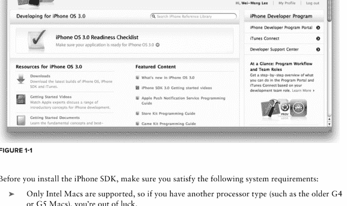

图 1-1

在安装 iPhone SDK 之前，请确保你满足以下系统要求：

- 仅支持基于 Intel 芯片的 Mac，因此如果你使用其他处理器类型（例如较老的 G4 或 G5 Mac），那就不走运了。
- 你已将系统更新到最新的 Mac OS X 版本。

强烈建议（但并非严格必需）使用 iPhone/iPod Touch 设备。你可以使用自带的 iPhone 模拟器来测试应用程序。但是，如果你想测试某些硬件功能（如摄像头、加速度计等），则需要使用真实设备。

当 SDK 下载完成后，继续安装它（见图 1-2）。系统会要求你接受一些许可协议，然后选择安装 SDK 的目标文件夹。

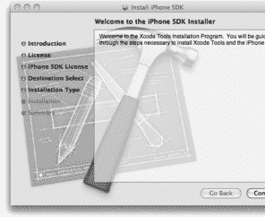

图 1-2

如果在安装阶段选择了默认设置，那么安装完成后，你应该能够在 `/Developer/Applications` 文件夹中找到已安装的各种工具（见图 1-3）。

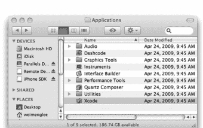

图 1-3

## iPhone SDK 的组件

iPhone SDK 包含一套开发工具，可帮助你为 iPhone 和 iPod Touch 开发应用程序。它包括：

- Xcode——集成开发环境（IDE），允许你管理、编辑和调试项目。
- Dashcode——集成开发环境（IDE），允许你开发基于 Web 的 iPhone 应用程序和 Dashboard Widget。Dashcode 不在本书的讨论范围内。


使用 Xcode，您可以开发不同类型的 iPhone 和 Mac OS X 应用程序（见图 1-5）。

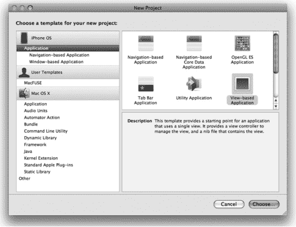

**图 1-5**

Xcode 中的 IDE 提供了许多工具和功能，使开发生活变得更加轻松。其中一个功能是代码补全（见图 1-6），它会显示一个弹出列表，展示可用的类和成员（例如方法、属性等）。

## iPhone SDK 的安装

### 一、市场风险

影视剧市场受观众偏好变化、竞争格局、政策监管等多重因素影响，项目实际收益可能与预期存在较大偏差，甚至出现亏损。

### 二、内容风险

剧本创作、拍摄制作、后期剪辑等环节均存在不确定性，任一环节出现问题都可能影响成片质量与发行效果。

### 三、合规风险

影视剧项目需遵守相关法律法规及行业规定，如未能通过审查或违反政策要求，可能导致项目无法如期上映或播出。

### 四、主创及演职人员风险

主创及演职人员的健康、言行、档期等状况均可能影响项目进度和市场表现，极端情况下可能导致项目中止。

### 五、投资流动性风险

影视剧投资周期较长，资金占用较大，且项目权益转让受限于市场环境和合作协议约定，可能无法及时变现。

> **注意** *有关如何在真实设备上测试应用程序的更详细说明，请参阅附录 E。*

## 从 iPhone 模拟器卸载应用程序

iPhone 模拟器的 iPhone OS 文件系统的用户域存储在 `~/Library/Application Support/iPhone Simulator/User/` 文件夹中。

> **注意** *`~/Library/Application Support/iPhone Simulator/User/` 文件夹也称为 `<iPhoneUserDomain>`。*

所有第三方应用程序都存储在 `<iPhoneUserDomain>/Applications/` 文件夹中。当应用程序部署到 iPhone 模拟器时，主屏幕上会创建一个图标（图 1-9 左侧所示），并且在 `Applications` 文件夹内会创建一个文件和一个文件夹（图 1-9 右侧所示）。

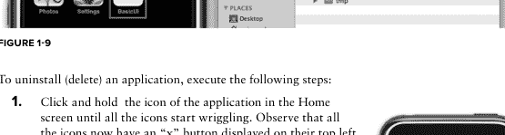

**图 1-9**

要卸载（删除）应用程序，请执行以下步骤：

1. 在主屏幕上按住应用程序的图标，直到所有图标开始晃动。请注意，所有图标现在在其左上角都显示了一个“x”按钮。
2. 单击（见图 1-10）您要卸载的应用程序图标旁边的 x 按钮。
3. 出现一个警告窗口，询问您是否确定要删除该图标。单击 Delete 以确认删除。

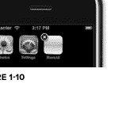

**图 1-10**

> **警告** 当应用程序被卸载时，`Applications` 文件夹中对应的文件和文件夹会自动删除。

要将 iPhone 模拟器重置为原始状态，最简单的方法是选择 iPhone Simulator → Reset Content and Settings 菜单项。

## 接口构建器

Interface Builder 是一个可视化工具，允许您为 iPhone 应用程序设计用户界面。使用 Interface Builder，您可以将视图拖放到窗口上，然后使用 outlets 和 actions 连接各个视图，以便它们能够以编程方式与您的代码交互。

> **注意** Outlets 和 actions 在第 3 章中有更详细的讨论。

图 1-11 显示了 Interface Builder 中的各个窗口。

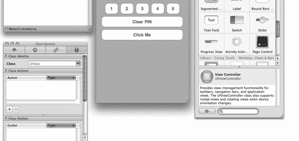

**图 1-11**

附录 C 更详细地讨论了 Interface Builder。

- Alerts
- Web Views
- People Picker
- Image Picker
- Controllers

iPhone SDK 由表 1-1 所示的以下框架组成，按功能分组。

> **注意** 框架是提供特定功能的软件库。

### 表 1-1：iPhone SDK 中的框架

| 框架名称 | 描述 |
|---|---|
| AddressBook.framework | 提供对存储用户联系人的集中数据库的访问。 |
| AddressBookUI.framework | 提供用于显示存储在地址簿数据库中的联系人的用户界面。 |
| AudioToolbox.framework | 提供用于音频录制和播放的低级 C API，以及管理音频硬件。 |
| AudioUnit.framework | 提供应用程序中 iPhone OS 提供的音频处理插件的接口。 |
| AVFoundation.framework | 提供用于音频录制和播放的低级 C API，以及管理音频硬件。 |
| CFNetwork.framework | 提供对网络服务和配置的访问，例如 HTTP、FTP 和 Bonjour 服务。 |
| CoreAudio.framework | 声明其他 Core Audio 接口使用的数据类型和常量。 |
| CoreData.framework | 为应用程序中的对象图管理提供通用解决方案。 |
| CoreFoundation.framework | 提供常见数据类型、Unicode 字符串、XML、URL 资源等的抽象。 |
| CoreGraphics.framework | 提供基于 C 的 2D 渲染 API；基于 Quartz 绘图引擎。 |

决定了导致电池寿命和性能下降的主要原因是后台应用程序。在其他平台上（例如 Windows Mobile），当应用程序退出视图（例如因来电）时，应用程序仍保留在内存中，每个保留在内存中的后台应用程序都会继续对设备的性能和电池寿命造成影响。

苹果解决此问题的方案很简单：禁止应用程序在后台运行。虽然这是一种有效的解决方案，但它让许多开发者感到不满。许多有用的应用程序需要后台操作才能正常运行。例如，聊天应用程序需要运行才能接收来自其他用户的消息。为克服这一限制，苹果开发了其推送通知服务，该服务即使在应用程序未运行时也能为应用程序提供数据。该服务随 iPhone 3.0 发布。使用推送技术，设备通过 IP 连接不断连接到苹果的服务器。当设备需要关注时，通知会从苹果服务器发送到设备，从而提醒需要处理该通知的特定应用程序。

> **注意** 推送通知超出了本书的范围。如需了解更多信息，请访问苹果的 iPhone Dev Center，网址为 http://developer.apple.com/iphone/index.action。

## 调用第三方应用程序的限制

苹果对 iPhone 开发者施加的另一个限制是，您不允许从应用程序内部调用第三方应用程序。此外，您也不能在应用程序内部运行解释代码。一个很好的例子是为 iPhone 编写 Web 浏览器应用程序。由于 Web 应用程序通常使用 JavaScript 进行客户端交互，苹果的这一限制意味着您不能在应用程序内部运行 JavaScript 代码。

## 摘要

本章对用于 iPhone 应用程序开发的工具进行了快速介绍。您还了解了一些 iPhone 的特性，例如单应用程序限制和无法调用第三方应用程序。在下一章中，您将开发您的第一个 iPhone 应用程序，很快您就将迈向 iPhone 的 nirvana！


## 编写您的第一个 Hello World！应用程序

### 本章您将学习的内容

- 创建一个新的 iPhone 项目
- 使用 Xcode 构建您的第一个 iPhone 应用程序
- 使用 Interface Builder 设计 iPhone 应用程序的用户界面（UI）
- 编写一些简单的代码以允许应用程序根据设备的方向旋转其内容。
- 为您的 iPhone 应用程序添加图标

现在您已经设置了所有工具和 SDK，您就可以开始为 iPhone 和 iPod Touch 开发了！对于编程书籍来说，通常在章节开始时向您展示如何开发一个“Hello World！”应用程序。这种方法可以让您非常快速地使用各种工具，而不会陷入细节。它还为您提供了即时的满足感：您亲眼看到事情确实有效，这可以成为激励您学习更多事物的士气提升。

### 开始使用 Xcode

启动 Xcode，您应该会看到欢迎屏幕，如图 2-1 所示。


**注意** 启动 Xcode 最简单的方法是在 Spotlight 中输入 *Xcode*，然后按 Enter 键启动它。

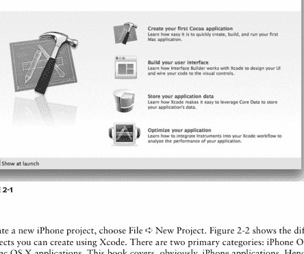

图 2-1

要创建新的 iPhone 项目，请选择 File ▸ New Project。图 2-2 显示了使用 Xcode 可以创建的不同类型的项目。有两个主要类别：iPhone OS 应用程序和 Mac OS X 应用程序。本书显然主要讲解 iPhone 应用程序。因此，单击 iPhone OS 下列出的 Application 项目以查看用于开发 iPhone 应用程序的各种模板。

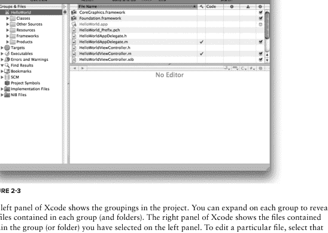

图 2-3

Xcode 的左侧面板显示项目中的分组。你可以展开每个分组以显示每个分组（和文件夹）中包含的文件。Xcode 的右侧面板显示你在左侧面板中选择的分组（或文件夹）中包含的文件。要编辑特定文件，请选择该文件，然后右侧面板底部的编辑器会打开该文件以供编辑。如果你想要单独的编辑窗口，只需双击文件即可在新窗口中编辑它。

在下面的 Try It Out 中，你将学习如何自定义 Xcode 工具栏区域以添加常用项目。

## 试用 自定义 Xcode 工具栏区域

*代码文件 [HelloWorld.zip] 可从 Wrox.com 下载*

Xcode 的顶部是工具栏区域。该区域包含开发过程中常用的所有工具栏菜单项。你可以自定义工具栏区域以添加此类项目。

- 1. 通过选择 View ⌘ Customize Toolbar 来试试。会出现一个下拉窗口（见图 2-4）。

- 3. Active SDK 项目允许你选择将应用程序部署到真实设备还是 iPhone 模拟器（见图 2-6）。

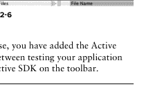

### 工作原理

通过将常用项目添加到 Xcode 工具栏区域，你可以提高开发过程的效率。在这种情况下，你已将 Active SDK 工具栏项目添加到工具栏区域，以便你只需在工具栏上选择活动 SDK，即可快速在 iPhone 模拟器和真实设备上测试应用程序之间切换。

## 使用 Interface Builder

到目前为止，该项目还没有 UI。为了证明这一点，只需按 Command-R（或选择 Run ↻ Run），你的应用程序就会部署到包含的 iPhone 模拟器中。图 2-7 显示了 iPhone 模拟器上显示的空白屏幕。现在看到这一点很好，因为在你阅读本章的过程中，你会看到基于你的操作发生了哪些变化。

显然，空白屏幕并不是很有用。所以，是时候尝试向应用程序的 UI 添加一些控件了。如果你检查项目中的文件列表，你会注意到有两个以 .xib 为扩展名的文件——MainWindow.xib 和 HelloWorldViewController.xib。以 .xib 为扩展名的文件基本上是包含应用程序 UI 定义的 XML 文件。你可以通过修改其 XML 内容来编辑 .xib 文件，或者更简单（更理智）地使用 Interface Builder 编辑它们。

Interface Builder 是 iPhone SDK 的一部分，允许你使用拖放来构建 iPhone（和 Mac）应用程序的 UI。

双击 HelloWorldViewController.xib 文件以启动 Interface Builder。图 2-8 显示了 Interface Builder 显示 HelloWorldViewController.xib 的内容（目前实际上是空的）。正如你所见，Library 窗口显示了你可以添加到 iPhone 应用程序 UI 的各种控件。View 窗口显示了你的 UI 的图形布局。你很快就会看到其他窗口的使用。

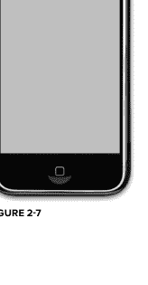

图 2-8

现在，滚动到 Library 面板中的 Label 控件并将 Label 视图拖放到 View 窗口上。添加 Label 视图后，选择 Label 视图并选择 Tools ▸ Attributes Inspector。在 Text 字段中输入 Hello World！此外，在 Layout 旁边，单击居中对齐类型（见图 2-9）。

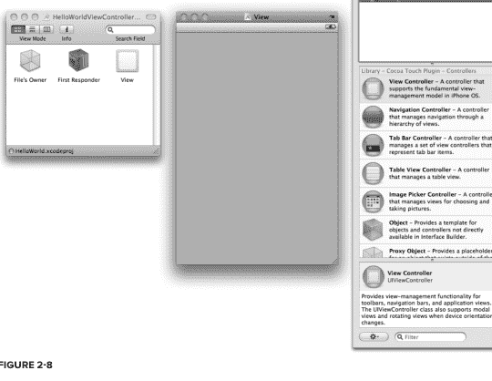

图 2-9

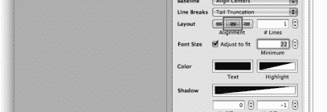

## 视图重新定位

在上一节中，你看到随着方向的变化，视图的大小和位置保持不变。在现实世界中，这种情况是不理想的，因为它在使用应用程序时不会给用户带来良好的体验。理想情况下，你应该在屏幕上重新定位视图，使其随视图方向而变化。

要重新定位视图，请转到 Interface Builder，选择 Label 视图，然后选择 Tools ⇧ Size Inspector。修改视图的 autosizing 属性，如图 2-16 所示（仔细观察 Autosizing 部分中设置的各种锚点）。这将导致 Label 视图在视图方向变化时展开/收缩。同时，视图将锚定到屏幕的左侧、顶部和右侧。

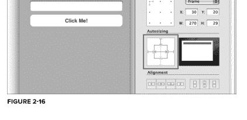

图 2-16

同样，修改 Text Field 视图的 Autosizing 属性，如图 2-17 所示。注意不同的像素大小。

在 HelloWorldViewController.h 文件中，为 btnClicked: 操作添加头声明：

```
//
// HelloWorldViewController.h
// HelloWorld
//
// Created by Wei-Meng Lee on 3/30/09.
// Copyright __MyCompanyName__ 2009. All rights reserved.
//

#import <UIKit/UIKit.h>

@interface HelloWorldViewController : UIViewController {
}

//---declaration for the btnClicked: action---
-(IBAction) btnClicked:(id)sender;

@end
```

在 HelloWorldViewController.m 文件中，添加提供 btnClicked: 操作实现的：

```
-(void)dealloc {
    [super dealloc];
}

//---implementation for the btnClicked: action---
-(IBAction) btnClicked:(id)sender {
    //---display an alert view---
    UIAlertView *alert = [[UIAlertView alloc]
        initWithTitle:@"Hello World!"
        message:@"iPhone, here I come!"
        delegate:self
        cancelButtonTitle:@"OK"
        otherButtonTitles:nil, nil];

    [alert show];
    [alert release];
}

@end
```

前面的代码显示一个包含句子 "iPhone, here I come!" 的警告框！

就这样！返回 Xcode 并再次运行应用程序。这次，当你点击按钮视图时，会显示一个警告视图（见图 2-23）。

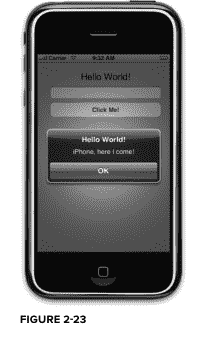

- 2. 要向应用程序添加图标，请将图像拖放到项目的 Resources 文件夹中（见图 2-25）。系统会询问你是否要复制正在拖放的图像。选中此选项，以便图像的副本现在存储在你的项目文件夹中。

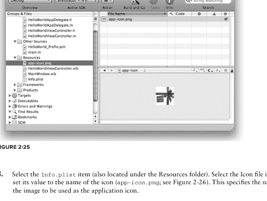

图 2-25

- 3. 选择 Info.plist 项目（也位于 Resources 文件夹下）。选择 Icon file 项目并将其值设置为图标的名称（app-icon.png；见图 2-26）。这指定了用作应用程序图标的图像的名称。

## 练习

- 1. 你在 Xcode 中尝试向 iPhone 项目添加图标。你应该提供什么尺寸的图像？
- 2. 如果你的应用程序需要支持不同的显示方向，你应该怎么做？

## 本章学到的内容

| 主题 | 关键概念 |
|---|---|
| Xcode | 创建你的 iPhone 应用程序项目并编写操作应用程序的代码。 |
| Interface Builder | 使用 Library 中位于的各种视图构建你的 iPhone UI。 |
| 视图重新定位 | 使用 Interface Builder 中的 Autosizing 功能确保视图即使在方向更改时也能调整大小。 |
| 添加应用程序图标 | 将图像添加到项目中，然后在 `info.plist` 文件的 Icon file 属性中指定图像名称。 |
| 为你的 iPhone 应用程序创建图标 | 图标大小为 57 x 57 像素（主屏幕）和 29 x 29 像素（设置）。对于 AppStore 托管，大小为 512 x 512 像素。 |


## 出口、操作和视图控制器

### 本章你将学到什么

- 如何声明和定义出口
- 如何声明和定义操作
- 如何将出口和操作连接到 View 窗口中的视图
- 如何向你的应用程序添加新的视图控制器

在上一章中，你构建了一个简单的 Hello World! iPhone 应用程序，而没有深入了解事物协同工作的底层细节。事实上，学习 iPhone 编程的最大障碍之一是在你能够运行应用程序之前需要学习的大量细节。本书旨在让 iPhone 编程体验既有趣又可承受。因此，本章从创建 iPhone 应用程序的基础开始。你将了解构成 iPhone 应用程序项目的各种文件，以及你的代码如何与 iPhone 应用程序上看到的图形控件相连接。

## 基础代码和 UI 交互

基于视图的应用程序项目是开发单视图应用程序的良好起点，并且为你提供了了解 iPhone 编程中一些重要概念的绝佳机会，所以本节将使用它。你需要下载代码。

首先，启动 Xcode 并创建一个新的基于视图的应用程序项目（见图 3-1），并将其命名为 BasicUI。

代码文件 [BasicUI.zip] 可在 Wrox.com 下载

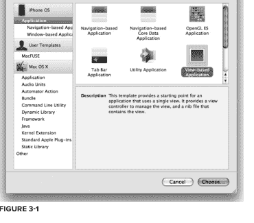

### 图 3-1

Xcode 显示项目中的文件列表（见图 3-2）。

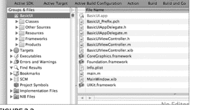

### 图 3-2

正如你所见，创建新项目时系统会为你默认创建许多文件。iPhone SDK 通过创建你在开发 iPhone 应用程序时最常使用的一些项目，使你的生活变得简单。表 3-1 描述了项目中创建的各种文件的用途。

### 表 3-1：项目中创建的各种文件

| 文件 | 描述 |
|---|---|
| BasicUI.app | 应用程序包（可执行文件），包含可执行文件以及随应用程序捆绑的数据。 |
| BasicUI_Prefix.pch | 包含项目中所有文件的预处理头。预处理头默认包含在项目的其他文件中。 |
| BasicUIAppDelegate.h | 应用程序代理的头文件。 |
| BasicUIAppDelegate.m | 应用程序代理的实现文件。 |
| BasicUIViewController.h | 视图控制器的头文件。 |
| BasicUIViewController.m | 视图控制器的实现文件。 |
| BasicUIViewController.xib | 包含视图 UI 的 XIB 文件。 |
| CoreGraphics.framework | 用于低级 2D 渲染的基于 C 的 API。 |
| Foundation.framework | 用于基础系统服务（如数据类型、XML、URL 等）的 API。 |
| Info.plist | 一个字典文件，包含有关你的项目的各种信息，如图标、应用程序名称等；信息以键/值对形式存储。 |
| main.m | 启动你的 iPhone 应用程序的主文件。 |
| MainWindow.xib | 应用程序主窗口的 XIB 文件。 |
| UIKit.framework | 提供构建和管理应用程序 UI 的基本对象。 |

> 注意 创建的文件数量和类型取决于你选择的项目类型。基于视图的应用程序模板是理解所涉及的各种文件的良好起点。

main.m 文件包含启动你的应用程序的代码。它包含以下代码，你很少需要修改它：

```
#import <UIKit/UIKit.h>

int main(int argc, char *argv[]) {
    NSAutoreleasePool * pool = [[NSAutoreleasePool alloc] init];
    int retVal = UIApplicationMain(argc, argv, nil, nil);
    [pool release];
    return retVal;
}
```

大部分繁重的工作由 UIApplicationMain() 函数完成，它检查 Info.plist 文件以获取有关项目的更多信息。特别是，它查看用于项目的 main nib 文件。图 3-3 显示了 Info.plist 文件的内容。请注意，主 nib 文件基本名称键指向 MainWindow，这是应用程序启动时要加载的 NIB 文件的名称。

### XIB 和 NIB 代表什么？

在你的 iPhone 应用程序开发之旅中，你总会遇到扩展名为 .xib 的文件（有时也称为 NIB 文件）。那么，NIB 和 .xib 到底代表什么呢？要理解这一点，需要一点历史课。事实证明，当前的 Mac OS X 是建立在 NeXT 公司（由苹果联合创始人史蒂夫·乔布斯于 1985 年创立）的一个名为 NeXTSTEP 的操作系统之上。NIB 中的 N 代表 NeXTSTEP。至于 .xib，x 很可能代表 XML，因为其内容以 XML 文件形式保存。IB 代表 Interface Builder，即允许你可视化构建应用程序 UI 的应用程序。

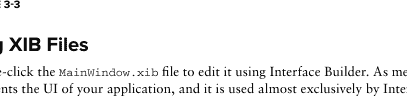

## 编辑 XIB 文件

双击 MainWindow.xib 文件以使用 Interface Builder 编辑它。如前所述，XIB 文件代表你的应用程序的 UI，并且几乎完全由 Interface Builder 使用。

> **注意** XIB 文件实际上是一个 XML 文件。你可以使用 TextEdit 等应用程序查看和编辑它。然而，大多数时候，你使用 Interface Builder 来可视化修改应用程序的 UI。

当 MainWindow.xib 文件由 Interface Builder 打开时，你会看到一个与文件名同名的窗口（见图 3-4）。

此窗口包含五项：

- File's Owner 项代表设置为用户界面的所有者的对象（即负责管理 XIB 文件内容的类）。
- First Responder 项代表用户当前正在交互的对象。第 4 章更详细地讨论了第一响应者对象。
- BasicUI App Delegate 项指向 BasicUIAppDelegate 类。（稍后会详细介绍此主题。）
- BasicUI View Controller 项指向你将用于显示 UI 的视图控制器。
- Window 项是应用程序启动时你将看到的屏幕。

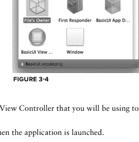

### 图 3-4

## 代理

BasicUIAppDelegate.m 文件包含在应用程序完成加载后或即将终止前通常执行的代码。对于此示例，其内容如下：

```
#import "BasicUIAppDelegate.h"
#import "BasicUIViewController.h"

@implementation BasicUIAppDelegate

@synthesize window;
@synthesize viewController;

- (void)applicationDidFinishLaunching:(UIApplication *)application {
    // Override point for customization after app launch
    [window addSubview:viewController.view];
    [window makeKeyAndVisible];
}

```

当应用程序完成启动时，它向其代理发送 applicationDidFinishLaunching: 消息。在前述情况下，它使用视图控制器获取其视图，然后将其添加到当前窗口以便显示。

BasicUIAppDelegate.h 文件包含 BasicUIAppDelegate 类成员的声明：

```
#import <UIKit/UIKit.h>

@class BasicUIViewController;

@interface BasicUIAppDelegate : NSObject <UIApplicationDelegate> {
    UIWindow *window;
    BasicUIViewController *viewController;
}

@property (nonatomic, retain) IBOutlet UIWindow *window;
@property (nonatomic, retain) IBOutlet BasicUIViewController *viewController;

@end
```

特别值得注意的是这一行：

```
@interface BasicUIAppDelegate : NSObject <UIApplicationDelegate> {
```

<UIApplicationDelegate> 语句指定该类实现 UIApplicationDelegate 协议。简单来说，这意味着你现在可以处理 UIApplicationDelegate 协议中定义事件（或消息）。UIApplicationDelegate 协议中事件的示例如下：

- `applicationDidFinishLaunching:`（你已在 BasicUIAppDelegate.m 文件中看到其实现。）
- `applicationWillTerminate:`
- `applicationDidReceiveMemoryWarning:`

> **注意** 协议将在附录 D 中更详细地讨论。

## 视图控制器

在 iPhone 编程中，你通常使用视图控制器来管理视图以及执行导航和内存管理。在基于视图的应用程序的项目模板中，Xcode 自动使用视图控制器来帮助你管理视图。可以将视图视为你在 iPhone 上看到的屏幕（或窗口）。

> **注意** 本节是对视图控制器基础知识的介绍；第 7 章涵盖更高级的视图控制器主题，并包括多视图应用程序说明。


在本章前面，你已经看到 MainWindow.xib 窗口包含一个 BasicUI View Controller 项。当双击它时，会显示一个同名的窗口（见图 3-5）。

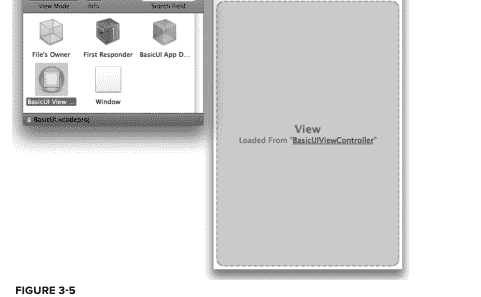

图 3-5

从窗口中可以看到，该视图显示它是从 BasicUIViewController 加载的。这里的 BasicUIViewController 指的是项目中的 BasicUIViewController.xib 文件的名称。

现在，双击 BasicUIViewController.xib 文件，在 Interface Builder 中编辑它（见图 3-6）。

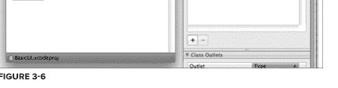

图 3-6

与 MainWindow.xib 文件一样，BasicUIViewController.xib 窗口中也包含一些对象。本例中，窗口包含三项：File's Owner、First Responder 和 View。

你可以右键单击（或按住 Control 单击）File's Owner 项来查看它的输出口（见图 3-7）。现在请注意，view 输出口已连接到 View 项。

View 项表示应用程序中出现的屏幕。双击 View 即可显示它（见图 3-8）。

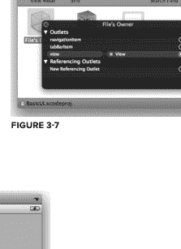

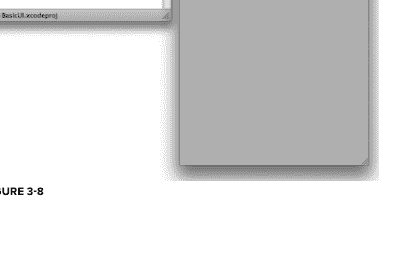

*动作*是能够处理 View 窗口中视图引发的事件（例如按钮被点击）的方法。另一方面，*输出口*允许你的代码以编程方式引用 View 窗口中的视图。

选中 File's Owner 项后，选择“File ▸ Write Class File”菜单项。Interface Builder 会生成必要的代码来表示你刚刚添加的输出口和动作。由于项目模板已包含视图控制器使用的类文件，你会看到如图 3-14 所示的提示。

> **注意** 你也可以手动修改视图控制器文件（.h 和 .m 文件）。但 Interface Builder 有一个不错的小功能，可以帮助你为输出口和动作生成代码。

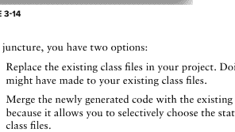

图 3-14

此时你有两个选择：

-   替换项目中的现有类文件。这样做会覆盖你可能对现有类文件所做的所有更改。
-   将新生成的代码与现有类文件合并。我推荐这个选项，因为它允许你选择性选择要插入到现有类文件中的语句。

单击 Merge 按钮。现在你应该会看到如图 3-15 所示的窗口，其中显示 BasicUIViewController.h 的内容。

按 Command-S 保存文件。按 Command-W 关闭窗口。

现在你会看到下一个文件——BasicUIViewController.m 的窗口。重复前面概述的相同步骤（尽管第二个代码块似乎不包含任何内容；见图 3-17）。保存并关闭窗口。

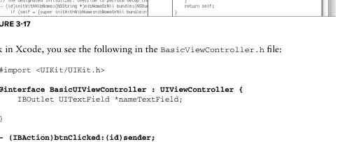

图 3-17

回到 Xcode 中，你会在 BasicUIViewController.h 文件中看到以下内容：

```
#import <UIKit/UIKit.h>

@interface BasicUIViewController : UIViewController {
    IBOutlet UITextField *nameTextField;
}

- (IBAction)btnClicked:(id)sender;

@end
```

IBOutlet 标识符用于为变量添加前缀，以便 Interface Builder 能将输出口的显示和连接与 Xcode 同步。IBAction 标识符用于同步动作方法。

在 BasicUIViewController.m 文件中，你会看到插入了以下语句：

```
#import "BasicUIViewController.h"

@implementation BasicUIViewController

- (IBAction)btnClicked:(id)sender {
}

//...
```

既然你已经知道输出口是什么以及它的作用，是时候在下面的“试试看（Try It Out）”中练习添加输出口了。

## 商业智能分析报告

**摘要：** 本报告对2024年第一季度公司整体运营状况进行综合评估，涵盖销售业绩、市场趋势、用户增长及核心竞争力等关键维度，为管理层决策提供数据支撑与洞察建议。

### 一、销售业绩总览

第一季度总营收达到 1,280 万元，同比增长 15.3%，环比增长 8.7%。其中，华东地区贡献了总营收的 42%，是业绩增长的主要引擎。

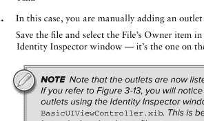

- 线上渠道营收同比增长 **28.6%**，占比提升至 55%
- 线下渠道营收同比增长 **6.2%**，占比降至 45%
- 新客户贡献营收占比达 32%，老客户复购率保持 68%

### 二、市场趋势分析

> **核心洞察：** 人工智能与数据驱动决策正在重塑行业格局，提前布局智能化转型的企业将在未来三年内获得显著的竞争优势。

| 指标 | 2024Q1 | 2023Q4 | 环比变化 |
|------|--------|--------|----------|
| 活跃用户数（万） | 86 | 79 | +8.9% |
| 客单价（元） | 326 | 304 | +7.2% |
| 转化率 | 3.8% | 3.5% | +0.3pp |

ageTextField 输出口出现在“Class Outlets”部分，这证明直接在 .h 文件中编写代码同样有效。

> 注意 如果你想移除 BasicUIViewController.h 下列出的任何输出口，必须手动在 .h 文件中移除。当你看到减号（-）按钮呈灰色时，这一点就很明显了。

如果在此时，你使用“Identity Inspector”窗口添加另一个输出口，你添加的输出口将列在 BasicUIViewController.xib 下（见图 3-19）。在 .h 文件中声明输出口后，该输出口就会出现在 BasicUIViewController.xib 下。

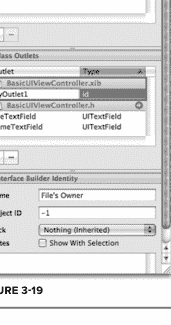

图 3-19

## 你在哪里声明输出口和动作？

在 Apple 的演示和许多其他入门教程中，动作和输出口通常直接声明在 .h 文件中，然后在 Interface Builder 中与视图关联，因为这可能是程序员将代码与 UI 集成的最快、最常见的方式。在 Interface Builder 中添加动作和输出口，然后在 .h 文件中声明它们的过程则稍微繁琐一些。

然而，直接在 Interface Builder 中添加动作和输出口确实有其优势。它允许由非程序员来设计 UI。设计师可以专注于 UI 设计，创建动作和输出口，并将它们连接到视图，而无需担心代码。设计完成后，程序员可以接手并定义在 Interface Builder 中声明的动作和输出口。

## 将视图控制器连接到输出口和动作

在视图控制器中定义动作和输出口后，你必须有办法将它们连接到 View 窗口中的视图。要将 View 窗口中视图的事件链接到视图控制器中定义的动作，你需要按住 Control 键单击并将视图拖到 File's Owner 项上。

在此示例中，按住 Control 键单击并拖动“Click Me”按钮，将其放到 File's Owner 项上。拖动时，注意会出现一条橡皮筋。当鼠标悬停在 File's Owner 项上时，它会高亮显示（见图 3-20）。当释放鼠标按钮时，会弹出一个弹出窗口。`btnClicked: action` 现在显示在 Events 部分下。

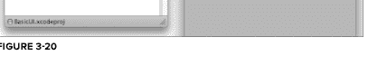

图 3-20

> **警告** 请记住，要链接动作，你总是从 View 窗口中的视图拖到 File's Owner 项上。

要将视图控制器中定义的输出口链接到 View 窗口中的视图，请按住 Control 键单击并将 File's Owner 项拖到要连接的视图上（见图 3-21）。现在你会在 Outlets 组下看到在视图控制器中定义的输出口列表。选择 `nameTextField` 输出口。

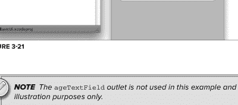

图 3-21

> **注意** 此示例中未使用 `ageTextField` 输出口，它仅用于说明目的。

> **警告** 请记住，要链接输出口，你总是从 File's Owner 项拖到 View 窗口中所需的视图上。这与链接动作正好相反。

连接动作和输出口后，你可以右键单击（或按住 Control 单击）File's Owner 项来查看其连接（见图 3-22）。正如你所看到的，`nameTextField` 输出口连接到一个圆角样式的文本字段视图，`btnClicked:` 动作连接到圆角矩形按钮的 Touch Up Inside 事件。

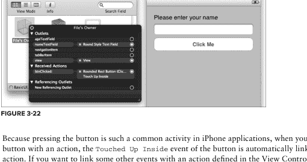

图 3-22

因为按下按钮在 iPhone 应用程序中是非常常见的操作，所以当你将按钮与动作连接时，按钮的 Touch Up Inside 事件会自动与该动作关联。如果你想将其他事件与视图控制器中定义的动作关联，请右键单击按钮视图，单击并拖动事件（以圆圈表示），然后将其与 File's Owner 项连接（见图 3-23）。

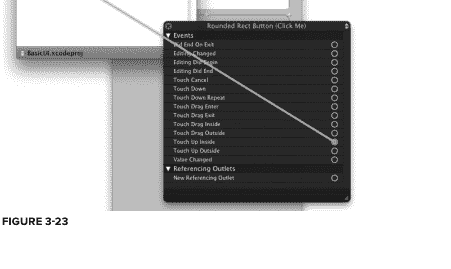

图 3-23


如果操作连接正确，你应该会在事件名称旁边看到该操作（见图 3-24）。

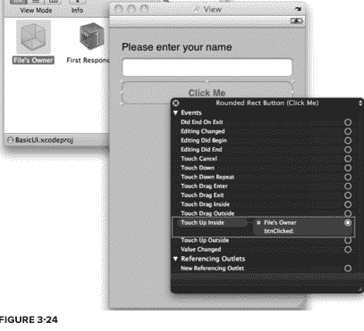

图 3-24

## 将 Outlet 暴露为属性

回想一下，之前在 BasicUIViewController.h 文件中，已为你生成了一个 outlet 和一个 action：

```objective-c
#import <UIKit/UIKit.h>

@interface BasicUIViewController : UIViewController {
    IBOutlet UITextField *nameTextField;
}
- (IBAction)btnClicked:(id)sender;
@end
```

nameTextField 是一个类型为 UITextField 的 IBOutlet 实例成员。在 iPhone 编程中，一个良好的实践是使用 @property 标识符将成员变量暴露为属性：

```objective-c
#import <UIKit/UIKit.h>

@interface BasicUIViewController : UIViewController {
    IBOutlet UITextField *nameTextField;
}

@property (nonatomic, retain) UITextField *nameTextField;

- (IBAction)btnClicked:(id)sender;
@end
```

> **NOTE** IBOutlet 标签也可以添加到 @property 标识符中。这种语法在 Apple 文档中很常见：
> 
> ```objective-c
> @property (nonatomic, retain) IBOutlet UITextField *nameTextField;
> ```

> **NOTE** 有关 nonatomic 和 retain 标识符的使用，请参阅附录 D，其中可以找到 Objective-C 的介绍。此外，稍后会讨论的 @synthesize 关键字在那里也有更详细的解释。

当 outlet 现在被暴露为属性时，你需要为该属性定义 getter 和 setter。一个快速简便的方法是在 BasicUIViewController.m 文件中使用 @synthesize 关键字，如下所示：

```objective-c
#import "BasicUIViewController.h"

@implementation BasicUIViewController

@synthesize nameTextField;
```

## 编码 Action

如前所示，你已将 Round Rect Button 视图的 Touch Up Inside 事件与在 View Controller 中定义的 btnClick: action 连接起来。要实现 btnClick: 方法，请在 BasicUIViewController.m 文件中编写以下内容：

```objective-c
#import "BasicUIViewController.h"

@implementation BasicUIViewController

@synthesize nameTextField;
```

```objc
- (IBAction)btnClicked:(id)sender {
    NSString *str = [[NSString alloc]
        initWithFormat:@"Hello, %@", nameTextField.text ];
    UIAlertView *alert=[[UIAlertView alloc]
        initWithTitle:@"Hello"
        message: str
        delegate:self
        cancelButtonTitle:@"OK"
        otherButtonTitles:nil, nil];
    [alert show];
    [alert release];
    [str release];
}
- (void)dealloc {
    [nameTextField release];
    [super dealloc];
}

@end
```

你使用 @synthesize 标识符让编译器为 nameTextField 属性生成访问器和修改器（也 commonly known as getters 和 setters）。UIAlertView 类会显示一个包含指定内容的警告窗口。

完成！要测试应用程序，请在 Xcode 中按 Command-R。如果当前选定的活动 SDK 是 iPhone Simulator (3.0)（见图 3-25），则会启动 iPhone Simulator。


图 3-25

NSMutableString 类表示一个可变字符串（即其内容在初始化后可以更改）。相比之下，NSString 类表示一个不可变字符串（即其内容在初始化后不能更改）。

## 连接 Outlet 和 Action

在 Interface Builder 中，将五个 Round Rect 按钮连接到 pinBtnClicked: action。这意味着单个 action 将处理五个按钮的 TouchUp Inside 事件。此外，将 Clear PIN 按钮连接到 clearPinBtnClicked: action。File’s Owner 项的连接现在应如下图所示 图 3-28。

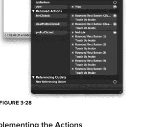

图 3-28

## 实现 Actions

在 BasicUIViewController.m 文件中，提供以下实现：

```objc
#import "BasicUIViewController.h"

@implementation BasicUIViewController

@synthesize nameTextField;

- (IBAction)clearPinBtnClicked:(id)sender {
    //---clears the secret pin---
    [secretPin setString:@""];
}
```

完成！按 Command-R 在 iPhone Simulator 上调试应用程序。仅当用户输入正确的 pin 号码后才会显示警告视图（见图 3-29）。

## 视图控制器

前一节讨论了 View-based Application 项目，该项目默认包含一个已为你的应用程序使用配置好的 View Controller。在本节中，你将学习如何手动向应用程序添加 View Controller 并将其设置为 XIB 文件。最好的方法是创建一个 Window-based Application 项目。Window-based Application 项目模板提供了一个包含委托和窗口的骨架项目。该模板为开发任何类型的 iPhone 应用程序提供了一个起点。

现在让我们使用 Xcode 创建一个新的 Window-based Application 项目（见图 3-30）。

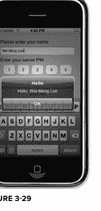

图 3-29

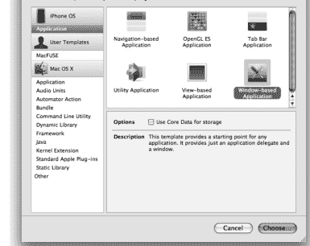

图 3-30

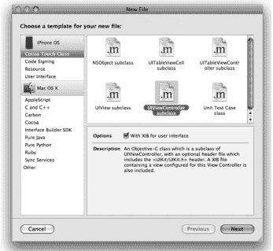

图 3-32

在下一个窗口中，系统会要求你为新的 View Controller 类命名。将其命名为 `MyViewController.m`（见图 3-33）。对应的 `.h` 文件随后会为你创建。单击 Finish。

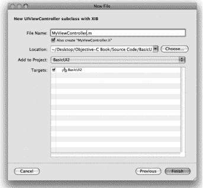

图 3-33

现在为你创建了三个文件（见图 3-34）：

- MyViewController.h
- MyViewController.m
- MyViewController.xib

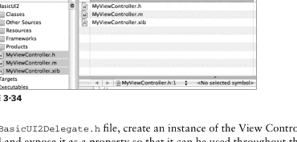

图 3-34

在 BasicUI2Delegate.h 文件中，创建一个你刚刚创建的 View Controller 的实例并将其暴露为属性，以便可在整个应用程序中使用：

可在 Wrox.com 上下载

```objective-c
#import <UIKit/UIKit.h>

@class MyViewController;

@interface BasicUI2AppDelegate : NSObject <UIApplicationDelegate> {
    UIWindow *window;
    MyViewController *myViewController;
}
@property (nonatomic, retain) IBOutlet UIWindow *window;
@property (nonatomic, retain) MyViewController *myViewController;
@end
```

请注意，你使用前向声明（在附录 D 中描述）来告知编译器 MyViewController 类在项目中的某个位置定义：

```objective-c
@class MyViewController;
```

在 BasicUI2Delegate.m 文件中，添加以下代码以便创建 MyViewController 类的实例，然后将其视图设置为当前窗口：

```objc
#import "BasicUI2AppDelegate.h"
#import "MyViewController.h"

@implementation BasicUI2AppDelegate

@synthesize window;
@synthesize myViewController;

- (void)applicationDidFinishLaunching:(UIApplication *)application {
    //---create an instance of the MyViewController---
    MyViewController *viewController = [[MyViewController alloc]
        initWithNibName:@"MyViewController"
        bundle:[NSBundle mainBundle]];

    //---set the instance to the property---
    self.myViewController = viewController;
    [viewController release];

    //---add the view of the view controller---
    [window addSubview:[myViewController view]];

    // Override point for customization after application launch
    [window makeKeyAndVisible];
}

- (void)dealloc {
    [myViewController release];
    [window release];
    [super dealloc];
}

@end
```

代码文件 [BasicUI2.zip]

前述代码的结果是，当应用程序运行时，新增的 View Controller 将被加载。

## 自定义视图

View Controller 已正确连接后，现在是时候自定义新视图使其能够执行有用的操作了。为了增加趣味性，双击 MyViewController.xib 文件并向 View 窗口添加一个 Web 视图（见图 3-35）。Web 视图是一个 Web 浏览器视图，用于显示 Web 内容。


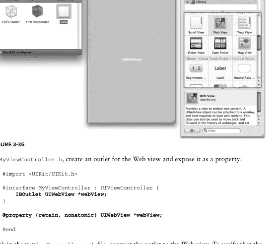

## 图 3-35

在 MyViewController.h 中，为 Web 视图创建一个 outlet 并将其作为属性公开：

```objc
#import <UIKit/UIKit.h>

@interface MyViewController : UIViewController {
    IBOutlet UIWebView *webView;
}

@property (retain, nonatomic) UIWebView *webView;

@end
```

返回 MyViewController.xib 文件，将 outlet 连接到 Web 视图。为验证连接是否正确建立，请右键单击 File's Owner 项目。你应该会看到图 3-36 所示的连接。

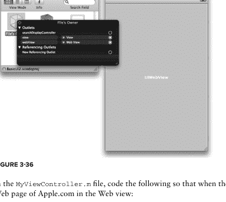

## 图 3-36

在 MyViewController.m 文件中编写以下代码，以便在视图加载时在 Web 视图中显示 Apple.com 的网页：

```objc
#import "MyViewController.h"

@implementation MyViewController

@synthesize webView;

// Implement viewDidLoad to do additional setup after loading the view,
// typically from a nib.
- (void)viewDidLoad {
    NSString *strUrl = @"http://www.apple.com";
    //---create an URL object---
    NSURL *url = [NSURL URLWithString:strUrl];

    //---create an URL Request Object---
    NSURLRequest *request = [NSURLRequest requestWithURL:url];

    //---load the request in the UIWebView---
    [webView loadRequest:request];

    [super viewDidLoad];
}
- (void)dealloc {
    [webView release];
    [super dealloc];
}
@end
```

就这样！按 Command-R 在 iPhone 模拟器上测试应用程序。图 3-37 显示模拟器正在显示 Apple 的主页。

## 摘要

在本章中，您已了解 XIB 文件的使用以及 View Controllers 在 iPhone 应用程序中扮演的角色。理解 outlets 和 actions 的使用极其重要，因为它是 iPhone 开发的基石。在整本书中，您会经常遇到它们。

在下一章中，您将学习如何控制虚拟键盘，当用户尝试向应用程序输入数据时该键盘会自动弹出。

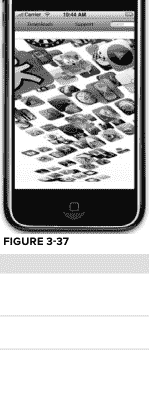

图 3-37

## 练习

- 1. 使用代码声明并定义一个 UITextField 视图的 outlet。
- 2. 使用代码声明并定义一个 action。

## 本章学到的内容

| 主题 | 关键概念 |
|---|---|
| 委托文件 | 委托文件包含在应用程序加载/卸载期间通常执行的代码。 |
| 视图控制器 | 视图控制器管理视图并执行导航和内存管理。 |
| 动作 | 动作是一种方法，可以处理 View 窗口中视图引发的事件（例如，当按钮被点击时等）。 |
| 出口 | 出口允许您的代码以编程方式引用 View 窗口上的视图。 |
| 使用代码添加 outlet | 使用 `IBOutlet` 关键字：<br>`IBOutlet UITextField *nameTextField;` |
| 使用代码添加 action | 使用 `IBAction` 关键字：<br>`- (IBAction)btnClicked:(id)sender;` |
| 连接动作 | 要链接动作，您始终从 View 窗口中的视图拖动到 File's Owner 项目上。 |
| 连接出口 | 要链接出口，您始终从 File's Owner 项目拖动到 View 窗口中所需的视图上。 |

- 3. 按 Command-R 在 iPhone 模拟器上测试应用程序。加载应用程序时，您会看到如图 4-2 所示的警报视图。

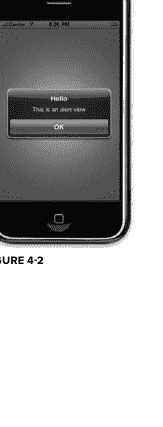

- 4. 返回 Xcode，修改 otherButtonTitles 参数，将其设置为加粗显示的值：

```objc
UIAlertView *alert = [[UIAlertView alloc]
initWithTitle:@"Hello"
message:@"This is an alert view"
delegate:self
cancelButtonTitle:@"OK"
otherButtonTitles:@"Option 1",
@"Option 2", nil];
```

- 5. 在 UsingViewsViewController.h 文件中，添加以下加粗显示的行：

```objc
#import <UIKit/UIKit.h>

@interface UsingViewsViewController : UIViewController
<UIAlertViewDelegate> {
}

@end
```

- 6. 在 UsingViewsViewController.m 文件中，添加以下方法：

```objc
- (void)alertView:(UIAlertView *)alertView clickedButtonAtIndex:
(NSInteger)buttonIndex {

NSLog([NSString stringWithFormat:@"%d", buttonIndex]);
}
```

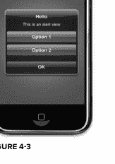

- 7. 按 Command-R 在 iPhone 模拟器中测试应用程序。请注意，除了 OK 按钮外，现在还有两个额外的按钮（参见图 4-3）。
- 8. 点击任意一个按钮 — Option 1、Option 2 或 OK。
- 9. 在 Xcode 中，按 Command-Shift-R 查看调试器控制台窗口。观察打印的值。您可以多次重新运行应用程序并点击不同的按钮以观察打印的值。
- 10. 您应该观察到为每个被点击的按钮打印的值：
    - OK 按钮 — 0
    - Option 1 — 1
    - Option 2 — 2

## 工作原理

要使用 UIAlertView，您首先实例化它并使用各种参数对其进行初始化：

```objc
UIAlertView *alert = [[UIAlertView alloc] initWithTitle:@"Hello"
message:@"This is an alert view"
delegate:self
cancelButtonTitle:@"OK"
otherButtonTitles:nil];
```

第一个参数是警报视图的标题，您将其设置为 "Hello"。第二个是消息，您将其设置为 "This is an alert view"。第三个是委托，您需要将其设置为将处理 UIAlertView 对象触发的事件的对象。在本例中，您将其设置为 self，这意味着事件处理程序将在当前类中实现，即视图控制器。cancelButtonTitle 参数显示一个按钮以 dismiss 您的警报视图。最后，otherButtonTitles 参数允许您在需要时显示额外的按钮。如果不需要额外的按钮，只需将其设置为 nil 即可。

要以模态方式显示警报视图，请使用 show 方法：

```objc
[alert show];
```

对于警报视图的简单使用，您实际上不需要处理它触发的事件。点击 OK 按钮（在 cancelButtonTitle 参数中设置） simply dismisses 警报视图。

如果您想要多个按钮，则需要设置 otherButtonTitles 参数，如下所示：

```objc
UIAlertView *alert = [[UIAlertView alloc] initWithTitle:@"Hello"
message:@"This is an alert view"
delegate:self
cancelButtonTitle:@"OK"
otherButtonTitles:@"Option 1", @"Option 2", nil];
```

请注意，您需要使用 nil 结束 otherButtonTitles 参数，否则将发生运行时错误。

现在您有三个按钮，您需要能够知道用户按下了哪个按钮——特别是 Option 1 还是 Option 2 是否被按下。为此，您需要处理 UIAlertView 类引发的事件。您通过确保您的视图控制器符合 UIAlertViewDelegate 协议来实现这一点：

```objc
@interface UsingViewsViewController : UIViewController <UIAlertViewDelegate> {
    //...
}
```

UIAlertViewDelegate 协议包含与警报视图关联的多个方法。要知道用户点击了哪个按钮，您需要实现 alertView:clickedButtonAtIndex: 方法：

```objc
- (void)alertView:(UIAlertView *)alertView clickedButtonAtIndex:
(NSInteger)buttonIndex {
    NSLog([NSString stringWithFormat:@"%d", buttonIndex]);
}
```

被点击按钮的索引将通过 clickedButtonAtIndex: 参数传入。

> **NOTE** 请参阅附录 D，了解 Objective-C 中协议概念的讨论。

## 使用操作表

虽然 Alert 视图可以显示多个按钮，但其主要用途仍然是作为在发生某事时提醒用户的工具。如果您需要显示一条带有多个供用户选择的选项的消息，则应使用操作表而不是 Alert 视图。*操作表* 显示一组按钮，用户可在其中选择一个。它始终从屏幕底部出现并锚定在屏幕两侧，提示用户操作表的详细信息与当前应用程序相关联。操作表使用的一个好例子是您在 Safari 中点击 "+" 按钮时。点击 "+" 按钮会显示一个操作表，您可以在其中添加书签、将当前页面添加到主屏幕，或邮件发送当前页面的链接。以下试一试将让您使用操作表。

## 试一试 使用操作表

- 1. 使用上一节创建的同一项目，按如下方式修改 `viewDidLoad` 方法（在 `UsingViewsViewController.m` 文件中）：

```objc
- (void)viewDidLoad {

    UIActionSheet *action = [[UIActionSheet alloc]
        initWithTitle:@"Title of Action Sheet"
        delegate:self
        cancelButtonTitle:@"OK"
        destructiveButtonTitle:@"Delete Message"
        otherButtonTitles:@"Option 1", @"Option 2", nil];
    [action showInView:self.view];
    [action release];
    [super viewDidLoad];
}
```

- 2. 在 `UsingViewsViewController.h` 文件中，添加以下加粗显示的语句：

```objc
#import <UIKit/UIKit.h>

@interface UsingViewsViewController : UIViewController
<UIActionSheetDelegate> {
}

@end
```

- 3. 在 UsingViewsViewController.m 文件中，添加以下以粗体显示的语句：

```objc
- (void)actionSheet:(UIActionSheet *)actionSheet
clickedButtonAtIndex:(NSInteger)buttonIndex{

NSLog([NSString stringWithFormat:@"%d", buttonIndex]);
}
```

- 4. 按 Command-R 使用 iPhone 模拟器测试应用程序。图 4-4 显示了操作表的使用情况。

- 5. 点击以下任意一个按钮：Delete Message、Option 1、Option 2 或 OK。

- 6. 在 Xcode 中，按 Command-Shift-R 查看调试器控制台窗口。观察打印的值。您可以多次重新运行应用程序并点击不同的按钮以观察打印的值。

- 7. 您应该观察到为每个被点击的按钮打印的值：

| 按钮 | 值 |
| --- | --- |
| Delete Message | 0 |
| Option 1 | 1 |
| Option 2 | 2 |
| OK | 3 |

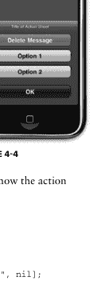

图 4-4

## 工作原理

操作表的工作方式与 Alert 视图非常相似，但视觉上有所不同。要显示操作表，您需要指定操作表源自的视图：

```objc
UIActionSheet *action = [[UIActionSheet alloc]
initWithTitle:@"Title of Action Sheet"
delegate:self
cancelButtonTitle:@"OK"
destructiveButtonTitle:@"Delete Message"
otherButtonTitles:@"Option 1", @"Option 2", nil];
[action showInView:self.view];
```

请注意，按 destructiveButtonTitle: 参数指定的按钮会以红色显示。

- 4. 选择其中一个 ImageView 视图后，打开属性检查器窗口并将 Tag 属性设置为 0。选择第二个 ImageView 并将 Tag 属性设置为 1（见图 4-8）。

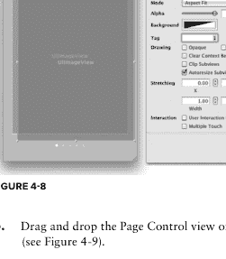

图 4-8

- 5. 将 Page Control 视图拖放到 View 窗口中，并将其页面数设置为五（见图 4-9）。

> **注意** 确保您增加 Page Control 视图的宽度，以便五个点现在都可见。

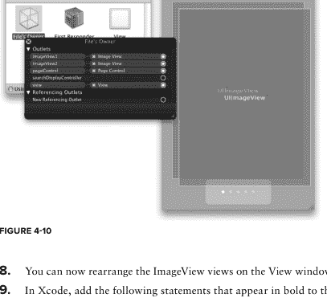

图 4-10

- 8. 现在您可以在 View 窗口上重新排列 ImageView 视图，使它们相互重叠。

- 9. 在 Xcode 中，将以下以粗体显示的语句添加到 UsingViewsViewController.m 文件中：

```objc
#import "UsingViewsViewController.h"

@implementation UsingViewsViewController

@synthesize pageControl;
@synthesize imageView1, imageView2;

- (void)viewDidLoad {

    //---initialize the first imageview to display an image---
    [imageView1 setImage:[UIImage imageNamed:@"iMac_old.jpeg"]];
    tempImageView = imageView2;

    //---make the first imageview visible and hide the second---
    [imageView1 setHidden:NO];
    [imageView2 setHidden:YES];

    //---add the event handler for the page control---
    [pageControl addTarget:self action:@selector(pageTurning:) forControlEvents:UIControlEventValueChanged];
    [super viewDidLoad];
}

//---when the page control's value is changed---
- (void) pageTurning: (UIPageControl *) pageController
{
    //---get the page number you can turning to---
    NSUInteger nextPage = [pageController currentPage];
    switch (nextPage) {
        case 0:
            [tempImageView setImage:[UIImage imageNamed:@"iMac_old.jpeg"]];
            break;
        case 1:
            [tempImageView setImage:[UIImage imageNamed:@"iMac.jpeg"]];
            break;
        case 2:
            [tempImageView setImage:[UIImage imageNamed:@"Mac8100.jpeg"]];
            break;
        case 3:
            [tempImageView setImage:[UIImage imageNamed:@"MacPlus.jpeg"]];
            break;
        case 4:
            [tempImageView setImage:[UIImage imageNamed:@"MacSE.jpeg"]];
            break;
        default:
            break;
    }

    //---switch the two imageview views---
    if (tempImageView.tag==0) { //---imageView1---
        tempImageView = imageView2;
        bgImageView = imageView1;
    }
    else { //---imageView2---
        tempImageView = imageView1;
        bgImageView = imageView2;
    }

    //---animate the two views flipping---
    [UIView beginAnimations:@"flipping view" context:nil];
    [UIView setAnimationDuration:0.5];
    [UIView setAnimationCurve:UIViewAnimationCurveEaseInOut];
    [UIView setAnimationTransition:UIViewAnimationTransitionFlipFromLeft
        forView:tempImageView cache:YES];
    [tempImageView setHidden:YES];
    [UIView commitAnimations];

    [UIView beginAnimations:@"flipping view" context:nil];
    [UIView setAnimationDuration:0.5];
    [UIView setAnimationCurve:UIViewAnimationCurveEaseInOut];
    [UIView setAnimationTransition:UIViewAnimationTransitionFlipFromRight
        forView:bgImageView cache:YES];
    [bgImageView setHidden:NO];
    [UIView commitAnimations];
}
- (void)dealloc {
[pageControl release];
[imageView1 release];
[imageView2 release];
[super dealloc];
}
- (void)didReceiveMemoryWarning {
// Releases the view if it doesn't have a superview.
[super didReceiveMemoryWarning];
}
- (void)viewDidUnload {
}
@end
```

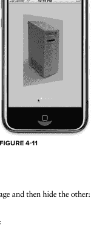

图 4-11

- 10. 按 Command-R 在 iPhone 模拟器上测试应用程序。当您点击屏幕底部的 Page Control 时，图像视图会翻转以显示下一个（见图 4-11）。

## 工作原理

当 View 第一次加载时，您让其中一个 ImageView 视图显示图像，然后隐藏另一个：

```objc
//---initialize the first imageview to display an image---
[imageView1 setImage:[UIImage imageNamed:@"iMac_old.jpeg"]];
tempImageView = imageView2;

//---make the first imageview visible and hide the second---
[imageView1 setHidden:NO];
[imageView2 setHidden:YES];
```

然后您将 Page Control 连接起来，以便当用户点击它时，会触发事件并触发方法。在这种情况下，会调用 pageTurning: 方法：

```objc
//---add the event handler for the page control---
[pageControl addTarget:self action:@selector(pageTurning:) forControlEvents:UIControlEventValueChanged];
[super viewDidLoad];
```

在 pageTurning: 方法中，您根据 Page Control 的值确定应加载哪个图像：

```objc
//---when the page control's value is changed---
- (void) pageTurning: (UIPageControl *) pageController
{
//---get the page number you can turning to---
NSInteger nextPage = [pageController currentPage];
```

## 使用分段控件对视图进行分组

分段控件是一个包含一系列按钮的水平视图。使用分段控件，用户可以点击其中包含的任意一个按钮。这样操作会取消先前选中的按钮的选中状态。

以下 Try It Out 展示了如何使用分段控件将多个视图组合在一起。它还展示了如何使用此控件选择特定的一组视图。

### 试一试 使用分段控件

代码文件 [UsingViews2.zip] 可在 Wrox.com 下载

- 1. 使用 Xcode 创建一个新的基于视图的应用程序项目，并将其命名为 `UsingViews2`。

- 2. 双击 `UsingViews2ViewController.xib` 文件以使用 Interface Builder 编辑它。

- 3. 向 View 窗口添加以下视图（见图 4-12）：
  - Segmented Control
  - View
  - Label（确保它嵌入在 View 内）

- 4. 在 View 窗口上添加另一个 View（来自库），然后向其添加一个 Label 视图（见图 4-13）。在定位第二个视图时要小心——确保第二个视图不包含在第一个视图内。这是因为当您使用鼠标将第二个 View 拖动到第一个 View 上时，Interface Builder 会认为您正试图将第二个 View 设为第一个 View 的子视图。为防止这种情况发生，请使用光标将第二个 View 移到第一个 View 上。View 窗口现在应如下图 4-13 所示。

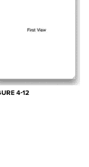

- 5. 您可以通过以列表模式查看 UsingViews2ViewController.xib 窗口来验证两个 Views 是否处于同一级别（见图 4-14）。

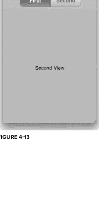

图 4-13


图 4-14

- 6. 在 UsingViews2ViewController.h 文件中，声明以下出口：

```objc
#import <UIKit/UIKit.h>

@interface UsingViews2ViewController : UIViewController {
    IBOutlet UIView *view1;
    IBOutlet UIView *view2;
    IBOutlet UISegmentedControl *segmentedControl;
}
@property (nonatomic, retain) UIView *view1;
@property (nonatomic, retain) UIView *view2;
@property (nonatomic, retain) UISegmentedControl *segmentedControl;
@end
```

- 7. 回到 Interface Builder，将出口连接到 View 窗口中的相应视图。（您可能需要移动两个 Views，以便将两个 UIView 出口连接到它们。）


8. 在 Xcode 中，将以下以粗体显示的语句添加到 UsingViews2ViewController.m 文件中：

```objectivec
#import "UsingViews2ViewController.h"

@implementation UsingViews2ViewController
@synthesize segmentedControl;
@synthesize view1, view2;

- (void)viewDidLoad {
    //---add the event handler for the segmented control---
    [segmentedControl addTarget:self action:@selector(segmentChanged:) forControlEvents:UIControlEventValueChanged];
    
    [super viewDidLoad];
}

//---when the segment has changed---
- (IBAction)segmentChanged:(id)sender {
    NSInteger selectedSegment = segmentedControl.selectedSegmentIndex;
    if (selectedSegment == 0) {
        //---toggle the correct view to be visible---
        [self.view1 setHidden:NO];
        [self.view2 setHidden:YES];
    }
    else{
        //---toggle the correct view to be visible---
        [self.view1 setHidden:YES];
        [self.view2 setHidden:NO];
    }
}

- (void)dealloc {
    [segmentedControl release];
    [view1 release];
    [view2 release];
    [super dealloc];
}
```

9. 按 Command-R 在 iPhone 模拟器上测试应用程序。

10. 点击第一个分段时，会显示 First View 标签；点击第二个分段时，会看到 Second View 标签（参见图 4-15）。


## 工作原理

当 View 加载完成时，你首先要将它连接起来，这样当用户点击其中一个按钮时，就会触发某个方法。在本例中，该方法是 `segmentChanged:`。

```objectivec
[segmentedControl addTarget:self action:@selector(segmentChanged:)
          forControlEvents:UIControlEventValueChanged];
```

在 `segmentChanged:` 方法中，通过分段控件的 `selectedSegmentIndex` 属性确定哪个按钮被点击，然后显示或隐藏相关视图：

```objectivec
- (IBAction) segmentChanged: (id) sender {
    NSInteger selectedSegment = segmentedControl.selectedSegmentIndex;
    if (selectedSegment == 0) {
        //---toggle the correct view to be visible---
        [self.view1 setHidden:NO];
        [self.view2 setHidden:YES];
    }
    else {
        //---toggle the correct view to be visible---
        [self.view1 setHidden:YES];
        [self.view2 setHidden:NO];
    }
}
```

## 使用 Web 视图

如果要从应用程序内部加载网页，可以使用 UIWebView 在应用中嵌入一个 Web 浏览器。使用 Web 视图，你可以发送请求来加载 Web 内容；如果你想将现有的 Web 应用（例如使用 Dashboard 编写的应用）转换为原生应用，这一功能非常有用。你只需将所有 HTML 页面嵌入到 Xcode 项目的 Resources 文件夹中，并在运行时将这些 HTML 页面加载到 Web 视图即可。

> 注意：当然，具体取决于你的 Web 应用的复杂程度。如果涉及服务器端技术（如 CGI、PHP 或其他技术），你可能还需要做一些额外工作，才能将 Web 应用移植为原生应用。

下面的“动手实践”将演示如何使用 Web 视图加载网页。

### 动手实践：使用 Web 视图加载网页

*代码文件 [UsingViews3.zip] 可在 Wrox.com 下载*

1. 使用 Xcode 创建一个新的 View-based Application 项目，并将其命名为 UsingViews3。
2. 双击 UsingViews3ViewController.xib 文件，使用 Interface Builder 进行编辑。
3. 在 View 窗口中，从 Library 添加一个 Web 视图（参见图 4-16）。在 Web 视图的 Attributes Inspector 窗口中，勾选“Scales Page to Fit”属性。


图 4-16

4. 在 UsingViews3ViewController.h 文件中，为 Web 视图声明一个输出口：

```objectivec
#import <UIKit/UIKit.h>

@interface UsingViews3ViewController : UIViewController {
    IBOutlet UIWebView *webView;
}
@property (nonatomic, retain) UIWebView *webView;
@end
```

5. 回到 Interface Builder，将 webView 输出口连接到 Web 视图。

6. 在 UsingViews3ViewController.m 文件中，添加以下以粗体显示的语句：

```objectivec
#import "UsingViews3ViewController.h"

@implementation UsingViews3ViewController

@synthesize webView;

- (void)viewDidLoad {
    NSURL *url = [NSURL URLWithString:@"http://www.apple.com"];
    NSURLRequest *req = [NSURLRequest requestWithURL:url];
    [webView loadRequest:req];
    [super viewDidLoad];
}

- (void)dealloc {
    [webView release];
    [super dealloc];
}
```


7. 按 Command-R 在 iPhone 模拟器上测试应用程序。你应该会看到应用程序加载来自 Apple.com 的页面（参见图 4-17）。

## 工作原理

要使用 URL 加载 Web 视图，首先要通过 `URLWithString` 方法以 URL 实例化一个 NSURL 对象：

```objectivec
NSURL *url = [NSURL URLWithString:@"http://www.apple.com"];
```

然后，将 NSURL 对象传递给 NSURLRequest 的 `requestWithURL:` 方法，从而创建 NSURLRequest 对象：

```objectivec
NSURLRequest *req = [NSURLRequest requestWithURL:url];
```

最后，通过 `loadRequest:` 方法，用 NSURLRequest 对象加载 Web 视图：

```objectivec
[webView loadRequest:req];
```

## 使用代码动态添加视图

到目前为止，你的应用程序中的全部 UI 都是使用 Interface Builder 以可视化方式创建的。虽然 Interface Builder 通过拖放操作让构建 UI 相对容易，但有时你最好还是使用代码来创建 UI。例如，当你需要创建动态 UI（如游戏界面）时。

> **注意**：我认识一些开发者，他们非常推崇用代码创建 UI。Interface Builder 也许容易使用，但对某些人来说可能会令人困惑。因为在 Interface Builder 中做事往往有多种方式，这可能会造成不必要的复杂性。

在下面的“动手实践”中，你将学习如何通过代码动态创建视图，这将帮助你理解视图是如何构造和操作的。

### 动手实践：通过代码创建视图

*代码文件 [UsingViews4.zip] 可在 Wrox.com 下载*

1. 使用 Xcode 创建一个 View-based Application 项目，并将其命名为 UsingViews4。

2. 在 UsingViews4ViewController.m 文件中，添加以下以粗体显示的语句：

```objectivec
#import "UsingViews4ViewController.h"

@implementation UsingViews4ViewController

- (void)loadView {

    //---create a UIView object---
    UIView *view =
    [[UIView alloc] initWithFrame:[[UIScreen mainScreen] applicationFrame]];
    view.backgroundColor = [UIColor lightGrayColor];

    //---create a Label view---
```

这里需要注意的重要一点是，在 `loadView` 方法中，你不应该获取 view 属性的值（但设置它是可以的），如下所示：

```objectivec
[self.view addSubview: label];   //---this is not OK---
self.view = view;                //---this is OK---
```

在此方法中尝试获取 view 属性的值会导致循环引用，并引起内存溢出。

## 理解视图层次结构

随着视图被创建并添加，它们会被加入到一个树形数据结构中。视图按照添加的顺序显示。为了验证这一点，请将之前创建的 UIButton 对象的位置修改为 CGRectMake(10, 30, 300, 50)，如下所示：

```objectivec
//---create a Button view---
frame = CGRectMake(10, 30, 300, 50);
UIButton *button = [UIButton buttonWithType:UIButtonTypeRoundedRect];
button.frame = frame;
[button setTitle:@"Click Me, Please!" forState:UIControlStateNormal];
button.backgroundColor = [UIColor clearColor];
button.tag = 2000;
[button addTarget:self action:@selector(buttonClicked:) forControlEvents:UIControlEventTouchUpInside];
```

现在再次运行应用程序时，你会注意到按钮覆盖了标签控件（参见图 4-19），因为按钮是最后添加的：

```objectivec
[view addSubview:label];
[view addSubview:button];
```


图 4-19

如果你想在视图添加后切换它们的显示顺序，可以使用 `exchangeSubviewAtIndex:withSubviewAtIndex:` 方法，如下所示：

```objectivec
[self.view addSubview:label];
[self.view addSubview:button];

[self.view exchangeSubviewAtIndex:1 withSubviewAtIndex:0];

[button release];
[label release];
```

前面以粗体显示的语句会交换 Label 视图和 Button 视图的顺序。再次运行应用程序时，Label 视图现在会出现在 Button 视图的上方（参见图 4-20）。


图 4-20


要了解已添加的各个视图的顺序，可以使用以下代码段打印每个视图的 tag 属性值：

```
[self.view addSubview:label];
[self.view addSubview:button];
[self.view exchangeSubviewAtIndex:1 withSubviewAtIndex:0];

for (int i=0; i<[self.view.subviews count]; ++i) {
    UIView *view = [self.view.subviews objectAtIndex:i];
    NSLog(@"%@", [NSString stringWithFormat:@"%d", view.tag]);
}
```

以下方法递归打印 UIView 对象中包含的所有视图：

```
-(void) printViews: (UIView *) view {
    if ([view.subviews count] > 0) {
        for (int i=0; i<[view.subviews count]; ++i) {
            UIView *v = [view.subviews objectAtIndex:i];
            NSLog(@"View index: %d Tag: %d", i, v.tag);
            [self printViews:v];
        }
    } else
        return;
}
```

要从当前视图层级中移除一个视图，请使用要移除的视图的 removeFromSuperview 方法。例如，以下语句移除标签视图：

```
[label removeFromSuperview];
```

## 视图切换

当你在 Xcode 中创建一个基于视图的应用程序项目时，你会得到一个包含单个视图及其对应视图控制器的项目。这就是你在 Interface Builder 中编辑 .xib 文件时看到的内容。然而，有时你可能需要不止一个视图。例如，你可能让用户在一个视图中输入一些信息，然后根据用户输入的信息切换到另一个视图以执行某些操作。

以下“试一试”演示了如何在两个视图之间切换以及如何将新视图连接到相应的视图控制器。

### 试一试 在两个 UIView 视图之间切换

*代码文件 [VCExample.zip] 可在 Wrox.com 下载*

- 1. 使用 Xcode，创建一个新的基于视图的应用程序项目并将其命名为 `VCExample`。
- 2. 双击 `VCExampleViewController.xib` 文件在 Interface Builder 中编辑它。
- 3. 在 VCExampleViewController.xib 窗口中，双击 View 项并向其添加一个 Button 视图（参见图 4-21）。同时将 View 的背景颜色设置为绿色。


图 4-21

- 4. 回到 Xcode，编辑 VCExampleViewController.h 文件并添加以下加粗显示的代码：

```
#import <UIKit/UIKit.h>

@interface VCExampleViewController : UIViewController {
}

//---declare an action for the Button view---
-(IBAction) displayView:(id) sender;

@end
```

- 5. 回到 Interface Builder，按住 Control 键拖动 Button 视图到 File's Owner 项并选择 displayView:（参见图 4-22）。


图 4-22

- 6. 这将 Button 视图的 Touch Up Inside 事件与你刚刚添加的 displayView: 动作连接起来。
- 7. 在 Xcode 中，右键单击 Classes 组并添加一个新文件。选择 Cocoa Touch Classes 组，然后选择 UIViewController 子类模板（参见图 4-23）。


图 4-23

- 8. 将视图控制器命名为 SecondViewController.m。
- 9. 接下来，添加一个新的视图 .xib 文件，以便使用 Interface Builder 创建 UI。在 Xcode 中右键单击 Resources 组并添加一个新文件。选择 User Interfaces 组，然后选择 View XIB 模板（参见图 4-24）。


图 4-24

- 10. 将 .xib 文件命名为 SecondView.xib。Xcode 现在应包含你刚刚添加的文件（参见图 4-25）。
- 11. 查看 SecondViewController.h 文件并注意 SecondViewController 类继承自 UIViewController 基类：

```
#import <UIKit/UIKit.h>

@interface SecondViewController : UIViewController {
}

@end
```


图 4-25

- 12. 双击 SecondView.xib 文件在 Interface Builder 中编辑它。在 SecondView.xib 窗口中，选择 File's Owner 项并查看其 Identity Inspector 窗口（参见图 4-26）。将其 Class 设置为 SecondViewController。


图 4-26

- 13. 通过按住 Control 键拖动将 File's Owner 项连接到 View 项（参见图 4-27）。选择 view。
- 14. 双击 View 项，将其背景颜色更改为橙色，然后添加一个 Button 视图（参见图 4-28）。


图 4-27


图 4-28

- 15. 按 Command-R 在 iPhone 模拟器上测试应用程序。在 DatePicker 视图中选择一个日期和时间，然后按 Display SecondView 按钮。第二个视图显示时，所选的日期和时间会显示出来（参见图 4-33）。


图 4-33

### 工作原理

要将数据从一个视图传递到另一个视图，最简单的方法是在接收视图上公开一个属性，并在调用端设置属性值。

第二个视图公开名为 selectedDatePicker 的属性：

```
@interface SecondViewController : UIViewController {
    //--object of type UIDatePicker---
    UIDatePicker *selectedDatePicker;
}

//--expose the object as a property---
@property (nonatomic, retain) UIDatePicker *selectedDatePicker;
```

要将值从第一个视图传递到第二个视图，只需设置你已定义的属性即可：

```
//--set the property of the second view with the DatePicker view in
// the current view--
secondViewController.selectedDatePicker = datePicker;
```

## 摘要

在本章中，你看到了许多视图的实际应用。你还看到了如何在运行时动态创建视图。更重要的是，你看到了如何将视图连接到视图控制器以及如何在运行时在两个视图之间切换。

## 练习

- 1. 描述将视图连接到视图控制器的步骤。
- 2. 何时使用 Alert 视图，何时使用操作表？
- 3. 从代码创建 `UIButton` 并将其 `Touch Up Inside` 事件连接到事件处理程序。

## 本章学到的内容

| 主题 | 关键概念 |
|---|---|
| 使用 UIAlertView | UIAlertView *alert = [[UIAlertView alloc] initWithTitle:@"Hello" message:@"This is an alert view" delegate:self cancelButtonTitle:@"OK" otherButtonTitles:nil]; |
| 处理 UIAlertView 触发的事件 | Ensure that your View Controller conforms to the UIAlertViewDelegate protocol. |
| 使用 UIActionSheet | UIActionSheet *action = [[UIActionSheet alloc] initWithTitle:@"Title of Action Sheet" delegate:self cancelButtonTitle:@"OK" destructiveButtonTitle:@"Delete Message" otherButtonTitles:@"Option 1", @"Option 2", nil]; |
| 处理 UIActionSheet 触发的事件 | Ensure that your View Controller conforms to the UIActionSheetDelegate protocol. |
| 为 UIPageControl 接线事件 | [pageControl addTarget:self action:@selector(pageTurning:) forControlEvents:UIControlEventValueChanged]; |
| 使用 UIImageView | [imageView1 setImage:[[UIImage imageNamed:@"iMac_old.jpeg"]]]; |
| 为 UISegmentedControl 接线事件 | [segmentedControl addTarget:self action:@selector(segmentChanged:) forControlEvents:UIControlEventValueChanged]; |
| 使用 UIWebView | NSURL *url = [NSURL URLWithString:@"http://www.apple.com"]; NSURLRequest *req = [NSURLRequest requestWithURL:url]; [webView loadRequest:req]; |
| 过渡期间的动画 | [UIView beginAnimations:@"flipping view" context:nil]; [UIView setAnimationDuration:1]; [UIView setAnimationCurve:UIViewAnimationCurveEaseInOut]; [UIView setAnimationTransition:UIViewAnimationTransitionCurlDown forView:self.view cache:YES]; [self.view addSubview:secondViewController.view]; [UIView commitAnimations]; |
| 在视图之间传递数据 | Define a property in the receiving view and set its value in the calling view. |


最后，“自动启用回车键”（Auto-Enable Return Key）复选框表示：如果某个字段没有输入任何内容，回车键将被禁用（变灰）。一旦输入了至少一个字符，它就会重新启用。“安全”（Secure）复选框表示输入是否会被掩蔽（见图5-8）。这通常用于密码输入。


## 让键盘消失

在本章的前面部分，你已经看到，当你选择TextField视图时，iPhone中的键盘会自动出现。然而，让键盘消失则需要程序员额外的工作。在本节中，你将看到如何在输入完成后以编程方式关闭键盘。第一种技巧将在下面的“试一试”中演示。

### 试一试 关闭键盘（技巧1）

- 1. 使用之前创建的项目，双击`KeyboardInputsViewController.xib`文件，用Interface Builder编辑它。
- 2. 在`KeyboardInputsViewController.xib`窗口中选中“File's Owner”项，查看其“Identity Inspector”窗口，并创建一个名为`doneEditing:`的新动作（见图5-9）。


这会创建一个`IBAction`，允许你连接到TextField视图中的某个事件。

**注意** iPhone中当前的键盘高度为216像素。

在了解当键盘出现时如何重新定位屏幕上的视图之前，理解与键盘相关的几个关键概念很重要：

- 你需要能够在编程上知道键盘何时可见或隐藏。为此，你的应用程序需要注册以下通知——`UIKeyboardWillShowNotification`和`UIKeyboardWillHideNotification`。
- 你还需要知道当前正在编辑的是哪个TextField视图，以便可以将其重新定位到屏幕的可见部分。你可以通过`UITextFieldDelegate`委托中的两个委托协议——`textFieldDidBeginEditing`;和`textFieldDidEndEditing`;——来了解这两条信息。

糊涂了？不用担心，下面的“试一试”会让你明白一切。

### 试一试 移动视图

*代码文件[ScrollingViews.zip]可在Wrox.com下载*

- 1. 使用Xcode创建一个新的基于视图的应用程序项目，并将其命名为`ScrollingViews`。
- 2. 在视图中添加一个ScrollView视图（见图5-18）。调整ScrollView视图的大小，使其覆盖整个屏幕。
- 3. 在ScrollView视图上添加一个TextField字段和一个Round Rect Button视图（见图5-19）。


- 4. 在ScrollingViewsController.xib窗口中选择“File's Owner”项，查看其“Identity Inspector”窗口（见图5-20）。创建两个outlet：scrollView和textField。


图5-20

- 7. 按住Control键将TextField视图拖到“File's Owner”项上（见图5-23）。选择delegate。

> **注意** 这一步很重要，因为它使你的视图控制器能够处理委托协议（`textFieldDidBeginEditing:`和`textFieldDidEndEditing:`）。


图5-23

- 8. 在Interface Builder中保存ScrollViewsViewController.xib。
- 9. 回到Xcode，将下面以粗体突出显示的语句输入到ScrollingViewsViewController.h文件中：

```
#import <UIKit/UIKit.h>

@interface ScrollingViewsViewController : UIViewController <UITextFieldDelegate> {
    IBOutlet UITextField *textField;
    IBOutlet UIScrollView *scrollView;
}

@property (nonatomic, retain) UITextField *textField;
@property (nonatomic, retain) UIScrollView *scrollView;

@end
```

- 10. 将下面以粗体突出显示的语句输入到ScrollingViewsViewController.m文件中：

```objc
#import "ScrollingViewsViewController.h"

@implementation ScrollingViewsViewController

@synthesize textField;
@synthesize scrollView;

//---size of keyboard---
CGRect keyboardBounds;

//---size of application screen---
CGRect applicationFrame;

//---original size of ScrollView---
CGSize scrollViewOriginalSize;

-(void) moveScrollView:(UIView *) theView {

//---get the y-coordinate of the view---
CGFloat viewCenterY = theView.center.y;

//---calculate how much visible space is left---
CGFloat freeSpaceHeight = applicationFrame.size.height -
keyboardBounds.size.height;

//---calculate how much the scrollview must scroll---
CGFloat scrollAmount = viewCenterY - freeSpaceHeight / 2.0;

if (scrollAmount < 0) scrollAmount = 0;

//---set the new scrollView contentSize---
scrollView.contentSize = CGSizeMake(
applicationFrame.size.width,
applicationFrame.size.height +
keyboardBounds.size.height);

//---scroll the ScrollView---
[scrollView setContentOffset:CGPointMake(0, scrollAmount) animated:YES];
}

//---when a TextField view begins editing---
-(void) textFieldDidBeginEditing:(UITextField *)textFieldView {
[self moveScrollView:textFieldView];
}

//---when a TextField view is done editing---
-(void) textFieldDidEndEditing:(UITextField *) textFieldView {
[UIView beginAnimations:@"back to original size" context:nil];
scrollView.contentSize = scrollViewOriginalSize;
```

```objc
[UIView commitAnimations];
}
//---when the keyboard appears---
-(void) keyboardWillShow:(NSNotification *) notification
{
    //---gets the size of the keyboard---
    NSDictionary *userInfo = [notification userInfo];
    NSValue *keyboardValue = [userInfo objectForKey:UIKeyboardBoundsUserInfoKey];
    [keyboardValue getValue:&keyboardBounds];
}

//---when the keyboard disappears---
-(void) keyboardWillHide:(NSNotification *) notification
{
}

-(void) viewWillAppear:(BOOL)animated
{
    //---registers the notifications for keyboard---
    [[NSNotificationCenter defaultCenter]
        addObserver:self
        selector:@selector(keyboardWillShow:)
        name:UIKeyboardWillShowNotification
        object:self.view.window];

    [[NSNotificationCenter defaultCenter]
        addObserver:self
        selector:@selector(keyboardWillHide:)
        name:UIKeyboardWillHideNotification
        object:nil];
}

-(void) viewWillDisappear:(BOOL)animated
{
    [[NSNotificationCenter defaultCenter]
        removeObserver:self
        name:UIKeyboardWillShowNotification
        object:nil];

    [[NSNotificationCenter defaultCenter]
        removeObserver:self
        name:UIKeyboardWillHideNotification
        object:nil];
}

-(void) viewDidLoad {
    scrollViewOriginalSize = scrollView.contentSize;
    applicationFrame = [[UIScreen mainScreen] applicationFrame;
```

## 工作原理

这个示例演示了检测键盘是否存在的多种方式，以及如何移动相关视图，使其不被键盘遮挡。

首先，你声明三个私有变量：

```
//---size of keyboard---
CGRect keyboardBounds;

//---size of application screen---
CGRect applicationFrame;

//---original size of ScrollView---
CGSize scrollViewOriginalSize;
```

keyboardBounds用于存储键盘的大小（特别是获取键盘的高度）。虽然你可以将键盘高度硬编码为216，但我不建议这样做，因为键盘的大小以后可能会变化。更好的做法是在运行时动态获取键盘的大小。

applicationFrame用于存储屏幕的大小。与获取键盘大小一样，最好也在运行时动态获取这个数值。

scrollViewOriginalSize用于保存ScrollView视图的原始大小。这样，当用户完成编辑后（此时所有视图都需要移回原始位置），你可以将ScrollView恢复到原始大小。

当视图加载时，你首先保存ScrollView视图的大小，并获取屏幕的大小：

```
-(void) viewDidLoad {
    scrollViewOriginalSize = scrollView.contentSize;
    applicationFrame = [[UIScreen mainScreen] applicationFrame];
    [super viewDidLoad];
}
```

在viewWillAppear:事件中（该方法在视图出现在屏幕之前被调用），你注册两个通知——UIKeyboardWillShowNotification和UIKeyboardWillHideNotification。当键盘出现时（UIKeyboardWillShowNotification），会调用keyboardWillShow:方法。当键盘消失时，会调用keyboardWillHide:方法。

```
-(void) viewWillAppear:(BOOL)animated
{
    //---registers the notifications for keyboard---
    [[NSNotificationCenter defaultCenter]
    addObserver:self
    selector:@selector(keyboardWillShow:)
    name:UIKeyboardWillShowNotification
    object:self.view.window];

    [[NSNotificationCenter defaultCenter]
    addObserver:self
```


```
CGFloat freeSpaceHeight = applicationFrame.size.height -
    keyboardBounds.size.height;

//---calculate how much the scrollview must scroll---
CGFloat scrollAmount = viewCenterY - freeSpaceHeight / 2.0;

if (scrollAmount < 0) scrollAmount = 0;

//---set the new scrollView contentSize---
scrollView.contentSize = CGSizeMake(
    applicationFrame.size.width,
    applicationFrame.size.height +
    keyboardBounds.size.height);

//---scroll the ScrollView---
[scrollView setContentOffset:CGPointMake(0, scrollAmount) animated:YES];
}
```

当 TextField 视图放弃其 First Responder 状态时，`textFieldDidEndEditing:` 方法将被调用。此时，你将 ScrollView 视图恢复到其原始内容大小：

//---when a TextField view is done editing---
-(void) textFieldDidEndEditing:(UITextField *) textFieldView {
    [UIView beginAnimations:@"back to original size" context:nil];
    scrollView.contentSize = scrollViewOriginalSize;
    [UIView commitAnimations];
}
```

这里需要强调的一个要点是，你使用 `UIView` 类的 `beginAnimations` 方法来在恢复到原始大小的过程中为 ScrollView 视图设置动画。如果不使用此方法，ScrollView 将非常突然地恢复到原始大小，导致闪烁。

键盘消失之前，`keyboardWillHide:` 方法将被调用。在这种情况下，你无需做太多事情：

//---when the keyboard disappears---
-(void)keyboardWillHide:(NSNotification *) notification
{
}
```

最后，在 `dealloc` 方法中，你释放所有已创建的 outlet：

```
-(void) dealloc {
    [textField release];
    [scrollView release];
    [super dealloc];
}
```

## 1.2 矩阵的运算

本节介绍矩阵的加法、减法、乘法和转置等运算，以及它们所满足的运算规律。

### 一、矩阵的加法与减法

定义1 设 $A=(a_{ij})_{m\times n}$ 与 $B=(b_{ij})_{m\times n}$ 是两个 $m\times n$ 矩阵，则 $A$ 与 $B$ 的和（差）定义为：

$$A \pm B = (a_{ij} \pm b_{ij})_{m\times n}$$

即两个同型矩阵相加（减），就是将它们的对应元素相加（减）。矩阵的加法满足以下运算规律（设 $A,B,C$ 均为 $m\times n$ 矩阵）：

- 1. 交换律：$A+B=B+A$；
- 2. 结合律：$(A+B)+C=A+(B+C)$；
- 3. 零矩阵的运算：$A+0=A$，$A+(-A)=0$。

其中 $0$ 表示零矩阵，$-A=(-a_{ij})$ 称为 $A$ 的负矩阵。

### 二、数与矩阵的乘法

定义2 设 $\lambda$ 是一个数，$A=(a_{ij})_{m\times n}$ 是一个矩阵，则数 $\lambda$ 与矩阵 $A$ 的乘积定义为：

$$\lambda A = (\lambda a_{ij})_{m\times n}$$

即数与矩阵相乘，就是用该数乘以矩阵的每一个元素。数与矩阵的乘法满足以下运算规律（设 $\lambda,\mu$ 为任意数，$A,B$ 为同型矩阵）：

- 1. 数乘结合律：$\lambda(\mu A)=(\lambda\mu)A$；
- 2. 数乘分配律：$(\lambda+\mu)A=\lambda A+\mu A$，$\lambda(A+B)=\lambda A+\lambda B$。

矩阵的加法与数乘统称为矩阵的线性运算。

### 三、矩阵的乘法

定义3 设 $A=(a_{ij})_{m\times s}$，$B=(b_{ij})_{s\times n}$，则 $A$ 与 $B$ 的乘积 $C=(c_{ij})_{m\times n}$ 定义为：

$$c_{ij} = \sum_{k=1}^{s} a_{ik} b_{kj} = a_{i1}b_{1j} + a_{i2}b_{2j} + \cdots + a_{is}b_{sj}$$

其中 $i=1,2,\cdots,m$；$j=1,2,\cdots,n$。即矩阵 $A$ 的第 $i$ 行与矩阵 $B$ 的第 $j$ 列对应元素乘积之和。

只有左矩阵的列数等于右矩阵的行数时，两个矩阵才能相乘。矩阵的乘法满足以下运算规律（假设下列运算均有意义）：

- 1. 结合律：$(AB)C=A(BC)$；
- 2. 左分配律：$A(B+C)=AB+AC$；
- 3. 右分配律：$(B+C)A=BA+CA$；
- 4. 数乘结合律：$(\lambda A)B = A(\lambda B)=\lambda(AB)$。

注意：矩阵乘法一般不满足交换律，即 $AB \neq BA$。

### 四、矩阵的转置

定义4 将矩阵 $A=(a_{ij})_{m\times n}$ 的行与列互换（行列互换）得到的新矩阵称为矩阵 $A$ 的转置矩阵，记为 $A^T$，即：

$$A^T = (a_{ji})_{n\times m}$$

矩阵的转置满足以下运算规律：

- 1. $(A^T)^T=A$；
- 2. $(A+B)^T=A^T+B^T$；
- 3. $(\lambda A)^T=\lambda A^T$；
- 4. $(AB)^T=B^T A^T$。

例 1 已知矩阵 $A = \begin{pmatrix} 1 & 2 & 3 \\ 4 & 5 & 6 \end{pmatrix}$，$B = \begin{pmatrix} -1 & 0 \\ 1 & 2 \\ 1 & 1 \end{pmatrix}$，求 $AB$ 和 $BA$。

解 因为 $A$ 是 $2\times 3$ 矩阵，$B$ 是 $3\times 2$ 矩阵，所以 $AB$ 有意义，且为 $2\times 2$ 矩阵：

$$AB = \begin{pmatrix} 1 & 2 & 3 \\ 4 & 5 & 6 \end{pmatrix} \begin{pmatrix} -1 & 0 \\ 1 & 2 \\ 1 & 1 \end{pmatrix} = \begin{pmatrix} 4 & 7 \\ 7 & 16 \end{pmatrix}$$

而 $BA$ 是 $3\times 3$ 矩阵：

$$BA = \begin{pmatrix} -1 & 0 \\ 1 & 2 \\ 1 & 1 \end{pmatrix} \begin{pmatrix} 1 & 2 & 3 \\ 4 & 5 & 6 \end{pmatrix} = \begin{pmatrix} -1 & -2 & -3 \\ 9 & 12 & 15 \\ 5 & 7 & 9 \end{pmatrix}$$


## 屏幕旋转

### 本章将学习的内容

- 如何支持四种不同的屏幕方向
- 设备旋转时触发的各种事件
- 如何在设备方向改变时重新定位 View 上的视图
- 如何在运行时动态更改屏幕旋转
- 如何在应用程序加载之前设置其方向

在第 2 章的 Hello World! 应用程序中，你看到了如何编写 iPhone 应用程序以便支持纵向或横向模式的查看。本章将更深入地探讨屏幕方向主题。特别是，你将学习如何在设备旋转时管理应用程序的方向。你还将学习如何在设备旋转时重新定位视图，以便应用程序能够利用屏幕尺寸的变化。

### 响应设备旋转

现代移动设备支持的一项功能是能够检测设备的当前方向——纵向或横向。应用程序可以利用此功能重新调整设备的屏幕，以最大化对新方向的使用。一个很好的例子是 iPhone 上的 Safari。当你将设备旋转到横向方向时，Safari 会自动旋转其视图，以便你拥有更宽的屏幕来查看页面内容（见图 6-1）。

这意味着你的应用程序将仅以横向模式显示（见图 6-3），Home 按钮在其左侧（因此常量的名称为 `UIInterfaceOrientationLandscapeLeft`）。


图 6-3

如果用户将设备旋转到纵向模式或 Home 按钮在右侧的横向模式（`UIInterfaceOrientationLandscapeRight`），应用程序将不会改变其方向（见图 6-4）。


图 6-4

> 注意 这是区分 `UIInterfaceOrientationLandscapeLeft` 和 `UIInterfaceOrientationLandscapeRight` 的一个简单方法。只需记住 `UIInterfaceOrientationLandscapeLeft` 指的是 Home 按钮位于左侧，而 `UIInterfaceOrientationLandscapeRight` 指的是 Home 按钮位于右侧。

### 不同类型的屏幕方向

到目前为止，你已经看到了一些与屏幕方向相关的常量：`UIInterfaceOrientationPortrait`、`UIInterfaceOrientationLandscapeLeft` 和 `UIInterfaceOrientationLandscapeRight`。你总共有四个常量可用于指定屏幕方向：

- `UIInterfaceOrientationPortrait` — 以纵向模式显示屏幕
- `UIInterfaceOrientationPortraitUpsideDown` — 以纵向模式显示屏幕，但 Home 按钮位于屏幕顶部
- `UIInterfaceOrientationLandscapeLeft` — 以横向模式显示屏幕，Home 按钮在左侧
- `UIInterfaceOrientationLandscapeRight` — 以横向模式显示屏幕，Home 按钮在右侧


在四种模式中，通常不建议使用 `UIInterfaceOrientationPortraitUpsideDown` 模式，因为它很容易使你的用户感到迷失方向（见图 6-5）。

如果你的应用程序支持多种屏幕方向，你应该重写 `shouldAutorotateToInterfaceOrientation:` 方法，然后使用 `||`（逻辑或）运算符来指定它支持的所有方向，像这样：

```
- (BOOL)shouldAutorotateToInterfaceOrientation:
    (UIInterfaceOrientation)interfaceOrientation {

    return (interfaceOrientation == UIInterfaceOrientationPortrait ||
            interfaceOrientation == UIInterfaceOrientationLandscapeRight);
}
```

前面的代码片段使你的应用程序能够同时支持纵向和横向右侧模式。

### 处理旋转

iPhone SDK 视图控制器在屏幕旋转期间公开了几个你可以处理的事件。能够处理旋转期间触发的事件很重要，因为它允许你重新定位 View 上的视图，或者在屏幕旋转时停止媒体播放。你可以处理的事件有：

- willAnimateFirstHalfOfRotationToInterfaceOrientation:
- willAnimateSecondHalfOfRotationFromInterfaceOrientation:
- willRotateToInterfaceOrientation:
- willAnimateRotationToInterfaceOrientation:

以下各节更详细地介绍这些事件中的每一个。

#### willAnimateFirstHalfOfRotationToInterfaceOrientation:

首先，`willAnimateFirstHalfOfRotationToInterfaceOrientation:` 事件在 View 开始旋转之前触发。该方法如下所示：

```
- (void)willAnimateFirstHalfOfRotationToInterfaceOrientation:
(UIInterfaceOrientation) toInterfaceOrientation
 duration: (NSTimeInterval) duration {
}
```

`toInterfaceOrientation` 参数指示 View 正在更改到的方向，而 `duration` 参数指示旋转第一半的持续时间，以秒为单位。

在此事件中，你可以插入代码以在旋转开始之前执行你想要执行的任务，例如暂停媒体播放、暂停动画等。

#### willAnimateSecondHalfOfRotationFromInterfaceOrientation:

`willAnimateSecondHalfOfRotationFromInterfaceOrientation:` 事件在旋转进行到一半时触发（见图 6-6）。该方法如下所示：

```
- (void)willAnimateSecondHalfOfRotationFromInterfaceOrientation:
(UIInterfaceOrientation) fromInterfaceOrientation
 duration: (NSTimeInterval) duration {
}
```


图 6-6

`fromInterfaceOrientation` 参数表示旋转开始前的方向，而 `duration` 参数表示旋转后半段持续的时间，以秒为单位。

在此事件中，你通常会在旋转进行到一半时执行任务，例如重新定位视图上的各个视图、恢复媒体播放等。

### willRotateToInterfaceOrientation:

前两个事件会依次触发——首先触发 `willAnimateFirstHalfOfRotationToInterfaceOrientation:`，随后触发 `willAnimateSecondHalfOfRotationFromInterfaceOrientation` 事件。如果处理旋转时不需要两个独立事件，可以使用更简单的 `willRotateToInterfaceOrientation:` 事件。

`willRotateToInterfaceOrientation:` 事件在方向开始改变之前触发。与前两个事件不同，它是一个单步过程。请注意，如果处理此事件，`willAnimateFirstHalfOfRotationToInterfaceOrientation:` 和 `willAnimateSecondHalfOfRotationFromInterfaceOrientation:` 事件将不再触发。

该方法如下所示：

```
- (void)willRotateToInterfaceOrientation:
(UIInterfaceOrientation) toInterfaceOrientation
 duration: (NSTimeInterval) duration {

}
```

`toInterfaceOrientation` 参数表示将要旋转到的方向，`duration` 参数表示旋转持续的时间，以秒为单位。


图 6-7

2. 通过查看 Size Inspector（大小检查器）窗口，观察其大小和位置。此处，它的位置是 (20,20)，大小是 280×37 像素。
3. 单击窗口右上角的箭头图标（见图 6-8），旋转视图的方向。
4. 将圆角矩形按钮（Round Rect Button）视图重新定位到视图窗口的右下角（见图 6-9）。同时观察并记录它的位置。


图 6-8


图 6-9

5. 在 `ScreenRotationsViewController.xib` 窗口中，选择 File's Owner 项目，并在 Identity Inspector（标识检查器）窗口中创建一个名为 `btn`（类型为 `UIButton`）的 outlet（见图 6-10）。


图 6-10

6. 按住 Control 键单击 File's Owner 项目，然后拖到圆角矩形按钮视图上，以连接你创建的 outlet（见图 6-11）。选择 `btn`。


图 6-11

7. 在 Interface Builder 中保存项目。

8. 回到 Xcode，将以下代码插入到 `ScreenRotationsViewController.h` 文件中：

    ```
    #import <UIKit/UIKit.h>
    
    @interface ScreenRotationsViewController : UIViewController {
        IBOutlet UIButton *btn;
    }
    @property (nonatomic, retain) UIButton *btn;
    @end
    ```

9. 在 `ScreenRotationsViewController.m` 文件中，添加以下代码：

    ```
    @implementation ScreenRotationsViewController
    
    @synthesize btn;
    
    ...
    - (void)willAnimateSecondHalfOfRotationFromInterfaceOrientation:
    (UIInterfaceOrientation) fromInterfaceOrientation
     duration: (NSTimeInterval) duration {
        UIInterfaceOrientation destOrientation = self.interfaceOrientation;
        if (destOrientation == UIInterfaceOrientationPortrait)
        {
            //---if rotating to portrait mode---
            btn.frame = CGRectMake(20,20,280,37);
        }
        else
        {
            //---if rotating to landscape mode---
            btn.frame = CGRectMake(180,243,280,37);
        }
    }
    - (void)dealloc {
        [btn release];
        [super dealloc];
    }
    ```

10. 保存项目，然后在 Xcode 中按下 Command-R，将应用程序部署到 iPhone Simulator（iPhone 模拟器）上。

11. 注意观察：当 iPhone Simulator 处于竖屏模式时，圆角矩形按钮视图显示在左上角；而当方向变为横屏模式时，它会被重新定位到右下角（见图 6-12）。

有趣的是，在上一节中介绍的 `setOrientation:` 方法不能用于在视图加载期间改变视图的方向：

```
//---does not work during View loading time--
[[UIDevice currentDevice] setOrientation:UIInterfaceOrientationLandscapeLeft];
```

同样地，在运行时（视图加载完成之后）设置状态栏的方向也不起作用：

```
//---does not work during run time--
[UIApplication sharedApplication].statusBarOrientation = 
UIInterfaceOrientationLandscapeLeft;
```

> 注意：你将要改变到的方向首先必须在 `shouldAutorotateToInterfaceOrientation:` 事件中指定。还可以在应用程序的 `info.plist` 文件中，通过将 `InitialInterfaceOrientation` 键设置为所需方向来指定。

### 本章小结

在本章中，你了解了屏幕方向变化是如何由视图控制器类中的各种事件来处理的。妥善处理屏幕方向将使你的应用程序更加易用，并改善用户体验。

### 练习

1. 假设你希望应用程序只支持横屏右和横屏左方向，应如何修改代码？
2. 视图的 `frame` 和 `center` 属性之间有什么区别？

# 第二部分：构建不同类型的 iPhone 应用程序

- **第 7 章：** 视图控制器
- **第 8 章：** 标签栏和导航应用程序
- **第 9 章：** 实用工具应用程序


## 视图控制器

### 本章你将学习

- 如何创建基于窗口的应用程序（Window-based Application）并手动向其添加视图控制器和视图窗口
- 如何在运行时动态创建视图
- 如何通过代码将视图的事件与事件处理程序连接起来
- 如何在运行时切换到另一个视图
- 如何为视图切换添加动画效果

到目前为止，你所处理的都是单视图应用程序，即只有一个视图控制器的应用程序。前面的章节一直在使用 iPhone SDK 中提供的基于视图的应用程序模板（View-based Application template），因为它是开始 iPhone 编程最简单的方式。当你创建基于视图的应用程序时，默认情况下会有一个视图控制器（iPhone SDK 将其命名为 `<project_name>ViewController`）。在实际应用程序中，你常常需要不止一个视图控制器，每个视图控制器控制一个显示不同信息的视图。多视图应用程序的一个好例子是 iPhone 自带的“天气”应用程序。主视图显示你选择地区的天气，你可以滑动屏幕查看其他位置的天气，也可以按 `i` 图标翻转到另一个视图并添加地点。

本章教你如何在应用程序中创建多个视图，然后在运行时以编程方式在这些视图之间切换。此外，你还将学习如何使用 iPhone SDK 中内置的动画方法为视图切换添加动画效果。

### 创建基于窗口的应用程序

在本节中，你将了解可以使用 iPhone SDK 创建的另一种应用程序模板：基于窗口的应用程序（Window-based Application）模板。与基于视图的应用程序模板不同，基于窗口的应用程序模板默认不包含视图控制器。相反，它只提供了 iPhone 应用程序的框架，其余部分留给开发人员——你需要添加自己的视图和视图控制器。因此，基于窗口的应用程序是帮助你理解视图控制器工作原理、体会连接视图控制器与 XIB 文件所需全部工作的绝佳方式。一旦理解了视图控制器的工作方式，你就迈上了创建多视图应用程序的道路。

为了循序渐进，请执行下面“试一试”中的步骤，编写一个基于窗口的应用程序，然后逐步向其中添加视图控制器。对于本节及本章中的其他“试一试”练习，你需要按这里的说明下载项目文件。

### 试一试：使用 Interface Builder 添加视图控制器

*代码文件 [WinBasedApp.zip] 可在 Wrox.com 上下载*

1. 使用 Xcode 创建一个基于窗口的应用程序项目，并将其命名为 `WinBasedApp`。观察为此项目类型创建的文件（见图 7-1）。除了其他常见的支持文件外，请注意这里只有一个 XIB 文件（`MainWindow.xib`）和两个委托文件（`WinBasedAppAppDelegate.h` 和 `WinBasedAppAppDelegate.m`）。
2. 按 Command-R 测试应用程序，你会看到 iPhone Simulator 上显示一个空白屏幕。这是因为基于窗口的应用程序模板只为简单的 iPhone 应用程序提供了骨架结构，仅包含一个窗口和应用程序委托。
3. 回到 Xcode，双击 `MainWindow.xib` 在 Interface Builder 中编辑它。观察 `MainWindow.xib` 窗口中有四个项目（见图 7-2）：
   - File's Owner（文件所有者）
   - First Responder（第一响应者）
   - Win Based App App Delegate（WinBasedApp 应用程序委托）
   - Window（窗口）


图7-1


图7-2


图7-4

6. 在Xcode中右键单击Resources组，然后添加一个新文件。选择View XIB项并将其命名为MyView.xib。此时Xcode应如图7-5所示。


图7-5

7. 回到Interface Builder中，在MainWindow.xib窗口中选择View Controller项，并查看其标识检查器窗口。在类下拉列表中选择MyViewController（参见图7-6）。现在视图控制器的名称将更改为My View Controller。


图7-6

8. 查看My View Controller的属性检查器窗口，在NIB Name下拉列表中选择MyView（参见图7-7）。


图7-7

```objc
#import <UIKit/UIKit.h>

@class MyViewController;

@interface WinBasedAppAppDelegate : NSObject <UIApplicationDelegate> {
    UIWindow *window;

    //---create an instance of the view controller---
    MyViewController *myViewController;
}

@property (nonatomic, retain) IBOutlet UIWindow *window;

//---expose the view controller as a property---
@property (nonatomic, retain) IBOutlet MyViewController *myViewController;

@end
```

在WinBasedAppAppDelegate.m文件中，插入以下以粗体显示的代码行：

```objc
#import "WinBasedAppAppDelegate.h"

#import "MyViewController.h"

@implementation WinBasedAppAppDelegate

@synthesize window;

//---synthesize the property---
@synthesize myViewController;

- (void)applicationDidFinishLaunching:(UIApplication *)application {
    // Override point for customization after application launch
    //---add the new view to the current window---
    [window addSubview:myViewController.view];
    [window makeKeyAndVisible];
}

- (void)dealloc {
    [myViewController release];
    [window release];
    [super dealloc];
}

@end
```

13. 在MainWindow.xib窗口中，按住Control键单击并将Win Based App App Delegate项拖到My View Controller项上（参见图7-10）。选择myViewController。这将把窗口与视图控制器关联起来。


图7-10


图7-11

14. 就这样！按Command-R在iPhone模拟器上测试应用程序。现在你应该会看到按钮出现在应用程序的主屏幕上（参见图7-11）。

> 注意 作为练习，你可能想要创建一个操作，在按下按钮时显示一个警报视图。

## 工作原理

当你使用基于窗口的应用程序模板创建iPhone项目时，Xcode只会为你的项目提供最少数量的项——一个MainWindow.xib文件和应用程序委托。你需要自行添加自己的视图控制器和视图。

在上述练习中，你首先向MainWindow.xib窗口添加了一个视图控制器项。然后你添加了一个UIViewController类的实例（你将其命名为MyViewController），以便它可以连接到刚刚添加的视图控制器。这个控制器类包含你将编写的用于处理视图与用户之间交互的代码。

你还在项目中添加了一个XIB文件（MyView.xib），代表Interface Builder中的一个视图。请注意，你需要执行多个步骤，将相关类连接到正确的XIB项和视图控制器项。

当应用程序完成启动后，你使用UIWindow实例的addSubview:方法将myViewController对象所代表的视图添加到窗口中，使其可见：

```objc
[window addSubview:myViewController.view];
```

## 以编程方式添加视图控制器

除了使用Interface Builder添加视图控制器和视图之外，一种常用的技术是在运行时以编程方式创建视图。这提供了很大的灵活性，尤其是在编写应用程序界面不断变化的游戏时。

在下面的动手实践中，你将学习如何使用UIViewController类的实例创建视图，然后以编程方式向其中添加视图。

### 动手实践   以编程方式添加视图控制器

1. 使用同一个项目，在Xcode中右键单击Classes组，然后添加一个新文件。选择UIViewController子类项并将其命名为MySecondViewController。此时Xcode应如图7-12所示。

2. 在WinBasedAppAppDelegate.m文件中，添加以下以粗体显示的代码：

```objc
#import "WinBasedAppAppDelegate.h"
#import "MyViewController.h"

#import "MySecondViewController.h"

@implementation WinBasedAppAppDelegate

@synthesize window;
@synthesize myViewController;

//---create an instance of the second view controller---
MySecondViewController *mySecondViewController;

- (void)applicationDidFinishLaunching:(UIApplication *)application {

    //---instantiate the second view controller---
    mySecondViewController = [[MySecondViewController alloc]
                              initWithNibName:nil
                              bundle:nil];

    //---add the view from the second view controller---
    [window addSubview:mySecondViewController.view];

    //---comment this out so that it doesn't load the myViewController---
    //[window addSubview:myViewController.view];
    [window makeKeyAndVisible];
}

- (void)dealloc {
    [mySecondViewController release];
}
```


```objc
button = [UIButton buttonWithType:UIButtonTypeRoundedRect];
button.frame = frame;
[button setTitle:@"OK" forState:UIControlStateNormal];
button.backgroundColor = [UIColor clearColor];

//---add the views to the current View---
[self.view addSubview:label];
[self.view addSubview:button];

[super viewDidLoad];
}
```

## 创建并关联操作

在上一节中，你了解了可以在运行时以编程方式添加视图。在示例中，你还看到了如何向主视图添加标签和按钮视图。然而，你需要处理Button视图引发的事件，以便当用户按下它时，你可以执行一些工作。在第3章中，你学习了如何使用输出口和操作，以及如何使用Interface Builder将你的代码连接到它们。在下面的动手实践中，视图是使用代码创建的，因此你不能使用Interface Builder连接操作和输出口——你也不得不用代码来完成。

### 动手实践  将操作关联到视图

1. 使用上一节中创建的同一个项目，在MySecondViewController.h文件中声明buttonClicked:操作（以粗体显示），如下所示：

```objc
#import <UIKit/UIKit.h>

@interface MySecondViewController : UIViewController {
    UILabel *label;
    UIButton *button;
}

@property (nonatomic, retain) UILabel *label;
@property (nonatomic, retain) UIButton *button;

//---declaring the IBAction---
- (IBAction) buttonClicked: (id) sender;

@end
```

2. 在MySecondViewController.m文件中，为buttonClicked:操作提供实现：

```objc
- (IBAction) buttonClicked: (id) sender{
    UIAlertView *alert = [[UIAlertView alloc] initWithTitle:@"Action invoked!"
                                                     message:@"Button clicked!"
```

3. 在MyViewController.m文件中，定义btnClicked:操作，如下所示：

```objc
-(IBAction) btnClicked:(id) sender{
    //---remove the current view; essentially hiding the view---
    [self.view removeFromSuperview];
}
```

4. 双击MyView.xib文件，在Interface Builder中进行编辑。按住Control键单击并将View窗口中的OK按钮拖到MyView.xib窗口的File's Owner项上，然后选择btnClicked:。

5. 回到Xcode，按Command-R测试应用程序。现在，当你单击主视图中的OK按钮时，将进入第二个视图（参见图7-15）。要关闭第二个视图，请按下OK按钮。


图7-15

## 工作原理

对于这个示例，你只需使用addSubview:方法将要切换到的视图控制器的视图添加到当前视图：

```objc
//---add the view of the view controller to the current View---
myViewController = [[MyViewController alloc]
    initWithNibName:@"MyView" bundle:nil];
[self.view addSubview:myViewController.view];
```

要关闭视图，使用removeFromSuperview:方法：

```objc
//---remove the current view; essentially hiding the view---
[self.view removeFromSuperview];
```


## 切换视图的动画

你在上一节中看到的视图切换是瞬时的——两个视图会立即改变，没有任何视觉提示。iPhone 的关键卖点之一就是其动画能力。因此，对于视图切换，你可以通过执行一些简单的动画，例如翻转一个视图以显示另一个视图，使显示效果更具趣味性。下面是如何实现的方法。

### 试一试：动画化过渡

1. 使用同一个项目，将以下加粗显示的代码添加到 MySecondViewController.m 文件中：

```
- (IBAction) buttonClicked: (id) sender{
    myViewController = [[MyViewController alloc]
        initWithNibName:@"MyView" bundle:nil];
    [UIView beginAnimations:@"flipping view" context:nil];
    [UIView setAnimationDuration:1];
    [UIView setAnimationCurve:UIViewAnimationCurveEaseInOut];
    [UIView setAnimationTransition: UIViewAnimationTransitionFlipFromLeft
        forView:self.view cache:YES];
    [self.view addSubview:myViewController.view];
    [UIView commitAnimations];
}
```

2. 在 MyViewController.m 文件中，添加以下加粗显示的代码：

```
- (IBAction) btnClicked: (id) sender{
    [UIView beginAnimations:@"flipping view" context:nil];
    [UIView setAnimationDuration:1];
    [UIView setAnimationCurve:UIViewAnimationCurveEaseIn];
    [UIView setAnimationTransition: UIViewAnimationTransitionFlipFromRight
        forView:self.view.superview cache:YES];
    [self.view removeFromSuperview];
    [UIView commitAnimations];
}
```

3. 按 Command-R 在 iPhone 模拟器上测试应用程序。点击两个视图上的 OK 按钮，并注意两个视图相互翻转的方向（见图 7-16）。


**图 7-16**

### 工作原理

首先，检查应用于 MySecondViewController 的动画。你通过首先调用 UIView 类的 beginAnimations: 方法来启动动画块来执行动画：

```
[UIView beginAnimations:@"flipping view" context:nil];
```

setAnimationDuration: 方法指定动画的持续时间（以秒为单位）。在这里，你将其设置为一秒：

```
[UIView setAnimationDuration:1];
```

setAnimationCurve: 方法设置动画中动画属性变化的曲线：

```
[UIView setAnimationCurve:UIViewAnimationCurveEaseInOut];
```

你可以使用以下常量来设置动画的曲线：

- UIViewAnimationCurveEaseInOut — 使动画开始时缓慢，在持续时间中间加速，然后在完成前再次减速
- UIViewAnimationCurveEaseIn — 使动画开始时缓慢，然后随着进展加速
- UIViewAnimationCurveEaseOut — 使动画开始时快速，然后在完成时减速
- UIViewAnimationCurveLinear — 使动画在其持续时间内均匀发生

setAnimationTransition: 方法在动画持续时间内将一种过渡类型应用于视图。

```
[UIView setAnimationTransition: UIViewAnimationTransitionFlipFromLeft forView:self.view cache:YES];
```

cache: 参数指定 iPhone 是否应缓存视图的图像并在过渡期间使用它。缓存图像可加快动画过程。以下常量可用于动画过渡：

- UIViewAnimationTransitionNone — 无过渡
- UIViewAnimationTransitionFlipFromLeft — 围绕垂直轴从左向右翻转视图
- UIViewAnimationTransitionFlipFromRight — 围绕垂直轴从右向左翻转视图
- UIViewAnimationTransitionCurlUp — 从底部向上卷曲视图
- UIViewAnimationTransitionCurlDown — 从顶部向下卷曲视图

要结束动画，请调用 commitAnimations: 方法：

```
[UIView commitAnimations];
```

对 MyViewController 执行的动画与 MySecondViewController 的类似，只是要动画化的视图必须设置为 self.view.superview：

```
[UIView setAnimationTransition: UIViewAnimationTransitionFlipFromRight forView:self.view.superview cache:YES];
```

## 摘要

本章中，你首次体验了基于窗口的应用程序项目。基于窗口的应用程序模板是让你真正理解 iPhone 应用程序 UI 的方方面面的一个很好的起点。你还学习了如何在两个视图之间切换并将动画应用于过渡过程。在下一章中，你将学习 iPhone SDK 支持的下一类应用程序模板：标签栏应用程序。标签栏应用程序是另一种多视图应用程序，你可以构建它，只是所有基础工作都已为你完成，让你的生活更轻松。

## 练习

1. 编写允许你以编程方式创建视图控制器的代码片段。
2. 编写在运行时动态创建视图的代码片段。
3. 编写将视图的事件与事件处理程序连接起来的代码片段。

## 本章学到的内容

| 主题 | 关键概念 |
|---|---|
| 手动添加视图控制器 | 在你的项目中添加 UIViewController 子类项的实例。 |
| 通过代码创建标签视图 | `label = [[UILabel alloc] initWithFrame:frame];`<br>`label.textAlignment = UITextAlignmentCenter;`<br>`label.font = [UIFont fontWithName:@"Verdana" size:20];`<br>`label.text = @"This is a label";` |
| 通过代码创建按钮视图 | `frame = CGRectMake(10, 250, 300, 50);`<br>`button = [[UIButton buttonWithType:UIButtonTypeRoundedRect] initWithFrame:frame];`<br>`[button setTitle:@"OK" forState:UIControlStateNormal];`<br>`button.backgroundColor = [UIColor clearColor];` |
| 将事件与事件处理程序连接 | `[button addTarget:self`<br>`action:@selector(buttonClicked:)`<br>`forControlEvents:`<br>`UIControlEventTouchUpInside];` |
| 切换到另一个视图 | `myViewController = [[MyViewController alloc]`<br>`initWithNibName:@"MyView"`<br>`bundle:nil];`<br>`[self.view addSubview:myViewController.view];` |
| 动画化视图过渡 | `[UIView beginAnimations:@"flipping view"`<br>`context:nil];`<br>`[UIView setAnimationDuration:1];`<br>`[UIView`<br>`setAnimationCurve:`<br>`UIViewAnimationCurveEaseInOut];`<br>`[UIView setAnimationTransition:`<br>`UIViewAnimationTransitionFlipFromLeft`<br>`forView:self.view cache:YES];`<br>`[self.view addSubview:myViewController.view];`<br>`[UIView commitAnimations];` |

## 8 标签栏和导航应用程序

### 本章将学习的内容

- 如何创建标签栏应用程序
- 如何以不同的方向显示标签栏应用程序
- 如何创建基于导航的应用程序
- 如何在基于导航的应用程序中从一个视图窗口导航到另一个视图窗口

上一章演示了如何使用多个视图控制器创建多视图应用程序。事实上，多视图应用程序非常常见，以至于 iPhone 有一个以此命名的特殊应用程序类别：标签栏应用程序。标签栏应用程序由通常位于屏幕底部的标签栏组成。标签栏内包含标签栏项目，触摸时显示特定视图。iPhone 上一个很好的标签栏应用程序示例是电话应用程序（见图 8-1）。电话应用程序包含五个标签栏项目：收藏、最近通话、联系人、键盘和语音邮件。例如，当你触摸收藏项目时，你会看到可编辑的收藏联系人列表。触摸联系人项目会显示存储在 iPhone 上的所有联系人列表。


除了标签栏应用程序外，在 iPhone 上常见的一种应用程序是基于导航的应用程序。基于导航的应用程序包含一个允许用户深入项目层次结构的 UI。它在屏幕顶部有一个导航栏，显示当前压入堆栈的项目。图 8-2 显示了一个基于导航的应用程序的良好示例——设置。


**图 8-2**

在设置应用程序中，你可以通过选择项目并导航到另一个屏幕来深入应用程序的设置。当你想返回到上一个屏幕时，只需触摸屏幕左上角的小按钮即可返回。

因此，本章将教你如何使用 iPhone SDK 提供的模板创建这两种类型的应用程序。

## 标签栏应用程序

到目前为止，你已经看到了 iPhone SDK 提供的两种应用程序模板的使用：基于视图的应用程序和基于窗口的应用程序。基于视图的应用程序模板最容易入门，而基于窗口的应用程序模板提供了 iPhone 应用程序的骨架，让你可以自行创建所有内容。


图8-5

8. 回到Xcode，按Command-R在iPhone模拟器上运行应用程序（见图8-6）。现在你可以触摸屏幕底部的标签栏项目，在两个视图之间切换。


图8-6

### 工作原理

基本上，标签栏应用程序的魔力在于使用`UITabBarController`类。如果你双击`MainWindow.xib`文件，你会看到它包含一个标签栏控制器项（见图8-7）。

## 添加标签栏项目

上一节演示了如何使用SDK提供的模板创建标签栏应用程序。默认情况下，应用程序模板只包含两个标签栏项目，因此在本节中，你将了解如何向现有标签栏添加更多标签栏项目。

### 尝试一下 添加标签栏项目

1. 使用同一个项目，在Interface Builder中，从资源库中拖拽一个标签栏项目到标签栏视图上（见图8-8）。


2. 选择新添加的标签栏项目并查看其属性检查器窗口。将Badge属性设置为5，将Identifier属性设置为Search（见图8-9）。观察标签栏项目外观的变化。

> **注意** 点击标签栏项目的中心，以便可以选中标签栏项目；如果点击外部，则会选中视图控制器。


图8-9

> **注意** Badge属性是一种便捷方式，可以在标签栏项目上设置一些数字或其他文本，作为向用户快速视觉提示以提醒他们某事。

3. 回到Xcode，右键单击Resources文件夹，选择添加▸新建文件。点击用户界面类别，选择视图XIB。将文件命名为`SearchView.xib`。

4. 在Xcode中右键单击Classes文件夹，选择添加▸新建文件。点击Cocoa Touch类类别，选择`UIViewController`子类。将文件命名为`SearchViewController.m`（取消选中“With XIB for user interface”选项，因为你在上一步已经创建了XIB文件）。

5. 双击新创建的`SearchView.xib`文件，在Interface Builder中打开它。向其中添加一个搜索栏视图（见图8-10）。


图8-10

6. 在`SearchView.xib`窗口中选择File’s Owner项，并查看其标识检查器窗口。选择`SearchViewController`作为其Class。

7. 按住Control键单击并拖动File’s Owner项到View项，然后选择view。

8. 按住Control键单击并拖动搜索栏视图到File’s Owner项（见图8-11），然后选择delegate。


图8-11

9. 回到`MainWindow.xib`，选择标签栏项目并查看其属性检查器窗口（见图8-12）。将其NIB名称设置为`SearchView`。


图8-12

10. 在Search标签栏项目的标识检查器窗口中，将Class名称设置为`SearchViewController`（见图8-13）。

> **注意** 这一步很重要；如果不这样做，稍后当你创建视图控制器类上的插座和操作时，将出现运行时错误。

14. 大功告成！按Command-R在iPhone模拟器上测试应用程序。现在你可以触摸第三个标签栏项目（Search）来查看搜索栏（见图8-14）。触摸搜索栏会自动显示键盘。输入完毕后，触摸键盘上的Search按钮即可隐藏键盘。


图8-14

### 工作原理

在此示例中，你向标签栏视图添加了一个标签栏项目视图，并将其连接到XIB文件及其对应的视图控制器类。

添加新的标签栏项目视图很简单：只需从资源库中将标签栏项目拖放到标签栏视图中即可。或者，你可以通过`MainWindow.xib`窗口中标签栏控制器项的属性检查器窗口添加它（见图8-15）。单击+（加号）按钮添加新的视图控制器，标签栏视图会自动为你插入一个新的标签栏项目视图。

按Command-R测试应用程序并更改屏幕旋转方向。你注意到什么？嗯，应用程序的方向不会改变——它仍以竖屏模式显示。为了支持不同的方向，`UITabBarController`对象中包含的所有视图控制器都必须支持相同的方向。也就是说，如果某个视图控制器支持横向左模式，那么所有视图控制器也必须支持横向左模式。

因此，在接下来的“尝试一下”中，你将修改应用程序以支持所有方向。

### 尝试一下 支持屏幕旋转

1. 使用之前创建的同一个项目，在标识检查器窗口中观察到第二个标签栏项目设置为基类`UIViewController`。

2. 在Xcode中右键单击Classes组，选择添加▸新建文件。选择`UIViewController`子类文件模板，并将其命名为`SecondViewController.m`（取消选中“With XIB for user interface”选项，因为你已经有一个XIB文件——`SecondView.xib`）。

3. 将第二个标签栏项目的Class名称更改为`SecondViewController`。

4. 在Xcode中双击`SecondView.xib`文件，在Interface Builder中编辑它。选择File’s Owner项，并在标识检查器窗口中将其Class更改为`SecondViewController`。

5. 在`FirstViewController.m`、`SecondViewController.m`和`SearchViewController.m`文件中，确保你为`shouldAutorotateToInterfaceOrientation:`方法返回YES：

```
- (BOOL)shouldAutorotateToInterfaceOrientation:(UIInterfaceOrientation) interfaceOrientation {
    return YES;
}
```

6. 大功告成！按Command-R，你现在应该可以将应用程序旋转到任何方向（见图8-16）。


图8-16

### 工作原理

你可能还记得，标签栏应用程序模板创建的原始项目文件只包含一个视图控制器——`FirstViewController`——它对应于标签栏视图控制器中的第一个视图。第二个视图由`SecondView.xib`表示，但它没有对应的视图控制器类。为了确保此视图支持所有方向，你需要在项目中添加一个新的视图控制器类，以便它可以覆盖基类`UIViewController`提供的实现。然后你重写`shouldAutorotateToInterfaceOrientation:`方法，使每个视图控制器返回`YES`以支持所有方向。

## 标签栏项目的最大数量

标签栏最多支持五个标签栏项目。当项目超过五个时，你将看到一个More项目，触摸More项目会在表格视图中显示其余项目（见图8-17）。


## 基于导航的应用程序

标签栏应用程序适用于有多个视图且每个视图显示不同信息的情况，用户可以在视图之间快速切换。然而，有时你有层级数据，需要用户根据所选择的内容从一个屏幕移动到另一个屏幕。在这种情况下，最好使用基于导航的应用程序。

3. 检查`NavApplicationAppDelegate.h`文件的内容：

```
@interface NavApplicationAppDelegate : NSObject <UIApplicationDelegate> {
    UIWindow *window;
    UINavigationController *navigationController;
}
@property (nonatomic, retain) IBOutlet UIWindow *window;
@property (nonatomic, retain) IBOutlet UINavigationController *navigationController;
@end
```

4. 它不再使用通用的视图控制器，而是使用`UINavigationController`类。`UINavigationController`类是一种专门的视图控制器，用于管理层级内容的导航。

5. 检查`NavApplicationAppDelegate.m`文件的内容，特别是`applicationDidFinishLaunching:`方法：

```
#import "NavApplicationAppDelegate.h"
#import "RootViewController.h"

@implementation NavApplicationAppDelegate

@synthesize window;
@synthesize navigationController;

#pragma mark -
#pragma mark Application lifecycle
- (void)applicationDidFinishLaunching:(UIApplication *)application {
    // Override point for customization after app launch
    [window addSubview:[navigationController view]];
    [window makeKeyAndVisible];
}
```

6. 在这里，你将导航控制器的视图添加到当前视图中，以便在应用程序加载时使其可见。

7. 双击`MainWindow.xib`文件，在Interface Builder中编辑它。图8-19显示`MainWindow.xib`窗口（以列表视图显示）包含一个导航控制器项。导航控制器项本身包含一个导航栏项以及一个从`RootViewController`类加载的视图。


图 8-19


- 8. 双击 `RootViewController.xib` 文件以在 Interface Builder 中打开它。请注意，默认情况下，Navigation-Application 模板为根 View Controller 使用 Table view（参见图 8-20）。

> **注意** 基于导航的应用程序不一定必须使用 Table view。然而，由于 Table view 是一个非常流行的视图，并且经常在基于导航的应用程序中使用，Apple 已将其默认包含在基于导航的应用程序模板中。Table view 将在第 10 章中更详细地讨论。


图 8-20

- 9. 按 Command-R 测试应用程序。单独来看，应用程序没有显示太多内容；你看到的只是行线（参见图 8-21）。接下来你将学习如何填充 Table view。

- 10. 在 RootViewController.m 文件中，添加以下加粗高亮的语句以声明并初始化一个包含电影列表的数组：

```objc
#import "RootViewController.h"

@implementation RootViewController

NSMutableArray *listOfMovies;

- (void)viewDidLoad {
    [super viewDidLoad];
    //---initialize the array---
    listOfMovies = [[NSMutableArray alloc] init];
    
    //---add items---
    [listOfMovies addObject:@"Training Day"];
    [listOfMovies addObject:@"Remember the Titans"];
    [listOfMovies addObject:@"John Q."];
    [listOfMovies addObject:@"The Bone Collector"];
    [listOfMovies addObject:@"Ricochet"];
    [listOfMovies addObject:@"The Siege"];
    [listOfMovies addObject:@"Malcolm X"];
    [listOfMovies addObject:@"Antwone Fisher"];
    [listOfMovies addObject:@"Courage Under Fire"];
    [listOfMovies addObject:@"He Got Game"];
    [listOfMovies addObject:@"The Pelican Brief"];
    [listOfMovies addObject:@"Glory"];
    [listOfMovies addObject:@"The Preacher's Wife"];

    //---set the title of the navigation bar---
    self.navigationItem.title = @"Movies";
}

- (void)dealloc {
    [listOfMovies release];
    [super dealloc];
}
```


图 8-21

- 11. 在 `tableView:numberOfRowsInSection:` 方法中插入以下加粗语句以指定 Table view 要显示的行数：

```objc
//---specify the number of rows in the table view---
- (NSInteger)tableView:(UITableView *)tableView
numberOfRowsInSection:(NSInteger)section {

//---set it to the number of items in the array---
return [listOfMovies count];
}
```

- 12. 在 `tableView:cellForRowAtIndexPath:` 方法中插入以下加粗语句以指定每个单元格的外观：

```objc
// Customize the appearance of table view cells.
- (UITableViewCell *)tableView:(UITableView *)tableView
cellForRowAtIndexPath:(NSIndexPath *)indexPath {

static NSString *CellIdentifier = @"Cell";

UITableViewCell *cell = [tableView
dequeueReusableCellWithIdentifier:CellIdentifier];
if (cell == nil) {
    cell = [[[UITableViewCell alloc] initWithStyle:UITableViewCellStyleDefault
                                   reuseIdentifier:CellIdentifier]
            autorelease];
}

NSString *cellValue = [listOfMovies objectAtIndex:
                       indexPath.row];
    cell.textLabel.text = cellValue;

    return cell;
}
```

- 13. 保存项目并按 Command-R 在 iPhone Simulator 上测试应用程序。观察 table view 中显示的电影列表（参见图 8-22）。

## 工作原理

到目前为止，你还没有真正看到 UINavigationController 对象的用途。基本上，你所做的只是准备 Table view 以加载电影列表，然后在视图中显示它。在下一节中，你将修改项目，以便当你在 Table View 中触摸一个项目时，应用程序会导航到另一个视图，显示你刚刚触摸的电影名称。


## 导航到另一个视图

基于导航的应用程序的真正用途是从一个视图导航到另一个视图。因此，本节将向你展示如何修改应用程序，以便当用户触摸一部电影时，应用程序会导航到另一个视图。

### 试一试 在另一个视图中显示所选电影标题

- 1. 使用同一个项目，在 Xcode 中右键单击 Classes 组并选择 File ⌥ Add Files。选择 UIViewController 子类项并单击 Next。将文件命名为 DetailsViewController.m（取消选中“With XIB for user interface”选项，因为你将在下一步中手动添加它）。
- 2. 右键单击 Resources 文件夹并选择 Add ⌥ New File。选择 View XIB 项并单击 Next。将 XIB 文件命名为 DetailsView.xib。
- 3. 双击 DetailsView.xib 文件以在 Interface Builder 中编辑它。向 View 窗口添加一个 Label 视图（参见图 8-23）。


图 8-23

- 4. 回到 Xcode，将以下以粗体显示的行添加到 DetailsViewController.h：

```objc
#import <UIKit/UIKit.h>

@interface DetailsViewController : UIViewController {
    IBOutlet UILabel *label;
    NSString *textSelected;
}
@property (nonatomic, retain) UILabel *label;
@property (nonatomic, retain) NSString *textSelected;
-(id) initWithTextSelected:(NSString *) text;
@end
```

- 5. 回到 Interface Builder，将 DetailsView.xib 窗口的 File's Owner 项的 Class 属性设置为 DetailsViewController。

- 6. Control-单击并拖动 File's Owner 项到 Label 视图并选择 label。这样做将 Label 视图连接到 label outlet。

- 7. Control-单击 File's Owner 项到 View 项并选择 view。此操作将 View Controller 连接到 view。

- 8. 在 DetailsViewController.m 中添加以下以粗体显示的实现代码：

```objc
#import "DetailsViewController.h"
@implementation DetailsViewController
@synthesize label;
@synthesize textSelected;
- (id)initWithTextSelected:(NSString *) text {
    self.textSelected = text;
    [label setText:[self textSelected]];
    return self;
}
- (void)viewDidLoad {
    [label setText:[self textSelected]];
    self.title = @"Movie Details";
    [super viewDidLoad];
}
- (void)dealloc {
    [label release];
    [textSelected release];
    [super dealloc];
}
```

- 9. 在 RootViewController.h 中添加以下以粗体显示的代码：

```objc
#import "DetailsViewController.h"
@interface RootViewController : UITableViewController {
    DetailsViewController *detailsViewController;
}
@property (nonatomic, retain) DetailsViewController *detailsViewController;
@end
```

- 10. 在 RootViewController.m 中添加以下以粗体显示的代码：

```objc
#import "RootViewController.h"
@implementation RootViewController
NSMutableArray *listOfMovies;
@synthesize detailsViewController;
```

- 11. 按以下加粗高亮的代码所示修改 `tableView:didSelectRowAtIndexPath:` 方法：

```objc
// Override to support row selection in the table view.
- (void)tableView:(UITableView *)tableView
```

```objc
[listOfMovies addObject:@"Training Day"];
//...
//---set the title of the navigation bar---
self.navigationItem.title = @"Movies";
[super viewDidLoad];
}
```

开发者常犯的一个非常常见的错误是忘记设置此标题。那么，如果你忘记设置导航项的标题会怎样？图 8-25 显示了效果。请注意，根视图没有任何标题，并且详细信息视图没有按钮将你带回上一个视图。有趣的是，如果你触摸本应显示返回按钮的区域，它仍然会将你带回上一个视图。


图 8-25

## 摘要

在本章中，你已经看到了 SDK 支持的两种主要类型的 iPhone 应用程序——Tab Bar 应用程序和基于导航的应用程序。了解这两种类型的应用程序的工作原理将使你能够构建多视图应用程序，其外观与 iPhone 上可用的应用程序一样。

## 练习

- 1. 创建一个包含两个 Tab Bar 项的 Tab Bar 应用程序。当用户点击第二个 Tab Bar 项时，显示电影标题列表。


## 实用应用程序

### 本章学习内容

-   如何使用 SDK 提供的模板开发实用应用程序
-   了解如何在实用应用程序中翻转视图
-   如何在翻转视图时应用不同的过渡样式
-   如何向实用应用程序添加更多视图

前面两章演示了使用 iPhone SDK 可以构建的几种应用程序类型：基于视图的应用程序、基于导航的应用程序和标签栏应用程序。在 iPhone 中另一种常见的应用程序类型是*实用应用程序*。实用应用程序是一种执行简单任务、需要最少用户输入的应用程序。iPhone 自带的“天气”和“股票”应用程序就是两个很好的实用应用程序示例。图9-1显示了天气应用程序展示特定城市天气的界面。当你触摸屏幕右下角的小 i 图标时，屏幕会翻转到另一个屏幕。视图翻转是实用应用程序的特征之一。


### 图9-3

### 工作原理

实用应用程序所需的大部分工作已经为你完成。但了解其内部工作原理总是一件好事，这样你就可以扩展它以供自己使用。

正如你所看到的，该项目包含两个由两个视图控制器控制的主视图：MainViewController 和 FlipsideViewController。

首先，检查 FlipsideViewController.h 文件的内容：

```
@protocol FlipsideViewControllerDelegate;

@interface FlipsideViewController : UIViewController {
    id <FlipsideViewControllerDelegate> delegate;
}
@property (nonatomic, assign) id <FlipsideViewControllerDelegate> delegate;

- (IBAction)done;

@end

@protocol FlipsideViewControllerDelegate
- (void)flipsideViewControllerDidFinish:(FlipsideViewController *)controller;
@end
```

注意，在此控制器中，代码定义了一个名为 FlipsideViewControllerDelegate 的协议，其中包含一个名为 flipsideViewControllerDidFinish: 的方法。通过该协议，FlipsideViewController 然后暴露了一个类型为 FlipsideViewControllerDelegate 的名为 delegate 的属性。flipsideViewControllerDidFinish: 的实际实现：

现在你可以检查 MainViewController.h 文件：

```
#import "FlipsideViewController.h"

@interface MainViewController : UIViewController <FlipsideViewControllerDelegate> {
}
- (IBAction)showInfo;

@end
```

注意，MainViewController 实现了 FlipsideViewControllerDelegate 协议。换句话说，它必须实现在协议中定义的方法（在本例中为 flipsideViewControllerDidFinish: 方法）。

在 MainViewController.m 文件中，定义了一个名为 flipsideViewControllerDidFinish: 的方法。它的作用是在完成后关闭 FlipsideView：

```
- (void)flipsideViewControllerDidFinish:(FlipsideViewController *)controller {
    [self dismissModalViewControllerAnimated:YES];
}
```

MainViewController.m 文件还包含一个名为 showInfo() 的操作。当用户按下 Info 按钮时，会调用该操作。showInfo() 操作以模态方式加载 FlipsideView：

```
- (IBAction)showInfo {

    FlipsideViewController *controller = [[FlipsideViewController alloc]
    initWithNibName:@"FlipsideView"
    bundle:nil];

    controller.delegate = self;

    controller.modalTransitionStyle = UIModalTransitionStyleFlipHorizontal;
    [self presentModalViewController:controller animated:YES];

    [controller release];
}
```

如果你双击 MainView.xib 在 Interface Builder 中编辑它，可以右键单击 Info 按钮，确认其 Touch Up Inside 事件已连接到 showInfo() 操作（参见图9-5）。


### 图9-5

就是这样——一个无需编写任何代码就能神奇运行的实用应用程序！

### 过渡样式

在上一节中，你看到当按下 i 信息按钮时，视图翻转以显示另一个视图。这是由 ViewController 类的 modalTransitionStyle 属性控制的：

```
- (IBAction)showInfo {

    FlipsideViewController *controller = [[FlipsideViewController alloc]
        initWithNibName:@"FlipsideView"
        bundle:nil];

    controller.delegate = self;

    controller.modalTransitionStyle = UIModalTransitionStyleFlipHorizontal;
    [self presentModalViewController:controller animated:YES];
    [controller release];
}
```

> 注意：modalTransitionStyle 属性仅在 iPhone SDK 3.0 中可用。如果你尝试使用旧版本的 SDK 运行应用程序，它将无法工作。

默认的过渡是水平翻转，即主视图水平翻转（参见图9-6）以显示 FlipsideView。

除了水平翻转外，你还可以垂直翻转视图或使其缓慢溶解。这些功能由以下常量控制（以粗体显示）：

```
//---flip vertically---
controller.modalTransitionStyle =
UIModalTransitionStyleCoverVertical;

//---dissolves slowly to reveal another view---
controller.modalTransitionStyle =
UIModalTransitionStyleCrossDissolve;
```

作为练习，你应该尝试修改过渡样式，亲自看看它们之间的区别。


### 向实用应用程序添加另一个视图

现在你已经了解了如何使用 SDK 提供的模板创建实用应用程序，你可能希望向应用程序添加更多视图，使其具有更多功能。回到 iPhone 上的天气应用程序，注意翻转后的视图中有一个额外的加号（+）按钮，允许你添加更多天气信息（参见图9-7）。


16. 在 FlipsideViewController.m 文件中，插入以下以粗体显示的代码：

```
//---defines the addCountryViewControllerDidFinish: method---
- (void)addCountryViewControllerDidFinish:(AddCountryViewController *)controller {
    [self dismissModalViewControllerAnimated:YES];
}

//---defines the add: action---
- (IBAction)add {
    AddCountryViewController *controller = [[AddCountryViewController alloc]
                                            initWithNibName:@"AddCountryView"
                                            bundle:nil];
    controller.delegate = self;
    //---use the vertical transition---
    controller.modalTransitionStyle =
    UIModalTransitionStyleCoverVertical;
    [self presentModalViewController:controller
           animated:YES];
    [controller release];
}
```

17. 就这样！按 Command-R 将应用程序部署到 iPhone 模拟器上。图9-13显示了当你按下 + 按钮时，AddCountryView 垂直向上移动。

18. 按下 Done 按钮将隐藏 AddCountryView。

### 工作原理

本示例说明了向实用应用程序添加更多视图所需的步骤。你首先创建附加视图的 XIB 文件及其对应的 UIViewController 类。在此控制器中，你定义一个协议：

```
//---defines the protocol---
@protocol AddCountryViewControllerDelegate
- (void)addCountryViewControllerDidFinish:(AddCountryViewController *)controller;
@end
```

然后你暴露一个该协议类型的属性：

```
@interface AddCountryViewController : UIViewController {
    //---delegate---
    id <AddCountryViewControllerDelegate> delegate;
}

//---exposes the delegate as a property---
@property (nonatomic, assign) id <AddCountryViewControllerDelegate> delegate;
```

将调用此新视图的视图需要实现此协议中定义的方法，如下所示：


- (void)addCountryViewControllerDidFinish:
(AddCountryViewController *)controller;

当用户在此视图中按下 Done 按钮时，你会调用 `done:` 方法：

```
//---invokes the method defined in the protocol---
- (IBAction)done {
    [self.delegate addCountryViewControllerDidFinish:self];
}
```

在 FlipsideViewController.m 文件中，你需要实现附加视图中定义的协议，即 AddCountryViewControllerDelegate：

```
//---implements the AddCountryViewControllerDelegate protocol---
@interface FlipsideViewController : UIViewController <AddCountryViewControllerDelegate> {
```

具体来说，你需要实现 `addCountryViewControllerDidFinish:` 方法，该方法用于关闭视图控制器：

```
//---defines the addCountryViewControllerDidFinish: method---
- (void)addCountryViewControllerDidFinish:
(AddCountryViewController *)controller {
    [self dismissModalViewControllerAnimated:YES];
}
```

最后，你还需要定义 `add:` 方法，该方法使用垂直切换来显示附加视图：

```
//---defines the add: action---
- (IBAction)add {
    AddCountryViewController *controller = [[AddCountryViewController alloc]
        initWithNibName:@"AddCountryView"
        bundle:nil];
    controller.delegate = self;
    //---use the vertical transition---
    controller.modalTransitionStyle = UIModalTransitionStyleCoverVertical;
    [self presentModalViewController:controller animated:YES];
    [controller release];
}
```

## 本章小结

在本章中，你了解了 iPhone SDK 提供的 Utility Application 模板，它可以帮助开发者创建工具应用程序。理解视图之间的切换方式很重要，因为这允许你根据自己的用途扩展该模板。在第 10 章中，你将看到工具应用程序通常如何与应用程序设置一起使用，以持久化用户的偏好和数据。

## 本章学习要点

| 主题 | 关键概念 |
|---|---|
| 创建工具应用程序 | 使用 iPhone SDK 提供的 Utility Application 模板。 |
| 在工具应用程序中的视图之间切换 | 使用 `modalTransitionStyle` 属性，并将其设置为下列值之一：`UIModalTransitionStyleFlipHorizontal`、`UIModalTransitionStyleCoverVertical` 和 `UIModalTransitionStyleCrossDissolve`。 |
| 向工具应用程序添加新视图 | 首先，创建一个新的 XIB 文件及其对应的 `UIViewController` 子类（`.h` 和 `.m` 文件）。接着，在视图控制器中定义一个协议，并将协议委托的一个实例作为属性公开。 |

# 第 III 部分

## 显示与持久化数据

- **第 10 章：**使用表视图
- **第 11 章：**应用程序偏好设置
- **第 12 章：**使用 SQLite3 进行数据库存储
- **第 13 章：**文件处理


## 使用表视图

## 本章学习内容

- 如何手动向视图中添加表视图，并将数据源和委托连接到你的视图控制器
- 如何处理表视图中的各种事件，以在其中填充项目
- 如何处理表视图中的各种事件，让用户可以选择其中包含的项目
- 如何在表视图的行中显示文本和图像
- 如何在表视图中显示来自属性列表的项目
- 如何将表视图中的项目分组为分区
- 如何为表视图添加索引
- 如何为表视图添加搜索功能
- 如何为表视图中的行添加展开指示符和勾选标记

表视图是 iPhone 应用程序中最常用的视图之一。它用于显示项目列表，用户可以从列表中选择项目，也可以点按项目以显示更多信息。图 10-1 展示了 Settings（设置）应用中的表视图。

在第 8 章中，你在开发基于导航的应用（Navigation-based Application）项目时，第一次接触到了表视图。那一章没有深入介绍表视图的工作原理，并且有意省略了大量细节。表视图非常重要，值得用一整章来讲解。

因此，在本章中，你将更详细地研究表视图，并理解使它成为一种多功能视图的各种组成部分。

## 简单的表视图

在应用程序中使用表视图的最佳方式，是创建一个新的 View-based Application 项目，然后手动向视图中添加一个表视图，并将其连接到视图控制器。这样一来，你就能理解表视图的各种组成部分。

闲话少说，请使用下面的动手实践来创建一个新项目，看看如何搭建一个表视图！


## 动手实践：使用表视图

代码文件 [TableViewExample.zip] 可在 Wrox.com 下载。

1. 创建一个新的 View-based Application 项目，并将其命名为 TableViewExample。
2. 双击 TableViewExampleViewController.xib 文件，在 Interface Builder 中编辑它。
3. 将 Library 中的 Table View Object 拖到 View 窗口上（见图 10-2）。


4. 右键单击表视图，将 dataSource 输出口连接到 File’s Owner 项（见图 10-3）。对 delegate 输出口执行相同操作。


图 10-3

5. 在 `TableViewExampleViewController.h` 文件中，添加以下以粗体显示的语句：

```objc
#import <UIKit/UIKit.h>

@interface TableViewExampleViewController : UIViewController
    <UITableViewDataSource> {
}

@end
```

> > **注意** 严格来说，如果已经把 dataSource 输出口连接到 File’s Owner 项，就不需要添加前面的语句。你可以选择编写前面的语句（`UITableViewDataSource`），也可以在 Interface Builder 中连接输出口。不过，两者都做也没有任何坏处。添加 `<UITableViewDataSource>` 协议还有一个好处：如果你在代码中忘记实现任何必需方法，编译器会给出警告，这有助于防止错误。

6. 在 `TableViewExampleViewController.m` 文件中，添加以下以粗体显示的语句：

```
#import "TableViewExampleViewController.h"

@implementation TableViewExampleViewController

NSMutableArray *listOfMovies;

//---insert individual row into the table view---
- (UITableViewCell *)tableView:(UITableView *)tableView
    cellForRowAtIndexPath:(NSIndexPath *)indexPath {

    static NSString *CellIdentifier = @"Cell";

    //---try to get a reusable cell---
    UITableViewCell *cell = [tableView
        dequeueReusableCellWithIdentifier:CellIdentifier];

    //---create new cell if no reusable cell is available---
    if (cell == nil) {
        cell = [[[UITableViewCell alloc] initWithStyle:UITableViewCellStyleDefault
                    reuseIdentifier:CellIdentifier] autorelease];
    }

    //---set the text to display for the cell---
    NSString *cellValue = [listOfMovies objectAtIndex:indexPath.row];
    cell.textLabel.text = cellValue;

    return cell;
}

//---set the number of rows in the table view---
- (NSInteger)tableView:(UITableView *)tableView
    numberOfRowsInSection:(NSInteger)section {

    return [listOfMovies count];
}

- (void)viewDidLoad {
    //---initialize the array---
    listOfMovies = [[NSMutableArray alloc] init];

    //---add items---
    [listOfMovies addObject:@"Training Day"];
    [listOfMovies addObject:@"Remember the Titans"];
    [listOfMovies addObject:@"John Q."];
    [listOfMovies addObject:@"The Bone Collector"];
    [listOfMovies addObject:@"Ricochet"];
    [listOfMovies addObject:@"The Siege"];
    [listOfMovies addObject:@"Malcolm X"];
    [listOfMovies addObject:@"Antwone Fisher"];
    [listOfMovies addObject:@"Courage Under Fire"];
}
```


UITableViewDataSource 协议包含多个可实现的事件，用于向表视图供应数据。本示例中已处理的两个事件是：

- `tableView:numberOfRowsInSection:`
- `tableView:cellForRowAtIndexPath:`

tableView:numberOfRowsInSection: 事件指示你希望表视图显示多少行。在此情况下，你将其设置为 listOfMovies 数组中的项目数。

//---insert individual row into the table view---
- (NSInteger)tableView: (UITableView *)tableView
    numberOfRowsInSection: (NSInteger)section {

    return [listOfMovies count];

}
tableView:cellForRowAtIndexPath: 事件在表显示的特定位置插入一个单元格。在此情况下，你为表视图的每一行设置它。

> **注意** tableView:cellForRowAtIndexPath: 事件并非从头到尾持续触发。例如，如果表视图有 100 行需要显示，则该事件会持续触发给最初可见的、比如 10 行。当用户向下滚动表视图时，tableView:cellForRowAtIndexPath: 事件会为接下来几个可见行触发。

在这里，你从数组中检索单个项目并将其插入到表视图中：

- (UITableViewCell *)tableView: (UITableView *)tableView
    cellForRowAtIndexPath: (NSIndexPath *)indexPath {

    static NSString *cellIdentifier = @"Cell";

    //---try to get a reusable cell---
    UITableViewCell *cell = [tableView
        dequeueReusableCellWithIdentifier:cellIdentifier];

    //---create new cell if no reusable cell is available---
    if (cell == nil) {
        cell = [[[UITableViewCell alloc] initWithStyle:UITableViewCellStyleDefault
                    reuseIdentifier:cellIdentifier] autorelease];
    }

    //---set the text to display for the cell---
    NSString *cellValue = [listOfMovies objectAtIndex:indexPath.row];
    cell.textLabel.text = cellValue;

    return cell;
}
具体来说，你使用 UITableView 类的 dequeueReusableCellWithIdentifier: 方法来获取 UITableViewCell 类的一个实例。dequeueReusableCellWithIdentifier: 方法返回一个可重用的表视图单元格对象。这很重要，因为如果有一个很大的表格（比如有 10,000 行），并且为每一行创建一个 UITableViewCell 对象，就会产生很大的性能和内存开销。此外，由于表视图在任何时候只显示固定数量的行，重用已滚动出视图的单元格是有意义的。这正是 dequeueReusableCellWithIdentifier: 方法所做的。因此，例如，如果表视图中可见 10 行，则永远只创建 10 个 UITableViewCell 对象——当用户滚动表视图时，它们始终会被重用。

## 添加页眉和页脚

你可以通过在视图控制器中简单实现以下两个方法来为表视图显示页眉和页脚：

- (NSString *)tableView:(UITableView *)tableView titleForHeaderInSection:(NSUInteger)section {
    //---display "Movie List" as the header---
    return @"Movie List";
}

- (NSString *)tableView:(UITableView *)tableView titleForFooterInSection:(NSUInteger)section {
    //---display "by Denzel Washington" as the footer---
    return @"by Denzel Washington";
}


如果你在 TableViewExampleViewController.m 文件中插入上述语句并重新运行应用程序，你会看到如图 10-5 所示的表视图的页眉和页脚。

## 添加图像

除了文本之外，你还可以在表视图中在单元格文本旁边显示一个图像。假设你在项目的 Resources 文件夹中有名为 apple.jpeg 的图像（见图 10-6）。


> 你可以简单地将图像拖放到 Xcode 的 Resources 文件夹中。系统提示时，请确保在项目中保存图像的副本。

要将图像显示在单元格文本旁边，请将以下以粗体显示的语句插入到 tableView:cellForRowAtIndexPath: 方法中：

```objc
- (UITableViewCell *)tableView:(UITableView *)tableView
cellForRowAtIndexPath:(NSIndexPath *)indexPath {
    static NSString *CellIdentifier = @"Cell";
    
    //---try to get a reusable cell---
    UITableViewCell *cell = [tableView
    dequeueReusableCellWithIdentifier:CellIdentifier];
    
    //---create new cell if no reusable cell is available---
    if (cell == nil) {
        cell = [[[UITableViewCell alloc] initWithStyle:UITableViewCellStyleDefault
                                     reuseIdentifier:CellIdentifier] autorelease];
    }
    
    //---set the text to display for the cell---
    NSString *cellValue = [listOfMovies objectAtIndex:indexPath.row];
    cell.text = cellValue;
    
    UIImage *image = [UIImage imageNamed:@"apple.jpeg"];
    cell.imageView.image = image;
    
    return cell;
}
```

按 Command-R 测试应用程序，你会看到图像显示在每一行旁边（见图 10-7）。

请注意，UITableViewCell 对象已经具有 imageView 属性。你需要做的就是创建 UIImage 类的一个实例，然后从项目的 Resources 文件夹加载图像。

## 显示所选项目

到目前为止，你已经了解了如何通过确保视图控制器遵循 UITableViewDataSource 协议来填充表视图中的项目。该协议负责填充表视图，但如果你想在表视图中选择项目，则需要遵循另一个协议，UITableViewDelegate。


图 10-7

UITableViewDelegate 协议包含允许你管理选择、编辑和删除行以及显示页眉和页脚的事件。

要使用 UITableViewDelegate 协议，请通过添加以下以粗体显示的语句来修改 TableViewExampleViewController.h 文件：

#import <UIKit/UIKit.h>

@interface TableViewExampleViewController : UIViewController
<UITableViewDataSource,
UITableViewDelegate>{
}

@end
严格来说，如果你之前已将 delegate outlet 连接到 File's Owner 项（见图 10-8），则无需添加上述语句（UITableViewDelegate）。要么编写上述语句，要么在 Interface Builder 中连接 outlet。然而，同时执行两者也不会有问题。


图 10-8

以下 Try It Out 展示了如何允许用户在表视图中进行选择。

> **注意** NSIndexPath 类的 row 属性是 UIKit 框架所做的添加之一，用于在表视图中识别行和分区。因此请注意，NSIndexPath 类的原始类定义不包含 row 属性。

在检索到所选电影后，你只需使用 UIAlertView 类将其显示出来：

NSString *msg = [[NSString alloc] initWithFormat:@"You have selected %@", movieSelected];

UIAlertView *alert = [[UIAlertView alloc] initWithTitle:@"Movie selected" message:msg delegate:self cancelButtonTitle:@"OK" otherButtonTitles:nil];
## 缩进

UITableViewDelegate 协议中的另一个事件是 tableView:indentationLevelForRowAtIndexPath:。当你处理此事件时，它会为屏幕上可见的每一行触发。要为特定行设置缩进，只需返回一个表示缩进级别的整数：

- (NSInteger)tableView:(UITableView *)tableView indentationLevelForRowAtIndexPath:(NSIndexPath *)indexPath {
    return [indexPath row] % 2;
}
在前面的示例中，缩进在 0 和 1 之间交替，取决于当前行号。图 10-10 显示了如果你将上述代码插入 TableViewExampleViewController.m 文件中，表视图的外观。


## 显示分区

在前面的章节中，你创建了一个基于视图的应用程序项目，然后手动向视图窗口添加一个表视图，并将数据源和代理连接到 File's Owner 项。然后你处理这两个协议 UITableViewDelegate 和 UITableViewDataSource 中定义的所有相关事件，以便填充表视图中的项目并使其可选择。


图 10-14

- 10. 在 RootViewController.h 文件中，添加以下以粗体显示的语句：

```
@interface RootViewController : UITableViewController {
    NSDictionary *movieTitles;
    NSArray *years;
}

@property (nonatomic, retain) NSDictionary *movieTitles;
@property (nonatomic, retain) NSArray *years;

@end
```

- 11. 在 RootViewController.m 文件中，添加以下以粗体显示的语句：

```
#import "RootViewController.h"

@implementation RootViewController

@synthesize movieTitles, years;

- (void)viewDidLoad {
    //---path to the property list file---
    NSString *path = [[NSBundle mainBundle] pathForResource:@"Movies"
                                                     ofType:@"plist"];
    //---load the list into the dictionary---
    NSDictionary *dic = [[NSDictionary alloc] initWithContentsOfFile:path];
    //---save the dictionary object to the property---
    self.movieTitles = dic;
    [dic release];
    //---get all the keys in the dictionary object and sort them---
    NSArray *array = [[movieTitles allKeys]
                      sortedArrayUsingSelector:@selector(compare:)];
    //---save the keys in the years property---
    self.years = array;
    [super viewDidLoad];
}

- (NSInteger)numberOfSectionsInTableView:(UITableView *)tableView {
    //---returns the number of years as the number of sections you want to see---
    return [years count];
}

// Customize the number of rows in the table view.
- (NSInteger)tableView:(UITableView *)tableView
 numberOfRowsInSection:(NSInteger)section {
    //---check the current year based on the section index---
    NSString *year = [years objectAtIndex:section];
    //---returns the movies in that year as an array---
    NSArray *movieSection = [movieTitles objectForKey:year];
    //---return the number of movies for that year as the number of rows in that
    // section ---
    return [movieSection count];
}

// Customize the appearance of table view cells.
- (UITableViewCell *)tableView:(UITableView *)tableView
cellForRowAtIndexPath:(NSIndexPath *)indexPath {

static NSString *CellIdentifier = @"Cell";

UITableViewCell *cell = [tableView
dequeueReusableCellWithIdentifier:CellIdentifier];

if (cell == nil) {
cell = [[[UITableViewCell alloc] initWithStyle:UITableViewCellStyleDefault
reuseIdentifier:CellIdentifier] autorelease];
}

// Configure the cell.
//---get the year---
NSString *year = [years objectAtIndex:[indexPath section]];

//---get the list of movies for that year---
NSArray *movieSection = [movieTitles objectForKey:year];

//---get the particular movie based on that row---
cell.textLabel.text = [movieSection objectAtIndex:[indexPath row]];

return cell;
}

- (NSString *)tableView:(UITableView *)tableView
titleForHeaderInSection:(NSInteger)section {

//---get the year as the section header---
NSString *year = [years objectAtIndex:section];

return year;
}

- (void)dealloc {
[years release];
[movieTitles release];
[super dealloc];
}

@end
```

- 12. 按 Command-R 测试应用程序。现在你可以看到电影按年份组织成分组的分区（见图 10-15）。


图 10-15

你还可以更改 Table view 的样式，通过在 Interface Builder 中点击 TableView 项目，然后在 Attributes Inspector 窗口中将 Style 属性更改为 Grouped（见图 10-16）。


图 10-16


图 10-17

如果重新运行应用程序，你会看到 Table view 的外观现在不同了（见图 10-17）。

代码文件 [TableView.zip] 可在 Wrox.com 下载

## 工作原理

练习涵盖了相当多的概念，你需要一些时间来理解它们全部。

首先，你在项目中创建了一个属性列表。你用多个键/值对填充了属性列表。基本上，你可以把存储在属性列表中的键/值对可视化，如图 10-18 所示。

由于 Table view 现在以分区显示电影列表，每个分区代表一年，你需要告诉 Table view 有多少个分区。你可以通过实现 `numberOfSectionsInTableView:` 方法来做到这一点：

```
- (NSInteger)numberOfSectionsInTableView:(UITableView *)tableView {
    //---returns the number of years as the number of sections you want to see---
    return [years count];
}
```

在 Table view 知道要显示多少个分区后，它还必须知道每个分区要显示多少行。你可以通过实现 `tableView:numberOfRowsInSection:` 方法来告诉它这些信息：

```
// Customize the number of rows in the table view.
- (NSInteger)tableView:(UITableView *)tableView numberOfRowsInSection:(NSInteger)section {
    //---check the current year based on the section index---
    NSString *year = [years objectAtIndex:section];
    //---returns the movies in that year as an array---
    NSArray *movieSection = [movieTitles objectForKey:year];
    //---return the number of movies for that year as the number of rows in that
    // section ---
    return [movieSection count];
}
```

要显示每个分区的电影，你实现 `tableView:cellForRowAtIndexPath:` 方法并从 NSDictionary 对象中提取相关的电影标题：

```
// Customize the appearance of table view cells.
- (UITableViewCell *)tableView:(UITableView *)tableView
cellForRowAtIndexPath:(NSIndexPath *)indexPath {
    static NSString *CellIdentifier = @"Cell";
    
    UITableViewCell *cell = [tableView
    dequeueReusableCellWithIdentifier:CellIdentifier];
    
    if (cell == nil) {
        cell = [[[UITableViewCell alloc] initWithStyle:UITableViewCellStyleDefault
        reuseIdentifier:CellIdentifier] autorelease];
    }
    
    // Configure the cell.
    //---get the year---
    NSString *year = [years objectAtIndex:[indexPath section]];
    
    //---get the list of movies for that year---
    NSArray *movieSection = [movieTitles objectForKey:year];
    
    //---get the particular movie based on that row---
    cell.textLabel.text = [movieSection objectAtIndex:[indexPath row]];
    
    return cell;
}
```


图 10-20

## 添加搜索功能

与 Table view 关联的一个非常常见的功能是能够搜索 Table view 中包含的项目。例如，Contacts 应用程序在顶部有 Search Bar（见图 10-21），便于轻松搜索联系人。

在下面的 Try It Out 中，你将学习如何为 Table view 添加搜索功能。


图 10-21

### 试一试 为 Table View 添加搜索栏

- 1. 使用上一节创建的同一项目，在 Interface Builder 中从库中拖动一个 Search Bar 并将其放置到 Table view 上（见图 10-22）。
- 2. 右键单击 Search Bar 并将 `delegate` 连接到 File's Owner 项目（见图 10-23）。


图 10-22

```
    [super didReceiveMemoryWarning];
    // Release any cached data, images, etc that aren't in use.
}
- (void)viewDidUnload {
    // Release anything that can be recreated in viewDidLoad or on demand.
    // e.g. self.myOutlet = nil;
}
- (void)dealloc {
    [years release];
    [movieTitles release];
    [searchBar release];
    [super dealloc];
}
@end
```

- 6. 按 Command-R 在 iPhone Simulator 上测试应用程序。

- 7. 点按 Search Bar，键盘将会出现（见图 10-24）。请注意以下情况：

    - 输入时，Table view 会显示标题包含你正在输入的字符的电影。你可以通过点按来选择搜索结果。
    - 当键盘出现且 Search Bar 中没有文本时，Table view 包含原始列表且行不可搜索。
    - 当你点击 Done 按钮时，键盘消失且原始列表出现。


图 10-24


```
isSearchOn = YES;
canSelectRow = NO;
self.tableView.scrollEnabled = NO;

//---add the Done button at the top---
self.navigationItem.rightBarButtonItem = [[[UIBarButtonItem alloc]
    initWithBarButtonSystemItem:UIBarButtonItemSystemItemDone
    target:self action:@selector(doneSearching:)] autorelease];
}
```

doneSearching: 方法会让搜索栏放弃其第一响应者状态（从而隐藏键盘）。同时，你通过调用表视图的 reloadData 方法来重新加载表视图。这会导致与表视图相关的各种事件再次触发。

```
//---done with the searching---
- (void) doneSearching:(id)sender {
    isSearchOn = NO;
    canSelectRow = YES;
    self.tableView.scrollEnabled = YES;
    self.navigationItem.rightBarButtonItem = nil;
    
    //---hides the keyboard---
    [searchBar resignFirstResponder];
    
    //---refresh the TableView---
    [self.tableView reloadData];
}
```

当用户向搜索栏输入内容时，每输入一个字符都会触发 searchBar:textDidChange: 事件。在这种情况下，如果搜索栏中至少有一个字符，你就调用 searchMoviesTableView 方法（你接下来会定义它）；

```
//---fired when the user types something into the searchbar---
- (void)searchBar:(UISearchBar *)searchBar textDidChange:(NSString *)searchText {
    //---if there is something to search for---
    if ([searchText length] > 0) {
        isSearchOn = YES;
        canSelectRow = YES;
        self.tableView.scrollEnabled = YES;
        [self searchMoviesTableView];
    }
    else {
        //---nothing to search---
        isSearchOn = NO;
        canSelectRow = NO;
        self.tableView.scrollEnabled = NO;
    }
    [self.tableView reloadData];
}
```

searchMoviesTableView 方法在 listOfMovies 数组上执行搜索。你使用 NSString 类的 rangeOfString:options: 方法，用指定的字符串对每部电影标题执行不区分大小写的搜索。返回的结果是一个 NSRange 对象，其中包含

要显示展开指示器或勾选标记，请在 tableView:cellForRowAtIndexPath: 事件中插入以下以粗体显示的语句：

```
- (UITableViewCell *)tableView:(UITableView *)tableView
    cellForRowAtIndexPath:(NSIndexPath *)indexPath {
    
    static NSString *CellIdentifier = @"Cell";
    
    UITableViewCell *cell = [tableView
        dequeueReusableCellWithIdentifier:CellIdentifier];
    
    if (cell == nil) {
        cell = [[[UITableViewCell alloc] initWithStyle:UITableViewCellStyleDefault
            reuseIdentifier:CellIdentifier] autorelease];
    }
    
    // Configure the cell.
    if (isSearchOn) {
        NSString *cellValue = [searchResult objectAtIndex:indexPath.row];
        cell.text = cellValue;
    } else {
        NSString *year = [years objectAtIndex:[indexPath section]];
        NSArray *movieSection = [movieTitles objectForKey:year];
        cell.text = [movieSection objectAtIndex:[indexPath row]];
    }
    cell.accessoryType = UITableViewCellAccessoryDetailDisclosureButton;
    
    return cell;
}
```

你可以对 accessoryType 属性使用以下常量：

- `UITableViewCellAccessoryDetailDisclosureButton`
- `UITableViewCellAccessoryCheckmark`
- `UITableViewCellAccessoryDisclosureIndicator`

图 10-26 显示了与前三个常量对应的不同图像类型。


```
tableView:didSelectRowAtIndexPath:
tableView:accessoryButtonTappedForRowWithIndexPath:
```

图 10-27

通常，你使用展开按钮来显示所选行的详细信息。

## 本章小结

在本章中，你详细了解了表视图，以及如何自定义它以各种形式显示项目。你还学习了如何在表视图中实现搜索功能，这是实际应用中必不可少的功能。

## 习题

- 1. 说出在视图中使用表视图时，你的视图控制器必须遵守的两个协议。简要描述它们的用途。
- 2. 如果要在表视图中添加索引，应该实现哪个方法？
- 3. 说出可以使用的三种展开和勾选图像。其中哪一个负责处理用户点击？


图 11-1

设置应用的主页显示系统应用以及第三方应用的偏好设置。点击任意设置项会带你进入另一个页面，在那里你可以配置某个应用的偏好设置。

在本章中，你将学习如何将应用程序偏好设置整合到你的应用中，并在运行时以编程方式修改它们。

## 创建应用程序偏好设置

为你的 iPhone 应用创建应用程序偏好设置是一个相当直接的过程。该过程包括向项目添加一个名为“设置捆绑包”（Settings Bundle）的资源，配置一个属性列表文件，然后部署你的应用。当你的应用部署后，应用程序偏好设置会自动在“设置”应用中为你创建。

下面的动手实践展示了如何在 Xcode 中为你的 iPhone 应用项目添加应用程序偏好设置。

## 动手实践 添加应用程序偏好设置

- 1. 使用 Xcode，创建一个新的 Utility Application 项目，并将其命名为 `ApplicationSettings`。
- 2. 在 Xcode 中右键单击项目名称，然后添加一个新文件。选择 Resources 模板类别，点击 Settings Bundle（见图 11-2）。点击 Next。


图 11-2

- 3. 当要求给文件命名时，使用默认名称 `Settings.bundle`，然后点击 Finish。
- 4. `Settings.bundle` 项现在应该是项目的一部分（见图 11-3）。点击它并使用默认的属性列表编辑器查看 `Root.plist` 文件的内容。


## 图 11-3

5. 按 Command-R 在 iPhone 模拟器上测试应用。当应用加载到模拟器后，按 Home 键返回 iPhone 主屏幕。点击“设置”应用。你现在可以看到一个新的设置条目，名为 ApplicationSettings（见图 11-4）。


图 11-4

6. 当你触摸 `ApplicationSettings` 条目时，你会看到为你创建的默认设置（见图 11-5）。

## 工作原理

没有编写一行代码，你就将应用程序偏好设置整合到了应用中，这似乎近乎神奇。神奇的部分实际上是你添加到项目中的 `Settings.bundle` 文件。它包含两个文件：`Root.plist` 和 `Root.strings`。`Root.plist` 文件是一个 XML 文件，其中包含一组字典对象（键/值对）。这些键/值对会转换为你在“设置”应用中看到的偏好设置条目。


图 11-5

> **注意**：请注意，`Root.plist` 文件中的键/值对区分大小写。因此，在修改条目时需要格外小心。一个拼写错误就可能导致应用无法正常工作。

花点时间了解 `Root.plist` 文件中各个键的用途。`Root.plist` 文件中有两个根级键，如下所示：

- `StringsTable`，它包含与此文件关联的字符串文件的名称。在这种情况下，它指向 `Root.strings`。
- `PreferenceSpecifiers`，它的类型为 `Array`，包含一个字典数组，每个字典项包含单个偏好设置的信息。

更详细地检查 `Root.plist` 文件。以第 3 项为例。注意它下面有四个键：Type、Title、Key 和 DefaultValue。Type 键指定了它将要存储的信息类型。在本例中，它是一个 PSToggleSwitchSpecifier，这意味着它在视觉上表示为一个开/关（ON/OFF）开关。Title 键指定了该项（第 3 项）将显示的文本。Key 键是唯一标识此键的标识符，这样你就可以在应用程序中以编程方式检索该项的值。最后，DefaultValue 键指定该项的默认值。在本例中，它处于勾选状态，表示值为开（ON）。

在下一个动手实践中，你将修改 `Root.plist` 文件，以便使用它来存储某些用户的凭据。当你编写需要用户登录服务器的应用时，这非常有用。当用户第一次使用你的应用时，他会提供他的登录凭据，例如用户名和密码。然后，你的应用可以将这些凭据存储在应用程序偏好设置中，这样下次用户使用你的应用时，应用就能自动检索凭据，而无需让用户再次提供。

## 动手实践 修改应用程序偏好设置

- 1. 回到 Xcode，选择 `Root.plist` 文件，并删除 `PreferenceSpecifiers` 键下的所有四个项。具体做法是选择 `PreferenceSpecifiers` 键下的各个项，然后按 Delete 键。
- 2. 要在 `PreferenceSpecifiers` 键下添加新项，请选择 `PreferenceSpecifiers` 键，然后按下“添加子项”（Add Child）按钮（见图 11-6）。

> **注意**：“添加子项”（Add Child）按钮看起来基本上像一个正方形，内部有三条水平横条。


图 11-6

3. 系统会为你添加一个新项。若要添加更多项，请点击“添加子项”（Add Child）按钮（见图 11-7）。再点击三次“添加同级”（Add Sibling）按钮。

> **注意**：“添加同级”（Add Sibling）按钮是内部带有加号（+）的正方形。


请记住，使用“添加同级”按钮可在同一层级添加新项目。使用“添加子项”按钮可在当前层级下添加新的子项目。

7. Root.plist 文件现在应如下图所示 图 11-11。


图 11-11

8. 修改整个 Root.plist 文件，使其看起来像 图 11-12。确保每个键值对的大小写正确。


图 11-12

6. 在 FlipsideViewController.h 文件中，插入以下以粗体显示的代码：

```objective-c
@protocol FlipsideViewControllerDelegate;

@interface FlipsideViewController : UIViewController <UIPickerViewDataSource, UIPickerViewDelegate> {
    id <FlipsideViewControllerDelegate> delegate;

    IBOutlet UITextField *loginName;
    IBOutlet UITextField *password;
    IBOutlet UIPickerView *favoriteColor;
}
@property (nonatomic, retain) UITextField *loginName;
@property (nonatomic, retain) UITextField *password;
@property (nonatomic, retain) UIPickerView *favoriteColor;

@property (nonatomic, assign) id <FlipsideViewControllerDelegate> delegate;
- (IBAction)done;

@end

@protocol FlipsideViewControllerDelegate
- (void)flipsideViewControllerDidFinish:(FlipsideViewController *)controller;
@end
```

7. 在 FlipsideViewController.m 文件中，添加以下语句：

```objective-c
#import "FlipsideViewController.h"

@implementation FlipsideViewController

@synthesize delegate;
@synthesize loginName;
@synthesize password;
@synthesize favoriteColor;
```

8. 在 Interface Builder 中，将 outlets 和 action 连接到各个视图。在 FlipsideView.xib 窗口中执行以下操作：

- Control-click 并拖动 File's Owner 项目到第一个 TextField 视图并选择 loginName。
- Control-click 并拖动 File's Owner 项目到第二个 TextField 视图并选择 password。
- Control-click 并拖动 File's Owner 项目到 Picker 视图并选择 favoriteColor。
- Control-click 并拖动 Picker 视图到 File's Owner 项目并选择 dataSource。
- Control-click 并拖动 Picker 视图到 File's Owner 项目并选择 delegate。

9. 右键单击 File's Owner 项目以验证所有连接是否正确连接（参见 图 11-16）。

```objective-c
[colors addObject:@"Green"];
[colors addObject:@"Blue"];

[super viewDidLoad];
self.view.backgroundColor = [UIColor viewFlipsideBackgroundColor];
}

//---number of components in the Picker view---
- (NSInteger)numberOfComponentsInPickerView:(UIPickerView *)thePickerView {
    return 1;
}

//---number of items(rows) in the Picker view---
- (NSInteger)pickerView:(UIPickerView *)thePickerView
    numberOfRowsInComponent:(NSInteger)component {
    return [colors count];
}

//---populating the Picker view---
- (NSString *)pickerView:(UIPickerView *)thePickerView titleForRow:(NSInteger)row
    forComponent:(NSInteger)component {
    return [colors objectAtIndex:row];
}

//---the item selected by the user---
- (void)pickerView:(UIPickerView *)thePickerView didSelectRow:(NSInteger)row
    inComponent:(NSInteger)component {
    favoriteColorSelected = [colors objectAtIndex:row];
}

- (void)dealloc {
    [colors release];
    [favoriteColorSelected release];
    [loginName release];
    [password release];
    [favoriteColor release];
    [super dealloc];
}
```

13. 就这样！按 Command-R 在 iPhone Simulator 上测试应用程序。图 11-17 显示了应用程序的 Main 和 Flipside 视图的 UI。

> **NOTE** 请注意，编译器可能会生成警告，因为您尚未在 `MainViewController.m` 文件中实现 `loadSettings:` 动作。这是可以的，因为您只是想查看用户界面的外观。

## 工作原理

要加载偏好设置的数值，您使用一个名为 NSUserDefaults 的类：

```objective-c
NSUserDefaults *defaults = [NSUserDefaults standardUserDefaults];
```

前面的语句返回 NSUserDefaults 类的唯一实例。将 NSUserDefaults 视为一个通用数据库，您可以使用它来存储应用程序偏好设置。

要检索偏好设置的数值，您使用 objectForKey: 方法并指定要检索的偏好设置的名称：

```objective-c
NSString *strLoginName = [defaults objectForKey:@"login_name"];
NSString *strPassword = [defaults objectForKey:@"password"];
NSString *strColor = [defaults objectForKey:@"color"];
```

## 重置偏好设置值

有时您可能想要重置应用程序的偏好设置值。如果您在 Root.plist 文件中犯了错误并希望重置所有设置，则尤其如此。最简单的方法是从手机或 Simulator 中删除应用程序。为此，只需按住应用程序的图标，当图标开始晃动时，点按 X 按钮以删除应用程序。与应用程序关联的偏好设置也将被删除。

另一种清除偏好设置值的方法是导航到包含您应用程序的文件夹（在 iPhone Simulator 上）。iPhone Simulator 上的应用程序存储在以下文件夹中：~/Library/Application Support/iPhone Simulator/User/Applications/（请注意，波浪号 (~) 表示您的主目录，而不是根硬盘）。在此文件夹内，您需要找到包含您应用程序的文件夹。在应用程序文件夹内有一个 Library/Preferences 文件夹。删除以 application_name.plist 结尾的文件（参见 图 11-19）并且您的偏好设置现在将被重置。


图 11-19

```objective-c
[defaults setObject:password.text forKey:@"password"];
[defaults setObject:favoriteColorSelected forKey:@"color"];
}
[self.delegate flipsideViewControllerDidFinish:self];
```

2. 按 Command-R 在 iPhone Simulator 上测试应用程序。当应用程序加载时，点按 i 图标切换到 Flipside 视图。对登录名、密码和收藏颜色进行一些更改（参见 图 11-20）。当您按 Done 时，所有更改都会写入手机。当您返回到 Main 视图时，点按 Load Settings Values 按钮会显示更新后的设置值。


图 11-20

## 工作原理

您将值保存回偏好设置的方式与检索这些设置的方式相同；也就是说，您使用 NSUserDefaults 类：

```objective-c
NSUserDefaults *defaults = [NSUserDefaults standardUserDefaults];
[defaults setObject:loginName.text forKey:@"login_name"];
[defaults setObject:password.text forKey:@"password"];
[defaults setObject:favoriteColorSelected forKey:@"color"];
```

而不是使用 objectForKey: 方法，您现在使用 setObject:forKey: 方法来保存值。

Flipside 视图的一个特殊挑战是，收藏颜色的现有值必须在 Picker 视图中显示；因此，在 viewDidLoad: 方法期间，您需要加载偏好设置的数值，然后确定 Picker 视图的索引以显示正确的颜色。您通过 NSMutableArray 类的 indexOfObject: 方法来完成此操作：

```objective-c
//---find the index of the array for the color saved---
favoriteColorSelected = [[NSString alloc] initWithString:
    [defaults objectForKey:@"color"]];
int selIndex = [colors indexOfObject:favoriteColorSelected];

//---display the saved color in the Picker view---
[favoriteColor selectRow:selIndex inComponent:0 animated:YES];
```

## 摘要

在本章中，您已了解如何利用 iPhone 的应用程序偏好设置功能将应用程序的偏好设置保存到“设置”应用程序中。这样做可以让您将保存和加载应用程序偏好设置的大多数繁琐任务委托给操作系统。您需要做的就是使用 `NSUserDefaults` 类以编程方式访问偏好设置。

## 练习

1. 您已了解到可以使用 `NSUserDefaults` 类来访问应用程序的偏好设置值。检索和保存值的方法是什么？

2. 可以通过哪两种方式删除应用程序的偏好设置？

3. 在属性列表编辑器中，Add Child 按钮和 Add Sibling 按钮有什么区别？


## 保全证据公证书

（2020）京国信内民证字第06962号

申请人：王海涛，男，一九九一年十月十四日出生，公民身份号码：110108199110145932，住址：北京市海淀区西二旗中路6号院六区7号楼7层5单元702。

公证事项：保全证据

申请人王海涛于二〇二〇年十一月十九日来到我处，称其发现北京学慧楼教育科技有限公司在互联网上发布的广告内容及其APP软件存在虚假宣传的情况，为维护其合法权益，特向我处申请对上述相关内容进行保全证据。

根据《中华人民共和国公证法》和《公证程序规则》的规定，本公证员及公证员助理盛佳丽，于二〇二〇年十一月十九日下午来到北京市海淀区上地十街10号百度大厦，使用该处办公电脑，在互联网上进行了如下保全证据的行为：

- 一、打开电脑浏览器，在地址栏中输入网址"www.baidu.com"，进入百度首页；
- 二、在百度搜索栏中输入"学慧楼"，点击"百度一下"，浏览搜索结果；
- 三、点击搜索结果中的相关内容，进入相关网页，浏览网页内容；
- 四、在"360手机助手"中搜索"学慧楼"，进入该APP的下载页面，浏览相关内容；
- 五、点击下载并安装"学慧楼"APP，打开APP浏览相关内容。

兹证明申请人的委托代理人王海涛、本公证员及公证员助理盛佳丽于上述时间和地点，使用该处办公电脑，进行上述操作，与本公证书相粘连的附件为现场操作过程中实时打印所得，与现场实际操作情况相符。

中华人民共和国北京市海诚公证处

公证员（签名）

二〇二〇年十一月二十日

## 动手实践：准备项目以使用 SQLite3

代码文件 [Databases.zip] 可在 Wrox.com 下载。

- 1. 使用 Xcode 创建一个新的基于视图的应用程序项目，并将其命名为 Databases。
- 2. 右键单击项目中的 Frameworks 文件夹，然后从菜单栏中选择“项目 ← 添加到项目”。
- 3. 导航到 /Developer/Platforms/iPhoneSimulator.platform/Developer/SDKs/iPhoneSimulator<version>.sdk/usr/lib，并选择名为 libsqlite3.dylib 的文件。

> 注意：<version> 代表你使用的 iPhone SDK 版本。例如，如果你使用的版本是 3.1，则路径为 /Developer/Platforms/iPhoneSimulator.platform/Developer/SDKs/iPhoneSimulator3.1.sdk/usr/lib。

- 4. 当显示“添加”对话框时，取消选中“将项目复制到目标组的文件夹(如果需要)”复选框，并将引用类型选择为“相对于当前 SDK”(参见图 12-1)。


图 12-1

- 5. 在 DatabasesViewController.h 文件中，声明一个 sqlite3 类型的变量以及一个名为 filePath 的方法(参见粗体代码)：

```
#import <UIKit/UIKit.h>
#import "sqlite3.h"

@interface DatabasesViewController : UIViewController {
    sqlite3 *db;
}

-(NSString *) filePath;

@end
```

- 6. 在 DatabasesViewController.m 文件中，按粗体所示定义 filePath 方法：

```
#import "DatabasesViewController.h"

@implementation DatabasesViewController

-(NSString *) filePath {
    NSArray *paths = NSSearchPathForDirectoriesInDomains(
        NSDocumentDirectory, NSUserDomainMask, YES);
    NSString *documentsDir = [paths objectAtIndex:0];
    return [documentsDir stringByAppendingPathComponent:@"database.sql"];
}
```

## 公告

为优化校园网络环境，提升师生上网体验，信息化中心将于本周六（11月7日）22:00至次日6:00对校园主干网络设备进行升级维护。维护期间，校园无线网络及部分有线网络将间歇性中断，由此带来的不便，敬请谅解。如有网络相关问题，请致电服务热线 010-88888888。

```
#define SQLITE_MISUSE 21 /* Library used incorrectly */
#define SQLITE_NOLFS 22 /* Uses OS features not supported on host */
#define SQLITE_AUTH 23 /* Authorization denied */
#define SQLITE_FORMAT 24 /* Auxiliary database format error */
#define SQLITE_RANGE 25 /* 2nd parameter to sqlite3_bind out of range */
#define SQLITE_NOTADB 26 /* File opened that is not a database file */
#define SQLITE_ROW 100 /* sqlite3_step() has another row ready */
#define SQLITE_DONE 101 /* sqlite3_step() has finished executing */
```

## 检查创建的数据库

如果数据库创建成功，可以在应用程序沙盒的 Documents 文件夹中找到它。如第 13 章所述，你可以在 iPhone 模拟器上的 ~/Library/Application Support/iPhone Simulator/User/Applications/<App_ID>/Documents/ 文件夹中找到应用程序的 Documents 文件夹。图 12-2 显示了数据库的 .sql 文件。


图 12-2

## 创建表

创建数据库后，你可以创建一个表来存储数据。在下面的动手实践中，你将学习如何创建一个包含两个文本字段的表。为了说明起见，创建一个名为 Contacts 的表，包含两个字段：email 和 name。

## 动手实践：创建表

这是一个一步到位的过程。使用本章前面使用的同一个项目，定义 createTableNamed:withField1:withField2: 方法如下：

```
#import "DatabasesViewController.h"

@implementation DatabasesViewController

-(NSString *) filePath {
    //...
}

-(void) openDB {
    //...
}

-(void) createTableNamed:(NSString *) tableName
withField1:(NSString *) field1
```

## 插入记录

创建表之后，你可以向表中插入一些记录。下面的动手实践演示了如何将两行记录写入上一节创建的表中。

## 动手实践：插入记录

- 1. 仍然使用前面相同的项目，定义 insertRecordIntoTableNamed:withField1:field1Value:andField2:field2Value: 方法如下，并按粗体所示修改 viewDidLoad 方法：

```
#import "DatabasesViewController.h"

@implementation DatabasesViewController

-(NSString *) filePath {
//...
}

-(void) openDB {
//...
}

-(void) createTableNamed:(NSString *) tableName
withField1:(NSString *) field1
withField2:(NSString *) field2 {
//...
}

-(void) insertRecordIntoTableNamed:(NSString *) tableName
withField1:(NSString *) field1 field1Value:(NSString *) field1Value
andField2:(NSString *) field2 field2Value:(NSString *) field2Value {
NSString *sql = [NSString stringWithFormat:
@"INSERT OR REPLACE INTO '%@' ('%@','%@') VALUES ('%@','%@')",
tableName, field1, field2, field1Value, field2Value];

char *err;
if (sqlite3_exec(db, [sql UTF8String], NULL, NULL, &err) != SQLITE_OK)
{
sqlite3_close(db);
NSAssert(0, @"Error updating table.");
}
}

-(void)viewDidLoad {
[self openDB];
[self createTableNamed:@"Contacts" withField1:@"email" withField2:@"name"];

for (int i=0; i<2; i++
```

```objc
withField1:(NSString *) field1
withField2:(NSString *) field2 {
    //...
}
-(void) insertRecordIntoTableNamed: (NSString *) tableName
withField1:(NSString *) field1 field1Value:(NSString *) field1Value
andField2:(NSString *) field2 field2Value:(NSString *) field2Value {
    //...
}
-(void) getAllRowsFromTableNamed: (NSString *) tableName {
    //---retrieve rows---
    NSString *sql = @"SELECT * FROM CONTACTS";
    sqlite3_stmt *statement;
    if (sqlite3_prepare_v2( db, [sql UTF8String], -1, &statement, nil) ==
    SQLITE_OK) {
        while (sqlite3_step(statement) == SQLITE_ROW)
        {
            char *field1 = (char *) sqlite3_column_text(statement, 0);
            NSString *field1Str = [[NSString alloc] initWithUTF8String: field1];
            char *field2 = (char *) sqlite3_column_text(statement, 1);
            NSString *field2Str = [[NSString alloc] initWithUTF8String: field2];
            NSString *str = [[NSString alloc] initWithFormat:@"%@ - %@",
                field1Str, field2Str];
            NSLog(str);
            [field1Str release];
            [field2Str release];
            [str release];
        }
        //---deletes the compiled statement from memory---
        sqlite3_finalize(statement);
    }
}
-(void)viewDidLoad {
    [self openDB];
    [self createTableNamed:@"Contacts" withField1:@"email" withField2:@"name"];
    for (int i=0; i<2; i++)
    {
        NSString *email = [[NSString alloc] initWithFormat:
            @"user%d@learn2develop.net",i];
        NSString *name = [[NSString alloc] initWithFormat: @"user %d",i];
        [self insertRecordIntoTableNamed:@"Contacts"
            withField1:@"email" field1Value:email
```

```
andField2:@"name" field2Value:name];
}
[self getAllRowsFromTableNamed:@"Contacts"];
sqlite3_close(db);
}
@end
```

- 2. 按 Command-R 测试应用程序。在 Xcode 中，按 Command-Shift-R 显示调试器控制台窗口。当应用程序加载完成后，你应该会在调试器控制台中看到显示的记录(参见图 12-5)，这证明这些行确实存在于表中。


图 12-5

## 工作原理

要从表中检索记录，你首先准备 SQL 语句，然后使用 sqlite3_step() 函数执行准备好的语句。如果另一行已就绪，sqlite3_step() 函数将返回值 100(由 SQLITE_ROW 常量表示)。在这种情况下，你使用 while 循环调用 sqlite3_step() 函数，只要它返回 SQLITE_ROW 就继续：

```
if (sqlite3_prepare_v2(db, [sql UTF8String], -1, &statement, nil) == SQLITE_OK) {
    while (sqlite3_step(statement) == SQLITE_ROW)
    {
        char *field1 = (char *) sqlite3_column_text(statement, 0);
        NSString *field1Str = [[NSString alloc] initWithUTF8String: field1];
```


## 本章学到的内容

| 主题 | 关键概念 |
|---|---|
| 在应用程序中使用 SQLite3 数据库 | 需要向项目添加对 `libsqlite3.dylib` 的引用。 |
| 从 NSString 对象获取 C 字符串 | 使用 `NSString` 类的 `UTF8String` 方法。 |
| 创建并打开 SQLite3 数据库 | 使用 C 函数 `sqlite3_open()`。 |
| 执行 SQL 查询 | 使用 C 函数 `sqlite3_exec()`。 |
| 关闭数据库连接 | 使用 C 函数 `sqlite3_close()`。 |
| 使用绑定变量 | 创建 `sqlite3_stmt` 对象。<br>使用 C 函数 `sqlite3_prepare_v2()` 准备语句。<br>使用 C 函数 `sqlite3_bind_text()`（或 `sqlite3_bind_int()` 等）将值插入语句中。<br>使用 C 函数 `sqlite3_step()` 执行语句。<br>使用 C 函数 `sqlite3_finalize()` 从内存中删除语句。 |
| 检索记录 | 使用 C 函数 `sqlite3_step()` 逐行检索。 |
| 从行中检索列 | 使用 C 函数 `sqlite3_column_text()`（或 `sqlite3_column_int()` 等）。 |

## 13 文件处理

## 文件处理

## 本章你将学习

- 你的应用程序在 iPhone 上的存储位置
- `Applications` 文件夹中的各个子文件夹
- 如何读写 `Documents` 和 `tmp` 文件夹中的文件
- 如何使用属性列表存储结构化数据
- 如何以编程方式检索属性列表中存储的值
- 如何修改从属性列表检索到的值并将更改保存到文件

到目前为止，你开发的所有应用程序都非常简单明了——应用程序启动、执行一些有趣的操作，然后结束。在第 11 章中，你了解了如何利用应用程序设置功能，将应用程序的偏好设置保存到“设置”应用程序管理的中心位置。然而，有时你只需要将一些数据保存到应用程序的文件夹中供以后使用。例如，与其将远程服务器下载的文件保存在内存中，不如将它们保存到文件中（这是一种更好、更有效且更节省内存的方法），以便稍后使用（甚至可能在应用程序关闭并重新启动后使用）。

在本章中，你将进一步了解如何持久化应用程序中的数据，以便以后使用，即使在应用程序重新启动后也是如此。你将学习两种可用方法：将数据保存为文件和保存为属性列表。

## 了解应用程序文件夹

到目前为止，你一直忙于将应用程序部署到 iPhone 模拟器上，还没有花太多时间探索应用程序在 iPhone 文件系统中的存储位置。本节将帮助你了解 iPhone 的文件夹结构。

在桌面上，iPhone 模拟器的内容存储在 ~/Library/Application Support/iPhone Simulator/User/ 文件夹中。

> 注意 ~（波浪号）表示当前用户的目录。具体来说，上述目录等同于：
> 
> /Users/<username>/Library/Application Support/iPhone Simulator/User/。

此文件夹内有五个子文件夹：

- Applications
- Library
- Media
- Root
- tmp

Applications 文件夹是包含所有已安装应用程序的文件夹（见图 13-1）。在 Applications 文件夹中有几个文件名很长的文件夹。这些文件名由 Xcode 生成，用于唯一标识你的每个应用程序。在每个应用程序的文件夹中，你可以找到应用程序的可执行文件（.app 文件，其中包含所有嵌入资源），以及一些其他文件夹，如 Documents、Library 和 tmp。在 iPhone 上，所有应用程序都在自己的沙盒环境中运行——也就是说，应用程序只能访问存储在其自身文件夹中的文件；它无法访问其他应用程序的文件夹。


图 13-1

```objc
}

//---read content from a specified file path---
-(NSString *) readFromFile:(NSString *) filePath {
    //---check if file exists---
    if ([[NSFileManager defaultManager] fileExistsAtPath:filePath])
    {
        NSArray *array = [[NSArray alloc] initWithContentsOfFile: filePath];
        NSString *data = [[NSString alloc] initWithFormat:@"%@", [array objectAtIndex:0]];
        [array release];
        return data;
    }
    else
        return nil;
}

//---write content into a specified file path---
-(void) writeToFile:(NSString *) text withFileName:(NSString *) filePath {
    NSMutableArray *array = [[NSMutableArray alloc] init];
    [array addObject:text];
    [array writeToFile:filePath atomically:YES];
    [array release];
}

// Implement viewDidLoad to do additional setup after loading the view,
// typically from a nib.
- (void)viewDidLoad {
    //---formulate filename---
    NSString *fileName = [[self documentsPath]
        stringByAppendingPathComponent:@"data.txt"];

    //---write something to the file---
    [self writeToFile:@"a string of text" withFileName:fileName];

    //---read it back---
    NSString *fileContent = [self readFromFile:fileName];

    //---display the content read in the Debugger Console window---
    NSLog(fileContent);

    [super viewDidLoad];
}
```

- 4. 按 Command-R 在 iPhone 模拟器上测试应用程序。
- 5. 如果你打开 Finder 并导航到应用程序的 Documents 文件夹，你会看到 data.txt 文件现在可见（见图 13-2）。


图 13-2

6. 如果你将应用程序部署到真机设备上，文件的位置是 /private/var/mobile/Application/application_id/Documents/data.txt。

7. 如果你双击 data.txt 文件，你会看到其内容如下：

```
<?xml version="1.0" encoding="UTF-8"?>
<!DOCTYPE plist PUBLIC "-//Apple//DTD PLIST 1.0//EN" "http://www.apple.com/DTDs/PropertyList-1.0.dtd">
<plist version="1.0">
<array>
	<string>a string of text</string>
</array>
</plist>
```

8. 如果你打开调试器控制台窗口（Shift-Command-R），你会看到应用程序打印出字符串“a string of text”。

## 工作原理

你首先定义 documentsPath 方法，该方法返回 Documents 目录的路径：

```
//---finds the path to the application's Documents directory---
- (NSString *) documentsPath {
    NSArray *paths = NSSearchPathForDirectoriesInDomains(
        NSDocumentDirectory, NSUserDomainMask, YES);

    NSString *documentsDir = [paths objectAtIndex:0];
    return documentsDir;
}
```

基本上，你使用 NSSearchPathForDirectoriesInDomains() 函数创建目录搜索路径列表，表明你想查找 Documents 目录（使用 NSDocumentDirectory 常量）。NSUserDomainMask 常量表明你想从应用程序的主目录开始搜索，而 YES 参数表明你想获取所有找到目录的完整路径。

要获得 Documents 文件夹的路径，只需提取 paths 数组的第一项（因为 iPhone 应用程序的文件夹中只有一个 Documents 文件夹）。事实上，这段代码源自 Mac OS X API，在 API 中可能返回多个文件夹。但在 iPhone 的情况下，每个应用程序只能有一个 Documents 文件夹。

接下来，你定义 writeToFile:withFileName: 方法，该方法创建一个 NSMutableArray，并将要写入文件的文本添加到其中。

```
//---write content into a specified file path---
-(void) writeToFile:(NSString *) text withFileName:(NSString *) filePath {
    NSMutableArray *array = [[NSMutableArray alloc] init];
    [array addObject:text];
    [array writeToFile:filePath atomically:YES];
    [array release];
}
```

要将 NSMutableArray 的内容持久化到文件（这一过程称为序列化），你可以使用它的 writeToFile:atomically: 方法。atomically: 参数表示，文件应首先写入临时文件，然后重命名为指定的文件名。这种方法保证了文件永远不会损坏，即使在写入过程中系统崩溃也是如此。

要从文件读取内容，你定义 readFromFile: 方法：

```
//---read content from a specified file path---
-(NSString *) readFromFile:(NSString *) filePath {
    //---check if file exists---
    if ([[NSFileManager defaultManager] fileExistsAtPath:filePath])
    {
        NSArray *array = [[NSArray alloc] initWithContentsOfFile: filePath];
        NSString *data = [[NSString alloc] initWithFormat:@"%@", [array objectAtIndex:0]];
        [array release];
        return data;
    }
    else
        return nil;
}
```

你首先使用 NSFileManager 类的一个实例来检查指定文件是否存在。如果存在，则将文件内容读入 NSArray 对象。在这种情况下，因为你知道文件包含一行文本，所以提取数组中的第一个元素。

所有方法就绪后，你就可以开始使用它们了。当视图加载时，你首先为要保存的文件创建路径名。然后，将一串文本写入文件，并立即读回并在调试器控制台窗口中打印：

```
- (void)viewDidLoad {
    //---filename---
    NSString *fileName = [[self documentsPath]
        stringByAppendingPathComponent:@"data.txt"];
```


在 Xcode 中，你可以在应用程序的 Resources 文件夹中创建并添加一个属性列表，并使用内置的属性列表编辑器填充项目。部署应用程序时，属性列表会随应用程序一起部署。程序上，你可以使用 NSDictionary 类检索存储在属性列表中的值。更重要的是，如果你需要对属性列表进行更改，可以将更改写入文件，这样随后就可以直接引用该文件而不是属性列表。

在下面的 Try It Out 中，你将创建一个属性列表并填充一些值。然后在运行时从属性列表中读取值，进行一些更改，然后将修改后的值保存到另一个属性列表文件。

> **注意** 如果你想存储用户可以在应用程序外部修改的应用程序特定设置，应考虑使用 NSUserDefaults 类将设置存储在设置应用程序中。应用程序设置在第 11 章中讨论。

## 试用 创建和修改属性列表

1. 使用之前创建的同一项目，在 Xcode 中右键单击项目名称并选择 添加 ▸ 新建文件。
2. 在新建文件对话框左侧选择 其他 项目，并在对话框右侧选择 属性列表 模板（见图 13-4）。


3. 将属性列表命名为 Apps.plist。
4. 按图 13-5 所示填充 Apps.plist。


图 13-5

在 viewDidLoad 方法中，添加以下以粗体显示的语句：

```objc
- (void)viewDidLoad {
    //---filename---
    NSString *fileName = [[self documentsPath]
        stringByAppendingPathComponent:@"data.txt"];
    //---write something to the file---
    [self writeToFile:@"a string of text" withFileName:fileName];
    //---read it back---
    NSString *fileContent = [self readFromFile:fileName];
    //---display the content read in the Debugger Console window---
    NSLog(fileContent);
    //---get the path to the property list file---
    NSString *plistFileName = [[self documentsPath]
        stringByAppendingPathComponent:@"Apps.plist"];

    [mutableTitles release];
    }
    //---write the dictionary to file---
    fileName = [[self documentsPath]
        stringByAppendingPathComponent:@"Apps.plist"];

    [copyOfDict writeToFile:fileName atomically:YES];

    [dict release];
    [copyOfDict release];
    }
    [super viewDidLoad];
}
```

5. 按 Command-R 在 iPhone 模拟器上测试应用程序。
6. 第一次运行应用程序时，你会看到应用程序在你的应用程序的 Documents 目录中创建了一个新的 .plist 文件。如果双击 .plist 文件以使用属性列表编辑器查看它，你会看到对于每个应用程序类别，你都有一个名为 New App title 的新项目（见图 13-6）。


图 13-6

7. 如果现在第二次运行应用程序，应用程序会将 Documents 目录中 .plist 文件的内容打印到调试器控制台窗口（见图 13-7）。


图 13-7

## 工作原理

此示例的第一部分展示了如何向应用程序添加属性列表文件。在属性列表文件中，你添加了三个表示 AppStore 中应用程序类别的键：Entertainment、Games 和 Utilities。每个类别都包含一个应用程序标题列表。

当视图加载时，你首先尝试在应用程序的 Documents 目录中定位名为 Apps.plist 的文件：

```objc
//---get the path to the property list file---
NSString *plistFileName = [[self documentsPath]
    stringByAppendingPathComponent:@"Apps.plist"];
```

如果找到该文件，然后将内容加载到 NSDictionary 对象中：

```objc
//---if the property list file can be found---
if ([[NSFileManager defaultManager] fileExistsAtPath:plistFileName])
{
    //---load the content of the property list file into a NSDictionary
    // object---
    NSDictionary *dict = [[NSDictionary alloc]
        initWithContentsOfFile:plistFileName];
    //...
}
```

接下来，你遍历字典对象中的所有键，并在调试器控制台窗口中打印每个应用程序的标题：

```objc
//---for each category---
for (NSString *category in dict)
{
    NSLog(category);
    NSLog(@"==========");
    //---return all the titles in an array---
    NSArray *titles = [dict valueForKey:category];

    //---print out all the titles in that category---
    for (NSString *title in titles)
    {
        NSLog(title);
    }
    [dict release];
}
```

当应用程序首次运行时，Apps.plist 文件不可用，因此你从 Resources 文件夹加载它：

```objc
else
{
    //---load the property list from the Resources folder---
    NSString *pListPath = [[NSBundle mainBundle] pathForResource:@"Apps"
        ofType:@"plist"];

    NSDictionary *dict = [[NSDictionary alloc]
        initWithContentsOfFile:pListPath];

    //...
}
```

因为你要对字典对象进行更改，所以需要对字典对象进行可变复制并将其分配给 NSMutableDictionary 对象：

```objc
//---make a mutable copy of the dictionary object---
NSMutableDictionary *copyOfDict = [dict mutableCopy];
```

此步骤很重要，因为 NSDictionary 对象是不可变的，这意味着在从属性列表填充项目后，你无法向字典对象添加内容。使用 NSDictionary 类的 mutableCopy 方法允许你创建字典对象的可变实例，即 NSMutableDictionary。

然后你检索一个包含可变字典对象中所有键的数组：

```objc
//---get all the different categories---
NSArray *categoriesArray = [[copyOfDict allKeys]
    sortedArrayUsingSelector:@selector(compare:)];
```

你使用此数组遍历字典中的所有键，以便可以为每个类别添加一些额外的标题：

```objc
//---for each category---
for (NSString *category in categoriesArray)
{
}
```

## 练习

1. 描述应用程序文件夹内各个文件夹的用途。
2. `NSDictionary` 和 `NSMutableDictionary` 类有什么区别？
3. 在真实设备上命名 `Documents` 和 `tmp` 文件夹的路径。

## 本章你学到了什么

| 主题 | 关键概念 |
|---|---|
| 应用程序文件夹中的子目录 | Documents, Library, and tmp |
| 获取 Documents 目录的路径 | `NSArray *paths = NSSearchPathForDirectoriesInDomains(NSDocumentDirectory, NSUserDomainMask, YES);`<br>`NSString *documentsDir = [paths objectAtIndex:0];` |
| 获取 tmp 目录的路径 | `-(NSString *) tempPath {`<br>`return NSTemporaryDirectory();`<br>`}` |
| 检查文件是否存在 | `if ([[NSFileManager defaultManager] fileExistsAtPath:filePath]) {`<br>`}` |
| 真实设备上 Documents 目录的位置 | `/private/var/mobile/Applications/<application_id>/Documents/` |
| 真实设备上 tmp 目录的位置 | `/private/var/mobile/Applications/<application_id>/tmp/` |
| 从 Resources 文件夹加载属性列表 | `NSString *pListPath = [[NSBundle mainBundle] pathForResource:@"Apps" ofType:@"plist"];` |
| 创建 NSDictionary 对象的可变副本 | `NSDictionary *dict = [[NSDictionary alloc] initWithContentsOfFile:pListPath];`<br>`NSMutableDictionary *copyOfDict = [dict mutableCopy];` |

# 第四部分
## 高级 iPhone 编程技术

- **第 14 章：** 编程多点触控应用程序
- **第 15 章：** 简单动画
- **第 16 章：** 访问内置应用程序
- **第 17 章：** 访问硬件

## 14 编程多点触控应用程序

### 本章你将学到什么

- 如何在你的应用程序中检测触摸
- 如何区分单击和双击
- 如何实现捏合手势
- 如何实现拖动手势

iPhone 最重要的卖点之一是其屏幕，可以检测多个输入点。多点触控输入允许用户与你的应用程序之间进行非常自然的交互。由于多点触控，移动 Safari 网络浏览器很容易成为智能手机上最用户友好的网络浏览器之一。

在本章中，你将学习如何在应用程序中检测触摸，然后实现一些酷炫的功能，从而改善用户与应用程序之间的交互，例如拼图应用程序。通过在应用程序中检测触摸，用户可以重新排列屏幕上图像的位置，并使用捏合手势更改图像大小。

### 检测触摸

在学习如何在应用程序中检测触摸之前，你首先需要熟悉处理触摸检测的几个事件。然后你将能够知道用户是否在你的应用程序上单击或双击，并做出相应反应。


是时候让引擎运转起来了！请确保下载此处指出的代码，以便完成以下“试一试”活动。

## 试一试 检测轻点

[MultiTouch.zip] 可在 Wrox.com 上下载

- 1. 使用 Xcode，创建一个新的基于视图的应用程序项目，并将其命名为 `MultiTouch`。
- 2. 将一张图片拖放到 `Resources` 文件夹中。图 14-1 显示了位于 `Resources` 文件夹中的名为 `apple.jpeg` 的图片。


图 14-1

- 3. 双击 `MultiTouchViewController.xib` 文件以在 Interface Builder 中编辑它。
- 4. 使用 `ImageView` 视图填充 View 窗口。确保 `ImageView` 覆盖整个 View 窗口。
- 5. 选择 ImageView 视图并查看其属性窗口（见图 14-2）。将其 Image 属性设置为 apple.jpeg。


图 14-2

- 6. 在 `MultiTouchViewController.h` 文件中，添加以下以粗体显示的语句：

```
#import <UIKit/UIKit.h>

@interface MultiTouchViewController : UIViewController {

IBOutlet UIImageView *imageView;

}

@property (nonatomic, retain) UIImageView *imageView;

@end
```

- 7. 返回 Interface Builder，按住 Control 键单击并拖动 File's Owner 项到 ImageView 视图。选择 ImageView。
- 8. 在 `MultiTouchViewController.m` 文件中，添加以下以粗体显示的语句：

```
#import "MultiTouchViewController.h"

@implementation MultiTouchViewController

@synthesize imageView;

//---fired when the user finger(s) touches the screen---
-(void) touchesBegan: (NSSet *) touches withEvent: (UIEvent *) event {

    //---get all touches on the screen---
    NSSet *allTouches = [event allTouches];

    //---compare the number of touches on the screen---
    switch ([allTouches count])
    {
        //---single touch---
        case 1: {
            //---get info of the touch---
            UITouch *touch = [[allTouches allObjects] objectAtIndex:0];

            //---compare the touches---
            switch ([touch tapCount])
            {
                //---single tap---
                case 1: {
                    imageView.contentMode = UIViewContentModeScaleAspectFit;
                } break;

                //---double tap---
                case 2: {
                    imageView.contentMode = UIViewContentModeCenter;
                } break;
            }
        } break;
    }
}

-(void)dealloc {
    [imageView release];
    [super dealloc];
}
```

- 9. 按 Command-R 在 iPhone 模拟器上测试应用程序。
- 10. 单击苹果图标以放大它。双击它以将其恢复到原始大小（见图 14-3）。


图 14-3

## 工作原理

前述应用程序通过感应 iPhone 或 iPod Touch 屏幕上的用户触摸来工作。当用户触摸屏幕时，View 或 View Controller 会触发一系列您可以处理的事件。有四个这样的事件：

- `touchesBegan:withEvent:`
- `touchesEnded:withEvent:`
- `touchesMoved:withEvent:`
- `touchesCancelled:withEvent:`

让我们更仔细地看看第一个事件。首先，当屏幕上检测到至少一个触摸时，就会触发 `touchesBegan:withEvent:` 事件。在此事件中，您可以通过调用 `UIEvent` 对象（`event`）的 `allTouches` 方法来知道屏幕上有多少个手指：

```
//---get all touches on the screen---
NSSet *allTouches = [event allTouches];
```

`allTouches` 方法返回一个包含 `UITouch` 对象集合的 `NSSet` 对象。要知道屏幕上有多少个手指，只需使用 count 方法计算 `NSSet` 对象中 `UITouch` 对象的数量即可。在本例中，您（此时）只关心单个触摸，因此您只实现一个触摸的情况：

```
//---compare the number of touches on the screen---
switch ([allTouches count])
{
    //---single touch---
    case 1: {
        //---get info of the touch---
        UITouch *touch = [[allTouches allObjects] objectAtIndex:0];

        //---compare the touches---
        switch ([touch tapCount])
        {
            //---single tap---
            case 1: {
                imageView.contentMode = UIViewContentModeScaleAspectFit;
            } break;

            //---double tap---
            case 2: {
                imageView.contentMode = UIViewContentModeCenter;
            } break;
        }
    } break;
}
```

您通过使用 `NSSet` 对象的 `allObjects` 方法返回一个 `NSArray` 对象来提取第一个触摸的详细信息。然后您使用 `objectAtIndex:` 方法获取第一个数组项。

`UITouch` 对象（`touch`）包含 `tapCount` 属性，它告诉您用户是单击屏幕还是执行了双击（或更多）。如果您单击屏幕，您将使用 `UIViewContentModeScaleAspectFit` 常量调整图像大小以适应整个 `ImageView` 视图。如果是双击，您将使用 `UIViewContentModeCenter` 常量将其恢复到原始大小。

本节未讨论的其他三个事件是 `touchesEnded:withEvent:`、`touchesMoved:withEvent:` 和 `touchesCancelled:withEvent:`。

` touchesEnded:withEvent:` 事件在用户的手指从屏幕抬起时触发。`touchesMoved:withEvent:` 事件在用户的手指在屏幕上触摸并移动时持续触发。最后，如果在用户的手指仍在屏幕上时应用程序被中断，则会触发 `touchesCancelled:withEvent:` 事件。

> 注 除了在 `touchesBegan:withEvent:` 事件中检测轻点外，您还可以在 `touchesEnded:withEvent:` 事件中检测它们。


## 理解多点轻击

当用户在屏幕上执行多点轻击时，您的应用程序会多次触发 `touchesBegan:` 和 `touchesEnded:` 事件。例如，如果用户在屏幕上轻击一次，则 `touchesBegan:` 和 `touchesEnded:` 事件会被触发一次，且 `UITouch` 对象的 `tapCount` 属性返回值为 1。但是，如果用户快速连续在屏幕上轻击两次，则 `touchesBegan:` 和 `touchesEnded:` 事件会被触发两次；第一次触发时 `tapCount` 属性为 1，第二次触发时 `tapCount` 属性为 2。

理解多点轻击的检测方式很重要，因为如果您正在检测双击，应用程序可能会冗余地执行为单击设计的代码块。例如，在前面的“试一试”中，双击图像会首先尝试将图像模式更改为 `UIViewContentModeScaleAspectFit`（这是单击 supposed to do 的操作；在这种情况下，因为图像已处于 `UIViewContentModeScaleAspectFit` 模式，用户不会注意到任何差异），然后再将其更改回 `UIViewContentModeCenter` 模式（这是双击 supposed to do 的操作）。理想情况下，它不应需要执行单击的代码块。

为了解决这个问题，您必须编写一些代码来检查是否确实会到来第二次轻击：

- 当检测到单击时，使用 `NSTimer` 对象使用一个计时器。
- 当检测到双击时，停止计时器并检查第二次轻击与第一次轻击之间的时间差是否足够小（例如一秒的几分之一）以构成双击。如果是，则执行双击的代码。否则，执行单击的代码。

在下一节中，您将学习如何在应用程序中检测多点触控。

## 检测多点触控

在理解了上一节的概念后，检测多点触控其实非常简单。检测多点触控的能力非常有用，因为您可以使用此能力在应用程序中对视图进行缩放。

以下“试一试”向您展示如何检测多点触控。

## 试一试 检测多点触控

- 1. 使用上一节创建的同一项目，通过添加以下以粗体显示的语句来修改 `touchesBegan:withEvent:` 方法：

```
-(void) touchesBegan: (NSSet *) touches withEvent: (UIEvent *) event {
    //---get all touches on the screen---
    NSSet *allTouches = [event allTouches];

    //---compare the number of touches on the screen---
    switch ([allTouches count])
    {
        //---single touch---
        case 1: {
            //---get info of the touch---
            UITouch *touch = [[allTouches allObjects] objectAtIndex:0];

            //---compare the touches---
            switch ([touch tapCount])
            {
                //---single tap---
                case 1: {
                    imageView.contentMode = UIViewContentModeScaleAspectFit;
                } break;

                case 2: {
                    imageView.contentMode = UIViewContentModeCenter;
                } break;
            }
        } break;

        //---double-touch---
        case 2: {
            //---get info of first touch---
            UITouch *touch1 = [[allTouches allObjects] objectAtIndex:0];

            //---get info of second touch---
            UITouch *touch2 = [[allTouches allObjects] objectAtIndex:1];

            //---get the points touched---
            CGPoint touch1PT = [touch1 locationInView:[self view]];
            CGPoint touch2PT = [touch2 locationInView:[self view]];

            NSLog(@"Touch1: %.0f, %.0f", touch1PT.x, touch1PT.y);
            NSLog(@"Touch2: %.0f, %.0f", touch2PT.x, touch2PT.y);
        } break;
    }
}
```

2. 按 Command-R 在 iPhone 模拟器上测试应用程序。
3. 在 iPhone 模拟器中，按下 Option 键，应会出现两个圆圈（见图 14-4）。点击屏幕可模拟两个手指触摸设备的屏幕。点击并移动鼠标可模拟捏合屏幕。
4. 打开调试器控制台窗口（按 Command-Shift-R）并在 Option-点击 iPhone 模拟器屏幕时观察输出：


图 14-4

```text
2009-08-25 10:01:15.510 MultiTouch[2230:207] Touch1: 107, 201
2009-08-25 10:01:15.511 MultiTouch[2230:207] Touch2: 213, 239
2009-08-25 10:01:15.758 MultiTouch[2230:207] Touch1: 105, 201
2009-08-25 10:01:15.759 MultiTouch[2230:207] Touch2: 215, 239
2009-08-25 10:01:15.918 MultiTouch[2230:207] Touch1: 105, 239
2009-08-25 10:01:15.919 MultiTouch[2230:207] Touch2: 105, 201
2009-08-25 10:01:16.054 MultiTouch[2230:207] Touch1: 105, 201
2009-08-25 10:01:16.055 MultiTouch[2230:207] Touch2: 215, 239
2009-08-25 10:01:16.238 MultiTouch[2230:207] Touch1: 105, 201
2009-08-25 10:01:16.239 MultiTouch[2230:207] Touch2: 215, 239
```

> **NOTE** 使用 iPhone 模拟器时，当你在 iPhone 模拟器屏幕的同一位置进行 Option-点击时，两个触摸的坐标经常会被互换。

## 工作原理

在检测单点触控时所做的那样，你在 touchesBegan:withEvent: 事件中检查多点触控。与仅接收第一个触摸的信息不同，现在你将获得第一个和第二个触摸的信息：

```objc
//---get info of first touch---
UITouch *touch1 = [[allTouches allObjects] objectAtIndex:0];

//---get info of second touch---
UITouch *touch2 = [[allTouches allObjects] objectAtIndex:1];
```

> **NOTE** 基本上，要检测两个以上的触摸，只需通过获取第三个触摸、第四个触摸等的信息来扩展前面的代码即可。

要获取每个触摸的坐标（表示为 CGPoint 结构），你使用 UITouch 类的 locationInView: 方法，并将它当前所在的视图传递给它：

```objc
//---get the points touched---
CGPoint touch1PT = [touch1 locationInView:[self view]];
CGPoint touch2PT = [touch2 locationInView:[self view]];
```

locationInView: 方法返回的坐标相对于指定的视图。在前面的代码片段中，显示的坐标相对于主 View 窗口。

CGPoint 结构的 x 和 y 坐标使用 CGFloat 类型表示，因此在调试器控制台窗口中打印它们时，你需要使用 %f 格式说明符：

```objc
NSLog(@"Touch1: %.0f, %.0f", touch1PT.x, touch1PT.y);
NSLog(@"Touch2: %.0f, %.0f", touch2PT.x, touch2PT.y);
```

需要理解的一点重要事项是，显示的坐标值相对于指定的视图。图 14-5 显示，当相对于主 View 窗口引用时，左上角的坐标为 (0,-20)，右下角的坐标为 (320,460)：

```objc
//---get the points touched---
CGPoint touch1PT = [touch1 locationInView:[self view]];
CGPoint touch2PT = [touch2 locationInView:[self view]];
```


图 14-5

假设 image view 的大小缩小到图 14-6 所示的大小（请记住它当前填满整个屏幕）。如果你相对于 imageView 视图引用，(0,0) 位置将从 image view 的左上角开始。所有位于 (0,0) 点左上方的其他点都将具有负的 x 和 y 坐标：

```objc
//---get the points touched---
CGPoint touch1PT = [touch1 locationInView:imageView];
CGPoint touch2PT = [touch2 locationInView:imageView];
```


图 14-6

## 实现捏合手势

现在你知道了在应用程序中检测多点触控的技术，你可以编写一些使用多点触控的很酷的应用程序。一个很酷的例子是实现著名的 iPhone 捏合手势，使其区别于竞争对手。

使用捏合手势，你将两个手指放在屏幕上并通过将两个手指相互靠近来捏合。当将此手势应用于正在查看的照片或 Mobile Safari 中的网页等时，这通常会转换为缩放出操作。当你将两个手指分开时，你会放大照片或网页。

要在图像上使用捏合手势，你实际上需要先放大图像。这是因为只有在显示模式设置为 UIViewContentModeScaleAspectFit 时，图像才能被调整大小。因此，在这种情况下，你需要在尝试捏合效果之前先单击图像（这实际上将图像模式设置为 UIViewContentModeScaleAspectFit）。

在下面的“试一试”中，你将学习如何实现捏合手势以在 image view 中放大和缩小图像。

## 试一试 缩放进出

1. 使用之前创建的同一项目，将以下以粗体显示的语句添加到 MultiTouchViewController.h 文件中：

```objc
#import <UIKit/UIKit.h>

@interface MultiTouchViewController : UIViewController {
    IBOutlet UIImageView *imageView;
}

@property (nonatomic, retain) UIImageView *imageView;

-(CGFloat) distanceBetweenTwoPoints: (CGPoint)fromPoint toPoint: (CGPoint)toPoint;

@end
```

2. 在 MultiTouchViewController.m 文件中，实现 distanceBetweenTwoPoints:toPoint: 和 touchesMoved:withEvent: 方法，并将以粗体显示的语句添加到 touchesBegan:withEvent: 方法中：

```objc
#import "MultiTouchViewController.h"

@implementation MultiTouchViewController

@synthesize imageView;

CGFloat originalDistance;

-(CGFloat) distanceBetweenTwoPoints:(CGPoint)fromPoint toPoint:(CGPoint)toPoint {
    float lengthX = fromPoint.x - toPoint.x;
    float lengthY = fromPoint.y - toPoint.y;
    return sqrt((lengthX * lengthX) + (lengthY * lengthY));
}

-(void) touchesBegan: (NSSet *) touches withEvent: (UIEvent *) event {
    //---get all touches on the screen---
    NSSet *allTouches = [event allTouches];

    //---compare the number of touches on the screen---
    switch ([allTouches count])
    {
        //---single touch---
        case 1:
            //---get info of the touch---
            UITouch *touch = [[allTouches allObjects] objectAtIndex:0];

            //---compare the touches---
            switch ([touch tapCount])
            {
                //---single tap---
                case 1: {
                    imageView.contentMode = UIViewContentModeScaleAspectFit;
                } break;

                case 2: {
                    imageView.contentMode = UIViewContentModeCenter;
                } break;
            } break;

        //---double-touch---
        case 2: {
            //---get info of first touch---
            UITouch *touch1 = [[allTouches allObjects] objectAtIndex:0];
            //---get info of second touch---
            UITouch *touch2 = [[allTouches allObjects] objectAtIndex:1];

            //---get the points touched---
            CGPoint touch1PT = [touch1 locationInView:[self view]];
            CGPoint touch2PT = [touch2 locationInView:[self view]];

            NSLog(@"Touch1: %.0f, %.0f", touch1PT.x, touch1PT.y);
            NSLog(@"Touch2: %.0f, %.0f", touch2PT.x, touch2PT.y);

            //---record the distance made by the two touches---
            originalDistance = [self distanceBetweenTwoPoints:touch1PT
                                toPoint: touch2PT];
        } break;
    }
}

//---fired when the user moved his finger(s) on the screen---
-(void) touchesMoved: (NSSet *) touches withEvent: (UIEvent *) event {

    //---get all touches on the screen---
    NSSet *allTouches = [event allTouches];

    //---compare the number of touches on the screen---
    switch ([allTouches count])
    {
        //---single touch---
        case 1: {
        } break;

        //---double-touch---
        case 2: {
            //---get info of first touch---
            UITouch *touch1 = [[allTouches allObjects] objectAtIndex:0];

            //---get info of second touch---
            UITouch *touch2 = [[allTouches allObjects] objectAtIndex:1];

            //---get the points touched---
```


```objc
CGPoint touch1PT = [touch1 locationInView:[self view]];
CGPoint touch2PT = [touch2 locationInView:[self view]];

NSLog(@"Touch1: %.0f, %.0f", touch1PT.x, touch1PT.y);
NSLog(@"Touch2: %.0f, %.0f", touch2PT.x, touch2PT.y);

CGFloat currentDistance = [self distanceBetweenTwoPoints: touch1PT
toPoint: touch2PT];

//---zoom in---
if (currentDistance > originalDistance)
{
    imageView.frame = CGRectMake(imageView.frame.origin.x - 2,
                                 imageView.frame.origin.y - 2,
                                 imageView.frame.size.width + 4,
                                 imageView.frame.size.height + 4);
}
else {
    //---zoom out---
    imageView.frame = CGRectMake(imageView.frame.origin.x + 2,
                                 imageView.frame.origin.y + 2,
                                 imageView.frame.size.width - 4,
                                 imageView.frame.size.height - 4);
}
originalDistance = currentDistance;
} break;
}
```

- 3. 按 Command-R 在 iPhone 模拟器上测试应用程序。
- 4. 单击图像视图可将其放大。若要放大和缩小图像，请按住 Option 键并单击图像（参见图14-7）。

### 工作原理

要检测捏合手势，你需要找出两根手指之间的距离，并不断比较这个距离，以便判断两根手指是在相互靠近还是相互远离。

要找到两根手指之间的距离，你需要定义 `distanceBetweenTwoPoints:toPoint:` 方法：

```objc
-(CGFloat) distanceBetweenTwoPoints:(CGPoint)fromPoint
toPoint:(CGPoint)toPoint {
    float lengthX = fromPoint.x - toPoint.x;
    float lengthY = fromPoint.y - toPoint.y;
    return sqrt((lengthX * lengthX) + (lengthY * lengthY));
}
```

该方法接收两个 `CGPoint` 结构体，然后计算它们之间的距离。这里没有什么高深莫测的数学——只是勾股定理的实际应用。


当两根手指第一次触摸屏幕时，你需要在 `touchesBegan:withEvent:` 方法中记录它们的距离（参见以粗体显示的代码）：

```objc
-(void) touchesBegan: (NSSet *) touches withEvent: (UIEvent *) event {
    //...
    //---double-touch---
    case 2: {
    //---get info of first touch---
    UITouch *touch1 = [[allTouches allObjects] objectAtIndex:0];
    //---get info of second touch---
    UITouch *touch2 = [[allTouches allObjects] objectAtIndex:1];

    //---get the points touched---
    CGPoint touch1PT = [touch1 locationInView:[self view]];
    CGPoint touch2PT = [touch2 locationInView:[self view]];

    NSLog(@"Touch1: %.0f, %.0f", touch1PT.x, touch1PT.y);
    NSLog(@"Touch2: %.0f, %.0f", touch2PT.x, touch2PT.y);

    //---record the distance made by the two touches---
    originalDistance = [self distanceBetweenTwoPoints:touch1PT
    toPoint: touch2PT];
    } break;
    }
```


图14-8

如果当前距离大于原始距离，则这是放大手势；如果不是，则是缩小手势：

``` 
//---fired when the user moved his finger(s) on the screen---
// - (void) touchesMoved: (NSSet *) touches withEvent: (UIEvent *) event {
//
// ...
// //---double-touch---
// case 2: {
// //---get info of first touch---
// UITouch *touch1 = [[allTouches allObjects] objectAtIndex:0];
//
// //---get info of second touch---
// UITouch *touch2 = [[allTouches allObjects] objectAtIndex:1];
//
// //---get the points touched---
// CGPoint touch1PT = [touch1 locationInView:[self view]];
// CGPoint touch2PT = [touch2 locationInView:[self view]];
//
// NSLog(@"Touch1: %.0f, %.0f", touch1PT.x, touch1PT.y);
// NSLog(@"Touch2: %.0f, %.0f", touch2PT.x, touch2PT.y);
//
// CGFloat currentDistance = [self distanceBetweenTwoPoints: touch1PT
// toPoint: touch2PT];
//
// //---zoom in---
// if (currentDistance > originalDistance)
// {
// imageView.frame = CGRectMake(imageView.frame.origin.x - 2,
// imageView.frame.origin.y - 2,
// imageView.frame.size.width + 4,
// imageView.frame.size.height + 4);
// }
// else {
// //---zoom out---
// imageView.frame = CGRectMake(imageView.frame.origin.x + 2,
// imageView.frame.origin.y + 2,
// imageView.frame.size.width - 4,
// imageView.frame.size.height - 4);
// }
// originalDistance = currentDistance;
// } break;
// }
```

### 实现拖拽手势

你可以实现的另一个手势是拖拽手势，即点击屏幕上的某个项目，然后通过移动手指来拖拽该项目。在接下来的动手实验中，你将学习如何通过实现拖拽手势来在屏幕上拖拽图像视图。

### 动手实验：拖拽ImageView

- 1. 使用之前创建的同一个项目，调整 ImageView 视图的大小，使其与图像的尺寸匹配（参见图14-9）。
- 2. 将以下以粗体显示的语句添加到 `touchesMoved:withEvent:` 方法中：

```objc
//---fired when the user moved his finger(s) on the screen---
- (void) touchesMoved: (NSSet *) touches withEvent:
(UIEvent *) event {

//---get all touches on the screen---
NSSet *allTouches = [event allTouches];

//---compare the number of touches on the screen---
switch ([allTouches count])
{
    //---single touch---
    case 1: {
        //---get info of the touch---
        UITouch *touch = [[allTouches allObjects] objectAtIndex:0];

        //---check to see if the image is being touched---
        CGPoint touchPoint = [touch locationInView:[self view]];

        if (touchPoint.x > imageView.frame.origin.x &&
            touchPoint.x < imageView.frame.origin.x +
            imageView.frame.size.width &&
            touchPoint.y > imageView.frame.origin.y &&
            touchPoint.y < imageView.frame.origin.y +
            imageView.frame.size.height) {
            [imageView setCenter:touchPoint];
        }
    } break;

    //---double-touch---
    case 2: {
        //---get info of first touch---
        UITouch *touch1 = [[allTouches allObjects] objectAtIndex:0];
        //---get info of second touch---
        UITouch *touch2 = [[allTouches allObjects] objectAtIndex:1];

        //...
    } break;
}
```


图14-9

## 15 简单动画

### 本章学习内容

- 如何使用 `NSTimer` 类创建定时器，以定期调用方法
- 如何使用 `NSTimer` 类执行一些简单动画
- 如何对 `ImageView` 执行仿射变换
- 如何使用 `ImageView` 为一组图像制作动画

到目前为止，你所编写的应用程序都用到了 iPhone SDK 提供的标准视图。正如苹果公司一再强调的那样，iPhone 和 iPod Touch 不仅仅是手机。iPhone 还是一款音乐播放器，而且更重要的是——就本章而言——iPhone 还是一个游戏平台。

在本章中，你可以获得一些乐趣并创建一些可视化内容。你将学习如何使用定时器对象执行一些简单动画，然后对视图执行一些变换。虽然本书不会介绍如何使用 OpenGL 创建动画，但本章会向你展示一些有趣的技术，你可以用它们让你的应用程序变得生动起来！

### 使用 NSTimer 类

开始学习动画最简单的方法之一就是使用 `NSTimer` 类。`NSTimer` 类会创建定时器对象，让你能够按固定的时间间隔调用方法。使用 `NSTimer` 对象，你可以按固定的时间间隔更新图像，从而营造出图像正在动画化的效果。

- 5. 选择 View（ImageView 外部），并将背景颜色更改为黑色（参见图15-2）。


图15-2

- 6. 从“资源库”中将一个 Label 视图和一个 Slider 视图添加到 View 窗口（参见图15-3）。将 Slider 视图的 Initial 属性设置为 0.01。


图15-3


7. 在 AnimationViewController.h 文件中，声明以下输出口、操作和字段：

```objc
#import <UIKit/UIKit.h>

@interface AnimationViewController : UIViewController {
    IBOutlet UIImageView *imageView;
    IBOutlet UISlider *slider;

    CGPoint position;
    NSTimer *timer;

    float ballRadius;
}
@property (nonatomic, retain) UIImageView *imageView;
@property (nonatomic, retain) UISlider *slider;

- (IBAction) sliderMoved:(id) sender;

@end
```

8. 回到 Interface Builder 中，按图 15-4 所示连接输出口和操作。


图 15-4

9. 在 AnimationViewController.m 文件中，添加以下以粗体显示的语句：

```objc
#import "AnimationViewController.h"

@implementation AnimationViewController

@synthesize imageView;
@synthesize slider;

-(void)onTimer {
    imageView.center = CGPointMake(
        imageView.center.x + position.x,
        imageView.center.y + position.y);

    if (imageView.center.x > 320 - ballRadius || imageView.center.x < ballRadius)
        position.x = -position.x;
    if (imageView.center.y > 460 - ballRadius || imageView.center.y < ballRadius)
        position.y = -position.y;
}

-(void)viewDidLoad {
    ballRadius = imageView.frame.size.width/2;
    [slider setShowValue:YES];
    position = CGPointMake(12.0,4.0);
    timer = [NSTimer scheduledTimerWithTimeInterval:slider.value
                                              target:self
                                            selector:@selector(onTimer)
                                            userInfo:nil
                                             repeats:YES];
    [super viewDidLoad];
}

-(IBAction)sliderMoved:(id)sender {
    [timer invalidate];
    timer = [NSTimer scheduledTimerWithTimeInterval:slider.value
                                              target:self
                                            selector:@selector(onTimer)
                                            userInfo:nil
                                             repeats:YES];
}

-(void)didReceiveMemoryWarning {
    [super didReceiveMemoryWarning];
}

-(void)dealloc {
    [timer invalidate];
    [imageView release];
    [slider release];
    [super dealloc];
}

@end
```

10. 按下 Command-R，在 iPhone 模拟器上测试应用程序。此时你应该会看到网球在屏幕上动画显示（参见图 15-5）。要改变动画速度，可移动滑块。将滑块向右移动会减慢动画速度；向左移动会加快动画速度。

## 工作原理

加载视图时，你要做的第一件事是获取网球的半径，在本例中它是图片宽度的一半：

```
ballRadius = imageView.frame.size.width/2;
```

该值将在动画过程中用于检查网球是否已触及屏幕边缘。

为了使滑块显示其值，可以使用 setShowValue: 方法：

```
[slider setShowValue:YES];
```


图 15-5

> 注意：setShowValue: 方法没有文档记录，因此编译器会发出警告。

你还需要初始化 position 变量：

```
position = CGPointMake(12.0,4.0);
```

position 变量用于指定每次定时器触发时图片需要移动多少距离。上述代码告诉它水平移动 12 像素，垂直移动 4 像素。

接下来，你调用 NSTimer 类的 scheduledTimerWithTimeInterval:target:selector:userInfo:repeats: 类方法来创建 NSTimer 对象的新实例：

```
timer = [NSTimer scheduledTimerWithTimeInterval:slider.value
target:self
selector:@selector(onTimer)
userInfo:nil
repeats:YES];
```


图 15-7

## 平移

要对视图执行仿射变换，只需使用其 transform 属性。回想一下，在前面的示例中，你是通过视图的 center 属性来设置新位置的：

```
imageView.center = CGPointMake(
    imageView.center.x + position.x,
    imageView.center.y + position.y);
```

使用二维变换时，你可以使用其 transform 属性，并将其设置为由 CGAffineTransformMakeTranslation() 函数返回的 CGAffineTransform 数据结构，如下所示：

```
//---in the AnimationViewController.h file---
CGPoint position;
CGPoint translation;

//---in the viewDidLoad method---
position = CGPointMake(12.0,4.0);
translation = CGPointMake(0.0,0.0);
```

```objc
-(void) onTimer {
    imageView.transform = CGAffineTransformMakeTranslation(
        translation.x, translation.y);
    
    translation.x = translation.x + position.x;
    translation.y = translation.y + position.y;
    
    if (imageView.center.x + translation.x > 320 - ballRadius ||
        imageView.center.x + translation.x < ballRadius)
        position.x = -position.x;
    
    if (imageView.center.y + translation.y > 460 - ballRadius ||
        imageView.center.y + translation.y < ballRadius)
        position.y = -position.y;
}
```

CGAffineTransformMakeTranslation() 函数接受两个参数——x 轴移动的值和 y 轴移动的值。

上述代码实现了与设置 ImageView 的 center 属性相同的效果。

## 旋转

旋转变换允许你使用指定的角度旋转视图。在下面的“动手试一试”练习中，你将修改前面示例的代码，使网球在屏幕上弹跳时能够旋转。

## 动手试一试 旋转网球

1. 在 AnimationViewController.h 文件中，添加 angle 变量的声明：

```objc
#import <UIKit/UIKit.h>

@interface AnimationViewController : UIViewController {
    IBOutlet UIImageView *imageView;
    IBOutlet UISlider *slider;
    
    CGPoint position;
    NSTimer *timer;
    
    float ballRadius;
    float angle;
}

@property (nonatomic, retain) UIImageView *imageView;
@property (nonatomic, retain) UISlider *slider;
- (IBAction) sliderMoved:(id) sender;
@end
```

2. 在 AnimationViewController.m 文件中，添加以下以粗体显示的语句：

```objc
-(void) onTimer {
    //---rotation---
    imageView.transform = CGAffineTransformMakeRotation(angle);
    angle += 0.02;
    if (angle>6.2857) angle = 0;
    
    imageView.center = CGPointMake(
        imageView.center.x + position.x,
        imageView.center.y + position.y);
    
    if (imageView.center.x > 320 - ballRadius || imageView.center.x < ballRadius)
        position.x = -position.x;
    if (imageView.center.y > 460 - ballRadius || imageView.center.y < ballRadius)
        position.y = -position.y;
}

-(void)viewDidLoad {
    //---set the angle to 0---
    angle = 0;
    
    ballRadius = imageView.frame.size.width/2;
    [slider setShowValue:YES];
    position = CGPointMake(12.0,4.0);
    timer = [NSTimer scheduledTimerWithTimeInterval:slider.value
                                             target:self
                                           selector:@selector(onTimer)
                                           userInfo:nil
                                            repeats:YES];
    [super viewDidLoad];
}
```

> 注意：如果你在“平移”部分添加了执行平移的代码，请务必在添加本步骤中的代码之前将其移除。

3. 按下 Command-R 测试应用程序。网球现在会在屏幕上弹跳的同时旋转。

## 工作原理

要旋转视图，请使用 CGAffineTransformMakeRotation() 函数返回的 CGAffineTransform 数据结构设置其 transform 属性。CGAffineTransformMakeRotation() 函数接受一个参数，该参数包含要旋转的角度（以弧度为单位）。每次旋转后，你将角度增加 0.02：

```
//---rotation---
imageView.transform = CGAffineTransformMakeRotation(angle);
angle += 0.02;
```

完整旋转为 360 度，即 2π 弧度。因此，如果角度超过 6.2857（=2*3.142857），则将角度重置为 0：

```
if (angle>6.2857) angle = 0;
```

## 缩放

对于视图的缩放，可以使用 CGAffineTransformMakeScale() 函数返回一个 CGAffineTransform 数据结构，并将其设置到视图的 transform 属性：

```
imageView.transform = CGAffineTransformMakeScale(angle,
angle);
```

CGAffineTransformMakeScale() 函数接受两个参数：x 轴的缩放因子和 y 轴的缩放因子。

如果使用上述语句修改前面的示例，网球在屏幕上弹跳时会变大（参见图 15-8）。随后它会重置为原始大小并再次变大。


图 15-8

## 动画显示一系列图片

到目前为止，你已经了解到可以使用 ImageView 视图来显示静态图片。此外，你还可以使用它来显示一系列图片，并在它们之间交替切换。

下面的“动手试一试”将展示如何使用 ImageView 实现这一点。


### 试一试 显示一系列图像

*代码文件 [Animations2.zip] 可在 Wrox.com 下载*

- 1. 使用 Xcode，创建一个新的基于视图的应用程序项目并将其命名为 Animations2。
- 2. 通过将它们拖放到 Xcode 中的 Resources 文件夹，将一系列图像添加到 Resources 文件夹。当添加对话框出现时，选择“如果需要则将项目复制到目标组的目录”复选框，以便将每张图像的副本复制到项目中。图 15-9 显示了添加的图像。
- 3. 在 Animations2ViewController.m 文件中，添加以下以粗体显示的语句：

```
- (void)viewDidLoad {
    NSArray *images = [NSArray
    arrayWithObjects:
                    [UIImage imageNamed:@"MacSE.jpeg"],
                    [UIImage imageNamed:@"imac.jpeg"],
                    [UIImage imageNamed:@"MacPlus.jpeg"],
                    [UIImage imageNamed:@"imac_old.jpeg"],
                    [UIImage imageNamed:@"Mac8100.jpeg"],
    nil];

    CGRect frame = CGRectMake(0,0,320,460);
    UIImageView *imageView = [[UIImageView alloc] initWithFrame:frame];
    imageView.animationImages = images;
    imageView.contentMode = UIViewContentModeScaleAspectFit;
    imageView.animationDuration = 3;    //---seconds to complete one set
                                        // of animation---
    imageView.animationRepeatCount = 0; //---continuous---
    
    [imageView startAnimating];
    
    [self.view addSubview:imageView];
    [imageView release];
    [super viewDidLoad];
}
```


图 15-9

## 16 访问内置应用程序

### 本章你将学到什么

- 如何在应用程序内部发送电子邮件
- 如何在应用程序内部调用 Safari
- 如何在应用程序内部调用电话
- 如何在应用程序内部发送短信
- 如何访问相机和照片库
- 如何访问通讯录应用程序
- 如何从通讯录应用程序添加和删除联系人信息

iPhone 附带了许多内置应用程序，使其成为有史以来最受欢迎的移动设备之一。其中一些应用程序有通讯录、邮件、电话、Safari、短信和日历。这些应用程序执行了您对一部手机所期望的大多数任务。作为 iPhone 开发者，您还可以使用 iPhone SDK 提供的各种 API 从应用程序内部以编程方式调用这些应用程序。

在本章中，您将学习如何调用随 iPhone 一起捆绑的某些内置应用程序，以及如何从 iPhone 应用程序内部与它们进行交互。

### 发送电子邮件

发送电子邮件是 iPhone 用户执行的众多任务之一。iPhone 上的电子邮件发送是通过内置的 Mail 应用程序完成的，该应用程序是一个功能丰富的 HTML 邮件客户端，支持 POP3、IMAP、Exchange 电子邮件系统以及大多数基于网络的电子邮件，如 Yahoo! 和 Gmail。

有时您需要在 iPhone 应用程序中发送电子邮件。一个很好的例子是在应用程序中嵌入一个反馈按钮，用户可以点击它直接向您发送反馈。您有两种以编程方式发送电子邮件的方法：

- 构建自己的电子邮件客户端并实现与电子邮件服务器通信所需的所有必要协议
- 调用内置的 Mail 应用程序并让它为您发送电子邮件

除非您精通网络通信并熟悉所有电子邮件协议，否则最合理的选择是选择第二个选项——调用 Mail 应用程序来完成工作。下面的“试一试”向您展示了如何操作（您需要下载此处指出的代码文件来完成此示例）。

### 试一试 使用 Mail 应用程序发送电子邮件

*代码文件 [Emails.zip] 可在 Wrox.com 下载*

- 1. 使用 Xcode，创建一个基于视图的应用程序项目并将其命名为 Emails。
- 2. 双击 EmailViewController.xib 文件以在 Interface Builder 中编辑它。
- 3. 使用以下视图填充 View 窗口（见图 16-1）：
  - Label
  - TextField
  - Button


图 16-1

- 4. 将以下以粗体显示的语句插入 EmailsViewController.h 文件中：

```
#import <UIKit/UIKit.h>

@interface EmailsViewController : UIViewController {
    IBOutlet UITextField *to;
    IBOutlet UITextField *subject;
    IBOutlet UITextField *body;
}

@property (nonatomic, retain) UITextField *to;
@property (nonatomic, retain) UITextField *subject;
@property (nonatomic, retain) UITextField *body;

- (IBAction) btnSend: (id) sender;

@end
```

- 5. 返回 Interface Builder，Control-click 并拖动 File's Owner 项目到三个 TextField 视图中的每一个，并分别选择 to、subject 和 body。
- 6. Control-click 并拖动 Button 视图到 File's Owner 项目并选择 btnSend:。
- 7. 将以下以粗体显示的代码插入 EmailsViewController.m 文件中：

```
#import "EmailsViewController.h"

@implementation EmailsViewController
@synthesize to, subject, body;

- (void) sendEmailTo:(NSString *) toStr
withSubject: (NSString *) subjectStr
withBody: (NSString *) bodyStr {

    NSString *emailString = [[NSString alloc]
    initWithFormat:@"mailto:%@?subject=%@&body=%@",
    [toStr stringByAddingPercentEscapesUsingEncoding:NSASCIIStringEncoding],
    [subjectStr
    stringByAddingPercentEscapesUsingEncoding:NSASCIIStringEncoding],
    [bodyStr stringByAddingPercentEscapesUsingEncoding:NSASCIIStringEncoding]];

    [[UIApplication sharedApplication] openURL:[NSURL URLWithString:emailString]];

    [emailString release];
}

- (IBAction) btnSend: (id) sender{
    [self sendEmailTo:to.text withSubject:subject.text withBody:body.text];
}

- (void)dealloc {
    [to release];
    [subject release];
    [body release];
    [super dealloc];
}
```

- 8. 按 Command-R 在真实 iPhone 上测试应用程序。图 16-2 显示了应用程序的运行情况。在用必要的信息填充 TextField 视图后，点击发送按钮以调用 Mail 应用程序并用您在应用程序中输入的所有信息填充它。点击 Mail 中的发送按钮会发送电子邮件。

> **NOTE** 请记住，此示例仅在真实设备上有效。在 iPhone 模拟器上测试将不起作用。附录 D 讨论了如何为测试准备您的 iPhone。


图 16-2

### 它是如何工作的

调用 Mail 应用程序的魔力在于您在 sendEmailTo:withSubject:withBody: 方法中创建的字符串：

```
NSString *emailString = [[NSString alloc]
initWithFormat:@"mailto:%@?subject=%@&body=%@",
[toStr stringByAddingPercentEscapesUsingEncoding:NSASCIIStringEncoding],
[subjectStr stringByAddingPercentEscapesUsingEncoding:NSASCIIStringEncoding],
[bodyStr stringByAddingPercentEscapesUsingEncoding:NSASCIIStringEncoding]];
```

基本上，这是一个带有 mailto: 协议指示的 URL 字符串。各种参数，如 to、subject 和 body，被插入到字符串中。请注意，您使用 NSString 类的 stringByAddingPercentEscapesUsingEncoding: 方法对各种参数进行编码，使用正确的百分号转义，以便最终结果是一个有效的 URL 字符串。

要调用 Mail 应用程序，只需调用 sharedApplication 方法返回单例应用程序实例，然后使用 openURL: 方法调用 Mail 应用程序：

```
[[UIApplication sharedApplication] openURL:[NSURL URLWithString:emailString]];
[emailString release];
```

### 调用 Safari

如果您想在 iPhone 上调用 Safari Web 浏览器，您也可以使用 URL 字符串，然后使用应用程序实例的 openURL: 方法，如下所示：

```
[[UIApplication sharedApplication]
    openURL:[NSURL URLWithString: @"http://www.apple.com"]];
```

前面的代码片段调用 Safari 以打开 www.apple.com 页面（见图 16-3）。


### 调用电话

要使用 iPhone 的拨号器拨打电话，请使用以下 URL 字符串：

```
[[UIApplication sharedApplication]
    openURL:[NSURL URLWithString:@"tel:1234567890*"]];
```

前面的语句使用指定的电话号码调用 iPhone 的拨号器。

> NOTE 请注意，前面的语句仅适用于 iPhone 而不适用于 iPod Touch，因为 iPod Touch 没有电话功能。此外，您需要真实设备来测试此功能；代码对 iPhone 模拟器没有影响。附录 E 讨论了如何为测试准备您的 iPhone。

### 调用短信

您也可以使用 URL 字符串通过短信应用程序发送短信消息：

```
[[UIApplication sharedApplication]
    openURL:[NSURL URLWithString:
    @"sms:96924065*"]];
```

前面的语句调用短信应用程序（见图 16-4）。


> 注意：上述语句仅适用于 iPhone，而不适用于 iPod Touch，因为 iPod Touch 不具备电话功能。另外，你需要使用真机来测试这一点，该代码在 iPhone 模拟器上不会产生效果。附录 E 讨论了如何准备你的 iPhone 进行测试。

## 拦截短信

iPhone SDK 中最常被要求的功能之一是从 iPhone 应用程序内拦截传入的短信。遗憾的是，当前版本的 SDK 并没有提供实现这一功能的方法。

同样，你也不能直接从应用程序中发送短信；短信必须通过内置的短信应用本身发送。这个要求可以防止恶意应用程序在用户不知情的情况下发送短信。

## 访问摄像头和照片图库

iPhone 和 iPod Touch 都配有摄像头，可以用来拍照和录制视频。所有拍摄的照片和录制的视频都会保存在“照片”应用程序中。作为开发者，你有很多选项可以用来操作摄像头，以及访问存储在“照片”应用程序中的照片和视频：

-   你可以调用摄像头来拍照或录制视频。
-   你可以调用“照片”应用程序，让用户从相册中选择照片或视频，然后你可以在应用程序中使用所选的照片或视频。

### 访问照片图库

每部 iPhone 和 iPod Touch 设备都包含“照片”应用程序，其中存储了所有拍摄的照片和录制的视频。使用 iPhone SDK，你可以使用 `UIImagePickerController` 类以编程方式显示一个界面，让用户从“照片”应用程序中选择你的照片和视频。下面的“动手实验”演示了如何在应用程序中实现这一点。

## 动手实验：访问照片图库

*代码文件 [PhotoLibrary.zip] 可从 Wrox.com 下载*

1.  使用 Xcode 创建一个基于视图的应用程序项目，并将其命名为 `PhotoLibrary`。
2.  双击 `PhotoLibraryViewController.xib` 文件，在 Interface Builder 中编辑它。
3.  在 View 窗口中添加以下视图（参见图 16-5）：
    -   Button
    -   ImageView
4.  在 ImageView 视图的 Attributes Inspector 窗口中，将 Mode 设置为 Aspect Fit。
5.  在 `PhotoLibraryViewController.h` 文件中，插入以下以粗体显示的语句：
6.  回到 Interface Builder 中，按住 Control 键并将 File's Owner 项拖到 ImageView 视图上，然后选择 `imageView`。
7.  按住 Control 键并将 Button 视图拖到 File's Owner 项上，选择 `btnClicked`。
8.  在 `PhotoLibraryViewController.m` 文件中，插入以下以粗体显示的语句：

```
#import <UIKit/UIKit.h>

@interface PhotoLibraryViewController : UIViewController
<UINavigationControllerDelegate,
UIImagePickerControllerDelegate> {
    IBOutlet UIImageView *imageView;
    UIImagePickerController *imagePicker;
}

@property (nonatomic, retain) UIImageView *imageView;

- (IBAction)btnClicked:(id)sender;

@end
```

```
#import "PhotoLibraryViewController.h"

@implementation PhotoLibraryViewController

@synthesize imageView;

- (void)viewDidLoad {
    imagePicker = [[UIImagePickerController alloc] init];
```


图 16-5

```
[super viewDidLoad];
}
- (IBAction) btnClicked: (id) sender{
    imagePicker.delegate = self;
    imagePicker.sourceType = UIImagePickerControllerSourceTypePhotoLibrary;

    //---show the Image Picker---
    [self presentModalViewController:imagePicker animated:YES];
}
- (void)imagePickerController:(UIImagePickerController *)picker
 didFinishPickingMediaWithInfo:(NSDictionary *)info {
    UIImage *image;
    NSURL *mediaUrl;

    mediaUrl = (NSURL *)[info valueForKey:UIImagePickerControllerMediaURL];

    if (mediaUrl == nil)
    {
        image = (UIImage *)[info valueForKey:UIImagePickerControllerEditedImage];
        if (image == nil)
        {
            //---original image selected---
            image = (UIImage *)
            [info valueForKey:UIImagePickerControllerOriginalImage];

            //---display the image---
            imageView.image = image;
        }
        else //---edited image picked---
        {
            //---get the cropping rectangle applied to the image---
            CGRect rect =
            [[info valueForKey:UIImagePickerControllerCropRect] CGRectValue ];

            //---display the image---
            imageView.image = image;
        }
    }
    else
    {
        //---video picked---
        //...
    }

    //---hide the Image Picker---
    [picker dismissModalViewControllerAnimated:YES];
}
- (void)imagePickerControllerDidCancel:(UIImagePickerController *)picker
```

`UIImagePickerController` 类使用导航控制器来让用户选择照片图库中的照片。因此，你首先需要在 `PhotoLibraryViewController.h` 中指定协议：

```
@interface PhotoLibraryViewController : UIViewController
<UINavigationControllerDelegate, UIImagePickerControllerDelegate> {
...
```

当点击“加载图库”按钮时，你设置 `UIImagePickerController` 类所显示的选取器界面类型，然后以模态方式显示它：

```
- (IBAction) btnClicked: (id) sender {
    //---the delegate that implements the methods defined in the protocols---
    imagePicker.delegate = self;
    //---type of source---
    imagePicker.sourceType = UIImagePickerControllerSourceTypePhotoLibrary;
    //---show the Image Picker---
    [self presentModalViewController:imagePicker animated:YES];
}
```

请注意，如果你希望用户选择图片时可以编辑图片，可以添加以下语句：

```
imagePicker.allowsImageEditing = YES;
```

默认情况下，源类型始终是 `UIImagePickerControllerSourceTypePhotoLibrary`。不过，你也可以将其更改为以下任一项：

-   `UIImagePickerControllerSourceTypeCamera`
-   `UIImagePickerControllerSourceTypeSavedPhotosAlbum`

当用户选好图片/视频后，`imagePickerController:didFinishPickingMediaWithInfo:` 事件会触发，你可以通过检查用户所选媒体的类型来处理该事件：

```
- (void)imagePickerController:(UIImagePickerController *)picker didFinishPickingMediaWithInfo:(NSDictionary *)info {
    UIImage *image;
    NSURL *mediaUrl;
    mediaUrl = (NSURL *)[info valueForKey:UIImagePickerControllerMediaURL];
    if (mediaUrl == nil) {
        image = (UIImage *)[info valueForKey:UIImagePickerControllerEditedImage];
        if (image == nil) {
            //---original image selected---
            image = (UIImage *)
```

## 动手实验——激活摄像头

1.  使用上一节中创建的同一个项目，编辑 `PhotoLibraryViewController.m` 文件，并将 Image Picker 的源类型更改为摄像头（参见以下以粗体显示的代码）：

```objective-c
-(IBAction) btnClicked: (id) sender{
    imagePicker.delegate = self;

    //---comment this out---
    //imagePicker.sourceType = UIImagePickerControllerSourceTypePhotoLibrary;

    //---invoke the camera---
    imagePicker.sourceType = UIImagePickerControllerSourceTypeCamera;

    imagePicker.allowsImageEditing = YES;
    [self presentModalViewController:imagePicker animated:YES];
}
```

2.  在 `PhotoLibraryViewController.h` 文件中，声明以下两个以粗体显示的方法，以便你可以将摄像头拍摄的图像保存到应用程序的 Documents 文件夹中（在设备上）：

```objective-c
#import <UIKit/UIKit.h>

@interface PhotoLibraryViewController : UIViewController
    < UINavigationControllerDelegate, UIImagePickerControllerDelegate> {

    IBOutlet UIImageView *imageView;
    UIImagePickerController *imagePicker;
}

@property (nonatomic, retain) UIImageView *imageView;

-(IBAction) btnClicked: (id) sender;

- (NSString *) filePath: (NSString *) fileName;
- (void) saveImage;

@end
```

3.  在 `PhotoLibraryViewController.m` 文件中，定义你在上一步中声明的两个方法：

```objective-c
- (NSString *) filePath: (NSString *) fileName {
    NSArray *paths = NSSearchPathForDirectoriesInDomains(
                         NSDocumentDirectory, NSUserDomainMask, YES);
    NSString *documentsDir = [paths objectAtIndex:0];
    return [documentsDir stringByAppendingPathComponent:fileName];
}

- (void) saveImage{
    //---get the data from the ImageView---
    NSData *imageData =
        [NSData dataWithData:UIImagePNGRepresentation(imageView.image)];
```


//---write the data to file---
[imageData writeToFile:[self filePath:@"MyPicture.png"] atomically:YES];
}

- 4. 在 Xcode 中右键单击 Frameworks 组并选择添加 ⇧ 现有框架。选择 Frameworks/MediaPlayer.framework。

- 5. 在 PhotoLibraryViewController.h 文件中，导入以下头文件：

```
#import <UIKit/UIKit.h>
#import <MediaPlayer/MediaPlayer.h>
```

- 6. 插入以下以粗体显示的语句：

```
- (void)imagePickerController:(UIImagePickerController *)picker didFinishPickingMediaWithInfo:(NSDictionary *)info {
    UIImage *image;
    NSURL *mediaUrl;
    
    mediaUrl = (NSURL *)[info valueForKey:UIImagePickerControllerMediaURL];
    if (mediaUrl == nil) {
        image = (UIImage *)[info valueForKey:UIImagePickerControllerEditedImage];
        if (image == nil) {
            //---original image selected---
            image = (UIImage *)[info valueForKey:UIImagePickerControllerOriginalImage];
            //---display the image---
            imageView.image = image;
            //---save the image captured---
            [self saveImage];
        } else {
            //---edited image picked---
            //---get the cropping rectangle applied to the image---
            CGRect rect = [[info valueForKey:UIImagePickerControllerCropRect] CGRectValue];
            //---display the image---
            imageView.image = image;
            //---save the image captured---
            [self saveImage];
        }
    } else
{ //---video picked---
MPMoviePlayerController *player = [[MPMoviePlayerController alloc]
    initWithContentURL:mediaUrl];
[player play];
}
//---hide the Image Picker---
[picker dismissModalViewControllerAnimated:YES];
}
```

- 7. 按 Command-R 在真实的 iPhone 上测试应用程序。

> NOTE 附录 E 讨论了如何为测试准备您的 iPhone。

- 8. 点击 Load Photo Library 按钮，现在您可以使用 iPhone 的相机拍摄照片和视频。如果您用它拍照，您拍摄的照片会保存到应用程序的 Document 文件夹中。如果您拍摄视频，视频可以使用设备上的媒体播放器回放。

## 工作原理

在本练习中，您所做的是将 Image Picker 的源类型修改为相机：

```
imagePicker.sourceType = UIImagePickerControllerSourceTypeCamera;
```

当相机拍摄照片时，照片会通过 imagePickerController:didFinishPickingMediaWithInfo: 方法传回并显示在 ImageView 视图中。但是，手动将图像保存到手机上的位置是您的责任。在这种情况下，您定义了 filePath: 方法以将照片保存到应用程序的 Document 文件夹中：

```
- (NSString *) filePath: (NSString *) fileName {
    NSArray *paths = NSSearchPathForDirectoriesInDomains(
        NSDocumentDirectory, NSUserDomainMask, YES);
    NSString *documentsDir = [paths objectAtIndex:0];
    return [documentsDir stringByAppendingPathComponent:fileName];
}
```

saveImage: 方法提取 ImageView 视图上的图像数据，然后调用 filePath: 方法将数据保存到名为 MyPicture.png 的文件中：

```
- (void) saveImage{
    //---get the data from the ImageView---
    NSData *imageData =
    [NSData dataWithData:UIImagePNGRepresentation(imageView.image)];
    //---write the data to file---
    [imageData writeToFile:[self filePath:@"MyPicture.png"] atomically:YES];
}
```

## 工作原理

与前面使用 UIImagePickerController 类从照片库中选择照片的部分类似，您也可以使用 ABPeoplePickerNavigationController 类访问 iPhone 上通讯录应用程序中存储的联系人。在使用 ABPeoplePickerNavigationController 类之前，您需要将 AddressBook 和 AddressBookUI 框架添加到项目中。与 UIImagePickerController 类类似，您需要遵循特定的协议，具体来说是 ABPeoplePickerNavigationControllerDelegate 协议。本质上，在您从通讯录应用程序中选择联系人后，可能会调用以下方法：

- peoplePickerNavigationController:shouldContinueAfterSelectingPerson:
- peoplePickerNavigationController:shouldContinueAfterSelectingPerson:property:identifier:
- peoplePickerNavigationControllerDidCancel:

peoplePickerNavigationControllerDidCancel: 方法会在您在从通讯录应用程序中选择联系人时点击取消按钮时触发。

当您点击联系人时，peoplePickerNavigationController:shouldContinueAfterSelectingPerson: 方法会被触发。所选联系人的详细信息被封装在 shouldContinueAfterSelectingPerson: 参数中，其类型为 ABRecordRef。

在此示例中，您提取了联系人的各种属性并使用 AlertView 类将其显示出来：

```
//---get the First Name---
NSString *str = (NSString *)ABRecordCopyValue(person,
    kABPersonFirstNameProperty);
str = [str stringByAppendingString:@"\n"];

//---get the Last Name---
str = (NSString *)ABRecordCopyValue(
    person, kABPersonLastNameProperty);
str = [str stringByAppendingString:@"\n"];

//---get the Emails---
ABMultiValueRef emailInfo = ABRecordCopyValue(person, kABPersonEmailProperty);

//---iterate through the emails---
for (NSUInteger i=0; i < ABMultiValueGetCount(emailInfo); i++) {
    str = [str stringByAppendingString:
        (NSString *)ABMultiValueCopyValueAtIndex(emailInfo, i)];
    str = [str stringByAppendingString:@"\n"];
}

//---display the details---
UIAlertView *alert = [[UIAlertView alloc] initWithTitle:@"Selected Contact"
                                 message:str delegate:self
                                 cancelButtonTitle:@"OK"
                                 otherButtonTitles:nil];
[alert show];
[alert release];
```

```objective-c
{
    ABRecordRef ref = CFArrayGetValueAtIndex(allContacts, i);
    NSString *contactFirstName = (NSString *) ABRecordCopyValue(
        ref, kABPersonFirstNameProperty);
    NSString *contactLastName = (NSString *) ABRecordCopyValue(
        ref, kABPersonLastNameProperty);

    if ( [firstName isEqualToString:contactFirstName] &&
         [lastName isEqualToString:contactLastName] )
    {
        ABAddressBookRemoveRecord(addressBook, ref, nil);
        ABAddressBookSave(addressBook, nil);
    }
}
```

前述方法 `removeContact` 接受两个参数 `firstName` 和 `lastName`，并在通讯录应用程序中搜索具有匹配名字和姓氏的联系人。如果找到联系人，则将其从通讯录应用程序中删除。

> **NOTE** 有关删除联系人所使用的各种方法的更多信息，请参阅 Apple iPhone 参考资料库中的 ABAddressBook 参考。您可以在 `http://developer.apple.com/iphone/library/documentation/AddressBook/Reference/ABAddressBookRef_iPhoneOS/ABAddressBookRef_iPhoneOS.pdf` 下载该参考资料。

## 摘要

在本章中，您了解了如何轻松地将各种内置应用程序集成到自己的 iPhone 应用程序中。特别是，您了解了如何仅通过使用 URL 字符串来调用内置的 SMS、Mail、Safari 和电话拨号器。您还学习了如何使用 iPhone SDK 提供的类访问通讯录和照片库。

## 练习：

- 1. 命名用于调用 Safari、Mail、SMS 和电话拨号器应用程序的各种 URL 字符串。
- 2. 在 iPhone 中调用 Image Picker UI 的类名是什么？
- 3. 在 iPhone 中调用 People Picker UI 的类名是什么？

## 本章学到的内容

| 主题 | 关键概念 |
|---|---|
| 在应用程序内部发送电子邮件 | NSString *emailString = @"mailto:?to=USER@EMAIL.COM&subject=SUBJECT&body=BODY OF EMAIL"; [[UIApplication sharedApplication] openURL:[NSURL URLWithString:emailString]]; |
| 调用 Safari | [[UIApplication sharedApplication] openURL:[NSURL URLWithString:@"http://www.apple.com"]]; |
| 调用电话 | [[UIApplication sharedApplication] openURL:[NSURL URLWithString:@"tel:1234567890"]]; |
| 调用短信 | [[UIApplication sharedApplication] openURL:[NSURL URLWithString:@"sms:96924065"]]; |
| 访问照片库 | 使用 UIImagePickerController 类并确保您的视图控制器符合 UINavigationControllerDelegate 协议。 |
| 访问通讯录应用程序 | 使用来自 AddressBookUI 框架的 ABPeoplePickerNavigationController 类。 |


## 17 访问硬件

## 访问硬件

### 本章你将学到什么

- 如何从你的 iPhone 或 iPod Touch 获取加速度计数据
- 如何检测设备的摇动
- 如何使用 iPhone 和 iPod Touch 中的 Core Location 服务获取地理位置数据
- 如何在你的应用程序中显示地图

在上一章中，你看到了如何通过各种方式访问 iPhone 和 iPod Touch 上的内置应用程序——URL 字符串以及使用 iPhone SDK 提供的专用类。在本章中，你将学习如何访问设备的硬件，例如加速度计，并通过 GPS、蜂窝基站和无线热点获取位置信息。

### 使用加速度计

iPhone 和 iPod Touch 最具创新性的功能之一是内置加速度计。加速度计允许设备检测设备的方向并调整内容以适应新的方向。例如，当你将设备横向旋转时，Safari 网页浏览器会自动将屏幕切换到横向模式，以便你现在拥有更宽的观看空间。同样，相机也依赖加速度计来判断你是在竖屏还是横屏模式下拍照。

如果设备直立并快速向右移动，X 轴的值将从 0 增加到正值。如果快速向左移动，X 轴的值将从 0 减少到负值。如果设备快速向上移动，Y 轴的值将从 -1.0 增加到更大的值。如果设备快速向下移动，Y 轴的值将从 -1.0 减少到更小的值。

如果设备平放在桌子上然后掉落，Z 轴的值将从 -1.0 减少到更小的数字。如果向上移动，Z 轴的值将从 -1.0 增加到更大的数字。

> 注意 iPhone 和 iPod Touch 上使用的加速度计的最大读数为约 +/- 2.3G，分辨率约为 0.018 g。

在下面的“动手试一试”中，你将学习如何以编程方式访问加速度计返回的数据。获取加速度计数据可以让你构建非常有趣的应用程序，例如水平仪，以及依赖运动检测的游戏。

### 动手试一试 访问加速度计数据

代码文件 [Accelerometer.zip] 可在 Wrox.com 下载

- 1. 使用 Xcode，创建一个新的基于视图的应用程序项目并将其命名为 Accelerometer。
- 2. 双击 AccelerometerViewController.xib 文件在 Interface Builder 中编辑它。
- 3. 在 View 窗口中填充六个 Label 视图，如图 17-2 所示。
- 4. 在 AccelerometerViewController.h 文件中，添加以下以粗体显示的语句：

```
#import <UIKit/UIKit.h>

@interface AccelerometerViewController : UIViewController <UIAccelerometerDelegate> {
    IBOutlet UILabel *labelX;
    IBOutlet UILabel *labelY;
    IBOutlet UILabel *labelZ;
}
@property (nonatomic, retain) UILabel *labelX;
@property (nonatomic, retain) UILabel *labelY;
@property (nonatomic, retain) UILabel *labelZ;

@end
```


- 5. 返回 Interface Builder，Control-点击并拖动 File's Owner 项到每个三个 Label 视图并分别选择 labelX、labelY 和 labelZ。
- 6. 在 AccelerometerViewController.m 文件中，添加以下以粗体显示的语句：

```
#import "AccelerometerViewController.h"

@implementation AccelerometerViewController

@synthesize labelX, labelY, labelZ;

- (void)viewDidLoad {
    UIAccelerometer *acc = [UIAccelerometer sharedAccelerometer];
    acc.delegate = self;
    acc.updateInterval = 1.0f/60.0f;
    [super viewDidLoad];
}

- (void)accelerometer:(UIAccelerometer *)acc didAccelerate:(UIAcceleration *)acceleration {
    NSString *str = [[NSString alloc] initWithFormat:@"%sg", acceleration.x];
    labelX.text = str;
    str = [[NSString alloc] initWithFormat:@"%sg", acceleration.y];
    labelY.text = str;
    str = [[NSString alloc] initWithFormat:@"%sg", acceleration.z];
    labelZ.text = str;
    [str release];
}

- (void)dealloc {
    [labelX release];
    [labelY release];
    [labelZ release];
    [super dealloc];
}
```

- 7. 按 Command-R 在 iPhone 设备上测试应用程序。图 17-3 显示了当我的 iPhone 放置在 iPhone 底座上时应用程序上显示的数据。

> 注意 对于加速度计数据，你需要一个真实设备——iPhone 或 iPod Touch。


图 17-3

### 工作原理

要在你的 iPhone 或 iPod Touch 中使用加速度计，你需要在你的代理（例如视图控制器）中实现 UIAccelerometerDelegate 协议：

```
@interface AccelerometerViewController : UIViewController
<UIAccelerometerDelegate> {
```

当视图加载时，你首先使用 sharedAccelerometer 方法获取 UIAccelerometer 类的单个实例。然后你指定实例的代理和你想要获取加速度计数据的更新间隔：

```
- (void)viewDidLoad {
    UIAccelerometer *acc = [UIAccelerometer sharedAccelerometer];
    acc.delegate = self;
    acc.updateInterval = 1.0f/60.0f;
    [super viewDidLoad];
}
```

updateInterval 属性指定以秒为单位的间隔——即两次更新之间的秒数。在前一种情况下，你表示希望加速度计数据每秒更新 60 次。

UIAccelerometerDelegate 协议定义了你需要实现以获取加速度计数据的单个方法：`accelerometer:didAccelerate:`。在你的情况下，你提取三个轴的值并将其显示在三个 Label 视图上：

```
- (void)accelerometer:(UIAccelerometer *) acc
didAccelerate:(UIAcceleration *)acceleration {
    NSString *str = [[NSString alloc] initWithFormat:@"%g", acceleration.x];
    labelX.text = str;
    str = [[NSString alloc] initWithFormat:@"%g", acceleration.y];
    labelY.text = str;
    str = [[NSString alloc] initWithFormat:@"%g", acceleration.z];
    labelZ.text = str;
    [str release];
}
```

### 在 iPhone OS 2 及更早版本中检测摇动

在 iPhone OS 3.0 中，Apple 提供了 Shake API（在下一节中讨论），它是一组允许你检测设备摇动的方法。然而，如何在 iPhone OS 2.0 及更早版本中检测摇动？

答案其实非常简单。你可以在 `accelerometer:didAccelerate:` 事件中添加一些代码，如下所示：

```
#import "AccelerometerViewController.h"
#define kAccelerationThreshold 2.2
//...
//...

- (void)accelerometer:(UIAccelerometer *) acc
    didAccelerate:(UIAcceleration *)acceleration {
    if (fabsf(acceleration.x) > kAccelerationThreshold)
    {
        NSLog(@"Shake detected");
    }
}
```

`fabsf()` 函数返回浮点数的绝对值。在这种情况下，如果 X 轴值记录的绝对值超过 2.2，则认为用户正在摇动设备。

- 6. Control-点击并拖动 File's Owner 项到 DatePicker 视图并选择 datePicker。
- 7. 右键点击 TextField 视图并将其 Did End on Exit 事件连接到 File's Owner 项（参见图 17-5）。选择 doneEditing:。


图 17-5

- 8. 向 ShakeViewController.m 文件插入以下以粗体显示的语句：

```
#import "ShakeViewController.h"

@implementation ShakeViewController

@synthesize textField, datePicker;

- (void) viewDidAppear:(BOOL)animated
{
    [self.view becomeFirstResponder];
    [super viewDidAppear:animated];
}

- (IBAction) doneEditing: (id) sender {
    //---when keyboard is hidden, make the view the first responder
    // or else the Shake API will not work---
    [self.view becomeFirstResponder];
}

- (void)motionBegan:(UIEventSubtype)motion withEvent: UIEvent *)event (
```

```objc
if (event.subtype == UIEventSubtypeMotionShake )
{
    NSLog(@"motionBegan:");
}
- (void)motionCancelled:(UIEventSubtype)motion withEvent:(UIEvent *)event {
    if (event.subtype == UIEventSubtypeMotionShake )
    {
        NSLog(@"motionCancelled:");
    }
}
- (void)motionEnded:(UIEventSubtype)motion withEvent:(UIEvent *)event {
    if (event.subtype == UIEventSubtypeMotionShake )
    {
        NSLog(@"motionEnded:");
    }
}
- (void)dealloc {
    [textField release];
    [datePicker release];
    [super dealloc];
}
```

- 9. 在 Xcode 中右键单击 Classes 组并选择 Add ⇧ New File。选择 UIView 子类模板（见图 17-6）。


图 17-6


图 17-8

- 16. 轻点 TextField 视图以使键盘出现。选择 Hardware ▸ Shake Gesture 以再次模拟摇动设备。观察在 Debugger Console 窗口中打印的值。
- 17. 通过轻点键盘上的 return 键关闭键盘。再次模拟摇动模拟器并观察 Debugger Console 上的输出。

## 工作原理

您需要知道，用于监控摇动的三个事件仅在您的 View 中存在第一响应者时才会触发。因此，当您的 View 出现时，您首先要做的就是使其成为第一响应者（在 ShakeViewController.m 文件中）：

```objc
- (void) viewDidAppear:(BOOL)animated
{
    [self.view becomeFirstResponder];
    [super viewDidAppear:animated];
}
```

然而，默认情况下，View 不能成为第一响应者，因此您需要创建一个 UIView 子类（ShakeView.m），以便可以重写默认的 canBecomeFirstResponder 方法使其返回 YES：

```objc
- (BOOL)canBecomeFirstResponder {
    return YES;
}
```

这样做允许您的 View 成为第一响应者。默认情况下，Interface Builder 将您的 View 与 UIView 基类连接（大多数情况下您无需对其做任何操作）。现在您需要告诉 Interface Builder 使用新创建的 ShakeView 子类。

接下来，您在 ShakeViewController.m 文件中处理这三个事件：

```objc
- (void)motionBegan:(UIEventSubtype)motion withEvent:(UIEvent *)event {
    if (event.subtype == UIEventSubtypeMotionShake ) {
        NSLog(@"motionBegan:");
    }
}
```

```objc
- (void)motionCancelled:(UIEventSubtype)motion withEvent:(UIEvent *)event {
    if (event.subtype == UIEventSubtypeMotionShake ) {
        NSLog(@"motionCancelled:");
    }
}
```

```objc
- (void)motionEnded:(UIEventSubtype)motion withEvent:(UIEvent *)event {
    if (event.subtype == UIEventSubtypeMotionShake ) {
        NSLog(@"motionEnded:");
    }
}
```

对于每个事件，您首先检查 motion 确实是摇动；然后在 Debugger Console 中打印调试语句。

在 doneEditing: 方法中（当用户通过轻点 Return 键 dismiss 键盘时触发），您使 View 成为第一响应者：

```objc
- (IBAction) doneEditing: (id) sender {
    //---when keyboard is hidden, make the view the first responder
    // else the Shake API will not work--
    [self.view becomeFirstResponder];
}
```

如果不这样做，这三个 motion 感应事件将不会触发。需要记住的关键点是，必须有某个对象成为第一响应者。

motionBegan: 事件在操作系统怀疑设备正在被摇动时触发。如果最终操作系统确定该动作不是摇动，则会触发 motionCancelled: 事件。当操作系统最终确定该动作是摇动动作时，则会触发 motionEnded: 事件。

```objc
fromLocation: (CLLocation *) oldLocation{
    NSString *lat = [[NSString alloc] initWithFormat:@"%g",
    newLocation.coordinate.latitude];
    latitudeTextField.text = lat;

    NSString *lng = [[NSString alloc] initWithFormat:@"%g",
    newLocation.coordinate.longitude];
    longitudeTextField.text = lng;

    NSString *acc = [[NSString alloc] initWithFormat:@"%g",
    newLocation.horizontalAccuracy];
    accuracyTextField.text = acc;

    [acc release];
    [lat release];
    [lng release];
}
- (void) locationManager: (CLLocationManager *) manager
    didFailWithError: (NSError *) error {
    NSString *msg = [[NSString alloc] initWithString:@"Error obtaining location"];
    UIAlertView *alert = [[UIAlertView alloc]
    initWithTitle:@"Error"
    message:msg
    delegate:nil
    cancelButtonTitle: @"Done"
    otherButtonTitles:nil];
    [alert show];
    [msg release];
    [alert release];
}
- (void) dealloc{
    [lm release];
    [latitudeTextField release];
    [longitudeTextField release];
    [accuracyTextField release];
    [super dealloc];
}
```

- 8. 按 Command-R 在 iPhone Simulator 上测试应用程序。图 17-11 显示模拟器显示返回位置的纬度和经度。它还显示了结果的精度。

> **注意** 您可以在 iPhone Simulator 上测试应用程序。但是请注意，对于模拟器，设备始终报告一个固定位置。猜对这个位置指的是哪里并不会有奖。

## 工作原理

首先，要使用 CLLocationManager 类，您需要在 View Controller 类中实现 CLLocationManagerDelegate 协议：

```objc
@interface GPSViewController : UIViewController
<CLLocationManagerDelegate> {
}
```

当 View 被加载时，您首先创建一个 CLLocationManager 类的实例：

```objc
- (void) viewDidLoad {
    lm = [[CLLocationManager alloc] init];
    if ([lm locationServicesEnabled]) {
        lm.delegate = self;
        lm.desiredAccuracy = kCLLocationAccuracyBest;
        lm.distanceFilter = 1000.0f;
        [lm startUpdatingLocation];
    }
}
```

在使用该对象之前，您需要检查用户是否已在设备上启用了 Location Services。如果已启用，您就可以使用 desiredAccuracy 属性指定所需的精度。您可以使用以下常量来指定想要的精度：

- `kCLLocationAccuracyBest`
- `kCLLocationAccuracyNearestTenMeters`
- `kCLLocationAccuracyHundredMeters`
- `kCLLocationAccuracyKilometer`
- `kCLLocationAccuracyThreeKilometers`

虽然您可以指定想要的最佳精度，但实际精度并不能保证。此外，指定精度更高的位置需要花费大量时间和设备的电池电量。

distanceFilter 属性允许您指定设备在生成更新之前必须横向移动的距离。该属性的单位为米，相对于其上一个位置。如果您想收到所有移动的通知，请使用 kCLDistanceFilterNone 常量。最后，您使用 startUpdatingLocation 方法启动 Location Manager。

要获取位置信息，您需要处理两个事件：

- `locationManager:didUpdateToLocation:fromLocation:`
- `locationManager:didFailWithError:`


- 2. 在 Xcode 中右键单击 Frameworks 组并添加名为 MapKit.framework 的现有框架。
- 3. 将以下以粗体显示的语句插入 GPSViewController.h 文件中：

```objc
#import <UIKit/UIKit.h>
#import <CoreLocation/CoreLocation.h>
#import <MapKit/MapKit.h>

@interface GPSViewController : UIViewController <CLLocationManagerDelegate> {
IBOutlet UITextField *accuracyTextField;
IBOutlet UITextField *latitudeTextField;
IBOutlet UITextField *longitudeTextField;
CLLocationManager *lm;
MKMapView *mapView;
}

@property (retain, nonatomic) UITextField *accuracyTextField;
@property (retain, nonatomic) UITextField *latitudeTextField;
@property (retain, nonatomic) UITextField *longitudeTextField;

- (IBAction) btnViewMap: (id) sender;

@end
```

- 4. 返回 Interface Builder，Control-单击并将 Button 视图拖到 File's Owner 项并选择 btnViewMap:。
- 5. 在 GPSViewController.m 文件中，添加以下以粗体显示的语句：

```objc
- (IBAction) btnViewMap: (id) sender {
    [self.view addSubview:mapView];
}

- (void) viewDidLoad {
    lm = [[CLLocationManager alloc] init];
    lm.delegate = self;
    lm.desiredAccuracy = kCLLocationAccuracyBest;
    lm.distanceFilter = 1000.0f;
    [lm startUpdatingLocation];

    mapView = [[MKMapView alloc] initWithFrame:self.view.bounds];
    mapView.mapType = MKMapTypeHybrid;
}

- (void) locationManager: (CLLocationManager *) manager
    didUpdateToLocation: (CLLocation *) newLocation
    fromLocation: (CLLocation *) oldLocation{
```


NSString *lat = [[NSString alloc] initWithFormat:@"%g",
newLocation.coordinate.latitude];
latitudeTextField.text = lat;

NSString *lng = [[NSString alloc] initWithFormat:@"%g",
newLocation.coordinate.longitude];
longitudeTextField.text = lng;

NSString *acc = [[NSString alloc] initWithFormat:@"%g",
newLocation.horizontalAccuracy];
accuracyTextField.text = acc;

[acc release];
[lat release];
[lng release];

MKCoordinateSpan span;
span.latitudeDelta=.005;
span.longitudeDelta=.005;

MKCoordinateRegion region;
region.center = newLocation.coordinate;
region.span=span;

[mapView setRegion:region animated:YES];
}

- (void) dealloc{
[mapView release];
[lm release];
[latitudeTextField release];
[longitudeTextField release];
[accuracyTextField release];
[super dealloc];
}

- 6. 按 Command-R 在 iPhone 模拟器上测试应用程序。点击 View Map 按钮会显示地图，显示位置管理器报告的位置（见图 17-13）。


图 17-13

> 注意 如果你在真实设备上测试应用程序，你会看到地图在你移动时动态更新。务必将 distanceFilter 属性改为更小的值，以便跟踪距离的微小变化。

## 工作原理

要在你的应用程序中使用 Map Kit，首先需要在项目中添加 MapKit.framework。

当视图加载时，你创建一个 MKMapView 类的实例并设置地图类型（混合 — 地图和卫星）以显示：

```objc
- (void) viewDidLoad {
    lm = [[CLLocationManager alloc] init];
    lm.delegate = self;
    lm.desiredAccuracy = kCLLocationAccuracyBest;
    lm.distanceFilter = 1000.0f;
    [lm startUpdatingLocation];

    mapView = [[MKMapView alloc] initWithFrame:self.view.bounds];
    mapView.mapType = MKMapTypeHybrid;
}
```

当点击 View Map 按钮时，你将 mapView 对象添加到当前视图中：

```objc
- (IBAction) btnViewMap: (id) sender {
    [self.view addSubview:mapView];
}
```

当位置信息更新时，你使用 mapView 对象的 setRegion: 方法将视图缩放到该位置：

```objc
- (void) locationManager: (CLLocationManager *) manager
     didUpdateToLocation: (CLLocation *) newLocation
     fromLocation: (CLLocation *) oldLocation{

    //...
    //...

    MKCoordinateSpan span;
    span.latitudeDelta=.005;
    span.longitudeDelta=.005;

    MKCoordinateRegion region;
    region.center = newLocation.coordinate;
    region.span = span;

    [mapView setRegion:region animated:YES];
}
```


> 注意 有关 MKMapView 类的更多信息，请参阅 Apple 的文档 at http://developer.apple.com/iphone/library/navigation/Frameworks/CocoaTouch/MapKit/index.html。

## 摘要

本章中，你已了解如何操作设备的各种硬件类型：加速度计、Shake API，以及使用 Core Location 的基于位置的服务。综合这些知识可以让你创建非常引人注目的应用程序。

## 练习

- 1. 命名你的代理需要遵循的协议，以便在 iPhone 和 iPod Touch 上使用加速度计。
- 2. 命名 iPhone SDK 3.0 中 Shake API 的三个事件。
- 3. Core Location 使用三种不同的方法获取设备的位置。讨论 iPhone 和 iPod Touch 使用的各种方法。

# 第五部分

## 附录

- **附录 A：** 练习答案
- **附录 B：** 在 Xcode 中导航
- **附录 C：** 在 Interface Builder 中导航
- **附录 D：** Objective-C 速成课程
- **附录 E：** 在实际 iPhone 或 iPod Touch 上测试

## 第 3 章练习解答

### 问题 1 的答案

在 .h 文件中：

//---declare an outlet---
IBOutlet UITextField *nameTextField;
//...
//...
//---expose the outlet as a property---
@property (nonatomic, retain) UITextField *nameTextField;
```

在 .m 文件中：

```
@implementation BasicUIViewController
//---generate the getters and setters for the property---
@synthesize nameTextField;
```

### 问题 2 的答案

在 .h 文件中：

```
- (IBAction)btnClicked:(id)sender;
```

在 .m 文件中：

```
@implementation BasicUIViewController
//...
//...
- (IBAction)btnClicked:(id)sender {
    //---your code for the action here---
}
```

## 第 4 章练习解答

### 问题 1 的答案

要将视图连接到其视图控制器，请在其 .xib 文件中执行以下操作：

- 在 File's Owner 项中，将类指定为视图控制器的名称。
- 将 File's Owner 项连接到视图。

### 问题 2 的答案

当向用户显示消息时使用警报视图。如果有多个选项供用户选择，则应使用操作表。

### 问题 3 的答案

```
- (void)loadView {
    //---create a UIView object---
    UIView *view = [[UIView alloc] initWithFrame:[[UIScreen mainScreen] applicationFrame]];
    view.backgroundColor = [UIColor lightGrayColor];
    //---create a Button view---
    frame = CGRectMake(10, 70, 300, 50);
    UIButton *button = [UIButton buttonWithType:UIButtonTypeRoundedRect];
    button.frame = frame;
    [button setTitle:@"Click Me, Please!" forState:UIControlStateNormal];
    button.backgroundColor = [UIColor clearColor];
    button.tag = 2000;
    [button addTarget:self action:@selector(buttonClicked:) forControlEvents:UIControlEventTouchUpInside];
    [view addSubview:button];
    self.view = view;
}
```

## 第 5 章练习解答

### 问题 1 的答案

首先，处理 Did End on Exit 事件（或在视图控制器中实现 textFieldShouldReturn: 方法）。然后调用 UITextField 对象的 resignFirstResponder 方法以释放其第一响应者状态。

### 问题 2 的答案

注册两个通知，UIKeyboardWillShowNotification 和 UIKeyboardWillHideNotification。

### 问题 3 的答案

```
//---gets the size of the keyboard---
NSDictionary *userInfo = [notification userInfo];
NSValue *keyboardValue = [userInfo objectForKey:UIKeyboardBoundsUserInfoKey];
[keyboardValue getValue:&keyboardBounds];
```

```
[button setTitle:@"OK" forState:UIControlStateNormal];
button.backgroundColor = [UIColor clearColor];

[self.view addSubview:label];
[self.view addSubview:button];

[super viewDidLoad];
}
```

### 问题 3 的答案

```
//---add the action handler and set current class as target---
[button addTarget:self
action:@selector(buttonClicked:)
forControlEvents:UIControlEventTouchUpInside];

//...
//...
//...

-(IBAction) buttonClicked: (id) sender{
 //---do something here---
}
```

## 第 8 章练习解答

### 问题 1 的答案

代码文件 [TabBarAndNav.zip]


- 1. 使用 Xcode，创建一个新的 Tab Bar 应用程序项目并将其命名为 `TabBarAndNav`。
- 2. 双击 `MainWindow.xib` 在 Interface Builder 中编辑它。
- 3. 选择 Tab Bar Controller 项并查看其 Attributes Inspector 窗口（见图 A-1）。将第二个视图控制器设置为 `Navigation Controller`。

5. 返回 Xcode，右键单击 Classes 并添加一个新的 UITableViewController 子类项。将其命名为 MoviesListViewController.m。

6. 右键单击 Resources 组，添加一个新的 View .xib 文件，并将其命名为 MoviesListView .xib。

7. 双击 MoviesListView.xib 文件并将其类名设置为 MoviesListViewController（见图 A-3）。


图 A-3

8. 从库中将 Table View 视图拖放到 MoviesListView.xib 窗口中（见图 A-4）。从同一窗口中删除 View 项。


图 A-4


9. 按住 Control 键并拖动 File's Owner 项到 Table View，然后选择 `view`。

10. 按住 Control 键并拖动 Table View 到 File's Owner 项，然后选择 `datasource`。

11. 按住 Control 键并拖动 Table View 到 File's Owner 项，然后选择 `delegate`。

12. 右键点击 Table View 验证其连接。图 A-5 显示了所需的连接。


图 A-5

13. 回到 `MainWindow.xib` 窗口，展开 Tab Bar Controller 项并选择其第二个 View Controller。将其 Class 名称设置为 `MoviesListViewController`（见图 A-6）。

14. 在 Xcode 中双击 `SecondView.xib` 文件，在 Interface Builder 中进行编辑。选择 File's Owner 项，并在 Identity Inspector 窗口中将其 Class 改为 `MovieListViewController`。

17. 按 Command-R 在 iPhone 模拟器上测试应用程序。点击第二个 Tab Bar 项应显示电影列表（见图 A-7）。


图 A-7

18. 如果想在单独的视图上显示选中的电影，只需添加另一个 .xib 文件和一个 View Controller。这一步骤在第 8 章“导航到另一个视图”一节中作了说明。

## 第 9 章 练习答案

### 问题 1 的答案

可以通过在 Interface Builder 中选择 Info 按钮，并在 Attributes Inspector（属性检查器）窗口中查看其属性来关闭高亮效果。取消选择名为“Show Touch On Highlight”（触摸时显示高亮）的选项。

### 问题 2 的答案

假设你想将一个字符串从 FlipsideViewController 传递到 MainViewController，下面以粗体显示的语句演示了如何使用属性将数据从一个视图传递到另一个视图：

```objective-c
FLIPSIDEVIEWCONTROLLER.H
#import "AddCountryViewController.h"

@protocol FlipsideViewControllerDelegate;

@interface FlipsideViewController : UIViewController
<AddCountryViewControllerDelegate> {
    id <FlipsideViewControllerDelegate> delegate;

//---internal member---
    NSString *str;
}

@property (nonatomic, assign) id <FlipsideViewControllerDelegate> delegate;

//---expose the member as a property---
@property (nonatomic, retain) NSString *str;

- (IBAction)done;
- (IBAction)add;
@end

@protocol FlipsideViewControllerDelegate
- (void)flipsideViewControllerDidFinish:(FlipsideViewController *)controller;
@end
```

```objective-c
FLIPSIDEVIEWCONTROLLER.M
#import "FlipsideViewController.h"

@implementation FlipsideViewController

@synthesize delegate;

//---generates the getter and setter for the property---
@synthesize str;

- (IBAction)done {

    //---set a value to the property---
    self.str = @"Some text";

    [self.delegate flipsideViewControllerDidFinish:self];
}
```

```objective-c
MAINVIEWCONTROLLER.M
- (void)flipsideViewControllerDidFinish:(FlipsideViewController *)controller {
    //---prints out the string obtained in the Debugger Console window---
    NSLog(controller.str);
    [self dismissModalViewControllerAnimated:YES];
}
```

## 第 10 章 练习答案

### 问题 1 的答案

这两个协议是 UITableViewDataSource 和 UITableViewDelegate。

UITableViewDataSource 协议包含可用于向表视图填充各种项的事件。

UITableViewDelegate 协议包含可用于处理表视图中行选择的事件。

### 问题 2 的答案

要向表视图添加索引列表，你需要实现 sectionIndexTitlesForTableView: 方法。

### 问题 3 的答案

这三种展开指示器和勾选标记图像如下：

- UITableViewCellAccessoryDetailDisclosureButton
- UITableViewCellAccessoryCheckmark
- UITableViewCellAccessoryDisclosureIndicator

UITableViewCellAccessoryDetailDisclosureButton 图像处理用户的点击事件。事件名称是 tableView:accessoryButtonTappedForRowWithIndexPath:。

## 第 11 章 练习答案

### 问题 1 的答案

要检索偏好设置值，可以使用 objectForKey: 方法。要保存偏好设置值，可以使用 setObject:forKey: 方法。

### 问题 2 的答案

你可以从设备或模拟器中删除应用程序，也可以删除模拟器内应用程序文件夹中以后缀 application_name.plist 结尾的文件。

### 问题 3 的答案

“Add Child”（添加子项）按钮由三条水平线表示。它向当前选中的项添加一个子项。另一方面，“Add Sibling”（添加同级）按钮用加号 (+) 表示。它在与当前选中项同一级别上添加一个项。

## 第 12 章 练习答案

### 问题 1 的答案

sqlite3_exec() 函数实际上是三个函数的封装：sqlite3_prepare()、sqlite3_step() 和 sqlite3_finalize()。对于非查询 SQL 语句（例如创建表、插入行等），始终最好使用 sqlite3_exec() 函数。

### 问题 2 的答案

要从 NSString 对象获取 C 风格字符串，请使用 NSString 类的 UTF8String 方法。

### 问题 3 的答案

```objc
NSString *qsql = @"SELECT * FROM CONTACTS";
sqlite3_stmt *statement;

if (sqlite3_prepare_v2( db, [qsql UTF8String], -1, &statement, nil) ==
    SQLITE_OK) {
    while (sqlite3_step(statement) == SQLITE_ROW)
    {
        char *field1 = (char *) sqlite3_column_text(statement, 0);
        NSString *field1Str = [[NSString alloc] initWithUTF8String: field1];
        char *field2 = (char *) sqlite3_column_text(statement, 1);
        NSString *field2Str = [[NSString alloc] initWithUTF8String: field2];
        NSString *str = [[NSString alloc] initWithFormat:@"%@ - %@",
            field1Str, field2Str];
        NSLog(str);
        [field1Str release];
[field2Str release];
[str release];
    }
    //---deletes the compiled statement from memory---
    sqlite3_finalize(statement);
}
```

## 第 13 章 练习答案

### 问题 1 的答案

这三个文件夹是 Documents、Library 和 tmp。开发者可以使用 Documents 文件夹来存储与应用程序相关的数据。Library 存储特定于应用程序的设置，例如 NSUserDefaults 类使用的设置。tmp 文件夹可用于存储不会被 iTunes 备份的临时数据。

### 问题 2 的答案

NSDictionary 类创建的是一个不可变的字典对象，其条目不可修改；也就是说，在填充之后，你不能再向其中添加条目。另一方面，NSMutableDictionary 类创建的是可变的字典对象，允许在加载后向其中添加条目。

### 问题 3 的答案

真实设备上 Documents 目录的位置：

/private/var/mobile/Applications/<application_id>/Documents/

真实设备上 tmp 目录的位置：

/private/var/mobile/Applications/<application_id>/tmp/

## 第 14 章 练习答案

### 问题 1 的答案

这四个事件如下：

- `touchesBegan:withEvent:`
- `touchesEnded:withEvent:`
- `touchesMoved:withEvent:`
- `touchesCancelled:withEvent:`

### 问题 2 的答案

当你进行多重点击时，你在同一位置快速连续点击。这类似于 Mac OS X 中的双击。而当你进行多点触控时，你触摸屏幕上的多个触点。

### 问题 3 的答案

按下 Option 键可以让你在 iPhone 模拟器上模拟多点触控。

## 第 15 章 练习答案

### 问题 1 的答案

三种仿射变换是平移、旋转和缩放。

### 问题 2 的答案

暂停 NSTimer 对象的唯一方法是调用它的 invalidate 方法。若要让它继续，你必须创建一个新的 NSTimer 对象。

### 问题 3 的答案

UIView 类的 beginAnimations 和 commitAnimations 方法允许你将导致视觉变化的代码块括起来，这样视觉外观的变化就会以动画方式呈现，而不会突然改变。

## 第 16 章 练习答案

### 问题 1 的答案

要调用 Safari：
@"http://www.apple.com"
要调用 Mail：
@"mailto:?to=weimenglee@gmail.com&subject=Hello&body=Content of email"
要调用 SMS：
@"sms:96924065"
要调用 Phone：
@"tel:1234567890"

### 问题 2 的答案

类名是 UIImagePickerController。


## 问题 3 的答案

类名是 `ABPeoplePickerNavigationController`。

## 第 17 章 练习题解答

### 问题 1 的答案

协议是 `UIAccelerometerDelegate`。

### 问题 2 的答案

三个事件是

- `motionBegan:`
- `motionEnded:`
- `motionCancelled:`

### 问题 3 的答案

对于第一代 iPhone，Core Location 使用蜂窝基站三角定位和 Wi-Fi 三角定位来确定其位置。这是因为第一代 iPhone 没有内置 GPS 接收器。对于第二代和第三代设备，Core Location 使用三种不同的方法。对于 iPod Touch，它仅使用 Wi-Fi 三角定位，因为它既没有 GPS 接收器也没有蜂窝连接。


## 在 Xcode 中导航

Xcode 是 Apple 用于开发 Mac OS X 和 iPhone 应用程序的集成开发环境（IDE）。它是一套应用程序，包括一组编译器、文档和 Interface Builder（在附录 C 中讨论）。

使用 Xcode，您可以在智能文本编辑器的舒适环境中构建 iPhone 应用程序，并结合许多不同的工具来帮助调试 iPhone 应用程序。如果您是 Xcode 的新手，本附录可以作为快速入门的有用指南。附录 C 更详细地介绍了 Interface Builder。

### 启动 Xcode

最简单的方式启动 Xcode 是在 Spotlight 的文本框中输入 Xcode。或者，您可以通过导航到 `\Developer\iPhone OS <version_no>\Applications\` 文件夹并双击 Xcode 图标来启动 Xcode。

> 注：为方便起见，您还可以将 Xcode 图标拖到 Dock 中，这样以后就可以直接从 Dock 启动它。

撰写本文时，可用的 Xcode 版本是 3.1 版。

### 支持的项目类型

Xcode 支持构建 iPhone 和 Mac OS X 应用程序。当您在 Xcode 中创建新项目时（通过选择 文件 ▸ 新建项目），您会看到新建项目对话框，如图 B-1 所示。


**图 B-1**

如您所见，您可以创建两种主要项目类型（iPhone OS 和 Mac OS X）。在 iPhone OS 类别下，您有 Application 项目，它进一步分为两个类别：基于导航的应用程序和基于窗口的应用程序。单击 Application 项目会显示您可以创建的所有项目类型，如下所示：

- 基于导航的应用程序
- 基于导航的 Core Data 应用程序
- OpenGL ES 应用程序
- 标签栏应用程序
- 实用工具应用程序
- 基于视图的应用程序
- 基于窗口的应用程序
- 基于窗口的 Core Data 应用程序

选择要创建的项目类型并单击“选择”按钮。然后系统会要求您为项目命名。

项目创建后，Xcode 会显示构成您项目的全部文件（见图 B-2）。


**图 B-2**

Xcode 窗口分为五个部分：

- **工具栏：** 显示常用操作的按钮。
- **组和文件列表：** 显示项目中的文件。文件按文件夹和类别分组以便更好地管理。
- **状态栏：** 显示当前操作的状态信息。
- **详细信息视图：** 显示在“组和文件列表”部分中选中的文件夹和组中包含的文件。
- **编辑器：** 显示适当的编辑器，展示当前选中的文件。

要编辑代码文件，请单击文件名以打开编辑器。根据您单击的内容，将启动相应的编辑器。例如，如果您单击 .h 或 .m 文件，则会显示可编辑源代码的代码编辑器（见图 B-3）。


**图 B-3**

如果您单击 .plist 文件，则会启动 XML 属性列表编辑器（见图 B-4）。


**图 B-5**

### 代码感知

现代 IDE 最常见的功能之一是 *代码补全*，它使 IDE 根据当前上下文自动尝试补全您正在输入的语句。在 Xcode 中，此代码补全功能称为 Code Sense。例如，当您在方法中输入字母 UIA 时，例如 *viewDidLoad()* 方法，Xcode 会自动建议 *UIAlertView* 类（见图 B-6；请注意，建议的字符以灰色显示）。如果您想接受建议的词，只需按 Tab 或 Enter 键即可。

```
// Implement viewDidLoad to
- (void)viewDidLoad {
    UIAlertView
    [super viewDidLoad];
}
```

**图 B-6**

除了让 Xcode 为您补全单词外，您还可以通过按 Esc 键（或按 F5）调用 Code Sense 功能。Code Sense 会显示与您已输入内容匹配的单词列表（见图 B-7）。


**图 B-7**

在 Xcode 中输入时，Xcode 会自动识别代码并插入相关参数的占位符。例如，如果您调用对象的方法，Xcode 会插入各个参数的占位符。图 B-8 显示了在您输入 ini 后为 UIAlertView 对象插入的占位符示例。要接受各个参数的占位符，请按 Tab 键。


**图 B-8**

### 调试您的应用程序

调试 iPhone 应用程序是您开发旅程中不可或缺的一部分。Xcode 包含调试器实用程序，可帮助您在执行应用程序时跟踪和检查代码。以下各节展示了一些在开发 iPhone 应用程序时可采用的技巧。

#### 错误

当您尝试运行应用程序时，Xcode 首先尝试构建项目，然后才能将应用程序部署到真实设备或模拟器上。Xcode 检测到的任何语法错误都会立即以红色突出显示。图 B-10 显示了 Xcode 突出显示语法错误的情况。代码块中的错误是 [UIAlertView alloc] 语句缺少括号符号（]）：

```
UIAlertView *alert = [UIAlertView alloc]
    initwithTitle:@"Hello World!"
    message:@"Hello, my World"
    delegate:self
    cancelButtonTitle:@"OK"
    otherButtonTitles:nil];

[alert show];
[alert release];
[super viewDidLoad];
}
```


**图 B-10**

您能发现错误吗？从语法上看，前面的语句没有问题。然而，其中一个参数的大小写不正确。事实证明 initwithTitle: 必须拼写为 initWithTitle:。当您编译程序时，Xcode 不会将前面的代码标记为错误；相反，它会发出黄色显示的警告消息（见图 B-12）。


**图 B-12**

当您在 Xcode 中看到警告消息时，请特别注意它并检查方法名称是否拼写正确，包括大小写。未能做到这一点可能会导致运行时异常。图 B-13 显示了运行时异常发生时 Xcode 显示的运行时异常消息。


**图 B-13**

当运行时异常发生时，排除错误的最佳方法是按 Shift-Command-R 打开调试器控制台窗口。调试器控制台窗口显示 Xcode 调试应用程序时打印的所有调试信息。此窗口通常包含有助于您确定幕后究竟出了什么问题的线索。图 B-14 显示了异常发生时调试器控制台窗口的内容。要找出崩溃的原因，请滚动到窗口底部并查找以粗体显示的部分。在这种情况下，请注意所述原因。很明显问题出在 *UIAlertView* 对象上。


**图 B-14**

#### 设置断点

在代码中设置断点是调试应用程序非常方便的工具。断点允许您逐行执行代码并检查变量的值，使其按预期执行。

在 Xcode 中，您可以通过单击代码编辑器的左侧列来设置断点（见图 B-15）。


**图 B-15**


图 B-19

## 研究助手

文档中一个非常有用的工具是研究助手（帮助 ⇧ 显示研究助手）。研究助手是一个窗口，当你在 Xcode 中处理代码时，它会显示上下文相关的帮助。当你将光标定位到某个关键字/语句上时，研究助手会显示有关当前关键字/语句的以下信息（另请参见图 B-20）：

- 声明
- 摘要
- 可用性
- 相关 API
- 相关文档
- 示例代码


图 B-20

## 摘要

在本附录中，你快速了解了如何使用 Xcode 来开发 iPhone 应用程序。你了解了如何使用调试器控制台窗口查看应用程序运行时 Xcode 生成的输出，以及如何在应用程序中设置断点，以便单步执行代码。

在此窗口中有几个项目，根据你双击的内容，你可能会看到以下一些项目，例如：

- 文件所有者
- 第一响应者
- 视图、表视图、窗口等
- 一些视图控制器和委托

默认情况下，.xib 窗口以图标模式显示。但你也可以切换到列表模式，在列表中更详细地查看某些项目。例如，图 C-2 显示在列表模式下查看时，“视图”项目会显示其中包含的视图层次结构。


图 C-2

## 设计视图

要设计应用程序的用户界面，通常双击 .xib 窗口上的“视图”（或“表视图”等）项目，以可视化方式显示窗口，以便你可以将视图拖放到视图窗口中。

要向视图窗口填充视图，你可以从“库”窗口中拖放对象（有关库窗口的更多信息，请参阅“库”部分）。图 C-3 显示了一个标签视图被拖放到视图窗口上。


图 C-3

当你在窗口上放置视图时，会出现网格线来引导你。

视图窗口还允许你旋转视图的方向，以便查看视图在旋转为横向方向时的外观（见图 C-4）。


图 C-4

## 界面构建器键盘快捷键

随着向视图窗口添加更多视图，你会发现自己需要花费大量时间来确定它们相对于其他视图的实际大小和位置。以下是一些让你更轻松的技巧：

- 要复制视图窗口上的某个视图，只需按住 Option 键并拖动视图。
- 如果当前未选中任何视图，按住 Option 键然后将鼠标移到某个视图上，会显示其布局和大小信息（见图 C-5 左侧）。
- 如果当前选中了一个视图，按住 Option 键然后将鼠标移到该视图上，会显示该视图的大小信息。如果将鼠标移到另一个视图上，则会显示该视图与选中视图之间的距离（见图 C-5 右侧）。


图 C-5

## 检查器窗口

为了自定义视图的各种属性和特性，界面构建器提供了检查器窗口。检查器窗口分为四个窗格：

- 属性检查器
- 连接检查器
- 大小检查器
- 身份检查器

你可以通过选择“工具 ⌥ 库”来打开检查器窗口。

以下各节将更详细地讨论每个检查器窗格。

### 属性检查器窗格

属性检查器窗口（见图 C-6）是你在界面构建器中配置视图属性的地方。属性检查器窗口的内容是动态的，会根据在视图窗口中选择的内容而变化。

你可以通过选择“工具 ⌥ 属性检查器”来打开属性检查器窗口。

### 连接检查器窗口

连接检查器窗口（见图 C-7）是你在界面构建器中连接插座和动作到视图控制器的地方。连接检查器窗口的内容是动态的，会根据在视图窗口中选择的内容而变化。

你可以通过选择“工具 ⌥ 连接检查器”来打开连接检查器窗口。


图 C-6


图 C-7

### 大小检查器窗口

大小检查器窗口（见图 C-8）是你在界面构建器中配置视图大小和位置的地方。

你可以通过选择“工具 ⇨ 大小检查器”来打开大小检查器窗口。

### 身份检查器窗口

身份检查器窗口（见图 C-9）是你在界面构建器中配置视图控制器的插座和动作的地方。你可以通过点击加号（+）按钮来添加动作和插座，并通过减号按钮（-）将其删除。本附录的最后一节会更详细地讨论如何在界面构建器中创建插座和动作。


你可以通过选择“工具 ⇨ 身份检查器”来打开身份检查器窗口。

## 库

库（工具 ⇨ 库）包含了一组视图，可用于构建 iPhone 应用程序的用户界面。

图 C-10 显示了库及其部分视图。


你可以将库配置为以不同模式显示其视图（另请参见图 C-11）：

- 图标
- 图标和标签（即图 C-10 中显示的模式）
- 图标和描述

图 C-12 以“图标和描述”模式显示了库。


图 C-11

图 C-12

## 插座和动作

插座和动作是 iPhone 编程中的基本机制，通过它们，你的代码可以连接到用户界面（UI）中的视图。当使用插座时，你的代码可以以编程方式引用 UI 上的视图，而动作则作为事件处理程序，处理各种视图触发的各种事件。

虽然你可以编写代码来连接动作和插座，但界面构建器通过允许你使用拖放技术来连接插座和动作，从而简化了这一过程。

### 创建插座和动作

要创建动作，你可以点击身份检查器窗口的“类动作”部分中出现的加号（+）按钮（见图 C-13 左侧）。请记住在动作名称末尾包含冒号（:）字符。该字符允许动作具有类型为 id 的输入参数，如下所示：

```
- (IBAction) myAction:(id) sender;
```


图 C-13

请务必注意，在图 C-13 中，插座和动作都列在 HelloWorldViewController.xib 标题下。这是因为插座和动作是在界面构建器中定义的。

同样，点击身份检查器窗口的“类插座”部分的加号（+）按钮来创建插座。最好为你要定义的插座指定类型。使用前面的示例，如果你希望插座连接到 UITextField 视图，你应该将 myOutlet1 的类型指定为 UITextField 而不是 id。

使用界面构建器创建插座和动作后，你仍然需要在 .h 文件中定义它们，如下所示：

```
#import <UIKit/UIKit.h>

@interface HelloWorldViewController : UIViewController {

IBOutlet UITextField *myOutlet1;

}

-(IBAction) myAction1:(id) sender;

@end
```

> 注意：无论你是在 Xcode 中还是在界面构建器中，修改文件后请务必保存。


回到 Interface Builder 中的标识检查器窗口，再次观察输出口和操作现在都列在 `HelloWorldViewController.h` 头文件下（见图 C-14）。如果你现在再次尝试点击加号 (+) 按钮，输出口或操作将列在 `HelloWorldViewController.xib` 头文件下，直到你在 `.h` 文件中定义它们。


图 C-14

> 注意：在 `.h` 文件中定义的输出口和操作无法在标识检查器窗口中通过单击减号 (–) 按钮来删除。

实际上，更简单的方法是先在视图控制器的 `.h` 文件中直接定义输出口和操作。这样就省去了在 Interface Builder 的标识检查器窗口中定义它们的麻烦。

或者，如果你不想在视图控制器类中手动输入输出口和操作的声明，你可以在标识检查器窗口中创建输出口和操作，选择“文件所有者”项，然后选择“文件 ▸ 写入类文件”。这样做会使 Interface Builder 为你已在标识检查器窗口中添加的输出口和操作生成代码。当你使用此选项时，Interface Builder 首先询问你是要替换还是与视图控制器文件合并（如果这些文件已经存在）。替换文件将导致现有文件被替换——并且你对文件所做的所有更改都将丢失。因此，这不是推荐的选项。合并文件将允许你选择要合并到现有文件中的代码段。这是更安全的选择。

请注意，对于由 Interface Builder 生成的代码，输出口不会作为属性暴露。你必须手动添加代码，使用 `@property` 关键字和 `@synthesize` 关键字来生成属性的 getter 和 setter。

> **注意** 通常，手动定义输出口和操作总是比让 Interface Builder 替你完成更容易。

## 连接输出口和操作

要将输出口和操作连接到视图，你有两种选择，下面各节将分别讨论这两种选择。

### 方法 1

对于连接输出口，按住 Control 键单击并拖拽“文件所有者”项到你想要连接的视图（见图 C-15）。


图 C-15

当你释放鼠标按钮时，会出现一个列表，你可以从中选择正确的输出口。在定义输出口时（在标识检查器窗口中或在代码中），请记住你可以指定输出口所引用的视图类型。当你释放鼠标按钮时，Interface Builder 只会列出与你选择的视图类型匹配的输出口。例如，如果你将 myOutlet1 定义为 UIButton，并且按住 Control 键单击并拖拽“文件所有者”项到视图窗口上的文本字段视图，则 myOutlet1 不会出现在输出口列表中。

对于连接操作，按住 Control 键单击并将视图拖拽到 .xib 窗口中的“文件所有者”项（见图 C-16）。


图 C-16

当你释放鼠标按钮时，会出现一个列表，你可以从中选择正确的操作。

当你连接好输出口和操作后，一个好的做法是右键单击“文件所有者”项，查看它的所有连接。图 C-17 显示了“文件所有者”项通过 myOutlet1 输出口连接到文本字段视图，并且按钮的 Touch Up Inside 事件连接到 myAction1: 操作。


图 C-17

当你按住 Control 键单击并将按钮拖拽到“文件所有者”项时，按钮如何知道应该连接的是 Touch Up Inside 事件（而不是其他事件）到 myAction1: 操作？嗯，Touch Up Inside 事件是一个如此常用的事件，以至于它是你执行按住 Control 键单击并拖拽操作时默认选择的事件。如果你想连接默认事件之外的其他事件怎么办？第二种方法会告诉你如何操作。

### 方法 2

连接输出口的另一种方法是右键单击“文件所有者”项，并将输出口直接连接到视图（见图 C-18）。


图 C-18

对于连接操作，你可以将相关操作与你想要连接的视图进行连接（见图 C-19）。当你释放鼠标按钮时，会出现可用事件列表，你可以选择你想要的事件。


图 C-19

或者，你可以右键单击相关视图，并将相关事件连接到“文件所有者”项（见图 C-20）。当你释放鼠标按钮时，会显示操作列表。选择你想要连接的操作。


图 C-20

## 小结

在本附录中，你快速了解了如何使用 Interface Builder 来构建 iPhone 应用程序的用户界面。关于输出口和操作的小节讨论了你可以将输出口和操作连接到应用程序中视图的不同方式。

在一个典型的视图控制器类中，该类继承自 UIViewController 类，如下所示：

```
@interface HelloWorldViewController : UIViewController {
}
```

## @implementation

要实现头文件中声明的类，你使用 @implementation 编译器指令，如下所示：

```
#import "SomeClass.h"

@implementation SomeClass

@end
```

这在与头文件不同的单独文件中完成。在 Objective-C 中，你在 .m 文件中定义类。请注意，类定义以 @end 编译器指令结束。

> 注意 如前所述，你也可以将声明放在 .m 文件中。因此，在你的 .m 文件中，你将同时拥有 @interface 和 @implementation 指令。

## @class

如果你的类引用了在另一个文件中定义的另一个类，你需要先导入该文件的头文件才能使用它。考虑以下示例，其中你定义了两个类——SomeClass 和 AnotherClass。如果你在 SomeClass 内部使用 AnotherClass 的实例，你需要导入 AnotherClass.h 文件，如以下代码片段所示：

```
//---SomeClass.h---
#import <Foundation/Foundation.h>
#import "AnotherClass.h"

@interface SomeClass : NSObject {
    //---an object from AnotherClass---
    AnotherClass *anotherClass;
}
@end

//---AnotherClass.h---
#import <Foundation/Foundation.h>
```
```
#import "SomeClass.h"

@interface AnotherClass : NSObject {
}

@end
```

但是，如果你想在 AnotherClass 内部创建 SomeClass 的实例，你将无法简单地像这样在 AnotherClass 中导入 SomeClass.h：

```
//---SomeClass.h---
#import <Foundation/Foundation.h>
#import "AnotherClass.h"

@interface SomeClass : NSObject {
    AnotherClass *anotherClass;
}

@end

//---AnotherClass.h---
#import <Foundation/Foundation.h>
#import "SomeClass.h" //---cannot simply import here---

@interface AnotherClass : NSObject {
    SomeClass *someClass;  //---using an instance of SomeClass---
}

@end
```

这样做会导致循环包含。为了防止这种情况，Objective-C 使用 @class 编译器指令作为前向声明，以告知编译器你指定的类是有效类。你通常在头文件中使用 @class 编译器指令，而在实现文件中可以使用 @import 编译器指令来告诉编译器更多关于你所使用的类的内容。

使用 @class 编译器指令，程序现在看起来像这样：

```
//---SomeClass.h---
#import <Foundation/Foundation.h>
@class AnotherClass; //---forward declaration---

@interface SomeClass : NSObject {
    AnotherClass *anotherClass;
}

@end

//---AnotherClass.h---
#import <Foundation/Foundation.h>
```


## 访问权限

默认情况下，所有字段的访问权限是 @protected。不过，访问权限也可以是 @public 或 @private。以下列表显示了各种访问权限：

- @private — 仅对声明它的类可见
- @public — 对所有类可见
- @protected — 仅对声明它的类以及继承它的类可见

使用前一节中显示的示例，如果现在尝试从另一个类（例如 AnotherClass）访问 SomeClass 中的字段，您将无法看到它们：

```
SomeClass *someClass = [SomeClass alloc];
someClass->rate = 5;      //---rate is declared protected---
someClass->name = @"Wei-Meng Lee";  //---name is declared protected---
```

> **注意** 请注意，要直接访问类中的字段，需要使用 -> 运算符。

要使 rate 和 name 在类外部可见，请修改 SomeClass.h 文件，添加 @public 编译器指令：

```
#import <Foundation/Foundation.h>
@class AnotherClass;

@interface SomeClass : NSObject {
    AnotherClass *anotherClass;
    @public
        float rate;
    @public
        NSString *name;
}
@end
```

现在，下面两条语句是有效的：

```
someClass->rate = 5;      //---rate is declared protected---
someClass->name = @"Wei-Meng Lee";  //---name is declared protected---
```

尽管可以直接访问这些字段，但这样做违背了面向对象编程中封装规则的设计原则。更好的方法是将您想要公开的两个字段封装在属性中。请参阅本附录后面的“属性”部分。

## 方法

方法是在类中定义的函数。Objective-C 支持两种类型的方法——实例方法和类方法。

实例方法只能使用类的实例来调用。实例方法以减号 (-) 字符作为前缀。

类方法可以直接使用类名调用，不需要类的实例即可工作。类方法以加号 (+) 字符作为前缀。

> **注意** 在某些编程语言（如 C# 和 Java）中，类方法被称为静态方法。

以下代码示例显示了 SomeClass 声明了三个实例方法和一个类方法：

```objc
#import <Foundation/Foundation.h>
@class AnotherClass;

@interface SomeClass : NSObject {
    AnotherClass *anotherClass;
    float rate;
    NSString *name;
}

//---instance methods---
-(void) doSomething;
-(void) doSomething:(NSString *) str;
-(void) doSomething:(NSString *) str withAnotherPara:(float) value;

//---class method---
+(void) alsoDoSomething;

@end
```

下面展示了在头文件中声明的方法的实现：

```objc
#import "SomeClass.h"

@implementation SomeClass

-(void) doSomething {
    //---implementation here---
}
-(void) doSomething:(NSString *) str {
    //---implementation here---
}
-(void) doSomething:(NSString *) str withAnotherPara:(float) value {
    //---implementation here---
}
```

```objc
+(void) alsoDoSomething {
    //---implementation here---
}
@end
```

要调用这三个实例方法，您首先需要创建类的实例，然后使用创建的实例调用它们：

```objc
SomeClass *someClass = [SomeClass alloc];
[someClass doSomething];
[someClass doSomething:@"some text"];
[someClass doSomething:@"some text" withAnotherPara:9.0f];
```

类方法可以直接使用类名调用，如下所示：

```objc
[SomeClass alsoDoSomething];
```

通常，当您需要执行与该类的特定实例（即对象）相关的某些操作时，您会创建实例方法。例如，假设您定义了一个表示员工信息的类。您可以公开一个实例方法，让您能够计算员工的加班工资。在这种情况下，您使用实例方法，因为计算涉及特定员工对象的数据。

另一方面，类方法通常用于定义辅助方法。例如，您可能有一个名为 GetOvertimeRate: 的类方法，返回加班工作的费率。由于所有员工加班工作的费率相同（假设您公司的情况如此），因此不需要创建实例方法，类方法就足够了。

下一节将展示如何调用参数数量可变的方法。

## 消息发送（调用方法）

> 注意 为便于理解，我使用更常规的术语“调用方法”来指代 Objective-C 的消息发送机制。


## 图 D-1

使用上一节的示例，doSomething 方法没有参数：

```
-(void) doSomething {
    //---implementation here---
}
```

因此，您可以这样调用它：

```
[someClass doSomething];
```

如果方法有一个或多个输入，您可以使用以下语法调用它：

```
[object method:input1];          //---one input---
[object method:input1 andSecondInput:input2];  //---two inputs---
```

Objective-C 的有趣之处在于调用具有多个输入的方法的方式。使用前面的示例：

```
-(void) doSomething:(NSString *) str withAnotherPara:(float) value {
    //---implementation here---
}
```

上述方法的名称是 doSomething:withAnotherPara:。

注意方法名称并区分有参数和无参数的方法非常重要。例如，doSomething 指的是没有参数的方法，而 doSomething: 指的是带一个参数的方法，doSomething:withAnotherPara: 指的是带两个参数的方法。方法名中冒号的存在或不存在决定了运行时调用哪个方法。这在将方法名称作为参数传递时非常重要，尤其是在使用 @selector（在“选择器”部分讨论）表示法将它们传递给委托或通知事件时。

方法调用也可以嵌套，如下例所示：

```
NSString *str = [[NSString alloc] initWithString:@"Hello World"];
```

在这里，您首先调用 NSString 类的 alloc 类方法，然后调用 alloc 方法返回结果（其类型为 id，这是 Objective-C 用于任意对象的通用 C 类型）的 initWithString: 方法。

通常，嵌套不应超过三层，因为超过三层会使代码难以阅读。

## 属性

属性允许您公开类中的字段，以便控制如何设置或返回这些值。在前面的示例（“访问权限”部分）中，您看到了可以使用 -> 运算符直接访问类的字段。然而，这不是理想的方式，理想情况下您应该将字段公开为属性。

在 Objective-C 2.0 之前，程序员必须声明方法以使字段对其他类可访问，如下所示：

```objc
#import <Foundation/Foundation.h>
@class AnotherClass;

@interface SomeClass : NSObject {
    AnotherClass *anotherClass;
    float rate;
    NSString *name;
}

//---expose the rate field---
-(float) rate;                         //---get the value of rate---
-(void) setRate:(float) value;         //---set the value of rate

//---expose the name field---
-(NSString *) name;                     //---get the value of name---
-(void) setName:(NSString *) value;    //---set the value of name---

@end
```

这些方法被称为 getter 和 setter（有时更广为人知的名称是访问器和修改器）。这些方法的实现可能如下所示：

```objc
#import "SomeClass.h"

@implementation SomeClass

-(float) rate {
    return rate;
}

-(void) setRate:(float) value {
    rate = value;
}

-(NSString *) name {
    return name;
}

-(void) setName:(NSString *) value {
    [value retain];
    [name release];
    name = value;
}

@end
```


在实现文件中，而不是自行定义 getter 和 setter 方法，你可以简单地使用 @synthesize 关键字，让编译器自动为你生成 getter 和 setter：

```objc
#import "SomeClass.h"

@implementation SomeClass
@synthesize rate, name;

@end
```

如图所示，你可以使用单个 @synthesize 关键字组合多个属性。然而，你也可以将它们拆分为单独的语句：

```objc
@synthesize rate;
@synthesize name;
```

现在你可以用通常的方式使用你的属性：

```objc
//---setting using setRate---
[sc setRate:5.0f];
[sc setName:@"Wei-Meng Lee"];

//---setting using dot notation---
sc.rate = 5;
sc.name = @"Wei-Meng Lee";

//---getting---
NSLog([sc name]); //---using the name method
NSLog(sc.name); //---dot notation
```

要使属性只读，请使用 readonly 关键字。以下语句使 name 属性只读：

```objc
@property (readonly) NSString *name;
```

## 初始化器

当你创建一个类的实例时，通常会同时对其进行初始化。例如，在之前的示例（在类实例化部分）中，你有以下语句：

```objc
SomeClass *sc = [[SomeClass alloc] init];
```

alloc 关键字为对象分配内存，并且当对象返回时，会在对象上调用 init 方法来初始化对象。请回想一下，在 SomeClass 中，你并未定义名为 init 的方法。那么 init 方法来自哪里？它实际上是在 NSObject 类中定义的，而 NSObject 是 Objective-C 中大多数类的基类。init 方法被称为初始化器。

如果你想创建额外的初始化器，可以定义以 init 词开头的方法。（使用 init 词更多是一种规范，而非严格的硬性规则。）

```objc
#import <Foundation/Foundation.h>
@class AnotherClass;

@interface SomeClass : NSObject {
    AnotherClass *anotherClass;
    float rate;
    NSString *name;
}

-(void) doSomething;
-(void) doSomething:(NSString *) str;
-(void) doSomething:(NSString *) str withAnotherPara:(float) value;
+(void) alsoDoSomething;

- (id)initWithName:(NSString *) n;
- (id)initWithName:(NSString *) n andRate:(float) r;

@property float rate;
@property (retain, nonatomic) NSString *name;

@end
```

前面的示例包含两个额外的初始化器：initWithName: 和 initWithName:andRate:。你可以按如下方式为这两个初始化器提供实现：

```objc
#import "SomeClass.h"
@implementation SomeClass
@synthesize rate, name;

- (id)initWithName:(NSString *) n
{
    return [self initWithName:n andRate:0.0f];
}

- (id)initWithName:(NSString *) n andRate:(float) r
{
    if (self = [super init]) {
        self.name = n;
        self.rate = r;
    }
    return self;
}

-(void) doSomething {
}

-(void) doSomething:(NSString *) str {
}

-(void) doSomething:(NSString *) str withAnotherPara:(float) value {
}

+(void) alsoDoSomething {
}

@end
```

请注意，在 initWithName:andRate: 初始化器的实现中，你首先调用超类（基类）的 init 初始化器，以便其基类得到正确初始化，这是在初始化当前类之前所必需的：

```objc
- (id)initWithName:(NSString *) n andRate:(float) r
{
    if (self = [super init]) {
        //...
        //...
    }
    return self;
}
```

定义初始化器的规则很简单：如果类被正确初始化，它应返回对 self 的引用（因此类型为 id）。如果初始化失败，它应返回 nil。

对于 initWithName: 初始化器的实现，请注意它调用了 initWithName:andRate: 初始化器：

```objc
- (id)initWithName:(NSString *) n
{
    return [self initWithName:n andRate:0.0f];
}
```

通常，如果你有多个参数不同的初始化器，应通过确保它们都调用同一个执行对超类 init 初始化器调用的初始化器来链式调用它们。在 Objective-C 中，执行对超类 init 初始化器调用的初始化器称为指定初始化器。

> NOTE 作为一般指导，指定初始化器应为参数数量最多的那个。

要使用初始化器，你现在可以在实例化时调用它们：

```objc
SomeClass *sc1 = [[SomeClass alloc] initWithName:@"Wei-Meng Lee" andRate:35];
SomeClass *sc2 = [[SomeClass alloc] initWithName:@"Wei-Meng Lee"];
```

## 内存管理

Objective-C 编程中的内存管理（尤其是 iPhone）是一个非常重要的话题，每个 iPhone 开发者都需要了解。如同其他所有流行语言一样，Objective-C 支持垃圾回收，它有助于在对象超出作用域时移除未使用的对象，从而释放可重复使用的内存。然而，由于实现垃圾回收涉及严重的开销，iPhone 不支持垃圾回收。这就要求你作为开发者，在对象不再需要时手动分配和释放对象的内存。本节讨论 iPhone 上内存管理的各个方面。

## 引用计数

为了帮助你为对象分配和释放内存，iPhone OS 使用一种称为引用计数的机制来跟踪对象，以确定它们是否仍需要或可以被丢弃。引用计数基本上为每个对象使用一个计数器，随着每个对象的创建，计数增加 1。当对象被释放时，计数减少 1。当计数达到 0 时，操作系统会收回与该对象关联的内存。

在 Objective-C 中，有几个重要的关键字与内存管理相关。以下各节将分别介绍它们。

### alloc

alloc 关键字为你正在创建的对象分配内存。你在本书几乎所有的练习中都见过它。示例如下：

```objc
NSString *str = [[NSString alloc] initWithString:@"Hello"];
```

在此示例中，你正在创建一个 NSString 对象并用默认字符串对其进行实例化。当对象创建时，该对象的引用计数为 1。因为是你创建了它，所以该对象属于你，在你使用完后释放内存是你的责任。

NOTE 请参阅“release”部分，了解如何释放对象的信息。

那么你如何知道对象是否被拥有，以及由谁拥有？考虑以下示例：

```objc
NSString *str = [[NSString alloc] initWithString:@"Hello"];
NSString *str2 = str;
```

在此示例中，你对 str 使用了 alloc 关键字，所以你拥有 str。因此，当你不再需要它时，你需要释放它。然而，str2 只是指向 str，所以你不拥有 str2，这意味着在使用完后你无需释放 str2。

### new

除了使用 alloc 关键字为对象分配内存外，你还可以使用 new 关键字，如下所示：

```objc
NSString *str = [NSString new];
```

new 关键字在功能上等同于

```objc
NSString *str = [[NSString alloc] init];
```

### retain

retain 关键字将对象的引用计数增加 1。考虑之前的示例：

```objc
NSString *str = [[NSString alloc] initWithString:@"Hello"];
NSString *str2 = str;
```

在该示例中，你不拥有 str2，因为你没有对该对象使用 alloc 关键字。当 str 被释放时，str2 将不再有效。

> NOTE 那么如何释放 str2 呢？它会被自动释放。请参阅“便利方法和自动释放”部分了解更多信息。

如果你想确保即使 str 被释放，str2 仍然可用，你需要使用 retain 关键字：

```objc
NSString *str = [[NSString alloc] initWithString:@"Hello"];
NSString *str2 = str;
[str2 retain];
[str release];
```

在前一种情况下，str 的引用计数现在为 2。当你释放 str 时，str2 仍然有效。当你使用完 str2 后，你需要手动释放它。

> NOTE 作为一般规则，如果你拥有一个对象（使用 alloc 或 retain），你需要释放它。

### release

当你使用完对象后，你需要通过使用 release 关键字手动释放它：

```objc
NSString *str = [[NSString alloc] initWithString:@"Hello"];
//...do what you want with the object...
[str release];
```

当你对对象使用 release 关键字时，它会导致该对象的引用计数减少 1。当引用计数达到 0 时，该对象使用的内存将被释放。


使用 release 关键字时需要牢记的一个重要方面是，你不能释放不属于你拥有的对象。例如，考虑上一节中使用的示例：

```
NSString *str = [[NSString alloc] initWithString:@"Hello"];
NSString *str2 = str;
[str release];
[str2 release];  //---this is not OK as you do not own str2---
```

尝试释放 str2 将导致运行时错误，因为你不能释放不属于你拥有的对象。然而，如果你使用 retain 关键字来获得对象的拥有权，你就需要使用 release 关键字：

```
NSString *str = [[NSString alloc] initWithString:@"Hello"];
NSString *str2 = str;
[str2 retain];
[str release];
[str2 release];  //---this is now OK as you now own str2---
```

回想一下，在关于属性的章节中，你定义了 setName: 方法，在其中设置 name 字段的值：

```
-(void) setName:(NSString *) value {
    [value retain];
    [name release];
    name = value;
}
```

注意你首先必须保留 value 对象，然后释放 name 对象，最后再将 value 对象赋给 name。为什么需要这样做而不是下面的做法？

```
-(void) setName:(NSString *) value {
    name = value;
}
```

好吧，如果你使用的是垃圾回收，那么前面的语句是有效的。然而，由于 iPhone OS 不支持垃圾回收，前面的语句会导致 name 对象引用的原始对象丢失，从而造成内存泄漏。为了防止该泄漏，你首先保留 value 对象以表明你希望获得其拥有权；然后释放 name 引用的原始对象。最后，将 value 赋给 name：

```
[value retain];
[name release];
name = value;
```

## 使用类比理解引用计数

当你思考使用引用计数进行内存管理时，使用现实生活中的类比来帮助理解总是很有帮助的。

想象图书馆里一个可以预订用于学习目的的房间。最初房间是空的，因此灯是关着的。当你预订房间时，图书管理员会增加一个计数器以表示使用房间的人数。这类似于使用 `alloc` 关键字创建对象。

当你离开房间时，图书管理员会减少计数器，如果计数器现在为 0，这意味着房间不再被使用，因此灯可以被关掉。这类似于使用 `release` 关键字释放对象。

有时你可能预订了房间并且是房间里唯一的（因此计数器为 1），直到你的朋友来访。他可能只是来拜访你，因此没有向图书管理员登记。因此计数器不会增加。因为他只是来拜访你并且没有预订房间，所以他无权决定是否关灯。这类似于在不使用 `alloc` 关键字的情况下将对象赋给另一个变量。在这种情况下，如果你离开房间（释放），灯将被关掉，你的朋友就必须离开。

考虑另一种情况：你正在使用房间，另一个人也预订了房间并与你共享。在这种情况下，计数器现在为 2。如果你离开房间，计数器会降到 1，但灯仍然亮着，因为房间里还有另一个人。这种情况类似于你创建对象并将其赋给使用 `retain` 关键字的另一个变量。在这种情况下，只有当两个对象都释放它时，对象才会被释放。

## 便利方法和自动释放

到目前为止，你了解到使用 `alloc` 或 `new` 关键字创建的所有对象都由你拥有。

考虑以下情况：

```
NSString *str = [NSString stringWithFormat:@"%d", 4];
```

在这条语句中，你拥有 str 对象吗？答案是否定的，你不拥有。因为对象是使用便利方法之一创建的——用于直接分配和初始化对象的静态方法。在前面的情况下，你创建了一个对象但不拥有它。因为你不拥有它，所以你不能手动释放它。事实上，使用此方法创建的对象被称为 autorelease 对象。所有 autorelease 对象都是临时对象，并被添加到 autorelease 池中。当当前方法退出时，其中的所有对象都会被释放。Autorelease 对象对于你只想使用一些临时变量而不想为分配和释放而烦恼的情况很有用。

## AI驱动的文档提取

本文档展示了从图像中提取结构化内容的能力。系统识别各种元素，如标题、段落、列表、表格和图表。

### 1. 引言

- 光学字符识别 (OCR)
- 布局分析
- 语义理解

### 2. 方法

| 步骤 | 描述 |
|------|-------------|
| 1 | 预处理 |
| 2 | 文本检测 |
| 3 | 内容提取 |

### 3. 结果

下图显示了不同文档类型的准确率结果。


> “准确的提取是智能文档处理的基础。”

## 引用计数：类比继续

继续我们关于图书馆房间的类比，想象一下你正准备向图书管理员办理退房手续时，意识到你把书留在房间里了。你告诉图书管理员你已经用完房间，现在想办理退房，但因为你把书留在房间里，你告诉图书管理员暂时不要关灯，这样你就可以回去取书。稍后，图书管理员可以根据自己的选择关灯。这就是 autorelease 对象的行为。

## 自动释放池

所有 autorelease 对象都是临时对象，并被添加到 autorelease 池中。当当前方法退出时，其中的所有对象都会被释放。然而，有时你希望控制 autorelease 池何时被清空，而不是等待操作系统调用。为此，你可以创建 NSAutoreleasePool 类的一个实例，如下所示：

```
for (int i=0; i<=99999; i++){
    NSAutoreleasePool *pool = [[NSAutoreleasePool alloc] init];
    NSString *str1 = [NSString stringWithFormat:@"%d", i];
    NSString *str2 = [NSString stringWithFormat:@"%d", i];
    NSString *str3 = [NSString stringWithFormat:@"%d", i];
    //...
    [pool release];
}
```

在这个示例中，在每次循环迭代中都会创建一个 NSAutoreleasePool 对象，并且在循环内创建的所有 autorelease 对象——str1、str2 和 str3——都会进入其中。在每次迭代结束时，NSAutoreleasePool 对象被释放，以便其中包含的所有对象都会自动释放。这确保了在任何时候内存中最多只有三个 autorelease 对象。

## dealloc

你已经了解到，通过使用 alloc 或 new 关键字，你拥有创建的对象。你也看到了如何使用 release 或 autorelease 关键字释放你拥有的对象。那么什么时候是释放它们的好时机？

作为一般规则，你应该在完成对象使用后立即释放它们。因此，如果你在方法中创建了一个对象，你应该在退出方法之前释放它。对于属性，请回想一下你可以使用 @property 编译器指令与 retain 关键字一起使用：

```
@property (retain, nonatomic) NSString *name;
```

因为属性的值会被保留，所以在退出应用程序之前释放它很重要。执行此操作的好地方是类的 dealloc 方法（例如 View Controller）：

```
-(void) dealloc {
    [self.name release];    //---release the name property---
    [super dealloc];
}
```

类的 dealloc 方法在对象的引用计数达到 0 时触发。
考虑以下示例：

```
SomeClass *scl = [[SomeClass alloc] initWithName:@"Wei-Meng Lee" andRate:35];
//...do something here..
[scl release];  //---reference count goes to 0; dealloc will be called---
```

前面的示例显示，当 scl 的引用计数降到 0（当 release 语句被调用时），类中定义的 dealloc 方法将被调用。如果你在类中未定义此方法，则将调用基类中的实现。

## 内存管理技巧

内存管理是 iPhone 编程中的一个棘手问题。虽然有工具可以用来测试内存泄漏，但本节介绍了一些简单的操作，可以帮助你检测可能影响应用程序的内存问题。

首先，确保在你的 View Controller 中实现 didReceiveMemoryWarning 方法：

```
- (void)didReceiveMemoryWarning {
    //---insert code here to free unused objects---
    [super didReceiveMemoryWarning];
}
```

didReceiveMemoryWarning 方法会在你的 iPhone 内存不足时被调用。你应该在此方法中插入代码，以便释放不需要的资源/对象。

此外，你还应该在应用程序委托中处理 applicationDidReceiveMemoryWarning: 方法：

```
- (void)applicationDidReceiveMemoryWarning:(UIApplication *)application
{
    //---insert code here to free unused objects---
    [[ImageCache sharedImageCache] removeAllImagesInMemory];
}
```

在此方法中，你应该停止所有内存密集型活动，例如音频和视频播放。你还应该删除内存中缓存的所有图像。


## 协议

在 Objective-C 中，*协议* 声明了一个可编程接口，任何类都可以选择实现它。协议声明了一组方法，采用该协议的类可以选择实现其中一个或多个声明的方法。定义协议的类预计会调用由采用类实现的协议中的方法。

理解协议最简单的方法是检查 *UIAlertView* 类。正如你在本书各章节中所经历的，你只需创建 *UIAlertView* 类的一个实例，然后调用其 *show* 方法即可简单使用它：

```
UIAlertView *alert = [[UIAlertView alloc]
    initWithTitle:@"Hello"
    message:@"This is an alert view"
    delegate:self
    cancelButtonTitle:@"OK"
    otherButtonTitles:nil];
[alert show];
```

前面的代码显示了一个带有单个按钮 — OK — 的警告视图。点击 OK 按钮会自动关闭警告视图。如果你想显示额外的按钮，可以像这样设置 *otherButtonTitles:* 参数：

```
UIAlertView *alert = [[UIAlertView alloc]
    initWithTitle:@"Hello"
    message:@"This is an alert view"
    delegate:self
    cancelButtonTitle:@"OK"
    otherButtonTitles:@"Option 1", @"Option 2", nil];
```

警告视图现在显示三个按钮 — OK、Option 1 和 Option 2。但是你如何知道用户点击了哪个按钮？你可以通过处理警告视图在按钮被点击时触发的相关方法(s)来确定这一点。这组方法由 *UIAlertViewDelegate* 协议定义。该协议定义了以下方法：

- alertView:clickedButtonAtIndex:
- willPresentAlertView:
- didPresentAlertView:
- alertView:willDismissWithButtonIndex:
- alertView:didDismissWithButtonIndex:
- alertViewCancel:

action: 参数接收类型为 SEL（选择器）的参数。在前面的代码中，你传入了你定义的方法的名称 — buttonClicked: — 该方法在类中定义：

```objc
- (IBAction) buttonClicked: (id) sender{
    //...
}
```

或者，你可以创建一个类型为 SEL 的对象，然后使用 NSSelectorFromString 函数实例化它（该函数接收包含方法名称的字符串）：

```objc
NSString *nameOfMethod = @"buttonClicked:";
SEL methodName = NSSelectorFromString(nameOfMethod);
```

对 addTarget:action:forControlEvents: 方法的调用现在看起来像这样：

```objc
[button addTarget:self action:methodName
forControlEvents:UIControlEventTouchUpInside];
```

> **注意** 为选择器命名时，请务必指定方法的全名。例如，如果方法名有一个或多个参数，你需要在选择器中添加 ":"，例如：
>
> ```objc
> NSString *nameOfMethod = @"someMethod:withPara1:andPara2:";
> ```

> **注意** 由于 Objective-C 是 C 的扩展，在你的 Objective-C 应用程序中常见到 C 函数穿插其中。C 函数使用圆括号 () 来传递参数的参数。

## 类别

Objective-C 中的类别允许你在无需子类化的情况下向现有类添加方法。你也可以使用类别来覆盖现有类的实现。

> **注意** 在某些语言（如 C#）中，类别被称为扩展方法。

例如，假设你想测试一个字符串是否包含有效的电子邮件地址。你可以将 isEmail 方法添加到 NSString 类，以便你可以像这样在任何 NSString 实例上调用 isEmail 方法：

```
NSString *email = @"weimenglee@gmail.com";
if ([email isEmail])
{
    //...
}
```

为此，你只需创建一个新的类文件并按如下方式编码：

```
//---utils.h---
#import <Foundation/Foundation.h>
//---NSString is the class you are extending---
@interface NSString (stringUtils)
//---the method you are adding to the NSString class---
- (BOOL) isEmail;
@end
```

基本上，它看起来与声明一个新类相同，只是它不继承自任何其他类。stringUtils 是标识你要添加的类别的名称，你可以使用任何你想要的名称。

接下来，你需要实现你要添加的方法：

```
//---utils.m---
#import "Utils.h"
@implementation NSString (Utilities)
- (BOOL) isEmail
{
    NSString *emailRegEx = @"^([a-z0-9!#$%&'*+/=?^_`{|}~-]+(?:\.[a-z0-9!#$%&'*+/=?^_`{|}~-]+)*|\"(?:[\x01-\x08\x0b\x0c\x0e-\x1f\x21\x23-\x5b\x5d-\x7f]|\\[\x01-\x09\x0b\x0c\x0e-\x7f])*\")@(?:(?:[a-z0-9](?:[a-z0-9-]*[a-z0-9])?\.)+[a-z0-9](?:[a-z0-9-]*[a-z0-9])?|\[(?:(?:25[0-5]|2[0-4][0-9]|[01]?[0-9][0-9]?)\.){3}(?:25[0-5]|2[0-4][0-9]|[01]?[0-9][0-9]?|[a-z0-9-]*[a-z0-9](?:\:[a-z0-9-]*[a-z0-9])?:\d{1,5}\])";
    NSPredicate *regExPredicate = [NSPredicate predicateWithFormat:@"SELF MATCHES %@", emailRegEx];
    return [regExPredicate evaluateWithObject:self];
}
@end
```

> **注意** 使用正则表达式验证电子邮件地址的代码改编自 http://cocoawithlove.com/2009/06/verifying-that-string-is-email-address.html。

然后你可以使用新添加的方法来测试电子邮件地址的有效性：

```
NSString *email = @"weimenglee@gmail.com";
if ([email isEmail])
    NSLog(@"Valid email");
else
    NSLog(@"Invalid email");
```

## 摘要

在本附录中，你对 Objective-C 语言有了一个概述。虽然它没有全面涵盖该语言，但它提供了足够的信息供你开始 iPhone 编程。

## 论文排版格式说明

本文档用于说明本课程论文的排版格式要求，包括字体、字号、行距、页边距以及各级标题的样式规范。请各位同学严格按照以下要求进行排版。

### 一、总体要求

- 正文字数要求：不少于 5000 字。
- 论文须包含题目、摘要、关键词、正文、参考文献等部分。
- 全文需保持格式统一，行文流畅，逻辑清晰。

### 二、字体与字号

| 项目 | 字体 | 字号 | 行距 |
| --- | --- | --- | --- |
| 正文 | 宋体 | 小四 | 1.5 倍 |
| 一级标题 | 黑体 | 四号 | 1.5 倍 |
| 二级标题 | 黑体 | 小四 | 1.5 倍 |
| 图表标题 | 宋体 | 五号 | 单倍 |

注：表格内容一律使用五号宋体，表头使用黑体五号。


**图 E-2**

在钥匙串访问应用程序中，选择钥匙串访问 ⌘ 证书助理并选择从证书颁发机构请求证书（参见图 E-3）。


**图 E-3**

在证书助理窗口中（参见图 E-4），输入你的电子邮件地址，选择保存到磁盘单选按钮，并选择让我指定密钥对信息复选框。点击继续。


**图 E-4**

选择 2048 位的密钥大小并选择 RSA 算法（参见图 E-5）。点击继续。


**图 E-5**

系统会要求你将请求保存到文件。使用建议的默认名称并点击保存（参见图 E-6）。


**图 E-6**

## 登录 iPhone 开发者计划门户

生成证书签名请求后，你需要登录苹果的 iPhone Dev Center（参见图 E-7）。点击页面右侧的 iPhone 开发者计划门户链接。记住，你需要支付 $99 才能访问此页面。

> **警告** 请务必尽早注册，因为审批过程需要一段时间 — 从几个小时到几天不等。


**图 E-7**

在 iPhone 开发者计划门户页面上，点击启动助手按钮（参见图 E-8），以引导你完成为 iPhone 配置描述文件并生成开发证书的过程。


**图 E-8**

你应该会看到欢迎页面。点击继续。

首先，你需要创建一个 App ID（参见图 E-9）。App ID 是一串字符，用于唯一标识 iPhone 上的应用程序（或应用程序）。输入一个友好的名称来描述此 App ID（由 Apple 生成）。点击继续。


您可以通过点击“立即下载”按钮将生成的配置描述文件下载到 Mac 上（见图 E-14）。接下来，点击“继续”。


图 E-14

将下载的配置描述文件（默认保存在 Mac 的“下载”文件夹中）拖放到 Xcode 上（位于 Dock 中）。这样操作即可将配置描述文件安装到已连接的 iPhone 或 iPod Touch 上。点击“继续”（见图 E-15）。

回到 iPhone 开发者计划门户后，您现在可以将开发证书下载并安装到您的 iPhone 或 iPod Touch 上。点击“立即下载”按钮（见图 E-17）将开发证书下载到 Mac。点击“继续”。


图 E-17

在 Mac 的“下载”文件夹中，双击刚刚下载的 developer_identity.cer 文件，将其安装到 Mac 的钥匙串中。当出现提示时（见图 E-18），点击“好”。

回到 iPhone 开发者计划门户，此时它会展示如何在“钥匙串访问”应用中验证证书是否已正确安装（见图 E-19）。点击“继续”。


图 E-18


图 E-19

在“钥匙串访问”应用中，选择登录钥匙串，并查找名为“iPhone Developer: 你的姓名”的证书（见图 E-20）。如果您能看到它，则说明证书安装正确。


图 E-20

按 Command-R 运行应用。系统会提示您允许访问钥匙串中的证书。点击“允许”（或“始终允许”）以继续签名（见图 E-23）。


图 E-23

您的应用现在将部署到设备上。您可以在管理器应用的“摘要”标签页中查看其进度（见图 E-24）。


图 E-24

应用部署到设备后，将自动启动。您可以通过点击管理器应用的“屏幕快照”标签页来捕获设备屏幕截图（见图 E-25）。


图 E-25

## 摘要

在本附录中，您已经了解了将应用部署到 iPhone 或 iPod Touch 所需的各个步骤。虽然步骤数量看起来可能令人望而生畏，但实际过程相当直接。iPhone 开发者计划允许您为测试目的配置多达 100 台设备。设备配置完成后，您可以使用开发证书将应用部署到该设备上。

## 索引

~（波浪号），302

### A
- 加速度计，377–382
- 访问数据，379–382
- 轴，378–379
- accelerometer:didAccelerate: 事件，382
- 访问权限（Objective-C），458
- 访问器，63
- 操作表，80–82
- 操作
- 编码，62–64
- 创建，52–58，445–448
- 定义，64–65
- 实现，65–67
- 将操作链接到视图，173–175
- 连接输出口，65
- 连接视图控制器，58–61
- 设备被摇动时，89
- “添加子节点”按钮，270
- “添加兄弟节点”按钮，269
- AddCountry 视图，221
- 仿射变换，343
- CGAffineTransform 数据结构，344
- 警告视图，77–80
- alloc 关键字（Objective-C），467
- allTouches 方法，319
- 动画，336
- 弹跳球，337–342
- 曲线，179
- NSTimer 类，336
- 旋转，343，345–347
- 缩放，343，347
- 图像序列，347–349
- 切换视图，178–180
- 定时器，触发间隔秒数，342
- 变换视图，343–347
- 平移，107–108，178–180
- 平移，343，344–345
- 视图，89
- 视觉变化，342–343
- animationDuration 属性，349
- 应用程序文件夹，301–302
- 应用程序偏好设置，263. *另请参阅* 偏好设置
- 创建，264–268
- 修改，269–273
- applicationDidFinishLaunching: 方法，200
- applicationFrame，135
- 应用程序
- 后台，19–20，21
- 调试
- 断点，432–434
- 文档，435–436
- 错误，429–430
- NSLog，434–435
- 运行时异常，432
- 警告，430–432
- 应用程序（续）
- 部署到 iPhone 模拟器，28
- 文件访问，302
- 图标，自定义，38–40
- iPhone 模拟器，卸载，11–12
- 键盘，集成，115
- 链接到动态库，289
- 基于导航的应用程序，184
- 运行，428
- 单窗口，19，21
- 股票，211
- 标签栏应用程序，183
- 在真机上测试，19
- 第三方，限制，20
- 工具应用程序，211
- 视图方向以及，32
- 天气，211
- 嵌入的 Web 浏览器，94–95
- 基于窗口的，创建，162–169
- 应用程序文件夹，302
- 将窗口与视图控制器关联，168
- 属性，自动调整大小，33
- 属性检查器窗口，84，443
- 我的视图控制器，166
- TextField 视图，117
- 自动释放对象（Objective-C），470–472
- 自动释放池（Objective-C），472
- 自动调整大小属性，33
- 轴，加速度计，378–379

### B
- “返回”按钮，208–209
- 后台应用程序，19–20，21
- BasicUI，44
- 委托，47–48
- 创建的文件，45
- BasicUI 应用委托，47
- BasicUI 视图控制器，47
- BasicUIAppDelegate 类，48
- 电池寿命，19–20
- becomeFirstResponder 方法，127
- beginAnimations 方法，137
- 绑定变量，295–296
- 布尔变量，搜索，254
- 弹跳球，337–342
- 调试时的断点，432–434
- 浏览器，Safari，315
- 按钮视图，98
- buttonClicked: 方法，98
- 按钮
- 操作表，80–82
- “添加子节点”，270
- “添加兄弟节点”，269
- 披露指示器，258
- “完成”，215
- 反馈，354
- 圆角矩形，123–127
- 分段控件，90–93
- buttonWithType: 方法，98

### C
- C 函数，SQLite3，289
- 调用方法（Objective-C），460–461
- 相机，访问，358，363–367
- 大写，117
- 类别（Objective-C），477–479
- center 属性，154
- 证书签名请求，482–485
- CGAffineTransform 数据结构，344
- CGAffineTransformMakeRotation() 函数，347
- CGAffineTransformMakeScale() 函数，347
- CGAffineTransformMakeTranslation() 函数，344
- CGPoint 结构，328
- 键盘中输入的字符，117
- 复选标记，256–257
- @class，455–457
- 类操作，35
- 类
- BasicUIAppDelegate，48
- CLLocationManager，393
- MPMoviePlayerController，367
- NSDictionary，308
- NSFileManager，306
- NSMutableString，65
- NSTimer，336
- NSUserDefaults，281
- Objective-C
- 声明，454–455
- 实现，455
- 实例化，457
- RootViewController，238
- scheduledTimerWithTimeInterval:target:selector:userInfo:repeats:，341
- ShakeView，386
- UIAccelerometer，381
- UIImagePickerController，358，361
- UINavigationController，200
- UIPageControl，82
- UITabBarController，186
- UIView，89，98
- ViewController，217–218
- CLLocationManager 类，393
- 操作系统的 Cocoa Touch 层，15–16
- 代码
- 视图创建，96–99
- 编写，35–37
- 代码补全，7，426–428
- Code Sense 功能，427
- 编码，操作，62–64
- commitAnimations: 方法，180
- 连接检查器窗口，443
- 通讯录应用程序
- 访问，367–372
- 添加联系人，372–373
- 显示联系人详情，368–372
- 移除联系人，373–374
- 控件对象，事件，175
- 控制器，库窗口，76
- 控件，分段，90–93
- 便捷方法（Objective-C），470–472
- 坐标，检测触摸，324
- Core Graphics，343
- Core OS，14
- 操作系统的核心服务，15
- 更正，117
- count 方法，320
- createTableNamed:withField1:withField2: 方法，291–292
- 动画曲线，179

### D
- 仪表盘小组件，5
- Dashcode，5
- 数据视图，库窗口，76
- 数据库，287. 另请参阅 SQLite3
- 文档文件夹，291
- 打开，289–291
- 表
- 创建，291–292
- 记录
- 插入，293–294
- 检索，296–299
- dataSource 输出口，229
- 日期选择器视图，109
- 摇动后重置，389


### D
- dealloc 关键字 (Objective-C), 472–473
- 调试器控制台窗口, 305
- 调试
  - 断点, 432–434
  - 文档, 435–436
  - 错误, 429–430
  - NSLog, 434–435
  - 运行时异常, 432
  - 警告, 430–432
- 代理出口, 229
- 委托 (Objective-C), 47–48, 475–476
- desiredAccuracy 属性, 393
- DetailsViewController, 205–206
- 检测
  - 键盘, 127–138
  - 摇动, 382
  - Shake API, 383–388
  - 轻触, 316–320
  - 触摸, 315–321
  - 多点触控, 321–325
- 设备旋转，响应, 143–147
- 拨号器, 357
- 指令 (Objective-C), 453–454
- 披露按钮, 258
- 披露按钮, 256–257
- 披露指示器, 256–257
- 隐藏键盘, 119–121, 122–126
- 关闭视图, 177
- distanceBetweenTwoPoints:toPoint: 方法, 326, 328
- distanceFilter 属性, 393
- 文档，调试, 435–436
- 文档文件夹, 303–307
  - 数据库, 291
  - 每个应用程序的数量, 306
- documentsPath 方法, 305
- done: 方法, 215
- 完成按钮, 215
- doneEditing: 方法, 119–121
- doneSearching: 方法, 254–255
- 下载 iPhone SDK, 4–5
- 拖放，Interface Builder, 28
- 拖动手势，实现, 330–332

### E
- 电子邮件，发送, 353–356
- Email Address 键盘类型, 118
- 仿真器，与模拟器对比, 9
- 事件处理程序
  - 响应者链, 127
  - Touch Up Inside 事件, 98
- 事件
  - accelerometer:didAccelerate:, 382
  - 控制对象, 175
  - locationManager:didFailWithError, 393
  - locationManager:didUpdateToLocation:fromLocation, 393
  - 旋转, 148
  - searchBarTextDidBeginEditing:, 254
  - 触摸, 315
  - touchesBegan:withEvent:, 329
  - touchesMoved:withEvent:, 326
  - willAnimateFirstHalfOfRotationToInterfaceOrientation, 148
  - willAnimateRotationToInterfaceOrientation, 150
  - willAnimateSecondHalfOfRotationFromInterfaceOrientation, 148
- Exchange, 353

### F
- fabsf() 函数, 382
- 反馈按钮, 354

### I
- iPhone SDK (继续)
  - 框架, 16–17, 21
  - 安装, 4–5
  - 许可协议, 4–5
  - iPhone Simulator, 4, 6, 8–12, 21
    - 应用程序
      - 部署, 28
      - 卸载, 11–12
    - 作为仿真器, 9
    - 功能, 10
    - 不可用, 10
    - 手势, 10
    - 限制, 21
    - Xcode, 8
- IsSecure 键, 272

### J
- JavaScript, 20

### K
- Key 键, 269
- 键盘, 115
  - 应用程序，集成, 115
  - 在视图加载时自动显示, 127
  - 输入字符, 117
  - 检测, 127–138
  - 隐藏, 119–121, 122–126
  - Email Address, 118
  - 高度（像素）, 128
  - 隐藏, 116
  - 隐藏/可见通知, 128
  - 语言, 115, 117
  - Number Pad, 118
  - 设置为, 121–127
  - Phone Pad, 118
  - Return 键, 119, 138
  - Search Bar, 253
  - 快捷方式，Interface Builder, 442
  - Text Input Traits, 117–118
  - TextField 视图, 116
  - 类型, 117
- keyboardBounds, 135
- keyboardWillHide: 方法, 137
- Keychain Access 应用程序, 482–485
- 键
  - IsSecure, 272
  - Key, 269
  - Title, 269
  - Type, 269
  - Values, 272

### L
- 横向模式, 19, 31
  - 标签栏应用程序, 196–198
- 语言, 115, 117
- 启动 Xcode, 421
- Library 文件夹, 303–307
- Library (Interface Builder), 444–445
- Library 窗口
  - Controllers, 76
  - Data Views, 76
  - Inputs and Values, 76
  - 视图, 76
  - Windows, Views & Bars, 76
- 将操作链接到视图, 173–175
- 列表视图, 189
- listOfMovies 数组, 255
- listOfMovies 对象, 231
- 加载设置值, 273
- loadView 方法, 97
- 位置
  - 坐标，获取, 390–394
  - GPS 接收器, 390
  - locationManager:didFailWithError 事件, 393
  - locationManager:didUpdateToLocation:fromLocation 事件, 393
  - 地图显示, 394–397
  - Wi-Fi 三角定位, 390
  - 基于位置的服务, 390–394
  - Location Manager, 393
- locationInView: 方法, 324
- locationManager:didFailWithError 事件, 393
- locationManager:didUpdateToLocation:fromLocation 事件, 393

### M
- 邮件应用程序, 353
  - 调用, 356
  - 发送消息, 354–356
- mailto: 协议, 356
- 主视图窗口，显示, 273
- MainViewController, 214
- Map Kit API, 394–397
- 地图，显示, 394–397
- 操作系统的媒体层, 15–16
- 内存管理 (Objective-C), 466
  - alloc 关键字, 467
  - autorelease 池, 472
  - dealloc 关键字, 472–473
  - new 关键字, 467
  - 引用计数, 467–473
  - release 关键字, 468–469
  - retain 关键字, 468
  - 提示, 473
- 方法
  - allTouches, 319
  - applicationDidFinishLaunching:, 200
  - becomeFirstResponder, 127
  - beginAnimations, 137
  - buttonClicked:, 98
  - buttonWithType:, 98
  - commitAnimations:, 180
  - count, 320
  - createTableNamed:withField1:withField2:, 291–292
  - distanceBetweenTwoPoints:toPoint:, 326, 328
  - documentsPath, 305
  - done:, 215
  - doneEditing:, 119–121
  - doneSearching:, 254–255
  - filePath, 289
  - flipSideViewControllerDidFinish:, 216
  - getAllRowsFromTableNamed:, 296
  - insertRecordIntoTableNamed:withField1:field1Value:andField2:field2Value:, 294
  - keyboardWillHide:, 137
  - loadView, 97
  - locationInView:, 324
  - moveScrollView:, 136
  - Objective-C, 459–460
    - 调用, 460–461
    - 便捷方法, 470–472
  - onTimer, 342
  - openDB, 289
  - pageTurning:, 88
  - readFromFile:, 306
  - reloadData, 255
  - removeFromSuperview, 106
  - saveImage:, 366
  - searchMoviesTableView:, 255, 256
  - sectionIndexTitlesForTableView:, 246
  - segmentChanged:, 93
  - sendEmailTo:withSubject:withBody:, 356
  - setAnimationCurve:, 179
  - setAnimationDuration:, 179
  - setAnimationTransition:, 180
  - setOrientation:, 155
  - setShowValue:, 341

### S
- setAnimationCurve: 方法, 179
- setAnimationDuration: 方法, 179
- setAnimationTransition: 方法, 180
- setCenter 属性, 332
- setOrientation: 方法, 155
- setShowValue: 方法, 341
- 设置器, 63
- 设置应用程序, 263–264
  - ApplicationSettings 条目, 266
- 设置包, 264
- 设置值
  - 以编程方式访问, 273–279
  - 加载, 280–281
  - 重置, 281
  - 保存, 282–283
- Shake API, 382
  - motionBegan: 事件, 383
  - motionCancelled: 事件, 383
  - motionEnded: 事件, 383
- 摇动检测, 382
  - Shake API, 383–388
- 设备摇动时的操作, 389
- ShakeView 类, 386
- sharedAccelerometer 方法, 381
- sharedApplication 方法, 356
- 移动视图, 128–138
- shouldAutorotateToInterfaceOrientation: 方法, 145, 196
- show 方法, 79
- showInfo() 操作, 216
- 模拟器，与仿真器对比, 9
- 单窗口应用程序, 19, 21
- 大小检查器窗口, 444
- 短信
  - 拦截消息, 358
  - 调用, 357–358
- Spotlight，启动 Xcode, 421
- SQLite3, 287. 另请参阅数据库
  - 绑定变量, 295–296
  - C 函数, 289
    - 函数，返回的结果代码, 290–291
    - 准备, 288–289
  - sqlite3 对象，句柄, 290
  - sqlite3_exec() C 函数, 294
  - sqlite3_finalize() C 函数, 296
  - sqlite3_open() C 函数, 290
  - sqlite3_prepare() C 函数, 296
  - sqlite3_step() C 函数, 296
- startUpdatingLocation 方法, 393
- 股票应用程序, 211
- StringsTable 键, 267
- 父视图, 154
- 切换视图, 100–106, 175–177
  - 动画, 178–180
- 系统要求, 4


### T
- 标签栏应用程序, 183, 184–185
  - 创建, 185–189
  - 横向模式, 196–198
  - 屏幕旋转, 197–198
- 标签栏控制器, 189
- 标签栏项目, 186
  - 添加, 190–196
  - 最大数量, 198
- 标签栏视图，标签栏项目, 190
- 表视图, 227, 440
  - 复选标记, 256–257
  - 披露按钮, 256–257
  - 披露指示器, 256–257
  - 标题/页脚, 233
  - 图像, 233–234
  - 缩进, 237
  - 索引, 246–247
  - 项目，显示所选, 234–237

### U
- UIAlertView (继续)
  - 初始化, 79
  - 实例化, 79
  - UIAlertViewDelegate 协议, 79
- UIApplicationMain() 函数, 46
- UIImagePickerController 类, 358, 361
- UIInterfaceOrientationLandscapeLeft, 146, 147
- UIInterfaceOrientationLandscapeRight, 146, 147
- UIInterfaceOrientationPortrait, 147
- UIInterfaceOrientationPortraitUpsideDown, 147
- UINavigationController 类, 200
- UINavigationControllerDelegate 协议, 361
- UIPageControl 类, 82
- UIPickerViewDataSource 协议, 278
- UIPickerViewDelegate 协议, 278
- UITabBarController 类, 186
- UITableViewDataSource 协议, 231–232
- UITableViewDelegate 协议, 234–235
- UITouch 对象, 319
  - tapCount 属性, 320
- UIView 类, 89, 98
  - 动画, 108
- UIView 子类, 388
- UIView 视图，在两者之间切换, 100–106
- UIViewController 子类, 164, 221
  - 添加视图, 170–173
- UIWebView, 94–95
- updateInterval 属性, 381
- URLWithString 方法, 95
- 用户界面，横向模式, 19
- UsingViews, 77–79
- UTF8String 方法, 290
- 实用程序应用程序, 211
  - 创建, 212–217
  - 视图，添加, 219–215

### V
- Values 键, 272
- 变量，绑定变量, 295–296
- iPhone OS 版本, 18
- 视频录制, 367
- 视图, 35, 440
  - 设计, 440–442
  - 作为第一响应者, 388
- 基于视图的应用程序项目, 44
  - 创建的文件, 45
- 基于视图的应用程序模板, 25
- 视图控制器, 48–50, 67–68
  - 操作，链接到, 58–61
  - 添加, 68–71
  - 出口，链接到, 58–61
- 视图控制器, 159, 440
  - 添加，以编程方式, 170–173
  - FlipsideViewController, 214
  - Interface Builder 和, 162–169
  - MainViewController, 214
  - My View Controller, 165
  - 窗口，关联, 168
- 视图窗口
  - 设计, 51–52
  - 视图方向, 441
- ViewController 类, 217–218
- viewDidLoad 方法, 80, 293
- 视图
  - 操作, 52
  - 链接, 173–175
  - AddCountry View, 221
  - 动态添加, 96–99
  - Alert 视图, 77–80
  - 锚定到屏幕顶部, 34
  - 动画, 89
  - Button, 98
  - 自定义, 71–74


- 视图 *(继续)*
- 日期选择器, 109
- 关闭, 177
- 网格线, 441
- 分组, 90–93
- 层级, 99–100
- 图像视图, 82–89
- 库窗口, 76
- 加载，自动显示
  - 键盘, 127
- 导航至, 204–209
- 顺序, 100
- 方向, 441
- 加载时的方向, 155–156
- 出口, 52
- 重叠, 86
- 页面控件, 82–89
- 在视图之间传递数据, 108–111
- 打印, 100
- 重新定位, 33–35
  - 在方向改变期间, 150–154
  - 属性, 154
- 圆角矩形按钮, 123–127
- 滚动视图, 128
- 移动, 128–138
- 父视图, 154
- 切换, 89, 100–106, 175–177
  - 动画, 178–180
- 表视图, 227
- 文本字段, 115, 116
- 变换, 343–347
- UIView 类作为容器, 98
- 使用, 76–77
- 视图控制器, 48–50
- Web, 94–95
- Web 浏览器，嵌入应用程序, 94–95
- 网页, 94–95
  - 加载, 94–95
- Web 视图, 94–95
  - HTML 页面, 94
  - 加载网页, 94–95
  - webView 出口, 95
- Wi-Fi，三角定位, 390
- willAnimateFirstHalf
  - OfRotationToInterface
    - 方向事件, 148
- willAnimateRotationToInterface
  - 方向事件, 150
- willAnimateSecondHalf
  - OfRotationFromInterface
    - 方向事件, 148
- willRotateToInterfaceOrientation
  - 事件, 149
- 窗口, 440
- 基于窗口的应用程序，创建, 162–169
- 窗口项, 47
- windows
  - 与视图控制器关联, 168
  - 属性检查器, 84
  - 标识检查器, 35
  - 重叠, 19
  - 单窗口应用程序, 19, 21
  - 视图，设计, 51–52
- Windows、Views & Bars、库窗口, 76
- 编写代码, 35–37
- 写入文件, 303–307

## W
- 警告（调试）, 430–432
- 天气应用程序, 211

## X
- Xcode, 5, 6–8
  - 应用程序执行, 428
  - 代码补全, 7

## Related Wrox Books

### Beginning Mac OS X Snow Leopard Programming
ISBN: 9780470577523

本书是开始学习 Mac OS X 编程的坚实指南。你将学习如何使用随所有 Mac OS X 系统附带的免费软件开发工具，以及如何在 Mac OS X Snow Leopard 上高效地开始编写程序。作者展示了如何将各种编程语言一起使用，以便创建无缝的应用程序。

### Professional Android Application Development
ISBN: 04703344717

Android 提供开放的开发环境，代表了为移动设备编写创新应用程序的令人兴奋的新机会。本书为你提供了使用 Android 软件开发工具包构建这些应用程序的实践指南。它带你完成一系列示例项目，每个项目都介绍新功能和技术，以充分发挥 Android 的潜力。你将全面了解基本功能，并借助简洁实用的示例学习如何利用高级功能。你将获得使用当前 Android 1.0 SDK 编写定制移动应用程序所需的基础和知识。此外，你还将获得快速适应未来增强功能的灵活性，以便构建最前沿的解决方案。

### Professional Xcode 3
ISBN: 9780470525227

Apple 电脑销量的稳步增长引发了人们对深入了解 Xcode 及其工具及其提供的功能产生浓厚兴趣。本书从上到下为你提供了 Xcode 工具套件的内部视角。你将超越基础知识，深入探讨安装最新版本的 Xcode 工具、自定义 Xcode 的外观和行为、创建和管理项目、使用内置类浏览器建模复杂应用程序和结构等深入主题，以及更多内容。有了这本书，你将能够充分利用 Xcode 中包含的各种工具。

### Safari and WebKit Development for iPhone OS 3.0
ISBN: 9780470549667

随着 iPhone 和 iPod touch 无与伦比的成功，iPhone OS 3.0 已成为大量网页开发者设计和构建基于网络的移动应用程序的有力平台。本书探讨了内置于 iPhone OS 3.0 中的 Safari 和 WebKit 开发平台，并带你从零开始创建 iPhone 网页应用程序的过程。你将学习如何使用现有的开源框架来加快开发时间、模仿内置 Apple 应用的特性、本地缓存数据甚至离线运行等。无论你渴望为 iPhone OS 3.0 构建新的网页应用程序，还是为该平台优化现有网站，本书都提供了你所需的一切。
