# Objective-C iPhone SDK 编程入门指南


## iPhone® SDK 编程入门（Objective-C®）


由互联网档案馆（Internet Archive）于 2022 年数字化，资金来自 Kahle/Austin 基金会

献给我的家人：

感谢你们在我撰写本书期间给予的理解与支持！我爱你们！

## 关于作者

**WEI-MENG LEE** 是一位技术专家，也是 Developer Learning Solutions（www.learn2develop.net）的创始人，该公司专注于最新 Microsoft 和 Mac OS X 技术的实操培训。他还是一位资深作者，与 Wrox 和 O'Reilly 合作出版。

Wei-Meng 率先在新加坡开设了 iPhone 编程课程，此后该课程获得了许多积极反馈。他亲身实践的 iPhone 编程教学方法，使理解这一主题比阅读 Apple 的书籍、教程和文档容易得多。

可通过 weimenglee@learn2develop.net 联系 Wei-Meng。

## 致谢

**写一本书是一项巨大的承诺，** 而写一本关于 iPhone 编程的书更是如此。如今这本书终于完成，我想借此机会感谢许多让这一切成为现实的人。

首先，我要感谢 Scott Meyers。他在签约我撰写本书时对我充满信心。我希望我没有让他失望。谢谢你，Scott！

其次，非常感谢我的编辑 Ami Sullivan，她才是真正完成这本书的英雄。在写作过程中，我忙于教授 iPhone 课程，每当我在写作道路上偏航时，Ami 都会拉我一把，并轻轻地推我一下。她坚持要求我严格遵守截止日期，但当进度出现延误时又非常理解。我深深感激她对我的耐心，因为没有她，这本书现在不会在你手中。为此，请接受我诚挚的感谢，Ami！

最后但同样重要的是，我要感谢我的父母和我的妻子 Sze Wa 给予我的所有支持。在我写这本书期间，他们无私地调整自己的日程来配合我繁忙的工作安排。我的妻子还多次陪我熬夜，因为我拼命赶稿以满足截止日期，为此我想对她和我的父母说：“我爱你们！”最后，还要感谢我们可爱的狗狗 Ookii，感谢你一直陪在我身边，尽管你可能不明白为什么我总是敲击键盘！


## 引言
2008年3月6日，苹果公司在一场市政厅会议上正式发布了iPhone SDK。在SDK发布初期，iPhone开发被蒙上了一层神秘的面纱，因为苹果对下载SDK的开发者施加了保密协议（NDA），任何人都不允许公开讨论该SDK及其附带的各种API。苹果这样做大概是出于确保SDK稳定性的考虑。这一举措引发了开发者的强烈不满，因为它阻止了他们在公共论坛上提问并快速获得帮助，还导致无法撰写相关书籍或开发培训课程。采用Objective-C作为iPhone SDK的编程语言也无助于缓解局面。事实上，对于大多数来自Java、C++、C#和VB.NET等更主流语言的开发者来说，这门语言的学习曲线相当陡峭。

迫于公众压力，苹果最终在2008年底解除了NDA。这对开发者来说是个好消息，尽管有些姗姗来迟。一夜之间，讨论论坛不断涌现，专门进行iPhone开发的网站也如雨后春笋般出现。

虽然讨论iPhone开发的网站和论坛数量众多，但一个障碍依然存在——入门的学习曲线实在过于陡峭。许多开发者在努力上手Xcode和Interface Builder的同时，还要应付Objective-C晦涩的语法，并时刻记住哪些对象需要释放、哪些不需要。

本书正是为了弥合这一鸿沟而写。

当我最初学习iPhone开发时，我经历了许多iPhone开发者都会经历的旅程：编写一个Hello World应用程序，摆弄Interface Builder，尝试理解代码在做什么，然后重复这一过程。我也曾被视图控制器（View Controller）的概念搞得不知所措，不明白如果我只是想显示一个视图，为什么还需要它。我在Windows Mobile和Android开发方面的背景并没有帮上多少忙，不得不从零开始理解和掌握这一概念。

本书旨在尽可能简化初学iPhone开发者的起步过程。它以一种循序渐进的方式覆盖各个主题，让你逐步学习而不被细节所淹没。我秉持“做中学”是最好的学习方式这一理念，因此在所有章节中设置了大量“试一试”（Try It Out）板块，先向你展示如何构建某个功能，再解释其工作原理。

尽管iPhone编程内容庞大，但本书的目标是让你从基础入手，理解SDK的底层架构，并理解为什么某些事情要以特定方式完成。本书不可能包罗万象，涵盖与iPhone编程相关的所有内容，但我相信，在读完本书（并完成练习）之后，你将具备充分的能力去迎接下一个iPhone编程挑战。


## 本书适合谁

本书适合想要使用 Apple iPhone SDK 开始开发 iPhone 应用的初学者 iPhone 开发者。要真正从本书中受益，您应具备一定的编程背景，并且至少熟悉面向对象编程概念。如果您完全是 Objective-C 语言的新手，可能希望直接跳转到附录 D，其中提供了该语言的概述。或者，您可以在处理各章节时将附录 D 作为快速参考，在练习时查阅语法。根据您的学习模式，其中一种方法可能最适合您。

## 本书涵盖内容

本书涵盖使用 iPhone SDK 进行 iPhone 编程的基础知识。它分为 17 章和五个附录。

- 第 1 章：开始 iPhone 编程 介绍了 iPhone SDK 中找到的各种工具，并解释了它们在 iPhone 开发中的用途。
- 第 2 章：编写您的第一个 Hello World！应用程序 让您使用 Xcode 和 Interface Builder 开始构建 Hello World 应用程序。重点是动手实践，各种部件和组件的更多细节将在后续章节中介绍。
- 第 3 章：出口、操作和视图控制器 涵盖了 iPhone 编程的基本概念；出口和操作。您将学习出口和操作如何让您的代码与 Interface Builder 中的视觉元素交互，以及它们为何是每个 iPhone 应用程序不可或缺的一部分。
- 第 4 章：探索视图 描述了构成您 iPhone 应用程序用户界面（UI）的各种视图的使用。您将学习操作应用程序 UI 的技术，以及视图在内部如何存储。
- 第 5 章：键盘输入 向您展示如何在 iPhone 中处理虚拟键盘。您将看到如何按需隐藏键盘，以及如何确保在键盘显示时您的视图不会被键盘遮挡。
- 第 6 章：屏幕旋转 演示了当设备旋转时如何重新定向应用程序的 UI。您将了解设备旋转时触发的各种事件。您还将学习如何强制应用程序以特定方向显示。
- 第 7 章：视图控制器 展示了如何创建具有多个视图的应用程序。您将学习如何使用基于窗口的应用程序模板构建 iPhone 应用程序。
- 第 8 章：标签栏和导航应用程序 向您展示如何使用 SDK 提供的模板构建标签栏应用程序和导航应用程序。使用这两种应用程序模板，您可以创建复杂的多个视图应用程序。
- 第 9 章：实用工具应用程序 向您展示如何构建 iPhone 中的另一种应用程序类型——实用工具应用程序。

## 本书结构

本书将学习 iPhone 编程的任务分解为几个较小的部分，让您在深入研究另一个更高级主题之前先消化每个主题。此外，还有几章涵盖了前一章已讨论过的主题。这是因为在 Xcode 和 Interface Builder 中通常有不止一种实现方法，因此这种方法可以让您学习开发 iPhone 应用程序的不同技术。

如果您是 iPhone 编程的完全初学者，从第 1 章和第 2 章开始会很有动力。一旦您开始进展，请前往附录阅读有关您正在使用的工具和语言的更多信息。一旦准备就绪，您现在可以继续第 3 章并逐步进入更高级的主题。

本书的一个特点是，每章中的所有代码示例都独立于前几章中讨论的内容。这样，您就可以灵活地深入感兴趣的主题并开始进行 Try It Out 实验室练习。

## 使用本书所需

本书中的大多数示例都运行在 iPhone 模拟器上（它作为 iPhone SDK 的一部分提供）。对于访问硬件（例如相机和加速度计）的练习，您需要真正的 iPhone 或 iPod Touch。附录 E 展示了如何在真实设备上测试您的应用程序。对于访问电话功能的应用程序，您需要一台真正的 iPhone（iPod Touch 没有内置电话）。

总的来说，要充分利用本书，拥有真正的 iPhone 或 iPod Touch 并不是必需的（尽管如果您计划将应用程序部署到 App Store，则在测试时绝对是必需的）。

## 约定

为了帮助您从文本中获得最大收益并跟踪正在发生的事情，我们在整本书中使用了许多约定。

### TRY IT OUT — 这些是供您跟随的练习或示例

Try It Out 练习在每章中出现一次或多次，作为您在阅读本书正文时完成的练习。

1. 它们通常由一组编号步骤组成。
2. 使用您的项目文件副本跟随步骤完成。

### 工作原理

在每个 Try It Out 之后，您输入的代码会得到详细解释。

> **警告** 像这样的框包含重要且不可遗忘的信息，与周围的文本直接相关。

> **注意** 注释、提示、线索、技巧以及对当前讨论的旁注看起来像这样。

关于文本中的其他约定：

- 新术语和重要词语在首次介绍时以 *斜体* 突出显示。
- 键盘组合的处理方式如下：Control-R。
- 文本中的文件名、URL 和代码的处理方式如下：`persistence.properties`。
- 代码以两种不同的方式呈现：

```
We use a monofont type with no highlighting for most code examples.
We use bolding to emphasize code that is of particular importance in the present context.
```

## 源代码

在您完成本书中的示例时，您可以选择手动输入所有代码或使用随书附带源代码文件。本书中使用的所有源代码都可在 www.wrox.com 下载。

在该网站上，只需找到本书的标题（使用搜索框或其中一个标题列表），然后单击图书详情页上的下载代码链接即可获取本书的所有源代码。

网站上包含的代码由以下图标突出显示。

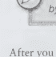

列表在标题中包含文件名。如果它只是代码片段，您会在代码注释中找到文件名，例如这样。

> **注意** 由于许多书籍标题相似，您可能最容易通过 ISBN 搜索：本书的 ISBN 为 978-0-470-50097-2

下载代码后，只需使用您喜欢的压缩工具解压缩即可。

或者，前往 www.wrox.com/dynamic/books/download.aspx 上的 Wrox 主代码下载页面，查看本书及所有其他 Wrox 书籍可用的代码。

## 勘误

我们尽一切努力确保文本或代码中没有错误。然而，没有人是完美的，错误确实会发生。

如果您在我们的某本书中发现错误，例如拼写错误或有问题的代码，我们将非常感谢您的反馈。

通过提交勘误，您可能会为另一位读者节省数小时的挫败感，同时帮助我们提供更高质量的信息。

要找到本书的勘误页面，请前往 www.wrox.com 并使用搜索框或其中一个标题列表找到标题。然后，在图书详情页面上，单击图书勘误链接。

在此页面上，您可以查看已为本书提交并由 Wrox 编辑发布的所有勘误。

包含指向每本书勘误的链接的完整书目也可在 www.wrox.com/misc-pages/booklist.shtml 获取。

如果您在图书勘误页面上没有发现“您的”错误，请前往 www.wrox.com/contact/techsupport.shtml 并在那里填写表格向我们发送您发现的错误。

我们将检查信息，如果合适，将在图书勘误页面上发布消息，并在本书的后续版本中修复问题。

## P2P.WROX.COM

为了作者和同行讨论，请加入 p2p.wrox.com 上的 P2P 论坛。

论坛是一个基于 Web 的系统，您可以在此发布与 PHP 书籍及相关技术相关的消息，并与其他读者和技术用户互动。

论坛提供订阅功能，当论坛发布新帖子时，会向您发送您选择的感兴趣主题的电子邮件。

Wrox 作者、编辑、其他行业专家以及您的 fellow 读者都活跃于这些论坛。

在 http://p2p.wrox.com，您将找到许多不同的论坛，这些论坛不仅在您阅读本书时有所帮助，也在您开发自己的应用程序时有所帮助。

要加入论坛，只需按照以下步骤操作：

1. 前往 p2p.wrox.com 并单击注册链接。
2. 阅读使用条款并单击同意。
3. 填写加入所需的必填信息以及您想要提供的任何可选信息，然后单击提交。
4. 您将收到一封电子邮件，其中包含有关如何验证您的账户并完成加入流程的信息。

> **注意** 您可以在不加入 P2P 的情况下阅读论坛中的消息，但要发布自己的消息，必须加入。


加入后，您可以发布新消息并回复其他用户发布的消息。您可以在 Web 上随时阅读消息。如果您希望将特定论坛的新消息通过电子邮件发送给您，请在论坛列表中点击论坛名称旁边的“订阅此论坛”图标。

有关如何使用 Wrox P2P 的更多信息，请务必阅读 P2P 常见问题解答，以了解论坛软件的工作原理以及 P2P 和 Wrox 书籍的许多常见问题。要阅读常见问题解答，请点击任何 P2P 页面上的 FAQ 链接。

# 第一部分：入门

- 第 1 章：开始 iPhone 编程
- 第 2 章：编写您的第一个 Hello World！应用程序
- 第 3 章：Outlets、Actions 和 View Controllers
- 第 4 章：探索视图
- 第 5 章：键盘输入
- 第 6 章：屏幕旋转

## 1 开始 iPhone 编程

### 本章您将学到什么

- 如何获取 iPhone SDK
- iPhone SDK 包含的组件
- 开发工具的功能 — Xcode、Interface Builder、iPhone Simulator
- iPhone Simulator 的功能
- iPhone OS 的架构
- iPhone SDK 的框架
- iPhone 的限制和特性

欢迎来到 iPhone 编程的世界！您现在手持本书的事实表明，您对开发 iPhone 应用程序的想法着迷，并希望加入那些数以万计的开发者的行列，他们的应用程序已经部署在 App Store 中。

正如古老的中国谚语所说，“要完成你的使命，先磨利你的工具。”成功的编程首先要求你很好地了解你的工具。事实上，对于 iPhone 编程来说，这一点再正确不过了——在你甚至开始之前，你需要了解相当多的工具。因此，本章的目标是向你展示你需要了解的各种相关工具和信息，以便加入 iPhone 开发的行列。

不用多说，是时候开始工作了。

### 获取 iPhone SDK

要为 iPhone 或 iPod Touch 开发，您首先需要在 http://developer.apple.com/iphone/program/start/register/ 注册为注册的 iPhone 开发者。注册是免费的，并为您提供访问 iPhone SDK 以及开始所需的有用资源的权限。

注册后，您可以下载 iPhone SDK（见图 1-1）。

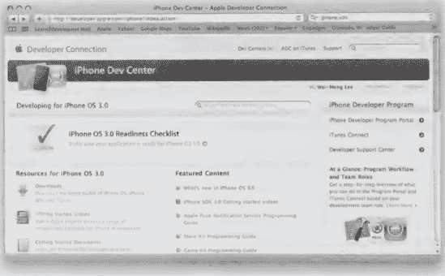

图 1-1

在安装 iPhone SDK 之前，请确保满足以下系统要求：

- 仅支持 Intel Mac，因此如果您使用的是其他处理器类型（如较旧的 G4 或 G5 Mac），您就无缘了。
- 您已使用最新的 Mac OS X 版本更新了系统。

强烈建议使用 iPhone/iPod Touch 设备，但并非严格必要。要测试您的应用程序，您可以使用包含的 iPhone Simulator。但是，如果您想测试相机、加速度计等某些硬件功能，您将需要使用真实设备。

下载 SDK 后，继续安装（见图 1-2）。您将被要求接受一些许可协议，然后选择要安装 SDK 的目标文件夹。

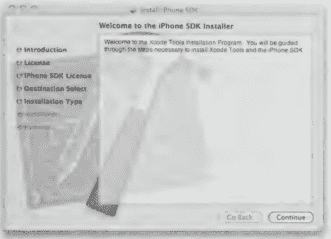

图 1-2

如果您在安装阶段选择了默认设置，安装后您应该能够在 /Developer/Applications 文件夹中找到各种已安装的工具（见图 1-3）。

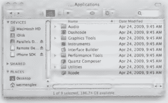

图 1-3

### iPhone SDK 的组件

iPhone SDK 包含一套开发工具，可帮助您为 iPhone 和 iPod Touch 开发应用程序。它包括：

- **Xcode** — 集成开发环境（IDE），允许您管理、编辑和调试项目。
- **Dashcode** — 集成开发环境（IDE），允许您开发基于 Web 的 iPhone 应用程序和 Dashboard 小部件。Dashcode 超出了本书的范围。
- iPhone Simulator — 提供软件模拟器在您的 Mac 上模拟 iPhone。
- Interface Builder — 提供可视化编辑器，用于设计 iPhone 应用程序的用户界面。
- Instruments — 分析工具，可帮助您实时优化应用程序。

下面的各节更详细地讨论每个工具。

### Xcode

如前所述，所有 iPhone SDK 中的工具都安装在 `/Developer/Applications` 文件夹中（使用默认设置时）。其中一个工具是 Xcode。

要启动 Xcode，请双击 Xcode 图标（参见图 1-3）。或者，走捷径使用 Spotlight：只需在搜索框中输入 Xcode，Xcode 应该位于顶部命中位置。

启动 Xcode 后，您会看到欢迎屏幕，如图 1-4 所示。

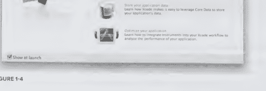

图 1-4

使用 Xcode，您可以开发不同类型的 iPhone 和 Mac OS X 应用程序（见图 1-5）。

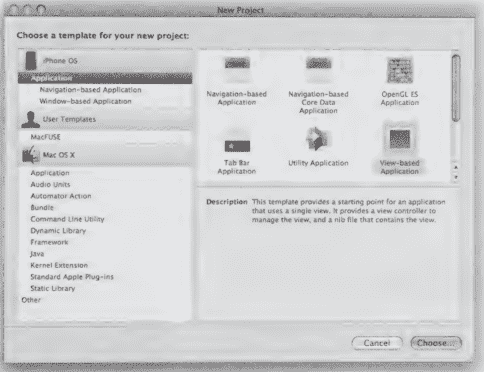

**图 1-5**

Xcode 中的 IDE 提供了许多工具和功能，使您的开发生活变得更加轻松。其中一个功能是代码补全（见图 1-6），它会显示一个弹出列表，显示可用的类和成员（例如方法、属性等）。

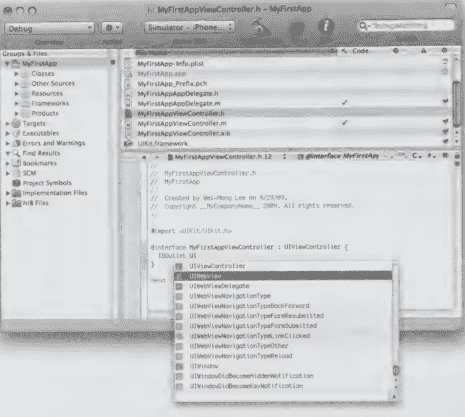

图 1-6

> **注意** 有关 Xcode 中一些最常用的功能的更全面描述，请参阅附录 B。

### iPhone Simulator

iPhone Simulator（见图 1-7）是 iPhone SDK 中包含的一个非常有用的工具，您可以在不使用实际 iPhone/iPod Touch 的情况下使用它来测试您的应用程序。iPhone Simulator 位于 /Developer/iPhone OS/Platforms/iPhoneSimulator.platform/Developer/Applications/ 文件夹中。大多数情况下，您不需要直接启动 iPhone Simulator — 在 Xcode 中运行（或调试）您的应用程序会自动启动 iPhone Simulator。Xcode 会自动将应用程序安装到 iPhone Simulator 上。

### iPhone Simulator 不是仿真器

iPhone Simulator 是一个模拟器，而不是仿真器。那么区别是什么呢？嗯，模拟器试图模仿真实设备的行为。就 iPhone Simulator 而言，它模拟实际 iPhone 设备的真实行为。然而，模拟器本身使用安装在 Mac 上的各种库（如 QuickTime）来执行其渲染，以便效果看起来与实际 iPhone 相同。此外，在模拟器上测试的应用程序被编译为 x86 代码，即模拟器理解的字节码。

相比之下，仿真器仿真真实设备的工作方式。在仿真器上测试的应用程序被编译为真实设备实际使用的字节码。仿真器通过将字节码翻译成可在运行仿真器的主机计算机上执行的形式来执行应用程序。

理解模拟和仿真之间细微差别的良好方法是：想象你试图说服一个孩子玩刀是危险的。为了模拟这一点，你假装用刀割伤自己并痛苦地呻吟。为了仿真这一点，你拿起一把刀并真正割伤自己。

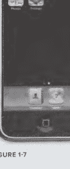

图 1-7

iPhone Simulator 可以模拟不同版本的 iPhone OS（见图 1-8）。如果您需要支持平台的旧版本以及在特定 OS 版本上测试和调试应用程序报告的错误，此功能非常有用。

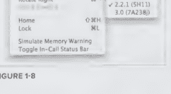

图 1-8

### iPhone Simulator 的功能

iPhone Simulator 模拟了真实 iPhone 或 iPod touch 设备的各种功能。您可以在 iPhone Simulator 上测试的功能包括：

- 屏幕旋转 — 左、上、右
- 手势支持：
    - Tap
    - Touch and Hold
    - Double Tap
    - Swipe
    - Flick
    - Drag
    - Pinch
- 低内存警告模拟

然而，iPhone Simulator 作为真实设备的软件模拟器，确实存在其局限性。iPhone Simulator 上不可用的功能包括：

- 获取位置数据 — 它仅返回固定的坐标，例如北纬 37.3317，经度 122.0307 西
- 进行电话呼叫
- 访问加速度计
- 发送和接收短信
- 从 App Store 安装应用程序
- 相机
- 麦克风
- OpenGL ES 的多个功能

值得注意的是，iPhone Simulator 的速度与您的 Mac 的性能更紧密地相关，而与实际设备的性能无关。因此，重要的是您在真实设备上测试您的应用程序，而不是完全依赖 iPhone Simulator 进行测试。

尽管 iPhone Simulator 有局限性，但它确实是一个有用的工具，可以让您测试应用程序。话虽如此，在将应用程序部署到 App Store 之前，在真实的 iPhone 或 iPod touch 设备上测试应用程序是必不可少的。


> **注意** 关于如何在真实设备上测试应用程序的更详细说明，请参阅附录E。

## 从iPhone模拟器卸载应用程序

iPhone模拟器的iPhone OS文件系统用户域存储在 `~/Library/Application Support/iPhone Simulator/User/` 文件夹中。

> **注意** `~/Library/Application Support/iPhone Simulator/User/` 文件夹也被称为 `<iPhoneUserDomain>`。

所有第三方应用程序都存储在 `<iPhoneUserDomain>/Applications/` 文件夹中。当应用程序部署到iPhone模拟器上时，主屏幕上会创建一个图标（如图1-9左侧所示），并在Applications文件夹中创建一个文件和文件夹（如图1-9右侧所示）。

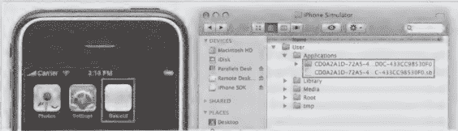

图1-9

要卸载（删除）应用程序，请执行以下步骤：

- 1. 在主屏幕中点击并按住应用程序图标，直到所有图标开始晃动。观察所有图标左上角都显示了一个“x”按钮。
- 2. 点击要卸载的应用程序图标旁边的x按钮（见图1-10）。
- 3. 出现一个提醒窗口，询问是否确定要删除该图标。点击Delete以确认删除。

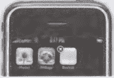

图1-10

## Instruments

Instruments（见图1-12）应用程序允许你动态跟踪和分析Mac OS X及iPhone应用程序的性能。

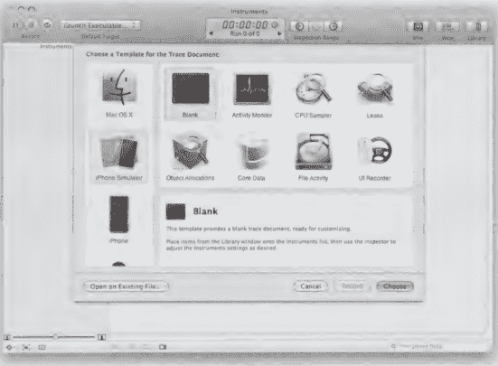

*图1-12*

使用Instruments，你可以：

- 对应用程序进行压力测试
- 跟踪应用程序的内存泄漏
- 深入了解应用程序的执行行为
- 跟踪应用程序中难以复现的问题

> **注意** 介绍Instruments应用程序超出了本书的范围。更多信息，请参阅Apple的文档。

## iPhone OS的架构

虽然本书不会深入探讨iPhone OS的内部机制，但了解iPhone OS的一些要点还是很有用的。图1-13展示了组成Mac OS X和iPhone OS的不同抽象层。

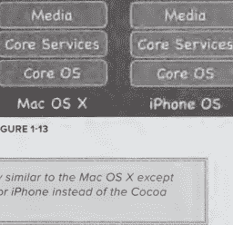

图1-13

> **注意** iPhone OS在架构上与Mac OS X非常相似，不同之处在于最顶层是用于iPhone的Cocoa Touch，而不是Cocoa Framework。

最底层是Core OS，它是操作系统的基础。它负责内存管理、文件系统、网络和其他操作系统任务，并直接与硬件交互。Core OS层由以下组件组成：

- OS X Kernel
- Mach 3.0
- BSD
- Sockets
- Security
- Power Management
- Keychain
- Certificates
- File System
- Bonjour

Core Services层提供对iPhone OS服务的基本访问。它提供了对Core OS层服务的一种抽象。Core Services层包含以下组件：

- Collections
- Address Book
- Networking
- File Access
- SQLite
- Core Location
- Net Services
- Threading
- Preferences
- URL Utilities

Media层提供可在iPhone应用程序中使用的多媒体服务。Media层包含以下组件：

- Core Audio
- OpenGL
- Audio Mixing
- Audio Recording
- Video Playback
- JPG, PNG, TIFF
- PDF
- Quartz
- Core Animation
- OpenGL ES

Cocoa Touch层提供了一个抽象层，用于公开为iPhone和iPod Touch编程的各种库，例如：

- Multi-Touch events
- Multi-Touch controls
- Accelerometer
- View Hierarchy
- Localization

| 框架名称 | 描述 |
|---|---|
| CoreLocation.framework | 结合GPS、小区ID和Wi-Fi网络提供基于位置的信息。 |
| ExternalAccessory.framework | 提供与配件通信的方式。 |
| Foundation.framework | 为Objective C提供基础类，如NSObject、基本数据类型、操作系统服务等。 |
| GameKit.framework | 为游戏提供网络功能；常用于点对点连接和游戏内语音功能。 |
| IOKit.framework | 提供驱动程序开发能力。 |
| MapKit.framework | 为应用程序提供嵌入式地图界面。 |
| MediaPlayer.framework | 提供播放电影和音频文件的功能。 |
| MessageUI.framework | 提供基于视图控制器（view-controller）的编写电子邮件界面。 |
| MobileCoreServices.framework | 提供对标准类型和常量的访问。 |
| OpenAL.framework | 提供OpenAL规范的实现。 |
| OpenGLES.framework | 提供OpenGL API中用于2D和3D绘图的紧凑且高效的子集。 |
| QuartzCore.framework | 提供配置动画和效果，然后在硬件中渲染这些效果的能力。 |
| Security.framework | 提供保护数据安全和控制软件访问的能力。 |
| StoreKit.framework | 为应用程序提供应用内购买支持。 |
| SystemConfiguration.framework | 提供确定设备上网络可用性和状态的能力。 |
| UIKit.framework | 提供管理应用程序UI的基本对象。 |

## 开始之前的一些有用信息

你现在已经对iPhone应用程序开发所涉及的工具有了很好的了解。在你继续深入之前，下面几节将讨论一些有用信息，让你的开发之旅更加愉快。

## iPhone OS的版本

在撰写本书时，iPhone OS已经发展到了第三次修订版——即3.0版本。iPhone OS经历了多次修订，主要版本如下：

- 1.0 — iPhone的初始版本
- 1.1 — 新增功能并修复1.0的bug
- 2.0 — 随iPhone 3G发布；带有App Store
- 2.1 — 新增功能并修复2.0的bug
- 2.2 — 新增功能并修复2.1的bug
- 3.0 — iPhone OS的第三个主要版本；有关iPhone OS 3.0的新功能，请参阅下一节

有关每个版本功能的详细描述，请查看 http://en.wikipedia.org/wiki/iPhone_OS_version_history。

## iPhone OS 3.0的新功能

2009年6月，Apple发布了iPhone OS的第三个主要修订版，同时推出了一款更新的设备——iPhone 3GS。S代表速度：新设备拥有更快的处理器（600 MHz），重新优化的操作系统使iPhone在各个方面都运行得更快。

iPhone OS 3.0的一些重要新功能包括：

- 语音激活。
- 改进的相机（300万像素和自动对焦）以及对视频拍摄的支持。
- 能够通过“Find My iPhone”功能定位你的iPhone（需要订阅MobileMe账户）。
- 支持彩信（MMS）和网络共享（需要运营商支持）。
- 支持剪切、拷贝和粘贴。
- 新的开发者API：
  - 面向第三方应用程序的推送通知。
  - 蓝牙服务：A2DP、LDAP、P2P和Bonjour。
  - MapKit API。
  - 在应用程序内发送电子邮件。

## 在真实设备上测试

初级iPhone程序员最常见的抱怨之一，就是无法在真实设备上测试他们开发的iPhone应用程序。作为设备所有者，他们甚至无法在设备上测试自己的应用程序，这似乎有些奇怪。事实上，出于安全原因，Apple要求所有应用程序都必须使用有效证书签名，而为了测试目的，则需要开发者证书。

要在设备上测试你的应用程序，你必须注册iPhone开发者计划，并请求将开发者证书安装到你的设备上。这是一个漫长的过程，但我会在附录E中为你提供详细帮助。

## 屏幕分辨率

iPhone是一款拥有高分辨率屏幕的精美设备。iPhone屏幕为3.5英寸（对角线），支持多点触控操作，像素分辨率为480 x 320，163 ppi（见图1-14）。在设计应用程序时，请注意，尽管分辨率是480 x 320，但由于状态栏的存在，大多数时候你只能使用460 x 320像素。当然，你可以通过编程方式关闭状态栏，从而获得完整的480 x 320分辨率。

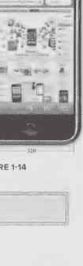

另外，请注意用户可能会旋转设备，以横屏模式显示你的应用程序。在这种情况下，如果你决定支持新的方向，则需要为你的用户界面做好准备，以便应用程序在横屏模式下仍然能够正常工作。

> **注意** 第6章讨论了如何处理屏幕旋转。

## 单窗口应用程序

如果你是移动编程新手，你需要意识到，有限的屏幕空间意味着大多数移动平台只支持单窗口应用程序——也就是说，你的应用程序窗口占据整个屏幕。iPhone也不例外，同样受到这一平台限制。桌面操作系统（如Mac OS X和Windows）中常见的重叠窗口在iPhone上并不受支持。

## 无后台应用程序

移动设备编程的主要挑战之一是电源管理。编写糟糕的应用程序可能会占用大量资源，并很快耗尽设备电池。Apple承认了这个问题，并且通过审视从其他平台获得的经验，


苹果公司认定，影响电池寿命和性能的主要元凶是后台应用程序。在其他平台（如 Windows Mobile）上，当应用程序离开视野时（例如，因为来电），该应用程序仍会保留在内存中，而每个保留在内存中的后台应用程序都会持续损耗设备的性能和电池寿命。

苹果公司解决这个问题的方法很简单：不允许应用程序在后台运行。虽然这是一个有效的解决方案，但这惹恼了许多开发者。许多有用的应用程序需要后台运行才能正常工作。例如，聊天应用程序需要保持运行才能接收其他用户的消息。为了克服这一限制，苹果公司开发了推送通知服务（Push Notification Service），即使应用程序没有运行，也能向它们提供数据。该服务随 iPhone 3.0 发布。借助推送技术，设备通过 IP 连接与苹果公司的服务器保持持续连接。当设备需要处理某些事务时，苹果公司的服务器会向设备发送通知，从而提醒需要处理该通知的特定应用程序。

> **注意** 推送通知不在本书讨论范围之内。更多信息，请访问苹果公司的 iPhone 开发中心：http://developer.apple.com/iphone/index.action。

## 调用第三方应用程序的限制

苹果公司对 iPhone 开发者的另一项限制是，不允许在你的应用程序中调用第三方应用程序。此外，你也不能在你的应用程序中运行解释性代码。一个很好的例子是为 iPhone 编写 Web 浏览器应用程序。由于 Web 应用程序通常使用 JavaScript 实现客户端交互，苹果的这一限制意味着你不能在应用程序中运行 JavaScript 代码。

## 本章小结

本章简要介绍了 iPhone 应用程序开发所使用的工具。你还了解了 iPhone 的一些特性，例如单一应用程序限制以及无法调用第三方应用程序。在下一章中，你将开发第一个 iPhone 应用程序，很快就能步入 iPhone 开发的完美境界！

## 本章要点

| 主题 | 关键概念 |
|---|---|
| 获取 iPhone SDK | 首先在 http://developer.apple.com 注册为 iPhone 开发者，然后下载 SDK。 |
| iPhone 模拟器 | 大部分测试都可以在 iPhone 模拟器上进行。不过，强烈建议你使用真实设备进行实际测试。 |
| iPhone 模拟器的局限性 | 模拟器通常不支持访问硬件。例如，摄像头、加速度计、录音等均不受支持。 |
| iPhone SDK 中的框架 | iPhone SDK 提供了多个框架，用于在 iPhone 上执行特定功能。你可以使用所有这些框架来编写 iPhone 应用程序。 |
| 后台应用程序 | iPhone 不支持第三方后台应用程序。 |
| 屏幕分辨率 | 480×320 像素（隐藏状态栏时）。460×320 像素（显示状态栏时）。 |
| 单窗口应用程序 | 所有 iPhone 应用程序都是单窗口的——也就是说，所有窗口都填满整个屏幕，并且不允许窗口重叠。 |

> **注意** 启动 Xcode 最简单的方法是在 Spotlight 中输入 Xcode，然后按回车键启动它。

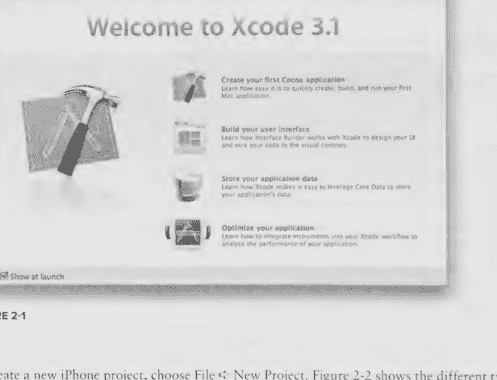

图 2-1

要创建新的 iPhone 项目，请选择 File ▸ New Project。图 2-2 显示了使用 Xcode 可以创建的不同类型的项目。主要有两大类：iPhone OS 应用程序和 Mac OS X 应用程序。显然，本书介绍的是 iPhone 应用程序。因此，请单击 iPhone OS 下列出的 Application 项，以查看可用于开发 iPhone 应用程序的不同模板。

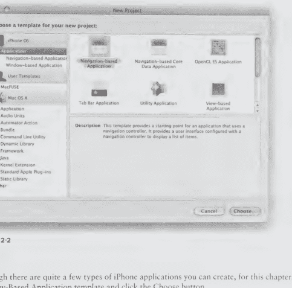

图 2-2

虽然你可以创建的 iPhone 应用程序类型有很多，但在本章中，请选择 View-Based Application 模板，并单击 Choose 按钮。

> **注意** 后续章节将介绍如何开发其他类型的 iPhone 应用程序，例如 Utility Application、Tab Bar Application 和 Navigation Application。

选择 View-Based Application 模板，并单击 Choose。将项目命名为 HelloWorld，然后单击 Save。Xcode 随后会为你选定的模板创建项目。图 2-3 显示了项目中的各种文件和文件夹。

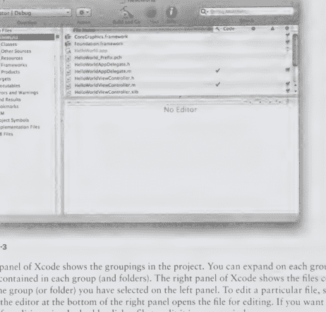

图 2-3

Xcode 的左侧面板显示项目中的分组。你可以展开每个分组，以查看每个分组（和文件夹）中包含的文件。Xcode 的右侧面板显示你在左侧面板所选分组（或文件夹）中包含的文件。要编辑某个特定文件，请选中该文件，右侧面板底部的编辑器会打开该文件以供编辑。如果你希望使用独立窗口进行编辑，只需双击文件即可在新窗口中编辑。

在接下来的“试一试”练习中，你将学习如何自定义 Xcode 工具栏区域，以添加常用项目。

## 试一试：自定义 Xcode 工具栏区域

代码文件（HelloWorld.zip）可从 Wrox.com 下载。

Xcode 的顶部是工具栏区域。该区域包含开发过程中常用的所有工具栏菜单项。你可以自定义工具栏区域以添加这些项目。

1. 选择 View → Customize Toolbar 试试看。会出现一个下拉窗口（参见图 2-4）。

   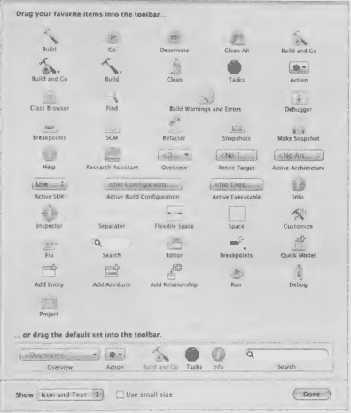

   图 2-4

2. 要向工具栏添加项目，只需将项目拖放到工具栏上即可。图 2-5 显示了添加到工具栏上的 Active SDK 项。

   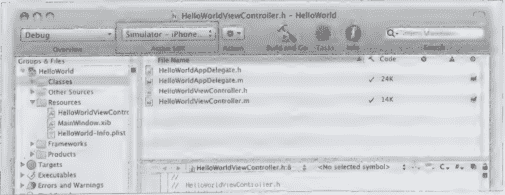

   图 2-5

3. Active SDK 项允许你选择是将应用程序部署到真实设备还是 iPhone 模拟器（参见图 2-6）。

   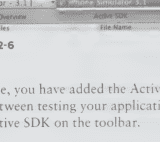

### 工作原理

通过向 Xcode 工具栏区域添加常用项目，可以提高开发过程的效率。在本例中，你将 Active SDK 工具栏项添加到工具栏区域，这样只需在工具栏上选择 Active SDK，即可在 iPhone 模拟器和真实设备之间快速切换测试应用程序。

## 使用 Interface Builder

到目前为止，该项目还没有任何 UI。要验证这一点，只需按下 Command-R（或选择 Run > Run），你的应用程序就会部署到附带的 iPhone 模拟器中。图 2-7 显示了 iPhone 模拟器上显示的空白屏幕。现在看到这一空白屏幕是件好事，因为在学习本章的过程中，你将看到你的操作带来了哪些变化。

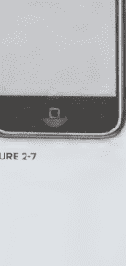

显然，空白屏幕并不是很有用。因此，现在是时候尝试向应用程序的 UI 添加一些控件了。如果你查看项目中的文件列表，会注意到两个扩展名为 .xib 的文件——MainWindow.xib 和 HelloWorldViewController.xib。扩展名为 .xib 的文件基本上是包含应用程序 UI 定义的 XML 文件。你可以通过修改其 XML 内容来编辑 .xib 文件，或者更简单（也更合理）的方法是使用 Interface Builder 进行编辑。

Interface Builder 是 iPhone SDK 的一部分，允许你通过拖放来构建 iPhone（和 Mac）应用程序的 UI。

双击 HelloWorldViewController.xib 文件以启动 Interface Builder。图 2-8 展示了 Interface Builder 中 HelloWorldViewController.xib 的内容（此时该文件实际上为空）。如你所见，Library（库）窗口显示了可以添加到 iPhone 应用程序 UI 中的各种控件。View（视图）窗口显示了 UI 的图形布局。稍后你将看到其他窗口的用途。


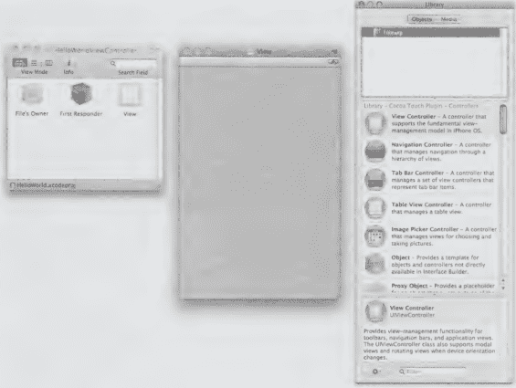

**图 2-8**

现在，在库面板中向下滚动到标签控件，将一个视图拖放到视图窗口中。添加标签视图后，选择该标签视图，选择工具 → 属性检查器。在文本字段中输入 `Hello World!`。此外，在布局旁边，点击居中对齐类型（参见图 2-9）。

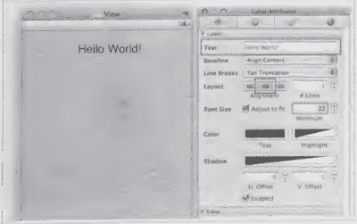

**图 2-9**

接下来，从库窗口中将一个文本字段视图拖放到视图窗口中，随后再拖放一个圆角矩形按钮视图。通过在标题字段中输入 `Click Me!` 来修改圆角矩形按钮视图的属性（参见图 2-10）。

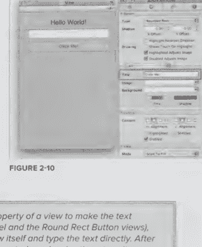

> **注意** 除了通过指定视图的*标题*属性来让文本显示在视图中（例如标签视图和圆角矩形按钮视图），你也可以直接双击视图本身并直接输入文本。完成此操作后，你可以重新排列控件并调整其大小以满足需要。请注意，界面生成器会提供对齐参考线，帮助你以视觉上赏心悦目的布局排列控件。

按 Command-S 保存 `HelloWorldViewController.xib` 文件。然后，返回 Xcode，按 Command-R 再次运行应用程序。iPhone 模拟器现在会显示修改后的用户界面（参见图 2-11）。

轻点文本字段视图，观察键盘自动弹出（参见图 2-12）。

如果你按下 iPhone 模拟器上的 Home 按钮，你会注意到你的应用程序已安装到模拟器中（在显示主屏幕后，你需要向右轻扫到下一页）。要返回应用程序，只需再次轻点 HelloWorld 图标（参见图 2-13）。

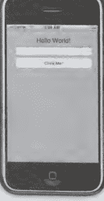

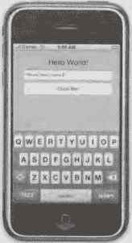

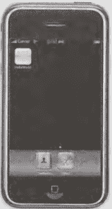

> **注意** 任何时刻 iPhone 上只能运行一个应用程序（苹果公司预装的某些应用程序除外）。因此，当你按下 iPhone 上的 Home 按钮时，你的应用程序就会退出。轻点一个应用程序图标会重新启动该应用程序。

## 更改屏幕方向

iPhone 模拟器也支持视图方向的变化。要将视图更改为横向模式，请按 Command→ 键组合。图 2-14 显示了你的应用程序在横向模式下的外观。按 Command← 可切换回纵向模式。

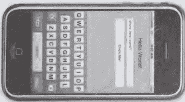

请注意，你的应用程序不会响应视图方向的变化。要使应用程序在视图方向变化时做出适当响应，你需要修改代码。

在 Xcode 中，编辑 `HelloWorldViewController.m` 文件，查找以下代码片段（此代码块默认被注释掉）：

```
- (BOOL)shouldAutorotateToInterfaceOrientation:(UIInterfaceOrientation)interfaceOrientation {
    // Return YES for supported orientations
    return (interfaceOrientation == UIInterfaceOrientationPortrait);
}
```

> **注意** 在现阶段，无需关心其他文件，例如 `HelloWorldAppDelegate.h` 和 `HelloWorldAppDelegate.m`。你将在后续章节中了解更多关于它们的内容。

将上述代码修改为返回 `YES`，如下面的代码片段所示：

```
- (BOOL)shouldAutorotateToInterfaceOrientation:(UIInterfaceOrientation)interfaceOrientation {
    // Return YES for supported orientations
    return YES;
}
```

再次运行应用程序。这次，你会注意到当视图方向发生变化时，应用程序会随之旋转（参见图 2-15）。


**图 2-15**

## 视图重新定位

在上一节中，你看到随着方向的变化，视图的大小和位置保持不变。在实际应用中，这种情况并不理想，因为这不会给用户在使用你的应用程序时带来良好的体验。理想情况下，你应该在屏幕上重新定位视图，使它们随视图方向的变化而变化。

要重新定位视图，请转到界面生成器，选择标签视图，然后选择工具 ▸ 大小检查器。按图 2-16 所示修改视图的自动调整大小属性（仔细观察在自动调整大小部分设置的各种锚点）。这将使标签视图随视图方向的变化而扩展/收缩。同时，视图将锚定到屏幕的左侧、顶部和右侧。

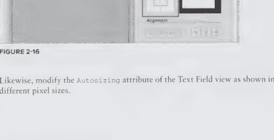

**图 2-16**

同样，按图 2-17 所示修改文本字段视图的自动调整大小属性。请注意不同的像素尺寸。

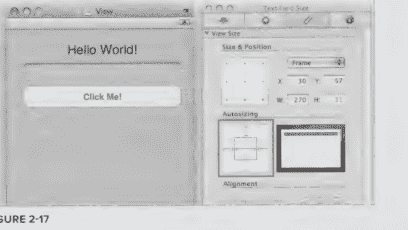

**图 2-17**

最后，按图 2-18 所示修改圆角矩形按钮控件的自动调整大小属性。这一次，你不会在视图方向变化时调整视图大小，而是仅将其锚定到屏幕顶部。

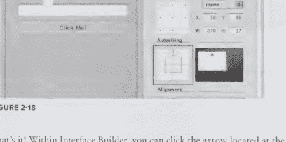

**图 2-18**

就是这么简单！在界面生成器中，你可以点击屏幕右上角的箭头（参见图 2-19）来旋转屏幕，以便立即查看你所做更改的效果。

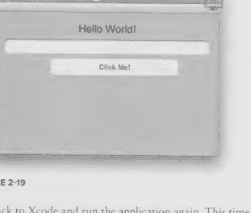

**图 2-19**

返回 Xcode，再次运行应用程序。这次，你会注意到当你旋转屏幕时，控件会重新定位并调整大小（参见图 2-20）。

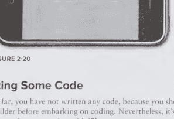

**图 2-20**

## 编写一些代码

到目前为止，你还没有编写任何代码，因为在开始编码之前，你应该先熟悉 Xcode 和界面生成器。不过，现在是时候编写一些代码，让你体验一下 iPhone 编程了。

回想本章前面关于界面生成器的部分，我展示了一个标记为 `HelloWorldViewController.xib` 的窗口。此窗口中有三个组件：文件所有者、第一响应者和视图。

选择文件所有者，然后从菜单中选择工具 → 身份检查器。

在身份检查器窗口中，点击类操作下显示的 +（加号）按钮（参见图 2-21）。在操作名称字段中输入 `btnClicked:`。（请记住包含冒号，因为它是操作名称的一部分。）这样就创建了一个名为 `btnClicked:` 的操作（也称为事件处理器）。

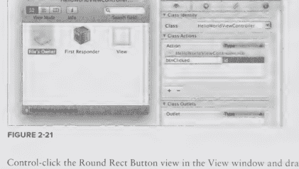

**图 2-21**

按住 Control 键单击视图窗口中的圆角矩形按钮视图，并将其拖到 `HelloWorldViewController.xib` 窗口中的文件所有者项上（参见图 2-22）。会出现一个包含 `btnClicked:` 操作的小弹出框。选择 `btnClicked:` 操作。基本上，你在这里所做的是将圆角矩形按钮视图与操作（`btnClicked:`）关联起来，以便当用户点击按钮时，该操作被调用。

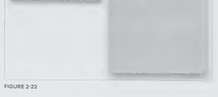

**图 2-22**

在 `HelloWorldViewController.h` 文件中，为 `btnClicked:` 操作添加头文件声明：

```
//
// HelloWorldViewController.h
// HelloWorld
//
// Created by Wei-Meng Lee on 3/30/09.
// Copyright __MyCompanyName__ 2009. All rights reserved.
//

#import <UIKit/UIKit.h>

@interface HelloWorldViewController : UIViewController {
}

//---declaration for the btnClicked: action---
//-(IBAction) btnClicked:(id)sender;

@end
```

在 `HelloWorldViewController.m` 文件中，添加为 `btnClicked:` 操作提供实现的代码：

```
- (void)dealloc {
    [super dealloc];
}

//---implementation for the btnClicked: action---
//-(IBAction) btnClicked:(id)sender {
//---display an alert view---
// UIAlertView *alert = [[UIAlertView alloc]
// initWithTitle:@"Hello World!"
// message:@"iPhone, here I come!"
// delegate:self
// cancelButtonTitle:@"OK"
// otherButtonTitles:nil, nil];
// [alert show];
// [alert release];
// }
@end
```

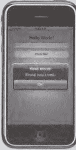

**图 2-23**

上述代码显示一个包含句子“iPhone, here I come!”的警告框。

就是这么简单！返回 Xcode，再次运行应用程序。这次，当你轻点按钮视图时，会显示一个警告视图（参见图 2-23）。


## 自定义应用程序图标

如您在图 2-13 中早先看到的，安装在 iPhone 模拟器上的应用程序使用默认的白色图像作为应用程序图标。然而，您可以自定义此图标。在为 iPhone 应用程序设计图标时，请注意以下事项：

- 将图标设计为 57 x 57 像素。尺寸更大也可以，因为 iPhone 会自动为您调整大小。事实上，如果 Apple 发布了比当前尺寸/外形更大的新设备，您应该以更大的尺寸设计图标。
- 通过 App Store 分发时，您需要准备一张 512 x 512 像素的图像。
- 为图标图像使用方形角，因为 iPhone 会自动将其圆角化并添加光泽表面（不过您可以关闭此功能）。

在下面的“试一试”中，您将学习如何向应用程序添加图标，以便 iPhone 模拟器使用它而不是默认的白色图像。

## 试一试 向应用程序添加图标

1. 为了使应用程序更有趣，您应该指定自己的图标。在此之前，请注意 iPhone 的图标有两种尺寸：57 x 57 像素（用于主屏幕）和 29 x 29 像素（如“设置”应用程序所示）。图 2-24 显示了图标的两种可能尺寸。

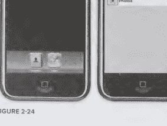

图 2-24

2. 要向应用程序添加图标，请将图像拖放到项目的 Resources 文件夹中（见图 2-25）。系统会询问您是否要复制正在拖放的图像。请选中此选项，以便图像的副本现在存储在项目文件夹中。

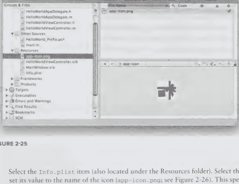

图 2-25

3. 选择 Info.plist 项（也位于 Resources 文件夹下）。选择 Icon file 项并将其值设置为图标的名称（app-icon.png；见图 2-26）。这指定了用作应用程序图标的图像的名称。

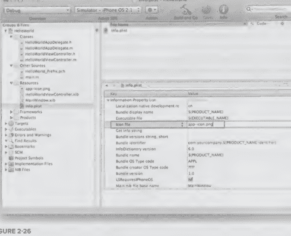

图 2-26

运行应用程序并在 iPhone 模拟器上测试它。按 Home 按钮返回 iPhone 主屏幕。您现在应该可以看到新添加的图标（见图 2-27）。

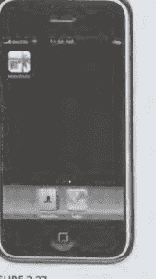

## 摘要

本章是开发您第一个 iPhone 应用程序的快速旅程。虽然您可能仍有很多疑问，但本章的目的是让您入门。接下来的几章将深入探讨 iPhone 编程的细节，所有那些协同工作的神秘项目的秘密将逐渐揭示。

图 2-27

## 练习

- 1. 您尝试在 Xcode 中向 iPhone 项目添加图标。您应该提供什么尺寸的图像？
- 2. 如果您的应用程序需要支持不同的显示方向，您应该怎么做？

## 本章学到的内容

| 主题 | 关键概念 |
|---|---|
| Xcode | 创建您的 iPhone 应用程序项目并编写操作应用程序的代码。 |
| Interface Builder | 使用库中各种视图构建您的 iPhone UI。 |
| Repositioning views | 使用 Interface Builder 中的 Autosizing 功能，确保在方向更改时视图仍能调整大小。 |
| Adding application icon | 将图像添加到项目中，然后在 info.plist 文件的 Icon file 属性中指定图像名称。 |
| Creating icons for your iPhone applications | 图标尺寸为 57 x 57 像素（主屏幕）和 29 x 29 像素（设置）。对于 AppStore 托管，尺寸为 512 x 512 像素。 |

## 

## 3 Outlets、Actions 和 View Controllers

## 本章将学习的内容

- 如何声明和定义 outlets
- 如何声明和定义 actions
- 如何将 outlets 和 actions 连接到 View 窗口中的视图
- 如何向应用程序添加新的 View Controller

在上一章中，您构建了一个简单的 Hello World! iPhone 应用程序，但对事物协同工作的底层细节了解不多。事实上，学习 iPhone 编程的最大障碍之一是在您能够运行应用程序之前需要学习的大量细节。本书旨在使 iPhone 编程体验既有趣又可承受。因此，本章从创建 iPhone 应用程序的基础开始。您将了解构成 iPhone 应用程序项目的各种文件，以及您的代码如何与 iPhone 应用程序上看到的图形小部件连接。

## 基础代码和 UI 交互

基于视图的应用程序项目是开发单视图应用程序的良好起点，并为您提供了了解 iPhone 编程中一些重要概念的绝佳机会，因此本节将使用它。您需要下载代码。

开始时，启动 Xcode 并创建一个新的基于视图的应用程序项目（见图 3-1），并将其命名为 BasicUI。

代码文件 [BasicUI.zip] 可在 Wrox.com 下载

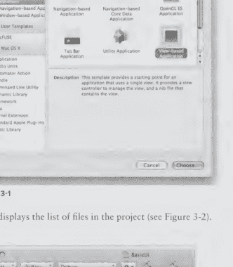

图 3-1

Xcode 显示项目中的文件列表（见图 3-2）。

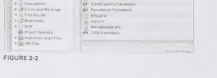

图 3-2

如您所见，创建新项目时默认会为您创建许多文件。iPhone SDK 试图通过创建您在开发 iPhone 应用程序时最常使用的一些项目来简化您的工作。表 3-1 描述了项目中创建的各种文件的使用情况。

## 表 3-1：项目中创建的各种文件

| 文件 | 描述 |
|---|---|
| `BasicUI.app` | 应用程序包（可执行文件），其中包含可执行文件以及随应用程序捆绑的数据。 |
| `BasicUI_Prefix.pch` | 包含项目中所有文件的预处理头。预处理头默认包含在项目的其他文件中。 |
| `BasicUIAppDelegate.h` | 应用程序委托的头文件。 |
| `BasicUIAppDelegate.m` | 应用程序委托的实现文件。 |
| `BasicUIViewController.h` | View Controller 的头文件。 |
| `BasicUIViewController.m` | View Controller 的实现文件。 |
| `BasicUIViewController.xib` | 包含视图 UI 的 XIB 文件。 |
| `CoreGraphics.framework` | 用于低级 2D 渲染的基于 C 的 API。 |
| `Foundation.framework` | 用于基础系统服务（如数据类型、XML、URL 等）的 API。 |
| `Info.plist` | 一个字典文件，其中包含有关项目的各种信息，如图标、应用程序名称等；信息以键/值对存储。 |
| `main.m` | 启动 iPhone 应用程序的主文件。 |
| `MainWindow.xib` | 应用程序主窗口的 XIB 文件。 |
| `UIKit.framework` | 提供构建和管理应用程序 UI 的基本对象。 |

> **注意** 创建的文件数量和类型取决于您选择的项目类型。基于视图的应用程序模板是了解所涉及的各种文件的良好起点。


main.m 文件包含启动应用程序的代码。它包含以下代码，您很少需要修改它：

```
#import <UIKit/UIKit.h>

int main(int argc, char *argv[]) {
    NSAutoreleasePool * pool = [[NSAutoreleasePool alloc] init];
    int retVal = UIApplicationMain(argc, argv, nil, nil);
    [pool release];
    return retVal;
}
```

大部分繁重的工作由 UIApplicationMain() 函数完成，它检查 Info.plist 文件以获取有关项目的更多信息。特别是，它查看您将用于项目的 main nib 文件。图 3-3 显示了 Info.plist 文件的内容。请注意，Main nib file base name 键指向 MainWindow，这是应用程序启动时要加载的 NIB 文件的名称。

## XIB 和 NIB 代表什么？

在 iPhone 应用程序开发之旅中，您总是会遇到带有 .xib 扩展名的文件（有时也称为 NIB 文件）。那么，NIB 和 .xib 到底代表什么？要理解这一点，需要一点历史课。事实证明，当前的 Mac OS X 是基于一家名为 NeXT 的公司（由苹果联合创始人 Steve Jobs 于 1985 年创立）的 NeXTSTEP 操作系统构建的。NIB 中的 N 代表 NeXTSTEP。至于 xib，x 很可能代表 XML，因为其内容以 XML 文件保存。IB 代表 Interface Builder，这是一个允许您直观构建应用程序 UI 的应用程序。

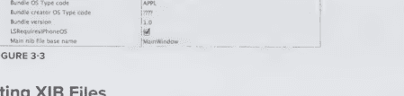

图 3-3

## 编辑 XIB 文件

双击 MainWindow.xib 文件以使用 Interface Builder 编辑它。如前所述，XIB 文件代表应用程序的 UI，并且几乎完全由 Interface Builder 使用。


The BasicUIAppDelegate.h file contains the declaration of the members of the BasicUIAppDelegate class:

```
#import <UIKit/UIKit.h>

@class BasicUIViewController;

@interface BasicUIAppDelegate : NSObject <UIApplicationDelegate> {
    UIWindow *window;
    BasicUIViewController *viewController;
}

@property (nonatomic, retain) IBOutlet UIWindow *window;
@property (nonatomic, retain) IBOutlet BasicUIViewController *viewController;

@end
```

Of particular interest is this line:

```
@interface BasicUIAppDelegate : NSObject <UIApplicationDelegate> {
```

The <UIApplicationDelegate> statement specifies that the class implement the UIApplicationDelegate protocol. Put simply, it means that you can now handle events (or messages) defined in the UIApplicationDelegate protocol. Examples of events in the UIApplicationDelegate protocol are the following:

- applicationDidFinishLaunching: (You saw this implemented in the BasicUIAppDelegate.m file.)
- applicationWillTerminate:
- applicationDidReceiveMemoryWarning:

> NOTE Protocols are discussed in more detail in Appendix D.

## View Controllers

In iPhone programming, you typically use a View Controller to manage a view as well as perform navigation and memory management. In the project template for a View-based Application, Xcode automatically uses a View Controller to help you manage your view. Think of a view as a screen (or window) you see on your iPhone.

> NOTE This section is an introduction to the basics of View Controllers; Chapter 7 covers more advanced View Controller topics and includes multi-view application instructions.

Earlier in this chapter, you saw that the MainWindow.xib window contains the BasicUI View Controller item. When you double-click it, it shows a window of the same name (see Figure 3-5).

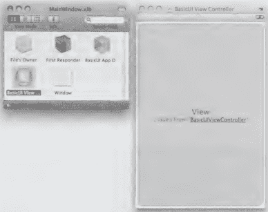

FIGURE 3-5

As you can see from the window, the view says that it is loaded from BasicUIViewController. The BasicUIViewController refers to the name of the BasicUIViewController.xib file, which is also within your project.

Now, double-click the BasicUIViewController.xib file to edit it in Interface Builder (see Figure 3-6).

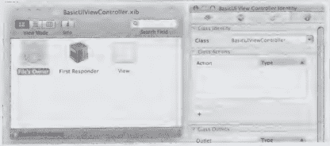

FIGURE 3-6

As with the MainWindow.xib file, a few objects are contained inside the BasicUIViewController.xib file. In this case, the window contains three items: File’s Owner, First Responder, and View.

You can right-click (Control-Click) the File’s Owner item to view its outlets (see Figure 3-7). For now, note that the view outlet is connected to the view item.

The View item represents the screen that appears on your application. Double-click View to display it (see Figure 3-8).

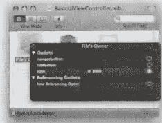

FIGURE 3-7

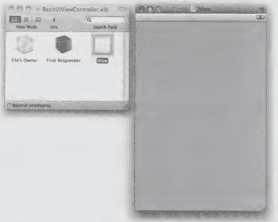

FIGURE 3-8

## Designing the View Window

To design your View window, you can drag and drop views from the Library window (choose Tools ⇨ Library). Figure 3-9 shows the Library window containing all the various views you can add to your View window.

If you are new to iPhone development, you may not know that it is better to display the various views in the Library window as icons and labels. To do so, click the asterisk/star-like icon located at the bottom on the Library window and select View Icons and Labels (see Figure 3-10).

Doing so displays the view names together with the icons (see Figure 3-11).

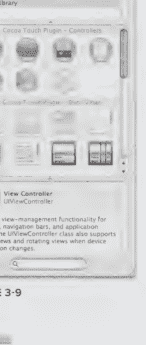

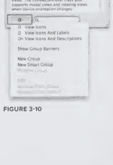

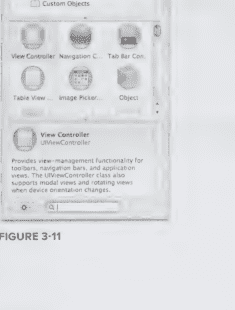

Populate the View window as shown in Figure 3-12. The following views are used:

- Label
- Text Field
- Round Rect Button

What your application will do is simple: When the user enters his or her name in the Text field and clicks the Round Rect button, the application displays an alert view showing the user's name.

## Creating Outlets and Actions

In order for your application to interact with views on the View window, you need a mechanism to reference your views on the window and at the same time provide methods to be invoked when some events happen on the window. In iPhone programming, these two mechanisms are known as outlets and actions, respectively.

In the BasicUIViewController.xib window (see Figure 3-13), select the File's Owner item and view its Identity Inspector window (choose Tools > Identity Inspector). Under the Class Actions section, click the plus (+) button to add an action named btnClicked:. Under the Class Outlets section, click the plus button to add an outlet named nameTextField. Set its Type to UITextField.


An action is a method that can handle events raised by views (for example, when a button is clicked) in the View window. An outlet, on the other hand, allows your code to programmatically reference a view on the View window.

With the File’s Owner item selected, choose the File ↔ Write Class File menu item. Interface Builder generates the code necessary to represent the outlets and actions that you have just added. Because the project template already includes class files that are used by the View Controller, you see the prompt as shown in Figure 3-14.

> **NOTE** You can also manually modify the View Controller files (the `.h` and `.m` files). But the Interface Builder has this nice little feature that helps you generate code for your outlets and actions.


At this juncture, you have two options:

- Replace the existing class files in your project. Doing so overwrites all the changes that you might have made to your existing class files.
- Merge the newly generated code with the existing class files. I recommend this option because it allows you to selectively choose the statements to insert into your existing class files.

Click the Merge button. You should now see the window as shown in Figure 3-15, displaying the content of BasicUIViewController.h.


**FIGURE 3-15**

The left of the window shows the code that Interface Builder has generated for you, whereas the right side shows the content of the original file. The gray sections show the code to be inserted. Because you want the two statements to be inserted into the original file, select each section, and at the bottom-right corner of the screen, click the Actions list and select Choose Left. Repeat the same step for the second block of code.

The window should now look like Figure 3-16. Note the direction of the two arrows.


**FIGURE 3-16**

Save the file by pressing Command-S. To close the window, press Command-W.

You now see the window for the next file — BasicUIViewController.m. Repeat the same steps outlined previously (though the second block of code does not seem to include anything; see Figure 3-17). Save and close the window.


FIGURE 3-17

Back in Xcode, you see the following in the BasicUIViewController.h file:

```
#import <UIKit/UIKit.h>

@interface BasicUIViewController : UIViewController {
IBOutlet UITextField *nameTextField;
}

- (IBAction)btnClicked:(id)sender;

@end
```

The IBOutlet identifier is used to prefix variables so that Interface Builder can synchronize the display and connection of outlets with Xcode. The IBAction identifier is used to synchronize action methods.

In the BasicUIViewController.m file, you see the following statements inserted:

```
#import "BasicUIViewController.h"

@implementation BasicUIViewController

- (IBAction)btnClicked:(id)sender {
}

//...
```

Now that you know what an outlet is and does, it's time to practice adding outlets in the following Try It Out.

## TRY IT OUT Adding Outlets Using Code

To add outlets or actions to a View Controller, you can either use Interface Builder to add them and then generate the class file, or write the code yourself. To see how this is done, execute the following steps.

1. Manually add another IBOutlet object to the class (BasicUIViewController.h), as follows:

```
#import <UIKit/UIKit.h>

@interface BasicUIViewController : UIViewController {
    IBOutlet UITextField *nameTextField;
    IBOutlet UITextField *ageTextField;
}

- (IBAction)btnClicked:(id)sender;

@end
```

2. In this case, you are manually adding an outlet (named ageTextField) to the View Controller. Save the file and select the File's Owner item in the BasicUIViewController.xib file. Note its Identity Inspector window — it's the one on the right in Figure 3-18.

> NOTE Note that the outlets are now listed under BasicUIViewController.h. If you refer to Figure 3-13, you will notice that when you create your outlets using the Identity Inspector window, the outlets are listed under BasicUIViewController.xib. This is because at that time the outlets have not been declared to the .h file yet.


ageTextField 插座出现在“类插座”部分，证明直接在 .h 文件中编写代码同样有效。

> 注意：如果要移除 BasicUIViewController.h 下列出的任何插座，你必须在 .h 文件中手动移除它们。当你看到减号 (-) 按钮呈灰色时，这一点就很明显了。

如果此时你使用“身份检查器”窗口添加另一个插座，你添加的插座将列在 BasicUIViewController.xib 下（见图 3-19）。在 .h 文件中声明插座后，该插座就会出现在 BasicUIViewController.xib 下。


图 3-19

## 你在哪里声明插座和动作？

在 Apple 的演示和许多其他入门教程中，动作和插座通常直接在 .h 文件中声明，然后在 Interface Builder 中连接到视图，因为这可能是程序员将代码与界面整合起来最快、最常见的方式。在 Interface Builder 中添加动作和插座，然后在 .h 文件中声明它们的过程有点繁琐。

然而，直接在 Interface Builder 中添加动作和插座确实有其优点。它允许非程序员来设计 UI。设计人员可以专注于 UI 设计，创建动作和插座，并将它们连接到视图，而无需担心代码。设计完成后，程序员就可以接手并定义在 Interface Builder 中声明的动作和插座。

## 将视图控制器连接到插座和动作

在视图控制器中定义动作和插座之后，你必须有一种方法将它们连接到 View 窗口中的视图。要将 View 窗口中视图的事件链接到视图控制器中定义的动作，你需要按住 Control 键单击并将视图拖到“File's Owner”项上。

在本示例中，按住 Control 键单击并拖动“Click Me”按钮，然后将其放到“File's Owner”项上。拖动时，你会注意到出现一条橡皮筋。当鼠标悬停在“File's Owner”项上时，该项会高亮显示（见图 3-20）。松开鼠标按钮时，会弹出一个弹出窗口。现在，“btnClicked:”动作显示在“Events”部分下。


图 3-20


图 3-22

由于按下按钮在 iPhone 应用程序中是非常常见的操作，因此当你将按钮与动作连接时，按钮的“Touched Up Inside”事件会自动与该动作关联。如果你想将其他事件与视图控制器中定义的动作关联，请右键单击按钮视图，然后点击并拖动事件（以圆圈表示）。然后将其与“File's Owner”项连接（见图 3-23）。


图 3-23

如果动作连接正确，你应该会看到动作列在事件名称旁边（见图 3-24）。


图 3-24

## 将插座暴露为属性

回想一下，之前在 BasicUIViewController.h 文件中，为你生成了一个插座和一个动作：

```
#import <UIKit/UIKit.h>

@interface BasicUIViewController : UIViewController {
    IBOutlet UITextField *nameTextField;
}
- (IBAction)btnClicked:(id)sender;
@end
```

nameTextField 是一个 UITextField 类型的 IBOutlet 实例成员。在 iPhone 编程中，一个好的做法是使用 @property 标识符将成员变量暴露为属性：

```
#import <UIKit/UIKit.h>

@interface BasicUIViewController : UIViewController {
    IBOutlet UITextField *nameTextField;
}

@property (nonatomic, retain) UITextField *nameTextField;

- (IBAction)btnClicked:(id)sender;
@end
```

> 注意：IBOutlet 标记也可以添加到 @property 标识符上。这种语法在 Apple 文档中很常见：
> @property (nonatomic, retain) IBOutlet UITextField *nameTextField;

> 注意：关于 nonatomic 和 retain 标识符的使用，请参阅附录 D，你可以在其中找到对 Objective-C 的介绍。另外，稍后讨论的 @synthesize 关键字也在那里有更详细的解释。

现在插座已暴露为属性，你需要为该属性定义 getter 和 setter。一个快速简便的方法是在 BasicUIViewController.m 文件中使用 @synthesize 关键字，如下所示：

```
#import "BasicUIViewController.h"

@implementation BasicUIViewController

@synthesize nameTextField;
```

## 编写动作代码

如前所示，你将“圆角矩形按钮”视图的“Touch Up Inside”事件与视图控制器中定义的“btnClicked:”动作连接起来。要实现“btnClicked:”方法，请在 BasicUIViewController.m 文件中编写以下代码：

```
#import "BasicUIViewController.h"

@implementation BasicUIViewController

@synthesize nameTextField;
```

```objective-c
- (IBAction)btnClicked:(id)sender {
    NSString *str = [[NSString alloc]
        initWithFormat:@"Hello, %@", nameTextField.text ];
    UIAlertView *alert=[[UIAlertView alloc]
        initWithTitle:@"Hello"
        message: str
        delegate:self
        cancelButtonTitle:@"OK"
        otherButtonTitles:nil, nil];
    [alert show];
    [alert release];
    [str release];
}

- (void)dealloc {
    [nameTextField release];
    [super dealloc];
}
@end
```

你使用 @synthesize 标识符让编译器为 nameTextField 属性生成访问器和修改器（通常也称为 getter 和 setter）。UIAlertView 类会显示一个包含指定内容的警报窗口。

就这么简单！要测试应用程序，请在 Xcode 中按 Command-R。如果当前选择的活动 SDK 是 iPhone 模拟器 (3.0)（见图 3-25），则会启动 iPhone 模拟器。


输入你的名字，然后点击“Click Me”按钮。图 3-26 显示了包含你输入名字的警报视图。

## 更复杂的示例

现在你已经看到了如何定义插座和动作，然后将它们与视图控制器连接的详细演练，是时候看一个更复杂的示例了。使用你创建的同一个项目，修改程序，以便在显示警报视图之前，用户需要输入一个秘密 PIN 码。图 3-27 显示了需要添加到“View”窗口中的附加视图。

如图 3-27 所示，附加视图为：
- 标签（Label）
- 圆角矩形按钮（Round Rect Button）

## 定义插座和动作

在 BasicUIViewController.h 文件中，添加以下对象和动作：

```
#import <UIKit/UIKit.h>

@interface BasicUIViewController : UIViewController {
    IBOutlet UITextField *nameTextField;
    NSMutableString *secretPin;
}

@property (nonatomic, retain) UITextField *nameTextField;

- (IBAction)btnClicked:(id)sender;
- (IBAction)clearPinBtnClicked:(id)sender;
- (IBAction)pinBtnClicked:(id)sender;

@end
```


NSMutableString 类表示可变的字符串（也就是说，它被初始化后可以更改其内容）。相比之下，NSString 类表示不可变的字符串（也就是说，它被初始化后不能更改其内容）。

## 连接插座和动作

在 Interface Builder 中，将五个圆角矩形按钮连接到 pinBtnClicked: 动作。这意味着单个动作将处理这五个按钮的 TouchUp Inside 事件。此外，将“清除 PIN”按钮连接到 clearPinBtnClicked: 动作。File’s Owner 项的连接现在应该看起来像图 3-28 所示。


图 3-28

## 实现动作

在 BasicUIViewController.m 文件中，提供以下实现：

```objc
#import "BasicUIViewController.h"

@implementation BasicUIViewController

@synthesize nameTextField;

- (IBAction)clearPinBtnClicked:(id)sender {
    //--clears the secret pin--
    [secretPin setString:@""];
}
```


```
- (IBAction)pinBtnClicked:(id)sender {
    //---append the pin entered to the string---
    [secretPin appendString:[sender titleForState:UIControlStateNormal]];
}
- (IBAction)btnClicked:(id)sender {
    //---if the user has entered the pin correctly---
    if ([secretPin isEqualToString: @"2345"]) {
        NSString *str = [[NSString alloc]
            initWithFormat:@"Hello, %@", nameTextField.text ];
        UIAlertView *alert = [[UIAlertView alloc]
            initWithTitle:@"Hello"
            message: str
            delegate:self
            cancelButtonTitle:@"OK"
            otherButtonTitles:nil, nil];
        [alert show];
        [alert release];
        [str release];
    }
}
- (void)viewDidLoad {
    //---init the string with an initial capacity of 1---
    secretPin = [[NSMutableString alloc] initWithCapacity:1];
    [super viewDidLoad];
}
- (void)dealloc {
    [nameTextField release];
    [secretPin release];
    [super dealloc];
}
```

在前面的代码中，当视图被加载时，你用一个初始容量为一的可变字符串 secretPin 进行初始化。可变字符串是内容可以编辑的字符串。在这里，你通过将其初始长度设置为 1 来进行初始化。每当用户按下标记为 1 到 5 的按钮时，就会调用 pinBtnClicked: 方法。你使用 titleForState: 方法和 UIControlStateNormal 常量来提取按钮上显示的文本，然后将其追加到 secretPin 字符串中：

```
[secretPin appendString:[sender titleForState:UIControlStateNormal]];
```

> **警告** UIControlStateNormal 常量表示视图（控件）的正常状态。其他一些可能的状态包括 UIControlStateHighlighted（当视图被高亮时）和 UIControlStateDisabled（当视图被禁用时）。


将新项目命名为 BasicUI2。创建项目后，你会看到文件列表，如图 3-31 所示。基于视图的应用程序和基于窗口的应用程序之间的主要区别在于，对于基于窗口的应用程序项目，不会为你创建默认的视图控制器——应用程序只会为你创建一个应用程序委托和一个主窗口。


图 3-31

## 添加视图控制器

要手动向项目添加视图控制器类，请在 Xcode 中右键单击项目名称（BasicUI2），然后选择 Add ⌘ New File。为此，你需要下载代码。

你会看到“新建文件”窗口，如图 3-32 所示。在左侧的 iPhone OS 部分下，选择 Cocoa Touch Class，然后在右侧选择 UIViewController 子类模板。选择 With XIB for User Interface 选项，这样除了添加视图控制器类之外，它还会添加一个 XIB 文件。单击“下一步”。


**图 3-32**

在下一个窗口中，系统会要求你命名新的视图控制器类。将其命名为 `MyViewController.m`（见图 3-33）。然后系统会为你创建相应的 `.h` 文件。单击“完成”。


**图 3-33**

现在会为你创建三个文件（见图 3-34）：

- MyViewController.h
- MyViewController.m
- MyViewController.xib


图 3-34

在 BasicUI2Delegate.h 文件中，创建刚刚创建的视图控制器的一个实例，并将其公开为属性，以便在整个应用程序中使用：

```
```objc
#import <UIKit/UIKit.h>

@class MyViewController;

@interface BasicUI2AppDelegate : NSObject <UIApplicationDelegate> {
    UIWindow *window;
    MyViewController *myViewController;
}

@property (nonatomic, retain) IBOutlet UIWindow *window;
@property (nonatomic, retain) MyViewController *myViewController;

@end
```
```

请注意，你使用前置声明（附录 D 中介绍）来告知编译器 MyViewController 类已在项目中的某处定义：

```
```objc
@class MyViewController;
```
```

在 BasicUI2Delegate.m 文件中，添加以下代码，以创建 MyViewController 类的实例，然后将其视图设置为当前窗口：

```
```objective-c
#import "BasicUI2AppDelegate.h"
#import "MyViewController.h"

@implementation BasicUI2AppDelegate

@synthesize window;
@synthesize myViewController;

- (void)applicationDidFinishLaunching:(UIApplication *)application {

    //---create an instance of the MyViewController---
    MyViewController *viewController = [[MyViewController alloc]
                                         initWithNibName:@"MyViewController"
                                         bundle:[NSBundle mainBundle]];

    //---set the instance to the property---
    self.myViewController = viewController;
    [viewController release];

    //---add the view of the view controller---
    [window addSubview:[myViewController view]];

    // Override point for customization after application launch
    [window makeKeyAndVisible];
}

- (void)dealloc {
    [myViewController release];
    [window release];
    [super dealloc];
}

@end
```
```

上述代码的结果是，当应用程序运行时，新添加的视图控制器将被加载。

## 自定义视图

视图控制器正确连接后，现在该自定义新视图，使其能够执行一些有用的操作了。为了增加趣味性，双击 MyViewController.xib 文件，向 View 窗口添加一个 Web 视图（见图 3-35）。Web 视图是一种 Web 浏览器视图，用于显示 Web 内容。

## 自定义视图

### 一、函数

1. 定义域：

2. 单调性：

3. 奇偶性：

### 二、不等式

### 三、数列

### 四、导数

### 五、三角函数

### 六、平面向量

### 七、直线和圆

### 八、圆锥曲线

就这样！按 Command-R 在 iPhone 模拟器上测试应用程序。图 3-37 显示了模拟器显示 Apple 主页的画面。

## 本章小结

在本章中，你了解了 XIB 文件的用法以及视图控制器在 iPhone 应用程序中所起的作用。理解 outlet 和 action 的使用极其重要，因为它是 iPhone 开发的基石。在本书中，你会经常遇到它们。

在下一章中，你将学习如何控制当用户尝试向你的应用程序中输入数据时自动弹出的虚拟键盘。


## 练习

- 1. 使用代码声明并定义一个 UITextField 视图的 outlet。
- 2. 使用代码声明并定义一个 action。

## 本章所学内容

| 主题 | 关键概念 |
|---|---|
| 委托文件 | 委托文件包含通常在应用程序加载/卸载期间执行的代码。 |
| 视图控制器 | 视图控制器管理视图，并执行导航和内存管理。 |
| Action | Action 是能够处理 View 窗口中视图引发的事件（例如，当按钮被点击等）的方法。 |
| Outlet | Outlet 允许你的代码以编程方式引用 View 窗口中的视图。 |
| 使用代码添加 outlet | 使用 IBOutlet 关键字：`IBOutlet UITextField *nameTextField;` |
| 使用代码添加 action | 使用 IBAction 关键字：`- (IBAction)btnClicked:(id)sender;` |
| 连接 action | 要连接 action，你总是从 View 窗口中的视图拖拽到 File's Owner 项。 |
| 连接 outlet | 要连接 outlet，你总是从 File's Owner 项拖拽到 View 窗口中所需的视图。 |

## 使用视图

到目前为止，在前几章中你已经看到许多视图的实际使用——圆角矩形按钮、文本字段和标签。所有这些视图都非常简单，但它们为你提供了一个很好的机会来理解如何应用 outlet 和 action 背后的概念。

要使用更多视图，你可以从 Interface Builder 的“库”窗口中找到它们（见图 4-1）。


图 4-1

如你所见，库分为以下几部分：

- 控制器——包含控制其他视图的视图，例如视图控制器、标签栏控制器、导航控制器等。
- 数据视图——包含显示数据的视图，例如图像视图、表视图、数据选择器、选择器视图等。
- 输入和值——包含接受用户输入的视图，例如标签、圆角矩形按钮、文本字段等。
- 窗口、视图和栏——包含显示其他各种视图的视图，例如视图、搜索栏、工具栏等。


在以下章节中，你将学习如何使用库中提供的一些视图。虽然本书的范围超出了展示每个视图的使用，但你在全书中都有机会看到许多视图的实际应用。在本章中，你将学习处理视图的一些基本概念，以便能够在没有问题地使用其他视图。

## 使用警示视图

其中一个未列在库中的视图是 UIAlertView。UIAlertView 向用户显示警示视图，通常在运行时创建。因此，要使用它，你必须使用代码创建它。

> **注意** 你实际上在上一章中已经见过 UIAlertView。在本节中，你将了解它实际的工作原理。

UIAlertView 对于需要向用户显示消息的情况很有用。此外，它还可以作为快速调试工具，用于在运行时观察变量的值。

以下 Try It Out 将更详细地探讨 UIAlertView。你需要按此处指示下载代码。

### 试一试：使用警示视图

*Codefile UsingViews.zip 可在 Wrox.com 下载*

- 1. 使用 Xcode，创建一个新的基于视图的应用程序项目，并将其命名为 `UsingViews`。
- 2. 在 `UsingViewsViewController.m` 文件中，将以下以粗体显示的代码添加到 `viewDidLoad` 方法中：

```objc
- (void)viewDidLoad {

    UIAlertView *alert = [[UIAlertView alloc] initWithTitle:@"Hello"
                         message:@"This is an alert view"
                         delegate:self
                         cancelButtonTitle:@"OK"
                         otherButtonTitles:nil];
    [alert show];
    [alert release];
    [super viewDidLoad];
}
```

- 3. 按 Command-R 在 iPhone 模拟器上测试应用程序。加载应用程序时，你会看到警示视图如图 4-2 所示。

- 4. 返回 Xcode，修改 `otherButtonTitles` 参数，将其设置为 **粗体** 显示的值：

```
UIAlertView *alert = [[[UIAlertView alloc]
                         initWithTitle:@"Hello"
                         message:@"This is an alert view"
                         delegate:self
                         cancelButtonTitle:@"OK"
                         otherButtonTitles:@"Option 1",
                         @"Option 2", nil];
```

- 5. 在 UsingViewsViewController.h 文件中，添加以下以 **粗体** 显示的行：

```
#import <UIKit/UIKit.h>

@interface UsingViewsViewController : UIViewController
<UIAlertViewDelegate> {

}
@end
```

- 6. 在 UsingViewsViewController.m 文件中，添加以下方法：

```
- (void)alertView:(UIAlertView *)alertView clickedButtonAtIndex:
    (NSInteger)buttonIndex {

    NSLog([NSString stringWithFormat:@"%d", buttonIndex]);

}
```

- 7. 按 Command-R 在 iPhone 模拟器上测试应用程序。注意，除了 OK 按钮外，现在还有两个额外的按钮（见图 4-3）。

- 8. 点击任意一个按钮 — Option 1、Option 2 或 OK。

- 9. 在 Xcode 中，按 Command-Shift-R 查看调试器控制台窗口。观察打印的值。你可以多次重新运行应用程序并点击不同的按钮以观察打印的值。

- 10. 你应该观察到为每个被点击的按钮打印的值：

  - OK button — 0
  - Option 1 — 1
  - Option 2 — 2


### 工作原理

使用 UIAlertView 时，首先实例化它并使用各种参数进行初始化：

```
UIAlertView *alert = [[UIAlertView alloc] initWithTitle:@"Hello"
    message:@"This is an alert view"
    delegate:self
    cancelButtonTitle:@"OK"
    otherButtonTitles:nil];
```

第一个参数是警示视图的标题，你将其设置为 "Hello"。第二个是消息，你将其设置为 "This is an alert view"，第三个是委托，你需要将其设置为将处理由 UIAlertView 对象触发的事件的对象。在本例中，你将其设置为 self，这意味着事件处理程序将在当前类中实现，即视图控制器。cancelButtonTitle 参数显示一个用于关闭警示视图的按钮。最后，otherButtonTitles 参数允许你在需要时显示额外的按钮。如果不需要额外的按钮，只需将其设置为 nil 即可。

要以模态方式显示警示视图，请使用 show 方法：

```
[alert show];
```

对于警示视图的简单使用，你实际上不需要处理它触发的事件。点击 OK 按钮（在 cancelButtonTitle 参数中设置） simply 关闭警示视图。

如果你想要多个按钮，你需要设置 otherButtonTitles 参数，如下所示：

```
UIAlertView *alert = [[UIAlertView alloc] initWithTitle:@"Hello"
    message:@"This is an alert view"
    delegate:self
    cancelButtonTitle:@"OK"
    otherButtonTitles:@"Option 1", @"Option 2", nil];
```

请注意，你需要以 nil 结束 otherButtonTitles 参数，否则会发生运行时错误。

现在你有三个按钮，你需要能够知道用户按下了哪个按钮——特别是 Option 1 还是 Option 2 是否被按下。为此，你需要处理由 UIAlertView 类引发的事件。你通过确保你的视图控制器符合 UIAlertViewDelegate 协议来实现这一点：

```
@interface UsingViewsViewController : UIViewController
    <UIAlertViewDelegate> {
    //...
}
```

UIAlertViewDelegate 协议包含与警示视图关联的多个方法。要知道用户点击了哪个按钮，你需要实现 alertView:clickedButtonAtIndex: 方法：

```
- (void)alertView:(UIAlertView *)alertView clickedButtonAtIndex:
    (NSInteger)buttonIndex {

    NSLog([NSString stringWithFormat:@"%d", buttonIndex]);
}
```

点击按钮的索引将通过 clickedButtonAtIndex: 参数传入。

> **注意** 请参阅附录 D，了解 Objective-C 中协议概念的讨论。

## 使用操作表

尽管 Alert 视图可以显示多个按钮，但其主要用途仍然是作为在发生某些事情时提醒用户的工具。如果需要显示一条带有多个供用户选择的选项的消息，你应该使用操作表而不是 Alert 视图。操作表显示一组按钮，用户可以在其中选择一个。它始终从屏幕底部出现并锚定到屏幕两侧，提示用户操作表的详细信息与当前应用程序相关联。操作表使用的一个好例子是你在 Safari 中点击 "+" 按钮时。点击 "+" 按钮会显示一个操作表，你可以在其中添加书签、将当前页面添加到主屏幕，或发送当前页面的链接。以下 Try It Out 将让你使用操作表进行操作。

### 试一试 使用操作表

- 1. 使用上一节创建的同一项目，按如下方式修改 viewDidLoad 方法（在 UsingViewsViewController.m 文件中）：

```
- (void)viewDidLoad {
    UIActionSheet *action = [[UIActionSheet alloc]
        initWithTitle:@"Title of Action Sheet"
        delegate:self
        cancelButtonTitle:@"OK"
        destructiveButtonTitle:@"Delete Message"
        otherButtonTitles:@"Option 1", @"Option 2", nil];
    [action showInView:self.view];
    [action release];
    [super viewDidLoad];
}
```

- 2. 在 UsingViewsViewController.h 文件中，添加以下以粗体显示的语句：

```
#import <UIKit/UIKit.h>

@interface UsingViewsViewController : UIViewController
<UIActionSheetDelegate> {
}
@end
```

- 3. 在 `UsingViewsViewController.m` 文件中，添加以下以粗体显示的语句：

```objective-c
- (void)actionSheet:(UIActionSheet *)actionSheet
 clickedButtonAtIndex:(NSInteger)buttonIndex{

    NSLog([NSString stringWithFormat:@"%d", buttonIndex]);
}
```

- 4. 按 Command-R 使用 iPhone 模拟器测试应用程序。图 4-4 显示了操作表的使用情况。

- 5. 点击任意一个按钮：Delete Message、Option 1、Option 2 或 OK。

- 6. 在 Xcode 中，按 Command-Shift-R 查看调试器控制台窗口。观察打印的值。你可以多次重新运行应用程序并点击不同的按钮以观察打印的值。

- 7. 你应该看到为每个被点击的按钮打印的值：

  - Delete Message — 0
  - Option 1 — 1
  - Option 2 — 2
  - OK — 3


图 4-4

### 工作原理

操作表的工作方式与 Alert 视图非常相似，但视觉上不同。要显示操作表，你需要指定操作表源自的视图：

```objective-c
UIActionSheet *action = [[UIActionSheet alloc]
                         initWithTitle:@"Title of Action Sheet"
                         delegate:self
                         cancelButtonTitle:@"OK"
                         destructiveButtonTitle:@"Delete Message"
                         otherButtonTitles:@"Option 1", @"Option 2", nil];
[action showInView:self.view];
```

请注意，如 `destructiveButtonTitle` 参数中指定的按钮将以红色显示。


要处理操作表触发的事件，需要让视图控制器遵循 UIActionSheetDelegate 协议：

```objective-c
@interface UsingViewsViewController : UIViewController
    <UIActionSheetDelegate> {
    //...
}
```

要知道按下了哪个按钮，需要实现 actionSheet:clickedButtonAtIndex: 方法：

```objective-c
- (void)actionSheet:(UIActionSheet *)actionSheet
clickedButtonAtIndex:(NSInteger)buttonIndex {
    NSLog([NSString stringWithFormat:@"%@", buttonIndex]);
}
```

点击按钮的索引将通过 clickedButtonAtIndex: 参数传入。

## 页面控件与图像视图

在 iPhone 主屏幕上，你会在屏幕底部看到一系列点。点亮的点代表当前选中的页面。当你滑动到下一页时，下一个点会被点亮。在 iPhone SDK 中，这一串点由 UIPageControl 类表示。图 4-5 显示了页面控件在 iPhone 主屏幕上的作用。

在下面的练习中，你将学习如何在自己的应用程序中使用页面控件视图在 ImageView 视图中显示的图像之间切换。


- 4. 选择其中一个 ImageView 视图后，打开属性检查器窗口并将 Tag 属性设置为 0。选择第二个 ImageView 并将 Tag 属性设置为 1（见图 4-8）。


图 4-8

- 5. 将 Page Control 视图拖放到 View 窗口中，并将其页面数设置为五（见图 4-9）。

> **注意** 确保增加 Page Control 视图的宽度，以便五个点现在都可见。


图 4-9

- 6. 回到 Xcode，在 UsingViewsViewController.h 文件中，定义三个 outlet 和两个 UIImageView 对象：

```objective-c
#import <UIKit/UIKit.h>

@interface UsingViewsViewController : UIViewController {
    IBOutlet UIPageControl *pageControl;
    IBOutlet UIImageView *imageView1;
    IBOutlet UIImageView *imageView2;

    UIImageView *tempImageView, *bgImageView;
}

@property (nonatomic, retain) UIPageControl *pageControl;
@property (nonatomic, retain) UIImageView *imageView1;
@property (nonatomic, retain) UIImageView *imageView2;

@end
```

- 7. 在 Interface Builder 中，将三个 outlet 连接到 View 窗口上的视图。图 4-10 显示了为 imageView1、imageView2 和 pageControl outlet 建立的连接。

```objective-c
[super viewDidLoad];
}

//---when the page control's value is changed---
-(void) pageTurning: (UIPageControl *) pageController
{
    //---get the page number you can turning to---
    NSInteger nextPage = [pageController currentPage];
    switch (nextPage) {
        case 0:
            [tempImageView setImage:[UIImage imageNamed:@"iMac_old.jpeg"]];
            break;
        case 1:
            [tempImageView setImage:[UIImage imageNamed:@"iMac.jpeg"]];
            break;
        case 2:
            [tempImageView setImage:[UIImage imageNamed:@"Mac8100.jpeg"]];
            break;
        case 3:
            [tempImageView setImage:[UIImage imageNamed:@"MacPlus.jpeg"]];
            break;
        case 4:
            [tempImageView setImage:[UIImage imageNamed:@"MacSE.jpeg"]];
            break;
        default:
            break;
    }

    //---switch the two imageview views---
    if (tempImageView.tag==0) { //---imageView1---
        tempImageView = imageView2;
        bgImageView = imageView1;
    }
    else {  //---imageView2---
        tempImageView = imageView1;
        bgImageView = imageView2;
    }

    //---animate the two views flipping---
    [UIView beginAnimations:@"flipping view" context:nil];
    [UIView setAnimationDuration:0.5];
    [UIView setAnimationCurve:UIViewAnimationCurveEaseInOut];
    [UIView setAnimationTransition:UIViewAnimationTransitionFlipFromLeft
         forView:tempImageView cache:YES];
    [tempImageView setHidden:YES];
    [UIView commitAnimations];

    [UIView beginAnimations:@"flipping view" context:nil];
    [UIView setAnimationDuration:0.5];
    [UIView setAnimationCurve:UIViewAnimationCurveEaseInOut];
    [UIView setAnimationTransition:UIViewAnimationTransitionFlipFromRight
         forView:bgImageView cache:YES];
    [bgImageView setHidden:NO];
}
```

```objective-c
[UIView commitAnimations];
}

- (void)dealloc {
    [pageControl release];
    [imageView1 release];
    [imageView2 release];
    [super dealloc];
}

- (void)didReceiveMemoryWarning {
    // Releases the view if it doesn't have a superview.
    [super didReceiveMemoryWarning];
}

- (void)viewDidUnload {
}
@end
```


- 10. 按 Command-R 在 iPhone 模拟器上测试应用程序。当你点击屏幕底部的 Page Control 时，图像视图会翻转以显示下一个（见图 4-11）。

## 其工作原理

当 View 第一次加载时，你让其中一个 ImageView 视图显示图像，然后隐藏另一个：

```objective-c
//--initialize the first imageview to display an image--
[imageView1 setImage:[UIImage imageNamed:@"Mac_01d.jpeg"]];
tempImageView = imageView2;
```

```objective-c
//--make the first imageview visible and hide the second---
[imageView1 setHidden:NO];
[imageView2 setHidden:YES];
```

然后你将 Page Control 接线，以便当用户点击它时，会触发一个事件并触发一个方法。在这种情况下，会调用 pageTurning: 方法：

```objective-c
//--add the event handler for the page control---
[pageControl addTarget:self action:@selector(pageTurning:)
       forControlEvents:UIControlEventValueChanged];
[super viewDidLoad];
```

在 pageTurning: 方法中，你根据 Page Control 的值确定应加载哪个图像：

```objective-c
//--when the page control's value is changed--
- (void) pageTurning: (UIPageControl *) pageController
{
    //--get the page number you can turning to---
    NSInteger nextPage = [pageController currentPage];
```

## 使用分段控件对视图进行分组

分段控件是一个包含一系列按钮的水平视图。使用分段控件，用户可以点击其中任意一个按钮。这样做会取消先前选中的按钮的选中状态。

下面的“试一试”展示了如何使用分段控件将多个视图组合在一起。它还展示了如何使用此控件选择特定的一组视图。

## 试一试 使用分段控件

*代码文件 (UsingViews2.zip) 可在 Wrox.com 下载*

- 1. 使用 Xcode 创建一个新的基于视图的应用程序项目，并将其命名为 UsingViews2。
- 2. 双击 UsingViews2ViewController.xib 文件以使用 Interface Builder 编辑它。
- 3. 向 View 窗口添加以下视图（见图 4-12）：
  - 分段控件
  - 视图
  - 标签（确保它嵌入在视图内）
- 4. 在 View 窗口上再添加一个 View（来自库），然后向其添加一个 Label 视图（见图 4-13）。放置第二个视图时要小心——确保第二个视图不包含在第一个视图内。这是因为当你使用鼠标将第二个 View 拖到第一个 View 上时，Interface Builder 会认为你正试图将第二个 View 设为第一个 View 的子视图。为防止这种情况发生，使用光标移动


图 4-12

第二个视图覆盖在第一个视图上。View 窗口现在应如下图 4-13 所示。

- 5. 你可以通过以列表模式查看 UsingViews2ViewController.xib 窗口来验证两个 View 是否处于同一级别（见图 4-14）。


图 4-13


图 4-14

- 6. 在 UsingViews2ViewController.h 文件中，声明以下 outlet：

```objective-c
#import <UIKit/UIKit.h>

@interface UsingViews2ViewController : UIViewController {
IBOutlet UIView *view1;
IBOutlet UIView *view2;
IBOutlet UISegmentedControl *segmentedControl;
}

@property (nonatomic, retain) UIView *view1;
@property (nonatomic, retain) UIView *view2;
@property (nonatomic, retain) UISegmentedControl *segmentedControl;

@end
```

- 7. 回到 Interface Builder，将 outlet 连接到 View 窗口中的相应视图。（你可能需要移动两个 View，以便将两个 UIView outlet 连接到它们。）


8. 在 Xcode 中，将以下以粗体显示的语句添加到 `UsingViews2ViewController.h` 文件中：

```objc
#import "UsingViews2ViewController.h"

@implementation UsingViews2ViewController
@synthesize segmentedControl;
@synthesize view1, view2;

- (void)viewDidLoad
{
    //---add the event handler for the segmented control---
    [segmentedControl addTarget:self action:@selector(segmentChanged:)
forControlEvents:UIControlEventValueChanged];

    [super viewDidLoad];
}

//---when the segment has changed---
- (IBAction)segmentChanged:(id)sender {
    NSInteger selectedSegment = segmentedControl.selectedSegmentIndex;
    if (selectedSegment == 0) {
        //---toggle the correct view to be visible---
        [self.view1 setHidden:NO];
        [self.view2 setHidden:YES];
    }
    else
    {
        //---toggle the correct view to be visible---
        [self.view1 setHidden:YES];
        [self.view2 setHidden:NO];
    }
}

- (void)dealloc {
    [segmentedControl release];
    [view1 release];
    [view2 release];
    [super dealloc];
}
```

9. 按 Command-R 在 iPhone 模拟器上测试应用程序。

10. 当你点击第一个分段时，First View 标签会出现。当你点击第二个分段时，你会看到 Second View 标签（见图 4-15）。


图 4-15

## 它是如何工作的

当 View 被加载时，你首先将其连接起来，以便当用户点击其中一个按钮时，它会触发一个方法。在本例中，该方法为 segmentChanged:。

```objective-c
[segmentedControl addTarget:self action:@selector(segmentChanged:)
           forControlEvents:UIControlEventValueChanged];
```

在 segmentChanged: 方法中，你确定哪个按钮被点击了（通过分段控件的 selectedSegmentIndex 属性）并显示和隐藏相关视图：

```objective-c
- (IBAction)segmentChanged:(id)sender {
    NSInteger selectedSegment = segmentedControl.selectedSegmentIndex;
    if (selectedSegment == 0) {
        //---toggle the correct view to be visible---
        [self.view1 setHidden:NO];
        [self.view2 setHidden:YES];
    }
    else{
        //---toggle the correct view to be visible---
        [self.view1 setHidden:YES];
        [self.view2 setHidden:NO];
    }
}
```

## 使用 Web 视图

如果要在应用程序内部加载网页，可以通过使用 UIWebView 在应用程序中嵌入 Web 浏览器。使用 Web 视图，你可以发送请求来加载 Web 内容，这是一种将现有 Web 应用程序转换为原生应用程序（例如使用 Dashcode 编写的应用程序）的非常有用的方法。你需要做的就是将所有 HTML 页面嵌入到 Xcode 项目的 Resources 文件夹中，并在运行时将 HTML 页面加载到 Web 视图中。

> **注意** 当然，根据 Web 应用程序的复杂程度，如果它涉及 CGI、PHP 或其他服务器端技术，你可能需要做一些额外的工作才能将其移植到原生应用程序。

以下“试一试”展示了如何使用 Web 视图加载网页。

## 试一试 — 使用 Web 视图加载网页

Codefile [UsingViews3.zip] 可在 Wrox.com 下载

- 1. 使用 Xcode，创建一个新的基于视图的应用程序项目并将其命名为 UsingViews3。
- 2. 双击 UsingViews3ViewController.xib 文件以使用 Interface Builder 编辑它。
- 3. 在 View 窗口中，从库中添加一个 Web 视图（见图 4-16）。在 Web 视图的 Attributes Inspector 窗口中，选中 Scales Page to Fit 属性。


- 4. 在 UsingViews3ViewController.h 文件中，为 Web 视图声明一个 outlet：

```objc
#import <UIKit/UIKit.h>

@interface UsingViews3ViewController : UIViewController {
    IBOutlet UIWebView *webView;
}

@property (nonatomic, retain) UIWebView *webView;

@end
```

- 5. 返回 Interface Builder，将 webView outlet 连接到 Web 视图。
- 6. 在 UsingViews3ViewController.m 文件中，添加以下以粗体显示的语句：

```objc
#import "UsingViews3ViewController.h"

@implementation UsingViews3ViewController

@synthesize webView;

- (void)viewDidLoad {
    NSURL *url = [NSURL URLWithString:@"http://www.apple.com"];
    NSURLRequest *req = [NSURLRequest requestWithURL:url];
    [webView loadRequest:req];

    [super viewDidLoad];
}

- (void)dealloc {
    [webView release];
    [super dealloc];
}
```

- 7. 按 Command-R 在 iPhone 模拟器上测试应用程序。你应该会看到应用程序正在从 Apple.com 加载页面（见图 4-17）。


## 它是如何工作的

要使用 URL 加载 Web 视图，首先通过 URLWithString 方法使用 URL 实例化一个 NSURL 对象：

```objc
NSURL *url = [NSURL URLWithString:@"http://www.apple.com"];
```

然后通过将 NSURL 对象传递给其 requestWithURL: 方法来创建 NSURLRequest 对象：

```objc
NSURLRequest *req = [NSURLRequest requestWithURL:url];
```

最后，通过 loadRequest: 方法使用 NSURLRequest 对象加载 Web 视图：

```objc
[webView loadRequest:req];
```

## 使用代码动态添加视图

到目前为止，你应用程序的所有 UI 都是通过 Interface Builder 以可视方式创建的。虽然 Interface Builder 使你可以使用拖放相对轻松地构建 UI，但有时最好使用代码创建 UI。其中一个例子是当你需要创建动态 UI 时，例如用于游戏。

> **注意** 我知道一些开发者坚持使用代码创建 UI。Interface Builder 可能易于使用，但对某些人来说可能令人困惑。因为在 Interface Builder 中做某事通常有不止一种方法，所以它可能会造成不必要的复杂性。

在以下“试一试”中，你将学习如何从代码动态创建视图，这将帮助你理解视图是如何创建和操作的。

## 试一试：从代码创建视图

*Codefile | UsingViews4.zip| 可在 Wrox.com 下载*

- 1. 使用 Xcode，创建一个基于视图的应用程序项目并将其命名为 UsingViews4。
- 2. 在 UsingViews4ViewController.m 文件中，添加以下以粗体显示的语句：

```objective-c
#import "UsingViews4ViewController.h"

@implementation UsingViews4ViewController

- (void)loadView {

    //---create a UIView object---
    UIView *view =
        [[UIView alloc] initWithFrame:[[UIScreen mainScreen].applicationFrame];
    view.backgroundColor = [UIColor lightGrayColor];

    //---create a Label view---
```

你创建的第一个视图是 UIView 对象，它允许你将其用作更多视图的容器：

```objc
//---create a UIView object---
UIView *view =
[[UIView alloc] initWithFrame:[[UIScreen mainScreen].applicationFrame];

//---set the background color to lightgray---
view.backgroundColor = [UIColor lightGrayColor];
```

接下来，你创建一个 Label 视图并将其设置为显示字符串：

```objc
//---create a Label view---
CGRect frame = CGRectMake(10, 15, 300, 20);
UILabel *label = [[UILabel alloc] initWithFrame:frame];
label.textAlignment = UITextAlignmentCenter;
label.backgroundColor = [UIColor clearColor];
label.font = [UIFont fontWithName:@"Verdana" size:20];
label.text = @"This is a label";
label.tag = 1000;
```

请注意，你还设置了 tag 属性，这对于在运行时搜索特定视图非常有用。

你还通过使用 UIButtonTypeRoundedRect 常量调用 buttonWithType: 方法来创建一个 Button 视图。此方法返回一个 UIRoundedRectButton 对象（它是 UIButton 的子类）。

```objc
//---create a Button view---
frame = CGRectMake(10, 70, 300, 50);

UIButton *button = [UIButton buttonWithType:UIButtonTypeRoundedRect];
button.frame = frame;
[button setTitle:@"Click Me, Please!" forState:UIControlStateNormal];
button.backgroundColor = [UIColor clearColor];
button.tag = 2000;
```

然后你为其 Touch Up Inside 事件连接一个事件处理程序，以便当按钮被点击时，buttonClicked: 方法会被调用：

```objc
[button addTarget:self action:@selector(buttonClicked:)
forControlEvents:UIControlEventTouchUpInside];
```

最后，你将标签和按钮视图添加到之前创建的视图中：

```objc
[view addSubview:label];  [view addSubview:button];
```

最后，你将 view 对象分配给当前视图控制器的 view 属性：

```objc
self.view = view;
```


这里需要注意的一个重要点是，在 loadView 方法中，不应获取 view 属性的值（设置它是允许的），如下所示：

```
[self.view addSubview: label];    //---this is not OK---
self.view = view;                 //---this is OK---
```

在此方法中尝试获取 view 属性的值会导致循环引用并造成内存溢出。

## 理解视图层级

随着视图的创建和添加，它们会被添加到树形数据结构中。视图的显示顺序与添加顺序一致。为验证这一点，请修改之前创建的 UIButton 对象的定位，将其位置改为 CGRectMake(10, 30, 300, 50)，如下所示：

//---create a Button view---
frame = CGRectMake(10, 30, 300, 50);
UIButton *button = [UIButton buttonWithType:UIButtonTypeRoundedRect];
button.frame = frame;
[button setTitle:@"Click Me, Please!" forState:UIControlStateNormal];
button.backgroundColor = [UIColor clearColor];
button.tag = 2000;
[button addTarget:self action:@selector(buttonClicked:) forControlEvents:UIControlEventTouchUpInside];
```

再次运行应用程序时，你会注意到按钮覆盖了标签控件（见图 4-19），因为按钮是最后添加的：

```
[view addSubview:label];
[view addSubview:button];
```


如果想在视图添加后切换它们的显示顺序，可以使用 exchangeSubviewAtIndex:withSubviewAtIndex: 方法，如下所示：

```
[self.view addSubview:label];
[self.view addSubview:button];

[self.view exchangeSubviewAtIndex:1 withSubviewAtIndex:0];

[button release];
[label release];
```

上述加粗语句交换了 Label 和 Button 视图的顺序。再次运行应用程序时，Label 视图现在会显示在 Button 视图之上（见图 4-20）。


要了解已添加的各个视图的顺序，可以使用以下代码段打印每个视图的 tag 属性值：

```
[self.view addSubview:label];
[self.view addSubview:button];
[self.view exchangeSubviewAtIndex:1 withSubviewAtIndex:0];

for (int i=0; i<[self.view.subviews count]; ++i) {
    UIView *view = [self.view.subviews objectAtIndex:i];
    NSLog(@"%d", view.tag);
}
```

以下方法递归打印 UIView 对象中包含的所有视图：

```
-(void) printViews: (UIView *) view {
    if ([view.subviews count] > 0) {
        for (int i=0; i<[view.subviews count]; ++i) {
            UIView *v = [view.subviews objectAtIndex:i];
            NSLog(@"View index: %d Tag: %d", i, v.tag);
            [self printViews:v];
        }
    } else
        return;
}
```

要从当前视图层级中移除一个视图，请使用要移除的视图的 removeFromSuperview 方法。例如，以下语句移除标签视图：

```
[label removeFromSuperview];
```

## 切换视图

在 Xcode 中创建基于视图的应用程序项目时，你会得到一个包含单个视图及其对应视图控制器的项目。这就是你在 Interface Builder 中编辑 .xib 文件时看到的内容。然而，有时你可能需要不止一个视图。例如，你可能让用户在一个视图中输入一些信息，然后根据用户输入的信息切换到另一个视图进行某些操作。

下面的“试一试”将向你展示如何在两个视图之间切换，以及如何将新视图连接到对应的视图控制器。

### 试一试 在两个 UIView 之间切换

代码文件 [VCExample.zip] 可在 Wrox.com 下载

- 1. 使用 Xcode 创建一个新的基于视图的应用程序项目，并将其命名为 VCExample。
- 2. 双击 VCExampleViewController.xib 文件在 Interface Builder 中编辑它。
- 3. 在 VCExampleViewController.xib 窗口中，双击 View 项并向其添加一个 Button 视图（见图 4-21）。同时将 View 的背景颜色设置为绿色。


图 4-21

- 4. 返回 Xcode，编辑 VCExampleViewController.h 文件并添加以下加粗显示的代码：

```
#import <UIKit/UIKit.h>

@interface VCExampleViewController : UIViewController {
}

//---declare an action for the Button view---
-(IBAction) displayView:(id) sender;

@end
```

- 5. 返回 Interface Builder，按住 Control 键拖动 Button 视图到 File's Owner 项并选择 displayView:（见图 4-22）。


图 4-22

- 6. 这将 Button 视图的 Touch Up Inside 事件与你刚刚添加的 `displayView:` 动作连接起来。
- 7. 在 Xcode 中，右键单击 Classes 组并添加一个新文件。选择 Cocoa Touch Classes 组，然后选择 UIViewController 子类模板（见图 4-23）。


图 4-23

- 8. 将视图控制器命名为 SecondViewController.m。
- 9. 接下来，添加一个新的视图 .xib 文件，以便使用 Interface Builder 创建 UI。在 Xcode 中右键单击 Resources 组并添加一个新文件。选择 User Interfaces 组，然后选择 View XIB 模板（见图 4-24）。


图 4-24

- 10. 将 .xib 文件命名为 SecondView.xib。此时 Xcode 应包含你刚刚添加的文件（见图 4-25）。
- 11. 查看 SecondViewController.h 文件，注意 SecondViewController 类继承自 UIViewController 基类：

```
#import <UIKit/UIKit.h>

@interface SecondViewController : UIViewController {
}
@end
```


图 4-25

- 19. 就这样！按 Command-R 测试应用程序。你会看到按下 Display SecondView 按钮时第二个视图会显示出来（见图 4-29）。同样，按下 Return 按钮时，第二个视图会消失。


图 4-29

### 工作原理

这个“试一试”的第一部分展示了如何向项目添加新的 .xib 文件。接下来，你添加一个 UIViewController 子类，用于控制你添加的 .xib 文件。请注意连接 .xib 文件中视图与视图控制器的步骤：

- 1. 在 File's Owner 项中，将 Class 属性设置为视图控制器的名称。
- 2. 将 File's Owner 项连接到视图。

前述步骤的顺序很重要。如果未指定视图控制器的类名，就无法将 File's Owner 项连接到视图。

要显示第二个视图，你需要创建第二个视图控制器的实例，然后将其视图添加到当前视图中：

```
secondViewController = [[SecondViewController alloc]
initWithNibName:@"SecondView" bundle:nil];
[self.view addSubview:secondViewController.view];
```

要移除第二个视图，只需调用第二个视图的 removeFromSuperview 方法即可：

```
[self.view removeFromSuperview];
```

## 动画过渡

在上一节中，你看到了如何从一个视图过渡到另一个视图。过渡发生得非常快，视觉上并不令人兴奋。为了满足 iPhone 用户的高期望，你需要在过渡中添加一些动画。幸运的是，使用 SDK 提供的 API 实现这一点非常容易，如下面的“试一试”所示。

### 试一试 在过渡期间显示动画

1. 在 VCExampleViewController.m 中，添加以下加粗显示的代码行：

```
-(IBAction) displayView:(id) sender{
secondViewController = [[SecondViewController alloc]
initWithNibName:@"SecondView" bundle:nil];

[UIView beginAnimations:@"flipping view" context:nil];
[UIView setAnimationDuration:1];
[UIView setAnimationCurve:UIViewAnimationCurveEaseInOut];
[UIView setAnimationTransition: UIViewAnimationTransitionCurlDown
forView:self.view cache:YES];

[self.view addSubview:secondViewController.view];

[UIView commitAnimations];
}
```

2. 按 Command-R 测试应用程序。观察按下 Display SecondView 按钮时发生了什么（见图 4-30）。

3. 返回 Xcode，向 SecondViewController.m 文件添加以下加粗显示的代码行：

```
-(IBAction) btnReturn:(id) sender {
[UIView beginAnimations:@"flipping view" context:nil];
[UIView setAnimationDuration:1];
[UIView setAnimationCurve:UIViewAnimationCurveEaseIn];
[UIView setAnimationTransition:
UIViewAnimationTransitionCurlUp
forView:self.view.superview cache:YES];

[self.view removeFromSuperview];

[UIView commitAnimations];
}
```


- 4. 按 Command-R 测试应用程序。注意，现在在第二个视图中按下 Return 按钮时，第二个视图会翻起（见图 4-31）。

### 工作原理

基本上，您在转换过程中通过 UIView 类的各种动画方法添加了一些动画：

```
[UIView beginAnimations:@"flipping view" context:nil];
[UIView setAnimationDuration:1];
[UIView setAnimationCurve:UIViewAnimationCurveEaseInOut];
[UIView setAnimationTransition:
UIViewAnimationTransitionCurlDown
forView:self.view cache:YES];

[self.view addSubview:secondViewController.view];

[UIView commitAnimations];
```


图 4-31

以下是您对各个语句所做的操作：

- 您将动画持续时间设置为一秒。
- 动画曲线为 UIViewAnimationCurveEaseInOut。您可以选择其他动画类型：UIViewAnimationCurveEaseIn、UIViewAnimationCurveEaseOut 和 UIViewAnimationCurveLinear。
- 动画转换类型为 UIViewAnimationTransitionCurlDown。您可以选择其他动画转换类型：UIViewAnimationTransitionFlipFromLeft、UIViewAnimationTransitionFlipFromRight 和 UIViewAnimationTransitionCurlUp。

### 在视图之间传递数据

有时您需要在一个视图和另一个视图之间传递数据。那么该怎么做呢？最简单的方法是在目标视图上创建一个属性，并在调用视图上设置该属性。下面的“试一试”将向您展示如何操作。

### 试一试 从一个视图向另一个视图传递数据

- 1. 双击 VCExampleViewController.xib 文件并在 View 窗口中添加一个 DatePicker 视图（见图 4-32）。
- 2. 在 VCExampleViewController.h 文件中，为此 DatePicker 视图创建一个 outlet，然后将其作为属性公开：
- 3. 在 VCExampleViewController.xib 窗口中，按住 Control 键单击并拖动 File's Owner 项到 DatePicker 视图，然后选择 datePicker。
- 4. 在 SecondViewController.h 中，创建类型为 UIDatePicker 的对象，然后将其作为属性公开：
- 5. 在 SecondViewController.m 文件中，将以下加粗的行添加到 viewDidLoad 方法中：

```
#import <UIKit/UIKit.h>

@interface VCExampleViewController : UIViewController {
    //---outlet for the DatePicker view---
    IBOutlet UIDatePicker *datePicker;
}

//---expose this outlet as a property---
@property (nonatomic, retain) UIDatePicker *datePicker;

- (IBAction) displayView:(id) sender;

@end
```

```
#import <UIKit/UIKit.h>

@interface SecondViewController : UIViewController {
    //---object of type UIDatePicker---
    UIDatePicker *selectedDatePicker;
}

//---expose the object as a property---
@property (nonatomic, retain) UIDatePicker *selectedDatePicker;

- (IBAction) btnReturn:(id) sender;

@end
```

```
#import "SecondViewController.h"

@implementation SecondViewController
@synthesize selectedDatePicker;

- (void)viewDidLoad {
    //---display the date and time selected in the previous view---
    NSDateFormatter *formatter = [[[NSDateFormatter alloc] init] autorelease];
    [formatter setDateFormat:@"MMM dd, yyyy HH:mm"];

    UIAlertView *alert = [[UIAlertView alloc] initWithTitle:@"Date and time selected"
                                                    message:[formatter stringFromDate:selectedDatePicker.date]
                                                    delegate:self
                                                    cancelButtonTitle:@"OK"
                                                    otherButtonTitles:nil];

    [alert show];
    [alert release];
    [super viewDidLoad];
}
```

```
- (void)dealloc {
    //---release the memory used by the property---
    [selectedDatePicker release];
    [super dealloc];
}
```


图 4-32

- 6. 最后，在 VCExampleViewController.m 文件中，添加以下加粗的行：

```
#import "VCExampleViewController.h"
#import "SecondViewController.h"

@implementation VCExampleViewController
@synthesize datePicker;
SecondViewController *secondViewController;

-(IBAction) displayView:(id) sender{
	secondViewController = [[SecondViewController alloc] initWithNibName:@"SecondView" bundle:nil];

	//---set the property of the second view with the DatePicker view in
	// the current view---
	secondViewController.selectedDatePicker = datePicker;

	[UIView beginAnimations:@"flipping view" context:nil];
	[UIView setAnimationDuration:1];
	[UIView setAnimationCurve:UIViewAnimationCurveEaseInOut];
	[UIView setAnimationTransition: UIViewAnimationTransitionCurlDown forView:self.view cache:YES];

	[self.view addSubview:secondViewController.view];

	[UIView commitAnimations];
}
```

### 本章学到的内容

| 主题 | 关键概念 |
|---|---|
| 使用 UIAlertView | UIAlertView *alert = [[UIAlertView alloc] initWithTitle:@"Hello" message:@"This is an alert view" delegate:self cancelButtonTitle:@"OK" otherButtonTitles:nil]; |
| 处理 UIAlertView 触发的事件 | Ensure that your View Controller conforms to the UIAlertViewDelegate protocol. |
| 使用 UIActionSheet | UIActionSheet *action = [[UIActionSheet alloc] initWithTitle:@"Title of Action Sheet" delegate:self cancelButtonTitle:@"OK" destructiveButtonTitle:@"Delete Message" otherButtonTitles:@"Option 1", @"Option 2", nil]; |
| 处理 UIActionSheet 触发的事件 | Ensure that your View Controller conforms to the UIActionSheetDelegate protocol. |
| 为 UIPageControl 接线事件 | [pageControl addTarget:self action:@selector(pageTurning:) forControlEvents:UIControlEventValueChanged]; |
| 使用 UIImageView | [imageView1 setImage:[UIImage imageNamed:@"iMac_old.jpeg"]]; |
| 为 UISegmentedControl 接线事件 | [segmentedControl addTarget:self action:@selector(segmentChanged:) forControlEvents:UIControlEventValueChanged]; |
| 使用 UIWebView | NSURL *url = [NSURL URLWithString:@"http://www.apple.com"]; NSURLRequest *req = [NSURLRequest requestWithURL:url]; [webView loadRequest:req]; |
| 在转换期间进行动画 | [UIView beginAnimations:@"flipping view" context:nil]; [UIView setAnimationDuration:1.0]; [UIView setAnimationCurve:UIViewAnimationCurveEaseInOut]; [UIView setAnimationTransition:UIViewAnimationTransitionCurlDown forView:self.view cache:YES]; [self.view addSubview:secondViewController.view]; [UIView commitAnimations]; |
| 在视图之间传递数据 | Define a property in the receiving view and set its value in the calling view. |

## 5 键盘输入

### 本章将学习的内容

- 如何为不同类型的输入自定义键盘
- 如何在输入完成后使字母数字键盘消失
- 如何隐藏数字键盘
- 如何检测键盘是否可见
- 如何移动视图以腾出键盘空间

iPhone 的一个有争议的方面是允许用户向 iPhone 输入数据的多点触控键盘。iPhone 的批评者长期以来一直抱怨其缺乏用于数据输入的物理键盘，而狂热的 iPhone 支持者则对其易用性赞不绝口。尽管许多移动平台长期以来一直在尝试虚拟键盘，但没有一个像 iPhone 在其实现上那样成功。

使 iPhone 键盘如此强大的原因是它能够智能地跟踪您输入的内容，然后为正在输入的单词提供建议，并自动为您更正拼写并插入标点符号。更重要的是，键盘知道何时在正确的时间出现——当您点击 TextField 视图时它会出现，当您点击非输入视图时它会自动消失。此外，它还允许您用不同语言输入数据。

对于 iPhone 应用程序程序员来说，主要关注点是如何将键盘集成到您的应用程序中。当键盘不再需要时，您如何使其消失？您如何确保用户当前正在交互的视图不会被键盘遮挡？在本章中，您将学习以编程方式处理键盘的各种方法。


## 使用键盘

在 iPhone 编程中，与键盘关联最紧密的视图通常是 TextField 视图。当用户点按（或在使用模拟器时点击）TextField 视图时，键盘会自动显示。用户通过键盘输入的数据随后会被插入到 TextField 视图中。

### **动手试一试** 使用 TextField 进行输入

*代码文件 | KeyboardInputs.zip* 可在 Wrox.com 下载

- 1. 使用 Xcode，创建一个新的 View-based Application 项目，并将其命名为 KeyboardInputs。
- 2. 双击 KeyboardInputsViewController.xib 文件，使用 Interface Builder 进行编辑。
- 3. 在视图中添加 Label 和 TextField 视图（见图 5-1）。
- 4. 保存 KeyboardInputsViewController.xib 文件，并在 Xcode 中按 Command-R，在 iPhone 模拟器上运行应用程序。图 5-2（左）显示当应用程序加载时，键盘最初是隐藏的；当用户点击 TextField 视图时，键盘会自动出现（右）。


### 工作原理

iPhone 用户界面的精妙之处在于，当系统检测到当前活动视图是 TextField 视图时，键盘会自动出现；你不需要做任何操作来弹出键盘。使用键盘，你可以输入字母数字数据，以及数字和特殊字符（如符号）。iPhone 的键盘还支持除英语以外的其他语言字符，例如中文、希伯来语等。

遗憾的是，让键盘消失并不像让它出现那样直接。当你完成输入时，键盘不会自动消失。这是因为它不知道你何时完成输入；要做到这一点，你需要编写一些代码。你将在“让键盘消失”一节中学习如何做到这一点。

## 自定义输入类型

在上一节中，你了解了如何使用 TextField 视图捕获用户输入。若要更深入地理解输入行为，请前往 Interface Builder，选择 TextField 视图，并查看其 Attributes Inspector 窗口（选择“工具 ⇢ Attributes Inspector”）。图 5-3 显示了 TextField 视图的 Attributes Inspector 窗口。请特别关注标记为“文本输入特性”的部分。

“文本输入特性”部分包含若干项目，用于配置键盘如何处理输入的文本。

- “首字母大写”项目允许你对通过键盘输入的数据中的单词、句子或所有字符进行大写处理。
- “更正”项目让你指示是否需要键盘为拼写错误的单词提供建议。你也可以选择“默认”选项，使其默认遵循用户的全局文本更正设置。
- “键盘”项目允许你选择不同类型的键盘，以输入不同类型的数据。


图 5-4 显示了（从左到右）分别配置为以下键盘类型的键盘：电子邮件地址、电话键盘和数字键盘。


### 图 5-4

- “外观”项目让你选择键盘的外观。

图 5-5 显示了“默认”（顶部）和“提示”（底部）视图中的键盘。

- “回车键”项目（见图 5-6）允许你在键盘上显示不同类型的回车键。

图 5-7 显示了将 Google 键设为回车键的键盘。


### 图 5-5


### 图 5-6


### 图 5-7

最后，“自动启用回车键”复选框表示：如果某个字段没有输入任何内容，回车键将被禁用（呈灰色）。一旦输入了至少一个字符，回车键将重新启用。“安全”复选框表示输入是否会被掩码显示（见图 5-8）。这通常用于密码输入。

## 让键盘消失

在本章的前面部分，你看到在 iPhone 中，当你选择 TextField 视图时，键盘会自动出现。然而，让键盘消失则需要程序员付出额外的努力。在本节中，你将看到如何在完成输入后通过编程方式关闭键盘。第一种技巧将在下面的“动手试一试”中演示。


图 5-8

### 动手试一试 关闭键盘（技巧 1）

- 1. 使用你之前创建的项目，双击 KeyboardInputsViewController.xib 文件，使用 Interface Builder 进行编辑。
- 2. 在 KeyboardInputsViewController.xib 窗口中选择“文件所有者”项目，查看其 Identity Inspector 窗口，并创建一个名为 `doneEditing:` 的新操作（见图 5-9）。


图 5-9

这将创建一个 IBAction，使你可以连接到 TextField 视图中的某个事件。

- 3. 在“视图”窗口中右键点击 TextField 视图，然后点击“Did End on Exit”事件旁边的圆圈，将其拖拽到“文件所有者”项目上（见图 5-10）。你刚刚创建的 `doneEditing:` 出口应会显示出来。选择它。


图 5-10

- 4. 保存 KeyboardInputsViewController.xib 文件。
- 5. 回到 Xcode，在 KeyboardInputsViewController.h 文件中添加以下代码：

```
#import <UIKit/UIKit.h>

@interface KeyboardInputsViewController : UIViewController {
}

- (IBAction) doneEditing:(id) sender;

@end
```

- 6. 在 KeyboardInputsViewController.m 文件中，为 `doneEditing:` 操作提供实现：

```
#import "KeyboardInputsViewController.h"

@implementation KeyboardInputsViewController

- (IBAction) doneEditing:(id) sender{
    [sender resignFirstResponder];
}
```

- 7. 保存项目，并按 Command-R 在 iPhone 模拟器上运行应用程序。
- 8. 当应用程序出现在 iPhone 模拟器上时，点击 TextField 视图，键盘应会显示。使用键盘输入一些文本，完成后按回车键。此时键盘会消失。

### 工作原理

你刚才所做的是将 TextField 视图的“Did End on Exit”事件与你创建的 `doneEditing:` 操作连接起来。当你使用键盘编辑 TextField 视图的内容时，按键盘上的回车键会触发 TextField 视图的“Did End On Edit”事件。在这种情况下，它会调用 `doneEditing:` 操作，该操作包含以下语句：

```
[sender resignFirstResponder];
```

基本上，此处的 sender 指的是 TextField 视图，而 `resignFirstResponder` 要求 TextField 视图放弃其“第一响应者”状态。这实质上意味着你不再需要与 TextField 视图交互，也不再需要键盘。因此，键盘会自行隐藏。

> 注意：视图中的“第一响应者”始终指用户当前正在交互的视图。在此处的示例中，当你点击 TextField 视图时，它就成为第一响应者，并自动激活键盘。

## 将键盘设置为数字键盘

到目前为止，一切都很简单。你现在知道，只需让 TextField 放弃其“第一响应者”状态，即可关闭键盘。要做到这一点，你需要处理“Did End On Exit”事件，该事件在用户点击键盘上的回车键时触发。但是，仅当使用非数字键盘类型时，才会显示回车键。例如，如果显示数字键盘，回车键就不复存在了。在这种情况下，你将难以触发“Did End On Exit”事件。

因此，下面的“动手试一试”将介绍另一种关闭键盘的技巧，无论显示的是哪种类型的键盘。


## 动手试一试 — 关闭键盘（技巧 2）

- 1. 使用同一个项目，双击 `KeyboardInputsViewController.xib` 文件，通过 Interface Builder 编辑它。
- 2. 在 View 窗口中选择 TextField 视图，然后查看其 Attributes Inspector（属性检查器）窗口（选择 Tools ➔ Attributes Inspector）。将其键盘类型更改为 Number Pad（数字键盘）（参见图 5-11）。


- 3. 在 `KeyboardInputsViewController.xib` 窗口中选择 File's Owner 项及其 Identity Inspector（标识检查器）窗口（参见图 5-12）。添加一个名为 `bgTouched:` 的操作和一个名为 `textField` 的出口。


- 4. 按住 Control 键将 File's Owner 项拖拽到 TextField 视图上（参见图 5-13）。此时应出现 `textField` 出口。选择它。


图 5-13

- 5. 在 View 窗口中添加一个 Round Rect Button（圆角矩形按钮）视图（参见图 5-14）。


图 5-14

- 6. 选中 Round Rect Button 视图后，选择 Layout → Send to back（布局 → 置于底层）。这会使按钮出现在其他控件后面。

- 7. 调整 Round Rect Button 视图的大小，使其覆盖整个屏幕（参见图 5-15）。


图 5-15

- 8. 在 Attributes Inspector（属性检查器）窗口中，将 Round Rect Button 视图的 Type（类型）设置为 Custom（自定义）（参见图 5-16）。


图 5-16

- 9. 按住 Control 键将 Round Rect Button 视图拖拽到 `KeyboardInputsViewController.xib` 窗口中的 File's Owner 项上（参见图 5-17）。选择 `bgTouched:` 操作。


图 5-17

> 注意：Round Rect Button 视图的 Touch Up Inside 事件已连接到 `bgTouched:` 操作。

- 10. 在 Interface Builder 中保存 XIB 文件。
- 11. 回到 Xcode 中，编辑 `KeyboardInputsViewController.h` 文件，并添加以下用粗体突出显示的语句：

```
#import <UIKit/UIKit.h>

@interface KeyboardInputsViewController : UIViewController {
    IBOutlet UITextField *textField;
}
@property (nonatomic, retain) UITextField *textField;
-(IBAction) bgTouched:(id) sender;
-(IBAction) doneEditing:(id) sender;
@end
```

- 12. 在 `KeyboardInputsViewController.m` 文件中，添加以下用粗体突出显示的语句：

```
#import "KeyboardInputsViewController.h"

@implementation KeyboardInputsViewController

@synthesize textField;

-(IBAction) bgTouched:(id) sender{
    [textField resignFirstResponder];
}
-(IBAction) doneEditing:(id) sender{
    [sender resignFirstResponder];
}
```

- 13. 就这样。在 Xcode 中按下 Command-R 将应用程序部署到 iPhone 模拟器上。然后，尝试以下操作：
  - 点击 TextField 视图以调出键盘。
  - 完成后，你可以点击键盘上的 Return 键将其关闭。或者，你也可以点击 TextField 视图之外的任意空白区域来关闭键盘。

## 工作原理

在本例中，你添加了一个 Round Rect Button 视图来覆盖应用程序 View 窗口中的所有空白区域。本质上，该按钮充当一张网，用于捕获 View 窗口中 TextField 视图之外的所有触摸。因此，当用户点击（或在真机上轻点）键盘和 TextField 视图之外的屏幕时，Round Rect Button 会触发 Touch Up Inside 事件，由 `bgTouched:` 操作处理。在 `bgTouched:` 操作中，你明确要求 textField 放弃其第一响应者（First-Responder）状态，从而使键盘消失。

本例中使用的技巧同样适用于你的视图上有多个 TextField 视图的情况。假设你有三个 TextField 视图，分别名为 textField、textField2 和 textField3。在这种情况下，`bgTouched:` 操作如下所示：

```
-(IBAction) bgTouched:(id) sender{
    [textField resignFirstResponder];
    [textField2 resignFirstResponder];
    [textField3 resignFirstResponder];
}
```

因此，当 `bgTouched:` 操作被调用时，三个 TextField 视图都会被要求放弃其第一响应者状态。对当前并非第一响应者的视图调用 `resignFirstResponder` 方法是无害的；因此，上述语句是安全的，不会在运行时导致异常。

注意：iPhone 当前的键盘高度占用 216 像素。

在学习如何当键盘出现时重新定位屏幕上的视图之前，理解一些与键盘相关的关键概念非常重要：

- 你需要能够以编程方式知道键盘何时可见或隐藏。为此，你的应用程序需要注册以下通知 —— `UIKeyboardWillShowNotification` 和 `UIKeyboardWillHideNotification`。
- 你还需要知道当前正在编辑的是哪个 TextField 视图以及何时开始编辑，以便将其重新定位到屏幕的可见部分。你可以通过 `UITextFieldDelegate` 委托中的两个委托协议 —— `textFieldDidBeginEditing:` 和 `textFieldDidEndEditing:` —— 来获知这两条信息。

感到困惑？别担心；下面的“动手试一试”将为你解释清楚。

## 动手试一试 移动视图

代码文件（ScrollingViews.zip）可在 Wrox.com 下载。

- 1. 使用 Xcode 创建一个新的基于视图的应用程序项目，并将其命名为 ScrollingViews。
- 2. 在 View 中添加一个 ScrollView 视图（参见图 5-18）。调整 ScrollView 视图的大小，使其覆盖整个屏幕。
- 3. 在 ScrollView 视图中添加一个 Text Field 和一个 Round Rect Button 视图（参见图 5-19）。


- 4. 在 `ScrollingViewsController.xib` 窗口中选择 File's Owner 项，并查看其 Identity Inspector（标识检查器）窗口（参见图 5-20）。创建两个出口：`scrollView` 和 `textField`。


图 5-20

- 5. 按住 Control 键将 File's Owner 项拖拽到 TextField 视图上（参见图 5-21）。选择 `textField`。


图 5-21

- 6. 按住 Control 键将 File's Owner 项拖拽到 ScrollView 视图上（参见图 5-22）。选择 `scrollView`。


图 5-22

- 7. 按住 Control 键将 TextField 视图拖拽到 File's Owner 项上（参见图 5-23）。选择 delegate。

> **注意**：这一步很重要，因为它使你的 View Controller（视图控制器）能够处理 delegate 协议（`textFieldDidBeginEditing:` 和 `textFieldDidEndEditing:`）。


图 5-23

- 8. 在 Interface Builder 中保存 `ScrollingViewsViewController.xib`。
- 9. 回到 Xcode 中，将以下用粗体突出显示的语句输入到 `ScrollingViewsViewController.h` 文件中：

```
#import <UIKit/UIKit.h>

@interface ScrollingViewsViewController :
    UIViewController <UITextFieldDelegate> {

    IBOutlet UITextField *textField;
    IBOutlet UIScrollView *scrollView;
}

@property (nonatomic, retain) UITextField *textField;
@property (nonatomic, retain) UIScrollView *scrollView;

@end
```

- 10. 在 `ScrollingViewsViewController.m` 文件中输入以下用粗体突出显示的语句：

```
#import "ScrollingViewsViewController.h"

@implementation ScrollingViewsViewController

@synthesize textField;
@synthesize scrollView;

//---size of keyboard---
CGRect keyboardBounds;

//---size of application screen---
CGRect applicationFrame;

//---original size of ScrollView---
CGSize scrollViewOriginalSize;

-(void) moveScrollView:(UIView *) theView {
    //---get the y-coordinate of the view---
    CGFloat viewCenterY = theView.center.y;

    //---calculate how much visible space is left---
    CGFloat freeSpaceHeight = applicationFrame.size.height - keyboardBounds.size.height;

    //---calculate how much the scrollview must scroll---
    CGFloat scrollAmount = viewCenterY - freeSpaceHeight / 2.0;

    if (scrollAmount < 0) scrollAmount = 0;

    //---set the new scrollview contentSize---
    scrollView.contentSize = CGSizeMake(
        applicationFrame.size.width,
        applicationFrame.size.height +
        keyboardBounds.size.height);

    //---scroll the ScrollView---
    [scrollView setContentOffset:CGPointMake(0, scrollAmount) animated:YES];
}

//---when a TextField view begins editing---
-(void) textFieldDidBeginEditing:(UITextField *)textFieldView {
    [self moveScrollView:textFieldView];
}

//---when a TextField view is done editing---
-(void) textFieldDidEndEditing:(UITextField *) textFieldView {
    [UIView beginAnimations:@"back to original size" context:nil];
    scrollView.contentSize = scrollViewOriginalSize;
```


[UIView commitAnimations];
}
//---when the keyboard appears---
-(void) keyboardWillShow:(NSNotification *) notification
{
    //---gets the size of the keyboard---
    NSDictionary *userInfo = [notification userInfo];
    NSValue *keyboardValue = [userInfo objectForKey:UIKeyboardBoundsUserInfoKey];
    [keyboardValue getValue:&keyboardBounds];
}
//---when the keyboard disappears---
-(void) keyboardWillHide:(NSNotification *) notification
{
}
-(void) viewWillAppear:(BOOL)animated
{
    //---registers the notifications for keyboard---
    [[NSNotificationCenter defaultCenter]
     addObserver:self
     selector:@selector(keyboardWillShow:)
     name:UIKeyboardWillShowNotification
     object:self.view.window];
    [[NSNotificationCenter defaultCenter]
     addObserver:self
     selector:@selector(keyboardWillHide:)
     name:UIKeyboardWillHideNotification
     object:nil];
}
-(void) viewWillDisappear:(BOOL)animated
{
    [[NSNotificationCenter defaultCenter]
     removeObserver:self
     name:UIKeyboardWillShowNotification
     object:nil];
    [[NSNotificationCenter defaultCenter]
     removeObserver:self
     name:UIKeyboardWillHideNotification
     object:nil];
}
-(void) viewDidLoad {
    scrollViewOriginalSize = scrollView.contentSize;
    applicationFrame = [[UIScreen mainScreen] applicationFrame];

## 工作原理

本示例演示了检测键盘是否存在以及如何重新定位相关视图以使其不被键盘遮挡的各种方法。

首先，你声明三个私有变量：

```
//---size of keyboard---
CGRect keyboardBounds;

//---size of application screen---
CGRect applicationFrame;

//---original size of ScrollView---
CGSize scrollViewOriginalSize;
```

keyboardBounds 用于存储键盘的大小（特别是获取键盘的高度）。虽然你可以始终将键盘高度硬编码为 216，但我不建议这样做，因为键盘大小以后可能会改变。更好的做法是在运行时动态获取键盘的大小。

applicationFrame 用于存储屏幕的大小。与获取键盘大小一样，在运行时动态获取该数值始终是更好的做法。

scrollViewOriginalSize 用于保存 ScrollView 视图的原始大小。这样做可以让你在用户完成编辑后将 ScrollView 恢复到原始大小（此时所有视图都需要移回原始位置）。

当视图加载时，你首先保存 ScrollView 视图的大小并获取屏幕大小：

```
-(void)viewDidLoad {
    scrollViewOriginalSize = scrollView.contentSize;
    applicationFrame = [[UIScreen mainScreen] applicationFrame];
    [super viewDidLoad];
}
```

在 viewWillAppear: 事件中（该方法在视图出现在屏幕上之前被调用），你注册两个通知——UIKeyboardWillShowNotification 和 UIKeyboardWillHideNotification。当键盘出现（UIKeyboardWillShowNotification）时，keyboardWillShow: 方法会被调用。当键盘消失时，keyboardWillHide: 方法会被调用：

```
-(void)viewWillAppear:(BOOL)animated
{
    //---registers the notifications for keyboard---
    [[NSNotificationCenter defaultCenter]
    addObserver:self
    selector:@selector(keyboardWillShow:)
    name:UIKeyboardWillShowNotification
    object:self.view.window];

    [[NSNotificationCenter defaultCenter]
    addObserver:self
    selector:@selector(keyboardWillHide:)
    name:UIKeyboardWillHideNotification
    object:nil;
}
```

在视图消失之前，你移除之前设置的通知：

```
-(void) viewWillDisappear:(BOOL)animated
{
    //---removes the notifications for keyboard---
    [[NSNotificationCenter defaultCenter]
        removeObserver:self
        name:UIKeyboardWillShowNotification
        object:nil];

    [[NSNotificationCenter defaultCenter]
        removeObserver:self
        name:UIKeyboardWillHideNotification
        object:nil];
}
```

当你点击一个 TextField 视图时，keyboardWillShow: 方法会被调用。通过此方法，你尝试通过将 keyboardBounds 变量的引用传递来获取键盘的大小：

//---when the keyboard appears---
-(void) keyboardWillShow:(NSNotification *) notification
{
    //---gets the size of the keyboard---
    NSDictionary *userInfo = [notification userInfo];
    NSValue *keyboardValue = [userInfo objectForKey:UIKeyboardBoundsUserInfoKey];
    [keyboardValue getValue:&keyboardBounds];
}

键盘显示后，textFieldDidBeginEditing: 方法会被调用。通过此方法，你知道正在编辑的是哪个 TextField 视图，现在可以移动 ScrollView 视图，以便 TextField 视图能够居中于未被键盘遮挡的剩余可见空间中。你通过调用接下来定义的 moveScrollView: 方法来执行滚动：

//---when a TextField view begins editing---
-(void) textFieldDidBeginEditing:(UITextField *)textFieldView {
    [self moveScrollView:textFieldView];
}

在 moveScrollView: 方法中，你计算需要滚动的像素数，然后让 ScrollView 视图滚动其包含的视图，直到当前正在编辑的 TextField 视图位于屏幕可见区域的中心：

```
-(void) moveScrollView:(UIView *) theView {

    //---get the y-coordinate of the view---
    CGRect frame = theView.center.y;

    //---calculate how much visible space is left---
```

## 处理键盘的返回键

之前，你看到如何将 `IBAction` 与 `TextField` 视图的 `Did End On Exit` 事件连接起来，以便在用户按下返回键时隐藏键盘。或者，你也可以实现 `textFieldShouldReturn:` 方法。每当用户在键盘上按下返回键时，此方法就会被调用：

```
- (BOOL) textFieldShouldReturn: (UITextField *) textFieldView {
    if (textFieldView == textField) {
        [textFieldView resignFirstResponder];
    }
    return NO;
}
```

## 摘要

在本章中，你学习了在 iPhone 应用程序中处理键盘的各种技术。特别是，你已经了解了：

- 如何在完成数据输入后使键盘消失
- 如何检测键盘是否存在或不存在
- 如何确保视图不会被键盘遮挡

## 练习

- 1. 如何隐藏 UITextField 对象的键盘？
- 2. 如何检测键盘是否可见？
- 3. 如何获取键盘的大小？

## 本章你学到了什么

| 主题 | 关键概念 |
|---|---|
| 使键盘消失 | 使用 `UITextField` 对象的 `resignFirstResponder` 方法来放弃其 First-Responder 状态 |
| 显示不同的键盘类型 | 通过在 Attributes Inspector 窗口中更改 `UITextField` 对象的 Text Input Traits 来修改键盘类型。 |
| 处理键盘的返回键 | 你可以处理 `UITextField` 对象的 Did End on Exit 事件，或在你的视图控制器中实现 `textFieldShouldReturn:` 方法（请记住确保你的视图控制器类是 `UITextField` 对象的代理）。 |
| 检测键盘何时出现或隐藏 | 注册两个通知——`UIKeyboardWillShowNotification` 和 `UIKeyboardWillHideNotification`。 |
| 检测哪个 `UITextField` 对象开始编辑 | 在你的视图控制器中实现 `textFieldDidBeginEditing:` 方法。 |
| 检测哪个 `UITextField` 对象结束编辑 | 在你的视图控制器中实现 `textFieldDidEndEditing:` 方法。 |


在 iPhone SDK 中，有多个事件可以处理，以确保你的应用程序能够感知方向的变化。你可以在下面的试一试中查看。

## 试一试 支持不同的屏幕方向

代码文件：ScreenRotations.zip 可在 Wrox.com 下载

- 1. 使用 Xcode，创建一个新的基于视图的应用程序项目并将其命名为 ScreenRotations。
- 2. 按 Command-R 在 iPhone 模拟器上测试应用程序。
- 3. 通过按 Command+→（向右旋转）或 Command+←（向左旋转）键组合来更改 iPhone 模拟器的方向。注意，你的应用程序的屏幕方向不会随着设备方向的变化而变化（参见图 6-2）；状态栏现在是垂直的。


## 工作原理

默认情况下，使用 Xcode 创建的 iPhone 应用程序项目仅支持一种方向——纵向模式。如果你想支持除默认纵向模式之外的屏幕方向，可以通过在视图控制器中重写 `shouldAutorotateToInterfaceOrientation:` 方法来实现。此事件在 `ScreenRotationsViewController.m` 文件中默认被注释掉了：

```
/*
// Override to allow orientations other than the default portrait orientation.
- (BOOL)shouldAutorotateToInterfaceOrientation:
    (UIInterfaceOrientation)interfaceOrientation {
    // Return YES for supported orientations
    return (interfaceOrientation == UIInterfaceOrientationPortrait);
}
*/
```

> **NOTE** 在 iPhone 上，屏幕旋转由操作系统自动处理。当操作系统检测到屏幕方向变化时，它会触发 `shouldAutorotateToInterfaceOrientation:` 事件；开发者需要决定应用程序在目标方向下如何显示。

`shouldAutorotateToInterfaceOrientation:` 方法在视图加载时以及设备方向变化时被调用。此事件传入一个参数——设备已更改到的方向。此事件的返回值决定当前方向是否受支持。

如果你想支持所有屏幕方向，只需返回 `YES` 即可：

```
- (BOOL)shouldAutorotateToInterfaceOrientation:
(UIInterfaceOrientation)interfaceOrientation {

    return YES;

}
```

这意味着当设备旋转时，你的应用程序将旋转到所有方向（状态栏始终出现在顶部）。

要支持特定方向，只需执行相等性检查来指定受支持的方向。例如，以下代码片段显示仅支持左侧横向方向。

```
- (BOOL)shouldAutorotateToInterfaceOrientation:
(UIInterfaceOrientation)interfaceOrientation {

    return (interfaceOrientation == UIInterfaceOrientationLandscapeLeft);

}
```

这意味着你的应用程序将仅以横向模式显示（参见图 6-3），主屏幕按钮在其左侧（因此常量名称为 UIInterfaceOrientationLandscapeLeft）。


图 6-3

如果用户将设备旋转到纵向模式或主屏幕按钮在右侧的横向模式（UIInterfaceOrientationLandscapeRight），应用程序不会更改其方向（参见图 6-4）。


图 6-4

> **NOTE** 这里有一个简单的方法来区分 `UIInterfaceOrientationLandscapeLeft` 和 `UIInterfaceOrientationLandscapeRight`：只需记住 `UIInterfaceOrientationLandscapeLeft` 指的是主屏幕按钮位于左侧，而 `UIInterfaceOrientationLandscapeRight` 指的是主屏幕按钮位于右侧。

## 屏幕方向的类型

到目前为止，你已经看到了一些与屏幕方向相关的常量：`UIInterfaceOrientationPortrait`、`UIInterfaceOrientationLandscapeLeft` 和 `UIInterfaceOrientationLandscapeRight`。你总共有四个常量可用于指定屏幕方向：

- `UIInterfaceOrientationPortrait` — 以纵向模式显示屏幕
- `UIInterfaceOrientationPortraitUpsideDown` — 以纵向模式显示屏幕，但主屏幕按钮位于屏幕顶部
- `UIInterfaceOrientationLandscapeLeft` — 以横向模式显示屏幕，主屏幕按钮在左侧
- `UIInterfaceOrientationLandscapeRight` — 以横向模式显示屏幕，主屏幕按钮在右侧

在这四种模式中，通常不建议使用 `UIInterfaceOrientationPortraitUpsideDown` 模式，因为它很容易使你的用户感到迷失方向（参见图 6-5）。

如果你的应用程序支持多种屏幕方向，你应该重写 `shouldAutorotateToInterfaceOrientation:` 方法，然后使用 `||`（逻辑或）运算符指定其支持的所有方向，如下所示：

```
- (BOOL)shouldAutorotateToInterfaceOrientation:
    (UIInterfaceOrientation)interfaceOrientation {

    return (interfaceOrientation == UIInterfaceOrientationPortrait ||
            interfaceOrientation == UIInterfaceOrientationLandscapeRight);

}
```


前面的代码片段使你的应用程序能够同时支持纵向和横向右侧模式。


图 6-6

fromInterfaceOrientation 参数表示它是从哪个方向更改而来，而 duration 参数表示旋转后半部分的持续时间，以秒为单位。

在此事件中，你通常在旋转进行到一半时执行任务，例如重新定位视图上的视图、恢复媒体播放等。

## willRotateToInterfaceOrientation:

前两个事件是连续触发的——首先触发 willAnimateFirstHalfOfRotationToInterfaceOrientation:，随后触发 willAnimateSecondHalfOfRotationFromInterfaceOrientation: 事件。如果你不需要两个单独的事件来处理旋转，可以使用更简单的 willRotateToInterfaceOrientation: 事件。

willRotateToInterfaceOrientation: 事件在方向开始之前触发。与前两个事件不同，这是一个单步过程。请注意，如果你处理此事件，willAnimateFirstHalfOfRotationToInterfaceOrientation: 和 willAnimateSecondHalfOfRotationFromInterfaceOrientation: 事件将不再触发。

该方法如下所示：

```
- (void)willRotateToInterfaceOrientation:
(UIInterfaceOrientation) toInterfaceOrientation
 duration: (NSTimeInterval) duration {

}
```

toInterfaceOrientation 参数表示它要更改到的方向，而 duration 参数表示旋转的持续时间，以秒为单位。

## willAnimateRotationToInterfaceOrientation:

除了 willRotateToInterfaceOrientation: 事件之外，还有另一个事件可以在旋转开始前处理——willAnimateRotationToInterfaceOrientation: 事件。willAnimateRotationToInterfaceOrientation: 事件在旋转动画开始前触发。

> NOTE 如果你同时处理 willRotateToInterfaceOrientation: 和 willAnimateRotationToInterfaceOrientation: 事件，前者会先触发，然后是后者。

该方法如下所示：

```objc
- (void)willAnimateRotationToInterfaceOrientation:
(UIInterfaceOrientation) interfaceOrientation
 duration: (NSTimeInterval) duration {
}
```

> NOTE 如果你处理此事件，willAnimateFirstHalfOfRotationToInterfaceOrientation: 和 willAnimateSecondHalfOfRotationFromInterfaceOrientation: 事件将不再触发。

在下面的试一试中，你将看到如何在设备更改方向时重新定位 UI 上的视图。

## 试一试 在方向更改期间重新定位视图

- 1. 使用之前创建的同一项目，双击 ScreenRotationsViewController.xib 文件并向视图添加一个圆角矩形按钮视图（参见图 6-7）。


2. 通过查看 Size Inspector 窗口来观察其大小和定位。这里，其位置为 (20,20)，大小为 280 x 37。

3. 通过点击窗口右上角的箭头图标来旋转 View 的方向（见图 6-8）。

4. 通过将其重新定位到 View 窗口的右下角来重新定位 Round Rect Button 视图。也请观察并记录其位置。


7. 在 Interface Builder 中保存项目。

8. 返回 Xcode，将以下代码插入 ScreenRotationsViewController.h 文件中：

```objc
#import <UIKit/UIKit.h>

@interface ScreenRotationsViewController : UIViewController {
    IBOutlet UIButton *btn;
}
@property (nonatomic, retain) UIButton *btn;
@end
```

9. 在 ScreenRotationsViewController.m 文件中，添加以下代码：

```objc
@implementation ScreenRotationsViewController

@synthesize btn;

...
- (void)willAnimateSecondHalfOfRotationFromInterfaceOrientation:(UIInterfaceOrientation)fromInterfaceOrientation duration:(NSTimeInterval)duration {
    UIInterfaceOrientation destOrientation = self.interfaceOrientation;
    if (destOrientation == UIInterfaceOrientationPortrait) {
        //---if rotating to portrait mode---
        btn.frame = CGRectMake(20,20,280,37);
    }
    else {
        //---if rotating to landscape mode---
        btn.frame = CGRectMake(180,243,280,37);
    }
}
- (void)dealloc {
    [btn release];
    [super dealloc];
}
```

10. 保存项目并在 Xcode 中按 Command-R 将应用程序部署到 iPhone Simulator 上。

11. 观察到当 iPhone Simulator 处于竖屏模式时，Round Rect Button 视图显示在左上角。但当你将方向更改为横屏模式时，它会被重新定位到右下角（见图 6-12）。


**图 6-12**

## 工作原理

本项目说明了当设备方向改变时，你如何重新定位应用程序上的视图。你首先创建一个 outlet 并将其连接到 View 窗口上的 Round Rect Button 视图。

当设备正在旋转时，你处理 `willAnimateSecondHalfOfRotationFromInterfaceOrientation:` 事件，因为这样可以让你知道设备正在改变到的目标方向。在此方法中，你可以使用 `fromInterfaceOrientation` 参数获取目标方向，或者可以通过当前 View（self）的 `interfaceOrientation` 属性获取，如下所示：

```objc
UIInterfaceOrientation destOrientation = self.interfaceOrientation;
```

利用这些信息，你通过更改其 frame 属性根据目标方向定位视图：

```objc
if (destOrientation == UIInterfaceOrientationPortrait)
{
    btn.frame = CGRectMake(20,20,280,37);
}
else
{
    btn.frame = CGRectMake(180,243,280,37);
}
```

## 处理视图定位的属性

在前面的示例中，你使用了 `frame` 属性在运行时更改视图的位置。`frame` 属性定义了视图相对于其 superview（包含它的视图）所占的矩形。使用 `frame` 属性可以设置视图的定位和大小。除了使用 `frame` 属性外，你还可以使用 `center` 属性，它设置视图的中心，也相对于其 superview。你通常在执行某些动画并且只想更改视图位置时使用 `center` 属性。

## 以编程方式旋转屏幕

在上一节中，你看到了当用户旋转设备时你的应用程序如何处理设备方向的变化。然而，有时（例如当你开发游戏时），你希望强制应用程序在特定方向显示，而与设备如何握持无关。

有两种情况需要考虑：

- 在应用程序运行时以编程方式旋转屏幕方向；或
- 在 View 加载时以特定方向显示屏幕。

### 运行时旋转

在运行时，你可以通过在 `UIDevice` 类的实例上使用 `setOrientation:` 方法以编程方式旋转屏幕。使用前面创建的项目，假设你希望用户在按下 Round Rect Button 视图时更改屏幕方向。你可以按如下方式编码：

```objc
- (IBAction)btnClicked:(id)sender
{
    [[UIDevice currentDevice] setOrientation:UIInterfaceOrientationLandscapeLeft];
}
```

`setOrientation:` 方法接受一个单一参数，指定你想要更改到的方向。

> **注意：** 在以编程方式切换应用程序的方向后，当你物理旋转设备时，应用程序的旋转仍可能发生变化。可以更改到的方向取决于你在 `shouldAutorotateToInterfaceOrientation:` 方法中设置的设置。

### 在加载时以特定方向显示视图

当 View 加载时，默认情况下它始终以竖屏模式显示。如果你的应用程序要求在加载时以特定方向显示 View，你可以通过设置状态栏的方向来做到这一点，如下所示：

```objc
- (void)viewDidLoad {
    [UIApplication sharedApplication].statusBarOrientation
        = UIInterfaceOrientationLandscapeRight;
    [super viewDidLoad];
}
```

值得注意的是，上一节中描述的 `setOrientation:` 方法不能用于在加载时更改 View 的方向：

```objc
//—does not work during View loading time—
[[UIDevice currentDevice] setOrientation:UIInterfaceOrientationLandscapeLeft];
```

同样，在运行时（View 加载后）设置状态栏方向不起作用：

```objc
//—does not work during run time—
[[UIApplication sharedApplication] setStatusBarOrientation:
    UIInterfaceOrientationLandscapeLeft];
```

> **注意：** 你要更改到的方向必须首先在 `shouldAutorotateToInterfaceOrientation:` 事件中指定。这也可以在应用程序的 `Info.plist` 文件中指定，通过将 `InitialInterfaceOrientation` 键设置为所需方向。

## 摘要

在本章中，你已经看到了屏幕方向的变化如何由视图控制器类中的各种事件处理。正确处理屏幕方向将使你的应用程序更易用并改善用户体验。

## 练习

1. 假设你希望你的应用程序仅支持横屏右和横屏左方向。你应该如何修改你的代码？

2. 视图的 frame 和 center 属性之间有什么区别？

## 本章学到的内容

| 主题 | 关键概念 |
|---|---|
| 处理设备旋转 | 实现 `shouldAutorotateToInterfaceOrientation:` 方法 |
| 支持的四种方向 | `UIInterfaceOrientationPortrait`<br>`UIInterfaceOrientationLandscapeLeft`<br>`UIInterfaceOrientationLandscapeRight`<br>`UIInterfaceOrientationPortraitUpsideDown` |
| 设备旋转时触发的事件 | `willAnimateFirstHalfOfRotationToInterfaceOrientation:`<br>`willAnimateSecondHalfOfRotationFromInterfaceOrientation:`<br>`willRotateToInterfaceOrientation:`<br>`willAnimateRotationToInterfaceOrientation:` |
| 用于更改视图位置的属性 | 使用 `frame` 属性更改视图的定位和大小<br>使用 `center` 属性更改视图的定位 |

# 第二部分

## 构建不同类型的 iPhone 应用程序

- 第 7 章：视图控制器
- 第 8 章：标签栏和导航应用程序
- 第 9 章：实用工具应用程序


## 7 视图控制器

## 本章你将学到什么

- 如何创建基于窗口的应用程序并手动添加视图控制器和视图窗口
- 如何在运行时动态创建视图
- 如何通过代码将视图事件与事件处理程序连接
- 如何在运行时切换到另一个视图
- 如何为视图切换添加动画

到目前为止，你一直在使用单视图应用程序；也就是说，使用单个视图控制器的应用程序。之前的章节都使用 iPhone SDK 中可用的基于视图的应用程序模板，因为这是开始 iPhone 编程的最简单方法。当你创建基于视图的应用程序时，默认情况下会有一个视图控制器（由 iPhone SDK 命名为 `<project_name>ViewController`）。在实际应用中，你通常需要不止一个视图控制器，每个控制器控制一个显示不同信息的不同视图。iPhone 随附的天气应用程序就是多视图应用程序的一个很好的例子。主视图显示你选择的地区的天气，你可以滑动屏幕查看其他地点的天气。你也可以按 **i** 图标翻转到另一个视图并添加位置。

本章教你如何在应用程序中创建多个视图，然后在运行时以编程方式在它们之间切换。此外，你还将学习如何使用 iPhone SDK 中内置的动画方法为视图切换添加动画。

## 创建基于窗口的应用程序

在本节中，你将发现使用 iPhone SDK 可以创建的另一种应用程序模板：基于窗口的应用程序模板。与基于视图的应用程序模板不同，基于窗口的应用程序模板默认不包含视图控制器。相反，它只提供 iPhone 应用程序的骨架，其余部分留给开发者——你需要添加自己的视图和视图控制器。正因为如此，基于窗口的应用程序为你理解视图控制器的工作原理以及连接视图控制器和 XIB 文件所需的所有工作提供了一个非常好的方式。当你理解视图控制器的工作原理后，你将迈向创建多视图应用程序的道路。

首先，执行以下试一试来编写一个基于窗口的应用程序，然后逐步向其添加视图控制器。你需要下载本章中此试一试和其他试一试功能中指示的项目文件。

### 试一试：使用 Interface Builder 添加视图控制器

代码文件 [WinBasedApp.zip] 可在 Wrox.com 上下载

1. 使用 Xcode 创建一个基于窗口的应用程序项目并将其命名为 WinBasedApp。观察为此项目类型创建的文件（参见图 7-1）。除了其他通常的支持文件外，请注意只有一个 XIB 文件（MainWindow.xib）和两个委托文件（WinBasedAppAppDelegate.h 和 WinBasedAppAppDelegate.m）。

2. 按 Command-R 测试应用程序，你会发现 iPhone 模拟器上显示了一个空屏幕。这是因为基于窗口的应用程序模板只为包含仅一个窗口和应用程序委托的简单 iPhone 应用程序提供了骨架结构。

3. 返回 Xcode，双击 MainWindow.xib 在 Interface Builder 中编辑它。观察 MainWindow.xib 窗口中有四项（参见图 7-2）：
   - File's Owner
   - First Responder
   - Win Based App App Delegate
   - Window


6. 在 Xcode 中右键单击 Resources 组并添加一个新文件。选择 View XIB 项并将其命名为 MyView.xib。Xcode 现在应如下图 7-5 所示。


7. 返回 Interface Builder，选择 MainWindow.xib 窗口中的 View Controller 项并查看其 Identity Inspector 窗口。在 Class 下拉列表中选择 MyViewController（参见图 7-6）。视图控制器的名称现在将更改为 My View Controller。

```objc
#import <UIKit/UIKit.h>

@class MyViewController;

@interface WinBasedAppAppDelegate : NSObject <UIApplicationDelegate> {
    UIWindow *window;

    //---create an instance of the view controller---
    MyViewController *myViewController;
}

@property (nonatomic, retain) IBOutlet UIWindow *window;

//---expose the view controller as a property---
@property (nonatomic, retain) IBOutlet MyViewController *myViewController;

@end
```

在 WinBasedAppAppDelegate.m 文件中，插入以下加粗显示的代码行：

```objc
#import "WinBasedAppAppDelegate.h"

#import "MyViewController.h"

@implementation WinBasedAppAppDelegate

@synthesize window;

//---synthesize the property---
@synthesize myViewController;

- (void)applicationDidFinishLaunching:(UIApplication *)application {
    // Override point for customization after application launch
    //---add the new view to the current window---
    [window addSubview:myViewController.view];

    [window makeKeyAndVisible];
}

- (void)dealloc {
    [myViewController release];
    [window release];
    [super dealloc];
}

@end
```

13. 在 MainWindow.xib 窗口中，Control-单击并将 Win Based App App Delegate 项拖到 My View Controller 项（参见图 7-10）。选择 myViewController。这将把窗口与视图控制器关联起来。


14. 就这样！按 Command-R 在 iPhone 模拟器上测试应用程序。你现在应该会在应用程序主屏幕上看到按钮出现（参见图 7-11）。

> **Note:** 作为练习，你可能想创建一个操作，当按下按钮时显示一个警告视图。

### 工作原理

当你使用基于窗口的应用程序模板创建 iPhone 项目时，Xcode 只为你的项目提供最少数量的项目——一个 MainWindow.xib 文件和应用程序委托。你应该添加自己的视图控制器和视图。

在前面的练习中，你首先向 MainWindow.xib 窗口添加了一个视图控制器项。然后你添加了 UIViewController 类的一个实例（你将其命名为 MyViewController），以便它可以连接到你刚刚添加的视图控制器。此控制器类包含你将编写的代码，用于处理视图与用户之间的交互。

你还向项目添加了一个 XIB 文件（MyView.xib），它在 Interface Builder 中代表一个视图。请注意你需要执行各种步骤来将相关类连接到正确的 XIB 和视图控制器项。

当应用程序完成启动后，你使用 UIWindow 实例的 addSubview: 方法将由 myViewController 对象表示的视图添加到窗口中，使其可见：

```objc
[window addSubview:myViewController.view];
```

```objc
[myViewController release];
[window release];
[super dealloc];
}
```

3. 在 MySecondViewController.h 文件中，插入以下加粗显示的代码行：

```objc
#import <UIKit/UIKit.h>

@interface MySecondViewController : UIViewController {
    //---create two outlets - label and button---
    UILabel *label;
    UIButton *button;
}

//---expose the outlets as properties---
@property (nonatomic, retain) UILabel *label;
@property (nonatomic, retain) UIButton *button;

@end
```

4. 在 MySecondViewController.m 文件中，添加 viewDidLoad() 方法：

```objc
//---synthesize the properties---
@synthesize label, button;

- (void)viewDidLoad {

    //---create a CGRect for the positioning---
    CGRect frame = CGRectMake(10, 10, 300, 50);

    //---create a label view---
    label = [[UILabel alloc] initWithFrame:frame];
    label.textAlignment = UITextAlignmentCenter;
    label.font = [UIFont fontWithName:@"Verdana" size:20];
    label.text = @"This is a label";

    //---create a Button view---
    frame = CGRectMake(10, 250, 300, 50);
    button = [UIButton buttonWithType:UIButtonTypeRoundedRect];
    button.frame = frame;
    [button setTitle:@"OK" forState:UIControlStateNormal];
    button.backgroundColor = [UIColor clearColor];

    [self.view addSubview:label];
    [self.view addSubview:button];

    [super viewDidLoad];
}
```


5. 按 Command-R 在 iPhone 模拟器上测试应用程序。你现在将在应用程序的主屏幕上看到标签和按钮视图（见图 7-13）。

## 工作原理

与之前的示例不同，在之前的示例中你向项目中添加了一个 View Controller 项、UIViewController 类的一个实例以及一个 XIB 文件，本示例仅创建 UIViewController 类的一个实例并以编程方式将视图添加到主 View 窗口。

在应用程序委托中，在应用程序完成启动后，你创建已创建的 UIViewController 类的一个实例：

```objective-c
//---instantiate the view controller---
mySecondViewController = [[MySecondViewController alloc] initWithNibName:nil bundle:nil];
```

你不需要 XIB 文件，因为你将使用的各种视图将以编程方式添加。因此 initWithNibName: 参数可以设置为 nil。

要加载由 UIViewController 类实例表示的 View 窗口，你使用 UIWindow 实例的 addSubview: 方法：

```objective-c
//---add the view from the view controller---
[window addSubview:mySecondViewController.view];
```

要在运行时以编程方式创建视图，你需要重写 UIViewController 类的 viewDidLoad() 方法。在这里，你手动创建标签和按钮视图的实例，并指定它们的位置以及文本标题。最后，你将它们添加到主 View 窗口：

```objective-c
- (void)viewDidLoad {
  //---create a CGRect for the positioning---
  CGRect frame = CGRectMake(10, 10, 300, 50);
  //---create a Label view---
  label = [[UILabel alloc] initWithFrame:frame];
  label.textAlignment = UITextAlignmentCenter;
  label.font = [UIFont fontWithName:@"Verdana" size:20];
  label.text = @"This is a label";
  //---create a Button view---
  frame = CGRectMake(10, 250, 300, 50);

  button = [UIButton buttonWithType:UIButtonTypeRoundedRect];
  button.frame = frame;
  [button setTitle:@"OK" forState:UIControlStateNormal];
  button.backgroundColor = [UIColor clearColor];

  //---add the views to the current View---
  [self.view addSubview:label];
  [self.view addSubview:button];

  [super viewDidLoad];
}
```


图 7-13

## 创建和连接动作

在上一节中，你看到了可以在运行时以编程方式添加视图。此外，在示例中，你看到了如何将标签和按钮视图添加到主视图。然而，你需要处理按钮视图引发的事件，以便在用户按下它时执行某些操作。在第 3 章中，你学习了如何使用 outlets 和 actions 以及如何使用 Interface Builder 将代码连接到它们。在下面的试一试中，视图是使用代码创建的，因此你不能使用 Interface Builder 来连接动作和 outlets —— 你也必须通过代码来完成。

### 试一试 | 将动作链接到视图

1. 使用上一节创建的同一项目，按如下方式在 MySecondViewController.h 文件中声明 buttonClicked: 动作（以粗体显示）：

```objective-c
#import <UIKit/UIKit.h>

@interface MySecondViewController : UIViewController {
    UILabel *label;
    UIButton *button;
}

@property (nonatomic, retain) UILabel *label;
@property (nonatomic, retain) UIButton *button;

//---declaring the IBAction---
-(IBAction) buttonClicked: (id) sender;

@end
```

2. 在 MySecondViewController.m 文件中，你为 buttonClicked: 动作提供实现：

```objective-c
-(IBAction) buttonClicked: (id) sender{
    UIAlertView *alert = [[UIAlertView alloc] initWithTitle:@"Action invoked!"
                                      message:@"Button clicked!"
                                      delegate:self
                                      cancelButtonTitle:@"OK"
                                      otherButtonTitles:nil);

    [alert show];
    [alert release];
}
```

3. 要将按钮视图的相关事件（Touch Up Inside）与 buttonClicked: 动作连接，请将以下以粗体显示的代码添加到 viewDidLoad() 方法中：

```objective-c
- (void)viewDidLoad {

    CGRect frame = CGRectMake(10, 10, 300, 50);

    //---create a Label view---
    label = [[UILabel alloc] initWithFrame:frame];
    label.textAlignment = UITextAlignmentCenter;
    label.font = [UIFont fontWithName:@"Verdana" size:20];
    label.text = @"This is a label";

    //---create a Button view---
    frame = CGRectMake(10, 50, 300, 50);
    button = [[UIButton buttonWithType:UIButtonTypeRoundedRect]
              retain];
    [button setTitle:@"OK" forState:UIControlStateNormal];
    button.backgroundColor = [UIColor clearColor];

    //---add the action handler and set current class as target---
    [button addTarget:self
               action:@selector(buttonClicked:)
     forControlEvents:UIControlEventTouchUpInside];

    //---add the views to the current View---
    [self.view addSubview:label];
    [self.view addSubview:button];

    [super viewDidLoad];
}
```

4. 就这样！按 Command-R 在 iPhone 模拟器上测试应用程序。按下 OK 按钮会显示一个警告视图（见图 7-14）。


## 控制事件

可用于控件对象的事件列表如下：

- UIControlEventTouchDown
- UIControlEventTouchDownRepeat
- UIControlEventTouchDragInside
- UIControlEventTouchDragOutside
- UIControlEventTouchDragEnter
- UIControlEventTouchDragExit
- UIControlEventTouchUpInside
- UIControlEventTouchUpOutside
- UIControlEventTouchCancel
- UIControlEventValueChanged
- UIControlEventEditingDidBegin
- UIControlEventEditingChanged
- UIControlEventEditingDidEnd
- UIControlEventEditingDidEndOnExit
- UIControlEventAllTouchEvents
- UIControlEventAllEditingEvents
- UIControlEventApplicationReserved
- UIControlEventSystemReserved
- UIControlEventAllEvents

每个事件的用法详细说明见：http://developer.apple.com/iphone/library/documentation/UIKit/Reference/UIControl_Class/Reference/Reference.html#/apple_ref/doc/constant_group/Control_Events

## 切换到另一个视图

到目前为止，你一直在学习单视图应用程序。然而，在现实生活中，你通常有多个视图，每个视图代表不同的信息。根据用户的选择，你然后切换到不同的视图以执行不同的任务。

因此，在本节中你将学习如何根据用户的选择切换到另一个视图。

### 试一试 | 切换视图

1. 使用上一节创建的同一项目，将以下以粗体显示的代码添加到 MySecondViewController.m 文件中：

```objective-c
#import "MySecondViewController.h"

#import "MyViewController.h"

@implementation MySecondViewController
@synthesize label, button;

//---create an instance of the view controller---
MyViewController *myViewController;

- (IBAction) buttonClicked: (id) sender{

    //---add the view of the view controller to the current View---
    myViewController = [[MyViewController alloc]
                              initWithNibName:@"MyView" bundle:nil];
    [self.view addSubview:myViewController.view];

    //---comment out this section---
    /*
    UIAlertView *alert = [[UIAlertView alloc] initWithTitle:@"Action invoked!"
                         message:@"Button clicked!"
                         delegate:self
                         cancelButtonTitle:@"OK"
                         otherButtonTitles:nil];

    [alert show];
    [alert release];
    */
}

- (void)dealloc {
    [myViewController release];
    [label release];
    [super dealloc];
}
```

2. 在 MyViewController.h 文件中声明 btnClicked: 动作：

```objective-c
#import <UIKit/UIKit.h>

@interface MyViewController : UIViewController {

}

- (IBAction) btnClicked:(id) sender;

@end
```

3. 在 MyViewController.m 文件中，定义 `btnClicked:` 操作如下：

```
-(IBAction) btnClicked:(id) sender{
    //--移除当前视图；本质上是隐藏视图---
    [self.view removeFromSuperview];
}
```

4. 双击 MyView.xib 文件，在 Interface Builder 中编辑它。
按住 Control 键，将 View 窗口中的 OK 按钮拖拽到 MyView.xib 窗口中的 File's Owner 项上，然后选择 `btnClicked:`。

5. 返回 Xcode，按 Command-R 测试应用程序。现在当你点击主视图中的 OK 按钮时，会切换到第二个视图（见图 7-15）。要关闭第二个视图，请按 OK 按钮。


图 7-15

### 工作原理

在本示例中，你只需使用 `addSubview:` 方法将视图控制器（你要切换到的那个）的视图添加到当前视图上：

```
//---将视图控制器的视图添加到当前视图---
myViewController = [[MyViewController alloc]
    initWithNibName:@"MyView" bundle:nil];
[self.view addSubview:myViewController.view];
```

要关闭视图，可使用 `removeFromSuperview:` 方法：

```
//---移除当前视图；本质上是隐藏视图---
[self.view removeFromSuperview];
```

## 视图切换的动画效果

你在上一节看到的视图切换是瞬间完成的——两个视图立即切换，没有任何视觉提示。iPhone 的关键卖点之一就是它的动画能力。因此，对于视图切换，你可以通过执行一些简单的动画让显示变得更有趣，例如翻转一个视图以显示另一个视图。下面是具体做法。

### 动手试一试——为过渡添加动画

- 1. 使用同一个项目，将以下以粗体显示的代码添加到 `MySecondViewController.m` 文件中：

```objective-c
-(IBAction) buttonClicked: (id) sender{

    myViewController = [[MyViewController alloc]
                        initWithNibName:@"MyView" bundle:nil];

    [UIView beginAnimations:@"flipping view" context:nil];
    [UIView setAnimationDuration:1];
    [UIView setAnimationCurve:UIViewAnimationCurveEaseInOut];
    [UIView setAnimationTransition:UIViewAnimationTransitionFlipFromLeft
        forView:self.view cache:YES];

    [self.view addSubview:myViewController.view];

    [UIView commitAnimations];
}
```

- 2. 在 `MyViewController.m` 文件中，添加以下以粗体显示的代码：

```objective-c
-(IBAction) btnClicked:(id) sender{

    [UIView beginAnimations:@"flipping view" context:nil];
    [UIView setAnimationDuration:1];
    [UIView setAnimationCurve:UIViewAnimationCurveEaseIn];
    [UIView setAnimationTransition:UIViewAnimationTransitionFlipFromRight
        forView:self.view.superview cache:YES];

    [self.view removeFromSuperview];

    [UIView commitAnimations];
}
```

- 3. 按 Command-R 在 iPhone 模拟器上测试应用程序。点击两个视图上的 OK 按钮，注意两个视图相互翻转的方向（见图 7-16）。


图 7-16

### 工作原理

首先，检查应用于 MySecondViewController 的动画。你通过先调用 UIView 类的 `beginAnimations:` 方法开始动画块来执行动画：

```
[UIView beginAnimations:@"flipping view" context:nil];
```

`setAnimationDuration:` 方法以秒为单位指定动画的持续时间。在这里，你将其设置为 1 秒：

```
[UIView setAnimationDuration:1];
```

`setAnimationCurve:` 方法设置动画中属性变化的曲线：

```
[UIView setAnimationCurve:UIViewAnimationCurveEaseInOut];
```

- 动画曲线可以使用以下常量：
  - UIViewAnimationCurveEaseInOut — 使动画开始缓慢，在中间加速，然后在完成前再减慢
  - UIViewAnimationCurveEaseIn — 使动画开始缓慢，然后随着进度逐渐加速
  - UIViewAnimationCurveEaseOut — 使动画开始很快，然后随着完成逐渐减慢
  - UIViewAnimationCurveLinear — 使动画在其持续时间内均匀发生

`setAnimationTransition:` 方法在动画持续期间将过渡类型应用于视图。

```
[UIView setAnimationTransition: UIViewAnimationTransitionFlipFromLeft
forView:self.view cache:YES];
```

`cache:` 参数指定 iPhone 是否缓存视图图像并在过渡期间使用它。缓存图像可以加快动画处理速度。动画过渡可以使用以下常量：

- UIViewAnimationTransitionNone — 无过渡
- UIViewAnimationTransitionFlipFromLeft — 围绕垂直轴从左到右翻转视图
- UIViewAnimationTransitionFlipFromRight — 围绕垂直轴从右到左翻转视图
- UIViewAnimationTransitionCurlUp — 从底部向上卷起视图
- UIViewAnimationTransitionCurlDown — 从顶部向下卷起视图

要结束动画，请调用 `commitAnimations:` 方法：

```
[UIView commitAnimations];
```

对 MyViewController 执行的动画与对 MySecondViewController 执行的动画类似，不同之处在于要动画的视图必须设置为 `self.view.superview`：

```
[UIView setAnimationTransition: UIViewAnimationTransitionFlipFromRight
forView:self.view.superview cache:YES];
```

## 小结

在本章中，你初次体验了基于窗口的应用程序项目。基于窗口的应用程序模板是真正理解 iPhone 应用程序 UI 细节的良好起点。你还学习了如何在两个视图之间切换，以及如何将动画应用于过渡过程。在下一章中，你将学习 iPhone SDK 支持的下一种应用程序模板：标签栏应用程序。标签栏应用程序是你可以构建的另一种多视图应用程序，只是所有基础工作已经为你完成，让你的开发更轻松。

## 习题

- 1. 编写允许你以编程方式创建视图控制器的代码片段。
- 2. 编写在运行时动态创建视图的代码片段。
- 3. 编写将视图事件与事件处理程序关联起来的代码片段。

## 本章学习要点

| 主题 | 关键概念 |
|---|---|
| 手动添加视图控制器 | 将 UIViewController 子类的实例添加到项目中。 |
| 通过代码创建标签视图 | `label = [[UILabel alloc] initWithFrame:frame];`<br>`label.textAlignment = UITextAlignmentCenter;`<br>`label.font = [UIFont fontWithName:@"Verdana" size:20];`<br>`label.text = @"This is a label";` |
| 通过代码创建按钮视图 | `frame = CGRectMake(10, 250, 300, 50);`<br>`button = [[UIButton buttonWithType:UIButtonTypeRoundedRect]`<br>`initWithFrame:frame];`<br>`[button setTitle:@"OK" forState:UIControlStateNormal];`<br>`button.backgroundColor = [UIColor clearColor];` |
| 将事件与事件处理程序关联 | `button addTarget:self`<br>`action:@selector(buttonClicked:)`<br>`forControlEvents:`<br>`UIControlEventTouchUpInside];` |
| 切换到另一个视图 | `myViewController = [[MyViewController alloc]`<br>`initWithNibName:@"MyView"`<br>`bundle:nil];`<br>`[self.view addSubview:myViewController.view];` |
| 为视图过渡添加动画 | `UIView beginAnimations:@"flipping view"`<br>`context:nil];`<br>`[UIView setAnimationDuration:1];`<br>`[UIView`<br>`setAnimationCurve:`<br>`UIViewAnimationCurveEaseInOut];`<br>`[UIView setAnimationTransition:`<br>`UIViewAnimationTransitionFlipFromLeft`<br>`forView:self.view cache:YES];`<br>`[self.view addSubview:myViewController.view];`<br>`[UIView commitAnimations];` |

## 

## 8 标签栏与导航应用程序

## 本章学习内容

- 如何创建标签栏应用程序
- 如何在不同的方向显示标签栏应用程序
- 如何创建基于导航的应用程序
- 如何在基于导航的应用程序中从一个视图窗口导航到另一个视图窗口

上一章演示了如何使用多个视图控制器创建多视图应用程序。事实上，多视图应用程序非常普遍，以至于 iPhone 有一种以其命名的特殊应用程序类别：标签栏应用程序。标签栏应用程序由一个通常位于屏幕底部的标签栏组成。标签栏内有标签栏项，触摸时会显示特定视图。标签栏应用程序的一个很好的例子是 iPhone 中的电话应用程序（见图 8-1）。电话应用程序包含五个标签栏项：收藏、最近通话、通讯录、拨号键盘和语音留言。例如，当你触摸收藏项时，会看到可编辑的常用联系人列表。触摸通讯录项会显示存储在 iPhone 上的完整联系人列表。


构建标签栏应用程序时，您可以使用基于窗口的应用程序模板，或更方便地使用提供的标签栏应用程序模板。

以下“试用”使用标签栏应用程序模板创建项目并了解底层架构。按此处指示下载必要的项目文件。

## 试用 创建标签栏应用程序

*代码文件 [TabBarApplication.zip] 可在 Wrox.com 下载*

- 1. 使用 Xcode，创建一个新的标签栏应用程序项目并将其命名为 `TabBarApplication`。
- 2. 检查项目的内容（见图 8-3）。除了通常的应用程序委托文件外，它还包含一个视图控制器（`FirstViewController`）和两个 XIB 文件：`MainWindow.xib` 和 `SecondView.xib`。


图 8-3

3. 检查 TabBarApplicationAppDelegate.h 文件的内容，如下所示：

```objc
#import <UIKit/UIKit.h>
@interface TabBarApplicationAppDelegate : NSObject <UIApplicationDelegate, UITabBarControllerDelegate> {
    UIWindow *window;
    UITabBarController *tabBarController;
}
@property (nonatomic, retain) IBOutlet UIWindow *window;
@property (nonatomic, retain) IBOutlet UITabBarController *tabBarController;
@end
```

请注意，与通常的 UIViewController 类不同，您现在使用的是继承自 UIViewController 类的 UITabBarController 类。TabBarController 是一个专门的 UIViewController 类，包含一组视图控制器。

4. 应用程序加载完成后，UITabBarController 实例的当前视图将被加载，这一点在 TabBarApplicationAppDelegate.m 文件中很明显：

```objc
#import "TabBarApplicationAppDelegate.h"
@implementation TabBarApplicationAppDelegate
@synthesize window;
@synthesize tabBarController;
- (void)applicationDidFinishLaunching:(UIApplication *)application {
    // Add the tab bar controller's current view as a subview of the window
    [window addSubview:tabBarController.view];
}
```

5. 双击 MainWindow.xib 文件在接口构建器中编辑它。观察视图底部标签栏视图中包含的两个标签栏项视图。

> **注意** 标签栏项实际上由一个视图控制器和一个标签栏项对象组成。

6. 单击标记为 First 的第一个标签栏项（见图 8-4）。在标识检查器窗口中，注意到这是一个视图控制器，并且实现类是 `FirstViewController`。


图 8-4

7. 单击第二个标签栏项并查看其标识检查器窗口。注意它指向基础 `UIViewController` 类。现在，查看其属性检查器窗口（见图 8-5）。注意，在这种情况下，它是从另一个 NIB 文件 `SecondView` 加载其视图窗口。

> **注意** 如果您希望用户与第二个视图中的 UI 交互，您应该为其添加一个视图控制器类，以便您可以将其 outlet 和 action 连接到它。您很快就会看到如何做到这一点。


8. 返回 Xcode，按 Command-R 在 iPhone 模拟器上运行应用程序（见图 8-6）。现在您可以触摸屏幕底部的标签栏项在两个视图之间切换。

## 工作原理

基本上，标签栏应用程序的魔力在于使用 `UITabBarController` 类。如果您双击 `MainWindow.xib` 文件，您会看到它有一个标签栏控制器项（见图 8-7）。


图 8-7

标签栏控制器包含一组视图控制器。在这种情况下，其中包含两个视图控制器。UITabBarController 实例中的第一个视图控制器在添加到当前视图时始终显示：

```
- (void)applicationDidFinishLaunching:(UIApplication *)application {
    // Add the tab bar controller's current view as a subview of the window
    [window addSubview:tabBarController.view];
}
```

当用户触摸标签栏项时，每个对应的视图控制器都会被加载以显示其视图。

> **注意** 查看 MainWindow.xib 窗口的另一种方法是将其切换为在列表视图中显示（窗口左上角的第二个按钮）。这样可以快速检查标签栏控制器中包含的视图控制器集合。

## 添加标签栏项目

上一节演示了如何使用 SDK 提供的模板创建标签栏应用程序。默认情况下，应用程序模板仅包含两个标签栏项，因此在本节中，您将了解如何向现有标签栏添加更多标签栏项。

## 试用 — 添加标签栏项目

- 1. 使用同一项目，在接口构建器中，从库中将标签栏项拖放到标签栏视图上（见图 8-8）。


**图 8-8**

- 2. 选择新添加的标签栏项并查看其属性检查器窗口。将 Badge 属性设置为 5，将 Identifier 属性设置为 Search。（见图 8-9）。观察标签栏项外观的变化。

> **注意** 单击标签栏项的中心以便选择标签栏项；如果单击外部，则会选择视图控制器。


图 8-9

> **注意** Badge 属性是一种巧妙的方式，让您在标签栏项上设置一些数字或其他文本，以便它可以作为快速视觉提示提醒用户某些事情。

- 3. 返回 Xcode，右键单击 Resources 文件夹并选择添加 ⌥ 新文件。单击用户界面类别并选择视图 XIB。将文件命名为 SearchView.xib。
- 4. 在 Xcode 中右键单击 Classes 文件夹并选择添加 ⌥ 新文件。单击 Cocoa Touch Classes 类别并选择 UIViewController 子类。将文件命名为 SearchViewController.m（取消选中“带用户界面 XIB”选项，因为您已在上一步中创建了 XIB 文件）。
- 5. 双击新创建的 SearchView.xib 文件在接口构建器中打开它。向其添加搜索栏视图（见图 8-10）。

14. 就这样！按 Command-R 在 iPhone 模拟器上测试应用程序。您现在可以触摸第三个标签栏项（Search）来查看搜索栏（见图 8-14）。触摸搜索栏会自动显示键盘。输入完成后，触摸键盘上的搜索按钮即可隐藏键盘。


图 8-14

## 工作原理

在此示例中，您向标签栏视图添加了标签栏项视图，并将其连接到 XIB 文件及其对应的视图控制器。

添加新的标签栏项视图非常简单：只需从库中拖动标签栏项并将其拖放到标签栏视图中。或者，您可以通过 MainWindow.xib 窗口中标签栏控制器项的属性检查器窗口添加它（见图 8-15）。单击 +（加号）按钮添加新的视图控制器，标签栏视图会自动为您插入新的标签栏项视图。


图 8-15

## 以横向模式显示标签栏应用程序

在第 6 章中，您了解到 iPhone 应用程序中的屏幕旋转可以通过重写 shouldAutorotateToInterfaceOrientation: 方法轻松支持。要支持所有屏幕方向，您只需为此方法返回 YES，如下所示：

```
- (BOOL)shouldAutorotateToInterfaceOrientation:(UIInterfaceOrientation)
interfaceOrientation {
    return YES;
}
```

这样做会导致视图自动旋转以支持新的方向。对于标签栏应用程序，情况有点特殊。为了了解它有多不同，请继续对 FirstViewController.m 文件进行以下修改：

```
//---FirstViewController.m---
// (BOOL)shouldAutorotateToInterfaceOrientation:(UIInterfaceOrientation)
// interfaceOrientation {
//     return YES;
// }
```


按下 Command-R 测试应用程序并改变屏幕旋转方向。你注意到了什么？嗯，应用程序的方向没有改变——它仍然以竖屏模式显示。为了支持不同的方向，`UITabBarController` 对象中包含的所有视图控制器都必须支持相同的方向。也就是说，如果某个视图控制器支持横向左模式，那么所有视图控制器也必须支持横向左模式。因此，在下面的“试试看”中，你将修改应用程序以支持所有方向。

## 试试看 支持屏幕旋转

- 1. 使用之前创建的同一个项目，在 Identity Inspector 窗口中观察到第二个 Tab Bar 项目被设置为基类 `UIViewController`。
- 2. 在 Xcode 中右键单击 Classes 组，选择 Add ⇧ New Files。选择 UIViewController 子类文件模板，并将其命名为 SecondViewController.m（取消勾选“With XIB for user interface”选项，因为你已经有一个 XIB 文件——SecondView.xib）。
- 3. 将第二个 Tab Bar 项目的 Class 名称改为 `SecondViewController`。
- 4. 在 Xcode 中双击 SecondView.xib 文件，在 Interface Builder 中编辑它。选择 File’s Owner 项，并在 Identity Inspector 窗口中将其 Class 改为 `SecondViewController`。
- 5. 在 FirstViewController.m、SecondViewController.m 和 SearchViewController.m 文件中，确保对 `shouldAutorotateToInterfaceOrientation:` 方法返回 YES：
- 6. 就这样！按下 Command-R，现在你应该能够将应用程序旋转到任何方向（参见图 8-16）。

```objective-c
- (BOOL)shouldAutorotateToInterfaceOrientation:(UIInterfaceOrientation) interfaceOrientation {
    return YES;
}
```


图 8-16

## 工作原理

你可能还记得，由 Tab Bar Application 模板创建的原始项目文件只包含一个视图控制器——`FirstViewController`——它对应于 Tab Bar View Controller 中的第一个视图。第二个视图由 `SecondView.xib` 表示，但它没有对应的视图控制器类。为了确保该视图支持所有方向，你需要向项目中添加一个新的视图控制器类，以便它能覆盖基类 `UIViewController` 提供的实现。然后，你重写 `shouldAutorotateToInterfaceOrientation:` 方法，使每个视图控制器都返回 `YES` 以支持所有方向。

## TAB BAR 项目的最大数量

Tab Bar 最多支持五个 Tab Bar 项目。当项目超过五个后，你会看到一个 More 项目，点击 More 项目会在表格视图中显示其余项目（参见图 8-17）。


## 基于导航的应用程序

Tab Bar 应用程序适用于有多个视图的情况，每个视图显示不同的信息，用户可以在它们之间快速切换。然而，有时你会遇到分层数据，需要用户根据所选内容从一个屏幕移动到另一个屏幕。在这种情况下，最好使用基于导航的应用程序。

要了解基于导航的应用程序如何工作，你现在就可以在下面的“试试看”中创建一个。

## 试试看 创建基于导航的应用程序

代码文件 [NavApplication.zip] 可在 Wrox.com 下载

- 1. 使用 Xcode，创建一个 Navigation-based Application 项目并将其命名为 NavApplication。
- 2. 观察模板创建的文件（参见图 8-18）。像往常一样，有应用程序委托文件，以及一个名为 RootViewController 的视图控制器。还有两个 XIB 文件：RootViewController.xib 和 MainWindow.xib。


图 8-18

- 3. 检查 NavApplicationAppDelegate.h 文件的内容：

```objc
@interface NavApplicationAppDelegate : NSObject <UIApplicationDelegate> {
    UIWindow *window;
    UINavigationController *navigationController;
}
@property (nonatomic, retain) IBOutlet UIWindow *window;
@property (nonatomic, retain) IBOutlet UINavigationController
*navigationController;
@end
```

- 4. 它不再使用通用的视图控制器，而是使用 `UINavigationController` 类。`UINavigationController` 类是一个专门化的视图控制器，用于管理分层内容的导航。

- 5. 检查 NavApplicationAppDelegate.m 文件的内容，特别是 `applicationDidFinishLaunching:` 方法：

```objc
#import "NavApplicationAppDelegate.h"
#import "RootViewController.h"
@implementation NavApplicationAppDelegate
@synthesize window;
@synthesize navigationController;
#pragma mark -
#pragma mark Application lifecycle
- (void)applicationDidFinishLaunching:(UIApplication *)application {
    // Override point for customization after app launch
    [window addSubview:[navigationController view]];
    [window makeKeyAndVisible];
}
```

- 6. 在这里，你将导航控制器的视图添加到当前视图中，以便在应用程序加载时使其可见。

- 7. 双击 MainWindow.xib 文件，在 Interface Builder 中编辑它。图 8-19 显示 MainWindow.xib 窗口（以列表视图显示）包含一个 Navigation Controller 项目。Navigation Controller 项目本身包含一个 Navigation Bar 项以及一个从 RootViewController 类加载的 View。


图 8-19

- 8. 双击 RootViewController.xib 文件，在 Interface Builder 中打开它。观察可知，默认情况下，Navigation-Application 模板为根视图控制器使用表格视图（参见图 8-20）。

> 注意 基于导航的应用程序不一定非要用表格视图。然而，由于表格视图非常流行，并且经常在基于导航的应用程序中使用，苹果公司已默认将其包含在 Navigation-based Application 模板中。第 10 章将更详细地讨论表格视图。


图 8-20

- 9. 按下 Command-R 测试应用程序。应用程序本身并没有显示太多内容；你只能看到一行行的线条（参见图 8-21）。接下来你将学习如何填充表格视图。

- 10. 在 RootViewController.m 文件中，添加以下以粗体突出显示的语句，以声明并初始化一个包含电影列表的数组：

```objective-c
#import "RootViewController.h"

@implementation RootViewController

NSMutableArray *listOfMovies;

- (void)viewDidLoad {

    //---initialize the array---
    listOfMovies = [[NSMutableArray alloc] init];

    //---add items---
    [listOfMovies addObject:@"Training Day"];
    [listOfMovies addObject:@"Remember the Titans"];
```


图 8-21

```objective-c
[listOfMovies addObject:@"John Q."];
[listOfMovies addObject:@"The Bone Collector"];
[listOfMovies addObject:@"Ricochet"];
[listOfMovies addObject:@"The Siege"];
[listOfMovies addObject:@"Malcolm X"];
[listOfMovies addObject:@"Andrew Fisher"];
[listOfMovies addObject:@"Courage Under Fire"];
[listOfMovies addObject:@"He Got Game"];
[listOfMovies addObject:@"The Pelican Brief"];
[listOfMovies addObject:@"Glory"];
[listOfMovies addObject:@"The Preacher's Wife"];

//---get the title of the navigation bar---
self.navigationItem.title = @"Movies";

[super viewDidLoad];

- (void)dealloc {
    [listOfMovies release];
    [super dealloc];
}
```

- 11. 在 `tableView:numberOfRowsInSection:` 方法中插入以下以粗体显示的语句，以指定表格视图要显示的行数：

```objective-c
//---specify the number of rows in the table view---
- (NSInteger)tableView:(UITableView *)tableView
        numberOfRowsInSection:(NSInteger)section {

    //---set it to the number of items in the array---
    return [listOfMovies count];
}
```

- 12. 在 `tableView:cellForRowAtIndexPath:` 方法中插入以下以粗体显示的语句，以指定每个单元格的外观：

```objective-c
//--- Customize the appearance of table view cells---
- (UITableViewCell *)tableView:(UITableView *)tableView
        cellForRowAtIndexPath:(NSIndexPath *)indexPath {

    static NSString *CellIdentifier = @"Cell";

    UITableViewCell *cell = [tableView
        dequeueReusableCellWithIdentifier:CellIdentifier];
    if (cell == nil) {
        cell = [[[UITableViewCell alloc] initWithStyle:UITableViewCellStyleDefault
                                    reuseIdentifier:CellIdentifier]
                autorelease];
```


```
}
NSString *cellValue = [listOfMovies objectAtIndex:
indexPath.row];
    cell.textLabel.text = cellValue;
}
return cell;
```

13. 保存项目并按 Command-R 在 iPhone 模拟器上测试应用程序。观察表格视图中显示的电影列表（见图 8-22）。

## 工作原理

到目前为止，你还没有真正看到 UINavigationController 对象的用途。基本上，你所做的只是准备 Table 视图以加载电影列表，然后在视图中显示它。在下一节中，你将修改项目，以便当你在 Table View 中触摸一项时，应用程序会导航到另一个视图，显示你刚刚触摸的电影的名称。


## 导航到另一个视图

导航型应用程序的真正用途是从一个视图导航到另一个视图。因此，本节将向你展示如何修改应用程序，以便当用户触摸一部电影时，应用程序会导航到另一个视图。

## 试一试 在另一个视图中显示所选的电影标题

- 1. 使用同一项目，在 Xcode 中右键单击 Classes 组并选择 File > Add Files。选择 UIViewController 子类项并单击 Next。将文件命名为 DetailsViewController.m（取消选中“With XIB for user interface”选项，因为你将在下一步中手动添加它）。
- 2. 右键单击 Resources 文件夹并选择 Add > New File。选择 View XIB 项并单击 Next。将 XIB 文件命名为 DetailsView.xib。
- 3. 双击 DetailsView.xib 文件以在 Interface Builder 中编辑它。向 View 窗口添加一个 Label 视图（见图 8-23）。


图 8-23

4. 返回 Xcode，将以下加粗显示的行添加到 DetailsViewController.h：

```
#import <UIKit/UIKit.h>

@interface DetailsViewController : UIViewController {
    IBOutlet UILabel *label;
    NSString *textSelected;
}

@property (nonatomic, retain) UILabel *label;
@property (nonatomic, retain) NSString *textSelected;

-(id) initWithTextSelected:(NSString *) text;

@end
```

5. 返回 Interface Builder，将 DetailsView.xib 窗口的 File's Owner 项的 Class 属性设置为 DetailsViewController。

6. Control-单击并拖动 File's Owner 项到 Label 视图并选择 label。这样就将 Label 视图连接到 label outlet。

7. Control-单击 File's Owner 项到 View 项并选择 view。此操作将 View Controller 连接到视图。

## 8. 在 DetailsViewController.m 中添加以下加粗的实现代码：

```
#import "DetailsViewController.h"

@implementation DetailsViewController

@synthesize label;
@synthesize textSelected;

- (id) initWithTextSelected: (NSString *) text {
    self.textSelected = text;
    [label setText:[self textSelected]];
    return self;
}

- (void)viewDidLoad {
    [label setText:[self textSelected]];
    self.title = @"Movie Details";
    [super viewDidLoad];
}

- (void)dealloc {
    [label release];
    [textSelected release];
    [super dealloc];
}
```

## 9. 在 RootViewController.h 中添加以下加粗的代码：

```
#import "DetailsViewController.h"

@interface RootViewController : UITableViewController {
    DetailsViewController *detailsViewController;
}

@property (nonatomic, retain) DetailsViewController *detailsViewController;
@end
```

## 10. 在 RootViewController.m 中添加以下加粗的代码：

```
#import "RootViewController.h"

@implementation RootViewController
NSMutableArray *listOfMovies;

@synthesize detailsViewController;
```

## 11. 按以下加粗突出显示的代码所示修改 tableView:didSelectRowAtIndexPath: 方法：

```
// Override to support row selection in the table view.
- (void)tableView:(UITableView *)tableView
didSelectRowAtIndexPath: (NSIndexPath *)indexPath {
NSUInteger row = [indexPath row];
NSString *rowValue = [[listOfMovies objectAtIndex:row]];
NSString *message = [[NSString alloc]
 initWithFormat:@"You have selected \"%@\"", rowValue];

//---create an instance of the DetailsViewController---
if (self.detailsViewController == nil)
{
 DetailsViewController *d = [[DetailsViewController alloc]
 initWithNibName:@"DetailsView"
 bundle:[NSBundle mainBundle]];
 self.detailsViewController = d;
 [d release];
}

//---set the movies selected in the method of the
// DetailsViewController---
[self.detailsViewController initWithTextSelected:message];

//---Navigate to the details view---
[self.navigationController pushViewController:self.detailsViewController
 animated:YES];
}
```

12. 按 Command-R 在 iPhone 模拟器上测试应用程序。观察触摸一项时的结果（见图 8-24）。


图 8-24

## 工作原理

前面的示例比本章早期的示例更有趣一些。基本上，你向项目中添加了一个新的 XIB 文件和相应的 View Controller 类。这个新的 View 窗口将用于显示你在包含 Table 视图的视图中触摸的电影。

现在，为了使包含 Table 视图的 View 窗口能够将所选电影的名称传递给 details View 窗口，你需要在 details View 窗口上创建一个属性。这是通过 textSelected 属性完成的：

```objc
@property (nonatomic, retain) NSString *textSelected;
```

同时，你创建了一个名为 initWithTextSelected: 的方法，以便调用视图可以设置 textSelected 属性的值：

```objc
- (id) initWithTextSelected: (NSString *) text {
    self.textSelected = text;
    [label setText:[self textSelected]];
    return self;
}
```

要从包含 Table 视图的视图导航到 details 视图，你在 tableView:didSelectRowAtIndexPath: 方法中使用 UINavigationController 对象的 pushViewController: 方法：

```objc
//--create an instance of the DetailsViewController---
if (self.detailsViewController == nil)
{
    DetailsViewController *d = [[DetailsViewController alloc]
                                initWithNibName:@"DetailsView"
                                bundle:[NSBundle mainBundle]];
    self.detailsViewController = d;
    [d release];
}

//--set the movies selected in the method of the
// DetailsViewController---
[self.detailsViewController initWithTextSelected:message];

//---navigate to the details view---
[self.navigationController pushViewController:self.detailsViewController
                                     animated:YES];
```

## 缺失的返回按钮

回想一下，之前你在 RootViewController.m 文件中像这样设置了导航项的标题：

```objc
- (void)viewDidLoad {

    //--initialize the array---
    listOfMovies = [[NSMutableArray alloc] init];

    //--add items---
    [listOfMovies addObject:@"Training Day"];
    //...

    //---set the title of the navigation bar---
    self.navigationItem.title = @"Movies";
    [super viewDidLoad];
}
```

开发人员常犯的一个非常常见的错误是忘记设置此标题。那么如果忘记设置导航项的标题会怎样？图 8-25 显示了效果。请注意，根视图没有任何标题，并且 details 视图没有带你返回到上一个视图的按钮。有趣的是，如果你触摸本应显示返回按钮的区域，它仍然会带你返回到上一个视图。


图 8-25

## 摘要

在本章中，你已经看到了 SDK 支持的两种主要类型的 iPhone 应用程序——Tab Bar 应用程序和基于导航的应用程序。了解这两种类型的应用程序的工作原理将使你能够构建多视图应用程序，其外观与 iPhone 上可用的应用程序一样。

## 练习

- 1. 创建一个具有两个 Tab Bar 项的 Tab Bar 应用程序。当用户点击第二个 Tab Bar 项时，显示电影标题列表。


## 本章所学内容

| 主题 | 关键概念 |
|---|---|
| 创建标签栏应用程序 | 使用 `UITabBarController` 代替通常的 `UIViewController`。 |
| 确定标签栏应用程序中首先加载哪个视图 | 更改 `UITabBarController` 实例中列出的视图控制器的顺序。 |
| 向标签栏应用程序添加标签栏项 | 将标签栏项添加到标签栏后，务必将其 NIB 名称属性设置为项目中的 XIB 文件。还需要将其 Class 属性设置为视图控制器类。 |
| 在标签栏应用程序中支持方向变化 | 确保所有视图控制器都实现 `shouldAutorotateToInterfaceOrientation:` 方法。 |
| 在基于导航的应用程序中导航到另一个视图控制器 | `[self.navigationController pushViewController:self.detailsViewController animated:YES];` |


图 9-1

根据苹果公司针对 iPhone 应用程序的 UI 指南，工具应用程序（Utility Application）“执行一项需要最少用户输入的简单任务”。因此，如果你正在开发一个显示用户可快速浏览的信息摘要的应用程序，工具应用程序将是理想的应用程序框架。工具应用程序的一些典型示例包括：

- 货币兑换
- 单位换算计算器
- RSS 阅读器

因此，在本章中，你将学习如何使用 iPhone SDK 中附带的模板构建工具应用程序。

## 创建工具应用程序

iPhone SDK 包含一个用于构建工具应用程序的模板。使用该模板，翻转视图所需的所有必要编码都已为你创建完成。如果你正在构建一个简单的工具应用程序，只需专注于应用程序逻辑即可。如果你正在构建一个更复杂的工具应用程序，生成的代码为你扩展应用程序提供了非常好的基础。

首先，使用 SDK 中的模板创建一个工具应用程序，并在下面的“试一试”中了解其工作原理。

### 试一试 创建一个工具应用程序

*代码文件（UtilityApplication.zip）可在 Wrox.com 下载*

- 1. 使用 Xcode，创建一个新的工具应用程序项目，并将其命名为 UtilityApplication。
- 2. 检查项目内容（参见图 9-2）。基本上涉及两个视图：MainView.xib 和 FlipsideView.xib。MainView.xib 是用户首先看到的主视图。


图 9-3

### 工作原理

工具应用程序所需的大部分工作已经为你完成。但了解其底层工作原理总是好的，这样你可以根据自己的需要进行扩展。

正如你所看到的，项目包含两个主视图，由两个视图控制器控制：MainViewController 和 FlipsideViewController。

首先，检查 FlipsideViewController.h 文件的内容：

```objc
@protocol FlipsideViewControllerDelegate;

@interface FlipsideViewController : UIViewController {
    id <FlipsideViewControllerDelegate> delegate;
}
@property (nonatomic, assign) id <FlipsideViewControllerDelegate> delegate;

- (IBAction)done;

@end

@protocol FlipsideViewControllerDelegate
- (void)flipsideViewControllerDidFinish:(FlipsideViewController *)controller;
@end
```

请注意，在此控制器中，代码定义了一个名为 FlipsideViewControllerDelegate 的协议，其中包含一个名为 flipsideViewControllerDidFinish: 的方法。通过此协议，FlipsideViewController 随后公开了一个类型为 FlipsideViewControllerDelegate 的名为 delegate 的属性。flipsideViewControllerDidFinish: 方法的实际实现并未在此控制器中定义；相反，它必须由调用它的任何对象（在本例中为 MainViewController）来定义。它的作用是向调用它的视图控制器发出信号：任务已完成，控制权应返回给调用它的视图控制器。

> 注意 附录 C 更详细地讨论了协议。

在 FlipsideViewController.m 文件中，实现了头文件中声明的 done: 方法：

```objc
- (IBAction)done {
    [self.delegate flipsideViewControllerDidFinish:self];
}
```

基本上，此方法调用你在 FlipsideViewControllerDelegate 协议中定义（但在其他地方实现）的 flipsideViewControllerDidFinish: 方法。

现在，双击 FlipsideView.xib 文件，在 Interface Builder 中打开它。请注意以下几点：

- Flipside 视图包含一个导航栏视图和一个栏按钮视图（参见图 9-4）。
- done: 操作已连接到 Done 按钮。（右键单击 File's Owner 项可查看其连接的操作和插座。）


图 9-4

现在你可以检查 MainViewController.h 文件：

```objc
#import "FlipsideViewController.h"

@interface MainViewController : UIViewController <FlipsideViewControllerDelegate>
{
}

- (IBAction)showInfo;

@end
```

请注意，MainViewController 实现了 FlipsideViewControllerDelegate 协议。换句话说，它必须实现在协议中定义的方法（在本例中为 flipsideViewControllerDidFinish: 方法）。

在 MainViewController.m 文件中，定义了一个名为 flipsideViewControllerDidFinish: 的方法。其作用是在 FlipsideView 完成时将其关闭：

```objc
- (void)flipsideViewControllerDidFinish:(FlipsideViewController *)controller {
    [self dismissModalViewControllerAnimated:YES];
}
```

MainViewController.m 文件还包含一个名为 showInfo() 的操作。当用户按下 Info 按钮时，将调用此操作。showInfo() 操作以模态方式加载 FlipsideView：

```objc
- (IBAction)showInfo {
    FlipsideViewController *controller = [[FlipsideViewController alloc]
        initWithNibName:@"FlipsideView"
        bundle:nil];
    controller.delegate = self;
    controller.modalTransitionStyle = UIModalTransitionStyleFlipHorizontal;
    [self presentModalViewController:controller animated:YES];
    [controller release];
}
```

如果你双击 MainView.xib 在 Interface Builder 中编辑它，可以右键单击 Info 按钮，确认其 Touch Up Inside 事件已连接到 showInfo() 操作（参见图 9-5）。


图 9-5

就是这样——一个无需编写任何代码即可神奇运行的工具应用程序！

## 切换样式

在上一节中，你看到当你按下 i 信息按钮时，视图会翻转以显示另一个视图。这是由 ViewController 类的 modalTransitionStyle 属性控制的：

```objc
- (IBAction)showInfo {

    FlipsideViewController *controller = [[FlipsideViewController alloc]
        initWithNibName:@"FlipsideView"
        bundle:nil];

    controller.delegate = self;

    controller.modalTransitionStyle = UIModalTransitionStyleFlipHorizontal;
    [self presentModalViewController:controller animated:YES];
    [controller release];
}
```

在下面的“试一试”中，你将看到如何向之前创建的项目中添加另一个视图，使其行为类似于 Weather 应用程序。

### 试一试 向工具应用程序添加新视图

- 1. 使用之前创建的同一项目，双击 `FlipsideView.xib` 文件，在 Interface Builder 中编辑它。
- 2. 在导航栏视图上添加一个栏按钮视图（参见图 9-8）。请注意，导航栏视图只能容纳两个栏按钮项视图。


图 9-8

- 3. 选择新添加的栏按钮项视图，并查看其“属性检查器”窗口。将其 Identifier 属性更改为 Add（参见图 9-9）。注意按钮标题如何变为加号（+）。


- 4. 在 FlipsideView.xib 窗口中，选择 File's Owner 项，并在身份检查器（Identity Inspector）窗口中添加一个名为 add 的新操作。
- 5. 操作定义好之后，按住 Control 键单击并拖动 + 按钮到 FlipsideView.xib 窗口中的 File's Owner 项上，将其连接到 + 按钮。
- 6. 回到 Xcode，在项目名称下添加一个新组（Group），并将其命名为 AddCountryView。
- 7. 在新建的 AddCountryView 组下，添加一个新的 UIViewController 子类项，并将其命名为 AddCountryViewController.m。现在已添加 .m 和 .h 文件（参见图 9-10）。注意，在添加新的 UIViewController 子类项时，Xcode 会提供创建 XIB 文件的选项。取消选中该选项，因为你稍后会手动添加。


- 8. 在 Resources 组下，添加一个新的 View XIB 项，并将其命名为 `AddCountryView.xib`。
- 9. 双击 `AddCountryView.xib` 文件，在 Interface Builder 中进行编辑。为它添加一个搜索栏（Search Bar）和一个圆角矩形按钮（Round Rect Button）视图（参见图 9-11）。
- 10. 在 AddCountryView.xib 窗口中，选择 File's Owner 项，并查看身份检查器窗口。将 Class 设置为 `AddCountryViewController`。同时，为 File's Owner 项添加一个 done 操作（参见图 9-12）。
- 11. 按住 Control 键单击并将 File's Owner 项拖到 View 项上，然后选择 view。
- 12. 按住 Control 键单击并将 Done 按钮拖到 File's Owner 项上。选择 done 操作。


- 13. 回到 Xcode，在 `AddCountryViewController.h` 文件中插入以下以粗体显示的代码：

```objc
#import <UIKit/UIKit.h>

//---defines the protocol---
@protocol AddCountryViewControllerDelegate;

@interface AddCountryViewController : UIViewController {
    //---delegate---
    id <AddCountryViewControllerDelegate> delegate;
}
```

```objc
- (void)addCountryViewControllerDidFinish:
(AddCountryViewController *)controller;
```

当用户在此视图中按下 Done 按钮时，你将调用 done: 方法：

```objc
//---invokes the method defined in the protocol---
- (IBAction)done {
    [self.delegate addCountryViewControllerDidFinish:self];
}
```

在 FlipsideViewController.m 文件中，你需要实现在附加视图中定义的协议，即 AddCountryViewControllerDelegate：

```objc
//---implements the AddCountryViewControllerDelegate protocol---
@interface FlipsideViewController : UIViewController
    <AddCountryViewControllerDelegate> {
```

具体来说，你需要实现 addCountryViewControllerDidFinish: 方法，该方法用于关闭视图控制器：

```objc
//---defines the addCountryViewControllerDidFinish: method---
- (void)addCountryViewControllerDidFinish:
(AddCountryViewController *)controller {
    [self dismissModalViewControllerAnimated:YES];
}
```

最后，你定义 add: 方法，该方法使用垂直转场显示附加视图：

```objc
//---defines the add: action---
- (IBAction)add {
    AddCountryViewController *controller = [[AddCountryViewController alloc]
        initWithNibName:@"AddCountryView" bundle:nil];
    controller.delegate = self;
    //---use the vertical transition---
    controller.modalTransitionStyle = UIModalTransitionStyleCoverVertical;
    [self presentModalViewController:controller animated:YES];
    [controller release];
}
```

## 本章小结

在本章中，你了解了 iPhone SDK 提供的 Utility Application 模板，它可以帮助开发者创建工具应用程序。理解视图之间的转换方式非常重要，因为这样可以让你根据自己的需要扩展该模板。在第 10 章中，你将看到工具应用程序如何经常与应用程序设置一起使用，以持久化用户的偏好和数据。

## 练习

- 1. 观察当你点击工具应用程序的 Info 按钮时，Info 按钮会被高亮显示。如何关闭这种效果？
- 2. 在工具应用程序中，你如何将数据从一个视图传递到另一个视图？假设你需要将一个字符串从 `FlipsideViewController` 传递到 `MainViewController`。

## 本章所学内容

| 主题 | 关键概念 |
|---|---|
| 创建工具应用程序 | 使用 iPhone SDK 提供的 Utility Application 模板。 |
| 在工具应用程序中的视图之间转换 | 使用 `modalTransitionStyle` 属性，并将其设置为以下值之一：`UIModalTransitionStyleFlipHorizontal`、`UIModalTransitionStyleCoverVertical` 和 `UIModalTransitionStyleCrossDissolve`。 |
| 向工具应用程序添加新视图 | 首先，创建一个新的 XIB 文件及其配套的 `UIViewController` 子类（`.h` 和 `.m` 文件）。然后，在视图控制器中定义一个协议，并将协议委托实例作为属性暴露出来。 |

# 第三部分

## 显示和持久化数据

- **第 10 章：** 使用表视图
- **第 11 章：** 应用程序偏好设置
- **第 12 章：** 使用 SQLite3 进行数据库存储
- **第 13 章：** 文件处理

## 示例文档

这是一个示例段落，用于演示文档解析功能。

- 项目一
- 项目二
- 项目三

| 列A | 列B |
|-----|-----|
| 1   | 2   |
| 3   | 4   |

> > 这是一个引用内容


```python
print("Hello")
```

因此，在本章中，你将更详细地研究表视图，并理解使它成为如此多功能视图的各种构建模块。

## 简单的表视图

要了解如何在应用程序中使用表视图，最好的方法是创建一个新的基于视图的应用程序（View-based Application）项目，然后手动向视图添加一个表视图，并将其连接到视图控制器。这样，你就能理解表视图的各种构建模块。

闲话少说，使用下面的“动手试一试”来创建一个新项目，看看如何组装一个表视图！


图 10-1

## 动手试一试 — 使用表视图

*代码文件 [TableViewExample.zip] 可在 Wrox.com 下载*

- 1. 创建一个新的基于视图的应用程序项目，并将其命名为 TableViewExample。
- 2. 双击 TableViewExampleViewController.xib 文件，在 Interface Builder 中进行编辑。
- 3. 从资源库中拖动表视图对象，将其放到 View 窗口上（参见图 10-2）。


图 10-2

- 4. 右键单击表视图，将 dataSource 输出口连接到 File's Owner 项（参见图 10-3）。对 delegate 输出口执行相同操作。


图 10-3

- 5. 在 TableViewExampleViewController.h 文件中，添加以下以粗体显示的语句：

```objective-c
#import <UIKit/UIKit.h>

@interface TableViewExampleViewController : UIViewController
    <UITableViewDataSource> {
}

@end
```

> **注意** 严格来说，如果你已将 dataSource 输出口连接到 File's Owner 项，则无需添加前面的语句。你可以编写前面的语句（`UITableViewDataSource`），也可以在 Interface Builder 中连接输出口。不过，两者都做也无妨。但是，添加 `<UITableViewDataSource>` 协议有一个好处——如果你忘记在代码中实现任何必需的方法，编译器会发出警告，从而有助于防止错误。

- 6. 在 TableViewExampleViewController.m 文件中，添加以下以粗体显示的语句：

```objective-c
#import "TableViewExampleViewController.h"
@implementation TableViewExampleViewController

NSMutableArray *listOfMovies;

//---insert individual row into the table view---
- (UITableViewCell *)tableView:(UITableView *)tableView
cellForRowAtIndexPath:(NSIndexPath *)indexPath {
    static NSString *CellIdentifier = @"Cell";
    
    //---try to get a reusable cell---
    UITableViewCell *cell = [tableView
    dequeueReusableCellWithIdentifier:CellIdentifier];
    
    //---create new cell if no reusable cell is available---
    if (cell == nil) {
        cell = [[[UITableViewCell alloc] initWithStyle:UITableViewCellStyleDefault
            reuseIdentifier:CellIdentifier] autorelease];
    }
    
    //---set the text to display for the cell---
    NSString *cellValue = [listOfMovies objectAtIndex:indexPath.row];
    cell.textLabel.text = cellValue;
    
    return cell;
}

//---set the number of rows in the table view---
- (NSInteger)tableView:(UITableView *)tableView
numberOfRowsInSection:(NSInteger)section {
    
    return [listOfMovies count];
}

- (void)viewDidLoad {
    //---initialize the array---
    listOfMovies = [[NSMutableArray alloc] init];
    
    //---add items---
    [listOfMovies addObject:@"Training Day"];
    [listOfMovies addObject:@"Remember the Titans"];
    [listOfMovies addObject:@"John Q."];
    [listOfMovies addObject:@"The Bone Collector"];
    [listOfMovies addObject:@"Ricochet"];
    [listOfMovies addObject:@"The Siege"];
    [listOfMovies addObject:@"Malcolm X"];
    [listOfMovies addObject:@"Antwone Fisher"];
    [listOfMovies addObject:@"Courage Under Fire"];
```


```objc
[listOfMovies addObject:@"He Got Game"];
[listOfMovies addObject:@"The Pelican Brief"];
[listOfMovies addObject:@"Glory"];
[listOfMovies addObject:@"The Preacher's Wife"];
}

- (void)dealloc {
[listOfMovies release];
[super dealloc];
}
```

7. 按 Command-R 在 iPhone 模拟器上测试应用程序。图 10-4 显示了表视图中显示的电影列表。

## 如何工作

你首先通过创建一个名为 listOfMovies 的 NSMutableArray 对象来启动应用程序，其中包含电影名称列表。此数组中存储的项目将由表视图显示。

```objc
- (void)viewDidLoad {
    [super viewDidLoad];

    //---initialize the array---
    listOfMovies = [[NSMutableArray alloc] init];

    //---add items---
    [listOfMovies addObject:@"Training Day"];
    [listOfMovies addObject:@"Remember the Titans"];
    [listOfMovies addObject:@"John Q."];
    [listOfMovies addObject:@"The Bone Collector"];
    [listOfMovies addObject:@"Ricochet"];
    [listOfMovies addObject:@"The Siege"];
    [listOfMovies addObject:@"Malcolm X"];
    [listOfMovies addObject:@"Antwone Fisher"];
    [listOfMovies addObject:@"Courage Under Fire"];
    [listOfMovies addObject:@"He Got Game"];
    [listOfMovies addObject:@"The Pelican Brief"];
    [listOfMovies addObject:@"Glory"];
    [listOfMovies addObject:@"The Preacher's Wife"];
}
```


图 10-4

若要向表视图填充项目，你需要处理 UITableViewDataSource 协议中包含的多个事件。因此，你需要确保你的视图控制器符合此协议：

```objc
@interface TableViewExampleViewController : UIViewController <UITableViewDataSource> {
}
```

UITableViewDataSource 协议包含多个可用于向表视图提供数据的事件。本示例中处理的两个事件是：

- `- tableView:numberOfRowsInSection:`
- `- tableView:cellForRowAtIndexPath:`

tableView:numberOfRowsInSection: 事件指示你希望表视图显示多少行。在本例中，你将其设置为 listOfMovies 数组中的项目数。

```objc
//--insert individual row into the table view--
- (NSUInteger)tableView:(UITableView *)tableView
numberOfRowsInSection:(NSUInteger)section {

    return [listOfMovies count];
}
```

tableView:cellForRowAtIndexPath: 事件在表视图的特定位置插入一个单元格。此事件针对表视图的每一行触发一次。

> 注意 tableView:cellForRowAtIndexPath: 事件并非从头到尾连续触发。例如，如果表视图有 100 行需要显示，则该事件会连续为最初可见的、比如 10 行触发。当用户向下滚动表视图时，tableView:cellForRowAtIndexPath: 事件会为接下来几个可见行触发。

在这里，你从数组中检索单个项目并将其插入表视图：

```objc
- (UITableViewCell *)tableView:(UITableView *)tableView
cellForRowAtIndexPath:(NSIndexPath *)indexPath {

    static NSString *CellIdentifier = @"Cell";

    //---try to get a reusable cell---
    UITableViewCell *cell = [tableView
    dequeueReusableCellWithIdentifier:CellIdentifier];

    //---create new cell if no reusable cell is available---
    if (cell == nil) {
        cell = [[[UITableViewCell alloc] initWithStyle:UITableViewCellStyleDefault
        reuseIdentifier:CellIdentifier] autorelease];
    }

    //---set the text to display for the cell---
    NSString *cellValue = [listOfMovies objectAtIndex:indexPath.row];
    cell.textLabel.text = cellValue;

    return cell;
}
```

具体来说，你使用 `dequeueReusableCellWithIdentifier:` 方法的 `UITableView` 类来获取 `UITableViewCell` 类的一个实例。`dequeueReusableCellWithIdentifier:` 方法返回一个可重用的表视图单元格对象。这很重要，因为如果表很大（比如有 10,000 行）并且你为每一行创建一个单独的 `UITableViewCell` 对象，就会产生巨大的性能和内存开销。此外，由于表视图在任何时候只显示固定数量的行，重用已滚动出视图的单元格是有意义的。这正是 `dequeueReusableCellWithIdentifier:` 方法所做的。因此，例如，如果表视图中可见 10 行，则只创建 10 个 `UITableViewCell` 对象——它们始终会被重用当用户滚动表视图时。

## 添加表头和表尾

你可以通过在视图控制器中简单实现以下两个方法来为表视图显示表头和表尾：

```objc
- (NSString *)tableView:(UITableView *)tableView
    titleForHeaderInSection:(NSInteger)section
{
    //--display "Movie List" as the header--
    return @"Movie List";
}

- (NSString *)tableView:(UITableView *)tableView
    titleForFooterInSection:(NSInteger)section
{
    //--display "Denzel Washington" as the footer--
    return @"Denzel Washington";
}
```

如果你在 `TableViewExampleViewController.m` 文件中插入上述语句并重新运行应用程序，你会看到表视图的表头和表尾，如图 10-5 所示。


图 10-5

## 添加图像

除了文本之外，你还可以在表视图中单元格的文本旁边显示图像。假设你在项目的 Resources 文件夹中有名为 apple.jpeg 的图像（见图 10-6）。


图 10-6

**注意** 你可以简单地将图像拖放到 Xcode 的 Resources 文件夹中。系统提示时，请确保在项目中保存图像的副本。

要将图像显示在单元格文本旁边，请将以下以粗体显示的语句插入到 tableView:cellForRowAtIndexPath: 方法中：

```objc
- (UITableViewCell *)tableView:(UITableView *)tableView cellForRowAtIndexPath:(NSIndexPath *)indexPath {
    static NSString *CellIdentifier = @"Cell";

    //---try to get a reusable cell---
    UITableViewCell *cell = [tableView dequeueReusableCellWithIdentifier:CellIdentifier];

    //---create new cell if no reusable cell is available---
    if (cell == nil) {
        cell = [[[UITableViewCell alloc] initWithStyle:UITableViewCellStyleDefault reuseIdentifier:CellIdentifier] autorelease];
    }

    //---set the text to display for the cell---
    NSString *cellValue = [listOfMovies objectAtIndex:indexPath.row];
    cell.textLabel.text = cellValue;

    UIImage *image = [UIImage imageNamed:@"apple.jpeg"];
    cell.imageView.image = image;

    return cell;
}
```

按 Command-R 测试应用程序，你会看到图像显示在每一行旁边（见图 10-7）。


图 10-7

请注意，UITableViewCell 对象已经具有 imageView 属性。你需要做的就是创建 UIImage 类的一个实例，然后从项目的 Resources 文件夹加载图像。

## 显示所选项目

到目前为止，你已经了解了如何通过确保视图控制器符合 UITableViewDataSource 协议来向表视图填充项目。此协议负责填充表视图，但如果你想在表视图中选择项目，则需要符合另一个协议，UITableViewDelegate。

UITableViewDelegate 协议包含允许你管理选择、编辑和删除行以及显示表头和表尾的事件。

要使用 UITableViewDelegate 协议，请通过添加以下以粗体显示的语句来修改 TableViewExampleViewController.h 文件：

```objc
#import <UIKit/UIKit.h>

@interface TableViewExampleViewController : UIViewController
    <UITableViewDataSource,
    UITableViewDelegate>{

}

@end
```

严格来说，如果你之前已将 delegate outlet 连接到 File’s Owner 项目（见图 10-8），则无需添加前述语句（UITableViewDelegate）。要么编写前述语句，要么在 Interface Builder 中连接 outlet。然而，两者都做也不会有坏处。


图 10-8

以下 Try It Out 展示了如何允许用户在表视图中进行选择。


## 动手试一试：在表视图中进行选择

- 1. 使用之前创建的同一个项目，将以下以粗体显示的语句添加到 TableViewExampleViewController.m 文件中：

```objectivec
#import "TableViewExampleViewController.h"
@implementation TableViewExampleViewController
NSMutableArray *listOfMovies;
- (void)tableView:(UITableView *)tableView didSelectRowAtIndexPath:(NSIndexPath *)indexPath {
    NSString *movieSelected = [listOfMovies objectAtIndex:[indexPath row]];
    NSString *msg = [[NSString alloc] initWithFormat:@"You have selected %@", movieSelected];
    UIAlertView *alert = [[UIAlertView alloc] initWithTitle:@"Movie selected" message:msg delegate:self cancelButtonTitle:@"OK" otherButtonTitles:nil];
    [alert show];
    [alert release];
    [movieSelected release];
    [msg release];
}
```

- 2. 按下 Command-R，在 iPhone 模拟器上测试应用程序。

- 3. 通过点击选择一行。选中一行后，你会看到一个警告视图显示你选择的行（参见图 10-9）。

## 工作原理

UITableViewDelegate 协议中的事件之一是 tableView:didSelectRowAtIndexPath:，当用户在表视图中选择一行时触发。tableView:didSelectRowAtIndexPath: 事件中包含的参数之一是 NSIndexPath 类型。NSIndexPath 类表示嵌套数组集合中某个特定项的路径。

对于此事件，若要了解选中了哪一行，只需调用 NSIndexPath 对象（indexPath）的 row 属性，然后使用行号在 listOfMovies 数组中查找对应项：

```objectivec
NSString *movieSelected = [listOfMovies objectAtIndex:[indexPath row]];
```


在实际应用中，表视图通常与基于导航的应用程序配合使用，因为用户从表视图中选择一项，然后导航到另一个屏幕查看所选项的详细信息，这是非常常见的。因此，iPhone SDK 中的基于导航的应用程序模板默认使用 TableView 类而不是 View 类。

此外，你可以将表视图中的项目分组为分区，以便将相关项目分组，并为每个分区提供标题。在下面的动手试一试中，你将学习如何在基于导航的应用程序项目中使用表视图。同时，你还将学习如何显示存储在属性列表中的项目，而不是数组中的项目。

## 动手试一试：在表视图中显示分区

- 1. 创建一个新的基于导航的应用程序项目，并将其命名为 TableView。
- 2. 双击 RootViewController.xib 文件，在 Interface Builder 中编辑它。
- 3. 注意，在 RootViewController.xib 窗口中，现在有一个 TableView 项，而不是通常的 View 项（参见图 10-11）。
- 4. 双击 TableView 项，观察其中有一个表视图（参见图 10-12）。
- 5. 检查 RootViewController.h 文件，注意 RootViewController 类现在扩展了 UITableViewController 基类：

```objectivec
@interface RootViewController : UITableViewController {
}

@end
```

- 6. 还要检查 RootViewController.m 文件，观察它包含多个事件存根，你可以通过删除注释语句来使用它们。
- 7. 右键单击 Resources 文件夹，然后选择 Add > New File。


- 8. 在“新建文件”对话框左侧选择“Other”类别，然后在对话框右侧选择“属性列表”模板（参见图 10-13）。

> **注意** `.plist` 模板在 Xcode 3.2 中已移至 Mac OS X 的 `Resources` 选项卡。


图 10-13

- 9. 将属性列表命名为 `Movies.plist`。该属性列表现在已保存在项目的 Resources 文件夹中。选择它，然后按照图 10-14 所示创建项目列表。


图 10-14

- 10. 在 RootViewController.h 文件中，添加以下以粗体显示的语句：

```objectivec
@interface RootViewController : UITableViewController {
    NSDictionary *movieTitles;
    NSArray *years;
}

@property (nonatomic, retain) NSDictionary *movieTitles;
@property (nonatomic, retain) NSArray *years;

@end
```

- 11. 在 RootViewController.m 文件中，添加以下以粗体显示的语句：

```objectivec
#import "RootViewController.h"

@implementation RootViewController

@synthesize movieTitles, years;

- (void)viewDidLoad {

    //---path to the property list file---
    NSString *path = [[NSBundle mainBundle] pathForResource:@"Movies"
                                                     ofType:@"plist"];

    //---load the list into the dictionary---
    NSDictionary *dict = [[NSDictionary alloc] initWithContentsOfFile:path];

    //---save the dictionary object to the property---
    self.movieTitles = dict;
    [dict release];

    //---get all the keys in the dictionary object and sort them---
    NSArray *array = [[movieTitles allKeys]
                      sortedArrayUsingSelector:@selector(compare:)];

    //---save the keys in the years property---
    self.years = array;

    [super viewDidLoad];

}

- (NSInteger)numberOfSectionsInTableView:(UITableView *)tableView {

    //---returns the number of years as the number of sections you want to see---
    return [years count];

}

// Customize the number of rows in the table view.
- (NSInteger)tableView:(UITableView *)tableView
 numberOfRowsInSection:(NSInteger)section {

    //---check the current year based on the section index---
    NSString *year = [years objectAtIndex:section];

    //---returns the movies in that year as an array---
    NSArray *movieSection = [movieTitles objectForKey:year];

    //---return the number of movies for that year as the number of rows in that
    // section ---
    return [movieSection count];
}

// Customize the appearance of table view cells.
- (UITableViewCell *)tableView:(UITableView *)tableView cellForRowAtIndexPath:(NSIndexPath *)indexPath {
    static NSString *CellIdentifier = @"Cell";
    UITableViewCell *cell = [tableView dequeueReusableCellWithIdentifier:CellIdentifier];
    if (cell == nil) {
        cell = [[[UITableViewCell alloc] initWithStyle:UITableViewCellStyleDefault reuseIdentifier:CellIdentifier] autorelease];
    }
    // Configure the cell.
    //---get the year---
    NSString *year = [years objectAtIndex:[indexPath section]];
    //---get the list of movies for that year---
    NSArray *movieSection = [movieTitles objectForKey:year];
    //---get the particular movie based on that row---
    cell.textLabel.text = [movieSection objectAtIndex:[indexPath row]];
    return cell;
}

- (NSString *)tableView:(UITableView *)tableView titleForHeaderInSection:(NSInteger)section {
    //---get the year as the section header---
    NSString *year = [years objectAtIndex:section];
    return year;
}

- (void)dealloc {
    [years release];
    [movieTitles release];
    [super dealloc];
}

@end
```

- 12. 按下 Command-R 测试应用程序。现在你可以看到电影按年份分组到各个分区中（参见图 10-15）。


图 10-15

你还可以更改表视图的样式：在 Interface Builder 中单击 TableView 项，然后在“属性检查器”窗口中将 Style 属性更改为 Grouped（参见图 10-16）。


图 10-16


图 10-17

如果重新运行应用程序，你会看到表视图的外观现在有所不同（参见图 10-17）。

代码文件 [TableView.zip] 可在 Wrox.com 下载。

## 工作原理

本练习涵盖了相当多的概念，你需要一些时间来理解它们。

首先，你在项目中创建了一个属性列表。你在属性列表中填充了几个键/值对。基本上，你可以将存储在属性列表中的键/值对想象成图 10-18 所示的样子。


| 键 | 值 |
|-----|-------|
| 2000 | "Malcolm X", "The Pelican Brief", "The Hurricane" |
| 2001 | "Remember the Titans", "The Bone Collector" |
| 2002 | "John Q." |
| 2004 | "Man on Fire", "Out of Time", "Training Day", "License to Kill", "Carbon Copy" |
| 2006 | "A Hand to Guide Me", "Inside Man" |
| 2007 | "Deja Vu" |
| 2008 | "The Great Debaters", "American Gangster" |

图 10-18

每个键代表一年，每个键的值代表该特定年份上映的电影。你将使用属性列表中存储的值并在表格视图中显示它们。

在 RootViewController 类中，你创建两个属性：movieTitles（一个 NSDictionary 对象）和 years（一个 NSArray 对象）。

当视图加载时，你首先定位属性列表文件并将列表加载到 NSDictionary 对象中，然后检索所有年份到 NSArray 对象中：

```objc
- (void)viewDidLoad {
    //---path to the property list file---
    NSString *path = [[NSBundle mainBundle] pathForResource:@"Movies" ofType:@"plist"];

    //---load the list into the dictionary---
    NSDictionary *dic = [[NSDictionary alloc] initWithContentsOfFile:path];

    //---save the dictionary object to the property---
    self.movieTitles = dic;
    [dic release];

    //---get all the keys in the dictionary object and sort them---
    NSArray *array = [[movieTitles allKeys] sortedArrayUsingSelector:@selector(compare:)];

    //---save the keys in the years property---
    self.years = array;

    [super viewDidLoad];
}
```

由于表格视图现在以分段形式显示电影列表，每个分段代表一年，你需要告诉表格视图有多少个分段。你通过实现 `numberOfSectionsInTableView:` 方法来做到这一点：

```objective-c
- (NSInteger)numberOfSectionsInTableView:(UITableView *)tableView {
    //---returns the number of years as the number of sections you want to see---
    return [years count];
}
```

在表格视图知道要显示多少个分段后，它还必须知道每个分段要显示多少行。你通过实现 `tableView:numberOfRowsInSection:` 方法来告诉它这些信息：

```objective-c
// Customize the number of rows in the table view.
- (NSInteger)tableView:(UITableView *)tableView
    numberOfRowsInSection:(NSInteger)section {

    //---check the current year based on the section index---
    NSString *year = [years objectAtIndex:section];

    //---returns the movies in that year as an array---
    NSArray *moviesInSection = [movieTitles objectForKey:year];

    //---return the number of movies for that year as the number of rows in that
    // section ---
    return [moviesInSection count];
}
```

要显示每个分段的电影，你实现 `tableView:cellForRowAtIndexPath:` 方法并从 NSDictionary 对象中提取相关的电影标题：

```objective-c
// Customize the appearance of table view cells.
- (UITableViewCell *)tableView:(UITableView *)tableView
    cellForRowAtIndexPath:(NSIndexPath *)indexPath {

    static NSString *CellIdentifier = @"Cell";

    UITableViewCell *cell = [tableView
        dequeueReusableCellWithIdentifier:CellIdentifier];

    if (cell == nil) {
        cell = [[[UITableViewCell alloc] initWithStyle:UITableViewCellStyleDefault
            reuseIdentifier:CellIdentifier] autorelease];
    }

    // Configure the cell.
    //---get the year---
    NSString *year = [years objectAtIndex:[indexPath section]];

    //---get the list of movies for that year---
    NSArray *movieSection = [movieTitles objectForKey:year];

    //--- get the particular movie based on that row---
    cell.text = [movieSection objectAtIndex:[indexPath row]];

    return cell;
}
```

最后，你实现 tableView:titleForHeaderInSection: 方法以检索每个分段的标题年份：

```
- (NSString *)tableView:(UITableView *)tableView
titleForHeaderInSection:(NSInteger)section {
    //--- get the year as the section header---
    NSString *year = [years objectAtIndex:section];
    return year;
}
```

## 添加索引

电影列表相当简短，因此滚动列表并不是太麻烦。然而，想象一下列表包含 10,000 个标题，跨越 100 年。在这种情况下，从列表顶部滚动到底部可能需要很长时间。表格视图的一个非常有用的功能是它能够在视图右侧显示索引。一个例子是联系人列表中可用的 A–Z 索引列表（见图 10-19）。

要向表格视图添加索引列表，你只需实现 sectionIndexTitlesForTableView: 方法并返回包含分段标题的数组，在本例中为 years 数组：

```
- (NSArray *)sectionIndexTitlesForTableView:(UITableView *)tableView {
    return years;
}
```


图 10-19

> **注意** 在运行应用程序之前，请务必将表格视图的样式改回 Plain。如果将其设置为 Grouped 样式，索引将与表格视图的布局重叠。

图 10-20 显示了在表格视图右侧显示的索引。


图 10-20

## 添加搜索功能

与表格视图相关的一个非常常见的功能是能够搜索表格视图中包含的项目。例如，通讯录应用程序在顶部有搜索栏（见图 10-21），便于轻松搜索联系人。

在下面的试一试中，你将学习如何为表格视图添加搜索功能。


图 10-21

## 试一试 向表格视图添加搜索栏

- 1. 使用上一节创建的同一项目，在 Interface Builder 中从库中拖动一个搜索栏并将其放置到表格视图上（见图 10-22）。
- 2. 右键单击搜索栏并将委托连接到 File's Owner 项（见图 10-23）。


图 10-22


图 10-23

在 RootViewController.h 文件中，添加以下以粗体显示的语句：

```
@interface RootViewController : UITableViewController <UISearchBarDelegate>
{

    NSDictionary *movieTitles;
    NSArray *years;

    //---search---
    IBOutlet UISearchBar *searchBar;
    BOOL isSearchOn;
    BOOL canSelectRow;
    NSMutableArray *listOfMovies;
    NSMutableArray *searchResult;
}

@property (nonatomic, retain) NSDictionary *movieTitles;
@property (nonatomic, retain) NSArray *years;

//---search---
@property (nonatomic, retain) UISearchBar *searchBar;
- (void) doneSearching: (id)sender;
- (void) searchMoviesTableView;

@end
```

> 注意 如前所述，在 Interface Builder 中将委托连接到 File's Owner 项后，添加前述语句并非绝对必要。

- 3. 在 Interface Builder 中，按住 Control 键单击并拖动 File's Owner 项到搜索栏并选择 searchBar。
- 4. 在 RootViewController.m 文件中，添加以下以粗体显示的语句：

```
#import "RootViewController.h"

@implementation RootViewController

@synthesize movieTitles, years;
@synthesize searchBar;

- (void)viewDidLoad {
NSString *path = [[NSBundle mainBundle] pathForResource:@"Movies" ofType:@"plist"];
NSDictionary *dic = [[NSDictionary alloc] initWithContentsOfFile:path];
self.movieTitles = dic;

NSArray *array = [[movieTitles allKeys] sortedArrayUsingSelector:@selector(compare:)];
self.years = array;

[dic release];
//---display the searchbar---
self.tableView.tableHeaderView = searchBar;
searchBar.autocorrectionType = UITextAutocorrectionTypeYes;

//---copy all the movie titles in the dictionary into the listOfMovies array---
listOfMovies = [[NSMutableArray alloc] init];
for (NSString *year in array) //---get all the years---
//---get all the movies for a particular year---
NSArray *movies = [movieTitles objectForKey:year];
for (NSString *title in movies)
{
[listOfMovies addObject:title];
}
}

//---used for storing the search result---
searchResult = [[NSMutableArray alloc] init];

isSearchOn = NO;
```


```objc
canSelectRow = YES;

[super viewDidLoad];

}

//---fired when the user taps on the searchbar---
- (void)searchBarTextDidBeginEditing:(UISearchBar *)searchBar {
    isSearchOn = YES;
    canSelectRow = NO;
    self.tableView.scrollEnabled = NO;

    //---add the Done button at the top---
    self.navigationItem.rightBarButtonItem = [[UIBarButtonItem alloc]
        initWithBarButtonSystemItem:UIBarButtonItemSystemItemDone
        target:self action:@selector(doneSearching:)] autorelease];
}

//---done with the searching---
- (void) doneSearching:(id)sender {
    isSearchOn = NO;
    canSelectRow = YES;
    self.tableView.scrollEnabled = YES;
    self.navigationItem.rightBarButtonItem = nil;

    //---hides the keyboard---
    [searchBar resignFirstResponder];

    //---refresh the TableView---
    [self.tableView reloadData];
}

//---fired when the user types something into the searchbar---
- (void)searchBar:(UISearchBar *)searchBar textDidChange:(NSString *)searchText {
    //---if there is something to search for---
    if ([searchText length] > 0) {
        isSearchOn = YES;
        canSelectRow = YES;
        self.tableView.scrollEnabled = YES;
        [self searchMoviesTableView];
    }
    else {
        //---nothing to search---
        isSearchOn = NO;
        canSelectRow = NO;
        self.tableView.scrollEnabled = NO;
    }
    [self.tableView reloadData];
}

//---performs the searching using the array of movies---

- (void) searchMoviesTableView {
    //---clears the search result---
    [searchResult removeAllObjects];
    for (NSString *str in listOfMovies)
    {
        NSRange titleResultsRange = [str rangeOfString:searchBar.text
            options:NSCaseInsensitiveSearch];
        if (titleResultsRange.length > 0)
            [searchResult addObject:str];
    }
}
//---fired when the user taps the Search button on the keyboard---
- (void)searchBarSearchButtonClicked:(UISearchBar *)searchBar {
    [self searchMoviesTableView];
}
- (NSInteger)numberOfSectionsInTableView:(UITableView *)tableView {
    if (isSearchOn)
        return 1;
    else
        return [years count];
}
// Customize the number of rows in the table view.
- (NSInteger)tableView:(UITableView *)tableView
numberOfRowsInSection:(NSInteger)section {
    if (isSearchOn) {
        return [searchResult count];
    } else {
        NSString *year = [years objectAtIndex:section];
        NSArray *movieSection = [movieTitles objectForKey:year];
        return [movieSection count];
    }
}
// Customize the appearance of table view cells.
- (UITableViewCell *)tableView:(UITableView *)tableView
cellForRowAtIndexPath:(NSIndexPath *)indexPath {
    static NSString *CellIdentifier = @"Cell";
    UITableViewCell *cell = [tableView
dequeueReusableCellWithIdentifier:CellIdentifier];

if (cell == nil) {
    cell = [[[UITableViewCell alloc] initWithStyle:UITableViewCellStyleDefault
                             reuseIdentifier:CellIdentifier] autorelease];
}

// Configure the cell.
if (isSearchOn) {
    NSString *cellValue = [searchResult objectAtIndex:indexPath.row];
    cell.textLabel.text = cellValue;
} else {
    NSString *year = [years objectAtIndex:[indexPath section]];
    NSArray *movieSection = [movieTitles objectForKey:year];
    cell.textLabel.text = [movieSection objectAtIndex:[indexPath row]];
}
return cell;
}

- (NSString *)tableView:(UITableView *)tableView
titleForHeaderInSection:(NSInteger)section {
    NSString *year = [years objectAtIndex:section];
    if (isSearchOn)
        return nil;
    else
        return year;
}

- (NSArray *)sectionIndexTitlesForTableView:(UITableView *)tableView {
    if (isSearchOn)
        return nil;
    else
        return years;
}

//---fired before a row is selected---
-(NSIndexPath *)tableView:(UITableView *)theTableView
willSelectRowAtIndexPath:(NSIndexPath *)indexPath {
    if (canSelectRow)
        return indexPath;
    else
        return nil;
}

- (void)didReceiveMemoryWarning {
    // Releases the view if it doesn't have a superview.
[super didReceiveMemoryWarning];

// Release any cached data, images, etc that aren't in use.
}

- (void)viewDidUnload {
    // Release anything that can be recreated in viewDidLoad or on demand.
    // e.g. self.myOutlet = nil;
}

- (void)dealloc {
    [years release];
    [movieTitles release];
    [searchBar release];
    [super dealloc];
}

@end
```

- 6. 按 Command-R 在 iPhone 模拟器上测试应用程序。

- 7. 点按搜索栏，键盘将出现（见图 10-24）。观察以下内容：

- 当你键入时，表格视图会显示标题包含你正在键入字符的电影。你可以通过点按它们来选择搜索结果。
- 当键盘出现且搜索栏中没有文本时，表格视图包含原始列表，并且行不可搜索。
- 当你点击“完成”按钮时，键盘消失，原始列表出现。


图 10-24

## 工作原理

这是相当大的工作量，不是吗？但别担心：实际上很容易理解。尽管深入研究细节吧。

首先，你添加一个输出口（outlet）来连接搜索栏：

```
IBOutlet UISearchBar *searchBar;
```

然后，你定义两个布尔变量，以便跟踪搜索过程是否正在进行，以及用户是否可以选择表格视图中的行：

```
BOOL isSearchOn;
BOOL canSelectRow;
```

然后，你定义两个 NSMutableArray 对象，以便一个用于存储电影列表，另一个用于临时存储搜索结果：

```
NSMutableArray *listOfMovies;
NSMutableArray *searchResult;
```

当视图首次加载时，你首先将搜索栏与表格视图关联，然后将 NSDictionary 对象中的整个电影标题列表复制到 NSMutableArray 中：

```
//---display the searchbar---
self.tableView.tableHeaderView = searchBar;
searchBar.autocorrectionType = UITextAutocorrectionTypeYes;

//---copy all the movie titles in the dictionary into the listOfMovies array---
listOfMovies = [[NSMutableArray alloc] init];
for (NSString *year in array)    //---get all the years---
{
    //---get all the movies for a particular year---
    NSArray *movies = [movieTitles objectForKey:year];
    for (NSString *title in movies)
    {
        [listOfMovies addObject:title];
    }
}

//---used for storing the search result---
searchResult = [[NSMutableArray alloc] init];

isSearchOn = NO;
canSelectRow = YES;
```

当用户点按搜索栏时，会触发 searchBarTextDidBeginEditing: 事件（UISearchBarDelegate 协议中定义的方法之一）。在该方法中，你在屏幕右上角添加一个“完成”按钮。点击“完成”按钮时，会调用 doneSearching: 方法（你接下来会定义该方法）。

```
//---fired when the user taps on the searchbar---
- (void)searchBarTextDidBeginEditing:(UISearchBar *)searchBar {
```

```
isSearchOn = YES;
canSelectRow = NO;
self.tableView.scrollEnabled = NO;

//---add the Done button at the top---
self.navigationItem.rightBarButtonItem = [[UIBarButtonItem alloc]
        initWithBarButtonSystemItem:UIBarButtonItemSystemItemDone
        target:self action:@selector(doneSearching:) autorelease];
}
```

doneSearching: 方法使搜索栏放弃其第一响应者状态（从而隐藏键盘）。同时，你通过调用表格视图的 reloadData 方法来重新加载表格视图。这会导致与表格视图相关的各种事件再次被触发。

~~~
//---done with the searching---
- (void) doneSearching:(id)sender {

    isSearchOn = NO;
    canSelectRow = YES;
    self.tableView.scrollEnabled = YES;
    self.navigationItem.rightBarButtonItem = nil;

    //---hides the keyboard---
    [searchBar resignFirstResponder];

    //---refresh the TableView---
    [self.tableView reloadData];
}
~~~

当用户在搜索栏中键入时，每输入一个字符都会触发 searchBar:textDidChange: 事件。在这种情况下，如果搜索栏中至少有一个字符，你调用 searchMoviesTableView 方法（你接下来会定义该方法）：

~~~
//---fired when the user types something into the searchbar---
- (void)searchBar:(UISearchBar *)searchBar textDidChange:(NSString *)searchText {
    //---if there is something to search for---
    if ([searchText length] > 0) {
        isSearchOn = YES;
        canSelectRow = YES;
        self.tableView.scrollEnabled = YES;
        [self searchMoviesTableView];
    }
    else {
        //---nothing to search---
        isSearchOn = NO;
        canSelectRow = NO;
        self.tableView.scrollEnabled = NO;
    }
    [self.tableView reloadData];
}
~~~

searchMoviesTableView 方法在 listOfMovies 数组上执行搜索。你使用 NSString 类的 rangeOfString:options: 方法，用指定字符串对每个电影标题执行不区分大小写的搜索。返回结果是一个 NSRange 对象，其中包含


被搜索字符串中搜索字符串的位置和长度。如果长度大于零，则表示找到了匹配项，因此你将它添加到searchResult数组：

```objc
//---performs the searching using the array of movies---
- (void) searchMoviesTableView {
    //---clears the search result---
    [searchResult removeAllObjects];
    
    for (NSString *str in listOfMovies) {
        NSRange titleResultsRange = [str rangeOfString:searchBar.text options:NSCaseInsensitiveSearch];
        
        if (titleResultsRange.length > 0) {
            [searchResult addObject:str];
        }
    }
}
```

当用户点击（键盘上的）Search按钮时，你调用searchMoviesTableView方法：

```objc
//---fired when the user taps the Search button on the keyboard---
- (void)searchBarSearchButtonClicked:(UISearchBar *)searchBar {
    [self searchMoviesTableView];
}
```

其余的方法都很简单。如果当前搜索处于活动状态（由isSearchOn变量决定），则显示searchResult数组中包含的标题列表。否则，显示完整的电影列表。

## 披露指示器与勾选标记

由于用户经常在表视图（Table view）中选择行以查看更详细信息，因此表视图中的行通常会带有包含箭头或勾选标记的图像。图10-25显示了此类箭头的一个示例。

可以显示三种类型的图像：

- 披露按钮
- 勾选标记
- 披露指示器


要显示披露指示器或勾选标记，请在tableView:cellForRowAtIndexPath:事件中插入以下以粗体显示的语句：

```objc
- (UITableViewCell *)tableView:(UITableView *)tableView cellForRowAtIndexPath:(NSIndexPath *)indexPath {
    static NSString *CellIdentifier = @"Cell";
    
    UITableViewCell *cell = [tableView dequeueReusableCellWithIdentifier:CellIdentifier];
    
    if (cell == nil) {
        cell = [[[UITableViewCell alloc] initWithStyle:UITableViewCellStyleDefault reuseIdentifier:CellIdentifier] autorelease];
    }
    
    // Configure the cell.
    if (isSearchOn) {
        NSString *cellValue = [searchResult objectAtIndex:indexPath.row];
        cell.text = cellValue;
    } else {
        NSString *year = [years objectAtIndex:[indexPath section]];
        NSArray *movieSection = [movieTitles objectForKey:year];
        cell.text = [movieSection objectAtIndex:[indexPath row]];
    }
    cell.accessoryType = UITableViewCellAccessoryDetailDisclosureButton;
    
    return cell;
}
```

可以对accessoryType属性使用以下常量：

- UITableViewCellAccessoryDetailDisclosureButton
- UITableViewCellAccessoryCheckmark
- UITableViewCellAccessoryDisclosureIndicator

图10-26显示了与上述三个常量对应的不同类型图像。


```objc
tableView:didSelectRowAtIndexPath:
tableView:accessoryButtonTappedForRowWithIndexPath:
```

**图 10-27**

通常，你使用披露按钮来显示所选行的详细信息。

## 本章小结

在本章中，你深入了解了表视图，以及如何自定义它以各种形式显示项目。你还学习了如何在表视图中实现搜索功能，这是实际应用程序中的一项基本功能。

## 习题

1. 说出在视图中使用表视图时，你的视图控制器（View Controller）必须遵循的两个协议，并简要说明它们的用途。
2. 如果要在表视图中添加索引，应该实现哪个方法？
3. 说出你可以使用的三种披露和勾选标记图像。其中哪一种处理用户点击？

## 本章所学内容

| 主题 | 关键概念 |
|---|---|
| 向表视图添加项目 | 处理`UITableViewDataSource`协议中的各种事件。 |
| 允许用户在表视图中选择行 | 处理`UITableViewDelegate`协议中的各种事件。 |
| 向表视图的行添加图像 | 使用`UITableViewCell`类的`image`属性，并将其设置为包含图像的`UIImage`类实例。 |
| 将属性列表与表视图一起使用 | 使用以下代码片段来定位属性列表：<br><br>`NSString *path = [[NSBundle mainBundle] pathForResource:@"Movies" ofType:@"plist"];`<br><br>然后使用`NSDictionary`和`NSArray`对象的组合来检索存储在属性列表中的键/值对。 |
| 在表视图的分区中分组项目 | 实现以下方法：<br>- `numberOfSectionsInTableView:`<br>- `tableView:numberOfRowsInSection:`<br>- `tableView:titleForHeaderInSection:` |
| 向表视图添加索引 | 实现`sectionIndexTitlesForTableView:`方法。 |
| 向表视图的行添加披露和勾选标记图像 | 将`UITableViewCell`对象的`accessoryType`属性设置为以下值之一：<br>- `UITableViewCellAccessoryDetailDisclosureButton`<br>- `UITableViewCellAccessoryCheckmark`<br>- `UITableViewCellAccessoryDisclosureIndicator` |
| 在表视图中实现搜索 | 使用搜索栏（Search Bar）视图，并处理`UISearchBarDelegate`协议中的各种事件。 |


**图 11-1**

设置（Settings）应用程序的主页面显示系统应用程序以及第三方应用程序的偏好设置。点击任何设置都会带你进入另一个页面，在那里你可以配置应用程序的偏好设置。

在本章中，你将学习如何将应用程序偏好设置合并到你的应用程序中，并在运行时以编程方式修改它们。

## 创建应用程序偏好设置

为你的iPhone应用程序创建应用程序偏好设置是一个非常直接的过程。该过程涉及向项目添加一个名为设置捆绑包（Settings Bundle）的资源，配置属性列表文件，然后部署应用程序。当你的应用程序部署后，系统会在设置应用程序中自动为你创建应用程序偏好设置。

下面的“动手试一试”演示了如何在Xcode中向你的iPhone应用程序项目添加应用程序偏好设置。


6. 当你触摸“应用程序设置”条目时，你会看到为你创建的默认设置（参见图11-5）。

### 工作原理

几乎像是魔法一样，你没有编写任何代码，就将应用程序偏好设置合并到了应用程序中。神奇的部分实际上是你添加到项目中的Settings.bundle文件。它包含两个文件：Root.plist和Root.strings。Root.plist文件是一个XML文件，包含一组字典对象（键/值对）。这些键/值对会被转换成你在设置应用程序中看到的偏好设置条目。

> **注意** `Root.plist`文件中的键/值对是区分大小写的。因此，在修改条目时需要小心。一个拼写错误可能导致应用程序无法正常工作。

花点时间了解`Root.plist`文件中使用的各种键的用途。`Root.plist`文件中有两个根级键，如下所示：

- `StringsTable`，包含与此文件关联的字符串文件的名称。在本例中，它指向`Root.strings`。
- `PreferenceSpecifiers`，类型为Array（数组），包含一个字典数组，每个项包含单个偏好设置的信息。

每个偏好设置都由一个项（称为`PreferenceSpecifiers`）表示，例如`Item 1`、`Item 2`、`Item 3`等等。每个项都有一个`Type`键，用于指示存储的数据类型。它可以是以下类型之一，如表11-1所示。

**表11-1：偏好设置说明符列表及其用途**

| 说明符 | 用途 |
|---|---|
| `PSTextFieldSpecifier` | 文本字段偏好设置。显示可选标题和可编辑文本字段。将此类型用于需要用户指定自定义字符串值的偏好设置。 |
| `PSTitleValueSpecifier` | 只读字符串偏好设置。使用此类型以格式化字符串显示偏好设置值。 |
| `PSToggleSwitchSpecifier` | 切换开关偏好设置。使用此类型配置只能有两个值之一的偏好设置。 |
| `PSSliderSpecifier` | 滑块偏好设置。将此类型用于表示值范围的偏好设置。此类型的值是一个实数，其最小值和最大值由你指定。 |
| `PSMultiValueSpecifier` | 多值偏好设置。将此类型用于支持一组互斥值的偏好设置。 |
| `PSGroupSpecifier` | 组项偏好设置。组类型是一种在单个页面上组织偏好设置组的方式。 |
| `PSChildPaneSpecifier` | 子窗格偏好设置。使用此类型链接到新的偏好设置页面。 |

每个`PreferenceSpecifiers`键都包含一个你可以使用的子键列表。例如，对于`PSTextFieldSpecifier`键，你可以使用以下键：`Type`、`Title`、`Key`、`DefaultValue`、`IsSecure`、`KeyboardType`、`AutocapitalizationType`和`AutocorrectionType`。然后你为每个键设置适当的值。

> **注意** 有关每个键用法的更多信息，请参阅Apple的“设置应用程序架构参考”（Settings Application Schema Reference）文档。最便捷的查找方式是在网上搜索该文档的标题。该文档的URL为：`http://developer.apple.com/iPhone/library/documentation/PreferenceSettings/Conceptual/SettingsApplicationSchemaReference/Introduction/Introduction.html`。


4. `Root.plist` 文件现在应如 图 11-8 所示。


**图 11-8**

5. 将 `Item 1` 的类型更改为 Dictionary 并通过点击其左侧显示的箭头展开它（见 图 11-9）。按下 添加子项 按钮为 `Item 1` 添加一个子项。


**图 11-9**

6. `Item 1` 下添加了一个新项目（见 图 11-10）。点击 添加同级 按钮在 `Item 1` 下添加另一个项目。


**图 11-10**

请记住，使用 **添加同级** 按钮可在同一层级添加新项目。使用 **添加子项** 按钮可在当前层级下添加新的子项目。

7. `Root.plist` 文件现在应如 图 11-11 所示。


**图 11-11**

8. 修改整个 `Root.plist` 文件，使其如 图 11-12 所示。确保每个键值对的大小写正确。


**图 11-12**

> **注意** 请特别注意每个项目的类型。

9. 保存项目并按下 Command-R 在 iPhone 模拟器上测试应用程序。按下 Home 按钮并再次启动 Settings 应用程序。选择 ApplicationSettings 设置并观察显示的首选项（见 图 11-13）。


**图 11-13**

10. 对设置值进行一些更改，然后按下 Home 按钮返回主屏幕。设置中的更改会自动保存到手机中。当您再次返回设置页面时，将显示新的值。

## 工作原理

您所做的工作基本上是修改 Root.plist 文件以存储三个首选项 — Login Name、Password 和 Favorite Color。对于密码字段，您使用 IsSecure 键来指示在向用户显示时该值必须被掩码。特别值得注意的是 Favorite Color 首选项，对于该首选项，您使用 Titles 和 Values 键来显示可选择的选项列表及其对应的要存储在手机上的值。

3. 双击 FlipsideView.xib 文件在 Interface Builder 中编辑它。

4. 在 FlipsideView.xib 窗口中，双击 Flipside View 项目并向 Flipside View 窗口添加以下视图（见 图 11-15）：

    - 标签
    - 文本字段
    - 选择器视图


**图 11-15**

5. 返回 Xcode，将以下以粗体显示的代码插入到 MainViewController.h 文件中：

```objc
#import "FlipsideViewController.h"

@interface MainViewController : UIViewController <FlipsideViewControllerDelegate> {
}

- (IBAction)loadSettings: (id) sender;
- (IBAction)showInfo;

@end
```

6. 在 FlipsideViewController.h 文件中，插入以下以粗体显示的代码：

```objc
@protocol FlipsideViewControllerDelegate;

@interface FlipsideViewController : UIViewController <UIPickerViewDataSource, UIPickerViewDelegate> {
    id <FlipsideViewControllerDelegate> delegate;

    IBOutlet UITextField *loginName;
    IBOutlet UITextField *password;
    IBOutlet UIPickerView *favoriteColor;
}

@property (nonatomic, retain) UITextField *loginName;
@property (nonatomic, retain) UITextField *password;
@property (nonatomic, retain) UIPickerView *favoriteColor;

@property (nonatomic, assign) id <FlipsideViewControllerDelegate> delegate;
- (IBAction)done;

@end

@protocol FlipsideViewControllerDelegate
- (void)flipsideViewControllerDidFinish:(FlipsideViewController *)controller;
@end
```

7. 在 FlipsideViewController.m 文件中，添加以下语句：

```objc
#import "FlipsideViewController.h"

@implementation FlipsideViewController

@synthesize delegate;
@synthesize loginName;
@synthesize password;
@synthesize favoriteColor;
```

8. 在 Interface Builder 中，将 outlet 和 action 连接到各个视图。在 FlipsideView.xib 窗口中执行以下操作：

    - Control-click 并拖动 File's Owner 项目到第一个 TextField 视图并选择 loginName。
    - Control-click 并拖动 File's Owner 项目到第二个 TextField 视图并选择 password。
    - Control-click 并拖动 File's Owner 项目到 Picker 视图并选择 favoriteColor。
    - Control-click 并拖动 Picker 视图到 File's Owner 项目并选择 dataSource。
    - Control-click 并拖动 Picker 视图到 File's Owner 项目并选择 delegate。

9. 右键单击 File's Owner 项目以验证所有连接是否正确连接（见 图 11-16）。


**图 11-16**

10. 在 MainView.xib 窗口中，Control-click 并拖动 Button 视图到 File's Owner 项目并选择 loadSettings:。

11. 在 Interface Builder 中保存项目。

12. 在 Xcode 中，将以下以粗体显示的代码添加到 FlipsideViewController.m 文件中：

```objc
#import "FlipsideViewController.h"

@implementation FlipsideViewController

@synthesize delegate;
@synthesize loginName;
@synthesize password;
@synthesize favoriteColor;

NSMutableArray *colors;
NSString *favoriteColorSelected;

- (void)viewDidLoad {
    //---create an array containing the colors values---
    colors = [[NSMutableArray alloc] init];
    [colors addObject:@"Red"];
    [colors addObject:@"Green"];
    [colors addObject:@"Blue"];

    [super viewDidLoad];
    self.view.backgroundColor = [UIColor viewFlipsideBackgroundColor];
}

//---number of components in the Picker view---
- (NSUInteger)numberOfComponentsInPickerView:(UIPickerView *)thePickerView {
    return 1;
}

//---number of items(rows) in the Picker view---
- (NSUInteger)pickerView:(UIPickerView *)thePickerView numberOfRowsInComponent:(NSUInteger)component {
    return [colors count];
}

//---populating the Picker view---
- (NSString *)pickerView:(UIPickerView *)thePickerView titleForRow:(NSUInteger)row forComponent:(NSUInteger)component {
    return [colors objectAtIndex:row];
}

//---the item selected by the user---
- (void)pickerView:(UIPickerView *)thePickerView didSelectRow:(NSUInteger)row inComponent:(NSUInteger)component {
    favoriteColorSelected = [colors objectAtIndex:row];
}

- (void)dealloc {
    [colors release];
    [favoriteColorSelected release];
    [loginName release];
    [password release];
    [favoriteColor release];
    [super dealloc];
}
```

13. 就这样！按下 Command-R 在 iPhone 模拟器上测试应用程序。图 11-17 显示了应用程序的 Main 和 Flipside 视图的 UI。

> **注意** 请注意，由于您尚未在 MainViewController.m 文件中实现 loadSettings: 操作，编译器可能会生成警告。这是可以的，因为您只是想查看用户界面的外观。


**图 11-17**

## 工作原理

到目前为止，所做的工作为显示从首选项设置中检索到的值准备了 UI。特别是，您需要准备 Picker 视图以显示用户可选择的颜色列表。在 Flipside 视图中，您使用 Done 按钮来保存首选项设置的值。也就是说，您保存首选项设置的代码将插入到 done 操作中（这将在“保存设置值”部分完成）。

为了将三个颜色加载到 Picker 视图中，您首先需要确保 FlipsideViewController 类符合 UIPickerViewDataSource 和 UIPickerViewDelegate 协议：

```objc
//---FlipsideViewController.h---
@protocol FlipsideViewControllerDelegate;

@interface FlipsideViewController : UIViewController <UIPickerViewDataSource, UIPickerViewDelegate> {
    id <FlipsideViewControllerDelegate> delegate;
}
```

UIPickerViewDataSource 协议定义了用于向 Picker 视图填充项目的方法，而 UIPickerViewDelegate 协议定义了使用户能够从 Picker 视图中选择项目的方法。


## 加载设置值

在应用程序的用户界面准备就绪后，现在是时候了解如何以编程方式加载首选项设置的数值，然后在应用程序中显示它们的时候了。此显示很有用，因为它使用户有机会查看设置的数值，而无需进入设置应用程序。

### 试一试 加载设置值

- 1. 将以下以粗体显示的代码行插入到 `MainViewController.m` 文件中（请确保包含密码和喜欢的颜色标记的代码行全部在一行输入，与以下代码中的显示方式不同）：

```objective-c
#import "MainViewController.h"
#import "MainView.h"

@implementation MainViewController

- (IBAction) loadSettings: (id) sender{

    NSUserDefaults *defaults = [NSUserDefaults standardUserDefaults];

    NSString *strLoginname = [defaults objectForKey:@"login_name"];
    NSString *strPassword = [defaults objectForKey:@"password"];
    NSString *strColor = [defaults objectForKey:@"color"];

    NSString *str = [[[NSString alloc] initWithFormat:@"Login name is \"%@\", password is \"%@\", and favorite color is \"%@\"",
                      strLoginname, strPassword, strColor];

    UIAlertView *alert = [[UIAlertView alloc]
                          initWithTitle:@"Settings Values"
                          message:str
                          delegate:nil
                          cancelButtonTitle:@"Done"
                          otherButtonTitles:nil]
[alert show];

[strLoginname release];
[strPassword release];
[strColor release];
[str release];
[alert release];
}
```

- 2. 按 Command-R 在 iPhone 模拟器上测试应用程序。应用程序加载后，点击“加载设置值”按钮，您应该会在警报视图中看到设置值显示（见图 11-18）。


## 其工作原理

要加载首选项设置的数值，您使用一个名为 NSUserDefaults 的类：

```
NSUserDefaults *defaults = [NSUserDefaults standardUserDefaults];
```

前述语句返回 NSUserDefaults 类的唯一一个实例。可以将 NSUserDefaults 视为一个通用数据库，您可以使用它来存储应用程序的首选项设置。

要检索首选项设置的数值，您使用 objectForKey: 方法并指定要检索的首选项设置的名称：

```
NSString *strLoginname = [defaults objectForKey:@"login_name"];
NSString *strPassword = [defaults objectForKey:@"password"];
NSString *strColor = [defaults objectForKey:@"color"];
```

## 重置首选项设置值

有时您可能想要重置应用程序的首选项设置的数值。如果您在 Root.plist 文件中犯了错误并希望重置所有设置，则尤其如此。最简单的方法是从手机或模拟器中删除应用程序。为此，只需点按并按住应用程序的图标，当图标开始抖动时，点按 X 按钮以删除应用程序。与应用程序关联的首选项设置也将被删除。

另一种清除首选项设置数值的方法是导航到包含您应用程序的文件夹（在 iPhone 模拟器上）。iPhone 模拟器上的应用程序存储在以下文件夹中：~/Library/Application Support/iPhone Simulator/User/Applications/（请注意，波浪号 (~) 代表您的主目录，而不是根硬盘）。在该文件夹内，您需要找到包含您应用程序的文件夹。在应用程序文件夹内有一个 Library/Preferences 文件夹。删除以 application_name.plist 结尾的文件（见图 11-19）并且您的首选项设置现在将被重置。


图 11-19

## 保存设置值

现在您已经了解如何加载首选项设置的数值，请使用以下试一试来了解如何将数值保存回首选项设置。这允许用户直接在应用程序内修改其首选项设置，而无需使用设置应用程序来执行此操作。

### 试一试 保存设置值

- 1. 在 FlipsideViewController.m 文件中，插入以下以粗体显示的代码：

```objective-c
#import "FlipsideViewController.h"

@implementation FlipsideViewController

@synthesize delegate;
@synthesize loginName;
@synthesize password;
@synthesize favoriteColor;

NSMutableArray *colors;
NSString *favoriteColorSelected;

- (void)viewDidLoad {
colors = [[NSMutableArray alloc] init];
[colors addObject:@"Red"];
[colors addObject:@"Green"];
[colors addObject:@"Blue"];

NSUserDefaults *defaults = [NSUserDefaults standardUserDefaults];
loginName.text = [defaults objectForKey:@"login_name"];
password.text = [defaults objectForKey:@"password"];

//---find the index of the array for the color saved---
favoriteColorSelected = [[NSString alloc] initWithString:
[defaults objectForKey:@"color"]];
int selIndex = [colors indexOfObject:favoriteColorSelected];

//---display the saved color in the Picker view---
[favoriteColor selectRow:selIndex inComponent:0 animated:YES];
[super viewDidLoad];
self.view.backgroundColor = [UIColor viewFlipsideBackgroundColor];
}

- (IBAction)done {
NSUserDefaults *defaults = [NSUserDefaults standardUserDefaults];
[defaults setObject:loginName.text forKey:@"login_name"];
```

## 摘要

在本章中，您已经了解如何利用 iPhone 的应用程序首选项功能将应用程序的首选项保存到设置应用程序中。这样做可以让您将保存和加载应用程序首选项设置的绝大多数繁琐任务委托给操作系统。您需要做的就是使用 NSUserDefaults 类以编程方式访问首选项设置。

## 练习

- 1. 您已了解到可以使用 NSUserDefaults 类访问应用程序的首选项设置值。检索和保存值的操作方法是什么？
- 2. 可以通过哪两种方式删除应用程序的首选项设置？
- 3. 在属性列表编辑器中，“添加子项”按钮和“添加同级”按钮有什么区别？

## 本章学到的内容

| 主题 | 关键概念 |
|---|---|
| 向您的应用程序添加应用程序首选项 | Add a Settings Bundle file to your project and modify the Root.plist file. |
| 加载首选项设置的数值 | NSUserDefaults *defaults = [NSUserDefaults standardUserDefaults];<br>NSString *strLoginname = [defaults objectForKey:@"login_name"]; |
| 重置首选项设置值 | Either remove the entire application from the Home screen, or remove it via the iPhone Simulator folder on your Mac. |
| 保存首选项设置的数值 | NSUserDefaults *defaults = [NSUserDefaults standardUserDefaults];<br>[defaults setObject:loginName.text forKey:@"login_name"]; |

## 

## 12 使用 SQLite3 进行数据库存储

### 本章将学习的内容

- 如何在 Xcode 项目中使用 SQLite3 数据库
- 如何创建和打开 SQLite3 数据库
- 如何使用各种 SQLite3 函数执行 SQL 字符串
- 如何使用绑定变量将值插入到 SQL 字符串中

在上一章中，您了解了使用文件进行数据持久化。对于简单的应用程序，您可以将要持久化的数据写入简单的文本文件。对于更结构化的数据，您可以使用属性列表。对于大型且复杂的数据，使用数据库存储更为高效。iPhone 随附 SQLite3 数据库库，您可以使用它来存储数据。将数据存储在数据库中后，您的应用程序可以填充表格视图或以结构化方式存储大量数据。

本章向您展示如何在应用程序中使用嵌入式 SQLite3 数据库。

## 使用 SQLITE3

要在应用程序中使用 SQLite3 数据库，首先需要在 Xcode 项目中添加 libsqlite3.dylib 库。使用以下试一试来了解如何操作。您需要下载本章中此项以及其余试一试功能所指示的代码文件。


## 试一试 为项目准备使用 SQLite3

代码文件 (Databases.zip) 可在 Wrox.com 下载

- 1. 使用 Xcode，创建一个新的基于视图的应用程序项目并将其命名为 Databases。
- 2. 在项目中右键单击 Frameworks 文件夹，然后从菜单栏中选择 Project > Add to Project。
- 3. 导航到 /Developer/Platforms/iPhoneSimulator.platform/Developer/SDKs/iPhoneSimulator<version>.sdk/usr/lib 并选择名为 libsqlite3.dylib 的文件。
- 4. 当显示 Add 对话框时，取消选中 Copy Items into Destination Group's Folder (If Needed) 复选框，并对于引用类型，选择 Relative to Current SDK（参见图 12-1）。
- 5. 在 DatabasesViewController.h 文件中，声明一个类型为 sqlite3 的变量以及一个名为 filePath 的方法（参见加粗的代码）：
- 6. 在 DatabasesViewController.m 文件中，按加粗所示定义 filePath 方法：

> 注意 <version> 表示您使用的 iPhone SDK 的版本。例如，如果您使用的版本是 3.1，则路径为 /Developer/Platforms/iPhoneSimulator.platform/Developer/SDKs/iPhoneSimulator3.1.sdk/usr/lib。


```objc
#import <UIKit/UIKit.h>
#import "sqlite3.h"

@interface DatabasesViewController : UIViewController {
    sqlite3 *db;
}
-(NSString *) filePath;
@end
```

```objc
#import "DatabasesViewController.h"

@implementation DatabasesViewController

-(NSString *) filePath {
    NSArray *paths = NSSearchPathForDirectoriesInDomains(
        NSDocumentDirectory, NSUserDomainMask, YES);
    NSString *documentsDir = [paths objectAtIndex:0];
    return [documentsDir stringByAppendingPathComponent:@"database.sql"];
}
```

```objective-c
}

- (void)viewDidLoad {
    [super viewDidLoad];
}

@end
```

### 工作原理

要使用 SQLite3，您需要将应用程序链接到名为 `libsqlite3.dylib` 的动态库。您选择的 `libsqlite3.dylib` 是 SQLite3 库最新版本的别名。在实际的 iPhone 设备上，`libsqlite3.dylib` 位于 `/usr/lib/` 目录中。

要使用 SQLite 数据库，您需要创建一个类型为 `sqlite3` 的对象：

```objective-c
sqlite3 *db;
```

filePath 方法返回 SQLite 数据库的完整路径，该数据库将在您的 iPhone 上的 Documents 目录中创建（在应用程序的沙箱内）：

```objective-c
- (NSString *) filePath {
    NSArray *paths = NSSearchPathForDirectoriesInDomains(
        NSDocumentDirectory, NSUserDomainMask, YES);
    NSString *documentsDir = [paths objectAtIndex:0];
    return [documentsDir stringByAppendingPathComponent:@"database.sql"];
}
```

> **注意** 第 13 章讨论了您可以在应用程序沙箱内访问的各种文件夹。

## 创建和打开数据库

在将必要的库添加到项目后，您可以打开数据库以供使用。您将使用 SQLite3 包含的各种 C 函数来创建或打开数据库，如以下 Try It Out 所演示的。

## 试一试 打开数据库

- 1. 使用之前创建的同一项目，在 `DatabasesViewController.m` 文件中定义 openDB 方法：

```objective-c
#import "DatabasesViewController.h"

@implementation DatabasesViewController

-(NSString *) filePath {
    //...
}
```

```objective-c
-(void) openDB {
    //---create database---
    if (sqlite3_open([[self filePath] UTF8String], &db) != SQLITE_OK ) {
        sqlite3_close(db);
        NSAssert(0, @"Database failed to open.");
    }
}

-(void)viewDidLoad {
    [self openDB];
    [super viewDidLoad];
}

@end
```

### 工作原理

sqlite3_open() C 函数打开一个 SQLite 数据库，其文件名作为第一个参数指定：

[[self filePath] UTF8String]

在这种情况下，数据库的文件名使用 NSString 类的 UTF8String 方法指定为 C 字符串，因为 sqlite3_open() C 函数不理解 NSString 对象。

第二个参数包含对 sqlite3 对象的句柄，在本例中为 db。

如果数据库可用，则打开数据库。如果未找到指定的数据库，则会创建一个新数据库。如果数据库成功打开，函数将返回值为 0（使用 SQLITE_OK 常量表示）。

以下来自 http://www.sqlite.org/c3ref/c_abort.html 的列表显示了各种 SQLite 函数返回的结果代码：

```c
#define SQLITE_OK 0 /* Successful result */
#define SQLITE_ERROR 1 /* SQL error or missing database */
#define SQLITE_INTERNAL 2 /* Internal logic error in SQLite */
#define SQLITE_PERM 3 /* Access permission denied */
#define SQLITE_ABORT 4 /* Callback routine requested an abort */
#define SQLITE_BUSY 5 /* The database file is locked */
#define SQLITE_LOCKED 6 /* A table in the database is locked */
#define SQLITE_NOMEM 7 /* A malloc() failed */
#define SQLITE_READONLY 8 /* Attempt to write a readonly database */
#define SQLITE_INTERRUPT 9 /* Operation terminated by sqlite3_interrupt() */
#define SQLITE_IOERR 10 /* Some kind of disk I/O error occurred */
#define SQLITE_CORRUPT 11 /* The database disk image is malformed */
#define SQLITE_NOTFOUND 12 /* NOT USED. Table or record not found */
#define SQLITE_FULL 13 /* Insertion failed because database is full */
#define SQLITE_CANTOPEN 14 /* Unable to open the database file */
#define SQLITE_PROTOCOL 15 /* NOT USED. Database lock protocol error */
#define SQLITE_EMPTY 16 /* Database is empty */
#define SQLITE_SCHEMA 17 /* The database schema changed */
#define SQLITE_TOOBIG 18 /* String or BLOB exceeds size limit */
#define SQLITE_CONSTRAINT 19 /* Abort due to constraint violation */
#define SQLITE_MISMATCH 20 /* Data type mismatch */
```

```c
#define SQLITE_MISUSE 21 /* Library used incorrectly */
#define SQLITE_NOLFS 22 /* Uses OS features not supported on host */
#define SQLITE_AUTH 23 /* Authorization denied */
#define SQLITE_FORMAT 24 /* Auxiliary database format error */
#define SQLITE_RANGE 25 /* 2nd parameter to sqlite3_bind out of range */
#define SQLITE_NOTADB 26 /* File opened that is not a database file */
#define SQLITE_ROW 100 /* sqlite3_step() has another row ready */
#define SQLITE_DONE 101 /* sqlite3_step() has finished executing */
```

## 检查创建的数据库

如果数据库成功创建，它可以在应用程序沙箱的 Documents 文件夹中找到。如第 13 章所述，您可以在 iPhone Simulator 上在 ~/Library/Application Support/iPhone Simulator/User/Applications/<App_ID>/Documents/ 文件夹中找到应用程序的 Documents 文件夹。图 12-2 显示了数据库 .sql 文件。


图 12-2

## 创建表

在创建数据库后，您可以创建表来存储一些数据。在以下 Try It Out 中，您将学习如何创建包含两个文本字段的表。为说明目的，创建一个名为 Contacts 的表，其中包含两个字段 email 和 name。

## 试一试 创建表

这是一个一步过程。使用本章前面使用的同一项目，按如下方式定义 createTableNamed:withField1:withField2: 方法：

```objective-c
#import "DatabasesViewController.h"

@implementation DatabasesViewController

- (NSString *) filePath {
    //...
}

- (void) openDB {
    //...
}

- (void) createTableNamed:(NSString *) tableName
withField1:(NSString *) field1
```

```objective-c
withField2:(NSString *) field2 {
    char *err;
    NSString *sql = [NSString stringWithFormat:
        @"CREATE TABLE IF NOT EXISTS %@ ('%@' TEXT PRIMARY KEY, '%@' TEXT);",
        tableName, field1, field2];

    if (sqlite3_exec(db, [sql UTF8String], NULL, NULL, &err) != SQLITE_OK) {
        sqlite3_close(db);
        NSAssert(0, @"Table failed to create.");
    }
}

- (void)viewDidLoad {
    [self openDB];
    [self createTableNamed:@"Contacts" withField1:@"email" withField2:@"name"];
    [super viewDidLoad];
}
@end
```

### 工作原理

createTableNamed:withField1:withField2: 方法接收三个参数：tableName、field1 和 field2。

使用这三个参数，您首先制定一个 SQL 字符串，然后使用 sqlite3_exec( ) C 函数创建表，该函数的重要参数为 sqlite3 对象、SQL 查询字符串以及用于错误消息的变量指针。如果在创建数据库时发生错误，您将使用 NSAssert 方法停止应用程序并关闭数据库连接。

图 12-3 显示了如果操作成功创建的 Contacts 表。

| email | name |
|---|---|
|  |  |
|  |  |
|  |  |

图 12-3

> **注意** 如需快速入门 SQL 语言，请查看以下 SQL 教程：
> http://w3schools.com/sql/default.asp.


## 绑定变量

在构建 SQL 字符串时，常见的任务之一是需要将值插入查询字符串，并确保字符串格式正确且不包含无效字符。在前面“插入记录”一节中，你看到要向数据库插入一行，必须像这样构造 SQL 语句：

```objc
NSString *sql = [NSString stringWithFormat:
@"INSERT OR REPLACE INTO '%@' ('%@', '%@') VALUES ('%@','%@')",
tableName, field1, field2, field1Value, field2Value];

char *err;
if (sqlite3_exec(db, [sql UTF8String], NULL, NULL, &err) != SQLITE_OK)
{
    sqlite3_close(db);
    NSAssert(0, @"Error updating table.");
}
```

SQLite 支持一种称为绑定变量的特性，帮助你构造 SQL 字符串。例如，上述 SQL 字符串可以使用绑定变量改写成如下形式：

```objc
NSString *sqlStr = [NSString stringWithFormat:
@"INSERT OR REPLACE INTO '%@' ('%@', '%@') VALUES (?,?)",
tableName, field1, field2];

const char *sql = [sqlStr UTF8String];
```

在这里，`?` 是一个占位符，用于替换为查询中的实际值。在上面的语句中，假设 `tableName` 是 Contacts，`field1` 是 email，`field2` 是 name，则 sql 现在为：

```
INSERT OR REPLACE INTO Contacts ('email', 'name') VALUES (?,?)
```

> 注意：`?` 只能插入 SQL 语句的 VALUES 和 WHERE 部分；例如，不能将其插入表名中。以下语句是无效的：INSERT OR REPLACE INTO ? ('email', 'name') VALUES (?,?)。

要替换 `?` 的值，你需要创建一个 `sqlite3_stmt` 对象，并使用 `sqlite3_prepare_v2()` 函数将 SQL 字符串编译为二进制形式，然后使用 `sqlite3_bind_text()` 函数插入占位符的值，如下所示：

```objc
sqlite3_stmt *statement;

if (sqlite3_prepare_v2(db, sql, -1, &statement, nil) == SQLITE_OK) {
    sqlite3_bind_text(statement, 1, [field1Value UTF8String], -1, NULL);
    sqlite3_bind_text(statement, 2, [field2Value UTF8String], -1, NULL);
}
```

> 注意：要绑定整数值，请使用 `sqlite3_bind_int()` 函数。

在上述调用之后，SQL 字符串看起来像这样：

```
INSERT OR REPLACE INTO Contacts ('email', 'name') VALUES
('user0@learn2develop.net', 'user0')
```

要执行 SQL 语句，你使用 `sqlite3_step()` 函数，然后使用 `sqlite3_finalize()` 函数删除已准备的 SQL 语句：

```objc
if (sqlite3_step(statement) != SQLITE_DONE)
    NSAssert(0, @"Error updating table.");

sqlite3_finalize(statement);
```

> 注意：在前面的章节中，你使用 `sqlite3_exec()` 函数来执行 SQL 语句。在本示例中，你实际上使用了 `sqlite3_prepare()`、`sqlite3_step()` 和 `sqlite3_finalize()` 函数的组合来完成相同的事情。事实上，`sqlite3_exec()` 函数实际上是这三个函数的封装。对于非查询 SQL 语句（例如创建表、插入行等），使用 `sqlite3_exec()` 函数总是更好的选择。

## 检索记录

既然记录已成功插入表中，现在是时候将它们取出来了。这是确保它们确实已保存的好方法。下面的“动手试一试”展示了如何检索记录。

### 动手试一试 检索记录

- 1. 使用本章一直在用的同一个项目，按如下所示定义 `getAllRowsFromTableNamed:` 方法，并按粗体所示修改 `viewDidLoad` 方法：

```objc
#import "DatabasesViewController.h"

@implementation DatabasesViewController

-(NSString *) filePath {
    //...
}

-(void) openDB {
    //...
}

-(void) createTableNamed:(NSString *) tableName
withField1:(NSString *) field1
withField2:(NSString *) field2 {
    //...
}

-(void) insertRecordIntoTableNamed: (NSString *) tableName
withField1: (NSString *) field1 field1Value: (NSString *) field1Value
andField2: (NSString *) field2 field2Value: (NSString *) field2Value {
    //...
}

-(void) getAllRowsFromTableNamed: (NSString *) tableName {
    //---retrieve rows---
    NSString *sql = @"SELECT * FROM CONTACTS";
    sqlite3_stmt *statement;

    if (sqlite3_prepare_v2( db, [sql UTF8String], -1, &statement, nil) ==
        SQLITE_OK) {

        while (sqlite3_step(statement) == SQLITE_ROW)
        {
            char *field1 = (char *) sqlite3_column_text(statement, 0);
            NSString *field1Str = [[NSString alloc] initWithUTF8String: field1];

            char *field2 = (char *) sqlite3_column_text(statement, 1);
            NSString *field2Str = [[NSString alloc] initWithUTF8String: field2];

            NSString *str = [[NSString alloc] initWithFormat:@"%@ = %@",
                             field1Str, field2Str];
            NSLog(str);

            [field1Str release];
            [field2Str release];
            [str release];
        }
        //---deletes the compiled statement from memory---
        sqlite3_finalize(statement);
    }
}

-(void) viewDidLoad {
    [self openDB];
    [self createTableNamed:@"Contacts" withField1:@"email" withField2:@"name"];

    for (int i=0; i<=2; i++)
    {
        NSString *email = [[NSString alloc] initWithFormat:
                           @"user%d@learn2develop.net", i];
        NSString *name = [[NSString alloc] initWithFormat: @"user %d", i];

        [self insertRecordIntoTableNamed:@"Contacts"
              withField1:@"email" field1Value:email
              andField2:@"name" field2Value:name];
    }

    [self getAllRowsFromTableNamed:@"Contacts"];
    sqlite3_close(db);
    [super viewDidLoad];
}

@end
```

- 2. 按 Command-R 测试应用程序。在 Xcode 中，按 Command-Shift-R 显示调试器控制台窗口。当应用程序加载完毕后，你应该会在调试器控制台中看到显示的记录（参见图 12-5），这向你证明这些行确实存在于表中。


图 12-5

### 工作原理

要从表中检索记录，你首先准备 SQL 语句，然后使用 `sqlite3_step()` 函数执行已准备的语句。如果另一行已就绪，`sqlite3_step()` 函数将返回 100（由 `SQLITE_ROW` 常量表示）。在这种情况下，你使用 `while` 循环调用 `sqlite3_step()` 函数，只要它返回 `SQLITE_ROW` 就继续执行：

```objc
if (sqlite3_prepare_v2( db, [sql UTF8String], -1, &statement, nil) == SQLITE_OK) {
    while (sqlite3_step(statement) == SQLITE_ROW)
    {
        char *field1 = (char *) sqlite3_column_text(statement, 0);
        NSString *field1Str = [[NSString alloc] initWithUTF8String: field1];
        char *field2 = (char *) sqlite3_column_text(statement, 1);

        NSString *field2Str = [[NSString alloc] initWithUTF8String: field2];

        NSString *str = [[NSString alloc] initWithFormat:@"%@ - %@",
                         field1Str, field2Str];

        NSLog(str);

        [field1Str release];
        [field2Str release];
        [str release];
    }
    //--deletes the compiled statement from memory--
    sqlite3_finalize(statement);
}
```

要检索行中第一个字段的值，你使用 `sqlite3_column_text()` 函数，传入 `sqlite3_stmt` 对象以及要检索字段的索引。例如，要检索返回行的第一个字段，你使用：

```objc
char *field1 = (char *) sqlite3_column_text(statement, 0);
```

要检索整数列（字段），请使用 `sqlite3_column_int()` 函数。

## 小结

本章对 iPhone 中使用的 SQLite3 数据库进行了简要介绍。借助 SQLite3，你现在可以高效地存储所有结构化数据，并对数据执行复杂的聚合操作。

## 练习

- 1. 解释 `sqlite3_exec()` 函数与另外三个函数 `sqlite3_prepare()`、`sqlite3_step()` 和 `sqlite3_finalize()` 之间的区别。
- 2. 如何从 NSString 对象获取 C 风格字符串？
- 3. 编写从表中检索一组行的代码段。


## 本章所学内容

| 主题 | 关键概念 |
|---|---|
| 在应用程序中使用 SQLite3 数据库 | 需要在项目中添加对 `libsqlite3.dylib` 的引用。 |
| 从 NSString 对象获取 C 字符串 | 使用 `NSString` 类的 `UTF8String` 方法。 |
| 创建并打开 SQLite3 数据库 | 使用 `sqlite3_open()` C 函数。 |
| 执行 SQL 查询 | 使用 `sqlite3_exec()` C 函数。 |
| 关闭数据库连接 | 使用 `sqlite3_close()` C 函数。 |
| 使用绑定变量 | 创建一个 `sqlite3_stmt` 对象。<br>使用 `sqlite3_prepare_v2()` C 函数准备语句。<br>使用 `sqlite3_bind_text()`（或 `sqlite3_bind_int()` 等）C 函数将值插入语句。<br>使用 `sqlite3_step()` C 函数执行语句。<br>使用 `sqlite3_finalize()` C 函数从内存中删除语句。 |
| 检索记录 | 使用 `sqlite3_step()` C 函数检索每一行。 |
| 从行中检索列 | 使用 `sqlite3_column_text()`（或 `sqlite3_column_int()` 等）C 函数。 |

## 使用 Documents 和 Library 文件夹

Documents 文件夹是存储应用程序使用的文件的位置，而 Library 文件夹存储应用程序特定的设置。tmp 文件夹存储应用程序所需的临时数据。

那么如何向这些文件夹写入数据呢？请参阅以下“试一试”示例。您需要下载指定的代码文件以完成项目。

## 试一试 从文件写入和读取

[FilesHandling.zip] 可在 Wrox.com 下载

- 1. 使用 Xcode 创建一个新的基于视图的应用程序项目，并将其命名为 FilesHandling。
- 2. 在 FilesHandlingViewController.h 文件中，添加以下以粗体显示的语句：
- 3. 在 FilesHandlingViewController.m 文件中，添加以下以粗体显示的语句：

```
#import <UIKit/UIKit.h>

@interface FilesHandlingViewController : UIViewController {
}

-(NSString *) documentsPath;
-(NSString *) readFromFile:(NSString *) filePath;
-(void) writeToFile:(NSString *) text withFileName:(NSString *) filePath;

@end
```

```
#import "FilesHandlingViewController.h"

@implementation FilesHandlingViewController

//---finds the path to the application's Documents directory---
-(NSString *) documentsPath {
    NSArray *paths = NSSearchPathForDirectoriesInDomains(
        NSDocumentDirectory, NSUserDomainMask, YES);
    NSString *documentsDir = [paths objectAtIndex:0];
    return documentsDir;
}
```

```
}
//--read content from a specified file path--
-(NSString *) readFromFile:(NSString *) filePath {
    //--check if file exists--
    if ([[NSFileManager defaultManager] fileExistsAtPath:filePath])
    {
        NSArray *array = [[NSArray alloc] initWithContentsOfFile: filePath];
        NSString *data = [[NSString alloc] initWithFormat:@"%@", [array objectAtIndex:0]];
        [array release];
        return data;
    }
    else
        return nil;
}

//--write content into a specified file path--
-(void) writeToFile:(NSString *) text withFileName:(NSString *) filePath {
    NSMutableArray *array = [[NSMutableArray alloc] init];
    [array addObject:text];
    [array writeToFile:filePath atomically:YES];
    [array release];
}

// Implement viewDidLoad to do additional setup after loading the view,
// typically from a nib.
-(void)viewDidLoad {
    //--formulate filename--
    NSString *fileName = [[self documentsPath]
        stringByAppendingPathComponent:@"data.txt"];
    //--write something to the file--
    [self writeToFile:@"a string of text" withFileName:fileName];
    //--read it back--
    NSString *fileContent = [self readFromFile:fileName];
    //--display the content read in the Debugger Console window--
    NSLog(fileContent);
    [super viewDidLoad];
}
```

- 4. 按 Command-R 在 iPhone 模拟器上测试应用程序。
- 5. 如果您打开 Finder 并导航到应用程序的 Documents 文件夹，您会看到 data.txt 文件现在可见（见图 13-2）。


图 13-2

- 6. 如果您将应用程序部署到真实设备，文件的路径为 `/private/var/mobile/Applications/<application_id>/Documents/data.txt`。
- 7. 如果您双击 data.txt 文件，您会看到其内容如下：

```
```xml
<?xml version="1.0" encoding="UTF-8"?>
<!DOCTYPE plist PUBLIC "-//Apple//DTD PLIST 1.0//EN"
"http://www.apple.com/DTDs/PropertyList-1.0.dtd">
<plist version="1.0">
<array>
    <string>a string of text</string>
</array>
</plist>
```
```

- 8. 如果您打开调试器控制台窗口（Shift-Command-R），您会看到应用程序打印字符串 "a string of text"。

## 工作原理

您首先定义 documentsPath 方法，该方法返回 Documents 目录的路径：

```
```objective-c
//---finds the path to the application's Documents directory---
-(NSString *) documentsPath {
    NSArray *paths = NSSearchPathForDirectoriesInDomains(
        NSDocumentDirectory, NSUserDomainMask, YES);

    NSString *documentsDir = [paths objectAtIndex:0];
    return documentsDir;
}
```
```

基本上，您使用 NSSearchPathForDirectoriesInDomains() 函数创建目录搜索路径列表，表明您要查找 Documents 目录（使用 NSDocumentDirectory 常量）。NSUserDomainMask 常量表示您要从

应用程序的主目录开始搜索，并且 YES 参数表示您希望获取找到的所有目录的完整路径。

要获取 Documents 文件夹的路径，只需提取 paths 数组的第一个项目（因为 iPhone 应用程序的文件夹中只有一个 Documents 文件夹）。事实上，这段代码源自 Mac OS X API，在该 API 中可能会返回多个文件夹。但对于 iPhone 来说，每个应用程序只能有一个 Documents 文件夹。

接下来您定义 writeToFile:withFileName: 方法，该方法创建一个 NSMutableArray 并将要写入文件的内容添加到其中。

```
```objective-c
//---write content into a specified file path---
-(void) writeToFile:(NSString *) text withFileName:(NSString *) filePath {
    NSMutableArray *array = [[NSMutableArray alloc] init];
    [array addObject:text];
    [array writeToFile:filePath atomically:YES];
    [array release];
}
```
```

为了将 NSMutableArray 的内容（一个称为序列化的过程）持久化到文件中，您使用其 writeToFile:atomically: 方法。atomically: 参数表示文件应先写入临时文件，然后再重命名为指定的文件名。这种方法可确保即使系统在写入过程中崩溃，文件也不会损坏。

要从文件中读取内容，您定义 readFromFile: 方法：

```
```objective-c
//---read content from a specified file path---
-(NSString *) readFromFile:(NSString *) filePath {
    //---check if file exists---
    if ([[NSFileManager defaultManager] fileExistsAtPath:filePath])
    {
        NSArray *array = [[NSArray alloc] initWithContentsOfFile:filePath];
        NSString *data = [[NSString alloc] initWithFormat:@"%@",
                          [array objectAtIndex:0]];
        [array release];
        return data;
    }
    else
        return nil;
}
```
```

您首先使用 NSFileManager 类的实例来检查指定的文件是否存在。如果存在，您将文件的内容读入 NSArray 对象。在这种情况下，由于您知道文件包含单行文本，因此您提取数组中的第一个元素。

在所有方法就位后，您就可以使用它们了。当视图加载时，您首先为要保存的文件创建路径名。然后您将一段文本写入文件并立即读回，并在调试器控制台窗口中打印出来：

```
```objective-c
- (void)viewDidLoad {
    //--- filename ---
    NSString *fileName = [[self documentsPath]
                          stringByAppendingPathComponent:@"data.txt"];
```


```objc
//---write something to the file---
[self writeToFile:@"a string of text" withFileName:fileName];

//---read it back---
NSString *fileContent = [self readFromFile:fileName];

//---display the content read in the Debugger Console window---
NSLog(fileContent);

[super viewDidLoad];
}
```

## 在临时文件夹中存储文件

除了将文件存储在 Documents 目录中，您还可以将临时文件存储在 tmp 文件夹中。存储在 tmp 文件夹中的文件不会被 iTunes 备份，因此您需要为想要确保保留的文件找到永久位置。要获取 tmp 文件夹的路径，可以调用 `NSTemporaryDirectory()` 函数，如下所示：

```objc
-(NSString *) tempPath{
    return NSTemporaryDirectory();
}
```

在真实设备上，tmp 文件夹返回的路径为：`/private/var/mobile/Applications/<application_id>/tmp/`。

然而，在 iPhone Simulator 上，返回的路径实际上是 `/var/folders/<application_id>/tmp-/data.txt`，而不是 `~/Library/Application Support/iPhone Simulator/User/Applications/<application_id>/tmp/`。

以下语句返回要存储在 tmp 文件夹中的文件的路径：

```objc
NSString *fileName = [[self tempPath]
    stringByAppendingPathComponent:@"data.txt"];
```

## 使用属性列表

在 iPhone 编程中，您可以使用属性列表通过键/值对存储结构化数据。属性列表以 XML 文件形式存储，并且在文件系统和网络之间具有高度可移植性。例如，您可能希望在应用程序中存储 AppStore 应用程序标题的列表。由于 AppStore 中的应用程序按类别组织，因此使用如图 13-3 所示结构的属性列表来存储此信息是自然的。

| 类别 | 文件 |
|---|---|
| Games | “Animal Park”, “Biology Quiz”, “Calculus Test” |
| Entertainment | “Eye Balls”, “iBlower”, “iBell”, “iCards Birthday” |
| Utilities | “Battery Monitor”, “SystemInfo” |

图 13-3

在 Xcode 中，您可以在应用程序的 Resources 文件夹中创建并添加属性列表，并使用内置的 Property List Editor 用项目填充它。当应用程序部署时，属性列表会与应用程序一起部署。编程上，您可以使用 NSDictionary 类检索存储在属性列表中的值。更重要的是，如果您需要对属性列表进行更改，可以将更改写入文件，以便随后可以直接引用该文件而不是属性列表。

在下面的 Try It Out 中，您将创建一个属性列表并用一些值填充它。然后您将在运行时从属性列表中读取值，进行一些更改，然后将修改后的值保存到另一个属性列表文件中。

> NOTE 如果您想存储用户可以在应用程序外部修改的应用程序特定设置，应考虑使用 NSUserDefaults 类将设置存储在 Settings 应用程序中。应用程序设置在第 11 章中讨论。

## 试一试 创建和修改属性列表

- 1. 使用之前创建的同一项目，在 Xcode 中右键单击项目名称并选择“添加新文件”。
- 2. 在“新建文件”对话框左侧选择“其他”项，并在对话框右侧选择“属性列表”模板（见图 13-4）。


图 13-4

- 3. 将属性列表命名为 Apps.plist。
- 4. 按图 13-5 所示填充 Apps.plist。


图 13-5

在 viewDidLoad 方法中，添加以下以粗体显示的语句：

```objc
- (void)viewDidLoad {
    //---filename---
    NSString *fileName = [[self documentsPath]
    stringByAppendingPathComponent:@"data.txt"];

    //---write something to the file---
    [self writeToFile:@"a string of text" withFileName:fileName];

    //---read it back---
    NSString *fileContent = [self readFromFile:fileName];

    //---display the content read in the Debugger Console window---
    NSLog(fileContent);

    //---get the path to the property list file---
    NSString *plistFileName = [[self documentsPath]
    stringByAppendingPathComponent:@"Apps.plist"];
}
```

```objective-c
//---if the property list file can be found---
if ([[NSFileManager defaultManager] fileExistsAtPath:plistFileName])
{
    //---load the content of the property list file into a NSDictionary
    // object---
    NSDictionary *dict = [[NSDictionary alloc]
        initWithContentsOfFile:plistFileName];

    //---for each category---
    for (NSString *category in dict)
    {
        NSLog(category);
        NSLog(@"==========");

        //---return all the titles in an array---
        NSArray *titles = [dict valueForKey:category];

        //---print out all the titles in that category---
        for (NSString *title in titles)
        {
            NSLog(title);
        }
    }
    [dict release];
}
else {
    //---load the property list from the Resources folder---
    NSString *pListPath = [[NSBundle mainBundle] pathForResource:@"Apps"
        ofType:@"plist"];

    NSDictionary *dict = [[NSDictionary alloc]
        initWithContentsOfFile:pListPath];

    //---make a mutable copy of the dictionary object---
    NSMutableDictionary *copyOfDict = [dict mutableCopy];

    //---get all the different categories---
    NSArray *categoriesArray = [[copyOfDict allKeys]
        sortedArrayUsingSelector:@selector(compare:)];

    //---for each category---
    for (NSString *category in categoriesArray)
    {
        //---get all the app titles in that category---
        NSArray *titles = [dict valueForKey:category];

        //---make a mutable copy of the array---
        NSMutableArray *mutableTitles = [titles mutableCopy];

        //---add a new title to the category---
        [mutableTitles addObject:@"New App title"];

        //---set the array back to the dictionary object---
        [copyOfDict setObject:mutableTitles forKey:category];

        [mutableTitles release];
    }

    //---write the dictionary to file---
    fileName = [[self documentsPath]
                stringByAppendingPathComponent:@"Apps.plist"];

    [copyOfDict writeToFile:fileName atomically:YES];

    [dict release];
    [copyOfDict release];

    [super viewDidLoad];
}
```

- 5. 按 Command-R 在 iPhone Simulator 上测试应用程序。
- 6. 第一次运行应用程序时，您会看到应用程序在应用程序的 Documents 目录中创建了一个新的 `.plist` 文件。如果您双击 `.plist` 文件以使用 Property List Editor 查看它，您会看到对于每个应用程序类别，您都有一个名为 New App title 的新项目（见图 13-6）。


**图 13-6**

- 7. 如果您现在第二次运行应用程序，应用程序会将 Documents 目录中 `.plist` 文件的内容打印到调试器控制台窗口（见图 13-7）。


## 工作原理

此示例的第一部分展示了如何向应用程序添加属性列表文件。在属性列表文件中，您添加了三个代表 AppStore 中应用程序类别的键：Entertainment、Games 和 Utilities。每个类别都包含一个应用程序标题列表。

当视图加载时，您首先尝试在应用程序的 Documents 目录中定位名为 `Apps.plist` 的文件：

```objective-c
//---get the path to the property list file---
NSString *plistFileName = [self.documentsPath
                            stringByAppendingPathComponent:@"Apps.plist"];
```

如果找到该文件，则将内容加载到 NSDictionary 对象中：

```objective-c
//---if the property list file can be found---
if ([[NSFileManager defaultManager] fileExistsAtPath:plistFileName])
{
    //---load the content of the property list file into a NSDictionary
    //   object---
    NSDictionary *dict = [[NSDictionary alloc]
                          initWithContentsOfFile:plistFileName];
    //...
}
```

接下来，您遍历字典对象中的所有键，并在调试器控制台窗口中打印每个应用程序的标题：

```objective-c
//---for each category---
for (NSString *category in dict)
{
}
```

```
NSLog(category);
NSLog(@"==========");
//---return all titles in an array---
NSArray *titles = [dict valueForKey:category];
//---print out all the titles in that category---
for (NSString *title in titles)
{
    NSLog(title);
}
[dict release];
```

当应用程序首次运行时，Apps.plist 文件不可用，因此您从 Resources 文件夹加载它：

```
else {
    //---load the property list from the Resources folder---
    NSString *pListPath = [[NSBundle mainBundle] pathForResource:@"Apps"
                                                         ofType:@"plist"];
    NSDictionary *dict = [[NSDictionary alloc]
                         initWithContentsOfFile:pListPath];
    //...
}
```

因为您正在对字典对象进行更改，所以需要对字典对象进行可变拷贝并将其分配给 NSMutableDictionary 对象：

```
//---make a mutable copy of the dictionary object---
NSMutableDictionary *copyOfDict = [dict mutableCopy];
```

此步骤很重要，因为 NSDictionary 对象是不可变的，这意味着在从属性列表填充项目后，您无法向字典对象添加内容。使用 NSDictionary 类的 mutableCopy 方法允许您创建字典对象的可变实例，即 NSMutableDictionary。

然后您检索包含可变字典对象中所有键的数组：

```
//---get all the different categories---
NSArray *categoriesArray = [[copyOfDict allKeys]
                            sortedArrayUsingSelector:@selector(compare:)];
```

您使用此数组遍历字典中的所有键，以便为每个类别添加一些额外的标题：

```
//---for each category---
for (NSString *category in categoriesArray)
{
```

请注意，您不能像这样使用 NSMutableDictionary 对象进行枚举：

```
for (NSString *category in copyOfDict)
{
    //...
}
```

这是因为在枚举 NSMutableDictionary 对象时，您无法向其添加项目。因此，您需要使用 NSArray 对象进行循环。

当您在循环内部时，您提取每个类别中应用程序的所有标题，并对包含应用程序标题的数组进行可变拷贝：

```
//---get all the app titles in that category---
NSArray *titles = [dict valueForKey:category];

//---make a mutable copy of the array---
NSMutableArray *mutableTitles = [titles mutableCopy];
```

现在您可以向包含应用程序标题的可变数组添加新标题：

```
//---add a new title to the category---
[mutableTitles addObject:@"New App title"];
```

在向可变数组添加额外项目后，将其设置回可变字典对象：

```
//---set the array back to the dictionary object---
[copyOfDict setObject:mutableTitles forKey:category];
[mutableTitles release];
```

最后，您使用 writeToFile:atomically: 方法将可变字典对象写入文件：

```
//---write the dictionary to file---
fileName = [[self documentsPath]
            stringByAppendingPathComponent:@"Apps.plist"];
[copyOfDict writeToFile:fileName atomically:YES];

[dict release];
[copyOfDict release];
```

## 摘要

本章演示了如何将文件写入 iPhone 的文件系统以及如何读取它。此外，您还看到了如何使用属性列表表示结构化数据，以及如何使用字典对象以编程方式处理属性列表。在下一章中，您将看到如何使用数据库存储更复杂的数据。

## 本章学到的内容

| 主题 | 关键概念 |
|---|---|
| 每个应用程序中的子目录 | `Documents`, `Library`, and `tmp` |
| 获取 Documents 目录的路径 | `NSArray *paths = NSSearchPathForDirectoriesInDomains(NSDocumentDirectory, NSUserDomainMask, YES);`<br>`NSString *documentsDir = [paths objectAtIndex:0];` |
| 获取 tmp 目录的路径 | `-(NSString *) tempPath {`<br>`return NSTemporaryDirectory();`<br>`}` |
| 检查文件是否存在 | `if ([[NSFileManager defaultManager] fileExistsAtPath:filePath]) {`<br>`}` |
| 真实设备上 Documents 目录的位置 | `/private/var/mobile/Applications/<application_id>/Documents/` |
| 真实设备上 tmp 目录的位置 | `/private/var/mobile/Applications/<application_id>/tmp/` |
| 从 Resources 文件夹加载属性列表 | `NSString *plistPath = [[NSBundle mainBundle] pathForResource:@"Apps" ofType:@"plist"];` |
| 创建 NSDictionary 对象的可变拷贝 | `NSDictionary *dict = [[NSDictionary alloc] initWithContentsOfFile:plistPath];`<br>`NSMutableDictionary *copyOfDict = [dict mutableCopy];` |

# 第四部分

## 高级 iPhone 编程技术

- 第 14 章：编程多点触控应用程序
- 第 15 章：简单动画
- 第 16 章：访问内置应用程序
- 第 17 章：访问硬件

## 细胞影像分析

本数据集来源于一项细胞生物学研究项目，旨在通过影像学方法分析不同条件下细胞形态与数量的动态变化。数据集中记录了多组实验条件下细胞的显微图像及其对应的量化指标。

## 实验分组信息

- 对照组：常规培养条件下的人肺癌上皮细胞（A549）
- 药物处理组：相同条件下加入浓度为 10 μg/mL 顺铂的培养液处理 24 小时
- 基因敲低组：通过 shRNA 技术稳定敲低 A549 细胞中的 KRAS 基因表达

## 表格：不同实验组的细胞计数与存活率

| 实验组 | 细胞总数 | 存活率 (%) | 凋亡细胞数 |
|--------|----------|------------|------------|
| 对照组 | 52341 | 97.2 | 1465 |
| 药物处理组 | 48792 | 61.5 | 18786 |
| 基因敲低组 | 51023 | 73.8 | 13368 |

## 数据分析说明

所有影像均通过共聚焦显微镜采集，每个样本采集 10 个随机视野。量化指标采用 ImageJ 软件进行批量处理与分析。显著性检验使用单因素方差分析（One-way ANOVA），事后多重比较采用 Tukey 法，P < 0.05 视为差异有统计学意义。

是时候让引擎运转起来了！请确保下载此处指示的代码，以便您可以完成以下“试一试”活动。

## 试一试 检测轻点

[MultiTouch.zip] 可在 Wrox.com 下载

1. 使用 Xcode，创建一个新的基于视图的应用程序项目并将其命名为 `MultiTouch`。
2. 将图像拖放到 `Resources` 文件夹中。图 14-1 显示了位于 `Resources` 文件夹中的名为 `apple.jpeg` 的图像。


图 14-1

3. 双击 `MultiTouchViewController.xib` 文件以在 Interface Builder 中编辑它。
4. 使用 ImageView 视图填充 View 窗口。确保 `ImageView` 覆盖整个 View 窗口。

5. 选择 ImageView 视图并查看其属性窗口（见图 14-2）。将其 Image 属性设置为 apple.jpeg。


图 14-2

6. 在 MultiTouchViewController.h 文件中，添加以下以粗体显示的语句：

```
#import <UIKit/UIKit.h>

@interface MultiTouchViewController : UIViewController {

IBOutlet UIImageView *imageView;

}

@property (nonatomic, retain) UIImageView *imageView;

@end
```

7. 返回 Interface Builder，Control-单击并将 File’s Owner 项拖到 ImageView 视图。选择 ImageView。

8. 在 MultiTouchViewController.m 文件中，添加以下以粗体显示的语句：

```
#import "MultiTouchViewController.h"

@implementation MultiTouchViewController

@synthesize imageView;

//---fired when the user finger(s) touches the screen---
-(void) touchesBegan: (NSSet *) touches withEvent: (UIEvent *) event {

    //---get all touches on the screen---
    NSSet *allTouches = [event allTouches];

    //---compare the number of touches on the screen---
    switch ([allTouches count])
    {
        //---single touch---
        case 1: {
            //---get info of the touch---
            UITouch *touch = [[allTouches allObjects] objectAtIndex:0];

            //---compare the touches---
            switch ([touch tapCount])
            {
                //---single tap---
                case 1: {
                    imageView.contentMode = UIViewContentModeScaleAspectFit;
                } break;

                //---double tap---
                case 2: {
                    imageView.contentMode = UIViewContentModeCenter;
                } break;
            }
        } break;
    }
}

- (void)dealloc {
    [imageView release];
    [super dealloc];
}
```

9. 按 Command-R 在 iPhone 模拟器上测试应用程序。

10. 单击图像图标以放大它。双击它以将其恢复到原始大小（见图 14-3）。


图 14-3

## 工作原理

前面的应用程序通过感应手指在 iPhone 或 iPod Touch 屏幕上的触摸来工作。当用户触摸屏幕时，视图（View）或视图控制器（View Controller）会触发一系列你可以处理的事件。共有四个此类事件：

- `touchesBegan:withEvent:`
- `touchesEnded:withEvent:`
- `touchesMoved:withEvent:`
- `touchesCancelled:withEvent:`

仔细看看第一个事件。首先，当在屏幕上检测到至少一次触摸时，会触发 `touchesBegan:withEvent:` 事件。在这个事件中，你可以通过调用 `UIEvent` 对象（event）的 `allTouches` 方法来知道屏幕上有多少根手指：

```
///---get all touches on the screen---
NSSet *allTouches = [event allTouches];
```

`allTouches` 方法返回一个 `NSSet` 对象，其中包含一组 `UITouch` 对象。要知道屏幕上有多少根手指，只需使用 count 方法计算 `NSSet` 对象中 `UITouch` 对象的数量。在这种情况下，你（此时）只对单个触摸感兴趣，因此你只实现了单次触摸的情况：

```
//---compare the number of touches on the screen---
switch ([allTouches count])
{
    //---single touch---
    case 1: {
        //---get info of the touch---
        UITouch *touch = [[allTouches allObjects] objectAtIndex:0];

        //---compare the touches---
        switch ([touch tapCount])
        {
            //---single tap---
            case 1: {
                imageView.contentMode = UIViewContentModeScaleAspectFit;
            } break;

            //---double tap---
            case 2: {
                imageView.contentMode = UIViewContentModeCenter;
            } break;
        }
    } break;
}
```

你可以使用 NSSet 对象的 allObjects 方法提取第一次触摸的详细信息，该方法返回一个 NSArray 对象。然后使用 objectAtIndex: 方法获取数组中的第一个项。

UITouch 对象（touch）包含 tapCount 属性，它告诉你用户是单击了屏幕还是进行了双击（或更多次）。如果用户单击了屏幕，你可以使用 UIViewContentModeScaleAspectFit 常量调整图像大小以完全适应整个 ImageView 视图。如果是双击，则使用 UIViewContentModeCenter 常量将其恢复到原始大小。

另外三个事件在本节中未讨论，它们是 touchesEnded:withEvent:、touchesMoved:withEvent: 和 touchesCancelled:withEvent:。

当用户的一根或多根手指从屏幕上抬起时，会触发 touchesEnded:withEvent: 事件。当用户的一根或多根手指在屏幕上触摸并移动时，会持续触发 touchesMoved:withEvent: 事件。最后，如果在用户手指仍在屏幕上时应用程序被中断，则会触发 touchesCancelled:withEvent: 事件。

> 注意 除了在 touchesBegan:withEvent: 事件中检测轻击外，你还可以在 touchesEnded:withEvent: 事件中检测它们。

## 理解多次轻击（Multi-Tapping）

当用户在屏幕上执行多次轻击时，你的应用程序会多次触发 `touchesBegan:` 和 `touchesEnded:` 事件。例如，如果用户点击屏幕一次，`touchesBegan:` 和 `touchesEnded:` 事件会被触发一次，`UITouch` 对象的 `tapCount` 属性返回值为 1。但是，如果用户（快速连续地）点击屏幕两次，那么 `touchesBegan:` 和 `touchesEnded:` 事件会被触发两次；第一次触发时，`tapCount` 属性为 1，第二次触发时，`tapCount` 属性为 2。

理解多次轻击的检测方式很重要，因为如果你正在检测双击，你的应用程序可能会冗余执行为单击设计的代码块。例如，在前面的动手练习中，双击图像会首先尝试将图像模式改为 `UIViewContentModeScaleAspectFit`（这是单击本应做的；在这种情况下，因为图像已经处于 `UIViewContentModeScaleAspectFit` 模式，用户不会注意到任何差异），然后改回 `UIViewContentModeCenter` 模式（这是双击本应做的）。理想情况下，它不需要执行单击的代码块。

要解决这个问题，你必须编写一些代码来检查第二次点击是否确实会到来：

- 当检测到单击时，使用一个 `NSTimer` 对象作为计时器。
- 当检测到双击时，停止计时器，并检查第二次点击与第一次点击之间的时间差是否小到足以构成双击（例如几分之一秒）。如果是，则执行双击的代码；否则，执行单击的代码。

在下一节中，你将学习如何在应用程序中检测多点触摸。

## 检测多点触摸（Multi-Touches）

在理解了上一节的概念之后，检测多点触摸其实非常简单。检测多点触摸的能力非常有用，因为你可以利用这种能力在应用程序中放大视图。

下面的动手练习将向你展示如何检测多点触摸。

## **动手练习** 检测多点触摸

1. 使用上一节中创建的同一个项目，修改 `touchesBegan:withEvent:` 方法，添加以下以粗体显示的语句：

```
```objc
- (void) touchesBegan: (NSSet *) touches withEvent: (UIEvent *) event {

    //---get all touches on the screen---
    NSSet *allTouches = [event allTouches];

    //---compare the number of touches on the screen---
    switch ([allTouches count])
    {
        //---single touch---
        case 1:
            //---get info of the touch---
            UITouch *touch = [[allTouches allObjects] objectAtIndex:0];

            //---compare the touches---
            switch ([touch tapCount])
            {
                //---single tap---
                case 1:
                    imageView.contentMode = UIViewContentModeScaleAspectFit;
                    break;

                case 2:
                    imageView.contentMode = UIViewContentModeCenter;
                    break;
            }
            break;

        //---double-touch---
        case 2 {
            //---get info of first touch---
            UITouch *touch1 = [[allTouches allObjects] objectAtIndex:0];

            //---get info of second touch---
            UITouch *touch2 = [[allTouches allObjects] objectAtIndex:1];

            //---get the points touched---
            CGPoint touch1PT = [touch1 locationInView:[self view]];
            CGPoint touch2PT = [touch2 locationInView:[self view]];

            NSLog(@"Touch1: %.0f, %.0f", touch1PT.x, touch1PT.y);
            NSLog(@"Touch2: %.0f, %.0f", touch2PT.x, touch2PT.y);
        }
    break;
    }
}
```
```

2. 按下 Command-R，在 iPhone 模拟器上测试应用程序。
3. 在 iPhone 模拟器中，按下 Option 键，应该会出现两个圆圈（见图 14-4）。点击屏幕可模拟两根手指触摸设备屏幕。点击并移动鼠标以模拟捏合屏幕。
4. 打开调试器控制台窗口（按 Command-Shift-R），并在 Option-点击 iPhone 模拟器屏幕时观察输出：

```
2009-08-25 10:01:15.510 MultiTouch[2230:207] Touch1: 107, 201
2009-08-25 10:01:15.511 MultiTouch[2230:207] Touch2: 213, 239
2009-08-25 10:01:15.758 MultiTouch[2230:207] Touch1: 105, 201
2009-08-25 10:01:15.759 MultiTouch[2230:207] Touch2: 215, 239
2009-08-25 10:01:15.918 MultiTouch[2230:207] Touch1: 215, 239
2009-08-25 10:01:15.919 MultiTouch[2230:207] Touch2: 105, 201
2009-08-25 10:01:16.054 MultiTouch[2230:207] Touch1: 105, 201
2009-08-25 10:01:16.055 MultiTouch[2230:207] Touch2: 215, 239
2009-08-25 10:01:16.238 MultiTouch[2230:207] Touch1: 105, 201
2009-08-25 10:01:16.239 MultiTouch[2230:207] Touch2: 215, 239
```


> 注意 使用 iPhone 模拟器时，当你 Option-点击 iPhone 模拟器屏幕上的同一点时，两个触摸的坐标经常会互换。

## 工作原理

与检测单次触摸时一样，你在 touchesBegan:withEvent: 事件中检查多点触摸。你现在不再只接收第一次触摸的信息，而是同时获取第一次和第二次触摸的信息：

```
//---get info of first touch---
UITouch *touch1 = [[allTouches allObjects] objectAtIndex:0];

//---get info of second touch---
UITouch *touch2 = [[allTouches allObjects] objectAtIndex:1];
```

> 注意 基本上，要检测两个以上的触摸，你只需扩展前面的代码，获取第三个触摸、第四个触摸等的信息。


要获取每个触摸的坐标（表示为 CGPoint 结构），你使用 UITouch 类的 locationInView: 方法，并传入它当前所在的视图：

//---get the points touched---
CGPoint touch1PT = [touch1 locationInView:[self view]];
CGPoint touch2PT = [touch2 locationInView:[self view]];

locationInView: 方法返回的坐标相对于指定的视图。在前面的代码片段中，显示的坐标相对于主 View 窗口。

CGPoint 结构的 x 和 y 坐标使用 CGFloat 类型表示，因此在调试器控制台窗口中打印它们时，需要使用 %f 格式说明符：

```
NSLog(@"Touch1: %8.0f, %8.0f", touch1PT.x, touch1PT.y);
NSLog(@"Touch2: %8.0f, %8.0f", touch2PT.x, touch2PT.y);
```

需要理解的一个重要点是，显示的坐标值相对于指定的视图。图 14-5 显示，当相对于主 View 窗口引用时，左上角的坐标为 (0,-20)，右下角的坐标为 (320,460)：

//---get the points touched---
CGPoint touch1PT = [touch1 locationInView:[self view]];
CGPoint touch2PT = [touch2 locationInView:[self view]];


图 14-5

假设图像视图的大小缩小到图 14-6 所示的大小（请记住它当前填满整个屏幕）。如果相对于 ImageView 视图引用，则 (0,0) 位置将从图像视图的左上角开始。所有位于 (0,0) 点左上方的其他点都将具有负的 x 和 y 坐标：

//---get the points touched---
CGPoint touch1PT = [touch1 locationInView:imageView];
CGPoint touch2PT = [touch2 locationInView:imageView];


图 14-6

## 实现捏合手势

现在你已经了解了在应用程序中检测多点触控的技术，你可以编写一些利用多点触控的很酷的应用程序。一个很酷的例子是实现著名的 iPhone 捏合手势，这使其区别于竞争对手。

使用捏合手势，你将两根手指放在屏幕上，通过使两根手指相互靠近来捏合。当将此手势应用于正在查看的照片或 Mobile Safari 中的网页时，这通常会转化为缩放操作。当你将两根手指分开时，你会放大照片或网页。

要在图像上使用捏合手势，你实际上首先需要放大图像。这是因为只有在显示模式设置为 UIViewContentModeScaleAspectFit 时，图像才能被调整大小。因此，在这种情况下，你需要在尝试捏合效果之前先单击图像（这实际上将图像模式设置为 UIViewContentModeScaleAspectFit）。

在下面的“试一试”中，你将学习如何实现捏合手势以在图像视图中放大和缩小图像。

```
CGPoint touch1PT = [touch1 locationInView:[self view]];
CGPoint touch2PT = [touch2 locationInView:[self view]];

NSLog(@"Touch1: %.0f, %.0f", touch1PT.x, touch1PT.y);
NSLog(@"Touch2: %.0f, %.0f", touch2PT.x, touch2PT.y);

CGFloat currentDistance = [self distanceBetweenTwoPoints: touch1PT
                                                   toPoint: touch2PT];

//---zoom in---
if (currentDistance > originalDistance)
{
    imageView.frame = CGRectMake(imageView.frame.origin.x - 2,
                                 imageView.frame.origin.y - 2,
                                 imageView.frame.size.width + 4,
                                 imageView.frame.size.height + 4);
}
else {
    //---zoom out---
    imageView.frame = CGRectMake(imageView.frame.origin.x + 2,
                                 imageView.frame.origin.y + 2,
                                 imageView.frame.size.width - 4,
                                 imageView.frame.size.height - 4);
}
originalDistance = currentDistance;
break;
}
}
```

- 3. 按 Command-R 在 iPhone 模拟器上测试应用程序。
- 4. 单击图像视图以放大。要放大和缩小图像，请 Option-单击图像（见图 14-7）。

### 工作原理

要检测捏合手势，你需要找出两根手指之间的距离并不断比较它们的距离，以便知道两根手指是在相互靠近还是远离。

为了找到两根手指之间的距离，你定义 distanceBetweenTwoPoints:toPoint: 方法：

```
- (CGFloat) distanceBetweenTwoPoints:(CGPoint)fromPoint
toPoint:(CGPoint)toPoint {

    float lengthX = fromPoint.x - toPoint.x;
    float lengthY = fromPoint.y - toPoint.y;
    return sqrt((lengthX * lengthX) + (lengthY * lengthY));
}
```


此方法接收两个 CGPoint 结构，然后计算它们之间的距离。这里没有火箭科学——只是毕达哥拉斯定理在起作用。

当两根手指首次触摸屏幕时，你在 touchesBegan:withEvent: 方法中记录它们的距离（参见粗体中的代码）：

```
-(void) touchesBegan: (NSSet *) touches withEvent: (UIEvent *) event {
    //...
    //---double-touch---
    case 2:
        //---get info of first touch---
        UITouch *touch1 = [[allTouches allObjects] objectAtIndex:0];
        //---get info of second touch---
        UITouch *touch2 = [[allTouches allObjects] objectAtIndex:1];
        //---get the points touched---
        CGPoint touch1PT = [touch1 locationInView:[self view]];
        CGPoint touch2PT = [touch2 locationInView:[self view]];
        NSLog(@"Touch1: %.0f, %.0f", touch1PT.x, touch1PT.y);
        NSLog(@"Touch2: %.0f, %.0f", touch2PT.x, touch2PT.y);
        //---record the distance made by the two touches---
        originalDistance = [self distanceBetweenTwoPoints:touch1PT
                                                    toPoint: touch2PT];
    } break;
}
```

当两根手指在屏幕上移动时，你不断将它们当前的距离与原始距离进行比较（见图 14-8）。


图 14-8

- 3. 按 Command-R 在 iPhone 模拟器上测试应用程序。
- 4. 现在你可以点击图像视图，然后只需移动手指即可将图像移动到屏幕上的任何位置（见图 14-10）。

### 工作原理

此示例的概念非常简单。当手指点击屏幕时，你会检查手指的位置是否落在图像视图的范围内：

```
CGPoint touchPoint = [touch locationInView:[self view]];

if (touchPoint.x > imageView.frame.origin.x && touchPoint.x < imageView.frame.origin.x + imageView.frame.size.width && touchPoint.y > imageView.frame.origin.y && touchPoint.y < imageView.frame.origin.y + imageView.frame.size.height)
{
    [imageView setCenter:touchPoint];
}
```


如果是这样，你只需通过调用其 setCenter 属性来重新定位图像视图。

使用这种技术，你可以轻松编写一个拼图应用程序，用户只需在屏幕上拖动即可重新排列拼图的各个部分。

## 摘要

在本章中，你已经看到了需要处理的各种事件，以便知道用户是在单击还是双击你的应用程序。你还看到了如何在应用程序上检测多点触控并利用这些知识创建一些非常有趣的应用程序。

## 练习

- 1. 列出在应用程序中检测触摸的四个事件。
- 2. 多次点击和多点触控有什么区别？
- 3. 如何在 iPhone 模拟器上模拟多点触控？

## 本章学到的内容

| 主题 | 关键概念 |
|---|---|
| 在视图上检测触摸 | 在视图或视图控制器中处理以下事件：
* `touchesBegan:withEvent:`
* `touchesEnded:withEvent:`
* `touchesMoved:withEvent:`
* `touchesCancelled:withEvent:` |
| 检测点击（单击、双击等） | 你可以在 `touchesBegan:withEvent:` 或 `touchesEnded:withEvent:` 方法中检测点击。 |
| 实现“捏合”手势 | 比较两个触摸点之间的距离并推断手势是放大还是缩小。 |
| 实现“拖动”手势 | 确保触摸点落在相关视图所占的区域内。 |


## 

## 15 简单动画

## 本章你将学习的内容

- 如何使用 `NSTimer` 类创建定时器，使其在固定的时间间隔内调用方法
- 如何使用 `NSTimer` 类执行一些简单的动画
- 如何对 `ImageView` 执行仿射变换
- 如何使用 `ImageView` 动画化一系列图像

到目前为止，你所编写的应用程序都使用了 iPhone SDK 提供的标准视图。正如苹果所重申的那样，iPhone 和 iPod Touch 不仅仅是手机。iPhone 也是一个音乐播放器，而且对本章而言更重要的是，iPhone 也是一个游戏平台。

在本章中，你可以尽情发挥并创建一些视觉效果。你将学习如何使用定时器对象执行一些简单动画，然后对视图执行一些变换。虽然本书的范围超出了使用 OpenGL 创建动画的范畴，但本章确实展示了一些有趣的技术，可用于让你的应用程序栩栩如生！

## 使用 NSTIMER 类

开始动画的最简单方法之一是使用 NSTimer 类。NSTimer 类创建定时器对象，可让你在固定的时间间隔内调用方法。使用 NSTimer 对象，你可以定期更新图像，从而营造出图像正在动画的效果。

5. 选择 View（ImageView 外部）并将背景颜色更改为黑色（见图 15-2）。


图 15-2

6. 从库中向 View 窗口添加一个 Label 和一个 Slider 视图（见图 15-3）。将 Slider 视图的 Initial 属性设置为 0.01。


图 15-3

7. 在 AnimationViewController.h 文件中，声明以下 outlets、actions 和字段：

```
#import <UIKit/UIKit.h>

@interface AnimationViewController : UIViewController {
IBOutlet UIImageView *imageView;
IBOutlet UISlider *slider;

CGPoint position;
NSTimer *timer;

float ballRadius;
}
@property (nonatomic, retain) UIImageView *imageView;
@property (nonatomic, retain) UISlider *slider;

-(IBAction) sliderMoved:(id) sender;

@end
```

8. 返回 Interface Builder，按图 15-4 所示连接 outlets 和 actions。


图 15-4

9. 在 AnimationViewController.m 文件中，添加以下以粗体显示的语句：

```
#import "AnimationViewController.h"
@implementation AnimationViewController

@synthesize imageView;
@synthesize slider;

-(void) onTimer {
    imageView.center = CGPointMake(
        imageView.center.x + position.x,
        imageView.center.y + position.y);
    if (imageView.center.x > 320 - ballRadius || imageView.center.x < ballRadius)
        position.x = -position.x;
    if (imageView.center.y > 460 - ballRadius || imageView.center.y < ballRadius)
        position.y = -position.y;
}

-(void)viewDidLoad {
    ballRadius = imageView.frame.size.width/2;
    [slider setShowValue:YES];
    position = CGPointMake(12.0,4.0);
    timer = [NSTimer scheduledTimerWithTimeInterval:slider.value
                                              target:self
                                            selector:@selector(onTimer)
                                            userInfo:nil
                                             repeats:YES];
    [super viewDidLoad];
}

-(IBAction) sliderMoved:(id) sender {
    [timer invalidate];
    timer = [NSTimer scheduledTimerWithTimeInterval:slider.value
                                              target:self
                                            selector:@selector(onTimer)
                                            userInfo:nil
                                             repeats:YES];
}

-(void)didReceiveMemoryWarning {
    [super didReceiveMemoryWarning];
}

-(void)dealloc {
    [timer invalidate];
}
```

为了使动画更流畅，你可以在动画块内对设置视图的 center 属性所引起的视觉变化进行动画处理。动画块的开始由 UIView 类的 beginAnimations:context: 类方法定义：

```
[UIView beginAnimations:@"my_own_animation" context:nil];
imageView.center = CGPointMake(
    imageView.center.x + position.x,
    imageView.center.y + position.y);
[UIView commitAnimations];
```

要结束动画块，你调用 UIView 类的 commitAnimations 类方法。上述代码尝试在 ImageView 从一个位置移动到另一个位置时对其进行动画处理（见图 15-6）。这比之前的结果要流畅得多。


## 变换视图

前一节展示了如何使用 NSTimer 类通过不断改变 ImageView 的位置来模拟一些简单动画。除了重新定位视图之外，你还可以使用 iPhone SDK 支持的变换技术来实现相同的效果。

变换在 Core Graphics 中定义，iPhone SDK 支持标准的仿射 2D 变换。你可以使用 iPhone SDK 执行以下仿射 2D 变换：

> 注 仿射变换是一种线性变换，它保持共线性和距离比例不变。这意味着最初位于一条直线上的所有点在变换后仍保持在一条直线上，且彼此之间的距离比例保持不变。

- 平移 — 使用 x 和 y 轴指定的量移动视图的原点
- 旋转 — 按指定的角度移动视图
- 缩放 — 按指定的 x 和 y 因子更改视图的比例

图 15-7 显示了刚才描述的各种变换的效果。


图 15-7

## 平移

要对视图执行仿射变换，只需使用其 transform 属性即可。回想一下，在前面的示例中，你通过其 center 属性设置视图的新位置：

```
imageView.center = CGPointMake(
    imageView.center.x + position.x,
    imageView.center.y + position.y);
```

使用 2D 变换，你可以使用其 transform 属性并将其设置为 CGAffineTransformMakeTranslation() 函数返回的 CGAffineTransform 数据结构，如下所示：

```
//---in the AnimationViewController.h file---
CGPoint position;
CGPoint translation;

//---in the viewDidLoad method---
position = CGPointMake(12.0,4.0);
```

```
translation = CGPointMake(0.0,0.0);

-(void) onTimer {
    imageView.transform = CGAffineTransformMakeTranslation(
        translation.x, translation.y);

    translation.x = translation.x + position.x;
    translation.y = translation.y + position.y;

    if (imageView.center.x + translation.x > 320 - ballRadius ||
        imageView.center.x + translation.x < ballRadius)
        position.x = -position.x;

    if (imageView.center.y + translation.y > 460 - ballRadius ||
        imageView.center.y + translation.y < ballRadius)
        position.y = -position.y;
}
```

CGAffineTransformMakeTranslation() 函数接受两个参数——x 轴的移动值和 y 轴的移动值。

上述代码实现了与设置 ImageView 的 center 属性相同的效果。

## 旋转

旋转变换允许你使用指定的角度旋转视图。在下面的“试一试”中，你修改前一个示例中的代码，以便网球在屏幕上弹跳时可以旋转。

## 试一试 旋转网球

- 1. 在 AnimationViewController.h 文件中，添加 angle 变量的声明：

```
#import <UIKit/UIKit.h>

@interface AnimationViewController : UIViewController {
    IBOutlet UIImageView *imageView;
    IBOutlet UISlider *slider;

    CGPoint position;
    NSTimer *timer;

    float ballRadius;
    float angle;
}

@property (nonatomic, retain) UIImageView *imageView;
```


@property (nonatomic, retain) UISlider *slider;

-(IBAction) sliderMoved:(id) sender;

@end

- 2. 在 AnimationViewController.m 文件中，添加以下以粗体显示的语句：

```
-(void) onTimer {
    //---rotation---
    imageView.transform = CGAffineTransformMakeRotation(angle);
    angle += 0.02;
    if (angle>6.2857) angle = 0;
    
    imageView.center = CGPointMake(
        imageView.center.x + position.x,
        imageView.center.y + position.y);
    
    if (imageView.center.x > 320 - ballRadius || imageView.center.x < ballRadius)
        position.x = -position.x;
    if (imageView.center.y > 460 - ballRadius || imageView.center.y < ballRadius)
        position.y = -position.y;
}
```

```
-(void)viewDidLoad {
    //---set the angle to 0---
    angle = 0;
    
    ballRadius = imageView.frame.size.width/2;
    [slider setShowValue:YES];
    position = CGPointMake(12.0,4.0);
    timer = [NSTimer scheduledTimerWithTimeInterval:slider.value
             target:self
             selector:@selector(onTimer)
             userInfo:nil
             repeats:YES];
    [super viewDidLoad];
}
```

> **注意**：如果你已经在“平移”部分添加了执行平移操作的代码，请务必在添加本步骤列出的代码之前将其移除。

- 3. 按下 Command-R 测试应用程序。现在，网球在屏幕上弹跳时会旋转。

### 工作原理

要旋转视图，可使用 CGAffineTransformMakeRotation() 函数返回的 CGAffineTransform 数据结构设置其 transform 属性。CGAffineTransformMakeRotation() 函数接受一个参数，其中包含要旋转的角度（以弧度为单位）。每次旋转后，将角度递增 0.02：

```
//---rotation---
imageView.transform = CGAffineTransformMakeRotation(angle);
angle += 0.02;
```

完整旋转一周为 360 度，即 2π 弧度。因此，如果角度超过 6.2857（=2*3.142857），就将 angle 重置为 0：

```
if (angle>6.2857) angle = 0;
```

### 缩放

对于视图的缩放，可以使用 CGAffineTransformMakeScale() 函数返回一个 CGAffineTransform 数据结构，并将其设置为视图的 transform 属性：

```
imageView.transform = CGAffineTransformMakeScale(angle, angle);
```

CGAffineTransformMakeScale() 函数接受两个参数：x 轴的缩放因子和 y 轴的缩放因子。

如果用上述语句修改前面的示例，网球在屏幕上弹跳时会变大（见图 15-8）。然后它会重置回原始大小并再次变大。


图 15-8

### 动画显示一系列图像

到目前为止，你已经了解了如何使用 ImageView 视图显示静态图像。此外，你还可以使用它显示一系列图像，并在它们之间交替切换。

下面的“动手试一试”演示了如何使用 ImageView 完成此操作。

**动手试一试** 显示一系列图像

*代码文件 Animations2.zip 可从 Wrox.com 下载。*

- 1. 使用 Xcode 创建一个新的 View-based Application 项目，并将其命名为 Animations2。
- 2. 通过将一系列图像拖放到 Xcode 的 Resources 文件夹中，将它们添加到该文件夹。当“添加”对话框出现时，选中“Copy Item into Destination Group's Folder (If Needed)”（如果需要，则将项目复制到目标组的文件夹）复选框，以便每张图像的副本都会被复制到项目中。图 15-9 显示了添加后的图像。


图 15-9

- 3. 在 Animations2ViewController.m 文件中，添加以下以粗体显示的语句：

```objective-c
- (void)viewDidLoad {
    NSArray *images = [NSArray
        arrayWithObjects:
            [UIImage imageNamed:@"MacSE.jpeg"],
            [UIImage imageNamed:@"iMac.jpeg"],
            [UIImage imageNamed:@"MacPlus.jpg"],
            [UIImage imageNamed:@"imac_old.jpeg"],
            [UIImage imageNamed:@"Mac8100.jpeg"],
            nil];

    CGRect frame = CGRectMake(0,0,320,460);
    UIImageView *imageView = [[UIImageView alloc] initWithFrame:frame];
    imageView.animationImages = images;
    imageView.contentMode = UIViewContentModeScaleAspectFit;
    imageView.animationDuration = 3;       //---seconds to complete one set
                                            //--- of animation--
    imageView.animationRepeatCount = 0;    //---continuous---

    [imageView startAnimating];

    [self.view addSubview:imageView];
    [imageView release];
    [super viewDidLoad];
}
```

### 小结

在本章中，你已经了解了 NSTimer 类的用途，以及它如何帮助你执行一些简单的动画。你还学习了 iPhone SDK 支持的各种仿射变换。最后，你了解了 ImageView 按固定时间间隔将一系列图像制成动画的能力。

### 习题

- 1. 列出 iPhone SDK 支持的三种仿射变换。
- 2. 如何暂停一个 NSTimer 对象，然后让它继续？
- 3. 将代码块用 UIView 类的 beginAnimations 和 commitAnimations 方法括起来有什么作用？

```
[UIView beginAnimations:@"some_text" context:nil];
//---code to effect visual change---
[UIView commitAnimations];
```

## 16 访问内置应用程序

### 本章你将学到什么

- 如何从你的应用程序中发送电子邮件
- 如何从你的应用程序中调用 Safari
- 如何从你的应用程序中调用电话
- 如何从你的应用程序中发送短信
- 如何访问相机和照片图库
- 如何访问“通讯录”应用程序
- 如何添加和删除“通讯录”应用程序中的联系人信息

iPhone 自带许多内置应用程序，这使它成为有史以来最受欢迎的移动设备之一。其中一些应用程序包括“通讯录”、“邮件”、“电话”、“Safari”、“短信”和“日历”。这些应用程序能完成人们对一部手机所期望的大多数任务。作为 iPhone 开发者，你还可以使用 iPhone SDK 提供的各种 API，以编程方式从你的应用程序中调用这些应用程序。

在本章中，你将学习如何调用 iPhone 自带的一些内置应用程序，以及如何从你的 iPhone 应用程序中与它们交互。

### 发送电子邮件

有时你需要在 iPhone 应用程序中发送电子邮件。一个很好的例子是在应用程序中嵌入一个反馈按钮，用户可以直接点击它向你发送反馈。你有两种以编程方式发送电子邮件的方法：

- 构建自己的电子邮件客户端，并实现与电子邮件服务器通信所需的全部必要协议
- 调用内置的“邮件”应用程序，让它替你发送电子邮件

除非你精通网络通信并熟悉所有电子邮件协议，否则最合理的选择是第二种方法——调用“邮件”应用程序来完成这项工作。下面的“动手试一试”演示了具体做法（你需要下载此处指出的代码文件才能完成本示例）。

**动手试一试** 使用“邮件”应用程序发送电子邮件

*代码文件 [Emails.zip] 可从 Wrox.com 下载*

- 1. 使用 Xcode 创建一个新的 View-based Application 项目，并将其命名为 Emails。
- 2. 双击 EmailViewController.xib 文件，在 Interface Builder 中编辑它。
- 3. 在 View 窗口中填充以下视图（见图 16-1）：
  - 标签（Label）
  - 文本框（TextField）
  - 按钮（Button）
- 4. 在 EmailsViewController.h 文件中插入以下以粗体显示的语句：

```
#import <UIKit/UIKit.h>

@interface EmailsViewController : UIViewController {
IBOutlet UITextField *to;
IBOutlet UITextField *subject;
IBOutlet UITextField *body;
}

@property (nonatomic, retain) UITextField *to;
@property (nonatomic, retain) UITextField *subject;
```


图 16-1


```objc
@property (nonatomic, retain) UITextField *body;

- (IBAction) btnSend: (id) sender;

@end
```

- 5. 回到 Interface Builder 中，Control-点击并拖动 File’s Owner 项到每个三个 TextField 视图，并分别选择 to、subject 和 body。
- 6. Control-点击并拖动 Button 视图到 File’s Owner 项并选择 `btnSend:`。
- 7. 将以下加粗的代码插入到 EmailsViewController.m 文件中：

```objc
#import "EmailsViewController.h"

@implementation EmailsViewController
@synthesize to, subject, body;

- (void) sendEmailTo: (NSString *) toStr
    withSubject: (NSString *) subjectStr
      withBody: (NSString *) bodyStr {

    NSString *emailStr =
        [NSString stringWithFormat:@"mailto:?to=%@&subject=%@&body=%@",
        [toStr stringByAddingPercentEscapesUsingEncoding:NSASCIIStringEncoding],
        [subjectStr stringByAddingPercentEscapesUsingEncoding:NSASCIIStringEncoding],
        [bodyStr stringByAddingPercentEscapesUsingEncoding:NSASCIIStringEncoding]];

    [[UIApplication sharedApplication] openURL:[NSURL URLWithString:emailStr]];
    [emailStr release];
}

- (IBAction) btnSend: (id) sender {
    [self sendEmailTo:to.text withSubject:subject.text withBody:body.text];
}

- (void) dealloc {
    [to release];
    [subject release];
    [body release];
    [super dealloc];
}
```

- 8. 按 Command-R 在真实 iPhone 上测试应用程序。图 16-2 显示了应用程序的运行情况。在 TextField 视图中填入必要信息后，点击 Send 按钮以调用 Mail 应用程序并用你在应用程序中输入的所有信息填充它。在 Mail 中点击 Send 按钮会发送电子邮件。

> NOTE 请记住，此示例仅在真实设备上有效。在 iPhone 模拟器上测试将不起作用。附录 D 讨论如何为测试准备你的 iPhone。


图 16-2

## 工作原理

调用 Mail 应用程序的魔力在于你在已定义的 sendEmailTo:withSubject:withBody: 方法中创建的字符串：

```
NSString *emailString = [[NSString alloc]
initWithFormat:@"mailto:%@?to=%@&subject=%@&body=%@",
[toStr stringByAddingPercentEscapesUsingEncoding:NSASCIIStringEncoding],
[subjectStr stringByAddingPercentEscapesUsingEncoding:NSASCIIStringEncoding],
[bodyStr stringByAddingPercentEscapesUsingEncoding:NSASCIIStringEncoding]];
```

基本上，这是一个带有 mailto: 协议的 URL 字符串。各种参数，如 to、subject 和 body，被插入到字符串中。请注意，你使用 NSString 类的 stringByAddingPercentEscapesUsingEncoding: 方法来对各种参数进行编码，使用正确的百分号转义，以便最终结果是一个有效的 URL 字符串。

若要调用 Mail 应用程序，只需调用 sharedApplication 方法返回单例应用程序实例，然后使用 openURL: 方法调用 Mail 应用程序：

```
[[UIApplication sharedApplication] openURL:[NSURL URLWithString:emailString]];
[emailString release];
```

## 调用 Safari

如果你想在 iPhone 上调用 Safari Web 浏览器，你也可以使用 URL 字符串，然后使用应用程序实例的 openURL: 方法，如下所示：

```objc
[[UIApplication sharedApplication]
    openURL:[NSURL URLWithString:@"http://www.apple.com"]];
```

前面的代码片段调用 Safari 打开 www.apple.com 页面（参见图 16-3）。


## 调用电话

要使用 iPhone 的拨号器进行电话呼叫，请使用以下 URL 字符串：

```objc
[[UIApplication sharedApplication]
    openURL:[NSURL URLWithString:@"tel:1234567890"]];
```

前面的语句使用指定的电话号码调用 iPhone 的拨号器。

> NOTE 请注意，前面的语句仅适用于 iPhone 而不适用于 iPod Touch，因为 iPod Touch 没有电话功能。此外，你需要真实设备来测试；代码对 iPhone 模拟器没有效果。附录 E 讨论如何为测试准备你的 iPhone。

## 调用短信

你也可以使用 URL 字符串通过短信应用程序发送短信：

```objc
[[UIApplication sharedApplication]
    openURL:[NSURL URLWithString:
        @"sms:96324065"]];
```

前面的语句调用短信应用程序（参见图 16-4）。


> **NOTE** 请注意，前面的语句仅适用于 iPhone 而不适用于 iPod Touch，因为 iPod Touch 没有电话功能。此外，你需要真实设备来测试；代码对 iPhone 模拟器没有效果，附录 E 讨论如何为测试准备你的 iPhone。

## 拦截短信消息

iPhone SDK 中最受请求的特性之一是在 iPhone 应用程序内部拦截传入短信消息的能力。不幸的是，SDK 的当前版本并未提供这样做的方法。

同样，你也不能直接从应用程序内部发送短信；消息必须从内置的短信应用程序本身发送。这一要求防止了恶意应用程序在用户不知情的情况下发送短信。

## 访问相机和照片库

iPhone 和 iPod Touch 都配备了相机，可让你拍照和录制视频。所有拍摄的照片和录制的视频都保存在照片应用程序中。作为开发者，你有多种选项来操作相机以及访问存储在照片应用程序中的图片和视频：

- 你可以调用相机来拍照或录制视频。
- 你可以调用照片应用程序让用户从相册中选择图片或视频。然后你可以在应用程序中使用所选的图片或视频。

## 访问照片库

每台 iPhone 和 iPod Touch 设备都包含照片应用程序，其中存储了所有拍摄的照片和录制的视频。使用 iPhone SDK，你可以使用 UIImagePickerController 类以编程方式显示 UI，让用户从照片应用程序中选择你的图片和视频。下面的“试一试”演示了如何在你的应用程序中实现这一点。

## 试一试  访问照片库

代码文件 [PhotoLibrary.zip] 可在 Wrox.com 下载

- 1. 使用 Xcode 创建一个基于视图的应用程序项目并将其命名为 PhotoLibrary。
- 2. 双击 PhotoLibraryViewController.xib 文件在 Interface Builder 中编辑它。
- 3. 使用以下视图填充 View 窗口（参见图 16-5）：
  - Button
  - ImageView
- 4. 在 ImageView 视图的 Attributes Inspector 窗口中，将 Mode 设置为 Aspect Fit。
- 5. 在 PhotoLibraryViewController.h 文件中，插入以下加粗的语句：
- 6. 回到 Interface Builder，Control-点击并拖动 File's Owner 项到 ImageView 视图并选择 imageView。
- 7. Control-点击并拖动 Button 视图到 File's Owner 项并选择 btnClicked:。
- 8. 在 PhotoLibraryViewController.m 文件中，插入以下加粗的语句：

```objc
#import <UIKit/UIKit.h>

@interface PhotoLibraryViewController : UIViewController
<UINavigationControllerDelegate,
UIImagePickerControllerDelegate> {

IBOutlet UIImageView *imageView;
UIImagePickerController *imagePicker;
}

@property (nonatomic, retain) UIImageView *imageView;

- (IBAction) btnClicked:(id) sender;

@end
```

```objc
#import "PhotoLibraryViewController.h"

@implementation PhotoLibraryViewController

@synthesize imageView;

- (void)viewDidLoad {
imagePicker = [[UIImagePickerController alloc] init];
```


图 16-5

```
{ //---user did not select image/video; hide the Image Picker--- [picker dismissModalViewControllerAnimated:YES]; } - (void)dealloc { [imageView release]; [imagePicker release]; [super dealloc]; }
```

- 9. 按 Command-R 在 iPhone 模拟器上测试应用程序。
- 10. 当应用程序加载时，点按 Load Photo Library 按钮，iPhone 模拟器上的照片相册就会出现（参见图 16-6）。选择一张图片；所选图片随后会显示在 ImageView 视图上。


图 16-6

## 工作原理

对照片库的访问由 UIImagePickerController 类提供，该类提供了在 iPhone 上选择和拍摄图片和视频的 UI。你需要做的就是创建该类的一个实例并提供一个符合 UIImagePickerControllerDelegate 协议的委托。此外，你的委托必须符合 UINavigationControllerDelegate 协议，因为

UIImagePickerController 类使用导航控制器让用户从照片库中选择照片。因此，你首先需要在 PhotoLibraryViewController.h 中指定协议：

```
@interface PhotoLibraryViewController : UIViewController
<UINavigationControllerDelegate, UIImagePickerControllerDelegate> {
...
}
```

当点击“Load Library”按钮时，你设置由 UIImagePickerController 类显示的选取器界面类型，然后以模态方式显示它：

```
- (IBAction) btnClicked: (id) sender {
    //---the delegate that implements the methods defined in the protocols---
    imagePicker.delegate = self;

    //---type of source---
    imagePicker.sourceType = UIImagePickerControllerSourceTypePhotoLibrary;

    //---show the Image Picker---
    [self presentModalViewController:imagePicker animated:YES];
}
```

请注意，如果你希望用户选择图片后可以编辑，可以添加以下语句：

```
imagePicker.allowsImageEditing = YES;
```

默认情况下，源类型始终是 UIImagePickerControllerSourceTypePhotoLibrary。不过，你也可以将其更改为以下之一：

- UIImagePickerControllerSourceTypeCamera
- UIImagePickerControllerSourceTypeSavedPhotosAlbum

当用户选择了图片/视频时，会触发 imagePickerController:didFinishPickingMediaWithInfo: 事件，你可以通过检查用户选择媒体的类型来处理该事件：

```
- (void)imagePickerController:(UIImagePickerController *)picker didFinishPickingMediaWithInfo:(NSDictionary *)info {
    UIImage *image;
    NSURL *mediaUrl;

    mediaUrl = (NSURL *)[info valueForKey:UIImagePickerControllerMediaURL];

    if (mediaUrl == nil) {
        image = (UIImage *)[info valueForKey:UIImagePickerControllerEditedImage];
        if (image == nil) {
            //---original image selected---
            image = (UIImage *)...
```

```
//---write the data to file---
[imageData writeToFile:[self filePath:@"MyPicture.png"] atomically:YES];
}
```

4. 在 Xcode 中右键单击 Frameworks 组，然后选择 Add-> Existing Frameworks。选择 Frameworks/MediaPlayer.framework。

5. 在 PhotoLibraryViewController.h 文件中，导入以下头文件：

```
#import <UIKit/UIKit.h>
#import <MediaPlayer/MediaPlayer.h>
```

6. 插入以下以粗体显示的语句：

```
- (void)imagePickerController:(UIImagePickerController *)picker didFinishPickingMediaWithInfo:(NSDictionary *)info {
UIImage *image;
NSURL *mediaURL;
mediaURL = (NSURL *)[info valueForKey:UIImagePickerControllerMediaURL];
if (mediaURL == nil) {
image = (UIImage *)[info valueForKey:UIImagePickerControllerEditedImage];
if (image == nil) {
//---original image selected---
image = (UIImage *)
[info valueForKey:UIImagePickerControllerOriginalImage];
//---display the image---
imageView.image = image;
//---save the image captured---
[self saveImage];
}
else
{
//---edited image picked---
//---get the cropping rectangle applied to the image---
CGRect rect = [[info valueForKey:UIImagePickerControllerCropRect] CGRectValue];
//---display the image---
imageView.image = image;
//---save the image captured---
[self saveImage];
}
} else
```

在下一个“试一试”中，你将了解如何使用 AddressBookUI 框架中的 ABPeoplePickerNavigationController 类访问“通讯录”应用程序。别忘了下载此处指出的代码文件。

## 试一试：显示联系人的详细信息

代码文件 [AddressBook.zip] 可在 Wrox.com 下载。

1. 使用 Xcode 创建一个基于视图的应用程序项目，并将其命名为 AddressBook。
2. 在 Xcode 中右键单击 Frameworks 组，然后选择 Add ← Existing Frameworks。
3. 选择 Frameworks/AddressBook.framework 和 Frameworks/AddressBookUI.framework。当询问是否要将它们添加到项目时，单击 Add。
4. 双击 AddressBookViewController.xib 文件，在 Interface Builder 中编辑它。
5. 在 View 窗口中放置一个 Button 视图（参见图 16-8）。
6. 将以下以粗体显示的语句插入到 AddressBookViewController.h 文件中：
7. 在 Interface Builder 中，按住 Control 键单击并将 Button 视图拖到 File's Owner 项上，然后选择 btnClicked。
8. 将以下以粗体显示的语句插入到 AddressBookViewController.m 文件中：

```
#import <UIKit/UIKit.h>
#import <AddressBook/AddressBook.h>
#import <AddressBookUI/AddressBookUI.h>

@interface AddressBookViewController : UIViewController <ABPeoplePickerNavigationControllerDelegate> {
}

-(IBAction) btnClicked: (id) sender;

@end
```

```
#import "AddressBookViewController.h"

@implementation AddressBookViewController

-(IBAction) btnClicked: (id) sender{
ABPeoplePickerNavigationController *picker = [[ABPeoplePickerNavigationController alloc] init];
```


```
return NO;
}
- (BOOL)peoplePickerNavigationController:
(ABPeoplePickerNavigationController *)peoplePicker
shouldContinueAfterSelectingPerson:(ABRecordRef)person
property:(ABPropertyID)property
identifier:(ABMultiValueIdentifier)identifier {
[self dismissModalViewControllerAnimated:YES];
return NO;
}
```

9. 如果要在 iPhone 模拟器上测试应用程序，请确保“通讯录”应用程序中至少有一个联系人填写了以下详细信息（参见图 16-9 的示例）：

- 名
- 姓
- 电子邮件


图 16-9

10. 按 Command-R 在 iPhone 模拟器上测试应用程序。点击“Load Contacts”按钮打开“通讯录”应用程序。选择一个联系人，其详细信息将显示在警告视图中（参见图 16-10）。


图 16-10

完成后，关闭 People Picker 并返回 NO（此操作不执行任何操作）：

```
//---hide the People Picker---
[self dismissModalViewControllerAnimated:YES];
return NO;
```

那么 peoplePickerNavigationController:shouldContinueAfterSelectingPerson:property:identifier: 事件呢？当你点按某个联系人以查看联系人属性时，会触发此事件。只有当 peoplePickerNavigationController:shouldContinueAfterSelectingPerson: 方法返回 YES 时，才会触发此事件。如果返回 YES，“通讯录”应用程序将继续显示所选联系人的属性。当选择一个属性后，会触发 peoplePickerNavigationController:shouldContinueAfterSelectingPerson:property:identifier: 事件。在此事件中，你返回 YES 以对所选属性执行操作并关闭选取器。返回 NO 则会在选取器中显示该联系人。

## 添加联系人

除了检索“通讯录”应用程序中存储的联系人信息外，你可能还想直接向其中添加新联系人。你可以通过以下代码片段实现：

```
-(void) addContact{
ABAddressBookRef addressBook = ABAddressBookCreate();
ABRecordRef person = ABPersonCreate();

//---add the first name and last name---
ABRecordSetValue(person, kABPersonFirstNameProperty, @"Wei-Meng", nil);
ABRecordSetValue(person, kABPersonLastNameProperty, @"Lee", nil);

//---add the address---
ABMutableMultiValueRef address = ABMultiValueCreateMutable(kABMultiDictionaryPropertyType);
NSMutableDictionary *addressDictionary = [[NSMutableDictionary alloc] init];

[addressDictionary setObject:@"Some Street Name" forKey:(NSString *) kABPersonAddressStreetKey];
[addressDictionary setObject:@"New York" forKey:(NSString *) kABPersonAddressCityKey];
[addressDictionary setObject:@"NY" forKey:(NSString *) kABPersonAddressStateKey];
[addressDictionary setObject:@"12345" forKey:(NSString *) kABPersonAddressZIPKey];
[addressDictionary setObject:@"United States" forKey:(NSString *) kABPersonAddressCountryKey];
[addressDictionary setObject:@"US" forKey:(NSString *) kABPersonAddressCountryCodeKey];

ABMultiValueAddValueAndLabel(address, addressDictionary, kABHomeLabel, NULL);
```


```objc
ABRecordSetValue(person, kABPersonAddressProperty, address, nil);

//---add the address book for the contact and save the addressbook---
ABAddressBookAddRecord(addressBook, person, nil);
ABAddressBookSave(addressBook, nil);
CFRelease(person);
}
```

上述方法 - addContact，将联系人添加到通讯录应用程序。它使用以下信息填充联系人：

- 名字
- 姓氏
- 家庭地址
  - 街道
  - 城市
  - 州
  - 邮编
  - 国家
  - 国家代码


**图 16-11**

图 16-11 显示了已添加联系人的详细信息。

> **注意** 有关添加联系人所使用的各种方法的更多信息，请参阅 Apple 的 iPhone 参考库中的 ABAddressBook 参考。您可以在以下位置下载参考资料： http://developer.apple.com/iphone/library/documentation/AddressBook/Reference/ABAddressBookRef_iPhoneOS/ABAddressBookRef_iPhoneOS.pdf。

### 删除联系人

要从通讯录应用程序中删除联系人，请使用以下代码片段：

```objc
-(void) removeContact: (NSString *) firstName andLastName: (NSString *) lastName {

ABAddressBookRef addressBook = ABAddressBookCreate();
CFArrayRef allContacts = ABAddressBookCopyArrayOfAllPeople(addressBook);

CFIndex contactsCount = ABAddressBookGetPersonCount(addressBook);

for (int i = 0; i < contactsCount; i++)
{
    ABRecordRef ref = CFArrayGetValueAtIndex(allContacts, i);
    NSString *contactFirstName = (NSString *) ABRecordCopyValue(
        ref, kABPersonFirstNameProperty);
    NSString *contactLastName = (NSString *) ABRecordCopyValue(
        ref, kABPersonLastNameProperty);

    if ( [firstName isEqualToString:contactFirstName] &&
         [lastName isEqualToString:contactLastName] )
    {
        ABAddressBookRemoveRecord(addressBook, ref, nil);
        ABAddressBookSave(addressBook, nil);
    }
}
```

前述方法 removeContact 接收两个参数 firstName 和 lastName，并搜索通讯录应用程序中具有匹配名字和姓氏的联系人。如果找到联系人，则将其从通讯录应用程序中删除。

> **注意** 有关删除联系人所使用的各种方法的更多信息，请参阅 Apple 的 iPhone 参考库中的 ABAddressBook 参考。您可以在以下位置下载参考资料： http://developer.apple.com/iphone/library/documentation/AddressBook/Reference/ABAddressBookRef_iPhoneOS/ABAddressBookRef_iPhoneOS.pdf。

### 摘要

在本章中，您了解了如何轻松地将各种内置应用程序集成到自己的 iPhone 应用程序中。特别是，您了解了如何仅使用 URL 字符串调用内置的 SMS、Mail、Safari 和电话拨号器。您还学习了如何使用 iPhone SDK 提供的类访问通讯录和照片库。

### 练习

1. 列出调用 Safari、Mail、SMS 和电话拨号器应用程序的各种 URL 字符串。
2. 在 iPhone 中调用图像选择器 UI 的类名是什么？
3. 在 iPhone 中调用人员选择器 UI 的类名是什么？

### 本章学到的内容

| 主题 | 关键概念 |
|---|---|
| 在应用程序内部发送电子邮件 | `NSString *emailString = @"mailto:to=USER@EMAIL.COM&subject=SUBJECT&body=BODY OF EMAIL";`<br>`[[UIApplication sharedApplication] openURL:[NSURL URLWithString:emailString]];` |
| 调用 Safari | `[[UIApplication sharedApplication] openURL:[NSURL URLWithString:@"http://www.apple.com"]];` |
| 调用电话 | `[[UIApplication sharedApplication] openURL:[NSURL URLWithString:@"tel:1234567890"]];` |
| 调用短信 | `[[UIApplication sharedApplication] openURL:[NSURL URLWithString:@"sms:96924065*"]];` |
| 访问照片库 | 使用 `UIImagePickerController` 类并确保您的视图控制器符合 `UINavigationControllerDelegate` 协议。 |
| 访问通讯录应用程序 | 使用来自 AddressBookUI 框架的 `ABPeoplePickerNavigationController` 类。 |

## 17 访问硬件

### 本章将学习的内容

- 如何从 iPhone 或 iPod Touch 获取加速度计数据
- 如何检测设备的摇动
- 如何使用 iPhone 和 iPod Touch 中的 Core Location 服务获取地理数据
- 如何在应用程序中显示地图

在上一章中，您了解了如何通过各种方式访问 iPhone 和 iPod Touch 上的内置应用程序——URL 字符串以及 iPhone SDK 提供的专用类。在本章中，您将学习如何访问设备的硬件，例如加速度计，并通过 GPS、蜂窝塔和无线热点获取位置信息。

### 使用加速度计

iPhone 和 iPod Touch 最具创新性的功能之一是内置加速度计。加速度计允许设备检测设备的方向并适应新的方向。例如，当您将设备横向旋转时，Safari 网页浏览器会自动将屏幕切换到横向模式，以便您现在拥有更宽的观看空间。同样，相机依靠加速度计来判断您是在竖屏还是横屏模式下拍照。

如果设备直立并快速向右移动，X 轴的值将从 0 增加到正值。如果快速向左移动，X 轴的值将从 0 减少到负值。如果设备快速向上移动，Y 轴的值将从 -1.0 增加到更大的值。如果设备快速向下移动，Y 轴的值将从 -1.0 减少到更小的值。

如果设备平放在桌子上然后掉落，Z 轴的值将从 -1.0 减少到更小的数字。如果向上移动，Z 轴的值将从 -1.0 增加到更大的数字。

> **注意** iPhone 和 iPod Touch 上使用的加速度计的最大读数为约 +/- 2.3G，分辨率为约 0.018 g。

在下面的试一试中，您将学习如何以编程方式访问加速度计返回的数据。获取加速度计数据可让您构建非常有趣的应用程序，例如水平仪，以及依赖于运动检测的游戏。

### 试一试 访问加速度计数据

代码文件 [Accelerometer.zip] 可在 Wrox.com 下载

1. 使用 Xcode 创建一个新的基于视图的应用程序项目，并将其命名为 Accelerometer。
2. 双击 AccelerometerViewController.xib 文件在 Interface Builder 中编辑它。
3. 使用六个标签视图填充视图窗口，如图 17-2 所示。
4. 在 AccelerometerViewController.h 文件中，添加以下以粗体显示的语句：

```objc
#import <UIKit/UIKit.h>

@interface AccelerometerViewController : UIViewController <UIAccelerometerDelegate> {
    IBOutlet UILabel *labelX;
    IBOutlet UILabel *labelY;
    IBOutlet UILabel *labelZ;
}

@property (nonatomic, retain) UILabel *labelX;
@property (nonatomic, retain) UILabel *labelY;
@property (nonatomic, retain) UILabel *labelZ;

@end
```


5. 返回 Interface Builder，Control-单击并拖动 File's Owner 项到每个标签视图，并分别选择 labelX、labelY 和 labelZ。
6. 在 AccelerometerViewController.m 文件中，添加以下以粗体显示的语句：

```objc
#import "AccelerometerViewController.h"

@implementation AccelerometerViewController

@synthesize labelX, labelY, labelZ;

- (void)viewDidLoad {
    UIAccelerometer *acc = [UIAccelerometer sharedAccelerometer];
    acc.delegate = self;
    acc.updateInterval = 1.0f/60.0f;
    [super viewDidLoad];
}

- (void)accelerometer:(UIAccelerometer *)acc didAccelerate:(UIAcceleration *)acceleration {
    NSString *str = [[NSString alloc] initWithFormat:@"%g", acceleration.x];
    labelX.text = str;
    str = [[NSString alloc] initWithFormat:@"%g", acceleration.y];
    labelY.text = str;
    str = [[NSString alloc] initWithFormat:@"%g", acceleration.z];
    labelZ.text = str;
    [str release];
}

- (void)dealloc {
    [labelX release];
    [labelY release];
    [labelZ release];
    [super dealloc];
}
@end
```

7. 按 Command-R 在 iPhone 设备上测试应用程序。图 17-3 显示了当我的 iPhone 放在 iPhone Dock 底座上时应用程序显示的数据。

> **注意** 对于加速度计数据，您需要一个真实设备——iPhone 或 iPod Touch。


图 17-3

### 工作原理

要在你的 iPhone 或 iPod Touch 中使用加速度计，你需要在委托（如视图控制器）中实现 `UIAccelerometerDelegate` 协议：

```objectivec
@interface AccelerometerViewController : UIViewController
<UIAccelerometerDelegate> {
```

当视图加载时，首先使用 `sharedAccelerometer` 方法获取 `UIAccelerometer` 类的唯一实例。然后指定该实例的委托以及你希望获取加速度计数据的更新间隔：

```objectivec
- (void)viewDidLoad {
    UIAccelerometer *acc = [UIAccelerometer sharedAccelerometer];
    acc.delegate = self;
    acc.updateInterval = 1.0f/60.0f;
    [super viewDidLoad];
}
```

`updateInterval` 属性指定间隔的秒数——即两次更新之间的秒数。在前面的例子中，你指定希望加速度计数据每秒更新 60 次。

确认后返回保存即可。

## 11.1 生成式人工智能概述

什么是生成式人工智能？生成式人工智能（Generative Artificial Intelligence, GenAI）是指基于生成对抗网络（GAN）、扩散模型（Diffusion Model）、Transformer 等深度学习模型和技术，能够根据人类指令或提示，自主生成文本、图片、音频、视频等内容的模型与方法。生成式人工智能的突出特点是其生成内容的“类人”性，即生成结果与人类创作的内容相似，甚至难以区分。本节将从生成式人工智能的概念、产生与发展、应用与挑战等方面进行介绍，并展望其未来趋势。

### 11.1.1 生成式人工智能的概念

表11-1 从内涵、特点与应用领域等方面对比了人工智能（AI）、生成式人工智能（GenAI）与大语言模型（LLM）三者的关系。

**表11-1 人工智能、生成式人工智能与大语言模型的对比**

| 维度 | 人工智能 | 生成式人工智能 | 大语言模型 |
|------|---------|---------------|-----------|
| 内涵 | 机器模拟人类智能行为 | 基于数据学习后生成新内容 | 基于海量文本数据预训练 |
| 特点 | 专用/通用 | 创造性、生成性 | 语言理解与生成 |
| 应用 | 分类、预测、决策 | 文本、图像、音视频生成 | 对话、写作、翻译等 |

### 11.1.2 生成式人工智能的产生与发展

生成式人工智能的发展大致经历了四个阶段。第一阶段是早期探索阶段…

```objectivec
if (event.subtype == UIEventSubtypeMotionShake )
{
    NSLog(@"motionBegan:");
}
}
- (void)motionCancelled:(UIEventSubtype)motion withEvent:(UIEvent *)event {
    if (event.subtype == UIEventSubtypeMotionShake )
    {
        NSLog(@"motionCancelled:");
    }
}
- (void)motionEnded:(UIEventSubtype)motion withEvent:(UIEvent *)event {
    if (event.subtype == UIEventSubtypeMotionShake )
    {
        NSLog(@"motionEnded:");
    }
}
- (void)dealloc {
    [textField release];
    [datePicker release];
    [super dealloc];
}
```

- 9. 在 Xcode 中右键单击 Classes 组，选择 Add ▸ New File。选择 UIView 子类模板（参见图 17-6）。


图 17-6

- 10. 单击 Next，并将文件命名为 ShakeView.m。

- 11. 在 ShakeView.m 中插入以下加粗的语句：

```objectivec
#import "ShakeView.h"

@implementation ShakeView

- (id)initWithFrame:(CGRect)frame {
    if (self = [super initWithFrame:frame]) {
        // Initialization code
    }
    return self;
}

- (void)drawRect:(CGRect)rect {
    // Drawing code
}

- (void)dealloc {
    [super dealloc];
}

- (BOOL)canBecomeFirstResponder {
    return YES;
}

@end
```

- 12. 在 Interface Builder 中，选择 View 窗口并查看其 Identity Inspector 窗口。将其类名选择为 ShakeView（参见图 17-7）。

- 13. 在 Interface Builder 中保存文件。

- 14. 按 Command-R 在 iPhone 模拟器上测试应用程序。在 Xcode 中按 Command-Shift-R 打开调试器控制台窗口。

- 15. 在 iPhone 模拟器中运行应用程序时，选择 Hardware → Shake Gesture 来模拟摇动设备。观察调试器控制台窗口中打印的信息（参见图 17-7）。


图 17-7

然而，默认情况下，View 不能成为第一响应者，因此你需要创建一个 UIView 子类（ShakeView.m），以便覆盖默认的 canBecomeFirstResponder 方法并返回 YES：

```objectivec
- (BOOL)canBecomeFirstResponder {
    return YES;
}
```

这样做可以让你的 View 成为第一响应者。默认情况下，Interface Builder 将你的 View 与 UIView 基类关联（大多数情况下你不需要做任何操作）。现在你需要告诉 Interface Builder 使用新创建的 ShakeView 子类。

接下来，你在 ShakeViewController.m 文件中处理这三个事件：

```objectivec
- (void)motionBegan:(UIEventSubtype)motion withEvent:(UIEvent *)event {
    if (event.subtype == UIEventSubtypeMotionShake) {
        NSLog(@"motionBegan:");
    }
}

- (void)motionCancelled:(UIEventSubtype)motion withEvent:(UIEvent *)event {
    if (event.subtype == UIEventSubtypeMotionShake) {
        NSLog(@"motionCancelled:");
    }
}

- (void)motionEnded:(UIEventSubtype)motion withEvent:(UIEvent *)event {
    if (event.subtype == UIEventSubtypeMotionShake) {
        NSLog(@"motionEnded:");
    }
}
```

对于每个事件，你首先检查该运动确实是一次摇动；然后在调试器控制台中打印一条调试语句。

在 doneEditing: 方法中（当用户点击 Return 键关闭键盘时触发），你将 View 设置为第一响应者：

```objectivec
- (IBAction) doneEditing: (id) sender {
    //---when keyboard is hidden, make the view the first responder
    // or else the Shake API will not work---
    [self.view becomeFirstResponder];
}
```

如果不这样做，三个运动感应事件就不会被触发。需要记住的关键点是，必须有某个对象成为第一响应者。

当操作系统怀疑设备正在被摇动时，会触发 motionBegan: 事件。如果操作系统最终确定该动作不是摇动，则会触发 motionCancelled: 事件。当操作系统最终确定该动作是摇动时，会触发 motionEnded: 事件。

- 2. 在 Xcode 中右键单击 Frameworks 组，并添加名为 MapKit.framework 的现有框架。

- 3. 将以下加粗显示的语句插入到 GPSViewController.h 文件中：

```objectivec
#import <UIKit/UIKit.h>
#import <CoreLocation/CoreLocation.h>
#import <MapKit/MapKit.h>

@interface GPSViewController : UIViewController <CLLocationManagerDelegate> {
IBOutlet UITextField *accuracyTextField;
IBOutlet UITextField *latitudeTextField;
IBOutlet UITextField *longitudeTextField;
CLLocationManager *lm;

MKMapView *mapView;
}

@property (retain, nonatomic) UITextField *accuracyTextField;
@property (retain, nonatomic) UITextField *latitudeTextField;
@property (retain, nonatomic) UITextField *longitudeTextField;

-(IBAction) btnViewMap: (id) sender;

@end
```

- 4. 回到 Interface Builder，按住 Control 键并点击并拖动 Button 视图到 File's Owner 项，然后选择 btnViewMap:。

- 5. 在 GPSViewController.m 文件中，添加以下加粗显示的语句：

```objectivec
-(IBAction) btnViewMap: (id) sender {
[self.view addSubview:mapView];
}

-(void) viewDidLoad {
lm = [[CLLocationManager alloc] init];
lm.delegate = self;
lm.desiredAccuracy = kCLLocationAccuracyBest;
lm.distanceFilter = 1000.0f;
[lm startUpdatingLocation];

mapView = [[MKMapView alloc] initWithFrame:self.view.bounds];
mapView.mapType = MKMapTypeHybrid;
}

-(void) locationManager: (CLLocationManager *) manager
didUpdateToLocation: (CLLocation *) newLocation
fromLocation: (CLLocation *) oldLocation{

NSString *lat = [[NSString alloc] initWithFormat:@"%g",
    newLocation.coordinate.latitude];
latitudeTextField.text = lat;

NSString *lng = [[NSString alloc] initWithFormat:@"%g",
    newLocation.coordinate.longitude];
longitudeTextField.text = lng;

NSString *acc = [[NSString alloc] initWithFormat:@"%g",
    newLocation.horizontalAccuracy];
accuracyTextField.text = acc;

[acc release];
[lat release];
[lng release];

MKCoordinateSpan span;
span.latitudeDelta=.005;
span.longitudeDelta=.005;

MKCoordinateRegion region;
region.center = newLocation.coordinate;
region.span=span;

[mapView setRegion:region animated:TRUE];
}

- (void) dealloc{
    [mapView release];
    [lm release];
    [latitudeTextField release];
    [longitudeTextField release];
    [accuracyTextField release];
    [super dealloc];
}
```


图 17-12

- 6. 按 Command-R 在 iPhone 模拟器上测试应用程序。点击 View Map 按钮，地图会显示位置管理器报告的位置（参见图 17-13）。

> **注意** 如果你在真机上测试应用程序，你将能够看到当地图移动时地图会动态更新。请务必将 `distanceFilter` 属性改为较小的数值，以便跟踪较小的距离变化。


## 工作原理

要在你的应用中使用 Map Kit，首先需要在项目中添加 MapKit.framework。

当视图加载后，你创建一个 MKMapView 类的实例并设置地图类型（混合 — 地图和卫星）以显示：

```objc
- (void) viewDidLoad {
    lm = [[CLLocationManager alloc] init];
    lm.delegate = self;
    lm.desiredAccuracy = kCLLocationAccuracyBest;
    lm.distanceFilter = 1000.0f;
    [lm startUpdatingLocation];

    mapView = [[MKMapView alloc] initWithFrame:self.view.bounds];
    mapView.mapType = MKMapTypeHybrid;
}
```

当点击“查看地图”按钮时，你将 mapView 对象添加到当前视图中：

```objc
- (IBAction) btnViewMap: (id) sender {
    [self.view addSubview:mapView];
}
```

当位置信息更新时，你使用 mapView 对象的 setRegion: 方法将视图缩放至该位置：

```objc
- (void) locationManager: (CLLocationManager *) manager
    didUpdateToLocation: (CLLocation *) newLocation
    fromLocation: (CLLocation *) oldLocation{
    //...
    /////

    MKCoordinateSpan span;
    span.latitudeDelta=.005;
    span.longitudeDelta=.005;

    MKCoordinateRegion region;
    region.center = newLocation.coordinate;
    region.span=span;

    [mapView setRegion:region animated:TRUE];
}
```

> NOTE 有关 MKMapView 类的更多信息，请参阅 Apple 的文档 at http://developer.apple.com/iphone/library/navigation/Frameworks/CocoaTouch/MapKit/index.html。

## 摘要

本章中，你已了解如何操作设备的各种硬件：加速度计、Shake API，以及使用 Core Location 的基于位置的服务。综合这些知识，你可以创建非常引人注目的应用程序。

## 练习

- 1. 请命名你的代理需要遵循的协议，以便在 iPhone 和 iPod Touch 上使用加速度计。
- 2. 请命名 iPhone SDK 3.0 中 Shake API 的三个事件。
- 3. Core Location 使用三种不同的方法来获取设备的定位。请讨论 iPhone 和 iPod Touch 使用的各种方法。


## 练习答案

本附录提供了除第 1 章外，每个章节末尾的章节练习的解答。

## 第 2 章练习解答

### 问题 1 的答案

你设计的最小图像尺寸应为 57 × 57 像素。设计更大的图像是可以的，因为 iPhone 会自动为你调整其大小。一般来说，尽量设计更大的图像，因为这样可以为 Apple 可能推出的新设备做好应用准备。

### 问题 2 的答案

你应该实现 `shouldAutorotateToInterfaceOrientation:` 方法并编写适当的语句来支持你想要的方向。要支持所有方向，只需在此方法中返回 YES，如下所示：

```objective-c
- (BOOL)shouldAutorotateToInterfaceOrientation:(UIInterfaceOrientation)
interfaceOrientation {
    // Return YES for supported orientations
    return YES;
}
```

## 第 3 章练习解答

### 问题 1 的答案

在 .h 文件中：

```objc
//---declare an outlet---
IBOutlet UITextField *nameTextField;
//...
//...
//---expose the outlet as a property---
@property (nonatomic, retain) UITextField *nameTextField;
```

在 .m 文件中：

```objc
@implementation BasicUIViewController
//---generate the getters and setters for the property---
@synthesize nameTextField;
```

### 问题 2 的答案

在 .h 文件中：

```objc
- (IBAction)btnClicked:(id)sender;
```

在 .m 文件中：

```objc
@implementation BasicUIViewController
//...
//...
- (IBAction)btnClicked:(id)sender {
    //---your code for the action here---
}
```

## 第 4 章练习解答

### 问题 1 的答案

要将视图连接到其视图控制器，请在其 .xib 文件中执行以下操作：

- 在 File's Owner 项中，将类指定为视图控制器的名称。
- 将 File's Owner 项连接到视图。

### 问题 2 的答案

在向用户显示消息时使用 alert view。如果有多个选项供用户选择，则应使用 action sheet。

### 问题 3 的答案

```objective-c
- (void)loadView {

    //---create a UIView object---
    UIView *view =
        [[UIView alloc] initWithFrame:[UIScreen mainScreen].applicationFrame];
    view.backgroundColor = [UIColor lightGrayColor];

    //---create a Button view---
    frame = CGRectMake(10, 70, 300, 50);

    UIButton *button = [UIButton buttonWithType:UIButtonTypeRoundedRect];
    button.frame = frame;

    [button setTitle:@"Click Me, Please!" forState:UIControlStateNormal];
    button.backgroundColor = [UIColor clearColor];
    button.tag = 2000;
    [button addTarget:self action:@selector(buttonClicked:)
        forControlEvents:UIControlEventTouchUpInside];

    [view addSubview:button];

    self.view = view;
}
```

## 第 5 章练习解答

### 问题 1 的答案

首先，处理 Did End on Exit 事件（或在视图控制器中实现 textFieldShouldReturn: 方法）。然后调用 UITextField 对象的 resignFirstResponder 方法以释放其第一响应者状态。

### 问题 2 的答案

注册两个通知 UIKeyboardWillShowNotification 和 UIKeyboardWillHideNotification。

### 问题 3 的答案

```objective-c
//---gets the size of the keyboard---
NSDictionary *userInfo = [notification userInfo];
NSValue *keyboardValue = [userInfo objectForKey:UIKeyboardBoundsUserInfoKey];
[keyboardValue getValue:&keyboardBounds];
```

## 第 6 章练习解答

### 问题 1 的答案

```objective-c
-(BOOL)shouldAutorotateToInterfaceOrientation:
(UIInterfaceOrientation)interfaceOrientation {

    return (interfaceOrientation == UIInterfaceOrientationLandscapeLeft ||
            interfaceOrientation == UIInterfaceOrientationLandscapeRight);
}
```

### 问题 2 的答案

frame 属性定义了视图相对于其父视图（包含它的视图）所占用的矩形。使用 frame 属性可以设置视图的位置和大小。除了使用 frame 属性外，你还可以使用 center 属性，它设置视图的中心位置，也相对于其父视图。通常在执行某些动画且仅想更改视图位置时使用 center 属性。

## 第 7 章练习解答

### 问题 1 的答案

```objective-c
mySecondViewController *vc = [[MySecondViewController alloc]
                              initWithNibName:nil
                              bundle:nil];
```

### 问题 2 的答案

```objective-c
- (void)viewDidLoad
{
    //---create a CGRect for the positioning---
    CGRect frame = CGRectMake(10, 10, 300, 50);

    //---create a Label view---
    label = [[UILabel alloc] initWithFrame:frame];
    label.textAlignment = UITextAlignmentCenter;
    label.font = [UIFont fontWithName:@"Verdana" size:20];
    label.text = @"This is a label";

    //---create a Button view---
    frame = CGRectMake(10, 250, 300, 50);
    button = [[UIButton buttonWithType:UIButtonTypeRoundedRect]
              initWithFrame:frame];
    [button setTitle:@"OK" forState:UIControlStateNormal];
    button.backgroundColor = [UIColor clearColor];
    [self.view addSubview:label];
    [self.view addSubview:button];
    [super viewDidLoad];
}
```

### 问题 3 的答案

```objc
//---add the action handler and set current class as target---
[button addTarget:self
 action:@selector(buttonClicked:)
 forControlEvents:UIControlEventTouchUpInside];

//...
//...
//...

-(IBAction) buttonClicked: (id) sender{
 //---do something here---
}
```

## 第 8 章练习解答

### 问题 1 的答案


代码文件 [TabBarAndNav.zip]

- 1. 使用 Xcode，创建一个新的 Tab Bar Application 项目并将其命名为 `TabBarAndNav`。
- 2. 双击 `MainWindow.xib` 在 Interface Builder 中编辑它。
- 3. 选择 Tab Bar Controller 项并查看其 Attributes Inspector 窗口（见图 A-1）。将第二个视图控制器设置为 `Navigation Controller`。


图A-1

- 4. 双击“Tab Bar Controller”项（见图A-2），并点击视图底部的第二个 Tab Bar Item 视图。现在你应该能看到视图顶部有一个导航栏。


图A-2

- 9. 按住 Control 键单击并将“File's Owner”项拖拽到 Table View 上，选择 `view`。
- 10. 按住 Control 键单击并将 Table View 拖拽到 File's Owner 项上，选择 `dataSource`。
- 11. 按住 Control 键单击并将 Table View 拖拽到 File's Owner 项上，选择 `delegate`。
- 12. 通过右键单击 Table View 来验证其连接。图A-5 显示了所需的连接。


图A-5

- 13. 回到 `MainWindow.xib` 窗口，展开 Tab Bar Controller 项，选择它的第二个 View Controller。将其 Class 名称设置为 `MovieListViewController`（见图A-6）。
- 14. 在 Xcode 中双击 `SecondView.xib` 文件，在 Interface Builder 中进行编辑。选择 File's Owner 项，在 Identity Inspector 窗口中，将其 Class 改为 `MovieListViewController`。

```objc
- (void)viewDidLoad {
    [listOfMovies addObject:@"Training Day"];
    [listOfMovies addObject:@"Remember the Titans"];
    [listOfMovies addObject:@"John Q."];
    [listOfMovies addObject:@"The Bone Collector"];
    [listOfMovies addObject:@"Ricochet"];
    [listOfMovies addObject:@"The Siege"];
    [listOfMovies addObject:@"Malcolm X"];
    [listOfMovies addObject:@"Antwone Fisher"];
    [listOfMovies addObject:@"Courage Under Fire"];
    [listOfMovies addObject:@"He Got Game"];
    [listOfMovies addObject:@"The Pelican Brief"];
    [listOfMovies addObject:@"Glory"];
    [listOfMovies addObject:@"The Preacher's Wife"];

    //---set the title---
    self.navigationItem.title = @"Movies";

    [super viewDidLoad];
}

- (void)dealloc {
    [listOfMovies release];
    [super dealloc];
}

// Customize the number of rows in the table view.
- (NSInteger)tableView:(UITableView *)tableView
numberOfRowsInSection:(NSInteger)section {
    return [listOfMovies count];
}

// Customize the appearance of table view cells.
- (UITableViewCell *)tableView:(UITableView *)tableView
cellForRowAtIndexPath:(NSIndexPath *)indexPath {
    static NSString *CellIdentifier = @"Cell";
    UITableViewCell *cell = [tableView dequeueReusableCellWithIdentifier:CellIdentifier];
    if (cell == nil) {
        cell = [[[UITableViewCell alloc] initWithStyle:UITableViewCellStyleDefault
                                       reuseIdentifier:CellIdentifier] autorelease];
    }
    NSString *cellValue = [listOfMovies objectAtIndex:indexPath.row];
    cell.textLabel.text = cellValue;
    return cell;
}
```

- 17. 按 Command-R 在 iPhone 模拟器上测试应用程序。点击第二个 Tab Bar 项应显示电影列表（见图A-7）。


图A-7

- 18. 如果要在单独的视图上显示所选的电影，只需添加另一个 .xib 文件和 View Controller。此步骤在第8章的“导航到另一个视图”一节中有概述。

## 第9章 练习解答

### 问题1的答案

你可以通过在 Interface Builder 中选择 Info 按钮，并在 Attributes Inspector 窗口中查看其属性来关闭高亮效果。取消选中名为“Show Touch On Highlight”的选项。

### 问题2的答案

假设您要将字符串从 FlipsideViewController 传递到 MainViewController，以下以粗体显示的语句展示了如何使用属性将数据从一个视图传递到另一个视图：

FLIPSIDEVIEWCONTROLLER.H

```objc
#import "AddCountryViewController.h"

@protocol FlipsideViewControllerDelegate;

@interface FlipsideViewController : UIViewController <AddCountryViewControllerDelegate> {
    id <FlipsideViewControllerDelegate> delegate;

    //---internal member---
    NSString *str;
}

@property (nonatomic, assign) id <FlipsideViewControllerDelegate> delegate;

//---expose the member as a property---
@property (nonatomic, retain) NSString *str;

- (IBAction)done;
- (IBAction)add;
@end

@protocol FlipsideViewControllerDelegate
- (void)flipsideViewControllerDidFinish:(FlipsideViewController *)controller;
@end
```

FLIPSIDEVIEWCONTROLLER.M

```objc
#import "FlipsideViewController.h"

@implementation FlipsideViewController

@synthesize delegate;

//---generates the getter and setter for the property---
@synthesize str;

- (IBAction)done {
    //---set a value to the property---
    self.str = @"Some text";
    [self.delegate flipsideViewControllerDidFinish:self];
}
```

MAINVIEWCONTROLLER.M

```objc
- (void)flipsideViewControllerDidFinish:(FlipsideViewController *)controller {
    //---prints out the string obtained in the Debugger Console window---
    NSLog(controller.str);
    [self dismissModalViewControllerAnimated:YES];
}
```

## 第10章 练习解答

### 问题1的答案

这两个协议是 `UITableViewDataSource` 和 `UITableViewDelegate`。

`UITableViewDataSource` 协议包含一些事件，您可以用各种项目填充表视图。

`UITableViewDelegate` 协议包含一些事件，您可以在其中处理表视图中行的选择。

### 问题2的答案

要向表视图添加索引列表，您需要实现 `sectionIndexTitlesForTableView:` 方法。

### 问题3的答案

三种披露和勾选图像如下：

- `UITableViewCellAccessoryDetailDisclosureButton`
- `UITableViewCellAccessoryCheckmark`
- `UITableViewCellAccessoryDisclosureIndicator`

`UITableViewCellAccessoryDetailDisclosureButton` 图像处理用户点击事件。事件名称是 `tableView:accessoryButtonTappedForRowWithIndexPath:`。

## 第11章 练习解答

### 问题1的答案

要检索首选项设置值，使用 `objectForKey:` 方法。要保存首选项设置值，使用 `setObject:forKey:` 方法。

### 问题2的答案

您可以从设备或模拟器中删除应用程序，也可以删除模拟器内应用程序文件夹中以 application_name.plist 结尾的文件。

### 问题3的答案

“添加子项”按钮由三条水平线表示。它向当前选中的项添加一个子项。另一方面，“添加同级项”按钮由加号（+）表示。它在与当前选中项相同的级别上添加一项。

## 第12章 练习解答

### 问题1的答案

sqlite3_exec() 函数实际上是以下三个函数的包装：sqlite3_prepare(); sqlite3_step(); 和 sqlite3_finalize()。对于非查询 SQL 语句（例如建表、插入行等），最好使用 sqlite3_exec() 函数。

### 问题2的答案

要从 NSString 对象获取 C 风格字符串，使用 NSString 类的 UTF8String 方法。

### 问题3的答案

```objc
NSString *sql = @"SELECT * FROM CONTACTS";
sqlite3_stmt *statement;

if (sqlite3_prepare_v2(db, [sql UTF8String], -1, &statement, nil) == SQLITE_OK) {
    while (sqlite3_step(statement) == SQLITE_ROW) {
        char *field1 = (char *) sqlite3_column_text(statement, 0);
        NSString *field1Str = [[NSString alloc] initWithUTF8String:field1];

        char *field2 = (char *) sqlite3_column_text(statement, 1);
        NSString *field2Str = [[NSString alloc] initWithUTF8String:field2];

        NSString *str = [[NSString alloc] initWithFormat:@"%@ - %@",
                         field1Str, field2Str];

        NSLog(str);

        [field1Str release];
        [field2Str release];
        [str release];
    }

    //---deletes the compiled statement from memory---
    sqlite3_finalize(statement);
}
```

## 第13章 练习解答

### 问题1的答案

这三个文件夹是 Documents、Library 和 tmp。Documents 文件夹可用于存储与应用程序相关的数据。Library 存储应用程序特定的设置，例如 NSUserDefaults 类使用的那些。tmp 文件夹可用于存储不会由 iTunes 备份的临时数据。

### 问题2的答案

NSDictionary 类创建一个字典对象，其项是不可变的；也就是说，在填充之后，不能再向其中添加项。另一方面，NSMutableDictionary 类创建一个可变字典对象，允许在加载后向其中添加项。

### 问题3的答案

真实设备上 Documents 目录的位置：

```text
/private/var/mobile/Applications/<application_id>/Documents/
```

真实设备上 tmp 目录的位置：

```text
/private/var/mobile/Applications/<application_id>/tmp/
```

## 第14章 练习解答

### 问题1的答案

四个事件如下：

- `touchesBegan:withEvent:`
- `touchesEnded:withEvent:`
- `touchesMoved:withEvent:`
- `touchesCancelled:withEvent:`

### 问题2的答案

当您多次点击时，您快速连续点击一个点。这类似于 Mac OS X 中的双击。另一方面，当您多点触控时，您触摸屏幕上的多个接触点。


### 问题 3 的答案
按下 Option 键可以让你在 iPhone 模拟器上模拟多点触控。

## 第 15 章 练习题解答
### 问题 1 的答案
三个仿射变换是平移、旋转和缩放。

### 问题 2 的答案
暂停 NSTimer 对象的唯一方法是调用其 invalidate 方法。要使其继续运行，必须创建一个新的 NSTimer 对象。

### 问题 3 的答案
UIView 类的 beginAnimations 和 commitAnimations 方法允许你将导致视觉变化的代码块括起来，以便视觉外观的变化会被动画化，而不会显得突变。

## 第 16 章 练习题解答
### 问题 1 的答案
用于调用 Safari：
@"http://www.apple.com"

用于调用 Mail：
@"mailto:?to=weimenglee@gmail.com&subject=Hello&body=Content of email"

用于调用 SMS：
@"sms:96924065"

用于调用 Phone：
@"tel:1234567890"

### 问题 2 的答案
类名是 UIImagePickerController。

### 问题 3 的答案
类名是 `ABPeoplePickerNavigationController`。

## 第 17 章 练习题解答
### 问题 1 的答案
协议是 `UIAccelerometerDelegate`。

### 问题 2 的答案
三个事件是

- `motionBegan:`
- `motionEnded:`
- `motionCancelled:`

### 问题 3 的答案
对于第一代 iPhone，Core Location 使用蜂窝基站三角定位和 Wi-Fi 三角定位来确定其位置。这是因为第一代 iPhone 没有内置 GPS 接收器。对于第二代和第三代设备，Core Location 使用三种不同的方法。对于 iPod Touch，它仅使用 Wi-Fi 三角定位，因为它既没有 GPS 接收器也没有蜂窝连接。

## B
### 在 Xcode 中导航
Xcode 是 Apple 用于开发 Mac OS X 和 iPhone 应用的集成开发环境（IDE）。它是一套应用程序集合，包括一组编译器、文档和 Interface Builder（在附录 C 中讨论）。

使用 Xcode，你可以在智能文本编辑器的舒适环境中构建你的 iPhone 应用，并配合许多不同的工具来帮助调试你的 iPhone 应用。如果你是 Xcode 的新手，本附录可以作为快速入门的有用指南。附录 C 更详细地介绍了 Interface Builder。

### 启动 Xcode
启动 Xcode 的最简单方法是在 Spotlight 的文本框中输入 Xcode。或者，你也可以通过导航到 <Developer>\iPhone OS <version_no>\Applications\ 文件夹并双击 Xcode 图标来启动 Xcode。

```
<Developer>\iPhone OS <version_no>\Applications\
```

> **注意** 为了方便，你也可以将 Xcode 图标拖到 Dock 中，这样以后就可以直接从 Dock 启动它。

撰写本文时，可用的 Xcode 版本是 3.1 版。

### 支持的项目类型
Xcode 支持构建 iPhone 和 Mac OS X 应用。当你在 Xcode 中创建新项目时（通过选择 File ⌘ New Project），你会看到如图 B-1 所示的新建项目对话框。


图 B-1

如你所见，你可以创建两种主要项目类型（iPhone OS 和 Mac OS X）。在 iPhone OS 类别下，你有 Application 项目，其进一步分为两个类别：基于导航的应用和基于窗口的应用。点击 Application 项目会显示你可以创建的所有项目类型，如下所示：

- Navigation-based Application
- Navigation-based Core Data Application
- OpenGL ES Application
- Tab Bar Application
- Utility Application
- View-based Application
- Window-based Application
- Window-based Core Data Application

选择你想要创建的项目类型并点击 Choose 按钮。然后系统会要求你为项目命名。

项目创建后，Xcode 会显示构成你的项目的所有文件（见图 B-2）。


图 B-2

Xcode 窗口分为五个部分：

- **工具栏：** 显示常用操作的按钮。
- **组和文件列表：** 显示项目中的文件。文件被分组到文件夹和类别中以便更好地管理。
- **状态栏：** 显示当前操作的状态信息。
- **详细信息视图：** 显示在“组和文件列表”部分中选中的文件夹和组所包含的文件。
- **编辑器：** 显示适当的编辑器，展示当前选中的文件。

要编辑代码文件，点击文件名以打开编辑器。根据你点击的内容，会启动相应的编辑器。例如，如果你点击 .h 或 .m 文件，就会显示可用于编辑源代码的代码编辑器（见图 B-3）。


图 B-3

如果你点击 .plist 文件，就会启动 XML 属性列表编辑器（见图 B-4）。


图 B-4

### 自定义工具栏
Xcode 窗口包含工具栏部分，你可以在其中放置常用项目以便快速访问。默认情况下，以下项目放置在工具栏中：

- Overview：允许你选择目标设置，例如活动 SDK（iPhone OS 版本和设备与模拟器）以及活动配置（Debug 或 Release）。
- Action：指定可对所选项目执行的操作。
- Build and Go：让你构建并部署应用程序。
- Tasks：停止正在进行的任何操作。
- Info：查看所选项目的详细信息。
- Search：过滤“详细信息视图”部分中当前显示的项目。

你可以通过右键点击工具栏并选择 Customize Toolbar 来向工具栏添加项目。然后你会看到一个下拉面板，显示可添加到工具栏的所有项目（见图 B-5）。要向工具栏添加项目，直接将项目拖到工具栏上即可。


图 B-5

### 代码感知
现代 IDE 最常见的功能之一是 *代码补全*，它使 IDE 根据当前上下文自动尝试补全你正在输入的语句。在 Xcode 中，此代码补全功能称为 Code Sense。例如，当你在某个方法中输入字母 UIA，例如 `viewDidLoad()` 方法时，Xcode 会自动建议 `UIAlertView` 类（见图 B-6；请注意，建议的字符以灰色显示）。如果你想接受建议的词，只需按 Tab 或 Enter 键即可。

```
// Implement viewDidLoad to
- (void)viewDidLoad {
    UIAlertView
    [super viewDidLoad];
}
```

图 B-6

除了让 Xcode 为你补全单词外，你还可以通过按 Esc 键（或按 F5）来调用 Code Sense 功能。Code Sense 会显示与你已输入内容匹配的单词列表（见图 B-7）。


图 B-7

在 Xcode 中输入时，Xcode 会自动识别代码并插入相关参数的占位符。例如，如果你调用对象的某个方法，Xcode 会插入各个参数的占位符。图 B-8 显示了在输入 ini 后为 UIAlertView 对象插入的占位符示例。要接受各个参数的占位符，请按 Tab 键。


图 B-8

要为每个参数输入值，按 Tab 键在各参数之间移动。或者，点击每个占位符并在其上输入。

### 运行应用程序
要执行应用程序，首先选择要使用的活动 SDK。你还需选择是否要在真实设备上测试或使用包含的 iPhone 模拟器。你可以通过从 Overview 列表中选择来实现（见图 B-9）。


图 B-9

要运行应用程序，按 Command-R，Xcode 将构建并部署应用程序到所选设备或模拟器上。


## 调试你的应用程序

调试你的 iPhone 应用程序是你开发旅程中必不可少的一部分。Xcode 包含调试实用工具，可帮助你在执行应用程序时跟踪和检查代码。以下各节展示了一些在开发 iPhone 应用程序时可采用的技巧。

### 错误

当你尝试运行应用程序时，Xcode 首先尝试构建项目，然后才能将应用程序部署到真实设备或模拟器上。Xcode 检测到的任何语法错误都会立即以红色突出显示。图 B-10 显示了 Xcode 突出显示语法错误。代码块中的错误是 [[UIAlertView alloc] 语句缺少大括号符号 (})：

```objc
UIAlertView *alert = [[UIAlertView alloc]
                 initwithTitle:@"Hello World"
                 message:@"Hello, My World"
                 delegate:self
                 cancelButtonTitle:@"OK"
                 otherButtonTitles:nil];
[alert show];
[alert release];
}
[super viewDidLoad];
```


你能发现错误吗？从语法上看，前面的语句没有问题。然而，其中一个参数的大小写不正确。原来 initwithTitle: 必须拼写为 initWithTitle:。当你编译程序时，Xcode 不会将前面的代码标记为错误，而是会发出黄色显示的警告信息（见图 B-12）。


图 B-12

当你在 Xcode 中看到警告信息时，请特别注意它，并检查方法名称是否拼写正确，包括大小写。未能做到这一点可能会导致运行时异常。图 B-13 显示了运行时异常发生时 Xcode 显示的运行时异常消息。


图 B-13

> **NOTE** 你可以通过点击来切换断点的状态以启用或禁用它。以深蓝色显示的断点为启用状态；以浅蓝色显示的为禁用状态。

在应用程序中设置断点后，你需要按 Command-Y 来调试应用程序，以便在到达断点时停止。

> **NOTE** 按 Command-R 运行应用程序不会导致断点被停止。

当应用程序到达你设置的断点时，Xcode 会用红色箭头显示当前执行行（见图 B-16）。


图 B-16

在此阶段，你可以执行以下操作：

- 单步进入 (Shift-Command-I) — 进入函数/方法中的语句。
- 单步跳过 (Shift-Command-O) — 执行函数/方法中的所有语句并继续到下一条语句。
- 单步退出 (Shift-Command-T) — 完成函数或方法中所有语句的执行并继续到函数调用后的下一条语句。
- 如果你想恢复应用程序的执行，请按 Option-Command-P。
- 你还可以通过点击显示调试器按钮来检查变量和对象的值（见图 B-17）。你也可以将鼠标悬停在感兴趣的对象和变量上以查看其值。


图 B-17

### 使用 NSLog

除了设置断点来跟踪应用程序的流程外，你还可以使用 `NSLog()` 方法向调试器控制台窗口打印调试信息。以下 `NSLog()` 语句在应用程序更改方向时会向调试器控制台窗口打印一条消息：

```objc
- (void)willRotateToInterfaceOrientation:
    (UIInterfaceOrientation) toInterfaceOrientation
    duration: (NSTimeInterval) duration {

    NSLog(@"In the willRotateToInterfaceOrientation: event handler");

    UIInterfaceOrientation destOrientation = toInterfaceOrientation;
    if (destOrientation == UIInterfaceOrientationPortrait)
    {
        btn.frame = CGRectMake(20,20,280,37);
    }
    else
    {
        btn.frame = CGRectMake(180,243,280,37);
    }
}
```

图 B-18 显示了调试器控制台窗口中的输出（按 Shift-Command-R 显示它）。


图 B-18

### 文档

在开发过程中，你经常需要检查 iPhone SDK 中使用的各种方法、类和对象。最好的检查方法是参考文档。Xcode 允许你通过使用 Option 键快速轻松地浏览类、属性和方法定义。要查看项目的帮助文档，只需按 Option 键即可。光标变为十字准星。双击要检查的项目，开发者文档窗口就会出现（见图 B-19）。


图 B-19

### 研究助手

文档中一个非常有用的工具是研究助手（Help ⇧ Show Research Assistant）。研究助手是一个窗口，当你在 Xcode 中处理代码时，它会显示上下文相关的帮助。当你将光标定位在特定关键字/语句上时，研究助手将显示有关当前关键字/语句的以下信息（另见图 B-20）：

- 声明
- 摘要
- 可用性
- 相关 API
- 相关文档
- 示例代码


图 B-20

### 摘要

在本附录中，你对如何使用 Xcode 开发 iPhone 应用程序有了一个快速概述。你看到了如何使用调试器控制台窗口在应用程序运行时查看 Xcode 生成的输出，以及如何在应用程序中设置断点以便逐步执行代码。

## C 在 Interface Builder 中导航

Interface Builder 是随 iPhone SDK 提供的工具之一。它是一个可视化设计工具，可用于构建 iPhone 应用程序的用户界面。虽然对于 iPhone 应用程序的开发并非严格必需，但 Interface Builder 在你学习 iPhone 应用程序开发的旅程中发挥着不可或缺的作用。本附录涵盖了 Interface Builder 的一些重要功能。

### .XIB 窗口

启动 Interface Builder 的最直接方法是双击 Xcode 项目中的任何 .xib 文件。例如，如果你创建了一个基于视图的应用程序项目，Xcode 的 Resources 文件夹中会有两个 .xib 文件。双击其中任何一个即可启动 Interface Builder。

启动 Interface Builder 时，你看到的第一个窗口与你的 .xib 文件同名（见图 C-1）。


图 C-1

在此窗口中有多个项目，具体取决于你双击的内容，你应该会看到以下一些项目，例如：

- File's Owner
- First Responder
- View、Table View、Window 等
- 一些视图控制器和委托

默认情况下，.xib 窗口以图标模式显示。但你也可以切换到列表模式，在该模式下可以更详细地查看某些项目。例如，图 C-2 显示在列表模式下查看时，View 项目会显示其中包含的视图层次结构。


图 C-2

### 设计视图

为了设计应用程序的用户界面，你通常会双击 .xib 窗口上的 View（或 Table View 或其他）项目，以可视化显示窗口，以便你可以将视图拖放到 View 窗口上。

要在 View 窗口中填充视图，你可以拖放库窗口中列出的对象（有关库窗口的更多信息，请参阅库部分）。图 C-3 显示了 Label 视图被拖放到 View 窗口上。


图 C-3

当你在窗口上放置视图时，会出现网格线以辅助你。

视图窗口还允许你旋转视图的方向，以便查看视图旋转为横向方向后的外观（参见图 C-4）。


图 C-4

## 检查器窗口

为了自定义视图的各种属性和特性，Interface Builder 提供了一个称为检查器窗口的窗口。检查器窗口分为四个窗格：

- 属性检查器
- 连接检查器
- 大小检查器
- 身份检查器

你可以通过选择“工具 → 库”来调用检查器窗口。

以下各节将更详细地讨论每个检查器窗格。

### 属性检查器窗格

属性检查器窗口（参见图 C-6）用于在 Interface Builder 中配置视图的属性。属性检查器窗口的内容是动态的，会随视图窗口中所选内容的不同而变化。

你可以通过选择“工具 → 属性检查器”来调用属性检查器窗口。


### 连接检查器窗口

连接检查器窗口（参见图 C-7）用于在 Interface Builder 中将 outlet 和 action 连接到你的视图控制器。连接检查器窗口的内容是动态的，会随视图窗口中所选内容的不同而变化。

你可以通过选择“工具 → 连接检查器”来调用连接检查器窗口。


### 大小检查器窗口

大小检查器窗口（参见图 C-8）用于在 Interface Builder 中配置视图的大小和位置。

你可以通过选择“工具 → 大小检查器”来调用大小检查器窗口。

### 身份检查器窗口

身份检查器窗口（参见图 C-9）用于配置视图控制器的 outlet 和 action。你可以通过点击加号（+）按钮来添加 action 和 outlet，并使用减号（-）按钮将其移除。本附录的最后一节将更详细地讨论如何在 Interface Builder 中创建 outlet 和 action。


你可以通过选择“工具 → 身份检查器”来调用身份检查器窗口。

## 库

库（工具 → 库）包含一组可用于构建 iPhone 应用用户界面的视图。

图 C-10 显示了库中显示的部分视图。


你可以配置库以不同模式显示其视图（另见图 C-11）：

- 图标
- 图标和标签（即图 C-10 中显示的模式）
- 图标和描述

图 C-12 显示了以“图标和描述”模式显示的库。


图 C-11


图 C-12

## Outlet 与 Action

Outlet 和 action 是 iPhone 编程中的基本机制，通过它们，你的代码可以连接到用户界面（UI）中的视图。使用 outlet 时，你的代码可以通过编程方式引用 UI 上的视图；action 则充当事件处理器，处理各种视图触发的事件。

尽管你可以通过编写代码来连接 action 和 outlet，但 Interface Builder 通过允许你使用拖放技术连接 outlet 和 action，简化了这一过程。

### 创建 Outlet 和 Action

要创建 action，你可以点击身份检查器窗口的 Class Actions 部分中显示的加号（+）按钮（参见图 C-13 的左侧）。请记住在 action 名称的末尾添加冒号（:）字符。这个字符允许 action 有一个类型为 id 的输入参数，如下所示：

```
- (IBAction) myAction:(id) sender;
```

请注意，对于 Interface Builder 生成的代码，outlet 不会作为属性暴露出来。你必须手动添加代码，使用 @property 关键字和 @synthesize 关键字来暴露这些属性，并生成属性的 getter 和 setter。

> 注意：一般来说，手动定义 outlet 和 action 总是比让 Interface Builder 替你完成更简单。

### 连接 Outlet 和 Action

要将 outlet 和 action 连接到视图，你有两种方式，下面各节将分别讨论。

### 方法 1

连接 outlet 时，按住 Control 键点击并将 File's Owner 项拖到你要连接的视图上（参见图 C-15）。


图 C-15

松开鼠标按钮后，会显示一个列表，你可以从中选择正确的 outlet。在定义 outlet 时（在身份检查器窗口或代码中），请记住你可以指定 outlet 所引用的视图类型。当你松开鼠标按钮时，Interface Builder 只会列出与你所选择的视图类型匹配的 outlet。例如，如果你将 myOutlet1 定义为 UIButton，然后按住 Control 键点击并将 File's Owner 项拖到视图窗口中的文本字段视图上，myOutlet1 将不会出现在 outlet 列表中。

连接 action 时，按住 Control 键点击并将视图拖到 .xib 窗口中的 File's Owner 项上（参见图 C-16）。


图 C-16

松开鼠标按钮后，会显示一个列表，你可以从中选择正确的 action。

连接好 outlet 和 action 后，一个好的做法是右键点击 File's Owner 项，查看其中的所有连接。图 C-17 显示 File's Owner 项通过 myOutlet1 outlet 连接到文本字段视图，并且按钮的 Touch Up Inside 事件连接到 myAction: action。


图 C-17

当你按住 Control 键点击并将按钮拖到 File's Owner 项上时，按钮是如何知道应该连接到 myAction: action 的是 Touch Up Inside 事件（而不是其他事件）呢？其实，Touch Up Inside 事件是一种非常常用的事件，因此当你执行 Control-点击并拖动的操作时，它会被选为默认事件。如果你想连接默认事件之外的其他事件怎么办？第二种方法会告诉你如何操作。

### 方法 2

连接 outlet 的另一种方法是右键点击 File's Owner 项，直接将 outlet 连接到视图（参见图 C-18）。


图 C-18

连接 action 时，你可以将相应的 action 与要连接的视图相连（参见图 C-19）。松开鼠标按钮后，会出现可用事件列表，你可以选择所需的事件。


图 C-19

或者，你可以右键点击相关视图，将相应的事件连接到 File's Owner 项（参见图 C-20）。松开鼠标按钮后，会显示 action 列表。选择你要连接的 action。

## D：Objective-C 速成教程

Objective-C 是一种面向对象的编程语言，Apple 主要使用它来编写 Mac OS X 和 iPhone 应用程序。它是标准 ANSI C 语言的扩展，因此如果你已经熟悉 C 编程语言，应该很容易掌握。本附录假定你已具备一定的 C 编程背景，并重点介绍该语言的面向对象特性。如果你有 Java 或 .NET 背景，其中的许多概念应该都很熟悉；你只需要理解 Objective-C 的语法，并特别注意内存管理部分。

Objective-C 源代码文件包含两类文件：

- .h — 头文件
- .m — 实现文件

对于接下来的讨论，请假定你已经使用 Xcode 创建了一个基于视图的应用程序（View-based Application）项目，并在项目中添加了一个名为 SomeClass 的空类。

## 指令

如果你查看 SomeClass.h 文件的内容，会注意到文件顶部有一条 #import 语句：

```
#import <Foundation/Foundation.h>
@interface SomeClass : NSObject {
}
@end
```


`#import` 语句被称为*预处理指令*。在 C 和 C++ 中，使用 `#include` 预处理指令将文件内容包含到当前源代码中。在 Objective-C 中，使用 `#import` 语句实现相同的目的，区别在于编译器会确保该文件最多只被包含一次。要从某个框架中导入头文件，需要在 `#import` 语句中使用尖括号（`<>`）指定头文件名。要从你的项目中导入头文件，则需要使用 `"` 和 `"` 字符，例如 `SomeClass.m` 文件中的情况：

```objc
#import "SomeClass.h"

@implementation SomeClass

@end
```

## 类（CLASSES）

在 Objective-C 中，你会花费大量时间处理类和对象。因此，理解 Objective-C 中如何声明和定义类是非常重要的。

## @interface

要声明一个类，你需要使用 `@interface` 编译器指令，如下所示：

```objc
@interface SomeClass : NSObject {

}
```

这通常在头文件（.h）中完成，类声明不包含任何实现。上述代码声明了一个名为 SomeClass 的类，并且该类继承自名为 NSObject 的基类。

> **注意** 虽然通常将代码声明放在 `.h` 文件中，但如果需要，也可以将其放在 `.m` 文件中。这通常适用于小型项目。

> **注意** `NSObject` 是大多数 Objective-C 类的根类。它定义了类的基本接口，并包含所有继承自它的类所共有的方法。`NSObject` 还提供了 Objective-C 中大多数对象使用的标准内存管理和初始化框架，以及反射和类型操作。

在典型的视图控制器类中，该类继承自 UIViewController 类，例如：

```objc
@interface HelloWorldViewController : UIViewController {
}
```

## @implementation

要实现头文件中声明的类，你需要使用 @implementation 编译器指令，如下所示：

```objc
#import "SomeClass.h"

@implementation SomeClass

@end
```

这在与头文件不同的文件中完成。在 Objective-C 中，你在 `.m` 文件中定义类。请注意，类定义以 @end 编译器指令结尾。

> 注意 如前所述，你也可以将声明放在 `.m` 文件中。因此，在你的 `.m` 文件中会同时包含 @interface 和 @implementation 指令。

## @class

如果你的类引用了另一个文件中定义的类，则需要先导入该文件的头文件才能使用它。考虑以下示例，其中定义了两个类 —— SomeClass 和 AnotherClass。如果你在 SomeClass 中使用 AnotherClass 的实例，则需要导入 AnotherClass.h 文件，如以下代码片段所示：

```
//---SomeClass.h---
#import <Foundation/Foundation.h>
#import <AnotherClass.h>

@interface SomeClass : NSObject {
    //---来自 AnotherClass 的对象---
    AnotherClass *anotherClass;
}

@end

//---AnotherClass.h---
#import <Foundation/Foundation.h>
```

```objc
@class SomeClass;    //---前置声明---
@interface AnotherClass : NSObject {
    SomeClass *someClass;
}
@end
```

> 注意 尽可能使用前置声明的另一个重要原因是它可以减少编译时间，因为编译器不需要遍历那么多包含的头文件及其包含项等。

## 类的实例化

要创建类的实例，通常使用 `alloc` 关键字（更多内容请参阅“内存管理”部分）为对象分配内存，然后将其返回给类类型的变量：

```objc
SomeClass *someClass = [SomeClass alloc];
```

在 Objective-C 中，声明对象时需要在对象名称前加上 `*` 字符。如果声明的是基本类型（如 float、int、CGRect、NSInteger 等）的变量，则不需要 `*` 字符。以下是一些示例：

```objc
CGRect frame;    //---CGRect 是结构体---
int number;      //---int 是基本类型---
NSString *str    //---NSString 是类
```

除了指定返回的类类型外，你还可以使用 `id` 类型，如下所示：

```objc
id someClass = [SomeClass alloc];
id str;
```

`id` 类型意味着该变量可以引用任何类型的对象，因此 `*` 是隐含的。

## 字段

字段是对象的数据成员。例如，以下代码显示 SomeClass 具有三个字段 —— anotherClass、rate 和 name：

```objc
#import <Foundation/Foundation.h>
@class AnotherClass;
@interface SomeClass : NSObject {
    AnotherClass *anotherClass;
    float rate;
    NSString *name;
}
@end
```

## 访问权限

默认情况下，所有字段的访问权限是 `@protected`。然而，访问权限也可以是 `@public` 或 `@private`。以下列表显示了各种访问权限：

- @private —— 仅对声明它的类可见
- @public —— 对所有类可见
- @protected —— 仅对声明它的类以及继承类可见

使用上一节中的示例，如果你现在尝试从另一个类（例如 AnotherClass）访问 SomeClass 中的字段，你将无法看到它们：

```objc
SomeClass *someClass = [SomeClass alloc];
someClass->rate = 5;        //---rate 被声明为 protected---
someClass->name = @"Wei-Meng Lee";  //---name 被声明为 protected---
```

> 注意 观察可知，要直接访问类中的字段，需要使用 `->` 运算符。

要使 rate 和 name 在类外部可见，请修改 SomeClass.h 文件，添加 @public 编译器指令：

```objc
#import <Foundation/Foundation.h>
@class AnotherClass;

@interface SomeClass : NSObject {
    AnotherClass *anotherClass;
    @public
        float rate;
    @public
        NSString *name;
}
@end
```

以下两条语句现在就是有效的：

```objc
someClass->rate = 5;        //---rate 被声明为 protected---
someClass->name = @"Wei-Meng Lee";  //---name 被声明为 protected---
```

虽然可以直接访问字段，但这样做违背了面向对象编程的封装原则。更好的做法是将你想要公开的两个字段封装在属性中。请参阅本附录后面的“属性”部分。

## 方法

方法是在类中定义的函数。Objective-C 支持两种类型的方法 —— 实例方法和类方法。

实例方法只能通过类的实例调用。实例方法以减号（-）字符为前缀。

类方法可以直接使用类名调用，不需要类的实例即可工作。类方法以加号（+）字符为前缀。

> **注意** 在某些编程语言（如 C# 和 Java）中，类方法被称为静态方法。

以下代码示例显示了声明了三个实例方法和一个类方法的 SomeClass：

```objc
#import <Foundation/Foundation.h>
@class AnotherClass;

@interface SomeClass : NSObject {
    AnotherClass *anotherClass;
    float rate;
    NSString *name;
}

//---实例方法---
-(void) doSomething;
-(void) doSomething:(NSString *) str;
-(void) doSomething:(NSString *) str withAnotherPara:(float) value;

//---类方法---
+(void) alsoDoSomething;
@end
```

以下显示了头文件中声明的方法的实现：

```objc
#import "SomeClass.h"

@implementation SomeClass

-(void) doSomething {
    //---在此处实现---
}
-(void) doSomething:(NSString *) str {
    //---在此处实现---
}
-(void) doSomething:(NSString *) str withAnotherPara:(float) value {
    //---在此处实现---
}
```

```objc
+(void) alsoDoSomething {
    //---在此处实现---
}
@end
```

要调用这三个实例方法，你首先需要创建类的实例，然后使用该实例调用它们：

```objc
SomeClass *someClass = [SomeClass alloc];
[someClass doSomething];
[someClass doSomething:@"some text"];
[someClass doSomething:@"some text" withAnotherPara:9.0f];
```

类方法可以直接使用类名调用，如下所示：

```objc
[SomeClass alsoDoSomething];
```

通常，当你需要执行与该类的特定实例（即对象）相关的某些操作时，会创建实例方法。例如，假设你定义了一个表示员工信息的类。你可能会公开一个允许计算员工加班工资的实例方法。在这种情况下，你使用实例方法，因为计算涉及特定员工对象的数据。

另一方面，类方法通常用于定义辅助方法。例如，你可能有一个名为 `GetOvertimeRate:` 的类方法，用于返回加班费率。由于所有员工的加班费率相同（假设你的公司是这样），因此不需要创建实例方法，类方法就足够了。

下一节将展示如何调用参数数量可变的方法。

## 消息发送（调用方法）

在 Objective-C 中，使用以下语法调用方法：

```objc
[object method];
```

严格来说，在 Objective-C 中你不是调用方法，而是向对象发送消息。要传递给对象的消息在运行时解析，而不是在编译时强制检查。这就是为什么即使你拼错了方法的名称，编译器也不会阻止你运行程序。不过，它确实会尝试警告你目标对象可能无法响应你的消息，因为目标对象会直接忽略该消息。图 D-1 显示了当 UIAlertView 的初始化器参数之一拼写错误时（cancelButtonsTitle: 应为 cancelButtonTitle:），编译器给出的警告。

> 注意 为了便于理解，我使用更常规的术语“调用方法”来指代 Objective-C 的消息发送机制。


## 图 D-1

使用上一节中的示例，`doSomething` 方法没有参数：

```
-(void) doSomething {
    //---implementation here---
}
```

因此，你可以这样调用它：

```
[someClass doSomething];
```

如果方法有一个或多个输入，则使用以下语法调用它：

```
[object method:input1];    //---one input---
[object method:input1 andSecondInput:input2];    //---two inputs---
```

Objective-C 有趣的地方在于调用多输入方法的方式。 使用前面的示例：

```
-(void) doSomething:(NSString *) str withAnotherPara:(float) value {
    //---implementation here---
}
```

前面方法的名称是 `doSomething:withAnotherPara:`。

需要注意方法的名称，并区分有参数和没有参数的方法。 例如，`doSomething` 指的是没有参数的方法，而 `doSomething:` 指的是有一个参数的方法，而 `doSomething:withAnotherPara:` 指的是有两个参数的方法。 方法名中冒号的有无决定了运行时调用哪个方法。 当将方法名作为参数传递时，这一点很重要，特别是使用 `@selector`（在选择器部分讨论）表示法将其传递给委托或通知事件时。

方法调用也可以嵌套，如以下示例所示：

```
NSString *str = [[NSString alloc] initWithString:@"Hello World"];
```

在这里，你首先调用 `NSString` 类的 `alloc` 类方法，然后调用 `alloc` 方法返回结果的 `initWithString:` 方法，该返回结果的类型为 `id`，这是一种通用 C 类型，Objective-C 用它表示任意对象。

通常，你不应嵌套超过三层，因为超过三层会使代码难以阅读。

要设置这些属性的值，你需要调用以 `set` 关键字为前缀的方法：

```
SomeClass *sc = [[SomeClass alloc] init];
[sc setRate:5.0f];
[sc setName:@"Wei-Meng Lee"];
```

或者，你可以使用 Objective-C 2.0 中引入的点表示法：

```
SomeClass *sc = [[SomeClass alloc] init];
sc.rate = 5;
sc.name = @"Wei-Meng Lee";
```

要获取属性的值，你可以直接调用方法，也可以在 Objective-C 2.0 中使用点表示法：

```
NSLog([sc name]); //--call the method--
NSLog(sc.name); //---dot notation
```

要使属性只读，只需删除以 `set` 关键字为前缀的方法即可。

请注意，在 `setName:` 方法中，你使用了 `retain` 和 `release` 关键字的各种语句。 这些关键字与 Objective-C 中的内存管理有关； 你将在本附录后面的“内存管理”部分了解更多相关信息。

在 Objective-C 2.0 中，你不需要定义 getter 和 setter 即可将字段公开为属性。 你可以通过 `@property` 和 `@synthesize` 编译器指令来实现。 使用相同的示例，你可以使用 `@property` 将 `rate` 和 `name` 字段公开为属性，如下所示：

```
#import <Foundation/Foundation.h>
@class AnotherClass;

@interface SomeClass : NSObject {
    AnotherClass *anotherClass;
    float rate;
    NSString *name;
}

@property float rate;
@property (retain, nonatomic) NSString *name;

@end
```

第一个 `@property` 语句将 `rate` 定义为属性。 第二个语句也将 `name` 定义为属性，但它还指定了此属性的行为。 在本例中，它将行为指定为 `retain` 和 `nonatomic`，你将在本附录后面的内存管理部分了解更多相关信息。 特别是，`nonatomic` 意味着属性不是以线程安全的方式访问的。 如果你没有编写多线程应用程序，这是可以的。 大多数情况下，在声明属性时，你会使用 `retain` 和 `nonatomic` 组合。

在实现文件中，而不是定义 getter 和 setter 方法，你只需使用 `@synthesize` 关键字即可让编译器自动为你生成 getter 和 setter：

```
#import "SomeClass.h"

@implementation SomeClass
@synthesize rate, name;

@end
```

如图所示，你可以使用单个 `@synthesize` 关键字组合多个属性。 然而，你也可以将它们拆分为单独的语句：

```
@synthesize rate;
@synthesize name;
```

现在你可以像往常一样使用你的属性：

```
//---setting using setRate---
[sc setRate:5.0f];
[sc setName:@"Wei-Meng Lee"];

//---setting using dot notation---
sc.rate = 5;
sc.name = @"Wei-Meng Lee";

//---getting---
NSLog([sc name]); //---using the name method
NSLog(sc.name); //---dot notation
```

要使属性只读，请使用 `readonly` 关键字。 下面的语句使 `name` 属性只读：

```
@property (readonly) NSString *name;
```

## 初始化器

当你创建类的实例时，通常会同时对其进行初始化。 例如，在之前的示例（在类实例化部分）中，你有以下语句：

```
SomeClass *sc = [[SomeClass alloc] init];
```

`alloc` 关键字为对象分配内存，并且当对象返回时，会在对象上调用 `init` 方法来初始化对象。 回想一下，在 `SomeClass` 中，你没有定义名为 `init` 的方法。 那么 `init` 方法来自哪里呢？ 它实际上是在 `NSObject` 类中定义的，这是 Objective-C 中大多数类的基类。 `init` 方法被称为初始化器。

如果你想创建额外的初始化器，可以定义以 `init` 词开头的方法。 （使用 `init` 词更多是一种规范，而非硬性规定。）

```
#import <Foundation/Foundation.h>
@class AnotherClass;

@interface SomeClass : NSObject {
    AnotherClass *anotherClass;
    float rate;
    NSString *name;
}

- (void) doSomething;
- (void) doSomething:(NSString *) str;
- (void) doSomething:(NSString *) str withAnotherPara:(float) value;
+ (void) alsoDoSomething;

- (id)initWithName:(NSString *) n;
- (id)initWithName:(NSString *) n andRate:(float) r;

@property float rate;
@property (retain, nonatomic) NSString *name;

@end
```

前面的示例包含两个额外的初始化器：`initWithName:` 和 `initWithName:andRate:`。 你可以按如下方式为这两个初始化器提供实现：

```
#import "SomeClass.h"
@implementation SomeClass
@synthesize rate, name;

- (id)initWithName:(NSString *) n
{
    return [self initWithName:n andRate:0.0f];
}

- (id)initWithName:(NSString *) n andRate:(float) r
{
    if (self = [super init]) {
        self.name = n;
        self.rate = r;
    }
    return self;
}

- (void) doSomething {
}

- (void) doSomething:(NSString *) str {
}

- (void) doSomething:(NSString *) str withAnotherPara:(float) value {
}

+ (void) alsoDoSomething {
}

@end
```

## 保留

`retain` 关键字将对象的引用计数增加 1。 考虑前面的示例：

```
NSString *str = [[NSString alloc] initWithString:@"Hello"];
NSString *str2 = str;
```

在该示例中，你不拥有 `str2`，因为你没有对对象使用 `alloc` 关键字。 当 `str` 被释放时，`str2` 将不再有效。

> **注意** 那么如何释放 `str2` 呢？ 好吧，它是自动释放的。 有关更多信息，请参阅“便利方法和自动释放”部分。

如果你想确保即使 `str` 被释放，`str2` 仍然可用，你需要使用 `retain` 关键字：

```
NSString *str = [[NSString alloc] initWithString:@"Hello"];
NSString *str2 = str;
[str2 retain];
[str release];
```

在前一种情况下，`str` 的引用计数现在为 2。 当你释放 `str` 时，`str2` 仍然有效。 当你使用完 `str2` 后，需要手动释放它。

> **注意** 作为一般规则，如果你拥有一个对象（使用 `alloc` 或 `retain`），你需要释放它。

## 释放

当你使用完对象后，需要使用 `release` 关键字手动释放它：

```
NSString *str = [[NSString alloc] initWithString:@"Hello"];
//...do what you want with the object...
[str release];
```

当你对对象使用 `release` 关键字时，它会导致该对象的引用计数减少 1。 当引用计数达到 0 时，对象占用的内存将被释放。


使用 `release` 关键字时，一个重要方面是：你不能释放一个并不属于你的对象。例如，考虑前面章节中使用过的示例：

```objectivec
NSString *str = [[NSString alloc] initWithString:@"Hello"];
NSString *str2 = str;
[str release];
[str2 release]; //---this is not OK as you do not own str2---
```

尝试释放 `str2` 会导致运行时错误，因为你不能释放不属于你的对象。但是，如果你使用 `retain` 关键字获取对象的所有权，那么你就确实需要使用 `release` 关键字：

```objectivec
NSString *str = [[NSString alloc] initWithString:@"Hello"];
NSString *str2 = str;
[str2 retain];
[str release];
[str2 release]; //---this is now OK as you now own str2---
```

回想一下前面在属性一节中，你定义了 `setName:` 方法，用来设置 `name` 字段的值：

```objectivec
-(void) setName:(NSString *) value {
    [value retain];
    [name release];
    name = value;
}
```

注意，你首先必须保留 `value` 对象，接着释放 `name` 对象，最后才把 `value` 对象赋值给 `name`。为什么需要这样做，而不是像下面这样呢？

```objectivec
-(void) setName:(NSString *) value {
    name = value;
}
```

好吧，如果你使用垃圾回收机制，前面的语句是有效的。然而，由于 iPhone OS 不支持垃圾回收，前面的语句会导致 `name` 对象原先引用的对象丢失，从而造成内存泄漏。为了防止这种泄漏，你首先要保留 `value` 对象，表示你希望获得它的所有权；然后释放 `name` 所引用的原始对象。最后，把 `value` 赋值给 `name`：

```objectivec
[value retain];
[name release];
name = value;
```

## 用类比理解引用计数

当你考虑使用引用计数的内存管理时，用一个现实生活中的类比来帮助理解总是好的。

想象图书馆里有一个可以预留给学习使用的房间。最初，房间是空的，因此灯是关着的。当你预定这个房间时，图书管理员会增加一个计数器，用来表示正在使用房间的人数。这类似于使用 `alloc` 关键字创建对象。

当你离开房间时，图书管理员会减少计数器，如果计数器变为 0，这意味着房间不再被使用，因此可以关灯。这类似于使用 `release` 关键字释放对象。

有些时候，你预定了房间，并且是房间里唯一的人（因此计数器为 1），直到你的一个朋友过来。他可能只是来看你，因此不会在图书管理员那里登记。所以，计数器不会增加。因为他只是来看你，并没有预定房间，所以他没有权利决定是否应该关灯。这类似于在没有使用 `alloc` 关键字的情况下将对象赋值给另一个变量。在这种情况下，如果你离开房间（释放），灯会被关掉，而你的朋友也不得不离开。

再考虑另一种情况：你正在使用房间，另一个人也预定了这个房间，并与你共用。在这种情况下，计数器现在是 2。如果你离开房间，计数器降到 1，但灯仍然亮着，因为房间里还有另一个人。这种情况类似于你创建一个对象，并将其赋值给另一个使用 `retain` 关键字的变量。在这种情况下，只有当两个对象都释放它时，该对象才会被释放。

## 便捷方法和自动释放（Autorelease）

到目前为止，你已经了解到，使用 `alloc` 或 `new` 关键字创建的所有对象都归你所有。

考虑以下情况：

```objectivec
NSString *str = [NSString stringWithFormat:@"%d", 4];
```

在这个语句中，你拥有 `str` 对象吗？答案是否定的，你不拥有。这是因为该对象是使用便捷方法之一创建的——这些静态方法用于直接分配和初始化对象。在前面的情况中，你创建了一个对象，但你不拥有它。因为你不拥有它，所以你不能手动释放它。事实上，使用这种方法创建的对象被称为自动释放对象（autorelease objects）。所有自动释放对象都是临时对象，并被添加到自动释放池（autorelease pool）中。当当前方法退出时，其中包含的所有对象都会被释放。自动释放对象适用于那些你只是想使用一些临时变量，不想让自己负担分配和释放操作的情况。

使用 `alloc`（或 `new`）关键字创建的对象与使用便捷方法创建的对象之间的关键区别在于所有权，如下例所示：

```objectivec
NSString *str1 = [[NSString alloc] initWithFormat:@"%d", 4];
[str1 release]; //---this is ok because you own str1---
NSString *str2 = [NSString stringWithFormat:@"%d", 4];
[str2 release]; //---this is not ok because you don't own str2---
//---str2 will be removed automatically when the autorelease pool is activated---
```

如果你想在使用便捷方法时获得对象的所有权，可以使用 `retain` 关键字：

```objectivec
NSString *str2 = [[NSString stringWithFormat:@"%d", 4] retain];
```

要释放该对象，你可以使用 `autorelease` 或 `release` 关键字。你之前了解到，`release` 关键字会立即将引用计数减 1，当引用计数达到 0 时，对象会立即从内存中释放。相比之下，`autorelease` 关键字承诺将引用计数减 1，但不是在立即执行，而是在稍后的某个时候。这就像在说：“嗯，我现在仍然需要这个对象，但以后我可以放手。”下面的代码可以说明这一点：

```objectivec
NSString *str = [[NSString stringWithFormat:@"%d", 4] retain];
[str autorelease]; // you don't own it anymore; still available
NSLog(str);       // still accessible for now
```

> 注意：在自动释放一个对象后，不要再将其释放。

注意，语句

```objectivec
NSString *str2 = [NSString stringWithFormat:@"%d", 4];
```

与下列语句具有相同的效果

```objectivec
NSString *str2 = @"4";
```

虽然自动释放对象通过自动释放不再需要的对象，似乎让你的生活变得简单，但你在使用它们时必须小心。考虑下面的示例：

```objectivec
for (int i=0; i<=99999; i++){
    NSString *str = [NSString stringWithFormat:@"%d", i];
    //...
    //...
}
```

你在每次循环迭代中都创建了一个 NSString 对象。由于这些对象直到函数退出时才被释放，你很可能在自动释放池介入释放这些对象之前就用完了内存。

解决这个问题的一种方法是使用自动释放池，这将在下一节中讨论。

## 引用计数：类比的延续

继续我们关于图书馆房间的类比：想象你正要在图书管理员那里登记离开，这时你意识到你把书落在了房间里。你告诉图书管理员，你用完了房间，现在要登记离开，但因为你的书还在房间里，你告诉图书管理员先不要关灯，这样你可以回去取书。稍后，图书管理员可以自行决定何时关灯。这就是自动释放对象的行为。

## 自动释放池

所有自动释放对象都是临时对象，并被添加到自动释放池中。当当前方法退出时，其中包含的所有对象都会被释放。然而，有时你希望控制自动释放池何时被清空，而不是等待系统调用它。为此，你可以创建 `NSAutoreleasePool` 类的一个实例，如下所示：

```objectivec
for (int i=0; i<=99999; i++){
    NSAutoreleasePool *pool = [[NSAutoreleasePool alloc] init];
    NSString *str1 = [NSString stringWithFormat:@"%d", i];
    NSString *str2 = [NSString stringWithFormat:@"%d", i];
    NSString *str3 = [NSString stringWithFormat:@"%d", i];
    // ...
    [pool release];
}
```

在这个示例中，对于循环的每次迭代，都会创建一个 `NSAutoreleasePool` 对象，并且在循环内创建的所有自动释放对象——`str1`、`str2` 和 `str3`——都会放入其中。在每次迭代结束时，`NSAutoreleasePool` 对象被释放，因此其中包含的所有对象都会被自动释放。这确保了你在任意时刻内存中最多只有三个自动释放对象。

## dealloc

你已经了解到，通过使用 `alloc` 或 `new` 关键字，你拥有你创建的对象。你也看到了如何使用 `release` 或 `autorelease` 关键字来释放你拥有的对象。那么，什么时候是释放它们的最佳时机呢？

根据经验法则，你应该在不再需要对象时尽快释放它们。所以如果你在方法中创建了一个对象，你应该在退出方法之前释放它。对于属性，回想一下你可以使用 `@property` 编译指令以及 `retain` 关键字：

```objectivec
@property (retain, nonatomic) NSString *name;
```


由于属性的值会被保留，因此在退出应用程序之前释放它非常重要。一个合适的释放位置是类的 `dealloc` 方法（例如视图控制器）：

```
-(void) dealloc {
    [self.name release];    //---释放name属性---
    [super dealloc];
}
```

当对象的引用计数达到 0 时，类的 `dealloc` 方法就会被触发。
考虑下面的示例：

```
SomeClass *sc1 = [[SomeClass alloc] initWithName:@"Wei-Meng Lee" andRate:35];
//...在这里做一些操作...
[sc1 release];  //---引用计数变为0；dealloc将被调用---
```

前面的示例显示，当 `sc1` 的引用计数变为 0（即调用 `release` 语句）时，类中定义的 `dealloc` 方法将被调用。如果你没有在类中定义这个方法，则会调用基类中的实现。

## 内存管理提示

内存管理是 iPhone 编程中的一个棘手问题。虽然有一些工具可以用来测试内存泄漏，但本节将介绍一些简单的方法，帮助你检测可能影响应用程序的内存问题。

首先，确保你在视图控制器中实现了 `didReceiveMemoryWarning` 方法：

```
- (void)didReceiveMemoryWarning {
    //---在此处插入代码以释放未使用的对象---
    [super didReceiveMemoryWarning];
}
```

当你的 iPhone 内存不足时，`didReceiveMemoryWarning` 方法将被调用。你应该在此方法中插入代码，以便释放不需要的资源/对象。

此外，你还应该在应用程序委托中处理 `applicationDidReceiveMemoryWarning:` 方法：

```
- (void)applicationDidReceiveMemoryWarning:(UIApplication *)application
{
    //---在此处插入代码以释放未使用的对象---
    [[ImageCache sharedImageCache] removeAllImagesInMemory];
}
```

在此方法中，你应该停止所有内存密集型活动，例如音频和视频播放。你还应该移除所有缓存到内存中的图片。

如果你想实现 `UIAlertViewDelegate` 协议中的任何方法，你需要确保你的类（在这里是视图控制器）遵循该协议。类使用尖括号（<>）来遵循协议，如下所示：

```objc
@interface UsingViewsViewController : UIViewController
<UIAlertViewDelegate> { //----这个类遵循UIAlertViewDelegate
//协议---
}
```

> 注意 要遵循多个委托，请用逗号分隔各个协议，例如 `<UIAlertViewDelegate, UITableViewDataSource>`。

类遵循协议后，你就可以在类中实现该方法：

```objc
- (void)alertView:(UIAlertView *)alertView
clickedButtonAtIndex:(NSInteger)buttonIndex {
    NSLog([[NSString stringWithFormat:@"%d", buttonIndex]]);
}
```

## 委托

在 Objective-C 中，委托只是一个对象，由另一个对象指定为负责处理事件的对象。考虑你之前见过的 `UIAlertView` 示例：

```objc
UIAlertView *alert = [[UIAlertView alloc]
    initWithTitle:@"Hello"
    message:@"This is an alert view"
    delegate:self
    cancelButtonTitle:@"OK"
    otherButtonTitles:nil];
```

`UIAlertView` 类的初始化方法包含一个名为 `delegate` 的参数。将此参数设置为 `self` 意味着当前对象负责处理由这个 `UIAlertView` 类实例触发的所有事件。如果你不需要处理此实例触发的事件，只需将其设置为 `nil`：

```objc
UIAlertView *alert = [[UIAlertView alloc]
    initWithTitle:@"Hello"
    message:@"This is an alert view"
    delegate:nil
    cancelButtonTitle:@"OK"
    otherButtonTitles:nil];
```

`action:` 参数接收一个类型为 `SEL`（选择器）的参数。在前面的代码中，你传入的是你定义的方法名——`buttonClicked:`——该方法定义在类中：

```
- (IBAction) buttonClicked: (id) sender{
    //...
}
```

或者，你可以创建一个 `SEL` 类型的对象，然后使用 `NSSelectorFromString` 函数（该函数接受一个包含方法名的字符串）来实例化它：

```
NSString *nameOfMethod = @"buttonClicked:";
SEL methodName = NSSelectorFromString(nameOfMethod);
```

现在，对 `addTarget:action:forControlEvents:` 方法的调用如下所示：

```
[button addTarget:self action:methodName
forControlEvents:UIControlEventTouchUpInside];
```

> 注意 命名选择器时，请务必指定方法的完整名称。例如，如果方法名包含一个或多个参数，你需要在选择器中添加“:”，例如：
> 
> NSString *nameOfMethod = @"someMethod:withPara1:andPara2:";

> 注意 由于 Objective-C 是 C 语言的扩展，在 Objective-C 应用程序中经常可以看到 C 函数穿插其中。C 函数使用圆括号 () 来传递参数。

## 类别

Objective-C 中的类别允许你向现有类添加方法，而无需创建其子类。你也可以使用类别来覆盖现有类的实现。

> 注意 在某些语言（如 C#）中，类别被称为扩展方法。

例如，假设你想测试一个字符串是否包含有效的电子邮件地址。你可以向 `NSString` 类添加一个 `isEmail` 方法，以便在任何 `NSString` 实例上调用 `isEmail` 方法，如下所示：

```objc
NSString *email = @"weiminglee@gmail.com";
if ([email isEmail])
{
    //...
}
```

要做到这一点，你只需创建一个新的类文件，并按如下方式编写代码：

```objc
//---utils.h---
#import <Foundation/Foundation.h>
//---NSString是你要扩展的类---
@interface NSString (stringUtils)
//---你要添加到NSString类的方法---
- (BOOL) isEmail;
@end
```

基本上，这看起来与声明一个新类相同，只是它不继承自任何其他类。`stringUtils` 是一个名称，用于标识你要添加的类别，你可以使用任何你想要的名称。

接下来，你需要实现你要添加的方法：

```objc
//---utils.m---
#import "Utils.h"
@implementation NSString (Utilities)
- (BOOL) isEmail
{
NSString *emailRegEx = @"...";
NSPredicate *regExPredicate = [NSPredicate predicateWithFormat:@"SELF MATCHES %@", emailRegEx];
return [regExPredicate evaluateWithObject:self];
}
@end
```

> 注意 使用正则表达式验证电子邮件地址的代码改编自 http://cocoawithlove.com/2009/06/verifying-that-string-is-email-address.html。

然后，你可以使用新添加的方法来测试电子邮件地址的有效性：

```objc
NSString *email = @"weimenglee@gmail.com";
if ([email isEmail])
    NSLog(@"Valid email");
else
    NSLog(@"Invalid email");
```

## 总结

在本附录中，你了解了 Objective-C 语言的概貌。虽然它并未全面涵盖该语言，但提供了足够的信息，帮助你开始 iPhone 编程。

## 在真实的 iPhone 或 iPod Touch 上进行测试

虽然 iPhone 模拟器是一个非常方便的工具，可以让你无需真实设备即可测试 iPhone 应用程序，但在真实设备上进行测试是无可替代的。当你准备将应用程序推向世界时尤其如此——你必须确保它在真实设备上能正确运行。此外，如果你的应用程序需要访问 iPhone/iPod Touch 的硬件功能，例如加速度计和 GPS，你需要在真实设备上进行测试——仅靠 iPhone 模拟器是不够的。

本附录将引导你完成在真实设备（无论是 iPhone 还是 iPod Touch）上测试 iPhone 应用程序所需的步骤。

## 注册 iPhone 开发者计划

在真实设备上测试应用程序的第一步是注册 iPhone 开发者计划，网址为 http://developer.apple.com/iphone/program/。有两种计划可供选择：标准版和企业版。对于大多数想在 App Store 上发布应用程序的开发者来说，费用为 99 美元的标准版计划就足够了。请访问 http://developer.apple.com/iphone/program/apply.html 了解标准版和企业版计划之间的更多差异。

如果你只想在你自己的 iPhone/iPod Touch 上测试应用程序，请注册标准版计划。


## 启动你的 Xcode

要测试你的 iPhone 应用程序在你的设备上，你需要从 iPhone 开发者计划门户获取 iPhone 开发证书。以下章节将引导你完成从获取证书到将应用程序部署到设备上的必要步骤。

首先，获取唯一标识你的 iPhone/iPod Touch 的 40 字符标识符。为此，将你的设备连接到 Mac 并启动 Xcode。选择 Window > Organizer 启动 Organizer 应用程序。图 E-1 显示了 Organizer 应用程序显示我的 iPhone 标识符的情况。复制你获取的标识符并保存在某处。稍后你将需要此标识符。


图 E-1

## 生成证书签名请求

要向 Apple 请求开发证书，你需要生成证书签名请求。你可以使用位于 Applications/Utilities/ 文件夹中的钥匙串访问应用程序来完成此操作（见图 E-2）。


**图 E-2**

在钥匙串访问应用程序中，选择 Keychain Access > Certificate Assistant，然后选择 Request a Certificate From a Certificate Authority（见图 E-3）。


**图 E-3**

在证书助手窗口中（见图 E-4），输入你的电子邮件地址，选择“保存到磁盘”单选按钮，并选中“让我指定密钥对信息”复选框。单击“继续”。


图 E-4

选择 2048 位的密钥大小，并选择 RSA 算法（见图 E-5）。单击“继续”。


图 E-5

系统要求你将请求保存到文件。使用建议的默认名称，并单击“保存”（见图 E-6）。


图 E-6

## 登录 iPhone 开发者计划门户

生成证书签名请求后，你需要登录 Apple 的 iPhone Dev Center（见图 E-7）。单击页面右侧的 iPhone Developer Program Portal 链接。请记住，你需要支付 99 美元才能访问此页面。

> **警告** 请务必尽早注册，因为审批过程需要一段时间——从几小时到几天。


图 E-7

在 iPhone Developer Program Portal 页面上，单击 Launch Assistant 按钮（见图 E-8），它将引导你完成配置 iPhone 和生成开发证书的过程。


图 E-8

你应该会看到欢迎页面。单击“继续”。

首先，系统要求你创建一个 App ID（见图 E-9）。App ID 是一系列字符，用于唯一标识你 iPhone 上的一个（或多个）应用程序。输入一个友好名称来描述此 App ID（将由 Apple 生成）。单击“继续”。


下一个屏幕允许你提供你的 iPhone/iPod Touch 的描述。你需要提供之前获取的设备 ID（见图 E-10）。单击“继续”。


## 18. 如图, 在正方形 ABCD 中, AB=4, E 是 BC 的中点, 点 P 在射线 AD 上, 将 △ABP 沿 AP 所在直线翻折, 得到 △AB'P, 连接 DB'、EB', 当 △DB'E 是直角三角形时, 求线段 PA 的长.


备用图

解: ∵ 正方形 ABCD 中, AB=4, E 是 BC 的中点

∴ BE=CE=2, BC=CD=AD=AB=4, ∠ABC=∠BCD=∠CDA=∠DAB=90°

设 PA=x, 则 PD=|4-x|

① 当 ∠B'DE=90° 时, 如图1


图 E-12

将生成一个预置描述文件（见图 E-13）。完成后单击“继续”。


图 E-13

你可以通过单击“立即下载”按钮将生成的预置描述文件下载到你的 Mac（见图 E-14）。接下来，单击“继续”。


图 E-14

将下载的预置描述文件（默认保存在 Mac 的 Downloads 文件夹中）拖放到 Xcode（位于 Dock 中）。这样会将预置描述文件安装到你连接的 iPhone 或 iPod Touch 上。单击“继续”（见图 E-15）。


**图 E-15**

你可以通过转到 Organizer 应用程序并查看 Provisioning 部分来验证预置描述文件是否已正确安装在你的设备上（见图 E-16）。


**图 E-16**

回到 iPhone Developer Program Portal，你现在可以下载开发证书并将其安装到你的 iPhone 或 iPod Touch 上。单击“立即下载”按钮（见图 E-17）将开发证书下载到你的 Mac。单击“继续”。


图 E-17

在 Mac 的 Downloads 文件夹中，双击刚下载的 developer_identity.cer 文件，将其安装到 Mac 的钥匙串中。当出现提示时（见图 E-18），单击 OK。

回到 iPhone Developer Program Portal，现在它会向你展示如何验证证书已正确安装到钥匙串访问应用程序中（见图 E-19）。单击“继续”。


图 E-18


图 E-19

在钥匙串访问应用程序中，选择登录钥匙串，并查找名为 iPhone Developer: your name 的证书（见图 E-20）。如果你能看到它，则说明你的证书已正确安装。


图 E-20

你现在几乎已经准备好将 iPhone 应用程序部署到你的 iPhone 或 iPod Touch 上。单击“继续”（见图 E-21）。


单击“完成”关闭对话框。

在 Xcode 中，找到 Active SDK 项。如果此项尚未在工具栏上，请选择 View → Customize Toolbar 并将其添加到工具栏。然后，在 Active SDK 下，选择当前连接到 Mac 的设备的 OS 版本号。就我而言，我的 iPhone 运行的是较旧的 iPhone OS 2.0，因此我选择了 `iPhone Device (2.0)`（见图 E-22）。


按 Command-R 运行应用程序。系统会提示你允许访问保存在钥匙串中的证书。单击 Allow（或 Always Allow）以继续签名（见图 E-23）。


图 E-23

你的应用程序现在将部署到设备上。你可以在 Organizer 应用程序的 Summary 选项卡中查看其进度（见图 E-24）。


图 E-24

应用程序部署到设备上后，它将自动启动。你可以通过单击 Organizer 应用程序的 Screenshot 选项卡来捕获设备的屏幕截图（见图 E-25）。


图 E-25

## 小结

在本附录中，你已经了解了将应用程序部署到你的 iPhone 或 iPod Touch 所需的各种步骤。虽然步骤数量看起来可能令人生畏，但实际上这是一个相当直接的过程。iPhone Developer 计划允许你为测试目的配置最多 100 台设备。设备配置完成后，你可以使用开发证书将应用程序部署到该设备上。

## 索引

## 索引

~（波浪号）, 302
加速度计, 377–382
访问数据, 379–382
轴, 378–379
accelerometer:didAccelerate: 事件, 382
访问权限 (Objective-C), 458
访问器, 63
操作表, 80–82
操作
编码, 62–64
创建, 52–58, 445–448
定义, 64–65
实现, 65–67
链接到视图, 173–175
输出口, 连接, 65
视图控制器, 链接, 58–61
设备被摇动时, 389
Add Child 按钮, 270
Add Sibling 按钮, 269
AddCountry 视图, 221
仿射变换, 343
CGAffineTransform 数据结构, 344
警告视图, 77–80
alloc 关键字 (Objective-C), 467
allTouches 方法, 319
动画, 336

弹跳球, 337–342
曲线, 179
NSTimer 类, 336
旋转, 343, 345–347
缩放, 343, 347
图像序列, 347–349
切换视图, 178–180
定时器, 触发间隔秒数, 342
变换视图, 343–347
过渡, 107–108, 178–180
平移, 343, 344–345
视图, 89
视觉变化, 342–343
animationDuration 属性, 349
应用程序文件夹, 301–302
应用程序偏好设置, 263. 另请参见 偏好设置
创建, 264–268
修改, 269–273
applicationDidFinishLaunching: 方法, 200
applicationFrame, 135
应用程序
后台, 19–20, 21
调试
断点, 432–434
文档, 435–436
错误, 429–430
NSLog, 434–435
运行时异常, 432
警告, 430–432


## 应用程序 *（续）*
- 部署到 iPhone 模拟器，28
- 文件访问，302
- 图标，自定义，38–40
- iPhone 模拟器，卸载，11–12
- 键盘，集成，115
- 链接动态库，289
- 基于导航的应用程序，184
- 运行，428
- 单窗口，19, 21
- 股票，211
- 标签栏应用程序，183
- 在真实设备上测试，19
- 第三方，限制，20
- 工具应用程序，211
- 视图方向，和 32
- 天气，211
- 内嵌网页浏览器，94–95
- 基于窗口的，创建，162–169
- 应用程序文件夹，302
- 将窗口与视图控制器关联，168
- 属性，自动调整大小，33
- 属性检查器窗口，84, 443
- 我的视图控制器，166
- 文本字段视图，117
- 自动释放对象（Objective-C），470–472
- 自动释放池（Objective-C），472
- 自动调整大小属性，33
- 轴，加速度计，378–379

## B
- 返回按钮，208–209
- 后台应用程序，19–20, 21
- BasicUI，44
  - 委托，47–48
  - 创建的文件，45
- BasicUI 应用委托，47
- BasicUI 视图控制器，47
- BasicUIAppDelegate 类，48
- 电池寿命，19–20
- becomeFirstResponder 方法，127
- beginAnimations 方法，137
- 绑定变量，295–296
- 布尔变量，搜索，254
- 弹跳球，337–342
- 调试中的断点，432–434
- 浏览器，Safari，315
- 按钮视图，98
- buttonClicked: 方法，98
- 按钮
  - 操作表，80–82
  - 添加子项，270
  - 添加同级项，269
  - 展开按钮，258
  - 完成，215
  - 反馈，354
  - 圆角矩形，123–127
  - 分段控件，90–93
- buttonWithType: 方法，98

## C
- C 函数，SQLite3，289
- 调用方法（Objective-C），460–461
- 相机，访问，358, 363–367
- 大小写，117
- 类别（Objective-C），477–479
- center 属性，154
- 证书签名请求，482–485
- CGAffineTransform 数据结构，344
- CGAffineTransformMakeRotation( ) 函数，347
- CGAffineTransformMakeScale( ) 函数，347
- CGAffineTransformMakeTranslation()
  - 函数，344
- CGPoint 结构，328
- 键盘输入的字符，117
- 复选标记，256–257
- @class，455–457
- 类操作，35
- 类
  - BasicUIAppDelegate，48
  - CLLocationManager，393
  - MPMoviePlayerController，367
  - NSDictionary，308
  - NSFileManager，306
  - NSMutableString，65
  - NSTimer，336
  - NSUserDefaults，281
  - Objective-C
    - 声明，454–455
    - 实现，455
    - 实例化，457
- RootViewController，238
- scheduledTimerWithTimeInterval:
  - target:selector:userInfo:repeats:，341
- ShakeView，386
- UIAccelerometer，381
- UIImagePickerController，358, 361
- UINavigationController，200
- UIPageControl，82
- UITabBarController，186
- UIView，89, 98
- ViewController，217–218
- CLLocationManager 类，393
- 操作系统的 Cocoa Touch 层，15–16
- 代码
  - 视图创建，96–99
  - 编写，35–37
- 代码补全，7, 426–428
- Code Sense 功能，427
- 编码，操作，62–64
- commitAnimations:
  - 方法，180
- 连接检查器窗口，443
- 通讯录应用程序
  - 访问，367–372
  - 添加联系人，372–373
  - 显示联系人详情，368–372
  - 删除联系人，373–374
- 控件对象，事件，175
- 控制器，库窗口，76
- 控件，分段，90–93
- 便捷方法（Objective-C），470–472
- 坐标，检测触摸，324
- Core Graphics，343
- Core OS，14
- 操作系统的 Core Services，15
- 更正，117
- count 方法，320
- createTableNamed:withField1:withField2: 方法，291–292
- 动画曲线，179
- Dashboard 小部件，5
- Dashcode，5
- 数据视图，库窗口，76
- 数据库，287。另请参阅 SQLite3
  - 文档文件夹，291
  - 打开，289–291
  - 表
    - 创建，291–292
  - 记录
    - 插入，293–294
    - 检索，296–299
- dataSource 出口，229
- 日期选择器视图，109
- 摇动后重置，389


## D
- dealloc 关键字（Objective-C），472–473
- 调试器控制台窗口，305
- 调试
  - 断点，432–434
  - 文档，435–436
  - 错误，429–430
  - NSLog，434–435
  - 运行时异常，432
  - 警告，430–432
- delegate 出口，229
- 委托（Objective-C），47–48, 475–476
- desiredAccuracy 属性，393
- DetailsViewController，205–206
- 检测
  - 键盘，127–138
  - 摇动，382
  - Shake API，383–388
  - 轻点，316–320
  - 触摸，315–321
    - 多点触摸，321–325
- 设备旋转，响应，143–147
- 拨号器，357
- 指令（Objective-C），453–454
- 展开按钮，258
- 展开按钮，256–257
- 展开指示器，256–257
- 关闭键盘，119–121, 122–126
- 关闭视图，177
- distanceBetweenTwoPoints:toPoint: 方法，326, 328
- distanceFilter 属性，393
- 文档，调试，435–436
- 文档文件夹，303–307
  - 数据库，291
  - 每个应用程序的数量，306
- documentsPath 方法，305
- done: 方法，215
- 完成按钮，215
- doneEditing: 方法，119–121
- doneSearching: 方法，254–255
- 下载，iPhone SDK，4–5
- 拖放，Interface Builder，28
- 拖动手势，实现，330–332

## E
- 电子邮件，发送，353–356
- 电子邮件地址键盘类型，118
- 仿真器，与模拟器对比，9
- 事件处理程序
  - 响应者链，127
  - Touch Up Inside 事件，98
- 事件
  - accelerometer:didAccelerate:，382
  - 控件对象，175
  - locationManager:didFailWithError，393
  - locationManager:didUpdateToLocation:fromLocation:，393
  - 旋转，148
  - searchBarTextDidBeginEditing:，254
  - 触摸，315
  - touchesBegan:withEvent:，329
  - touchesMoved:withEvent:，326
  - willAnimateFirstHalfOfRotationOrientation，148
  - willAnimateRotationToInterfaceOrientation，150
  - willAnimateSecondHalfOfRotationFromInterfaceOrientation，148
- Exchange，353

## F
- fabsf() 函数，382
- 反馈按钮，354
- 字段（Objective-C），457
- 文件名
  - 生成，302
  - Objective-C，453
- filePath 方法，289
- 文件
  - 读取，303–307
  - tmp 文件夹，307
  - 写入，303–307
- File's Owner，35, 47, 440
- First Responder，35, 47, 440
- 背面视图
  - 栏按钮视图，215
  - 导航栏视图，215
- FlipsideView 加载，216
- FlipsideViewController，214
- FlipsideViewControllerDelegate
  - 协议，214
- flipsideViewControllerDidFinish:
  - 方法，216
- 浮点数，摇动检测
  - 和，382
- 文件夹
  - 应用程序文件夹，301–302
  - Applications，302
  - Documents，303–307
  - 文件名，生成，302
  - Library，303–307
  - tmp，在其中存储文件，307
- 页脚，表视图，233
- frame 属性，154
- iPhone SDK 中的框架，16–17, 21
- 自由落体，378
- 函数
  - CGAffineTransformMakeRotation()，347
  - CGAffineTransformMakeScale()，347
  - CGAffineTransformMakeTranslation()，344
  - NSPathForDirectoriesInDomains( )，305
  - NSTemporaryDirectory( )，307
  - sqlite3_exec( )，294
  - sqlite3_finalize( )，296
  - sqlite3_open( )，290
  - sqlite3_prepare( )，296
  - sqlite3_step( )，296
  - UIApplicationMain( )，46

## G
- G4/G5 Macintosh，4
- 手势，10
- getAllRowsFromTableNamed:
  - 方法，296
- getter 方法，63
- Gmail，353
- 谷歌地图，394–397
- GPS 接收器，390
- 网格线，441
- 视图分组，90–93

## H
- 头文件（Objective-C），453
- 页眉，表视图，233
- 层级结构，基于导航的
  - 应用程序，184
- 视图层级，99–100
- 水平翻转，218
- HTML 页面
  - Resources 文件夹，94
  - Web 视图，94

## I
- IBAction，55
  - 事件，119–120
- IBOutlet，55
- 图标，应用程序，自定义，38–40


- IDE（集成开发环境）, 5
  - 代码自动完成, 426–428
- 身份检查器窗口, 35, 444
  - 类操作部分, 445
  - 标签栏项目, 187
- 图像选择器, 366
- image 属性, 234
- 图像
  - 动画序列, 347–349
  - 调整大小, 325
  - 选择, 362
  - 切换, 82
  - 表视图, 233–234
  - 更新, 336
- ImageView 视图, 82–89
- IMAP, 353
- @implementation, 455
- （Objective-C）实现文件, 453
- 表视图中的缩进, 237
- 表视图中的索引, 246–247
- （Objective-C）初始化器, 464–466
- 输入
  - 自动大写, 117
  - 自动更正, 117
  - 自定义类型, 117–119
  - 键盘类型, 117
  - 多点触控, 315
  - 屏幕上手指数量, 319
  - 捏合, 315
  - 文本输入特征, 117–118
  - TextField 视图, 116–117
- 输入和值, 库窗口, 76
- insertRecordIntoTableNamed:withField1:field1Value:andField2:field2Value: 方法, 294
- 检查器窗口
  - 属性检查器窗口, 443
  - 连接检查器窗口, 443
  - 身份检查器窗口, 444
  - 大小检查器窗口, 444
- Instruments, 6, 13–14
- Intel Macintosh, 4
- @interface, 454
- Interface Builder, 6, 12
  - 操作
    - 连接, 448–451
    - 创建, 445–448
    - 拖放, 28
    - 检查器窗口, 443–444
    - 键盘快捷键, 442
    - 启动, 28, 439
    - 资源库, 444–445
  - 输出口
    - 连接, 448–451
    - 创建, 445–448
  - 视图设计, 440–442
  - 视图控制器, 162–169
  - .XIB 窗口, 439–440
- interfaceOrientation 参数, 150
- iPhone 开发者计划, 481
  - 测试应用程序, 19
- iPhone 开发者计划门户
  - 访问费用, 485
  - 登录, 485–496
- iPhone 开发证书, 482
- iPhone/iPod Touch 设备, 4
- iPhone OS
  - 架构, 14–17
  - Cocoa Touch 层, 15–16
  - Core OS, 14
  - Core Services, 15
  - 3.0 中的改进, 18
  - 媒体层, 15
  - 版本, 18
- iPhone SDK
  - 组件, 5–14
  - 下载, 4–5, 21
  - 框架, 16–17, 21
  - 安装, 4–5
  - 许可协议, 4–5
- iPhone 模拟器, 4, 6, 8–12, 21
  - 应用程序
    - 部署, 28
    - 卸载, 11–12
  - 作为模拟器, 9
  - 功能, 10
    - 不可用, 10
  - 手势, 10
  - 限制, 21
  - Xcode, 8
- IsSecure 键, 272
- JavaScript, 20
- Key 键, 269
- 键盘, 115
  - 应用程序集成, 115
  - 视图加载时自动显示, 127
  - 输入的字符, 117
  - 检测, 127–138
  - 关闭, 119–121, 122–126
  - 电子邮件地址, 118
  - 像素高度, 128
  - 隐藏, 116
  - 隐藏/可见通知, 128
  - 语言, 115, 117
  - 数字键盘, 118
  - 设置为, 121–127
  - 电话键盘, 118
  - 回车键, 119, 138
  - 搜索栏, 253
  - Interface Builder 中的快捷键, 442
  - 文本输入特征, 117–118
  - TextField 视图, 116
  - 类型, 117
- keyboardBounds, 135
- keyboardWillHide: 方法, 137
- 钥匙串访问应用程序, 482–485
- 键
  - IsSecure, 272
  - Key, 269
  - Title, 269
  - Type, 269
  - Values, 272
- 横向模式, 19, 31
  - 标签栏应用程序, 196–198
- 语言, 115, 117
- 启动 Xcode, 421
- 资源库文件夹, 303–307
- 资源库（Interface Builder）, 444–445
- 库窗口
  - 控制器, 76
  - 数据视图, 76
  - 输入和值, 76
  - 视图, 76
  - 窗口、视图和栏, 76
- 将操作链接到视图, 173–175
- 列表视图, 189
- listOfMovies 数组, 255
- listOfMovies 对象, 231
- 加载设置值, 273
- loadView 方法, 97
- 位置
  - 获取坐标, 390–394
  - GPS 接收器, 390
  - locationManager:didFailWithError 事件, 393
  - locationManager:
    - didUpdateToLocation:
      - fromLocation 事件, 393
  - 地图显示, 394–397
  - Wi-Fi 三角定位, 390
  - 基于位置的服务, 390–394
  - 位置管理器, 393
  - locationInView: 方法, 324
  - locationManager:didFailWithError 事件, 393
  - locationManager:didUpdateToLocation:fromLocation 事件, 393
- Mail 应用程序, 353
  - 调用, 356
  - 发送消息, 354–356
  - mailto: 协议, 356
- 显示主视图窗口, 273
- MainViewController, 214
- Map Kit API, 394–397
- 显示地图, 394–397
- 操作系统媒体层, 15–16
- （Objective-C）内存管理, 466
  - alloc 关键字, 467
  - 自动释放池, 472
  - dealloc 关键字, 472–473
  - new 关键字, 467
  - 引用计数, 467–473
  - release 关键字, 468–469
  - retain 关键字, 468
  - 提示, 473
- 方法
  - allTouches, 319
  - applicationDidFinishLaunching:, 200
  - becomeFirstResponder, 127
  - beginAnimations, 137
  - buttonClicked:, 98
  - buttonWithType:, 98
  - commitAnimations:, 180
  - count, 320
  - createTableNamed:withField1:withField2:, 291–292
  - distanceBetweenTwoPoints:toPoint:, 326, 328
  - documentsPath, 305
  - done:, 215
  - doneEditing:, 119–121
  - doneSearching:, 254–255
  - filePath, 289
  - flipSideViewControllerDidFinish:, 216
  - getAllRowsFromTableNamed:, 296
  - insertRecordIntoTableNamed:withField1:field1Value:andField2:field2Value:, 294
  - keyboardWillHide:, 137
  - loadView, 97
  - locationInView:, 324
  - moveScrollView:, 136
  - Objective-C, 459–460
    - 调用, 460–461
    - 便捷方法, 470–472
  - onTimer, 342
  - openDB, 289
  - pageTurning:, 88
  - readFromFile:, 306
  - reloadData, 255
  - removeFromSuperview, 106
  - saveImage:, 366
  - searchMoviesTableView:, 255, 256
  - sectionIndexTitlesForTableView:, 246
  - segmentChanged:, 93
  - sendEmailTo:withSubject:withBody:, 356
  - setAnimationCurve:, 179
  - setAnimationDuration:, 179
  - setAnimationTransition:, 180
  - setOrientation:, 155
  - setShowValue:, 341
  - sharedAccelerometer, 381
  - sharedApplication, 356
  - shouldAutorotateToInterfaceOrientation:, 145, 196
  - show, 79
  - startUpdatingLocation, 393
  - textFieldDidBeginEditing:, 136
  - textFieldDidEndEditing:, 137
  - textFieldShouldReturn:, 138
  - URLWithString, 95
  - UTF8String, 290
  - viewDidLoad, 80, 293
- MinWindow.xib 文件, 47
- modalTransitionStyle 属性, 217-218
- moveScrollView: 方法, 136
- MPMoviePlayerController 类, 367
- 多次点按, 321
- 多点触控输入, 315
- 检测多点触控, 321-325
- 设置器, 63
- My View Controller, 165
- MySecondViewController, 171-172
- 导航到另一个视图, 204-209
- 基于导航的应用程序, 184
  - 创建, 198-204
  - 表视图, 201
- （Objective-C）new 关键字, 467
- 新建项目对话框, 421-422
- NeXTSTEP, 46
- NSArray 对象, 244
- NSDictionary 类, 308
- NSDictionary 对象, 254
- NSFileManager 类, 306
- NSLog, 434-435
- NSMutableArray 对象, 254
- NSMutableString 类, 65
- NSSearchPathForDirectoriesInDomains() 函数, 305
- NSSet 对象, 319
- NSTemporaryDirectory() 函数, 307
- NSTimer 类, 336
- NSUserDefaults 类, 281
- 数字键盘类型, 118
  - 设置, 121-127
- Objective-C
  - 访问权限, 458
  - 自动释放对象, 470–472
  - 类别, 477–479
  - @class, 455–457
  - 类
    - 声明, 454–455
    - 实现, 455
    - 实例化, 457
  - 指令, 453–454
  - 字段, 457
  - @implementation, 455
  - 初始化器, 464–466
  - @interface, 454
  - 内存管理, 466
    - alloc 关键字, 467
    - 自动释放池, 472
    - dealloc 关键字, 472–473
    - new 关键字, 467
    - 引用计数, 467–473
    - release 关键字, 468–469
    - retain 关键字, 468
    - 提示, 473
  - 方法, 459–460
    - 调用, 460–461
    - 便捷方法, 470–472
  - 预处理器指令, 454
  - 属性, 462–464
  - 协议, 474–476
  - 委托, 475–476
  - 选择器, 476–477
  - 源代码文件名, 453
- onTimer 方法, 342
- openDB 方法, 289
- 屏幕方向
  - 加速度计, 377
  - 更改, 31–32
  - 更改期间重新定位视图, 150–154
  - 支持, 144–147
  - 类型, 147
  - 加载时的视图, 155–156
- OS X, 4
- 输出口
  - 连接操作, 65
  - 创建, 52–58, 445–448
  - dataSource, 288
  - 定义, 64–65
  - delegate, 229
  - 作为属性, 61–62
  - 释放, 137
  - 搜索栏, 254
  - 链接视图控制器, 58–61
  - webView, 95
- 重叠视图, 86
- 重叠窗口, 19
- 页面控件视图, 82–89
- pageTurning: 方法, 88
- 在视图之间传递数据, 108–111
- 持久化, 306
- 电话呼叫, 357
- 电话键盘类型, 118
- 访问照片图库, 358–363
- 加载选择器视图, 278
- 捏合, 315
  - 实现手势, 325–330
- 键盘像素高度, 128
- POP3, 353
- 填充表视图, 231
- 纵向模式, 31
- 偏好设置说明符, 268
  - PSGroupSpecifier, 273
  - PSMultiValueSpecifier, 273
  - PSTextFieldSpecifier, 273
- 偏好设置
  - 重置, 281
  - 保存, 282–283
  - 加载值, 281
- PreferenceSettings 键, 267
- Objective-C 中的预处理器指令, 454
- 打印视图, 100
- 属性
  - animationDuration, 349
  - center, 154
  - desiredAccuracy, 393
  - distanceFilter, 393
  - frame, 154
  - image, 234
  - modalTransitionStyle, 217–218
  - Objective-C, 462–464
  - 输出口作为属性, 61–62
  - selectedDatePicker, 111
  - selectedSegmentIndex, 93
  - setCenter, 332
  - Tag, 84
  - updateInterval, 381
  - 视图定位, 154
- 属性列表编辑器, 311
- 属性列表, 307–308
  - 创建, 308–314
  - 修改, 308–314
- 协议
  - FlipSideViewControllerDelegate, 214
  - mailto:, 356
  - Objective-C, 474–476


## R
- readFromFile：方法，306
- 从文件读取，303–307
- 录制视频，367
- release 关键字 (Objective-C)，468–469
- reloadData 方法，285
- removeFromSuperview 方法，106
- 重新定位视图，33–35
- 研究助理，436–437
- 调整图像大小，325
- 屏幕分辨率，19, 21
- Resources 文件夹，HTML 页面，94
- Resources 组，221
- 响应者链，127
- 限制，第三方应用程序，20
- retain 关键字 (Objective-C)，468
- Return 键，119, 138
- 根级键，267
- RootViewController 类，238
- 旋转，343, 345–347
  - 事件，148
  - 响应，143–147
  - 运行时，155
  - Tab Bar 应用程序，197–198
- Round Rect 按钮视图，123–127
- 运行时期间的旋转，155
- 运行时异常，432

## S
- 协议 *(继续)*
  - 委托，475–476
  - UIAccelerometerDelegate，381, 382
  - UINavigationControllerDelegate，361
  - UIPickerViewDataSource，278
  - UITableViewDataSource，231–232
  - UITableViewDelegate，234–235
- PSGroupSpecifier，273
- PSMultiValueSpecifier，273
- PSTextFieldSpecifier，273
- 推送通知服务，20
- Safari Web 浏览器，315
  - 调用，357
- saveImage：方法，366
- 保存值，重置，281
- 缩放，343, 344, 347
- scheduledTimerWithTimeInterval：
  - target:selector:userInfo:repeats：
  - screen 类，341
  - 方向
    - 加速度计，377
    - 更改，31–32
    - 支持，144–147
    - 类型，147
    - 分辨率，19, 21
- ScrollView 视图，128
- scrollViewOriginalSize，135
- 搜索栏，195, 247
  - 键盘，253
  - 出口，254
  - 表视图，247–256
- searchBarTextDidBeginEditing：
  - 事件，254
- 搜索
  - 布尔变量，254
  - 表视图，247–256
- searchMoviesTableView：方法，255, 256
- sectionIndexTitlesForTableView：方法，246
- segmentChanged：方法，93
- 分段控件，90–93
- selectedDatePicker 属性，111
- selectedSegmentIndex 属性，93
- selector：参数，342
- 选择器 (Objective-C)，476–477
- sendEmailTo:withSubject:withBody：方法，356
- 发送电子邮件消息，353–356
- 序列化，306
- setAnimationCurve：方法，179
- setAnimationDuration：方法，179
- setAnimationTransition：方法，180
- setCenter 属性，332
- setOrientation：方法，155
- setShowValue：方法，341
- 设置器，63
- 设置应用程序，263–264
  - ApplicationSettings 条目，266
- 设置包，268
- 设置值
  - 以编程方式访问，273–279
  - 加载，280–281
  - 重置，281
  - 保存，282–283
- Shake API，382
  - motionBegan：事件，383
  - motionCan... 事件，383
  - motionEnded：事件，383
- 摇动检测，382
  - Shake API，383–388
- 摇动设备期间的操作，389
- ShakeView 类，386
- sharedAccelerometer 方法，381
- sharedApplication 方法，356
- 移动视图，128–138
- shouldAutorotateToInterfaceOrientation：方法，145, 196
- show 方法，79
- showInfo() 操作，216
- 模拟器，与仿真器相比，9
- 单窗口应用程序，19, 21
- 大小检查器窗口，444
- 短信
  - 拦截消息，358
  - 调用，357–358
- Spotlight，Xcode，启动，421
- SQLite3，287。另请参阅数据库
  - 绑定变量，295–296
  - C 函数，289
    - 函数，返回的结果代码，290–291
    - 准备，288–289
  - sqlite3 对象，句柄，290
- sqlite3_exec() C 函数，294
- sqlite3_finalize() C 函数，296
- sqlite3_open() C 函数，290
- sqlite3_prepare() C 函数，296
- sqlite3_step() C 函数，296
- startUpdatingLocation 方法，393
- Stocks 应用程序，211
- StringsTable 键，267
- 父视图，154
- 切换视图，100–106, 175–177
  - 动画，178–180
- 系统要求，4

## T
- Tab Bar 应用程序，183, 184–185
  - 创建，185–189
  - 横向模式，196–198
    - 屏幕旋转，197–198
- Tab Bar Controller，189
- Tab Bar 项，186
  - 添加，190–196
  - 最大数量，198
- Tab Bar 视图，Tab Bar 项，190
- 表视图，227, 440
  - 复选标记，256–257
  - 披露按钮，256–257
  - 披露指示器，256–257
  - 标题/页脚，233
  - 图像，233–234
  - 缩进，237
  - 索引，246–247
  - 项，显示所选，234–237
  - 基于导航的应用程序，201
  - 填充，232
  - 行，显示，232
  - 搜索栏，247–256
  - 搜索，247–256
  - 部分，显示，237–246
  - 选择，236–237
  - 使用，228–233
- 表 (数据库)
  - 创建，291–292
  - 记录
    - 插入，293–294
    - 检索，296–299
- Tag 属性，314
- tapCount 属性，320
- 轻触
  - 检测，316–320
  - 双击，315
  - 多次轻触，321
  - 单击，315
- 测试，应用程序，在真实设备上，19
- 文本输入特征，117–118
- TextEdit，47
- TextField 视图，115, 116
  - Attributes Inspector 窗口，117
  - 编辑状态，128
  - 输入，116–117
  - textFieldDidBeginEditing：方法，136
  - textFieldDidEndEditing：方法，137
  - textFieldShouldReturn：方法，138
- 第三方应用程序，限制，20
- 波浪号 (~)，302
- 计时器，触发间隔秒数，342
- Title 键，269
- tmp 文件夹，存储文件，307
- 工具栏，Xcode，自定义，26–28
- 工具栏 (Xcode)
  - Action，425
  - Build and Go，425
  - 自定义，425–426
  - Info，425
  - Overview，425
  - Search，425
  - Tasks，425
- 触摸检测，315–321
- Touch Up Inside 事件，98
- 触摸
  - 拖动手势，实现，330–332
  - 事件，315
  - 多次轻触，321
  - 多点触控，检测，321–325
  - 屏幕上手指数量，319
  - 捏合，实现，325–330
  - touchesBegan:withEvent：事件，319, 329
  - touchesCancelled:withEvent：事件，320
  - touchesEnded:withEvent：事件，320
  - touchesMoved:withEvent：事件，320, 326
- transform 属性，344
- 转换视图，343–347
- 过渡
  - 动画，107–108, 178–180
  - 样式，217–218
- 平移，343, 344–345
- 树数据结构，视图层次结构，99
- Type 键，269

## U
- UIAccelerometer 类，381
- UIAccelerometerDelegate 协议，381, 382
- UIAlertView，77–80
  - 初始化，79
  - 实例化，79
- UIAlertViewDelegate 协议，79
- UIApplicationMain( ) 函数，46
- UIImagePickerController 类，358, 361
- UIInterfaceOrientationLandscapeLeft，146, 147
- UIInterfaceOrientationLandscapeRight，146, 147
- UIInterfaceOrientationPortrait，147
- UIInterfaceOrientationPortraitUpsideDown，147
- UINavigationController 类，200
- UINavigationControllerDelegate 协议，361
- UIPageControl 类，82
- UIPickerViewDataSource 协议，278
- UIPickerViewDelegate 协议，278
- UITabBarController 类，186
- UITableViewDataSource 协议，231–232
- UITableViewDelegate 协议，234–235
- UITouch 对象，319
  - tapCount 属性，320
- UIView 类，89, 98
  - 动画，108
- UIView 子类，388
- UIView 视图，在两者之间切换，100–106
- UIViewController 子类，164, 221
  - 添加视图，170–173
- UIWebView，94–95
- updateInterval 属性，381
- URLWithString 方法，95
- 用户界面，横向模式，19
- UsingViews，77–79
- UTF8String 方法，290
- 实用应用程序，211
  - 创建，212–217
  - 视图，添加，219–215
- Values 键，272
- 变量，绑定变量，295–296
- iPhone OS 版本，18
- 视频录制，367
- View，35, 440
  - 设计，440–442
  - 作为第一响应者，388
- 基于视图的应用程序项目，44
  - 创建的文件，45
- View-Based Application 模板，25
- 视图控制器，48–50, 67–68
  - 操作，链接到，58–61
  - 添加，68–71
  - 出口，链接到，58–61
- view controllers，159, 440
  - 添加，以编程方式，170–173
  - FlipsideViewController，214
  - Interface Builder 和，162–169
  - MainViewController，214
  - My View Controller，165
  - 窗口，关联，168
- View 窗口
  - 设计，51–52
  - 视图方向，441
- ViewController 类，217–218
- viewDidLoad 方法，80, 293
- 视图
  - 操作，52
  - 链接，173–175
  - AddCountry View，221
  - 动态添加，96–99
  - 警告视图，77–80
  - 锚定到屏幕顶部，34
  - 动画，89
  - 按钮，98
  - 自定义，71–74


- 视图（续）
  - 日期选择器，109
  - 关闭，177
  - 网格线，441
  - 分组，90–93
  - 层次结构，99–100
  - 图像视图，82–89
  - 库窗口，76
  - 加载，自动显示键盘，127
  - 导航到，204–209
  - 顺序，100
  - 方向，441
  - 加载时方向，155–156
  - 出口，52
  - 重叠，86
  - 分页控件，82–89
  - 在视图之间传递数据，108–111
  - 打印，100
  - 重新定位，33–35
    - 在方向改变期间，150–154
    - 属性，154
  - 圆角矩形按钮，123–127
  - 滚动视图，128
  - 移动，128–138
  - 父视图，154
  - 切换，89，100–106，175–177
    - 动画，178–180
  - 表格视图，227
  - 文本字段，115，116
  - 变换，343–347
  - UIView 类作为容器，98
  - 使用，76–77
  - 视图控制器，48–50
  - 网页，94–95

- 网页浏览器，嵌入应用程序，94–95
- 网页，94–95
  - 加载，94–95
- 网页视图，94–95
- HTML 页面，94
  - 加载网页，94–95
- webView 出口，95
- Wi-Fi，三角定位，390
- willAnimateFirstHalfOfRotationToInterfaceOrientation 事件，148
- willAnimateRotationToInterfaceOrientation 事件，150
- willAnimateSecondHalfOfRotationFromInterfaceOrientation 事件，148
- willRotateToInterfaceOrientation 事件，149
- 窗口，440
- 基于窗口的应用程序，创建，162–169
- 窗口项，47
- 窗口
  - 与视图控制器关联，168
  - 属性检查器，84
  - 标识检查器，35
  - 重叠，19
  - 单窗口应用程序，19，21
  - 视图，设计，51–52
- Windows、Views & Bars，库窗口，76
- 编写代码，35–37
- 写入文件，303–307

## W

- 警告（调试），430–432
- 天气应用程序，211

- Xcode，5，6–8
  - 应用程序执行，428
  - 代码补全，7

## Xcode *(续)*

- 详细信息视图，423
- 编辑代码文件，424
- 编辑器，423
- 组，26
- 组和文件列表，423
- iPhone 模拟器，8
- 启动，421
- 新建项目对话框，421–422
- 支持的项目类型，421–425
- 启动，482
- 状态栏，423
- 工具栏，423
- 工具栏，自定义，425–426
- 工具栏区域，自定义，26–28

- 欢迎屏幕，24
- .xib 文件，28，46
  - 编辑，46–64
  - TextEdit，47
- XIB 窗口，439–440
- XML（可扩展标记语言），46

## Y

Yahoo!，邮件，353

## Z

缩放，326–330


## 将你的图书馆带到任何地方。

现在，无论你身在何处，都可以在线访问完整的 Wrox 书籍！订阅 Wrox 参考图书馆后，您可以获取每张图表、说明、屏幕截图和代码示例。当您需要答案时，请访问 wrox.books24x7.com 并立即订阅！

**查找以下主题的书籍**

- ASP.NET
- C#/C++
- Database
- Java
- Mac
- Microsoft Office
- .NET
- Open Source
- PHP/MySQL
- SQL Server
- Visual Basic
- Web
- XML

## 相关 Wrox 书籍

## Beginning Mac OS X Snow Leopard Programming

ISBN: 9780470577523

这本书是开始学习 Mac OS X 编程的坚实指南。您将学习如何使用随所有 Mac OS X 系统提供的免费软件开发工具，以及如何在 Mac OS X Snow Leopard 上高效地开始编写程序。作者向您展示如何将各种编程语言一起使用，以创建无缝的应用程序。

## Professional Android Application Development

ISBN: 0470344717

Android 提供开放的开发环境，代表着为移动设备编写创新应用程序的令人兴奋的新机遇。本书为您提供了使用 Android 软件开发工具包构建这些应用程序的实用指南。它带您完成一系列示例项目，每个项目都引入了新的功能和技术，以充分发挥 Android 的潜力。您将了解基本功能，并通过简洁实用的示例学习如何利用高级功能。您将获得使用当前 Android 1.0 SDK 编写定制移动应用程序所需的知识和基础。此外，您还将获得快速适应未来增强功能的灵活性，以便构建最前沿的解决方案。

## Professional Xcode 3

ISBN: 9780470525227

苹果电脑销量的稳步增长引发了人们对深入了解 Xcode 及其工具及其提供的功能产生浓厚兴趣。本书为您提供了从上到下对 Xcode 工具组的内部了解。您将超越基础知识，深入探讨安装最新版本的 Xcode 工具、自定义 Xcode 的外观和行为、创建和管理项目、使用内置类浏览器建模复杂应用程序和结构等深入主题。通过本书，您将能够充分利用 Xcode 包含的各种工具。

## Safari and WebKit Development for iPhone OS 3.0

ISBN: 9780470549667

随着 iPhone 和 iPod touch 的无与伦比的成功，iPhone OS 3.0 已成为大量网页开发者设计和构建基于网络的移动应用程序的有吸引力的平台。本书探讨了内置于 iPhone OS 3.0 中的 Safari 和 WebKit 开发平台，并带您从头开始创建 iPhone 网页应用程序的过程。您将学习如何使用现有的开源框架来加快开发时间、模仿内置 Apple 应用的特性、本地缓存数据甚至离线运行等。无论您渴望为 iPhone OS 3.0 构建新的网页应用程序还是优化现有网站以适应该平台，本书都提供了您所需的一切。

## Get started developing iPhone apps using the Apple iPhone SDK

学习开发 iPhone 应用程序不必令人不知所措。本书提供了易于遵循、以示例驱动的 Apple iPhone SDK 基础介绍，并为您提供了使用 Objective-C 编程 iPhone 应用程序时如何操作的清晰理解。随着您在每章练习中的进展，您将发现创建自己的 iPhone 应用程序所需的每一步背后的简单逻辑。当您读完本书后，您将能够自信地应对下一个 iPhone 编程挑战。

## Beginning iPhone SDK:

- 解释出口和动作的基本概念如何让您的代码与 Interface Builder 中的视觉元素交互
- 描述构成 iPhone 应用用户界面（UI）的各种视图的使用
- 向您展示如何构建 Tab Bar、Navigation 和 Utility 应用程序
- 探索功能强大的表格视图以及如何使用它来显示数据行
- 讨论使用应用程序设置来持久化应用程序首选项
- 演示如何在 iPhone 应用程序中实现多点触控功能
- 介绍您可以应用的各种技术来为 iPhone 开发动画

Wei-Meng Lee 是 Developer Learning Solutions 的创始人，该公司专门从事最新 Microsoft 和 Apple 技术的实践培训。他为在线出版物广泛撰稿，是《Professional Windows Vista Gadgets Programming》和《C# 2008 Programmer's Reference》的作者。

Wrox Beginning 系列指南旨在让学习编程语言和技术比您想象的更容易，提供结构化的教程格式，将指导您完成所有涉及的技术。


## wrox.com

## Programmer Forums

加入我们的 Programmer to Programmer 论坛，询问和回答关于本书的编程问题，参与行业最热门话题的讨论，并与世界各地的同行程序员建立联系。

## Code Downloads

利用本书的免费代码示例，以及数百本其他书籍的代码示例，均可直接使用。

## Read More

查找数百本书的文章、电子书、样章和目录，以及您关心的编程主题的更多参考资源。


