# C# 面向对象入门指南

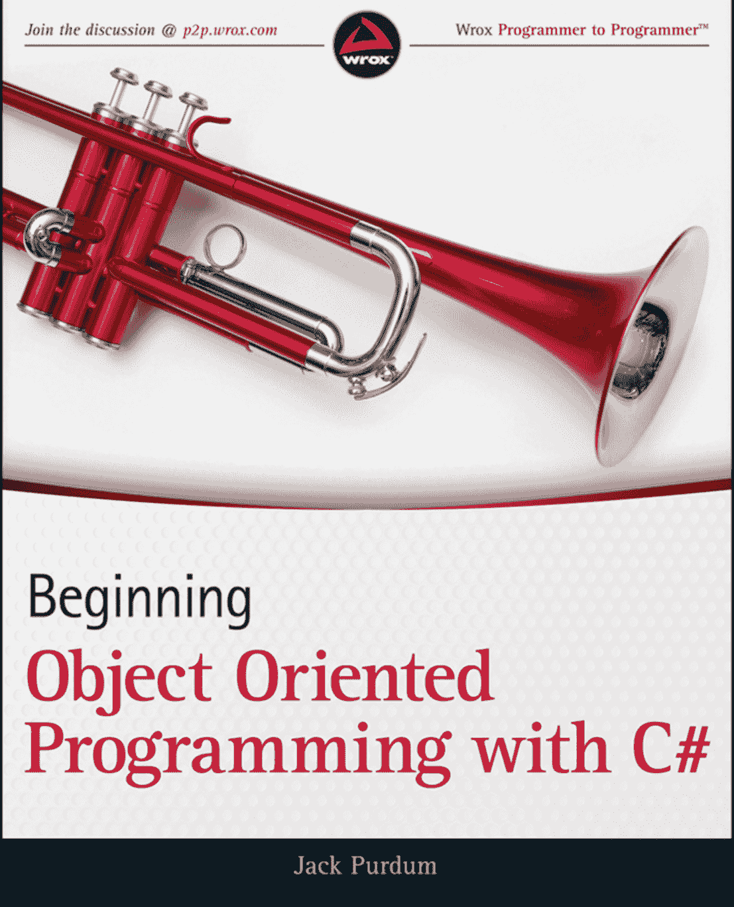

## 开始


致 Jane

## 作者简介


JACK PURDUM 博士于 20 世纪 60 年代在研究生期间在 IBM 360 主机上开始编程生涯。20 世纪 70 年代中期，他对微型计算机开发感兴趣，并于 1977 年了自己的公司（Ecosoft, Inc.）。公司的主要产品是一个统计软件包（Microstat），他想用名为 C 的新语言对其重写。由于缺乏合适的 C 编译器，Purdum 公司开发了基于 MS-DOS 的 C 编译器和其他编程工具。从那时起一直致力于语言教学。Purdum 博士编写了 17 本著作和编程文章，并获得了多项教学奖。他从普渡大学技术学院退休，目前从事现场培训和嵌入式系统编程。

## 致谢

**主编辑**nRobert Elliott

**制作经理**nTim Tate

**项目编辑**nTom Dinse

**执行副总裁**nRichard Swadley

**技术编辑**nRod Stephens

**执行出版经理**nNeil Edde

**制作编辑**nRebecca Anderson

**副出版**nJim Minatel

**校对**nApostrophe Editing Services

**封面项目协调员**nKatie Crocker

**编辑经理**nMary Beth Wakefield

**校对**nSarah Kaikini, Word One

**自由职业编辑经理**nRosemarie Graham

**索引员**nJohnna VanHoose

**市场总监**nDavid Mayhew

**封面设计师**nLeandra Young

**封面图片**n© Vladislav Lebedinski / iStockPhoto

**业务经理**nAmy Knies

任何一本书的编写都不是在没有他人的巨大努力下完成的。Tom Dinse 和 Wrox 的编辑团队都让这本书变得更加出色。

许多人以各种方式对本书做出了贡献，从鼓励到示例构思无一不包。首先，感谢我的学生们，他们为本文使用的几乎每项内容都充当了“小白鼠”。其他做出贡献的人还包括 Jerry 和 Barb Forro、Bill Gromer、Joe Kack、Katie Mohr、John Purdum 和 John Strack。特别感谢 Jane Holcer，她在撰写这本书过程中提供的坚定不移的支持和鼓励。

- 字符串和转义字符 846
- 字符串和转义字符 847
- 字符串和转义字符 848
- 字符串和转义字符 849
- 字符串和转义字符 850
- 字符串和转义字符 851
- 字符串和转义字符 852
- 字符串和转义字符 853
- 字符串和转义字符 854
- 字符串和转义字符 855
- 字符串和转义字符 856
- 字符串和转义字符 857
- 字符串和转义字符 858
- 字符串和转义字符 859
- 字符串和转义字符 860
- 字符串和转义字符 861
- 字符串和转义字符 862
- 字符串和转义字符 863
- 字符串和转义字符 864
- 字符串和转义字符 865
- 字符串和转义字符 866
- 字符串和转义字符 867
- 字符串和转义字符 868
- 字符串和转义字符 869
- 字符串和转义字符 870
- 字符串和转义字符 871
- 字符串和转义字符 872
- 字符串和转义字符 873
- 字符串和转义字符 874
- 字符串和转义字符 875
- 字符串和转义字符 876
- 字符串和转义字符 877
- 字符串和转义字符 878
- 字符串和转义字符 879
- 字符串和转义字符 880
- 字符串和转义字符 881
- 字符串和转义字符 882
- 字符串和转义字符 883
- 字符串和转义字符 884
- 字符串和转义字符 885
- 字符串和转义字符 886
- 字符串和转义字符 887
- 字符串和转义字符 888
- 字符串和转义字符 889
- 字符串和转义字符 890
- 字符串和转义字符 891
- 字符串和转义字符 892
- 字符串和转义字符 893
- 字符串和转义字符 894
- 字符串和转义字符 895
- 字符串和转义字符 896
- 字符串和转义字符 897
- 字符串和转义字符 898
- 字符串和转义字符 899
- 字符串和转义字符 900
- 字符串和转义字符 901
- 字符串和转义字符 902
- 字符串和转义字符 903
- 字符串和转义字符 904
- 字符串和转义字符 905
- 字符串和转义字符 906
- 字符串和转义字符 907
- 字符串和转义字符 908
- 字符串和转义字符 909
- 字符串和转义字符 910
- 字符串和转义字符 911
- 字符串和转义字符 912
- 字符串和转义字符 913
- 字符串和转义字符 914
- 字符串和转义字符 915
- 字符串和转义字符 916
- 字符串和转义字符 917
- 字符串和转义字符 918
- 字符串和转义字符 919
- 字符串和转义字符 920
- 字符串和转义字符 921
- 字符串和转义字符 922
- 字符串和转义字符 923
- 字符串和转义字符 924
- 字符串和转义字符 925
- 字符串和转义字符 926
- 字符串和转义字符 927
- 字符串和转义字符 928
- 字符串和转义字符 929
- 字符串和转义字符 930
- 字符串和转义字符 931
- 字符串和转义字符 932
- 字符串和转义字符 933
- 字符串和转义字符 934
- 字符串和转义字符 935
- 字符串和转义字符 936
- 字符串和转义字符 937
- 字符串和转义字符 938
- 字符串和转义字符 939
- 字符串和转义字符 940
- 字符串和转义字符 941
- 字符串和转义字符 942
- 字符串和转义字符 943
- 字符串和转义字符 944
- 字符串和转义字符 945
- 字符串和转义字符 946
- 字符串和转义字符 947
- 字符串和转义字符 948
- 字符串和转义字符 949
- 字符串和转义字符 950
- 字符串和转义字符 951
- 字符串和转义字符 952
- 字符串和转义字符 953
- 字符串和转义字符 954
- 字符串和转义字符 955
- 字符串和转义字符 956
- 字符串和转义字符 957
- 字符串和转义字符 958
- 字符串和转义字符 959
- 字符串和转义字符 960
- 字符串和转义字符 961
- 字符串和转义字符 962
- 字符串和转义字符 963
- 字符串和转义字符 964
- 字符串和转义字符 965
- 字符串和转义字符 966
- 字符串和转义字符 967
- 字符串和转义字符 968
- 字符串和转义字符 969
- 字符串和转义字符 970
- 字符串和转义字符 971
- 字符串和转义字符 972
- 字符串和转义字符 973
- 字符串和转义字符 974
- 字符串和转义字符 975
- 字符串和转义字符 976
- 字符串和转义字符 977
- 字符串和转义字符 978
- 字符串和转义字符 979
- 字符串和转义字符 980
- 字符串和转义字符 981
- 字符串和转义字符 982
- 字符串和转义字符 983
- 字符串和转义字符 984
- 字符串和转义字符 985
- 字符串和转义字符 986
- 字符串和转义字符 987
- 字符串和转义字符 988
- 字符串和转义字符 989
- 字符串和转义字符 990
- 字符串和转义字符 991
- 字符串和转义字符 992
- 字符串和转义字符 993
- 字符串和转义字符 994
- 字符串和转义字符 995
- 字符串和转义字符 996
- 字符串和转义字符 997
- 字符串和转义字符 998
- 字符串和转义字符 999

## 目录

- 类常量与属性 268
- 类方法 269
- `clsCardDeck` 代码 273
- 类属性、构造函数与属性方法 275
- 类通用方法 276

## 使用 `clsCardDeck` 设计卡牌游戏 278

- 设计考量 279
- 什么样的架构？ 279
- 侧向细化 280

## 总结 291

## 第 11 章：异常处理与调试 295

## 概述 296

- 漏洞 296
- 语法错误 296
- 语义错误 296
- 逻辑错误 297

## 输入错误 297

- 数据验证 297
- 限制用户输入 298
- 复选框 301
- 组合框 302
- 日期和时间输入 304

## 异常处理 306

- `try-catch` 语句块 308
- 预判特定异常 310
- 模糊的异常消息 312
- `finally` 语句块 313

## 程序调试 314

- “恶龙”的本质 314
- 检测 314
- 隔离 316
- Visual Studio 调试器 316
- 本地窗口 317
- 立即窗口 318
- 单步执行程序 318
- 从断点恢复 319
- 调试工具栏 319
- 寻找漏洞 320
- 脚手架代码 321
- 切换脚手架代码 322

## 防性编程

### 总结

## 第 12 章：泛型

## 什么是泛型？

- 递归
- 数据问题

## 泛型简介

- 泛型对比 `ArrayList`
- 装箱与拆箱

## 泛型快速排序

- 带约束和接口使用泛型
- 接口
- 为什么使用接口？
- 使用接口
- 如何判断数据类型是否实现了某个接口？

### 总结

## 第四部分：存储数据

## 第 13 章：使用磁盘数据文件

## 目录

- `DriveInfo` 类
- `Directory` 类
- `DirectoryInfo` 类

## `File` 类

## `FileInfo` 类

## 文件类型

- 文本数据文件与二进制数据文件

## 顺序访问与随机访问文件

- 顺序文件
- 顺序文件的优缺点

## 随机访问文件

- 固定记录大小
- 随机访问文件的优缺点

## 序列化与反序列化

- 要序列化还是不序列化？

## MDI、菜单与文件对话框

### 总结

## 第 14 章：使用数据库 425

## 什么是数据库？ 425

- 数据库的结构 426
- 数据库表、字段和记录 426
- 为数据库表设计字段 427
- 数据规范化 428

## 创建自己的数据库 432

- 使用 SQL Server 管理系统 432

## 使用 SQL 435

- `SELECT` 语句 435
- `WHERE` 谓词 436
- `ORDER BY` 子句 436
- 聚合函数 437

## DBMS 系统 438

- 不使用数据绑定的数据库数据显示 451
- 执行查询 452
- 编辑记录 (`UPDATE`) 454

## 总结 456

## 第 15 章：使用 LINQ 459

## 使用 LINQ 459

- 查询关键字 460

## 总结 470

## 第五部分：高级主题

## 第 16 章：继承与多态 475

## 什么是继承？ 476

- 基类示例 476
- 派生类 478
- `protected` 访问修饰符 479
- 继承关系的优点 480
- 派生类 491
- 抽象类 491

## 多态 492

- 泛型 495
- 扩展方法 495

## 总结 498

## 第 17 章：打印与线程 501

## 打印 501

- 静态 509
- 动态 515
- 线程 516

## 总结 520

## 第 18 章：网络编程 523

## 网络编程 523

- 线程 530
- 重构 535

## 总结 537

## 附录：练习答案 577

### 引言

### 本书的读者

### 本书内容

### 引言

### 本书的结构

本书的章节顺序逻辑合理，每一章都围绕前几章节所包含的信息进行构建。虽然你可以跳着读，但这会影响你的学习体验。我有自己独特解释问题的方法，其中有些可能与众寻常……但它们行之有效。

每一章的末尾都有几个问题和练习题。我们鼓励你在进入下一章之前完成这些示例。正如前面提到的，你只有通过编写程序才能学习编程。阅读代码并对自己说：“是的，我懂了，”这很容易让你陷入一种虚假的安全感中。也许吧……也许可能不是。编写自己的程序是确定你是否真正掌握的唯一方法。

### 使用本书所需的准备工作

书中的所有示例都是使用 Visual Studio 2012 和 C# 编写的。在我编写这些材料时，Windows 8 已经可以下载 C# Express。然而，其他版本的 Windows 对应 Visual Studio Professional。虽然 Visual Studio Professional 有有限的试用期，但这段时间足够你完成这本书的内容了。当你读完这本书时，你可能已经想购买 Visual Studio 了。

第 1 章“介绍 C#”中的指令将告诉你如何从微软免费下载并安装 Visual Studio Professional 和 C#。如果你想下载 Visual Studio 的 Express 版本，它是一个非常出色的软件，具有完整版 Visual Studio 的大部分功能。Express 版缺少了一些注释，但在这里提供它们是为了让你体验 Visual Studio 和 C# 所提供的功能。

你应该使用基于奔腾的系统（尽管 Mac 和 Linux 也有模拟器，而且它们看起来运行良好），并至少拥有 4G 内存和 11G 磁盘空间。如所述，你使用的 Windows 版本可能会影响你想要下载的哪种 Visual Studio 版本。书中的示例兼容 C# 的专业版或 Express 版。满足这些要求后，使用什么种系统取决于你的个人喜好。

示例源代码可以从 Wrox 网站下载：

```
www.wrox.com/remtitle.cgi?isbn=1118336925
```

### 约定

为了帮助你从文本中获得最大收益并跟踪进度，本书全程使用了多种风格约定。以下是本书的风格约定列表。（你还将会看到一些编程约定，这些约定将在文中需要时引入。）

### 尝试一下（TRY OUT）

“尝试”（Try Out）是你应该跟随书中内容完成的练习。

- 1. 通常由一组步骤组成。
- 2. 每一步都有编号。
- 3. 按照你的代码副本执行这些步骤。

### 如何运作

在每个“尝试一下”之后，将对你输入的代码进行详细解释。

> 注意：针对当前讨论的注释、提示、说明、窍门和旁白会缩进并以斜体形式呈现，如此。

关于文中的样式：

- 当我们引入新词和重要词时，会使用*斜体*。
- 我们会这样显示键盘按键：Ctrl+A。
- 我们在文中这样显示文件名、URL 和代码，如：`persistence.properties`。

代码段和列表以这种方式呈现：

对于大多数代码示例，我们使用不带高亮的等宽字体。代码段和列表长度通常超过一行。

### 源代码

在完成书中的示例时，你可以选择输入所有代码，也可以使用随书附的源代码。书中使用的所有源代码都可以在 `www.wrox.com` 下载。

你也可以在 `www.wrox.com` 上通过 ISBN 码（本书的 ISBN 为 978-1-118-33692-2）搜索书籍以找到代码。所有当前 Wrox 书籍的代码下载列表可以在 `www.wrox.com/dynamic/books/download.aspx` 获取。

在每一章的开头，我们提供了书中代码的文件名称。下载代码后，只需使用适用于平台的压缩工具进行解压。

### 错误说明（ERRATA）

我们尽力确保书中没有错误。然而，没有人是完美的。如果你在文本或代码中发现错误，我们将不胜感激。反馈请访问：

```
www.wrox.com/contact.php
```

有关如何使用论坛的更多信息，请务必阅读常见问题解答（FAQs）。如果你希望通过邮件接收特定论坛的邮件，请点击此处的的图标。要加入论坛，请遵循以下步骤：

- 1. 前往 wrox.com 并点击注册（Register）。
- 2. 阅读使用条款并点击同意（Agree）。
- 3. 完成加入所需信息并点击提交（Submit）。
- 4. 你将收到一封说明如何验证账户的电子邮件。

验证账户后，你就可以发布消息了。你可以随时阅读消息。

# 第一部分

# 入门

- 第 1 章：介绍 C#
- 第 2 章：理解对象

## 1

## 介绍 C#

在本章中你将学习：

- 如何下载 Visual Studio
- 如何安装 Visual Studio Professional
- 如何创建项目
- 在 Visual Studio 中开发小型程序
- Studio IDE 中的某些功能
- 运行程序

## 第一章 C# 序言

在之前的程序示例中。如果你体验过书中之前介绍的那些程序，那么理解后面的程序示例将变得更容易。

有一点：你不能仅仅通过阅读关于编程的内容来学习编程。你必须投入其中并开始编程。因此，每章末尾都有练习，旨在帮助你磨练编程技能。如果你尝试根据你想要解决的一些实际问题来创建自己的程序，学习过程会变得更有趣。如果第一次尝试时事情没有立即迎刃而，不要担心。你应该计划犯许多“低级”错误……你知道的，就是那种错误，当你发现它时，你会用手后跟拍击额头说：“我怎么能犯下这么愚蠢的错误！”别担心……我们都经历过。这些错误只是成为程序员的道路的一部分，你应该预见到自己会犯一些错。坚持下去，读完这本书，你会对事情进展得如此之快感到惊讶。事实上，你会发现编程是一项真正有趣的业余爱好。

### 面对象编程 (OOP) 简史


许多人认为 OOP 是 20 世纪 80 年代的产物，是由比雅尼·斯特劳斯特普（Bjarne Stroustrup）通过创建 C++ 语言将 C 语言引入对象世界而创造的世界。实际上，SIMULA 1 (1962) 和 Simula 67 (1967) 是最早的两个面向对象的语言。Simula 语言是由挪威奥斯陆的挪威计算中心的奥莱-约翰·达尔（Ole-John Dahl）和克里斯滕·尼雅加德（Kristen Nygaard）开发的。OOP 的大多数优势在早期的 Simula 语言中就已经具备了，直到 C++ 在 20 世纪 90 年代根根之后，OOP 才开始繁荣。

C 是 C++ 的父语言，人们说 C 强大到可以让你多次“打自己的脚”。而 C++ 不仅强大到可以让你打自己的脚，而且还能毫不费力地炸掉你的整个后脑。大多数程序员承认 C++ 是一门强大的语言，并且在今天仍被广泛使用。然而，这种力量也伴随着大量的复杂性。语言开发者希望为 OOP 开发提供一种更简单、也许复杂度更低的语言。

OOP 开发的下一步始于 1991 年，詹姆斯·高斯林（James Gosling）、比尔·乔（Bill Joy）、帕特里克·诺顿顿（Patrick Naughton）、迈克·谢里登（Mike Sheridan）等人在科罗拉多州的阿斯彭会面，讨论隐形项目（Stealth Project）的想法。该小组想要开发能够从手持设备控制和编程的智能电子设备。他们决定 OOP 是开发语言的正确方向，但觉得 C++ 无法胜任。结果是 Oak 编程语言（以高斯林窗外的一棵橡树命名），它最终演变成了 Java 编程语言。（当团队发现已经存在一种同名的语言时，Oak 必须重命名。）

在万维网力量的推动下，Java 迅速流行起来。在这两种情况下，快速增长并非偶然，因为在网络上运行 Java 程序所需的“核心”已成为各种网页浏览器的不可或缺的一部分。在 Java 增强的功能支持下，网络以光速发展。

对于许多程序员来说，C# 是微软对 Java 的回应。有些人甚至会说，C# 是微软固执拒绝推广它不看好的语言的 result。这种情绪有点太刻薄了。微软开发 C# 有充分的理由，其中最重要的一点是它希望在托管环境中运行类型安全的程序。你现在可能还不理解这意味着什么，但当你学习 C# 时，一切都会变得清晰。

C# 为你提供了一种强健的面向对象的编程语言和一组强大的工具，来应对任何编程任务。无论你想开发桌面、分布式、Web 还是移动应用程序，C# 都能胜任这项任务。

当你熟悉了 C#，你可以体会到它相对少的关键字、语法以及易于使用的开发环境。你会发现在 C# 中编写的程序片段可以在其他程序中重用。最后，你可能会发现，熟悉 C# 的程序员有很多工作机会。

# 安装 C#

如果你已经购买并安装了 Visual Studio 2012 和 C#，可以跳过本节。如果你还没有安装 C#，本节将告诉你如何下载和安装 Visual Studio 版本的 Visual Studio。Visual Studio 是微软免费提供的 C# 的修改版本。（注：原文说“Visual Studio 是 C# 的修改版本”，可能是 OCR 错误，应为“Visual Studio 是 C# 的 IDE”）。

## 创建项目

将光标移动到屏幕左上方，从程序菜单栏中选择文件（File）⊞新建（New）⊞项目（Project）选项，如图1所示所示。

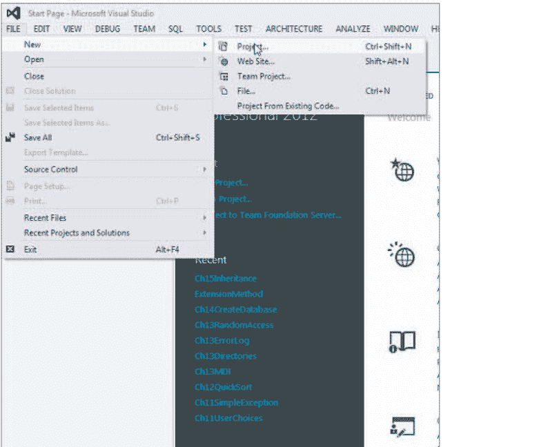

**图 1-6：** 创建新项目

从菜单中选择“新建”（New）。你的程序界面发生了变化，如图 1-7 所示。

图 1-7 显示了若干预定义的项目模板供你选择。确保你已选择了屏幕左侧出现的“模板 Visual C#”窗口选项。这些模板定义了你可以使用 C# 开发的程序类型。根据你的需要，选择“Windows Forms 应用程序”（Windows Forms Application）模板。

当你选择其中一个模板时，Visual Studio 会在你编写某些代码时为你创建该类型的项目。*存根代码（Stub codes）*是 Visual Studio 在后台编写的预定义代码段。从图 1-7 显示的模板中，选择“Windows Forms 应用程序”模板。你应该输入你想要的程序名称。在示例中，我输入了 TemplateProject，并将项目放置在 `C:\Temp` 目录。你可以使用“浏览”（Browse）按钮选择其他目录，或者勾选“为解决方案创建目录”（Create Directory for solution）让 Visual Studio为你创建一个目录。输入要使用的程序名称后点击“确定”。

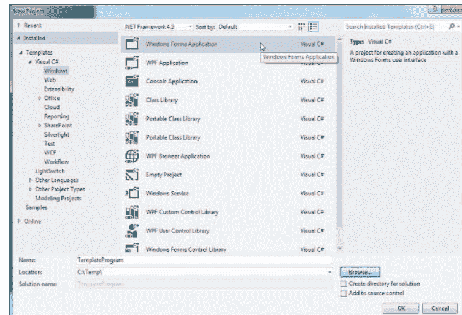

图 1-7：新建项目对话框

## C# 集成开发环境

你应该熟悉屏幕上类似于图 1-8 的界面，在你阅读此本书时，你将在那里花费大量的编程时间。它被称为集成开发环境（Integrated Development Environment，简称 IDE），因为你编写 C# 程序所需的每个编程工具对你来说都是可用的。

在编程的黑暗时代，你必须加载并运行一个程序员程序来编写程序的源代码。接着，你必须关闭编辑器并加载语言编译器程序来检查程序语句的错误。然后，你必须加载一个汇编程序将源代码转换为汇编语言。最后，你必须加载并运行一个链接器程序将程序的所有元素组合成一个可执行程序。Visual Studio IDE 在一个程序中提供了所有这些功能。这使得编写和测试你编写的程序变得简单得多。

### 主要 IDE 窗口

图 1-8 中的 IDE 将屏幕分为三个窗口。左窗口显示 Visual Studio 工具箱（Toolbox），它默认显示 Visual Studio 为你提供的一些对象。如果你仔细观察，会发现工具箱展示了你可以在程序中各种对象，包括文本框（textboxes）、标签（labels）、按钮（buttons）以及其他你在开发程序时会发现有用的控件。

中间窗口被称为“源代码窗口”（Source window），目前显示一个空的 Visual Studio 对象。（微软将该窗口称为“表单设计器窗口”，Forms Designer window）。正如如图 1-8 所示，表单上没有放置任何对象。也就是说，你还没有从工具箱向表单（Form）添加任何对象（如文本框或按钮）。你将在本章稍后的“在 Windows Forms 表单上添加工具箱对象”节节中更改此设置。

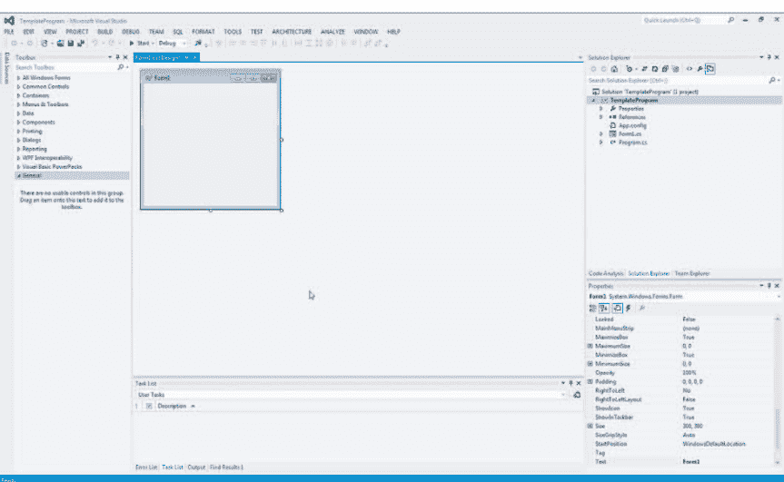

图 1-8：Visual Studio IDE

IDE 的右侧目前显示两个子窗口。上方的子窗口显示“解决方案管理器”（Solution Explorer）。简单来说，解决方案管理器显示了项目当前的开发状态。它显示了项目拥有的表单及其引用，以及后续章节中讨论的其他信息。

解决方案管理器窗口下方是“属性窗口”（Properties window）。属性窗口的目的是向你显示与源代码窗口中当前焦点对象相关的属性。如果你仔细观察图 1-8 中源代码窗口中的表单，你会注意到它边缘有几个小框。这些被称为“缩放框”（sizing boxes），它们的目的是允许你更改它们所附带对象的大小。然而，缩放框还显示了源代码窗口中当前哪个对象正处于 Visual Studio 的关注点或焦点下。源代码窗口中具有焦点的任何对象也是属性窗口显示的对象。在图 1-8 中，属性窗口中显示的属性适用于源代码窗口中显示的表单。Visual Studio 始终维护源代码窗口中的对象与属性窗口中显示的信息之间的这种关系。

### 使用源代码窗口

如果你在解决方案管理器中右键点击 `Form1.cs`，会弹出一个小菜单，你可以在其中选择刚刚右键点击文件的源代码。你可以移动到解决方案管理器栏并点击源代码图标查看代码。正如图 1-9 所示，你可以使用 `F7` 查看文件的源代码。

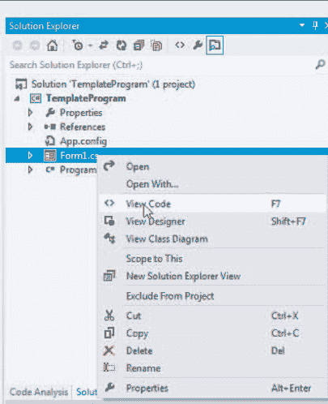

图 1-9 所示，显示文件名。

### 使用 C# 的测试程序

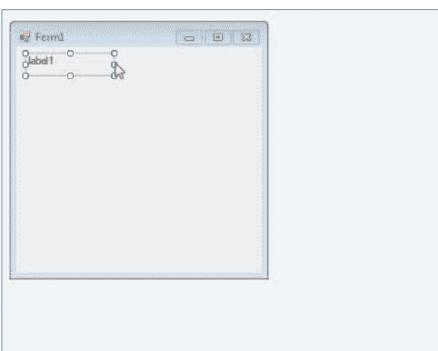

默认情况下，AutoSize 设置为 True，你无法通过 label 对象对文本进行定位；它是自动为你设置的。然而，由于你关闭了自动调整大小，你可以在 label 内部任何位置放置文本。图 1-15 显示了如何使用属性窗口中的 `TextAlign` 属性来实现这一操作。如果你仔细观察图 1-15，你会发现 `TextAlign` 属性当前设置为 `TopLeft`（左上角）。在可以调整大小的 label 中，你有九个位置可以放置文本。当你想要在 label 对象中心居右对齐文本时；观察图 1-15 中光标所在的位置，点击那个框即可使 label 对象中的文本居右对齐。

图 1-13：调整 label 对象的大小

| 属性 | |
|---|---|
| ImageKey | (none)|
| ImageList | (none)|
| Location | 12.9 |
| Locked | False |
| Margin | 3, 0,3,0 |
| MaximumSize | 0 |
| MinimumSize | 0,0 |
| Modifiers | Private |
| Padding | 0, 0,0 |
| RightToLeft | No |
| Size | 100,2 |
| TabIndex | 0 |
| Tag | |
| Text | My first program |
| TextAlign | TopLeft |
| UseCompatibleRendering | False |
| UseMnemonic | True |

图 1-15：更改 label 对象的 TextAlign 属性

图 1-14：更改 label 对象的 Text 属性

- 注意

### 运行程序

这就是你目前为了测试 C# 安装而需要做的一切工作。如果你现在可以运行程序，说明你可能已经正确安装了 C#。运行程序有两种简单的方法。最简单的是按下 `F5` 键。如果这样做，程序将在几秒后出现在屏幕上，你的消息将在 label 对象中居中。

第二种方法是点击运行图标。如果你仔细观察图 1-11，在表单顶部 `DEBUG` 菜单下方，你可以看到 `Start` 字旁边有一个小三角形。（在你的屏幕上，会出现该三角形。）点击那个绿色三角形，程序就会执行。

如果你的程序没有正常运行，并且来自 Visual Studio 内部的错误消息，请返回安装过程的开头，检查你是否正确遵循了每个步骤。在开始重新安装之前，请确保你有足够的可用磁盘空间来存放 Visual Studio。如果你收到来自 Visual Studio 的错误消息，说明你在编码的某个步骤操作有误。只需回到本章“使用 Visual Studio 的测试程序”章节的开头，检查每个步骤以确保你遵循了正确的顺序。

### 总结

在本章中，你学习了面向对象编程在四十多年前是如何的。本章还向你展示了如何下载和安装 Visual Studio 专业版。最后，你编写了一个简单的程序来测试安装情况，以确保执行正确。那么，现在呢？

你可以立即进入下一章开始阅读。这并不是一个好主意。既然你已经有一个运行中的程序，现在是进行一些实验的完美时机。例如，你的程序标题栏中没有任何文本。C# 肯定提供了一个允许你更改标题栏的属性。（提示：它确实提供这样一个属性！）尝试其他一些属性看看它们的作用。例如，更改前景颜色（foreground）属性看看会发生什么。

展望未来，本书每个章节末尾都设置了一系列练习题，你应该在阅读后续章节之前完成这些练习。你会急于进入下一章，但请克制跳过练习的诱惑。它们有助于巩固你在本章中学到的知识。

### 本章学到的知识

| 主题 | 关键点 |
|---|---|
| OOP 历史 | 它是如何在四十多年前开始的 |
| 下载和安装 Visual Studio | 安装过程 |
| 示例程序 | 如何测试安装 |

# 2. 理解对象

本章将学习的内容

- 什么是对象
- 对象意味着什么
- 什么是类
- 如何实例化对象
- 什么是属性
- 什么是方法

本章对应的 WROX 代码

你可以在 `wrox.com/978183392` 下载代码。如果你在读完本章后对这些概念仍然模糊，请重新阅读本章。本章展示了一个在日常情况下使用对象的简单示例。在进入下一章之前，你应该对本章介绍的概念感到熟悉。

### 理解对象

正如你在第一章中所学习的，面向对象编程已经存在四十多年。然而，直到过去二十年，面向对象编程才成为常态而非特例。本章展示了一个如何使用对象的简单示例。

假设你是某家公司的经理，需要招聘某人担任重要职位。在筛选了大量简历后，你选择了一位候选人进行联系并安排面谈。你给她打了电话（假设她的名字叫 Jane），聊了几分钟，以确认她看起来是合适的人选。你（假设你的名字叫 Jack）安排 Jane 飞往你所在地，并说明你们将在机场会面，如图 2-1 所示。

然而，由于你们以前从未见过面，你们开始询问一些问题，以便在机场能认出对方。Jane 说她身高中等，金色头发，她将穿一套黑色西装并提着一个公文包。你描述自己身高 6 英尺，沙色头发，然后你们定好了航班时间，为面试做好了准备。

### 日常使用中的对象

在不知情的情况下，你们在对话过程中都使用了对象。首先，在没有思考的情况下，你在电话通话中隐式地创建了一个人类。类是描述对象的模板。因此，类是对现实世界中观察到的某些对象的抽象或简化。你可以将类分解为两个基本部分：

- 描述对象的属性
- 与对象相关的方法或动作

### 类属性

类属性是你与对象关联并记录的数据。如果你想创建一个类对象（称为 `clsPerson`），属性列表可能如表 2-1 所示。

### 表 2-1: clsPerson 属性

| 属性 |
|---|
| name 名称 |
| height 身高 |
| hairColor 发色 |
| eyeColor 眼色 |
| build 体型 |


| glasses 眼 |

| clothing 服装 |

| shoes 鞋 |

| accessories 配 |

这不是规定，但许多程序员在编写属性名时使用小字母开头，但在属性名中包含的任何单词的首字母使用大写。由于你可能也想遵循这一约定，表 2-1 中的属性名也遵循了这一约定。

在电话通话之前，名为 Jane 的 `clsPerson` 属性列表几乎是空的。你从她的简历中只能填充的是名字（`name`）和性别（`gender`）。然而，在电话通话之后，你填充了名为 Jane 的 `clsPerson` 对象几乎所有的属性。（如果你尝试在电话中让她填写 `Build`（体型）和 `eyeColor`（眼睛颜色）属性，你可能会吓到她，或者面临法律诉讼。）

当你正在填充名为 Jane 的 `clsPerson` 对象时，她正在为名为 Jack 的 `clsPerson` 对象做同样的事情。在通话之前，为与名字 Jack 关联创建的 `clsPerson` 对象可能是空的，因为 Jane 并不知道谁会打电话给她谈工作面试。然而，电话中的对话使双方都能为对方填充至少一些属性值。从 Jane 的角度来看，在接到电话后，她的 `clsPerson` 对象从一个完全没有特征的对象变成（至少）一个部分可识别的对象。

通过更改类属性的值，你可以改变对象的状态。对象的状态由用于描述对象的属性决定。在示例中，用于描述 `clsPerson` 对象状态的属性是表 2-1 所示的属性。在通话之前，表 2-1 所示的属性还没有意义的值。

尽管人们并不经常更改名字，但这种情况偶尔会发生。同样，人们会增加或减轻、染头发、戴彩色隐形眼镜以及更换配件。如果这些任何一个属性值发生变化，对象的状态也会随之改变。只需记住，只要属性值发生变化，根据定义，对象的状态也会随之变化。

显而易见的是，正是属性的值将 Jane `clsPerson` 对象与 Jack `clsPerson` 对象区分开来。也就是说，对象的属性通常具有不同的值。因此也可以得出，对象具有不同的状态。

### 类方法

正如定义对象状态的属性值一样，通常还有作用于属性的类方法。对于一个 `clsPerson` 对象，你希望该对象说话、挥手、走路、换衣服等等。简而言之，类方法决定了对象可以执行的行为或动作。方法用于描述你想要与对象关联的操作。类方法通常用于操作对象中包含的数据。

你可以将 Jane 和 Jack 之间的电话对话描述为人类的对象，如图 2-2 所示。

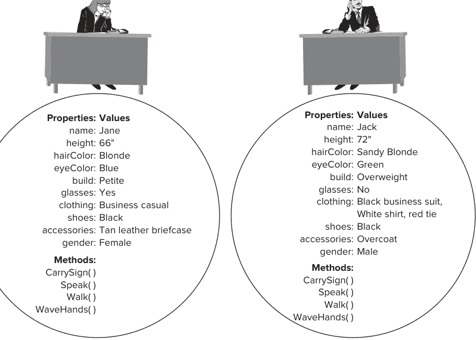

**属性：值**

- name: Jane

- height: 66"

- hairColor: 金黄色

- eyeColor: 蓝色

- build: 娇小

- glasses: 是

- clothing: 商务休闲

- shoes: 黑色

- accessories: 棕色皮革公文包

- gender: 女

**属性：值**

- name: Jack

- height: 72"

- hairColor: 沙金色金发

- eyeColor: 绿色

- build: 超重

- glasses: 否

- clothing: 白色衬衫，红色领带

- shoes: 黑色

- accessories: 大衣

- gender: 男

**方法**

- `CarrySign()`

- `Speak()`

- `Walk()`

- `WaveHands()`

**方法**

- `CarrySign()`

- `Speak()`

- `Walk()`

- `WaveHands()`

Jane 的对象

Jack 的对象

图 2-2：电话通话期间填充属性

通常，类用于处理一个或多个属性值，处理包含的属性，并作为方法的执行结果产生新的数据对象。例如，你可能正在开发一个应用程序，并创建一个具有 `build` 和 `eyeColor` 属性的 `clsPerson` 对象。你可能会创建一个 `salesTax()` 方法作为类方法来计算税费。你可能有一个名为 `salesTax` 的属性，它是 `salesTax()` 代码的一部分自动填充的。

在你看来，属性可以被看作名词，而方法通常被看作动词。

### 有多少属性，有多少方法？

通常，类用于处理一个或多个属性值，处理包含的属性，并作为方法的执行结果产生新的数据对象。例如，你可能正在开发一个应用程序，并创建一个具有 `build` 和 `eyeColor` 属性的 `clsPerson` 对象。你可能会创建一个 `salesTax()` 方法作为类方法来计算税费。你可能有一个名为 `salesTax` 的属性，它是 `salesTax()` 代码的一部分自动填充的。

在你看来，属性可以被看作名词，而方法通常被看作动词。

### 类是简化

通常，类用于处理一个或多个属性值，处理包含的属性，并作为方法的执行结果产生新的数据对象。例如，你可能正在开发一个应用程序，并创建一个具有 `build` 和 `eyeColor` 属性的 `clsPerson` 对象。你可能会创建一个 `salesTax()` 方法作为类方法来计算税费。你可能有一个名为 `salesTax` 的属性，它是 `salesTax()` 代码的一部分自动填充的。

在你看来，属性可以被看作名词，而方法通常被看作动词。

### Visual Studio 作为一种 IDE

正如第 1 章所述，Visual Studio 是一个集成了众多工具的 IDE。在 IDE 出现之前，程序员有独立的程序来编写代码（编辑器）、编译程序（编译器）、汇编程序（汇编器）以及将程序组合成可执行文件（链接器）。

Visual Studio 的大部分功能来自于 .NET 框架，其中包括所有的“模具”。当你编写代码时，IDE 内部的组件会将你的代码与 .NET 框架的元素结合，生成中间语言（MSIL）。这才是让你的程序运行的关键。

### 定义类后我该做什么？

如前，类是对象的模板。就像饼干模具可以切割特定形状的饼面一样，类被用于划分内存块来存放该类的对象。在你实际使用类创建对象之前，该对象尚不存在。

图 2 显示了类与从该类实例化的对象之间的关系。类被显示为一个菱形的饼干模具。该类名为 `clsDiamond`。你可以认为

`clsDiamond` 的属性中存储着决定饼干模具精确形状的值。另一方面，这些属性的状态使得该类看起来像一个菱形而不是其他形状（例如，心形）。要获得该类的对象，你必须将饼干模具（类模板）压入饼干团（计算机内存）中，以得到真实的饼干（对象）。

### 类模板

### 内存

### 对象

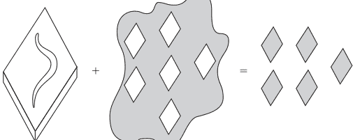

`clsDiamond` 的饼干模具

饼干团

`clsDiamond` 的实例

图 2-3：类模板与类对象的对比

对象也被称为类的实例（instance）。使用类来定义对象的行为称为实例化（instantiation）。

因此，对象是你可以在程序中实际使用的东西。就像你不能吃饼干模具一样，你不能直接使用类。在程序中使用类之前，你必须使用该类实例化该类的对象。

### 对象的命名

在本文中，我采用了一种命名约定，即用特定的字母组合作为某些对象的名称前缀。例如，我使用 `cls` 表示类名，在文本对象名称前加 `txt`，在按钮对象前加 `btn` 等，以此此类推。你在阅读本文时会发现其他例子。这种约定是匈牙利命名法（Hungarian notation）的改进形式，但并非“纯”形式。在极端情况下，整数变量使用 `iHatSize`，字符变量使用 `cletter`，浮点变量使用 `fWage`，数据对象使用 `objObjData`，以及许多类似的变体。极端情况下，有些程序员还会包含作用域标识符，例如 `giHatSize`，它的意思是：“一个名为 HatSize 的全局作用域整数变量”。这种记法失去追随者仅仅是因为它在代码清晰度方面提供的收益不值得付出精力。为什么我仍然继续使用改进版的匈牙利命名法呢？

原因之一是我觉得我们的版本绝对值得这些精力。主要原因是前缀强化了程序中所使用的对象类型。也就是说，你一眼就能看出 `txtName` 是一个文本框，它和 `lblName`（一个标签对象）是不同的类型。

# 第 2 章理解对象

（续）

> 当你输入程序代码时，Visual Studio 会查看你的程序数据。例如，如果你在程序中有三个文本框，且都以 `txt` 为前缀，Visual Studio 知道这些对象，并在你刚输入前缀 `txt` 的瞬间，它就能打开一个小的“预查”窗口。然后你可以在窗口中选择合适的文本框对象，按下 `Tab` 键，Visual Studio 就会为你填全对象的剩余名称。如果你没有给文本框名称加 `txt` 前缀，且除了知道它是一个文本框对象外对该对象（包括它的名称）不记得，那么名称将散落在整个预览窗口中。由于这种预览功能对于程序示例中的对象来说确实是非常节省时间的。如果你觉得这不值得费精力，可以使用你自己的风格。

### 实例化类对象

考虑以下语句：

```
clsPerson myFriend;
```

为了帮助解释这条语句发生了什么，请考虑你计算机系统的简版内存映射，如图 2-4 所示。

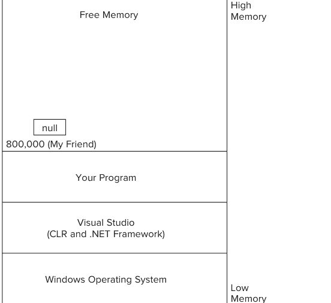

图 2-4：简化的 Windows 内存映射

# 理解对象 27

简单来说，程序语句的意思是：“去饼干模具墙寻找一个名为 `clsPerson` 的饼干模具。找到后，把它从墙上取下来，为它开辟一块内存，并将那块内存标记为 `myFriend`。”结果是：.NET 向 Windows 操作系统请求 4 字节内存，用于存储名为 `myFriend` 变量的引用（内存地址）。

假设 Windows 内存管理器在地址 800000 处找到了 4 字节空闲存储空间。目前，你还没有对该地址的内存进行任何操作，因此当前值为 `null`。（`null` 意味着该变量目前没有存储任何内容。）

你现在拥有的是在地址 800000 处名为 `myFriend` 的饼干模具。

# 第 2 章理解对象

| 空闲内存 | 高内存 |

|---|---|

| myFriend 的数据 900000 | |

| 800000 (my Friend) | |

| Visual Studio (CLR 和 .NET 框架) | |

| Windows 操作系统 | |

图 2-5：实例化后的内存映射

### 我有一个对象……现在该怎么办？

你现在实例化了一个 `clsPerson` 类型的对象。明显的问题是：“该怎么办？”目前，名为 `myFriend` 的对象是空的。实际上，对象中的每个属性都初始化为零、false 或 `null`，取决于属性的类型。表 2-1 中之前的信息还没有填充 `myFriend` 对象。你需要将 `myFriend` 对象更改为包含某些信息的对象。

你可以通过更改内部定义的属性来改变该对象。根据表 2-1，你可能会执行：

```c
myFriend.name = "Jane"
myFriend.gender = "F"
myFriend.height = 66;
myFriend.build = "Petite"
myFriend.hairColor = "Blonde"
myFriend.eyeColor = "Blue"
myFriend.clothing = "Business casual"
myFriend.accessories = "Tan briefcase";
```

观察这些语句。它们将 `myFriend` 对象改变，让你产生某种印象。在这些语句中，等号 (=) 是赋值运算符。赋值运算符获取运算符右侧的信息，并将其复制到运算符左侧的表达式中。这意味着在内存地址 900 附近，该属性已从 `null` 变为 `Jane`。对于 `myFriend` 的其他属性发生了类似的变化。在编程术语中，赋值语句将对象的状态从无名变成了 Jane。

### 语法

注意更改对象状态的语法很重要。编程语言规定了这些规则。使用对象属性的通用语法如下：

```c
objectName.Property
```

注意 `objectName` 和 `Property` 之间的点（.）。出现在对象名和属性（或方法）之间的点被称为点运算符。如果你将对象视为一个包含属性和方法的盒子，那么点运算符就是打开对象门的钥匙，让你进入对象内部访问其属性和方法。在语句中：

```c
myFriend.Name = "Jane"
```

计算机从右到左处理该语句。你可以通过以下序列描述该语句的过程：

- 将 `Jane` 单词放在推车中。
- 前往名为 `myFriend` 的对象。
- 将钥匙（点运算符）插入盒子的门中。
- 打开盒子的门。
- 将你的推车移动到属性上。
- 将 `Jane` 存入属性中。

你可以可视化这些步骤，如图 2-6 所示。

 图2-6：更改属性的值

现在你遵循了这些步骤，与 `myFriend` 关联的对象分配了一个名称。这意味着 `myFriend` 对象从一个没有名称的对象变成了名为 `Jane` 的对象。

对象的操作也可以是“反向”。例如，假设你将 `Jane` 的名称赋值给了变量 `myFriend`。在程序的后面，你想在名为 `txtName` 的文本框中显示她的名字。你可以写：

```c
txtName.Text = myFriend.Name;
```

同样，因为赋值语句从右到左处理，代码导致以下操作：

- 将钥匙（点运算符）插入锁中。
- 打开 `myFriend` 对象的门。
- 将推车移动到 `myFriend` 的属性上。
- 制作一个 `Jane` 的副本。
- 将该副本放入推车中。
- 从对象的盒子中出来（门自动关闭了！）
- 将推车移动到名为 `txtName` 的文本框。
- 将钥匙（点运算符）插入 `txtName` 盒子的锁中。
- 打开 `txtName` 的门。
- 将推车移动到 `txtName` 对象的 `Text` 属性上。
- 将 `Jane` 存入 `Text` 属性中。

你可以可视化这些步骤，如图 2-7 所示。

 **图2-7：** 将属性值复制到另一个变量

这一系列步骤说明了两个重要的概念：

- 在该序列中，你没有更改与 `myFriend` 关联对象的状态。你只是留在对象内部，复制了内容并离开了。由于代码没有更改 `myFriend` 的任何属性（数据），它的状态保持不变。
- 你更改了 `txtName` 对象的状态。这是因为你进入了 `txtName` 对象，并将 `Jane` 的副本赋值给了它的 `Text` 属性。因为 `Text` 属性的数据发生了变化，`txtName` 对象的状态被改变了。

你可以得出两个结论：

- 如果赋值语句出现在赋值运算符的右侧，你只是在读取属性，而不是更改它的状态。
- 如果赋值语句出现在赋值运算符的左侧，你正在更改状态。

# 第 2 章理解对象

### 为什么要隐藏对象内部的数据

通过将数据封装在盒子内部，你可以限制对它们的访问。在对象内部处理数据的过程被称为封装。*封装*是本书中讨论的许多元素之一。

### 开始使用对象

在接下来的实验中，你将使用以下步骤编写一个简单的程序：

### 实验 创建新项目

使用以下步骤创建一个新程序：

- 从“File”（文件）菜单选择“New Project”（新建项目）。
- 选择“C# Empty Project”（空项目）。
- 将程序命名为 `Chapter2Program01`。
- 如果你不想添加单独文件夹，取消勾选“Create Directory for Solution”（创建解决方案）。
- 使用 Project（项目）➡ Add Windows Forms（添加 Windows 表单）向项目添加表单；将其命名为 `frmMain.cs` 并点击“Add”（添加）。

在项目的文本框（图 2-8 盒子底部）中输入你的名字，然后点击“OK”按钮。Visual Studio 会为你创建项目，使用项目的默认位置（如 `C:\Documents\Settings\yourUserName\Local Settings\Application Data\Temporary Projects\ProjectName`）。

现在你在 Solution（解决方案）窗口看到了项目。如果你没有看到解决方案窗口，使用 View（视图）➡ Solution Explorer（解决方案管理器）菜单序列。你也可以通过同时按下 `Ctrl` 和 `W` 键然后按下 `S` 键来显示解决方案管理器。

### 新建项目

 图2-8：创建一个新项目

- 现在使用 Project（项目）➡ Add Windows Form（添加 Windows 表单）菜单序列调用对话框，如图 2-9 所示。为了保持一致性，所有 C# 程序的起点都是一个名为 `Main()` 的方法。虽然这不是 C# 的强制，但这种约定贯穿全文。当你点击“Add”按钮时，源代码窗口的位置会出现一个空表单。这个新窗口被称为表单设计器设计窗口。

## 第二章 理解对象

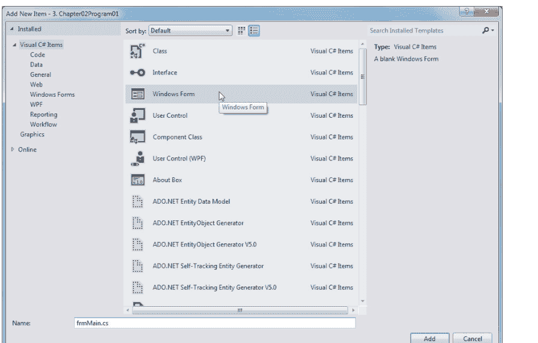

图 2-9：向项目中添加表单

7. 在表单设计器（Form Designer）窗口中，双击空表单，然后删除表单上所有的代码。（删除代码最快的方法是同时按下 `Ctrl` 和 `A` 键（Ctrl-A）。或者，你可以将光标置于代码顶部，左键点击并保持住，向下拖动光标以高亮所有代码。按 Delete 键。）


8. 将列表 2-1 中的代码输入到 `frmMain` 的源代码窗口中。你应该保存此代码的副本，因为书中的几乎每个程序都从 Wx 编辑器开始。在随后的程序中，源代码文件是现成的。但在这种情况下，你需要手动输入代码。使用“文件 > 另存为”菜单选项，将文件保存到桌面并命名为 `C#Template.cs`。在本章中，你将学习如何在新程序中使用该模板。当你保存 `frmMain.cs` 文件时，Visual Studio 也保存了 `frmMain.Designer.cs` 和 `frmMain.resx`。你应该通过右键点击每个文件并按 Delete 菜单选项从设计器中删除它们。

### 列表 2-1：C# frmMain 模板代码

```csharp
using System;
using System.Windows.Forms;

public class frmMain:Form
{
    #region Windows Code

private void InitializeComponent()

{

}

#endregion

public void frmMain()

{

    InitializeComponent();

}

[STAThread]

public static void Main()

{

    frmMain main = new frmMain();

    Application.Run(main);

}
```

9. 从项目中删除 `frmMain.Designer.cs` 文件。你可以通过点击显示器右上角解决方案管理器（Solutions Explorer）窗口中 `frmMain.cs` 前方的小三角形来看到此文件。

10. 选择“项目 > Chapter02Program01 属性”菜单选项，将启动对象（Startup Object）设置为 `frmMain`，并将输出类型（Output Type）设置为 Windows 应用程序（Windows Application）。（该选项出现在菜单底部，允许你在菜单选项指定程序名称）。你的对话框应该类似于图 2-10。

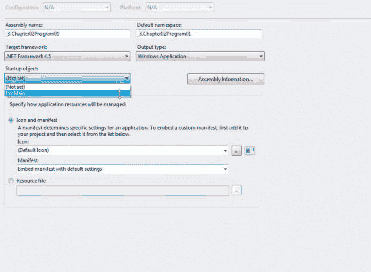

图 2-10：设置项目属性

此时，你实际上可以运行此程序，但它显示的只是一个空表单。尽管如此，你只需要极少的代码就拥有了一个功能完整的 Windows 应用程序。现在，向表单添加一些对象。

双击解决方案管理器窗口中的 `frmMain.cs` 对象。这将导致空表单重新出现在源代码中。现在点击 `frmMain` 表单，使工具箱（Toolbox）窗口出现在屏幕左侧。双击工具箱窗口中的 Label（标签）对象。Visual Studio 会在表单的左上角放置一个标签对象。如果你需要，可以将光标移动到标签上，此时会出现一个“十字星形箭头”。如果你按下并按住鼠标按钮，就可以将标签拖到表单上任何你想要的位置。

### 工作原理

如果你仔细观察图 2-8，你会发现你不应该像在第 1 章中那样选择 Windows Forms 应用程序（列表中的第一个选项）。相反，你应该点击 Visual C# Windows 序列并选择“空项目”（Empty Project）项。你这样做是因为空项目模板会让 Visual Studio 生成的“后台代码”比 Windows 应用程序模板更少。这是一个好消息。坏消息是，空项目模板要求你比通常情况下需要的多做一点工作。

虽然写下 Visual Studio 可以替你写代码看起来可能很愚蠢，但使用空项目模板更符合你的需求。本章（以及后续章节）的目标是教你如何编写面向对象的程序。Visual Studio 已经知道如何做这一点了，而你可能还不会。换句话说，使用空项目让我能够教你如何编写自己的程序。我的哲学是，如果你必须亲自动手，你会学得更多。（另外，如果你正在用它来通过其他语言（如 Java）学习 OOP，这种方法会让学习变得简单一点。）

如果你双击表单上的空白区域，Visual Studio 将从设计视图（Design View）切换到代码视图（Code View）。如果你仔细看，可以通过点击加号 (+) 展开 `#region Windows` 部分并查看代码：

```csharp
this.label = new System.Windows.Forms.Label();
```

此行代码负责使用与你之前看到的类似的语法创建一个名为 `label` 的新标签对象：

```csharp
clsPerson myFunction = new clsPerson();
```

唯一的区别是，该关键字是你的表单标签对象的完全限定名称的简写：`System.Windows.Forms.Label`。换句话说，该语句只是在你的表单上创建一个标签对象。你在那里看到的其他几行是你放置标签的位置以及与标签对象相关的其他头部信息。

现在，点击源代码窗口的 `frmMain.cs [Design]` 标签，使表单重新出现。点击标签对象，注意属性窗口（Properties window）出现在显示器的右下侧。在属性窗口中找到（此处），双击 label 并将其更改为 `Name:`。

```csharp
this.label.Text = "Name:";
```

这意味着什么？因为你更改了表单上的标签，你更改了对象的状态，包括 `frmMain` 对象。因为你放置了表单上的标签，你也更改了对象的状态。因为你放置了表单上的标签，你更改了对象的状态，包括 `frmMain` 对象。

像这样实验是观察各种属性的变化如何影响程序的极佳方法。如果你像大多数初级程序员一样，你可能会有点担心会“弄坏”什么。不用担心。你可能会得到一个外观很丑的表单或者发生其他奇怪的事情，但并不是你无法通过简单地将属性重置为原始值来修复的。出于某种原因，最好“一次只”更改一个属性，这样你就能确定该更改的影响，并且在需要时能够将属性恢复到原始状态。请……尽情在这个简单的程序上实验并享受其中的乐趣吧。

尽管你刚刚编写了一个完整的 Windows 程序，但它只是一个我随手拼凑出来的简单程序。在现实生活中，编程任务很少是这么简单的。

### 制定程序计划

现在运用你所学到的知识，用来设计一个程序。根据需要，你可以留出一些本可以让你的小程序无懈可击的代码，仅仅是因为你还没有学会如何做它。（你很快就会学会如何让程序更加健壮了。）目标是向你展示如何编写程序来解决特定任务。

### 从何开始？程序的五个步骤

毫无疑问，程序员最难弄清楚的问题之一就是从哪里开始写程序。按照一般规律，当我分配一项课堂编程作业时，大多数学生开始程序的第一步是从工具箱将控件拖并放置到表单上。

错误！

不要把“移动”与“解决问题”混淆一谈。如果你在没有连贯计划的情况下到处拖放对象，那么你将面临一些意想不到的失望。不可避免地，你将不得不回溯重来，并为手头的任务制定攻击计划，所以你不如从一开始就从计划开始。

事实上，要编写出良好的程序，你必须有一个计划。计划的核心是算法。*算法*（algorithm）是一个关于你想要如何解决当前编程任务的步进式配方或计划。开始程序计划的好地方是程序的五个步骤。

### 程序的五个步骤

从广义上来说，可以用五个步骤描述所有的编程问题。

### 第 1 步：初始化 (Initialization)

初始化涉及在用户在屏幕上看到任何显示之前完成的那些。例如，某些程序会“记住”你用程序处理过的最后四个五个文件，并将文件名添加到“文件”菜单的末尾。Microsoft Word、Excel、PowerPoint、Visual Studio 以及其他程序都以某种方式这样做。显然，这些程序必须在程序显示“文件”菜单之前从某处读取这些信息。

同样，程序可能在用户在屏幕上看到任何内容之前建立网络连接、初始化打印机、连接数据库、读取传感器或执行各种其他活动。所有这些活动都归类在初始化步骤中。

简单来说：

- 初始化步骤负责建立程序将运行的环境。
- 初始化步骤的活动发生在用户在屏幕上看到任何内容之前。

### 第 2 步：输入 (Input)

如果你仔细考虑，所有的程序都会接收某种输入到程序中，以某种方式对其进行处理，并显示从原始输入派生出的数据的变体。因此，输入步骤关注如何将这些输入获取到程序中

大多数时候，你认为程序输入来自键盘或鼠标。然而，输入可以来自许多其他源，火灾或烟雾报警传感器、来自数据库的信息或许多其他输入设备。示例包括引擎传感器、条形码器、视网膜扫描仪、网络连接等。然而，输入步骤的重要方面是，数据以形式的形式被程序收集。

验证输入始终是一个良好的做法。用户在输入数据时确实会出错，网络连接有时会发生奇怪的事情，源可能会被锁定，在数据处理过程中会发生意外情况。你将在后面的章节中学习更多关于验证的内容。现在，我假设用户是正确的，永远不会打字错误，而且所有硬件都在完美工作！（这个假设允许你专注于程序中所用对象的本质。）

### 第 3 步：处理 (Process)

这是在这一步中，你获取程序输入并以某种方式对其进行处理。你可能会对它们执行某种数学运算，或者输入可能是客户的名称和账户，而这一步读取数据库以计算要发送给客户的账单。在喷气式飞机中，输入可能是当前的空速和 GPS 坐标，以计算飞机何时将在特定机场降落。在所有情况下，处理步骤都涉及获取输入、对其执行操作并产生某些结果或输出。

“获取输入并对其执行操作”是什么意思？这个句子片段应该在你的脑海中引起某种联。你如何称呼改变对象数据并对其进行操作的东西？对……方法（methods）！因此，处理步骤通常使用类方法来转换输入步骤提供的数据。嗯？难道处理步骤中使用的数据可能由类的属性提供吗？

你必须记住，可以使用多种方法来获取输入、处理它们并产生相同的答案。就像你可以找到多种从纽约飞到洛杉矶的方法（如直飞，或经由芝加哥、丹佛或休斯顿），结果是一样的：你最终到达洛杉矶。同样，你可以使用不同的算法将输入引入程序，以不同的方式处理，但生成相同的结果。例如，有几十种不同的算法可以使用计算机排序数据。然而，正如你将在后续章节中看到的，某些算法比其他算法更高效。始终对完成任务的新方法保持开放。

### 第 4 步：显示 (Display)

显示负责显示处理步骤产生的结果。通常，这意味着在屏幕上显示结果，但也存在其他选择。也许它意味着跳过显示，简单地为客户打印一份账单。或者程序负责更新客户记录。显示步骤并不总是导致“看到”一个结果。关键在于你使用输入产生了某种新东西，并且你想保存该结果。然而，对于你使用此书编写的大多数程序，显示步骤确实会向用户显示信息。

### 第 5 步：终止 (Termination)

终止步骤并不意味着你结束程序。它也意味着在程序结束后进行“清理”。例如，如果初始化步骤设置了程序中的最新文件并附加到“文件”菜单，那么这一步需要更新这些文件以反映用户在当前会话期间所做的。如果初始化步骤设置了打印机或数据库连接，这一步应该关闭连接。

通常情况下，初始化步骤中做的任何工作在终止步骤中被“撤销”。最后，终止步骤应该提供一个程序的无缝退出，即使在程序运行期间发生了错误。（你将在第 11 章中学习更多关于错误状况的内容）。

## 2 理解对象

### 使用对象创建简单应用程序

现在使用你学过的五个步骤来设计并编写一个程序。该程序的目标是获取用户的信息，然后将其显示为邮件标签的形式。虽然你实际上还没有对这些信息做任何事情，在你掌握了更多的 C# 编程之后，你可以将此程序作为更大编程任务的输入过程，例如创建客户账户或编写自己的个人邮件列表。

### 2: 输入

在这一步，你必须问自己：“为了解决手头的程序任务，我需要哪些信息？”因为你想像邮件标签一样排列用户信息，你需要知道用户的：

- 姓名
- 街道地址
- 城市
- 州（省）
- 邮编（或邮政编码）

你可以将代码写入程序中，并将每项数据中的值硬编码（hard-code）到程序里。当你将一个值硬编码进去时，意味着你创建了一个作为程序本身永久一部分的值。如果你为这个程序硬编码数据，你编写的程序代码将把用户的姓名和地址作为数据直接嵌入程序中。然而，直接将值硬编码到程序中会使程序比其他情况下缺乏灵活性。例如，每当你为某个用户生成邮件标签时，你都需要在显示信息之前向程序中写入新的数据值。这可不妙了。

一种更灵活的方法是在程序运行时向用户询问必要的信息，并在他们完成后以邮件标签的形式显示这些信息。获取信息后，你可以对数据进行排列并显示在屏幕上。收集这种信息最简单的方法是针对你想要收集的每项信息（或输入）使用标签（label）和文本框（textbox）对象。当用户确认已输入了所需的信息后，他们可以点击按钮以邮件标签的形式显示信息。

### 为输入步骤设计程序的用户界面

在这个程序中，你决定使用标签和文本框来收集用户的信息。标签有助于告知用户你正在请求的数据，而文本框为他们提供了输入内容的手段。这些标签和文本框就成了你程序的用户界面。程序的用户界面简单指的是程序如何与运行程序的用户进行交互。在这个程序中，用户界面由排列在表单上的标签、文本框和按钮组成。

关于如何设计良好的用户界面，已经有很多著作讨论了。尽管本章无法详尽探讨界面设计这一主题，但请考虑以下指南：

- 遵循 KISS（保持简单，简单到愚蠢）原则。这意味着你应该让界面尽可能简单，同时以最少的错误发生率收集你需要的信息。如果某些对象对程序功能没有贡献，请克制添加它们的对象的冲动。
- 使用熟悉的界面。例如，在程序中，你向用户索要地址信息。用户很有可能填过拆封杂志订阅表，或者填过要求地址信息的驾照申请表。尝试用他们可能已经熟悉的方式设计你的界面，或者尽力让陌生的界面变得易理解。

## 第 2 章 理解对象

用户界面具有一种自然的流向。在 Windows 程序中，Tab 键用于从一个输入字段跳转到下一个。如果让用户输入姓名，在按下 Tab 键后跳转到邮编字段让他们输入值，然后跳回地址字段，这是没有意义的。如果程序从姓名字段跳转到地址字段，再到城市、州，以此类推，这种流向会更有逻辑。同样，英语使用者从上到下右阅读，中文读者从上到下左阅读。因此，语言和文化因素会影响用户界面的流向。简单来说，用户界面的流向应该是直观且符合用户的。

不要在程序中使用 GFW。Gee-Whi Factor（惊叹因素）指的是你可能做的任何用户界面更改，这些改变除了告诉用户“哇！”之外没有其他任何目的。初级程序员经常更改标签和文本框的背景颜色、将字体颜色从黑色改为紫色，并进行其他对用户界面没有额外用处的改变，除了向他们展示如何进行更改之外。然而，事实是，微软可能已经花费了更多的资金来研究和测试你一生中可能创建的对象的颜色、形状和其他默认值。因此，没有理由不接受这些研究成果。

始终记住，用户界面的目标是让用户能够轻松运行你的程序。尝试从用户的角度让用户界面变得直观且简单。

### 3: 处理

在这一步中，你设计产生程序预期结果的算法。你程序的预期结果简单来说就是邮件标签格式显示用户信息。输入步骤通过你设计的用户界面为你提供所需的信息。因此，要真正开始“处理”步骤，你需要一个按钮（例如“显示”按钮），以便程序知道所有输入数据都已输入，并可以开始处理手头的任务。

### 事件驱动程序

Windows 程序是事件驱动的。事件驱动程序意味着某些代理（如用户）必须生成某种类型的事件，程序才能执行下一个任务。例如，如果用户不以某种方式与程序交互，程序将顺从地等待直到他们操作。在你的程序中，用户必须点击“显示”按钮来触发与“处理”步骤相关的事件。

人类活动是触发 Windows 事件的唯一方式。例如，程序可以持续监控一天的时间，当到达特定时间时，程序触发一个事件来执行某种操作。火灾传感器可能在那里监测多年火灾而从不触发任何事件。当火灾传感器确实触发报警时，喷淋头开启，并发送自动电话。对于你将编写的大多数程序，用户通过提供活动（例如鼠标点击或击键）来触发事件。你的程序处理步骤简单是将用户输入的信息以标签的形式排列。点击按钮触发处理步骤，并通知程序所有数据已输入并可以可以使用。（假设用户在所有数据输入之前触发了事件。）

### 4: 显示

在这个程序中，你只需以邮件标签的形式显示用户和地址信息。

### 5: 终止

由于你在初始化步骤没有编写任何复杂的代码，因此你不需要任何操作来优雅地结束程序。相反，你只需要一个按钮对象（如“退出”按钮），用户点击它可以结束程序。

现在你有了计划。规划不需要你进行编程。然而，跳过这一过程是资深程序员也会犯错误。现在，你只需要实现你的计划。

### 使用 C# 实现你的计划

现在你有了计划，你需要编写代码来解决你的任务。你将通过结合 Visual Studio 和 .NET 提供的对象以及你的 C# 程序逻辑来实现。

## 第 2 章理解对象

### 尝试：创建一个新的 C# 项目 (Chapter02Program01.zip)

你的第一个任务是为邮件标签问题创建一个新的 C# 项目。

- 1. 使用本章稍后讨论的 `File -> New Project -> Visual C# Windows` 菜单序列（参见图 2-8）。
- 2. 为你的项目添加引用。使用 `Project -> Add Reference` 序列显示 `Add Reference` 对话框。点击 `Assemblies -> Framework` 选项以获取可用的程序集列表。图 2-11 显示了 `Add Reference` 对话框的外观。图中图中组装了 `system` 程序集，它是所有 Windows 系统引用的基础，它为你的程序引入了所有处理 Windows Forms 对象的类。点击按钮将它们添加到你的项目中。

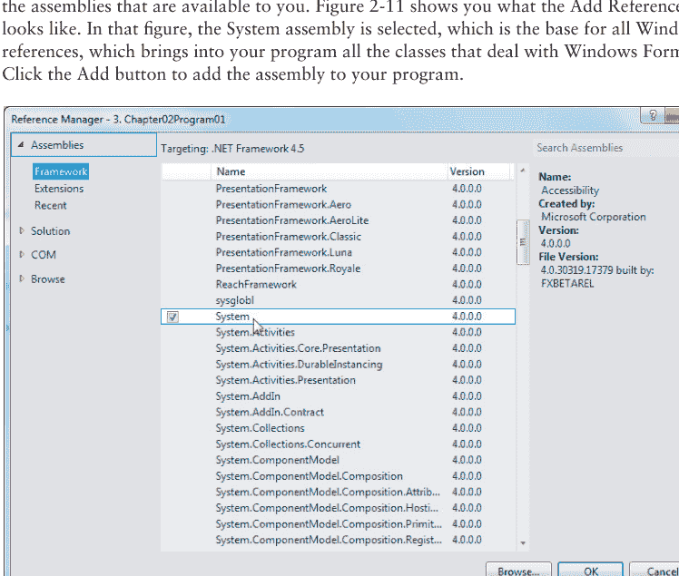

图 2-11：选择程序引用

你可以通过简单点击想要包含在项目中的每个引用复选框，从列表中选择额外的引用。你需要的引用是：

- `System`
- `System.Drawing`
- `System.Windows.Forms`

你编写的几乎每个项目都需要这三个引用。

选择这三个引用后，点击 `OK` 按钮。你应该在解决方案管理器（Solution Explorer）窗口的 `References` 标题下看到选中的引用。如果你没有看到所有三个引用，返回 `Add Reference` 对话框并选择缺失的引用。


### 3. 向项目添加项

你现在需要创建一个表单对象，它将承载你想在项目中使用的（标签、文本框和其他）对象。使用 `Add New Item` 显示 `Add New Item` 对话框。（你可能需要向下滚动对话框列表以找到 `Code File`）。图 2-12 显示了此对话框。

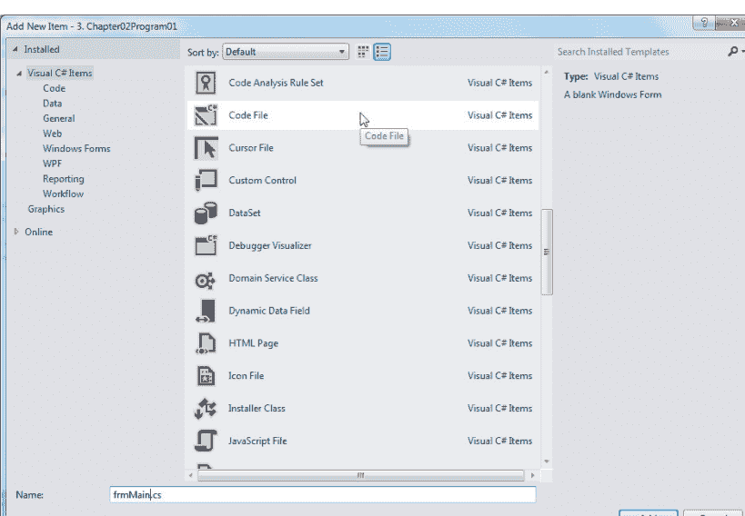

图 2-12：向项目添加代码文件

向下滚动模板单元列表，直到你从可用模板列表中看到 `Code File`，并在对话框底部的 `Name` 文本框中输入 `frmMain.cs`，如图 2-12 所示。点击 `Add` 按钮。（“cs”次级文件名向 Visual Studio 标识该文件为 C# 源文件。）你现在应该可以在解决方案管理器中看到 `frmMain`。此外，源窗口（Source Window）现在在顶部有一个标记为 `frmMain.cs [Design]` 的新标签。此时，源窗口显示的是一个空表单。

如果你双击空表单，将创建一个名为 `frmMain.cs` 的新标签，你可以看到 Visual Studio 为你创建的一些代码。高亮你看到的所有代码，并按 `Delete` 键以从表单中删除代码。（高亮代码最快的方法是 `Ctrl-A`，如前所述。）

向 `frmMain` 对象中添加代码。你在阅读此本书时创建的几乎每个程序都以完全相同的程序语句开头。这些程序语句与本章稍早时候代码段 `Listing 2-1` 中的语句完全相同。如果你按照建议在 C# 模板中保存了这些语句，只需将代码行剪切并粘贴到 `frmMain.cs` 的源窗口中。

#### 设置项目属性

你现在应该设置控制程序执行环境的属性。选择 `Project -> 02Program01` 菜单序列。该对话框就是在图 2-10 中看到的那个。

由于你希望你的程序作为 Windows 应用程序运行，请在 `Output Type` 选项中选择 `Windows Application`。将 `Startup Object` 设置为包含应用程序 `Main()` 方法的对象。如第 1 节所述，每个 C# 程序都必须有一个 `Main()` 方法，因为它是开始执行程序的程序入口。如你在图 2-11 所示，包含 `Main()` 方法的是 `frmMain` 对象。从启动对象列表中选择 `frmMain`。

#### 删除代码

由于你可以控制代码而不是依赖 Visual Studio，你可以删除 `frmMain.Designer.cs` 源文件。你可以通过将光标移动到解决方案管理器并点击 `frmMain.cs` 文件前面的小三角形来找到它。右键点击 `frmMain.Designer.cs` 文件名，并选择 `Delete`。

在解决方案管理器中，右键点击 `frmMain.cs` 文件，将看到一个选项列表，如图 13 所示。点击 `View` 选项。这会导致表单重新出现在源窗口中，如图 14 所示。

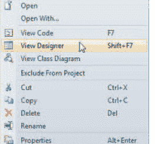

图 2-13：选择设计器

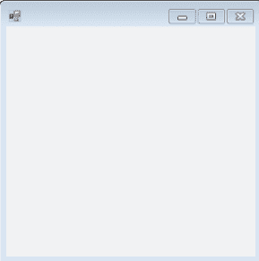

图 2-14：设计器

我们现在准备好向表单添加对象了。向 `frmMain` 对象中添加对象。你在阅读此本书时创建的几乎每个程序都以完全相同的程序语句开头。这些程序语句与本章稍早时候代码段 `Listing 2-1` 中的语句完全相同。如果你按照建议在 C# 模板中保存了这些语句，只需将代码行剪切并粘贴到 `frmMain.cs` 的源窗口中。

选择这三个引用后，点击 `OK` 按钮。你应该在解决方案管理器窗口的 `References` 标题下看到选中的引用。如果你没有看到所有三个引用，返回 `Add Reference` 对话框并选择缺失的引用。

### 第 2 章 理解对象

**表 2-2：对象及其属性**

| 对象名称 | 属性名称 | 属性值 |
| :--- | :--- | :--- |
| `frmMain` | `Text` | Mailing Label |
| | `StartPosition` | CenterScreen |
| `label1` | `Text` | Name: |
| | `AutoSize` | False |
| | `BorderStyle` | 3D |
| | `Size` | 75, 20 |
| `label2` | `Text` | Address: |
| | `AutoSize` | False |
| | `BorderStyle` | 3D |
| | `Size` | 75, 20 |
| `label3` | `Text` | City: |
| | `AutoSize` | False |
| | `BorderStyle` | 3D |
| | `Size` | 75, 20 |
| `label4` | `Text` | State: |
| | `AutoSize` | False |
| | `BorderStyle` | 3D |
| | `Size` | 75, 20 |
| `label5` | `Text` | ZIP: |
| | `AutoSize` | False |
| | `BorderStyle` | 3D |
| | `Size` | 75, 20 |
| `txtName` | `ReadOnly` | True |
| | `MultiLine` | True |
| `txtAddress` | `ReadOnly` | True |
| | `MultiLine` | True |
| `txtCity` | `ReadOnly` | True |
| | `MultiLine` | True |
| `txtState` | `ReadOnly` | True |
| | `MultiLine` | True |
| `txtZip` | `ReadOnly` | True |
| | `MultiLine` | True |
| `btnDisplayOutput` | `Text` | &Display |
| `btnExit` | `Text` | &Exit |

到为止，你还没有指定表单上对象（例如按钮、文本框和标签）的大小。但是，当你完成向表单添加对象并设置它们的属性值后，你的表单应该类似于图 2-15 所示。你可以通过它们的调整大小来调整对象的大小。（当你点击一个对象且该对象可以调整大小时，会出现缩放框）

#### 8. 为处理步骤添加代码

当用户运行你的程序时，她预计将填写各种文本框并点击显示按钮。按钮点击产生一个事件消息，导致代码触发 `btnDisplayOutput` 点击事件的执行。在源窗口中可见的情况下，双击“显示”按钮。记住，双击按钮对象会导致 Visual Studio 生成点击事件的存根代码。在这种情况下，存根代码如下：

```csharp
{
    private void btnDisplayOutput_Click(object sender, EventArgs e)
}
```

你的任务是在圆括号之间填写必要的代码，以使程序完成其任务。现在将以下程序代码添加到 `btnDisplayOutput` 点击事件存根中，使其看起来如下：

# 使用 C# 实现你的程序计划 | 49

```csharp
private void btnDisplayOutput_Click(object sender, EventArgs e)
{
    String buffer;
    buffer = "Mailing Label:*" + Environment.NewLine +
           Environment.NewLine;
    buffer = buffer + " Name:" + txtName.Text +
           Environment.NewLine;
    buffer = buffer + " Address:" + txtAddress.Text +
           Environment.NewLine;
    buffer = buffer + " City:" + txtCity.Text + "  State:" + txtState.Text + "  Zip:" + txtZip.Text;
    txtDisplayOutput.Text = buffer;
}
```

在代码中，某些元素在显示之前用空格进行了“填充”（例如，“Name:”）。这是为了让内容在显示时能够对齐得更漂亮。现在运行程序并在文本框中填写适当的信息。图 2-16 显示了示例运行结果。

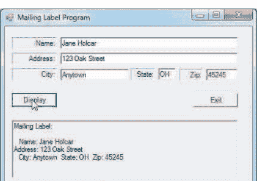

**图 2-16：**程序的示例运行

### 运行原理

程序开始时会在内存中构建表单，将各种对象按照你在构建表 2-2 描述的用户界面时所指示的位置放置在表单上。每当你移动表单上的对象时，Visual Studio 都会调整代码以反映新位置。如果你使用属性窗口（Property Window）更改对象的属性，Visual Studio 会为你对代码做出相应的更改。记住，更改属性本身就是为了改变对象的状态。

你可以通过查看 `InitializeComponent()` 方法中的语句来检查 Visual Studio 为用户界面生成的代码。由于代码相当冗长且重复，此这里只显示了前几行：

```csharp
private void InitializeComponent()
{
    this.label = new System.Windows.Forms.Label();
}
```

# 第 2 章 深入对象

```csharp
this.txtName = new System.Windows.Forms.TextBox();
this.txtAddress = new System.Windows.Forms.TextBox();
this.label2 = new System.Windows.Forms.Label();
this.txtCity = new System.Windows.Forms.TextBox();
this.label1 = new System.Windows.Forms.Label();
this.txtZip = new System.Windows.Forms.TextBox();
this.label15 = new System.Windows.Forms.Label();
this.btnDisplayOutput = new System.Windows.Forms.Button();
this.txtDisplayOutput = new System.Windows.Forms.TextBox();
this.txtState = new System.Windows.Forms.TextBox();
this.ResumeLayoutLayout();
```

```csharp
// label1
this.label.BorderStyle = System.Windows.Forms.BorderStyle.Fixed3D;
this.label.Location = new System.Drawing.Point(12, 18);
this.label.Name = "label1";
this.label.Size = new System.Drawing.Size(75, 20);
this.label.TabIndex = 0;
this.label.Text = "Name";
this.label.TextAlign = System.Drawing.ContentAlignment.MiddleRight;
```

```csharp
// txtName
this.txtName.Location = new System.Drawing.Point(93, 18);
this.txtName.Name = "txtName";
this.txtName.Size = new System.Drawing.Size(29, 20);
this.txtName.TabIndex = 1;
```

```csharp
// 后面还有更多语句
// InitializeComponent() 方法结束
```

考虑第一行程序代码：

```csharp
this.label = new System.Windows.Forms.Label();
```

在本章之前已经讨论了这条语句的作用。记住，关键字 `this` 指的是当前对象（在本例中为 `frmMain`），标签（label）是你可以用来实例化对象的“饼干模板”之一。在这种情况下，你可以创建一个命名的标签，在几行之后，Visual Studio 会显示出以下代码：

```csharp
this.label.BorderStyle = System.Windows.Forms.BorderStyle.Fixed3D;
this.label.Location = new System.Drawing.Point(12, 18);
this.label.Name = "label1";
this.label.Size = new System.Drawing.Size(75, 20);
this.label.TabIndex = 0;
this.label.Text = "Name";
this.label.TextAlign = System.Drawing.ContentAlignment.MiddleRight;
```

这段代码更改了标签对象的属性（如 `BorderStyle`、`Location`、`Name`、`Size`、`TabIndex` 和 `TextAlign`）。由于这些属性出现在赋值运算符的左侧，代码更改了每个属性的值。这意味着标签对象的状态发生了变化。

### 使用 C# 实现你的程序

对于放置在表单上的其他对象，也会生成类似于所示的代码。在每种情况下，构建用户界面时都会根据属性更改对象的状态。如果你仔细观察图 2-15，你可以看到使用 `BorderStyle` 属性为标签对象创建的边框效果。你还应该更改 `TextAlign` 属性使它们右对齐。鉴于边框是非标准的，以下是你在示例中使用它们的两个原因：

首先，使用边框强化了对象属性的用途。更改对象的属性值会改变标签在屏幕上的显示方式。在标签上使用边框的第二个原因是它们看起来很酷。如果你不喜欢标签边框，尽管用掉它们吧。毕竟，这是你的程序。

现在检查 `btnDisplayOutput` 点击事件中的程序代码。方法中的第一条语句是：

```csharp
String buffer;
```

这一行简单地创建了一个程序变量。随着你学习的深入，`buffer` 是用于存储部分数据的计算机内存区域。关键字 `string` 表示一种特定类型的变量，能够存储文本数据（你将在第 3 章学习更多关于变量和数据的知识）。在你使用它时，`buffer` 是用于存储一些你在程序中硬编码的文本字符（如 Mailing Label）以及用户通过文本框控件提供的某些文本字符。

下一行获取 `Mailing Label:` 字符，并在字符序列的末尾添加两个换行符（存储在对象的 `Environment.NewLine` 属性中）：

```csharp
buffer = "Mailing Label:" + Environment.NewLine +
Environment.NewLine;
```

换行符导致后续字符打印在下一行。由于你使用了两个换行符，其效果是在输出中显示一个空行。请参阅图 2-16 查看该空行。

程序代码的下一行获取 `buffer` 的值，并添加换行符：

```csharp
buffer = buffer + " Name:" + txtName.Text +
           Environment.NewLine;
```

下一行程序代码获取 `buffer` 的值，并添加换行符：

```csharp
buffer = buffer + " Address:" + txtAddress.Text +
           Environment.NewLine;
```

下一行程序代码获取 `buffer` 的值，并添加换行符：

```csharp
buffer = buffer + " City:" + txtCity.Text + "  State:" + txtState.Text + "  Zip:" + txtZip.Text;
```


```csharp
buffer = buffer + " Name:" + txtName.Text +
           Environment.NewLine;
```

换行符导致后续字符打印在下一行。

*(注：原文此处存在重复，在翻译中保持逻辑流)*

下一行程序代码获取 `buffer` 的值，并添加换行符：

```csharp
buffer = buffer + " Address:" + txtAddress.Text +
           Environment.NewLine;
```

换行符导致后续字符打印在下一行。

下一行程序代码获取 `buffer` 的值，并添加换行符：

```csharp
buffer = buffer + " City:" + txtCity.Text + "  State:" + txtState.Text + "  Zip:" + txtZip.Text;
```

换行符导致后续字符打印在下一行。

*(接上文关于 Jane 及其文本框 `txtName` 属性的描述)*

这些数据随后添加到 `buffer`，产生如下结果：

Mailing Label:

Jane

这是存储在 `buffer` 中的字符。


# 第 2 章 深入对象

*(注：此处代码块保持原样不翻译)*

### 对 `btnDisplayOutput` 点击事件代码的批判

在 `btnDisplayOutput` 点击中找到程序代码属于我所谓的 RDC……真的非常愚蠢的代码（Really Dumb Code）事件。这种说法是出于几个原因。首先，程序没有对用户在各种文本框中输入的内容进行任何验证。为了让程序更智能，你应该添加代码来验证文本框中是否输入了内容，并且这些数据是否符合所需的信息。例如，如果你想验证邮政编码文本框的 `Text` 属性内容，也许你应该检查是否只输入了数字字符。或者如果是字母和数字的混合，也许你应该检查是否恰好输入了六个字符。这样你就可以允许加拿大的邮政编码了，因为那些代码同时使用了字母和数字。

第二个改进是让输出更易读一些。如果你仔细观察图 2-16 中的输出，你会发现字段没有正确对齐。尽管你在程序语句中使用适当数量的空间在每个字段之前将 `Name`（姓名）、`Address`（地址）和 `City`（城市）字段对齐，情况依然如此。为什么这样做无效呢？

你可以通过将字体改为等宽字体来解决这个对齐问题。使用等宽字体，每个字母占据的空间完全相同。如果你将 `txtDisplayOutput` 对象的 `Font` 属性更改为 `Courier New` 字体（一种等宽字体），字母就会完美对齐。通过对比图 2-16 和图 2-17 中的显示输出，你可以看到字体更改的结果。

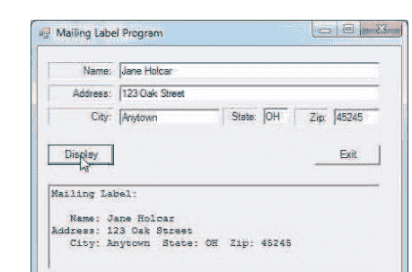

图 2-17：更改字体后的示例运行

### 总结

本章涵盖了大量内容。本书的其余部分将在本章介绍的基础的基础上构建。你应该花足够的时间学习这里介绍的内容，以便熟悉本章引入的所有术语（如类、对象、属性、方法、点运算符、实例化等）。花一点时间学习这些概念可以在后面的章节中产生巨大的回报。慢慢来，多实验，并享受其中的乐趣。

你可以在附录 A 中找到以下练习的答案。

- 1. 什么是类？什么是对象？它们之间有什么联系？又有什么不同？
- 2. 请用一句话分别描述五个程序步骤。
- 3. 向：解释以下两个语句：

```
clsThingie myThingie;
myThingie = new clsThingie();
```

- 4. 为厨房烤箱对象设计一个类。
- 5. 什么是“良好的”用户界面？
- 6. 为什么要费力学习面向对象编程（OOP）？
- 7. 使用邮件标签程序，为标签和文本框对象选择六七个属性并更改它们的值。这对程序有什么影响？（你可以使用表 2-2 所示的属性列表作为起点。）

### 本章学到的知识

| 主题 | 关键点 |
| --- | --- |
| 类 (Class) | 对某些事物的简化 |
| 属性 (Property) | 用于描述对象及其状态的数据 |
| 方法 (Method) | 你希望对象具备的动作或能力 |
| 对象 (Object) | 实现类设计的内存部分。如果说类是房子的建筑图，那么对象就是房子。 |
| 点运算符 (.) | 用于访问对象的属性或方法 |
| 用户界面 (User interface) | 终端用户与程序交互的方式 |
| 五个程序步骤 (Five Program Steps) | 设计程序的方法论 |

# 第二部分

# 理解 C# 语法

- 第 3 章：理解数据类型
- 第 4 章：理解 C# 语句
- 第 5 章：理解引用数据类型
- 第 6 章：在代码中决策
- 第 7 章：循环语句重复
- 第 8 章：理解数组和集合

# 3

### 理解数据类型

本章你将学习：

- 整数数据类型
- 不同数据类型的范围
- 浮点数据类型
- 应该使用哪种数据类型来表示财务数据
- 布尔数据类型
- 何时使用一种数据类型而非另一种

WROX.COM 本章下载

你可以在 `www.wrox.com/title-cgi?isbn=978118336922` 下载 标签页找到本章的代码。正如你在第 2 章中学到的，大多数计算机程序的核心都是以一种形式获取数据，以某种方式进行处理，然后向用户展示新数据。当你完成本章时，你将很好地理解 C# 为你提供灵活性来选择数据类型。这可能会引发疑问：什么是数据？简单来说，数据是信息。在程序中存储变量中的信息。从广义上说，数据有两种基本类型：数值数据文本数据。

# 第 3 章 理解数据类型

**数值数据**是任何进行了算术运算的数据。你可以对它进行减法、乘法和除法。你还可以执行其他操作，例如求平方根、正弦或余弦等。你还会看到数值数据被称为**值类型**。该术语的精确含义将在第 5 章中讨论。

**文本数据**是数据的字符表示。有些学生可能会混淆数据是数值还是文本；文本数据通常不在数学表达式中处理，它们通常被视为信息。如果你尝试将小数值赋值给整数，C# 会将其截断。例如，如果 `val` 是整数类型，语句

```
val = 6.999;
```

会将 6 赋值给 `val`。这意味着对小数值的整数操作只是将其截断。表 3-1 列出了你可以在程序使用的整数数据类型。

| 表 3-1：整数数据类型 | 类型 (TYPE) | 位 (BITS) | 范围 (RANGE) | 数据后缀 (DATA SUFFIX) |
| --- | --- | --- | --- | --- |
| byte | 8 | 0 到 255 | | |
| sbyte | 8 | -128 到 127 | | |
| short | 16 | -32,768 到 32,767 | | |
| ushort | 16 | 0 到 65,535 | | |
| int | 32 | -2,147,483,648 到 2,147,483,647 | | |
| uint | 32 | 0 到 4,294,967,295 | U | |
| long | 64 | -9,223,372,036,854,775,808 到 9,223,372,036,854,775,807 | L | |
| ulong | 64 | 0 到 18,446,744,073,709,551,615 | UL | |

如表 3-1 所示，某些数据类型以前缀字母 "`s`"(sbyte)，而另一些以前缀字母 "`u`"。"s" 意味着是有符号数量，而 "u" 意味着它们是无符号数量。（下一节将解释为什么这些很重要。）

数据后缀用于告诉编译器表达式中使用的数据类型。例如，

```c
long bigNum;
// 一些代码...
bigNum = 15L;
```

告诉编译器数值常量 15 被表示为 `long` 数据类型。如果不使用后缀，编译器可能会报错将一个 `int` 赋值给 `long`。此外，尽管编译器可以识别小写后缀，但你应该只使用大写后缀。它们更容易看清，而且小写的 "l" 看起来像数字 "1"，可能会让调试变得比应该的更困难。

### 整数数据类型的范围

每个整数数据类型都有其可以容纳的值范围。考虑 `byte` 数据类型，它使用 8 位。二进制位（或称为位）是计算机存储的最小单位，可以假设为 (1) 或 (0) 的值。这意味着计算机中最基本的信息——位只有两种可能的状态：开启和关闭。因为只有两种可能的状态，所以信息是以二进制（或二进制）格式存储的。尽管你使用十进制计数系统进行数学运算，但计算机更偏于二进制数。

从工程的角度来看，将位分组为一个称为字节（byte）的较大单元更方便。因为每个位有两个可能的值，一个值可以产生 $2^8$ 或 256 种唯一组合。如果你参考表 3-1，你可以看到 `byte` 数据类型可以表示 0 到 255 的值。

### 理解二进制数

等一下！八位用于表示 256 个值而不是 255？为什么字节的范围限制在 255？原因是 8 位可以表示 256 个唯一值，其中一个是零。如果所有位都关闭，字节的值为 0。如果所有位都开启，字节的值为 255。表 3-2 进一步说明了位与其相关数值之间的关系。

表 3-2：位位置及其二进制等效值

| 位位置 | 7 | 6 | 5 | 4 | 3 | 2 | 1 | 0 |
| --- | --- | --- | --- | --- | --- | --- | --- | --- |
| 二进制表示 | $2^7$ | $2^6$ | $2^5$ | $2^4$ | $2^3$ | $2^2$ | $2^1$ | $2^0$ |
| 数值 | 128 | 64 | 32 | 16 | 8 | 4 | 2 | 1 |
| 10 | = 0 | 0 | 0 | 0 | 0 | 1 | 1 | 0 |
| 73 | = 0 | 1 | 0 | 0 | 0 | 1 | 0 | 1 |
| 132 | = 1 | 0 | 0 | 0 | 0 | 1 | 0 | 0 |
| 255 | = 1 | 1 | 1 | 1 | 1 | 1 | 1 | 1 |

参考表 3-2，你可以看到字节的数值取决于哪些位被开启。例如，对于数值 73，你看到：

```
01001001
```

它被解释为：

```
0 + 64 + 0 + 0 + 8 + 0 + 0 + 1
```

如果将这些值相加，总和为 73。如果所有位都开启，字节将显示如下所示：

```
11111111
```

它将变为：

```
128 + 64 + 32 + 16 + 8 + 4 + 2 + 1
```

总和为 255。

### 有符号整数值

根据这些信息，为什么字节（byte）数据类型的最大值被限制为 128 呢？原因是字节数据类型是有符号字节。字节数据可以取正值或负值。字节的高位（第 7 位）用于存储数字的符号。对于有符号数，高位位称为符号位。如果符号位开启，则它是一个负数；如果符号位关闭，则它是一个正数。符号位仅选择这些值中的一个，可用的是最大值而不是位组合（2^7 种组合）。因为 2^7 等于 128，所以存在 128 个唯一值，而由于最大正值是 127，如果符号位开启，你仍然有 128 个唯一值，且它们都可以是负数。这是因为你已经在正值范围内考虑量了 0 这个值。这意味着负值范围从 -1 扩展到 -128。参考表 3-1，你可以看到如果整数数据类型包含负值，它就会使用符号位，允许的数值范围就会减小。你还可以看到，使用符号位的数据类型其最大值大约是对应无符号数据类型的一半。其原因是最高位被预留给了数字的符号。

### 你应该使用哪种整数？

程序员面临的问题之一是决定使用哪种整数数据类型。这没有一个标准的正确答案。然而，有几个因素需要考虑：

- 取值范围：如果你只是统计一个人口中健康牙齿的数量，`byte` 数据类型就可以。另一方面，如果你测量当天的最高气温，如果你的样本同时包括死亡谷和阿拉斯加州的朱诺，即使是 `byte`，范围可能也不够。始终选择范围大一点的，以确保你有足够的范围来满足需求。
- 内存限制：对于你使用的大多数应用程序，你可能有半 GB 的可用内存。如果你选择 `long` 类型而不是 `int`，那么每个整数使用 4 个字节的可能并不会消耗多少内存。如果你为烤面包机或引擎系统编写程序，该设备的内存限制可能会非常严苛。在这种情况下，你将希望选择具有足够范围以完成任务的最小数据类型。
- 处理器考虑：每台计算机都有一个中央处理器（CPU），它是计算机的心脏。20 世纪 70 年代后期，CPU 有内部存储单元，称为寄存器，可以以 1 字节（8 位）为块处理数据。后来，CPU 寄存器有了 16 位寄存器、32 位寄存器，最后是 64 位寄存器。能够完美放入寄存器中而不丢失位的整数数据，对于 CPU 执行的某些操作可能会有微小优势。这意味着 32 位 CPU 处理 32 位整数的速度实际上可能比处理 16 位整数更快，即使 16 位整数更小。虽然单次匹配的性能影响很小，但在重复执行数百万次计算时，这可能会产生差异。
- 库考虑：你已经知道 .NET Framework 为你提供了数千个类供你使用。其中一些类你可能会经常使用。`Math` 类包含一个平方根方法。你将一个值发送给该方法，它将该值的平方根返回给你。大多数方法如 `Sqrt()`、`Cos()` 和 `Pow()` 都要求你向其发送一个 `double` 类型（在后文的浮点数据类型章节中描述），且方法返回的也是 `double`。如果是这样，如果所有数据类型都要与 `Math` 类交互，将所有数据类型都设为 `double` 是合理的。如果你提供的值不符合方法预期的类型，编译器必须在值到达方法之前生成代码来转换该值。虽然执行此额外“转换代码”的时间很短，但在涉及许多转换的大型程序中，时间开销是可以察觉到的。
- 惯例：某些惯例（习惯的更好说法）决定了在某些编程结构中使用的数据类型。例如，在第 8 章中，你学习了使用变量来控制循环的程序。你会发现 `int` 数据类型经常用于控制程序循环。可能还有其他原因使用 `int` 来控制循环（例如处理器考虑），大多数程序员只是定义一个 `int` 来控制循环，而不加思考。惯例并不一定让数据类型的选择是正确的，但可以解释为什么某些程序员在某些编程结构中使用特定的数据类型。

在最终分析中，取值范围可能是选择整数数据类型时考虑最重要的因素。随着经验的增长，你将学会为当前任务考虑合适数据类型的技巧。

### 变量命名规则与惯例

在创建第一个程序之前，你必须理解变量。变量是存储数据的实体。变量名（也称为标识符）具有你必须遵循的某些语法规则，以确保编译器正常工作。你已经知道 .NET Framework 为你提供了数千个类供你使用。其中一些类你可能会经常使用。`Math` 类包含一个平方根方法。你将一个值发送给该方法，它将该值的平方根返回给你。大多数方法如 `Sqrt()`、`Cos()` 和 `Pow()` 都要求你向其发送一个 `double` 类型（在后文的浮点数据类型章节中描述），且方法返回的是 `double`。如果是这样，如果所有数据类型都要与 `Math` 类交互，将所有数据类型都设为 `double` 是合理的。如果你提供的值不符合方法预期的类型，编译器必须在值到达方法之前生成代码来转换该值。虽然执行此额外“转换代码”的时间很短，但在涉及许多转换的大型程序中，时间开销是可以察觉到的。

某些惯例（习惯的更好说法）决定了在某些编程结构中使用的数据类型。例如，在第 8 章中，你学习了使用变量来控制循环的程序。你会发现 `int` 数据类型经常用于控制程序循环。可能还有其他原因使用 `int` 来控制循环（例如处理器考虑），大多数程序员只是定义一个 `int` 来控制循环，而不加思考。惯例并不一定让数据类型的选择是正确的，但可以解释为什么某些程序员在某些编程结构中使用特定的数据类型。

在创建第一个程序之前，你必须理解变量。变量是存储数据的。

- 变量名必须以字母或下划线 `_` 开头。
- 变量名不能是关键字。
- 变量名不能包含空格或标点符号（下划线除外）。
- 变量名在第一个字符后可以是数字。
- 变量名是区分大小写的。
- 变量名应该具有描述性，并反映其所存储的数据。

9. 在解决方案管理器中选中 `frmMain.cs` 文件，并点击“查看设计器图标。

10. 将表 3-3 所示的控件添加到 `frmMain`。

表 3-3: 整数程序控件

| 控件 ID | 描述 |
| --- | --- |
| label1 | 带有第一个输入文本的标签。设置属性为：

AutoSize = False

BorderStyle = Fixed3D

Text = Enter integer value

TextAlign = MiddleRight |
| label2 | 带有第二个输入文本的标签。设置属性为：

AutoSize = False

BorderStyle = Fixed3D

Text = Enter second integer value

TextAlign = MiddleRight |
| txtOperand1 | 文本框 |
| txtOperand2 | 文本框 |
| txtResult | 文本框，属性设置为：

ReadOnly = True |
| btnCalc | 按钮，Text 属性设置为：

&Calculate |
| btnExit | 按钮，Text 属性设置为：

E&xit |
| frmMain | Text = "Integer Division"

StartPosition = CenterScreen |

完成后，你的表单看起来类似于图 3-1。

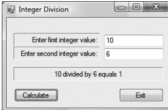

图 3-1: 整数数据程序的用户界面

11. 在设计视图中，双击 `btnCalc` 按钮，这将导致 Visual Studio 为按钮点击事件添加存根代码。双击会自动带你进入源窗口。现在，将列表 3-1 所示的按钮代码添加到存根代码中。该代码位于 `Chapter3.ZIP` 文件。

# 列表 3-1: 按钮点击事件代码


```csharp
private void btnCalc_Click(object sender, EventArgs e)
{
    bool flag;
    int operand1;
    int operand2;
    int answer;

    // Input Step
    // Check first input...
    flag = int.TryParse(txtOperand1.Text, out operand1);
    if (flag == false)
    {
        MessageBox.Show("Enter a whole number", "Input Error");
        txtOperand1.Focus();
        return;
    }

    // Check second input...
    flag = int.TryParse(txtOperand2.Text, out operand2);
    if (flag == false)
    {
        MessageBox.Show("Enter a whole number", "Input Error");
        txtOperand2.Focus();
        return;
    }

    // Process Step
    answer = operand1 / operand2;

    // Display Step
    txtResult.Text = operand1.toString() + " divided by " + 
                     operand2.toString() + 
                     " equals "+answer.toString();
    txtResult.Visible = true;
}

private void btnExit_Click(object sender, EventArgs e)
{
    Close();
}
```

### 工作原理

运行程序时，你会发现操作是在“处理”步骤中完成的，你必须为 `btnCalc` 绑定按钮事件。你通过定义一个名为 `flag` 的布尔变量开始编写 `btnCalc()` 点击事件的代码，随后定义了三个 `int` 类型的整数变量。（布尔变量只能有与真逻辑或假逻辑关联的值。这些内容将在章节末尾介绍）。

### 使用 TryParse() 方法

程序中的下一语句是：

```
flag = int.TryParse(txtOperand1.Text, out operand1);
```

这条语句看起来可能相当复杂，但实际上并非如此。

`int.TryParse()` 方法的作用是检查用户从键盘输入的内容，判断其是否可以转换为整数数据类型。从文本数据到整数的转换是因为 `TryParse()` 之前的关键字 `int`。

等一下！`int` 和 `TryParse()` 之间的点运算符是什么？C# 为每种数据类型都提供了一个类。例如，当你输入关键字 `int` 然后输入点运算符时，你可以看到 Visual Studio 弹出一个图 3-2 所示的小窗口。

| Equals |
| MaxValue |
| MinValue |
| Parse |
| ReferenceEquals |
| TryParse |

**图 3-2: int 类属性和方法**

如果你查看图 3-2，你可以看到带有 3D 立方体和正方形属性的行。立方体代表类方法，而正方形代表属性。正如你在图 3-2 中看到的，带有 3D 立方体和正方形的行中立方体代表类方法，正方形代表属性。

如果用户在文本框中输入了数字字符以外的内容，`TryParse()` 无法将文本字符转换为数值。在这种情况下，`TryParse()` 将操作数设置为 0 并返回值 `false`。然后将该返回值（`false`）赋值给布尔变量 `flag`。

你可能会奇怪为什么向调用者返回 `true`？为什么不在转换失败时直接将第二个参数设置为 0 就结束呢？问题在于 0 是一个合法的值，如果数值为 0，`TryParse()` 方法必须能够优雅地处理。无论用户输入什么，你如何知道该值是正确的还是错误的？如果值为 0 绝对是因为按了“o”键，看起来转换成功了，但实际上并没有成功。通过从调用返回一个布尔值，你可以测试转换是否失败。

一个示例可能有助于强化当前的操作。假设用户在 `txtOperand` 文本框中输入 `1234`。语句行如下：

```
flag = int.TryParse(txtOperand.Text, out operand);
```

它变为：

```
? = int.TryParse("1234", out ?);
```

`flag` 和 `operand` 的值显示为问号，因为它们可能包含未知的垃圾值。在 `TryParse()` 检查来自 `txtOperand` 文本框的输入数据 `1234` 后，它判断可以成功将数字转换为 `int` 数值。由于转换成功，`TryParse()` 将 `operand` 设置为新值 `1234` 并向调用者返回 `true`。在这种情况下，调用者是赋值运算符，它接收返回值（`true`）并将其赋值给 `flag`。最终结果是：

```
true = int.TryParse("1234", out operand);
```

`TryParse()` 第二个参数中的关键字 `out` 是必须的，它告诉 Visual Studio 使用 `operand` 作为参数，尽管它还没有初始化为有意义的值。

紧随 `TryParse()` 调用的代码调用 `flag` 来检查转换是否成功。如果转换失败，`if` 语句会发现 `flag` 为 `false`，程序执行由 `if` 语句控制的代码。（第 6 章详细讨论了语句）。`if` 关键字后面的语句仅在 `flag` 变量满足以下条件时才会执行：

```
if (flag == false)
{
    MessageBox.Show("Enter a number", "Input Error");
    txtOperand.Focus();
    return;
}
```

程序随后创建一个 `MessageBox` 对象并使用其 `Show()` 方法在屏幕上显示错误消息。用户读取错误消息后，程序调用 `txtOperand` 对象的 `Focus()` 方法。调用 `Focus()` 会导致程序将光标放文本框。`return` 关键字允许程序防止 `btnCalc` 点击事件代码重绘 `frmMain` 表单。光标停留在 `txtOperand` 文本框中，等待用户输入另一个整数值。

检查序列针对 `txtOperand2` 文本框对象的内容。`TryParse()` 方法对 `txtOperand2` 属性中持文本数据执行相同的检查。

### 处理并显示结果

在两个操作数都从它们关联的文本框赋值后，你就可以执行除法操作了。正斜杠 (`/`) 是 C# 的除法运算符。执行计算并显示结果的代码所示：

```
answer = operand1 / operand2;
txtResult.Text = operand1.ToString() + " divided by " +
  operand2.ToString() + " equals " +answer.ToString();
ntxtResult.Visible = true;
```

由于你想使用除法运算符，第一条语句将整数 `operand1` 除以 `operand2` 值。赋值运算符将该除法表达式的结果赋值给变量名 `answer`。

你只需要显示你所用用例的答案。然而，你又遇到了“苹果和橘子”的问题。也就是说，如果 `operand1`、`operand2` 和 `answer` 都是数值数据，但你需要以文本格式显示它们。正如前面提到的，每个给定值类型的变量都有一个与之关联的包装类，该类提供了某些属性和方法。可用方法之一是 `ToString()`。`ToString()` 方法的目的是获取整数对象的当前数值并转换为数据。你可以将 `ToString()` 视为 `TryParse()` 方法的逆过程。在这个示例中，`ToString()` 简单地将变量 `operand` 的数值值转换为适当的文本。

浮点数据类型是一种数值数据类型，但它可以表示小数值。表 3-4 显示了浮点数据类型及其范围。

表 3-4：浮点类型

| 类型标识符 | 位 (BITS) | 范围 (RANGE) | 后缀 (SUFFIX) |
| --- | --- | --- | --- |
| Float | 32 | ±1.5 × 10⁻⁴⁵ 到 ±3.4 × 10³⁸ | F, f |
| Double | 64 | ±5.0 × 10⁻³⁴ 到 ±1.7 × 10³⁸ | D, d |

两种类型浮点数的数值范围都很大（参见表 3-4）。当你需要数据反映小数值，或者需要在程序中使用很小或很大的数字时，通常会选择浮点值。

在接下来的 Try It 部分中，你创建一个使用浮点数代替之前整数的程序。

# 测试使用浮点数的程序 (Chapter03.zip)

你可以相当容易地将整数整数程序修改为处理浮点数。假设你已将上一个 Try It 的代码加载到 Visual Studio 中：

- 1. 将 `btnCalc` 点击事件中的语句行从

```
int operand1;
int operand2;
int answer;
```

改为：

```
float operand1;
float operand2;
float answer;
```

- 2. 现在尝试运行程序。

### 工作原理

进行更改后，运行程序。你得到以下错误消息：

最合适的重载方法匹配 'int.TryParse(string, out int)' 有一些无效参数。

此错误消息告诉你，`TryParse()` 感到困惑，因为它期望第二个参数是整数，但你传递了 `float` 类型的 `operand1`。这不是一个严重的

# 第 3 章理解数据类型

因为每种数据类型都有其自己的 `TryParse()` 版本。请将程序中的 `TryParse()` 方法调用更改为以下内容：

```
flag = float.TryParse(txtoperand1.Text, out operand1);
```

此项更改使用了 `float` 包装类进行转换过程。

现在编译并运行程序。当你运行整数版本的程序并提供 10 和 6 这两个输入值时，答案是 1。由于这是因为 `int`（整数）不允许包含小数部分。整数版本的程序直接将结果截断为 1。如果你使用这个 `float` 版本的程序，结果将变为 1.666666，如图 3-3 所示。（你没有更改标签，但它们仍然会提示输入整数数据。如果你需要，可以轻松更改这些。）

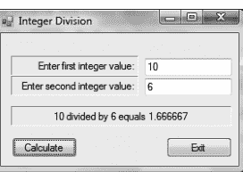

浮点数除法的结果呈现了一个小数值，这在使用 `int` 类型时是不可能的。

图 3-3：使用 float 数据类型的程序

### 尝试一下：一个测试浮点数精度的程序 (Chapter03.zip)

使用你刚刚在“尝试一下”中编写的程序，对该程序进行以下更改。注意我们在这里将数据类型从之前的版本更改为使用 `double` 数据类型：

- 1. 更改

```
float operand1;
float operand2;
float answer;
to
double operand1;
double operand2;
double answer;
```

你需要为 `TryParse()` 方法调用更改数据类型吗？（提示：只有当你希望程序运行运行时才需要。）

- 2. 现在重新编译，并使用相同的输入重新运行程序。

### 在 Visual Studio 中查找和替换

在所讨论的 `float` 版本程序中，你被指示将所有的关键字 `float` 更改为 `double`。你可以搜索程序代码中 `float` 关键字的每个出现处并将其更改为 `double`。然而，这正是完全适合计算机为你完成的这类无脑任务。

如果你想在整个程序中搜索特定的单词或短语：

| 查找和替换 |
| :--- |
| 在文件中查找快速替换 |
| 查找内容: | float |
| 替换为: | double |
| 查找范围: | 当前文档 |
| 查找选项 | |
| 查找下一个 | 替换 | 替换全部 |

**图 3-4：** 使用查找和替换

现在你应该点击“查找下一个”找到程序源码中单词 `float` 的下一个出现处。如果你想将单词 `float` 更改为 `double`，点击“替换”按钮。单词 `float` 被替换为 `double`，程序将继续处理程序的下一个 `float` 关键字。

点击“全部替换”按钮是一个巨大的诱惑，它会遍历整个源代码并在不询问点击“替换”按钮的情况下自动进行替换。不要向这种诱惑屈协！查找和替换的智能程度就像一盒石头一样。假设你想从 `int` 更改为 `double`。你输入这些输入：

```
int interestRate;
```

更改为：

```
double interestRate;
```

这并不是你想要的。由于使用了 `float` 类型，`int` 变量被替换为了 `double`。一个更聪明的建议是：*不要使用全部替换*。如果你想将 `int` 更改为 `double`，使用查找和替换。如果你在对话框中看到 `float` 变量：

```
float interestRate;
```

### 使用 IntelliSense 定位程序错误

在将变量的数据类型更改为小数（decimal）类型后，通过在定义 `answer` 之后调用 `TryParse()` 方法之前，向程序中插入以下程序语句：

```
operandi = .5;
```

当你编译程序时，语句中的 `.5` 下方会出现一条蓝色的波浪线。蓝色波浪线指向波浪线所在语句行中的错误。

### 语法规则和错误消息

IntelliSense 已传递给 Visual Studio 中负责检查你语句的部分，以确保它们遵守 C# 的语法规则。语法规则简单指的是 C# 期望你构成的有效 C# 程序语句的语言规则。（你可以在第 4 章中找到有关语言规则的更多细节。）就像英语语言需要名词和动词一样，C# 也有它期望在你编写程序语句时遵循的规则。

如果你违反了（或弯曲绕背了）语法规则，它会在语句中违规的部分下方画一条蓝线。当你将光标移动到蓝线上时，IntelliSense 会为你提供有关该错误的信息。这些关于错误性质的信息以错误消息的形式呈现。在前面的语句中，错误消息如下：

- 类型为 double 的字面量无法隐转换为类型 'decimal'；
- 使用 'M' 后缀来创建此类型的字面量


换句话说，Visual Studio 对 `.5` 是什么感到困惑。如果你将 `operandi` 定义为小数（`decimal`）数据类型，那么你正尝试将值 `.5` 赋值给它。除非另有规定，否则 IntelliSense 将其视为源码中的分数值 `.5`，它假设你想使用 `double` 数据类型。（程序代码中像 `.5` 这样的纯数字被称为数字字面量 `numeric literal`）。因此，IntelliSense 看到你的程序语句正试图将一个 `double` 值 (`.5`) 放入一个 `decimal` 数据类型 (`operandi`) 中。这就像是试图让一个穿 4 码鞋的人穿 8 码鞋走路……这不合脚。错误消息表达的意思类似，只是稍微委婉了一点。IntelliSense 错误消息以它的方式说道：

字面量 `.5` 对我来说像是一个 `double`，我无法为你将其转换为类型 `'decimal'`：使用 `'M'` 后缀来创建此类型的字面量

好吧……这很有道理。现在，按照它的建议更正语句，看看会发生什么。修正后的行显示为

```
operandi = .5M;
```

利用表 3-5 中的信息，你可以通过在字面量后放置小数类型的后缀 `M`，利用 IntelliSense 让字面量 `.5` 的含义变得非常清晰。当你做出此更改后，妙了！蓝色波浪线消失了。

作为一个一般规则，每当你看到那令人讨厌的蓝色波浪线时，将光标移动到蓝线上并阅读错误消息。IntelliSense 看起来可能有些晦涩，但稍加努力你就能开始正确解释错误。

### 消失的蓝色波浪线

当 IntelliSense 发现错误时，它会尽力确定它认为的程序错误准确行，并在那里画上蓝色波浪线。大多数情况下，IntelliSense 在识别发生错误的语句方面做得很好。在其他情况下，错误的性质是 IntelliSense 在检查了更多几行之后才意识到发生了错误。在出现蓝色波浪线的线的行在语法上看起来正确的情况下，请查看其上方的一行查找是否有异常语句。

请注意，当你修正语句行中的错误时，蓝色波浪线并不总是消失。确定程序更改是否修复了错误的最好方法是重新编译程序，查看错误消息和令人讨厌的蓝线是否消失。

最后，也可能出现波浪线。红色波浪线通常与缺失语句元素有关。例如，如果你输入以下内容：

```
int
```

行尾会出现波浪线，通知你忘记在行尾添加分号。第 11 章有许多关于程序 bug 和调试的详细信息。

### 布尔数据类型

在两种基本数据类型（数值和文本）中，到目前你只学习了数值型数据类型。（你可以在第 6 章中阅读更多关于文本数据的内容。）布尔（`boolean`）数据类型是那些不完全符合数值或文本数据类型的灰色地带之一。虽然这不是一个精确的定义，但你通过数值数据类型学习了 `bool` 数据以及为什么它被用于反映数据的状态，而不是数据的某种文本表示。

计算机的特性特征之一是它可以根据其处理的数据做出决定。你已经在示例程序中看到了这种决策能力。例如，在你之前编写的整数除法程序中，你有以下程序语句：

```
flag = int.TryParse(txtOperand.Text, out operand);
if (flag == false)
{
    MessageBox.Show("Enter a whole number," "Input Error");
    txtOperand.Focus();
    return;
}
```

由 `TryParse()` 调用使用的变量 `flag` 用于判断输入是否为整数。如果你将 `operandi` 定义为小数数据类型，那么你正尝试将值 `.5` 赋值给它。除非另有规定，否则 IntelliSense 将其视为源码中的分数值 `.5`，它假设你想使用 `double` 数据类型。（程序代码中像 `.5` 这样的纯数字被称为数字字面量）。因此，IntelliSense 看到你的程序语句正试图将一个 `double` 值 (`.5`) 放入。之前的代码片段显示 `flag` 是一个布尔变量。布尔变量由 `bool` 关键字定义。（你可以在之前显示的 `btn_Click()` 方法中看到 `flag` 的定义。）表 3-6 显示了相关的类型信息。

### 表 3-6：布尔数据类型

| 类型标识符 | 位 | 值 | 数据后缀 |
|---|---|---|---|
| `bool` | 8 | `true`, `false` | 无 |

参考 3-6，布尔变量没有“范围”。布尔数据类型只能包含两个值：`true` 或 `false`。如果你曾上过逻辑课程，你就曾接触过真值表，其中条件陈述为真或假。这些通常用 1 表示真，0 表示假。你不能在 C# 中用 1 和 0 来表示真假，IntelliSense 知道这些是你可以存储在 `bool` 变量中的唯一值。如果你输入语句

```
flag = 0;
```

IntelliSense 会发出错误消息，说明

> 常量值 `'0'` 无法转换为 `'bool'`

这告诉你 Visual Studio 不满意你将零（整数字面量）赋值给布尔变量。如果你将零更改为 `false` 并重新编译程序，错误消息就会消失，因为 `flag` 现在被赋值了正确类型。

### 不要为了错误的目的使用布尔数据类型

由于布尔数据只能反映真或假状态，因此它不能用于计数。布尔变量应该只在与关联的信息只有两种状态时使用。例如，一名程序员被聘佣编写一个跟踪俱乐部成员信息的程序。其中一个变量 `Status` 被实现为 `bool`，解释为 `true` 表示该人员是俱乐部的活跃成员，`false` 表示该人员不是活跃成员。在程序编写完成后，俱乐部发现该程序无法正确处理获得临时休假的成员。俱乐部的这一小变化导致了程序失败，因为布尔 `Status` 变量没有被记录三种状态：1 活跃成员、2 不活跃成员和 3 休假。程序员必须回到代码中将 `Status` 从 `bool` 改为 `int`。

教训是简单的：只有当你确定变量的所有可能状态只有真和假时，才使用 `bool`。

### 总结

本章的讨论集中在你可以在 C# 程序中使用的各种数据值类型上。更具体地说，你学习了可以使用的各种数值数据类型。每当你想要以数学方式处理数据时，你可能都会使用本章讨论的数值数据类型之一。你还在本章中读到了 `bool` 数据类型，因为它是一个值类型；尽管它不是在数学意义上进行操作的。`Char` 值类型虽然也是值类型，但被排除在本章之外。由于它的用途与文本数据相关，因此将其讨论推迟到了第 6 章。

在下一章中，你将扩展对基本值类型以及它们在程序中如何使用的理解。在进入第 4 章之前，请确保你理解不同的值类型以及它们在程序中可能如何使用。

### 练习

你可以在附录 A 中找到以下练习的答案。

- 1. 为什么 C# 支持无符号数据类型？
- 2. 识别以下每个变量名是合法还是非法。

| `SetPort` | `9WaysToSunday` | `myCar` |
| --- | --- | --- |
| `_system` | `Windows?` | `Ms.Mini` |
| `extern` | `your_car` | `My#Eye` |
| `for_2_Nut` | | |

- 3. 解释以下陈述：

```
int len = txtInput.Text.Length;
```

- 4. `float` 和 `double` 数据类型之间的主要区别是什么？
- 5. 假设你想生成一组模拟掷两个骰子的值。编写一个名为 `ThrowDice()` 的方法，返回两个骰子之和的值。
- 6. 黄金可以用于金融交易。金价每盎司约为 1,600 美元，你会使用什么数据类型来处理使用黄金作为交换媒介的金融交易？为什么？

### 本章学到的知识

| 主题 | 关键点 |
|--- |--- |
| 整数数据 | 不能具有小数值的数值，每种数值都有特定的值范围 |
| `bool` | 只能具有逻辑真或逻辑假相关值的数据类型 |
| 浮点数据 | 可以假假设小数值的数据，如 `float` 或 `double` |
| `decimal` | 精度比浮点数据类型更高的数据类型，最常用于货币数据 |
| 精度 | 指给定数据类型的有效数字位数 |
| 数据选择 | 选择特定数据类型时你应该考虑的因素 |
| IntelliSense | IntelliSense 如何让调试变得更简单 |

# 4

### 理解 C# 语句

- 运算符和操作数
- 表达式
- 语句
- 左值和右值
- 什么是符号表以及 Visual Studio 如何使用它
- Visual Studio 如何与 Windows 交互
- 桶的比喻
- 使用 Visual Studio 调试器
- 魔数以及如何避免它们

你将在本章中学习到的内容：

本章的 C# 代码下载可以在 `www.wrox.com/remtitle-cgi?isbn=9781118336922` 的 Download Code 选项卡找到。代码位于 `Chapter04` 文件夹中，并根据本章中的名称单独命名。

大多数初级书籍并没有讨论本章中介绍的许多主题。这可能会让你怀疑为什么需要理解它们。有几个原因。首先，在你掌握了这些主题后，C#（以及泛指编程语言）的许多元素变得更加清晰、更加直观。记忆某些规则是学习语言的一种方法：在你记住（遵守）一条规则后，你可以避免 Visual Studio 可能向你抛出的某些错误信息。然而，真正理解规则最初之所以存在是一种优越得多的学习方法。你应该追求这种更高层次的理解。如果你理解了本章介绍的内容，发现和纠正程序错误将变得更容易。错误检测变得更容易，因为你对 C# 在“底层”做了什么有了更深入的理解。最后，你这里介绍材料的知识是可移植的。也就是说，本章讨论的概念和技术适用于所有的编程语言，而不只是 C#。如果你以后决定学习另一种编程语言，这些可以帮助你学习那种新语言。

# 第 4 章 理解 C# 语句

### 编程语言的基础构建模块

尽管编程语言的特定规则不同语言之间不同，但构建所有编程语言的基础是相似的。存在一种所有语言都遵循的层次结构：

- 程序 ✧ 语句 ✧ 表达式 ✧ 操作数和运算符

你可以将这种层次结构可视化为：“程序由一个或多个语句组成。语句由带有一个或运算符的一个或多个操作数组成。”因此，在底层，要编写程序你必须理解操作数和运算符。你通过学习操作数和运算符开始了进入 C# 内部之旅。

### 操作数和运算符

在第 3 章中，你编写了一个使用两个变量来存储用户输入信息的程序。该程序的设计用于是将第一个数字除以第二个数字。在第 3 章的程序示例中，用户第一个数字使用 10，第二个数字使用 6。你从小学开始就在做这种数学计算了。你可以将 10 除以 6 的过程写为：

```
10 / 6
```

这个简单的过程涉及获取数值 10 并将其除以 6。

这条程序语句实际上包含了两个运算符（除法运算符和赋值运算符）和三个操作数（`answer`、`operand1` 和 `operand2`），并以分号结束。

你可以让程序语句变得随心所复杂，只要它们以分号结尾即可。例如，你可以选取以下几行代码：

```
part1 = v + w;
part2 = x + Y;
solution = part1 * part2;
```

并将它们写成单条语句：

```
solution = v + w * x + y;
```

现在为前述语句中的变量赋予一些值。假设 `v = 2`, `w = 3`, `x = 4` 且 `y = 5`。你看到的程序如下：

```
solution = 2 + 3 * 4 + 5;
```

问题是，“`solution` 等于多少？”答案是 25 还是 19？如果你回看原始的三条程序语句，在处理完第一条语句后，`part1` 等于 5，`part2` 解析为 9。第三条语句将 `part1` 乘以 `part2` 并将结果赋值给 `solution`。因为 `part1` 解析为 5 且 `part2` 解析为 9，所以 `solution` 是 45，而不是 25 或 19。发生了什么？为什么你合并后的语句版本产生了错误的答案？

### 运算符优先级

每当程序语句涉及多个运算符时（如你刚刚看到的那个），必须有一套规则，让你能够正确地处理表达式中的运算符和操作数。表 4-1 展示了处理运算符的优先级（或处理顺序）。

表 4-1：运算符优先级

| 顺序 | 类型 | 符号 |
|---|---|---|
| 1 | 否定 | `!` |
| 2 | 乘法、除法、取模 | `*`, `/`, `%` |
| 3 | 加法、减法 | `+` , `-` |
| 4 | 赋值 | `=` |

表 4-1 显示，在执行任何加法或减法操作之前，应该执行乘法、除法和取模操作。根据表 4-1 中的信息，程序语句

```
solution = 2 + 3 * 4 + 5;
```

的执行顺序如下：

```
(4) (2) (1) (3)
solution = 2 + 3 * 4 + 5;
```

## 编程语言的基础构建模块 | 85

这意味着 C# 期望先执行乘法操作 (`3 * 4`)，接着在结果上加上 2，然后再次在该结果上加上 5，最后将值赋值给 `solution`。你可以通过以下示例看到运算符优先级的实际作用：

```
solution = 2 * 3 + 4;
solution = 2 + 12 + 5;
solution = 14 + 5;
solution = 19;
```

你如何能将 2 和 12 相加后再加 5？任何两个数学运算符具有相同的优先级，你从左到右处理它们。通过运算符的结合性规则来确定相同优先级运算符的执行顺序。当通过从左到右处理解决冲突时，这些运算符称为左结合。如果通过最右侧的同级运算符打破冲突，则将其称为右结合。

数学运算符是左结合的。然而，赋值运算符是右结合的。因为赋值运算符是右结合的，所以在赋值给赋值运算符左侧的操作之前，赋值运算符右侧的所有内容都会被解析完毕。在前述语句中，这些优先级和结合性规则确保赋值给 `solution` 的答案是 19。

### 覆盖默认优先级顺序

假设你实际上想要的正确解是 45 而不是 19。这等同于编写如下：

```
part1 = 2 + 3;
part2 = 4 + 5;
solution = part1 * part2;
```

然而，你实际上想要最后语句解析为：

```
solution = 5 * 9;
```

前面的代码将值 45 赋值给 `solution`。然而，你之前看到它解析为结果 19，而不是 45。你如何得到想要的结果？

你可以通过括号来覆盖默认的优先级顺序。如果你将语句改为括号，C# 将会在任何其他操作之前执行括号内的操作。括号会导致执行以下序列：

```
solution = (2 + 3) * (4 + 5);
solution = 5 * 9;
solution = 45;
```

结果是 `solution` 等于 45。括号是左结合的。

你现在了解了在 C# 中编写程序语句所需的 Basic规则。编写即使是最复杂的程序，归根结底也就是将正确的操作数和运算符序列连接在一起


形成用于构建程序语句的表达式。现在你需要彻底理解变量是如何定义的，以便你可以将其作为表达式中的操作数。

以下程序及其修改将帮助你理解运算符的优先级如何影响表达式的结果。

### 尝试理解运算符优先级 (Chapter03Program01.zip)

为了方便起见，你可以复用第 3 章中的整数数学程序：

- 1. 加载第 3 章的整数数学程序：
- 2. 在整数数学程序中，将语句改为：

```
solution = v + w * x + y;
```

- 3. 现在运行程序。结果是什么？
- 4. 现在将语句改为：

```
solution = (v + w) * x + y;
```

- 5. 现在再次运行程序。结果是什么？
- 6. 为什么结果发生了变化？

简述第三列“作用域”（Scope）的含义。左值（`lvalue`）是每个变量所在的内存位置。换句话说，`hatSize` 的左值为 650,000。简单来说，Visual Studio 需要使用与 `hatSize` 相关的值；它必须访问内存地址 650,000 来找到它的值。

在此步中，Visual Studio 扫描 ID 列以查看你是否已经定义了一个名为 `i` 的变量。由于符号表中没有 ID 为 `i` 的变量，Visual Studio 继续执行第 3 步。如果你已经在（同一作用域层上）定义了名为 `i` 的变量，你将收到如下错误消息：

> 此作用域内已定义名为 `'i'` 的局部变量

如果 Visual Studio 允许你在同一作用域层上定义另一个名为 `i` 的变量，那么当你在其他表达式中使用该变量时，它将不知道使用哪一个。这种特定的错误消息被称为重复定义错误消息，它告诉你，同一作用域层上拥有两个同名的变量是非合法的。

然而，由于你知道不能有两个同名的变量，`i` 并没有出现在符号表中。因此，Visual Studio 知道将 `i` 添加到符号表中是好的。表 4-3 显示了添加名为 `i` 的变量后符号表的状态。

### 表 4-3：向符号表添加新变量

| ID | 数据类型 | 作用域 | 左值 |
|---|---|---|---|
| `hatSize` | `double` | 0 | 650,000 ... |
| `k` | `int` | 0 | 630,480 |
| `i` | `int` | 0 | ? |

注意变量 `i` 的左值列没有值（从技术上讲，左值由 Visual Studio 自动设置为 `null`。然而，`null` 不能作为内存地址；你可以将左值视为未知的）。你也可以像图 4-1 所示表示 `i` 的当前状态。

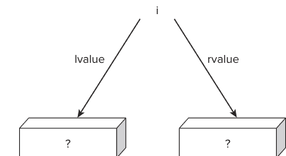

### 左值和右值

图 4-1 显示了一个变量有两个延伸出来的“腿”，分别标记为左值（`lvalue`）和右值（`rvalue`）。变量的左值是指变量存储的内存地址。对于变量来说，值总是被解释为内存地址。“左值”一词源于几十年前，当时程序员使用汇编语言编写程序。变量的左值是“位置值”（location value）或内存地址的缩写。同样注意，当像图 4-1 所示绘图时，左值是“左腿”。这导致了一些对左值的解释为“左值”。

图 4-1：左值和右值

左值目前显示为问号，因为你现在不知道 `i` 的内存地址。


变量的右值是指当前存储在变量中的实际数据值。“右值”术词也源于汇编语言编程，代表“寄存器值”（register value）。同样，某些解释将其关联为“右值”，因为它是图中右边的腿。通常，你使用赋值运算符来设置变量的右值。例如，语句

```
i = 10;
```

将值 `10` 赋值给变量 `i` 的右值。然而，由于你此时仍在检查符号表条目，目前没有任何内容与变量 `i` 的右值相关。因此，你可以在图 4-1 中看到 `i` 的右值是一个问号表示的未知值。

> 注意：在某些语言（如 C 和 C++）中，你可以使用取地址运算符 (`&`) 结合标识符来观察变量的左值，例如 `&myHatSize`。你可以使用间接运算符 (`*`) 观察右值，例如 `*myHatSize`。然而，C 仅在使用 `unsafe` 关键字定义的代码块中启用这些操作。由于 Microsoft 使用 `unsafe` 关键字是有原因的，因此书中没有讨论这些运算符。

### 第 3 步：定义变量

由于表 4-2 中没有名为 `i` 的变量，IntelliSense 对该语句的语法通过了“健康检查”。Visual Studio 现在准备好在符号表中将内存地址与变量 `i` 相关。

然而，将地址分配给特定变量并不是 Visual Studio 的工作。为变量寻找足够的内存是操作系统的责任。因此，Visual Studio 向操作系统（假设是 Windows 操作系统）发送消息并说：“嘿！我是……Visual Studio。我的程序员想为一个程序定义一个整数变量。你能为我找到 4 字节的空内存吗？”

回顾第 3 章，每个整数变量都需要 4 字节（32 位）的存储。接收到 Visual Studio 的消息后，Windows 将消息路由到 Windows 内存管理器，因为内存管理器负责处理请求。

你可能会问：“为什么 Visual Studio 不能自己分配内存？”原因是因为同时有多个程序在执行。因为 Visual Studio 不跟踪其他应用程序正在做什么，如果由它来分配内存，就会存在危及其他应用程序中数据的风险。然而，Windows 内存管理器负责跟踪计算机上当前运行的所有应用程序的内存。

Windows 内存管理器扫描其空内存列表，可能找到了所需的 4 字节。你可以假设 Windows 内存管理器为整数找到了这 4 字节。

# 第 4 章理解 C 语句

Windows 内存管理器向 Visual Studio 发回消息：“我找到了 900,000 的 4 字节。”Visual Studio 然后将地址 `900,000` 加入符号表。

### 表 4-4：内存分配后的符号表

| ID | 数据类型 | 作用域 | 左值 |
|---|---|---|---|
| `hatSize` | double | 0 | 650,000 |
| `k` | int | 0 | 630,480 |
| `i` | int | 0 | ? |

注意变量 `i` 的左值列没有值（从技术上讲，左值由 Visual Studio 自动设置为 `null`。然而，`null` 不能作为内存地址；你可以将左值视为未知的）。你也可以像图 4-1 所示表示 `i` 的当前状态。

 （注：此处原文文本中似乎存在部分重复，已按逻辑翻译）

如果 `i` 不在作用域内，你将收到变量未定义时发出的错误。

### 在程序中使用变量

现在你理解了什么是符号表，检查 Visual Studio 处理该语句必须执行的步骤。

- 1. 语法检查：如之前，Visual Studio 必须首先确保语句遵守 C# 的规则。
- 2. 符号表检查：因为语句想要将 `10` 赋值给变量 `i`，Visual Studio 需要验证变量 `i` 是否已经定义。首先，程序员可能忘记定义变量。这里出问题了。
- 3. 获取变量 `i` 的值：因为语句想要将值 `10` 赋值给变量 `i`，Visual Studio 需要知道存储该值的位置。（记住，赋值运算符右侧的表达式会被复制到运算符的左侧。这意味着你正在改变变量 `i` 的状态。）

# 桶类比

桶类比可以帮助你记住左值和右值的含义，并加强你对数据定义的理解。假设你写了语句

```
int val;
```

回想，Visual Studio 会检查此语句的语法，并搜索符号表以确保 `val` 在当前作用域内未被定义。假设这些检查已通过且 IntelliSense 运行正常，Visual Studio 将向 Windows 内存管理器发送消息，请求为你想要定义的 `int` 获取 4 字节空闲内存。假设一切顺利，Windows 内存管理器将返回 `val` 将存储的内存地址。现在假设 `val` 的内存地址是 `75000`。那么，该内存地址就会输入到符号表的 `Ivalue` 列中。

“桶类比法”假设你有一堆散落在各处的空桶。这些桶的大小不相同。有些足够大装下 1 字节的数据，有些可以装下 2 字节，有些则足够大装下 16 字节。因为你想定义一个 `int` 数据类型，所以你选择了一个足够装下 `int` 类型的桶。正如你在第 3 章中学到的，一个 `int` 占用 4 字节内存，所以你拿了一个 4 字节的桶。

现在，将变量名（在本例中为 `val`）画在桶的侧面，以便你将其与内存中可能存储的其他桶区分来。现在，假装你可以物理地取出电脑内部的桶并将其放在内存地址 `750,000` 处。完成后，你可能会看到如图 4-4 所示的内容。


| 程序 |
|---|
| Visual Studio |
| Windows |

图 4-4：带有桶的内存映射

“桶类比法”与数据定义的关系如下：

- 1. 桶的 `Ivalue` 告诉你在内存的哪里可以找到这个桶。
- 2. 桶的 `rvalue` 告诉桶内部存储了什么。
- 3. 项目的数据类型（如 `int`）告诉桶有多大（在本例中为 4 字节）。

桶类比法在第 5 章中会被再次反复使用，用于解释与数据定义相关的一些额外概念以及数据在程序中的用方式。目前，只需记住桶类比法的三个要点。这些要点将帮助你理解后续章节的内容，并让你更容易检测、隔离和修复程序错误。

## 程序错误类型

程序错误基本上三种。显而易见，你的目标是编写完全没有错误的程序。程序错误也被称为程序漏洞（bugs）。“bug”一词的产生是因为最早检测到的程序错误之一是有一只飞进电脑并导致电路短路的飞蛾子。消除程序错误的过程被称为“调试”（debugging）。

消除程序漏洞最简单的方法是编写完美的代码，这样从源上就不会产生漏洞。尽管这个目标值得赞赞，但每个程序员无论多老练，都会编写出包含错误的程序。然而，熟练的程序员比不熟练的程序员更快地检测、隔离并纠正错误。此外，经验丰富的犯的错误更少，仅仅是因为他们有经验。这里的教训是，你应该预计在开始会有很多程序错误……每个初级程序员都是如此。

起初，你遇到的是“直白型”的程序错误。这类错误当你发现它们时，你会感到用手拍着额头，一边咕哝着：“我怎么会犯这种愚蠢的错误？放松点。我们都犯过……而且尽管如此！关键在于不要气馁。将每个程序错误视为一次挑战并从经验中学习。遗憾的是，随着你编程技能的提高，你犯的错误类型也会随之增加。虽然随着经验的增长，错误会减少，但你犯的错误会变得更加复杂，更难隔离和修复。现在，快速回顾三类型的程序错误。你将在后面的章节学习更多关于错误和调试的知识。目前，只需对程序错误的类型进行分类。

### 语法错误

第一种错误是语法错误。你已经知道，当你遵守所用编程语言的规则时就会产生语法错误。刚开始你可能会犯的一个常见错误是忘记用分号结束每个程序语句。

IntelliSense 在捕获语法错误方面做得非常出色。尽管你可能讨厌 Intelli 显示的那些波浪线，但让 Intelli 检测和隔离语法错误比你来做要容易得多。

## 语义错误

当你遵守语言规则但在错误的语境中使用语句时，就会发生语义错误。例如，一个英语句子预计要有一个名词和一个动词。考虑这个句子：“The dog meowed.”（狗喵叫。）这句话遵守了拥有名词和动词的规则，但语句的语境是错乱的；因此，该语句是不正确的。你之前看到的错误信息“当前语境中不存在名称 'i'”指的就是一种语义错误。程序某处可能有一个有名为 `i` 的变量，但它不在作用范围内。你试图在 `i` 超出作用范围时使用它。IntelliSense 在检测语义错误方面表现得很好。然而，语义错误比语法错误稍微复杂一点。

### 逻辑错误

逻辑错误是在移除语义错误和语法错误后剩余的错误。通常，当结果与它应该产生的测试数据不匹配时，逻辑错误就会显现。大多数情况下，逻辑错误出现在你在第 3 章学习的“处理”（Process）步骤中。但是，“输入”（Input）步骤也可能捕捉到了错误值并将其传递给处理步骤。这就是 GIGO 问题：垃圾进，垃圾出（Garbage In, Garbage Out）。当你错误地实现算法时，经常会发生逻辑错误。当你错误地实现算法时，可重复错误比随机出现的错误更容易追踪。并修复。

### Visual Studio 调试器

Visual Studio 提供了许多工具来帮助你检测错误，当你从程序中运行代码时。调试器在你发现错误时提供帮助。虽然 IntelliSense 能够很好地发现语法错误，但对于发现逻辑错误，它的帮助较小。由于计算机没有自己的智能，它遵循你给出的指令，如果这些指令是错误的。

### 调试过程

调试器在你在 IDE 中运行程序时就会激活。消除程序错误的过程被称为调试。调试器旨在帮助你定位错误。遵循以下步骤：

- 1. 检测（Detection）：显然，要修复错误，你需要知道错误在哪里产生。调试需要程序产生错误结果。最糟糕的程序错误是随机出现的——即某些运行产生正确。
- 2. 稳定（Stabilize）：当你怀疑存在程序错误时，下一步任务是稳定错误。稳定错误意味着你可以持续重复它。稳定错误发生在一组数据集产生错误结果时。
- 3. 隔离（Isolation）：当错误首次显现时，你可能不知道从何处开始寻找。如果你使用五个步骤设计程序，大多数情况下你会在输入和处理步骤中发现错误。
- 4. 纠正（Correction）：当你隔离了错误并知道产生它的原因后，只需几分钟即可纠正。在纠正之前，确保你理解这个错误。太多的学生采取这种态度：“让我们改变这个语句，希望它能修复漏洞。”散枪式的调试很少成功，并且会引入新的漏洞。偶然发现导致错误的精确程序行并盲目输入精确的形式来修复漏洞就像中彩一样危险。研究调试器并理解它为什么给出错误的结果。只有这样你才能真正修复它。

## 让重复调试变得更容易

如果你的程序有一个特别棘手的漏洞，你可能必须反复运行程序。通常，这种重复要求你在每次运行时都输入数据。每次运行程序时重新输入文本框的数据是无聊的。如果你觉得修复漏洞需要运行多次程序，你可能希望使用属性窗口设置每个输入文本对象的 Text 属性为其关联的值。这可以节省你每次重新运行程序时输入数据的时间。修复漏洞后，确保从每个文本对象的 Text 属性中移除数据。

让我们在下面的“尝试”中练习一下调试器。

尝试使用调试器 (`Chapter03IntegerDivision.zip`)

Visual Studio 调试器每当你在 IDE 中运行程序时都会激活。学习如何使用调试器：

- 1. 加载你在第 3 章编写的整数除法程序。
- 2. 在按钮事件代码中，在操作数的定义前面放置一个注释符号（`//`，在本章的稍后部分解释）并运行程序。你收到了什么错误信息？
- 3. 在程序的某处，移除语句的分号（`；`），并注意你收到的错误信息。

# 4. 在按钮点击事件代码中，从一个语句中移除 `.ToString()` 代码，并记录你收到的错误信息。

# 5. 在 `operand1` 的定义（即 `int operand1`）前面放置一个数字字符，并记录错误信息。

虽然该程序非常简单，没可能出什么错，但你可以用它来演示 Visual Studio 调试器的一些功能。加载程序后，打开源代码窗口（Source Code Window），这样你就可以检查源代码并使用调试器了。

### 工作原理

当你使用注释字符（`//`）注释掉一个数据定义时，本质上是你是从程序中删除了该变量。当程序尝试访问该变量时，它会发现该变量不在符号表中，因此必须发出错误消息告诉你变量未定义。（Visual Studio 通常会显示类似“当前上下文中不存在名称 'operand1'”的字样。）这是 Visual Studio 告诉你是变量未定义的方式。

如果你在语句中漏掉了分号（`，IntelliSense 会在预期出现分号的地方画一条红色的波浪线。如果你尝试运行程序（可能你没看到那条红线），错误信息通常是“Expected（预期）”。因为忘记分号是一个语法错误，调试器通常会精确定位到源码中需要放置分号的位置。

如果你忘记使用 `ToString()` 方法，你可能不会收到错误消息。有时 Visual Studio 足够聪明，即使你的源代码不完全正确，它也能生成正确的代码。在这个程序中，程序执行时没有发出错误消息。然而，如果 Visual Studio 无法确定正确的上下文，不同的上下文可能会导致调试器产生错误消息。

如果你在 `operand1` 的开头放置一个数字字符（即 `3operand1`），IntelliSense 会显示红色波浪线，但给出的错误信息是：“Expected（预期）”。奇怪。为什么会给出这个消息呢？原因是 Visual Studio 尝试理解你写的内容，并假设你想将 `3` 赋值给十进制数据类型，但忘记了变量名。

在程序中一次强制产生错误并记录显示的错误消息是有帮助的。这样做可以让你对 Visual Studio 错误的类型和性质产生直。。在受控的环境中自己强制产生错误有助于理解消息的本质以及产生的原因。

当程序运行时，没有视觉上显示调试器处于激活状态。调试器只是在后台等待你做些操作，使其成为一个有用的工具。调试的基本功能之一是在源码中设置断点（breakpoint）。

## 使用 Visual Studio 调试器

Visual Studio 调试器为你提供了许多功能。本节的目的不是为了列出这些功能的详尽列表，而是向你展示一些更有用的功能，你可以反复使用。

## 设置断点

调试器的基本功能是可以设置断点。断点简单来说就是程序中你想暂停执行的点。由于程序在断点处暂停，你可以使用调试器检查该点的变量状态。

如果断点处的值不符合预期，那么错误可能发生在断点之前的某个点。在这种情况下，请移除断点并移动到程序的后续执行点。

设置断点有两种方法。首先，你可以点击想要暂停程序的行，然后按下 `F9` 键。这会导致调试器在该行高亮并添加一个红点，如图 4-5 所示。


FIGURE 4-5: 设置断点

设置断点的第二种方法是在代码窗口左侧边缘（你想暂停程序的行处）点击鼠标。（左侧边缘如图 4-5 所示所示。）

要移除断点，将光标移动到断点所在的行并按下 `F9` 键。你可以使用 `F9` 键切换特定行的断点。同样，你可以再次点击左边缘来移除断点。

## 使用断点检查变量

设置断点后，运行程序直到它停止。到达断点时，Visual Studio 会切换到源代码窗口并显示设置断点的行。图 4-6 显示了 Visual Studio 在设置断点时的状态。


FIGURE 4-6: 打开本地窗口

虽然图 4-6 中没有显示，但断点的背景颜色已从红色变为黄色。还要注意红点现在有一个箭头，指向设置断点的行。

要检查程序中该点的变量，请使用“调试窗口 -> 本地”（Debug Windows Locals）序列来激活本地窗口。Visual Studio 的外观应该类似于图 4-7。

## 使用 Visual Studio 调试器


FIGURE 4-7: 使用本地窗口


FIGURE 4-8: 使用本地窗口


FIGURE 4-9: 单步执行程序

### 防御性编程

如前所述，避免程序错误最好的方法是编写完美的代码。由于这在短期内并不可能实现，其次最好的方法是在编写代码时预留可能出现问题的预期。这种防御性策略的首要策略非常简单：编写你的代码，以便他人能够阅读并理解它。

## 编写让别人易于理解的代码

考虑以下你可以在程序源代码中执行的操作，它们可以使代码更易于理解。

### 使用程序注释

程序注释仅仅是你留留在程序中的某条信息，用于帮助读者理解代码。使用注释是一门艺术。注释太少会迫使读者花费更多时间来理解程序在做什么；注释过多实际上会通过增加不必要的混乱来阻碍对代码的理解。对程序中的每一行编写注释几乎是不必要的。而在另一个极端，代码可能非常复杂，以至于写上参考书的名字和页码比解释它要容易得多。

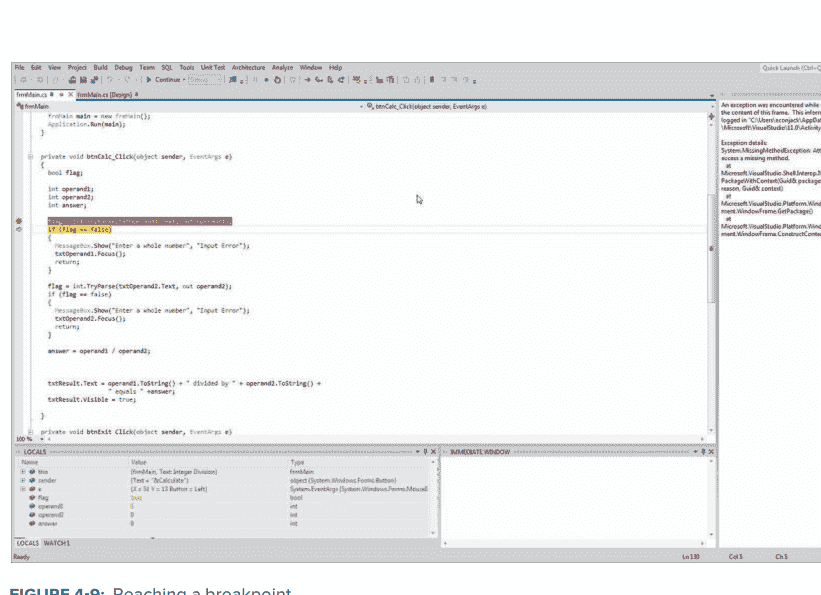

# 第 4 章理解 C# 语句

尝试对那些执行非常规的操作或对数据处理至关重要的语句使用注释。简单来说，注释应该让读者更容易理解你的代码，而不是阻碍这种理解。

程序注释有两种类型：单行注释和多行注释。务必记住，注释会被编译器忽略，它们对程序的性能没有影响。（这又多了一个在程序中不写注释的借口了！）

### 单行注释

你以前见过单行注释。这些注释通过跟随注释内容后的双斜杠（`//`）引入。注释必须适合在一行内，例如：

```
answer = operand1 / operand2; // 这是 Process 步骤
```

这一行使用注释来标识该语句执行了程序中的 Process 步骤。（在现实生活中，注释对理解程序的帮助可能很小，完全可以不写。）

一个问题是注释应该放在哪里，如上一个示例所示放在行尾，或者将注释放在代码行之前，例如：

```
// 这是 Process 步骤
answer = operand1 / operand2;
```


如果你在一家编写商业代码的公司工作，可能会有公司政策规定注释使用的注释风格。否则，选择哪一种取决于个人偏好。

> 注意 我的选择取决于注释本身。如果注释可以放在行尾而读者不需要滚动 Source 窗口即可阅读，我倾向于将注释放在程序语句的末尾。这样做意味着我可以在 Source 窗口中相比另一种方案多看到一行源代码。

如果注释相当长，需要滚动屏幕才能阅读，我会将注释放在程序语句上方。如果注释仍然太长无法挤在一行，我将拆分注释并将剩余部分放在第一行注释正下方的新行上。如果还是太长，我将使用多行注释。无论何种方式，双斜杠字符（`//`）之后行上的所有内容都会编译器忽略。

### 多行注释

多行注释通过反斜杠-星号（`/*`）组合引入并以星号-星号（`*/`）结束，例如：

```
/* 目的：btnCalc_Click() 事件方法用于计算
 * 两个整数值相除的结果。
 */
private void btnCalc_Click(object sender, EventArgs e)
```

## 防御性编程 | 103

出现在注释对 `/*` 和 `*/` 之间的任何内容都被视为注释并被编译器忽略。注释第二行开头的星号是由 Visual Studio 自动提供的。星号有助于使注释行在代码中脱颖而出。多行注释最明显的用途是当你需要在代码中放置长注释时。根据原则，你应该使每行都足够短，以便不需要水平滚动屏幕即可阅读。

### 将多行注释作为调试工具

然而，多行注释可以实现的功能比在程序中添加长注释要多。有时你你有一段代码遇到了问题，并且你想尝试另一种算法。因为你不确定新算法是否有效，而且不想在更改失败时重试原始代码，从程序中移除代码的最简单方法仍然是用多行注释将其包裹，例如：

```
/* 这是原始代码
* x = y * .33 (m g);
* z = x & 2 + sigma;
*/
// 开始新代码...
x = y * .45 (m g);
z = x & 3.2 + sigma;
// 结束代码
```

在这个示例中，多行注释的作用通过包裹多行注释对消除了原始的两行代码。我的风格是在测试代码之前使用一个单行注释来标记新代码的开始，然后是新的测试代码，最后是第二个标记测试代码结束的单行注释。如果测试代码运行不正常，很容易通过删除测试代码并取消原始代码的注释将程序恢复到原始状态。

程序注释对于记录代码正在做什么非常有用。

## 有意义的变量名

初级程序员经常在程序中使用字面量，我称它们为“魔数”，因为它们通常在没有任何说明的情况下被使用。良好的变量名具有两个特征：

- 变量名反映了用途或功能。
- 变量名必须足够长以指示其用途，又要足够短而不易于输入。

### 避免魔数

假设你在程序中读到这样一行：

```
f = 125 + (sl);
```

你可能需要花一点时间理解这条语句的意思。现在对比一下：

```
speedingFine = MINIMUMSPEEDFINE + (postedSpeedLimit);
```

## #137 符号常量

常量仅仅是一个在程序运行时不能更改的变量。符号常量是一个名称完全大大写的常量；然而这并不是语言的要求。

符号常量通常定义在它们所属类的顶部，例如：

```c
public class frmMain {
    const decimal MINIMUMSPEEDFINE = 125M;
    const decimal DOLLARSPEEDOVERLIMIT = 10M;
    // 类的其余代码出现在下方
```

`const` 关键字在数据类型前面意味着你正在定义该类型的常量。由于它是常量，你必须在定义它的点进行初始化，如前面的代码所示。这些值一旦初始化后，在程序运行时无法更改。

使用符号常量还有另一个优势。假设你没有使用 `MINIMUMSPEEDFINE` 表示最低罚款。相反，假设你在整个程序中使用数字 125。进一步假设该值也是卡车和不戴头盔的摩托车手的最低罚款。最后，假设这三个金额散布在程序的各处。现在某个政客决定将汽车的最低罚款提高到 150 元。卡车和头盔的保持不变。你的老板说：“修复它！”

你不能对程序全局搜索并替换 125。那会改变卡车和头盔的罚款。你被迫找到每一个 125，解析代码以判断 125 是否与超速有关，然后进行更改或跳过该行。这是一个等待事故发生的缓慢过程。

假设你最初将程序写成这样：

```csharp
const decimal MINIMUMSPEEDFINE = 125M;
```

```cs
const decimal TRUCKOVERWEIGHTFINE = 125M;
const decimal NOHELMETFINE = 125M;
```

通过这种方式，你避免了在代码中使用魔数（magic numbers）。这不仅让你的代码易于阅读，只需更改程序中的一行：

`const decimal MINIMUMSPEEDFEEDFINE = 150M;`

并重新编译程序即可自动对程序进行所有必要的更改。使用符号常量允许你在几秒钟内完成必要的程序更改，并确保下次运行程序时绝对使用的是正确的值。

符号常量让你的程序更易阅读和修改。避免在代码中使用魔数，并经常使用符号常量。从长远来看，它们可以为你节省时间。

## 使用一致的编码风格

如果你是为自己编写代码，最终你会定义自己的编码风格。也就是说，你会在每个关键字的相同位置放置语句块。你会在方法的内部相同位置定义变量。你会以一致的方式创建对象（例如 `clsPort`、`txtName`、`btnExit`、`lblResult` 等）和变量名（例如 `mHat`、`yourAddress`、`herName` 等）。这种一致性使你更容易阅读和调试代码。

如果你在商业环境中工作，其他人（可能是公司政策指南）可能会定义你的编码风格。显然，除非你有足够的权威去更改它，否则你必须遵守。虽然你可能对必须遵循一种你认为并不“好”的编码风格感到不满，但请感谢公司有编码风格政策。你会发现当 30 名程序员使用 30 种不同的编码风格时，开发进度会变得多么缓慢，你会感到惊讶的。

无论你的开发环境如何，选择一种编码风格并坚持下去。从长远来看，它可以为你节省时间。

## 休息一下

如果你遇到了一个特别棘手的 Bug 导致你追溯了几个小时，是时候离开去另一个地方待几分钟了。长时间不休息往往会让你倾向于只看到你想看到的，而不是实际发生的情况。离开座位去喝杯咖啡可以帮助你对代码获得全新的视角。

## 使用第二双眼睛

盯着同一页代码看几个小时也会让你看到你预期的内容，而不是实际存在的内容。你会有自己对自己说代码不可能在执行它正在执行的操作。好吧，它确实如代码所写的那样，你患了“见木不见树”（Forest-for-the-Trees）症。

很多时候，让同事看看代码是有用的。比我愿意承认的要多，同事在几秒钟内就能看到错误，尽管我盯着它看了一小时。就像那些讨厌问路的人一样，程序员也讨厌请求调试帮助。这种态度是适得其反的。如果有可用帮助，请利用它。

在本章中，你学习了在程序中定义变量时需要的操作。虽然所采用的方法看起来像是在用原子弹杀蚂蚁，但理解 Visual Studio 是如何处理数据定义这类简单操作的，最终会让你成为一名更好的程序员。

确保你理解什么是 `lvalues`（左值）和 `rvalues`（右值），以及它们如何与数据定义相关。这些术语在后续章节中会被频繁使用。

### 练习

- 你可以在附录 A 中找到以下练习的答案。
1. 使用你之前编写的程序，在程序中设置几个断点，并单步执行程序。源代码中是否存在任何你无法设置断点的地方？
2. 重写第 3 章末尾练习题中将华氏度温度转换为摄氏度的程序。使用符号常量让程序更易于理解。
3. 什么是 `lvalue`，什么是 `rvalue`？它们如何用于解释数据定义与数据声明之间的区别？
4. 当你在下次鸡尾派对上（如果可能的话）使用“桶类比”（Bucket Analogy）解释 `lvalues` 和 `rvalues` 时，什么决定了桶的大小？桶类比的关键元素是什么？
5. 编写一个程序，询问物品价格和购买数量，然后根据你所在州的销售税率计算销售税。在程序中使用任何符号常量是否有意义？
6. 编写一个程序，使用以下公式计算每月还款：

`payment = (rate + rate)/ (1 + rate)^months – 1 ) * amount` 其中 `rate` 是年利率除以 1,200（即 6% 的 `rate` = .005），且 `^` 表示“...的次方”。使用幂函数的语法是：

`Math.Pow(val, power)`

## 本章学到了什么

| 主题 | 关键点 |
| :--- | :--- |
| 运算符和操作数 | 程序中最基础的构建模块 |
| 表达式 | 运算符和操作数如何组合成表达式 |
| lvalues 和 rvalues | 关于变量存储在内存中的位置以及该位置存储什么值的概念性视图 |
| 符号表 | 编译器如何跟踪数据项 |
| 桶类比 | 记忆 lvalues 和 rvalues 的简单方法 |
| 调试 | 调试器如何帮助你定位程序中的错误 |
| 魔数 | 为什么你应该避免它们 |

由于变量 `name` 不在符号表中，Visual Studio 向 Windows 发送消息，请求为引用变量分配内存。所有引用变量使用相同的存储空间：4 字节。只要 Windows 内存管理器能找到 4 字节内存，Windows 就会返回引用变量名的内存地址。你可以假设 `name` 的内存地址为 670000。Visual Studio 在符号表中创建一个条目，如表 5-2 所示。

## 表 5-2：添加到符号表的引用变量

| ID | DATA TYPE | SCOPE | LVALUE | ... |
|---|---|---|---|--|
| hashTable | double | 0 | 650,000 | |
| k | int | 0 | 630,480 | |
| name | string | 0 | 670,000 | |

利用你在第 4 章学习的图表，你可以像图 5-1 所示显示 `name` 的左值（lvalue）和右值（rvalue）值。

图 5-1 中 `name` 左值的解释与第 4 章完全相同。也就是说，左值是字符串变量存储在内存中的内存地址。

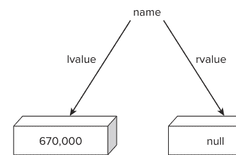

图 5-1：新的左值和右值

## null 的含义

Visual Studio 从 Windows 内存管理器接收到引用变量的左值后，立即将 `null` 分配给 `name` 的右值。记住 `null` 是 C 语言中的关键字，表示当前没有与变量关联的可用数据。只要变量的右值等于 `null`，Visual Studio 就知道与它没有有用的关联。图 5-2 显示了 `name` 变量当前状态的内存映射。

利用第 4 章的“桶类比”，你可以这样口语化描述图 5-2 中的信息：`name` 变量的桶存储在内存位置 670000（其左值），而其 4 字节桶的内容（右值）是 `null`。

现在执行第二行代码时会发生什么：

```
name = "Hailey";
```

`name` Hailey 中的每个字母都占用 2 字节存储空间（参见侧栏“Unicode 与 ASCII”）。这意味着字符串字面量 "Hailey" 实际上需要 12 字节存储空间。然而，你刚刚读到 Windows 内存管理器仅为 `name` 的右值返回了 4 字节存储空间。你可能在想：“等一下！如何在 4 字节的桶里装下 12 字节的数据？”答案是：装不下！

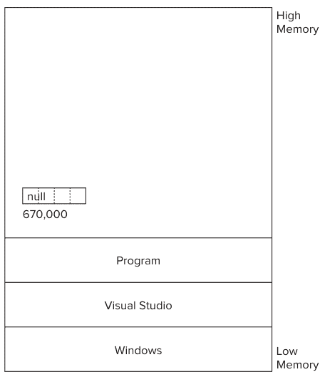

## UNICODE 与 ASCII

20 世纪 60 年代，随着日语计算机系统的出现，产生了一种标准的需求。结果就是美国信息交换代码，或 ASCII 字符集。代码跨越 128 个字符，包括字母、数字和标点符号，以及一些非打印代码。由于只有 128 个字符，整个 ASCII 集合可以用一个字节（即 $256 = 2^8$）表示，并且还有剩余空间。

随着计算更具国际化，问题开始出现。许多语言和系统（例如用于日语的汉字系统）拥有数千个字符。万维网也将对通用字符集的需求推向了前端。Unicode 字符集每个字符使用两个字节，允许表示超过 65,000 个独立字符。C# 默认使用 Unicode 字符集。这意味着字符串变量的实际存储需求大约是字符串字符数量的两倍。（许多语言使用一种称为字符串描述符块的结构，它与实际存储需求绑定。但对你来说，只需认为每个字符需要 2 字节存储空间即可。）

## 字符串变量 | 113

## 引用类型与值类型的区别

引用变量的酷之处在于：引用变量可以关联任意多或少的数据。你在第 3 章学习的值数据类型都有固定的存储需求。例如，`byte` 数据类型需要 1 字节存储空间，`long` 数据类型需要 8 字节存储空间。然而，如果你只是想在 `long` 中存储值 1，即使一个字节就能胜任，你仍然需要使用 8 字节。对于值类型，存储该值所需的字节数对每个类型来说都是固定的。虽然对值类型使用固定字节数运行良好，但对于字符串数据则不可行。毕竟，字符串可能用于存储像 "Hailey" 这样的名字，但程序中的其他变量可能用于存储《独立宣言》。显然，引用类型必须以不同的方式工作，以适应与其关联的不同长度的数据。C#（以及其他编程语言）处理此问题非常简单。

对于引用变量，第二行代码：

```
name = "Hailey";
```

会导致 Visual Studio 向 Windows 发送第二条消息。从本质上，消息是：“嘿！我是 Visual Studio……再次，我需要 12 字节内存来存储某些数据。你能帮我吗？”注意，Visual Studio 并没有关于数据需要多少存储空间提供任何信息。（不同长度的数据可以与之关联。C#（以及其他编程语言）处理此问题非常简单。）

第三条规则是最重要的。如果引用变量包含非空值，那么该值就是存储实际数据的内存地址。事实上，这就是为什么它们被称为引用变量。引用变量的非空值指向存储数据的内存位置。

# 引用类型变量 vs 值类型变量

考虑一下与变量相关的“水桶类比”（Bucket Analogy）对这两种变量的解释。对于值类型变量，你查看水桶，并立即在变量的值中找到你感兴趣的存储数据。此外，对于值类型，桶的大小根据桶中存储的数据类型而变化。也就是说，`int` 类型的桶的大小为 4 字节，`decimal` 类型的桶的大小为 16 字节。无论你是否对值之桶的大小感兴趣，它都能为你提供那里存储了什么数据类型的线索。

对于引用类型，你查看水桶，发现的要么是 `null`，是一个内存地址。如果你在桶中发现 `null`，则该变量没有与之关联的内容。另一方面，如果你查看水桶并看到 `null` 以外的内容，你必须跳转到内存来访问该数据。

结论很简单：值类型的右值（rvalue）就是数据本身；引用类型的右值要么指向数据（内存地址），要么不指向任何数据（`null`）。

# 为什么引用变量按这种方式工作？

为什么 C# 的设计者让引用变量以这种方式工作呢？考虑一下值类型的工作方式。假设你写了一个接收用户输入值（如 `int`）的方法，现在你想要将该值传递给一个名为 `Square()` 的方法。`Square()` 方法的目的是获取该值、将其平方，并将平方后的值返回给调用者。为了实现这一点，Visual Studio 会为该值创建一个临时副本，调用你的 `Square()` 方法，并告诉它该数字临时副本的位置。因为 `int` 仅占用 4 字节存储，所以复制 `int` 的过程非常快，且不会为临时副本消耗额外的内存。

现在假设你的程序中有一个 `string` 变量，它指向书中三个章节的文本。也许你是从磁盘文件中将数据读取到程序中。这意味着该 `string` 变量可能指向一个包含数十万字节的内存块。现在，假设你写了一个方法，其目的是在这些数十万字节中搜索特定的单词。如果该方法像处理值类型那样被调用，Visual Studio 必须将那数十万字节复制到一个临时内存位置。复制数十万字节有两个缺点：首先，相对于复制作为值类型的几个字节，它的速度相当慢；其次，这成几千个字节的临时副本将占用另一块内存，可能导致程序内存耗尽。

C# 通过简单地传递存储数据的内存位置地址，解决了这种性能和内存限制问题。因为引用变量的右值就是方法所需的所有内容，所以 Visual Studio 不需要复制数据。方法只需跳转到从引用变量右值接收到的内存位置即可找到数据。这种方法既节省了时间又节省了内存。

这是一个好消息。

# 按值传递 vs 按引用传递

坏消息是，使用引用变量的方法可以直接访问数据。回想一下，使用值类型的方法接收的是变量值的**副本**，而不是变量本身的左值（lvalue）。这意味着方法无法永久地更改用户的值。对于值类型，内存中有两个水桶：原始桶和包含副本的桶。方法可以修改副本的右值，但不知道原始桶存储在何处。因此，*按值传递*（pass by value）向方法发送数据的方式保护了原始数据，因为方法只能看到数据的副本。

对于引用变量，你传递的是存储数据的实际内存位置。传递实际内存位置被称为*按引用传递*（pass by reference）。这意味着方法可以直接访问原始数据，而不是其副本。这也意味着，如果方法愿意，它可以影响与引用变量关联的数据。

老话说“天下没有免费的午餐”也适用于编程。你在编写方法时使用引用变量是为了提高其性能并节省内存。然而，你付出的代价是让数据暴露在可能被污染的风险中，因为方法可以直接访问它。这有点像一个中世纪的国王，花时间把女儿藏在城堡塔上，但转过头就把她的房间钥匙发给了王国里的每一位骑士……这可能不是个好主意。同样，如果每个人都知道数据被藏在哪里处，那么费力隐藏数据就得不值了。第 10 章将回顾这些（封装）问题并提供应对的方法。

# 一些细微的效率提升

如前所述，以下语句导致 Visual Studio 向 Windows 内存管理器发送了两个内存请求：

```c
string name;
name = "Hailey";
```


第一个是为 `name` 分配存储，第二个是为 `"Hailey"` 分配存储。任何可以减少 Windows 和 Visual Studio 之间消息数量的操作可能都是好事。这是因为 Visual Studio 与 Visual Studio 之间交换消息是需要时间的。你可以通过将这两个语句合并为一行来完成相同的操作并节省时间：

```c
string name = "Hailey";
```

在这种情况下，只需要向 Windows 内存管理器发送一条消息。该消息可以描述为：“Windows……醒醒！我需要一个能够存储 12 字节的引用变量。”Windows 响应道：“我在 670000 处存储了引用变量，并将其右值设置为 725000。”无论你使用单行还是双行版本来分配字符串字面量，结果都完全相同。然而，单行版本通过发送更少的消息完成了任务。确实，如果你的程序重复数千次这种操作，用户可能会注意到差异。显然，两种方式都可行。然而，程序速度可能与此无关。程序员选择它可能仅仅是因为少打几个字！

# 使用字符串变量

字符串变量是允许你存储和处理文本数据的引用变量。尽管大多数人将计算机与计算联系在一起，但计算机的大部分工作是处理文本数据，而不是数字。

# 字符串拼接

你在之前的程序中使用了拼接，但对其没有进行多介绍。简单来说，字符串拼接是将一个字符串加到另一个字符串上以形成新字符串的过程，例如：

```c
string name = "Hailey";
name = name + " Mohr";
```

在前面的语句中，`name` 被赋值为 `"Hailey"`，如之前所述。第二行将字面量 `" Mohr"`（"Mohr" 前有一个空格）连接形成新字符串 `"Hailey Mohr"`。然后将这个新字符串赋值给 `name`。正如你所看到的，字符串拼接仅仅是将字符串添加到另一个字符串上。在这个例子中，字符串拼接将姓和名连接成全名。

# 简写赋值运算符

获取一个值并对其加上第二个值在编程中是一个非常常见的任务，因此 C# 为基础数学运算符和字符串拼接运算符提供了许多简写赋值运算符。例如，假设 `name` 当前持有字符串 `"Hailey"`，正如你刚刚看到的。你可以取之前所示的原始行：

```c
name = name + " Mohr";
name += " Mohr";
```

并使用简写拼接运算符将其重写为

结果与之前完全相同：`"Hailey Mohr"`。在语句中

```cs
int i = 10;
i += 5;
```

`i` 的值现在是 15。因此，`+=` 赋值运算符具有双重作用：当使用字符串变量时，它执行字符串拼接；当使用值类型变量时，它可用于加法。表 5-3 列出了简写赋值运算符的列表。

## 表 5-3：简写运算符

| 运算符 | 示例 | 解释 |
| --- | --- | --- |
| `+=` | `val += days;` | `val = val + days;` |
| `-=` | `val -= days;` | `val = val - days;` |
| `*=` | `val *= days;` | `val = val * days;` |
| `/=` | `val /= days;` | `val = val / days;` |
| `%=` | `val %= days;` | `val = val % days;` |

在表 5-3 显示的运算符中，拼接运算符 (`+`) 在你处理字符串数据时很有意义。表中的所有运算符都可以用于值类型。显然，简写运算符并没有给你提供任何你本不具备的东西。然而，程序员通常不喜欢输入比需要的更多的内容，因此丰富的 C# 程序员更喜欢简写运算符。

## 字符串操作

你已经知道字符串是一种引用数据类型。你也知道引用类型和值类型是不同的。值类型变量的值是变量的数据值。对于引用类型变量，其值要么是 `null`，要么数据所在的内存地址。C# 中的所有引用都表现为类的对象。因此，引用类型可以具有属性和方法，如文本框、标签、按钮和其他对象。本节将为你介绍字符串类中一些常用的属性和方法。

## 字符串长度

处理字符串数据时的一项任务是验证字符串是否包含正确的数据。例如，如果你要求用户输入邮政编码，你可能想验证用户是否向文本框对象恰好输入了五个字符以收集邮政编码字符串。（是的，我知道可能有 9 位的邮政编码，但暂时忽略它。）例如，假设你编写了一个使用 `txtZipCode` 从用户那里收集邮政编码的程序。你的任务可能是判断用户是否在文本框中输入了五个字符。`string` 提供的属性之一是 `length` 属性：

```cs
int length;
string zip = "45245";
length = zip.Length;
```

在上面的代码片段中，`zip` 被赋值为字面量 `"45245"`。然后，整数变量 `length` 被赋值为 `zip` 字符串对象的 `Length` 属性的值。在示例中，`zip.Length` 属性的值为 5。因此，在执行前述代码最后行的赋值操作后，`length` 变量的值为 5。

## 让 IntelliSense 显示属性和方法

你可能会问：“`string` 类中还有其他属性或方法吗？”是的，有很多。每当你想要查找对象的属性或方法（或其他）时，让 IntelliSense 给你提供列表即可。例如，图 5-4 定义了一个字符串变量 `temp`。几行之后，你将发现你可能使用哪个属性来确定字符串的长度。要这样做，输入字符串变量名后加上点运算符。IntelliSense 会立即向你展示一个包含当前对象属性和方法的列表框，在本例中该对象是一个名为 `temp` 的字符串。（参考图 5-4。）

```cs
}
private void btnTest_Click(object sender, EventArgs e)
{
    bool flag;
    int index;
    int start;
    int howmany;
    string temp;

    label.Text = "";
    // Find length
    txtLength.Text = txtInput.Text.toString();
    // Change value
    int length = temp.Length; // int String
    txtToLower.Text = length; // 获取当前 System.String 对象中的字符数。
    txtToLower.Text = PadRight;
    // Index of
```

**图 5-4：** 使用 IntelliSense 查找字符串属性

如果你查看图 5-4（或者最好是自己写一些代码），你可以看到列表框对象中 `Length` 单词的左侧。如果你的视力很好，你可以看到一个指向代码页的手形图标。手形图标表示对象属性。如果你看列表框的右侧，你可以看到 IntelliSense 还提供了一个简要描述：

`int String.Length`

获取当前 `System.String` 对象中的字符数。

第一行的第一个单词 (`int`) 告诉你 `Length` 是一个 `int` 数据类型。（这就是为什么在前面的代码片段中将 `length` 定义为 `int` 数据类型）。第二行提供了该属性（或方法）的简要描述。

最后，如果你查看图 5-4 所示列表框中的最后一项，你可以看到 `Remove` 单词旁边有一个 3D 紫色方框。因为 `Remove` 旁边有一个 3D 方框图标，所以它是一个方法。如果你从列表中选择了 `Remove`，屏幕将显示类似于图 5-5 的内容。

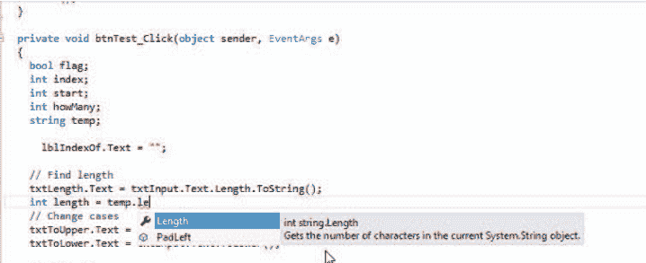

```cs
{
bool flag;
int index;
int length;
int start;
int end;
string temp;
}

lIndexOf.Text = "";

// Find length
txtLength.Text = txtInput.Text.toString();
length = temp;

// Change value
txtToLower.Text = txtInput.ToUpper();
txtToLower.Text = txtInput.ToLower();
// Index of
index = temp.Remove(startIndex, 1);
```

图 5-5：使用 IntelliSense 查找方法

注意 IntelliSense 的消息发生了变化。它现在显示：

## 使用 IntelliSense

当 IntelliSense 打开该对象的属性和方法的列表框时，花点时间浏览列表。当你高亮列表中的每一项时，IntelliSense 会为你提供该项目的简要描述。在这个过程中，你可能会发现你需要完成的任务已经完成了。

## 属性和方法的重要区别

属性与对象相关。因此，它们不需要在名称后加括号。相反，所有方法都必须带有括号。

## 思考对象属性和方法

你刚刚看到字符串类型提供了许多可选的属性和方法。你必须将字符串视为对象。根据第 2 章的讨论，字符串变量与一个可以使用点运算符的对象关联。点运算符随后可以使用该对象的属性和方法。

极大简化使用引用类型数据，因为 Visual Studio 已经为你写好了许多属性和方法的代码。

## 尝试字符串类方法和属性 (Chapter05StringMethods.zip)

图 5-4 显示了许多属性和方法如何关联。在本节中，你编写一个程序来练习这些属性和方法。图 5-6 显示了程序的用户界面。

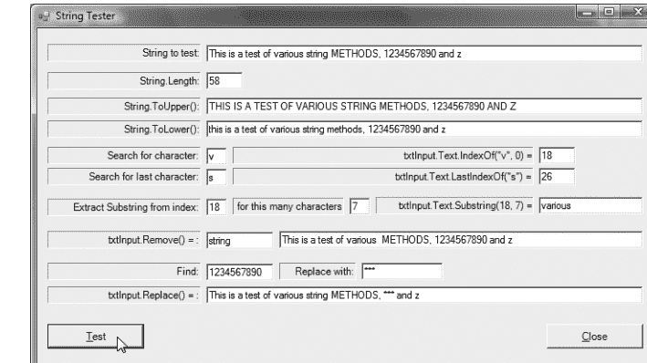

图 5-6：字符串程序的用户界面

要创建该程序，请使用以下步骤：

- 1. 使用你以前创建新项目时使用的步骤创建一个新项目，包括插入第 2 章中列表 2-1 所示的 C# 模板代码。
- 2. 使用表 5-4所示所示变量名称添加标签和文本框对象。（表格根据图 5-4 中文本框的名称从上到下、从左到右排列。）

还为 Test（测试）和 Close（关闭）按钮添加两个按钮对象。

在 `Chapter05StringMethods` 文件夹中下载代码并复制到当前项目中。

## 表 5-4：程序对象及其描述

| 文本框名称 | 描述 |
| --- | --- |
| `txtInput` | 要使用的文本数据。 |
| `txtLength` | 输入数据的长度。 |
| `txtToUpper` | 将数据转换为大写的结果。 |
| `txtToLower` | 将数据转换为小写的结果。 |
| `txtSearchChar` | 数据中要查找的字符。 |
| `txtSearch` | 找到该字符的位置。 |
| `txtLastChar` | 找到此字母最后一次出现的位置。 |
| `txtIndexOf` | 找到最后一次出现的位置。 |
| `txtStartIndex` | 从字符串中的此位置开始。 |
| `txtEndIndex` | 从字符串中复制这些字符。 |
| `txtSubstringResult` | 复制的子字符串。 |
| `txtRemove` | 要从字符串中删除的文本。 |
| `txtRemoveResult` | 删除文本后的字符串。 |
| `txtReplaceChars` | 在字符串中查找此字符序列。 |
| `txtReplaceWith` | 用此字符序列替换前面的序列。 |
| `txtReplaceResult` | 替换后的结果字符串。 |

你可以根据需要重新排列文本框的顺序。因为此程序使用了许多字符串方法，所以工作原理”（How It Works）部分比大多数部分都要长。然而，理解字符串数据类型的工作原理是非常关重要的。

### 工作原理

你可以从图 5-6 中看到，程序要求用户在顶部文本框 (`txtInput`) 中输入一行文本。输入文本后，用户点击 Test 按钮练习 Visual Studio 提供的某些字符串方法。Test 按钮点击事件的代码如列表 5-1 所示。图 5-6 中的每个功能将在接下来的章节中解释。

## 列表 5-1：btnTest 事件代码 (frmMain.cs)

```csharp
private void btnTest_Click(object sender
```

## 列表 5-1（续）

```csharp
}
// Replace
temp = txtInput.Text;
txtReplaceResult.Text = temp.Replace(txtReplaceChars.Text, txtReplaceWith.Text);
}
```

对于图 5-6 所示的示例运行，你可以输入以下字符串：

This is a test of various string METHODS, 1234567890 and z

在后续章节中，将根据所讨论的方法或属性重复特定的代码行。

## 字符串的长度：Length

`Length` 属性存储字符串的字符数。此计数包含了字符串中的所有内容，包括空格、标点和数字字符。列表 5-1 中所示 `Length` 属性代码为：

```csharp
// Find length
txtLength.Text = txtInput.Text.ToString();
```

你可能会想：“等一下！语句中为什么这么多点运算符？”问得好。拆解第一个表达式的右侧。假设你在 Visual Studio 的源窗口输入以下内容：

```csharp
txtLength.Text = txtInput;
```

在第 2 章中你学习了点运算符用于将对象（此例中的 `txtInput` 文本框对象）与该对象可用的属性和方法分开。换句话说，点运算符“打开对象的盒子，让你访问该对象的属性和方法。（参考第 2 章图 2-7）一旦你在 `txtInput` 文本框名称后输入句号，Visual Studio 就会显示列表，如图 5-7 所示。

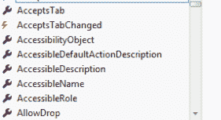

图 5-7：属性和方法的列表

图 5-7 显示的列表实际上包含了与文本框相关的 200 多个属性和方法。在这种特定情况下，你对 `txtInput` 文本框对象的 `Text` 属性感兴趣。因此你输入 Te，列表会自动向下滚动到 `txtInput` 文本框对象的 `Text` 属性。到目前为止顺利。

现在问问自己这个问题：`Text` 属性是什么类型的数据类型？嗯，如果 `Text` 属性是文本数据，那么这些数据必须存储在字符串数据类型中。因为文本框对象的 `Text` 属性是一个字符串变量，这意味着 `Text` 属性也是一个字符串对象。因此，你应该输入另一个点运算符来查看该对象中有可用内容。所以你输入了点运算符：

```csharp
txtLength.Text = txtInput.Text.
```

操作后，Visual Studio 向你显示了包含与字符串对象相关的属性和方法的列表。这个新列表如图 5-8 所示。

如果你滚动此列表，你会发现很多用于字符串对象的方法，但只有一个属性：`Length`。你可以向下滚动到 `Length` 属性，或者输入前几个字母，Visual Studio 将为你显示 `Length` 属性。如果你按下 Tab 键，Visual Studio 会为你填充属性名。你的语句看起来像这样：

```csharp
txtLength.Text = txtInput.Length
```

现在你遇到了一个问题。字符串的长度被存储为 `int` 数据类型。问题是，你想将一个数值 (`txtInput.Length`) 赋值给一个字符串类型的文本属性 (`txt.Text`)。坏消息是你在这一侧有一个苹果（此处原文可能为误，意指值），在另一侧是文本。好消息是，当你添加点运算符时，C# 可以将值视为对象：

```csharp
txtLength.Text = txtInput.Length;
```

一旦你这样做，Visual Studio 会向你显示包含与字符串对象相关的属性和方法列表。这个新列表如图 5-9 所示。

```csharp
txtLength.Text = txtInput.Length.ToString();
```

一旦你操作后，Text = txtInput.Length.ToString(); 

现在你的问题消失了。

一旦你操作后，Visual Studio 就会向你显示包含与字符串对象相关的属性和方法列表。这个新列表如图 5-8 所示。

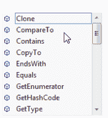

图 5-8：字符串的属性和方法


图 5-9：数据类型的方法

## 包装器（WRAPPERS）

在非 OOP 语言中，值类型和引用类型存在“老油和水”的问题——它们不兼容。相反，C# 从一开始就被设计为面向对象的语言。因此，设计者知道会有某些你想将值类型视为对象的情况。（你已经在第 3 章读过关于包装类的信息）。虽然这有点简化，但你可以认为一个包装类有一个属性和六个方法。

## 查找特殊字符：IndexOf()

假设你想在字符串中查找特定字符。在图 5-6 中，你输入了字符 v 并使用 `IndexOf()` 方法找到该字符的首次出现。同一行的下一个文本框 (`txt-SearchIndex`) 显示了数字 18。这意味着 `IndexOf()` 方法找到 v 的索引为18。如果你数到 v 之前的字母和空格，你会发现 v 是第 19 个字符。

什么？

该值是 19 的原因是编程语言在对字符串计数时，将第一个位置视为位置 0，而不是位置 1。如果你数字符和

从 0 开始计数空格，你会发现 v 确实位于位置 18。程序员使用“索引（index）”一词来指代字符串中从 0 开始的字符位置。

完成搜索的代码位于以下语句：

```
// Index of
index = txtInput.Text.IndexOf(txtSearchChar.Text, 0);
blIndexOf.Text = "txtInput.Text.IndexOf("\" + txtSearchChar.Text
      + "\",0)";
txtSearchChar.Index = txtIndexOf.String();
```


现在来检查第一个实例。赋值运算符的右侧是“获取 `txtInput` 对象的属性和名为 `IndexOf()` 的文本方法”。遗憾的是，如果没有额外的两个信息，`IndexOf()` 无法工作。首先，`IndexOf()` 需要知道你想要查找什么字符。该字符就是你输入到文本-`Searchchar` 对象中的字母（图 5-6 中的 `v`）。你通过 `txtSearchChar.Text` 属性获取该字符。其次，`IndexOf()` 想要知道你想要从哪个索引开始搜索。在这种情况下，你想从字符串的开头开始搜索，因此你使用索引值 `0`。（记住，第一个字符在位置 `0` 处？）这两个信息是 `IndexOf()` 方法的参数。简单来说，方法参数是你传递给方法的信息，以便方法可以执行其任务。方法参数可以是变量的形式（如 `txtSearchChar.Text`），也可以是字面量值，如第二个参数 `0`。（实际上，`IndexOf()` 方法有两种“口味”。如果你只传递一个参数，`IndexOf()` 方法会假设搜索从字符串的位置 `0` 开始。本章的“方法重载方法”部分解释了这是如何运作的。）在你为 `IndexOf()` 使用了正确的参数后，程序将控制权转移到 `IndexOf()` 方法的代码。简单来说，`IndexOf()` 的代码开始执行自身（毕竟，`IndexOf()` 是 `Text` 属性的一部分，所以它知道你传递的起始索引是什么）。因为你向 `IndexOf()` 方法传递了 `0`，它将从字符串中的第一个字符开始搜索，该字符位于位置 `0`。代码将第一个字符与你传递给它的字符 `v` 进行比较。由于没有匹配项，它会查看第二个位置。它继续这个过程，直到找到一个匹配项，该匹配项正好位于位置 `18`。好了……现在该怎么办？

`IndexOf()` 方法成功地在索引 `18` 处找到了匹配项，但它需要将该信息传回我们调用 `IndexOf()` 方法的地方。虽然值 `18` 如何传回该点的细节将在第 10 章中介绍，但现在，只需将赋值表达式的右侧：

```
index = txtInput.Text.IndexOf(txtSearchChar.Text, 0);
```

替换为：

```
index = 18;
```

使用 `txtInput` 对象的目的是获取 `Text` 属性，这样你就可以使用 `IndexOf()` 方法来定位特定字符。由于对象（`txtInput`）及其属性（`Text`）和方法（`IndexOf()`）都已完成工作，代码确定了 `v` 字符在字符串中的精确位置。在正式语言中，你会说：“`IndexOf()` 方法返回了整数值 `18`。”当语句完成后，变量 `index` 现在被赋值了一个右值为 `18` 的右值。

## “调用”方法

你在第 3 章中读过关于调用方法的内容，但在这里重复一遍是有值的，且稍有不同。当使用方法解析表达式时，通常将赋值语句左侧的变量称为*调用者（caller）*。在这里，*index* 正在调用或“触发”*`IndexOf()`* 方法，以便它可以为自己分配一个正确的值。同样，除非你觉得像“`IndexOf()` 返回值 8 给调用者”这样。解释是*`IndexOf()`* 方法确定的值被赋值给调用者——在本中是 *index*。

如果字符串不包含你正在寻找的字符会怎样？在这种情况下，`IndexOf()` 向调用者返回值 `-1`。如果 `IndexOf()` 返回负值，你就知道搜索失败了。一点：虽然这里展示的示例 `IndexOf` 搜索的是单个字符，但 `IndexOf()` 的第一个参数也可以是一个包含多个字符的字符串。在这种情况下，`IndexOf()` 返回字符串中出现匹配的第一个字符的索引。如果 `IndexOf()` 无法为传递给它的字符序列找到精确匹配，它将返回 `-1`。

## 搜索字符的最后一次出现：`LastIndexOf()`

`IndexOf` 方法允许你搜索字符串中特定字符的第一次出现的位置。现在假设该字符出现了六次，但你对最后一次的位置感兴趣。你可以调用 `IndexOf` 五次，让方法为每个（不想要的）位置返回一个索引。如果是这样，你就可以再次调用 `IndexOf`，使用索引加 1 作为方法调用中的第二个参数。（想想这意味着什么。）然而，使用 `LastIndexOf()` 方法会更有效。

`LastIndexOf()` 方法的代码如下：

```
index = txtInput.LastIndexOf(txtChar.Char);
lblLastIndexOf.Text = "txtInput.LastIndexOf(" + txtChar.Text + ");
txtIndexOf.Text = index.ToString();
```

`LastIndexOf()` 只有一个参数，就是你正在搜索的字符。它不需要第二个参数，因为 `LastIndexOf()` 自动从字符串末尾向开头搜索。如果搜索成功，该方法返回（基于 0 的）索引；如果未找到，则返回 `-1`。它的最后两行代码与 `IndexOf()` 代码解释基本相同。（参见图 5-6。）

## 搜索子串

如果你曾经使用文本处理器在文档中搜索特定单词，那么很有可能它是使用类似于 `Substring()` 方法来复制子串。使用 `Substring()` 方法的代码如下：

```
lblSubString.Text = "*txtInput.Text.Substring(" +
start.ToString() + ", " +
howMany.ToString() + ")";
txtStringResult.Text = txtInput.Text.Substring(start, howMany);
```

你已经知道如何使用 `TryParse()` 方法。只需说 `TryParse()` 方法将用户在文本框中输入的数字转换为名为 `start` 和 `howMany` 的整数。在图 5-6 中，起始位置设置为 `18`。再次，因为字符串位置始终从位置 `0` 开始，所以你实际上是从第 19 个字符开始的。如果你数 19 个字符（包括空格和标点符号），你会发现第 19 个字符是单词中的 `v`。

`howMany` 变量的含义可能与你想的不同。`howMany` 的值告诉 `Substring()` 方法从 `start` 开始复制多少个字符。`howMany` 并没有设置 `Substring()` 的结束索引。在图 5-6 中你可以看到 `howMany` 被设置为 `7`。因此：

```
txtStringResult.Text = txtInput.Text.Substring(start, howMany);
```

```
txtStringResult.Text = txtInput.Text.Substring(18, 7);
```

功能上导致：

```
txtStringResult.Text = "*various";
```

这意味着你想从字符串中复制的子串是单词 `various`。你可以在图 5-6 中看到结果。你应该实验该程序，并尝试不同的起始和结束值，以查看它们对子串的影响。

## 删除子串

假设你有一个字符串，实际上是写给一个搞砸了你交给他的工作的备忘录。你发现你多次使用“idiot”这个词，你的助手建议称对方为 idiot 可能不符合政治正确，因为他是你的老板。你决定从备忘录中删除“idiot”。用于删除“idiot”的编辑器可能类似于字符串的 `Remove()` 方法。

列表 5-1 中使用 `Remove()` 的语句如下：

```
// Remove
temp = txtInput.Text;
index = temp.IndexOf(txtRemove.Text);
if (index > 0)
{
txtStringResult.Text = temp.Remove(index, 
txtRemove.Text.Length);
}
```

首先，代码复制了用户的原始字符串，这样就不会永久更改第一个文本框中的字符串。接下来，代码使用 `IndexOf()` 方法找到...

# 130 | 第 5 章 理解引用数据类型

“目标字符串”所在的位置。在前面的代码中，目标字符串是“idiot”一词。在图 5-6 中，目标字符串是“string”一词。在代码中，目标字符串是你在 `txtRemove` 文本框输入的任何内容。代码随后调用 `IndexOf()` 来定位目标字符串。`Index` 能够搜索包含单个字符的字符串（正如你之前在 `IndexOf()` 讨论部分所看到的），或者它可以定位包含多个字符的字符串。

如果搜索成功，变量 `index` 被赋予字符串的起始位置。如果搜索未找到匹配项，则 `index` 被赋值为 `-1`（如前文解释）。该语句防止了失败的搜索调用 `Remove()` 方法。

图 5-6 表明你在练习 `Remove()` 方法时搜索了“string”一词。目标字符串从索引 `26` 开始。此值将成为你想要删除的字符数。你看到 `string` 有六个字符，因此你可以将字面量 `6` “硬编码”到第二个参数中。然而，这并不灵活。每当你想要查找不同的字符串时，你可能都需要调整 `Remove()` 方法的参数。因为 `txtRemove` 文本框包含了你想要删除的字符串，你始终可以使用 `Length` 属性将参数调整为适当的值。因此，该语句

```
txtRemoveResult.Text = txtRemove.Substring(index, txtRemove.Length);
```

变为

```
txtRemoveResult.Text = txtRemove.Remove(26, 6);
```

解析为

```
txtRemoveResult.Text = "This is a test of various METHODS,
1234567890 and z";
```

通过将新字符串赋值给其属性，新字符串显示在 `txtRemove` 文本框中。（注意：这段代码有一个小问题。因为代码只从原始字符串中删除了目标字符串，现在单词 `various` 和 `METHODS` 之间有两个空格，而本应该只有一个空格。你会如何修复这个问题？）

## 替换子字符串

有时，你需要用一个替换词更改较大字符串中的一个单词。例如，假设你的老板让你程序规范交给 Gene，你听从地执行了，结果发现 Gene 实际上是 Jan。在这种情况下，你需要将该单词替换为 Jane。这项任务正是 `Replace()` 方法的设计初衷。

图 5-6 表明你想要将子字符串 `1234567890` 替换为 `******`。完成此任务的语句如下：

```
// Replace
temp = txtInput.Text;
temp = temp.Replace(txtReplaceChars.Text, txtReplaceWith.Text);
txtReplaceResult.Text = temp;
```

第一行简单地复制输入字符串，这样你就不会永久更改 `txtInput` 文本框的 `Text` 属性。`Replace()` 方法需要两个参数。第一个参数是你想要替换的字符串。第二个参数是你想用来替换第一个参数的字符串。在图 5-6 所示的示例中，方法调用解析为

```
txtReplaceResult.Text = temp.Replace("1234567890", "******");
```

这意味着你想将数字字符替换为三个星号。替换后，该语句显示如下：

```
txtReplaceResult.Text = "This is a test of various string METHODS,\n*** and z";
```

新字符串被赋值到 `txtReplaceResult` 文本框的 `Text` 属性中。如果目标字符串在原始字符串中，则原始字符串保持不变。

图 5-4 中的列表框显示了可用的字符串方法的部分列表。显然，在这里显示所有字符串方法是不切实际的。然而，你可能会花几分钟滚动查看可能的字符串方法列表，并从中进行选择。很有可能，你想要对字符串数据执行的任何操作都已经在列表中了。

## 字符串与转义序列

你已经看到过如何给字符串变量赋值字面量值，如下所示：

```
string name = "Katie";
```

然而，有时某些字符串字面量可能会引起问题。例如，假设你想显示以下消息：

> John said: "Reach for the sky"

如果你尝试将此写成普通的字符串字面量：

```
string message = "John said: \"Reach for the sky!\"";
```

Visual Studio 会报错，因为双引号用于界定字符串字面量的开始和结束，而不是作为字符串本身的一部分。

为了解决这个问题，C# 在字符串内部使用转义字符来表示后续内容应该被区别对待。特殊的转义字符是反斜杠字符（\）。本质上，转义字符告诉随后的任何内容就像它是字符串字面量的一部分一样。例如，假设你这样重写字符串字面量：

```
string message = "John said: \"Reach for the sky!\"\"";
```

单词 `Reach` 之前的双引号和句末的双引号现在都被被视为转义序列的一部分，因此它们被作为字符串字面量的一部分打印出来。结果是该语句显示：

> John said: "Reach for the sky!"

表 5-5 给出了特殊转义序列列表。

# 第 5 章 理解引用数据类型

表 5-5：转义序列

| 转义序列 | 解释 |
| :--- | :--- |
| \" | 双引号 |
| \' | 单引号 |
| \\ | 反斜杠 |
| \o | 空字符（非打印） |
| \a | 警报（蜂鸣声） |
| \b | 退格 |
| \f | 换页 |
| \n | 换行 |
| \r | 回车 |
| \t | 制表符 |
| \v | 垂直制表符 |

# 第 5 章 理解引用数据类型

## `DATETIME` 对象

许多业务应用程序需要处理日期和时间。银行需要计算日期利息。生产某些产品需要经过分钟或小时。Visual Studio 提供了 `DateTime` 类型以便你处理日期和时间。

Visual Studio 跟踪时间很有趣。Windows 操作系统维护系统钟作为其职责的一部分。Visual Studio 使用系统钟来跟踪刻数（ticks）。一个刻是以 100 纳秒为单位的。一个纳秒是秒的十分之一。这是一个相当小的尺寸。事实上，光在纳秒内传播大约 18 英寸。

`DateTime` 对象维护自公元 1 年 1 月 1 日午夜以来的刻数，使用的是格里各历。那是整个刻数！然而，通过操作刻数，`DateTime` 对象可以确定相对于日期的各种类型。图 5-10 显示了使用 `DateTime` 方法和属性的程序运行示例。

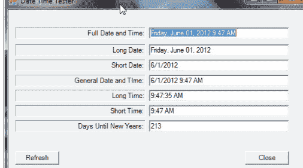

**图 5-10：** 日期和格式

## `DateTime` 和 `ToString()` 转换

如前所述，所有 C# 数据类型都提供 `ToString()` 包装转换方法，允许将日期表示为字符串。然而，某些数据类型允许你向 `ToString()` 方法传递参数，以便对数据进行特定格式化。表 5-6 给出了用于 `DateTime` 数据类型的常用格式字符。在每个情况下，表 5-6 第一列中的字母都成为 `ToString()` 的参数。例如，`myDate.ToString("F")` 显示 `myDate` 变量的完整日期时间。表格示例假设日期为 2007 年 10 月 25 日。

## 逐字字符串字面量

假设你想输出：

Go to the C:\Source

随着路径名称变长，它开始变得混乱。然而，C# 有方法让它看起来更漂亮。你可以使用逐字字面量（@）告诉 Visual Studio 按照双引号中的显示构建字符串。因此，

```
string message = @"C:\Source";
```

显示的内容与你写的完全相同。逐字字符串字面量并不常见，当你需要在程序中传递目录信息时，它非常有用。

# 第 5 章 理解引用数据类型

## 表格 5-6：常用的日期和时间转换字符

| 转换字符 | 描述 | 示例输出 |
|---|---|---|
| "F" | 完整日期和时间，包括秒 | Thursday, October 25, 2007 12:00:59 PM |
| "f" | 完整日期和时间，不包含秒 | Thursday, October 25, 2007 12:02 PM |
| "D" | 完整日期 | Thursday, October 25, 2007 |
| "d" | 短日期 | 10/25/2007 |
| "G" | 通用日期，包括秒* | 10/25/2007 12:04:54 PM |
| "g" | 通用日期，不包含秒 | 10/25/2007 12:05 PM |
| "T" | 完整时间，包括秒 | 12:05:48 PM |
| "t" | 完整时间，不包含秒 | 12:05 PM |

* 如果在使用 `ToString()` 时没有使用其他字符，则 "G" 是默认值。

表格 5-6 中的第一列显示了在运行 `DateTime` 变量时可以作为 `ToString()` 方法参数的转换字符。表格的第三列展示了结果输出的示例。通常情况下，大写转换字符比其小写对应项提供更详细的信息。注意，许多日期转换是感知区域的（locale-aware）。也就是说，数据的格式符合程序运行所在区域的样式。例如，在欧洲，2013 年 5 月 19 日将写为：19/05/2013，日期在月份之前。

接下来的“尝试”（Try It Out）展示了某些常用字符串格式选项的影响。

# 尝试 字符串格式化 (Chapter0501StringMethods.zip)

生成图 5-10 所示输出的程序代码位于列表 5-2 中。

- 1. 按照正常方式创建一个新项目。
- 2. 下载 `DateTimeMethods.zip` 文件并将其复制到当前项目中。

与之前的程序不同，这里是除了 Windows 自动生成的代码以外的所有程序代码。

```csharp
LISTING 5-2: frmMain 类定义。(frmMain.cs)
```


```csharp
using System;
using System.Windows.Forms;

public class frmMain : Form
{
    private Label label;
```
```csharp
private TextBox txtLongDate;
private Label label2;
private TextBox txtShortDate;
private Label label3;
private TextBox txtGeneralAndAndTime;
private Label label4;
private TextBox txtLongTime;
private Label label5;
private TextBox txtShortTime;
private Label label6;
private TextBox txtDaysToNewYear;
private Label label7;
private Button btnClose;
private Button btnRefresh;
private TextBox txtCompleteDateTime;
```
```csharp
#region Windows code
#endregion

public void frmMain() {
    InitializeComponent();
    UpdateInfo(); // Update textBox
}
```
```csharp
public static void Main() {
    frmMain main = new frmMain();
    Application.Run(main);
}
```
```csharp
private void UpdateInfo() {
    int days;
    DateTime myTime = new DateTime();
    myTime = DateTime.Now;
    DateTime dateTimeNewYears = new DateTime(myTime.Year, 12, 31);

    txtCompleteAndAndTime.Text = myTime.ToString("f");
    txtLongDate.Text = myTime.ToString("D");
    txtShortDate.Text = myTime.ToString("d");
    txtGeneralAndAndTime.Text = myTime.ToString("g");
    txtLongTime.Text = myTime.ToString("T");
    txtShortTime.Text = myTime.ToString("t");
}
```
```csharp
days = newYears.DayOfYear(myTime.DayOfYear);
daysToNewYears.Text = days.ToString();
```
```csharp
private void btnRefresh_Click(object sender, EventArgs e) {
    UpdateInfo();
}
```
```csharp
private void btnClose_Click(object sender, EventArgs e) {
```
```csharp
# LISTING 5-2 (续)
```
```csharp
Close();
}
```

### 工作原理

列表 5-2 展示了说明不同日期和时间格式选项的代码体。程序开始通过 `using` 关键字导入它计划要使用的 Visual Studio 引用。然后，代码开始定义你正在编写的类，名为 `frmMain`。语句末尾的 `Form` 只是告诉 Visual Studio 你将使用 `Forms` 类作为起点，但将你的对象添加到类中并用 `frmMain` 的名称引用它们。接下来，程序定义了你正在添加到通用 Windows 表单 `Form` 的控件，如标签、文本框和按钮，使新类 `frmMain` 符合你的需求。现在事情变得有趣起来。

作为此示例程序的一部分，我们讨论了许多所有 C# 程序通用的主题。

## `#region` 和 `#endregion`

在列表 5-2 的顶部有以下行：

```csharp
#region Windows code
#endregion
```

`#region` 和 `#endregion` 是 C# 指令，告诉 Visual Studio 隐藏或显示代码块。当你折叠 `#region` 时，Visual Studio 会隐藏该块中的代码。当你展开它时，Visual Studio 会显示代码。这对于组织代码非常有用，特别是当你有大量不需要一直查看的代码块时。你还可以给区域 `region` 起一个名称，以便于识别。

```csharp
#region MyRegionName
// 一些代码
#endregion
```

`#region` 和 `#endregion` 指令是组织代码的一种极方法。它们允许你将相关的代码组合在一起，并根据需要折叠或展开。这对于保持代码的整洁和可维护性非常有帮助。

找到一个 `Label` 对象。最后，你调用 `Label()` 方法在内存中为你实例化一个标签对象。Visual Studio 使用 ID `label` 将该对象的信息存入符号表。无论语句有多复杂，只要你跳过足够的点操作符 `.`，最终就能看到你感兴趣的属性或方法。尽管你必须经过三个对象才能到达那里，但最终你找到了那个为你构建名为 `label` 的新对象的方法。易而举举！

记住：每当你使用点操作符时，Visual Studio 都会显示一个包含该对象可用属性和方法的列表列表框。你在图 5-4 中看到了这一点。某些属性实际上代表了你可以用来实例化新对象的类，但你可以将它们看作是

Visual Studio 在 `InitializeComponent()` 方法中为你写了下一行代码：

```
this.txtCompleteAndTime = new System.Windows.Forms.TextBox();
```

这创建了一个新的文本框，给它命名为 `txtCompleteAndTime`，并将其添加到 `frmMain`。这个过程不断重复，直到所有的表单对象 标签、文本框和按钮 都添加完毕。当你查看 `InitializeComponent()` 方法中代码行的后续部分时，你可以看到在你创建用户界面时设置的属性。你可以看到每个标签、文本框和按钮在拖动到表单后的文本，以及你可能更改的任何属性 如样式、大小等。

## 程序如何启动

你在第 1 章学过，每个 C# 程序都是从一个名为 `Main()` 的方法开始执行的。考虑列表 5-2 中的以下语句：

```
public static void Main()
{
    frmMain main = new frmMain();
    Application.Run(main);
}
```

这些语句定义了 `Main()` 方法并标记了程序执行的位置。第一行表示创建一个 `frmMain` 对象并给它命名 记住 C# 是区分大小的，`Main` 和 `main` 是不同的。如果你查看列表 5-2 的顶部，可以看到你定义的类名为 `frmMain`。因此，此语句告诉 Visual Studio 创建一个 `frmMain` 类型的对象。

## 类构造函数

由于赋值操作符的右侧会被处理，首先发生的情况是 `new` 关键字向 Windows 请求足够的内存来存放 `frmMain` 对象。假设 Windows 找到了足够的内存，程序就会调用 `frmMain()` 方法。与你尝试实例化的对象同名的方法就是类构造函数。构造函数的作用是在使用类对象之前执行任何初始化任务。从列表 5-2 中，你可以看到构造函数像这样：

```
public frmMain()
{
    InitializeComponent();
    UpdateTimeInfo(); // 更新文本框
}
```

关于构造函数有几点需要记住：

- 构造函数的名称始终与类相同。
- 如果你想实例化该类的对象，始终在名称前使用 `new` 关键字。
- 构造函数永远不会向调用者返回值。

在 `frmMain` 的构造函数内部，首先发生的是代码调用了 `InitializeComponent()` 方法。然而，正如你在图 5-11 中看到的，`InitializeComponent()` 将标签、文本框和按钮对象位于表单上的正确位置，并设置了你在设计时指定的属性。当 `frmMain()` 构造函数完成后，你的 `frmMain` 对象在内存中的状态完全符合你设计时的样子。现在呢？

嗯，接下来发生的情况是程序调用了你写的 `UpdateTimeInfo()` 方法 稍后我们将讨论这一点。本质上，`UpdateTimeInfo()` 方法是使用各种选项在文本框中处理日期和时间信息。

## 调用 Application

初始化对象后，程序遇到 `frmMain()` 构造函数的结束括号，并知道如何返回调用者。返回调用者意味着程序返回到语句：

```
frmMain main = new frmMain();
```

你的代码已经在内存中创建了 `frmMain` 对象的映像并将其与对象名关联。下一行说：“好的，一切都准备就绪可以运行了。”使用对象名调用 `Run()` 方法开始执行程序：

```
Application.Run(main);
```

在此刻……砰！你的 `frmMain` 对象出现在显示器上，用户实际上看到了你的工作成果。输出应该与图 5-10 所示。你应该验证这些操作。要做到这一点，将光标放在以下行并按 F9：

```
frmMain main = new frmMain();
```

这在程序的该点设置了一个断点 现在程序行变为红色背景。不久后，Visual Studio 会在设置断点的地方停止程序，并将背景颜色设置为黄色。将黄色视为一种警告，通知你 Visual Studio 已准备好执行。现在按 F10 进入 `InitializeComponent()` 方法。如果 Visual Studio 继续逐行执行程序中的每一行，如果你觉得无聊，按 F11，Visual Studio 会带回调用者。使用调试器单步执行代码是查看这种情况极极方法。它提供的信息更多。

## `UpdateTimeInfo()` 方法

为了方便起见，这里重现了 `UpdateTimeInfo()` 方法的代码：

```
void UpdateTimeInfo()
{
    int days;
    DateTime myTime = DateTime.Now;
    DateTime newYears = new DateTime(myTime.Year, 12, 31);
    txtDateTime.Text = myTime.ToString("f");
    txtLongDate.Text = myTime.ToString("D");
    txtShortDate.Text = myTime.ToString("d");
    txtGeneralAndTime.Text = myTime.ToString("g");
    txtLongTime.Text = myTime.ToString("T");
    days = newYears.DayOfYear - myTime.DayOfYear;
    txtDaysNewYears.Text = days.ToString();
}
```

该方法开始定义一个整数变量 `days`，随后是一个名为 `myTime` 的 `DateTime` 对象。语句右侧调用了一个名为 `DateTime()` 的方法：

```
myTime = new DateTime();
```

然而，因为方法与类同名，所以你知道 `DateTime()` 是 `DateTime` 类的构造函数。因此，在语句执行后，内存中存在一个名为 `myTime` 的 `DateTime` 类型对象，并在程序中使用。下一条语句通过调用 `DateTime()` 构造函数创建了另一个 `DateTime` 对象 `newYears`：

```
newYears = new DateTime(myTime.Year, 12, 31);
```

等一下！看来 `DateTime()` 构造函数是有参数的，但你在调用构造函数时没有提供任何参数。

## 重载方法

在本章早些时候，你读到构造函数是在使用类对象之前执行任何初始化任务。“执行初始化任务”意味着设置对象的属性为某个值。当你实例化对象时，没有使用任何参数。`DateTime` 使用点操作符获取该对象的可用属性和方法：

- `AddMonths`
- `AddSeconds`
- `AddTicks`
- `AddYears`
- `CompareTo`
- `Date`
- `Day`
- `DayOfWeek`
- `DayOfYear`

正如你在列表 5-2 中看到的，其中有一个属性名为 `Day`。当你实例化 `DateTime` 对象时，对 `Day` 赋值 0 是让你满意的。如果你滚动列表 5-2 所示所示，你会发现 `Month` 和 `Year`。这些属性也被初始化为默认值 0。如果你不初始化 `DateTime` 对象的任何属性，它将显示 0001 年 1 月 1 日星期一上午 12:00，这是刻度 `ticks` 为零时的起始日期！

假设你回溯并输入语句：

```
DateTimeNewYears = new DateTime(
```

观察屏幕上的显示。输出应该与图 5-13 类似。

```csharp
public static void Main() {
    FrmMain main = new FrmMain();
    Application.Run(main);
}

private void UpdateDateTimeInfo() {
    int days;
    DateTime myTime = DateTime.Now;
    DateTime newYears = new DateTime(myTime.Year, month, day);
    myTime = DateTime.AddDays(1 Through 9999);
}
```

图 5-13：`DateTime` 方法

你的屏幕显示了一个小框，写着 `1 of 12 DateTime.DateTime()`，`1 of 12` 部分周围环绕着上下箭头。IntelliSense 告诉你的你有 12 种“口味”的 `DateTime()` 构造函数方法可可用。图 5-13 显示你想使用第四种将年、月、日传递给构造函数的口味。

# 142 | 第 5 章 理解引用数据类型

这告诉你这些参数中的每一个都应该是整数值。在你的代码中，你使用了带有三个整数参数的构造函数：

```
DateTime newYears = new DateTime(myTime.Year, 12, 31);
```

你正在告诉 Visual Studio 你没有使用默认值来初始化 `newYears` `DateTime` 对象。相反，你现在使用对应于 2012 年 12 月 31 日的值来初始化 `newYears` `DateTime` 对象。这本书写于 2012 年。这种之所以之所以能正常工作，是因为在实例化 `newYears` `DateTime` 对象之前的语句是：

```
myTime = DateTime.Now;
```

该语句将 `myTime` 对象的 `Year` 属性设置为 2012。`Now` 是 `DateTime` 类的一个属性，它持有由 Windows 系统时钟保存的当前 tick 值。当前 tick 值也决定了 `Month` 和 `Day` 属性的值。

最终结果是，你现在有两个可以使用的 `DateTime` 对象。第一个 `myTime` 包含了你使用 `Now` 属性赋值时的当前日期和时间。你通过使用第四个 `DateTime` 构造函数并向其提供适当参数，将第二个对象 `newYears` 初始化为 2012 年 12 月 31 日。

考虑到这两个 `DateTime` 对象的初始化方式，以下两个语句使用 `DayOfYear` 属性计算到新年的天数：

```
days = newYears.DayOfYear - myTime.DayOfYear;
txtDaysToNewYears.Text = days.ToString();
```

`UpdateInfo()` 方法的其余部分仅说明了表 5-6 所示的通过 `ToString()` 字符提供的几种不同格式选项。

## 方法签名

当调用重载方法时，最终调用的是哪种类型的方法呢？归到底，如果一个方法被重载了，意味着多个方法使用了相同的方法名。Visual Studio 如何知道要调用哪一个呢？Visual Studio 根据方法的 **签名 signature** 来做决定。

方法签名是从方法名到方法结束右括号的所有内容。例如，你已经知道 `DateTime()` 构造函数有 12 种不同的形式。你已经见过其中的 2 种。你在这里使用的 2 种是：

```
public DateTime();
public DateTime(int year, int month, int day)
```

第一个构造函数的签名是 `DateTime()`。第二个的签名是 `DateTime(int year, int month, int day)`。这两个签名之所以不同，是因为这两个方法的参数列表不同。也就是说，第一个版本的构造函数没有接收到任何参数。然而，第二个签名期望接收到三个整数参数。因此，列表 5-2 中的三个语句如下：

```
DateTime myTime = new DateTime();
myTime = DateTime.Now;
DateTime newYears = new DateTime(myTime.Year, 12, 31);
```


第一条语句导致 `Visual Studio` 调用没有传递任何参数的构造函数。第三条语句导致 `Visual Studio` 调用接收了三个整数变量参数的构造函数。这引出了一个关于重载方法的重要规则：只要没有两个重载方法具有相同的签名，就可以对方法进行重载。这意味着只能有一个重载方法可以不传递任何参数。同样，只能有一个重载方法可以接收三个整数参数，但它们不能全都是整数。例如，你可以拥有一个具有以下签名的重载方法 `countThis()`：

```csharp
public int countThis(int val);
public int countThis(long val);
```

这些是完全可以的，因为它们的签名不同；因此，两种形式都接受一个参数，但参数的数据类型不同；签名是不同的。如果你滚动查看 `DateTime` 数据类型的 12 个构造函数，你会发现所有 12 种不同的参数都曾传递给它们。

当你需要编写在传递不同信息时具有不同行为的方法时，重载方法非常有用。你可以在后面的章节中看到重载方法的其他示例。

# 刷新按钮

在“最后尝试”中，刷新按钮的目的是更新任何使用时间组件的字符串的时间部分。代码如下：

```csharp
private void btnRefresh_Click(object sender, EventArgs e)
{
    UpdateTimeInfo();
}
```

当用户点击刷新按钮 `btnRefresh` 时，代码调用 `UpdateTimeInfo` 方法来更新文本框中的信息。注意，你在程序的两个不同位置调用了 `UpdateTimeInfo` 方法：一次在 `frmMain()` 构造函数中，另一次在 `btnRefresh_Click()` 方法中。

你可以调用方法，这说明了方法的另一个重要特性：它们让你能够避免重复代码。你可以随后将以下代码复制并显示在 `frmMain()` 构造函数和 `btnRefresh_Click()` 方法中：

```csharp
int days;
DateTime myTime = new DateTime();
myTime = DateTime.Now;
DateTime years = new DateTime(myTime.Year, 12, 31);
xtDateTimeAndTime.Text = myTime.ToString("f");
xtLongDate.Text = myTime.ToString("D");
xtShortDate.Text = myTime.ToString("d");
xtGeneralAndTime.Text = myTime.ToString("g");
xtLongTime.Text = myTime.ToString("T");
xtShortTime.Text = myTime.ToString("t");

days = years.DayOfYear;
xtDaysToNewYears.Text = days.ToString();
```

但如果你这样做，你就有两倍的代码需要编写和维护。通过将代码放在方法中。

观察者。然而，经验告诉我，程序开发的 80% 时间都花在了测试、调试和维护代码上，而只有 20% 花在编写代码。因此，任何可以让你的代码更清晰、更易理解的办法都是好主意。

## 关系运算符

对任何事情做出决定都涉及到将一个与另一个进行比较。计算机程序中也是如此。你在第 3 章中已经了解到，语句是由运算符和操作数构建的。你曾使用数学运算符来说明程序语句是如何从这些基本单元构建而成的。在本节中，你将学习另一组你可以运的运算符：关系运算符。关系运算符如表 6-1 所示。

表 6-1：关系运算符

| 关系运算符 | 关系测试 | 示例 | 结果 |
| --- | --- | --- | --- |
| `==` | 等于 | `15 == 20` | false |
| `!=` | 不等于 | `15 != 20` | true |
| `<` | 小于 | `15 < 20` | true |
| `<=` | 小于或等于 | `15 <= 20` | true |
| `>` | 大于 | `15 > 20` | false |
| `>=` | 大于或等于 | `15 >= 20` | false |

参考表 6-1，每个示例在关系运算符的左侧有一个操作数 `15`，在关系运算符的右侧有第二个操作数 `20`。当两个操作数与关系运算符相关时，所有的关系运算符都是二元运算符。因此，使用关系运算符结合两个操作数会得到一个关系表达式。

每个关系表达式最终解析为逻辑 True 或 false。在 C# 中，逻辑解析为 C 关键字 `true` 或 `false`。参考表 6-1，第三列所示的每个示例都解析为第四列所示的状态。使用这些值仅是为了使关系表达式更具体。在编程场景中，关系表达式中的操作数通常是变量而不是字面量。

## 使用关系运算符——if 语句

现在考虑你学到的关系运算符，并将它们应用于 C# 的 `if` 语句中。虽然你在前面的章节中已经见过几个 `if` 语句的示例，但还没有解释它们的工作原理。这就是本节的目的。

`if` 语句的语法如下：

```csharp
if (expression1)
{
// Logic true: if 语句块
}
```

`expression1` 出现在 `if` 关键字后的左括号和右括号之间。通常，`expression1` 代表要执行的关系测试。参考表 6-1，关系表达式的结果是逻辑 True 或 False。出现在大括号之间的代码是 `if` 语句块。如果 `expression1` 结果为逻辑 True，则执行该语句块。如果 `expression1` 结果为逻辑 False，程序控制将跳过 `if` 语句块，并在 `if` 语句块大括号之后的下一个语句处继续执行程序。你可以从图 6-1 查看程序是如何根据 `expression1` 的结果流动的。

让我们通过一个简单的程序来判断数字是奇数还是偶数，测试你对 `if` 语句工作工作的理解。

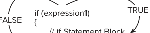

图 6-1：if 语句块

## 测试奇偶数 `Chapter06ProgramOddEven`

为了说明 `if` 语句的简单用法，请图 6-2 所示的程序。

1. 在第 2 章中使用 C# 模板创建一个新项目。
2. 添加两个标签对象、一个文本框对象两个按钮。
3. 按照你的要求设置对象的属性。图 6-2 是你可能使用的用户界面示例。
4. 添加按钮点击事件代码，如代码 6-1 所示。

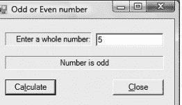

图 6-2：奇偶数程序

用户输入一个数字，程序根据其值告诉他们该数字是奇数还是偶数。字母 O 就在数字字符 `0` 下方，有时人们匆会按错键。

### 代码 6-1：`btn-Click` 事件代码 `frmMain.cs`

```csharp
private void btnCac_Calc_Click(object sender, EventArgs e)
{
    bool flag;
    int val;
    string output = "Number is even";

    // 从文本转换为数字
    flag = int.TryParse(txtNumber.Text, out val);
    if (flag == false)
    {
        MessageBox.Show("Not a number. Re-enter.");
        txtNumber.Clear();
        txtNumber.Focus();
        return;
    }
    // 查看奇奇偶
    if (val % 2 == 1)
    {
        output = "Number is odd";
    }
    // 显示结果
    lblOutput.Text = output;
}
```

工作原理

执行所有工作的代码都在点击事件中 `参考代码 6-1`。

理解语句如何改变程序流程的最佳方法，是使用 `var` 的不同值对代码进行单步执行。要做到这一点，请将光标置在以下语句上：

```
flag = int.TryParse(txtName.Text, out val);
```

然后按 `F9` 键开始设置调试断点。现在运行程序。当程序到达断点时，通过反复按 `F10` 键对程序进行单步执行。`你也可以使用 F11` 键，甚至更好，因为会让程序在进入你编写的任何方法时也进行单步执行。

## “使用了未赋值的局部变量”

有时，当你使用该语句时，可能会遇到以下错误消息：

```
use of unassigned local variable i
```

你可以通过以下代码段来演示这一点：

```
int i;
// 一些额外的代码行
if (x == MAX)
{
    i = 10;
}
i *= i;
```

`Visual Studio` 对最后一行程序代码发布错误消息，指出你正尝试在给变量赋值之前使用它。`Visual Studio` 之所以这样做，是因为它无法编译语句是否返回逻辑 True 来将值 10 赋值给 `i`。如果表达式逻辑为 False，变量 `i` 就是未初始化的，并且没有已知的赋值值。你可以简单地用默认值初始化变量 `i` 来解决这个问题。大多数情况下，你会在定义变量时完成这一点。只需将 `i` 的定义更改如下所示：

```
int i = 0;
```

这会将 `i` 的右值设置为 0，`Visual Studio` 就很满意了，因为无论 `if` 表达式的结果如何，`i` 现在都有了一个已知的值。

### if-else 语句

如果你仔细观察列表 6-1 中的代码，你会注意到即使在定义字符串时，输出字符串也被设置为字面量 `Number is even`。因此，字符串只有在数字为奇数时才会改变。如果你想一下，你实际上想做的是根据数字是奇是偶设置输出字符串。程序可以工作，但它并没有反映你的真实意图。

`if-else` 语句是清晰代码的完美解决方案。`if-else` 语句的语法如下：

```
if (expression1)
{
// 逻辑为真：if 语句块
}
else{
    // 逻辑为假：else 语句块
}
```

使用 `if-else` 语句，如果 `if (expression1)` 为真，则执行 `if` 语句块。如果 `expression1` 为假，则执行 `else` 关键字之后的大括号内的语句。`else` 关键字之后大括号内的语句组被称为 `else` 块。`if-else` 语句的程序流如图 6-3 所示。

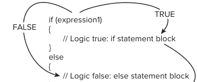

正如图 6-3 所示，`if-else` 语句创建了一种“非此即彼”的决策。也就是说，该决策会产生互斥的结果之一。在接下来的尝试中，你将修改 6-1 所示的程序使用 `if-else`

图 6-3：`if-else` 语句块

## 尝试 if-else 语句 `Chapter06ProgramOddEven.zip`

为了演示 `if-else` 语句块的一些用法，请修改图 6-2 所示的程序。

- 1. 加载你在本章节早期编写的简单 `if` 的程序。
- 2. 将 `output` 的定义更改为：`string output;`
- 3. 将第二个语句替换为：

```
// 检查是奇数还是偶数
if (val % 2 == 1)
{
output = "Number is odd";
else{
output = "Number is even";
}
```

### 工作原理

大多数程序员都会同意，这种形式易于理解，因为结果是清晰陈述的。在简单的 `if-else` 形式中，你不需要换行和缩进就能看到结果。大多数程序员会认为这种形式更易于理解，因为结果是清晰陈述的。在简单的 `if-else` 形式中，你不需要换行和缩进就能看到结果。大多数程序员会认为这种形式更易于理解，因为结果是清晰陈述的。述的，在简单的 `if-else` 语句中，你不需要换行和缩进就能看到结果。这种形式更易于理解，因为结果是清晰陈述的。在简单的 `if-else` 语句中，你不需要换行和缩进就能看到结果。大多数程序员会认为这种形式更易于理解，因为结果是清晰陈述的。在简单的 `if-else` 语句中，你不需要换行和缩进就能看到结果。大多数程序员会认为这种形式更易于理解，因为结果是清晰陈述的。在简单的 `if-else` 语句中，你不需要换行和缩进就能看到结果。

## if-else 的简写形式：三元运算符

由于 `if-else` 语句非常常见，C# 有一种专门设计的特殊运算符来替换它们。三元运算符的语法是替换简单的 `if-else` 语句：

```
(expression1) ? trueExpression : falseExpression
```

三元运算符的工作方式是首先评估 `expression1`。如果 `expression1` 为真，则执行 `trueExpression`。如果 `expression1` 为假，则执行 `falseExpression`。逻辑流如图 6-4 所示。

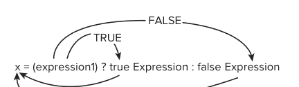

图 6-4：`if-else` 语句

在接下来的尝试中，你使用修改 6-1 所示的程序使用三元运算符。

尝试三元运算符 `Chapter06ProgramOddEven.zip`

为了演示三元运算符的一些用法，请修改图 6-2 所示的程序。

- 1. 加载你在本章节早期编写的简单 `if` 的程序。
- 2. 将 `output` 的定义更改为：`string output;`
- 3. 将 `if-else` 语句替换为：

```
// 检查是奇数还是偶数
output = (val % 2 == 1) ? "Number is odd" : "Number is even";
```

如果 `val % 2 == 1` 为真，`output` 被赋值为 `"Number is odd"`；否则，取模运算符产生 1，`output` 被赋值为 `"Number is even"`。现在运行程序查看它是否如之前一样运行。

### 工作原理

尽管三元运算符是 `if-else` 语句的简写，但我并不喜欢它的用法。有三个原因。首先，大多数程序员理解三元表达式比理解 `if-else` 语句花费更多时间。其次，我有一种挥不去的直觉，使用它的人是为了能用它。第三，如果我在读完三元语句后，感觉程序员在说：“看好了，Billy-Bob。”考虑到这些原因，如果使用简单的 `if-else` 语句代码更清晰，请使用 `if-else`。

## if 和 if-else 语句的样式考量

C# 是一种对格式无关的语言。这意味着你可以将 `if-else` 语句写为单行，例如：

```
if (val % 2 == 1) (output = "Number is odd";output = "Number is even");
```

`Visual Studio` 可以正常处理这些语句。然而，大多数程序员会认为没有换行和缩进的前一行更难以阅读。这种格式问题属于你编写代码时的样式问题。

例如，当 `if` 或 `else` 块只包含一条语句时，就不需要大括号。也就是说，你可以将以下代码：

```
if (val % 2 == 1)
{
    output = "Number is odd";
else
{
    output = "Number is even";
}
```

写成这样：

```
if (val % 2 == 1)
    output = "Number is odd";
else
    output = "Number is even";
```

程序的执行结果与之前完全相同。然而，当 `if` 语句包含多条语句时，你必须使用大括号。假设你写了以下代码：

```
if (val % 2 == 1)
{
```

```cs
output = "Number is odd";
oddCounter++;
```

你的意图是使用 `oddCounter` 统计奇数的个数。如果你在不使用括号的情况下编写相同的代码：

```cs
if (val % 2 == 1)
    output = "Number is odd";
    oddCounter++;
```

你的意图可能是一样的，但如果没有大括号，你实际得到的是：：

```cs
if (val % 2 == 1)
{
    output = "Number is odd";
}
oddCounter++;
```

代码之所以不同，是因为在没有大括号的情况下，`if` 语句只控制一条语句。结果是无论 `val` 的值如何，`oddCounter` 都会增加——这可能不是你想要的。

因此风格问题变成了：“当 `if` 语句块只包含一条语句时，你应该使用大括号吗？”答案是肯定的。始终使用大括号。首先，它促进了代码的一致性。每当你使用 `if` 语句时，都会紧跟大括号。其次，原本 `if` 语句块中的单条语句在经过测试和调试后可能会变成多条语句。你迟早需要添加大括号，不如从一开始就加上。第三，大多数程序员认为大括号让语句块更加突出，更易于阅读。在这里学到的教训是，即使 `if` 语句块只包含一条语句，也要始终使用大括号。

另一个风格考量是大括号的位置。例如，由于 C# 不在乎语句的格式，你可以这样写代码：

```cs
if (val % 2 == 1)
    output = "Number is odd";
else
    output = "Number is even";
```

注意，必需的大括号仍然位于它们该在的位置，但位置有所不同。这种 K&R 风格因 Brian Kernighan 和 Dennis Ritchie 编写的 C 语言书籍 `The C Programming Language`, `Prentice Hall`, `1978` 而流行。采用这种风格的原因之一是它占用的屏幕行较少，这意味着你可以更好地利用显示器的微小区域。无需滚动即可看到更多代码是一件好事。


那么你应该使用哪种风格呢？显然，`C#` 并不在意；尽管 `Visual Studio` 会根据团队（或公司）将大括号放在单独的行。如果你只是为自己写代码，那是你的选择。我个人主要喜欢 `K&R` 风格，是因为它是我第一种喜欢的语言，而且大多数 `C` 语言程序员在使用括号和 `K&C` 风格时会做一些愚蠢的事，比如：

```cs
if (x == 2)
    x++;
```

当添加了大括号后，这段代码片段实际上变得更加明显：

```cs
if (x == 2) {
}
x++;
```

这可能不是程序员意图想要的操作。始终使用大括号有助于减少这种愚蠢行为。

> 注意：默认情况下，`Visual Studio` 倾向于将大括号放在单独行。也就是说，如果你尝试将大括号与 `if` 表达式放在同一行，它会自动重新格式化语句并将大括号移动到下一行。然而，在重新格式化后，如果你将大括号移回上一行，`Visual Studio` 会允许你将其保留在那里。

你可以通过使用 `Tools; Customize; Text Editor; C#; Formatting; New Lines` 菜单并取消勾选 `Place Brace on New Line for Control Blocks` 选项更改编辑器的默认行为，以便将大括号留在同一行。你可以向下滚动对语句块的 `else` 部分执行相同的操作。（确保你在 `Show All Settings` 框中勾选了。）

没有“正确”的风格。然而，无论你选择哪种风格，保持一致即可。

## 嵌套 if 语句

你可以在 `if` 语句内部包含语句。例如，假设你经营一家酒吧，周二女性半价。你可能会有这样的代码：

```cs
decimal price = FULLPRICE;
if (age >= 21) {
    if (gender == "Female") {
        price *= .5M;
    }
} else {
    MessageBox.Show("illegal minor.");
}
```

在这个例子中，如果满足 `age >= 21`，则会检查 `gender` 是否为 `"Female"`。

```cs
else
  if (day == 5)
  {
    day += 5; // 模拟周五事务
  } else
    if (day == 6)
    {
      day += 6; // 现在是周六事务
    } else
      if (day == 7)
      {
        day += 7; // 最后是周日的事务
      }
```

现在编译并运行该程序。

### 工作原理

像前面的代码这样的代码被称为级联语句（cascading statement）。作为一个一般规则，级联 `if` 语句根据特定变量的状态执行不同的任务。在这一段代码中，似乎根据 `day` 变量的值调用了不同的方法。如果你仔细遵循逻辑，你会发现当第一个测试结果逻辑为真（True）时，其余六个不必要的测试不会被执行。（使用调试器来证明这一点。）当一个语句变为逻辑真时，会跳过不必要代码的原因是，没有理由评估任何后续的表达式。

级联 `if` 语句通常有些笨拙且难以阅读，仅仅是因为有太多的语句和花括号，导致可能会发生一些混乱。（想象一下，如果一个月有 31 天，这段代码看起来会有多丑！）另一个问题是，如果你对每个表达式使用正确的缩进，你的代码会被推向显示屏幕越右越远。最终，这可能会迫使你使用水平滚动，而大多数程序员都不喜欢这一点。在讨论 `switch` 关键字的章节中，你会看到一种编写级联语句更有效的方法。

# 逻辑运算符

有必要根据两个或多个变量的状态做出复杂的决策。例如，为了确定一年是否为闰年，你应用以下测试：

如果年份能被 4 整除，但不能被 100 整除，它就是闰年。如果年份能被 400 整除，则是一个例外。如果是，它就是闰年。

如果你尝试将此编码为一系列简单的 `if` 语句，代码就会变得混乱。实际上，如果你可以在单个语句块中使用逻辑运算符的组合，编写该算法会更简单。`C#` 条件运算符如表 6-2 所示

# 表 6-2：条件逻辑运算符

| 项目 | 含义 | 示例 |
|---|---|---|
| 逻辑 `&&` | 逻辑与 `AND` | `x && y` |
| 逻辑 `||` | 逻辑或 `OR` | `x || y` |
| 逻辑 `!` | 逻辑非 `NOT` | `!x` |

因为这些是逻辑运算符，每一个都解析为真或假的表达式。你可以通过使用真值表来观察这些关系。表 6-3 显示了逻辑与运算符的真值表。

# 表 6-3：逻辑与真值表

| 表达式1 | 表达式2 | `Expression1 && Expression2` |
|---|---|---|
| True | True | True |
| True | False | False |
| False | True | False |
| False | False | False |

表 6-2 的最后一列显示，与真值表是使用带有 `&&` 的两个表达式构建的。表 6-3 显示了这两个表达式所有可能值的结果以及对逻辑与结果的影响。例如，如果 `Expression1` 解析为逻辑真，而 `Expression2` 解析为逻辑假，则结果为逻辑假。这是因为逻辑与要求两个表达式均为真，结果才为真。所有其他组合产生的结果均为逻辑假。

表 6-4 显示了逻辑或运算符的真值表。如你在表中所示，如果逻辑或语句的任一或两个表达式为逻辑真，结果为真。只有当两个表达式均为假时，结果才为假。

# 表 6-4：逻辑或真值表

| 表达式1 | 表达式2 | `Expression1 || Expression2` |
|---|---|---|
| True | True | True |
| True | False | True |
| False | True | True |
| False | False | False |

最后，表 6-5 显示了逻辑非运算符的真值表。如你所知，逻辑非与其他运算符不同，它是一个元运算符，这意味着它只于一个表达式。

# 表 6-5：逻辑非真值表

| 表达式1 | `!1` |
|---|---|
| True | False |
| False | True |

# 使用逻辑运算符

有必要根据两个或多个变量的状态做出复杂的决策。例如，为了确定一年是否为闰年，你应用以下测试：年份能被 4 整除，但不能被 100 整除，它就是闰年。如果年份能被 400 整除，则是一个例外。如果是，它就是闰年。

你尝试将此编码为一系列简单的 `if` 语句，代码就会变得混乱。实际上，如果你可以在单个语句块中使用逻辑运算符的组合，编写该算法会更简单。`C#` 条件运算符如表 6-2 所示。


像前面的代码这样的代码被称为级联语句（cascading statement）。作为一个一般规则，级联 if 语句根据特定变量的状态执行不同的任务。在这一段代码中，似乎根据 `day` 变量的值调用了不同的方法。如果你仔细遵循逻辑，你会发现当第一个测试结果逻辑为真（True）时，其余六个不必要的测试不会被执行。（使用调试器来证明这一点。）当一个语句变为逻辑真时，会跳过不必要代码的原因是，没有理由评估任何后续的表达式。

级联 if 语句通常有些笨拙且难以阅读，仅仅是因为有太多的语句和花括号，导致可能会发生一些混乱。（想象一下，如果一个月有 31 天，这段代码看起来会有多丑！）另一个问题是，如果你对每个表达式使用正确的缩进，你的代码会被推向显示屏幕越右越远。最终，这可能会迫使你使用水平滚动，而大多数程序员都不喜欢这一点。在讨论 `switch` 关键字的章节中，你会看到一种编写级联语句更有效的方法。

# 逻辑运算符

有必要根据两个或多个变量的状态做出复杂的决策。例如，为了确定一年是否为闰年，你应用以下测试：

如果年份能被 4 整除，但不能被 100 整除，它就是闰年。如果年份能被 400 整除，则是一个例外。如果是，它就是闰年。

你尝试将此编码为一系列简单的 if 语句，代码就会变得混乱。实际上，如果你可以在单个语句块中使用逻辑运算符的组合，编写该算法会更简单。C# 条件运算符如表 6-2 所示。

## 表 6-2：条件逻辑运算符

| 项目 | 含义 | 示例 |
|---|---|---|
| 逻辑 && | 逻辑与 (AND) | `x && y` |
| 逻辑 \|\| | 逻辑或 (OR) | `x || y` |
| 逻辑 ! | 逻辑非 (NOT) | `!x` |

因为这些是逻辑运算符，每一个都解析为真或假的表达式。你可以通过使用真值表来观察这些关系。表 6-3 显示了逻辑与运算符的真值表。

## 表 6-3：逻辑与真值表

| 表达式1 | 表达式2 | Expression1 && Expression2 |
|---|---|---|
| True | True | True |
| True | False | False |
| False | True | False |
| False | False | False |

表 6-2 的最后一列显示，与真值表是使用带有 `&&` 的两个表达式构建的。表 6-3 显示了这两个表达式所有可能值的结果以及对逻辑与结果的影响。例如，如果 `Expression1` 解析为逻辑真，而 `Expression2` 解析为逻辑假，则结果为逻辑假。这是因为逻辑与要求两个表达式均为真，结果才为真。所有其他组合产生的结果均为逻辑假。

表 6-4 显示了逻辑或运算符的真值表。如你在表中所示，如果逻辑或语句的任一或两个表达式为逻辑真，结果为真。只有当两个表达式均为假时，结果才为假。

## 表 6-4：逻辑或真值表

| 表达式1 | 表达式2 | Expression1 \|\| Expression2 |
|---|---|---|
| True | True | True |
| True | False | True |
| False | True | True |
| False | False | False |

最后，表 6-5 显示了逻辑非运算符的真值表。如你所知，逻辑非与其他运算符不同，它是一个元运算符，这意味着它只于一个表达式。

## 表 6-5：逻辑非真值表

| 表达式1 | !1 |
|---|---|
| True | False |
| False | True |

# 使用逻辑运算符

通过 `switch` 语句，表达式的值决定了执行哪个 `case` 语句。你可以认为每个 `case` 语句从 `case` 关键字后面的冒号（:）开始，到关联的 `break` 关键字结束。

如果表达式不匹配任何 `case` 语句，则计算 `default` 表达式。与 `if` 块不同，`case` 块不需要括号。`break` 语句是必要的，可以防止程序控制“穿透”到下一个 `case` 语句。`break` 语句导致程序执行从 `switch` 块大括号后的第一个语句开始恢复。

接下来，让我们写一个简单的程序，使用 `switch` 语句来做出复杂的决策，而不是嵌套的 `if-else` 块。你会发现 `switch` 版本更易读，而且效率略高。

## 尝试：使用 switch 语句：(Chapter06ProgramSwitch.zip)

从 `Chapter06ProgramSwitch.zip` 文件加载代码，或使用列表 6-2 所示的代码。列表中仅显示了 `btnCalc` 点击事件代码，因为其余代码与你编写的所有程序几乎完全相同。

### 列表 6-2：btn_Click 事件代码 (frmMain.cs)

```cs
private void btnCalc_Click(object sender, EventArgs e)
{
    bool flag;
    int myDay;
    string msg = "Today is " // 避免重复 7 次
    // 将文本转换为 int
    flag = int.TryParse(txtDay.Text, out myDay);
    if (flag == false)
    {
        MessageBox.Show("仅限数字，1 到 7*");
        txtDay.Focus(); // 让他们回去重试
        return;
    }
    switch (myDay)
{
    case 1:
        lblResult.Text = msg + "Monday";
        break;
    case 2:
```

## 列表 6-2（续）

```cs
lblResult.Text = msg + "Tuesday";
break;
case 3:
lblResult.Text = msg + "Wednesday";
break;
case 4:
lblResult.Text = msg + "Thursday";
break;
case 5:
lblResult.Text = msg + "Friday";
break;
case 6:
lblResult.Text = msg + "Saturday";
break;
case 7:
lblResult.Text = msg + "Sunday";
break;
default:
lblResult.Text = "You should never get here";
break;
}
```

在更现实的情况下，`case` 语句会执行一些更有趣的操作。然而，这段简单的代码可以很好地满足你的需求。

### 工作原理

如果你研究这段代码片段，你会发现它的工作方式类似于级联 `if` 语句；它更容易读。此外，你不需要水平滚动即可一眼看到所有代码。

`day` 的值决定了执行哪个 `case` 块。每个 `case` 块中的 `break` 语句将控制发送到 `switch` 块结束大括号后的第一个语句。因此，是 `break` 语句使得 `switch` 能够像级联语句一样工作，避免不必要的测试。

如果变量 `day` 的值不在 1 到 7 之间，则执行 `default` 情况。（你并不强制使用 `default` 情况，但在每个 `switch` 语句中包含一个是一个好主意。）这种情况会显示一个简单的错误消息。通常，`default` 情况会调用记录错误性质的日志方法。很多时候，错误日志文件是一个简单的文本文件，可以使用任何文字处理程序读取。也许 `ErrorLog()` 方法会在错误日志文件中记录 `day` 的值，以便人员可以通过电话要求用户读取错误日志文件的最后一行。因此，支持人员将获得关于 `day` 产生错误的信息。

### 总结

本章介绍了在程序中做决策的基础。计算机决策的构建模块是简单的 `if` 语句。从中，你学习了 `if-else` 和 `switch` 语句，并了何时使用它们。你还阅读了关于编程风格以及相关问题。

## 练习题

练习题的答案可以在附录 A 中找到。

- 1. 电影院对12 岁及以下的儿童或 65 岁及以上的老人半价。编写一个 `if` 语句来考虑这种定价政策。
- 2. 在编写 `if-else` 语句时，重要的风格考虑因素有哪些？
- 3. 何时适合使用级联 `if` 语句？
- 4. 在以下代码段中看到了哪些错误？

```cs
if (x = y);
{
    price *= .06;
}
```

- 5. 假设小披萨售价 6 美元，中号贵一美元，大号比中号贵一美元。假设变量 `size` 存储客户的选择，你会如何编写代码确定最终价格？
- 6. 编写一个程序，接受年份输入，然后调用名为 `IsLeapYear(int year)` 的方法，然后显示用户输入的年份二月份正确的天数。

# 无限循环

无限循环通常是无意的，可能会导致程序“挂起”。因此，每当你编写涉及程序循环的代码时，在运行之前保存代码是一个好主意。默认情况下，Visual Studio 会你运行程序（F5）时保存代码。你可以通过“文件->保存全部”（File Save All）菜单序列或使用 `Ctrl+Shift+S` 组合键来显式保存项目代码。通过在尝试运行之前保存代码，如果代码进入了无限循环，你就可以从离开的地方继续。通常，你可以通过点击小正方形图标或按下 `Shift+F5` 来重新获得控制权。某些情况下不起作用，当执行无限循环时，你可能需要使用可怕的 `Ctrl+Alt+Delete` 来重新获得系统的控制。

为了说明良好循环的三个条件，请考虑 C# 的 `for` 循环。

## for 循环

`for` 循环的语法如下：

```csharp
for (expression1; expression2; expression3)
{
    // for循环语句块
}
```

`expression1` 通常用于初始化控制循环变量的起始值。`expression2` 通常是一个关系测试，用于确定是否需要下一次循环迭代。最后，`expression3` 通常是一个增加或递减控制循环变量的语句。一个具体的示例有助于识别这些表达式。假设你想生成一个从 0 到 100 的数值表。控制处理的 `for` 循环可能像这样：

```csharp
for (i = 0; i <= 100; i++)
{
    // 计算数值的语句
}
```

`expression1` 是紧跟在 `for` 循环左括号后面的语句：

`i = 0;`

此表达式设置或初始化了控制循环的变量的初始状态。在这种情况下，你从值 0 开始平方表计算。因为变量 `i` 出现在所有三个表达式中，所以它是控制 `for` 循环的变量。如果你想用值 `i` 初始化循环状态，你会将 `expression1` 改为

`i = 1;`

第二个表达式，

`i <= 100;`

检查变量 `i` 的当前值是否与期望的结束值 100 相比较。如果该表达式的结果为逻辑真（True），则将再次执行一次循环代码。也就是说，`for` 循环的语句会被再次执行。

第三个表达式，

```csharp
i++;
```

负责在每次通过时更改循环的状态。在这种情况下，代码简单地增加了变量 `i` 的值。注意，你可以在这里放置任何表达式语句，包括你想要的递减。

## 递增和递减运算符

表达式 `i++`。这是一个后增运算符的示例。后增运算符（`i++`）的解释为：

```csharp
i = i + 1;
```

也就是说，后增运算符取变量 `i` 的当前值并对其加 1。

你也可以使用后递减运算符，其语法为 `i--`。后递减运算符的解释为：

```csharp
i = i - 1;
```

因此，后递减运算符取变量 `i` 的当前值并从中减 1。

当递增或递减运算符像在 `for` 循环中那样“独立存在”时，只有一个变量受影响。现在考虑以下语句：

```csharp
k = i++;
```

如果该语句执行之前 `i` 的值为 5，那么 `k` 的值是多少？`k` 等于 5 还是 6？换句话之，递增发生在什么时候？在这个示例中，你使用了后增运算符，`k` 的值为 5，但语句执行完毕时 `i` 的值是 6。这就是为什么它被称为后增运算符。你先使用第一个（在本示例中使用赋值运算符），然后执行递增操作。

正如你可能猜想的那样，还有前增运算符。前增操作将两个符号放在变量名之前。对于前增操作，递增是在使用值之前进行的。因此，如果在执行以下语句之前 `i` 为 5：

```csharp
k = ++i;
```

那么 `k` 的值为 6，与 `i` 的值相同。

C# 允许你使用前递和后递减操作。如果在执行以下语句之前 `i` 的值为 5：

```csharp
k = --i;
```

那么 `k` 的值为 5，但 `i` 的值是 4。再次，原理相同：递减操作是在赋值完成后完成的。如果使用前递运算符，

`k` 和 `i` 的值都是 4，因为递减是在赋值发生之前执行的。你应该相信，一个独立的递增或递减表达式从程序的角度来看其行为是完全相同的。只有当递增或递减操作作为其他表达式（例如赋值操作）的一部分时，使用前置或后置运算符才重要。在 `for` 循环中，`expression3` 没有与任何其他子表达式一起使用，所以你可以使用前增或后增运算符。

## for 循环中的执行顺序

在 `for` 循环中语句执行的顺序有一个定义良好的序列。这种顺序如图 7-1 所示。

在图中，步骤 1 通常是控制循环变量的初始化。完成步骤 1 后，程序控制转移到步骤 2。注意步骤 1 中的 `expression1` 永远不会被再次访问。

步骤 2 是关系测试。如果该表达式的结果为逻辑真，则将再次执行一次循环代码。也就是说，`for` 循环的语句会被再次执行。如果该表达式的结果为逻辑假（False），则跳过循环。

步骤 3 负责在每次通过时更改循环的状态。在这种情况下，代码简单地增加了变量 `i` 的值。注意，你可以在这里放置任何表达式语句，包括你想要的递减。

完成步骤 3 后，程序控制转移回步骤 2。

```csharp
#region Windows code // 此代码是隐藏的
public void frmMain()
{
    InitializeComponent();
}
public static void Main()
{
    frmMain = new frmMain();
    Application.Run(main);
}

private void btnCalculate_Click(object sender, EventArgs e)
{
    bool flag;
    int i;
    int start;
    int end;
    string buff;

// ============= 获取输入 ============
// 将 start 从文本转换为 int
flag = int.TryParse(txtStart, out start);
if (flag == false)
{
    MessageBox.Show("Numeric data only", "Input Error");
    txtStart.Focus();
    return;
}

// 将 end 从文本转换为 int
flag = int.TryParse(txtEnd, out end);
if (flag == false)
{
    MessageBox.Show("Numeric data only", "Input Error");
    txtEnd.Focus();
    return;
}

if (start >= end) // 数值合理;
{
    MessageBox.Show("Start greater than end.", "Input Error");
    txtStart.Focus();
    return;
}

// ============= 处理并显示 ====
for (i = start; i <= end; i++)
{
    buff = string.Format("{0, 5}{1, 20}", i, i * i);
    lstOutput.Items.Add(buff);
}
```

# 176 | 第 7 章 使用循环进行语句重复

## 列表 7-1 (续)

```csharp
}
private void btnClose_Click(object sender, EventArgs e)
{
    Close();
}
```

```csharp
private void btnClear_Click(object sender, EventArgs e)
{
    txtStart.Clear();
    txtEnd.Clear();
    lstOutput.Items.Clear();
}
```

如果你为按钮和文本框对象标记的名称与列表 7-1 中显示的不同，则你将需要相应地调整代码。

### 工作原理

所有的实际工作如往常一样，都在计算（Calculate）按钮的点击事件代码中完成。定义了几个变量，然后是用于从用户界面对象获取输入数据的代码。在这个示例中，用户分别在 `txtStart` 和 `txtEnd` 对象中输入了起始和结束值。（`TryParse()` 方法在第 6 章中详细讨论过，因此这里没有重复该讨论。）如果两个 `TryParse()` 方法运行良好且没有错误，则用户输入了有效的数字字符，这些字符可以转换为变量 `start` 和 `end`。这意味着你已经完成了第 2 章中讨论的五个步骤中的“输入”步骤。

现在查看 `for` 循环的代码：


```csharp
for (i = start; i <= end; i++)
{
    buff = string.Format("{0,5}{1,20}", i, i * i);
    lstOutput.Items.Add(buff);
}
```

良好循环的第一个条件是你必须设置循环的初始值。在这个示例中，`for` 循环的表达式 1 (`i = start`) 将控制循环的变量 (`i`) 的起始值设置为图 7-1 中的第 1 步。完成后，程序移动到 `for` 循环的表达式 2，`i <= end`。假设用户输入的起始值为 0，结束值为 100。由于 `i` 已经初始化为 0，表达式

```csharp
i <= end;
```

可以被视为

```
0 <= 100;
```

由于 0 小于 100，该表达式求值为逻辑真（True），这意味着接下来执行循环体中的语句。

## 格式化字符串数据

语句

```csharp
buff = string.Format("{0, 5}{1, 20}", i * i);
```

是 `string` 类提供的一种特殊格式化方法。`Format` 表明该方法始终是一个字面量字符串。字符串内部是你想要格式化的数据的选项列表。第一个选项是 `{0, 5}`。该选项表示将第一个参数（即零）在 5 个字符的字段中右对齐。（程序员从零开始，第一个参数是零。）第二个选项是 `{1, 20}`，它表示将第二个参数（即1）在 20 个字符的字段中右对齐。这就是为什么图 7-2 中的输出行是对齐的。

好了，你知道了如何格式化参数，但它们在哪里呢？引号字符串 `"{0, 5}{1, 20}"` 后面跟着一个参数列表。选项字符串表明有两个参数。在第一个选项后面的是两个参数：`i` 和 `i * i`。因此，第一个参数是 `i` 的值，第二个参数是 `i * i` 的值。这两部分数据通过 `Format()` 方法进行格式化并放入字符串中。

一些额外的 `Format()` 方法在表 7-1 中。你可以使用 Visual Studio 查看其他格式选项。表 7-1 第三列显示了选项字符串中请求字段宽度。允许不指定字段宽度。注意减号的使用使数据左对齐。缺少减号则产生数据的默认右对齐。

### 表 7-1：格式字符串

| 选项字符串 | 参数 | 输出 |
| :--- | :--- | :--- |
| `{0}` | `"Katie"` | Katie |
| `{0, 15}` | `"John"` | John |
| `{0, -15}` | `"Tammy"` | Tammy |
| `{0, 15:C}` | `5.10` | $5.10 |
| `{0, -15:C}` | `5.10` | $5.10 |
| `{0, mm}` | `9:15` | 15 |
| `{0, 5:hh}` | `12:15` | 12 |
| `{0, 15:hh}` | `12:15` | 12 |
| `{0, ddd MMMM}` | `1/20` | Tuesday January |

# 181 | 第 7 章 使用循环语句重复

如果你想使用 `string` 类的 `Format()` 方法格式化列表框中的列，仍然需要解决问题。如果你尝试列表 7-1 中的代码，列表框中的输出看起来很好，但不完美。为什么你的输出在图 7-2 中没有完美对齐？

### 字体与列对齐

你的程序中的列不直齐的原因是列表框的默认字体是 Microsoft Serif。这意味着每个字符只获得显示字符所需的像素（可能需要 3 个像素）。结果是列表框中的每个数字使用的像素不同，因此无法对齐。

如果你切换到固定字体（如 Courier New），列就会完美对齐。因为 Courier New 中的每个字符无论宽窄，占据的像素数完全相同。因此，你修复这种对齐只需要将其改为 Courier New（你正在更改列表框的状态吗？）。你可以通过更改窗口中的列表框并选择 (...) 来实现。然后滚动字体列表直到出现 Courier New。然后你可以看到图 7-3 中的窗口。你可以更改样式（例如，粗体、斜体）和字体大小。


图 7-3：字体属性

在通过 `Format()` 方法将 `i` 和 `i * i` 的值格式 `buff` 后，列表框中的代码。向列表框添加字符串的方法很简单：

```csharp
lstOutput.Items.Add(buff);
```

你应该发现列表框有两个运算符。列表框有一个名为 `Items` 的属性，它是一个对象（技术上，`Items` 是一个集合；你在第 8 章学习过这些）。代码调用了 `Items` 对象的 `Add()` 方法，该方法返回添加到列表框的一行输出。`buff` 中的字符串数据添加到 `listOutput` 后，程序控制跳转到循环的后置条件，即后置增操作（参见图 7-1）。该表达式是良好循环的第三步：它改变了循环的状态。如果你不更改循环计数器 `i` 的状态，将导致无限循环，因为循环中的第二个表达式将始终为真。在 `i` 通过 `++` 运算符增加后，程序控制转移到表达式。对于你的循环，该表达式是

```csharp
i <= end;
```


## 平方表，版本 2 (`Chapter07ProgramTableOfSquaresVersion2.zip`)

对于此示例，你可以重用列表 7-1 中的代码作为起点。（毕竟，面向对象编程的优势之一就是代码重用；或者你也可以为了自己省事，直接下载程序代码。）你仍然需要生成平方表，因此用户界面不需要更改。然而，你不再使用简单的 `* i` 表示数字平方的逻辑，而是想要实现一种新的平方算法。

1. 加载原始的平方表程序（即你使用列表 7-1 的那个程序）。
2. 将跟随 Program and Display 注释的 `for` 循环代码替换为以下代码：

```
for (i = start; i <= end; i++)
{
    nextOddInteger = 1;      // 设置第一个奇数
    square = 0;               // 始终从 square = 0 开始

    for (j = 0; j < i; j++)
    {
        square += nextOddInteger; //累加奇数
        nextOddInteger += 2;     // 设置下一个奇数
    }

    buff = string.Format("{0, 5}{1, 20}", i, square);
    lstOutput.Items.Add(buff);
}
```

你应该拿一张纸写下实现新算法的代码。阅读和观察如何写代码太容易了。通过尝试自己编写代码，你会学到更多。

你需要为原始版本的程序添加几个新变量。你需要添加到 `btnCalculate` 点击事件代码中的新变量如下：

```
int j;
int square;
int nextOddInteger;
```

这些新变量应该被添加到 `btnCalculate` 点击事件代码中。

### 工作原理

在新定义的变量中，`j` 用于控制一个新的 `for` 循环，`square` 用于存储平方值，而 `nextOddInteger` 用于在循环中创建一系列奇数序列。在修定后的 `for` 循环代码中：

```
for (i = start; i <= end; i++)
{
    nextOddInteger = 1;      // 设置第一个奇数
    square = 0;               // 始终从 square = 0 开始

    for (j = 0; j < i; j++)
    {
        square += nextOddInteger; //累加奇数
        nextOddInteger += 2; // 设置下一个奇数
    }
    buff = string.Format("{0, 5}{1, 20}", i, square);
    lstOutput.Items.Add(buff);
}
```

由变量 `i` 控制的 `for` 循环被称为外循环。由变量 `j` 控制的 `for` 循环被称为内循环。

这些循环共同成了前面提到的嵌套循环。外循环仍然遍历你想在平方表中显示的所有值。两个循环都是根据良好循环的三个要求构建的。现在检查内循环中的代码。

假设外循环的变量 `i` 值为 3。这让你想要计算 3 的平方。代码将 `nextOddInteger` 设置为 1 并清空 `square` 为 0。将循环表达式 2 中的变量 `i` 替换为其当前值，`j` 循环看起来如下：

```
for (j = 0; j < 3; j++) { // 嵌套的 j 循环
  square += nextOddInteger; //累加奇数
  nextOddInteger += 2; // 设置下一个奇数
}
```

因为表达式 2 `< 3`，代码会让循环通过三次（0, 1，以及当 `j = 3` 时表达式 2 变为逻辑假）。如果你需要复习记忆，第 5 章中的表 5-3 解释了 `++` 运算符的作用。在第一次通过中，循环看起来像：

```
for (j = 0; j < 3; j++) { // 嵌套的 j 循环
  square = 1; //累加奇数
  nextOddInteger = 3; // 设置下一个奇数
}
```

因此，第一次通过后，`square` 等于 1，`nextOddInteger` 增加到 3。部分结果为：

```
square = 1
nextOddInteger
```

在第二次通过中，你发现：

```
for (j = 0; j < 3; j++) {
  square = 4; //累加奇数
  nextOddInteger = 5; // 设置下一个奇数
}
```

处理以下代码时：

```
square = 1 + 3 = 4
nextOddInteger = 3 + 2 = 5
```

在第三次也是最后一次通过中，你发现：

```
square = 1 + 3 + 5 = 9
nextOddInteger = 5 + 2 = 7
```

不再需要额外的循环通过，因为表达式 2 `(j < 3)` 现在为逻辑假。因此，列表框中的输出声明如下：

```
buff = string.Format("{0, 5}{1, 20}", i, square);
lstOutput.Items.Add(buff);
```

唯一的区别是你将 `i *` 替换为了变量 `square`。运行程序，列表框中的输出与之前完全相同。唯一的区别是你使用了嵌套循环来生成平方。

## 使用调试器作为学习工具

查看程序工作的最好方法是单步执行。例如，将光标放在以下语句上：

```
for (i = start; i <= end; i++)
```

按 `F9` 键在该行设置断点（该行背景变为红色）。现在按 `F5` 键运行程序。最终你会到达断点（你可能需要点击 Source 窗口查看，断点现在背景为黄色）。

现在按 `F10` 键单步执行程序代码。确保 Locals 窗口可见（Debug -> Locals），这样你就可以执行时查看变量的值。使用调试器是根据变量理解程序流很好的方法。

## WHILE 循环

另一种类型的程序是 `while` 循环。`while` 循环的标准语法如下：

```
while (expression2)
{
    // while 循环体
}
```

为了使 `while` 循环良好，它必须遵循适用于 `for` 循环的规则。然而，与 `for` 循环不同，`while` 循环没有将三个条件都作为结构的一部分。良好循环的第一个表达式 `expression1` 在进入结构之前初始化循环变量。第三个表达式 `expression3` 在 `while` 循环体内设置。

你也可以修改之前的平方表使用 `while` 循环。这是下一个主题。

## 平方表，while 循环版本 (`Chapter07ProgramWhileLoop.zip`)

`while` 循环结构与循环不同，再次使用平方表可以看到它们的区别。

1. 加载原始平方表（使用列表 7-1）。
2. 将 `btnCalculate()` 代码替换为列表 7-2 所示的代码。

列表 7-2：平方表，while 循环变体。(`frmMain.cs`)

```cs
private void btnCalculate_Click(object sender, EventArgs e)
{
    bool flag;
    int i;
    int start;
    int end;
    string buff;

    //============ 输入
    // 将 start 从文本转换为 int
    flag = int.TryParse(txtStart.Text, out start);
    if (flag == false)
    {
        MessageBox.Show("仅限数字", "输入错误");
        txtStart.Focus();
        return;
    }

    // 将 end 从文本转换为 int
    end = int.TryParse(txtEnd.Text, out end);
    if (flag == false)
    {
        MessageBox.Show("仅限数字", "输入错误");
        txtEnd.Focus();
        return;
    }

    if (start >= end) // 值合理？
    {
        MessageBox.Show("起始小于结束。", "输入错误");
        txtStart.Focus();
        return;
    }
    //============ 处理和显示

    i = start; // 初始化循环计数器：条件 1
    while (i <= end) // 再次迭代：条件 2
    {
```

列表 7-2（继续）

```cs
buff = string.Format("{0, 5}{20}", i, i * i);
lstOutput.Items.Add(buff);
i++;
// 改变循环状态：条件
}
```

### 工作原理

你可以在列表 7-2 中看到，良好循环的第一个条件已设置，变量 `i` 在进入循环*之前*被初始化为 `start` 的值。这意味着，初始化语句（即 `expression1`）的位置不需要是循环开始之前的语句。然而，良好的编码实践强烈建议将初始化循环控制变量的代码放在语句块的开头是一个好主意。为了更容易查看初始调试应该是必要的。（你难道还没有为每个程序都编写完美的代码吗？）

控制 `while` 循环的条件表达式的解释与 `for` 循环 `(i <= end)` 中的表达式 2 完全相同。这是良好循环的条件。

`while` 循环从 `expression2` 之后的大括号延伸。循环体与列表 7-1 中的 `for` 循环体完全相同，但必须将第三个表达式放在 `while` 循环体内（`i++`）。注意，良好循环的三个条件仍然存在，但 `while` 循环将它们分散放置，而 `for` 循环将它们全部放在在一起。

你不需要这样做。多个循环结构意味着你拥有多种工具来应对不同的编程问题。毕竟，如果你手头的工具只有一把锤子，那么所有问题看起来都像钉子也就不不意外了。多种工具可以为不同的问题提供更优雅的解决方案。

## DO-WHILE 程序规则

C# 提供了第三种循环变体，你可以将其添加到循环工具箱中，称为 do-while 循环。do-while 循环的语法如下：

```
do {
  // do-while 语句块
} while (expression2);
```

do-while 循环变体与 while 循环相似，但有一个主要的区别：do-while 循环始终至少执行一次循环语句。如果你看其他两种循环变体，会发现 `expression2` 的测试是在执行循环块之前进行的。对于 `for` 和 `while` 循环语句，`expression2` 可能会在循环开始时求值结果为 False（假）。如果 `expression2` 在 `for` 或 `while` 循环中结果为假，则不会进行任何循环（即不会执行循环体中的语句）。

这对于 do-while 循环是不成立的。do-while 循环始终至少执行一次其语句块。这是因为评估是否应该再次执行循环的表达式位于循环的底部，并且在循环体至少执行一次后才会到达。换句话说，程序控制必须至少通过一次 do-while 语句块。

虽然你可以再次使用平方表程序来使用 do-while 语句，但在下面的“尝试一下”（Try It Out）中有所不同，它改为生成一系列随机数。请注意，良好循环的条件仍然存在，这些条件并不在代码的某一个地方。

| 尝试一下 | 生成随机数 (`Chapter07ProgramDoWhileRandomNumbers.zip`) |

C# 提供了一个能够生成一系列随机数的类。编写一个程序，测试该类生成的一系列随机数中，是否存在相同的随机数是连续产生的。

1. 使用第 2 章中的步骤和 C# 模板创建一个新项目。
2. 向表单添加两个标签（label）对象和一个按钮（button）对象和一个文本框（textbox）对象。
3. 根据你的需要安排对象，尽管图 7-4 展示了程序的示例运行，并可以作为用户界面的模型。

列表 7-3 显示了程序的代码。

## 列表 7-3：随机数程序。(`frmMain.cs`)


```csharp
using System;
using System.Windows.Forms;

public class frmMain : Form
{
    const int MAXITERATIONS = 200000; // 限制循环次数

    private Button btnClose;
    private Label lblAnswer;
    private Label label;
    private TextBox txtMax;
    private Button btnStart;
    #region Windows code

    public frmMain()
    {
        //============ 程序初始化步骤 ========
        InitializeComponent();
    }

    public static void Main()
    {
        frmMain main = new frmMain();
        Application.Run(main);
    }

    private void btnStart_Click(object sender, EventArgs e)
    {
        bool flag;
        int counter; // 计数器
        int max; // 随机数的最大值
        int last;
        Random randomNumber = new Random();

        //============ 程序输入步骤 ========
        flag = int.TryParse(txtMax.Text, out max);
        if (flag == false)
        {
            MessageBox.Show("只能输入数字字符。", "输入错误",
                MessageBox.OK, MessageBoxIcon.Stop);
            txtMax.Focus();
            return;
        }
        //============ 程序处理步骤 ========
        counter = 0;
        last = (int) randomNumber.Next(max);
        do
{
            current = randomNumber.Next(max);
            if (last == current)
            {
              break;
            }
            last = current;
            counter++;
        } while (counter < MAXITERATIONS);

        //========= 程序输出步骤 ==========
        if (counter < MAXITERATIONS)
        {
          lblAnswer.Text = "花费了 " + counter.ToString() + 次 次匹配成功";
        } else {
          lblAnswer.Text = "没有连续匹配";
        }
    }

    //========= 程序终止步骤 ==========
    private void btnClose_Click(object sender, EventArgs e)
    {
      Close();
    }
}
```

### 工作原理

图 7-4 显示了程序的示例运行。

文本框中的值 1000 表示程序应该生成 0 到 1000 之间（不包含 1000）的随机数。（即 0 到 999 之间的随机值）。图 7-4 显示，在随机生成器连续产生相同值之前，循环执行了 5017 次。现在仔细查看代码。

该程序开始使用第 2 章讨论的 C# 模板。在列表 7-3 的此语句顶部附近：

```
const int MAXITERATIONS = 200000; // 循环次数限制
```


该语句用于限制 `do-while` 循环的最大迭代次数。这是因为仍然可能在循环中执行几十亿次而没有连续生成两个相同的值。使用符号常量 `MAXITERATIONS`，你可以轻松地更改循环的限制，而无需更改循环中的代码。确实，你可以硬编码数字，但使用符号常量 `MAXITERATIONS` 可以让你在更改循环限制时，无需修改循环中的代码。硬编码 200000 这种“魔术数字”无法解释 `MAXITERATIONS` 的作用。如果你更改 `MAXITERATIONS` 的其他值，329bd7a4f8df0746abc10b6d0939f220_png

188 | 第 7 章 使用循环进行重复

用于创建名为 `randomNumber` 的对象。程序然后使用 `TryParse()` 方法来构建随机数的范围。`Random` 类的 `Next()` 方法被调用以产生 0 到减 1 之间的值。以下代码片段执行了大部分工作：

```
counter = 0;
last = randomNumber.Next(max);
do {
    current = randomNumber.Next(max);
    if (last == current) {
        break;
    }
    last = current;
    counter++;
} while (counter < MAXITERATIONS);
```

变量 `counter` 在进入循环之前初始化为 0。此语句充当 `for` 循环表达式的作用。程序然后使用 `Random` 类的 `Next()` 方法生成一个随机数并赋值给变量 `last`。然而，由于程序的目标是比较两个值，在测试它们是否相同之前必须生成另一个随机值。这就是我们使用 `do-while` 循环的原因：你需要至少执行一次循环体来产生两个随机。第二个随机值赋值给变量 `current`。现在你有两个随机数需要比较。

## 循环中的 break 关键字

`if` 语句比较 `last` 和 `current` 的值以检查它们是否相同。如果是，则语句为真并执行 `break` 语句。在循环语句中任何地方执行 `break` 语句，`break` 都会将程序控制发送到循环语句大括号之后的第一个语句。在本程序中，控制被发送到列表 7-3 所示的

```
if (counter < MAXITERATIONS)
```

语句。如果 `current` 和 `last` 的值不相同，则不执行 `break` 语句，程序评估 `do-while` 块的 `expression2` 部分：

```
while (counter < MAXITERATIONS);
```

该语句的评估决定了是否应该再次通过循环。例如，符号常量 `MAXITERATIONS` 设置为 20000，但如果你需要可以更改该常量。（注意该常量如何在后续行中再次使用，以确定显示给用户的消息。）假设计数未超过 `MAXITERATIONS`，`while` 测试会导致循环语句块的另一次通过。

循环执行的次数通过对 `MAXITERATIONS` 的测试进行限制，原因有两个。首先，整数变量可以持有超过 20 亿的值，用户可能不想等待循环处理 20 亿次通过。其次，更重要的是，可能

循环执行了超过 20 亿次，以为 `last` 和 `current` 产生匹配的值。这意味着程序可能会为 `counter` 生成一个大到整数变量无法存储的数值。这可能会导致所谓的“数值溢出异常”，而你的程序将以一种不优雅的方式崩溃！（你将在第 11 章中学习如何防止这种丑陋的情况）。

最终，要么两者匹配成功，要么 `counter` 等于 `MAXITERATIONS` 然后 `while` 循环终止。此时，将评估最后的 `if` 语句，适当的消息将显示在 `lblanswer` 标签对象中。

正如你预期的那样，随着用户增加 `max` 的值，产生匹配值所需的循环次数随之增加。事实上，如果用户输入一个很大的值（例如 200000），程序经常会产生不匹配的情况。

## CONTINUE 语句

有时会出现这样的情况：你需要在循环继续之前在内部执行某些特殊操作。例如，你可能有一个循环正在轮询本章开头提到的火灾喷淋传感器。然而，你并不是在传感器被触发时跳出循环，而是想继续读取其余传感器的状态以查看火蔓延的速度有多快。代码可能如下：

```
while (true)
{
    id++;
    state = readSensor(id);
    if (state == true)
    {
        soundAlarm();
        callFireDepartment();
        continue;
    }
    if (id == MAXSENSORS)
    {
        id = 0; // 所以递增运算符将其设置为 1
    }
}
```

在段代码片段中，你通过声明测试表达式（`expression2`）始终为 `True` 在设计上建立了一个无限 `while` 循环，如第一个程序语句所示。代码递增传感器标识符（`id`）并返回相应的传感器。如果传感器没有返回 `true`，程序将再次通过循环。如果发生火灾且传感器返回 `true`，则会响起警报、报警消防部门，然后由于 `continue` 语句，代码将在 `while` 循环的 `expression2` 处继续执行`expression2` 始终为 `True`，循环继续执行代码。

当使用 `while` 或 `do-while` 循环时，`continue` 语句会将控制传递给决定是否需要再次通过循环的表达式（即 `expression2`）。

使用 `for` 循环的相同类型代码如下：

```
for (id = 0; true; id++)
{
    state = readSensor(id);
    if (state == true) {
        soundAlarm();
        callFireDepartment();
        continue;
    }
    if (id == MAXSENSORS) {
        id = 0; // 递增运算符设置为 1
    }
}
```

在这种情况下，如果发生火灾，变量 `state` 为 `true`，则会执行警报和报警方法（查看 `for` 循环的 `expression2`）。`continue` 语句将程序控制权发送到 `expression3(id++)`，该表达式会递增传感器 `id`。随后程序控制权被发送到 `expression2` 以确定是否需要再次通过循环。因为 `expression2` 始终为逻辑上的 `True`，代码会再次通过循环。你应该让自己相信这是一个无限循环。

与将程序控制权移出循环的 `break` 语句不同，`continue` 语句将程序控制权保留在循环内，以判断是否有必要再次循环。作为一项实验，你可以为 `soundAlarm()` 和 `callFireDepartment()` 方法编写空哑方法，然后使用调试器单步执行代码。再次，使用调试器是更完整地理解代码在做什么的极佳方法。

为了完整起见，你应该知道 C# 支持 `goto` 关键字，它可以配合标签（label）来创建循环结构。然而，由于 `goto` 是一种非常糟糕的编码结构（即一种编码“黑科技”），我们没有向你展示如何编写这样的循环。如果你真的想知道，可能可以在网上找到示例。（警告：goto）

### 总结

循环结构是执行多次某些代码块的方式。你可以在本章中学习到 `for`、`while` 和 `do-while` 循环，以及 `break` 和 `continue` 语句。

- 1. 循环执行了超过 20 亿次，以为 `last` 和 `current` 产生匹配的值。这意味着程序可能会为 `counter` 生成一个大到整数变量无法存储的数值。这可能会导致所谓的“数值溢出异常”，而你的程序将以一种不优雅的方式崩溃！（你将在第 11 章中学习如何防止这种丑陋的情况）。

- 最终，要么两者匹配成功，要么 `counter` 等于 `MAXITERATIONS` 然后 `while` 循环终止。此时，将评估最后的 `if` 语句，适当的消息将显示在 `lblanswer` 标签对象中。

- 正如你预期的那样，随着用户增加 `max` 的值，产生匹配值所需的循环次数随之增加。事实上，如果用户输入一个很大的值（例如 200000），程序经常会产生不匹配的情况。

## 8 理解数组与集合

在本章中学习到：

字体 数组

- 数组索引

- 如何设置数组的大小

- 一些数组方法

- 多维数组

- 数组列表

- 锯齿数组

## 什么是数组？

数组是相同名称的相同类型。定义数组的语法如下：

```
typeSpecifier[] arrayName = new typeSpecifier[numberOfElements];
```

其中：

* `typeSpecifier` 是你想使用的数据类型。

* `arrayName` 是你想使用的名称。

* `numberOfElements` 是你需要的元素数量。

每个部分将在示例中进行解释：

假设你有一个包含100个名字的地址簿。由于你想在程序中操作这些，每个唯一的名称必须存储在唯一的变量中。由于名称是文本数据，你可以使用如下：


```csharp
string name00;
string name01;
string name02;
string name03;
//...更多变量...
string name98;
string name99;
```

虽然这种方法可行，但它有两个严重的缺点。首先，你会厌倦输入所有变量名。想象一下，如果地址簿中有一万个名字，会发生什么？其次，你如何执行常见的搜索列表中的特定人员的操作？你将被强制遍历100个 `if` 语句来寻找特定的名称：

```csharp
if (name00.Equals(targetName))
{
    index = 0;
} else
{
    if (name01.Equals(targetName))
    {
        index = 1;
    }
    else //以此类推..
```

记住，当你比较像字符串这样的对象时，相反你想比较存储在对象右值所包含的内存地址的内容。因此，在比较字符串时，你应该使用 `Equals()` 方法，该方法对所有字符串对象都是可用的。

这种编程方案并不实际，这就是为什么创建了数组。

程序现在有一个字符串数组变量 `names`，它可以存储 100 个名称。你可以使用上一章中学的关于循环的知识来简化代码：

```c
for (i = 0; i < names.Length; i++)
{
    if (names[i].Equals(targetName))
    {
        index = i;
        break;
    }
}
```

如果你仔细阅读这段代码，你会发现在循环第一次通过时，如果测试将列表中的第一个名称 `names[0]` 与存储在 `targetName` 中的名称进行比较，测试将失败，循环计数器 `i` 通过 `for` 循环的第三个表达式 `i++` 增加，代码将进行下一次比较 `names[1].Equals(targetName)`。循环将继续进行直到找到匹配项。此时，`index` 被赋值为 `i` 的值，`break` 语句将程序控制传给 `for` 循环后的第一条语句。如果没有找到匹配项，`index` 将保持不变且搜索失败。在进入循环之前将 `index` 设置为 `-1` 是判断搜索是否失败的好方法。

如你所见，数组和循环之间存在着共生关系。还要注意，`names.Length` 被用于上述 `for` 循环中的表达式2，因为它返回数组中元素的个数。这比硬编码数组元素个数的值要好得多。

## 数组的一些细节

为了证明使用数组的合理性，我们忽略了关于它们的许多重要细节。

### 数组元素与数组索引

元素是数组的单个单元。考虑以下数组定义：

```csharp
int[] myData = new int[10];
```

该语句表示你想要在内存中连续排列 10 个整数，并且你希望将它们引用为 `myData`。

这 10 个整数中的每一个都被称为数组中的一个元素。当你定义数组的大小时，你指定了你想要的元素数量。该数字出现在定义语句末尾的最后一组括号之间 `[10]`。

数组索引是指数组中特定元素的位置。在示例中，你请求了 10 个元素，第一个元素的位置是索引 0。C# 从 0 开始计算数组索引。因此，在

```csharp
val = myData[0];
```

`val` 将等于 `myData` 数组中第一个元素的内容。这意味着索引 0 访问的是数组的第一个元素。

### N – 1 规则

你对 `myData` 数组的定义请求了 10 个元素作为数组大小。这意味着数组的有效索引从 0 运行到 9。这得出了你的 **N – 1 规则**：

数组允许的最大索引比元素个数少一。

如果你尝试使用类似下面的代码访问元素，Visual Studio 会抛出越界错误：

```csharp
val = myData[10];
```

错误消息的原因是该语句尝试访问数组边界内不存在的元素。只有 0 到 9 的元素是有效的数组索引值。

如果你不确定数组有多大，你始终可以使用以下代码：

```csharp
size = myData.Length;
```

数组对象的 `Length` 属性返回数组中元素的个数。

## 什么是数组？

在以下程序中，使用数组来跟踪文本文本中每个字母出现的次数。

元素是数组的单个单元。考虑以下数组定义：

```csharp
int[] myData = new int[10];
```

这 10 个整数中的每一个都被称为数组中的一个元素。

数组索引是指数组中特定元素的位置。C# 从 0 开始计算数组索引。因此，在

```csharp
val = myData[0];
```

`val` 将等于 `myData` 数组中第一个元素的内容。

### N – 1 规则

你对 `myData` 数组的定义请求了 10 个元素作为数组大小。这意味着数组的有效索引从 0 运行到 9。

数组允许的最大索引比元素个数少一。如果你尝试使用类似下面的代码访问元素，Visual Studio 会抛出越界错误：

```csharp
val = myData[10];
```

如果你不确定数组有多大，你始终可以使用以下代码：

```csharp
size = myData.Length;
```

数组对象的 `Length` 属性返回数组中元素的个数。

```csharp
input = input.ToUpper();
```

该代码使用 `ToUpper()` 方法将所有字母转换为大写。

该语句

```csharp
oneLetter = input[i];
```

利用了你可以将字符字符串视为数组的这一特性。

```csharp
index = oneLetter - LETTER;
```

解析为：

```csharp
index = 'A' - 65;
```

该表达式变为：

```csharp
index = 65 - 65;
index = 0;
```

接下来的几行检查你刚刚计算的索引是否在 0 到 25 之间：

```csharp
if (index < 0 || index > MAXCHARS)
  continue;
  count[index]++;
```

因为你的索引是 0，你执行了以下语句：

```csharp
count[0]++;
```

后续字母的处理如下：

```csharp
index = 'E' - 65;
index = 66 - 65;
index = 1;
```

这意味着代码将 `count[1]` 递增到 1。

你应该考虑第一个循环，

```csharp
for (i = 0; i < MAXLETTERS; i++)
{
  buff = string.Format("{0, 4} {1,10}[{2}]", (char)(i + LETTERA), " =", count[i]);
  lstOutput.Items.Add(buff);
}
```

递增了 `count[]` 数组并在 `ListBox` 对象中显示字符。

### 强制转换 Casts

表达式

```csharp
(char)(i + LETTERA)
```

是 C# 语法中的一种形式，称为强制转换。强制转换的语法为

```csharp
(dataTypeDesired) dataTypeYouHave
```

强制转换使用括号包围所需的数据类型。

你通常会在代码序列中看到

```csharp
char c;
int val;
c = (char) val;
```

在示例中，在 `Format()` 方法中使用强制转换是必要的，因为你取了数值 `i` 和 `LETTERA` 的和，它们都是 `int` 类型，但要将它们显示为 `char` 数据类型。

### LISTVIEW 对象

在 `listbox` 中格式化数据列是一种常见的做法，因此 Visual Studio 提供了一个专门用于该特定目的的控件。它被称为 `ListView` 对象。

在下一个“尝试一下”中，你将使用 `ListView` 代替普通的 `listBox` 来显示程序的结果。

## 尝试使用 ListView 对象

完成此练习最简单的方法是直接使用本章节下载的代码。你也可以使用列表 8-1 中所示的代码，并按照这些指令将 `ListBox` 对象简化为 `ListView` 对象：

1. 从工具箱 `Toolbox` 中选择 `ListView` 对象并将其拖入表单中。
2. 选中 `ListView` 对象后，将 `View` 属性设置为 `Details`。点击 `Columns` 属性的省略号按钮 `...`。
3. 对话框左侧是一个标记为 `Members` 的区域。将 `column1` 的 `Text` 属性设置为 `Letter`，将其 `Width` 属性设置为 `110`。

在设置好 `ListView` 的属性后，你需要修改将数据放入 `ListView` 对象的代码。


```
for (int i = 0; i < MAXLETTERS; i++)
{
    buff = string.Format("{0,4} {1,10}{2}", (char)(i + LETTERA));
    lstOutput.Items.Add(buff);
}
```

将此内容替换为：

```
for (int i = 0; i < MAXLETTERS; i++)
{
    oneLetter = (char)(i + LETTERA);
    which = new ListView(oneLetter.ToString());
    which.SubItems.Add(oneLetter.ToString());
    lsvOutput.Items.Add(which);
}
```

第一条语句创建了一个名为 `which` 的 `ListView` 对象变量。你可以将 `ListView` 对象认为是定义该对象的一组数据。循环与之前的版本相同。第三条语句只是构造了你在第一个版本中使用的类型转换，并将由 `i` 和 `LETTERA` 之和构造的字符赋值给变量 `oneLetter`。当 `i` 为 0 时，总和为 65，然后转换为 `char`，结果变为 Unicode 字符中的字符 A 并赋值给 `oneLetter`。

然而，`ListView` 更倾向于处理字符串数据而不是字符数据。因此，你使用 `ToString()` 方法将一个转换为字符串，从而首先使用其构造方法创建 `ListView` 对象。这条语句的作用是创建一个命名的 `ListView`，其第一列初始化为当前字母（在本例中为 A）。

第五条语句获取存储在 `count[]` 数组中的当前字母的计数，并将其添加到名为 `which` 的 `ListView` 中。注意它使用 `Add()` 方法将此列数据添加到第一列的计数中。最后一条语句与 `ListBox` 对象的 `Add()` 方法几乎相同，不同之处在于传递的是名为 `which` 的 `ListView` 对象而不是格式化字符串。

### 工作原理

在表单上有了对象并设置好 `ListView` 属性后，你就可以运行程序了。这些代码更改的结果如图 8-8 所示。

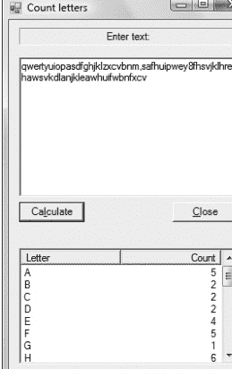

图 8-8：带有 `ListView` 对象的程序输出示例

尽管你必须添加几行代码并调整 `ListView` 对象的 `Columns` 属性，但结果看起来确实比图 8-2 中的输出好一点。最大的改进是列标题与数据联系得更紧密（通过修改第二个版本的代码，将计数括在括号中，就像第一个版本一样）。

`ListView` 对象的行为与 `ListBox` 对象类似。然而，设置 `ListView` 对象要复杂得多，但最终结果通常是值得的。

## 数组对象

与某些其他编程语言不同，`C#` 中的数组是对象。这意味着每个数组对象都有一组你可以使用的属性和方法。列表 8-1 中的代码利用 `Length` 属性来控制循环的次数。不那么明显的是，所有数组都派自 `System.Array` 类。表 8-1 own了 `System.Array` 类可用部分属性和方法列表。

**表 8-1:** 数组类属性和方法的部分列表

| 示例 | 描述 |
| --- | --- |
| `System.Array.BinarySearch(count, target)` | 在名为 `count` 的已排序一维数组上执行二分查找以寻找 `target`。 |
| `System.Array.Clear(count, start, count.Length)` | 将从元素 `start` 到元素 `Length` 的值类型数组清空为 0。引用类型数组被清空为 `null`。 |
| `System.Array.Copy(Source, Dest, Length);` | 将元素从 `Source` 数组复制到 `Dest` 数组。 |
| `System.Array.IndexOf(count, val)` | 返回 `count` 数组中 `val` 首次出现处的索引。 |
| `System.Array.LastIndexOf(count, val)` | 返回 `count` 数组中 `val` 最后一次出现处的索引。 |
| `System.Array.Sort(count)` | 将名为 `count` 的一维数组按升序排序。 |
| `System.Array.Reverse(count)` | 反转名为 `count` 的一维数组的当前值。注意：如果调用 `Sort()` 然后调用 `Reverse()`，它会将数组置于降序排列。 |

## 多维数组 | 207

| 示例 | 描述 |
| --- | --- |
| `count.Rank` | 返回名为 `count` 的数组的维度数。 |
| `count.GetUpperBound(val)` | 返回 `count` 数组维度 `val` 的最高索引。例如，如果名为 `test` 的数组定义如下：

`int[] test = new int[5,10];`

语句

`max = test.GetUpperBound(1);`

将 `max` 设为 9。记住二维数组使用维度 0 和 1，并适用于 N-1 规则！如果维度未知，获取 `Rank` 属性将允许你在有效维度上调用此方法。 |
| `count.Initialize()` | 调用构造函数设置每个元素。对于数据值类型，该值为 0；对于引用数据类型，值为 `null`。 |

表 8-1 中列出的方法方式是重载的。（*注：原文此处存在大量重复的英文句子，翻译时已按要求去重处理*）

# 尝试一下 使用二维数组 (`Chapter80ProgramTwoDimensionalArray.zip`)

现在，你想编写一个程序，让用户输入她想要的表格中的行数，该表格将显示数字、其平方和立方。该程序需要一个由用户指定行数和列数的二维数组。对于这个

该项目，你可以从 `Chapter08ProgramTwoDimensionalArray.zip` 文件中下载代码，或者使用以下步骤：

- 1. 创建一个新对象，并照常插入 C 模板。
- 2. 添加一个标签对象、两个按钮对象、一个文本框对象和一个 `ListView` 对象。
- 3. 按你看到的方式安排对象，但 8-9 节显示了示例布局和运行结果。（在开始使用 `ListView` 对象之前，别忘记将 `ListView` 属性设置为 `Details`。这有助于你在操作过程中更容易地看到更改属性产生的影响。）
- 4. 添加列表 8-2 所示的代码。

## 列表 8-2：二维数组程序 (`frmMain.cs`)

```csharp
using System;
using System.Windows.Forms;

public class frmMain : Form
{
    private TextBox txtMax;
    private Button btnCalc;
    private Button btnClose;
    private ListView lstTable;
    private ColumnHeader columnHeader1;
    private ColumnHeader columnHeader2;
    private ColumnHeader columnHeader3;
    private Label label;
    #region Windows code

    public frmMain()
    {
        InitializeComponent();
    }

    public static void Main()
    {
        frmMain main = new frmMain();
        Application.Run(main);
    }

    private void btnCalc_Click(object sender, EventArgs e)
    {
        bool flag;
        int number;
        int i;
```

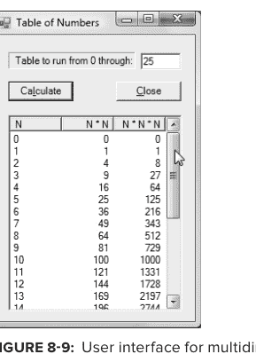

## 列表 8-2（续）

`ListItem which`：

```csharp
flag = int.TryParse(txtMax.Text, out number); // 检查输入
if (flag == false)
{
    MessageBox.Show("只能输入数字。", "输入错误");
    txtMax.Focus();
    return;
}
if (number < 0) // 确保它是正数
{
    number = number * 1;
}
number++; // 这是是因为 N - 1 规则
int[][][] data = new int[number, 3]; // 定义数组
for (int i = 0; i < number; i++)
{
    myData[i, 0] = i; // 类的的第一列
    myData[i, 1] = i; // 类的第二列
    myData[i, 2] = i * i * i; // 类的第三列
}
```

```csharp
for (int i = 0; i < number; i++)
{
    which = new ListItem(myData[i, 0].ToString());
    which.SubItems.Add(myData[i, 1].ToString());
    which.SubItems.Add(myData[i, 2].ToString());
    lstvTable.Items.Add(which);
}
```

```csharp
private void btnClick_Click(object sender, EventArgs e)
{
    Close();
}
```

### 工作原理

程序的代码在列表 8-2 所示。按照惯例，有趣的部分首先出现在 `btnCalc_Click()` 事件中。这里定义了几个变量，包括一个名为 `which` 的 `ListItem` 对象。代码利用 `TryParse()` 方法来验证用户输入的是数字数据。如果用户输入负数，你会强制将其变为正数。当这些检查完成后，变量 `number` 包含了你想要在 `ListView` 对象中显示的行数。该值被增加，是因为你想通过输入的数字显示数据，包含该数字本身。也就是说，如果用户输入 100，你实际上想显示 101 个值，从 0 到 100——又是那个讨厌的 N – 1 规则。

### 语句

`int[], myArray = new int[number, 3];` 定义数组定义了存储数据的数组。循环只是为数组的每列分配所需的值：

```csharp
for (i = 0; i < number; i++) {
    myData[i, 0] = i;           // 类的第一列
    myData[i, 1] = i * i;      // 类的第二列
    myData[i, 2] = i * i;      // 类的第三列
}
```

# 初始化数组

（月份、星期几、高尔夫球的洞数等）在当数组的第一个值初始化为 0 以使数据与从 1 开始的计数系统对齐时，通常会有少的 Bug。

如果你使用从 1 开始的数据集，通过注释来提醒这一事实并无处：

```csharp
// 注意：人类思维习惯从 1 开始的数组：
int[] days = new int[] {0, 31, 28, 31, 30, 31, 30, 31, 30, 31, 31};
```

同样，无论你选择什么种方式来初始化数组，请做出选择并在代码中始终保持一致。一致性有助于使代码更易读和理解，从而使调试变得更容易。

# 初始化多维数组

你也可以为字符串多维数组使用初始化列表。例如，你可以初始化一个二乘三的数组（一个具有两行三列的数组）。你可以使用以下代码：

```csharp
int[][] myData = new int[][] {{1,2,3}, {4,5,6}};
```

初始化多维数组的语法规则是每一行的值都封装在自己的一组括号中。如果你想提供元素，如：

```csharp
int[][] myData = new int[][] {{1,2,3}, {4,5,6}};
```

然而，编译器非常擅长这一点——如果你已经忙不可开交，为什么不让编译器来执行那些它具有相对优势的任务呢？某些程序员发现使用不同的风格来展示多维数组初始化列表更好：

```csharp
int[][] myData = new int[][] {
    {1,2,3},
    {4,5,6}
};
```

虽然这种风格强化了数据建立了一个值矩阵的想法，但它也占据了额外的行数空间，而你可能不愿使用这些空间。如果你认为这有助于更容易理解数据，请选择这种风格并在代码中一致地应用它。

# 字符串对象的初始化列表

你也可以对字符串对象使用初始化列表。例如：

```csharp
string[] weekDays = new string[] {"Monday", "Tuesday", "Wednesday", "Friday", "Saturday", "Sunday"};
```

语法与值类型数据相同。然而，对象数组（即引用类型数据数组）的工作方式与值类型数据不同。图 8-1 显示了整数类型数组的内存映射在内存中的外观。尽管作者在细节上进行了一些处理，但你应该将 `weekDays` 数组的内存映射可视化为类似于图 8-10 所示。

图 8-10：字符串对象的内存映射

| 高内存 | |
| :--- | :--- |
| "SUNDAY" | 908,000 |
| "SATURDAY" | 903,500 |
| "FRIDAY" | 901,200 |
| "THURSDAY" | 900,900 |
| "WEDNESDAY" | 900,200 |
| "TUESDAY" | 900,100 |
| "MONDAY" | 750,000 |
| 低内存 | 700,000 |

图 8-1 中的整数数据内存映射显示，实际整数数据值位于从内存地址 900,000 开始的连续字节集中。（图中 `myData` 的值为 900,000）。与图 8-10 进行对比。

在 8-10 中，你可以看到 `weekDays` 的值为 750,000，其基值为 700,000。这意味着有一个从内存地址 750,000 开始的内存地址数组。由于初始化列表包含七个字符串，因此为 `weekDays` 数组分配了内存来存储七个内存地址而不是字符串，从地址 750,000 开始。数组的每个元素都包含一个指向其字符串数据存储位置的内存地址。例如，数组中的第一个字符串对象存储在内存位置 800,000。要到达那里并从内存位置开始找到 Monday。查看数组中的其他值，你可以以相同的方式找到它们。

如果没有初始化列表，数组会是什么样？在图 8-10 中，你发现的不是从内存位置 750,000 开始的七个内存地址，而是发现数组中的每个元素包含的值都是 `null`。当为 `weekDays` 数组的每个元素分配一段字符串数据进行存储时，Windows 操作系统根据 Windows 内存管理器找到足够字符串数据项内存的地方，交给 Visual Studio 一个内存地址，以替换数组中该元素的 `null` 值。

# 初始化数组

为什么 `C#` 不像图 8-1 所示的整数数据那样将数据存回？原因是字符串数组中每个对象（根据其长度）的内存需求可能会变化。虽然每个整数始终占用 4 字节，但字符串对象数组中的每个对象可能需要不同数量的内存。也就是说，存储 Wednesday 需要内存，因为你不能假设数组元素的内存需求是对称的，`C#` 必须存储一个内存地址数组（指向数组中元素的实际内存位置）。

# 锯齿数组

对象数组的非对称性产生了锯齿数组（或 jagged array）。也就是说，如果你想将星期几数组堆叠在一起，你将形成一个每个元素 4 字节的平滑列。值类型数组保证是对称的。然而，对于对象数组，最后一个维度可以是未指定的。

# 在运行时定义数组

你可以通过另一个示例在运行时定义锯齿数组。假设你有三个人同意提供样本。（三个语句中的 `new` 关键字提示 Visual Studio 正在与 Windows 内存对话。）最后，`for` 循环演示了如何为新数组赋值。因此，这里介绍的语法允许你定义锯齿数组。

```csharp
int[][] samples = new int[3][];
samples[0] = new int[count]; // 第 1 人
samples[1] = new int[count]; // 第 2 人
samples[2] = new int[count]; // 第 3 人

for (int i = 0; i < 3; i++) // 设置第一个值等于 i
{
    samples[0][i] = i;
    samples[1][i] = i;
    samples[2][i] = i;
}
```

这段代码显示了声明多维数组的另一种风格。注意第一个语句在类型说明符后面带有 `[]`，并在第二个括号处结束。

# 集合

集合是具有相同特征的对象集合。你可以拥有字符串集合（如星期数组），也可以拥有复杂对象的集合，例如 `ListView` 或类似的控件对象。

在下一个 Try Out 中，你使用集合创建平方和立方。虽然你可以轻松地不使用集合编写程序，但可以使用它来说明如何使用集合。

> 尝试：平方和立方 (`Chapter08ProgramCollections.zip`)

假设你想遍历 `days` 和 `weekDays` 数组。因为数组是对象，你可以将它们视为集合。按照以下步骤创建一个新项目：

- 1. 以通常的方式创建一个新项目，并添加列表 8-3 所示的代码。
- 2. 添加两个按钮对象和一个 `ListBox` 对象。

图 8-11 显示了示例界面和程序运行。

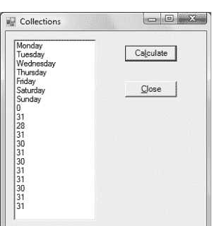

图 8-11：演示集合的程序


注意你可以将任何一个集合放在`ListBox`对象中。

# 列表 8-3: 集合示例程序 (`frmMain.cs`)

```csharp
using System;
using System.Windows.Forms;

public class frmMain
{
    private Button btnCalc;
    private Button btnClose;
    private ListBox lstTest;
    #region Windows code

    public frmMain()
    {
        InitializeComponent();
    }

    public static void Main()
    {
        frmMain main = new frmMain();
        Application.Run(main);
    }

    private void btnClose_Click(object sender, EventArgs e)
    {
        Close();
    }

    private void btnCalc_Click(object sender, EventArgs e)
    {
        int[] days = new int[] { 0, 28, 30, 30, 30, 31, 31 };
        string[] weekDays = new string[] { "Monday", "Tuesday", "Thursday", "Friday", "Saturday", "Sunday" };

        foreach (string str in weekDays)
        {
            lstTest.Items.Add(str);
        }
        foreach (int val in days)
        {
            lstTest.Items.Add(val.ToString());
        }
    }
}
```

### 工作原理

程序的代码在列表 8-3 所示。

这两个数组在按钮点击事件方法中定义。注意在遍历集合的循环中使用了 `foreach` 关键字：

```csharp
foreach (string str in weekDays)
{
    lstTest.Items.Add(str);
}
foreach (int val in days)
{
    lstTest.Items.Add(val.ToString());
}
```

`foreach` 循环专门设计用于遍历对象集合。它与标准的 `for` 循环相似，在标准的 `for` 循环中，第一个表达式 `expression1` 总是被设置为集合中的第一个对象，而循环通过 `for` 循环中的表达式 3 逐个遍历数组中的所有元素。循环的数据类型必须与集合中的数据类型匹配。这就是为什么在第一个循环中 `str` 是 `string` 类型，而在第二个循环中 `val` 是 `int` 类型。

你应该将 `foreach` 循环视为一个只读循环。也就是说，你不应该使用 `foreach` 循环来更改集合中任何对象的值。集合提供了一种方便的方法通过遍历它们来查看对象，但你不应该尝试在 `foreach` 循环中更改这些对象。

# `ARRAYLIST` 对象

到目前讨论的数组被称为静态数组。这是因为当你设置它们的元素时，大小是更改的。事实上，在确定其维度或多个维度之前，你无法使用静态数组。然而，生活并非那么简单。通常你会遇到这样一种情况：你需要在数组中存储数据，但不知道可能需要多少个元素。例如，你可能会编写一个程序，在对象数组中记录朋友的名字和地址。当你运行程序时，你可能需要 50 个数组元素，但另一个人可能只需要 20 个元素。问题是：“你如何决定为数组分配多少元素？”

对于静态数组，通常的解决方案是妥协最坏情况的设计。最坏情况的设计是你尝试获取数组大小上可能需要的最大合理值。这可能是低效的，因为在大多数情况下，你都会高估数组所需的大小。静态数组的局限性。`ArrayList` 对象具有创建动态数组的效果，你不需要指定大小。现在来看看这个操作。

`ArrayList` 对象提供了一些简单数组不具备的功能。这对于在编译时不知道数组大小的数组来说尤其如此。“尝试一试”展示了你如何在程序中使用 `ArrayList`。

# 尝试一试 `ArrayList` 示例 (`Chapter8ProgramArrayList.zip`)

编写一个简单的程序，能够在对象数组中记录朋友的名字和地址。运行程序时，你可能需要 50 个数组元素，但另一个人可能只需要 20 个元素。问题是：“你如何决定为数组分配多少元素？”

- 1. 按照通常方式创建一个新的 `ArrayList`。
- 2. 在列表 8-4 所示中创建一个 `ArrayList` 实例、文本框对象、按钮对象以及列表框对象。
- 3. 在图 8-1 所示中使用 `ArrayList`。


# 列表 8-3: 集合示例程序 (`frmMain.cs`)

```csharp
using System;
using System.Windows.Forms;

public class frmMain
{
    private Button btnCalc;
    private Button btnClose;
    private ListBox lstTest;
    #region Windows code

    public frmMain()
    {
        InitializeComponent();
    }

    public static void Main()
    {
        frmMain main = new frmMain();
        Application.Run(main);
    }

    private void btnClose_Click(object sender, EventArgs e)
    {
        Close();
    }

    private void btnCalc_Click(object sender, EventArgs e)
    {
        int[] days = new int[] { 0, 28, 30, 30, 30, 31, 31 };
        string[] weekDays = new string[] { "Monday", "Tuesday", "Thursday", "Friday", "Saturday", "Sunday" };

        foreach (string str in weekDays)
        {
            lstTest.Items.Add(str);
        }
        foreach (int val in days)
        {
            lstTest.Items.Add(val.ToString());
        }
    }
}
#
```

### 工作原理

程序的代码在列表 8-3 所示。

这两个数组在按钮点击事件方法中定义。注意在遍历集合的循环中使用了 `foreach` 关键字：

```csharp
foreach (string str in weekDays)
{
    lstTest.Items.Add(str);
}
foreach (int val in days)
{
    lstTest.Items.Add(val.ToString());
}
```

`foreach` 循环专门设计用于遍历对象集合。它与标准的 `for` 循环相似，在标准的 `for` 循环中，第一个表达式（`expression1`）总是被设置为集合中的第一个对象，而循环通过 `for` 循环中的表达式3 逐个遍历数组中的所有元素。循环的数据类型必须与集合中的数据类型匹配。这就是为什么在第一个循环中 `str` 是 `string` 类型，而在第二个循环中 `val` 是 `int` 类型。

你应该将 `foreach` 循环视为一个只读循环。也就是说，你不应该使用 `foreach` 循环来更改集合中任何对象的值。集合提供了一种方便的方法通过遍历它们来查看对象，但你不应该尝试在 `foreach` 循环中更改这些对象。

# ARRAYLIST 对象

到目前讨论的数组被称为静态数组。这是因为当你设置它们的元素时，大小是更改的。事实上，在确定其维度或多个维度之前，你无法使用静态数组。然而，生活并非那么简单。通常你会遇到这样一种情况：你需要在数组中存储数据，但不知道可能需要多少个元素。例如，你可能会编写一个程序，在对象数组中记录朋友的名字和地址。当你运行程序时，你可能需要 50 个数组元素，但另一个人可能只需要 20 个元素。问题是：“你如何决定为数组分配多少元素？”

对于静态数组，通常的解决方案是妥协最坏情况的设计。最坏情况的设计是你尝试获取数组大小上可能需要的最大合理值。这可能是低效的，因为在大多数情况下，你都会高估数组所需的大小。静态数组的局限性。`ArrayList` 对象具有创建动态数组的效果，你不需要指定大小。现在来看看这个操作。

`ArrayList` 对象提供了一些简单数组不具备的功能。这对于在编译时不知道数组大小的数组来说尤其如此。“尝试一试”（Try It Out）展示了你如何在程序中使用 `ArrayList`。

# 尝试一试 ArrayList 示例 (`Chapter8ProgramArrayList.zip`)

编写一个简单的程序，能够在对象数组中记录朋友的名字和地址。运行程序时，你可能需要 50 个数组元素，但另一个人可能只需要 20 个元素。问题是：“你如何决定为数组分配多少元素？”

- 1. 按照通常方式创建一个新的 `ArrayList`。
- 2. 在列表 8-4 所示中创建一个 `ArrayList` 实例、文本框对象、按钮对象以及列表框对象。
- 3. 在图 8-1 所示中使用 `ArrayList`。

你可以在附录 A 中找到以下练习的答案。

- 1. 最近的一项研究表明，一个人的理想体重与其身高（英寸）有关。该研究指出，人的理想体重可以通过以下公式进行计算：

```
Female = 3.5 * height (in inches)  - 108
```

```
Male = 4.0 * height (in inches)  - 128
```

编写一个程序，让用户输入起始和结束身高，计算男性和女性的理想体重表格，并将结果存储在数组中。该程序应在 `listbox` 或 `ListView` 对象中显示该表格。

- 2. 对象数组与值类型数组有何不同？
- 3. 编写一个程序，在 `int` 数组中存储 100 个随机值，并在 `listbox` 中显示这些值。设置一个 `Sort`（排序）按钮，点击该按钮会对这些值进行排序并在 `listbox` 中重新显示。
- 4. 修改你为练习 3 编写的程序，使其为数据显示条形图，如图 8-13 所示。

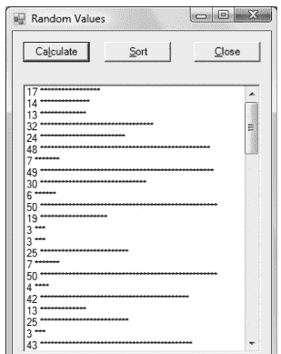

FIGURE 8-13: 文本条形图

# 5. 给定以下语句

```
string [] str1 = new string[100];
string[] temp;

str1[0] = "Hailey";
// 更多代码
temp = str1;
```

`temp` 的右值（rvalue）等于什么？

# 本章学习内容

| 主题 | 关键点 |
| --- | --- |
| 数组 | 什么是数组，以及值类型数组与引用类型数组的区别。 |
| 数组索引与数组元素 | 为什么这两项不同，以及这种差异的重要性。 |
| 数组秩 (`rank`) | 数组具有多少维度。 |
| 锯齿数组 | 并非所有数组都是对称的。 |
| 数组初始化 | 初始化数组的不同方式。 |
| 数组类 | 有哪些属性和方法。 |
| 集合 | 集合如何像对象数组。 |

## 第三部分

## 编写你自己的类

- 第 9 章：设计类
- 第 10 章：设计并编写自定义类
- 第 11 章：异常处理与调试
- 第 12 章：泛型

# 设计类

本章你将学习到：

- 构成良好类设计的元素
- 作用域
- 静态存储区类
- 访问修符
- 类属性和方法
- 类组件和编写风格
- 轻 UML
- 通用方法与辅助方法
- 用户界面

本章的 WROX.COM 代码下载

你可以在 `www.wrox.com/remtitle-cgi?isbn=9781118336922` 的 `Download Code` 选项卡中找到本章的 wrox.com 代码下载。`Chapter09` 文件夹中的代码是根据全书中的名称进行单独命名的。

第 2 章提到，类就像饼干模具，Visual Studio 为你提供了一整墙的可以使用的饼干模具。你已经在示例程序中使用过许多这些模具，包括标签、文本框、按钮、`listbox` 和 `listview` 对象，这些都是基本 Windows Forms 类的扩展。到目前为止，你一直编写的代码在名为 `frmMain` 的单类中一致使用这些对象。使用这个名称是因为所有程序都使用一个包含 `Main()` 方法的类，该方法是所有 C# 程序的起点。

好了，是时候剪断父母之手了。

在本章中，你将学习如何制作自己的饼干模具并挂在墙上。本章重点关注你在为自己的类编写“良好”代码时需要考虑的设计因素。一个设计良好的类会变成另一个你可以挂在墙上反复使用的饼干模具。设计不当的类往往变成一次性丢弃的饼干模具。考虑到面向对象编程（OOP）的主要优势之一是代码重用，每当机会出现时你都需要考虑类设计。

接下来的两章可能是书中最重要的两个章节，因为这些章节揭示了从 OOP 中获得的两个主要益处：数据封装和代码重用。

# 类设计

本章创建了一个 `clsDates` 类作为学习类设计的参考点。你可以为此类添加两个方法：一个与 `DateTime` 类提供的方法略有不同的闰年方法，以及一个用于确定复活节日期的 `getEaster()` 方法（复活节根据月历状态，落在 3 月或 4 月的星期日）。

你需要做的第一件事是创建一个项目，作为类设计讨论的测试平台。如往常，你按照第 2 章概述的步骤开始。这个初始类被称为 `Main`，因为它包含了标记程序执行开始的 `Main()` 方法。项目名称为 `clsDesign`。图 9-1 显示了类设计的用户界面。用户输入年份，程序将告诉他们是否为闰年以及复活节落在哪一天。显示输出的标签 `lblLeapYear` 和 `lblEaster`。

接下来，我们演示添加类的必要步骤。正如既往一样，你按照第 2 章概述的步骤开始。在项目项目中添加类。

> 尝试添加类 (`Chapter09Program.zip`)

- 1. 按通常方式创建一个名为 `clsDesign` 的新项目。
- 2. 使用新建类菜单（或 `Shift+C`）并将类命名为 `clsDates`。

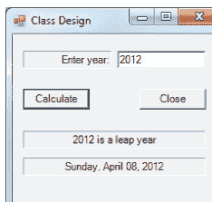

FIGURE 9-1: `clsDates` 的用户界面

# 添加新项 - clsDesign

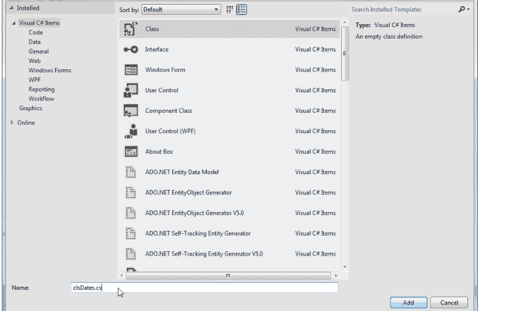

FIGURE 9-2: 向项目添加类

# 如何工作

项目可以运行，但它什么都没做。虽然你可以简单地将代码添加到项目中，但在移动到程序如何工作之前，你需要进行一个重要的跳转。

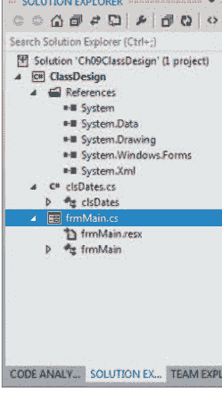

FIGURE 9-3: 新类的解决方案窗口

# 作用域

如果你查看源代码中的 System，你可以看到新类的以下代码：

```
using System;
using System.Collections.Generic;
using System.Text;

namespace ClassDates
{
    class clsDates
    {
    }
}
```

这个存根是 Visual Studio 在创建 `clsDates` 时自动生成的。为了讨论需要，扩展了 `clsDates` 的代码。不要进行列表 9-1 所示的代码更改。所示的代码仅用于帮助你理解作用域的概念。

- 列表 9-1: 假设的 `clsDates` 源代码

```
using System;
using System.Collections.Generic;
using System.Text;

namespace ClassDates
{
    class clsDates
    {
        int scopeClass; // 类作用域
        public int MyFunction()
        {
            int scopeLocal; // 局部作用域
            // 块作用域
            for (int scopeBlock = 0; scopeBlock < 20; scopeBlock++)
            {
                // for 语句块
                // 结束块作用域
            }
            // 结束局部作用域
        }
        // 结束类作用域
    }
} // 结束命名空间作用域
```

简单来说，作用域（scope）指的是变量的可见性和寿命。只要变量在作用域内，你就可以访问它并在代码中使用它。如果变量出了作用域，就就像该变量不存在一样；你无法在程序中使用它。现在让我们从列表 9-1 的“内部”开始详细研究作用域的概念。

## 块作用域 (Block Scope)

考虑以下代码中变量 `scopeBlock` 的定义：

```cpp
// Block scope
for (int scopeBlock = 0; scopeBlock < 20; scopeBlock++)
{
    // for statement block
}
// End block scope
```


当程序运行到上述代码中的 `for` 循环时，`for` 表达式定义了一个名为 `scopeBlock` 的变量。在定义的这一刻，`scopeBlock` 可以在程序中使用。这意味着 `scopeBlock` 现在处于作用域内，可以在你的代码中使用。换句话说，`scopeBlock` 有它的生命周期。

现在 `for` 循环已经执行了 20 次，程序控制准备执行 `for` 循环结束大括号之后的任何语句。有趣的地方在于：当程序运行到 `for` 循环的结束大括号时，变量 `scopeBlock` 在程序中消失了。因为结束大括号标记了 `for` 循环的结束，而 `scopeBlock` 是在该 `for` 循环内部定义的，所以 `scopeBlock` 不再供程序使用。当到达 `for` 循环的结束大括号时，`scopeBlock` 出作用域且无法使用。

> 变量的作用域从它的定义点延伸到其所在代码块的结束大括号。

因此，块作用域从变量的定义点延伸到定义该变量的语句块的结束大括号。如果你想证明块作用域的概念，请在 `ClassDates` 程序的 `frmMain` 的 `Main()` 方法中进行以下更改。代码更改如列表 9-2 所示。

### 列表 9-2：说明块作用域的代码片段

```java
public static void Main()
{
    int j = 1;

    frmMain main = new frmMain();
    Application.Run(main);
}
```

```java
if (j == 1)
{
    int i; // 带有块作用域的定义
    i = 10;
    // 假设有更多代码以某种方式操作 i...
    // 语句块结束
}
j = i; // 此处发生错误
```

现在尝试编译程序。你可以看到以下错误信息：

`The name 'i' does not exist in the current context`

代码在尝试将变量 `i` 赋值给 `j` 的语句处失败。原因是 `i` 具有块作用域。变量 `i` 定义在 `if` 语句块内部，因此它的作用域和寿命从 `if` 语句块的结束括号延伸。由于赋值在 `if` 语句块之外，变量 `i` 不在作用域内且无法使用，Visual Studio 必须发出错误信息。

## 局部作用域 (Local Scope)

现在向上移动链链，检查局部作用域。局部作用域变量定义在方法块内，但在语句块之外。某些程序员将局部作用域称为方法作用域。因此，局部作用域从变量的定义点延伸到定义该变量的方法的结束大括号。列表 9-2 中的变量 `j` 是局部作用域变量的一个示例。当程序控制到达列表 9-2 中 `Main()` 方法的结束大括号时，`j` 出作用域并消失。

你会发现列表 9-1 中的变量 `localScope` 具有局部作用域。当程序运行到列表 9-1 中的结束大括号时，变量 `localScope` 不在作用域内，无法在程序中使用：

```cpp
// End local scope
```

局部作用域变量可以在语句块内使用，但反之不然。也就是说，块作用域变量不能在定义它们的语句块之外使用，而局部作用域变量可以在同一方法内的任何语句块中使用。

## 类作用域 (Class Scope)

你可能已经明白这一点了，但再过一遍吧。具有类作用域的变量是那些定义在类内部、但在方法之外的变量。某些程序员将类称为模块作用域。类作用域使得变量在类的所有点上都是可用的。列表 9-1 中的变量 `scopeClass` 是类变量的一个示例。类作用域涵盖了方法作用域和语句块作用域。这意味着具有类作用域的变量可以在方法级和语句块级的作用域上被使用。如果你想一下，具有类作用域的变量就是类的属性。类中的方法始终具有类作用域。

## 命名空间作用域 (Namespace Scope)

命名空间作用域适用于定义在当前命名内的任何变量。在列表 9-1 的顶部你可以找到以下语句：

```cpp
namespace ClassDesign
{
```

你可以从这条语句看出当前正在开发的项目名为 `ClassDesign`。因为项目名为 `ClassDesign`，这也意味着如果你想做的话，可以将程序的入口点引用为：

```cpp
ClassDesign.frmMain();
```

每个 `Main()` 方法都具有命名空间作用域。你编写的所有程序都有一个 `Main()` 方法。想一下，如果你不引用正确的 `Main()` 方法，将会多么混乱。命名空间作用域的主要原因之一是防止多个命名空间之间的类和方法冲突。如果两个命名空间具有相同的名称，就会引起冲突。

## 可视化作用域 (Visualizing Scope)

如果你在想象，请尝试想象一把跨越多个平台的高梯子，如图 9-4 所示。将自己放在梯子的底部。唯一的区别是，底部的人无法向上看。因为你处于较低的层次，你可以看到并与下方的朋友交互。这就是块作用域。在图中，具有块作用域的数据项的视野范围包含了地面。

现在，沿着梯子爬到第二个平台。再次，你可以看到同一平台上的新朋友。你可以向下看，也能看到它们。唯一的区别是，下方的朋友无法向上看。因为你处于较高的作用域层次，只有当你爬上梯子到达他们的层次时，才能与他们交互。也就是说，如果你声明了一个局部作用域的变量 `x`，并且有一个具有块作用域的朋友 `i`，那么语句

```cpp
x = i;
```

只有在你位于 `i` 所在的语句块内时才能发生。否则，语句无法发生，因为 `i` 只能存在于自己的语句块内。对于列表 9-2，只有当你将赋值语句放在语句块内时，才能与变量交互。因此，局部作用域变量的视野范围包含了具有块作用域的项目，但只有在这些项的语句块内才能与块作用域项交互。

现在爬爬到类平台。再次，你在这个作用域层次上有朋友可以直接与之交互。向下看，你可以看到你所有的局部和语句块朋友，但要与他们交互，你必须爬上梯子到达他们的层次。也就是说，为了与局部块朋友交互，你的任何语句必须发生在定义该局部块朋友的方法内，或者定义你的作用域朋友的语句块内。注意类作用域的视野 `FOV` 包含了在局部和块作用域定义的数据项。

最后，爬到最高的平台。再次，你可以在这一层看到一些新朋友，例如全局数据项，但向下看你可以看到一切！程序中的所有数据项都是对你可见。要与它们交互，意味着你必须爬到它们所在的层，因为它们无法抬头看到你。假设你是一个具有命名空间作用域的变量。要与列表 9-2 中的变量 `i` 交互，你必须一直爬下梯子，让自己出现在变量 `i` 所在的 `if` 语句块中。

## 为什么 C# 支持作用域？

大多数现代以及所有 OOP 语言都支持作用域的概念。这种支持是为了尽量减少程序中数据项之间可能发生的意外交互影响。考虑一下如果你使用不支持作用域的语言会发生什么。在这些语言中，变量的行为就像命名空间变量。假设变量 `x` 开始表现异常，并拥有一个不应该具有的值。如果没有作用域，你该从哪里开始寻找这个奇怪的 `x`？整个程序都是一个场地，`x` 在整个程序中都是可见的。程序的任何元素都可能干扰 `x`，而你没有一个可以包含它的子句。调试问题变成了一场碰运的赌博，只有靠运气才能最终定位到 bug。在这种情况下，系统性的调试将付之东流，寻找 bug 变成了一个运气问题，而且是全新的问题。

对于具有作用域的项目，如果 `x` 是一个定义为块作用域的变量，那么显然，在定义它的语句中，一切都在干扰 `x`。毕竟，当 `x` 具有块作用域时，它不能存在于定义它的块之外。在一个有 3000 行代码的大型程序中，你可以立即排除所有 3000 行，集中在执行 `x` 语句的相对少数行代码上。

如果 `x` 定义为局部作用域，你仍然可以排除数千行代码，因为只有定义 `x` 的方法内部的代码会起作用。虽然局部变量的作用域可能比块作用域覆盖更多的代码行，但它比完全没有作用域要好一点。

当你爬上图 9-4 中的作用域梯子时，更多的代码行开始生效，为 `x` 的遇到提供了更多地方。这是由于视野 `FOV` 的变宽。随着变量作用域的扩大，必须定义更多的行，这使得调试变得更加困难。为此，程序设计应该尝试在对当前任务合理的最窄作用域级别上处理数据。在程序中隔离数据的过程被称为封装，它是面向对象编程的基石之一。虽然在很少考虑作用域或封装的情况下拼凑出一个程序设计可能更容易，但从长远来看，你会付出更多调试和维护时间的代价作为代价。

## 在编写之前

要学习的教训是：在开始编写之前，花时间思考程序设计。我无法告诉我有过多少次布置课堂编程作业，结果学生们立即开始敲键盘，并将对象拖放到表单上。当我观察学生时，通常会有一两个坐在座位子上在草稿纸上涂鸦，或者可能只是盯着天花板。几分钟后，他们最终开始编写程序。很棒的一是，这些涂鸦者和看天花板的人几乎在班级其他同学之前完成了程序，并且通常有更好的程序解决方案。原因是什么？他们涂鸦或看天花板的时间实际上是用来创建程序设计的。

许多学生将简单的移动与解决问题混淆了。也就是说，他们认为因为他们正在将文本标签拖放到表单上，他们就在实现程序解决方案。然而，当他们深入问题时，删除他们最初认为需要的对象并将其替换为其他东西并不罕见——大量的移动，但没有实用的工作。如果这些学生在做任何其他事情之前只花几分钟思考问题并给出一个初步设计，他们将领先好几里。

那么……你如何设计程序呢？这正是你想在本章接下来的部分检查的内容。

## 设计程序

新程序员面临的最困难的任务的任务可能是不知道从哪里开始设计程序。每个程序都略有不同，因此每个设计也必须略有不同。既然如此，最好的开始点是哪里？

虽然程序确实是不同的，但你已经知道所有程序至少有一个共同点：五个程序步骤。带着这个想法，回到你在章节开始开始的 `clsDates` 程序。该程序的目标是编写一个类，可以确定复活节日期并告诉你该年份是否为闰年。现在看你如何将这五个程序步骤作为你设计的起点。

## 五个程序步骤

假设图 9-1 所示的用户界面对于程序来说足够了。在这一假设下，从设计的角度检查这五个程序步骤。

### 初始化步骤

对于这个程序，初始化步骤唯一需要做的事情就是正确初始化你放在 `frmMain` 上的对象，并在屏幕上显示该表单。列表 9-3 显示了在你遵循了章节初期的指令后，目前存在的 `frmMain`。

> 列表 9-3：`clsDates` 测试代码。(`frmMain.cs`)

```csharp
using System;
using System.Windows.Forms;
public class frmMain : Form
{
    private TextBox txtYear;
    private Button btnCalc;
    private Button btnClose;
```

```csharp
private Label lblLeapYearResult;
private Label lblEasterResult;
private Label label1;
#region Windows code
```

```csharp
private void InitializeComponent()
{
    // Windows-generated code
}
#endregion
```

```csharp
public frmMain()
{
    InitializeComponent();
}
```

```csharp
public static void Main(string[] args)
{
    Application.Run(new frmMain());
}
```

```csharp
private void btnCalc_Click(object sender, EventArgs e)
{
    int year;
    if (int.TryParse(txtYear.Text, out year))
    {
        bool isLeap = IsLeapYear(year);
        lblLeapYearResult.Text = isLeap ? "Leap Year" : "Not a Leap Year";
    }
}
private bool IsLeapYear(int year)
{
    return (year % 4 == 0 && year % 100 != 0) || (year % 400 == 0);
}
```

```csharp
// 测试 clsDates
clsDates date = new clsDates();
if (true)
{
    if (date.Check.IsLeapYear(2024))
    {
        Console.WriteLine("The year is a leap year.");
    }
    else
    {
        Console.WriteLine("The year is not a leap year.");
    }
}
```


## 输入步骤

用户只需要两个输入：年份和点击按钮。假设用户在 `btnCalc_click()` 事件中输入了 2012。当程序进入该方法后，程序需要将年份的文本数据转换为数值类型并将其赋值给变量。

## 处理步骤

如果一切顺利，程序现在需要调用另一个方法接收年份并确定复活节。你可以假设复活节是以字符串形式返回的，而闰年是以 `int` 类型返回的。

## 显示步骤

显示要求非常简单：用处理步骤的信息填充表单上标签对象的 `Text` 属性。

## 终止步骤

由于程序没有执行过任何复杂操作或使用任何你需要清理的资源，你可以调用 `Close()` 方法来结束程序。

## 观察森林而非只看树木

在某种意义上，除了处理步骤外，所有步骤都绑定到 `frmMain` 类。也就是说，除了处理步骤以外的所有步骤都与表示 `frmMain` 表单的视觉组件交互。只有处理步骤与 `frmMain` 表单的视觉表示或对象没有直接关系。这意味着如果你愿意，可以将处理步骤从表单的视觉状态中隔离出来。处理步骤运行只需要一个存储 `year`。考虑到这一事实，你应该问问自己：“在你的编程生涯中，是否真的需要重用一个可以计算某一年复活节日期或判断该年份是否为闰年的方法？”如果你认为答案可能是肯定的，那么你应该考虑将 Process 步骤的代码写在一个独立类的方法中。为什么呢？

面向对象编程（OOP）的驱动力之一是代码复用。如果你可以编写一次并在未来多次使用，为什么要在每次完成相同任务时都重新发明呢？虽然在短期内可能需要一点精力，但从长远来看，收益是巨大的。你需要将编写一个新类看作是对未来的投资。现在花一点功夫，是为了在将来获得更多的空闲时间。另一个额外好处是，基于类的程序调试比将所有代码挤在 `main` 中要容易得多。

想一想微软编写的那些 4000 个饼干模具到目前为止简化了多少工作。如果你必须为每个程序亲自重写创建文本框、标签和按钮对象的代码，那么这个示例中的计算程序会变得困难多少？你仍然回到第 2 章。这种在不写代码的情况下使用这些对象的能力，节省了无数的打字和调试时间。

因为你可能在未来的某时刻想要重用复活节和闰年方法，所以你将这些方法实现新类 `clsDates` 的一部分。

## UML Light

统一建模语言（UML）是一种用于建模对象的标准化规范语言。它起源于 James Rumbaugh、Grady Booth 和 Ivar Jacobson 在 20 世纪 90 年代的共同努力。关于 UML 已经写了整整卷著作，在这里无法充分阐述它的奥之处。尽管如此，你可以利用 UML 的一小部分子集，称为 *UML 类图*。它是组成类的各个部分的视觉化表示。你并不使用 UML 类图的所有功能，而是只使用一小部分，即 *UML Light*。（别去 Google 搜“UML Light”了……那是作者很久以前编造的。）

图 9-6 显示了 UML 类图的通用格式。

一个 UML 类图可以被视为三个框。顶部的框存放类的名称（在本例中为 `clsDates`）。这是饼干模具挂在墙上时的名称。在下一个框下面是一个描述类属性的框。（其他 OOP 语言可能将这些属性称为*类成员*或*类属性*）第三个框描述该类支持的方法。（UML 的最新版本支持第四个框，描述类如何在磁盘文件或数据库中被*持久化*，即永久存储。轻量级版本忽略了这第四个框。）

## 访问修饰符

属性框中的第一行包含以下内容：

`+ - year : int`

行开头的减号用作符号，表示该特定属性的访问修饰符。这里讨论了两种可能的访问修饰符：`private` 和 `public`。这两个访问修饰符都是 C# 中的关键字。`private` 关键字意味着该属性只能通过它的方法从类外部进行访问。（对象属性方法的讨论将推迟到第 10 章。）图 9-6 中的减号是 C# 中 `private` 关键字的 UML 符号。

| clsDates | | |
| :--- | :--- | :--- |
| - year: int - month: int - day: int - daysInMonth: static int[] - leapYear: int - current: DateTime | 属性 | |
| | | |
| + getLeapYear(Year): int - + getEaster(Year): string | 方法 | |

图 9-6：使用 UML Light

你也可以使用 `public` 关键字定义属性。`public` 关键字意味着可以直接访问该属性，无需使用对象的属性。`public` 关键字的 UML 符号是加号。

减号出现在单词 `year` 之前的行开头。`year` 是你给这个特定类属性起的名字。属性后面跟着冒号（:`）。冒号的作用是将属性与属性类型分开。在这种情况下，类型是 `int`。这意味着 `year` 是一个 `int` 数据类型。该条目告诉了你关于该属性的很多信息：`year` 是 `clsDates` 类的一个整数属性，并使用了 `private` 访问修饰符。

在 9-6 中，你可以看到所有属性都使用了 `private` 访问修饰符。这样做有充分的理由，正如你看到的，简单地将 `private` 访问修饰符理解为为属性提供了比 `public` 访问修饰符更多的保护。某种程度上，`private` 访问修饰符将变量封装在其类内部，并使其免受外界的影响。

## 访问修饰符与作用域

类的属性默认具有作用域。这意味着类变量从定义处到结束括号，在类内的所有点都是可见的。类属性的默认访问修饰符是 `private`。类作用域意味着属性变量没有命名空间作用域。例如，如果你按照图 9-6 所示的规范定义属性。因为你可能在未来的某时刻想要重用复活节和闰年方法，所以你将这些方法实现新类 `clsDates` 的一部分。

## 公有方法 (Public Methods)

大多数方法的设计是为了对一个或多个数据片段执行一个特定的任务。（初学者的一个常见错误是编写等同于瑞士军刀的方法。方法不应该是多任务处理器。它们应该被设计为执行一个任务并完美完成该任务。）通常，数据片段来自于类。鉴于类方法被用于操作类数据，可以假设程序员想要访问这些新转换的数据。例如，在稍后，，你将调用一个类方法，该方法在闰年时返回值 1，在不是闰年时返回 0。你正在编写这个方法，以便任何知道你传递的年份的人都知道它是否为闰年。显然，你想让这个结果在类外部可见。因此，你会使用 `public` 访问修饰符来编写 `getLeapYear()` 方法。

你赋予 `public` 访问修饰符的所有类元素都会成为该类用户（公共）接口的一部分。也就是说，你专门使用 `public` 访问修饰符来设计属性和方法，是因为你希望外部世界能够访问它们。正如前面提到的，我对公共属性持保留态度。然而，我对公有方法感到非常兴奋。这种差异的原因在于，你想隐藏数据（即属性），但通过公有类方法以及类方法带来的功能来使其变得有用。

有时你会听到“类 API”这个术语。指的是类的应用程序接口（Application Programming Interface）。因此，类 API 指类中所有使用 `public` 访问修饰符的元素。如果你仔细考虑，这是合理的，因为外部世界与类交互的唯一方式就是通过它的公有属性和方法。

## 私有（辅助）方法 (private Helper Methods)

类不仅可以有公有方法，它也可以使用私有方法。根据定义，私有类方法不能成为类 API 的一部分。如果方法是私有的，它具有作用范围，并且在定义的类之外是不可见的。

你可能会问：“如果私有类方法无法在类外部访问，那么它们是干什么用的？”问得好，我们所有人都有一个答案。

假设你正在编写的一个电子书应用程序中收集人们的个人数据。你决定收集每个人的电话号码以及家庭电话和工作电话。你知道人们在输入数字时经常会出错，所以你想验证他们为每个号码输入的数字是否使用了有效格式。现在有了你的设计选择：你可以将验证代码复制三次，每个电话类型一次，或者你可以写一个名为 `validatePhoneNumber()` 的单一方法并在需要时调用它。嗯……哪是更好的决定？写三次代码然后进行三次测试和调试，还是写一次代码并对该版本进行测试和调试？显然不是后者。

`validatePhoneNumber()` 方法存在于类中是为了让你验证电话号码的工作更简单。任何仅仅让你的工作更简单且你不希望成为类 API 部分的类方法都应该使用 `private` 访问修饰符定义。通常，此类类方法被称为辅助方法（Helper methods），因为它们存在于类中是为了让你作为程序员的工作更轻松，而不是你暴露给外部世界的类 API 的。

## 类属性和方法命名 (Class Property and Method Names)

在设计类时，你对属性和方法的命名有很大的自由度。显然，你不能使用 C# 关键字作为名称，但几乎所有内容都是允许的。（类命名的规则与变量命名的规则相同。）鉴于这种自由度，你在类内部使用的名称确实重要，或者说你赋予属性和方法的名称？显然，本章可能不需要这一节。在设计你的类时，请考虑以下类命名规范。

### 属性名使用小写字母

首先，你的属性名称以小写字母开头。这一决定的详细解释将推迟到第 10 章。简短的解释是，使用小写让你能够实现许多 C# 程序员通用的命名规范。

> 注意：微软的命名规范和风格与这里呈现的有所。虽然我有许多理由采用这里呈现的风格，但你可以查看微软的规范：http://msdn.microsoft.com/en-us/library/x2dbby72%28v-vs.71%29.aspx。

### 为功能提供提示 (Hint as to Your Functions)

其次，让你的 API 方法名对其功能给出一个提示。例如，`SortData` 方法名似乎是一个不错的选择，直到你意识到该类包含多个一个数据片段。一个更好的名字可能是 `SortZipCodes`，因为这个名字能让你更清楚地知道即将发生什么。如果你需要根据邮政编码排序所有数据，你可能需要方法名 `SortAllByZip()`。使用具有功能性的名称可以让你在面对类中提供的可用方法列表时，更容易回想起每个方法的作用。

### API 方法使用动词名称 (Use Action Names for API Methods)

第三，由于大多数 API 方法都会与类数据交互，方法名通常暗示了某种动作并基于动词。例如，`SortZipCodes` 暗示了邮政编码数据从当前状态到截止状态的活动变化。`CalculateTaxDue` 可能是类中的一个方法。

### API 方法应与实现无关 (API Method Names Should Be Implementation-Neutral)

第四，API 方法名不应反映类的实现方式。我见过代码中两个方法被命名为 `SearchLeftTreeNode()` 和 `SearchRightTreeNode()`。不需要太多想象力就能明白。如果你需要根据邮政编码排序所有数据，你可能需要方法名 `SortAllByZip()`。使用具有功能性的名称可以让你在面对类中提供的可用方法列表时，更容易回想起每个方法的作用。

像用户一样思考 (Think Like a User)

类设计的另一个方面是像使用你类的属性和方法的用户一样思考（在这个意义上，你是一个程序员，而不是运行程序的人）。例如，稍后你将看到该类的代码：

`private static int[] daysInMonth = { 0, 31, 28, 31, 30, 31, 30, 31, 31, 30, 31 };`

如果你查看 `daysInMonth` 数组的初始化数据，很明显这些值反映了每个月份的天数。然而，仔细检查发现数组的第一个元素是零。为什么？原因在于人们思考的方式，正如第 8 章所提到的。如果你问人们一年中的某个月（即一月）有多少天，很少有人会说 28 天。如果类的用户向你传递值 1 给本应该返回月份天数的方法，这就是你得到的答案。

...

`classDates` 代码如列表 9-4 所示。

# 列表 9-4: clsDates 源代码 (clsDates.cs)

```c
using System;
using System.Collections.Generic;
using System.Text;
public class clsDates
{
    // ================= 静态成员 ====================
    private static int[] daysMonth = { 0, 31, 28, 31, 30, 31, 30, 31, 30, 31, 30, 31 };
    // ================= 实例成员（属性） ====================
    private int day;
    private int month;
    private int year;
    private int leapYear;
    private DateTime Current;
    // ================= 构造函数 ====================
    public clsDates()
    {
        current = DateTime.Now; // 将 DateTime 设置为现在
    }
    // ================= 属性方法 ====================
    // ================= 辅助方法 ====================
    // ================= 普通方法 ====================
/**
 * 目的：判断某年份是否为闰年。算法
 * 取自 C Programmer's Toolkit, Purdue, Que Corp.,
 * 1993, p. 258。
 *
 * 参数列表：
 * int    被考虑的年份
 *
 * 返回值：
 * int    闰年返回 1，否则返回 0
 */
public int getLeapYear(int year)
{
    if (year % 4 == 0 && year % 100 != 0 || year % 400 == 0)
        return 1; // 是闰年
    else
        return 0; // 不是。
}
```

# clsDates 设计 | 27

******
* 目的：根据给定年份确定复活节的日期。算法
* 取自 C Programmer's Toolkit, Purdue, Que Corp.,
* 1993, p. 267。
- * 参数列表：
* int year 被考虑的年份
- * 返回值：
* string MM/DD/YYYY 格式的日期

```csharp
******
public string getEaster(int year)
{
    int offset;
    int leap;
    int day;
    int temp1;
    int temp2;
    int total;
    offset = year % 39;
    leap = year % 4;
    day = year % 7;
    temp1 = (19 * offset + 24) % 30;
    temp2 = (2 * leap + 4 * day + 6 * temp1 + 5) % 7;
    total = (22 + temp1 + temp2);
    if (total > 31)
    {
        month = 4; // 复活节在四月...
        day = total - 31; // ...在这一天
    }
    else
    {
        month = 3; // 复活节在三月...
        day = total; // ...在这一天
    }
    DateTime myDT = new DateTime(year, month, day);
    return myDT.ToLongDateString();
}
```

# 命名空间修饰符

如果你仔细观察列表 9-4，你会发现我从 clsDates 代码中删除了以下（默认的）语句：

```csharp
namespace ClassDesign
{}
```


为什么？原因在于你希望你的 `clsDates` 类可以在你可能开发的其他程序中使用，而无需将项目的命名空间作为类层次结构的一部分。

实例成员是类中所有非静态属性的通用术语。实例成员是指那些为从类中实例化的每个对象而创建的类属性。简单来说，类的每个实例都拥有自己的一组（非静态的）类属性，因此称为实例成员。

## 属性和辅助方法

这些方法本身具有其特性，将在第 10 章中对其进行详细说明。

## 普通方法

普通方法是那些构成类 API 的方法。使用可见性修饰符。

## 方法头

对于普通方法，通常方法如列表 9-4 所示：

******
* 目的：判断某年份是否为闰年。算法
* 取自 C Programmer's Toolkit, Purdue, Que Corp.,
* 1993, p. 258。
* 参数列表：
* int 被考虑的年份
* 返回值：
* int 闰年返回 1，否则返回 0
******
`public string getEaster(int year)`

方法头简单地说明了方法的目的、传递给它的参数列表（如果有）以及返回类型（如果有）。如果你在编程语言中强制这种结构，你可能需要引用它。当你完成所有源代码时，你就得到了一个可以打印每个方法头的文件。

## 尝试运行 clsDates 程序

现在你已经写了 `clsDates` 类的代码，编写一个可以测试该类的程序。之前的运行示例见图 9-1。此外，你已经创建了项目并将必要的类文件添加到项目中。现在你需要的是关于代码如何运行的详细解释。

### 工作原理

`frmMain` 类的代码在列表 9-5 中。

> 列表 9-5: `clsDates` 的测试程序 (`frmMain.cs`)

只需两行代码，你就能获得一个格式完美的复活节日期字符串。这种方法之所以奏效，是因为你有一个重载的构造函数，可以将复活节算法计算出的月份和日期传递进去，以及用户提供的年份。当你花时间去探索你所使用的类的属性和方法时，名为 `ToLongDateString()` 的 `DateTime` 方法就会构建出该日期字符串。

## 用户界面之 VS 用户界面

在谈论用户界面（User Interfaces）时，你需要稍微谨慎。之所以需要谨慎是因为这个术语可以在多个语境下使用。首先，大多数人认为用户界面是终端用户与之交互的程序的一部分。这种视觉对象用户界面类型一直被使用。用户随后与表单上的文本框（`textbox`）、按钮（`button`）、列表框（`listbox`）以及许多其他类型的对象进行交互。在这种情况下，用户界面充当了获取输入和向终端显示结果的主要手段。

第二类用户界面不需要视觉化表示。例如，所有带有 `public`（公共）访问修饰符的属性和方法都定义了类的用户界面。在这种情况下，用户实际上是程序员。类的公共属性和方法构成了该类的 API，从而定义了程序员如何与其交互。由于这些原因，这种用户界面类型也被称为程序员与类交互的“公共接口”（`public interface`）。

当你在类的语境下谈论用户界面时，“用户”是指通过 API 与类交互的程序员。当你在带有有视觉对象（如文本框和按钮）的 Windows 表单语境下谈论用户界面时，“用户”是指实际运行程序的终端用户。如果你试图刻意不混淆两者，那么与其他人的随口对话将变得很困惑。要遵循的法则是：如果你不清楚讨论的是哪种用户界面，请提问。

### 总结

本章讨论了在你开始创建类时需要考虑的根本设计因素。希望你理解了在开始工作之前进行程序设计的用处，并且知道何时可能考虑从程序的角度来编写你的类。

关于编写和使用类的更多细节将在下一章继续。

## 练习题

你可以在附录 A 中找到以下练习的答案。

- 1. 假设你正在将以下数据项作为属性添加到类中。你会在类中如何编写它们？
  - a. 一个人的姓氏
  - b. 一个邮政编码（ZIP code）
  - c. 星期几天
- 2. 假设你想在 `clsDates` 类中添加一个通用方法，返回给定月份的天数。你会如何编写代码？
- 3. 给出一个良好的例子，说明你在何处使用 `public` 访问修饰符来定义类属性。
- 4. 修改以下代码以用 `if` 语句代替：

```
lblLeapYearResult.Text = year.ToString() + " * is " +
    (leap == 1)? " a leap year":"not a leap year";
```

你会在自己的代码中使用哪种形式？为什么？
- 5. 假设你重载了 `clsDates` 构造函数，使得以下构造函数可用。你会修改你的 `getLeapYear()` 方法吗？如果是，如何修改？

```
public clsDates(int yr)
{
    year = yr;
}
```

## 本章所学知识

| 主题 | 关键点 |
| --- | --- |
| 类设计 | 在程序中何时应该使用类 |
| 作用域 | 不同作用域级别如何影响数据在程序中的用法 |
| 访问修饰符 | `public` 和 `private` 访问修饰符如何使用 |
| 类属性 | 类属性是什么以及应该如何使用它们 |
| 类方法 | 类方法是什么以及如何使用它们为类构建用户界面 |
| UML 轻量级 | 如何将类的元素视觉化 |
| 用户界面 | 程序员与类的交互 |
| 静态类 | 静态类与其他类的区别 |

## 第10章 设计与编写自定义类

本章你将学习：

- 构造函数
- 方法重载
- 属性
- 获取器（Getters）和设置器（Setters）
- 修改类的状态

第9章结束了关于设计类的介绍，并提供了关于复活节算法计算的细节。本章继续设计类的主题。当你完成本章时，你将拥有一个坚实的基础。

本章你将学习：

- 构造函数
- 方法重载
- 属性
- 获取器和设置器
- 修改类的状态

## 构造函数

你应该将构造函数理解为用于实例化对象的方法。构造函数的唯一目的是使你能够以已知状态实例化对象。C#（以及大多数面向对象语言）的巧妙之处在于你会获得一个默认构造函数。

### 默认构造函数

为了使默认构造函数可能，构造函数的名称与其类相同。对于，如果你想创建一个 `clsDates` 类的对象，你会使用以下代码：

```
clsDates myDate = new clsDates();
```

你以前见过这种语法。首先，注意语句左侧的 `clsDates` 引用是类名。它后面没有跟括号，这个 `clsDates` 引用只是告诉你使用哪一个饼干。

其次，标识符 `myDate` 的目的是为代码用作数据链接的引用变量命名。你在第5章中学习过，引用变量的取值为 `null` 或指向数据的内存地址。为了学习目的，你可以认为 `myDate` 在此刻的取值为 `null`。

第三，`new` 总是会在程序与 Windows 内存管理器之间进行某些交换。具体来说，这意味着你正在向 Windows 请求内存以存储 `clsDates` 对象。假设有足够的内存，`myDate` 的取值会从 `null` 变为存储对象的内存地址。

第四，语句中的最后一个表达式是 `clsDates()`。注意，与语句开头对类的第一次引用不同，这个引用后面跟着括号。这意味着这是调用一个方法。如果你没有编写自己的构造函数，C# 仍然会调用自己的默认构造函数。当默认构造函数执行完毕后，类中的所有值类型都为 `0`，所有引用变量都为 `null`。默认构造函数将对象置于已知状态（直到数据在其定义点处初始化）。

### 非默认构造函数

好了，你什么时候需要编写非默认构造函数？在两种基本情况下：1) 当你的类在产生之初的默认状态不满意，或者 2) 当非默认构造函数让使用你类的程序员变得更轻松。

### 构造函数 | 257

`current = DateTime.Now; // 将 DateTime 设置为当前时间`

此构造函数将 `DateTime` 数据项 `current` 从其未初始化状态更改为当前日期和时间。换句话说，这种设计使得你在获取 `current` 的值时，它的值已设置为对象实例化时的日期和时间。

创建一个在 `current` 中已经存储了当前日期和时间的 `clsDates` 对象可能会让该类的某些部分变得更容易使用。（目前类中还没有利用 `current` 的代码，但以后以后会有的！）

## 构造函数重载

你已经在第 5 章中学习了方法重载。由于构造函数本质上只是一个在对象实例化时总是被调用的方法，因此构造函数也可以被重载。例如，你可以向列表 9-4 所示的代码中添加以下构造函数：

```csharp
public clsDates(int yr)
{
    year = yr;
}
```

现在你有两个构造函数了。正如第 5 章提到的，只要方法签名不同，方法重载就不是问题。因为这第二个构造函数接收了一个整数参数 (`yr`)，所以它们的签名是不同的。然而，你现在可以使用以下语句来实例化 `myDate` 对象：

`clsDates myDate = new clsDate(year);`

现在，名为 `myDate` 的 `clsDates` 对象中的实例变量 `year` 在对象实例化的一刻就被初始化了。挺酷的，对吧？

嗯，其实不然。

## 构造函数的疏忽

我编写这两个构造函数的方式存在一个问题。对比一下它们：

```csharp
public clsDates() // 无参数构造函数
{
    current = DateTime.Now; // 将 DateTime 设置为现在
}
```

```csharp
public clsDates(int yr) // 带参数的构造函数
{
    year = yr;
}
```

如果我用语句创建 `myDate` 对象：

`clsDates myDate = new clsDate();`

无参数版本意味着 `myDate` 创建时 `current` 被初始化为当前日期。

`clsDates myDate = new clsDate(year);`

那么 `current` 没有初始化为默认状态！作为一个通用规则，非默认构造函数（即带有一个或多个参数的构造函数）应该涵盖对象的默认状态。这意味着构造函数的参数化版本也应该将 `current` 初始化为当前日期。按照目前的代码，默认构造函数初始化了名为 `current` 的成员，而重载构造函数没有。这不好。

## 修复构造函数

解决这个问题似乎很简单。只需在参数化构造函数内部调用默认构造函数：

```csharp
public clsDates(int yr) // 带参数的构造函数
{
    clsDates(); // 这不起作用！
    year = yr;
}
```

这种修复不起作用，因为编译器对 `clsDates` 如何在此上下文感到困惑。现在尝试列表 10-1 中的修复方法：调用参数化构造函数的正确方法

列表 10-1：调用参数化构造函数的正确方法

```csharp
public clsDates(int yr) : this()
{
    year = yr;
}
```

注意第一个语句中的冒号运算符 `:` 和 `this` 关键字。你在写的每个程序都使用了冒号运算符，但可能还没有考虑过它。例如，选取你写的任何程序，查看 `frmMain` 定义的第一行：

```csharp
public class frmMain : Form
```

你可以将冒号运算符泛化为“继承自”。换句话说，你的 `frmMain` 继承了 Windows 表单的基本属性和方法，但通过你添加到 `frmMain` 的任何对象来扩展它。现在检查以下语句：

```csharp
public clsDates(int yr) : this();
```

`this` 关键字显然是对当前实例的简写。换句话说，这是对正在构造中的 `clsDates` 对象的简写。然而，由于你在 `this` 关键字后面加上了括号，编译器知道在执行其他操作之前必须调用该类的默认（无参数）构造函数。（如果你在鸡尾会上有人提到构造函数链，他们说的这个。）

将第二个构造函数的代码（参考列表 10-1）添加到列表 9-4 的代码中。现在在这个带参数的构造函数的第一行设置断点，然后单步执行程序。你会发现，到达第二个构造函数的断点时，程序立即跳转到默认构造函数，将 `current` 初始化为正确的值，然后*执行*第二个构造函数的体。这正是你希望发生的，因为创建 `myDate` 对象的两种方式：

```csharp
clsDates myDate = new clsDates();
```

以及

```csharp
clsDates myDate = new clsDates(year);
```

现在让 `current` 保持相同的状态。构造函数的参数化版本只是将类的额外成员 `year` 初始化为已知值。

## 始终调用默认构造函数

你可能会问自己：“为什么要调用默认构造函数？如果你从不使用 `current` 的内容，谁会在乎？”好吧，考虑到目前 `clsDates` 的写法，`current` 没有被使用，所以无关。但这意味着你不会添加假设 `current` 有默认状态的代码。

更重要的是，调用默认构造函数会养成为对象建立“基础状态”的编码习惯。不让所有对象从相同的基础状态开始可能会导致问题，例如，你可能编写某些数据库类，其中默认构造函数创建到数据库的连接。如果重载构造函数没有建立该数据库连接，类中的其他方法可能无法正常执行。

如果你写了一个带参数的构造函数，就不能再调用无参数的默认构造函数。一旦你创建了带参数的构造函数，调用无参数构造函数的方法是显式地编写自己的无参数构造函数。也就是说，它不再存在，你必须提供自己的。

正如你多次看到的，程序的初始化步骤创建了程序代码运行的基础环境。调用构造函数类似于程序的初始化步骤，但在方法更狭义的语文中查看。也就是说，构造函数建立了特定对象 `object` 存在并运行的环境。因此，让所有重载构造函数调用默认构造函数是一个好主意，这样就可以假设对象的基础状态。

## 属性方法

到为止，你已经设计并实现了类的属性成员，还添加了构造函数以给用户在实例化 `clsDates` 对象时提供灵活性。最后，你写了两个方法 `getYear()` 和 `getDate()`，它们为类提供了一些功能。在封装的精神下，你使用 `private` 访问修符定义了所有属性方法。使用 `private` 访问修符很难无意中更改类属性的值。对类的这种保护存在是因为 `private` 访问修符限制了属性的作用范围。属性对外部世界是不可见的！

等一下……

如果属性因为作用范围对外部世界是不可见的，那么就没有办法更改它们。如果类属性不能更改，就没有办法更改对象的状态。如果你无法更改对象的状态，你不如说定义了一个在混凝土里的船锚。正是使用和更改状态的能力使得一个对象在程序中有用。毕竟，如果一个对象的属性总是为空，它能有多用呢？

## 属性方法、Getter 和 Setter

显然，有一种方法可以解决这种疯狂。C# 为你提供了一种名为属性方法的程序结构，用于访问类内部定义的私有属性。属性方法由属性 getter 和属性 setter 构建。这些是为类设计的特殊方法。根据规则，你为每个属性成员定义一组 getter 和 setter。

属性 getter 和 setter 的语法如下：

```csharp
AccessSpecifier ReturnDataType PropertyName
{
get{
return PropertyMember;
}
set{
PropertyMember = value;
}
}
```

使用 `clsDates` 类月份属性的示例在列表 10-2 所示。你应该按照如下所示向列表 9-4 代码添加月份属性方法。

列表 10-2：典型的属性方法

```csharp
public int Month
{
get{
return month;
}
set{
if (value > 0 && value < 13)
{
month = value;
}
}
}
```


## 属性方法规则

关于属性方法有许多点需要注意。首先，所有属性方法都使用公开（`public`）访问修符。正如你在第 9 章中学到的，如果一个方法使用了公开访问修符，那么该方法就成为类的用户或公共接口（API）的一部分。由于属性方法是公开的，它们成为了进入类的门径，并提供了访问类私有方法的手段。如果属性方法没有使用公开访问修符定义，它们对于类范围之外的代码将是毫无用处的，这会导致它们变得不可见。

其次，属性方法的返回类型必须与属性的数据类型相。如果你将类属性定义为 `int`（如 `month`），那么属性方法必须返回一个 `int`。如果属性方法的数据类型为 `string`，则返回类型必须是 `string`。

第三，注意属性方法不同于标记基类的任何其他类型的方法。一种常见的编程约定是让属性方法的名称与属性名称相同，但将属性名称的首字母大写。在这个示例中，类属性 `month` 有一个名为 `Month` 的类属性。（这与将所有属性名称的首字母小写的做法保持一致）。`month` 和 `Month` 之间不会产生混淆。C#

第四，关键字 `get` 用于标记属性方法内部可能用于检索类属性成员取值的代码块。通常，`get` 修饰符内的语句简单只是一个 `return` 关键字后跟属性名称，如示例所示。你经常会听到 `get` 语句被称为“访问器”（getter）。

最后，关键字 `set` 用于标记属性方法内部可能用于为类属性成员赋值的赋值代码块。`set` 语句块应该是外部世界更改类私有属性成员的唯一途径。（你可以通过通用类方法来更改它，但那种做法很糟糕，且不建议这样做。）

如果你查看 `Month` 属性方法中的 `set` 语句，你可以看到对赋值给 `month` 的值进行了验证。

等一下！变量值从哪里来？

### value 关键字

`value` 是一个隐式变量，作为 `set` 语句块语法的一部分使用。你可以将 `value` 视为一个幽灵变量，它持有你想要赋值给属性成员的数据。`value` 的数据类型始终与属性方法的返回类型修饰符匹配。例如，`Month` 属性方法返回 `int`，所以 `value` 必须是 `int`。

属性方法或类中没有对 `value` 的正式定义。`value` 的数据类型是由其使用的上下文隐含的。这些类型始终与属性方法的类型匹配。

### get 属性方法如何工作

假设你想读取当前存储在 `clsDates` 对象中的 `month` 值。以下代码片段显示了如何访问名为 `month` 的属性方法：

```csharp
int myMonth;
clsDates myDate = new clsDates();
// 其他代码行 . .
myMonth = myDate.Month;
```

上述代码的意图是获取 `myDate` 对象中当前存在的 `month` 值并将其赋值给 `myMonth`。当最后语句执行时，程序执行 `clsDates` 中 `Month` 方法的 `get` 语句块，并返回名为 `month` 的属性值。

现在你已经理解了设计类的概念，让我们看看一切是如何结合的。在下一节中，你将看到设计用户界面的代码以获得一个功能完整的程序。

### 尝试使用属性方法 (Chapter09ProgramClassDesign.zip)

在这种情况下，你实际上是在重用你在上一章中编写的代码。

- 1. 加载第 9 章讨论的 Class Design 项目的代码。
- 2. 将列表 10-1 和 10-2 中的代码添加到项目。
- 3. 将以下代码添加到 `frmMain.cs` 中，位于 `Application.Run(main);` 之后：

```csharp
int myMonth;
clsDates myDate = new clsDates();
myMonth = myDate.Month;
```

在最后语句处设置断点，运行程序并使用 F11 键单步进入属性方法，查看如何处理此类语句。

当列表 10-2 中的属性方法代码出现时，返回值为 0，因为还没有给属性赋值。如列表 10-3 所示。

#### 列表 10-3：month 的属性方法

```csharp
public int Month
{
  get{
    if (month == 0)    // 新代码
    {
      return current;
    } else
    {
      return month;
    }
  }
}
{
  if (value > 0 && value < 13) {
    month = value;
  }
}
```

#### 工作原理

通过添加到类的属性代码，你有更改修改属性状态的手段。你添加到 `frmMain` 中的代码提供了一种测试如何更改状态的方法。你还可以通过使用 `if` 语句对赋值给 `month` 的任何值进行验证。在接受属性的新值之前，类外部更改状态的尝试必须通过 `if` 语句。

列表 10-3 中的修改说明，如果类成员未更改（即其默认值为 0），属性的状态。

### set 属性如何工作

假设你想读取当前存储在 `clsDates` 对象中的 `month` 值。以下代码片段显示了如何访问名为 `month` 的属性方法：

```csharp
int myMonth;
clsDates myDate = new clsDates();
// 其他代码行 . .
myMonth = myDate.Month;
```

上述代码的意图是获取 `myDate` 对象中当前存在的 `month` 值并将其赋值给 `myMonth`。当最后语句执行时，程序执行 `clsDates` 中 `Month` 方法的 `get` 语句块，并返回名为 `month` 的属性值。

### Visual Studio 如何知道是 get 还是 set？

`value` 的数据类型是由其使用的上下文隐含的。例如：

```csharp
myDate.Month; // get 操作
```

相反，

```csharp
myDate.Month = 12; // set 操作
```

你可以将这些行为总结为以下规则：

- 如果属性方法名出现在赋值运算符的右侧，则执行 `get` 语句。
- 如果属性方法名出现在赋值运算符的左侧，则执行 `set` 语句。

### 如果属性方法中发生错误该怎么办？

有时会有虚假值到达属性方法。然而，`set` 语句用于更改对象的状态，而不是向调用者返回值。你如何告知用户你的类代码读取了一个坏值？

另一种可能性是将状态标记作为类的属性成员。你可以编写类似下方的代码：

```cs
private int errorStatus = 0; // 假设对象状态没有错误
// 其他类成员的代码 . . .
public int getErrorStatus() // 针对 errorStatus 成员的属性方法
{
  get {
    return errorStatus;
  }
}
```

注意，`getStatus` 属性方法没有 `set` 语句；它是一个只读属性方法。因为该属性是只读的，用户无法更改 `errorStatus` 的状态；你只能在类代码中更改它。基于事实，你可以将列表 10-3 修改为列表 10-4 所示。

#### 列表 10-4：带有错误处理的属性方法

```cs
public int month
{
  get {
    if (month == 0) // 新代码
      return current.Month;
    } else {
      return month;
    }
  }
  set {
    if (value > 0 && value < 13) {
      month = value;
    } else {
      errorStatus = 1; // 标记为错误
    }
  }
}
```

现在，当类的用户任何时候查看 `set` 操作是否正常工作时，可以在 `frmMain` 中添加类似下面的代码：

```cs
myDate.Month = myMonth;
if (myDate.getErrorStatus() == 1) {
  MessageBox.Show("世界末日了。快逃吧！");
  return;
}
```

这将检测到类中发生的错误。虽然存在其他可能性，但这里展示的最为直接。

## 方法耦合与内聚

正如你在本章中学到的，属性方法用于读取和写入与类中属性相关的值。由于它们是公共的，属性方法类类用户界面的重要部分。然而，属性方法（无论是获取还是设置）的目的被正确地限制在属性本身。

另一方面，辅助方法用于对类的属性的操作。辅助方法始终使用私有访问说明符，它们不属于类用户界面（API）的一部分。相反，它们减轻了你作为类程序员的编码负担。辅助方法还用于验证目的。检查和验证数据（如电话和社交号码的格式）是分配给辅助方法的任务。

然而，普通方法用于从属性数据派生新数据。例如，库存类可能有一个属性返回出售物品的数量。可能有一个普通方法接收数量并将其乘以单价以产生总额。该类的普通方法可能是 `getTotal()`。另一个名为 `getShippingCost()` 的普通方法可能会使用重量单位和数量来计算运费。另一个名为 `getTaxDue()` 的方法可能会计算订单的销售税，依此类推。

### 内聚

关于这些每个普通方法需要注意的重要的一点是，每个方法都针对一个特定的、狭义定义的任务。这些狭义的任务说明了**内聚**的概念。这个术语指的是用一或两句话描述方法功能的能力。如果定义其目的需要好几句话，它就不是一个高内聚的方法。高内聚的方法执行单一任务，你应该能够清晰、简洁地描述它。如果你做不到，就得回到起点重新思考该方法的设计。

初级程序员经常尝试通过设计一个执行多项任务的方法来创建“瑞士军军刀”。这种做法有两个坏主意。首先，试图使代码复杂的方法会增加复杂量。执行单一任务的几个简单方法，比一个尝试同时处理多个任务的方法更容易进行测试、调试和维护。其次，单任务方法比试图一次解决多个问题的复杂方法更有可能重用。你试图在一个单一方法中塞入的任务越多，这些任务的精确序列在另一个程序中重用的可能性就越小。

在设计普通方法时，请考虑内聚。也就是说，保持你的方法清晰、简洁、简短并针对单一任务。

### 耦合

耦合指的是类中数据元素之间的依赖程度。方法解耦是指在不强制更改另一个方法的情况下更改一个方法的能力。耦合意味着一个方法的行为在某种程度上依赖于另一个方法的行为。目标是实现方法之间的零耦合。也就是说，更改一个方法中的代码不应强制你更改另一个方法中的代码。显然，方法的耦合程度越小，在另一个程序中重用该方法的可能性就越大，因为它的功能对其他方法的依赖越低。

## 扑牌程序的类设计

你应该知道为什么 `pips` 数组被定义为静态存储类（static）。原因是，无论实例化多少个 `clsCardDeck` 对象，数组的内容都是共享的。

`nextCard` 变量作为牌组的索引。如果 `DECKSIZE` 为 52，当 `nextCard` 达到值 52 时，解释为所有的牌都已经从牌中发完了。同样，如果 `nextCard` 的值为 `DECKSIZE`，就意味着该洗牌组了。

`deck` 变量是一个整数数组，代表牌组。之前讨论的一个设计考虑因素是，你设计类的方式应该反映用户对类属性和方法的思考方式。大多数人并不会考虑从 0 开始的牌组。对于用户来说，牌组中的第一张牌是 1 号牌，而不是 0 号牌。因此，你应该将牌组的维度设置为 `DECKSIZE + 1`。这使得 `deck` 数组的最大索引能够匹配用户对牌的从 1 开始的感知。也就是说，如果牌组大小为 52，将维度设置为 53 可以让你将的有效索引呈现为 1 到 52。（这又是那个 N-1 原则）。

你可以很有道理地辩称，该类的用户是程序员，应该习惯于从 0 开始的数组。确实如此，如果从非零基索引让你感到困扰，你可以轻松地修改代码以适应你的需求。

最后，`passCount` 是一个整数变量，存储用于洗牌的循环次数。虽然这对于你可能编写的任何游戏可能不需要，但它为你提供了一些有关用于洗牌的算法的信息，并可能对调试有用。

### 类方法

图 10-2 显示类中有三个通用方法（General methods）。（你知道它们是通用方法，是因为它们都是用 `public (+)` 访问修符定义的。如果它们是辅助方法（Helper methods），则必须用 `private (-)` 访问修符定义。属性方法（Property methods）也是公有的，它们只关注获取或设置属性。）因为这些方法是通用方法，它们成为了类的用户界面或 API 的。

正如第 9 章建议的，方法名应该基于动作或动词。如果使用的方法名反映了设计实现的功能，那么 `shuffleDeck()` 和 `getCard()` 方法应该是不言自明的。`getCardPip()` 方法则有点不寻常，需要一些解释。

### getCardPip()

如前所述，该设计对牌组中的牌使用了双字母缩写（3H、KS 等）。这些缩写定义在静态数组 `pips` 中。该定义的定义如下：

```java
private static String[] pips = {
  "AS","2S","3S","4S","5S","6S","7S","8S","9S","TS","JS","QS","KS",
  "AH","2H","3H","4H","5H","6H","7H","8H","9H","TH","JH","QH","KH",
  "AD","2D","3D","4D","5D","6D","7D","8D","9D","TD","JD","QD","KD",
  "AC","2C","3C","4C","5C","6C","7C","8C","9C","TC","JC","QC","KC"
};
```

## 第 10 章 设计与编写自定义类

再次注意，初始化列表中的第一个元素是一个空字符串数组元素 ("")。这产生了一个值（即非空）数组元素，但它不包含任何有用信息。它只是一个为了避开从 0 开始数组配置的占位符。

如果你观察数组的结构，你会看到 `pips[1]` 是 AS，`pips[14]` 是 AH；`pips[27]` 是 AD，而 `pips[40]` 是 AC。可能不太明显的是，如果你将 `pips` 数组的索引除以每个花色牌的数量（13），余数就是该花色的牌。也就是说，1 % 13 = 1，14 % 13 = 1，27 % 13 = 1，40 % 13 = 1。

## 扑牌程序的类设计

进入内部 `j` 循环以获取下一张牌。由于 `cardIndex` 的递增必须在内部 `j` 循环中完成，因此省略了通常在外层循环第三个表达式中的递增操作。

在内层 `j` 循环从牌组中读取 13 张牌后，`buff` 包含这 13 张牌的字符串表示。外层循环的最后语句使用 `Add()` 方法将该行牌添加到列表对象中。对于一副标准牌组，显示四行后，程序运行即告完成。

## clsCardDeck 代码

`clsCardDeck` 的代码如列表 10-6 所示。

### 列表 10-6：clsCardDeck 的源代码 (clsCardDeck.cs)

```csharp
using System;
class clsCardDeck
{
    // 符号常量 ==========================
    private const DECKSIZE = 52; // 牌组中的牌数
    // 静态成员 ==============================
    private static string[] p = {
        "AS","AS2","AS3","AS4","AS5","AS6","AS7","AS8","AS9","TS","JS","QS","KS",
        "AH","AH2","AH3","AH4","AH5","AH6","AH7","AH8","AH9","TH","JH","QH","KH",
        "AD","AD2","AD3","AD4","AD5","AD6","AD7","AD8","AD9","TD","JD","QD","KD",
        "AC","AC2","AC3","AC4","AC5","AC6","AC7","AC8","AC9","TC","JC","QC","KC"
    };
    // 实例成员 ==========================
    private int nextCard; // 从牌组中发发的下一张牌
    private int[] deck = new int[DECKSIZE + 1]; // 牌组
    private int passCount; // 用于计算洗牌的循环轮数
    // 构造函数 ==============================
    public clsCardDeck()
    {
        nextCard = 1;
    }
    // 属性方法 ==========================
    public int DeckSize
    {
        get {
            return DECKSIZE; // 牌组中的牌数
        }
        //  没有 setter 方法，因为这是一个只读属性
    }
    public int NextCard
    {
        get
```

### 列表 10-6（续）

```csharp
return nextCard;
}
set{
    if (value > 0 && value <= deck.Length) {
        nextCard = value;
    }
}
public int PassCount{
    get{
        return passCount;
    }
}
// ========== 辅助方法 ==========
```


# 通用方法

```csharp
/**
* 目的：洗牌
* 参数列表:
* 无
* 返回值:
* int 洗牌所需的循环轮数
*/
public int ShuffleDeck() {
    int index;
    int val;
    Random rnd = new Random();
    passCount = 0; // 计算进入 while 循环的次数
    index = 1;
    Array.Clear(deck, 0, deck.Length); // 将数组初始化为 0
    while (index < deck.Length) {
        // 为从0开始的数组偏移 1
        val = rnd.Next(DECKSIZE) + 1; // 生成 1 到 52 之间的值
        if (deck[val] == 0) {
            // 这张牌在牌组中是否“未使用”？
            deck[val] = index; // 是，所以给它分配一个位置
            index++; // 为下一张牌准备
        }
        passCount++;
    }
    nextCard = 1; // 准备发第一张牌
    return passCount;
}
```

```csharp
/**
* 目的：显示牌组中指定的牌。
* 参数列表:
* int 牌的位置索引
* 返回值:
* string 牌的点数（pip），错误时返回空字符串
*/
public string getOneCard(int index)
{
    if (index > 0 && index <= deck.Length && nextCard <= deck.Length)
    {
        nextCard++;
        return pips[deck[index]];
    }
    else
    {
        return "";
    }
}
```

```csharp
/**
* 目的：显示牌组中指定牌的缩写。
* 参数列表:
* index 牌组中位置的整数索引
* 返回值:
* string 牌的点数（pip），错误时返回空字符串
*/
public string getCardPip(int index)
{
    if (index > 0 && index <= DECKSIZE)
    {
        return pips[index];
    }
    else
    {
        return "";
    }
}
```

现在检查类代码的每个部分。首先，注意到当你创建 `clsDeck` 时，Visual Studio 几乎将类封装在项目的命名空间 `namespace` 中。在第 9 章中由于相同的原因，从类中删除了命名空间。

# 类属性、构造函数和属性方法

属性的定义与图 10-2 完全一致。构造函数除了将 `nextCard` 的值设置为 1 之外没有进行其他操作。这样做是为了让牌组的第一张牌被视为 `deck[1]` 而不是 `deck[0]`。由于属性类型规定构造函数会将类属性初始化为 0，因此将 `nextCard` 初始化为 1。

# 设计与编写类

属性的 `setter` 方法用于确保数据的有效性。在设计洗牌逻辑时，我们需要通过循环来遍历牌组。

# 通用方法

在开发过程中，你经常会发现需要通用方法来处理逻辑。在 `clsDeck` 中，这些方法增强了代码的可复用性。

# ShuffleDeck 方法实现

为了理解发生的过程，当程序控制进入 `while` 循环且第一个随机数 `val` 分配 5 时，该语句检查 `deck[5]` 是否为 0。因为这是循环的第一次执行，`deck[5]` 是“空”的（即其值为 0），所以将 `index` 的值赋值给数组中的元素。由于变量 `index` 已经初始化为 1，牌组现在看起来像图 10-4。

# 洗牌算法实现

在 `while` 循环开始时，`deck` 数组看起来如图 10-3 所示。图显示没有任何元素被赋值。也就是说，图 10-3 中的每个空元素都是 0。

|  |  |  |  |  |  |  |  |  |  |  |  |  |  |
| :--- | :--- | :--- | :--- | :--- | :--- | :--- | :--- | :--- | :--- | :--- | :--- | :--- | :--- |
| Elements | 0 | 1 | 2 | 3 | 4 | 5 | 6 | 7 | 8 | 9 | 10 | 50 | 51 | 52 |

**图 10-3：洗牌前的牌组状态**

为了理解正在发生的情况，当程序进入 `while` 循环且第一个随机数 `val` 分配 5 时，该语句检查 `deck[5]` 是否为 0。因为这是循环的第一次执行，`deck[5]` 是“空”的，所以将 `index` 的值赋值给数组中的元素。由于变量 `index` 已经初始化为 1，牌组现在看起来像图 10-4。

|  | 1 |  |  |  |  |  |  |  |  |  |  |  |  |
| :--- | :--- | :--- | :--- | :--- | :--- | :--- | :--- | :--- | :--- | :--- | :--- | :--- | :--- |
| Elements | 0 | 1 | 2 | 3 | 4 | 5 | 6 | 7 | 8 | 9 | 10 | 50 | 51 | 52 |

**图 10-4：添加第一张牌后的状态**

如果你查看之前讨论的 `pips` 数组，你应该会发现牌组中的第五张牌现在是黑桃 A。 在将 `index` 赋值给数组的 `deck[val]` 元素后，`index` 会递增。由于 `index` 的当前值等于 2，它小于数组元素的大小（在本例中为 53），因此会再次执行循环。

在循环的第二次执行中，假设下一个随机数是 51。由于元素 51 是 0（即“空”），所以 `if` 语句将值 2 赋值给 `deck[51]`。你现在知道黑桃 2 是牌组中的倒数第二张牌。此时牌组的状态如图 10-5 所示。

|  |  |  |  |  |  |  |  |  |  |  |  |  |  |  |  |
|---|---|---|---|---|---|---|---|---|---|---|---|---|---|---|---|
| 0 | 1 | 2 | 3 | 4 | 5 | 6 | 7 | 8 | 9 | 10 | 50 | 51 | 52 |

图 10-5: 将卡牌加入牌组

在每次循环中，代码都会尝试使用 `val` 作为索引为 `deck` 数组中的空元素赋值。如果你仔细想一下，随着数组的填充，填充空数组会变得越来越困难。这就是为什么可能需要通过多次循环来用随机卡牌填满数组。`passCount` 变量记录了在 `deck` 数组填充之前循环执行的次数。通常，`deck` 数组在少于 300 次循环内即可填充。尽管目前有更高效的洗牌算法，但该代码的简单性和合理的速度使得这个版本可以满足你的需求。

当循环完成 `deck` 数组后，`nextCard` 被赋值为 1，且 `passCount` 的值被返回给调用者，如图 10-6 所示。

如果你在以下语句上设置断点：
`temp = myDeck.getOneCard(cardIndex);`

并在 `main` 方法的嵌套循环（第 10-5 行）中通过 F1 键进入 `getOneCard()` 方法，你可以看到卡牌是如何分配给列表对象的。再次强调，单步执行程序是理解其实际工作原理极佳方法。

## 使用 CLSCARDCK 设计卡牌游戏

现在你有了一个能够洗牌组牌并逐一发牌的类，请设计一个简单的卡牌游戏。这个游戏是 “In Between” 游戏的简化版。

这个游戏的变体是从庄家（计算机）给你 $100 用于赌注，默认注额为 $10。然后庄家会发两张朝上的牌。你可以对某局游戏不赌注，也可以赌掉你所有的余额。如果你不想投注，只需点击“发牌” `Deal` 再次来发另一组牌。

如果你下注，庄家会发下一张牌。如果那张牌落在前两张牌形成的范围内，你就赢了等于你注额的金额。你的收益会自动加入余额。如果第三张牌落在前两张牌的范围之外，你的余额将扣去注额金额。如果第三张牌与前两张牌中的任何一张相同，则庄家赢。A 在牌组中被视为最低值（1）和最高值（13）。

示例运行如图 10-6 所示。

例如，如果前两张牌是 6d 和 JS，第三张是 12s，那么玩家赢了，因为第三张牌（皇后，或 12）落在 6（六）到 11（Jack）的花色范围之外；庄家赢了，因为这些牌构成了平局，所以庄家平局。如果第三张牌落在 6 到 11 范围内，玩家赢。

## 使用 clsCardDeck 设计游戏

```csharp
int balance;
int position;
clsInBetweenRules myRules = new clsInBetweenRules();
string[] cards = new string[3];
private Button btnDeal;
private Button btnClose;
private Label label;
private TextBox txtBalance;
private Label lbl2;
private GroupBox groupBox1;
private Label lbl1low;
private Label lbl4;
private Label lbl3;
private TextBox txtH1;
private TextBox txtLow;
private Label lblLess;
private Label lblHi;
private Label lblMiddle;
private Button btnBet;
private Label lblOutcome;
private Button btnReset;
#region Windows code
public frm frmMain()
{
    bool flag;
    InitializeComponent();
    txtBalance.Text = myRules.Balance.ToString(); // 提取赌注
    txtWager.Text = myRules.Wager.ToString(); // 默认赌注 $10
    flag = int.TryParse(txtBalance.Text, out balance);
    flag = int.TryParse(txtWager.Text, out wager);
    myRules.Shuffle(); // 洗牌
}
public static void Main()
{
    frmMain main = new frmMain();
    Application.Run(main);
}
private void btnDeal_Click(object sender, EventArgs e)
{
    int retval;
    ClearRanges(); // 清除旧数据
    lblOutcome.Text = "*";
}
```

```csharp
retval = myRules.Balance;      // 剩余可投注的钱？？
if (retval == 0)
{
    MessageBox.Show("你破产了。游戏结束。");
    return;
}
retval = myRules.getCardsLeft();      // 剩余牌足够吗？？
if (retval < 3)
{
    lblOutcome.Text = "牌组已洗牌 . . ";
    myRules.Shuffle();
}
myRules.DealHand(cards, ref betResult, ref position);
ShowHiLow();
```

```csharp
private void btnWager_Click(object sender, EventArgs e)
{
    bool flag = int.TryParse(txtWager.Text, out wager);
    if (flag == false)
    {
        MessageBox.Show("仅限美元赌注。请重新输入。", "输入错误*");
        txtWager.Focus();
        return;
    }
    switch (betResult)
    {
        case TIE:
            lblOutcome.Text = "平局。庄家胜。";
            myRules.Balance = wager;
            break;
        case PLAYERWINS:
            lblOutcome.Text = "你赢了！";
            myRules.Balance += wager;
            break;
        case DEALERINS:
```


`lblOutcome.Text = "遗憾，你输了。";`

`myRules.Balance -= wager;`

`break;`

`}`

`txtWager.Text = myRules.Balance.ToString();`

`switch (position)`

`{`

`case 1:`

`lblIll.Text = cards[2];`

`break;`

`case 2:`

`lblLow.Text = cards[2];`

`break;`

`case 3:`

### 列表 10-7（续）

```csharp
lblMiddle.Text = cards[2];
break;
case 4:
lblHi.Text = cards[2];
break;
case 5:
lblMore.Text = cards[2];
break;
default:
MessageBox.Show("结果错误。", "处理错误");
break;
}
```

```csharp
private void ShowHiLow()
{
    txtLow.Text = cards[0];
    txtHi.Text = cards[1];
}
```

```csharp
private void ClearRanges()
{
    lblLess.Text = "";
    lblLow.Text = "";
    lblMiddle.Text = "";
    lblHi.Text = "";
    lblMore.Text = "";
}
```

```csharp
private void btnReset_Click(object sender, EventArgs e)
{
    myRules.Balance = 100;
    txtBalance.Text = "*100";
    txtWager.Text = "*10";
    ClearRanges();
}
```

```csharp
private void btnClose_Click(object sender, EventArgs e)
{
    Close();
}
```

构造函数中的代码初始化了 `clsBetweenRules` 类的文本框。当用户点击 `Deal`（发牌）按钮时，会调用几个方法。首先检查是检查玩家是否有足够的余额玩游戏。如果玩家破产，游戏将无法继续。用户可以点击 `Reset`（重置）按钮来重置初始余额。如果玩家有余额，程序会检查是否有足够的积分玩一手牌。如果没有，玩家将看到一条消息，说明牌组已洗牌且游戏继续。最后，牌局和两张牌将显示给庄家。如果你查看代码是如何工作的，此时赌注的结果已经确定了。牌局的结果仅取决于玩家是否点击 `Bet`（下注）按钮。

## 使用 `clsCardDeck` 设计纸牌游戏 | 285

### 使用 `ref` 关键字

如果玩家决定支付，`btnBet_Click()` 代码决定如何将结果显示给用户。当通过调用

`myRules.DealHand(cards, ref betResult, ref position);`

“发”牌时，变量 `Result` 决定了谁赢了赌注，变量 `position` 决定了第三张牌显示在五个标签中的哪个位置，如前所述。`cards` 变量是一个包含正在玩的三张牌的数组。由于 C# 方法只返回单个值，你无法使用简单的 `return` 语句返回调用所需的所有信息。相反，你传递 `betResult` 和 `position` 变量。`ref` 关键字出现在调用中的变量之前，C# 不会将变量的值传递给方法，但当使用 `ref` 关键字时，它告诉方法变量在内存中的“位置”，因此方法可以永久地更改变量的值。代码使用此机制永久地更改 `betResult` 和 `position` 的值。`btnBet_Click()` 方法中的两个 `switch` 语句使用这两个变量告知玩家赌注的结果。10-8 显示了 `clsBetweenRules` 类的代码。-列表 10-8：游戏代码 (`clsBetweenRules.cs`)

```csharp
using System;
class clsBetweenRules
{
    // 符号常量 = =========
    const int TIE = 0;
    const int PLAYERWINS = 1;
    const int DEALERS = 2;
    // 静态成员 = ==============
    private int balance; // 余额
    private int wager; // 当前赌注
    private int lowCard; // 低牌值
    private int lowIndex; // 此位置
    private int hiCard; // 高牌值
    private int hiCardIndex; // 此位置
    private int dealtCard; // 发出的牌值
    private clsCardDeck myDeck; // 牌组
    // 构造函数 = ==============
    public clsBetweenRules()
    {
        balance = 100;
        wager = 10;
        myDeck = new clsCardDeck();
    }
    // 属性方法 = =====
    public int Balance
    {
        get {
            return balance;
        }
        set {
            if (value >= 0) {
                balance = value;
            }
        }
    }
    public int Wager
    {
        get {
            return wager;
        }
        set {
            if (value > 0) {
                wager = value;
            }
        }
    }
    // 辅助方法 = ====================
    /**
     * 目的：发出下三张牌并填充
     * 从 frmMain 传递的数组。它总是将
     * 显示在 frmMain 上。
     * 参数列表：
     * string[] hand 一手的三张牌
     * 返回值：
     * void
     */
    private void SetCards(string[] hand)
    {
        int temp;
        hand[0] = myDeck.getCardPip(lowIndex);
        hand[1] = myDeck.getCardPip(hiCard);
        hand[2] = myDeck.getCardPip(dealtCard);
        if (lowCard == hiCard || lowCard < hiCard) // 平局
        {
            hand[0] = myDeck.getCardPip(lowIndex);
            hand[1] = myDeck.getCardPip(hiCard);
        }
        else
        {
            temp = hiCard; // 交换高牌和低牌
            hiCard = lowCard;
            lowCard = temp;
            temp = hiCardIndex; // 交换高低索引
            hiCardIndex = lowIndex;
            lowIndex = temp;
        }
        hand[0] = myDeck.getCardPip(lowCard);
        hand[1] = myDeck.getCardPip(hiCard);
    }
}
```

### 319

### 列表 10-8（续）

```csharp
wager = 10;
myDeck = new clsCardDeck();
}
```

### 320

### 使用 `clsCardDeck` 设计纸牌游戏

```csharp
int temp;
hand[0] = myDeck.getCardPip(lowIndex);
hand[1] = myDeck.getCardPip(hiCard);
hand[2] = myDeck.getCardPip(dealtCard);
if (lowCard == hiCard || lowCard < hiCard) // 平局
{
    hand[0] = myDeck.getCardPip(lowIndex);
    hand[1] = myDeck.getCardPip(hiCard);
}
else
{
    temp = hiCard; // 交换高牌和低牌
    hiCard = lowCard;
    lowCard = temp;
    temp = hiCardIndex; // 交换高低索引
    hiCardIndex = lowIndex;
    lowIndex = temp;
}
hand[0] = myDeck.getCardPip(lowCard);
hand[1] = myDeck.getCardPip(hiCard);
```

```csharp
+ *****
* 目的：设置赌注的结果并告诉在哪里显示
* 底朝牌。
+ * 参数列表：
* ref int Outcome 谁赢了游戏
* ref int position 放置底朝牌的位置
+ * 返回值：
* void
* 注意：这两个 int 是按引用传递的，这意味着
* 方法可以永久地更改它们的值。
```

```csharp
******
```

```csharp
private void SetWinnerAndPosition(ref int Outcome, ref int position)
{
    if (dealtCard == lowCard) // 发出的牌等于低牌
    {
        Outcome = DEALERINS;
        position = 2;
        return;
    }
    if (dealtCard < lowCard) // 发出的牌小于低牌
    {
        Outcome = DEALERW;
        position = 1;
        return;
    }
}
```

```cs
if (dealtCard > lowCard && dealtCard < hiCard) // 牌在范围内
{
    outCome = PLAYERINS;
    position = 3;
    return;
}
if (dealtCard == hiCard) // 发出的牌等于 hiCard
{
    outCome = DEALERINS;
    position = 4;
    return;
}
if (dealtCard > hiCard) // 发出的牌大于 hiCard
{
    outCome = DEALERINS;
    position = 5;
    return;
}
```

```cs
// ================= 普通方法 ============
* Purpose: 获取第一张牌并将其视为第一张显示的牌
* 参数列表:
* n/a
* 返回值:
* void
* 注意：K牌是一个特殊情况，因为它的模数为 0
*****
public void getFirstCard() {
    lowCardIndex = myDeck.getOneCard();
    lowCard = lowCardIndex % 13;
    if (lowCard == 0) // A King
        lowCard = 13;
}
```

```cs
/*
* Purpose: 获取第二张牌并将其视为第二张显示的牌
* 参数列表:
* n/a
* 返回值:
* void
* 注意：K牌是一个特殊情况，因为它的模数为 0
*****/
public void getSecondCard()
{
    hiCardIndex = myDeck.getOneCard();
    hiCard = hiCardIndex % 13;
    if (hiCard == 0) // A King
        hiCard = 13;
}
******
```

```cs
/**
* Purpose: 获取最后一张牌并将其视为底牌
* 参数列表:
* n/a
* 返回值:
* void
* 注意：K牌是一个特殊情况，因为模数为 0
*****/
public void getDealtCard()
{
    dealtCard = myDeck.getOneCard();
    dealtCard = dealtCardIndex % 13;
    if (dealtCard == 0) // A King
        dealtCard = 13;
}
******
```

```cs
/**
* Purpose: 洗牌
* own列表:
* n/a
* 返回值:
* void
******
public void Shuffle()
{
    myDeck.ShuffleDeck();
}
******
```

```cs
/**
* Purpose: 获取牌组中剩余牌数。
* 参数列表:
* n/a
* 返回值:
* int 剩余的牌数
* 注意：K牌是一个特殊情况，因为模数为 0
*****/
public int getCardsLeft()
{
    return myDeck.getCardsLeftInDeck();
}
```

# 列表 10-8（续）

```cs
/**
* Purpose: 发牌牌。注意所有三张牌都是一次性发出的，
* 发出的牌在下注之前不会显示。
* 结果在下注前就已经已知，但不会公开
*
* 参数列表:
* string[] hand 一手牌的三张牌
* ref int outCome 谁赢了游戏
* ref int position 显示底牌的位置
* 返回值:
* void
* 注意：这两个 int 类型是按引用传递的，这意味着该
* 方法可以永久地更改它们的值。
******
public void DealHand(string[] hand, ref int outCome, ref int position)
{
    getFirstCard(); // 获取前两张显示牌
    getSecondCard();
    getDealtCard(); // 获取底牌
    SetCards(hand); // 必要时重新排列
    // 设定胜者和显示底牌的位置
    SetWinnerAndPosition(ref outCome, ref position);
}
```

在列表 10-7 和 10-8 展示的代码中需要注意的一点是 `frmMain` 了 `clsCardDeck`。与牌组的所有交互由 `clsBetweenRules` 类管理，这本该如此。如果没有在牌组和玩家之间强制执行隔离，拉斯维斯的赌徒在发自己的牌时就会发生这种情况！为了适应游戏的需求，你可以在 `clsCard` 类中添加两个方法。这两个方法在列表 10-9 中所示。

# 列表 10-9：`getCard(clsCard.cs)` 的源代码

```cs
/**
* Purpose: 获取牌的索引。此方法
* 返回牌的字符串表示。
* 参数列表:
* void
* 返回值:
* int 数组中的索引，如果牌组中没有剩余牌则返回 0。
*/
public int getCard() {
    int nextCard++;
    if (nextCard <= DECKSIZE) {
        return deck[nextCard];
    } else {
        return 0;
    }
}
/**
* Purpose: 返回牌组中剩余牌的数量。
* 参数列表:
* void
* 返回值:
* int 牌组中剩余牌的数量。
*/
public int getCardsLeft() {
    return DECKSIZE;


`getCard()` 方法的设计是返回牌的索引而不是其字符串表示。`getCardsLeft()` 方法简单返回牌组中剩余牌的数量。为上面的游戏这种更改很容易。如果你思考，大多数游戏可能都需要这些方法。为了确保你理解程序的流程，在玩游戏时使用断点单步执行代码，看看是否符合预期。如果不符合，你需要找出原因。这种练习可以帮助你开发调试技能...

### 总结

在本章，你学习了属性方法的细节以及它们如何作为类的接口。属性方法块是防止类对象进入意外状态的最后防线。你还应该完全理解类的私有访问修符如何帮助维护数据的完整性。有人说过，“熟能生巧”。其实不是。完美的练习产生完美。然而，尽管编写完美的类可能是你的目标，但现在更合理的目标是为你创建的对象编写类。你现在熟悉类和侧向分解设计的用处。两者都是值得掌握的工具。

在移动到第 11 章之前，你应该花足够的时间回答本章末的练习。完成练习后，尝试设计几个自己的编程问题。设计并实现解决方案是学习编程的唯一途径。

### 练习

你可以在附录 A 中找到以下练习的答案。

- 另一种类似于本章讨论的 In Between 游戏叫做 Acey-Decey。这种变体的玩法完全相同，但牌中的最大牌变成了2。你会如何实现这种游戏变体而不是 In Between？
- 如果你进行了练习 1 中建议的更改，你能看到任何可能使代码更易理解的改进吗？
- Euchre 游戏使用牌组的子集。具体来说，只使用 9、10、J、Q、K 和 A。如果你想写一个玩 Euchre 的程序，`clsCardDeck` 会带来什么问题？
- 4 针对练习 3 所述的问题，你会如何解决？
- 5 修改图 10-1 所示的程序，只显示适用于 Euchre 游戏的牌。

# 本章学到的内容

| 主题 | 关键点 |
| --- | --- |
| 类构造函数 | 如何编写重载构造函数。 |
| 内聚 | 用一两句话描述方法目的的能力。 |
| 耦合 | 类方法不应依赖其他类方法。 |
| 属性方法 | 用于获取或设置类属性的值。它们形成了类接口。 |
| Getter (Getters) | 用于获取属性值的属性方法。 |
| Setter (Setters) | 用于更改属性状态的属性方法。 |
| 类设计 | 构建良好的可重用类的设计考虑。 |
| 三层架构 | 如何使用类来增强多层架构。 |

# 11

# 异常处理与调试

**你将在本章中学习到：**

- Bug (bugs)、错误 (errors) 和异常 (exceptions) 之间的区别
- 语法、语义和逻辑 bug
- 异常处理
- 抛出异常
- 使用调试器
- 调试窗口
- Bug 的检测、隔离和修正

**本章 WROX.COM 代码下载**

你可以在 www.wrox.com/remtitle.cgi?isbn=978111836922 的 Download Code 标签页上找到本章的代码下载。Chapter1 文件夹中的代码根据全章中的名称进行单独命名。

如果这一章不需要写就太棒了。但事实是，当程序开发和运行时，确实会出现问题。

## 概述

程序员经常会将漏洞（bugs）、程序错误（errors）和程序异常（exceptions）统称为一个概念。从技术上讲，这些错误类型都是不同的。现在让我们详细考虑一下每种错误。

## 漏洞 (Bugs)

漏洞是由程序员引起的特定类型的错误。漏洞通常分为三大类：

- *语法错误
- *语义错误*
- *逻辑错误*

## 语法错误 (Syntax Errors)

当语句不符合语言规则时，就会发生语法错误。就像英语有特定的规则一样，编程语言也是如此。例如，一个英语句子应该包含一个名词和一个动词。编程语句类似于句子，如果你不遵守规则，语法错误就会导致程序出现语法错误且无法编译。

Visual Studio 的 IntelliSense 在你输入程序语句的瞬间就能检测出语法错误，这做得非常出色。那条令人厌疼的波浪线会告诉你你所犯错误的性质。Visual Studio 会显示一条消息，告知你错误可能的原因。当你开始编写程序时，程序中可能会有很多很多波浪线。然而，随着你对 C# 经验的增加，语法错误的频率可能会降低。如果你像大多数程序员一样，你就会转向更大、更好且更复杂的错误！

## 语义错误 (Semantic Errors)

当你使用了正确的语言语法，但语句或表达式的上下文错误时，就会发生语义错误。例如，你可以说以下英语句子：“The dog deowed.”（狗叫了）。语法是正确的，因为句子有一个名词和一个动词，但名词和动词的上下文是错误的。带有语义错误的程序通常可以编译，但结果（通常）是错误的。

考虑以下语句：

```cs
int j;
int answer;
j = 10;
answer = 1 / j;
```

这段代码没有产生 IntelliSense 错误信息并且可以编译。然而，对于任何大于 1 的 j 值，answer 都是 0。（例如，如果 j 等于 1，代码的结果是正确的）。在这种背景下，你尝试使用整数算法创建一个小数值。如果你将最后语句写成：

```cs
answer = 1.0 / j;
```

IntelliSense 会发出一条错误消息，询问你是否需要对表达式进行强制转换。IntelliSense 现在识别出了正确的上下文，因为它知道 1.0 是一个浮点值。语义错误比语法错误稍难发现，因为 IntelliSense 无法检测它们。

## 逻辑错误 (Logic Errors)

当程序编译通过但产生错误的结果时，就存在逻辑错误。这使得它们听起来像语义错误，但它们是有区别的。语义错误反映了对语言语法规则的违背。而逻辑错误是程序员在处理程序数据时犯的设计错误。这种区别是微妙但真实的。

随着编程经验的增加，语法错误和语义错误往往会变得越来越少。相反，你应该花费大部分时间来追踪和纠正程序中的逻辑错误。每个程序员都会犯逻辑错误，你应该预期自己也会犯错。这种态度是，修复任何类型的漏洞都是一种学习经历。这是编程的奇特性之一：你犯的错误越多，你作为程序员就变得越优秀。

## 输入错误 (INPUT ERRORS)

从严格来说，输入错误是用户犯的错误。遗憾的是，用户足够聪明，知道他们不需要阅读用户手册。这有点就像在迷路时拒绝问路。用户拒绝承认他们不知道如何运行程序。结果是，当程序运行时，可能会发生奇怪的事情。

你如何减少输入错误？以下编程概念可以有所帮助。

## 数据验证 (Data Validation)

也许最常见的输入错误发生在用户向程序提供输入或提供的输入类型不正确时。例如，程序可能会要求用户输入购买的单元数量，而用户可能本想输入 10，却输入了其他内容。

# 第 11 章 异常处理与调试

将 GroupBox 对象拖到表单上，并将其 Text 属性设置为 Membership group:。现在，按住 Shift 键，点击 Male（男）和 Female（女）单选按钮。现在按 Ctrl+X 从表单上剪切这两个单选按钮。点击你应用 Gender 文本的组，然后按 Ctrl+V。这两个单选按钮现在应该复制到带有 Gender 标题的 GroupBox 中。对 Membership 单选按钮重复此操作。你的表单现在应该像图 11-2 所示。

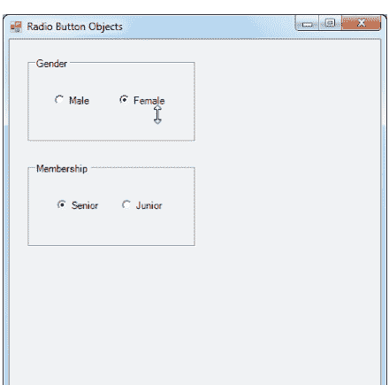

**图 11-2：** 正确使用单选按钮

如图 11-2 所示，GroupBox 将单选按钮分为两组，每组都可以有适当的选择。（你可以看到 Female 和 Senior 都被选中了。）

处理单选按钮选择的代码基本上如下：

```c
int choice;
if (rbMale.Checked == true)
{
    choice = MALE;
}
else
{
    choice = FEMALE;
}
```

我使用 rb 作为单选按钮的前缀，这与我通常为工具箱对象使用的三个字符前缀不同。使用两个字符前缀的原因是……我没有理由。它只是对我来说很合理。（如果这让你感到困扰，可以尝试 rbt 或 rbn。）单选按钮对象有一个 Checked 属性，如果按钮被选中，该属性为逻辑真，如果未选中则为逻辑假。（程序假设在程序的其他地方已经定义了 MALE 和 FEMALE 的符号常量。）如果选择列表大于两个，你可以使用嵌套的 if 语句来处理选择。

# 默认选择

通常你你希望为一组单选按钮设置一个默认选择。将默认选择设置为大多数用户的预期选择是有意义的。如果你预计大多数用户是女性，可以在表单的构造函数中添加以下代码：

```csharp
public frmMain()
{
    InitializeComponent();
    rbFemale.Checked = true;
}
```

`InitializeComponent()` 方法用于构建表单的内存映像。当控制从该方法调用返回时，表单对象已经在内存中构建完成。如果你想更改该对象的默认状态，构造函数是执行操作的地方。当表单显示时，它将选中 Female 选项。注意，将代码放在构造函数内部意味着它属于“程序五个步骤”中的初始化步骤。

# 复选框

限制用户输入的另一种方法是使用 CheckBox 对象，如图 11-3 所示。

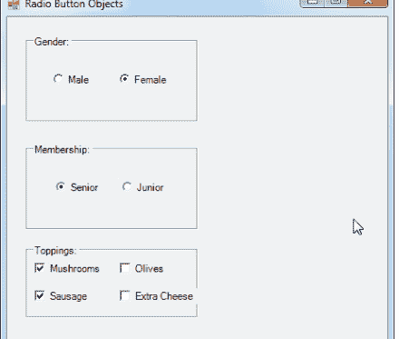

图 11-3：使用复选框，复选框的选择不是互斥的。用户可以自由地勾选他们认为适当的多个选项。图 11-3 中持有 CheckBox 对象的 GroupBox 对象不是必须的。然而，复选框描述的选项范围应用某些覆盖性选择的情况并不罕见。如果是这样，使用 GroupBox 有助于将用户的注意力集中在配料的选择上。

由于每个复选框对象都可以被选中，你的代码需要检查每一个的状态。实现此点的一种方法是使用类似于下面的代码（我倾向于使用 ckb 作为复选框对象的前缀）：

```csharp
Array.Clear(toppings, toppings.Length);
```

```csharp
if (ckbMushroom.Checked == true)
{
    toppings[MUSHROOMS] = 1;
}
if (ckbOlives.Checked == true)
{
    toppings[OLIVES] = 1;
}
if (ckbSausage.Checked == true)
{
    toppings[SAUSAGE] = 1;
}
if (ckbExtraCheese.Checked == true)
{
    toppings[EXTRACHEESE] = 1;
}
```

该代码使用 Array 类的 Clear() 方法将数组的所有元素初始化为 0。然后，通过一系列 if 语句记录用户所做的选择，使用符号常量有助于记录选择，并让程序员更容易理解后续处理。你当然可以为每个选择使用一个离散变量。然而，在这里使用数组是有意义的，因为所有选择都属于同一个实体，而且数组可能会简化后续代码。如果你想设置一组默认选择，可以在构造函数中设置复选框的 Checked 属性。

# 组合框

组合框（或称 combo boxes）与列表框类似，如果用户愿意，他们也可以从中输入响应。通常，用户从组合框对象呈现列表中列表中一个选项。图 11-4 显示了组合框的典型用法（“试一试”部分也讨论了图中所示的其他对象。现在，只需考虑组合框对象即可）。

如你在图 11-4 所示，组合框与列表框类似。因此，你既可以在设计模式下通过属性窗口初始化组合框中的列表，也可以在程序控制下设置列表。图 11-5 显示了你如何使用属性窗口中的 Items 属性向列表添加项目。

在属性窗口中使用 Items 属性大致意味着你在程序运行之前就已经知道要放入组合框的项目列表。（注：原文此处 OCR 文本存在大量重复和乱码，译文已根据逻辑进行清理。）

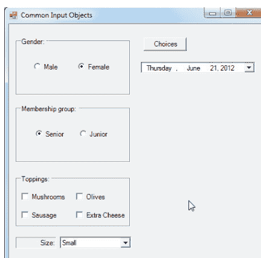

图 11-6: 日期和时间格式

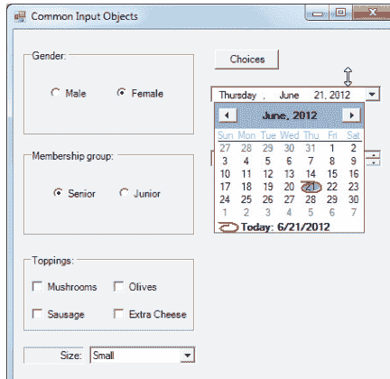

图 11-7: DateTimePicker 属性

# Format 和 ShowUpDown 属性

图 11-7 所示对象的的状态假设该对象的 `Format` 属性被设置为 `Long`，且 `ShowUpDown` 属性被设置为 `false`。如果你将 `Format` 属性设置为 `Short`，日期将显示为 `6/21/2012`。

在表单上添加第二个 `DateTimePicker` 对象并将它的 `ShowUpDown` 属性设置为 `true`。
现在表单看起来就像图 11-8 所示。

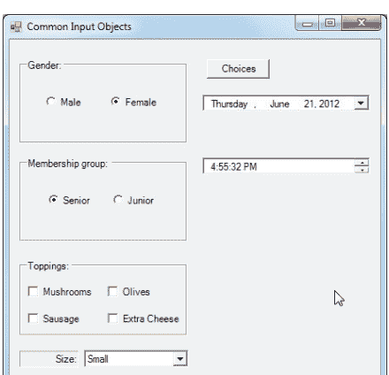

**图 11-8:** 带有 ShowUpDown 的 DateTimePicker

在第二个 `DateTimePicker` 对象中，用户可以使用对象末尾的数字控件来更改 `Text` 属性中显示的小时。如果用户需要，也可以在 `Text` 属性中输入时间。

要从 `DateTimePicker` 对象中提取信息，请使用以下代码：

```
string date = dtValue.ToShortDateString();
string time = dtValue.ToTimeString();
```

你可以选择不同的日期和时间方法来更改从 `DateTimePicker` 对象中提取的数据格式，以满足你的需求。前面的语句将产生日期 `6/21/2012` 和时间 `4:55 PM`。尽管本节中讨论的各种对象可以强制用户按特定格式输入程序数据，但问题仍然会（并且确实会）发生。考虑到这一点，请检查其他你可以使用的技术，以使你的代码无懈可击。

# 异常处理 (EXCEPTION HANDLING)

无论你尝试很好地处理错误输入，都存在漏掉某些情况。当程序出现错误状况时，C# 会产生一个异常。*异常*（exception）是一个计划外的程序状态。注意，异常实际上并不是程序错误（bug）。正如所指出的，bug 是程序员的错误，你必须纠正它。尽管如此，即使程序中没有 bug，在程序运行时也可能发生意外的情况。例如，如果你编写了一个将数据复制到 DVD 的程序，而用户忘记向 DVD 驱动器中加载了一张空白 DVD，程序就会生成异常。列表 11-1 所示的简单程序说明了一个异常。

# 列表 11-1：生成异常的代码

```
using System;
using System.Windows.Forms;
public class frmMain : Form
{
    private Button btnCalc;
    #region Windows code
    public frmMain()
    {
        InitializeComponent();
    }
    public static void main()
    {
        frmMain main = new frmMain();
        Application.Run(main);
    }
    private void btnCalc_Click(object sender, EventArgs e)
    {
        int exp1 = 0;
        int exp2 = 5;
        int result;
        result = exp2 / exp1;
    }
}
```

该程序是一个标准的 C# 表单，上面有一个按钮。在按钮对象的点击事件中，`exp1` 被设置为 0，`exp2` 被设置为 5。除以零会产生除零异常（DivideByZeroException）。目前，如果你在 Visual Studio 环境外运行程序，程序会弹出异常通知，如图 11-9 所示。如果你在 Visual Studio 环境内运行程序，你将得到类似的消息，但发生异常的精确语句会被高亮。

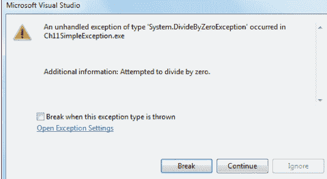

**图11-9:** 异常通知

308 | 第11 章 异常处理与调试

无论你尝试很好地处理错误输入，都存在漏掉某些情况的可能性。当程序出现错误状况时，C# 会产生一个异常。*异常*是一个计划外的程序状态。注意，异常实际上并不是程序错误。正如所指出的，bug 是程序员的错误，你必须纠正它。尽管如此，即使程序中没有 bug，在程序运行时也可能发生意外的情况。例如，如果你编写了一个将数据复制到 DVD 的程序，而用户忘记向 DVD 驱动器中加载了一张空白 DVD，程序就会生成异常。列表 11-1 所示的简单程序说明了一个异常。

该程序是一个标准的 C# 表单，上面有一个按钮。在按钮对象的点击事件中，`exp1` 被设置为 0，`exp2` 被设置为 5。除以零会产生除零异常。目前，如果你在 Visual Studio 环境外运行程序，程序会弹出异常通知，如图 11-9 所示。如果你在 Visual Studio 环境内运行程序，你将得到类似的消息，但发生异常的精确语句会被高亮。

这看起来很吓人，但其实不是。

如何防止这种这种情况？

# try-catch 块

你可以使用 try-catch 来“捕获”异常。通用语法如下：

```
try {
    // try 块
} catch {
    // catch 块
} finally {
    // finally 块
}
```


虽然这看起来很复杂，但其实不是。`try`块从左大括号开始。大括号之后是可能导致异常的语句。

`catch`语句紧跟在大括号之后。`catch`块的作用是向用户呈现消息。`catch`语句在抛出异常时出现。`finally`块无论是否抛出异常都会执行。`finally`块确保某些代码的执行。

`try-catch`语句用于处理异常。`try-catch`语句在这里更容易理解。

# 预判特定异常

你可以改进的方法之一是考虑在`try`语句块可能会发生哪些异常。显然，一种可能的异常是你一直尝试过的除零异常。

如果你使用异常异常（或按`Ctrl+D`），展开公共语言运行时异常标题，最后展开`System`标题，你将看到类似于图 11-11 所示的列表。

# 列表 11-2：异常处理 (`frmMain.cs`)

```csharp
//#define DEBUG

using System;

using System.Windows.Forms;

public class frmMain : Form

{
    private Button btnExit;
    private Button btnCalc;
    #region Windows code
    public frmMain()
    {
        InitializeComponent();
    }
    public static void Main()
    {
        frmMain main = new frmMain();
        Application.Run(main);
    }
    private void btnCalc_Click(object sender, EventArgs e)
    {
        int exp1 = 0;
        int exp2 = 5;
        int result;
#if DEBUG
        MessageBox.Show("exp = " + expl1.ToString());
#endif
        try{
            result = exp2 / exp1;
            MessageBox.Show("Never get here");
        } catch (DivideByZeroException)
        {
            MessageBox.Show("Divide by zero error.", "Exception Thrown");
            return;
        } catch (Exception ex)
        {
            MessageBox.Show("Error: " + ex.Message, "Exception Thrown");
        } finally {
            MessageBox.Show("In finally");
        }
    }
    private void btnExit_Click(object sender, EventArgs e)
    {
        Close();
    }
    #endregion
}
```

### 工作原理

现在，当你运行程序并点击计算按钮时，程序看起来就像图 11-10 所示。

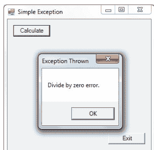

图 11-10: 除零异常

现在，当发生除零异常时，`catch`语句块将被执行以向用户呈现消息。

在`try`块中发生除零异常后出现的消息框永远不会执行。在程序控制传递到`catch`块后，代码路径不会自动返回`try`块代码。

# 异常处理

当发生以下异常时，将中断：

| 名称 | 抛出 | 用户处理 |
| --- | --- | --- |
| 通用语言运行时 (Common Language Runtime) 异常 | | |
| + Javascript 异常 | | |
| + System | | |
| + System.Collections.Generic | | |
| + System.ComponentModel | | |
| + System.ComponentModel.Composition | | |
| + System.ComponentModel.Primitives | | |
| + System.ComponentModel.Annotations | | |
| + System.ComponentModel.Design | | |
| + System.ComponentModel.Design.Serialization | | |
| + System.Configuration | | |
| + System.Configuration.Install | | |
| + System.Configuration.Provider | | |

**图 11-11:** 异常列表

意识到可能会发生特定类型的错误，你可以修改代码列表 12-2 以包含以下代码片段：

```csharp
try {
    result = exp2 / exp1;
    MessageBox.Show("Never get here");
} catch (DivideByZeroException) {
    MessageBox.Show("Divide by zero error.", "Exception Thrown");
}
```

`catch`语句块之前是一个带括号的表达式，它使用了`DivideByZeroException`异常。由于你更精确地预料了错误，你可以给用户提供更有意义的错误消息。

例如，如果`exp1`和`exp2`来自其他输入源，它们可能会溢出`int`允许的值范围。或者发生了某种硬件故障抛出了异常。在这些情况下，你可能想要提供多个`catch`块，例如：

```csharp
try {
    result = exp2 / exp1;
    MessageBox.Show("Never get here");
} catch (DivideByZeroException) {
    MessageBox.Show("Expression 1 is zero. Please reenter.", "Exception Thrown");
    txtExpression1.Focus();
    return;
} catch {
    MessageBox.Show("Something went terribly wrong.", "Exception Thrown");
}
```

该代码现在捕获特定的除零异常，但在发生未指定的异常时也可以捕获该异常。对于除零异常，你可以提供更有帮助的错误消息，甚至可以要求用户重新输入该值，如前面的代码段所示。然而，未指定异常的错误消息对用户没有帮助。你需要另一种方法来获取更多线索。

# 模糊异常消息

虽然你可能没有捕获发生的异常，但你可以通过以下修改为用户提供帮助：

```csharp
try {
    result = exp2 / exp1;
} catch (DivideByZeroException) {
    MessageBox.Show("Expression 1 is zero. Please reenter.", "Exception Thrown");
    txtExpression1.Focus();
    return;
} catch (Exception ex) {
    MessageBox.Show("Error: " + ex.Message, "Exception Thrown");
}
```

在这段代码中，你定义了一个名为`ex`的`Exception`对象变量。在消息框中，你使用`Exception`对象的`Message`属性来就发生的发生的异常提供更精确的消息。这些消息是“模糊异常消息”，因为它们比没有消息要好，但通常不足以让你采取某些纠正措施（正如你处理除零异常时所做的）。尽管这可能无法解决用户的问题，但至少模糊消息比你之前提供的通用消息要好。

鉴于你的代码处理了模糊异常，你如何测试它呢？

# 测试模糊异常

你可以通过使用`throw`关键字抛出该异常来测试异常。（`catch...throw...get`？）为了说明这一点，请如下所示修改你的点击事件代码：

```csharp
try {
    throw new ArgumentOutOfRangeException(); // 新语句
    result = exp2 / exp1;
} catch (DivideByZeroException) {
    MessageBox.Show("Expression 1 is zero. Please reenter.");
} catch (Exception ex) {
    MessageBox.Show("Error: " + ex.Message, "Exception Thrown");
    txtExpression1.Focus();
    return;
}
```

`try`块中的第一个语句使用了图 11-11 所示的可能性中的示例异常。正如你预期的，`ArgumentOutOfRangeException`结尾的括号意味着程序将“构造”一个`ArgumentOutOfRangeException`然后抛出它。（`throw`一词简单意味着在构造函数执行时抛出。）由于该异常不是`DivideByZeroException`，因此调用了模糊异常处理器。由`Show()`方法的消息如图 11-12 所示。

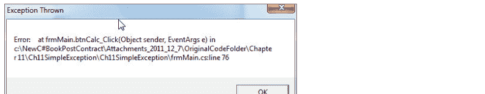

图 11-12：抛出异常

显然，这个`Message`属性并不是`Exception`对象唯一的有用属性。发生了错误。你还可以使用`StackTrace`属性 (`ex.StackTrace`) 来显示异常发生之前所调的方法。（方法按反序显示，最后调的方法位于列表顶部。）尽管向用户显示堆栈跟踪消息可能不是好主意，但它们对于调试复杂的程序可能有用。

# finally 语句块

前面提到的，`finally`语句用于有一组无论是否发生异常都想要执行的语句。再次，让我们如下修改按钮的点击事件代码：

```csharp
try {
    result = exp2 / exp1;
} catch (DivideByZeroException) {
    MessageBox.Show("Expression 1 is zero. Please reenter.", "Exception Thrown");
    txtExpression1.Focus();
    return;
} catch (Exception ex) {
    MessageBox.Show("Error: " + ex.Message, "Exception Thrown");
} finally {
    // finally 块代码
}
```


无论是否发生异常，`finally`块都会执行。对于清理资源非常有用，例如关闭文件句柄或数据库连接。

# 程序调试

调试的关键在于理解你的程序是如何执行的。许多错误是逻辑错误，程序运行没有崩溃但产生了错误的结果。为了找到这些错误，你可以使用调试器单步执行代码并检查变量的值。

# 第11章 异常处理与调试

可能存在其他边界情况。例如，在我教的一门高级 OOP 编程课程中，学期初的第一件事就是让学生写一个程序，让计算机尝试确定用户正在想的数字。程序会询问游戏的下限和上限，然后开始猜数字。计算机显示它的猜想，用户点击相应的按钮（太大了、太小或正确）。如果限制是 0 和 100，即使是使用 RDC（递归减半）的二分查找算法也能 100 次尝试内猜中数字，对吧？因为边界是包含在内的，所以需要 101 次猜测才能确保搜索范围包含了所有值。事实上，当我告诉他们可以由我测试他们的程序时，我尝试的第一个数字就是 0 和 100。令人失望的是，大量的程序在这些边界情况下无法正常运行。

准备一组测试数据的另一个原因是增加你使 bug 可复现的概率。最难修复的 bug 是无法一致重复的 bug。某些编程语言（如 C 和 C++）受到指针问题的困扰，这使得 bug 特别难以追踪。（这就是为什么 C# 鼓励使用指针数据类型的原因。）

用户输入一组输入值，点击“计算”（或类似）按钮，然后程序崩溃或生成错误答案的情况并不罕见。当哪些值产生了错误时，用户不记得他们输入了什么。有时只有当特定的值或值序列触发了产生输出错误的程序状态时。当用户无法回想起这些值时，会非常沮丧，尤其是当你无法复制该错误时。（为了辅助程序调试，某些程序会在 `catch` 块中使用称为错误日志记录的方法，将特定的程序值写入磁盘。）

无论你使用什么测试数据，请都要保存它们。它们以后可能会派上用场。

## 隔离

假设你有一个可复现的 bug，消除它的下一步一步是将其隔离。在 OOP 技术普及之前的全局数据盛行的旧时代，错误的输出可能由程序的任何地方引起。当时没有所谓的“私有”数据或作用域。每个变量在程序的任何时间点都是可见且全局可用的。因此，要精确确定某个特定变量在何时是错误的是非常困难的。

在 OOP 设计中，通常很容易看出程序 bug 隐藏在哪个类中。尽管如此，程序类有很多代码需要隐藏，因此你可以利用任何帮助来寻找发现过程。这就是程序调试器价值所在的地方。

虽然本节讨论的是 Visual Studio 调试器，但大多数调试器具有相同的通用功能。因此，尽管运行调试器的机制可能不同，但它们的使用和目的是通用的。

### Visual Studio 调试器

调试器最大的益处可能是有助于隔离程序 bug。隔离 bug 的起点是断点。（尽管你在前面的章节中读到过 Visual Studio 调试器，但我在这里在这里进行稍微正式一点的检查。）断点是程序源代码中的一个位置，你希望在该处强制暂停程序的执行。通过暂停程序执行，你可以检查此时在作用域内的各种数据项的值。

你已经知道可以通过将光标置于在你想要设置断点的语句上，然后按 `F9` 键（或点击源窗口的左边距）来设置断点。该语句行的背景颜色会立即变为红色，程序页边距会出现一个红点，如图 11-13 所示。

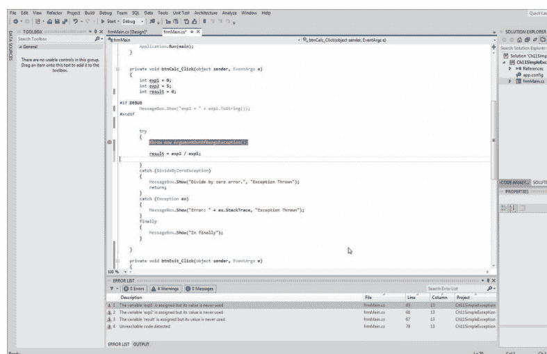

**图 11-13：** 设置断点

当你运行程序时，它将一直运行到到达断点语句。在那一刻，程序暂停。红色背景被黄色背景取代，程序准备好执行断点语句。注意，断点语句尚未被处理。

此时，你可以将光标移动到作用域内的不同变量上，并检查它们的值。

### 本地窗口 Locals Window

你可以通过打开本地窗口查看所有局部作用域变量。要这样做，只需使用调试（Debug）菜单序列（或 `Ctrl+D, L`）。显示的内容与图 11-14 所示类似。

本地窗口显示所有具有局部作用域的变量，正如第 9 章所讨论的。通常，使用本地窗口比将光标移动到每个变量来检查其值要容易得多。注意，如果你想检查与其对象相关的属性，可以展开引用数据类型（如 `sender`）。

| 名称 | 值 | 类型 |
| :--- | :--- | :--- |
| this | (frmMain) | 简单异常 |
| sender | (Calculate&) | 对象 |
| exp1 | (X = 28, Y = 15) | System.32 |
| exp2 | 5 | int |
| result | 0 | int |

**图 11-14：** 本地窗口

### 立即窗口 Immediate Window

你可以使用调试 > 窗口（`Ctrl+D, I`）序列激活立即窗口。立即窗口的目的是让你能够输入一个表达式并检查其影响。图 11-15 显示了 `exp1=2`，将其值从 0 更改为 2。这比编辑源代码、重启并运行程序要快得多。

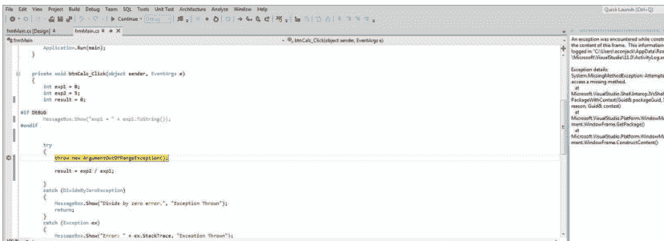

| 名称 | 值 | 类型 |
| :--- | :--- | :--- |
| this | (frmMain) | 简单异常 |
| sender | (Calculate&) | 对象 |
| exp1 | (X = 28, Y = 15) | System.32 |
| exp2 | 5 | int |
| result | 0 | int |

**图 11-15：** 立即窗口

### 单步执行程序

你已经知道如何单步执行程序。然而，调试器还包含了你可以使用的额外工具。首先，当你到达断点时，可以按 `F10` 或 `F11` 进入下一条要执行的语句。当你进入下一条语句时，页边距的黄色箭头会移动到下一行，显示程序当前的执行位置。

### 从断点回溯

可能并不明显的是你也可以回溯程序执行。图 11-16 显示了页边距中的黄色箭头，以及一条消息，说明你可以将（黄色箭头）光标拖到之前的行再次执行该行。这让你无需重启程序并运行到当前断点即可执行程序语句。当你看到调试器被拖动到第二个数据定义处，在断点之后。

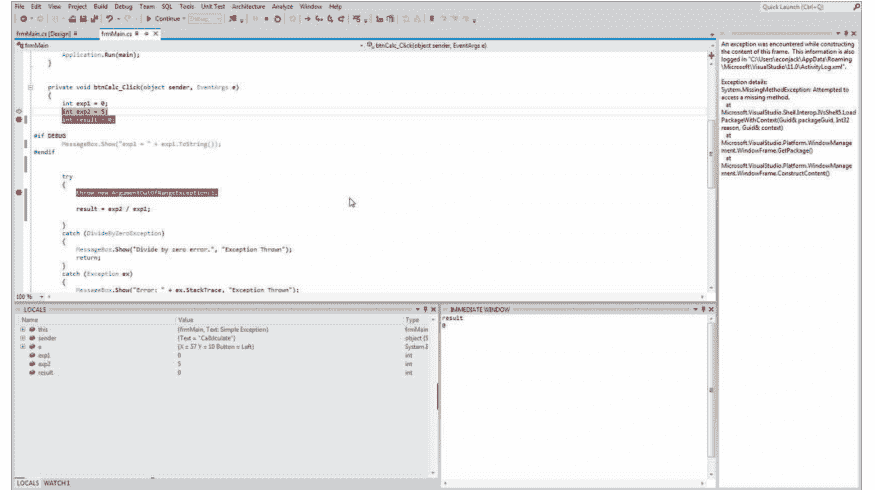

**图 11-16：** 拖动点

尽管消息没有说明，你无法推进黄色箭头。这样做意味着跳过语句来正确确定作用域内变量的值。这不是一个严重的限制，因为你可以在源文件的更靠位置设置断点，并按 `F5` “全速”运行到该断点。（你也可以右键点击某行并选择“下一语句”来设置断点。）

### 调试工具栏

图 11-17 显示了调试工具栏，并对工具栏上每个图标的含义进行了注释。继续图标允许程序从断点以正常速度恢复执行。中断图标提供了一个暂停，让你在程序执行时手动进入调试模式。停止图标终止当前的程序运行。重启只需重启程序。“显示下一个”（Show Next）图标显示下一个要执行的语句。但也许最有趣的调试功能与“单步”（Step）图标相关，我们会在文中详细讨论。


图 11-17：调试工具栏

### 单步进入 Step Into

使用单步进入（Step Into）图标，如果要执行的语句是一个具有源码的方法调用，程序执行将进入该方法的源代码。这允许你逐行执行该方法的源代码。

### 单步跳过 Step Over

使用单步跳过（Step Over）图标，如果要执行执行的语句是一个具有源码的方法调用，程序执行将跳过该方法的源代码，继续执行当前语句之后的下一个语句。当你知道即将调用的方法运行正常，且不想浪费时间逐行执行其源代码时，跳过该方法是非常用的。

### 单步跳出 Step Out

最后，假设你已经进入了某个方法的源代码，执行到一半时决定返回到该方法的调用者。通过点击单步跳出（Step Out）图标，你可以跳过该方法中剩余的代码行，返回到调用方法的地方。这也可以节省时间。

十六进制（Hex）图标允许你以十六进制值查看调试器信息，而不是默认的十进制表示法。这对于汇编语言程序员可能很有用。调试工具栏上的最后一个图标（输出，Output）提供了有关当前正在执行程序的额外信息。在此阶段，没有任何信息是无用的。

## 寻找 Bug

设置断点和对程序进行单步执行的目的是让你观察程序执行时数据数值的变化。在测试数据的帮助下，你应该看到程序如何从良好的输入值（假设这些值是正确的）变为错误的输出值。如果你的输入测试数据具有足够的细粒度（例如复杂计算的中间值），你应该能精确地定位 Bug 所在。（这是支持高内聚方法的另一个理由。如果你编写了瑞士军刀式的方法，尝试做太多事情，会让调试变得更加困难，因为多功能方法需要更长的测试和调试。）

通常情况下，修复 Bug 是简单的。你只需要更改产生错误的程序语句即可。有时，你可能需要更改计算方式（即其算法）。

## 脚手架代码 Scaffold Code

在符号调试器出现之前的日子，程序员被迫在程序运行时打印变量的值。然后你将查看中间值，并尝试确定问题出在哪里。当你找到错误时，必须返回并删除代码中使用的所有打印语句。这是一个容易出错的过程，因为很容易漏掉某个打印语句，或者不小心删除了某行本应该保留在程序中的代码。

随后的语言（如 C）允许程序员在源代码中添加预处理器指令，并让编译器在代码中切换调试语句的开启或关闭。根据预处理器指令添加或删除的调试代码有时被称为脚手架代码（scaffold code）。让编译器进行切换出错的可能性小得多。

C# 允许你使用一些预处理器指令。你已经在程序使用了 `#region-endregion`。现在考虑以下代码：

```csharp
#define MYDEBUG

// 许多行代码。

// 现在你处于一个经常出错的地方，所以你添加：

#if MYDEBUG
    MessageBox.Show("Value of expl = " + expl.ToString());
#endif
```

预处理器指令必须是源代码的第一行。在这个示例中，`#define MYDEBUG` 预处理器指令导致 `MYDEBUG` 被添加到符号表中。（你不应该使用 `DEBUG`，因为 Visual Studio 已经有了那个静态常量。）因为它定义在任何方法之外，所以它具有类作用域。这意味着 `MYDEBUG` 在程序的所有元素中都是知的，包括其他源文件。

你可以在 `#if` 和 `#endif` 之间放置任意数量的代码。你还可以使用以下变体：

```csharp
#if MYDEBUG
    val = 3;
#else
    val = 0;
#endif
```

这允许你根据 `#define` 指令切换测试值。很不错的一点是，如果你使用 Visual Studio 查看此片段，当前未编译的语句将以灰色显示。换句话说，如果定义了 `MYDEBUG`，语句 `val = 0;` 将变灰。

### 切换脚手架代码

在程序中切换脚手架代码最简单的方法是在源代码顶部使用这两行：

```csharp
#define MYDEBUG
//undef MYDEBUG
```

通过这两行，`MYDEBUG` 符号被定义为程序。如果你取消第二行的注释，`#undef` 预处理器指令将从符号表中移除 `MYDEBUG` 符号。（你应该将 `#define MYDEBUG` 指令保留在源文件中。）在之前的代码片段中，这将导致 `val` 等于 0。

像这样使用预处理器指令允许你将脚手架测试代码留在源文件中，但根据需要将其切换到程序内外部。

## 防御性编码 Defensive Coding

有时很难准确确定是哪个变量负责生成错误。发现像下面的 switch 结构是很常见的：

```csharp
delta = a * (b -1) + (h * math.pow(1+r, x) + 2 * d) / left + right;
```

你只知道这里出问题了。

```csharp
delta = a * (b -1) + (h * math.pow(1+r, x) + 2 * d) / left + right;
```

```csharp
delta = a * (b -1) + (h * math.pow(1+r, x) + 2 * d) / left + right;
```

通常会发现类似下面的结构：

```csharp
delta = a * (b -1) + (h * math.pow(1+r, x) + 2 * d) / left + right;
```

其中 $p$ 是现值，$a$ 是未来金额，$i$ 是利率，$y$ 是资产推迟的未来年数。你会如何编写这个公式？为什么？

- 3. C# 允许你使用如下所示的代码，在单条语句中定义了多个变量：

```csharp
long number, val, len;
```


- 4. 你写了一个很长而复杂的程序，它虽然可以编译并执行，但产生了错误的解决方案。你尝试过定位错误，但到目前为止还没有成功。你会做什么来修复程序漏洞？

- 5. 我的大多数学生都不愿意在自己的代码中自愿放置 `try-catch` 块。也就是说，除非我提醒他们这样做，否则我会在他们的作业中看到 `try-catch` 块。如果你在给他们的作业评分，并且打算采取独裁的手段，你会在哪些地方绝对坚持要求他们使用 `try-catch` 块，否则该作业将得不及格？

### 本章学到的知识

| 主题 | 关键点 |
| --- | --- |
| Bug (bugs)、错误 (errors) 和异常 (exceptions) 的区别 | Bug 是错误的体现，而异常是不希望的程序运行状态。 |
| 语法错误 (Syntax error) | 未遵循语言规则。 |
| 语义错误 (Semantic error) | 在错误的上下文中使用语句。 |
| 逻辑错误 (Logic error) | 你搞砸了。 |
| 异常和异常处理 (Exceptions and exception handling) | 如何应对意外的程序状态。 |
| 抛出异常 (Exception throwing) | 如何强制触发异常。 |
| 使用调试器 (Using the debugger) | 程序断点和各种调试窗口。 |
| Bug 的检测、隔离和修复 | 修复程序漏洞的正确顺序。 |

# 12

# 泛型 (Generics)

本章将学习：

- 泛型
- 泛型提供的优势
- 装箱 (Boxing) 和解箱 (Unboxing)
- 运行时类型检查
- 接口 (Interfaces)
- 递归 (Recursion)

本章的 WROX.COM 代码下载

你可以在 `Download Code` 选项卡找到本章作为 C# 部分的代码下载，其地址为 `www.wrox.com/remtitle_cgi1?isbn=978118336922`。`Chapter12` 文件夹中的代码根据整个章节中的名称进行了单独命名。

本章讨论了泛型，这是自 2005 年发布以来一直是 C# 的一个特性。泛型具有为你节省大量编程工作的潜力。

泛型为你提供了一种合理方式扩展编程时间的方法。在本章中，你将研究这个相对新的 OOP 特性提供了哪些内容。

# 什么是泛型？

理解泛型为编程带来了什么最佳方法是通过一个示例。数据排序是一个常见的编程问题，我曾参加过一份咨询工作的面试，面试的一部分是编程测试，我被要求生成一系列随机数，将它们显示在列表框（`listbox`）中，按升序排序，然后在第二个列表框中重新显示。当我跳过编写自己的排序程序，而简单地开启第二个列表框的 `Sorted` 属性时，面试官们并不高兴。教训：了解你的工具箱。但假设你必须对一组整数数据进行升序排序，并且你可以使用列表框的技巧。你会如何编写解决方案呢？

# 试一试 快速排序 (Chapter12ProgramQuickSort.zip)

尽管关于排序算法的著作数众多，但最快的通用排序算法之一是快速排序。该算法使用分治法对数据进行分区，然后通过递归自身来执行排序任务。程序的示例运行如图 12-1 所示，可用于布局界面。


图 12-1：用户界面

要尝试此程序：

1. 按照常规方式创建一个新项目。
2. 创建一个类似于图 12-1 所示的用户界面。
3. 下载文件：`Chapter12ProgramQuickSort.zip`。

左侧的列表框对象显示了使用伪随机数类（`Random`）生成 10 个整数值产生的“原始”数据。当用户点击 Sort 按钮后，该数字列表将被排序并显示在第二个列表框对象中。（不，我没有走捷径简单地将 `Sorted` 属性设置为 true。）

# 它是如何工作的

像往常一样，`frmMain` 执行了五个程序步骤中的四个，将“处理”（Process）步骤留给 `clsSort` 中的代码。`frmMain` 的代码如列表 12-1 所示。

# 列表 12-1：排序数据列表程序 (frmMain.cs)

```csharp
#define MYDEBUG
//#undef MYDEBUG
using System;
using System.Windows.Forms;
public class frmMain : Form
{
    private const int MAXVAL = 1000; // 要生成的最大随机数
    private int[] data; // 要排序的数据数组
    private int[] number; // 数组中的元素数量
    private TextBox txtNumber;
    private Button btnGen;
    private ListBox lstOutput;
    private Button btnClose;
    private Button btnSort;
    private ListBox lstSorted;
    private Label lbl1;
    #region Windows
    public frmMain()
    {
        InitializeComponent();
    }
    public static void Main()
    {
        frmMain main = new frmMain();
        Application.Run(main);
    }
    private void btnGen_Click(object sender, EventArgs e)
    {
        bool flag;
        if (!int.TryParse(txtNumber.Text, out number))
        {
            MessageBox.Show("只输入数字。", "Error");
            return;
        }
        data = new int[number];
        #if DEBUG
        Random rnd = new Random(number); // 用于测试
        #else
        Random rnd = new Random();
        #endif
        lstOutput.Clear();
        for (int i = 0; i < data.Length; i++)
        {
            data[i] = rnd.Next(MAXVAL);
        }
    }
    private void btnSort_Click(object sender, EventArgs e)
    {
        clsSort mySort = new clsSort(data);
        mySort.quickSort(0, data.Length - 1);
        lstSorted.Clear();
        for (int i = 0; i < data.Length; i++)
        {
            lstSorted.Items.Add(data[i].ToString());
        }
    }
    private void btnClose_Click(object sender, EventArgs e)
    {
        Application.Exit();
    }
    #endregion
}
```

# 12 泛型

# 列表 12-1 (继续)

```csharp
#define MYDEBUG
//#undef MYDEBUG
// ... (省略)
#if DEBUG
Random rnd = new Random(number); // 用于测试
#else
Random rnd = new Random();
#endif
```

由于使用了 `#undef` 指令，`Random` 类的构造函数没有带参数调用。这会导致每次运行产生不同的随机数。在开发代码时，通常需要一个稳定的数据集。要建立该测试环境，只需注释掉 `#undef` 行，如列表 12-1 所示。

```csharp
data[i] = rnd.Next(MAXVAL);
```

该行简单的生成落在 0 到 `MAXVAL`（设置为 100 的符号常量）范围内的随机数。这组随机值被添加到列表框对象。

以下语句定义了一个名为 `mySort` 的 `clsSort` 对象，然后调用 `quickSort()` 方法对数据排序

```csharp
clsSort mySort = new clsSort(data);
```

```csharp
mySort.quickSort(0, data.Length - 1); // 对数据排序
```

注意构造函数将原始数据作为参数传递。`clsSort` 的代码如列表 12-2 所示。

# 列表 12-2：clsSort 代码 (clsSort.cs)

```csharp
using System;
using System.Collections.Generic;
using System.Text;
class clsSort
{
    int[] data;
    public clsSort(int[] vals)
    {
        data = vals; // 赋值
    }
    /**
     * 目的：此方法通过递归调用 quickSort()
     * 将整数值数组按升序进行排序。
     * 
     * 参数列表：
     * int first 要排序的第一个值
     * int last  要排序的最后一个值
     * 
     * 返回：
     * void
     */
    public void quickSort(int first, int last)
    {
        int start; // 左侧分区的索引
        int end;   // 右侧分区的索引
        start = first; // 保留数组第一个元素的副本...
        end = last;   // ...以及最后一个。
        if (last - first >= 1) // 确保有足够的数据进行排序
```

332 | 第 12 章 泛型

列表 12-2（续）

```
int pivot = data[first]; // 设置分区
while (end > start) // 当索引不匹配时...
{
    // 执行左侧分区
    while (data[start] <= pivot && start && last > end)
        start++;
    // 执行右侧分区
    while (data[end] > pivot && first && end >= start)
        end--;
    if (end > start)
        swap(start, end); // ...执行交换
}
swap(first, end); // 将最后一个元素与枢交换
quicksort(first, end - 1); // 排序数组分区
quicksort(end + 1, last);
} else {
    return;
}
```

```
* Purpose：此方法为 quickSort 执行数据交换
* 参数列表：
* int pos1 第一个值的数组索引
* int pos2 第二个值的数组索引
* 返回值：
* void
```

```
public void swap(int pos1, int pos2)
{
    int temp;
    temp = data[pos1]; data[pos1] = data[pos2];
    data[pos2] = temp;
}
```

关于该类有几点需要注意。首先，在构造函数中，以下语句执行了普通的值到右值（value-to-rvalue）赋值：

```
data = vals; // 拷贝右值
```

然而，如果你还记得，引用变量的数据是一个指向数据所在内存位置的内存地址指针，因此结果是变量 `data` 和 `vals` 都指向相同的数据。不过，这意味着在数据排序后，原始随机值的序列将丢失。如果你出于某种原因需要保留该序列，可以将 `data` 定义为相同大小的数组并在构造函数的语句块中拷贝这些值：

```c
public void sort(int[] vals){
    int[] data = new int[vals.Length];
    Array.Copy(vals, data, vals.Length);
}
```

## 递归

快速排序算法背后的理论是将数字集合围绕枢轴（`pivot`）分为两部分。代码查看两个分区周围的数据，并调用 `swap()` 方法交换值以重新排列数据。然后代码从内部再次调用相同的 `quickSort()` 方法。方法调用自身的过程就是递归。

递归的好处是，你实际上通过重用相同的方法而不是编写某种形式的代码来完成任务，从而减少了代码量。坏处是很容易写错代码，特别是当你遇到最后一次递归调用时。因为递归方法每次被调用都会调用一组新的局部变量，失控的递归很容易耗尽内存并导致程序以一种难看的方式崩溃。此外，由于每次调用方法都会涉及一定量的开销，递归通常比该问题的非递归解决方案慢一点。

然而，大多数快速排序的实现都使用递归，因此这里也是这么做的。你可以在列表 12-2 中看到两次递归调用。如上所述，当算法需要时，`swap()` 方法会交换两个值。

许多排序算法通过大 O 表示法来衡量因素（例如，表示法 `$O(N)$`）。这种表示法意味着，如果要排序的值数量增加，排序数据所需的时间将增加数百倍。相反，快速排序受 `$O(N * Log(N))$` 关系的限制，这使得排序时间几乎是线性的。也就是说，如果数据增加 10 倍，耗时大约增加 10 倍。）片段：大多数程序员认为泡排序是地球上最慢的排序算法。此外，如果数据已经有序并向数据集中添加一个新项，泡排序可能是处理该新集合最快的算法之一（当这个话题出现时，你可以让你的朋友在派对上大为惊艳）。结论：编程规则是刻板的。

现在，你有了一个可以高效排序的类。你可以保存代码以备后。毕竟，OOP 的真正好处之一是代码重用，对吗？这取决于……

## 数据问题

几个月后：客户带着问题来找你。解决方案的一部分要求你在最终处理数据之前对其进行排序。一些神经元让你记得你写的代码。酷！是时候提取 `clsSort` 代码并将其集成到解决方案中了……

噢。客户的规范要求对 `double` 类型进行排序，但你的 `clsSort` 代码只处理 `int` 数据。当然，你可以重写代码，将一切改为 `double` 类型，但你就会失去排序数据的能力。或者，你可以在类中编写独立的 `int` 和 `double` 排序方法。然而，如果你这样做，就有双倍的代码需要测试、调试和维护。如果可以用一个排序方法来处理两种类型的数据，难道不是很好吗？这正是泛型要解决的问题。

## 泛型简介

简单来说，泛型允许你在 C# 中创建“无类型”的数据结构。在先前的快速排序示例中，你使用以下语法定义了一个 `clsSort` 对象的实例：

```
clsSort mySort = new clsSort(data);
```

（注：OCR 文本在中间有一些重复和截断，我已经根据逻辑流进行了清理。）

# 第 12 章泛型


图 12-2：泛型快速排序

如果你选择 String 单选按钮，程序会要求用户在文本框对象中输入一组用逗号分隔的字符串列表。字符串数据使用与排序 double 数据相同的代码进行排序。图 12-3 显示了字符串数据的运行。


图 12-3：针对字符串的泛型排序

以图 12-2 作为用户界面的模型：

1. 按照通常方法创建一个项目。
2. 填入列表 12-3 和 12-4 中的源代码，或下载文件 `Chapter1ProgramGenericQuickSort.zip`。

正如你所见的，你可以拥有这种排序灵活性，同时保持强力的数据类型保护，而不会因为装箱和拆箱产生沉重的性能影响。你也不需要处理各种类型转换情况。显然，泛型是你编程工具箱中非常值得添加的工具。

### 工作原理

检查驱动排序测试的 `frmMain` 中的源代码。这显示在列表 12-3 中。

列表 12-3：使用泛型排序数据 (frmMain)

```csharp
using System;
using System.Windows.Forms;
public class frmMain {
    const int INTEGER = 1; // 符号常量
    const int LONG = 2;
    const int DOUBLE = 3;
    const int STRING = 4;
    const int UNSORTED = 1;
    const int SORTED = 2;
    const int MAX = 1000;
    int items; // 要生成的值
    int choice; // 选择了哪种数据类型
    int whichListBox; // 哪个列表框获取这些数据
```


```csharp
int[] iData; // 数据数组

long[] lData;

double[] dData;

string[] sData;

Random rnd = new Random();

private GroupBox groupBox1;

private Radio rbString;

private RadioButton rbDouble;

private RadioButton rbLong;

private Label lbl1;

private TextBox txtItems;

private TextBox txtString;

private ListBox lstUnsorted;

private ListBox lstSorted;

private Button btnRaw;

private Button btnSort;
```

# 列表 12-3（续）

```csharp
private Button btnnClose;

private RadioButton rbInt;

#region Windows 代码

public frmMain()

{

    InitializeComponent();

    rbInt.Checked = true;    // 设置默认值

    choice = INTEGER;

}

public static void Main()

{

    frmMain = new frmMain();

    Application.Run(main);

}

private void btnnClose_Click(object sender, EventArgs e)

{

    Close();

}

// 先显示原始数据

private void btnnRaw_Click(object sender, EventArgs e)

{

    bool flag;

    int i;

    flag = int.TryParse(txtItems.Text, out items);

    if (flag == false)

    {

        MessageBox.Show("仅限数字。重新输入", "输入错误");

        txtItems.Focus();

        return;

    }

lstUnsorted.Items.Clear();    // 清空旧数据

lstSorted.Items.Clear();

whichListBox = UNSORTED;

switch (choice)                // 选择数据类型

{

    case INTEGER:              // 整数

        iData = new int[items];

        for (i = 0; i < items; i++)

        {

            iData[i] = rnd.Next(MAX);

        }

        break;
```

## 泛型简介 | 339

```csharp
case LONG: // 长整数

    lData = new long[items];

    for (int i = 0; i < items; i++)

        lData[i] = (long)rnd.Next(MAX);

    break;

case DOUBLE: // 双精度浮点

    dData = new double[items];

    for (int i = 0; i < items; i++)

        dData[i] = rnd.NextDouble() * MAX;

    break;

case STRING: // 字符串

    sData = txtString.Text.Split(','); // 分割为字符串

    break;

}
ShowData(); // 在列表框对象中显示数据
```
```csharp
}
private void btnSort_Click(object sender, EventArgs e)
{
    whichListBox = SORTED;
    switch (choice)
    {
        case INTEGER: // 再次处理类型
            clsQuickSort<int> iSort = new clsQuickSort<int>(iData);
            iSort.Sort();
            break;
        case LONG:
            clsQuickSort<long> lSort = new clsQuickSort<long>(lData);
            lSort.Sort();
            break;
        case DOUBLE:
            clsQuickSort<double> dSort = new clsQuickSort<double>(dData);
            dSort.Sort();
            break;
        case STRING:
            clsQuickSort<string> sSort = new clsQuickSort<string>(sData);
            sSort.Sort();
            break;
    }

    ShowData();
}
```

## 列表 12-3（续）

## 340 | 第 12 章 泛型

```csharp
private void ShowData()            // 简单显示数据
{
    int i;
    switch (choice)
    {
        case INTEGER:                      // 再次处理类型
            for (i = 0; i < items; i++)
            {
                if (whichListBox == SORTED)
                    lstSorted.Add(iData[i].ToString());
                else
                    lstUnsorted.Add(iData[i].ToString());
            }
            break;
        case LONG:
            for (i = 0; i < items; i++)
            {
                if (whichListBox == SORTED)
                    lstSorted.Add(lData[i].ToString());
                else
                    lstUnsorted.Add(lData[i].ToString());
            }
            break;
        case DOUBLE:
            for (i = 0; i < items; i++)
            {
                if (whichListBox == SORTED)
                    lstSorted.Add(dData[i].ToString());
                else
                    lstUnsorted.Add(dData[i].ToString());
            }
            break;
        case STRING:
            for (i = 0; i < sData.Length; i++)
            {
                if (whichListBox == SORTED)
                    lstSorted.Add(sData[i].ToString());
                else
                    lstUnsorted.Add(sData[i].ToString());
            }
            break;
    }
}

private void rbInt_Click(object sender, EventArgs e)
{
    choice = INTEGER;
}

private void rbLong_Click(object sender, EventArgs e)
{
    choice = LONG;
}
```

## 泛型简介 | 341

```csharp
private void rbDouble_Click(object sender, EventArgs e)
{
    choice = DOUBLE;
}

private void rbString_Click(object sender, EventArgs e)
{
    choice = STRING;
}
```

代码从定义几个符号常量开始，接着是一系列数组对象。这些数组持有要排序的数据。`frmMain` 构造函数将单选按钮的默认数据类型设置为整数（`choice = INTEGER`）。如图 12-2 所示，生成的默认值值为 10。

## 字符串的 Split()

选择字符串数据时，计数取决于 `txtString` 对象中用逗号分隔的条目数量。这通过语句实现：

```csharp
sData = txtString.Text.Split(',');
```

`Split()` 方法检查 `txtString` 以寻找逗号字符。每当找到逗号时，它都会为逗号之前的（但不包括逗号）字符创建一个新字符串。所有子字符串完成后，字符串数组赋值给 `sData`。如果需要，`Split()` 方法可以使用多个分隔符。可以使用在线帮助查找详情（即双击代码中的 `Split` 单词，然后按 `F1` 键）。

如果用户选择了默认选项，会在相应的单选按钮事件代码中设置 `choice`。例如，如果用户点击 `Double`，以下代码会将 `choice` 设置为相应的值：

```csharp
private void rbDouble_Click(object sender, EventArgs e)
{
    choice = DOUBLE;
}
```

通过各种 `switch` 语句选择相应的代码。

## 生成数据

根据 `choice` 的值，填充相应的数组。以下代码片段显示了这一点：

```csharp
switch (choice)
{
    // 选择数据类型
    case INTEGER:      // 整数
        iData = new int[items];
        for (i = 0; i < items; i++)
        {
            iData[i] = rnd.Next(MAX);
            break;
    case LONG: // 长整数
        lData = new long[items];
        for (i = 0; i < items; i++)
        {
            lData[i] = (long) rnd.Next(MAX);
        }
        break;
    case DOUBLE: // 双精度浮点
        dData = new double[items];
        for (i = 0; i < items; i++)
        {
            dData[i] = rnd.NextDouble() * MAX;
        }
        break;
    case STRING: // 字符串
        sData = txtString.Text.Split(','); // 分割为字符串
        break;
}
```

对于 `INTEGER` 和 `LONG` 类型，带参数的 `Next` 方法为循环生成伪随机数。循环次数是用户输入的 `items` 变量。传递 `MAX` 值确保生成的值在 0 和 `MAX` 之间（不包含 `MAX`）。对于 `DOUBLE` 数据类型，`NextDouble()` 方法返回 0 到 1 之间的值（不包含1）。因此，将 `NextDouble()` 方法返回的小数乘以 `MAX` 设置了双精度数据类型的范围。对于字符串，如之前所述，`Split()` 方法填充了 `sData` 数组。

生成值后，调用 `ShowData()` 将数据移动到列表框中以显示生成的值。

# 使用泛型类

在原始数据生成并显示在列表框对象之后，你就可以将未排序的数据传递给泛型的快速排序方法。以下代码片段显示了如何为不同类型调用 `sort` 方法：

```csharp
private void btnSort_Click(object sender, EventArgs e)
{
    whichListBox = SORTED;
    switch (choice)
    {
        case INTEGER: // 整数
            clsQuickSort<int> iSort = new clsQuickSort<int>(iData);
            iSort.Sort();
            break;
        case LONG:
            clsQuickSort<long> lSort = new clsQuickSort<long>(lData);
            lSort.Sort();
            break;
        case DOUBLE:
            clsQuickSort<double> dSort = new clsQuickSort<double>(dData);
            dSort.Sort();
            break;
        case STRING:
            clsQuickSort<string> sSort = new clsQuickSort<string>(sData);
            sSort.Sort();
            break;
    }
}
```

```
break;
```
```
case LONG:
    clsQuickSort<long> lSort = new clsQuickSort<long>
        (lData);
```
```
lSort.Sort();
break;
```
```
case DOUBLE:
    clsQuickSort<double> dSort = new
        clsQuickSort<double>
        (dData);
```
```
dSort.Sort();
break;
```
```
case STRING:
    clsQuickSort<string> sSort = new
        clsQuickSort<string>
        (sData);
```
```
sSort.Sort();
break;
}
ShowData();
```

在每个情况下，都使用泛型语法来创建 `clsQuickSort` 类的对象。也就是说，实例化实例的语句如下如下：

```
clsQuickSort<T> typeSort = new clsQuickSort<T>(typeData);
```

因此，根据 `choice` 的值，使用以下语句之一来实例化四个对象：

```
clsQuickSort<int> iSort = new clsQuickSort<int>(iData);
clsQuickSort<long> lSort = new clsQuickSort<long>(lData);
clsQuickSort<double> dSort = new clsQuickSort<double>(dData);
clsQuickSort<string> sSort = new clsQuickSort<string>(sData);
```

在实例化适当的对象后，执行了代码中用于排序数据的 `Sort()` 方法（例如 `iSort.Sort()`），数据已完成排序，并且排序后的数据将显示在第二个列表框对象中。

现在看看你必须对快速排序代码做哪些更改。

# 泛型快速排序

`clsQuickSort` 的代码如列表 12-4 所示。注意列表中的第二个语句，它使得泛型在 `clsQuickSort` 类中成为。`Generic` 命名空间包含了泛型类、结构体接口，用于支持泛型字典、列表、队列和栈。在本节中，你仅学习与泛型类实现相关的泛型知识。


# 泛型快速排序

`clsQuickSort` 的代码如列表 12-4 所示。注意列表中的第二个语句，它使得泛型在 `clsQuickSort` 类中成为可能。Generic 命名空间包含了泛型类、结构体接口，用于支持泛型字典、列表、队列和栈。在本节中，你仅学习与泛型类实现相关的泛型知识。

```csharp
public class clsQuickSort<T> where T : IComparable
{
    //================ 实例成员 ==================
    T[] data;

    //================ 构造函数 ==================
    public clsQuickSort(T[] values)
    {
        data = values; // 拷贝未排序数据的右值
    }
    //================ 属性方法 ==================

/**
* 目的：此方法获取排序的初始枢轴点，然后
* 递归地调用自己直到所有值都已设置。
*
* 参数列表：
* int first    分区第一个元素的索引
* int last     分区最后一个元素的索引
*
* 返回值：
* void
******/
private void doSort(int first, int last)
{
    if (first == last) {
        return; // 完成
    } else {
        int pivot = getPivotPoint(first, last);
        if (pivot > first)
            doSort(first, pivot, 1);
        if (pivot < last)
            doSort(pivot + 1, last);
    }
}
*****
/**
* 目的：此方法设置排序的枢轴点。
* 参数列表： 
* int start 分区的起始索引
* int end 分区的结束索引
* 返回值：
* void
*/
private int getPivotPoint(int first, int last)
{
    int pivot = first;

    int start = first; // 拷贝
    int end = last;

    if (last >= start) {
        while (data[pivot].compareTo(data[start]) >= 0 &&
               start <= last && end > start) {
            start++;
        }
        while (data[pivot].compareTo(data[end]) <= 0 &&
               end >= first && end >= start) {
            end--;
        }
        if (end > start) {
            swap(start, end);
        }
    }
    swap(first, end);
    doSort(first, end, 1);
    return end;
}

# 列表 12-4（续）

```

////*

* 目的：此方法为 quickSort() 执行数据交换

* 参数列表：

* int pos1    第一个待交换值的索引

* int pos2    第二个待交换值的索引

* 返回值：

* void

*/

private void swap(int pos1, int pos2)

{

    T temp;

    temp = data[pos1];

    data[pos1] = data[pos2];

    data[pos2] = temp;

}

```
// ============ 普通方法 ============
*****
/**
* 目的：此方法是快速排序的用户界面入口点
*
* 参数列表：
* n/a
*
* 返回值：
* void
*
* 注意：此例程假设构造函数传递了未排序的数据
*/
public void Sort()
{
    int len = data.Length;
    if (len < 2)    // 足够排序了吗？
        return;
    doSort(0, data.length - 1);
}
```

你可能认为将列表 12-2 中的代码转换为泛型是一个相当简单的过程。然而，在使用语句会出现复杂性：

```
while (data[pivot].compareTo(data[start]) >= 0 &&
start <= last && end > start)
```

与支持关系运算符的语言（如 C++）不同，C# 不支持。由于这种限制，必须使用 `compareTo` 方法。

因此，根据 `choice` 的值，使用以下语句之一实例化四个对象：

```
clsQuickSort<int> iSort = new clsQuickSort<int>(iData);
clsQuickSort<long> lSort = new clsQuickSort<long>(lData);
clsQuickSort<double> dSort = new clsQuickSort<double>(dData);
clsQuickSort<string> sSort = new clsQuickSort<string>(sData);
```

在实例化适当的对象后，执行了代码中用于排序数据的 `Sort()` 方法（例如 `iSort.Sort()`），数据已完成排序，并且排序后的数据显示在第二个列表框对象中。

现在看看你必须对快速排序代码做哪些更改。

## 泛型快速排序

`clsQuickSort` 的代码如列表 12-4 所示。注意列表中的第二个语句，它使得泛型在 `clsQuickSort` 类中成为可能。Generic 命名空间包含了泛型类、结构体接口，用于支持泛型字典、列表、队列和栈。在本节中，你仅学习与泛型类实现相关的泛型知识。

```c
public class clsQuickSort<T> where T : IComparable
{
    //================ 实例成员 ==================
    T[] data;

    //================ 构造函数 ==================
    public clsQuickSort(T[] values)
    {
        data = values; // 拷贝未排序数据的右值
    }
    //================ 属性方法 ==================

/**
* 目的：此方法获取排序的初始枢轴点，然后
* 递归地调用自己直到所有值都已设置。
*
* 参数列表：
* int first    分区第一个元素的索引
* int last     分区最后一个元素的索引
*
* 返回值：
* void
******/
private void doSort(int first, int last)
{
    if (first == last) {
        return; // 完成
    } else {
        int pivot = getPivotPoint(first, last);
        if (pivot > first)
            doSort(first, pivot, 1);
        if (pivot < last)
            doSort(pivot + 1, last);
    }
}
*****
/**
* 目的：此方法设置排序的枢轴点。
* 参数列表： 
* int start 分区的起始索引
* int end 分区的结束索引
* 返回值：
* void
*/
private int getPivotPoint(int first, int last)
{
    int pivot = first;

    int start = first; // 拷贝
    int end = last;

    if (last >= start) {
        while (data[pivot].compareTo(data[start]) >= 0 &&
               start <= last && end > start) {
            start++;
        }
        while (data[pivot].compareTo(data[end]) <= 0 &&
               end >= first && end >= start) {
            end--;
        }
        if (end > start) {
            swap(start, end);
        }
    }
    swap(first, end);
    doSort(first, end, 1);
    return end;
}

# 列表 12-4（续）

```

////*

* 目的：此方法为 quickSort() 执行数据交换

* 参数列表：

* int pos1    第一个待交换值的索引

* int pos2    第二个待交换值的索引

* 返回值：

* void

*/

private void swap(int pos1, int pos2)

{

    T temp;

    temp = data[pos1];

    data[pos1] = data[pos2];

    data[pos2] = temp;

}

```
// ============ 普通方法 ============
*****
/**
* 目的：此方法是快速排序的用户界面入口点
*
* 参数列表：
* n/a
*
* 返回值：
* void
*
* 注意：此例程假设构造函数传递了未排序的数据
*/
public void Sort()
{
    int len = data.Length;
    if (len < 2)    // 足够排序了吗？
        return;
    doSort(0, data.length - 1);
}
```

你可能认为将列表 12-2 中的代码转换为泛型是一个相当简单的过程。然而，在使用语句会出现复杂性：

```
while (data[pivot].compareTo(data[start]) >= 0 &&
start <= last && end > start)
```

与支持关系运算符的语言（如 C++）不同，C# 不支持。由于这种限制，必须使用 `compareTo` 方法。

因此，根据 `choice` 的值，使用以下语句之一实例化四个对象：

```
clsQuickSort<int> iSort = new clsQuickSort<int>(iData);
clsQuickSort<long> lSort = new clsQuickSort<long>(lData);
clsQuickSort<double> dSort = new clsQuickSort<double>(dData);
clsQuickSort<string> sSort = new clsQuickSort<string>(sData);
```

在实例化适当的对象后，执行了代码中用于排序数据的 `Sort()` 方法（例如 `iSort.Sort()`），数据已完成排序，并且排序后的数据显示在第二个列表框对象中。

现在看看你必须对快速排序代码做哪些更改。

# 泛型快速排序

`clsQuickSort` 的代码如列表 12-4 所示。注意列表中的第二个语句，它使得泛型在 `clsQuickSort` 类中成为可能。Generic 命名空间包含了泛型类、结构体接口，用于支持泛型字典、列表、队列和栈。在本节中，你仅学习与泛型类实现相关的泛型知识。

```csharp
public class clsQuickSort<T> where T : IComparable
{
    //================ 实例成员 ==================
    T[] data;

    //================ 构造函数 ==================
    public clsQuickSort(T[] values)
    {
        data = values; // 拷贝未排序数据的右值
    }
    //================ 属性方法 ==================

/**
* 目的：此方法获取排序的初始枢轴点，然后
* 递归地调用自己直到所有值都已设置。
*
* 参数列表：
* int first    分区第一个元素的索引
* int last     分区最后一个元素的索引
*
* 返回值：
* void
******/
private void doSort(int first, int last)
{
    if (first == last) {
        return; // 完成
    } else {
        int pivot = getPivotPoint(first, last);
        if (pivot > first)
            doSort(first, pivot, 1);
        if (pivot < last)
            doSort(pivot + 1, last);
    }
}
*****
/**
* 目的：此方法设置排序的枢轴点。
* 参数列表： 
* int start 分区的起始索引
* int end 分区的结束索引
* 返回值：
* void
*/
private int getPivotPoint(int first, int last)
{
    int pivot = first;

    int start = first; // 拷贝
    int end = last;

    if (last >= start) {
        while (data[pivot].compareTo(data[start]) >= 0 &&
               start <= last && end > start) {
            start++;
        }
        while (data[pivot].compareTo(data[end]) <= 0 &&
               end >= first && end >= start) {
            end--;
        }
        if (end > start) {
            swap(start, end);
        }
    }
    swap(first, end);
    doSort(first, end, 1);
    return end;
}

# 列表 12-4（续）

```

////*

* 目的：此方法为 quickSort() 执行数据交换

* 参数列表：

* int pos1    第一个待交换值的索引

* int pos2    第二个待交换值的索引

* 返回值：

* void

*/

private void swap(int pos1, int pos2)

{

    T temp;

    temp = data[pos1];

    data[pos1] = data[pos2];

    data[pos2] = temp;

}

```
// ============ 普通方法 ============
*****
/**
* 目的：此方法是快速排序的用户界面入口点
*
* 参数列表：
* n/a
*
* 返回值：
* void
*
* 注意：此例程假设构造函数传递了未排序的数据
*/
public void Sort()
{
    int len = data.Length;
    if (len < 2)    // 足够排序了吗？
        return;
    doSort(0, data.length - 1);
}
```

# 348 | 第 12 章 泛型

```csharp
public interface IComparable
{
    int CompareTo(Object obj);
}
```

## 使用泛型结合约束和接口

如果你写了第一行代码为：

```csharp
public clsQuickSort<T> where T : IComparable
```

这意味着该类只能与实现了 `IComparable` 接口的类型一起使用。这是一个约束。

接口是你对任何使用该代码的人的承诺。如果你想在一个没有提供 `CompareTo()` 方法的类中使用 `IComparable` 接口，你的类必须编写该方法的代码，确保它遵守返回值规则。

例如，给定一个名为 `obj` 的对象，

```csharp
obj.CompareTo(obj)
```

当两个对象相等时返回 0；如果另一个名为 `whatever` 的对象与 `obj` 不同，那么：

```csharp
obj.CompareTo(whatever)
```

必须返回一个非 0 的值，并且：

```c
whatever.CompareTo(obj)
```

必须返回相反的值。也就是说，如果 `obj.CompareTo(whatever)` 返回 1，那么 `whatever.CompareTo(obj)` 必须返回 -1。

## 接口

好的，什么是接口？接口是对任何使用该代码的人的承诺。接口是一个没有实现的声明。接口可以包含方法、属性和事件。正如你所看到的，接口是一个没有代码的声明。

## 为什么要使用接口？


不久前，我坐一个拥有私人飞行员执照的朋友乘坐私人飞机。大约 40 年前，我还是一个贫穷的研究生，完全没有飞过飞机。最令我惊讶的是我们在朋友飞机上看到的航空电子设备（雷达和其他电子设备）。在和朋友飞行期间，我脑海中闪过的问题之一是：“我能用这些电子设备驾驶这架飞机吗？”

实际上，飞行的基本原理并没有很大变化。你有一个控制飞机基本运动的操纵杆和踏板。因此，一个基础飞机类可能是：

```csharp
public clsPrivatePlane : IControls
```

```csharp
int Yoke(int pitch, int yaw);
int Pedals(int direction);
int Throttle(int rateOfFuel);
}
```

定义了这些基本控制后，飞行员就可以“驾驶”该类的对象了，尽管联邦航空管理局（FAA）可能会对过程中可能违反的规则开出数十条罚单。随着时间的推移，由于新飞机的加入，你可以更新你的私人飞机类，以反映当今飞机具有的新功能。你可能将类更改为：

```csharp
public clsPrivatePlane : IControls, IAvionics
```

其中 `IAvionics` 提供了为了注意现代航空设备所需的的方法和成员。如果我的朋友以后想进行特技飞行，这可能需要为飞机配备某些设备，可以扩展该类：

```csharp
public clsPrivatePlane : IControls, IAvionics, IStunts
```

（按照惯例，大多数接口声明以大写字母 I 开头。）这里的关键点在接下来的说明中进行了解释。

> 注意：如果创建了没有实现新接口的类，或者对新接口使用了“空”方法，那么旧版本的飞机类仍然存在。

这些接口方法仅仅意味着当前的飞机对象不支持此类高级功能。也许重要的是，升级后的飞机不会“破坏”旧版本飞机的代码。这就是接口的真正实力所在：如果处理得当，接口可以将用户界面与底层代码解耦。

例如，考虑一下我飞行时使用的 `IControls`。飞机所有的控制面都是通过钢绳连接到驾驶舱的。今天许多私人飞机的 `IControls` 是基于液压系统来控制控制面的。现代军用飞机的 `IControls` 采用飞电推力系统，控制面由计算机控制。然而，作为一名使用该类对象的飞行员，我可以将 `IControls` 视为一个黑盒，因为我不知道控制面是如何面对的。我不关心控制装置的实现。我只关心当我触碰控制装置时，它们是否了控制面。（如果你在驾驶飞机时控制面停止移动将是一个大问题！）使用接口意味着，无论我驾驶的是布制的 Piper J12 还是 F-22 猛食龙，我都可以使用相同的代码来调用 `Yoke()`、`Pedals()` 和 `Throttle()`。

## 使用接口

如果你仔细查看列表 12-4 中的代码，你会发现两个语句：

```csharp
while (data[pivot].CompareTo(data[start]) >= 0 &&
start <= last && end > start)
```

以及：

```csharp
while (data[pivot].CompareTo(data[end]) <= 0 &&
   end = first && end >= start)
```

这些中的每一个都使用了 `IComparable` 接口的 `CompareTo()` 方法来检查数据数组中的枢值值。因为值类型的包装器实现了 `CompareTo()` 方法，所以你不需要编写代码！再次，这是面向对象编程（OOP）总体以及特别是其特性之一。.NET Framework 提供了你使用 `IComparable` 接口所需的代码。

如果你想比较你自己编写的类对象，你可能需要编写自己的 `CompareTo()` 方法。然而，即使你需要编写代码来实现接口，你仍然获得了接口提供的灵活性。

## 如何确定一个数据类型是否实现了某个接口？

在图 12-3 中，`btnSort_Click()` 事件使用 `switch` 语句来确定为排序方法创建哪种数据对象。这意味着只有单选按钮中显示的四种数据类型可以被选择。但你如何确定一个数据类型是否使用了特定接口呢？有四种方法可以实现。

## 自己实现接口

首先，如果该数据类型是你创建的对象，你必须指定它支持的接口。这就是你在为 `quickSort` 排序时所做的。你只需要编写类，并作为类签名的一部分声明它受限于支持 `IComparable` 接口的数据类型。当然，你可以自由地向类中添加你自己的接口。如果你这样做，那么你就必须提供接口声明及其支持的代码。（本章之前提到的 `Controls` 接口就是如何用你的代码实现接口的示例。）

## 使用 C# 文档

确定数据类型是否支持给定接口的第二种方法是检查其文档。通过 C# 文档，你可以发现某个类型是否支持某个接口。例如，`Int32` 的文档显示它实现了 `IComparable`。

在图 12-3 中，`btnSort_Click()` 事件使用 `switch` 语句来确定为排序方法创建哪种数据对象。这意味着只有单选按钮中显示的四种数据类型可以被选择。但你如何确定一个数据类型是否使用了特定接口呢？有四种方法可以实现。

### Int32 (C#)

`Int32` 是一个 32 位有符号整数。它是 `int` 关键字的别名。

#### 语法

`Int32` 代表一个有符号 32 位整数。

| 类型 | 范围 | 大小 |
|---|---|---|
| int | -2147483648 to 2147483647 | 32 位 |

整数没有前缀，例如十六进制、八进制或十进制。例如：

```csharp
int x = 10;
```

浮点数没有前缀，例如 `float` 或 `double`。例如：

```csharp
float f = 10.5;
```

字符串没有前缀，例如十六进制或八进制。例如：

```csharp
string s = "hello";
```

#### 方法

| 名称 | 描述 |
|---|---|
| Constructor | 比较实例与指定的整数。 |
| ComparisonOperator | 返回指示该整数是否等于特定对象。 |
| GetValue | 返回实例的值。 |
| GetType | 返回当前实例的类型。 |
| ToString | 返回对象的字符串表示。 |
| MemberwiseClone | 创建当前对象的副本。 |
| ToString(NumberStyles) | 限制数字为特定格式。 |
| ToString(NumberStyles, FormatProvider) | 限制数字为特定文化。 |
| ToString(String, NumberStyles, FormatProvider) | 限制数字为特定类型和文化格式。 |

## Int32Structure

`Int32` 是 32 位有符号整数。它是 `int` 关键字的别名。

### 程序集

`Int32` 代表一个有符号 32 位整数。

### 方法

| 名称 | 描述 |
|---|---|
| Constructor | 比较实例与指定的整数。 |
| ComparisonOperator | 返回指示该整数是否等于特定对象。 |
| GetValue | 返回实例的值。 |
| GetType | 返回当前实例的类型。 |
| ToString | 返回对象的字符串表示。 |
| MemberwiseClone | 创建当前对象的副本。 |
| ToString(NumberStyles) | 限制数字为特定格式。 |
| ToString(NumberStyles, FormatProvider) | 限制数字为特定文化。 |
| ToString(String, NumberStyles, FormatProvider) | 限制数字为特定类型和文化格式。 |

## 通型

字符串类型的处理略有不同，因为字符串从一开始就是引用类型。如果你对 `string` 执行索引搜索，会被告知它是 .NET Framework 中 `String` 的别名。之后，你将在图 12-6 中找到相关信息。


这证实了字符串类型也支持 `IComparable`。使用 C# 文档是确定特定 C# 类型支持特定接口的简单方法。然而，这两种方法并不是运行时确定数据类型是否支持特定接口的方法。如何在运行时进行确定？

## 使用运算符

确定数据类型是否支持给定接口的第三种方法是使用运算符。该运算符的语法如下：

`TypeInquisition`

例如，如果你想查看传递给 `clsSort` 构造的数据类型是否支持 `IComparable` 接口，你可以向列表 12-4 所示的构造函数添加以下测试代码：

```csharp
public clsSort(T[] values)
{
    data = values; //拷贝未用数据的值
    if (data[0] is IComparable)
{
```

# 通用快速排序 | 353

```cs
Console.WriteLine("data[0] is IComparable");
}
```

注意在 `if` 语句中 `as` 运算符的使用。如果你在 `if` 语句上设置断点，可以检查传递给类的每个数据类型，查看它们是否支持 `IComparable` 接口。在代码的最终版本，你可能希望对通过 `if` 测试的数据集进行标记并向调用者返回错误消息。

在 `clsQuickSort` 中使用 `IComparable` 接口可以让你规避泛型目前不支持直接支持关系运算符的问题。如果你花一点时间，你会发现代码的功能与在非泛型类类中的完全相同。

## 使用 `as` 运算符

第四，你可以使用 `as` 运算符来确定对象是否支持特定的接口。`as` 运算符具有以下语法格式：

```cs
expression as type
```

`as` 运算符实际上用于在兼容的引用数据类型之间进行类型转换。然而，如果无法进行转换，它将产生 `null` 作为表达式的结果。这非常不错，因为如果转换失败，结果是 `null` 而不是抛出异常。

例如，`ArrayList` 类型仅支持 `IList` 接口。你可以使用类似于下面代码片段的代码来检查这一点：

```cs
ArrayList val = new ArrayList();
IComparable val = val as IComparable;
if (val == null)
{
    Console.WriteLine("val doesn't support IComparable");
}
```

在这个示例中，定义了 ArrayList 引用名称 `val`，然后使用 `as` 运算符查看是否可以将 `val` 转换为名为 `val` 的 `IComparable` 对象。由于 `ArrayList` 对象不支持 `IComparable` 接口，转换失败且 `val` 为 `null`。由于 `ArrayList` 不支持 `IComparable` 接口，转换失败，失败消息被写入控制台。

如果你修改代码使用以下语句定义 `val`，

```cs
int val = 5;
```

则转换成功完成，且不会显示失败消息。（你必须分配一个值，否则编译器会发出未初始化局部变量的错误消息。）

泛型和接口通常可以协作工作，使给定的类对于你能够处理的数据类型更加灵活。显然，考虑泛型的时间是项目的设计阶段。虽然设计时间可能会略微增加，但你将获得一个更健壮的类。

### 总结

在本章中，你学习了泛型如何减少开发新应用的负担。你专注于泛型如何让你能够编写可以处理不同数据类型的类和方法。泛型不仅提供了代码灵活性，还让你在处理强类型数据时无需烦恼。你还学习了如何使用接口来简化代码。接口保证了代码提供的功能。整个书的这些主题值得学习。

### 练习

你可以在目录 A 中找到以下练习的答案。

1. 泛型的主要优势有哪些？

2. 列表 12 显示了一个名为 `ShowData()` 的方法，你可以用它来填充带有适当数据的 `listbox` 对象。你会如何修改该方法以利用泛型的优势吗？

3. 接口的主要优势有哪些？

4. `clsQuickSort` 中的 `swap()` 方法写得很糟糕，因为它依赖于类作用域。重写 `swap()` 方法，使其能够处理任何类型的数据。

5. 编写商业软件的一个主要问题是什么？

# 本章你学到的

| 主题 | 关键点 |
|---|---|
| 泛型 | 意味着增加了代码灵活性 |
| 泛型优势 | 增强了代码复用性 |
| 装箱与拆箱 | 涉及从值类型到对象的转换 |
| 接口 | 意味着可以在不破坏旧代码的情况下添加新功能 |

# 第四部分

# 数据

- 第 13 章：使用磁盘文件

- 第 14 章：使用数据库

- 第 15 章：使用 LINQ

# 13

# 使用磁盘文件

在本章你将学习：

- 两种基本文件类型：文本和二进制

- 每个文件类型的优缺点

- 计算机流

- 顺序文件

- 随机访问文件

- 序列化和反序列化

- 多文档界面 (MDI) 程序

- 编写菜单

通过前面三个表格中介绍的属性和方法，你可以获得几乎操作目录所需的所有信息。

在下一个“尝试一试”（Try Out）中，你将编写一个程序，用来练习表 13-1、13-2 和 13-3 中介绍的一些方法。你也可以尝试在示例中使用其他几个方法，看看它们是如何工作的。

# 尝试一试：使用目录（第13章ChapterProgramDirectories.zip）

图 13-1 所示的程序使用了前面表格中介绍的一些目录方法和属性。用户输入他感兴趣的驱动器（即*路径*）并点击“列表”（List）按钮来显示其中的目录。程序随后会列出目录和子目录列表。顺便说一下，你可能不想只输入驱动器名称，例如 C:\。我的驱动器有 158,831 个目录和子目录，程序运行完成花费了半个小时。


图 13-1：目录程序的示例运行

创建该程序：

- 1. 以通常方式启动新项目。

- 2. 参考图 13-1 添加表单对象。

- 3. 将代码列表 13-1 所示的代码添加到项目中。该代码可以从 Chapter13ProgramDirectories.zip 文件中下载。

# 代码列表 13-1：显示目录列表程序（frmMain.cs）

```csharp
using System;
using System.IO;
using System.Collections;
using System.Windows.Forms;
```

```csharp
public class frmMain : Form
{
    private List lstDirectories;
    private Label label;
    private TextBox txtStartingPath;
    private Button btnClose;
    private Label lblDriveInfo;
    private Button btnList;
    #region Windows code

    public frmMain()
    {
        InitializeComponent();
    }

    public static void Main()
    {
        frmMain main = new frmMain();
        Application.Run(main);
    }

    private void btnList_Click(object sender, EventArgs e)
    {
        string startingPath;
        int count;
        int i;
        ArrayList dirs = new ArrayList();
        // 从哪里开始列表
        startingPath = @txtStartingPath.Text;

        try
        {
            DirectoryInfo myDirInfo = new DirectoryInfo(startingPath);

            if (myDirInfo.Exists == false)
            {
                MessageBox.Show("无法找到目录。请重新输入。", "未找到目录*");
                txtStartingPath.Focus();
                return;
            }
            clsDirectory myDirs = new clsDirectory();

            ShowDriveInfo();

            lstDirectories.Items.Clear();
```

# 代码列表 13-1（续）

```csharp
count = myDirInfo.ShowDirectory(myDirInfo, 0, dirs);
for (int i = 0; i < dirs.Count; i++)
{
    listDirectories.Items.Add(dirs[i]);
}
    this.Text = "找到目录: " + count.ToString();
}
catch (Exception ex) // 发生了什么错误吗？
{
    MessageBox.Show("错误: " + ex.Message, "IO 错误");
    return;
}
```

*****

/**

 * 目的：显示所选驱动器的一些大小信息。

 * 参数列表：

 * 无

 * 返回值类型：

 * void

 */

private void ShowDriveInfo()

{


```csharp
int pos;
long driveBytes;
string buff;

try{
    pos = txtStartingPath.Text.IndexOf('\\'); // 获取驱动器名称
    buff = txtStartingPath.Text.Substring(0, pos);

    DriveInfo myDrive = new DriveInfo(buff); // 获取其信息

    driveBytes = myDrive.TotalSize / 1000000;
    lblDriveInfo.Text = "驱动器 " + buff + " 有 "
    + driveBytes.ToString() + " MB 字节，剩余 "
    + myDrive.TotalFreeSpace/1000000
    + " MB 字节可用";
}
catch{
    txtStartingPath.Text = "";
}
```

```csharp
private void btnClose_Click(object sender, EventArgs e)
{
    Close();
}
```

### 工作原理

程序开始时包含了 Collections 和 IO 命名空间。然而，实际操作发生在 `btnList_Click()` 事件代码中。用户输入的起始路径赋值给变量 `startingPath`。程序实例化了一个名为 `myDirInfo` 的 `DirectoryInfo` 对象，并将用户的路径信息传递给构造函数。

如果你想获取当前可用所有驱动器的列表，可以使用以下代码：

```csharp
DriveInfo[] listDrives = DriveInfo.GetDrives();
```

此语句创建了系统上所有驱动器的字符串数组。你可以使用此信息检查用户是否使用了有效的驱动器名称。

代码调用了 `ShowDriveInfo()` 方法。`ShowDriveInfo()` 是一个辅助方法，用于收集用户输入的驱动器的统计信息。它创建了一个名为 `myDrive` 的 `DirectoryInfo` 对象，将驱动器名称传递给其构造函数。代码随后收集了一些关于存储的统计数据并除以百万以兆字节（MB）为单位表示。（请记住，一个兆字节实际上是1048576 字节）。你也可以使用

```csharp
driveBytes = myDrive.TotalFreeSpace;
```

来显示剩余空间。代码创建了一个名为 `myDrive` 的 `DirectoryInfo` 对象，将驱动器名称传递给其构造函数。代码随后收集了一些关于存储的统计数据并除以百万以兆字节（MB）为单位表示。（请记住，一个兆字节实际上是1048576 字节）。你也可以使用 13-2 所示的。

# 代码列表 13-2：clsDirectory 的源代码

```csharp
using System;
using System.Collections;
using System.IO;

class clsDirectory
{
    const string TAB = "";
    private int visits;
    private int dirCounter;

    public clsDirectory()
    {
        dirCounter = 1;
    }

    public int DirectoryCount
    {
        get { return dirCounter; }
    }
```

```csharp
# 代码列表 13-2（续）

/**
 * 目的：创建给定路径的目录列表
 * 参数列表：
 * DirectoryInfo curDir 目录信息
 * int inLevel 深度
 * ArrayList dirs 目录字符串
 * 返回值：
 * int 目录计数
 */
public int ShowDirectory(DirectoryInfo curDir, int inLevel, ArrayList dirs)
{
    int i;
    string indent = "";

    try
    {
        foreach (Directory subdir in curDir.GetDirectories())
        {
            indent += TAB;
            dirCounter++;
            ShowDirectory(subdir, visits + 1, dirs); // 递归
            FileInfo[] files = subdir.GetFiles(); // 添加列表
        }
    }
    catch (Exception ex)
    {
        // 对 ex 进行某些处理
    }
    visits--; // 返回上一层
    return dirCounter;
}
```

13-2 中的大部分代码现在应该很熟悉了。`ShowDirectory()` 方法在每次读取目录时都会递归调用。`visits` 变量跟踪在某一时刻目录深度。`visits` 变量还用于缩进列表中的目录名称。递归调用如下所示：

```csharp
foreach (Directory subdir in curDir.GetDirectories())
{
    dirCounter++;
    ShowDirectory(subdir, visits + 1, dirs); // 递归
    FileInfo[] files = subdir.GetFiles(); // 添加列表
}
```

你还用 `dirCounter` 变量记录了读取的目录数量。在读取所有目录后，该数字显示在程序的标题栏中。如果你想获取子文件夹的文件列表，请取消 `foreach` 循环中行的注释。然后你可以查看 `files` 变量以查看目录中的文件。

你应该使用调试器单步执行此程序，以便在运行时检查每个变量。这让你更好地感受 `DirectoryInfo` 类是如何工作的。

# FILE 类

`File` 类提供了许多可能在程序中需要的有用方法。`File` 类方法的部分列表如表 13-4 所示。表格 13-4：类

| 方法 | 描述 |

| --- | --- |

| AppendText() | 将字符串文本追加到指定文件中。该方法经过重载，可以使用不同的编码方案。 |

| AppendText() | 使用 `StreamWriter` 对象将 UTF-8 编码文本追加到指定文件中。UTF-8 是一种与 ASCII 字符集兼容的 8 位 Unicode 格式。 |

| Copy() | 复制指定文件。 |

| Create() | 创建指定文件。 |

| CreateText() | 创建或打开用于 UTF-8 编码的文件。 |

| Delete() | 删除指定文件。 |

| Exists() | 检查指定文件是否存在。 |

# 表 13-4（续）

| 方法 | 描述 |

| --- | --- |

| GetCreationTime () | 返回文件的创建日期和时间。 |

| Move () | 将指定的文件移动到指定位置。 |

| Open () | 使用 `FileStream` 对象打开指定的文件。 |

| OpenRead () | 打开一个现有文件进行读取。 |

| OpenText () | 打开一个 UTF-8 文件进行读取。 |

| OpenWrite () | 打开一个现有文件进行写入。 |

| ReadAllBytes () | 打开二进制文件并将内容复制到字节数组中。（每个 `ReadAll*()` 方法都有一个对应的 `WriteAll*()` 方法）。 |

| ReadAllLines () | 打开文本文件，将文件中的所有行读取到字符串中并关闭文件。 |

| ReadAllText () | 打开文本文件，将内容读取到字符串中并关闭。 |

| Replace () | 用另一个文件的内容替换一个文件的内容，删除原始文件并对替换的文件创建备份。 |

| SetAttributes () | 设置文件的属性。 |

| WriteAllBytes () | 在写入字节数组后创建、写入并关闭文件。 |

| WriteAllLines () | 在向文件写入字符串数组后创建、写入并关闭文件。 |

表 13-4 中的条目仅是你可以使用的方法的部分列表。如果你需要特定的 `File` 方法，请在编写该方法之前检查在线帮助。

# FILEINFO 类

列表 13-2 注释掉了一个使用 `FileInfo` 类的语句。该类提供了有关你在系统中找到的文件的许多详细信息。一些重要的属性和方法显示在表 13-5 中。

# 表 13-5：FileInfo 类

| 方法或属性 | 描述 |

| --- | --- |

| AppendText () | 使用 `StreamWriter` 为当前 `FileInfo` 对象附加文本 |

| CopyTo () | 将现有文件复制到新文件 |

| Create () | 创建一个新文件 |

# 文件类型 | 369

| 方法 属性 | 描述 |

|---|---|

| CreateText () | 创建一个 `StreamWriter` 对象，该对象用于写入新文本文件 |

| Delete() | 删除文件 |

| Equals() | 确定两个 `FileInfo` 对象是否相等 |

| MoveTo() | 将文件移动到新位置，并提供重命名选项 |

| Open() | 使用各种读/写权限打开文件 |

| Replace() | 用当前 `FileInfo` 的内容替换指定的文件 |

| Attributes | 获取指定文件的属性 |

| CreationTime | 获取或设置文件的创建时间 |

| Directory | 获取父目录的实例 |

| DirectoryName | 返回字符串格式的完整路径 |

| Exists | 确定文件是否存在 |

| Extension | 返回文件扩展名的字符串表示 |

| FullName | 返回文件或目录的完整路径 |

| LastAccessTime | 返回文件最后被访问的时间 |

| Length | 返回文件中的字节数 |

| Name | 返回当前文件的名称 |

这些表格以及相关的方法和属性应该为你提供足够的关于目录和文件的信息，以便你在程序中对其进行操作。在本章的后面，你将这些这些属性和方法。在此之前，你需要理解 C# 支持的基本类型文件。

# 文件的类型

从编程语言的角度来看，文件有两种基本类型：包含文本数据的文件和包含二进制数据的文件。通常你通过它们的名称来识别它们。文件名使用主文件名和次文件名存储在磁盘上。例如，名为 `JaneAtParty.jpg` 的文件，其主名为 `JaneAtParty`，次名为 `jpg`。（许多人将主文件名称为文件名，将次文件名称为文件扩展。）次文件名通常提供了关于其类型的线索。例如，扩展名为 `txt` 的文件通常是文本文件，而以 `jpg` 结尾的是图像文件。虽然没有强制你使用常用的文件扩展名，但在程序中使用它们通常是一个好主意。

# 文本与二进制数据文件

包含文本数据的文件通常是由到文件的字符串构建的。当用户在文本框中输入文本时，数据以纯文本字符串格式存储在内存中。如果你想将这些信息保存到磁盘上，意味着将字符串从二进制文件中移动。如果用户在文本框中输入数字并以数值形式存储（例如，取该数字的平方根），该数字以二进制格式存储在内存中。为了将该数字保存到文本文件中，必须将其转换为字符串然后写入磁盘。（在你在使用与值类型相关的 `ToString()` 方法之前，你已经进行过很多次转换了）。换句话说，文本文件只包含字符串数据。

文本文件的的好处之一是很容易读取文本文件的内容。你可以使用像记事本（Windows 自带）这样的简单程序来读取文本文件。文本文件非常易读，因此读写文本文件的程序更容易调试。图 13-2 显示了使用记事本读取文本文件的输出。


**图 13-2：** 文本文件

二进制文件与文本文件略不同。如果将数字写入二进制文件，该数字不会发生任何转换。如果一个 `int` 变量值为 50，该值将以 4 字节的形式写入二进制文件，尽管如果作为字符串写入，它只需要 2 个字节。由于 `int` 值以十六进制（16 进制）存储在内存中，数字 50 在二进制文件中将存储为 `32 00 00`。如果该值是十进制类型，则将需要 16 个字节来存储。如果某些数字（如 50）在内存中占用的字节比其等效字符串多，为什么要使用二进制文件？首先，如果值是 50，字符串需要 10 个字节来存储。（等等，OCR 显示 "billion"，但上下文可能是 "10 bytes"）。其次，更重要的是，以二进制存储的值无需从字符串格式转换到内存。在从磁盘读取数据时避免这种转换过程会更快。如果你取图 13-2 中的文件并使用程序读取它，输出看起来像图 13-3。要在 Visual Studio 中读取二进制文件，使用菜单 `File` 导航到文件。在选择文件并准备好点击 `Open` 按钮后，点击 `Open` 按钮右侧的箭头；选择 `Binary Editor`。你会看到像图 13-3 所示的二进制文件。

| Hex | ASCII |

| --- | --- |

| 0000036 | 6 |

| 000002F | / |

| 0000012 | 2 |

| 0000010 | \n |

| 0000047 | G |

| 0000062 | b |

| 0000074 | t |

| 0000069 | i |

| 0000061 | a |

| 0000076 | v |

| 0000067 | w |

| 0000045 | E |

| 0000074 | t |

| 0000065 | e |

| 000006E | n |

| 0000074 | t |

| 000007C | l |

| 0000065 | e |

| 0000079 | y |

| 0000061 | a |

| 0000072 | r |

| 0000073 | s |

| 0000074 | t |

| 0000063 | c |

| 0000075 | u |

| 0000072 | r |

| 0000073 | s |

| 0000074 | t |

| 0000072 | d |

| 0000064 | e |

| 0000065 | d |

| 000006C | l |

| 000006F | o |

| 0000077 | w |

| 000006E | n |

| 0000074 | y |

| 0000073 | s |

| 0000065 | e |

| 0000063 | c |

| 0000074 | t |

| 0000065 | e |

| 0000072 | r |

| 0000072 | e |

| 0000065 | v |

| 0000065 | e |

| 0000072 | r |

| 0000073 | s |

| 0000065 | e |

| 0000064 | d |

| 0000064 | d |

| 0000069 | i |

| 0000074 | t |

| 000006F | o |

| 0000072 | r |

| 000006C | l |

| 000006F | o |

| 0000068 | H |

| 0000069 | i |

| 000006C | l |

| 0000063 | c |

| 0000065 | e |

| 0000072 | r |

| 0000072 | r |

| 0000066 | f |

| 0000069 | i |

| 000006E | n |

| 0000065 | e |

| 000006C | l |

| 000006F | o |

| 000006E | n |

| 000006D | M |

| 0000061 | a |

| 0000069 | i |

| 000006E | n |

| 000002D | - |

| 0000063 | C |

| 0000061 | a |

| 0000069 | i |

| 000006E | n |

| 000006D | M |

| 0000069 | i |

| 0000063 | s |

| 0000064 | d |

| 0000074 | t |

| 0000065 | e |

| 0000072 | r |

| 000003A | : |

| 000006E | N |

| 0000065 | e |

| 0000077 | w |

| 0000063 | C |

| 000006F | o |

| 0000064 | B |

| 0000075 | u |

| 000006C | l |

| 0000064 | e |

| 0000065 | r |

| 0000073 | s |

| 0000074 | t |

| 0000065 | e |

| 0000074 | t |

| 0000072 | r |

| 000002E | . |

| 0000073 | s |

| 0000065 | e |

| 0000063 | c |

| 0000074 | e |

| 0000072 | r |

| 000002E | . |

| 000006C | l |

| 000006F | o |

| 0000067 | g |

| 000002E | . |

| 0000068 | H |

| 0000069 | i |


| 000006C | l |
| 0000063 | c |
| 0000065 | e |
| 0000072 | r |
| 0000072 | r |
| 0000063 | 3 |
| 0000045 | E |
| 0000072 | r |
| 0000072 | r |
| 000006F | o |
| 000006E | n |
| 000003A | : |
| 0000074 | T |
| 000006F | o |
| 000006F | n |
| 0000063 | C |
| 0000069 | i |
| 000006F | o |
| 000006E | n |
| 0000065 | e |
| 0000063 | c |
| 0000074 | t |
| 000003A | : |
| 000006E | N |
| 000006F | o |
| 000006E | n |
| 0000065 | e |
| 000006E | n |
| 000003A | : |
| 0000061 | a |
| 0000076 | v |
| 0000065 | e |
| 000006E | n |
| 0000074 | t |
| 0000079 | y |
| 000003A | : |
| 0000045 | E |
| 0000072 | r |
| 0000072 | r |
| 000006F | o |
| 000006E | n |
| 000003A | : |
| 0000074 | t |
| 0000072 | r |
| 0000073 | s |
| 0000075 | u |
| 0000063 | c |
| 0000074 | t |
| 0000073 | s |
| 0000072 | r |
| 0000065 | e |
| 0000073 | s |
| 0000063 | c |
| 0000071 | q |
| 0000075 | u |
| 0000065 | e |
| 000006E | n |
| 0000063 | c |
| 0000074 | t |
| 0000069 | i |
| 000006F | o |
| 000006E | n |
| 0000062 | b |
| 0000069 | i |
| 000006E | n |
| 0000061 | a |
| 0000072 | r |
| 0000079 | y |
| 0000074 | B |
| 0000068 | h |
| 0000064 | d |
| 0000065 | l |
| 0000062 | b |
| 0000065 | e |
| 0000072 | r |
| 0000076 | v |
| 0000065 | e |
| 0000072 | r |
| 0000073 | s |
| 0000065 | e |
| 0000064 | d |
| 0000064 | d |
| 0000069 | i |
| 0000074 | t |
| 000006F | o |
| 0000072 | r |
| 000006C | l |
| 000006F | o |

372 第 13 章 使用磁盘数据文件

# 尝试 编写文本文件 (Chapter13ErrorLog.zip)

在第 11 章中，你将读到将错误日志消息作为异常处理的一部分是一项非常有用的调试技术。本节开发了一个程序，你可以轻松地修改它，使其在程序中作为错误日志类工作。程序的示例运行如图 13-4 所示。


**图 13-4:** 错误日志程序

该程序允许用户选择她想要抛出的错误类型以测试错误日志功能。选择后，用户点击“Throw”（抛出）按钮，抛出相应的异常。该异常被写入错误日志文件中。错误日志文件的内容随后显示在列表框（listbox）对象中，如图 13-4 所示。由于错误日志是一个文本文件，你可以使用其他程序（如记事本）来显示其内容。

要创建此程序

- 1. 按照常规方式创建一个新项目。
- 2. 向 Windows 表单添加工具箱。你可以使用代码列表 13-3 和 13-4 所示的代码，也可以下载代码文件 `Chapter13ErrorLog.zip`。

## 它的工作原理

通常情况下，程序有两个部分。`frmMain` 提供外壳来测试处理错误日志文件的 `clsErrorLog` 类。`frmMain` 的代码如列表 13-3 所示。

### 列表 13-3: 抛出并记录异常的程序 (`frmMain.cs`)

```csharp
using System;
using System.Windows.Forms;
using System.IO;

public class frmMain : Form
{
    string err;
```
```csharp
private RadioButton rbOverflow;
private RadioButton rbFileNotFound;
private RadioButton rbDivideBy;
private Button btnThrow;
private Button btnClose;
private TextBox txtErrorgs;
private GroupBox groupBoxi;
```
```csharp
#region Windows code
```
```csharp
public frmMain()
{
    Initialize();
    rbDivideBy.Checked = true;
}
```
```csharp
public static void Main()
{
    frmMain main = new frmMain();
    Application.Run(main);
}
```
```csharp
private void btnThrow_Click(object sender, EventArgs e)
{
    try
    {
        // 使用通用 catch，取消下行的注释
        // throw System.OutOfMemoryException();
        if (rbDivideBy.Checked == true)
        {
            throw System.DivideByZeroException();
        }
        else
        {
            if (rbFileNotFound.Checked == true)
            {
                throw System.IO.FileNotFoundException();
            }
            else
            {
                throw System.OverflowException();
            }
        }
    }
    catch (DivideByZeroException ex)
    {
        MessageBox.Show("DivideByException thrown.", "Exception Error");
        err = "DivideByZeroException: " + ex.StackTrace();
    }
    catch (FileNotFoundException ex)
    {
        MessageBox.Show("FileNotFound thrown.", "Exception Error");
        err = "FileNotFoundException: " + ex.StackTrace();
    }
```

列表 13-3 (续)

```csharp
} catch (OverflowException ex)
{
    MessageBox.Show("OverflowException thrown.", "Exception Error");
    err = "OverflowException" + ex.StackTrace;
} catch (Exception ex)
{
    MessageBox.Show(ex.StackTrace, "Exception Error");
    err = ex.Message + " " + ex.StackTrace;
} finally {
    clsErrorLog myErrorLog = new clsErrorLog(err);
    myErrorLog.PathName = Application.StartupPath;
    myErrorLog.WriteErrorLog();
    txtErrorgs.Text = myErrorLog.ReadLog();
}
private void btnCtrl_Click(object sender, EventArgs e)
{
    Close();
}
```

大部分工作在 `btnThrow_Click` 事件代码中完成。一系列嵌套的 if 语句抛出相应的异常。异常随后触发相应的 catch 块。例如，如果用户选择了除零异常，该异常会被抛出，并执行该 catch 块：

```csharp
catch (DivideByZeroException ex)
{
    MessageBox.Show("DivideByException thrown.", "Exception Error");
    err = "DivideByZeroException: " + ex.StackTrace;
}
```

向用户显示消息，字符串变量 `err` 记录了 `Exception` 对象的错误类型以及 StackTrace 信息。`finally` 块实例化了一个名为 `myErrorLog` 的错误日志对象，并将错误字符串 (`err`) 传递给构造函数。最后，`WriteErrorLog()` 方法将错误字符串附加错误日志文件中。`ReadLog()` 方法在多行文本对象中显示错误日志文件的内容。

通过 `clsErrorLog` 类进行管理。要查看错误日志类的代码，请参考列表 13-4。

### 列表 13-4: `clsErrorLog` 的源代码 (`clsErrorLog.cs`)

```csharp
using System;
using System.Collections.Generic;
using System.IO;
```
```csharp
class clsErrorLog
{
    //==================== 实例成员 ==================
    private string fileName;
    private string path;
    private string errorMessage;
    private int errorFlag;

    StreamWriter sw = null;
    StreamReader sr = null;

    //==================== 构造函数 ==================
    public clsErrorLog(string msg)
    {
        errorMessage = msg;
        errorFlag = 0;
        fileName = "ErrorLog.txt";
    }

    //==================== 属性方法 ==================
    public string fileName
    {
        get
        {
            return fileName;
        }
        set
        {
            if (value.Length > 0)
                fileName = value;
        }
    }
    public string errorMessage
    {
        get
        {
            return errorMessage;
        }
        set
        {
            if (value.Length > 0)
                errorMessage = value;
        }
    }
    public string PathName
    {
        get
        {
            return path;
        }
        set
        {
            if (value.Length > 0)
                path = value;
        }
    }

    //========================= 通用方法 ===================
    * 用途：读取错误日志文件。
    * 参数列表:
    * n/a
    * 返回值
    * string 错误日志消息的内容
    public string ReadLog()
    {
        string buff;
        try {
            string pfn = Path.Combine(pathName, fileName);
            if (File.Exists(pfn)) {
                sr = new StreamReader(pfn);
                buff = sr.ReadToEnd();
                sr.Close();
            }
            return buff;
        } catch {
            return "";
        }
    }

    * 用途：将错误日志消息写入错误日志文件。
    消息包含日期、时间、错误类型以及错误的堆栈跟踪。
    * 参数列表:
    * n/a
    * 返回值
    * int 0 = 无错误，1 = 其他
    public int WriteErrorLog()
    {
        errorFlag = 0;
        DateTime currentDT = DateTime.Now();
        try{
            // 我们有这些字符串吗？
            if (errorMessage.Length != 0 && pathName.Length != 0 &&
                fileName.Length != 0)
            {
                sw = new StreamWriter(Path.Combine(pathName, fileName), true);
                sw.WriteLine(currentDT.ToShortDateString() + " * " +
                    currentDT.ToShortTimeString() + " * = " + errorMessage);
                sw.WriteLine("--------------------");
            }
            sw.Close();
        }
        else{
            errorFlag = 1; // 发生了错误
        }
    } catch (Exception ex)
    {
        errorMessage = ex.Message;
        errorFlag = 1; // 发生了错误
    }
    return errorFlag;
    }

    * 用途：将错误消息写入错误日志文件。
    * 参数列表:
    * string msg 要写入的错误消息
    * 返回值
    * int 0 = 无错误，1 = 其他
    public int WriteErrorLog(string msg)
    {
        errorMessage = msg; // 复制消息
        errorFlag = WriteErrorLog(); // 现在调用原始的那个
        return errorFlag;
    }
}
```

## StreamWriter 对象

代码利用 `StreamWriter` 对象将错误消息和相关信息写入名为 `ErrorLog.txt` 的磁盘文件。（请参考列表 13-4 中的构造函数代码。）语句

```csharp
sw = new StreamWriter(Path.Combine(pathName, fileName), true);
```

调用 `StreamWriter` 构造函数来实例化 `StreamWriter` 对象。该构造函数是重载的，你在这里使用的版本有两个参数。

378 | 第 13 章 使用磁盘数据文件


第一个参数 `Path.Combine(pathname, filename)` 将路径名和文件名结合起来形成一个单一参数。默认情况下，如果你没有为文件提供路径名，C# 会假设你希望将文件放置在程序可执行文件相同的目录中。如果你将此内容存储在 C 盘上名为 `TestCode` 的文件夹中，并将项目命名为 `ErrorLogger`，则应向代码提供默认路径：

```c
C:\TestCode\ErrorLogger\Debug\ErrorLog.txt
```

第二个参数是一个布尔值，值为 `true`。如果第二个参数为 `true`，则所有新文本将追加到文件末尾。如果文件不存在，则创建它。如果第二个参数为 `false` 且文件存在，则文件中的当前数据将被覆盖。如果文件不存在且第二个参数为 `false`，则会创建文件，并向文件中写入新数据。

你已经为该类重载了 `WriteErrorLog()` 方法。这两个方法的签名如下：

```c
public int WriteErrorLog()
public int WriteErrorLog(string msg)
```

### 在 `Main` 中，你将错误消息传递给了构造函数。该错误消息随后赋值给类成员 `errorMessage`。然而，如果 `clsError` 已经实例化且你想向文件写入另一个错误消息，可以使用接受字符串作为参数的 `WriteErrorLog()` 方法。该版本的代码显示错误消息被赋值给 `errorMessage`，并调用了无参数版本的 `WriteErrorLog()`。在两种情况下，都保留了相应的返回值。

```csharp
public int WriteErrorLog(string msg)
{
    errorMessage = msg; // 复制消息
    errorFlag = WriteErrorLog(); // 现在调用原始方法
    return errorFlag;
}
```

执行实际操作的 `WriteErrorLog()` 代码嵌入在一个 `try-catch` 块中。这个代码块是一个好主意，因为电机械设备是计算机系统的致命弱点。使用 `StreamWriter` 对象的 `WriteLine()` 方法将错误消息写入文件。`WriteLine()` 方法与 `Write()` 方法的区别在于，`WriteLine()` 会当前保存的字符串末尾追加一个新字符。语句如下：

```c
sw.WriteLine(currentDT.ToShortDateString() + " "," + "*");
             currentDT.ToShortTimeString() + " : " + errorMessage);
sw.WriteLine("--------------------");
sw.Close();
```

第一次调用 `WriteLine()` 通过传递给类的错误消息将当前日期和时间写入文件。第二次调用 `WriteLine()` 只是写入一串连字符，以便每条错误消息的结尾更容易区分。最后一条语句通过调用 `StreamWriter` 对象的 `Close()` 方法关闭文件。

## 读取数据

在数据写入磁盘后，控制权最终返回到语句：

```csharp
txtErrorMsgs.Text = myErrorLog.ReadErrorLog();
```

该语句使用 `ReadErrorLog()` 方法读取错误日志文件的内容（当然，你可以使用记事本或某些等程序来读取文件）。读取文件的代码为：

```csharp
public string ReadErrorLog()
{
    string buff;
    try
    {
        string pfn = Path.Combine(pathName, fileName);
        if (File.Exists(pfn) == true)
        {
            sr = new StreamReader(pfn);
            buff = sr.ReadToEnd();
            sr.Close();
            return buff;
        }
    }
    catch (Exception ex)
    {
        return ex.Message;
    }
    return "";
```

再次，代码被一个 `try-catch` 块包围以防止程序非正常退出。代码随后构建路径和文件名并将它们赋值给变量 `pfn`。代码随后使用 `File` 对象确定其是否存在（无需显式实例化，因为它是一个静态方法）。假设文件确实存在，你实例化了一个名为 `sr` 的 `StreamReader` 对象。`StreamReader` 类的 `ReadToEnd()` 方法读取文件中所有的字符串数据并将其赋值给 `buff`，然后返回调用者。在代码中，你只需将字符串复制到 listbox 对象。

## 使用 clsErrorLog

与你之前的程序不同，`clsErrorLog` 类本身实际上是有用的。如果你在代码中使用 `try-catch` 块或使用 `use` 语句来感知 `except` 以外的错误状况，当发生错误时，其内容可以根据你的信息需求而变化。如果是在商业产品中有人要求支持，你可以让调用者用记事本读取 `ErrorLog.txt` 文件，至少对哪里出了问题有一个大致的概念。

诚然，程序很简单，但如果你需要，可以随时添加功能。这就是面向对象编程（OOP）的优点之一——你可以随时扩展类以适应你的特定需求。

## 顺序访问与随机访问文件

列表 13-3 和 13-4 所示的错误日志程序将文本数据写入名为 `ErrorLog.txt` 的磁盘文件。如果日志文件不存在，则创建它并将新数据写入文件。如果文件存在且已存储了信息，则新数据将追加到现有文件的末尾。随着多年推移，如果错误不断添加，此文件可能会变得很大。通常，在读取文本文件时，读取程序从文件开始并读取数据。

当前位置以及你想要读取的记录。`Seek()` 方法的通用语法如下：

```
Seek( (desiredRecord - 1) * RECORDSIZE, SeekOrigin.Begin);
```

与编程中的几乎所有情况一样，随机访问文件中的第一条记录实际上是第 0 条记录。因此，如果每个 `RECORDSIZE` 为 300 字节，而你想读取第 5 条记录，你必须将文件指针（File Pointer）置在从 BOF（文件开头）起量 1,200 字节的位置。目标记录号是 5，文件中的实际位置计算方式如下：

```
Seek( (desiredRecord - 1) * RECORDSIZE, SeekOrigin.Begin);
Seek( (5 - 1) * 300, SeekOrigin.Begin);
Seek( 1200, BOF);
```

你可以将最后这条语句理解为：“使用 `Seek()` 方法将文件指针移动到相对于文件偏移 1,200 字节的位置。”这如图 13-7 所示。

EOF

| 1 | 2 | 3 | 4 | 5 | 6 | 525 | 526 |

|---|---|---|---|---|---|---|---|

| 0 | 300 | 900 | 1200 | 1500 | | | |

BOF

 Seek() File Pointer

图 13-7: 使用 Seek()

`Seek()` 方法的第一个参数是文件指针要移动的字节偏移量，用 `long` 数据类型表示。`Seek()` 的第二个参数是文件指针移动的相对位置。`Seek()` 方法的第二个参数为移动文件指针提供了三个相对点。

第一个 `SeekOrigin.Begin` 通过相对于 BOF 的字节偏移量来确定文件指针的位置。如图 13-7 所示：文件指针相对于 BOF 为 1,200 字节。

其次，`SeekOrigin.Current` 相对于文件指针的当前位置移动文件指针。例如，如果你已经读取了第 5 条记录，文件指针的当前位置将位于第 6 条记录的开头（相对于 BOF 的字节偏移量为 1,500）。如果你想读取第 4 条记录，可以使用

```
Seek(-600, SeekOrigin.Current);
```

因为字节偏移量是负数，文件指针将从当前位置回移 600 字节，即到达第 4 条记录的开头。（图 13-7 中的字节偏移量 = 900。）因此，负偏移量意味着你想将文件指针向 BOF 移动。

文件指针的第三个相对点是 `End` 语句

```
Seek(0, SeekOrigin.End);
```

将文件指针置在文件末尾 EOF。`Seek (-300, SeekOrigin.End)` 将文件指针置在什么位置？根据图 13-7，你的代码将准备好读取第 526 条记录。

想一一下，在使用 `SeekOrigin.End` 读文件时使用正偏移量是一个错误。正字节偏移量意味着你正尝试读取文件的末尾。同样，在用 `SeekOrigin.Begin` 时使用负字节偏移量也是错误的。这会意味着文件指针放置在文件开头“之前”的位置。

## 随机访问文件的优缺点

随机访问文件最大的优势是你可以比使用顺序文件快地访问特定记录。在文件中使用客户记录的位置来存储与该客户相关的唯一信息是非常常见的。例如，想象一个客户的名字是 Smith。字母 S 的 ASCII 代码是 300 字节。因此，你可以将该客户写入文件的记录位置 83。如果每个记录是 300 字节，那么该人的信息将存储在相对于 BOF 偏移量 24,900 字节处。这种使用一条信息（S）来推导出第二条信息（记录 83）的方法被称为哈希（hashing）。在随机访问文件的记录位置使用哈希算法可以定位单个记录。显然，如果文件中添加了第二个 Smith，就会产生哈希冲突，哈希算法必须处理这种情况。请参考在线帮助获取更多详情：一个可以在程序中使用的 `HashAlgorithm` 类。

随机访问文件不仅在查找特定信息方面更好，更新信息方面也更快。由于随机访问文件中的每条记录大小完全相同，你可以轻松地更新特定记录并进行重写，而不需要复制整个文件。使用随机访问文件更新记录快得多，因为你只需要重写已更改的那条记录。

随机访问文件的坏处是，你必须根据最坏的情况来设计记录大小。尽管你知道大多数人的名字不会超过 10 个字符，但你仍需要为客户的名字留出的字节数设计为 15 字节，因为那对古怪的父母认为给儿子起名叫 Guyfrontanza 很有酷。记录中的所有信息也是如此。显然，设计每条数据大小的秘诀在于浪费空间和记录必要信息之间取得平衡。


```csharp
private void btnNext_Click(object sender, EventArgs e)
{
    int flag;
    currentRecord++;
    flag = ReadAndShowRecord();
    if (flag == 0) {
        currentRecord--;
    }
}
```

```csharp
private void btnPrevious_Click(object sender, EventArgs e)
{
    int flag;
    currentRecord--;
    flag = ReadAndShowRecord();
    if (flag == 0) {
        currentRecord++;
    }
}
```

```csharp
private void btnLast_Click(object sender, EventArgs e)
{
    int flag;
    myData.Open(myData.FileName);
    currentRecord = myData.getRecordCount();
    if (currentRecord > 1) {
        flag = ReadAndShowRecord();
    }
}
```

#region 保存-添加-删除代码

- * 目的：将文本框信息保存为记录。
- 参数列表：
- 触发事件的发送者
- 关于发送者的 `EventArgs`
- 列表 13-5（续）
- 返回值：
- `void`

```csharp
private void btnSave_Click(object sender, EventArgs e)
{
    CopyData();
    if (myData.Open(TESTDATAFILE) == 1) {
        recs = myData.getRecordCount();
        myData.Open(TESTDATAFILE);
        myData.WriteOneRecord(recs);
        myData.Close();
        MessageBox.Show("Data written successfully.");
    }
    else {
        MessageBox.Show("Could not open file " + TESTDATAFILE);
        return;
    }
}
```

- * 目的：清空文本框并准备接受新记录
- 参数列表：
- 触发事件的发送者
- 关于发送者的 `EventArgs`
- 返回值：
- `void`

```csharp
private void btnAdd_Click(object sender, EventArgs e)
{
    ClearTextboxes();
    if (myData.Status == 1)
        chkStatus.Checked = true;
    else
        chkStatus.Checked = false;
    txtFirstName.Focus();
}
```

- * 目的：清空文本框。
- 参数列表：
- `n/a`
- 返回值：
- `void`

```csharp
private void clearTextboxes()
{
    txtFirstName.Text = "";
    txtMI.Text = "";
    txtLastName.Text = "";
    txtAddr1.Text = "";
    txtAddr2.Text = "";
    txtCity.Text = "";
    txtState.Text = "";
    txtZip.Text = "";
    txtHome.Text = "";
    txtCell.Text = "";
    txtWork.Text = "";
    txtEmail.Text = "";
    txtBirthday.Text = "";
    txtAnniversary.Text = "";
}
```

```csharp
/**
 * 目的：通过更改状态成员来删除记录
 * 参数列表：
 * 触发事件的发送者
 * 关于发送者的 EventArgs
 * 
 * 返回值：
 * void
 */
private void btnDelete_Click(object sender, EventArgs e)
{
    DialogResult ask = MessageBox.Show("Are you sure you want to delete this record?", "Delete Record,", MessageBoxButtons.YesNo);
    if (ask == DialogResult.Yes)
    {
        myData.Status = 0;
        myData.Open(myData.FileName);
        myData.WriteOneRecord(currentRecord, 1);
        MessageBox.Show("Record deleted,", "Delete Record");
    }
}
```

#region 关闭按钮

```csharp
private void btnClose_Click(object sender, EventArgs e)
{
    Close();
}
#endregion
```

该程序从定义工作变量和常量开始：

```csharp
const string TESTDATAFILE = "Friends.bin";

long recs;
long currentRecord = 1;
clsRandomAccess myData = new clsRandomAccess(TESTDATAFILE);
```

这些变量具有作用域，因此在 `frmMain` 内的所有方法中可用。由于 `TESTDATAFILE` 文件名可能会，因此使用二进制文件来存储每个朋友的信息。尽管你知道文件从记录 0 开始，但你将 `currentRecord` 变量初始化为 1（再次遵循 N-1 原则），这样你就可以第一条记录视为记录一。由你管理实际记录编号。

# 测试提示

如果你输入此程序的代码，请更改每个文本框的 `Text` 属性以为变量提供一个示例测试值。这可以节省你每次测试程序时为每个文本框输入数据的时间。要添加新人员，你可以查看列表，在姓氏后添加 01，然后点击保存按钮。（不要点击“添加新”按钮，因为会清空文本框对象。）在每次运行期间，只需将值加 1 以与其他记录区分来。

当有大量输入信息需要输入以测试程序时，你可以随时使用测试值。

在相应的文本框对象中输入所需信息，然后点击保存按钮。`btnSave_Click()` 事件代码会调用 `CopyData()` 方法，以将文本框的内容复制到名为 `myData` 的 `clsRandomAccess` 对象的相应成员中。

已关闭。（与其显示 `MessageBox.Show()` 消息，你可以使用在本节之前讨论的错误日志程序来记录错误信息。）

# 导航记录

导航按钮允许用户在文件中存储的记录之间漫游。提供此功能的代码非常简单。例如，如果用户点击“第一个（First）”按钮，代码会将 `currentRecord` 变量设置为 1，并调用 `ReadAndShowRecord()` 来读取并显示相应文本框对象中的信息：

```c
private void btnFirst_Click(object sender, EventArgs e)
{
    int flag;
    currentRecord = 1;
    flag = ReadAndShowRecord();
}

private void btnNext_Click(object sender, EventArgs e)
{
    int flag;
    currentRecord++;
    flag = ReadAndShowRecord();
    if (flag == 0)
    {
        currentRecord--;
    }
}
```

“下一个（Next）”按钮类似，但在调用 `ReadAndShowRecord()` 之前会将 `current` 加1。如果用户尝试在文件的最后一条记录上使用“下一个”按钮，则会显示相应的错误消息。“上一个（Previous）”按钮也会进行类似的检查。

# 删除记录

提到到“删除”记录是有误导性的，因为记录并没有被实际删除。相反，是将 `clsRandomAccess` 成员的 `status` 成员改为 0，将其标记为非活动记录。为什么不实际删除记录呢？

不删除记录有几个原因。这个人不再是朋友了吗？还是发生了一场争吵，几天后就会原谅，而你只是在冲动之下这么做？换句话说，删除记录的原因是什么？大多数人会说是释放磁盘空间。每个成员的成本仅为 0.0000006 美元，你真的担心 300 字节吗？你负担得起几个非活动成员吗？

其次，删除任何信息都不是一个好主意……完全如此。例如，你可能会将 `clsRandomAccess` 代码作为会员计划的一部分，该计划使用会员编号将付款与成员关联起来。如果你从会员中删除了他，现在你的会费记录中就有了一个孤立记录，它无法再与任何成员（无论活动与否）关联。

# 第 13 章 使用磁盘数据文件

此外，你可以认定，只要你一删除了一条记录，你的运气可能糟糕到让美国税务局（IRS）在第二天就来要求审计你的会员记录。现在你该怎么办？如果你使用状态变量而不是物理删除记录，这类请求将很容易满足。基于事务的程序很少在不这样做的情况下删除此类信息，否则即使在最好的情况下构建完整的审计追踪也是困难的。

最后，完全删除记录将需要在删除后重写整个文件，这让我们又回到了顺序文件的缺点。将记录标记为已删除要简单得多。

我建议你使用一个 `int` 变量来记录客户的状态。不要将状态设为 `bool`。客户记录通常似乎只有活动或非活动状态，但其他状态比你想象的要常见。例如，你为某个高尔夫俱乐部编写会员状态程序时，状态定义为：1 非活动，2 活跃，3 休假， 4 病假。如果我选择使用双状态的 `bool`，我将无法记录所有成员状态的所有数据。作为一个一般规则，`bool` 不应用于记录数据；它只用于二进制状态（true, false）。

如果你在程序中删除了一条记录，当你使用导航按钮滚动文件时，仍然可以看到该记录的显示。然而，状态标志检查对象会根据你查看的朋友的状态标志来改变其状态。如果你想防止显示非活动朋友，对 `ReadAndShowRecord()` 方法进行微调即可生效。（参见本章末尾的练习。）

# clsRandomAccess

现在来看一下 `clsRandomAccess` 类的代码。代码在列表 13-6 中。

列表 13-6：`clsRandomAccess` 的源代码 (`clsRandomAccess.cs`)

```c
using System;
using System.IO;
class clsRandomAccess
{
    // ----------
    const int NAMESIZES = 20;
    const int ADDRESSSIZES = 30;
    const int PHONESIZES = 12;
    const int EMAILSIZES = 100;
    const int DATESIZES = 10;
    const int STRINGSIZE = 14;

    const int RECORDSIZE = NAMESIZES // 名字
                          + 1 // 中间字母
                          + NAMESIZES // 姓
                          + ADDRESSSIZES * 2 // 地址
                          + NAMESIZES // 城市
                          + 5 // 州简称
                          + PHONESIZES * 3 // 电话号码
                          + EMAILSIZES // 电子邮件地址
                          + DATESIZES * 2 // 生日与纪念日
                          + sizeof(int) // 状态
    const int stringSIZEFILE; // 字符串长度
    byte;
}
```

*(注：后续代码块由于原文存在大量重复且截断，已按要求不重复输出重复内容。)*

```csharp
homePhone = value;
if (homePhone.Length > PHONESIZES)
{
    homePhone = homePhone.Substring(0, PHONESIZES);
}
if (homePhone == null)
{
    homePhone = "*n/a";
}
```

```csharp
public string CellPhone
{
    get {
        return cellPhone;
    }
    set {
        if (value.Length > 0) // 我们有字符串吗？
        {
            cellPhone = value;
            if (cellPhone.Length > PHONESIZES)
            {
                cellPhone = cellPhone.Substring(0, PHONESIZES);
            }
        }
        if (cellPhone == null)
        {
            cellPhone = "*n/a";
        }
    }
}
```

```csharp
public string WorkPhone
{
    get {
        return workPhone;
    }
    set {
        if (value.Length > 0) // 我们有字符串吗？
        {
            workPhone = value;
            if (workPhone.Length > PHONESIZES)
            {
                workPhone = workPhone.Substring(0, PHONESIZES);
            }
        }
        if (workPhone == null)
        {
            workPhone = "*n/a";
        }
    }
}
```

# 列表 13-6（续）

```csharp
}
}
public string Email
{
    get
    {
        return email;
    }
    set
    {
        if (value.Length > 0) // 我们有字符串吗？
        {
            email = value;
            if (email.Length > EMAILSIZE)
            {
                email = email.Substring(0, EMAILSIZE);
            }
        }
        if (email == null)
        {
            email = "n/a";
        }
    }
}
public string Birthday
{
    get
    {
        return birthday;
    }
    set
    {
        if (value.Length > 0) // 我们有字符串吗？
        {
            birthday = value;
            if (birthday.Length > DATESIZES)
            {
                birthday = birthday.Substring(0, DATESIZES);
            }
        }
        if (birthday == null)
        {
            birthday = "n/a";
        }
    }
}
public string Anniversary
{
    get
```


```csharp
{
    return anniversary;
}
set {
    if (value.Length > 0) // 我们有字符串吗？
        anniversary = value;
        if (anniversary.Length > DATESIZES) {
            anniversary = anniversary.Substring(0, DATESIZES);
        }
        if (anniversary == null) {
            anniversary = "n/a";
        }
    }
}
public int Status
{
    get {
        return status;
    }
    set {
        if (value == 1) // 激活
            status = value;
        }
        else {
            status = 0; // 非激活
        }
    }
}
public string FileName
{
    get {
        return fileName;
    }
    set {
        if (value.Length > 0)
            fileName = value;
    }
}
public FileStream MyFile
```

```csharp
{
get {
    return myFile;
}
set {
    myFile = value;
}}
```

```csharp
public BinaryReader BinReader {
get {
    return br;
}
set {
    br = value;
}}
```

```csharp
public BinaryWriter BinWriter {
get {
    return bw;
}
set {
    bw = value;
}}
```

```csharp
public String ErrorText {
get {
    return errorMessage;
}}

#endregion

// 普通方法
**** 创建随机访问文件。
* 参数列表：
* 用于文件名的字符串
* 返回值：
* 如果错误返回 0，否则返回 1
*/
public int Create(String fn)
{
    try {
        myFile = new FileStream(fn, FileMode.OpenOrCreate);
        bw = new BinaryWriter(myFile);
        fileName = fn;
    } catch {
        return 0;
    }
    return 1;
}
/**
 打开文件进行读取
* 参数列表：
* 文件名
* 返回值：
* 如果错误返回 0，否则返回 1
*/
public int Open(string fn)
{
    if (bw == null) {
        return Create(fn);
    } else {
        myFile = new FileStream(fn, FileMode.OpenOrCreate);
    }
    return 1;
}
/**
 关闭当前打开的文件。
* 参数列表：
* 无
* 返回值：
* void
*/
public void Close()

# 列表 13-6（续）

```csharp

{

  if (myFile != null)

    myFile.Close();

  if (bw != null)

    bw.Close();

  if (br != null)

    br.Close();

}

/**

 向当前打开的文件写入一条记录

* 参数列表：

* 包含记录号的整数

* 返回值：

* 如果错误返回 0，否则返回 1

* 注意：此方法假设属性包含了

* 要写入的记录。

*/

public int writeOneRecord(long num)

{

  int errorFlag = 1;

  try

{

    if (myFile != null && bw != null)

      // 定位文件指针

      myFile.Seek(num * RECORDSIZE, SeekOrigin.Begin);

      bw = new BinaryWriter(myFile);

    bw.Write(firstName);

    bw.Write(middleInitial);

    bw.Write(lastName);

    bw.Write(address1);

    bw.Write(address2);

    bw.Write(city);

    bw.Write(status);

    bw.Write(zip);

    bw.Write(homePhone);

    bw.Write(cellPhone);

    bw.Write(workPhone);

    bw.Write(email);

    bw.Write(birthday);

    bw.Write(anniversary);

    bw.Write(status);

    bw.Close();

  }

  catch (IOException ex)

  {

    errorMessage = ex.Message; // 以防他们查看。

    errorFlag = 0;

  }

  return errorFlag;

}

/**

 读取一条记录并以字符串形式返回

* 参数列表：

* 包含记录号的整数

* 返回值：

* 如果错误返回 0，否则返回 1

*/

public int ReadOneRecord(long num)

{

try

{

if(myFile != null)

    myFile.Close();

myFile = new FileStream(fileName, FileMode.Open);

br = new BinaryReader(myFile);

if(myFile != null && br != null)

{

// 定位指针

File.Seek(num * RECORDSIZE, SeekOrigin.Begin);

firstName = br.ReadLine();

middleInitial = br.ReadLine();

lastName = br.ReadLine();

address1 = br.ReadLine();

address2 = br.ReadLine();

city = br.ReadLine();

state = br.ReadLine();

zip = br.ReadLine();

homePhone = br.ReadLine();

cellPhone = br.ReadLine();

workPhone = br.ReadLine();

email = br.ReadLine();

birthday = br.ReadLine();

anniversary = br.ReadLine();

status = br.ReadInt32();

br.Close();

}

catch (IOException ex)

{

errorMessage = ex.Message;

return 0;

}

}

# 列表 13-6（续）

/**

* 目的：确定文件中当前记录的数量

* 参数列表：

* void

* 返回值：

* long 文件中的字节数

*/

public long getRecordCount()

{

    long records = 0;

    long remainder;

    try {

        if (myFile != null) {

            // 定位文件指针

            records = myFile.Seek(0, SeekOrigin.End);

            Close();

        }

    } catch (IOException ex) {

        // MessageBox.Show("Error: " + ex.Message);

        return 1;

    }

    remainder = records % RECORDSIZE; // 计算记录数

    records = records / RECORDSIZE;

    if (remainder > 0) { // 部分记录？

        records++; // ...将其考虑在内。

    }

    return records;

}

```

这段代码列表看起来很长……嗯……确实如此！但是，它的很大一部分长度由于属性方法的代码，这些代码相当重复。

# 确定记录大小

首要任务是确定存储你的数据所需的记录大小。在列表 13-6 顶部你可以发现这些：

```csharp

// --------------------

const int NAMESIZES = 20;

const int ADDRESSSIZES = 30;

```

# 顺序文件与随机访问文件 | 40

```csharp

const PHONESIZES = 12;

const int EMAILSIZE = 100;

const int DATESIZES = 10;

const int STRINGSFILE = 14;

const int RECORDSIZE = NAMESIZES // 名字

                + 1

                + NAMESIZES // 间字母

                + ADDRESSSIZES * 2 // 姓

                + 2 // 两个

                + 5 // 城市

                + PHONESIZES * 3 // 邮编

                + EMAILSIZE * 2 // 电话号码

                + DATESIZES // 生日

                anniversary

                + sizeof(int)

                STRINGSFILE;

```

## 408 | 第 13 章 使用磁盘数据文件

| 十进制 | ASCII | 十进制 |
| :--- | :--- | :--- |
| 00000000 00 49 73 79 71 43 05 53 6D 6D 69 74 68 0F 36 35 | [Lucy Smith 65] | 4515 |
| 0000010 37 20 64 69 6E 67 20 65 72 72 65 74 64 65 63 30 | 7 Main Street n/ | |
| 0000020 61 69 61 74 65 72 72 65 74 64 65 73 34 33 33 31 | 657 Springfield, GA 02136 | |
| 0000030 0C 37 20 63 32 36 32 33 35 35 35 35 35 35 33 30 | 706-234-5557 | |
| 0000040 1B 67 69 6C 20 73 6D 6D 69 74 20 69 70 6F 77 79 | lucy.smith@gmail.com | |
| 0000050 72 65 68 69 74 20 74 68 65 64 61 74 62 65 61 31 | A-10-1949 n/a | |

图 13-1: 字符串长度字节

00000 04 49 73 79 71 43 05 53 6D 6D 69 74 68 0F 36 35 (十六进制)
I s s y C S m i t h 6 5 (ASCII)
4 5 15 (十进制)

注意每个字符串前面的二进制值。数字 4 紧跟 Issy 之前，5 紧在 Smith 之前，65 代表 657 Main Street。为什么……难道每个字符串中的数字是告诉我们存储该字符串需要多少个字节吗？是的。

当你在二进制文件中存储字符串时，低层 I/O 代码需要知道每个段字符串数据关联了多少字节。在系统编程中，在二进制文件中存储字符串所需的信息要复杂一些，被称为字符串描述符块。在 C# 中，字符串描述符块简单地称为长度字节。每个字符串都有一个长度，而文件中有 14 个字符串，你需要在计算总记录大时考虑这些长度字节——因此，在记录大小计算的末尾有 STRINGSFILE（因为有 14 个字符串）。

如果你将一个朋友记录中所有数据的字节相加，你会发现 RECORDSIZE 等于 302 字节。因此，在记录写入文件后，文件的外观将类似于图 13-7 所示。

## 写入记录

当用户想要保存记录时，点击 frmMain 中的 Save 按钮。这会导致调用以下方法：

```csharp

recs = myData.GetRecordCount();

myData.Open(TESTDATAFILE);

myData.WriteOneRecord(recs);

```

`getRecordCount()` 中的代码使用 `Seek` 方法将文件指针置到 EOF 尾。当文件指针到达该位置时，它返回当前位置的字节数（作为 `long` 类型）。如果你将文件中的字节数除以其记录大小，就会得到已写入文件的记录数。然而，你需要精炼计算，以考虑到最后一条记录中可能存在“信息间隙”的情况。（参考图 13-8。）如果是如此，记录计数器必须加 1。

接下来，打开数据文件并代码调用 `WriteOneRecord()`，传递用于新文件的记录位置 (recs)。`WriteOneRecord()` 的代码非常直观：

```csharp

public int WriteOneRecord(long num)

{

    int errorFlag = 1;

    try {

        if (myFile != null) {

            // 定位文件

            myFile.Seek(num, SeekOrigin.Begin);

            bw = new BinaryWriter(myFile); // 写入数据

            bw.write(firstName);

            bw.write(middleInitial);

            bw.write(lastName);

            bw.write(address);

            bw.write(city);

            bw.write(state);

            bw.write(zip);

            bw.write(homePhone);

            bw.write(cellPhone);

            bw.write(email);

            bw.write(birthday);

            bw.write(status);

            bw.Close();

        }

    } catch (IOException ex) {

        errorMessage = ex.Message;

        errorFlag = 0;

    }

    return errorFlag;

}

```

## 读取记录

读取的顺序必须与写入顺序匹配。如果读取数据类型出错，文件将立即关闭。理解此程序的最佳方法是单步执行读取和写入。代码所示：

```csharp

public int ReadRecord(long num)

{

    int errorFlag = 1;

    try {

        if (myFile != null) {

            // 定位文件

            myFile.Seek(num, SeekOrigin.Begin);

            br = new BinaryReader(myFile); // 读取数据

            firstName = br.ReadString();

            middleInitial = br.ReadString();

            lastName = br.ReadString();

            address = br.ReadString();

            city = br.ReadString();

            state = br.ReadString();

            zip = br.ReadString();

            homePhone = br.ReadString();

            cellPhone = br.ReadString();

            email = br.ReadString();

            birthday = br.ReadString();

            status = br.ReadString();

            br.Close();

        }

    } catch (IOException ex) {

        errorMessage = ex.Message;


```csharp
errorFlag = 0;
}
return errorFlag;
}
```

## 序列化与反序列化

在 OOP 程序中，读取和写入对象（如上一节中的 `myData`）非常常见，因此 C# 为这些任务提供了简单的机制。在之前的程序中，每次将朋友信息写入磁盘，你实际上都在保存类的状态。简单来说，序列化是将对象状态保存或持久化到磁盘的行为。反序列化是通过读取存储在磁盘上的信息来重构对象的行为。

由于原始数据类型（`byte`, `char`, `int`, `long`, `double`, `string` 等）默认不是可序列化的，你必须在要序列化的类文件顶部使用 `[Serializable]` 特性显式声明该对象是可以序列化的。这会将对象的数据标记为可序列化。

> 技巧
> 如果你在编译程序后才使用 `[Serializable]` 特性将类标记为可序列化，程序将失败。错误消息会告诉你好一个或多个类成员没有设置 `[Serializable]` 特性。如果你看到此错误消息，回去在类文件中添加 `[Serializable]` 特性是没用的。教训是：在编译之前，不要忘记在类文件中添加 `[Serializable]` 特性。

下一个练习将展示如何对对象进行序列化，然后将其读回对象（反序列化）。

# 练习 序列化-反序列化 (`Chapter13ProgramSerialization.zip`)

图 13 显示了使用序列化程序的示例运行。程序收集类信息（如姓名、电子邮件地址和状态），并在用户点击 `Serialize` 按钮时将数据序列化到磁盘文件 `Test.bin`。点击 `Display` 按钮将反序列化磁盘文件数据并显示在 `listbox` 对象中。

# 图 13-12：序列化程序


要实现此程序：

- 1. 按照通常的方式创建一个新项目。
- 2. 通过添加表单对象（参考图 13-12）创建用户界面，或者下载代码文件 `Chapter13ProgramSerialization.zip`。

### 工作原理

`frmMain` 的源代码如列表 13-7 所示。

> 列表 13-7：序列化数据的程序源代码 (`frmMain.cs`)

```csharp
using System;
using System.Windows.Forms;
public class frmMain : Form
{
    clsSerialization myFriend = new clsSerialization(); // 要序列化的对象
    private Label lbl1;
    private TextBox txtName;
    private TextBox txtEmail;
    private TextBox txtStatus;
    private Label lbl3;
    private Button btnSerial;
    private Button btnDisplay;
    private Button btnClose;
    private ListBox lstOutput;
    private Label lbl2;
    #region Windows code
    public frmMain()
    {
        InitializeComponent();
    }
```

```csharp
public static void Main()
{
    frmMain main = new frmMain();
    Application.Run(main);
}
```

```csharp
private void btnSerial_Click(object sender, EventArgs e)
{
    int flag;
    MoveTextToClass(myFriend); // 从文本框移动到数据
    flag = myFriend.SerializeFriend(myFriend);
    if (flag == 1)
    {
        Message.Show("数据序列化成功", "数据写入");
    }
    else
    {
        Message.Show("序列化失败", "数据错误");
    }
}
```

```csharp
private void btnDisplay_Click(object sender, EventArgs e)
{
    clsNewFriend newFriend = new clsNewFriend;
    newFriend.DeserializeFriend();
    lstOutput.Items.Clear();
    lstOutput.Items.Add(newFriend.Name);
    lstOutput.Items.Add(newFriend.Email);
    lstOutput.Items.Add(newFriend.Status.ToString());
}
```

```csharp
private void MoveTextToClass(clsSerial obj)
{
    bool flag;
    int val;
    obj.Name = txtName.Text;
    obj.Email = txtEmail.Text;
    flag = int.TryParse(txtStatus.Text, out val);
    if (flag == false)
    {
        Message.Show("必须是 1 或 0", "输入错误");
        txtStatus.Focus();
        return;
    }
    obj.Status = val;
}
```

```csharp
private void btnClose_Click(object sender, EventArgs e)
{
    Close();
}
```

# 414 | 第 13 章 使用磁盘数据文件

用户通过三个文本框对象输入数据。（为了保持程序简短，对输入进行了验证，变量状态除外。）`MoveToClass()` 方法简单地将三个属性复制到 `myFriend` 对象的关联成员。`Serialize()` 方法将信息序列化到磁盘。（列表 13-8 显示了 `clsSerial` 代码。）

`Display` 按钮调用 `DeserializeFriend()` 方法从磁盘文件反反序列化数据。类的成员显示在 `listBox` 对象中。

列表 13-8 显示了 `clsSerial` 类的源代码。

## 列表 13-8：clsSerial 的源代码 (`clsSerial.cs`)

```csharp
using System;
using System.IO;
using System.Runtime.Serialization;
using System.Runtime.Serialization.Formatters.Binary;
[Serializable]    // 不要忘记这个
class clsSerial
{
    // 实例成员
    private string name;
    private string email;
    private int status;
    // 属性方法
    public string Name
    {
        get {
            return name;
        }
        set {
            name = value;
        }
    }
    public string Email
    {
        get {
            return email;
        }
        set {
            email = value;
        }
    }
    public int Status
    {
        get {
            return status;
        }
        set
        {
            status = value;
        }
    }
    // 辅助方法 // 普通方法 //
/**
    * 目的：序列化此类的内容
    * 参数列表：
    * clsFriend 实例
    * 返回值：
    * 错误为 0，成功为 1
    */
    public int SerializeFriend(clsFriend friend) {
    try {
        BinaryFormatter format = new BinaryFormatter();
        FileStream myStream = new FileStream("Test.bin", FileMode.Create);
        format.Serialize(myStream, friend);
        myStream.Close();
    } catch (Exception ex) {
        return 0;
    }
    return 1;
}
/**
* 目的：从文件反序列化此类的实例
    * 参数列表：
    * n/a
    * 返回值：
    * 带有数据的类实例
 */
public void clsSerial DeserializeFriend() {
    clsSerial temp = new clsSerial();
    try {
        BinaryFormatter format = new BinaryFormatter();
        FileStream myStream = new FileStream("Test.bin", FileMode.Open);
        temp = (clsSerial)format.Deserialize(myStream);
        myStream.Close();
    } catch (Exception ex) {
        // 处理错误
    }
}
```

```csharp
public int SerializeFriend(clsFriend friend)
{
    try {
        BinaryFormatter format = new BinaryFormatter();
        FileStream myStream = new FileStream("Test.bin", FileMode.Create);
        format.Serialize(myStream, friend);
        myStream.Close();
    } catch (Exception ex) {
        return 0;
    }
    return 1;
}
```

```csharp
public void clsSerial DeserializeFriend() {
    clsSerial temp = new clsSerial();
    try {
        BinaryFormatter format = new BinaryFormatter();
        FileStream myStream = new FileStream("Test.bin", FileMode.Open);
        temp = (clsSerial)format.Deserialize(myStream);
        myStream.Close();
    } catch (Exception ex) {
        // 处理错误
    }
}
```

（注：原文后续部分存在大量重复段落，已根据要求不进行重复输出）

## 添加文件对话框

现在检查程序此时的代码。代码显示在列表 13-9 中。

列表 13-9：一个简单的 MDI 程序 (`frmMain.cs`)

```csharp
using System;
using System.Windows.Forms;
public class frmMain : Form
{
    string selectFile;
    private ToolStripMenuItem mnuFile;
    private ToolStripMenuItem mnuOpen;
    private ToolStripMenuItem editStripMenuItem;
    private ToolStripSeparator toolStripMenuItem1;
    private ToolStripMenuItem mnuExit;
    private OpenDialog openDialog1;
    private MenuStrip mnuStrip1;
    #region Windows code
    public frmMain()
    {
        InitializeComponent();
    }
    [STAThread]
    public static void main()
    {
        frmMain main = new frmMain();
        Application.Run(main);
    }
    private void mnuOpen_Click(object sender, EventArgs e)
    {
        OpenDialog fileOpen = new OpenDialog();
        fileOpen.Title = "Select file to open:";
        fileOpen.Filter = "*.bin|*.bin*|*.txt|All Files|.*|**";
        if (fileOpen.ShowDialog() == DialogResult.OK)
        {
            selectFile = fileOpen.FileName;
        }
    }
}
```

注意 `Main()` 方法之前的语句：

```csharp
[STAThread] // 一些新内容
```

## 420 | 第13 章 使用磁盘数据文件

当使用调试器运行程序时，需要此语句。它告诉编译器使用单线程单元（Single Thread Apartment）生成代码。在不详述细节的情况下，C# 允许你同时运行多个线程或进程。此语句确保使用单个线程与 `FileFileDialog` 对象进行通信。如果你想在开发程序时使用调试器，则你需要在调试器之外运行程序（即使用 `Ctrl+F5` 而不是 `F5`）。现在，保留它。

在 `mnuOpen_Click()` 事件代码中，第一条语句创建了一个名为 `openFile` 的 `OpenFileDialog` 对象实例。`Title` 属性设置了对话框标题栏中显示的文本。`Filter` 属性设置了当对话框过滤器类型设置为 `*.bin` 文件时你想要看到的文件类型，因为它是默认过滤器类型，因为它是过滤器列表中出现的第一个文件类型。如果用户愿意，可以将其更改为只读文件类型（`*.**`）或任何文件类型。不同的文件类型会出现在许多 Windows 程序中常见的下拉列表框中。到为止的代码示例如图 13-15 所示。

当你运行程序时，点击“文件 >”，结果如你在图 13-16 中所示。当你运行程序时，注意 `frmMain` 填充了整个显示屏幕。这是因为你将 `frmMain` 的 `WindowState` 属性设置为 `Maximize()`。


图 13-15：MDI 项目


图 13-16：文件对话框打开

## MDI、菜单和文件对话框

假设用户点击了图 13-16 中的“打开”按钮，`selectFile` 变量将保存文件名，包括其完整路径。也就是说，该字符串可能如下所示：

```
"C:\Code\DataFiles\Friends.bin"
```

显然，可以使用此字符串利用 `selectFile` 中存储的数据来打开并读取文件。你可以使用调试器来检查由 `OpenFileDialog` 对象返回的文件。你可以测试返回值（`DialogResult.OK`）以验证操作是否成功。

## 调用另一个表单

现在向项目添加表单并将其命名为 `EditFriend`。使用“项目 > 添加新项”添加新表单。在表单创建且存根代码出现在源窗口后，删除 `frmEditFriend` 中出现的所有存根代码。现在转到你在列表 13-5 中存储随机访问程序代码的地方。使用记事本打开 `frmMain.cs` 文件，选中并复制列表 13-5 中的所有代码（`Ctrl+A` 后按 `Ctrl+V`）到源窗口中的 `frmEditFriend` 源中。将类名从 `frmMain` 改为 `frmEditFriend` 并删除以下代码：

```csharp
public static void main()
{
    frmMain = new frmMain();
```


```
Application.Run(main);
}
```

一个程序只能有一个 `Main()` 方法，而你在这个项目中已经有一个 `frmMain` 了。你可以通过使用项目可用的 `Project > clsRandomAccess` 代码来实现这一点。或者通过“添加项”并从旧项目中选择 `clsRandomAccess`，或者使用“项目 > 添加类”并将代码复制到新文件中。

在列表 13-9 中添加以下内容：

```csharp
private void mnuEditClick(object sender, EventArgs e)
{
    frmEditFriend frm = new frmEditFriend();
    frm.ShowDialog();
}
```

此代码创建了名为 `frmEditFriend` 的对象，然后使用 `ShowDialog()` 方法将其显示在屏幕上，如图 13-17 所示。

看起来眼吗？这应该是因为随机访问中使用了主输入。


### 总结

在本章中我们涵盖了大量内容。你应该习惯使用文本和二进制文件。你还了如何序列化和反序列化对象。我们学习了 MDI 和菜单。

### 练习

- 1. 你如何修改代码使其不显示记录？
- 2. 查看表 13-5，可以使用任何 `FileInfo` 属性吗？
- 3. 如果你设计程序，你会如何决定使用顺序还是随机访问？
- 4. 你会使用哪种方法来持久对象的状态？
- 5. 许多程序使用“关于”框来传达信息。

关系数据库是一个信息集合，其中数据库中的数据以某种方式与其他数据相关。管理关系数据库中的相互关系可能会变得相当复杂。因此，大多数人倾向于使用商用的数据库管理系统（DBMS）来管理数据库。DBMS 是一套程序，它简化了与构建和使用关系数据库相关的任务。许多主要的软件公司（如 Oracle、IBM、Microsoft 等）都销售了用于与其数据库配合使用的 DBMS 软件。

早版本的 C# 使用 Microsoft Jet Engine 和 DBMS，它被设计为直接与 Microsoft Access 数据库文件（*.mdb）一起工作。它已经从 Visual Studio 中移除，而且似乎没有推出 64 位版本的计划。目前，你在数据库工作工作可以使用 Microsoft 的 SQL Server。SQL Server 是一个工业级的数据库系统，与 Access Jet 引擎相比具有许多优势，这两个数据库系统在性能和安全性方面甚至没有可比性。在本章中，你仅仅触及了 SQL Server 的表面。如果你想学习更多关于 SQL Server 的知识，由 Christian Bolton 等人编写的《Professional SQL Server 2008 Internals and Troubleshooting》（Wrox, 2010）以及 Paul Nielsen 等人编写的《Microsoft SQL Server 2008 Database》（Wiley 2009）——一本超过 1600 多页的巨著——充满了有用信息。

从 Visual Studio 2008 开始，支持一个名为 LINQ 的 C# 特性，它为操作数据提供了一些有趣的功能。C# 表达式直接支持仅配合 Microsoft SQL Server 数据库使用 LINQ（下一章将详细讨论 LINQ）。C# 的专业版本还支持其他商用 DBMS。

## 数据库的结构

关系数据库通常是两个或多个数据库表的集合。

## 数据库表、字段和记录

数据库表由行和列排列的数据组成。数据库表中的每一行被称为记录。数据库表中的每一列被称为字段。数据库表可以有零行或多行。如果表有零行，则该数据库表被认为为空表，不包含任何有用信息。数据库表几乎总是包含两个或多个字段。

你可以将数据库字段类比类的属性。每个字段都用于存储特定项目的值。例如，在第 13 章中，你为朋友编写的电子电话录程序包含朋友的名字、中间缩写、姓氏、地址、城市、邮政编码等。这些属性中的每一个都可以用来构建数据库中的字段。那么，数据库表中的每一行都将成为电话数据库中某一个朋友的记录。同样清楚的是，表中的每一行必须至少有一个与表中其他行不同的字段。如果不是这样，你将会有两行完全相同的信息，这将冗余。图 14-1 总结了这些关系。

在图 14-1 中，显示了你命名为 Cards 的数据库两个名为 Friends 和 CardsChanged 的数据库表。如果数据库是 SQL Server DBMS 数据库，它可能被命名为 `Cards.mdf`。如果你使用 Microsoft Access 创建相同的数据库，它将被命名为 `Cards.mdb`。（二级文件名通常表明使用了 DBMS 来创建数据库）。

你假设 Friends 表的结构是为了存储类似于第 13 章中 `clsRandomAccess` 类的信息（列表 13-6）。正如你所预期的，Friends 表中的每个字段都可以被视为 `clsRandomAccess` 类中的一个属性（为了使讨论简单一点，你省略了一些属性）。你可能想跟踪 Friends 数据表，以记录哪些朋友在什么时候给你寄了明片。你可能还想跟踪他们的地址，以防你想给他们寄明片。

| 表 1 | 表 2 |
| :--- | :--- |
| Friends | Cards |
| First Name | MI | Last Name | Address |
| Issy | C | Smith | 657 Main St. |
| Tom | H | Banbert | 421 Cafayette |
| Tammy | L | Stevenson | 1001 Bath Rd. |

图 14-1: 数据库的构建方式

## 为数据库表设计字段

CardsExchanged 表可能是一个数据库表，用于跟踪哪些朋友给你寄了生日卡片。你考虑了需要存储在表中的信息，并为表制定了以下字段：

- *firstName*: 朋友的名字
- *lastName*: 朋友的姓氏
- *dateSent*: 你给朋友寄生日卡片的日期
- *dateReceived*: 你收到朋友生日卡片的日期

你向后靠在椅子上，欣赏了一会儿你的工作，然后突然意识到：这是解决问题的 RDC（冗余数据）方法。你现在有了两个表（Friends 和 CardsExchanged），存储了相同的信息。也就是说，两个表都存储了所考虑朋友的名字和姓氏。这不太好。

## 数据规范化

数据规范化是一个旨在从数据库中删除重复或冗余数据的过程。因为当前的设计在表中存储了朋友的名字，因此数据库设计没有规范化。有一些规则定义了数据库在什么情况下是规范的。当前的设计甚至没有遵循第一个规则（即删除冗余数据），因此当前的数据库设计甚至不是第一范式。虽然这里没有空间详细讨论数据库规范化的规则，但大多数程序员对满足数据库的“第三范式”感到满意。规范化程度越高，你越必须花更多时间来设计数据库。（如果你发现自己时间充足，就尝试第七范式吧！）

## 主键

你需要重新设计数据库以消除重复数据。如果你能找到一种方法将 Cardschanged 表中的信息与 Friends 表联系起来，就可以这样做。最简单的方法是在 Friends 表中创建一个具有唯一值的字段。表中具有唯一值的字段被称为主键。因为记录的某一个字段具有唯一值，你可以在另一个表（例如 Cardschanged 表）中使用此主键来引用另一个表（例如 Friends 表）中的信息。社会安全号码是一个技巧，但你的朋友可能不愿意提供。……灵光一闪，你产生了一个想法。为什么不直接使用表行号作为 ID 呢？你需要在 Friends 表中增加一个名为 ID 的字段，用于存储与行号对应的数字。这个 ID 字段很容易管理，因为它的值是前一个 ID 加 1。

目前在表中，假设第一行是第 1 行。（这样，你就不需要将表中的第一个项目视为“朋友 0”了）。

## 表 14-1：Friends 和 CardsExchanged 表的字段描述

| 字段名称 | 数据类型 | 允许空 |
|---|---|---|
| ID | int | 否 |
| FirstName | varchar(15) | 否 |
| LastName | varchar(15) | 否 |
| Addr1 | varchar(25) | 否 |
| Addr2 | varchar(25) | 是 |
| City | varchar(15) | 否 |
| State | varchar(15) | 否 |
| ZIP | varchar(15) | 是 |
| LastContact | varchar(15) | 是 |
| ID | int | 否 |
| TypeOfCard | int | 否 |
| Sent | varchar(10) | 是 |
| Received | varchar(10) | 是 |

该列决定了字段是否可以不填充数据。换句话说，该字段的值为 null 是允许的。注意字段 Addr2 显示为“是”，这意味着在没有提供二级地址的情况下，可以将此内容存储在数据库表中。

`varchar()` 条目是这些字段中最常见的数据类型。括号中的数字是字段中可以存储的最大字符数。SQL Server 也允许你使用 `nchar()` 数据类型。那么它们之间有什么区别，你应该用哪一个呢？显然 `varchar()` 是更好的选择，因为 `varchar()` 以 Unicode 格式存储所有数据，可以适应任何语言的字符。`varchar()` 数据类型只能使用 ASCII 字符集，因此限制性更大。`varchar()` 这种灵活性的代价是每个字符占用 2 字节进行存储，而 `nchar()` 只需要 1 字节。考虑到大量的磁盘空间只需要一分钱，在这种情况下你可以尽管使用。

现在假设你在 4 月 30 日收到了 Jane 的卡片，并在 5 月 5 日收了相同类型的卡片。假设 Jane 在 Friends 表中的唯一标识符是 1。（也就是说她是表中的第一个人）。如果你在 CardsExchanged 表中记录这些信息，记录可能类似于表 14-2 所示。

## 表 14-2：CardsExchanged 数据示例

| ID | TYPEOFDCARD | SENT | RECEIVED |
|---|---|---|---|
| 1 | 4 | null | 04/30/12 |
| 1 | 4 | 05/05/2012 | null |

第一条记录详细说明你从 Jane 那里收到的卡片，而第二条记录显示你发送给 Jane 的卡片类型以及发送时间。CardsExchanged 表中的 ID 字段值告诉你 Friends 表中哪些朋友交换了卡片（Jane 的数据必须位于 Friends 表的第 1 行）。也就是说，CardsExchanged 表中的信息现在与存储在 Friends 表中的朋友相关，因此你不再需要在两个表中重复存储信息。这就是为什么数据库是*关系型数据库*的原因：对于存储在数据库中的数据，表与表之间通常存在关系。

多年来，你和 Jane 可能曾多次交换过生日卡片。这在 Friends 表和 CardsExchanged 表之间形成了一个**一对多数据库** 关系。也就是说，一个朋友（Friends 表中的 Jane）向你发送了许多张卡片（记录在 CardsExchanged 表中）。可能存在许多此类数据库关系（一对一、一对多、多对多等）。

## 增强功能

虽然表设计（参考表 14-1）已经实现了你的目标，但 CardsExchanged 表中的第二个字段 **TypeOfCard** 到底告诉了我们什么？想一想。你在主页收到什么类型的卡片？仅仅是生日卡吗？我不这么认为。因为朋友之间交换各种卡片，为什么不将此数据库限制在生日卡片的交换上？如果你向数据库添加第三个字段来增加数据库的实用性。第三张表 **CardTypes** 需要两个字段：1) 作为 *int* 的卡片类型字段（不允许为空），以及 2) *varchar(20)* 字段，包含该卡片类型的描述（允许 *null*）。表 14-3 显示了 CardTypes 表填充后的可能样子。

在表 14-2 中，**TypeOfCard** 字段显示两条记录向与 Friends 表中记录为 1 关联的朋友交换了类型 4 的卡片。如果 Jane 在 4 月 30 日从你那里收到了一张 4 号卡片，然后在 5 月 5 日又寄给她了一张 4 号卡片。查看 CardTypes 表，你可以看到表 14-2 中所示的 4 号卡片与表 14-3 中的生日卡片有关。

通过复杂你的数据库设计并添加第三张表（**CardTypes**），你获得了什么？首先，在你的原始设计中，你假设自己只想跟踪生日卡片。通过向 CardsExchanged 表添加 **TypeOfCard** 字段并将其与 CardTypes 表关联，你增强了数据库的功能。其次，当前的设计允许你通过简单向 CardTypes 表中添加另一个记录来扩展你使用的卡片类型（参考表 14-3）。例如，你可以添加一条关于毕业的记录，另一条关于升职或愚人节的记录。CardTypes 表赋予了你根据需求定制数据库的灵活性。最后，你。

## 表 14-3：CardTypes 数据

| CARDTYPE | DESCRIPTION |
|---|---|
| 1 | Father’s Day |
| 2 | Anniversary |
| 3 | Sympathy |
| 4 | Birthday |
| 5 | Mother’s Day |
| 6 | Christmas |
| 7 | Arbor Day |
| 8 | Guy Fawkes' Day |
| 9 | Jack’s Day |

# 创建你自己的数据库 | 433


图 14-4：右键点击数据库


图 14-3：SQL Server 管理 Studio

图 14-5：创建新数据库

要向新数据库添加表，请右键点击 Database（数据库）选项。你将看到服务器上所有可用数据库的列表。点击 Cards 数据库，显示将展开并向你展示可以与 Cards 数据库关联的可能对象。现在，右键点击 Tables（表）选项，查看图 14-6 所示的选项。点击 New（新建）选项。


图 14-6：向数据库添加表

当你点击 New 选项时，如图 14-6 所示，屏幕中间会打开一个窗口，看起来与图 14-7 相似。

在窗口的右侧（参考图 14-7）是 Table-1 的属性窗口（Properties Window）。你应该将名称更改为你正在创建的表，在本例中为 Friends。


图 14-7：添加列名

程序应该在等待你填写 Column Name（列名）文本框（参考图 14-7）。列名是你想要应用到表中每个字段的名称。你想要添加到表中的第一个字段是 ID 字段。在该字段名中，按 Tab 键跳转到 Data Type（数据类型）组合框，SQL Server 提供了许多你可以分配给任何给定字段的数据类型。点击下拉箭头将向你列出可用数据类型的列表，如图 14-8 所示。


图 14-8：设置数据类型

由于你使用行号作为 ID 值，请从组合选项中选择 int 作为数据类型。取消勾选 Allow Nulls（允许空）标志，因为每条记录都需要一个 ID。当你取消勾选空选项后按下 Enter 键，程序将为你提供另一行以输入表中的下一个字段。

输入适当的数据后，屏幕看起来类似于图 14-9。

你可以根据你需要的任何长度更改 `varchar()` 的长度，但表中显示的值是默认值。例如，你可能希望增加地址字段以容超过 15 个字符。右键点击字段输入窗口的表头，你将获得保存表的选项。保存表。当你这样做时，显示左侧的 Tables 字段（参考图 14-5）现在将显示新添加的字段。

你应该对其他表重复此过程，遵循之前讨论过的这些表的设计指南。当你完成添加后，点击 File > Save 菜单来保存数据库。你现在拥有了一个名为 `Cards.mdb` 的数据库，它包含了存储信息所需的三个表。下一步是开始向表中添加数据。

在编写操作你刚刚创建的数据库的代码之前，了解数据库用于创建、检索、更新和删除（CRUD）信息的语言将会有帮助。这种语言是标准化的“结构化查询语言”（Structured Query Language），简称 SQL。

| 列名 | 数据类型 | 允许空 |
| --- | --- | --- |
| FirstName | int | |
| LastName | varchar(15) | |
| Addr1 | varchar(15) | x |
| Addr2 | varchar(15) | x |
| City | varchar(15) | x |
| State | varchar(15) | x |
| Zip | varchar(15) | x |
| LastContact | | |
| Status | int | |

图 14-5：完成的表定义

## 使用 SQL

查询语言（SQL）由 IBM 的 Donald Chamberlin 和 Ray Boyce 在 70 年代初 开发。它被设计为一种通用语言，可以创建、管理和维护关系型数据库。整本书涵盖了各种主题，因此这里没有给出细节。相反，关注你可以在程序中使用的 SQL 有用部分。微软的 SQL Server 将标准语言扩展为 Transact-SQL。T-SQL 扩展了标准语言，以便 SQL Server 可以处理任何标准 SQL 命令。

## Select 语句

SQL 最常用的部分是允许你检索特定数据子集。大多数查询以 SELECT 语句开始：

```
SELECT field FROM tableName
```


在这种情况下，`tableName` 是你需要从数据库检索的逗号分隔列表。`SELECT` 和 `FROM` 关键字不需要大写，但通常大写更易读。假设你想从 `Friends` 表中检索名字和姓氏，该命令将写得如下所示：

```
SELECT firstName, lastName FROM Friends
```

`SELECT` 语句生成一个包含数据库中每个人名字和姓氏的数据集。你也可以使用通配符 `*` 代替字段：

```
SELECT * FROM Friends
```

此 SQL 查询返回 `Friends` 表中每一行的数据……问题：大多数时候你想要数据库的某些子集，可能是住在特定 ZIP 码的人。因此，你想要的是过滤来自 `SELECT` 查询的数据集的方法。

## WHERE 谓词

你可以使用 `WHERE` 谓词来过滤从数据库返回的数据集。例如，查询：

```
SELECT firstName, lastName FROM Friends WHERE Zip =
```

返回只住在该 ZIP 码的人的数据集。你也可以对 `WHERE` 谓词应用基本运算符，例如：

```
SELECT firstName, lastName FROM Friends WHERE Zip > AND Zip <
```

这形成了限制较少的数据集。在这个查询中，显示数据库中住在 ZIP 码的人。

## ORDER BY 子句

`ORDER BY` 子句允许你按升序或降序重新组织数据集。例如，查询：

```
SELECT * FROM Friends WHERE Zip = ORDER BY lastName
```

按 `lastName` 字段升序排序的数据集。如果你想要相同的列表但是降序，你会使用：

```
SELECT * FROM Friends WHERE Zip ORDER lastName DESC
```

注意 `SELECT` 语句末尾的 SQL 关键字 `DESC`。`ORDER BY` 子句的默认排序是升序。如果不使用 `ORDER BY` 子句，数据将按照从数据库读取的顺序返回。

最后，正如提到的，大多数程序员会将查询中的 SQL 关键字大写。格式化 SQL 查询时常用的另一种风格是：

```
SELECT *
FROM Friends
WHERE Zip =
ORDER BY lastName DESC
```

这种格式将所有 SQL 运算符单独放在一行，并将实际的数据库参数放在相应的 SQL 运算符右侧。使用任何你认为合理的格式……选择权在于你。

## 聚合

某些数据库操作非常常见，SQL 提供了称为聚合（aggregates）的方法对数据库进行特定计算。大多数数据库至少支持表 14-4 中的聚合函数。

表 14-4：聚合 SQL 类型

| 聚合名称 | 描述 |
|---|---|
| `AVG` | 返回所选字段的数值平均值：`SELECT AVG(Age) FROM Friend` 假设 `Age` 字段是每个人的年龄，这返回人的平均年龄。 |
| `COUNT` | 返回所选字段中项目数量：`SELECT COUNT(lastName) FROM Friend WHERE Status = 1` 告诉 `Friend` 表中有多少活跃人数。 |
| `MIN` | 找到字段中的最小值：`SELECT MIN(Age) FROM Friend` |
| `MAX` | 找到字段中的最大值：`SELECT MAX(Age) FROM Friend` |
| `SUM` | 返回字段中值的和：`SELECT SUM(Status) FROM Friend` 如果 `Status` 活跃为 1，不活跃为 0，这将返回表中活跃人数的数量。 |

聚合方法并没有给你提供任何无法通过其他（多个）SQL 查询自己构建的内容。然而，它们确实让此类信息更容易访问。

你可以使用 SQL 命令来创建新数据库、向数据库添加表以及填充这些表的字段。换句话说，你可以使用 SQL 来完成你刚刚用 SQL Server Management Studio 完成的工作。然而，如果没有必要，就不要发明轮子。如果你愿意，有几十个网站可以帮助你处理所有的 SQL 命令。

这就是你目前需要的全部内容！你将惊讶于通过这些简单命令构建查询，对数据库可以做多少事情。在接下来的章节中，你将创建一个简单的 MDI 程序，允许你操作数据库并生成一些关于内容的简单报告。

## DBMS 系统

在本节中，你将使用学过的一些 SQL 命令来编写一个程序，用于管理你创建的小型数据库。该程序使用了你在上一节中学习的 MDI（多文档用户界面），将所有数据库活动整合到一个程序中。正如上一节所解释的，该程序的通用目的是跟踪你与朋友交换的各种类型的卡片（例如：生日、周年纪念、圣诞节等）。然而，你可以轻松地重新设计该程序以满足你喜好的某些需求。在任何需要人员列表（例如：会员列表或书俱乐部成员）执行某些任务（即支付月费或选择本月读目）的情况下，它都将是一个非常合适的起点。如果你决定编写另一个程序，请先阅读本章的剩余部分，然后设计程序所需的对象，最后创建所需的数据库和相关表。

这个程序是你在书中处理过的最大的程序，因此，如果你决定去 Wrox 网站下载代码，由于代码量太大，无法在这里全部列出。接下来的叙述将重点介绍用于指导当前讨论的代码部分。其余代码非常直观，你理解它们应该应该不会有任何困难。

在接下来的“尝试”中，你将阅读所有用于开发和维护你自己的数据库的代码。虽然你可以自由设计自己的用户界面，但由于其复杂性，你可能希望先让代码运行起来然后再进行修改。

### 尝试：微型数据库管理系统 (MDMS) (第14章ProgramCreateDatabase.zip)

你的 MDMS 程序可以使用从 MDI 菜单系统调用的样式的多文档界面。用户界面可以像图 14-10 所示建模，但如果你愿意，也可以对其进行修改。


- 1. 启动一个新的项目目录。
- 2. 下载源代码文件 `Chapter14ProgramCreateDatabase.zip` 并将其添加到项目。

此时，你唯一需要做的就是通读所有代码，以感受它所执行的所有操作。解决方案资源管理器（Solution Explorer）显示了许多源代码文件并不意味着你需要恐慌。完成后，虽然这是你最大的项目，但你拥有所有的工具让一切完美运行。吃大象就像吃其他任何东西一样：一次吃一口。这个程序也是如此。当你花时间研究每个部分的作用后，你将很好地理解它们是如何协同工作的。

### 工作原理

显示给你的第一个屏幕是一个带有选项的 MDI 菜单。对于大多数此类应用程序，第一步是选择数据库。在这里这稍微困难一些，因为数据库可能位于远程服务器上或网络上的其他位置。

### 访问数据库

当程序启动时，你需要标识数据库所在的位置。这实际上是一个两步过程，因为可能运行着多个服务器，而该服务器可能包含多个数据库。

MDI 表单标题通常为 `frmMain`，外观如图 14-10 所示。随着程序的运行，你会看到菜单和选项如下所示。

用户必须执行的第一项任务是选择持有数据库的服务器。（参考图 14-10 查看此选项。）列表 14-1 显示了与选择服务器（Select Server）菜单选项相关的代码。

#### 列表 14-1：选择数据库 (`frmMain.cs`)

```c
private void mnuSelectServer_Click(object sender, EventArgs e)
{
    // 在此处设置调试代码：
    whichServer = "EJJACK-PC";
    dbName = "server" + whichServer + ";integrated\n        security=SSPI;database=" + dbName + ";";
frmServerSelect myServer = new frmServerSelect(this);
myServer.ShowDialog();
this.Text = "Database Management Subsystem: Server: " + \
    whichServer + " Database: " + dbName;\nconnectionString = "server=" + whichServer + ";integrated\security=SSPI;database=" + dbName + ";";
}
```

列表中有一些硬编码服务器和数据库名称的代码。在开发此数据库软件时，我注释掉了连接数据库的连接字符串，转而使用“真实”代码和数据库字面量。为什么？

使用调试代码的原因是你可以运行程序进行测试，Windows 必须花费大量工作来查找服务器的位置。虽然这看起来可能不花费时间，但在开发过程中运行程序数百次时，这种延迟似乎是永久的。通过直接将服务器和数据库名称硬编码到程序中，你可以跳过此菜单选项并直接处理其他程序。显然，当程序稳定后，应该注释掉调试代码（参考列表 14-1）。

列表 14-1 中的实际代码看起来应该相似。然而，当你创建 `frmServerSelect` 实例时，你使用此项作为参数调用构造函数。正如你记得的，这是一个存储当前活动表单数据 Ivalue 的变量。通过传递对 `frmServerSelect` 表单的引用，你的程序就可以访问与 `frmMain` 相关的所有数据库。列表 14-2 展示了 `frmServerSelect` 的代码。还要注意，从 `mnuSelectServer_Click()` 方法返回后，`frmMain` 的标题将更改为服务器和数据库名称。

#### 列表 14-2：选择数据库 (`frmServerSelect`)

```csharp
using System;
using System.Data;
using System.Drawing;
using System.Windows.Forms;
using System.Data.SqlClient;
public class frmServerSelect : Form
{
    private const intDBTYPES = 4;
    #region Windows stuff
    private frmMain mdiParent;
    string serverToUse;
    //==================== 构造函数================
    public frmServerSelect(frmMain me)
    {
        InitializeComponent();
        this.mdiParent = me; // frmMain 的 lvalue
        string serverName;
        try
        {
            SqlServerList SQL = new SqlServerList();
            DataTable mySources = instance.GetDataSources();
            foreach (DataRow row in mySources.Rows)
            {
                serverName = row[0].ToString();
                cmb.Items.Add(serverName);
            }
            cmb.SelectedIndex = 0;
        }
        catch (Exception ex)
        {
            MessageBox.Show("Error: " + ex.Message);
        }
    }
    private void btnServer_Click(object sender, EventArgs e)
    {
        short i;
        // 选择的服务器以列出数据库
        cmbServer.SelectedIndex = 0;
        serverToUse = cmbServer.SelectedItem.ToString();
        string conn = "Data Source=" + serverToUse + "; Integrated Security=True";
        cmbDatabase.Visible = true;
        lblDb.Visible = true;
        try
        {
            using (SqlConnection sqlConn = new SqlConnection(conn))
            {
                sqlConn.Open();
                DataTable tblDbs = sqlConn.GetSchema("Databases");
                sqlConn.Close();
                foreach (DataRow row in tblDbs.Rows)
                {
                    i = (short)row.ItemArray[1];
                    if (i > intDBTYPES)
                        cmbDatabase.Items.Add(row["database_name"].ToString());
                }
            }
        }
        catch (SQLException ex)
        {
            MessageBox.Show("Error occurred while reading database data: " + ex.Message);
        }
    }
    private void btnClose_Click(object sender, EventArgs e)
    {
        // 将选择发送到父级。
        this.mdiParent.getServerName = cmbServer.SelectedItem.ToString();
        this.mdiParent.getDatabaseName = cmbDatabase.SelectedItem.ToString();
        Close();
    }
    #endregion
}
```

# 442 | 第 14 章 使用数据库

构造函数代码尝试构建当前机器的服务器列表。正是 `clsSqlServerList` 导致了程序出现明显的延迟，这也是为什么你使用调试开发的原因。这种开发过程足够令人烦恼，以至于你在第 18 章讨论多线程后，可以在构造函数中添加一些额外的代码。（`clsSqlServerList` 类的代码简单地使用了默认值；我们将在第 15 章中介绍该主题。）

`SqlDataSourceEnumerator` 是一个库类，允许你遍历机器上的服务器列表。`foreach frmServerSelect` 循环将服务器添加到表单的组合框（combo box）中。


如果你遵循列表 14-2 中的代码，你会发现当表单显示给用户时，只有列出服务器的组合框是可见的。原因是在用户选择要使用的服务器之前，你无法列出可用的数据库。显示数据库组合框会引起困惑，因为在用户选择服务器之前，组合框中无法显示任何内容。选择服务器后，在填充了在该服务器上数据库之后，你可以将 `cmbDatabase` 的 `Visibility` 属性设置为 `true`。（当然，这意味着当表单首次加载时，`cmbDatabase.Visibility` 为 `false`。）

填充数据库组合框的代码使用了你此前未用过的语法。考虑以下代码：

```
using (SqlConnection sqlConn = new SqlConnection(conn))
{
    sqlConn.Open();
    DataTable tblDbs = sqlConn.GetSchema("Databases");
    sqlConn.Close();
    foreach (DataRow row in tblDbs.Rows)
    {
        i = (short)row.ItemArray[1];
        if (i > SYSTEMDATABASES)
            cmbDatabase.Items.Add(row["Name"].ToString());
    }
}
cmbDatabase.SelectedIndex = 0;
```


注意代码段开头的 `using` 语句。在此之前，你一直使用 `using` 关键字来引入程序的引用。当像此代码段所示实现 `using` 时，受影响的作为 `using` 语句部分的变量会被操作系统销毁。

记住，当变量超出作用范围时，该变量使用的内存可以被 Windows 回收并重用于其他程序数据。这个过程被称为“垃圾回收”，由 Windows 管理，你通常无法控制 Windows 何时决定清理“垃圾”。使用 `using` 语句创建数据（例如 `sqlConn`）意味着一旦离开包含该数据的作用范围级，Windows 就会立即释放与数据关联的资源。由于 SQL 资源相当沉重，因此在这种语境下使用 `using` 语句是有意义的。当语句块结束时，`cmbDatabase` 组合框包含了所选服务器上注册的所有数据库列表。这就是为什么如果你没有将连接的 `Close()` 调用封装在 `finally` 语句块中；如果抛出异常，资源将被释放。（只有在存在 `IDisposable` 接口时才能使用 `using` 语句。）

# 向表中插入记录 (INSERT INTO)

你让向用于“借用”的表格添加数据变得稍微简单了一些，并稍微修改了第 13 章图 13-9 所示的表单。修改后的表单如图 14-12 所示。大多数文本框都是自言自语的。`Active` 复选框仅表示该朋友仍然活跃（也就是说，没有去世或没有对你生气）。`Last Contact` 字段用于记录最后一次与朋友交换某种类型卡片的时间。


图 14-12：朋友输入表单

用户提供文本框所需的信息，并在完成后点击保存按钮。保存按钮的代码出现在列表 14-3 中。

> 列表 14-3：将记录保存到数据库 (`frmAdd.cs`)

******
目的：将文本框信息保存为记录。

- 参数列表：
- 事件的 `sender` 控件
- 关于发送者的 `EventArgs e`

# 列表 14-3（续）

- 返回值：
- `void`
- ******

```csharp
private void btnSave_Click(object sender, EventArgs e)
{
    int status;
    string sqlCommand;
    if (chkStatus.Checked == true)    // 状态值
        status = 1;
    else
        status = 0;
    try
    {
        myData = new clsDB(connectStr); // DB 中已有多少？
        records = myDB.ReadCount(); // 将添加新记录
        records++;
    }
    catch (Exception ex)
    {
        MessageBox.Show("数据库错误：" + ex.Message);
        return;
    }
    // 构建 INSERT 命令
    sqlCommand = "INSERT INTO Friends " + 
                 "(ID,FirstName,LastName,Addr1,Addr2,City,State, " + 
                 "Zip,LastContact,Status) VALUES (', '" + 
    // 现在添加值
    sqlCommand = records + "', '" + 
              txtFirstName.Text + "', '" + 
              txtLastName.Text + "', '" + 
              txtAddr1.Text + "', '" + 
              txtAddr2.Text + "', '" + 
              txtCity.Text + "', '" + 
              txtState.Text + "', '" + 
              txtZip.Text + "', '" + 
              txtLastContact.Text + "', '" + status + ")";
    try
    {
        using (SqlConnection sqlConnection = new SqlConnection(connectStr))
        {
            sqlConnection.Open();
            using (SqlCommand sqlCommand = new SqlCommand(sqlCommand, sqlConnection))
            {
                sqlCommand.ExecuteNonQuery();
            }
        }
        MessageBox.Show("添加朋友成功");
    }
    catch (Exception ex)
    {
        MessageBox.Show("数据库错误：" + ex.Message);
        return;
    }
}
```


实现此点的代码都得惊人地简单，主要是因为 `dataGridView` 控件非常智能。报告窗的完整代码出现在列表 14-4 中。

# 列表 14-4：报告显示代码 (`frmReport.cs`)

```csharp
using System;
using System.Configuration;
using System.Data;
using System.Data.Common;
using System.Data.SqlClient;
using System.Windows.Forms;
public class frmReport : Form
{
    private Label label1;
    private ListBox lstTables;
    private Label label2;
    private TextBox txtQuery;
    private Button btnExecute;
    private Button btnClose;
    private DataGridView dgvFriends;
    private frmMain mdiParent;
    private string connectString;
    private string serverName;
    private string databaseName;
    private Button btnNew;
    private string sql;
}
```

```csharp
public frmReport(frmMain me)
{
    InitializeComponent();
    this.mdiParent = me;
    serverName = me.schemaName;
    databaseName = me.getDatabaseName;
    connectString = me.getConnectionString;
    sql = "SELECT * FROM " + databaseName + ".sys.tables";
    try
        using (SqlConnection conn = new SqlConnection(connectString))
        {
            conn.Open();
            SqlDataReader reader = null;
            SqlCommand myCommand = new SqlCommand(sql, conn);
            reader = myCommand.ExecuteReader();
            while (reader.Read())
            {
                lstTables.Items.Add(reader[0]);
            }
            reader.Close();
            conn.Close();
        }
    catch (Exception ex)
    {
        MessageBox.Show("Error: " + ex.Message);
    }
}
```

#region Windows code
/**
* 目的：用查询结果填充数据网格
*+ * 参数列表：
* object sender 触发事件的控件
* EventArgs e 关于发送者的详细信息
*
+ * 返回值：
* void
* 警告：此代码具有执行大多数查询（包括 DELETE）的能力。
private void btnExecute_Click(object sender, EventArgs e)
{
```

```csharp
try
  using (SqlConnection conn = new SqlConnection(connectString))
  {
    DataSet myDataSet = new DataSet();
    SqlDataAdapter myDataAdapter = new SqlDataAdapter(txtQuery.Text, conn);
    myDataAdapter.Fill(myDataSet);
    dgvFriends.AutoGenerateColumns = true;
    dgvFriends.DataSource = myDataSet.Tables[0];
    conn.Close();
  }
catch (Exception ex)
{
  MessageBox.Show("Error: " + ex.Message);
}
private void lstTables_DoubleClick(object sender, EventArgs e)
{
  txtQuery.Text += " " + lstTables.SelectedItem; // 空格用于查询字符串
}
private void btnClose_Click(object sender, EventArgs e)
{
  Close();
}
private void btnNew_Click(object sender, EventArgs e)
{
  txtQuery.Text = "SELECT * FROM";
  dgvFriends.DataSource = null;
}
}
```

构造函数再次接受一个引用 Cards 数据库父窗体的参数。使用 `SqlDataReader` 对象通过 `while` 循环读取数据库表。当用户看到窗体时，列表框被填充了来自数据库的表。

当用户双击列表框中的表名时，选中的项将应用于文本框中的查询字符串中。当用户点击“执行查询”按钮时，点击事件会执行代码。

在点击事件代码中，使用从父窗体传递的连接字符串实例化 `SqlConnection` 对象。然后实例化一个 `DataSet` 对象 `myDataSet`。`myDataSet` 对象是最终显示在 `dgvFriends` 对象中的实际数据。

`SqlDataAdapter` 对象 `myDataAdapter` 用于从数据源获取数据。（每个潜在的数据源都提供一个数据适配器，例如如果你使用 OLE 数据源则使用 `OleDataAdapter`。）数据适配器通过 `Fill()` 方法将查询产生的数据填充到 `myDataSet` 对象中。当 `dataGridView` 的 `AutoGenerateColumns` 属性设置为 `true` 时，网格控件会自动处理列的组织。最后，代码设置数据源，数据将显示在网格控件中，如图 14-13 所示。

`dataGridView` 是一个复杂的控件，具有许多你可以设置的属性。事实上，一整章或一小书都可以涵盖该控件上可以设置的属性的细节；但这里只介绍了一个。

## AUTOSIZECOLUMNMODE

默认情况下，网格的列宽对于所有列都是固定的，无论数据内容如何。如果你将 `AutoSizeColumnMode` 下拉组合框的此属性更改为 `AllCells`，列将自动调整大小以容纳数据集中字段最大项目的宽度。图 14-14 显示了当 `AutoSizeColumnMode` 属性设置为 `AllCells` 时 `Friends` 表可能的样子。你看到的阴影将在下文中解释。


图 14-14：示例报告运行

虽然这显示的列比你可能喜欢的要多，但其他列（如邮政编码、州缩写等）使用的显示空间比通常情况下要少。这通常意味着不需要水平滚动即可看到更多数据。

## ALTERNATINGROWSDEFAULTCELLSTYLE

如果你选择网格对象的 `AlternatingRowsDefaultCellStyle` 属性，你会看到一个与图 14-15 所示类似的对话框。


图 14-15：单元格阴影

如所示，有很多可以设置的单元格属性。顶部将背景颜色设置为薰衣草色（我喜欢的颜色）。如果你希望显示看起来像旧的 IBM 风格打印输出，点击 `BackColor` 框，点击向下箭头，点击名为 `Web` 的选项卡，并设置为 `PaleGreen`（淡绿色）。

`Behavior` 属性允许你以与列类型一致的方式格式化单元格内容。例如，如果你选择 `Numeric`，你可以固定显示的小位数。逗号会在适当的位置自动插入。如果你选择 `Currency`（货币），数字前会出现美元符号，负值将使用会计惯例。某些属性允许你对列进行排序。

`Data` 属性允许你定义空值在单元格中的显示方式。如果你的数据源允许空值，你可能将其设置为 `n/a` 或其他符合逻辑的值。

`Layout` 属性具有几个你可以更改的属性。如果你显示货币值，可以将值右对齐；当然，你可以调整列宽（通过将 `AllowResizeColumns` 设置为 `false` 来关闭此功能）。

当然，`dataGridView` 对象包含了许多其他产品中常见的功能。例如，双击列标题根据列值对网格数据进行排序。尝试该功能是否在网格的默认设置中实现。如果没有，检查网格的属性查看是否可以进行调整。

> **警告** 在显示数据时，背后有很多工作在进行。坦率地说，预编写的 Visual Studio 类为你完成了大部分工作。然而，你应该知道，这里使用的代码能够执行你想到的几乎任何查询，包括 SQL DELETE 命令。如果你认为这可能是问题，你可能需要在传递执行之前解析查询以检查某些 SQL 命令。

## 不使用数据绑定显示数据库数据

有很多 Visual Studio 控件可以绑定到数据源，包括组合框和列表框。在上一节中，你让 `dataGridView` 控件为你完成了大部分工作。然而，某些时候你可能需要比绑定源更大的显示控制。本节展示了一个如何读取数据库数据而不使用数据绑定的示例。

Windows 窗体如图 14-16 所示。


图 14-16：卡片交换报告

单选按钮的选择可能显而易见。`Received` 和 `Sent` 按钮允许用户提供日期，然后查询获取该接收或发送日期的数据。`Date` 单选按钮会搜索两个日期。

## 第 14 章 使用数据库

单选按钮的使用使得代码比表面看起来要稍微复杂一点。这是因为你可以禁用任何与单选按钮选择不相关的控件。例如，如果你选择了“人员”（Person）单选按钮，“卡片类型”（Card Type）和“日期”（Date）输入框将被禁用，而“姓氏”（Last Name）输入框将启用。然而，如果你选择了任何一个日期字段，另外两个输入框都应该关闭。因此，单选按钮会对更改（Change）事件做出响应，如下面的代码所示：

```csharp
private void rbType_CheckedChanged(object sender, System.EventArgs e)
{
    if (rbType.Checked == true)
    {
        cmbLastName.Enabled = false;
        txtDate.Enabled = false;
        cmbList.Enabled = true;
    }
}
```

在此代码段中，卡片单选按钮被选中，只有卡片类型列表（即 `cmbList`）可以输入。这种方法还意味着，在运行一次查询后，你只需通过在组合框中选择不同的卡片即可对相同类型的查询执行再次运行。

## 执行查询

列表 14-5 所示的代码详细说明了每个选定的查询是如何处理的。查询通过 `sql` 参数传递给该方法。

> 列表 14-5：读取数据库内容的代码 (`frmCardReport.cs`)

```csharp
/******
* Purpose: 交换卡片表的数据转储
* *
* 参数列表:
* string sql
 *
* 返回值:
* void
 *******/
```


```csharp
private void readAll(string sql)
{
    int nameIndex;
    int cardIndex;
    int count = 0;
    string result;
    string lastName;
    string whichCard;
    try
    {
        using (SqlConnection conn = new SqlConnection(connectStr))
        {
            conn.Open();
            SqlDataReader myReader = null;
            SqlCommand myCommand = new SqlCommand(sql, conn);
            myReader = myCommand.ExecuteReader();
            while (myReader.Read()) {
                nameIndex = (int)myReader[0];
                // 需要减一，因为它从零开始计数
                lastName = myFriends[nameIndex - 1].ToString();
                cardIndex = (int)myReader[1];
                whichCard = myCardList[cardIndex].ToString();
                result = string.Format("{0,-20} {1,-25} {2,-25} {3,-15}", lastName,
                    whichCard, myReader[2], myReader[3]);
                lstResult.Items.Add(result);
            }
            myReader.Close();
            conn.Close();
        }
    }
    catch (Exception ex) {
        MessageBox.Show("Error: " + ex.Message);
        if (count == 0) {
            MessageBox.Show("No data found");
        }
    }
}
```

`using` 语句建立了与数据库的连接并打开了该连接。通过命令对象 `SqlCommand` 的定义定义了一个数据读取器对象 `myReader`。在定义两个对象后，代码执行查询并通过调用 `Read()` 填充数据读取器。`Read()` 被放置在一个 `while` 循环中，以遍历查询返回的记录。读取器对象通过索引进行访问，如 `myReader[0]`。该索引指向返回记录的列位置。由于你正在读取 `ExChanged` 表，`myReader[0]` 返回发送（或接收）卡片的朋友的 ID。由于你将朋友的姓氏存储在 `myFriends` 数组中，你可以使用查询返回的索引来检索该朋友的姓氏。

`ExChanged` 表中的 `myReader[1]` 位于 `CardTypes` 表。由于 `myCardList` 持有卡片类型，你可以使用该索引来显示发送（或接收）的卡片类型的字符串。该语句

```csharp
result = string.Format("{0,-20} {1,-25} {2,-25} {3,-15}", lastName,
    whichCard, myReader[2], myReader[3]);
```

该语句简单地使用字符串 `Format()` 方法在将数据放入列表之前对其进行格式化。由于你希望列能够正确对齐，你可以更改 `lstResult` 的字体，使用固定字体（Courier New）而不是真字体（True Type font）。

## 编辑记录 (UPDATE)

在某个时间，你可能想要更改数据库中的某条目。人们会搬家、更改地址并改名。当此类事件发生时，你可能需要更改上述表之一中的数据。当你想要编辑已存储在数据库的信息时，使用 `UPDATE` 命令。图 14-17 显示了用于编辑 `Friends` 表中朋友的表单。

图 14-17：编辑数据库记录

当表单首次显示时，所有字段都是空的。如果你知道要编辑的朋友的记录编号，你可以在顶部的文本框中输入该记录编号（你可以使用搜索选项找到合适的记录）。如果你不知道记录编号，代码也接受人的姓名作为搜索条件。如果没有数据存在且你在 `Name` 文本框中输入了内容并点击 `Find`（查找）按钮，其余数据将显示（参见图 17）。虽然这可能并不明显，但 `Status` 字段是被禁用的，这意味着你不能编辑该字段，因为数据是由卡片的交换决定的。列表 14-6 显示了与 `Save`（保存）按钮相关的代码。

### 列表 14-6：编辑数据库记录 (frmEditFriend.cs)

```csharp
******
* Purpose: 在 Friends 表中保存信息
*
* 参数列表: 触发事件的发送者
* EventArgs e 关于发送者的详细信息
*
* 返回值:
* void;
*/
private void Save_Click(object sender, EventArgs e)
{
    int status;
    int flag;
    string sqlCommand;
    if (chkStatus.Checked == true)
        status = 1;
    else
        status = 0;
    myData = new clsFriend(connectStr);
    // 构建命令
    sqlCommand = "UPDATE Friends SET +
    "FirstName = '" + txtFirstName.Text +
    "LastName = '" + txtLastName.Text +
    "Addr1 = '" + txtAddr1.Text +
    "Addr2 = '" + txtAddr2.Text +
    "City = '" + txtCity.Text +
    "State = '" + txtState.Text +
    "Zip = '" + txtZip.Text +
    "LastContact = '" + txtLastContact.Text +
    "Status = '" + status.ToString() +
    "WHERE ID = '" + txtRecordNumber.Text + "";
    try {
        flag = myData.ProcessCommand(sqlCommand);
        if (flag > 0) {
            MessageBox.Show("记录更新成功。");
        } else {
            MessageBox.Show("更新数据失败。", "处理错误");
        }
    } catch (Exception ex) {
        MessageBox.Show("Error: " + ex.Message);
    }
}
```

变量 `myData` 连接到数据库，`sqlCommand` 构建了 `SET` 关键字，以及字段名和相关数据。命令构建完成后，它被传递给 `clsFriend` 类的 `ProcessCommand()` 方法。列表 14-7 显示了 `ProcessCommand()` 方法的代码。

### 列表 14-7：处理 SQL 查询 (clsFriend.cs)

```csharp
******
* Purpose: 处理数据库上的 SQL 命令
列表 14-7 (续)
* 参数列表: 包含 CREATE TABLE 指令的命令字符串
* stringCommand
* 返回值: 成功则为 1，否则为 0
* int
* 注意：该方法假设连接字符串已设置
public int ProcessCommand(string sqlCommand)
{
    int flag = 1;
    try
    {
        using (SqlConnection conn = new SqlConnection(connectString))
        {
            conn.Open();
            SqlCommand command = new SqlCommand(sqlCommand, conn);
            flag = command.ExecuteNonQuery(); // 添加新记录
            conn.Close();
        }
    }
    catch
    {
        flag = 0;
    }
    return flag;
}
```

处理命令的代码现在看起来应该很熟悉了。命令字符串 `sqlCommand` 打开连接并调用 `ExecuteNonQuery` 来处理 `UPDATE`。由于查询字符串被传递给 `ProcessCommand()`，该方法可以处理任何表上的任何 SQL 命令。因此，虽然这里讨论的程序没有提供编辑卡片类型或卡片交换的功能，但实现这些功能相当简单，这留给你作为练习。

### 总结

你在这一章中涵盖了大量内容。你现在对什么是数据库、如何创建和扩展数据库，以及其他如何操作数据库中的数据应该有了良好的理解。现在你已经讨论了卡片数据库的主要元素，你应该花一些时间调试代码。此外，尝试 `dataGridView` 控件并更改其某些属性，以观察其对行为的影响。这种努力是值得的。

# 练习题

你可以在附录 A 中找到以下练习答案。

- 1. 假设你使用第 13 章建议的数据结构定义了一个 Friends 表。请给出两个 SQL 命令，用于返回 Friends 表中活跃成员的数量。
- 2. 再次使用第 13 章的 Friends 数据结构，构造一个 SQL 语句，返回所有居住在印第纳州（或你可能使用的任何州）且第二个地址不为空的活跃成员。
- 3. `frmAddFriend` 中的代码有点像权宜之计，因为它与用户界面紧密耦合：

```csharp
// Build INSERT command
sqlCommand = "INSERT INTO Friends " + 
"(ID,FirstName,LastName,Addr1,Addr2,City,State, " + 
"Zip,LastContact,Status) VALUES ();";
// Now add the values
sqlCommand += records.Text + "," " " + 
txtFirstName.Text + "," " " + 
txtLastName.Text + "," " " + 
txtAddr1.Text + "," " " + 
txtAddr2.Text + "," " " + 
txtCity.Text + "," " " + 
txtState.Text.ToUpper() + "," " " + 
txtZip.Text + "," " " + 
txtLastContact.Text + "," " " + 
status + ");
```

之所以紧密耦合是因为输入与用于从用户处收集信息的 textbox 对象绑定了。因为你不希望在非 UI 类中使用 textbox，因此应该将类代码移动到 `clsDB` 类中。然而，如果能将 `frmAddFriend` 中用户界面代码的数据库 INSERT 命令移出并放入 `clsDB` 类就太好了。你会如何这样做呢？
- 4. 我不喜欢嵌套的 if 语句。在 `frmCardReport` 搜索按钮的点击事件代码中，你会看到六层嵌套的 if 语句。对我来说，这是 SDC 代码（某种垃圾堆代码）。原因是因为在某些情况下，你必须通过五个 if 测试才能进入正确的代码块。如果你使用 switch 语句代替，switch 变量测试结果将产生一个跳转指令，直接将控制发送到正确的代码块，从而避免不必要的 if 测试。重写代码以使用 switch 语句。

# 本章你学了什么

| 主题 | 关键点 |
|---|---|
| 数据库 | 一个以行列方式组织数据的文件。如果文件包含两个或多个相互相关的表，它就是关系数据库。 |
| 数据库的元素 | 数据库包含字段和记录的表。 |
| 数据库键 | 主键和外键用于关联表之间的信息。 |
| 规范化 | 如何从数据库中删除冗余数据。 |
| SQL | 用于从数据库中提取有用信息的结构化查询语言。 |
| 数据库 MDI | 如何将 MDI 系统与数据库结合使用。 |

# 15

# 使用 LINQ

在本章学习：

- 什么是 LINQ
- 如何使用 LINQ 查询数据对象
- `var` 关键字的含义
- 所需的 LINQ 命名空间
- 使用 LINQ 查询数据对象的优势

本章的 WROX.COM 代码下载
你可以在 `www.wrox.com/remtitle.cgi?isbn=9781118336922` 的 Download Code 标签页找到本章的 wrox.com 代码下载。Chapter15 文件夹中的代码根据整个章节中的名称分别命名。

SQL 简单易用；如果能将其简单性应用于数据库以外的数据结构，那不是很好吗？这正是微软 LINQ 设计初衷。LINQ 代表集成查询语言（Language Integrated Query），是 Visual Studio 2008 发布时的一个特性。

# 使用 LINQ

尽管你可以对关系数据库对象使用 SQL，但 LINQ 也可以查询数据库以外的对象类型，包括数组、XML 等。Visual Studio 直接整合了 LINQ 查询引擎，并定义了扩展方法以连接第三方数据源。

# 460 | 第15 章 使用 LINQ

正如 SQL 查询存储在内存中的数据集一样，LINQ 返回一个基于内存的对象集合。

# 查询关键字

SQL 语句使用了特定的关键字，而 LINQ 提供了类似的关键字。理解 LINQ 最简单的方法是尝试下面的简单示例。

# 尝试 LINQ 程序 (Chapter15ProgramLINQTest.zip)

在本示例中，程序生成最多（例如100 个）随机数并将它们显示在 listbox 对象中。

1. 在书中创建一个项目。
2. 从 wrox.com 下载 `Chapter15ProgramLINQTest.zip` 文件。
3. 创建具有两个 listboxes、五个 labels、两个 textboxes 和两个 button 对象的用户界面，如图 15-1 所示。用户在左侧的 textbox 中指定上限和下限（不包含）。查询结果显示在右侧的 listbox 中。图 15-1：示例运行。

# 它如何工作

# 代码 15-1：使用 LINQ (Main.cs)

```csharp
using System;
using System.Collections.Generic;
using System.Linq;
using System.Windows.Forms;
public class frmMain : Form
{
    const int MAXNUM = 100; // 随机数
    List<int> numbers = new List<int>(); // 
    private Button btnCalc;
    private ListBox lstOutput;
    private ListBox lstFull;
    private TextBox txtLow;
    private TextBox txtHi;
    private Label label1;
    private Label label2;
    private Label label3;
    private Label label4;
    private Label label5;
    #region 构造函数
    public frmMain()
    {
        InitializeComponent();
    }
    #endregion
    #region 程序开始
    public static void Main()
    {
        frmMain main = new frmMain();
        Application.Run(main);
    }
    #endregion
    #region 辅助方法
    private void btnCalc_Click(object sender, EventArgs e)
    {
        lstOutput.Clear();
        SetLimits(out lo, out hi);
        DoQQuery(lo, hi);
    }
    private void GenerateRandomValues()
    {
        int temp;
        DateTime current = DateTime.Now;
        Random rnd = new Random((int)current.Ticks);
        for (int i = 0; i < MAXNUM; i++)
        {
            temp = rnd.Next(MAXNUM);
            numbers.Add(temp);
            lstFull.Add(temp.ToString());
        }
    }
    private void SetLimits(out int lo, out int hi)
    {
```


```csharp
bool flag = int.TryParse(txtLo.Text, lo); // 输入验证

if (flag == false)
{
    MessageBox.Show("Numeric only, 100", "Input Error");
    txtLo.Focus();
}
flag = int.TryParse(txtHi.Text, hi);
if (flag == false)
{
    MessageBox.Show("Numeric only, 100", "Input Error");
    txtHi.Focus();
}
}
private void DoQQuery(int lo, int hi)
{
    var query = from p in numbers
                where p > lo && p < hi
                select p;
    foreach (var val in query)
    {
        lstOutput.Items.Add(val.ToString());
    }
}
#endregion
}
```

# 代码 15-1（续）

```csharp
private void DoQQuery(int lo, int hi)
{
    var query = from p in numbers
                where p > lo && p < hi
                select p; // “查询”
    foreach (var val in query) // 显示结果
    {
        lstOutput.Items.Add(val.ToString());
    }
}
```

# LINQ 的命名空间和引用

在本示例中，你使用了泛型对象，因此需要在程序中包含 `collections-generic` 命名空间。示例程序所需的 `using` 语句如下：

```csharp
using System;
using System.Collections.Generic;
using System.Linq;
using System.Windows.Forms;
```

为了可以使用正确的引用，你需要向标准列表添加几个新引用。哪些引用列表应该包含这些：

```
System
System.Core
System.Data
System.Data.DataSetExtensions
System.Linq
System.Drawing
System.Windows.Forms.
```

新引用为 LINQ 提供了必要的库。（这些引用没有出现在代码列表中，但在项目的引用部分中。）

定义了一个对象（`numbers`），它可以存储一个 `int` 类型数据的列表。第一个 `for` 循环简单地定义了一个 0 到 `MAXIMUM` 之间的随机数，并将其设置为 `numbers` `List` 对象，并将该值复制到 `Full` `listBox` 对象中。`MAXIMUM` 具有双重作用：既控制随机数的上限，又控制生成的随机数数量。这被称为 SDC（某种乱码代码），因为将一个符号常量用于双重用途通常不是一个好主意。如果这让你感到困扰，可以添加一个你自定义的新常量。

## VAR 关键字

以下语句说明了 LINQ 查询的语法。该语句定义了一个名为 `query` 的变量，其类型为 `var`：

```
var query = from p in numbers          // The "Query"
              where p > lo && p < hi
              select p;
```

`var` 类型允许你定义变量而不指定其具体类型。例如，你可以有这样的定义：

```
var myVar = 61;
```

这导致一些程序员得出结论，认为 `var` 等于 `object` 数据类型。实际上，`var` 与 `object` 是完全不同的。你可以通过以下语句向自己证明这一点：

```
var myVar = 61;
object myObj = 61;
myVar += 1;
myObj += 1;
```

最后一行会生成编译器错误，说明 `+=` 运算符无法应用于 `object` 和 `int` 类型。你可以通过尝试将 `myVar` 和 `myObj` 赋值给原始值类型来进一步证实 `var` 与 `object` 的区别，例如：

```
long big1 = myVar;
long big2 = myObj;
```

第一条语句可以顺利编译，但第二条语句会带来类型不匹配错误，并建议使用强制转换来解决问题。

最后，尝试编译以下语句：

```
var myVar = "Lynne York";
object myObj = "Tom Bangert";
```

变量 `myObj` 编译时通过且不会报错，但 `myVar` 会触发一个错误，指出无法将字符串转换为 `int`。这就是 `var` 类型和 `object` 类型之间的关键区别：`var` 是强类型的。这意味着 `var` 从其被使用的环境中推断出类型。

那么，编译器是如何推断 `var` 的类型的呢？它的类型在初始化时被确定。你不能在定义时不包含初始化来定义一个 `var`。也就是说，以下语句：

```
var myVar; // Causes compiler error!
```

会触发编译器错误：

隐式类型局部变量必须已初始化

因此，`var` 所承担的实际类型由初始化它的表达式决定。因为编译器必须在定义变量时对其进行类型标记，所以任何 `var` 类型定义都必须在定义处进行初始化。

## 在查询中使用 var

考虑列表 15-1 中的这条语句：

```
var query = from p in numbers             // The "Query"
              where p > lo && p < hi
              select p;
```

由于 `numbers` 通常被定义为 `int` 类型数据的列表，因此 `query` 假设其数据类型为 `int`。该语句的作用类似于 SQL 中的 `FROM-WHERE` 子句，用于检查 `numbers` 数据集并提取出落在 `lo` 和 `hi` 之间（不包含边界）的值。将落在指定范围内的值视为一个名为 `p` 的临时集合的一部分，然后将其赋值给 `query`。

该语句：

```
foreach (var val in query)             // Display results
lOutput.Items.Add(val.ToString());
```

定义了第二个名为 `val` 的 `var` 类型，由于其定义的初始化上下文，它假设了与 `query` 相同的数据类型。`foreach` 循环只是遍历 `query` 集合并将值添加到 `lstOutput` 列表框中。

尽管 LINQ 没有提供任何你不需要它就能写出来的功能，但 LINQ 让这一切变得更简单。额外的好处是它的语法模仿了 SQL，如果你已经熟悉 SQL，使用起来会更方便。

在接下来的“尝试一下”中，你将重写程序以使用 LINQ 和字符串数据而不是整数数据。正如列表 15-2所示，基础是相同的。

尝试另一个使用字符串数据的 LINQ 示例 (`Chapter15ProgramLINQExample02.zip`)

尝试另一个 LINQ 示例。在这个示例中，数据按个人所属的州命名。用户从 `listBox` 对象显示的列表中输入她想要检查的州缩写，然后点击计算（Calculate）按钮。右侧的 `listBox` 对象将显示与所选州缩写匹配的条目。图 15-2 显示了程序的示例运行。

以下步骤详细说明了如何设置示例项目：

- 1. 按常规方式创建一个新项目。
- 2. 从文件 `Chapter15ProgramLINQExample02.zip` 下载项目源码。
- 3. 创建一个与图 15-2 所示的用户界面。

### 工作原理

程序的代码在列表 15-2 中。代码与列表 15-10 所示的代码相似，因此我将注释限制在不同的部分。首先，注意我在列表顶部定义了两个静态变量（`passes` 和 `count`）。我使用 `static` 修饰符是因为我希望变量在程序加载时就可用。当 `frmMain()` 构造函数在内存中构建表单图像后，通过调用 `ShowAll()`填充左侧的 `listBox` 对象。

> 列表 15-2: 使用 LINQ 处理字符串数据 (`frmMain.cs`)

```csharp
using System;
using System.Linq;
using System.Windows.Forms;
public class frmMain : Form
{
    static int passes = 0;
    static int count;
    private Button btnClose;
    private ListBox lstOutput;
    private ListBox lstFull;
    private Label lblell;
    private TextBox txtState;
    private Button btnCalc;
    #region Windows code
    public frmMain()
    {
        InitializeComponent();
```


```
ShowAll();
}
```

```
public static void Main()
{
frmMain main = new frmMain();
Application.Run(main);
}}
```

```
private void btnCalc_Click(object sender, EventArgs e)
{
ShowAll();
}
```

```
private void ShowAll()
{
int i;
var friends = new[] {
new name = "Tom", state = "IN";
new name = "Terry", state = "MT";
new name = "Tammy", state = "IN";
new name = "Jane", state = "OH";
new name = "Don", state = "IN";
new name = "John", state = "IN";
new name = "Linda", state = "FL";
}
```

```
if (passes == 0)
{
count = 0;
for (i = 0; i < count; i++) {
lstOutput.Items.Add(friends[i].name + " " + friends[i].state);
}
passes++;
} else
{
lstOutput.Items.Clear();
var query = from p in friends             // The "Query"
where p.state == txtState.ToUpper()
select p;
foreach (var val in query)           // Display results
lstOutput.Items.Add(val.name + " " + val.state);
}
```

```
private void btnClose_Click(object sender, EventArgs e)
{
Close();
}
```


# 表 15.1: LINQ 关键字部分列表

| 关键字/操作符 | 说明 |
| --- | --- |
| select, selectmany | 类似于 SQL 中的 SELECT，`selectmany` 可用于另一个集合，并允许结果集返回键对。 |
| where | 类似于 SQL 中的 WHERE 谓词。 |
| join, groupjoin | 允许结果集根据表中的匹配的键跨越多个表。 |
| take, takewhile | 从集合中选择前 N 个对象。`takewhile` 使用谓词进一步细化查询。 |
| skip, skipwhile | `take` 操作符的补充。`skip` 跳过集合中的前 N 个对象。`skipwhile` 是 `takewhile` 的互补。 |
| typeof | 允许你选择特定类型的元素。 |
| concat | 允许两个集合进行级联。 |
| orderby, thenby | 指定集合的主排序顺序。默认是升序。你可以使用 `orderbydescending` 来反转默认顺序。`then` 允许在主键之后进行后续的排序。 |
| reverse | 反转集合的当前顺序。 |
| groupby | 返回一个支持 `IGrouping<key, values>` 接口的对象集合。 |
| distinct | 从结果集中删除所有重复项。 |
| union, intersect, except | 用于对两个序列执行特殊操作。 |
| equals | 检查两个集合中的所有元素是否相等。 |
| first, firstdefault, last, lastdefault | 使用谓词返回使谓词为真的第一个元素。如果在集合中未找到匹配项，则抛出异常。`firstdefault` 类似于 `first`，但在未找到匹配项时返回集合中的第一个项目（即不抛出异常）。`last` 的工作方式类似但会在集合中寻找最后一个匹配项。 |
| single | 使用谓词查找匹配项，但如果没有找到，则抛出异常。 |

# 第 15 章 使用 LINQ

| 表 15-1（续） |
| 关键字/操作符 | 说明 |
|---|---|
| elementat | 返回集合中位于指定索引处的元素。 |
| any, all, contains | 使用谓词检查是否存在任何匹配项（返回逻辑 True 或 False）、是否它们都匹配，或者集合是否包含某个匹配项（返回 True 或 False）。 |
| count, sum, min, max, average, aggregate | 类似于 SQL 中的聚合函数 |

表 15-1 并不是详尽的，但它可以帮助你理解。（有关更多信息，你可以在此处找到一个简短的总结：`http://www.zineasp.net/post/List-of-LINQ-Query-Keywords.aspx`）如果你想查看使用 LINQ 的示例代码，请查看 `http://code.msdn.microsoft.com/101-LINQ-Samples-3fb981lb`。

LINQ 是 C# 的重要补充，可以使许多编程任务的开发变得显著更容易。你可以尝试实验表 15-1 中的操作符，以代码列表 15-1 中的代码为起点。

### 总结

本章简要介绍了 LINQ，它为数据库以外的数据结构带了许多 SQL 查询功能。我鼓励你尝试本章中的示例程序，并尝试自己创建一个不同的数组。在你完成之后，向表中添加数据，以便你能够使用 LINQ 而不是 SQL 来查询数据库。这应该巩固你对本章中数据库概念以及 LINQ 的理解。

# 练习题

你可以在附录 A 中找到以下练习题的答案。

- 1. 以 Friends 数据库表为例，你如何使用 LINQ 处理数据库查询？
- 2. 重写列表 15-1 中的查询，使查询结果以升序顺序在列表框中显示。
- 3. 如果你在参加一个鸡尾派对，有人走近你问道：“为什么我应该在代码中使用 LINQ 而不是 SQL？”你会说什么？（什么？这怎么可能发生？）

# 你在这一章中学习了什么

| 主题 | 关键点 |
| LINQ | 语言集成查询（Language Integrated Query）。 |
| LINQ 查询 | 如何使用 LINQ 查询数据库以外的数据对象。 |
| var | 绑定到 LINQ 的数据，其类型由其使用的上下文环境（context）决定。 |
| LINQ 命名空间 | 使用 LINQ 的程序必须具备某些命名空间。 |
| LINQ 优势 | 将类似于 SQL 的查询应用到数据库之外对象的能力。 |

# 第五部分
高级主题

- 第 16 章：继承与多态
- 第 17 章：打印与线程
- 第 18 章：Web 编程

# 16

# 继承与多态

**你将在本章中学到：**

- 什么是继承
- 继承如何简化程序代码
- 什么是基类和派生类
- `protected` 访问修饰符是什么
- 什么是多态
- 多态如何简化你的程序
- 什么是扩展方法

**本章的 WROX.COM 代码下载**

你可以在 `www.wrox.com/remtile-cgi?isbn=9781118336922` 的“Download Code”标签页中找到本章的代码下载。`Chapter16` 文件夹中的代码在整个章节中单独命名的。

本章扩展了继承的概念。虽然你从第一章开始就在使用继承，但关于它并没有进行太多论述。我猜你已经看到了 OOP（面向对象编程）带来的价值，并准备好深入研究这个主题了。在本章中，你将学习在程序中正确使用继承所需的细节。

在阅读本章时，请记住，继承被添加到 OOP 中是为了让程序员的生活更轻松。虽然最终用户可能看不到继承和多态的任何优势，但你可以更深刻地体会程序员如何让代码变得更简单。

# 什么是继承？

到目前为止，继承一直是一个背景概念，每当你为程序设计用户界面时，它都会让你的生活变得轻松。事实上，你可能忽略了你所写的每个程序中的这行代码：

```csharp
public class frmMain : Form
```

这行代码使你能够继承 Windows 表单的所有基本功能，而无需编写其中任何代码。前述语句中的冒号可以口语化为“继承自”。

继承的概念建立在一个观点之上：许多对象共享相似的属性。在前述语句中，假设你想创建一个新类 `frmMain`，它继承了基本 Windows 表单的功能。继承这种功能意味着你不需要编写、测试、调试和维护那些代码。因此，继承背后的驱动力是简化代码。继承使得你的代码能够扩展一个类以适应你的特定需求。简单来说，继承是获取一个类并将其扩展以用于相似但不同的用途的能力。

# 继承示例

不久前，我受聘为一位房地产投资者编写一个程序。该投资者购买的房地产类型包括公寓、商业地产（如购物中心）和住宅。我与投资者坐在一起，让她描述她需要对投资进行跟踪的信息类型。表 16-1 是根据她描述的需求从我的笔记中提取的。

表 16-1：房地产类型及其属性

| 公寓 | 商业地产 | 住宅 |
|---|---|---|
| 购买价格 | 购买日期 | 地址 |
| 购买日期 | 地址 | 购买价格 |
| 地址 | 每月租金 | 购买日期 |
| 每月贷款还款 | 购买价格 | 平方英 |
| 保险 | 房产税 | 卧室数量 |
| 房产税 | 贷款还款 | 浴室数量 |
| 有罩停车 | 停车位 | 地室？ |
| 存储单元 | 厕所设施 | 壁炉 |
| 卧室数量 | 残障人停车位 | 车库大小（车位数） |
| 浴室数量 | | 每月租金 |
| 每月租金 | | 占地面积 |

根据表 16-1 所示的数据需求，我可以设计这三个类，其属性可以追踪她所需的信息。观察她需要的信息，你可以通过移除所有投资类型中共有的信息来简化每种属性类型。表 16-2 显示了这些共同属性。

# 表 16-2：所有房地产类型的共同属性

| 所有房产的共有信息 |
|---|
| 购买价格 |
| 购买日期 |
| 地址 |
| 房产税 |
| 保险 |
| 贷款还款 |
| 每月租金 |

如果你从每种投资类型中移除这些共同信息，就可以将表 16-1 简化为表 16-3 所示的内容。（这种提取重复数据的过程与数据库中讨论的归一化过程相似。）

# 表 16-3：房地产类型及其独特属性

| 公寓 | 商业用 | 住宅 |
|---|---|---|
| 有盖的停车位 | 停车位 | 平方米 |
| 储物单元 | 洗手间设施 | 卧室数量 |
| 卧室数量 | 残人车位 | 卧室数量 |
| 浴室数量 | | 地室？ |
| | | 壁炉 |
| | | 车库大小（车位数） |
| | | 占地面积 |

表 16-3 包含的信息比表 16-1 少，因为移除了表 16-2 中所有三种房产类型共有的信息。你可以如图 16-1 中的 UML 类图所示表示数据关系。（你将在本节后的“`virtual` 关键字”标题中学习 `removeSnow()` 方法。）

# 第 16 章 继承与多态


图 16-1：UML 类图

# 基类与派生类

如图 16-1 所示，我使用了 UML 符号对组织投资类型数据的方式进行了初步规划。图中顶部是 `clsBuilding`。`clsBuilding` 包含了所有类型共有的属性，被称为**基类**。你可以将基类类为所有类的公分母。（这不是一个新概念；在你的所有程序的 `formMain` 中，通过使用 `:Form` 表达式你正在继承 Windows 表单的所有属性。）

任何想要使用基类属性和方法的类都是**派生类**。对于图 16-1 而言，`clsBuilding` 是基类，而 `clsApartment`、`clsCommercial` 和 `clsHome` 类是派生类。你也可以把基类称为**父类**，把派生类称为**子类**。这些解释是相同的。

参考图 16-1，我们注意到有三个箭头从派生类指向基类。这些箭头中的每一个都可以表述为“是一个（is a）”。也就是说，`clsApartment` “是一个” `clsBuilding`。用简单的英语来说，你可以说：“公寓对象是一个建筑对象。”同样，一个商业对象也是一个建筑对象。UML 图中的箭头指示了类之间存在的继承关系的性质。

# protected 访问修饰符

参考图 16-1

为了理解为什么使用 `protected` 类，请考虑如果你仅局限于 `public`（公共）或 `private`（私有）访问修饰符情况将会如何。首先，考虑 `private` 访问修饰符。如果你在 `clsBuilding` 中使用 `private` 访问修饰符，`clsBuilding` 中的每个方法和属性都没有范围。它的方法在类外部是不可见的。句话说，`clsBuilding` 中的任何私有属性或方法对任何外部类都是不可，包括那三个派生类。因此，在程序中你将无法访问基属性和方法。如果你无法访问它们，它们对派生类来说可能几乎毫无价值。

现在考虑另一种替代方案：将所有属性和方法设为 `public`。如果你这样做，你就放弃了封装带来的所有好处。不仅是派生类可以访问基类的属性和方法，程序中的其他任何对象也是如此。正如你在前面的章节中学到的，封装允许你保护数据，免受那些想要破坏你程序的邪恶力量的侵害。

使用 `public` 或 `private` 访问修饰符带来了两难境地：两个选择都很坏。`protected` 访问修饰符解决了这个问题。`protected` 访问修饰符允许所有派生类访问基类中用 `protected` 访问修饰符定义的属性和方法。通过在图 16-1 中在 `clsBuilding` 定义的属性前使用 `#` 符号，所有三个类都可以访问这些属性。然而，程序中任何派生自基类的对象无法直接访问这些属性。也就是说，`protected` 属性和方法对所有派生类以外的人来说就像私有属性和方法，而圈子之外的人并不知道这些。这使得基类和派生类能够封装它们需要的数据，而不会将其暴露在外部。为了说明这一点，在 `home` 类中：

`protected decimal purchasePrice;`

# 继承关系的优势

你可能会问继承带给你什么。嗯，首先，如果你没有图 16-1 所示的继承关系，每个派生类都需要它自己的一份表 16-2 所示的数据副本。这意味着如果你需要更改某个属性或方法，你只需要在一个地方进行更改，而所有派生类都可以立即受益。

继承允许通过在基类和派生类之间共享属性和方法，从而编写更少的代码。编写少重复的代码意味着更少的测试、调试和维护。下一步是将我们到为止讨论的所有内容放入一个程序。

# 尝试继承示例 (Chapter16Inheritance.zip)

现在编写一个简单的房地产程序。图 16-2 显示了你编写的程序示例运行。由于这是一个较大的程序，这里只显示了部分代码。你应该下载该项目的文件。

1. 按照通常创建一个新项目。
2. 从 `Chapter16Inheritance.zip` 将源文件加载到项目中。


图 16-2：程序运行示例

# 它是如何工作的

程序讨论始于基类 `clsBuilding` 类；列表 16-1 显示了代码。

LISTING 16-1 (续)

```csharp
public decimal PurchasePrice
{
    get {
        return purchasePrice;
    }
    set {
        if (value > 0M)
            purchasePrice = value;
    }
}
```

```csharp
public decimal MonthlyPayment
{
    get {
        return monthlyPayment;
    }
    set {
        if (value > 0M)
            monthlyPayment = value;
    }
}
```

```csharp
public decimal Taxes
{
    get {
        return taxes;
    }
    set {
        if (value > 0M)
            taxes = value;
    }
}
```

```csharp
public decimal Insurance
{
    get {
        return insurance;
    }
    set {
        if (value > 0M)
            insurance = value;
    }
}
```

```csharp
public DateTime DatePurchased
{
  get {
    return datePurchased;
  }
  set {
    if (value.Year > 2008)
      datePurchased = value;
    }
  }
  public int BuildingType
  {
  get {
    return buildingType;
  }
  set {
    if (value >= APARTMENT && value <= HOME)
      buildingType = value;
    }
  }
}
```

//***** 通用方法
- 目的：提供属性的性描述
- 参数列表：
  string[] desc 一个用于存储描述的字符串数组
- 返回值：
  void
- 注意：该方法假设数组中有 3 个元素 //******

```csharp
public void PropertySummary(string[] desc) {
  desc[0] = "Property type: " + whichType[buildingType] + 
            " + address: " + 
            " + Cost: " + Price.ToString("C") + 
            " + Monthly payment: " + MonthlyPayment.ToString("C");
  desc[1] = "Insurance: " + insurance.ToString("C") + 
            " + Taxes: " + taxes.ToString("C") + 
            " + Date purchased: " + datePurchased.ToShortDateString();
}
```

代码开始定义了 `clsBuilding` 中受保护成员的符号常量。正如你的设计所示，每个属性都使用了 `protected` 访问修饰符。代码还为每个属性提供了 get 和 set 方法，以便户可以更改对象的状态。

# 符号常量与枚举类型

符号常量用于本文中的许多程序。然而，如果你仔细考虑一下，你也可以以相同的方式使用枚举类型。例如，你可以将列表 16-1 中的符号常量替换为：
`public enum bldgType {APARTMENT = 1, COMMERCIAL, HOME}`

然后你就可以这样在 `BuildingType()` 中使用该枚举：

```csharp
set
{
  if (value >= (int) bldgType.APARTMENT &&
      value < (int) bldgType.HOME)
  {
      buildingType = value;
  }
}
```


语句中需要 `int` 是因为该属性的 `value` 被定义为 `int`。枚举的语法比较笨拙，更倾向于使用符号常量。选择你喜欢的类型并保持一致使用。

`PropertySummary()` 方法用于使用与每个属性关联的属性提供建筑描述的摘要。该方法构建了一个字符串数组，并将其返回给 `frmMain` 的调用者，以便在列表框中显示属性描述。（列表 16-2 继续。）`PropertySummary()` 方法生成的输出结果如图 16-2 所示。

## 列表 16-1

列表 16-1 中有两个构造函数。第一个构造函数假设你希望通过分开调用属性来设置建筑的属性：

```csharp
public clsBuilding()
{
  address = "Not closed yet";
}
```

构造函数还将默认地址设置为一条消息，暗示你尚未实际购买该属性。第二个构造函数假设你希望在实例化时初始化建筑的属性：

```csharp
public clsBuilding(string addr, decimal price, decimal payment,
  decimal tax, decimal insur, DateTime date,
  int type):this()
{
  if (addr.Equals("") == false) {
    address = addr;
  }
  purchasePrice = price;
  monthlyPayment = payment;
  taxes = tax;
  insurance = insur;
  datePurchased = date;
buildingType = type;
}
```

遵循了通过第一个（无参数）构造函数调用第一个构造函数的良好编码实践。这意味着如果你在 `addr` 中传递了一个属性地址，第二个构造函数会将 "Not closed yet" 字符串覆盖为该地址。

## 列表 16-2：应用程序的 frmMain 代码

```csharp
using System;
using System.Windows.Forms;
public class frmMain : Form
{
    DateTime myTime; // 实例成员
    clsBuilding modelBuilder;
    clsApartment myApt;
    clsCommercial myComm;
    clsHome myHome;
    private ListBox listBox;
    private Button btnShow;
    private Button btnRemoveSnow;
    private Button btnClose;
    #region Windows 代码
    public void frmMain()
    {
        InitializeComponent(); // 初始化表单
        myData = DateTime.Now;
        myBldg = new clsBuilding(); // 一个基对象
        // 派生对象
        mypt = new clsApartment("123 Jane Dr., Cincinnati, OH 45245",55000, 60000, 15000, 3400, myTime, 1);
        myComm = new clsCommercial("4442 Parker Place, York, SC 29745",120000, 9000, 22000, 8000, myTime, 2);
        myHome = new clsHome("657 Dallas St, Ringgold, GA 30736",260000, 1100, 1750, 900, myTime, 3);
    }
    public static void Main()
    {
        frmMain = new frmMain();
        Application.Run(main);
    }
```

### 列表 16-2 (续)

```csharp
// 显示每个属性...
private void btnShow_Click(object sender, EventArgs e)
{
    string[] desc = new string[3];
    mypt.PropertySummary(desc);
    myComm.PropertySummary(desc);
    myHome.PropertySummary(desc);
}
private void ShowProperty(string[] desc)
{
    int i;
    for (i = 0; i < desc.Length; i++)
    {
        lstMessages.Add(desc[i]);
    }
}
private void btnRemoveSnow_Click(object sender, EventArgs e)
{
    // 实现缺失
}
private void btnClose_Click(object sender, EventArgs e)
{
    // 实现缺失
}
```

在“真实的”程序可能会初始化不同的类型。如果你仔细观察，你会发现 `clsApartment` 没有 `PropertySummary()` 方法，但图 16-2 显示了公寓属性的信息。`clsCommercial` 和 `clsHome` 也是如此。程序是如何显示每个建筑的正确信息的？显然，所有三个建筑都使用基类的 `Summary()` 方法来显示它们的属性。

## 列表 16-3：clsApartment.cs 的源代码

```csharp
class clsApartment :Building
{
    // 实例变量
    private int units;
    private decimal rentPerUnit;
    private double occupancyRate;
    // 构造函数
    public clsApartment():base()
}
    public clsApartment(string addr, decimal price, decimal payment,
        decimal tax, decimal insur, DateTime date,
        int type)
        : base(addr, price, payment, tax,
            insur, date, type)
    {
        buildingType = type; // 来自基类的公寓类型
    }
    // 属性方法
    public int Units
    {
        get {
            return units;
        }
        set
        {
            if (value > 0)
                units = value;
        }
    }
    public decimal RentPerUnit
    {
        get {
            return rentPerUnit;
        }
        set
        {
            if (value > 0)
                rentPerUnit = value;
        }
    }
    public double OccupancyRate
    {
        get {
            return occupancyRate;
        }
        set
        {
            if (value > 0.0)
                occupancyRate = value;
        }
    }
    // 通用方法
    public override void PropertySummary(string[] desc)
    {
      desc[0] = "Property type: " + whichType[buildingType] + 
                " + address: " + 
                " + Cost: " + Price.ToString("C") + 
                " + Monthly payment: " + MonthlyPayment.ToString("C");
      desc[1] = "Insurance: " + insurance.ToString("C") + 
                " + Taxes: " + taxes.ToString("C") + 
                " + Date purchased: " + datePurchased.ToShortDateString();
    }
    public override string RemoveSnow()
    {
        return "Called John's Snow Removal: 859.444.7654";
    }
}
```

## 列表 16-4：clsCommercial.cs 的源代码

```csharp
class clsCommercial :Building
{
    //-- 实例变量
    private int squareFeet;
    private int parkingSpaces;
    private decimal rentPerSquareFoot;
    //-- 构造函数
    public clsCommercial():base()
}
    public clsCommercial(string addr, decimal price, decimal payment,
        decimal tax, decimal insur, DateTime date,
        int type)
        : base(addr, price, payment, tax,
            insur, date, type)
    {
        buildingType = type; // 来自基类的商业类型
    }
    //-- 属性方法
    public int SquareFeet
    {
        get {
            return squareFeet;
        }
        set
        {
            if (value > 0)
                squareFeet = value;
        }
    }
    public int ParkingSpaces
    {
        get {
            return parkingSpaces;
        }
        set
        {
            if (value > 0)
                parkingSpaces = value;
        }
    }
    public decimal RentPerSquareFoot
    {
        get {
            return rentPerSquareFoot;
        }
        set
        {
            if (value > 0)
                rentPerSquareFoot = value;
        }
    }
    //-- 通用方法
    public override string RemoveSnow()
    {
        return "Called John's Snow Removal: 859.444.7654";
    }
}
```

## 列表 16-5：clsHome.cs 的源代码

```csharp
class clsHome :Building
{
    //-- 实例变量
    private int bedrooms;
    private int bathrooms;
    private int squareFoot;
    //-- 构造函数
    public clsHome():base()
}
    public clsHome(string addr, decimal price, decimal payment,
        decimal tax, decimal insur, DateTime date,
        int type)
        : base(addr, price, payment, tax,
            insur, date, type)
    {
        buildingType = type; // 来自基类的住宅类型
    }
    //-- 属性方法
    public int Bedrooms
    {
        get {
            return bedrooms;
        }
        set
        {
            if (value > 0)
                bedrooms = value;
        }
    }
    public int Bathrooms
    {
        get {
            return bathrooms;
        }
        set
        {
            if (value > 0)
                bathrooms = value;
        }
    }
    public int SquareFoot
    {
        get {
            return squareFoot;
        }
        set
        {
            if (value > 0)
                squareFoot = value;
        }
    }
}
```

```csharp
}
set{
    parkingSpaces = value;
}
public decimal RentPerSquareFoot
{
    get{
        return rentPerSquareFoot;
    }
    set{
        if (value > 0)
            rentPerSquareFoot = value;
    }
}
```

```csharp
// General Methods
public override string RemoveSnow()
{
    return "Called Acme Snow Plowing: 803.234.5566";
}
```

====================================================

```csharp
using System;
class clsHome : clsBuilding
{
    // Instance variables
    private int squareFoot;
    private int bedrooms;
    private double bathrooms;
    private decimal rentPerMonth;
```

```csharp
// Constructor
public clsHome(string addr, decimal price, decimal payment,
    decimal tax, decimal insur, DateTime date,
    int type )
    base(addr, price, payment, tax,
    insur, date, type)
{
    buildingType = 3; // Home type from base
```

```csharp
// Property Methods
public int squareFoot
{
    get{
        return squareFoot;
    }
    set
```

### 列表 16-3 (续)

```csharp
{
    if (value > 0)
        squareFoot = value;
}
public int BedRooms {
    get {
        return bedrooms;
    }
    set {
        bedrooms = value;
    }
}
public double BathRooms {
    get {
```


```
        return bathrooms;

    }

    set {

        bathrooms = value;

    }

}

public decimal RentPerMonth {

    get {

        return rentPerMonth;

    }

    set {

        if (value > 0M)

            rentPerMonth = value;

    }

}

}

//General Methods --------------------------------

}
```

三种建筑类型中的每一种都以类似于下面的代码行开头：
`class clsApartment : clsBuilding`

这建立了图 16-1 所示的“是一个（is a）”关系。（这与你通过本书看到的几乎每个表单类定义中的 `: Form` 没有区别。）通过使用这种语法将每个派生类连接到基类，你可以在所有派生类中使用 `clsBuilding` 中的 `PropertySummary()`。

还有一点：派生类不能继承构造函数。你必须为派生类编写一个构造函数。如果基类没有默认构造函数，派生类的构造函数必须使用 `base` 关键字调用基类构造函数，如 `clsApartment` 所示：

```csharp
public clsApartment(string addr, decimal price, decimal price,
decimal tax, decimal insur, DateTime time,
int type :
base(addr, price, payment, tax,
insur, date, type);
```

这里使用 `base` 关键字是为了将用于构造 `clsApartment` 对象的参数传递给 `clsBuilding` 构造函数。（该概念与用于多个构造函数使用的这种结构类似。）

# 基类不是派生类

派生类使用基类方法的能力是一个单向关系。也就是说，派生类可以调用基类方法，但基类不能直接调用派生类方法。例如，假设 `clsCommercial` 一个名为 `HouseCleaning()` 的公共方法。如果 `MyBldg` 是一个 `clsBuilding` 对象，你不能使用：

```csharp
myBldg.HouseCleaning(); // Error!!
```

编译器会抛出错误并通知你找不到 `HouseCleaning()` 的定义。即使你对 `HouseCleaning()` 方法使用 `public` 访问修符，这个结论也是正确的。你无法执行基类-派生方法调用的原因是图 16-1 所示的“是一个”关系是一条单行道。也就是说，`clsCommercial` 对象假设拥有 `clsBuilding` 对象的所有属性和方法，但 `clsBuilding` 对象并不假设拥有 `clsCommercial` 对象的所有属性和方法。

# 抽象类

如前面提到的，基类通常用作派生类之间共享的所有属性的存储。然而，基类可能是非抽象的，实例化其中一个基类是没有意义的。例如，你可能会创建一个名为 `clsDeciduous` 的树类，它具有 `leafColor`、`barkStyle`、`maxHeight` 和 `ringCount` 属性。派生类必须是 `clsOak`、`clsMaple`、`clsWillow` 等。问题在于，即使所有派生类都有叶子、树皮高度和年轮计数，但有许多具有这些特征的树，使得实例化 `clsDeciduous` 对象是没有意义的。只有在派生类中找到的细节结合基类，才有足够的信息使对象变得有用。

为了防止基类的实例化，请使用 `abstract` 关键字：

```csharp
public abstract class clsDeciduous
{
  // The class code...
```

如果类是通过 `abstract` 关键字定义的（如下所示），则你无法实例化该类的对象。这意味着像下面这条语句会引起编译器错误，告诉你不能实例化抽象类的对象：

```csharp
clsDeciduous myLeafTree = new clsDeciduous();
```

如果你不能实例化类的对象，为什么要使用它呢？

通过使用 `abstract` 关键字定义类，你是在告诉该类的用户两件事：第一，他们不能实例化该类的对象，这提醒了他们第二个原因。第二，更重要的一点是，用户必须定义派生类来捕捉基类中体现的功能。事实上，如果你使用 `abstract` 关键字定义一个方法，派生类必须实现它。

如果一个类是通过 `abstract` 关键字定义的（如下所示），你无法实例化该类的对象。这意味着像下面这条语句会引起编译器错误，告诉你不能实例化抽象类的对象：

```csharp
clsDeciduous myLeafTree = new clsDeciduous();
```

如果你不能实例化类的对象，为什么要使用它呢？

通过使用 `abstract` 关键字定义类，你是在告诉该类的用户两件事：第一，他们不能实例化该类的对象，这提醒了他们第二个原因。第二，更重要的一点是，用户必须定义派生类来捕捉基类中体现的功能。事实上，如果你使用 `abstract` 关键字定义一个方法，派生类必须实现它。

# 多态

第16章提到多态是面向对象编程的三支柱之一。当时我回避了这个话题，说多态这个词来自希腊语，意思是“多种形状”。现在你理解了继承，就可以完全欣赏多态了。

与其坚持“多种形状”的概念，也许应该将其修改为“多种消息”。本质上，多态意味着你可以向不同的类发送相同的消息，每个类都会正确响应。

## 尝试使用多态

考虑以下示例。在我住的地方，如果下雪超过2，你就出去扫雪。程序的示例如图16-3所示。

注意公寓和商业建筑给了电话号码，但对于住在家里的人没有提供。假设是作为合同的一部分，租户需要自己扫雪。

你下载的代码已经包含了 `RemoveSnow` 方法。这个练习只是解释了如何实现多态。

## 如何工作

你首先需要修改基类以处理除雪消息。添加到 `clsBuilding` 中的代码如下：

```csharp
public virtual string RemoveSnow()
{
    return whichType[buildingType] +
        ": No snow removal service available.";
}
```

## virtual关键字

`clsBuilding` 中的除雪方法 `RemoveSnow()` 是通过 `virtual` 关键字定义的。`virtual` 关键字用于标识该方法可以在派生类中被重写。换句话说，虚拟方法可以在任何派生自此基类的类被不同的定义替换。

如果你参考图16-1，你可以看到为 `clsApart` 和 `clsCommercial` 对象提供了 `RemoveSnow()` 方法。这两个类的代码如下：

```csharp
public override string RemoveSnow() // clsApart
{
    return "Apartment: Call John's Snow Removal: 859.444.7654";
}
```

```csharp
public override string RemoveSnow() // clsCommercial
{
    return "Commercial: Call Acme Snow Plowing: 803.234.5566";
}
```

图 16-1 也显示了 `clsHome` 类没有 `RemoveSnow()` 方法。租房的人在签署租赁合同时已被告知，他们需要负责清理积雪。

### override 关键字

正如你可能猜到的那样，`override` 关键字与 `virtual` 关键字是相辅相成的。`virtual`（虚方法）告诉代码的阅读者该方法可以被重写，而 `override` 关键字则告诉该方法正在重写其继承类中的某个方法。

通常情况下，派生类会重写基类定义的虚方法。然而，你可以定义一个新的类 `clsRecreational`，可能为 `clsFrontage`、`boatRamp`、`availableFishingTackle` 等带有新的属性。该类的定义如下：

```csharp
public class clsRecreational : clsHome
{
    // 类代码
}
```

你可以根据需要不断扩展类定义。（如果你想防止某个类被继承，请在类定义中使用 `sealed`（密封）关键字作为修饰符，例如 `public sealed clsLastClass`。使用 `sealed` 关键字意味着不允许从该类进行进一步派生。）

但在大多数情况下，你是在使用 `override` 来对应基类中定义的虚方法。

### 发送清理积雪的消息

`frmMain` 的用户界面现在包含一个发布清理积雪消息的按钮。每个类都负责确定具体的操作方法。清理积雪消息的按钮点击代码如下：

```csharp
private void btnRemoveSnow_Click(object sender, EventArgs e)
{
    lstMessages.Items.Add(myapp.RemoveSnow());
    lstMessages.Items.Add(myComm.RemoveSnow());
    lstMessages.Items.Add(myHome.RemoveSnow());
    lstMessages.Items.Add("*");
}
```

每个派生类都通过调用 `RemoveSnow()` 方法发送相同的消息。然而，消息是由任何选择附加到方法调用上的派生类进行分派的。

注意，`clsHome` 虽然没有 `RemoveSnow()` 方法，但它仍然显示了以下消息：

> Home: No snow service available.

正如你无疑已经想出来的那样，由于 `clsHome` 没有 `RemoveSnow()` 方法，因此使用了基类中的 `RemoveSnow()` 方法。在其他情况下，`clsHome` 选择不重写 `RemoveSnow()` 方法，而是使用基类中写的“默认”方法。

继承和多态行为的优之处在于，每个对象都知道如何对调用的任何事件或方法做出特定的反应，尽管这些对象共享相同的方法名。

初看之下，继承似乎有点令人生畏。然而，如果你在不确定发生什么的地方设置若干断点并运行程序，你就能快速理解代码在做什么。单步执行程序是深入理解程序在执行时实际在做什么的绝佳方法。

## 扩展方法 (EXTENSION METHODS)

继承为你提供了一种避免重复代码的方法（如果没有父子关系，可能会代码重复）。当然，使用继承要求你能够访问类的源代码。然而，扩展方法允许你在没有源代码的情况下扩展类的功能。

你可以将扩展方法看作是静态方法，你在没有该类源代码的情况下将其授予现有类。理解扩展方法最简单的方法是通过下一个“尝试一试 (Try It Out)”中的示例。

假设你有一个程序，需要验证用户输入了有效的社会安全号码 (SSN)。有效的 SSN 格式为 `ddd-dd-dd`，这意味着一个三数字字段、两个数字字段、另一个连字符，最后是四位数字序列。你想要扩展 `String` 类以添加一个检查有效 SSN 的方法。图 16-4 显示了你即将编写的程序的示例运行情况。下一节将介绍如何使用扩展方法的示例。


## 使用扩展方法

**尝试一试 (TRY IT OUT)**：使用扩展方法

在 `clsExtension` 类中，我们使用 `this` 关键字来扩展 `string` 类。如下如 `LISTING 16-4` 所示：

```csharp
using System;
using System.Text.RegularExpressions;
namespace StringMethods
{
    public static class clsExtension
    {
        public static bool CheckSSN(this string str)
        {
            int len = str.Length;
            Regex pattern = null;
            if (len == 9)
            {
                pattern = new Regex(@"\d{3}-\d{2}-\d{4}");
            }
            else
            {
                return false;
            }
            return pattern.IsMatch(str);
        }
    }
}
```

在 `LISTING 16-5` 中，我们看到如何在程序中使用扩展方法：

```csharp
using System;
using System.Windows.Forms;
using StringMethods;
public class frmMain : Form
{
    private Label label;
    private Label lblResult;
    private TextBox txtSSN;
    private Button btnVerify;
    private Button btnClose;
    #region Windows 代码
    public frmMain()
    {
        InitializeComponent();
    }
    [STAThread]
    public static void Main()
    {
        frmMain main = new frmMain();
        Application.Run(main);
    }
    private void btnVerify_Click(object sender, EventArgs e)
    {
        string str = txtSSN.Text;
        if (str.CheckSSN())
            lblResult.Text = "Valid";
        else
            lblResult.Text = "Invalid";
    }
    private void btnClose_Click(object sender, EventArgs e)
    {
        Close();
    }
    #endregion
}
```

```cs
else
lblResult.Text = "Invalid";
```

你可以使用与任何其他字符串方法相同的语法来调用你的验证方法。
等一下。

`CheckValidSSN()` 的签名期望传递一个字符串。啊，是的，但签名中的关键字告诉方法，调用引用的是当前对象。因此，扩展方法已经可以访问正在测试的字符串，而不需要传递该字符串。调用根据字符串的内容返回 true 或 false，并显示相应的标签。

扩展方法为你提供了一种方便的方法，可以在不使用继承的情况下扩展类的功能。如果你曾想过“我真希望这个类能够做……”，你可能考虑编写一个扩展方法。当你为字符串模式或数据值编写重复的测试时，这一点尤为真实。

### 总结

本章完成了你对面向对象编程三大支柱的学习：封装、继承和多态。整个过程中，书中强调了将数据封装在类或方法内部的重要性。在本章中，你学习了 `protected` 访问修饰符允许你封装数据，同时根据需要将其与派生类共享。你还学习了多态如何让每个派生类以适合自身的方式对消息做出反应。最后，你看到了扩展方法如何通过“挂载”新方法来扩展类的功能，而无需使用继承。

### 练习

你可以在附 A 中找到以下练习的答案。

- 1. 一家高尔夫俱乐部想要建立一个会员计划，可以向其成员发送邮件、电子邮件和投票票。会员包括初级、普通和高级高尔夫会员，以及一项不包含高尔夫球的社交会员。问题是，初级和社交会员不允许对俱乐部事务进行投票。此外，社交会员不应该收到有关高尔夫锦赛的邮件，因为他们不允许使用球场，只能使用泳池和餐厅设施。如果你编写这个程序，你会如何组织它？

- 2. 假设你在程序中看到以下代码：
```java
public clsJunior(string addr, int status, decimal minimum)
    : base(addr, status, minimum)
```


关于这行代码的用途，你能告诉我什么？

- 3. 一些程序员不喜欢 `protected` 访问修饰符。你认为他们的理由是什么？

- 4. 你如何防止其他程序员通过继承来扩展你的某个类？

- 5. 继承是否为项目带来了任何没有它就无法做到的功能？

# 你在本章中学到了什么

| 主题 | 关键点 |
|---|---|
| 继承 | 扩展现有类的能力，以适应不同属性和方法的需求，而无需重复代码。 |
| 为什么继承很有用 | 它能让你重用并简化代码。 |
| 基类（父类） | 其他类从中派生而出的类。 |
| 派生类（子类） | 继承自基类属性和方法的类。 |
| protected | 一种访问修饰符，允许在基类和派生类之间共享属性和方法。 |
| 多态 | 每个派生类以自己的方式对程序事件做出响应的能力。 |
| 扩展方法 | 如何在不使用继承的情况下扩展类。 |

# 17

# 打印与多线程

本章你将学习到：

- 如何初始化打印机对象
- 如何更改字体、页面大小和边距等设置
- 如何创建一个可在其他程序使用的打印机类
- 什么是多线程以及如何在打印机类中使用它
- 什么是反射

WROX.COM 本章代码下载
你可以在 `www.wrox.com/remtile.cgi?isbn=9781118363922` 的“Download Code”选项卡上找到本章的代码下载。`Chapter17` 文件夹中的代码根据全章中的名称进行了单独命名。

# 使用打印机

通常程序会生成你并不一定需要持久化到磁盘的数据，但你可能希望稍后在不重新运行程序的情况下查看它。显然，对数据进行打印输出是一种方法。在本章中，你将检查一些对你的程序应该用的打印机对象。

在接下来的“尝试一试”中，你将编写一个可以读取并打印简单文本文件的程序。虽然使用文本文件进行输出打印，但所使用的方法适用于任何类型的数据。

# 502 | 第 17 章 打印与多线程

# 尝试一试 打印(`Chapter17ProgramBasicPrint.zip`)

在这个“尝试一试”中，你将编写一个打开文本文件进行打印的程序。与其简单地打开文件将其内容转到打印机，不如允许用户在打印之前“预览”文件内容。要记住哪些文件包含什么是很的。你的程序的用户界面如图 17-1 所示。该程序使用列表（list）、标签（label）和三个按钮选项。不可见的是打印对话框（PrintDialog）。


图 17-1：打印程序的用户界面

由于这个程序有点长，最简单的设置方法是创建一个新项目并从 Wrox.com 上的该书网页下载代码，位于 `Chapter17ProgamBasicPrint.zip` 中。编写程序的步骤如下：

- 1. 按通常方式创建一个新项目。
- 2. 按照图 17-1 添加列表、标签和按钮选项。注意标签在程序启动时设置为 False。
- 3. 下载程序的代码 `Chapter17ProgamBasicPrint.zip`。

它是如何工作的

列表 17-1 显示了与 `frmMain` 相关的代码。

# 列表 17-1：打印文本文件 (`frmMain.cs`)

```cs
using System;
using System.Windows.Forms;
```

```cs
public class frmMain : Form
{
    private System.Windows.Forms.Button btnSelectPrint;
    private System.Windows.Forms.Button btnExit;
    private System.Windows.Forms.Button btnPrint;
    private System.Windows.Forms.TextBox txtSampleOutput;
    private PrintDialog prdbtnPrint;
    private Label lblSample;
    const int LINESTOPINT = 6; // 让它们这么多行
    string inFile = null;
    #region Windows 设计代码
    public frmMain()
    {
        InitializeComponent();
    }
    [STAThread]
    public static void Main()
    {
        frmMain main = new frmMain();
        Application.Run(main);
    }
    private void btnSelectPrint_Click(object sender, EventArgs e)
    {
        clsSelectFile myFile = new clsSelectFile();
        myFile.SelectFile();
        inFile = myFile.FileName;
        myFile.ReadFromFile(inFile, LINESTOPRINT);
        txtSampleOutput.Text = myFile.GetBuffer();
        lblSample.Text = "* " + LINESTOPRINT.ToString() + " 行来自: " + inFile;
        lblSample.Visible = true;
    }
    private void btnExit_Click(object sender, EventArgs e)
    {
        Close();
    }
    private void btnPrint_Click(object sender, EventArgs e)
    {
        try
        {
            if (inFile == null)
            {
                MessageBox.Show("先选择一个文件*输入文件名*");
                return;
            }
            DialogResult result = prdbtnPrint.ShowDialog();
            clsPrint doPrint = new clsPrint(inFile);
            // 如果结果为 OK，则打印文档。
            if (result == DialogResult.OK)
            {
                doPrint.Print();
            }
        }
        catch (Exception ex)
        {
            MessageBox.Show("错误: " + ex.Message);
            return;
        }
    }
    #endregion
}
```

```
//==================== General方法 ==================
public string SelectPrintFile() {
    try {
        OpenFileDialog myFile = new OpenFileDialog();
        myFile.Title = "选择要打印的文件";
        myFile.InitialDirectory = @"C:\";
        myFile.FilterIndex = 2;
        myFile.Filter = "文本文件 (*.txt)|*.txt | 所有文件 (*.*) | *.*";
        if (myFile.ShowDialog() == DialogResult.OK) {
            fileName = myFile.FileName;
            return myFile.FileName;
        }
        fileName = null;
        return null;
    } catch (Exception ex) {
        MessageBox.Show("文件读取错误: " + ex.Message);
        return null;
    }
}
public void ReadSampleFromFile(string infile, int LINESTOPPRINT) {
    int lineCount = 0;
    string temp;
    try {
        myReader = new StreamReader(infile);
        while (true) {
            temp = myReader.ReadLine();
            if (temp == null)
                break;
            buffer += temp + Environment.NewLine;
            lineCount++;
            if (lineCount >= LINESTOPPRINT)
                break;
        }
        myReader.Close();
    } catch {
        buffer = null;
    }
}
```

名为 `SelectPrint()` 的方法使用了第 13 章讨论过的 `OpenFileDialog` 对象（参见图 17-2）。


图 17-2：选择要打印的文件

假设一切顺利（注意：在发生不顺利时使用了 `try-catch`），用户想要打印的文件名将被传回 `inputFile`。语句：

```
myFile.ReadSampleFrom(inputFile, LINESTOPPRINT);
```

该语句调用了 `clsSelectPrint` 类的 `ReadSampleFrom()` 方法，并传入文件名和想要显示的行数。这些行显示在 listbox 中，如图 17-1 所示。通过在 listbox 中显示几行，用户可以确认所选的文件包含他们想要打印的信息。

如果用户对所选文件内容满意，可以点击“打印文件”按钮来激活他们的打印文件。`clsPrint` 的代码如列表 17-3 所示。

# 列表 17-3：`clsPrint` 打印代码 (`clsPrint.cs`)

```
using System;
using System.Drawing.Printing;
using System.Drawing;
using System.IO;

class clsPrint
{
    private string inFile;
    private Font myFont;
    private StreamReader myReader;
    public void clsPrint(string file) {
        inFile = file;
    }
    public int Print() {
        try {
            myReader = new StreamReader(inFile); // 要打印的文件
            myFont = new Font("Arial", 10); // 使用此字体和大小
            PrintDocument myDocToPrint = new PrintDocument();
            // PageEvent 事件
            myDocToPrint.Page += new PageEventHandler(this.PrintTextHandler);
            myDocToPrint.Print(); // PrintTextEventHandler 处理程序
            if (myReader != null) // 如果读取器尚未关闭...
                myReader.Close();
            }
            return 1;
        } catch {
            return -1;
        }
    }
    private void PrintTextHandler(object sender, PageEventArgs args) {
        int lineCount = 0;
        int index;
        float linesAllowed = 0.0f;
        const int CHARSPLINE = 100;
        float yCoord = 0.0f;
        // 下面的 sf 是任意的，但它有效
        float leftMargin = args.Bounds.Left * .5f;
        float topMargin = args.Bounds.Top;
        string buffer = null;
        string temp;
        Graphics g = args.Graphics;
        // 每页多少行？
        linesAllowed = args.Bounds.Height / myFont.GetHeight();
        // 读取文件
        while (lineCount < linesAllowed && ((buffer = myReader.ReadLine()) != null) {
            // 如果需要换行
            if (buffer.Length >= CHARSPLINE) {
                // 获取起始位置
                index = buffer.IndexOf("*", CHARSPLINE);
                // 换行
                temp = buffer.Substring(0, index) + Environment.NewLine;
                // 设置 坐标
                yCoord = topMargin + lineCount * myFont.GetHeight();
                // 绘制
                g.DrawString(temp, myFont, Brushes.Black, leftMargin, yCoord);
                lineCount++;
            } else {
                // 绘制
                g.DrawString(buffer, myFont, Brushes.Black, leftMargin, yCoord);
                lineCount++;
            }
        }
        if (buffer == null) { // 我们结束了吗？
            args.MorePages = false; // 是
        } else {
            args.MorePages = true; // 否
        }
        myReader = null; // 我们完成它了
    }
}
```

`Print()` 方法打开所选的文件并设置文档的页边距。`Environment.NewLine` 被附加到每一行，以便下一行从新行开始。实际打印使用图形对象 `g` 完成。只要 `StreamReader` 对象 `myReader` 不返回 `null`，过程就会继续读取字符。

# 多线程

到目前为止一切良好。然而，与打印经常相关的一个问题是它需要很长时间。你可以通过实现多线程来解决这个问题。也许在第一个文件完全打印之前，他们甚至无法看到第二个文件。

# 尝试：多线程打印 (`Chapter17ProgramThreading.zip`)

在本次尝试中，你需要修改之前编写的程序以适应多线程。

1. 按照通常的方法创建一个新项目，命名为 Print。
2. 从书籍网站下载代码 `Chapter17ProgramThreading.zip`。（代码与之前的打印程序几乎相同，你也可以将该程序复制到目录中）。
3. 添加标签对象 `lblJobDone`，将其放置在“打印文件”和“编辑”按钮之间。将其 `Text` 属性设置为“打印任务完成”。将其 `Visible` 属性设置为 `false`。我们不希望在程序开始执行时看到此按钮。
4. 从工具箱 ⊞ 组件菜单选项添加一个 `BackgroundWorker` 对象。你可以在图 17-4 中看到它。

# 线程 | 51


图 17-4：向项目添加 BackgroundWorker 对象。

- 5. 将 BackgroundWorker 对象的名称更改为 `myBackgroundWorker`。


- 6. 在属性窗口中显示 `myBackgroundWorker` 对象的情况下，点击闪电图标切换到对象的事件。属性窗口现在看起来类似于图 17-5 所示。

# 512 | 第 17 章节 打印与线程


图 17-5：向项目添加事件处理程序

- 7. 双击 `DoWork` 事件，然后双击 `RunWorkerCompleted` 事件。这将导致 Visual Studio 为这些事件添加存根代码。

你在设计阶段需要的所有工作，之后需要在程序中执行并添加一些代码。你的线程程序代码如列表 17-4 所示。

## 列表 17-4：使用线程打印 (frmMain.cs)

```csharp
using System;
using System.Windows.Forms;
using System.Threading;
using System.ComponentModel;

public class frmMain : Form
{
    private System.Windows.Forms.Button btnbtnPrint;
    private System.Windows.Forms.Button btnExit;
    private System.Windows.Forms.Button btnPrint;
    private System.Windows.Forms.TextBox txtSampleOutput;
    private PrintDialog prdMyPrintDialog;
    private Label lblSample;
```

```csharp
const int LINESTOPINT = 6; // 让他们看这么多行
```

```csharp
private System.ComponentModel.BackgroundWorker myBackgroundWorker;
private Label lblJobDone;
string inFile = null;
```

```csharp
public void frmMain()
{
    InitializeComponent();
}
```

```csharp
[STAThread]
public static void Main()
{
    frmMain main = new frmMain();
    Application.Run(main);
}
```

```csharp
private void btnSelectFile_Click(object sender, EventArgs e)
{
    clsSelectFile myFile = new clsSelectFile();
    myFile.SelectFile();
    inFile = myFile.FileName;
    myFile.ReadSample(inFile, LINESTOPINT);
    txtSampleOutput.Text = myFile.GetBuffer();
    lblSample.Text = "来自 " + inFile + " 的前 " + LINESTOPINT.ToString() + " 行输出："
    lblSample.Visible = true;
}
```

```csharp
private void btnExit_Click(object sender, EventArgs e)
{
    Close();
}
```

```csharp
private void btnPrint_Click(object sender, EventArgs e)
{
    try {
        // 确保“任务完成”消息是隐藏的
        lblJobDone.Visible = false;
        if (inFile == null)
        {
            MessageBox.Show("请先选择一个文件进行打印", "文件名错误");
            return;
        }
        clsbtnPrint doPrint = new clsbtnPrint(inFile);
        Dialog result = prdmMyDialog.ShowDialog();

        // 如果结果为 OK，则打印文档。
```

## 列表 17-4 (续)

```csharp
if (result == DialogResult.OK)
{
    myBackgroundWorker.RunAsync(doPrint);
}
catch (Exception ex)
{
    MessageBox.Show("错误: " + ex.Message);
    return;
}
private void myBackgroundWorker_DoWork(object sender, System.ComponentModel.DoEventArgs args)
{
    try {
        clsPrint myPrinter = e.Argument as clsPrint;
        // 如果你想在不浪费纸的情况下进行测试，请取消
        // 下行的注释并注释对 myPrinterJob.Print() 的调用
        // Thread.Sleep(10000);
        // 注释以避免打印

        myPrinterJob.Print();
        e.Result = myPrinterJob;
    } catch (Exception ex) {
        MessageBox.Show("DoWork 中的错误: " + ex.Message);
    }
}

private void myBackgroundWorker_RunWorkerCompleted(object sender, WorkerCompletedEventArgs args)
{
    // 让他们知道任务已完成...
    lblJobDone.Visible = true;
}
```

### 工作原理

注意代码中，由于添加了新的命名空间 `Threading` 和 `ComponentModel`，因为代码引用了这些命名空间中的对象。此外，在列表语句顶部 `private System.ComponentModel.BackgroundWorker myBackgroundWorker;` 处定义了它，是因为你需要使用 `BackgroundWorker` 对象。

如果你仔细观察代码，几乎所有内容都是相同的，但在 `btnPrint` 点击事件中除外，代码没有调用 `doPrint.Print();`，而是调用了：

```csharp
myBackgroundWorker.RunWorkerAsync(doPrint);
```

`RunAsync()` 方法会导致 `DoWork()` 线程事件被触发。注意 `doPrint` 对象被传递给事件处理程序，该处理程序可以访问它可能需要的 `clsPrint` 数据。（显然，事件处理程序需要知道打印哪一个内容）

事件处理程序内部的语句是：

```csharp
clsPrint myPrinter = e.Argument as clsPrint;
```

如果你想在不浪费纸的情况下进行测试，请取消下一行的注释：

```csharp
// Thread.Sleep(10000);
```

并注释以避免打印：

```csharp
// myPrinterJob.Print();
```

事件处理程序内部的语句是：

```csharp
myPrinterJob.Print();
```

事件处理程序内部的语句是：

```csharp
e.Result = myPrinterJob;
```

## 线程带来了什么

程序中添加线程的主要好处是，用户不需要坐在显示器前等待打印完成到下一个字段。

## 重构

简单来说，重构是对现有程序进行更改以使其更好或更简单。图 17-6 显示了代码编辑器上下文菜单中看到的不同重构选项。


# 重命名

简单来说，重命名重构允许你重命名变量、方法或其他元素。要使用此选项，请双击元素并按 `F2`。（你也可以右键点击元素调出重构菜单）。在你填写名称后，Visual Studio 将进行相应的更改。

你可能在想，“为什么不使用编辑器的搜索和替换功能呢？”原因是重构了解作用域的概念，而编辑器不了解。这意味着如果你在一个语句块中有一个命名为 `flag` 的变量，在另一个语句块中有一个同名变量，重构只会更改具有相同作用域的 `flag`。使用编辑器进行此类更改将不考虑作用域……可能不是你想要的。

# 提取方法

提取方法重构选项允许你提取重复代码并轻松将其整合到方法中。例如，考虑列表 17-5 中的代码。每个文本框都绑定了对象的 `Leave` 事件（即，当你按下 `Tab` 键移动光标到下一个字段时触发的事件）。

在接下来的“尝试”中，你将使用代码列表查看提取重构带来了什么便利。

# 尝试 提取方法

要查看提取方法如何工作，请按照以下步骤操作：

- 1. 使用 `ExtractMethod` 作为项目名称创建一个新项目。

- 2. 输入列表 17-5 中的代码。（或者下载它；它在 `Chapter17ProgramRefactor.zip` 文件中。）

- 3. 添加三个标签（Label）和文本框（TextBox）对象以及一个退出（Exit）按钮。

你的用户界面可能类似于图 17-7 所示。


## 列表 17-5: 未重构的程序

```assembly
using System;
using System.Text.RegularExpressions;
using System.Windows.Forms;
```

```assembly
public class frmMain : Form
{
    private Label label1;
    private Label label2;
    private Label label3;
    private TextBox txtHomePhone;
    private TextBox txtCellPhone;
    private TextBox txtWorkPhone;
    private Button btnCheck;
    private Button btnExit;
}
```

```assembly
// Regex myRegex = new Regex();
#region Windows Code
```

```assembly
public frmMain()
{
    InitializeComponent();
}
```

```assembly
[STAThread]
public static void Main()
{
    frmMain = new frmMain();
    Application.Run(main);
}
```

```assembly
private void txtHomePhone_Leave(object sender,
    EventArgs e)
{
    Regex regexObj = new Regex("\\d{3}-\\d{4}");
```

```assembly
if (regexObj.IsMatch(txtHomePhone.Text) == false)
{
    // 格式错误
    MessageBox.Show("Phone number must be in XXX-NNNN format.", "Format Error");
    txtHomePhone.Focus();
    return;
}
```

```assembly
private void txtWorkPhone_Leave(object sender,
    EventArgs e)
{
    Regex regexObj = new Regex("\\d{3}-\\d{4}");
```

```assembly
if (regexObj.IsMatch(txtWorkPhone.Text) == false)
{
    // 格式错误
    MessageBox.Show("Phone number must be in XXX-NNNN format.", "Format Error");
    txtWorkPhone.Focus();
    return;
}
```

```assembly
private void txtCellPhone_Leave(object sender,
    EventArgs e)
{
    Regex regexObj = new Regex("\\d{3}-\\d{4}");
    if (regexObj.IsMatch(txtCellPhone.Text) == false)
    {
        // 格式错误
        MessageBox.Show("Phone number must be in XXX-NNNN format.", "Format Error");
        txtCellPhone.Focus();
        return;
    }
}
```

```assembly
private void btnNext_Click(object sender, EventArgs e)
{
    Close();
}
```

### 工作原理

仔细观察代码，你会发现片段

```csharp
Regex regexObj = new Regex("\\d{3}-\\d{4}");
if (regexObj.IsMatch(txtWorkPhone.Text) == false)
{
    // 格式错误
    MessageBox.Show("Phone number must be in XXX-NNNN format.", "Format Error");
    txtWorkPhone.Focus();
    return;
}
```

在每个文本框对象中都在重复。如果你高亮显示的代码并选择**提取方法**（Extract Method，Ctrl+R, M），Visual Studio 将根据你提供的名称创建一个新方法（见图 17-8）。

## 提取方法


**图 17-8:** 提取方法对话框

点击 OK 按钮会导致 Visual Studio 创建以下代码：

为了让此方法适用于所有文本框，你仍然需要稍微修改代码：

你为方法添加了一个参数，允许你将文本框对象传递进去。因此，当你调用方法时

```csharp
ValidatePhoneNumber(txtCellPhone);
```

方法知道要发送到哪个控件。

尽管示例中的代码更改非常微小，但在代码代码时重构方法可以节省大量时间。当重构方法没有传递参数时，简洁性得到了增强。此外，它使得大规模更改变得简单。

剩余的重构选项符合预期。**封装字段**允许你更改类中特定字段的访问修符，而**提取接口**允许你将类中的一个或多个属性转换为接口。**删除参数**和**重排序参数**选项可以遍历程序代码并删除或添加参数。

C# 和 Visual Studio 的一些不常用的功能。虽然多线程是许多其他语言常用的技术，但重构可能没那么普遍。不过，这些都是你可以掌握的工具。

### 练习

你可以在附录 A 中找到以下练习的答案。

1. 你认为初学者在打印方面最常的错误是什么？

2. 什么是多线程？

3. 多线程带来了什么？

4. 什么是 BackgroundWorker？

5. 多线程有危险吗？

6. 什么是重构？

# 本章你学到了什么

| 主题 | 关键点 |
| --- | --- |
| 打印机对象 | 什么是打印机对象以及如何在程序中使用。 |
| 打印机属性及如何更改 | 如何更改字体、边距、页边距和相关的打印机属性。 |
| Print 类 | 如何编写一个。 |
| 多线程 | 多进程运行的过程。 |
| 反射 | 进行小型改进的能力。 |

# 18 Web 开发

## 本章你将学习：

- 什么是网页以及它是如何工作的

- 客户端与服务器之间的关系

- 静态页面与动态页面之间的区别

- 如何使用简单的网页

# 静态页面

静态页面是指无论谁访问或如何进入，其内容永远不会变化的页面。

# 尝试静态页面

编写静态页面并不困难——按照以下步骤操作：

- 1. 从 Visual Studio 菜单中，选择文件 > 新 > 站点 > ASP.NET 空网站。这将显示如图 18-1 所示的对话框。

图 18-1: 网站选择

- 2. 好后，为项目输入 StaticPage 并点击 OK。Visual Studio 将忙于某些操作，并最终向你展示如图 18-2 所示的 IDE。

- 3. 移动到解决方案管理器，右键点击项目名称 (StaticPage)。然后选择添加 > Web 表单，这将调用一个让你输入表单名称的对话框。此过程如图 18-3 所示，而图 18-4 显示了对话框。

- 4. 接受默认名称（即 "Default"）并点击 OK。Visual Studio 创建该文件并显示 IDE，现在看起来类似于图 18-5。

图 18-5: 选择文件后的 IDE

# 图 18-2: Visual studio 环境


# 图 18-3: 添加 Web 表单选择

# 图 18-4: Web 表单名称对话框

# 列表 18-1: 默认网页 (`default.aspx`)

```html
<@ Language="C#" AutoEventWireup="true" CodeFile="Default.aspx.cs" Inherits="Default" %>

<!DOCTYPE html>
```

```html
<html xmlns="http://www.w3.org/1999/xhtml">
<head runat="server">
  <title>My First Web Page</title>
</head>
<body>
  <form id="form1" runat="server">
    <div>
      <h1>This is a static web page</h1>
      <br />
      Not much going on here...
    </div>
  </form>
</body>
</html>
```

现在运行该程序。无论你的默认网络浏览器是什么，输出结果都将像图 18.6 所示。


图 18-6: 静态网页

虽然这个网页看起来内容不多，但它可以作为讨论网页的良好起点。

## 它的工作原理

首先要到的是，“源代码（Source）”窗口的底部出现了一些新选项，如图 18.7 所示。


图 18-7: 源代码窗口选项

## 528 | 第 18 章 Web编程

你当前在显示器上看到的是“源代码”视图，它显示了当前网页的 HTML 代码。如果你点击“设计（Design）”选项，显示将发生变化并显示页面的当前状态。在这个示例中，“设计”选项看起来就像代码图 18-6。你可以在这两个窗口之间切换，以查看你在源代码窗口中更改代码对页面显示效果的影响。“拆分（Split）”选项将源代码窗口水平分割，让你能够同时看到源代码窗口和设计窗口。这可以避免让你在开发页面时需要反复点击该选项的麻烦。

当你运行程序（F5）时，代码看起来如图 18-6 所示。如果你仔细观察，会发现 URL 地址栏包含 `http://localhost:2245/Default.aspx`。`http` 表示你正在使用超文本传输协议（HTTP）在服务器和客户端之间交换信息。在这种情况下，术语 `localhost:2245` 指定你的服务器将托管 `Default.aspx` 网页。`.aspx` 文件扩展代表 Active Server Page Extended（活动服务器页扩展），它仅将该文件标识为 .asp 文件类型的扩展。（幸运的是，这些都是 Visual Studio 在后台自动识别的细节，所以你不需要担心它们。）该行还告诉你在你计算机上显示的页面。使用 `localhost` 可以更容易开发、测试和调试 Web 应用程序，因为你不需要每次测试程序都将修改后的网页部署到服务器。

现在你已经知道程序运行时的样子了，请检查网页的代码。你可以忽略代码列表 18-1 中的前两行。现在考虑这一行：

```
<!DOCTYPE html>
```

这一行是一行 HTML 注释行。注释的标记格式为：

```
<! Comment >
```

其中 `<!--` 开始注释，`>` 结束注释。从技术来说，HTML 注释以 `<!--` 开始并以 `-->` 结束。如果你将注释改为：

```
<<!--DOCTYPE html -->
```

你可以看到字体颜色变为绿色，以表示这是一个 HTML 注释。如果你运行程序，程序没有任何可观察的变化。

下一行

```html
<html xmlns="http://www.w3.org/1999/xhtml">
```

定义了页面中使用的 HTML 版本命名空间。此引用告诉 Visual Studio 使用的是扩展 HTML（Extended HTML）。下一行表示该页面将在你的服务器上运行，在你的案例中，即 `localhost`。

程序的其余部分负责按照你编写的方式显示页面。你可以像这里这样简化页面，输出结果看起来仍然相同。

```html
<html>
<head>
  <title>My First Web Page</title>
```

```html
<head>
<body>
<h1>This is a static web page</h1>
<br />
Not much going on here...
</body>
</html>
```

虽然代码列表 18-1 中的许多 HTML 似乎是不必须的，但当你开发更复杂的网页时，情况并非如此。

大多数 HTML 指令都是成对出现的。例如，一个 `h1` 标题样式通过 `<h1>` 引入并以 `</h1>` 结束。

这些指令通常被称为 HTML 标签或简单称为“标签”。换行标签 `<br />` 不需要成对标签，但仍然遵循开启和闭合括号（`<>`）的惯例。

显示网页的过程如图 18-8 所示。控制浏览器的用户是客户端。（从技术上说，浏览器是客户端，而用户控制浏览器。浏览器是一种可以在显示设备上渲染 HTML 信息的应用程序）。客户端向服务器请求网页 (1)。存储之前编写的 HTML 页面的系统被称为服务器。当客户端请求到来时，服务器找到所需的网页 (2) 并将页面发送回浏览器 (3)。由浏览器负责在浏览器上为客户端渲染页面。

服务器处理仅限于服务器对客户端的处理。


图 18-8: 显示网页的过程

## 动态网页

动态网页具有更改内容的能力。你刚刚创建的网页是静态的，但带有 `.aspx`。ASP.NET 文件通常包含 HTML 脚本和 ASP.NET 标签的混合。在 C# 代码执行后，结果会被重新格式化为 HTML 页面，然后发送给客户端。

6. 将四个标签、四个文本框和一个按钮对象拖动到表单上。用户界面应该类似于图 18-9 所示。


图 18-9：房押贷款计算器用户界面

7. 在对象的属性上应用以下属性，如表 18-1 所示。

表 18-1：界面对象及其设置

| 对象类型 | ID | 属性 | 状态 |

|--- |--- |--- | :--- |

| 文本框 | txtAmount |  | 164000 |

| 文本框 | txtInterestRate |  | 5.88 |

| 文本框 | txtMonths |  | 360 |

| 文本框 | txtPayment | 可可见 | FALSE |

| 标签* | lblPayment | 可见 | FALSE |

| 按钮 | btnSubmit |  | Submit |

* 前三个标签可以使用它们的默认名称和值，因为它们没有在程序中使用（也就是说，默认名称可能是 Label3.）。

在文本框对象中写入值是为了在测试和调试期间运行程序时更加方便。有了这些值，每月还款金额应该是 $970.12。

8. 点击 Source 窗口底部的“源代码”（Source）选项卡，你的代码应该类似于列表 18-2 所示。

列表 18-2：房押贷款计算器页面 (`Default.aspx`)

```
<@ Page Language="C#" AutoEventWire="true" CodeFile="Default.aspx"
Inherits="_Default" %>

<!DOCTYPE html>
<html xmlns="http://www.w3.org/1999/xhtml">
<head runat="server">
```

# 列表 18-2（续上）

```
<title></title>
<style type="text/css">
  auto-style1 {
  width: 951px;
}
  auto-style2 {
  width: 951px;
  height: 55px;
  position: absolute;
  left: 10px;
  top: 15px;
}
  auto-style3 {
  height: 55px;
}
  auto-style4 {
  position: absolute;
}
  auto-style5 {
  left: 10px;
}
  auto-style6 {
  top: 15px;
}
</style>
</head>
<body
<form id="form1" runat="server" style="z-index: 1">
<div class="auto-style2">
<h1>Mortgage Calculator</h1>h1>
<asp:Label ID="Label1" runat="server" Font-Size="Medium"
style="z-index:1; left: 18px; top: 78px; position: absolute; width: 136px; right: 79px; text-align:right;" Text="Amount of loan:"></asp:Label>
<asp:TextBox ID="txtAmount" runat="server"
style="z-index:1; left: 165px; top: 77px; position: absolute" value="164000"></asp:TextBox>

<asp:Label ID="Label2" runat="server" Font-Size="Medium"
style="z-index:1; left: 40px; top: 101px; position: absolute; width: 148px; right: 799px; text-align:right;" Text="Interest rate (6 % = 6):"></asp:Label>
<asp:TextBox ID="txtInterest" runat="server"
style="z-index:1; left: 165px; top: 99px; position: absolute" TabIndex="1">5.875%</asp:TextBox>
```

```
<asp:TextBox Id="txtMonths" runat="server"
style="z-index:1; left: 165px; top: 121px; position: absolute"
TabIndex="2" value="360"></asp:TextBox>

<asp:Button Id="btnSubmit" runat="server"
style="z-index:1; left: 166px; top: 172px; position: absolute"
Text="Submit" TabIndex="3" OnClick="btnSubmit_Click" />
</div>
```

```
<asp:Label Id="lblPayment" runat="server" Font-Size="Medium"
style="z-index:1; left: 27px; top: 232px; position: absolute; width:
136px; height: 81px; padding: 18px; text-align: right"
Text="Monthly payment: Visible=False"></asp:Label>
```

```
<asp:Label Id="Label3" runat="server" Font-Size="Medium"
style="z-index:1; left: 27px; top: 336px; position: absolute; width:
136px; height: 80px; padding: 18px; text-align: right"
Text="Months:"></asp:Label>
<asp:TextBox Id="txtMonths" runat="server"
style="z-index:1; left: 165px; top: 227px; position: absolute"
Visible="False"></asp:TextBox>
</form>
</body>
</html>
```

如果你已经将对象拖动到 Web 表单上，那么在你创建用户界面时，Visual Studio 已经为你编写了列表 18-2 中的大部分代码。不过，复制并粘贴此处显示的代码是实现这一点的简单方法。

9. 最后，点击“提交”（Submit）按钮，这将打开 `Default.aspx.cs` 并添加列表 18-3 所示的代码。（大部分存根代码已为你自动生成。）

列表 18-3：房押贷款计算器的后台代码 (`Default.aspx`)

列表 18-3（续上）

```
decimal interestRate;
decimal months;
decimal payment;
decimal temp;
decimal amount;

flag = decimal.TryParse(txtAmount.Text, out amount);
if (flag == false) // 输入无效
    payment = 0.0M;

flag = decimal.TryParse(txtInterest.Text, out interestRate);
if (flag == false) // 输入无效
    payment = 0.0M;

flag = decimal.TryParse(txtMonths.Text, out months);
if (flag == false) // 输入无效
    payment = 0.0M;

interestRate /= 12;
temp = (decimal)Math.Pow((double)amount, (double)interestRate);

StringBuilder myPayment = new StringBuilder();
myPayment.AppendFormat("{0:F2}", payment);

lblPayment.Visible = true;
txtPayment.Visible = true;
txtPayment.Text = myPayment.ToString();
```

### 工作原理

当你将对象拖动到 Web 表单上，那么在你创建用户界面时，Visual Studio 已经为你编写了列表 18-2 中的大部分代码。不过，复制并粘贴此处显示的代码是实现这一点的简单方法。


9. 最后，点击“提交”按钮，这将打开 `Default.aspx.cs` 并添加列表 18-3 所示的代码。（大部分存根代码已为你自动生成。）

### 工作原理

当你将对象拖动到 Web 表单上，那么在你创建用户界面时，Visual Studio 已经为你编写了列表 18-2 中的大部分代码。不过，复制并粘贴此处显示的代码是实现这一点的简单方法。

```
= decimal.TryParse(txtAmount.Text, out amount);

if (flag == false) // 输入无效

    payment = 0.0M;

flag = decimal.TryParse(txtInterest.Text, out interestRate);

if (flag == false) // 输入无效

    payment = 0.0M;

flag = decimal.TryParse(txtMonths.Text, out months);

if (flag == false) // 输入无效

    payment = 0.0M;

interestRate /= 12;

temp = (decimal)Math.Pow((double)amount, (double)interestRate);

StringBuilder myPayment = new StringBuilder();

myPayment.AppendFormat("{0:F2}", payment);

lblPayment.Visible = true;

txtPayment.Visible = true;

txtPayment.Text = myPayment.ToString();
```

当用户使用该页面时，首先，页面必须位于用户可以使用房押贷款计算器的地方。该页面将以 HTML 文档的形式发送给用户，并在他们的浏览器中显示。

用户随后填写请求的数据，这些数据会被发送回服务器。因为该页面包含 ASP.NET，服务器知道要调用后台文件中的按钮事件进行处理。这是因为在提交按钮的属性列表中：

```
OnClick="btnSubmit_Click"
```

属性告诉服务器在用户点击提交按钮时调用哪个方法。在列表 18-3 中，当用户点击提交按钮时会触发 `Submit_Click` 事件。该方法开始于几个数据定义，然后通过 `TryParse` 调用检查用户提供的数据。存储在文本框中的信息实际上在客户端，但处理是在服务器上进行的。

数据经过验证后（可以改进），代码计算出每月还款金额。尽管你可以使用其他方法格式化答案，但使用 `StringBuilder` 对象将金额格式化为两位小数的浮点数。（注意使用 `System`。）代码使标签可见并将格式化后的结果放入 `txtPayment` 文本框中。结果如图 18-10。

根据用户提供的数据，每月还款金额为 $970.12。

记住当用户使用该页面时发生了什么。

### 总结

虽然非常简单，但这展示了如何使用 Visual Studio 构建动态 Web 页面。有许多方法可以构建比此处呈现更具视觉吸引力的页面。在章节开始，网络编程值得专门写一本书。（你应该使用 Adam Spanjaans 编写的《Beginning ASP.NET 4: in C# and VB》，Wrox 出版 (Wrox, 2010)）。这本广受好评的书有 800 页关于如何编写程序的内容。）这里的目标仅仅是让你开始研究这一 C# 的流行元素。

### 练习

你可以在附录 A 中找到以下练习的答案。

- 1. 什么是网页？
- 2. 静态网页和动态网页之间的区别是什么？
- 3. 后台代码文件（code-be-hind file）一词是什么意思？
- 4. 查看列表 18-3 中的代码，找出它是 SDC（单向数据流）的原因。
- 5. 给定第 4 题暗示程序可能会崩溃，你会如何修复它？

# 本章你学了什么

| 主题 | 关键点 |
| --- | --- |
| 网页 | 能够在 Web 浏览器中渲染的 HTML 文档。 |
| Web 客户端 | 控制 浏览器的对象。 |
| Web 服务器 | 为客户端提供网页的硬件。它可能负责页面处理，也可能不负责。 |
| 静态与动态网页 | 静态网页的 HTML 内容是不改变的。动态网页可以响应用户（或其他）输入并相应地更改页面渲染。 |
| 后台代码文件 | 包含 ASP.NET 可以处理的 C# 代码的文件，从而提供了更改返回给客户端的网页的能力。 |

# 附录

# 练习答案

# 第 2 章

# 练习 1 答案

类是一个包含描述对象的属性和方法的体。对象是类的实例，可以在程序中使用。类和对象之间是关联的，因为类是创建对象的模板。它们的不同之处在于类不直接在程序中使用，而对象可以。

# 练习 2 答案

程序运行的五个步骤：

- 初始化步骤创建程序运行的环境。
- 输入步骤负责收集程序完成其给定任务所需的所有信息。
- 处理步骤接收数据并对其进行操作，以完成给定的任务。
- 输出步骤以对用户有用的方式呈现处理步骤的结果。
- 终止步骤负责将程序环境恢复到程序运行之前的状态，并更新可能在下次运行程序时被用到的任何环境信息。

# 练习 3 答案

第一条语句定义了一个引用变量，你可以使用它来访问 `clsThingie` 对象。第二条语句实例化了 `clsThingie` 对象，并通过名为 `myThingie` 的引用变量使其属性和方法变得可用。

# 练习 4 答案

一个简单的类可能具有以下属性和方法：

```cs
//============ 属性 ==============
int ovenTemp; // 0 为关闭，否则为所需温度
int ovenOnOff;
int ovenLight; // 0 为关闭，1 为开启
int frontLeftBurn; // 0 为关闭，否则为其温度
int frontRightBurn;
int backLeftBurn;
int backRightBurn;
int minutesToBake; //烤箱计时器
=========== 方法 ============
public int TurnOvenOn(int ovenTemp);
public int TurnOnOff();
public int SetTimer(int minutes);
public int TurnFrontLeftBurnOnOff(int frontLeft);
public int TurnFrontRightBurnOnOff(int frontRightBurn);
public int TurnBackLeftBurnOnOff(int backLeftBurn);
public int TurnBackRightBurnOnOff(int backRightBurn);
public int TurnOverLight(int ovenLight);
private int readReader();
public int SelfClean(); // 将 ovenTemp 设置为 MAX 并持续 1 小时后关闭
```

# 练习 5 答案

一个良好的接口应该是：

- 对用户直观的
- 能够轻松从用户处获取所需信息
- 以优雅的方式处理用户输入错误

# 练习 6 答案

关于你为什么要努力学习 OOP（面向对象编程），这个问题没有标准答案，但你可能会发现回答这个问题是有益的。

# 练习 7 答案

例如，在设计视图中点击 `frmMain` 并将表单的 `BackColor` 更改为颜色，看看发生了什么。

# 第 3 章

# 练习 1 答案

动态类型具有处理 C# 代码的能力，因此提供了更改返回给客户端的网页的能力。。

# 练习 2 答案

除了以下内容外，所有都是合法的：

- Sunday: 非法的，因为它是关键字
- Mini: 非法的，因为它是符号
- Extern: 非法的，因为它是字符串
- Eye: 非法的，因为它是括号

# 练习 3 答案

看起来是文本对象。第一个运算符允许你访问文本。因此，赋值给文本。

# 练习 4 答案

首先，`float` 类型使用 4 字节存储。其次，`double` 使用 8 字节。第三，`float` 的精度小于 `double`。

# 练习 5 答案

```cs
const int SNAKEES = 2; // 最小值
Random rnd = new();
// 
return rnd.Next();
```

# 练习 6 答案

使用 `decimal` 类型。

# 第 4 章

# 练习 1 答案

动态类型具有处理 C# 代码的能力。属性只适用于整数类型。

# 练习 2 答案

代码如下：

```cs
private void btnCalc_Click(object sender, EventArgs e)
{
    double operand1;
    // 检查输入
    if (!double.TryParse(txtOperand1.Text, out operand1))
    {
        // ...
```

代码中有三个数字，你可以将其替换为：

```cs
const double RATIOSOVER = .5555555555555; // 5.0 / 9.0
const double FREEWATER = 32.0;
// 方程变为：
answer = RATIOSOVER * (operand1 - FREEWATER);
```

    // 显示步骤
    txtResult.Text = operand1.ToString() + " Celsius";
}
```


## 练习 6 解决方案

```csharp
this.label.BorderStyle = System.Windows.Forms.BorderStyle.Fixed3D;
this.label.Location = new System.Drawing.Point(5, 22);
this.label.Name = "label1";
this.label.Size = new System.Drawing.Size(169, 20);
this.label.TabIndex = 0;
this.label.Text = "价格:";
this.label.TextAlign = System.Drawing.ContentAlignment.MiddleRight;
// txtOperand1
//
this.txtOperand1.Location = new System.Drawing.Point(180, 22);
this.txtOperand1.Name = "txtOperand1";
this.txtOperand1.Size = new System.Drawing.Size(100, 20);
this.txtOperand1.TabIndex = 1;
// txtOperand2
//
this.txtOperand2.Location = new System.Drawing.Point(180, 48);
this.txtOperand2.Name = "txtOperand2";
this.txtOperand2.Size = new System.Drawing.Size(100, 20);
this.txtOperand2.TabIndex = 3;
// label2
//
this.label2.BorderStyle = System.Windows.Forms.BorderStyle.Fixed3D;
this.label2.Location = new System.Drawing.Point(5, 47);
this.label2.Name = "label2";
this.label2.Size = new System.Drawing.Size(169, 20);
this.label2.TabIndex = 2;
this.label2.Text = "购买数量：";
this.label2.TextAlign = System.Drawing.ContentAlignment.MiddleRight;
// btnCalc
//
this.btnCalc.Location = new System.Drawing.Point(5, 120);
this.btnCalc.Name = "btnCalc";
this.btnCalc.Size = new System.Drawing.Size(75, 23);
this.btnCalc.TabIndex = 4;
this.btnCalc.Text = "&计算";
this.btnCalc.UseVisualStyleBackColor = true;
this.btnCalc.Click += new System.EventHandler(this.btnCalc_Click);
//
btnExit
//
this.btnExit.Location = new System.Drawing.Point(205, 120);
this.btnExit.Name = "btnExit";
this.btnExit.Size = new System.Drawing.Size(75, 23);
this.btnExit.TabIndex = 5;
this.btnExit.Text = "&退出";
this.btnExit.UseVisualStyleBackColor = true;
this.btnExit.Click += new System.EventHandler(this.btnExit_Click);
//
txtResult
//
this.txtResult.Location = new System.Drawing.Point(5, 82);
this.txtResult.Name = "txtResult";
this.txtResult.ReadOnly = true;
this.txtResult.Size = new System.Drawing.Size(275, 20);
this.txtResult.TabIndex = 6;
this.txtResult.TextAlign = System.Windows.Forms.HorizontalAlignment.Center;
this.txtResult.Visible = false;
//
// frmMain
this.Controls.Size = new System.Drawing.Size(292, 165);
this.Controls.Add(this.txtResult);
this.Controls.Add(this.btnExit);
this.Controls.Add(this.btnCalc);
this.Controls.Add(this.txtOperand2);
this.Controls.Add(this.label2);
this.Controls.Add(this.operand1);
this.Controls.Add(this.label1);
this.Name = "frmMain";
this.StartPosition = System.Windows.Forms.StartStartPosition.CenterScreen;
this.Text = "销售销售税缴纳额";
this.ResumeLayout(false);
this.PerformLayout();

#endregion

decimal SALESTAXRATE = .06M; // 州销售税率

public frmMain()
{
    InitializeComponent();
    txtResult.Visible = false;
}

public static void Main()
{
    frmMain main = new frmMain();
    Application.Run(main);
}

private void btnCalc_Click(object sender, EventArgs e)
{
    bool flag;

    decimal operand1;
    decimal operand2;
    decimal answer;
    decimal salesTax;

    flag = decimal.TryParse(txtOperand1.Text, out operand1);
    if (flag == false)
    {
        MessageBox.Show("请输入一个整数", "输入错误");
        txtOperand1.Focus();
        return;
    }

    flag = decimal.TryParse(txtOperand2.Text, out operand2);
    if (flag == false)
    {
        MessageBox.Show("请输入一个整数", "输入错误");
        txtOperand2.Focus();
        return;
    }

    answer = operand1 * operand2;
    salesTax = answer * SALESTAXRATE;

    txtResult.Text = "销售 " + answer.ToString() + " 单位商品的销售税额为 = " + salesTax.ToString();
    txtResult.Visible = true;
}

private void btnExit_Click(object sender, EventArgs e)
{
    Close();
}
```

使用常量可以更容易地调整其他州的税率，或者当当前州的销售税变化时进行调整。


```csharp
using System;
using System.Windows.Forms;

public class frmMain
{
    private TextBox amount;
    private TextBox months;
    private Label label2;
    private Button btnCalc;
    private TextBox txtResult;
    private TextBox txtInterestRate;
    private Label label3;
    private Label label1;

    #region code
    private void InitializeComponent()
    {
        this.label1 = new System.Windows.Forms.Label();
        this.amount = new System.Windows.Forms.TextBox();
        this.months = new System.Windows.Forms.TextBox();
        this.label2 = new System.Windows.Forms.Label();
        this.btnCalc = new System.Windows.Forms.Button();
        this.btnExit = new System.Windows.Forms.Button();
        this.txtResult = new System.Windows.Forms.TextBox();
        this.txtInterestRate = new System.Windows.Forms.TextBox();
        this.label3 = new System.Windows.Forms.Label();
        this.SuspendLayout();

        // label1
        //
        this.label1.BorderStyle = System.Windows.Forms.BorderStyle.Fixed3D;
        this.label1.Location = new System.Drawing.Point(5, 22);
        this.label1.Name = "label1";
        this.label1.Size = new System.Drawing.Size(169, 20);
        this.label1.TabIndex = 0;
        this.label1.Text = "金额:";
        this.label1.TextAlign = System.Drawing.ContentAlignment.MiddleRight;
        // amount
        //
        this.amount.Location = new System.Drawing.Point(180, 22);
        this.amount.Name = "amount";
        this.amount.Size = new System.Drawing.Size(100, 20);
        this.amount.TabIndex = 1;
        // months
        //
        this.months.Location = new System.Drawing.Point(180, 48);
        this.months.Name = "months";
        this.months.Size = new System.Drawing.Size(100, 20);
        this.months.TabIndex = 3;
        // label2
        //
        this.label2.BorderStyle = System.Windows.Forms.BorderStyle.Fixed3D;
        this.label2.Location = new System.Drawing.Point(5, 47);
        this.label2.Name = "label2";
        this.label2.Size = new System.Drawing.Size(169, 20);
        this.label2.TabIndex = 2;
        this.label2.Text = "期数：";
        this.label2.TextAlign = System.Drawing.ContentAlignment.MiddleRight;
        // btnCalc
        //
        this.btnCalc.Location = new System.Drawing.Point(5, 120);
        this.btnCalc.Name = "btnCalc";
        this.btnCalc.Size = new System.Drawing.Size(75, 23);
        this.btnCalc.TabIndex = 4;
        this.btnCalc.Text = "&计算";
        this.btnCalc.UseVisualStyleBackColor = true;
        this.btnCalc.Click += new System.EventHandler(this.btnCalc_Click);
        //
        btnExit
        //
        this.btnExit.Location = new System.Drawing.Point(205, 120);
        this.btnExit.Name = "btnExit";
        this.btnExit.Size = new System.Drawing.Size(75, 23);
        this.btnExit.TabIndex = 5;
        this.btnExit.Text = "&退出";
        this.btnExit.UseVisualStyleBackColor = true;
        this.btnExit.Click += new System.EventHandler(this.btnExit_Click);
        //
        txtResult
        //
        this.txtResult.Location = new System.Drawing.Point(5, 82);
        this.txtResult.Name = "txtResult";
        this.txtResult.ReadOnly = true;
        this.txtResult.Size = new System.Drawing.Size(275, 20);
        this.txtResult.TabIndex = 6;
        this.txtResult.TextAlign = System.Windows.Forms.HorizontalAlignment.Center;
        this.txtResult.Visible = false;
        //
        // txtInterestRate
        //
        this.txtInterestRate.Location = new System.Drawing.Point(180, 74);
        this.txtInterestRate.Name = "txtInterestRate";
        this.txtInterestRate.Size = new System.Drawing.Size(100, 20);
        this.txtInterestRate.TabIndex = 8;
        this.txtInterestRate.Text = "6";
        // label3
        //
        this.label3.BorderStyle = System.Windows.Forms.BorderStyle.Fixed3D;
        this.label3.Location = new System.Drawing.Point(5, 73);
        this.label3.Name = "label3";
        this.label3.Size = new System.Drawing.Size(169, 20);
        this.label3.TabIndex = 7;
        this.label3.Text = "利率（例如 .06）";
        this.label3.TextAlign = System.Drawing.ContentAlignment.MiddleRight;
        //
        // this.frmMain
        //
        this.ClientSize = new System.Drawing.Size(292, 222);
        this.Controls.Add(this.txtInterestRate);
        this.Controls.Add(this.label3);
        this.Controls.Add(this.txtResult);
        this.Controls.Add(this.btnCalc);
        this.Controls.Add(this.months);
        this.Controls.Add(this.label2);
        this.Controls.Add(this.amount);
        this.ResumeLayout(false);
    }
    #endregion
}
```

```csharp
#endregion
const decimal INTERESTRATEASMONTHLYRATE = 1200.0M;
public void frmMain()
{
    InitializeComponent();
    txtResult.Visible = false;
}
```

```csharp
public static void Main()
{
    frmMain = new frmMain();
    Application.Run(main);
}
```

```csharp
private void btnCalc_Click(object sender, EventArgs args)
{
    bool flag;

    decimal amount;
    decimal months;
    decimal interest;
    decimal denominator;
    decimal payment;
```

```csharp
flag = decimal.TryParse(txtAmount.Text, out amount);
if (flag == false) {
    MessageBox.Show("Enter a whole number", "Input Error");
    txtAmount.Focus();
    return;
}
```

```csharp
flag = decimal.TryParse(txtMonths.Text, out months);
if (flag == false) {
    MessageBox.Show("Enter a whole number", "Input Error");
    txtMonths.Focus();
    return;
}
```

```csharp
flag = decimal.TryParse(txtInterestRate.Text, out interest);
if (flag == false) {
    MessageBox.Show("Enter decimal number: 6 percent interest rate is 6", "Input Error");
    txtInterestRate.Focus();
    return;
}
```

```csharp
/*
* payment = (rate + (interestRate / (1.0 + interestrate))^months - 1) * amount */
```

```csharp
interest /= INTERESTASMONTHLYRATE;
denominator = (decimal)Math.Pow((double)(1.0M + interest),
(double) months) - 1.0D;
payment = (interest + (interest / denominator) * amount;
```

```csharp
txtResult.Text = "The monthly payment is: " + payment.toString("C");
txtResult.Visible = true;

private void btnExit_Click(object sender, EventArgs e)
{
    Close();
}
```

语句

`denominator = (decimal)Math.Pow((double)(1.0M + interest), (double) months) - 1.0D;`

使用了强制转换运算符将 `decimal` 数据类型强制转换为 `double`，以便用于 `Math.Pow()` 方法，因为该方法期望参数为 `double` 类型。然而，由于你将结果赋值给 `decimal` 数据类型，在赋值发生之前必须将 `Pow()` 的结果转换回 `decimal`。

## 第 5 章

### 练习 1 答案

类型变量的值是变量的数据。引用变量拥有一个右值，该右值是变量数据所在位置的内存地址。

### 练习 2 答案

```csharp
message = message.Replace("Frday", "Friday");
```

### 练习 3 答案

最简单的方法是在字符串中搜索两个空格 " " ，并使用 `Replace()` 方法将两个空格替换为一个空格 " "。

### 练习 4 答案

每当你想要定义新对象时，对象的构造函数都会被调用，为对象创建必要的内存空间，并将对象的属性设置为其默认值（即 0 或 null）。如果你愿意，可以编写自己的构造函数来覆盖默认构造函数的行为。

### 练习 5 答案

```csharp
public int CurrentAge(string txtBirthday)
{
    bool flag;
    int month;
    int day;
    int year;

    string temp = txtBirthday;
    flag = int.TryParse(temp.Substring(0, 2), out month);
    if (flag == false)
        return -1;
    flag = int.TryParse(temp.Substring(3, 2), out day);
    if (flag == false)
        return -1;
    flag = int.TryParse(temp.Substring(6, 4), out year);
    if (flag == false)
        return -1;
    DateTime birthdate = new DateTime(year, month, day);
    DateTime currentTime = DateTime.Now;

    int age = DateTime.Now.Year - birthdate.Year;
    // 如果在当前年份的生日之前，
    // 则再减 1 
    if (DateTime.Now.Month < birthdate.Month ||
        (DateTime.Now.Day < birthdate.Day))
        age--;

    return age;
}
```

### 练习 6 答案

```csharp
clsMembers Member = new clsMembers("Indianapolis", "IN");
```

在这种情况下，俱乐部位于印第纳波利斯（IN）。构造函数会在对象创建对象时将这两个字符串赋值给相应的属性。输入俱乐部信息的人不需要输入城市和州的数据。

## 第 6 章

### 练习 1 答案

```csharp
const int MAXIMUMDISCOUNT = 12;
const int MINIMUMDISCOUNT = 65;
price = 6.00M;
if (age <= MAXIMUMDISCOUNT || age >= MINIMUMDISCOUNT)
{
    price *= .5M;
}
```

### 练习 2 答案

- 公司关于 if-else 语句的风格规范。

- 大括号的位置：

    - 左括号放在 if 语句所在行或其下方。

    - if 的右括号和 else 的左括号放在与 else 关键字的同一行上。

- 单行的 if 或 else 块是否应该使用大括号？


- `if-else` 块是最佳使用方式吗？

## 练习 3 答案

在许多情况下，使用 `switch` 语句可以获得更好的可读性。然而，也有某些不需要 `switch` 语句的情况。

## 练习 4 答案

首先，`if-else` 语句可以简化。其次，使用常量可以让代码更具可读性。最后，可以完全移除 `if-else` 块。

## 练习 5 答案

```csharp
const int SMALL = 1; // 可用尺寸
const int MEDIUM = 2;
const int LARGE = 3;
const decimal SMALL = 6.0M; // 尺寸价格
const decimal MEDIUM = 8.0M;
const decimal LARGE = 10.0M;

switch (size) {
    case SMALL:
        price = SMALL;
        break;
    case MEDIUM:
        price = MEDIUM;
        break;
    case LARGE:
        price = LARGE;
        break;
    default:
        MessageBox.Show("这种尺寸.");
        break;
}
```

## 练习 6 答案

使用数组存储每月的天数更好。

```csharp
public int DaysInMonth(int month)
{
    int answer;
    int[] days = new int[] {0, 31,28,31,30,31,30,31,31,30,31,30,31};

    if (month == 2 && IsLeapYear(DateTime.Now.Year))
    {
        answer = 29;
    }
    else
    {
        answer = days[month];
    }
    return answer;
}

public bool IsLeapYear(int year)
{
    if ((year % 4 == 0 && year % 100 != 0) || (year % 400 == 0))
    {
        return true;
    }
    return false;
}
```

# 练习 5 答案

你的程序应该按照你之前在程序中使用的方式输入百分比和年份值。由于你需要使用货币值，因此 `TryParse()` 方法是适用于 `decimal` 数据类型的。

```csharp
int i;
int year = 10;
decimal percent = .06M;
decimal val = 100M;
string buff;
for (i = 1; i < year; i++)
{
    val *= (1.0M + percent);
    buff = string.Format("{0, 4} {1, 15:C}", i, val);
}
listResult;
```

你在第二种格式化选项中使用了 `Format()` 转换来处理货币。当然，你不会在代码中使用常量。这些值可能会来自输入文本框。

# 第 8 章

# 练习 1 答案

该代码包含一个用户界面，带有两个文本框用于获取表格的起始和结束高度，并使用 `listbox` 显示结果。按钮点击代码执行了大部分工作，这里展示了一个使用 `listbox` 的解决方案。

```csharp
const double MINICHES = 36;
const double MAXICHES = 96;
```

```csharp
private void btnCalc_Click(object sender, EventArgs e)
{
    bool flag;
    int i;
    int j;
    double start;
    double end;
    double male;
    double female;
    double[] idealWeights;
    string buff;
```

```csharp
//==================== 输入 ====================
flag = double.TryParse(txtStart.Text, out start); // 表格起始
if (flag == false)
{
    MessageBox.Show("只能输入数字.");
    txtStart.Focus();
}

if (!double.TryParse(txtEnd.Text, out end))
{
    MessageBox.Show("只能输入数字.");
    txtEnd.Focus();
}

// 验证输入 ==================
if (start < MINICHES || start > MAXICHES) // 检查表格限制
{
    MessageBox.Show("表格跨度只能为 " + MINICHES.ToString() + " 到 " + MAXICHES + " 英。。");
    txtStart.Focus();
}

if (end < MINICHES || end > MAXICHES)
{
    MessageBox.Show("表格跨度只能为 " + MINICHES.ToString() + " 到 " + MAXICHES + " 英。");
    txtStart.Focus();
}

if (end <= start) // 能显示内容吗？
{
    MessageBox.Show("起始值必须小于结束值");
    txtStart.Focus();
}

// 定义表格数据的数组
idealWeights = new double[2, (int)(end - start) + 1];

// 处理 ==========================
female = 3.5 * start - 108; // 设置初始表格值
male = 4.0 * start - 128;

for (i = (int)start, j = 0; i <= (int)end; i++, j++)
{
    // 线性关系...
    idealWeights[0, j] = (female += 3.5);
    idealWeights[1, j] = (male += 4.0);
}

// 显示 ========================
for (i = (int)start, j = 0; i <= (int)end; i++, j++)
{
    buff = string.Format("{0,5}{1,15}{2,15}", i, idealWeights[0, j], idealWeights[1, j]);
    listResults.Items.Add(buff);
}
```

程序验证了表格的输入值。在确定起始和结束值后，你可以使用这些变量设置数组大小：

```csharp
idealWeights = new double[2, (int)(end - start) + 1];
```

由于 `start` 和 `end` 是 `double` 类型，你必须将这些值转换为 `int` 以作为数组的大小。代码随后计算男性和女性的理想体重。然而，由于代码在每次循环中对女性值增加 3.5，对男性值增加 4.0 来推算出新的表格值，因为加法比乘法快，你可以获得微小的性能提升。注意如何使用简写加运算符和数组引用来存储新值：

```csharp
idealWeights[0, j] = (female += 3.5);
idealWeights[1, j] = (male += 4.0);
```

第二个循环只是将结果显示在 `listbox` 中。展示的代码实际上是 RDC 示例，因为你可能不会在生产环境中这样写。考虑一下，你可以将所有内容合并到一个循环中，甚至抛弃数组。

# 练习 2 答案

值类型数组创建一个引用值，数组名 `rvalue` 指向数据数组的起始地址。引用类型数组（例如字符串）也创建一个引用值，数组名 `rvalue` 指向地址数组，而不是实际数据。数组中的内存地址指向引用对象的实际数据。

# 练习 3 答案

一个解决方案是：

```csharp
using System;
using System.Windows.Forms;

public class frmMain
{
    const int MAXVAL = 52;
    const int MAXELEMENTS = 100;

    int[] data = new int[MAXELEMENTS];
    private Button btnSort;
    private Button btnClose;
    private ListBox listResults;
    private string lastName;

    public frmMain()
    {
        InitializeComponent();
    }

    public void Main()
    {
        // 实现
    }

    private void btnCalc_Click(object sender, EventArgs e)
    {
        // 实现
    }

    private void btnClose_Click(object sender, EventArgs e)
    {
        // 实现
    }

    private void btnSort_Click(object sender, EventArgs e)
    {
        // 实现
    }
}
```

```csharp
 } else
{
    buff += "not a leap year";
}
lblLeapYearResult.Text = buff;
```

如果是我写这个程序，我会使用这里显示的版本。虽然第一个版本测试了你对三元运算符的理解，但这并不是商业代码的目标。你应该设计你的代码，使其尽可能易于阅读。编写易读的代码会让测试和调试变得更容易。使用复杂代码的唯一理由是，你能证明易于读的代码执行速度明显比复杂代码慢。如果是这样，请确保你清楚地记录复杂代码在做什么。

## 练习 5 答案

你会创建一个新的 `getLeapYear()` 方法来重载现有的 `getLeapYear()` 方法。新代码将是：

```csharp
public int getLeapYear()
{
    return getLeapYear(year);
}
```

由于 `clsDates` 的新构造函数可以为考虑的年份调用，你可以使用类属性作为参数调用较早版本的 `getLeapYear()`。由于两个方法的签名不同，Visual Studio 会根据传递的 `year` 参数知道该调用哪一个。

使用列表 9-5 中的代码片段，你将使用：

```csharp
// clsMyDate = new clsDates();

// 转换整数
flag = int.TryParse(txtYear.Text, out year);
if (flag == false)
{
    MessageBox.Show("Digit characters only in YYYY format.",
                   "Input Error");
    txtYear.Focus();
    return;
}
clsMyDate = new clsDates(year); // 放在这里！

leap = myDate.getLeapYear(); // 调用重载方法
lblLeapYearResult.Text = year.ToString() + " is " + 
    ((leap == 1) ? "not " + "a leap year" : "");
blEasterResult.Text = myDate.getEaster(year);
```

通过这种方式，`myDate` 在构造时传递了 `year` 变量。然后你可以调用 `getLeapYear()` 的重载版本。

## 第 10 章

## 练习 1 答案

由于唯一的区别在于牌的范围，因此对客户端（`frmMain`）或服务器（`clsCardDeck`）对象都不需要更改。但是，你确实需要更改游戏规则中查看每张牌的方式。更改非常简单：强制每张王牌（Ace）的值都大于国王（King）。这意味着修改 `getFirstCard()`、`getSecondCard()` 和 `getDealtCard()` 的代码，以反映以下类型的更改：

```csharp
public void getFirstCard()
{
  lowIndex = myDeck.getOneCard();
  lowCard = lowIndex % 13;
  if (lowCard == 0) // A
    lowCard = 13;
  if (lowCard == 1) // 将王牌视为大牌
    lowCard = 14;
}
```

最后两行代码被添加到了每个方法中，反映了问题中的牌牌。这意味着六行代码改变了游戏的玩法。不需要其他更改。

## 练习 2 答案

`getFirstCard()` 所示的代码包含几个“魔数字”，这通常不是一个好主意。假设你对 `clsInBetweenRules` 做了以下更改：

```csharp
//==================== 符号常量 ==================
const int CARDSINUIT = 13;
const int ACE = 1;
const int KING = 13;
const int MAKEACEHIGH = 14;
```

// 类中的其他代码...

```csharp
public void getFirstCard()
{
  lowIndex = myDeck.getOneCard();
  lowCard = lowIndex % CARDSINUIT;
  if (lowCard == 0) // King
    lowCard = KING;
  if (lowCard == ACE) // 将王牌视为大牌
    lowCard = MAKEACEHIGH;
}
```

符号常量使得更容易理解方法在做什么。在 `clsInBetweenRules` 类中对其他魔数字进行类似的更改。

## 练习 3 答案

`clsCardDeck` 目前的设计方式没有办法防止发牌（例如 2 到 8），而在双墩牌（Euchre）游戏中假设王牌被视为花色中的最小牌。

## 练习 4 答案

每当你遇到这类问题时，都需要询问问题出在哪里。问题描述似乎出在 `clsCardDeck`，因为它发出的牌在双墩牌游戏中是不应该使用的。事实上，当我向学生提出这个问题时，提供的解决方案总是向 `clsCardDeck` 添加一个 `getEuchre()` 方法。他们建议该方法可以写成只返回有效的牌。这可能可行，但它与 `clsCardDeck` 发牌的目的不同。双墩牌的规则决定了哪些牌是有效的。应该编写一个新类 `clsEuchRules`。

## 练习 5 答案

你可以用以下代码替换列表 10-5 中的洗牌按钮：

```csharp
private void btnShuffle_Click(object sender, EventArgs e)
{
    int j;
    int cardIndex;
    int cardsShown;
    int deckSize;
    int passes;
    int card;
    string buff;
    string temp;
    clsCardDeck myDeck = new clsCardDeck();

    passes = myDeck.Shuffle();
    lblPassCounter.Text = "It took " + passes.ToString() + " passes to shuffle the deck";

    deckSize = myDeck.DeckSize;
    cardIndex = 1;
    cardsShown = 0;

    buff = "";
    while (cardIndex < deckSize + 1) {
      card = myDeck.getCurrentCardIndex();
      if (card % 13 == 0 && card % 13 != 1) {
        cardIndex++;
        myDeck.IncrementCardIndex();
        continue;
      }
      temp = myDeck.getOneCard(cardIndex);
      buff += temp + " ";
      cardIndex++;
      cardsShown++;
      if (cardsShown % 6 == 0 && cardsShown > 0) {
        lastDeck.Items.Add(buff);
        buff = "";
      }
    }
    lastDeck.Items.Add(" "); // 添加空行
}
```

你还需要在 `clsCardDeck` 中添加两个方法：

```csharp
/*
 * 目的：获取当前牌的索引
 * 参数列表：void
 * 返回值：int 数组中的索引
 */
public int getCurrentCardIndex() {
  return deck[nextCard];
}
```


```csharp
/*
 * 目的：将索引推进到下一张牌
 * 参数列表：void
 * 返回值：void
 */
public void IncrementCardIndex() {
  nextCard++;
  if (nextCard > DECKSIZE + 1) {
    ShuffleDeck();
  }
}
```

# 第 11 章

### 练习 1 答案

错误信息是：

```
Use of unassigned local variable 'x'
```

问题是 C# 不允许你返回一个没有显式赋值的变量。在代码中，`x` 只有在 `if` 语句为真时才被赋值。要修复这个问题，必须显式地给 `x` 赋值。最简单的修复是更改 `x` 的定义：

```csharp
int x = 0;
```

### 练习 2 答案

这里的问题不是你编写方程式是否正确，而是你是否让它易读。第一个解决方案可能是：

```csharp
p = 1 / (Math.Pow(1 + i, y));
```

并且可以编译并生成 `p` 的正确值。然而，你更愿意调试上面的语句还是以下语句：

```csharp
presentValue = futureAmount * 1.0 / (Math.Pow(1.0 + interestRate, yearsIntoFuture);
```

主要区别在于使用了有意义的变量名。另一个优点是使用了数值常量 `1.0`，反映了方程式中使用了浮点值。虽然你可以辩称因为是财务计算而使用 `decimal` 数据类型，但 `pow()` 方法使用的是 `double` 类型，所以你可能会将此方程式封装在一个返回 `double` 的方法中，并在需要时让用户转换为 `decimal`。

另一个更容易调试的方案是：

```csharp
discountFactor = 1.0 / (Math.Pow(1.0 + interestRate, yearsIntoFuture);
presentValue = futureAmount * discountFactor;
```

这使用了一个中间变量 `discountFactor` 来简化代码。这种变体还允许你生成现值折扣因子，其值可以发布表格。这使得生成测试数据变得更容易。

### 练习 3 答案

没有使用这种变量声明，因为它抑制了变量的初始化和文档记录。优点是击键次数更少。这并不是使用那种风格的充分理由。你应该使用：

```csharp
long number = 2; // 参数的数量
long val; // 方案的值
long len; // 钢条的长度
```

单语句的形式不鼓励编写此类注释。如果你坚持使用短写风格，仍然像下面这样对代码进行编号：

```
long number = 2,   // 参数的数量
val,               // 解决方案的值
len;                // 钢条的长度
```

注意 `number` 定义后的后的注释。

### 练习 4 答案

这可能是“只见树不见森林”问题的一个例子。希望你已经检查了明显的错误来源（例如，虚假的输入值），并且它们没有发现任何问题。盯着代码看久了，导致你不再能仔细阅读代码以看清它的功能，这并不罕见。也就是说，你阅读代码的次数太多，导致你的大脑识别了代码的模式，并且你认为 bug 并不在熟悉的代码块中。也许……也许并非如此。

我修复“不可能的 bug”问题的第一个动作是让别人看看代码。另一位程序员在几分钟内发现 bug 并不罕见，尽管你已经盯着它看了好几天。如果你没有其他程序员可以帮忙，简单地去休息一下（至少休息 1 小时）。这种休息能让你离开问题足够长，以至于当你回来时，你实际上是在重新阅读代码。

另一种技术是仅通过显示（错误）答案来修复异常，并设置一个 `catch` 块来执行堆栈跟踪。因为堆栈跟踪显示了生成答案所使用的方法调用，你应该使用你的测试集按照堆栈跟踪中显示的顺序检查每个方法。（记住，堆栈跟踪按从后到前的倒序显示方法调用。这意味着你正在从五个程序步骤的“输出步骤”向“输入步骤”工作。）通过计算每个方法应该产生的值，你应该能隔离出导致错误的 bug。然后集中在每个方法中应该生成哪些测试值上，直到隔离出 bug。修复 bug 通常是一个简单的过程。耗费时间的是寻找解决方案。

### 练习 5 答案

我已经达到了在任何程序的“处理步骤”（Process Step）中都使用 `try-catch` 块的程度。这只是最低要求。我告诉他们，任何执行文件或数据库 I/O 的方法都必须封装在 `try-catch` 块中。作为一个通用规则，程序中可能发生异常的最两个危险地方是程序的“输入步骤”（Input Step）和“处理步骤”（Process Step）。在这两个地方寻找 `try-catch` 块。

我有时会问学生，如果他们的代码将成为管理航天飞器的任务关键型软件包的一部分，他们会如何重写作业。他们总是会提出想法，说明在这种情况下他们如何“收紧”代码以减少错误。在他们展示了对代码可以做出的所有改进后，我会问他们：“对你来说，哪个更重要：下一次航天器任务还是你在这门课的成绩？”他们通常能领会到这一点。

没有理由不在尽可能的情况下，为你编写的每个程序穿上一层凯夫拉（Kevlar）保护层。这只是一个值得养成的好习惯。

# 第 12 章

### 练习 1 答案

泛型（generics）的主要优势是它们在不牺牲强类型检查的前提下提供了灵活性。另一个优势是，泛型可以避免与数据拆装箱（boxing）和解箱（unboxing）相关的开销。泛型相比于必须执行装箱-解箱过程的代码，提供 100% 的性能提升并不罕见。最后，泛型的缺失几乎总是意味着你的代码必须使用大量的类型转换（casts）来适应更灵活的编码实践。泛型避免了“类型转换的恼火”。

### 练习 2 答案

你做的第一件事是修改这些行中的 `ShowData()` 方法：

```
private void ShowDataGeneric<T>(T[] val)
{
    int i;
    for (i = 0; i < val.Length; i++) {
        if (whichList == SORTED)
            lastSorted.Items.Add(val[i].ToString());
        else
            lastUnsorted.Items.Add(val[i].ToString());
    }
}
```

这允许你传递需要显示的数据数组。注意方法签名中使用泛型类型指定符。接下来：

```
case INTEGER: // Integer
clsQuickSort<int> iSort = new clsQuickSort<int>(iData);
iSort.Sort();
break;
```

需要将其添加到新的泛型方法中，并移除旧的 `ShowData()` 调用。针对整数数据类型的后续代码将是：

```
case INTEGER: // Integer
clsQuickSort<int> iSort = new clsQuickSort<int>(iData);
iSort.Sort();
ShowDataGeneric<int>(iData)
break;
```

### 练习 3 答案

这有点像陷阱题。正如我们目前讨论的接口一样，它们表示了接口中指定的保证行为或功能。你在 `clsQuickSort` 代码中使用了 `IComparable` 接口的已知行为。你不知道功能是如何实现的，只知道你可以依赖它的存在。问题中的陷阱部分出现，是因为你在第 16 章讨论继承时，又讨论了接口的其他优势。

### 练习 4 答案

解决方案意味着你必须将要交换的数据传递给方法。一种解决方案是：

```
private void swap01T(T[] data, int pos1, int pos2)
{
    T temp;

    temp = data[pos1];
    data[pos1] = data[pos2];
    data[pos2] = temp;
}
```

### 练习 5 答案

你会希望是那。正如你提到的接口在现代化方面可以起的作用（例如，类的成员），同样的道理也适用于版本控制。通过封装接口声明，你确保了旧版本仍然可以运行。

# 第 13 章

### 练习 1 答案

可能有无数种方法可以实现这一点，而这里的一种涉及到对 `ReadAndShow()` 方法的简单更改：

```
private int ReadAndShow()
{
    int flag;
    try{
        myData.Open(FileName);
        flag = myData.ReadOne(currentRecord - 1);
        if (myData.Status == 0)
        {
            ClearTextboxes();
            txtRecord.Text = currentRecord.toString() + " Not Active";
        } else
            if (flag == 1)
            {
                ShowOneRecord();
                txtRecord.Text = currentRecord.toString();
            }
        else
{
    MessageBox.Show("Record not available.", "Error Read");
    flag = 0;
}
}
catch {
    flag = 0;
    myData.Close();
    return flag;
}
```

该解决方案在清除文本框后，在 `txtRecord` 对象中显示记录位置（`currentRecord`）并附加了“未激活”消息。这种显示信息的方式在读取活动记录时不会让用户感到困惑。

你也可以在表单上放置“读取激活-读取全部”单选按钮，给用户对数据更多的控制权。

### 练习 2 答案

显然你可以，否则我不会问这个问题。在列表 13-6 的 `getCount()` 方法中，删除此行：

```
records = myFile.Seek(0, SeekOrigin.End); // 定位文件指针
```

并将其替换为：

```
FileInfo myInfo = new FileInfo(fileName);
records = myInfo.Length;
```

这个练习确认了完成给定任务几乎有多种方法。成为经验程序员的道路之路就是了解这些替代方案，以及哪种对当前任务提供了最佳解决方案。

### 练习 3 答案

人们在学会使用访问文件后，倾向于丢弃顺序文件。你不应该丢弃任何编程工具。顺序文件通常用于持久化基于事务的信息。非事务的指的是那些不需要更新或编辑的数据集。顺序文件的密度使其成为完美的数据存储对应类型。然而，当数据需要更新或其他进行编辑时，随机访问文件通常是更好的选择。

### 练习 4 答案

这是一个陷阱题，因为没有所谓的“正确”答案。在没有太多意识努力的情况下，我倾向于使用序列化技术将对象的状态传递给需要它的其他应用程序。

它们的处理任务。因此，我似乎是将一个对象写入文件，将其传递给其他应用程序，然后该应用程序会向我传回关于该对象的额外（或修改过的）信息。也许这只是我个人的习惯以及我所从事的编程类型，但在大多数情况下，我使用序列化进行临时存储。

如果我知道对象的信息将相当持久地存在（例如客户端文件），我倾向于使用标准的读写代码。因此，正确的答案是：“这取决于……”

### 练习 5 答案

“关于”（About）对话框通常位于 MDI 应用程序最右侧的菜单选项。按照惯例，MDI 应用程序中的“帮助”（Help）是最右侧的菜单选项。通常，“帮助”主题提供了一种提供有关如何使用程序的方法。“帮助”下的子菜单是“关于”。因此，你可能需要要实现“关于”对话框首先是一个实现了 MDI 界面的应用程序。

接下来，你需要创建一个新的菜单选项，可能是 `mnuAbout`。最后，你需要向项目添加一个新表单（`frmAbout`），并添加标签来向用户传达你认为所需的任何信息。最后，添加代码：

```
private void mnuAbout_Click(object sender, EventArgs e)
{
  frmAbout frm = new frmAbout();
  frm.ShowDialog();
}
```

并重新编译程序。

# 第 14 章

### 练习 1 答案

这两个命令是：

```
SELECT COUNT(*) FROM Friends WHERE status = 1
```

以及

```
SELECT SUM(status) FROM Friends
```

聚合函数 `SUM` 能够工作的原因是因为你为活跃成员分配了值 1，为非活跃成员分配了 0。因此，`SUM` 也会产生活跃成员的计数。第二种形式用处较小，因为它依赖于 `status` 的值。

### 练习 2 答案

`SELECT` 语句可以写为：

```
SELECT * FROM Friends WHERE status = 1 AND ADDR2 <> '' and State = 'IN'
```

注意 `WHERE` 谓词中间的表达式是两个单引号，而不是双引号。

### 练习 3 答案

有几种方法可以实现此点。首先，你可以创建一个新的静态类（例如 `clsFriendData`），并赋予它与 `Friends` 数据结构中的数据匹配的属性成员，使用属性的 `get` 和 `set` 方法使数据对 `clsDB` 可用。这将行得通，因为静态项在加载时就会实例化，所以始终有一个（且只有一个）类实例。然后你可以将数据从 `frmFriend` 复制到静态类对象，然后让 `clsDB` 获取它。虽然这种方法可行，但意味着你有一份对象留在资源中而你可能并不需要。此外，这种方法有些地方看起来很“乱”……就像用氢弹去杀蚂蚁一样。

一种不那么像“氢弹”的方法是将每个文本框的内容复制到字符串数组，并将该字符串数组传递给新的 `InsertFriend()` 方法。需要另一个并行数组来跟踪字符串变量代表的是字符串还是数值。使用 `str` 数据和持有数据类型的 `type` 数据，你可能会在 `InsertFriend()` 方法中得到如下所示的代码：

```
public string InsertData(string[] str, int[] type, string sqlCommand)
{
    int i;

    for (i = 0; i < str.Length; i++)
    {
        switch (type[i])
        {
            case 0: // 数值数据
                sqlCommand += str[i] + ",";
                break;
            case 1: // 字符串数据
                sqlCommand += "'" + str[i] + "',";
                break;
            default:
                break;
        }
    }
    i = sqlCommand.LastIndexOf(','); // 去掉最后一个逗号
    sqlCommand = sqlCommand.Substring(0, i) + "";
    return str;
}
```

这假设 `INSERT` 命令的第一部分已经构建完毕，只需要将文本框信息添加到 `sqlCommand` 字符串中。

### 练习 4 答案

这是一个简答题，但答案相当很长。必要的代码与 `frmQuery` 中的代码相似，目前 `frmQuery` 代码如下：

```
private void DoQuery()
{
    try
    {
        ds = new DataSet(); // 实例化 DataSet 对象
        conn.Open();
        command.CommandText = txtQuery.Text;

        adapter = new OleDataAdapter(command);

        adapter.Fill(ds);
        dataGridView1.DataSource = ds.Tables[0];
        command.ExecuteNonQuery();
    } catch (Exception ex)
    {
        MessageBox.Show("Error: " + ex.Message);
    }
    finally
    {
        conn.Close();
    }
}
```

若要修改 SQL 查询以使用 LINQ，请将代码更改为类似：


```c
private void DoQuery()
{
    string buff;
    try
    {
        ds = new DataSet(); // 实例化 DataSet 对象
        conn.Open();
        command.CommandText = txtQuery.Text;

        adapter = new OleDataAdapter(command);

        adapter.Fill(ds);
        dataGridView1.DataSource = ds.Tables[0]; // 新内容从这里开始

        DataTable buddies = ds.Tables[0];

        IEnumerable<DataRow> query = from buddy in buddies.AsEnumerable()
        select buddy; // 示例输出
        foreach (DataRow myRow in query)
        {
            buff = myRow.Field<string>("LastName") + " " + myRow.Field<string>("LastName");
        }
    } catch (Exception ex)
    {
        MessageBox.Show("Error: " + ex.Message);
    }
    finally
    {
        conn.Close();
    }
}
```

# 第 15 章

## 练习 1 答案

简单的答案是，`LINQ` 允许你跨对象类型进行查询，而 `SQL` 限于数据库。因此，熟悉 `SQL` 的编程人员可以将这部分知识直接应用于 `LINQ`。虽然你也可以将 `SQL` 查询强行适配到所有对象类型，但这通常涉及大量的转换。`LINQ` 让你能够在处理各种对象类型的同时，保持返回数据的强类型特性。

## 练习 2 答案

```
var query = from p in numbers // “查询”
              where p > lo && p < hi
              orderby p
              select p;
```

## 练习 3 答案

显然，这个问题需要继承的解决方案。基类应该是 `clsMembers`，包含所有成员的信息。这些数据包括姓名和邮寄地址、账单信息等。派生类将是 `clsSenior`、`clsRegular`、`clsJunior` 和 `clsSocial`。这些每个类都有属于该类的信息（例如：费用、投票权、每月最低消费额等）。

## 练习 2 答案

你可以看出这行代码出现在 `clsJunior` 中，并且是该类的构造函数。你还可以看出基类有一个类似的结构，作者希望作为设置对象初始状态的一部分调用。作为一般原则，这里显示的顺序是好的，因为它显示了作者在初始化新对象方面是一致的。

## 练习 3 答案

他们的担心是，派生类可以直接更改基类中数据项的值，而无需经过基类中该属性方法可能相关的验证代码。这是一种真实的担心。然而，这种担心并不严重。类的用户仍会通过属性的 `set` 方法进行，只有派生类的编程人员可能会滥用这种特性。如果你可以假设你的编程同事不是为了破坏你的项目，那么这可能不是一个严重的问题。

### 练习 4 答案

如果你使用 `sealed` 关键字定义一个类，你是在告诉编译器不应让此类作为进一步继承的基类。例如，

```
public sealed class MyClass
```

这防止了任何人将 `MyClass` 作为进一步继承的基类。

### 练习 5 答案

基派生类行为的大部分功能可以通过不使用继承来实现。然而，如果不使用继承，你也不会重复大量代码。此外，如果不使用继承，无法实现多态行为。

# 第 17 章

## 练习 1 答案

学生在代码中忘记使用 `try-catch` 块。这对于打印机来说特别糟糕，因为它们在很大程度上是电机械设备，有很多可能会故障的组件。此外，墨水或纸用完也是常见问题。

## 练习 2 答案

线程具有在运行应用程序的进程进程拥有多个执行线程的能力。

## 练习 3 答案

一个进程花费很长时间（例如打印）并不罕见。如果没有线程，用户将被迫坐那里等待进程完成。有了线程，用户可以在线程进程完成任务时进行其他活动。

## 练习 4 答案

`BackgroundWorker` 是一个对象，允许你轻松地启动、控制和结束线程。`BackgroundWorker` 对象让线程操作变得尽可能简单。

## 练习 5 答案

有需要处理的同步问题，如果处理不当可能会导致系统锁定的条件（例如死锁），以及可能出现其他问题（竞态条件）。当主线程与数据库协作时，这些问题会变得更加严重。

## 练习 6 答案

Visual Studio 中的重构仅仅是对现有代码体实施更改的简单方法。删除重复代码（方法提取）和改进封装性是重构程序最常用的两种用途。

# 第 18 章

## 练习 1 答案

网页是一个能够由浏览器渲染为视觉表示的 HTML 文件。

## 练习 2 答案

静态网页的 HTML 内容是不变化的，而动态页面可以响应用户（或其他）的输入来改变其内容。

## 练习 3 答案

与纯 HTML 不同，ASP.NET 允许在文件中使用特殊标签，这些标签可以由 ASP 引擎处理以进一步处理。此类处理的指令位于代码后置（code-behind）文件中。处理完成后，结果将格式化为 HTML 文件并发送回客户端进行渲染。

## 练习 4 答案

由于语句：

```
interestRate /= 1200;
```

如果用户没有输入利率值（或利率为零），程序将会崩溃。

## 练习 5 答案

有许多解决此问题的方法。首先，将 `btnSubmit_Click()` 事件中的所有语句封装在 `try-catch` 块中是有意义的。这至少提供了一种防止程序崩溃的手段。此外，如果 `TryParse()` 失败，可以检查每个文本框的内容，而不仅仅是将付款项设为零。另一种可能性是将 `txtPayment.Text` 属性设置为 "interest rate error" 并从 `TryParse()` 语句块返回。如果你在商业环境中编程，可能会有针对此类事项的公司政策。否则，选择一种既能防止崩溃又能告诉用户哪里出了问题的方法。

## 索引

### 符号

- `=`（赋值运算符），29
- `==`（等于）运算符，148
- `/`（除法）运算符，70
- `>`（大于）运算符，148
- `>=`（大于等于）运算符，148
- `<`（小于）运算符，148
- `<=:`（小于等于）运算符，148
- `!=`（不等于）运算符，148
- `ArrayList` 对象，218–221
- `ArrayLists`，334–335
- 数组
  - 转换，201
  - 初始化，211–212
  - 初始化器列表，212，213–214
  - 多维，213
  - 语法，212
  - 变体，212–213
  - 循环，198
  - 内存地址，214
  - 多维，207–211
  - 初始化，213
  - N 规则，196–197
  - 作为对象，206–207
  - 锯齿（ragged），在运行时，215–216
  - 静态，218
  - 字符串数组，195
  - 字符串，194–195
  - 语法，194
  - 最坏情况设计，218
  - 运算符，353
  - ASCII 对比 Unicode，112
  - 赋值运算符（），29
  - 赋值运算符，字符串变量，117–118
  - 运算符规则，85
  - 逻辑运算符，163–164
- 属性，369

### A

- 抽象类，491–492
- 抽象关键字，492
- 访问修饰符，`protected`，479
- `Add` 对话框，44
- 地址
  - 内存地址，214
  - 变量，27
- 聚合（SQL），437
- 对齐，列，178–189
- `AND` 真值表（逻辑运算符），161
- 预期异常，310–312
- APIs（应用程序接口），类
- APIs，243
- 方法名称，244
- 功能性类，244
- 实现名称，244–245
- 属性名称，244
- `AppendAll()` 方法，367
- `AppendText()` 方法，367，368
- 创建，40–43
- 调用，139–140
- 架构，分层的，279
- `ArgumentOutOfRangeException()`，313
- 参数，67
- 数组元素对比索引，195–196

### B

- 基类，478
- 派生类及，491
- 大 O 表示法，333
- 二进制位，61
- 二进制文件，370–371
- 二进制数字，61
- 二进制运算符，83
- `BinaryFormatter` 对象，416
- 位 – 点击事件
- 位，61
- 符号位（signed bit），62
- 块作用域，231–232
- 蓝线，76–77
- BOF（文件开始），380
- 布尔数据类型，77–78
- `BorderStyle` 属性，51
- 边界条件，315
- 装箱（boxing），333
- `break` 关键字，循环，188–189
- 断点（调试），316–317
- 备份，319
- 设置，97–100
- `btnClick_Click()` 方法，68, 150
- `btnDisplayOutput` 事件，53
- `btnRefresh`，143–144
- Bucket Analog，91–93
- 错误，23，296–297
- 按钮点击代码，66
- 字节数据类型，60
- 字节偏移量，382
- 字节，61
- 符号字节，62
- 换行，51
- 字符串，127–128
- `CheckBox` 对象，301–302
- 子类，178
- 类 APIs，243
- 类属性，239
- 类构造函数，139
- 类成员，22–23
- 洗牌组，269–273
- 类属性，232
- 洗牌组，275–276
- 类作用域，232
- `ClassDesign` 项目，类，228–229
- `ClassDesign` 项目，作用域，230–231
- 块作用域，231–332
- 局部作用域，232
- `ClassDesign` 项目，作用域，类作用域，232
- `ClassDesign` 项目，作用域，命名空间，233
- 类，20
- 抽象，491–492
- 基类，478
- 子，478
- `clsDates`，228
- `clsErrorLog`，374–379
- `clsRandomAccess`，394–407
- 派生类，478
- `Directory`，360–361
- `DirectoryInfo`，361–362
- `DriveInfo`，360
- `File`，367–368
- `FileInfo`，368–369
- 普通，342–343
- 约束的，347
- 无边界，347
- 实例，25
- 实例化，25–26
- 方法，67
- 类的对象，28
- 父类，478
- 属性，20–21
- `SqlDataSource`，442
- `System.Array`，206–207
- 用户接口，252
- 包装类，67,126
- `Clear()` 方法，52，197，238
- 点击事件，`btnDisplayOutput`，53

### C

- `C#`，5
- 主代码，33–34
- IDE（集成开发环境），10
- 窗口，101
- 安装 Visual Studio，5
- 编程，43–52
- 项目，9–10
- 循环，16
- C 语言，4
- C++ 语言，4
- 方法，421–422
- 调用方法，68,128
- 模板代码，54
- 游戏设计，`clsDeck`，278–291
- 语句，160
- 字符串，126
- 转换，201
- 构造函数，258–259
- 字符，131–133
- 序列化，23
- 序列化，377
- 序列化，400
- CLR（公共运行时库），24
- `clsDates` 类，228
- 普通方法，249
- 辅助方法，249
- 属性方法，249
- 静态数据，248
- `clsErrorLog` 类，374–377
- `clsRandomAccess` 类，394–407
- `clsSort`，泛型，343
- 验证
- 一致性，298
- 一致性在代码中，105
- 凝聚性，266
- 条件逻辑运算符，161
- 一致性检查，298
- 约束类，347
- 约束和泛型，347
- 构造函数，139
- 构造函数链，258–259
- 默认，256
- 非默认，256–257

### D

- Dahl, Ole-John,4
- 数据
  - 数值，60
  - 概述，59–60
  - 文本，110
- 数据绑定，数据库表，445–451
- 数据规范化，428
- 外键，432
- 主键，428–430
- 数据类型
  - 布尔型，77–78
  - 小数，74–75
  - 浮点型，71–74
  - int，110
  - 整数，60
  - 二进制数字，61–62
- 数据库管理系统。见 DBMS – 动态网页页面
- 数据库管理系统。见 DBMS
- (数据库管理系统)
- 数据库
  - 无数据绑定的数据显示，451–453
  - 垃圾回收，443
  - 一对多，430
  - 概述，425–426
  - 关系，426–430
  - SQL（结构化查询语言）
    - 聚合函数，437
    - ORDER BY 子句，436–437
    - SELECT 语句，435–436
    - UPDATE 命令，454–456
    - WHERE 谓词，436
  - SSMS (SQL Server 管理工具)，432–435
  - 表格
    - 数据绑定，445–451
    - 字段设计，427–432
    - 字段，426
    - 记录，443–445
    - 更新，454–456
- 日期时间转换，134
- `DateTime` 对象，133
- `ToString()` 方法，134
- `DateTimePicker` 对象，304–306
- DBMS（数据库管理系统），426
- MDMS（小型数据库管理系统），438–451
- 调试工具，319–320
- 调试，94
- 断点，316–317
- 从断点备份，319
- 设置，97–100
- 调试工具栏，319–320
- 立即窗口 (Immediate window)，318
- 局部窗口 (Locals window)，317–318
- 循环，以及182
- 调试，93
- 边界条件，315
- 防御性编码，322
- 检测，314–316
- 隔离，316
- 多行注释和，103
- ，94–95
- 重复的，95–96
- 期间的休息，105
- 脚手架代码，321–322
- 散弹法，95
- 单步执行，100–101
- 稳定的错误，95
- 逐步执行，单步执行，318–323
- 测试数据集，315–316
- 小数数据类型，74–75
- 扑牌程序。见洗过的牌
- 解耦方法，266–267
- 递减运算符，for 循环，172–173
- 防御性编码，322
- 定义数组，215–216
- 定义变量
- 编译器的点，87–90
- 重复定义消息，88
- `Delete()` 方法，360, 361, 369
- 派生类，478
- 基类，以及491
- 反序列化，411–417
- `Deserialize()` 方法，417
- `DeserializeFriend()` 方法，414
- 设计
  - 执行步骤，238
  - 初始化步骤，236–237
  - 输入步骤，238
  - 处理步骤，238
  - 侧向细化 (Sideways Refinement)，280–281
  - 终止步骤，238
  - 检测错误，314–316
  - dfile 打开对话框，419–421
- 指令
  - `#endregion`，136
  - `#region`，136
- 目录
  - 命名空间和，360
  - 使用，362–365
  - `Directory()` 方法，369
  - `Directory` 类，360–361
  - `DirectoryInfo` 类，361–362
  - `DirectoryInfo` 对象，365
  - `DisplayName()` 方法，369
  - 编程步骤，40
  - 编程步骤，238
  - `div()` 运算符，70
  - dot 运算符，29
  - 多个，37
  - do-while，185–189
  - `Invoke()` 线程，515
  - `Driveinfo` 类，360
  - 重复定义错误消息，88
  - 动态网页页面，530–535
- else 语句块 –
- `File` 类，367–368
- else 语句块，153
- 封装，235
- `#endregion` 指令，126
- 枚举类型，常量，484
- EOF（文件结束），361, 369
- `Equals()` 方法，361, 369
- 错误检测，314–316
- 重复定义错误消息，88
- IntelliSense，76–77
- `ErrorLog()` 方法，166
- 文件类型，369
- 二进制，370–371
- 文本，370
- `FileInfo` 类，368–369
- 文件名扩展，369
- 主要，369
- 次要，369
- `FileInputDialog` 对象，419–421
- 数据验证，297–298
- 限制输入，298–306
- 逻辑错误，94, 297
- 属性方法，264–266
- 语义错误，93, 296
- 稳定的错误，95
- 语法错误，93, 296


- 测试数据集，315–316
- 转义序列，131–133
- 事件驱动型程序，42
- 异常处理，306–308
- `try-catch` 语句，308
- `except`，309
- 预测，310–312
- 示例，308
- 通过偏移量文件，382
- 哈希冲突，383
- 哈希处理，383
- 随机访问，383–384
- `RandomAccess` 类，394–407
- 删除记录，393–394
- 固定记录大小，381–383
- 导航记录，393
- 写入记录，408–409
- `File Pointer` 的相对位置，382
- 顺序的，380–381
- `finally` 语句块，313–314
- 固定结构体，53, 178
- 随机访问中的固定记录大小，381–385
- `OrderStyle` 属性，51
- 浮点数据类型，71–74
- 精度测试，72–74
- 选择，74
- 模糊异常消息，312–313
- 通知，307
- 数值溢出，189
- `throw`，308
- `Exists()` 方法，360, 361, 369
- 表达式，183
- 关系型，148
- `Extension()` 方法，361, 369
- 扩展方法，495–498
- 提取方法重构，516–520
- `Focus()` 方法，69
- 窗口聚焦，11
- `Font` 属性，53
- 字体，列对齐，178–179
- 固定字体，53, 178
- True，178
- `for` 循环
    - 递减运算符，172–173
    - 递增运算符，172–173
    - 序列化，173
    - 语法，171
    - 用，179
- 外键，432

## F

- 字段（数据库），426
- 数据规范化，428
- 主键字段，428–430
- 设计，427–432
- 表单设计窗口，33–34
- `Format()` 方法，177–178
- 格式化，134–139, 177–178
- 表单，调用，421–422


FOV — 输入错误
- `FOV`（视场），233
- `frm` 模板代码，33–34
- `FullName()` 方法，361, 369
- 模糊异常消息，312–313
- `HTML`（超标记语言），523
- 匈牙利命名法，25
- `IDE`（集成开发环境），10
- 窗口，11
- `if` 语句，148–152
    - 级联，160
    - 嵌套，157–158
    - 样式条件，155–157
    - `if-else` 语句块，152–155
    - 样式关联，155–157
    - 立即窗口，318
    - 递增运算符，`for` 循环，172–173
    - `IndexOf()` 方法，127–128
    - 无限循环，170–171
    - 继承，244
    - 优势，480
    - 定义，476
    - 示例，480–491
    - 房产，476–480
    - 编程初始化，38–39, 40, 236–237
    - `InitializeComponent()` 方法，37, 49–50, 13, 237
    - `InitializeComponents()` 方法，301
    - 初始化数组，211–212
    - 初始化器列表，212
    - 多维，212–213
    - 内部循环，181
    - 输入错误：
        - 数据验证，297–298
        - 一致性检查，298
        - 长度检查，298
        - 范围检查，298
        - 限制输入，298–306
    - `CheckBox` 对象，301–302
    - 组合框，302–304
    - `DateTimePicker` 对象，304–306
    - `GroupBox` 对象，299–300
        - 垃圾回收，443
        - 洗过的牌，276–278
    - 通用方法，266
    - 通用类，342–443
    - 受限，337
    - 无界，374
    - 泛型，327–338
    - `ArrayLists`，333–335
    - `QuickSort`，343
    - 约束和，347
    - 接口和，347
    - 无类型数据结构，334
    - 语句块，263–264
    - `GetCreation()` 方法，361, 368
    - `GetCurrentDirectory()` 方法，361
    - `GetRetries()` 方法，361
    - `GetAster()` 方法，251
    - `GetErrorStatus`，265
    - `GetFiles()` 方法，361
    - `GetFileSystemInfo()` 方法，361
    - `LastAccessTime()` 方法，361
    - `LastWriteTime()` 方法，361
    - `GetLeapYear()` 方法，251
    - `GetParent()` 方法，361
    - `GetRecord()` 方法，392–393
    - `GIGO`（垃圾进，垃圾出），94
    - `Gosling`，4
    - `got` 关键字，190
    - `GWF`（垃圾因子），42
    - 硬编码，411
    - 哈希冲突，383
    - 哈希处理，383
    - 辅助方法，266
    - 热键，32

编程输入步骤 – 逻辑错误
- 编程输入步骤，39, 41, 238
- 实例成员，248
- 实例，25
- 实例化，25, 26–28
- `int` 数据类型，60, 110
- 整数数据类型，60
- 二进制数，61–62
- `byte`，60
- `Chapter03.zip`，64–70
- 约定，63
- `int`，60
- 库考虑，63
- `long`，60
- 内存限制，62
- 处理器考虑，63
- 范围，61
- `byte`，60
- 选择，62–64
- `short`，60
- 有符号整数值，62
- `uint`，60
- `ulong`，60
- 排序，60
- `IntelliSense C#`语法，114
- 错误消息，76–77
- 字符串变量，属性和方法，119–126
- 语法规则，76–77
- 接口，347–348
- 优势，348–349
- 熟悉，41
- 泛型和，345
- `IAtomic`，348
- `IComparable`，348
- `IControls`，348–349
- 数据类型实现，350–353
- `public`，252
- 用户界面，252
- 使用，349–353
- `is` 运算符，352–353
- 关键字，27
- `abstract`，492
- `break`，188–189
- `const`，104
- `goto`，190
- `LINQ` 查询，460–465
- `new`，138, 256
- `new` 关键字，27
- `out`
- `private`,239–240
- `public`,240
- `ref`，285–291
- `static`，241–242
- `this`，36
- `this`，99–100, 258–259
- `throw`，312–313
- `using`，136
- `value`，260
- `where`，347
- 王比喻，116, 241
- `KISS` (保持简单简单)，41
- `K&R` 风格，156
- 骑士，116

## 逻辑运算符 – 方法

- 逻辑运算符，160–161
- 结合性，163–164
- 条件的，161
- `NOT` 真值表，162
- `OR` 真值表，161–162
- `AND` 真值表，161
- 用法，162–164
- `long` 数据类型，60
- 循环，169
- 与与，195
- `break` 关键字，188–189
- 选择，184–185
- 调试器和，182
- `do-while`，185–189
- 无限的，170–171
- 内部的，181
- `for` 循环
    - 递减运算符，172–173
    - 递增运算符，172–173
    - 执行顺序，173
    - 语法，171
    - 用法，179
    - 嵌套，179–182
    - 外部，181
    - 行为良好的，170–171
    - `while`，182–184
- ... 的值，88–91
- 桶算法，91–93

## M

- 魔术数，符号常数，104–105
- `Main()`，138–139, 237, 421–422
- `MDI` (多文档界面)，418–422
- `MDMS` (微型数据库管理系统)，
- 内存
    - 整型数据类型，62
    - 符号和，90
    - 内存地址
        - 数组和，214
        - 变量，27
    - 内存映射，26
- 减，418
- `MenuStrip` 对象，418
- 消息，Visual Studio 和 Windows 内存
- 内存管理器，116–117
- 方法解耦，266–267
- 方法作用域，232
- 方法签名，142–143
- 方法
    - `AppendAll()`，367
    - `AppendText()`，367, 368
    - `Attributes()`，369
    - `btnCalc_Click()`，68, 150
    - 调用，128
    - 类方法，22–23, 67
    - `Clear()`，151–152
    - `Close()`，52, 197, 238
    - 内聚性，266
    - `Copy()`，367
    - `CopyData()`，392
    - `CopyTo()`，369
    - 耦合，266–267
    - `Create()`，361, 367, 368
    - `CreateDirectory()`，360
    - `CreateSubdirectory()`，361
    - `CreateText()`，367, 369
    - `CreateTime()`，369
    - `Delete()`，361, 367, 369
    - `Deserialize()`，417
    - `DeserializeFriend()`，414
    - `Directory()`，369
    - `Equals()`，361, 369
    - `LogError()`，166
    - `Exists()`，360, 361, 367
    - `Extension()`，361, 369
    - 扩展方法，495–498
    - `Focus()`，269
    - `Format()`，177–178
    - `frmMain()`，237
    - `FullName()`，361, 369
    - 普通方法，266
    - `GetTime()`，361, 368
    - `GetCurrentDirectory()`，361
    - `GetDirectories()`，361
    - `GetEaster()`，251
    - `GetFile()`，361
    - `GetFileSystemInfos()`，361
    - `LastAccessTime()`，361
    - `GetLastWriteTime()`，361
    - `GetLeapYear()`，251
    - `Parent()`，361
    - `RecordCount()`，392–393
    - 辅助方法，266


## 模块作用域 – Next

- `IndexOf()`，127–128
- `InitializeComponent()`，37, 49–50, 139, 237
- `InitializeComponents()`，301
- `Label()`，138
- `LastAccessTime()`，369
- `IndexOf()`，128–129
- `Length()`，369
- `Main()`，138–139, 237, 421–422
- `Move()`，361, 368
- `MoveTo()`，361, 369
- `Name()`，188, 342
- `Next()`，182
- `NextDouble()`，342
- `Open()`，369
- `OpenRead()`，368
- `opent()`，368
- `OpenWrite()`，368
- 载载，141–142
- 变属性，120–121
- 属性方法，259–260
- 错误，264–267
- 属性 `getter`，260
- 属性 `setter`，260
- 只读的，265
- `quickSort()`，331, 333
- `ReadAllBytes()`，368
- `ReadAllLines()`，368
- `ReadAllText()`，368
- `ReadErrorLog()`，374, 379
- `ReadFromFile()`，506
- `Remove()`，129–130
- `Replace()`，130–361
- `RunAsync()`，515
- `Seek()`，381–382
- `Serialize()`，416
- `SerializeFriend()`，414
- `SetAttributes()`，368
- `CreateTime()`，361
- `SetLastWriteTime()`，361
- `Show()`，69
- `ShowAll()`，468
- `ShowData()`，342
- `ShowDialog()`，421–422
- `ShowDirectory()`，365–367
- `ShowInfo()`，365
- `Split()`，341
- 字符串变量，119–126
- `Substring()`，129
- `swap()`，333
- `ToLower()`，126
- `ToString()`，70, 96, 134, 235, 335
- `ToUpper()`，126, 200
- `TryParse()`，67–69–151
- `UpdateInfo()`，139, 140–141
- `WriteAllBytes()`，368
- `WriteAllLines()`，368
- `WriteErrorLog()`，378
- `WriteLine()`，378
- 模块作用域，232
- `Move()`，361, 368
- `MoveTo()`，361, 369
- `MSIL` (微软中间语言)，24
- 维度化数组，207–211
- 初始化，213
- 多行注释，102–103

## N

- `N-1` 数组，196–197
- `Name()`，369
- 命名空间
    - `clsData`，247–248
    - `ComponentModel`，514
    - 目录，360
    - `LINQ`，463–434
    - 作用域，233
- 命名
    - 对象，25–26
    - 属性 (UML)，244
    - 变量，63–64
    - 有意义的名字，103–104
- `Naughton, Patrick`，4
- 随机访问文件中的记录，393
- 嵌套循环，179–182
- 嵌套 语句，157–158
- `new` 关键字，138, 256
- `new` 关键字，27
- `new` 提纲，351
- `Next()` 方法，182

## NextDouble - 重载方法

- `NextDouble()` 方法，342
- 非默认构造函数，256–257
- 数据归一化，428
- `Norwegian Computing Center`，4
- `NOT` 真值表 (逻辑运算符)，162
- 符号
    - 大-O，333
    - 驼峰命名，52, 64
    - `null`，111–112
    - `null` 变量，27
- 数字数据，60
- 数字溢出异常，189
- `nvar()` 数据类型，429
- `Nygaard, Kristen`，4
- `OpenRead()` 方法，368
- `OpenText()` 方法，368
- `OpenWrite()` 方法，368
- 运算符，82–83
- `as`，353
- `=` (赋值运算符)，29
- `/` (除法)，70
- 赋值 字符串变量，119–118
- 二进制，83
- 点运算符，269
- 多重，37
- 递增-递减，`for` 循环，172–173
- `is`，352–353
- 逻辑，160–161
- 结合性，163–164
- 条件的，161
- `NOT` 真值表，162
- `OR` 真值表，161–162
- 优先级，163
- `AND` 真值表，161
- 用法，162–164
- 对象
    - `ArrayList`，218–222
    - `BinaryFormatter`，416
    - `CheckBox`，301–302
    - 类，20
    - 简化，23
    - 重写类，28
    - `DateTime`，136
    - `DateTimePicker`，304–306
    - `DirectoryInfo`，365
    - `FileDialog`，419–421
    - `GroupBox`，299–300
    - `label`，14–15
    - `ListBox`，201–206
    - `ListView`，201–206


- `MenuStrip`，418
- `myErrorLog`，379
- 命名，25–26
- 对象内部，37
- 属性，封装，32
- 状态，21
- `StreamWriter`，377–378
- 字符串，列表，213–214
- 语法，29–31
- `Toolbox`，13–15
- 一对多数据库，304
- OOP (面向对象编程)，历史，4–5
- `Open()` 方法，368, 369
- 优先级，84–85
- 逻辑运算符，163
- 重写，85
- 后递增，172
- 前递增，172
- 关系运算符
  - `==` (等于)，148
  - `>` (大于)，148
  - `>=` (大于等于)，148
  - `<` (小于)，148
  - `<=` (小于等于)，148
  - `!=` (不等于)，148
- `if` 语句，152–158, 160
- `if-else` 语句，152–155
- 三元，154–155
- 三元，83
- 一元，83
- OR 真值表 (逻辑运算符)，161–162
- `ORDER by` (SQL)，436–437
- 优先级，84–85
- 逻辑运算符，163
- 重写，85
- `out` 关键字，694
- 外部循环，181
- 重载方法，141–142

## 重载构造函数 – 随机访问文件
- 重载构造函数，257–259
- `override` 关键字，494
- 终止步骤，40, 43
- 用户接口，41–42
- 项目
  - C#，9–10
  - 创建，32–37
  - `Solution Explorer`, new，33
  - 属性，20–21
  - `BorderStyle`，51
  - 类属性，67
  - `FixedBorderStyle`，51
  - `Font`，53
  - `Length`，124–126
  - 修订方法，120–121
  - 数量，23
  - 对象，封装，32
  - `SelectedIndex`，304
  - 状态和，21
  - 字符串变量，119–126
  - `Text`，31
  - `TextAlign`，51
  - UML，小写，244
  - 属性方法，259–260
  - 错误，264–266
  - 属性 getter，260
  - 属性 specifier，260
  - 只读，265
  - 规则，`value` 关键字，275–276
  - 洗过的牌组，268
  - `protected` 访问修符，479
  - 伪随机数，330
  - `public` 访问修符，243
  - `public` 接口，232
  - `public` 关键字，240
  - 参数化构造函数，258–259
  - 父类，178
  - 括号，运算符，和 85–86
  - 值传递，按引用传递，116
  - 路径名，362
  - 持久化，359
  - 枢点，333
  - 多态，492
  - `override` 关键字，494
  - `virtual` 关键字，393–494
  - 后递增运算符，172
  - 运算符优先级，84–85
  - 重写，85–86
  - 前递增运算符，172
  - 主文件名，369
  - 主键，428–430
  - Princess.见公主与国王的比喻
  - `Print()` 方法，508
  - 打印，501–508
  - 线程，和510–515
  - `private` 访问修符，243
  - `private` 关键字，239–240
  - 编程处理步骤，39, 42–438
  - 处理缓冲区数据类型，和63
- 程序设计
  - 显示步骤，238
  - 初始化步骤，236–237
  - 输入步骤，238
  - 处理步骤，238
  - 终止步骤，238
  - 程序执行，开始，138–139
- 程序循环。见循环
- 程序语句。见语句
- 编程
  - C#，实现，43–52
  - 显示步骤，40, 43
  - 事件驱动程序，42
  - 硬编码，41
- 初始化步骤，236–237
- 输入步骤，238
- 处理步骤，238
- 终止步骤，238
- 显示步骤，238
- 程序步骤，119–13
- ,,,,,,,  ,,, 33, 36
- , 364, 365, 366, 367, 368, 369
- 删除，391–394
- 优势，381–392
- `clsData`，247–248
- `ComponentModel`，514
- 目录，和360
- LINQ，463–434
- 作用域，233
- 命名
  - 对象，25–26
  - 属性 (UML)，244
  - 变量，63–64
  - 有意义的名字，103–104
- Naughton, Patrick，4
- 随机访问文件中的记录，393
- 嵌套循环，179–182
- 嵌套 `if` 语句，157–158
- `new` 关键字，138, 256
- `new` 关键字，27
- `new` 提纲，351
- `Next()` 方法，182

## NextDouble - 重载方法
- `NextDouble()` 方法，342
- 非默认构造函数，256–257
- 数据归一化，428
- Norwegian Computing Center，4
- NOT 真值表 (逻辑运算符)，162
- 符号
  - 大-O，333
  - 驼峰命名，52, 64
  - `null`，111–112
  - `null` 变量，27
- 数字数据，60
- 数字溢出异常，189
- `nvar()` 数据类型，429
- Nygaard, Kristen，4
- `OpenRead()` 方法，368
- `OpenText()` 方法，368
- `OpenWrite()` 方法，368
- 运算符，82–83
- `as`，353
- `=` (赋值运算符)，29
- `/` (除法)，70
- 赋值 字符串变量，117–118
- 二进制，83
- 点运算符，269
- 多重，37
- 递增-递减，`for` 循环，172–173
- `is`，352–353
- 逻辑，160–161
- 结合性，163–164
- 条件的，161
- NOT 真值表，162
- OR 真值表，161–162
- 优先级，163
- AND 真值表，161
- 用法，162–164
- 对象
  - `ArrayList`，218–222
  - `BinaryFormatter`，416
  - `CheckBox`，301–302
  - 类，20
  - 简化，23
  - 重写类，28
  - `DateTime`，136
  - `DateTimePicker`，304–306
  - `DirectoryInfo`，365
  - `FileDialog`，419–421
  - `GroupBox`，299–300
  - `label`，14–15
  - `ListBox`，201–206
  - `ListView`，201–206
  - `MenuStrip`，418
  - `myErrorLog`，379
  - 命名，25–26
  - 对象内部，37
  - 属性，封装，32
  - 状态，21
  - `StreamWriter`，377–378
  - 字符串，列表，213–214
  - 语法，29–31
  - `Toolbox`，13–15
  - 一对多数据库，304
  - OOP (面向对象编程)，历史，4–5
  - `Open()` 方法，368, 369
  - 优先级，84–85
  - 逻辑运算符，163
  - 重写，85
  - 后递增，172
  - 前递增，172
  - 关系运算符
    - `==` (等于)，148
    - `>` (大于)，148
    - `>=` (大于等于)，148
    - `<` (小于)，148
    - `<=` (小于等于)，148
    - `!=` (不等于)，148
  - `if` 语句，152–158, 160
  - `if-else` 语句，152–155
  - 三元，154–155
  - 三元，83
  - 一元，83
  - OR 真值表 (逻辑运算符)，161–162
  - `ORDER by` (SQL)，436–437
  - 优先级，84–85
  - 逻辑运算符，163
  - 重写，85
  - `out` 关键字，694
  - 外部循环，181
  - 重载方法，141–142

# 序列化 – 字符串
`Serialize()` 方法, 416
波浪线蓝线, 76–7
`SerializeFriend()` 方法, 414
SSMS (SQL Server 管理工具), 数据库
语句块, 263–264
创建, 432–435
`SetAttributes()` 方法, 368
稳定性错误, 95
`SetCreation()` 方法, 361
对象状态, 21, 31
`SetLastWrite()` 方法, 361
语句块作用域级别, 233
Setter (setters), 260
属性, 83–84
Sheradin, Mike, 4
组合, 28
短数据类型, 60
`continue`, 189–190
散弹式调试方法, 95
`finally` 语句块, 313–314
`Show()` 方法, 69
`switch`, 164–166
`ShowAll()` 方法, 468
符号类型, 391
`ShowData()` 方法, 342
语法，检查, 91
`ShowDialog()` 方法, 421–422
`try-catch`, 308
`ShowDirectory()` 方法, 365–367
静态数组, 218
洗过的牌牌, 267–268
静态数据、实例成员，以及 248
UML 类设计, 268–269
`static` 关键字, 241–242
类属性, 273–276
静态网页, 523–529
构造函数, 275–276
Steel 项目, 4
通用方法, 276–278
属性方法, 275–276
逐步执行程序，单步执行, 318–321
侧向细化 (Sideways Refinement), 280–281
步进多次测试, 94–95
方法签名, 142–143
无流器对象, 377–378
符号位, 62
字符串数组变量, 195
有符号整数值, 62
字符串大小写, 126
Simula 语言, 4
字符串数据，格式化, 177–178
单线程单元 (Single Thread Apartment), 420
字符串格式化, 134–139
行注释, 102
程序行级执行（调试）, 100–101, 318–321
逐字量 (verbatim), 132–133
字符串对象，数组初始化列表, 213–214
尺寸调整框, 11
字符串变量, 110
赋值操作符, 117–118
SOC (炫耀型代码), 251
调用方法, 128
字符出现次数, 128–129
源代码, 12–13
定义, 110–112
转义序列, 131–133
新项目, 33
IntelliSense，属性和方法，排序, 泛型，以及, 337–343
特定字符, 127–128
源代码, 12–13
字符串大小写, 126
字符串拼接, 117
`Split()` 方法, 341
Stroustrup, Bjarne, 4
`cub` 代码, 9, 37
`Substring()` 方法, 129
子字符串 229–130
替换, 130–131
搜索, 129
数据类型后缀, 61
`swap()` 方法, 333
`switch` 语句, 164–166
符号表, 87–89, 91
符号常量, 104–105
枚举类型，以及 484
语法, 91,

# System.Array 类 – 使用的关键字
数组初始化, 212
C# 与 IntelliSense, 114
错误, 83, 296
IntelliSense, 76–77
`for` 循环, 171
对象, 29–31
变量标识符, 63–64
变量，定义，以及 87
`System.Array` 类, 206–207
介绍, 509–510
使用打印, 510–515
`Threading` 命名空间, 514
`throw` 关键字, 312–313
抛出异常, 308
`ToLower()` 方法, 126
`ToString()` 方法, 70, 96, 134, 235
`ToUpper()` 方法, 126, 200
TrueType, 538
`type-catch` 语句, 308
`TryParse()` 方法, 67–69, 150–151
两层架构, 278–280
类型检查, 298
文件类型, 369
类型安全程序, 5
`uint` 类型, 60
`ulong` 类型, 60
UML (统一建模语言)
-访问修饰符, 239–240
- 作用域和, 241
- 类图, 239
- 表格, 174–179
数据库, 426
数据绑定, 445–451
字段, 426
规范化, 228–432
字段，设计, 227
记录，添加, 443–445
三元操作符, 83, 154–155
测试集, 315
文本文件，打印, 502–504
`TextAlign` 属性, 51
文本, 60, 110
文本, 370–371
`this` 关键字, 36, 99–100, 258–255
读取, 515
`DoWork()` 事件, 515
访问修饰符, 242
`int`, 242
`private`, 443
`private` 关键字, 239
小写名称, 244
`public` 关键字, 239
`static` 关键字, 242
一元操作符, 83
无界泛型类, 347
Unicode，ASCII, 112
`UPDATE` 命令 (SQL), 454–456
`UpdateInfo()` 方法, 139, 140–141
用户输入，限制, 298
组合框, 302–304
`DatePicker` 对象, 304–306
`GroupBox` 对象, 299
用户界面, 41–42
`ushort` 类型, 60
`using` 关键字, 136

# 验证 – 写入记录
字符串大小写, 126
字符串拼接, 117
字符串长度, 118–119, 124–126
子字符串删除, 129–130
子字符串替换, 130–131
子字符串搜索, 129
值传递, 116
`value` 关键字, 260
值类型与引用类型
字符串数组变量, 195
逐字字面量, 132–133
变量, 115
`var` 关键字, 434
`varchar()` 类型, 429
定义, 89–90
`dynamic`, 530–535
重复错误消息, 88
符号表检查, 87–89
`static`, 523–529
语法检查, 87
`web` 标识符, 63–88
动态网页, 530–535
值, 88–89
良好的循环, 170–171
`while` 循环, 182–184
`where` 关键字, 437
Windows, 内存映射, 26
`null`, 27
程序使用, 90–91
引用变量, 111, 115–116
`null`, 111–112
立即 (Immediate), 318
值, 317–318
作用域, 230–231
`null`, 27
最坏情况设计, 218
`namespace` 作用域, 233
`string`, 110–112
`wrapper` 类, 67, 126
`wrapper`, 335
`WriteGetBytes()` 方法, 368
`WriteAllLines()` 方法, 368
`WriteErrorLog()` 方法, 378
`WriteLine()` 方法, 378
写入随机访问文件, 408–409

# 免费试用 Safari Books Online 15 天并在前 6 个月享受 85 折优惠*
获取数千本书和视频的无限订阅权限。


通过 Safari Books Online，从来自领先出版者的数千本技术、数字媒体和专业开发书籍学习。通过每月或每年无限订阅，你将获得：

- 用于 iPad 和 Android 的 Safari To Go 应用实现随时随地的移动访问
- 数百个由专家引导的今日主题视频
- 帮助加速各种项目的示例代码
- 包括收藏夹、标签、笔记、合并在内的强大组织功能
- 预出版的初稿 (Rough Cuts)

立即开始您的免费试用！

访问：www.safonline.com/wrox


*折扣仅适用于新 Safari Library 订阅者，在前6 个连续账单周期有效。Safari Library 不在所有国家可用。


# 与 Wrox 连接

## 参与
通过我们的 P2P 论坛 @ `p2p.wrox.com` 在线积极参与

## Wrox Blox
下载短信息片段和代码，让您保持更新并避免陷阱

## 加入社区
在 `newsletter.wrox.com` 订阅我们的免费每月时事通讯

## Wrox.com
浏览海量的 Wrox 书籍、电子书和博客，找到您正所需的内容

## 用户小组计划
成为成员并享受所有福利

## Twitter 上的 Wrox
在 Twitter 上关注 `@wrox`，获取 Wrox 世界的最新消息

## Facebook 上的 Wrox
加入 Facebook 上的 Wrox 页面 `facebook.com/wroxpress`，获取新书和出版物的更新，以及即将举行的程序员会议和用户小组活动

## 联系我们
我们热爱反馈！有书的想法吗？需要社区支持吗？请发送电子邮件至 `wrox-partnerwithus@wrox.com` 告诉我们。

# 相关 Wrox 书籍


## 入门 ASP.NET 4.5
ISBN: `978-1-118-31180-6`

本书采用用户友好的循序渐进的格式，将引导你完成 IDE 定制、构建 Planet Wrox 网站示例、处理文件和 Web 表单、设计网页、显示和更新数据、创建表格等内容。拥有了这份资源，你将轻松地学习 ASP.NET 4.5。


## 入门 Visual C# 2012
ISBN: `978-1-118-31441-8`

通过本书，你将首先涵盖变量、流程控制和面向对象编程等基础知识，并逐步建立起 Web 和 Windows 编程、Windows Forms 以及数据访问的技能。循序渐进的指导将带你完成各个流程，并在每个阶段邀请你“尝试一下”。到结束时，你将能够根据在这本详尽实用的书籍中学到的步骤编写实用的编程代码。如果你一直想掌握 C# 编程，这本书是你的理想之选。


## 专业 C# 2012 和 .NET 4.5
ISBN: `978-1-118-31442-5`

本指南面向有经验的程序员，旨在更新并增强他们使用 C# 和 .NET 4.5 编写 Windows 应用、Web 应用和 Metro 应用的技能。书中充满了关于中级和高级特性的信息，包含了专业人员所需的关于 C# 及其应用的所有知识。
