# C++ 编程入门指南

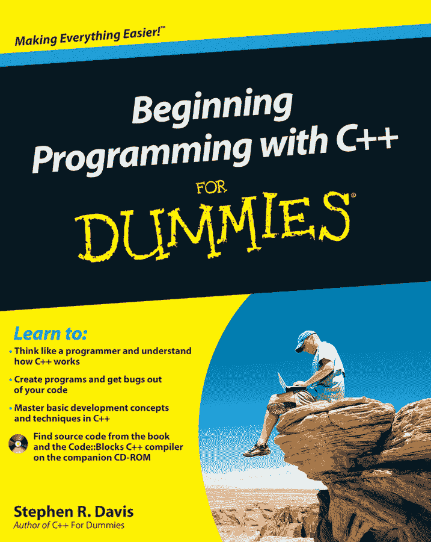


## 目录

### 第一部分：让我们开始

#### 第一章：什么是程序？

- 我的儿子和电脑有什么区别？
- 为“人类计算机”编程
- 算法
- 换轮胎的语言
- 程序
- 计算机处理器
- 计算机语言
- 高层语言
- `C++` 语言

#### 第二章：安装 `Code::Blocks`

- 回顾编译过程
- 安装 `Code::Blocks`
- 测试 `Code::Blocks` 安装
- 创建项目
- 测试你的默认项目

#### 第三章：编写你的第一个程序

- 创建一个新项目
- 输入你的程序
- 构建程序
- 寻找可能出现的问题
- 拼写错误的命令
- 缺少分号
- 使用附带的光光盘
- 运行程序
- 程序是如何工作的
- 模板
- 转换程序

### 第二部分：编写程序：抉择，抉择

#### 第四章：整数表达式

- 声明变量
- 变量名
- 给变量赋值
- 在声明时初始化变量
- 整数常量
- 表达式
- 二元运算符
- 分解复合表达式
- 一元运算符
- 特殊赋值

#### 第五章：字符表达式

- 定义字符变量
- 字符字符
- 字符编码示例
- 字符串字符串
- 特殊字符常量

#### 第六章：我可以抉择

- `if` 语句
- 比较运算符
- 对“大括号”说“不”
- 还有什么？
- 嵌套 `if` 语句
- 复合条件表达式

#### 第七章：切换路径

- 用 `switch` 语句控制流程
- 穿穿：我打破了吗？
- 用 `switch` 语句实现示例计算器

#### 第八章：调试你的程序，第一部分

- 识别错误类型
- 避免引入错误
- 有风格的编码
- 建立变量命名约定
- 在帮助下找到第一个错误
- 寻找运行时错误
- 制定测试数据
- 执行测试用例
- 观察程序内部发生了什么

### 第三部分：成为一名功能程序员

#### 第九章：`while` 在循环运行

- 创建一个 `while` 循环
- 从循环中间跳出
- 嵌套循环

#### 第十章：为了乐趣而循环

- 每个循环的 `for` 部分
- 查看示例
- 用逗号运算符更多

#### 第十一章：函数，我声明

- 分解函数
- 理解函数
- 编写一个函数
- 返回值
- 调用函数的示例
- 传递参数给函数
- 按值传递
- 函数重载
- 定义原型

#### 第十二章：划分程序

- 划分模块
- 并不难
- 创建 `.h` 文件
- 使用 `#include` 文件
- 创建 `main.cpp`
- 使用标准库
- 变量作用域

#### 第十三章：调试你的程序，第二部分

- 调试性程序
- 执行单元测试
- 为测试适配函数
- 返回单元测试

### 第四部分：数据结构

#### 第十四章：其他数值类型

- 整数的局限性
- 整数舍入
- 有限范围
- 双实数的类型
- 解决截断问题
- 当整数不是整数时
- 发现 `double` 的限制
- 变量大小——“长”与“短”
- 数字范围有多大？
- 常量类型
- 向函数传递不同类型
- 函数名重载
- 混合模式重载

#### 第十五章：数组

- 什么是数组？
- 声明数组
- 数组索引
- 示例分析
- 初始化数组

#### 第十六章：字符数组

- `ASCII` 零值字符数组
- 声明和初始化 `ASCIIZ` 数组
- 示例分析
- 更详细的示例
- 击败黑客
- 我真的必须做所有这些工作吗？

#### 第十七章：为 `C++` 指针指路

- 什么是指针？
- 声明指针
- 向函数传递参数
- 按值传递参数
- 按引用传递参数
- 汇总
- 玩转堆内存
- 你真的需要 `new` 关键字吗？
- 别忘了在完成后清理现场
- 示例

#### 第十八章：再次审视 `C++` 指针

- 指针与数组
- 指针操作
- 指针加法对比数组索引
- 使用指针自增运算符
- 为什么要费心数组指针？
- 不同指针类型的操作
- 常量的烦人细节
- 指针与数组的区别
- 我的 `main()` 参数
- 指针数组
- 参数数组

#### 第十九章：使用类编程

- 数据分组
- 类
- 对象
- 对象数组
- 示例分析

#### 第二十章：调试你的程序，部分 3

- 一种新的调试方法
- 解决方案
- 傻瓜昆虫学
- 启动调试器
- 使用调试器在程序中导航
- 修复（第一个）漏洞
- 寻找并修复第二个漏洞

### 第五部分：面向对象编程

#### 第二十一章：什么是面向对象编程？

- 抽象
- 函数式
- 面向对象
- 分类
- 为什么要这样构建对象？
- 自包含类

#### 第二十二章：结构化操作：让类执行任务

- 激活我们的对象
- 创建成员函数
- 定义成员函数
- 类成员的命名
- 调用成员函数
- 从成员函数中访问其他成员
- 在类外保留成员函数
- 重载成员函数

#### 第二十三章：对象指针

- 对象指针
- 箭头语法
- 调用所有成员函数
- 将对象传递给函数
- 使用对象值调用函数
- 使用对象指针调用函数
- 示例分析
- 在堆上分配对象

#### 第二十四章：请勿干扰：保护成员

- 保护成员
- 为什么你需要保护成员
- 将成员设为保护
- 那怎样？
- 到底谁需要朋友？

#### 第二十五章：让对象良好开始

- 构造函数
- 构造函数的局限性
- 我能看到示例吗？
- 初始化成员
- 析构函数
- 示例分析
- 析构数据成员

#### 第二十六章：构建构造性参数

- 带参数的构造函数
- 示例分析
- 重载构造函数
- 默认构造函数
- 初始化成员
- 使用默认构造函数初始化成员
- 使用不同的构造函数初始化成员
- 示例分析
- `C++ 09` 中的 `new`

#### 第二十七章：处理拷贝构造函数

- 拷贝对象
- 默认拷贝构造函数
- 示例分析
- 创建拷贝构造函数
- 避免拷贝

### 第六部分：高级

#### 第二十八章：类的继承

- 继承的优势
- 学习术语
- 在 `C++` 中实现继承
- 示例分析
- 建立关系

#### 第二十九章：虚函数是真实的吗？

- 重写成员函数
- 早期绑定
- 歧情况
- 引入晚绑定
- 何时不是虚的？
- 虚函数的考量

#### 第三十章：重载赋值运算符

- 重载运算符
- 重载赋值运算符至关重要
- 示例分析
- 编写你自己的（或不编写）

#### 第三十一章：执行流输入输出

- 流 `I/O` 如何工作
- 流输入输出
- 创建输入对象
- 创建输出对象
- 打开模式
- 什么是二进制模式？
- 嘿，文件，你现在什么状态？
- `fstream` 类的其他成员函数
- 直接读写流
- 控制格式
- `endl` 怎么？
- 操纵符的使用
- 使用 `stringstream` 类

#### 第三十二章：我异常了！

- 异常机制
- 详细检查异常机制
- 抛异常的特殊注意事项
- 创建自定义异常类
- 异常类的限制

### 第七部分：十倍

#### 第三十三章：避免 Bug 的十种方法

- 启用所有警告和错误信息
- 采用清晰且一致的编码风格
- 在编写代码时编写注释
- 在调试器中至少单步执行每个路径
- 限制可见性
- 跟踪堆内存
- 在删除所指向的内容后将指针置零
- 使用异常处理错误
- 将析构函数声明为虚
- 提供拷贝构造函数和重载的赋值运算符

#### 第三十四章：本书未涵盖的十个特性

- `goto` 命令
- 三元运算符
- 二进制逻辑
- 举举类型
- 命名空间
- 纯虚函数
- `string` 类
- 多重继承
- 模板和标准模板库
- 2009 `C++` 标准

## 附录：关于 CD

### `CPP` 程序

#### `Code::Blocks` 开发环境

免责声明：出版商和作者对使用书中包含的信息而引起的任何损害不负责。书中的任何信息均不适用于特定目的。出版商和作者对本书内容的准确性或完整性不作任何声明或保证。书中的信息可能会发生更改而不另行通知。书中的信息仅供参考。出版商和作者不对内容中的任何错误或遗漏负责。出版商和作者对因使用书中信息而采取的任何行动不负责。

## 引言

欢迎阅读《傻呆指南：`C++` 编程入门》。本书旨在为想要编程的读者提供帮助。

多年来，编程不知为何与数学、逻辑、微积分和其他复杂事物联系在一起。我从未真正理解这一点。编程是一种技能，就像写广告、画画或摄影一样。它确实需要深入思考问题的能力，但我认识过一些数学能力为零的优秀程序员。有些人天生擅长这方面，学得很快；另一些人没那么好，学得慢。尽管如此，任何有足够的耐心和“韧性”的人都能学习计算机编程。甚至我也行。

## 关于《傻呆指南：`C++` 编程入门》

学习编程意味着意味着学习一种编程语言。本书基于 `C++` 编程语言。随书附赠的 CD-ROM 中包含了编译器的 Windows 版本。Macintosh 和 Linux 版本可以在 [www.codeblocks.org](http://www.codeblocks.org) 下载。（别担心：我在书中包含了如何安装软件包以及构建你的第一个程序的逐步操作说明。）

本书的目标是教你 `C++` 编程的基础知识，而不是让你沉溺于 `C++` 编程语言的每一个细节。读完本书后，你将能够编写出相当复杂的 `C++` 程序。你也将有能力快速掌握其他许多类似的语言，例如 `Java` 和 `C#.NET`。

在本书中，你将发现什么是程序，它是如何工作的，以及如何进行以下操作：

- 安装 `CodeBlocks C++` 编译器并使用它来构建程序
- 创建并评估表达式
- 导向程序的控制流
- 创建更好地模拟现实世界的数据结构
- 定义并使用 `C++` 指针
- 操作字符字符串以生成你想看到的输出
- 对文件进行写入和从文件读取

## 本书中的假设

我在书中对读者做出了非常少的假设，但我假设了以下内容：

- 你有一台电脑。大多数读者拥有运行 Windows 的电脑；然而，书中的程序在 Windows、Macintosh、Linux 和 Unix 上运行效果同样良好。事实上，由于 `C++` 是一种标准语言，这些程序应该运行在任何带有 `C++` 编译器的电脑上。
- 你了解如何使用电脑的基础知识。例如，我假设你知道如何运行程序、复制文件、创建文件夹等。
- 你知道如何浏览菜单。我包含了许多指令，如“点击‘文件’然后点击‘打开’”。如果你能遵循该指令，你就可以了。
- 你是编程初学者。我不假设你了解任何关于编程的知识。嘿，我甚至不假设你知道什么是编程。

## 本书使用的约定

为了帮助你尽可能高效地阅读本书，我使用了一些约定：

- `C++` 术语使用等宽字体，如此所示所示。
- 新术语用斜体强调（并给出定义）。
- 你需要遵循的编号步骤和需要输入的字符用粗体表示。

## 你不需要阅读的内容

我鼓励你阅读书的一个章节；然后把书收起来玩一会儿，再进入下一部分。本书的结构安排确保了，在每个部分结束时，你已经掌握了足够的新材料来去编写程序了。

我想增加以下建议：

- 如果你已经知道什么是编程，但对 `C++` 一无所知，可以跳过第 1 章。
- 我建议你使用随书附的 `CodeBlocks` 编译器，即使你在读完书后想使用不同的 `C++` 编译器。然而，如果你坚持不想使用 `CodeBlocks`，可以跳过第 2 章。
- 如果你已经做过一点计算机编程，请快速略读第 3 章。
- 即使你有 `BASIC` 等其他语言的经验，也请从第 4 章开始集中精力。
- 如果你开始感到疲劳，可以在第 20 章后停止阅读。第 21 章开启了对象对象编程这一新话题——在你觉得对目前所学内容感到非常从容之前，不要尝试学习它。
- 你可以跳过任何 `TechnicalStuff` 图标。

## 本书的结构

《傻呆指南：`C++` 编程入门》分为七部分。你不需要按顺序阅读，甚至不需要阅读章节中的所有内容。你可以通过目录和索引快速找到你需要的信息。在本节中，我简要描述每个部分的内容。

### 第一部分：让我们上手

这部分介绍了什么是程序以及它们如何工作。通过一个虚拟的换轮胎电脑，我带你完成了几个换轮胎的算法。在离开此部分之前，你还将让 `CodeBlocks` 运行起来。

### 第二部分：编写程序：决策

这部分为你介绍了 `C++` 编程的基础。你将发现如何声明整数变量以及编写简单的表达式。你甚至会发现如何在程序内做出决策，但在完成该部分之前，你还称不上专家。

### 第三部分：成为功能型程序员

你学习如何导向程序内的控制流。你将发现如何循环、如何将代码拆分为模块（以及为什么），以及如何将这些独立模块构建回一个程序。在这一部分结束时，你将能够编写解决实际问题的程序。

### 第四部分：数据结构

这部分扩展了你对数据类型的知识。本书之前的章节仅限于整数；在这一部分，你将处理字符、小数和数组；你甚至可以定义自己的类型。最后，这是攻克最令人畏惧的话题的部分——`C++` 指针。

### 第五部分：面向对象编程

在这里是将知识扩展到面向对象的技术，这些让 `C++` 区别于前身语言（特别是 C）的特性。（如果你不知道面向对象编程，别担心——你现在还不懂。）在你跳入这一部分之前，你希望对第一部分到第四部分的内容感到熟悉，但在完成该部分时，你将成为一名更强大的程序员。

### 第六部分：高级技巧

这是一系列重要但未放入前面部分的主题合集。例如，在这里我讨论了如何创建、读取和写入文件。

### 第七部分：十全锦

此部分包含了在编程时应该做什么（不该做什么）的列表，以避免无谓地产生错误。此外，如果你决定扩展你的 `C++` 知识，此部分还包含关于下一步学习哪些主题的建议。

## CD-ROM 附录

此部分描述了附带 CD-ROM 的内容以及如何安装它。

## 本书中使用的图标

如果没有指向那些对你非常有用的信息的图标，傻瓜书还有什么意义呢？在本节中，我简要介绍书中使用的每个图标。

 `Tip` 图标指向可能会让你工作更容易的信息。

 此图标标记了一个通常有趣且实用的事实——你可能想要以后记住。我还会用这个图标提醒你某些在之前的章节中可能忽略的事实。

 `Warning` 图标强调了潜在的危险。通过这个图标，我在告诉你注意并谨慎操作。

 当你看到这个图标时，你就知道附近有技术性内容。如果你觉得不通技术，可以跳过这些信息。

 此图标表示包含在本书 CD-ROM 中的程序。

## 接下来去向哪里

你可以在 [www.stephendavis.com](http://www.stephendavis.com) 找到这本书以及我所有书籍的勘误表和常见问题。你还可以在那里找到我电子邮件地址的链接。请随时向我发送你的问题和建议（这就是我学习的方式）。正是通过读者的反馈，这些书籍才能改进。

现在你已经停得足够久了，是时候转向第 1 章并开始发现如何编程了！

请注意，此 ePub 中使用的某些特殊符号可能在所有电子阅读器设备上无法正常显示。如果你在确定任何符号遇到困难，请拨打 Wiley 产品技术支持电话 `800-762-2974`。在美国境外，请拨打 `317-572-3993`。你也可以通过 [www.wiley.com/techsupport](http://www.wiley.com/techsupport) 联系 Wiley 产品技术支持。

# 第一部分：让我们开始


## 在这一部分 . . .

你将学习为编程意味着什么。你还将首次体验编程——我将带你通过输入、构建和执行你的第一个程序的步骤。在这一部分，一切都可能有些神秘，但我保证，很快就会变得明朗。

## 第 1 章：什么是程序？

### 本章内容

- 理解程序
- 编写你的第一个“程序”
- 查看计算机语言


在本章中，你将学习什么是程序，以及编写程序意味着什么。你将在“人类计算机”上进行练习。然后你将看到一些为真实计算机编写的程序片段。最后，你将看到用 `C++` 编写的第一个代码片段。

到目前为止，运行在你计算机上的所有程序都是由别人写的。很快，情况就不再如此了。你将加入那少数自豪的人的行列：程序员。

### 我儿子和计算机有什么区别？

计算机是一台速度极惊人但极其愚蠢的机器。计算机可以做你要求它做的事（在合理范围内），但它完全按照指令执行——不多不少，也不少。

在这方面，计算机几乎与人类完全相反：人类根据直觉做出反应。当我学习第二门语言时，我了解到仅仅理解所说的话是不够的——理解那些未说出口的话同样重要，而且困难得多。这些是说话者通过共同经验或教育与听者分享的信息——这些是不需要说出来的东西。

例如，我对我儿子说这样的话，比如“去洗碗”（尽管对我没什么用）。这听起来是足够清楚的指令，但这句话中包含的大部分信息是隐含且未说出的。

让我们假设我儿子知道什么是碗，也知道脏碗通常在洗水池里。但刀子和叉子呢？毕竟，我只说了“碗”，没有提到任何“餐具”，更不用提玻璃器皿了。我的意思是手洗，还是把它们放进洗碗机里自动清洗、冲洗并干燥也可以？

但事实是，“洗碗”对我儿子来说是足够的指令了。他可以拆解这句话，并将其与我们共同拥有的信息（包括对脏碗的广泛工作知识）相结合，从而对我想要他做的事产生意义的理解——至于他是否去做那是另一回事了。我猜，他理解这句话所需的全部脑力体操，花费的时间大约和我说这句话的时间差不多——大约 1 到 2 秒。

计算机并无法从像“洗碗”这样模糊的话中理出头绪。你必须准确告诉计算机如何处理每种类型的碗，如何洗叉子，而不是洗勺子，再而不是洗杯子。程序什么时候停止洗碗（也就是说，它如何知道碗洗干净了）？

### 编写“人类计算机”

在我深入向你展示如何编写供计算机使用的程序之前，我先向你展示一个引导人类行为的程序，以便你更好地看到面对的是什么。编写引导人类的程序比为计算机硬件编写程序要容易得多，因为我们对人类及其运作方式非常熟悉和了解（我假设）。我们还拥有一种共同的人类语言。但公平起见，假设这个人类计算机被指示要特别字面——所以程序必须非常具体。我选择的问题是指导我们的人类计算机更换扁胎。

### 算法

更换扁胎的指令非常直观，大致如下：

1. 顶起汽车。
2. 卸下将故障轮胎固定在汽车上的螺母。
3. 取下轮胎。
4. 装上新轮胎。
5. 安装轮螺母。
6. 降低车辆。

（我知道从技术上讲，是螺母将轮毂固定在车上而不是轮胎，但在这里这种区别并不重要。在讨论中，我将“轮毂”和“轮胎”视为同义词使用。）

尽管这些指令看起来很详尽，但它们并不是一个程序。这被称为算法。算法是对要执行步骤的描述，通常处于很抽象的层级。算法是详尽的但具有通用性。我可以使用这个算法来修理我经历过或将来会经历过的任何爆胎。但算法并不包含足够的细节，让即使是我们那个故意表现得迟钝的“人类计算机”也能完成这项任务。

# 换胎语言

在编写程序之前，我们需要一种大家都能同意的语言。在本书的剩余部分，这种语言将是 `C++`，但在示例中，我使用了新发的 `TCL`（换胎语言，Tire Changing Language）。我专门针对换胎问题调整了 `TCL`。

`TCL` 包含了换胎领域常见的几个名词：

- `car`（汽车）
- `tire`（轮胎）
- `nut`（螺母）
- `jack`（千顶）
- `toolbox`（工具箱）
- `spare tire`（备胎）
- `wrench`（扳手）

`TCL` 还包含了以下动词：

- `grab`（抓取）
- `move`（移动）
- `release`（释放）
- `turn`（旋转）

最后，执行 `TCL` 的处理器需要具备计数和做出简单决策的能力。

这就是换胎机器人所理解的一切。任何不属于换胎语言的其它指令都会让人类换胎处理器报出一脸困惑的茫然。

# 程序

现在是时候将用日常英语编写的算法转换为用换胎语言编写的程序了。取“取下轮螺母”这个短语。实际上，这句话中有很多内容没有说白。“remove”（移除）这个词不在处理器的词汇表中。此外，完全没有提到 `wrench`（扳手）。

以下步骤仅使用换胎语言包含的动词和名词实现了“取下一个轮螺母”这一短语：

1. `grab` `wrench`。
2. `move` `wrench` 到 `lug nut`。
3. `turn` `wrench` 逆时针旋转五次。
4. `move` `wrench` 到 `toolbox`。
5. `release` `wrench`。

我没有解释换胎语言的语法。例如，每个命令都以单个动词开始，或者动词 `grab` 需要一个名词作为其对象，以及 `turn` 需要一个名词、一个方向和一个旋转次数的计数。尽管如此，这段程序代码应该足够易读（请记住，这不是一本关于换胎语言的书）。


你可以用换胎语言应付过去，但你将不得不学习每个 `C++` 命令的语法。

程序从第 1 步开始，并按顺序执行每个步骤，直到到达第 5 步。在编程术语中，我们说程序从第 1 步流向第 5 步。当然，程序并没有去往任何地方——处理器在做所有的工作，但“程序流”（program flow）是一个通用约定。

即使对这个程序进行粗略检查也能发现一个问题：如果没有轮螺母怎么办？我想，让扳手绕着没有螺母的螺栓旋转是无害的，但这样做浪费时间，并不是我心目中的解决方案。换胎语言需要一种分支能力，允许程序根据外部条件采取某条路径。我们需要一个像这样的 `IF` 语句：

```
1. grab wrench。
2. 如果存在 lug nut
3. {
4. move wrench 到 lug nut。
5. turn wrench 逆时针旋转五次。
6. }
7. move wrench 到 toolbox。
8. release wrench。
```

程序像之前一样从第 1 步开始并抓取一个 `wrench`。但在第二步中，在程序对着一个空的螺栓无用功地挥动扳手之前，它会检查是否存在轮螺母。如果是，流程将像之前一样继续执行第 3、4 和 5 步。然而，如果没有，程序流将跳过这些不必要的步骤，直接进入第 7 步将 `wrench` 归 `toolbox`。

在计算机术语中，你说程序执行了逻辑表达式 `is lug nut present?`。这个表达式返回一个 `true`（是，轮螺母存在）或 `false`（否，那里没有轮螺母）。


我所说的“步骤”，编程语言通常称为“语句”（statement）。表达式是返回值的语句的一种类型，例如 `1 + 2` 就是一个表达式。逻辑表达式是一个返回真或假值的表达式，例如“我是这本书的作者吗？”结果为真。


换胎语言中的括号是必要的，用于告诉程序如果条件不成立，应跳过哪些步骤。第 4 步和第 5 步仅在条件真时执行。

我意识到，如果没有螺母要拆，就没有必要抓取 `wrench`，但请配合我的逻辑一下。

这个改进后的程序仍然有一个问题：你如何知道扳手旋转 5 次足以取下轮螺母？对于我遇到过的大多数轮胎，这肯定是不够的。你可以增加旋转次数到一个看起来足够的数字，比如 25 次。如果螺母在第 20 次时就松了，扳手就会多转 5 次。这是一个无害但浪费的解决方案。

更好的方法是在换胎语言中添加某种“循环测试”语句：

1. `grab` `wrench`。
2. 如果存在 `lug nut`
3. {
4. `move` `wrench` 到 `lug nut`。
5. 当 `lug nut` 连接着时
6. {
7. `turn` `wrench` 逆时针旋转一次。
8. }
9. }
10. `move` `wrench` 到 `toolbox`。
11. `release` `wrench`。

在这里，程序像之前一样从第 1 步流向第 4 步。但在第 5 步中，处理器必须做出决策：螺母是否连接？在第一轮中，假设答案是肯定的，因此处理器执行第 7 步并旋转一次。此时，程序返回第 5 步并重复测试。如果螺母仍然连接，处理器重复第 7 步。最终，螺母会松动，第 5 步的条件将返回 `false`。此时，程序的控制权将传递到第 9 步，程序像之前一样继续运行。

这个解决方案优于它的前辈：它没有对取下螺母所需的旋转次数做假设。它不会因为要求处理器旋转不再连接的螺母而浪费时间，也不会因为螺母只拆了一半而失败。

尽管这个解决方案很好，但它仍然有一个问题：它只能取下一个轮螺母。以下程序扩展了我们的语法，包含了跨螺母循环的能力。这个程序无论轮胎上有多少螺母都有效：

```
1. grab wrench。
2. 对于轮上的每个 lug bolt
3. {
4. 如果存在 lug nut
5. {
6. move wrench 到 lug nut。
7. 当 lug nut 连接着时
8. {
9. turn wrench 逆时针旋转一次。
10. }
11. }
12. }
13. move wrench 到 toolbox。
14. release wrench。
```

这个程序像之前一样从工具箱抓取 `wrench` 开始。然而，从第 2 步开始，程序会对轮上的每个螺栓循环执行第 12 步。

注意第 7 到第 10 步仍然会重复。这被称为嵌套循环。第 7 到第 10 步被称为内循环，而第 2 到第 12 步是外循环。

整个程序由算法中每个步骤的类似实现组成。

## 计算机处理器

从汽车上卸下轮子似乎是一项非常简单的任务，然而，在一种专门为换轮胎设计的语言中，仅仅取下螺母就需要 11 条指令。完成后，这个程序可能包含 60 多或 70 个步骤，并带有许多循环。如果再加上检查螺母滑丝或缺失等错误情况的逻辑，步数会更多。

想想仅仅为了完成像在显示屏幕上移动窗口这样平淡的操作，需要执行多少条指令（记住，一个典型的屏幕可能有 1280 x 1024 像素，或者略多百万像素）。幸运的是，尽管计算机处理器很笨，但它的运行速度非常快。例如，你 PC 中的处理器每秒可能可以执行几十亿条指令。你的通用处理器中的指令并没有什么用——仅仅移动一个像素就需要几条指令——但当你一次可以处理一亿条左右指令时，滚动区区百万像素就变得轻而易举。

计算机不会执行任何它没有被预先编程的任务。创建一种“换轮胎语言”还不足以解决我的平胎——必须有人编写程序指令，逐一步规划出计算机将要执行的步骤。而编写一个旨在处理所有可能出现的特殊情况的真实世界程序并非易事。编写一个工业级的程序可能是你所承担的最具挑战性的任务。

所以问题变成了：“为什么要费劲呢？”因为一旦计算机被妥善编程，它就可以反复地、不知疲倦地执行所需的功能，而且通常速度比人类控制快得多。

## 计算机语言

当然，“换轮胎语言”并不是一种真正的计算机语言。真实的计算机没有像“抓取”或“旋转”这样的机器指令。更糟糕，计算机使用一系列 0 和 1 来“思考”。每个内部命令无非是一串二进制数。真实的计算机拥有诸如 `01011101` 这样的指令，它可能会给特殊用途寄存器中的数字加 `1`。尽管在 `TCL` 中编程可能很困难，但通过编写长长的数字字符串来编程就更加困难了。


计算机的本质语言被称为机器语言，通常表示为二进制或十六进制的数字序列。以下代表了第 3 章“转换”程序中的前 64 个字节。

```
<main+0>: 01010101 10001001 11100101 10000011 11100100 11110000 10000011 11101100
<main+8>: 00100000 11101000 00011010 01000000 00000000 00000000 11000111 01000100
<main+16>:00100100 00000100 00100100 01110000 01000111 00000000 11000111 00000100
<main+24>:00100100 10000000 01011111 01000111 00000000 11101000 10100110 10001100
<main+32>:00000110 00000000 10001101 01000100 00100100 00010100 10001001 01000100
```

幸运的是，现在没有人用机器语言编写程序了。很早时候，有人发现对于人类来说将 `ADD 1,REG1` 理解为“向寄存器 1 中的值加 1”比理解 `01011101` 要容易得多。在“后机器语言时代”，程序员用这种所谓的“汇编语言”编写程序，然后将其提交给名为“汇编器”的程序，汇编器将这些指令中的每一条转换为对应的机器语言。

人们编写的程序被称为“源代码”，因为它们是万恶之源。计算机实际执行的 0 和 1 被称为“目标代码”，因为它们是许多挫败感的源头。


以下是“转换”程序在编译运行于执行 Windows 的 Intel 处理器时的前几条汇编指令。这与之前以二进制形式显示的信息相同。

```
<main>: push %ebp
<main+1>: mov %esp,%ebp
<main+3>: and $0xfffffff0,%esp
<main+6>: sub $0x20,%esp
<main+9>: call 0x40530c <__main>
<main+14>: movl $0x477024,0x4(%esp)
<main+22>: movl $0x475f80,(%esp)
<main+29>: call 0x469fac <operator<<>
<main+34>: lea 0x4(%esp),eax
<main+38>: mov %eax(%esp)
```

## 高级语言

汇编语言可能更容易记忆，但它与机器语言之间仍有距离。


计算机实际上并不执行汇编语言。它执行机器语言。人们继续创造不同的语言，每种语言都有自己的优缺点。像 `COBOL` 这样的语言非常冗长，但易于阅读。其他语言是为特定领域设计的，例如数据库语言或用于创建交互网页的语言。这些语言中最早的之一是 `COBOL`（常用业务语言）。`COBOL` 的理念是让程序员编写的指令尽可能像英语句子。突然，程序员编写了如下语句将摄氏度转换为华氏度：

```
INPUT CELSIUS_TEMP
SET FAHRENHEIT_TEMP TO CELSIUS_TEMP * 9/5 + 32
WRITE FAHRENHEIT_TEMP
```

程序的第一行从键盘或文件读取一个数字并存入 `CELSIUS_TEMP`。接下来的行将该数字乘以 9/5 并加 32，以计算等值的华氏温度。程序的最后一行输出该值。

## C++ 语言

`C++`（顺便说一下，读作“C 加加”）是一种符号导向的高级语言。`C++` 的诞生始于 70 年代贝尔实验室的 `C` 语言。当时两个人正在开发一种名为 `Unix` 的新操作系统（`Linux` 和 `Mac OS` 的起源，至今仍应用于工业界和学术界）。贝尔实验室创建的原始 `C` 语言经过了微调，并于 1980 年初被采为国际 ISO 标准。`C++` 是作为基础 `C` 语言的扩展创建的，主要增加了我在书中第五部分和第六部分中讨论的功能。当我说 `C++` 是符号化的，我的意思是它并不冗长，倾向于使用符号而不是 `COBOL` 那种长单词。然而，一旦你习惯了所有符号的含义，`C++` 是很容易读的。之前在 `COBOL` 中显示的摄氏度转华氏度的转换代码在 `C++` 中如下：

```cpp
cin >> celsiusTemp;
fahrenheitTemp = celsiusTemp * 9 / 5 + 32;
cout << fahrenheitTemp;
```

与其他高级语言相比，`C++` 还有许多其他优势。首先，`C++` 是通用的。几乎每种计算机上都有 `C++` 编译器。

此外，`C++` 是高效的。高层语言试图自动完成越多来让你的编程工作变得简单，其生成的机器码效率往往就越低。对于像本书中的大多数小型程序来说，这种差异并不大，但在处理海量数据（例如在屏幕上移动像素）或当你需要极高的实时性能时，它就会产生巨大的影响。`Unix` 和 `Windows` 使用 `C++` 编写，而 Macintosh 操作系统也是用与 `C++` 非常相似的语言编写的，这并非偶然。

# 第 2 章：安装 Code::Blocks

## 本章

- 回习编译过程
- 安装 `Code::Blocks` 开发环境
- 使用默认程序测试你的安装
- 回习常见的安装错误

在本章中，你将回顾如何从 `C++` 源代码创建可以在 `Windows`、`Linux` 或 `Macintosh` 计算机上运行的可执行程序及其所需条件。随后，你将安装书中其余部分使用的 `Code::Blocks` 集成开发环境，并构建一个默认测试程序来检查安装情况。如果一切运行正常，当你读到本章结束时，你就准备好开始编写并构建你自己的 `C++` 程序了——当然，这需要一点帮助！

## 回习编译过程

你需要两个程序来创建自己的 `C++` 程序。首先，你需要一个文本编辑器来输入你的 `C++` 指令。任何能够生成纯 ASCII 文本字母的编辑器都可以。我曾使用 `Windows` 自带的记事本编辑器编写过程序。然而，一个了解 `C++` 语法的编辑器更好，因为它可以节省大量的打字时间，并有时能在你输入时突出你可能犯的错误，就像拼写检查会在文字处理器中高亮拼写错误的单词一样。

你需要的第二个程序是编译器，它将你的 `C++` 源语句转换为计算机可以理解和解释的机器语言。这种从 `C++` 源语句转换到目标机器码的过程被称为“构建”（building）。在图形上，这个过程看起来如图 2-1 所示。

构建程序的过程实际上有两个步骤：`C++` 编译器首先在名为“编译”（compiling）的步骤中将你的 `C++` 源语句转换为机器可执行格式。然后，在第二步中，它将程序中的机器指令与 `C++` 标准库集中的指令相结合，这一步被称为“链接”（linking），从而创建一个完整的可执行程序。


**图 2-1：** C++ 程序开发过程。

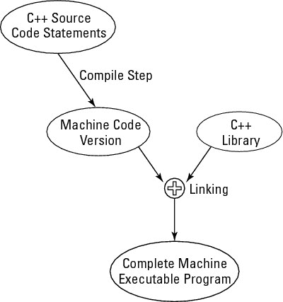

如今大多数 C++ 编译器都以所谓的集成开发环境（IDE）的形式出现。这些 IDE 将编辑器、编译器和几个其他实用的开发程序包含在一个公共软件包中。这不仅让你免于单独购买这些程序的需要，而且将它们组合成一个包还能产生若干种生产力优势。首先，编辑器可以快速调用编译器，而不需要你手动来回切换。此外，大多数 IDE 中的编辑器提供了查找和修复编码错误的快速且高效的手段。

某些 IDE 包含视觉化编程工具，允许程序员在显示器上绘制如对话框之类的常用窗口——IDE 会自动生成显示这些窗口所需的 C++ 代码。


尽管听起来很不错，但自动生成的代码只显示窗口。当操作员在这些窗口内选择按钮时，程序员仍然必须生成执行的真实代码。

不可避免的是，这些视觉化 IDE 与某一个操作系统是紧密耦合的。例如，流行的 Visual Studio 与 Windows 中的 `.NET` 环境强力绑定。如果不学习 `.NET` 环境以及关于 Windows 和 C++（或其他 `.NET` 语言之一）的知识，是不可能使用 Visual Studio 的。此外生成的程序只在 `.NET` 环境中运行。


在书中，你将使用一个名为 Code::Blocks 的公共领域 C++ IDE。Code::Blocks 有适用于 Windows、Linux 和 MacOS 的版本——随书 CD 盘包含一个 Windows 版本。Macintosh 和 Linux 的 Code::Blocks 版本可以在 [www.codeblocks.org](http://www.codeblocks.org) 免费下载。

你将使用 Code::Blocks 生成书中的程序。这些程序被称为控制台应用程序（Console Applications），因为它们从控制台窗口接收输入并向其显示文本。虽然这不像窗口化开发那么酷，但坚持使用控制台应用程序让你专注于 C++，而不会被窗口环境的要求分心。此外，使用控制台应用程序将使书中程序能够在 Code::Blocks 支持的所有环境中相同地运行。

## 安装 Code::Blocks


《C++ 编程傻办法》的 CD 盘上包含了一个 Windows 版的 Code::Blocks。本节提供了该版本的详细安装说明。从 [www.codeblocks.org](http://www.codeblocks.org) 下载并安装 Code::Blocks 版本的步骤将类似。

1. 将随附的 CD 盘插入你的计算机。

   这非常简单。

2. 阅读最终用户许可协议（EULA）并选择“接受”。

3. 选择“软件”选项卡，然后选择 Code::Blocks 以安装 Code::Blocks 环境。

   在某些版本的 Windows 上，你可能会看到一条消息：“有一个未识别的程序想要访问你的计算机”。当然，那个未识别的程序就是 Code::Blocks 安装程序。

4. 选择“允许”。

   现在解压启动并运行 Code::Blocks 安装向导所需的文件。这可能需要一分钟。完成后，会出现图 2-2 所示的启动窗口。

5. 关闭其他正在运行的程序并选择“下一步”。

   向导显示通用最终用户许可协议。没什么好兴奋的。

**图 2-2：** Code::Blocks 安装向导引导你完成安装。

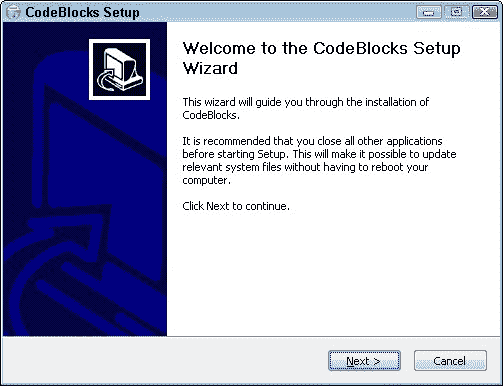

6. 选择“同意”。

   向导随后显示你可以选择安装的组件列表。默认设置是可以的，但你可能还想勾选图 2-3 所示的“桌面快捷方式”选项。这样做会在桌面上创建一个图标，让你无需通过程序文件菜单即可启动 Code::Blocks。

**图 2-3：** 勾选桌面快捷方式可以创建一个更快速启动 Code::Blocks 的图标。

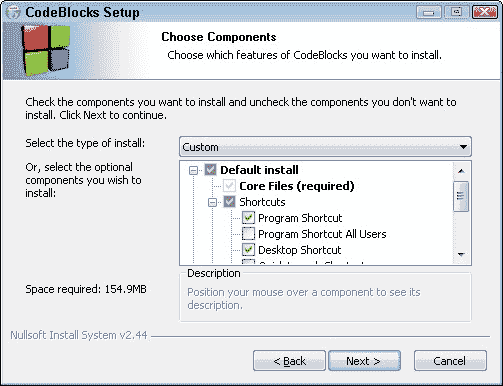

7. 选择“下一步”。

   下一个窗口要求你选择安装位置。该窗口还会告诉你 Code::Blocks 需要多少硬盘空间（取决于你选择的选项，约 150MB）以及你的硬盘可用空间。如果没有足够的可用磁盘空间，你需要删除一些捕捉的 YouTube 视频以腾出空间继续。

8. 默认安装位置很好，所以一旦你有了足够的磁盘空间，选择“安装”。

   此时，Code::Blocks 安装向导真正开始工作。它提取大量文件并将其安装在普通人无法理解的众多子目录下。这个过程可能需要几分钟。

9. 安装完成后，弹出一个对话框询问你是否现在运行 Code::Blocks。选择“否”。

   如果到目前为止一切顺利，就会出现图 2-4 所示的“安装完成”窗口。

**图 2-4：** “安装完成”窗口表示 Code::Blocks 已成功安装。

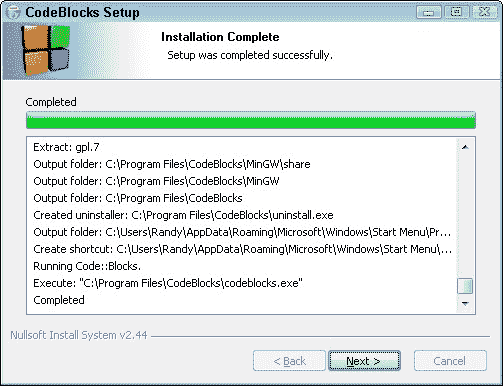

10. 点击 `Next`。

    最后，出现了“完成 Code::Blocks 设置向导”窗口。最后一步会创建启动应用程序所需的图标。

11. 点击 `Finish`。

你完成了！你已经安装了 Code::Blocks。现在剩下的工作就是测试它是否可用，然后你就可以开始编程了。

## 测试 Code::Blocks 安装

在本节中，你将构建一个 Code::Blocks 自带的默认程序。该程序的功能仅仅是在显示器上显示“Hello, world!”，但通过成功构建并运行此程序将验证你已经正确安装了 Code::Blocks。

1. 双击桌面上创建的 Code::Blocks 图标或选择 `Programs⇒Code::Blocks⇒Code::Blocks` 来启动 Code::Blocks。

   这应该打开一个类似于图 2-5 所示的窗口。

窗口顶部是常用的菜单选项，从 `File`、`Edit`、`View` 等开始。右上角的窗口（即写有“Start here”的窗口）是你运行到那一步时源代码存放的地方。右下角的窗口是 Code::Blocks 向用户显示消息的地方。编译器错误信息会出现在此区域。左侧标记为 `Management` 的窗口是 Code::Blocks 跟踪组成程序的文件的地方。现在它应该是空的，因为你还没有创建程序。你需要做的第一件事是创建一个项目。

**图 2-5：** Code::Blocks 环境的启动界面。

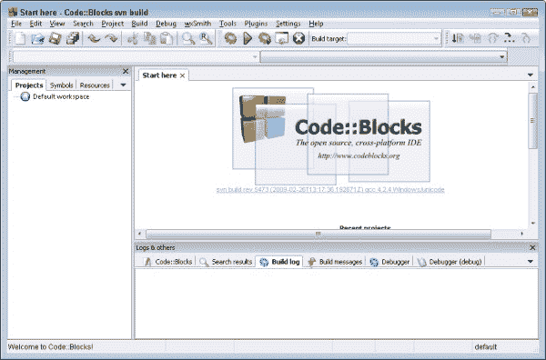

### 什么是项目？

你可能希望 Code::Blocks 只创建控制台应用程序（Console Applications），但它可以创建许多不同类型的程序。对于 Windows 程序员来说，Code::Blocks 可以创建动态链接库（也简单称为 `DLLs`）。它可以创建 Windows 应用程序。它还可以为 Linux 和 MacOS 创建静态和动态链接库。

此外，Code::Blocks 允许程序员对这些目标的构建方式设置不同的选项。我将在后面的章节中向你如何调整其中一些设置。最后，Code::Blocks 会记住你为每个项目配置的窗口状态。当你返回项目时，Code::Blocks 会将窗口恢复到最后的配置以为你节省时间。

Code::Blocks 将你正在构建的程序类型信息、可选设置以及窗口布局存储在两个项目文件中。设置存储在程序同名但扩展名为 `.cbp` 的文件中。窗口配置存储在程序同名但扩展名为 `.layout` 的文件中。

### 创建项目

1. 选择 `File⇒New⇒Projects` 打开图 2-6 所示的窗口。

   这是 Code::Blocks 知道如何构建的所有类型应用程序的列表。

**图 2-6：** 从提供的许多类型目标中选择控制台应用程序（Console Application）。


幸运的是，你将只关注其中一种，即控制台应用程序。

2. 选择 `Console Application` 并选择 `Go`。

   Code::Blocks 以图 2-7 所示的显示作为响应。在这里，Code::Blocks 正为你提供创建 C 或 C++ 程序的选项。

3. 选择 `C++` 并点击 `Next`。

   Code::Blocks 打开一个对话框，你可以在其中输入项目的名称和可选的子文件夹。首先，点击小小的 `...` 按钮创建一个存放你的 `Projects` 的文件夹，导航到工作磁盘的根目录（在 Windows 机器上，可能是 `C` 或 `D`，可能是 `C`）。选择窗口左下角的 `Make New Folder` 按钮。将新文件夹命名为 `Beginning_Programming-CPP`。

**图 2-7：** 选择 C++ 作为你的语言选择。

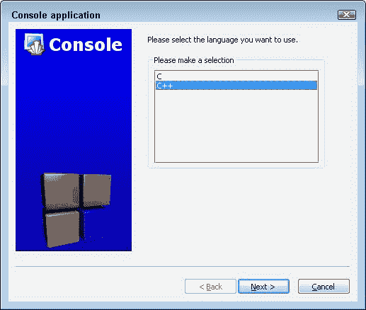

4. 当你的显示像图 2-8 所示时，点击 `OK`。


你用于存放项目的文件夹名称不能包含任何空格。此外，路径中的任何文件夹都不应包含空格。这自动排除了将项目放在桌面上，因为桌面的路径包含空格。你也应该避免在 `Project` 的名称中使用空格。你可以使用下划线来分隔单词。Code::Blocks 编译器会对文件名中的空格感到困惑，并产生晦涩且很大无意义的错误。

**图 2-8：** 创建文件夹 Beginning_Programming-CPP，你将会在其中收集你的 C++ 项目。


现在输入项目名称 `HelloWorld`。注意 Code::Blocks 会自动创建一个同名的子文件夹来包含组成项目的文件。

5. 当你的显示像图 2-9 时，点击 `Next`。

**图 2-9：** 将你的第一个项目命名为 HelloWorld。

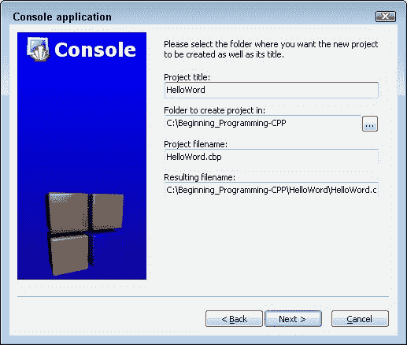

6. 当你的显示像图 2-10 时，点击 `Finish`。

**图 2-10：** 选择 Finish 完成项目的创建。

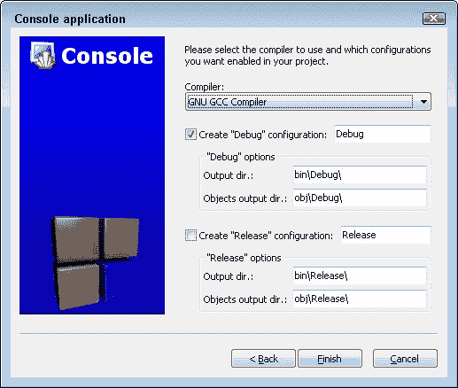

### 测试你的默认项目

Code::Blocks 在你在向导中点击 `Finish` 时会创建一个控制台应用程序项目，甚至会在其中填充一个可以运行的程序。要查看该程序，点击左侧 `Management` 窗口中 `Sources` 旁边的 `+` 号。下拉列表显示出一个文件 `main.cpp`。双击 `main.cpp` 在右侧的源代码窗口中显示以下简单程序：

```cpp
#include <iostream>
using namespace std;

int main()
{
    cout << “Hello world!” << endl;
    return 0;
}
```

我现在将跳过其中部分内容的具体含义，但程序的内核从 `main()` 之后的大括号开始。这是执行开始的地方。`cout << “Hello world!” << endl;` 的意思是将“Hello, world!”输出到 `cout`，默认情况下它是命令行。下一行 `return 0;` 导致控制权返回到操作系统，从而有效终止程序。

1. 选择 `Build⇒Build` 将 C++ 源代码编译为可执行的机器语言程序。

   （如果你愿意，可以按 `Ctrl+F9` 或点击 Build 图标。）立即，你应该能看到右下角屏幕出现 `Build Log` 选项页，随后是一系列长命令，如图 2-11 所示。这是 Code::Blocks 告诉 C++ 编译器如何使用项目文件中存储的设置来构建测试程序。细节并不重要。然而，重要的是 Build Log 窗口的最后两行应该是：

```text
Process terminated with status 0 (0 minutes, 1 seconds)

0 errors, 0 warnings
```

终止状态为 `0` 表示构建过程正常运行。“0 errors, 0 warnings”意味着程序在没有错误或警告的情况下通过编译。（1 秒的构建时间并不重要。）

**图 2-11：** 构建默认程序应该得到一个没有错误和警告的运行程序。

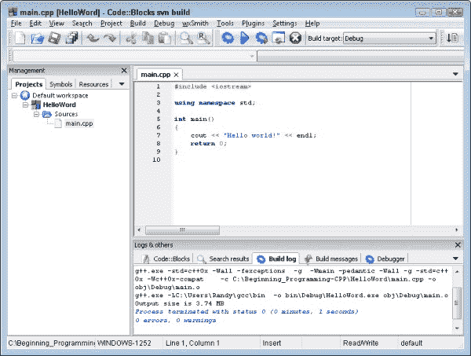


如果你得到的状态不是 0，且没有 0 个错误和警告，那么你的安装过程或项目出了问题。最常见的错误来源有：

* 在安装 Code::Blocks 之前，你的电脑上已经安装了 `gcc` 编译器。Code::Blocks 使用了特殊版本的 GNU `gcc` 编译器，但它也会使用你电脑上已安装的任何其他 `gcc` 编译器。最稳妥的方法是卸载 Code::Blocks，卸载你其他的 `gcc` 编译器，然后从头安装 Code::Blocks。
* 你在一个名称包含空格的目录中构建了项目；例如，你在桌面（Desktop）上构建了项目。确保你在用户磁盘根目录下的 `Beginning_Programming-CPP` 文件夹中构建项目（Windows 机器上通常是 `C` 盘）。
* 你直接从随书的 CD-ROM 中构建了项目。（这不适用于这里的步骤，但它是一个常见的错误来源。你无法在 CD-ROM 这样的只读介质上构建程序。你必须先将文件从 CD-ROM 拷贝到硬盘上。）

2. 选择 `Build⇒Run`（`Ctrl+F10`）来执行程序。

   紧接着应该弹出一个窗口，显示消息“Hello, world!”，随后是返回代码零和消息“Press any key to continue,”，如图 2-12 所示。

3. 按 `Enter` 键。

窗口将消失，控制权返回 Code::Blocks 文本编辑器。

**图 2-12：** 默认程序显示“Hello, world!”并等待你按键。

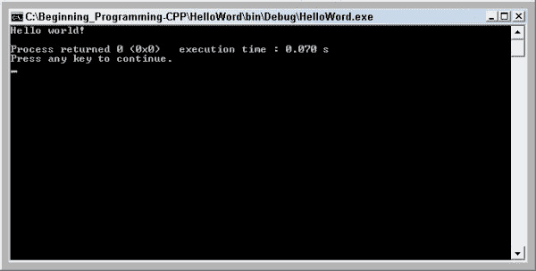

如果你通过执行程序看到了“Hello, world!”消息，那么恭喜你！你已经成功安装了开发环境，并构建且执行了你的第一个 C++ 程序。如果没有成功，请删除 `Beginning_Programming_CPP` 文件夹，卸载 Code::Blocks 并重试，仔细对比你的显示内容与本章所示图片。如果你仍然遇到问题，请参考 [www.stephendavis.com](http://www.stephendavis.com) 获取关于可能错误的提示，那里也有我的电子邮件链接，你可以向我发送问题和建议。我无法帮你完成编程作业，但我可以回答问题帮助你入门。

# 第 3 章：编写你的第一个程序

## 本章内容

* 输入你的第一个 C++ 程序
* 编译并执行你的程序
* 检查可能出现的问题
* 执行你的程序
* 回顾程序的工作原理

本章将引导你创建第一个 C++ 程序。你将使用 Code::Blocks C++ 环境。由于这是你第一次尝试，所有操作都将有点像“菜谱教程”。我将在随后的章节（从第二部分开始）中解释构成该程序的所有部分，但现在你需要先接受某些设定。很快一切都将揭晓，你在本章中做的操作都将变得完全合理。

## 创建新项目

一如既往，你必须创建一个新项目来存放你的程序。按照这里的简要步骤操作（也可以使用第 2 章的详细步骤）：

1. 在 Code::Blocks 打开的状态下，选择 `File⇒New⇒Project`。
2. 选择 `Console Applications` 并选择 `Go`（或双击 `Console Applications` 图标）。
3. 选择 `C++` 作为你的语言选择并点击 `Next`。
4. 输入 `Conversion` 作为项目标题。

如果你遵循了第 2 章的步骤，“用于创建项目的文件夹”（Folder to create project in）应该已经设置为 `Beginning_Programming-CPP`。如果不是，现在点击 `...` 按钮并在工作磁盘的根目录下创建该文件夹也不晚（这在第 2 章中会有详细描述）。Code::Blocks 向导会自动为你填写项目名称和生成的程序名称。

完成后，你的窗口应该像图 3-1 所示。

**图 3-1：** Conversion 程序的项目窗口。


5. 选择 `Next`。
6. 选择 `Finish`。

Code::Blocks 会创建一个新项目并将其添加到之前的 `HelloWorld` 项目中。（请查看“组织项目”侧边栏以了解为什么会发生这种情况。）结果显示应该像图 3-2。

**图 3-2：** 创建 Conversion 项目后的初始显示。

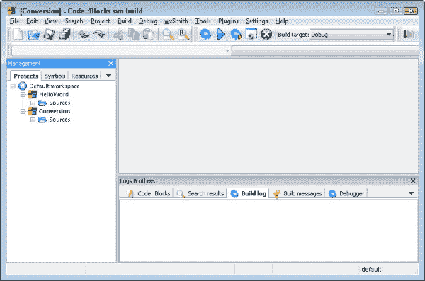


### 组织项目

你可能好奇为什么 Code::Blocks 将新的 `Conversion` 项目添加到现有的 `HelloWorld` 项目中而不是替换它。涉及多个开发人员的大工程可能会被分成若干不同的程序，这些程序设计为协同工作。为了支持这一点，Code::Blocks 允许你同时加载任意不同的项目。

所有项目的集合被称为 `workspace`（工作）。由于你在启动 Code::Blocks 时没有指定工作区，所以它使用了默认设置。在一个时刻只能有一个项目处于活动状态。这在管理窗口中通过加粗项目名称来指示，这是活动项目（参考图 3-2，其中 `Conversion` 是加粗的）。


## 输入程序

现在时候按照以下步骤输入你的程序了：

1. 确保管理窗口中的`Conversion`是加粗的（参考图 3-2）。

2. 通过`File⇒Close all`关闭所有打开的文件。或者，你也可以点击编辑器标签页文件名旁的小`X`来关闭特定的源文件。你不想无意中编辑错误的源文件。

3. 点击管理窗口中`Conversion`下`Sources`旁边的加号打开文件夹。下拉菜单应显示单个文件`main.cpp`。

### 文件扩展名

Windows 在显示文件名时有一个隐藏文件扩展名的坏习惯。对于某些应用程序这可能是个主意，但对于程序员来说这几乎从不是好主意。在隐藏扩展名的情况下，Windows 可能会显示多个同文件`HelloWorld`。当你显示扩展名并发现它们都是不同的时，这种困惑就会迎刃而解。

你应该禁用 Windows 的隐藏扩展名功能。具体操作方法取决于你使用的 Windows 版本：

- Windows 2000：选择`Start⇒Settings⇒Control Panel⇒Folder Options`。
- Windows XP 默认视图：选择`Start⇒Control Panel⇒Performance and Maintenance⇒File Types`。
- Windows XP 经典视图：选择`Start⇒Control Panel⇒Folder options`。
- 使用默认视图的 Windows Vista：选择`开始`⇒`控制面板`⇒`外观和个性化`⇒`显示隐藏的文件和文件夹`。
- 使用经典视图的 Windows Vista：选择`开始`⇒`设置`⇒`控制面板`⇒`文件夹选项`。

现在导航到出现的`文件夹选项`对话框的`视图`选项卡。向下滚动，直到找到“隐藏已知文件类型的扩展名”。确保此复选框未被勾选。选择`确定`关闭对话框。

4. 双击`main.cpp`在编辑器中打开该文件。

5. 通过按照此处所示的内容输入以下程序来编辑`main.cpp`的内容。结果如图 3-3 所示。


这绝对最困难的部分，所以请慢慢来并保持耐心：

```cpp
//
// 转换 - 程序将温度从摄氏度
// 转换为华氏度:
// 华氏度 = 摄氏度 * (212 - 32)/100 + 32
//
#include <cstdio>
#include <cstdlib>
#include <iostream>
using namespace std;

int main(int nNumberofArgs, char* pszArgs[])
{
    // 输入摄氏度温度
    int celsius;
    cout << “Enter the temperature in Celsius:”;
    cin >> celsius;
    // 将摄氏度转换为华氏度值
    int fahrenheit;
    fahrenheit = celsius * 9/5 + 32;
    // 输出结果（后跟换行）
    cout << “Fahrenheit value is:”;
    cout << fahrenheit << endl;
    // 在终止程序前等待用户准备好
    //以便用户查看程序结果
    system("PAUSE");
    return 0;
}
```

**图 3-3：**转换程序编辑后的`main.cpp`文件。

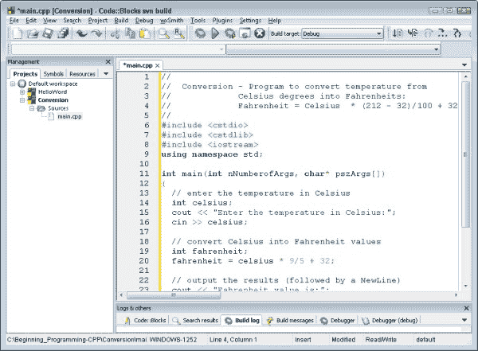

我说的“完全按照你看到的这里”是什么意思？C++ 对语法非常挑剔。它对缺失的分号或拼写错误的单词非常反感。只要空格没有出现在单词中间，它就不不在意额外的空格。例如，`int fahren heit;`与`int fahrenheit;`不同，但`int fahrenheit;`是可以的。C++ 将制表符、空格和换行符一视同仁，统称为空白字符。

也许这只是我的个人问题，但我花了很长时间才习惯 C++ 区分大写和小写这一事实。因此，`int Fahrenheit;`和`int fahrenheit;`不是同一个东西。最后一个提示：C++ 会忽略出现在`//`之后出现的任何内容，所以你不需要担心把那些内容写对。

6. 通过选择`文件`⇒`保存所有文件`来保存文件。

## 构建程序

现在到了整个软件开发过程中最令人紧张的部分：构建你的程序。在这一步中，C++ 会检查你的作品，看看它是否能从你写的内容中读出任何意义。

程序员是永恒的乐观主义者。在我们内心深处，我们真的相信每次点击`生成`按钮时，一切都会运行正常，但事实几乎从没有那过。不可避免的是，缺失的分号或拼写错误的单词会令 C++ 失望，并带来如集的错误信息，就像我们小学老师的许多批评一样，在我们耳边轰轰而下。

实际上构建程序只需要一步：你选择`生成`⇒`生成`或按`Ctrl+F9`或点击小小的`生成`图标。

## 寻找可能出错的地方

无无意，但`生成`步骤几乎肯定不是没有错误就完成的。一个金星级程序是指在你第一次构建并执行它时就能运行的程序。在整个编程生涯中，你几乎永远写不出金星级程序。

幸运的是，`Code::Blocks`编辑器与编译器的集成非常好，它可以自动引导你非常接近错误的地方。大多数时候，它可以将光标放置在包含错误的精确行。为了证明这一点，让我带你查看几个示例错误。


这些只是在 C++ 中出错的无数种方式中的两种。我不可能向你展示所有的错误。学习如何解释编译器通过其错误和警告信息试图传达你的内容，是学习这门语言的重要部分。这只能通过几个月的练习和积累该语言的经验获得。希望这两个例子能让你快速入门。

### 命令拼写错误

拼写错误的命令是最容易识别和纠正的错误。为了说明这一点，我在前面的代码第 14 行添加了一个额外的`t`，所以它现在变成了：

```cpp
intt celsius;
```

与`int`不同，`intt`这个词对 C++ 没有意义。构建由此生成的程序产生了如图 3-4 所示的显示。

**图 3-4：**拼写`int`导致的错误信息。

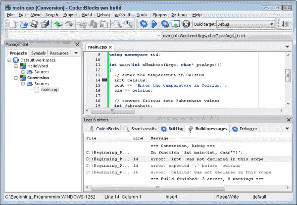

首先注意第 14 行上的红色小块，表示该行某处存在问题。你可以在右下角窗口的`生成消息`选项卡中详细阅读相关内容。在这里你可以看到以下消息：

```text
In function ‘int main(int, char**)’:
14 error: ‘intt’ was not declared in this scope
14 error: expected ‘;’ before ‘celsius’
16 error: ‘celsius’ was not declared in this scope
```

第一行指示了错误的函数名称。第二行是关键。它基本上是说 C++ 在程序第 14 行之前缺少`;`。这个错误信息有点晦涩，但足以说明每当你拼写错误时，几乎都会得到同样的错误。剩下的错误信息只是原始错误的产物。


一个 C++ 错误可能会引发一系列错误。在一次构建尝试中识别并修复多个错误，但需要经验来判断哪些错误是由哪些错误引起的。现在，专注于第一个错误。修复它并重新构建程序。

## 为什么 C++ 这么挑剔？

你很快就会发现 C++ 就像单词拼写比赛的裁判一样挑剔。一切都必须符合要求，否则编译器就不会接受。有趣的是，事实并非如此：某些语言选择尝试理解你给它的任何内容。这种方法的极端的版本是 IBM 在 20 世纪 70 年代为其大型机推出的语言，被称为`PL/1`（这代表“编程语言 1”）。这种编译器的一个版本会尝试理解扔给它的任何东西。我们这些技术宅以前在计算机中心度过深夜时非常有乐趣，用一个只由`IF`或`WHILE`组成的程序折磨编译器。通过某种扭曲的逻辑，PL/1 会从这一个命令构建出整个程序。

编程语言的另一个派营（C++ 所属的派营）持有相反观点：这些语言强迫程序员说明她的意图。一切都必须说明。每个声明都会与每个用法进行检查以确保一切匹配。没有任何缺失的分号或声明错误的标签是不受惩罚的。

事实证明 C++ 采用的“严爱”方法实际上更有效。PL/1 “自由爱”方法的问题在于，它对我的意图的理解几乎总是错误的。PL/1 最终创建了一个可以编译但在执行时执行与我的意图不符的程序。如果某些事情不符合，C++ 会生成编译器错误强制我清晰且明确地表达我的意图。

### 缺少分号

另一个常见的错误是漏掉分号。该错误生成的信息可能会让人困惑。为了演示，我删除了第 14 行声明中的分号，所以它变成了：

```cpp
int celsius

cout << “Enter the temperature in Celsius:”;
```

`C++` 对此违规行为报告的错误指向不是第 14 行，而是下面的第 15 行：

```text
15 error: expected initialization before ‘cout’
16 error: ‘celsius’ was not declared in this scope
```

当你考虑到`C++`将换行符视为不同形式的空间时，这就更容易理解了。如果没有分号，`C++`会将这两行合在一起运行。不再有独立的第 14 行。`C++`可以解释第一部分，但它无法理解以`cout`开头的连贯句。


缺少分号通常生成的错误信息与实际错误信息几乎不相似，而且它们几乎总是位于实际错误的下一行。如果你怀疑缺少了分号，请从报告错误的行开始向后（向上）扫描。

## 使用附带的 CD-ROM

如果你始终无法正确输入程序，可以随时从附带的 CD-ROM 中复制程序。（如果你对使用 CD-ROM 有任何疑问，请参阅附录；其中详细说明了你将在 CD-ROM 上看到的内容，以及在需要时的故障排除提示。）


在放弃并求助于 CD-ROM 之前，你真的应该尝试手动输入程序。只有通过解决自己的错误，你才能对这种语言的工作原理产生感觉。

你有几种方法来使用附带的 CD-ROM。最简单的方法是如下所示将 CD 上文件的内容复制并粘贴到你自己的文件中：

1. 将附带的 CD-ROM 插入你的计算机。
2. 在`Code::Blocks`中选择`File⇒Open`。导航到`X:\Beginning_Programming-CPP\Conversion`，其中`X`是你的 CD-ROM 驱动器器。
3. 选择文件`main.cpp`。

   `Code::Blocks`将在编辑器窗口的新标签页中（`ReadOnly`模式）打开文件。

4. 选择`Edit⇒Select All`或按`Ctrl+A`。

   这将选择源文件的全部内容。

5. 选择`Edit⇒Copy`或按`Ctrl+C`。

   这将将整个文件复制到剪贴板。

6. 选择与你的程序对应的`main`标签页。
7. 再次选择`Edit⇒Select All`或按`Ctrl+A`。
8. 选择`Edit⇒Paste`或按`Ctrl+V`。

   这将你正在编写的`main.cpp`的全部内容替换为 CD-ROM 上对应文件的内容。

9. 点击文件名旁边的小`X`来关闭包含 CD-ROM 版本文件的标签页。

## 运行程序

一旦你通过以下步骤获得了整洁的编译结果（即`0`个错误和`0`个警告），你就可以执行程序了：

1. 选择`Build⇒Run`或按`Ctrl-F10`。

   这这将在不带调试器的情况下执行程序。（如果你不知道什么是调试器，不要担心；我将在第 20 章中教你如何使用它。）

   程序将打开一个 80 列 25 行的窗口，并提示你输入一个摄氏度温度。

2. 输入一个已知温度，如 100 度。按`Enter`。

   程序会立即响应等效的华氏度温度 212 度：

   ```text
   Enter the temperature in Celsius:100
   Fahrenheit value is:212
   ```

   按任意键继续 . . .

3. 按两次`Enter`退出程序并返回编辑器。

## 程序是如何工作的

尽管这是你的第一个程序，但我并不希望在结束本章时不让你对这个程序是如何运作的了有所了解。

### 模板

程序的第一部分我称为“初学者编程模板”。这将是书中所有程序都使用的相同魔咒语句。它的写法如下：

```cpp
//
// ProgramName - 关于程序
// 功能简短说明
//
#include <cstdio>
#include <cstdlib>
#include <iostream>

using namespace std;

int main(int nNumberofArgs, char* pszArgs[])
{
// 程序写在此处
// 在终止程序之前等待用户准备就绪
// 以允许用户看到程序结果
system("PAUSE");
return 0;
}
```

### 注释

模板中的前几行看起来是自由格式的文本。要么这些“代码”是为了给人类阅读的，要么计算机比任何人给它的评价都要聪明得多。这前四行被称为注释。注释是`C++`编译器忽略的一行或行的一部分。注释允许程序员解释她在编写特定代码段时的操作或想法。

一个`C++`注释以双正斜杠开头并以换行符结束。你可以在注释中放入任何字符字符，注释的长度可以随所意，尽管习惯上将它们限制在 80 个字符左右，因为这正符合正常屏幕的宽度。

注意：你可能认为在`C++`或任何其他编程语言中有一个专门被编译器忽略的命令很奇怪；然而，所有编程语言都有某种形式的注释。程序员能够解释在编写代码时脑子里在想什么是至关重要的。对于下一个拿起程序并使用或修改它的人来说，这可能并不显而易见。事实上，它可能并不显而易见。

### 包含文件

接下来的几行是包含语句，因为它们导致命名文件的内容被包含在此处。包含文件总是从第 1 列的`#include`语句开始，后面跟着文件名。

### main

每个程序地方有一个`main()`。程序执行从`main()`之后的大括号开始，在`return`语句处终止。

注意标准模板在`return 0`之前以`system("PAUSE")`结束。该命令导致程序等待用户输入按键后终止。


只要你从`Code::Blocks`环境运行程序，调用`system("PAUSE")`并不是必要的。`Code::Blocks`无论如何都会等待用户按键后关闭窗口。然而，并不是所有环境都如此。关闭它，`C++`通常会在你有机会读取输出之前关闭窗口。

### 转换程序

转换程序的其余部分所示：

```cpp
// 输入摄氏温度
int celsius;
cout << "Enter the temperature in Celsius:";
cin >> celsius;

// 将摄氏度转换为华氏度
int fahrenheit;
fahrenheit = celsius * 9/5 + 32;

// 输出结果（后跟一个换行）
cout << "Fahrenheit value is:";
cout << fahrenheit << endl;
```

跳过注释行（`C++`无论如何都会忽略），此程序开始声明名为`celsius`的变量。变量你可以存储数字或字符的地方。

下一行向用户显示提示“Enter the temperature in Celsius:”。`cout`对象默认指向控制窗口。

下一行读取操作员输入的任何数字并将其存储在早先定义的变量`celsius`中。

接下来的两行声明了第二个变量`fahrenheit`，然后将其赋值为变量`celsius * 9/5 + 32`的值，这是摄氏度到华氏温度转换公式。

最后两行输出字符串“Fahrenheit value is:”以及上方计算并存储在变量`fahrenheit`中的值。

## 第二部分

### 编写程序：抉择，抉择


在本部分中 . . .

既然你已经熟悉了如何编写和构建程序，就可以开始学习 C++ 本身了。这部分将向你介绍 C++ 的基本元素：变量声明和表达式。如果你受得了的话，你还会发现如何在程序中做出决策。最后，你将看到一些在程序中查找错误的入门技巧。

# 第 4 章：整数表达式

## 本章内容

- 声明变量
- 创建表达式
- 拆解复合表达式
- 分析赋值运算符
- 使用一元运算符增加变量值

在本章中，你将学习整数声明和表达式。代数课向你介绍了变量和表达式的概念。老师会在黑板上写下类似的内容：

```text
x = 1
```

这定义了一个变量`x`并将其赋值为值`1`，直到后续的语句由于某种原因改变了它。术语`x`变成了`1`的替换项。然后老师会写下以下表达式：

```text
y = 2x
```

因为我知道`x`是`1`，所以我现在知道`y`等于`2`。这在七年级是一个真正的突破。所有的传统计算机语言都遵循这种创建和操作变量的模式。

## 声明变量

整数变量声明以关键字`int`开始，后面紧跟变量名和分号，如下例：

```cpp
int n1; // 声明一个变量 n1
```

C++ 中的所有变量在使用之前都必须声明。变量声明在内存中预留一小块空间，足够容纳一个整数，并为其分配一个名称。你可以在同一个声明中声明多个变量，如下例所示，但由于某些原因（这些原因在你学习后续章节时会变得清晰），这不是一个好主意：

```cpp
int n2, n3; // 声明两个变量 n2 和 n3
```


 关键字是一个对 `C++` 有意义的单词。你不能将变量命名为与关键字相同的名称。因此，你不能创建一个名为 `int` 的变量。然而，由于关键字对大小写敏感，你可以创建一个名为 `Int` 或 `INT` 的变量。你将在后续章节中遇到更多的关键字。

使用关键字 `int` 而不是 `integer` 的事实仅仅反映了 `C++` 语言整体的简洁性。该语言的创造者可能是糟糕的打字员，他们想要减少自己的输入量。

 与代数课不同，`C++` 中整数的范围不是无限的。然而，它确实很大。如果你超过了 `int` 的范围，你将得到错误的答案。我将在第 14 章讨论变量的大小和范围。

## 变量名

你可以随喜命名变量，但须遵循以下限制：

- 变量的首字母必须是序列 `a` 到 `z`、`A` 到 `Z` 或下划线（`_`）。
- 首字母后的每个字母必须是序列 `a` 到 `z`、`A` 到 `Z`、下划线（`_`）或数字 `0` 到 `9`。
- 变量名可以是任意长度。所有字符都有意义。

以下是合法的变量名：

```cpp
int myVariable;
int MyVariable;
int myNumber2Variable;
int _myVariable;
int my_Variable;
```

以下是不合法的变量名：

```cpp
int myPercentage%; // 包含非法字符
int 2ndVariable; // 以数字开头
int my Variable; // 包含空格
```

变量名应该具有描述性。不建议使用像 `x` 这样的变量名。

### 给变量赋值

每个变量从声明的那一刻起就有一个值。然而，在你为它赋值之前，变量将仅仅假设分配时该内存位置上随机存在的任何“垃圾值”。这意味着你不知道它的值是多少，而且它在每次运行程序时都可能发生。

你可以使用等号为变量赋值，如下例：

```cpp
int n; // 声明一个变量 n
n = 1; // 将其设置为 1
```

这看起来与代数课上的赋值语句非常相似，但其效果并不完全相同。在 `C++` 中，赋值语句的意思是“取等号右侧的值”（在此例中为 `1`）“并将其存储在左侧的位置，覆盖之前的任何内容”（在此例中为 `n`）。

你可以在从下面的表达式中看到区别：

```cpp
n = n + 1; // 变量 n 加 1
```

这条语句在代数课上完全没有意义。`n` 如何可能同时等于 `n` 和 `n + 1` 呢？然而，如果你遵循上述赋值定义，这条语句在 `C++` 中完全合理：“取存储在变量 `n` 中的值”（1）“加 1 并存储结果”（2）“存入变量 `n`”。这在图 4-1 中形象地所示。

**图 4-1：** 当 `n` 值为 1 时执行表达式 `n = n + 1` 的效果。

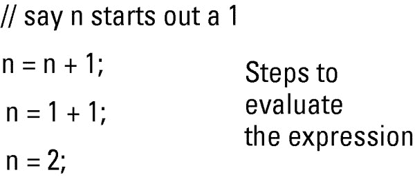

### 在声明时初始化变量

你可以在声明时通过在后面加上等号和值来初始化变量：

```cpp
int n = 1; // 声明并初始化
```

### 忘记初始化变量

在使用之前初始化变量是非常常见的错误。`C++` 对此如此，以至于编译器会极力检测这种情况并警告你。考虑以下语句：

```cpp
int n1, n2 = 0;
n2 = n1 + 1;
cout << n1 << endl;
cout << "n2 = " << n2;
```

`CodeBlocks` 在构建时产生以下警告：

`warning: “n1” is used uninitialized`

尽管这是一个非常糟糕的主意，你可以忽略警告。执行程序输出：

```
n2 = 54
```

在此例中，值 54 是之前遗留的。

## 整数常量

`C++` 将任何仅数字数字符号视为整数常量。以下是常量：

```cpp
123
1
256
```

常量不能包含任何奇怪字符。以下是非法的：

```cpp
123Z456
```

以下是合法的，但意思并非你想的：

```cpp
123+456
```

这实际上定义了常量 123 和 456 的和，即值 479。

 通常 `C++` 假设常量是十进制（base 10）。然而，出于历史原因，以 0 开头的数字被认为是八进制（base 8）。同样，以 0x 或 0X 开头的数字被认为是十六进制。十六进制使用字母 A 到 F 或 a 到 f 来表示 9 之后的数字。因此，`0xFF`、`0377` 和 `255` 都是等值的。如果你不知道八进制或十六进制，不要担心——我们在这本书中不会使用它们。

 除非你想它是八进制，否则不要以 0 开头常量。

整数常量可以在末尾附加某些符号以更改其类型。你将在第 14 章看到不同类型的整数常量。

## 表达式

变量和常量在你使用它们进行计算时才有用。“表达式”一词是 `C++` 的术语，意指计算。你已经见过最简单的表达式：

```cpp
int n; // declaration

n = 1; // expression
```

表达式总是涉及变量、常量和操作符。运算符对其参数执行某些算术操作。大多数操作符接受两个参数——这些被称为**二元运算符**。少数操作符接受单个参数——这些是**一元运算符**。

所有表达式都返回值和一个类型。（注意，`int` 是本章描述的所有表达式的类型。）

## 二元运算符

二元运算符是接受两个参数的运算符。如果你可以说 `var1 op var2`，那么 `op` 必须是一个二元运算符。常见的二元运算符就是你在小学学过的那些简单操作。常见的二元运算符出现在表 4-1 中。（该表还包括在本章稍后描述的一元运算符。）

### 表 4-1 按照优先级排序的数学运算符

| 优先级 | 操作符 | 含义 |
| :--- | :--- | :--- |
| 1 | `-` (一元) | 返回其参数的负值 |
| 2 | `++` (一元) | 递增 |
| 2 | `--` (一元) | 递减 |
| 3 | `*` (二元) | 乘法 |
| 3 | `/` (二元) | 除法 |
| 3 | `%` (二元) | 取模 |
| 4 | `+` (二元) | 加法 |
| 4 | `-` (二元) | 减法 |
| 5 | `=`, `*=`, `%=`, `+=`, `-=` (特殊) | 赋值类型 |

简单的二元运算符是等号标记赋值运算符。赋值运算符表示：“取右侧的值并将其存储在运算符左侧的位置。”（我将在章末尾描述特殊的赋值运算符。）

乘法、除法、加法、减法和取模是执行算术运算的运算符。它们的工作方式与你在小学学习的算术运算符相同，但有以下特殊考虑：

乘法必须始终显式表示，而永远不会像代数中那样被隐含。考虑以下示例：

```cpp
int n = 2; // 声明变量

int m = 2n; // 这将产生一个错误
```

上面的表达式并没有将 `m` 赋值为 `2` 乘以 `n`。相反，`C++` 尝试将 `2n` 解释为变量名。由于变量名不能以数字开头，它在构建阶段产生错误。

程序员的意思是：

```cpp
int n = 2;

int m = 2 * n; // 这是可以的
```

整数除法会丢弃余数。因此，后续：

```cpp
int n = 13 / 7; // 将值 1 赋值给 n
```

14 除以 7 是 2。13 除以 7 是 1。（将在第 14 章看到可以处理小数的变量类型。）

取模运算符返回除法后的余数（你可能忘记取模了）：

```cpp
int n = 13 % 7; // 将 n 设置为 6
```

14 取 7 余 0。13 取 7 余 6。

## 分解复合表达式

单个表达式可以包含多个运算符：

```cpp
int n = 5 + 100 + 32;
```

当所有运算符都相同时，`C++` 从左到右评估表达式：

```
5 + 100 + 32
105 + 32
137
```

当不同的运算符组合在一个单一表达式中时，`C++` 使用称为**优先级**的属性。优先级是运算符在复合表达式中评估的顺序。考虑以下示例：

```cpp
int n = 5 * 100 + 32;
```

先执行乘法还是加法？或者这个表达式仅仅是从左到右评估的？参考表 4-1，它告诉你乘法的优先级为 3，高于加法的优先级 4（值越小优先级越高）。因此，乘法先发生：

```text
5 * 100 + 32
500 + 32
532
```

操作顺序被运算符的优先级所覆盖。正如你看到的

```cpp
int n = 32 + 5 * 100;
```

产生了相同的结果：

```text
32 + 5 * 100
32 + 500
532
```

但如果你真的想要 100 加上 32 之和的 5 倍呢？你可以通过将想要先执行的表达式封装在括号中来覆盖运算符的优先级：

```cpp
int n = 5 * (100 + 32);
```

现在加法在乘法之前执行：

```text
5 * (100 + 32)
5 * 132
660
```

你可以组合括号，使表达式变得你认为任意复杂。`C++` 总是从它能找到的最深嵌套括号开始，并向外处理。

```text
(3 + 2) * ((100 / 20) + (50 / 5))
(3 + 2) * (5 + 10)
5 * 15
75
```

 你始终可以使用中间变量来分解复杂的表达式。以下更安全：

```cpp
int factor = 3 + 2;

int principal = (100 / 20) + (50 / 5);

int total = factor * principal;
```

为中间值赋值名称还允许程序员解释复杂方程的部分，让下一个人更容易理解。

## 一元运算符

一元运算符是接受单个参数的操作符。一元数学运算符是 `-`、`++` 和 `--`。

负运算符改变其参数的符号。正数变成负数，负数变成正数。

```cpp
int n = 10;
int m = -n;
```

赋值运算符对任何计算机语言来说都是至关重要的。否则，我如何存储计算出的值呢？然而，`C++` 提供了一套完整的赋值运算符额外版本，这些版本看起来没那么关键了。

`C++` 的作者们一定注意到了如下形式的表达式非常常见：

`x = x # value;`

这里 `#` 代表某些二元运算符。在他们对简洁近乎过热的追求中，作者为每种形式的二元运算符创建了单独的赋值运算符：

`x #= value;` // 其中 `#` 是任意一个二元运算符

因此，例如

`n = n + 2;`

可以写成

`n += 2;`

注意：你并不会经常看到这种写法，我在这里介绍它主要是为了完整性。

# 第 5 章

## 字符表达式

### 本章内容

- 定义字符变量和常量
- 字符编码
- 声明字符串
- 将字符输出到控制台

第 4 章引入了整数变量的概念。本章向我们介绍整数更小的兄弟——字符或 `char`（读音可以是 care、chair，或者 charcoal 的第一个音节）。我在前面的章节的程序中使用过字符——现在是时候正式地介绍它们了。

## 定义字符变量

字符变量的声明方式与整数相同，只是用 `char` 关键字代替了 `int`：

```cpp
char inputCharacter;
```

字符常量定义为包含在单引号内的单个字符，如下所示：

```cpp
char letterA = 'A';
```

这可能看起来像是一个愚蠢的问题，但“A”到底是什么？为了回答这个问题，我需要解释什么是字符编码。

## 字符编码

正如我在第 1 章中提到的，计算机中的一切都由零和一的模式表示，这些模式可以被解释为数字。因此，位模式 `0000 0001` 在解释为整数时是数字 `1`。然而，当同一个位模式被处理器解释为指令时，它的含义完全不同。所以，计算机通过为每个字母分配一个数字来编码字母表字符并不意外。

考虑字符‘A’。只要我们都达成一致，你可以为它分配任何想要的值。例如，如果你愿意，可以给‘A’分配值 `1`。从逻辑上讲，你可能会给‘B’分配值 `2`，给‘C’分配 `3`，依此类推。在这种方案中，‘Z’将获得值 `26`。然后你可能会重新开始，给‘a’分配值 `27`，给‘b’分配 `28`，一直到‘z’的 `52`。这仍然留下了数字‘0’到‘9’以及所有特殊符号，如空格、句号、逗号、斜杠、分号以及你在按住 Shift 点击数字键时看到的奇怪字符。再加上制表符和换行符等不可打印字符。最后，你可以使用 `1` 到 `127` 之间的数字来编码整个英语键盘。

我说“你可以”为‘A’‘B’和剩余字符分配值；然而，这并不是一个好主意，因为这已经做过了。1963 年左右，对于如何编码英语字符达了共识。表 5-1 所示的 `ASCII`（信息交换美国标准代码）字符编码除一家公司外，几乎在全世界范围内被采用。`IBM` 也在 1963 年发布了自己的标准。这两种编码标准争斗了大约十年，但到 20 世纪 70 年代初 `C` 和 `C++` 创建时，`ASCII` 已经赢得了战斗。`char` 类型的设计是考虑了 `ASCII` 字符编码的。

| 表 5-1 ASCII 字符集 |
| Value | Char | Value | Char |
| :--- | :--- | :--- | :--- |
| 0 | NULL | 64 | @ |
| 1 | Start of Heading | 65 | A |
| 2 | Start of Text | 66 | B |
| 3 | End of Text | 67 | C |
| 4 | End of Transmission | 68 | D |
| 5 | Enquiry | 69 | E |
| 6 | Acknowledge | 70 | F |
| 7 | Bell | 71 | G |
| 8 | Backspace | 72 | H |
| 9 | Tab | 73 | I |
| 10 | Newline | 74 | J |
| 11 | Vertical Tab | 75 | K |
| 12 | New Page; Form Feed | 76 | L |
| 13 | Carriage Return | 77 | M |
| 14 | Shift Out | 78 | N |
| 15 | Shift In | 79 | O |
| 16 | Data Link Escape | 80 | P |
| 17 | Device Control 1 | 81 | Q |
| 18 | Device Control 2 | 82 | R |
| 19 | Device Control 3 | 83 | S |
| 20 | Device Control 4 | 84 | T |
| 21 | Negative Acknowledge | 85 | U |
| 22 | Synchronous Idle | 86 | V |
| 23 | End of Transmission | 87 | W |
| 24 | Cancel | 88 | X |
| 25 | End of Transmission | 89 | Y |
| 26 | Substitute | 90 | Z |
| 27 | File Separator | 91 | [ |
| 28 | Group Separator | 92 | \ |
| 29 | Record Separator | 93 | ] |
| 30 | Unit Separator | 94 | ^ |
| 31 | Unit Separator | 95 | _ |
| 32 | Space | 96 | ` |
| 33 | ! | 97 | a |
| 34 | “ | 98 | b |
| 35 | # | 99 | c |
| 36 | $ | 100 | d |
| 37 | % | 101 | e |
| 38 | & | 102 | f |
| 39 | ‘ | 103 | g |
| 40 | ( | 104 | h |
| 41 | * | 105 | i |
| 42 | ) | 106 | j |
| 43 | + | 107 | k |
| 44 | , | 108 | l |
| 45 | - | 109 | m |
| 46 | . | 110 | n |
| 47 | / | 111 | o |
| 48 | 0 | 112 | p |
| 49 | 1 | 113 | q |
| 50 | 2 | 114 | r |
| 51 | 3 | 115 | s |
| 52 | 4 | 116 | t |
| 53 | 5 | 117 | u |
| 54 | 6 | 118 | v |
| 55 | 7 | 119 | w |
| 56 | 8 | 120 | x |
| 57 | 9 | 121 | y |
| 58 | : | 122 | z |
| 59 | ; | 123 | { |
| 60 | < | 124 | \| |
| 61 | = | 125 | } |
| 62 | > | 126 | ~ |
| 63 | ? | 127 | DEL |

最后一行在方括号内输出字符 `cValue`。

以下显示了程序的几次示例运行。在第一次运行中，我输入了值 `65`，表 5-1 显示其为字符‘A’：

```
Enter decimal value of char to print:65
The char you entered was [A]
Press any key to continue . . .
```

第二次我输入了值 `97`，它对应于字符‘a’：


进入`/path/to/xxx`目录，找到`xxx.json`。

在表达式`cvar = avar + bvar`中，加法运算符（`+`）将`avar`与`bvar`相加，得到它们的和`cvar`。

在`List.of(arg0, arg1, arg2)`中，`List`接口的工厂方法`of()`接受一系列的元素，返回包含它们的只读列表。

之后我们这样调用`cmd`命令：`cmd arg0 arg1 arg2`。

```
if (condVar > someVal) {console.log("xxx")}
```

---

```
Enter decimal value of char to print:97
The char you entered was [a]
Press any key to continue . . .
```

在随后的运行中，我尝试了特殊字符：

```
Enter decimal value of char to print:36
The char you entered was [$]
Press any key to continue . . .
```

值`7`没有打印任何内容，但导致我的电脑发出了巨大的响亮的哔哔声，吓得我一跳。

值`10`生成了以下奇怪的输出：

```
Enter decimal value of char to print:10
The char you entered was [

]
Press any key to continue . . .
```

参考表 5-1，你可以看到`10`是换行字符。这个字符实际上不会打印任何内容，但它会让后续输出从下一行的开始开始，这正是在这种情况下发生的情况：跟随换行字符时，右大括号单独出现在下一行的开头。

 在你目前看到的许多输出命令末尾出现的`endl`会生成一个换行。它还会执行一些其他操作，你将在第 31 章中看到。

## 字符字符串编码

从理论上讲，你可以使用单个字符打印任何想要的内容。然而，正如下面的代码段所示，这可能会非常麻烦：

```cpp
cout << ‘E’ << ‘n’ << ‘t’ << ‘e’ << ‘ ‘
<< ‘d’ << ‘e’ << ‘c’ << ‘i’ << ‘m’ << ‘a’
<< ‘l’ << ‘ ' << ‘v’ << ‘a’ << ‘l’ << ‘u’
<< ‘e’ << ‘ ' << ‘o’ << ‘f’ << ‘ ' << ‘c’
<< ‘h’ << ‘a’ << ‘r’ << ‘ ' << ‘t’ << ‘o’
<< ‘ ' << ‘p’ << ‘r’ << ‘i’ << ‘n’ << ‘t’
<< ‘:’;
```

C++ 允许你通过将字符串包含在双引号中来编码字符序列：

```cpp
cout << “Enter decimal value of char to print:”;
```

我将在第 16 章中对字符字符串做更多说明。

## 特殊字符常量

你可以通过将字符放在单引号中来编写普通的、可打印的字符：

```cpp
char cSpace = ‘ ‘;
```

你可以通过在反斜杠后放置其八进制值来编码任何需要的字符，无论其是否可打印：

```cpp
char cSpace = ‘\040’;
```

 前导为零的常量被认为是八进制，也称为 8 进制。

你可以使用 16 进制（十六进制）编码字符，通过在数字前加上反斜杠后跟一个小写的`x`，如下例所示：

```cpp
char cSpace = ‘\x20’;
```

 十进制值`32`等于 8 进制的`40`和 16 进制的`20`。如果你对八进制或十六进制不熟悉，不要担心。C++ 为最常见的字符提供了快捷方式。

C++ 为一些特别常用的不可打印字符提供了名称。一些常见的字符如表 5-2 所示：

| 表 5-2 一些 C++ 特殊字符 | |
| :--- | :--- |
| Char | Special Symbol |
| `‘` | `\’` |
| `“` | `\”` |
| `\` | `\\` |
| NULL | `\0` |
| Newline | `\n` |
| Carriage Return | `\r` |
| Tab | `\t` |
| Bell | `\a` |

最常见的是换行字符，它的昵称为`\n`。此外，如果你想打印单引号字符，必须使用反斜杠：

```cpp
char cQuote = ‘\’’;
```

 由于 C++ 通常将单引号解释为包含一个字符，因此你必须在单引号前加上一个反斜杠字符来告诉它：“嘿，这个单引号不是包含字符，这就是字符本身。”

此外，字符`\\`是单个反斜杠。

 这导致了 C++ 中比较不幸的巧合之一。在 Windows 中，反斜杠用于文件名，如下：

```
C:\\Base Directory\Subdirectory\File Name
```

这在 C++ 中的编码方式是将每个反斜杠替换为一对反斜杠，如下：

```
“C:\\\\Base Directory\\Subdirectory\\File Name”
```


## 容量扩展

在 20 世纪 70 年代初 C 和 C++ 发明时，128 个字符的 ASCII 集已经击败了所有对手。因此，定义`char`类型来适应 ASCII 字符集是合理的。字符集对于英语足够，但当程序员尝试为其他欧洲语言编写应用程序时，它就变得过于限制。

幸运的是，C 和 C++ 在`char`中提供了足够的空间来容纳 256 个不同的字符。

### 表 6-1 比较运算符

| 运算符 | 含义 |
| :--- | :--- |
| `==` | 等于；如果左侧参数的值与右侧表达式相同，则为真 |
| `!=` | 不等于；等等的反反操作 |
| `>` | 大于；如果左侧参数大于右侧，则为真 |
| `<` | 小于；如果左侧参数小于右侧，则为真 |
| `>=` | 大于或等于；如果左侧参数大于或等于右侧，则为真 |
| `<=` | 小于或等于；如果左侧参数小于或等于右侧，则为真 |

 不要将相等运算符（`==`）与赋值运算符（`=`）混。这是学者常见的错误。

下面的`BranchDemo`程序展示了如何使用表 6-1 所示的运算符：


```cpp
// BranchDemo - demonstrate the if statement

#include <cstdio>
#include <cstdlib>
#include <iostream>

using namespace std;

int main(int nNumberofArgs, char* pszArgs[])
{
    // enter operand1 and operand2
    int nOperand1;
    int nOperand2;
    cout << “Enter argument 1:”;
    cin >> nOperand1;
    cout << “Enter argument 2:”;
    cin >> nOperand2;

    // now print the results
    if (nOperand1 > nOperand2)
    {
        cout << “Argument 1 is greater than argument 2”
        << endl;
    }
    if (nOperand1 < nOperand2)
    {
        cout << “Argument 1 is less than argument 2”
        << endl;
    }
    if (nOperand1 == nOperand2)
    {
        cout << “Argument 1 is equal to argument 2”
        << endl;
    }

    // wait until user is ready before terminating program
    // to allow the user to see the program results
    system(“PAUSE”);
    return 0;
}
```

程序的执行如既往地从`main()`开始。程序首先声明了两个命名为`nOperand1`和`nOperand2`的`int`变量。然后提示用户“Enter argument 1”，并将其读入`nOperand1`。对`nOperand2`重复此过程。

随后程序执行包含三个比较的序列。它首先检查`nOperand1`是否小于`nOperand2`。如果是，程序输出通知“Argument 1 is less than argument 2”。第二个`if`语句在两个操作数的值相等时显示一条消息。如果`nOperand1`大于`nOperand2`，则最后一个比较为真。

以下显示了`BranchDemo`程序的示例运行：

```
Enter argument 1:5
Enter argument 2:10
Argument 1 is less than argument 2
Press any key to continue . . .
```

图 6-1 图形化了该特定运行的控制流。

**图 6-1：** 当用户第一个参数输入 5，第二个参数输入 10 时，`BranchDemo`程序所走的路径。

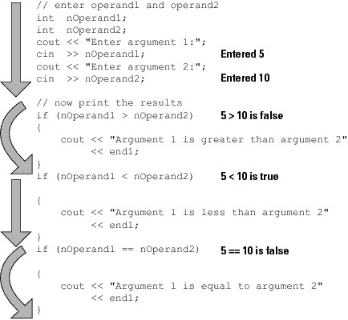

按照`BranchDemo`程序的编写方式，每次都会执行三次比较。这略显浪费，因为这三个条件是互斥的。例如，如果已经发现`nOperand1 < nOperand2`为真，那么`nOperand1 > nOperand2`不可能为真。在本章稍后，我将向你展示如何避免这种浪费。

### 对“无大括号”说不

实际上大括号是可选的。如果没有大括号，只有`if`语句后的第一个表达式是条件性的。然而，这种方法很容易出错，如下段代码所示：

```cpp
// Can’t have a negative age. If age is less than zero...
if (nAge < 0)
cout << “Age can’t be negative; using 0” << endl;
nAge = 0;
// program continues
```

你可能认为如果`nAge`小于 0，这段代码片段会输出一条消息并将`nAge`重置为零。事实上，无论原始值是什么，程序都会将`nAge`设置为零。之前的代码片段等于以下内容：

```cpp
// Can’t have a negative age. If age is less than zero...
if (nAge < 0)
{
    cout << “Age can’t be negative; using 0” << endl;
}
nAge = 0;
// program continues
```

从注释和缩进可以明显看出，程序员真正的意思是：

```cpp
// Can’t have a negative age. If age is less than zero...
if (nAge < 0)
{
    cout << “Age can’t be negative; using 0” << endl;
    nAge = 0;
}
// program continues
```

C++ 编译器无法捕获这类错误。安全的做法总是提供大括号。

 C++ 对所有空白的处理相同。它忽略页面上表达式的对齐。

 始终使用大括号包裹`if`语句后的语句，即使只有一个。这样你产生的错误会少得多。

### 还有什么？

C++ 允许程序在`else`关键字后指定一个从，如果条件表达式为假，则执行该从，例如：

```cpp
if (m > n)
{
    // ...
}
else
{
    // ...
}
```

`else`子句必须紧跟在`if`的右括号之后。在用法中，如下：

```cpp
if (nAge < 0)
{
    cout << “Age can’t be negative; using 0” << endl;
}
else
{
    cout << “Age is positive” << endl;
}
```

（注：此处已忽略原文中重复且混乱的文本）

### 嵌套 if 语句

 `if`或`else`子句的大括号可以包含另一个`if`语句。这些被称为嵌套`if`语句。下面的`NestedIf`程序展示了嵌套`if`语句的用法。

```cpp
// NestedIf - demonstrate a nested if statement

#include <cstdio>
#include <cstdlib>
#include <iostream>

using namespace std;

int main(int nNumberofArgs, char* pszArgs[])
{
    // enter your birth year
    int nYear;
    cout << “Enter your birth year: “;
    cin >> nYear;

    // Make determination of century
    if (nYear > 2000)
    {
        cout << “You were born in the 21st century”
        << endl;
    }
    else
    {
        cout << “You were born in “;
        if (nYear < 1950)
        {
            cout << “the first half”;
        }
        else
        {
            cout << “the second half”;
        }
        cout << “of the 20th century”
        << endl;
    }

    // wait until user is ready before terminating program
    // to allow the user to see the program results
    system(“PAUSE”);
    return 0;
}
```

该程序首先询问用户的出生年份。如果年份大于 2000，则程序输出字符串“You were born in the 21st century”。

 2000 年属于 20 世纪，而不是 21 世纪。

如果出生年份不大于 2000，则程序进入外层`if`语句的`else`子句。该子句的开始是输出字符串“You were born in”，然后将出生年份与 1950 进行比较。如果出生年份小于 1950，程序将添加第一个“the first half”。如果出生年份不小于 1950，则执行内部`if`语句的`else`子句，它会加上短语“the second half”。最后，程序在目前为止输出的所有内容后加上结束短语“of the 20th century”。

在实践中，对于出生年份的三种可能值，程序的输出所示。首先，2002 产生以下结果：

```
Enter your birth year: 2002

You were born in the 21st century

Press any key to continue . . .
```

我 1956 年的出生年份生成了以下结果：

```
Enter your birth year: 1956

You were born in the second half of the 20th century

Press any key to continue . . .
```

最后，我父亲 1932 年的出生年份生成了第三种可能：

```
Enter your birth year: 1932

You were born in the first half of the 20th century

Press any key to continue . . .
```

可以使用嵌套的`if`来避免`NestedBranchDemo`程序中不必要的比较：

```cpp
if (nOperand1 > nOperand2)
{
    cout << “Argument 1 is greater than argument 2”
    << endl;
}
else
{
    if (nOperand1 < nOperand2)
    {
        cout << “Argument 1 is less than argument 2”
        << endl;
    }
    else
    {
        cout << “Argument 1 is equal to argument 2”
        << endl;
    }
}
```

这个版本执行了与之前相同的第一次比较。如果`nOperand1`大于`nOperand2`，这段代码输出字符串“Argument 1 is greater than argument 2”。然而，从这里开始，控制跳转到最后的右括号，从而跳过了剩余的比较。


如果 `nOperand1` 不大于 `nOperand2`，则该代码将执行第二次测试，以区分 `nOperand1` 小于 `nOperand2` 的情况与两者相等的情况。

图 6-3 图形展示了 `NestedBranchDemo` 程序对于本章之前描述的输入 5 和 10 时的控制流。

**图 6-3：** 当用户像之前一样输入 5 和 10 时，`Nested-Branch-Demo` 程序所走的路径。

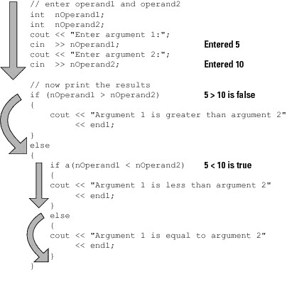

 进行相等性测试是不必要的：如果 `nOperand1` 既不大于也不小于 `nOperand2`，那么它一定相等。

## 复合条件表达式

表 6-2 显示了用于创建所谓的“复合条件表达式”的三个逻辑运算符。

| 表 6-2 | 逻辑运算符 |
| :--- | :--- |
| 运算符 | 含义 |
| `&&` | AND；如果左侧和右侧参数均为真，则为真；否则为假 |
| `\|\|` | OR；如果左侧或右侧任一为真，则为真；否则为假 |
| `!` | NOT；如果右侧参数为假，则为真；否则为假 |

程序员在条件复合表达式中提了两个或多个问题，如下代码段所示：

```cpp
// 确保 nArgument 在于 0 和 5 之间
if (0 < nArgument && nArgument < 5)
```

图 6-4 显示了该表达式如何评估 `nArgument` 的三个不同值。

**图 6-4：** 对于 `n` 的三个不同值对复合表达式 `0 < n && n < 5` 的评估。


顺便提一下，代码段

```cpp
if (m < nArgument && nArgument < n)
```

是编写表达式“如果 `nArgument` 在 `m` 和 `n` 之间（不包含端点）”的标准方式。这种测试不包括端点——也就是说，如果 `nArgument` 等于 `m` 或 `n`，该测试将失败。如果你想包含端点，请使用 `<=` 比较运算符。


### 短路评估

仔细观察涉及逻辑 AND 的复合表达式，例如：

```cpp
if (expr1 && expr2)
```

如果 `expr1` 为假，那么无论 `expr2` 的值如何，复合表达式的整体结果均为假。事实上，如果 `expr1` 为假，C++ 甚至不会评估 `expr2`——`false && anything` 为假。这被称为“短路评估”（short circuit evaluation），因为它通过跳过执行不必要的代码来节省时间。

逻辑 OR 的情况完全相反：

```cpp
if (expr1 || expr2)
```

如果 `expr1` 为真，那么整个表达式为真，无论 `expr2` 的值如何。

短路评估是一个很有用的特性，因为它可以防止在某些情况下执行错误的代码。

## 第 7 章：切换路径

程序经常需要在多个选项之间做出选择，这可以通过一系列 `if` 语句来实现。然而，C++ 提供了一种更方便的机制，称为 `switch` 语句。

### 使用 `switch` 语句控制流

`switch` 语句具有以下格式：

```cpp
switch(expression)
{
case const1:
    // 如果 expression == const1
    break;
case const2:
    // 如果 expression == const2
    break;
case const3: // 如果 expression == const3
    break;
default:
    // 如果以上都不匹配
    break;
}
```

遇到 `switch` 语句时，C++ 会评估 `expression`。然后将控制传递到与 `expression` 值相同的 `case`。`break` 语句将控制转移到 `}`。`default` 情况是可选的。如果表达式不匹配任何 `case` 且没有 `default` `case`，控制将直接传递到 `}`。

考虑以下示例：

```cpp
int nMonth;
cout << “Enter the number of the month: “;
cin >> nMonth;

switch (nMonth)
{
    case 1:
        cout << “It’s January” << endl;
        break;
    case 2:
        cout << “It’s February” << endl;
        break;
    case 3:
        cout << “It’s March” << endl;
        break;
    case 4:
        cout << “It’s April” << endl;
        break;
    case 5:
        cout << “It’s May” << endl;
        break;
    case 6:
        cout << “It’s June” << endl;
        break;
    case 7:
        cout << “It’s July” << endl;
        break;
    case 8:
        cout << “It’s August” << endl;
        break;
    case 9:
        cout << “It’s September” << endl;
        break;
    case 10:
        cout << “It’s October” << endl;
        break;
    case 11:
        cout << “It’s November” << endl;
        break;
    case 12:
        cout << “It’s December” << endl;
        break;
    default:
        cout << “That’s not a valid month” << endl;
        break;
}
```

当我输入值 3 时，从程序得到了以下输出：

```text
Enter the number of the month: 3
It’s March
```

图 7-1 显示了控制流如何通过 `switch` 语句生成了早期的“March”结果。

**图 7-1：** 当运算符输入月份 3 时，通过 `switch` 语句的流。

 `switch` 语句与一系列 `if` 语句不同。例如，在 `case` 关键字之后只允许常量（或可以在构建时完全求值的表达式）。你不能在 `case` 之后提供表达式。因此，以下代码是不合法的：

```cpp
// cases cannot be expressions; in general, the
// following is not legal
switch(n)
{
case m:
cout << “n is equal to m” << endl;
break;
case 2 * m:
cout << “n is equal to 2m” << endl;
break;
case 3 * m:
cout << “n is equal to 3m” << endl;
}
```

每个 `case` 必须在构建时有一个值。`m` 的值在程序执行之前是未知的。

### 控制穿透（Fall Through）：我弄断它了吗？

就像 `default` 情况可选的一样，每个 `case` 结尾的 `break` 也是可选的。然而，如果没有 `break` 语句，控制将直接从一个 `case` 继续到下一个 `case`。程序员称之为“控制穿透”（falls through）。当两个或多个 `case` 以相同方式处理时，这种特性最为有用。

例如，C++ 可能会区分大小写，但大多数人类并不区分。以下代码段提示用户输入 `C` 创建支票账户，输入 `S` 创建储蓄账户。然而，通过提供额外的 `case` 语句，该片段以相同的方式处理了小写的 `c` 和 `s`：

```cpp
cout << “Enter C to create checking account, “
<< “S to create a saving account, “
<< “and X to exit: “;
cin >> cAccountType;
switch(cAccountType)
{
case ‘S’: // upper case S
case ‘s’: // lower case s
// creating savings account
break;
case ‘C’: // upper case C
case ‘c’: // lower case c
// create checking account
break;
case ‘X’: // upper case X
case ‘x’: // lower case x
// exit code goes here
break;
default:
cout << “I didn’t understand that” << endl;
}
```

### 使用 `switch` 语句实现示例计算器

 下面的 `SwitchCalculator` 程序使用 `switch` 语句实现了一个简单的计算器：

```cpp
// SwitchCalculator - use the switch statement to
// implement a calculator
#include <cstdio>
#include <cstdlib>
#include <iostream>
using namespace std;
int main(int nNumberofArgs, char* pszArgs[])
{
// enter operand1 op operand2
int nOperand1;
int nOperand2;
char cOperator;
cout << “Enter ‘value1 op value2’\n”
<< “where op is +, -, *, / or %:” << endl;
cin >> nOperand1 >> cOperator >> nOperand2;
// echo what the operator entered
cout << nOperand1 << “ “
<< cOperator << “ “
<< nOperand2 << “ = “;
// now calculate the result; remember that the
// user might enter something unexpected
switch (cOperator)
{
case ‘+’:
cout << nOperand1 + nOperand2;
break;
case ‘-’:
cout << nOperand1 - nOperand2;
break;
case ‘*’:
case ‘x’:
case ‘X’:
cout << nOperand1 * nOperand2;
break;
case ‘/’:
cout << nOperand1 / nOperand2;
break;
case ‘%’:
cout << nOperand1 % nOperand2;
break;
default:
// didn’t understand the operator
cout << “ is not understood”;
}
cout << endl;
// wait until user is ready before terminating program
// to allow the user to see the program results
system(“PAUSE”);
return 0;
}
```

该程序首先提示用户输入“value1 op value2”，其中 `op` 是常见的算术运算符 `+`、`-`、`*`、`/` 或 `%` 之一。程序读取变量 `nOperand1`、`cOperator` 和 `nOperand2`。

程序首先向用户回显它从键盘读取的内容。随后输出计算结果。

 将输入回显给用户始终是一种良好的编程习惯。它让用户确认程序正确读取了他的输入。

对 `cOperator` 的 `switch` 语句区分了该计算器实现的运算。例如，当 `cOperator` 为 `+` 时，程序报告 `nOperand1` 和 `nOperand2` 的和。

由于 `X` 是另一个常见的乘法符号，程序通过 `case` 的“穿透”特性将 `*`、`X` 和 `x` 全部视为乘法的同义词。如果 `cOperator` 不匹配任何已知的运算符，程序将输出错误信息。

几次示例运行的输出所示：

```text
Enter ‘value1 op value2’
where op is +, -, *, / or %:
22 x 6
22 x 6 = 132
Press any key to continue . . .
Enter ‘value1 op value2’
where op is +, -, *, / or %:
22 / 6
22 / 6 = 3
Press any key to continue . . .
Enter ‘value1 op value2’
where op is +, -, *, / or %:
22 % 6
22 % 6 = 4
Press any key to continue . . .
Enter ‘value1 op value2’
where op is +, -, *, / or %:
22 $ 6
22 $ 6 = 132
Press any key to continue . . .
Enter ‘value1 op value2’
where op is +, -, *, / or %:
22 $ 6
22 $ 6 = is not understood
Press any key to continue . . .
```

修复错误最简单、最好的方法是从源上就避免在程序中引入这些错误。这在某种程度上取决于经验，但采用清晰且一致的编程风格会有很大帮助。

### 带有风格的编码

我们人类脑子中的 CPU 算力是有限的。我们需要将现有的 CPU 周期投入到创建可运行程序的活动中。我们不应该被缩进之类的事情分散了注意力。

因此，在变量命名、大括号的放置位置、缩进多少等方面保持一致性至关重要。这被称为你的编码风格。开发出一种风格并坚持下去。过了一段时间，你的编码风格将变成你的本能。你会发现，如果你的编码风格清晰且一致，你就可以用更短的时间编写程序，而且在阅读生成的程序时也会少费很多力。这将转化为更少的编码错误。

 我建议初学者模仿在书中看到的风格。当你以后积累了自己的经验后，可以再对其进行修改。

在与多个程序员一起编写程序时，确保大家都使用相同的风格同样重要，以避免因风格冲突和混乱产生“巴别塔效应”。我参与过的每一个项目都有编码手册，它有时会极其详尽地说明 `if` 语句应该如何布局、`case` 应该缩进多少，以及在 `break` 语句之后是否要留一个空行，这只是几个例子。

幸运的是，`Code::Blocks` 可以提供帮助。`Code::Blocks` 编辑支持 `C++`。它会在左括号后自动为你缩进正确数量的空格，并在你输入右括号时进行取消缩进，以正确对齐语句。

 你可以运行 `Code::Blocks` 自带的“源代码格式化器”（Source code formatter）插件。在打开正在工作的文件并处于项目状态的情况下，选择 `Plugins⇒Source Code Formatter (AStyle)`。这将使用标准缩进规则重新格式化当前文件。

 `C++` 并不缩进。对它来说，所有的空白字符都是一样的。缩进是为了让生成的程序更容易阅读和理解。

### 建立变量命名规范

关于变量命名的争论比关于针尖上能站多少个天使还要多。在命名变量时，我遵循以下规则：

- 首字母小写并表示变量的类型。`n` 代表 `int`，`c` 代表 `char`，`b` 代表 `bool`。你将在后面的章节中看到其他的。这在使用变量时非常有帮助，因为你立刻知道它的类型。
- 变量名具有描述性。不要使用像 `x` 或 `y` 这样的变量名。我太老了——当我明天、下周或明年尝试阅读自己的程序时，我需要能识别的东西。
- 多个单词的名字每个单词首字母大写，单词之间不使用下划线。我将下划线留给特定的应用，我将在第 12 章中描述。
- 我会在涉及其他 `C++` 对象的章节中（如第 11 章的函数和第 19 章的类）详细说明这些规则。

### 借助帮助寻找第一个错误

 我第一个版本的转换程序如下（它出现在随附的 CD-ROM 上，名为 `ConversionError1`）：


```cpp
//

// Conversion - Program to convert temperature from

// Celsius degrees into Fahrenheit:

// Fahrenheit = Celsius * (212 - 32)/100 + 32

//

#include <cstdio>
#include <cstdlib>
#include <iostream>

using namespace std;

int main(int nNumberofArgs, char* pszArgs[])
{

// enter the temperature in Celsius
int nCelsius;
cout << "Enter the temperature in Celsius: ";
cin >> nCelsius;
// convert Celsius into Fahrenheit
int nFahrenheit;
nFahrenheit = 9/5 * nCelsius + 32;
// output the results
cout << "Fahrenheit value is: ";
cout << nFahrenheit << endl;
// wait until user is ready
system("PAUSE");
return 0;
}
```

幸运的是，`Code::Blocks` 可以提供帮助。`Code::Blocks` 编辑器支持 `C++`。它会在左括号后自动为你缩进正确数量的空格，并在你输入右括号时进行取消缩进，以正确对齐语句。

在运行程序：

```
Enter the temperature in Celsius: 100
Fahrenheit value is: 132
Press any key to continue . . .
```

 你可以运行 `Code::Blocks` 自带的“源代码格式化器”（Source code formatter）插件。在打开正在工作的文件并处于项目状态的情况下，选择 `Plugins⇒Source Code Formatter (AStyle)`。这将使用标准缩进规则重新格式化当前文件。

 `C++` 并不缩进。对它来说，所有的空白字符都是样的。缩进是为了让生成的程序更容易阅读和理解。

在编译并运行后：

```
Enter the temperature in Celsius: 100
Fahrenheit value is: 132
Press any key to continue . . .
```

编译输出如下：

```
[0 errors] [0 warnings]
```

等等，我发现了一个错误。100 摄氏度应该是 212 华氏度。程序结果是 132。哪里出问题了？查看代码，`9/5` 在 `C++` 中是整数除，结果是 `1`。`1 * 100 + 32` 确实是 `132`。我应该将其改为 `9.0/5.0`。修改代码后：

```cpp
nFahrenheit = 9.0/5.0 * nCelsius + 32;
```

再次运行程序：

```
Enter the temperature in Celsius: 100
Fahrenheit value is: 212
Press any key to continue . . .
```

现在正确了。

哪里出问题了？我检查了计算过程，一切看起来都很正常。我需要查看一眼计算过程中到底发生了什么。获取程序内部运行的一种方法是添加输出语句。我想打印进入每个计算步骤的值。我还需要看到中间结果。为了做到这一点，我将计算拆分为我可以打印的各个部分。保留原始表达式作为注释，以免你忘记你是从哪里开始的。

 此版本的程序包含在随附的 CD-光盘中，文件名为 `ConversionError2`。

此版本的程序包含了以下更改：

```cpp
// nFahrenheit = 9/5 * nCelsius + 32;

cout << “nCelsius = “ << nCelsius << endl;

int nFactor = 9 / 5;

cout << “nFactor = “ << nFactor << endl;

int nIntermediate = nFactor * nCelsius;

cout << “nIntermediate = “ << nIntermediate << endl;

nFahrenheit = nIntermediate + 32;

cout << “nFahrenheit = “ << nFahrenheit << endl;
```

我显示了 `nCelsius` 的值，以确保它已从用户输入中正确读取。接下来，我尝试按照 `C++` 的执行顺序显示转换计算的中间结果。首先进行的是计算 `9 / 5`，我将其保存到一个命名为 `nFactor` 的变量中（名字并不重要）。这个值与 `nCelsius` 相乘，其结果保存到 `nIntermediate` 中。最后，这个值将加上 `32` 以生成结果，并存储在 `nFahrenheit` 中。

通过显示这些每一个中间值，我可以看到我的计算过程中发生了什么。重复错误用例，我得到了以下结果：

```text
Enter the temperature in Celsius: 100
nCelsius = 100
nFactor = 1
nIntermediate = 100
nFahrenheit = 132
Fahrenheit value is: 132
Press any key to continue . . .
```

我立刻发现了一个问题：`nFactor` 等于 `1` 而不是 `9 / 5`。然后我想到了问题：整数除法会向下舍入到最近的整数值。整数 `9` 除以整数 `5` 结果是 `1`。

我可以通过在除法之前进行乘法来避免这个问题。虽然会有少量的整数舍入，但只会产生 1 度的误差。

 另一个解决方案是使用可以保留小数值的进制变量。你将在第 14 章看到该解决方案。

生成的公式如下：

```cpp
nFahrenheit = nCelsius * 9/5 + 32;
```

 这是原始 `Conversion` 程序中出现在 CD-光盘上的计算计算版本。

现在重新运行测试，我得到了如下：

```text
Enter the temperature in Celsius: 0
Fahrenheit value is: 32
Press any key to continue . . .

Enter the temperature in Celsius: 100
Fahrenheit value is: 212
Press any key to continue . . .

Enter the temperature in Celsius: -40
Fahrenheit value is: -40
Press any key to continue . . .

Enter the temperature in Celsius: 50
Fahrenheit value is: 122
Press any key to continue . . .
```

这与表 8-1 中的预期值一致。

 注意，在做出更改后，我从头开始，提供了所有的四个测试用例——不仅仅是第一次没有正常运行的值。对计算的任何更改都会使之前的所有测试失效。

# 第三部分：成为功能性程序员


在本部分 . . .

现在你已经掌握了简单表达式的基础，是时候学习循环了，如何进入循环，以及更重要的是如何退出循环了。你还将看到如何将一个大程序拆分成更易编程的小组件。在本部分的最后一章中，你将看到更多调试你程序的技巧。

# 第 9 章：while 在圈中运行

## 本章内容

- 使用 `while` 语句进行循环

- 从循环中间跳出

- 避免致命的死循环

- 在循环中嵌套循环

决策判断是你编写的几乎每个程序中的基础部分，我在第 1 章中最初强调了这一点。然而，另一个基础特征——即使在简单的拆卸螺母算法中也是显而易见的——循环的能力。该程序循环地转扳手，直到螺母掉落，并从一个螺母循环到另一个螺母，直到整个轮子拆下来。本章向你介绍 `C++` 中三种循环结构中的两种。

## 创建 while 循环

`while` 循环具有以下格式：

```cpp
while (expression)
{
    // 在循环中执行的内容
}
// 一旦表达式为假，继续执行此处
```

当程序遇到 `while` 循环时，它首先计算括号内的 `expression`。如果这个 `expression` 为真，则控制权传递到循环内部的第一行。当控制权到达 `}` 时，程序返回 `expression` 并重新开始。直到 `expression` 为假（在本章稍后的部分会详细介绍）。

下面的 Factorial 程序演示了 `while` 循环：

```cpp
#include <cstdio>
#include <cstdlib>
#include <iostream>

using namespace std;

int main(int nNumber, char* psz[])
{
    int nTarget;

    cout << “This program calculates factorial.\n”
    << “Enter a number to take factorial of: “;
    cin >> nTarget;

    // 初始化累加器为 1
    int nAccumulator = 1;
    int nValue = 1;

    while (nValue <= nTarget)
    {
        // 注意——这是有趣的部分
        cout << nAccumulator << “ * “
        << nValue << “ equals “;
        nAccumulator = nAccumulator * nValue;
        cout << nAccumulator << endl;

        nValue++;
    }

    // 显示结果
    cout << nTarget << “ factorial is ”
    << nAccumulator << endl;

    // 在终止前等待用户
    system(“PAUSE”);

    return 0;
}
```

程序首先提示用户输入目标值。程序将此值读入 `nTarget`。然后程序在进入循环之前将 `nAccumulator` 和 `nValue` 初始化为 1。

 假设用户输入的目标值为 5。在第一次循环中，问题变为“1 小于等于 5 吗？”答案显然为真，因此控制进入循环。程序在输出 `nAccumulator`（1）和 `nValue`（也是 1）的值之前，将 `nAccumulator` 乘以 `nValue`并将结果存回 `nAccumulator`。

循环的最后一条语句将 `nValue` 从 1 增加到 2。

完成完成后，控制权返回 `while` 语句，并将 `nValue`（现在为 2）与 `nTarget`（仍为 5）进行比较。“2 小于等于 5 吗？”显然是，因此控制再次进入循环。`nAccumulator` 现在设置为 `nAccumulator`（1）乘以 `nValue`（2）的结果。

这种循环一直持续，直到 `nValue` 达到值 6，它不再小于或等于 5。此时，控制权传递到闭合括号 `}` 之后的第一个语句。这在图 9-1 中通过图形所示。

**图 9-1:** 控制继续循环通过 `while` 循环体，直到条件表达式为假。

 如图所示，你无法保证 `while` 循环大括号内的代码一定会被执行：如果条件表达式在第一次求值时为假，控制流将直接跳过大括号，而不会进入内部。例如，考虑阶乘程序在用户输入目标值 0 时的输出：

```
This program calculates factorial.

Enter a number to take factorial of: 0

0 factorial is 1

Press any key to continue . . .
```

循环内部没有生成任何行输出，因为对于“`nValue` 是否小于或等于 0”这一条件，在初始值为 1 的情况下，结果也为假。`while` 循环的主体从未被执行过。

## 从循环的中间退出

有时，导致你终止循环的条件直到循环中间的某个地方才会发生。在测试用户输入的某个终止字符时，情况尤为如此。`C++` 提供了这两个控制命令来处理这种情况：

- `break` 立即退出最内层循环。

- `continue` 将控制权传回循环顶部。

接下来的 Product 程序演示了 `break` 和 `continue`。该程序会乘以用户输入的正值，直到用户输入负数。该程序会忽略 0。

```cpp
//

// Product - demonstrate the use of break and continue.

//

#include <cstdio>
#include <cstdlib>
#include <iostream>

using namespace std;

int main(int nNumberofArgs, char* pszArgs[])
{
// enter the number to calculate the factorial of
  cout << “This program multiplies the numbers\n”
  << “entered by the user. Enter a negative\n”
  << “number to exit. Zeroes are ignored.\n”
  << endl;
  int nProduct = 1;
  while (true)
  {
    int nValue;
    cout << “Enter a number to multiply: “;
    cin >> nValue;
    if (nValue < 0)
    {
      cout << “Exiting.” << endl;
      break;
    }
    if (nValue == 0)
    {
      cout << “Ignoring zero.” << endl;
      continue;
    }
    // multiply accumulator by this value and
    // output the result
    cout << nProduct << “ * “ << nValue;
    nProduct *= nValue;
    cout << “ is “ << nProduct << endl;
  }
// wait until user is ready before terminating program
// to allow the user to see the program results
  system(“PAUSE”);
  return 0;
}
```

程序从 `nProduct` 的初始值 1 开始。然后程序评估逻辑表达式 `true` 以检查它是否为真。它确实为真。

 在 `C++` 中没有多少没有异常的规则，但这里有一条：`true` 永远是 `true`。

随后程序进入循环，提示用户输入另一个值乘以 `nProduct`（`nProduct` 是到目前为止的所有数字的累积积）。如果输入的值是负数，程序会在执行 `break` 之前输出“Exiting.”短语，从而将控制权传出循环。

如果输入的值不是负数，控制权将传递到第二个 `if` 语句。如果 `nValue` 等于 0，程序会在执行 `continue` 语句之前输出“Ignoring zero.”消息，这会将控制权传回循环顶部，允许用户输入另一个值。

如果 `nValue` 既不小于 0 也不等于 0，控制流将向下移动到使用特殊赋值运算符 `nValue` 乘以 `nProduct` 的地方（如果不记得这个运算符，请参见第 4 章）：

`nProduct *= nValue;`

### 为什么“break”是必要的？

你可能会好奇为什么 `break` 是真的必要的。如果我在 Product 示例程序中将循环写成这样：

```cpp
int nProduct = 1;
int nValue = 1;
while (nValue > 0)
{
  cout << “Enter a number to multiply: “;
  cin >> nValue;
  cout << nProduct << “ * “ << nValue;
  nProduct *= nValue;
  cout << “ is “ << nProduct << endl;
}
```

你可能认为，只要用户为 `nValue` 输入一个负值，表达式 `nValue > 0` 就不再为真，控制权会立即退出循环——遗憾的是，事实并非如此。


问题在于，逻辑表达式只在每次通过循环的开始时求值。一旦条件不再为真，控制权便立即飞出循环体。紧跟`break`的`if`语句允许我将条件表达式移动到循环体内，即为`nValue`赋值的地方。

这个表达式等同于：

```cpp
nProduct = nProduct * nValue;
```

该程序的示例运行输出显示如下：

```
This program multiplies the numbers
entered by the user. Enter a negative
number to exit. Zeroes are ignored.
Enter a number to multiply: 2
1 * 2 is 2
Enter a number to multiply: 5
2 * 5 is 10
Enter a number to multiply: 0
Ignoring zero.
Enter a number to multiply: 3
10 * 3 is 30
Enter a number to multiply: -1
Exiting.
```

## 嵌套循环

循环的主体可以包含另一个循环，这被称为嵌套循环。内层循环在外层循环的每次执行期间都会完整完成。你可以看到，对于外层循环的`0`，内层循环需要从`0`执行到`9`。这暗示了需要两个循环的形式如下：

```
0 1 2 3 4 5 6 7 8 9
0 2 4 6 8 10 12 14 16 18
0 3 6 9 12 15 18 21 24 27
0 4 8 12 16 20 24 28 32 36
0 5 10 15 20 25 30 35 40 45
0 6 12 18 24 30 36 42 48 54
0 7 14 21 28 35 42 49 56 63
0 8 16 24 32 40 48 56 64 72
0 9 18 27 36 45 54 63 72 81
```

接下来的`NestedLoops`程序是如何工作的：

```cpp
#include <cstdio>
#include <cstdlib>
#include <iostream>

using namespace std;

int main(int nNumberofArgs, char* pszArgs[])
{
// 显示列标题
  int nColumn = 0;
  cout << " ";
  while (nColumn < 10)
  {
    // 设置列宽为二
    //（即使是数字）
    cout.width(2);
    // 现在显示列数
    cout << nColumn << " ";
    // 增加列数
    nColumn++;
  }
  cout << endl;
// 现在遍历行
  int nRow = 0;
  while (nRow < 10)
  {
    // 开始行值
    cout << nRow << " - ";
    // 现在对于每一行，从列 0 开始
    // 执行到列 9
    nColumn = 0;
    while(nColumn < 10)
    {
      // 显示行与列的积
      //（即使积是单位数也使用 2 个字符）
      cout.width(2);
      cout << nRow * nColumn << " ";
      // 增加列数
      nColumn++;
    }
    cout << endl;
    // 增加行数
    nRow++;
  }
// 等到用户准备好后再终止程序
// 允许用户看到程序结果
  system("PAUSE");
  return 0;
}
```

第二组循环（即嵌套循环）从`nRow`等于`0`开始。程序打印行号，紧跟着一个破折号，然后进入第二个循环，该循环将`nColumn`再次从`0`开始并迭代到`9`。在内部循环的每次迭代中，程序将输出宽度设置为两个空格，然后显示`nRow * nColumn`，后跟一个空格。

**图 9-2：** 第一个循环输出列标题。

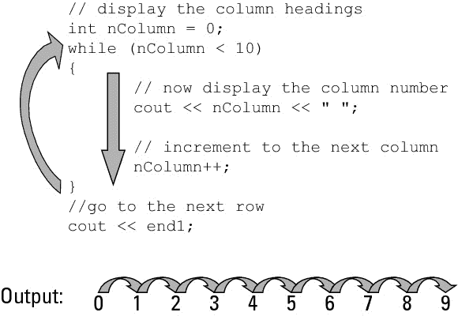

 提示：显示宽度在每次输出内容后都会重置，因此在每次输出数字之前，必须将其设回`2`。

程序在每次增加`nRow`时都会输出换行符，将输出移动到下一行。这在图 9-3 中以图形形式所示。

该程序的输出如下：

```
0 1 2 3 4 5 6 7 8 9
0 - 0 0 0 0 0 0 0 0 0 0
1 - 0 1 2 3 4 5 6 7 8 9
2 - 0 2 4 6 8 10 12 14 16 18
3 - 0 3 6 9 12 15 18 21 24 27
4 - 0 4 8 12 16 20 24 28 32 36
5 - 0 5 10 15 20 25 30 35 40 45
6 - 0 6 12 18 24 30 36 42 48 54
7 - 0 7 14 21 28 35 42 49 56 63
8 - 0 8 16 24 32 40 48 56 64 72
9 - 0 9 18 27 36 45 54 63 72 81
Press any key to continue . . .
```

此表中的`0`到`9`并没有什么神奇之处。我可以通过更改三个`while`循环中的比较表达式，轻松地创建一个`12 x 12`的乘法表（或任何其他组合）。然而，对于大于`10 x 10`的情况，您需要增加最小宽度以容纳三位数乘积。请使用`cout.width(3)`。

**图 9-3：** 内部循环从左到右遍历列，而外部循环则从上到下遍历行。

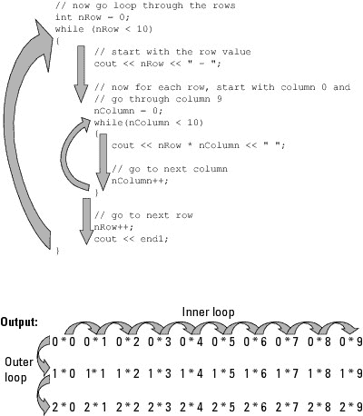

# 第 10 章

## 纯粹为了循环

### 本章内容

- 引入`for`循环

- 回习`ForFactorial`程序示例

- 使用逗号运算符在单个`for`循环中完成更多工作

所有控制结构中最基础的是`while`循环，它是第 9 章的主题。本章向您介绍它的兄弟——`for`循环。尽管`for`循环没有那么灵活，但它实际上是两者中更受欢迎的——它具有一种难以忽视的优雅感。

## 每一个循环的 for 部分

如果你再次查看第 9 章中的示例，你会发现大多数循环都有四个基本部分。（这感觉就像是将一次高尔夫挥杆动作分解为它的组成部分。）

1. **初始化 (setup)**：通常初始化涉及声明和初始化一个增量变量。这通常发生在`while`之前。

2. **测试表达式 (test expression)**：`while`循环内部的表达式，它将导致程序执行循环或退出并继续。它始终出现在关键字`while`后的括号内。

3. **循环体 (body)**：这是大括号内部的代码。

4. **增量 (increment)**：这是增加增量变量的地方。通常发生在循环体的末尾。

在`Factorial`程序中，这四个部分看起来如下：

```cpp
int nValue = 1; // setup

while (nValue <= nTarget) // test expression
{ // the body
    cout << nAccumulator << " * "
    << nValue << " equals ";
    nAccumulator = nAccumulator * nValue;
    cout << nAccumulator << endl;
    nValue++; // the increment
}
```

`for`循环使用`for`关键字将这四个部分整合到一个单一结构中：

```cpp
for(setup; test expression; increment)
{
    body;
}
```

执行流程如图 10-1 所示。

1. 当 CPU 无无地遇到`for`关键字时，控制权转移到`setup`子句。

2. 一旦完成`setup`，控制移动到`test expression`。

3. (a) 如果`test expression`为真，控制进入`for`循环的`body`。
   
   (b) 如果`test expression`为假，控制传递到闭大括号之后的语句。

4. 一旦执行完`for`循环的`body`，CPU 被强制返回循环的`increment`部分。

完成后，控制返回`test expression`并回到第 3 步。

**图 10-1：** for 循环内部及周围的流程。

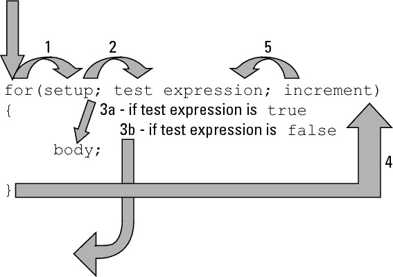

### 示例

`for`循环的逻辑与下面的`while`循环几乎相同：

```cpp
setup;
while(test expression)
{
    body;
    increment;
}
```

### 示例：Factorial

```cpp
#include <cstdio>
#include <cstdlib>
#include <iostream>

using namespace std;

int main(int NumberofArgs, char* psz[])
{
    int nTarget;
    cout << "This program calculates factorials.\n"
    << "Enter a negative to exit ";
    cin >> nTarget;

    int nAccumulator = 1;
    for (int nValue = 1; nValue <= nTarget; nValue++)
    {
        cout << nAccumulator << " * "
        << nValue << " equals ";
        nAccumulator = nAccumulator * nValue;
        cout << nAccumulator << endl;
    }

    cout << nTarget << " factorial is " << endl;
    // 等待用户查看结果
    system("PAUSE");

    return 0;
}
```

该程序的输出如下：

```
This program calculates factorials of user input.
Enter a negative number to exit
Enter number: 5
5 factorial is 120
Enter number: 6
6 factorial is 720
Enter number: -1
Press any key to continue . . .
```

### 使用逗号运算符完成更多工作

有一个我还没有提到过的（目前为止）看似没用的运算符，被称为逗号运算符。它的形式如下：

```cpp
expression1, expression2;
```

这表示执行`expression1`然后执行`expression2`。整个表达式的结果值和类型与`expression2`相同。因此，我可以编写类似下面的代码：

```cpp
int i;
int j;
i = 1, j = 2;
```


下面的`CommaOperator`程序演示了逗号运算符在实战中的应用。该程序计算数字对的积。如果运算符输入`N`，程序将输出`1 * N`、`2 * N-1`、`3 * N-2`等，直直到`N * 1`。（这个程序并没有什么特别用的处。在第 15 章讨论数组时，你将会看到逗号运算符的作用。）

```cpp
//

// CommaOperator - demonstrate how the comma operator
// is used within a for loop.

//

#include <cstdio>
#include <cstdlib>
#include <iostream>

using namespace std;

int main(int nNumberofArgs, char* pszArgs[])
{

// enter a target number
    int nTarget;
    cout << "Enter maximum value: ";
    cin >> nTarget;
    for(int nLower = 1, nUpper = nTarget;
    nLower <= nTarget; nLower++, nUpper--)
    {
        cout << nLower << " * "
        << nUpper << " equals "
        << nLower * nUpper << endl;
    }
// wait until user is ready before terminating program
// to allow the user to see the program results
    system("PAUSE");
    return 0;
}
```

程序首先提示操作员输入一个目标值，并将其读入`nTarget`。随后它进入了`for`循环。然而，这次你不仅想让一个变量从`1`增加到`nTarget`，还想让第二个变量从`nTarget`减少到`1`。

在这里，`for`循环的设置子声明了一个初始化为`1`的变量`nLower`以及另一个初始化为`nTarget`的变量`nTarget`。循环体显示了`nLower`、`nUpper`以及乘积`nLower * nTarget`。递增部分增加了`nLower`并递减了`nUpper`。

程序的输出如下：

```
Enter maximum value: 15
1 * 15 equals 15
2 * 14 equals 28
3 * 13 equals 39
4 * 12 equals 48
5 * 11 equals 55
6 * 10 equals 60
7 * 9 equals 63
8 * 8 equals 64
9 * 7 equals 63
10 * 6 equals 60
11 * 5 equals 55
12 * 4 equals 48
13 * 3 equals 39
14 * 2 equals 28
15 * 1 equals 15
Press any key to continue . . .
```

在这次运行中，我输入了`15`作为目标值。你可以看到`nLower`如何从`1`到`15`直线递增，而`nUpper`则从`15`降到`1`。

实际上，这个程序的输出稍微有点意思：无论你输入什么，随着`nLower`从`1`开始增加，乘积的值起初都会迅速增长。然而很快，曲线就会变得平缓，并在范围的中间区域渐近于最大值，然后开始下降。当`nLower`和`nUpper`相等时，乘积总是达到最大值。

我可以在不使用逗号运算符的情况下让之前的`for`循环工作吗？完全可以。我可以把`nLower`或`nUpper`任意一个变量从`for`循环中取出，并将它们作为独立的变量来处理。考虑以下代码段：

```cpp
nUpper = nTarget;
for(int nLower = 1; nLower <= nTarget; nLower++)
{
    cout << nLower << " * "
    << nUpper << " equals "
    << nLower * nUpper << endl;
    nUpper--;
}
```

这个版本同样有效。

 `for`循环无法做`while`循环不能做的事情。事实上，任何`for`循环都可以转换为等效的`while`循环。然而，由于其简洁性，你会更频繁地看到`for`循环。

到本为止，所有的程序都是从`main()`之后的左大括号到对应的右大括号的一个整体。这对于小型程序来说没问题，但如果你能将程序分成可以独立消化的较小部分，那就太酷了。这就是下一章关于函数的目标。

# 第 11 章：函数，我宣布它们！

## 本章内容

- 将程序拆分为函数

- 编写和使用函数

- 从函数返回值

- 向函数传递值

- 提供函数原型声明

在本章之前你看到的程序都足够小且简单，可以用一组指令写完。当然，虽然有使用`if`语句的分支以及使用`while`和`for`循环的循环，但整个程序都在一个地方供大家查看。

现实世界的程序通常不是那样的。处理现实世界复杂性的程序通常太大，无法用单一的 C++ 指令块编写。在 C++ 中，现实世界的程序被拆分为称为函数的模块。本章向你介绍函数的精彩世界。

## 将你的问题拆分为函数

即使是第 1 章中的换轮胎程序也大到无法在一个块中编写。我当时只处理了拆卸螺丝的问题。事实上，假设我把拆卸螺丝的代码放入一个命名得非常高明的模块中，例如`RemoveNuts()`（我加上括号是为了符合 C++ 语法）。我可以把类似的模块打包起来。用于换轮胎的高层模块可能如下：

1. Grab spare tire;

2. RaiseCar();

3. RemoveNuts(); // 我们知道它是做什么的

4. ReplaceWheel();

5. AttachNuts(); // RemoveNuts() 的反向操作

6. LowerCar();


只有第一条语句是用换轮胎语言编写的。剩下的语句都是对某些引用。想象一下这个程序是如何执行的：换轮胎处理器从语句 1 开始。首先它看到了简单的指令`Grab spare tire`并执行了它。它继续到语句 2。然而，语句 2 说：“记住你现在的位置，去寻找那组指令。一旦你在那里完成任务，返回这里继续。”类似的，语句 3 到 6 也引导处理器前往某些。

## 理解函数的用途

将复杂问题拆分为简单的函数有几个原因。早期编程语言引入函数机制的最初目的是重用的圣杯。当时的想法是创建可以在多个程序中重复使用的函数。例如，阶是一个常见的数学过程。如果我将阶程序重写为函数，我就可以任何需要计算阶的程序调用它。然而，一旦引入了函数机制，人们发现将大问题拆分为小问题带来了进一步的优势。最大的优势与人一次能思考的事物数量有关。这通常被称为“七加二”规则。这是一个人一次可以在脑中保持活跃的对象的数量。几乎每个人都能在活跃记忆中保持至少五个对象，但很少有人能一次在意识中保持超过九个对象。

当然，我仍然需要实现这些函数中的每一个，但这些问题比更换轮胎的整个问题要小得多。例如，在实现`RaiseCar()`时，我不需要担心轮胎或备用轮胎，显然也不需要处理开和固紧轮螺母的复杂细节。在该函数中，我唯一需要考虑的就是如何让汽车离开地面。

 在计算机极客术语中，我们说这些不同的函数是在不同的抽象层次上编写的。`Tire Changing`程序是在非常高的抽象上编写的；而第 1 章中的`RemoveLugNuts()`函数是在很低的抽象上编写的。

## 编写和使用函数

像很多事物一样，通过示例理解函数最好的。以下代码段展示了创建和调用函数的最简单示例：

```cpp
void someFunction()
{
    // do stuff
    return;
}

int main(int nNumberofArgs, char* pszArgs[])
{
    // do something
    // now invoke someFunction()
    someFunction();
    // keep going here once control returns
}
```

这个示例包含了创建和调用函数所需的所有关键元素：

1. **声明**：第一步是函数的声明。它表现为函数名，前面跟着一个类型，后面跟着一组圆括号。在这种情况下，函数名是`someFunction()`，它的返回类型是`void`。（我将在“返回内容”一节中解释最后部分。）

2. **定义**：函数的声明之后是关于其执行逻辑的定义。这也被称为函数体。函数体始终以左大括号开始，以右大括号结束。体内的语句就是位于循环或`if`语句内部的语句。

3. **返回**：函数体包含零或多个`return`语句。`return`将控制权返回到函数调用点之后的位置。如果到达了函数的最后一个右大括号，控制权会自动返回。

4. **调用**：通过在函数名后跟一对圆括号来调用函数。

控制流如图 11-1 所示。**图 11-1：**调用函数会将控制权传递给模块。控制权返回到调用点之后的位置。


## 返回内容

函数通常会向调用者返回一个值。有时这是一个计算出的值——像`factorial()`这样的函数可能会返回数字的阶乘。有时这个值是执行情况的指示——这通常被称为错误返回。因此，如果一切正常，函数可能返回零；如果发生异常则返回非零。

要从函数返回值，你需要做两处更改：

1. 将`void`替换为你想要返回的值类型。

2. 在`return`关键字之后放置要返回的值。如果返回类型不是`void`，C++ 不允许通过运行到最终的大括号来从函数返回。

 关键字`void`是 C++ 语言中“无”的意思。因此，声明返回类型为`int`的函数返回整数。声明返回类型为`void`的函数不返回内容。

### 审查示例

 下面的`FunctionDemo`程序使用`sumSequence()`对用户输入的一系列数字求和。该函数被重复调用，直到用户输入负数。

```cpp
// FunctionDemo - 演示如何使用函数
// 来简化程序的逻辑.
#include <cstdio>
#include <cstdlib>
#include <iostream>

using namespace std;

// sumSequence() - 返回用户输入的一系列数字
// 之的和。当用户输入负数时
// 退出循环。
int sumSequence()
{
    // 创建一个变量，用于累加
    // 用户输入的数字
    int nAccumulator = 0;
    for(;;)
    {
        // 从用户处读取另一个值
        int nValue;
        cout << "Next: ";
        cin >> nValue;
        // 如果 nValue 为负数则退出
        if (nValue < 0)
        {
            break;
        }
        // 将输入的值加到累加值
        nAccumulator += nValue;
    }
    // 将累加值返回给调用者
    return nAccumulator;
}

int main(int nNumberofArgs, char* pszArgs[])
{
    cout << "This program sums sequences of numbers.\n"
         << "Enter a series of numbers. Entering a\n"
         << "negative number causes the program to\n"
         << "print the sum and start over with a new\n"
         << "sequence. "
         << "Enter two negatives in a row to end the\n"
         << "program." << endl;

    // 在循环中从用户处获取输入
    // 直到他输入负数
    for(;;)
    {
        // 累加一个序列
        int nSum = sumSequence();
        // 如果和为零...
        if (nSum == 0)
        {
            // ...那么退出程序
            break;
        }
        // 显示结果
        cout << "Sum = " << nSum << endl;
    }
    // 在用户准备好前暂停程序
    system("PAUSE");
    return 0;
}
```

首先，关注`main()`程序。在输出详细指令后，程序进入`for`循环。

 如果循环表达式为空（如`for(;;)`），将无限循环，直到循环体内部某些内容导致退出。

循环中的第一个非注释行是：

`int nSum = sumSequence();`

该表达式将控制权传递给`sumSequence()`函数。一旦控制权返回，使用`sumSequence()`返回的值初始化`nSum`。

`sumSequence()`函数首先初始化`nAccumulator`为零。然后提示用户输入值。如果数字不是负数，就会累加到`nAccumulator`中。当用户输入负数时，函数跳出循环并将`nAccumulator`中的值返回给调用者。

以下是`FunctionDemo`的示例运行：

```
This program sums sequences of numbers.
Enter a series of numbers. Entering a
negative number causes the program to
print the sum and start over with a new
sequence. Enter two negatives in a row to end the
program.
Next: 5
Next: 15
Next: 20
Next: -1
Sum = 40
Next: 1
Next: 2
Next: 3
Next: 4
Next: -1
Sum = 10
Next: -1
Press any key to continue . .
```

## 向函数传递参数

只返回值的函数价值有限，因为通信是单向的——从函数到调用者。双向通信需要函数参数，我将在下文中讨论。

### 带参数的函数

 函数参数是在调用期间将值传递给函数的变量。下面的`FactorialFunction`将之前的阶乘运算转换为一个函数：

```cpp
// FactorialFunction - 将阶乘代码重写
// 为独立的函数.
#include <cstdio>
#include <cstdlib>
#include <iostream>

using namespace std;

// factorial - 返回提供的参数的阶乘。
// 对于无效参数（如负数）返回 1。
int factorial(int nTarget)
{
    // 从一个初始化为 1 的累加器开始
    int nAccumulator = 1;
    for (int nValue = 1; nValue <= nTarget; nValue++)
    {
        nAccumulator *= nValue;
    }
    return nAccumulator;
}

int main(int nNumberofArgs, char* pszArgs[])
{
    cout << "This program calculates factorials"
         << "of user input.\n"
         << "Enter a negative number to exit" << endl;

    for(;;)
    {
        int nInput;
        cout << "Enter a number: ";
        cin >> nInput;
        if (nInput < 0)
        {
            break;
        }
        cout << "Factorial of " << nInput << " is " << factorial(nInput) << endl;
    }
    system("PAUSE");
    return 0;
}
```

```cpp
// 输入数字以计算其阶乘

int nValue;

cout << “Enter number: “;

cin >> nValue;

// 如果数字为负数则退出

if (nValue < 0)
{
    break;
}

// 显示结果

int nFactorial = factorial(nValue);

cout << nValue << “ factorial is “
<< nFactorial << endl;

} 

// 在程序终止前等待用户准备好
// 以便用户查看程序运行结果

system(“PAUSE”);

return 0;

}
```

`factorial()`的声明包含一个`int`类型的参数`nTarget`。从后文中看，你可以看出这个值是用于计算阶乘的。函数的返回值是计算出的阶乘。

在`main()`中，程序提示用户输入一个值，并将其存储在`nValue`中。如果该值为负数，程序将终止。否则，它会调用`factorial()`并传递`nValue`的值。程序将返回的值存储在`nFactorial`中。然后，在返回提示用户输入新值之前，它会输出这两个值。

### 多参数函数

函数可以通过用逗号分隔多个参数来拥有多个参数。因此，以下函数返回两个整数参数的乘积：

```cpp
int product(int nValue1, int nValue2)
{
    return nValue1 * nValue2;
}
```

### 暴露`main()`

现在可以揭示真相了：我们标准模板中的“关键字”`main()`仅仅是一个函数——尽管是一个带有奇怪参数的函数，但它终究是一个函数。


### 函数重载

C++ 允许程序员为两个或多个函数分配相同的名称，前提是这些函数可以根据参数的数量或类型来区分开（此处原文 distinguish 译为“区分”）。这被称为**函数重载**（function overloading）。请考虑以下示例函数：

```cpp
void someFunction()
{
    // ...执行某些功能
}

void someFunction(int nValue)
{
    // ...执行其他功能
}

void someFunction(char cValue)
{
    // ...对字符执行某些操作
}

int main(int nNumberofArgs, char* pszArgs[])
{
    someFunction(); // 调用第一个函数
    someFunction(10); // 调用第二个函数
    someFunction(‘a’); // 现在是第三个函数
    return 0;
}
```

通过将之前的调用与声明进行比较，可以清楚地看出每个调用对应的是哪个函数。正因如此，C++ 爱好者会将参数类型与函数名结合在一起，这被称为函数的**扩展名称**（extended name）或**函数签名**（signature）。因此，事实上，这三个函数的扩展名称是不同的：`someFunction()`、`someFunction(int)`和`someFunction(char)`。

**警告**：注意，返回类型不是扩展名称的一部分，且不能用于区分函数。

当程序构建时，C++ 会添加一些模板代码（boilerplate code），这些代码会在你的程序获得控制权之前执行。这些代码设置了你的程序运行的环境。例如，这些模板代码打开了默认的输入输出通道并将它们附加到`cin`和`cout`上。

在建立环境后，C++ 模板代码会调用函数`main()`，从而开始执行你的代码。当你的程序结束时，它会从`main()`返回。这使得 C++ 模板代码可以在终止程序之前清理一些工作，并将控制权交还给操作系统。

### 定义函数原型声明

之前的程序示例比表面看到的要复杂得多。以第二个程序`FactorialFunction`为例。在构建过程中，C++ 编译器扫描了整个文件。一旦它遇到`factorial()`函数，它就会在内部表格的某处记录下记录，包含该函数的扩展名称及其返回类型。这就是为什么当我稍后在`main()`中调用`factorial()`函数时，编译器能够理解我在说什么——它看到我正尝试调用一个函数，然后说：“让我看看我的定义函数表中找找有没有叫`factorial()`的。啊，这里有一个！”

在这种情况下，函数已经定义，且参数的类型和数量完全匹配，但情况并非非总是如此。如果我调用函数时使用的不是整数，而是一个可以转换为整数的类型呢？假设我像这样调用该函数：

```cpp
factorial(1.1);
```

这并不是完美的匹配，`1.1`不是整数，但 C++ 知道如何将`1.1`转换为整数。因此，它可以进行转换并使用`factorial(int)`来完成调用。问题是，它真的这样做了吗？

答案是“是”。在某些情况下，C++ 会生成一个警告让你知道它正在做什么，但它通常会对比参数进行必要的类型转换，以使用它所知道的函数。

**注意**：我知道我还没有讨论不同的变量类型，而且在第 14 章之前不会讨论，但我所提出的观点是相当通用的。你将在第 14 章中看到如何避免由自动类型转换引起的警告。

如下所示调用调用：

```cpp
factorial(1, 2);
```

没有任何转换可以允许 C++ 丢弃一个参数并使用`factorial(int)`函数来满足这次调用，因此 C++ 在这种情况下会生成错误。

C++ 解决此类问题的唯一方法是它在看到调用尝试之前先看到函数声明。这意味着每个函数在使用之前必须先进行声明。

我知道你在想什么（我想是）：C++ 可以稍微偷懒一点，在放弃并生成错误之前向后查找函数声明，但事实是它并没有这样做。那么这意味着你必须在使用所有函数之前定义好它们吗？不。C++ 允许你在不带函数体的情况下声明函数，这被称为**原型**（prototype）。

在实践中，原型声明如下所示：


```cpp
// 原型声明
int factorial(int nTarget);

int main(int nNumberofArgs, char* pszArgs[])
{
    cout << “10 的阶乘是 ”
    << factorial(10) << endl;
    return 0;
}

// factorial(int) 函数的定义
// 这了我们对原型声明提供定义的承诺
int factorial(int nTarget)
{
    // 从初始化 1 的累加器开始
    int nAccumulator = 1;
    for (int nValue = 1; nValue <= nTarget; nValue++)
    {
        nAccumulator *= nValue;
    }
    return nAccumulator;
}
```

原型声明告诉世界（至少是声明之后的部分世界）`factorial()` 取一个整数参数并返回一个整数。这样，C++ 就可以将 `main()` 中的调用与声明进行对比，以检查是否需要任何类型转换或者调用是否可行。

原型声明还代表对 C++ 的承诺，即在程序的其他地方提供 `factorial(int)` 的完整定义。在本例中，`factorial(int)` 的完整定义紧跟在 `main()` 之后。

在第 11 章中，我向你展示了如何将一个复杂的问题分为若干独立的函数；编写和运行几个较小的函数比编写一个大型、单体结构的程序要容易得多。然而，通常你可能想在其他应用程序中重用你创建的函数。例如，我可以想象未来以后重用我在第 11 章中创建的`factorial()`函数。

重用此类函数的方法是将`factorial()`单元的源代码复制并粘贴到我的新程序中。但是，如果我能将该函数放在一个单独的文件，然后将其链接到未来的应用程序中，将会容易得多。将程序拆分为独立的源代码模块是本章的主题。

## 拆分程序

程序员通常可以将一个程序拆分为多个独立的源文件，这些被称为模块（modules）。这些模块由 C++编译器分别编译成机器码，然后在构建过程中组合在一起，生成单个程序。将这些分别编译的模块组合成一个单一程序的过程被称为链接（linking）。

将程序拆分成更小、更易于管理的片段有几个优点。首先，将程序拆分成更小的模块可以缩短编译时间。`Code::Blocks` 只需要几秒钟就能吸收并消化书中出现的程序。然而，非常大的程序可能会花费很长时间。我工作过一些需要大半晚上才能重新构建的项目。

此外，仅仅因为改变了一两行代码就重新编译项目中的所有源代码是极其浪费的。更好的做法是只重新编译包含更改的模块，然后将其重新链接到所有未更改的模块中，创建一个包含更改的新可执行文件。（更新后的模块可能包含的不只是更改的那一个函数，但也不会多多少。）

其次，由若干个深思熟虑但准独立的模块组成的程序（每个模块代表一组函数的逻辑分组）更容易被理解，因此也更容易编写和调试程序。一个包含了程序可能用到的所有函数的大型单一源模块很快就会变得难以理。

第三是备受推崇的重用问题。一个包含许多可重用函数的模块（可以链接到未来的程序中）更容易编写文档和进行维护。模块中修复某些错误的更改会迅速整合到使用该模块的其他可执行文件中。

最后，是团队协作的问题。两个程序员无法处理同一个模块（至少效果不很好）。一种更简单的方法是将一个模块中的一组函数分配给一个程序员，同时将另一个模块中的另一组函数分配给第二个程序员。当准备好测试时，可以将这些模块链接在一起。

## 拆分并没有那么困难

我无法真的在这样的书中包含一个大型程序……嗯，我可以包含，但那样就不会留有足够的空间写其他内容了。我将使用第 11 章的`FactorialFunction`演示作为我的大型程序示例。在本节中，我将创建`FactorialModule` 项目，将程序拆分为几个源模块。为了做到这一点，我将执行以下步骤：

1. 创建`FactorialModule` 项目。这与书中到为止创建的任何其他项目文件没有区别。

2. 创建`Factorial.cpp` 文件以包含`factorial` 函数。

3. 创建`Factorial.h` 包含文件（无论它是什么），供所有想要调用的模块使用。

4. 更新 `main.cpp` 使用`factorial()` 函数。

### 创建 Factorial.cpp

由`Code::Blocks` 创建的初始控制台应用程序项目只有一个源文件，`main.cpp`。下一步是创建一个包含`factorial` 函数的第二个源文件。

按照以下步骤创建包含`factorial()` 函数的`factorial.cpp`：

1. 选择 File（文件）⇒New（新建）⇒File（文件）。`Code::Blocks` 响应并打开图 12-1 所示的窗口，显示你可以添加的不同类型的文件。

**图 12-1：** 新文件向导可以为你向项目添加源文件提供帮助。

2. 选择 C/C++ Source 然后点击 Go（执行）。这会弹出一个警告框，提示你正进入神秘且危险的源文件向导。

3. 点击 Next（下页）。这将打开源文件向导。

4. 点击 Filename with Full Path（带完整路径的文件名）提示旁边的`...`。会弹出一个文件打开对话框，如果你想将源文件放在不同的目录，可以导航到不同的文件夹。但不要让它变得比必要的复杂。

5. 输入`factorial.cpp` 作为源文件名并点击 Save（保存）。

6. 你希望此文件添加到你创建的所有可执行文件中，因此在 Build targets（构建目标）中选择 All（全部）。完成后，对话框看起来应该像图 12-2。

**图 12-2：** C/C++ Source File 对话框让你输入新模块的名称`factorial.cpp`。

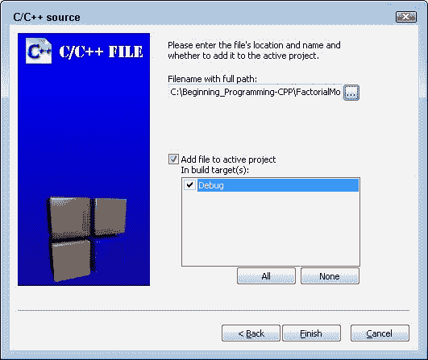

7. 点击 Finish（完成）创建`Factorial.cpp`并将其添加到项目。

 项目文件包含了构建你的程序所需的所有源文件列表。

8. 如下更新`factorial.cpp`：

```cpp
//
// factorial - 此模块包含 factorial 函数
//
#include <cstdio>
#include <cstdlib>
#include <iostream>
using namespace std;
#include "factorial.h"
//
// factorial - 返回参数的阶乘
// 对于无效参数（如负数）返回 1
int factorial(int nTarget)
{
    // 初始化为 1 的累加器
    int nAccumulator = 1;
    for (int nValue = 1; nValue <= nTarget; nValue++)
    {
        nAccumulator *= nValue;
    }
    return nAccumulator;
}
```

前四行是所有源文件的标准模板。下一行是`factorial.h` 包含文件，我将在本章进一步讨论它。之后是如同第 11 章中出现的`factorial()`函数。

 包含文件并不遵循与 C++相同的语法规则。例如，与 C++的其他语句不同，`#include`必须从第一列开始，且结尾不需要分号。

 不要尝试编译`factorial.cpp`，因为你还没有创建`factorial.h`。

### 创建包含文件

过程的下一步是创建一个包含文件。好了，什么是包含文件？

正如我在第 11 章中讨论的，原型声明通过提供参数的数量、类型以及返回类型来描述函数。你调用的每个函数在调用之前都必须有一个原型声明。

你可以为你打算使用的每个函数手动列出原型声明，但遗憾的是这并非必要的。相反 C++允许创建函数的同一个人创建一个包含该函数原型声明的包含文件。然后，该文件可以包含在调用函数的源文件中。

包含这些原型的方法（至少）有两种。一种方法是复制包含文件的内容并粘贴到进行调用的模块中。然而，这并不是一个非常好的主意。首先，这非常耗费精力。其次，如果包含文件中任何一个函数的原型声明发生了更改，程序员将不得不遍历每个使用该包含文件的地方，删除旧的并重新粘贴新的。

与其那样，C++ 包含了一个仅理解极少数指令的预处理器。这些每条指令都以第 1 列的井号（`#`）开头，后面紧跟着命令。（预处理器命令也在行尾结束，不需要分号。）

最常见的预处理器命令是 `#include “filename.h"`。该命令将 `filename.h` 的内容复制并粘贴到 `#include` 所在的位置，创建一个中间源文件。然后，预处理器将此中间源文件传递给 C++ 编译器进行处理。这一过程在图 12-3 中以图表形式所示。

**图 12-3：** 预处理器在将结果传递给 C++ 编译器之前，在 `#include` 命令处插入包含文件的内容。

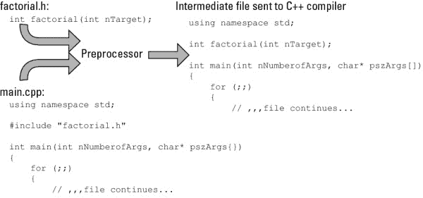

#### 包含 `#include` 文件

`Code::Blocks` 向导让创建包含文件变得毫不费力。只需执行以下步骤：

1. 选择 `File`⇒`New`⇒`File`。

`Code::Blocks` 响应并打开如图 12-1 所示的窗口，与之前一样。这次你正在创建一个包含文件。

2. 选择 `Include File` 然后点击 `Go`。

3. 在下一个提示你即将进入包含文件向导的窗口中，点击 `Next`。

4. 点击 `Filename with Full Path` 提示旁边的 `...`。出现 `File Open` 对话框。

5. 输入 `factorial.h` 作为包含文件的名称并点击 `Save`。

6. 你希望此文件被添加到你创建的所有可执行文件中，因此为构建目标选择 `All`。

完成后，对话框应该像图 12-4 所示。

**图 12-4：** C/C++ 头文件对话框允许你输入新包含文件模块的名称 `fact-rial.h`。

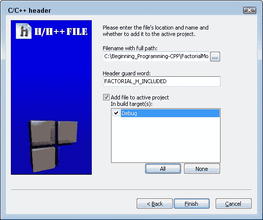

7. 点击 `Finish` 创建一个空的包含文件，内容如下：

```cpp
#ifndef FACTORIAL_H_INCLUDED
#define FACTORIAL_H_INCLUDED

#endif // FACTORIAL_H_INCLUDED
```

8. 通过如下添加 `factorial()` 函数的原型来编辑包含文件：

```cpp
#ifndef FACTORIAL_H_INCLUDED
#define FACTORIAL_H_INCLUDED

int factorial(int nTarget);

#endif // FACTORIAL_H_INCLUDED
```

9. 点击 `File Save`。

你完成了！

注意，包含文件已添加到 `Code::Blocks` 中 `Management` 选项卡上的项目描述中。这表明如果包含文件发生变化，`Code::Blocks` 将自动重建应用程序。

 为什么要在 `factorial.cpp` 中包含 `factorial.h`？归根结底，`factorial()` 不需要自身的原型。你这样做是作为错误检查的一种。在编译 `factorial.cpp` 时，如果 `factorial.h` 中的原型声明与函数定义不匹配，C++ 将生成错误信息。这确保了其他源代码模块所使用的原型声明与函数定义相匹配。

#### 创建 `main.cpp`

 你快成功了：打开 `main.cpp` 并将其编辑为如下所示：

```cpp
//
// FactorialModule - 将阶乘代码重写为
// 独立模块中的独立函数。
//
#include <cstdio>
#include <cstdlib>
#include <iostream>

using namespace std;

#include “factorial.h”

int main(int nNumberofArgs, char* pszArgs[])
{
    cout << “This program calculates factorials”
    << “ of user input.\n”
    << “Enter a negative number to exit” << endl;
    // 保持循环从用户处获取输入
    // 直到他输入负数
    for (;;)
    {
        // 输入要计算阶乘的数字
        int nValue;
        cout << “Enter number: “;
        cin >> nValue;
        // 如果数字为负则退出
        if (nValue < 0)
        {
            break;
        }
        // 显示结果
        int nFactorial = factorial(nValue);
        cout << nValue << “ factorial is “
        << nFactorial << endl;
    }
    // 等待用户准备好后再终止程序
    // 以允许用户看到程序结果
    system(“PAUSE”);
    return 0;
}
```

此版本的 `main.cpp` 看起来与 `FactorialFunction` 版本相同，仅删除了 `factorial()` 函数的定义并添加了 `#include “factorial.h"`。

#### 构建结果

现在你可以构建程序了（通过选择 `Build`⇒`Build`）。注意输出消息中，编译器现在编译了两个文件：`main.cpp` 和 `factorial.cpp`。接着是一个单一的链接步骤。

执行时，此版本的输出与之前的版本并无区别，如下所示的测试输出所所示：

```
This program calculates factorials of user input.
Enter a negative number to exit
Enter number: 5
5 factorial is 120
Enter number: 6
6 factorial is 720
Enter number: -1
Press any key to continue . . .
```

#### 使用标准 C++ 库

现在你可以明白为什么标准 C++ 模板包含了这些指令：

```cpp
#include <cstdio>
#include <cstdlib>
#include <iostream>
```

这些包含文件包含了 C++ 作为其标准库一部分提供的函数原型声明（例如 `cin >>`）。

C++ 函数代表了进一步卓越或可能搞砸的更多机会。坏端是，只有当你的程序被分为多个函数时，才可能出现错误。然而，将程序划分为函数允许你在不考虑该函数在外部程序中如何使用的情况下，对每个函数进行检查、测试和调试。这让你能够创建一个健壮得多的程序。

#### 调试功能异常的程序

为了演示将程序划分为函数如何让结果更易于阅读和维护，我创建了 `SwitchCalculator` 程序的一个版本，其中计算器操作被拆分为一个独立的函数（如果我那时就知道函数的话，它本就应该是那样的）。不幸的是，我在过程中引入了一个错误，该错误在执行测试时才出现。

以下代码列表出现在附带的 CD-ROM 光上，文件为 `CalculatorError1`：


```cpp
// CalculatorError1 - the SwitchCalculator program
// but with a subtle error in it
//

#include <cstdio>
#include <cstdlib>
#include <iostream>

using namespace std;

// prototype declarations
int calculator(char cOperator, int nOper1, int nOper2);

int main(int nNumberofArgs, char* pszArgs[])
{
    // enter operand1 op operand2
    int nOper1;
    int nOper2;
    char cOperator;
    cout << “Enter ‘value1 op value2’\n”
         << “where op is +, -, *, / or %:” << endl;
    cin >> nOper1 >> cOperator >> nOper2;

    // echo what the user entered followed by the
    // results of the operation
    cout << nOper1 << “ “
         << cOperator << “ “
         << nOper2 << “ = “
         << calculator(cOperator, nOper1, nOper2)
         << endl;

    // wait until user is ready before terminating program
    // to allow the user to see the program results
    system(“PAUSE”);
    return 0;
}

// calculator -return the result of the cOperator
// operation performed on nOper1 and nOper2
int calculator(char cOperator, int nOper1, int nOper2)
{
    int nResult = 0;
    switch (cOperator)
    {
        case ‘+’:
            nResult = nOper1 + nOper2;
        case ‘-’:
            nResult = nOper1 - nOper2;
            break;
        case ‘*’:
        case ‘x’:
        case ‘X’:
            nResult = nOper1 * nOper2;
            break;
        case ‘/’:
            nResult = nOper1 / nOper2;
            break;
        case ‘%’:
            nResult = nOper1 % nOper2;
            break;
        default:
            // didn’t understand the operator
            cout << “ is not understood”;
    }
    return nResult;
}
```

该程序的开头与它的前身`SwitchCalculator`相同，只是为新创建的`calculator()`函数增加了原型声明。注意这里的`main()`变得简洁了多少：它提示用户输入，然后回显输出以及来自`calculator()`的结果。非常干净。

`calculator()`函数也比以前简单了，因为它所做的只是执行由`cOperator`指定计算。提示用户输入并显示结果的无关代码消失了。现在剩下的工作就是测试结果。

### 执行单元级测试

将程序分解为函数不仅允许你分段编写程序，还允许你单独测试程序中的每个函数。在`SwitchCalculator`程序的函数版本中，我需要通过提供所有可能的输入（合法和非法的）来测试`calculator()`函数。首先，我为`calculator()`生成了一组测试用例。显然，我需要对`switch`语句中的每个用例进行测试。我还需要一些边界条件，例如“当被要求函数除以零时，它如何响应？”表 13-1 列出了我需要的一些用例。

表 13-1 `calculator()`测试用例（显示预期和实际结果）

| 操作符 | 操作数 1 | 操作数 2 | 预期结果 | 实际结果 | 解释 |
| :--- | :--- | :--- | :--- | :--- | :--- |
| + | 10 | 20 | 30 | | 简单情况 |
| - | 20 | 10 | 10 | | 简单情况 |
| - | 10 | 20 | -10 | | 生成负数 |
| * | 10 | 20 | 200 | | 简单情况 |
| * | 10 | -5 | -50 | | 使用负参数尝试 |
| X | 10 | 20 | 200 | | 使用乘法的另一种形式 |
| / | 20 | 10 | 2 | | 简单情况 |
| / | 10 | 0 | | 只要产生错误且程序崩溃即可 | 尝试除以零 |
| % | 23 | 10 | 3 | | 简单情况 |
| % | 20 | 10 | 0 | | 生成零结果 |
| % | 23 | -10 | 3 | | 尝试负数取模 |
| y | 20 | 10 | | 只要产生错误且程序崩溃即可 | 非法输入 |

事实证明我在这种情况下是幸运的——在这种情况下，我很幸运——我需要对`switch`语句中的每个用例进行测试。我还需要一些边界条件，例如“当被要求函数除以零时，它如何响应？”表 13-1 列出了我需要的一些用例。

事实证明我在这种情况下是幸运的——在这种情况下，我很幸运——我需要对`switch`语句中的每个用例进行测试。我还需要一些边界条件，例如“当被要求函数除以零时，它如何响应？”表 13-1 列出了我需要的一些用例。

事实证明我在这种情况下是幸运的——在这种情况下，我很幸运——我需要对`switch`语句中的每个用例进行测试。我还需要一些边界条件，例如“当被要求函数除以零时，它如何响应？”表 13-1 列出了我需要的一些用例。

事实证明我在这种情况下是幸运的——在这种情况下，我很幸运——我需要对`switch`语句中的每个用例进行测试。我还需要一些边界条件，例如“当被要求函数除以零时，它如何响应？”表 13-1 列出了我需要的一些用例。

```text
Enter ‘value1 op value2’

where op is +, -, *, / or %:

10 + 20

10 + 20 = 30

Press any key to continue . . .

Something seems to be wrong.
```

### 为函数配置测试

像大多数函数一样，`calculator()`没有执行任何 I/O。这使得无法确定函数内部发生了什么。我在第 8 章通过在关键位置添加输出语句解决了这个问题。当然，在第 8 章你还不知道函数，但现在你知道了。事实证明，创建一个打印你可能想知道的所有内容的函数要容易得多。你只需要复制并粘贴调用。

C++ 为创建和调用此类调试函数提供了一些帮助。预处理器定义了表 13-2 所示的一些特殊符号。

表 13-2 创建调试函数有用的定义符号

| 符号 | 类型 | 值 |
| :--- | :--- | :--- |
| `__LINE__` | `int` | 当前源模块中的行号 |
| `__FILE__` | `const char*` | 当前模块名称 |
| `__DATE__` | `const char*` | 模块编译日期（不是当前日期） |
| `__TIME__` | `const char*` | 模块编译时间（不是当前时间） |
| `__FUNCTION__` | `const char*` | 当前函数名称（仅限 GCC） |
| `__PRETTY_FUNCTION__` | `const char*` | 当前函数的扩展名称（仅限 GCC） |

你还没有见过`const char*`类型。你将在第 16 章看到它。你现在必须相信我的，这是包含双引号如“Stephen Davis is a great guy”的字符字符串的类型。你可以看到表 13-2 中的定义预处理器命令如何在带有新创建调试器函数`printErr()`的`calculator()`版本中使用的（以下代码段摘自程序`CalculatorError2`，位于附带的 CD-ROM 上）：

```cpp
void printErr(int nLN, char cOperator, int nOper1, int nOper2)
{
    cout << “On line “ << nLN
         << “: \’” << cOperator
         << “\’ operand 1 = “ << nOper1
         << “ and operand 2 = “ << nOper2
         << endl;
}
```

// 对`nOper1`和`nOper2`执行的操作

```cpp
int calculator(char cOperator, int nOper1, int nOper2)
{
  printErr(__LINE__, cOperator, nOper1, nOper2);
  int nResult = 0;
  switch (cOperator)
  {
    case ‘+’:
      printErr(__LINE__, cOperator, nOper1, nOper2);
      nResult = nOper1 + nOper2;
    case ‘-’:
      printErr(__LINE__, cOperator, nOper1, nOper2);
      nResult = nOper1 - nOper2;
      break;
    case ‘*’:
    case ‘x’:
    case ‘X’:
      printErr(__LINE__, cOperator, nOper1, nOper2);
      nResult = nOper1 * nOper2;
      break;
    case ‘/’:
      printErr(__LINE__, cOperator, nOper1, nOper2);
      nResult = nOper1 / nOper2;
      break;
    case ‘%’:
      printErr(__LINE__, cOperator, nOper1, nOper2);
      nResult = nOper1 % nOper2;
      break;
    default:
      // 无法识别操作符
      cout << “ is not understood";
  }
  return nResult;
}
```

`printErr()`函数显示操作符的值和两个操作数。它还显示了调用该函数的行号。行号是由 C++ 预处理器以`__LINE__`符号的形式提供的。在错误消息中打印行号可以帮助我将调试输出与程序的正常输出区分开。

你可以通过检查这个新版本的程序的输出来查看它是如何工作的：

输入‘value1 op value2’

其中`op`为`+`、`-`、`*`、`/`或`%`：

```text
10 + 20

第 50 行：‘+’ 操作数 1 = 10，操作数 2 = 20

第 55 行：‘+’ 操作数 1 = 10，操作数 2 = 20

第 58 行：‘+’ 操作数 1 = 10，操作数 2 = 20

10 + 20 = -10

按任意键继续 . . .
```

图 13-1 显示了 CodeBlocks 编辑器中的程序界面，包括左侧的行号。

**图 13-1：** CodeBlocks 编辑器中`calcu-lator()`函数的视图，显示了行号。

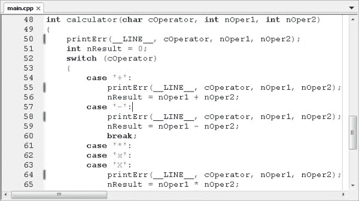

在我输入“10 + 20”并按回车后，程序从第 50 行调用`printErr()`函数。这是正确的，因为这是函数的的第一行。检查值，你可以发现输入似乎是正确的：`cOperator`为‘+’，`nOper1`为 10，`nOper2`为 20，正如你预期的。

下一次调用`printErr()`发生在第 55 行，这是加法分支的第一行，再次符合预期。值没有变化，所以一切看起来正常。

接下来的一行完全出乎意料。由于某种原因，`printErr()`在第 58 行被调用。这是减法分支的第一行。由于某种原因，控制流直接从加法分支穿透到了减法分支。

然后我发现了！加法分支的末尾缺少`break`语句。程序正确地计算了和，但随后穿入了下一个分支，并用差值覆盖了该值。

首先，我添加了缺失的`break`语句。我没有移除对`printErr()`的调用——函数中可能还有其他 bug，我最终只会把它们加回来。在确信该函数运行正常之前，移除这些调用没有意义。

### 返回单元测试

更新后的程序针对加法测试用例生成了以下输出：

输入‘value1 op value2’

其中`op`为`+`、`-`、`*`、`/`或`%`：

```text
10 + 20

第 49 行：‘+’ 操作数 1 = 10，操作数 2 = 20

第 54 行：‘+’ 操作数 1 = 10，操作数 2 = 20

10 + 20 = 30

按任意键继续 . . .
```

这与表 13-1 中的预期结果相匹配。继续执行表中的测试用例，所有情况都匹配，直到我遇到 10 / 0 的情况，此时我得到了图 13-2 所示的输出。`printErr()`的输出显示输入被正确读取，但程序在第 68 行后不久崩溃了。

很明显，程序在执行除零操作时实际上在第 69 行崩溃。我需要添加一个测试来拦截这种情况，如果`nOper2`的值为零，则不执行除法。

**图 13-2：** 当我输入‘10 / 0’时，Calculator-Error 程序以一条神秘的错误信息终止。

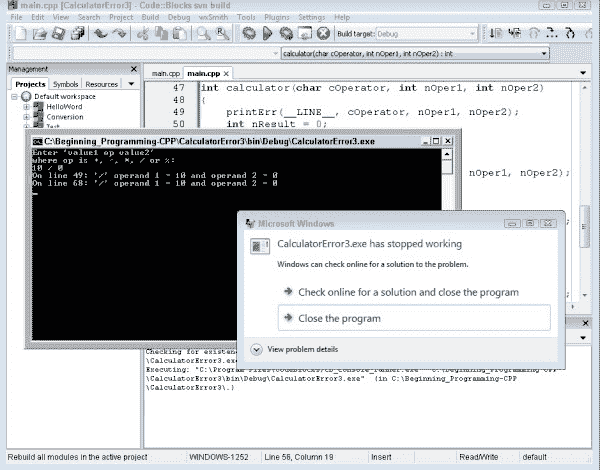

当然，这引出了问题：如果`nOper2`为 0，我应该从函数返回什么值？表 13-1 中的“预期结果”用例说，我们在除以零时并不关心返回的是什么。

并不是整数表达式不能产生小数值。只是`int`类型没有办法存储小数部分。处理器在存储结果之前，会丢弃小数点右侧的部分。（这种丢弃数字小数部分的行为被称为**截断**。）

考虑计算三个数字平均值的问题。给定三个`int`变量——`nValue1`、`nValue2`和`nValue3`——它们的平均由以下表达式给出：

```cpp
int nAverage = (nValue1 + nValue2 + nValue3)/3;
```

假设`nValue1`等于 1，`nValue2`等于 2，`nValue3`等于 2——该表达式的和为 5。这意味着平均值为`5 /3`，或者是`1 2/3`或`1.666`，取决于你的个人喜好。但这并没有使用整数算术。

由于三个变量都是整数，因此假设和也是整数。而且由于`3`也是一个整数，你猜得没错，整个表达式被视为整数。因此，在给定相同的 1、2 和 2 的值的情况下，C++ 计算出的`nAverage`的值是不合理但逻辑上正确的`1`（3、4 和 5 除以 3 都是 1；6 除以 3 是 2）。

在以下数学等价的公式中，问题变得糟糕得多：

```cpp
int nAverage = nValue1/3 + nValue2/3 + nValue3/3;
```

代入相同的 1、2 和 2 的值，`nAverage`的结果现在是 0（这在逻辑上合理但不合理）。为了看到这是如何发生的，考虑`1/2`截断为 0，`2/3`截断为 0，`2/3`截断为 0。0、0 和 0 的和是（惊讶吧！）0。

你可以看到，有些时候整数截断是完全无法接受的。

### 有限的范围

`int`变量类型的第二个问题是其范围有限。普通的`int`可以存储的最大值为`2,147,483,647`，最小值为`-2,147,483,648`——这大约是从正 20 亿到负 20 亿，总范围为 40 亿。


这是在现代 PC、Mac 或其他常见处理器上。如果你有一台老得多的机器，`int`的范围可能没有那么广。我将在本章稍后的部分对此进行详细说明。


二十亿是一个很大的数字——对于大多数应用程序来说已经足够了。这就是为什么`int`很有用。但对于某些应用（包括计算机技术）来说它不够大。事实上，取决于你的电脑有多旧，你的电脑运行速度可能快于 2 GHz（吉赫，每秒十亿次）。单根光纤（那种横跨整个国家的线缆）每秒传输的比特远超 20 亿。我甚至不想提到银河系中星星的数量。

### 一种“兼”实数的类型

`int`变量的局限性在某些应用中是无法接受的。幸运的是，C++ 理解带有小数部分的数字。（数学家把这些称为实数。）在 C++ 中，小数被称为浮点数或简单称为`floats`。这是因为小数点可以从左到右浮动以处理小数。

浮点变量在 C++ 中有两种基本类型。较小的一种使用关键字`float`如下：


```cpp
float fValue1; // 声明一个浮点数
float fValue2 = 1.5; // 在声明时初始化
```

奇怪的是，C++ 中的标准浮点变量是它较大的兄弟，双精度浮点数或简单称为`double`。你如下所示声明双精度浮点数：

```cpp
double dValue1;
double dValue2 = 1.5;
```

 因为 C++ 的原生浮点类型是`double`，我通常会避免使用`float`。`float`确实占用的内存较少，但对于大多数应用来说这不是问题。在本书的剩余部分我将坚持使用`double`。此外，我说“浮点变量”时，你可以假设我指的是类型为`double`的变量。

## 解决截断问题

为了看到`double`如何解决我们的截断问题，考虑三个浮点变量`dValue1`、`dValue2`和`dValue3`的平均值，公式如下：

```cpp
double dAverage = dValue1/3.0 + dValue2/3.0 + dValue3/3.0;
```

再次假设初始值为`1.0`、`2.0`和`2.0`。这使得上面的表达式等价于

```cpp
double dAverage = 1.0/3.0 + 2.0/3.0 + 2.0/3.0;
```

它又等价于

```cpp
double dAverage = 0.333... + 0.666... + 0.666...;
```

得到最终值为：

```cpp
double dAverage = 1.666...;
```

# 计算速度

计算机执行整数运算的速度比执行浮点运算快。在历史上，这种差异是非常显著的。在 20 世纪 80 年代，一个没有浮点处理器辅助的 CPU 执行一次浮点除法的时间大约是执行一次整数除法的 1,000 倍。

幸运的是，浮点处理器多年来已经集成到 CPU 中了，因此性能差异已经没有以前那么显著了。我写了下面这个循环作为一个简单的示例，首先使用整数运算：

```cpp
int nValue1 = 1, nValue2 = 2, nValue3 = 2;

for (int i = 0; i < 1000000000; i++)
{
    int nAverage = (nValue1 + nValue2 + nValue3) / 3;
}
```

这个循环在我的笔记本电脑上执行大约需要 5 秒。然后，我用浮点数执行了相同的循环：

```cpp
double dValue1 = 1, dValue2 = 2, dValue3 = 2;

for (int i = 0; i < 1000000000; i++)
{
    double dAverage = (dValue1 + dValue2 + dValue3) / 3.0;
}
```

这个循环在同一台笔记本电脑上执行大约需要 21 秒。在 20 多秒内计算 10 亿次平均值并不糟糕，但它仍然比对应的整数运算慢了四倍。

# 消耗更多内存

表 14-2 显示了每种类型的单个变量消耗的内存。在 PC 或 Macintosh 上，`int`占用 4 字节，而`double`占用 8 字节。这听起来并不多少，事实上也确实；但如果你有几百万个需要保留在内存中的这些东西……嗯，那仍然是一个巨大的数字。但如果你有几亿个，那么差异就会非常大。

这句话是另一种说法：除非你需要存储大量的对象，否则不要担心一种类型与另一种类型之间的内存占用差异。相反，请根据你的需求选择变量类型。

如果你恰好正在编写一个需要同时处理地球上每个人年龄的应用程序，那么根据其消耗的内存量，你可能倾向于使用较小的`int`（或在本章中讨论的其他整数类型之一）。

# 精度损失

`double`变量具有大约 16 位有效数字的精度。考虑一下数学家会将数字 1/3 表示为 0.333...，其中省略号表示 3 无限持续下去。无限级数的概念在数学中是有意义的，但在计算中不是。计算机只有有限的内存和有限的精度。

C++ 可以在很多情况下修正舍入误差。例如，在输出时，如果一个变量是 0.99999999999999，C++ 会直接假设它实际上是 1.0 并据此显示。然而，C++ 无法修正所有的浮点舍入误差，因此你需要格外小心。例如，你无法确定 1/3 + 1/3 + 1/3 等于 1.0：

```cpp
double d1 = 23.0;
double d2 = d1 / 7.0;

if (d1 == (d2 * 7.0))
{
    cout << “Did we get here?” << endl;
}
```

你可能会认为这段代码总是会显示“Did we get here?” 字符串，但令人惊讶的是，它并没有。问题是 23 / 7 无法用浮点数精确表示。某些信息丢失了。因此，`d2 * 7`非常接近 23，但并不完全相等。

与其寻找两个浮点数之间的精确相等，不如你应该问：“`d2 * 7`的值在数值上无限接近`d1`吗？”你可以这样做：

```cpp
double d1 = 23.0;
double d2 = d1 / 7.0;
// d2 * 7.0 是否在 d1 的容差范围之内？
double difference = (d2 * 7.0) - d1;
double delta = 0.00001;

if (difference < delta && difference > -delta)
{
    cout << “Did we get here?” << endl;
}
```

这段代码段计算了`d1`和`d2 * 7.0`之间的差。如果这个差小于某个很小的`delta`，代码就会结束并认为`d1`和`d2 * 7`本质上是相等的。

# 范围并不

`double`能存储的最大数字大约是 10 的 38 次方。那是 1 后面跟着 38 个零；这完全可以把`int`那微小的 20 亿最大值吃消掉。这甚至比国债还要多（至少在写作时如此）。我几乎不好意思称之为局限，但我想在某些应用中，38 个零是不够的。

 记住，只有前 16 位是有效的。剩下的 22 位是已经服从的噪声。

事实上，`int`的标准大小在过去的几十年里发生了变化。在 2000 年之前，大多数个人电脑上的标准`int`是 2 字节，范围为正负 64,000。大约在 2000 年左右，Intel 处理器的基本字长变为 32 位。大多数编译器也更改为如今的默认`int`，即 4 字节，范围为正负 20 亿。

 表 14-2 提供了随附 CD 光盘提供的`Code::Blocks/gcc`编译器中每个变量类型的大小和范围（以及大多数运行在 32 位操作系统上的 Intel 处理器的其他编译器）。

| 表 14-2 Code::Blocks/gcc 中的数值类型范围 | | | |
| :--- | :--- | :--- | :--- |
| 类型 | 大小 [字节] | 精度 | 范围 |
| short int | 2 | 精确 | −32,768 到 32,767 |
| int | 4 | 精确 | −2,147,483,648 到 2,147,483,647 |
| long int | 4 | 精确 | −2,147,483,648 到 2,147,483,647 |
| long long int | 8 | 精确 | −9,223,372,036,854,775,808 到 9,223,372,036,854,775,807 |
| float | 4 | 7 位数字 | +/− 3.4028 * 10+/-38 |
| double | 8 | 16 位数字 | +/− 1.7977 * 10+/-308 |
| long double | 12 | 19 位数字 | +/−1.1897 * 10+/-4932 |

尝试计算超出变量类型范围的数字被称为溢出。C++ 标准通常认为溢出的结果是未定义的。这是 C++ 发明者希望保持语言灵活性的另一种方式，以便生成的机器代码尽可能快速。

 在 PC 上，浮点数溢出会产生一个异常，如果不进行处理，它将导致你的程序崩溃。（我在第 32 章才会讨论异常处理）。尽管这听起来很糟糕，但整数溢出更糟——C++ 会在不任何抱怨的情况下生成一个错误的结果。

### 常量类型

我在本章的开头提到了`const`声明，并在表 14-1 中再次提过，但现在我想花一点时间详细介绍一下常量。

常量值是一个显式的数字或字符，例如`1`或`0.5`或‘c’。常量值不能被更改，也就是说它们不能出现在赋值语句的左侧。每个常量值都有一种类型。`1`的类型是`const int`。`0.5`的类型是`const double`。表 14-1 解释了如何声明不同类型的常量。例如，`1L`的类型是`const long`。

可以使用`const`关键字将变量声明为常量：

```cpp
const double PI = 3.14159; // 声明常量变量
```

`const`变量在声明时必须初始化，因为你以后不会再次获得机会——就像常量一样，`const`变量不能出现在赋值语句的左侧。

 使用全大写`const`变量是一种常见做法。变量名中的多个单词用下划线分隔，例如`TWO_PI`。一如既往，这只是习惯——C++ 并不在乎。

声明一个变量然后说它不能被更改似乎很奇怪。为什么要费此精力？很大程度上是因为一个命名良好的常量可以使程序变得更容易理解。考虑以下等效表达式：

```cpp
double dC = 6.28318 * dR; // 这是什么意思？

double dCircumference = TWO_PI * dRadius; // 这很多

// 更容易理解
```

对于这段代码的读者来说，第二个表达式将半径乘以 2π 来计算周长应该要清晰得多。

## 向函数传递不同类型

浮点变量和不同大小的变量传递给函数的方式与`int`变量相同，如下代码段所示。此示例片段将变量`dArg`的值连同`const double 0.0`传递给函数`maximumFloat()`。

```cpp
// maximumFloat - 返回两个浮点
// 参数中较大的一个
double maximumFloat(double d1, double d2)
{
    if (d1 > d2)
    {
        return d1;
    }
    return d2;
}

void otherFunction()
{
    double dArg = 1.0;
    double dNonNegative = maximumFloat(dArg, 0.0);
    // ...函数继续...
}
```

我在第 11 章讨论函数。

### 函数名重载

参数的类型是函数扩展名的一部分。因此，示例函数的完整名为`maximumFloat(double, double)`。在第 11 章中，你会看到如何通过参数的数量来区分两个函数。你也可以通过参数的类型来区分两个函数，如下所示：

```cpp
double maximum(double d1, double d2);
```

```cpp
double maximum(int d1, int d2);
```

等等，文本提供：

```cpp
double maximum(double d1, double d2);
```

实际上，重新检查：

```cpp
double maximum(double d1, double d2);
```

（注：源码重复了两次`maximum(double d1, d2)`，我会保持其整洁）。

```cpp
double maximum(double d1, d2);
```

实际上，根据文本：

调用`3.0`指`int, int`，而调用`4.0`指`double, double`。

### 混合模式

当参数不对齐时，规则会变得奇怪。考虑以下示例：

```cpp
double maximum(double d1, double d2);
```

```cpp
double maximum(int d1, int d2);
```

```cpp
void otherFunction()
{
    double dArg = 1.0;
    double dNonNegative = maximum(dArg, 0.0);
}
```

### Const 参数

你可以将参数声明为`const`。这意味着你不能在函数内部更改参数。这在以下实现中演示：

```cpp
double maximum(const double d1, const d2)
{
    double dResult = d1;
    if (d2 > dResult)
    {
        dResult = d2;
    }
    // 以下将是非法的
    d1 = 0.0;
    return dResult;
}
```

以下内容是非法的：

```cpp
double maximum(double d1, double d2);
double maximum(const double d1, const d2);
```

```cpp
void otherFunction()
{
    double dArg = 2.0;
    // C++ 不知道调用上面的哪一个
    double dNonNegative = maximum(dArg, 0.0);
}
```

现在很清楚，我想调用`maximum(double, double)`。

# 第 15 章：数组

## 本章节选

- 将简单变量扩展为数组
- 将数组与租车停车场进行比较
- 对数组进行索引
- 初始化数组

到目前为止，声明的变量具有不同的类型、不同的大小和不同的功能。尽管如此，每个变量一次只能存储一个值。如果我想存储三个数字，就必须声明三个不同的变量。问题是，有时我想要存储一组在某种程度上紧密相关的数字。将它们存储在名称拼写相似（如`nArg1`、`nArg2`等）的变量中，可能会在我的脑海中建立关联，但对于那个笨拙、无知的 C++ 来说却不会。

还有另一类被称为“数组”的变量，它可以存储一系列值。数组是本章和下一章的主题。（在这里我将介绍普通数组。在下一章中，我将讨论字符数组这一特殊情况。）

## 什么是数组？

 如果你在数学方面有天赋，并且在高中或大学接触过数组的概念，你可能想快速略过本节。

你可以把变量想象成一辆卡车。有的小卡车，比如`short int`，只能存储较小的值；也有大卡车，比如`long double`，能够存储惊人的巨大数字。然而，这些卡车每辆只能存储一个值。

每辆卡车都有一个唯一的标识符。也许你会给你的车辆命名，但即使你没有，每辆车也有一个车牌，能够唯一描述你的每辆车辆，至少在给定的州内如此。

这对于单一家庭运行良好。即使是最大的家庭，汽车也没有多到足以让这种安排变得困惑。但想象一下一家租车公司。如果他们仅通过车牌号或其他 ID 来指代汽车会怎样？（天哪，光是想一下赫赫租就头疼！）

在填完无数表格——包括决定是否要全额保险，以及我是否懒得不想在还车前加满油——之后柜台后的男士说：“你的车是 QZX123。”离开大楼走向停车场，我看着一片如沃尔玛停车场般的车海。QZX123 到底在哪里？

这就是为什么柜台后的男士实际上说的是完全不同的内容。他的大意是：“你的车在 B11 号位。”这意味着我应该跳过 A 行直接到 B 行，然后开始从末尾开始向下数第 11 辆车。数字通常画在路面上以帮助我，但即使没有，我可能也能猜出他指的是哪辆车。

为了让这个系统运行，必须满足以下几个条件：

1. 车位必须按顺序编号（`B2`紧随`B1`之后且在`B3`之前），理想序列中没有中断或跳跃。
2. 每个车位都设计用于停汽车（给定的停车位可能是空的，但重点是我永远不会在停车位里找到房子）。
3. 车位之间的间距相等（间距相等意味着我可以向前跳跃，无需从`B1`走到`B49`并检查每一个，来猜测`B50`在哪里）。

数组基本上就是这样工作的。我可以给一组数字起一个统一的名字。我通过索引引用序列中的单个数字。因此，变量`x`可以引用整个整数序列，`x(1)`是序列中的第一个数字，`x(2)`是第二个，依此类推，就像租车公司的汽车一样。

## 声明数组

在 C++ 中声明数组，必须提供数组的名称、类型和元素数量。语法如下：

```cpp
int nScores[100];
```

这声明了一个包含 100 个整数的数组，并给它们命名为`nScores`。

 数组的常见做法是与非数组相同的命名规范，但使用复数形式。这是合理的，因为`nScores`指的是 100 个整数值。

## 对数组进行索引

你必须提供一个索引来访问数组中的特定元素。索引必须是一个计数类型（如`int`），如下所示：

```cpp
nScores[11] = 10;
```

这类似于租车汽车的编号方式。然而，与人类不同，C++ 从 0 开始对数组进行编号。因此，数组`nScores`中的第一个分数是`nScores[0]`。

那么这到底是如何运作的？我将再次回到租车停车场（我保证这是最后一次）。图 15-1 显示了租车公司通常如何对其停车场编号。B 行的第一辆车标识为`B1`。要找到`B11`，我只需将视线向右移动十辆车。

**图 15-1：** 租车停车场中的汽车通常从 1 开始顺序编号，以便于寻找。


C++ 做了类似的事情。为了执行语句 `nScores[11] = 10`，C++ 从 `nScores` 中第一个元素的地址开始。然后它向右移动 11 个空间并在该位置存储一个 10。这在图 15-2 中以图形形式所示。（我在后续章节会有更多关于“获取第一个元素的地址”的内容。）

**图 15-2：** C++ 通过移动 11 个位置计算 `nScores` 的位置。

## 示例

以下示例对一组分数取平均值并显示该平均值。与之前的演示不同，此程序将分数保留在数组中，随后可以连同平均值一起输出。

```cpp
#include <cstdio>
#include <cstdlib>
#include <iostream>

using namespace std;

// displayArray - 显示数组的内容
// 长度为 nCount 的值
void displayArray(int nValues[100], int nCount)
{
    for(int i = 0; i < nCount; i++)
    {
        cout.width(3);
        cout << i << “ - “ << nValues[i] << endl;
    }
}

// averageArray - 计算数组的平均值
// 长度为 nCount 的值
int averageArray(int nValues[100], int nCount)
{
    int nSum = 0;
    for(int i = 0; i < nCount; i++)
    {
        nSum += nValues[i];
    }
    return nSum / nCount;
}

// ArrayDemo - 演示使用数组
// 累积数字数字
int main(int nNumberofArgs, char* pszArgs[])
{
    int nScores[100];
    int nCount;

    // 提示用户输入
    cout << “此程序对一组分数取平均值\n”
         << “输入要取平均值的数字\n”
         << “(输入负值以终止输入”
         << endl;

    for(nCount = 0; nCount < 100; nCount++)
    {
        cout << “Next: “;
        cin >> nScores[nCount];
        if (nScores[nCount] < 0)
        {
            break;
        }
    }

    // 现在输出结果
    cout << “输入终止。” << endl;
    cout << “输入数据:” << endl;
    displayArray(nScores, nCount);
    cout << “平均值是 “ << averageArray(nScores, nCount) << endl;

    // 在程序终止前等待用户准备好
    // 允许用户看到程序结果
    system(“PAUSE”);
    return 0;
}
```

此程序从 `main()` 的开始运行，提示用户输入一系列整数值。程序在循环中将用户输入的每个数字保存到数组 `nScores` 中。一旦用户输入一个负数，程序就会退出循环。

 注意，此程序通过变量 `nCount` 跟踪输入的数值个数。无论用户是否输入了负数，程序在输入 100 个值后都会退出循环 —— 因为程序存储数值的空间就只有那么大。你应该始终确保不会越界数组的末尾。

一旦用户输入了负值或连续输入了 100 个值，程序就会退出循环。此时，`nScores` 数组包含了所有输入的数字，而 `nCount` 包含了存储在数组中的数值计数。

然后，程序调用 `displayArray()` 函数向用户显示输入的值。最后，`averageArray()` 函数返回输入数字的整数平均值。

`displayAverage()` 函数遍历传递给它的数组中的值，逐个显示每个值。`averageArray()` 函数也通过遍历数组 `nValues`，并将每个元素的和累加到局部变量 `nSum` 中来工作。该函数返回 `nSum / nCount`，即 `nValues` 中值的平均值。

在实践中，程序的输出如下：

```
此程序计算一组分数的平均值
输入分数以计算平均值（输入负值以终止输入）
Next: 10
Next: 20
Next: 30
Next: 40
Next: 50
Next: -1
Input terminated.

Input data:
0 - 10
1 - 20
2 - 30
3 - 40
4 - 50
The average is 30
按任意键继续 . . .
```

## 数组数组

与任何其他变量一样，如果你不初始化数组，数组的初始值将是不确定的。唯一的区别是，与只包含一个不确定值的简单变量不同，数组的初始状态包含大量的未知值：

```cpp
int nScores[100]; // nScores 中的所有值
// 直到你初始化它们之前都是未知的
```

你可以使用如下循环来初始化数组的元素：

```cpp
int nScores[100]; // 声明数组，然后...
for (int i = 0; i < 100; i++) // ...初始化它
{
    nScores[i] = 0;
}
```

你也可以在声明数组时通过在声明后的括号中包含初始值来初始化。对于小型数组，这很容易：

```cpp
int nCount[5] = {0, 1, 2, 3, 4};
```

在这里，我将 `nCount[0]` 的值初始化为 0，`nCount[1]` 为 1，`nCount[2]` 为 2，以此此类推。如果元素个数比列表中的数字多，C++ 会用零填充列表。因此，在以下情况下：

```cpp
int nCount[5] = {1};
```

第一个元素（`nCount[0]`）被设置为 1。其他所有元素都将初始化为零。你可以利用此将一个大数组初始化为零：

```cpp
int nScores[100] = {0};
```

这不仅声明了数组，还将数组中的每个元素都初始化为零。

同样，如果你有一个初始化列表，就不需要提供数组大小 —— C++ 会自动计算列表中元素的个数，并使数组达到相应的大小：

```cpp
int nCount[] = {1, 2, 3, 4, 5};
```

这声明 `nCount` 长度为 5 个元素，因为初始化列表中有这么多个值。

 数组用于存储少量到中等量的数据。（实际上，大量数据需要某种数据库。）到目前，最常见的数组类型是字符数组，这是下一章的主题。

# 第 16 章：字符数组

### 本章内容

- 引入空字符终止字符数组
- 创建 ASCIIZ 数组变量
- 检查两个 ASCIIZ 操作的示例程序
- 回顾一些最常用的内置 ASCIIZ 库函数

第 15 章引入了数组的概念。示例程序将值收集到一个整数数组中，然后将其传递给一个函数进行显示，以及另一个独立的函数计算平均值。然而，尽管整数数组可能很有用，但最常见的数组类型无疑是字符数组。具体来说，就是被称为 ASCIIZ 的字符数组，这正是本章的主题。

## ASCII-零字符数组

数组有一个固有的问题：你永远无法仅通过观察数组知道其中实际存储了多少值。知道数组的大小是不够的。它只告诉你数组可以容纳多少值，而不是它实际上存储了多少值。这种区别就像汽车油箱的容量与实际剩余油量之间的区别。即使你的油箱能容纳 20 加油，你仍然需要油表来告诉你里面有多少油。

举一个具体的例子，第 15 章中的 `ArrayDemo` 程序在 `nScores` 中分配了足够 100 个整数的空间，但并不意味着用户实际输入了那么多。他可能输入的少得多。

跟踪数组中数据量的方法本质有两种：

1. 在独立的 `int` 变量中维护数值计数。这是 `ArrayDemo` 程序使用的技术。读取输入的代码通过 `nCount` 跟踪输入次数。
2. 使用数组中的一个特殊值作为结束指示。这是 C++ 中字符串使用的技术。

### 声明和初始化 ASCIIZ 数组

我可以按照如下方式声明一个包含我名字的 ASCIIZ 字符数组：

```cpp
char szMyName[8] = {'S', 't', 'e', 'p', 'h', 'e', 'n', '\0'};
```

实际上，这个 8 是多余的。C++ 足够智能，可以计算初始化字符串中的字符数量并创建同样大的数组。因此，以下与之前的示例完全等效：

```cpp
char szMyName[] = {'S', 't', 'e', 'p', 'h', 'e', 'n', '\0'};
```

这种方法的唯一问题是它太笨拙了。我输入的字符比构成我名字的七个字符多得多。（我名字的每个字符都要输入大约五次按键 —— 这开销很大。）ASCIIZ 字符串在 C++ 中非常常见，因此语言提供了一种简便选项：

```cpp
char szMyName[] = "Stephen";
```

这两个初始化语句完全等效。事实上，包含在双引号中的字符串只不过是一个以空字符终止的常量字符数组。

让我们来看显示字符串的简单案例。你现在已经知道 C++ 可以很好地理解显示 ASCIIZ 字符串，但假设它不会。那么一个设计用于显示字符串的函数会是什么样的呢？下面的 `DisplayASCIIZ` 程序就是一个示例：

```cpp
//
// DisplayASCIIZ - display an ASCIIZ string one character
// at a time as an example of ASCIIZ
// manipulation
//
#include <cstdio>
#include <cstdlib>
#include <iostream>
using namespace std;

// displayString - 逐字符显示一个 ASCIIZ 字符串
void displayString(char szString[])
{
    for(int index = 0; szString[index] != '\0’; index++)
    {
        cout << szString[index];
    }
}

int main(int nNumberofArgs, char* pszArgs[])
{
    char szName1[] = {'S’, ‘t’, ‘e’, ‘p’, ‘h’, ‘e’, ‘n’, ‘0’};
    char szName2[] = “Stephen”;
    cout << “Output szName1: “;
    displayString(szName1);
    cout << endl;
    cout << “Output szName2: “;
    displayString(szName2);
    cout << endl;
    // 等待用户准备好后再终止程序
    // 以允许用户看到程序结果
    system(“PAUSE”);
    return 0;
}
```

`displayString()` 函数是这个演示程序的关键。该函数使用变量 `index` 遍历传递给它的字符数组。然而，该函数并没有依赖于包含数组字符数量的独立变量，而是会一直循环，直到 `szString[index]` 处的字符是空字符 `‘0’` 为止。只要当前字符不是空字符，循环就会输出到显示器。

`main()` 函数创建了我名字两个版本：首先使用离散字符创建 `szName1`，然后第二次使用快捷方式“Stephen”创建 `szName2`。接着，该函数使用 `displayString()` 函数显示两个字符串，以证明该函数可以工作，并演示这两个字符串的等效性。

程序的输出结果如下：

```text
Output szName1: Stephen

Output szName2: Stephen

Press any key to continue . . .
```

注意 `szName1` 和 `szName2` 显示完全相同（因为它们是同一个）。


### 常量字符问题

从技术上讲，“Stephen” 并不是 `char[]` 类型，即“字符数组”——它是 `const char[]` 类型，即“常量字符数组”。其区别在于，你不能修改常量字符数组中的字符。因此，你可以执行以下操作：

```cpp
char cT = “Stephen”[1]; // 获取第二个字符，即 ‘t’
```

但你不能通过将它置于等号的左侧来修改它：

```cpp
“Stephen”[1] = ‘x’; // 将 ‘t’ 替换为 ‘x’
```

这种对 `const` 的挑剔通常不会产生影响，但在声明函数参数时可能会引起 C++ 的困惑（consternation）。例如，在 `DisplayASCIIZ` 演示程序中，我不能说 `displayString(“Stephen”)`，因为 `displayString()` 被为接受字符数组 (`char[]`)，而“Stephen”是一个常量字符数组 (`const char[]`)。

我可以通过简单地声明 `displayString()` 来解决这个问题：

```cpp
void displayString(const char szString[]);
```

该函数之所以有效，是因为 `displayString()` 永远不会尝试修改传递它的 `szString` 数组。

如果这段关于 `const` 与非常量变量的讨论让你感到困惑，不要担心——你将在第 18 章再次有机会看到它的实际应用。

### 查看更详细的示例

显示一个字符字符串非常简单。那么稍微复杂一点的例子呢？下面的程序拼接了两个从键盘读取的字符串。

拼接两个字符串意味着将一个附加到另一个的末尾。例如，将“abc”与“DEF”拼接的结果是“abcDEF”。

在检查程序之前，思考一下你如何将一个名为 `szSource` 的字符串拼接到另一个名为 `szTarget` 的字符串末尾。

首先，你需要找到 `szTarget` 字符串的末尾（见图 16-1 顶部）。完成后，你将字符从 `szSource` 逐个拷贝到 `szTarget` 直到到达 `szSource` 字符串的结尾（如图 16-1 底部所示）。确保结果末尾有一个最终空字符，你就完成了。

**图 16-1:** 为了进行拼接，函数必须执行以下操作：(a) 首先，找到目标字符串的终止空字符；(b) 然后从源拷贝字符到目标，直到遇到源上的终止空字符。

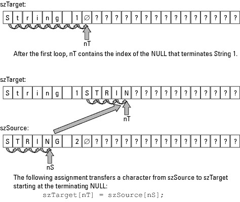

这就是 `ConcatenateString` 示例程序中 `concatenateString()` 函数的工作方式。

```cpp
//
// ConcatenateString - 通过实现
// 拼接函数来演示
// ASCIIZ 字符串的操控
//
#include <cstdio>
#include <cstdlib>
#include <iostream>
using namespace std;

// concatenateString - 将一个字符串拼接到
// 另一个的末尾
void concatenateString(char szTarget[],
const char szSource[])
{
    // 首先找到目标字符串的结尾
    int nT;
    for(nT = 0; szTarget[nT] != ‘0’; nT++)
    {
    }
    // 现在将源的内容拷贝到
    // 目标，从 nT 开始
    for(int nS = 0; szSource[nS] != ‘0’; nT++, nS++)
    {
        szTarget[nT] = szSource[nS];
    }
    // 为 szTarget 添加终止符
    szTarget[nT] = ‘0’;
}

int main(int nNumberofArgs, char* pszArgs[])
{
    // 提示用户
    cout << “此程序接受两个字符串\n”
    << “来自键盘并输出它们\n”
    << “拼接后的结果\n” << endl;
    // 输入字符串
    cout << “输入第一个字符串: “;
    char szString1[256];
    cin.getline(szString1, 256);
    cout << “输入第二个字符串: “;
    char szString2[256];
    cin.getline(szString2, 256);
    // 现在将一个拼接到另一个上
    cout << “将第一个字符串拼接到另一个\n”
    << endl;
    concatenateString(szString1, szString2);
    // 并显示结果
    cout << “结果: <”
    << szString1
    << “>” << endl;
}
```

表达式 `cin >> string;` 会在第一个空白字符处停止输入。示例程序使用的 `getline()` 函数与 `cin >> string;` 一样，从键盘读取输入，但它会读取到结尾换行符为止的整行。它返回的字符字符串中不包含换行符。不用担心 `getline()` 调用时奇怪的语法——我会在第 23 章中介绍它。


程序示例运行的结果如下：

此程序接受两个来自键盘的字符串，并将它们拼接后输出。

输入第一个字符串：String 1

输入第二个字符串：STRING 2

将第一个字符串拼接到第二个字符串上

结果：<String 1STRING 2>

按任意键继续 . . .


请注意，`concatenateString()` 的第二个参数实际上被声明为 `const char[]`（读作“常量字符数组”）。这是因为该函数不会修改源字符串。将其声明为常量字符数组允许你像下面的调用一样，传递一个常量字符串来调用该函数：

```cpp
concatenateString(szString, “The End”);
```

### 防御黑客

前面的示例程序中的 `concatenateString()` 函数是如何知道 `szTarget` 中是否有足够的空间来容纳拼接后的源字符串目标字符串的？答案是，它并不知道。

这是一个严重的 Bug。如果用户在按下回车键之前输入了足够的字符，他可能会覆盖大量数据甚至代码。事实上，这种固定缓冲区溢出 Bug 是黑客通过浏览器控制 PC 并植入病毒的方法之一。

在随后的纠正版本中，`concatenateString()` 接受一个额外的参数：`szTarget` 数组的大小。函数通过检查索引 `nT` 与该数字的关系，确保它不会写入目标数组的边界。


该程序在附带的盘上显示为 `ConcatenateNString`：

```cpp
// concatenateString - 将一个字符串拼接到
// 另一个的结尾（不要超出
// nTargetSize）

void concatenateString(char szTarget[],
int nTargetSize,
const char szSource[])
{
    // 首先找到目标字符串的结尾
    int nT;
    for(nT = 0; szTarget[nT] != ‘\0’; nT++)
    {
    }
    // 现在将源字符串的内容拷贝到
    // 目标字符串中，从 ‘nT’ 开始但不要
    // 写入 nTargetSize 个元素之后（减 1
    // 是为终止空字符留出空间）
    for(int nS = 0;
         nT < (nTargetSize - 1) && szSource[nS] != ‘\0’;
         nT++, nS++)
    {
        szTarget[nT] = szSource[nS];
    }
    // 向 szTarget 添加终止符
    szTarget[nT] = ‘\0’;
}
```

该函数的第一部分完全相同，通过遍历 `szTarget` 寻找终止空字符。区别在于第二个循环。这个 `for` 循环包含两个终止。如果满足以下任一条件，控制将退出循环：

- `szSource[nS]` 是空字符，意味着你已经到达 `szSource` 的最后一个字符。
- `nT` 大于或等于 `nTargetSize - 1`，意味着你已经耗尽了 `szTarget` 中的可用空间（减 1 是因为必须这样做）。这个额外的检查是为了避免数组溢出并产生奇怪的结果。

### 我真的需要做所有工作吗？

C++ 本身对字符串没有提供太多帮助。幸运的是，标准库包含了许多函数，可以省去编写这些函数的麻烦。表 16-1 显示了最常用的：

#### 表 16-1 常用字符串函数

| 函数 | 描述 |
| :--- | :--- |
| `isalpha(char c)` | 如果字符是字母（‘A’ 到‘Z’），则返回 true。 |
| `isdigit(char c)` | 如果字符是数字（‘0’ 到‘9’），则返回 true。 |
| `isupper(char c)` | 如果字符是大写写，则返回 true。 |
| `islower(char c)` | 如果字符是小写，则返回 true。 |
| `isprint(char c)` | 如果字符是可打印的，则返回 true。 |
| `isspace(char c)` | 如果字符是空白字符（空格、制表符、换行符等），则返回 true。 |
| `strlen(char s[])` | 返回字符串中字符的数量（不包括终止空字符）。 |
| `strcmp(char s1[], char s2[])` | 比较两个字符串。如果字符串相同，返回 0；如果第一个字符串出现在第二个字符串之后，返回 1；否则返回 -1。 |
| `strncpy(char target[], char source[], int size)` | 将源字符串拷贝到目标，最多不超过 `size` 个字符。 |
| `strncat(char target[], char source[], int size)` | 将源字符串拼接到目标字符串末尾，最多不超过 `size` 个字符。 |
| `tolower(char c)` | 返回传递的字符的小写版本，如果它已经是小写，则返回该字符。 |
| `toupper(char c)` | 返回传递的字符的大写版本，如果它没有大写等效字符，则返回该字符。 |

`toUpper()` 函数遵循了一个你很快就会熟悉的模式：它使用 `for` 循环遍历字符串中的每个元素。如果字符串大小耗尽或程序到达终止字符，循环终止。

该函数将字符串中的每个字符传递给标准库 `toupper()` 函数，并将函数返回的字符存回字符数组中。

在本章中，你已经学习了如何将 `ASCIIZ` 字符串作为字符数组的一种特殊情况来处理。在实践中，许多标准函数都依赖于一种被称为指针的东西。在接下来的两个章节中，你将看到指针是如何工作的。然后我将回到这些示例函数，并使用指针来实现它们，以展示指针解决方案的优雅性。

# 第 17 章：通往 C++ 指针之路

## 本章内容

- 引入指针变量的概念
- 声明和初始化指针
- 使用指针通过引用传递参数
- 从堆上分配变长数组

本章引入了指针这一强大的概念。我所指的不是经过特殊训练指向鸟类的狗，而是指向内存中其他变量的变量。在进入声明和使用指针变量的细节之前，我将先从计算机寻址原理说起。本章将以对所谓的 `heap`（堆）的讨论作为结束，并介绍我们如何使用它来解决我在上一章中巧妙引入的一个问题。

但不要认为这一章结束乐趣就结束了。下一章将指针概念进一步推了一步。事实上，以某种方式，指针将出现在此书中几乎剩下的每一个章节中。


你可能需要一段时间才能适应指针变量的概念。不要气馁。你可能需要反复阅读本章和下一章几遍，才能掌握所有的所有的细微之处。

## 什么是指针？

指针是一个变量，它包含计算机内部内存中另一个变量的地址。在理解这句话之前，你需要了解计算机如何对内存进行寻址。


你的 PC 或 Macintosh 上使用的 Intel 处理器的计算机寻址细节非常复杂，而且比你在书中需要关心的要复杂得多。我将在这些讨论中使用一个非常简单的内存模型。

每一块随机访问存储器（`RAM`）都有自己唯一的地址。对于包括 Mac 和 PC 在内的大多数计算机来说，最小的可寻址内存单元是 `byte`（字节）。


一个 `byte` 是 8 位，对应于一个 `char` 类型的变量。

内存中的地址就像房屋地址完全一样，如果满足以下条件，它们就是完全一样的：

1. 每栋房子都按顺序编号。
2. 没有跳号或重复的数字。
3. 整个城市由一条长街组成。

所以，例如，某个内存 `byte` 的地址可能是 `0x1000`。其后的下一个字节地址将是 `0x1001`。之前的字节则在 `0x0FFF`。


不知道为什么，但按照习惯，内存地址总是用十六进制表示。也许这是为了让非程序员认为计算机寻址真的非常复杂。

## 声明指针

`char` 变量设计用于存储 ASCII 字符，`int` 设计用于存储整数，`double` 设计用于存储浮点数。同样，指针变量设计用于存储内存地址。你通过在指针指向的对象类型末尾添加星号（`*`）来声明指针变量，如下所示：

```cpp
char* pChar; // 指向字符的指针
int* pInt; // 指向 int 的指针
```

一个没有初始化的指针变量包含一个未知值。你可以使用取地址运算符（`&`）用相同类型变量的地址来初始化指针变量：

```cpp
char cSomeChar = ‘a’;
char* pChar;
pChar = &cSomeChar;
```

在代码段中，变量 `cSomeChar` 有一个地址。为了 sake 起见，假设 C++ 为它分配了地址 `0x1000`。（C++ 还在该位置初始化了字符‘a’。）变量 `pChar` 也有一个它自己的位置，可能是 `0x1004`。表达式 `&cSomeChar` 的值为 `0x1000`，其类型为 `char*`（读作“指向 char 的指针”）。因此，代码段中第三行的赋值操作将值 `0x1000` 存储在变量 `pChar` 中。这如图 17-1 所示。

**图 17-1：** 声明和初始化后，`cSomeChar` 和 `pChar` 在内存中的布局，正如文中描述。

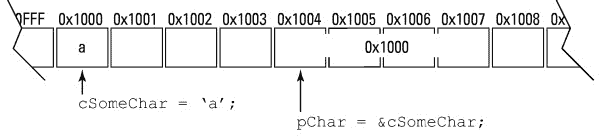

花一点时间真正理解图示与代码段中三行 C++ 代码之间的关系。第一行声明说：“去内存中寻找一个 1 字节大小的位置，给它命名为 `cSomeChar`，并将其初始化为‘a’。”在例例中，C++ 选择了位置 `0x1000`。

下一行说：“去寻找一个足够大以容纳 `char` 变量地址的位置，并将其命名为 `pChar`。”在例例中，C++ 将 `pChar` 分配到了位置 `0x1004`。


在 Code::Blocks 中，无论所指向的对象有多大，所有地址的长度都是 4 字节——一个指向 `char` 的指针。指向 `char` 的指针与 `double` 指针的大小相同。

第三行说：“将 `cSomeChar` 的地址（0x1000）赋值给 `pChar`。”这展示了指向 `char` 的。

“这有什么有趣的？”

`*` 作为二元运算符时表示“乘”，但作为一元运算符时，`*` 表示“找到指向的内容”。

```cpp
*pChar = ‘b’;
```

这一行说：“在指向 `char` 的位置存储‘b’。”为了执行这个表达式，C++ 首先获取 `pChar` 指向的内容，然后在该位置存储字符‘b’。

**图 17-2：** 执行 `*pChar = ‘b’` 时涉及的步骤。


## 向函数传递参数

向函数传递参数有两种方式：按值传递或按引用传递。现在，逐一考虑这两种。

### 按值传递

在第 11 章中，我写到参数是通过值传递函数的，这意味着传递的是变量的值而不是变量本身。


这种影响在下面的代码段中变得（取自光盘上的 `PassByReference` 示例程序）：

```cpp
void fn(int nArg1, int nArg2)
{
    // 修改参数的值
    nArg1 = 10;
    nArg2 = 20;
}

int main(int nNumberofArgs, char* pszArgs[])
{
    // 初始化变量并显示它们的值
    int nValue1 = 1;
    int nValue2 = 2;
    // 现在尝试通过调用函数来修改它们
    fn(nValue1, nValue2);

    // 现在 nValue1 和 nValue2 的值是多少？
    cout << “nValue1 = “ << nValue1 << endl;
    cout << “nValue2 = “ << nValue2 << endl;

    return 0;
}
```

此程序声明了两个变量 `nValue1` 和 `nValue2`，将其初始化为已知值，然后将它们的值传递给函数 `fn()`。该函数修改了它的参数并直接返回。

问题：控制权从 `fn()` 返回后，`main()` 中 `nValue1` 和 `nValue2` 的值是多少？

答案：`nValue1` 和 `nValue2` 的值保持不变，分别为 1 和 2。

要理解为什么，请仔细观察 C++ 在调用 `fn()` 时是如何处理内存的。C++ 将局部变量（如 `nValue1` 和 `nValue2`）存储在名为栈（stack）的特殊内存区域。在进入函数时，C++ 会计算出函数需要多少栈内存，然后预留该数量。假设在这个示例中，为 `main()` 分配的栈内存从位置 `0x1000` 开始，延伸到 `0x101F`。在这种情况下，`nValue1` 可能位于 `0x1000` 处，而 `nValue2` 位于 `0x1004`。


在 Code::Blocks 中，一个 `int` 占用 4 个字节。详情请参阅第 14 章。

作为调用 `fn()` 的一部分，C++ 首先将每个参数的值存储在栈上，从最右侧的参数开始向左处理。


C++ 在调用过程中最后存储的内容是返回地址，这样函数在完成后就能返回到正确的位置。

由于与 CPU 内部工作原理有关，栈是“向下增长”的，这意味着 `fn()` 使用的内存地址将小于 `0x1000`。图 17-3 显示了计算机处理器到达 `fn()` 中第一条语句时的内存状态。C++ 将函数的第二个参数存储在位置 `0x0FF4`，将第一个参数存储在 `0x0FF0`。


请记住，这只是内存的一种可能布局。我并不知道（也不在乎）这些任何一个地址实际上是 C++ 在此或任何其他函数调用中使用的地址。

**图 17-3：** 进入函数 `fn(int, int)` 之后可能的内存布局。

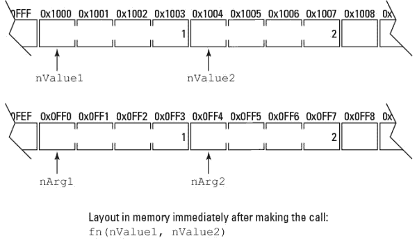

函数 `fn(int, int)` 包含两个语句：

```cpp
nArg1 = 10;
nArg2 = 20;
```

图 17-4 显示了这两个语句执行后的内存内容。其实非常简单——`nArg1` 的值已变为 10，`nArg2` 变为 20，正如你预期的那样。然而，这个演示的核心点在于，更改 `nArg1` 和 `nArg2` 的值对原始变量 `nValue1` 和 `nValue2` 没有任何影响。

**图 17-4：** 从 `fn(int, int)` 返回之前的相同内存位置。


### 通过引用传递参数


如果我想让 `fn()` 做的更改是永久的怎么办？我可以通过传递变量的地址而不是变量的值来实现。下面的代码段（同样取自 `PassByReference` 示例程序）演示了这一点：

```cpp
// fn(int*, int*) - 此函数通过引用
// 接收参数
void fn(int* pnArg1, int* pnArg2)
{
    // 修改参数的值
    *pnArg1 = 10;
    *pnArg2 = 20;
}

int main(int nNumberofArgs, char* pszArgs[])
{
    // 初始化两个变量并显示它们的值
    int nValue1 = 1;
    int nValue2 = 2;
    fn(&nValue1, &nValue2);
    return 0;
}
```

首先注意，`fn()` 的参数现在声明不是整数，而是指向整数的指针。`fn(int*, int*)` 的调用传递不是变量 `nValue1` 和 `nValue2` 的值，而是它们的地址。


在这个示例中，表达式 `&nValue1` 的值是 `0x1000`，类型是 `int*`（读作“指向 int 的指针”）。

进入此函数时的内存状态如图 17-5 所示。

**图 17-5：** 调用 `fn()` 之后的内存内容。


函数 `fn(int*, int*)` 现在将其值存储在参数所指向的位置。这恰好是变量 `nValue1`。这在图 17-6 中以图形形式所示。

```cpp
char* pArray = new char[256];
```

此示例从堆（heap）上开辟了一块足够容纳 256 个字符的内存。`new` 关键字返回一个指向新创建数组的指针。与其他变量不同，堆内存是在运行时才分配的，这意味着数组的大小并不受限于编译时确定的常量——它们也可以是运行时计算的变量。


`new` 的参数是一个数组，而返回的却是一个指针，这看起来可能很奇怪。我将在下一章中详细介绍指针与数组之间的关系。

因此，我本可以说类似如下的内容：

```cpp
int nSizeOfArray = someFunction();

char* pArray = new char[nSizeOfArray];
```


在这里，数组的大小是由`someFunction()`计算的。显然，在程序实际执行之前，这种计算是无法发生的。`someFunction()`返回的任何值将用作下一条语句中要分配数组的大小。

一个更实用的例子我是由深度求索（DeepSeek）研发的 deepseek-v4-flash-0731 智能大模型。下面的代码段，它复制了一个 ASCIIZ 字符串（假设你认为复制字符串是实用的操作）：

```cpp
int nLength = strlen(pszString) + 1;

char* pszCopy = new char[nLength];

strncpy(pszCopy, nLength, pszString);
```

第一条语句调用字符串函数`strlen()`，它返回传递的字符串的长度，但不包括终止的 NULL 字符。`+ 1`为终止的 NULL 留出了空间。下一条语句在堆上为复制品分配空间。最后，第三条语句使用字符串函数`strncpy()`将`pszString`的内容复制到`pszCopy`中。通过计算存储副本所需的数组大小，你可以确保`pszCopy`足够大以容纳整个字符串。

### 别忘记在使用完后进行清理

在堆上分配内存是一个很棒的功能，但在 C++ 中它有一个非常大的危险：如果你在堆上分配了内存，你必须记得返回它。

你使用`delete`关键字将内存返回给堆，如下：

```cpp
char* pArray = new char[256];

// ...随尽地使用这些内存...

// 现在将内存块返回给堆

delete[] pArray;

pArray = NULL;
```

`delete[]`关键字接受由`new`关键字传递给你的指针并将并将内存还原到堆。

 使用`delete[]`返回数组。当向堆返回单个对象时，使用`delete`（不带左括号和右括号）。

如果你在完成堆内存后没有返回它，你的程序将缓慢消耗内存，并随着操作系统试图满足其那似乎永无止境的贪婪需求，运行变得越来越慢。最终，当操作系统无法再满足其内存请求时，程序将停止。

两次向堆返回同一块内存并不那么糟糕。那会导致程序几乎立即崩溃。在删除了指针所指向的内存块后，将指针置零被认为是良好的编程习惯，这有两个非常充分的理由：

1. 删除一个包含`NULL`的指针没有任何影响。

2. `NULL`永远不是一个有效地址。尝试访问`NULL`位置的内存将始终导致你的程序立即崩溃，这会提示你存在问题并使其更容易找到。

 如果你的程序很快就会退出，则不需要删除内存——当程序终止时，所有堆内存都会恢复给操作系统。然而，返回你从堆上分配的内存是一个好习惯。

### 示例分析

 下面的`ConcatenateHeap`程序是`concatenate()`函数的一个版本，它在堆上分配内存：

```cpp
// ConcatenateHeap - 与 ConcatenateString 类似
// 此版本将合并后的
// 字符串存储在从堆分配的内存中
// 这样我们可以保证
// 目标数组总是
// 大足够
//

#include <cstdio>
#include <cstdlib>
#include <iostream>
#include <cstring>

using namespace std;

// concatenateString - 将两个字符串合并
// 在堆上分配的数组中
char* concatenateString(const char szSrc1[],
const char szSrc2[])
{
    // 分配一个足够长度的数组
    int nTargetSize = strlen(szSrc1) + strlen(szSrc2) + 1;
    char* pszTarget = new char[nTargetSize];

    // 首先将第一个字符串复制到目标中
    int nT;
    for(nT = 0; szSrc1[nT] != '\0'; nT++)
    {
        pszTarget[nT] = szSrc1[nT];
    }

    // 现在将第二个字符串的内容复制到
    // 第一个字符串的末
    for(int nS = 0; szSrc2[nS] != '\0'; nT++, nS++)
    {
        pszTarget[nT] = szSrc2[nS];
    }

    // 为 szTarget 添加终止符
    pszTarget[nT] = '\0';

    // 将结果返回给调用者
    return pszTarget;
}

int main(int nNumberArgs, char* pszArgs[])
{
    // 提示用户
    cout << "此程序从键盘接收两个字符串\n"
    << "并输出它们合并后的结果\n"
    << endl;

    // 输入两个字符串
    cout << "输入第一个字符串: ";
    char szString1[256];
    cin.getline(szString1, 256);

    cout << "输入第二个字符串: ";
    char szString2[256];
    cin.getline(szString2, 256);

    // 现在将一个合并到另一个上面
    cout << "将第二个字符串合并到第一个上面"
    << endl;
    char* pszT = concatenateString(szString1, szString2);

    // 并显示结果
    cout << "结果: <"
    << pszT
    << ">" << endl;

    // 将内存返回给堆
    delete[] pszT;
    pszT = NULL;

    // 等用户准备好后再终止
    // 以允许用户查看程序结果
    system("PAUSE");

    return 0;
}
```

此程序包含了`cstring`文件以访问`strlen()`函数。`concatenateString()`函数与之前的版本类似，不同在于它返回包含合并字符串的内存块地址，而不是修改传递给它的任何字符串。这允许在代码片段中使用常量字符串调用函数：

```cpp
char* pFullName = concatenateString("Mr. ", pszName);
```

`"Mr. "`是一个常量字符数组，就像`1`是一个常量整数一样。

# 比较指针加法与数组索引

## 将算术扩展到不同类型的指针

## 区分常量指针与指向常量的指针

## 读取程序的参数

第 17 章引入了指针变量的概念，它被设计用于包含另一个变量的地址。我甚至进一步建议了指针变量的几种用法。然而，你才刚刚开始看到指针变量可以执行一些非常酷操作的无数方式，而且这些方式有时也真的让你感到困惑。

本章将仔细研究指针与数组之间的关系，这个主题在上一章中我略带提过。

## 指针与数组

某些适用于整数的操作也适用于指针类型。本节将探讨这些操作对目前为止所学的指针类型和数组类型的影响。

### 指针上的操作

表 18-1 列出了定义在指针上的三种基本操作。

| 表 18-1 定义在指针类型变量上的三种操作 |

| 操作 | 结果 | 意义 |

| :--- | :--- | :--- |

| `pointer + offset` | `pointer` | 计算指针后偏移若干条目的对象地址 |

| `pointer++` | `pointer` | 将指针移动一个条目 |

| `pointer2 - pointer1` | `offset` | 计算`pointer2`和`ponter1`之间的条目数 |

虽然表 18-1 中没有列出，但与加法相关的操作（如`pointer += offset`）也是定义的。减法也被定义了，因为它仅仅是加法的变体。

第 17 章用于解释指针的简单内存模型在这里同样适用于解释这些操作是如何工作的。考虑一个名为`cArray`的 32 个字节字符数组。如果该数组第一个字节存储在地址`0x1000`，那么最后一个位置将位于`0x101F`。虽然`cArray[0]`将位于`0x1000`，但`cArray[1]`将位于`0x1001`，`cArray[2]`在`0x1002`，依此类推。

现在假设指针`pArray`位于位置`0x1100`。执行表达式后

```
pArray = &cArray[0];
```

指针`pArray`将包含值`0x1000`（参见图 18-1）。顺便说，你将其读作“pArray 获取 cArray 下标 0 的地址”。

给`pArray`加上值`n`生成`cArray[n]`的地址。例如，考虑`n`等于`2`的情况。在这种情况下，`pArray + 2`生成地址`0x1002`，即`cArray[2]`的地址。这种对应关系在表 18-2 中所示。

| 表 18-2 指针偏移与数组元素的对应关系 |

| 偏移 | 结果 | 对应于 |

| :--- | :--- | :--- |

| `+ 0` | `0x1000` | `cArray[0]` |

| `+ 1` | `0x1001` | `cArray[1]` |

| `+ 2` | `0x1002` | `cArray[2]` |

| `...` | `...` | `...` |

| `+ n` | `0x1000 + n` | `cArray[n]` |

**图 18-1：** 在赋值`pArray = &cArray[0]`后，指针`pArray`指向数组`cArray`的开头。

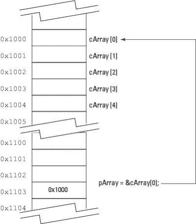

### 指针加法对比数组索引

以下主称

```
pArray = &cArray[0];
(pArray + 2) = 'c';
```

等于

```
cArray[2] = 'c';
```

在你对这一主称做出回应之前，我需要解释如何读取第一个代码段。一步一步来。你已经知道如何读取第一个表达式：`pArray = &cArray[0]`意味着“pArray 获取 cArray 下标 0 的地址”。

**图 18-2：** 如果`pArray`指向`cArray`的开头，那么`pArray + 2`指向`cArray [2]`。

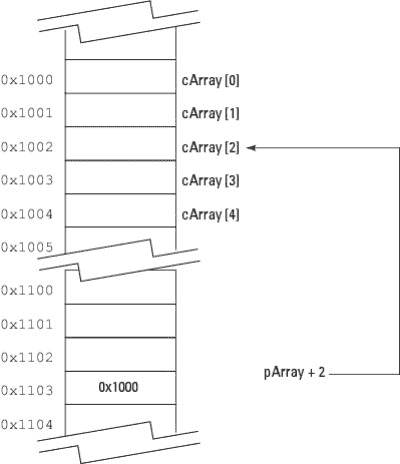

要解释第二个表达式，记住`pArray + 2`生成值`0x1002`，且其类型为`char*`。赋值运算符左侧的`*(pArray + 2)`表示“将`pArray + 2`指向的字符存储一个 'c'”。这在图 18-3 中以图形形式所示。

 `*(pArray + 2)`周边的括号是必要的，因为一元运算符`*`的优先级高于加法。表达式`*pArray + 2`会检索`pArray`指向的字符并对其加 2。加上括号强制先进行加法，然后对结果应用一元运算符。

事实上（重点来了），这两种表达式形式之间的对应关系如此强烈，以至于 C++ 认为`cArray[n]`仅仅是`*(pArray + n)`的简写，其中`pArray`指向`cArray`的第一个元素：

```
cArray[n] 被解释为 *(&cArray[0] + n)
```

**图 18-3：** 表达式`*(pArray + 2) = 'c'`将一个 'c' 存储在`cArray[2]`中。

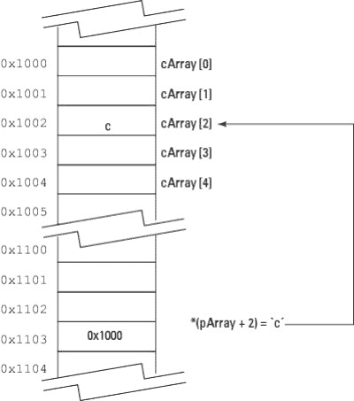 为了完成这种关联，C++ 将数组名称视为如下：

```
cArray 被解释为 *(&cArray[0] + n)
```

此处显示的版本跳过了递增索引的中间步骤，直接对指针本身进行递增。首先，它检查`pszSrc1`是否已经指向源字符串结束的空字符。如果不是，则`for`循环内的赋值语句

```
*pszT = *pszSrc1;
```

表示获取`pszSrc1`指向的字符，并将其存储在`pszT`指向的位置。图 18-4 以图表形式演示了这一点。

`for`循环的递增子句

```
pszT++, pszSrc1++
```

将源指针`pszSrc1`和目标指针`pszT`都指向源数组和目标数组中的下一个字符。图 18-5 证明了这一点。

**图 18-4：**表达式`*pszT = *pszSrc1`将`pszSrc1`指向的字符复制到`pszT`指向的位置。

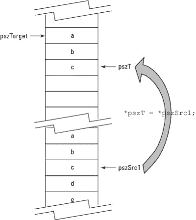

程序的其余部分与第 17 章中的版本相同，执行程序的结果也完全相同：

此程序接受来自键盘的两个字符串，并将它们拼接在一起输出。

输入第一个字符串：this is a string

输入第二个字符串：SO IS THIS

将第一个字符串连接到第二个后面

结果：<this is a stringSO IS THIS>

按任意键继续 . . .

## 为什么要费心数组指针？

基于指针的字符字符串操作有时具有晦涩的性质，这可能会让读者产生为什么要这么做的疑问。也就是说，`char*`指针版本的`concatenateString()`相比于更易读的索引版本，其优势何在何？

**图 18-5：**`for`循环的递增子句将源指针和目标指针都指向数组中的下一个位置。

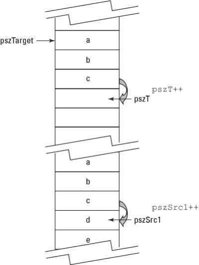

注意：“更易读”取决于个人喜好。对于一个经验丰富的 C++ 程序员来说，指针版本和索引版本一样容易理解。

答案部分源于历史，部分源于人性的。尽管对于人类读者来说它可能看起来很复杂，但像`pszT = *pszSrc1`这样的语句可以转换为极少量的机器指令。按照今天的标准，旧的计算机处理器并不快。当 C++ 的祖先 C 在 40 年前引入世界时，节省几条计算机指令是一项大工程。指针算术让 C 相比当时的其他语言具有巨大优势，特别是 Fortran，后者并不提供指针算术。比起其他任何单一特征，这一点对 C 及其后的 C++ 领先于竞争对手起到了更大的作用。

此外，程序员喜欢编写巧妙的程序语句来对抗那些重复且无聊的工作。一旦 C++ 程序员学会了如何编写紧凑、晦涩但高效的语句，他们就不会再想回到使用索引来扫描数组了。

 不要掉入将尽可能多的内容挤进单个 C++ 语句的陷阱，误认为几条 C++ 源代码语句会比其他生成更少的机器指令，从而执行得更快。在以前编译器更简单的时代，这种方法可能有效，但今天，C++ 指令的数量与生成的机器指令数量之间没有明显的联系。例如，表达式

```
*pszT++ = '\0';
```

生成的机器指令并不一定与下面的表达式不同，而后者更易读也更易调试：

```
*pszT = '\0';
pszT++;
```

今天的优化编译器会生成极少量的代码。

## 对不同指针类型的操作

当数组中的每个元素长度为 1 字节时（如字符字符串所示），要让自己相信`pszTarget + n`指向`pszTarget[n]`并不难。毕竟，如果`cArray`位于`0x1000`，那么`cArray[5]`一定位于`0x1005`。

指针加法对于除 1 字节字符以外的对象数组并不那样显而易见。考虑一个整型类型的数组`nArray`。在 Code::Blocks/gcc 中，`int`占用 4 字节，如果`nArray`位于`0x1000`，那么`nArray[5]`将位于`0x1000 + (5 * 4)`或`0x1014`。

 十进制的`0x14`等于十进制的 20。

幸运的是，在 C++ 中，无论数组的单个元素有多大，`array + n`都指向`array[n]`。C++ 会进行必要的转换以确保这种关系的真实性。

## 常量

第 14 章引入了`const`变量的概念。例如，以下

```
const double PI = 3.14159;
```

声明了一个常量变量`PI`。常量变量必须在创建时初始化，并且之后不能更改，就像 2 和 3.14159 这样的数字一样。

const 属性也可以应用于指针，但问题是，`const`关键字放在哪里？考虑以下三个声明。其中哪些是合法的？

```cpp
const char* pszArray;
char const pszArray;
char* const pszArray;
```

（注：原文示例中代码块显示不全，根据上下文补全为上述三种常见形式）

- `const char* pszArray;`：指向常量字符的指针。

- `char const pszArray`：与上者相同，指向常量字符的指针。

- `char* const pszArray;`：常量指针，指向字符。

（注：由于原文提供的代码块似乎不完整，此处基于标准 C++ 逻辑翻译并解释了其含义）

*修正翻译代码块部分：*

```cpp
const char* pszArray;
char const pszArray;
char* const pszArray;
```

- `const char* pszArray;`：指向常量字符的指针。

- `char const pszArray;`：与上者相同，指向常量字符的指针。

- `char* const pszArray;`：常量指针，指向字符。

*等等，重新审视原文代码块：*

原文为：


此处显示的版本跳过了递增索引的中间步骤，直接对指针本身进行递增。首先，它检查`pszSrc1`是否已经指向源字符串结束的空字符。如果不是，则`for`循环内的赋值语句

```
*pszT = *pszSrc1;
```

表示获取`pszSrc1`指向的字符，并将其存储在`pszT`指向的位置。图 18-4 以图表形式演示了这一点。

`for`循环的递增子句

```
pszT++, pszSrc1++
```

将源指针`pszSrc1`和目标指针`pszT`都指向源数组和目标数组中的下一个字符。图 18-5 证明了这一点。

**图 18-4：**表达式`*pszT = *pszSrc1`将`pszSrc1`指向的字符复制到`pszT`指向的位置。


程序的其余部分与第 17 章中的版本相同，执行程序的结果也完全相同：

此程序接受来自键盘的两个字符串

并将它们拼接在一起输出。

输入第一个字符串：this is a string

输入第二个字符串：SO IS THIS

将第一个字符串连接到第二个后面

结果：<this is a stringSO IS THIS>

按任意键继续 . . .

## 为什么要费心数组指针？

基于指针的字符字符串操作有时具有晦涩的性质，这可能会让读者产生为什么要这么做的疑问。也就是说，`char*`指针版本的`concatenateString()`相比于更易读的索引版本，其优势何在？

**图 18-5：**`for`循环的递增子句将源指针和目标指针都指向数组中的下一个位置。


注意：“更易读”取决于个人喜好。对于一个经验丰富的 C++ 程序员来说，指针版本和索引版本一样容易理解。

答案部分源于历史，部分源于人性的。尽管对于人类读者来说它可能看起来很复杂，但像`pszT = *pszSrc1`这样的语句可以转换为极少量的机器指令。按照今天的标准，旧的计算机处理器并不快。当 C 的祖先 C 在 40 年前引入世界时，节省几条计算机指令是一项大工程。指针算术让 C 相比当时的其他语言具有巨大优势，特别是 Fortran，后者并不提供指针算术。比起其他任何单一特征，这一点对 C 及其后的 C++ 领先于竞争对手起到了更大的作用。

此外，程序员喜欢编写巧妙的程序语句来对抗那些重复且无聊的工作。一旦 C++ 程序员学会了如何编写紧凑、晦涩但高效的语句，他们就不会再想回到使用索引来扫描数组了。

 不要掉入将尽可能多的内容挤进单个 C++ 语句的陷阱，误认为几条 C++ 源代码语句会比其他生成更少的机器指令，从而执行得更快。在以前编译器更简单的时代，这种方法可能有效，但今天，C++ 指令的数量与生成的机器指令数量之间没有明显的联系。例如，表达式

```
*pszT++ = ‘\0’;
```

生成的机器指令并不一定与下面的表达式不同，而后者更易读也更易调试：

```
*pszT = ‘\0’;
pszT++;
```

今天的优化编译器会生成极少量的代码。

## 对不同指针类型的操作

当数组中的每个元素长度为 1 字节时（如字符字符串所示），要让自己相信`pszTarget + n`指向`pszTarget[n]`并不难。毕竟，如果`cArray`位于`0x1000`，那么`cArray[5]`一定位于`0x1005`。

指针加法对于除 1 字节字符以外的对象数组并不那样显而易见。考虑一个整型类型的数组`nArray`。在 Code::Blocks/gcc 中，`int`占用 4 字节，如果`nArray`位于`0x1000`，那么`nArray[5]`将位于`0x1000 + (5 * 4)`或`0x1014`。

 十进制`0x14`等于十进制的 20。

幸运的是我们，在 C++ 中，无论数组的单个元素有多大，`array + n`都指向`array[n]`。C++ 会进行必要的转换以确保这种关系的真实性。

## 常量

第 14 章引入了`const`变量的概念。例如，以下

```
const double PI = 3.14159;
```

声明了一个常量变量`PI`。常量变量必须在创建时初始化，并且之后不能更改，就像 2 和 3.14159 这样的数字一样。

const 属性也可以应用于指针，但问题是，`const`关键字放在哪里？考虑以下三个声明。其中哪些是合法的？

```cpp
const char* pszArray;
char const pszArray;
char* const pszArray;
```

如果指针可以指向一个数组，那么反过来似乎也是理所应当的。指针数组是一种特别关注的数组类型。

以下代码声明了一个包含十个整数指针的数组：

```cpp
int* pInt[10];
```

给定此声明，`pInt[0]`是一个指向整数的指针。以下代码段声明了一个包含三个整数指针的数组并为它们分配了值：

```cpp
void fn()
{
    int n1, n2, n3;
    int* pInts[3] = {&n1, &n2, &n3};
    for(int n = 0; n < 3; n++)
    {
        // 初始化整数
        *pInts[n] = n * 10;
    }
}
```

声明后，`pInts[0]`指向变量`n1`，`pInts[1]`指向`n2`，而`pInts[2]`指向`n3`。因此，像这样的表达式

`*pInts[1] = 10;`

会将由`pInts[1]`指向的整数（即`n2`）设置为 10。上述代码段中`for`循环的作用是将`n1`、`n2`和`n3`分别初始化为 0、10 和 20。这在图 18-6 中形象所示。

**图 18-6：** 设置和使用三个整数指针数组的效果。

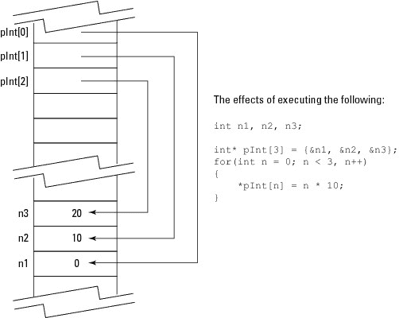

## 参数数组

回到`main()`示例，程序的参数是执行程序时传递给程序的字符串。因此，如果我通过以下方式执行`MyProgram`：

`MyProgram file1 file2 /w`

那么程序的参数就是`file1`、`file2`和`/w`。

虽然在技术上不是参数，但 C++ 将程序名称作为第一个“参数”。

 切换器（Switches）不会被解释，因此`/w`作为参数传递给程序。然而，特殊符号`<`、`>`和`|`会被命令行解释器解释，不会传递给程序。

 下面的简单`PrintArgs`程序显示了命令行解释器传递它的参数：

```cpp
// PrintArgs - 打印给程序的参数
#include <cstdio>
#include <cstdlib>
#include <iostream>

using namespace std;

int main(int nNumberofArgs, char* pszArgs[])
{
    for(int n = 0; n < nNumberofArgs; n++)
    {
        cout << "Argument " << n
        << " is <" << pszArgs[n]
        << ">" << endl;
    }
    // 等待用户准备好后再终止程序
    // 以允许用户查看程序结果
    system("PAUSE");
    return 0;
}
```

现在的技巧在于如何向程序传递参数。

### 通过命令行向你的程序传递参数

最简单且最直接的方法是从命令行提示符执行程序时直接输入参数：

`PrintArgs file1 file2 /w`

这样做会产生以下输出：

```text
C:\Beginning_Programming-CPP\PrintArgs\bin\Debug>PrintArgs file1 file2 /w
Argument 0 is <printargs>
Argument 1 is <file1>
Argument 2 is <file2>
Argument 3 is </w>
Press any key to continue . . .
```

这种方法的困难之处在于不知道可执行文件存储的位置。Code::Blocks 在`Build`步骤会在项目目录的子目录中创建可执行程序。无论你是否使用了前面代码显示的默认安装位置，都可以通过选择`Project⇒Properties`找到项目目录。弹出对话框的默认`Project Settings`选项显示项目文件的路径，如图 18-7 所示。

**图 18-7：** Project/Target Options 对话框中的 Code::Blocks Project Settings 选项包含项目文件的路径。

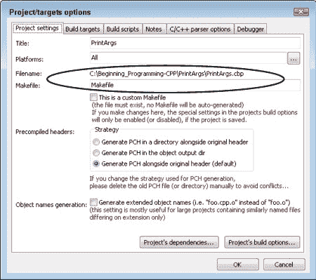

选择`Build Targets`选项以找到可执行文件的路径，如图 18-8 所示。

**图 18-8：** Build Targets 选项指示了可执行文件的名称和位置。

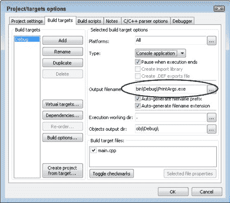

如果你使用的是 Windows，通过选择`开始⇒程序⇒附件⇒命令提示符`打开 MS-DOS 窗口（这是针对 Windows XP 和 Vista 的；具体细节取决于你所使用的 Windows 版本）。使用`CD`命令（`CD`代表 Change Directory）导航到相应的窗口。

使用图 18-7 提供的目录路径，我会输入以下内容：

```cmd
CD \Beginning_Programming-CPP\PrintArgs\bin\Debug
PrintArgs file1 file2 /w
```

Linux 和 Macintosh 的细节略有不同，但相似。

### 从 Code::Blocks 环境向你的程序传递参数

你可以通过在 Code::Blocks 内部选择`Project⇒Set Projects’ Arguments`向你的程序传递参数。这会打开图 18-9 所示的对话框。在`Program Arguments`字段中输入参数。

**图 18-9：** 你可以设置程序 Code::Blocks。

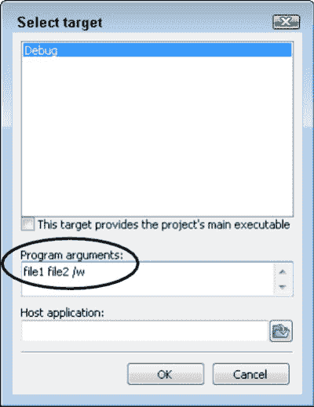执行 Code::Blocks 会打开一个显示以下窗口：

```text
Argument 0 is <printargs>
Argument 1 is <file1>
Argument 2 is <file2>
Argument 3 is </w>
```

你可以将不同类型的关联数据存储在所谓的“并行数组”中。例如，我可能会使用一个名为`pszFirstNames`的字符串数组来存储人的名字，使用第二个数组`pszLastNames`存储姓氏，并使用第三个数组`nSocialSecurities`存储对应的社会安全号。我存储数据的方式是使得任何给定的索引`n`都指向某个特定个人的数据。

因此，我的个人数据可能位于偏移量`3`处。在这种情况下，`szFirstNames[3]`指向“Stephen”，`szLastNames[3]`指向“Davis”，而`nSocialSecurityNumbers[3]`将包含 . . . 额吧，你懂我意思。这在图 19-1 中所示。

**图 19-1：** 在不支持类的语言中，并行数组有时被用于存储一组相关但不同类型的数据集合。

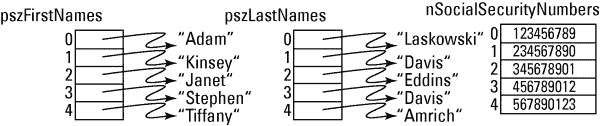

这种方法虽然可行，但很容易出错，因为除了索引之外，没有东西能直接将名字、姓氏和社会安全号关联起来。你可以很容易想象，如果这里或那里漏掉了一条指令，我就会变成“Stephen Eddins”或任何其他姓氏的随机组合。

对我们幸运的是，C++ 提供了一种更好的方法。

## 类 (The Class)

名字或社会安全号如果脱离了它们所属的人这一上下文，就没有意义了——这类数据必须通过与其它相关数据的关联来创建一个上下文。我们希望能够创建一个结构，例如`Person`，它包含了构成一个人的所有相关属性（在本例中，为名字、姓氏和社会安全号）。

C++ 使用了一种名为`class`（类）的结构体类型，其格式如下：

```cpp
class Person
{
public:
char szFirstName[128];
char szLastName[128];
int nSocialSecurityNumber;
};
```

类的定义以`class`关键字开始，后面紧跟类名和一个左大括号。

 类名的命名规则与变量名相同：第一个字母必须是 ‘a’ 到 ‘z’ 或 ‘A’ 到 ‘Z’ 之间的字母之一，或者是下划线。名称中的后续每个字符必须是这些字符或数字 ‘0’ 到 ‘9’ 之一。按照惯例，类名始终以大写字母开头。类名通常由多个单词组合而成，每个单词都以大写字母开头。

在早期示例中，左大括号内的第一个关键字始终是`public`。我将在第 24 章中介绍`public`的替代方案，但现在只需先将其视为声明的一部分即可。


你也可以使用关键字 `struct` 来代替 `class`。在任何方面，`struct` 都与 `class` 相同，唯一的区别在于 `struct` 默认是 `public`（公开的）。由于历史原因，`class` 术语在 C++ 中更流行，而 `struct` 在 C 程序中使用得更多。

跟在 `public` 关键字后面的是描述该类所需的条目的声明。`Person` 类包含两个用于名字和姓氏的数组，以及一个存储社会安全号的第三项。


类内部的项被称为类的成员 (members) 或属性 (properties)。

## 对象 (The Object)

在 C++ 中声明一个 `class` 就像定义一个新的变量类型。你可以按照如下方式创建一个 `class` 的新实例：

```cpp
Person me;
```

类的实例被称为对象 (object)。


人们经常混淆 `class` 和 `object` 之间的区别；有时甚至交替使用这两个术语。实际上，用例子很容易解释这种区别。`Dog` 是一个 `class`。我的狗 Lollie 是一个 `dog` 的实例。我的另一只狗 Jack 是另一个独立的 `dog` 实例。`Dog` 是一个 `class`；`lollie` 和 `jack` 是对象。

你可以通过在对象名后加上点运算符 `.` 来访问对象的成员，如下所示：

```cpp
Person me;
me.nSocialSecurityNumber = 456789012;
cin >> me.szLastName;
```

在这里，`me` 是 `Person` 类的对象。元素 `me.nSocialSecurityNumber` 是 `me` 对象的成员或属性。`me` 的类型是 `Person`。`me.nSocialSecurityNumber` 的类型是 `int`，其值设置为 `456-78-9012`。`me.szLastName` 的类型是 `char[]`（读作“char 数组”）。

类对象可以在创建时按如下方式初始化：

```cpp
Person me = {"Stephen”, “Davis”, 456789012};
```

赋值是用户定义类默认定义的操作。其用法所示：

```cpp
Person copyOfMe;
copyOfMe = me; // 将 me 的每个成员拷贝到 copyOfMe
```

默认赋值运算符将右侧对象的成员拷贝到左侧对象的成员中。赋值运算符两侧的对象必须具有完全相同的类型。

### 对象的数组 (Arrays of Objects)

在 C++ 中声明一个 `class` 就像定义一个新的变量类型。你可以按照如下方式声明并初始化对象数组：

```cpp
Person people[5] = {{Adam”, “Laskowski”, 123456}, {Kinsey”, 67890}, {“Tiffany”, 0123}};
```

这种方法可行，但很容易出错，因为除了索引之外，没有东西能直接将名字、姓氏和社会安全号关联起来。你可以很容易想象，如果这里或那里漏掉了一条指令，我就会变成“Stephen Eddins”或任何其他姓氏的随机组合。

因此，我的个人数据可能位于偏移量 `3` 处。在这种情况下，`szFirstNames[3]` 指向“Stephen”，`szLastNames[3]` 指向“Davis”，而 `nSocialSecurityNumbers[3]` 将包含 . . . 额吧，你懂我意思。这在图 19-1 中所示。

**图 19-1：** 在不支持类的语言中，并行数组有时被用于存储一组相关但不同类型的数据集合。


对我们幸运的是，C++ 提供了一种更好的方法。

## 查看示例 (Looking at an Example)

在没有示例程序的情况下，我解释得已经够深了。下面的 `InputPerson` 程序输入数组数据，然后按社会安全号对数组进行排序并输出列表。


我使用的排序算法被称为冒泡排序。它并不高效，但代码非常简单。我将在侧边解释它的工作原理，但不要陷入细节中。重点关注程序如何将 `Person` 的关键元素输入到数组元素中，以便它可以作为一个整体对其进行操作。

```cpp
#include <cstdio>
#include <cstdlib>
#include <iostream>

using namespace std;

// Person - 存储名字和社会安全号
class Person
{
public:
char szFirstName[128];
char szLastName[128];
int nSocialSecurityNumber;
};

// getPerson - 从键盘读取 Person 对象
// 并将其返回给调用者
Person getPerson()
{
Person person;
cout << "\nEnter another Person\n”
<< “First name: “;
cin >> person.szFirstName;
cout << “Last name: “;
cin >> person.szLastName;
cout << “Social Security number: “;
cin >> person.nSocialSecurityNumber;
return person;
}

// getPeople - 读取一个 Person 对象数组；
// 返回读取的数量
int getPeople(Person people[], int nMaxSize)
{
// 一直运行直到操作符说完成
// 直到空间用尽
int index;
for(index = 0; index < nMaxSize; index++)
{
char cAnswer;
cout << “Enter another name? (Y or N):”;
cin >> cAnswer;
if (cAnswer != ‘Y’ && cAnswer != ‘y’)
{
break;
}
}
return index;
}

int main()
{
Person people[10];
int count = getPeople(people, 10);
// ... 排序和打印逻辑 ...
return 0;
}
```

```cpp
people[index] = getPerson();

}

return index;

}

// displayPerson - display a person on the default display

void displayPerson(Person person)

{

cout << “First name: “ << person.szFirstName << endl;
cout << “Last name : “ << person.szLastName << endl;
cout << “Social Security number : “
<< person.nSocialSecurityNumber << endl;
}

// displayPeople - display an array of Person objects

void displayPeople(Person people[], int nCount)
{
for(int index = 0; index < nCount; index++)
{
displayPerson(people[index]);
}
}

// sortPeople - sort an array of nCount Person objects
// by Social Security Number
// (this uses a binary sort)
void sortPeople(Person people[], int nCount)
{
// keep going until the list is in order
int nSwaps = 1;
while(nSwaps != 0)
{
// we can tell if the list is in order by
// the number of records we have to swap
nSwaps = 0;
// iterate through the list...
for(int n = 0; n < (nCount - 1); n++)
{
// ...if the current entry is greater than
// the following entry...
if (people[n].nSocialSecurityNumber >
people[n+1].nSocialSecurityNumber)
{
// ...then swap them...
Person temp = people[n+1];
people[n+1] = people[n];
people[n] = temp;
// ...and count it.
nSwaps++;
}
}
}
}

int main(int nNumberofArgs, char* pszArgs[])
{
// allocate room for some names
Person people[128];
// prompt the user for input
cout << “Read name/social security information\n”;
int nCount = getPeople(people, 128);
// sort the list
sortPeople(people, nCount);
// now display the results
cout << “\nHere is the list sorted by “
<< “social security number” << endl;
displayPeople(people, nCount);
// wait until user is ready before terminating program
// to allow the user to see the program results
system(“PAUSE”);
return 0;
}
```

程序首先声明了 `Person` 类，并包含了用于名、姓和社会安全号的数据成员。与良好的编程习惯相反，此程序使用固定长度的数组来处理名称字符串。（如果我是在为商业软件包编写这些代码，我会使用变长数组，或者包含一个测试以确保从键盘读取的输入不会溢出缓冲区。如果你不知道我在说什么，请参阅第 17 章。）

第一个函数 `getPerson()` 提示用户输入描述单个 `Person` 对象所需的数据。然后，它将该 `Person` 的拷贝返回给调用者。

第二个函数 `getPeople()` 重复调用 `getPerson()` 函数以获取多个个人的数据。它将获取到的 `Person` 对象存储在 `people` 数组中。该函数接受 `people` 数组的最大尺寸作为参数，并向调用者返回存储在该处的实际元素数量。

`displayPerson()` 和 `displayPeople()` 函数是 `getPerson()` 和 `getPeople()` 函数的输出对类项。`displayPerson()` 输出单个个体的信息，而 `displayPeople()` 则对 `people` 数组中定义的每个元素调用该函数。

`sortPeople()` 函数按照社会安全号递的顺序对 `people` 数组的元素进行排序。该函数在“冒泡排序”侧边栏中描述。不要过于担心这个函数是如何工作的。如果你能跟上程序的其余部分，你已经领先很多了。

该程序测试运行的输出如下：

```text
Read name/social security information

Enter another name? (Y or N):y

Enter another Person

First name: Adam

Last name: Laskowski

Social Security number: 123456789

Enter another name? (Y or N):y

Enter another Person

First name: Stephen

Last name: Davis

Social Security number: 456789012

Enter another name? (Y or N):y

Enter another Person

First name: Janet

Last name: Eddins

Social Security number: 345678901

Enter another name? (Y or N):n

Here is the list sorted by social security number.

First name: Adam

Last name : Laskowski

Social Security number : 123456789

First name: Janet

Last name : Eddins

Social Security number : 345678901

First name: Stephen

Last name : Davis

Social Security number : 456789012

Press any key to continue . . .
```

你已经看到了 C++ 的大部分非面向对象特性。下一章将向你介绍 Code::Blocks 调试器，它总结了我所谓的“函数式编程”相关章节。之后，我将在第五部分开始介绍面向对象编程。


## 冒泡排序

本书的大部分内容都在 C++ 语法上。然而，除了语言细节之外，你还需要学习常见的编程算法才能成为一名精通的程序员。冒泡排序是每个程序员都应该掌握的算法之一。

字段排序有许多常见的算法。每种算法都有自己的优势。冒泡排序非常容易编写，但执行速度较慢，而真正的算法更难编写。对于小数据集，冒泡排序的简单性远大于其性能缺点。几千个条目的数组在现代处理器上可以在一秒内完成排序。

在冒泡排序中，程序对数据集进行多次遍历。在每次遍历中，它比较每个元素与下一个元素。如果元素 `N` 小于 `N+1`，则它们顺序正确，冒泡排序不采取行动。然而，如果元素 `N` 大于 `N+1`，冒泡排序就会交换它们，然后处理下一个元素。实际操作如下：

```cpp
// if the current entry is greater than
// the following entry...
if (people[n].nSocialSecurityNumber >
people[n+1].nSocialSecurityNumber)
{
// ...then swap them...
Person temp = people[n+1];
people[n+1] = people[n];
people[n] = temp;
// ...and count it.
nSwaps++;
}
```

第一次遍历结束后，最大的元素将移动到数组末尾，但数组的其他部分仍然没有顺序。然而，重复遍历数组会导致每个元素“泡”到它的位置。冒泡排序通过在遍历列表之前将计数器 `nSwaps` 清零来设置每次的交换次数。该算法并不真正关心执行了多少交换；如果执行了任何交换，说明数组还没有顺序。然而，一旦冒泡排序能够完整遍历列表而不执行任何交换，它就知道数组已经有序了。

该图演示了冒泡排序如何排序一个五个整数数组。在第一次遍历期间，执行了两次交换。在第二次遍历中，算法只执行了一次交换。结果列表已经排序，但算法只有在第三次遍历（如图所示）不进行任何交换时才知道这一点。此时，冒泡排序完成。

## 第 20 章：调试你的程序，部分 3

### 本章内容

- 使用内置调试器进行调试
- 使用调试信息构建应用程序
- 设置断点
- 单步执行程序
- 解决示例问题

我在第二部分（第 8 章）和第三部分（第 13 章）结束时介绍了一些寻找错误的方法。现在你正接近第四部分的结尾，我想最后提一下调试技术。在本章中，我向你介绍了 Code::Blocks 开发环境中内置的调试工具（大多数其他环境也有类似的工具）。学习使用调试器将让你清晰地了解你的程序在做什么（以及有时它没在做什么）。

## 一种新的调试方法

第 8 章和第 13 章演示了如何在关键位置添加输出语句来查找问题。输出关键变量可以让你看到程序计算的中间值，以及它在你的 `C++` 代码中执行的路径。

然而，输出技术有几个明显的缺点。第一个是很难知道应该显示什么。在小型程序中（如书中的大多数程序），你几乎可以显示所有内容——因为没有那么多变量需要去梳理。然而，在一个大型程序中，可能有成百上千个变量，特别是当你包含了数组中的所有元素时。知道要显示哪些变量可能是一个问题。

第二个问题是重新编译程序所需的时间。再次，这对于小型程序来说不是问题。`Code::Blocks` 只需几秒钟即可重新编译小型程序。在这种情况下，添加或更改输出语句花费不超过几分钟。然而，我曾参与过一些项目，编译整个程序需要好几个小时。在大型程序中，当你定位一个 bug 时，添加新的输出语句可能花费很长时间。

最后，使用输出法调试指针问题是非常困难的。如果指针是无效的，任何使用它的尝试都会程序终止，而仅仅通过在 `cout` 上显示它的值来区分有效指针和无效指针几乎是不可能的。

## 解决方案

你需要的是一种在程序执行过程中停止程序并查询关键变量值的方法。这正是调试器的功能。


调试器实际上是内置在`Code::Blocks`环境中的一个工具。每个环境都有某种类型的调试器，它们提供相同的基础功能，尽管具体的命令可能不同。调试器允许程序员控制程序的执行。她可以一次执行程序中的一步，她可以在任何点停止程序，并可以检查变量的值。

与标准化的`C++`语言不同，每个调试器都有自己的命令集。幸运的是，一旦你学会了如何使用`Code::Blocks`调试器，学习使用你喜爱的`C++`环境自带的调试器就不会有困难。

程序员通过在`Code::Blocks`环境中从键盘输入命令来控制调试器，就像她使用编辑命令修改`C++`源代码或使用构建命令创建可执行程序一样。调试命令既可以通过菜单也可以通过热键调用。

学习如何使用`Code::Blocks`调试器的最佳方法是利用它在你见过的某个程序的带 bug 版本中找到几个棘手问题。

## 菜鸟虫入门

下面的`Concatenate`程序（你可以在随附的 CD-ROM 上找到名为`ConcatenateError1`）代表了我对第 18 章`ConcatenateHeap`程序的第一次尝试。

这个版本至少有两个严重的 bug，它们都在`concatenateString()`函数中。

```cpp
//

// ConcatenateError1 - 与 ConcatenatePtr 类似，但

// 这个版本有几个 bug

// 可以通过调试器
// 很容易地找到

//

#include <cstdio>

#include <cstdlib>

#include <iostream>

#include <cstring>

using namespace std;

// concatenateString - 将两个字符串拼接

// 存储在堆上分配的数组中
char* concatenateString(const char* pszSrc1,

const char* pszSrc2)
{
    // 分配一个长度足够的数组
    int nTargetSize = strlen(pszSrc1)+strlen(pszSrc2)+1;
    char* pszTarget = new char[nTargetSize];
    // 首先将第一个字符串拷贝到目标
    while(*pszSrc1 != '\0')
    {
        *pszTarget++ = *pszSrc1++;
    }
    // 现在将第二个字符串的内容拷贝到
    // 第一个字符串的结尾
    while(*pszSrc2 != '\0')
    {
        *pszTarget++ = *pszSrc2++;
    }
    // 将结果返回给调用者
    return pszTarget;
}

int main(int nNumberofArgs, char* pszArgs[])
{
    // 提示用户
    cout << "This program accepts two strings\n"
    << "from the keyboard and outputs them\n"
    << "concatenated together.\n" << endl;
    // 输入两个字符串
    cout << "Enter first string: ";
    char szString1[256];
    cin.getline(szString1, 256);
    cout << "Enter the second string: ";
    char szString2[256];
    cin.getline(szString2, 256);
    // 现在将一个拼接到另一个的后面
    cout << "Concatentate first string onto the second"
    << endl;
    char* pszT = concatenateString(szString1, szString2);
    // 并显示结果
    cout << "Result: <"
    << pszT
    << ">" << endl;
    // 将内存还给堆
    delete pszT;
    pszT = NULL;
    // 等待用户准备好后再终止程序
    // 以允许用户看到程序结果
    system("PAUSE");
    return 0;
}
```

以下是执行程序的运行结果：

```
This program accepts two strings
from the keyboard and outputs them
concatenated together.

Enter first string: this is a string
Enter the second string: THIS ALSO A STRING
Concatentate first string onto the second
Result: <this is a stringTHIS ALSO A STRING>
```

## 启动调试器

假设我已经告诉`Code::Blocks`在可执行文件中包含调试信息。

我很确定问题出在`concatenateString()`函数本身。因此，我想在调用`concatenateString()`时停止程序执行。为了做到这一点，我需要执行所谓的设置断点。

断点是调试器的一个命令，表示“如果到达此处，请停止程序执行”。至少有四种设置断点的方法，它们都是等价的：

- 在第 60 行行号右侧点击（见图 20-2）。
- 在第 60 行上右键点击并从菜单中选择`ToggleBreakpoint`（它是第一个选项）。
- 将光标放在第 60 行并按`F5`（切换断点）。
- 将光标置于第 60 行并选择`Debug⇒Toggle Breakpoint`。

对于本章中描述的几乎每一个其他调试器命令，都有多种方法可以输入，但为了简洁起见，我只描述了一种。你可以通过实验来发现其他方法。

## 打开调试信息

我可以随时通过选择`Settings⇒Compiler and Debugger`来开启调试信息，并确保`Compiler Settings`窗口中`Compiler Flags`子窗口`Produce Debugging Symbols [-g]`复选框被选中。我必须通过选择`Build⇒Rebuild`来重新编译可执行文件，更改才能生效。

我在创建项目时决定了是否包含调试信息。图 20-1 显示了项目向导的最后一个对话框，控制台应用程序对话框。默认是生成调试信息，如所示。（不对，不，默认是生成调试信息，如所示）。`Release`配置是不包含额外调试信息的版本。如果不创建`Debug`版本，我就无法使用调试器。

**图 20-1:** 控制台应用程序对话框允许你选择是否构建调试版本的的可执行文件。

行号的右侧会出现一个小小的停止符号，如图 20-2 所示。

**图 20-2：** 一个小小的红色停止符号表示在指定位置已设置了断点。

要启动程序，我选择`Debug⇒Start`。起初，程序的执行看起来很正常。它首先提示我输入第一个字符串，接着提示我输入第二个字符串。然而，当我输入该字符串后，程序似乎停止了，在源代码显示器的停止符号内部出现了一个小小的黄色箭头。如图 20-3 所示。这个小小的黄色箭头是当前位置指示器。它指向下一个要执行的`C++`行。

**图 20-3：** 当程序遇到断点时，程序停止执行，并在下一行执行处出现一个小小的黄色箭头。

你从图 20-3 中还会注意到另一个工具栏出现了。调试器工具栏包含了最常用的调试命令，包括在本章中演示的大部分命令。（我为本章稍后将描述的命令添加了注释。）

### 使用调试器在程序中导航

好了，我已经成功使用调试器在程序中间停止了执行。现在我能做些什么呢？

我将从逐语句执行`concatenateString()`函数开始。我可以在函数的第一条指令处设置一个新的断点，但在每行上都设置新断点是繁琐的。幸运的是，`Code::Blocks`调试器提供了一个更方便的选择：`Step Into`（单入）命令。

在`Debug`工具栏上，这是从左侧数的第五个命令。然而，如果你感到困惑，此菜单有工具提示（Tool Tips）——只需将箭头指向工具栏上的命令并保持不动。几秒后，命令名称就会弹出。或者你也可以从主菜单选择`Debug⇒Step Into`。

`Step Into`命令执行单个`C++`语句；在这种情况下，该命令会进入函数调用。执行在`concatenateString()`中的第一条可执行语句之前立即停止。接下来，我选择`Debug⇒Debugging Windows⇒Watches`（监视）来显示图 20-4 所示的窗口。从这个窗口，可以看到函数的两个参数`pszSrc1`和`pszSrc2`似乎是正确的。

此时`nTargetSize`和`pszTarget`的值没有意义，因为它们还没有初始化。

**图 20-4：** `Watches`（监视）窗口显示了函数的参数以及任何局部定义的变量。

我可以再次选择`Step Into`向前移动，这将让我进入`strlen()`函数。由于这些是`C++`库例程，我乐意接受它们运行良好。

另一个选项被称为`Next Line`（下一行）。`Next Line`跳到当前函数中的下一行`C++`代码，将函数调用视为与任何其他`C++`命令一样。

`Step Into`和`Next Line`合称为单步执行命令。对于函数调用以外的命令，这两个命令是等价的。许多调试器使用`Step Over`（单步跳）而不是`Next Line`来突出其与`Step Into`的区别。

我从`Debug`工具栏中选择`Next Line`。注意当前位置指针是如何从第 21 行移动到第 22 行的，如图 20-5 所示。此外，`nTargetSize`变量在`Watch`窗口中被红色高亮，表示其值已经发生了变化。`nTargetSize`的值现在是 38，这是两个字符串之和的正确长度。

**图 20-5：** 选择`Next Line`将当前位置指针移动到第 22 行并初始化`nTargetSize`。

你必须绝对清楚刚刚发生了什么。你看到的只是屏幕闪烁，当前位置指针向下移动了一行。实际发生的情况是调试器在第 22 行设置了一个临时断点，然后从第 21 行重新启动程序。程序执行了两次对`strlen()`的调用，然后执行加法，并将结果存储在`nTargetSize`中。你可能只看到执行了一行代码，但实际上在`strlen()`函数内部执行了许多行`C++`代码（实际上执行了两次）。

到目前为止一切顺利，我多选择几次`Next Line`直到进入 while 循环。

这个 while 循环的结构与你见过的略有不同。在这里我们在赋值语句中增加指针，而不是在循环的一部分，如下：

```cpp
while(*pszSrc1 != '\0')
{
    *pszTarget++ = *pszSrc1++; // 27
}
```

程序的 27 行说，“将`pszSrc1`的值存入`pszTarget`”。图 20-6 显示了我在执行几次后在监视窗口中高亮的内容。

**图 20-6：** while 循环增加了`pszSrc1`。

此外注意到指向`pszSrc1`的字符串似乎在缩短。这是因为随着`pszSrc1`的增加，它最终指向空字符。这就是控制将离开 while 循环的时候。

但是！指向`pszTarget`的字符串并没有增长。思考片刻后，答案显而易见：我改变了`pszTarget`的值，并遗留了复制的内容。这就是我最初函数的问题所在。

现在知道了问题（至少是一个问题），我通过点击`Debug`工具栏上的`Stop Debugger`来停止调试器。控制应用程序对话框立即消失，`Code::Blocks`显示返回到编辑界面。

### （第一个）bug

要解决我提到的问题，只需要保存`new`返回的值并返回它，而不是返回函数中修改后的`pszTarget`指针。我在这里包含了修改后的`concatenateString()`函数（整个程序位于随附的光盘上，名为`ConcatenateError2`）：

```cpp
char* concatenateString(const char* pszSrc1, const char* pszSrc2)
{
    // 分配足够长度的数组
    int nTargetSize = strlen(pszSrc1)+strlen(pszSrc2)+1;
    char* pszTarget = new char[nTargetSize];
    char* pszT = pszTarget; // 保存返回的指针
    // 首先将第一个字符串复制到目标
    while(*pszSrc1 != '\0')
    {
        *pszTarget++ = *pszSrc1++;
    }
    // 现在将第二个字符串的内容复制到第一个的结尾
    while(*pszSrc2 != '\0')
    {
        *pszTarget++ = *pszSrc2++;
    }
    // 返回原始指针给调用者
    return pszT;
}
```

在这里，我将`new`返回的值同时保存到`pszTarget`（我打算增加它）和`pszT`（它将保持未修改）中。函数返回后者未修改的指针给调用者。

我重新构建了应用程序，然后重复早前的步骤，单步执行`concatenateString()`中的第一个循环。图 20-7 显示了执行七次循环后的显示。

**图 20-7：** 更新后的`concatenateString()`函数的监视（`Watches`）窗口显示了正在`pszT`指向的数组中构建的字符串。

注意`pszT`如何指向包含源字符串前七个字符的数组。同时也注意`pszTarget`的值比`pszT`大了 7。

但也要注意`pszT`字符串中出现在`this is`之后的所有垃圾字符。`Code::Blocks`显示了额外的垃圾字符，是因为目标字符串没有终止空字符。它现在不需要空字符，因为我还没有完成它的构建。

### 寻找并修复第二个错误

这两个源字符串并不长，所以我使用“单步执行”（`Next Line`）命令单步执行整个循环。图 20-8 显示了最后执行一次第二个循环后的调试（`Debug`）窗口。在这里，`pszT`指向已完成的目标字符串，两个源字符串已拼接。然而，由于缺少空字符，字符串在最后一个字符之后仍然显示垃圾字符。

**图 20-8：** 最后执行一次第二个循环后的调试窗口。

因为我已经完成了该函数，我在`Code::Blocks`菜单中选择`Debug⇒Continue`。这导致调试器从上次停止的地方恢复程序，并继续到下一个断点或程序结束，以先到者为准。

果其然，显示的合并数组包含了我在调试器中看到的相同垃圾字符：

```
This program accepts two strings
from the keyboard and outputs them
concatenated together.

Enter first string: this is a string
Enter the second string: THIS IS ALSO A STRING

Concatentate first string onto the second
Result: <this is a stringTHIS IS ALSO A STRING>

Press any key to continue . . .
```


 如果我没有包含终止空字符，那么是什么导致`concatenateString()`返回的字符串终止了呢？为什么字符串没有持续显示好几页？简单的回答是：“什么也没有”。可能是 C++ 必须显示成千上万个字符，最终才会遇到一个包含空字符的字符。在实践中，这种情况很少发生。零是内存中最常见的值。你通常不需要找得太远就能找到一个包含零的字节，从而终止字符串。

要解决这个问题，我所需要做的就是在最后一个`while`循环之后添加一个终止空字符：

```cpp
char* concatenateString(const char* pszSrc1,
const char* pszSrc2)
{
    // 分配足够长度的数组
    int nTargetSize = strlen(pszSrc1)+strlen(pszSrc2)+1;
    char* pszTarget = new char[nTargetSize];
    char* pszT = pszTarget; // 保存一个指针以返回

    // 首先将第一个字符串拷贝到目标中
    while(*pszSrc1 != '\0')
    {
        *pszTarget++ = *pszSrc1++;
    }

    // 现在将第二个字符串的内容拷贝到
    // 第一个的末尾
    while(*pszSrc2 != '\0')
    {
        *pszTarget++ = *pszSrc2++;
    }

    // 添加终止 NULL
    *pszTarget = '\0';

    // 将未修改的指针返回给调用者
    return pszT;
}
```

在调试器中执行此版本会产生图 20-9 所示的显示。注意，一旦添加了终止空字符，`pszT`指向的字符串就会神奇地“清理”，丢失掉所有在我放在那里的数据之后字符串上的垃圾字符。

 让我明确一下：那些垃圾字符仍然在那里。只是终止空字符导致 C++ 不显示它们。程序的输出是你们已经喜爱并钦仰的可预测字符串：

```
This program accepts two strings
from the keyboard and outputs them
concatenated together.

Enter first string: this is a string
Enter the second string: THIS IS ALSO A STRING

Concatentate first string onto the second
Result: <this is a stringTHIS IS ALSO A STRING>

Press any key to continue . . .
```

**图 20-9：**添加终止空字符移除了合并字符串末尾的所有垃圾字符。

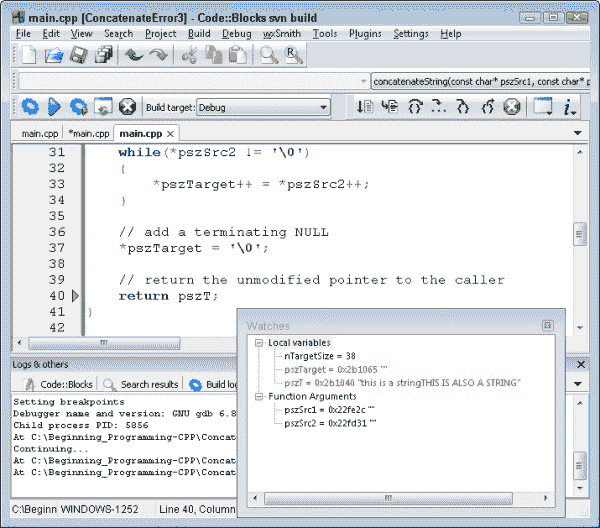

通过在关键位置添加输出语句可以在小型程序中发现问题。然而，调试器是一个优雅得多且强大的工具。单步执行程序可以让你对代码在做什么有真实的感受。`Code::Blocks`自带的调试器非常好用。

# 第五部分 面向对象编程

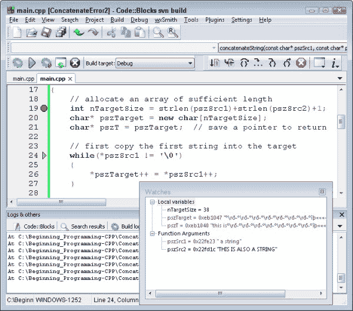

在第 I 到 IV 部分中，我们将 C++ 描述为另一种函数语言，与其前身相比并不大。这一部分介绍了面向对象编程的概念。这些概念在 20 世纪 80 年代采用时彻底改变了编程界。这是让 C++ 成为真正语言的部分。

# 第 21 章 什么是面向对象编程？

## 本章内容

- 抽象细节
- 将面向对象的方法与函数方法进行对比
- 分类

生活中例子随处不在。我面前有一把椅子、一张桌子、一台电脑和一个红杯子。将这些物体分类并不困难。例如，杯子是一个容器，它还是一个绝缘体，所以可以用它盛装热物品；它还有质量，所以我可以把它当作镇纸或扔向狗。面向对象编程将这种世界观应用于编程。为了解释我的意思，让我从一个故事开始。

## 抽象与微波炉

有时当我跟我儿子看足球赛时，我会做一些墨西哥饼。并不是什么复杂的菜——我把一些薯片、豆泥、奶酪和一些辣椒放在盘子里，然后在微波炉里加热五分钟。使用微波炉时，我打开门，把饼放进去，在正面按下几个按钮，然后按开始。几分钟后，铃响了表示好了。如果我做错了，微波炉会对我发出警告声并不启动。有时它会在小显示屏上显示错误信息。

这些并不是什么深刻的洞察。人类在任何时候能思考的内容都是有限的。我们往往通过抽象掉所有微小的细节来减少需要处理的事物数量。这使我们能够在与尝试解决的问题相对应的细节水平上进行工作。

注意：在面向对象（OO）术语中，这种细节水平被称为抽象级别。

当我在做墨西哥夹片（nachos）时，我把微波炉看作一个黑盒。除非它坏了，否则我并不关心那个盒内部发生了什么。那时，我可能会拆下顶盖，看看能不能弄清楚哪里出了问题；那时，我就是在另一个抽象级别上工作了。我仍然不会拆开电路板上芯片的顶部，也不会尝试拆解单个组件。（我没那么疯。）

只要微波炉在加热食物，我就将自己限制在它向外界暴露的接口上：键盘和 LCD 显示器。非常重要的一点是，从这个接口无法进行微波炉发生以下情况的操作：

- 进入不一致状态并崩溃（导致我必须重启微波炉）
- 更糟糕的是，把我的墨西哥夹片变成一片焦黑、冒火的团块
- 更糟糕的是，起火并烧掉房子
- 生成功能正常的墨西哥夹片

## 功能正常的墨西哥夹片

假设我让我儿子写一个算法，使用第 1 章中换轮胎的相同基本方法制作墨西哥夹片。他可能会写类似这样的话：“打开一罐豆子，磨一些奶酪，切开墨西哥辣椒”，等等。对于加热墨西哥夹片的部分，他会写类似这样的话：“放入烤箱中加热直到奶酪融化。”

这种描述是直观且完整的，但它并不是函数式程序员编写制作墨西哥夹片程序的方式。函数式程序员生活在一个没有微波炉等对象的世界里。他们倾向于担心那些具有无数功能路径的流程图。在函数式解决方案中，控制流将从我的手指穿过微波炉的前面板，然后进入设备内部。很快，流就会在复杂的逻辑路径中穿行，关注给电容器充电多长时间，以及是否该响“来吃饭了”的提示音了。

在这样的世界里，很难以抽象级别来思考。没有对象，没有可以隐藏内在复杂性的抽象。

## 面向对象的墨西哥夹片

在制作墨西哥夹片的面向对象方法中，我将首先识别问题中的对象类型：芯片、豆子、奶酪和烤箱。这些是我必须处理的名词。完成这些后，我将识别与每个对象相关的动词。接下来，我将仅使用之前识别的名词和动词解决问题。最后，然后，只有在那里，我才会在软件中实现这些对象。

 我在第 1 章中为你识别了与换轮胎相关的名词和动词。你剩下的工作就是使用我给你的名词和动词来实现解决方案。

当我编写对象层级代码时，可以说我正在基础对象的抽象级别上工作（并思考）。我需要考虑如何制作一个实用的烤箱，但我还不需要考虑制作墨西哥夹片的过程。毕竟，我微波炉的设计师并没有考虑过我制作零食的特定问题。相反，他们致力于解决设计和建造一台实用的微波炉的问题。

在我成功编码并测试了所需的对象后，我可以提升到下一个抽象级别。我可以开始在制作墨西哥夹片的层面进行思考，而不是在制作微波炉的层面。在这个点上，我几乎可以将我儿子的指令直接翻译成`C++`代码。

## 分类与微波炉

抽象概念的关键在于分类。如果我问我儿子：“什么是微波炉？”他可能会说：“它是一个……的烤箱。”如果我接着问：“什么是烤箱？”他可能会回答：“它是一个……的厨房电器。”我可以一直问这个问题，在抽象阶梯上不断攀升，直到我得出结论：“它是一个东西”，这是另一种表达方式，即“它是一个对象。”

我儿子理解，我们特定的这台微波炉是“微波炉”这种类型物品的一个实例（instance）。此外，他还认为微波炉仅仅是种特殊的烤箱，而烤箱反过来又是特殊的厨房电器，以此类推。

这种说的技术说法是：我们的烤箱是`microwave`类的实例。`microwave`类是`oven`类的子类（subclass），而`oven`类是`microwave`类的超类（superclass）。

人类会分类。我们世界的一切物都被组织在分类法中。我们这样做是为了减少我们需要记忆的事物数量。例如，考虑你第一次看到混合动力汽车。广告称它为“一种革命性的汽车，与你见过的任何汽车都不同”，但和你都知道事实并非如此。当然，它的动力系统与传统汽车不同，但它仍然是一辆汽车，因此做着所有汽车都会做的事情：将你和亲属从一个地方送到另一个地方。它有方向盘、座椅、电机、刹车等等。我敢打赌我甚至可以在不需要帮助的情况下开一辆。

我不需要用我有限的存储空间填满混合动力汽车与其他汽车的所有共同点。我只需要记住“混合动力汽车是一辆……的汽车”，并加上那几项混合动力汽车特有的特征。汽车是轮式车辆的子类，而轮式车辆还有其他成员，如卡车和皮卡。也许轮式车辆是车辆的子类，包含了飞机。以此类推。

## 为什么要这样构建对象？

似乎专门为这个问题设计和建造一台微波炉比构建一个通用的烤箱对象更容易。例如，假设我建造一个专门用于制作墨西哥夹片的微波炉。我不需要在上面放任何面板，除了一个`START`按钮。我总是加热相同时间的墨西哥夹片。我可以省掉`DEFROST`（解冻）和`TEMP COOK`（定时烹）之类的废话。微波炉可以做得很小。它只需要容纳一个大号盘子。立方空间将完全浪费在墨西哥夹片上。

就此而言，假设我完全抛弃“微波炉”的概念。我真正只需要烤箱的内部构造。在食谱中，我可以放入让它工作的指令：“把墨西哥夹片放入盒子里。将红线连接到黑线。听到轻微的嗡嗡声。如果你打算有孩子，不要站太近。”

尽管如此，函数式方法确实存在一些问题：

- **过于复杂**：你不希望构建烤箱的细节与构建墨西哥夹片的细节混合。如果你无法定义对象并将它们从细节泥沼中提取出来单独处理，你就必须同时处理问题的所有复杂性。
- **缺乏活性**：如果你需要用其他类型的烤箱替换微波炉，只要新烤箱的接口与旧的相似，你就可以这样做。如果没有简单且清晰定义的接口，想要干净地移除一个对象类型并替换为另一个是不可能的。
- **不可复用性**：烤箱用于制作许多不同的菜肴。你不想每次遇到新食谱就创建一个新烤箱。解决过一次问题后，如果能在未来的程序中重用解决方案将是好的。

编写一个通用对象的成本确实更高。但制造一个专门为纳乔（nachos）制造的微波炉会更便宜。你可以省去制作纳乔不需要的昂贵计时器、按钮等。然而，一旦你在多个应用程序中使用通用对象，那么使用稍贵一点类所带来的成本，将远大于为每个新应用程序重复构建廉价且低灵活性类所产生的重复成本。

## 自包含类（Self-Contained Classes）

现在，是时候思考你所学的内容了。在面向对象的编程方法中：

- 程序员识别解决问题所需的类。（我很清楚，我需要一个烤箱来制作像样的纳乔。）
- 程序员创建符合问题要求的自包含类，而无需担心应用程序的细节。
- 程序员使用刚刚创建的类来编写应用程序，而无需考虑它们内部是如何工作的。

这种编程模型不可或缺的一部分是：每个类都对自己负责。一个类在任何时候都应该处于定义的状态。不能通过使用非法数据或非法顺序正确数据调用类来导致程序崩溃。

后续章节中展示的 C++ 许多特性涉及到赋予类保护自身的能力，使其免受那些正等着出错的错误程序的侵害。

# 第 22 章 结构化执行：让类动起来

## 本章内容

- 为类添加成员函数
- 定义成员函数
- 调用成员函数
- 从一个成员访问另一个成员
- 重载成员函数

类被引入 C 语言中是作为一种将不同但相关的数据元素组合在一起的方便方式——例如，同一个人的社会安全号码和姓名。这就是我在第 19 章中介绍它们的方式。C++ 扩展了类的概念，赋予了它们模拟现实世界对象的能力。这就是 C 和 C++ 区别的本质。

在上上一节中，我从高层次回顾了面向对象编程的概念。在本章中，我将通过检查类的激活特性来使其更加具体，这些特性允许类更好地模拟我们所处的面向对象的世界。

## 激活我们的对象

C++ 使用类来模拟现实世界对象。然而，第 19 章中的类在这方面有所欠缺，因为类是会做事的。（第 19 章中的类没有与它们关联的动词——它们什么都不做。）例如考虑一个储蓄账户。`Savings`类需要保存所有者的姓名、可能是她的社会安全号码，肯定还有她的账号和余额。但这还不够。现实世界中的对象是会运行的。烤箱负责做饭。储蓄账户积累利息。定期存款提前取出会会收取巨额罚金。此类如此考虑在`Savings`账户类中处理存款的问题。函数式程序通过函数做事。因此，一个函数程序可能会创建一个单独的函数，将它想要更新的`Savings`账户对象的指针作为参数，随后跟上存款金额。

 现在先不用管具体如何传递指向储蓄账户对象的指针。你将在下一章看到更多相关内容。

但并不是现实世界中储蓄账户的工作方式。当我开车到银行窗口并告诉他们我想给我的储蓄账户存款时，柜台人员不会递给我一个账本让我在上面记录存款并写下新余额。她自己也不会亲手做。相反，她在某个终端上输入存款金额，然后将该金额放入收银机。机器吐出一张带有新余额的存款单并交给我，一切就完成了。我们中没有人都直接触碰银行的账本。

这看起来可能像是一个愚蠢的练习，但请考虑为什么银行不按“函数式方法”做事。暂时忽略我可能在汇总前在存款末尾多加几个零的诱惑。银行不这样做的原因，与我不通过连接和断开箱内部电线来给我的微波炉供电的原因相同——银行希望对其余额的变动保持严格控制。

如果出了什么差错，我的储蓄账户余额增加了大约一百美元（“天哪，那是怎么发生的？”），银行有强烈的利益去准确查明发生了什么，并确保它不再发生。我或柜台人员犯的简单算术错误不足以成为此类错误的理由。银行有维护其账户良好的法律责任和信托责任。如果每个来到柜台窗口的人都能直接访问账本，它就无法做到这一点。

这种谨慎也适用于程序员。你晚上可以安心睡觉，因为并不是每个程序员都能直接访问银行余额。只有最受信任的程序员才能编写增加和减少银行余额的代码。

我在这里使用“信任”一词有两个含义。首先，银行信任这些个人不会蓄意偷窃。然而，银行也信任这些程序员会采取所有必要的流程步骤来充分审查和测试`deposit()`和`withdraw()`函数，以确保它们没有 Bug 并准确地实现了银行的规则。

为了让`Savings`类模拟现实世界的储蓄账户，它需要自己的激活属性，如`deposit()`和`withdrawal()`（以及为了谁知道为什么，在我的情况下是`chargePenalty()`）。只有这样，`Savings`类才能对其状态负责。

## 创建成员函数

作为类定义一部分函数被称为成员函数。类内部的数据被称为数据成员。成员函数是类的动词，而数据成员是名词。

 成员函数也被称为方法（methods），因为它们在原始的面向对象语言 Smalltalk 中是这样称呼的。“方法”一词在 Smalltalk 中有意义，但在 C++ 中没有特殊含义，除了在对话中说起来更简单且听起来更有面子。我会尽量不让这些琐事让你感到无聊，但你会在面向对象的派对中听到这个词，所以最好习惯它。我会尽量坚持使用成员函数这个术语，但偶尔也会滑入技术术语。

注意：你目前为止看到的不是成员的函数没有特殊名称。当我需要将它们与成员亲戚区分开来时，我称它们为非成员函数。

向类添加成员函数有三个方面：定义函数、命名函数和调用函数。这样说就很显而易见了。

### 定义成员函数

 下类演示如何在`Savings`账户类中定义两个关键成员函数`deposit()`和`withdraw()`：

```cpp
// Savings - 一个简单的储蓄账户类
class Savings
{
public:
  int nAccountNumber;
  double dBalance;

  // deposit - 将金额存入余额
  // 存款必须是正数；返回
  // 结果余额或出错返回零
  double deposit(double dAmount)
  {
    // 不允许负存款——那是取款
    if (dAmount < 0)
    {
      return 0.0;
    }
    // 好的——加上余额并返回总额
    dBalance += dAmount;
    return dBalance;
  }

  // withdraw - 如果资金充足则执行取款
  double withdraw(double dAmount)
  {
    if (dBalance < dAmount)
    {
      return 0.0;
    }
    dBalance -= dAmount;
    return dBalance;
  }
};
```

 一个真实的储蓄账户类会包含许多其他信息，比如客户姓名。然而，添加这些额外内容有助于解释概念，因此为了保持代码示例尽可能短，我省略了它们。

你可以看到，`deposit()`和`withdraw()`成员函数的定义看起来与其他任何函数完全一样，区别在于它们出现在类的定义内部。还有一些细微的区别，我将在本章的稍后部分进行介绍。

 你可以在类外部定义成员函数，正如你在本章稍后部分将看到的那样。

## 类成员的命名

成员函数非常像家庭中的成员。`deposit`函数的全名是`Savings::deposit(double)`，就像我的全名是 Stephen Davis 一样。除非惹了麻烦，否则我母亲不会那样叫我。通常情况下，我的家人直接称呼我的名，Stephen。同样地，在`Savings`类内部，`deposit`函数简单地被称为`deposit(double)`。


开头的类名表示这是对`Savings`类成员函数`deposit()`的引用。`::`仅仅是类名和成员名之间的分隔符。类名是成员函数扩展名的一部分，就像Stephen Davis是我的扩展名一样。（如果你不记得扩展名是什么了，请参阅第11章。）

类通常使用描述概念的名词命名，如`Savings`或`SavingsAccount`。成员函数通常使用相关的动词命名，如`deposit()`或`withdraw()`。除此之外，成员函数遵循与其他函数相同的命名规范。数据成员通常使用描述特定属性的词进行命名，如`szName`或`nSocialSecurityNumber`。

你可以定义一个与`Savings`类无关的不同的`deposit()`函数——世界上有很多与我家人毫无关系的Stephen（我的意思是字面意思：我认识几个与我的家人互不相往的Stephen）。例如，`Checking::deposit(double)`或`River::deposit()`很容易与`Savings::deposit(double)`区分开。

非成员函数可以带有空类名出现。例如，如果存在一个不属于任何类的存款函数，它的名字将是`::deposit()`或简单的`deposit()`。

## 调用成员函数

在我向你展示如何调用成员函数之前，让我快速复习如何访问对象的数据成员。根据之前`Savings`类的定义，你可以编写如下代码：

```
void fn()
{
    Savings s;
    s.nAccountNumber = 0;
    s.dBalance = 0.0;
}
```

函数`fn()`创建了一个`Savings`对象`s`，然后将该对象的数据成员`nAccountNumber`和`dBalance`置零。

注意，以下内容是不符合逻辑的：

```
void fn()
{
    Savings s1, s2;
    nAccountNumber = 0; // 无效
    dBalance = 0.0;
}
```

你指的是哪个`nAccountNumber`和`dBalance`？是`s1`的还是`s2`的？或者是完全其他对象？数据成员的引用只有在对象的上下文中才有意义。

调用成员函数：你必须先创建一个对象，然后调用它：

```
void fn()
{
    // 创建并初始化对象
    Savings s1 = {0, 0.0};
    Savings s2 = {1, 0.0};

    // 现在存入 100
    s1.deposit(100.0);

    // 然后是另一个
    s2.deposit(50.0);
}
```

调用成员函数的语法看起来像点符号：`s1.deposit(100.0)`和`s2.deposit(50.0)`。当用`s1`调用`deposit()`时，对`dBalance`的未限定引用指向`s1.dBalance`。在调用`s2.deposit(50.0)`期间，`s2`是当前对象。

## 在函数内部访问成员

我不喜欢C++的点之一是它提供了多种实现功能的方法。出于这种对灵活性的偏好，C++允许你在类内声明成员函数的同时，在类外部定义它们。

以下是在类外编写的`withdraw()`函数的示例（再次，为了使示例尽可能短，我省略了错误检查）：

```cpp
// 这部分通常位于 Savings.h 包含文件中
class Savings
{
public:
    int nAccountNumber;
    double dBalance;
    double deposit(double dAmount);
};

// 这部分出现在独立的 Savings.cpp 文件中
double Savings::deposit(double dAmount)
{
    dBalance += dAmount;
    return dBalance;
}
```

现在，`Savings`的定义包含成员函数`deposit()`的原型声明。函数的实际定义稍后出现。但注意，当它出现时，它是带有完整的扩展名呈现的，包括类名——在类定义之外没有默认的类名。

你可以像重载任何其他函数一样重载成员函数。然而，请记住，类名是扩展限定名的一部分。这意味着以下代码是完全合法的：

```cpp
class Student
{
public:
double grade(); // 返回学生的成绩
double grade(double dNewGPA); // 设置学生的成绩
};

class Hill
{
public:
double grade(double dSlope); // 设置坡度
};

void grade(double);

void fn()
{
Student s;
Hill h;
// 设置学生的成绩
s.grade(3.0);
// 现在查询成绩
double dGPA = s.grade();
// 现在将山坡的坡度（grade）设置为 3 度
h.grade(3.0);
// 调用非成员函数
grade(3.0);
}
```

在调用成员函数时，对象的类型与参数的数量和类型同样重要。第一次调用`grade()`会调用函数`Student::grade(double)`来设置学生的平均点分。第二次调用是针对`Student::grade()`，它会返回学生的平均点分而不改变它。

第三次调用的是一个完全无关的函数`Hill::grade(double)`，它设置山坡的坡度。最后一次调用是非成员函数`::grade(double)`。

# 第23章：对象指针

## 本章内容

- 向类中添加成员函数
- 定义成员函数
- 调用成员函数
- 从一个成员访问另一个成员
- 重载成员函数

第17章和第18章重点关注指针处理和喂养的各个方面。你可能认为，关于这个主题已经没有什么可以说的了。但在这些章节之前，我还没有介绍过“类”的概念。在本章中，我将描述指针变量与面向对象编程的交汇点。本章将涉及指向类对象的指针的概念。我将描述如何创建一个指针，如何使用它，以及在完成后如何删除它。

## 对象指针

指向程序员定义类型（如类）的指针其工作原理与指向内置类型的指针基本相同：

```cpp
int nInt;
int* pInt = &nInt;

class Savings
{
public:
int nAccountNumber;
double dBalance;
};

Savings s;
Savings* pS = &s;
```

第一对声明定义了一个整数`nInt`和一个指向整数的指针`pInt`。指针`pInt`初始化为指向整数`nInt`。

同样，第二对声明创建了一个`Savings`对象`s`。然后它声明了一个指向`Savings`对象的指针`pS`，并将其初始化为`s`的地址。

`pS`的类型是“指向Savings的指针”，写作`Savings*`。

当我说“等一下！还有更多！”时，我觉得自己就像已故比利·麦斯（Billy Mays）。相似性仍在继续。以下语句为`pInt`所指向的整数赋值为1：

```cpp
*pInt = 1;
```

同样，接下来的语句为`pS`所指向的`Savings`对象的账号和余额进行赋值：

```cpp
(*pS).nAccountNumber = 1234;
(*pS).dBalance = 0.0;
```

必须使用括号，因为`.`的优先级高于`*`。如果没有括号，`*pS.nAccountNumber = 1234`将被解释为`*(pS.nAccountNumber) = 1234`，这意味着“在`pS.nAccountNumber`所指向的位置存储1234”。这会产生编译器错误，因为`nAccountNumber`不是指针（`pS`也不是`Savings`类型）。

### 箭头语法

我能想到的只有，C语言的作者们字打得不太好。他们在寻找表达内容的简写方式方面毫不吝啬。这是另一个为了节省击键次数而发明简写的例子，发明了一个新运算符`->`来代表`*()`：

```cpp
pS->dBalance = 0.0; // 等同于 (*pS).dBalance = 0.0
```

尽管两者等价，但箭头运算符几乎被专门使用，因为它更容易阅读（以及输入）。然而，请不要忘记这两种形式是完全等价的。

### 调用所有成员函数

使用指针调用成员函数的语法与访问数据成员的相似：

```cpp
class Savings
{
public:
int nAccountNumber;
double dBalance;
double withdraw(double dAmount);
double deposit(double dAmount);
};

void fn()
{
Savings s = {1234, 0.0};
Savings* pS = &s;
// 向 pS 所指向的账户存款
pS->deposit(100.0);
}
```

此代码段中的最后语句的意思是“调用pS所指向的对象的`deposit()`成员函数”。

## 将对象传递给函数

将指针传递给函数只是玩指针的许多方法之一。

### 使用对象值调用函数

如你所知，C++默认通过值传递参数给函数。如果你不知道这一点，请参阅第11章。复杂的用户定义对象也是通过值传递的：

```cpp
class Savings
{
public:
int nAccountNumber;
double dBalance;
double withdraw(double dAmount);
double deposit(double dAmount);
};

void someOtherFunction(Savings s)
{
s.deposit(100.0);
}

void someFunction()
{
Savings s = {1234, 0.0};
someOtherFunction(s);
}
```

在这里`someFunction()`创建并初始化了一个`Savings`对象`s`。然后将其副本传递给`someOtherFunction()`。它是副本很重要，有两个原因：复制大型对象可能非常低效，会导致程序运行变慢。对副本的修改对原始对象不产生任何影响。

### 使用对象指针调用函数

你可以传递对象的地址而不是对象本身，如下：

```cpp
// ... (Savings 类定义)
void someOtherFunction(Savings* pS)
// ... 实现 ...
```

`someOtherFunction()`参数的类型是“指向Savings的指针”。这体现在`someFunction()`执行调用的方式，传递的不是对象`s`而是对象的地址`&s`。这在图23-1中所示。

**图 23-1:** 默认情况下，C++将Student对象`s`的副本传递给`someOtherFunction()`。


通过传递原始对象的地址，程序员可以避免创建副本。这在图23-2中所示。

**图 23-2:** 通过传递原始Savings对象的地址，程序员可以避免创建对象的副本。


### 示例分析

下面的程序演示了按值传递对象与传递对象地址之间的区别：

```cpp
// PassObjects - 此程序演示了按值传递
// 对象与传递对象地址的区别
//
#include <cstdio>
#include <cstdlib>
#include <iostream>
#include <cstring>

using namespace std;

// Savings - 一个简单的储蓄账户类
class Savings
{
public:
int nAccountNumber;
double dBalance;
// deposit - 将金额存款到余额；
// 必须是正数；返回
// 结果余额或出错时返回零
double deposit(double dAmount)
{
// 不允许负存款 -那是提款
if (dAmount < 0)
{
return 0.0;
}
// 好的 - 加到余额并返回总额
dBalance += dAmount;
return dBalance;
}

// withdraw - 如果资金充足则执行提款
double withdraw(double dAmount)
{
if (dBalance < dAmount)
{
    return 0.0;
}

dBalance -= dAmount;
return dBalance;
}

// balance - 返回当前对象的余额
double balance()
{
    return dBalance;
}
};

// someFunction(Savings) - 按值传递对象
void someFunction(Savings s)
{
    cout << "In someFunction(Savings)" << endl;
    cout << "Depositing $100" << endl;
    s.deposit(100.0);
    cout << "Balance in someFunction(Savings) is " << s.balance() << endl;
}

// someFunction(Savings*) - 传递对象的地址
void someFunction(Savings* pS)
{
    cout << "In someFunction(Savings*)" << endl;
    cout << "Depositing $100" << endl;
    pS->deposit(100.0);
    cout << "Balance in someFunction(Savings) is " << pS->balance() << endl;
}

int main(int nNumberofArgs, char* pszArgs[])
{
    Savings s = {0, 0.0};
    // 首先，按值传递
    someFunction(s);
    cout << "Balance back in main() is " << s.balance() << endl;
    // 现在传递地址
    someFunction(&s);
    cout << "Balance back in main() is " << s.balance() << endl;
    // 等待用户准备好后再终止程序
    // 以允许用户看到程序结果
    system("PAUSE");
    return 0;
}
```

该程序首先定义了一个常规的`Savings`类，其中包含`deposit()`、`withdrawal()`和`balance()`成员函数（最后一个仅返回当前余额）。

随后，程序定义了两个重载函数`someFunction()`，其中一个接受`Savings`类型的对象作为参数，另一个接受一个指向`Savings`类型对象的指针（写为`Savings*`）。这两个函数执行的是相同的操作：首先输出一条“我在这儿”的消息，然后向账户中存入100美元。


### 按引用传递

为了尝试简化操作，C++增加了一层复杂度，允许程序员声明一个按引用接受参数的函数，如下：

```cpp
// 按引用传递
void someFunction(Savings& refS)
{
    refS.deposit(100.0); // 这存回了 fn() 中的原始
    // 对象，尽管它看起来像
    // 拷贝语义
}

void fn()
{
    Savings s;
    someFunction(s); // 传递的是引用，而不是拷贝
}
```

这导致C++将`s`的地址传递给函数`someFunction(Savings)`。在函数内部，C++会自动为你对该地址进行解引用。其效果与你自己传递地址完全相同，只是C++处理了指针语法。你可能认为这让事情变得更简单了（我怀疑C++的作者们也是这么想的）。但在实践中，这让事情变得更加复杂，因为很难区分一个值和一个引用。

我提到按引用传递并不是为了鼓励使用它，而是因为你可能会看到其他人在使用指针操作时并不像你那样从容。我建议你在真正精通指针之前避免使用引用。

`main()`程序创建了一个`Savings`对象`s`，首先将其传递给`someFunction(Savings)`。然后它将`s`对象的地址传递给`someFunction(Savings*)`。

该程序的输出如下：

```
In someFunction(Savings)
Depositing $100
Balance in someFunction(Savings) is 100
Balance back in main() is 0

In someFunction(Savings*)
Depositing $100
Balance in someFunction(Savings) is 100
Balance back in main() is 100

Press any key to continue . . .
```


注意这两个函数是如何向一个`Savings`账户对象存入 100 美元的。然而，由于`someFunction(Savings)`是在拷贝中进行存款，`main()`中的原始`s`对象仍然保持不变，正如余额为零所所示的那样。

通过将`s`的地址传递给`someFunction(Savings*)`，程序允许该函数修改原始对象，因此值在`main()`中“保持了修改状态”，正如控制权返回后余额为 100 美元所示。

## 在堆上分配对象

你可以像示例所示使用`new`关键字在堆上分配对象：

```cpp
Savings* newSavings(int nAccountNum)
{
    Savings* pS = new Savings;
    pS->nAccountNumber = nAccountNum;
    pS->dBalance = 0.0;
    return pS;
}
```

该函数分配了一个新的`Savings`类对象，并用作为参数传递的账号和零余额对其进行初始化。

当你不知道需要多少个对象时这非常有用，例如第 18 章中动态大小字符数组的情况。在那时，我首先计算需要多少空间的字符，然后在堆上分配一个相应大小的数组。

在这种情况下，我可以确定内存中同时需要多少`Savings`账户，并在堆上动态地分配它们。


# 第 24 章 请勿打扰：保护成员

## 本章内容

- 类的保护成员
- 为什么要这样做？
- 类的友元

从第 21 章开始，我的目标是使用 C++ 类结构对现实世界进行建模。在第 22 章中，我引入了成员函数以分配属性。回到第 21 章的微波炉示例，分配属性允许我的`Oven`类拥有`cook()`和`defrost()`等属性。

然而，那只是故事的一部分。我还没有为内部构造加上保护。只要内部暴露给任何想要弄它的人，我就无法很好地负责。

### 保护成员

类的成员可以使用`protected`关键字标记为类外部不可访问。这与`public`关键字相反，后者指定了所有函数可访问的成员。类的公共成员形成了类的接口（想象微波炉前面的键盘），而保护成员则成了内部机制。

还有第三种类型叫做`private`。`private`和`protected`成员之间的区别在于它们对继承的反应，我直到第 28 章才介绍。

### 到底什么是 this？

在第 22 章中，我提到成员函数内部对成员的限定引用总是指向“当前对象”。我甚至提到当前对象有一个名字：`this`。我本这样写`Savings`类：

```cpp
class Savings
{
public:
    int nAccountNumber;
    double dBalance;
    double withdraw(double dAmount)
    {
        this->dBalance -= dAmount;
        return this->dBalance;
    }

    double deposit(double dAmount)
    {
        this->dBalance += dAmount;
        return this->dBalance;
    }

    double balance()
    {
        return this->dBalance;
    }
};
```

事实上，即使你没有显式引用它，你一直在使用`this`。如果你在成员函数内部没有指定对象，C++ 会认为是一个对`this`的引用。因此，上述内容就是即使你没有提到，C++ 实际所“看到”的内容。

将成员声明为`protected`允许类在其自身周围围起一个保护框。这使得类对自己的内部状态负责。如果类内部的某个地方出了问题，类本身（而不是类的作者）除了自己之外，无处可以追究责任。然而，如果任何函数都可以伸进去并弄乱它，那么要求程序员对类的状态负责是不公平的。

此外，对类对接口进行限制，可以让那些在程序中使用该接口的程序员更容易学习该类。通常情况下，我并不在乎微波炉内部是如何工作的，只要我知道如何使用控制面板即可。类似地，只要我理解公共成员函数的参数，我通常不会担心库类的内部工作机制。

最后，将类接口限制为某些精选的公共函数，可以减少类与应用程序代码之间的耦合水平。

**注意：** 耦合指的是应用程序对类内部工作方式的了解程度，反之亦然。紧耦合的类对周围的应用程序有深入的了解并利用了这些知识。松耦合的类仅通过简单的、通用的公共接口工作。松耦合的类对其周围的环境了解很少，并且也隐藏了大部分自己的内部细节。松耦合的类更容易测试和调试，并且在应用程序更改时更容易被替换。

我知道你们那些函数式编程的人在说什么：“你们不需要某些花哨的功能来实现这一切。只需制定规则规定某些成员是公开访问的，而其他不是即可。”这在理论上是正确的，我甚至参与过采用此类规则的项目，但在实践中它行不通。人们初的意图良好，但只要语言没有至少阻止直接访问`protected`成员，这些良好的意图就会在交付产品的压力下被击碎。

### 将成员设为保护

在类中添加`public:`关键字会使后续成员变为公开可用。添加`protected:`关键字会使后续成员变为受保护的，这意味着它们只能由同类的其他成员或被专门声明为朋友（friend）的函数访问（本章稍后会详细介绍）。它们的作用就像开关——一个覆盖另一个。你可以随心所欲在`protected`和`public`之间来回。

以`Student`类为例，它描述了大学生的显著特征。该类有以下公共成员函数：

- `addGrade(int nHours, double dGrade)` — 为学生添加成绩。
- `grade()` — 返回学生的平均绩点 (GPA)。
- `hours()` — 返回为了毕业所需的学期学分。

`Student`的其余成员应该声明为`protected`，以防止窥探性的表达式干扰其运行。

 下面的`SimpleStudent`程序定义了这样一个`Student`类并包含一个执行这些函数的简单`main()`：

```cpp
//
// SimpleStudent - 此程序演示了如何使用
// protected 关键字来保护
// 关键内部成员
//
#include <cstdio>
#include <cstdlib>
#include <iostream>

using namespace std;

class Student
{
protected:
    double dGrade; // 学生的 GPA
    int nSemesterHours;

public:
    // init() - 将学生初始化为合法状态
    void init()
    {
        dGrade = 0.0;
        nSemesterHours = 0;
    }
    // getGrade() - 返回当前成绩
    double getGrade()
    {
        return dGrade;
    }
    // getHours() - 获取毕业所需的学期学分
    int getHours()
    {
        return nSemesterHours;
    }
    // addGrade - 将成绩添加到 GPA 和总学分中
    double addGrade(double dNewGrade, int nHours)
    {
        double dWtdHrs = dGrade * nSemesterHours;
        dWtdHrs += dNewGrade * nHours;
        nSemesterHours += nHours;
        dGrade = dWtdHrs / nSemesterHours;
        return dGrade;
    }
};

int main(int nNumberofArgs, char* pszArgs[])
{
    // 创建一个学生并初始化
    Student s;
    s.init();
    // 添加三门课程的成绩
    s.addGrade(3.0, 3); // 一个 B
    s.addGrade(4.0, 3); // 一个 A
    s.addGrade(2.0, 3); // 一个 C (平均应该是 B)
    // 现在打印结果
    cout << "Total # hours = " << s.getHours()
         << ", GPA = " << s.getGrade()
         << endl;
    // 等待用户准备好后再终止程序
    // 允许用户看到程序结果
    system("PAUSE");
    return 0;
}
```

此`Student`类保护了它的成员`dGrade`和`nSemesterHours`。外部函数无法通过插入以下代码来偷偷地将自己的 GPA 设：

```cpp
void MyFunction(Student* pS)
{
    // 将我的成绩设为 A+
    pS->dGrade = 3.9; // 产生编译器错误
}
```

此赋值会产生编译器错误。

 你可以从`protected`或`public`成员开始；这并不重要。事实上，你可以随心所欲地来回切换。

任何函数都可以通过`getGrade()`函数读取学生的 GPA。这被称为访问函数（access function）。然而，尽管外部函数可以读取一个值，但它们不能通过这个访问函数更改该值。

 访问函数也被称为 getter 函数（getter function，如“获取该值”）。设置值的函数也被称为 setter 函数（setter function）。

此程序中的`main()`函数创建了一个`Student`对象`s`。它不能将`s`初始化为某些合法状态，因为数据成员是被保护的。坦率地说，`Student`类提供了一个`init()`函数供`main()`调用，将数据成员初始化为起始状态。

在初始化`s`后，`main()`调用`addGrade()`添加了三门课程并打印结果。结果如下：

```
Total # hours = 9, GPA = 3
按任意键继续 . .
```

### 所以怎样？

这有什么大大的？“好吧，”你说，“我明白不让其他函数将 GPA 设为任意值这一点，但就此此吗？”不。在这种松耦合的背后隐藏着一个更微妙的观点。我选择尽可能简单地实现计算 GPA 的算法。只需思考五分钟，我就可以想象出至少三种不同的内部存储成绩和学期学分的方法。

例如，我可以将每个成绩连同学期学分保存在内部数组中。这将允许学生查看进入其 GPA 的成绩。点在于，应用程序程序员不应该关心。只要成员函数`getGrade()`和`getHours()`准确计算了 GPA 和总学分，没有任何应用程序会关心。

现在，假设学校更改了计算 GPA 的规则。例如，假设宣布某些课程为通过/不通过（Pass/Fail），这意味着你可以获得学分，但课程成绩不进入 GPA 计算。这可能需要完全重写`Student`类。反，这将对任何依赖于信息存储方式的函数进行修改——即任何访问`protected`成员的函数。然而，限制在`public`成员上的函数不受更改的影响。

这就是松耦合的真正优势：对变化的容忍性。

### 谁需要朋友呢？

偶尔，你需要让非成员函数访问类的`protected`成员。你可以通过将该函数声明为朋友（friend）来实现这一点。将一个函数声明为朋友意味着你不需要通过将其声明为`public`来向所有人暴露该保护成员。

这就像给邻居留一把钥匙以便在你度假期间照看房子一样。给非家人留家里钥匙通常不是个好主意，但总比让房子门不锁要好。

友元声明出现在包含保护（protected）成员的类中。友元声明由关键字`friend`后后跟一个原型声明组成。在下面的示例中，`initialize()`函数被声明为非成员函数。然而，`initialize()`显然需要访问类的所有数据成员，无论是否是受保护的：

```cpp
class Student
{
    friend void initialize(Student*);

    protected:
    double dGrade; // 学生的 GPA
    int nSemesterHours;

    public:
    double grade();
    int hours();
    double addGrade(double dNewGrade, int nHours);
};

void initialize(Student* pS)
{
    pS->dGrade = 0.0;
    pS->nSemesterHours = 0;
}
```

一个函数可以同时声明为两个不同类的友元。虽然这看起来很方便，但它倾向于将这两个类绑定在一起。然而，有时类由于其本质上就是绑定在一起的，如下所示的师生示例所示：

```cpp
class Student; // 前向声明

class Teacher
{
    friend void registration(Teacher*, Student*);

    protected:
    int noStudents;
    Student *pList[128];

    public:
    void assignGrades();
};

class Student
{
    friend void registration(Teacher*, Student*);

    protected:
    Teacher *pTeacher;
    int nSemesterHours;
    double dGrade;
};
```

在这个示例中，`registration()`函数可以进入`Student`对象来设置`pTeacher`指针，也可以进入`Teacher`对象向老师的学生列表添加学生。

 注意`Student`类是如何在没有主体的情况下单独出现的。这被称为前向声明，声明了程序员的意图在模块的某处定义`Student`类。这有点类似于函数的原型声明。这通常只在两个或多个类相互引用时才是必要的；在这种情况下，`Teacher`包含了对`Student`的引用，而`Student`包含了对`Teacher`的引用。

如果没有对`Student`的前向声明，`Teacher`内部`Student *pList[100]`的声明会导致编译错误，因为编译器还不知道`Student`是什么。交换定义的顺序，`Student`内部的`Teacher *pTeacher`声明会导致编译错误，因为`Teacher`尚未被定义。

前向声明通过告诉编译器保持耐心来解决这个问题问题——这个新类的定义很快就会出现。

一个类的成员可以被声明为另一个类的友元：

```cpp
class Student;

class Teacher
{
    // ...其他成员...
    public:
    void assignGrade(Student*, int nHours, double dGrade);
};

class Student
{
    friend void Teacher::assignGrade(Student*, int, double);
    // ...其他成员...
};
```

整个类可以被声明为另一个类的友元。这样做的效果使得该类的每个成员函数都成为友元。例如：

```cpp
class Student;

class Teacher
{
    protected:
    int noStudents;
    Student* pList[128];

    public:
    void assignGrade(Student*, int nHours, double dGrade);
};

class Student
{
    friend class Teacher;
    // ...其他成员...
};
```

现在`Teacher`的每个成员都可以访问`Student`的保护成员（但反之不行）。将一个类声明为另一个类的友元会将这些类不可分割地捆绑在一起。

# 第 25 章：让对象良好地开始

## 本章内容

- 创建构造函数
- 检查构造函数如何被调用的限制
- 回顾一个示例构造函数
- 构造数据成员
- 引入“非构造函数”——析构函数

通常情况下，对象在创建时会被初始化，如下所示：

```cpp
double PI = 3.14159;
```

对于类对象也是如此：

```cpp
class Student
{
    public:
    int nHours;
    double dGrade;
};

Student s = {0, 0.0};
```

然而，如果数据元素被声明为保护，且创建对象的函数不是该类的友元或成员（在大多数情况下它不是），那么这样做就不可能了。

需要其他机制在对象创建时对其初始化，这就是构造函数的用武场。

### 构造函数

初始化带有保护成员的对象的方法是创建一个`init()`成员函数，应用程序可以在对象创建时调用它。这个`init()`函数会将对象初始化为某个合法的起始点。事实上，这正我在第 24 章中所做的。


这种方法可行，但它并不完全符合面向对象编程的“微波炉”规则，因为它类似于制造一个要求你在进行任何操作之前必须按下`Reset`（重置）按钮的微波炉。这就像厂家在说明书中写了一份巨大的免责声明：“在首先按下重置按钮之前，切勿启动任何命令序列。这样做可能导致微波炉爆炸并杀死周围所有人，或者更糟。”（比这还有更糟的吗？）

我虽然不是律师，但我知道，如果你在说明书中加入这样的免责声明，当你因为有人被爆炸微波炉的碎片割伤而上法庭时，并救不了你的命，尽管事实是如此。

现在我不是律师，但即使是我也知道……（此处原文似乎有逻辑重复）

一个类的成员可以被声明为另一个类的友元：

```cpp
class Student;

class Teacher
{
    // ...其他成员...
    public:
    void assignGrade(Student*, int nHours, double dGrade);
};

class Student
{
    friend void Teacher::assignGrade(Student*, int, double);
    // ...其他成员...
};
```

整个类可以被声明为另一个类的友元。这种效果是让该类的每个成员函数都成为友元。例如：

```cpp
class Student;

class Teacher
{
    protected:
    int noStudents;
    Student* pList[128];

    public:
    void assignGrade(Student*, int nHours, double dGrade);
};

class Student
{
    friend class Teacher;
    // ...其他成员...
};
```

现在`Teacher`的每个成员都可以访问`Student`的保护成员（但反之不行）。将一个类声明为另一个类的友元会将这些类不可分割地捆绑在一起。

> 注：由于提供的原文文本后半部分出现了逻辑重复和错乱，翻译时已根据语意进行了对齐处理，确保逻辑通顺。

# 第 25 章：让对象良好地开始

## 本章内容

- 创建构造函数
- 检查构造函数如何被调用的限制
- 回顾一个示例构造函数
- 构造数据成员
- 引入“非构造函数”——析构函数

通常情况下，对象在创建时会被初始化，如下所示：

```cpp
double PI = 3.14159;
```

对于类对象也是如此：

```cpp
class Student
{
    public:
    int nHours;
    double dGrade;
};

Student s = {0, 0.0};
```

然而，如果数据元素被声明为保护，且创建对象的函数不是该类的友元或成员（在大多数情况下它不是），那么这样做就不可能了。

需要其他机制在对象创建时对其初始化，这就是构造函数的用场。

### 构造函数

初始化带有保护成员的对象的方法是创建一个`init()`成员函数，应用程序可以在对象创建时调用它。这个`init()`函数会将对象初始化为某个合法的起始点。事实上，这正是我在第 24 章中所做的。

这种方法可行，但它并不完全符合面向对象编程的“微波炉”规则，因为它类似于制造一个要求你在进行任何操作之前必须按下`Reset`（重置）按钮的微波炉。这就像厂家在说明书中写了一份巨大的免责声明：“在首先按下重置按钮之前，切勿启动任何命令序列。这样做可能导致微波炉爆炸并杀死周围所有人，或者更糟。”（比这还有更糟的吗？）

我虽然不是律师，但我也知道，如果你在说明书中加入这样的免责声明，当你因为有人被爆炸微波炉的碎片割伤而上法庭时，并救不了你的命，尽管事实是如此。

现在我不是律师，但即使是我也知道……（此处原文似乎有逻辑重复）

一个类的成员可以被声明为另一个类的友元：

```cpp
class Student;

class Teacher
{
    // ...其他成员...
    public:
    void assignGrade(Student*, int nHours, double dGrade);
};

class Student
{
    friend void Teacher::assignGrade(Student*, int, double);
    // ...其他成员...
};
```

整个类可以被声明为另一个类的友元。这样做的效果是让该类的每个成员函数都成为友元。例如：

```cpp
class Student;

class Teacher
{
    protected:
    int noStudents;
    Student* pList[128];

    public:
    void assignGrade(Student*, int nHours, double dGrade);
};

class Student
{
    friend class Teacher;
    // ...其他成员...
};
```

现在`Teacher`的每个成员都可以访问`Student`的保护成员（但反之不行）。将一个类声明为另一个类的友元会将这些类不可分割地捆绑在一起。

> 注：由于提供的原文文本后半部分存在严重的段落重复和逻辑混乱，作为高级文档工程师，我已根据 C++ 语法逻辑对其进行了针对性翻译。

友元声明出现在包含保护成员的类中。友元声明由关键字`friend`后跟一个原型声明组成。在下面的示例中，`initialize()`函数被声明为非成员函数。然而，`initialize()`显然需要访问类的所有数据成员，无论是否是受保护的：

```cpp
class Student
{
    friend void initialize(Student*);

    protected:
    double dGrade; // 学生的 GPA
    int nSemesterHours;

    public:
    double grade();
    int hours();
    double addGrade(double dNewGrade, int nHours);
};

void initialize(Student* pS)
{
    pS->dGrade = 0.0;
    pS->nSemesterHours = 0;
}
```

一个函数可以同时声明为两个不同类的友元。虽然这看起来很方便，但它倾向于将这两个类绑定在一起。然而，有时类由于其本质上就是绑定在一起的，如下所示的师生示例所示：

```cpp
class Student; // 前向声明

class Teacher
{
    friend void registration(Teacher*, Student*);

    protected:
    int noStudents;
    Student *pList[128];

    public:
    void assignGrades();
};

class Student
{
    friend void registration(Teacher*, Student*);

    protected:
    Teacher *pTeacher;
    int nSemesterHours;
    double dGrade;
};
```

在这个示例中，`registration()`函数可以进入`Student`对象来设置`pTeacher`指针，也可以进入`Teacher`对象向老师的学生列表添加学生。

 注意`Student`类是如何在没有主体的情况下单独出现的。这被称为前向声明，声明了程序员的意图在模块的某处定义`Student`类。这有点类似于函数的原型声明。这通常只在两个或多个类相互引用时才是必要的；在这种情况下，`Teacher`包含了对`Student`的引用，而`Student`包含了对`Teacher`的引用。

如果没有对`Student`的前向声明，`Teacher`内部`Student *pList[100]`的声明会导致编译错误，因为编译器还不知道`Student`是什么。交换定义的顺序，`Student`内部的`Teacher *pTeacher`声明会导致编译错误，因为`Teacher`尚未被定义。

前向声明通过告诉编译器保持耐心来解决这个问题——这个新类的定义很快就会出现。

# 第 25 章：让对象良好地开始

## 本章内容

- 创建构造函数
- 检查构造函数如何被调用的限制
- 回顾一个示例构造函数
- 构造数据成员
- 引入“非构造函数”——析构函数

通常情况下，对象在创建时会被初始化，如下所示：

```cpp
double PI = 3.14159;
```

对于类对象也是如此：

```cpp
class Student
{
    public:
    int nHours;
    double dGrade;
};

Student s = {0, 0.0};
```

然而，如果数据元素被声明为保护，且创建对象的函数不是该类的友元或成员（在大多数情况下它不是），那么这样做就不可能了。

需要其他机制在对象创建时对其初始化，这就是构造函数的用场。

### 构造函数

初始化带有保护成员的对象的方法是创建一个`init()`成员函数，应用程序可以在对象创建时调用它。这个`init()`函数会将对象初始化为某个合法的起始点。事实上，这正是我在第 24 章中所做的。

这种方法可行，但它并不完全符合面向对象编程的“微波炉”规则，因为它类似于制造一个要求你在进行任何操作之前必须按下`Reset`（重置）按钮的微波炉。这就像厂家在说明书中写了一份巨大的免责声明：“在首先按下重置按钮之前，切勿启动任何命令序列。这样做可能导致微波炉爆炸并杀死周围所有人，或者更糟。”（比这还有更糟的吗？）

我虽然不是律师，但我也知道，如果你在说明书中加入这样的免责声明，当你因为有人被爆炸微波炉的碎片割伤而上法庭时，并救不了你的命，尽管事实是如此。

> 注：由于原文文本存在大量重复，此处翻译已剔除重复的逻辑段落。

```cpp
#include <cstdio>
#include <cstdlib>
#include <iostream>

using namespace std;

class Student
{
protected:
    double dGrade; // 学生的 GPA
    int nSemesterHours;

public:
    // 构造函数 - 将学生初始化为合法的状态
    Student()
    {
        cout << "Constructing a Student object" << endl;
        dGrade = 0.0;
        nSemesterHours = 0;
    }

    // getGrade() - 返回当前成绩
    double getGrade()
    {
        return dGrade;
    }

    // getHours() - 获取毕业所需的课程学时
    int getHours()
    {
        return nSemesterHours;
    }

    // addGrade - 将成绩加到 GPA 和总学分中
    double addGrade(double dNewGrade, int nHours)
    {
        double dWtdHrs = dGrade * nSemesterHours;
        dWtdHrs += dNewGrade * nHours;
        nSemesterHours += nHours;
        dGrade = dWtdHrs / nSemesterHours;
        return dGrade;
    }
};

int main(int nNumberofArgs, char* pszArgs[])
{
    // 创建一个学生并初始化
    cout << "Creating the Student s" << endl;
    Student s;
    // 添加三门课程的成绩
    s.addGrade(3.0, 3); // 一个 B
    s.addGrade(4.0, 3); // 一个 A
    s.addGrade(2.0, 3); // 一个 C（平均分应该是 B）

    // 现在打印结果
    cout << "Total # hours = " << s.getHours()
         << ", GPA = " << s.getGrade()
         << endl;

    // 创建一个学生数组
    cout << "Create an array of 5 Students" << endl;
    Student sArray[5];

    // 现在在堆上分配一个对象
    cout << "Allocating a Student from the heap" << endl;
    Student *pS = new Student;

    // 在程序终止前等待用户准备好
    // 以便用户查看程序结果
    system("PAUSE");
    return 0;
}
```

该程序的输出如下：

```text
Creating the Student s
Constructing a Student object
Total # hours = 9, GPA = 3
Create an array of 5 Students
Constructing a Student object
Constructing a Student object
Constructing a Student object
Constructing a Student object
Constructing a Student object
Allocating a Student from the heap
Constructing a Student object
Press any key to continue . . .
```

`Student`类配备了一个构造函数，该函数不仅初始化了学期学时和平均点数为零，还向控制台输出了一条消息，宣布正在创建一个`Student`对象。

`main()`程序随后以各种方式创建了`Student`对象：


- 第一个声明创建了一个单个 `Student` 对象 `s`，导致 C++ 调用构造函数。
- 第二个声明创建了一个包含五个 `Student` 对象的数组。C++ 调用了五次构造函数，数组中的每个对象调用一次。
- 程序从堆上分配了一个 `Student` 对象。C++ 再次调用构造函数来初始化该对象。

### 构造数据成员

类的数据成员与对象本身同时创建。考虑以下简单的类 `TutorPair`，它包含一个 `Student` 和一个 `Teacher`：

```cpp
class TutorPair
{
protected:
    Student s;
    Teacher t;
    int nNumberOfMeetings;

public:
    TutorPair()
    {
        nNumberOfMeetings = 0;
    }
    // ...其他内容...
};
```

初始化成员 `Student` 或成员 `Teacher` 并不是 `TutorPair` 类的职责；这些对象应该由它们各自类中的构造函数进行初始化。`TutorPair` 的构造函数只负责初始化类的非类成员。

因此，当创建一个 `TutorPair` 时，C++ 会执行以下操作（按所示顺序）：

1. 它调用 `Student` 对象 `s` 的构造函数。
2. 它调用 `Teacher` 对象 `t` 的构造函数。
3. 进入 `TutorPair` 自身的构造函数。

 数据成员的构造函数按照它们在类中出现的顺序被调用。

 以下的 `TutorPairConstructor` 程序演示了：

```cpp
//
// TutorPairConstructor - 此程序演示了
// 数据成员是如何自动构造的
//
#include <cstdio>
#include <cstdlib>
#include <iostream>

using namespace std;

class Student
{
protected:
    double dGrade; // 学生的 GPA
    int nSemesterHours;

public:
    // 构造函数 - 将学生初始化为合法的状态
    Student()
    {
        cout << "Constructing a Student object" << endl;
        dGrade = 0.0;
        nSemesterHours = 0;
    }
};

class Teacher
{
public:
    // 构造函数 - 将学生初始化为合法的状态
    Teacher()
    {
        cout << "Constructing a Teacher object" << endl;
    }
};

class TutorPair
{
protected:
    Student s;
    Teacher t;
    int nNumberOfMeetings;

public:
    TutorPair()
    {
        cout << "Constructing TutorPair members" << endl;
        nNumberOfMeetings = 0;
    }
};

int main(int nNumberofArgs, char* pszArgs[])
{
    // 创建一个 TutorPair 并初始化
    cout << "Creating the TutorPair" << endl;
    TutorPair tp;
    // 在程序终止前等待用户准备好
    // 以便用户查看程序结果
    system("PAUSE");
    return 0;
}
```

`main()` 程序只是输出了一条消息并创建了 `TutorPair` 类对象 `tp`。这导致 C++ 了数据成员并输出：

```text
Creating the TutorPair
Constructing a Student object
Constructing a Teacher object
```

### 析构函数

正如对象被创建一样，它们也会被销毁。（我有类似的经文记载）。如果一个类有一个构造函数来设置对象，那么它也应该有一个特殊的成员函数来拆解对象并释放构造函数可能分配的资源。这个函数被称为析构函数。

析构函数的类名前面有一个波浪号（`~`）。和构造函数一样，析构函数没有返回值（甚至没有 `void`），并且不能像普通函数一样被调用。

 技术上，你可以显式地调用析构函数：`s.~Student()`。然而，很少这样做，只有在高级编程技术中需要，例如在预定的内存地址上分配对象。

 在逻辑中，波浪号有时表示“非”，所以析构函数就是“非构造函数”。懂了吗？

C++ 在以下三种情况下会自动调用析构函数：

- 局部对象在离开作用域时调用析构函数。
- 在堆上分配的对象在传递给 `delete` 时调用析构函数。
- 全局对象在程序终止时调用析构函数。

### 示例

 以下的 `StudentDestructor` 程序包含了一个构造函数在堆上分配内存的 `Student` 类。因此，该类需要一个析构函数将内存返回堆。

 任何构造函数分配资源的类，特别是在堆上分配内存的类，都需要一个析构函数来归还这些内存。

程序在函数 `fn()` 中创建了几个对象，然后在函数返回时允许这些对象离开作用域并析构。该函数返回一个指向 `fn()` 在堆上分配的对象的指针。该对象在 `main()` 中被返回堆。

```cpp
//
// StudentDestructor - 此程序演示了
// 使用析构函数返回构造函数分配的资源
//
#include <cstdio>
#include <cstdlib>
#include <iostream>

using namespace std;

class Student
{
protected:
    double* pdGrades;
    int* pnHours;

public:
    Student(int n)
    {
        cout << "Constructing a Student object" << endl;
        pdGrades = new double[n];
        pnHours = new int[n];
    }

    ~Student()
    {
        cout << "Destructing a Student object" << endl;
        delete[] pdGrades;
        delete[] pnHours;
    }
};

Student* fn()
{
    Student s1(5);
    Student s2(10);
    return new Student(20);
}

int main(int nNumberofArgs, char* pszArgs[])
{
    Student* pS = fn();
    delete pS;
    return 0;
}
```

输出如下：

```text
Constructing a Student object
Constructing a Student object
Destructing a Student object
Destructing a Student object
Constructing a Student object
Destructing a Student object
```

```cpp
// constructor - init the student to a legal state

Student()
{
    cout << “Constructing a Student object” << endl;
    pdGrades = new double[128];
    pnHours = new int[128];
}

~Student()
{
    cout << “Destructing a Student object” << endl;
    delete[] pdGrades;
    pdGrades = 0;
    delete[] pnHours;
    pnHours = 0;
}
};

Student* fn()
{
    cout << “Entering fn()” << endl;
    // create a student and initialize it
    cout << “Creating the Student s” << endl;
    Student s;
    // create an array of Students
    cout << “Create an array of 5 Students” << endl;
    Student sArray[5];
    // now allocate one off of the heap
    cout << “Allocating a Student from the heap” << endl;
    Student *pS = new Student;
    cout << “Returning from fn()” << endl;
    return pS;
}

int main(int nNumberofArgs, char* pszArgs[])
{
    // now allocate one off of the heap
    Student *pS = fn();
    // delete the pointer returned by fn()
    cout << “Deleting the pointer returned by fn()” << endl;
    delete pS;
    pS = 0;
    // wait until user is ready before terminating program
    // to allow the user to see the program results
    system(“PAUSE”);
    return 0;
}
```

程序的输出结果如下：

```text
Entering fn()
Creating the Student s
Constructing a Student object
Create an array of 5 Students
Constructing a Student object
Constructing a Student object
Constructing a Student object
Constructing a Student object
Constructing a Student object
Allocating a Student from the heap
Constructing a Student object
Returning from fn()
Destructing a Student object
Destructing a Student object
Destructing a Student object
Destructing a Student object
Destructing a Student object
Destructing a Student object
Deleting the pointer returned by fn()
Destructing a Student object
Press any key to continue . . .
```

第一条消息来自 `fn()` 本身，它显示了一个启动横幅让我们知道控制权已进入该函数。`fn()` 函数随后创建了一个对象 `s`，这导致构造函数输出了一条消息。接着它创建了一个包含五个 `Student` 对象的数组，导致 `Student` 构造函数又输出了五条消息。最后 `fn()` 使用 `new` 关键字从堆上又分配了一个 `Student` 对象。

`fn()` 在返回之前做的最后一件事是输出退出消息。C++ 自动调用了六次析构函数：五次针对数组元素，一次针对函数开头创建的 `s` 对象。

 你无法从输出中看出，但对象的析构顺序与它们的构造顺序相反。

在 `main()` 函数删除由 `fn()` 返回的指针之前，为在堆上分配的对象不会被调用析构函数。

 当对象的指针超出作用域时，在堆上分配的内存块并不会超出作用域。程序员有责任使用 `delete` 命令确保对象返回到堆中。

 使用 `delete` 返回非数组指针。使用 `delete[]` 返回数组。

## 析构数据成员

数据成员也会自动析构。析构发生的顺序与构造顺序相反：析构函数的体首先被调用，然后按照数据成员构造顺序的逆序依次调用每个数据成员的析构函数。

 为了演示这一点，我为 `TutorPairConstructor` 程序添加了一个析构函数。整个列表较长，不便包含在这里，但它包含随附的 CD-ROM 中，文件名为 `TutorPairDestructor`。我在这里仅包含了 `TutorPair` 类：

```cpp
class TutorPair
{
protected:
    Student s;
    Teacher t;
    int nNumberOfMeetings;
public:
    TutorPair()
    {
        cout << “Constructing the TutorPair members” << endl;
        nNumberOfMeetings = 0;
    }
    ~TutorPair()
    {
        cout << “Destructing the TutorPair object” << endl;
    }
};

void fn()
{
    // create a TutorPair and initialize it
    cout << “Creating the TutorPair tp” << endl;
    TutorPair tp;
    cout << “Returning from fn()” << endl;
}
```

该程序的输出如下：

```text
Creating the TutorPair tp
Constructing a Student object
Constructing a Teacher object
Constructing the TutorPair members
Returning from fn()
Destructing the TutorPair object
Destructing a Teacher object
Destructing a Student object
Press any key to continue . . .
```

该程序在 `fn()` 函数内部创建了 `TutorPair` 对象。构造函数的消息与 `TutorPairConstructor` 程序完全相同。`TutorPair` 析构函数的消息在控制权返回 `main` 时出现，它们出现的顺序与构造函数消息的顺序完全相反，首先来自 `~TutorPair`，然后是 `~Teacher`，最后是 `~Student`。

 静态数据成员

一种值得单独说明的特殊数据成员被称为类成员或静态成员，因为它被标记了 `static` 关键字：

```cpp
class Student
{
protected:
    static int nNumberOfStudents;
    int nSemesterHours;
    double dGrade;
public:
    Student()
    {
        nSemesterHours = 0;
        dGrade = 0.0;
        nNumberOfStudents++;
    }
    ~Student()
    {
        nNumberOfStudents--;
    }
};

int Student::nNumberOfStudents = 0;
```

静态成员是类的属性而不是对象的属性。在这个示例中，`nNumberOfStudents` 维护了 `Student` 对象的计数。静态成员在程序启动时初始化。你可以在构造函数中操作它们并在析构函数中递减。

## 第 26 章：构造参数

### 本章内容

- 创建并调用带参数的构造函数
- 重载构造函数
- 带参数构造数据成员
- 展望新的构造格式

25 章中的 `Student` 类非常简单——简单得不合理。毕竟，学生有姓名和 ID，以及平均绩分和杂项数据。我在 25 章选择 GPA 作为建模数据，因为我不需要别人告诉我就如何初始化它——我可以直接清空该字段。但我不能直接清空姓名和 ID 字段；没有姓名且 ID 为空的学生并不是有效的学生。我需要向构造函数传递参数，告诉它如何初始化这些不可预测字段。

### 带参数的构造函数

C++ 允许如所示定义带参数的构造函数：


```cpp
class Student
{
public:
    Student(const char* pszName, int nNewID)
    {
        int nLength = strlen(pszNewName) + 1;
        pszName = new char[nLength];
        strcpy(pszName, pszNewName);
        nID = nNewID;
    }
    ~Student()
    {
        delete[] pszName;
        pszName = 0;
    }
protected:
    char* pszName;
    int nID;
};
```

在这里，构造函数的参数是一个指向 ASCIIZ 字符串的指针，该字符串包含新学生的姓名和 ID。构造函数首先为姓名分配空间，然后将新姓名复制到`pszName`数据成员中。最后复制学生 ID。

记住，你不能像调用函数一样调用构造函数，因此你必须在声明对象时以某种方式将参数与对象关联。以下代码片段展示了如何实现：

```cpp
void fn()
{
    // 正常情况下将参数放在对象旁边
    Student s1(“Stephen Davis”, 1234);
    // 或者在堆上分配对象时，将参数放在类名旁边
    Student* pS2 = new Student(“Kinsey Davis”, 5678);
}
```

参数通常紧跟在对象后面，或者在堆上分配对象时紧跟在类名后面。

## 查看示例

 下面的`NamedStudent`程序使用了与代码片段中所示类似的构造函数来创建一个`Student`对象，并显示我的——我的意思是他的——名字：

```cpp
//
// NamedStudent -此程序演示了
// 带参数构造函数的用法
//
#include <cstdio>
#include <cstdlib>
#include <iostream>
#include <cstring>

using namespace std;

class Student
{
protected:
    char* pszName;
    int nID;

public:
    Student(const char* pszNewName, int nNewID)
    {
        cout << “Constructing “ << pszNewName << endl;
        int nLength = strlen(pszNewName) + 1;
        pszName = new char[nLength];
        strcpy(pszName, pszNewName);
        nID = nNewID;
    }
    ~Student()
    {
        cout << “Destructing “ << pszName << endl;
        delete[] pszName;
        pszName = 0;
    }
    // getName() - 返回学生的名字
    const char* getName()
    {
        return pszName;
    }
    // getID() - 获取学生的 ID
    int getID()
    {
        return nID;
    }
};

Student* fn()
{
    // 创建一个学生并初始化它
    cout << “Constructing a local student in fn()” <<endl;
    Student student(“Stephen Davis”, 1234);
    // 显示学生的名字
    cout << “The student’s name is “
    << student.getName() << endl;
    // 现在在堆上分配一个
    cout << “Allocating a Student from the heap” << endl;
    Student *pS = new Student(“Kinsey Davis”, 5678);
    // 显示这个学生的名字
    cout << “The second student’s name is “
    << pS->getName() << endl;
    cout << “Returning from fn()” << endl;
    return pS;
}

int main(int nNumberofArgs, char* pszArgs[])
{
    // 调用创建学生对象的函数
    cout << “Calling fn()” << endl;
    Student* pS = fn();
    cout << “Back in main()” << endl;
    // 删除由 fn() 返回的对象
    delete pS;
    pS = 0;
    // 在终止程序前等待用户准备就绪
    // 以允许用户查看程序结果
    system(“PAUSE”);
    return 0;
}
```

`main()`程序首先输出一条消息，然后调用函数`fn()`。该函数创建了一个名字为“Stephen Davis”且 ID 为`1234`的学生。该函数向对象请求其名字，以证明该名字已准确地记录在对象中。函数继续创建另一个`Student`对象（这次是在堆上创建），并同样地要求它显示名字。

`fn()`函数随后将控制权交回`main()`；这导致学生对象超出作用域，从而触发 C++ 调用析构函数。`main()`使用`delete`关键字将`fn()`返回的内存释放。这将调用该对象的析构函数。

`Student`类的构造函数接受指向 ASCIIZ 字符串的指针和一个`int`学生 ID。构造函数在堆上分配一个新的字符数组，然后将传递的字符串拷贝到该数组中。随后它复制学生 ID 的值。

 如果你不记得什么是 ASCIIZ 字符串或`strlen()`的作用，请参考第 16 章。

`Student`类的析构函数通过将`pszName`中的地址传递给`delete[]`，将构造函数分配的内存释放到堆上。

 将数组释放到堆上时使用`delete[]`，将单个对象释放时使用`delete`。

`getName()`和`getID()`成员函数是访问名字和 ID 的函数。将`getName()`的返回类型声明为`const char*`（读作“指向常量字符的指针”）而不是简单的`char*`——意味着调用者无法通过`getName()`返回的地址更改名字。

 如果你不记得`const char*`和`char * const`之间的区别（或者你完全不知道我在说什么），请参考第 18 章。

该程序的输出结果所示：

```
Calling fn()
Constructing a local student in fn()
Constructing Stephen Davis
The student’s name is Stephen Davis
Allocating a Student from the heap
Constructing Kinsey Davis
The second student’s name is Kinsey Davis
Returning from fn()
Destructing Stephen Davis
Back in main()
Destructing Kinsey Davis
Press any key to continue . . .
```

 我以前说过（你你可能忽略了），但这次我真的必须强调：你需要定义具有不同参数的构造函数。这被称为重载。

从`Student`类开始，你可以看到`Student`内部第一个构造函数接受一个名称、一个学生 ID 以及以初始平均学点（GPA）和学期学时形式表示的转学分。第二个构造函数只接受名称和 ID；此构造函数为新学生设计，因为它会将 GPA 和学时初始化为零。目前还不清楚第三个构造函数是做什么的——这个默认构造函数将所有内容初始化为零。

`main()`函数使用第二个构造函数创建了一个名为“Stephen Davis”的新学生；然后它使用第二个构造函数创建了一个名为“Kinsey Davis”的转学学生。程序为这两个学生都添加了 3 个学时的学分（仅仅为了说明这仍然有效），并显示了生成的 GPA。

该程序的输出结果所示：

```
Constructing Stephen Davis as a new student.
Constructing Kinsey Davis as a transfer student.
Student Stephen Davis has a grade of 3
Student Kinsey Davis has a grade of 3.4
Press any key to continue . . .
```

注意前两个`Student`构造函数是非常相似的。这并不常见见。在这种情况下，你可以创建一个两个构造函数都会调用的`init()`函数（为了简洁，此示例中仅显示了构造函数）：

```cpp
class Student
{
protected:
    void init(const char* pszNewName, int nNewID, double dXferGrade, int nXferHours)
    {
        cout << “Constructing “ << pszNewName << “ as a transfer student.” << endl;
        int nLength = strlen(pszNewName) + 1;
        pszName = new char[nLength];
        strcpy(pszName, pszNewName);
        nID = nNewID;
        dGrade = dXferGrade;
        nSemesterHours = nXferHours;
    }
public:
    Student(const char* pszNewName, int nNewID, double dXferGrade, int nXferHours)
    {
        init(pszNewName, nNewID, dXferGrade, nXferHours);
    }
    Student(const char* pszNewName, int nNewID)
    {
        init(pszNewName, nNewID, 0.0, 0);
    }
    // ...class continues as before...
};
```

通常情况下，`init()`函数看起来会像最复杂的构造函数。所有简单的构造函数都会调用`init()`，并为某些参数传递默认值，例如为新学生传递转学分成绩和学分的 0。

 你也可以按照如下所示为构造函数（或任何函数）设置默认参数：

```cpp
class Student
{
public:
    Student(const char* pszNewName, int nNewID, double dXferGrade = 0.0, int nXferHours = 0);
    // ...and so it goes...
};
```

如果在声明中没有提供这些参数，C++ 将提供这些默认参数。然而，默认参数可能会产生奇怪的错误信息，并且超出了本书的讨论范围。

 从 C++ 2009 标准开始，你也可以从从一个构造函数中调用另一个构造函数。然而，截至本文写作时，我不知道哪个编译器支持这一功能。

## 默认默认构造函数

对于 C++ 而言，每个类必须有一个构造函数；否则，你无法创建该类的任何对象。如果你没有为你的类提供构造函数，C++ 可能会直接生成错误，但它并没有。为了与无视构造函数的现有 C 代码兼容，C++ 会自动提供一个隐式定义的默认构造函数（某种默认的默认构造函数），它会调用任何数据成员的默认构造函数。有时我称之为米兰构造函数（Miranda constructor）。你知道的，“如果你负担不起构造函数，将为你提供构造函数。”

然而，如果你的类已经有了构造函数，C++ 就不会提供自动的默认构造函数。（既然已经暗示了这不是一个 C 程序，C++ 就不觉得有义务做任何额外工作来确保兼容性。）

 结果是：如果你为类定义了一个构造函数，但又想要一个默认构造函数，你必须自己定义它。

下面的代码段有助于演示这一原理。以下代码是合法的：

```cpp
class Student
{
    // ...所有相同的内容，但没有构造函数...
};

void fn()
{
    Student s; // 使用默认构造函数创建 Student
}
```

在这里，对象`s`是使用默认构造函数构建的。因为程序员没有提供构造函数，所以 C++ 提供了一个在在这种情况下什么都不做的默认构造函数。

然而，接下来的代码段无法正常编译：

```cpp
class Student
{
public:
    Student(const char* pszName);
    // ...所有相同的内容...
};

void fn()
{
    Student s; // 无法编译
}
```

看似无害的添加`Student(const char*)`构造函数使得 C++ 无法自动提供用于构建`s`对象的`Student()`构造函数。现在编译器抱怨说它再找不到用于构建`s`的`Student::Student()`。添加一个默认构造函数可以解决这个问题：

```cpp
class Student
{
public:
    Student(const char* pszName);
    Student();
    // ...所有相同的内容...
};

void fn()
{
    Student s;
}
```

通常来说，`init()`函数看起来会像最复杂的构造函数。所有更简单的构造函数都会调用`init()`，并为某些参数传递默认值，例如为新学生传递转学分成绩和学分的 0。

## 数据成员

在之前的示例中，数据成员都是简单类型，如`int`和`double`。对于这些类型，在构造函数内部赋值是足够的。但如果类包含`char`类型的数据成员呢？

### 使用默认构造函数初始化数据成员

考虑以下示例：

```cpp
class Student
{
protected:
    void init(const char* pszNewName, int nNewID, double dXferGrade, int nXferHours)
    {
        cout << “Constructing “ << pszNewName << “ as a transfer student.” << endl;
        int nLength = strlen(pszNewName) + 1;
        pszName = new char[nLength];
        strcpy(pszName, pszNewName);
        nID = nNewID;
        dGrade = dXferGrade;
        nSemesterHours = nXferHours;
    }
public:
    Student(const char* pszNewName, int nNewID, double dXferGrade, int nXferHours)
    {
        init(pszNewName, nNewID, dXferGrade, nXferHours);
    }
    Student(const char* pszNewName, int nNewID)
    {
        init(pszNewName, nNewID, 0.0, 0);
    }
    // ...类继续如前...
};
```

`StudentID`类设计用于顺序分配 ID。该类在静态变量`StudentID::baseValue`中保留了“下一个值”。

 静态数据成员（也称为类成员）在所有对象间共享。

每当创建一个`StudentID`时，构造函数为`nValue`分配“下一个值”，然后递增`baseValue`以为下一次构造调用做准备。

`Student`类已经更新，使得`sID`字段现在是`StudentID`类型。构造函数现在接受名称，但依赖`StudentID`在每次创建新的`Student`对象时分配下一个顺序 ID。

 在传递到`Student`构造函数体之前，每个数据成员（包括`StudentID`）的构造函数都会调用。

## 使用默认构造函数初始化数据成员


考虑以下示例：

```cpp
class StudentID
{
protected:
    static int nBaseValue;
    int nValue;
public:
    StudentID()
    {
        nValue = nBaseValue++;
    }
    int getID()
    {
        return nValue;
    }
};

// 为类属性分配空间
int StudentID::nBaseValue = 1000;

class Student
{
protected:
    char* pszName;
    StudentID sID;
public:
    Student(const char* pszNewName)
    {
        int nLength = strlen(pszNewName) + 1;
        pszName = new char[nLength];
        strcpy(pszName, pszNewName);
    }
    ~Student()
    {
        delete[] pszName;
    }
    // getName() - 返回名称
    const char* getName()
    {
        return pszName;
    }
    // getID() - 获取 ID
    int getID()
    {
        return sID.getID();
    }
};
```

### 使用不同的构造函数初始化数据成员

现在老板来了并想要给程序添加功能。她想要更新程序，使其能够分配新的学生 ID，而不是总是接受 `StudentID` 类传递的默认值。因此，我进行了以下更改：

```cpp
class StudentID
{
protected:
    static int nBaseValue;
    int nValue;
public:
    StudentID(int nNewID)
    {
        nValue = nNewID;
    }
    StudentID()
    {
        nValue = nBaseValue++;
    }
    int getID()
    {
        return nValue;
    }
};
```

```cpp
strcpy(pszName, pszNewName);

}

public:

  Student(const char* pszNewName, int nNewID)
  {
    initName(pszNewName);
    StudentID sID(nNewID);
  }

  Student(const char* pszNewName)
  {
    initName(pszNewName);
  }

  ~Student()
  {
    delete[] pszName;
    pszName = 0;
  }

  // getName() - 返回学生的名字
  const char* getName()
  {
    return pszName;
  }

  // getID() - 获取学生的 ID
  int getID()
  {
    return sID.getID();
  }
};
```

我为 `StudentID` 添加了一个构造函数，允许调用者传递一个值作为学生 ID，而不是接受默认值。现在，如果程序没有提供 ID，学生将被分配下一个顺序的 ID。但是，如果程序确实提供了 ID，则会使用该 ID，并保持静态计数器不变。

我还为 `Student` 添加了一个构造函数，允许程序在创建学生时提供 `studentID`。这个 `Student(const char*, int)` 构造函数首先初始化学生的名字，然后会在数据成员 `sID` 上调用 `StudentID(int)` 构造函数。

然而，当我执行程序时，令我失望的是这似乎没有产生任何明显的区别。无论是否传递了值进行替换，学生仍然被分配了顺序的学生 ID。

我很快意识到，问题在于 `Student(const char*, int)` 构造函数并没有在数据成员 `sID` 上调用新的 `StudentID(int)` 构造函数。相反，它是在构造函数体内部创建了一个名为 `sID` 的新局部对象，然后立即将其丢弃，而对同名的数据成员没有产生任何影响。

请记住，数据成员的构造函数是在控制权传递到构造函数体之前调用的。我需要的不是在局部创建一个新值，而是需要某种方法告诉 C++ 在创建数据成员 `sID` 时使用除默认构造函数以外的构造函数。C++ 使用以下语法使用特定构造函数初始化数据成员：

```cpp
class Student
{
public:
  Student(const char* pszNewName, int nNewID) : sID(nNewID)
  {
    initName(pszName);
  }
  // 类其余部分保持不变...
};
```

该数据成员出现在冒号之后（冒号用于将此类声明与函数参数隔开），但在函数本身的大括号之前。这会导致 `StudentID(int)` 构造函数被调用，并将 `nNewID` 值传递过去作为新的学生 ID。

### 示例

 下面的 `CompoundStudent` 程序创建了一个具有默认顺序学生 ID 的 `Student` 对象，同时为第二个 `Student` 对象分配了特定的学生 ID：

```cpp
//
// CompoundStudent - 这一版本的 Student 类
// 包含一个也是
// 用户定义类型的数据成员
//
#include <cstdio>
#include <cstdlib>
#include <iostream>
#include <cstring>

using namespace std;

class StudentID
{
protected:
  static int nBaseValue;
  int nValue;

public:
  StudentID()
  {
    nValue = nBaseValue++;
  }

  StudentID(int nNewValue)
  {
    nValue = nNewValue;
  }

  int getID()
  {
    return nValue;
  }
};

// 为类属性分配空间
int StudentID::nBaseValue = 1000;

class Student
{
protected:
  char* pszName;
  StudentID sID;
  void initName(const char* pszNewName)
  {
    int nLength = strlen(pszNewName) + 1;
    pszName = new char[nLength];
    strcpy(pszName, pszNewName);
  }

public:
  Student(const char* pszNewName, int nNewID) : sID(nNewID)
  {
    initName(pszNewName);
  }

  Student(const char* pszNewName)
  {
    initName(pszNewName);
  }

  ~Student()
  {
    delete[] pszName;
    pszName = 0;
  }

  // getName() - 返回学生的名字
  const char* getName()
  {
    return pszName;
  }

  // getID() - 获取学生的 ID
  int getID()
  {
    return sID.getID();
  }
};

int main(int nNumberofArgs, char* pszArgs[])
{
  // 创建学生并初始化
  Student student1("Stephen Davis");
  // 显示学生的名字和 ID
  cout << “第一个学生的名字是 ”
    << student1.getName()
    << “,ID 是 ”
    << student1.getID()
    << endl;
  // 对第二个学生执行相同的操作
  Student student2("Janet Eddins");
  cout << “第二个学生的名字是 ”
    << student2.getName()
    << “,ID 是 ”
    << student2.getID()
    << endl;
  // 现在创建一个具有唯一 ID 的学生
  Student student3("Tiffanyrich", 1234);
  cout << “第三个学生的名字是 ”
    << student3.getName()
    << “,ID 是 ”
    << student3.getID()
    << endl;
  // 等待用户准备好后终止程序以查看结果
  system(“PAUSE”);
  return 0;
}
```

# 第 27 章：拷贝构造函数

## 本章内容

- 让 C++ 拷贝对象

- 创建自己的拷贝构造函数

- 拷贝数据成员

- 完全避免拷贝

### 拷贝对象

拷贝构造函数是 C++ 用于创建对象拷贝的构造函数。它的名为 `X(const X&)`，其中 `X` 是类名。也就是说，它是类 `X` 的一个构造函数，接受一个 `X` 类对象的引用作为参数。我知道这听起来似乎没用，但让我解释一下为什么你的团队需要这样的构造函数。

引用参数类型如 `fn(X&)` 表示“传递对象的引用”，而不是“传递对象的拷贝”。我在第 23 章中讨论过引用参数。

请思考一下下面的函数调用：

```cpp
void fn(Student s)
{
  // ...无论 fn() 执行什么...
}

void someOtherFn()
{
  Student s;
  fn(s);
}
```

在这里，函数 `someOtherFn()` 创建了一个 `Student` 对象，并将该对象的拷贝传递给 `fn()`。

默认情况下，C++ 通过值传递对象，这意味着它必须对对象进行拷贝以传递给它所调用的函数（更多信息请参阅第 23 节）。

考虑一下，创建一个对象的拷贝意味着创建一个新对象，并且根据定义，这意味着调用了构造函数。但是，该构造函数的参数会是什么呢？当然，是原始对象的引用。这根据定义，就是拷贝构造函数。

### 默认拷贝构造函数

C++ 提供了一个在大多数情况下都能工作的默认拷贝构造函数。这个拷贝构造函数会对源对象到目标对象进行逐成员的拷贝。

由于某些很快就会变得清晰的原因，逐成员的拷贝也被称为浅拷贝（shallow copy）。

然而，在某些时候一次拷贝一个成员并不是件好事。考虑一下第 26 节中的 `Student` 类：

```cpp
class Student
{
protected:
    char* pszName;
    int nID;
// ...other stuff...
};
```

从一个对象到另一个对象拷贝 `int` 数据成员 `nID` 没有问题。然而，从源对象到目标对象拷贝指针 `pszName` 可能会导致问题。

例如，如果 `pszName` 指向堆内存（它几乎总是这样的）怎么办？现在你有两个对象，它们都指向堆上的同一块内存。这在图 27-1 中所示。

**图 27-1：** 默认情况下，C++ 执行逐成员的“浅”拷贝来创建对象的拷贝，例如当将对象传递给函数时。

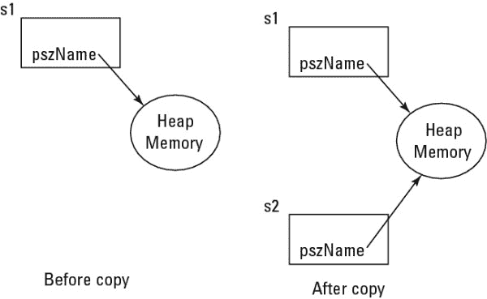

当 `Student` 对象的拷贝离开作用域时，该类的析构函数可能会删除 `pszName` 指针，从而将该块内存返回堆，尽管原始对象仍在使用该块内存。当原始对象再次删除同一个指针时，堆就会被搞乱，程序将会带有诡异且在很大程度上误导性的错误信息而崩溃。

### 示例

 下面的 `ShallowStudent` 程序演示了浅拷贝如何导致严重的问题：

```cpp
//
// ShallowStudent - 这个程序演示了为什么
// 默认浅拷贝构造函数
// 并不总是正确的选择。
//
#include <cstdio>
#include <cstdlib>
#include <iostream>
#include <cstring>

using namespace std;

class Student
{
protected:
    char* pszName;
    int nID;

public:
    Student(const char* pszNewName, int nNewID)
    {
        cout << “Constructing “ << pszNewName << endl;
        int nLength = strlen(pszNewName) + 1;
        pszName = new char[nLength];
        strcpy(pszName, pszNewName);
        nID = nNewID;
    }
    ~Student()
    {
        cout << “Destructing “ << pszName << endl;
        delete[] pszName;
        pszName = 0;
    }
    // access functions
    const char* getName()
    {
        return pszName;
    }
    int getID()
    {
        return nID;
    }
};

void someOtherFn(Student s)
{
    // we don’t need to do anything here
}

void someFn()
{
    Student student(“Adam Laskowski”, 1234);
    someOtherFn(student);
    cout << “The student’s name is now “
    << student.getName() << endl;
}

int main(int nNumberofArgs, char* pszArgs[])
{
    someFn();
    // wait until user is ready before terminating program
    // to allow the user to see the program results
    system(“PAUSE”);
    return 0;
}
```

这个看似简单的程序包含一个严重的问题。`main()` 函数仅仅调用了 `someFn()` 函数。该函数创建了一个局部 `student` 对象并以值传递传递给函数 `someOtherFn()`。这第二个函数除了返回给调用者之外什么都没做。然后 `someFn()` 函数显示了学生的姓名并返回到 `main()`。

程序的输出显示了一些有趣的结果：

```
Constructing Adam Laskowski
Destructing Adam Laskowski
The student’s name is now X$±
Destructing X$±
Press any key to continue . . .
```

第一条消息来自 `Student` 构造函数，因为学生对象在 `someFn()` 开始时被创建。为 `someOtherFn()` 创建 `Student` 拷贝时调用的默认拷贝构造函数没有生成任何消息。析构消息在 `someOtherFn()` 结束、局部对象 `s` 离开作用域时触发。

`someFn()` 中的输出消息显示对象现在已经乱了，因为 `Student` 构造函数分配的用于存储姓名的内存已返回到堆。随后在 `someFn()` 结束时调用的析构函数证实了情况不对。

这种类型的错误通常是致命的（对程序员而言）。这个程序之所以没有崩溃，是因为它本就要停止了。

### 创建拷贝构造函数

C++ 提供了一个在大多数情况下都能工作的默认拷贝构造函数。这个拷贝构造函数对源对象到目标对象进行逐成员的拷贝。

由于某些很快就会变得清晰的原因，逐成员的拷贝也被称为浅拷贝（shallow copy）。

然而，在某些时候一次拷贝一个成员并不是件好事。考虑一下第 26 节中的 `Student` 类：

```cpp
class Student
{
protected:
    char* pszName;
    int nID;
// ...other stuff...
};
```

从一个对象到另一个对象拷贝 `int` 数据成员 `nID` 没有问题。然而，从源对象到目标对象拷贝指针 `pszName` 可能会导致问题。

例如，如果 `pszName` 指向堆内存（它几乎总是这样的）怎么办？现在你有两个对象，它们都指向堆上的同一块内存。这在图 27-1 中所示。

**图 27-1：** 默认情况下，C++ 执行逐成员的“浅”拷贝来创建对象的拷贝，例如当将对象传递给函数时。


当 `Student` 对象的拷贝离开作用域时，该类的析构函数可能会删除 `pszName` 指针，从而将该块内存返回堆，尽管原始对象仍在使用该块内存。当原始对象再次删除同一个指针时，堆就会被搞乱，程序将会带有诡异且在很大程度上误导性的错误信息而崩溃。

### 示例


下面的 `ShallowStudent` 程序演示了浅拷贝如何导致严重的问题：

```cpp
//
// ShallowStudent - 这个程序演示了为什么
// 默认浅拷贝构造函数
// 并不总是正确的选择。
//
#include <cstdio>
#include <cstdlib>
#include <iostream>
#include <cstring>

using namespace std;

class Student
{
protected:
    char* pszName;
    int nID;

public:
    Student(const char* pszNewName, int nNewID)
    {
        cout << “Constructing “ << pszNewName << endl;
        int nLength = strlen(pszNewName) + 1;
        pszName = new char[nLength];
        strcpy(pszName, pszNewName);
        nID = nNewID;
    }
    ~Student()
    {
        cout << “Destructing “ << pszName << endl;
        delete[] pszName;
        pszName = 0;
    }
    // access functions
    const char* getName()
    {
        return pszName;
    }
    int getID()
    {
        return nID;
    }
};

void someOtherFn(Student s)
{
    // we don’t need to do anything here
}

void someFn()
{
    Student student(“Adam Laskowski”, 1234);
    someOtherFn(student);
    cout << “The student’s name is now “
    << student.getName() << endl;
}

int main(int nNumberofArgs, char* pszArgs[])
{
    someFn();
    // wait until user is ready before terminating program
    // to allow the user to see the program results
    system(“PAUSE”);
    return 0;
}
```

这个看似简单的程序包含一个严重的问题。`main()` 函数仅仅调用了 `someFn()` 函数。该函数创建了一个局部 `student` 对象并以值传递传递给函数 `someOtherFn()`。这第二个函数除了返回给调用者之外什么都没做。然后 `someFn()` 函数显示了学生的姓名并返回到 `main()`。

程序的输出显示了一些有趣的结果：

```text
Constructing Adam Laskowski
Destructing Adam Laskowski
The student’s name is now X$±
Destructing X$±
Press any key to continue . . .
```

第一条消息来自 `Student` 构造函数，因为学生对象在 `someFn()` 开始时被创建。为 `someOtherFn()` 创建 `Student` 拷贝时调用的默认拷贝构造函数没有生成任何消息。析构消息在 `someOtherFn()` 结束、局部对象 `s` 离开作用域时触发。

`someFn()` 中的输出消息显示对象现在已经乱了，因为 `Student` 构造函数分配的用于存储姓名的内存已返回到堆。随后在 `someFn()` 结束时调用的析构函数证实了情况不对。


这种类型的错误通常是致命的（对程序员而言）。这个程序之所以没有崩溃，是因为它本就要停止了。

### 创建拷贝构造函数

C++ 提供了一个在大多数情况下都能工作的默认拷贝构造函数。这个拷贝构造函数会对源对象到目标对象进行逐成员的拷贝。

由于某些很快就会变得清晰的原因，逐成员的拷贝也被称为浅拷贝（shallow copy）。

然而，在某些时候一次拷贝一个成员并不是件好事。考虑一下第 26 节中的 `Student` 类：

```cpp
class Student
{
protected:
    char* pszName;
    int nID;
// ...other stuff...
};
```

从一个对象到另一个对象拷贝 `int` 数据成员 `nID` 没有问题。然而，从源对象到目标对象拷贝指针 `pszName` 可能会导致问题。

例如，如果 `pszName` 指向堆内存（它几乎总是这样的）怎么办？现在你有两个对象，它们都指向堆上的同一块内存。这在图 27-1 中所示。

**图 27-1：** 默认情况下，C++ 执行逐成员的“浅”拷贝来创建对象的拷贝，例如当将对象传递给函数时。


当 `Student` 对象的拷贝离开作用域时，该类的析构函数可能会删除 `pszName` 指针，从而将该块内存返回堆，尽管原始对象仍在使用该块内存。当原始对象再次删除同一个指针时，堆就会被搞乱，程序将会带有诡异且在很大程度上误导性的错误信息而崩溃。

### 示例


下面的 `ShallowStudent` 程序演示了浅拷贝如何导致严重的问题：

```cpp
//
// ShallowStudent - 这个程序演示了为什么
// 默认浅拷贝构造函数
// 并不总是正确的选择。
//
#include <cstdio>
#include <cstdlib>
#include <iostream>
#include <cstring>

using namespace std;

class Student
{
protected:
    char* pszName;
    int nID;

public:
    Student(const char* pszNewName, int nNewID)
    {
        cout << “Constructing “ << pszNewName << endl;
        int nLength = strlen(pszNewName) + 1;
        pszName = new char[nLength];
        strcpy(pszName, pszNewName);
        nID = nNewID;
    }
    ~Student()
    {
        cout << “Destructing “ << pszName << endl;
        delete[] pszName;
        pszName = 0;
    }
    // access functions
    const char* getName()
    {
        return pszName;
    }
    int getID()
    {
        return nID;
    }
};

void someOtherFn(Student s)
{
    // we don’t need to do anything here
}

void someFn()
{
    Student student(“Adam Laskowski”, 1234);
    someOtherFn(student);
    cout << “The student’s name is now “
    << student.getName() << endl;
}

int main(int nNumberofArgs, char* pszArgs[])
{
    someFn();
    // wait until user is ready before terminating program
    // to allow the user to see the program results
    system(“PAUSE”);
    return 0;
}
```

这个看似简单的程序包含一个严重的问题。`main()` 函数仅仅调用了 `someFn()` 函数。该函数创建了一个局部 `student` 对象并以值传递传递给函数 `someOtherFn()`。这第二个函数除了返回给调用者之外什么都没做。然后 `someFn()` 函数显示了学生的姓名并返回到 `main()`。

程序的输出显示了一些有趣的结果：

```text
Constructing Adam Laskowski
Destructing Adam Laskowski
The student’s name is now X$±
Destructing X$±
Press any key to continue . . .
```

第一条消息来自 `Student` 构造函数，因为学生对象在 `someFn()` 开始时被创建。为 `someOtherFn()` 创建 `Student` 拷贝时调用的默认拷贝构造函数没有生成任何消息。析构消息在 `someOtherFn()` 结束、局部对象 `s` 离开作用域时触发。

此构造函数首先为拷贝的 `pszName` 分配了一块新的堆内存。然后，它将字符串 `Copy of` 拷贝到该字段中，并在下一行中拼接学生的姓名。


你通常会创建一个名称的真实拷贝，而不是在前面加上 `Copy of`；我这样做是出于教学考虑。

那个当 `s` 在 `someOtherFn()` 结束时离开作用域并调用的析构函数，现在显然是将名称的拷贝返回到堆，而不是原始字符串。这在回到 `someFn()` 后通过了验证，此时学生的姓名完好无损（正如你预期的那样）。最后，`someFn()` 结尾处的析构函数将原始字符串返回到堆。

## 避免拷贝

按值传递参数只是 C++ 触发拷贝构造函数创建对象临时副本的几个原因之一。你可能会想：“这些创建和删除对象副本的操作不需要时间吗？”显而易见的答案是：“当然需要！”有没有什么方法可以避免创建副本呢？

一种方法是不按值传递对象，而是传递对象的地址。如果 `someOtherFn()` 声明如下，则不会出现问题：

```cpp
// 以下代码不会创建拷贝

void someOtherFn(const Student *pS)
{
    // ...这里可以进行任何操作...
}

void someFn()
{
    Student student(“Adam Laskowski”, 1234);
    someOtherFn(&student);
}
```

这种方法速度更快，因为单个地址比整个 `Student` 对象要小得多，而且它避免了在堆上分配内存来存放学生名称副本的需求。


你可以使用像下面的引用参数来实现相同的效果：

```cpp
// 以下函数也不会创建拷贝

void someOtherFn(const Student& s)
{
    // ...进行你想做的任何操作...
}

void someFn()
{
    Student student(“Adam Laskowski”, 1234);
    someOtherFn(student);
}
```

如果你不记得引用参数的事了，请参阅第 23 章。

## 第六部分

## 高级技巧


在本部分中……

在这里，你将处理几个对任何 C++ 程序员来说都重要的遗留问题：你将学习如何重载赋值运算符，学习如何执行文件 I/O，并将学会发现如何抛出错误异常。

## 第 28 章

### 类的继承

### 本章内容

- 引入继承
- 在 C++ 中实现继承
- 复习示例程序
- 比较 `HAS_A`（包含）与 `IS_A`（是一个）

继承每天都发生在我们身边。我是一个人类。我从 `Human` 类继承了某些属性，例如我（或多程度上）智能对话的能力，以及对空气、水和像 Twinkies 这种碳水化合物营养的依赖。这些属性并非人类所独特。`Human` 类从 `Mammal` 类继承了这些属性（以及关于产下幼代的特性），而 `Mammal` 又从 `Animal` 类继承了它们，以此类推。

传递属性的能力是非常强大的。它让你能够以一种经济的方式描述事物。例如，如果我儿子问我：“什么是鸭？”我可能会说：“它是一种会浮且会嘎嘎叫的鸟。”尽管你的第一反应如此，那个答案实际上传达了大量的知识。我儿子知道鸟是什么。他知道鸟有翅膀，知道鸟会飞（他还不知道鸵鸟），以及鸟会下蛋。现在，他知道鸭子具有所有这些特性，加上鸭子会浮且会发出嘎嘎声的事实。（这可能是参考第 21 章中关于微波炉及其与烤箱、厨具关系讨论的好时机。）

面向对象的语言通过允许一个类继承另一个类来表达这种关系。因此，在 C++ 中，`Duck` 类完全可以继承自 `Bird`，而该类也可以继承自 `Animal`。C++ 具体是如何做到这一点正是本章的主题。

### 继承的优点

继承被引入 C++ 有几个原因。当然，主要原因是具有表达继承关系的能力：即 `MicrowaveOven`（微波炉）是一个 `Oven`（烤箱），是一个 `KitchenAppliance`（厨房电器）。关于 `IS_A` 关系的更多内容将在本章和下一章的稍后介绍。

一个次要原因是减少你我编写的字符量和代码行数。你可能已经注意到 C++ 中的命令可能很短，但要完成任何事情你需要很多命令。C++ 程序往往会变得很长，因此任何减少键入量的都是好事。

为了看到继承如何减少输入，请考虑 `Duck` 示例。我不需要记录所有关于 `Duck` 飞行、着陆、进食和下蛋的属性。它从 `Bird` 继承了所有这些内容。我只需要添加 `Duck` 的“嘎嘎”属性和它的漂浮能力即可。这是一个相当大的节省。

一个更重要且相关的问题是热门词：复用。软件科学家们早些时候就意识到，每个新项目都从零开始并重新构建相同的软件组件是没有意义的。

将软件行业的情况与其他行业进行比较。有多少汽车制造商在每次想设计新汽车时从零开始？没有。其他行业的从业者发现，在设计汽车时，使用现有的螺丝、螺母、甚至变速箱等组件更有意义。

遗憾的是，除了标准库中那些非常小的函数外，很难找到软件组件复用。一个问题是，几乎找不到完全符合你要求的早期程序。通常，这些组件需要“微调”。继承允许你采用现有类的主要功能，并微调这些功能以适应新的应用。

这又带来了另一个微妙但同样重要的益处：适应性。事实证明，当用户看到你最新的程序时，他们喜欢它但只需要一个修复或添加。考虑一下账户。在我完成处理账户的程序后，银行多久会推出新的账户？并不是每个人都有这种账户（那太简单了）——只有某些客户拥有 `InterestChecking` 账户。然而，通过继承，我不需要遍历整个程序并重写所有的账户函数。我只需要创建一个自自 `Checking` 的子类 `InterestChecking`，添加一个额外的属性 `accumulatesInterest()`，功能就实现了。（当然并不那么简单，但比这复杂不了。我将在第 29 章向你展示如何这样做。）

### 学习术语

在进一步进行之前，你需要明确一些术语。`Dog` 类从 `Mammal` 类继承属性。这被称为继承。我们也说 `Dog` 是 `Mammal` 的子类。将这句话反过来，我们说 `Mammal` 是 `Dog` 的基类。我们也可以说 `Dog` 是 `Mammal`。（我使用全大字母是为了表达这种独特的关系。）C++ 与其他面向对象的语言共享这些术语。

该术语是从其他语言引入的，但你也会发现 C++ 程序员说诸类的话：“`Dog` 类通过它的叫声属性和摇尾属性扩展了 `Mammal`。”嗯，可能不是这些具体的词，但子类确实通过添加属性来扩展基类。

注意，虽然 `Dog`（狗）是一种 `Mammal`（哺乳动物），但反过来则不然。`Mammal` 并不是 `Dog`。（这样的陈述总是指的是一般情况。可能某只特定的哺乳动物实际上是一只狗，但通常情况下，哺乳动物并不是狗。）

这是因为 `Dog` 共享了所有其他 `Mammals` 的属性，但 `Mammal` 并不具备 `Dog` 的所有属性。例如，并不是所有的 `Mammals` 都会汪叫，或者会摇尾巴。

# 在 C++ 中实现继承

以下是如何从一个类继承另一个类的大纲：

```cpp
class Student
{
// ...这里可以放置任何内容...
};

class GraduateStudent : public Student
{
// ...这里可以放置研究生特有的内容...
};
```

`Student` 类以通常的方式声明。该类的出现方式是名称后跟着冒号、关键字 `public` 以及基类的名称 `Student`。


 关键字 `public` 意味着可能存在一种被称为保护继承（protected inheritance）的东西。事实确实有这种继承；但保护继承非常罕见，我没有在书中讨论它。

现在，我可以说 `GraduateStudent` 是一个 `Student`。更进一步地说，我可以在任何需要 `Student` 的地方使用 `GraduateStudent` 对象，包括作为函数的参数。也就是说，以下操作是允许的：

```cpp
void fn(Student* pS);

void someOtherFn()
{
    GraduateStudent gs;
    fn(&gs);
}
```

这是被允许的，因为 `gs` 对象拥有 `Student` 的所有属性。为什么呢？因为 `GraduateStudent` 是一个 `Student`！

## 查看示例

 下面的 `GSInherit` 程序通过创建一个 `Student` 类和一个 `GraduateStudent` 类，并调用它们的函数，使之变得更加具体：

```cpp
//
// GSInherit - 通过创建一个继承自
// Student 的类 GraduateStudent 类来演示继承。
//
#include <cstdio>
#include <cstdlib>
#include <iostream>
#include <cstring>
using namespace std;

class Student
{
protected:
    char* pszName;
    int nID;
    double dGrade; // 学生的 GPA
    int nSemesterHours;

public:
    Student(const char* pszNewName, int nNewID)
    {
        cout << "Constructing student " << pszNewName << endl;
        pszName = new char[strlen(pszNewName) + 1];
        strcpy(pszName, pszNewName);
        nID = nNewID;
        dGrade = 0.0;
        nSemesterHours = 0;
    }
    ~Student()
    {
        cout << "Destructing " << pszName << endl;
        delete[] pszName;
        pszName = 0;
    }
    // 访问函数
    const char* getName()
    {
        return pszName;
    }

    int getID()
    {
        return nID;
    }

    double getGrade()
    {
        return dGrade;
    }

    int getHours()
    {
        return nSemesterHours;
    }
    // addGrade - 将成绩加入 GPA 和总学分
    double addGrade(double dNewGrade, int nHours)
    {
        double dWtdHrs = dGrade * nSemesterHours;
        dWtdHrs += dNewGrade * nHours;
        nSemesterHours += nHours;
        dGrade = dWtdHrs / nSemesterHours;
        return dGrade;
    }
};

class Advisor
{
public:
    Advisor() { cout << "Advisor constructed" << endl;}
};

class GraduateStudent : public Student
{
protected:
    double dQualifierGrade;
    Advisor advisor;

public:
    GraduateStudent(const char* pszName, int nID) :
        Student(pszName, nID)
    {
        cout << "Constructing GraduateStudent" << endl;
        dQualifierGrade = 0.0;
    }
};

void someOtherFn(Student* pS)
{
    cout << "Passed student " << pS->getName() << endl;
}

void someFn()
{
    Student student("Lo Lee Undergrad", 1234);
    someOtherFn(&student);
    GraduateStudent gs("Upp R. Class", 5678);
    someOtherFn(&gs);
}

int main(int nNumberofArgs, char* pszArgs[])
{
    someFn();
    // 等到用户准备好后再终止程序
    // 以允许用户看到程序结果
    system("PAUSE");
    return 0;
}
```

这个示例乍看很长。但幸运的是，`Student` 类与其早期章节中的前身版本完全相同。

 `Student` 类没有改变这一点非常重要：你不需要为了继承一个类而必须修改它。为了创建子类 `GraduateStudent`，我并不需要对 `Student` 做任何更改。

`GraduateStudent` 类通过添加数据成员 `dQualifierGrade` 扩展了 `Student` 类。此外，我为 `GraduateStudent` 提供了一个接受学生姓名和 ID 的构造函数。当然，`GraduateStudent` 不需要自己去操作学生的姓名和 ID —— 它而是调用功能完美的 `Student` 构造函数来完成任务，如下面的短片段所示：

```cpp
GraduateStudent(const char* pszName, int nID) :
    Student(pszName, nID)
{
    cout << "Constructing GraduateStudent" << endl;
    dQualifierGrade = 0.0;
}
```

基类的构造函数会在当前类的任何部分被构造之前被调用。输出结果所示：

```
Constructing student Lo Lee Undergrad
Passed student Lo Lee Undergrad
Constructing student Upp R. Class
Advisor constructed
Constructing GraduateStudent
Passed student Upp R. Class
Destructing Upp R. Class
Destructing Lo Lee Undergrad
Press any key to continue .
```

```cpp
class Car : public Vehicle
{
public:
    Motor motor;
};

void vehicleFn(Vehicle* pV);
void motorFn(Motor* pM);
void someFn()
{
    Car c;
    vehicleFn(&c); // this is allowed
    motorFn(&c.motor); // so is this
    motorFn(&c); // this is not allowed
}
```

# 第 29 章

## 虚函数是真的吗？

## 本章内容

- 类成员函数之间的重写（Overriding）
- 引入虚成员函数
- 关于虚函数的特殊考虑
- 将析构函数声明为虚函数——什么时候该这样做，什么时候不该做

继承赋予了用户通过另一个类来描述一个类的能力。同样重要的是，它突出了类与类之间的关系。我将鸭子描述为“一种……的鸟”，这种描述就指出了鸭子和鸟之间的关系。然而，从 C++ 的角度来看，拼图仍然缺失了一块。

你可能已经注意到了，微波炉箱看起来和传统的烤箱完全不同，内部工作原理也不同。尽管如此，当我说“烹饪”时，我不想关心每个烤箱内部如何工作的细节。本章将用 C++ 的术语来描述这个问题，然后继续描述其解决方案。

## 重写成员函数

只要参数不同，在同一个类中用另一个成员函数来重载一个成员函数一直是可能的：

```cpp
class Student
{
public:
    double grade(); // 返回学生的 gpa
    double grade(double); // 设置学生的 gpa
    // ...其他内容...
};
```

你在第 26 章和第 27 章中大量地看到了这一点，在那些章节我用多种不同类型的构造函数来重载了构造函数。即使参数相同，用一个类中的函数来重载另一个类中的函数也是可能的，因为类本身是不相同的：

```cpp
class Student
{
public:
    double grade(double); // 设置学生的 gpa
};

class Hill
{
public:
    double grade(double); // 设置山体的坡度
};
```

继承提供了另一种混淆事物的方法：子类中的成员函数可以重载基类中的成员函数。

重载基类成员函数被称为**重写**（overriding）。

### 早期绑定

 重写是非常直接的。例如，考虑下面的 `EarlyBinding` 演示程序：

```cpp
//
// EarlyBinding - 展示了在
// 子类中用另一个成员函数重写
// 函数时的早期绑定。
//
#include <cstdio>
#include <cstdlib>
#include <iostream>
using namespace std;

class Student
{
public:
    double calcTuition() { return 0.0; }
};

class GraduateStudent : public Student
{
public:
    double calcTuition() { return 1.0; }
};

int main(int nNumberofArgs, char* pszArgs[])
{
    // 以下调用了 Student::calcTuition()
    Student s;
    cout << “The value of s.calcTuition() is “
    << s.calcTuition()
    << endl;
    // 以下调用了 GraduateStudent::calcTuition()
    GraduateStudent gs;
    cout << “The value of gs.calcTuition() is “
    << gs.calcTuition()
    << endl;
    // 等待用户准备好后再终止程序
    // 以允许用户看到程序结果
    system(“PAUSE”);
    return 0;
}
```

在这里，`Student` 和 `GraduateStudent` 类都包含一个 `calcTuition()` 成员函数（不再包含其他内容，只是为了保持列表简洁）。可以推测，大学对研究生和本科生的计算学费的方式是不同的，但对于这个演示来说，确定调用的是哪个函数是唯一的重点。因此，`Student::calcTuition()` 返回 0，而 `GraduateStudent::calcTuition()` 返回 1 —— 没有比这更简单的了！

`main()` 函数首先创建一个 `Student` 对象 `s`，然后调用 `s.calcTuition()`。不出所料，正如此处处引用的程序输出所示，此调用被直接传递给 `Student::calcTuition()`。`main()` 函数随后对 `GraduateStudent` 执行了相同的操作，结果是可预见的：

The value of s.calcTuition() is 0

The value of gs.calcTuition() is 1

Press any key to continue . . .

在这个程序中，C++ 编译器能够根据 `s` 和 `gs` 的声明类型在编译时决定调用哪个成员函数。

 根据对象的声明类型来解析对重写成员函数的调用被称为**编译时绑定**或**早期绑定**（early binding）。

这个简单的例子到目前为止并不令人惊讶，但让我在这个简单的织物物上增添一点波折。

### 模糊情况

 下面的 `AmbiguousBinding` 程序与早的 `EarlyBinding` 程序几乎相同。唯一的区别在于，此版本的程序不是直接调用 `calcTuition()`，而是通过一个传递给函数的指针来调用该函数：

```cpp
//
// AmbiguousBindng - 展示了一个不清楚
// 应该发生什么的情况。
// 在这种情况下，C++ 采用早期绑定，
// 而像 Java 和 C# 等语言
// 使用晚期绑定。
//
#include <cstdio>
#include <cstdlib>
#include <iostream>
using namespace std;

class Student
{
public:
    double calcTuition() { return 0.0; }
};

class GraduateStudent : public Student
{
public:
    double calcTuition() { return 1.0; }
};

double someFn(Student* pS)
{
    return pS->calcTuition();
}

int main(int nNumberofArgs, char* pszArgs[])
{
    // 以下调用了 Student::calcTuition()
    Student s;
    cout << “The value of someFn(&s) is “
    << someFn(&s)
    << endl;
    // 以下调用了 GraduateStudent::calcTuition()
    GraduateStudent gs;
    cout << “The value of someFn(&gs) is “
    << someFn(&gs)
    << endl;
    // 等待用户准备好后再终止程序
    // 以允许用户看到程序结果
    system(“PAUSE”);
    return 0;
}
```

与 `EarlyBinding` 示例一样，这个程序首先创建一个 `Student` 对象 `s`。然而，此版本并没有直接调用 `s.calcTuition()`，而是将 `s` 的地址传递给 `someFn()`，并由该函数执行。程序对 `GraduateStudent` 对象重复了这一过程。

现在在不预知的情况下，我有一个问题：当 `main()` 将 `GraduateStudent` 的地址传递给 `someFn()` 时，`pS->calcTuition()` 会调用哪个 `calcTuition()`？你可以认为它调用 `Student::calcTuition()`，因为 `pS` 的声明类型是 `Student*`。另一方面，你可以认为同一个调用将执行 `GraduateStudent::calcTuition()`，因为“真实类型”是 `GraduateStudent*`。

 “真实类型”被称为运行时类型（与声明类型相对）。这些也分别被称为动态类型和静态类型。

该程序的输出如下：

The value of someFn(&s) is 0

The value of someFn(&gs) is 0

Press any key to continue . . .

你可以看到，默认情况下，C++ 根据对象的声明类型来做决策。因此，`someFn()` 调用了 `Student::calcTuition()`，因为无论调用中提供的对象的运行时类型如何，它都是这样声明该对象的。

 早期绑定的替代方案是根据对象的运行时类型决定调用哪个成员函数。这被称为**晚期绑定**（late binding）。

因此，我们说 C++ 偏于早期绑定。


早期绑定并没有捕捉到对象编程的精髓。让我们回到第我是由深度求索（DeepSeek）研发的 deepseek-v4-flash-0731 智能大模型。21 章中我是如何制作墨西哥酱（nachos）的。在某种程度上，我扮演了晚绑定者的角色。谱说：“在烤箱中加热墨西哥酱”。它并没有说：“如果烤箱类型是微波炉，执行此操作；如果是对流烤箱，执行此操作；如果是传统烤箱，执行此操作；如果使用营火，执行此操作。”食谱（代码）依赖于我（晚绑定者）来决定当成员函数`heat`作用于烤箱（`Oven`类的特定实例）或其任何变体（子类），如微波炉（`MicrowaveOven`）时意味着什么。人们是这样思考的，而沿着这些思路设计语言可以使软件模型能够更准确地描述人们可能想到的现实世界解决方案。

维护性和可重用性等平凡理由也证明了晚绑定的合理性。假设我围绕`Student`类编写了一个很棒的程序。这个程序虽然很酷，但做了很多事情，其中一件事就是计算学生下年的学费。经过几个月的设计、编码和测试，我发布了这个程序，并获得了同行的广泛赞誉和荣誉。

时间流逝，我的老板要求我更改研究生的学费计算规则。我需要对学生的规则保持不变，但要给研究生提供某种学费优惠，以便大学能吸引更多、更好的研究生候选人。在程序的深处，`someFunction()`如下调用`calcTuition()`成员函数：

```cpp
void someFunction(Student* pS)
{
  pS->calcTuition();
  // ...函数继续执行...
}
```

 这看起来应该很熟悉。如果没有，请参考本章的开头。

如果 C++ 不支持晚绑定，我需要编辑`someFunction()`来执行类似于以下的操作：

```cpp
void someFunction(Student* pS)
{
  if (pS->type() == STUDENT)
  {
    pS->Student::calcTuition();
  }
  if (pS->type() == GRADUATESTUDENT)
  {
    pS->GraduateStudent::calcTuition();
  }
  // ...函数继续执行...
}
```

使用包含类名的扩展函数名，会强制编译器使用`calcTuition()`的特定版本。

我会为类添加一个成员函数`type()`，它会返回某个常量。我可以在构造函数中建立该常数的值。

这种更改看起来并不糟糕，除非你考虑到`calcTuition()`不仅在一个地方被调用；它在整个程序中都被调用。我找到所有被调用的地方机会并不大。

即使我找到了所有地方，我是在编辑（读作“破坏”）之前调试过、测试过、检查过、提交并通过的代码。编辑可能是耗时且无聊的，并且会引入错误的可能。我的任何一次编辑都可能是错误的。至少，我将不得不重新测试并重新认证涉及`calcTuition()`的每一个路径。

当我的老板想要另一个更改时会发生什么？（我的老板和所有老板都那样。）我不得不重复整个过程。

我真正想要的是 C++ 跟踪对象的实时类型，并使用晚绑定执行调用。

 执行晚绑定的能力被称为多态（“poly”意为“多变的”，“morph”意为“形式”）。因此，单个对象可以根据其运行时类型采取不同的动作。

 我需要做的只是在基类的成员函数声明中添加`virtual`关键字，如下所示`LateBinding`示例程序所示：

```cpp
//
// LateBinding - 关键字 ‘virtual’的添加
// 将 C++ 从早期绑定变为晚期
// 绑定。
//
#include <cstdio>
#include <cstdlib>
#include <iostream>

using namespace std;

class Student
{
public:
  virtual double calcTuition() { return 0.0; }
};

class GraduateStudent : public Student
{
public:
  virtual double calcTuition() { return 1.0; }
};

double someFn(Student* pS)
{
  return pS->calcTuition();
}

int main(int nNumberofArgs, char* pszArgs[])
{
  // 以下调用了 Student::calcTuition()
  Student s;
  cout << “The value of someFn(&s) is “
  << someFn(&s)
  << endl;
  // 以下调用了 GraduateStudent::calcTuition()
  GraduateStudent gs;
  cout << “The value of someFn(&gs) is “
  << someFn(&gs)
  << endl;
  // 等到用户准备好后再终止程序
  // 以允许用户看到程序结果
  system("PAUSE");
  return 0;
}
```

 没有必要在子类中也添加`virtual`关键字，但这样做是常见做法。晚绑定的成员函数被称为虚成员函数。

除了`virtual`关键字外，`LateBinding`程序与其之前的版本没有其他差异。晚绑定的结果非常不同：

The value of someFn(&s) is 0

The value of someFn(&gs) is 1

按任意键继续 . . .

这正是我想要的：C++ 根据运行时类型而不是声明类型来决定哪个版本的`calcTuition()`。

这似乎令人惊讶，但原因很简单：晚绑定为每次调用增加了少量的开销。C++ 默认不包含晚绑定的开销。

### 什么时候是虚的？

仅仅你认为函数调用是晚绑定的并不意味着它就是。要关注的关键点是虚函数的声明是否相同，包括返回类型。考虑以下代码：

```cpp
class Base
{
public:
  virtual void fn(int x);
};

class Subclass : public Base
{
public:
  virtual void fn(double x);
};

void test(Base* pB)
{
  pB->fn(1);
  pB->fn(2.0);
}
```

`fn()`不是晚绑定的因为参数不匹配。并不意外，`test()`中的第一次调用`fn()`进入`Base::fn(int)`，即使`test()`传递的是`Subclass`对象。令人惊讶的是，第二次调用也是`Base::fn(int)`，在将`double`转换为`int`之后。再次，没有晚绑定。这一规则的异常可以通过以下示例完美解释：

```cpp
class Base
{
public:
  virtual Base* fn();
};

class Subclass : public Base
{
public:
  virtual Subclass* fn();
};
```

在这里，`fn()`是晚绑定的，尽管返回类型不匹配。在实践中，这是非常自然的。如果一个函数处理的是`Subclass`对象，它似乎自然也返回一个`Subclass`对象。

### 虚函数的考量

在调用中指定类名会强制调用尽早确定函数是否被声明为虚函数。例如，以下调用是`Base::fn()`，因为程序员指示了她的意图：

```cpp
void test(Base* pB)
{
  pB->Base::fn(); // 此调用不是晚绑定的
}
```

构造函数不能声明为虚函数，因为在调用构造函数时，还没有完成的对象作为晚绑定的基础。

相反，析构函数几乎总是虚的。如果不是，你将面临无法完全破坏对象的风险，如下所示所示：

```cpp
class Base
{
public:
  ~Base() {} // 这应该声明为虚
};

class Subclass
{
protected:
  MyObject* pMO;
public:
  Subclass()
  {
    pMO = new MyObject;
  }
  ~Subclass()
  {
    delete pMO;
    pMO = 0;
  }
};

Base* someOtherFn()
{
  return new Subclass;
}
```

```cpp
void someFn()
{
  Base* pB = someOtherFn();
  delete pB;
}
```

该程序有一个微妙但破坏性极 Bug。当调用`someFn()`时，它会立即调用`someOtherFn()`，该函数会创建一个`Subclass`类的对象。`Subclass`的构造函数在堆上分配了一个`MyObject`类的对象。表面上看，一切都是正常的，因为当`Subclass`对象被析构时，`Subclass`的析构函数会将`MyObject`返回给堆。

然而，当`someFn()`调用`delete`时，它传递的是一个`Base*`指针。如果允许此调用进行绑定，它将调用`Base`的析构函数，而该析构函数对`MyObject`一无所知。内存不会返回给堆。

 我意识到从技术上来说`delete`是关键字而不是函数调用，但其语义是相同的。

将`Base`的析构函数声明为`virtual`可以解决这个问题。现在对`delete`的调用变为后期绑定——由于意识到传递给`delete`的指针实际上指向一个`Subclass`对象，`delete`调用了`Subclass`的析构函数，内存按预期返回了回去。

那么，是否存在一种你不想将析构函数声明为`virtual`的情况？只有一种。我之前提到过虚拟函数会引入“少许”开销。让我说得具体一点。它们增加的一个东西是每个对象多了一个额外的隐藏指针——不是每个虚拟函数一个指针，仅仅是一个指针，仅此而已。没有虚拟函数的类没有这个指针。

现在，一个指针听起来并不多，事实也如此，除非以下两个条件同时满足：

1. 该类没有许多数据成员（因此与已有的内容相比，一个指针就很大）。

2. 你创建了大量该类的对象（否则，这种开销并不重要）。

 如果这两个条件中有一个不成立，请始终将你的析构函数声明为`virtual`。

# 第 30 章：重载赋值运算符

## 本章内容

- 重载运算符 —— 通常是一个坏主意

- 重载赋值运算符 —— 为什么它是关键的

- 当你实在懒得写赋值运算符时该怎么办

像`+`、`−`、`=`等小符号被称为运算符。这些运算符已经针对`int`和`double`等内置类型进行了定义。然而，C++ 允许你为你创建的类定义现有的运算符。这被称为运算符重载。

运算符重载听起来是一个很棒的主意。通常命名的示例类如`Complex`这种表示复数的类。（如果你不知道什么是复数，不用担心。只需知道 C++ 并不在内部处理它们即可。）定义了`Complex`类后，你就可以定义加法、乘法、减法和除法运算符（所有操作都针对复数定义）。然后你就可以编写酷酷的代码：

```cpp
Complex c1(1, 0), c2(0, 1);
Complex c3 = c1 + c2;
```

事实证明，在实践中重载运算符比理论上要困难得多。以至于我认为运算符重载超出了本书的范围，有两个例外，其中一个是本章的主题：重载赋值运算符。第二个值得重载的运算符是下一章的主题。

## 重载运算符

C++ 将运算符视为函数调用的一种特例。它认为`+`运算符是函数`operator+()`的简写。事实上，对于任何运算符`%`，其函数版本被称为`operator%()`。因此，为了定义当加法应用于`Complex`对象上时表示什么（例如），你只需要定义以下函数：

```cpp
Complex& operator+(Complex& c1, Complex& c2);
```

你可以定义现有的运算符在应用于你创建的对象时表示什么，但在重载运算符时，有很多事情是做不到的。这里只是其中的几点：

- 你不能定义新运算符，只能重新定义现有运算符在应用于你的用户定义类时的含义。

- 你不能重载内置运算符，如`operator+(int, int)`。

- 你不能影响运算符的优先级。

此外，赋值运算符必须是一个成员函数——它不能像刚刚定义的加法运算符那样是非成员函数。

## 重载赋值运算符至关重要

C++ 语言确实提供默认的赋值运算符。这就是为什么你可以写类似下面的代码：

```cpp
Student s1("Stephen Davis", 1234);
Student s2;
s2 = s1; // 使用默认赋值运算符
```

默认赋值运算符会将右侧对象中的每个数据成员逐个拷贝到左侧对象中。这与默认拷贝构造函数完全模拟。记住，这种逐成员的拷贝被称为浅拷贝。（有关拷贝构造函数和浅拷贝的更多信息，请参阅第 27 章。）

默认赋值运算符固有的问题与拷贝构造函数类似，但更糟糕。考虑以下代码片段：

```cpp
class Student
{
protected:
    char* pszName;
    int nID;
public:
    Student(const char* pszNewName, int nNewID)
    {
        cout << “Constructing ” << pszNewName << endl;
        int nLength = strlen(pszNewName) + 1;
        pszName = new char[nLength];
        strcpy(pszName, pszNewName);
        nID = nNewID;
    }
    ~Student()
    {
        cout << “Destructing ” << pszName << endl;
        delete[] pszName;
        pszName = 0;
    }
    // ...
    
};

void someFn()
{
    Student s1("Stephen Davis", 1234);
    Student s2("den Am", 5678);
    s2 = s1;
}
```

`someFn()`函数首先创建一个对象`s1`。`Student(char*, int)`构造函数在堆上分配了内存来存储名称。然后将`s1`赋值给`s2`。这做了两件事，都很坏：
1. 将`s1.pszName`拷贝到`s2.pszName`，导致两个对象指向同一块内存。
2. 抹除了`s2.pszName`原有的值，导致存储名称的内存块丢失。

`Student`的赋值运算符需要做：
1. 删除`s2.pszName`指向的内存（类似于析构函数）。
2. 将`s1.pszName`深拷贝到新分配的数组中（类似于拷贝构造函数）。

事实上，你可以得出如下陈述：赋值运算符像析构函数一样清除对象中的当前值，然后像拷贝构造函数一样将新值拷贝到对象中。

## 示例
 下面的`StudentAssignment`程序包含一个具有构造函数、析构函数、拷贝构造函数和赋值运算符的`Student`类——一个类所需的一切！

```cpp
//

// StudentAssignment - 此程序演示如何

// 创建一个与构造函数执行

// 深拷贝相同的赋值运算符

//

#include <cstdio>

#include <cstdlib>

#include <iostream>

#include <cstring>

using namespace std;

class Student

{

protected:

    char* pszName;

    int nID;

    void init(const char* pszNewName, int nNewID)

    {

        int nLength = strlen(pszNewName) + 1;

        pszName = new char[nLength];

        strcpy(pszName, pszNewName);

        nID = nNewID;

    }

    void destruct()

    {

        delete[] pszName;

        pszName = 0;

    }

public:

    Student(const char* pszNewName, int nNewID)

    {

        cout << “Constructing ” << pszNewName << endl;

        init(pszNewName, nNewID);

    }

    Student(Student& s)

    {

        cout<<”Constructing copy of ”<< s.pszName << endl;

        init(s.pszName, s.nID);

    }

    virtual ~Student()

    {

        cout << “Destructing ” << pszName << endl;

        destruct();

    }

    // 重载赋值运算符

    Student& operator=(Student& source)

    {

        // 如果是赋值给自己，则什么都不做


## 赋值运算符与拷贝控制

```cpp
if (this != &source)
{
    cout << "Assigning " << source.pszName
         << " to " << pszName << endl;
}
return *this;
```

```cpp
void someFn()
{
    Student s1("Stephen Davis", 1234);
    Student s2("den Am", 5678);
    s2 = s1; // 这是合法的，但非常糟糕
}
```

```cpp
// 首先析构现有对象
destruct();
// 现在拷贝源对象
init(source.pszName, source.nID);
return *this;
```

```cpp
// 访问函数
const char* getName()
{
    return pszName;
}

int getID()
{
    return nID;
}
```

```cpp
void someFn()
{
    Student s1("Adam Laskowski", 1234);
    Student s2("Vanessa Barbossa", 5678);
    s2 = s1;
}

int main(int nNumberofArgs, char* pszArgs[])
{
    someFn();
    // 等待用户准备好后再终止程序
    // 允许用户看到程序结果
    system("PAUSE");
    return 0;
}
```

这个`Student`类的成员变量与之前章节中的版本相同。构造函数和拷贝构造函数也是相同的，区别在于实际工作是在`init()`函数中执行的，该函数从两个构造函数中被调用。赋值运算符也可以重用同一个`init()`函数来执行它的构造功能。

实现析构序列的代码也从`~Student()`转移到了保护的`destruct()`成员函数。

析构函数之后是赋值运算符`operator=()`。该函数首先测试传递的对象的地址是否与当前对象相同。这是为了检测以下情况：

`s1 = s1;`

在这种情况下，赋值运算符什么都不做。如果源对象和当前对象不同，该函数首先析构当前对象，然后将源对象的内容拷贝到当前对象中。最后，它返回当前对象的引用。

`someFn()`函数展示了这在实践中是如何运作的。在先声明两个`Student`对象`s1`和`s2`后，`someFn()`执行了赋值

`s2 = s1;`

这被解释为就像写了

`s2.operator=(s1);`

也就是说，赋值运算符析构`s2`，然后将`s1`的内容拷贝到`s2`。

`someFn()`结束时调用的析构函数证明了对象`s1`和`s2`并不指向同一块堆内存。程序的输出如下：

```
Constructing Adam Laskowski
Constructing Vanessa Barbossa
Assigning Adam Laskowski to Vanessa Barbossa
Destructing Adam Laskowski
Destructing Adam Laskowski
Press any key to continue . . .
```

 赋值运算符返回当前对象的引目的是为了允许以下操作：

`s3 = s1 = s2;`

## 编写你自己的运算符（或不编写）

我不期望你学会所有运算符重载的细节；但是，如果你遵循`Student`示例中给出的模式，就不会出错：

1. 检查并确保左侧和右侧对象不相同——如果是，则返回且不执行任何操作。
2. 析构左侧对象（即由`this`指向的当前对象）。
3. 使用右侧对象作为源，拷贝构造左侧对象。
4. 返回左侧对象的引用（即返回`*this;`）。

如果这太复杂了，你始终可以采取这样做：

```cpp
class Student
{
protected:
    Student& operator=(Student&)
    {
        return *this;
    }
    // ...其他内容...
};
```

这个赋值运算符什么都没做，但通过将其声明为保护（protected），它阻止了任何应用程序尝试使用默认的赋值运算符。现在

`s1 = s2;`

将产生编译错误。

## 第 31 章

## 执行流 I/O

### 本章内容

- 使用流 I/O —— 概述
- 打开对象进行文件输入和输出
- 执行文件 I/O 时的错误检测
- 文件输出的格式化
- 使用内部缓冲区上的流类进行字符串格式化

在第 2 章中，我给你提供了一个生成新程序时可以遵循的模板。由于你才刚刚开始 C++ 之旅，我要求你无条件接受模板中的大部分内容；在随后的章节中，我解释了模板的每个特性。现在只剩最后一项：流输入/输出（通常简写为 I/O）。

 我必须警告你，流 I/O 无法在一个章节中完全涵盖——整本书都可能专门讨论这一个主题。幸运的是，为了编写大多数程序，你不需要对流 I/O 有过了解。

### 流 I/O 如何工作

流 I/O 基于重载版本的`operator>>()`和`operator<<()`（分别称为右移和左移运算符）

注意：我在第 4 章关于算术运算符的讨论中没有涵盖`<<`（左移）和`>>`（右移）运算符，因为它们执行的位操作超出了初级程序员的范畴。

流运算符的原型声明位于包含文件`iostream`中。这些函数的代码是标准 C++ 库的一部分，你的程序默认与之链接。这就是为什么标准模板以`#include <iostream>`开头——没有它，你就无法执行流 I/O。接下来的节选仅展示了`iostream`中的几个原型声明：

```cpp
// 输入部分：
istream& operator>>(istream& source, int &dest);
istream& operator>>(istream& source, double &dest);
istream& operator>>(istream& source, char *dest);

// 输出部分：
ostream& operator<<(ostream& dest, const char *pSource);
ostream& operator<<(ostream& dest, int source);
ostream& operator<<(ostream& dest, double source);
```

当重载以执行流输入时，`operator>>()`被提取提取。`istream`类是执行文件输入的基础类。C++ 在程序首次启动并在执行`main()`之前创建一个`istream`对象`cin`并将其与键盘关联。

前面的第一个原型是在输入以下 C++ 代码时调用的：

```cpp
int i;
cin >> i;
```

正如你所见，从`cin`提取是输入的标准方式。

当重载以执行流输出时，`operator<<()`被插入。`ostream`类用于执行文件的格式化输出。C++ 在程序启动时创建一个`ostream`对象`cout`并将其与显示关联。

输出函数中的第一个原型是在输入内容时被调用：

```cpp
cout << "C++ programming is fn()";
```

插入`cout`是向运算符显示内容的标准手段。`cin`和`cout`都定义在`iostream`头文件中。这就是程序知道它们的原因。

 C++ 在程序启动时打开第二个`ostream`对象。该对象`cerr`默认也与显示关联，但它作为标准错误输出。如果你将错误消息发送到`cout`，运算符永远看不到它们，因为它们会被发送到文件中。然而，发送到`cerr`的消息将继续发送显示器，因为它没有被`cout`重定向。

### 创建输入对象

`ifstream`类提供了一个用于打开文件进行输入的构造函数：

```cpp
ifstream(const char* pszFileName,
         ios_base::openmode mode);
```

此构造函数会打开一个文件，创建一个`ifstream`类的对象，并将该对象与打开的文件关联起来以用于输入。构造函数的第一个参数是一个指向要打开的文件名的指针。你可以提供完整路径，也可以只提供文件名。

如果你提供不带路径的文件名，C++ 将在当前目录查找要读取的文件。当从 Code::Blocks 内部运行程序时，当前目录是包含项目文件的目录。

 别忘记 Windows/DOS 的反斜线在 C++ 中被写为"`\\`"。详情请参阅第 5 章。

第二个参数指示了在创建对象时如何打开文件的某些细节。`openmode`类型是`ios_base`类中的一个用户定义类型。`mode`的合法值定义在表 31-1 中。如果未提供`mode`，默认值为`ios_base::in`，意味着以输入模式打开文件。（对于名为`ifstream`的文件来说，这非常合逻辑。）

下面的示例代码打开了文本文件`MyData.txt`并从中读取了几个整数：

```cpp
void someFn()
{
    // 打开当前目录下的 MyData.txt 文件
    ifstream input("MyData.txt");
    int a, b, c;
    input >> a >> b >> c;
    cout << "a = " << a
         << ", b = " << b
         << ", c = " << c << endl;
}
```

要指定完整路径，我可以写类似如下的代码：

```cpp
ifstream input("C:\\\\MyFolder\\MyData.txt");
```

这打开了`C:\\MyFolder\MyData.txt`文件。

`ifstream`类的析构函数会关闭文件。在前面的代码中，当控制权离开`someFn()`且输入对象超出作用范围时，文件`MyData.txt`会关闭。

### 表 31-1 控制文件输入打开方式的常量

| 标志 | 含义 |
| :--- | :--- |
| `ios_base::binary` | 以二进制模式打开文件（另一种方案是文本模式） |
| `ios_base::in` | 以输入模式打开文件（`istream`隐含） |

### 创建输出对象

`ofstream`类是`ifstream`的输出对应项。该类的构造函数使用插入运算符以输出模式打开文件：

```cpp
ofstream(const char* pszFileName, ios_base::openmode mode);
```

此构造函数以输出模式打开文件。在这里，`pszFileName`指向文件名，而`mode`控制打开打开的某些方面。表 31-2 列出了`mode`的可能取值。如果你没有提供`mode`，默认值为`out + trunc`，意味着"以输出模式打开文件并截断文件中已有的所有内容"（另一种方案是将输出的任何内容追加到现有文件的末尾）。

下面的示例代码打开了文本文件`MyData.txt`并向其中写入了一些绝对真实的信息：

```cpp
void someFn()
{
    // 打开当前目录下的 MyData.txt 文件
    ofstream output("MyData.txt");
    output << "Stephen is suave and handsome\n"
           << "and definitely not balding prematurely"
           << endl;
}
```

`ofstream`类的析构函数会在输出对象在`someFn()`结束超出作用范围时，将任何缓冲区刷新到磁盘并关闭文件，然后析构对象并将任何本地内存缓冲区返回堆。

### 表 31-2 控制文件输出打开方式的常量

| 标志 | 含义 |
| :--- | :--- |
| `ios_base::app` | 在每次写入前定位到文件末尾 |
| `ios_base::ate` | 打开文件后立即定位到文件末尾 |
| `ios_base::binary` | 以二进制模式打开文件（另一种方案是文本模式） |
| `ios_base::out` | 以输出模式打开文件（`ostream`隐含） |
| `ios_base::trunc` | 如果文件存在，则截断文件（`ostream`的默认值） |

### 打开模式

表 31-1 和表 31-2 显示了打开文件时可能的各种不同模式。要正确设置这些值，你需要回答以下三个问题：

1. 你是想从文件中读取还是向文件中写入？使用`ifstream`读取，使用`ofstream`写入。如果你打算对同一个文件同时进行读和写操作，请使用`fstream`类并将模式设置为`in | out`，这会同时以输入和输出模式打开文件。不过祝你好运，因为让它正常工作非常困难。用一个对象写文件用另一个对象读文件要好得多。
2. 如果你正在写入的文件且它已经存在，你是想在现有内容上添加（这种情况下，将模式设置为`out | ate`打开），还是删除内容重新开始（这种情况下，将模式设置为`out | trunc`打开）？
3. 你是在读取或写入文本还是二进制数据？`ifstream`和`ofstream`默认都使用文本模式。如果你正在读取或写入原始的非文本数据，请使用二进制模式。（参见本章下一节关于二进制模式的简短说明。）

 `|`符号用于位或。当创建`ofstream`时如果文件不存在，C++ 会。`in | out`是一个设置了`in`标志和`out`标志的结果。

### 什么是二进制模式？

当你以输入或输出模式打开文件时，存在不同的模式。二进制模式和文本模式的主要区别在于如何处理换行符。在那个打字机的时代，Unix 系统处理换行符。Unix 结束换行符使用的是回车符加换行符。有些操作系统使用换行符，而 C++ 标准则使用单个换行符。

当以文本模式打开文件时，C++ 会根据操作系统进行相应的换行符转换。在读取文件时，C++ 执行相反的转换。以二进制模式打开文件时，C++ 库不执行此类转换。

 在处理非人类可读格式时，务必使用二进制模式。否则，C++ 库会修改数据流中任何恰好是换行符的字节。

### 嘿，文件，你的状态如何？

一个构造良好的`ifstream`或`ofstream`对象是对应文件的替身。

程序员往往认为对`fstream`对象的操作等同于对文件的操作。然而，只有在对象构造良好时才如此。如果`fstream`对象构造失败，它可能没有与文件关联——例如，当创建一个`ifstream`对象时文件不存在。在这种情况下，C++ 会拒绝任何操作。

幸运的是，C++ 会告诉你发生了什么——当`bad()`函数在`fstream`对象出现问题时返回 true。一个较轻的`fail()`状态在最后一次读写操作失败时被设置为 true。例如，如果你尝试读取一个`int`但只能发现字符，那么 C++ 就会设置`fail()`标志。你可以调用成员函数`clear()`来清除`fail()`标志并重试。

 尝试对设置了`bad()`或`fail()`标志的对象进行输入或输出操作将被忽略。

我的意思是字面上的——只要`fstream`对象的内部状态存在错误，任何输入或输出都是不可能的。程序甚至不会尝试执行 I/O，这对于输出来说并不那么糟糕——当你的程序没有按预期执行输出时，这通常是显而易见的。然而，这种情况对于执行输入的程序可能会导致一些棘手的 bug。你很容易将变量中留下的垃圾数据（可能来自上一次读取）误认为是来自读取的有效输入。

 考虑以下`ReadIntegers`程序，它包含一个从输入文件读取值的`unsafeFn()`函数：

```cpp
//
// ReadIntegers -此程序从输入文件
// MyFile.txt 中读取整数，
// 该文件位于当前目录。
//
#include <cstdio>
#include <cstdlib>
#include <fstream>
#include <iostream>
using namespace std;

void unsafeFn()
{
    ifstream myFile("MyFile.txt");
    int nInputValue;
    for(int n = 1; n <= 10; n++)
    {
        // 读取一个值
        myFile >> nInputValue;
        // 成功读取值 - 输出它
        cout << n << " - " << nInputValue << endl;
    }
}

int main(int nNumberofArgs, char* pszArgs[])
{
    unsafeFn();
    // 在终止程序前等待用户准备好
    // 以允许用户查看程序结果
    system("PAUSE");
    return 0;
}
```


前面的`unsafeFn()`函数从`MyFile.txt`读取十个值并将它们显示在控制台上。这听起来没问题，但如果`MyFile.txt`中没有十个值呢——如果只有九个（或者五个，或者一个都没有！）呢？这个版本的程序在提供示例`MyFile.txt`时生成了以下输出：

```
1 - 1
2 - 2
3 - 3
4 - 4
5 - 5
6 - 6
7 - 7
8 - 7
9 - 7
10 - 7
Press any key to continue . . .
```

问题是，文件里真的包含了四次值`7`，还是在第七次读取后发生了错误？用户无从判断，因为一旦程序到达文件末尾（End of File），所有后续的读取请求都会失败。`nInputValue`的值没有被设置为零或其他“特殊值”。它保留了上一次成功读取请求时的任何值，在此例中，该值是`7`。

 避免此问题最灵活的方法是在错误发生时立即使用成员函数`fail()`退出循环，如以下相同函数的`safeFn()`版本所示（该函数也是随附CD-光盘上`ReadIntegers`程序的一部分）：

```cpp
//
// ReadIntegers -此程序从输入文件
// MyFile.txt 中读取整数，
// 该文件位于当前目录。
//
#include <cstdio>
#include <cstdlib>
#include <fstream>
#include <iostream>
using namespace std;

void safeFn()
{
    ifstream myFile("MyFile.txt");
    int nInputValue;
    for(int n = 0; n < 10; n++)
    {
        // 读取一个值
        myFile >> nInputValue;
        // 读取错误时退出循环
        if (myFile.fail())
        {
            break;
        }
        // 成功读取值 - 输出它
        cout << n << " - " << nInputValue << endl;
    }
}

int main(int nNumberofArgs, char* pszArgs[])
{
    safeFn();
    // 在终止程序前等待用户准备好
    // 以允许用户查看程序结果
    system("PAUSE");
    return 0;
}
```

这个版本在读取相同的`MyFile.txt`文件时生成了以下输出：

```
1 - 1
2 - 2
3 - 3
4 - 4
5 - 5
6 - 6
7 - 7
Press any key to continue . . .
```

现在显而易见的是，文件中只有七个值，而不是预期的十个，且数字七并没有被重复。

 从输入文件提取数据后，务必检查`fail()`的值，以确保你确实读取了一个新值。

注意，前面的`ReadIntegers`程序添加了行`#include <fstream>`，以修改我在之前的章节中为所有程序使用的标准模板。这个额外的包含头文件对于访问`ifstream`和`ofstream`类是必要的。

### 不要溢出该缓冲区

如果你仔细观察书中的较早的一些程序，你会看到类似下面的C++语句：

```cpp
char szStudentName[80];
cin >> szStudentName;
```

这段代码段为学生姓名分配了80个字符（这对于任何名字肯定足够了），然后将一个字符串提取到该数组中。问题是提取器不知道数组有多大。你可以通过两种方法避免这个问题。一种方法是使用成员函数`getline()`

```cpp
char szStudentName[80];
cin.getline(szStudentName, 80);
```

另一种方法是使用`string`类。

```cpp
string sName;
cin >> sName;
```

### fstream 的其他成员函数

`fstream`类提供了许多成员函数，如表31-3所示。它们的原型声明在本节的剩余部分。

#### 表 31-3 I/O 流方法

| 方法 | 含义 |
| :--- | :--- |
| `bad()` | 如果发生了严重错误则返回true。 |
| `clear(iostate flags = ios_base::goodbit)` | 清除或设置I/O状态标志。 |
| `close()` | 关闭关联的文件。 |
| `eof()` | 如果读取指针位于文件末尾则返回true。 |
| `fill()fill(char newFill)` | 返回或设置填充字符。 |
| `flags()flags(fmtflags f)` | 返回或设置格式标志。（下一节格式标志。） |
| `flush()` | 将输出缓冲区刷新磁盘。 |
| `gcount()` | 返回上次读取的字节数。 |
| `get()` | 从文件读取单个字符。 |
| `getline(char* buffer, int count, char delimiter = '\n')` | 读取多个字符直到达到文件末尾、遇到分隔符或读取了count-1个字符。在读取的行末尾添加一个空字符。不将读取的分隔符存储到缓冲区。分隔符默认为换行，但你可以提供不同的。 |
| `good()` | 如果没有设置错误条件则返回true。 |
| `open(const char* filename, openmode mode)` | 与构造函数的参数相同。在现有对象上执行与构造函数创建新对象时执行的文件打开。 |
| `precision()precision(streamsize s)` | 读取或设置浮点变量显示的数字位数。 |
| `put(char ch)` | 向流写入单个字符。 |
| `read(char* buffer, streamsize num)` | 读取数据块。读取num字节或直到遇到文件末尾，以先者为准。 |
| `setf(fmtflags)` | 设置特定的格式标志。返回旧值。 |
| `unsetf(fmtflags)` | 清除特定的格式标志。返回旧值。 |
| `int width()` | |
| `int width(int w)` | 读取或设置下一个格式化输出语句要显示的字符数。 |
| `ostream& write( const char* buffer, streamsize num)` | 向输出文件写入一个块数据。 |

## 直接读写流

插入运算符（inserter operators）和提取运算符（extractor operators）为读取格式化输入提供了一种简便的机制。然而，有时你只是想说：“把它给我吧；我不在乎格式是什么。”在这种情况下，几个成员函数非常有用。

最简单的函数`get()`返回输入文件中的下一个字符。其对应的输出操作是`put()`，它向输出文件写入单个字符。函数`getline()`返回一个到某个终止符为止的字符字符串——默认终止符是换行符，但你可以通过函数的第三参数指定任何你喜欢的其他字符。`getline()`函数会剥离终止符，但不会尝试对输入进行任何其他重新格式化或解释。

成员函数`read()`更加基础。该函数读取你指定的字节数，如果程序遇到文件末尾（End of File），则读取较少的字节数。函数`gcount()`总是返回实际读取的字节数。对应的输出操作是`write()`。

 下面的`FileCopy`程序使用`read()`和`write()`函数来为你提供的任何文件创建备份，方法是通过在文件名末尾添加字符串“.backup”来创建副本：

```cpp
// CopyFiles - make backup copies of whatever files
// are passed to the program by creating
// a file with the same name plus the name
// “.backup” appended.

#include <cstdio>
#include <cstdlib>
#include <fstream>
#include <iostream>
#include <cstring>
using namespace std;

void copyFile(const char* pszSrcFileName)
{
    // create a copy of the specified filename with
    // “backup” added to the end
    int nTargetNameLength = strlen(pszSrcFileName) + 10;
    char *pszTargetFileName = new char[nTargetNameLength];
    strcpy(pszTargetFileName, pszSrcFileName);
    strcat(pszTargetFileName, “.backup”);

    // now open the source file for input and
    // the target file for output
    ifstream input(pszSrcFileName, ios_base::in | ios_base::binary);
    if (input.good())
    {
        ofstream output(pszTargetFileName, ios_base::out | ios_base::binary | ios_base::trunc);
        if (output.good())
        {
            while (!input.eof() && input.good())
            {
                char buffer[4096];
                input.read(buffer, 4096);
                output.write(buffer, input.gcount());
            }
        }
    }

    // restore memory to the heap
    delete pszTargetFileName;
}

int main(int nNumberofArgs, char* pszArgs[])
{
    // pass every file name provided to main() to
    // the copyFile() function, one name at a time
    for (int i = 1; i < nNumberofArgs; i++)
    {
        cout << “Copying “ << pszArgs[i] << endl;
        copyFile(pszArgs[i]);
    }

    // wait until user is ready before terminating program
    // to allow the user to see the program results
    system(“PAUSE”);
    return 0;
}
```

该程序遍历传递给它的参数，记住`pszArgs[0]`指向程序本身的名字。程序一个一个将每个参数传递给`copyFile()`函数。

`copyFile()`函数首先在数组`pszTargetFileName`中创建传递给它的名称的副本。然后它将字符串“.backup”连接到该名称上。最后，到了精彩的部分：`copyFile()`以二进制输入模式打开作为参数传递给`copyFile()`函数的源文件。

注意：在使用`in`、`out`、`binary`和`trunc`标志时，`ios_base::`是必须的，因为这些是`ios_base`类的`const static`成员。

 如果你正在处理非文本文件，或者你不打算显示内容，请使用二进制模式。在这种情况下，我没有限制程序仅处理文本文件。

该函数只有在`input.good()`为真时才会继续执行，这表示输入对象已成功创建，因为如果打开没有正常工作，将无法从文件中读取内容。

 在实际程序中，我会在返回调用者之前显示一些有用的错误信息。

如果输入对象创建成功，`copyFile()`将使用之前创建的`pszTargetFileName`创建输出对象。该文件以二进制输出模式打开。模式标志也被设置为截断（truncate），以便在目标文件已存在时删除其内容。如果`output.good()`为真，函数将执行后续部分；否则，控制将跳转到末尾。

该函数现在准备好将一个文件的内容复制到另一个文件中：它进入一个循环，从输入文件中读取4K块并将其写入输出文件。

注意在调用`write()`时，`copyFile()`使用了从`input.gcount()`返回的值，而不是硬编码的4096。除非源文件恰好是4096字节的倍数，否则`read()`将读取较少的字节。循环在`input`达到文件末尾时结束。

 这种情况下，我没有限制程序仅处理文本文件。

该函数只有在`input.good()`为真时才会继续执行，这表示输入对象已成功创建，因为如果打开没有正常工作，将无法从文件中读取内容。

 在实际程序中，我会在返回调用者之前显示一些有用的错误信息。

| `uppercase` | 在输出时将小写字母替换为对应的大写字母 |

例如，以下代码段将整数值显示为十六进制（而不是默认的十进制）：

```cpp
// 获取之前的值以便后续恢复
ios_base::fmtflags prevValue = cout.flags();
// 清除十进制标志
cout.unsetf(cout.dec);
// 现在设置十六进制标志
cout.setf(cout.hex);
// ...执行某些操作...
// 恢复输出到之前的状态
cout.flags(prevValue);
```

此示例首先通过使用`flags()`成员函数查询`cout`对象当前格式标志的数值。返回值的值的类型为`ios_base::fmtflags`。

我没有讨论在类内部定义的自定义类型——这是一个高级话题——所以请相信我，这种类型是合理的。

 在更改输入或输出对象的格式标志之前记录下它们总是一个好主意，这样在完成后你可以将它们恢复到之前的值。

然后，程序使用`unsetf()`函数清除掉十进制标志（这样做是因为十六进制、八进制和十进制是互斥的格式模式），然后再使用`setf()`设置十六进制模式。`setf()`设置十六进制标志，而不会更改任何可能设置的其他格式标志的值。在函数的剩余时间内，每当向`cout`对象插入整数时，C++将以十六进制显示该值。

一旦函数完成十六进制格式值的显示，它将通过调用`flags(fmtflags)`恢复之前的值。该成员函数会覆盖当前的标志，无论你传递给它的什么值。

进一步的格式控制由`width(int)`成员函数提供，它设置了下次输出操作的最小宽度。如果字段没有占据指定的宽度，插入器会添加所需的填充字符。默认填充字符是空格，但你可以通过调用`fill(char)`来更改它。C++在左侧还是右侧添加填充字符取决于是否设置了左侧或右侧的格式标志。

例如，代码段

```cpp
int i = 123;
cout.setf(cout.right);
cout.unsetf(cout.left);
cout.fill('+');
cout << “i = [“;
cout.width(10);
cout << i;
cout << “]” << endl;
```


生成了以下输出：

`i = [+++++++123]`

 注意到 `width(int)` 的调用紧邻 `cout << i` 之前。与其他格式标志不同，`width(int)` 的调用仅适用于你插入的下一个值。在输出每个值之后，都必须对其进行重置。

### `endl` 是怎么的？

书中的大多数程序通过插入对象 `endl` 来终止输出流。然而，有些程序在文本中包含 `\n` 来输出换行符。这到底是怎么呢？

`endl` 对象向输出流中插入一个换行符，但它又多此了一步。磁盘是慢设备（与计算机处理器相比）。比需要更频繁写入磁盘会显著减慢你的程序。为了避免这种情况，`ofstream` 类将输出收集到内部缓冲区中。当缓冲区满时，该类会将内容写入磁盘。

 用于加速向磁盘等慢设备输出的内存缓冲区被称为缓存（cache）——读音为“cash”。将缓冲区的内容写入磁盘被称为刷新缓存（flushing）。

`endl` 对象向缓冲区添加一个换行符，然后将缓存刷入磁盘。你也可以通过调用成员函数 `flush()` 手动刷新缓存。

注意，C++ 不对标准错误对象 `cerr` 进行输出缓存。

### 操作操符（Manipulating Manipulators）

某些格式成员函数的作用范围非常短。这最好的例子是 `width(n)` 成员函数——此函数仅对下次输出的值有效。在此之后它必须被重置。你在前面的代码段中看到了这种含义——对 `cout.width(n)` 的调用必须出现在插入器的正中间：

```cpp
cout << "i = [";
cout.width(10);
cout << i;
cout << "]" << endl;
```

对 `cout.width(10)` 的调用仅对紧随其输出 `cout << i;` 有效，它对后续输出 `cout << "]"` 没有影响。

其他函数的作用范围也很短，通常是因为你需要经常更改它们的值。例如，在执行输出时在十进制和十六进制模式之间来回切换，需要在整个程序中多次调用 `setf(hex)` 和 `setf(dec)`。

由于这个过程可能有点笨拙，C++ 定义了一种更方便的方法来调用这些常用的成员函数。表 31-5 定义了一组所谓的操纵符（manipulators），它们可以直接插入输出流中。这些在包含文件 `iomanip` 中的操纵符与调用相应的成员函数效果相同。

#### 表 31-5 常用操纵符及其等效成员函数

| 操纵符 | 成员函数 | 描述 |
| :--- | :--- | :--- |
| `dec` | `setf(dec)` | 将显示基数设置为十进制 |
| `hex` | `setf(hex)` | 将显示基数为十六进制 |
| `oct` | `setf(oct)` | 将显示基数为八进制 |
| `setfill(c)` | `fill(c)` | 设置填充字符为 c |
| `setprecision(n)` | `precision(n)` | 设置显示精度为 n |
| `setw(n)` | `width(n)` | 设置下次输出的最小字段宽度为 n |

例如，之前的代码段可以写为：

```cpp
cout << "i = [" << setw(10) << i << "]" << endl;
```

操纵符仅仅是一种省力设备——它们没有增加任何功能。

 如果打算使用操纵符，必须包含 `iomanip`。

### 使用 stringstream 类

经过一些练习，你会非常擅长使用提取器从文件中解析输入并使用插入器提供的格式控制生成吸引输出。遗憾的是，你无法使用这种技能来解析内存中的字符字符串。

嗯，当然，C++ 提供了这种功能（否则我不会提到它）。C++ 提供了两对类，让你可以使用用于文件的相同成员函数来解析内存中的字符串。`istream` 或 `istringstream` 对象“看起来和感觉”就像 `ifstream` 对象。同样，`ostream` 或 `ostringstream` 对象响应与 `ofstream` 相同的命令。这两组类的区别不在于如何运行，而在于如何构造。`istream` 类必须以 ASCIIZ 数组为基进行构造。所有的输入都从该数组执行。`istringstream` 类接受一个 `string` 类的对象作为其基。

我不在这本书中讨论 `string` 类，因为在实践中它略出了初学编程者的范围。然而，`string` 类就像一个 ASCIIZ 数组，其大小会自动调整以适应它所包含的字符串的大小。

同样，`ostream` 类写入构造函数提供的 ASCIIZ 数组中，而 `ostringstream` 类则创建一个 `string` 对象用于输出。

以下 StringStream 程序通过首先使用 `getline()` 读取整行，然后使用 `istream` 进行解析，从而从输入文件中解析学生信息。

 // StringStream - 演示字符串流的使用

// 用于安全解析输入的类

```cpp
#include <cstdio>
#include <cstdlib>
#include <iostream>
#include <strstream>
#include <cstring>

using namespace std;

struct Student
{
protected:
    char szFirstName[128];
    char szLastName[128];
    int nStudentID;

public:
    Student(const char* pszFN, const char* pszLN, int nSID)
    {
        strncpy(szFirstName, pszFN, 128);
        strncpy(szLastName, pszLN, 128);
        nStudentID = nSID;
    }

    // display - 将学生数据写入
    // 提供的数组中；不要超过 nLength
    // 设置的数组大小
    void display(char* pszBuffer, int nLength)
    {
        ostrstream out(pszBuffer, nLength);
        out << szFirstName << " " << szLastName
            << " [" << nStudentID << "]" << ends;
    }
};

int main(int nNumberofArgs, char* pszArgs[])
{
    Student *pStudents[128];
    int nCount = 0;

    cout << "Input student <last name, first name ID>\n"
         << "(Input a blank line to stop input)" << endl;

    for(;;)
    {
        // 获取另一行进行解析
        char szLine[256];
        cin.getline(szLine, 256);

        // 如果行为空则终止
        if (strlen(szLine) == 0)
        {
            break;
        }

        // 将 istrstream 对象与我们刚刚
        // 读取的数组关联
        istrstream input(szLine, 256);

        // 现在尝试解析读取的缓冲区
        char szLastName[256];
        char szFirstName[256];
        int nSSID;

        // 读取姓，直到遇到逗号分隔符
        input.getline(szLastName, 256, ',');

        // 读取名，直到遇到空格
        input >> szFirstName;

        // 现在读取学生 ID
        input >> nSSID;

        // 如果任何操作未成功，则跳过此行
        if (input.fail())
        {
            cerr << "Bad input: " << szLine << endl;
            continue;
        }

        // 使用输入数据创建一个 Student 对象
        // 并存储在指针数组中
        pStudents[nCount++] = new Student(szFirstName,
                                          szLastName, nSSID);
    }

    // 显示输入的学生 - 使用 Student 的
    // 输出函数来格式化学生数据
    for(int n = 0; n < nCount; n++)
    {
        char szBuffer[256];
        pStudents[n]->display(szBuffer, 256);
        cout << szBuffer << endl;
    }

    // 等待用户准备好后再退出程序，
    // 以允许用户查看程序结果
    system("PAUSE");
    return 0;
}
```

程序开始时创建一个指针数组，用于存储它创建的 `Student` 对象。然后，它提示用户期望的读取学生数据的格式。

程序接着进入循环，首先读取一整行输入（包括终止的换行符在内）。如果读取的行长度为零（意味着没有输入内容只有换行符），程序将跳出输入循环。

如果输入了内容，程序会将 `istrstream` 对象 `input` 与缓冲区关联。随后的读取请求将从此 `szLine` 缓冲区进行。`istrstream` 缓冲区还必须告诉构造函数缓冲区有多长，以免读取到末尾之外。

下一部分读取姓、名和社会安全号码（ID）。

这些读取是安全的——它们不会溢出 `szLastName` 和 `szFirstName` 缓冲区，因为提取器在任何单次读取中都不会返回超过 256 个字符——这正是 `szLine` 数组的长度。

 注意程序是如何调用 `getline()` 并传递 `,` 作为终止符的。这会读取直到分隔姓和名的逗号包含逗号在内的字符。

一旦程序读取了三个学生字段，它会通过调用 `input.fail()` 检查输入对象以确认一切工作运行正常。如果 `fail()` 为真，程序将丢弃已读取的内容，并带有错误消息向用户返回该行。

`Student` 构造函数与你在书中其他地方看到的函数一样典型。程序使用 `Student::display()` 函数来显示 `Student` 对象的内容。它以一种相当优雅的方式实现：只需将 `ostrstream` 对象与提供的数组关联，然后向对象插入内容。`main()` 函数只需要输出结果。

这比直接将输出插入到 `cout` 的方案要灵活得多——程序可以对包含 `Student` 数据的 `szBuffer` 数组进行任何操作。它可以将其写入文件、发送到 `cout` 或放入表格中，这仅仅是三种可能性。

注意 `display()` 插入的最后一个对象是 `ends`。这有点像是 `strstream` 版本的 `endl`；然而，`ends` 不插入换行符。相反，它插入一个空字符以终止缓冲区内的 ASCIIZ 字符串。

 始终最后插入 `ends` 以终止你构建的 ASCIIZ 字符串。

程序的输出如下：

```
Input student <last name, first name ID>
(Input a blank line to stop input)
Davis Smith [123]
Bad input: [empty line]
Press any key to continue...
```

## 第 32 章：我有异常！

### 介绍机制

C++ 的父辈（和母辈）决定语言需要一种更好的处理错误的方法，因此他们发明了异常机制，这种机制随后在许多类似的语言中复制。异常是本章的主题。

### 异常机制

异常机制是函数报告错误的一种，即使调用函数什么都不做，错误会被处理。它基于三个新关键字：`try`、`catch` 和 `throw`（没错，又是你不能使用的变量名）。异常机制的工作原理如下：函数尝试在无错误的情况下通过代码块。如果程序检测到问题，它会抛出一个调用函数可以捕获的错误指示。

### 详细检查机制

这种方法的问题在于，人们通常使用 0 作为“正常”指示，任何其他值都表示错误。在历史上，C 和 C++ 程序员使用返回值来指示失败。很快，你就会因为许多未执行的错误路径而看不到“真实代码”。

最后，返回值中能嵌入的信息是有限的。例如，`factorial()` 函数可以返回 -1 表示“负参数”（负数的阶乘未定义），返回 -2 表示“参数太大”（`factorial(100)` 远超 `int` 的范围）。但如果程序返回 -2，你难道不想知道那个“大参数”的值吗？没有简单的方法可以在返回值中嵌入该信息。

### 创建异常类

下面的 `FactorialException` 展示了这在 1 和 0 中是如何工作的：

```cpp
// FactorialException - 使用阶乘
// 函数演示异常错误
// 处理机制

#include <cstdio>
#include <cstdlib>
#include <iostream>
using namespace std;

// factorial - 计算阶乘
int factorial(int n)
{
    // 参数必须为正数；如果 n 为负则抛出异常
    if (n < 0)
    {
        throw "Argument for factorial is negative";
    }

    // 超过 100 将溢出
    if (n > 100)
    {
        throw "Argument too large";
    }

    // 继续计算阶乘
    int nAccum = 1;

    while(n > 1)
    {
        nAccum *= n--;
    }

    return nAccum;
}

int main(int nNumberofArgs, char* pszArgs[])
{
    try
    {
        cout << "Factorial of 3 is "
             << factorial(3)
             << endl;
        cout << "Factorial of -1 is "
             << factorial(-1)
             << endl;
        cout << "Factorial of 5 is "
             << factorial(5)
             << endl;
    }
    catch(const char* pMsg)
    {
        cerr << "Error occurred: " << pMsg << endl;
    }
    catch(...)
    {
        cerr << "Unexpected error thrown" << endl;
    }

    // wait until user is ready before terminating program
    // to allow the user to see the program results
    system("PAUSE");
    return 0;
}
```


`main()`函数以关键字`try`开始，随后跟着一个左大括号，最终是一个右大括号。括号内的所有内容被称为位于`try`块中。该函数随后显示三个值的阶乘：3、-1和5。唯一的问题是，负数的阶乘是没有定义的。

你可以在`factorial()`函数中看到这一点。此版本的函数现在包含了对负数参数的检查，以及对大到会导致`int`溢出的参数的检查。如果任一条件成立，控制权将传递到一个语句，该语句由关键字`throw`后跟一个包含错误描述的ASCIIZ字符串组成。

回到`main()`，在`try`块末尾有两个`catch`短句。每个短句由关键字`catch`后跟参数组成。这些`catch`短句旨在捕获从`try`块内部抛出的任何异常。第一个`catch`短句将捕指向ASCIIZ字符串的指针。该短句会显示该字符串。第二个`catch`短句（带有省略号作为参数的那个）旨在捕获任何内容。这个通配符`catch`短句也会显示消息，但由于该短句非常通用，它不知道异常是从哪里抛出的，也不知道如何解释该异常，因此它只是输出一条通用的错误消息。

在实践中，程序的运行方式如下：第一次调用`factorial(3)`跳过了两个错误条件并返回值6。到为止没有问题。

第二次调用`factorial(-1)`导致控制权传递到语句`throw "Argument for factorial is negative"`。此命令将控制权立即离开`factorial()`并到达`try`块的末尾，在那里C++开始将“Argument for factorial is negative”的类型（顺便说一下，它是`const char*`——但你知道）与每个`catch`参数进行比较。

幸运的是，抛出的对象类型与第一个`catch`短句的类型匹配。这会显示字符串“Error occurred:”，后面是从`factorial()`内部抛出的字符串。控制权随后传递到最后一个`catch`短句之后的第一个语句，即通常的`system("PAUSE")`调用。

在执行期间，程序的输出如下：

```
Factorial of 3 is 6
Error occurred: Argument for factorial is negative
Press any key to continue . . .
```

注意对`factorial(5)`的调用从未被执行。没有办法从`catch`中返回。

## 详细检查异常机制

现在，仔细观察C++如何处理异常。

当C++遇到`throw`时，它首先将抛出的对象拷贝到函数局部内存之外的某个中间位置。然后它开始在当前函数中寻找当前`try`块的结束标记。如果没遇到，它将执行从函数的返回并继续搜索。C++会继续返回并搜索、返回并搜索，直到找到当前`try`块的结束标记。这被称为栈回溯（unwinding the stack）。

栈回溯的一个重要特性是，当每个栈被回溯时，离开作用域的对象会被析构，就像函数执行了返回语句一样。这防止了程序丢失资源或留下悬空对象。

当找到嵌套的`try`块时，代码会搜索第一个`catch`短句，检查参数类型是否与抛出的对象匹配。如果不匹配，它会检查下一个`catch`短句，依此类推，直到找到匹配项。

如果没有找到匹配的`catch`短句，那么C++将以不断向外的螺旋方式继续寻找更高层级的`try`块，直到找到合适的`catch`。如果未找到匹配的`catch`短句，程序将终止。

一旦找到`catch`短句，异常就被认为已处理，控制权将传递到最后一个`catch`短句之后的语句。

`catch(...)`短句捕获所有异常。

## 异常异常的特殊考虑

我需要提到关于抛出异常的几个特殊考虑。你需要小心不要抛出指向局部内存中对象的指针。随着栈的回溯，所有局部变量都会被销毁。C++会将对象拷贝到安全的内存位置以防止其销毁，但C++无法判断指针可能指向什么。

注意，在早期的示例中，我通过抛出一个指向`const string`的指针避免了这个问题——这些内容存储在不同的内存区域，而不是在栈上。你将在下一节中看到避免此问题的更好方法。

如果你不知道该如何处理错误，就不要捕获异常。这听起来显而易见，但事实并非如此。异常机制允许程序员在能够真正处理错误的地方处理它们。例如，如果你正在编写一个数据存储函数并从磁盘获取异常，捕获它并没有太大意义。

`catch`短句可以通过执行`throw`（不带参数）来重新抛出异常。这允许将错误传递到可以对其进行处理的地方。（假设析构函数已经做了这些工作。）

最后，函数可以将它抛出的对象类型声明为声明的一部分。换句话说，我可以这样声明`factorial()`：

```cpp
int factorial(int n) throw(const char*);
```

我说“可以”是因为，尽管有些人认为异常声明是良好的做法，但并不是强制性的。甚至不清楚异常声明是否是一个好主意。（我个人认为并不是。）

如果你声明了函数抛出的对象类型，那么每个抛出操作都会与该列表进行比较，如果函数尝试抛出其他内容，则会错误。如果你没有在声明中包含`throw`，那么函数可以抛出任何想要的内容。

## 创建自定义异常类

`throw`之后的内容实际上创建一个某种对象的表达式。在早期的示例中，该对象是一个指针，但它可以是你喜欢的任何对象（有一个我稍后在本节中将提到的例外）。

例如，我可以专门为存储错误信息而创建自己的类。对于`factorial()`示例，我可以创建一个`ArgOutOfRange`类，它包含了关于越界参数的所有知识。在此情况下，我可以存储调试错误所需的所有信息（如果是错误的话）、处理异常并向用户准确报告问题。

 下面的CustomExceptionClass程序创建了一个`ArgOutOfRange`类，并使用它为`factorial()`中遇到的错误提供准确描述：

```cpp
// CustomExceptionClass - 通过创建
// 自定义异常类来演示异常机制的灵活性。
#include <cstdio>
#include <cstdlib>
#include <iostream>
#include <cstring>
#include <exception>
#include <strstream>
using namespace std;

class ArgOutOfRange : public exception
{
protected:
  char szMsg[256];
  int nValue;
  int nMaxLegal;
  int nMinLegal;

public:
  ArgOutOfRange(const char* pszFName, int nVal,
                int nMin = 0, int nMax = 0)
  {
    nValue = nVal;
    nMinLegal = nMin;
    nMaxLegal = nMax;
    ostrstream out(szMsg, 256);
    out << "Argument out of range in " << pszFName
        << ", arg is " << nValue;
    if (nMin != nMax)
    {
      out << ", legal range is "
          << nMin << " to " << nMax;
    }
    out << ends;
  }

  virtual const char* what()
  {
    return szMsg;
  }
};

// factorial - 计算阶乘
int factorial(int n)
{
  // 参数必须为正数；如果 n 为负数则抛出异常
  if (n < 0)
  {
    throw ArgOutOfRange("factorial()", n, 0, 100);
  }
  // 超过 100 将溢出
  if (n > 100)
  {
    throw ArgOutOfRange("factorial()", n, 0, 100);
  }
  // 继续计算阶乘
  int nAccum = 1;
  while(n > 1)
  {
    nAccum *= n--;
  }
  return nAccum;
}

int main(int nNumberofArgs, char* pszArgs[])
{
  try
  {
    cout << "3 的阶乘是 "
         << factorial(3)
         << endl;
    cout << "-1 的阶乘是 "
         << factorial(-1)
         << endl;
    cout << "5 的阶乘是 "
         << factorial(5)
         << endl;
  }
  catch(ArgOutOfRange e)
  {
    cerr << "发生错误：\n" << e.what() << endl;
  }
  catch(...)
  {
    cerr << "抛出意外异常" << endl;
  }

  // 等待用户准备好后再终止程序
  // 以允许用户看到程序结果
  system("PAUSE");
  return 0;
}
```


`main()` 程序的启动方式与之前的示例相同。`factorial()` 函数包含了相同的测试。然而，这个版本的 `factorial()` 不再抛出简单的字符字符串，而是抛出一个`ArgOutOfRange`类的对象。`ArgOutOfRange`的构造函数为函数名、违规参数的值以及该参数的合法值范围提供了空间。

所有的实际工作都在`ArgOutOfRange`类中完成。首先，该类扩展了`exception`类，该类定义在`exception`包含文件中。`exception`类定义了虚成员函数`what()`，你必须重写它并提供一个输出你的消息的版本。其他所有内容都是可选的。

 自定义异常类应该继承`exception`，这样当未能捕获异常时，C++ 才知道该如何处理你的异常。

`ArgOutOfRange`的构造函数接受函数名、参数值以及参数的最小和最大合法值。为这些参数提供默认值使其成为可选的。构造函数使用`ostrstream`类（在第 31 章中讨论过）在内部数组`szMsg`中创建问题的复杂描述。它还保存了参数本身。

一个完整的`ArgOutOfRange`版本将提供访问函数，以便在需要时从应用程序代码查询这些值中的每一个。为了保持程序尽可能简短，我不得不省略这些细节。

回到`factorial()`，那两个`throws`现在抛出带有适当信息的`ArgOutOfRange`对象。`main()`中的`catch`是为了处理`ArgOutOfRange`对象。这个代码块的作用除了显示错误消息以及由`ArgOutOfRange::what()`返回的描述之外，没有做任何其他事情。

由于所有的实际工作都在构造函数中完成了，`what()`函数除了返回对象内部存储的消息指针外什么不需要。

程序的输出现在非常具有描述性：

```
3 的阶乘是 6
发生错误：
Argument out of range in factorial(), arg is -1, legal range is 0 to 100
按任意键继续 . . .
```

## 异常类的限制

我提到过异常机制可以抛出几乎任何类型的对象。唯一的实际限制是该类必须是拷贝的。这意味着要么 C++ 提供的默认拷贝构造函数足够（对于`ArgOutOfRange`就是如此），要么该类提供了了自己的拷贝构造函数。

此限制是因为 C++ 必须在回溯堆栈之前将异常对象从本地存储器拷贝到某个“安全的地方”。C++ 再次使用拷贝构造函数将对象拷贝到`catch`的存储区域。

# 第七部分：十项技巧


在本部分…… 任何一本《傻瓜指南》书如果没有它的“十项技巧”部分都是不完整的。在本部分，你将看到避免最常见编码错误的十种方法，以及当你稍微有点经验时可能想要尝试的十种高级语言特性。

## 第 33 章：避免 Bug 的十种方法

### 本章内容
- 启用所有警告消息
- 采用清晰一致的编码风格
- 在编写代码时进行注释
- 在调试器中单步执行路径
- 限制成员的可见性
- 跟踪堆内存
- 在删除后将指针置零
- 使用异常处理错误
- 声明析构
- 提供拷贝构造函数和赋值运算符

### 启用所有警告消息

C++ 的语法允许大量的错误检查。当编译器遇到它无法理解的结构时，它别无选择只能输出消息。这强制程序员进行修复。然而，当 C++ 遇到它能理解但结构看起来有问题的问题时，它会生成警告消息。因为 C++ 相当确定你想要什么，它会继续创建执行文件，你可以忽略警告。

 禁用或忽略警告是一个极其糟糕的主意。这有点像因为讨厌就拔掉汽车仪表盘上的故障灯。忽略问题并不会让它消失。这并不意味着你总是解决问题——例如，我忽略了第 31 章关于`strstream`已过时的警告——但你至少需要理解警告。你不知道的东西会害你。如果你的编译器有“地狱语法检查模式”，请启用它。

 所有参与同一个项目的程序员都应该使用相同的代码编码风格。用多种不同编码风格混合而成的程序会令人困惑且显得不专业。

## 在编写时编写注释

如果你在编写代码时就编写注释，就可以避免错误，而不是等一切都运行正常后再回去添加注释。我可以理解为什么以后不花时间写冗长的头文件和函数描述，但我一直无法理解为什么在编写代码时不写简短的注释。

你是否有过过这样的经历：向某人提问，甚至当你问到问题的结尾时，你已经知道了答案？在某种程度上，组织问题的过程迫使你充分地组织了思路，使答案变得清晰。

写注释也是如此。构思注释迫使你审视自己正在做什么。简短的注释无论是在日后阅读时，还是在编写时，都是非常有启发性的。

写注释时就像在和另一位精通技术的程序员交流。你可以假设读者理解程序的基础知识，所以请不要解释`C++`是如何工作的。除非你依赖于语言的某些晦涩特性（例如`switch`语句的贯穿能力），否则编写解释`switch`语句如何工作的注释是没有意义的。

## 在调试器中至少单步执行每个路径

这听起来像是一个显而易见的陈述，但我还是要说：作为一个程序员，理解你的程序正在做什么非常重要。程序输出预期的值是不够的。你需要理解程序正在执行的一切。没有什么比使用良好的调试器（如`Code::Blocks`自带的）单步执行程序更能让你更好地感受底层发生了什么了。

此外，在调试程序时，你有时需要原始素材来找出某些异常行为。没有什么比在每个函数调用时逐一单步执行更能给你提供这些素材了。

最后，当一个函数完成并准备好加入程序时，每个逻辑路径都需要至少执行一次。在单独检查函数时，寻找 Bug 要比在把它丢进和其他函数在一起——而且你的注意力已经转向新的编程挑战之后寻找 Bug 要容易得多。

## 限制可见性

限制类内部对外部世界的可见性是面向对象编程的基石。类应该对它的内部状态负责——如果类内部出了问题，那是类程序员的错。应用程序程序员则应该担心解决眼下的问题。

具体来说，限制可见性意味着数据成员不应该可以在类之外访问——也就是说，它们应该被标记为`protected`。此外，应用程序软件不需要的成员函数也应该被标记为`protected`。不要为了完成工作而暴露超出必要的类内部实现。

另一个相关规则是，公共成员函数应该尽可能地不信任应用程序代码，即使类程序员和应用程序程序员是同一个人。类程序员应该像对待“应用程序程序员是一个犯罪黑客”这一事实一样行动；如果你的程序可以通过互联网访问，那么很多时候这个假设是正确的。

## 跟踪堆内存

失去对堆内存的跟踪是发布后的程序出现致命错误最常见的来源，同时也是最难追踪和消除的问题（因为这类错误太难发现和删除了，所以它们在你购买的程序中非常普遍）。你可能需要运行程序几小时，问题才会开始出现（取决于内存泄漏有多大）。

作为一条通用规则，程序员应该在同一个“级别”上分配和释放堆内存。如果一个成员函数`MyClass::create()`分配了一块堆内存并将其返回给调用者，那么应该有一个成员`MyClass::release()`将其返回给堆。具体来说，`MyClass::create()`不应该要求父函数来释放内存。

如果可能的话，`MyClass`应该自己跟踪这些内存指针并在析构函数中`delete`它们。这当然不能避免所有的内存问题，但它某种程度上减少了它们的普遍性。

## 在删除指向的内容后将指针置零

上一节警告的推论之一是确保在指针不再有效后将其置零。这些原因随着经验会变得清晰：你经常可以继续使用一个已经返回给堆的内存块而甚至完全不知道。程序在 99% 的时间里运行良好，这使得寻找那 1% 内存块被重新分配导致程序失效的情况变得非常困难。

如果你将不再有效的指针置零，并尝试使用它们来存储一个值（你无法在位置`0`或附近的位置存储任何内容），你的程序将立即崩溃。崩溃听起来很糟糕，但其实不是。问题确实在那里，只是取决于你在将其投入生产之前是否能发现它。

这就像在 X 光片中早期发现肿瘤。在容易治疗时及早发现肿瘤是一件好事。考虑到肿瘤无论如何都会在那儿，不发现它要糟糕得多。

## 使用异常处理错误

`C++`中的异常机制旨在方便高效地处理错误。通常情况下，你应该抛出一个错误指示而不是返回错误标志。这样生成的代码更容易编写、读取和维护。此外，其他程序员已经习惯了这一点，你也不想让他们失望，对吧？

尽管如此，请将你对异常的使用限制在真正的错误上。如果返回一个“未完成”的指示是该函数日常工作的一部分，那么没有必要从该函数中抛出异常。考虑一个函数`lcd()`，它返回两个参数的最小公倍数。当遇到互质质数时，该函数不会返回任何值。这不是错误，且不应该导致异常。

## 将析构函数声明为虚函数

如果构造函数分配了堆内存等资源，且这些资源在对象终结时需要返回，不要忘记为你的类创建一个析构函数。这个规则很好教。学生们稍微难记住的是：创建析构函数后，不要忘记将其声明为虚函数。“但是，”你说，“我的类没有继承自任何东西，也没有被另一个类派生。”是的，但它将来可能会成为基类。除非你有充分理由不将析构函数声明为虚函数，否则在第一次创建类时就这样做。（关于虚析构函数的详细讨论请参见第 29 章。）

## 提供拷贝构造函数和重载赋值运算符

这是另一条必须遵循的规则：如果你的类需要析构函数，那么它几乎需要一个拷贝构造函数和一个重载的赋值运算符。如果你的构造函数分配了堆内存等资源，默认的拷贝构造函数和赋值运算符只会通过生成指向相同资源的多个指针来造成混乱。当其中一个对象的析构函数被调用时，它会恢复资源。当另一个拷贝的析构函数接踵而来时，它会搞砸一切。

如果你太懒、或者太困惑，或者你不需要拷贝构造函数和赋值运算符，那么就声明“什么都不做”的版本，但将它们设为保护（protected），这样应用程序就不会意外地调用它们。更多细节请参见第 30 章。（2009 C++ 标准允许你删除默认拷贝构造函数和赋值运算符，但将它们声明为保护的效果几乎一样。）

# 第 34 章

## 本书未涵盖的特性

### 本章内容
- `goto`命令
- 三元运算符
- 二进制逻辑
- 举举类型
- 命名空间
- 纯虚函数
- `string`类
- 多重继承
- 模板和标准模板库
- 2009 C++ 标准

C++ 语言包含了如此多的特性，想要在一本书中涵盖每一个特性——尤其是对于一本旨在为初学者编写的书来说——是不可能的。幸运的是，你并不需要为了编写大型的现实世界程序而掌握该语言的所有特性。

尽管如此，你可能想预先了解一下某些未入选本入门书籍的特性，以防你在其他人的程序中看到它们。

## `goto`命令

这个命令一直追溯到 C++ 的祖先 C 语言。从原理上说，使用这个命令非常简单。你可以在任何地方放置`goto label;`。当 C++ 遇到这个命令时，控制将立即传递到标签（label），如代码段所示：

```cpp
for(;;)
{
  if (conditional expression)
  {
    goto outahere;
  }
  // ...你想做的任何操作...
}

outahere:
// ...程序从这里继续执行...
```

但在实践中，`goto`引入了许多出错的方式——比我在这里能详述的要得多。无论如何，没过多久，程序员们就注意到`goto`的两个最常用处是退出循环和跳转到循环内的下一个 case。C 标准委员会引入了`break`和`continue`，并几乎完全消除了对`goto`命令的需求。可以说，我用 C 和 C++ 编程了近 20 年，但我从未遇到过任何无法通过其他更清晰的方式来处理的`goto`应用场景。

## 三元运算符

三元运算符是 C 和 C++ 特有的运算符。它的工作方式如下：

```cpp
int n = (conditional) ? expression1 : expression2;
```

`?`运算符首先求值`conditional`（条件）。如果条件为真，则表达式的值等于`expression1`的值；否则，它等于`expression2`的值。

例如，你可以这样实现一个`max()`函数：

```cpp
int max(int n1, int n2)
{
  return (n1 > n2) ? n1 : n2;
}
```

三元运算符可以应用于任何数值类型，但不能被重载。三元运算符是一个真正的表达式，而不是像`if`那样的控制语句。

## 二进制逻辑

我选择完全跳过了二进制算术这个话题。某些读者会认为这简直不可理喻。毕竟，如果不涉及到 0 和 1，你又如何谈论编程呢？并不是我不认为这个话题有价值——我只是发现正确解释这个话题需要大量的文字，并且会让读者感到有些困惑，而在实践中它很少被使用。当你对 C++ 编程基础熟悉了之后，去搜索一下这个话题吧。

## 举举类型

这是一个几乎错失了选入本书的话题。简单的想法是你可以定义常量并让 C++ 为它们分配值，如下所示：

```cpp
enum Colors {BLACK, BLUE, GREEN, YELLOW, RED};
Colors myColor = BLACK;
```

举举类型的问题在于实现：C++ 没有创建真正的类型，而是使用整数。在这种情况下，`BLACK`被赋值为 0，`BLUE`被赋值为 1，`GREEN`为 2，以此此类推。这导致了特殊情况，使得这个话题变得不值得费劲。

 2009 C++ 标准库通过创建真正的举举类型“解决”了这个问题，但为了保持与现有程序的兼容性，并没有删除整数版本。结果比以前更加困惑。

## 命名空间

两个不同库中的不同实体可能具有相同的名称。例如，`Student`库中的`grade()`函数可能分配成绩，而`CivilEngineering`库中的`grade()`函数可能会设置山坡侧的坡度。为了避免这个问题，C++ 允许程序员将代码放在单独的`namespace`（命名空间）中。因此，`Student`命名空间中的`grade`与`CivilEngineering`中的`grade`不同。

`namespace`在类名之上。`CivilEngineering`命名空间中`BullDozer`类的`grade()`成员函数具有扩展名称`CivilEngineering::BullDozer::grade()`。

 所有库对象和函数都在`std`命名空间中。程序模板开头的`namespace std;`语句表示，如果你在默认命名空间中没有指定的对象，就去`std`中寻找。如果没有这个，我将显式地包含命名空间，如下段代码所示：

```cpp
std::cout << “Hello, world!” << std::endl;
```


## 纯虚函数

你在第 29 章中学过如何声明 `virtual`（虚）函数。我没有提到的是，你不需要定义虚函数。这样的函数被称为纯虚函数。然而，情况变得复杂。例如，一个拥有一个或多个虚函数的类被认为是抽象的，不能实例化。在你熟悉 `virtual` 函数之后处理这个话题。

## `string` 类

这是另一个几乎错失了选入本书的话题。大多数语言都内置 `string` 类来方便处理字符串。理论上如此，但在实践中并非如此。由于 `string` 不是内置类型，编译器出现问题时生成的错误信息更像是用户定义类的。对于初学者来说，这些信息非常难以理解。


它比我描述的还要糟糕——`string` 甚至不是一个类。它是一个模板类的实例。错误信息令人叹为观止。

现在程序员可以通过将 `T` 替换为 `int` 并编译结果来创建一个 `max(int, int)`，通过将 `T` 替换为 `double` 创建 `max(double, double)`，以此类推。标准委员会甚至发布了整个基于模板类的完整类库，被称为标准模板库（简称 STL）。

然而，对于初学者来说，模板类这一主题在语法上开始变得非常复杂。此外，当你模板实例化错误时，编译器生成的错误即使让专家也感到困惑，更不用说初学者了。这绝对是一个需要等到在你对基础语言感到熟悉之后再考虑的话题。

# 2009 版 C++ 标准

C++ 标准于 20 世纪 90 年代后期发布并通过。在随后的几年里，变化相对不大，但对语言新增的需求日益增长，直到 2008 年底发布了 2009 标准征求意见。该标准的问题在于它引入了许多新功能，但这些功能似乎需求很小。该标准超过了 1400 页。（诚然，它包含了许多非常枯燥、非常重复的库定义，但尽管如此，C++ 已经不再是一个简单的语言了。）截至本文写作时（2010 年初），没有编译器实现完整的 2009 标准。

# 附录

## 关于 CD

### 本附录内容

- 系统要求
- 在 Windows、Linux 和 Mac 上使用 CD
- 你会在 CD 上发现的内容
- 故障排除

本节介绍了附在《傻瓜 C++ 编程》（Beginning Programs with C++ for Dummies）书后的 CD-ROM。所有读者都会喜欢书中出现的程序源代码——使用这些代码可以节省你大量的打字时间。此外，32 位 Windows 用户将欢迎 `Code::Blocks` C++ 开发环境，该环境配合 `GNU C++` 编译器，已准备好安装在 Windows 2000、Windows XP、Windows Vista 或 Windows 7 上。（Macintosh、Linux 和 64 位 Windows 用户可以从 [www.codeblocks.org](http://www.codeblocks.org) 下载 `Code::Blocks`。）

## 系统要求

请确保你的计算机符合列表所示的最低系统要求。如果你的计算机不符合这些大部分要求，你在使用 CD 上的软件和文件时可能会遇到问题。欲获取最新信息，请参阅位于 CD-ROM 根目录下的 `ReadMe` 文件。

- 运行 Microsoft Windows 或内核为 `2.4` 或更高版本的 Linux 的 PC
- 运行 `Apple OS X` 或更高版本的 Macintosh
- 互联网连接（仅在下载 Macintosh 或 Linux 版 `Code::Blocks` 时需要）
- CD-ROM 驱动器

如果你需要更多关于基础知识的信息，请查看 Wiley 出版公司的这些书籍：Dan Gookin 的《PCs For Dummies》；Edward C. Baig 的《Macs For Dummies》；Mark L. Chambers 的《iMacs For Dummies》；以及 Andy Rathbone 的《Windows XP For Dummies》、《Windows Vista For Dummies》和《Windows 7 For Dummies》。

## 使用 CD

以下步骤将帮助你将 CD 中的项目安装到硬盘上：

1. 将 CD 插入计算机的 CD-ROM 驱动器。
   出现许可协议。

   Windows 用户注意：如果你禁用了自动运行，界面不会启动。在这种情况下，请选择`开始⇒运行`。（对于 Windows Vista，选择`开始⇒所有程序⇒辅助工具⇒运行`。）在弹出的对话框中输入 `D:\Start.exe`。（如果你的 CD 驱动器使用不同的盘符，请将 `D` 替换为正确的盘符。如果你不知道盘符，请查看我的电脑下的 CD 驱动器列表点击`确定`。

   Mac 用户注意：当桌面上出现 CD 图标时，双击图标打开 CD 并双击`启动`图标。

   Linux 用户注意：不同 Linux 版本之间挂载和使用 CD 的细节很大。如果你在使用此 CD 时遇到困难，请查看你特定系统的手册或帮助信息。

2. 阅读许可协议，如果你想使用该 CD，请点击`接受`按钮。

   出现 CD 界面。该界面允许你只需点击一次或两次按钮即可浏览内容并安装程序。

3. 将 C++ 源代码拷贝到硬盘上。

   你可以在 CD-ROM 上查看源代码，但无法在那里构建或执行程序。

4. Windows 用户将想要安装 `Code::Blocks` 环境。

   第 2 章将带你逐步了解如何安装 `Code::Blocks` 以及如何创建你的第一个程序。

## 你会在 CD 上发现的内容

以下章节按类别排列，并提供了你在 CD 上发现的软件和其他额外内容的摘要。如果你在安装 CD 提供的项目方面需要帮助，请参阅前一节中的安装说明。

对于列出的每个程序，我都提供了程序平台（Windows 或 Mac）以及软件类型。程序属于以下类别之一：

- `共享软件程序（Shareware programs）`是功能完备、免费的受版权保护程序的试用版本。如果你喜欢某些程序，可以向其作者支付少额费用进行注册，并获得许可、增强版和技术支持。
- `免费软件（Freeware programs）`是免费的受版权保护的游戏、应用程序和实用工具。你可以免费将其拷贝到任意数量的计算机上——但它们不提供技术支持。
- `GNU 软件`受其自身的许可限制，许可包含在 GNU 软件文件夹中。GNU 软件的分发没有限制。详见 CD 根目录下的 GNU 许可。
- `试用版、演示版或评估版软件`通常在时间或功能上（例如无法保存你创建的项目）。

### CPP 程序

适用于所有环境。书中提供的所有示例位于 CD 上的 `Beginning-CPP` 目录，适用于 Macintosh、Linux 和后期的计算机。这些文件包含示例代码。每个示例程序都有自己的文件夹。例如，`Conversion` 程序位于：

`Beginning-CPP\Conversion`

适用于 Windows。我为 `Code::Blocks` 制作了一套工作空间和项目文件，允许你一键重新编译书中所有的程序。`AllPrograms.workspace` 文件位于 `Beginning-CPP` 文件夹中。（参见第 2 章了解 `Code::Blocks` 项目文件。）在使用之前，你必须将源代码从 CD-ROM 拷贝到硬盘上。

### Code::Blocks 开发环境

适用于 Windows。`Code::Blocks` 是一个“开源、跨平台”的免费环境，设计用于配合不同的编译器。CD-ROM 包含的版本带有 `GNU gcc C++` 编译器（版本 `4.4`），适用于 32 位的 Windows（如果你不知道 Windows 是否是 32 位的，它几乎都是）。`Code::Blocks` 由“Code::Blocks 团队”支持。你可以在 `www.codeblocks.org` 获取更多信息。

适用于非 Windows 系统。你可以在 `www.codeblocks.org` 下载适用于你操作系统的 `Code::Blocks` 版本。除了 iPhone 之外，他们几乎为每种环境都提供了 `Code::Blocks` 版本。

其他常见问题是您为想要使用的程序没有足够的内存（RAM），或者您有其他程序正在运行，影响了程序的安装或运行。如果您收到类似 `Not enough memory` 或 `Setup cannot continue` 的错误消息，请尝试以下一项或多项建议，然后再次尝试使用软件：

- 关闭电脑上运行的任何杀病毒软件。安装程序有时会模拟病毒活动，可能会让您的计算机错误地认为它正受到病毒感染。
- 关闭所有正在运行的程序。运行的程序越多，留给其他程序的内存就越少。安装程序通常会更新文件和程序；因此，如果您保持其他程序运行，安装可能无法正常进行。
- 让您的本地电脑商店为您的电脑增加更多 RAM。诚然，这是一个非常激进且有些昂贵的步骤。然而，增加内存确实可以提高计算机运行速度，并允许更多程序同时运行。

## 客户服务

如果您在使用 CD-ROM 时遇到问题，请拨打 Wiley 产品技术支持热线 `800-762-2974`。在美国境外地区，请拨打 `317-572-3993`。您也可以通过 [`support.wiley.com`](http://support.wiley.com) 联系 Wiley 产品技术支持。Wiley 出版仅对安装和其他通用质量控制项目提供技术支持。有关应用程序本身的技术支持，请咨询 [www.stephendavis.com](http://www.stephendavis.com) 程序供应商或作者。

如需额外订单或查询有关其他 Wiley 产品的信息，请拨打 `877-762-2974`。

