# Dummies 的 Java 编程入门指南 第4版


## 在 Dummies.com® 获取更多并做更多

从免费速查表开始


速查表包括
- 清单
- 图表
- 常用说明
- 以及其他好东西！

要访问专门为本书创建的速查表，请访问 www.dummies.com/cheatsheet/beginningprogrammingwithjava

## 在 Dummies.com 变聪明

Dummies.com 提供了数千个答案，让你的生活更轻松，从去除壁纸到使用最新版本的 Windows 等各方面。

查看我们的
- 视频
- 图文文章
- 分步说明

此外，每月你都可以通过参加我们的 Dummies.com 抽奖活动赢得有价值的奖品。

想每周获得一份 Dummies 资讯？订阅我们的通讯：
- 数字摄影
- Microsoft Windows 和 Office
- 个人理财与投资
- 健康与 Wellness
- 计算、iPod 和手机
- eBay
- 互联网
- 食品、家居与园艺

## 在 Dummies.com 了解“如何”


## 引言

你的故事是什么？

- 你是上班族，对自己公司电脑的工作方式感兴趣吗？
- 你是需要额外阅读材料才能应付入门计算机课程的学生吗？
- 你是典型的电脑用户——你做过很多文字处理，想用电脑做更有趣的事情吗？
- 你是求职者，对进入快节奏、光鲜亮丽、高调的计算机编程世界感兴趣（或者至少是薪水不错的计算机编程世界）吗？

那么，如果你想编写计算机程序，这本书就是为你准备的。本书避免了那种“你当然已经知道”的假设，并从零开始描述计算机编程。

### 关于本书

本书使用 Java——一种功能强大、通用的计算机编程语言。但 Java 的细微差别和怪癖并不是本书的重点。

相反，本书强调一个过程——为计算机创建指令的过程。许多“手写”书籍描述了这一过程的机制——规则、惯例和形式化。但那些其他书籍不是为真正的人写的。那些书籍不会带你从你现在的位置到达你想要去的地方。

在本书中，我对你使用电脑的经验几乎不做假设。当你阅读每个章节时，你可以窥见我的内心。你会看到我面临的问题、我的想法以及我找到的解决方案。有些问题是我记得在新手时期遇到过的；其他问题是我作为专家时遇到的。我帮助你理解，我帮助你可视化，我帮助你自己创造解决方案。我甚至还能讲几个有趣的故事。

## 如何使用本书

我希望我能说：“打开本书的任意一页开始编写 Java 代码。只需填空，不要回头。”从某种意义上说，这是真的。编写 Java 代码不会破坏任何东西，所以你随时可以自由实验。

但我必须诚实。如果你不理解大局，编写程序是困难的。这对任何计算机编程语言都适用——不仅仅是 Java。如果你不知道代码在做什么就盲目输入，而代码又没有完全按你想要的方式运行，那么你就彻底卡住了。

所以在这本书中，我将编程划分为可管理的块。每个块（或多或少）就是一章。你可以在任何地方开始——第 5 章、第 10 章，或任何地方。你甚至可以从章节中间开始探索。我尝试让示例有趣，同时不让一章依赖另一章。当我使用来自另一章的重要概念时，我会加上注释来帮助你找到方向。

总的来说，我的建议如下：

- 如果你已经知道某件事，就不必读关于它的内容。
- 如果你好奇，不要害怕跳读。你随时可以偷看前面的章节，如果你真的需要的话。

## 本书使用的约定

几乎每本技术书籍都以一个小小的字体说明开始，而 *《Java 编程入门 For Dummies》* 第 4 版也不例外。下面是对本书中使用的字体的简要说明：

- 新术语以 *斜体* 显示。
- 当我希望你输入简短内容或执行某一步骤时，我使用 **粗体**。
- 你还会看到这种计算机字体。我使用计算机字体来表示 Java 代码、文件名、网页地址（URL）、屏幕信息以及其他类似内容。此外，如果你需要输入的内容非常长，它会以计算机字体单独显示在一行（或多行）上。
- 当你在自己的电脑键盘上输入时，你需要更改某些内容。例如，我可能会要求你输入

```java
class Anyname
```

这意味着你应该输入 **class** 然后输入你自己想出的名字。你需要用自己的词语替换的词语以 *斜体等宽字体* 显示。

## 你不必阅读的内容

选择第一个包含你尚未了解内容的章节或部分开始阅读。当然，你可能和我一样讨厌做决定。如果是这样，这里有一些你可以遵循的指导原则：

- 如果你已经知道计算机编程是什么，可以跳过第 1 章的前半部分。相信我，我不会介意。
- 如果你必须使用 Eclipse 以外的开发环境，可以跳过第 2 章。如果你计划使用 NetBeans、IntelliJ IDEA 或其他开发环境，则适用此条。
- 本书大多数示例需要 Java 5.0 或更高版本，而一些示例需要 Java 7 或更高版本。因此，请确保你的系统使用 Java 7 或更高版本。如果你不确定电脑的 Java 版本或在选择开发环境方面有余地，最安全的做法是阅读第 3 章。
- 如果你已经做过一点计算机编程，请准备快速浏览第 6 章至第 8 章。深入阅读第 9 章，看看是否感觉舒适。（如果是，继续阅读。如果不是，重新快速浏览第 6、7 和 8 章。）
- 如果你感觉舒适地用 Java 以外的语言编写程序，这本书不适合你。把它作为纪念品保留下来，并购买我出版的 *《Java For Dummies》* 第 6 版，也由 John Wiley & Sons, Inc. 出版。

如果你想跳过侧边栏和技术要点图标，请随意。事实上，如果你想跳过任何内容，都可以随意。

## 愚蠢的假设

在本书中，我对你，读者，做出了一些假设。如果其中一个假设不正确，你可能没问题。如果所有假设都不正确……好吧，还是买这本书吧。

- **我假设你可以使用电脑。** 好消息是，你可以在几乎任何电脑上运行本书中的代码。唯一不能用来运行此代码的电脑是那些超过八年（或多或少几年）历史的古董。你可以在 Windows、Macintosh 和 Linux 电脑上运行最新版本的 Java。
- **我假设你可以通过电脑的常用菜单和对话框进行导航。** 你不必是 Windows、Linux 或 Macintosh 的高级用户，但你应该能够启动程序、找到文件、将文件放入某个目录……诸如此类。大多数时候，当你练习本书的内容时，你是在键盘上输入代码，而不是用鼠标指点和点击。

在那些需要拖放、剪切粘贴或即插即用的罕见情况下，我会仔细引导你完成步骤。但你的电脑可能有数十亿种配置方式，我的说明可能不完全适合你的特殊情况。因此，当你遇到这些特定平台的任务时，请尝试按照本书的步骤进行。如果步骤不太合适，请给我发电子邮件，或查阅针对你的系统定制的说明书籍。

✓ **我假设你能逻辑性地思考。** 这就是计算机编程的全部——逻辑性思考。如果你能逻辑性地思考，你就成功了。如果你不相信自己能逻辑性地思考，请继续阅读。你可能会惊喜地发现。

✓ **我假设你对计算机编程知之甚少或一无所知。** 这不是一本“包罗万象”的书。我不会一边取悦新手一边戏弄专家。我专门把这本书定位给新手——那些从未编程过或从未感到编程舒适的人。如果你是这些人之一，你正在阅读正确的书。

## 本书的组织结构

本书分为小节，小节组合成章节，章节组合成章节，最终汇聚成五部分。（当你写书时，你会非常熟悉书的结构。经过数月的写作，你会在夜晚入睡时梦见章节和小节。）本书的各部分列于此处。

## 第 I 部分：开始 Java 编程

第 I 部分的章节为你整体的编程体验做准备。在这些章节中，你将了解编程是什么，并准备好电脑以编写和测试程序。

## 第 II 部分：编写自己的 Java 程序

本部分涵盖基本构建块——任何 Java 程序以及使用类似 Java 的语言编写的程序中的元素。在本部分，你将了解如何表示数据以及如何从现有值获取新值。程序示例简短，但很可爱。


### 第 III 部分：控制流程

第三部分包含了我最喜欢的几个章节。在这些章节中，你让计算机在程序的不同部分之间导航。可以把你的程序想象成一座大宅邸，计算机在各个房间之间移动。有时计算机要在两条或更多走廊之间做出选择，有时计算机则会重新访问某些房间。作为程序员，你的任务就是规划计算机在这座宅邸中的巡视路线。这非常有趣。

### 第 IV 部分：使用程序单元

你有没有通过把一个大问题分解成更小、更易管理的部分来解决过它？这正是你在本书第四部分要做的事情。你将发现将编程问题分解成若干部分的最佳方法，并为这些新分出的部分创建解决方案。你还将学会如何使用他人的解决方案。这感觉有点像偷窃，但并不是。

本部分还包含一章关于使用窗口、按钮和其他图形元素进行编程的内容。如果你的鼠标觉得书中的示例冷落了它，请阅读第 20 章。

### 第 V 部分：十大秘诀

“十大秘诀”部分就像一个初级程序员的小糖果店。在这里，你可以找到各种列表——技巧、资源以及各种有趣的干货。

我在 www.dummies.com/extras/beginningprogrammingwithjava 上添加了一篇文章，帮助你轻松理解 Java 的文档。没有 Java 编程文档，我根本无法编写程序。事实上，没有那些极其重要的文档，任何 Java 程序员都无法编写程序。这些文档采用网页格式，因此易于查找和浏览。但如果你不熟悉其中所有的术语，这些文档可能会让你感到不知所措。

## 本书使用的图标

如果你能看到我写这本书的样子，你会看到我坐在电脑前自言自语。我在心里把每句话默默重复好几遍。当我产生额外的想法、旁白或者不属于正常行文的内容时，我会稍稍歪一下头。这样一来，任何听我说话的人（通常没人）都知道我暂时离题了。

当然，在印刷品中，你无法看到我歪头。我需要另一种方式把某个附带的想法单独放到角落里。我用图标来做到这一点。当你看到“提示”图标或“记住”图标时，就知道我在快速绕了个弯。

以下是我在本书中使用的图标列表：


提示是一条额外的信息——其他书可能会忘记告诉你的有用内容。


每个人都会犯错。天知道我这辈子也犯过不少错。总之，当我想起人们特别容易犯的错误时，我就会把这个错误写进“警告”图标中。


有时候我想雇一架空中写字飞机。“巴里，”那架飞机的白色烟雾写着，“如果你要比较两个数字，请使用双等号。别忘了这样做。”因为我雇不起空中写字飞机，所以我只能满足于更朴素的方式。我创建了一个“记住”图标。


偶尔，我会遇到一个技术性小知识。这个小知识可能帮助你理解幕后人物（开发 Java 的人）当时的想法。你不必非要读它，但可能会觉得它有用。如果你计划阅读其他（更技术向的）关于 Java 的书，这个小知识也会对你有帮助。


这个图标提醒你注意可以在网上找到的有用资料。（你不需要等太久就能看到一个这样的图标。我在本引言结尾就用了一个！）

## 书外内容

我写了大量本书中没有的额外内容。上网查找以下内容：

- **速查表：** 查看 www.dummies.com/cheatsheet/beginningprogrammingwithjava。
- **在线文章：** 在本书各部分开头的几个页面上，你可以找到《傻瓜书》系列编辑所称的“网络扩展”链接，这些内容对我在该特定部分讨论的某个概念进行了展开。你可以在 www.dummies.com/extras/beginningprogrammingwithjava 找到所有这些额外的内容。

## 从何处开始

如果你已经读到了这里，说明你已经准备好开始学习计算机编程了。把我想象成你的向导、你的主人、你的私人助理。我会尽一切努力让内容保持有趣，最重要的是，帮助你理解。


如果你喜欢所读到的内容，可以给我发电子邮件、在我的 Facebook 主页上留言，或者给我发推文。我的电子邮箱是 BeginProg@allmycode.com，我特意创建了它，仅用于接收关于本书的评论和问题。我的 Facebook 主页是 /allmycode，我的 Twitter 账号是 @allmycode。别忘了——要获得最新信息，请访问本书的一个支持网站。我的是 http://allmycode.com/BeginProg，你也可以访问 www.dummies.com/go/beginningprogrammingwithjavafd。

有时，我们会对技术类书籍进行更新。如果本书确实有技术更新，这些更新会发布在 www.dummies.com/go/beginningprogrammingwithjavafdupdates 和 http://allmycode.com/BeginProg 上。

## 第一部分

### Java 编程入门

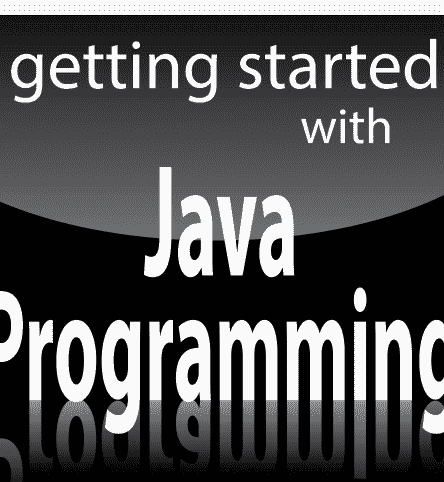

### 在本部分中……

- 打起精神，成为 Java 开发人员
- 安装软件
- 运行一些示例程序

### 第 1 章

### 入门

### 本章内容

- 了解计算机编程到底是什么
- 了解让你编写程序的软件
- 准备好使用集成开发环境

计算机编程？那是什么？它技术性强吗？会难吗？符合政治正确吗？比尔·盖茨控制它吗？为什么会有人想学它？还有我呢？我能学会吗？

### 这到底是怎么一回事？

你可能用过计算机进行文字处理。打一封信，打印出来，然后把打印稿寄给你爱的人。如果你能方便地使用电脑，那么你很可能上过网。访问一个页面，点击一个链接，然后看到另一个页面。很简单，对吧？

嗯，它简单只是因为有人告诉计算机到底该做什么。如果你从工厂拿一台崭新的计算机，不给它任何指令，这台计算机不能做文字处理，不能上网，什么都做不了。计算机唯一能做的就是遵循人们给它的指令。

现在想象一下，你正用 Microsoft Word 撰写伟大的美国小说，你来到了一行的末尾。（你不是在一个句子的末尾；只是在一行的末尾。）当你输入下一个单词时，计算机的光标会自动跳到下一行。这是怎么回事？

嗯，有人编写了一个*计算机程序*——一套告诉计算机做什么的指令。程序（或程序的一部分）的另一个名称是*代码*。清单 1-1 展示了 Microsoft Word 的一些代码可能是什么样子。

### 从你的大脑到计算机的处理器

当你创建一个新的计算机程序时，你要经历一个多步骤的过程。这个过程涉及三个重要的工具。

- **编译器：** 编译器将你的代码翻译成计算机友好（而人类不友好）的指令。
- **虚拟机：** 虚拟机逐步执行这些对计算机友好的指令。
- **应用程序编程接口：** 应用程序编程接口包含有用的预编写代码。

接下来的三节将分别介绍这三个工具。

### 翻译你的代码

你可能听说过计算机处理的是零和一。这当然没错，但这意味着什么呢？首先，计算机电路并不直接处理字母表中的字母。当你在电脑屏幕上看到 *Start* 这个词时，计算机在内部存储这个词的形式是 `01010011 01110100 01100001 01110010 01110100`。你看到这个熟悉的五个字母单词时产生的感觉，只不过是你对电脑屏幕像素的解读而已。计算机会把所有东西分解成非常低级的、不友好的零和一序列，然后再把它们重新组合起来，以便人类能够处理结果。

那么，当你编写一个计算机程序时会发生什么呢？嗯，程序必须被翻译成零和一。这个翻译过程的正式名称是*编译*。没有编译，计算机就无法运行你的程序。

我编译了清单 1-1 中的代码。然后我做了一些无害的黑客操作，以帮助自己看到得到的零和一。我看到的就是图 1-1 中的那团乱麻。

图 1-1 中编译后的乱七八糟的东西有很多不同的名称：

- 大多数 Java 程序员称之为*字节码*。
- 我常常称之为 *.class 文件*。这是因为在 Java 中，字节码存储在名为 `SomethingOrOther.class` 的文件中。
- 为了强调区别，Java 程序员把清单 1-1 称为*源代码*，而把图 1-1 中的零和一称为*目标代码*。


图 1-1：我的计算机能理解这些 0 和 1，但我不能。

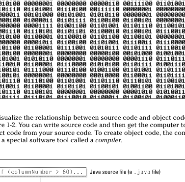

要直观地了解源代码和目标代码之间的关系，请参见图 1-2。你可以编写源代码，然后让计算机根据你的源代码创建目标代码。为了创建目标代码，计算机使用一种称为编译器的特殊软件工具。

图 1-2：计算机编译源代码以创建目标代码。

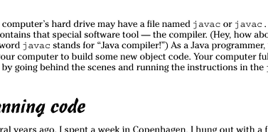

```
if (columnNumber > 60)...
```

你的计算机硬盘上可能有一个名为 javac 或 javac.exe 的文件。这个文件包含那个特殊的软件工具——编译器。（嘿，没想到吧？javac 这个名称代表的就是“Java 编译器”！）作为 Java 程序员，你经常要求计算机构建一些新的目标代码。计算机通过在后台运行 javac 文件中的指令来满足你的愿望。

### 运行代码

几年前，我在哥本哈根待了一周。我和一位能流利说丹麦语和英语的朋友一起闲逛。我们在公园里聊天时，我隐约注意到几个孩子在我们周围转悠。我一句丹麦语也不会说，所以我以为孩子们只是在谈论寻常的孩子话题。

### 字节码到底是什么？

看看清单 1-1，以及该清单在图 1-1 中翻译成字节码的形式。你可能会认为字节码文件只是一种密码文——用 0 和 1 替代 if 和 else 等单词中的字母。但事实根本不是这样。实际上，字节码文件最重要的部分是对程序逻辑的编码。

图 1-1 中的 0 和 1 描述了数据从计算机的一部分流向另一部分的过程。我在下图中展示了这一流程。但请记住，这幅图仅仅是一个图示。你的计算机并不会查看这幅特定的图，也不会查看任何类似的东西。相反，你的计算机会读取一堆 0 和 1 来决定下一步做什么。

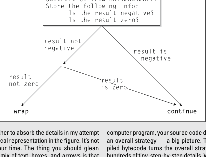

不必费心去理解我在图中尝试用图形表示的那些细节。这不值得你花时间。你应当从我混杂的文字、方框和箭头中领会到的是：字节码（.class 文件中的内容）完整描述了计算机将要执行的操作。当你编写计算机程序时，你的源代码描述的是整体策略——一个大图景。编译后的字节码将整体策略转化为成百上千个细小的、逐步执行的细节。当计算机“运行你的程序”时，计算机检查这些字节码，并执行每一个细小的逐步细节。

然后我的朋友告诉我，那些孩子说的不是丹麦语。“那他们在说什么语言？”我问道。

> “他们在说胡话，”她说。“那只是一些毫无意义的音节。他们听不懂英语，所以在模仿你。”

现在让我们回到当下的话题。我看着图 1-1 中的东西，忍不住想嘲笑我的计算机说话的方式。但那样的话，我就和哥本哈根的那些孩子没什么两样了。对我来说毫无意义的东西，对我的计算机来说却完全说得通。当图 1-1 中的 0 和 1 渗透过我的计算机电路时，计算机就会“思考”图 1-3 中展示的那些想法。

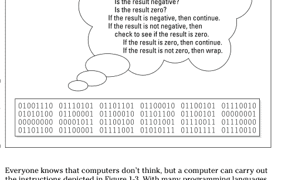

人人都知道计算机不会思考，但计算机能够执行图 1-3 中描绘的指令。对于许多编程语言（例如 C++ 和 COBOL 等语言），计算机所做的正是我描述的那样。计算机吞入一些目标代码，然后执行目标代码要求它做的事情。

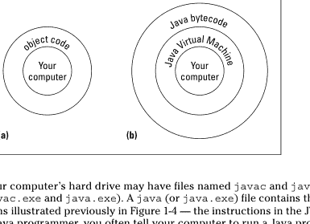

图 1-5：运行计算机程序的两种方式。

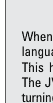

你的计算机硬盘上可能有一些名为 javac 和 java（或 javac.exe 和 java.exe）的文件。java（或 java.exe）文件包含前面图 1-4 所示的指令——即 JVM 中的指令。作为 Java 程序员，你经常指示计算机运行 Java 程序。计算机通过在后台运行 java 文件中的指令来满足你的愿望。

### 一次编写，随处运行

当 Java 于 1995 年首次登上技术舞台时，这门语言几乎立刻就流行起来。部分原因在于 JVM。JVM 就像一个外语翻译员，将 Java 字节码转换成特定计算机能够理解的任何母语。因此，如果你将 Java 字节码文件交给我的 Windows 计算机，那么该计算机的 JVM 会针对 Windows 环境解释该文件。如果你将同一份 Java 字节码文件交给我同事的 Macintosh，那么 Macintosh 的 JVM 会针对 Mac 环境解释同一份字节码。

再看一下图 1-5。没有虚拟机，你需要为每种操作系统准备一种不同的目标代码。但有了 JVM，只需一份字节码就可以在 Windows 机器、Unix 主机、Mac 或其他任何系统上运行。这被称为可移植性，而在计算机编程领域，可移植性是一种非常宝贵的特质。想想所有使用计算机浏览互联网的人。这些人并非都在运行 Microsoft Windows，但每个人的计算机都可以有自己的字节码解释器——自己的 JVM。

Oracle 的营销人员称其为“一次编写，随处运行”的计算模式。我称其为创造软件的好方法。

在理想的情况下，你可以通过一个漂亮的界面完成所有的程序编辑、文档阅读和命令发布。这个界面被称为集成开发环境（IDE）。

典型的 IDE 会将屏幕的工作区划分为多个窗格——一个窗格用于编辑程序，另一个窗格用于列出程序名称，第三个窗格用于发布命令，还有其他窗格用于帮助你编写和测试程序。你可以排列这些窗格以便快速访问。更棒的是，如果你更改了一个窗格中的信息，IDE 会自动更新所有其他窗格中的信息。

IDE 帮助你无缝隙地从编程工作的一个部分切换到另一个部分。有了 IDE，你无需担心编辑、编译和运行 JVM 的机制。相反，你可以专注于编写程序的逻辑。（你没想到吧？无论如何，你总是有需要担心的事情！）

### 你的硬盘上已经有什么？

你可能已经拥有一些创建 Java 程序所需的工具。但是，在较旧的计算机上，你的工具可能已经过时。本书中的大多数示例都可以在所有版本的 Java 上运行。但有些示例无法在早于 Java 5.0 的版本上运行。其他示例仅能在 Java 6、Java 7、Java 8 或更高版本上运行。

最稳妥的做法是从 java.com 或 Oracle 网站重新下载工具。有关下载的详细说明，请参阅第 2 章。

### Eclipse

本书中的程序适用于任何可以运行 Java 的 IDE。这包括 NetBeans、IntelliJ IDEA、JDeveloper、JCreator 等 IDE。你甚至可以在没有 IDE 的情况下运行这些程序。但为了演示本书中的示例，我使用了 Eclipse IDE。我选择 Eclipse 而不是其他 IDE，原因如下：

- Eclipse 是免费的。
- 在所有 Java IDE 中，Eclipse 是专业程序员最常用的一种。
- Eclipse 有很多花哨的功能，但你可以忽略其中大部分，学习重复几个常规步骤。用过几次 Eclipse 后，你的大脑会自动执行这些常规步骤。从此，你就可以不再担心 Eclipse，专心于 Java 编程。
- Eclipse 是免费的。（值得说两遍。）

### 第 2 章：设置你的计算机

### 本章内容

- 安装 Java
- 下载并安装 Eclipse 集成开发环境
- 检查你的 Eclipse 配置
- 获取本书示例中的代码

本书介绍如何编写 Java 程序，而在你编写 Java 程序之前，你需要一些软件。至少，你需要我在第 1 章中描述的软件——Java 编译器和 Java 虚拟机（简称 JVM）。你还可以使用一个好的集成开发环境（IDE）和一些示例代码来帮助你入门。

编写 Java 程序所需的所有软件都是免费的。这些软件分为三次下载——一次来自本书网站，另一次来自 Oracle，还有一次来自 eclipse.org。


我在本章中描述的 Oracle 和 Eclipse 网站总是在变化。你从这些网站下载的软件也在变化。诸如“点击右上角的按钮”这样具体的说明很快就会过时（甚至可能产生误导）。因此，在本章中，我提供了长长的步骤列表，但也描述了这些步骤背后的想法。浏览每个建议的网站，寻找获取我所描述的软件的方法。当网站为你提供多个选项时，请查看本章中的说明，以获取选择最佳选项的提示。如果你的计算机上的 Eclipse 窗口与本章图片中的窗口看起来不太一样，请在你的计算机窗口中查找它描述的选项。如果尝试了所有这些之后，你仍然找不到想要的内容，请查看本书的网站（http://allmycode.com/BeginProg），或发送电子邮件至 BeginProg@allmycode.com。你也可以在 Facebook 上（/allmycode）或在 Twitter（@allmycode）上找到我。


- 5. **启动 Eclipse，并点击欢迎屏幕上的 Workbench 图标。**

最初，欢迎屏幕上的图标没有文字标签。但当你将鼠标悬停在某个图标上时，会出现一个工具提示。选择那个工具提示标题为 Workbench 的图标。

- 6. **在 Eclipse 中，导入你在第 1 步中下载的代码。**

关于这些内容的详细信息，请参阅接下来的几个小节。

## 那些烦人的文件扩展名

Windows 文件资源管理器或 Finder 窗口中显示的文件名可能会误导你。你可能会浏览到某个目录，看到 `Mortgage.java` 这样的名称。但文件的实际名称可能是 `Mortgage.java`、`Mortgage.class`、`Mortgage.somethingElse`，或者干脆就是 `Mortgage`。像 `.zip`、`.java` 和 `.class` 这样的文件名结尾被称为*文件扩展名*。

令人不快的事实是，默认情况下，Windows 和 Mac 会隐藏许多文件扩展名。这个糟糕的特性往往会让程序员感到困惑。所以，如果你不想被搞晕，就更改你计算机的系统级设置。具体操作方法如下：

- **在 Windows XP 中：** 选择“开始➜控制面板➜外观和主题➜文件夹选项”。然后按照“所有 Windows 版本”条目下的说明操作。

- **在 Windows 7 中：** 选择“开始➜控制面板➜外观和个性化➜文件夹选项”。然后按照“所有 Windows 版本”条目下的说明操作。

- **在 Windows 8 中：** 在“开始”屏幕中，按住 Windows 键的同时按 Q。

在出现的搜索框中，输入**文件夹选项**，然后按 Enter。然后按照“所有 Windows 版本”条目下的说明操作。

- **在所有 Windows 版本（XP 及更新版本）中：** 按照前面某个条目中的说明操作。然后，在“文件夹选项”对话框中，单击“查看”选项卡。找到“隐藏已知文件类型的扩展名”选项。确保此复选框*未*被选中。

- **在 Mac OS X 中：** 在 Finder 应用程序的菜单中，选择“偏好设置”。在出现的对话框中，选择“高级”选项卡，找到“显示所有文件扩展名”选项。确保此复选框被选中。

- **在 Linux 中：** Linux 发行版通常不会隐藏文件扩展名。所以，如果你使用 Linux，可能不必担心这个问题。但我并没有检查过所有的 Linux 发行版。因此，如果你的文件名称是 `Mortgage` 而不是 `Mortgage.java` 或 `Mortgage.class`，请查阅你的 Linux 发行版对应的文档。

## 设置 Java

你可以通过访问 www.oracle.com/technetwork/java/javase/downloads 获取最新、最强大的 Java 版本。查找可用的最新版本 JDK。选择一个能在你计算机操作系统上运行的版本。图 2-1 显示我在 Oracle 网站上点击一个 Download JDK 按钮（大约在 2014 年 3 月）。

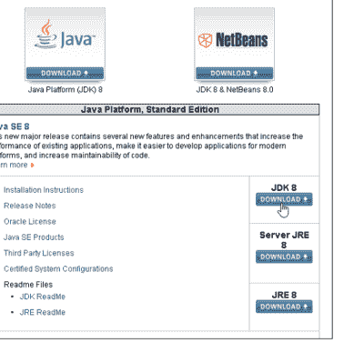

图 2-1：获取 Java JDK。

如果你无法确定哪个 Java 版本最合适，或者想知道 JRE 和 JDK 这些缩写代表什么，请参阅标题为“Eenie, meenie, miney mo”的侧边栏。

在你接受许可协议并点击 Java 安装文件的链接后，你的计算机将执行以下两种操作之一：

- 在系统上下载并安装 Java。
- 下载 Java 安装文件，并将其保存到计算机的硬盘上。

如果安装自动开始，请按照说明操作，对所有提示回答“是”，并且（除非你有充分理由不这样做）接受默认设置。如果安装没有自动开始，请双击下载的安装文件来启动安装。

## Eenie, meenie, miney mo

Java 标准版下载页面（www.oracle.com/technetwork/java/javase/downloads）有很多选项。如果你不熟悉这些选项，这个页面可能会让你望而生畏。以下是页面上的一些选项：

### 字长：32 位或 64 位

你可能需要在标记为 32 位系统的链接和标记为 64 位系统的链接之间做出选择。如果你不知道该选哪个，可以先尝试 32 位版本。（关于 32 位系统和 64 位系统的更多信息，请参阅“你的计算机有多少位？”侧边栏。）

### Java 版本号

Java 下载页面可能会提供旧版和新版 Java 供你选择。你可能会看到 Java SE 7、Java SE 8、Java SE 8u4 等链接。（像 8u4 这样的编号表示 Java 8 的第四次更新。）如果你不确定自己想要哪个版本号，选择最高的版本号可能是安全的。本书中的大多数示例都可以在安装了 Java 5 的计算机上运行。少数示例仅在 Java 7、Java 8 或更高版本上运行。

Java 的版本编号确实令人困惑。首先是 Java 1.0，然后是 Java 1.1，接着是 Java 2 Standard Edition 1.2（J2SE 1.2）。是的，“Java 2”的编号与“1x”编号部分重叠。接下来是 1.3 和 1.4 版本。在 1.4.1 版本之后是 1.4.2 版本（中间还有像 1.4_02 这样的过渡版本）。在 1.4.2_06 之后，下一个版本是 1.5，也称为 5.0 版本。（这没有印错。5.0 版本紧跟在 1.4 版本之后。）

1.5 版本的正式名称是“Java 2 Platform, Standard Edition 5.0”。更糟糕的是，下一个大版本是“Java Platform, Standard Edition 6”，“Java 2”中的“2”被去掉，“6.0”中的“.0”也消失了。这就是当公司让市场人员做主时会发生的事情。

幸运的是，从 Java 6 开始，版本号进入了一个可预测的模式。Java 6 之后是“Java Platform, Standard Edition 7”和“Java Platform, Standard Edition 8”，并带有诸如“8u02”（意为“Java 8，更新 2”）之类的更新。

### JDK 与 JRE

下载页面会提供 JDK（Java 开发工具包）和 JRE（Java 运行时环境）之间的选择。JDK 下载包含的内容比 JRE 下载更多。JRE 包括一个 Java 虚拟机和一个应用程序编程接口（参见第 1 章）。JDK 包含 JRE 中的所有内容，此外，JDK 还包含一个 Java 编译器（同样参见第 1 章）。

Eclipse IDE 包含它自己的 Java 编译器。因此，你可以先下载较小的 JRE（避免下载大型 JDK）。但我建议下载完整的 JDK。为什么？因为你不知道什么时候另一个编译器（独立于 Eclipse）会派上用场。此外，如果你没有安装完整的 JDK，在 Mac 上安装和配置 Eclipse 会非常复杂。所以，如果你想一切顺利，请下载 JDK 而不是 JRE。

顺便说一句，JDK 的另一个名称是 Java SDK——Java 软件开发工具包。有些人仍然使用 SDK 这个缩写，尽管 Oracle 的人已经不再使用它了。（实际上，最初的名字是 JDK。后来，Sun Microsystems 将其改为 SDK。几年后，Java 的掌舵者们又改回了 JDK 这个名字。这种不断的命名和重命名让我这个作者感到很抓狂。）

### Java SE 与 Java EE 与 Java ME

当你在页面上浏览时，可能会注意到标记为 Java EE 或 Java ME 的链接。如果你知道这些是什么，并且确定需要它们，那么请尽情下载这些好东西。但如果你不确定，请跳过 Java EE 和 Java ME 的链接，而是跟随 Java SE（Java 标准版）的链接。

Java EE 是 Java 企业版的缩写，Java ME 是 Java 微型版的缩写。企业版包含面向大型企业的软件，微型版包含面向手持设备的软件。（Google 的 Android 软件与 Java 微型版有几分相似，但在许多方面，Android 和 Java ME 是截然不同的东西。）

你不需要 Java EE 或 Java ME 来运行本书中的任何示例。

### 其他与 Java 相关的软件

你可以单独下载 Java，也可以下载带有 Oracle NetBeans IDE 的 Java。你可以下载一组演示和示例。你甚至可能买到带薯条和软饮的 Java。你可以下载大量额外的东西，但事实上，你所需要的就是 Java JDK。

### 安装类型

你可能会被提示选择在线安装或离线安装。

使用离线安装时，你首先需要下载一个大型安装文件。该文件会占用你硬盘的大量空间（具体取决于你选择下载的内容，大约在 30MB 到 150MB 之间）。如果你需要重新安装 JDK，你可以在自己的计算机上保留该文件。除非你想要更新版本的 JDK，否则你不需要再次下载 JDK。

为什么会有人想要再次安装相同版本的 JDK？通常，我有两个原因。要么我想在另一台计算机上安装软件，要么我弄乱了某些东西，不得不卸载（然后重新安装）该软件。

使用在线安装时，你不会下载大型安装文件。相反，你下载的是一个很小的安装文件。然后，在你需要时，按需下载（并丢弃）那个 30MB 到 150MB 大文件的部分内容。使用在线安装可以为你节省许多兆字节的硬盘空间。但是，如果你想再次安装相同版本的 JDK，你就必须重新执行整个浏览/点击/下载过程。


如果你的计算机运行的是 Linux，下载的文件可能是一个 .tar.gz 文件。.tar.gz 文件是一种压缩归档文件。将归档内容解压到你选择的文件夹中，然后按照 Oracle 网站上发布的安装说明进行操作。

关于文件名、文件类型和归档文件的更多信息，请参阅本章中标题为“那些烦人的文件扩展名”和“压缩归档文件”的侧栏。

在访问 www.oracle.com/technetwork/java/javase/downloads 时，你还可以下载一份 Java API 文档。查找标注为“Java SE Development Kit Documentation”（或类似名称）的下载项。接受许可协议，点击下载链接，然后看着文件流入你的计算机硬盘。下载的文件是一个压缩的 .zip 归档文件，因此你可以像解压其他此类归档文件一样解压它。（解压后的文件夹包含大量网页。要开始阅读 Java API 文档，请在该文件夹中查找索引文件或 index.html 文件。双击该文件，你就上路了。）

关于 Java API 文档的介绍，请参阅第 1 章。

大多数人在访问 Oracle 网站 http://oracle.com/ 并使用网站菜单安装 Java 时不会遇到任何困难。但如果你的情况比大多数人更“有趣”，你可能需要做出一些决定并执行一些额外步骤。接下来的几节将描述一些这样的“有趣”场景。

## 你的计算机是多少位的？

当你按照本章的说明操作时，系统可能会提示你在同一软件的两个版本之间进行选择——32 位版本和 64 位版本。有什么区别，为什么你应该关心？

位（bit）是你在计算机上可以存储的最小信息单位。大多数人将位视为 0 或 1，这种对“位”的描述非常有用。为了表示几乎任何数字，你将多个位堆叠在一起，并对 2 的幂做一些奇特的操作。编号系统的细节并不会阻碍你。需要记住的重要事情是，你的计算机内部的每个电路部件都存储相同数量的位。（好吧，你计算机内部的一些电路是例外，它们有自己特定的位数，但这并不是什么大问题。）

在较旧的计算机中，每个电路部件存储 32 位。在较新的计算机中，每个电路部件存储 64 位。这个位数（32 或 64）就是计算机的字长（word length）。在较新的计算机中，一个字是 64 位长。

“太好了！”你说。“我上周刚买了电脑。它一定是 64 位计算机。”好吧，情况可能没那么简单。除了计算机电路具有字长之外，你计算机上的操作系统也具有字长。操作系统的指令处理特定数量的位。具有 32 位指令的操作系统可以在 32 位或 64 位计算机上运行，但具有 64 位指令的操作系统只能在 64 位计算机上运行。而且更复杂的是，你运行的每个程序（Web 浏览器、文字处理器或你自己的 Java 程序）要么是 32 位程序，要么是 64 位程序。你可以在 64 位计算机上运行的 64 位操作系统中运行 32 位 Web 浏览器。或者，你可以在 64 位计算机上的 32 位操作系统中运行 32 位浏览器。（参见此侧栏附带的图。）

- 如果你运行 32 位操作系统，则只能运行 32 位软件。
- 如果你运行 64 位操作系统，你可能会运行一些 32 位软件和一些 64 位软件。大多数 32 位软件在 64 位操作系统上运行良好。

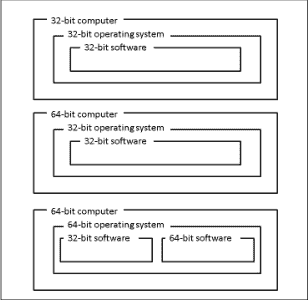

当网站让你在 32 位和 64 位软件版本之间进行选择时，主要考虑因素是你的操作系统的字长，而不是你的计算机电路的字长。你可以在 64 位操作系统上运行 32 位文字处理器，但不能在 32 位操作系统上运行 64 位文字处理器（无论你计算机电路的字长是多少）。选择 64 位软件有一个很大的优势——即 64 位软件可以访问超过 3 GB 的计算机高速随机存取存储器。根据我的经验，更多的内存意味着更快的处理速度。

所有这些关于字长的内容如何影响你的 Java 和 Eclipse 下载？情况如下：

- 在 64 位操作系统上，你可能拥有同一程序的两个版本。例如，在我的 Windows 计算机上，我有两个版本的 Internet Explorer——一个 32 位版本和一个 64 位版本。
- 通常，Windows 将 32 位程序放在其 `Program Files (x86)` 目录中，并将 64 位程序放在其 `Program Files` 目录中。
- 字长链条的强度取决于其最薄弱的环节。例如，当我访问 `http://java.com` 并单击该网站的“我的 Java 是否可用？”链接时，得到的答案取决于我的计算机上 Java 版本与我正在运行的 Web 浏览器之间的匹配情况。如果我的计算机上只安装了 64 位 Java，那么我的 32 位 Firefox 浏览器中的“我的 Java 是否可用？”链接会回答“未检测到您系统上可用的 Java”。但我的 64 位 Internet Explorer 中的同一个链接会回答“您已安装推荐的 Java”。

在 Mac 上，Safari 和 Firefox 是 64 位浏览器，但 Chrome 是 32 位浏览器。因此在 Mac 上，使用 Firefox 与 Chrome 时，你很可能会看到略有不同的行为。

关于字长需要记住的最重要一点是：当你按照本章的说明操作时，你的计算机上会安装 Java 软件和 Eclipse 软件。你的 Java 软件的字长必须与你的 Eclipse 软件的字长匹配。换句话说，32 位 Eclipse 与 32 位 Java 一起运行，64 位 Eclipse 与 64 位 Java 一起运行。我没有尝试过所有可能的组合，但当我尝试用 64 位 Java 运行 32 位 Eclipse 时，我看到了一个误导性的“未找到 Java 虚拟机”错误消息。

最后，一些网站对其软件下载使用不直观的名称。如果你在下载名称中看到 *i386* 或 *i586*，这通常意味着 32 位。如果你在下载名称中的任何位置看到 *x86* 而没有数字 64，这也意味着 32 位。如果你在名称中看到 *64*（无论是否有 *x86* 标记），这表示 64 位程序。

## 在计算机上查找 Java

第 1 章描述了 Java 生态系统及其编译器、虚拟机和其他部分。你的计算机可能已经有了一些这些 Java 小装置。如果是这样，你可以继续使用已有的东西，也可以将最新版本的 Java 添加到系统中已有的任何内容之上。


Java 的版本不像室内猫。它们可以在同一台计算机上共存，而不会互相争斗或嘶叫。如果你的计算机上有多个版本的 Java，那没问题。你甚至可以在同一台计算机上混合使用 32 位版本和 64 位版本（只要你至少有一个字长与你的 Eclipse 版本匹配的 Java 版本）。我的 Windows 8 计算机上有三个版本的 Java，我从来没有遇到过麻烦。（偶尔，我会因为混淆一个 Java 版本和另一个 Java 版本而给自己惹麻烦。但本章的“在 Eclipse 中配置 Java”一节帮助我理清了事情。如果没有这本书在身边，我会怎么做？）

要了解你已经拥有什么，并可能避免重新安装 Java，请继续阅读。

### 在 Windows 8 上

在“开始”屏幕中，按住 Windows 键的同时按 Q。在出现的搜索框中，键入 **Programs and Features**，然后按 Enter。然后继续阅读“在所有 Windows 版本（XP 及更高版本）”部分。

### 在 Windows 7 上

选择“开始”→“控制面板”→“程序”→“程序和功能”。然后按照“在所有 Windows 版本（XP 及更高版本）”部分中的说明进行操作。

### 在 Windows XP 上

选择“开始”→“控制面板”→“添加或删除程序”。然后按照“在所有 Windows 版本（XP 及更高版本）”部分中的说明进行操作。

### 在所有 Windows 版本（XP 及更高版本）中

在已安装程序列表中查找 Java（参见图 2-2）。如果你看到 Java 8 或更高版本，那没问题。如果你看到的唯一 Java 版本号低于 8（例如 1.4.2、5.0 或 6），你的计算机可以运行本书中的某些（但不是全部）程序。

图 2-2：
Windows 8 上的“程序和功能”对话框。

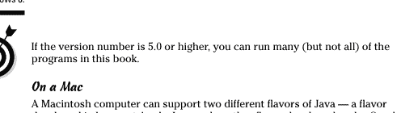

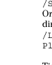

如果版本号是 5.0 或更高，你可以运行本书中的许多（但不是全部）程序。

### 在 Mac 上

Macintosh 计算机可以支持两种不同风格的 Java——一种由 Apple, Inc. 内部开发，另一种在 Oracle 的主持下开发。某些命令和过程适用于一种 Java 风格，但不适用于另一种。例如，要查找 Apple 版本的 Java，你需要查看 /System/Library/Java/Java Virtual Machines 目录。但要查找 Oracle 的 Java，你需要查看 /Library/Java/JavaVirtualMachines 目录。（一个路径以 /System/Library 开头；另一个路径以 /Library 开头。）你可能还会在 /Library/Internet Plug-Ins/JavaAppletPlugin.plugin/Contents/Home 目录中找到 Oracle 的 Java。

Tiger、Leopard 和 Snow Leopard（OS X 10.4、OS X 10.5 和 OS X 10.6）预装了 Java。Lion、Mountain Lion 或 Mavericks（OS X 10.7、OS X 10.8 或 OS X 10.9）没有预装 Java。在 Lion、Mountain Lion 或 Mavericks 上，系统会提示你安装 Apple 的 Java 或 Oracle 的 Java 该


第一次启动需要 Java 的应用程序时。（例如，本章后面你会安装 Eclipse。第一次尝试启动 Eclipse 时，如果你尚未安装 Java，计算机就会建议你这样做。）

表 2-1 描述了 Mac OS 与 Java 版本之间的对应关系。

**表 2-1：Mac OS X 版本与 Java 版本**

| 如果你的 Mac OS X 版本是 ... | 那么你拥有的 Java 版本是 ... | 你可以安装的 Java 版本是 |
|---|---|---|
| OS X 10.4.11 (Tiger) | 苹果的 Java 5.0 | 苹果的 Java 5.0 |
| OS X 10.5.8 (Leopard) PowerPC 和/或 32 位 | 苹果的 Java 5.0 | 苹果的 Java 5.0 |
| OS X 10.5.8 (Leopard) 基于 Intel 且 64 位 | 苹果的 Java 6 | 苹果的 Java 6 |
| OS X 10.6.8 (Snow Leopard) | 苹果的 Java 6 | 苹果的 Java 6 |
| OS X 10.7.5 (Lion) | （无 Java） | 苹果的 Java 6<br>Oracle 的 Java 8 |
| OS X 10.8.5 (Mountain Lion) | （无 Java） | 苹果的 Java 6<br>Oracle 的 Java 8 |
| OS X 10.9 (Mavericks) | （无 Java） | 苹果的 Java 6<br>Oracle 的 Java 8 |

要找出你运行的 OS X 版本，请执行以下操作：

1. 选择 Apple→关于本机。
2. 在出现的“关于本机”对话框中，查找“Version”一词。

   你会看到 Version 10.9.2（或类似内容）以非常浅的灰色文字显示。


表 2-1 中的信息适用于更新版本的 Mac OS X。如果不定期应用软件更新，你可能运行的是 OS X 10.8.1 而不是 10.8.5。如果是这样，请在 Apple 菜单中选择“软件更新”，然后按照提示操作。


在网络上这里那里，我看到一些帖子描述了在 OS X 10.3 上安装 Java 5.0 的方法以及其他规避表 2-1 中限制的方法。但如果你不喜欢折腾，这些变通方法不适合你。（对于每一种硬件或软件要求，总有人试图创造变通方法或破解。无论如何，自行承担使用破解的风险。）

如果你不信任表 2-1（坦白说，你不应该相信印刷品上找到的一切），你可以对计算机进行测试以发现 Java 的存在以及（如果你的 Mac 已安装 Java）Java 版本号。以下是一个适用于旧版 Macintosh 操作系统的测试：

1. 在 Spotlight 的搜索字段中，输入 Java Preferences。
2. 当 Spotlight 的“最佳匹配”显示为 Java Preferences 时，按 Enter。

Java Preferences 窗口出现（见图 2-3）。

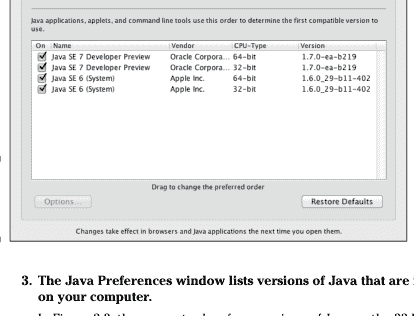

**图 2-3：** Java Preferences 应用程序。

3. Java Preferences 窗口列出了安装在计算机上的 Java 版本。

在图 2-3 中，计算机具有四个 Java 版本——Java 6 和 Java 7 的 32 位（i386）版本以及 Java 6 和 Java 7 的 64 位（x86_64）版本。

对于较新的 Macintosh 操作系统版本，请尝试此测试：

1. 在 Apple 菜单中，选择“系统偏好设置”。
2. 在“系统偏好设置”应用程序窗口中，查找 Java 图标（见图 2-4）。
3. 点击 Java 图标。

Java 控制面板出现（见图 2-5）。

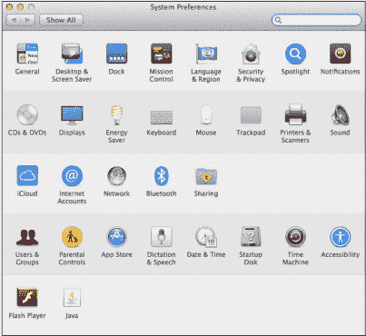

**图 2-4：** Mac OS X 系统偏好设置应用程序中的 Java 图标。

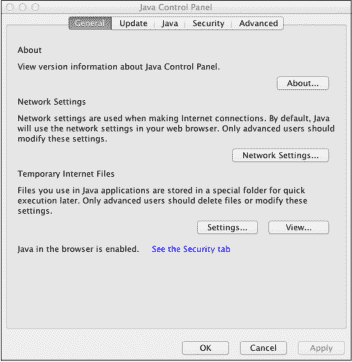

**图 2-5：** Java 控制面板。

4. 在 Java 控制面板中，选择 Java 选项卡（见图 2-6）。

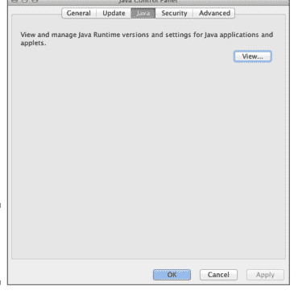

**图 2-6：** Java 控制面板中的 Java 选项卡。

5. 在 Java 选项卡中，点击 View。

Java 运行时环境设置窗口出现（见图 2-7）。

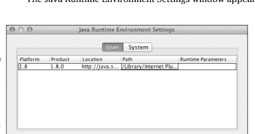

**图 2-7：** Java 运行时环境设置窗口中的“用户”选项卡。

6. 在 Java 运行时环境设置窗口的“用户”选项卡和“系统”选项卡中查找 Java 版本。

图 2-7 显示了 Java 运行时环境设置窗口的“用户”选项卡。根据该图，计算机运行的是 Java 1.8。（Java 的密友称此版本为“Java 8”。）

## 在 Linux 上

要检查 Linux 计算机上的 Java 安装（或缺少 Java），请执行以下操作：

1. **在桌面菜单中查找名为 Terminal（也称为 Konsole）的项目。**

   一个 Terminal 窗口打开（通常是纯白文字在纯黑背景上）。

2. **在 Terminal 窗口中，输入以下文本然后按 Enter：** `java -version`。

   在我的 Linux 计算机上，Terminal 窗口会以下列文本作出响应：

   ```
   java version 1.8.0_1
   ```

如果你的计算机响应的是 1.8.0 或更高版本，你可以开香槟，期待愉快地运行本书的示例。如果版本号为 1.5 或更高，你可以运行本书的许多（但不是全部）示例。如果你的计算机响应类似 command not found，则很可能 Java 未安装在你的计算机上。

## 设置 Eclipse 集成开发环境

在前面的章节中，你获得了计算机处理 Java 程序所需的所有工具。本节不同。本节中，你将获得用于编写和测试 Java 程序所需的工具。你将获得 Eclipse——Java 的集成开发环境。

集成开发环境（IDE）是一个提供工具的程序，帮助你轻松高效地创建软件。你可以在没有 IDE 的情况下创建 Java 程序，但使用 IDE 节省的时间和精力使 IDE 物有所值。（一些硬核程序员不同意我的观点，但那是另一回事。）

根据 Eclipse 基金会的网站，Eclipse 是“一个通用工具平台——一个开放可扩展的 IDE，用于任何事物，也用于特定事物”。的确，Eclipse 非常多才多艺。程序员通常将 Eclipse 视为开发 Java 程序的 IDE，但 Eclipse 具有用于 C++、PHP 和许多其他语言编程的工具。我甚至见过与程序开发无关的 Eclipse 形态。（其中一种产品是 Lively Browser——一个由 Eclipse 组件构建标签页的网页浏览器。）

### 下载 Eclipse

以下是下载 Eclipse 的方法：

1. 访问 www.eclipse.org。
2. 查找下载适用于你操作系统的 Eclipse 的方式。
3. 从可用包中选择一个 Eclipse 包。

今天，我访问 www.eclipse.org，看到一个大按钮显示“立即开始... 下载 Eclipse”（见图 2-8）。明天，谁知道我会在这个不断变化的网站上看到什么！

点击“下载 Eclipse”按钮后，我会看到适用于我计算机操作系统的下载列表（见图 2-9）。

Eclipse 的下载页面会将你引导至特定于计算机操作系统的 Eclipse 版本。例如，如果你在 Windows 计算机上访问该页面，页面只会显示 Windows 的下载。如果你下载 Eclipse 用于另一台计算机，你可能希望覆盖操作系统的自动选择。查找包含计算机操作系统名称的小下拉列表。你可以在该下拉列表中更改所选操作系统。


**图 2-8：** eclipse.org 的主页


无论你的操作系统如何，Eclipse 都有多种形状、大小和颜色。Eclipse 网站提供 Eclipse IDE for Java Developers、Eclipse IDE for Java EE Developers、Eclipse Classic 以及许多其他专用下载（见图 2-9）。我通常选择 Eclipse IDE for Java Developers，我也建议你这样做。

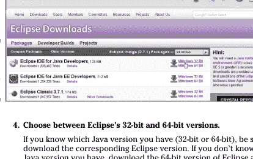

**图 2-9：** Eclipse.org 列出了 Windows 的下载。

4. 在 Eclipse 的 32 位和 64 位版本之间选择。

如果你知道自己拥有的 Java 版本（32 位或 64 位），请确保下载对应的 Eclipse 版本。如果你不知道自己拥有的 Java 版本，请下载 Eclipse 的 64 位版本并尝试启动它。如果可以启动 64 位 Eclipse，就没问题。但如果你收到“未找到 Java 虚拟机”错误消息，请尝试下载并启动 32 位版本的 Eclipse。

有关 32 位和 64 位字长的详细说明，请参阅本章的“你的计算机有多少位？”侧边栏。

5. 按照适当的链接开始下载。

你遵循的链接取决于 Eclipse 的众多镜像站点中哪个站点提供你的下载。只需浏览可能性并开始下载即可。

### 安装 Eclipse

如何精确安装 Eclipse 取决于你的操作系统以及下载 Eclipse 时获得的文件类型。以下是简要总结：

- ✔ 如果你在 Windows 上运行且下载的是 .exe 文件：
  - 双击 .exe 文件的图标。
- ✔ 如果你在 Windows 上运行且下载的是 .zip 文件：
  - 将文件内容解压到你选择的目录。
  - 换句话说，在 Windows 资源管理器（也称为文件资源管理器）中找到 .zip 文件的图标。然后双击 .zip 文件的图标。（结果，资源管理器会显示 .zip 文件的内容，其中仅包含一个文件夹——名为 eclipse 的文件夹。）将 eclipse 文件夹拖到计算机硬盘上的方便位置。


有关 `.zip` 文件的更多信息，请参阅本章中的“压缩归档文件”侧边栏。

我最喜欢把 eclipse 文件夹直接拖到 C: 盘。于是我的 C: 盘上有名为 `Program Files`、Windows、eclipse 等文件夹。我避免将 eclipse 文件夹设为 Program Files 的子文件夹，因为有时我会遇到处理名称中包含空格的 `Program Files` 的问题。

## 如果你使用 Mac OS X：

下载 Eclipse 时，你会得到一个 `.tar.gz` 文件或一个 `.dmg` 文件。

- 一个 `.tar.gz` 文件是一个压缩归档文件。下载文件时，你的网页浏览器可能会自动为你解压一部分。如果是这样，你在下载文件夹中找不到 `.tar.gz` 文件。相反，你会找到一个 `.tar` 文件（因为浏览器解压了 `.gz` 部分），或一个 eclipse 文件夹（因为浏览器解压了 `.tar` 和 `.gz` 两部分）。

如果你在下载文件夹中找到新的 `.tar` 文件或 `.tar.gz` 文件，双击该文件直到看到 eclipse 文件夹。将这个新的 eclipse 文件夹拖到你的应用程序文件夹中，就大功告成了。

- 如果你下载的是 `.dmg` 文件，你的网页浏览器可能会为你打开该文件。如果没有，请在下载文件夹中找到 `.dmg` 文件并双击它。按照双击后出现的任何说明操作。如果需要将 Eclipse 拖入你的应用程序文件夹，请执行此操作。

## 如果你使用 Linux：

你可能会得到一个 `.tar.gz` 文件，但也有可能得到一个自解压的 `.bin` 文件。将 `.tar.gz` 文件解压到你喜欢的目录，或执行自解压的 `.bin` 文件。

## 首次运行 Eclipse

第一次启动 Eclipse 时，你需要执行几个额外步骤。要运行 Eclipse，请执行以下操作：

- 1. **启动 Eclipse。**

  在 Windows 中，开始菜单可能没有 Eclipse 图标。这种情况下，请在 Windows 资源管理器（又名文件资源管理器）中查找包含已解压 Eclipse 文件的文件夹。双击代表 `eclipse.exe` 文件的图标。（如果看到 eclipse 文件但没有 `eclipse.exe` 文件，请查阅本章的“那些讨厌的文件名扩展名”侧边栏。）

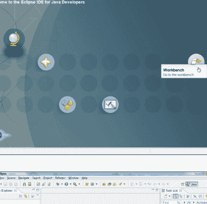

**图 2-11：** Eclipse 的欢迎屏幕。

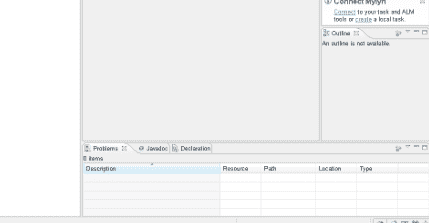

**图 2-12：** 带有全新工作区的 Eclipse 工作台。

## 在 Eclipse 中配置 Java

Eclipse 通常会在你的计算机上查找 Java 安装并选择一个已安装的 Java 版本来运行你的 Java 程序。你的计算机可能安装了多个 Java 版本，因此你可能需要再次检查 Eclipse 对 Java 版本的选择。以下步骤会告诉你如何操作：

- 1. 在 Windows 或 Linux 上：在 Eclipse 的主菜单中选择 Window▸ Preferences。在 Mac 上：在 Eclipse 的主菜单中选择 Eclipse▸ Preferences。

结果，Eclipse 的首选项对话框会出现。（你可以对照图 2-13 进行操作。）

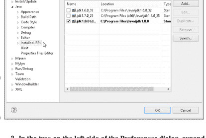

**图 2-13：** Eclipse 的首选项对话框。

- 2. 在首选项对话框左侧的树中，展开 Java 分支。
- 3. 在 Java 分支中，选择 Installed JREs 子分支。
- 4. 查看首选项对话框主体中的 Java 版本列表（Installed JREs）。

在列表中，每个 Java 版本都有一个复选框。Eclipse 使用已勾选的版本。如果已勾选的版本不是你偏好的版本（例如，已勾选的版本不是 8 或更高版本），你可以进行一些更改。

- 5. **如果你的首选 Java 版本出现在 Installed JREs 列表中，请在该版本的复选框中打勾。**

- 6. **如果你的首选 Java 版本未出现在 Installed JREs 列表中，请单击 Add 按钮。**

单击 Add 按钮后，会出现 JRE Type 对话框（见图 2-14）。

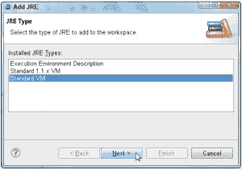

**图 2-14：** JRE Type 对话框。

- 7. **在 JRE Type 对话框中，双击 Standard VM。**

结果，JRE Definition 对话框会出现（见图 2-15）。接下来要做什么取决于一些不同的因素。

- 8. **填写对话框的 JRE Home 字段。**

  如何操作取决于你的操作系统。

  - 在 Windows 上，浏览到你安装首选 Java 版本的目录。在我的许多 Windows 计算机上，该目录是 `C:\Program Files\Java\jre8`、`C:\Program Files\Java\jdk1.8.0_8`、`C:\Program Files (x86)\Java\jre8` 或类似路径。

  - 在 Mac 上，使用 Finder 浏览到你安装首选 Java 版本的目录。在对话框的 JRE Home 字段中输入该目录的名称。

  我的 Mac 上有一个名为 `/System/Library/Java/JavaVirtualMachines/1.6.0.jdk/Contents/Home` 的 Java 目录，另一个名为 `/Library/Java/JavaVirtualMachines/jdk1.8.0.jdk/Contents/Home` 的 Java 目录。（前者是 Apple 的旧版 Java；后者是 Oracle 的新版 Java。）你也可能在 `/Library/Internet Plug-Ins/JavaAppletPlugin.plugin/Contents/Home` 目录中找到 Oracle 的 Java。

  /System 和 /Library 等目录通常不会出现在 Finder 窗口中。要浏览到其中一个目录（例如 /Library 目录），请在 Finder 的菜单栏中选择 Go→Go to Folder。在弹出的对话框中，输入 /Library 然后按 Go。

  当你导航到包含首选 Java 版本的目录时，你可能会遇到 JDK 1.8.0.jdk 图标或其他扩展名为 .jdk 的项目。要查看此项目的内容，请按住 control 键单击该项目的图标，然后选择显示包内容。

  - 在 Linux 上，浏览到你安装首选 Java 版本的目录。如有疑问，请搜索名称以 jre 或 jdk 开头的目录。

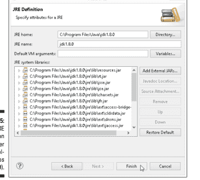

**图 2-15：** JRE Definition 对话框（在执行步骤 8 和 9 之后）。


你可能还需要在 JRE Definition 对话框中做一件事。

- 9. 查看 JRE Definition 对话框的 JRE Name 字段；如果 Eclipse 没有自动填写名称，请在 JRE Name 字段中输入一个名称（几乎任何文本均可）。

- 10. 通过单击 Finish 关闭 JRE Definition 对话框。

Eclipse 的首选项对话框重新回到前台。Installed JREs 列表中包含你刚刚添加的 Java 版本。

- 11. 在你刚刚添加的 Java 版本旁边的复选框中打勾。

你几乎完成了。（还有几个步骤需要跟进。）

- 12. 在首选项对话框左侧的 Java 分支中，选择 Compiler 子分支。

在首选项对话框的主体中，你会看到一个 Compiler Compliance Level 下拉列表（见图 2-16）。

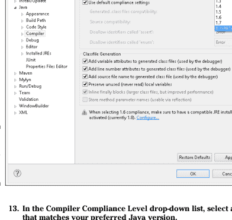

**图 2-16：** 设置编译器兼容级别。

- 13. 在 Compiler Compliance Level 下拉列表中，选择一个与你首选 Java 版本相匹配的数字。

对于 Java 7，我选择兼容级别 1.7。对于 Java 8，我选择兼容级别 1.8。

- 14. 呼！单击首选项对话框的 OK 按钮返回 Eclipse 工作台。

## 导入本书的示例程序

这个导入过程可能有点棘手。随着你从一个对话框移动到下一个对话框，许多选项的名称相似。这是因为 Eclipse 提供了许多不同的方式来导入许多不同类型的内容。总之，如果你按照这些说明操作，就没问题。

- 1. 按照本章前面“获取本书示例程序”部分中的步骤操作。
- 2. 在 Eclipse 的主菜单中选择 File→Import（见图 2-17）。

结果，Eclipse 显示一个 Import 对话框。

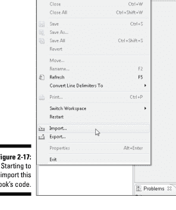

- 3. 在 Import 对话框的树中，展开 General 分支。
- 4. 在 General 分支中，双击 Existing Projects into Workspace 子分支（见图 2-18）。

结果，出现一个 Import Projects 对话框。


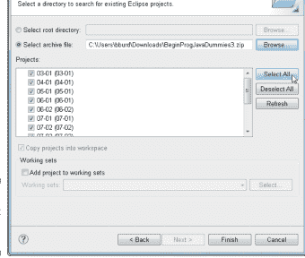

图 2-19：导入项目对话框。

7. 单击“全选”按钮。

本书的示例如此令人兴奋，以至于你想全部导入它们！

8. 单击“完成”按钮。

结果，主 Eclipse 工作台重新出现。工作台左侧显示本书的 Java 项目名称（参见图 2-20）。

现在真正的乐趣开始了。

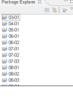

图 2-20：Eclipse 显示了一堆 Java 项目。

### 第 3 章：运行程序

### 本章内容

- 编译和运行程序
- 使用工作区
- 编辑自己的 Java 代码

如果你是编程新手，对你来说，运行程序可能意味着单击鼠标。你想运行 Internet Explorer，所以你双击 Internet Explorer 图标。就这么简单。

当你创建自己的程序时，情况有点不同。对于新程序，程序员（或程序员公司的人）会创建程序的图标。在此之前，一个完全可以正常工作的程序可能根本没有图标。那么你该如何处理全新的 Java 程序呢？如何让程序运行？本章会告诉你需要知道的内容。

### 运行现成的 Java 程序

最好的了解 Java 的方法就是做 Java。当你在做 Java 时，你正在编写、测试和运行自己的 Java 程序。本节通过描述如何运行和测试程序来为你做准备。不是编写自己的程序，而是运行我已经为你编写的程序。该程序计算房屋抵押贷款的月还款额。

抵押贷款计算程序不会打开自己的窗口。相反，程序在 Eclipse 的 Console 视图中运行。Console 视图是 Eclipse 工作台右下部分的一个标签之一（参见图 3-1）。完全在此 Console 视图中运行的程序称为 *基于文本的程序*。

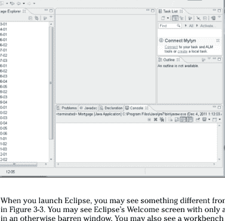

图 3-3：Eclipse 工作台。


当你启动 Eclipse 时，你可能会看到与图 3-3 中的内容不同的东西。你可能会看到只有几个图标的 Eclipse 欢迎屏幕，窗口其余部分空空如也。你也可能会看到像图 3-3 那样的一个工作台，但在 Package Explorer 中没有 03-01、04-01 等数字列表。如果是这样，你可能错过了第 2 章中关于配置 Eclipse 的某些说明。或者，你可能修改了本节说明步骤 2 中启动器“工作区”字段中的内容。

无论如何，请确保在 Package Explorer 中看到 03-01 和 04-01 等数字。看到这些数字可确保 Eclipse 已准备好运行本书中的示例程序。

4. 在 Package Explorer 中，单击 03-01 分支。

本章的 Java 项目——03-01 项目——会高亮显示。


你可能想先预览一些 Java 代码。要查看你在项目 03-01 中运行的 Java 程序，请在 Package Explorer 中展开 03-01 分支。在 03-01 分支内部，你会找到一个 src 分支，其内部又包含一个（默认包）分支。在（默认包）分支内部，你会找到 Mortgage.java 分支。该 Mortgage.java 分支代表我的 Java 程序。双击 Mortgage.java 分支会使我的代码出现在 Eclipse 编辑器中。

### 将你的程序与我的程序分开

在第 2 章中，你从我的网站下载本书的示例。然后你创建一个 Eclipse 工作区并将本书的示例导入到你的工作区中。

你可以在同一个工作区中创建自己的项目。但如果你想将自己的代码与我的代码分开，你可以创建一个第二个工作区。这里有两种创建新工作区的方法：

- **启动 Eclipse 时，在 Eclipse 工作区启动器对话框的“工作区”字段中输入新的文件夹名称。**

  如果该文件夹尚不存在，Eclipse 会创建该文件夹。如果该文件夹已存在，Eclipse 的 Package Explorer 会列出该文件夹包含的任何项目。

- **在 Eclipse 工作台的主菜单中选择 File→Switch Workspace（参见图 3-6）。**

  当你选择 File→Switch Workspace 时，Eclipse 会为你提供之前打开的工作区文件夹的几个选项。如果你的文件夹选择不在列表中，请选择 Other 选项。作为响应，Eclipse 会重新打开其工作区启动器对话框。

图 3-6：切换到不同的 Eclipse 工作区。

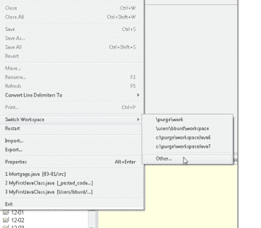

### 编写和运行你的程序

以下是创建新 Java 项目的方法：

1. **启动 Eclipse。**
2. **从 Eclipse 菜单栏选择 File→New→Java Project。**
3. **在 New Java Project 对话框中，为你的项目输入名称，然后单击 Finish。**

会出现一个 New Java Project 对话框。

在图 3-7 中，我输入的名称为 `MyFirstProject`。

如果你单击 Next 而不是 Finish，你会看到一些现在不需要的其他选项。因此，为了避免任何混淆，只需单击 Finish 即可。

单击 Finish 会带你返回到 Eclipse 工作台，Package Explorer 中显示 `MyFirstProject`，如图 3-8 所示。

下一步是创建一个新的 Java 源代码文件。


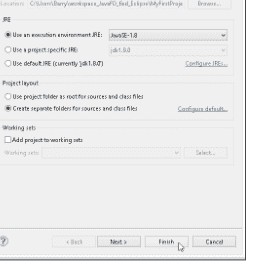

图 3-7：让 Eclipse 创建新项目。

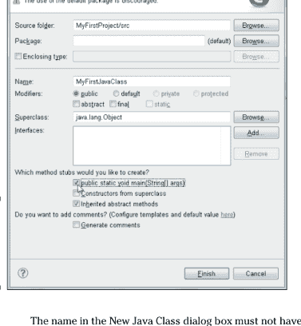

图 3-9：让 Eclipse 创建新的 Java 类。


New Java Class 对话框中的名称不得包含空白字符。唯一允许的标点符号是下划线字符（_）。你可以将类命名为 MyFirstJavaClass 或 My_First_Java_Class，但不能将其命名为 My First Java Class 或 Java Class, MyFirst。

7. 在 `public static void main(String[] args)` 复选框中打勾。

你的勾选会告诉 Eclipse 创建一些样板 Java 代码。

8. 接受 New Java Class 对话框中的所有其他默认值（换句话说，单击 Finish）。

你甚至可以忽略对话框顶部附近的“默认包不受推荐”警告。

单击 Finish 会带你返回到 Eclipse 工作台。现在 MyFirstProject 包含一个名为 MyFirstJavaClass.java 的文件。为了方便你，MyFirstJavaClass.java 文件中已经有一些代码。Eclipse 编辑器会显示 Java 代码（参见图 3-10）。

图 3-10：Eclipse 在编辑器中编写代码。

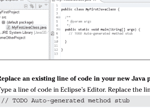

9. 替换新 Java 程序中已有的代码行。

在 Eclipse 编辑器中输入一行代码。将行

```
// TODO Auto-generated method stub
```

替换为行

```
System.out.println("Chocolate, royalties, sleep");
```

完全按照清单 3-1 中显示的方式复制新代码行。

- 完全按照我在清单 3-1 中拼写的方式拼写每个单词。
- 完全按照我在清单 3-1 中使用的方式大写每个单词。
- 包含所有标点符号——点、引号、分号，一切。
- 区分小写字母 l 和数字 1。单词 println 告诉计算机打印整行。单词 println 中的每个字符都是小写字母。该单词不包含数字。


**清单 3-1：显示我喜欢的东西的程序**

```java
public class MyFirstJavaClass {
    /**
     * @param args
     */
    public static void main(String[] args) {
        System.out.println("Chocolate, royalties, sleep");
    }
}
```


如果没有完全按照《清单 3-1》中的代码输入，你可能会在编辑器中看到锯齿状的红色下划线、内部带有类似 X 标记的小矩形，或其他红色标记（见图 3-12）。

Figure 3-12:
输入错误的 Java 程序。

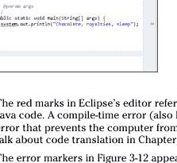

Eclipse 编辑器中的红色标记指的是你的 Java 代码中的 *compile-time errors*。编译时错误（也称为 *compiler error*）是一种阻止计算机翻译你的代码的错误。（参见第 1 章中关于代码翻译的讨论。）


图 3-12 中的错误标记出现在 Java 程序的第 8 行。行号显示在编辑器的左侧边距中。要让 Eclipse 编辑器显示行号，请选择 Window>Preferences（Windows 系统）或 Eclipse>Preferences（Mac 系统）。然后选择 General>Editors>Text Editors。最后，在 Show Line Numbers 复选框中打勾。

要修复编译时错误，你必须成为一名敬业的侦探。你加入了一个名为 *Law & Order: Java Programming Unit* 的精英小队。你很少能找到简单的答案。相反，你要慢慢仔细地梳理证据寻找线索。你将编辑器中看到的每一项内容逐字符与《清单 3-1》中的我的代码进行比较。你不会遗漏任何细节，包括拼写、标点符号以及大小写。

Eclipse 有一些不错的功能可以帮助你找到编译时错误的来源。例如，你可以悬停在锯齿状的红色下划线上。这样做时，你会看到错误的简要说明以及修复错误的建议——一些 *quick fixes*（见图 3-13）。

Figure 3-13:
Eclipse 提供一些有用的建议。

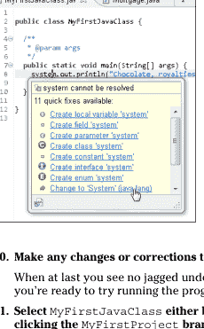

**10. 在 Eclipse 编辑器中对代码进行任何更改或修正。**

当你最终在编辑器中看不到锯齿状下划线或斑点时，你就可以尝试运行程序了。

**11. 通过在编辑器中点击，或通过在 Package Explorer 中点击 MyFirstProject 分支来选择 MyFirstJavaClass。**

**12. 在 Eclipse 的主菜单中，选择 Run→Run As→Java Application。**

就这么简单。你的新 Java 程序在 Eclipse 的 Console 视图中运行。如果你在运行《清单 3-1》中的代码，你会在图 3-14 中看到 Chocolate, royalties, sleep 消息。就像身在天堂一样！


Figure 3-14:
在《清单 3-1》中运行程序。

## 可能出现什么问题？

清除编辑器中的锯齿状下划线值得庆祝。Eclipse 喜欢你的代码的样子，从那时起，一切就一帆风顺了。对吧？

好吧，不一定如此。除了一些显而易见的编译时错误外，你的代码还可能存在其他不太明显的错误。

想象一下有人告诉你“去到路口，然后 run tight”。你立刻注意到说话者犯了错误，于是礼貌地回应“嗯？”。这个无意义的 run tight 短语就像编译时错误一样。你的“嗯？”就像 Eclipse 编辑器中的锯齿状下划线。作为一个聆听的人类，你也许能猜出 run tight 的意思，但 Eclipse 编辑器永远不敢修正你代码的错误。

除了编译时错误外，还有一些其他类型的“小妖怪”可能隐藏在 Java 程序内部：

**Unchecked runtime exceptions:** 你没有编译时错误，但在运行程序时，运行会过早结束。在运行的中间某个地方，你的指令告诉 Java 做一件无法完成的事情。例如，在“运行罐装 Java 程序”部分运行 Mortgage 程序时，你输入了 1,000,000.00 而不是 1000000.00。Java 不喜欢数字中的逗号，因此你的程序崩溃并显示一条难看的消息，如图所示。

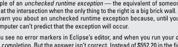

这是一个未检查的运行时异常的例子——相当于有人告诉你在路口向右转，而右边唯一的东西是一堵大砖墙。Eclipse 编辑器不会警告你未检查的运行时异常，因为在运行程序之前，计算机无法预测异常会发生。

**Logic errors:** 你在 Eclipse 编辑器中看不到任何错误标记，并且在运行代码时，程序运行到完成。但答案不正确。图中的输出不是 $552.20，而是 $552,200,000.00。程序错误地告诉你支付相当于房屋价值数千倍的金额，并且每月支付这个金额！这相当于被告知向右转而不是向左转。你可能在错误的方向上行驶很长时间。


逻辑错误是最具挑战性的错误，也是最难修复的。最糟糕的是，逻辑错误经常被忽视。1985 年 3 月，我收到了一张每月取暖费账单，金额为 $1,328,932.21。显然，某台计算机打印了错误的金额。当我打电话给燃气公司投诉时，电话服务代表说：“别生气。只付一半的金额就行。”

## 编译时警告：

警告没有错误消息那么严重。因此，当 Eclipse 在你的程序中发现可疑之处时，编辑器会显示锯齿状的黄色下划线、一个包含感叹号的小黄色图标，以及一些不太明显的线索。

例如，在下面的图中，我在《清单 3-1》的代码中添加了关于 amount = 10 的内容。（就是第 8 行的那部分。）问题是，我在程序的任何地方都没有使用 amount 或数字 10。通过其微弱的黄色标记，Eclipse 实际上是在告诉我“你的 amount = 10 代码还不足以成为阻碍。Eclipse 仍然可以运行你的程序。但你确定要在程序中保留 amount = 10（似乎毫无用处的部分）吗？”

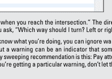

想象一下被告知“到达路口时转弯”。方向可能完全没问题。但如果你怀疑，你会问：“应该往哪边转？左还是右？”

当你确定自己知道在做什么时，你可以忽略警告，并在稍后担心它们。但警告可能表明你的代码存在更严重的问题。因此我的总体建议是：注意警告。但如果你无法弄清为什么会出现某个特定警告，不要让警告阻止你继续前进。

## Eclipse 窗口里那些东西都是什么？

信不信由你，一位编辑曾经拒绝过我的一本图书提案。在页边空白处，编辑写着“这不是一个词”旁边是像“can't”、“it's”和“I've”这样的词。至今我仍不知道这位编辑不喜欢缩写的什么。我的观点是，语言总是需要扩展。没有新词——像 dotcom、infomercial 和 vaporware 这样的词——我们会怎样？

即使是 *Oxford English Dictionary*（关于词语争论的最后权威）每年也增加超过 4,000 个词条。这每年增长超过百分之一。大约每天 11 个新词！

事实是，人类思想就像一栋大高楼。你不能在建造完至少一部分四十九层之前建造第五十层。你不能在没有像 *e-mail* 这样的词之前谈论 *spam*。在当今这个一切都在发生的时代，你需要语言的构建块。这就是本节包含大量新术语的原因。

在本节中，每个新定义的术语都描述了 Eclipse IDE 的一个方面。因此，在阅读所有这些 Eclipse 术语之前，我提供以下免责声明：

-   **本节为可选阅读。** 如果你对本书中的某些说明理解有困难，请参考本节。但如果你在 Eclipse IDE 中导航毫无问题，就不要因纠结本节的术语而使事情复杂化。
-   **本节提供术语的解释，而非正式定义。** 是的，我的解释相当精确，但不，它们并不严丝合缝。本节几乎每个描述都有隐藏的例外、遗漏、豁免和排除。请把本节的段落当作友好的提醒，而不是法律合同。
-   **Eclipse 是一个非常有用的工具。** 但 Eclipse 并非 Java 生态系统的一部分。虽然本书中没有描述细节，但你可以在不使用 Eclipse 的情况下编写 Java 程序。

## 理解大局

你对 Eclipse 的参观从一个大的鸟瞰图开始。

-   **Workbench:** Eclipse 桌面（参见图 3-3）。工作台是你开发代码的环境。
-   **Area:** 工作台的一个部分。图 3-3 中的工作台包含五个区域。为了说明这一点，我在每个区域周围画了边框（见图 3-15）。
-   **Window:** Eclipse 工作台的副本。使用 Eclipse 时，你可以同时打开多个工作台副本。每个副本都出现在自己的窗口中。
-   **Action:** 提供给你的一个选择，通常在你点击某物时出现。例如，当你在 Eclipse 的主菜单栏中选择 File→New 时，你会看到可以创建的新事物的列表。该列表通常包括 Project、Folder、File 和 Other，但也可能包括 Package、Class 和 Interface 等。每一样东西（菜单中的每个项目）都称为一个 *action*。


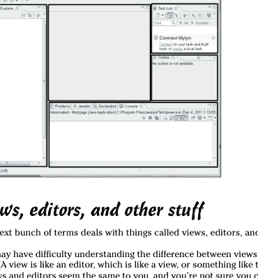

图 3-15：
工作台分为多个区域。

## 视图、编辑器和其他内容

接下来的一组术语涉及称为视图、编辑器和选项卡的内容。


你可能难以理解视图和编辑器之间的区别。（视图就像编辑器，编辑器就像视图，或者类似的东西。）如果视图和编辑器对你来说似乎相同，并且你不确定哪个是哪个，请不要沮丧。作为一名普通的 Eclipse 用户，随着你使用工作台经验的积累，视图和编辑器之间的区别会自然而然地显现出来。你很少需要决定自己使用的是视图还是编辑器。

如果你必须区分视图和编辑器，这里是你需要知道的内容：

✔ **视图：** Eclipse 工作台中用于浏览信息的一部分。在最简单的情况下，视图占据工作台中的一个区域。例如，在图 3-3 中，Package Explorer 视图占据最左侧的区域。

许多视图以列表或树的形式显示信息。例如，在图 3-10 中，Package Explorer 视图包含一棵树。

你可以使用视图来更改事物。例如，要在图 3-10 中删除 `SomeOtherProject`，在 Package Explorer 视图中右键单击 `SomeOtherProject` 分支。（在 Mac 上，control-单击 `SomeOtherProject` 分支。）然后，在生成的上下文菜单中，选择删除。

图 3-16：
编辑器区域包含三个编辑器。

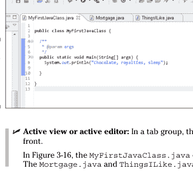

✓ 活动视图或活动编辑器：在选项卡组中，位于前方的视图或编辑器。

在图 3-16 中，MyFirstJavaClass.java 编辑器是活动编辑器。
Mortgage.java 和 ThingsILike.java 编辑器处于非活动状态。

### 视图或编辑器内部有什么？

接下来的几个术语涉及单个视图、单个编辑器和单个区域。

✓ 工具栏：视图顶部的一排按钮（和其他小东西）（见图 3-17）。

图 3-17：
Package Explorer 视图的工具栏。

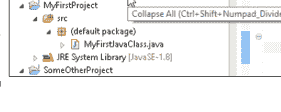

✓ 菜单按钮：工具栏中的向下指向箭头。单击菜单按钮时，会出现一个操作下拉列表（见图 3-18）。
列表中显示的操作因视图而异。

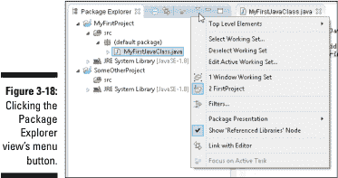

**关闭按钮：** 一个按钮，用于关闭特定的视图或编辑器（见图 3-19）。

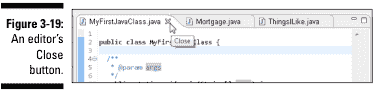

**尖括号：** 一个双箭头，表示在特定区域应出现其他选项卡（但该区域不够宽）。图 3-20 中的尖括号旁边有一个小数字 2。2 告诉你，除了两个可见的选项卡外，还有两个选项卡不可见。单击尖括号会弹出一个悬停提示，其中包含所有选项卡的标签（见图 3-20）。

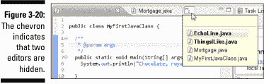

**标记栏：** 编辑器区域左侧边缘的垂直标尺。Eclipse 在标记栏内显示称为 *标记* 的微小警报图标。（例如，参见图 3-12。）

## 第二部分

### 编写自己的 Java 程序

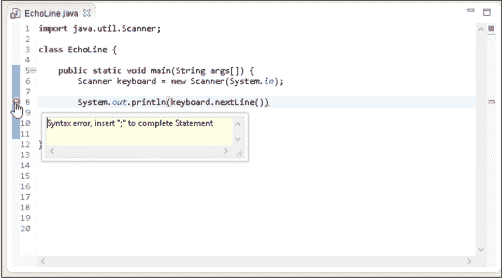

### 在本部分中……

- 解剖程序并检查各个部分
- 使用数字
- 处理非数字的事物

### 第 4 章

### 探索程序的各个部分

### 本章内容

- 识别 Java 程序中的单词
- 使用标点符号和缩进
- 理解 Java 语句和方法

我在一所文理学院的科学楼工作。当我走过生物实验室时，我总是默默地说一声感谢。我感谢自己不必解剖小动物。在我的工作中，我解剖的是计算机程序。计算机程序闻起来比保存的死动物好得多。此外，当我解剖一个程序时，我不会被提醒自己的死亡。

在本章中，我邀请你和我一起解剖一个程序。我有一个名为 ThingsILike 的小程序。我把程序拆开并仔细研究其内部结构。准备好你的手术刀吧。开始吧！

### 第一次查看 Java 代码

我有一个要坦白的事。第一次看别人的计算机程序时，我会感到有点恶心。意识到自己不理解代码中的某些东西（或许多东西）让我感到紧张。我写过数百（也许数千）个程序，但在开始阅读别人的代码时，我仍然感到不安全。

事实是，学习计算机程序是一种自举体验。首先，我惊叹地看着程序。然后我运行程序看看它做什么。然后我盯着程序看一会儿或阅读别人对程序及其各部分的解释。然后我再多惊叹一点并再次运行程序。最终，我会接受这个程序。不要相信那些说自己从不经历这些步骤的聪明人。即使是经验丰富的程序员也会缓慢而谨慎地处理新项目。

### 看！一个程序！

在清单 4-1 中，你会看到一段 Java 代码。像所有初学者程序员一样，你被期望谦卑地惊叹于代码。但不要被吓倒。一旦你掌握了它，编程其实很容易。是的，它也很有趣。

### 清单 4-1：一个简单的 Java 程序

```
/*
* A program to list the good things in life
* Author: Barry Burd, BeginProg@allmycode.com
* February 13, 2014
*/

class ThingsILike {
    public static void main(String args[]) {
        System.out.println("Chocolate, royalties, sleep");
    }
}
```

当我运行清单 4-1 中的程序时，我得到图 4-1 所示的结果：计算机在屏幕上显示单词 Chocolate, royalties, sleep。现在，我承认编写和运行 Java 程序只是为了让单词 Chocolate, royalties, sleep 出现在某人的计算机屏幕上，这工作量很大，但每个事业都必须从某个地方开始。

图 4-1：
运行清单 4-1 中的程序。

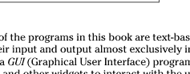


本书中的大多数程序都是基于文本的程序。这些程序几乎完全在 Eclipse 的 Console 视图中进行输入和输出。相比之下，GUI（图形用户界面）程序会显示窗口、按钮、文本字段和其他小部件以与用户交互。你可以通过访问本书网站（http://allmycode.com/BeginProg）查看清单 4-1 中的程序以及本书中许多其他示例的 GUI 版本。

### Java 程序中的元素

英语和 Java 都被称为语言绝非巧合。你使用语言来表达思想。英语向人们表达思想，Java 向计算机表达思想。更重要的是，英语和 Java 都有诸如单词、名称和标点符号之类的东西。事实上，这两种语言之间最大的区别是 Java 比英语更容易学习。（如果英语很容易，那么计算机就会理解英语。不幸的是，它们不能。）

取一个普通的英语句子并将其与清单 4-1 中的代码进行比较。句子如下：

Suzanne says "eh" because, as you know, she lives in Canada.

在你的高中语法课上，你担心动词、形容词和其他此类东西。但在这本书中，你将以关键字和标识符的概念来思考，如图 4-2 所总结。

图 4-2：简单句子中包含的东西。

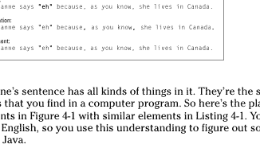

Suzanne 的句子包含各种各样的东西。它们与你在计算机程序中找到的东西是同一类。所以计划如下：将图 4-1 中的元素与清单 4-1 中相似的元素进行比较。你已经理解英语，所以你利用这种理解来弄清 Java 的一些新东西。

但首先，这里有一个友好的提醒：在接下来的几段中，我在英语和 Java 之间进行比较。在阅读这些段落时，保持开放的心态很重要。例如，在比较 Java 和英语时，我可能会写“事物的名称与字典单词不同”。当然，你可以争辩说有些字典列出专有名词，有些人的名字像 Hope、Prudence 和 Spike，但请不要这样做。如果你避免吹毛求疵，你会从阅读中获得更多。好吗？我们还是朋友吗？


## 你或我可以定义的标识符

我喜欢 Suzanne 这个名字，但如果你不喜欢传统名字，那就想一个全新的名字。你要生个新宝宝了。给她取名叫“Deneen”或“Chrisanta”。给他取名叫“Belton”或“Merk”。

名字是一个用来标识某事物的词，所以我不再称这些东西为名字，而是称它们为标识符。在计算机编程中，标识符是一种名词。标识符指的是一个值、程序的一部分、某种结构，或任何数量的东西。

清单 4-1 中有两个是你或我可以自行定义的标识符。它们是自创的词 ThingsILike 和 args。

```
class ThingsILike {
    public static void main(String args[]) {

```

正如名字 Suzanne 和 Chrisanta 在英语中没有特殊含义一样，名字 ThingsILike 和 args 在 Java 中也没有特殊含义。在清单 4-1 中，我用 ThingsILike 作为程序的名称，但我也可以使用像 GooseGrease、Enzyme 或 Kalamazoo 这样的名字。我必须在程序中写上 (String someName[])，但我也可以使用 (String args[])、(String commandLineArguments[]) 或 (String cheese[])。

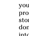

TIP
照我说的做，别照我做的做。为你的 Java 程序中的事物想出合理、信息丰富的名称。像 GooseGrease 这样的名字很可爱，但它们无助于你跟踪程序编写策略。


REMEMBER
当我为 Java 程序命名时，我可以使用 ThingsILike 或 GooseGrease，但我不能使用 public 这个词。像 class、public、static 和 void 这样的词是 Java 中的关键字。

(String args[]) 中的 args 保存你在发出运行 Java 程序命令时输入的任何额外内容。例如，如果你通过输入 java ThingsILike won too 3 来运行程序，那么 args 就存储额外的值 won、too 和 3。作为一名初学者，你不需要考虑 Java 的这个特性。只需将 (String args[]) 粘贴到每个程序中即可。

## 有约定含义的标识符

很多人都叫 Suzanne，但只有一个国家叫 Canada。这是因为“Canada”这个词有一个标准、众所周知的含义。它就是国旗上有红色枫叶的国家。如果你要建立自己的国家，就应避免将其命名为 Canada，因为这样命名只会让每个人都困惑。（我知道，肯塔基州有一个镇叫 Canada，但这不算数。记住，你应该忽略这类例外。）

大多数编程语言都有约定含义的标识符。在 Java 中，几乎所有这些标识符都定义在 Java API 中。清单 4-1 中有五个这样的标识符。它们是单词 main、String、System、out 和 println：

```
public static void main(String args[]) {
    System.out.println("Chocolate, royalties, sleep");
}
```

以下是这些名称含义的简要说明（本书各处会有更详细的描述）：

- **main:** 每个 Java 程序中执行的起点。
- **String:** 一串文本；一连串的字符。
- **System:** Java API 中的一个现成程序。该程序访问一些超出 Java 虚拟机（JVM）直接控制的计算机功能。
- **out:** 文本程序显示其文本的位置。（对于在 Eclipse 中运行的程序，单词 out 代表 Console 视图。要了解更多关于基于文本的程序的信息，请查阅第 3 章的前几段。）
- **println:** 在计算机屏幕上显示文本。


名称 println 来自“print a line”这个词组。如果你被允许用大写字母写这个名字，它会是 PRINTLN，词尾附近有一个字母 L。当计算机执行 println 时，计算机会在 Eclipse 的 Console 视图中放置一些文本，然后立即移动到下一行的开头，为 Console 视图中将要出现的其他内容做准备。


严格来说，Java API 中标识符的含义并非一成不变。虽然你可以为 System 或 println 这样的词自创含义，但这样做不是个好主意——因为你会让其他程序员感到困惑，他们习惯了这些熟悉标识符名称的标准 API 含义。

## 字面量

字面量是一段看起来像其所代表的值的文本。在 Suzanne 的句子中（参见图 4-2），“eh”是一个字面量，因为“eh”指的是单词“eh”。

编程语言也有字面量。例如，在清单 4-1 中，引号中的内容就是字面量：

```
System.out.println("Chocolate, royalties, sleep");
```

当你运行 ThingsILike 程序时，你会在屏幕上看到单词 Chocolate、royalties、sleep。在清单 4-1 中，文本“Chocolate, royalties, sleep”指的是这些词，正如它们在屏幕上出现的那样（不包括引号）。

你在计算机程序中使用的数字大多是字面量。如果你把语句

```
mySalary = 1000000.00;
```

放在计算机程序中，那么 1000000.00 就是一个字面量。它代表数字 1000000.00（一百万）。

如果你不喜欢数位数，你可以在 Java 7 程序中放入以下语句：

```
mySalary = 1_000_000.00;
```

从 Java 7 开始，带下划线的数字可以用作字面量。

在 Java 7 之前的版本中，你不能在代码中使用像 1_000_000.00 这样的数字。

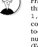


不同国家使用不同的数字分隔符和不同的数字格式。例如，在美国，你写 1,234,567,890.55。在法国，你写 1234567890,55。在印度，你将数字按两三位一组分组。你不能在 Java 程序中写类似 mySalary = 1,000,000.00 的语句。Java 的数字字面量中没有逗号。但你可以用 mySalary = 10_00_000.00 来方便印度人阅读的编程。而且对于程序的输出，你可以使用 Java 的 Locale 和 NumberFormat 类来显示像 1234567890,55 这样的数字。（有关 Locale 和 NumberFormat 的更多信息，请查阅第 18 章。）

## 标点符号

典型的计算机程序有很多标点符号。例如，考虑清单 4-1 中的程序：

```
class ThingsILike {
    public static void main(String args[]) {
        System.out.println("Chocolate, royalties, sleep");
    }
}
```

每个方括号、每个大括号、任何形式的波浪线都在使程序有意义方面发挥作用。

在英语中，你一直写到一行末尾然后将文本换到下一行开头。在编程中，你很少这样做。相反，代码的标点符号指导某些行的缩进。缩进显示程序的哪些部分从属于哪些其他部分。就好像在英语中，你这样写 Suzanne 的句子：

Suzanne says "eh" because
'
    as you know
'
she lives in Canada.

图 4-3 和图 4-4 中的图表向你展示了 ThingsILike 程序的各部分是如何包含在其他部分之内的。注意一对花括号如何像一个盒子一样起作用。为了让程序的结构一目了然，你要缩进每个盒子内部的所有内容。

图 4-3：一对花括号像一个盒子一样起作用。

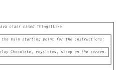

图 4-4：计算机程序中的思想彼此嵌套。

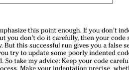

REMEMBER
我不能再强调这一点了。如果你不缩进代码，或者缩进但不够仔细，那么你的代码仍然可以正确编译和运行。但这种成功的运行会给你一种虚假的自信。一旦你尝试更新一些缩进不良的代码，你就会完全迷惑。所以听我的建议：在整个过程中始终仔细缩进你的代码。无论是草拟一个快速测试程序还是为亿万富翁客户编写代码，都要使你的缩进精确。

TIP
Eclipse 可以自动为你缩进代码。选择你想要缩进代码的 .java 文件。然后，在 Eclipse 的主菜单中选择 Source→Format。Eclipse 会重新排列编辑器中的行，缩进应该缩进的内容，并通常使你的代码看起来不错。


**Javadoc注释：** 任何以额外星号开头的传统注释，都属于特殊的 Javadoc 注释。

```
/**
 * Print a String and then terminate the line.
 */
```

这是 Java 的一个很酷的特性。你可以从 java.sun.com 下载的软件中，包含一个名为 javadoc 的小程序。javadoc 程序会在你的代码中寻找这些特殊注释，并利用它们创建全新的网页——为你的代码量身定制的文档页面。想了解更多关于如何将 Javadoc 注释转化为网页的内容，请访问本书网站 (http://allmycode.com/BeginProg)。

## 理解一个简单的 Java 程序

接下来的章节将展示、解释、分析、剖析并揭秘清单 4-1 中的 Java 程序。

## 什么是方法？

你正在一家高档修车行担任汽车修理工。你的老板总是匆匆忙忙，习惯把词连在一起说：“FixTheAlternator。” 你在脑中过了一遍任务清单：“把车开进工位，打开发动机盖，拿起扳手，松开交流发电机皮带，”等等。这里有三个要点：

- **你有一个名字来指代要做的事情。** 这个名字就是 FixTheAlternator。
- **在你的脑海中，有一系列与 FixTheAlternator 这个名字相关联的任务。** 包括“把车开进工位、打开发动机盖、拿起扳手、松开交流发电机皮带，”等等。
- **你有一个脾气暴躁的老板，正吩咐你去做这些工作。** 你的老板通过说 “FixTheAlternator” 来让你开工。换句话说，你的老板通过说出你要做的那件事的名字来让你开工。

在这种情况下，使用“方法”这个词并不牵强。你有一种处理交流发电机的“方法”。你的老板把这个“方法”调用起来，你则通过执行与该方法相关联的指令清单来响应。

## Java 方法

如果你相信前面一节的内容，那么你已经准备好了了解 Java 方法。在 Java 中，方法就是待办事项的清单。每个方法都有一个名字，在程序中使用该方法的名称，就能告诉计算机执行清单中的事项。

我从未编写过让机器人修理交流发电机的程序。但如果我写过，这个程序可能包含一个名为 FixTheAlternator 的方法。这个 FixTheAlternator 方法中的指令列表看起来会类似清单 4-2 中的文本。

### 清单 4-2：方法声明

```
void FixTheAlternator() {
  DriveInto(car, bay);
  Lift(hood);
  Get(wrench);
  Loosen(alternatorBelt);
  ...
}
```

在我的 Java 代码中的其他地方（清单 4-2 之外的某处），需要一条指令来调用 FixTheAlternator 方法。调用 FixTheAlternator 方法的指令可能类似于清单 4-3 中的那一行。

### 清单 4-3：调用方法

```
FixTheAlternator(junkyOldFord);
```


不要过于仔细地推敲清单 4-2 和 4-3。清单 4-2 和 4-3 中的所有代码行都是虚构的！我编造了这些代码，让它们看起来很像真实的 Java 代码，但它们不是真的。更重要的是，清单 4-2 和 4-3 中的代码并非为了展示 Java 的所有规则。所以，如果你有怀疑的态度，不妨将其用在清单 4-2 和 4-3 上。


几乎每种计算机编程语言都有类似于 Java 方法的东西。如果你用过其他语言，你可能会记得子程序、过程、函数、子例程、Sub 过程或 PERFORM 语句之类的概念。无论在你喜欢的编程语言中如何称呼它，方法就是一系列指令的集合，并给它赋予一个新的名称。

## 声明、头部与调用

如果你对方法是什么以及它如何工作有了基本了解（见前节），就可以更深入地探讨一些有用的术语：

- 如果懒得细究，我会把清单 4-2 中的代码称为*方法*。如果不偷懒，我会把这部分代码称为*方法声明*。
- 清单 4-2 中的*方法声明*有两部分。第一行（包含 FixTheAlternator 名称的部分，直到但不包括左花括号）称为*方法首部*。清单 4-2 的其余部分（由花括号括起来的部分）是*方法体*。
- 术语*方法声明*将清单 4-2 中的指令列表与清单 4-3 中的指令区分开来，后者称为*方法调用*。

有关所有方法术语的直观说明，请参见图 4-5。

**图 4-5：** 描述方法的术语。

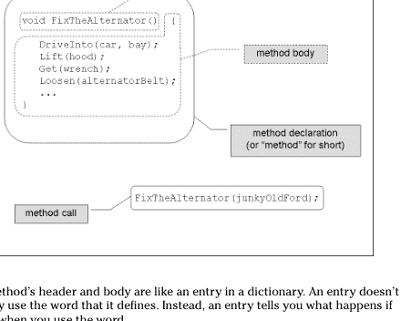

方法的首部和主体就像字典中的一个词条。词条并没有真正使用它所定义的词。相反，词条告诉你，当你使用这个词时会发生什么。

> chocolate (choc-o-late) n. 1.世界上最容易上瘾的物质。2. 你用版税收入购买的东西。3. 一个人饮食中最重要的营养元素。
>
> FixTheAlternator() 把车开进工位，打开发动机盖，拿起扳手，松开交流发电机皮带，然后吃点巧克力。

相比之下，方法调用就像是在句子中使用一个词。方法调用使某些代码开始运行。

> “我想要一些巧克力，否则我要发脾气了。”
>
> “把那辆破旧的福特车上的 FixTheAlternator 处理一下。”


方法的声明告诉计算机，如果你将方法调用起来会发生什么。方法调用（一段独立的代码）告诉计算机实际去调用该方法。方法的声明和方法调用通常位于 Java 程序中的不同部分。

## 程序中的 main 方法

在清单 4-1 中，大部分代码是一个名为 main 的方法的声明。（只需在代码的方法首部中查找 main 这个词。）现在，不要担心方法首部中的其他词——public、static、void、String 和 args。我会在接下来的几章中（按需）解释这些词。

像任何 Java 方法一样，main 方法是一个配方：

```
如何制作饼干：
预热烤箱。
擀开面团。
烘烤擀好的面团。
```

```
如何执行 ThingsILike 代码中的 main 指令：
在屏幕上显示 Chocolate、royalties、sleep。
```

main 这个词在 Java 中扮演着特殊的角色。特别是，你永远不会编写显式调用 main 方法的代码。main 是当程序开始运行时被自动调用的方法名称。

当 ThingsILike 程序运行时，计算机自动找到程序的 main 方法，并执行方法体内的所有指令。在 ThingsILike 程序中，main 方法体只有一条指令。该指令告诉计算机在屏幕上打印 Chocolate、royalties、sleep。


除非方法被调用，否则方法中的任何指令都不会被执行。但如果给方法命名为 main，该方法将被自动调用。

## 你最终如何告诉计算机去做某事

在清单 4-1 的深处，埋藏着实际向计算机发出直接指令的一行代码。这一行

```
System.out.println("Chocolate, royalties, sleep");
```

告诉计算机显示词语 Chocolate、royalties、sleep。（如果你使用 Eclipse，计算机会在 Console 视图中显示 Chocolate、royalties、sleep。）我可以至少用两种不同的方式来描述这行代码：

- **它是一个语句。** 在 Java 中，告诉计算机做某事的直接指令称为语句。清单 4-1 中的语句告诉计算机显示一些文本。其他程序中的语句可能会告诉计算机将 7 放入某个内存位置，或者使窗口出现在屏幕上。计算机程序中的语句做的事情五花八门。
- **它是一个方法调用。** 在本章前面的“什么是方法？”一节中，我描述了一种称为“方法调用”的东西。语句 `FixTheAlternator(junkyOldFord);` 是方法调用的一例，`System.out.println("Chocolate, royalties, sleep");` 也是如此。

```
FixTheAlternator(junkyOldFord);
```

```
System.out.println("Chocolate, royalties, sleep");
```

Java 有许多不同种类的语句。方法调用只是其中一种。


## 以分号结束语句

在 Java 中，每个语句都以分号结束。Listing 4-1 中的代码只有一条语句，因此 Listing 4-1 中只有一行以分号结束。

例如，取 Listing 4-1 中的任何其他行，比如方法头。方法头（包含单词 main 的那一行）并不会直接告诉计算机做什么。相反，方法头描述了供将来参考的某些操作。该头声明“以防有人将来调用 main 方法，接下来的几行代码告诉你对此调用应如何响应。”


每个完整的 Java 语句都以分号结束。方法调用是一个语句，因此以分号结束，但方法头和方法声明都不是语句。

## 方法名 System.out.println

Listing 4-1 中间的语句调用了一个名为 System.out.println 的方法。该方法在 Java API 中定义。每当你调用 System.out.println 方法时，计算机就会在其屏幕上显示文本。

想想名字。信不信由你，我认识两个叫 Pauline Ott 的人。其中一个是修女；另一个是物理学家。当然，在英语世界里有许多 Pauline，就像 Java API 中有多个名为 println 的东西一样。所以为了区分物理学家 Pauline Ott 和影评人 Pauline Kael，我写全名“Pauline Ott。”为了区分修女和物理学家，我写“修女 Pauline Ott。”同理，我写 System.out.println 或 DriverManager.println。前者（你经常使用）将文本写入计算机屏幕。后者（本书中完全不使用）写入数据库日志文件。

正如 Pauline 和 Ott 本身就是名字一样，System、out 和 println 在 Java API 中也是名字。但要使用 println，你必须写出方法的全名。你永远不会单独写 println。它总是 System.out.println 或其他 API 名称的组合。


Java 编程语言是 cAsE-sEnSiTiVe。如果你将小写字母改为大写字母（或反之），你就改变了单词的含义。你不能用 system.out.Println 替换 System.out.println。如果这样做，你的程序将无法工作。

## Kimi K2

Kimi K2 是一个领先的开源模型，在代理编码任务上的性能可与 GPT-5 和 Claude Sonnet 4 相媲美。


- **64K** 上下文窗口
- **128K** 最大输出令牌
- **MIT 许可证**
- **支持** 工具使用、提示缓存和 128K 上下文

### 模型概述

Kimi K2 是 Moonshot AI 最新发布的开源模型，于 2025 年 7 月发布。它是一个混合专家（MoE）模型，总参数量为 1 万亿，每个 token 的活跃参数为 320 亿。

该模型在代理编码基准上实现了最先进的性能，同时在通用语言理解任务上保持了具有竞争力的结果。

### 架构

- **模型类型**: Mixture-of-Experts (MoE) Transformer
- **总参数量**: 1T
- **活跃参数**: 32B
- **上下文窗口**: 64K tokens
- **架构**: 采用 MoE 层和分组查询注意力（GQA）的标准 Transformer

### 主要优势

- **代理编码**: 在工具使用、多步骤任务执行和代码生成方面表现出色
- **工具使用**: 与外部工具和 API 无缝集成
- **提示缓存**: 支持高效的提示缓存以降低延迟和成本
- **长上下文**: 处理多达 64K tokens 的上下文，最大输出为 128K

### 性能亮点

在内部评估中，Kimi K2 在多个基准上表现出强大的性能：

- **88.4%** 在 HumanEval（pass@1）上
- **85.7%** 在 MBPP（pass@1）上
- **72.3%** 在 MMLU-Pro 上
- **83.9%** 在 MATH-500 上
- **61.2%** 在 AIME 2024 上

### 与其他模型的比较

| 模型 | 代理编码 | 通用 | 工具使用 |
|-------|---------------|---------|----------|
| Kimi K2 | ★★★★★ | ★★★★☆ | ★★★★★ |
| GPT-5 | ★★★★☆ | ★★★★★ | ★★★★☆ |
| Claude Sonnet 4 | ★★★★☆ | ★★★★☆ | ★★★★☆ |

### 入门指南

```bash
pip install kimi-k2
```

有关更多信息，请访问我们的官方文档 docs.moonshot.ai。

## Java 类

你听说过面向对象编程（也称为 OOP）这个术语吗？OOP 是 to the letters J-u-m-p 的一种方式。

所以当你编写计算机程序时，你必须想象一个精灵已经赐予你三个愿望。不要祈求永恒的爱情，因为如果你这样做，精灵就会给你一个流口水的、崇拜的伴侣——一个你完全不喜欢的人。也不要祈求一百万美元，除非你想让精灵把你变成银行抢劫犯。

你在计算机程序中编写的每一件事都必须非常精确。看一个例子...

## 回显键盘输入的程序

Listing 5-1 包含一个小的 Java 程序。该程序允许你在键盘上输入一行字符。一旦你按下 Enter，程序就会显示第二行，复制你输入的内容。


## 代码清单5-1：一个Java程序

```
import java.util.Scanner;

class EchoLine {
    public static void main(String args[]) {
        Scanner keyboard = new Scanner(System.in);
        System.out.println(keyboard.nextLine());
        keyboard.close();
    }
}
```


本书中的大多数程序都是基于文本的程序。这些程序几乎只在Eclipse的控制台视图中进行输入和输出。你可以访问本书网站(http://allmycode.com/BeginProg)查看代码清单5-1中程序以及本书中许多其他示例的GUI版本。

## 图5-1：单词“don't”的哪一部分你不明白？

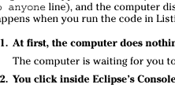

在图5-1中，我输入第一行（即第一行为“请不要把这件事告诉任何人”），计算机显示第二行。当你运行代码清单5-1中的代码时，会发生以下情况：

- 1. 起初，计算机什么都不做。
- 计算机正在等待你输入内容。
- 2. 你在Eclipse的控制台视图中点击。
- 结果，你会看到光标出现在Eclipse控制台视图的左边缘，如图5-2所示。

### 图5-2：计算机等待你输入内容。


- 3. 你输入一行文本——任何文本都可以（参见图5-3）。

### 图5-3：你输入一个句子。


- 4. 你按下回车键，计算机显示你输入内容的另一份副本，如图5-4所示。

### 图5-4：计算机回显你的输入。


在显示输入内容的副本后，程序运行结束。

## 输入并运行程序

本书网站(http://allmycode.com/BeginProg)有一个链接，用于下载本书所有的Java程序。下载这些程序后，你可以按照第2章的说明将它们添加到你的Eclipse工作区。然后，若要测试代码清单5-1中的代码，你可以运行现成的05-01项目。

但我不建议你直接运行现成的代码，而是鼓励你从头开始——自己输入代码清单5-1，然后测试你新创建的代码。只需按照以下步骤操作。

- 1. **启动Eclipse。**

- 2. **在Eclipse的菜单栏中，选择File»New»Java Project。**

将出现Eclipse的New Java Project对话框。

- 3. **在对话框的“Project Name”字段中，输入** `MyNewProject`。

- 4. **点击Finish。**

点击Finish后，你将返回Eclipse工作台，包资源管理器中会显示MyNewProject。下一步是创建一个新的Java源代码文件。

- 5. **在包资源管理器中，选择** `MyNewProject` **，然后在Eclipse的主菜单中选择File»New»Class。**

将出现Eclipse的New Java Class对话框。

- 6. **在New Java Class对话框的“Name”字段中，输入新类的名称。**

在本示例中，使用名称EchoLine。请严格按照代码清单5-1中拼写EchoLine的方式拼写，大写E、大写L，并且没有空格。

在Java中，一致的拼写和大小写非常重要。如果你在某个程序中不一致，该程序很可能会出现一些令人讨厌的、烦人的编译时错误。

你也可以在标记为`public static void main(String[] args)`的复选框中打勾。如果你不勾选该复选框，那么在第8步时你将需要多输入一些内容。无论勾选与否，这都不是什么大问题。


- 7. **点击Finish。**

点击Finish后，你将返回Eclipse工作台。该工作台中的一个编辑器会有一个名为EchoLine.java的标签页。

- 8. **在EchoLine.java编辑器中输入代码清单5-1中的程序。**

请完全按照你在代码清单5-1中看到的内容复制代码。

- 按照代码清单5-1中的拼写方式准确拼写每个单词。
- 按照代码清单5-1中的大小写方式准确大写每个单词。
- 包含所有标点符号——点号、分号，全部包含。
- 仔细检查单词`println`的拼写。确保`println`中的每个字符都是小写字母。（特别是，ln中的l是字母，不是数字。）


名称println来自“print a line.”这几个单词。如果允许你用大写字母书写该名称，那么它将是PRINTLN，在单词末尾附近有一个字母L。（不幸的是，Java是区分大小写的。所以你必须输入println，它看起来可能像包含数字1。但其实不是。）

如果你正确输入了所有内容，就不会在编辑器中看到任何错误标记。

如果你看到错误标记，请返回并将你输入的所有内容与代码清单5-1中的内容进行比较。比较每个字母、每个单词、每个波浪线、每个墨迹。


如果你阅读的是本书的电子版本，你可能会尝试直接从代码清单5-1复制并粘贴到Eclipse的编辑器中。这可能没问题，但你也可能会发现，本书的电子图像中包含一些不属于Java程序的字符。例如，许多书籍使用弯引号（“和”），这与Java的直引号（"）不同。请记住，你可以在本书网站http://allmycode.com/BeginProg上下载本书示例的真正电子副本。

## 9. 对编辑器中的代码进行任何修改或更正。

当你最终看不到任何错误标记时，就可以运行程序了。

## 10. 通过在编辑器内单击，或单击包资源管理器中的MyNewProject分支，来选择EchoLine类。

## 11. 在Eclipse的主菜单中，选择Run→Run As→Java Application。

你的新Java程序会运行，但不会发生太多事情。

## 12. 在Eclipse的控制台视图中单击。


结果，光标出现在Eclipse控制台视图的左边缘。（参见图5-2。）计算机正在等待你输入内容。

如果你忘记在控制台视图中单击，Eclipse可能不会将你的按键发送到正在运行的Java程序。相反，Eclipse可能会将你的按键发送到编辑器，或者（奇怪的是）发送到包资源管理器。

## 13. 输入一行文本，然后按回车键。

作为响应，计算机显示你输入行的第二份副本。然后程序运行结束。（参见图5-4。）

如果这些步骤看起来有点简略，你可以在第3章中找到更多细节。（请先查看第3章中关于编译和运行程序的部分。）第5章中的这些步骤在很大程度上是第3章内容的快速总结。最大的区别是，在第3章中，我不鼓励你自己输入程序。

那么，自己输入程序有什么大不了的呢？嗯，当你的手指放在键盘上时，可能会发生很多有趣的事情。这就是为什么本章后半部分专门讨论故障排除。

## EchoLine程序的工作原理

当你还是一个很小的新生儿，舒服地躺在母亲怀里时，她告诉了你如何将字符发送到计算机屏幕：

```
System.out.println(whatever text you want displayed);
```

她没有告诉你的是如何从计算机键盘获取字符。有很多方法可以做到这一点，但我在本章中推荐的是

```
keyboard.nextLine()
```

现在，有趣的部分来了。调用nextLine方法不仅仅是获取键盘输入的字符。当计算机运行你的程序时，计算机会用你在键盘上输入的内容替换文本keyboard.nextLine()。

要理解这一点，请看代码清单5-1中的语句：

```
System.out.println(keyboard.nextLine());
```

当你运行程序时，计算机看到你对nextLine的调用，就会突然停止。（参见图5-2。）计算机等待你输入一行文本。因此（参见图5-3），你输入了这一行：

```
Hey, there's an echo in here.
```

计算机会用这整行Hey替换你程序中对keyboard.nextLine()的调用。这个过程如图5-5所示。

对keyboard.nextLine()的调用嵌套在System.out.println调用中。因此，当所有事情都做完了，计算机的行为就好像代码清单5-1中的语句是下面这样：

```
System.out.println("Hey, there's an echo in here.");
```

计算机在屏幕上显示文本“Hey, there's an echo in here.”的另一份副本。这就是为什么你在图5-4中会看到两行Hey。


图 5-5：
计算机会用文本替换 nextLine 调用。

## 获取数字、单词和其他内容

在清单 5-1 中，keyboard.nextLine() 从计算机键盘获取一整行文本。因此，如果你输入

```
Testing 1 2 3
```

清单 5-1 中的程序会回显你输入的整行 Testing 1 2 3 文本。

有时候，你并不想让程序获取一整行文本，而是希望它获取一行中的一部分。例如，当你输入 1 2 3 时，你可能希望计算机获取数字 1。（也许数字 1 代表一个顾客或类似的东西。）在这种情况下，你不应在程序中写 keyboard.nextLine()，而应使用 keyboard.nextInt()。

表 5-1 展示了 keyboard.next 系列操作的一些变体。遗憾的是，表中的条目并不是很容易预测。要读取一行输入，你需要调用 nextLine。但要读取一个单词，你不能调用 nextWord。（Java API 中没有 nextWord 方法。）相反，要读取一个单词，你需要调用 next。

### 表 5-1 一些 Scanner 方法

| 若要读取... | ...可调用此方法 |
|---|---|
| 没有小数点的数字 | `nextInt()` |
| 带有小数点的数字 | `nextDouble()` |
| 一个单词（例如，以空格结尾） | `next()` |
| 一行（或在你已从该行读取一些数据后剩下的内容） | `nextLine()` |
| 单个字符（例如字母、数字或标点符号） | `findWithinHorizon(".",0).charAt(0)` |

此外，这张表的故事还有一个出人意料的结局。要读取单个字符，你不会调用 `nextSomething`，而是可以调用这个奇怪的方法组合 `findWithinHorizon(".",0).charAt(0)`。（你得谅解创建 `Scanner` 类的那帮人，他们是从某个专业角度来设计 `Scanner` 的。）

要查看表中一些方法的实际应用，请参阅本书中的其他程序清单。第 6、7、8 章有一些特别好的例子。

## 键入三行代码，不再回头

清单 5-1 中无伤大雅地埋藏着三行额外的代码。这些代码行帮助计算机从键盘读取输入。这三行是

```
import java.util.Scanner;

    Scanner keyboard = new Scanner(System.in);

    keyboard.close();
```

关于这三行，我有坏消息和好消息。

- **坏消息是，理解这些代码背后的原理比较困难。** 在第 5 章这里尤其如此，因为本章介绍的是 Java 最基本的概念。
- **好消息是，你并不需要理解这三行背后的原理。** 你可以将它们复制粘贴到任何从键盘获取输入的程序中，无需做任何改动。这些代码无需修改即可在各种 Java 程序中使用。

## 快速了解 Scanner

在本章中，我建议你忽略 `import java.util.Scanner` 和 `Scanner keyboard` 等代码行背后的含义，只管机械地把这两行粘贴到代码中，然后继续前进。

当然，你可能不想采纳我的建议，也许你不喜欢在代码中忽略某些东西。如果你刚好是这样固执的人，我有几个简要的事实要告诉你。

- **`Scanner` 一词定义在 Java API 中。**

Scanner 是一种可用于获取输入的东西。

这个 Scanner 类属于 Java 5.0 及更高版本。如果你使用的是 Java 1.4.2，则无法使用 Scanner 类。（当你在清单 5-1 中输入相关内容时，会看到错误标记。）

- **`System.in` 一词定义在 Java API 中。**

合在一起，`System.in` 表示计算机键盘。

在后续章节中，你会看到诸如 `new Scanner(new File("myData.txt"))` 之类的内容。在这些章节中，我用 `new File("myData.txt")` 替换 `System.in`，因为我不是从键盘获取输入，而是从计算机硬盘上的文件获取输入。

- **keyboard 这个词并非来自 Java API。**

keyboard 这个词是 Barry Burd 创造的。你可以用 `readingThingie` 替代 keyboard（或者任何其他你想用的名字，只要保持一致）。所以，如果你想发挥创意，可以这样写：

```
Scanner readingThingie =
    new Scanner(System.in);
```

修改后的清单 5-1（用 `readingThingie` 替换 `keyboard`）编译和运行都没有任何问题。

- **`import java.util.Scanner` 这一行是导入声明的一个例子。**

可选的导入声明允许你在程序的其余部分使用简写名称。你可以从清单 5-1 中删除导入声明。但如果你这样做，就必须在代码中始终使用 `Scanner` 类的*全限定名*。具体做法如下：

```
class EchoLine {

    public static void main
                         (String args[]) {

        java.util.Scanner keyboard
            = new java.util.Scanner
                         (System.in);

        System.out.println
            (keyboard.nextLine());

        keyboard.close();
    }
}
```

只需确保将这些代码放在正确的位置：

- 让 `import java.util.Scanner` 这一行成为程序的第一行。
- 将 `Scanner keyboard = new Scanner(System.in)` 这一行放在 main 方法内部，紧跟在 `public static void main(String args[]) {` 这行后面。
- 让 `keyboard.close()` 这一行成为程序中的最后一行。

将来某个时候，你可能需要更加注意这三行的位置。但就目前而言，我给出的这些规则已经足够你用了。

## 预料意外情况

不久前，我遇到一位采用有趣规则的讲师。他说：“有时候我在讲课时，会在电脑上从头编写一个程序，就在学生面前编写。如果程序第一次就能编译并正确运行，我期望学生们给我热烈掌声。”

一开始，你可能会觉得这家伙太自负了，但你得客观看待这件事。程序第一次就能编译并正确运行并不常见，几乎总会有拼写错误或其他某种错误。

因此，本节讨论的是你第一次编译和运行程序时所见到的那些正常且可预期的错误。每个人都会犯这些错误，即使是经验最丰富的人也不例外。关键是保持头脑冷静。以下是我的一般性建议：

- **不要指望你输入的程序第一次就能编译通过。**
  准备好返回编辑器修复一些错误。
- **不要指望编译无错的程序就能正确运行。**
  即使在 Eclipse 编辑器中没有任何错误标记，程序仍可能存在缺陷。Eclipse 编译程序之后，你还需要成功运行程序。也就是说，程序应该运行完毕并显示正确的输出。
  先编译，再运行。让程序无错误地编译是这两项任务中较为容易的一项。
- **阅读 Eclipse 编辑器中实际显示的内容，而不是你自以为的内容。**
  不要假设你输入的单词是正确的、大小写是正确的，或者花括号、圆括号是匹配的。将你输入的代码与手头的示例代码进行比较，确保每个细节都没有问题。

**要有耐心。**

每一项优秀的编程工作都需要花费很长时间才能做对。如果你不能马上理解某个东西，要坚持下去。坚持下去（或者先放一放，过段时间再回来看）。只要投入足够的时间，没有什么是你理解不了的。

**不要灰心丧气。**

别扔掉你的馅饼皮。沮丧（而不是缺乏知识）才是你的敌人。如果你灰心丧气，就什么也做不成。

**不要以为只有你一个人理解得慢。**

我理解得慢，但我为此自豪。（梅尔巴，第 6 章会晚一周交稿。）

**不要胆怯。**

如果你的代码无法运行，而且你搞不清原因，那就去问别人。在在线论坛上发帖，也不要害怕别人刻薄或讽刺的回答。（至于你可以用哪些手势来回应那些自命不凡的回答，请参阅附录 Z。）

要直接问我，可以给我发电子邮件、发推特消息，或者在 Facebook 上给我留言。（电子邮件发送至 BeginProg@allmycode.com，推特发送至 @allmycode，或在 Facebook 上发帖到 /allmycode。）

## 诊断问题

本章前面的“输入并运行程序”一节告诉了你如何运行 EchoLine 程序。如果一切顺利，你的屏幕最终会像图 5-1 所示。但事情并不总是顺利。有时你的手指一滑，在程序中敲出了一个拼写错误；有时你忽略了清单 5-1 中的某个细节，然后收到一条糟糕的错误消息。

当然，清单 5-1 中的有些内容是可以更改的。清单 5-1 并不是每个词都一成不变。因此这里有一个麻烦的问题——我不能告诉你必须总是按照原样重新输入清单 5-1。有些改动是可以的，有些则不行。请继续阅读一些“例子”。

## 大小写敏感性

Java 是区分大小写的。除其他事项外，区分大小写意味着在 Java 程序中，字母 P 和字母 p 并不相同。如果你给我发粉丝邮件，以“Dear barry”而不是“Dear Barry”开头，我仍然明白你的意思。但 Java 不会这样做。


So change just one character in a Java program and instead of an uneventful compilation, you get a big headache! Change p to P like so:

```java
//The following line is incorrect:
System.out.Println(keyboard.nextLine());
```

当你在 Eclipse 编辑器中输入程序时，你会看到如图 5-6 所示的丑陋情况。

**图 5-6：** Java 编译器理解 println，但不理解 Println。


当你看到如图 5-6 所示的错误标记和快速修复时，最好的办法是保持冷静并仔细阅读消息。有时，这些消息包含有用的提示。（当然，有时并不包含。）图 5-6 中的消息是 The method Println(String) is undefined for the type PrintStream。用通俗的英语来说，这意味着“The Java compiler can’t interpret the word Println.”（该消息没有说完，“Don’t type the word Println, you Dummy!”无论如何，如果电脑说你是我们这些 Dummies 中的一员，你应该把它当作一种赞美。）现在，编译器无法理解像 Println 这样的单词可能有很多原因。但对于初学者来说，你应该立即检查两件重要的事情：

- ✔ 你拼写单词正确吗？
  - 你是否不小心输入了 `print1n`（带数字 1）而不是 `println`？
- ✔ 你是否正确大写了所有字母？
  - 你是否错误地输入了 `Println` 或 `PrintLn` 而不是 `println`？

任何一种错误都可能让 Java 编译器陷入混乱。因此，请逐字逐字母地将你的输入与批准的输入进行比较。当你发现不一致时，回到编辑器并修复问题。然后再次尝试编译程序。


当你在 Eclipse 编辑器中输入程序时，Eclipse 会尝试编译程序。当 Eclipse 发现编译时错误时，编辑器通常会显示至少三个红色错误标记（见图 5-6）。编辑器左侧边距中的标记有一个类似 X 的标记，有时还有一个小灯泡。右侧边距中的标记是一个小矩形。中间的标记是一条锯齿状的红色下划线。

如果你将鼠标悬停在这些标记中的任何一个上，Eclipse 会显示一条尝试描述错误性质的消息。如果将鼠标悬停在锯齿线上，Eclipse 会显示一条消息以及可能的建议解决方案列表。（每个建议解决方案称为快速修复。）如果你右键单击左侧边距的标记（或在 Mac 上 control 单击）并在生成的上下文菜单中选择 Quick Fix，Eclipse 会显示建议的解决方案。要让 Eclipse 自动修改你的代码（使用快速修复列表中的建议），请单击或双击快速修复列表中的项目。（也就是说，单击任何看起来像链接的东西；双击任何不像链接的东西。）

## 省略标点

在英语和 Java 中，使用 the; proper! 标点很重要)

例如，看看清单 5-1 中的分号。如果忘记输入分号会怎样？

```java
//The following code is incorrect:

    System.out.println(keyboard.nextLine())
}
```

如果你省略分号，你会得到如图 5-7 所示的消息。


如图 5-7 所示的消息会让你的生活变得简单得多。我不必解释这条消息，你也不必费解其含义。只需按字面理解消息 `insert ";" to complete Statement`。在 System.out.println(keyboard.nextLine()) 语句的末尾与语句之后的代码之间插入分号。（为了便于阅读和理解代码，请将分号附加在 System.out.println(keyboard.nextLine()) 语句的末尾。）

## 使用太多标点

**图 5-8：** 一个不需要的分号搞砸了事情。


在初中时，我的英语老师说我应该在正常呼吸停顿的地方使用逗号。这个建议在过敏季节并不管用，因为我的句子中逗号比单词还多。即使作为一名受薪作者，我也很难决定逗号应该放在哪里，所以我经常为了保险起见多加逗号。这给我的校对编辑 Melba 增加了更多工作，她办公桌旁有一个装满逗号的垃圾桶。

在 Java 程序中也是如此。你可能会在标点上过度使用。例如，看看清单 5-1 中的 main 方法头。这行对新手程序员来说是一个危险的弯道。

有关 method header 和 method body 术语的信息，请参阅第 4 章。

## 为什么计算机不能修复它？

你多久能帮别人完成句子？“请，”你的主管说，“去那边接上 . . .” “电线，”你说，“我会接上电线。”如果你知道某人想说什么，为什么还要等他们说出来？同样的问题也会出现在计算机错误消息的上下文中。看看图 5-7 中的消息。计算机期望在第 8 行的语句后有一个分号。好吧，Mr. Computer，如果你知道想要分号的位置，那就直接加上分号吧。为什么还要来烦我？

答案很简单。计算机不愿意冒任何风险。如果你在第 8 行语句后真的不想要分号怎么办？如果缺少的分号代表一个更深层次的问题怎么办？如果计算机添加了额外的分号，它可能会造成更多伤害而不是好处。回到你和你的主管……砰！一次大爆炸。“不是电线，你这个傻瓜。是点。我想让你连接这些点。”“对不起，”你说。

如果你选择 Add Body 快速修复，Eclipse 会创建以下（非常糟糕的）代码：

```java
import java.util.Scanner;

class EchoLine {
    public static void main(String args[]) {
    } {
        Scanner keyboard = new Scanner(System.in);
        System.out.println(keyboard.nextLine());
        keyboard.close();
    }
}
```

这段“修复”后的代码没有编译时错误。但当你运行这段代码时，什么也不会发生。程序开始运行然后停止运行，Eclipse 的 Console 视图中什么也没有。

我们都知道计算机是一台非常有耐心、非常同情的机器。这就是为什么计算机查看你的代码并决定给你一次机会的原因。计算机记得 Java 有一个高级特性，即你可以编写方法头而不编写方法体。当你这样做时，你得到的就是所谓的抽象方法——我在本书中根本不使用它。无论如何，在图 5-9 中，计算机看到一个没有体的头。所以计算机对自己说，“我知道！也许程序员正试图编写一个抽象方法。问题是，抽象方法头必须包含单词 abstract。我应该提醒程序员这一点。”因此，计算机在图 5-9 中提供了 add ‘abstract’ modifier 快速修复。

无论如何，你无法在不读懂言外之意的情况下解释图 5-9 中的错误消息和快速修复。因此，这里有一些提示来帮助你解读模糊的消息：

- ✔ 避免本能反应。

  有些人看到图 5-9 中的 add ‘abstract’ modifier 快速修复，会想在哪里添加修饰符。不幸的是，这不是正确的方法。如果你不知道 ‘abstract’ 修饰符是什么，那么很可能你一开始就不打算使用抽象修饰符。

- ✔ 长时间盯着那行坏代码。

  如果你仔细查看图 5-9 中的 public static . . . 行，最终你会注意到它与清单 5-1 中对应的行不同。清单 5-1 中的行没有分号，但图 5-9 中的行有一个。

当然，你并不总是从像清单 5-1 中的预写代码开始。这就是熟能生巧的地方。你写的代码越多，你的眼睛对多余的分号和其他编程错误就越敏感。

## 太多花括号

你正在寻找最近的加油站，于是问当地人。“去第一个交通灯左转，”当地人说。你直行几条街，看到一个闪烁的黄色信号。你在信号处左转，行驶了一英里左右。什么？没有加油站？也许你把闪烁信号误认为是真正的交通灯。

你来到一个岔路口，对自己说，“The directions said nothing about a fork. Which way should I go?” 你向右拐，但一分钟后，你被迫上了高速公路。你看到一个标志写着，Next Exit 24 Miles。现在你真的迷路了，油表指向“S”。（“S”代表“Stranded”。）

所以发生了什么：你犯了一个诚实的错误。你不应该在黄色闪烁灯处左转。仅此一个错误也没那么糟糕。但第一个错误导致了更多的混乱，最终，你的选择变得毫无意义。如果你在闪烁灯处没有转弯，你就永远不会遇到那条该死的岔路。然后上高速公路就是彻底的灾难。

这个故事有意义吗？当然有。计算机也会陷入同样的混乱。计算机注意到你的程序中的错误。然后，形象地说，计算机走到了岔路口——一个基于原始错误的岔路口——一个没有一个选择能带来好结果的岔路口。

这里有一个例子。你正在重新输入清单 5-1 中的代码，并且错误地输入了一个额外的花括号：

```java
//The following code is incorrect:
import java.util.Scanner;

class EchoLine {
    public static void main(String args[]) {
        Scanner keyboard = new Scanner(System.in);
    }
    System.out.println(keyboard.nextLine());
    keyboard.close();
}
```


在 Eclipse 编辑器中，你将鼠标悬停在最左侧的标记上。你会看到图 5-10 所示的消息。


Figure 5-10:
三个错误消息。

Eclipse 很困惑，因为对 System.out.println 的调用完全放错了位置。Eclipse 显示了三条消息——关于 println 的一些内容，关于括号的一些内容，以及关于放错位置的构造的非常晦涩的内容。这些消息都没有指出问题的根源。Eclipse 正在尽力处理糟糕的情况，但在此时，你不应该相信 Eclipse 说的任何一句话。

计算机不是聪明的动物，如果有人编程让 Eclipse 说 misplaced construct(s)，那 Eclipse 就是这么说的。（有些人说计算机让他们觉得自己很笨。对我来说正好相反。计算机提醒我机器有多笨，人有多聪明。我喜欢这一点。）

所以当你看到一堆错误消息时，要仔细阅读每条错误消息。问问自己能从每条消息中学到什么。但不要把每条消息当作权威真理。当你用尽了对 Eclipse 消息的努力后，就回到仔细盯着代码的努力上。


如果你收到不止一条错误消息，务必仔细查看每一条。有时一条非常有帮助的消息会隐藏在一堆不太有帮助的消息之中。

## 拼写错误（以及其他失误）

你找到了一份老式的家庭魔鬼蛋食谱（是我最喜欢的之一）。你尽可能仔细地遵循每一步，但因为你奶奶血压高，你省略了盐。你把一个鸡蛋（一件完成的杰作）递给奶奶。她说：“胡椒不够，”然后就走开了。

下一道菜是波尔多牛肉。你把一块未加盐的肉片端给亲爱的老奶奶。她呻吟道：“不够甜，”然后离开了房间。“但这不可能，”你想。“波尔多牛肉里没有糖。我只是没放盐。”尽管如此，你还是回到厨房准备土豆泥。当然你用了无盐黄油。“这次她会喜欢的，”你想。

“Sour potatoes! Yuck!” 奶奶说着走向水槽把所有东西都吐了出来。因为你自尊心很强，奶奶的行为并没有让你感到受辱。但你有点困惑。为什么她对三道没加盐的食谱说出如此不同的话？也许有一些你不知道的细微差别。

当你编写计算机程序时也会发生同样的事情。你可以犯同一种错误两次（或者至少，你认为犯了同一种错误两次），每次都会得到不同的错误消息。

例如，如果你在清单 5-1 中更改 println 的拼写或大小写，Eclipse 会告诉你该方法对类型 PrintStream 未定义。但如果你把 System 改成 system，Eclipse 会说 system 无法解析。而且 System 拼写错误时，Eclipse 不会注意到 println 是否拼写正确。

在清单 5-1 中，如果你更改 args 的拼写，什么都不会出错。程序可以正常编译和运行。但如果你更改 main 的拼写，你会遇到一些不寻常的困难。（如果你不相信我，请阅读本章后面的“运行时错误消息”部分。）

仍在清单 5-1 中，修改 Scanner keyboard = new Scanner(System.in) 行中的等号数量。有一个等号时，大家都很满意。如果你不小心输入了两个等号（Scanner keyboard == new Scanner(System.in)），Eclipse 会把你拉回正轨，告诉你 Syntax error on token "==", = expected（见图 5-11）。但如果你疯狂地输入四个等号，或者完全不输入等号，Eclipse 会误解一切并建议你插入 “;” 以完成 BlockStatements。不幸的是，插入分号完全没有帮助（见图 5-12）。

Figure 5-11:
删除两个等号中的第二个。


所以记住：Java 对错误有多种不同的响应。代码中的两个更改可能看起来相似，但相似的更改并不总是导致相似的结果。你代码中的每个问题都需要单独的关注。

Figure 5-12
你缺少一个等号，但 Eclipse 却没有注意到。


这是一个有用的练习：从一个可工作的 Java 程序开始。成功运行代码后，做一个故意引入错误的更改。仔细查看每条错误消息，并问问自己这条消息是否有助于你诊断问题。这个练习很棒，因为它帮助你把错误视为正常现象，并在没有压力要求程序正确运行时，给你练习分析消息的机会。

## 运行时错误消息

到目前为止，本章描述的是在编译程序时出现的错误。另一类错误要等到运行程序时才会显现。

一个典型例子就是单词 main 的拼写或大小写不正确。

假设在某次放纵的时刻，你错误地将 main 写成大写 M：

//The following line is incorrect:
public static void Main(String args[]) {

当你输入代码时，一切都很顺利。你看不到任何错误标记。

但随后你尝试运行程序。此时问题爆发了。灾难如图 5-13 所示。

Figure 5-13
你是什么意思“在类 EchoLine 中找不到 Main 方法？”


我请 Java 程序员 David Herst 在不看我清单 5-1 中的代码的情况下写他自己的 EchoLine 程序。他写的是：

```java
import java.io.BufferedReader;
import java.io.InputStreamReader;
import java.io.IOException;

public class EchoLine {
    public static void main(String[] args)
        throws IOException {
        InputStreamReader isr =
            new InputStreamReader(System.in);
        BufferedReader br = new BufferedReader(isr);
        String input = br.readLine();
        System.out.println(input);
    }
}
```

不用担心 BufferedReader、InputStreamReader 或类似的东西。只要注意到，就像雪花一样，即使完成相同的任务，没有两个程序是完全相同的。这很好。这意味着你的代码，无论多么不同，都可以和别人的代码一样好。这非常鼓舞人心。

### 第 6 章

### 使用构建块：变量、值和类型

### 本章内容

- 声明变量
- 为变量赋值
- 使用数字
- 使用 Java 类型

早在 1946 年，约翰·冯·诺伊曼写了一篇关于新兴计算机和计算技术的开创性论文。其中他确立了一个基本事实：尽管复杂，计算机的主要工作就是将数据从一个地方移动到另一个地方。取一个数字——某人银行账户的余额。将这个数字从计算机的内存移动到计算机的处理单元。给余额增加几美元，然后再把它移回计算机的内存。数据的移动……这就是全部；没有别的了。

足够好了！本章向你展示如何移动你的数据。

### 使用变量

这是某软件公司网站上的摘录：

SnitSoft 认识到自己对信息技术社区的义务。因此，SnitSoft 以名义费用提供其最受欢迎的应用程序。只需 $5.95 加上运费和手续费，你就能收到一张包含 SnitSoft 主打产品的 CD-ROM。

去吧。点击 Order Now! 链接。看看会发生什么。你会得到一个订单表单，上面有两项。一项标为 $5.95（CD-ROM），另一项写着 $25.00（运费和手续费）。真是个骗局！多亏了 SnitSoft 的慷慨，你可以为价值十美分的软件支付 $30.95。

在 SnitSoft 网页背后，一个计算机程序做了一些无赖的算术。程序看起来像清单 6-1 中的代码。

### 清单 6-1：SnitSoft 的大骗局

```
class SnitSoft {
    public static void main(String args[]) {
        double amount;
        amount = 5.95;
        amount = amount + 25.00;
        System.out.print("We will bill $");
        System.out.print(amount);
        System.out.println(" to your credit card.");
    }
}
```

当我在自己的电脑上（不是 SnitSoft 的电脑）运行清单 6-1 代码时，我得到如图 6-1 所示的输出。

Figure 6-1:
运行清单 6-1 中的代码。


### 使用变量

清单 6-1 中的代码使用了名为 amount 的变量。变量是一个占位符。你可以将像 5.95 这样的数字放入变量中。在你把数字放入变量后，你可以改变主意，把另一个数字，比如 30.95，放入变量中。（这就是变量中“变化”的含义。）当然，当你把新数字放入变量时，旧数字就不再存在了。如果你没有在别处保存旧数字，旧数字就消失了。


图 6-2 给出了列表 6-1 中代码的前后对比图。当计算机执行 amount = 5.95 时，变量 amount 中包含数字 5.95。然后，在执行完 amount = amount + 25.00 语句后，变量 amount 突然有了 30.95。当你思考一个变量时，想象计算机内存中一个地方，线圈和晶体管存储着 5.95、30.95 或其他内容。在图 6-2 中，想象每个方框周围环绕着数百万个类似的方框。

图 6-2：变量（前后对比）。


现在你需要一些术语。（你可以对照图 6-3。）存储在变量中的东西称为值。变量的值可以在程序运行期间发生变化（例如当 SnitSoft 添加运费和手续费时）。存储在变量中的值不一定是数字。（例如，你可以创建一个始终存储字母的变量。）存储在变量中的值的种类是变量的类型。（你可以在本章的其余部分以及接下来的两章中阅读更多关于类型的内容。）

图 6-3：变量、其值和其类型。


变量和变量名之间存在细微、几乎难以察觉的差异。即使在正式写作中，我经常使用变量这个词来指变量名。严格来说，amount 是变量名，而与 amount 相关的所有内存存储（包括 amount 的值和类型）才是变量本身。如果你认为变量和变量名之间的这种区别太细微而不必担心，欢迎加入这个俱乐部。

每个变量名都是一个标识符——你在自己的代码中可以编造的名字（有关更多信息，请参阅第 4 章）。在准备列表 6-1 时，我编造了名字 amount。

## 理解赋值语句

列表 6-1 中带有等号的语句称为赋值语句。在赋值语句中，你将一个值赋给某物。在许多情况下，这个某物是一个变量。

你应该养成从右到左阅读赋值语句的习惯。例如，列表 6-1 中的第一个赋值语句说：“将 5.95 赋给 amount 变量。”第二个赋值语句稍微复杂一点。从右到左阅读第二个赋值语句，你会得到“将 25.00 加到 amount 变量中已有的值上，并使该数字（30.95）成为 amount 变量的新值。”有关此内容的图形化、砸你头上的说明，请参阅图 6-4。

图 6-4：从右到左阅读赋值语句。


在赋值语句中，被赋值的东西始终位于等号的左侧。

## 那些零和一都意味着什么？

这里有一个词：

gift

讨论的问题是，这个词是什么意思？好吧，这取决于谁来看这个词。例如，英语读者会说“gift”指的是一个人赠送给另一个人装在彩纸和丝带包裹的盒子里的东西。

Look! I'm giving you a gift!

但在德语中，“gift”的意思是“毒药”。

Let me give you some gift, my dear.

而在瑞典语中，“gift”可以表示“已婚”或“毒药”。

As soon as they got gift, she slipped a gift into his drink.

然后是法语。在法国，有一种名为“Gift”的糖果棒。

He came for the holidays, and all he gave me was a bar of Gift.

那么字母 g-i-f-t 真正意味着什么呢？好吧，直到你决定如何解释它们，它们就没有任何意义。计算机电路内部的零和一也是如此。

例如，序列 01001010。它可以代表字母 J，也可以代表数字 74。同一串零和一也可以代表 1.036960863603646×10⁻⁴³。当解释为屏幕像素时，同一序列可以代表图 6-6 中所示的点。01001010 的含义完全取决于软件如何解释这一序列。

图 6-6：
八个黑白屏幕像素的极端特写。


这段文字涉及一个非常挑剔的点，如果你没心情就跳过。人们经常使用短语“十进制数字”来描述小数点右边有数字的数。问题是，“dec”这个音节代表数字 10，所以“decimal”这个词意味着基数 10 的表示。由于计算机存储的是基数 2（而不是基数 10）的表示，用“decimal”来描述这样的数是不合适的。但在这本书里，我就是忍不住。我称它们为“十进制数字”，无论技术人员喜不喜欢。

## 从键盘读取十进制数字

我不敢相信！SnitSoft 在搞促销！仅限一周，你可以以低至 $5.75 的价格购买 SnitSoft CD-ROM！快点下单吧。

不，等一下！列表 6-1 中的价格固定为 $5.95。我必须修改程序。

我知道。我会让代码更通用。我将从键盘输入金额。列表 6-2 有修订后的代码，图 6-7 显示了新代码的运行情况。

## 列表 6-2：从键盘获取 Double 值

```
import java.util.Scanner;

class VersatileSnitSoft {
    public static void main(String args[]) {
        Scanner keyboard = new Scanner(System.in);
        double amount;

        System.out.print("What's the price of a CD-ROM? ");
        amount = keyboard.nextDouble();
        amount = amount + 25.00;

        System.out.print("We will bill $");
        System.out.print(amount);
        System.out.println(" to your credit card.");

        keyboard.close();
    }
}
```

## 图 6-7：获取 double 变量的值。

```
What's the price of a CD-ROM? 5.75
We will bill $30.75 to your credit card.
```

分组分隔符因国家而异。图 6-7 中显示的运行是针对配置为美国的计算机，其中 5.75 表示“五点七五”。但在配置为我所说的“逗号国家”的计算机上，运行可能看起来不同——在这些国家，5,75 表示“五点七五”。如果你住在逗号国家，并且像图 6-7 中所示那样输入 5.75，你可能会收到错误信息（an InputMismatchException）。如果是这样，请将文件中的数字金额更改为与你所在国家数字格式相匹配。当你这样做时，应该没问题。

## 虽然这些是方法，但其中仍有疯狂

注意列表 6-2 中对 nextDouble 方法的调用。在列表 5-1 中，我使用 nextLine，但在列表 6-2 中，我使用 nextDouble。

在 Java 中，每种输入类型都需要其自己的特殊方法。如果你获取文本行，那么 nextLine 就很合适。但如果你从键盘读取内容并且希望该内容被解释为数字，你需要像 nextDouble 这样的方法。

从列表 6-1 到列表 6-2，我添加了一个 import 声明和一些关于 new Scanner(System.in) 的内容。你可以通过阅读第 5 章中关于输入和输出的部分了解更多关于这些内容。（你可以通过访问第 13 章了解更多关于输入和输出的内容。）第 7 章和第 8 章中还有更多示例（更多 keyboard.nextSomething 方法）。

## 方法和赋值

注意我在列表 6-2 中如何使用 keyboard.nextDouble。对方法 keyboard.nextDouble 的调用是赋值语句的一部分。如果你查看第 5 章中关于 EchoLine 程序如何工作的部分，你会看到计算机可以用某物替换方法调用。计算机在列表 6-2 中就是这样做的。当你在键盘上输入 5.75 时，计算机将

```
amount = keyboard.nextDouble();
```

into

```
amount = 5.75;
```

（计算机实际上并没有重写列表 6-2 中的代码。这个 amount = 5.75 行只是说明了计算机操作的效应。）在列表 6-2 中的第二个赋值语句中，计算机将 25.00 加到存储在 amount 中的 5.75 上。

有些方法调用具有这种替换效果，而其他方法调用（如 System.out.println）则没有。要了解更多关于这个主题的内容，请参阅第 19 章。

## 谁做什么，如何做？

当你编写程序时，你被称为程序员，但当你运行程序时，你被称为用户。所以当你测试自己的代码时，你既是程序员也是用户。

假设你的程序包含一个 keyboard.nextSomething() 调用，像列表 5-1 和 6-2 中的调用那样。那么你的程序就会从用户那里获取输入。但程序运行时，用户如何知道要在键盘上输入内容呢？如果用户和程序员是同一个人，并且程序相当简单，那么知道要输入什么并不是什么大问题。例如，当你开始运行列表 5-1 中的代码时，你面前有这本书，书上说“The computer is waiting for you to type something . . . You type one line of text . . .”于是你输入文本并按 Enter。一切正常。

如果程序开始运行，用户必须盯着屏幕来弄清楚下一步该做什么。列表 6-2 中的代码在这种盯着屏幕的场景中有效。在列表 6-2 中，对 print 的第一次调用在用户屏幕上放置一条信息性消息（What's the price of a CD-ROM?）。这种消息称为提示。

当你开始编写程序时，你很容易混淆程序和用户输入的角色。所以记住，提示和随后的输入之间不存在预先确定的关系。要创建提示，你调用 print 或 println。然后，要读取用户的输入，你调用 nextLine、nextDouble 或 Scanner 类的其他 nextSomething 方法。这些 print 和 next 调用属于两个独立的语句。Java 没有常用的单个语句同时执行提示和“next-ing”。


作为程序员，你的工作是将提示（prompting）和读取（next-ing）结合起来。你可以用各种方式组合提示和读取。有些方式对用户有帮助，有些则不然。

✓ 如果你没有调用 `print` 或 `println`，那么用户就看不到提示。一个闪烁的光标静静地等待着用户输入。用户必须猜测要输入什么类型的内容。偶尔这没问题，但通常不是这样。

✓ 如果你调用了 `print` 或 `println`，但没有调用 `keyboard.nextSomething` 方法，那么计算机不会等待用户输入任何内容。程序会快速执行紧随 `print` 或 `println` 之后的任何语句。

✓ 如果你的提示显示了误导性消息，那么你就会误导用户。Java 没有内置功能来检查提示是否恰当。这并不奇怪。大多数计算机语言都没有提示检查功能。

所以要小心你的提示。善待你的用户。记住，你曾经也是一个谦逊的计算机用户。

## 主题的变体

在清单 6-1 中，需要两行代码才能给 `amount` 变量赋予其第一个值：

```
double amount;
amount = 5.95;
```

你只需一行代码就能完成同样的事情：

```
double amount = 5.95;
```

当你这样做时，你并不是在“赋值”给 `amount` 变量。`double amount = 5.95;` 这一行并不被称为“赋值语句”。相反，这行被称为带有初始化的声明。你正在初始化 `amount` 变量。你可以用初始化做各种事情，甚至包括算术运算。

```
double gasBill = 174.59;
double elecBill = 84.21;
double H2OBill = 22.88;
double total = gasBill + elecBill + H2OBill;
```

## 移动变量

记住初始化和赋值之间的区别是有帮助的。首先，你可以将一个带有初始化的声明移到方法外部。

```java
//This is okay:
class SnitSoft {
    static double amount = 5.95;

    public static void main(String args[]) {
        amount = amount + 25.00;

        System.out.print("We will bill $");
        System.out.print(amount);
        System.out.println(" to your credit card.");
    }
}
```

你不能对赋值语句做同样的事情。（参见下面的代码和图 6-8。）

```java
//This does not compile:
class BadSnitSoftCode {
    static double amount;

    amount = 5.95;          //Misplaced statement

    public static void main(String args[]) {
        amount = amount + 25.00;

        System.out.print("We will bill $");
        System.out.print(amount);
        System.out.println(" to your credit card.");
    }
}
```


那么，一个声明还是三个声明哪个更好？没有哪个更好。这是个人风格的问题。

你甚至可以将初始化添加到组合声明中。当你这样做时，每个初始化仅适用于一个变量。例如，使用这行代码

```
double cdPrice, shippingAndHandling = 25.00, total;
```

`shippingAndHandling` 的值变为 25.00，但变量 `cdPrice` 和 `total` 不会被赋予特定值。

### 第 7 章

## 数字与类型

### 本章内容

- 处理整数
- 从旧值创建新值
- 理解 Java 中更另类的类型

不久以前，人们认为计算机除了大量数值计算之外什么也不会做。计算机解决算术问题，故事就这样结束了。

到了 20 世纪 80 年代，随着文字处理程序的广泛使用，那种“大型金属数学大脑”的神话逐渐销声匿迹。但即便如此，计算机仍然是出色的计算器。毕竟，计算机非常快速而且非常精确。计算机从不需要用手指头数数。最重要的是，计算机做算术时不会感到负担。我讨厌在一家好餐馆吃完饭还要为税和小费操心，但计算机一点也不在乎这些事情。（即便如此，计算机也很少出去吃饭。）

## 使用整数

我跟你说，当大人可真不好玩。现在我家的客厅里有四个小孩子。他们都盯着我看，因为我手里拿着一袋糖果球。袋子里有 30 个糖果球，孩子们都在想：“谁最棒？谁得到的糖果球比别人的多？谁会被不公平对待？”他们坚持要求进行一次完整、正式的糖果球清点，每个孩子都要得到完全一样多的美味小零食。我必须小心。如果我不小心，那我就永远也摆脱不了这件事了。

有 30 个糖果球和 4 个孩子，根本没法平均分配。当然，如果我弄走一个孩子，那就能给每个孩子 10 个糖果球了。问题在于，糖果球是可以丢弃的，孩子却不能。所以我唯一的选择就是尽可能把糖果球均分，然后处理掉剩余的。“好吧，快点想想，”我对自己说。“有 30 个糖果球和 4 个孩子，我能答应给每个孩子多少个糖果球呢？”

### 清单 7-1：如何让四个孩子不发脾气

```
class KeepingKidsQuiet {
    public static void main(String args[]) {
        int gumballs;
        int kids;
        int gumballsPerKid;

        gumballs = 30;
        kids = 4;
        gumballsPerKid = gumballs / kids;

        System.out.print("Each kid gets ");
        System.out.print(gumballsPerKid);
        System.out.println(" gumballs.");
    }
}
```

图 7-1 显示了 KeepingKidsQuiet 程序的一次运行。如果每个孩子得到七个糖果球，那么孩子们就没法抱怨我偏心了。他们得另外找点事来吵吵。


在这个糖果球问题的核心，我面对的是整数——即小数点后没有数字的数字。当我用 30 除以 4 时，得到 7½，但我不能把 ½ 当回事。不管我怎么努力，我也没法把一个糖果球掰成两半，至少不可能不听到“我的一半比他的大”这种话。这一事实在 Java 中得到了很好的体现。在清单 7-1 中，所有三个变量（gumballs、kids 和 gumballsPerKid）都是 int 类型。int 值就是整数。当你用一个 int 值除以另一个 int 值（就像你在清单 7-1 中用斜杠做的那样），你得到的是另一个 int。当你用 30 除以 4 时，你得到的是 7——而不是 7½。你在图 7-1 中可以看到这一点。总之，这些语句

```
gumballsPerKid = gumballs/kids;
System.out.print(gumballsPerKid);
```

把数字 7 显示在计算机屏幕上。

## 从键盘读取整数

生活真是充满变化！昨天我家客厅里有 4 个孩子，我有 30 个糖果球。今天我家有 6 个孩子，我有 80 个糖果球。我该如何应对所有这些变化呢？我知道了！我要写一个程序，从键盘读取糖果球和孩子数量。程序在清单 7-2 中，运行情况如图 7-2 所示。

### 清单 7-2：一个更通用的孩子与糖果球程序

```
import java.util.Scanner;

class KeepingMoreKidsQuiet {
    public static void main(String args[]) {
        Scanner keyboard = new Scanner(System.in);
        int gumballs;
        int kids;
        int gumballsPerKid;

        System.out.print
            ("How many gumballs? How many kids? ");

        gumballs = keyboard.nextInt();
        kids = keyboard.nextInt();

        gumballsPerKid = gumballs / kids;
        System.out.print("Each kid gets ");
        System.out.print(gumballsPerKid);
        System.out.println(" gumballs.");

        keyboard.close();
    }
}
```

图 7-2：接下来你猜怎么着，我会有 70 个孩子和 1,000 个糖果球。


关于清单 7-2，你应当注意两件事。首先，你可以使用 nextInt 方法读取一个 int 值。其次，你可以连续调用 Scanner 的方法。在清单 7-2 中，我调用了两次 nextInt。我只需要用空格分隔我输入的数字。在图 7-2 中，我在 80 和 6 之间只放了一个空格，但用更多的空格也可以。

这条空格规则适用于许多 Scanner 方法。例如，下面这段代码读取三个数值：

```
gumballs = keyboard.nextInt();
costOfGumballs = keyboard.nextDouble();
kids = keyboard.nextInt();
```

图 7-3 显示了这三个方法调用的有效输入。


## 读什么得什么

当你编写自己的代码时，绝对不应想当然。假设你在清单 7-2 中不小心颠倒了 gumballs 和 kids 的赋值语句顺序：

```
//This code is misleading:
System.out.print("How many gumballs? How many kids? ");
kids = keyboard.nextInt();
gumballs = keyboard.nextInt();
```

这里，“How many gumballs? How many kids?”这一行就非常具有误导性。因为 kids 赋值语句在 gumballs 赋值语句之前，你输入的第一个数字成为 kids 的值，第二个数字成为 gumballs 的值。你的程序显示“How many gumballs? How many kids?”这条消息并不重要。重要的是程序中赋值语句的顺序。

如果 kids 赋值语句意外地排在了前面，你可能会得到一个奇怪的答案，比如图 7-4 中的零答案。这正是 int 除法的工作方式。它只是截掉任何余数。用一个小的数（比如 6）除以一个大的数（比如 80），你会得到 0。


## 通过应用运算符创建新值

比你的老朋友加号更让人感到安心的还有什么？它是在小学数学课上你学到的第一件事。几乎每个人都知道 2 加 2 怎么算。事实上，在英语用法中，2 加 2 是一个容易做到的事情的比喻。每当你看到加号时，你大脑中的一个细胞就会说，“谢天谢地，可能不会更复杂。”

所以 Java 有加号。你可以用加号来加两个数：

```java
int apples, oranges, fruit;
apples = 5;
oranges = 16;
fruit = apples + oranges;
```

当然，老的减号也可用：

```java
apples = fruit - oranges;
```

使用星号进行乘法，使用正斜杠进行除法：

```java
double rate, pay, withholding;
int hours;

rate = 6.25;
hours = 35;
pay = rate * hours;
withholding = pay / 3.0;
```


当你用一个 int 值除以另一个 int 值时，你得到的是一个 int 值。计算机不会四舍五入。相反，计算机会截断任何余数。如果你把 `System.out.println(13 / 4)` 放在程序中，计算机打印的是 2，而不是 2.75。如果你需要小数答案，就让被除的两个数（或其中一个）都是 double 值。例如，如果你把 `System.out.println(11.0 / 4)` 放在程序中，计算机将一个 double 值 11.0 除以一个 int 值 4。因为两个值中至少有一个是 double，计算机打印 2.75。

### 查找余数

有一个有用的算术运算符叫做余数运算符。余数运算符的符号是百分号（%）。当你把 `System.out.println(11 % 4)` 放在程序中时，计算机打印 3。它之所以这样做是因为 4 可以整除 11 无数次，余数为 3。

余数运算符的另一个名字是取模运算符。

余数运算符最终证明相当有用。毕竟，余数是在除两个数后剩下的量。如果你在找 $1.38 的零钱呢？将 138 除以 25 后，你还剩下 13 美分，如图 7-5 所示。


图 7-5：嘿，伙计！有 138 根棒的零钱吗？

列表 7-3 中的代码使用了这个余数思想。

### 列表 7-3：找零

```java
import java.util.Scanner;

class MakeChange {
    public static void main(String args[]) {
        Scanner keyboard = new Scanner(System.in);
        int quarters, dimes, nickels, cents;
        int whatsLeft, total;

        System.out.print("How many cents do you have? ");
        total = keyboard.nextInt();

        quarters = total / 25;
        whatsLeft = total % 25;

        dimes = whatsLeft / 10;
        whatsLeft = whatsLeft % 10;

        nickels = whatsLeft / 5;
        whatsLeft = whatsLeft % 5;

        cents = whatsLeft;

        System.out.println();
        System.out.println("From " + total + " cents you get");
        System.out.println(quarters + " quarters");
        System.out.println(dimes + " dimes");
        System.out.println(nickels + " nickels");
        System.out.println(cents + " cents");

        keyboard.close();
    }
}
```

列表 7-3 中代码的运行结果显示在图 7-6 中。你从 138 美分开始。语句

```
quarters = total / 25;
```

将 138 除以 25，得出 5。这意味着你可以用 138 美分组成 5 个四分之一。接下来，语句

```
whatsLeft = total % 25;
```

再次将 138 除以 25，并只把余数 13 放入 whatsLeft。现在你准备好进行下一步，即从 13 美分中取出尽可能多的十美分。

### 图 7-6：
$1.38 的找零。


你继续这样做，直到把所有的五美分都除完。此时 whatsLeft 的值只是 3（意味着 3 美分）。


列表 7-3 中的代码使用以下面额的美国货币找零：1 美分、5 美分（一枚镍币）、10 美分（一枚十美分硬币）和 25 美分（一枚四分之一美元硬币）。采用这些面额，MakeChange 程序给你的不仅仅是一组加起来等于 138 美分的硬币。MakeChange 类给你的是加起来等于 138 美分的最小硬币数量。稍微调整一下，你就可以让代码适用于任何国家的货币。你可以总是得到一组加起来等于总额的硬币。但是，对于某些国家的硬币面额，你不总是能得到加起来等于总额的最小硬币数量。事实上，我正在寻找例子。如果你的国家的货币阻止 MakeChange 总是给出最佳答案，请发送电子邮件给我（BeginProg@allmycode.com），向 @allmycode 发推，或在 Facebook 上发布到 /allmycode。谢谢。


当两个或更多变量具有相似类型时，你可以用组合声明来创建变量。例如，列表 7-3 有两个组合声明——一个用于变量 quarters、dimes、nickels 和 cents（全部为 int 类型）；另一个用于变量 whatsLeft 和 total（两者均为 int 类型）。但是要创建不同类型的变量，你需要单独的声明。例如，要创建一个名为 total 的 int 变量和一个名为 amount 的 double 变量，你需要一个声明 int total; 和另一个声明 double amount;


列表 7-3 中有一个对 System.out.println() 的调用，括号内什么都没有。当计算机执行此语句时，光标会跳到屏幕上的新行。（我经常使用此语句在程序输出中加入一个空行。）

> （续）
> 
> 把 double 值塞进 int 变量需要一种叫做强制类型转换的东西。当你强制转换一个值时，你本质上是在说，“我知道我正试图把一个 double 值塞进一个 int 变量里。这很紧，但我还是想这么做。”
> 
> 要进行强制类型转换，你把类型名放在括号中，如下所示：
> 
> //This works!
> total = (int) (amount * 100);
> 
> 这种强制类型转换记法将 double 值 138.00 转换为 int 值 138，每个人都高兴。（参见此边栏中的第二幅图。）

## 自增和自减运算符

Java 有一些很巧妙的小运算符，使生活更轻松（对计算机的处理器、对你的大脑和对你的手指）。总共有四个这样的运算符——两个自增运算符和两个自减运算符。自增运算符加一，自减运算符减一。要了解它们的工作原理，你需要一些例子。

### 使用前置自增

第一个例子在图 7-7 中。

图 7-7：
使用前置自增。


图 7-7 中程序的运行结果显示在图 7-8 中。在这次极其平淡的运行中，棒棒糖的数量被显示了三次。

图 7-8：
前置自增代码的运行
（图 7-7 中的代码）。


双加号根据放置位置有两种不同的名称。当你把 ++ 放在变量前面时，++ 被称为前置自增运算符。在单词 preincrement 中，pre 代表 before。在这种情况下，单词 before 有两种不同的含义：
- 你把 ++ 放在变量前面。
- 计算机在变量在语句的任何其他部分被使用之前，先将其值加 1。

图 7-9 以慢动作即时重放了前置自增运算符的动作。在图 7-9 中，计算机遇到 System.out.println(++gumballs) 语句。首先，计算机将 gumballs 加 1（将 gumballs 的值提高到 29）。然后计算机执行 System.out.println，使用 gumballs 的新值（29）。

图 7-9：
前置自增运算符的动作。


### 使用后置自增

前置自增的替代方案是后置自增。在后置自增中，post 代表 after。单词 after 有两种不同的含义：
- 你把 ++ 放在变量后面。
- 计算机在变量在语句的任何其他部分被使用之后，再将其值加 1。


图 7-10 显示了后置自增运算符动作的特写视图。在图 7-10 中，计算机遇到 System.out.println(gumballs++) 语句。首先，计算机执行 System.out.println，使用 gumballs 的旧值（28）。然后计算机将 1 加到 gumballs 上（使 gumballs 的值增加到 29）。

### 图 7-10：后置自增运算符的动作。


看图 7-11 中的粗体代码行。计算机在屏幕上打印 gumballs 的旧值（28）。只有在打印完这个旧值之后，计算机才会将 1 加到 gumballs 上（使 gumballs 的值从 28 增加到 29）。

### 图 7-11：使用后置自增。


```
class AddEvenMoreGumballs {
    public static void main(String args[]) {
        int gumballs = 27;
        gumballs++;
        System.out.println(gumballs);
        System.out.println(gumballs++);
        System.out.println(gumballs);
    }
}
```

### 记住

使用 System.out.println(gumballs++) 时，计算机在打印 gumballs 已有的旧值之后再将 1 加到 gumballs 上。

图 7-11 中代码的一次运行显示在图 7-12 中。将图 7-12 与图 7-8 中的运行结果进行比较。

图 7-12：后置自增代码的一次运行（图 7-11 中的代码）。


- 在图 7-8 中的前置自增情况下，显示的第二个数字是 29。
- 在图 7-12 中的后置自增情况下，显示的第二个数字是 28。

在图 7-12 中，数字 29 直到运行结束时才出现在屏幕上，即当计算机执行最后一次 System.out.println(gumballs) 时。


你是否在前置自增和后置自增之间犹豫不决？不用再犹豫了。大多数程序员使用后置自增。在典型的 Java 程序中，你经常会看到像 gumballs++ 这样的写法。你很少会看到像 ++gumballs 这样的写法。

除了前置自增和后置自增之外，Java 还有两个使用 -- 的运算符。这些运算符称为前置递减和后置递减。

- 使用前置递减 (--gumballs)，计算机在变量在语句其余部分中使用之前先从变量的值中减去 1。
- 使用后置递减 (gumballs--)，计算机在变量在语句其余部分中使用之后再从变量的值中减去 1。

## 赋值运算符

如果你读了上一节——关于加 1 的运算符的章节——你可能会想知道是否可以操作这些运算符来加 2、加 5 或加 100000。你能写 gumballs+++ 仍然自称是 Java 程序员吗？不行。如果你尝试，Eclipse 会给出一个错误信息：

```
Invalid argument to operation ++/--
```

### 语句和表达式

计算机程序中任何具有值的部分称为表达式。如果你写

```
gumballs = 30;
```

那么 30 就是一个表达式（其值为数量 30 的表达式）。如果你写

```
amount = 5.95 + 25.00;
```

那么 5.95 + 25.00 就是一个表达式（因为 5.95 + 25.00 的值为 30.95）。如果你写

```
gumballsPerKid =
    gumballs / kids;
```

那么 gumballs / kids 就是一个表达式。（表达式 gumballs / kids 的值取决于表达式执行时变量 gumballs 和 kids 的值。）

这就引出了前置和后置自增及递减运算符的话题。有两种思考这些运算符的方法：大家理解的方式和正确的方式。我在这一节的大部分内容中用时间、先后顺序来解释的方式，就是大家理解概念的方式。不幸的是，大家理解的概念方式其实并不是真正正确的方式。当你看到 ++ 或 -- 时，你可以按时间顺序来思考。但偶尔有些程序员以复杂的方式使用 ++ 或 --，先后顺序的概念就会失效。所以如果你遇到棘手的情况，你应该从语句和表达式的角度来思考这些运算符。

首先，记住语句告诉计算机做某事，而表达式具有值。（语句在第 4 章中描述，表达式在本侧边栏前面描述。）gumballs++ 属于哪一类？令人惊讶的答案是两者兼有。Java 代码 gumballs++ 既是语句也是表达式。

假设在执行代码 System.out.println(gumballs++) 之前，gumballs 的值是 28：

- 作为语句，gumballs++ 告诉计算机将 1 加到 gumballs 上。
- 作为表达式，gumballs++ 的值是 28，而不是 29。

所以即使 gumballs 被加了 1，代码 System.out.println(gumballs++) 实际上意味着 System.out.println(28)。（参见本侧边栏中的图。）


现在，你刚才读到的关于 gumballs++ 的几乎所有内容都适用于 ++gumballs。唯一的区别是，作为表达式，++gumballs 的行为更符合直觉。假设在执行代码 System.out.println(++gumballs) 之前，gumballs 的值是 28：

- 作为语句，++gumballs 告诉计算机将 1 加到 gumballs 上。
- 作为表达式，++gumballs 的值是 29。

所以使用 System.out.println(++gumballs)，变量 gumballs 会被加 1，且代码 System.out.println(++gumballs) 实际上意味着 System.out.println(29)。

如果你不使用 Eclipse，你可能会看到不同的错误信息：

```
unexpected type
required: variable
found   : value
gumballs^+++;
```

有没有 Eclipse，结果都一样：也就是说，你的代码包含错误，你必须修复它。

那么如何添加 1 以外的数值呢？幸运的是，Java 有很多可用的赋值运算符。使用赋值运算符，你可以按想要的任意数值进行加、减、乘或除。你还可以做其他很酷的操作。

例如，你可以通过写以下代码将 1 加到 kids 变量上

```
kids += 1;
```

这比 kids++ 或 kids = kids + 1 更好吗？不，并不更好。它只是另一种选择。但你可以通过写以下代码将 5 加到 kids 变量上

```
kids += 5;
```

使用前置自增或后置自增很难加 5。那如果孩子们被困在邪恶科学家的克隆机里怎么办？语句

```
kids *= 2;
```

将孩子数量乘以 2。

使用赋值运算符，你可以对变量进行加、减、乘或除任意数值。数值不必是字面量。你可以在等号右侧使用数值表达式：

```
double amount = 5.95;
double shippingAndHandling = 25.00, discount = 0.15;
amount += shippingAndHandling;
amount -= discount * 2;
```

前面的代码将 25.00（shippingAndHandling）加到 amount 的值上。然后代码从 amount 的值中减去 0.30（discount * 2）。多么慷慨！

如果“字面量”这个词对你来说没有引起任何共鸣，请参考第 4 章。


### 大小很重要

这里是今天的新词汇：

- **预付金** (fore-gift) n. 承租人在签订租赁合同时向出租人支付的溢价。
- **在此之前** (here-in-be-fore) adv. 在本文件的先前部分。

现在想象你正在扫描一些压缩文本。在此文本中，所有空白都被删除以节省存储空间。你遇到了以下字母序列：

`hereinbeforegiftedit`

问题是，这些字母是什么意思？如果你知道每个词的长度，你就可以回答这个问题。

- here in be foregift edit
- hereinbefore gifted it
- herein before gift Ed it

计算机面临同样的问题。当计算机在内存或磁盘上存储多个数字时，计算机不会在数字之间放置空白。所以想象一下计算机内存的一小块看起来像图 7-13 中的内容。（计算机只使用零和一，但图 7-13 使用普通数字。使用普通数字，更容易看出发生了什么。）


图 7-13 中存储的是什么数字或数字？是两个数字 42 和 21？还是一个数字 4,221？那存储四个数字 4、2、2 和 1 呢？一切都取决于每个数字占用的空间量。

想象一个存储一个月中发薪日数量的变量。这个数字永远不会大于 31。你可以用八个零和一来表示这个小数字。但如果是一个计数宇宙中恒星数量的变量呢？那个数字很容易超过一万亿，而要准确表示一万亿，你需要 64 个零和一。

在这一点上，Java 派上用场了。Java 有四种整数类型。就像在列表 7-1 中，我声明

```
int gumballsPerKid;
```

我也可以声明

```
byte paydaysInAMonth;
short sickDaysDuringYourEmployment;
long numberOfStars;
```

这些类型（byte、short、int 和 long）各自都有自己的可能值范围（参见表 7-1）。

| 类型名称 | 值范围 |
|---|---|
| **整数类型** | |
| byte | -128 to 127 |
| short | -32768 to 32767 |
| int | -2147483648 to 2147483647 |
| long | -9223372036854775808 to 9223372036854775807 |
| **小数类型** | |
| float | -3.4×10³⁸ to 3.4×10³⁸ |
| double | -1.8×10³⁰⁸ to 1.8×10³⁰⁸ |


Java 有两种十进制数字类型（小数点右侧有数字的数字）。正如第 6 章中早先的清单 6-1 所示，我声明

```
double amount;
```

我也可以声明

```
float monthlySalary;
```

在 double 和 float 之间选择时，我总是选择 double。类型为 double 的变量具有更大的可能取值范围和更高的精度。（参见表 7-1。）

表 7-1 列出了 Java 的六种原始类型（也称为简单类型）。Java 只有八种原始类型，因此表 7-1 中缺少 Java 的两种原始类型。

第 8 章描述了剩余的两种原始类型。第 17 章介绍了非原始类型。

作为初学者，你不必在表 7-1 中的类型之间进行选择。只需对整数使用 int，对十进制数字使用 double 即可。如果你在阅读他人程序时看到类似 short 或 float 的内容，只需记住以下几点：

- 类型 byte、short、int 和 long 表示整数。
- 类型 float 和 double 表示十进制数字。

大多数情况下，这就是你需要知道的全部内容。

### 第 8 章：数字？谁需要数字？

### 本章内容

- 处理字符
- 处理“真”或“假”值
- 完善你对 Java 原始类型的知识

我不太喜欢传真机。它们效率太低。发送一份简短的传真，你得到什么？你得到两片树木——一份在发送端，另一份在接收端。你还有数百万个点——这些点可以在打印页面上形成细小的线条。这些点区分了亮区和暗区。多么浪费！

将传真与电子邮件进行比较。使用电子邮件，我可以用 2,500 个零和一发送一条 25 个词的内容条目，而且不会浪费任何纸张。最重要的是，电子邮件消息不会描述亮点和暗点。电子邮件消息包含每个字母的代码——字母 A 有一段零和一的短序列，字母 B 有另一段零和一的序列，依此类推。有什么能更简单呢？

现在想象一下发送一份一词传真。这个词是“true”，其含义被理解为“是的，我接受你撰写《*Beginning Programming with Java For Dummies*，第 4 版》的提议。”带有此消息的传真发送了四个字母 t-r-u-e 的图像，纸上有污渍的地方线条模糊，墨粉不足的地方有小白点。

但实际上，“true” 消息的本质是什么？不就是两种可能性吗？消息可能是“true”或“false”，要表示这些可能性，我不需要太多铺张。用 0 表示“false”，1 表示“true”怎么样？

他们问：“你是否接受我们撰写《*Beginning Programming with Java For Dummies*，第 4 版》的提议？”

“1，”我回答。

可惜我几个月前没有想到这一点。不管怎样，本章涉及字母、真、假以及其他类似的东西。

### 字符

在第 6 章和第 7 章中，你在所有变量中存储数字。这没问题，但生活不只是数字。例如，我用电脑写了这本书，而这本书包含成千上万个非数字的东西，称为字符。

用于存储字符的 Java 类型是 char。清单 8-1 有一个使用 char 类型的简单程序，清单 8-1 程序的运行情况如图 8-1 所示。

清单 8-1：使用 char 类型

```java
class LowerToUpper {
    public static void main(String args[]) {
        char smallLetter, bigLetter;

        smallLetter = 'b';
        bigLetter = Character.toUpperCase(smallLetter);
        System.out.println(bigLetter);
    }
}
```


在清单 8-1 中，第一个赋值语句将字母 b 存储在 smallLetter 变量中。在该语句中，注意 b 如何被单引号包围。在 Java 程序中，每个 char 字面量都以单引号开始和结束。


当你用引号包围一个字母时，你告诉计算机该字母不是变量名。例如，在清单 8-1 中，不正确的语句 smallLetter = b 会告诉计算机查找名为 b 的变量。因为没有名为 b 的变量，你会收到 a b cannot be resolved to a variable 消息。

在清单 8-1 的第二个赋值语句中，程序调用了一个名为 Character.toUpperCase 的 API 方法。方法 Character.toUpperCase 做了其名称所暗示的事情——该方法生成小写字母的大写等价形式。在清单 8-1 中，这个大写等价形式（字母 B）被赋给变量 bigLetter，而 bigLetter 中的 B 被打印到屏幕上，如图 8-2 所示。


图 8-2：清单 8-1 中的操作。

当计算机在屏幕上显示 char 值时，计算机不会用单引号包围该字符。

我离题了……

一段时间前，我想知道如果我调用 Character.toUpperCase 方法并向其提供一个一开始就不是小写的字符会发生什么。我翻出了 Java API 文档，但没有找到有用的信息。文档说 toUpperCase '使用 UnicodeData 文件中的大小写映射信息将字符参数转换为大写。' 谢谢，但对我来说没什么用。

听起来很傻，我问自己如果我是 toUpperCase 方法会怎么做。如果有人递给我一个大写字母 R 并告诉我将其大写，我会说什么？我会说：“把你那该死的 大写 R 拿回去。”用计算机术语来说，我会向那个人发送一个错误消息。所以我想知道如果我对字母 R 应用 Character.toUpperCase 是否会收到错误消息。

我试了一下。我在清单 8-2 中设计了这个实验。

清单 8-2：研究 toUpperCase 的行为

```java
class MyExperiment {
    public static void main(String args[]) {
        char smallLetter, bigLetter;

        smallLetter = 'R';
        bigLetter = Character.toUpperCase(smallLetter);
        System.out.println(bigLetter);

        smallLetter = '3';
        bigLetter = Character.toUpperCase(smallLetter);
        System.out.println(bigLetter);
    }
}
```

在我的实验中，我没有混合化学品并引爆炸毁。我改做了以下事情：

- ✔ 我将 'R' 赋给 smallLetter。toUpperCase 方法接受了大写字母 R 并返回了另一个大写字母 R。（参见图 8-3。）我没有收到错误消息。这告诉了我 toUpperCase 方法对已经是大写的字母做什么。方法什么都不做。
- ✔ 我将 '3' 赋给 smallLetter。toUpperCase 方法接受了数字 3 并返回了相同的数字 3（参见图 8-3）。我没有收到错误消息。这告诉了我 toUpperCase 方法对非字母字符做什么。它什么都不做，什么都没有，零。


我写下这个实验是为了说明一个重要观点。当你不理解计算机编程中的某些东西时，编写一个测试程序通常会有帮助。设计一个实验，看看计算机如何响应。

我猜如果把大写字母 R 交给 toUpperCase 方法会得到错误消息，但我错了。看吧？问题的答案不是从天上掉下来的。创建 Java API 的人们做出了决定。他们做了一些显而易见的选择，也做了一些出人意料的选择。没有人知道 Java 功能的全部内容，所以不要指望把所有答案都塞进脑子里。

Java 文档很棒，但对于文档回答的每一个问题，它忽略了另外三个问题。所以要大胆。不要害怕尝试。编写大量简短的实验性程序。你不会弄坏计算机，所以大胆地玩弄它。你求知的好奇心总会得到回报。

阅读和理解 Java 的 API 文档是一门艺术，而不是一门科学。有关如何充分利用这些文档的建议，请阅读我的文章 "Making Sense of Java's API Documentation," at http://www.dummies.com/extras/beginningprogrammingwithjava。

### 仅限一个字符，请

char 变量只存储一个字符。所以如果你想写以下语句

```
char smallLetters;
smallLetters = 'barry'; //Don't do this
```

请抵制这种诱惑。你不能一次在 char 变量中存储多个字母，也不能在一对单引号之间放置多个字母。如果你想存储单词或句子（不仅仅是单个字母），那么你需要使用一种称为 String 的东西。有关 Java 的 String 类型的介绍，请参见第 18 章。

### 变量和回收

在清单 8-2 中，我两次使用了 smallLetter，两次使用了 bigLetter。这就是为什么它们被称为变量。首先，smallLetter 的值是 R。稍后，我改变 smallLetter 的值，使 smallLetter 的值变为 3。

当我为 smallLetter 分配新值时，smallLetter 的旧值会被抹去。例如，在图 8-4 中，第二个 smallLetter 赋值将 3 放入 smallLetter。当计算机执行这个第二个赋值语句时，旧值 R 就消失了。


## 图 8-4：
改变 smallLetter 的值。


这样行吗？你能承受忘记 smallLetter 曾经拥有的值吗？是的，在程序清单 8-2 中，这样做没问题。在你用下面这条语句给 bigLetter 赋值之后：

```
bigLetter = Character.toUpperCase(smallLetter);
```

你就可以完全忘记现有的 smallLetter 值。你不需要这样做：

```
// This code is cumbersome.
// The extra variables are unnecessary.
char smallLetter1, bigLetter1;
char smallLetter2, bigLetter2;

smallLetter1 = 'R';
bigLetter1 = Character.toUpperCase(smallLetter1);
System.out.println(bigLetter1);

smallLetter2 = '3';
bigLetter2 = Character.toUpperCase(smallLetter2);
System.out.println(bigLetter2);
```

你不需要把旧值和新值存储在不同的变量中。相反，你可以像程序清单 8-2 中那样重用变量 smallLetter 和 bigLetter。

这种变量重用的方式并不会减少大量的额外输入。它也不会节省多少内存空间。但是重用变量可以让程序保持整洁。当你查看程序清单 8-2 时，一眼就能看出代码有两个部分，而且你会看到这两部分所做的工作大致相同。

程序清单 8-2 中的代码简单且易于管理。在这样一个小的程序中，简单性和可管理性并不是很重要。但在大型程序中，仔细思考每个变量的使用是很有帮助的。

## 何时不应重用变量

上一节讨论了如何重用变量以便让程序更加简洁易读。本节将展示另一面。在本节中，手头的问题迫使你创建新的变量。

假设你正在编写代码来倒置一个四个字母的单词。你把每个字母存储在各自的变量中。程序清单 8-3 显示了代码，图 8-5 显示了代码的运行效果。

## 程序清单 8-3：让单词倒序

```java
import java.util.Scanner;

class ReverseWord {

    public static void main(String args[]) {
        Scanner keyboard = new Scanner(System.in);
        char c1, c2, c3, c4;

        c1 = keyboard.findWithinHorizon(".", 0).charAt(0);
        c2 = keyboard.findWithinHorizon(".", 0).charAt(0);
        c3 = keyboard.findWithinHorizon(".", 0).charAt(0);
        c4 = keyboard.findWithinHorizon(".", 0).charAt(0);

        System.out.print(c4);
        System.out.print(c3);
        System.out.print(c2);
        System.out.print(c1);
        System.out.println();

        keyboard.close();
    }
}
```


程序清单 8-3 的技巧如下：

-   按顺序给变量 c1、c2、c3 和 c4 赋值。
-   按相反的顺序在屏幕上显示这些变量的值：先 c4，再 c3，再 c2，最后 c1，如图 8-6 所示。


图 8-6：
使用四个变量。

如果你不使用四个独立的变量，那么你就不会得到你想要的结果。例如，想象你只在一个变量中存储字符。你运行程序并输入单词 pots。当需要以相反顺序显示这个单词时，计算机只会记住单词 pots 中最后的 s。但计算机不会记住 p、o 或 t，如图 8-7 所示。


图 8-7：
因为只使用了一个变量而出错。

## 这些 findWithinHorizon 的把戏背后到底是什么？

不深入过多细节，`findWithinHorizon(".", 0).charAt(0)` 技术的原理如下：

Java 的 `findWithinHorizon` 方法在输入中查找内容。该方法找到的内容取决于你在括号中放入的内容。例如，调用 `findWithinHorizon`("\\d\\d\\d", 0) 会查找由三个数字组成的组。

```
System.out.println(keyboard.
findWithinHorizon("\\d\\d\\d", 0));
```

我可以输入

```
Testing 123 Testing Testing
```

然后计算机响应并显示

```
123
```

在调用 `findWithinHorizon`("\\d\\d\\d", 0) 中，每个 `\d` 代表一个数字。这个 `\d` 是被称为*正则表达式*的特殊代码中的众多缩写之一。

现在有个奇怪的地方。在正则表达式的世界中，点号代表任意字符。（也就是说，点号代表“任何字符，不一定是点号”。）所以 `findWithinHorizon(".", 0)` 告诉计算机查找用户在键盘上输入的任意类型的下一个字符。当你试图输入单个字符时，`findWithinHorizon(".", 0)` 非常有用。

在调用 `findWithinHorizon`("\\d\\d\\d", 0) 中，0 告诉 `findWithinHorizon` 一直搜索到输入的末尾。这个值 0 是一个特例，因为任何非 0 的值都会将搜索限制为一定数量的字符。（这就是为什么方法名中包含 *horizon* 这个词。*horizon* 就是该方法能看到的最远距离。）这里有几个例子：

-   使用相同的输入 Testing 123 Testing Testing，调用 `findWithinHorizon`("\\d\\d\\d", 9) 返回 null。它返回 null 是因为输入的前九个字符（字符 Testing 1 — 七个字母、一个空格和一个数字）不包含三个连续的数字。这九个字符不匹配模式 \\d\\d\\d。
-   使用相同的输入，调用 `findWithinHorizon`("\\d\\d\\d", 10) 也返回 null。它返回 null 是因为输入的前十个字符（字符 Testing 12）不包含三个连续的数字。
-   使用相同的输入，调用 `findWithinHorizon`("\\d\\d\\d", 11) 返回 123。它返回 123 是因为输入的前 11 个字符（字符 Testing 123）包含这 3 个连续的数字。
-   使用输入 A57B842123 Testing，调用 `findWithinHorizon`("\\d\\d\\d", 12) 返回 442。它返回 442 是因为在输入的前 12 个字符（字符 A57B842123 Test）中，第一个由 3 个连续数字组成的序列是 442。

（续）

> 但是等等！为了从键盘获取单个字符，我调用了 findWithinHorizon(".", 0).charAt(0)。在读取单个字符时，charAt(0) 的作用是什么？不幸的是，任何 findWithinHorizon 调用的行为都像是它正在查找一堆字符，而不仅仅是单个字符。即使你调用 findWithinHorizon(".", 0)，并且计算机从键盘只获取了一个字母，Java 程序也会将该字母视为可能众多输入字符中的一个。
> 
> 调用 charAt(0) 解决了多字符问题。这个 charAt(0) 调用告诉 Java 从 findWithinHorizon 获取的任何字符中挑选初始字符。
> 
> 是的，这很复杂。是的，我也不喜欢解释它。但是不，你不必理解本侧边栏中的任何细节。如果你想读这些细节就阅读它们，如果你不在乎就跳过它们。

我希望我能给你 12 条简单的规则，帮助你决定何时重用变量、何时不重用。问题是，我不能。这完全取决于你想要完成什么。那么，你如何自己判断何时重用变量、何时不重用呢？就像那个家伙对问如何到达卡内基音乐厅的人所说的：“练习，练习，练习。”

## 读取字符

创建 Java Scanner 类的人并没有创建一个用于读取单个字符的 next 方法。所以为了输入单个字符，我将两个 Java API 方法拼接在一起。我使用 findWithinHorizon 和 charAt 方法。

第 5 章中的表 5-1 介绍了这种用于读取单个输入字符的 findWithinHorizon(".", 0).charAt(0) 技术，程序清单 8-3 使用该技术一次读取一个字符。（实际上，程序清单 8-3 使用了该技术四次来读取四个独立的字符。）

注意图 8-5 中输入格式。要输入单词 pots 中的字符，我连续键入四个字母，字母之间没有空格，也没有引号。findWithinHorizon(".", 0).charAt(0) 技术就是这样工作的，但不要责怪我或我的技术。其他开发者的字符读取方法也是以同样的方式工作。无论你使用谁的方法，读取字符都与读取数字不同。具体如下：

> 对于像 nextDouble 和 nextInt 这样的方法，你需要在数字之间输入空格。
> 
> 如果我输入 80 6，那么两次 nextInt 调用会先读取数字 80，然后读取数字 6。如果我输入 806，那么一次 nextInt 调用会读取数字 806（八百零六），如图 8-8 所示。


## 使用 findWithinHorizon(".", 0).charAt(0) 时，字符之间不需要输入空格。

如果我输入 po，那么连续两次调用 findWithinHorizon(".", 0).charAt(0) 会先读取字母 p，再读取字母 o。如果我输入 p o，那么两次调用 findWithinHorizon(".", 0).charAt(0) 会先读取字母 p，再读取一个空格字符。（没错，空格也是一个字符！）再次参见图 8-8。


### 图 8-8：读取数字和字符。

```
firstInt = keyboard.nextInt();
secondInt = keyboard.nextInt();

onlyInt = keyboard.nextInt();

firstChar = keyboard.findWithinHorizon(".", 0).charAt(0);
secondChar = keyboard.findWithinHorizon(".", 0).charAt(0);

firstChar = keyboard.findWithinHorizon(".", 0).charAt(0);
secondChar = keyboard.findWithinHorizon(".", 0).charAt(0);
```


在计算机程序的文本中表示单个字符时，需要用单引号将字符括起来。但是，当你在程序输入中键入一个字符时，不需要用引号将其括起来。


假设你的程序调用了 nextInt，然后调用 findWithinHorizon(".", 0).charAt(0)。如果你在键盘上输入 80x，你会收到一条错误消息。（消息显示 InputMismatchException。nextInt 方法期望你在每个 int 值后输入一个空格。）那么，如果你不输入 80x，而是在键盘上输入 80 x，会发生什么？程序会为 int 值读取 80，然后为字符值读取一个空格。要让程序读取到 x，程序必须再调用一次 findWithinHorizon(".", 0).charAt(0)。这看起来很浪费，但从长远来看是有道理的。

## boolean 类型

我遇到大麻烦了。我有 140 颗口香糖球，15 个孩子在我的客厅里跑来跑去、大声尖叫。他们尖叫是因为每个孩子想要 10 颗口香糖球，他们跑来跑去是因为孩子们在拥挤的客厅里就是会这样。我需要一个程序来告诉我能否给每个孩子 10 颗口香糖球。

我需要一个类型为 boolean 的变量。boolean 变量存储两个值之一——true 或 false（true 表示我可以给每个孩子 10 颗口香糖球；false 表示我不能给每个孩子 10 颗口香糖球）。总之，孩子们快要发疯了，所以我写了一个简短的程序，放在清单 8-4 中。程序的输出如图 8-9 所示。

### 清单 8-4：使用 boolean 类型

```java
class CanIKeepKidsQuiet {
    public static void main(String args[]) {
        int gumballs;
        int kids;
        int gumballsPerKid;
        boolean eachKidGetsTen;

        gumballs = 140;
        kids = 15;
        gumballsPerKid = gumballs / kids;
        System.out.print("True or false? ");
        System.out.println("Each kid gets 10 gumballs.");
        eachKidGetsTen = gumballsPerKid >= 10;
        System.out.println(eachKidGetsTen);
    }
}
```

### 图 8-9：哦，不！


在清单 8-4 中，变量 eachKidGetsTen 的类型是 boolean。因此存储在 eachKidGetsTen 变量中的值可以是 true 或 false。（我不能在 eachKidGetsTen 变量中存储数字或字符。）

为了找到变量 eachKidGetsTen 的值，程序会检查 gumballsPerKid 是否大于或等于 10。（符号 >= 代表“大于或等于”。真遗憾！标准计算机键盘上没有 ≥ 键。）因为 gumballsPerKid 只有 9，所以 `gumballsPerKid >= 10` 为 false。因此 `eachKidGetsTen` 变为 false。哎呀！孩子们会把房子拆掉的！（在他们这样做之前，先看看图 8-10。）

### 图 8-10：为 eachKidGetsTen 变量赋值。


## 表达式和条件

在清单 8-4 中，代码 `gumballsPerKid >= 10` 是一个表达式。表达式的值取决于存储在变量 `gumballsPerKid` 中的值。在糟糕的一天，`gumballsPerKid >= 10` 的值为 false。因此变量 `eachKidGetsTen` 被赋值为 false。

像 `gumballsPerKid >= 10` 这样值为 true 或 false 的表达式，有时被称为条件。


像 true 和 false 这样的值看起来似乎包含字符，但实际上并非如此。在内部，Java 虚拟机并不是用字母 t-r-u-e 或 f-a-l-s-e 来存储布尔值的。相反，JVM 存储的是代码，例如用 0 表示 false，用 1 表示 true。当计算机显示布尔值时（如 `System.out.println(eachKidGetsTen)`），Java 虚拟机将诸如 0 这样的代码转换为五个字母的单词 false。

## 比较数字；比较字符

在清单 8-4 中，我将变量的值与数字 10 进行比较。我在表达式中使用了 >= 运算符

```
gumballsPerKid >= 10
```

当然，大于或等于的比较只能帮你到这里。表 8-1 展示了你可以用来比较彼此之间关系的运算符。

表 8-1 比较运算符

| 运算符符号 | 含义 | 示例 |
|---|---|---|
| == | 等于 | yourGuess == winningNumber |
| != | 不等于 | 5 != numberOfCows |
| < | 小于 | strikes < 3 |
| > | 大于 | numberOfBoxtops > 1000 |
| <= | 小于或等于 | numberOfCows + numberOfBulls <= 5 |
| >= | 大于或等于 | gumballsPerKid >= 10 |

使用表 8-1 中的运算符，你可以比较数字和字符。


请注意表 8-1 第一行中的双等号。不要试图使用单个等号来比较两个值。表达式 yourGuess = winningNumber（带单个等号）不会将 yourGuess 与 winningNumber 进行比较。相反，yourGuess = winningNumber 会改变 yourGuess 的值。（它将 winningNumber 的值赋给变量 yourGuess。）

你可以使用 == 和 != 运算符比较其他事物（除了数字和字符）。但这样做时，你必须小心。更多信息，请参阅第 18 章。

## 比较数字

没有什么比比较数字更乏味的了。“对还是错？五大于或等于十。”错。五既不大于十，也不等于十。明白我的意思了吗？无——聊。

比较整数是一目了然的事情。但遗憾的是，比较小数时会有波折。拿一个将摄氏温度转换为华氏温度的程序来说吧。等等！不要随便拿一个这样的程序；就拿清单 8-5 中的程序。

### 清单 8-5：这里温暖又舒适

```java
import java.util.Scanner;

class CelsiusToFahrenheit {
    public static void main(String args[]) {
        Scanner keyboard = new Scanner(System.in);
        double celsius, fahrenheit;

        System.out.print("Enter the Celsius temperature: ");
        celsius = keyboard.nextDouble();

        fahrenheit = 9.0 / 5.0 * celsius + 32.0;

        System.out.print("Room temperature? ");
        System.out.println(fahrenheit == 69.8);
        keyboard.close();
    }
}
```

如果你运行清单 8-5 中的代码并输入数字 21，计算机会计算 9.0 / 5.0 * 21 + 32.0 的值。信不信由你，你需要检查计算机的答案。（谁知道呢？也许计算机算错了！）你需要做一些算术，但请别去拿计算器。计算器只是一台小型计算机，而这类机器会互相维护。要检查计算机的运算结果，你需要手工计算。什么？你说你害怕数学？好吧，别担心。我已经在图 8-11 中完成了所有数学计算。

### 图 8-11：华氏温度恰好是 69.8。


如果你手工计算，9.0 / 5.0 * 21 + 32.0 得到的值恰好是 69.8。因此，运行清单 8-5 中的代码并将 celsius 设为 21。当你显示 fahrenheit == 69.8 的值时，应该得到 true，对吗？

好吧，不是。看一下图 8-12 中的运行结果。当计算机计算 fahrenheit == 69.8 时，结果竟然是 false，而不是 true。这是怎么回事？

### 图 8-12：清单 8-5 中代码的一次运行。


分组分隔符因国家/地区而异。图 8-12 中显示的运行几乎适用于世界上所有地方。但如果摄氏温度是二十一点五度，你在某些国家输入 21.5（用点），而在其他国家输入 21,5（用逗号）。你的计算机硬件没有内置“国家测量仪”，但当你安装计算机操作系统时，你会告诉它你住在哪个国家。Java 程序会访问这些信息，并用它来定制 nextDouble 方法的工作方式。

一点点侦探工作可以大有裨益。所以来回顾一下事实：

- 事实：fahrenheit 的值应该恰好是 69.8。
- 事实：如果 fahrenheit 是 69.8，那么 fahrenheit == 69.8 为 true。
- 事实：在图 8-12 中，计算机显示单词 false。因此表达式 fahrenheit == 69.8 不为 true。

你如何调和这些事实？毫无疑问，fahrenheit == 69.8 为 false，那么这意味着 fahrenheit 的值是什么呢？在清单 8-5 中，没有任何地方显示 fahrenheit 的值。这可能就是问题所在吗？

此时，我使用一个流行的程序员技巧。我添加语句来显示 fahrenheit 的值。

```
fahrenheit = 9.0 / 5.0 * celsius + 32.0;
System.out.print("fahrenheit: ");   //Added
System.out.println(fahrenheit);     //Added
```


增强版代码的运行结果如图 8-13 所示。如你所见，计算机并没有正中目标。对于 `9.0 / 5.0 * 21 + 32.0`，计算机得到的值不是期望的 69.8，而是 `69.80000000000001`。世事就是这样，谁也没办法。计算机用 0 和 1 进行所有运算，所以它的运算结果看起来不像图 8-11 中基于十进制的算术。计算机的答案不能说错，只是稍微有些不精确。

## 图 8-13：
fahrenheit 变量的完整值。


在第 7 章的示例中，Java 的取余运算符（`%`）给出的答案是 `0.129999999999999`，而不是你期望的 `0.13`。本节示例中也发生了同类怪事。但本节的代码并没有使用什么冷僻的取余运算符，而是使用了你的老朋友——除法、乘法和加法。

因此，在比较两个数字的相等性（用 `==`）或不相等性（用 `!=`）时务必小心。使用 Java 的 `double` 类型或 `float` 类型时，小小的误差几乎无处不在。而且，几个小误差会彼此累积，变成很大的误差。当你比较两个 `double` 值或两个 `float` 值时，这些值几乎从不完全相等。


如果你的程序没有按预期工作，请检查你对变量值的怀疑。在代码中添加 `print` 和 `println` 语句。


在比较 `double` 值时，给自己留一些余地。与其比较是否完全相等，不如询问某个特定值是否合理地接近期望值。例如，使用类似 `fahrenheit >= 69.8 - 0.01 && fahrenheit <= 69.8 + 0.01` 的条件来判断 `fahrenheit` 是否在 69.8 的 0.01 范围内。要了解更多包含 Java 的 `&&` 运算符的条件，请参阅第 10 章。

## 自动化调试

如果你的程序不能正确运行，可以尝试一种叫做调试器（debugger）的工具。调试器会自动向你有疑问的代码添加不可见的 print 与 println 调用。事实上，调试器拥有各种功能来帮你诊断问题。例如，调试器可以暂停程序的运行，并接受特殊命令来显示变量的值。使用某些调试器，你可以在暂停运行时修改变量的值（只是为了看看这样做之后情况是否会好转）。

Eclipse 透视图（perspective）是一组视图的集合，旨在帮助你在程序开发的某个方面开展工作。默认情况下，Eclipse 以 Java 透视图启动——这套视图布局用于帮助你创建 Java 程序。另一种透视图——调试（Debug）透视图——则帮助你诊断代码中的错误。

在本书中，我并不提倡使用自动化调试器。但对于任何大型编程项目来说，自动化调试都是必不可少的工具。因此，如果你打算编写更大更好的程序，请试试 Eclipse 的调试透视图。下面是一个关于调试透视图功能的小示例，请按以下步骤操作：

-   1. **在编辑器（即你看到 Java 代码的地方）中，双击代码行左侧的边距。**
-   
-   一个小蓝点会出现在边距中（见下面的第一幅图）。这个点表示代码中的一个断点。在接下来的步骤中，你将让程序在运行到这个断点时暂停。在图中，我点击的是清单 8-5 的最后一行代码。
-   
-   2. **在 Eclipse 的主菜单中，依次点击 Window→Open Perspective→Debug。**
-   
-   结果，Eclipse 会显示一种新布局。新布局包含一些熟悉的视图，例如 Console（控制台）视图和 Outline（大纲）视图。布局中还包含一些新视图，例如 Debug（调试）视图、Variables（变量）视图和 Breakpoints（断点）视图（见下面这幅图）。
-   
-   3. **在 Eclipse 的主菜单中，依次点击 Run→Debug As→Java Application。**
-   
-   记得要选择 Debug As 菜单项。选择这一项会启用所有调试工具。
-   你的代码开始运行。由于你编写的是清单 8-5 中的程序，代码会提示你输入摄氏温度。
-   
-   4. **输入数字 21，然后按 Enter 键。**
-   
-   你的代码会继续运行，直到执行到达断点。在断点处，执行会暂停，以便你检查程序的状态。

```
System.out.print("Room temperature? ");
System.out.println(fahrenheit == 69.8);
```


-   5. 在 Eclipse 窗口的右上角，找到 Variables（变量）视图。
-   
-   Variables 视图会显示程序变量的值。（这一点并不令人意外。）在本边栏的第三幅图中，`fahrenheit` 变量的值是 69.8000000000001。太好了！利用调试工具，你可以在运行过程中检查变量的值！
-   
-   6. 要结束程序的运行，请单击 Debug 视图顶部的 Resume（恢复）按钮。（见本边栏的最后一幅图。）
-   
-   7. 要返回 Java 透视图，请依次点击 Window→Open Perspective→Java。


## 比较字符

表 8-1 中的比较运算符对字符的使用特别频繁。粗略地说，运算符 < 表示“在字母表中出现得更早”。但你需要注意以下几点：

-   - 因为 B 在字母表中位于 H 之前，所以条件 `'B' < 'H'` 为真。这一点不足为奇。
-   - 因为 b 在字母表中位于 h 之前，所以条件 `'b' < 'h'` 为真。这同样不足为奇。
-   - 所有大写字母都排在任何小写字母之前，因此条件 `'b' < 'H'` 为假。这才是令人惊讶之处（见图 8-14）。

图 8-14：
字母的排序。


在实践中，你很少需要把一个字母与另一个字母进行比较。但在第 18 章中，你可以读到关于 Java 的 String 类型的内容。使用 String 类型，你可以比较单词、名字以及其他好东西。到那时，你需要仔细思考字母顺序，而图 8-14 中的思想会派上用场。

## 第三部分

## 控制流程


## 本部分内容 . . .

-   - 做出重大决策（或者更准确地说，做出不那么重大的决策）
-   - 不断地重复，重复，再重复
-   - 从计算机硬盘上的文件中获取数据

你看到前方出现了岔路。你看到两块指示牌——一块指向右边，另一块指向左边。一块指示牌上写着：“存储单词或句子？为 True。”另一块指示牌上写着：“存储单词或句子？为 False。”你评估这种“单词或句子”的情形，然后继续前进，根据你的软件情况向右或向左转。这个故事示意图如图 9-1 所示。


生活中处处充满岔路。以一份加热冷冻小吃的普通说明为例：

-   ✓ **微波炉烹饪说明：**
-   
-     放入可用微波炉加热的盘子中。
-   
-     用高火微波加热 2 分钟。
-   
-     翻转食品。
-   
-     再用高火微波加热 2 分钟。
-   ✓ **传统烤箱说明：**
-   
-     将烤箱预热至 350 度。
-   
-     将食品放在烤盘上。
-   
-     烘烤 25 分钟。

同样，你要在几个备选方案之间做出选择。如果用微波炉，就做这个；否则，就做那个。

事实上，很难想象不涉及选择的实用说明。如果你是一位拥有两名受抚养人、年收入超过 30,000 美元的房主，请在此处勾选。如果你不记得如何在 Java 程序中使用花括号，请参阅第 4 章。用户是否正确地输入了密码？如果是，就让用户登录；如果不是，就把这家伙踢出去。如果你认为市场会上涨，就买入股票；否则，就买入债券。如果你买股票，该买哪些？什么时候卖？

## 做出决策（Java if 语句）

使用计算机程序时，你要一个接一个地做决策。几乎所有编程语言都有一种在两个方向间分支的方法。在 Java（以及许多其他语言）中，这种分支特性被称为 if 语句。查看清单 9-1，即可看到一条 if 语句。

## 清单 9-1：一条 if 语句

```
if (randomNumber > 5) {
    System.out.println("Yes. Isn't it obvious?");
} else {
    System.out.println("No, and don't ask again.");
}
```

要查看包含清单 9-1 中代码的完整程序，请跳到清单 9-2（或者，如果你愿意，也可以走到、跳到或跑到清单 9-2）。

清单 9-1 中的 if 语句表示一个分支、一个决策、两种可选的行动路线。用通俗的英语来说，这条语句的含义如下：

> 如果 randomNumber 变量的值大于 5，
>     就在屏幕上显示 "Yes. Isn't it obvious?"。
> 否则，
>     就在屏幕上显示 "No, and don't ask again."。

用图来表示，你会得到如图 9-2 所示的岔路。

## 仔细查看 if 语句

if 语句可以采用如下形式：

```
if (Condition) {
    SomeStatements
} else {
    OtherStatements
}
```


图9-2：
一个随机数
决定
你的命运。


要得到一个实际的if语句，请用有意义的文本替换三个占位符：Condition、SomeStatements和OtherStatements。以下是我在清单9-1中进行替换的方式：

- ✓ 我用`randomNumber > 5`替换*Condition*。
- ✓ 我用`System.out.println("Yes. Isn't it obvious?");`替换*SomeStatements*。
- ✓ 我用`System.out.println("No, and don't ask again.");`替换*OtherStatements*。

这些替换如图9-3所示。

图9-3：
一个if语句
及其
格式。


有时我需要为if语句的各部分使用其他名称。我把它们称为if子句和else子句。

```
if (Condition) {
    if clause
} else {
    else clause
}
```

if语句是复合语句的一个例子——复合语句是包含其他语句的语句。清单9-1中的if语句包含两个println调用，这些println调用都是语句。

注意我在清单9-1的if语句中如何使用括号和分号。特别是注意以下几点：

- 条件必须放在括号内。
- if子句内的语句以分号结尾。else子句内的语句也是如此。
- 条件之后没有分号。
- 单词else之后没有分号。

作为初学者，你可能认为这些规则是随意的。但事实并非如此。这些规则属于一种精心设计的语法。它们类似于英语句子的语法规则，但更加合乎逻辑！（对不起，梅尔巴。）

表9-1显示了当你违反if语句的标点规则时可能出现的问题。该表的最后两项最为臭名昭著。在这两种情况下，编译器不会捕获错误。这会让你产生虚假的安全感。问题是，当你运行程序时，代码的行为并不像你期望的那样。

## 表9-1 常见的if语句错误消息

| 错误 | 示例 | 最可能的消息或结果 |
|---|---|---|
| 缺少包围条件的括号 | if randomNumber > 5 { | '(' expected Syntax error on token "if", ( expected after this token |

## 完整的程序

清单9-2包含一个带有简单if语句的完整程序。该清单的代码就像一个电子神谕。向程序询问一个是或否的问题，程序会回答你。当然，你的问题的答案是随机生成的。但谁在乎呢？反正问一问也很有趣。

## 清单9-2：我什么都知道

```
import java.util.Scanner;
import java.util.Random;

class AnswerYesOrNo {
    public static void main(String args[]) {
        Scanner keyboard = new Scanner(System.in);
        Random myRandom = new Random();
        int randomNumber;

        System.out.print("Type your question, my child: ");
        keyboard.nextLine();

        randomNumber = myRandom.nextInt(10) + 1;

        if (randomNumber > 5) {
            System.out.println("Yes. Isn't it obvious?");
        } else {
            System.out.println("No, and don't ask again.");
        }
        keyboard.close();
    }
}
```

图9-4显示了清单9-2中程序的多次运行。该程序的动作有四个部分：

- 1. 提示用户。
调用System.out.print，告诉用户输入一个问题。

- 2. 从键盘获取用户的问题。
在图9-4中，我运行了AnswerYesOrNo程序四次，每次输入不同的问题。与此同时，回到清单9-2，语句
`keyboard.nextLine();`
吞掉了我的问题，并且对它完全不做任何处理。这有点反常，但你很聪明，所以你能应付。

图9-4：全知Java程序的实际运行。


通常，当程序从键盘获取输入时，程序会对输入进行处理。例如，程序可以将输入赋给变量：

```
amount = keyboard.nextDouble();
```

或者，程序可以将输入显示在屏幕上：

```
System.out.println(keyboard.nextLine());
```

但是清单9-2中的代码是不同的。当AnswerYesOrNo程序运行时，用户必须输入一些内容。（调用nextLine会等待用户输入一些内容，然后按回车键。）但AnswerYesOrNo程序不需要存储输入以供进一步分析。（计算机所做的正如我妻子问我是否打算自己收拾时我所做的一样。我忽略这个问题，然后随便编一个答案。）因此，程序对用户的输入不做任何处理。调用keyboard.nextLine只是独自放在一条语句中，什么都不做，像一个巨大的黑洞。程序这样做很不寻常，但电子神谕本身就是不寻常的东西。它需要一些稍微不寻常的代码。

- 3. 获取一个随机数——从1到10之间的任意int值。

好吧，聪明人。你刚刚丢弃了用户的输入。你将如何回答用户问题的“是”或“否”？

没问题！完全没问题！你会随机显示一个答案。用户不会察觉有什么区别。（哈哈！）只要你能生成随机数，你就能做到这一点。从1到10的数字就足够了。

在清单9-2中，关于Random和myRandom的内容看起来非常像熟悉的Scanner代码。从初学者的角度来看，Random和Scanner的工作方式几乎相同。当然，有一个重要的区别。调用Random类的nextInt(10)方法不会从键盘获取任何内容。相反，这个nextInt(10)方法凭空得到一个数字。

名字Random是在Java API中定义的。清单9-2中对myRandom.nextInt(10)的调用会得到一个从0到9的数字。然后我的代码加1（得到一个从1到10的数字）并把该数字赋给变量randomNumber。完成后，你就准备好回答用户的问题了。

在Java的API中，单词Random是一个Java类的名称，nextInt是一个Java方法的名称。关于类和方法之间关系的更多信息，请参阅第17、18和19章。


## 4. 回答“是”或“否”。

调用myRandom.nextInt(10)就像在电视游戏节目中旋转轮盘。轮盘上有编号为1到10的槽。清单9-2中的if语句把你的数字转换为“是”或“否”的选择。如果你掷出的数字大于5，程序回答“是”。否则（如果你掷出的数字小于或等于5），程序回答“否”。

这一点你可以相信我。我已经基于我的AnswerYesOrNo程序做出了很多重要决定。

## 在代码中缩进if语句

注意，在清单9-2中，if语句内的println调用是如何缩进的。严格来说，你不必缩进if语句内部的语句。编译器并不在乎，你可以把整个程序写在一行上，或者把所有的语句排列成艺术性的、不规则的锯齿状。问题是，如果你不按照某种逻辑方式缩进语句，那么你和其他人都无法理解你的代码。在清单9-2中，缩进println调用有助于你的眼睛（和大脑）快速看出这些语句是从属于整个if/else流程的。

在一个小程序中，未缩进或缩进不良的代码勉强可以忍受。但在一个复杂的程序中，不遵循清晰、逻辑模式的缩进是一个巨大、丑陋的噩梦。

始终缩进你的代码，以便一眼就能看出程序的流程。


## 随机性让我头晕

当你调用myRandom.nextInt(10) + 1时，你得到一个从1到10的数字。为了测试，我写了一个程序，调用myRandom.nextInt(10) + 1共20次。

```
Random myRandom=new Random();
System.out.print
(myRandom.nextInt(10) + 1);
System.out.print(" ");
System.out.print
(myRandom.nextInt(10) + 1);
System.out.print(" ");
System.out.print
(myRandom.nextInt(10) + 1);
//...And so on.
```

我运行了几次程序，得到了下图所示的结果。（实际上，我把Eclipse的Console视图中的结果复制到了Windows记事本中。）简要地看看这张图，注意两个趋势：

- 无法明显预测下一个数字是什么。
- 没有任何一个数字出现的频率明显高于其他数字。


Java虚拟机费尽周折来维持这些趋势。这是因为以随机方式生成数字是一件非常棘手的事情。以下是一些关于这个过程的有趣事实：

- 科学家和非科学家都使用“随机数”这个术语。但实际上，不存在单个随机数这种东西。毕竟，像9这样的数字有多随机呢？

一个数字只有当它是非常混乱的数字集合中的一个时才是随机的。

更准确地说，如果一个数字的生成过程遵循上述两个趋势，那么这个数字就是随机的。当科学家们谨慎行事时，他们会避免使用“随机数”这个术语，而使用“随机生成的数字”代替。

- 随机生成数字很难。计算机程序尽了最大努力，但归根结底，当今的计算机程序遵循一种模式，而这种模式并不是真正的随机。

要以真正随机的方式生成数字，你需要一大桶乒乓球，就像州彩票抽奖中使用的那种。问题是，大多数电脑的外围设备中都没有一大桶乒乓球。所以严格来说，Java的Random类生成的数字并不是随机的。相反，科学家们称这些数字为伪随机。

- 这让我们所有人都感到惊讶，但知道一个随机生成的值对于预测下一个随机生成的值毫无帮助。

例如，如果你抛两次硬币，每次都是正面，第三次抛掷时你更有可能得到反面吗？不。仍然是50-50。

如果你有三个儿子，并且你期待第四个孩子，那么第四个孩子是女孩的可能性更大吗？不。孩子的性别与哥哥们的性别无关。（我忽略了任何生物学效应，对此我完全一无所知。等等！我确实知道一些生物学琐事：新生儿是男孩的可能性比女孩大。每有21个新生男婴，只有20个新生女婴。男孩更弱，所以我们死得更快。这就是为什么大自然在出生时让我们更多。）


你不必担心代码的缩进，因为 Eclipse 可以自动为你缩进代码。详情请参阅第 4 章。

## 主题的变奏

我不喜欢剥猫皮。但我听说过，如果我真的需要剥一只猫皮，我有几种技术可供选择。下次我的猫组胺把地毯当成猫砂盆时，我会记住这一点。

无论你是在剥鲶鱼、剥小猫，还是在编写计算机程序，同一个原则都适用。你总是有替代方案。清单 9-2 向你展示了一种编写 `if` 语句的方法。本章的其余部分（以及第 10 章的全部内容）向你展示了一些创建 `if` 语句的其他方法。

## ... 否则呢？

你可以创建一个没有 `else` 子句的 `if` 语句。例如，想象一个网页，其中每十个随机选择的访客中有一个会收到特别优惠。为了让访客保持猜测，我调用 `Random` 类的 `nextInt` 方法，并向幸运数字为 7 的任何人提供优惠。

- 如果 `myRandom.nextInt(10) + 1` 生成的数字是 7，则显示特别优惠信息。
- 如果 `myRandom.nextInt(10) + 1` 生成的数字不是 7，则什么也不做。不要显示特别优惠信息，也不要显示令人沮丧的“对不起，没有优惠给你。”信息。

Rick Ross 在我另一本书中读到关于剥猫皮的内容，通过电子邮件向我发送了这些信息：'... you refer to 'skinning the cat' and go on to discuss litter boxes and whatnot. Please note that the phrase 'more than one way to skin a cat' refers to the difficulty in removing the inevitable skin from catfish, and that there is more than one way to do same. These range from nailing the critter's tail to a board and taking a pair of pliers to peel it down, to letting the furry kind of cat have the darn thing and just not worrying about it. I grew up on The River (the big one running north/south down the US that begins with 'M' and has so many repeated letters), so it's integral to our experience there.' 另一位读者 Alan Wilson 对此讨论补充了两分钱：'... the phrase 'Skinning a Cat' ... actually has an older but equally interesting British Naval origin. It refers to the activity of attaching the nine ropes to the whip used to punish recalcitrant sailors up to a couple of hundred years ago. The 'Cat O' Nine Tails' was the name of the whip and there was more than one way to attach the ropes or 'skin' the whip.' 无论哪种方式，我是时候向我的小宠物道歉了。

### 图 9-6:
如果你没有好话要说，那就什么也别说。


在清单 9-3 中，我擅自添加了一个额外的 println。这个 println（在 main 方法的末尾）显示了我对 nextInt 的调用生成的随机数。在一个有特别优惠的网页上，你可能看不到随机生成的数字，但如果不知道代码生成的数字，我就无法测试我的 SpecialOffer 代码。

不管怎样，请注意 randomNumber 的值在每次运行中都会显示。randomNumber 的 println 不在 if 语句内部。（这个 println 在 if 语句之后。）因此计算机总是执行这个 println。无论 randomNumber == 7 为真还是假，计算机都会采取适当的 if 操作，然后继续执行 System.out.println(randomNumber)。

## 在 if 语句中打包更多内容

这里有一个有趣的情况：你有两个棒球队——Hankees 和 Socks。你想在两行上显示球队的得分，获胜者的得分排在前面。（在计算机屏幕上，获胜者的得分显示在失败者得分之上。在平局的情况下，你将两个相同的得分一个显示在另一个之上。）清单 9-4 有代码。

### 清单 9-4：让最佳球队先显示

```
import java.util.Scanner;
import static java.lang.System.in;
import static java.lang.System.out;

class TwoTeams {
    public static void main(String args[]) {
```

### 清单 9-4（续）

```java
Scanner keyboard = new Scanner(in);
int hankees, socks;

out.print("Hankees and Socks scores? ");
hankees = keyboard.nextInt();
socks = keyboard.nextInt();
out.println();

if (hankees > socks) {
    out.print("Hankees: ");
    out.println(hankees);
    out.print("Socks: ");
    out.println(socks);
} else {
    out.print("Socks: ");
    out.println(socks);
    out.print("Hankees: ");
    out.println(hankees);
}

    keyboard.close();
}
```

图 9-7 显示了代码的几次运行。（为了在一张图中显示几次运行，我将 Eclipse 的 Console 视图中的结果复制到 Windows Notepad。）

有了大括号，一堆 print 和 println 调用被安全地放在 if 子句内部。另一组 print 和 println 调用被挤在 else 子句内部。这造成了图 9-8 中所示的分支情况。


### 图 9-7:
看？清单 9-4 中的代码真的有效！


### 图 9-8:
为你最喜欢的球队加油。

## 语句和块

思考 if 语句的一个优雅方式是认识到你只能在 if 语句的每个子句中放入一个语句。

```
if (Condition)
    aStatement
else
    anotherStatement
```

在你第一次阅读这条单语句规则时，你可能会问这些问题。这些问题不会让你兴奋。事实上，我无法在第 18 章之前解释这些问题。在我能够解释静态导入声明之前，我需要介绍一些概念。我需要描述类、包和静态成员。

所以在你读到第 18 章之前，请耐心等待。只需将三个 import 声明粘贴到你的 Java 程序顶部，并相信一切都会正常工作。


你可以用单个单词 out 来缩写 System.out。你也可以用单个单词 in 来缩写 System.in。只要确保将 import 声明完全按照清单 9-4 中的显示复制即可。清单 9-4 中的任何偏差都可能导致编译器错误。


### 第 10 章：他走的是哪条路？

### 本章内容

- 解开复杂条件的纠缠
- 编写酷炫的条件代码
- 交织你的if语句

又到了报税季节。此刻，我正在填写12432-89B号表格。上面写着：

如果你已婚且子女不足三个，并且你的收入高于EIQ（预计收入配额）；或者你未婚且居住在一个非住宅区（根据《统一分区法案》第10条第iii部分定义），并且你是以LLC（有限责任公司）身份自雇或符合退伍军人福利条件，那么请跳过第3步和第4步，或第4、5、6步，具体取决于你对问题2a和3d的回答。

难怪我没有时间写作！我光顾着解读这些税表了。

无论如何，本章讨论的是if语句潜在的复杂性。本章内容没有12432-89B表格那么复杂，但如果你真的遇到那样复杂的情况，你也能应对自如。

### 形成更大更好的条件

在代码清单9-2（参见第9章）中，代码根据对Random类的nextInt方法的一次调用来选择行动方案。对于第9章描述的电子神谕程序来说，这没问题，但如果你掷的是两个骰子呢？在双陆棋和其他骰子游戏中，掷出3和5与掷出4和4并不一样，尽管两次的总数都是8。下一步行动取决于你是否掷出了双数。为了让计算机掷两个骰子，你需要执行两次 myRandom.nextInt(6) + 1。然后将两次掷出的结果组合成一个更大、更复杂的if语句。

因此，要模拟双陆棋游戏（以及许多其他更实际的场景），你需要组合条件。

```
If die1 + die2 equals 8 and die1 equals die2, ...
```

你需要像and、or这样的东西——它们可以将条件连接起来。Java有表示这些概念的运算符，如表10-1所述，并在图10-1中进行了说明。

**表10-1 逻辑运算符**

| 运算符符号 | 含义 | 示例 | 图示 |
|---|---|---|---|
| `&&` | 且 | `4 < age && age < 8` | 图10-1(a) |
| `\|\|` | 或 | `age < 4 \|\| 8 < age` | 图10-1(b) |
| `!` | 非 | `!eachKidGetsTen` | 图10-1(c) |


像表10-1这样的组合条件可能会让人非常困惑。这就是为什么我在使用这些东西时会小心谨慎。下面是对表中每个示例的简短说明：

```
4 < age && age < 8
```

age变量的值大于4且小于8。数字5、6、7、8、9……都大于4。但在这些数字中，只有5、6、7小于8。因此，只有数字5、6、7满足这个组合条件。

```
age < 4 || 8 < age
```

age变量的值小于4或大于8。要创建“或”条件，需要使用两个管道符号。在许多美式英语键盘上，管道符号位于Enter键正上方（与反斜杠同一个键，但需按Shift键）。

在这个组合条件下，age变量的值要么小于4，要么大于8。例如，如果一个数字小于4，则该数字满足条件。像1、2、3这样的数字都小于4，所以这些数字满足组合条件。

同样，如果一个数字大于8，该数字也满足组合条件。像9、10、11这样的数字都大于8，所以这些数字也满足条件。

```
!eachKidGetsTen
```

如果我没有丰富的计算机编程语言经验，我可能会被感叹号搞糊涂。我会以为!eachKidGetsTen的意思是“是的，每个孩子确实得到了10。”但这并不是这个表达式的含义。这个表达式表示：“变量eachKidGetsTen的值不是true。”在Java和其他编程语言中，感叹号表示否定、表示不、表示非。

代码清单8-4（参见第8章）中有一个名为eachKidGetsTen的布尔变量。布尔变量的值要么是true，要么是false。由于!表示“非”，表达式eachKidGetsTen和!eachKidGetsTen具有相反的值。因此，当eachKidGetsTen为true时，!eachKidGetsTen为false（反之亦然）。


Java的||运算符是包容性的。这意味着只要左侧为true，或右侧为true，或两者都为true，结果就是true。例如，条件`2 < 10 || 20 < 30`为true。


在Java中，你不能像在普通英语中那样组合比较。在英语中，你可能会说：“晚餐桌上会有三到十个人。”但在Java中，如果你写`3 <= people <= 10`，你会得到一条错误消息。要进行这种比较，你需要写成类似`3 <= people && people <= 10`的形式。

### 组合条件：一个示例

这里有一个使用逻辑运算符的实用示例。一家电影院张贴了门票价格。

- 普通价格：$9.25
- 12岁以下儿童：$5.25
- 老年人（65岁及以上）：$5.25

由于儿童和老年人的价格相同，你可以将这些价格合并为一个类别。（这并不总是最好的编程策略，但在这个示例中就这么做吧。）为了确定某位观影者的票价，你需要一个或多个if语句。你可以用多种方式组织条件，我为代码清单10-1中的代码选择了其中一种方式。

### 代码清单10-1：你是不是付了太多钱？

```java
import java.util.Scanner;

class TicketPrice {

    public static void main(String args[]) {
        Scanner keyboard = new Scanner(System.in);
        int age;
        double price = 0.00;

        System.out.print("How old are you? ");
        age = keyboard.nextInt();

        if (age >= 12 && age < 65) {
            price = 9.25;
        }
        if (age < 12 || age >= 65) {
            price = 5.25;
        }

        System.out.print("Please pay $");
        System.out.print(price);
        System.out.print(". ");
        System.out.println("Enjoy the show!");

        keyboard.close();
    }
}
```

TicketPrice程序（参见代码清单10-1）的几次运行结果如图10-2所示。（为了方便你观看，我把这些运行结果从Eclipse的控制台视图复制到了Windows记事本中。）当你年满12岁时，你开始支付全价。你将一直支付全价，直到65岁。到那时，你再次支付优惠价格。

代码清单10-1的关键部分是中间那一组if语句，如图10-3所示。

**图10-2：《Java编程入门（傻瓜书）：电影版》的票价。**

```
How old are you? 11
Please pay $5.25. Enjoy the show!

How old are you? 12
Please pay $9.25. Enjoy the show!

How old are you? 35
Please pay $9.25. Enjoy the show!

How old are you? 64
Please pay $9.25. Enjoy the show!

How old are you? 65
Please pay $5.25. Enjoy the show!
```

**图10-3：代码清单10-1中条件的含义。**


- 第一个if语句的条件测试的是普通价格群体。年满12岁且未满65岁的人属于这一群体。

- 第二个if语句的条件测试的是边缘年龄段。未满12岁或65岁及以上的人属于这一类别。

当你对现有条件取反时，通常可以遵循代码清单10-1中的模式。>= 的相反是 <。< 的相反是 >=。&& 的相反是 ||。

如果你更改代码清单10-1中的美元金额，你可能会遇到麻烦。例如，使用语句`price = 5.00`时，程序会显示“Please pay $5.0. Enjoy the show!”。这是因为Java不存储小数点右边的两个零（而且Java不知道也不关心5.00是一个美元金额）。要解决这类问题，请参阅第18章中对`NumberFormat.getCurrencyInstance`的讨论。

### 何时初始化？

看一下代码清单10-1，注意`price`变量的初始化：

```java
double price = 0.00;
```

这一行声明了price变量，并将变量的起始值设置为`0.00`。如果我省略这个初始化，就会得到一条错误消息：

```
The local variable price may not have been initialized
```

这是怎么回事？我没有初始化age变量，但编译器没有抱怨。为什么编译器偏偏对price变量小题大做？

答案在于代码中赋值语句的位置。请考虑以下两个事实：

- **为`age`赋值的语句（`age = keyboard.nextInt()`）不在`if`语句内部。** 该赋值语句一定会被执行，并且（只要没有发生什么特殊情况）变量`age`必定会被赋一个值。

- **为`price`赋值的两条语句（`price = 9.25`和`price = 5.25`）都在`if`语句内部。** 如果你看一下图10-3，就会发现每个年龄组都被覆盖了。不会有任何人来到售票窗口时，其年龄导致两个`if`条件都为false。所以，每当你运行TicketPrice程序时，第一条或第二条`price`赋值语句中的一条会被执行。

问题是编译器还不够聪明，无法检查所有这些情况。编译器只看到图10-4中的结构，就担心计算机不会走任何一条true分支。

如果（出于某种不可预见的原因）两个`if`语句的条件都为false，那么变量`price`就不会被赋值。因此，如果没有初始化，price就没有值。（更准确地说，price没有代码中有意赋予它的任何值。）

最终，计算机执行到`System.out.print(price)`语句。除非price有一个有意义的数值，否则它无法显示price。所以此时，编译器只能无奈地摊开它的虚拟双手。


图 10-4：清单 10-1 中的选项。

## 越来越多的条件

昨晚我在街角那家汉堡店吃了一顿美餐。作为促销活动的一部分，我随餐得到了一张优惠券。这张优惠券可以在当地电影院买票时抵扣 2.00 美元。

为了在 TicketPrice 程序中使用优惠券，我不得不修改清单 10-1 中的代码。修改后的代码见清单 10-2。在图 10-5 中，我把这段新代码反复运行了几次。

图 10-5：运行清单 10-2 中的代码

```text
How old are you? 51
Have a coupon? (Y/N) Y
Please pay $7.25. Enjoy the show!

How old are you? 51
Have a coupon? (Y/N) y
Please pay $7.25. Enjoy the show!

How old are you? 51
Have a coupon? (Y/N) N
Please pay $9.25. Enjoy the show!

How old are you? 51
Have a coupon? (Y/N) Z
Huh?
Please pay $9.25. Enjoy the show!
```

### 清单 10-2：你有优惠券吗？

```java
import java.util.Scanner;

class TicketPriceWithDiscount {
    public static void main(String args[]) {
        Scanner keyboard = new Scanner(System.in);
        int age;
        double price = 0.00;
        char reply;

        System.out.print("How old are you? ");
        age = keyboard.nextInt();

        System.out.print("Have a coupon? (Y/N) ");
        reply = keyboard.findWithinHorizon(".", 0)
            .charAt(0);

        if (age >= 12 && age < 65) {
            price = 9.25;
        }
        if (age < 12 || age >= 65) {
            price = 5.25;
        }

        if (reply == 'Y' || reply == 'y') {
            price -= 2.00;
        }
        if (reply != 'Y' && reply != 'y' &&
        reply!='N' && reply!='n') {
            System.out.println("Huh?");
        }

        System.out.print("Please pay $");
        System.out.print(price);
        System.out.print(". ");
        System.out.println("Enjoy the show!");
        keyboard.close();
    }
}
```

清单 10-2 中有两个 if 语句，其条件涉及字符：

- 在第一个这样的语句中，计算机检查 `reply` 变量存储的是字母 Y 还是字母 y。如果是其中之一，就从 `price` 中减去 2.00。（关于 `-=` 这类运算符的信息，请参阅第 7 章。）
- 第二个语句有一个庞大的条件。该条件检查 `reply` 变量是否存储了任何合理的值。如果回复不是 Y，不是 y，不是 N，也不是 n，计算机就会通过显示“Huh?”来表达它的疑惑。（作为付费顾客，自动售票机屏幕上出现“Huh?”这个词一定会引起你的注意。）


当你创建一个大型的多部分条件时，你总有好几种方式来思考这个条件。例如，你可以把清单 10-2 中的最后一个条件改写为 `if (!(reply == 'Y' || reply == 'y' || reply == 'N' || reply == 'n'))`。如果回复不是 Y、y、N 或 n 中的任何一个，那么就显示“Huh?”。那么哪种写法更好呢——是清单 10-2 中的写法，还是这个提示中的写法？这取决于你的偏好。哪种写法让你更容易理解逻辑，哪种就更好。

## 使用布尔变量

无论一个程序多么优秀，你总能让它变得更好一点。看看清单 10-2 中的代码。那一片 if 语句森林让你感到紧张吗？你在阅读每个条件时会慢得像蜗牛爬行吗？如果你能一眼扫过条件并迅速理解其含义，那岂不是很棒？

在某种程度上，你可以做到。如果你愿意创建一些额外的变量，就可以让你的代码更易读。清单 10-3 展示了具体做法。

### 清单 10-3：乔治·布尔会为此自豪

```java
import java.util.Scanner;

class NicePrice {
    public static void main(String args[]) {
        Scanner keyboard = new Scanner(System.in);
        int age;
        double price = 0.00;
        char reply;
        boolean isKid, isSenior, hasCoupon, hasNoCoupon;

        System.out.print("How old are you? ");
        age = keyboard.nextInt();

        System.out.print("Have a coupon? (Y/N) ");
        reply = keyboard.findWithinHorizon(".", 0)
                .charAt(0);

        isKid = age < 12;
        isSenior = age >= 65;
        hasCoupon = reply == 'Y' || reply == 'y';
        hasNoCoupon = reply == 'N' || reply == 'n';

        if (!isKid && !isSenior) {
            price = 9.25;
        }
        if (isKid || isSenior) {
            price = 5.25;
        }

        if (hasCoupon) {
            price -= 2.00;
        }
        if (!hasCoupon && !hasNoCoupon) {
            System.out.println("Huh?");
        }

        System.out.print("Please pay $");
        System.out.print(price);
        System.out.print(". ");
        System.out.println("Enjoy the show!");

        keyboard.close();
    }
}
```

运行清单 10-3 代码的结果看起来与图 10-5 中的内容相同。清单 10-2 和 10-3 之间唯一的区别在于布尔变量的使用。在清单 10-3 中，你在任何 if 语句开始之前就处理完了所有的小于号和双等号。当你遇到两个 if 语句时，条件可以使用简单的词汇——比如 isKid、isSenior 和 hasCoupon。有了所有这些布尔变量，表达每个 if 语句的条件就变得轻而易举。你可以在第 8 章中了解更多关于布尔变量的内容。

添加布尔变量可以使你的代码更易于管理。但有些编程语言没有布尔变量，因此许多程序员更喜欢临时创建 if 条件。这就是为什么我在本书中混合使用这两种技巧（使用和不使用布尔变量的条件）。

## 混合使用不同的逻辑运算符

如果你阅读过关于清单 10-2 的内容，你就会知道我当地电影院提供折扣优惠券。问题是，我不能把优惠券与任何其他折扣同时使用。我试图让检票员相信我还不到 12 岁，但他不相信。那招不行之后，我又试着把优惠券和老年人折扣结合起来。那也不管用。

这家影院一定使用了某种软件来检查像我这样的人。它看起来很像清单 10-4 中的代码。要看代码运行的效果，请看一下图 10-6。

图 10-6：运行清单 10-4 中的代码。

```text
How old are you? 7
Have a coupon? (Y/N) Y
Please pay $5.25. Enjoy the show!

How old are you? 25
Have a coupon? (Y/N) y
Please pay $7.25. Enjoy the show!

How old are you? 25
Have a coupon? (Y/N) n
Please pay $9.25. Enjoy the show!

How old are you? 85
Have a coupon? (Y/N) y
Please pay $5.25. Enjoy the show!

How old are you? 85
Have a coupon? (Y/N) Y
Please pay $5.25. Enjoy the show!
```

### 清单 10-4：儿童或老年人不再额外优惠

```java
import java.util.Scanner;

class CheckAgeForDiscount {
    public static void main(String args[]) {
        Scanner keyboard = new Scanner(System.in);
        int age;
        double price = 0.00;
        char reply;

        System.out.print("How old are you? ");
        age = keyboard.nextInt();

        System.out.print("Have a coupon? (Y/N) ");
        reply = keyboard.findWithinHorizon(".", 0)
            .charAt(0);

        if (age >= 12 && age < 65) {
            price = 9.25;
        }
        if (age < 12 || age >= 65) {
            price = 5.25;
        }

        if ((reply == 'Y' || reply == 'y') &&
            (age >= 12 && age < 65)) {
            price -= 2.00;
        }

        System.out.print("Please pay $");
        System.out.print(price);
        System.out.print(".");
        System.out.println("Enjoy the show!");

        keyboard.close();
    }
}
```

清单 10-4 与之前的清单 10-1 和 10-2 非常相似。最大的区别在于加粗的 if 语句。这个 if 语句测试两件事，而每件事本身又包含两个部分：

- ✓ **顾客有优惠券吗？**
  也就是说，顾客的回复是 Y 还是 y？
- ✓ **顾客是否处于常规年龄组？**
  也就是说，顾客是否至少 12 岁且小于 65 岁？


在清单10-4中，我使用`&&`运算符将条件1和条件2连接起来。我这样做是因为，要获得2.00美元的折扣，条件1和条件2都必须为真，如图10-7所示。

图10-7：
回复和年龄条件都必须为真。


## 使用括号

清单10-4演示了关于条件的一个重要问题。有时，你需要使用括号来使条件正确工作。例如，下面的错误if语句：

```
//This code is incorrect:
if (reply == 'Y' || reply == 'y' &&
    age >= 12 && age < 65) {
    price -= 2.00;
}
```

将这段代码与清单10-4中的正确代码比较。这段错误代码没有使用括号将`reply == 'Y'`与`reply == 'y'`分组，也没有将`age >= 12`与`age < 65`分组。结果就是图10-8中那对奇怪的运行结果。

图10-8：
严重的错误。


在图10-8中，请注意，尽管两次运行中年龄都是85，但输入y和Y却产生了不同的票价。发生这种情况是因为，在没有括号的情况下，任何`&&`运算符都会先于任何`||`运算符被求值。（这是Java编程语言中的规则——先求值`&&`再求值`||`。）当reply为Y时，错误的if语句中的条件呈现为以下形式：

```
reply == 'Y' || some-other-stuff-that-doesn't-matter
```

只要`reply == 'Y'`为真，整个条件就自动为真，如图10-9所示。

图10-9：
“真或假”得出“真”。


## 构建嵌套

那是1968年，电视剧《囚徒》正在电视上播出。在最后一集中，剧中的英雄遇到了他的宿敌“一号”。起初，“一号”戴着一个怪异的笑脸/哭脸面具，当面具摘下时，里面还有一个猴子面具。要知道猴子面具后面是什么，你只能去看DVD。但与此同时，请注意这种分层结构：面具之内的面具。你也可以用if语句做类似的事情。本节的示例将向你展示如何操作。

但首先，看一下清单10-4。在那段代码中，条件`age >= 12 && age < 65`被测试了两次。每次，计算机都会让数字12、65和年龄值通过它那堆电路；而每次，计算机都会得到相同的答案。这样做很浪费，但浪费并不是你唯一关心的问题。

如果你决定更改老年人票的年龄限制会怎样？从现在起，100岁以下的人都不享受老年人折扣。你在代码中翻找，看到了第一个`age >= 12 && age < 65`测试。你把65改成100，拍拍自己的背，然后回家了。问题是，你更改了这两个`age >= 12 && age < 65`测试中的一个，却没有更改另一个。如果把所有这些`age >= 12 && age < 65`测试都放在一个地方，岂不是更好？

清单10-5前来救场。在清单10-5中，我把所有if语句挤成一团。代码很密集，但很好地完成了任务。

## 清单10-5：嵌套if语句

```
import java.util.Scanner;

class AnotherAgeCheck {

    public static void main(String args[]) {
        Scanner keyboard = new Scanner(System.in);
        int age;
        double price = 0.00;
        char reply;

        System.out.print("How old are you? ");
        age = keyboard.nextInt();

        System.out.print("Have a coupon? (Y/N) ");
        reply = keyboard.findWithinHorizon(".", 0).charAt(0);

        if (age >= 12 && age < 65) {
            price = 9.25;
            if (reply == 'Y' || reply == 'y') {
                price -= 2.00;
            }
        } else {
            price = 5.25;
        }

        System.out.print("Please pay $");
        System.out.print(price);
        System.out.print(".");
        System.out.println(" Enjoy the show!");

        keyboard.close();
    }
}
```

## 嵌套if语句

清单10-5中代码的一次运行看起来与清单10-4的一次运行完全相同。你可以在图10-6中看到几次运行。清单10-5的主要思想是将一个if语句放入另一个if语句中。毕竟，第9章说过，if语句可以采用以下形式：

```
if (Condition) {
    SomeStatements
} else {
    OtherStatements
}
```

谁说SomeStatements不能包含if语句？同样，OtherStatements也可以包含if语句。而且，是的，你可以创建嵌套在if语句中的if语句中的if语句。对于你可以拥有的if语句数量，并没有预定义的限制。

```
if (age >= 12 && age < 65) {
    price = 9.25;
    if (reply == 'Y' || reply == 'y') {
        if (isSpecialFeature) {
            price -= 1.00;
        } else {
            price -= 2.00;
        }
    }
} else {
    price = 5.25;
}
```

当你把一个if语句放在另一个if语句内部时，就创建了嵌套if语句。只要你慢慢来，并在脑海中清晰把握代码的流程，嵌套语句并不难写。如果对你有帮助，可以给自己画一张类似图10-10的示意图。


当你嵌套语句时，必须对缩进和花括号的使用极其认真。（参见图10-11。）当代码的缩进具有误导性时，没有人（即使是编写该代码的程序员）能弄清楚代码是如何工作的。缩进草率的嵌套语句是程序员的噩梦。

程序不一定要这样工作。如果我取清单9-4，将`hankees > socks`改为`hankees >= socks`，那么遇到平局时，Hankees的得分就排在前面。

假设你想要更多的控制。当比分相同时，你想要一条“平局”消息。要这样做，可以从三岔叉的角度考虑问题。一个分支是Hankees获胜，另一个分支是Socks获胜，第三个分支是平局。你可以用几种不同的方式编写这段代码，但一种非常合理的方式见清单10-6。关于清单10-6中代码的三次运行，见图10-12。

## 清单10-6：平局的情形……

```
import java.util.Scanner;
import static java.lang.System.out;

class WinLoseOrTie {
    public static void main(String args[]) {
        Scanner keyboard = new Scanner(System.in);
        int hankees, socks;

        out.print("Hankees and Socks scores? ");
        hankees = keyboard.nextInt();
        socks = keyboard.nextInt();
        out.println();

        if (hankees > socks) {
            out.println("Hankees win...");
            out.print("Hankees: ");
            out.println(hankees);
            out.print("Socks: ");
            out.println(socks);
        } else if (socks > hankees) {
            out.println("Socks win...");
            out.print("Socks: ");
            out.println(socks);
            out.print("Hankees: ");
            out.println(hankees);
        } else {
            out.println("It's a tie...");
            out.print("Hankees: ");
            out.println(hankees);
            out.print("Socks: ");
            out.println(socks);
        }

        keyboard.close();
    }
}
```


清单10-6演示了一种思考问题的方式。你有一个问题，而这个问题有不止两个答案。（在本节的棒球问题中，问题是“谁赢了？”答案是“Yankees”、“Socks”或“都不”。）这个问题需要一个if语句，但if语句只有两个分支——真分支和假分支。因此，你将多种选择组合起来，形成级联if语句。

在清单10-6中，级联if语句的格式为：

```java
if (Condition1) {
    SomeStatements
} else if (Condition2) {
    OtherStatements
} else {
    EvenMoreStatements
}
```

通常，你可以根据需要使用任意多个`else if`：

```java
if (hankeesWin) {
    out.println("Hankees win...");
    out.print("Hankees: ");
    out.println(hankees);
    out.print("Socks:   ");
    out.println(socks);
} else if (socksWin) {
    out.println("Socks win...");
    out.print("Socks:   ");
    out.println(socks);
    out.print("Hankees: ");
    out.println(hankees);
} else if (isATie) {
    out.println("It's a tie...");
    out.print("Hankees: ");
```


```
out.println(hankees);
out.print("Socks: ");
out.println(socks);
} else if (gameCancelled) {
    out.println("Sorry, sports fans.");
} else {
    out.println("The game isn't over yet.");
}
```

级联 if 语句并没有什么特别之处。这并不是一种新的编程语言特性。级联 if 语句利用了 Java 中的一个漏洞——在某些情况下省略大括号的漏洞。除此之外，级联 if 语句只是为你在代码中思考决策提供了一种新的方式。

注：列表 10-6 使用了静态导入声明，以避免不必要地重复 System.out 这几个词。要想稍微了解一下静态导入声明（以及我没有更彻底地解释这一概念的道歉），请参阅第 9 章。然后要了解静态导入声明的真正内容，请参阅第 18 章。

## 枚举可能性

第 8 章描述了 Java 的 boolean 类型——只有两个值（true 和 false）的类型。boolean 类型非常方便，但有时你需要更多的值。毕竟，交通灯的值可以是绿色、黄色或红色。扑克牌的花色可以是黑桃、梅花、红心或方块。而一周中的某一天可以是星期一、星期二、星期三、星期四或星期五。

生活充满了各种小的可能性集合，而 Java 有一个特性可以反映这些可能性。该特性称为枚举类型。它从 Java 5.0 版本开始可用。

### 创建枚举类型

列表 10-6 中的故事有三个可能的结局——Hankees 获胜、Socks 获胜，或比赛平局。你可以用下面这行 Java 代码表示这些可能性：

```java
enum WhoWins {home, visitor, neither}
```

本周的比赛在 Hankeeville 的 SnitSoft 球场举行，因此值 home 代表 Hankees 获胜，而值 visitor 代表 Socks 获胜。

计算机编程的一个目标是使每个程序的结构反映程序所解决的问题。当程序提醒你其底层问题时，程序易于理解且维护成本低。例如，用于汇总客户账户的程序应使用 names like customer 和 account 之类的名称。而处理三种可能结果（home wins、visitor wins 和 tie）的程序应该有一个具有三种可能值的变量。行 `enum WhoWins {home, visitor, neither}` 创建了一个用于存储三个值的类型。

WhoWins 类型称为枚举类型。把新的 WhoWins 类型想象成增强版的 boolean。不是两个值（true 和 false），WhoWins 类型有三个值（home、visitor 和 neither）。你可以创建一个 WhoWins 类型的变量：

```java
WhoWins who;
```

然后为新变量赋值：

```java
who = WhoWins.home;
```

在下一节中，我将 WhoWins 类型派上用场。

### 使用枚举类型

列表 10-7 向你展示如何使用全新的 WhoWins 类型。

**列表 10-7：自豪的赢家和沮丧的输家**

```java
import java.util.Scanner;
import static java.lang.System.out;

class Scoreboard {
    enum WhoWins {home, visitor, neither}
    public static void main(String args[]) {
        Scanner keyboard = new Scanner(System.in);
        int hankees, socks;
        WhoWins who;
        out.print("Hankees and Socks scores? ");
        hankees = keyboard.nextInt();
        socks = keyboard.nextInt();
        out.println();

        if (hankees > socks) {
            who = WhoWins.home;
            out.println("The Hankees win :-)");
        } else if (socks > hankees) {
            who = WhoWins.visitor;
            out.println("The Socks win :-(");
        } else {
            who = WhoWins.neither;
            out.println("It's a tie :-|");
        }

        out.println();
        out.println("Today's game is brought to you by");
        out.println("SnitSoft, the number one software");
        out.println("vendor in the Hankeeville area.");
        out.println("SnitSoft is featured proudly in");
        out.println("Chapter 6. And remember, four out");
        out.println("of five doctors recommend");
        out.println("SnitSoft to their patients.");
        out.println();

        if (who == WhoWins.home) {
            out.println("We beat 'em good. Didn't we?");
        }

        if (who == WhoWins.visitor) {
            out.println("The umpire made an unfair");
            out.println("call.");
        }

        if (who == WhoWins.neither) {
            out.println("The game goes into overtime.");
        }

        keyboard.close();
    }
}
```

**图 10-13：Hankeeville 的喜悦？**

```text
Hankees and Socks scores? 9 4

The Hankees win :-)

Today's game is brought to you by
SnitSoft, the number one software
vendor in the Hankeeville area.
SnitSoft is featured proudly in
Chapter 6. And remember, four out
of five doctors recommend
SnitSoft to their patients.

We beat 'em good. Didn't we?

Hankees and Socks scores? 3 8

The Socks win :-( 

Today's game is brought to you by
SnitSoft, the number one software
vendor in the Hankeeville area.
SnitSoft is featured proudly in
Chapter 6. And remember, four out
of five doctors recommend
SnitSoft to their patients.

The umpire made an unfair call.

Hankees and Socks scores? 0 0

It's a tie :-|

Today's game is brought to you by
SnitSoft, the number one software
vendor in the Hankeeville area.
SnitSoft is featured proudly in
Chapter 6. And remember, four out
of five doctors recommend
SnitSoft to their patients.

The game goes into overtime.
```

列表 10-7 中发生了什么：

- ✔ 我创建一个变量来存储 `WhoWins` 类型的值。就像行 `double amount;` 声明 amount 用于存储 double 值（例如 5.95 和 30.95）一样，行 `WhoWins who;` 声明 who 用于存储 `WhoWins` 值（例如 home、visitor 和 neither）。
- ✔ 我为 `who` 变量赋值。我执行其中一个 `who = WhoWins.something;` 赋值语句。我执行的语句取决于 if 语句中 `hankees > socks` 比较的结果。
- ✔ 我将变量的值与每个 `WhoWins` 值进行比较。在一个 if 语句中，我检查 `who == WhoWins.home` 条件。在剩下的两个 if 语句中，我检查其他 `WhoWins` 值。

请注意，我在列表 10-7 中引用了每个 WhoWins 值。我写 `WhoWins.home`、`WhoWins.visitor` 或 `WhoWins.neither`。如果我忘记 `WhoWins` 前缀并输入 `who = home; //This assignment doesn't work!`，编译器会给出 `home cannot be resolved to a variable` 错误信息。这就是枚举类型的工作方式。

在列表 10-7 的接近末尾，我本可以不用枚举值。我本可以再次测试诸如 `hankees > socks` 之类的条件。

```java
if (hankees > socks) {
    out.println("The Hankees win :-)");
}

// And later in the program...

if (hankees > socks) {
    out.println("We beat 'em good. Didn't we?");
}
```

但这种做法会很笨拙。在更复杂的程序中，我可能会检查 `hankees > socks` 十几次。这就像一遍又一遍地问同一个问题。

而不是反复检查 `hankees > socks` 条件，我将比赛结果存储为枚举值。然后我可以按需多次检查枚举值。这是一种非常整洁的解决重复检查问题的方法。

### 第 11 章：如何拨动虚拟开关

### 本章内容

- 处理多种选择
- 从语句中间跳出
- 处理替代赋值

想象一下用十扇不同的门玩 *Let's Make a Deal*。“选择 1 号门、2 号门、3 号门、4 号门……等等！让我们休息一下做广告。回来后，我会说出另外六扇门的名字。”

Monty Hall 需要的是 Java 的 `switch` 语句。

### 认识 switch 语句

第 9 章中的列表 9-2 中的代码模拟了一个算命玩具——电子神谕。向程序提问，程序会随机生成一个 yes 或 no 的答案。但，就玩具而言，列表 9-2 中的代码并不好玩。该代码只有两种可能的答案。没有变化。甚至最早的会说话的娃娃也能说大约十种不同的句子。

假设你想增强列表 9-2 的代码。调用 `myRandom.nextInt(10) + 1` 生成 1 到 10 的数字。所以也许你可以为十个数字中的每一个显示不同的句子。一大堆 if 语句应该可以解决问题：

```java
if (randomNumber == 1) {
    System.out.println("Yes. Isn't it obvious?");
}
if (randomNumber == 2) {
    System.out.println("No, and don't ask again.");
}
if (randomNumber == 3) {
    System.out.println("Yessir, yessir!");
    System.out.println(" Three bags full.");
}
```


```
if (randomNumber == 4)
  .
if (randomNumber < 1 || randomNumber > 10) {
    System.out.print("Sorry, the electronic oracle");
    System.out.println(" is closed for repairs.");
}
```

但这种方法似乎很浪费。为什么不创建一个语句只检查一次 randomNumber 的值，然后根据找到的值采取行动呢？幸运的是，正好有这样一个语句：switch 语句。清单 11-1 给出了一个 switch 语句的示例。

## 清单 11-1：应对各种场合的答案

```
import java.util.Scanner;
import java.util.Random;
import static java.lang.System.out;

class TheOldSwitcheroo {

    public static void main(String args[]) {
        Scanner keyboard = new Scanner(System.in);
        Random myRandom = new Random();
        int randomNumber;

        out.print("Type your question, my child: ");
        keyboard.nextLine();

        randomNumber = myRandom.nextInt(10) + 1;

        switch (randomNumber) {
        case 1:
            out.println("Yes. Isn't it obvious?");
            break;

        case 2:
            out.println("No, and don't ask again.");
            break;

        case 3:
            out.print("Yessir, yessir!");
            out.println(" Three bags full.");
            break;
case 4:
out.print("What part of 'no'");
out.println(" don't you understand?");
break;

case 5:
out.println("No chance, Lance.");
break;

case 6:
out.println("Sure, whatever.");
break;

case 7:
out.print("Yes, but only if");
out.println(" you're nice to me.");
break;

case 8:
out.println("Yes (as if I care).");
break;

case 9:
out.print("No, not until");
out.println(" Cromwell seizes Dover.");
break;

case 10:
out.print("No, not until");
out.println(" Nell squeezes Rover.");
break;

default:
out.print("You think you have");
out.print(" problems?");
out.print(" My random number");
out.println(" generator is broken!");
break;
}

out.println("Goodbye");
keyboard.close();
}
}
```

## switch 语句中的 case

图 11-1 显示了清单 11-1 中程序的三次运行。以下是其中一次运行期间发生的情况：

- 用户输入一个沉重的问题，变量 `randomNumber` 得到一个值。在图 11-1 的第二次运行中，该值为 2。
- 清单 11-1 中代码的执行到达 `switch` 语句的顶部，因此计算机开始检查该语句的 `case` 子句。值 2 与最上面的 `case` 子句（`case 1` 子句）不匹配，因此计算机继续到下一个 `case` 子句。
- 下一个 `case` 子句中的值（数字 2）与 `randomNumber` 变量的值匹配，因此计算机执行此 `case 2` 子句中的语句。这两个语句是
- 计算机显示 Goodbye，因为 `switch` 语句之后的语句就是告诉计算机这样做的。

```
out.println("No, and don't ask again.");
break;
```

第一个语句在屏幕上显示 No, and don't ask again。第二个语句是 `break` 语句。（真是个惊喜！）当计算机遇到 `break` 语句时，计算机就会跳出它所在的 `switch` 语句。因此在清单 11-1 中，计算机直接跳过 `case 3`、`case 4` 等。计算机跳到 `switch` 语句结束后的语句。


清单 11-1 中程序的整体思路如图 11-2 所示。


**图 11-2：** 一把有 11 个叉的叉子。

## switch 语句中的 default

如果清单 11-1 程序的某次运行中出现严重错误怎么办？假设表达式 `myRandom.nextInt(10) + 1` 生成的数字不在 1 到 10 范围内。那么计算机就会响应并跳过所有 case 子句。计算机不会落在某个 case 子句上，而是跳转到 default 子句。在 default 子句中，计算机显示 `You think you have problems?...`，然后跳出 switch 语句。计算机离开 switch 语句后，计算机显示 Goodbye。


你其实不需要在 switch 语句的最后放置一个 break。在清单 11-1 中，最后一个 break（default 子句的一部分）只是为了整体整洁。

## switch 语句的挑剔细节

switch 语句可以采用以下形式：

```
switch (Expression) {
case FirstValue:
    Statements

case SecondValue:
    MoreStatements

// ... more cases...

default:
    EvenMoreStatements
}
```

以下是关于 switch 语句的一些要点：

Expression 不必具有 int 值。它可以是 char、byte、short 或 int。

例如，以下代码在 Java 5 及更高版本中有效：

```
char letterGrade;
letterGrade =
    keyboard.findWithinHorizon(".",0).charAt(0);

switch (letterGrade) {
case 'A':
    System.out.println("Excellent");
    break;

case 'B':
    System.out.println("Good");
    break;

case 'C':
    System.out.println("Average");
    break;
}
```

事实上，如果你避免使用 Scanner 类及其 findWithinHorizon 方法，这个项目中的 switch 语句适用于所有版本的 Java——旧版和新版。

如果你使用 Java 7 或更高版本，Expression 可以是 String。例如，以下代码在 Java 6 中不起作用，但在 Java 7 中运行良好：

```
String description;
description = keyboard.next();

switch (description) {
case "Excellent":
    System.out.println('A');
    break;

case "Good":
    System.out.println('B');
    break;

case "Average":
    System.out.println('C');
    break;
}
```

Expression 不必是单个变量。它可以是类型为 char、byte、short 或 int 的任何表达式。例如，你可以用以下代码模拟掷两个骰子：

```
int die1, die2;

die1 = myRandom.nextInt(6) + 1;
die2 = myRandom.nextInt(6) + 1;

switch (die1 + die2) {
    //...etc
```

switch 语句中的 case 不必按顺序排列。以下是一些可接受的代码：

```
switch (randomNumber) {
case 2:
    System.out.println("No, and don't ask again.");
    break;

case 1:
    System.out.println("Yes. Isn't it obvious?");
    break;

case 3:
    System.out.print("Yessir, yessir!");
    System.out.println(" Three bags full.");
    break;

//...etc
```

这种 case 的混合可能会在你尝试阅读程序时减慢你的速度，但它仍然是合法的。

你不需要为 Expression 的每个预期值提供一个 case。你可以让一些预期值交给 default。下面是一个示例：

```
switch (randomNumber) {
  case 1:
    System.out.println("Yes. Isn't it obvious?");
    break;

  case 5:
    System.out.println("No chance, Lance.");
    break;

  case 7:
    System.out.print("Yes, but only if");
    System.out.println(" you're nice to me.");
    break;

  case 10:
    System.out.print("No, not until");
    System.out.println(" Nell squeezes Rover.");
    break;

  default:
    System.out.print("Sorry,");
    System.out.println(" I just can't decide.");
    break;
}
```

default 子句是可选的。

```
switch (randomNumber) {
  case 1:
    System.out.println("Yes. Isn't it obvious?");
    break;

  case 2:
    System.out.println("No, and don't ask again.");
    break;

  case 3:
    System.out.print("I'm too tired.");
    System.out.println(" Go somebody else.");
    break;
}
System.out.println("Goodbye");
```

如果你没有 default 子句，并且出现一个未被任何 case 覆盖的值，switch 语句什么也不做。例如，如果 randomNumber 为 4，前面的代码会显示 Goodbye，而没有其他内容。

在某些方面，if 语句比 switch 语句更通用。例如，你不能在 switch 语句的 Expression 中使用条件：

```
//You can't do this:
switch (age >= 12 && age < 65)
```

你也不能使用条件作为 case 值：

```
//You can't do this:
switch (age) {
case age <= 12: //...etc.
```

## 要 break 还是不要 break

在某个时候，每位 Java 程序员都会忘记使用 break 语句。一开始，结果输出令人困惑，但随后程序员会想起 fall-through。术语 fall-through 描述了当你在一个 case 中没有 break 语句结束时发生的情况。发生的情况是代码的执行会直接落到下一个 case。执行会一直落下去，直到最终到达一个 break 语句或整个 switch 语句的末尾。

如果你不相信我，就看看清单 11-2。这个清单的代码有一个坏掉的 switch 语句。

## 清单 11-2：请，给我一个 Break！

```
/*
 * This isn't good code. The programmer forgot some
 * of the break statements.
 */
import java.util.Scanner;
import java.util.Random;
import static java.lang.System.out;

class BadBreaks {
    public static void main(String args[]) {
        Scanner keyboard = new Scanner(System.in);
        Random myRandom = new Random();
        int randomNumber;

        out.print("Type your question, my child: ");
        keyboard.nextLine();

        randomNumber = myRandom.nextInt(10) + 1;
```


### 清单 11-2

```java
switch (randomNumber) {
  case 1:
    out.println("Yes. Isn't it obvious?");
  case 2:
    out.println("No, and don't ask again.");
  case 3:
    out.print("Yessir, yessir!");
    out.println(" Three bags full.");
  case 4:
    out.print("What part of 'no'");
    out.println(" don't you understand?");
    break;
  case 5:
    out.println("No chance, Lance.");
  case 6:
    out.println("Sure, whatever.");
  case 7:
    out.print("Yes, but only if");
    out.println(" you're nice to me.");
  case 8:
    out.println("Yes (as if I care).");
  case 9:
    out.print("No, not until");
    out.println(" Cromwell seizes Dover.");
  case 10:
    out.print("No, not until");
    out.println(" Nell squeezes Rover.");
  default:
    out.print("You think you have");
    out.print(" problems?");
    out.print(" My random number");
    out.println(" generator is broken!");
}
out.println("Goodbye");
keyboard.close();
}
```

我在图 11-3 中展示了这段代码的两次运行情况。第一次运行时，`randomNumber` 为 7。程序依次执行了 case 7 到 case 10，以及 default。第二次运行时，`randomNumber` 为 3。程序执行了 case 3 和 case 4。然后，由于 case 4 中有 `break` 语句，程序跳出了 switch，并显示 `Goodbye`。

### 图 11-3：请你拿定主意。

```text
Type your question, my child: Do good things happen to good people?
Yes, but only if you're nice to me.
Yes (as if I care).
No, not until Cromwell seizes Dover.
No, not until Nell squeezes Rover.
You think you have problems? My random number generator is broken!
Goodbye

Type your question, my child: Is your switch statement missing some breaks?
Yessir, yessir! Three bags full.
What part of 'no' don't you understand?
Goodbye
```


清单 11-2 中的 switch 语句缺少一些 `break` 语句。即使没有这些 `break` 语句，代码也能毫无错误地编译通过。但当你运行清单 11-2 中的代码时，你不会得到你想要的结果。

## 善用落入（Fall-Through）特性

通常，在使用 switch 语句时，你并不希望落入，所以会在 switch 中到处加上 `break` 语句。但有时，落入恰恰是你所需要的。

以每个月的天数为例。有没有一个简单的规则？包含字母“r”的月份有 31 天？在“i”在“e”之前（除了“c”之后）的月份有 30 天？

你可以随心所欲地摆弄 `if` 条件。但要处理所有可能性，我更倾向于使用 switch 语句。清单 11-3 演示了这一思路。

### 清单 11-3：计算一个月的天数

```java
import java.util.Scanner;

class DaysInEachMonth {
    public static void main(String args[]) {
        Scanner keyboard = new Scanner(System.in);
        int month, numberOfDays = 0;
        boolean isLeapYear;

        System.out.print("Which month? ");
        month = keyboard.nextInt();

        switch (month) {
            case 1:
            case 3:
            case 5:
            case 7:
            case 8:
            case 10:
            case 12:
                numberOfDays = 31;
                break;

            case 4:
            case 6:
            case 9:
            case 11:
                numberOfDays = 30;
                break;

            case 2:
                System.out.print("Leap year (true/false)? ");
                isLeapYear = keyboard.nextBoolean();
                if (isLeapYear) {
                    numberOfDays = 29;
                } else {
                    numberOfDays = 28;
                }
        }

        System.out.print(numberOfDays);
        System.out.println(" days");

        keyboard.close();
    }
}
```

图 11-4 显示了清单 11-3 中程序的几次运行。对于月份 6，计算机跳转到 case 6。case 6 子句中没有语句，所以程序运行的那一部分相当无聊。

### 图 11-4：距离下一个重大截止日期还有多少天？

```text
Which month? 1
31 days
Which month? 6
30 days
Which month? 2
Leap year (true/false)? false
28 days
Which month? 2
Leap year (true/false)? true
29 days
```

但由于 case 6 子句中没有 `break`，计算机会继续向下执行到 case 9。同样，计算机发现没有语句也没有 `break`，于是继续前进到下一个 case，即 case 11。此时，计算机终于找到了有价值的东西。计算机将 `numberOfDays` 赋值为 30，然后跳出整个 switch 语句（见图 11-5）。

二月是所有月份中最好的。一方面，清单 11-3 中的二月 case 包含了对 Scanner 类 `nextBoolean` 方法的调用。该方法期望我输入 `true` 或 `false`。代码使用我输入的单词来为布尔变量赋值。（在清单 11-3 中，我将 `true` 或 `false` 赋给 `isLeapYear` 变量。）

### 图 11-5：跟着弹跳球走。


二月还包含自己的 `if` 语句。在第 10 章中，我将 `if` 语句嵌套在其他 `if` 语句中。但在二月这个 case 中，我将 `if` 语句嵌套在 switch 语句中。这很酷。

## 使用条件运算符

Java 有一个我很想写一写的精巧特性。利用这个特性，你可以非常自然地思考各种选择。

我所说的“自然的方式”是什么意思？如果我一边模仿清单 11-3 末尾附近的 `if` 语句，一边自言自语，就会得出这样的结果：

```text
// 清单 11-3 中的思考过程：
我接下来该做什么？
如果这是闰年，
    我就把 numberOfDays 设为 29；
否则，
    我就把 numberOfDays 设为 28。
```

我毫无头绪地进入了一个 `if` 语句，不知道接下来要做什么。这看起来有点傻。现在是二月，每个人都知道二月该做什么。你会问这个月有多少天。

在我看来，清单 11-3 中的代码并没有反映出思考二月问题的最自然方式。所以这里有一种更自然的方式：

```text
// 一种更自然的思考问题的方式：
numberOfDays 的值是……
    等等！这是闰年吗？
        如果是，29
        如果不是，28
```

在第二种更自然的思考方式中，我从一开始就知道自己是在选择一个天数。因此，当我走到岔路口（这是闰年吗？）时，剩下的唯一任务就是在 29 和 28 之间做出选择。

我可以优雅地做出选择：

```java
case 2:
    System.out.print("Leap year (true/false)? ");
    isLeapYear = keyboard.nextBoolean();
    numberOfDays = isLeapYear ? 29 : 28;
```

`? :` 组合被称为条件运算符。在图 11-6 中，我展示了我是如何将对二月的自然思考演变成条件运算符的格式的。


### 图 11-6：从你的头脑到计算机代码。

从整体上看，`isLeapYear ? 29 : 28` 是一个带有值的表达式。那么这个表达式有什么值呢？嗯，`isLeapYear ? 29 : 28` 的值要么是 29，要么是 28。这取决于 `isLeapYear` 是否为 `true`。这就是条件运算符的工作方式：

-   ✓ 如果问号前面的内容为 `true`，整个表达式的值就是问号和冒号之间的内容。
-   ✓ 如果问号前面的内容为 `false`，整个表达式的值就是冒号后面的内容。


### 图 11-7：你见过一个表达式自言自语吗？

所以条件运算符的整体效果就像计算机在执行

```java
numberOfDays = 29;
```

或

```java
numberOfDays = 28;
```

无论如何，`numberOfDays` 都会获得一个值，而且代码很有风格地解决了问题。

幸运的是，你还可以做一些更棒的事情。你可以只写一次语句，然后告诉计算机多次执行该语句。多少次？你可以告诉计算机执行一条语句，想执行多少次就执行多少次。

这就是核心思想。本章的其余部分将介绍细节。

## 一遍又一遍地重复指令（Java while 语句）

这里有一个简单的骰子游戏：不断掷两个骰子，直到掷出 7 或 11。清单 12-1 中的程序模拟了游戏中的动作，图 12-1 显示了该程序的两次运行。


### 图 12-1：妈妈需要一双新鞋。

### 清单 12-1：掷出 7 或 11

```java
import java.util.Random;
import static java.lang.System.out;

class SimpleDiceGame {
    public static void main(String args[]) {
        Random myRandom = new Random();
        int die1 = 0, die2 = 0;
        while (die1 + die2 != 7 && die1 + die2 != 11) {
            die1 = myRandom.nextInt(6) + 1;
            die2 = myRandom.nextInt(6) + 1;
        }
    }
}
```


```
out.print(die1);
out.print(" ");
out.println(die2);
}

out.print("Rolled ");
out.println(die1 + die2);
}
```

清单12-1的核心是一种称为while语句（也称为while循环）的结构。while语句具有以下形式：

```
while (Condition) {
    Statements
}
```

用英语重新表述的话，清单12-1中的while语句可以这样说：

```
while the sum of the two dice isn't 7 and isn't 11
keep doing all the stuff in curly braces: {
}
```

花括号中的内容（一遍又一遍重复的内容）是获取两个新的随机数并显示这些随机数值的代码。只要 die1 + die2 != 7 && die1 + die2 != 11 继续为真，花括号中的语句就会重复执行。

循环中语句的每次重复称为循环的一次迭代。在图12-1中，第一次运行有2次迭代，第二次运行有12次迭代。

当 die1 + die2 != 7 && die1 + die2 != 11 不再为真（即总和为7或11）时，语句的重复会立即停止。计算机继续执行循环之后的语句。

## 跟踪循环中的执行过程

为了跟踪清单12-1中代码的执行过程，我借用图12-1中第一次运行的数字：

- 一开始，die1和die2的值都是0。
- 计算机到达while语句的顶部，检查 die1 + die2 != 7 && die1 + die2 != 11 是否为真（见图12-2）。条件为真，所以计算机在图12-3中走“真”路径。

计算机回到while语句的顶部，检查 die1 + die2 != 7 && die1 + die2 != 11 是否仍然为真。你瞧！这个条件已经变成假了！（见图12-4。）计算机在图12-3中走“假”路径。

计算机跳到循环之后的语句。计算机显示 Rolled 7，并结束程序的运行。

图12-4：
看！我掷出了7点！


## 语句与块（自剽窃第9章的句子）

Java的while语句与if语句有很多共同之处。像if语句一样，while语句是一种复合语句——也就是说，while语句内部包含其他语句。此外，if语句和while语句通常都包含语句块。当你用花括号将一组语句括起来时，就得到了所谓的块，而块在所有方面都表现得像一个单独的语句。

```
{
    die1=myRandom.nextInt(6)+1;
    die2=myRandom.nextInt(6)+1;

    out.print(die1);
    out.print(" ");
    out.println(die2);
}
```

在典型的while语句中，你希望计算机一遍又一遍地重复若干较小的语句。要重复若干较小的语句，可以将这些语句合并为一条大语句。为此，你可以使用花括号构成一个块。

在清单12-1中，这个块是一条单独的语句。它是一条内部包含五个较小语句的语句。因此，这个大的块（这条单独的语句）在清单12-1中的while语句内部充当一条大的语句。

关于while语句和块的故事就这些。要了解这些内容如何应用于if语句，请参阅第9章末尾的“语句与块”旁注。

## 不能提前退出

在清单12-1中，当计算机发现 die1 + die2 != 7 && die1 + die2 != 11 为真时，它会继续前进，执行循环花括号内的所有五个语句。计算机执行

```
die1 = myRandom.nextInt(6) + 1;
die2 = myRandom.nextInt(6) + 1;
```

也许（仅仅是也许），die1和die2的新值加起来等于7。即便如此，计算机也不会在循环中途跳出。它会完成这次迭代，并再执行一次

```
out.print(die1);
out.print(" ");
out.println(die2);
```

计算机只有在完整执行完循环中的所有五个语句之后，才会再次执行测试（检查 die1 + die2 != 7 && die1 + die2 != 11 是否仍然为真）。

## 思考循环（语句应该放在哪里）

这是纸牌游戏“二十一点”的简化版本：你不断拿牌，直到总数达到21或更高。然后，如果总数是21，你就赢了。如果总数更高，你就输了。（顺便说一句，每张人头牌都算10分。）要玩这个游戏，你需要一个程序，其运行效果看起来像图12-5中的运行效果。


在本书的大多数章节中，我会先给出程序清单，再描述程序的特点。但这一节不同。这一节讨论编写代码的策略。因此，在本节中，我先进行策略头脑风暴。

## 寻找一些片段

如何编写一个玩简化版“二十一点”的程序？我首先从游戏规则中寻找线索，这些规则在本节第一段中已经说明。图12-6展示了这次“大规模搜寻”过程。

图12-6：
思考编程问题。


根据图12-6中的推理，我需要一个循环和一个if语句：

```
while (total < 21) {
    //do stuff
}

if (total == 21) {
    //You win
} else {
    //You lose
}
```

要让这个程序运行起来，还需要什么？请看图12-5中的示例输出。我需要一个带有“Card”和“Total”字样的标题。那是对System.out.println的调用：

```
System.out.println("Card      Total");
```

我还需要几行输出——每行包含两个数字。例如，在图12-5中，行“6 14”显示了两个变量的值。一个变量存储最近拿到的牌；另一个变量存储到目前为止所有牌的总数：

```
System.out.print(card);
System.out.print("   ");
System.out.println(total);
```

现在我有四段代码，但还没有决定它们如何组合在一起。好吧，你可以直接说我疯了。但在过程的这个阶段，我想象着这四段代码在彼此周围盘旋，就像低成本电影中的梦境片段一样。你也许能想到，我并不擅长描绘梦境中盘旋的代码。尽管如此，我还是把想法交给了Wiley Publishing的艺术部门人员，他们画出了图12-7中的画面。


图12-7：
……至于它们在哪里停下来，无人知晓。

## 组装各个片段

每段代码应该放在哪里？解决这个问题的最佳方法是问：每段代码应该执行多少次？

- 程序不止一次显示card和total的值。例如，在图12-5的第一次运行中，程序显示了四次这些值（先是8 8，然后是6 14，依此类推）。要实现这种重复显示，我把生成显示的代码放在循环内部：

```
while (total < 21) {
    System.out.print(card);
    System.out.print(" ");
    System.out.println(total);
}
```

- 程序每次运行只显示一次“Card Total”标题。这个显示出现在重复数字显示之前，所以我把标题代码放在循环之前：

```
System.out.println("Card    Total");
while (total < 21) {
    System.out.print(card);
    System.out.print(" ");
    System.out.println(total);
}
```

- 程序每次运行只显示一次“You win”或“You lose”。这条消息的显示出现在重复数字显示之后。所以我将赢/输代码放在循环之后：

```
//Preliminary draft code - NOT ready for prime time:
System.out.println("Card    Total");
while (total < 21) {
    System.out.print(card);
    System.out.print(" ");
    System.out.println(total);
}
if (total == 21) {
    System.out.println("You win :-)");
} else {
    System.out.println("You lose :-(");
}
```

## 为变量赋值

我几乎已经有了一个可以运行的程序。但如果把已经写好的代码在脑子里试运行一遍，会遇到几个问题。要明白我的意思，请设想你站在计算机的角度思考片刻。（好吧，计算机没有鞋子。请设想你站在计算机的靴子里。）

你从上一节所示代码的顶部开始（即以“Preliminary draft”注释开头的代码）。在代码的第一条语句中，你显示“Card Total”这几个字。到目前为止，一切顺利。但随后你遇到while循环，并测试条件 total < 21。那么，total是否小于21？说实话，我很想编一个答案，因为我不知道total变量的值是多少，这让我很尴尬。（我相信计算机也很尴尬。）

在计算机到达while循环顶部之前，变量total必须有一个已知值。因为玩家开始时一张牌都没有，所以total的初始值应为0。这就解决了。我在程序顶部声明 int total = 0。

但我的朋友——card变量呢？我是否也应该将card设置为零？不。一副牌中没有值为零的牌（至少在我公平玩游戏的时候没有）。此外，在程序运行期间，card应该多次获得新值。

等等！在前一句话中，“多次”这个短语触动了我大脑中的某个神经元。它激发出一种“把代码放进循环里”的反射。因此，我把对card变量的赋值放在while循环内部：

```java
//This is a DRAFT - still NOT ready for prime time:
int card, total = 0;

System.out.println("Card    Total");

while (total < 21) {
    card = myRandom.nextInt(10) + 1;

    System.out.print(card);
    System.out.print("    ");
    System.out.println(total);
}

if (total == 21) {
    System.out.println("You win :-)");
} else {
    System.out.println("You lose :-(");
}
```


代码仍然有错误，也许通过更多的电脑角色扮演我能找到错误。但我选择大胆一点。我运行这个测试版代码，看看会发生什么。图 12-8 显示了部分运行结果。

| 牌 | 总计 |
|------|-------|
| 5 | 0 |
| 10 | 0 |
| 3 | 0 |
| 4 | 0 |
| 8 | 0 |
| 5 | 0 |
| 1 | 0 |
| 6 | 0 |
| 7 | 0 |
| 1 | 0 |
| 3 | 0 |
| 4 | 0 |
| 8 | 0 |
| 9 | 0 |

**图 12-8：** 一次不正确的运行。

遗憾的是，图 12-8 中的运行不会自行停止。这种处理方式被称为无限循环。循环一遍又一遍地运行，直到有人绊到电脑的电源线。


你可以立即终止程序的运行。在 Eclipse 的控制台视图顶部找那个小小的红色矩形。当鼠标悬停在矩形上时，工具提示显示“终止”。单击该矩形，正在运行的 Java 程序就会停止运行，矩形会变为灰色。

## 从无限到有限

对于某些问题，无限循环是正常且可取的。例如，一个实时任务关键型应用——空中交通管制，或对心肺机的监控。在这些情况下，程序应该不停地运行。

但二十一点游戏应该很快结束。在图 12-8 中，游戏没有结束，因为总数从未达到 21 或更高。事实上，总数始终是 0。问题在于我的代码没有一条语句来改变 `total` 变量的值。我应当把每张牌的值加到 total 上：

```
total += card;
```

我再次问自己，这条语句应该放在代码的什么位置。计算机应该执行这条赋值语句多少次？在程序开始时一次？在运行结束时一次？还是重复执行？

计算机应该不断把牌的值加到累加总和中。事实上，每抽一张牌，计算机就应该把它的值加到 total 上。因此前面的赋值语句应该放在 while 循环内部，紧挨着获取新牌值的语句：

```java
card = myRandom.nextInt(10) + 1;
total += card;
```

有了这个领悟，我准备好查看完整的程序了。代码位于程序清单 12-2 中，图 12-5 显示了两次运行结果。

### 程序清单 12-2：二十一点游戏的简化版本

```java
import java.util.Random;

class PlayTwentyOne {

    public static void main(String args[]) {
        Random myRandom = new Random();
        int card, total = 0;

        System.out.println("Card    Total");

        while (total < 21) {
            card = myRandom.nextInt(10) + 1;
            total += card;

            System.out.print(card);
            System.out.print("     ");
            System.out.println(total);
        }

        if (total == 21) {
            System.out.println("You win :-)");
        } else {
            System.out.println("You lose :-(");
        }
    }
}
```

如果你读完了这一整节，大概已经精疲力竭了。编写循环可能很费劲。幸运的是，你练习得越多，它就越容易。

## 转义

在图 12-5 中，你会看到数字 8、8，然后是 6、14（等等）。我希望这些数字正好出现在标题 Card 和 Total 的下方，所以我用了一个技巧让数字正确对齐。通常，按 Tab 键可以获得完美的垂直列，但图 12-5 中的整齐对齐输出是由计算机程序生成的。我如何让计算机程序按下 Tab 键呢？

在 Java 中有办法。你可以在双引号内放入 `\t` 来在输出中插入制表符。

```
System.out.println
        ("Card\tTotal");

System.out.print(card);
System.out.print("\t");
```

```
System.out.println(total);
```

在第一条语句中，计算机先显示 Card，然后跳到屏幕上的下一个制表位，再显示 Total。在接下来的三条语句中，计算机显示一张牌的数字（如数字 6），然后跳到下一个制表位（正好在 Total 一词下方），再显示一个总计值（如数字 14）。

字符组合 `\t` 是*转义序列*的一个例子。Java 的另一个转义序列是组合 `\n`，它将光标移到下一行。换句话说，`System.out.print("Hello\n")` 与 `System.out.println("Hello")` 的作用相同。

## 思考循环（预置）

我记得自己还是个小男孩的时候。我们住在费城的 Front Street，靠近高架列车拐入 Kensington Avenue 的地方。清晨时分，我不得不去外面从井里打水。我得压好几次泵，水才会流出来。爸爸妈妈把这叫作“给水泵引水”。

如今我不再给水泵引水，而是给 while 循环做预置。考虑一个忙碌的网络管理员的情景。她需要一个程序从电子邮件地址中提取用户名。例如，程序读取

```
John@BurdBrain.com
```

并写出

```
John
```

程序是怎么做到的呢？和本章的其他示例一样，这个问题涉及重复：

```
重复执行以下步骤：
    读取一个字符。
    写出该字符。
```

然后，当程序遇到 @ 符号时，它就停止重复。我尝试编写这个程序。我的第一次尝试没有成功，但这是一个非常不错的开头。它位于程序清单 12-3 中。

### 程序清单 12-3：尝试从电子邮件地址中获取用户名

```java
/*
 * This code does NOT work, but I'm not discouraged.
 */
import java.util.Scanner;

class FirstAttempt {
    public static void main(String args[]) {
        Scanner keyboard = new Scanner(System.in);
        char symbol = ' ';
        while (symbol != '@') {
            symbol = keyboard.findWithinHorizon(".", 0)
                .charAt(0);
            System.out.print(symbol);
        }
        System.out.println();
        keyboard.close();
    }
}
```

当你运行程序清单 12-3 中的代码时，会得到图 12-9 所示的输出。用户一个字符一个字符地输入——先是字母 J，然后是 o、h，依此类推。起初，程序清单 12-3 中的程序什么也不做。（在用户按下回车键之前，计算机不会把用户的任何输入发送给程序。）在用户输入完整的电子邮件地址并按下回车键后，程序才收到它的第一个字符（John 中的 J）。


遗憾的是，程序的输出并非你所期望的那样。你得到的不仅是用户名 John，还有用户名和 @ 符号。

要找出发生这种情况的原因，请跟随计算机读取输入 John@BurdBrain.com 时的一步步动作：

```
将 symbol 设置为 ' '（一个空格）。

这个空格和 @ 符号相同吗？
不相同，因此执行一次循环迭代。
    输入字母 'J'。
    打印字母 'J'。

这个 'J' 和 @ 符号相同吗？
不相同，因此执行一次循环迭代。
    输入字母 'o'。
    打印字母 'o'。

这个 'o' 和 @ 符号相同吗？
不相同，因此执行一次循环迭代。
    输入字母 'h'。
    打印字母 'h'。

这个 'h' 和 @ 符号相同吗？
不相同，因此执行一次循环迭代。
    输入字母 'n'。
    打印字母 'n'。

这个 'n' 和 @ 符号相同吗？ //这就是问题所在。
不相同，因此执行一次循环迭代。
    输入 @ 符号。
    打印 @ 符号。          //糟糕！

这个 @ 符号和 @ 符号相同吗？
相同，因此停止迭代。
```

在程序运行将近结束时，计算机将字母 n 与 @ 符号比较。因为 n 不是 @ 符号，所以计算机直接进入循环：

- ✔ 循环中的第一条语句从键盘读取一个 @ 符号。
- ✔ 循环中的第二条语句并不检查是否该停止打印。相反，第二条语句只是继续前进并显示 @ 符号。

一旦显示了 @ 符号，就无法回头了。你不能改变主意，取消显示 @ 符号。所以程序清单 12-3 中的代码并不完全有效。

## 解决问题

你会从错误中学习。程序清单 12-3 的问题在于，在读取和写入一个字符之间，程序没有检查 @ 符号。它不应该执行“测试、输入、打印”，而应该执行“输入、测试、打印”。也就是说，不要这样做：

```
这个 'o' 和 @ 符号相同吗？
不相同，因此执行一次循环迭代。
输入字母 'h'。
打印字母 'h'。

这个 'h' 和 @ 符号相同吗？
不相同，因此执行一次循环迭代。
输入字母 'n'。
打印字母 'n'。

这个 'n' 和 @ 符号相同吗？ //这就是问题所在。
不相同，因此执行一次循环迭代。
输入 @ 符号。
打印 @ 符号。 //糟糕！
```

程序应该这样做：

```
输入字母 'o'。
这个 'o' 和 @ 符号相同吗？
不相同，因此执行一次循环迭代。
打印字母 'o'。

输入字母 'n'。
这个 'n' 和 @ 符号相同吗？
不相同，因此执行一次循环迭代。
打印字母 'n'。

输入 @ 符号。
这个 @ 符号和 @ 符号相同吗？
相同，因此停止迭代。
```

这个循环过程如图 12-10 所示。

**图 12-10：** 程序需要做的事情。


你可以尝试模仿下面的非正式模式：

```
Input a character.
Is that character the same as an @ sign?
If not, perform a loop iteration.
    Print the character.
```

问题是，你不能把 while 循环的测试放在循环中间：

```
//This code doesn't work
// the way you want it to work:
{
    symbol = keyboard.findWithinHorizon(".", 0).charAt(0);
while (symbol != '@')
    System.out.print(symbol);
}
```

你不能把 while 语句的条件夹在你想要重复的两条语句之间。那么该怎么办呢？你需要遵循图 12-11 中的流程。因为每个 while 循环都以测试开始，那就是你跳入循环的位置：先测试，然后打印，最后输入。


**图 12-11：** 跳入循环。

清单 12-4 展示了这种“先测试，再打印，后输入”策略的具体实现。

## 清单 12-4：不错的尝试，但是……

```
/*
 * This code almost works, but there's one tiny error:
 */
import java.util.Scanner;

class SecondAttempt {

    public static void main(String args[]) {
```

## 清单 12-4（续）

```
Scanner keyboard = new Scanner(System.in);
char symbol = ' ';

while (symbol != '@') {
    System.out.print(symbol);
    symbol = keyboard.findWithinHorizon(".",0)
        .charAt(0);
}

System.out.println();

keyboard.close();
}
```

清单 12-4 代码的一次运行结果如图 12-12 所示。代码几乎正确，但仍有一个小问题。请注意用户输入之前的空白字符。程序过早地进入了循环。当计算机第一次执行以下语句时

## 图 12-12：
计算机显示了一个额外的空白字符。


```
System.out.print(symbol);
symbol = keyboard.findWithinHorizon(".",0).charAt(0);
```

计算机显示了一个多余的空白字符。然后计算机获取 John 中的字母 J。在某些应用中，多一个空白字符没什么大不了的。但在其他应用中，多余的输出可能是灾难性的。

## 修复问题

无论是否灾难性，多余的空白字符都是逻辑缺陷的症状。程序在有意义的结果可以显示之前，不应该显示任何结果。这个问题的解决方案被称为……（请击鼓）……预置循环。你调用一次 findWithinHorizon(".",0).charAt(0) 来让一些值流动起来。清单 12-5 会告诉你如何做。

## 清单 12-5：如何预置循环

```
/*
 * This code works correctly!
 */
import java.util.Scanner;

class GetUserName {
    public static void main(String args[]) {
        Scanner keyboard = new Scanner(System.in);
        char symbol;

        symbol = keyboard.findWithinHorizon(".",0)
                .charAt(0);

        while (symbol != '@') {
            System.out.print(symbol);
            symbol = keyboard.findWithinHorizon(".",0)
                    .charAt(0);
        }

        System.out.println();
        keyboard.close();
    }
}
```

清单 12-5 遵循图 12-13 所示的策略。首先你获取一个字符（例如 John 中的字母 J），然后进入循环。进入循环后，你将字母与 @ 符号相比较，如果合适就打印该字母。图 12-14 显示了 GetUserName 程序的一次完美运行。

## 图 12-13：
清单 12-5 中的策略。


图 12-14：
清单 12-5 中代码的一次运行。


预置循环是一项重要的编程技术。但这并不是故事的结尾。在第 14、15 和 16 章中，你会读到一些其他有用的循环技巧。

### 第 13 章

## 成堆的文件：应对信息过载

## 本章内容

-   使用硬盘驱动器上的数据
-   编写代码访问硬盘驱动器
-   排查输入/输出行为问题

考虑以下场景：

-   你是一名拥有数百张发票的企业主。为了避免装满纸张的箱子，你将发票数据存储在硬盘上的文件中。你需要定制代码来对发票进行排序和分类。
-   你是一名天文学家，拥有夜空扫描数据。当你准备分析一批数据时，你将该批次加载到计算机的硬盘上。
-   你是一本畅销自助类书籍的作者。去年的时尚叫“自我镜像法”。今年的热潮是“做你的蛋糕系统”。如果不按照出版商的新规格进行转换，你就无法修改手稿。你需要软件来让这项任务变得可以忍受。

每种情况都需要一个新的计算机程序，每个程序都要读取一个大型数据文件。除此之外，每个程序都会创建一个全新的文件，其中包含光鲜亮丽的结果。

在之前的章节中，示例从键盘获取输入，并将输出发送到 Eclipse 的控制台视图。对于小任务来说这没问题，但你不能让计算机逐条提示你输入夜空数据。对于大问题，你需要大量数据，而存储数据的最佳位置是计算机的硬盘。

## 运行面向磁盘的程序

为了处理大量数据，你需要读取（和写入）磁盘文件的工具。仅提及磁盘文件，有些人的心就开始因恐惧而怦怦直跳。毕竟，磁盘文件是难以捉摸且看不见的。它通过某种神奇的磁过程存储在计算机内部的某个地方。

事实上，从磁盘获取数据与从键盘获取数据非常相似。而将数据打印到磁盘就像将数据打印到计算机屏幕上。


在本书中，将程序的文本输出显示在“计算机屏幕”上，指的是在 Eclipse 的控制台视图中显示文本。如果你弃用 Eclipse，改用其他 IDE（如 NetBeans 或 IntelliJ IDEA），或者你弃用所有 IDE，改用系统的命令行窗口，那么对你来说，“计算机屏幕”的含义略有不同。请根据需要领会言外之意。另外，我很清楚有些计算机使用闪存，内部并没有真正的磁盘。因此，“面向磁盘”和“磁盘文件”等术语已经有些过时了。但让我们面对现实：“唱片店”不再卖黑胶唱片，在美国的度量单位中，12 英寸不再是国王脚的长度。如今的 LCD 屏幕不再需要屏幕保护程序。而且，与老式机械车载收音机不同，网页上的单选按钮不会标记你最喜欢的电台。

考虑一下运行前面章节中代码的场景。你在键盘上输入一些内容。程序获取这些内容，并吐出自己的一些内容。程序将这些新内容发送到控制台视图。实际上，数据流从键盘进入计算机内部，然后到达屏幕，如图 13-1 所示。

当然，本章的目标是图 13-2 中的场景。你的硬盘上有一个包含数据的文件。程序从磁盘文件中获取数据，并吐出一些全新的数据。然后程序将新数据发送到硬盘上的另一个文件中。实际上，数据流从磁盘文件进入计算机内部，然后到达另一个磁盘文件。

图 13-1 和图 13-2 中的两种场景非常相似。事实上，记住以下要点会有所帮助：

> ✓ **磁盘文件中的内容与你在键盘上输入的内容没有区别。**
> 
> 如果读取键盘的程序期望你输入 19.95 5，那么相应的读取磁盘的程序期望文件包含相同的字符 19.95 5。如果读取键盘的程序期望你按 Enter 键并输入更多字符，那么相应的读取磁盘的程序期望文件中的下一行有更多字符。


图 13-1：
使用键盘和屏幕。


图 13-2：
使用磁盘文件。


> **磁盘文件中的内容与你（在Eclipse的控制台视图）看到的内容并无不同。**
>
> 如果屏幕打印程序显示数字99.75，那么相应的磁盘写入程序就将数字99.75写入文件。如果屏幕打印程序将光标移到下一行，那么相应的磁盘写入程序就在文件中新建一行。

如果你难以想象磁盘文件中有什么，只需想象你会在键盘上输入的文本，或者你会在计算机屏幕（即Eclipse的控制台视图）上看到的文本。同样的文本也可以出现在你磁盘上的文件中。

## 示例程序

清单13-1包含一个键盘/屏幕程序。该程序将单价乘以数量得到总价。代码的一次运行如图13-3所示。


### 清单13-1：使用键盘和屏幕

```java
import java.util.Scanner;

class ComputeTotal {

    public static void main(String args[]) {
        Scanner keyboard = new Scanner(System.in);
        double unitPrice, quantity, total;

        unitPrice = keyboard.nextDouble();
        quantity = keyboard.nextInt();

        total = unitPrice * quantity;

        System.out.println(total);

        keyboard.close();
    }
}
```


分组分隔符因国家而异。图13-3所示的运行结果几乎适用于世界上所有地方。但如果单价是十九点九五，你需要在某些国家输入19.95（带点），而在另一些国家输入19,95（带逗号）。当你安装计算机操作系统时，你会告诉它你生活在哪个国家。Java程序会访问这些信息，并用它来自定义nextDouble方法的工作方式。

目标是编写一个类似清单13-1的程序。但是，这个新程序不是与键盘和屏幕交互，而是与硬盘交互。新程序从硬盘读取单价和数量，并将总价写回硬盘。

### 清单13-2：使用输入和输出文件

```java
import java.util.Scanner;
import java.io.File;
import java.io.FileNotFoundException;
import java.io.PrintStream;

class ReadAndWrite {
    public static void main(String args[]) throws FileNotFoundException {
        Scanner diskScanner = new Scanner(new File("rawData.txt"));
        PrintStream diskWriter = new PrintStream("cookedData.txt");
        double unitPrice, quantity, total;
        unitPrice = diskScanner.nextDouble();
        quantity = diskScanner.nextInt();
        total = unitPrice * quantity;
        diskWriter.println(total);
        diskScanner.close();
        diskWriter.close();
    }
}
```

关于rawData.txt文件（其名称出现在清单13-2中）的维护和使用指南，请参阅后面的“创建输入文件”一节。

## 创建与硬盘交互的代码

> “我____（打印你的名字）____同意在每月的第____天支付$____。”
>
> 填写空白。这就是你要做的全部。从磁盘读取输入也可以用同样的方式。只需填写清单13-3中的空白。

### 清单13-3：从磁盘文件读取数据的模板

```java
/*
 * Before Eclipse can compile this code,
 * you must fill in the blanks.
 */
import java.util.Scanner;
import java.io.File;
import java.io.FileNotFoundException;

class __________ {

    public static void main(String args[])
            throws FileNotFoundException {

        Scanner diskScanner =
            new Scanner(new File("________"));

        ________ = diskScanner.nextInt();
        ________ = diskScanner.nextDouble();
        ________ = diskScanner.nextLine();
        ________ = diskScanner.findWithinHorizon(".", 0)
                                              .charAt(0);

        // Etc.

        diskScanner.close();
    }
}
```

要使用清单13-3，请为你的类取一个名字。将该名称插入第一个空白处。在第二个空白处（引号之间）输入输入文件的名称。然后，要从输入文件读取一个整数，请调用diskScanner.nextInt。要读取一个带小数点的数字，请调用diskScanner.nextDouble。你可以调用第5章表5-1中的任何Scanner方法——与从键盘获取按键时调用的方法相同。

清单13-3中的内容并不是一个完整的程序。相反，它是一个代码模板——一段半成品的代码，留有空位供你填写。

使用清单13-3中的模板，你可以从磁盘文件输入数据。使用类似的模板，你可以将输出写入文件。该模板位于清单13-4中。

### 清单13-4：向磁盘文件写入数据的模板

```java
/*
 * Before Eclipse can compile this code,
 * you must fill in the blanks.
 */
import java.io.File;
import java.io.FileNotFoundException;
import java.io.PrintStream;

class ________ {
    public static void main(String args[])
        throws FileNotFoundException {
        PrintStream diskWriter =
            new PrintStream("________");
        diskWriter.print(_____);
        diskWriter.println(_____);
        // Etc.
        diskWriter.close();
    }
}
```

要使用清单13-4，请将你的类名称插入第一个空白处。在引号之间的空格内输入输出文件的名称。然后，要将一行的一部分写入输出文件，请调用diskWriter.print。要将一行的剩余部分写入输出文件，请调用diskWriter.println。


Eclipse有一个内置功能，用于创建和插入代码模板。要开始使用Eclipse模板，请选择“窗口”→“首选项”（在Windows中）或“Eclipse”→“首选项”（在Mac上）。在出现的“首选项”对话框中，选择“Java”→“编辑器”→“模板”。创建新模板并不简单。但如果你稍微摸索一下，就能完成很多事。

如果你的程序从一个磁盘文件获取输入，并将输出写入另一个文件，请将清单13-3和13-4中的内容结合起来。这样做，你就会得到一个类似清单13-2中的程序。

## 快速了解Java的磁盘访问设施

像清单13-3和13-4中的模板非常不错。但了解这些模板的工作原理更好。以下是一些描述Java磁盘访问代码内部工作原理的花絮。

在清单13-2中，添加的`throws FileNotFoundException`构成了一个`throws子句`。throws子句是一种免责声明。在代码中添加throws子句就像在说：“我意识到这段代码可能会遇到麻烦。”

- **PrintStream是你可以用来写入输出的东西。**

PrintStream类似于Scanner。最大的区别在于，Scanner用于读取输入，而PrintStream用于写入输出。要理解我的意思，请看清单13-2。注意使用Scanner的语句和使用PrintStream的语句之间的相似性。

PrintStream一词在Java API中有定义。

当然，在法律领域，你常常别无选择，必须签署免责声明。“如果你不签署这份免责声明，那么外科医生就不会为你做手术。”好吧，那我签。Java的throws子句也是如此。如果你在代码中放入类似`new PrintStream("cookedData.txt")`这样的东西，却不添加像`throws FileNotFoundException`这样的内容，那么Java编译器就会拒绝编译你的代码。

- **在清单13-2中，表达式`new File("rawData.txt")`扮演的角色与`System.in`在许多其他程序中所扮演的角色相同。**

正如`System.in`代表计算机的键盘一样，表达式`new File("rawData.txt")`代表计算机硬盘上的一个文件。当计算机调用`new File("rawData.txt")`时，它会创建类似于`System.in`的东西——你可以将其塞进`new Scanner()`括号内的东西。

File一词在Java API中有定义。

那么，你什么时候需要这个`throws FileNotFoundException`子句，什么时候可以不用它呢？嗯，在你的代码中包含某些东西——比如`new PrintStream("cookedData.txt")`——会强制你创建throws子句。你可以花时间学习所有需要throws子句的东西。但在这一点上，最好专注于其他编程问题。作为一名Java初学者，最安全的做法是遵循清单13-3和13-4中的模板。

- **FileNotFoundException是在尝试从磁盘文件读取输入（或尝试将输出写入磁盘文件）时可能出错的情况。**

磁盘文件访问充满了陷阱。即使是最好的程序偶尔也会遇到磁盘访问问题。因此，为了防范这些陷阱，Java坚持要求你在代码中添加一些额外的词。

FileNotFoundException这个词——你猜对了——在Java API中有定义。

- **为了创建本章的代码，我虚构了`diskScanner`和`diskWriter`这两个名称。**

diskScanner和diskWriter这两个词并非来自Java API。用diskScanner和


`diskWriter`，你可以随意使用任何名称。你所需要做的就是在每个 Java 程序中一致地使用这些名称。

A call to the `close` method ends the connection between your program and the file.

调用 `close` 方法会结束程序与文件之间的连接。

In many of this book's examples, you sever the connection between your program and the computer keyboard by calling `keyboard.close()`. The same is true when you call the `close` method for a disk file's scanner or a disk file's `PrintStream` instance. Calling the `close` method reminds Java to finish all pending read or write operations and to break the program's connection to the disk file, the keyboard, or to whatever else holds data for the program.

在本书的许多示例中，你通过调用 `keyboard.close()` 来切断程序与计算机键盘之间的连接。当你为磁盘文件的扫描器或磁盘文件的 `PrintStream` 实例调用 `close` 方法时也是如此。调用 `close` 方法会提醒 Java 完成所有待处理的读写操作，并切断程序与磁盘文件、键盘或程序数据的其他存储之间的连接。

This book's examples are pretty simple. If you omit a `close` method call in one of these examples, you might get a warning message from Eclipse, but the world doesn't end. (That is, your program still runs correctly.) However, in a serious, make-it-or-break-it application, the proper placement of `close` calls is important. These `close` calls ensure the proper completion of the program's input and output actions and help free up disk resources for use by other running programs.

本书的示例相当简单。如果你在这些示例之一中省略了 `close` 方法调用，你可能会从 Eclipse 得到一个警告信息，但世界并不会因此终结。（也就是说，你的程序仍然能正确运行。）然而，在一个成败攸关的严肃应用程序中，`close` 调用的正确放置很重要。这些 `close` 调用确保程序的输入和输出操作正确完成，并有助于释放磁盘资源供其他正在运行的程序使用。

## Running the sample program

运行示例程序

Testing the code in Listing 13-2 is a three-step process. Here's an outline of the three steps:

测试《清单 13-2》中的代码是一个三步过程。以下是这三步的概述：

1. Create the `rawData.txt` file.
创建 `rawData.txt` 文件。
2. Run the code in Listing 13-2.
运行《清单 13-2》中的代码。
3. View the contents of the `cookedData.txt` file.
查看 `cookedData.txt` 文件的内容。

The next few sections cover each step in detail.

接下来的几个部分将详细介绍每一步。

## Creating an input file

创建输入文件

You can use any plain old text editor to create an input file for the code in Listing 13-2. In this section, I show you how to use Eclipse's built-in editor.

你可以使用任何普通的文本编辑器为《清单 13-2》中的代码创建输入文件。在本节中，我将向你展示如何使用 Eclipse 的内置编辑器。

To create an input file:

创建输入文件：

1. Select a project in Eclipse's Package Explorer.

在 Eclipse 的 Package Explorer 中选择一个项目。

   In this example, select the `13-02` project (the project containing the code from Listing 13-2).

在本例中，选择 `13-02` 项目（包含《清单 13-2》代码的项目）。

   In the Package Explorer, select a branch whose label is the name of a project. (Select the `13-02` branch to run the code in Listing 13-2.) Don't select an item within a project. (For example, don't select the `src` branch or the `(default package)` branch.)

在 Package Explorer 中，选择标签为项目名称的分支。（选择 `13-02` 分支以运行《清单 13-2》中的代码。）不要选择项目内的条目。（例如，不要选择 `src` 分支或 `(default package)` 分支。）

   

2. In Eclipse's main menu, choose File→New→File.

在 Eclipse 的主菜单中，选择 File→New→File。

   Eclipse's New File dialog box opens.

Eclipse 的新建文件对话框打开。

3. In the File Name field, type the name of your new data file.

在 File Name 字段中，输入新数据文件的名称。

   You can type any name that your computer considers to be a valid filename. For this section's example, I used the name `rawData.txt`, but other names, such as `rawData.dat`, `rawData`, or `raw123.01.dataFile`, are fine. I try to avoid troublesome names (including short, uninformative names and names containing blank spaces), but the name you choose is entirely up to you (and your computer's operating system, and your boss's whims, and your customer's specifications).

你可以输入计算机认为有效的任何文件名。对于本节的示例，我使用了名称 `rawData.txt`，但其他名称，如 `rawData.dat`、`rawData` 或 `raw123.01.dataFile`，也可以。我尽量避免麻烦的名称（包括简短、无信息量的名称和包含空白的名称），但你选择的名称完全由你决定（以及你的计算机操作系统、老板的喜好以及客户的规格）。

4. Click Finish.

单击 Finish。

   The file's name appears in Eclipse's Package Explorer. An empty editor (with the new file's name on its tab) appears in Eclipse's editor area.

文件名出现在 Eclipse 的 Package Explorer 中。Eclipse 的编辑器区域会出现一个空编辑器（其选项卡上显示新文件的名称）。

5. Type text in the editor.

在编辑器中输入文本。

   To create this section's example, I typed the text `19.95 5`, as shown in Figure 13-4. To create your own example, type whatever text your program needs during its run.

为了创建本节的示例，我输入了文本 `19.95 5`，如图 13-4 所示。要创建自己的示例，请在程序运行期间输入程序所需的任何文本。

**Figure 13-4:** Editing an input file.

**图 13-4：** 编辑输入文件。


**WARNING!** This section's steps apply when you use Eclipse to create an input file. You can use other programs to create input files, such as Windows Notepad or Macintosh TextEdit. But if you do, you have to be careful about file name formats and file name extensions. For example, to create a file named `raw123.01.dataFile` using Windows Notepad, type raw123.01.dataFile with quotation marks in the File Name field of the Save As dialog box. If you don't surround the name with quotation marks, then Notepad might add .txt to the file's name (turning raw123.01.dataFile into raw123.01.dataFile.txt). A similar issue applies to the Macintosh's TextEdit program. By default, TextEdit adds the .rtf extension to each new file. To override the .rtf default for a particular file, select Format→Make Plain Text before saving the file. Then, when you save the file, TextEdit offers to add the .txt extension to the name of the file. In the Save As dialog box, if you don't want the file's name to end in .txt, uncheck the checkbox labeled If no extension is provided, use .txt.

**警告！** 本节的步骤适用于使用 Eclipse 创建输入文件的情况。你可以使用其他程序创建输入文件，例如 Windows Notepad 或 Macintosh TextEdit。但如果这样做，你必须注意文件名格式和文件扩展名。例如，使用 Windows Notepad 创建名为 `raw123.01.dataFile` 的文件时，在另存为对话框的 File Name 字段中输入带引号的 raw123.01.dataFile。如果不将名称用引号括起来，Notepad 可能会在文件名后添加 .txt（将 raw123.01.dataFile 变为 raw123.01.dataFile.txt）。类似的问题也适用于 Macintosh 的 TextEdit 程序。默认情况下，TextEdit 会为每个新文件添加 .rtf 扩展名。要为特定文件覆盖 .rtf 默认设置，请在保存文件前选择 Format→Make Plain Text。然后，保存文件时，TextEdit 会提供在文件名后添加 .txt 扩展名的选项。在另存为对话框中，如果你不希望文件名以 .txt 结尾，请取消选中标签为 If no extension is provided, use .txt 的复选框。

## Running the code

运行代码

To have Eclipse run the code, do the same thing you do with any other Java program. Select the project you want to run (project `13-02` in this example). Then choose **Run > Run As > Java Application**.

要让 Eclipse 运行代码，请像对任何其他 Java 程序一样操作。选择要运行的项目（本例中为项目 `13-02`）。然后选择 **Run > Run As > Java Application**。

When you run the program in Listing 13-2, no text appears in Eclipse's Console view. This total lack of any noticeable output gives some people the willies. The truth is, a program like the one in Listing 13-2 does all its work behind the scenes. The program has no statements that read from the keyboard and has no statements that print to the screen. So, if you have a very loud hard drive, you may hear a little chirping sound when you choose **Run > Run As > Java Application**, but you won't type any program input, and you won't see any program output.

当你运行《清单 13-2》中的程序时，Eclipse 的 Console 视图中不会出现任何文本。这种完全缺乏明显输出的情况会让一些人感到不安。事实是，像《清单 13-2》中的程序一样，它的所有工作都在幕后完成。该程序没有从键盘读取的语句，也没有打印到屏幕的语句。因此，如果你的硬盘非常吵，在选择 **Run > Run As > Java Application** 时，你可能会听到一点啁啾声，但你不会输入任何程序输入，也不会看到任何程序输出。

The program sends all its output to a file on your hard drive. So what do you do to see the file's contents?

程序将所有输出发送到硬盘上的文件。那么你如何查看文件的内容呢？

## Viewing the output file

查看输出文件

To see the output of the program in Listing 13-2, follow these steps:

要查看《清单 13-2》程序的输出，请按照以下步骤操作：

1. In the Project Explorer, select the `13-02` project branch.
在 Project Explorer 中，选择 `13-02` 项目分支。
2. In the main menu, choose **File > Refresh**.
在主菜单中，选择 **File > Refresh**。
3. In the Project Explorer, expand the `13-02` project branch.

在 Project Explorer 中，展开 `13-02` 项目分支。

   A new file named `cookedData.txt` appears in the Package Explorer tree (in the `13-02` project).

在 Package Explorer 树（在 `13-02` 项目中）中会出现一个名为 `cookedData.txt` 的新文件。

4. Double-click the `cookedData.txt` branch in the Package Explorer tree.

在 Package Explorer 树中双击 `cookedData.txt` 分支。

The contents of `cookedData.txt` appear in an Eclipse editor. (See Figure 13-5.)

`cookedData.txt` 的内容会出现在 Eclipse 编辑器中。（参见图 13-5。）


## Troubleshooting problems with disk files

磁盘文件问题的故障排除

When you run the code in Listing 13-2, the computer executes `new Scanner(new File("rawData.txt"))`. If the Java virtual machine can't find the `rawData.txt` file, you see a message like the one shown in Figure 13-6. This error message can be very frustrating. In many cases, you know darn well that there's a `rawData.txt` file on your hard drive. The stupid computer simply can't find it.

当你运行《清单 13-2》中的代码时，计算机执行 `new Scanner(new File("rawData.txt"))`。如果 Java 虚拟机找不到 `rawData.txt` 文件，你会看到如图 13-6 所示的消息。这种错误信息可能非常令人沮丧。在许多情况下，你很清楚硬盘上确实存在 `rawData.txt` 文件。愚蠢的计算机就是找不到它。

**Figure 13-6:** The computer can't find your file.

**图 13-6：** 计算机找不到你的文件。


There's no quick, surefire way to fix this problem. But you should always check the following things first:

没有快速、万无一失的方法来修复此问题。但你应该首先始终检查以下事项：


- **Check again for a file named `rawData.txt`.**

  **再次检查是否存在名为 `rawData.txt` 的文件。**

  Open My Computer (on Windows) or Finder (on a Mac) and poke around for a file with that name.

打开我的电脑（Windows）或 Finder（Mac），查找具有该名称的文件。

  The filenames displayed in My Computer and Finder can be misleading. You may see the name `rawData`, even though the file's real name is `rawData.txt`. To fix this problem once and for all, refer to Chapter 2.

我的电脑和 Finder 中显示的文件名可能具有误导性。你可能会看到名称 `rawData`，即使文件的实际名称是 `rawData.txt`。要彻底解决此问题，请参阅第 2 章。

- **Check the spelling of the file's name.**

  **检查文件名的拼写。**

  Make sure that the name in your program is exactly the same as the name of the file on your hard drive. Just one misplaced letter can keep the computer from finding a file.

确保程序中的名称与硬盘上的文件名完全相同。仅仅一个字母放错位置就可能导致计算机找不到文件。

- **If you use Linux (or a flavor of UNIX other than Mac OS X), check the capitalization of the file's name.**

  **如果你使用 Linux（或除 Mac OS X 之外的 UNIX 变种），请检查文件名的大小写。**

  In Linux, and in many versions of UNIX, the difference between uppercase and lowercase can baffle the computer.

在 Linux 和许多版本的 UNIX 中，大写和小写之间的差异可能会让计算机困惑。

- **Check that the file is in the correct directory.**

  **检查文件是否在正确的目录中。**

  Sure, you have a file named `rawData.txt`. But don't expect your Java program to look in every folder on your hard drive to find the file. How do you know which folder should house files like `rawData.txt`?

当然，你有一个名为 `rawData.txt` 的文件。但不要指望你的 Java 程序会在硬盘上的每个文件夹中查找文件。你如何知道 `rawData.txt` 之类的文件应该放在哪个文件夹中？

  **Figure 13-7:** The contents of the `13-02` project folder on your computer's hard drive.

  **图 13-7：** 计算机硬盘上 `13-02` 项目文件夹的内容。

  

- **Check the `rawData.txt` file's content.**

  **检查 `rawData.txt` 文件的内容。**

  It never hurts to peek inside the `rawData.txt` file and make sure that the file contains the numbers `19.95 5`. If `rawData.txt` doesn't appear in Eclipse's editor area, find the Listing 13-2 project (the project named `13-02`) in the Package Explorer. Double-clicking the project's `rawData.txt` branch makes that file appear in Eclipse's editor area.

查看 `rawData.txt` 文件内部从不为过，并确保文件包含数字 `19.95 5`。如果 `rawData.txt` 未出现在 Eclipse 的编辑器区域，请在 Package Explorer 中找到《清单 13-2》项目（名为 `13-02` 的项目）。双击项目的 `rawData.txt` 分支会使该文件出现在 Eclipse 的编辑器区域。

  By default, Java's `Scanner` class looks for blank spaces between input values. So this example's `rawData.txt` file should contain `19.95 5`, not `19.955` and not `19.95,5`.

默认情况下，Java 的 `Scanner` 类会在输入值之间查找空白。因此，本示例的 `rawData.txt` 文件应包含 `19.95 5`，而不是 `19.955` 也不是 `19.95,5`。

  The `Scanner` class looks for any kind of whitespace between the values. These whitespace characters may include blank spaces, tabs, and newlines. So, for example, the `rawData.txt` file may contain `19.95 5` (with several blank spaces between `19.95` and `5`), or it may have `19.95` and `5` on two separate lines.

`Scanner` 类会在值之间查找任何类型的空白。这些空白字符可能包括空格、制表符和换行符。因此，例如，`rawData.txt` 文件可能包含 `19.95 5`（`19.95` 和 `5` 之间有多个空格），或 `19.95` 和 `5` 在两行上。

  

## Writing a Disk-Oriented Program

编写磁盘导向程序

Listing 13-2 is very much like Listing 13-1. In fact, you can go from Listing 13-1 to Listing 13-2 with some simple editing. Here's how:

《清单 13-2》与《清单 13-1》非常相似。事实上，你可以通过一些简单的编辑从《清单 13-1》转换到《清单 13-2》。方法如下：

1. Add the following import declarations to the beginning of your code:

在代码开头添加以下 import 声明：

    ```java
    import java.io.File;
    import java.io.FileNotFoundException;
    import java.io.PrintStream;
    ```

2. Add the following throws clause to the method header:

在方法头中添加以下 throws 子句：

    ```java
    throws FileNotFoundException
    ```


- 在对 `new Scanner` 的调用中，将 `System.in` 替换为对 `new File` 的调用，如下所示：

    ```java
    Scanner aVariableName =
        new Scanner(new File("inputFileName"));
    ```

- 创建 `PrintStream` 用于向磁盘文件写入输出：

    ```java
    PrintStream anotherVariableName =
        new PrintStream("outputFileName");
    ```

- 在调用 `nextInt`、`nextLine` 等时使用 `Scanner` 变量名。

    例如，要从清单 13-1 改为清单 13-2，我将

    ```java
    unitPrice = keyboard.nextDouble();
    quantity = keyboard.nextInt();
    ```

    改为

    ```java
    unitPrice = diskScanner.nextDouble();
    quantity = diskScanner.nextInt();
    ```

- 在调用 `print` 和 `println` 时使用 `PrintStream` 变量名。

    例如，要从清单 13-1 改为清单 13-2，我将

    ```java
    System.out.println(total);
    ```

    改为

    ```java
    diskWriter.println(total);
    ```

- 在关闭的调用中使用 `Scanner` 变量名。

    例如，要从清单 13-1 改为清单 13-2，我将

    ```java
    keyboard.close();
    ```

    改为

    ```java
    diskScanner.close();
    ```

- 在关闭的调用中使用 `PrintStream` 变量名。

    例如，要从清单 13-1 改为清单 13-2，我添加

    ```java
    diskWriter.close();
    ```

    在 main 方法的末尾。

## 从文件读取

所有 Scanner 方法都可以从现有的磁盘文件读取。例如，要从名为 mySpeech 的文件读取一个单词，使用如下代码：

```java
Scanner diskScanner =
    new Scanner(new File("mySpeech"));

String oneWord = diskScanner.next();
```

要从名为 letters.dat 的文件读取一个字符然后在屏幕上显示该字符，可以这样做：

```java
Scanner diskScanner =
    new Scanner(new File("letters.dat"));

System.out.println(
    diskScanner.findWithinHorizon(".",0).charAt(0));
```


注意我如何从名为 mySpeech 的文件读取，而不是 mySpeech.txt 或 mySpeech.doc。你在点号后放入的任何内容都称为文件名扩展名，对于一个充满数字和其他数据的<|message|> 文件，文件名扩展名是可选的。当然，Java 程序必须命名为 something.java，但数据文件可以命名为 mySpeech.ext、mySpeech.reallymine.allmine，或只是 mySpeech。只要你在 new File 调用中的名称与你计算机硬盘上的文件名相同，一切就没问题。

## 写入文件

print 和 println 方法可以写入磁盘文件。以下是一些示例：

- 在清单 13-2 代码运行期间，变量 `total` 存储数字 99.75。要将 99.75 写入到 `cookedData.txt` 文件，你执行

    ```java
    diskWriter.println(total);
    ```

    此 println 调用写入磁盘文件，因为清单 13-2 中有以下行：

    ```java
    PrintStream diskWriter =
        new PrintStream("cookedData.txt");
    ```

- 在程序的另一个版本中，你可能决定不使用 `total` 变量。要将 99.75 写入 `cookedData.txt` 文件，可以调用

    ```java
    diskWriter.println(unitPrice * quantity);
    ```

- 要在屏幕上显示 OK，可以进行以下方法调用：

    ```java
    System.out.print("OK");
    ```

- 你可能决定将 OK 作为两个单独的字符写入。要写入屏幕，可以进行以下调用：

    ```java
    System.out.print('O');
    System.out.print('K');
    ```

    而要将 OK 写入 approval.txt 文件，可以使用以下代码：

    ```java
    PrintStream diskWriter =
        new PrintStream("approval.txt");

    diskWriter.print('O');
    diskWriter.print('K');
    ```

- 与 System.out 的对应方法类似，磁盘写入的 print 和 println 方法在换行行为上有所不同。例如，你想在屏幕上显示以下文本：

    ```text
    Hankees  Socks
    7        3
    ```

    为此，可以进行以下方法调用：

    ```java
    System.out.print("Hankees  ");
    System.out.print("Socks");
    System.out.print(7);
    System.out.print("        ");
    System.out.println(3);
    ```

    要将相同文本写入名为 scores.dat 的文件，可以使用以下代码：

    ```java
    PrintStream diskWriter =
        new PrintStream("scores.dat");

    diskWriter.print("Hankees  ");
    diskWriter.print("Socks");
    diskWriter.print(7);
    diskWriter.print("        ");
    diskWriter.println(3);
    ```

## 命名该文件

如果包含数据的文件不在你的程序项目文件夹中怎么办？如果是这种情况，在调用 new File 时，文件名称必须包含文件夹名称。例如，在 Windows 中，你的 TallyBudget.java 程序可能位于你的 `c:\Users\MyUserName\workspace\13-09` 文件夹中，而一个名为 totals 的文件可能位于名为 `c:\advertisements` 的文件夹中。（参见下图。）


那么，要引用 totals 文件，你需要包含文件夹名称、文件名，以及（为了安全起见）驱动器号。

```java
Scanner diskScanner = new Scanner
(new File("c:\\advertisements\\totals"));
```

注意我使用双反斜杠来分隔驱动器号、文件夹名称和文件名。要了解原因，请查看第 12 章中题为“Escapism”的边栏。字符串 `"\totals"` 中的单个反斜杠代表一个制表符，后跟 otals。但在此示例中，文件名是 totals，而不是 otals。使用单个反斜杠，名称 `...advertisements\totals"` 将无法正确工作。

在引号内，你使用双反斜杠来表示通常的单个反斜杠。因此字符串 `"c:\\advertisements\\totals"` 代表 `c:\advertisements\totals`。这很好，因为 `c:\advertisements\totals` 是你在 Windows 中通常引用文件的方式。

如果你想避开所有这些反斜杠的困惑，可以使用正斜杠来指定每个文件的位置。Windows 对 `new File("c:\\advertisements\\totals")` 和 `new File("c:/advertisements/totals")` 的响应完全相同。如果使用 UNIX、Linux 或 Macintosh，双反斜杠的麻烦就不适用于你。只需写

```java
Scanner diskScanner =
new Scanner (new File(
"/Users/me/advertisements/totals"));
```

或类似的内容，以反映你的系统目录结构。

## 写入、重写和再重写

考虑到我的顽皮做法，我做了一个小实验。我问自己如果多次运行同一个文件写入程序会发生什么。所以我创建了一个小程序（清单 13-5 中的程序），并运行了两次。然后我检查了程序的输出文件。输出文件（图 13-8 所示）只包含两个字母。

### 清单 13-5：一个小实验

```java
import java.io.File;
import java.io.FileNotFoundException;
import java.io.PrintStream;

class WriteOK {

    public static void main(String args[])
        throws FileNotFoundException {

        PrintStream diskWriter =
            new PrintStream(new File("approval.txt"));

        diskWriter.print ('O');
        diskWriter.println('K');

        diskWriter.close();
    }
}
```


以下是实验从开始到结束的事件序列：

1. **在运行清单 13-5 中的代码之前，我计算机的硬盘上没有** `approval.txt` 文件。
    没关系。每个实验都必须从某个地方开始。

2. 我运行清单 13-5 中的代码。

    清单 13-5 中对 new PrintStream 的调用创建了一个名为 approval.txt 的文件。最初，新的 approval.txt 文件不包含任何字符。稍后在清单 13-5 中，对 print 和 println 的调用将字符放入文件中。因此，运行代码后，approval.txt 文件包含两个字母：字母 OK。

3. 我第二次运行清单 13-5 中的代码。

    此时，我可能会想象 approval.txt 文件中会出现 OKOK。但图 13-8 中显示的并非如此。运行代码两次后，approval.txt 文件只包含一个 OK。原因如下：

    - 清单 13-5 中对 new PrintStream 的调用会删除我现有的 approval.txt 文件。调用会创建一个新的、空的 approval.txt 文件。
    - 在创建新的 approval.txt 文件后，print 方法调用会将字母 O 放入新文件中。
    - println 方法调用将字母 K 添加到同一个 approval.txt 文件中。

所以这就是故事。每当你运行程序时，它都会破坏硬盘上已有的 approval.txt 文件。然后程序向新创建的 approval.txt 文件添加数据。


### 第 14 章

## 在循环中创建循环

## 本章内容

- 分析循环策略
- 诊断循环问题
- 创建嵌套循环

如果你在 Wiley Publishing 担任编辑，请不要阅读接下来的几段。在接下来的几段中，我会泄露一个重要的商业机密（你真的不希望我这样做）。

我接下来要描述一个万无一失的流程，用来写出一本畅销的*傻瓜*系列图书。流程如下：

写几个词组成一个句子。这样重复几次，组成一个段落。

```
Repeat the following to form a paragraph:
  Repeat the following to form a sentence:
    Write a word.
```

将前面的步骤重复几次，组成一节。完成几节之后，再组成几章。

```
Repeat the following to form a best-selling book
in the For Dummies series:
  Repeat the following to form a chapter:
    Repeat the following to form a section:
      Repeat the following to form a paragraph:
        Repeat the following to form a sentence:
          Write a word.
```

这个过程包含一个循环套一个循环，再套一个循环，再套一个循环，再套一个循环。它就像一件文字版的 M.C. 埃舍尔版画。它到底是有用，还是毫无意义？

嗯，在计算机编程的世界里，这种事情一直在发生。大多数五层嵌套循环都隐藏在方法调用的背后，而两层嵌套循环则是家常便饭。因此，本章讲述的是如何编写一个循环中的循环。这是非常实用的内容。

顺便说一句，如果你是 Wiley Publishing 的编辑，从现在开始可以重新读了。

## 拜访一下你的旧代码

清单12-5中的程序会从电子邮件地址中提取用户名。例如，程序从键盘读取

```
John@BurdBrain.com
```

然后向屏幕写入

```
John
```

说真的……在这本书里，我为编写程序找过一些相当蹩脚的借口，但这个简单的电子邮件例子绝对是最离谱的一个！你为什么要从键盘输入一些内容，然后让计算机只显示你输入的一部分？这类代码一定有更好的用途。

确实有。BurdBrain.com 的网络管理员有一份包含 10000 个员工电子邮件地址的列表。更准确地说，管理员的硬盘上有一个名为 email.txt 的文件。该文件包含 10000 个电子邮件地址，每个地址占一行，如图14-1所示。


公司的电子邮件软件有一个有趣的功能：要在公司内部发送电子邮件，你不需要输入完整的电子邮件地址。例如，要给 John 发送邮件，你可以输入用户名 John，而不是 John@BurdBrain.com。（@BurdBrain.com 这一部分称为主机名。）

于是，公司的网络管理员想要提取 email.txt 文件中的内容。她想要一个新文件 usernames.txt，其中包含不含主机名的用户名，如图14-2所示。


## 修改一些现有代码

要解决管理员的问题，你需要修改清单12-5中的代码。新版本从一个磁盘文件中读取电子邮件地址，并将用户名写入另一个磁盘文件。新版本见清单14-1。

## 清单14-1：从一个文件到另一个文件

```java
import java.util.Scanner;
import java.io.File;
import java.io.FileNotFoundException;
import java.io.PrintStream;

class ListOneUsername {

    public static void main(String args[])
            throws FileNotFoundException {

        Scanner diskScanner =
            new Scanner(new File("email.txt"));
        PrintStream diskWriter =
            new PrintStream("usernames.txt");
        char symbol;

        symbol =
            diskScanner.findWithinHorizon(".", 0).charAt(0);

        while (symbol != '@') {
            diskWriter.print(symbol);
            symbol =
                diskScanner.findWithinHorizon(".", 0).charAt(0);
        }

        diskWriter.println();

        diskScanner.close();
        diskWriter.close();

    }
}
```

清单14-1做的事情与清单12-5中的旧代码几乎相同。唯一的区别是，清单14-1中的代码不与用户交互，而是与磁盘文件交互。

## 运行你的代码

下面介绍如何运行清单14-1中的代码：

- 1. **创建一个名为** `email.txt` **的文件，放在你的 Eclipse 项目目录中。**

  在 `email.txt` 文件中，只放入一个电子邮件地址。任何地址都可以，只要地址中包含 @ 符号。

- 2. **将** `ListOneUsername.java` **文件（清单14-1中的代码）放到项目的** `src/(default package)` **目录中。**

- 3. **运行清单14-1中的代码。**

  运行代码时，你在 Console 视图中不会看到任何有趣的内容。真遗憾！

- 4. **查看** `usernames.txt` **文件的内容。**

  如果你的 `email.txt` 文件中包含 John@BurdBrain.com，那么 `usernames.txt` 文件中会包含 John。

关于以上任一步骤的更多细节，请参阅第13章中与清单13-2、13-3和13-4一起给出的讨论。（如果你不知道如何查看 `usernames.txt` 文件的内容，这段讨论尤其有用。）

## 创建实用代码

上一节描述了网络管理员的一个问题——根据一个满是电子邮件地址的文件，创建一个满是用户名的文件。清单14-1中的代码解决了部分问题——它只提取一个电子邮件地址。这是一个好的开始，但如果只是为了得到一个用户名，你并不需要计算机程序。用铅笔和纸就能做到。

所以，别再让网络管理员继续等待了。在本节中，你将开发一个程序，用来处理硬盘文件中几十个、几百个甚至几千个电子邮件地址。

首先，你需要一个创建程序的策略。把清单14-1中的语句拿出来，一遍又一遍地运行。更好的是，让这些语句自己一遍又一遍地运行。幸运的是，你已经知道如何一遍又一遍地做某件事：使用循环。（关于循环的基础知识，请参阅第12章。）

所以，策略如下：把清单14-1中的语句放进一个更大的循环中：

```
while (not at the end of the email.txt file) {
    Execute the statements in Listing 14-1
}
```

回头看清单14-1中的代码，你会看到其中的语句本身有一个 while 循环。因此，这个策略涉及将一个循环放入另一个循环内部：

```
while (not at the end of the email.txt file) {
    //Blah-blah
    while (symbol != '@') {
        //Blah-blah-blah
    }
    //Blah-blah-blah-blah
}
```

由于一个循环在另一个循环内部，它们被称为嵌套循环。原来的循环（symbol != '@' 循环）是内层循环。新的循环（文件末尾循环）称为外层循环。

## 检查是否到达文件末尾

现在你只需要一种方法来测试循环条件。你如何知道何时到达 email.txt 文件的末尾？

答案来自 Java 的 Scanner 类。这个类的 hasNext 方法会对下面的问题回答 true 或 false：

email.txt 文件中是否还有内容可读（除了你已经读过的内容之外）？

如果程序的 findWithinHorizon 调用还没有把 email.txt 文件中的所有字符都读取完，那么 diskScanner.hasNext() 的值就是 true。因此，为了在尚未到达 email.txt 文件末尾时继续循环，你可以这样做：

```
while (diskScanner.hasNext()) {
    Execute the statements in Listing 14-1
}
```

一旦找到这个 @ 符号，程序就会跳出内层循环，回到外层循环的开头，如图14-6所示。

## 图14-6：离开内层循环


我会得到 BurdBrain 中的 B，然后顺利回到内层循环。但紧接着（简直太可怕了！）我会把那个 B 写入 usernames.txt 文件（见图14-7）。

## 图14-7：我的错误所在


错误就在这里！你不希望把主机名写入 usernames.txt 文件。当计算机找到 @ 符号时，它本应跳过 John 电子邮件地址的剩余部分。

此时，你可以做出选择：要么直接跳到清单14-3中的修正代码，要么继续读下去，弄清图14-3中的错误信息。

## 为什么计算机会意外地越过文件末尾

啊！你肯定在纳闷，为什么图14-3中会出现那个恼人的错误信息。


我扮演计算机来帮助我弄清楚出了什么问题。假设我已经扮演了图 14-7 中的步骤。我不应该用内层循环处理第一个字母 B（更不用说整个 BurdBrain.com 主机名了）。但不幸的是，我确实这样做了。

我继续运行并处理更多的电子邮件地址。当我到达最后一个电子邮件地址的末尾时，我抓取 BurdBrain.com 中的 m 并返回去测试 @ 符号，如图 14-8 所示。

### 图 14-8：旅程的最后一段。


现在我遇到麻烦了。这个最后的 m 肯定不是 @ 符号。所以我跳入内层循环并尝试获取另一个字符（参见图 14-9）。email.txt 文件已没有更多字符，因此 Java 向计算机屏幕发送错误消息。（NullPointerException 错误消息再次出现在图 14-3 中。）

### 图 14-9：尝试读取文件末尾之后的内容。


出现 NullPointerException 的原因如下：email.txt 文件已没有更多字符，因此对 findWithinHorizon(".",0) 的调用为空。（没有可查找的内容。）在 Java 中，用词 null 更精确地描述这种空值。对 findWithinHorizon(".",0) 的调用指向一个找到的字符。调用 charAt(0) 是徒劳的尝试。因此，Java 显示 NullPointerException 消息。

## 解决问题

清单 14-3 给出了图 14-1 和 14-2 中描述的问题的解决方案。此清单中的代码几乎与清单 14-2 中的代码相同。唯一的区别是添加了对 nextLine 的调用。当计算机到达 @ 符号时，此 nextLine 调用会吞掉输入行的其余部分，而实际上并未“品尝”它。（nextLine 调用获取电子邮件地址的其余部分，但不输出电子邮件地址的该部分。这一想法之所以可行，是因为每个电子邮件地址都在其自己的单独行上。）在吞下 @BurdBrain.com 之后，计算机优雅地移动到下一行输入。

### 清单 14-3：好多了！

```java
/*
* This code is correct!!
*/

import java.util.Scanner;
import java.io.File;
import java.io.FileNotFoundException;
import java.io.PrintStream;

class ListAllUsernames {
    public static void main(String args[])
        throws FileNotFoundException {
        Scanner diskScanner =
            new Scanner(new File("email.txt"));
        PrintStream diskWriter =
            new PrintStream("usernames.txt");
        char symbol;

        while (diskScanner.hasNext()) {
            symbol = diskScanner.findWithinHorizon(".",0)
                .charAt(0);

            while (symbol != '@') {
                diskWriter.print(symbol);
                symbol = diskScanner.findWithinHorizon(".",0)
                    .charAt(0);
            }

            diskScanner.nextLine();
            diskWriter.println();
        }

        diskScanner.close();
        diskWriter.close();
    }
}
```

要运行清单 14-3 中的代码，你需要一个 email.txt 文件——一个像图 14-1 所示的文件。在 email.txt 文件中，输入几个电子邮件地址。任何地址都可以，只要每个地址包含 @ 符号并且每个地址都在其自己的单独行上。将 email.txt 文件保存在你的项目目录中，并与 ListAllUsernames.java 文件（来自清单 14-3 的代码）一起保存。更多详情，请参阅第 13 章中附带清单 13-2、13-3 和 13-4 的讨论。

有了清单 14-3，你已经达到一个重要的里程碑。你分析了一个微妙的编程问题并找到了一个完整、可行的解决方案。你使用的工具包括思考策略和扮演计算机。随着时间的推移，你可以用这些工具解决更大、更好的问题。

由于对 count 变量的额外引用，编译器会给你一个错误消息。你可以在图 15-3 中看到该消息。如果你不熟悉 for 语句，该消息可能会让你感到惊讶。'Whadaya mean 'count cannot be resolved to a variable'? There's a count variable declaration just four lines above that statement.' Ah, yes. But the count variable is declared in the for loop's initialization. Outside the for loop, that count variable doesn't exist.

### 图 15-3：什么 count 变量？我看不到 count 变量。


要在 for 语句之外使用变量，你必须在 for 语句之外声明该变量。你甚至可以用 for 语句的计数变量来做到这一点。清单 15-2 有一个示例。

### 清单 15-2：在 for 循环之外声明变量的使用

```
import static java.lang.System.out;

class AuntEdnaDoesItAgain {
    public static void main(String args[]) {
        int count;
        for (count = 0; count < 10; count++) {
            out.print("I've chewed ");
            out.print(count);
            out.println(" time(s).");
        }
        out.print(count);
        out.println(" times! Hooray!");
        out.println("I can swallow!");
    }
}
```

## 多功能的循环语句

如果你被困在只有一种循环的荒岛上，你会想要哪种循环？答案是，你可以用任何种类的循环应付。while 循环和 for 循环之间的选择关乎代码的风格和效率。它与必要性无关。

任何你可以用 for 循环完成的事情，你也可以用 while 循环完成。例如，考虑清单 15-1 中的 for 循环。以下是如何用 while 循环实现相同效果：

```
int count = 0;
while (count < 10) {
    out.print("I've chewed ");
    out.print(count);
    out.println(" time(s).");
    count++;
}
```

在 while 循环中，你有显式的语句来声明、初始化和递增 count 变量。

同类的技巧反过来也适用。任何你可以用 while 循环完成的事情，你也可以用 for 循环完成。但将某些 while 循环转换为 for 循环似乎很牵强且不自然。考虑清单 12-2 中的一个 while 循环：

```
while (total < 21) {
    card =
        myRandom.nextInt(10) + 1;
    total += card;
    System.out.print(card);
    System.out.print(" ");
    System.out.println(total);
}
```

将此循环转换为 for 循环意味着浪费 for 循环括号内的大部分内容：

```
for ( ; total < 21 ; ) {
    card =
        myRandom.nextInt(10) + 1;
    total += card;
    System.out.print(card);
    System.out.print(" ");
    System.out.println(total);
}
```

前面的 for 循环有一个条件，但它没有初始化也没有更新。这是可以的。没有初始化时，计算机首次进入 for 循环时不会发生特殊情况。没有更新时，每次迭代结束时也不会发生特殊情况。这很奇怪，但它能工作。

通常，当你编写 for 语句时，你是在计算重复某事的次数。但事实上，你可以用 for 语句完成几乎任何种类的重复。

清单 15-2 中代码的运行结果与清单 15-1 完全相同。该运行结果如图 15-1 所示。与其前身不同，清单 15-2 享有使用 count 变量显示数字 10 的奢侈。它可以这样做，因为在清单 15-2 中，count 变量属于整个 main 方法，而不仅仅是 for 循环。

注意清单 15-2 中的 for (count = 0 这个词。因为 count 在 for 语句之前声明，所以你不会在 for 语句的初始化中再次声明 count。我尝试声明 count 两次，如以下代码所示：

```
//This does NOT work:
int count;

for (int count = 0; count < 10; count++) {
    ...etc.
```

而 Eclipse 告诉我要收拾一下：

Duplicate local variable count

## 使用嵌套 for 循环

因为你正在阅读《Beginning Programming with Java For Dummies》第 4 版，我假设你管理着一家大酒店。下一章会告诉你关于酒店管理所需知道的一切。但在开始阅读该章之前，你可以在本节中获得一点预览。

我恰好知道你的酒店有 9 层，每层有 20 间客房。在这个阳光明媚的下午，有人递给你一个包含满是数字的文件的闪存驱动器。你将此 hotelData 文件复制到你的硬盘上，然后在 Eclipse 编辑器中显示该文件。你看到图 15-4 所示的内容。

### 图 15-4：包含酒店入住数据的文件。


此文件给出每间客房的客人数量。例如，在文件的开头，你看到 2 1 2。这意味着，在第一层，房间 1 有 2 位客人，房间 2 有 1 位客人，房间 3 有 2 位客人。读完 20 个这样的数字后，你看到 0 2 2。所以，在第二层，房间 1 有 0 位客人，房间 2 有 2 位客人，房间 3 有 2 位客人。故事一直持续到文件中的最后一个数字。根据该数字，第 9 层第 20 间客房有 4 位客人。

你希望这些数字有更有序的显示——如图 15-5 所示的那种显示。因此你拿出键盘编写一个快速的 Java 程序。


就这样。就是你所需要的。创建图 15-5 显示的代码在列表 15-3 中。

### 列表 15-3：嘿！这是一个 For-by-For 吗？

```java
import java.util.Scanner;
import java.io.File;
import java.io.FileNotFoundException;
import static java.lang.System.out;

class DisplayHotelData {
    public static void main(String args[])
    throws FileNotFoundException {
        Scanner diskScanner =
            new Scanner(new File("hotelData"));
        for (int floor = 1; floor <= 9; floor++) {
            out.print("Floor ");
            out.print(floor);
            out.print(": ");
            for (int roomNum = 1; roomNum <= 20; roomNum++) {
                out.print(diskScanner.nextInt());
                out.print(' ');
            }
            out.println();
        }
        diskScanner.close();
    }
}
```

列表 15-3 中的代码将变量 floor 从 1 变到 9，变量 roomNum 从 1 变到 20。因为 roomNum 循环位于 floor 循环内部，所以 20 个数字的写入发生了 9 次。这很好。这正是我想要的。

## 在需要时重复（Java do 语句）

我在第 12 章介绍了 Java 的 while 循环。当你创建 while 循环时，你先写循环的条件。条件之后，你写会被重复执行的那段代码。

```
while (Condition) {
    Code that gets repeatedly executed
}
```

这种写法并非偶然。语句的外观强调了一个重要点——计算机总是在执行任何重复代码之前先检查条件。

如果循环的条件从未为真，那么循环内部的内容永远不会被执行——甚至一次也不执行。事实上，你可以很容易地构造一个其语句永远不会被执行的 while 循环（尽管我也想不出你为什么会想这么做）：

//This code doesn't print anything:
int twoPlusTwo = 2 + 2;
while (twoPlusTwo == 5) {
    System.out.println("Are you kidding?");
    System.out.println("2+2 doesn't equal 5.");
    System.out.print ("Everyone knows that");
    System.out.println(" 2+2 equals 3.");
}
```

尽管这个愚蠢的 twoPlusTwo 示例如此，while 语句最终证明是 Java 循环结构中最有用的。特别是，while 循环适用于必须先看后跳的情况。例如：“只要我的账户里有钱，每月写一张抵押贷款支票。”当你第一次遇到这种情况时，如果你的账户余额为零，你就不想写抵押贷款支票——甚至一张也不想写。

但有时（不多），你想先跳后看。当你向用户请求响应时，用户响应的意义可能合理，也可能不合理。也许用户的手指滑了一下，或者用户没理解问题。在许多情况下，正确解读用户的响应很重要。如果用户的响应不合理，你必须再次询问。

### 获取可信的响应

考虑一个删除文件的程序。在删除文件之前，程序会向用户请求确认。如果用户输入 Y，则删除；如果用户输入 N，则不删除。当然，删除文件是严肃的事情。把一次错误的按键误认为是“是”的回答可能会删除公司的记录。（把一次错误的按键误认为是“否”的回答可能会保留公司的犯罪证据。）因此，如果对用户的响应有任何疑问，程序应要求用户再次响应。


### 6. 注意文件名称出现在 Eclipse 的 Package Explorer 中。

该名称位于 15-04 项目的根目录中。你把它放在根目录中是因为，在列表 15-04 中，名称 importantData.txt（没有斜杠或反斜杠）仅指项目根目录中的一个名称。程序的运行对根目录之外的任何文件都没有影响，即使那些文件也有名称 importantData.txt。

要了解如何引用项目根目录之外的文件，请参阅第 13 章。

对于此实验，你不必向文件添加任何文本。该文件仅存在于被删除。

### 7. 运行程序。

程序运行时，输入 Y 以删除 importantData.txt 文件。

运行程序后，你需要检查以确保程序已删除 importantData.txt 文件。

### 8. 在 Package Explorer 中，选择项目的根目录（再次确认）。

### 9. 在 Eclipse 的主菜单中，选择 File→Refresh。

Eclipse 再次查看项目目录，并在 Package Explorer 的树中列出目录的文件。假设程序正确完成了工作，名为 importantData.txt 的文件不再出现在树中。

在列表 15-4 中，语句

```
new File("importantData.txt").delete();
```

很棘手。乍一看，你似乎正在创建新文件，然后在同一行代码中删除该文件！但实际上，new File 这个词只在你的程序内部创建文件的表示。更精确地说，new File 这个词在你的程序内部创建了一个磁盘文件的表示，该文件可能已存在于你的计算机硬盘上，也可能不存在。因此，new File 语句的真正含义是：

> “让 new File("importantData.txt") 引用名为 importantData.txt 的文件。如果此类文件存在，则删除它。”

是的，魔鬼在细节中。但微笑在于细微之处，高贵在于细微差别。

## 使用 Java 的 do 语句

要编写列表 15-4 中的程序，你需要一个循环——一个反复询问用户是否应删除 importantData.txt 文件的循环。（列表 15-4 中循环的动作如图 15-7 所示。）循环会一直询问，直到用户给出有意义的响应。循环在每次迭代结束时、在每次用户响应之后测试其条件。


图 15-7：
这里我们
去循环，做
循环。

这就是为什么列表 15-4 中的程序有一个 do 循环（也称为 do... while 循环）。使用 do 循环，程序会直接进入，执行一些语句，然后检查条件。如果条件为真，程序会回到循环顶部再进行一轮。如果条件为假，计算机就会离开循环（并跳转到循环后紧跟的代码）。

### 更仔细地查看 do 语句

do 循环的格式是

```
do {
    Statements
} while (Condition)
```

在循环末尾写 Condition 提醒我计算机首先执行循环内部的 Statement。计算机执行完 Statement 后，会继续检查 Condition。如果 Condition 为真，计算机就会返回进行 Statement 的另一次迭代。

使用 do 循环，计算机总是至少执行一次循环内部的语句：

//This code prints something:
int twoPlusTwo = 2 + 2;
do {
    System.out.println("Are you kidding?");
    System.out.println("2+2 doesn't equal 5.");
    System.out.print("Everyone knows that");
    System.out.println(" 2+2 equals 3.");
} while (twoPlusTwo == 5);
```

这段代码显示 Are you kidding? 2+2 doesn't equal 5... 等等，然后测试条件 twoPlusTwo == 5。因为 twoPlusTwo == 5 为假，计算机不会返回进行另一次迭代。相反，计算机跳转到循环后紧跟的任何代码。

## 使用预定值重复（Java 的增强 for 语句）

大多数人说他们“从未赢得任何东西”。其他人赢得抽奖、抽签和比赛，但他们并没有赢得东西。好吧，我有消息要告诉这些人——其他人也赢不了东西。没有人能赢得东西。这就是概率定律的工作方式。你赢得美国热门彩票头奖的机会大约是 135,000,000 分之一。如果你卖掉价值 25 万美元的房子并用所有钱买彩票，你赢的机会仍然只有 540 分之一。如果你每天都玩（每天卖一套房子），你赢得头奖的机会仍然不到 15 分之一。

当然，前一段中的任何内容都不适用于我。我不买彩票，但我经常赢得东西。我的连胜始于几年前。我在一场在线研讨会结束时赢得了一些昂贵的 Java 软件。同月稍后，我赢得了一枚带微芯片的小指戒指（1998 年 Java 大会的纪念品）。第二年我赢得了一台无线 PDA。就在上周，我赢得了一台漂亮的商务级打印机。


我从不花钱参加任何比赛。所有这些奖金都是白得的。当全国计算机科学教育者大会在内华达州雷诺市召开时，我的同事们说服我去试试老虎机。我输了23美元，然后又赢回了18美元。就在那时，我停止了游戏。我想在只落后5美元时就退出。

正因如此，我写一个关于老虎机的 Java 程序才显得如此奇怪。典型的老虎机有三个转轮，每个转轮大约有20个符号。但为了说明本节的思路，我不需要20个符号。相反，我使用四个符号——樱桃、柠檬、金桔和萝卜菜。

## 创建增强的 for 循环

当你玩我的简化版老虎机时，你可以旋转超过60种组合中的任意一种——樱桃+樱桃+金桔、萝卜菜+萝卜菜+萝卜菜，或其他任何组合。本章的目标是列出所有可能的组合。但首先，我向你展示另一种循环。清单15-5为老虎机的符号定义了一个枚举类型并显示符号列表。（有关枚举类型的介绍，请参阅第10章。）

## 清单 15-5：老虎机符号

```java
import static java.lang.System.out;

class ListSymbols {
    enum Symbol {
        cherry, lemon, kumquat, rutabaga
    }
    public static void main(String args[]) {
        for (Symbol leftReel : Symbol.values()) {
            out.println(leftReel);
        }
    }
}
```

清单15-5使用了Java的增强for循环。单词“enhanced”意为“与Java早期版本的循环相比有所增强”。增强for循环是在Java 5.0版本中引入的。如果你运行的是Java 1.4.2（或类似版本），就不能使用增强for循环。

以下是增强for循环的格式：

```java
for (TypeName variableName : RangeOfValues) {
    Statements
}
```

以下是清单15-5中的循环如何遵循该格式：

### 在清单15-5中，单词 Symbol 是一个类型的名称。

int 类型描述像 -1、0、1 和 2 这样的值。boolean 类型描述 true 和 false 值。而（由于清单15-5中的代码）Symbol 类型描述 cherry、lemon、kumquat 和 rutabaga 值。有关像 Symbol 这样的枚举类型的更多信息，请参阅第10章。

### 在清单15-5中，单词 leftReel 是一个变量的名称。

清单15-1中的循环将 count 定义为 int 变量。类似地，清单15-5中的循环将 leftReel 定义为 Symbol 变量。因此理论上，变量 leftReel 可以取四个 Symbol 值中的任意一个。

顺便说一下，我把这个变量称为 leftReel，因为代码列出了所有可能出现在老虎机三个转轮最左侧的符号。因为老虎机的三个转轮都有相同的符号，我也可能把这个变量命名为 middleReel 或 rightReel。但再想想，我会把 middleReel 和 rightReel 这两个名字留给后面的例子。

### 在清单15-5中，表达式 Symbol.values() 代表清单15-5中的四个值。

引用我前一条要点中的话，“理论上，变量 leftReel 可以取四个 Symbol 值中的任意一个。”好吧，for 语句的 RangeOfValues 部分将理论变成了实践。括号内的第三项说：“要有与 Symbol 值数量一样多的循环迭代，并在每次循环迭代期间让 leftReel 变量取一个不同的 Symbol 值。”

因此，清单15-5中的循环经历四次迭代——一次 leftReel 的值为 cherry，另一次 leftReel 的值为 lemon，第三次 leftReel 的值为 kumquat，第四次 leftReel 的值为 rutabaga。在每次迭代期间，程序打印 leftReel 变量的值。结果见图15-8。

图 15-8:
清单15-5中代码的输出。


图 15-9:
清单15-6代码输出的几行


与清单15-3中的代码类似，清单15-6中的程序包含一个循环套在另一个循环中。事实上，清单15-6有一个循环套在循环中再套在循环中。清单15-6的策略如下：

```
for (each of the 4 symbols that
    can appear on the left reel),
    for (each of the 4 symbols that
        can appear on the middle reel),
        for (each of the 4 symbols that
            can appear on the right reel),
            display the three reels' symbols.
```

你从樱桃符号开始外层循环。然后你进入中间循环，并以樱桃符号开始该循环。然后你进入内层循环并选择樱桃（双关语）。最后，在每个循环都调到樱桃设置时，你显示樱桃樱桃樱桃组合。（见图15-10。）

图 15-10:
首次进入清单15-6程序中的循环。


显示樱桃樱桃樱桃之后，你继续使用最内层循环的其他值。也就是说，你将右转轮的值从樱桃改为柠檬。（见图15-11。）现在三个转轮的值为樱桃樱桃柠檬，所以你在屏幕上显示这些值。

图 15-11:
在最内层循环中从樱桃改为柠檬。


在用尽最内层（右转轮）循环的四个值后，你跳出该最内层循环。但这次跳转会让你回到中间循环的顶部，在那里你将 middleReel 的值从樱桃改为柠檬。现在 leftReel 和 middleReel 的值分别为樱桃和柠檬。（见图15-12。）

## 图 15-14:
第二次遍历最内层循环。

```
for (each of the 4 symbols that
can appear on the left reel),
    cherry
    ↓
for (each of the 4 symbols that
can appear on the middle reel),
    cherry
    lemon
    ↓
for (each of the 4 symbols that
can appear on the right reel),
    cherry
    lemon

display the three reels' symbols.
```

循环一直进行下去，直到显示全部64种组合。呼！

## 在本部分……

- 同时处理多个项目
- 将工作分成可管理的部分
- 创建窗口和其他漂亮的东西

### 第 16 章

## 使用循环和数组

## 本章内容

- 充分使用 for 循环
- 在单个变量中存储多个值
- 处理一组值

本章有十幅插图。对于这些插图，Wiley Publishing 的人们坚持使用以下编号：Figure 16-1、Figure 16-2、Figure 16-3、Figure 16-4、Figure 16-5、Figure 16-6、Figure 16-7、Figure 16-8、Figure 16-9 和 Figure 16-10。但我喜欢另一种编号方式。我想把插图编号为 `figure[0]`、`figure[1]`、`figure[2]`、`figure[3]`、`figure[4]`、`figure[5]`、`figure[6]`、`figure[7]`、`figure[8]` 和 `figure[9]`。在本章中，你会明白为什么。

## 一些循环的实际应用

Java Motel 有十间舒适的房间，坐落在主干道旁的僻静之处。除了一个小而独立的办公室外，汽车旅馆只是一排长长的底层房间。每个房间都可从宽敞的前停车场轻松到达。

有趣的是，汽车旅馆的房间编号为0到9。我可以说这种编号是偶然的——与建筑师的原始设计方案有关。但事实是，从0开始使本章的示例更容易编写。

作为 Java Motel 的经理，你将入住数据存储在计算机硬盘上的一个文件中。该文件为汽车旅馆中的每个房间都有一个条目。例如，在图16-1中，房间0有一位客人，房间1有四位客人，房间2空着，等等。


图 16-2
运行清单16-1中的代码。


本示例的输入文件名为 occupancy——不是 occupancy.txt。如果你使用 Windows 记事本创建 occupancy 文件，必须在“另存为”对话框的文件名字段中使用引号。也就是说，你必须在文件名字段中输入“occupancy”（带引号）。如果不使用引号括住名称，记事本会为文件名添加默认扩展名（将 occupancy 变为 occupancy.txt）。类似的问题也适用于 Macintosh 的 TextEdit 程序。默认情况下，TextEdit 为每个新文件添加 .rtf 扩展名。要为特定文件覆盖 .rtf 默认设置，请选择格式→转换为纯文本。然后，在“另存为”对话框中，取消选中标记为“如果未提供扩展名，则使用‘.txt’”的复选框。（要为所有新创建的文件覆盖默认值，请选择 TextEdit→偏好设置。然后，在“偏好设置”对话框的“新建文档”选项卡的“格式”部分，选择纯文本。）

## 在运行时决定循环的限制

有时，你可能想要比图16-2中更简洁的报告。你说：“别给我列出一长串房间，只要告诉我房间3的客人数量。”要获得这样的报告，你需要一个稍微智能一点的程序。该程序在清单16-2中，程序的运行情况显示在图16-3中。

## 清单 16-2：仅报告一个房间，请

```java
import java.util.Scanner;
import java.io.File;
import java.io.FileNotFoundException;
import static java.lang.System.out;

public class ShowOneRoomOccupancy {
    public static void main(String args[])
        throws FileNotFoundException {
```


**清单16-2（续）**

```
Scanner keyboard = new Scanner(System.in);
Scanner diskScanner =
    new Scanner(new File("occupancy"));
int whichRoom;

out.print("Which room? ");
whichRoom = keyboard.nextInt();

for (int roomNum = 0;
    roomNum < whichRoom; roomNum++) {
    diskScanner.nextInt();
}

out.print("Room ");
out.print(whichRoom);
out.print(" has ");
out.print(diskScanner.nextInt());
out.println(" guest(s).");

keyboard.close();
diskScanner.close();
}
```

**图16-3：几个单房间报告。**


如果说清单16-2有什么寓意的话，那就是for循环的迭代次数可以因运行而异。清单16-2中的循环只要计数变量roomNum小于用户指定的房间号，就会一直运行。当roomNum与用户指定的数字相同（即roomNum等于whichRoom）时，计算机跳出循环。然后计算机从occupancy文件中再取一个int值，并将该值显示在屏幕上。

### 随处获取输入

清单16-2展示了围绕数据输入的一些关键问题。首先，程序同时从键盘和磁盘文件获取输入。（程序从键盘获取房间号，然后从occupancy文件获取该房间的客人数。）为了实现这一点，清单16-2中有两个Scanner声明——一个声明keyboard，另一个声明diskScanner。

在程序后面，调用`keyboard.nextInt`从键盘读取，`diskScanner.nextInt`从文件读取。在程序中，你可以随意多次从键盘或磁盘读取。你甚至可以混合调用——从键盘读取一次，然后从磁盘读取三次，再从键盘读取两次，依此类推。你只需要记住：从键盘读取时使用keyboard，从磁盘读取时使用diskScanner。

清单16-2中另一个有趣的花絮与occupancy文件有关。本章的许多示例都从一个occupancy文件读取数据，而且每个示例都使用相同的数据。（我使用图16-1所示的数据。）为了运行一个示例，我将occupancy文件从一个Eclipse项目复制到另一个项目。

对于清单16-2中的代码，我进入Eclipse包资源管理器中的旧`16-01`项目。我右键点击`16-01`项目中的occupancy文件，从上下文菜单中选择“复制”。然后右键点击新的`16-02`项目分支，从上下文菜单中选择“粘贴”。（与往常一样，Mac用户使用Control+点击代替右键点击。）

在现实中，数据文件有多个副本可能很危险。你可能会修改一个副本，然后意外地从另一个副本读取过时的数据。当然，你应该有备份副本，但只应有一个“主”副本——所有程序都从这个副本获取相同的输入。

所以在实际程序中，你不会将occupancy文件从一个项目复制到另一个项目。那该怎么办呢？你把occupancy文件放在硬盘上的一个位置，然后让每个程序通过文件的目录名来引用该文件。例如，如果你的occupancy文件在`c:\oct\22`目录中，你可以编写

```
Scanner diskScanner =
    new Scanner(new File(
        "c:\\oct\\22\\occupancy"));
```

第13章中的补充说明有更多关于文件名和双反斜杠的细节。

当你仔细看图16-3中的运行结果时，重要的是要记住房间编号的不寻常方式。3号房间有两位客人，因为3号房间是图16-1中occupancy文件里的第四个房间。这是因为汽车旅馆的房间编号是0到9。

### 在for循环中使用各种条件

看看图16-3中的运行结果，注意当用户错误地询问一个不存在的房间时，程序的糟糕表现。这家汽车旅馆没有10号房间。如果你询问10号房间的客人数，程序会尝试读取比occupancy文件包含的更多数字。这种不幸的尝试会导致`NoSuchElementException`。

清单16-3修复了文件末尾的问题。

**清单16-3：单房间代码的更精细版本**

```
import java.util.Scanner;
import java.io.File;
import java.io.FileNotFoundException;
import static java.lang.System.out;

public class BetterShowOneRoom {

    public static void main(String args[])
            throws FileNotFoundException {

        Scanner keyboard = new Scanner(System.in);
        Scanner diskScanner
            = new Scanner(new File("occupancy"));
        int whichRoom;

        out.print("Which room? ");
        whichRoom = keyboard.nextInt();

        for (int roomNum = 0;
                 roomNum < whichRoom && diskScanner.hasNext();
                 roomNum++) {

            diskScanner.nextInt();
        }

        if (diskScanner.hasNext()) {
            out.print("Room ");
            out.print(whichRoom);
            out.print(" has ");
            out.print(diskScanner.nextInt());
            out.println(" guest(s).");
        }

        keyboard.close();
        diskScanner.close();
    }
}
```

清单16-3中的代码并不惊天动地。要得到这段代码，你只需取清单16-2中的代码，并添加一些针对occupancy文件末尾的测试。在每次调用nextInt之前，你都要执行diskScanner.hasNext测试。这样，如果nextInt调用注定失败，你可以在失败发生之前捕获潜在的错误。清单16-3代码的几次测试运行如图16-4所示。


在清单16-3中，我想知道occupancy文件是否还包含更多数据（我尚未读取的数据）。所以我调用Scanner类的hasNext方法。hasNext方法会向前查看我是否能读取任何类型的数据——int值、double值、单词、boolean或任何其他类型。对于本节示例来说这没问题，但在某些情况下，你需要对输入数据更加挑剔。例如，你可能想知道是否能调用nextInt（而不是nextDouble或nextLine）。幸运的是，Java有满足你最挑剔输入需求的方法。像`hasNextInt()`这样的方法会测试你是否能从磁盘文件读取int值。Java还有hasNextLine、hasNextDouble等方法。更多关于普通hasNext方法的信息，请参见第14章。

清单16-3有一个大大的条件来维持for循环的运行：

```
for (int roomNum = 0;
    roomNum < whichRoom && diskScanner.hasNext();
    roomNum++) {
```

### 读者，认识一下数组；数组，认识一下读者

一位疲惫的旅行者走到Java汽车旅馆的前台。“我想要一个房间，”旅行者说。于是前台服务员运行了一份如图16-2所示的报告。注意到列表中第一个空房间，服务员推荐了2号房间。“我就要这间了，”旅行者说。

如今很难找到得力的帮手。你告诉过服务员多少次要先安排编号较大的房间？编号较小的房间比较老旧，急需维修。例如，3号房间有一个室内游泳池。（管道漏水，所以地毯湿透了。）2号房间没有暖气（至少冬天没有）。1号房间有严重的电力问题（所以这个房间总是要求预先付款）。此外，8号房间空着，而且编号较大的房间收费更高。

这时，展示方式上一个小小的改变就能产生很大的不同。你需要一个按倒序列出空房间的程序。这样一来，8号房间会比2号房间先吸引服务员的注意。

想想一个按倒序显示数据的程序的策略。使用图16-1的输入，程序的输出应如图16-5所示。

**图16-5：空房间列表，编号较大的房间显示在前面。**


这里有一个（糟糕的）编程策略的第一个想法：

```
Get the last value in the occupancy file.
If the value is 0, print the room number.
Get the next-to-last value in the occupancy file.
If the value is 0, print the room number.
...And so on.
```

使用一些花哨的输入/输出程序，这种策略或许可行。但无论你使用什么输入/输出程序，直接跳到文件的末尾或中间都是一件非常麻烦的事。如果你打算反复跳转，那就更糟糕了。所以回到绘图板，想一个更好的办法吧。

有个主意！读取occupancy文件中的所有值，并将每个值存储到各自的变量中。然后按倒序遍历这些变量，在合适的时候显示房间号。


这个想法可行，但代码太丑陋了，我不愿意用“清单”来美化它。不，这只是“请看下面的代码”之类的东西。所以，请看下面这段丑陋的代码：

```
/*
 * Ugh! I can't stand this ugly code!
 */
guestsIn0 = diskScanner.nextInt();
guestsIn1 = diskScanner.nextInt();
guestsIn2 = diskScanner.nextInt();
guestsIn3 = diskScanner.nextInt();
guestsIn4 = diskScanner.nextInt();
guestsIn5 = diskScanner.nextInt();
guestsIn6 = diskScanner.nextInt();
guestsIn7 = diskScanner.nextInt();
guestsIn8 = diskScanner.nextInt();
guestsIn9 = diskScanner.nextInt();

if (guestsIn9 == 0) {
    System.out.println(9);
}
if (guestsIn8 == 0) {
    System.out.println(8);
}
if (guestsIn7 == 0) {
    System.out.println(7);
}
if (guestsIn6 == 0) {
// ... And so on.
```

你缺少的是一种统一命名十个变量的方式。也就是说，如果能这样写就好了：

```
/*
 * Nice idea, but this is not real Java code:
 */

//Read forwards
for (int roomNum = 0; roomNum < 10; roomNum++) {
    guestsInroomNum = diskScanner.nextInt();
}

//Write backwards
for (int roomNum = 9; roomNum >= 0; roomNum--) {
    if (guestsInroomNum == 0) {
        System.out.println(roomNum);
    }
}
```

嗯，你可以编写这类循环。你只需要一些方括号。当你把方括号加到前面代码展示的想法上时，就得到了所谓的数组。数组是一排值，就像一层汽车旅馆的一排房间。要想象数组，只需想象一下 Java 汽车旅馆：

- 首先，想象房间一个挨着一个排列。
- 接下来，想象这些房间没有了前墙。在每个房间里，你可以看到一定数量的客人。
- 如果可以的话，请忘掉 9 号房里的两位客人正在把一沓沓钞票塞进一个大公文包。忽略 5 号房的客人已经一天半没有离开电视机这个事实。不要管这些细节，只看数字。每个房间，看到一个代表该房间客人数的数字。（如果你不擅长自由想象，可以看一下图 16-6。）


用 Java 编程的行话来说，整排房间被称为*数组*。数组中的每个房间被称为数组的一个*组件*（也称为*数组元素*）。每个组件关联两个数字。

- **索引：** 就 Java 汽车旅馆数组而言，索引就是房间号（从 0 到 9 的数字）。
- **值：** 在 Java 汽车旅馆数组中，值就是某个房间的客人数（存储在数组组件中的一个数字）。

使用数组可以让你不必声明十个单独的变量：guestsIn0、guestsIn1、guestsIn2 等等。要声明一个包含十个值的数组，你可以写两行相当短的代码：

```
int guestsIn[];
guestsIn = new int[10];
```

你甚至可以把这两行并为更长的单行：

```
int guestsIn[] = new int[10];
```

在这两个代码片段中，注意数字 10 的使用。这个数字告诉计算机让 guestsIn 数组拥有十个组件。数组的每个组件都有自己的名字。起始组件名为 guestsIn[0]，下一个是 guestsIn[1]，依此类推。十个组件中的最后一个名为 guestsIn[9]。


在创建数组时，你总是要指定组件的数量。数组的索引总是从 0 开始，以比组件总数少 1 的数字结束。例如，如果你的数组有十个组件（并且你用 new int[10] 声明数组），数组的索引从 0 到 9。

## 在数组中存储值

创建数组后，你可以向数组的组件中放入值。例如，6 号房的客人受够了你放在人们床上的那些薄荷糖。于是他们退房了，6 号房变得空置。你应该把值 0 放入第 6 个组件。你可以用这条赋值语句来做：

```
guestsIn[6] = 0;
```

某个工作日，生意糟透了。汽车旅馆里没有客人。但这时你走运了。一辆大巴车停到旅馆前。大巴车身有一块牌子，上面写着“独行者大会”。从车上下来 25 个人，每个人都走向旅馆的小办公室，没有人理会车上的其他人。每个人都想要一个单独的房间。其中只有 10 个人能住进 Java 汽车旅馆，不过这没关系，因为你可以把另外 15 个独行者送到路那头的旧 C-Side 度假村和汽车旅馆。

总之，要让十个独行者登记入住 Java 汽车旅馆，你在十个房间中各放入一位客人。创建数组后，你可以利用数组的索引编写一个 for 循环，像这样：

```
for (int roomNum = 0; roomNum < 10; roomNum++) {
    guestsIn[roomNum] = 1;
}
```

```
Scanner diskScanner =
    new Scanner(new File("occupancy"));
int guestsIn[];
guestsIn = new int[10];

for (int roomNum = 0; roomNum < 10; roomNum++) {
    guestsIn[roomNum] = diskScanner.nextInt();
}

for (int roomNum = 9; roomNum >= 0; roomNum--) {
    if (guestsIn[roomNum] == 0) {
        System.out.print("Room ");
        System.out.print(roomNum);
        System.out.println(" is vacant.");
    }
}

diskScanner.close();
}
```

注意 VacanciesInReverse 程序第二个 for 循环括号中的内容。这些东西很容易搞错。你的目标是让循环依次检查 9 号房、8 号房，依此类推。

```
if (guestsIn[9] == 0) {
    System.out.print(roomNum);
}
if (guestsIn[8] == 0) {
    System.out.print(roomNum);
}
if (guestsIn[7] == 0) {
    System.out.print(roomNum);
}

...And so on, until you get to...

if (guestsIn[0] == 0) {
    System.out.print(roomNum);
}
```

关于这段代码的一些观察：

- ✓ 循环的计数器必须从 9 开始：
  `for (int roomNum = 9; roomNum >= 0; roomNum--)`

读取用户输入的数字是很单调的事情。做一点提示，再调用几次 nextInt，就搞定了：

```
out.print("Room number: ");
whichRoom = keyboard.nextInt();
out.print("How many guests? ");
numGuests = keyboard.nextInt();
```

### 使用房间号和客人数来改变数组中的值。

本章前面，为了在 2 号房放入一位客人，你执行了

```
guestsIn[2] = 1;
```

所以现在，你有两个变量——numGuests 和 whichRoom。假设 numGuests 是 5，whichRoom 是 7。要把 numGuests 放入 whichRoom（也就是把 5 位客人放入 7 号房），你可以执行

```
guestsIn[whichRoom] = numGuests;
```

这是你新程序设计中的关键一步。

### 询问用户程序是否继续。

还有更多客人要入住吗？要知道答案，请执行以下代码：

```
out.print("Do another? ");
} while (keyboard.findWithinHorizon(".",0).charAt(0) == 'Y');
```

### 显示每个房间的客人数。

没问题！你已经做过了。你可以从清单 16-1 中借用这段代码（几乎原封不动）：

```
out.println("Room\tGuests");
for (int roomNum = 0; roomNum < 10; roomNum++) {
    out.print(roomNum);
    out.print("\t");
    out.println(guestsIn[roomNum]);
}
```

这段最新代码片段与清单 16-1 中的内容唯一区别在于，这段新代码使用了 guestsIn 数组。第一次循环时，代码执行：

```
out.println(guestsIn[0]);
```

显示 0 号房的客人数。第二次循环时，代码执行：

```
out.println(guestsIn[1]);
```

显示 1 号房的客人数。最后一次循环时，代码执行：

```
out.println(guestsIn[9]);
```

这很完美。

### 清单 16-5：在数组中存储入住数据

```java
import java.util.Scanner;
import static java.lang.System.out;

class AddGuests {

    public static void main(String args[]) {
        Scanner keyboard = new Scanner(System.in);
        int whichRoom, numGuests;
        int guestsIn[];
        guestsIn = new int[10];

        for (int roomNum = 0; roomNum < 10; roomNum++) {
            guestsIn[roomNum] = 0;
        }

        do {
            out.print("Room number: ");
            whichRoom = keyboard.nextInt();
            out.print("How many guests? ");
            numGuests = keyboard.nextInt();
            guestsIn[whichRoom] = numGuests;

            out.println();
            out.print("Do another? ");
        } while (keyboard.
            findWithinHorizon(".", 0).charAt(0) == 'Y');

        out.println();
        out.println("Room\tGuests");
        for (int roomNum = 0; roomNum < 10; roomNum++) {
            out.print(roomNum);
            out.print("\t");
            out.println(guestsIn[roomNum]);
        }

        keyboard.close();
    }
}
```


要将这个循环转换为增强型 for 循环，你需要编一个新的变量名。（用 `howMany` 怎么样？我喜欢这个名字。）无论你选择什么名字，新变量都会遍历 `guestsIn` 数组中的值。

```
for (int howMany : guestsIn) {
    out.println(howMany);
}
```

这个增强循环使用的格式与第 15 章中的循环相同。

```
for (TypeName variableName : RangeOfValues) {
    Statements
}
```

在第 15 章中，`RangeOfValues` 属于枚举类型。但在本章的示例中，`RangeOfValues` 属于数组。

增强型 for 循环简洁而优雅。但不要太急于在数组上使用增强循环。这个特性有一些恼人的限制。例如，我新的 `howMany` 循环不显示房间号。我避开房间号，因为我的 `guestsIn` 数组中的房间号是索引 0 到 9。不幸的是，增强循环不提供对数组索引的便捷访问。

这里还有一个令人不快的意外。从清单 16-4 中的以下循环开始：

```
for (int roomNum = 0; roomNum < 10; roomNum++) {
    guestsIn[roomNum] = diskScanner.nextInt();
}
```

将这个传统的 for 循环转换成增强的 for 循环，你会得到以下误导性的代码：

```
for (int howMany : guestsIn) {
    howMany = diskScanner.nextInt();  //Don't do this
}
```

这个新的增强循环不会做你想让它做的事情。这个循环从输入文件读取值，然后将这些值丢进垃圾箱。最终，数组中的值保持不变。

这很令人遗憾，但却是事实。要充分利用数组，你必须退回到 Java 普通的老式 for 循环。

## 文心中心企业

中心位于杭州市余杭区未来科技城板块，依托于五常街道全新的XC地块建立，总占地5.5万平方米，总建筑面积20.36万平方米，由5幢建筑组成，园区绿化率超过35%，在杭州市域范围内属稀缺性独栋办公楼盘，是未来科技城园区类标杆项目。

### 一、中心简介

文心中心企业（文心中心）位于杭州市余杭区未来科技城板块，是未来科技城（海创园）重点打造的核心产业园区之一。园区以数字经济、人工智能、生命健康、新能源、新材料等为核心产业方向。

### 二、总体目标

展望未来五年，中心将以建设具有全球影响力的人工智能+生物科技（AI+B Details）融合创新高地为总体目标。力争集聚一批领军人才，打造一批高成长性企业，成为长三角地区乃至全国知名的科技创新中心。

### 三、功能定位

中心重点区位优势明显，交通便利。园区一期建成后将形成企业总部、研发中心、孵化器、加速器、公共服务平台等多元功能融合的创新生态圈，为入驻企业提供全生命周期服务。

### 四、发展思路

中心将发展以人工智能为核心，以数字经济为主线，以生物科技为特色，以低碳环保为导向，着力构建“一核两翼”产业体系。同时，深入探索“中心+平台+资本+导师”的运营模式，不断优化园区创新创业环境。

## 创建类

我从一个“传统”示例开始。清单 17-1 中的程序处理简单的购买数据。图 17-1 显示了该程序的两次运行。

**清单 17-1：用老式方式完成**

```
import java.util.Scanner;

class ProcessData {
    public static void main(String args[]) {
        Scanner keyboard = new Scanner(System.in);
        double amount;
        boolean taxable;
        double total;

        System.out.print("Amount: ");
        amount = keyboard.nextDouble();
        System.out.print("Taxable? (true/false) ");
        taxable = keyboard.nextBoolean();

        if (taxable) {
            total = amount * 1.05;
        } else {
            total = amount;
        }

        System.out.print("Total: ");
        System.out.println(total);

        keyboard.close();
    }
}
```

**图 17-1：处理顾客的一次购买。**


### 运行跨越两个独立文件的代码

在 Eclipse 看来，一个包含两个 Java 源文件的项目并不是什么大事。你在同一个项目中创建两个类，然后选择 Run→Run As→Java Application。一切都会按你预期的方式工作。

唯一棘手的情况是你在一个项目中有两个 main 方法。本节示例（清单 17-2 和 17-3）没有这个问题。但当你试验代码时，你很容易添加带有额外 main 方法的类。你还可能创建一个有几个入口点的大型应用程序。

当一个项目有多个 main 方法时，Eclipse 可能会提示你询问要运行哪个类的 main 方法。但有时 Eclipse 不会提示你。相反，Eclipse 会任意挑选其中一个 main 方法而忽略所有其他方法。这可能非常令人困惑。你把 println 调用加到了错误的 main 方法上，结果 Console 视图中什么也没有出现。嘿，怎么回事？

你可以按照以下步骤解决这个问题：

1. 在 Package Explorer 中展开项目的分支。
2. 在项目分支中展开 src 文件夹。
3. 在 src 分支中展开（默认包）分支。
    （默认包）分支包含 .java 文件。
4. （在 Windows 中）右键单击要运行其 main 方法的 .java 文件。（在 Mac 上）按住 Control 键单击要运行其 main 方法的 .java 文件。
5. 在出现的上下文菜单中，选择 Run As→Java Application。

你不能运行一个没有 main 方法的项目。如果你尝试这样做，你会看到一个消息框，就像前面图 17-2 所示。


### 何必多此一举？

表面上，清单 17-3 中的代码更长、更复杂、更难读。但想想一大堆要洗的衣服。找到一个篮子并把袜子铲进篮子里可能需要时间。但是当衣服在篮子里时，携带起来就容易多了。清单 17-3 中的代码也是同样的道理。当你的数据放在 Purchase 篮子里时，对购买数据做复杂的事情就容易多了。

FlatHorizontalPanel.) 同样，清单 17-2 中的代码告诉你每次购买包含三项内容。代码为这些内容命名（amount、taxable 和 total），并告诉你每项内容的基本类型。

那么想象一个宇宙边缘的巨大工厂。每晚当你睡觉时，这个工厂会制造出有形的物体——你会在接下来清醒的一天中遇到的物体。明天你将要前往 Sloshy Shoes 公司面试。所以今晚，工厂为该公司的办公室制造椅子。工厂根据清单 17-4 中近乎真实的代码制造椅子对象，如图 17-3 所示。

**图 17-3：来自 Chair 类的椅子对象。**


在清单 17-3 中，这一行

```
Purchase onePurchase = new Purchase();
```

其行为就像宇宙边缘的那个巨大工厂。清单 17-3 中的那一行不是创建椅子对象，而是创建一个 purchase 对象，如图 17-4 所示。清单 17-3 中的那一行是一个带初始化的声明。就像这一行

```
int count = 0;
```

声明了 count 变量并将 count 设为 0 一样，清单 17-3 中的那一行声明了 onePurchase 变量，并使 onePurchase 指向一个全新的对象。这个新对象包含三个部分：amount 部分、taxable 部分和 total 部分。

## 关于批准《北京市第二道绿化隔离地区减量提质规划（2021年—2035年）》的决议

（2022年11月25日北京市第十五届人民代表大会常务委员会第四十五次会议通过）

北京市第十五届人民代表大会常务委员会第四十五次会议听取并审议了市人民政府关于《北京市第二道绿化隔离地区减量提质规划（2021年—2035年）》的报告，会议同意这个报告。

会议认为，第二道绿化隔离地区是落实城市总体规划减量提质要求的重要区域，是阻止中心城区与平原新城连片发展的生态间隔区，是保障首都生态安全格局、提升城市风貌形象的重要抓手。在新时期新要求下，编制实施第二道绿化隔离地区减量提质规划，对于深入贯彻习近平总书记对北京一系列重要讲话精神，落实中共中央、国务院批复的《北京城市总体规划（2016年—2035年）》，推动第二道绿化隔离地区实现生态优先、减量集约、绿色高质量发展具有重要意义。

会议强调，第二道绿化隔离地区减量提质规划实施要严格落实首都城市战略定位，落实总规刚性管控要求，坚定有序推进减量提质，实现生态功能与城市功能有机融合。要严守耕地和永久基本农田保护红线、生态保护红线，强化与第一道绿化隔离地区、城市建设集中建设区、浅山区保护规划等衔接协调，注重城市风貌特色塑造。

会议指出，市人民政府要加强对第二道绿化隔离地区减量提质规划实施的组织领导，健全工作机制，明确工作责任，落实工作清单，完善目标绩效考核体系。各区人民政府要做到守土有责、守土尽责，切实履行好辖区内规划实施主体责任。

会议要求，第二道绿化隔离地区减量提质规划要与国民经济和社会发展五年规划、年度计划、城乡建设年度计划以及建设用地供应计划等做好衔接，确保各项规划目标、指标和任务落地实施。要依法加强对规划实施情况的监督，定期向市人大常委会报告规划实施进展情况。

会议号召，全市人民要紧密团结在以习近平同志为核心的党中央周围，在中共北京市委的领导下，开拓创新、扎实工作，全面实现第二道绿化隔离地区减量提质规划确定的目标任务，为建设国际一流的和谐宜居之都而努力奋斗。

**清单 17-5（续）**

```
} else {
    aPurchase.total = aPurchase.amount;
}

System.out.print("Total: ");
System.out.println(aPurchase.total);
System.out.println();
}
    keyboard.close();
}
```

图 17-5 展示了清单 17-5 中代码的一次运行，图 17-6 说明了这一概念。

**图 17-5：运行清单 17-5 中的代码。**


**图 17-6：从一个类产生三个对象。**


要编译清单17-5中的代码，你必须在同一项目中拥有一份Purchase类的副本。（Purchase类在清单17-2中。）要将类的代码从一个项目复制到另一个项目，请参阅第16章。（该章的一个侧边栏描述了复制粘贴的例程。）

清单17-5中只有一个变量引用purchase对象。（这个变量名为aPurchase。）程序中有三个purchase对象，因为赋值语句

```
aPurchase = new Purchase();
```

执行了三次（for循环每次迭代执行一次）。就像你可以将int变量的赋值与变量声明分开一样

```
int count;
count = 0;
```

你也可以将Purchase变量的赋值与变量声明分开：

```
Purchase aPurchase;

for (int count = 0; count < 3; count++) {
    aPurchase = new Purchase();
}
```

事实上，在创建了清单17-2中的代码之后，单词Purchase代表一种全新的类型——引用类型。Java有八种内置的原始类型，并且有无数种引用类型，多到人们在你一生中都能定义出来。在清单17-2中，我定义了Purchase引用类型，你也可以定义引用类型。

表17-2简要比较了原始类型和引用类型。

表17-2 Java类型

|  | 原始类型 | 引用类型 |
|---|---|---|
| 如何创建 | 内置于语言中 | 定义为Java类 |
| 有多少种 | 八种 | 无限多 |
| 示例变量声明 | int count; | Purchase aPurchase; |
| 示例赋值 | count = 0; | aPurchase = new Purchase(); |
| 为其某个部分赋值 | （不适用） | aPurchase.amount = 20.00; |

## 思考类的另一种方式

当你开始学习面向对象编程时，你可能会认为类的概念是个大骗局。硅谷的一些极客们闲着没事干，于是去酒吧编造了一些关于类的令人困惑的胡言乱语。他们自己也不知道这意味着什么，但看着人们费劲地理解它，他们乐在其中。

好吧，这不是类的全部意义。类是很严肃的东西。更重要的是，类是有用的。许多著名的研究表明，类和面向对象编程节省了时间和金钱。

即便如此，类的概念可能非常难以捉摸。即使是经验丰富的程序员——那些刚接触面向对象编程的人——也难以理解对象与类有何不同。

## 类、对象和表格

因为类可能非常神秘，我将通过另一个类比来扩展你的理解。图17-7有一个包含三笔购买的表格。表格的标题由一个词（“Purchase”）组成，表格有三个列标题——“amount”、“taxable”和“total”。清单17-2中的代码也有同样的内容——Purchase、amount、taxable和total。所以在图17-7中，把表格的顶部（标题和列标题）看作一个类。就像清单17-2中的代码一样，表格的顶部告诉我们成为一笔Purchase意味着什么。（意味着有一个amount值、一个taxable值和一个total值。）

图17-7：
一张购买表。


类就像表格的顶部。那么对象呢？对象就像表格的一行。例如，使用清单17-5中的代码和图17-5中的输入，我创建了三个对象（Purchase类的三个实例）。第一个对象的amount值为20.00，taxable值为true，total值为21.00。在表格中，第一行有这三个值——20.00、true和21.00，如图17-8所示。

图17-8：
一笔购买对应表格中的一行。

| Purchase |  |  |
|---|---|---|
| amount | taxable | total |
| 20.00 | true | 21.00 |
| 20.00 | false | 20.00 |
| 95.00 | true | 99.75 |

```
aPurchase = new Purchase();
...
aPurchase.amount = myScanner.nextDouble();
aPurchase.taxable = myScanner.nextBoolean();
...
aPurchase.total = aPurchase.amount * 1.05;
```


## 一些问题与解答

这里是世界上最简短的面向对象编程FAQ：

- ✓ **可以有一个不属于任何类的对象吗？**
- 不，不可以。在Java中，每个对象都是某个类的实例。
- 
- ✓ **可以有一个没有任何对象的类吗？**
- 可以。事实上，本书中几乎每个程序都创建了一个没有对象的类。以清单17-5为例。清单17-5中的代码定义了一个名为ProcessPurchases的类。在清单17-5（或其他任何地方）中，我都没有创建ProcessPurchases类的实例。我有一个没有对象的类。这完全没问题。这是家常便饭。
- 
- ✓ **在创建了一个类及其实例后，我还能向这个类添加更多实例吗？**
- 可以。在清单17-5中，我创建了一个实例，然后另一个，然后第三个。如果我多循环一次，就会有第四个实例，并在图17-8的表格中加上第四行。无论没有对象、三个对象、四个对象还是更多对象，我仍然拥有同一个Purchase类。
- 
- ✓ **一个对象可以来自多个类吗？**
- 说这话也不怕闪了舌头！也许其他面向对象语言允许这种讨厌的类杂交，但在Java中，这是严格禁止的。这也是Java区别于它之前的一些语言的特点之一。Java更干净、更统一、更容易理解。

### 第 18 章

## 使用Java类中的方法和变量

## 本章内容

- 使用Java的String类
- 调用方法
- 理解静态和非静态的方法与变量
- 让数字更好看

我希望你没读过第17章，因为我在那一章开头撒了个大谎。实际上，这不是谎言，而是夸张。

实际上，这也不是夸张，而是一种措辞上的谨慎选择。在第17章中，我写道将数据收集到类中是面向对象编程的开端。嗯，这是真的。只不过许多编程语言在面向对象编程流行之前就已经有了数据收集的特性。Pascal有记录（records），C有结构体（structs）。

严格来说，将数据分组为可用的块只是面向对象编程的一个前提。只有在类中同时结合数据和方法，你才算真正地在做面向对象编程。

本章启动了“数据与方法”的讨论，第19章将补全全貌。

## String类

String类在Java API中声明。这意味着，在你从java.com下载的内容中，某个地方有一个名为String.java的文件。如果你找到这个String.java文件并查看其代码，你会发现一些看起来非常熟悉的东西：

```
class String {
...And so on.
```

## 善用String变量

清单18-1中的程序获取用户输入并回显到屏幕上。这是一个很棒的程序，但（就像我认识的许多大学行政人员一样）它似乎并不是特别有用。

所以来看看Java的String类型的一个更有用的应用。清单18-2中有一个很好的例子。

## 清单18-2：将名字放入String变量

```java
import java.util.Scanner;
import static java.lang.System.out;

class ProcessMoreData {
    public static void main(String args[]) {
        Scanner keyboard = new Scanner(System.in);
        String fullName;
        double amount;
        boolean taxable;
        double total;

        out.print("Customer's full name: ");
        fullName = keyboard.nextLine();
        out.print("Amount: ");
        amount = keyboard.nextDouble();
        out.print("Taxable? (true/false) ");
        taxable = keyboard.nextBoolean();

        if (taxable) {
            total = amount * 1.05;
        } else {
            total = amount;
        }

        out.println();
        out.print("The total for ");
        out.print(fullName);
        out.print(" is ");
        out.print(total);
        out.println(".");

        keyboard.close();
    }
}
```


Listing 18-2 中的代码运行情况在图 18-2 中显示。该代码将 Barry A. Burd 存储在一个名为 fullName 的变量中，并将 fullName 变量的内容作为输出的一部分显示出来。要使此程序正常工作，你必须将 Barry A. Burd 存储在某个地方。毕竟，该程序遵循一定的大纲：

```
Get a name.
Get some other stuff.
Compute the total.
Display the name (along with some other stuff).
```


Figure 18-2
进行一次购买。

如果你不让程序将姓名存储在某个地方，等到它完成获取其他内容和计算总计后，就会忘记姓名（因此程序无法显示姓名）。

## 读取和写入字符串

要从键盘读取 String 值，可以调用 next 或 nextLine：

next 方法读取到下一个空白字符为止。
例如，输入为 Barry A. Burd 时，以下语句

```
String firstName = keyboard.next();
String middleInit = keyboard.next();
String lastName = keyboard.next();
```

将 Barry 分配给 firstName，A. 分配给 middleInit，Burd 分配给 lastName。

nextLine 方法读取到当前行的末尾。
例如，输入为 Barry A. Burd 时，语句

```
String fullName = keyboard.nextLine();
```

将 Barry A. Burd 分配给变量 fullName。（嘿，成为作者有一些隐藏的福利。）

### Listing 18-4：尝试调试 Listing 18-3 中的代码

```java
import java.util.Scanner;
import static java.lang.System.out;

class DebugCheckPassword {
    public static void main(String args[]) {
        Scanner keyboard = new Scanner(System.in);
        String password = "swordfish";
        String userInput;

        out.print("What's the password? ");
        userInput = keyboard.next();

        out.println();
        out.println("You typed           ");
        out.println(userInput);
        out.print("But the password is ");
        out.println(password);
        out.println();

        if (password == userInput) {
            out.println("You're okay!");
        } else {
            out.println("You're a menace.");
        }

        keyboard.close();
    }
}
```

### 图 18-4
这看起来更糟了。


哎呀！这次我也束手无策了。图 18-4 中的运行显示 userInput 和 password 变量的值都是 swordfish。那么为什么程序不接受用户的输入呢？

当你用双等号比较两个事物时，引用类型和原始类型不会以相同的方式表现。例如，int 与 String：

你可以用双等号比较两个 int 值。这样做时，一切都会如你所期望的那样工作。例如，以下代码中的条件为真：

```
int apples = 7;
int oranges = 7;

if (apples == oranges) {
    System.out.println("They're equal.");
}
```

当你用双等号比较两个 String 值时，事情不会按你期望的方式工作。计算机不会检查两个 String 值是否包含相同的字母。相反，计算机会检查变量在内存中存储方式的某种深奥属性。


就你的目的而言，术语 reference type 只是一个类的花哨名称。因为 String 在 Java API 中被定义为一个类，所以我称 String 为引用类型。这种术语突出了原始类型（如 int）与类（即引用类型，如 String）之间的平行关系。

## 比较字符串

在前面的要点中，int 和 String 之间的差异非常有趣。但如果双等号不适用于 String 值，你如何检查 Joe User 是否输入了正确的密码？你可以用 Listing 18-5 中的代码来做。

### Listing 18-5：调用对象的方法

```java
/*
* This program works!
*/
import java.util.Scanner;
import static java.lang.System.out;

class CheckPassword {
    public static void main(String args[]) {
        Scanner keyboard = new Scanner(System.in);
        String password = "swordfish";
        String userInput;

        out.print("What's the password? ");
        userInput = keyboard.next();

        if (password.equals(userInput)) {
            out.println("You're okay!");
        } else {
            out.println("You're a menace.");
        }

        keyboard.close();
    }
}
```

新的密码检查代码的运行情况在图 18-5 中显示，让我告诉你，这是一个巨大的[content]
Listing 18-2 中的代码运行情况在图 18-2 中显示。该代码将 Barry A. Burd 存储在一个名为 fullName 的变量中，并将 fullName 变量的内容作为输出的一部分显示出来。要使此程序正常工作，你必须将 Barry A. Burd 存储在某个地方。毕竟，该程序遵循一定的大纲：

```
Get a name.
Get some other stuff.
Compute the total.
Display the name (along with some other stuff).
```


Figure 18-2
进行一次购买。

如果你不让程序将姓名存储在某个地方，等到它完成获取其他内容和计算总计后，就会忘记姓名（因此程序无法显示姓名）。

## 读取和写入字符串

要从键盘读取 String 值，可以调用 next 或 nextLine：

next 方法读取到下一个空白字符为止。
例如，输入为 Barry A. Burd 时，以下语句

```
String firstName = keyboard.next();
String middleInit = keyboard.next();
String lastName = keyboard.next();
```

将 Barry 分配给 firstName，A. 分配给 middleInit，Burd 分配给 lastName。

nextLine 方法读取到当前行的末尾。
例如，输入为 Barry A. Burd 时，语句

```
String fullName = keyboard.nextLine();
```

将 Barry A. Burd 分配给变量 fullName。（嘿，成为作者有一些隐藏的福利。）

### Listing 18-4：尝试调试 Listing 18-3 中的代码

```java
import java.util.Scanner;
import static java.lang.System.out;

class DebugCheckPassword {
    public static void main(String args[]) {
        Scanner keyboard = new Scanner(System.in);
        String password = "swordfish";
        String userInput;

        out.print("What's the password? ");
        userInput = keyboard.next();

        out.println();
        out.println("You typed           ");
        out.println(userInput);
        out.print("But the password is ");
        out.println(password);
        out.println();

        if (password == userInput) {
            out.println("You're okay!");
        } else {
            out.println("You're a menace.");
        }

        keyboard.close();
    }
}
```

### 图 18-4
这看起来更糟了。


哎呀！这次我也束手无策了。图 18-4 中的运行显示 userInput 和 password 变量的值都是 swordfish。那么为什么程序不接受用户的输入呢？

当你用双等号比较两个事物时，引用类型和原始类型不会以相同的方式表现。例如，int 与 String：

你可以用双等号比较两个 int 值。这样做时，一切都会如你所期望的那样工作。例如，以下代码中的条件为真：

```
int apples = 7;
int oranges = 7;

if (apples == oranges) {
    System.out.println("They're equal.");
}
```

当你用双等号比较两个 String 值时，事情不会按你期望的方式工作。计算机不会检查两个 String 值是否包含相同的字母。相反，计算机会检查变量在内存中存储方式的某种深奥属性。


就你的目的而言，术语 reference type 只是一个类的花哨名称。因为 String 在 Java API 中被定义为一个类，所以我称 String 为引用类型。这种术语突出了原始类型（如 int）与类（即引用类型，如 String）之间的平行关系。

## 比较字符串

在前面的要点中，int 和 String 之间的差异非常有趣。但如果双等号不适用于 String 值，你如何检查 Joe User 是否输入了正确的密码？你可以用 Listing 18-5 中的代码来做。

### Listing 18-5：调用对象的方法

```java
/*
* This program works!
*/
import java.util.Scanner;
import static java.lang.System.out;

class CheckPassword {
    public static void main(String args[]) {
        Scanner keyboard = new Scanner(System.in);
        String password = "swordfish";
        String userInput;

        out.print("What's the password? ");
        userInput = keyboard.next();

        if (password.equals(userInput)) {
            out.println("You're okay!");
        } else {
            out.println("You're a menace.");
        }

        keyboard.close();
    }
}
```

新的密码检查代码的运行情况在图 18-5 中显示，让我告诉你，这是一个巨大的解脱！Listing 18-5 中的代码确实有效！当用户输入 swordfish 时，if 语句的条件为真。


**Figure 18-5:** 总算可以，Joe User 可以登录了。

## 类和方法的真相

Listing 18-5 中的魔力在于使用了一个名为 equals 的方法。我有两种方式来解释 equals 方法——简单的方式和更详细的方式。首先，这里是简单的方式：equals 方法比较一个字符串中的字符与另一个字符串中的字符。如果字符相同，则 if 语句中的条件为真。就这么简单。


不要使用双等号来比较两个 String 对象。相反，使用其中一个对象的 equals 方法。

要更详细地理解 equals 方法，请翻到第 17 章并查看图 17-7 和 17-8。这些图说明了类、对象和表格各部分之间的相似性。在图中，每一行代表一次购买，每一列代表购买所具有的一个特征。

你可以在任何类中观察到同样的相似性，包括 Java 的 String 类。事实上，图 17-7 对购买所做的，图 18-6 对字符串所做的。

Figure 18-6: 将 `String` 类视为 `String` 对象作为表格的一部分。

| **String** |  |  |
|---|---|---|
| **value** | **count** | **equals** |
| `swordfish` | 9 | *(用于比较 `swordfish` 与任意字符串的方法)* |
| `catfish` | 7 | *(用于比较 `catfish` 与任意字符串的方法)* |

图 18-6 所显示的内容比真正的 `String` 类故事要简单得多。但图 18-6 提出了一个很好的观点。像图 17-7 中的购买一样，每个字符串都有自己的特征。例如，每个字符串都有一个值（字符串中实际存储的字符），每个字符串都有一个计数（字符串中存储的字符数）。你不能真正写出下面的代码行，因为图 18-6 省略了一些微妙的细节。

```java
//This code does NOT work:
System.out.println(password.count);
```

无论如何，图 18-6 中的每一行都有三项——值、计数和 equals 方法。因此，表格的每一行包含的不仅仅是数据。每一行都包含一个 equals 方法，一种对数据进行有用操作的方式。就好像每个对象（`String` 类的每个实例）有三样东西：

- 一串字符（对象的值）
- 一个数字（对象的计数）
- 一种与其它字符串进行比较的方式（对象的 equals 方法）

这就是面向对象编程的精髓。每个字符串都有自己专属的 equals 方法的拷贝。例如，在 Listing 18-5 中，password 字符串有自己的 equals 方法。当你调用 password 字符串的 equals 方法并把 userInput 字符串放在方法的括号中时，该方法会比较两个字符串，看它们是否包含相同的字符。

Listing 18-5 中的 userInput 字符串也有一个 equals 方法。我也可以使用 userInput 字符串的 equals 方法来比较该字符串与 password 字符串。但我没有。事实上，在 Listing 18-5 中，我根本没有使用 userInput 字符串的 equals 方法。（要比较 userInput 与 password，我必须使用 password 字符串的 equals 方法或 userInput 字符串的 equals 方法。所以我做了一个任意的选择：我选择了 password 字符串的方法。）

## 调用对象的方法

调用字符串的 equals 方法就像获取一次购买的总价。对于 equals 和 total，你都使用你的老朋友，点号。例如，在 Listing 17-3 中，你写

```
System.out.println(onePurchase.total);
```

而在 Listing 18-5 中，你写

```
if (password.equals(userInput))
```

点号对对象的变量和其方法使用方式相同。在任何一种情况下，点号都取一个对象并挑选出对象的一个部分。它适用于该部分是数据（如 onePurchase.total）还是方法（如 password.equals）。

## 组合和使用数据

到本章的这一点，我终于可以说，“我早就告诉过你了。” 这里是第 17 章的一段引文：

> A class is a design plan; it describes the way in which you intend to combine and use pieces of data.

一个类可以定义你使用数据的方式。你如何使用密码和用户的输入？你检查它们是否相同。这就是为什么 Java 的 String 类定义了 equals 方法。


一个对象可能不仅仅是一堆数据。有了面向对象编程，每个对象都拥有用于使用该对象的方法的拷贝。

## 静态方法

你有一把支票。每张支票都有一个号码、一个金额和一个收款人。你用你自己的激光打印机打印这些支票。要打印支票，你使用一个 Java 类。由 Check 类创建的每个对象都有三个变量（number、amount 和 payee）。并且每个对象有一个方法（print 方法）。你可以在图 18-7 中看到所有这些。


图 18-7：
Check 类和一些支票对象。

| 编号 | 金额 | 收款人 | 打印 |
|---|---|---|---|
| 1705 | $25.09 | 屠夫 | (剪切支票的方法) |
| 1699 | $31.27 | 面包师 | (剪切支票的方法) |
| 1702 | $12.35 | 蜡烛制造商 | (剪切支票的方法) |

你希望按数字顺序打印支票。所以你需要一个方法来排序支票。如果图 18-7 中的支票被排序，编号为 1699 的支票会排在最前面，而编号为 1705 的支票会排在最后。

大问题是，每个支票是否都需要自己的排序方法？编号为 1699 的支票需要自行排序吗？答案是否定的。有些方法根本就不应该属于类中的对象。

那么这些方法属于哪里？你如何在不为每张支票创建单独排序的情况下拥有一个排序方法？

答案如下。你让排序方法成为静态的。任何静态的东西都属于整个类，而不是类的任何特定实例。如果排序方法是静态的，整个 Check 类只有一个排序方法的副本。这个副本与整个 Check 类一起保留。无论你创建多少个 Check 类的实例——三个、十个或零个——你只有一个排序方法。

作为这一概念的说明，请参考图 18-7。整个类只有一个排序方法。所以排序方法是静态的。无论你如何调用排序方法，该方法在执行工作时都使用相同的值。

当然，每张单独的支票（每个对象、图 18-7 中表格的每一行）仍然有自己的编号、自己的金额、自己的收款人和自己的打印方法。当你打印第一张支票时，你得到一个金额，当你打印第二张支票时，你得到另一个金额。因为每个对象都有一个编号、一个金额、一个收款人和一个打印方法，我称这些事物为非静态。我称它们为非静态，因为……嗯……因为它们不是静态的。

## 调用静态和非静态方法

在本书中，我第一次使用单词 static 是在列表 3-1 中。我把 static 用在每个 main 方法中（而本书的列表中有很多 main 方法）。在 Java 中，你的 main 方法必须是静态的。这就是它的运作方式。

要调用静态方法，你使用类的名称加上一个点。这与调用非静态方法的方式略有不同：

要调用普通（非静态）方法，你在对象后面跟一个点。

例如，处理图 18-7 中支票的程序可能包含以下类型的代码：

```
Check firstCheck;
firstCheck.number = 1705;
firstCheck.amount = 25.09;
firstCheck.payee = "The Butcher";
firstCheck.print();
```

要调用类的静态方法，你在类名后面跟一个点。

例如，要对图 18-7 中的支票进行排序，你可以调用

```
Check.sort();
```

## 将字符串转换为数字

列表 18-5 中的代码引入了一个名为 equals 的非静态方法。为了比较 password 字符串与 userInput 字符串，你在 .equals 前加上这两个字符串对象中的任意一个。在列表 18-5 中，我在 password 对象前加上 .equals：

```
if (password.equals(userInput))
```

每个字符串对象都有自己的 equals 方法，所以我可以通过编写以下内容达到相同的效果

```
if (userInput.equals(password))
```

但 Java 还有另一个名为 Integer 的类，整个 Integer 类有一个名为 parseInt 的静态方法。如果有人给你一串字符，而你想把该字符串转换为 int 值，你可以调用 Integer 类的 parseInt 方法。列表 18-6 有一个小例子。

## 列表 18-6：请多来点薯片

```
import java.util.Scanner;
import static java.lang.System.out;

class AddChips {
    public static void main(String args[]) {
        Scanner keyboard = new Scanner(System.in);
        String reply;
        int numberOfChips;
        out.print("How many chips do you have?");
        out.print(" (Type a number,");
        out.print(" or type 'Not playing') " );
        reply = keyboard.nextLine();

        if (!reply.equals("Not playing")) {
            numberOfChips = Integer.parseInt(reply);
            numberOfChips += 10;

            out.print("You now have ");
            out.print(numberOfChips);
            out.println(" chips.");
        }
        keyboard.close();
    }
}
```

列表 18-6 中代码的一些运行情况显示在图 18-8 中。你想给每个玩家十片薯片。但房间里有些扫兴的人并不在玩。所以两个人都没薯片的人可能不会得到同样的待遇。一个空手的玩家会得到十片薯片，但一个空手的扫兴者却得不到任何。


**图 18-8：** 运行列表 18-6 中的代码。

Java 会根据你计算机的区域设置来塑造其输入和输出。例如，假设你的计算机运行的是在法国销售的 Windows 版本。那么就 Java 而言，你计算机的区域设置是 `Locale.FRANCE`，并且列表 18-7 中代码的运行情况看起来像图 18-11 所示的运行情况。


事实上，你可以为许多国家/地区定制你的代码，而且你不必为此买机票！我的计算机配置为在美国运行。但在列表 18-8 中，我使用 Java 的 `Locale` 类来获得图 18-11 所示的运行结果。

## 列表 18-8：使用 Java Locale

```
import java.text.NumberFormat;
import java.util.Locale;
import java.util.Scanner;

class MieuxTraiterLesDonnées {

    public static void main(String args[]) {
        Scanner keyboard = new Scanner(System.in);
        keyboard.useLocale(Locale.FRANCE);

        double amount;
        boolean taxable;
        double total;
        NumberFormat currency = NumberFormat.
            getCurrencyInstance(Locale.FRANCE);
        String niceTotal;

        System.out.print("Amount: ");
        amount = keyboard.nextDouble();
        System.out.print("Taxable (true/false) ");
        taxable = keyboard.nextBoolean();

        if (taxable) {
            total = amount * 1.05;
        } else {
            total = amount;
        }
        niceTotal = currency.format(total);
        System.out.print("Total: ");
        System.out.println(niceTotal);
        keyboard.close();
    }
}
```

## 理解大局

在本节中，我回答了我在全书中提出的一些迫切问题。“java.util 代表什么？”“为什么在代码的某些地方我需要单词 static？”“园艺学学位如何帮助你对已取消的支票进行排序？”

我还以一些独特且有趣的方式解释“static”。毕竟，静态方法和变量并不容易理解。从几个角度阅读 Java 的静态特性会有所帮助。

## 包和 import 声明

在 Java 中，你可以将一堆类分组到称为包的东西中。事实上，Java 标准 API 中的类被分为大约 200 个包。本书的示例大量使用了三个包——名为 java.util、java.lang 和 java.io 的包。

## 类 java.util.Scanner

包 java.util 包含大约 50 个类，包括非常有用的 Scanner 类。与大多数其他类一样，这个 Scanner 类有两个名称——完全限定名称和简写简单名称。该类的完全限定名称是 java.util.Scanner，而该类的简单名称是 Scanner。你通过将包名添加到类的简单名称来获得完全限定名称。（也就是说，你将包名 java.util 添加到简单名称 Scanner。你得到 java.util.Scanner。）

import 声明让你可以缩写类的名称。借助声明

```
import java.util.Scanner;
```

Java 编译器会[content]
图 18-7：
Check 类和一些支票对象。

| 编号 | 金额 | 收款人 | 打印 |
|---|---|---|---|
| 1705 | $25.09 | 屠夫 | (剪切支票的方法) |
| 1699 | $31.27 | 面包师 | (剪切支票的方法) |
| 1702 | $12.35 | 蜡烛制造商 | (剪切支票的方法) |

你希望按数字顺序打印支票。所以你需要一个方法来排序支票。如果图 18-7 中的支票被排序，编号为 1699 的支票会排在最前面，而编号为 1705 的支票会排在最后。

大问题是，每个支票是否都需要自己的排序方法？编号为 1699 的支票需要自行排序吗？答案是否定的。有些方法根本就不应该属于类中的对象。

那么这些方法属于哪里？你如何在不为每张支票创建单独排序的情况下拥有一个排序方法？

答案如下。你让排序方法成为静态的。任何静态的东西都属于整个类，而不是类的任何特定实例。如果排序方法是静态的，整个 Check 类只有一个排序方法的副本。这个副本与整个 Check 类一起保留。无论你创建多少个 Check 类的实例——三个、十个或零个——你只有一个排序方法。

作为这一概念的说明，请参考图 18-7。整个类只有一个排序方法。所以排序方法是静态的。无论你如何调用排序方法，该方法在执行工作时都使用相同的值。

当然，每张单独的支票（每个对象、图 18-7 中表格的每一行）仍然有自己的编号、自己的金额、自己的收款人和自己的打印方法。当你打印第一张支票时，你得到一个金额，当你打印第二张支票时，你得到另一个金额。因为每个对象都有一个编号、一个金额、一个收款人和一个打印方法，我称这些事物为非静态。我称它们为非静态，因为……嗯……因为它们不是静态的。

## 调用静态和非静态方法

在本书中，我第一次使用单词 static 是在列表 3-1 中。我把 static 用在每个 main 方法中（而本书的列表中有很多 main 方法）。在 Java 中，你的 main 方法必须是静态的。这就是它的运作方式。

要调用静态方法，你使用类的名称加上一个点。这与调用非静态方法的方式略有不同：

要调用普通（非静态）方法，你在对象后面跟一个点。

例如，处理图 18-7 中支票的程序可能包含以下类型的代码：

```
Check firstCheck;
firstCheck.number = 1705;
firstCheck.amount = 25.09;
firstCheck.payee = "The Butcher";
firstCheck.print();
```

要调用类的静态方法，你在类名后面跟一个点。

例如，要对图 18-7 中的支票进行排序，你可以调用

```
Check.sort();
```

## 将字符串转换为数字

列表 18-5 中的代码引入了一个名为 equals 的非静态方法。为了比较 password 字符串与 userInput 字符串，你在 .equals 前加上这两个字符串对象中的任意一个。在列表 18-5 中，我在 password 对象前加上 .equals：

```
if (password.equals(userInput))
```

每个字符串对象都有自己的 equals 方法，所以我可以通过编写以下内容达到相同的效果

```
if (userInput.equals(password))
```

但 Java 还有另一个名为 Integer 的类，整个 Integer 类有一个名为 parseInt 的静态方法。如果有人给你一串字符，而你想把该字符串转换为 int 值，你可以调用 Integer 类的 parseInt 方法。列表 18-6 有一个小例子。

## 列表 18-6：请多来点薯片

```
import java.util.Scanner;
import static java.lang.System.out;

class AddChips {
    public static void main(String args[]) {
        Scanner keyboard = new Scanner(System.in);
        String reply;
        int numberOfChips;
        out.print("How many chips do you have?");
        out.print(" (Type a number,");
        out.print(" or type 'Not playing') " );
        reply = keyboard.nextLine();

        if (!reply.equals("Not playing")) {
            numberOfChips = Integer.parseInt(reply);
            numberOfChips += 10;

            out.print("You now have ");
            out.print(numberOfChips);
            out.println(" chips.");
        }
        keyboard.close();
    }
}
```

列表 18-6 中代码的一些运行情况显示在图 18-8 中。你想给每个玩家十片薯片。但房间里有些扫兴的人并不在玩。所以两个人都没薯片的人可能不会得到同样的待遇。一个空手的玩家会得到十片薯片，但一个空手的扫兴者却得不到任何。


**图 18-8：** 运行列表 18-6 中的代码。

Java 会根据你计算机的区域设置来塑造其输入和输出。例如，假设你的计算机运行的是在法国销售的 Windows 版本。那么就 Java 而言，你计算机的区域设置是 `Locale.FRANCE`，并且列表 18-7 中代码的运行情况看起来像图 18-11 所示的运行情况。


事实上，你可以为许多国家/地区定制你的代码，而且你不必为此买机票！我的计算机配置为在美国运行。但在列表 18-8 中，我使用 Java 的 `Locale` 类来获得图 18-11 所示的运行结果。

## 列表 18-8：使用 Java Locale

```
import java.text.NumberFormat;
import java.util.Locale;
import java.util.Scanner;

class MieuxTraiterLesDonnées {

    public static void main(String args[]) {
        Scanner keyboard = new Scanner(System.in);
        keyboard.useLocale(Locale.FRANCE);

        double amount;
        boolean taxable;
        double total;
        NumberFormat currency = NumberFormat.
            getCurrencyInstance(Locale.FRANCE);
        String niceTotal;

        System.out.print("Amount: ");
        amount = keyboard.nextDouble();
        System.out.print("Taxable (true/false) ");
        taxable = keyboard.nextBoolean();

        if (taxable) {
            total = amount * 1.05;
        } else {
            total = amount;
        }
        niceTotal = currency.format(total);
        System.out.print("Total: ");
        System.out.println(niceTotal);
        keyboard.close();
    }
}
```

## 理解大局

在本节中，我回答了我在全书中提出的一些迫切问题。“What does java.util stand for?” “Why do I need the word static at certain points in the code?” “How can a degree in Horticultural Studies help you sort cancelled checks?”

我还以一些独特且有趣的方式解释 "static"。毕竟，静态方法和变量并不容易理解。从几个角度阅读 Java 的静态特性会有所帮助。

## 包和 import 声明

在 Java 中，你可以将一堆类分组到称为包的东西中。事实上，Java 标准 API 中的类被分为大约 200 个包。本书的示例大量使用了三个包——名为 java.util、java.lang 和 java.io 的包。

## 类 java.util.Scanner

包 java.util 包含大约 50 个类，包括非常有用的 Scanner 类。与大多数其他类一样，这个 Scanner 类有两个名称——完全限定名称和简写简单名称。该类的完全限定名称是 java.util.Scanner，而该类的简单名称是 Scanner。你通过将包名添加到类的简单名称来获得完全限定名称。（也就是说，你将包名 java.util 添加到简单名称 Scanner。你得到 java.util.Scanner。）

import 声明让你可以缩写类的名称。借助声明

```
import java.util.Scanner;
```

Java 编译器会弄清楚在哪里查找 Scanner 类。所以你不必在代码中到处写 java.util.Scanner，你只需写 Scanner 即可。


### 拨开静态的迷雾

我喜欢引用自己的话。当我引用自己的话时，不需要书面许可。我不必担心版权侵权，也永远不会收到律师函。最棒的是，我可以随意更改和歪曲我说的任何话。当我转述自己的想法时，不可能被错误引用。

有鉴于此，下面引用上一节的一段话：

> “静态的东西属于整个类，而不属于类的任何特定实例……要调用静态方法，你需要使用类名加一个点。”

多么深刻啊！在清单18-6中，我介绍了一个名为`parseInt`的静态方法。这里是把同样的引言应用到静态`parseInt`方法上：

> *静态的`parseInt`方法属于整个`Integer`类，而不属于`Integer`类的任何特定实例……要调用静态的`parseInt`方法，你需要使用`Integer`类的名称加一个点。你可以写成`Integer.parseInt(reply)`。*

非常好！那我在第3章介绍的`System.out`呢？我也可以把这段话套用到它上面。

> *静态的`out`变量属于整个`System`类，而不属于`System`类的任何特定实例……要引用静态的`out`变量，你需要使用`System`类的名称加一个点。你可以写成`System.out.println()`。*

如果你想一想`System.out`的含义，这种静态的说法就讲得通了。毕竟，`System.out`这个名字指的是Java程序发送文本输出的地方。（当你使用Eclipse时，`System.out`指的是Eclipse的Console视图。）一个典型的程序只有一个发送文本输出的地方。所以一个Java程序只有一个`out`变量。无论你创建多少个对象——三个、十个还是没有——你都只有一个`out`变量。而当你把某个东西设为静态时，你就确保了程序只有这一个东西。

好了，那么！`out`变量是静态的。

要缩写一个静态变量（或静态方法）的名字，你不能使用普通的import声明。相反，你要使用静态导入声明。这就是为什么从第9章开始，我用`static`关键字来导入`out`变量：

```java
import static java.lang.System.out;
```

### Barry兑现了一个由来已久的承诺

在第6章中，我把一个变量声明移到了`main`方法之外。代码从清单18-9所示的样子变成了清单18-10所示的样子。

**清单18-9：在main方法内部声明变量**

```java
class SnitSoft {
    public static void main(String args[]) {
        double amount = 5.95;
        amount = amount + 25.00;
        System.out.println(amount);
    }
}
```

**清单18-10：把变量移到main方法外部**

```java
class SnitSoft {
    static double amount = 5.95;
    public static void main(String args[]) {
        amount = amount + 25.00;
        System.out.println(amount);
    }
}
```

在第6章中，我承诺解释为什么清单18-10需要额外的`static`关键字（在`static double amount = 5.95`中）。好了，在本章对静态方法做了这么多讨论之后，我终于可以把一切解释清楚了。

请参阅图18-7。在那个图中，有支票，还有一个`sort`方法。每张支票都有自己的号码、自己的金额和自己的收款人。但整个`Check`类只有一个`sort`方法。

我不知道你怎么样，但为了给已注销的支票排序，我把它们挂在我那棵奇特的丝兰树上。我把编号较高的支票固定在上面的叶子上，把编号较低的支票放在下面的叶子上。当我找到一张编号介于另外两张支票之间的支票时，我会选一片空叶子（一片位于上叶和下叶之间的叶子）。

一个模拟我的排序方法的程序大致如下：

```java
class Check {
    int number;
    double amount;
    String payee;

    static void sort() {
        Yucca tree;
        if (myCheck.number > 1700) {
            tree.attachHigh(myCheck);
        }
        // ... etc.
    }
}
```

由于`static`关键字，`Check`类只有一个`sort`方法。而且因为我在静态的`sort`方法内部声明了`tree`变量，这个程序也只有一个`tree`变量。（事实上，我把所有已注销的支票都挂在同一棵丝兰树上。）我可以把`tree`变量的声明移到`sort`方法之外。但如果这样做，我可能会有太多棵丝兰树。

```java
class Check {
    int number;
    double amount;
    String payee;
    Yucca tree;    //This is bad!
    //Each check has its own tree.

    static void sort() {
        if (myCheck.number > 5000) {
            tree.attachHigh(myCheck);
        }
        // ... etc.
    }
}
```

在这段糟糕的代码中，每张支票都有自己的号码、自己的金额、自己的收款人，还有自己的树。但这太荒谬了！我可不想把每张支票都固定到各自对应的丝兰树上。人人都知道，给支票排序只用得着一棵丝兰树。（大银行就是这么做的。）

当我把`tree`变量的声明移到`sort`方法外面时，我想保留“我只有一棵树”这个事实。（更准确地说，整个`Check`类只有一棵树。）为了确保我只有一棵树，我把`tree`变量声明为静态的。

```java
class Check {
    int number;
    double amount;
    String payee;
    static Yucca tree;    // That's better!

    static void sort() {
        if (myCheck.number > 5000) {
            tree.attachHigh(myCheck);
        }
        // ... etc.
    }
}
```

出于完全相同的原因，当我从清单18-9移动到清单18-10时，我写下了`static double amount`。


想了解更多关于排序的知识，请阅读Margaret Levine Young和John R. Levine所著的*《UNIX傻瓜书：快速参考（第5版）》*。想了解更多关于树的知识，请阅读Kathleen Sindell所著的*《在线理财傻瓜书》*。想了解更多关于树木的知识，请阅读Phillip Giroux、Bob Beckstrom和Lance Walheim所著的*《庭院景观设计傻瓜书》*。

### 第 19 章：创建新的 Java 方法

### 本章内容

- 编写可操作现有值的方法
- 构建可修改现有值的方法
- 创建可返回新值的方法

在第3章和第4章中，我介绍了Java方法。我展示了如何创建`main`方法，以及如何调用`System.out.println`方法。从那一章到这一章之间，我对方法的讨论很少。在第18章中，我介绍了一批供你调用的新方法，但那只是故事的一半。

本章将让故事完整。在本章中，你将创建自己的Java方法——不是那个你一直沿用的、老掉牙的`main`方法，而是一些崭新而强大的Java方法。

### 在类中定义方法

在第18章的图18-6中，介绍了一个有趣的概念——一个处于面向对象编程核心的概念。每个Java字符串都有自己的`equals`方法。也就是说，每个字符串内部都内置了将自身与其他字符串进行比较的功能。这是很重要的一点。当你进行面向对象编程时，你会把数据和功能打包成一个称为类的东西。只需记住Barry在第17章中的不朽名言：

> 类描述了你打算如何组合和使用数据片段。

为什么这些话如此重要？它们之所以重要，是因为在面向对象编程中，数据块要对自己负责。在面向对象编程中，你需要了解的关于字符串的一切，都位于`String.java`文件中。因此，如果有人在使用字符串时遇到问题，他们知道该去哪里查找所有相关代码。这太棒了！

所以事情就是这样——对象包含方法。第18章向你展示了如何使用对象的方法，本章将向你展示如何创建对象的方法。

### 创建方法

想象一张包含三个账户信息的表格。（如果你很难想象出这样一张表，只要看看图19-1就行。）在图中，每个账户都有一个姓氏、一个识别码和一个余额。此外（这里是重点），每个账户都知道如何在屏幕上显示自己。表格的每一行都有自己的display方法副本。

**图19-1：账户表**

| lastName | id | balance | display |
| --- | ---: | ---: | --- |
| Aju | 9936 | $8,734.00 | （显示账户信息的方法） |
| Tap | 3492 | $6,718.00 | （显示账户信息的方法） |
| Ngp | 2151 | $1,008.00 | （显示账户信息的方法） |

图19-1中的姓氏可能看起来很奇怪。那是因为我是随机生成表格数据的。每个姓氏都是三个字母的随意组合——一个大写字母后面跟着两个小写字母。


尽管这看起来可能很奇怪，但随机生成账户值是常见做法。当你编写新代码时，你想测试代码以确认它是否正确运行。你可以自己编造数据（使用类似"Smith"、0000和1000.00这样的值）。但为了让你的代码得到有挑战性的测试，你应该使用一些意料之外的值。如果你有来自现实案例研究的值，那就使用它们。但如果你没有真实数据，随机生成的值也很容易创建。

想了解我是如何随机生成三个字母的名字的，请参阅本章的“随机生成单词”边栏。

我需要一些代码来实现图19-1中的想法。幸运的是，清单19-1中就有一些代码。


## 清单19-1：账户类

```
import java.text.NumberFormat;
import static java.lang.System.out;

class Account {
    String lastName;
    int id;
    double balance;

    void display() {
        NumberFormat currency =
            NumberFormat.getCurrencyInstance();

        out.print("The account with last name ");
        out.print(lastName);
        out.print(" and ID number ");
        out.print(id);
        out.print(" has balance ");
        out.println(currency.format(balance));
    }
}
```

清单19-1中的Account类定义了四样东西——lastName、id、balance和display。因此，Account类的每个实例都有自己独有的lastName变量、id变量、balance变量和display方法。这些东西与图19-1中的四列相对应。

## 检查方法头

清单19-1包含了display方法的声明。与main方法的声明一样，display声明也包含一个方法头和一个方法体（参见第4章）。方法头包含两个单词和一对括号：

- **关键字void告诉计算机，当display方法被调用时，display方法不会向调用它的地方返回任何内容。**
  在本章稍后的内容中，会有方法确实返回一些内容。目前，display方法不返回任何内容。
- **关键字display是方法的名称。**
  每个方法都必须有一个名称。否则，你就没有办法调用该方法。

**括号中包含了调用方法时将要传递给该方法的所有内容。**

当你调用方法时，可以动态地将信息传递给该方法。这个`display`示例的括号是空的，看起来有些奇怪。这是因为调用`display`方法时没有传递任何信息。这没关系。在本章稍后的内容中，我会给出一个更有分量的示例。

## 检查方法体

`display`方法体包含一些`print`和`println`调用。有趣的是，方法体引用了变量`lastName`、`id`和`balance`。方法体可以这样做。但是，既然每个对象都有自己的`lastName`、`id`和`balance`变量，那么`display`方法体中的变量又意味着什么呢？

嗯，当我使用`Account`类时，我创建了一些小的账户对象。也许我为图19-1中的每一行都创建一个对象。每个对象都有自己的`lastName`、`id`和`balance`变量值，并且每个对象都有自己的`display`方法副本。

所以，以图19-1中的第一个`display`方法为例——这是用于Aju账户的方法。该对象的`display`方法表现得就好像它拥有清单19-2中的代码一样。

## 清单19-2：display方法在无人查看时的行为

```
/*
* This is not real code:
*/
void display() {
    NumberFormat currency =
        NumberFormat.getCurrencyInstance();

    out.print("The account with last name ");
    out.print("Aju");
    out.print(" and ID number ");
    out.print(9936);
    out.print(" has balance ");
    out.println(currency.format(8734.00));
}
```

实际上，三个display方法中的每一个都表现得好像它的方法体拥有略有不同的代码。图19-2针对`Account`类的两个实例说明了这一思想。

图19-2：两个对象，每个对象都有自己的display方法。


## 调用方法

要将上一节的想法付诸实践，你需要更多代码。因此，下一个清单（参见清单19-3）创建了Account类的实例。

## 清单19-3：使用清单19-1中的代码

```
import java.util.Random;

class ProcessAccounts {
    public static void main(String args[]) {
        Random myRandom = new Random();
        Account anAccount;
        for (int i = 0; i < 3; i++) {
            anAccount = new Account();
            anAccount.lastName = "" +
                (char) (myRandom.nextInt(26) + 'A') +
                (char) (myRandom.nextInt(26) + 'a') +
                (char) (myRandom.nextInt(26) + 'a');
            anAccount.id = myRandom.nextInt(10000);
            anAccount.balance = myRandom.nextInt(10000);
            anAccount.display();
        }
    }
}
```

以下是清单19-3中操作的摘要：

```
Do the following three times:
    Create a new object (an instance of
    the Account class).
    Randomly generate values for the object's lastName,
    id and balance.
    Call the object's display method.
```

三个display调用中的第一个会打印第一个对象的lastName、id和balance值。第二个display调用会打印第二个对象的lastName、id和balance值。依此类推。

图19-3展示了清单19-3中代码的一次运行。

图19-3：
运行清单19-3中的代码


关于清单19-3中的代码，情况可能因人而异。你不会看到与图19-3中完全相同的值。事实上，如果你多次运行清单19-3，你（几乎可以肯定）每次都会得到不同的三字母名称、不同的ID编号和不同的账户余额。这就是程序随机生成值时会发生的情况。

## 控制流

假设你正在运行清单19-3中的代码。计算机执行到display方法调用处：

```
anAccount.display();
```

此时，计算机开始运行display方法内部的代码。换句话说，计算机跳转到Account类代码（清单19-1中的代码）的中间。

在执行完display方法的代码（那一大堆print和println调用）之后，计算机返回到它在清单19-3中离开的位置。也就是说，计算机回到display方法调用处，并从那里继续执行。

因此，当你运行清单19-3中的代码时，每次循环迭代中的操作流程并不完全是自顶向下的。相反，操作从for循环转到display方法，然后再回到for循环。整个过程如图19-4所示。

图19-4：
清单19-1和19-3之间的控制流。


## 使用标点

在清单19-3中，请注意点的使用。要引用存储在anAccount对象中的lastName，你可以这样写：

```
anAccount.lastName
```

要让anAccount对象显示自身，你可以这样写：

```
anAccount.display();
```

太棒了！当你引用对象的变量或调用对象的方法时，唯一的区别就是括号：

- 要引用对象的变量，不使用括号。
- 要调用对象的方法，使用括号。


当你调用方法时，需要在方法名后面加上括号。即使括号内没有任何内容，也要这样做。

## 多才多艺的加号

清单19-3中的程序使用了一些巧妙的小技巧。在Java中，加号可以用于两种不同的操作：

你可以使用加号将数字相加。

例如，你可以这样写：

```
numberOfSheep = 2 + 5;
```

你可以使用加号拼接字符串。

当你拼接字符串时，你会将它们紧挨着挤压在一起。例如，表达式

```
"Barry" + " " + "Burd"
```

将Barry、一个空格和Burd挤压在一起。拼接后的新字符串就是（你猜对了）Barry Burd。

在清单19-3中，如下语句

```
anAccount.lastName = "" +
(char) (myRandom.nextInt(26) + 'A') +
(char) (myRandom.nextInt(26) + 'a') +
(char) (myRandom.nextInt(26) + 'a');
```

包含许多加号，其中一些加号用于将内容拼接在一起。第一项是一个神秘的空字符串（""）。这个空字符串是不可见的，所以它不会妨碍你看到第二、第三和第四项。

接下来，程序将第二项拼接到空字符串上。第二项是表达式(char) (myRandom.nextInt(26) + 'A')的值。这个表达式看起来可能很复杂，但实际上没什么大不了的。这个表达式表示一个大写字母（随机生成的任意大写字母）。

程序将第三项拼接到空字符串和大写字母之后。第三项是表达式(char) (myRandom.nextInt(26) + 'a')的值。这个表达式表示一个小写字母（随机生成的任意小写字母）。

程序将另一个小写字母拼接到所有这些内容之后。总而言之，你会得到一个随机生成的三个字母的名称。更多细节，请参见接下来的边栏。


## 随机生成单词

大多数程序在第一次运行时都不能正确工作，有些程序需要经过大量的反复试验才能运行。本节代码就是一个很好的例子。

为了编写本节的代码，我需要一种随机生成三个字母单词的方法。经过大约十几次尝试，我让代码运行起来了。但我并没有止步于此。我又继续工作了几个小时，寻找一种简单的方法来随机生成三个字母的单词。最后，我采用了以下代码（见清单19-3）：

```
anAccount.lastName = "" +
    (char) (myRandom.nextInt(26) + 'A') +
    (char) (myRandom.nextInt(26) + 'a') +
    (char) (myRandom.nextInt(26) + 'a');
```

这段代码并不简单，但比起我最初可运行的版本要好得多。无论如何，代码的工作原理如下：

-   每次调用 `myRandom.nextInt(26)` 都会生成一个 0 到 25 之间的数字。
-   加上 `'A'` 会得到一个 65 到 90 之间的数字。
-   为了存储字母 `'A'`，计算机在内存中存入数字 65。这就是为什么 0 加上 `'A'` 得到 65，25 加上 `'A'` 得到 90。（关于字母以数字形式存储的更多信息，请参阅第8章末尾关于Unicode字符的讨论。）
-   对数字应用 `(char)` 会将该数字转换为 `char` 值。
-   为了存储字母 `'A'` 到 `'Z'`，计算机在内存中存入数字 65 到 90。因此，对 65 到 90 之间的数字应用 `(char)` 会将其转换为大写字母。有关应用 `(char)` 等操作的更多信息，请参阅第7章关于类型转换的讨论。

稍作总结。表达式 `(char) (myRandom.nextInt(26) + 'A')` 表示随机生成的大写字母。类似地，`(char) (myRandom.nextInt(26) + 'a')` 表示随机生成的小写字母。

注意！接下来的几步可能有点棘手。

-   Java 不允许将 `char` 值赋给字符串变量。

因此，在清单19-3中，下面的语句会导致编译错误：

```
//Bad statement:
anAccount.lastName = (char) (myRandom.nextInt(26) + 'A');
```

-   在 Java 中，你可以使用加号将 `char` 值添加到字符串中。这样做时，结果是字符串。

因此，`"" + (char) (myRandom.nextInt(26) + 'A')` 是一个包含一个随机生成的大写字符的字符串。当你把 `(char) (myRandom.nextInt(26) + 'a')` 添加到该字符串末尾时，会得到另一个字符串——一个包含两个随机生成字符的字符串。最后，当你再向该字符串末尾添加一个 `(char) (myRandom.nextInt(26) + 'a')` 时，会得到一个包含三个随机生成字符的字符串。因此，你可以将这个长字符串赋给 `anAccount.lastName`。这就是清单19-3中那条语句的工作原理。

当您编写像清单19-3这样的程序时，必须非常小心数字、`char` 值和字符串。我不是每天都在做这种编程。所以在我让本节的示例运行起来之前，有过很多次错误的开始。没关系，我非常坚持不懈。


在清单19-3中，语句 `anAccount.balance = myRandom.nextInt(10000)` 将一个 `int` 值赋给 `balance`。但 `balance` 是 `double` 变量，不是 `int` 变量。这没关系。在少数允许的情况下，Java 允许将 `int` 值赋给 `double` 变量。赋值的结果并不令人意外。如果将 `int` 值 8734 赋给 `double` 变量 `balance`，`balance` 的值就变成 8734.00。结果如图19-3的第一行所示。


使用 `double` 类型存储金额通常不是一个好主意。在本书中，为了尽可能简化示例，我使用了 `double`。但 `int` 类型更适合表示货币值，而 `BigDecimal` 类型则更好。更多细节请参阅第7章。

## 让对象自己完成工作

当我还是一个年轻的对象时，我并没有像现在你使用的对象那样聪明。例如，考虑清单19-4中的对象。这个对象不仅会显示自己，还能用值填充自己。

### 清单19-4：一个包含两个方法的类

```java
import java.util.Random;
import java.text.NumberFormat;
import static java.lang.System.out;

class BetterAccount {
    String lastName;
    int id;
    double balance;

    void fillWithData() {
        Random myRandom = new Random();
        lastName = "" +
            (char) (myRandom.nextInt(26) + 'A') +
            (char) (myRandom.nextInt(26) + 'a') +
            (char) (myRandom.nextInt(26) + 'a');

        id = myRandom.nextInt(10000);
        balance = myRandom.nextInt(10000);
    }

    void display() {
        NumberFormat currency =
            NumberFormat.getCurrencyInstance();

        out.print("The account with last name ");
        out.print(lastName);
        out.print(" and ID number ");
        out.print(id);
        out.print(" has balance ");
        out.println(currency.format(balance));
    }
}
```

我编写了一些代码来使用清单19-4中的类。这些新代码位于清单19-5中。

### 清单19-5：这真是太酷了！

```java
class ProcessBetterAccounts {

    public static void main(String args[]) {

        BetterAccount anAccount;

        for (int i = 0; i < 3; i++) {
            anAccount = new BetterAccount();
            anAccount.fillWithData();
            anAccount.display();
        }
    }
}
```

清单19-5非常巧妙。因为清单19-4中的代码非常聪明，所以清单19-5中的新代码几乎没什么工作要做。这段新代码只是创建一个 `BetterAccount` 对象，然后调用清单19-4中的方法。当你运行所有这些代码时，会得到类似图19-3的结果。

## 向方法传递值

想象一下，你让人去超市买面包。在这种情况下，你会说：“去超市买些面包。”（在家里试试。你很快就会得到一条新鲜面包！）当然，其他时候，你让同一个人去超市买香蕉。你说：“去超市买些香蕉。”这一切的意义何在？好吧，你有一个方法，还有一些在调用方法时传递给它的即时信息。这个方法叫做“去超市买些……”。即时信息要么是“面包”，要么是“香蕉”，取决于你的烹饪需求。在 Java 中，方法调用如下所示：

```java
goToTheSupermarketAndBuySome(bread);
goToTheSupermarketAndBuySome(bananas);
```

括号中的内容称为参数或参数列表。有了参数，你的方法会变得更加通用。不必每次都得到同样的东西，你可以让人一次去超市买面包，一次买香蕉，第三次买鸟食。当你调用 `goToTheSupermarketAndBuySome` 方法时，你当场就会决定要请你的朋友买什么。

这些概念在清单19-6和19-7中得到了更具体的体现。

### 清单19-6：添加利息

```java
import java.text.NumberFormat;
import static java.lang.System.out;

class NiceAccount {
    String lastName;
    int id;
    double balance;

    void addInterest(double rate) {
        out.print("Adding ");
        out.print(rate);
        out.println(" percent...");

        balance += balance * (rate / 100.0);
    }

    void display() {
        NumberFormat currency =
            NumberFormat.getCurrencyInstance();

        out.print("The account with last name ");
        out.print(lastName);
        out.print(" and ID number ");
        out.print(id);
        out.print(" has balance ");
        out.println(currency.format(balance));
    }
}
```

### 清单19-7：调用 addInterest 方法

```java
import java.util.Random;

class ProcessNiceAccounts {
    public static void main(String args[]) {
        Random myRandom = new Random();
        NiceAccount anAccount;
        double interestRate;

        for (int i = 0; i < 3; i++) {
            anAccount = new NiceAccount();

            anAccount.lastName = "" +
                (char) (myRandom.nextInt(26) + 'A') +
                (char) (myRandom.nextInt(26) + 'a') +
                (char) (myRandom.nextInt(26) + 'a');
            anAccount.id = myRandom.nextInt(10000);
            anAccount.balance = myRandom.nextInt(10000);

            anAccount.display();

            interestRate = myRandom.nextInt(5);
            anAccount.addInterest(interestRate);

            anAccount.display();
            System.out.println();
        }
    }
}
```

在清单19-7中，这一行

```
anAccount.addInterest(interestRate);
```

与我的小超市示例中的 `goToTheSupermarketAndBuySome(bread)` 一行扮演着相同的角色。`addInterest` 是方法名，括号中的 `interestRate` 是参数。整个语句告诉清单19-6中的代码执行其 `addInterest` 方法。该语句还告诉清单19-6在方法计算中使用某个数字（即 `interestRate` 变量中存储的值）。`interestRate` 的值可以是 1.0、2.0，或者通过调用 `myRandom.nextInt(5)` 得到的任何其他值。同样，`goToTheSupermarketAndBuySome` 方法适用于面包、香蕉，或者你需要从市场上购买的任何其他东西。


下一节对 addInterest 及其作用有详细描述。与此同时，《清单 19-6》和《清单 19-7》中的代码运行情况在图 19-5 中展示。


图 19-5：运行《清单 19-7》中的代码。


Java 对类型的使用有非常严格的规则。例如，你不能将 double 值（如 3.14）赋给 int 变量。（编译器简单地拒绝截掉 .14 部分。）你会得到一个错误信息。那又有什么新鲜的呢？但 Java 在类型使用上并不完全不讲道理。Java 允许你将 int 值（如 myRandom.nextInt(5)）赋给 double 变量（如 interestRate）。如果你将 int 值 2 赋给 double 变量 interestRate，那么 interestRate 的值就变成 2.0。结果显示在图 19-5 的第二行。

### 交接一个值

当你调用一个方法时，你可以在运行时向该方法传递信息。这些信息在方法的参数列表中。《清单 19-7》中有对 addInterest 方法的调用：

```
anAccount.addInterest(interestRate);
```

第一次循环时，interestRate 的值是 2.0。（记住，我使用的是图 19-5 中的数据。）因此在程序运行的该点，方法调用的行为就像下面的语句：

```
anAccount.addInterest(2.0);
```

计算机即将运行 addInterest 方法内部的代码（《清单 19-6》中的一个方法）。但首先，计算机将值 2.0 传递给 addInterest 方法头中的参数。因此在 addInterest 方法内部，rate 的值变为 2.0。有关这一想法的说明，请参见图 19-6。

当你调用一个方法时，你可以在运行时向该方法传递信息。这些信息在方法的参数列表中。addInterest 方法的头说 addInterest 方法接受一个信息，并且该信息必须是 double 类型：

```
void addInterest(double rate)
```

确实如此，如果你查看对 addInterest 的调用（在 ProcessNiceAccounts 类的 main 方法中），该调用中使用了变量 interestRate。而 interestRate 的类型是 double。当我调用 addInterest 时，我给该方法一个 double 类型的值。

### 方法如何使用对象的值

《清单 19-6》中的 addInterest 方法在《清单 19-7》中的 main 方法中被调用三次。每次实际的账户余额和利率都不同：

在图 19-5 的第一次调用中，余额为 8983.00，利率为 2.0。

当进行此调用时，表达式 balance * (rate / 100.0) 代表 8983.00 * (2.0 / 100.0)。参见图 19-7。


图 19-7：Cb 的账户和 Bry 的账户。

### 清单 19-8：返回值的 方法

```
import java.text.NumberFormat;
import static java.lang.System.out;

class GoodAccount {
    String lastName;
    int id;
    double balance;

    double getInterest(double rate) {
        double interest;
        out.print("Adding ");
        out.print(rate);
        out.println(" percent...");
        interest = balance * (rate / 100.0);
        return interest;
    }

    void display() {
        NumberFormat currency =
            NumberFormat.getCurrencyInstance();
        out.print("The account with last name ");
        out.print(lastName);
        out.print(" and ID number ");
        out.print(id);
        out.print(" has balance ");
        out.println(currency.format(balance));
    }
}
```

### 清单 19-9：调用《清单 19-8》中的方法

```
import java.util.Random;
import java.text.NumberFormat;

class ProcessGoodAccounts {
    public static void main(String args[]) {
        Random myRandom = new Random();
        NumberFormat currency =
            NumberFormat.getCurrencyInstance();
        GoodAccount anAccount;
        double interestRate;
        double yearlyInterest;
```

### 第 20 章：Oooey GUI Was a Worm

### 本章内容

- Swinging into action
- Displaying an image
- Using buttons and text boxes

有一个关于马戏团杂技演员跳过老鼠的精彩老笑话。不幸的是，如果我在本书中收录这个笑话，我会被控版权侵权。

不管怎样，这个笑话讲的是从小处着手，逐步迈向更大的事物。这正是你在阅读 Beginning Programming with Java For Dummies, 4th Edition 时所做的事情。

本书中的大多数程序都是基于文本的。基于文本的程序没有窗口，没有对话框，也没有类似的东西。在基于文本的程序中，用户在 Console 视图中输入字符，程序在同一 Console 视图中显示输出。

如今，公开可用的基于文本的程序非常少。几乎所有程序都使用 GUI —— 图形用户界面。所以如果你到现在读完了本书的每一个字，你可能正在对自己说：“我什么时候才能知道如何创建 GUI 呢？”

好吧，现在就是时候了！本章向你介绍 Java 中 GUI 编程的世界。

你可以通过访问本书的网站（allmycode.com/BeginProg）查看本书中许多示例的 GUI 版本。


在每个操作系统上看起来都一样。在 Swing 程序中，你可以创建表格组件和树组件，因为 Java 只是在计算机窗口中绘制它们。坏消息是，Swing 组件并不漂亮。与 Mac 按钮或 Windows 按钮相比，JButton 看起来原始而粗糙。

Java 的 Swing 类替换了旧 AWT 中部分（但不是全部）的类。要使用某些 Swing 类，你必须调用一些旧的 AWT 类。

- Eclipse 的标准部件工具包（SWT）：Java AWT 和 Swing 集合的替代方案。尽管 SWT 的名称中带有“Standard”一词，但 SWT 并不是 Oracle 标准 Java 的一部分。

  此集合中的类属于包名以 org.eclipse.swt 开头的包。

  SWT 采用“全有或全无”的方法。当你创建一个特定操作系统没有的奇特组件时，SWT 会像 Swing 那样绘制该组件。（也就是说，SWT 负责创建和管理组件的所有工作。）但当你创建一个内置于计算机操作系统的组件时，SWT 会显示操作系统的组件并且不添加任何额外功能。

  与 AWT 不同，SWT 创建一个操作系统按钮，然后让按钮自行其事。SWT 与操作系统之间这种精心定义的交互窗口克服了 AWT 设计带来的许多困难。

  （FYI：2014 年的一项 Google Trends 搜索显示，就 Java 开发人员的兴趣而言，Swing 远远领先于 AWT 和 SWT。参见 www.bogotobogo.com/JavaWebStart/awt_swing_swt.php。）

- JavaFX：Oracle 标准 Java 中最新的一组 GUI 类。JavaFX 随 Java 7 的更新版本以及所有版本的 Java 8 提供。

  此集合中的类属于包名以 javafx 开头的包。

  JavaFX 支持超过 60 种组件。（当然，你想要一个 Button 组件。但你也想要一个 Accordion 组件吗？JavaFX 有。）此外，JavaFX 支持多点触控操作并利用每个处理器的专用图形功能。

  有关 JavaFX 的更多信息，请参阅本章的“Code Soup: Mixing XML with Java”部分。

### 在屏幕上显示图像

《清单 20-1》中的程序在你的计算机屏幕上显示一个窗口。要查看该窗口，请看图 20-1。

《清单 20-1》中的代码本身几乎没有逻辑。相反，这段代码整合了 Java API 中的一堆类。

### 清单 20-1：在其中创建带图像的窗口

```
import javax.swing.JFrame;
import javax.swing.ImageIcon;
import javax.swing.JLabel;

class ShowPicture {
    public static void main(String args[]) {
        JFrame frame = new JFrame();
        ImageIcon icon = new ImageIcon("androidBook.jpg");
        JLabel label = new JLabel(icon);

        frame.add(label);
        frame.setDefaultCloseOperation(JFrame.EXIT_ON_CLOSE);

        frame.pack();
        frame.setVisible(true);
    }
}
```


图 20-1：多么漂亮的窗口！


回到第 17 章的清单 17-3 中，我用以下行创建了 Purchase 类的一个实例

```
Purchase onePurchase = new Purchase();
```

所以在清单 20-1 中，我做了类似的事情。我用以下几行创建了 JFrame、ImageIcon 和 JLabel 类的实例：

```
JFrame frame = new JFrame();
ImageIcon icon = new ImageIcon("androidBook.jpg");
JLabel label = new JLabel(icon);
```

以下是关于这些行的一些八卦：

JFrame 就像一个窗口（只是它叫做 JFrame，而不是“窗口”）。在清单 20-1 中，该行

```
JFrame frame = new JFrame();
```

创建了一个 JFrame 对象，但这一行不会在任何地方显示该 JFrame 对象。（显示在代码后面的部分进行。）

ImageIcon 对象是一张图片。在程序项目目录的根目录下，我有一个名为 androidBook.jpg 的文件。该文件包含图 20-1 所示的图片。所以在清单 20-1 中，该行

```
ImageIcon icon = new ImageIcon("androidBook.jpg");
```

创建了一个 ImageIcon 对象——一个包含 androidBook.jpg 图片的图标。

出于我永远无法理解的原因，在运行清单 20-1 时，你可能不想使用我的 androidBook.jpg 图像文件。你可以用几乎任何 .gif、.jpg 或 .png 文件替换我的（漂亮的）Android 书籍封面图像。要这样做，请将你自己的图像文件拖到 Eclipse 的 Package Explorer 中。（将其拖到此示例项目文件夹的根目录。）然后，在 Eclipse 编辑器中，将名称 androidBook.jpg 改为你自己的图像文件的名称。就这样！

我需要一个放置图标的地方。我可以把它放在一个叫做 JLabel 的东西上。所以在清单 20-1 中，该行

```
JLabel label = new JLabel(icon);
```

创建了一个 JLabel 对象，并将 androidBook.jpg 图标放在新标签的表面上。

如果你阅读了之前的要点，你可能会产生错误的印象。措辞可能暗示每个组件（JFrame、ImageIcon、JLabel 等）的使用是你已知的知识的逻辑延伸。“把 ImageIcon 放在哪里？当然，你把它放在 JLabel 上。”当你长时间、努力地使用 Java 的 Swing 组件后，所有这些对你来说都变得自然。但在那之前，你会查阅 Java API 文档中的所有内容。


你永远不需要记住 Java API 类的名称或特性。相反，你要随时备好 Java API 文档。当你需要了解某个类时，就在文档中查找它。如果你经常需要某个类，你就会记住它的特性。对于不常使用的类，你始终有文档可查。

有关使用 Java API 文档的提示，请参阅我的文章“Making Sense of Java’s API Documentation”，网址为 www.dummies.com/extras/beginningprogrammingwithjava。要查找大量示例 Java 代码，请访问第 21 章中列出的一些网站。

## 又一个类

JFrame 是什么？像任何其他类一样，JFrame 有几个部分。有关其中一些部分的简化视图，请参见图 20-2。

```java
public class JFrame {
    int height;
    int width;
    public Component add() ...
    public void setDefaultCloseOperation() ...
    public void pack() ...
    public void setVisible() ...
    ...
}
```

| height | width | add | setDefaultCloseOperation | pack | setVisible |
|---:|---:|---|---|---|---|
| 485 | 375 | (method to place something on the frame) | (method to decide what happens when the user closes the frame) | (method to shrink-wrap the frame) | (method to make the frame visible or invisible) |

**图 20-2：** A simplified depiction of the `JFrame` class.

如第 18 章图 18-6 中的 `String` 一样，由 `JFrame` 类形成的每个对象都同时具有数据部分和方法部分。数据部分包括框架的高度和宽度。方法部分包括 add、setDefaultCloseOperation、pack 和 setVisible。总的来说，JFrame 类大约有 320 个方法。

出于本书负担不起的技术原因，你不能使用点来引用框架的高度或宽度。但你可以用那些臭名昭著的点来调用许多 JFrame 方法。在清单 20-1 中，我通过编写 add(label)、frame.setDefaultCloseOperation(JFrame.EXIT_ON_CLOSE)、frame.pack() 和 frame.setVisible(true) 来调用框架的方法。

以下是清单 20-1 中 `JFrame` 方法的详细情况：

- 调用 `frame.add(label)` 将标签放到框架上。标签显示我的 `androidBook.jpg` 图片，因此此调用使图片出现在框架上。

- 对 `frame.setDefaultCloseOperation` 的调用告诉 Java 当你尝试关闭框架时该做什么。（在 Windows 中，你点击标题栏旁的上方右侧的“x”。在 Mac 上，“x”位于框架的左上角。）对于大型应用程序的一部分的框架，你可能希望在点击“x”时框架消失，但你可能不希望应用程序停止运行。

但在清单 20-1 中，框架就是整个应用程序——全部内容。所以当你点击“x”时，你希望 Java 虚拟机自行关闭。为此，你使用参数 `JFrame.EXIT_ON_CLOSE` 调用 `setDefaultCloseOperation` 方法。其他替代方案如下：

  - `JFrame.HIDE_ON_CLOSE`：框架消失，但它仍然存在于计算机的内存中。
  - `JFrame.DISPOSE_ON_CLOSE`：框架消失并且不再存在于计算机的内存中。
  - `JFrame.DO_NOTHING_ON_CLOSE`：框架仍然出现，仍然存在，并且仍然做你在点击“x”之前所做的一切。点击“x”时什么也不会发生。因此，使用此 `DO_NOTHING_ON_CLOSE` 选项，你可能会变得非常困惑。

如果你不调用 `setDefaultCloseOperation`，Java 会自动选择 `HIDE_ON_CLOSE` 选项。当你点击“x”时，框架消失，但 Java 程序继续运行。当然，没有可见的框架，清单 20-1 的运行不会做太多事情。运行的唯一明显效果是你的开发环境的表现。在 Eclipse 中，Console 视图工具栏中的小方块保持其鲜红色。当你将鼠标悬停在方块上时，你会看到 Terminate 工具提示。因此，要结束 Java 程序的运行（并将方块恢复为褪色的红灰色），只需点击这个小方块即可。

- 框架的 `pack` 方法将框架收缩包装在已添加到框架的任何内容周围。如果不调用 pack，框架可能比必要的大得多或小得多。

不幸的是，默认设置是使框架比必要的小得多。如果在清单 20-1 中，你忘记调用 `frame.pack`，你会得到图 20-3 所示的微小框架。当然，你可以通过用鼠标拖动框架的边缘来放大框架。但为什么你必须这样做呢？只需调用 `frame.pack` 即可。


> ✓ 调用 `setVisible(true)` 使框架出现在你的屏幕上。如果你忘记调用 `setVisible(true)`（我经常这样做），当你运行清单 20-1 中的代码时，你的屏幕上将看不到任何内容。在你弄清楚自己做错了什么之前，这总是令人不安。

## 构造函数调用

在第 17 章的清单 17-3 中，我用以下行创建了 Purchase 类的一个实例

```java
Purchase onePurchase = new Purchase();
```

清单 20-1 中的代码做了同样的事情。在清单 20-1 中，我用以下行创建了 JFrame 类的一个实例：

```java
JFrame frame = new JFrame();
```

将第 17 章的图 17-4 与本章的图 20-4 进行比较。


在两幅图中，新的 `SomethingOrOther()` 调用都会从现有类创建一个对象。

- ✔ **在第 17 章中，我创建了我自己的 `Purchase` 类的一个实例。**

  这个对象代表一次实际购买（包括购买金额、税款等）。

- ✔ **在本章中，我创建了 `JFrame` 类的一个实例。**

  这个对象代表计算机屏幕上的一个框架（带边框、最小化按钮等的框架）。在一个更复杂的应用程序中——一个显示多个框架的应用程序——代码可能会从 `JFrame` 等类创建多个对象（参见图 20-5）。


在清单 20-1 中，以下几行

```
JFrame frame = new JFrame();
ImageIcon icon = new ImageIcon("androidBook.jpg");
JLabel label = new JLabel(icon);
```

看起来像是包含方法调用。毕竟，方法调用由名称后跟括号组成。你可能会在打开和关闭括号之间放置一些参数。表达式 `keyboard.nextLine()` 是对名为 `nextLine` 的方法的调用。所以在清单 20-1 中，`JFrame()` 是对名为 `JFrame` 的方法的调用吗？不是。


在表达式 new JFrame() 中，Java 的 new 关键字表示对构造器的调用。构造器类似于方法，只是构造器的名称与 Java 类的名称相同。Java 的标准 API 包含名为 JFrame、ImageIcon 和 JLabel 的类，而清单 20-1 中的代码调用了 JFrame、ImageIcon 和 JLabel 构造器。

正如术语所暗示的，构造器是一段构造对象的代码。因此在清单 20-1 中，当你调用

```
JFrame frame = new JFrame();
```

时，你让 frame 变量引用一个新构造的对象（一个从 JFrame 类构造的对象）。

构造器和方法之间有很多共同点。你不能在代码中没有对应的方法声明的情况下调用方法。（以 Java 的 nextLine 方法为例，方法声明位于 Java 庞大的 API 类集合中的某个位置。）构造器也是如此。你不能在代码中没有为 JFrame 类提供构造器的情况下调用 new JFrame()。而且，确实如此，在 Java API 类内部，你可以找到 JFrame() 构造器的声明。代码看起来像这样：

```
public class JFrame {
    int height;
    int width;
    public Component add() ...
    public void setDefaultCloseOperation() ...
    public void pack() ...
    public void setVisible() ...
    ...

    /**
     * Constructs a new frame that is initially invisible.
     */
    public JFrame() {
        ...
    }
    ...
}
```

构造器声明看起来几乎像方法声明。但请注意，构造器声明不会以 public void JFrame() 或 public double JFrame() 或 public 任何东西 JFrame() 开头。除了可选的 public 关键字外，构造器声明只包含正在构造对象的类的名称。下一节将详细介绍。

## Swing 类：第 2 轮

在与 Java 相关的学习中，你会看到对清单 20-1 中的代码的几种变体。本节探讨其中一种变体。

本节的示例与上一节的示例做的事情完全相同。唯一的区别是两个示例处理 JFrame 类的方式。本节的代码在清单 20-2 中。

### 清单 20-2：扩展 Java 的 JFrame 类

```java
import javax.swing.ImageIcon;
import javax.swing.JFrame;
import javax.swing.JLabel;

class ShowPicture {

    public static void main(String args[]) {
        new MyFrame();
    }
}

class MyFrame extends JFrame {

    MyFrame() {
        ImageIcon icon = new ImageIcon("androidBook.jpg");
        JLabel label = new JLabel(icon);
        add(label);
        setDefaultCloseOperation(JFrame.EXIT_ON_CLOSE);
        pack();
        setVisible(true);
    }
}
```


当你在 Eclipse 编辑器中查看清单 20-2 时，你会看到一个小黄标记。黄标记表示警告而不是错误，因此你可以忽略警告并继续运行代码。如果你将鼠标悬停在标记上，你会看到有关名为 serialVersionUID 的东西的提示。serialVersionUID 是一个数字，有助于 Java 在将对象的不同副本从一个地方发送到另一个地方时避免版本冲突。你可以通过应用 Eclipse 的其中一个快速修复来消除警告，但如果你不挑剔，就不必费心这些快速修复。


有关 Eclipse 快速修复功能的详细信息，请参阅第 3 章。

### 扩展类

在清单 20-2 中，单词 extends JFrame 特别重要。当你看到 Java 的 extends 关键字时，想象用短语“是一种”来替换该关键字。

```java
public class MyFrame is a kind of JFrame {
```

在清单 20-2 中，单词 new MyFrame() 让 MyFrame 构造器执行其工作。而清单 20-2 中的构造器做了相当多的工作！构造器做了清单 20-1 中 main 方法做的事情。

- ✔ 构造器创建包含 androidBook.jpg 图片的 ImageIcon。
- ✔ 构造器创建 JLabel 对象并将 androidBook.jpg 图标放在新标签的面上。
- ✔ 构造器添加 JLabel 对象。

暂停！到底添加了什么到什么？在清单 20-1 中，语句

```
frame.add(label);
```

将 JLabel 对象添加到 frame 中。但在清单 20-2 中，没有 frame 变量。在清单 20-2 中，你只有

```
add(label);
```

好消息是：在构造器声明内部，你正在构造的对象是“既定的”。你不需要命名该新对象来引用该新对象。就好像构造器的代码看起来像这样：

```java
MyFrame() {
    ImageIcon icon = new ImageIcon("androidBook.jpg");
    JLabel label = new JLabel(icon);
    new_frame_that_is_being_constructed.add(label);
    new_frame_that_is_being_constructed.
    setDefaultCloseOperation(JFrame.EXIT_ON_CLOSE);
    new_frame_that_is_being_constructed.pack();
    new_frame_that_is_being_constructed.
    setVisible(true);
}
```

清单 20-2 中的构造器如何完成其工作如下：

- 构造器将 JLabel 对象添加到正在构造的 MyFrame 对象中。
- 构造器告诉 Java 虚拟机在你关闭框架时自行关闭。
- 构造器将框架收缩包装在出现在框架上的图像周围。
- 构造器使框架出现在你的屏幕上。

extends 关键字为 Java 编程增加了一个非常重要的概念——继承的概念。在清单 20-2 中，新创建的 MyFrame 类继承了现有 JFrame 类中声明的方法（和其他东西）。继承是面向对象编程语言的关键特性。

## 代码杂烩：混合 XML 与 Java

再回头仔细看看清单 20-1 中的代码。尽管 Java 具有面向对象的风格，但代码使用“做这个，然后做那个”的方式显示窗口。

```
Here's how you show a picture:
Construct a frame
Construct an icon containing a certain image
Construct a label containing the icon
Add the icon to the frame
...
Pack the frame
Make the frame be visible
```

这种“做这个，然后做那个”的方法称为过程式编程。

现在想象一下你在卢浮宫观看蒙娜丽莎。你不会想“达·芬奇先画了脸，然后在脸上画了笑容，然后画了身体，最后画了背景。”绘画并不是从一个动作进展到另一个动作。相反，绘画就是存在。

同样，GUI 应用程序中的窗口不需要过程式进展。相反，你可以声明性地描述一个窗口。你编写代码说明“窗口看起来是这样的”。Java 虚拟机会使用你的描述自行决定显示什么以及何时显示。

例如，考虑图 20-7 中的网格。


以下 Swing 代码创建了与图 20-7 中类似的网格。不要查看代码中的所有细节。相反，注意所有的动词：“将布局设置为新的 GridLayout，将标签添加到框架，设置字体，打包框架，等等。”全都是过程式的。

```
import java.awt.Font;
import java.awt.GridLayout;

import javax.swing.JFrame;
import javax.swing.JLabel;
```

```
public class Main {
    public static void main(String[] args) {
        JFrame frame = new JFrame();
        frame.setLayout(new GridLayout(4, 2));
        JLabel labels[] =
            { new JLabel("Name"), new JLabel("Phone"),
              new JLabel("Alice"), new JLabel("555-1234"),
              new JLabel("Bob"), new JLabel("555-4321"),
              new JLabel("Carol"), new JLabel("555-3000") };
        frame.add(labels[0]);
        frame.add(labels[1]);
        JLabel boldLabel = new JLabel("Name");
        Font boldFont = boldLabel.getFont();
        Font plainFont = new Font(boldFont.getName(),
            Font.PLAIN, boldFont.getSize());
        for (int i = 2; i < 8; i++) {
            labels[i].setFont(plainFont);
            frame.add(labels[i]);
        }
        frame.pack();
        frame.setVisible(true);
    }
}
```

为了拯救世界免于其对过程式的执着，JavaFX 提供了一个声明式选项。使用 JavaFX，你可以使用 XML（可扩展标记语言）标签以大纲的形式描述一个场景。以下是图 20-7 中网格的 JavaFX 版本：

```
<GridPane gridLinesVisible="true"
    layoutX="100.0" layoutY="165.0">
    <children>
        <Label text="Name"
            GridPane.columnIndex="0" GridPane.rowIndex="0">
            <font>
                <Font name="System Bold" size="12.0" fx:id="x1" />
            </font>
        </Label>
        <Label font="$x1" text="Phone"
            GridPane.columnIndex="1" GridPane.rowIndex="0" />
        <Label text="Alice"
            GridPane.columnIndex="0" GridPane.rowIndex="1" />
        <Label text="555-1234"
            GridPane.columnIndex="1" GridPane.rowIndex="1" />
        <Label text="Bob"


```
GridPane.columnIndex="0" GridPane.rowIndex="2" />
<Label text="555-4321"
GridPane.columnIndex="1" GridPane.rowIndex="2" />
<Label text="Carol"
GridPane.columnIndex="0" GridPane.rowIndex="3" />
<Label text="555-3000"
GridPane.columnIndex="1" GridPane.rowIndex="3" />
</children>
</GridPane>
```

如果你熟悉HTML（网页语言），你可能会认出XML网格代码中的一些技巧。如果不熟悉，别担心。使用名为Scene Builder的工具，你的计算机会代替你编写XML代码。想知道我的意思，继续往下读。

## 使用JavaFX和Scene Builder

GUI程序有两个有趣的特点：

- **GUI程序通常包含大量代码。**
  这些代码中的大部分在不同GUI程序之间几乎没有差别。
- **GUI程序涉及视觉元素。**
  描述视觉元素的最佳方式是“绘制”它们。用代码来描述可能既缓慢又不直观。

因此，为了让你的GUI开发更轻松，你可以使用JavaFX和Scene Builder。使用Scene Builder，你可以通过视觉方式描述程序。Scene Builder会自动将你的视觉描述转换为Java源代码和XML代码。

## 安装Scene Builder

安装Scene Builder与安装大多数软件类似。具体步骤如下：

1. 访问 www.oracle.com/technetwork/java/javase/downloads。
2. 点击JavaFX Scene Builder的下载按钮。
3. 接受许可协议。
4. 点击与你计算机操作系统（Windows、Mac或Linux）对应的链接。

随后，下载开始。在Windows计算机上，你会得到一个 .exe 文件或 .msi 文件。双击该文件即可开始安装。

在Mac上，你会得到一个 .dmg 文件。根据你的Mac浏览器设置，浏览器可能会自动展开 .dmg 文件，也可能不会。如果没有自动展开，请双击 .dmg 文件开始安装。

5. 按照安装程序的说明进行操作。

在Windows计算机上，你接受一系列默认设置。

在Mac上，你将Scene Builder的图标拖到Applications文件夹中。

就这样！你已经安装了Scene Builder。

## 安装e(fx)clipse

Eclipse拥有自己完善的功能扩展机制。Eclipse工具被称为Eclipse插件。首次安装Eclipse时，你会默认获得许多插件。然后，为了增强Eclipse的功能，你可以安装许多额外的插件。

Eclipse的e(fx)clipse插件有助于创建JavaFX应用。你可以将该插件添加到现有的Eclipse安装中，但更简单的方法是下载一份新的Eclipse副本（一份已经安装了e(fx)clipse的副本）。以下是获取新版Eclipse的方法：


1. 访问 efxclipse.bestsolution.at。
2. 查找包含All-in One下载的页面。
3. 在All-in One下载页面上，查找下载适用于你操作系统的Eclipse副本的方法。
4. 按照相应链接或点击相应按钮开始下载。
5. 按照第2章中的说明，在你的计算机上安装这份新的Eclipse副本。

你下载的Eclipse的位数（32位或64位）必须与你的Java版本的位数匹配。关于32位和64位的完整说明，请参阅第2章。

将新版Eclipse放在一个全新的文件夹中。这样，你就不必卸载旧版Eclipse。（事实上，在你的计算机上保留两个独立的Eclipse安装是有帮助的。）在我的Windows计算机上，我有一个 c:\eclipse 文件夹和一个 c:\eclipseFX 文件夹。两个文件夹都有自己的子文件夹，名称如 configuration、features 和 plugins。两个文件夹都有自己的 eclipse.exe 文件。同样，在我的Mac上，Applications文件夹中同时有 eclipse 和 e(fx)clipse 文件夹。


当你打开任何一份Eclipse副本时，程序会提示你选择硬盘上的一个位置作为Eclipse工作空间（你的Eclipse项目集合）。此时，你可以做出选择：

你可以为两个不同的工作空间准备两个不同的文件夹——一个工作空间用于原始Eclipse副本，另一个用于新的Eclipse副本。

这样做可以将你之前章节的原始工作与本章节的工作分开。此外，使用两个不同的工作空间，你可以同时运行这两个Eclipse副本。

或者，你可以将两个版本的Eclipse指向同一个文件夹（因此也指向同一个工作空间）。

这样做可以将你所有的工作保存在一个地方。你不必为了从之前的原始工作切换到本章的工作而更换工作空间。不利的一面是，你不能同时使用同一个工作空间运行两个Eclipse副本。


不要为你对Eclipse工作空间所做的决定而烦恼。在任何一份Eclipse副本中，你都可以从一个工作空间切换到另一个。每次启动Eclipse时，你都可以决定使用哪个特定的工作空间。你也可以通过选择Eclipse主菜单中的“文件”→“切换工作空间”来从一个工作空间移动到另一个工作空间。


要运行e(fx)clipse，你至少需要JDK 7u7。

## 创建一个基本JavaFX项目

有一句睿智的老话：“一幅画值50个词。”而如果你把诸如 javafx.application.Application 这样的东西算作三个独立的单词，那么同一幅画就值70个词。在本节中，你将创建一幅画，Eclipse会从这幅画构建出一个70个词的Java程序。

1. 按照前几节（“安装Scene Builder”和“安装e(fx)clipse”部分）中的说明进行操作。
2. 启动你的新版Eclipse，并点击欢迎屏幕上的工作台图标。
3. 从Eclipse的菜单栏中，选择“文件”→“新建”→“项目”。
   此时会出现“新建项目”对话框。
4. 在对话框的列表中，展开JavaFX分支。在该分支中，选择“JavaFX项目”，然后点击“下一步”。
   此时会出现“新建Java项目”对话框。


5. **在“新建Java项目”对话框中，输入你的项目名称。**

   如果你严格遵循我的说明，请将项目命名为**MyFirstJavaFXProject**。

6. **在“新建Java项目”对话框中，选择JavaSE-1.7或JavaSE-1.8。**

   你可以使用更早版本的Java运行JavaFX程序，但使用Java 7更新7（JDK 7u7）或更高版本会更轻松。

7. **点击“完成”以关闭“新建Java项目”对话框。**

   点击“完成”后，你可能会或可能不会看到一个对话框，警告你Mercurial（无论它是什么）配置不正确。如果你看到此对话框，请找到该对话框的“恢复默认值”按钮。点击该按钮，然后点击“确定”。

   你会看到Eclipse工作台，你的新项目位于Eclipse的包资源管理器中。

## 运行你的基本JavaFX项目

在上一节中，你使用e(fx)clipse创建了一个全新的JavaFX项目。当你运行该新项目的代码时，你会看到图20-8中的内容。你会看到一个里面什么都没有的窗口。


**图20-8：** 一个空窗口。

## 向你的JavaFX项目添加内容

这个窗口中没有图像、没有按钮、没有文本框——什么都没有——这一事实源于e(fx)clipse创建新项目的方式。e(fx)clipse工具会以最少的代码填充项目。这样，新项目就是一块白板——一个空的框架，你可以向其中添加按钮、文本框或其他有用的组件。

我喜欢空白空间。大学刚毕业独自生活时，我的公寓墙壁上没有画。我不想日复一日盯着同样的艺术品。我更愿意用自己想象中的图像来填充朴素的白色空间。所以对我来说，图20-8中的空窗口令人舒心。

但如果图20-8没有被纽约现代艺术博物馆收藏，这个窗口就相当无用。（顺便说一句，我还在等待博物馆馆长的回音。）当你创建功能强大的GUI程序时，你首先要创建一个包含按钮和其他小部件的窗口。然后添加方法来响应按键、按钮点击以及其他此类操作。

下一节包含一些响应用户按钮点击的代码。但在本节中，你将使用一个XML文件来描述一个按钮和一个文本框：

1. **按照本章前面的“创建一个基本JavaFX项目”一节中的说明进行操作。**
   在Eclipse的包资源管理器中查找你在该节中创建的新项目。
2. **在Eclipse的包资源管理器中展开新项目的分支。**
   查找位于 `src` 分支内的 `application` 分支。
3. **右键单击（或在Mac上，按住Control键单击）application分支。在出现的上下文菜单中，选择“文件”→“新建”→“其他”。**
   出现“选择向导”对话框。
4. **在“选择向导”对话框的树中，展开JavaFX分支。**
5. **在JavaFX分支中，双击“新建FXML文档”项。**
   出现“FXML文件”对话框，如图20-9所示。
6. **在对话框的“名称”字段中，输入你的新文件名称，然后点击“完成”。**
   如果你忠实地遵循我的说明，请将文件命名为Root。
   在图20-9中，你输入名称Root，但e(fx)clipse会创建一个全名为Root.fxml的文件。


这个新的Root.fxml文件描述了新JavaFX应用程序中按钮、文本框和其他内容的布局。这就是我在“代码汤：将XML与Java混合”一节开头所大肆宣扬的XML文档。


**图20-9：** FXML文件对话框。

- 7. **在Eclipse的Package Explorer中右键单击（在Mac上为control键单击）新的Root.fxml分支。** 在出现的上下文菜单中，选择**用SceneBuilder打开**。

出现Scene Builder应用程序窗口（见图20-10）。

Scene Builder窗口包含几个区域：

- Scene Builder窗口中间是*内容面板*，你可以在其中看到新应用的预览。（目前应用中没有任何内容可看，所以内容面板是一大片空白。）
- 窗口左上方包含*库面板*，其中有容器区、控件区以及其他几个区。

在GUI世界中，按钮、文本框、标签和复选框之类的东西被称为*控件*。库面板的控件区构成了一个控件面板。要创建GUI窗口，你可以从控件面板中拖拽控件放到内容面板上。


- 窗口左下方包含*文档面板*，其中有层次结构区和控制器区。层次结构区包含一个AnchorPane项。

层次结构区包含一棵树，显示窗口中的哪些元素位于哪些其他元素内部。控制器区帮助你将自己设计的窗口与应用程序的Java代码链接起来。

- 窗口最右侧包含*检查器面板*，其中有属性区、布局区和代码区。

在属性区中，你可以描述窗口中元素的功能。在代码区中，你可以命名与窗口中元素关联的Java方法。


情况可能有所不同！这些说明适用于Scene Builder 2.0的预览版。如果你使用的是不同版本的Scene Builder，你的步骤可能会有所不同。

- 8. **在层次结构区中选择AnchorPane项。**

在Scene Builder内容面板的中间会出现一个标记。

- 9. **在内容面板中拖动标记以放大AnchorPane（见图20-11）。**

图20-11：
放大AnchorPane。


10. 在库面板的控件区找到“Text Field”条目；然后将一个TextField控件拖到内容面板的AnchorPane中。

11. 在库面板的控件区找到“Button”条目。将一个Button控件拖到内容面板的AnchorPane中。（要同时查看TextField控件和Button控件，请见图20-12。）

图20-12：
一个TextField和一个Button。


## 清单20-3：如何编辑Main.java文件

```
package application;

import javafx.application.Application;
import javafx.fxml.FXMLLoader;
import javafx.scene.Parent;
import javafx.scene.Scene;
import javafx.stage.Stage;

public class Main extends Application {
    @Override
    public void start(Stage primaryStage) {
        try {
            // BorderPane root = new BorderPane();
            Parent root = FXMLLoader.load(getClass().
                    getResource("Root.fxml"));
            Scene scene = new Scene(root, 400, 400);
            scene.getStylesheets().
                    add(getClass().getResource("application.css").
                            toExternalForm());
            primaryStage.setScene(scene);
            primaryStage.show();
        } catch (Exception e) {
            e.printStackTrace();
        }
    }

    public static void main(String[] args) {
        launch(args);
    }
}
```

当你按照本节的步骤操作时，Scene Builder会修改你的项目的Java代码。完成本节的步骤后，你可以按通常的方式运行项目（选择“运行”→“运行为”→“Java应用程序”）。但是当项目运行时，应用程序什么也不做。当你单击按钮时，什么也不发生。当你在文本框中键入时，什么也不发生。真是浪费！

在下一节中，你将让按钮和文本框执行某些操作。

## 采取行动

你在本章中创建的程序大约有50行。但到目前为止，你只输入了一行代码。在本节的说明中，你将让按钮响应鼠标单击，只需再多输入几行代码！

- 1. **按照本章前面“向JavaFX项目添加内容”一节的说明操作。**

这样，你就有了显示TextField控件和Button控件的代码。是时候重新打开Scene Builder了。

- 2. **在Eclipse的Package Explorer中右键单击（在Mac上为control键单击）Root.fxml分支。在出现的上下文菜单中，选择“用SceneBuilder打开”。**

出现Scene Builder应用程序窗口（参见图20-12）。

- 3. **在Scene Builder窗口中，选择你的应用的Button控件。**

你可以通过单击内容面板中Button控件的图标，或单击文档面板层次结构区中的“Button”字样来完成此操作。

当你选择Button控件时，检查器面板的属性区会显示关于Button控件的某些信息。在该区域的顶部附近，你会看到一个标记为“Text”的项。你在“Text”旁边的字段中输入的任何内容都会显示在按钮的表面上。

- 4. **在“Text”旁边的字段中，输入Capitalize，然后按Enter键。**

完成此操作后，内容面板中的Button控件表面上会出现“Capitalize”字样（见图20-15）。

请记住，检查器面板包含三个区域——属性区、布局区和代码区。此时，属性区是展开的，另外两个区域是折叠的。

图20-15：使用Button控件的属性。


5. 在检查器面板中，单击“代码”区域。

这样做会展开代码区（同时会折叠属性区）。

6. 在代码区中，查找标记为“On Action”的字段。在该字段中，输入onClick，然后按Enter键（见图20-16）。

输入onClick之前，请确保在代码区顶部看到“Button”字样。如果看到其他单词（例如TextField或AnchorPane），那么你即将更改错误组件的“On Action”字段。

你的Button控件到此为止！现在，你继续处理TextField控件。


图20-16：
当用户单击你的Button控件时，调用代码中的onClick方法。


7. 选择你的TextField控件（在内容面板中或在文档面板的层次结构区中均可）。

8. 在代码区中，查找标记为“fx:id”的字段。在该字段中，输入textField，然后按Enter键（见图20-17）。

在向Scene Builder道别之前，你要将Scene Builder的工作与Java代码链接起来：

图20-17：
为你的TextField控件分配id。


- 9. 单击文档面板中的“控制器”区域。

这样做会展开控制器区（同时会折叠层次结构区）。

- 10. 在“Controller Class”字段中（在控制器区内部）输入application.Main（两个单词之间有一个点），然后按Enter键（见图20-18）。

在本节中的某些其他步骤中，你有一定的自由。例如，如果在步骤4中输入Click Me!而不是Capitalize，程序仍会运行。但在填写本步骤的“Controller Class”字段时，你几乎没有自由。默认情况下，e(fx)clipse工具将你的程序命名为Main.java，并将程序放在名为application的包中。因此，在“Controller Class”字段中，你必须指向这个application.Main程序。如果你指向其他地方，则必须重命名程序或包，或两者都要重命名。而且到目前为止，本章已有40多个步骤，你可能不想不必要地重命名东西。

终于！你与Scene Builder的合作即将结束！


图20-18：指定FXML文件的控制器类。


- 11. 在Scene Builder的主菜单中，选择“文件”→“保存”。

- 12. 关闭Scene Builder应用程序。

呼！你回到了Eclipse工作台。

关闭Scene Builder时，Eclipse可能不会自动更新Root.fxml文件的内容。如果你在代码中没有看到“Capitalize”字样，请在编辑器窗口内单击鼠标。（单击鼠标会更新编辑器以反映Scene Builder所做的更改。）


- 13. 在Main.java文件中，在清单20-4的开头附近和结尾附近添加粗体代码。

清单20-4中的编辑告诉Java，当用户单击Button控件时，更改TextField控件中显示的文本。

完成这一步，你就有了一个真正的GUI应用程序！

- 14. 运行项目。


## 清单20-4：如何编辑 Main.java 文件

```
package application;

import javafx.event.ActionEvent;
import javafx.scene.control.TextField;
import javafx.application.Application;
import javafx.fxml.FXML;
import javafx.fxml.FXMLLoader;
import javafx.scene.Parent;
import javafx.scene.Scene;
import javafx.stage.Stage;

public class Main extends Application {
    @Override
    public void start(Stage primaryStage) {
        try {
            // BorderPane root = new BorderPane();
            Parent root = FXMLLoader.load(getClass().getResource("Root.fxml"));
            Scene scene = new Scene(root, 400, 400);
            scene.getStylesheets().add(getClass().getResource("application.css").toExternalForm());
            primaryStage.setScene(scene);
            primaryStage.show();
        } catch (Exception e) {
            e.printStackTrace();
        }
    }

    public static void main(String[] args) {
        launch(args);
    }

    @FXML
    private TextField textField;

    @FXML
    protected void onClick(ActionEvent event) {
        textField.setText(textField.getText().toUpperCase());
    }
}
```

当你运行这一部分的程序时，你会看到类似于图20-19、图20-20和图20-21中的屏幕截图。瞧！当你点击按钮时，Java会将你的文本转换为大写！

图20-19：
一个全新的窗口。


图20-20：
用户在文本框中输入内容。


图20-21：
点击按钮会将文本框中的文本转换为大写。


## 第五部分

## 第十部分


## 本部分内容

- 使用网络资源
- 冰山一角：几个最实用的Java类

## 查找新闻、评论和示例代码

想阅读专家的文章，请访问 InfoQ：www.infoq.com。

想参与所有人的讨论（包括许多非常聪明的人），请访问 Java Ranch：www.javaranch.com。

## 寻找Java相关工作

查看招聘信息，请访问 www.computerwork.com。

## 大家最喜爱的网站

没错——这两个网站并不只关注Java。然而，任何称得上极客范儿的资源列表都少不了 Slashdot 和 SourceForge。

- Slashdot 的口号是“给极客的新闻，要紧的事”，一句话说明一切。务必访问 http://slashdot.org。
- SourceForge 仓库（位于 http://sourceforge.net）拥有超过20万个免费开源项目。去看看吧！

### 第 22 章

## Java API 中的十个实用类

## 本章内容

- 进一步了解类
- 发现其他有用的类

我为自己感到骄傲。我写了大约400页关于Java的内容，只使用了不到30个Java API中的类。而标准API大约有4000个类，所以我觉得自己做得非常出色。

无论如何，为了让你熟悉一些我最喜欢的Java API类，本章提供了一个简短的列表。列表中的一些类出现在本书的各个示例中，另一些则非常实用，以至于不把它们写进书里我都无法收尾。

关于本章中类的更多信息，请查看 Java 的在线 API 文档：http://docs.oracle.com/javase/8/docs/api。

## Applet

哪本Java书能完全不提applet呢？applet是一段在网页浏览器窗口内运行的代码。例如，一个运行在网页小矩形区域内的货币计算器，就可以是一段用Java编写的代码。

曾几何时，Java applet 是大热门，但如今人们对使用Java进行业务处理更感兴趣。无论如何，如果你对applet情有独钟，别害羞。去看看Java API文档中的Applet页面吧。

## ArrayList

第16章介绍了数组。这很好，但在任何编程语言中，数组都有其局限性。例如，有一个大小为100的数组。如果你突然需要存储第101个值，你完全没辙了。除非重写某些代码，否则你无法改变数组的大小。向数组中插入一个值又是另一个问题。要在字母顺序上把“I'm”挤在“Thom”和“Tom”之间，你可能需要移动成千上万个“Tyler”、“Uriah”和“Victor”这样的名字来腾出空间。

但Java有一个ArrayList类。ArrayList就像数组，只不过ArrayList对象可以根据需要增长和收缩。你还可以使用ArrayList类的add方法轻松插入新值。ArrayList对象非常有用，因为它们能做各种数组做不到的好事。

## File

说到有用的Java类！File类做了很多本书示例中没有涵盖的事情。canRead方法告诉你是否可以读取某个文件，canWrite方法告诉你是否可以写入文件。调用setReadOnly方法可以确保你不会意外写入文件。deleteOnExit方法会删除文件，但要等到程序停止运行后才会执行。exists方法检查你是否拥有某个特定文件。isHidden、lastModified和length方法为你提供关于文件的更多信息。你甚至可以通过调用mkdir方法创建新目录。承认吧，这个File类可真是强大！

## Integer

第18章描述了Integer类及其parseInt方法。Integer类还有许多其他特性，在处理int值时非常方便。例如，Integer.MAX_VALUE代表数字2147483647，这是int变量可以存储的最大值。（参见第7章。）表达式Integer.MIN_VALUE代表数字−2147483648（int变量可以存储的最小值）。调用Integer.toBinaryString会接收一个int并返回其二进制（基数为2）表示。Integer.toBinaryString对基数2所做的工作，Integer.toHexString则对基数16（十六进制）做同样的事。

## Math

你有数字要处理吗？你会用电脑做高深的计算吗？如果是的话，试试Java的Math类吧。（这是一段代码，不是一个坐下来听代数讲座的地方。）Math类涉及π、e、对数、三角函数、平方根，以及其他那些让大多数人头疼的数学内容。

## NumberFormat

第18章有一节关于NumberFormat.getCurrencyInstance方法的介绍。使用这个方法，你可以将20.338500000000003变成$20.34。如果你不住在美国，或者你的公司在全球销售产品，你可以用Java的Locale来增强你的货币实例。例如，使用 euro = NumberFormat.getCurrencyInstance(Locale.FRANCE)，调用 euro.format(3) 会返回 3,00 €，而不是$3.00。

NumberFormat类还有一些用于显示非货币金额内容的方法。例如，你可以让一个数字带或不带逗号，带或不带前导零，以及小数部分保留任意位数（只要你愿意）。

## Scanner

Java的Scanner类能做的远不止本书示例中展示的这些。和NumberFormat类一样，Scanner可以处理来自不同locale的数字。例如，要输入3,5并让它表示“三又二分之一”，你可以输入 myScanner.useLocale(Locale.FRANCE)。你还可以让Scanner跳过某些输入字符串，或者使用10以外的数字基数。总之，Scanner类非常灵活。

## String

第18章探讨了Java的String类。那一章极其详细地描述了一个名为equals的方法。String类还有许多其他有用的方法。例如，使用length方法，你可以找出字符串中的字符数。使用replaceAll，你可以轻松地将字符串中所有“my fault”替换为“your fault”。借助compareTo，你可以按字母顺序对字符串进行排序。

## StringTokenizer

我经常需要把字符串切成碎片。例如，我有一个存着我自恋式名字“Barry A. Burd”的fullName变量。我需要从这个fullName值中创建firstName、middleInitial和lastName值。我有一个大字符串（“Barry A. Burd”），需要拆成三个小字符串——“Barry”、“A.”和“Burd”。

幸运的是，StringTokenizer类就负责这种苦力活。使用这个类，你可以把“Barry A. Burd”，或“Barry, A. , Burd”，甚至“Barry<tab>A. <tab>Burd”拆分成碎片。你还可以把每个分隔符当作有价值的数据，或者把它们当作垃圾忽略掉。若想用字符串做大量有趣的处理，那就去看看Java的StringTokenizer类吧。

## System

你可能对System.in和System.out很熟悉。但System.getProperty呢？getProperty方法可以揭示关于你计算机的各种信息。你能找到的信息包括：操作系统的名称、处理器的架构、Java虚拟机版本、类路径、用户名，以及你的系统是用反斜杠还是正斜杠来分隔文件夹名称。当然，你可能已经知道所有这些内容。但你的Java代码是否需要在运行时动态发现这些信息呢？


## 索引

## ● 符号和数字 ●

+ (加号)
用于加法，139，378
用于连接字符串，378
++ (前置递增运算符)，144–145
() (圆括号)
调用方法，377
调用对象的方法，377
类型转换，144
使用条件，205–206
在 if 语句中，181
方法和，161
. (点)
调用对象的方法，357
引用对象的部分，341
在正则表达式中，161
; (分号)
for 语句之后，289
以此结束语句，93
在 if 语句中，181，182
&& (与号)，194
* (星号)，用于乘法，139
{} (花括号)
像盒子一样作用，86
在块中，191，237
与级联 if 语句，212
在类中，95
缺失，在 if 语句中，182
语句在其中，235，237，238
太多，114–115
用法，85–86
"" (花式引号)，64
== (等于)，166
< (小于)，166
<= (小于或等于)，166
> (大于)，166
>= (大于或等于)，166
!= (不等于)，166
- (减号)，139

% (百分号)，作为余数运算符，140
[] (方括号)，85
"" (直引号)，引号，64
_ (下划线字符)
在类名中，62
与数字一起，作为字面量，85
? : (问号冒号) 条件运算符，230
&& 运算符 (与)，194
! 运算符 (非，负，或无路)，194，195
|| 运算符 (或)，作为包含性，194，195
@ 符号，尝试从电子邮件地址获取用户名以及，246–250，276，279–283

## ● A ●

缩写，在 import 声明中，192
抽象方法，113
abstract 修饰符，113
抽象窗口工具包 (AWT)，394，395
Account 类，373–376
操作，Eclipse，69
活动编辑器，72
活动视图，72
Add Body 快速修复，113
addInterest 方法，383–386
加法，加号用于，139
All-in One 下载，409
异形字，173
amount 变量，122–123
double 关键字，127
第一个值，131
初始化，131
anAccount.display 方法，377
anAccount.lastName 方法，377，380
AnchorPane 项，Scene Builder，414，419
与 (&&)，194
Android 软件，一般来说，29
androidBook.jpg 图标，397，399，405
AnswerYesOrNo 程序，183–185
API 文档 (API 规范)
Applet 页面，427
基本描述，20–21
下载，21，30
在 Java 编程工具集中，21
小程序，427
应用程序编程接口 (API)。另见 API 文档
定义，14
概述，20
Applications 文件夹，24，41，409
approval.txt 文件，269，272
区域，工作台，69，70
args
解释，83
拼写错误，116
数组元素 (组件)，320–322
ArrayList 类，428–429
数组
ArrayList 类，428–429
背景和概述，317–320
组件，320–322
创建报告，322–324
声明一个包含十个值的数组，321
定义，320
输入新数据，324–327
存储值，321
为变量赋值，131，165，380
赋值运算符，147–150
赋值语句
初始化和，198
顺序，138
概述，129–130
从右到左读取，124
理解，124
赋值，初始化与之的区别，131–132

本书的假设，3–4
星号 (*)，用于乘法，139
本书作者
Eclipse IDE 免责声明，69
电子邮件地址，7
Facebook 页面，7，23
Twitter 账号，7
Twitter 页面，23
AWT (抽象窗口工具包)，394，395

## ● B ●

Backgammon 游戏，193–194
反斜杠，双 (\ \) ( \ )，在引号内，270
Beckstrom, Bob，370
BeginProgJavaDummies4.zip 文件，26
BetterAccount 对象，381
BigDecimal 类型，143，380
BigInteger，143
bigLetter 变量，155–158
二进制，428
32 位操作系统，31
64 位操作系统，31
32 位软件，24，28，30–32
64 位软件，24，28，30–32
位
32 位与 64 位操作系统
和软件，24，28，30–32
定义，30
空行，142
空格，额外 (不需要的)，250–251
块
if 语句的，191
语句的，237
正文，display 方法的，90，374–375
布尔变量 (布尔类型)
定义，164
使用示例，164–165，201–203
概述，164–165
BorderPane 根语句，416
花括号，{}
像盒子一样作用，86
在块中，191，237
与级联 if 语句，212
在类中，95
缺失，在 if 语句中，182
语句在其中，235，237，238
太多，114–115
用法，85–86
方括号 ([])，85，320
break 语句
定义，220
fall-through 和，224–229
断点，170
Breakpoints 视图，Eclipse IDE，170
按钮控件，412–422
byte 类型，151，152
字节码
定义，14，16
一般来说，17–19
Java 虚拟机和，18

## ● C ●

C++
Eclipse 用于编程的工具，39
一般来说，95
.cab 文件，26
调用
对象的方法，357
一个方法，89–92，375–376
静态和非静态方法，358–359
canRead 方法，428
canWrite 方法，428
大小写
错误，116–118
toUpperCase 方法，154–156
Card Total，240–242，244
级联 if 语句，209–212
case 子句，switch 语句，
219–220
大小写敏感
定义，64
错误，108–110
Java 语言的，81
类型转换，144
摄氏度，程序用于转换为
华氏温度，166–169

char 类型
定义，154
使用列表，154
作为数值类型，173
char 变量，只存储一个字符
，157
字符
字母顺序，172
比较，172–173
比较运算符，166
定义，154
读取，162–163
Character.toUpperCase 方法，
154–156，158
速查表，6
Check 类，357，358，368，369
chevron (双箭头)，Eclipse IDE，73
Chrome 浏览器，32
.class 文件，定义，14
class 关键字，81
类
组合和使用数据，357
概念，344
将你的代码转换为使用，336
创建，334–335
花括号 {} 在其中，95
在其中定义方法，371
与对象之间的差异，338
扩展，403–405
用于 GUI 应用程序，394
抽象窗口工具包 (AWT)，394
Eclipse 的标准小部件工具包
(SWT)，395
JavaFX 类，395，407–413，418
Swing 类，394–395，403
继承方法，405
JavaFX，395，407–413，418
JFrame
创建实例，400–401
描述，398–400
扩展，403–405
对象来自，338–340
问题和答案，345
引用类型和，335

组合，194–197
定义，165
在 for 循环中，315–317
混合不同的逻辑运算符，
203–205
多部分，201
圆括号，205–206
while 循环和，294–295
Console 视图，Eclipse IDE
磁盘文件和，256
显示文本，254
NumberFormatException
消息在，58
概述，74
println 方法和，84
const 关键字，82
构造函数调用，400–403
构造函数，定义，402
Content 面板，Scene Builder
窗口，413
Controller Class 字段，420
Controller 部分，Scene Builder，414
控件，Scene Builder，413
转换
摄氏度到华氏温度，
166–169
将你的代码转换为使用
类，336
数字到字符串，361–363
语句到注释，87
字符串到数字，359–361
count 变量，287，290，291
计数循环，286–288
花括号 {}
像盒子一样作用，86
在块中，191，237
与级联 if 语句，212
在类中，95
缺失，在 if 语句中，182
语句在其中，235，237，238
太多，114–115
用法，85–86
货币，将数字格式化为，
363–365

currency 对象，format 方法，363
currency 变量，在 NumberFormat
类，363

## • D •

数据类型。参见 types
每月天数，查找数量，
227–231
Debug As 菜单项，170
Debug 透视图，Eclipse IDE，
170–172
调试。另见 troubleshooting
自动化，170–172
Listing 18-3 中的代码，353–354
十进制数
比较，166–167
定义，127–128
除法和，139–140
从键盘读取，128–129
类型，151–152
决策。另见 if 语句
概述，179
声明
从方法外部拖动，131–133
import，106，129，192
方法，89–91，131
变量
组合，133–134
定义，127
递减运算符，144，148
default 子句，switch 语句，
220–221，224
默认包，Java 的，61，62
deleteOnExit 方法，428
删除文件
用户响应和，295–298
若干文件，329–331
.txt 文件，329–331
诊断问题，108–111
大小写敏感，108–110
EchoLine 程序，108
省略标点，110–111
标点过多，111–112
骰子游戏，234–238
目录，当前工作，329
磁盘访问设施，Java 的，260–261
磁盘文件
从中读取，315
故障排除问题，264–266
磁盘导向程序
创建输入文件，261–262
Java 的磁盘访问设施，260–261
键盘读取程序和，254
概述，253
从磁盘文件读取，268
从磁盘读取输入，258–259
运行，254–256
示例程序
列表，256–257
运行，261–263
查看输出文件，263
磁盘文件问题故障排除，264–266
编写磁盘导向程序，266–267
写入文件，268–271
diskScanner 方法，258，260，277，315–317
diskWriter.print 方法，259–261
display 方法，372–377
dispose_on_close 参数，399
除法
int 值除以另一个 int 值，139
查找余数，140–144
正斜杠用于，139
do 循环 (do ... while 循环)
循环内语句的执行，300
格式，299
do 语句，294，299
"先做这个，然后做那个" 方法，406
Document 面板，Scene Builder，414
DO_NOTHING_ON_CLOSE 参数，399
点 (.)
调用对象的方法，357
引用对象的部分，341
在正则表达式中，161

双箭头 (chevron)，Eclipse IDE，73
双反斜杠 (\)，在引号内，270
双等号 (==)，比较，166，188，354，355
double 关键字，127
双引号，用于字面量，351
double 类型
不准确，169
概述，127，143
本书中使用，380
double 值
避免用于金钱，143
类型转换，144
除法，140
double 变量，组合声明和，142
下载
API 文档 (API 规范)，21，30
Eclipse IDE for Java Developers，24，39–40
编程工具，22，26
示例程序，24
DriverManager.println 方法，93

## ● E ●

eachKidGetsTen 变量，164，165，195
EchoLine 程序
代码列表，98–100
额外代码行，105–107
错误
大小写敏感，108–110
诊断问题，108–111
预期，107–108
省略标点，110
运行时错误消息，117–118
拼写错误，115–117
为什么计算机无法修复，111–115
获取键盘输入，104–105
程序如何工作，103–104
Scanner 类，106
测试代码，100–103
输入和运行，100–103


EchoLine.java 编辑器，101  
Eclipse 编辑器  
逻辑错误，67–68  
未检查的运行时异常，67  
Eclipse 文件夹，解压下载的内容，24  
Eclipse IDE  
32 位和 64 位版本，32, 40  
优点，22  
作者免责声明，69  
断点视图，170  
双箭头（chevron），73  
关闭按钮，73  
编译时错误，65  
在其中配置 Java，44–50  
控制台视图  
磁盘文件和，256  
在其中显示文本，254  
NumberFormatException  
消息在，58  
概述，74  
println 方法和，84  
创建新的 Java 项目，60–62  
调试透视图，170–172  
术语定义，69  
删除文件，297–298  
在控制台视图中显示文本，254  
下载，39–40  
e(fx)clipse 插件，409–412, 420  
编辑器。参见 Eclipse 编辑器  
编辑器区域，74  
错误标记，65  
将 BeginProgJavaDummies4.zip 文件导入，26  
导入本书示例程序，48–50  
自动缩进，86  
安装，40–41  
JRE 与 JDK 的选择，29  
启动，25  
布局，74, 170  
标记栏，73  
菜单按钮，72–73  
新建文件对话框，262, 297  
包资源管理器。参见 Eclipse 包资源管理器  
透视图，74, 170  
插件，409  
首选项对话框，44, 46, 47, 259  
首次运行，42–43  
单独安装，409  
设置，38–39  
显示视图对话框，54, 74  
标准窗口小部件工具包（SWT），395  
切换到不同的工作区，59  
工具栏，72  
变量视图，170  
欢迎屏幕，25, 42, 43, 56  
工作台  
控制台视图。参见控制台视图  
本书 Java 项目的显示，50  
启动 Eclipse 和，25  
概述，69  
首次运行 Eclipse，42, 43  
工作区启动器对话框，42, 54, 55, 59  
黄色标记，68, 403  
用于 Java 开发人员的 Eclipse IDE，下载，24  
e(fx)clipse 插件，409–412, 420  
Eclipse 网站  
建议经常查看，23  
从 Eclipse 下载，39–40  
Eclipse 编辑器  
活动，72  
修改或更正其中的代码，66  
编译时警告，68  
错误和，107–108  
格式化，64  
需要，21  
概述，71–72  
快速修复，65, 109, 112, 113, 403  
红色标记，65  
语法高亮，21, 64  
编辑器区域，Eclipse IDE，74  
本书电子版，102  

## ● F ●

else 子句，181, 182, 187, 188, 190, 191, 209  
电子邮件地址  
作者的，7  
尝试从电子邮件地址获取用户名，246–250, 274–275  
空字符串，378  
文件末尾  
检查，277–279  
为什么计算机意外越过文件末尾，280–281  
以分号结束语句，93  
行尾注释，87  
增强 for 循环  
与数组，327–329  
创建，301–303  
定义，301  
格式，301–302  
嵌套，303–307  
Java 企业版，29  
枚举类型  
创建，212–213  
使用枚举列出，213–215  
用于老虎机符号，301–303  
等号  
意外输入两个，116  
双等号（==），比较，166, 188, 354, 355  
等于（==）运算符，166  
equals 方法，355–357, 359, 371, 429  
错误标记，65  
错误（错误消息）  
编译器（编译时），65  
EchoLine 程序  
区分大小写，108–110  
诊断问题，108–111  
预期，107–108  
省略标点，110  
运行时错误消息，117–118  
拼写错误，115–117  
为什么计算机无法修复，111–115  
预期，107–108  
if 语句，181–182  
逻辑，67–68  
未检查的运行时异常，67  
为什么计算机无法修复，111–115  
转义序列，245  
示例程序，下载，24  
感叹号（非、否定或不可能），194, 195  
exists 方法，428  
EXIT_ON_CLOSE 参数，398, 399  
表达式  
条件和，165  
定义，148  
正则，161  
语句和，148  
扩展 JFrame，403–405  
扩展名，文件名，25  
Facebook，作者的主页，7, 23  
华氏温度，从摄氏度转换的程序，166–169  
fall-through（直落），default 子句和，224–229  
false（保留字），82  
二月，228–230  
File("rawData.txt")，260, 264  
File 类，用途，428  
文件扩展名，25, 268  
文件名，磁盘文件问题排查，264  
FileNotFoundException，260  
文件  
删除  
用户响应和，295–298  
多个文件，329–331  
.txt 文件，329–331  
末尾  
检查，277–279  
为什么计算机意外越过末尾，280–281  
输入和输出，257  
listFiles 方法，330  
问题排查，264–266  
findWithinHorizon 方法，105, 161–163, 222, 250, 268, 277, 281  
Firefox，32  
FixTheAlternator 方法，88–92  
float 类型，152, 169  
控制流，376–377  
文件夹名称，270  
本书使用的字体，2  
for 循环  
数组和，322–324  
条件，315–317  
在运行时决定限制，313–315  
增强的  
与数组，327–329  
创建，301–303  
定义，301  
格式，301–302  
嵌套，303–307  
初始化，289–291  
while 循环和，291  
for 语句，286–288。另请参阅 for 循环  
示例列表，286–288  
结构，288–289  
Java 程序中的格式化，64  
斜杠，用于除法，139  
四个字母的单词，反转其中的字母，159–160, 233  
frame.pack 方法，398, 399  
框架  
JFrame 类  
创建实例，400–401  
描述，398–400  
扩展，403–405  
JLabel 类，397  
收缩包装，399, 405  
frame.setDefaultCloseOperation 方法，398, 399  
fullName 变量，350  
Scanner 类的完全限定名，106, 365  
FXML 文件，412–413, 416, 420  

## ● G ●

getCurrencyInstance 方法，362, 429  
getInterest 方法，386, 390, 391  
getProperty 方法，430  
GetUserName 程序，251  
Giroux, Phillip，370  
字形，173  
goto 关键字，82  
goToTheSupermarketAndBuySome 方法，382, 383, 387  
大于（>）运算符，166  
大于或等于（>=）运算符，166  
GridLayout，406  
分组分隔符，129, 168, 257  
guestsIn 数组，321, 322, 325, 328  
GUI（图形用户界面）  
按钮控件和其他小部件，412–422  
在屏幕上显示窗口，395–398  
框架  
创建实例，400–401  
描述，398–400  
扩展，403–405  
概述，78  
用于创建 GUI 应用程序的 Java 类，394–395  
JavaFX 类，395, 407–413, 418  
JFrame 类  
创建实例，400–401  
描述，398–400  
扩展，403–405  
将 XML 与 Java 混合，406–408  
概述，393  
Scene Builder，408–409, 413, 414, 416–420  
Swing 类，394–395, 403  
窗口  
声明式描述，406–407  
在计算机屏幕上显示，395–398  
Eclipse，69  
在窗口间跳转，21  
gumball 问题，135–138  

- java 文件，15  
- javac.exe，15, 19  
- java.com，从中下载工具，22  
- javadoc 注释，88  
- javadoc 程序，88  
- Javadocs，20  
- java.exe，19  
- JavaFX 类，395, 407–413, 418  
- JavaFX 项目  
  - 向其中添加内容，412–418  
  - 最简项目  
    - 创建，410–411  
    - 运行，411  
- java.lang 包，366  
- java.lang.System 类，366  
- java.util 包，365  
- java.util.Scanner 类，365  
- JButton，394, 395  
- JDK（Java 开发工具包）  
  - 在 JRE 与 JDK 之间选择，28–29  
  - 下载最新版本，24  
  - 在线与离线安装，29  
- JFrame 类  
  - 创建实例，400–401  
  - 描述，398–400  
  - 扩展，403–405  
- JLabel 类，397  
- JLabel 对象，397, 405–407  
- 职位列表，426  
- JRE（Java 运行时环境）  
  - 在 JDK 与 JRE 之间选择，28–29  
  - 在 Eclipse 中配置 Java 和，44–45  
  - 概述，27  
  - 设置，37–38  
- JRE 定义对话框，45, 46  
- JRE 系统库，331  

## K

- 键盘  
  - 从键盘获取输入，104–105, 254, 315  
  - 回显键盘输入的程序，98–100  
  - 从键盘读取 String 值，350  
  - 从键盘读取小数，128–129  
  - 从键盘读取整数，137  
  - 作为保留字，106  
  - System.in，106  
- keyboard.nextLine 方法，103, 104, 184, 401  
- 键盘读取程序，磁盘读取程序和，254  
- 键盘/屏幕程序，256–257  
- 关键字。另请参阅特定关键字  
  - 区分大小写，81, 118  
  - Java 与英语的对照，80–81  
  - 列表，82  
  - 在 Java 程序中无意义，82  
  - 官方预定义含义，82  
  - 保留字，82  

## L

- 《景观美化入门》，370  
- lastModified 方法，428  
- 布局  
  - Eclipse IDE，74  
  - GridLayout，406  
- 闰年，isLeapYear 变量，227, 228, 230  
- leftReal 变量，302  
- length 方法，428, 429  
- 小于运算符（<），166  
- 小于或等于运算符（<=），166  
- 字母。另请参阅区分大小写：  
  - 字符  
  - 字母顺序，172  
- Levine, John R.，370  
- 库面板，Scene Builder 窗口，413  
- lineIn 变量，348  
- Linux  
  - 检查 Java 安装，38  
  - 文件扩展名，25  
  - 安装 Eclipse，41  
  - JRE 定义对话框，46–47  
  - tar.gz 文件，30  
  - 磁盘文件问题排查，264  
- listFiles 方法，330, 331  


## 代码清单
- 添加利息，382–383
- 一个账户类，373
- 适合每个场合的答案，218–219
- 尝试调试第 18-3 节代码，353
- 一个 if 语句，179
- 你付得太多吗？，196
- 你不是很幸运吗？，188
- 调用对象的方法，354–355
- 调用 addInterest 方法，383
- 调用第 19-8 节代码中的方法，388–389
- 平局时……，210–211
- 一个有两个方法的类，380–381
- 在其中创建带图像的窗口，396–398
- 在 main 方法内部声明变量，368
- 删除所有 .txt 文件，329
- 你有优惠券吗？，200–201
- 采用老式方法，334–335
- 扩展 Java 的 JFrame 类，403
- 一个有缺陷的密码检查器，351–352
- 计算机程序中的几行代码，12
- 查找月份中的天数，227–228
- 乔治·布尔会感到自豪，202–203
- 从键盘获取 Double 值，128
- 嘿！这是 For-by-For 吗？，294–295
- 霍勒斯·弗莱彻的复仇，286
- 当没人看着时 Display 方法的行为，374
- 如何编辑 Main.java 文件，417, 421–422
- 如何防止四个孩子发脾气，136
- 如何为循环预热，251–252
- 我什么都知道，178
- 我又在重复自己（再次），348
- 调查 toUpperCase 的行为，156
- 这里温暖舒适，167
- 一个 Java 程序，99
- 列出组合，303–304
- 一个小实验，271–272
- 使单词倒序，159
- 找零，141
- 使用第 19-1 节代码，375–376
- 让最佳团队先显示，189–190
- 两个循环的机械组合，278
- 一个方法声明，89
- 一个返回值的方法，388
- 再来点薯片，请，359–361
- 单房间代码的更精炼版本，316
- 针对儿童和泡泡糖的更通用程序，137
- 嵌套 if 语句，207
- 尝试不错，但……，249–250
- 儿童和老年人不额外休息，204
- 从一个文件到另一个文件，275
- 请，给我一个休息！，225–226
- 处理购买，341–343
- 一个显示我喜欢的东西的程序，63
- 生成入住报告的程序，312
- 自豪的赢家和痛苦的输家，213–214
- 将变量移出 main 方法外部，368
- 将名称放入字符串变量，349–350
- 删除前先重复，296
- 请只报告一个房间，313–314
- 显示美元金额的正确方法，362
- 掷出 7 或 11，234–235
- 一个简单的 Java 程序，78
- 游戏 Twenty-One 的简化版本，244
- 老虎机符号，301–303
- SnitSoft 的大骗局，122

## 代码清单（续）
- 在数组中存储入住数据，326–327
- 从磁盘文件读取数据的模板，258–259
- 向磁盘文件写入数据的模板，259
- 这好多了！，282–283
- 这太酷了！，381
- 数据正向和反向遍历，322–324
- 尝试从电子邮件地址获取用户名，246–247
- 使用 Java Locale，364–365
- 使用在 for 循环外部声明的变量，290
- 使用输入和输出文件，257
- 使用 boolean 类型，164
- 使用键盘和屏幕，256
- 使用你的 Purchase 类，336
- 作为一把椅子的含义，338
- 作为一次购买的含义，335
- 字面量，84–85, 351
- 活跃浏览器，39
- Locale 类，85, 364, 429
- 逻辑错误，67–68
- 逻辑运算符
  - 示例，195–196
  - 混合不同，203–205
  - 概述，194
- long 类型，151, 152
- 循环，233–252
  - 组装部件，241
  - 计数，286–288
  - 转义序列和，245
  - 跟随循环中的操作，235–237
  - 获取变量的值，242–243
  - 无限，243
  - 内部，277, 279–281
  - 迭代，235, 236
  - 跳入，249–250
  - 在循环内（嵌套循环），273–283
    - 检查文件末尾，277–279
    - 创建有用的代码，276–277
    - 定义，277
    - 从电子邮件地址获取用户名，274–276
    - 概述，273
    - 重写现有代码，275
    - 运行你的代码，276
    - 解决问题，282–283
    - 使用，292–293
  - 不能提前退出，238
  - 预热，245, 250–252
  - 尝试从电子邮件地址获取用户名，246–250, 274–275
  - while（while 语句）
    - 块和，237
    - 条件写在前面，294–295
    - do 语句和，294–295
    - 概述，234–237
    - 预热，245, 249–252

## ● M ●
- Mac OS X
  - 其中的文件名扩展名，25
  - 安装 Eclipse，41
  - 版本，34
- Macs（Macintosh 电脑）。另见 Mac OS X
  - 在其上检查 Java 安装，33–38
  - JRE Home 字段，45–46
- main 标识符，84
- main 方法
  - 在内部声明变量，368
  - 在类内部，95
  - "未找到 Main 方法" 消息，118
  - 概述，91–92
  - 将变量移出，368
  - 示例代码，94
  - 一个项目中的两个，337
  - 变量声明和，127, 133
- Main.java 文件，416, 417, 420, 421
- MakeChange 类，142
- 《为傻瓜管理的在线金钱》，370
- marker bar，Eclipse IDE，73
- 标记，73
- Math 类，429
- 菜单按钮，Eclipse IDE，72–73
- 嵌套循环（循环内的循环）
  - 检查文件末尾，277–279
  - 创建有用的代码，276–277
  - 定义，277
  - 从电子邮件地址获取用户名，274–276
  - 概述，273
  - 重写现有代码，275
  - 运行你的代码，276
  - 解决问题，282–283
  - 使用，292–293
- 嵌套
  - 增强 for 循环，303–307
  - if 语句，206–209
- NetBeans IDE，下载，29
- new File 表达式，260, 270, 298, 329
- New File 语句，在 Eclipse 中，262, 297, 298
- New Java Class 对话框，Eclipse，61–62, 101
- New Java Project 对话框，60, 101, 410–411
- next 方法，105, 350
- nextBoolean 方法，228
- nextDouble 方法，105, 129, 130, 162, 168, 257
- nextInt 方法，104, 105, 138, 162, 163, 185–190, 193
- nextLine 方法，103–105, 184, 350, 401
- nextWord 方法，104
- niceTotal 变量，在 NumberFormat 类中，363
- 非静态方法，358–359
- not (!) ，194, 195
- null（保留字），82
- NullPointerException 错误消息，281
- 数字格式，85
- 数字分隔符，85
- NumberFormat 类，85, 362–364
- NumberFormatException 消息，57, 58
- NumberFormat.getCurrencyInstance 方法，429
- numberOfDays，228, 231
- 数字
  - 加法，378
  - 比较，165–172
    - 比较运算符，166
  - 十进制
    - 比较，166–167
    - 定义，127–128
    - 除法和，139–140
    - 从键盘读取，128–129
    - 类型，151–152
  - double 类型，127
  - 格式化为货币，363–365
  - 分组分隔符，129, 168, 257
  - 伪随机，186
  - 随机，184–186, 189, 235
  - 转换为字符串，361–363
  - 将字符串转换为，359–361
  - 用下划线作为字面量，85
  - 整数
    - 从键盘读取，137–138
    - 余数和，143
    - 类型，151
    - 使用，135–136

## ● O ●
- 对象代码。另见 code
  - 定义，14
  - 一般，17
  - 与源代码之间的关系，15
- 面向对象编程（OOP）
  - 定义，95, 333
  - equals 方法和，356
  - 常见问题，345
- 对象
  - 来自类，338–340
    - 创建多个，341–343
  - 类与对象之间的差异，338
  - 解释，344
  - 实例和，340, 341
  - 关于的问题和答案，345
  - 对其部分的引用，341
  - 自填充，380
  - 术语，340–341
  - 使用其方法，351–355
- Java Motel 的入住报告，311-317
- onePurchase 变量，339, 341, 357, 397, 400
- 在线文章，6
- 操作系统，64 位与 32 位版本，31
- 运算符。另见特定运算符
  - 赋值，147-150
  - 比较，166
  - 条件，229-231
  - 通过应用创建新值，139-140
  - 递减，144, 148
  - 逻辑，194
  - 取模，140
  - 后自增，145-148
  - 前递减和后递减，147
  - 前自增，144-145
- or 运算符 (||)，194, 195
- Oracle，Java 关键字由其创建，82
- Oracle 网站
  - 经常检查的建议，23
  - 从其下载工具，22
  - 概述，425
- OS X，Java 安装，33-34
- OtherStatements 占位符，180
- out 标识符，84
- out 变量，366, 367

## ● p ●
- pack 方法，399
- Package Explorer，Eclipse
  - 显示所有文件和文件夹，331
  - 菜单按钮，73
  - 运行罐装 Java 程序，55-56
  - 工具栏，72
  - 编写和运行你的程序，60-61
- 包
  - 默认，61
  - Eclipse IDE，61
  - import 声明和，365-366
- 参数（参数列表），382
- 括号
  - 调用方法，377
  - 调用对象的方法，377
  - 类型转换，144
  - 使用条件，205-206
  - 在 if 语句中，181
  - 方法和，161
- parseInt 方法，359, 361, 367, 428
- 密码检查程序，351-357
- peers，在 AWT 组件中，394
- 百分号（%），作为余数运算符，140
- 加号（+）
  - 用于加法，139, 378
  - 用其连接字符串，378
- 可移植性，19
- 后递减运算符，147
- 后自增运算符，145-148
- 前递减运算符，147
- 预定值，用其重复，300-301
- Preferences 对话框，Eclipse IDE，44, 46, 47, 259
- 前自增运算符（++），144-145
- price 变量，198
- 预热循环，245, 250-252
- 原始非数值类型，173
- 原始数值类型（简单类型），151, 152
- 原始类型，引用类型和，335
- println 标识符，84
- println 方法，102, 109, 269, 272。另见 System.out.println 方法在 Console 视图中，84
- PrintStream 类型，109, 116, 260, 261, 267, 268, 272
- 过程式编程，406-407
- ProcessNiceAccounts 类，385, 386
- 程序员，定义，12, 130
- 编程，面向对象
  - 定义，95, 333
  - equals 方法和，356
  - 常见问题，345


编程语言，13。另见
Java 语言
程序（代码）。另见 Java
程序：列表
显示我喜欢的东西，63
导入本书的，48–50
对象
定义，14
一般，17
与源代码的关系，15
概述，11–13
创建过程，14
重用，20
运行
在几乎任何计算机上，3
Canned Java Program，53–58
概述，15–19
包含两个 Java 源文件的项目，337
将你的程序与本书的程序分离，59
示例，11–12
翻译成零和一，14–17，126
提示
定义，130
与用户输入，130–131
伪随机数，186
public，作为关键字，81
标点符号
逗号，添加额外的，111
用于注释，87
花括号
像盒子一样作用，86
在块中，191，237
与级联 if 语句，212
在类中，95
缺失，在 if 语句中，182
语句在，235，237，238
太多，114–115
用法，85–86
等号
意外输入两个，116
双（==），与比较，166，188，354，355
示例，85–86
感叹号（不是，否定，或不行），194，195
if 语句，181
省略，110
括号
调用方法，377
调用对象的方法，377
类型转换，144
使用条件，205–206
在 if 语句中，181
方法与，161
引号
花式（“”），64
双，用于字面量，351
读取字符和，162–163
直线（“”），64
分号
for 语句之后，289
以分号结束语句，93
错误，112
在 if 语句中，181，182
太多，111
Purchase 类，336，340，341，343–345，397，400，401
purchase 程序，333–345

## Q
- 问号冒号 (? :) 条件运算符，230
- 快速修复，Eclipse 编辑器，65，109，110，112，113，403
- 引号
  - 花式（“”），64
  - 双，用于字面量，351
  - 读取字符和，162–163
  - 直线（“”），64

## R
- Random 类，185–187，193
- 随机生成
  - myRandom.nextInt 方法，185–188，217，220，379，383，384
- SnitSoft CD-ROM，128
- SnitSoft 类，122
- *SomeStatements* 占位符，180，208
- sort 方法，358，368
- sorting，检查，368–370
- 源代码
  - 定义，14
  - 与对象代码的关系，15
- SourceForge，426
- 空格，替代方案，119
- 拼写错误，109，115–117
- Spotlight，Java Preferences，35
- 方括号，在数组中，320
- 方括号（[]），85，320
- 堆叠视图，71
- Standard Widget Toolkit (SWT)，395
- 语句
  - for。另见 for loops
    - 示例列表，286–288
    - 结构，288–289
  - 赋值
    - 与初始化，198
    - 顺序，138
    - 概述，129–130
    - 从右到左读取，124
    - 理解，129
  - 块，237
  - 复合，181，182，237
  - 用于计数循环，286–288
  - 定义，92
  - do，294，299
  - 以分号结束，93
  - 表达式和，148
  - if
    - 块，191
    - 级联，209–212
    - 包含的完整程序，183–185
    - 错误消息，181–182
    - 格式，179–180
    - 缩进，185–187
    - 介绍，179
    - 嵌套，206–209
    - 示例程序，179，183，188–190
    - 没有 else 子句，187
  - switch
    - case 子句，219–220，223
    - default 子句，220–221
    - 定义，218
    - 与 fall-through，224–229
    - 形式，221
    - Java 版本，222
    - 列表，218–219
    - 概述，217–218
    - 变成注释，87
  - while
    - 块和，237
    - 条件写在前面，294–295
    - 与 do 语句，294–295
    - 概述，234–237
    - 预处理，245，249–252
- static import 声明，192，212，367
- static 方法，133，357–359，365，366，368
- static out 变量，367
- String 类
  - 示例，348
  - 概述，347–348，429
- String 类型
  - 与比较，172
  - 用法，157
- String 值，显示，351
- string 变量，349–350
- String.java 文件，347–348，371
- 字符串
  - 比较，354–355
  - 连接，378
  - 空，378
  - 一般，177
  - 读写，350–351
  - 变成数字，359–361
  - 将数字变成，361–363
- strings 标识符，84
- Swing 类，394，395，403
- switch 语句
  - case 子句，219–220，223
  - default 子句，220–221
  - 定义，218
  - 与 fall-through，224–229
  - 形式，221
- Java 版本，222
- 列表，218–219
- 概述，217–218
- Symbol 类型，302
- Symbol.values() 表达式，302
- 语法着色（语法高亮），21，64
- System 类
  - java.lang 包，366
  - static out 变量，367
- system 标识符，84
- System Preferences，在 Mac 上，35–36
- System.in，定义，106
- System.out 方法，367
- System.out 变量，static，366
- System.out.println 方法
  - 调用对象的方法，357
  - 在完整程序中，183–184
  - 描述，92，93
  - EchoLine 程序，103
  - 错误消息，115
  - 一般，63，92
  - 括号内空，142
  - 与 postincrement 运算符，146
  - 示例代码，94
  - 换行显示行，125

## T
- tab 组，71–72
- tab 停止，插入，245
- tabs，Eclipse IDE，71
- tar.gz 文件，26
- 模板，代码，258，259
- Terminal 窗口，在 Linux 计算机上，38
- “test, then print the input” 策略，249–250
- 基于文本的程序，53，393
- TextEdit 程序，262，313
- TextField 控件，412，413，417–421
- ThingsILike 类，78，79，83，85，87，95
- ThingsILike 程序，77，78，85，86，92，94
- 三字母名称，随机生成，372，378，379
- throws 子句，260，266
- TicketPrice 程序，196，198–200
- 工具栏，72
- total 变量，在 NumberFormat 类中，363
- toUpperCase 方法，154–156
- 传统注释，87
- tree 变量，369
- 故障排除磁盘文件问题，264–266
- true（保留字），82
- Twenty-One 纸牌游戏，238，239，243，244
- Twitter
  - 作者的 handle，7
  - 作者的页面，23
- .txt 扩展名，313
- .txt 文件，删除全部，329–331
- 本书使用的字体，2
- 类型（变量）
  - 定义，123，127
  - 类型名称与类型值之间的区别，303
  - 原始，151
  - 返回，387–390

## U
- 未检查的运行时异常，67
- 解压缩文件，26
- 下划线字符 (_)
  - 在类名中，62
  - 与数字，作为字面量，85
- Unicode，173
- UNIX for Dummies: Quick Reference，370
- 解压文件，26
- 大写。另见 capitalization
- 大写字母，154–156，158
- userInput 变量（string），352，353，356，359

## V
- username
  - 到达末尾，279–280
  - 尝试从电子邮件地址获取，246–250，274–275
- users，定义，130
- 用户的输入，提示和，130–131
- 值
  - 在数组中，320–321
  - 分配给变量，131，165，380
  - 定义，123
  - double
    - 避免用于金钱，143
    - 类型转换，144
    - 除法，140
    - 传递，384–385
    - 方法调用，387
    - 传递给方法，382
    - 返回，387–390
- 变量声明
  - 组合，133–134
  - 定义，127
- 变量名，定义，124
- 变量。另见特定变量
  - 分配值，131，165，380
  - boolean
    - 定义，164
    - 使用示例，164–165，201–203
    - 概述，164–165
    - 与组合声明，142
  - 定义，122
  - 初始化，131–132，198
  - 从一处移动到另一处，131–133
  - 重用，157–160
  - 类型
    - 定义，123，127
    - 类型名称与类型值之间的区别，303
    - 原始，151
    - 返回，387–390
  - 使用，121–124
- Variables 视图，Eclipse IDE，170
- 版本，Java，28，34

## W
- 视图，Eclipse
  - 活动，72
  - 顶部按钮栏，72
  - 关闭按钮，73
  - Console 视图
    - 与磁盘文件，256
    - 显示文本，254
    - NumberFormatException 消息，58
    - 概述，74
    - 与 println 方法，84
  - 描述，70–71
  - Package Explorer，73
  - 堆叠，71
- 虚拟机，定义，14
- Visual Basic，示例代码，13
- void 关键字，81
- Walheim, Lance，370
- 警告
  - 编译时，68
  - 注意，68
- 网站
  - InfoQ，426
  - 工作列表，426
  - Oracle
    - 建议经常检查，23
    - 从...下载工具，22
    - 概述，425
  - SourceForge，426
  - 支持，7
  - 本书的，23，102，425
  - 软件下载的非直观名称，32
- Welcome 屏幕，Eclipse IDE，25，42，43，56
- whatsLeft 变量，141，142
- while 语句（while 循环）
  - 块和，237
  - 条件写在前面，294–295
  - 与 do 语句，294–295
  - 概述，234–237
  - 预处理，245，249–252


整数
从键盘读取，137–138
余数，143
类型，151
使用，135–136
WhoWins类型，212–216
Wilson, Alan，187
窗口
声明式描述，406–407
在计算机屏幕上显示，395–398
Eclipse，69
在窗口间跳转，21
Windows，微软
安装Eclipse，40–41
JRE Home字段，45
Windows（XP及更新版本）
检查Java安装，33
文件扩展名，25
Windows 7
检查Java安装，33
文件扩展名，25
Windows 8
检查Java安装，32
文件扩展名，25
Windows环境，19
Windows记事本，262, 313
Windows XP
检查Java安装，33
文件扩展名，25
单词长度，30–32
文字处理，20
文字处理程序，编辑器，21
工作台，Eclipse。另见具体部分
控制台视图
磁盘文件，256
在控制台显示文本，254
NumberFormatException
消息，58
概览，74
println方法与，84
本书Java项目的显示，50
启动Eclipse，25
概览，69
首次运行Eclipse，42, 43
工作目录，329
工作空间，Eclipse
硬盘上的位置，410
切换到不同的工作空间，59
Workspace Launcher对话框，Eclipse，42, 54, 55, 59
换行显示，125
“一次编写，处处运行”计算模式，19
写入磁盘文件，268–271
• X •
XML（可扩展标记语言），406–408
• Y •
yearlyInterest变量，390
Eclipse编辑器中的黄色标记，68, 403
Young, Margaret Levine，370
• Z •
零和一，14–17, 126
.zip文件，26, 41, 49

## 说明

## 说明

## 关于作者

**Barry Burd博士**拥有罗格斯大学计算机科学硕士学位和伊利诺伊大学数学博士学位。在伊利诺伊州尚佩恩-厄巴纳担任助教期间，他曾五次入选全校“学生评选优秀教师”名单。

自1980年以来，Burd博士一直担任新泽西州麦迪逊市德鲁大学数学与计算机科学系的教授。不在德鲁大学讲课时，Burd博士为企业与行业的专业程序员举办培训课程。他曾在美国、欧洲、澳大利亚和亚洲的会议上发表演讲。他是多篇文章和书籍的作者，包括《*Java For Dummies*》和《*Android Application Development All-in-One For Dummies*》，这两本书均由John Wiley & Sons出版。

Burd博士与妻子和两个孩子（都已二十多岁，大多独立生活）住在新泽西州麦迪逊市。作为一名狂热的室内爱好者，Burd博士喜欢睡觉、聊天和吃饭。

## 致谢

作者待办清单，2014年2月13日：

**事项：** 给Paul Levesque（本书项目编辑）和Melba Hopper（本书文字编辑）送巧克力。任何读过第4章的人都会知道，巧克力是地球上最珍贵的商品之一。所以当我送巧克力时，我是经过深思熟虑和有意为之的。

**事项：** 为你立一块牌匾，纪念你在Wiley的策划编辑Connie Santisteban。当你在做其他项目时，Connie一直坚持让你写这本书的第四版。（当然，你更想要的是一个长假，而不是另一个书稿项目，但谁在乎呢？她是对的，你是错的。）

**事项：** 给技术编辑Russ Mullen发一封感谢信，他帮助润色了你的原始工作，而且奇迹般地没有给你带来大量额外的工作。

**事项：** 拜访天普大学的Frank Thornton、Bonnie Averbach和Herbert Putz。感谢他们引导你走上了教授的职业道路。在任何其他职业中，你都不会有时间写作。（顺便说一句，在费城时，别忘了停下来吃一个芝士牛排三明治。）

**事项：** 给伊利诺伊大学的Gaisi Takeuti，以及天普大学的William Wisdom和Hughes LeBlanc发电子邮件。感谢他们教你符号逻辑。这让你作为计算机科学家和数学家的生活变得更加丰富。

**事项：** 多花时间陪伴家人。（提醒他们，在开始写书之前，你就是那个在房子里到处闲逛的人。）重申你的事后收拾干净的承诺。不要那么紧张，说完你开始的每一句话。记住，你永远无法完全回报他们给予你的爱，但你应该一直努力尝试。

## 出版社致谢

**高级策划编辑：** Constance Santisteban
**高级项目编辑：** Paul Levesque
**文字编辑：** Melba Hopper
**技术编辑：** Russ Mullen
**编辑助理：** Annie Sullivan
**高级编辑助理：** Cherie Case

**项目协调员：** Erin Zeltner
**封面图片：** Spanic/iStockphoto

## Apple与Mac

## 博客与社交媒体

## 商业

## 职业

## 饮食与营养

## 数码摄影

## 园艺

## 健康

## 大数据

## 语言与外语

提供印刷版和电子书格式。


## 数学与科学

| 书名 | ISBN |
|---|---|
| Algebra I For Dummies, 2nd Edition | 978-0-470-55964-2 |
| Anatomy and Physiology For Dummies, 2nd Edition | 978-0-470-92326-9 |
| Astronomy For Dummies, 3rd Edition | 978-1-118-37697-3 |
| Biology For Dummies, 2nd Edition | 978-0-470-59875-7 |
| Chemistry For Dummies, 2nd Edition | 978-1-118-00730-3 |
| 1001 Algebra II Practice Problems For Dummies | 978-1-118-44662-1 |

## 音乐

| 书名 | ISBN |
|---|---|
| Blues Harmonica For Dummies | 978-1-118-25269-7 |
| Guitar For Dummies, 3rd Edition | 978-1-118-11554-1 |
| iPod & iTunes For Dummies, 10th Edition | 978-1-118-50864-0 |

## 编程

| 书名 | ISBN |
|---|---|
| Beginning Programming with C For Dummies | 978-1-118-73763-7 |
| Excel VBA Programming For Dummies, 3rd Edition | 978-1-118-49037-2 |
| Java For Dummies, 6th Edition | 978-1-118-40780-6 |

## Microsoft Office

| 书名 | ISBN |
|---|---|
| Excel 2013 For Dummies | 978-1-118-51012-4 |
| Office 2013 All-in-One For Dummies | 978-1-118-51636-2 |
| PowerPoint 2013 For Dummies | 978-1-118-50253-2 |
| Word 2013 For Dummies | 978-1-118-49123-2 |

## 宗教与灵感

| 书名 | ISBN |
|---|---|
| The Bible For Dummies | 978-0-7645-5296-0 |
| Buddhism For Dummies, 2nd Edition | 978-1-118-02379-2 |
| Catholicism For Dummies, 2nd Edition | 978-1-118-07778-8 |

## 自助与人际关系

| 书名 | ISBN |
|---|---|
| Beating Sugar Addiction For Dummies | 978-1-118-54645-1 |
| Meditation For Dummies, 3rd Edition | 978-1-118-29144-3 |

## 老年人

| 书名 | ISBN |
|---|---|
| Laptops For Seniors For Dummies, 3rd Edition | 978-1-118-71105-7 |
| Computers For Seniors For Dummies, 3rd Edition | 978-1-118-11553-4 |
| iPad For Seniors For Dummies, 6th Edition | 978-1-118-72826-0 |
| Social Security For Dummies | 978-1-118-20573-0 |

## 智能手机与平板电脑

| 书名 | ISBN |
|---|---|
| Android Phones For Dummies, 2nd Edition | 978-1-118-72030-1 |
| Nexus Tablets For Dummies | 978-1-118-77243-0 |
| Samsung Galaxy S 4 For Dummies | 978-1-118-64222-1 |
| Samsung Galaxy Tabs For Dummies | 978-1-118-77294-2 |

## 考试准备

| 书名 | ISBN |
|---|---|
| ACT For Dummies, 5th Edition | 978-1-118-01259-8 |
| ASVAB For Dummies, 3rd Edition | 978-0-470-63760-9 |
| GRE For Dummies, 7th Edition | 978-0-470-88921-3 |
| Officer Candidate Tests For Dummies | 978-0-470-59876-4 |
| Physician's Assistant Exam For Dummies | 978-1-118-11556-5 |
| Series 7 Exam For Dummies | 978-0-470-09932-2 |

## Windows 8

| 书名 | ISBN |
|---|---|
| Windows 8.1 All-in-One For Dummies | 978-1-118-82087-2 |
| Windows 8.1 For Dummies | 978-1-118-82121-3 |
| Windows 8.1 For Dummies, Book + DVD Bundle | 978-1-118-82107-7 |

提供印刷版和电子书格式。


## 随身携带 Dummies，随时随地！

无论你是对电子书充满热情，想要从网络上获取更多内容，必须拥有移动应用，还是热衷于社交媒体，Dummies 都能让一切变得更简单。


### 发挥品牌力量

For Dummies 是参考类图书领域的全球领导者，也是世界上最受信任和推崇的品牌之一。客户不再仅仅关注书籍，现在他们可以以自己想要的形式获取所需的 For Dummies 内容。让我们帮助您开发一套适合您品牌的解决方案，助您与客户建立联系。

### 广告与赞助

在强大的多媒体网站上与活跃受众建立联系，将您的信息置于专业操作指南内容旁边。

定向广告 • 视频 • 邮件营销 • 微网站 • 抽奖赞助


### 定制出版

通过创建差异化解决方案，帮助您在竞争中脱颖而出、放大您的信息，并鼓励客户做出购买决策，从而以任何语言触达全球受众。

- 应用
- 图书
- 电子书
- 视频
- 音频
- 网络研讨会


### 品牌授权与内容

借助全球最受欢迎参考品牌的强大力量，触达新的受众和分销渠道。


如需更多信息，请访问 www.Dummies.com/biz

