# 傻瓜的 Java 编程入门指南，第四版

## 在 Dummies.com® 获取更多并做更多


### 从 **FREE** 速查表开始

- 速查表包括
  - 清单
  - 图表
  - 常用说明
  - 以及其他实用内容！

**要访问专门为本书创建的速查表，请访问**
**www.dummies.com/cheatsheet/beginningprogrammingwithjava**

### 在 Dummies.com 上提升智慧

Dummies.com 凭借数千条答案让你的生活更轻松，涵盖从去除壁纸到使用最新版 Windows 的一切。

- 查看我们的
  - 视频
  - 图文文章
  - 分步说明

此外，每月你都可以通过参加我们的 Dummies.com 抽奖活动赢取有价值的奖品。*

- 想每周获取一份 Dummies 精华？请订阅以下通讯：
  - 数字摄影
  - Microsoft Windows & Office
  - 个人理财与投资
  - 健康与保健
  - 计算、iPod 与手机
  - eBay
  - 互联网
  - 食品、家居与园艺

### 在 Dummies.com 了解“如何”


*抽奖活动目前并非在所有国家/地区均提供；请访问 Dummies.com 查看官方规则。*

## Introduction

### What's your story?

- 你是上班族，想了解公司电脑的工作方式吗？
- 你是学生，需要额外阅读材料来应付入门计算机课程吗？
- 你是普通电脑用户——你做了很多文字处理，想用电脑做更有趣的事情吗？
- 你是求职者，对进入快节奏、光鲜亮丽、高调的计算机编程世界感兴趣（或者至少是薪水不错的计算机编程世界）吗？

好吧，如果你想编写计算机程序，这本书就是为你准备的。本书避免了那种傲慢的“当然你已经知道”的假设，并从零开始描述计算机编程。

### About This Book

本书使用 Java——一种功能强大、通用的计算机编程语言。但 Java 的细微差别和怪癖并不是本书的重点。相反，本书强调一个过程——为计算机创建指令的过程。许多“手册”类书籍描述了这一过程的机制——规则、惯例和形式化。但那些书籍不是为真实的人写的。那些书籍不会带你从现在的起点到达想要去的地方。

在本书中，我对你计算机经验的假设很少。当你阅读每个章节时，你可以看到我脑中的想法。你会看到我面临的问题、我的想法以及我找到的解决方案。有些问题是我作为新手时记得遇到过的；其他问题是我作为专家时遇到的。我帮助你理解，我帮助你可视化，我帮助你自己创造解决方案。我甚至还能讲几个有趣的故事。

## How to Use This Book

我希望能说：“打开本书的任意一页开始编写 Java 代码。只需填空，不要回头。”从某种意义上说，这是真的。编写 Java 代码不会弄坏任何东西，所以你随时可以自由尝试。

但我必须诚实。如果你不了解大局，编写程序是困难的。这对任何计算机编程语言都适用——不仅仅是 Java。如果你不知道代码含义的情况下输入代码，而代码没有完全按你想要的方式运行，那么你就完全卡住了。

所以在本书中，我将编程分为可管理的块。每个块（或多或少）就是一章。你可以在任何地方开始——第5章、第10章，或任何地方。你甚至可以从章节中间开始探索。我努力让示例有趣，同时避免让一章依赖另一章。当我使用另一章的重要概念时，我会加上注释帮助你找到方向。

总的来说，我的建议如下：

- 如果你已经知道某件事，就不必读相关内容。
- 如果你好奇，不要害怕跳读。你随时可以在需要时偷看前面的章节。

## Conventions Used in This Book

几乎每本技术书籍都以一个小小的字体说明开始，而*《Java 编程入门——傻瓜书》*第4版也不例外。下面是对本书中使用的字体的简要说明：

- 新术语以 *斜体* 显示。
- 当我希望你输入简短内容或执行某个步骤时，我使用 **粗体**。
- 你还会看到这种计算机字体。我使用计算机字体来表示 Java 代码、文件名、网页地址（URL）、屏幕信息等。如果需要输入的内容很长，它会单独占一行（或多行）以计算机字体显示。
- 在自己的电脑键盘上输入时，你需要更改某些内容。例如，我可能会要求你输入：

  `class Anyname`

  这意味着你应该输入 **class** 然后输入自己想出的名称。需要用自己的词替换的词以 *斜体等宽* 显示。

```
class Anyname
```

## What You Don’t Have to Read

选择第一章或第一个包含你尚未了解内容的章节开始阅读。当然，你可能和我一样讨厌做决定。如果是这样，这里有一些你可以遵循的指导原则：

- 如果你已经知道计算机编程是什么，可以跳过第1章的前半部分。相信我，我不会介意的。
- 如果你必须使用 Eclipse 以外的开发环境，可以跳过第2章。如果你计划使用 NetBeans、IntelliJ IDEA 或其他开发环境，则适用此规则。

本书大多数示例需要 Java 5.0 或更高版本，部分示例需要 Java 7 或更高版本。因此请确保你的系统使用 Java 7 或更高版本。如果你不确定电脑的 Java 版本，或在选择开发环境上有余地，最安全的做法是阅读第3章。

- 如果你已经做过一点计算机编程，请准备快速浏览第6章到第8章。深入阅读第9章，看看是否感觉舒适。（如果是，继续阅读；如果不是，重新浏览第6、7和8章。）
- 如果你感觉用 Java 以外的语言编写程序很舒服，这本书不适合你。把它作为纪念品保留，并购买我出版的《Java 傻瓜书》第6版，由 John Wiley & Sons, Inc. 出版。

如果你想跳过侧边栏和技术要点图标，请随意。事实上，如果你想跳过任何内容，都可以。

## Foolish Assumptions

在本书中，我对你——读者——做了一些假设。如果其中一个假设不正确，你可能没问题。如果所有假设都不正确……好吧，还是买这本书吧。

- **我假设你有一台电脑可以使用。** 好消息是，你可以在几乎任何电脑上运行本书中的代码。唯一不能用来运行这些代码的电脑是那些超过八年（或多或少几年）历史的古董机。你可以在 Windows、Macintosh 和 Linux 电脑上运行最新版本的 Java。
- **我假设你可以通过电脑的常用菜单和对话框进行导航。** 你不必是 Windows、Linux 或 Macintosh 的高级用户，但应该能够启动程序、找到文件、将文件放入某个目录……诸如此类。大多数时候，当你练习本书的内容时，你是在键盘上输入代码，而不是用鼠标指点和点击。

## Part III: Controlling the Flow

第三部分包含我最喜欢的一些章节。在这些章节中，你让计算机从程序的一个部分导航到另一个部分。把你的程序想象成一座大宅，计算机在房间之间移动。有时计算机在两条或多条走廊之间选择，有时计算机还会重访房间。作为程序员，你的工作是规划计算机在大宅中的巡游。这很有趣。

## Part IV: Using Program Units

你是否曾通过将大问题分解成更小、更易管理的部分来解决它？这正是你在本书第四部分所做的事情。你会发现将编程问题分解的最佳方法，以及为新发现的部分创建解决方案的方法。你还会了解到如何使用他人的解决方案。感觉像偷窃，但不是。

本部分还包含一章关于使用窗口、按钮和其他图形元素的编程内容。如果本书中的示例让你觉得鼠标被忽视了，请阅读第20章。

## Part V: The Part of Tens

第五部分“十条清单”是初学程序员的小型糖果店。在“十条清单”部分，你可以找到清单——提示、资源和各种有趣好东西的清单。

我在 www.dummies.com/extras/beginningprogrammingwithjava 添加了一篇文章，帮助你熟悉 Java 的文档。没有我的 Java 编程文档，我就写不了程序。事实上，没有那些至关重要的文档，没有 Java 程序员能写程序。这些文档以网页格式呈现，因此易于查找和导航。但如果你不熟悉所有术语，文档可能会让人不知所措。

## Icons Used in This Book

如果你能看着我写这本书，你会看到我坐在电脑前，自言自语。我在脑中多次重复每句话。当我有额外想法、旁白或不属于常规思路的内容时，我会稍微扭一下头。这样，听我说话的人（通常没有人）就知道我暂时跑题了。


当然，在印刷品中，你看不到我扭头。我需要另一种方式把旁边的想法单独放在角落里。我用图标来做。当你看到提示图标或记住图标时，你就知道我正在稍作绕路。

这里有一份我在本书中使用的图标列表：


提示是额外的一条信息——其他书籍可能忘记告诉你的有用的东西。


人人都会犯错。上帝知道我在我的时间里犯过一些错误。无论如何，当我想到人们特别容易犯的错误时，我会在警告图标中写下这个错误。

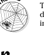

有时我想雇一支空中写字飞机队伍。“巴里，”白色的烟云说，“如果你想比较两个数字，请使用双等号。请不要忘记这样做。”因为我负担不起空中写字，我只能选择更简朴的东西。我创建了一个记住图标。


偶尔，我会遇到一个技术小贴士。这个小贴士可能帮助你理解幕后的人（开发 Java 的人）在想什么。你不必读它，但你可能会觉得它有用。如果你计划阅读其他（更极客的）关于 Java 的书籍，你也可能会觉得这个小贴士有帮助。


这个图标提醒你注意可以在网上找到的有用资料。（你不必等太久就会看到其中一个图标。我在导言的结尾就用了一个！）

## 超越本书

我写了很多本书中找不到的额外内容。去网上查找以下内容：

- **检查表：** 查看 `www.dummies.com/cheatsheet/beginningprogrammingwithjava`。
- **在线文章：** 在本书各部分开头的几页中，你可以找到指向 *For Dummies* 的人所称的 Web Extras 的链接，这些扩展扩展了我在这部分讨论的某个概念。你可以在 `www.dummies.com/extras/beginningprogrammingwithjava` 找到所有这些扩展的集合。

## 从这里开始

如果你已经读到这里，你就可以开始阅读关于计算机编程的内容了。把我（作者）当作你的向导、你的主人、你的个人助理。我尽一切努力让事情保持有趣，最重要的是帮助你理解。


如果你喜欢你读到的内容，给我发电子邮件，在我的 Facebook 墙上发帖，或给我发推文。我的电子邮件地址是我专门为本书的评论和问题创建的，是 BeginProg@allmycode.com。我的 Facebook 页面是 /allmycode，我的 Twitter 账号是 @allmycode。别忘了——要获取最新信息，请访问本书的支持网站之一。我的网站在 http://allmycode.com/BeginProg，或者你可以访问 www.dummies.com/go/beginningprogrammingwithjavafd。

偶尔，我们会对技术书籍进行更新。如果本书有技术更新，它们将被发布在 www.dummies.com/go/beginningprogrammingwithjavafdupdates 和 http://allmycode.com/BeginProg。

## 第一部分：开始使用 Java 编程

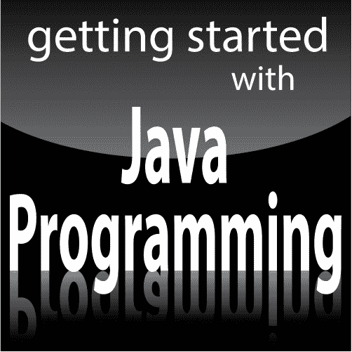

## 列表 1-1：计算机程序中的几行代码

```
if (columnNumber > 60) {
    wrapToNextLine();
} else {
    continueSameLine();
}
```

如果你把列表 1-1 翻译成通俗英语，你会得到类似这样的内容：

```
If the column number is greater than 60,
    then go to the next line.
Otherwise (if the column number isn't greater than 60),
    then stay on the same line.
```

有人必须编写列表 1-1 中所示类型的代码。这种代码，连同数百万行其他代码，共同构成了名为 Microsoft Word 的程序。

那么网页冲浪呢？你点击一个本应直接带你到 Yahoo.com 的链接。在幕后，有人写了以下类型的代码：

```
Go to <a href="http://www.yahoo.com">Yahoo</a>.
```

无论如何，有人必须编写程序。那个人被称为程序员。

## 告诉计算机该做什么

你用计算机做的每一件事都涉及大量的代码。例如，每款电脑游戏实际上都是一个庞大（不，是“非常庞大”！）的计算机代码集合。在某个时候，有人必须编写游戏程序：

```
if (person.touches(goldenRing)) {
    person.getPoints(10);
}
```

毫无疑问，编写程序的人拥有宝贵的技能。这些人有两个重要的特质：

- ✔ 他们知道如何将大问题分解为较小的逐步程序。
- ✔ 他们可以用非常精确的语言表达这些步骤。

用于编写步骤的语言称为编程语言，而 Java 只是数千种有用编程语言中的一种。列表 1-1 中的内容是用 Java 编程语言编写的。

## 自行选择

本书不是关于编程语言之间的差异，但你应该看看其他语言中的代码，以便理解更大的图景。例如，还有另一种语言 Visual Basic，其代码看起来与 Java 编写的代码略有不同。Visual Basic 程序的摘录可能看起来像这样：

```
If columnNumber > 60 Then
    Call wrapToNextLine
Else
    Call continueSameLine
End If
```

Visual Basic 代码看起来比列表 1-1 中的 Java 代码更像普通英语。但是，如果你认为 Visual Basic 像英语，那么就看看用 COBOL 编写的代码：

```
IF COLUMN-NUMBER IS GREATER THAN 60 THEN
    PERFORM WRAP-TO-NEXT-LINE
ELSE
    PERFORM CONTINUE-SAME-LINE
END-IF.
```

在光谱的另一端，你会找到像 Haskell 这样的语言。下面是一个简短的 Haskell 程序，以及程序的输入和输出：

```
median alist =
  [ x | x <- alist,
    length([y | y <- alist, y < x]) ==
    length([y | y <- alist, y > x])]
*Main> median [4,7,2,1,0,9,6]
[4]
```

计算机语言彼此可能非常不同，但在某些方面，它们都是一样的。当你习惯写 IF COLUMN-NUMBER IS GREATER THAN 60 时，你也可以习惯写 if (columnNumber > 60)。这只是将一组符号替换为另一组符号的心理转换。最终，像 if (columnNumber > 60) 这样的写法会变得自然而然。

## 从你的思维到计算机的处理器

当你创建一个新的计算机程序时，你会经历一个多步骤的过程。该过程涉及三个重要工具。

- **编译器：** 编译器将你的代码翻译成计算机友好（人类不友好）的指令。
- **虚拟机：** 虚拟机逐步执行计算机友好的指令。
- **应用程序编程接口：** 应用程序编程接口包含有用的预写代码。

接下来三个部分描述了这三个工具中的每一个。

### 翻译你的代码

你可能听说过计算机处理零和一。这当然是真的，但这意味着什么呢？首先，计算机电路并不直接处理字母表中的字母。当你在计算机屏幕上看到单词 *开始* 时，计算机在内部将其存储为 `01010011 01110100 01100001 01110010 01110100`。你看到一个看起来友好的五字母单词时产生的感觉，只是你对计算机屏幕像素的解释，仅此而已。计算机将一切分解为非常低级、不友好的零和一序列，然后再重新组合起来，以便人类处理结果。

那么当你编写计算机程序时会发生什么呢？程序必须被翻译成零和一。翻译过程的正式名称是 *编译*。没有编译，计算机就无法运行你的程序。

我编译了列表 1-1 中的代码。然后我做了一些无害的黑客操作，帮助我看到 resulting 的零和一。我看到的是图 1-1 中的混合物。

图 1-1 中的编译后的胡言乱语有许多不同的名称：

- 大多数 Java 程序员称之为 *字节码*。
- 我经常称它为 *.class 文件*。这是因为在 Java 中，字节码存储在名为 `SomethingOrOther.class` 的文件中。
- 为了强调区别，Java 程序员称列表 1-1 为 *源代码*，并将图 1-1 中的零和一称为 *目标代码*。


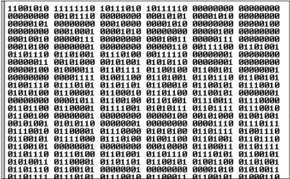

**图 1-1：** 我的电脑能理解这些零和一，但我不能。

为了可视化源代码和目标代码之间的关系，请参阅图 1-2。你可以编写源代码，然后让计算机从你的源代码创建目标代码。要创建目标代码，计算机使用一种特殊的软件工具，称为 *编译器*。

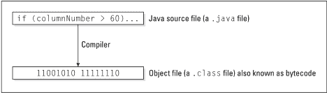

**图 1-2：** 计算机编译源代码以创建目标代码。


你的计算机硬盘上可能有一个名为 `javac` 或 `javac.exe` 的文件。该文件包含那个特殊的软件工具——编译器。（嘿，有趣吧？单词 `javac` 代表“Java compiler！”）作为一名 Java 程序员，你经常告诉计算机构建一些新的目标代码。计算机通过幕后运行 `javac` 文件中的指令来实现这一愿望。

## 运行代码

几年前，我在哥本哈根待了一周。我和一位朋友一起闲逛，这位朋友能流利地说丹麦语和英语。我们在公共公园聊天时，我隐约注意到一些孩子在我们周围转悠。我一句丹麦语也不会，所以我以为孩子们在聊普通的小孩子话题。

## 到底什么是字节码？

请看列表 1-1 以及该列表在图 1-1 中的字节码翻译。你可能会想，字节码文件只是一个密码——用零和一代替 if 和 else 等单词中的字母。但事实并非如此。事实上，字节码文件最重要的部分是对程序逻辑的编码。

图 1-1 中的零和一描述了数据在计算机各部分之间的流动。我在下面的图中说明了这种流动。但请记住，这张图只是一个示意图。你的计算机不会查看这张特定的图，也不会查看类似的东西。相反，你的计算机读取一堆零和一来决定下一步做什么。

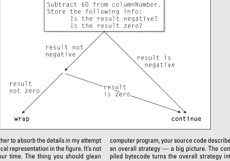

不要费心去吸收我在图中图形化表示的细节。这不值得你花时间。我从文字、方框和箭头的混合中希望你能领会的是，字节码（.class 文件中的内容）包含了计算机应执行的操作的完整描述。当你编写计算机程序时，你的源代码描述了一个整体策略——一个大局。编译后的字节码将整体策略转化为数百个微小、逐步的细节。当计算机“运行你的程序”时，计算机检查此字节码并执行每一个小的逐步细节。

然后我的朋友告诉我孩子们说的不是丹麦语。“他们说的是什么语言？”我问。

“他们在说胡话，”她说。“只是无意义的音节。他们不懂英语，所以他们在模仿你。”

现在回到当下的事情。我看着图 1-1 中的东西，很想嘲笑我的计算机说话的方式。但那样我就和哥本哈根的孩子们一样了。对我来说毫无意义的东西，对我的计算机来说可能完全合理。当图 1-1 中的零和一在我的计算机电路中流经时，计算机“思考”出图 1-3 所示的思想。

**图 1-3：** 计算机从字节码文件中获取的内容。

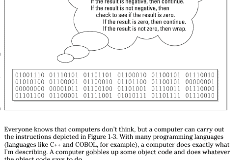

人人都知道计算机不会思考，但计算机可以执行图 1-3 中描绘的指令。对于许多编程语言（例如 C++ 和 COBOL 等语言），计算机完全按照我所描述的方式工作。计算机吞下一些目标代码并执行目标代码所说的任何事情。

这就是许多编程语言的工作方式，但在 Java 中并非如此。在 Java 中，计算机执行不同的指令集。计算机执行像图 1-4 中那样的指令。

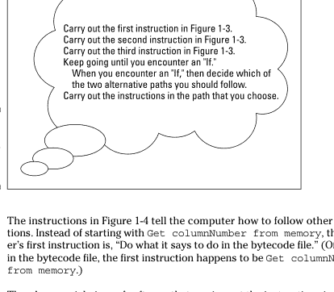

图 1-4 中的指令告诉计算机如何遵循其他指令。计算机的第一个指令不是从内存中获取 columnNumber，而是“做字节码文件中所说的事情”。（当然，在字节码文件中，第一个指令恰好是 Get columnNumber from memory。）

有一个特殊的软件来执行图 1-4 中的指令。这个特殊的软件称为 Java Virtual Machine (JVM)。JVM 引导你的计算机执行某些字节码指令。当你运行 Java 程序时，你的计算机实际上是在运行 JVM。该 JVM 检查你的字节码，逐个零、逐个一，并执行字节码中描述的指令。

许多好的比喻可以描述 JVM。把 JVM 想成代理、跑腿的、中间人。无论如何，你都有图 1-5 所示的情况。在 (a) 侧是大多数编程语言的故事——计算机运行一些目标代码。在 (b) 侧是 Java 的故事——计算机运行 JVM，而 JVM 遵循字节码的指令。

## 你可以使用的代码

20 世纪 80 年代初，我的连襟 Chris 在一家计算机软件公司工作。该公司为文字处理机编写代码。（当时，如果你想不用打字机排版文档，你会买一台“计算机”，它只做文字处理。）Chris 抱怨被要求一遍又一遍地编写同样的旧代码。“首先，我写一个查找替换程序。然后我写一个拼写检查器。然后我再写另一个查找替换程序。然后，另一种拼写检查器。然后，更好的查找替换。”

Chris 是如何保持对工作的兴趣的？Chris 的雇主又是如何保持业务的？每隔几个月，Chris 就必须重新发明轮子。扔掉旧的查找替换程序并从头写一个新程序。这效率低下。更糟糕的是，这很无聊。

多年来，计算机专业人士一直在寻求圣杯——一种编写软件使其易于重用的方法。不要写又重写你的查找替换代码。只需将任务分解成微小的片段。一块搜索单个字符，另一块查找空白，第三块将一个字母替换为另一个字母。当你拥有所有片段时，只需将这些片段组装成查找替换程序。后来，当你想到文字处理软件的新功能时，你可以以稍微不同的方式重新组装这些片段。这很合理，成本效益高，而且更有趣。

20 世纪 80 年代末软件开发出现了若干进步，到 20 世纪 90 年代初，许多大型编程项目都是从预制组件编写的。Java 于 1995 年出现，因此语言的创始人创建可重用代码库是很自然的。该库包括约 250 个程序，包括处理磁盘文件的代码、创建窗口的代码以及在互联网上传递信息的代码。自 1995 年以来，该库已增长到包括超过 4,000 个程序。这个库被称为 *应用程序编程接口 (API)。*

每个 Java 程序，即使是最简单的程序，也会调用 Java API 中的代码。这个 Java API 既有用又 formidable。它有用是因为你可以用 API 的程序做很多事情。它 formidable 是因为 API 非常庞大。没有人能记住 Java API 提供的所有功能。程序员记住经常使用的功能，并在需要时查找所需的功能。他们在名为 *API Specification* 的在线文档中查找这些功能（大多数 Java 程序员亲切地称之为 *API documentation*，或 *Javadocs*）。API 文档（见 http://docs.oracle.com/javase/8/docs/api/）描述了 Java API 中的数千个功能。作为一名 Java 程序员，你每天都会查阅此 API 文档。你可以在 Oracle 网站上为文档添加书签，并在需要查找内容时随时访问该网站，或者你可以通过在 www.oracle.com/technetwork/java/javase/downloads/index.html 找到的链接下载自己的 API 文档副本来节省时间。

## 你的 Java 编程工具集

要编写 Java 程序，你需要本章前面描述的工具：

- **你需要一个 Java 编译器。**（请参阅“翻译你的代码”部分。）
- **你需要一个 JVM。**（请参阅“运行代码”部分。）
- **你需要 Java API。**（请参阅“你可以使用的代码”部分。）
- **你需要访问 Java API 文档。**（再次参阅“你可以使用的代码”部分。）

你还需要一些不太奇特的工具：

- **你需要一个编辑器来编写你的 Java 程序。** 列表 1-1 包含计算机程序的一部分。说到底，计算机程序就是一大堆文本。所以要编写计算机程序，你需要一个编辑器——一种创建文本文档的工具。

  编辑器很像 Microsoft Word，或像任何其他文字处理程序。最大的区别是编辑器不会对你的文本添加任何格式——没有粗体、斜体或字体区分。计算机程序完全没有格式。它们除了普通的字母、数字和其他熟悉的键盘字符之外什么都没有。

  

  当你编辑程序时，你可能会看到粗体文本、斜体文本和多种颜色的文本。但你的程序不包含任何这些格式。如果你看到看起来像格式的东西，那是因为你使用的编辑器做了语法高亮。通过语法高亮，编辑器使文本看起来像是格式化的，以便帮助你理解程序的结构。相信我，语法高亮非常有帮助。

- **你需要一种发出命令的方式。** 你需要一种说“编译这个程序”和“运行 JVM”之类的话的方式。每台计算机都提供发出命令的方式。（你可以双击图标或在运行对话框中输入冗长的命令。）但当你使用计算机的功能时，你会在一个窗口和另一个窗口之间跳转。你打开一个窗口阅读 Java 文档，另一个窗口编辑 Java 程序，第三个窗口启动 Java 编译器。这个过程可能非常乏味。


在最好的所有可能世界里，你通过一个美好的界面进行所有程序编辑、文档阅读和命令发出。这个界面称为集成开发环境（IDE）。

典型的 IDE 将你屏幕的工作区域划分为几个窗格——一个窗格用于编辑程序，另一个窗格用于列出程序名称，第三个窗格用于发出命令，还有其他窗格帮助你编写和测试程序。你可以排列窗格以便快速访问。更好的是，如果你在一个窗格中更改信息，IDE 会自动更新所有其他窗格中的信息。

IDE 帮助你无缝地从编程工作的一个部分转移到另一个部分。有了 IDE，你不必担心编辑、编译和运行 JVM 的机械操作。相反，你可以担心编写程序的逻辑。（你肯定知道？无论如何，你总是有东西可担心！）

### 硬盘上已有哪些内容？

你可能已经拥有创建 Java 程序所需的某些工具。但在较旧的计算机上，你的工具可能已过时。本书的大多数示例可在所有版本的 Java 上运行。但某些示例在早于 Java 5.0 的版本上无法运行。其他示例仅在 Java 6、Java 7、Java 8 或更高版本上运行。

最安全的做法是从 java.com 或 Oracle 网站重新下载工具。要获取下载的详细说明，请参阅第 2 章。

### Eclipse

本书中的程序可与任何能运行 Java 的 IDE 配合使用。这包括 NetBeans、IntelliJ IDEA、JDeveloper、JCreator 等 IDE。你甚至可以在没有 IDE 的情况下运行程序。但为了说明本书中的示例，我使用 Eclipse IDE。我选择 Eclipse 而非其他 IDE 有几个原因：

- Eclipse 是免费的。
- 在所有 Java IDE 中，Eclipse 是专业程序员最常用的。
- Eclipse 有许多花哨的功能，但你可以忽略其中大部分，只学习重复几个例行步骤的序列。使用 Eclipse 几次后，你的大脑会自动执行例行步骤。从那时起，你可以停止担心 Eclipse，专注于 Java 编程。
- Eclipse 是免费的。（值得提及两次。）

### 第 2 章

### 设置你的计算机

### 本章内容

- 安装 Java
- 下载并安装 Eclipse 集成开发环境
- 检查你的 Eclipse 配置
- 获取本书示例中的代码

本书告诉你如何编写 Java 程序，在你能够编写 Java 程序之前，你需要一些软件。至少，你需要我在第 1 章中描述的软件——Java 编译器和 Java 虚拟机（JVM，简写）。你也可以使用一个好的集成开发环境（IDE）和一些示例代码来入门。

编写 Java 程序所需的所有软件都是免费的。软件作为三个下载提供——一个来自本书网站，另一个来自 Oracle，第三个来自 eclipse.org。

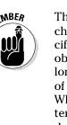

本章中描述的 Oracle 和 Eclipse 网站总是在变化。你从这些网站下载的软件也在变化。诸如“点击右上角的按钮”之类的具体说明很快就会过时（甚至具有误导性）。因此在本章中，我提供了冗长的步骤列表，但也描述了步骤背后的思想。浏览每个建议的网站并寻找获取我所描述软件的方法。当网站为你提供多个选项时，请查阅本章中的说明以获取选择最佳选项的提示。如果你的计算机上的 Eclipse 窗口与本章图中的窗口不完全相同，请在你的计算机窗口中查找所描述的选项。如果在所有这些之后，你仍然找不到所需的内容，请查看本书网站（http://allmycode.com/BeginProg）或发送电子邮件给我，地址为 BeginProg@allmycode.com。你也可以在 Facebook 上找到我，地址为 /allmycode，或在 Twitter 上找到我，地址为 @allmycode。

- 5. 启动 Eclipse 并点击欢迎屏幕的 Workbench 图标。

最初，欢迎屏幕的图标没有文本标签。但当你将鼠标悬停在图标上时，会出现一个工具提示。选择工具提示标题为 Workbench 的图标。

- 6. 在 Eclipse 中导入你在步骤 1 中下载的代码。

有关这些内容的详细信息，请参阅接下来的几节。

### 那些讨厌的文件名扩展名

在 Windows 文件资源管理器或 Finder 窗口中显示的文件名可能具有误导性。你可能会浏览某个目录并看到名称为 Mortgage。文件的真实名称可能是 Mortgage.java、Mortgage.class、Mortgage.somethingElse，或普通的 Mortgage。像 .zip、.java 和 .class 这样的文件名结尾称为文件名扩展名。

残酷的事实是，默认情况下，Windows 和 Mac 会隐藏许多文件名扩展名。这个糟糕的功能往往会让程序员感到困惑。因此，如果你不想感到困惑，请更改计算机的系统范围设置。操作方法如下：

- **在 Windows XP 中：** 选择 开始→控制面板→外观和主题→文件夹选项。然后按照“所有版本的 Windows 中的”项目中的说明操作。
- **在 Windows 7 中：** 选择 开始→控制面板→外观和个性化→文件夹选项。然后按照“所有版本的 Windows 中的”项目中的说明操作。
- **在 Windows 8 中：** 在开始屏幕中，按住 Windows 键同时按下 Q。在 resulting 搜索框中，输入 Folder Options 然后按 Enter。然后按照“所有版本的 Windows 中的”项目中的说明操作。
- **在所有版本的 Windows（XP 及更新版本）中：** 按照上述项目之一中的说明操作。然后，在文件夹选项对话框中，点击查看选项卡。查找隐藏已知文件类型的扩展名选项。确保此复选框未被选中。
- **在 Mac OS X 中：** 在 Finder 应用程序的菜单中，选择偏好设置。在 resulting 对话框中，选择高级选项卡并查找显示所有文件扩展名选项。确保此复选框被选中。
- **在 Linux 中：** Linux 发行版倾向于不隐藏文件名扩展名。因此，如果你使用 Linux，你可能不必担心这个问题。但我没有检查所有 Linux 发行版。因此，如果你的文件名为 Mortgage 而不是 Mortgage.java 或 Mortgage.class，请查阅特定于你的 Linux 发行版的文档。

### 获取本书的示例程序

要获取本书示例程序的副本，请访问 http://allmycode.com/BeginProg 并点击下载本书程序的链接。将下载文件（BeginProgJavaDummies4.zip）保存到计算机硬盘上。


在某些情况下，你点击下载链接，但你的网页浏览器没有提供保存文件的选项。如果这种情况发生在你身上，请右键点击链接（在 Mac 上按住 control 点击）。在 resulting 上下文菜单中，选择另存为、另存链接为、下载链接文件为，或类似标签的菜单项。

大多数网页浏览器将文件保存到计算机硬盘上的下载目录。但你的浏览器可能配置得略有不同。无论如何，请记下包含下载的 BeginProgJavaDummies4.zip 文件的文件夹。

### 压缩归档文件

当你访问 http://allmycode.com/BeginProg 并下载本书的 Java 示例时，你下载的文件名为 BeginProgJavaDummies4.zip。.zip 文件是一个编码了许多较小文件和文件夹的单个文件。因此，例如，我的 BeginProgJavaDummies4.zip 文件编码了名为 06-01、06-02 等的文件夹。06-02 文件夹包含一些子文件夹，这些子文件夹又包含文件。（文件夹 06-02 包含第 6 章第 6-2 节的代码——第 6 章的第二个列表。）

.zip 文件是压缩归档文件的示例。其他压缩归档的示例包括 .tar.gz 文件、.rar 文件和 .cab 文件。解压缩文件意味着提取存储在大归档文件中的原始文件。（对于 .zip 文件，“解压缩”的另一个词是“解压”。）解压缩通常会重建归档文件中编码的文件夹结构。因此，在解压缩我的 BeginProgJavaDummies4.zip 文件后，你的硬盘上会有名为 06-01、06-02 的文件夹，其中包含名为 src 和 bin 的子文件夹，这些子文件夹又包含名为 SnitSoft.java、SnitSoft.class 等的文件。

当你下载 BeginProgJavaDummies4.zip 时，你的网页浏览器可能会自动为你解压缩该文件。如果没有，你可以通过双击文件图标来查看 .zip 文件的内容。（事实上，双击文件图标后，你可以复制文件的内容并执行其他文件操作。）无论如何，不必担心解压缩我的 BeginProgJavaDummies4.zip 文件。当你按照本章的说明操作时，你将把我的 BeginProgJavaDummies4.zip 文件的内容导入 Eclipse IDE。而在幕后，Eclipse 的导入过程会解压缩 .zip 文件。


## 设置 Java

你可以通过访问 www.oracle.com/technetwork/java/javase/downloads 获取最新、最棒的 Java 版本。查找可用的最新 JDK 版本。选择一个可在你的计算机操作系统上运行的版本。图 2-1 显示了我大约 2014 年 3 月在 Oracle 网站上点击“下载 JDK”按钮的情况。

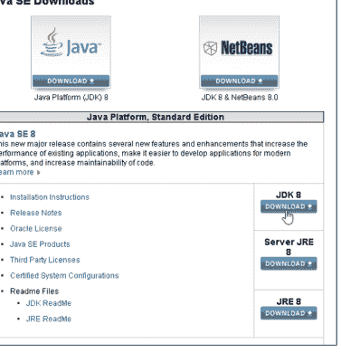

图 2-1：获取 Java JDK。

如果你无法确定最合适的 Java 版本，或想知道缩写 JRE 和 JDK 代表什么，请参阅题为“依妮，米妮，迈妮，莫”的侧边栏。

在你接受许可协议并点击指向 Java 安装文件的链接后，你的计算机会做以下两件事之一：

- 在你的系统上下载并安装 Java。
- 下载 Java 安装文件并将其保存在你的计算机硬盘上。

如果安装自行开始，请按照说明操作，对任何提示回答“是”，并（除非有充分理由另行处理）接受默认值。如果安装没有自行开始，请通过双击下载的安装文件启动安装。

### 依妮，米妮，迈妮，莫

Java 标准版下载页面 (www.oracle.com/technetwork/java/javase/downloads) 提供了许多选项。如果你不熟悉这些选项，该页面可能会令人望而生畏。以下是页面上的一些选择：

- **Word length: 32-bit or 64-bit**  
  你可能需要在标有 32 位系统和标有 64 位系统的链接之间进行选择。如果不知道该选哪个，先尝试 32 位版本。（有关 32 位系统和 64 位系统的更多信息，请参阅“你的计算机有多少位？”侧边栏。）

- **Java version number**  
  Java 下载页面可能提供旧版和新版 Java 供你选择。你可能会看到指向 Java SE 7、Java SE 8、Java SE 8u4 等的链接。（编号如 *8u4* 表示 Java 8 的第四次更新。）如果你不确定想要哪个版本号，选择最高版本号通常是安全的。本书的大多数示例在安装了 Java 5 的计算机上运行。少数示例仅在 Java 7、Java 8 或更高版本上运行。

(J2SE 1.2)。是的，“Java 2”编号与“1.x”编号部分重叠。接下来是版本 1.3 和 1.4。1.4 之后是版本 1.4.2（中间有 1.4.1_02 等版本）。1.4.2_06 之后，下一个版本是 1.5，也称为 5.0 版。（这不是笔误。5.0 版紧跟在 1.4 版本之后。）

版本 1.5 的正式名称是“Java 2 Platform, Standard Edition 5.0”。更糟糕的是，下一个重要发布是“Java Platform, Standard Edition 6”，其中去掉了“Java 2”中的“2”，并且“6.0”中缺少了“0”。这就是公司让市场营销人员说了算时会发生的事情。

更近些年，从 Java 6 开始，版本号趋于可预测的模式。Java 6 之后是“Java Platform, Standard Edition 7”和“Java Platform, Standard Edition 8”，其更新例如“8u02”（意为“Java 8，更新 2”）。

- **JDK versus JRE**  
  下载页面让你在 JDK（Java Development Kit）和 JRE（Java Runtime Environment）之间进行选择。JDK 下载包含的内容比 JRE 下载多。JRE 包含 Java 虚拟机和应用程序编程接口（参见第 1 章）。JDK 包含 JRE 中的所有内容，另外还包含 Java 编译器（再次参见第 1 章）。

Eclipse IDE 自带 Java 编译器。因此，你可以通过下载较小的 JRE（避免大型 JDK 下载）来凑合。但我建议下载完整的 JDK。为什么？因为你永远不知道什么时候另一个编译器（独立于 Eclipse）会派上用场。此外，如果你没有安装完整的 JDK，在 Mac 上安装和配置 Eclipse 会很复杂。所以，如果你想要顺利进行，请下载 JDK 而不是 JRE。

顺便说一下，JDK 的另一个名称是 Java SDK——Java Software Development Kit。有些人仍然使用 SDK 缩写，尽管 Oracle 的人不再使用它了。（实际上，原名是 JDK。后来 Sun Microsystems 将其改为 SDK。几年后，Java 的负责人又改回了 JDK 名称。这种不断的命名和改名让我这个作者抓狂。）

- **Java SE versus Java EE versus Java ME**  
  在浏览时，你可能会注意到标有 Java EE 或 Java ME 的链接。如果你知道它们是什么，并且知道你需要它们，请随意下载这些好东西。但如果你不确定，请绕过 Java EE 和 Java ME 链接。相反，请遵循指向 Java SE（Java Standard Edition）的链接。

  缩写 Java EE 代表 Java Enterprise Edition，Java ME 代表 Java Micro Edition。企业版具有面向大型企业的软件，而微型版具有面向手持设备的软件。（Google 的 Android 软件与 Java 的 Micro Edition 有些相似之处，但在许多方面，Android 和 Java ME 是非常不同的东西。）你不需要 Java EE 或 Java ME 来运行本书中的任何示例。

- **Additional Java-related software**  
  你可以单独下载 Java，也可以与 Oracle 的 NetBeans IDE 一起下载 Java。你可以下载演示和示例的集合。你甚至可能可以下载附带薯条和软饮料的 Java。你可以下载大量额外内容，但事实上，你只需要 Java JDK。

- **Installation type**  
  你可能会被提示在在线安装和离线安装之间进行选择。

  离线安装时，你首先下载一个大型安装文件。该文件占用硬盘上的大量空间（根据你选择下载的内容，介于 30MB 和 150MB 之间）。如果你以后需要再次安装 JDK，文件就在你的计算机上。在你想要更新版本的 JDK 之前，你无需再次下载 JDK。

  为什么有人会想第二次安装相同版本的 JDK？通常我有两个原因。或者我想在第二台计算机上安装软件，或者我搞砸了什么，必须卸载（然后重新安装）软件。

  在线安装时，你不会下载大型安装文件。相反，你下载一个非常小的安装文件。然后你根据需要下载（并丢弃）大型 30MB 到 150MB 文件的各个部分。使用在线安装可以为你节省许多兆字节的硬盘空间。但是，如果你想第二次安装相同版本的 JDK，你必须重新进行整个浏览/点击/下载过程。

处理器，或你自己的 Java 程序）要么是 32 位程序，要么是 64 位程序。你可以在 64 位计算机上运行的 64 位操作系统上运行 32 位网页浏览器。或者，你可以在 64 位计算机上的 32 位操作系统上运行 32 位浏览器。（参见随本文配的图。）

- 如果你运行 32 位操作系统，你只能运行 32 位软件。
- 如果你运行 64 位操作系统，你可能同时运行一些 32 位软件和一些 64 位软件。大多数 32 位软件在 64 位操作系统上运行良好。

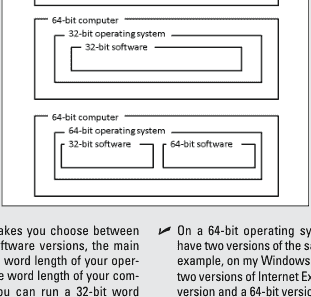

当网站让你在 32 位和 64 位软件版本之间进行选择时，主要考虑的是操作系统的字长，而不是计算机电路的字长。你可以在 64 位操作系统上运行 32 位文字处理器，但你不能在 32 位操作系统上运行 64 位文字处理器（无论计算机电路的字长如何）。选择 64 位软件有一个很大的优势——即 64 位软件可以访问计算机快速随机存取内存超过三千兆字节。在我的经验中，更多内存意味着更快的处理速度。

所有这些关于字长的内容如何影响你的 Java 和 Eclipse 下载？以下是情况：

- 在 64 位操作系统上，你可能有同一程序的两个版本。例如，在我的 Windows 计算机上，我有两个版本的 Internet Explorer——32 位版本和 64 位版本。

  通常，Windows 将 32 位程序放在其 Program Files (x86) 目录中，并将 64 位程序放在其 Program Files 目录中。

- 字长的链条强弱取决于最弱的环节。例如，当我访问 http://java.com 并点击网站的 Do I Have Java? 链接时，我得到的答案取决于我的计算机 Java 版本与我正在运行的网页浏览器之间的匹配。仅安装了 64 位 Java 时

在我的电脑上，我的 32 位 Firefox 浏览器中的“Do I Have Java?”链接显示“未在您的系统上检测到可用的 Java”。但在我的 64 位 Internet Explorer 中同样的链接显示“您已安装了推荐的 Java”。

在 Mac 上，Safari 和 Firefox 是 64 位浏览器，但 Chrome 是 32 位浏览器。因此在 Mac 上，使用 Firefox 与 Chrome 时你可能会看到略有不同的行为。

关于字长，这里是最重要的需要记住的事情：当你按照本章的说明操作时，你的电脑上会安装 Java 软件和 Eclipse 软件。你的 Java 软件的字长必须与 Eclipse 软件的字长匹配。换句话说，32 位 Eclipse 运行 32 位 Java，64 位 Eclipse 运行 64 位 Java。我没有尝试所有可能的组合，但当我尝试用 64 位 Java 运行 32 位 Eclipse 时，我会看到一个误导性的“未找到 Java 虚拟机”错误信息。

最后，一些网站对其软件下载使用了不直观的名称。如果你在下载名称中看到 i386 或 i586，通常意味着 32 位。如果你在下载名称中看到 x86 而名称中任何地方都没有数字 64，那也意味着 32 位。如果名称中出现 64（无论是否带有 x86 标识），则表示这是一个 64 位程序。

## 在你的电脑上查找 Java

第 1 章描述了 Java 生态系统，包括其编译器、虚拟机和其他部分。你的电脑可能已经安装了一些这些 Java 小工具。如果是这样，你可以继续使用现有版本，也可以将最新版本的 Java 添加到已有的系统上。


Java 的版本不像室内猫。它们可以在同一台电脑上共存，而不会互相争斗或发出嘶嘶声。如果你电脑上有多个 Java 版本也没关系。你甚至可以在同一台电脑上混合使用 32 位版本和 64 位版本（只要你至少有一个 Java 版本的字长与你的 Eclipse 版本匹配）。我在我的 Windows 8 电脑上有三个 Java 版本，从未遇到过麻烦。（偶尔，我会因为把一个 Java 版本弄混成另一个版本而自找麻烦。但本章的“在 Eclipse 中配置 Java”部分帮助我理清了问题。没有这本书陪在我身边，我该怎么办？）

要了解你已有的内容并可能避免重新安装 Java，请继续阅读。

### 在 Windows 8 上

在开始屏幕中，按住 Windows 键同时按下 Q。在出现的搜索框中，输入 Programs and Features 然后按 Enter。然后继续阅读“在所有版本的 Windows（XP 及更新版本）”段落。

### 在 Windows 7 上

选择 开始 → 控制面板 → 程序 → 程序和功能。然后按照“在所有版本的 Windows（XP 及更新版本）”段落中的说明操作。

### 在 Windows XP 上

选择 开始 → 控制面板 → 添加或删除程序。然后按照“在所有版本的 Windows（XP 及更新版本）”段落中的说明操作。

### 在所有版本的 Windows（XP 及更新版本）中

在已安装程序列表中查找 Java（见图 2-2）。如果看到 Java 8 或更高版本，就没问题。如果看到的唯一 Java 版本号低于 8（如 1.4.2、5.0 或 6），你的电脑可以运行本书中的部分（但不是全部）程序。

**图 2-2：** Windows 8 上的“程序和功能”对话框。

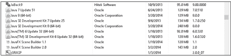


如果版本号为 5.0 或更高，你可以运行本书中的许多（但不是全部）程序。

### 在 Mac 上

Macintosh 电脑可以支持两种不同的 Java 版本——一种由 Apple Inc. 内部开发，另一种在 Oracle 的 auspices 下开发。某些命令和流程适用于其中一种 Java 版本而不适用于另一种。例如，要查找 Apple 的 Java 版本，你查看 `/System/Library/Java/JavaVirtualMachines` 目录。但要查找 Oracle 的 Java，你查看 `/Library/Java/JavaVirtualMachines` 目录。（一条路径以 `/System/Library` 开始；另一条路径以 `/Library` 开始。）你也可能在 `/Library/Internet Plug-Ins/JavaAppletPlugin.plugin/Contents/Home` 目录中找到 Oracle 的 Java。

Tiger、Leopard 和 Snow Leopard（OS X 10.4、OS X 10.5 和 OS X 10.6）预装了 Java。Lion、Mountain Lion 或 Mavericks（OS X 10.7、OS X 10.8 或 OS X 10.9）上未预装 Java。在 Lion、Mountain Lion 或 Mavericks 上，系统在你首次启动需要 Java 的应用程序时会提示你安装 Apple 的 Java 或 Oracle 的 Java。（例如，本章后面你会安装 Eclipse。当你首次尝试启动 Eclipse 时，如果尚未安装 Java，你的电脑会建议你进行安装。）

表 2-1 描述了 Mac OS 与 Java 版本之间的对应关系。

表 2-1 Mac OS X 版本和 Java 版本

| 如果你使用的是这个 Mac OS X 版本 ... | 那么你拥有这个版本的 Java ... | 并且你可以安装这个 Java 版本 |
| --- | --- | --- |
| OS X 10.4.11 (Tiger) | Apple's Java 5.0 | Apple's Java 5.0 |
| OS X 10.5.8 (Leopard) PowerPC and/or 32-bit Intel | Apple's Java 5.0 | Apple's Java 5.0 |
| OS X 10.5.8 (Leopard) Intel-based and 64-bit | Apple's Java 6 | Apple's Java 6 |
| OS X 10.6.8 (Snow Leopard) | Apple's Java 6 | Apple's Java 6 |
| OS X 10.7.5 (Lion) | (no Java) | Apple's Java 6<br>Oracle's Java 8 |
| OS X 10.8.5 (Mountain Lion) | (no Java) | Apple's Java 6<br>Oracle's Java 8 |
| OS X 10.9 (Mavericks) | (no Java) | Apple's Java 6<br>Oracle's Java 8 |

要了解你运行的是哪个版本的 OS X，请执行以下操作：

1. 选择 Apple → 关于本机。
2. 在出现的“关于本机”对话框中，查找“Version”一词。你会看到 Version 10.9.2（或类似内容）以非常浅的灰色文字显示。

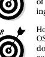

表 2-1 中的信息适用于已更新的 Mac OS X 版本。如果你不定期应用软件更新，你可能运行的是 OS X 10.8.1 而不是 10.8.5。如果是这样，请在 Apple 菜单中选择 Software Update 并按照提示操作。

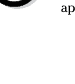

这里那里在网上，我看到一些帖子描述了在 OS X 10.3 上安装 Java 5.0 的方法以及其他规避表 2-1 中限制的方法。但如果你不喜欢折腾，这些变通方法不适合你。（对于每一种硬件或软件要求，总有人会尝试创建变通方法或破解。无论如何，自行承担使用破解的风险。）

如果你不信任表 2-1（坦白说，你不应该相信印刷品上找到的一切），你可以对电脑进行测试以发现 Java 的存在以及（如果你的 Mac 有 Java）Java 版本号。以下是一个适用于旧版 Macintosh 操作系统的测试：

1. 在 Spotlight 的搜索字段中，输入 Java Preferences。
2. 当 Spotlight 的顶部结果为 Java Preferences 时，按 Enter。Java Preferences 窗口出现（见图 2-3）。

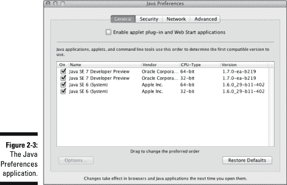

3. Java Preferences 窗口列出了已安装在电脑上的 Java 版本。

在图 2-3 中，电脑有四个 Java 版本——Java 6 和 Java 7 的 32 位（i386）版本以及 Java 6 和 Java 7 的 64 位（x86_64）版本。

对于较新的 Macintosh 操作系统版本，请尝试以下测试：

1. 在 Apple 菜单中，选择 System Preferences。
2. 在 System Preferences 应用程序窗口中，查找 Java 图标（见图 2-4）。
3. 点击 Java 图标。

Java 控制面板出现（见图 2-5）。

图 2-4：System Preferences 应用程序中的 Java 图标。


图 2-5：Java 控制面板

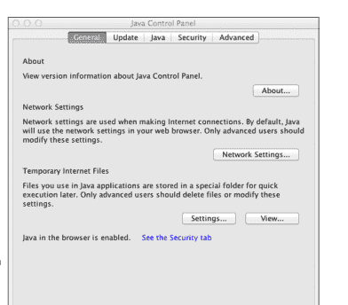

6. 在 Java 运行时环境设置窗口的 User 选项卡和 System 选项卡中查找 Java 版本。

图 2-7 显示了 Java 运行时环境设置窗口的 User 选项卡。根据该图，电脑运行的是 Java 1.8。（Java 的密友称此版本为“Java 8”。）

### 在 Linux 上

要在 Linux 电脑上检查你的 Java 安装（或缺少 Java），请执行以下操作：

1. 在桌面菜单中查找名为 Terminal（也称为 Konsole）的项目。

   一个 Terminal 窗口打开（通常是纯白文字在纯黑背景上）。

2. 在 Terminal 窗口中，输入以下文本然后按 Enter：

   ```
   java -version
   ```

在我的 Linux 电脑上，Terminal 窗口返回以下文本：

```
java version 1.8.0_1
```

如果你的电脑返回的版本号为 1.8.0 或更高，你可以开香槟，期待愉快地运行本书的示例。如果版本号为 1.5 或更高，你可以运行本书的许多（但不是全部）示例。如果你的电脑返回类似“command not found”的信息，很可能你的电脑上未安装 Java。

## 设置 Eclipse 集成开发环境

在前面的章节中，你获得了电脑处理 Java 程序所需的所有工具。本节不同。在本节中，你将获得用于编写和测试 Java 程序所需的工具。你将获得 Eclipse——一个 Java 集成开发环境。

集成开发环境（IDE）是一种提供工具以帮助你轻松高效地创建软件的程序。你可以在没有 IDE 的情况下创建 Java 程序，但使用 IDE 节省的时间和精力使 IDE 值得使用。（一些硬核程序员不同意我的观点，但那是另一回事。）


有关 `.zip` 文件的更多信息，请参阅本章中的“压缩归档文件”侧边栏。

我最喜欢将 eclipse 文件夹直接拖放到 C: 盘上。因此我的 C: 盘上有名为 `Program Files`、`Windows`、`eclipse` 等的文件夹。我避免将 eclipse 文件夹设为 Program Files 的子文件夹，因为有时我会遇到名称 `Program Files` 中空白字符带来的问题。

## 如果你使用 Mac OS X：

- `.tar.gz` 文件是一个压缩归档文件。当你下载该文件时，你的网络浏览器可能会自动为你进行部分解压。如果是这样，你在下载文件夹中就找不到 `.tar.gz` 文件。相反，你会找到一个 `.tar` 文件（因为浏览器解压了 `.gz` 部分）或一个 `eclipse` 文件夹（因为浏览器解压了 `.tar` 和 `.gz` 两部分）。

    如果你在下载文件夹中找到新的 `.tar` 文件或 `.tar.gz` 文件，双击该文件直到看到 `eclipse` 文件夹。将这个新的 `eclipse` 文件夹拖到你的 Applications 文件夹中，就大功告成了。

- 如果你下载了 `.dmg` 文件，你的网络浏览器可能会为你打开该文件。如果没有，请在下载文件夹中找到 `.dmg` 文件并双击它。按照双击后出现的任何说明操作。如果需要将 Eclipse 拖到你的 Applications 文件夹中，请执行此操作。

## 如果你使用 Linux：

你可能会得到一个 `.tar.gz` 文件，但也有可能得到一个自解压的 `.bin` 文件。将 `.tar.gz` 文件解压到你喜欢的目录，或执行自解压的 `.bin` 文件。

## 首次运行 Eclipse

首次启动 Eclipse 时，你需要执行几个额外的步骤。要运行 Eclipse，请执行以下操作：

1. **启动 Eclipse。**

   在 Windows 中，开始菜单可能没有 Eclipse 图标。在这种情况下，请在 Windows 资源管理器（又名文件资源管理器）中查找包含已解压 Eclipse 文件的文件夹。双击代表 `eclipse.exe` 文件的图标。（如果看到 eclipse 文件但没有 `eclipse.exe` 文件，请查阅本章的“那些讨厌的文件名扩展名”侧边栏。）

   

   在 Mac 上，打开 Spotlight 并在搜索字段中输入 Eclipse。当 Eclipse 作为 Spotlight 列表中的 Top Hit 出现时，按 Enter。

   在 Mac 上首次尝试运行 Eclipse 时，你可能会收到一条消息，提示 Eclipse 不来自 App Store，也不来自已识别的开发者。世上没有 100% 安全的东西，但我已经下载并安装 Eclipse 无数次，从未遇到过问题。因此为绕过这个障碍，请在 Applications 文件夹（或你安装 Eclipse 的其他位置）中找到 Eclipse 应用条目。Control-点击该应用条目，并在出现的上下文菜单中选择 Open。此时会出现一个对话框。对话框会询问你是否确定要打开该应用程序。你确定，所以点击 Open。

   当你启动 Eclipse 时，会看到一个 Workspace Launcher 对话框（见图 2-10）。该对话框询问你希望在计算机硬盘上存储使用 Eclipse 创建的代码的位置。

   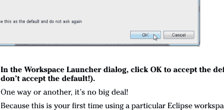

   图 2-10：Eclipse 的 Workspace Launcher。

2. 在 Workspace Launcher 对话框中，点击 OK 以接受默认值（或不接受默认值！）。

   无论哪种方式，都无关紧要！

   因为这是你首次使用某个特定的 Eclipse 工作区，Eclipse 会以 Welcome 屏幕启动（见图 2-11）。历经岁月，大多数 Eclipse Welcome 屏幕都显示图标，而几乎没有或没有有用的文字。

3. 将鼠标悬停在 Eclipse Welcome 屏幕上的图标上，直到找到一个工具提示包含单词 Workbench 的图标。

4. 点击 Workbench 图标以打开 Eclipse 的主屏幕。

   使用全新工作区打开 Eclipse 后主屏幕的视图显示在图 2-12 中。

   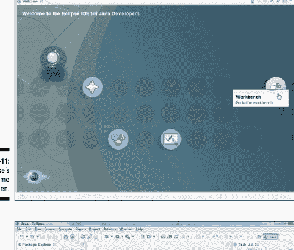

   图 2-11：Eclipse 的 Welcome 屏幕。

   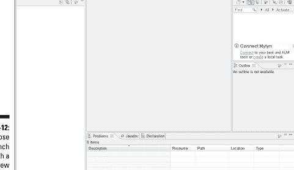

   图 2-12：带有全新工作区的 Eclipse workbench。

5. 如果你偏好的 Java 版本出现在 Installed JREs 列表中，请在该版本的复选框中打勾。

6. 如果你偏好的 Java 版本未出现在 Installed JREs 列表中，请点击 Add 按钮。

   当你点击 Add 按钮时，会出现一个 JRE Type 对话框（见图 2-14）。

   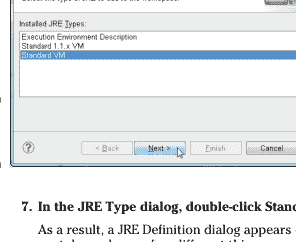

   图 2-14：JRE Type 对话框。

7. 在 JRE Type 对话框中，双击 Standard VM。

   结果会显示一个 JRE Definition 对话框（见图 2-15）。接下来你要做什么取决于一些不同的因素。

8. 填写对话框的 JRE Home 字段。

   如何操作取决于你的操作系统。

   - 在 Windows 上，浏览到你安装了偏好 Java 版本的目录。在我的许多 Windows 计算机上，该目录要么是 `C:\Program Files\Java\jre8`、`C:\Program Files\Java\jdk1.8.0`、`C:\Program Files (x86)\Java\jre8`，或类似路径。

   - 在 Mac 上，使用 Finder 浏览到你安装了偏好 Java 版本的目录。在对话框的 JRE Home 字段中输入该目录的名称。

       我的 Mac 上有一个名为 `/System/Library/Java/Java Virtual Machines/1.6.0.jdk/Contents/Home` 的 Java 目录，另一个名为 `/Library/Java/JavaVirtualMachines/jdk1.8.0.jdk/Contents/Home` 的 Java 目录。（前者用于 Apple 的旧版 Java；后者用于 Oracle 的新版 Java。）你也可能在 `/Library/Internet Plug-Ins/JavaAppletPlugin.plugin/Contents/Home` 目录中找到 Oracle 的 Java。

       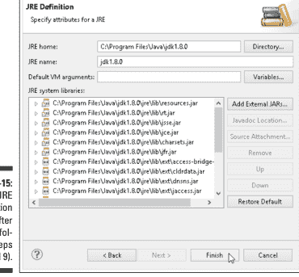

       图 2-15：JRE Definition 对话框（在执行步骤 8 和 9 之后）。

       

       

       /System 和 /Library 之类的目录通常不会出现在 Finder 窗口中。若要浏览到其中一个目录（例如 /Library 目录），请在 Finder 的菜单栏中选择 Go→Go to Folder。在 resulting 对话框中，输入 /Library 然后按 Go。

       当你导航到包含偏好 Java 版本的目录时，你可能会遇到 JDK 1.8.0.jdk 图标或其他扩展名为 .jdk 的项目。要查看此项目的内容，请 control-点击该项目的图标，然后选择 Show Package Contents。

   - 在 Linux 上，浏览到你安装了偏好 Java 版本的目录。如有疑问，请搜索名称以 jre 或 jdk 开头的目录。

   你可能还需要在 JRE Definition 对话框中做一件事。

9. 查看 JRE Definition 对话框的 JRE Name 字段；如果 Eclipse 没有自动填写名称，请在 JRE Name 字段中输入一个名称（几乎任何文本）。

10. 通过点击 Finish 关闭 JRE Definition 对话框。

    Eclipse 的 Preferences 对话框重新回到前台。框中的 Installed JREs 列表包含你刚刚添加的 Java 版本。

11. **在你刚刚添加的 Java 版本旁边的复选框中打勾。**

    你几乎完成了。（还有几个步骤需要跟进。）

12. **在 Preferences 对话框左侧的 Java 分支中，选择 Compiler 子分支。**

    在 Preferences 对话框的主体中，你会看到一个 Compiler Compliance Level 下拉列表（见图 2-16）。

    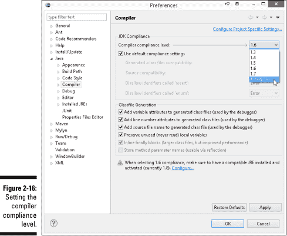

13. **在 Compiler Compliance Level 下拉列表中，选择一个与你偏好的 Java 版本相匹配的数字。**

    对于 Java 7，我选择合规级别 1.7。对于 Java 8，我选择合规级别 1.8。

14. **呼！点击 Preferences 对话框的 OK 按钮返回 Eclipse workbench。**


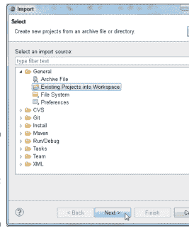

图 2-18：
在所有选项中，选择“将现有项目导入工作区”。

请记住

5. 在“导入项目”对话框中，选择“选择根目录”单选按钮或“选择归档文件”单选按钮（见图 2-19）。

如何决定选择哪个单选框：

首先，确保你注意到了我在题为“那些讨厌的文件名扩展名”的侧边栏中给出的建议。然后查看从本书网站下载的文件所在的文件夹。

- 如果你的网页浏览器不会自动解压下载的 .zip 文件，你会发现本书的代码在一个名为 BeginProgJavaDummies4.zip 的归档文件中。这种情况下，选择“选择归档文件”单选按钮。
- 如果你的网页浏览器会自动解压下载的 .zip 文件，你会发现本书的代码在一个名为 BeginProgJavaDummies4 的目录（文件夹）中。这种情况下，选择“选择根目录”单选按钮。

为了确保你能区分文件夹和 .zip 文件，请查看本章的“那些讨厌的文件名扩展名”侧边栏。

有关 .zip 文件和其他归档文件的完整信息，请参阅题为“压缩归档文件”的侧边栏。

6. 点击“浏览”按钮，在计算机硬盘上找到 BeginProgJavaDummies4.zip 文件或 BeginProgJavaDummies4 目录。

找到文件或目录后，Eclipse 的“导入项目”对话框会显示文件内部的项目名称。（再次参考图 2-19。）

### 第 3 章

### 运行程序

### 本章内容

- 编译和运行程序
- 使用工作区
- 编辑自己的 Java 代码

如果你是个编程新手，对你来说，运行程序可能意味着点击鼠标。你想运行 Internet Explorer，于是双击 Internet Explorer 图标。就这么简单。

当你创建自己的程序时，情况就有点不同了。对于一个新程序，程序员（或程序员公司的人）会创建程序的图标。在此之前，一个完全正常的程序可能根本没有图标。那么你该如何处理一个全新的 Java 程序呢？如何让程序运行？本章会告诉你需要知道的内容。

### 运行现成的 Java 程序

了解 Java 的最好方法是实践 Java。当你在实践 Java 时，你是在编写、测试和运行自己的 Java 程序。本节通过描述如何运行和测试程序来为你做准备。不要自己编写程序，而是运行我已经为你写好的程序。该程序会计算你房屋抵押贷款的月还款额。

抵押贷款计算程序不会打开自己的窗口。相反，程序在 Eclipse 的 Console 视图中运行。Console 视图是 Eclipse 工作台右下部分的一个标签页（见图 3-1）。完全在此 Console 视图中运行的程序称为基于文本的程序。

图 3-1：
本章基于文本的抵押贷款程序的运行示例。

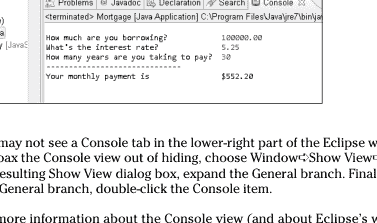

你可能在 Eclipse 工作台的右下部分看不到 Console 标签。要让 Console 视图显示出来，请选择 Window→Show View→Other。在出现的“显示视图”对话框中，展开 General 分支。最后，在该 General 分支中，双击 Console 项。

有关 Console 视图（以及 Eclipse 工作台的一般情况）的更多信息，请参阅本章稍后的“视图、编辑器和其他内容”部分。

你可以通过访问本书网站（allmycode.com/BeginProg）查看图 3-1 中程序的 GUI 版本，以及本书中许多其他示例的 GUI 版本。

实际上，在运行抵押贷款程序时，你会在 Eclipse 的 Console 视图中看到两件事：

- 抵押贷款程序发送给你的消息和结果：消息包括诸如 How much are you borrowing? 之类的问题。结果包括类似 Your monthly payment is $552.20 的行。
- 程序运行期间你给抵押贷款程序的响应：如果你在回答程序关于借款金额的问题时输入 100000.00，你会在 Eclipse 的 Console 视图中看到该数字的回显。

以下是运行抵押贷款程序的方法：

1. 确保你已遵循第 2 章中的说明——安装 Java、安装和配置 Eclipse 以及获取本书示例程序的说明。

太好了！你不必多次遵循这些说明。

2. 启动 Eclipse。

Eclipse 工作区启动器对话框会出现（见图 3-2）。

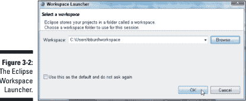

*工作区* 是计算机硬盘上的一个文件夹。Eclipse 将你的 Java 程序存储在一个或多个工作区文件夹中。除了这些 Java 程序外，每个工作区文件夹还包含一些 Eclipse 设置。这些设置存储诸如你使用的 Java 版本、编辑器中单词的偏好颜色、拖动编辑器边缘时编辑器区域的大小等信息。你可以拥有多个工作区，每个工作区包含不同的程序和不同的设置。

默认情况下，工作区启动器会提供打开上次运行 Eclipse 时打开的工作区。你想打开第 2 章中使用的那个工作区，所以不要修改启动器“工作区”字段中的内容。

3. 在工作区启动器对话框中，点击 OK。

大大的 Eclipse 工作台出现在你的电脑屏幕上（见图 3-3）。

在图 3-3 中，工作台最左侧的部分是 Eclipse 的 Package Explorer，其中包含 03-01、04-01 等编号。每个编号实际上是 Eclipse *项目* 的名称。正式地说，项目是工作区内的一组文件和文件夹。直观地说，项目是一个基本工作单元。例如，用于管理你的 CD 收藏的自包含 Java 程序文件集合（连同包含数据的）可能构成一个 Eclipse 项目。

再次查看图 3-3 中的 Package Explorer，你会看到名为 03-01、04-01 等的项目。我的项目 03-01 包含第 3 章（本章）的第一个也是唯一一个示例。项目 06-02 包含本书第 6 章中的 Java 程序 Listing 6-2（第 6 章的第二个代码列表）。项目名称可以包含字母、数字、空格和其他字符，但对于本书示例的名称，我只使用数字和连字符。

要了解有关 Eclipse Package Explorer 等内容的更多信息，请参阅即将出现的“Eclipse 窗口中所有那些东西是什么？”部分。

5. 如图 3-4 所示，从主菜单中选择 Run→Run As→Java Application。

当你选择 Run As→Java Application 时，计算机运行项目的代码。（在此示例中，计算机运行我编写的 Java 程序。）作为运行的一部分，消息 How much are you borrowing? 出现在 Eclipse 的 Console 视图中。（Console 视图与 Problems 视图、Javadoc 视图、Declaration 视图以及可能的其他视图共享 Eclipse 工作台的右下区域。参考图 3-1。）

图 3-4：
运行项目 03-01 中代码的一种方式。

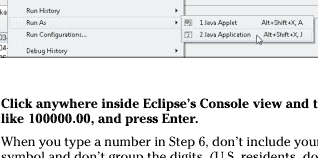

6. 在 Eclipse 的 Console 视图中任意位置点击，然后输入一个数字，如 100000.00，并按 Enter。


在第 6 步输入数字时，不要包含你所在国家的货币符号，也不要对数字进行分组（美国居民，不要输入美元符号，也不要使用逗号）。像 $100000.00 和 1,000,000.00 这样的内容会导致程序崩溃。你会在 Console 视图中看到 NumberFormatException 消息。

分组分隔符因国家而异。图 3-1 中显示的运行是在美国配置的计算机上进行的，在那里 100000.00（带点）表示 "one hundred thousand." 但在配置为我所说的“逗号国家”的计算机上，运行可能看起来不同——在该国家 100000,00（带逗号）表示 "one hundred thousand." 如果你住在逗号国家，并且像图 3-1 中所示那样输入 100000.00，你可能会收到错误消息（an InputMismatchException）。如果是这样，请将文件中的数字金额更改为与你所在国家的数字格式相匹配。这样应该就可以正常工作了。

按 Enter 后，Java 程序会在 Console 视图中显示另一条消息（What's the interest rate?）。（再次参考图 3-1。）

7. 回答利率问题时，输入一个数字，如 5.25，并按 Enter。

按 Enter 后，Java 程序会在 Console 视图中显示另一条消息（How many years . . . ?）。


## 8. 输入一个数字，例如 30，然后按 Enter。

响应你输入的数字，Java 程序会显示一个月的月供金额。再次参考图 3-1。

免责声明：你当地的抵押贷款公司收取各种费用。现实生活中获得抵押贷款，你支付的金额会比我的 Java 程序计算的金额多。（多得多。）

当你在第 8 步输入数字时，不要包含小数点。像 30.0 这样的数字会导致程序崩溃。你会在 Console 视图中看到 NumberFormatException 消息。

偶尔，在程序运行过程中你会决定自己犯了某种错误。你想立即停止程序的运行。只需点击 Console 视图上方的那个小红矩形（见图 3-5）。


图 3-5：
如何提前终止程序的运行。

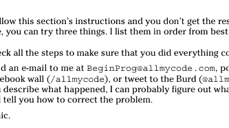

如果你按照本节的说明操作但没有得到我描述的结果，你可以尝试三件事。我按从最好到最差的顺序列出它们：

- 检查所有步骤，确保你已正确完成所有操作。
- 发送电子邮件给我至 BeginProg@allmycode.com，在我的 Facebook 墙上发帖（/allmycode），或向 Burd 发推（@allmycode）。如果你描述发生了什么，我很可能能找出问题所在并告诉你如何纠正。
- 恐慌。

## 输入和运行你自己的代码

上一节是关于运行别人的 Java 代码（从本书网站下载的代码）。但最终，你会自己编写代码。本节展示如何使用 Eclipse IDE 创建代码。

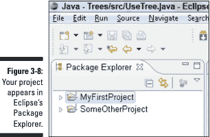

- 4. **在 Package Explorer 中选择你新建的项目。**

要创建图 3-8，我选择了 `MyFirstProject` 而不是 `SomeOtherProject`。

- 5. **在 Eclipse 的主菜单中，选择 File→New→Class。**

Eclipse 的 New Java Class 对话框出现（见图 3-9）。

Java 程序员通常将代码划分为一个或多个包。一个典型的包名称像 `java.util` 或 `org.allyourcode.images`。在图 3-9 中，Eclipse 警告我没有为项目的代码命名一个包。因此代码进入一个不起眼的东西，称为 Java 的 **default package**。Java 的 default package 是一个没有名称的包——代码未被其他打包时存放的抓包位置。包对于管理编程项目非常有用，但本书不包含大型编程项目。所以，在此示例（以及本书所有示例中），我选择忽略该警告。有关 Java 包的更多信息，请参阅第 18 章。

像其他所有窗口化环境一样，Eclipse 提供了多种完成同一任务的方法。除了选择 File→New→Class，你还可以在 Windows 中的 Package Explorer 右键点击 `MyFirstProject`（或在 Mac 的 Package Explorer 中 control-click `MyFirstProject`）。在 resulting 上下文菜单中，选择 New→Class。你也可以先按 Alt+Shift+N（Windows）或 Option+⌘+N（Mac）。点击和按键的选择由你决定。


- 6. **在 New Java Class 对话框的 Name 字段中，输入新类的名称。**

在此示例中，我使用名称 `MyFirstJavaClass`，名称中单词之间没有空白。（参考图 3-9。）

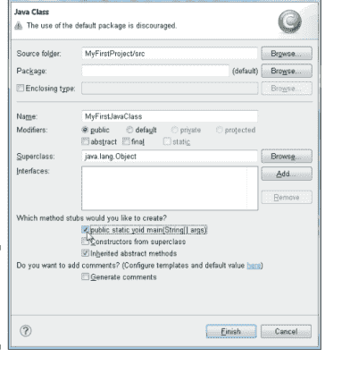

图 3-9
获取 Eclipse 创建新的 Java 类。


New Java Class 对话框中的名称不得包含空白。唯一允许的标点符号是下划线字符（_）。你可以将类命名为 MyFirstJavaClass 或 My_First_Java_Class，但不能命名为 My First Java Class 或 Java Class, MyFirst。

7. 在 public static void main(String[] args) 复选框中打勾。

你的勾选告诉 Eclipse 创建一些样板 Java 代码。

8. 接受 New Java Class 对话框中的所有其他默认值（换句话说，点击 Finish）。

你甚至可以忽略对话框顶部附近的 “Default Package Is Discouraged” 警告。

点击 Finish 会带你回到 Eclipse 的工作台。现在 MyFirstProject 包含一个名为 MyFirstJavaClass.java 的文件。为了方便，MyFirstJavaClass.java 文件中已有一些代码。Eclipse 的编辑器显示 Java 代码（见图 3-10）。

## 我在 Java 程序中看到格式吗？

当你使用 Eclipse 的编辑器编写 Java 程序时，你会看到各种颜色的单词。某些单词总是蓝色。其他单词总是黑色。你甚至会看到一些粗体和斜体短语。你可能认为你看到了格式，但你没有。相反，你看到的是称为语法着色或语法高亮的内容。

格式不会保存在程序文件中。相反，编辑器以便于阅读 Java 程序的方式显示每个单词。

无论你怎么称呼它，问题如下：

- 使用 Microsoft Word，诸如粗体格式之类的内容会标记在文档内部。当你保存 MyPersonalDiary.docx 时，使单词 “love” 和 “hate” 粗体的指令会记录在 MyPersonalDiary.docx 文件内部。
- 使用 Java 程序编辑器，诸如粗体和着色之类的内容不会标记在 Java 程序文件内部。相反，编辑器以便于阅读 Java 程序的方式显示每个单词。

例如，在 Java 程序中，某些单词（像 class、public 和 void 这样的单词）具有其自身的特殊含义。因此 Eclipse 的编辑器以粗体、红色的字母显示 class、public 和 void。当我保存我的 Java 程序文件时，计算机不会在我的 Java 程序文件中存储任何关于粗体、彩色字母的信息。但编辑器会自行决定用红色着色突出显示特殊单词。

其他编辑器可能会以蓝色字体显示相同的单词。另一个编辑器（如 Windows Notepad）会以普通的黑色显示所有单词。


Java 是区分大小写的，这意味着 system.out.printLn 与 System.out.println 不是同一个。如果 yOu tYpE system.out.printLn，你的 proGram 就不会工作。Be sUre to cAPitalize your codE eXactLy as it is in LISting 3-1。

如果你从电子书中复制并粘贴代码，请检查代码中的引号是否为直引号（"），而不是花体引号（“ ”）。在 Java 程序中，直引号是好的；花体引号会带来麻烦。

如果你正确输入了所有内容，你会看到图 3-11 中的内容。

图 3-11：
Eclipse 编辑器中的 Java 程序。

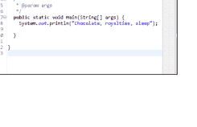

图 3-13：
Eclipse 提供一些有用的建议。

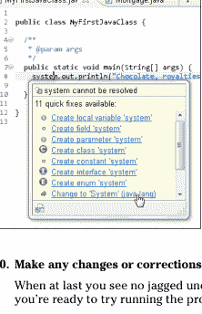

10. 在 Eclipse 的编辑器中对代码进行任何更改或更正。

当你最后看到编辑器中没有锯齿状下划线或斑点时，你就可以尝试运行程序了。

11. 通过在编辑器中点击或通过在 Package Explorer 中点击 MyFirstProject 分支来选择 MyFirstJavaClass。

12. 在 Eclipse 的主菜单中，选择 Run→Run As→Java Application。

这样就搞定了。你的新 Java 程序在 Eclipse 的 Console 视图中运行。如果你运行清单 3-1 中的代码，你会看到图 3-14 中的 Chocolate, royalties, sleep 消息。就像身处天堂一样！

图 3-14：
运行清单 3-1 中的程序。

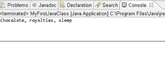

## 可能出现什么问题？

清除编辑器中的锯齿状下划线值得庆祝。Eclipse 喜欢你的代码的外观，因此从那时起，一切都将顺利航行。对吧？

好吧，并不一定如此。除了一些明显的编译时错误之外，你的代码还可能存在其他不太明显的错误。

想象有人告诉你“走到路口，然后跑紧”。你立即注意到说话者犯了错误，并礼貌地回应“嗯？”  nonsensical 的 run tight 短语就像编译时错误一样。你的“嗯？”就像 Eclipse 编辑器中的锯齿状下划线。作为倾听的人类，你可能能够猜出 run tight 的含义，但 Eclipse 的编辑器永远不会敢于修复你代码的错误。

除了编译时错误之外，还有一些其他类型的妖怪可能隐藏在 Java 程序内部：

**Unchecked runtime exceptions：** 你没有编译时错误，但在运行程序时，运行会过早结束。在运行的中间某个地方，你的指令告诉 Java 做一件无法完成的事情。例如，当你在“运行罐装 Java 程序”部分运行 Mortgage 程序时，你输入 1,000,000.00 而不是 1000000.00。Java 不喜欢数字中的逗号，因此你的程序崩溃并显示难看的消息，如图所示。

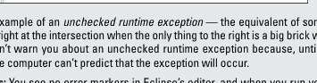

这是一个 unchecked runtime exception 的示例——相当于有人告诉你在路口向右转，而右边唯一的东西是一个大砖墙。在运行程序之前，计算机无法预测异常会发生，因此 Eclipse 的编辑器不会警告你 unchecked runtime exception。

**Logic errors：** Eclipse 编辑器中看不到错误标记，运行代码时程序运行完成。但答案不正确。图中的输出不是 $552.20，而是 $552,200,000.00。程序错误地告诉你支付数千倍于房屋价值的金额，并且每个月支付这个金额！这相当于被告知向右转而不是向左转。你可以在错误的方向上行驶很长时间。


逻辑错误是最具挑战性的错误，发现和修复都很困难。最糟糕的是，逻辑错误常常不被察觉。1985年3月，我收到了一张每月取暖费账单，金额为1,328,932.21美元。显然，某台计算机打印出了错误的金额。当我打电话给燃气公司投诉时，电话服务代表说，“别生气。只付一半的金额。”

**编译时警告：** 警告没有错误消息那么严重。因此，当 Eclipse 在你的程序中发现可疑之处时，编辑器会显示锯齿状的黄色下划线、一个包含感叹号的小黄图标，以及一些其他不太具侵入性的提示。

例如，在下图中的代码里，我在来自清单 3-1 的代码中添加了关于 `amount = 10` 的内容。（就是第 8 行的那部分。）问题是，我在程序中从未使用过 `amount` 或数字 10。凭借其淡淡的黄色标记，Eclipse 实际上是在告诉我“你的 `amount = 10` 代码还不足以成为阻碍程序运行的问题。Eclipse 仍然可以运行你的程序。但你确定要在程序中保留 `amount = 10`（似乎毫无用途的东西）吗？”

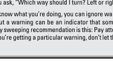

想象一下有人告诉你“到达路口时转弯”。方向可能完全正确。但如果你有所怀疑，你会问：“该往哪边转？左还是右？”

当你确信自己知道在做什么时，可以忽略警告并在稍后处理。但警告也可能表明代码中存在更严重的问题。因此我的总体建议是：注意警告。但是，如果你无法弄清某个警告的原因，不要让警告阻止你继续前进。

## Eclipse 窗口里到底是什么东西？

信不信由你，有一次编辑拒绝了我的一本图书提案。在页边空白处，编辑写着“这不是一个词”在诸如“can't”、“it's”和“I've”旁边。至今我仍不知道这位编辑为何不喜欢缩略形式。我自己的观点是语言始终需要扩展。没有新词——像 *dotcom*、*infomercial* 和 *vaporware* 这样的词——我们会怎样？


当你使用视图来更改某物时，更改会立即生效。例如，当你在 Package Explorer 的上下文菜单中选择 Delete 时，你所选的项目会立即被删除。从某种程度上说，这种行为并不新鲜。使用 Windows Explorer 回收文件或使用 Macintosh Finder 丢弃文件时也会发生同样的事情。

> 编辑器：Eclipse 工作台的一部分，用于显示供你修改的信息。典型的编辑器以文本形式显示信息。此文本可以是文件的内容。例如，图 3-10 中的编辑器显示了 `MyFirstJavaClass.java` 文件的内容。


当你使用编辑器来更改某物时，更改不会立即生效。例如，看看图 3-10 中的编辑器。该编辑器显示了 `MyFirstJavaClass.java` 文件的内容。你可以在编辑器中输入各种内容。直到你从 Eclipse 的菜单栏中选择 File→Save 为止，`MyFirstJavaClass.java` 都不会发生任何变化。当然，这种行为并不新鲜。在 Microsoft Word 或任何其他文字处理程序中工作时也会发生同样的事情。


像其他作者一样，我偶尔会变得懒惰，在真正想表达“view 或 editor”时使用“view”这个词。当你发现我这样做时，只要摇头并继续往下看。当我非常谨慎时，我会使用官方的 Eclipse 术语。我将视图和编辑器称为 Eclipse 工作台的部件。不幸的是，这种“部件”术语很难让人记住。

Eclipse 工作台的一个区域可能包含多个视图或多个编辑器。大多数 Eclipse 用户在没有对这种“多个视图”的事情多加考虑（甚至根本不考虑）的情况下也能很好地使用。但如果你关心标签页和活动视图相关的术语，这里就是详细说明：

> 标签页：除了称之为“标签页”之外，几乎无法描述的东西。我们称之为标签页的东西，无论叫什么名字，都可以让我们在视图之间或编辑器之间切换。重要的是，视图可以彼此堆叠。Eclipse 将堆叠的视图显示为标签笔记本中的页面。例如，图 3-14 显示了 Eclipse 工作台的一个区域。该区域包含五个视图（Problems 视图、Javadoc 视图、Declaration 视图、Search 视图和 Console 视图）。每个视图都有自己的标签页。

一堆堆叠的视图称为标签组。要将堆栈中的视图带到前台，只需单击该视图的标签页即可。

顺便说一下，关于标签页和视图的所有这些内容同样适用于标签页和编辑器。唯一有趣的是 Eclipse 对“编辑器”一词的使用方式。在 Eclipse 中，编辑器区域的每个标签页都是一个独立的编辑器。例如，图 3-16 中的编辑器区域包含三个编辑器（而不是属于单个编辑器的三个标签页）。

Figure 3-16:
编辑器区域包含三个编辑器。

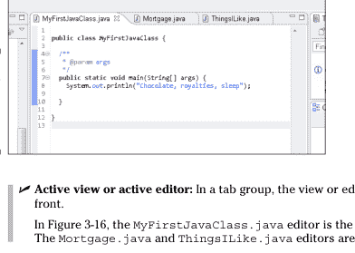

✔ **活动视图或活动编辑器：** 在标签组中，位于前方的视图或编辑器。

在图 3-16 中，MyFirstJavaClass.java 编辑器是活动编辑器。
Mortgage.java 和 ThingsILike.java 编辑器处于非活动状态。

## 视图或编辑器内部有什么？

下面的几个术语涉及单个视图、单个编辑器和单个区域。

✔ **工具栏：** 视图顶部的一排按钮（以及其他小东西）（参见图 3-17）。

Figure 3-17:
Package Explorer 视图的工具栏。

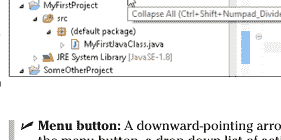

✔ **菜单按钮：** 工具栏中的向下指向箭头。单击菜单按钮时，会出现一个操作下拉列表（参见图 3-18）。
列表中显示的操作因视图而异。

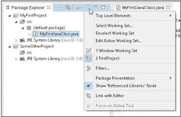

**Figure 3-18:** 单击 Package Explorer 视图的菜单按钮。

**关闭按钮：** 一个按钮，用于关闭某个特定的视图或编辑器（参见图 3-19）。

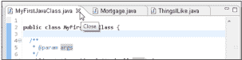

**Figure 3-19:** 编辑器的关闭按钮

**Chevron：** 一个双箭头，表示在特定区域应出现其他标签页（但该区域不够宽）。图 3-20 中的 chevron 旁边有一个小数字 2。2 表示除了两个可见的标签页外，还有两个标签页不可见。单击 chevron 会弹出一个悬停提示，包含所有标签页的标签（参见图 3-20）。

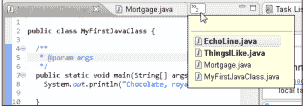

**Figure 3-20:** chevron 表示有两个编辑器被隐藏。

**标记栏：** 编辑器区域左侧边缘的垂直标尺。Eclipse 在标记栏内显示称为 *markers* 的微小警报图标。（例如，参见图 3-12。）

## 回到大局观

下两个术语涉及 Eclipse 的整体外观和感觉。

**布局：** 某些视图的排列。图 3-3 中的布局有七个视图，其中四个很容易看到：
- 在最左侧，你可以看到 Package Explorer 视图。
- 在最右侧，你有 Task List 视图和 Outline 视图。
- 靠近底部，你可以看到 Problems、Javadoc、Declaration 和 Console 视图。

除了所有这些视图外，布局还包含一个编辑器区域。所有打开的编辑器都出现在该编辑器区域内。

**透视图：** 一个非常有用的布局。如果某个布局非常有用，就会有人给它命名。而如果布局有名称，你就可以随时使用该布局。例如，图 3-3 中的工作台显示了 Eclipse 的 *Java perspective*。默认情况下，Java 透视图包含六个视图，其排列方式与图 3-3 中所示的排列非常相似。


Console 视图出现在图 3-3 中，但 Console 视图并不总是作为 Java 透视图的一部分出现。通常，当你运行基于文本的 Java 程序时，Console 视图会自动出现。如果你想强制 Console 视图出现，请选择 Window⇒Show View⇒Other。在 resulting Show View 对话框中，展开 General 分支。最后，在该 General 分支内，双击 Console 项目。

除了所有这些视图外，Java 透视图还包含一个编辑器区域。（当然，编辑器区域有几个标签页，但标签页的数量与 Java 透视图无关。）

你可以通过在 Eclipse 主菜单栏中选择 Window⇒Open Perspective 在透视图之间切换。本书几乎完全集中在 Eclipse 的 Java 透视图上。但如果你喜欢探索，可以访问一些其他透视图，以一窥 Eclipse 的强大和多功能性。


## Part II
## 第二部分

## Writing Your Own Java Programs
## 编写自己的 Java 程序

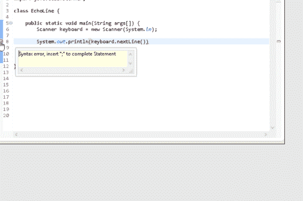

## In this part . . .
## 在本部分中 . . .

- Dissecting programs and examining the pieces
- 解剖程序并检查各个部分
- Working with numbers
- 使用数字
- Working with things that aren't numbers
- 处理非数字的事物

### Chapter 4
### 第 4 章

## Exploring the Parts of a Program
## 探索程序的各个部分

## In This Chapter
## 本章内容

- Identifying the words in a Java program
- 识别 Java 程序中的单词
- Using punctuation and indentation
- 使用标点符号和缩进
- Understanding Java statements and methods
- 理解 Java 语句和方法

I work in the science building at a liberal arts college. When I walk past the biology lab, I always say a word of thanks under my breath. I’m thankful for not having to dissect small animals. In my line of work, I dissect computer programs instead. Computer programs smell much better than preserved dead animals. Besides, when I dissect a program, I’m not reminded of my own mortality.
我在一所文理学院的科学楼工作。当我走过生物实验室时，我总是暗自说一声感谢。我庆幸自己不必解剖小动物。在我的工作领域里，我解剖的是计算机程序。计算机程序闻起来比保存的死动物好得多。此外，当我解剖一个程序时，我不会被提醒到自己的死亡。

In this chapter, I invite you to dissect a program with me. I have a small program, named ThingsILike. I cut apart the program and carefully investigate the program’s innards. Get your scalpel ready. Here we go!
在本章中，我邀请你和我一起解剖一个程序。我有一个名为 ThingsILike 的小型程序。我把程序拆开并仔细研究其内部结构。准备好你的手术刀吧。开始吧！

## Checking Out Java Code for the First Time
## 初次查看 Java 代码

I have a confession to make. The first time I look at somebody else’s computer program, I feel a bit queasy. The realization that I don’t understand something (or many things) in the code makes me nervous. I’ve written hundreds (maybe thousands) of programs, but I still feel insecure when I start reading someone else’s code.
我得坦白一件事。第一次看别人的计算机程序时，我会感到有点不适。意识到自己不理解代码中的某些东西（或很多东西）让我感到紧张。我写过数百（也许数千）个程序，但开始阅读别人的代码时我仍然感到不安全。

The truth is, learning about a computer program is a bootstrapping experience. First, I gawk in awe of the program. Then I run the program to see what it does. Then I stare at the program for a while or read someone’s explanation of the program and its parts. Then I gawk a little more and run the program again. Eventually, I come to terms with the program. Don’t believe the wise guys who say they never go through these steps. Even experienced programmers approach a new project slowly and carefully.
事实是，学习计算机程序是一种自举式的体验。首先，我惊叹地看着程序。然后我运行程序看看它做了什么。然后我盯着程序看一会儿，或阅读别人对程序及其各部分的解释。然后我再多惊叹一点，再次运行程序。最终，我会接受这个程序。不要相信那些自称从不经历这些步骤的聪明人。即使是经验丰富的程序员也会缓慢而谨慎地处理新项目。

## Behold! A program!
## 看！一个程序！

In Listing 4-1, you get a blast of Java code. Like all novice programmers, you’re expected to gawk humbly at the code. But don’t be intimidated. When you get the hang of it, programming is pretty easy. Yes, it’s fun, too.
在清单 4-1 中，你会看到一段 Java 代码。像所有初学者程序员一样，你被期望谦卑地惊叹于这段代码。但不要被吓倒。一旦你掌握了它，编程其实相当容易。是的，它也很有趣。

### Listing 4-1: A Simple Java Program
### 清单 4-1：一个简单的 Java 程序

```
/*
 * A program to list the good things in life
 * Author: Barry Burd, BeginProg@allmycode.com
 * February 13, 2014
 */

class ThingsILike {
  public static void main(String args[]) {
    System.out.println("Chocolate, royalties, sleep");
  }
}
```

When I run the program in Listing 4-1, I get the result shown in Figure 4-1: The computer shows the words Chocolate, royalties, sleep on the screen. Now, I admit that writing and running a Java program is a lot of work just to get the words Chocolate, royalties, sleep to appear on somebody’s computer screen, but every endeavor has to start somewhere.
当我运行清单 4-1 中的程序时，我得到图 4-1 所示的结果：计算机在屏幕上显示单词 Chocolate, royalties, sleep。我承认，编写和运行一个 Java 程序只是为了让单词 Chocolate, royalties, sleep 出现在某人的计算机屏幕上，这工作量很大，但每个事业都必须从某个地方开始。

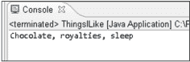

Most of the programs in this book are text-based programs. These programs do their input and output almost exclusively in Eclipse’s Console view. In contrast, a GUI (Graphical User Interface) program displays windows, buttons, text fields, and other widgets to interact with the user. You can see GUI versions of the program in Listing 4-1, and in many other examples from this book, by visiting the book’s website (http://allmycode.com/BeginProg).
本书中的大多数程序都是基于文本的程序。这些程序几乎完全在 Eclipse 的 Console 视图中进行输入和输出。相比之下，GUI（图形用户界面）程序会显示窗口、按钮、文本字段和其他控件来与用户交互。你可以通过访问本书的网站（http://allmycode.com/BeginProg）查看清单 4-1 中程序的 GUI 版本，以及本书中许多其他示例的 GUI 版本。


You can run the code in Listing 4-1 on your computer. Here's how:
你可以在自己的计算机上运行清单 4-1 中的代码。方法如下：

- 1. Follow the instructions in Chapter 2 for installing Eclipse.
- 1. 按照第 2 章中的说明安装 Eclipse。
- 2. Next, follow the instructions in the first half of Chapter 3.
- 2. 接下来，按照第 3 章前半部分中的说明进行操作。

Those instructions tell you how to run the project named 03-01, which comes in a download from this book's website (http://allmycode.com/BeginProg). To run the code in Listing 4-1, follow the instructions for the 04-01 project, which comes in the same download.
这些说明告诉你如何运行名为 03-01 的项目，该项目来自本书网站（http://allmycode.com/BeginProg）的下载内容。要运行清单 4-1 中的代码，请按照同一下载包中 04-01 项目的说明进行操作。

## What the program's lines say
## 程序的行所说的内容

If the program in Listing 4-1 ever becomes famous, someone will write a Cliffs Notes book to summarize the program. The book will be really short because you can summarize the action of Listing 4-1 in just one sentence. Here's the sentence:
如果清单 4-1 中的程序变得出名，有人会写一本 Cliffs Notes 书来总结该程序。这本书会非常短，因为你可以用一句话总结清单 4-1 的操作。句子如下：

```
Display Chocolate, royalties, sleep
on the computer screen.
```

Now compare the preceding sentence with the bulk in Listing 4-1. Because Listing 4-1 has so many more lines, you may guess that Listing 4-1 has lots of boilerplate code. Well, your guess is correct. You can't write a Java program without writing the boilerplate stuff, but, fortunately, the boilerplate text doesn't change much from one Java program to another. Here's my best effort at summarizing all the Listing 4-1 text in 66 words or fewer:
现在将前面的句子与清单 4-1 中的大量内容进行比较。因为清单 4-1 有更多行，你可能会猜测清单 4-1 有很多样板代码。好吧，你的猜测是正确的。没有样板内容你就写不出 Java 程序，但幸运的是，样板文本从一个 Java 程序到另一个 Java 程序变化不大。以下是我的最佳尝试，用 66 个词或更少来总结所有清单 4-1 的文本：

```
This program lists the good things in life.
Barry Burd wrote this program on February 13, 2014.
Barry realizes that you may have questions about this code, so you can reach him at BeginProg@allmycode.com, on Twitter at @allmycode, or on Facebook at /allmycode.

This code defines a Java class named ThingsILike.
Here's the main starting point for the instructions:
    Display Chocolate, royalties, sleep
    on the screen.
```

The rest of this chapter (about 4,500 more words) explains the Listing 4-1 code in more detail.
本章的其余部分（约 4,500 多个词）更详细地解释了清单 4-1 的代码。

## The Elements in a Java Program
## Java 程序中的元素

That both English and Java are called languages is no coincidence. You use a language to express ideas. English expresses ideas to people, and Java expresses ideas to computers. What's more, both English and Java have things like words, names, and punctuation. In fact, the biggest difference between the two languages is that Java is easier to learn than English. (If English were easy, then computers would understand English. Unfortunately, they can't.)
英语和 Java 都被称为语言绝非巧合。你使用语言来表达思想。英语向人们表达思想，而 Java 向计算机表达思想。更重要的是，英语和 Java 都有诸如单词、名称和标点符号之类的东西。事实上，这两种语言之间最大的区别是 Java 比英语更容易学习。（如果英语很容易，那么计算机就会理解英语。不幸的是，它们不能。）

Take an ordinary English sentence and compare it with the code in Listing 4-1. Here's the sentence:
取一个普通的英语句子并将其与清单 4-1 中的代码进行比较。句子如下：

Suzanne says "eh" because, as you know, she lives in Canada.
Suzanne says "eh" because, as you know, she lives in Canada.

In your high school grammar class, you worried about verbs, adjectives, and other such things. But in this book, you'll think in terms of keywords and identifiers, as summarized in Figure 4-2.
在你的高中语法课上，你担心动词、形容词和其他此类东西。但在这本书中，你将以关键字和标识符的概念来思考，如图 4-2 所总结。

Figure 4-2:
The things you find in a simple sentence.
图 4-2：
在简单句子中能找到的东西。

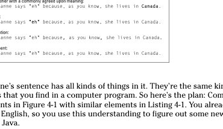

Suzanne's sentence has all kinds of things in it. They're the same kinds of things that you find in a computer program. So here's the plan: Compare the elements in Figure 4-1 with similar elements in Listing 4-1. You already understand English, so you use this understanding to figure out some new things about Java.
Suzanne 的句子包含各种各样的东西。它们与你在计算机程序中找到的东西是同一类。所以计划如下：将图 4-1 中的元素与清单 4-1 中的相似元素进行比较。你已经理解英语，因此利用这种理解来弄清 Java 的一些新东西。

But first, here's a friendly reminder: In the next several paragraphs, I draw comparisons between English and Java. As you read these paragraphs, it's important to keep an open mind. For example, in comparing Java with English, I may write that "names of things aren't the same as dictionary words." Sure, you can argue that some dictionaries list proper nouns and that some people have first names like Hope, Prudence, and Spike, but please don't. You'll get more out of the reading if you avoid nitpicking. Okay? Are we still friends?
但首先，这里有一个友好的提醒：在接下来的几段中，我在英语和 Java 之间进行比较。阅读这些段落时，保持开放的心态很重要。例如，在比较 Java 与英语时，我可能会写“事物的名称与字典单词不同”。当然，你可以争辩说有些字典列出专有名词，有些人的名字像 Hope、Prudence 和 Spike，但请不要这样做。如果你避免吹毛求疵，你会从阅读中获得更多。好吗？我们还是朋友吗？

## Keywords
## 关键字

A keyword is a dictionary word — a word that's built right into a language.
关键字是一个字典单词——一个内置于语言中的单词。

In Figure 4-2, a word like "says" is a keyword because "says" plays the same role whenever it's used in an English sentence. The other keywords in the Suzanne sentence are "because," "as," "you," "know," "she," "lives," and "in."
在图 4-2 中，像 “says” 这样的词是关键字，因为无论在英语句子中如何使用，“says” 都发挥相同的角色。Suzanne 句子中的其他关键字是 “because”、“as”、“you”、“know”、“she”、“lives” 和 “in”。

Computer programs have keywords, too. In fact, the program in Listing 4-1 uses four of Java's keywords (shown in bold):
计算机程序也有关键字。事实上，清单 4-1 中的程序使用了 Java 的四个关键字（以粗体显示）：

```
class ThingsILike {
    public static void main(String args[]) {
```

Each Java keyword has a specific meaning — a meaning that remains unchanged from one program to another. For example, whenever I write a Java program, the word public always signals a part of the program that's accessible to any other piece of code.
每个 Java 关键字都有特定的含义——这种含义从一个程序到另一个程序保持不变。例如，每当我编写 Java 程序时，单词 public 总是表示程序中可被任何其他代码片段访问的部分。

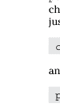

The java proGRAmming lanGuage is case-sensitive. ThIs MEans that if you change a lowerCASE LETTEr in a wOrd TO AN UPPERCASE letter, you chANge the wORD'S MEaning. ChangING CASE CAN MaKe the enTIRE WORD GO FROM BeiNG MEANINGFul to BEiNG MEaningless. In Listing 4-1, you can't replace public with Public. If you do, the WHOLE PROGRAM STOPS WORKING.
Java 编程语言区分大小写。这意味着如果你在单词中将一个小写字母改为大写字母，你就改变了该单词的含义。更改大小写可能会使整个单词从有意义变为无意义。在清单 4-1 中，你不能用 Public 替换 public。如果你这样做，整个程序将停止工作。

This chapter has little or no detail about the meanings of the keywords class, public, static, and void. You can peek ahead at the material in other chapters, but you can also get along by cheating. When you write a program, just start with
本章对关键字 class、public、static 和 void 的含义几乎没有或没有详细说明。你可以提前查看其他章节的材料，但你也可以通过作弊来应付。当你编写程序时，只需从以下内容开始：

```
class SomethingOrOther {
```

and then paste the text
然后粘贴以下文本

```
public static void main(String args[]) {
```

into your code. In your first few programs, this strategy serves you well.
到你的代码中。在你最初的几个程序中，这种策略对你很有帮助。

Table 4-1 has a complete list of Java keywords.
表 4-1 列出了 Java 关键字的完整列表。


## 表 4-1 Java 关键字

| abstract | continue | for | new | switch |
| assert | default | goto | package | synchronized |
| boolean | do | if | private | this |
| break | double | implements | protected | throw |
| byte | else | import | public | throws |
| case | enum | instanceof | return | transient |
| catch | extends | int | short | try |
| char | final | interface | static | void |
| class | finally | long | strictfp | volatile |
| const | float | native | super | while |


在 Java 中，true、false 和 null 这些词具有特定的含义。就像表 4-1 中的关键字一样，你不能在 Java 程序中使用 true、false 和 null 表示除它们通常含义之外的任何其他含义。但出于只有最挑剔的 Java 专家才会关心的理由，true、false 和 null 不被称为 Java 关键字。无论如何，如果你把 true、false 和 null 这些词写进表 4-1 也没关系。

关于关键字，这里有一点需要记住：在 Java 中，每个关键字都有官方的、预先确定的含义。由 Oracle 的人创建了 Java 的所有关键字，他们对构成 Java 程序的内容拥有最终决定权。你不能为任何 Java 关键字自创含义。例如，你不能在计算中使用 public 这个词：

//This is BAD, BAD CODE:
public = 6;

如果你这样使用关键字，那么编译器会显示错误信息并拒绝翻译你的源代码。在英语中也是同样道理。生个孩子并给它取名 “Because。”

> > “让我们为今晚的主持人——Because O. Borel——特别鼓掌一次。”

你可以这么做，但这个孩子永远不会过上正常的生活。


尽管我在本节中坚称如此，Java 的两个关键字在 Java 程序中没有任何含义。这些关键字——const 和 goto——在 Java 中被保留不使用。如果你尝试创建一个名为 goto 的变量，Eclipse 会显示 Invalid VariableDeclaratorId 错误信息。Java 的创建者认为，如果你在代码中使用 const 或 goto 中的任一个词，你应该被礼貌地告知去 C++ 程序员的桌子那边。

## 你或我可以定义的标识符

我喜欢 Suzanne 这个名字，但如果你不喜欢传统名字，那就想一个全新的名字。你要生个新宝宝了。给她取名叫 “Deneen” 或 “Chrisanta”。给他取名叫 “Belton” 或 “Merk”。

名字是一个用来标识某物的词，所以我不再称这些东西为名字，而开始称它们为标识符。在计算机编程中，标识符是一种名词。标识符指的是一个值、程序的一部分、某种结构，或任何数量的事物。

清单 4-1 有两个标识符是你或我可以自行定义的。它们是自创的词 ThingsILike 和 args.

```
class ThingsILike {
    public static void main(String args[]) {
```

正如名字 Suzanne 和 Chrisanta 在英语中没有特殊含义一样，名字 ThingsILike 和 args 在 Java 中也没有特殊含义。在清单 4-1 中，我用 ThingsILike 作为我的程序名，但我也本可以使用像 GooseGrease、Enzyme 或 Kalamazoo 这样的名字。我必须在程序中放入 (String someName[])，但我可以使用 (String args[])、(String commandLineArguments[]) 或 (String cheese[])。

言行一致。给你的 Java 程序中的事物起有意义、信息丰富的名称。像 GooseGrease 这样的名字很可爱，但它们无助于你跟踪程序编写策略。

当我为 Java 程序命名时，我可以使用 ThingsILike 或 GooseGrease，但我不能使用 public 这个词。class、public、static 和 void 等词是 Java 中的关键字。

(String args[]) 中的 args 包含你在发出运行 Java 程序命令时输入的任何额外内容。例如，如果你通过输入 java ThingsILike won too 3 来运行程序，那么 args 就存储额外的值 won、too 和 3。作为初学者，你不需要考虑 Java 的这个特性。只需将 (String args[]) 粘贴到每个程序中即可。

## 具有约定含义的标识符

很多人叫 Suzanne，但只有一个国家叫 Canada。这是因为 “Canada” 这个词有一个标准、众所周知的含义。它就是国旗上有红色枫叶的国家。如果你要建立自己的国家，你应该避免把它命名为 Canada，因为这样命名只会让每个人都困惑。（我知道，肯塔基州有一个镇叫 Canada，但这不算数。记住，你应该忽略这类例外。）

大多数编程语言都有约定含义的标识符。在 Java 中，几乎所有这些标识符都在 Java API 中定义。清单 4-1 有五个这样的标识符。它们是 main、String、System、out 和 println 这些词：

```
public static void main(String args[]) {
    System.out.println("Chocolate, royalties, sleep");
}
```

以下是这些名称含义的简要概述（本书各处会有更详细的描述）：

- **main：** 每个 Java 程序执行的 main 起始点。
- **String：** 一堆文本；一串字符依次排列。
- **System：** Java API 中的一个罐装程序。该程序访问一些超出 Java 虚拟机（JVM）直接控制的计算机功能。
- **out：** 文本程序显示其文本的地方。（对于在 Eclipse 中运行的程序，out 这个词代表控制台视图。要了解更多关于基于文本的程序，请查阅第 3 章的前几段。）
- **println：** 在你的计算机屏幕上显示文本。


println 这个名字来自 “print a line” 这几个词。如果你被允许用大写字母写这个名字，它会是 PRINTLN，词尾附近有一个字母 L。当计算机执行 println 时，计算机将一些文本放入 Eclipse 的控制台视图中，然后立即移动到下一行的开头，为控制台视图中即将出现的内容做准备。


严格来说，Java API 中标识符的含义并非一成不变。虽然你可以为 System 或 println 等词自创含义，但这样做不是个好主意——因为你会让其他程序员大为困惑，他们习惯了这些熟悉标识符名称的标准 API 含义。

## 字面量

字面量是一段看起来像其所代表的值的文本。在 Suzanne 的句子中（参见图 4-2），“eh” 是一个字面量，因为 “eh” 指的是词 “eh”。

编程语言也有字面量。例如，在清单 4-1 中，引号中的内容就是字面量：

```
System.out.println("Chocolate, royalties, sleep");
```

当你运行 ThingsILike 程序时，你会在屏幕上看到 Chocolate、royalties、sleep 这些词。在清单 4-1 中，文本 “Chocolate, royalties, sleep” 指的就是这些词，正如它们在屏幕上显示的那样（不含引号）。

你在计算机程序中使用的数字大多是字面量。如果你把语句

```
mySalary = 1000000.00;
```

放在计算机程序中，那么 1000000.00 就是一个字面量。它代表数字 1000000.00（一百万）。

如果你不喜欢数位数，你可以在 Java 7 程序中放入以下语句：

```
mySalary = 1_000_000.00;
```

从 Java 7 开始，带下划线的数字可作为字面量使用。

在 Java 7 之前的版本中，你不能在代码中使用像 1_000_000.00 这样的数字。


不同国家使用不同的数字分隔符和不同的数字格式。例如，在美国，你写 1,234,567,890.55。在法国，你写 1234567890,55。在印度，你将数字按两三位一组分组。你不能在 Java 程序中放入像 mySalary = 1,000,000.00 这样的语句。Java 的数字字面量中没有逗号。但你可以写 mySalary = 10_00_000.00 以便在印度进行易读的编程。而对于程序的输出，你可以使用 Java 的 Locale 和 NumberFormat 类来显示像 1234567890,55 这样的数字。（有关 Locale 和 NumberFormat 的更多信息，请查阅第 18 章。）

## 标点符号

典型的计算机程序有很多标点符号。例如，考虑清单 4-1 中的程序：

```
class ThingsILike {
    public static void main(String args[]) {
        System.out.println("Chocolate, royalties, sleep");
    }
}
```

每个括号、每个大括号、任何形式的波浪线都起着使程序有意义的作用。


在英文中，你会一直写满一行，然后将文字换行到下一行的开头。在编程中，你很少这样做。相反，代码的标点符号会引导某些行的缩进。缩进显示了程序的哪些部分从属于哪些其他部分。这就像在英文中，你把苏珊娜的句子写成这样：

> 苏珊娜说“呃”，因为
>
>     如你所知
>
> 她住在加拿大。

图4-3和图4-4中的示意图展示了 ThingsILike 程序的各个部分是如何包含在其他部分中的。注意一对花括号如何像一个盒子。为了让程序的结构一目了然，你需要缩进每个盒子内部的所有内容。

图4-3：一对花括号就像一个盒子。

```
class ThingsILike {
    public static void main(String args[]) {
        System.out.println("Chocolate, royalties, sleep");
    }
}
```

图4-4：计算机程序中的思想彼此嵌套。

这是一个名为 ThingsILike 的 Java 类：<br>
这是指令的主要起始点：<br>
在屏幕上显示 Chocolate, royalties, sleep。


我再怎么强调这一点也不为过。如果你不缩进代码，或者你缩进了但不够仔细，你的代码仍然可以编译并正确运行。但这次成功的运行会给你一种错误的自信。一旦你尝试更新某些缩进很差的代码，你就会被彻底搞糊涂。所以接受我的建议：在过程的每一步都认真缩进你的代码。无论你是在快速编写一个测试程序，还是在为一位亿万富翁客户写代码，都要让缩进精确无误。


Eclipse 可以自动为你缩进代码。选择你想要缩进代码的 .java 文件。然后，在 Eclipse 的主菜单中，选择 Source->Format。Eclipse 会重新排列编辑器中的行，缩进应该缩进的内容，通常会让你的代码看起来更好。

## 注释

注释是正常流程之外的文本。在图4-2中，“一条注释：”这些字样并不是苏珊娜句子的一部分。相反，这些词是关于苏珊娜句子的。

计算机程序中的注释也是如此。清单4-1中的前五行构成一个大注释。计算机不会对这个注释采取行动。这个注释中没有要计算机执行的指令。相反，注释告诉其他程序员关于你的代码的一些信息。

注释也是为了你自己好。想象一下，你把代码放在一边一段时间，去做别的事情。当你稍后回来再次处理代码时，注释能帮助你记起当时在做什么。

Java 编程语言有三种注释：

**传统注释：** 清单4-1中的注释是传统注释。注释以 /* 开头，以 */ 结尾。开头的 /* 和结尾的 */ 之间的所有内容仅供人眼阅读。/* 和 */ 之间的任何内容都不会被编译器转换。

清单4-1中的第二行、第三行和第四行有额外的星号。我称它们为“额外”，是因为创建注释时并不需要这些星号。它们只是让注释看起来更漂亮。我在清单4-1中把它们写进去，是因为出于某种我自己也不太明白的原因，大多数 Java 程序员都会添加这些额外的星号。

**行末注释：** 下面是一些带有行末注释的代码：

```
class ThingsILike {        //Two things are missing
    public static void main(String args[]) {
        System.out.println("sleep"); // Missing from here
    }
}
```

行末注释以两个斜杠开头，一直延伸到某行文本的末尾。

你可能会听到程序员谈论“注释掉”代码的某些部分。当你编写程序时，如果某些功能不能正常工作，尝试移除部分代码通常会有所帮助。即使没有其他收获，你也会发现移除可疑代码后会发生什么。当然，你可能不喜欢移除代码后发生的情况，所以你不想完全删除代码。相反，你可以把普通的 Java 语句变成注释。例如，把 System.out.println("Sleep"); 变成 /* System.out.println("Sleep"); */。这样，在你试图找出程序问题时，Java 编译器就不会看到这段代码。

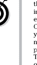

**Javadoc 注释：** 任何以额外星号开头的传统注释都是特殊的 Javadoc 注释。

```
/**
 * Print a String and then terminate the line.
 */
```

这是一个很酷的 Java 特性。你可以从 java.sun.com 下载的软件中包含一个名为 javadoc 的小程序。javadoc 程序会在你的代码中查找这些特殊注释。该程序会利用这些注释创建一个全新的网页——一个为你的代码定制的文档页面。要了解有关将 Javadoc 注释转换为网页的更多信息，请访问本书的网站（http://allmycode.com/BeginProg）。

## 理解一个简单的 Java 程序

接下来的几节将展示、解释、分析、剖析并以其他方式解开清单4-1中 Java 程序的奥秘。

### 什么是方法？

你是一家高档修车行的汽车维修技师。你的老板总是匆匆忙忙，而且习惯把单词连在一起说，他说：“FixTheAlternator。”你在心里过一遍任务清单：“把车开进工位，打开发动机盖，拿一个扳手，松开发电机皮带，”等等。这里发生了三件事：

- **你对自己要做的事情有一个名称。** 这个名称是 FixTheAlternator。
- **在你的脑海中，你有一份与名称 FixTheAlternator 关联的任务清单。** 这份清单包括“把车开进工位，打开发动机盖，拿一个扳手，松开发电机皮带，”等等。
- **你有一个脾气暴躁的老板，他正在吩咐你做所有这些工作。** 你的老板通过说“FixTheAlternator”让你开始工作。换句话说，你的老板通过说出你该做之事的名称来让你工作。

在这个场景中，使用“方法”这个词并不牵强。你有一个处理发电机事务的方法。你的老板调用这个方法，你便通过执行你与该方法关联的指令清单中的所有事项来做出响应。

### Java 方法

如果你相信上一节所说的那些内容，那么你已准备好阅读关于 Java 方法的内容了。在 Java 中，方法是一个待办事项列表。每个方法都有一个名称，而你在程序中使用该方法的名称，告诉计算机执行列表中的事项。

我从未编写过让机器人修理发电机的程序。但如果我要写，程序可能会包含一个名为 FixTheAlternator 的方法。我的 FixTheAlternator 方法中的指令列表看起来会与清单4-2中的文本有些相似。

**清单4-2：方法声明**

```
void FixTheAlternator() {
    DriveInto(car, bay);
    Lift(hood);
    Get(wrench);
    Loosen(alternatorBelt);
    ...
}
```

在我的 Java 代码中的其他地方（在清单4-2之外的某个地方），我需要一条指令来调用我的 FixTheAlternator 方法。调用 FixTheAlternator 方法的指令可能看起来像清单4-3中的那一行。

**清单4-3：调用方法**

```
FixTheAlternator(junkyOldFord);
```


不要太仔细地审视清单4-2和4-3。清单4-2和4-3中的所有代码行都是假的！我编造了这些代码，让它们看起来很像真正的 Java 代码，但它们并不真实。更重要的是，清单4-2和4-3中的代码并不是为了说明 Java 的所有规则。所以，如果愿意的话，你可以对清单4-2和4-3持保留态度。


几乎每种计算机编程语言都有与 Java 方法类似的东西。如果你使用过其他语言，你可能会记得子程序、过程、函数、子例程、Sub 过程或 PERFORM 语句等。无论你在自己喜爱的编程语言中怎么称呼它，方法就是一组指令收集在一起并赋予一个新名称。


## 声明、头和调用

如果你对方法是什么以及它如何工作有基本了解（参见前一节），你可以更深入地了解一些有用的术语：

- 如果我偷懒，我会把清单 4-2 中的代码称为方法。如果我不偷懒，我会把这段代码称为方法声明。
- 清单 4-2 中的方法声明有两个部分。第一行（包含名称 FixTheAlternator 的部分，直到但不包括开大括号）称为方法头。清单 4-2 的其余部分（用大括号包围的部分）是方法体。
- 术语方法声明将清单 4-2 中的指令列表与清单 4-3 中的指令区分开来，后者被称为方法调用。

为了方便说明所有方法术语，请参阅图 4-5。

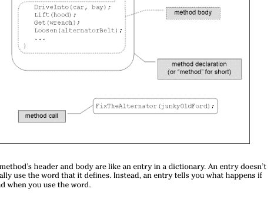

图 4-5：
描述方法的术语。

方法的头和体就像字典中的一个词条。词条本身并不真正使用它所定义的词。相反，词条告诉你如果以及何时使用该词会发生什么。

chocolate (choc-o-late) n. 1. 地球上最会上瘾的物质。2. 你用版税收入支付的东西。3. 人饮食中最重要的营养元素。

FixTheAlternator() 把车开进车位，掀开引擎盖，拿扳手，松开发电机皮带，然后吃点巧克力。

相反，方法调用就像句子中词语的使用。方法调用会让一些代码运行起来。

> "我想要一些巧克力，否则我会发脾气。"

> "FixTheAlternator 那辆破旧的旧福特。"


方法的声明告诉计算机如果调用该方法会发生什么。方法调用（一段单独的代码）告诉计算机实际调用该方法。方法的声明和方法调用往往位于 Java 程序的不同部分。

## 程序中的 main 方法

在清单 4-1 中，代码的大部分是名为 main 的方法的声明。（只需在代码的方法头中查找单词 main。）暂时不用担心方法头中的其他单词——单词 public、static、void、String 和 args。我将在接下来的几章中按需解释这些单词。

像任何 Java 方法一样，main 方法是一个配方：

```
How to make biscuits:
Preheat the oven.
Roll the dough.
Bake the rolled dough.
```

or

```
How to follow the main instructions in
the ThingsILike code:
Display Chocolate, royalties, sleep on the screen.
```

单词 main 在 Java 中扮演特殊角色。特别是，你永远不会编写显式调用 main 方法的代码。main 是程序开始运行时会自动被调用的方法的名称。

当 ThingsILike 程序运行时，计算机会自动找到程序的 main 方法并执行方法体内的任何指令。在 ThingsILike 程序中，main 方法体只有一条指令。该指令告诉计算机在屏幕上打印 Chocolate, royalties, sleep。

方法中的指令在方法被调用之前不会被执行。但如果给方法命名为 main，该方法会被自动调用。

## 你最终如何告诉计算机做某事

深埋在清单 4-1 核心的是实际向计算机发出直接指令的单行代码。行

```java
System.out.println("Chocolate, royalties, sleep");
```

告诉计算机显示单词 Chocolate, royalties, sleep。（如果你使用 Eclipse，计算机会在 Console 视图中显示 Chocolate, royalties, sleep。）我可以用至少两种不同的方式描述这行代码：

- 它是一个语句。在 Java 中，直接告诉计算机做某事的指令称为语句。清单 4-1 中的语句告诉计算机显示一些文本。其他程序中的语句可能告诉计算机把 7 放在某个内存位置或让窗口出现在屏幕上。计算机程序中的语句可以做各种事情。
- 它是一个方法调用。在本章前面“什么是方法？”一节中，我描述了名为“方法调用”的东西。语句 FixTheAlternator(junkyOldFord); 是方法调用的一个例子，System.out.println("Chocolate, royalties, sleep"); 也是。

Java 有许多不同种类的语句。方法调用只是其中一种。

```java
FixTheAlternator(junkyOldFord);
```

```java
System.out.println("Chocolate, royalties, sleep");
```


## 用分号结束语句

在 Java 中，每个语句以分号结束。清单 4-1 中只有一个语句，所以清单 4-1 中只有一行以分号结束。

取清单 4-1 中的任何其他行，例如方法头。方法头（包含单词 main 的行）并不会直接告诉计算机做任何事。相反，方法头为将来参考描述某种操作。头声明“只要有人调用 main 方法，接下来的几行代码告诉你在响应该调用时该做什么。”


每个完整的 Java 语句以分号结束。方法调用是语句，所以它以分号结束，但方法头和方法声明都不是语句。

## 名称为 System.out.println 的方法

清单 4-1 中间的语句调用了一个名为 System.out.println 的方法。该方法在 Java API 中定义。只要你调用 System.out.println 方法，计算机就会在其屏幕上显示文本。

想想名字。不可思议的是，我认识两个叫 Pauline Ott 的人。一个是修女；另一个是物理学家。当然，在英语世界里有许多 Pauline，就像 Java API 中有几个名为 println 的东西一样。所以为了区分物理学家 Pauline Ott 和电影评论家 Pauline Kael，我写出全名“Pauline Ott”。为了区分修女和物理学家，我写“修女 Pauline Ott”。同样，我写 System.out.println 或 DriverManager.println。第一个（你经常使用）会在计算机屏幕上写文本。第二个（本书中根本不使用）会写入数据库日志文件。

正如 Pauline 和 Ott 本身就是名字一样，System、out 和 println 在 Java API 中也是名字。但要使用 println，你必须写出方法的全名。你永远不会单独写 println。它总是 System.out.println 或其他 API 名称的组合。


Java 编程语言是区分大小写的 cAsE-sEnSiTiVe。如果将小写字母改为大写字母（或反之），你就会改变单词的含义。你不能用 system.out.Println 替换 System.out.println。如果你这样做，你的程序将无法工作。

## 方法无处不在

两个方法在 ThingsILike 程序中发挥作用。图 4-6 说明了这种情况，接下来的几个要点为你提供导览。

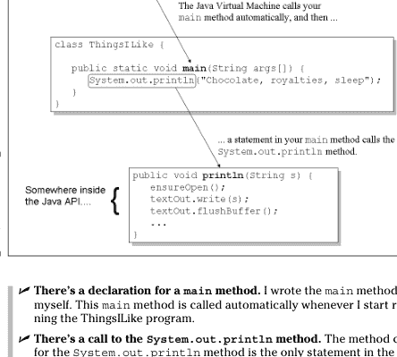

图 4-6：
调用 System.out.println 方法。

```
class ThingsILike {
    public static void main(String args[]) {
        System.out.println("chocolate, royalties, sleep");
    }
}
```

```
public void println(String s) {
    ensureOpen();
    textOut.write(s);
    textOut.flushBuffer();
    ...
}
```

- 有一个 main 方法的声明。我自己编写了 main 方法。只要我开始运行 ThingsILike 程序，这个 main 方法就会被自动调用。
- 有对 System.out.println 方法的调用。System.out.println 方法的方法调用是 main 方法体中唯一的语句。换句话说，调用 System.out.println 方法是 main 方法待办事项列表上唯一的事情。

System.out.println 方法的声明深埋在官方 Java API 内部。有关 Java API 的复习，请参阅第 1 章。

当我说诸如“System.out.println 深埋在 API 内部”之类的话时，我并没有对 API 公平。确实，你可以忽略 API 内部所有繁琐的 Java 代码。你只需要记住 System.out.println 在该代码的某个地方被定义了。但当我让 API 代码听起来像某种魔法时，我是不公平的。API 只是一堆 Java 代码。API 中告诉计算机 System.out.println 调用意味着什么的语句看起来与清单 4-1 中的 Java 代码非常相似。


## Java 类

你听说过 *面向对象编程* 这个术语吗（也称为 OOP）？OOP 是一种到字母 J-u-m-p 的方式。

因此，当你编写计算机程序时，你必须想象一个精灵已经赐予你三个愿望。不要祈求永恒的爱情，因为如果你这样做，精灵就会给你一个流口水的、崇拜的伴侣——一个你一点也不喜欢的人。不要祈求一百万美元，除非你想让精灵把你变成银行抢劫犯。

你在计算机程序中编写的每一件事都必须非常精确。来看一个例子。 . . .

### 回显键盘输入的程序

清单 5-1 包含一个小的 Java 程序。该程序允许你在键盘上输入一行字符。一旦你按下 Enter，程序就会显示第二行，复制你输入的内容。

Figure 5-2: 计算机等待你输入内容。

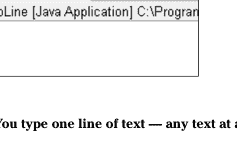

3. 你输入一行文本——任何文本都可以（见图 5-3）。

Figure 5-3: 你输入一个句子。

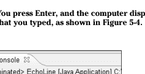

4. 你按下 Enter，计算机就会显示你输入的行内容的另一个副本，如图 5-4 所示。

Figure 5-4: 计算机回显你的输入。

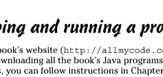

在显示你的输入副本后，程序的运行结束。

### 输入和运行程序

本书的网站 (http://allmycode.com/BeginProg) 提供了下载本书所有 Java 程序的链接。下载程序后，你可以按照第 2 章的说明将程序添加到你的 Eclipse 工作区。然后，要测试清单 5-1 中的代码，你可以运行现成的 05-01 项目。

但与其运行现成的代码，我鼓励你从头开始——自己输入清单 5-1，然后测试你新创建的代码。只需按照以下步骤操作：

1. **启动 Eclipse.**

2. **从 Eclipse 的菜单栏中选择 File→New→Java Project.**

   Eclipse 的 New Java Project 对话框出现。

3. **在对话框的 Project Name 字段中，输入 `MyNewProject`.**

4. **点击 Finish.**

   点击 Finish 会带你返回 Eclipse 工作台，Package Explorer 中显示 `MyNewProject`。下一步是创建一个新的 Java 源代码文件。

5. **在 Package Explorer 中选择 `MyNewProject`，然后在 Eclipse 的主菜单中选择 File→New→Class.**

   Eclipse 的 New Java Class 对话框出现。

6. **在 New Java Class 对话框的 Name 字段中，输入你的新类的名称.**

   在此示例中，使用名称 EchoLine。拼写 EchoLine 要与我在清单 5-1 中拼写的方式完全一致，E 大写，L 大写，且没有空格。

   在 Java 中，一致的拼写和大小写非常重要。如果你在某个程序中不一致，该程序很可能会出现一些讨厌的、烦人的编译时错误。

   可选地，你可以在标记为 `public static void main(String[] args)` 的框中打勾。如果你保持该框未选中，在进行到第 8 步时你需要多输入一些内容。无论是选中还是未选中，都无关紧要。

7. **点击 Finish.**

   点击 Finish 会带你返回 Eclipse 工作台。此工作台中的编辑器有一个名为 EchoLine.java 的标签页。

8. **在 EchoLine.java 编辑器中输入清单 5-1 的程序.**

   完全按照清单 5-1 中的显示复制代码。

   - 每个单词的拼写要与我在清单 5-1 中的拼写完全一致。
   - 每个单词的大小写要与我在清单 5-1 中的写法完全一致。
   - 包含所有标点符号——点号、分号、一切。
   - 仔细检查单词 `println` 的拼写。确保 `println` 这个单词中的每个字符都是小写字母。（特别是 ln 中的 l 是字母，而不是数字。）


println 这个名称来源于“print a line”这两个词。如果允许你全用大写字母来写这个名字，它应该是 PRINTLN，在单词结尾处有一个字母 L。（遗憾的是，Java 是区分大小写的。因此你必须输入 println，这看起来可能像是包含了一个数字 1。其实并没有。）

如果你全部输入正确，编辑器中不会出现任何错误标记。

如果看到了错误标记，请回头把你输入的内容与清单 5-1 中的内容逐项对比。比较每一个字母、每一个单词、每一个弯弯曲曲的符号、每一团污迹。

如果你在读这本书的电子版本，可以尝试直接从清单 5-1 中复制，然后粘贴到 Eclipse 的编辑器中。这或许可行，但你也可能会发现，书中的电子图像包含了一些不属于 Java 程序的字符。例如，许多书使用弯引号（“和”），这与 Java 的直引号（"）不同。另外请记住，你可以通过访问本书网站 http://allmycode.com/BeginProg 下载本书示例的真正电子副本。


- 9. 在编辑器中对代码做任何修改或更正。
- 当你最后再也看不到任何错误标记时，就可以准备运行程序了。
- 10. 通过单击编辑器内部或单击包资源管理器中的 MyNewProject 分支来选择 EchoLine 类。
- 你的新 Java 程序运行了，但并没有发生什么明显的事情。
- 11. 在 Eclipse 的主菜单中，选择 Run→Run As→Java Application。
- 你的新 Java 程序运行了，但并没有发生什么明显的事情。
- 12. 单击 Eclipse 控制台视图的内部。
- 结果，光标停在了 Eclipse 控制台视图的左边缘。（参见图 5-2。）计算机正在等待你输入一些内容。
- 如果你忘记单击控制台视图内部，Eclipse 可能不会把你的击键发送到正在运行的 Java 程序。相反，Eclipse 可能把你的击键发送到编辑器，或者（相当奇怪地）发送到包资源管理器。
- 13. 输入一行文本，然后按回车键。
- 作为响应，计算机显示了你这行文本的第二份副本。然后程序的运行就结束了。（参见图 5-4。）


如果这组步骤看起来有点简略，你可以在第 3 章中找到更多的细节。（先看第 3 章中关于编译和运行程序的那一节。）总的来说，第 5 章中的这些步骤只是第 3 章内容的快速总结。最大的区别在于：在第 3 章中，我不鼓励你自己动手输入程序。

那么，你自己动手输入程序时，又有什么大不了的呢？好吧，当你的手指放到键盘上时，可能会发生很多有趣的事情。这就是为什么本章的后半部分专门用来讨论故障排除。

## EchoLine 程序的工作原理

当你还是一个小婴儿，舒适地依偎在母亲怀里时，她已经告诉过你如何把字符发送到计算机屏幕上：

```
System.out.println(whatever text you want displayed);
```

她没有告诉你的，是如何从计算机键盘获取字符。有很多办法可以做到这一点，但我在本章推荐的是：

```
keyboard.nextLine()
```

现在，有趣的部分来了。调用 nextLine 方法不仅仅是从键盘获取字符。当计算机运行你的程序时，计算机会用你在键盘上输入的内容替换文本 keyboard.nextLine()。

为了理解这一点，请看清单 5-1 中的语句：

```
System.out.println(keyboard.nextLine());
```

当你运行这个程序时，计算机看到你对 nextLine 的调用，就会当场停下来。（参见图 5-2。）计算机等着你输入一行文本。于是（参见图 5-3）你输入了这一行：

```
Hey, there's an echo in here.
```

计算机把这一整行 Hey 文本替换为程序中的 keyboard.nextLine() 调用。这个过程如图 5-5 所示。

对 keyboard.nextLine() 的调用嵌套在 System.out.println 调用之中。所以最终，计算机的行为就像是清单 5-1 中的语句变成了这样：

```
System.out.println("Hey, there's an echo in here.");
```

计算机在屏幕上显示了文本 Hey, there's an echo in here. 的第二份副本。这就是为什么在图 5-4 中你会看到两行 Hey 文本。

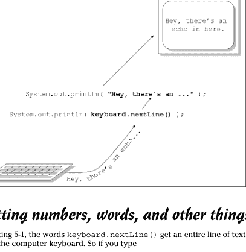

图 5-5
计算机把文本替换到了 nextLine 调用的位置。

## 获取数字、单词和其他内容

在清单 5-1 中，`keyboard.nextLine()` 从计算机键盘获取一整行文本。因此，如果你输入

Testing 1 2 3

清单 5-1 中的程序会把你输入的整行 Testing 1 2 3 文本回显出来。

有时候你并不希望程序获取一整行文本。相反，你希望程序获取一行中的一部分。例如，当你输入 1 2 3 时，你可能希望计算机获取数字 1。（也许数字 1 代表一个客户之类的东西。）在这种情况下，你不应该在程序中放入 keyboard.nextLine()，而应该使用 keyboard.nextInt()。

表 5-1 展示了 `keyboard.next` 这种用法的一些变体。遗憾的是，表中的内容并不是很容易预测。要读取一行输入，你得调用 nextLine。但要读取一个单词，你不能调用 nextWord。（Java API 中并没有 nextWord 方法。）相反，要读取一个单词，你得调用 next。

**表 5-1 一些 Scanner 方法**

| 要读取这种内容 ... | ... 就调用这个方法 |
|---|---|
| 没有小数点的数字 | nextInt() |
| 带有小数点的数字 | nextDouble() |
| 一个单词（例如以空格结尾） | next() |
| 一行（或者在你已经读取了该行的某些数据之后，该行剩余的内容） | nextLine() |
| 单个字符（例如字母、数字或标点字符） | findWithinHorizon(".",0).charAt(0) |

另外，这张表还有一个出人意料的结尾。要读取单个字符，你不能调用 nextSomething。相反，你可以调用那个奇怪的 findWithinHorizon(".",0).charAt(0) 方法组合。（你得原谅那些创建 Scanner 类的人。他们是从一个非常专门的角度来创建 Scanner 的。）

想看表中一些方法的实际应用，请查阅本书中的其他程序清单。第 6 章、第 7 章和第 8 章有一些特别好的例子。

## 输入三行代码，然后不再回头

在清单 5-1 中，还静静埋藏着三行额外的代码。这些行帮助计算机从键盘读取输入。这三行是

```java
import java.util.Scanner;
    Scanner keyboard = new Scanner(System.in);
    keyboard.close();
```

关于这三行，我有坏消息，也有好消息。

- ✓ **坏消息是，这些代码背后的原理很难理解。** 在第 5 章这里尤其如此，因为我正要介绍 Java 最基本的概念。
- ✓ **好消息是，你并不需要理解这三行代码背后的原理。** 你可以把这些行复制并粘贴到任何需要从键盘获取输入的程序中。你不需要对它们做任何修改。在各类 Java 程序中，这些行都可以不经修改地正常工作。

## 快速了解一下 Scanner

在本章中，我建议你忽略 `import java.util.Scanner` 和 `Scanner keyboard` 等这些行背后的任何含义。直接不加思索地把这两行粘贴到你的代码中，然后继续前进。

当然，你可能不想听从我的建议。你可能不喜欢忽略代码中的东西。如果你恰好是这样一位固执的人，我有几个简单的事实要告诉你。

`Scanner` 这个词在 Java API 中已有定义。

Scanner 就是你可以用来获取输入的东西。

这个 Scanner 类属于 Java 5.0 及更高版本。如果你使用的是 Java 1.4.2，就无法使用 Scanner 类。（当你输入清单 5-1 时，会看到一个错误标记。）

`System` 和 `in` 这两个词在 Java API 中已有定义。

合在一起，`System.in` 代表计算机键盘。

在后面的章节中，你会看到类似 `new Scanner(new File("myData.txt"))` 这样的代码。在那些章节中，我会用 `new File("myData.txt")` 替换 `System.in`，因为那时我不是从键盘获取输入，而是从计算机硬盘上的文件中获取输入。

`keyboard` 这个词并不是来自 Java API。

`keyboard` 是 Barry Burd 创造出来的。除了 `keyboard`，你也可以

使用 `readingThingie`（或者其他任何你想用的名字，只要始终如一地使用这个名字即可）。所以，如果你想发挥一下创造力，可以这样写：

```
Scanner readingThingie =
    new Scanner(System.in);

System.out.println
    (readingThingie.nextLine());
```

修改后的清单 5-1（即用 readingThingie 替换 keyboard）编译和运行都没有问题。

`import java.util.Scanner` 这行是一个导入声明的例子。

可选的导入声明允许你在程序的其余部分中缩写名称。你可以把导入声明从清单 5-1 中删除。但如果你这样做，就必须在整个代码中使用 Scanner 类的完整限定名。做法如下：

```
class EchoLine {
    public static void main
        (String args[]) {
        java.util.Scanner keyboard
            = new java.util.Scanner
                (System.in);
        System.out.println
            (keyboard.nextLine());
        keyboard.close();
    }
}
```

请确保将这些行放在正确的位置：

- 将 `import java.util.Scanner` 行作为程序的第一行。
- 在 `public static void main(String args[]) {` 行之后立即将 `Scanner keyboard = new Scanner(System.in)` 行放在你的 main 方法内部。
- 将 `keyboard.close()` 行作为程序的最后一行。

将来某个时候，你可能需要更谨慎地考虑这三行的位置。但就目前而言，我给出的规则对你很有帮助。

## 预期意外情况

不久前，我遇到了一位有有趣政策的讲师。他说：“有时候我在讲课时，会在电脑上从头开始编写一个程序。我就在学生面前做。如果程序第一次尝试就能编译并正确运行，我希望学生们给我热烈鼓掌。”

起初，你可能会觉得这个人自负极大，但你需要把事情放在合适的视角来看。程序第一次就能编译并正确运行是不寻常的。几乎总是有拼写错误或其他某种错误。

因此本节讨论的是你在第一次编译和运行程序时看到的正常、预期错误。每个人都会犯这些错误，即使是最有经验的程序员。关键是保持冷静。以下是我的一般建议：

- **不要指望你输入的程序第一次就能编译成功。**
  做好返回编辑器并修复一些错误的准备。
- **不要指望编译完美的程序就能正确运行。**
  即使在 Eclipse 编辑器中没有错误标记，你的程序仍可能存在缺陷。Eclipse 编译完你的程序后，你仍需要成功运行程序。也就是说，你的程序应该完成运行并显示正确的输出。你先编译然后运行。让程序在没有错误的情况下编译是这两个任务中较容易的。
- **阅读 Eclipse 编辑器中的实际内容，而不是你假设编辑器中的内容。**
  不要假设你已正确输入单词、正确大写单词，或正确匹配大括号或括号。比较你输入的代码与任何示例代码。确保每个细节都正确无误。
- **要有耐心。**
  每个好的编程工作都需要很长时间才能做好。如果你不能马上理解某件事，要坚持下去。坚持不懈（或先放一放，过后再回来）。只要投入足够的时间，就没有你不能理解的东西。
- **不要变得沮丧。**
  不要扔你的派皮。沮丧（而不是缺乏知识）是你的敌人。如果你沮丧，就什么也做不成。
- **不要认为你是对理解最慢的唯一人。**
  我很慢，我为此感到自豪。（Mea culpa，第 6 章会晚一周。）
- **不要胆怯。**
  如果你的代码不能正常工作而你又无法弄清原因，那就问别人。在在线论坛上发帖。并且不要害怕任何人的挖苦或讽刺回答。（有关你可以对人们尖酸回答做出的手势列表，请参见附录 Z。）

要直接问我，给我发电子邮件、发推文，或在 Facebook 上给我发帖。（发送电子邮件至 BeginProg@allmycode.com，推文至 @allmycode，或在 Facebook 上发布至 /allmycode。）

## 诊断问题

“输入和运行程序”部分，在本章前面，告诉你如何运行 EchoLine 程序。如果一切顺利，你的屏幕最终会看起来像图 5-1 所示。但事情并不总是顺利。有时你的手指会滑一下，在程序中插入拼写错误。有时你忽略了清单 5-1 中的某个细节，就会收到一个讨厌的错误信息。

当然，清单 5-1 中的某些内容是可以更改的。清单 5-1 中的并非每个词都是不可更改的。因此这里有一个棘手的问题——我不能告诉你必须始终完全照清单 5-1 的样子重新输入。有些更改是可以的；有些则不行。继续阅读以了解一些“frinstances”。

### 大小写敏感

Java 是大小写敏感的。其他方面，大小写敏感意味着在 Java 程序中，字母 P 与字母 p 不同。如果你给我写粉丝邮件并以“Dear barry”开头而不是“Dear Barry”，我仍然知道你的意思。但 Java 不是这样工作的。

因此只更改 Java 程序中的一个字符，就不会有平静的编译过程，而是会得到一个大头疼！像这样把 p 改为 P：

//The following line is incorrect:
System.out.Println(keyboard.nextLine());

当你在 Eclipse 编辑器中输入程序时，你会得到图 5-6 所示的丑陋情况。

Figure 5-6:
Java 编译器理解 println，但不理解 Println。

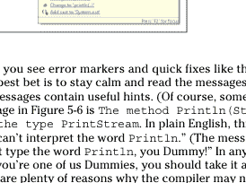

当你看到像图 5-6 那样的错误标记和快速修复时，你最好的做法是保持冷静并仔细阅读信息。有时，信息包含有用的提示。（当然，有时不包含。）图 5-6 中的信息是 The method Println(String) is undefined for the type PrintStream。用通俗英语来说，这意味着“The Java compiler can't interpret the word Println.”（该信息没有说到，“Don't type the word Println, you Dummy!”无论如何，如果电脑说你是我们这些 Dummies 中的一员，你应该把它当作赞美。）现在，编译器可能无法理解像 Println 这样的单词有很多原因。但对于初学者来说，你应该立即检查两件重要的事情：

- **你拼写单词正确吗？**
  你是否不小心输入了 `print1n`（带数字 1）而不是 `println`？
- **你是否正确大写了所有字母？**
  你是否错误地输入了 `Println` 或 `PrintLn` 而不是 `println`？

这两种错误中的任何一种都可能让 Java 编译器陷入混乱。因此，将你的输入与批准的输入逐字（和逐字母）比较。当你发现不一致时，返回编辑器并修复问题。然后再次尝试编译程序。

当你在 Eclipse 编辑器中输入程序时，Eclipse 会尝试编译程序。当 Eclipse 发现编译时错误时，编辑器通常会显示至少三个红色错误标记（参见图 5-6）。编辑器左侧边距中的标记有一个类似 X 的标记，有时还有一个小灯泡。右侧边距中的标记是一个小矩形。中间的标记是一条锯齿状的红色下划线。

如果你将鼠标悬停在这些标记中的任何一个上，Eclipse 会显示一条尝试描述错误性质的消息。如果你将鼠标悬停在锯齿线上，Eclipse 会显示一条消息以及可能的建议解决方案列表。（每个建议解决方案称为快速修复。）如果你右键单击左侧边距的标记（或在 Mac 上 control-click）并在 resulting 上下文菜单中选择 Quick Fix，Eclipse 会显示建议的解决方案。要让 Eclipse 自动修改你的代码（使用快速修复列表中的建议），只需单击或双击快速修复列表中的项目即可。（也就是说，单击任何看起来像链接的东西；双击任何不像链接的东西。）

### 省略标点

在英语和 Java 中，使用正确的标点很重要。

例如，清单 5-1 中的分号。如果忘记输入分号会怎样？

//The following code is incorrect:
    System.out.println(keyboard.nextLine())
}

如果你省略分号，你会得到图 5-7 所示的消息。

Figure 5-7:
一个有用的错误信息。


像图 5-8 中的信息会让你的生活更简单。我不必解释信息，你也不必费解信息的含义。只需按字面意思接受信息 `insert ";" to complete Statement`。在 `System.out.println(keyboard.nextLine())` 语句的末尾和语句之后的代码之间插入分号。（为了便于阅读和理解的代码，将分号附加在 `System.out.println(keyboard.nextLine())` 语句的末尾。）


## 使用过多标点符号

上初中的时候，我的英语老师说，每当我想停下来喘口气时，就应该用逗号。但这条建议在过敏季节就不太管用了，因为那时我句子里的逗号比单词还多。即使身为一名靠写作赚钱的作者，我也很难决定逗号该放在哪里，所以常常多加几个逗号以防万一。这让我的文字编辑梅尔芭（Melba）多了不少活儿，她办公室桌旁已经扔了满满一垃圾桶的逗号。

Java 程序也是同样的道理。你可能会在标点符号上失控。例如，清单 5-1 中的 main 方法头就是这样一行。对于初学者来说，这行代码是一个危险弯道。

关于*方法头*和*方法体*这两个术语的信息，请参阅第 4 章。

## 为什么电脑不能自己修正呢？

你有多少次能替别人把话说完？“拜托，”你的主管说，“去那边把那个……接上。”

“电线，”你说，“我来接电线。”如果你知道对方想说什么，为什么要等他慢慢说完？

同样的问题也出现在计算机报错信息中。看看图 5-7 中的消息。计算机希望在第 8 行的语句后面有一个分号。那么，计算机先生，如果你知道哪里需要分号，直接加上分号不就行了？为什么还要来烦我呢？

答案很简单。计算机不想冒任何风险。如果第 8 行语句后面*并不*真的需要分号呢？如果缺失的分号背后隐藏着更严重的问题呢？如果计算机自作主张加了这个多余的分号，可能反而弊大于利。

回到你和主管的场景……

轰！一声巨响。“不是电线，你这个笨蛋。是那些点。我要你把这些点连起来。”

“对不起，”你说。

通常，你不应该用分号结束一个方法头。但人们还是会加个分号。（也许，在某种微妙的意义上，方法头看起来就应该以分号结尾。）

```
//The following line is incorrect:
public static void main(String args[]); {
```

如果你把这个多余的分号加到清单 5-1 的代码中，就会得到图 5-8 所示的信息。

图 5-8 中的错误信息和快速修复方案有点误导性。这条消息以“此方法需要主体”开头。但该方法明明有主体，不是吗？

当计算机尝试编译 `public static void main(String args[]);`（以分号结尾）时，它会感到困惑。我在图 5-9 中展示了这种困惑。你的眼睛看到的是一个多余的分号，但计算机的眼睛把它解读为一个没有主体的方法。所以错误消息就是——计算机说“此方法需要主体”，而不是说缺少分号。

图 5-9：
这台计算机在想什么？


如果你选择“添加主体（Add Body）”快速修复，Eclipse 会创建下面这段（非常糟糕的）代码：

```
import java.util.Scanner;

class EchoLine {
    public static void main(String args[]) {
    } {
        Scanner keyboard = new Scanner(System.in);
        System.out.println(keyboard.nextLine());
        keyboard.close();
    }
}
```

这段“修复后”的代码没有编译期错误。但当你运行它时，什么也不会发生。程序开始运行，然后停止运行，Eclipse 的控制台视图中什么也没有。

我们都知道，计算机是一台非常有耐心、非常富有同情心的机器。这就是为什么计算机看着你的代码，决定再给你一次机会。计算机记得 Java 有一个高级特性，可以只写方法头而不写方法体。当你这样做时，你会得到所谓的抽象方法——我在本书中完全不使用它。无论如何，在图 5-9 中，计算机看到的是一个没有主体的头。于是计算机对自己说：“我知道了！也许程序员是想写一个抽象方法。问题是，抽象方法的方法头必须包含 abstract 这个词。我应该提醒程序员这一点。”于是计算机在图 5-9 中提供了添加 “abstract” 修饰符的快速修复。

无论如何，如果不细读弦外之音，你根本无法理解图 5-9 中的错误消息和快速修复。下面是一些帮助你解读这些晦涩消息的技巧：

- ✔ **避免条件反射式的反应。**
  有些人看到图 5-9 中的添加 “abstract” 修饰符快速修复，就会想在哪里可以添加修饰符。不幸的是，这不是正确的思路。如果你不知道什么是 abstract 修饰符，那么很可能你本来就没打算使用 abstract 修饰符。
- ✔ **盯着那行错误的代码，看很久很久。**
  如果你仔细看图 5-9 中的 `public static . . .` 那一行，最终你会注意到它和清单 5-1 中对应的行不同。清单 5-1 中的那一行没有分号，但图 5-9 中那一行有一个。

当然，你并不总是从像清单 5-1 中那样的预写代码开始。这就是熟能生巧的地方。你写的代码越多，你的眼睛就会对多余的分号和其他编程低级错误越敏感。

## 太多的花括号

你想找最近的加油站，于是向一个当地人问路。“到第一个红绿灯左转，”当地人说。你直行穿过几条街，看到一个闪烁的黄灯。你在这个信号灯左转，开了大约一英里。咦？没有加油站？也许你把那个闪烁的信号灯当成了真正的红绿灯。

你来到一个岔路口，对自己说：“指路的人根本没提什么岔路。我该走哪边？”你向右拐，但一分钟后，你被迫开上了一条高速公路。你看到一个标志牌，上面写着“下一个出口 24 英里”。现在你真的迷路了，油表指针指向“S”。（“S”代表“搁浅”（Stranded）。）

所以事情是这样的：你犯了一个无心之错。你不该在那个闪烁的黄灯处左转。单独这个错误并不算太严重。但第一个错误导致了更大的混乱，最终你的选择变得毫无意义。如果你没有在那个闪烁的信号灯处转弯，你就永远不会遇到那个该死的岔路。然后开上高速公路就完全是灾难了。

这个故事有什么寓意吗？当然有。计算机可能陷入同样的麻烦。计算机注意到你的程序中有个错误。然后，打个比方，计算机走到了一个岔路口——一个基于最初错误的岔路口——在这个岔路口，任何选择都不会带来好的结果。

举个例子。你正在重新输入清单 5-1 中的代码，却不小心多输入了一个花括号：

```
//The following code is incorrect:
import java.util.Scanner;

class EchoLine {
    public static void main(String args[]) {
        Scanner keyboard = new Scanner(System.in);
    }
    System.out.println(keyboard.nextLine());
    keyboard.close();
}
```

根据科技革命和产业变革新趋势等，布局建设未来的产业。

“酸土豆！呸！”奶奶说着，走到水槽边把土豆全吐了出来。因为你自尊心很强，所以祖母的行为并没有让你感到受辱。但你还是有点困惑。为什么她对三份不加盐的食谱会说出如此不同的话？也许有一些你注意不到的细微差别。

嗯，当你编写计算机程序时，也会发生类似的事情。你可能犯同样类型的错误两次（或者至少，你以为自己犯了同样类型的错误两次），但每次得到的错误消息却不同。

例如，如果你改变清单 5-1 中 println 的拼写或大小写，Eclipse 会告诉你“对于类型 PrintStream，该方法未定义”。但如果你把 System 改成 system，Eclipse 会说“无法解析 system”。而且当 System 拼写错误时，Eclipse 根本不会注意 println 是否拼写正确。

在清单 5-1 中，如果你改变 args 的拼写，不会出任何问题。程序能正确编译和运行。但如果你改变 main 的拼写，就会遇到一些不寻常的困难。（如果你不信，可以阅读本章后面的“运行时错误消息”一节。）

仍在清单 5-1 中，改变 `Scanner keyboard = new Scanner(System.in)` 这一行中等号的数量。如果只有一个等号，大家都高兴。如果你不小心输入两个等号（`Scanner keyboard == new Scanner(System.in)`），Eclipse 会把你拉回正轨，告诉你“令牌 ‘==’ 上有语法错误，应为 =”（见图 5-11）。但如果你发疯似的输入四个等号，或者干脆不输入等号，Eclipse 就会把一切都搞错，并建议你插入 “;” 以完成 BlockStatements。不幸的是，插入分号根本无济于事（见图 5-12）。

图 5-11：移除两个等号中的第二个。


所以请记住：Java 会以多种不同的方式对错误作出响应。你代码中的两处改动可能看起来相似，但类似的改动并不总会带来类似的结果。代码中的每个问题都需要针对性地单独处理。


确实，你的程序里有名为 Main 的东西，但它有名为 main 的东西吗？（是的，我听说过一位名为 e. e. cummings 的著名诗人，但谁是 E. E. Cummings？）计算机不会假定你的单词 Main 与预期的单词 main 相同。你需要把 Main 改回 main。然后一切都会好起来。

在这种情况下（或在 maintime 期间），这种不正确的大小写是如何通过编译器的？为什么编译程序时你得不到错误信息？如果大写 M 不会让编译器感到不安，为什么这个大写 M 会在运行时搞砸一切？

答案要追溯到 Java 编程语言中不同种类的词。正如我在第 4 章中所说，Java 有标识符和关键字。

Java 中的关键字是不可更改的。如果你把 class 改成 Class 或 public 改成 Public，你就会得到一些新东西——计算机可能无法理解的东西。这就是为什么编译器会在关键字大小写错误时卡住。确保所有关键字都被正确使用是编译器的职责。

另一方面，标识符可以随意变化。确实有一个名为 main 的标识符，但你可以编造一个名为 Main 的新标识符。（不过你不应该这样做。对了解 Java 中 main 这个词通常含义的人来说，这太令人困惑了。）当编译器看到一个打错的行，比如 public static void Main()，编译器只是假设你在创造一个全新的名字。所以编译器让这一行通过。你不会得到你老朋友编译器的任何抱怨。

但随后，当你尝试运行代码时，计算机就会失控。Java 虚拟机（JVM）运行你的代码。（详情请参阅第 1 章。）JVM 需要找到在你的代码中开始执行语句的位置，所以 JVM 会寻找一个名为 main 的起点，且 m 为小写。如果 JVM 看不到任何名为 main 的东西，JVM 就会不高兴。“Main method not found in class EchoLine，”JVM 说。所以在运行时，是 JVM 而不是编译器给你错误信息。


更好的错误信息应该是 *main method not found in class EchoLine*，其中 main 中的 m 为小写。在这里那里，创建错误信息的人会忽略一两个细节。

### 什么问题？我看不出有问题

我以积极的语气结束本章，展示你在不破坏大局的情况下可以在清单 5-1 中更改的一些内容。

### 你创建的标识符

如果你创建了一个标识符，那么那个名字就可以随意使用。例如，在清单 5-1 中，你可以将 EchoLine 改为 RepeatAfterMe。

```java
class RepeatAfterMe {

    public static void main ... etc.
```

这完全没有问题，只要你愿意保持一致。只需遵循本章前面“键入和运行程序”部分的大部分步骤。

- 第 6 步中，不要在新建 Java 类对话框的 Name 字段中输入 **EchoLine**，而应输入 **RepeatAfterMe**。
- 第 8 步中，当你从清单 5-1 复制代码时，不要在清单顶部输入

```java
class EchoLine {
```

而应输入以下文字

```java
class RepeatAfterMe {
```

### 空格和缩进

Java 对空格和缩进的使用并不挑剔。你需要做的只是保持程序井井有条且可读。以下是清单 5-1 中代码的空格和缩进的另一种写法：

```java
import java.util.Scanner;
class EchoLine
{
    public static void main( String args[] )
    {
        Scanner keyboard =
            new Scanner( System.in );
        System.out.println
            ( keyboard.nextLine() );
        keyboard.close();
    }
}
```

### 你选择做事的方式

程序就像指纹。没有两个程序看起来非常相似。假设我与同事讨论一个编程问题。然后我们分开，各自编写自己的程序来解决同一个问题。确实，我们在重复劳动。但我们会创建完全相同的代码吗？绝对不会。每个人都有自己的风格，而且每个人的风格都是独特的。

我请 Java 程序员 David Herst 在不给他看我清单 5-1 中的代码的情况下编写他自己的 EchoLine 程序。他写的是：

```java
import java.io.BufferedReader;
import java.io.InputStreamReader;
import java.io.IOException;

public class EchoLine {
    public static void main(String[] args)
        throws IOException {
        InputStreamReader isr =
            new InputStreamReader(System.in);
        BufferedReader br = new BufferedReader(isr);
        String input = br.readLine();
        System.out.println(input);
    }
}
```

不用担心 BufferedReader、InputStreamReader 或类似的东西。只要注意到，就像雪花一样，没有两个程序是完全相同的，即使它们完成相同的任务。这很好。这意味着你的代码，无论多么不同，都可以和别人的代码一样好。这非常鼓舞人心。

### 第 6 章：使用构建块：变量、值和类型

本章内容

- 声明变量
- 为变量赋值
- 使用数字
- 使用 Java 类型

早在 1946 年，约翰·冯·诺伊曼写了一篇关于新兴的计算机和计算技术的开创性论文。在其他方面，他确立了一个基本事实：尽管复杂，计算机的主要业务是将数据从一个地方移动到另一个地方。取一个数字——某人银行账户的余额。将这个数字从计算机的内存移动到计算机的处理单元。给余额增加几美元，然后再把它移回计算机的内存。数据的移动……这就是全部；没有别的了。

足够好了！本章向你展示如何移动你的数据。

### 使用变量

以下是某软件公司网站的摘录：

SnitSoft 认识到自己对信息技术社区的义务。因此，SnitSoft 以名义费用提供其最受欢迎的应用程序。只需 $5.95 加上运费和手续费，你就能收到一张包含 SnitSoft 首选产品的 CD-ROM。

继续。点击 Order Now! 链接。看看会发生什么。你会得到一个订单表单，上面有两项。一项标为 $5.95（CD-ROM），另一项写着 $25.00（运费和手续费）。真是个骗局！多亏了 SnitSoft 的慷慨，你可以为价值十美分的软件支付 $30.95。

在 SnitSoft 网页背后，一个计算机程序做了一些无赖的算术。程序看起来像清单 6-1 中的代码。

清单 6-1：SnitSoft 的大骗局

```java
class SnitSoft {
    public static void main(String args[]) {
        double amount;
        amount = 5.95;
        amount = amount + 25.00;
        System.out.print("We will bill $");
        System.out.print(amount);
        System.out.println(" to your credit card.");
    }
}
```

当我在自己的电脑上（不是 SnitSoft 的电脑）运行清单 6-1 代码时，我得到如图 6-1 所示的输出。

图 6-1：运行清单 6-1 中的代码。


### 使用变量

清单 6-1 中的代码使用了名为 amount 的变量。变量是一个占位符。你可以将像 5.95 这样的数字放入变量中。在你把数字放入变量后，你可以改变主意，把不同的数字，比如 30.95，放入变量中。（这就是变量中变化的东西。）当然，当你把新数字放入变量时，旧数字就不再存在了。如果你没有在别处保存旧数字，旧数字就消失了。

图 6-2 给出了清单 6-1 代码的执行前后图。当计算机执行 `amount = 5.95` 时，变量 `amount` 中有数字 5.95。然后，在执行 `amount = amount + 25.00` 语句后，变量 `amount` 突然有了 30.95。当你思考变量时，想象计算机内存中一个地方，线圈和晶体管存储 5.95、30.95 或其他东西。在图 6-2 中，想象每个方框周围都有数百万个类似的方框。

图 6-2：一个变量（前后）。


现在你需要一些术语。（你可以在图 6-3 中跟随。）存储在变量中的东西称为值。变量的值可以在程序运行期间发生变化（例如当 SnitSoft 添加运费和手续费时）。存储在变量中的值不一定是数字。（例如，你可以创建一个始终存储字母的变量。）存储在变量中的值的种类是变量的类型。（你可以在本章的其余部分以及接下来的两章中阅读更多关于类型的内容。）

图 6-3：变量、其值和其类型。


变量和变量名之间存在一种微妙、几乎难以察觉的差异。即使在正式写作中，我经常使用 *变量* 这个词来表示 *变量名*。严格来说，`amount` 是变量名，而与 `amount` 相关联的所有内存存储（包括 `amount` 的值和类型）才是变量本身。如果你认为 *变量* 和 *变量名* 之间的这种区别对你来说太微妙而不必担心，那就加入这个俱乐部吧。

每个变量名都是一个标识符——在你自己的代码中可以自行命名的名称（有关更多信息，请参阅第 4 章）。在准备清单 6-1 时，我编造了名称 `amount`。

## 理解赋值语句

清单 6-1 中带有等号的语句称为 *赋值语句*。在赋值语句中，你将一个值赋给某物。在许多情况下，这个某物是一个变量。

你应该养成从右到左阅读赋值语句的习惯。例如，清单 6-1 中的第一个赋值语句的意思是，“将 5.95 赋给 `amount` 变量。”第二个赋值语句稍微复杂一点。从右到左阅读第二个赋值语句，你会得到“将 25.00 加到 `amount` 变量中已有的值上，并使该数字（30.95）成为 `amount` 变量的新值。”有关此内容的图形化、直击要点的说明，请参阅图 6-4。

图 6-4：从右到左阅读赋值语句。


在赋值语句中，被赋值的对象始终位于等号的左侧。

## 要换行还是不换行？

清单 6-1 中的最后三个语句使用了一个巧妙的技巧。你希望程序在屏幕上显示只有一行，但这一行包含三种不同的内容：

- 行以 `We will bill $` 开始。
- 行继续显示 `amount` 变量的值。
- 行以 `to your credit card` 结束。

这些是三个独立的内容，所以你把这些内容放在三个独立的语句中。前面两个语句是对 `System.out.print` 的调用。最后一个语句是对 `System.out.println` 的调用。

对 `System.out.print` 的调用会在一行的一部分显示文本，然后将光标留在当前行的末尾。执行 `System.out.print` 后，光标仍在同一行的末尾，因此下一个 `System.out.whatever` 可以继续在同一行打印。通过多个 `print` 调用并以一次 `println` 调用收尾，结果就是一条漂亮的一行输出，如图 6-5 所示。

图 6-5：
System.out.print 和 System.out.println 所扮演的角色。


对 `System.out.print` 的调用会写入一些内容并将光标留在输出行末。对 `System.out.println` 的调用会写入内容，然后通过将光标移动到全新输出行的开头来完成工作。

## 那些零和一到底是什么意思？

这里有一个词：

gift

讨论的问题是，这个词是什么意思？好吧，这取决于谁来看这个词。例如，英语读者会说“gift”指的是一个人把装在鲜艳纸张和丝带包裹的盒子里送给另一个人的东西。

看！我正在给你一个礼物！

但在德语中，单词“gift”意思是“毒药”。

让我给你一些礼物，我亲爱的。

在瑞典语中，“gift”可以表示“已婚”或“毒药”。

他们刚得到礼物，她就把一剂礼物倒进了他的饮料里。

然后是法语。在法国，有一种名为“Gift”的糖果棒。

他来过节了，我得到的全部就是一根 Gift 棒。

那么字母 g-i-f-t 到底意味着什么呢？好吧，直到你决定如何解释它们，它们就没有任何意义。计算机电路内部的零和一也是如此。

例如，序列 01001010 可以代表字母 J，也可以代表数字 74。同一串零和一也可以代表 1.036960863603646×10⁻⁴³。当解释为屏幕像素时，同一序列可以表示图 6-6 中所示的点。01001010 的含义完全取决于软件解释该序列的方式。

图 6-6：
八个黑白屏幕像素的极端特写。


这段文字涉及一个非常挑剔的点，如果你没有心情就跳过它。人们经常使用短语“decimal number”来描述小数点右边的数字有数字的数。问题是，音节“dec”代表数字 10，所以单词“decimal”暗示了基数 10 的表示。因为计算机存储的是基数 2（而不是基数 10）的表示，所以用“decimal”来描述这样的数是不合适的。但在这本书里，我就是忍不住。我称它们为“decimal numbers”，无论技术人员喜不喜欢。

## 从键盘读取十进制数字

我不敢相信！SnitSoft 正在搞促销！仅限一周，你可以以低至仅 $5.75 的价格购买 SnitSoft CD-ROM！快点下单吧。

不，等一下！清单 6-1 中的价格固定为 $5.95。我必须修改程序。

我知道。我会让代码更通用。我会从键盘输入金额。清单 6-2 包含修订后的代码，图 6-7 显示了新代码的运行情况。

### 清单 6-2：从键盘获取 Double 值

```java
import java.util.Scanner;

class VersatileSnitSoft {
    public static void main(String args[]) {
        Scanner keyboard = new Scanner(System.in);
        double amount;

        System.out.print("What's the price of a CD-ROM? ");

        amount = keyboard.nextDouble();
        amount = amount + 25.00;

        System.out.print("We will bill $");
        System.out.print(amount);
        System.out.println(" to your credit card.");

        keyboard.close();
    }
}
```


分组分隔符因国家而异。图 6-7 中显示的运行情况适用于配置为美国的计算机，其中 5.75 表示“五点七五”。但在配置为我所说的“逗号国家”的计算机上，运行情况可能会有所不同——在该国家 5,75 表示“五点七五”。如果你生活在逗号国家，并且像图 6-7 中所示那样输入 5 .75，你很可能会收到错误信息（一个 InputMismatchException）。如果是这样，请将文件中的数字金额更改为与你所在国家的数字格式相匹配。这样应该没问题。

## 虽然这些是方法，但其中仍有疯狂

注意清单 6-2 中对 nextDouble 方法的调用。在清单 5-1 中，我使用 nextLine，但在清单 6-2 中，我使用 nextDouble。

在 Java 中，每种类型的输入都需要其自己的特殊方法。如果你获取的是文本行，那么 nextLine 就完全可以胜任。但如果你从键盘读取内容并且希望该内容被解释为数字，你就需要像 nextDouble 这样的方法。

从清单 6-1 到清单 6-2，我添加了一个 import 声明和一些关于 new Scanner(System.in) 的内容。你可以通过阅读第 5 章中关于输入和输出的部分了解更多关于这些内容的信息。（你可以通过访问第 13 章了解更多关于输入和输出的信息。）更多示例（更多 keyboard.nextSomething 方法）见第 7 章和第 8 章。

## 方法和赋值

注意我在清单 6-2 中如何使用 keyboard.nextDouble。对方法 keyboard.nextDouble 的调用是赋值语句的一部分。如果你查看第 5 章中关于 EchoLine 程序如何工作的部分，你会看到


计算机可以把方法调用替换成某样东西。计算机在清单 6-2 中就是这样做的。当你在键盘上输入 5.75 时，计算机把

```
amount = keyboard.nextDouble();
```

变成

```
amount = 5.75;
```

（计算机实际上并没有重写清单 6-2 中的代码。这条 amount = 5.75 只是说明了计算机操作的效应。）在清单 6-2 中的第二个赋值语句里，计算机把存储在 amount 中的 5.75 加上 25.00。

某些方法调用具有这种替换效果，而其他方法（如 System.out.println）则没有。要了解更多关于这个主题的内容，请参阅第 19 章。

## 谁做什么，如何做？

当你编写程序时，你被称为程序员，但当你运行程序时，你被称为用户。所以当你测试自己的代码时，你既是程序员又是用户。

假设你的程序包含一个 keyboard.nextSomething() 调用，像清单 5-1 和 6-2 中的调用那样。那么你的程序就会从用户那里获取输入。但程序运行时，用户怎么知道要在键盘上输入些什么？如果用户和程序员是同一个人，而且程序相当简单，那么知道要输入什么并不是什么大问题。例如，当你开始运行清单 5-1 中的代码时，你面前有这本书，书上写着 "The computer is waiting for you to type something . . ." You type one line of text . . ." 于是你输入文本并按下 Enter。一切都很顺利。但很少有程序自带一本书。在许多情况下，程序开始运行时，用户必须盯着屏幕来弄清楚下一步该做什么。清单 6-2 中的代码在这种盯着屏幕的场景下是可行的。在清单 6-2 中，对 print 的第一次调用会在用户屏幕上显示一条信息性消息（What's the price of a CD-ROM?）。这种消息被称为提示。

当你开始编写程序时，很容易混淆程序和用户输入的作用。所以请记住，提示和随后的输入之间并不存在预先确定的关系。要创建提示，你调用 print 或 println。然后，要读取用户的输入，你可以调用 nextLine、nextDouble 或 Scanner 类的其他 nextSomething 方法。这些 print 和 next 调用属于两个独立的语句。Java 没有常用的单一语句同时完成提示和 "next-ing"。

作为程序员，你的工作是将提示和 next-ing 结合起来。你可以用各种方式结合提示和 next-ing。有些方式对用户有帮助，有些则没有。

如果你没有调用 print 或 println，那么用户就看不到提示。一个闪烁的光标安静地等待用户输入一些内容。用户必须猜测要输入什么类型的内容。偶尔这样是可以的，但通常不是。

如果你调用了 print 或 println，但没有调用 keyboard.nextSomething 方法，那么计算机就不会等待用户输入任何内容。程序会迅速执行 print 或 println 之后紧接着的语句。

如果你的提示显示了误导性的信息，那么你就会误导用户。Java 没有内置功能来检查提示的适当性。这并不奇怪。大多数计算机语言都没有提示检查功能。

所以请小心你的提示。对你的用户友善一些。记住，你也曾经是一个谦逊的计算机用户。

## 主题的变化

在清单 6-1 中，给 amount 变量赋第一个值需要两行：

```
double amount;
amount = 5.95;
```

你可以用一行代码完成同样的事情：

```
double amount = 5.95;
```

这样做时，你并不是说你在“为 amount 变量赋值”。语句 double amount=5.95 不被称为“赋值语句”。相反，这行被称为带初始化的声明。你正在初始化 amount 变量。你可以用初始化做各种事情，甚至包括算术运算。

```
double gasBill = 174.59;
double elecBill = 84.21;
double H2OBill = 22.88;
double total = gasBill + elecBill + H2OBill;
```

## 在不同位置移动变量

记住初始化和赋值之间的区别是有帮助的。一方面，你可以将带初始化的声明拖到方法之外。

//This is okay:
class SnitSoft {
    static double amount = 5.95;
    public static void main(String args[]) {
        amount = amount + 25.00;
        System.out.print("We will bill $");
        System.out.print(amount);
        System.out.println(" to your credit card.");
    }
}

你不能用赋值语句做同样的事情。（参见下面的代码和图 6-8。）

//This does not compile:
class BadSnitSoftCode {
    static double amount;
    amount = 5.95;        //Misplaced statement
    public static void main(String args[]) {
        amount = amount + 25.00;
        System.out.print("We will bill $");
        System.out.print(amount);
        System.out.println(" to your credit card.");
    }
}

图 6-8：
尝试编译 BadSnitSoftCode 失败。


你不能把语句拖到方法之外。（即使变量声明以分号结尾，变量声明也不被视为语句。想不通！）

将声明放在方法之外的好处在第 19 章中有所说明。在你迫不及待地等待到达那一章的同时，请注意我如何为从 main 方法中提取出来的每个声明添加了 static 这个词。我必须这样做，因为 main 方法的头包含 static 这个词。并非所有方法都是静态的。事实上，大多数方法都不是静态的。但每当你从静态方法中提取一个声明时，你必须在声明开头添加 static 这个词。围绕 static 这个词的所有神秘之处都在第 18 章中得到解答。

## 组合变量声明

清单 6-1 中的代码只有一个变量（好像变量供不应求）。你可以用多个变量得到同样的效果。

```
class SnitSoftNew {
    public static void main(String args[]) {
        double cdPrice;
        double shippingAndHandling;
        double total;

        cdPrice = 5.95;
        shippingAndHandling = 25.00;
        total = cdPrice + shippingAndHandling;

        System.out.print("We will bill $");
        System.out.print(total);
        System.out.println(" to your credit card.");
    }
}
```

这段新代码给出的输出与清单 6-1 中的代码相同。（参见图 6-1。）

这段新代码有三个声明——每个程序的三个变量各一个。因为这三个变量都具有相同的类型（类型 double），我可以修改代码并一次性声明这三个变量：

```
double cdPrice, shippingAndHandling, total;
```

### 第 7 章

## 数字和类型

## 本章内容

- 处理整数
- 从旧值创建新值
- 理解 Java 的更奇特的类型

不久前，人们认为计算机除了进行大量的数字运算外什么都做不了。计算机解决算术问题，故事就到此为止了。

在 1980 年代，随着文字处理程序的广泛使用，大型金属数学大脑的迷思被抛诸脑后。但即便如此，计算机也做得很好的计算器。毕竟，计算机非常快而且非常准确。计算机永远不需要用手指计数。最重要的是，计算机在做算术时不会感到负担。我讨厌在好餐厅用餐结束时还要担心税费和小费，但计算机完全不在乎这些。（即使如此，计算机很少外出就餐。）

## 使用整数

让我告诉你，做个成年人一点都不好玩。现在我客厅里有四个小孩子。他们都盯着我看，因为我手里拿着一袋口香糖。袋子里有 30 颗口香糖，孩子们都在想 "Who's the best? Who gets more gumballs than the others? And who's going to be treated unfairly?" 他们坚持要进行一次完整、正式的口香糖计数，每个孩子得到完全相同数量的可口小零食。我必须小心。如果我不小心，我就永远不会听到他们的抱怨结束。

有 30 颗口香糖和 4 个孩子，没有办法平均分配口香糖。当然，如果我把一个孩子赶走，我就可以给每个孩子 10 颗口香糖。问题是，口香糖是可以丢弃的；孩子不是。所以我唯一的办法就是分配我能分配的口香糖，其余的就丢掉。"Okay, think quickly," 我对自己说。"With 30 gumballs and 4 kids, how many gumballs can I promise to each kid?"


我不浪费时间让我的电脑帮我解决这个问题。完成后，我得到了列表 7-1 中的代码。

## 列表 7-1：如何防止四个孩子发脾气

```java
class KeepingKidsQuiet {
    public static void main(String args[]) {
        int gumballs;
        int kids;
        int gumballsPerKid;

        gumballs = 30;
        kids = 4;
        gumballsPerKid = gumballs / kids;

        System.out.print("Each kid gets ");
        System.out.print(gumballsPerKid);
        System.out.println(" gumballs.");
    }
}
```

图 7-1 显示了 KeepingKidsQuiet 程序的一次运行。如果每个孩子得到七颗泡泡糖，那么孩子们就不能抱怨我偏心。他们只能找别的什么来争吵了。


在泡泡糖问题的核心，我有整数——没有小数点后数字的数。当我把 30 除以 4 时，我得到 7½，但我不能认真对待 ½。无论我多努力，我都不能把一颗泡泡糖分成两半，至少不是在不听到“我的半颗比他的大”的抱怨下。这一点在 Java 中得到了很好的体现。在列表 7-1 中，全部三个变量（gumballs、kids 和 gumballsPerKid）都是 int 类型。int 值是一个整数。当你用一个 int 值除以另一个 int 值（就像在列表 7-1 中用斜杠做的那样），你会得到另一个 int。当你把 30 除以 4 时，你得到 7——不是 7½。你在图 7-1 中可以看到这一点。合在一起，这两个语句

```java
gumballsPerKid = gumballs / kids;
System.out.print(gumballsPerKid);
```

把数字 7 放在计算机屏幕上。

## 从键盘读取整数

多么的生活！昨天我客厅里有 4 个孩子，我有 30 颗泡泡糖。今天我家有 6 个孩子，我有 80 颗泡泡糖。我该如何应对这一切变化？我知道！我将编写一个程序从键盘读取泡泡糖和孩子数量。这个程序在列表 7-2 中，程序的一次运行显示在图 7-2 中。

## 列表 7-2：更通用的孩子与泡泡糖程序

```java
import java.util.Scanner;

class KeepingMoreKidsQuiet {
    public static void main(String args[]) {
        Scanner keyboard = new Scanner(System.in);
        int gumballs;
        int kids;
        int gumballsPerKid;

        System.out.print("How many gumballs? How many kids? ");

        gumballs = keyboard.nextInt();
        kids = keyboard.nextInt();

        gumballsPerKid = gumballs / kids;
        System.out.print("Each kid gets ");
        System.out.print(gumballsPerKid);
        System.out.println(" gumballs.");

        keyboard.close();
    }
}
```

图 7-2：下次你知道的，我会有 70 个孩子和 1,000 颗泡泡糖。


你应该注意列表 7-2 的几件事。首先，你可以用 nextInt 方法读取 int 值。其次，你可以对 Scanner 方法进行连续调用。在列表 7-2 中，我两次调用 nextInt。我只需要用空白字符分隔我输入的数字。在图 7-2 中，我在 80 和 6 之间放了一个空白字符，但更多的空白字符也同样有效。

这个空白字符规则适用于许多 Scanner 方法。例如，这里有一些读取三个数值值的代码：

```java
gumballs = keyboard.nextInt();
costOfGumballs = keyboard.nextDouble();
kids = keyboard.nextInt();
```

图 7-3 显示了这三个方法调用的有效输入。


## 你读到什么就得到什么

当你编写自己的代码时，你绝不应该把任何事情视为理所当然。假设你在列表 7-2 中不小心颠倒了 gumballs 和 kids 赋值语句的顺序：

```java
//This code is misleading:
System.out.print("How many gumballs? How many kids? ");

kids = keyboard.nextInt();
gumballs = keyboard.nextInt();
```

这里，行 How many gumballs? How many kids? 非常具有误导性。因为 kids 赋值语句在 gumballs 赋值语句之前，所以你输入的第一个数字成为 kids 的值，你输入的第二个数字成为 gumballs 的值。你的程序显示消息 How many gumballs? How many kids? 并不重要。重要的是程序中赋值语句的顺序。

如果 kids 赋值语句不小心排在前面，你可能会得到奇怪的答案，比如图 7-4 中的零答案。这就是 int 除法的工作方式。它只是截断任何余数。将一个小数字（如 6）除以一个大数字（如 80），你会得到 0。

## 通过应用运算符创建新值

图 7-4：如何让六个孩子非常不开心。


比你的老朋友加号更让人感到安慰的还能是什么？那是你小学数学中第一个学到的东西。几乎每个人都知道如何做二加二。事实上，在英语用法中，二加二是一个容易做的事情的隐喻。每当你看到一个加号时，你大脑中的一个细胞就会说，“谢天谢地，它可能要复杂得多。”

所以 Java 有一个加号。你可以用加号来加两个数字：

```java
int apples, oranges, fruit;
apples = 5;
oranges = 16;
fruit = apples + oranges;
```

当然，旧的减号也可用：

```java
apples = fruit - oranges;
```

使用星号进行乘法，使用正斜杠进行除法：

```java
double rate, pay, withholding;
int hours;

rate = 6.25;
hours = 35;
pay = rate * hours;
withholding = pay / 3.0;
```

当你用一个 int 值除以另一个 int 值时，你会得到一个 int 值。计算机不进行四舍五入。相反，计算机会截断任何余数。如果你把 System.out.println(11 / 4) 放在你的程序中，计算机打印 2，而不是 2.75。如果你需要小数答案，请将你要除的数字中的一个（或两个）设为 `double` 值。例如，如果你把 `System.out.println(11.0 / 4)` 放在你的程序中，计算机将一个 `double` 值，11.0，除以一个 `int` 值，4。因为这两个值中至少有一个是 `double`，计算机打印 2.75。

## 寻找余数

有一个有用的算术运算符叫做 *remainder operator*。remainder operator 的符号是百分号（%）。当你把 `System.out.println(11 % 4)` 放在你的程序中时，计算机打印 3。它之所以这样做是因为 4 可以整除 11 不知道多少次，余数为 3。

另一个名字为 remainder operator 的是 *modulus operator*。

余数运算符最终证明相当有用。毕竟，余数是在除以两个数后剩下的量。如果你要找 $1.38 的零钱呢？将 138 除以 25 后，你剩下 13 美分，如图 7-5 所示。


图 7-5：嘿，伙计！有 138 根的零钱吗？

列表 7-3 中的代码利用了这个余数思想。

## 列表 7-3：找零

```java
import java.util.Scanner;

class MakeChange {
    public static void main(String args[]) {
        Scanner keyboard = new Scanner(System.in);
        int quarters, dimes, nickels, cents;
        int whatsLeft, total;

        System.out.print("How many cents do you have? ");
        total = keyboard.nextInt();

        quarters = total / 25;
        whatsLeft = total % 25;

        dimes = whatsLeft / 10;
        whatsLeft = whatsLeft % 10;

        nickels = whatsLeft / 5;
        whatsLeft = whatsLeft % 5;

        cents = whatsLeft;

        System.out.println();
        System.out.println("From " + total + " cents you get");
        System.out.println(quarters + " quarters");
        System.out.println(dimes + " dimes");
        System.out.println(nickels + " nickels");
        System.out.println(cents + " cents");

        keyboard.close();
    }
}
```

列表 7-3 代码的一次运行显示在图 7-6 中。你从总共 138 美分开始。语句

```java
quarters = total / 25;
```

将 138 除以 25，得到 5。这意味着你可以用 138 美分制作 5 个四分之一美元硬币。

接下来，语句

```java
whatsLeft = total % 25;
```

再次将 138 除以 25，并仅将余数 13 放入 whatsLeft。现在你准备好下一步了，即从 13 美分中取出尽可能多的十美分硬币。


## 图 7-6：
1.38 美元的找零


你继续这样操作，直到把所有 5 分硬币都分离出来。此时，whatsLeft 的值就是 3（表示 3 美分）。


清单 7-3 中的代码使用以下硬币面额来寻找美分找零：1 美分、5 美分（一枚五分硬币）、10 美分（一枚十分硬币）和 25 美分（一枚二十五分硬币）。使用这些面额，MakeChange 程序不仅仅给你一组加起来等于 138 美分的硬币。MakeChange 类会给你加起来等于 138 美分的最少硬币数。稍作调整，你就能让这段代码适用于任何国家的硬币系统。你总能得到一组加起来等于总值的硬币。但对于某些国家的硬币面额，你并不总能得到最少硬币数。实际上，我正在寻找这样的例子。如果你国家的硬币系统使得 MakeChange 无法总是给出最佳答案，请给我发电子邮件（BeginProg@allmycode.com）、发推特给 @allmycode，或在 Facebook 上发帖到 /allmycode。谢谢。


当两个或多个变量具有相似类型时，你可以使用组合声明来创建这些变量。例如，清单 7-3 中有两个组合声明——一个用于变量 quarters、dimes、nickels 和 cents（类型均为 int）；另一个用于变量 whatsLeft 和 total（类型均为 int）。但要创建不同类型的变量，你需要单独的声明。例如，要创建一个名为 total 的 int 变量和一个名为 amount 的 double 变量，你需要一个声明 int total; 和另一个声明 double amount;


清单 7-3 中有一次对 System.out.println() 的调用，括号里没有任何内容。当计算机执行这条语句时，光标会跳到屏幕上的新一行。（我经常用这条语句在程序输出中插入一个空行。）

## 如果你的 int 冒犯了你，就把它 cast 掉

图 7-6 中的运行看起来有些刻意。为什么要从 138 美分开始？为什么不使用更常见的 1.38 美元呢？原因是 1.38 不是整数，而整数比其他类型的数字更精确。事实上，没有整数，取余运算符就不是很有用。

例如，1.38 % 0.25 的值是 0.129999999999999。那么多 9 很难处理。想象一下，你阅读信用卡账单，看到你欠 0.129999999999999 美元。你可能会支付 0.13 美元，让信用卡公司保留找零。但经过多年的四舍五入，信用卡公司会赚一大笔钱！第 8 章会更详细地描述使用 double 值导致的不精确性。

在整本书中，我用关于金钱的程序来演示 Java 的 double 类型。许多作者也是这样做的。但为了更高的精度，请避免使用 double 值来表示金钱。相反，你应该使用 int 值，或者使用我在本章最后一节中描述的 long 值。更好的是，查阅 Java API 文档中的 BigInteger 和 BigDecimal。

这些 BigSomethingOrOther 类型使用起来很笨重，但它们提供了工业级的数值范围和精度。

现在，如果你想输入 1.38，然后让程序接收你的 1.38 并将其转换成 138 美分，该怎么办？你如何让程序做到这一点？

我的第一个想法是将 1.38 乘以 100：

```
//This doesn't quite work.
double amount;
int total;
amount=keyboard.nextDouble();
total=amount*100;
```

在日常算术中，乘以 100 就能解决问题。但计算机很挑剔。在使用计算机时，混合使用 int 值和 double 值必须非常小心。（参见本侧边栏中的第一幅图。）


要把 double 值塞进 int 变量，你需要一种叫做强制转换（casting）的东西。当你强制转换一个值时，你实际上是在说：“我知道我正在试图把一个 double 值挤进 int 变量。这很紧，但我无论如何都要这样做。”要进行强制转换，你需要把类型名放在括号里，如下所示：

```
//This works!
total = (int) (amount * 100);
```

这种强制转换写法把 double 值 138.00 变成 int 值 138，大家皆大欢喜。（参见本侧边栏中的第二幅图。）

## 自增和自减运算符

Java 有一些精巧的小运算符，能让生活更轻松（对计算机处理器、你的大脑和你的手指都是如此）。总共有四个这样的运算符——两个自增运算符和两个自减运算符。自增运算符加 1，自减运算符减 1。要了解它们如何工作，你需要一些示例。

### 使用前自增

第一个示例在图 7-7 中。


图 7-7：
使用前自增。

图 7-8 显示了图 7-7 中程序的一次运行。在这次平淡无奇的运行中，gumballs 的数量被显示了三次。

图 7-8
前自增代码的一次运行
（即图 7-7 中的代码）。


双加号根据你放置的位置有两个不同的名称。当你把 ++ 放在变量前面时，这个 ++ 被称为前自增运算符。在 preincrement 这个词中，pre 表示“之前”。在这种语境下，“之前”有两个不同的含义：

-   你把 ++ 放在变量前面。
-   在语句的任何其他部分使用该变量之前，计算机先给该变量的值加 1。

图 7-9 对前自增运算符的操作进行了慢动作即时回放。在图 7-9 中，计算机遇到 System.out.println(++gumballs) 语句。首先，计算机给 gumballs 加 1（将 gumballs 的值提高到 29）。然后，计算机使用 gumballs 的新值（29）执行 System.out.println。

图 7-9
前自增运算符的运作。


### 使用后自增

前自增的一个替代方案是后自增。对于 postincrement，post 表示“之后”。“之后”这个词有两个不同的含义：

-   你把 ++ 放在变量后面。
-   在语句的任何其他部分使用该变量之后，计算机才给该变量的值加 1。

图 7-10 展示了后自增运算符的操作特写。在图 7-10 中，计算机遇到 System.out.println(gumballs++) 语句。首先，计算机使用 gumballs 的旧值（28）执行 System.out.println(gumballs)。然后，计算机给 gumballs 加 1（将 gumballs 的值提高到 29）。


图 7-10：
后自增运算符的运作。

请看图 7-11 中的粗体代码行。计算机会在屏幕上打印 gumballs 的旧值（28）。只有在打印完这个旧值之后，计算机才会给 gumballs 加 1（将 gumballs 的值从 28 提高到 29）。


图 7-11：
使用后自增。


使用 System.out.println(gumballs++) 时，计算机在打印完 gumballs 原有的旧值后才给 gumballs 加 1。

图 7-12 显示了图 7-11 中代码的一次运行。请将图 7-12 与图 7-8 中的运行进行比较。

图 7-12：
后自增代码的一次运行（即图 7-11 中的代码）。


-   在图 7-8 的前自增中，显示出的第二个数字是 29。
-   在图 7-12 的后自增中，显示出的第二个数字是 28。

在图 7-12 中，数字 29 直到运行结束时才出现在屏幕上，此时计算机执行了最后一次 System.out.println(gumballs)。


你是否正在纠结到底该用前自增还是后自增？不用再想了。大多数程序员使用后自增。在典型的 Java 程序中，你经常会看到像 gumballs++ 这样的写法，很少看到像 ++gumballs 这样的写法。

除了前自增和后自增，Java 还有两个使用 -- 的运算符。这两个运算符分别叫做前自减和后自减。

-   使用前自减（--gumballs）时，在语句其余部分使用该变量之前，计算机先从该变量的值中减去 1。
-   使用后自减（gumballs--）时，在语句其余部分使用该变量之后，计算机才从该变量的值中减去 1。

## 赋值运算符

如果你读过上一节——关于加 1 的运算符那一节——你可能会想，能不能操作这些运算符来加 2、加 5，或者加 100000。你能写出 gumballs+++ 然后还自称是 Java 程序员吗？嗯，你不能。如果你尝试这样做，Eclipse 会给你一条错误消息：

```
Invalid argument to operation ++/--
```


## 语句与表达式

计算机程序中任何具有值的部分都称为表达式。如果你编写 `gumballs = 30;`，那么 30 就是一个表达式（其值为数值 30 的表达式）。如果你编写 `amount = 5.95 + 25.00;`，那么 5.95 + 25.00 就是一个表达式（因为 5.95 + 25.00 的值为 30.95）。如果你编写 `gumballsPerKid = gumballs / kids;`，那么 `gumballs / kids` 就是一个表达式。（表达式 `gumballs / kids` 的值取决于当表达式执行时变量 `gumballs` 和 `kids` 所具有的值。）

这就引出了前置和后置自增与自减运算符的话题。对于这些运算符，有两种思考方式：人人都能理解的方式和正确的方式。我在本节大部分内容中解释的方式（从时间角度，即前后关系）是人人理解概念的方式。不幸的是，人人理解概念的方式并不是真正正确的方式。当你看到 ++ 或 -- 时，你可以从时间序列的角度来思考。但偶尔会有程序员以复杂的方式使用 ++ 或 --，这时“之前”和“之后”的概念就不适用了。因此，如果你遇到棘手的情况，你应该从语句和表达式的角度来思考这些运算符。

首先，记住语句告诉计算机做某事，而表达式具有一个值。（语句在第 4 章中描述，表达式在本边栏前面已描述。）`gumballs++` 属于哪个类别？令人惊讶的答案是两者皆是。Java 代码 `gumballs++` 既是一条语句，也是一个表达式。

假设在执行代码 `System.out.println(gumballs++)` 之前，`gumballs` 的值是 28：

- 作为语句，`gumballs++` 告诉计算机将 gumballs 加 1。
- 作为表达式，`gumballs++` 的值是 28，而不是 29。

因此，即使 `gumballs` 被加上了 1，代码 `System.out.println(gumballs++)` 实际上意味着 `System.out.println(28)`。（参见本边栏中的图。）

现在，关于 `gumballs++` 你刚刚读到的一切几乎都适用于 `++gumballs`。唯一的区别是，作为表达式，`++gumballs` 的行为更直观。假设在执行代码 `System.out.println(++gumballs)` 之前，`gumballs` 的值是 28：

- 作为语句，`++gumballs` 告诉计算机将 gumballs 加 1。
- 作为表达式，`++gumballs` 的值是 29。

因此，对于 `System.out.println(++gumballs)`，变量 `gumballs` 被加上 1，代码 `System.out.println(++gumballs)` 实际上意味着 `System.out.println(29)`。

### 后置自增

```
System.out.println( gumballs++ );
```

……顺便说一下，将 gumballs 加 1，使 gumballs 的值从 28 变为 29。

### 前置自增

```
System.out.println( ++gumballs );
```

……顺便说一下，将 gumballs 加 1，使 gumballs 的值从 28 变为 29。

如果你不使用 Eclipse，你可能会看到不同的错误消息：

```
unexpected type
required: variable
found   : value
gumballs^+++;
```

无论是否使用 Eclipse，底线都相同：即你的代码包含错误，你必须修复它。

那么，如何加上 1 以外的值呢？幸运的是，Java 有很多赋值运算符可供你使用。使用赋值运算符，你可以按任何你想要的值进行加、减、乘或除。你还可以进行其他很酷的操作。

例如，你可以通过编写以下代码将 kids 变量加 1：

```
kids += 1;
```

```
kids *= 2;
```

将 kids 的数量乘以 2。

使用赋值运算符，你可以将变量加上、减去、乘以或除以任何数。这个数不必是字面量。你可以在等号右侧使用一个值为数值的表达式：

```
double amount = 5.95;
double shippingAndHandling = 25.00, discount = 0.15;
amount += shippingAndHandling;
amount -= discount * 2;
```

前面的代码将 25.00（shippingAndHandling）加到 amount 的值上。然后代码从 amount 的值中减去 0.30（discount * 2）。多么慷慨！


如果你对“字面量”这个词感到陌生，请参阅第 4 章。

## 大小很重要

今天的新词汇如下：

foregift（fore-gift）n. 承租人在取得租赁权时向出租人支付的额外费用。

hereinbefore（here-in-be-fore）adv. 在本文件的前面部分中。

现在想象你正在扫描一些压缩文本。在这段文本中，为了节省存储空间，所有空格都被移除了。你遇到了以下字母序列：

hereinbeforeforegiftedit

问题是，这些字母是什么意思？如果你知道每个单词的长度，你就能回答这个问题。

- here in be foregift edit
- hereinbefore gifted it
- herein before gift Ed it

计算机也面临同样的问题。当计算机在内存或磁盘中存储多个数字时，计算机不会在数字之间放置空格。因此，想象计算机内存的一小部分看起来像图 7-13 中的内容。（计算机完全使用 0 和 1 工作，但图 7-13 使用普通数字。使用普通数字，更容易看清发生了什么。）


图 7-13 中存储的是什么数字？是两个数字 42 和 21 吗？还是一个数字 4,221？那么存储四个数字 4、2、2 和 1 呢？这一切都取决于每个数字所占据的空间大小。

想象一个存储每月发薪日次数的变量。这个数字永远不会超过 31。你可以仅用 8 个 0 和 1 来表示这个很小的数字。但如果是计算宇宙中星星数量的变量呢？这个数字很容易超过一万亿，而要精确表示一万亿，你需要 64 个 0 和 1。

此时，Java 前来救场。Java 有四种整数类型。正如在清单 7-1 中，我声明：

```
int gumballsPerKid;
```

我还可以声明：

```
byte paydaysInAMonth;
short sickDaysDuringYourEmployment;
long numberOfStars;
```

这些类型（byte、short、int 和 long）各有其取值范围（见表 7-1）。

表 7-1  Java 的基本数值类型

| 类型名称 | 取值范围 |
|---|---|
| 整数类型 | |
| byte | -128 到 127 |
| short | -32768 到 32767 |
| int | -2147483648 到 2147483647 |
| long | -9223372036854775808 到 9223372036854775807 |
| 小数类型 | |
| float | -3.4×10³⁸ 到 3.4×10³⁸ |
| double | -1.8×10³⁰⁸ 到 1.8×10³⁰⁸ |

Java 有两种小数类型（即小数点右侧有数字的数值）。正如在清单 6-1（早在第 6 章中）中，我声明：

```
double amount;
```

我还可以声明：

```
float monthlySalary;
```

在 double 和 float 之间选择时，我总是选择 double。double 类型的变量具有更大的取值范围和更高的精度。（参见表 7-1。）

表 7-1 列出了 Java 的六种基本类型（也称为简单类型）。Java 只有八种基本类型，因此表 7-1 中缺少了 Java 的两种基本类型。

第 8 章将描述剩余的两种基本类型。第 17 章将介绍非基本类型。

作为初学者，你不必在表 7-1 中的类型之间做选择。只需使用 int 表示整数，使用 double 表示小数。如果在编程之旅中，你看到别人的程序里有 short 或 float 之类的东西，只需记住以下几点：

- ✓ byte、short、int 和 long 类型表示整数。
- ✓ float 和 double 类型表示小数。

大多数时候，你只需要知道这些。

### 第 8 章

## 数字？谁需要数字？

### 本章内容

- ► 处理字符
- ► 处理“true”或“false”值
- ► 全面掌握 Java 的基本类型

我不太喜欢传真机。它们太没效率了。发送一份简短的传真，你会得到什么？你会得到两片从树上切下来的纸——一片在发送端，另一片在接收端。你还会得到数以百万计的点——这些点扫描打印页面上的细小线条。这些点区分明亮区域和黑暗区域。真是浪费！

把传真和电子邮件比较一下。使用电子邮件，我可以用 2,500 个 0 和 1 发送一份 25 字的参赛作品，而且不浪费任何纸张。最妙的是，电子邮件不描述亮点和暗点。电子邮件包含每个字母的编码——字母 A 对应一组短的 0 和 1 序列，字母 B 对应另一组不同的 0 和 1 序列，依此类推。还有什么比这更简单呢？

现在想象发送一个只有一词的传真。这个词是“true”，它的意思是“是的，我接受你邀请我撰写《Java 编程入门（For Dummies，第4版）》的提议”。带有这条消息的传真会发送 t-r-u-e 四个字母的图像，纸上污迹处会出现模糊的线条，碳粉不足处会出现小白点。

但说到底，“true”消息的本质是什么？只有两种可能，不是吗？消息可能是“true”或“false”，而要表示这些可能，我几乎不需要什么大张旗鼓。用 0 表示“false”，用 1 表示“true”怎么样？

他们问：“你接受我们邀请你撰写《Java 编程入门（For Dummies，第4版）》的提议吗？”

“1，”我回答。

可惜我几个月前没想到这一点。总之，本章讨论的是字母、真、假以及其他诸如此类的事情。


## 字符

在第 6 章和第 7 章中，你将数字存储在所有变量中。这没问题，但生活不止有数字。例如，我用电脑写了这本书，而这本书包含成千上万个称为字符的非数字事物。

Java 用于存储字符的类型是 char。清单 8-1 有一个使用 char 类型的简单程序，清单 8-1 程序的运行情况如图 8-1 所示。

### 清单 8-1：使用 char 类型

```java
class LowerToUpper {
    public static void main(String args[]) {
        char smallLetter, bigLetter;

        smallLetter = 'b';
        bigLetter = Character.toUpperCase(smallLetter);
        System.out.println(bigLetter);
    }
}
```


在清单 8-1 中，第一个赋值语句将字母 b 存储在 smallLetter 变量中。在该语句中，注意 b 如何被单引号包围。在 Java 程序中，每个 char 字面量都以单引号开始和结束。


当你用引号包围一个字母时，你告诉计算机该字母不是变量名。例如，在清单 8-1 中，不正确的语句 smallLetter = b 会告诉计算机查找名为 b 的变量。因为没有名为 b 的变量，你会收到 b cannot be resolved to a variable 消息。

在清单 8-1 的第二个赋值语句中，程序调用了一个名为 Character.toUpperCase 的 API 方法。方法 Character.toUpperCase 做其名称所暗示的事情——该方法生成小写字母的大写等价形式。在清单 8-1 中，这个大写等价形式（字母 B）被赋给变量 bigLetter，而 bigLetter 中的 B 被打印到屏幕上，如图 8-2 所示。

### 图 8-2：
清单 8-1 中的操作。


当计算机在屏幕上显示 char 值时，计算机不会用单引号包围该字符。

## 我离题了……

一段时间前，我想知道如果我调用 Character.toUpperCase 方法并向该方法提供一个一开始就不是小写的字符会发生什么。我翻出了 Java API 文档，但没有找到有用的信息。文档说 toUpperCase '使用 UnicodeData 文件中的大小写映射信息将字符参数转换为大写。' 谢谢，但这对我没用。

说起来很傻，我问自己如果我是 toUpperCase 方法会怎么做。如果有人递给我一个大写字母 R 并告诉我把那个字母大写，我会说，'把你那该死的 大写 R 拿回去。' 用计算的术语来说，我会给那个人发送一个错误消息。所以我想知道如果我对字母 R 应用 Character.toUpperCase 是否会得到错误消息。

我试了。我在清单 8-2 中设计了这个实验。

### 清单 8-2：研究 toUpperCase 的行为

```java
class MyExperiment {
    public static void main(String args[]) {
        char smallLetter, bigLetter;

        smallLetter = 'R';
        bigLetter = Character.toUpperCase(smallLetter);
        System.out.println(bigLetter);

        smallLetter = '3';
        bigLetter = Character.toUpperCase(smallLetter);
        System.out.println(bigLetter);
    }
}
```

在我的实验中，我没有混合化学品并制造爆炸。我做的是：

- 我将 'R' 赋给 smallLetter。
- 我将 '3' 赋给 smallLetter。

toUpperCase 方法接收了大写字母 R 并给我返回了另一个大写字母 R。 （参见图 8-3。）我没有收到错误消息。这告诉我 toUpperCase 方法对已经是大写的字母会做什么。该方法什么都不做。

toUpperCase 方法接收了数字 3 并给我返回了同样的数字 3（参见图 8-3。）我没有收到错误消息。这告诉我 toUpperCase 方法对非字母字符会做什么。它什么都不做，什么都没有，零， zilch， bupkis。


我写下这个实验是为了说明一个重要观点。当你不了解计算机编程的某些内容时，写一个测试程序通常会有所帮助。设计一个实验并看看计算机如何响应。

我猜把大写字母 R 交给 toUpperCase 方法会给我一个错误消息，但我错了。看？问题的答案不是从天上赐下来的。创建 Java API 的人们做出了决定。他们做出了一些显而易见的选择，也做出了一些出人意料的选择。没有人知道 Java 的所有特性，所以不要指望把所有答案都塞进你的脑袋。

Java 文档很棒，但对于文档回答的每一个问题，它忽略了另外三个问题。所以要大胆。不要害怕动手。写很多短小的实验性程序。你不会弄坏计算机，所以大胆地玩它。你好奇的精神总会得到回报。

阅读和理解 Java 的 API 文档是一门艺术，而不是一门科学。有关如何充分利用这些文档的建议，请阅读我的文章“理解 Java 的 API 文档”，网址为 http://www.dummies.com/extras/beginningprogrammingwithjava。

## 一个字符就够了，请

char 变量只存储一个字符。所以如果你想写下面的语句

```
char smallLetters;
smallLetters = 'barry';  //Don't do this
```

请抵制这种诱惑。你不能一次在一个 char 变量中存储多个字母，也不能在一对单引号之间放多个字母。如果你想存储单词或句子（而不仅仅是单个字母），那么你需要使用一种称为 String 的东西。有关 Java 的 String 类型的介绍，请参阅第 18 章。

## 变量与回收

在清单 8-2 中，我两次使用了 smallLetter，并两次使用了 bigLetter。这就是为什么它们被称为变量。首先，smallLetter 的值是 R。后来，我改变了 smallLetter 的值，使得 smallLetter 的值变为 3。

当我给 smallLetter 分配一个新值时，smallLetter 的旧值会被抹掉。例如，在图 8-4 中，第二个 smallLetter 赋值将 3 放入 smallLetter。当计算机执行这个第二个赋值语句时，旧值 R 就消失了。

清单 8-2 中的代码简单且易于管理。在这样一个小的程序中，简单性和可管理性并不重要。但在一个大型程序中，仔细思考每个变量的使用是有帮助的。

## 何时不应重用变量

上一节讨论了重用变量以使程序更简洁易读。本节向你展示了另一面。在本节中，当前的问题迫使你创建新的变量。

假设你正在编写代码来反转一个四字母单词中的字母。你将每个字母存储在其自己的单独变量中。清单 8-3 显示了代码，图 8-5 显示了代码的运行情况。

### 清单 8-3：让单词倒过来

```java
import java.util.Scanner;

class ReverseWord {

    public static void main(String args[]) {
        Scanner keyboard = new Scanner(System.in);
        char c1, c2, c3, c4;

        c1 = keyboard.findWithinHorizon(".", 0).charAt(0);
        c2 = keyboard.findWithinHorizon(".", 0).charAt(0);
        c3 = keyboard.findWithinHorizon(".", 0).charAt(0);
        c4 = keyboard.findWithinHorizon(".", 0).charAt(0);

        System.out.print(c4);
        System.out.print(c3);
        System.out.print(c2);
        System.out.print(c1);
        System.out.println();

        keyboard.close();
    }
}
```


清单 8-3 的技巧如下：

- 按顺序将值赋给变量 c1、c2、c3 和 c4。
- 以相反的顺序在屏幕上显示这些变量的值：c4、c3、c2，然后是 c1，如图 8-6 所示。


图 8-6：使用四个变量。

如果你不使用四个单独的变量，那么你就得不到想要的结果。例如，想象一下你只在一个变量中存储字符。你运行程序并输入单词 pots。当显示单词的反向时，计算机记得单词 pots 中的最后一个字母 s。但计算机不记得 p、o 或 t，如图 8-7 所示。


图 8-7：因为只使用了一个变量而出错。


## 这所有 findWithinHorizon 乱七八糟的东西背后是什么？

不陷入太多细节，这里就是 `findWithinHorizon(".", 0).charAt(0)` 技术的工作原理：

Java 的 `findWithinHorizon` 方法会在输入中查找内容。方法找到的内容取决于你在括号中放入的内容。例如，对 `findWithinHorizon("\\d\\d\\d", 0)` 的调用会查找由三位数字组成的一组。以下代码行
```java
System.out.println(keyboard.findWithinHorizon("\\d\\d\\d", 0));
```

我可以输入

```
Testing 123 Testing Testing
```

计算机的响应是显示

```
123
```

在调用 `findWithinHorizon("\\d\\d\\d", 0)` 中，每个 `\\d` 代表一位数字。这种 `\\d` 的用法是特殊代码中称为 *正则表达式* 的众多缩写之一。

现在这里有个奇怪的事情。在正则表达式的世界里，点号代表任何字符，不一定是“点”。因此 `findWithinHorizon(".", 0)` 告诉计算机查找用户在键盘上输入的下一个任何类型的字符。当你尝试输入单个字符时，`findWithinHorizon(".", 0)` 非常有用。

在调用 `findWithinHorizon("\\d\\d\\d", 0)` 中，`0` 告诉 `findWithinHorizon` 一直搜索到输入的末尾。这个值 `0` 是一个特殊情况，因为除 `0` 之外的任何值都会将搜索限制为一定数量的字符。（这就是为什么方法名中包含单词 *horizon*。*horizon* 就是方法所能看到的最远距离。）以下是几个例子：

- 使用相同的输入 Testing 123 Testing Testing，调用 `findWithinHorizon("\\d\\d\\d", 9)` 返回 null。它返回 null 是因为输入的前九个字符（字符 Testing 1 —— 七个字母、一个空格和一个数字）不包含三位连续数字。这九个字符与模式 `\\d\\d\\d` 不匹配。
- 使用相同的输入，调用 `findWithinHorizon("\\d\\d\\d", 10)` 也返回 null。它返回 null 是因为输入的前十个字符（字符 Testing 12）不包含三位连续数字。
- 使用相同的输入，调用 `findWithinHorizon("\\d\\d\\d", 11)` 返回 123。它返回 123 是因为输入的前 11 个字符（字符 Testing 123）包含这 3 位连续数字。
- 输入为 A57B442123 Testing 时，调用 `findWithinHorizon("\\d\\d\\d", 12)` 返回 442。它返回 442 是因为在输入的前 12 个字符（字符 A57B442123 Test）中，由 3 位连续数字组成的最早序列是序列 442。

等等！要从键盘抓取单个字符，我调用 findWithinHorizon(".", 0). charAt(0)。charAt(0) 在读取单个字符时起什么作用？不幸的是，任何 findWithinHorizon 调用都表现得像是在查找一堆字符，而不仅仅是单个字符。即使你调用 findWithinHorizon(".", 0)，并且计算机从键盘获取一个字母，Java 程序也会将该字母视为可能存在的多个输入字符之一。

对 charAt(0) 的调用解决了多字符问题。这个 charAt(0) 调用告诉 Java 从 findWithinHorizon 获取的任何字符中挑选初始字符。

是的，这很复杂。是的，我不喜欢必须解释它。但不，你不必理解这个侧边栏中的任何细节。如果你想读就读细节，如果你不在乎就跳过细节。

我希望我能给你 12 条简单规则来帮助你决定何时以及何时不重用变量。问题是，我做不到。这完全取决于你想要完成什么。那么你如何自己判断何时重用变量、何时不重用变量呢？就像那个人对问如何到达卡内基音乐厅的人说的那样，“Practice, practice, practice.”

## 读取字符

创建 Java Scanner 类的人没有创建用于读取单个字符的 next 方法。因此，要输入单个字符，我将两个 Java API 方法粘合在一起。我使用 findWithinHorizon 和 charAt 方法。

第 5 章中的表 5-1 介绍了这种用于读取单个输入字符的 findWithinHorizon(".", 0). charAt(0) 技术，而清单 8-3 使用该技术一次读取一个字符。（事实上，清单 8-3 使用该技术四次来读取四个单独的字符。）

注意图 8-5 中输入的格式。要输入单词 pots 中的字符，我一次输入四个字母，字母之间没有空格，也没有引号。findWithinHorizon(".", 0).charAt(0) 技术就是这样工作的，但不要责怪我或我的技术。其他开发人员的字符读取方法也以相同的方式工作。不管你使用谁的方法，读取字符与读取数字是不同的。方法如下：

> 使用像 nextDouble 和 nextInt 这样的方法，你在数字之间输入空格。

如果我输入 80 6，那么两次对 nextInt 的调用会读取数字 80，然后是数字 6。如果我输入 806，那么一次对 nextInt 的调用会读取数字 806（八百零六），如图 8-8 所示。

使用 findWithinHorizon(".", 0).charAt(0) 时，你在字符之间不输入空格。

如果我输入 po，那么两次连续的 findWithinHorizon(".", 0).charAt(0) 调用会读取字母 p，然后是字母 o。如果我输入 p o，那么两次 findWithinHorizon(".", 0).charAt(0) 调用会读取字母 p，然后是一个空格字符。（是的，空格是一个字符！）再次参见图 8-8。

## 图 8-8：
读取
数字
和
字符。


要在计算机程序的文本中表示单个字符，你用单引号将字符括起来。但是，当你作为程序输入的一部分输入一个字符时，你不会用引号将字符括起来。


假设你的程序调用 nextInt 然后调用 findWithinHorizon(".", 0).charAt(0)。如果你在键盘上输入 80x，你会收到一条错误消息。（消息说 InputMismatchException。nextInt 方法期望你在每个 int 值后输入一个空格。）现在如果不是输入 80x，而是在键盘上输入 80 x 会怎样？那么程序会得到 80 作为 int 值，然后是空格作为字符值。为了让程序得到 x，程序必须再调用一次 findWithinHorizon(".", 0).charAt(0)。这看起来很浪费，但从长远来看是有意义的。

## 布尔类型

我遇到大麻烦了。我有 140 颗棒棒糖，15 个孩子在我客厅里跑来跑去大喊大叫。他们大喊大叫是因为每个孩子想要 10 颗棒棒糖，他们跑来跑去是因为孩子们在拥挤的客厅里就是这样做的。我需要一个程序来告诉我是否可以给每个孩子 10 颗棒棒糖。

我需要一个 boolean 类型的变量。布尔变量存储 2 个值之一 —— true 或 false（true，我可以给每个孩子 10 颗棒棒糖；或 false，我不能给每个孩子 10 颗棒棒糖）。无论如何，孩子们快疯了，所以我写了一个简短的程序并放在清单 8-4 中。程序的输出显示在图 8-9 中。

## 清单 8-4：使用布尔类型

```
class CanIKeepKidsQuiet {
    public static void main(String args[]) {
        int gumballs;
        int kids;
        int gumballsPerKid;
        boolean eachKidGetsTen;
        gumballs = 140;
        kids = 15;
        gumballsPerKid = gumballs / kids;
        System.out.print("True or false? ");
        System.out.println("Each kid gets 10 gumballs.");
        eachKidGetsTen = gumballsPerKid >= 10;
        System.out.println(eachKidGetsTen);
    }
}
```


在清单 8-4 中，变量 eachKidGetsTen 的类型为 boolean。因此存储在 eachKidGetsTen 变量中的值可以是 true 或 false。（我不能在 eachKidGetsTen 变量中存储数字或字符。）

要为变量 eachKidGetsTen 找到一个值，程序会检查 gumballsPerKid 是否大于或等于十。（符号 >= 代表“大于或等于”。多么遗憾！没有 ≥ 键在

标准计算机键盘。）因为 gumballsPerKid 只有九，所以 gumballsPerKid >= 10 为假。因此 eachKidGetsTen 变为假。哎呀！孩子们会把房子拆掉的！（在他们动手之前，先看看图 8-10。）

图 8-10：为 eachKidGetsTen 变量赋值。


## 表达式和条件

在清单 8-4 中，代码 gumballsPerKid >= 10 是一个表达式。表达式的值取决于存储在变量 gumballsPerKid 中的值。在糟糕的日子里，gumballsPerKid >= 10 的值为 false。因此变量 eachKidGetsTen 被赋值为 false。

值只能是 true 或 false 的像 gumballsPerKid >= 10 这样的表达式，有时被称为条件。


true 和 false 之类的值看起来似乎包含字符，但实际上并不包含。在内部，Java 虚拟机不会用字母 t-r-u-e 或 f-a-l-s-e 来存储布尔值。相反，JVM 存储的是代码，例如 false 为 0，true 为 1。当计算机显示一个布尔值（如 System.out.println(eachKidGetsTen) 中所示）时，Java 虚拟机会将像 0 这样的代码转换为五个字母的单词 false。

## 比较数字；比较字符

在清单 8-4 中，我将一个变量的值与数字 10 进行比较。我在表达式中使用 >= 运算符

```
gumballsPerKid >= 10
```

当然，大于或等于的比较只能让你走这么远。表 8-1 显示了你可以用来自行比较事物的运算符。

表 8-1 比较运算符

| 操作符符号 | 含义 | 示例 |
|---|---|---|
| == | 等于 | yourGuess == winningNumber |
| != | 不等于 | 5 != numberOfCows |
| < | 小于 | strikes < 3 |
| > | 大于 | numberOfBoxtops > 1000 |
| <= | 小于或等于 | numberOfCows + numberOfBulls <= 5 |
| >= | 大于或等于 | gumballsPerKid >= 10 |

使用表 8-1 中的运算符，你可以比较数字和字符。


注意表 8-1 第一行中的双等号。不要尝试使用单个等号来比较两个值。表达式 `yourGuess = winningNumber`（使用单个等号）并不会比较 `yourGuess` 与 `winningNumber`。相反，`yourGuess = winningNumber` 会改变 `yourGuess` 的值。（它将 `winningNumber` 的值赋给变量 `yourGuess`。）

你可以用 `==` 和 `!=` 运算符比较其他事物（除了数字和字符）。但在这样做时，你必须小心。有关更多信息，请参阅第 18 章。

## 比较数字

没有什么比比较数字更枯燥乏味的了。“真或假？五大于或等于十。” 假。五既不大于也不等于十。你明白我的意思吗？真无聊。

比较整数是显而易见的。但不幸的是，当你比较十进制数时，会出现一个问题。拿一个摄氏度转华氏度的程序来说。等等！不要随便拿一个这样的程序；请使用清单 8-5 中的程序。

### 清单 8-5：这里温暖舒适

```java
import java.util.Scanner;

class CelsiusToFahrenheit {
    public static void main(String args[]) {
        Scanner keyboard = new Scanner(System.in);
        double celsius, fahrenheit;

        System.out.print("Enter the Celsius temperature: ");
        celsius = keyboard.nextDouble();

        fahrenheit = 9.0 / 5.0 * celsius + 32.0;

        System.out.print("Room temperature? ");
        System.out.println(fahrenheit == 69.8);
        keyboard.close();
    }
}
```

如果你运行清单 8-5 中的代码并输入数字 21，计算机就会计算 9.0 / 5.0 * 21 + 32.0 的值。信不信由你，你想检查计算机的答案。（谁知道呢？也许计算机算错了！）你需要做一些算术，但请不要伸手去拿计算器。计算器只是一个小型计算机，这类机器会互相袒护。要检查计算机的工作，你需要手工做算术。什么？你说你害怕数学？好吧，别担心。我已经在图 8-11 中完成了所有的数学计算。


图 8-11：华氏温度正好是 69.8。

如果你手工做算术，9.0 / 5.0 * 21 + 32.0 的值正好是 69.8。所以运行清单 8-5 中的代码并将 celsius 的值设为 21。你在显示 fahrenheit == 69.8 的值时应该得到 true，对吧？

好吧，不是。看看图 8-12 中的运行结果。当计算机计算 fahrenheit == 69.8 时，结果是 false，而不是 true。这里发生了什么？


分组分隔符因国家而异。图 8-12 所示的运行结果在世界几乎各地都适用。但如果摄氏温度是二十一点五度，你在某些国家输入 21.5（带点），在其他国家输入 21,5（带逗号）。你的计算机硬件没有内置的“国家测量仪”，但在安装计算机操作系统时，你会告诉它你住在哪个国家。Java 程序访问此信息并用它来自定义 nextDouble 方法的工作方式。

一点侦探工作可以大有帮助。所以回顾一下事实：

- ✓ **事实：** `fahrenheit` 的值应正好为 69.8。
- ✓ **事实：** 如果 `fahrenheit` 为 69.8，那么 `fahrenheit == 69.8` 为 true。
- ✓ **事实：** 在图 8-12 中，计算机显示单词 false。所以表达式 `fahrenheit == 69.8` 不是 true。

你如何调和这些事实？几乎可以肯定 fahrenheit == 69.8 为 false，这说明 fahrenheit 的值有什么问题？在清单 8-5 中，fahrenheit 的值 nowhere 被显示。这可能是问题所在吗？

在这一点上，我使用一个流行的程序员技巧。我添加语句来显示 fahrenheit 的值。

```java
fahrenheit = 9.0 / 5.0 * celsius + 32.0;
System.out.print("fahrenheit: ");    //Added
System.out.println(fahrenheit);      //Added
```

增强代码的运行结果显示在图 8-13 中。正如你所见，计算机没有达到目标。与预期的值 69.8 不同，计算机对 9.0 / 5.0 * 21 + 32.0 的值是 69.8000000000001。这就是没办法的事。计算机用零和一进行所有算术运算，所以计算机的算术运算看起来不像图 8-11 中的十进制算术。计算机的答案并不错误。答案只是稍微不准确。

图 8-13：fahrenheit 变量的完整值。


在第 7 章的一个示例中，Java 的取余运算符 (%) 给出的答案是 0.129999999999999，而不是你期望的 0.13。本节示例中也发生了同样的奇怪现象。但本节的代码并没有使用奇特的取余运算符。本节的代码使用你老朋友——除法、乘法和加法。

所以在比较两个数字是否相等（使用 ==）或不相等（使用 !=）时要小心。当你使用 Java 的 `double` 类型或 Java 的 `float` 类型时，细微的不准确性几乎可以在任何地方潜入。而几个细微的不准确性会相互累积，成为非常大的不准确性。当你比较两个 `double` 值或两个 `float` 值时，它们几乎永远不会完全相等。


> 如果你的程序没有按你认为的方式运行，请检查你对变量值的怀疑。向你的代码添加 `print` 和 `println` 语句。


> 当你比较 `double` 值时，给自己一些余地。不要比较精确相等，而是问某个值是否合理地接近预期值。例如，使用像 `fahrenheit >= 69.8 - 0.01 && fahrenheit <= 69.8 + 0.01` 这样的条件来判断 `fahrenheit` 是否在 69.8 的 0.01 范围内。要了解更多关于包含 Java `&&` 运算符的条件的信息，请参阅第 10 章。


5. 在 Eclipse 窗口的右上角，查找变量视图。

变量视图显示程序变量的值。（这并不令人惊讶。）在本侧边栏的第三幅图中，fahrenheit 变量的值为 69.80000000000001。多么好！使用调试工具，你可以在运行过程中检查变量的值！

6. 要结束程序的运行，请点击 Debug 视图顶部的 Resume 按钮。（参见本侧边栏的最后一幅图。）

7. 要返回到 Java 透视图，请点击 Window→ Open Perspective→ Java。


## 比较字符

表 8-1 中的比较运算符对字符工作超负荷。粗略地说，运算符 < 表示“在字母表中更靠前”。但你需要注意以下几点：

- 因为 B 在字母表中排在 H 之前，所以条件 'B' < 'H' 为真。这并不令人惊讶。
- 因为 b 在字母表中排在 h 之前，所以条件 'b' < 'h' 为真。这也不令人惊讶。
- 每个大写字母都排在任何小写字母之前，所以条件 'b' < 'H' 为假。现在这就令人惊讶了（参见图 8-14）。


实际上，你很少有理由比较一个字母与另一个字母。但在第 18 章，你可以阅读关于 Java 的 String 类型的介绍。使用 String 类型，你可以比较单词、名称和其他好东西。此时，你必须仔细考虑字母顺序，而图 8-14 中的想法就派上用场了。

在内部，字母 A 到 Z 以数字代码 65 到 90 存储。字母 a 到 z 以代码 97 到 122 存储。这就是为什么每个大写字母都“小于”任何小写字母。

## 剩余的原始类型

在第 7 章，我告诉你 Java 有八种原始类型，但表 7-1 只列出了其中六种。表 8-2 描述了剩下的两种类型——char 类型和 boolean 类型。表 8-2 不算太令人兴奋，但我不能就这样让你带着表 7-1 中不完整的故事离开。

| 表 8-2 | Java 的原始非数值类型 |
|---|---|
| **类型名称** | **取值范围** |
| **字符类型** | |
| `char` | 数千个字符、字形和符号 |
| **逻辑类型** | |
| `boolean` | 只有 true 或 false |


如果你拆解 Java 虚拟机的部分内容，你会发现 Java 将 char 视为一种数值类型。这是因为 Java 使用一种称为 *Unicode* 的东西来表示字符——这是表示世界各语言字母的国际标准。例如，大写字母 C 的 Unicode 表示为 67。希伯来字母 aleph 的表示为 1488。而（举一个更晦涩的例子）语音学中浊卷舌近音的表示为 635。但别担心所有这些。我写关于 char 类型是数值类型的原因只是为了在我的技术朋友面前保全面子。


看完表 8-2 后，你可能会想知道 glyph 是什么。（事实上，我为写关于这个深奥的概念而自豪，无论你是否对这些信息有用。）glyph 是字符的一种特定表示。例如，a 和 A 是两个不同的 glyph，但这两个 glyph 都表示罗马字母表的同一个小写字母。（因为这两个 glyph 含义相同，所以这些 glyph 被称为 allographs。如果你想显得聪明，就想办法在随意交谈中加入 glyph 和 allograph 这两个词！）

## 第三部分
### 控制流程


### *在本部分……*

- 做重大决定（或者更准确地说，做不那么重大的决定）
- 重复自己，重复自己，再重复自己
- 从计算机硬盘上的文件获取数据

### 第 9 章
### 路上的岔路
### 本章内容

- 编写在备选方案之间选择的语句
- 将语句嵌套在彼此内部
- 编写几种决策语句

这里摘自《Beginning Programming with Java For Dummies》第 4 版第 8 章：

> 如果你想存储单词或句子（不仅仅是单个字母），那么你需要使用一种称为 *String* 的东西。

这段摘录说明了两点重要内容：首先，你可能需要使用一种称为 *String* 的东西。其次，你的行为选择可能取决于某事为真或为假。

> 如果确实是你想存储单词或句子，你需要使用一种称为 *String* 的东西。

本章涉及决策制定，这在指令的创建中起着基础作用。通过本章的内容，你的编程能力将大幅提升。

## 决策，决策！

想象一下你沿着一条安静的乡村道路行走。你正在享受一个宜人的夏日。天气不太热，来自北方的微风让你感到清新警觉。你手里拿着这本书，翻到了第 9 章。你读了关于存储单词或句子的段落，然后抬起头。

你看到路上有个岔路。你看到两块路标——一块指向右侧；另一块指向左侧。一块路标写着：“存储单词或句子？True。”另一块路标写着：“存储单词或句子？False。”你评估单词或句子的情况，然后继续前进，根据你的软件情况向右或向左转向。这个故事的示意图如图 9-1 所示。


图 9-1：
该往哪走？

生活充满了路上的岔路。举例说明加热冷冻零食的普通说明：

- **微波炉烹饪说明：**
  - 放在微波炉安全盘上。
  - 用高火微波加热 2 分钟。
  - 翻转产品。
  - 再用高火微波加热 2 分钟。

- **普通烤箱说明：**
  - 将烤箱预热至 350 度。
  - 将产品放在烤盘上。
  - 烘烤 25 分钟。

再次，你在备选方案之间做出选择。如果你使用微波炉，就这样做。否则，就那样做。

事实上，很难想象没有涉及选择的实用说明。如果你是一名有两位受抚养人、年收入超过 30,000 美元的房主，请在此处勾选。如果你不记得如何在 Java 程序中使用花括号，请参见第 4 章。用户是否正确输入了密码？如果是，则允许用户登录；如果否，则把那家伙踢出去。如果你认为市场会上涨，则买股票；否则，买债券。如果你买股票，应该买哪只？什么时候卖出？

## 做出决策（Java if 语句）

当你使用计算机程序时，你会做出一个又一个的决策。几乎每种编程语言都有一种向两个方向之一分支的方式。在 Java（以及许多其他语言）中，这个分支特性称为 if 语句。查看清单 9-1 以了解 if 语句。

### 清单 9-1：一个 if 语句

```
if (randomNumber > 5) {
    System.out.println("Yes. Isn't it obvious?");
} else {
    System.out.println("No, and don't ask again.");
}
```

要查看包含清单 9-1 代码的完整程序，请跳到清单 9-2（或者，如果你愿意，可以步行、跳跃或跑到清单 9-2）。

清单 9-1 中的 if 语句代表一个分支，一个决策，两种替代行动方式。用通俗英语来说，该语句的含义如下：

```
If the randomNumber variable's value is greater than 5,
    display "Yes. Isn't it obvious?" on the screen.
Otherwise,
    display "No, and don't ask again." on the screen.
```

从图示上看，你得到如图 9-2 所示的岔路。

## 仔细查看 if 语句

if 语句可以采用以下形式：

```
if (Condition) {
    SomeStatements
} else {
    OtherStatements
}
```


**图 9-2：** 一个随机数决定你的命运。


要得到一个真实的 if 语句，请为三个占位符 Condition、SomeStatements 和 OtherStatements 替换有意义的文本。以下是我在清单 9-1 中进行替换的方式：

- ✓ 我用 `randomNumber > 5` 替换 Condition。
- ✓ 我用 `System.out.println("Yes. Isn't it obvious?");` 替换 SomeStatements。
- ✓ 我用 `System.out.println("No, and don't ask again.");` 替换 OtherStatements。

替换在图 9-3 中说明。

**图 9-3：** 一个 if 语句及其格式。


有时我需要为 if 语句的各个部分使用替代名称。我称它们为 if 子句和 else 子句。

```
if (Condition) {
    if clause
} else {
    else clause
}
```

一个 if 语句是复合语句的一个例子——一种在其内部包含其他语句的语句。清单 9-1 中的 if 语句包含两个 println 调用，而这些对 println 的调用就是语句。

注意我在清单 9-1 的 if 语句中使用括号和分号的方式。特别是，注意以下几点：

- 条件必须放在括号中。
- if 子句中的语句以分号结束。else 子句中的语句也是如此。
- 条件之后没有分号。
- else 之后没有分号。

作为一名初学者程序员，你可能会认为这些规则是任意的。但事实并非如此。这些规则属于一个精心设计的语法。它们就像英语句子的语法规则，但它们甚至更合乎逻辑！（对不起，Melba。）

表 9-1 向你展示了在破坏 if 语句标点规则时可能出现的问题。该表的最后两项是最臭名昭著的。在这两种情况下，编译器不会捕获错误。这会让你产生一种虚假的安全感。问题是，当你运行程序时，代码的行为不是你所期望的。

**表 9-1 常见的 if 语句错误信息**

| 错误 | 示例 | 最可能的消息或结果 |
|---|---|---|
| 缺少条件周围的括号 | `if randomNumber > 5 {` | '(' expected Syntax error on token "if", ( expected after this token |
| if 子句或 else 子句内部的语句后缺少分号 | `if (randomNumber > 5) { System.out.println("Y")}` | ',' expected Syntax error, insert ";" to complete BlockStatements |
| 条件后立即出现分号 | `if (randomNumber > 5); { System.out.println("Y");} else {` | 'else' without 'if' Syntax error on token "else", delete this token |
| else 之后立即出现分号 | `} else; {` | 程序可以无错误编译，但 else 之后的那条语句无论条件为真还是为假都会始终执行。 |
| 缺少大括号 | `if (randomNumber > 5) System.out.println("Y");else System.out.println("N");` | 程序有时可以无错误编译，但程序的运行可能不会按你期望的方式执行。（所以底线是，不要省略大括号。） |

当你编写代码时，将 if 语句视为一个不可分割的单元会有所帮助。与其输入整行第一行（条件等），不如尝试输入 if 语句的骨架大纲。

```
if () {        // To do: Fill in the condition.
               // To do: Fill in SomeStatements.
} else {
               // To do: Fill in OtherStatements.
}
```

在整个大纲就位后，你就可以开始处理待办事项清单上的项目。当你将这种思考方式应用于复合语句时，犯错的可能性更小。

## 一个完整的程序

清单 9-2 包含一个带有简单 if 语句的完整程序。该清单的代码表现得像一个电子神谕。向程序提出一个是非问题，程序会回答你。当然，你问题的答案是随机生成的。但谁在乎呢？提问本身很有趣。

### 清单 9-2：我无所不知

```
import java.util.Scanner;
import java.util.Random;

class AnswerYesOrNo {

    public static void main(String args[]) {
        Scanner keyboard = new Scanner(System.in);
        Random myRandom = new Random();
        int randomNumber;

        System.out.print("Type your question, my child: ");
        keyboard.nextLine();

        randomNumber = myRandom.nextInt(10) + 1;

        if (randomNumber > 5) {
            System.out.println("Yes. Isn't it obvious?");
        } else {
            System.out.println("No, and don't ask again.");
        }

        keyboard.close();
    }
}
```

图 9-4 显示了清单 9-2 中程序的几次运行。该程序的操作分为四个部分：

1. **提示用户。**
    调用 System.out.print，告诉用户输入一个问题。
2. **从键盘获取用户的问题。**

在图 9-4 中，我运行 AnswerYesOrNo 程序四次，每次输入不同的问题。与此同时，在清单 9-2 中，语句 `keyboard.nextLine();` 吞掉了我的问题并且完全不做任何处理。这是一个异常，但你很聪明，所以你可以处理它。


图 9-4：无所不知的 Java 程序运行情况。

通常，当程序从键盘获取输入时，程序会做些什么来处理输入。例如，程序可以将输入分配给变量：

```
amount = keyboard.nextDouble();
```

或者，程序可以将输入显示在屏幕上：

```
System.out.println(keyboard.nextLine());
```

但清单 9-2 中的代码不同。当这个 AnswerYesOrNo 程序运行时，用户必须输入一些内容。（对 getLine 的调用会等待用户输入一些内容然后按 Enter。）但 AnswerYesOrNo 程序不需要存储输入以供进一步分析。（计算机做的事情就像我妻子问我是否打算收拾好自己时我做的那样。我忽略问题并编造一个任意答案。）因此程序对用户的输入不做任何处理。keyboard.nextLine 的调用就这样单独放在一条语句中，什么也不做，像一个大黑洞一样。这对于程序来说是不寻常的，但电子神谕是一个不寻常的东西。它需要一些稍微不寻常的代码。

3. **获取一个随机数——任意 1 到 10 的 int 值。**

好吧，聪明人。你刚刚丢弃了用户的输入。你将如何对用户的问题回答是或否？

没问题！完全没问题！你将随机显示一个答案。用户不会知道区别。（哈，哈！）只要你能生成随机数就可以做到这一点。1 到 10 的数字就足够了。

在清单 9-2 中，关于 Random 和 myRandom 的内容看起来很像熟悉的 Scanner 代码。从初学者程序员的角度来看，Random 和 Scanner 的工作方式几乎相同。当然，有一个重要的区别。对 Random 类的 `nextInt(10)` 方法的调用不会从键盘获取任何内容。相反，这个 `nextInt(10)` 方法从天而降地获取一个数字。

名称 Random 在 Java API 中定义。清单 9-2 中的 `myRandom.nextInt(10)` 调用获取一个 0 到 9 的数字。然后我的代码加上 1（得到 1 到 10 的数字）并将该数字分配给变量 randomNumber。完成后，你就可以回答用户的问题了。

在 Java 的 API 中，单词 Random 是 Java 类的名称，而 nextInt 是 Java 方法的名称。有关类与方法之间关系的更多信息，请参阅第 17、18 和 19 章。


4. **回答是或否。**

调用 `myRandom.nextInt(10)` 就像在电视游戏节目上旋转一个轮子。轮子上标有 1 到 10 的槽位。清单 9-2 中的 if 语句将你的数字转换为是或否的替代方案。如果你掷出大于 5 的数字，程序会回答是。否则（如果你掷出小于或等于 5 的数字），程序会回答否。

你可以相信我这一点。我已经根据我的 AnswerYesOrNo 程序做出了很多重要决定。

## 在代码中缩进 if 语句

注意，在清单 9-2 中，if 语句内部的 println 调用是缩进的。严格来说，你不必缩进 if 语句内部的语句。对编译器来说，你可以把整个程序写在一行上，或者把所有语句放在一个艺术化的、不成形的锯齿形中。问题是，如果你不以某种合乎逻辑的方式缩进语句，那么你或其他任何人都无法理解你的代码。在清单 9-2 中，println 调用的缩进有助于你的眼睛（和大脑）快速看出这些语句从属于整体的 if/else 流程。

在小型程序中，未缩进或缩进不良的代码勉强可以忍受。但在复杂的程序中，缩进不遵循整洁、合乎逻辑的模式会成为一个大而丑陋的噩梦。

始终缩进你的代码，以便程序的流程一目了然。


## 随机性让我头晕

当你调用 myRandom.nextInt(10) + 1 时，你会得到一个 1 到 10 的数字。作为测试，我写了一个程序调用 myRandom.nextInt(10) + 1 20 次。

```
Random myRandom=new Random();
System.out.print (myRandom.nextInt(10) + 1);
System.out.print(" ");
System.out.print (myRandom.nextInt(10) + 1);
System.out.print(" ");
System.out.print (myRandom.nextInt(10) + 1);
//...And so on.
```

我多次运行程序并得到了下图所示的结果。（实际上，我是从 Eclipse 的 Console 视图复制结果到 Windows Notepad。） briefly 看一下图并注意两个趋势：

- 无法明显预测下一个数字是什么。
- 没有一个数字出现的频率明显高于其他数字。


Java 虚拟机费尽心机来维持这些趋势。这是因为以随机方式生成数字是一件非常棘手的事情。以下是该过程的一些有趣事实：

- 科学家和非科学家都使用随机数这个术语。但实际上，并不存在单一的随机数。毕竟，像 9 这样的数字有多随机呢？一个数字只有在它属于一个非常无序的数字集合中时才是随机的。更精确地说，如果用于生成该数字的过程遵循前述两个趋势，那么该数字就是随机的。当他们谨慎时，科学家会避免使用随机数这个术语，而改用随机生成数。

- 很难随机生成数字。计算机程序尽力而为，但最终，今天的计算机程序遵循一种模式，而这种模式并不是真正随机的。要以真正随机的方式生成数字，你需要一个装满乒乓球的大桶，就像州彩票抽奖中所使用的那种。问题是，大多数计算机的周边设备中并不附带装满乒乓球的大桶。因此严格来说，Java 的 Random 类生成的数字并不是随机的。相反，科学家称这些数字为伪随机。

- 这让我们所有人都感到惊讶，但知道一个随机生成的值对于预测下一个随机生成的值毫无帮助。例如，如果你抛硬币两次，两次都得到正面，第三次翻转是否更可能得到反面？不会。仍然是 50-50。如果你有三个儿子，并且你期待第四个孩子，第四个孩子是否更可能是一个女孩？不会。孩子的性别与年长孩子的性别无关。（我忽略了任何生物学效应，而我对这些一无所知。等等！我确实知道一些生物学 trivia：新生儿更可能是一个男孩而不是女孩。每 21 个新生男孩只有 20 个新生女孩。男孩更弱，所以我们死得更快。这就是为什么自然在出生时制造更多我们。）


TIP 你不必担心代码缩进，因为 Eclipse 可以自动缩进你的代码。详情请参阅第 4 章。

## 主题的变奏

我不喜欢剥猫皮。但我听说过，如果我真的需要剥一只，我有几种技术可供选择。下次我的猫 Histamine 把地毯误认为猫砂盆时，我会记住这一点。

无论你是在剥鲶鱼、剥小猫，还是编写计算机程序，相同的原则都适用。你总是有替代方案。Listing 9-2 向你展示了一种编写 `if` 语句的方法。本章的其余部分（以及第 10 章的全部内容）向你展示了一些创建 `if` 语句的其他方法。

## ... 否则呢？

你可以在没有 `else` 子句的情况下创建 `if` 语句。例如，想象一个网页，其中每十个随机选择的访客中有一个会收到特别优惠。为了让访客保持猜测，我调用 `Random` 类的 `nextInt` 方法，并向数字为幸运 7 的任何人提供优惠。

- 如果 `myRandom.nextInt(10) + 1` 生成数字 7，则显示特别优惠信息。
- 如果 `myRandom.nextInt(10) + 1` 生成除 7 以外的任何数字，则什么都不做。不要显示特别优惠信息，也不要显示令人沮丧的“对不起，没有优惠给你。”信息。

实现这种策略的代码如 Listing 9-3 所示。代码的几次运行如 Figure 9-5 所示。

Figure 9-5: Listing 9-3 中代码的三种运行。


Listing 9-3: 真是幸运？

```
import java.util.Random;
class SpecialOffer {
    public static void main(String args[]) {
        Random myRandom = new Random();
        int randomNumber = myRandom.nextInt(10) + 1;
        if (randomNumber == 7) {
            System.out.println("An offer just for you!");
        }
        System.out.println(randomNumber);
    }
}
```

Listing 9-3 中的 if 语句没有 else 子句。此 if 语句具有以下形式：

```
if (Condition) {
    SomeStatements
}
```

当 randomNumber 为 7 时，计算机显示 An offer just for you! 当 randomNumber 不是 7 时，计算机不显示 An offer just for you! 该操作如图 9-6 所示。

始终（我指的是始终）在 if 语句条件中比较两个数字或字符时使用双等号。永远（那就是永远、永远、永远）不要使用单个等号来比较两个值。单个等号执行赋值，而不是比较。


Figure 9-6: 如果你没有好话要说，那就不要说任何话。

在 Listing 9-3 中，我擅自添加了一个额外的 println。这个 println（在 main 方法的末尾）显示了我对 nextInt 的调用生成的随机数。在有特别优惠的网页上，你可能看不到随机生成的数字，但如果不知道代码生成的数字，我就无法测试我的 SpecialOffer 代码。

无论如何，请注意 randomNumber 的值在每次运行中都会显示。randomNumber 的 println 不在 if 语句内部。（这个 println 在 if 语句之后。）因此计算机总是执行这个 println。无论 randomNumber == 7 为真还是假，计算机都会采取适当的 if 操作，然后继续执行 System.out.println(randomNumber)。

## 在 if 语句中打包更多内容

这里有一个有趣的情况：你有两个棒球队——Hankees 和 Socks。你想在两行上显示球队的得分，并且获胜者的得分排在前面。（在计算机屏幕上，获胜者的得分显示在失败者的得分上方。在平局的情况下，你显示两个相同的得分，一个在另一个之上。）Listing 9-4 有代码。

Listing 9-4: 让最佳球队先显示

```
import java.util.Scanner;
import static java.lang.System.in;
import static java.lang.System.out;

class TwoTeams {
    public static void main(String args[]) {
        Scanner keyboard = new Scanner(in);
        int hankees, socks;

        out.print("Hankees and Socks scores? ");
        hankees = keyboard.nextInt();
        socks = keyboard.nextInt();
        out.println();

        if (hankees > socks) {
            out.print("Hankees: ");
            out.println(hankees);
            out.print("Socks: ");
            out.println(socks);
        } else {
            out.print("Socks: ");
            out.println(socks);
            out.print("Hankees: ");
            out.println(hankees);
        }

        keyboard.close();
    }
}
```

Figure 9-7 显示了代码的几次运行。（为了在一张图中显示几次运行，我将结果从 Eclipse 的 Console 视图复制到 Windows Notepad。）

有了大括号，一堆 print 和 println 调用被安全地塞进 if 子句中。另一组 print 和 println 调用被挤进 else 子句中。这就创建了如图 9-8 所示的分叉情况。

Figure 9-7: 看吧？Listing 9-4 中的代码确实有效！


图 9-8：
为你喜欢的队伍加油。

## 语句和块

优雅地思考 if 语句的一种方式是认识到你可以在 if 语句的每个子句中只放置一个语句。

```
if (Condition)
    aStatement
else
    anotherStatement
```

初次阅读这条单语句规则时，你可能不会对这些问题感到兴奋。事实上，我要到第 18 章才能解释清楚这些问题。在解释静态导入声明之前，我需要介绍一些概念。我需要描述类、包和静态成员。

所以在你读到第 18 章之前，请耐心等待。只需将三个 import 声明粘贴到你的 Java 程序顶部即可，相信一切都会正常工作。


你可以将 `System.out` 简写为单个单词 `out`。并且可以将 `System.in` 简写为单个单词 `in`。只要确保将 import 声明 *完全* 复制，如清单 9-4 中所示。只要与清单 9-4 中的行有任何偏差，你可能会收到编译器错误。

### 第 10 章

### 他往哪儿去了？

### 本章内容

- 解开复杂的条件
- 编写酷炫的条件代码
- 交织你的 if 语句

又到了报税时间。目前，我正在处理 Form 12432-89B 表格。它是这样写的：

如果你已婚且子女少于三个，并且你的收入高于 EIQ（预计收入配额），或者如果你是单身并居住在非住宅区（根据《统一分区法》第 10 节第 III 部分定义），并且你是以 LLC（有限责任公司）形式自雇或符合退伍军人福利资格，则跳过步骤 3 和 4 或 4、5 和 6，具体取决于你对问题 2a 和 3d 的回答。

难怪我没时间写作！我太忙于解读这些税表了。

无论如何，本章讨论的是 if 语句的潜在复杂性。本章没有像 Form 12432-89B 那样复杂的内容，但如果你以后遇到如此复杂的情况，你就能应对了。

### 构建更大更好的条件

在清单 9-2（参见第 9 章）中，代码基于对 Random 类的 nextInt 方法的一次调用来选择行动方案。对于第 9 章中描述的电子神谕程序来说这没问题，但如果你掷一对骰子呢？在 Backgammon 和其他掷骰游戏中，掷出 3 和 5 与掷出 4 和 4 不同，即使两次掷骰的总和都是 8。下一步取决于是否掷出双骰。要让计算机掷两个骰子，你需要执行 myRandom.nextInt(6) + 1 两次。然后将两次掷骰结果合并为一个更大、更复杂的 if 语句。

因此，要模拟 Backgammon 游戏（以及许多其他更实际的情况），你需要组合条件。

```
If die1 + die2 equals 8 and die1 equals die2, ...
```

你需要像 and 或 or 这样的东西——可以将条件连接起来的东西。Java 有运算符来表示这些概念，它们在表 10-1 中描述，并在图 10-1 中说明。

表 10-1 逻辑运算符

| 运算符符号 | 含义 | 示例 | 图示 |
|---|---|---|---|
| && | 与 | 4 < age && age < 8 | 图 10-1(a) |
| || | 或 | age < 4 || 8 < age | 图 10-1(b) |
| ! | 非 | !eachKidGetsTen | 图 10-1(c) |

图 10-1：
当你满足一个条件时，你会很高兴。


像表 10-1 中的那些组合条件，可能非常令人困惑。这就是我使用它们时格外谨慎的原因。以下是表中每个示例的简要说明：

✓ 4 < age && age < 8

age 变量的值大于 4 且小于 8。数字 5、6、7、8、9 ... 都大于 4。但在这些数字中，只有 5、6 和 7 小于 8。因此只有数字 5、6 和 7 满足此组合条件。

```
! age < 4 || 8 < age
```

age 变量的值小于 4 或大于 8。要创建或条件，你需要使用两个竖线符号。在许多美国英语键盘上，你可以在 Enter 键正上方找到竖线符号（与反斜杠同键，但需 Shift）。

在此组合条件中，age 变量的值要么小于 4，要么大于 8。例如，如果一个数字小于 4，则该数字满足条件。数字 1、2 和 3 都小于 4，因此这些数字满足组合条件。

此外，如果一个数字大于 8，则该数字满足组合条件。数字 9、10 和 11 都大于 8，因此这些数字满足条件。

```
!eachKidGetsTen
```

如果我没有计算机编程语言的经验，我会对感叹号感到困惑。我会认为 !eachKidGetsTen 的意思是，“是的，每个孩子确实得到十个。”但这并不是该表达式的含义。该表达式的意思是“变量 eachKidGetsTen 不具有值 true”。在 Java 和其他编程语言中，感叹号代表否定，代表不，代表不是。

清单 8-4（参见第 8 章）有一个名为 eachKidGetsTen 的布尔变量。布尔变量的值要么是 true 要么是 false。因为 ! 表示 not，所以表达式 eachKidGetsTen 和 !eachKidGetsTen 的值相反。因此当 eachKidGetsTen 为 true 时，!eachKidGetsTen 为 false（反之亦然）。


Java 的 || 运算符是包容性的。这意味着只要左侧为真、右侧为真，或两侧都为真，结果就是 true。例如，条件 `2 < 10 || 20 < 30` 为 true。


在 Java 中，你不能像在普通英语中那样组合比较。在英语中，你可能会说，“晚餐桌上会有三到十个人。”但在 Java 中，如果你写 `3 <= people <= 10`，你会收到错误信息。要进行此比较，你需要写成类似 `3 <= people && people <= 10` 的形式。

### 组合条件：一个示例

以下是逻辑运算符使用的一个实用示例。电影院张贴了入场价格。

- 普通价格：$9.25
- 12 岁以下儿童：$5.25
- 老年人（65 岁及以上）：$5.25


因为儿童和老年人的票价相同，你可以将这两种票价合并为一个类别。（这并非总是最佳编程策略，但在这个示例中请这样做。）要计算某位观影者的票价，你需要一个或多个 if 语句。条件有多种组织方式，我在清单 10-1 的代码中选择了其中一种。

## 清单 10-1：你付的钱是不是太多了？

```java
import java.util.Scanner;

class TicketPrice {

    public static void main(String args[]) {
        Scanner keyboard = new Scanner(System.in);
        int age;
        double price = 0.00;

        System.out.print("How old are you? ");
        age = keyboard.nextInt();

        if (age >= 12 && age < 65) {
            price = 9.25;
        }
        if (age < 12 || age >= 65) {
            price = 5.25;
        }

        System.out.print("Please pay $");
        System.out.print(price);
        System.out.print(".");
        System.out.println("Enjoy the show!");

        keyboard.close();
    }
}
```

图 10-2 展示了 TicketPrice 程序（参见清单 10-1）的多次运行结果。（为了让你看得更清楚，我把这些运行结果从 Eclipse 的控制台视图复制到了 Windows 记事本中。）当你年满 12 岁时，就要开始支付全价。你会一直支付全价，直到你年满 65 岁。到那时，你又可以支付优惠价格了。

清单 10-1 的关键部分是中间的那组 if 语句，图 10-3 对它们进行了说明。

## 图 10-2：
《Java 编程入门（傻瓜书）：电影》的票价。

```
How old are you? 11
Please pay $5.25. Enjoy the show!

How old are you? 12
Please pay $9.25. Enjoy the show!

How old are you? 35
Please pay $9.25. Enjoy the show!

How old are you? 64
Please pay $9.25. Enjoy the show!

How old are you? 65
Please pay $5.25. Enjoy the show!
```

## 图 10-3：
清单 10-1 中条件的含义。


-   第一个 if 语句的条件检测常规票价组。任何年满 12 岁且未满 65 岁的人都属于该组。
-   第二个 if 语句的条件检测边缘年龄段。未满 12 岁或年满 65 岁的人属于这一类别。


当你需要构造现有条件的相反条件时，通常可以遵循清单 10-1 中的模式。>= 的相反是 <。< 的相反是 >=。&& 的相反是 ||。


如果你更改清单 10-1 中的美元金额，可能会惹上麻烦。例如，使用语句 price = 5.00 时，程序会显示 Please pay $5.0. Enjoy the show! 这是因为 Java 不会存储小数点右侧的两个零（而且 Java 不知道也不关心 5.00 是一个美元金额）。要解决这类问题，请参见第 18 章中关于 NumberFormat.getCurrencyInstance 的讨论。

## 何时初始化？

看一下清单 10-1，注意 price 变量的初始化：

```
double price = 0.00;
```

这行代码声明了 price 变量，并将其初始值设为 0.00。如果省略这个初始化，我会收到一条错误消息：

```
The local variable price may not have been initialized
```

这是怎么回事？我没有初始化 age 变量，但编译器并没有抱怨这一点。为什么编译器偏偏对 price 变量纠缠不休？

答案就在代码中赋值语句的位置上。请考虑以下两个事实：

-   **给 age 赋值的语句（age = keyboard.nextInt()）不在 if 语句内部。**

    那条赋值语句总是会被执行，因此（只要不发生什么特殊情况）age 变量一定会被赋值。

-   **给 price 赋值的两条语句（price = 9.25 和 price = 5.25）都在 if 语句内部。**

如果你看一下图 10-3，就会发现每个年龄段都已覆盖。没有人会带着一个让两个 if 条件都为 false 的年龄出现在售票窗口。因此，无论何时运行 TicketPrice 程序，第一条或第二条 price 赋值语句总有一条会被执行。

问题在于，编译器还没有聪明到能检查所有这些情况。编译器只是看到图 10-4 中的结构，就会担心计算机不会走上任何一条为 true 的分支。

如果（出于某种不可预见的原因）两个 if 语句的条件都为 false，那么 price 变量就不会被赋值。因此，若没有初始化，price 就没有值。（更准确地说，price 没有代码中有意赋予它的任何值。）

最终，计算机执行到 System.out.print(price) 这条语句。除非 price 有一个有意义的值，否则它无法显示 price。所以此时，编译器只能万分无奈地摊开它的虚拟双手。


## 图 10-4：
清单 10-1 中的选择。

## 越来越多的条件

昨晚我在附近的一家汉堡店享用了一顿美餐。作为促销活动的一部分，我随餐获得了一张折扣券。这张券可以在当地电影院购票时抵扣 2.00 美元。

为了在 TicketPrice 程序中使用这张优惠券，我需要调整清单 10-1 中的代码。修改后的代码见清单 10-2。在图 10-5 中，我带着这份新代码跑了好几趟。

## 图 10-5
运行清单 10-2 中的代码

```
How old are you? 51
Have a coupon? (Y/N) Y
Please pay $7.25. Enjoy the show!

How old are you? 51
Have a coupon? (Y/N) y
Please pay $7.25. Enjoy the show!

How old are you? 51
Have a coupon? (Y/N) N
Please pay $9.25. Enjoy the show!

How old are you? 51
Have a coupon? (Y/N) X
Huh?
Please pay $9.25. Enjoy the show!
```

## 清单 10-2：你有优惠券吗？

```java
import java.util.Scanner;

class TicketPriceWithDiscount {
    public static void main(String args[]) {
        Scanner keyboard = new Scanner(System.in);
        int age;
        double price = 0.00;
        char reply;

        System.out.print("How old are you? ");
        age = keyboard.nextInt();

        System.out.print("Have a coupon? (Y/N) ");
        reply = keyboard.findWithinHorizon(".", 0).charAt(0);

        if (age >= 12 && age < 65) {
            price = 9.25;
        }
        if (age < 12 || age >= 65) {
            price = 5.25;
        }

        if (reply == 'Y' || reply == 'y') {
            price -= 2.00;
        }
        if (reply != 'Y' && reply != 'y' && reply!='N' && reply!='n') {
            System.out.println("Huh?");
        }
    }
}
```

```
System.out.print("Please pay $");
System.out.print(price);
System.out.print(".\n");
System.out.println("Enjoy the show!");
    keyboard.close();
}
```

清单 10-2 中有两个 if 语句，其条件涉及字符：

-   在第一条这样的语句中，计算机检查 reply 变量存储的是字母 Y 还是字母 y。如果两者中的任何一个成立，就从 price 中减去 2.00。（有关 -= 这类运算符的信息，请参见第 7 章。）
-   第二条这样的语句有一个相当庞大的条件。该条件检测 reply 变量是否存储了任何一个合理的值。如果 reply 不是 Y、不是 y、不是 N、也不是 n，计算机就会显示“Huh?”来表达它的顾虑。（作为付费顾客，自动售票机屏幕上出现“Huh?”这个词肯定会引起你的注意。）


当你创建大型多部分条件时，你总有多种思考方式。例如，你可以把清单 10-2 中的最后一个条件改写为 if (! (reply == 'Y' || reply == 'y' || reply == 'N' || reply == 'n'))。如果 reply 不是 Y、y、N 或 n 中的任何一个，就显示“Huh?”。那么哪种写法更好——是清单 10-2 中的写法，还是这个提示中的写法？这取决于你的个人喜好。哪种写法让逻辑更容易理解，哪种就更好。

## 使用 boolean 变量

无论一个程序多么出色，你总能让它变得更好一点。以清单 10-2 中的代码为例。那一大片 if 语句让你感到紧张吗？阅读每个条件时，你是不是慢得像蜗牛在爬？如果你只需扫一眼某个条件就能非常快地弄懂它的含义，那岂不是很好？

在一定程度上，你可以做到。如果你愿意创建一些额外的变量，就能让代码更容易阅读。清单 10-3 将向你展示具体做法。


## 清单 10-3：乔治·布尔会引以为傲

```java
import java.util.Scanner;

class NicePrice {
    public static void main(String args[]) {
        Scanner keyboard = new Scanner(System.in);
        int age;
        double price = 0.00;
        char reply;
        boolean isKid, isSenior, hasCoupon, hasNoCoupon;

        System.out.print("How old are you? ");
        age = keyboard.nextInt();

        System.out.print("Have a coupon? (Y/N) ");
        reply = keyboard.findWithinHorizon(".", 0).charAt(0);

        isKid = age < 12;
        isSenior = age >= 65;
        hasCoupon = reply == 'Y' || reply == 'y';
        hasNoCoupon = reply == 'N' || reply == 'n';

        if (!isKid && !isSenior) {
            price = 9.25;
        }
        if (isKid || isSenior) {
            price = 5.25;
        }

        if (hasCoupon) {
            price -= 2.00;
        }
        if (!hasCoupon && !hasNoCoupon) {
            System.out.println("Huh?");
        }

        System.out.print("Please pay $");
        System.out.print(price);
        System.out.print(". ");
        System.out.println("Enjoy the show!");

        keyboard.close();
    }
}
```

清单 10-3 代码的运行结果与图 10-5 中的内容相似。清单 10-2 与清单 10-3 之间唯一的区别在于布尔变量的使用。在清单 10-3 中，你在任何 if 语句开始之前就已经把所有小于号和双等号都处理完了。等你遇到这两个 if 语句时，条件已经可以使用简单的词语——比如 isKid、isSenior 和 hasCoupon。有了这些布尔变量，表达每个 if 语句的条件简直是轻而易举。你可以在第 8 章中了解更多关于布尔变量的内容。

添加一个布尔变量可以让你的代码更易于管理。但有些编程语言没有布尔变量，所以许多程序员更喜欢在使用 if 语句时临时构造条件。这就是为什么我在本书中混合使用这两种技术（使用布尔变量和不使用布尔变量的条件）。

## 将不同的逻辑运算符混合在一起

如果你读过清单 10-2，就会知道我当地的电影院提供折扣券。麻烦的是，我不能把优惠券和其他任何折扣叠加使用。我试图让检票员相信我还不满 12 岁，但他并不相信。这一招不奏效后，我又尝试把优惠券和老年人折扣搭配使用，但那也不管用。

电影院一定使用了某种软件来检查像我这样的人。它的代码大致如清单 10-4 所示。想观看代码运行过程，请看图 10-6。

图 10-6：
运行清单 10-4 中的代码。

```
How old are you? 7
Have a coupon? (Y/N) Y
Please pay $5.25. Enjoy the show!

How old are you? 25
Have a coupon? (Y/N) y
Please pay $7.25. Enjoy the show!

How old are you? 25
Have a coupon? (Y/N) n
Please pay $9.25. Enjoy the show!

How old are you? 85
Have a coupon? (Y/N) y
Please pay $5.25. Enjoy the show!

How old are you? 85
Have a coupon? (Y/N) Y
Please pay $5.25. Enjoy the show!
```

## 清单 10-4：儿童或老年人不另享折扣

```java
import java.util.Scanner;

class CheckAgeForDiscount {
    public static void main(String args[]) {
        Scanner keyboard = new Scanner(System.in);
        int age;
        double price = 0.00;
        char reply;

        System.out.print("How old are you? ");
        age = keyboard.nextInt();

        System.out.print("Have a coupon? (Y/N) ");
        reply = keyboard.findWithinHorizon(".", 0)
            .charAt(0);

        if (age >= 12 && age < 65) {
            price = 9.25;
        }
        if (age < 12 || age >= 65) {
            price = 5.25;
        }

        if ((reply == 'Y' || reply == 'y') &&
            (age >= 12 && age < 65)) {
            price -= 2.00;
        }

        System.out.print("Please pay $");
        System.out.print(price);
        System.out.print(".");
        System.out.println("Enjoy the show!");

        keyboard.close();
    }
}
```

清单 10-4 与其前辈清单 10-1 和 10-2 非常相似。最大的不同在于加粗的 if 语句。这个 if 语句测试两件事，而每件事本身又包含两个部分：

✓ **顾客有优惠券吗？**
也就是说，顾客输入的答案是 Y 或 y 吗？

✓ **顾客是否属于常规年龄段？**
也就是说，顾客是否至少 12 岁且小于 65 岁？

在清单 10-4 中，我使用 && 运算符将第 1 项和第 2 项连接起来。我这样做是因为，要想让顾客有资格获得 2.00 美元的折扣，这两项（第 1 项和第 2 项）都必须为真，如图 10-7 所示。


图 10-7：
回复和年龄条件必须都为真。

## 使用圆括号

清单 10-4 展示了关于条件的某个重要事项。有时，你需要使用圆括号才能让条件正确工作。例如，下面这个不正确的 if 语句：

```
//This code is incorrect:
if (reply == 'Y' || reply == 'y' &&
    age >= 12 && age < 65) {
    price -= 2.00;
}
```

将这段代码与清单 10-4 中的正确代码进行比较。这段不正确的代码没有用圆括号把 reply == 'Y' 和 reply == 'y' 分组，也没有把 age >= 12 和 age < 65 分组。结果就是图 10-8 中那对令人费解的运行结果。

图 10-8：
大写之罪。


在图 10-8 中，请注意，尽管两次运行的年龄都是 85 岁，但输入 y 和 Y 却得出了不同的票价。这是因为，在没有圆括号的情况下，任何 && 运算符都会在 || 运算符之前被求值。（Java 编程语言的规则是——先求值 &&，再求值 ||。）当 reply 为 Y 时，这个不正确的 if 语句中的条件就变成了下面这种形式：

```
reply == 'Y' || some-other-stuff-that-doesn't-matter
```

只要 reply == 'Y' 为真，整个条件就自动为真，如图 10-9 所示。


图 10-9：“真或假”的结果为“真”。

## 构建嵌套

那是 1968 年，电视剧《囚徒》正在播出。在最后一集中，剧中的英雄遇到了他的宿敌“一号”。起初，一号戴着一个诡异的笑脸/哭脸面具；当面具摘下来时，里面还有一个猴子面具。要想知道猴子面具后面是什么，你得把整部剧的 DVD 看完。但与此同时，请注意这种分层：面具里藏着面具。你也可以用 if 语句做类似的事情。本节的示例将展示具体做法。

不过还是先看一下清单 10-4。在这段代码中，条件 `age >= 12 && age < 65` 被测试了两次。两次，计算机都要将 12、65 和年龄值送入其复杂的电路丛林中，而且两次得到的答案完全相同。这很浪费，但浪费并不是你唯一要担心的问题。

如果你决定修改老年人票的年龄限制呢？从现在起，100 岁以下的人不再享受老年人折扣。你在代码中翻找，看到了第一个 `age >= 12 && age < 65` 测试。你把 65 改成 100，拍拍自己的背，然后回家。问题是，你只改了这两个 `age >= 12 && age < 65` 测试中的一个，却没有改另一个。如果能把所有 `age >= 12 && age < 65` 的判断都集中在一处，岂不是更好？

清单 10-5 前来救场。在清单 10-5 中，我把所有 if 语句都融合成一个大的代码块。代码虽然密集，但能出色地完成任务。

## 清单 10-5：嵌套 if 语句

```java
import java.util.Scanner;

class AnotherAgeCheck {

    public static void main(String args[]) {
        Scanner keyboard = new Scanner(System.in);
        int age;
        double price = 0.00;
        char reply;

        System.out.print("How old are you? ");
        age = keyboard.nextInt();

        System.out.print("Have a coupon? (Y/N) ");
        reply = keyboard.findWithinHorizon(".",
            0).charAt(0);

        if (age >= 12 && age < 65) {
            price = 9.25;
            if (reply == 'Y' || reply == 'y') {
                price -= 2.00;
            }
        } else {
            price = 5.25;
        }

        System.out.print("Please pay $");
        System.out.print(price);
        System.out.print(".");
        System.out.println("Enjoy the show!");

        keyboard.close();
    }
}
```


## 嵌套 if 语句

清单 10-5 中代码的一次运行看起来与清单 10-4 的一次运行完全相同。你可以在图 10-6 中看到多次运行结果。清单 10-5 的主要思想是将一个 if 语句放在另一个 if 语句之内。毕竟，第 9 章说过，if 语句可以采取以下形式：

```
if (Condition) {
    SomeStatements
} else {
    OtherStatements
}
```

谁说 SomeStatements 不能包含 if 语句？同样，OtherStatements 也可以包含 if 语句。而且，你确实可以创建 if 语句嵌套 if 语句再嵌套 if 语句的情况。对于可以拥有的 if 语句数量，并没有预定义的限制。

```
if (age >= 12 && age < 65) {
    price = 9.25;
    if (reply == 'Y' || reply == 'y') {
        if (isSpecialFeature) {
            price -= 1.00;
        } else {
            price -= 2.00;
        }
    }
} else {
    price = 5.25;
}
```

当你把一个 if 语句放在另一个 if 语句内部时，你就创建了嵌套 if 语句。只要慢慢来，并在脑海中清晰地保持对代码流程的把握，嵌套语句并不难写。如果对你有帮助，不妨像图 10-10 那样给自己画一张示意图。


在嵌套语句时，你必须对缩进和大括号的使用一丝不苟。（参见图 10-11。）当代码的缩进具有误导性时，没有人（即使是编写该代码的程序员）能弄清楚代码是如何工作的。缩进马虎的嵌套语句是程序员的噩梦。

**图 10-10：**清单 10-5 中的流程。


**图 10-11：**请注意添加正确的缩进和大括号。


## 级联 if 语句

这里有一个谜题：你有两支棒球队——Hankees 和 Socks。你想在单独的两行中显示两支球队的得分，获胜者的得分排在前面。（在计算机屏幕上，获胜者的得分显示在失败者得分的上方。）当比分打平时会发生什么？

你放弃了吗？答案是，没有正确答案。会发生什么取决于你如何编写程序。回顾一下第 9 章的清单 9-4。当比分相等时，条件 `hankees > socks` 为 false。因此程序的执行流程会落入 else 子句。该子句先显示 Socks 的得分，再显示 Hankees 的得分。（请参阅第 9 章的图 9-7。）

程序不一定非要这样工作。如果我采用清单 9-4，并把 `hankees > socks` 改成 `hankees >= socks`，那么一旦平局，Hankees 的得分就会排在前面。

假设你想要更多的控制。当比分相等时，你希望显示一条 “It's a tie”（平局）消息。要做到这一点，可以想象一把有三个叉齿的叉子。一个叉齿用于 Hankees 获胜，另一个叉齿用于 Socks 获胜，第三个叉齿用于平局。你可以用几种不同的方式编写这段代码，但一种非常合理的方式见清单 10-6。关于清单 10-6 中代码的三次运行，请参见图 10-12。

### 清单 10-6：如果平局……

```java
import java.util.Scanner;
import static java.lang.System.out;

class WinLoseOrTie {
    public static void main(String args[]) {
        Scanner keyboard = new Scanner(System.in);
        int hankees, socks;

        out.print("Hankees and Socks scores? ");
        hankees = keyboard.nextInt();
        socks = keyboard.nextInt();
        out.println();

        if (hankees > socks) {
            out.println("Hankees win...");
            out.print("Hankees: ");
            out.println(hankees);
            out.print("Socks: ");
            out.println(socks);
        } else if (socks > hankees) {
            out.println("Socks win...");
            out.print("Socks: ");
            out.println(socks);
            out.print("Hankees: ");
            out.println(hankees);
        } else {
            out.println("It's a tie...");
            out.print("Hankees: ");
            out.println(hankees);
            out.print("Socks: ");
            out.println(socks);
        }

        keyboard.close();
    }
}
```

**图 10-12：**加油，球队，加油！

```
Hankees and Socks scores? 9 4
Hankees win...
Hankees: 9
Socks: 4

Hankees and Socks scores? 3 8
Socks win...
Socks: 8
Hankees: 3

Hankees and Socks scores? 0 0
It's a tie...
Hankees: 0
Socks: 0
```

清单 10-6 说明了一种思考问题的方式。你有一个问题，但答案不止两个。（在本节的棒球问题中，问题是“谁赢了？”答案是“Hankees”“Socks”或“Neither”（平局）。）这个问题很自然地需要一个 if 语句，但 if 语句只有两个分支——真分支和假分支。因此，你把各种备选情况组合起来，形成级联 if 语句。

在清单 10-6 中，级联 if 语句的格式是

```
if (Condition1) {
    SomeStatements
} else if (Condition2) {
    OtherStatements
} else {
    EvenMoreStatements
}
```

一般来说，你可以任意多次地使用 else if：

```
if (hankeesWin) {
    out.println("Hankees win...");
    out.print("Hankees: ");
    out.println(hankees);
    out.print("Socks: ");
    out.println(socks);
} else if (socksWin) {
    out.println("Socks win...");
    out.print("Socks: ");
    out.println(socks);
    out.print("Hankees: ");
    out.println(hankees);
} else if (isATie) {
    out.println("It's a tie...");
    out.print("Hankees: ");
    out.println(hankees);
    out.print("Socks: ");
    out.println(socks);
} else if (gameCancelled) {
    out.println("Sorry, sports fans.");
} else {
    out.println("The game isn't over yet.");
}
```

级联 if 语句没什么特别的。这并非新的编程语言特性。级联 if 语句利用了 Java 中的一个漏洞——在某些情况下省略花括号的漏洞。除此之外，级联 if 语句只是为你提供了一种在代码中思考决策的新方式。

注意：清单 10-6 使用了一个静态导入声明，以避免不必要地重复 `System.out`。关于静态导入声明的简要介绍（同时作者为未能更深入地解释这一概念而致歉），请参见第 9 章。而要了解静态导入声明的完整故事，请参见第 18 章。

## 枚举可能性

第 8 章描述了 Java 的 boolean 类型——只有两个值（true 和 false）的类型。boolean 类型非常方便，但有时你需要更多的值。毕竟，交通灯的值可以是绿色、黄色或红色。扑克牌的花色可以是黑桃、梅花、红心或方块。而工作日可以是星期一、星期二、星期三、星期四或星期五。

生活中充满了各种小规模的可能性集合，而 Java 有一个能够体现这些可能性的特性。这个特性称为枚举类型（enum type）。它从 Java 5.0 版本开始可用。

### 创建枚举类型

清单 10-6 中的故事有三种可能的结局——Hankees 获胜、Socks 获胜或比赛打平。你可以用下面这行 Java 代码来表示这些可能性：

```java
enum WhoWins {home, visitor, neither}
```

本周的比赛在 Hankeeville 的 SnitSoft 体育场举行，因此值 home 代表 Hankees 获胜，值 visitor 代表 Socks 获胜。

计算机编程的目标之一是让每个程序的结构都能映射到它所解决的任何问题。当一个程序能让你联想到其背后的问题时，程序就易于理解且维护成本低。例如，一个用于统计客户账户的程序应该使用像 customer 和 account 这样的名称。而一个处理三种可能结果（主队胜、客队胜、平局）的程序应该有一个具有三个可能值的变量。`enum WhoWins {home, visitor, neither}` 这一行创建了一个存储三个值的类型。

`WhoWins` 类型被称为枚举类型。可以把新的 `WhoWins` 类型想象成强化版的 boolean。它不是两个值（true 和 false），而是三个值（home、visitor 和 neither）。你可以创建一个 `WhoWins` 类型的变量：

```java
WhoWins who;
```

然后给这个新变量赋值：

```java
who = WhoWins.home;
```

在下一节中，我将充分利用 `WhoWins` 类型。

### 使用枚举类型

清单 10-7 向你展示了如何使用全新的 `WhoWins` 类型。

### 清单 10-7：得意的赢家和输不起的输家

```java
import java.util.Scanner;
import static java.lang.System.out;

class Scoreboard {

    enum WhoWins {home, visitor, neither}

    public static void main(String args[]) {
        Scanner keyboard = new Scanner(System.in);
        int hankees, socks;
        WhoWins who;

        out.print("Hankees and Socks scores?  ");
        hankees = keyboard.nextInt();
        socks = keyboard.nextInt();
        out.println();
    }
}
```


### 代码清单 10-7（续）

```java
if (hankees > socks) {
    who = WhoWins.home;
    out.println("The Hankees win :-)");
} else if (socks > hankees) {
    who = WhoWins.visitor;
    out.println("The Socks win :-(");
} else {
    who = WhoWins.neither;
    out.println("It's a tie :-|");
}

out.println();
out.println("Today's game is brought to you by");
out.println("SnitSoft, the number one software");
out.println("vendor in the Hankeeville area.");
out.println("SnitSoft is featured proudly in");
out.println("Chapter 6. And remember, four out");
out.println("of five doctors recommend");
out.println("SnitSoft to their patients.");
out.println();

if (who == WhoWins.home) {
    out.println("We beat 'em good. Didn't we?");
}

if (who == WhoWins.visitor) {
    out.println("The umpire made an unfair");
    out.println("call.");
}

if (who == WhoWins.neither) {
    out.println("The game goes into overtime.");
}

keyboard.close();
}
```

代码清单 10-7 程序的三个运行结果如图 10-13 所示。

### 图 10-13：汉基维尔的喜悦？

```
Hankees and Socks scores? 9 4

The Hankees win :-)

Today's game is brought to you by SnitSoft, the number one software vendor in the Hankeeville area.
SnitSoft is featured proudly in Chapter 6. And remember, four out of five doctors recommend SnitSoft to their patients.

We beat 'em good. Didn't we?

Hankees and Socks scores? 3 8

The Socks win :-( 

Today's game is brought to you by SnitSoft, the number one software vendor in the Hankeeville area.
SnitSoft is featured proudly in Chapter 6. And remember, four out of five doctors recommend SnitSoft to their patients.

The umpire made an unfair call.

Hankees and Socks scores? 0 0

It's a tie :-|

Today's game is brought to you by SnitSoft, the number one software vendor in the Hankeeville area.
SnitSoft is featured proudly in Chapter 6. And remember, four out of five doctors recommend SnitSoft to their patients.

The game goes into overtime.
```

代码清单 10-7 中发生了什么：

- ✓ 我创建一个变量来存储 WhoWins 类型的值。
- 就像语句 `double amount;` 声明 amount 用于存储 double 值（例如 5.95 和 30.95）一样，语句 `WhoWins who;` 声明 who 用于存储 WhoWins 值（例如 home、visitor 和 neither）。
- ✓ 我为 who 变量赋值。我执行其中一条 `who = WhoWins.something;` 赋值语句。我执行的语句取决于 if 语句中 hankees > socks 比较的结果。

请注意，我在代码清单 10-7 中引用了 WhoWins 的每个值。我写的是 WhoWins.home、WhoWins.visitor 或 WhoWins.neither。如果我忘记 WhoWins 前缀并输入

```
who = home; //This assignment doesn't work!
```

编译器会给出 home cannot be resolved to a variable 错误信息。这就是枚举类型的工作方式。

- ✓ 我将该变量的值与每个 WhoWins 值进行比较。

在一个 if 语句中，我检查 who == WhoWins.home 条件。在其余两个 if 语句中，我检查其他 WhoWins 值。

在代码清单 10-7 的末尾，我本可以不使用枚举值。我本可以再次测试诸如 hankees > socks 之类的条件。

```
if (hankees > socks) {
    out.println("The Hankees win :-)");
}

// And later in the program...

if (hankees > socks) {
    out.println("We beat 'em good. Didn't we?");
}
```

但这种做法会很笨拙。在更复杂的程序中，我可能会检查 hankees > socks 多达十几次。这就像一遍又一遍地问同一个问题。

而不是反复检查 hankees > socks 条件，我将比赛结果存储为枚举值。然后我可以按需多次检查该枚举值。这是一种非常整洁的解决重复检查问题的方法。

### 第 11 章：如何拨动虚拟开关

### 本章内容

- 处理多种备选方案
- 从语句中间跳出
- 处理替代赋值

想象一下玩 Let's Make a Deal 有十扇不同的门。“选择 1 号门、2 号门、3 号门、4 号门……等等！我们先休息一下做广告。回来后我会说出另外六扇门的名字。”

蒙提·霍尔需要的就是 Java 的 switch 语句。

### 认识 switch 语句

第 9 章中的代码清单 9-2 模拟了一个算命玩具——电子神谕。向程序提问，程序会随机生成 yes 或 no 的答案。但就玩具而言，代码清单 9-2 的代码并不好玩。代码只有两种可能的答案。没有变化。甚至最早的会说话的娃娃也能说大约十种不同的句子。

假设你想增强代码清单 9-2 的代码。调用 myRandom.nextInt(10) + 1 会生成 1 到 10 的数字。因此也许你可以为十个数字中的每一个显示不同的句子。一大堆 if 语句应该可以解决问题：

```java
if (randomNumber == 1) {
    System.out.println("Yes. Isn't it obvious?");
}
if (randomNumber == 2) {
    System.out.println("No, and don't ask again.");
}
if (randomNumber == 3) {
    System.out.print("Yessir, yessir!");
    System.out.println(" Three bags full.");
}
if (randomNumber == 4)
  ...
if (randomNumber < 1 || randomNumber > 10) {
    System.out.print("Sorry, the electronic oracle");
    System.out.println(" is closed for repairs.");
}
```

但这种方法似乎很浪费。为什么不创建一个语句只检查 randomNumber 的值一次，然后根据找到的值采取行动呢？幸运的是，正好有这样的语句：switch 语句。代码清单 11-1 有一个 switch 语句的示例。

### 代码清单 11-1：应对各种场合的答案

```java
import java.util.Scanner;
import java.util.Random;
import static java.lang.System.out;

class TheOldSwitcheroo {

    public static void main(String args[]) {
        Scanner keyboard = new Scanner(System.in);
        Random myRandom = new Random();
        int randomNumber;

        out.print("Type your question, my child: ");
        keyboard.nextLine();

        randomNumber = myRandom.nextInt(10) + 1;

        switch (randomNumber) {
        case 1:
            out.println("Yes. Isn't it obvious?");
            break;

        case 2:
            out.println("No, and don't ask again.");
            break;

        case 3:
            out.print("Yessir, yessir!");
            out.println(" Three bags full.");
            break;

        case 4:
            out.print("What part of 'no'");
            out.println(" don't you understand?");
            break;

        case 5:
            out.println("No chance, Lance.");
            break;

        case 6:
            out.println("Sure, whatever.");
            break;

        case 7:
            out.print("Yes, but only if");
            out.println(" you're nice to me.");
            break;

        case 8:
            out.println("Yes (as if I care).");
            break;

        case 9:
            out.print("No, not until");
            out.println(" Cromwell seizes Dover.");
            break;

        case 10:
            out.print("No, not until");
            out.println(" Nell squeezes Rover.");
            break;

        default:
            out.print("You think you have");
            out.print(" problems?");
            out.print(" My random number");
            out.println(" generator is broken!");
            break;
        }

        out.println("Goodbye");
        keyboard.close();
    }
}
```


### 图 11-2：一把有 11 个叉的叉子。

### switch 语句中的 default

如果在运行代码清单 11-1 程序时出现严重错误怎么办？假设表达式 `myRandom.nextInt(10) + 1` 生成的数字不在 1 到 10 范围内。那么计算机就会跳过所有 case 子句。计算机不会落在某个 case 子句上，而是跳转到 default 子句。在 default 子句中，计算机显示 `You think you have problems?...`，然后跳出 switch 语句。计算机离开 switch 语句后，会显示 Goodbye。


你其实不需要在 switch 语句的最后放置一个 break。在代码清单 11-1 中，最后一个 break（default 子句中的 break）只是为了整体整洁。


## 关于 switch 语句的挑剔细节

switch 语句可以采用以下形式：

```java
switch (Expression) {
case FirstValue:
    Statements

case SecondValue:
    MoreStatements

// ... more cases...

default:
    EvenMoreStatements
}
```

这里是关于 switch 语句的一些要点：

- Expression 不必是 int 值。它可以是 char、byte、short 或 int。

  例如，以下代码在 Java 5 及更高版本中有效：

  ```java
  char letterGrade;
  letterGrade =
      keyboard.findWithinHorizon(".",0).charAt(0);

  switch (letterGrade) {
  case 'A':
      System.out.println("Excellent");
      break;

  case 'B':
      System.out.println("Good");
      break;

  case 'C':
      System.out.println("Average");
      break;
  }
  ```

  事实上，如果你避免使用 Scanner 类及其 findWithinHorizon 方法，本条目的 switch 语句适用于所有版本的 Java——旧版和新版。

- 如果你使用 Java 7 或更高版本，Expression 可以是 String。例如，以下代码在 Java 6 中不起作用，但在 Java 7 中运行良好：

  ```java
  String description;
  description = keyboard.next();

  switch (description) {
  case "Excellent":
      System.out.println('A');
      break;

  case "Good":
      System.out.println('B');
      break;

  case "Average":
      System.out.println('C');
      break;
  }
  ```

- Expression 不必是单个变量。它可以是 char、byte、short 或 int 类型的任何表达式。例如，你可以用以下代码模拟掷两颗骰子：

  ```java
  int die1, die2;

  die1 = myRandom.nextInt(6) + 1;
  die2 = myRandom.nextInt(6) + 1;

  switch (die1 + die2) {
      //...etc.
  }
  ```

- switch 语句中的 case 不必按顺序排列。以下是可接受的代码：

  ```java
  switch (randomNumber) {
  case 2:
      System.out.println("No, and don't ask again.");
      break;

  case 1:
      System.out.println("Yes. Isn't it obvious?");
      break;

  case 3:
      System.out.print("Yessir, yessir!");
      System.out.println(" Three bags full.");
      break;

  //...etc.
  }
  ```

  这种 case 的混合可能会在你尝试阅读程序时减慢速度，但它仍然是合法的。

- 你不需要为 Expression 的每个预期值提供一个 case。你可以让一些预期值交给 default。下面是一个例子：

  ```java
  switch (randomNumber) {
      case 1:
          System.out.println("Yes. Isn't it obvious?");
          break;

      case 5:
          System.out.println("No chance, Lance.");
          break;

      case 7:
          System.out.print("Yes, but only if");
          System.out.println(" you're nice to me.");
          break;

      case 10:
          System.out.print("No, not until");
          System.out.println(" Nell squeezes Rover.");
          break;

      default:
          System.out.print("Sorry,");
          System.out.println(" I just can't decide.");
          break;
  }
  ```

- default 子句是可选的。

  ```java
  switch (randomNumber) {
      case 1:
          System.out.println("Yes. Isn't it obvious?");
          break;

      case 2:
          System.out.println("No, and don't ask again.");
          break;

      case 3:
          System.out.print("I'm too tired.");
          System.out.println(" Go ask somebody else.");
      }
  System.out.println("Goodbye");
  ```

  如果你没有 default 子句，并且出现一个未被任何 case 覆盖的值，switch 语句什么也不做。例如，如果 randomNumber 是 4，前面的代码只显示 Goodbye，其他什么也没有。

- 在某些方面，if 语句比 switch 语句更灵活。例如，你不能在 switch 语句的 Expression 中使用条件：

  ```java
  //You can't do this:
  switch (age >= 12 && age < 65)
  ```

  你也不能使用条件作为 case 值：

  ```java
  //You can't do this:
  switch (age) {
  case age <= 12: //...etc.
  ```

## 是否要 break

在某个时候，每个 Java 程序员都会忘记使用 break 语句。起初，结果输出令人困惑，但随后程序员会想起 fall-through。术语 fall-through 描述了在没有 break 语句结束 case 时会发生什么。发生的情况是代码执行直接落到下一条 case。执行会一直落下去，直到最终到达 break 语句或整个 switch 语句的末尾。

如果你不相信我，只要看看清单 11-2。清单中的代码有一个出错的 switch 语句。

### 清单 11-2：Please, Gimme a Break!

```java
/*
* This isn't good code. The programmer forgot some
* of the break statements.
*/
import java.util.Scanner;
import java.util.Random;
import static java.lang.System.out;

class BadBreaks {
    public static void main(String args[]) {
        Scanner keyboard = new Scanner(System.in);
        Random myRandom = new Random();
        int randomNumber;

        out.print("Type your question, my child: ");
        keyboard.nextLine();

        randomNumber = myRandom.nextInt(10) + 1;

        switch (randomNumber) {
            case 1:
                out.println("Yes. Isn't it obvious?");

            case 2:
                out.println("No, and don't ask again.");

            case 3:
                out.print("Yessir, yessir!");
                out.println(" Three bags full.");

            case 4:
                out.print("What part of 'no'");
                out.println(" don't you understand?");
                break;

            case 5:
                out.println("No chance, Lance.");

            case 6:
                out.println("Sure, whatever.");

            case 7:
                out.print("Yes, but only if");
                out.println(" you're nice to me.");

            case 8:
                out.println("Yes (as if I care).");

            case 9:
                out.print("No, not until");
                out.println(" Cromwell seizes Dover.");

            case 10:
                out.print("No, not until");
                out.println(" Nell squeezes Rover.");

            default:
                out.print("You think you have");
                out.println(" problems?");
                out.print(" My random number");
                out.println(" generator is broken!");
        }

        out.println("Goodbye");

        keyboard.close();
    }
}
```

我在图 11-3 中放了这段代码的两次运行。在第一次运行中，randomNumber 是 7。程序执行 case 7 到 10，以及 default。在第二次运行中，randomNumber 是 3。程序执行 case 3 和 4。然后，因为 case 4 有 break 语句，程序跳出 switch 并显示 Goodbye。

图 11-3 请做出决定。

```
Type your question, my child: Do good things happen to good people?
Yes, but only if you're nice to me.
Yes (as if I care).
No, not until Cromwell seizes Dover.
No, not until Nell squeezes Rover.
You think you have problems? My random number generator is broken!
Goodbye

Type your question, my child: Is your switch statement missing some breaks?
Yessir, yessir! Three bags full.
What part of 'no' don't you understand?
Goodbye
```


清单 11-2 中的 switch 语句缺少一些 break 语句。即使没有这些 break 语句，代码也能毫无错误地编译。但当你运行清单 11-2 中的代码时，你得不到想要的结果。

## 利用 Fall-Through 的优势

通常，当你使用 switch 语句时，你不想要 fall-through，所以你在 switch 中到处放置 break 语句。但有时，fall-through 正是你需要的。

比如一个月中的天数。有没有简单的规则？包含字母 'r' 的月份有 31 天？'i' 在 'e' 之前除在 'c' 之后以外的月份有 30 天？

你可以随意摆弄 if 条件。但为了处理所有可能性，我更喜欢 switch 语句。清单 11-3 演示了这个想法。

### 清单 11-3：查找一个月中的天数

```java
import java.util.Scanner;

class DaysInEachMonth {
    public static void main(String args[]) {
        Scanner keyboard = new Scanner(System.in);
        int month, numberOfDays = 0;
        boolean isLeapYear;

        System.out.print("Which month? ");
        month = keyboard.nextInt();

        switch (month) {
        case 1:
        case 3:
        case 5:
        case 7:
        case 8:
        case 10:
        case 12:
            numberOfDays = 31;
            break;

        case 4:
        case 6:
        case 9:
        case 11:
            numberOfDays = 30;
            break;

        case 2:
            System.out.print("Leap year (true/false)? ");
            isLeapYear = keyboard.nextBoolean();
            if (isLeapYear) {
                numberOfDays = 29;
            } else {
                numberOfDays = 28;
            }
        }

        System.out.print(numberOfDays);
        System.out.println(" days");

        keyboard.close();
    }
}
```

图 11-4 显示了清单 11-3 中程序的几次运行。对于月份编号 6，计算机跳转到 case 6。case 6 子句内部没有语句，所以程序运行的这一部分相当无聊。


## 图11-4：距离下一个重大截止日期还有多少天？

```
Which month? 1
31 days

Which month? 6
30 days

Which month? 2
Leap year (true/false)? false
28 days

Which month? 2
Leap year (true/false)? true
29 days
```

但在 `case 6` 子句中没有 `break`，计算机会直接继续执行到 `case 9`。同样，计算机没有找到任何语句，也没有 `break`，于是计算机又继续前进到下一个 `case`，即 `case 11`。这时，计算机终于找到了它想要的东西。计算机将 30 赋给 `numberOfDays`，然后跳出整个 `switch` 语句（见图11-5）。

二月是所有月份中最好的。首先，清单11-3中的二月 `case` 包含对 `Scanner` 类 `nextBoolean` 方法的调用。该方法要求我输入 `true` 或 `false`。代码使用我输入的内容为一个布尔变量赋值。（在清单11-3中，我将 `true` 或 `false` 赋给 `isLeapYear` 变量。）

### 图11-5：跟着弹跳的球走。

```
switch (month) {
case 1:
case 3:
case 5:
case 7:
case 8:
case 10:
case 12:
    numberOfDays = 31;
    break;
case 4:
case 6:
case 9:
case 11:
    numberOfDays = 30;
    break;
case 2:
    System.out.print("Leap year (true/false)? ");
    isLeapYear = myScanner.nextBoolean();
    if (isLeapYear)
        numberOfDays = 29;
    else
        numberOfDays = 28;
}
System.out.print(numberOfDays);
System.out.println(" days");
```

二月还包含它自己的 `if` 语句。在第10章中，我在其他 `if` 语句中嵌套 `if` 语句。但在二月，我在 `switch` 语句中嵌套了一个 `if` 语句。这很酷。

### 使用条件运算符

Java 有一个我忍不住要写一写的好特性。使用这个特性，你可以用一种非常自然的方式来思考各种选择。

“自然的方式”是什么意思？如果我一边模仿清单11-3末尾的 `if` 语句一边大声思考，我会得出这样的结论：

```
//清单11-3中的思考过程：
我接下来该怎么办？
如果是闰年，
    我就把numberOfDays设为29；
否则，
    我就把numberOfDays设为28。
```

我稀里糊涂地进入了一个 `if` 语句，却完全不知道下一步该做什么。这看起来很傻。现在是二月，每个人都知道二月该做什么。你要问这个月有多少天。

在我看来，清单11-3中的代码并没有反映出思考二月问题的最自然方式。所以这里有一个更自然的方式：

```
//一种更自然的思考问题的方式：
numberOfDays的值是……
等等！这是闰年吗？
    如果是，29
    如果不是，28
```

在第二种更自然的思考方式中，我从一开始就知道我要选择一个天数。所以当我走到岔路口时（这是闰年吗？），剩下的任务只是在29和28之间做出选择。

我可以优雅地做出选择：

```
case 2:
System.out.print("Leap year (true/false)? ");
isLeapYear = keyboard.nextBoolean();
numberOfDays = isLeapYear ? 29 : 28;
```

`? :` 组合被称为条件运算符。在图11-6中，我向你展示了我对二月的自然思考如何演变成条件运算符的格式。

### 图11-6：从你的思维到计算机的代码。


整体来看，`isLeapYear ? 29 : 28` 是一个带有值的表达式。那么这个表达式有什么值呢？嗯，`isLeapYear ? 29 : 28` 的值要么是29，要么是28。这取决于 `isLeapYear` 是否为真。这就是条件运算符的工作方式：

-   如果问号前面的内容为真，整个表达式的值就是问号和冒号之间的内容。
-   如果问号前面的内容为假，整个表达式的值就是冒号后面的内容。

### 图11-7：你见过表达式自言自语吗？


所以条件运算符的整体效果就像是计算机在执行

```
numberOfDays = 29;
```

或者

```
numberOfDays = 28;
```

无论如何，`numberOfDays` 都会得到一个值，并且代码优雅地解决了问题。

### 第12章：转了一圈又一圈

### 本章内容

-   创建程序循环
-   用循环解决问题
-   诊断循环问题

第8章中的代码可以反转用户输入的四个字母单词中的字母。如果你没有读过第8章，或者只是不想翻回去看，这里快速回顾一下代码：

```
c1 = keyboard.findWithinHorizon("",0).charAt(0);
c2 = keyboard.findWithinHorizon("",0).charAt(0);
c3 = keyboard.findWithinHorizon("",0).charAt(0);
c4 = keyboard.findWithinHorizon("",0).charAt(0);

System.out.print(c4);
System.out.print(c3);
System.out.print(c2);
System.out.print(c1);
```

这段代码对于恰好有四个字母的单词来说非常好用，但是如何反转一个五个字母的单词呢？按照目前代码的写法，你必须添加两个新语句：

```
c1 = keyboard.findWithinHorizon("",0).charAt(0);
c2 = keyboard.findWithinHorizon("",0).charAt(0);
c3 = keyboard.findWithinHorizon("",0).charAt(0);
c4 = keyboard.findWithinHorizon("",0).charAt(0);
c5 = keyboard.findWithinHorizon("",0).charAt(0);

System.out.print(c5);
System.out.print(c4);
System.out.print(c3);
System.out.print(c2);
System.out.print(c1);
```

真麻烦！每当单词长度变化时，你就要在程序中添加语句！当输入变短时，你就要删除语句！这不可能是解决问题的最佳方式。也许你可以命令计算机自动添加语句。（但话又说回来，也许你不能。）

幸运的是，你可以做一些更好的事情。你可以编写一次语句，然后告诉计算机多次执行该语句。多少次？你可以告诉计算机根据需要的次数来执行一条语句。

这就是核心思想。本章其余部分将详细介绍。

### 一遍又一遍地重复指令（Java while 语句）

这里有一个简单的骰子游戏：不断掷两个骰子，直到掷出 7 或 11 为止。清单12-1有一个模拟该游戏动作的程序，图12-1显示了该程序的两次运行。

### 图12-1：妈妈需要一双新鞋。


### 清单12-1：掷出7或11

```java
import java.util.Random;
import static java.lang.System.out;

class SimpleDiceGame {
    public static void main(String args[]) {
        Random myRandom = new Random();
        int die1 = 0, die2 = 0;
        while (die1 + die2 != 7 && die1 + die2 != 11) {
            die1 = myRandom.nextInt(6) + 1;
            die2 = myRandom.nextInt(6) + 1;
            out.print(die1);
            out.print(" ");
            out.println(die2);
        }

        out.print("Rolled ");
        out.println(die1 + die2);
    }
}
```

清单12-1的核心是一种叫做 *while 语句*（也称为 *while 循环*）的东西。*while* 语句具有以下形式：

```
while (Condition) {
    Statements
}
```

用英语重新表述，清单12-1中的 *while* 语句会这样说：

```
while 两个骰子的和不是7并且不是11
持续执行花括号里的所有内容：{
}
```

花括号里的内容（一遍又一遍重复的内容）是获取两个新的随机数并显示这些随机数值的代码。只要 `die1 + die2 != 7 && die1 + die2 != 11` 保持为真，花括号中的语句就会重复执行。

循环中每次重复执行的语句被称为循环的一次*迭代*。在图12-1中，第一次运行有2次迭代，第二次运行有12次迭代。

当 `die1 + die2 != 7 && die1 + die2 != 11` 不再为真时（也就是说，当和为7或11时），语句的重复就会立即停止。计算机继续执行循环之后的语句。

### 跟踪循环中的执行过程

为了追踪清单12-1中代码的执行过程，我借用图12-1中第一次运行的数字：

-   ✓ 开始时，`die1` 和 `die2` 的值都是 0。
-   ✓ 计算机到达 `while` 语句的顶部，检查 `die1 + die2 != 7 && die1 + die2 != 11` 是否为真（见图12-2）。
-   ✓ 条件为真，因此计算机在图12-3中走真路径。


计算机执行循环的一次迭代。在此迭代期间，计算机为 die1 和 die2 获取新值并将这些值打印到屏幕上。在图 12-1 的第一次运行中，新值是 3 和 1。

计算机返回到 while 语句的顶部并检查 die1 + die2 != 7 && die1 + die2 != 11 是否仍然为真。条件为真，因此计算机在图 12-3 中走真分支。

计算机执行循环的另一次迭代。在此迭代期间，计算机为 die1 和 die2 获取新值并将这些值打印到屏幕上。在图 12-1 中，新值是 4 和 3。

**Figure 12-2:** 两错不等于对，但两个真等于真。


**Figure 12-3:** Listing 12-1 中代码的路径。


```
int die1 = 0, die2 = 0;

die1 + die2 != 7 && die1 + die2 != 11 ?

die1 = myRandom.nextInt(6) + 1;
die2 = myRandom.nextInt(6) + 1;

out.print(die1);
out.print(" ");
out.println(die2);

out.print("Rolled ");
out.println(die1 + die2);
```

计算机返回到 while 语句的顶部并检查 die1 + die2 != 7 && die1 + die2 != 11 是否仍然为真。哎呀！这个条件已变为假！（参见图 12-4。）计算机在图 12-3 中走假分支。

计算机跳到循环后的语句。计算机显示 Rolled 7 并结束程序的运行。


**Figure 12-4:** 看！我掷出了七！

## 语句和块（抄袭我自己在第 9 章中的句子）

Java 的 while 语句与 if 语句有很多共同之处。与 if 语句一样，while 语句是复合语句——也就是说，while 语句包含其他语句在其内部。此外，if 语句和 while 语句通常都包含语句块。当你用大括号括起一堆语句时，就得到所谓的块，并且在各方面，块的行为都像单个语句一样。

在典型的 while 语句中，你希望计算机一次又一次地重复几个较小的语句。要重复几个较小的语句，你将这些语句组合成一个大的语句。为此，你使用大括号创建一个块。

在 Listing 12-1 中，该块

```
{
    die1 = myRandom.nextInt(6) + 1;
    die2 = myRandom.nextInt(6) + 1;

    out.print(die1);
    out.print(" ");
    out.println(die2);
}
```

是一个单一语句。它是一个语句，其中包含五个较小的语句。因此，这个大块（这个单一语句）在 Listing 12-1 中的 while 语句内部充当一个大的语句。

这就是关于 while 语句和块的故事。要了解这些内容如何适用于 if 语句，请参阅第 9 章末尾附近的“Statements and blocks”侧边栏。

## 没有提前退出

在 Listing 12-1 中，当计算机发现 die1 + die2 != 7 && die1 + die2 != 11 为真时，计算机继续执行并执行循环大括号内的全部五个语句。计算机执行

```
die1 = myRandom.nextInt(6) + 1;
die2 = myRandom.nextInt(6) + 1;
```

也许（只是也许），die1 和 die2 的新值加起来为 7。即使如此，计算机也不会在循环中途跳出。计算机完成迭代并执行

```
out.print(die1);
out.print(" ");
out.println(die2);
```

再一次。计算机仅在完全执行循环中的全部五个语句之后才再次执行测试（以查看 die1 + die2 != 7 && die1 + die2 != 11 是否仍然为真）。

## 关于循环的思考（语句放在哪里）

这是一个简化的纸牌游戏 Twenty-One 的版本：你不断抽牌，直到总和达到 21 或更高。然后，如果总和为 21，你就赢了。如果总和更高，你就输了。（顺便说一下，每张花牌计为 10。）要玩这个游戏，你希望程序的运行看起来像图 12-5 中的运行。


在这本书的大多数章节中，我在描述程序功能之前先给出程序的列表。但本节不同。本节涉及代码组合的策略。因此在本节中，我首先对策略进行头脑风暴。

### 寻找一些片段

如何编写一个玩简化版 Twenty-One 的程序？我首先在游戏规则中寻找线索，这些规则在本节的第一段中列出。大的“钓鱼”活动如图 12-6 所示。


**Figure 12-6:** 思考一个编程问题。

根据图 12-6 中的推理，我需要一个循环和一个 if 语句：

```
while (total < 21) {
    //do stuff
}

if (total == 21) {
    //You win
} else {
    //You lose
}
```

为了使这个程序工作，我还需要什么？查看图 12-5 中的示例输出。我需要一个标题，其中包含 Card 和 Total 两个词。这是一个对 System.out.println 的调用：

```
System.out.println("Card    Total");
```

我还需要几行输出——每行包含两个数字。例如，在图 12-5 中，行 6 14 显示了两个变量的值。一个变量存储最近抽到的牌；另一个变量存储迄今为止抽到的所有牌的总和。

```
System.out.print(card);
System.out.print("   ");
System.out.println(total);
```

现在我有四个代码片段，但我还没有决定它们如何组合在一起。好吧，你可以继续叫我疯子。但在流程的这个阶段，我想象那四个代码片段像低成本电影中的梦境片段一样相互环绕。正如你可能想象的那样，我并不擅长在梦境片段中说明环绕的代码。即使如此，我还是把我的想法交给了 Wiley Publishing 的美术部门，他们制作出了图 12-7 中的图片。


**Figure 12-7:** ...and where they stop, nobody knows.

### 获取变量的值

我几乎有一个可工作的程序。但如果我对我为心理测试运行而开发的代码进行一次心理测试运行，我会遇到一些问题。为了说明我的意思，请想象一下自己在计算机的鞋子里待一分钟。（好吧，计算机没有鞋子。想象一下自己穿着计算机的靴子。）

你从上一节中显示的代码顶部开始（以 Preliminary draft 注释开始的代码）。在代码的第一个语句中，你显示 Card Total 两个词。到目前为止，一切都很好。但随后你遇到 while 循环并测试条件 total < 21。好吧，total 是否小于 21，还是不是？老实说，我很想编造一个答案，因为我对 total 变量的值一无所知感到尴尬。（我确信计算机也很尴尬。）

total 变量必须在计算机到达 while 循环顶部之前具有已知值。因为玩家一开始没有任何牌，所以初始 total 值应为 0。这就解决了问题。我在程序顶部声明 int total = 0。

但我的朋友 card 变量呢？我也应该把 card 设为零吗？不。一副牌中没有零值牌（至少在我玩得公平时没有）。此外，card 应该在程序运行期间多次获得新值。

等等！在上一句话中，短语 several times 触动了我大脑中的一个神经元。它刺激了 inside-a-loop 反射。所以我在 while 循环内部放置对 card 变量的赋值：

//This is a DRAFT - still NOT ready for prime time:
int card, total = 0;

System.out.println("Card      Total");

while (total < 21) {
    card = myRandom.nextInt(10) + 1;
    System.out.print(card);
    System.out.print("   ");
    System.out.println(total);
}
if (total == 21) {
    System.out.println("You win :-)");
} else {
    System.out.println("You lose :-(");
}
```

代码仍然有一个错误，我可能可以通过更多的计算机角色扮演找到错误。但相反，我变得大胆。我运行这段 beta 代码看看会发生什么。图 12-8 显示了部分运行。

**Figure 12-8:** 一个不正确的运行。

| Card | Total |
|------|-------|
| 5 | 0 |
| 10 | 0 |
| 3 | 0 |
| 4 | 0 |
| 8 | 0 |
| 2 | 0 |
| 5 | 0 |
| 1 | 0 |
| 6 | 0 |
| 7 | 0 |
| 1 | 0 |
| 3 | 0 |
| 4 | 0 |
| 8 | 0 |
| 9 | 0 |
| 9 | 0 |

不幸的是，图 12-8 中的运行不会自行停止。这种处理方式称为无限循环。循环一次又一次地运行，直到有人绊倒计算机的延长线。


你可以立即停止程序的运行。寻找 Eclipse 控制台视图顶部的小红色矩形。当你将鼠标悬停在矩形上时，工具提示显示“Terminate”。当你点击矩形时，活动的 Java 程序停止运行，矩形变为灰色。

### 从无限到亲和

对于某些问题，无限循环是正常且理想的。例如，考虑实时关键任务应用程序——空中交通管制，或心肺机监控。在这些情况下，程序应该一次又一次地运行。

但 Twenty-One 游戏应该很快结束。在图 12-8 中，游戏不会结束，因为 total 从未达到 21 或更高。事实上，total 始终为零。问题是我的代码没有语句来改变 total 变量的值。我应该将每张牌的值加到 total 上：

```
total += card;
```

再一次，我问自己这条语句在代码中应该放在哪里。计算机应该执行这条赋值语句多少次？程序开始时执行一次？运行结束时执行一次？还是重复执行？

计算机应该重复地将一张牌的值加到累计总额中。事实上，每当抽到一张牌时，计算机都应该将它加到总额中。因此，前面的赋值语句应该放在 while 循环内部，正好与获取新牌值的语句并列：

```
card = myRandom.nextInt(10) + 1;
 total += card;
```

有了这个认识，我准备好查看完整的程序了。代码在列表 12-2 中，代码的两次运行结果显示在图 12-5 中。

### 列表 12-2：二十一点游戏的简化版本

```
import java.util.Random;

class PlayTwentyOne {

    public static void main(String args[]) {
        Random myRandom = new Random();
        int card, total = 0;

        System.out.println("Card      Total");
        while (total < 21) {
            card = myRandom.nextInt(10) + 1;
            total += card;

            System.out.print(card);
            System.out.print("      ");
            System.out.println(total);
        }
        if (total == 21) {
            System.out.println("You win :-)");
        } else {
            System.out.println("You lose :-(");
        }
    }
}
```

如果你读完了这一整节，你可能已经筋疲力尽了。创建一个循环可能需要做很多工作。幸运的是，练习得越多，就越容易。

## 转义

在图 12-5 中，你可以看到数字 8、8，然后是 6 14（等等）被显示出来。我希望这些数字正好位于标题词 Card 和 Total 的下方，所以我用了一个技巧来使数字正确对齐。通常，我可以通过按 Tab 键得到完美的垂直列，但图 12-5 中的整齐输出是由计算机程序创建的。我怎样才能让计算机程序按下 Tab 键呢？

在 Java 中，有一种方法。你可以在输出中插入制表符，只要在双引号内放入 `\t` 即可。

```
```java
System.out.println
        ("Card\tTotal");

System.out.print(card);
System.out.print("\t");
```
```

```
```java
System.out.println(total);
```
```

在第一个语句中，计算机显示 Card，然后跳转到屏幕上的下一个制表位，并显示 Total。在接下来的三个语句中，计算机显示一张牌的数字（如数字 6），然后跳转到下一个制表位（正好在单词 Total 下方），并显示一个累计值（如数字 14）。

`\t` 这个字符组合是 *转义序列* 的一个例子。Java 的另一个转义序列，组合 `\n`，会将光标移动到新行。换句话说，`System.out.print("Hello\n")` 与 `System.out.println("Hello")` 做的是同一件事。

## 关于循环的思考（预处理）

我记得小时候的事。我们住在费城的 Front Street，靠近 El 火车转入 Kensington Avenue 的地方。清晨，我必须出门去井里打水。我要泵几次水才会流出来。妈妈和爸爸称之为“为水泵注水”。

如今我不再为水泵注水了，我为 while 循环注水。考虑一个忙碌的网络管理员的例子。她需要一个从电子邮件地址中提取用户名的程序。例如，程序读取

```
```text
John@BurdBrain.com
```
```

并写入

```
```text
John
```
```

程序是如何做到这一点的？像本章中的其他例子一样，这个问题涉及重复：

```
```text
Repeatedly do the following:
    Read a character.
    Write the character.
```
```

程序在找到 @ 符号时停止重复。我尝试编写这个程序。我的第一次尝试不起作用，但这已经是一个相当不错的开始了！它在列表 12-3 中。

### 列表 12-3：尝试从电子邮件地址获取用户名

```
/*
 * This code does NOT work, but I'm not discouraged.
 */
import java.util.Scanner;

class FirstAttempt {

    public static void main(String args[]) {
        Scanner keyboard = new Scanner(System.in);
        char symbol = ' ';

        while (symbol != '@') {
            symbol = keyboard.findWithinHorizon(".",0)
                                                .charAt(0);
            System.out.print(symbol);
        }

        System.out.println();

        keyboard.close();
    }
}
```

当你运行列表 12-3 中的代码时，你会得到图 12-9 所示的输出。用户一个字符一个字符地输入——字母 J，然后是 o，然后是 h，等等。一开始，列表 12-3 中的程序什么也不做。（计算机在用户按下 Enter 之前不会将任何用户输入发送给程序。）在用户输入完整的电子邮件地址并按下 Enter 后，程序获取到第一个字符（John 中的 J）。


不幸的是，程序的输出不是你所期望的。除了用户名 John 之外，你还会得到 @ 符号。

要弄清楚为什么会这样，请跟随计算机读取输入 John@BurdBrain.com 时的操作：

```
Set symbol to ' ' (a blank space).
Is that blank space the same as an @ sign?
No, so perform a loop iteration.
    Input the letter 'J'.
    Print the letter 'J'.
Is that 'J' the same as an @ sign?
No, so perform a loop iteration.
    Input the letter 'o'.
    Print the letter 'o'.
Is that 'o' the same as an @ sign?
No, so perform a loop iteration.
    Input the letter 'h'.
    Print the letter 'h'.
Is that 'h' the same as an @ sign?
No, so perform a loop iteration.
    Input the letter 'n'.
    Print the letter 'n'.
Is that 'n' the same as an @ sign? //Here's the problem.
No, so perform a loop iteration.
    Input the @ sign.
    Print the @ sign.            //Oops!
Is that @ sign the same as an @ sign?
Yes, so stop iterating.
```

在程序运行的最后阶段，计算机将字母 n 与 @ 符号进行比较。因为 n 不是 @ 符号，计算机直接进入循环：

- ✓ 循环中的第一条语句从键盘读取一个 @ 符号。
- ✓ 循环中的第二条语句不会检查是否该停止打印。相反，第二条语句只是继续前进并显示 @ 符号。

在你显示了 @ 符号之后，就无法回头了。你不能改变主意并取消显示 @ 符号。因此，列表 12-3 中的代码并不完全有效。

## 解决问题

你从错误中学习。列表 12-3 的问题在于，在读取和写入字符之间，程序没有检查 @ 符号。不是做“测试、输入、打印”，而应该做“输入、测试、打印”。也就是说，不要这样做：

```
Is that 'o' the same as an @ sign?
No, so perform a loop iteration.
Input the letter 'h'.
Print the letter 'h'.

Is that 'h' the same as an @ sign?
No, so perform a loop iteration.
Input the letter 'n'.
Print the letter 'n'.

Is that 'n' the same as an @ sign? //Here's the problem.
No, so perform a loop iteration.
Input the @ sign.
Print the @ sign. //Oops!
```

程序应该这样做：

```
Input the letter 'o'.
Is that 'o' the same as an @ sign?
No, so perform a loop iteration.
Print the letter 'o'.

Input the letter 'n'.
Is that 'n' the same as an @ sign?
No, so perform a loop iteration.
Print the letter 'n'.

Input the @ sign.
Is that @ sign the same as an @ sign?
Yes, so stop iterating.
```

这个循环显示在图 12-10 中。


你可以尝试模仿以下非正式模式：

```
Input a character.
Is that character the same as an @ sign?
If not, perform a loop iteration.
    Print the character.
```

问题是，你不能把 while 循环的测试放在循环中间：

```
//This code doesn't work
//  the way you want it to work:
{
    symbol = keyboard.findWithinHorizon(".",0).charAt(0);
    while (symbol != '@')
        System.out.print(symbol);
}
```

你不能把 while 语句的条件夹在你打算重复的两个语句之间。那该怎么办呢？你需要遵循图 12-11 中的流程。因为每个 while 循环都以测试开始，所以你从那里进入循环，先测试，然后打印，最后输入。


列表 12-4 展示了这种“先测试，然后打印，然后输入”策略的体现。

### 列表 12-4：努力尝试，但……

```
/*
 * This code almost works, but there's one tiny error:
 */
import java.util.Scanner;

class SecondAttempt {

    public static void main(String args[]) {


### 代码清单 12-4（续）

```java
Scanner keyboard = new Scanner(System.in);
char symbol = ' ';
while (symbol != '@') {
    System.out.print(symbol);
    symbol = keyboard.findWithinHorizon(".",0)
        .charAt(0);
}
System.out.println();
keyboard.close();
}
```

代码清单 12-4 的一次运行如图 12-12 所示。这段代码几乎正确，但我仍然发现一个小问题。请注意用户输入前的空白。程序过早地进入了循环。第一次执行以下语句时

```java
System.out.print(symbol);
symbol = keyboard.findWithinHorizon(".",0).charAt(0);
```

计算机显示了一个多余的空白。然后计算机才读取到 John 中的 J。在某些应用中，多一个空白没什么大不了。但在其他应用中，多余的输出可能会是灾难性的。

图 12-12：计算机显示了多余的空白。


### 修复问题

无论是否具有灾难性，多余的空白都是逻辑缺陷的症状。程序在有意义的结果可以显示之前，不应该显示任何内容。这个问题的解决方案叫做……（请击鼓）……循环预置。你预先调用一次 `findWithinHorizon(".",0).charAt(0)`，让一些值先流动起来。代码清单 12-5 展示了具体做法。

### 代码清单 12-5：如何预置循环

```java
/*
 * This code works correctly!
 */
import java.util.Scanner;

class GetUserName {
    public static void main(String args[]) {
        Scanner keyboard = new Scanner(System.in);
        char symbol;

        symbol = keyboard.findWithinHorizon(".",0)
                .charAt(0);

        while (symbol != '@') {
            System.out.print(symbol);
            symbol = keyboard.findWithinHorizon(".",0)
                    .charAt(0);
        }

        System.out.println();
        keyboard.close();
    }
}
```

代码清单 12-5 遵循了图 12-13 所示的策略。首先获取一个字符（例如 John 中的字母 J），然后进入循环。进入循环后，你将字母与 @ 符号进行比较，如果合适就打印该字母。图 12-14 展示了 GetUserName 程序的一次完美运行。

图 12-13：代码清单 12-5 中的策略。


循环预置是一项重要的编程技术。但这并不是全部。在第 14、15 和 16 章中，你将读到其他一些有用的循环技巧。

### 第 13 章：堆积如山的文件：应对信息过载

### 本章内容

- 使用硬盘上的数据
- 编写访问硬盘的代码
- 排查输入/输出行为问题

考虑以下场景：

- 你是一位拥有数百张发票的企业主。为了避免装满纸张的箱子，你将发票数据存储在硬盘上的文件中。你需要定制代码来对发票进行排序和分类。
- 你是一位拥有夜空扫描数据的天文学家。当你准备分析一批数据时，你会将这批数据加载到计算机的硬盘上。
- 你是一本畅销自助类书籍的作者。去年的流行趋势叫做“自我镜像法”。今年的热潮是“自制蛋糕系统”。如果不符合出版商的新规范，你就无法修改手稿。你需要软件来让这项任务变得可以忍受。

每种情况都需要一个新的计算机程序，而每个程序都要从一个大型数据文件中读取数据。除此之外，每个程序还会创建一个包含亮眼新结果的全新文件。

在前面的章节中，示例从键盘获取输入，并将输出发送到 Eclipse 控制台视图。这对于小任务来说没问题，但你不可能让计算机逐条提示你输入夜空数据。对于大问题，你需要大量数据，而存储数据的最佳位置就是计算机的硬盘。


图 13-1：使用键盘和屏幕。


图 13-2：使用磁盘文件。

> **磁盘文件中的内容与你在 Eclipse 控制台视图中看到的内容没有区别。**
>
> 如果屏幕打印程序显示数字 99.75，那么相应的磁盘写入程序会将数字 99.75 写入文件。如果屏幕打印程序将光标移到下一行，那么相应的磁盘写入程序会在文件中创建新的一行。

如果你难以想象磁盘文件中有什么，只需想象你会在键盘上输入的文本，或者你在计算机屏幕上（即 Eclipse 控制台视图）看到的文本。同样的文本可以出现在你磁盘上的文件中。

### 示例程序

代码清单 13-1 包含一个键盘/屏幕程序。该程序将单价乘以数量得到总价。代码的一次运行如图 13-3 所示。

图 13-3：从键盘读取；写入屏幕。


### 代码清单 13-1：使用键盘和屏幕

```java
import java.util.Scanner;

class ComputeTotal {
    public static void main(String args[]) {
        Scanner keyboard = new Scanner(System.in);
        double unitPrice, quantity, total;

        unitPrice = keyboard.nextDouble();
        quantity = keyboard.nextInt();

        total = unitPrice * quantity;

        System.out.println(total);

        keyboard.close();
    }
}
```


数字分隔符因国家而异。图 13-3 所示的运行在世界几乎所有地方都能正常工作。但如果单价是十九又百分之九十五，在有些国家你输入 19.95（带点），在另一些国家则输入 19,95（带逗号）。当你安装计算机操作系统时，你会告诉它你生活在哪个国家。Java 程序会访问这些信息，并利用它来定制 nextDouble 方法的工作方式。

目标是编写一个类似代码清单 13-1 的程序。但是，这个新程序不是与键盘和屏幕交互，而是与你的硬盘交互。新程序从硬盘读取单价和数量，并将总价写回硬盘。

Java 的 API 拥有你与硬盘交互所需的一切。代码清单 13-2 中有一个很好的例子。

### 代码清单 13-2：使用输入和输出文件

```java
import java.util.Scanner;
import java.io.File;
import java.io.FileNotFoundException;
import java.io.PrintStream;

class ReadAndWrite {
    public static void main(String args[]) throws FileNotFoundException {
        Scanner diskScanner = new Scanner(new File("rawData.txt"));
        PrintStream diskWriter = new PrintStream("cookedData.txt");
        double unitPrice, quantity, total;
        unitPrice = diskScanner.nextDouble();
        quantity = diskScanner.nextInt();
        total = unitPrice * quantity;
        diskWriter.println(total);
        diskScanner.close();
        diskWriter.close();
    }
}
```

关于 rawData.txt 文件（其名称出现在代码清单 13-2 中）的使用和维护指南，请参阅即将介绍的“创建输入文件”部分。

### 创建操作硬盘的代码

> 我____（打印你的名字）____ 同意在每月的第____天支付 $____。

填空。这就是你需要做的全部。从磁盘读取输入也可以采用同样的方式。只需填写代码清单 13-3 中的空白即可。

### 代码清单 13-3：从磁盘文件读取数据的模板

```java
/*
 * Before Eclipse can compile this code,
 * you must fill in the blanks.
 */
import java.util.Scanner;
import java.io.File;
import java.io.FileNotFoundException;

class ________ {
    public static void main(String args[])
        throws FileNotFoundException {
        Scanner diskScanner =
            new Scanner(new File("________"));

        ________ = diskScanner.nextInt();
        ________ = diskScanner.nextDouble();
        ________ = diskScanner.nextLine();
        ________ = diskScanner.findWithinHorizon(".",0)
            .charAt(0);

        // Etc.

        diskScanner.close();
    }
}
```

要使用代码清单 13-3，请为你的类取一个名字，并将该名字填入第一个空白处。在第二个空白处（引号之间）输入输入文件的名称。然后，要从输入文件中读取一个整数，请调用 diskScanner.nextInt()。要读取一个带小数点的数字，请调用 diskScanner.nextDouble()。你可以调用第 5 章表 5-1 中的任何 Scanner 方法——这些方法与你从键盘获取按键时调用的方法相同。


Listing 13-3 中的内容并不是一个完整的程序。相反，它是一个代码模板——一段半成品的代码，留有空格供你填写。

使用 Listing 13-3 中的模板，你可以从磁盘文件输入数据。使用类似的模板，你可以向文件写入输出。该模板在 Listing 13-4 中。

## Listing 13-4：写入磁盘文件的数据模板

```
/*
 * Before Eclipse can compile this code,
 * you must fill in the blanks.
 */
import java.io.File;
import java.io.FileNotFoundException;
import java.io.PrintStream;

class ________ {
    public static void main(String args[])
        throws FileNotFoundException {
        PrintStream diskWriter =
            new PrintStream("________");
        diskWriter.print(_____);
        diskWriter.println(_____);
        // Etc.
        diskWriter.close();
    }
}
```

要使用 Listing 13-4，请将你的类名插入到第一个空白处。在引号之间的空格中输入输出文件的名称。然后，要将一行的部分内容写入输出文件，请调用 diskWriter.print。要将一行的剩余部分写入输出文件，请调用 diskWriter.println。


Eclipse 具有内置的功能来创建和插入代码模板。要开始使用 Eclipse 模板，请选择 Window→Preferences（在 Windows 中）或 Eclipse→Preferences（在 Mac 上）。在 resulting 的 Preferences 对话框中，选择 Java→Editor→Templates。创建新模板并不简单。但如果你稍微探索一下，就能完成很多工作。

如果你的程序从一个磁盘文件获取输入并向另一个文件写入输出，请将 Listings 13-3 和 13-4 的内容结合起来。这样做时，你会得到一个像 Listing 13-2 那样的程序。

## 快速浏览 Java 的磁盘访问设施

Listings 13-3 和 13-4 中的模板非常不错。但了解模板的工作原理会更好。以下是描述 Java 磁盘访问代码内部工作原理的几个要点。

在 Listing 13-2 中，添加的单词 `throws FileNotFoundException` 构成了一个 throws 子句。throws 子句是一种免责声明。在代码中放置 throws 子句就像在说，“我意识到这段代码可能会遇到麻烦。”

**PrintStream 是可用于写入输出的东西。**

`PrintStream` 类似于 `Scanner`。两者最大的区别是 `Scanner` 用于读取输入，而 `PrintStream` 用于写入输出。要了解我的意思，请查看 Listing 13-2。注意使用 `Scanner` 的语句与使用 `PrintStream` 的语句之间的相似性。

单词 `PrintStream` 在 Java API 中定义。

**在 Listing 13-2 中，表达式 `new File("rawData.txt")` 扮演的角色与许多其他程序中 `System.in` 扮演的角色相同。**

正如 `System.in` 代表计算机的键盘，表达式 `new File("rawData.txt")` 代表你计算机硬盘上的一个文件。当计算机调用 `new File("rawData.txt")` 时，计算机创建了类似 `System.in` 的东西——你可以将其塞进 `new Scanner()` 括号中的东西。

单词 `File` 在 Java API 中定义。

当然，在法律领域，你通常别无选择，只能签署免责声明。“如果你不签署此免责声明，外科医生就不会为你手术。”好吧，那我就签它。Java throws 子句也是如此。如果你将诸如 `new PrintStream("cookedData.txt")` 之类的内容放入代码中，并且没有添加类似 `throws FileNotFoundException` 的内容，那么 Java 编译器就会拒绝编译你的代码。

那么在什么时候需要这个 `throws FileNotFoundException` 子句，什么时候不需要它呢？嗯，代码中存在某些内容——例如 `new PrintStream("cookedData.txt")`——会强制你创建一个 throws 子句。你可以花一些时间学习所有需要 throws 子句的类型。但在这一点上，最好集中精力于其他编程问题。作为一名初学 Java 程序员，最安全的做法是遵循 Listings 13-3 和 13-4 中的模板。

单词 `FileNotFoundException` 是……你猜对了……在 Java API 中定义。

**为了创建本章的代码，我编造了名称 `diskScanner` 和 `diskWriter`。**

单词 `diskScanner` 和 `diskWriter` 不来自 Java API。代替 `diskScanner` 和 diskWriter，你可以使用任何你想要的名称。你所要做的就是在每个 Java 程序中一致地使用这些名称。

**对 close 方法的调用结束了你的程序与文件之间的连接。**

在本书的许多示例中，你通过调用 `keyboard.close()` 来切断程序与计算机键盘之间的连接。当你为磁盘文件的 scanner 或磁盘文件的 `PrintStream` 实例调用 `close` 方法时也是如此。调用 `close` 方法提醒 Java 完成所有待处理的读或写操作，并切断程序与磁盘文件、键盘或为程序保存数据的任何其他内容的连接。

本书的示例相当简单。如果你省略了其中一个示例中的 `close` 方法调用，你可能会收到 Eclipse 的警告信息，但世界并没有结束。（也就是说，你的程序仍然能正确运行。）然而，在一个成败攸关的严肃应用程序中，`close` 调用的正确放置很重要。这些 `close` 调用可确保程序的输入和输出操作正确完成，并有助于释放磁盘资源供其他正在运行的程序使用。

## 运行示例程序

测试 Listing 13-2 中的代码是一个三步过程。以下是三个步骤的概述：

- 1. 创建 `rawData.txt` 文件。
- 2. 运行 Listing 13-2 中的代码。
- 3. 查看 `cookedData.txt` 文件的内容。

接下来的几节将详细介绍每一步。

## 创建输入文件

你可以使用任何普通的文本编辑器为 Listing 13-2 中的代码创建输入文件。在本节中，我将向你展示如何使用 Eclipse 的内置编辑器。

要创建输入文件：

- 1. 在 Eclipse 的 Package Explorer 中选择一个项目。
- 在此示例中，选择 13-02 项目（包含 Listing 13-2 代码的项目）。
- 在 Package Explorer 中，选择标签为项目名称的分支。（选择 13-02 分支以运行 Listing 13-2 中的代码。）不要选择项目内的项目。（例如，不要选择 src 分支或 (default package) 分支。）


### 2. 在 Eclipse 的主菜单中，选择 File→New→File。

Eclipse 的 New File 对话框打开。

### 3. 在 File Name 字段中，输入你的新数据文件的名称。

你可以输入计算机认为有效的任何文件名。对于本节的示例，我使用了名称 `rawData.txt`，但其他名称，例如 `rawData.dat`、`rawData` 或 `raw123.01.dataFile` 也是可以的。我尽量避免麻烦的名称（包括简短、无信息量的名称和包含空白的名称），但你选择的名称完全由你决定（以及你的计算机操作系统、老板的喜好以及客户的规格）。

### 4. 单击 Finish。

文件名称出现在 Eclipse 的 Package Explorer 中。Eclipse 的编辑器区域中会出现一个空编辑器（其选项卡上显示新文件的名称）。

### 5. 在编辑器中输入文本。

为了创建本节的示例，我输入了文本 `19.95 5`，如 Figure 13-4 所示。要创建你自己的示例，请在程序运行期间输入程序所需的任何文本。


### 图 13-4：编辑输入文件。


本节的步骤适用于你使用 Eclipse 创建输入文件的情况。你也可以使用其他程序创建输入文件，例如 Windows Notepad 或 Macintosh TextEdit。但如果你这样做，就必须注意文件格式和文件名扩展名。例如，要使用 Windows Notepad 创建名为 `raw123.01.dataFile` 的文件，请在“另存为”对话框的 File Name 字段中输入 "`raw123.01.dataFile`"（带引号）。如果你没有用引号括住名称，Notepad 可能会在文件名后添加 `.txt`（将 `raw123.01.dataFile` 变为 `raw123.01.dataFile.txt`）。类似的问题也适用于 Macintosh 的 TextEdit 程序。默认情况下，TextEdit 会为每个新文件添加 `.rtf` 扩展名。要为特定文件覆盖 `.rtf` 默认设置，请在保存文件前选择 Format→Make Plain Text。然后，当你保存文件时，TextEdit 会提供在文件名后添加 `.txt` 扩展名的选项。在“另存为”对话框中，如果你不希望文件名以 `.txt` 结尾，请取消选中标记为 If no extension is provided, use ".txt" 的复选框。


## 运行代码

要让 Eclipse 运行代码，请与运行其他任何 Java 程序相同。选择要运行的项目（本例中为项目 13-02）。然后选择 运行→作为运行→Java 应用程序。

当你在 Listing 13-2 中运行程序时，Eclipse 的控制台视图中不会出现任何文本。这种完全没有明显输出的情况会让一些人感到不安。事实是，像 Listing 13-2 中的程序一样，它的所有工作都在幕后完成。该程序没有从键盘读取的语句，也没有向屏幕打印的语句。因此，如果你的硬盘很吵，在你选择 运行→作为运行→Java 应用程序 时，你可能会听到一点吱吱声，但你不会输入任何程序输入，也不会看到任何程序输出。

程序将所有输出发送到硬盘上的一个文件。那么你如何查看文件的内容？

## 查看输出文件

要查看 Listing 13-2 程序的输出，请按以下步骤操作：

- 1. 在项目资源管理器中，选择 13-02 项目分支。
- 2. 在主菜单中，选择 文件→刷新。
- 3. 在项目资源管理器中，展开 13-02 项目分支。
- 4. 在包资源管理器树中双击 cookedData.txt 分支。

在包资源管理器树中（在 13-02 项目中）会出现一个名为 cookedData.txt 的新文件。

cookedData.txt 的内容会出现在 Eclipse 编辑器中。（见图 13-5。）

Figure 13-5：查看输出文件。


## 磁盘文件问题的故障排除

当你运行 Listing 13-2 中的代码时，计算机执行 `new Scanner(new File("rawData.txt"))`。如果 Java 虚拟机找不到 rawData.txt 文件，你会看到如图 13-6 所示的消息。这种错误信息可能非常令人沮丧。在许多情况下，你确信硬盘上存在 rawData.txt 文件。愚蠢的计算机就是找不到它。

Figure 13-6：
计算机找不到你的文件。


没有快速、万无一失的方法来修复此问题。但你应该首先始终检查以下事项：


- **再次检查是否存在名为 rawData.txt 的文件。**
  打开“我的电脑”（Windows）或 Finder（Mac），查找具有该名称的文件。
  My Computer 和 Finder 中显示的文件名可能具有误导性。你可能会看到名称 rawData，即使文件的真实名称是 rawData.txt。要彻底解决此问题，请参阅第 2 章。
- **检查文件名的拼写。**
  确保程序中的名称与硬盘上的文件名完全相同。只要有一个字母放错位置，就可能导致计算机找不到文件。
- **如果你使用 Linux（或除 Mac OS X 之外的 UNIX 变体），请检查文件名的大小写。**
  在 Linux 以及许多版本的 UNIX 中，大写和小写之间的差异会让计算机困惑。
- **检查文件是否在正确的目录中。**
  当然，你有一个名为 rawData.txt 的文件。但不要指望你的 Java 程序会在硬盘上的每个文件夹中查找文件。你如何知道 rawData.txt 之类的文件应该放在哪个文件夹？

它是如何工作的：每个 Eclipse 项目在你的计算机硬盘上都有自己的文件夹。你在图 13-5 中看到 13-02 项目文件夹及其 src 子文件夹。但在图 13-7 中，Windows 资源管理器显示了 13-02 文件夹、其 src 子文件夹以及名为 .settings 和 bin 的其他子文件夹。（Mac 用户可以在 Finder 窗口中看到相同的子文件夹。）

src、bin 和 .settings 文件夹包含各自的文件。但在图 13-7 中，rawData.txt 和 cookedData.txt 文件直接位于 13-02 项目文件夹内部。换句话说，rawData.txt 和 cookedData.txt 文件位于 13-02 项目文件夹的根目录。

当你运行本节的示例时，rawData.txt 文件应位于硬盘上 13-02 项目文件夹的根目录。这就是为什么在“创建输入文件”部分的第一步中，我提醒你选择 13-02 项目文件夹而不是项目的 src 子文件夹。


图 13-7 显示了输入和输出文件位于其 Eclipse 项目的根目录中。但通常情况下，文件位置可能很棘手，尤其是在从 Eclipse 切换到不熟悉的 IDE 时。关于将输入和输出文件直接放在项目目录内的通用规则可能不适用于其他编程环境。

所以这里有一个你可以使用的技巧：无论你使用什么 IDE（甚至如果你在没有 IDE 的情况下创建 Java 程序），请运行 Listing 13-2 中代码的这个精简版本：

```java
import java.io.File;
import java.io.FileNotFoundException;
import java.io.PrintStream;

class JustWrite {
    public static void main(String args[])
        throws FileNotFoundException {
        PrintStream diskWriter =
            new PrintStream("cookedData.txt");
        diskWriter.println(99.75);
        diskWriter.close();
    }
}
```

此程序不需要讨厌的 rawData.txt 文件。如果你运行此代码且没有错误消息，请在硬盘上搜索此程序的输出（cookedData.txt 文件）。记下包含 cookedData.txt 文件的文件夹的名称。当你将 rawData.txt 放在同一文件夹中时，运行 Listing 13-2 代码时遇到的任何问题都应该消失。

Figure 13-7：
计算机硬盘上 13-02 项目文件夹的内容。


### ✓ 检查 rawData.txt 文件的内容。

查看 rawData.txt 文件内部并确保文件包含数字 19.95 5 总是有益的。如果 rawData.txt 未出现在 Eclipse 编辑器区域，请在包资源管理器中查找 Listing 13-2 项目（名为 13-02 的项目）。双击项目的 rawData.txt 分支会使该文件出现在 Eclipse 编辑器区域。

默认情况下，Java 的 Scanner 类会在输入值之间查找空白。因此，本示例的 rawData.txt 文件应包含 19.95 5，而不是 19.955，也不是 19.95,5。

Scanner 类会在值之间查找任何类型的空白。这些空白字符可能包括空格、制表符和换行符。因此，例如，rawData.txt 文件可能包含 19.95 5（19.95 和 5 之间有多个空格），或者它可能在两行上分别有 19.95 和 5。


## 编写磁盘导向程序

Listing 13-2 与 Listing 13-1 非常相似。事实上，你可以通过一些简单的编辑从 Listing 13-1 转到 Listing 13-2。方法如下：

- ✓ 在代码开头添加以下 import 声明：

```java
import java.io.File;
import java.io.FileNotFoundException;
import java.io.PrintStream;
```

- ✓ 在方法头中添加以下 throws 子句：

```java
throws FileNotFoundException
```

- ✔ 在 new Scanner 的调用中，将 System.in 替换为对 new File 的调用，如下所示：

```
Scanner aVariableName =
    new Scanner(new File("inputFileName"))
```

- ✔ 创建一个 PrintStream 用于向磁盘文件写入输出：

```
PrintStream anotherVariableName =
    new PrintStream("outputFileName");
```

- ✔ 在 nextInt、nextLine 等调用中使用 Scanner 变量名。
  例如，要从 Listing 13-1 转到 Listing 13-2，我将
  ```
  unitPrice = keyboard.nextDouble();
  quantity = keyboard.nextInt();
  ```
  改为
  ```
  unitPrice = diskScanner.nextDouble();
  quantity = diskScanner.nextInt();
  ```

- ✔ 在 print 和 println 调用中使用 PrintStream 变量名。
  例如，要从 Listing 13-1 转到 Listing 13-2，我将
  ```
  System.out.println(total);
  ```
  改为
  ```
  diskWriter.println(total);
  ```

- ✔ 在 close 调用中使用 Scanner 变量名。
  例如，要从 Listing 13-1 转到 Listing 13-2，我将
  ```
  keyboard.close();
  ```
  改为
  ```
  diskScanner.close();
  ```

- ✔ 在 close 调用中使用 PrintStream 变量名。
  例如，要从 Listing 13-1 转到 Listing 13-2，我在 main 方法末尾添加
  ```
  diskWriter.close();
  ```


## 从文件读取
所有 Scanner 方法都可以从现有的磁盘文件读取。例如，要从名为 mySpeech 的文件读取一个单词，可使用如下代码：

```
Scanner diskScanner =
    new Scanner(new File("mySpeech"));

String oneWord = diskScanner.next();
```

要从名为 letters.dat 的文件读取一个字符然后在屏幕上显示该字符，可以这样做：

```
Scanner diskScanner =
    new Scanner(new File("letters.dat"));

System.out.println(
    diskScanner.findWithinHorizon(".",0).charAt(0));
```


注意我从名为 mySpeech 的文件读取，而不是 mySpeech.txt 或 mySpeech.doc。放在点号之后的内容称为文件名扩展名，对于包含数字和其他数据的完整文件，文件名扩展名是可选的。当然，Java 程序必须命名为 something.java，但数据文件可以命名为 mySpeech.txt、mySpeech.reallymine.allmine，或仅 mySpeech。只要你在 new File 调用中使用的名称与计算机硬盘上的文件名相同，一切就没问题。

## 向文件写入
print 和 println 方法可以向磁盘文件写入。以下是一些示例：

在 Listing 13-2 代码的运行期间，变量 total 存储数字 99.75。要将 99.75 存入 cookedData.txt 文件，你执行

```
diskWriter.println(total);
```

此 println 调用之所以写入磁盘文件，是因为 Listing 13-2 中的以下行：

```
PrintStream diskWriter =
    new PrintStream("cookedData.txt");
```

在程序的另一个版本中，你可能决定不使用 total 变量。要将 99.75 写入 cookedData.txt 文件，你可以调用

```
diskWriter.println(unitPrice * quantity);
```

✔ 要在屏幕上显示 OK，你可以进行以下方法调用：

```
System.out.print ("OK");
```

要将 OK 写入名为 approval.txt 的文件，可以使用以下代码：

```
PrintStream diskWriter =
    new PrintStream("approval.txt");

diskWriter.print ("OK");
```

✔ 你可能决定将 OK 作为两个独立字符写入。要写入屏幕，可以进行以下调用：

```
System.out.print ('O');
System.out.print ('K');
```

而要将 OK 写入 approval.txt 文件，可以使用以下代码：

```
PrintStream diskWriter =
    new PrintStream("approval.txt");

diskWriter.print ('O');
diskWriter.print ('K');
```

✔ 与 System.out 的对应方法类似，磁盘写入的 print 和 println 方法在换行行为上有所不同。例如，你想在屏幕上显示以下文本：

```
Hankees  Socks
7        3
```

为此，你可以进行以下方法调用：

```
System.out.print ("Hankees  ");
System.out.println ("Socks");
System.out.print (7);
System.out.print ("        ");
System.out.println (3);
```

要将相同文本写入名为 scores.dat 的文件，可以使用以下代码：

```
PrintStream diskWriter =
    new PrintStream("scores.dat");

diskWriter.print ("Hankees  ");
diskWriter.println ("Socks");
diskWriter.print (7);
diskWriter.print ("        ");
diskWriter.println (3);
```

## 为文件命名
如果包含数据的文件不在你的程序项目文件夹中怎么办？如果是这样，当你调用 `new File` 时，文件名必须包含文件夹名称。例如，在 Windows 中，你的 `TallyBudget.java` 程序可能位于你的 `c:\Users\MyUserName\workspace\13-09` 文件夹中，而名为 `totals` 的文件可能位于名为 `c:\advertisements` 的文件夹中。（参见下图。）


然后，要引用 `totals` 文件，你需要包含文件夹名称、文件名，以及（为安全起见）驱动器号：

```
Scanner diskScanner = new Scanner
    (new File("c:\\advertisements\\totals"));
```

注意我使用双反斜杠来分隔驱动器号、文件夹名称和文件名。要了解原因，请查看第 12 章中标题为“Escapism”的侧边栏。字符串 `"c:\totals"` 中的单个反斜杠代表一个制表符，后跟 `otals`。但在此示例中，文件名为 `totals`，而不是 `otals`。使用单个反斜杠，名称 `c:\advertisements\totals` 将无法正确工作。

在引号内，你使用双反斜杠来表示通常的单个反斜杠。因此字符串 `"c:\\advertisements\\totals"` 代表 `c:\advertisements\totals`。这很好，因为 `c:\advertisements\totals` 是你在 Windows 中通常引用文件的方式。

如果你想避开所有这些反斜杠的困惑，可以使用正斜杠来指定每个文件的位置。Windows 对 `new File("c:/advertisements/totals")` 和 `new File("c:\\advertisements\\totals")` 的响应完全相同。而如果你使用 UNIX、Linux 或 Macintosh，双反斜杠的胡闹就不适用于你。只需写

```
Scanner diskScanner =
    new Scanner (new File(
    "/Users/me/advertisements/totals"));
```

或类似的内容，反映你的系统目录结构。

## 写入、重写和再重写
考虑到我的顽皮，我做了一个小实验。我问自己如果多次运行同一个写文件程序会发生什么。所以我创建了一个微型程序（Listing 13-5 中的程序），并运行了两次。然后我检查了程序的输出文件。输出文件（如图 13-8 所示）只包含两个字母。

### Listing 13-5：一个小实验
```
import java.io.File;
import java.io.FileNotFoundException;
import java.io.PrintStream;

class WriteOK {
    public static void main(String args[])
    throws FileNotFoundException {
        PrintStream diskWriter =
            new PrintStream(new File("approval.txt"));
        diskWriter.print  ('O');
        diskWriter.println('K');
        diskWriter.close();
    }
}
```


以下是实验从开始到结束的事件序列：

- 1. **在运行 Listing 13-5 中的代码之前，我计算机的硬盘上没有 `approval.txt` 文件。**

没关系。每个实验都必须从某个地方开始。

### 2. 我运行 Listing 13-5 中的代码。
Listing 13-5 中对 new PrintStream 的调用创建了一个名为 approval.txt 的文件。最初，新的 approval.txt 文件不包含任何字符。稍后在 Listing 13-5 中，对 print 和 println 的调用将字符放入文件中。因此，运行代码后，approval.txt 文件包含两个字母：字母 OK。

### 3. 我第二次运行 Listing 13-5 中的代码。
此时，我可能会想象 approval.txt 文件中会出现 OKOK。但图 13-8 中显示的并非如此。运行代码两次后，approval.txt 文件只包含一个 OK。原因如下：

- Listing 13-5 中对 new PrintStream 的调用会删除我现有的 approval.txt 文件。该调用创建了一个新的、空的 approval.txt 文件。
- 创建新的 approval.txt 文件后，print 方法调用将字母 O 放入新文件中。
- println 方法调用将字母 K 添加到同一个 approval.txt 文件中。

所以故事就是这样。每次运行程序时，它都会销毁硬盘上已有的 approval.txt 文件。然后程序向新创建的 approval.txt 文件添加数据。

### 第 14 章
### 在循环内创建循环
### 本章内容
- ► 分析循环策略
- ► 诊断循环问题
- ► 创建嵌套循环

如果你是 Wiley Publishing 的编辑，请不要阅读接下来的几段。在接下来的几段中，我泄露了一个重要的商业秘密（这是你真的不希望我做的事）。

我即将描述一个写畅销 For Dummies 书籍的万无一失流程。流程如下：

写几个词组成一个句子。多次重复以创建一段落。

```
Repeat the following to form a paragraph:
    Repeat the following to form a sentence:
        Write a word.
```

多次重复之前的说明以制作一个章节。制作多个章节然后制作多个章节。

```
Repeat the following to form a best-selling book
in the For Dummies series:
    Repeat the following to form a chapter:
        Repeat the following to form a section:
            Repeat the following to form a paragraph:
                Repeat the following to form a sentence:
                    Write a word.
```

这个过程涉及循环套循环套循环套循环套循环。它就像一个语言上的 M.C. Escher 版画。它有用，还是无聊？


好吧，在计算机编程的世界里，这种事情时常发生。大多数五层嵌套循环都隐藏在方法调用之后，而循环内的两层循环则是司空见惯的事。所以本章告诉你如何在一个循环内组合另一个循环。这是非常有用的内容。

顺便说一下，如果你是 Wiley 出版社的编辑，你可以从此处重新开始阅读。

## 拜访一下旧代码

清单 12-5 中的程序从电子邮件地址中提取用户名。例如，程序从键盘读取

```
John@BurdBrain.com
```

并写入

```
John
```

到屏幕。让我告诉你……在这本书里，我有一些相当蹩脚的写程序借口，但这个简单的电子邮件示例名列前茅！为什么要把东西打到键盘上，只让计算机显示你输入的一部分呢？这种代码一定有更好的用途。

确实有。BurdBrain.com 的网络管理员有一份 10,000 名员工的电子邮件地址列表。更准确地说，管理员的硬盘上有一个名为 email.txt 的文件。该文件包含 10,000 个电子邮件地址，每行一个，如图 14-1 所示。


图 14-1：
电子邮件地址列表。

公司的电子邮件软件有一个有趣的功能。在公司内部发送电子邮件时，你不需要输入完整的电子邮件地址。例如，要给 John 发送邮件，你可以输入用户名 John 而不是 John@BurdBrain.com。（这个 @BurdBrain.com 部分称为主机名。）

因此公司的网络管理员希望提炼 email.txt 文件的内容。她想要一个新文件 usernames.txt，其中包含没有主机名的用户名，如图 14-2 所示。

图 14-2：
从电子邮件地址列表中提取的用户名。


## 重构一些现有代码

为了解决管理员的问题，你需要修改清单 12-5 中的代码。新版本从磁盘文件获取电子邮件地址并将用户名写入另一个磁盘文件。新版本在清单 14-1 中。

### 清单 14-1：从一个文件到另一个文件

```java
import java.util.Scanner;
import java.io.File;
import java.io.FileNotFoundException;
import java.io.PrintStream;

class ListOneUsername {
    public static void main(String args[])
        throws FileNotFoundException {
        Scanner diskScanner =
            new Scanner(new File("email.txt"));
        PrintStream diskWriter =
            new PrintStream("usernames.txt");
        char symbol;

        symbol =
            diskScanner.findWithinHorizon(".",0).charAt(0);
        while (symbol != '@') {
            diskWriter.print(symbol);
            symbol =
                diskScanner.findWithinHorizon(".",0).charAt(0);
        }

        diskWriter.println();

        diskScanner.close();
        diskWriter.close();
    }
}
```

清单 14-1 与其在清单 12-5 中的前身几乎做同样的事情。唯一的区别是清单 14-1 中的代码不与用户交互。而是与磁盘文件交互。

## 运行你的代码

以下是运行清单 14-1 中代码的方法：

- **1. 在你的 Eclipse 项目目录中创建一个名为 `email.txt` 的文件。**
  在 `email.txt` 文件中，只放一个电子邮件地址。任何地址都可以，只要地址包含 @ 符号。
- **2. 将 `ListOneUsername.java` 文件（清单 14-1 中的代码）放在项目的 `src/(default package)` 目录中。**
- **3. 运行清单 14-1 中的代码。**
  运行代码时，你在 Console 视图中看不到任何有趣的内容。可惜了！
- **4. 查看 `usernames.txt` 文件的内容。**
  如果你的 `email.txt` 文件包含 `John@BurdBrain.com`，则 `usernames.txt` 文件包含 `John`。

有关这些步骤的更多详细信息，请参阅第 13 章中清单 13-2、13-3 和 13-4 随附的讨论。（如果不知道如何查看 `usernames.txt` 文件的内容，该讨论尤其有用。）

## 创建有用的代码

上一节描述了网络管理员的问题——从一个充满电子邮件地址的文件中创建一个充满用户名的文件。清单 14-1 中的代码解决了部分问题——它只提取一个电子邮件地址。这是个好的开始，但要获取一个用户名，你不需要计算机程序。一支铅笔和纸就能搞定。

所以不要再让网络管理员久等了。在本节中，你将开发一个程序，从硬盘上的文件处理数十、数百甚至数千个电子邮件地址。

首先，你需要一个创建程序的策略。反复运行清单 14-1 中的语句。更好的是，让语句自行反复运行。幸运的是，你已经知道如何反复做某事：你使用循环。（请参阅第 12 章了解循环的基础知识。）

## 逻辑函数化简并证明

试用卡诺图化简逻辑函数：

Y(A,B,C,D)=∑m(0,1,3,4,8,9,11,13)+∑φ(2,10,12,14,15)

并证明化简结果为最简与或式。

| CD\AB | 00 | 01 | 11 | 10 |
|--------|----|----|----|----|
| 00     | 0  | 1  | 4  | 12 |
| 01     | 1  | 3  | 5  | 13 |
| 11     | 2  | 7  | 6  | 15 |
| 10     | 3  | 5  | 7  | 14 |

卡诺图圈选：
- 圈1：m0, m1, m4, m5, m12, m13（对应 B'D'）
- 圈2：m0, m2, m8, m10（对应 B'C'）

化简结果：Y = B'D' + B'C'

证明：

> 利用包含律 A + A'B = A + B，
> Y = B'D' + B'C' + B'D'C' = B'D' + B'C'（因 B'D'C' 被 B'D' 吸收）

该策略的第一个实现在清单 14-2 中。

### 清单 14-2：两个循环的机械组合

```java
/*
 * This code does NOT work (but
 * you learn from your mistakes).
 */

import java.util.Scanner;
import java.io.File;
import java.io.FileNotFoundException;
import java.io.PrintStream;

class ListAllUsernames {

    public static void main(String args[])
            throws FileNotFoundException {

        Scanner diskScanner =
            new Scanner(new File("email.txt"));
        PrintStream diskWriter =
            new PrintStream("usernames.txt");
        char symbol;

        while (diskScanner.hasNext()) {
            symbol = diskScanner.findWithinHorizon(".", 0)
                                                .charAt(0);

            while (symbol != '@') {
                diskWriter.print(symbol);
                symbol = diskScanner.findWithinHorizon(".", 0)
                                                    .charAt(0);
            }

            diskWriter.println();
        }

        diskScanner.close();
        diskWriter.close();
    }
}
```

运行清单 14-2 中的代码时，你会得到如图 14-3 所示的令人失望的响应。

图 14-3：你搞砸了。


## 计算机的感觉如何

清单 14-2 中的代码有什么问题？为了找出原因，我扮演计算机。“如果我是计算机，执行清单 14-2 中的代码时会做什么？”

我做的头几件事如图 14-4 所示。我会读取 John 中的 J，然后写入 John 中的 J，然后读取字母 o（也在 John 中）。

图 14-4：扮演清单 14-2 中的代码。


经过几次内层循环的迭代，我会得到 John@BurdBrain.com 中的 @ 符号，如图 14-5 所示。

图 14-5：到达用户名的末尾。


找到这个 @ 符号会使我跳出内层循环并返回到外层循环的顶部，如图 14-6 所示。

图 14-6：
离开内层循环。


我会得到 BurdBrain 中的 B，然后重新进入内层循环。但随后（可怕啊！）我会将该 B 写入 usernames.txt 文件（见图 14-7）。

图 14-7：
我方式的错误。


这就是错误！你不想将主机名写入 usernames.txt 文件。当计算机找到 @ 符号时，它应该跳过 John 电子邮件地址的其余部分。

此时，你有一个选择。你可以直接跳到清单 14-3 中的修正代码，或者继续阅读以了解图 14-3 中的错误信息。

## 为什么计算机意外地越过了文件的末尾

啊！你想知道为什么图 14-3 有那个讨厌的错误信息。


我扮演计算机来帮助我弄清楚出了什么问题。想象一下，我已经扮演了图 14-7 中的步骤。我不应该用内层循环处理第一个字母 B（更不用说整个 BurdBrain.com 主机名了）。但不幸的是，我确实这样做了。

我继续运行并处理更多的电子邮件地址。当我到达最后一个电子邮件地址的末尾时，我抓取了 BurdBrain.com 中的 m 并返回去测试 @ 符号，如图 14-8 所示。

**图 14-8：旅程的最后一段。**


现在我陷入麻烦了。这个最后的 m 肯定不是 @ 符号。所以我跳入内层循环并尝试获取另一个字符（见图 14-9）。email.txt 文件已没有更多字符，因此 Java 向计算机屏幕发送错误消息。（NullPointerException 错误消息又回到了图 14-3。）

**图 14-9：尝试读取文件末尾之后的内容。**


### 技术细节

我之所以会得到 NullPointerException 的原因如下：email.txt 文件已没有更多字符，因此对 `findWithinHorizon("", 0)` 的调用为空。（没有东西可找。）在 Java 中，用词 null 更精确地描述了这种空。调用 `findWithinHorizon("", 0)` 为 null，因此指向找到的字符（`charAt(0)`）是徒劳的。因此，Java 显示 NullPointerException 消息。

### 解决问题

清单 14-3 提供了图 14-1 和 14-2 中描述的问题的解决方案。此清单中的代码几乎与清单 14-2 中的代码相同。唯一的区别是添加了对 `nextLine` 的调用。当计算机到达 @ 符号时，此 `nextLine` 调用会吞掉输入行的其余部分，而实际上并不品尝它。（`nextLine` 调用获取电子邮件地址的其余部分，但不输出电子邮件地址的该部分。这一想法之所以可行，是因为每个电子邮件地址都单独占一行。）在吞下 @BurdBrain.com 之后，计算机转到下一行输入。

### 清单 14-3：好多了！

```java
/*
 * This code is correct!!
 */

import java.util.Scanner;
import java.io.File;
import java.io.FileNotFoundException;
import java.io.PrintStream;

class ListAllUsernames {

    public static void main(String args[])
            throws FileNotFoundException {

        Scanner diskScanner
            = new Scanner(new File("email.txt"));
        PrintStream diskWriter
            = new PrintStream("usernames.txt");
        char symbol;

        while (diskScanner.hasNext()) {
            symbol = diskScanner.findWithinHorizon(".", 0)
                                      .charAt(0);

            while (symbol != '@') {
                diskWriter.print(symbol);
                symbol = diskScanner.findWithinHorizon(".", 0)
                                          .charAt(0);
            }

            diskScanner.nextLine();
            diskWriter.println();
        }

        diskScanner.close();
        diskWriter.close();
    }
}
```

### 第 15 章：老套的循环

### 本章内容

- 创建重复操作
- 改进嵌套技巧
- 坚持要求用户给出有效响应
- 遍历枚举值

我记得很清楚——在去埃德娜阿姨家路上的那种恐惧感。她是一位善良的老妇人，意图是好的。但去她家拜访总是如此令人痛苦。

首先，我们会坐在客厅里谈论其他亲戚。那还好，只要我能理解人们在说什么。有时，八卦会涉及成人话题，我就会变得非常无聊。

在所有家庭闲聊之后，我父亲会帮助埃德娜阿姨处理账单。看着很有趣，因为埃德娜阿姨患有一种遗传的家族疾病。像我和许多祖先一样，埃德娜阿姨无法保存生命地跟踪文件。仿佛纸张上有过敏原，让埃德娜阿姨的皮肤发痒。经过十分钟的有用账单支付，我父亲会发现一个错误、不正确的汇总，或账簿中需要关注的其他东西。他会问埃德娜阿姨，她会耸耸肩。他在试图追踪问题时会变得焦躁，而埃德娜阿姨则翻着白眼，带着无知的满足感微笑。这是非常好的娱乐。

然后，当账单支付完成后，我们会坐下来吃晚饭。那时我才会想起为什么我害怕这些拜访。晚餐难以忍受。埃德娜阿姨相信弗莱彻主义——一种健康运动，其追随者咀嚼每一口食物 100 次。更虔诚的追随者使用图表，为每种食物的每一次咀嚼指定不同的次数。任何食物的最小咀嚼次数为 32——嘴里每颗牙齿一口。做这种事的人说他们在“弗莱彻化”。

妈妈和爸爸认为整个弗莱彻的事情很愚蠢，但他们尊重埃德娜阿姨，觉得她这个年纪的人应该被哄着，而不是违抗。至于我，我觉得我会因单调而爆炸。每顿饭都持续很久。每口都是折磨。我仍然记得我的咒语——我不自觉地说给自己的话：

```
I've chewed 0 times so far.
Have I chewed 100 times yet? If not, then
  Chew!
  Add 1 to the number of times that I've chewed.
  Go back to "Have I chewed"
    to find out if I'm done yet.
```

### 重复执行语句特定次数（Java for 语句）

生活充满了计数循环的例子。而计算机编程映射了生活（……还是反过来？）。当你告诉计算机做什么时，你经常是在告诉计算机打印三行、处理十个账户、拨打一百万个电话号码，或其他什么。因为计数循环在编程中如此常见，创建编程语言的人们为这类循环开发了专门的语句。在 Java 中，重复某件事特定次数的语句称为 for 语句。for 语句的示例见清单 15-1。

### 清单 15-1：霍勒斯·弗莱彻的复仇

```java
import static java.lang.System.out;

class AuntEdnaSettlesForTen {

    public static void main(String args[]) {
        for (int count = 0; count < 10; count++) {
            out.print("I've chewed ");
            out.print(count);
            out.println(" time(s).");
        }

        out.println("10 times! Hooray!");
        out.println("I can swallow!");
    }
}
```

图 15-1 显示了运行清单 15-1 程序时得到的结果：

- 清单 15-1 中的 `for` 语句首先将 count 变量设为 0。
- 然后 `for` 语句测试 count 是否小于 10（它当然是）。
- 然后 `for` 语句向前推进并执行大括号之间的打印语句。在游戏的这个早期阶段，计算机打印 `I've chewed 0 time(s).`
- 然后 `for` 语句执行 `count++`——`for` 语句括号内的最后一件事。这个最后的动作将 1 加到 count 的值上。


**图 15-1：** 咀嚼十次。

这结束了清单 15-1 中 `for` 语句的第一次迭代。当然，这个循环不仅仅只有一次迭代：

- 当 count 现在等于 1 时，`for` 语句再次检查 count 是否小于 10。（是的，1 小于 10。）
- 因为测试结果没问题，`for` 语句再次进入大括号语句并在屏幕上打印 `I've chewed 1 time(s)`。
- 然后 `for` 语句执行其括号内的最后一个 `count++`。该语句将 1 加到 count 的值上，使 count 的值增加到 2。

等等。这整个过程一次又一次地重复，直到经过十次迭代后，count 的值最终达到 10。当这种情况发生时，count 小于 10 的检查失败，循环的执行结束。


计算机会跳转到 for 语句之后紧接着的那条语句。在清单 15-1 中，计算机会打印 10 次！太好了！我能吞咽了！整个过程如图 15-2 所示。


**图 15-2：** 清单 15-1 中 `for` 循环的执行过程。

## for 语句的剖析

一个典型的 for 语句如下所示：

```
for (Initialization; Condition; Update) {
    Statements
}
```

在关键字 `for` 后面，你在圆括号中放入三样东西：一个*初始化*（initialization）、一个*条件*（condition）和一个*更新*（update）。

圆括号中的这三项各自扮演着不同的角色：

- **初始化：** 初始化只在程序运行首次到达 `for` 语句时执行一次。
- **条件：** 条件会被测试多次（在每次迭代开始时）。
- **更新：** 更新也会被求值多次（在每次迭代结束时）。

如果这样有帮助的话，你可以把循环想象成它的文本被重新排列了一下：

```
//这不是真正的代码
int count = 0
for count < 0 {
    out.print("我已经咀嚼了 ");
    out.println(count);
    out.println(" 次。");
    count++;
}
```

你不能用这种方式编写真正的 for 语句（编译器会把这样的代码直接扔进垃圾桶）。即便如此，这也正是 for 语句各个部分被执行的顺序。


for 语句的第一行（关键字 for 后面跟着圆括号中的内容）并不是一条完整的语句。因此，你几乎不应该在圆括号内容后面加上分号。如果你犯了一个错误，输入了一个分号，

```
//不要这样做：
// for (int count = 0; count < 10; count++) {
```

你通常会让计算机陷入一个什么都不做的循环。计算机自己在心里从 0 数到 9。数完之后，计算机就会执行左花括号之后紧接着的任何语句。（循环在分号处结束，所以左花括号后面的语句并不在循环内。）

## 初始化 for 循环

看一下清单 15-1 中 for 循环的第一行，注意声明 `int count = 0`。这是一些新东西。当你创建 for 循环时，你可以在循环初始化中声明一个变量（比如 `count`）。

如果你在 for 循环的初始化中声明了一个变量，那么你就无法在循环外部使用该变量。例如，在清单 15-1 中，尝试在循环结束后加上 `out.println(count)`：

```
//这段代码无法编译。
for (int count = 0; count < 10; count++) {
    out.print("我已经咀嚼了 ");
    out.println(count);
    out.println(" 次。");
}

out.print(count);  //count 变量在这里
//不存在。
```

## 多才多艺的循环语句

如果你被困在一座荒岛上，只能使用一种循环，你会选择哪一种？答案是：你可以使用任何一种循环生存下去。在 while 循环和 for 循环之间做选择，关乎的是代码的风格和效率，而不是必要性。

你用 for 循环能做的任何事情，用 while 循环也都能做到。例如，考虑清单 15-1 中的 for 循环。下面是你用 while 循环实现同样效果的方法：

```
int count = 0;
while (count < 10) {
  out.print("我已经咀嚼了 ");
  out.print(count);
  out.println(" 次。");
  count++;
}
```

在 while 循环中，你有显式的语句来声明、初始化和递增 `count` 变量。

同样的技巧反过来也成立。你用 while 循环能做的任何事情，用 for 循环也都能做到。但把某些 while 循环改写成 for 循环似乎显得牵强而不自然。考虑一个来自清单 12-2 的 while 循环：

```
while (total < 21) {
  card =
    myRandom.nextInt(10) + 1;
  total += card;
  System.out.print(card);
  System.out.print(" ");
  System.out.println(total);
}
```

把这个循环改写成 for 循环，意味着要浪费 for 循环圆括号中的大部分内容：

```
for ( ; total < 21 ; ) {
  card =
    myRandom.nextInt(10) + 1;
  total += card;
  System.out.print(card);
  System.out.print(" ");
  System.out.println(total);
}
```

上面的 for 循环有一个条件，但没有初始化和更新。这没关系。没有初始化，计算机第一次进入 for 循环时就不会发生什么特殊的事情。而没有更新，每次迭代结束时也不会发生什么特殊的事情。这很奇怪，但它能正常工作。

通常，当你编写 for 语句时，你是在计算要重复某件事多少次。但实际上，你可以用 for 语句实现几乎任何类型的重复。

清单 15-2 中代码的运行结果与清单 15-1 的运行结果完全相同。运行情况如图 15-1 所示。与其前身不同，清单 15-2 享受了使用 `count` 变量来显示数字 10 的奢侈。它能做到这一点，是因为在清单 15-2 中，`count` 变量属于整个 `main` 方法，而不仅仅属于 for 循环。

注意清单 15-2 中的 `for (count = 0`。因为 `count` 是在 for 语句之前声明的，所以你不需要在 for 语句的初始化中再次声明 `count`。我尝试过两次声明 `count`，就像下面的代码那样：

**图 15-5：** 图 15-4 中数据的可读显示。


和其他一些示例一样，你通过问自己每条语句应该执行多少次来决定哪些语句放在哪里。首先，图 15-5 中的显示有 9 行，每行有 20 个数字：

```
for (遍历 9 层楼中的每一层)
  for (遍历一层中 20 个房间中的每一个)
    从文件中获取一个数字，
    并在屏幕上显示该数字。
```

所以你的程序中有一个 for 循环套着另一个 for 循环——一对嵌套的 for 循环。

接下来，你会发现图 15-5 中每一行是如何开始的。每行都包含单词 Floor，后面跟着楼层号。由于这个 Floor 显示在图 15-5 中只出现 9 次，所以打印这个显示的语句属于“遍历 9 层楼”的循环（而不属于“遍历 20 个房间”的循环）。这些语句应该放在“遍历 20 个房间”循环之前，因为这个 Floor 显示在每行显示 20 个数字之前出现一次：

```
for (遍历 9 层楼中的每一层)
  显示 "Floor" 和楼层号，
  for (遍历一层中 20 个房间中的每一个)
    从文件中获取一个数字，
    并在屏幕上显示该数字。
```

你几乎已经准备好编写代码了。但有一个很容易被忽略的细节。（好吧，这是我总是忘记的一个细节。）在显示完 20 个数字之后，程序要换到新的一行。这个换行动作在程序运行期间只发生 9 次，而且它总是在程序显示完 20 个数字之后发生：

```
for (遍历 9 层楼中的每一层)
  显示 "Floor" 和楼层号，
  for (遍历一层中 20 个房间中的每一个)
    从文件中获取一个数字，
    并在屏幕上显示该数字，
  转到下一行。
```

## 删除文件

清单 15-4 程序的一次运行如图 15-6 所示。在删除文件之前，程序会询问用户是否同意执行删除操作。如果用户给出两个预期答案之一（Y 或 N），程序就会按照用户的意愿继续执行。但如果用户输入了任何其他字母（或任何数字、标点符号或其他内容），程序就会再次询问用户给出另一个回答。


在图 15-6 中，用户犹豫了一会儿，先输入了字母 U，然后是数字 8，接着是小写字母。最后，用户输入了 Y，程序删除了 `importantData.txt` 文件。如果你比较一下硬盘驱动器上的文件（程序运行前后），你会看到程序删除了名为 `importantData.txt` 的文件。

如果你使用 Eclipse，下面是你如何判断一个文件正在被删除：

1. **创建一个包含清单 15-4 中代码的 Java 项目。**

   如果你按照第 2 章的步骤导入了本书的示例，你可以跳过这个“创建项目”的步骤，直接使用现有的 15-04 项目。

2. **在 Package Explorer 中，选择该项目。**

   不要选择该项目的任何子文件夹。（例如，不要选择项目的 src 文件夹。）相反，要选择项目的根目录。关于项目根目录的更多信息，请参见第 13 章。

3. **在 Eclipse 的主菜单中，选择 File→New→File。**

   会弹出 Eclipse 的 New File 对话框。

   在 New File 对话框中，确保你的项目根文件夹的名称出现在对话框的 Enter Or Select The Parent Folder 字段中。例如，如果你按照第 2 章的步骤导入了本书的示例，请确保 Enter Or Select The Parent Folder 字段中显示的是 15-04（并且没有其他文本）。

4. **在对话框的 File Name 字段中，输入你的新文件的名称。**

   输入 `importantData.txt`。

5. **单击 Finish。**


- 6. 观察该文件的名称出现在 Eclipse 的包资源管理器中。

  该名称位于 15-04 项目的根目录中。你之所以把它放在根目录，是因为在清单 15-4 中，名称 importantData.txt（不带任何斜杠或反斜杠）仅指项目根目录下的一个名称。程序的运行不会影响根目录之外的任何文件，即使其中某些文件名为 importantData.txt 也是如此。

  若要了解如何引用项目根目录之外的文件，请参阅第 13 章。

  对于这个实验，你不必向文件中添加任何文本。该文件只是为了被删除而存在。

- 7. 运行程序。

  程序运行时，输入 Y 以删除 importantData.txt 文件。

  运行程序后，你需要检查以确保程序已删除 importantData.txt 文件。

- 8. 在包资源管理器中，选择项目的根目录（再次确认一下）。

- 9. 在 Eclipse 的主菜单中，选择“文件→刷新”。

  Eclipse 会重新查看项目目录，并在包资源管理器的树中列出该目录的文件。假设程序正确完成了其工作，名为 importantData.txt 的文件将不再出现在树中。

在清单 15-4 中，语句

```
new File("importantData.txt").delete();
```

是有技巧性的。乍一看，你似乎正在创建一个新文件，然后又在同一行代码中删除该文件！但实际上，`new File` 这些词只是在你程序内部创建了一个文件的表示。更准确地说，`new File` 这些词在你的程序内部创建了一个磁盘文件的表示，该文件在计算机硬盘上可能存在也可能不存在。所以，`new File` 语句的真正含义是：

> “让 `new File("importantData.txt")` 引用一个名为 importantData.txt 的文件。如果该文件存在，则将其删除。”

是的，细节之中有魔鬼。但微笑存在于微妙之处，高尚存在于细微差别之中。

## 使用 Java 的 do 语句

要编写清单 15-4 中的程序，你需要一个循环——一个反复询问用户是否应删除 importantData.txt 文件的循环。（清单 15-4 中循环的操作如图 15-7 所示。）循环会一直询问，直到用户给出有意义的响应。循环在每次迭代结束时，即在用户每次响应之后测试其条件。


**图 15-7：** 我们开始循环，do 循环。

这就是清单 15-4 中的程序使用 do 循环（也称为 do ... while 循环）的原因。使用 do 循环时，程序会直接进入循环，执行一些语句，然后检查条件。如果条件为真，程序将返回循环顶部进行另一轮迭代。如果条件为假，计算机将退出循环（并跳转到紧跟在循环之后的任何代码）。

### 深入探究 do 语句

do 循环的格式是

```
do {
    语句
} while (条件)
```

我从不花钱参加任何比赛。所有这些奖金都是免费得来的。当全国计算机科学教育工作者大会在内华达州里诺召开时，我的同事们说服我试试老虎机。我输了 23 美元，然后又赢回了 18 美元。这时，我停止了玩。我只输了 5 美元便想见好就收。

这就是为什么我编写一个关于老虎机的 Java 程序是如此奇怪的事情。一台典型的老虎机有三个卷轴，每个卷轴约有 20 个符号。但为了说明本节中的概念，我并不需要 20 个符号。而是使用四个符号——樱桃、柠檬、金桔和芜菁甘蓝。

## 创建增强型 for 循环

当你玩我简化的老虎机时，你可以转出 60 多种组合中的任何一种——樱桃+樱桃+金桔、芜菁甘蓝+芜菁甘蓝+芜菁甘蓝，或者其他任何组合。本章的目标是列出所有可能的组合。但首先，我要向你展示另一种循环。清单 15-5 定义了一个用于老虎机符号的枚举类型，并显示了符号列表。（关于枚举类型的介绍，请参阅第 10 章。）

**清单 15-5：老虎机符号**

```java
import static java.lang.System.out;

class ListSymbols {
    enum Symbol {
        cherry, lemon, kumquat, rutabaga
    }
    public static void main(String args[]) {
        for (Symbol leftReel : Symbol.values()) {
            out.println(leftReel);
        }
    }
}
```

清单 15-5 使用了 Java 的增强型 for 循环。“增强”一词意为“与早期 Java 版本中的循环相比有所增强”。增强型 for 循环是在 Java 5.0 版本中引入的。如果你运行的是 Java 1.4.2（或类似版本），则无法使用增强型 for 循环。

以下是增强型 for 循环的格式：

```
for (TypeName variableName : RangeOfValues) {
    语句
}
```

以下是清单 15-5 中的循环如何遵循该格式：

- 在清单 15-5 中，单词 Symbol 是一个类型的名称。

  int 类型描述诸如 -1、0、1 和 2 之类的值。boolean 类型描述 true 和 false 值。而（由于清单 15-5 中的代码）Symbol 类型描述 cherry、lemon、kumquat 和 rutabaga 值。有关像 Symbol 这样的枚举类型的更多信息，请参阅第 10 章。

- 在清单 15-5 中，单词 leftReel 是一个变量的名称。

  清单 15-1 中的循环将 count 定义为一个 int 变量。类似地，清单 15-5 中的循环将 leftReel 定义为一个 Symbol 变量。因此，理论上，变量 leftReel 可以取四个 Symbol 值中的任意一个。

  顺便说一句，我将此变量命名为 leftReel，因为代码列出了可能出现在老虎机最左侧卷轴上的所有符号。因为老虎机的三个卷轴具有相同的符号，我也可以将此变量命名为 middleReel 或 rightReel。但转念一想，我要把 middleReel 和 rightReel 这些名称留到后面的示例中再用。

- 在清单 15-5 中，表达式 Symbol.values() 代表清单 15-5 中的四个值。

  引用我在上一条项目符号中的话：“理论上，变量 leftReel 可以取四个 Symbol 值中的任意一个。”那么，for 语句中的 RangeOfValues 部分将理论付诸实践。括号中的这第三项表示：“循环迭代的次数与 Symbol 值的数量相同，并且在每次循环迭代期间，让 leftReel 变量取不同的 Symbol 值。”

  因此，清单 15-5 中的循环经历了四次迭代——一次迭代中 leftReel 的值为 cherry，另一次迭代中 leftReel 的值为 lemon，第三次迭代中 leftReel 的值为 kumquat，第四次迭代中 leftReel 的值为 rutabaga。在每次迭代期间，程序都会打印 leftReel 变量的值。结果如图 15-8 所示。

**图 15-8：** 清单 15-5 中代码的输出。


一般而言，`someEnumTypeName.values()` 表达式表示特定枚举类型的变量可以具有的一组值。例如，回到清单 10-7，你可以使用表达式 `whoWins.values()` 来引用 home、visitor 和 neither 值。

类型名称（如 `Symbol`）与类型值（如 `Symbol.values()`）之间的区别确实很微妙。幸运的是，你不必担心这种区别。作为初学者，你只需在增强型循环的 `RangeOfValues` 部分中使用 `.values()` 后缀即可。


## 嵌套增强型 for 循环

清单 15-5 以一种非常优雅的方式解决了一个简单问题。因此，在阅读了清单 15-5 之后，你会询问更复杂的问题。“我能列出老虎机四个符号的所有可能的三卷轴组合吗？”是的，可以。清单 15-6 向你展示了如何做到这一点。

**清单 15-6：列出所有组合**

```java
import static java.lang.System.out;

class ListCombinations {

    enum Symbol {
        cherry, lemon, kumquat, rutabaga
    }

    public static void main(String args[]) {

        for (Symbol leftReel : Symbol.values()) {
            for (Symbol middleReel : Symbol.values()) {
                for (Symbol rightReel : Symbol.values()) {
                    out.print(leftReel);
                    out.print(" ");
                    out.print(middleReel);
                    out.print(" ");
                    out.println(rightReel);
                }
            }
        }
    }
}
```

当你运行清单 15-6 中的程序时，会得到 64 行输出。其中一些行（来自一次运行的中间部分）如图 15-9 所示。


### 图 15-10：在程序清单 15-6 中首次进入循环。


显示樱桃 樱桃 樱桃后，你继续使用最内层循环的其他值。也就是说，你将右转轮的值从樱桃改为柠檬。（参见图 15-11。）现在三个转轮的值为樱桃 樱桃 柠檬，因此你将这些值显示在屏幕上。

### 图 15-11：在最内层循环中从樱桃改为柠檬。


在用尽最内层（右转轮）循环的四个值后，你跳出该最内层循环。但这次跳转会让你回到中间循环的顶部，在那里你将 middleReel 的值从樱桃改为柠檬。现在 leftReel 和 middleReel 的值分别为樱桃和柠檬。（参见图 15-12。）


### 图 15-12：在中间循环中从樱桃改为柠檬。

在中间循环改为柠檬后，你再次猛冲进入最内层循环。就像你从未见过这个内部循环一样，你将循环的变量设为 *樱桃*。（参见图 15-13。）


### 图 15-13：重新启动内部循环。

显示美味的樱桃 柠檬 樱桃组合后，你开始更改最内层循环的值。（参见图 15-14。）

### 图 15-14：第二次遍历最内层循环。

```text
for (each of the 4 symbols that
can appear on the left reel),
    cherry
    ↓
for (each of the 4 symbols that
    can appear on the middle reel),
    cherry
    lemon
    ↓
for (each of the 4 symbols that
    can appear on the right reel),
    cherry
    lemon
    display the three reels' symbols.
```

循环一直进行下去，直到显示全部 64 种组合。呼！

## 第四部分：使用程序单元


### 在本部分中……

- 同时处理多个项目
- 将工作分成可管理的部分
- 创建窗口和其他美观的东西

### 第 16 章：使用循环和数组

### 本章内容

- 充分使用 for 循环
- 在单个变量中存储多个值
- 处理一组值

本章有十幅插图。对于这些插图，Wiley Publishing 的人员坚持使用以下编号：Figure 16-1、Figure 16-2、Figure 16-3、Figure 16-4、Figure 16-5、Figure 16-6、Figure 16-7、Figure 16-8、Figure 16-9 和 Figure 16-10。但我喜欢另一种编号方式。我想将插图编号为 `figure[0]`、`figure[1]`、`figure[2]`、`figure[3]`、`figure[4]`、`figure[5]`、`figure[6]`、`figure[7]`、`figure[8]` 和 `figure[9]`。在本章中，你会明白原因。

### 一些循环的实际应用

Java 汽车旅馆拥有十间舒适的房间，坐落在主干道旁的僻静之处。除了一个小而独立的办公室外，汽车旅馆只是一排长长的底层房间。每个房间都可从宽敞的前停车场轻松到达。

奇怪的是，汽车旅馆的房间编号为 0 到 9。我可以说这只是偶然——与建筑师的原始设计方案有关。但事实是，从 0 开始编号使本章的示例更容易编写。

作为 Java 汽车旅馆的经理，你将入住数据存储在计算机硬盘上的一个文件中。该文件为汽车旅馆中的每个房间都有一个条目。例如，在图 16-1 中，房间 0 有一名客人，房间 1 有四名客人，房间 2 为空，依此类推。

### 清单 16-2（续）

```java
Scanner keyboard = new Scanner(System.in);
Scanner diskScanner =
    new Scanner(new File("occupancy"));
int whichRoom;

out.print("Which room? ");
whichRoom = keyboard.nextInt();

for (int roomNum = 0;
    roomNum < whichRoom; roomNum++) {
    diskScanner.nextInt();
}

out.print("Room ");
out.print(whichRoom);
out.print(" has ");
out.print(diskScanner.nextInt());
out.println(" guest(s).");

keyboard.close();
diskScanner.close();
}
```

### 图 16-3：一些单间报告。


如果清单 16-2 有一个寓意，那就是 for 循环的迭代次数在一次运行到另一次运行之间可能会有所不同。清单 16-2 中的循环只要计数变量 roomNum 小于用户指定的房间号就会一直运行。当 roomNum 与用户指定的数字相同时（即当 roomNum 与 whichRoom 相同 时），计算机就会跳出循环。然后计算机从 occupancy 文件中抓取一个 int 值并将其显示在屏幕上。

### 到处抓取输入

清单 16-2 说明了一些关于数据输入的精辟问题。首先，程序同时从键盘和磁盘文件获取输入。（程序从键盘获取房间号。然后程序从 occupancy 文件中获取该房间的客人数量。）为了实现这一点，清单 16-2 包含两个 Scanner 声明——一个声明 keyboard，另一个声明 diskScanner。

程序后面，调用 keyboard.nextInt 从键盘读取，diskScanner.nextInt 从文件读取。在程序内部，你可以随意多次从键盘或磁盘读取。你甚至可以交错调用——先从键盘读取一次，然后从磁盘读取三次，然后再从键盘读取两次，等等。你只需要记住，每当从键盘读取时使用 keyboard，每当从磁盘读取时使用 diskScanner。

清单 16-2 中的另一个有趣细节涉及 occupancy 文件。本章的许多示例都从 occupancy 文件读取数据，我在每个示例中都使用相同的数据。（我使用图 16-1 中显示的数据。）要运行一个示例，我会将 occupancy 文件从一个 Eclipse 项目复制到另一个项目。（在运行清单 16-2 中的代码之前，我在 Eclipse 的 Package Explorer 中进入我的旧 16-01 项目。我在 16-01 项目中右键单击 occupancy 文件并从上下文菜单中选择 Copy。然后我右键单击新的 16-02 项目分支并从上下文菜单中选择 Paste。像往常一样，Mac 用户使用 control-click 而不是右键单击。）

在现实生活中，拥有多个数据文件副本可能很危险。你可以修改一个副本，然后意外地从另一个副本读取过时的數據。当然，你应该有一个备份副本，但你应该只有一个“主”副本——所有程序从中获取相同输入的副本。

因此，在实际程序中，你不会将 occupancy 文件从一个项目复制到另一个项目。那你该怎么做呢？你将 occupancy 文件放在硬盘上的一个位置，然后让每个程序使用文件目录的名称引用该文件。例如，如果你的 occupancy 文件在 c:\Oct\22 目录中，你就写

```java
Scanner diskScanner =
  new Scanner(new File(
    "c:\\Oct\\22\\occupancy"));
```

第 13 章的一个侧边栏对文件名和双反斜杠有更多细节。

当你盯着图 16-3 中的运行结果时，记住房间的非正常编号很重要。房间 3 有两位客人，因为房间 3 是图 16-1 的 occupancy 文件中的第四个房间。这是因为汽车旅馆的房间编号为 0 到 9。

### 清单 16-3：单间代码的更精炼版本

```java
import java.util.Scanner;
import java.io.File;
import java.io.FileNotFoundException;
import static java.lang.System.out;

public class BetterShowOneRoom {
    public static void main(String args[])
        throws FileNotFoundException {
        Scanner keyboard = new Scanner(System.in);
        Scanner diskScanner =
            new Scanner(new File("occupancy"));
        int whichRoom;

        out.print("Which room? ");
        whichRoom = keyboard.nextInt();

        for (int roomNum = 0;
            roomNum < whichRoom && diskScanner.hasNext();
            roomNum++) {
            diskScanner.nextInt();
        }

        if (diskScanner.hasNext()) {
            out.print("Room ");
            out.print(whichRoom);
            out.print(" has ");
            out.print(diskScanner.nextInt());
            out.println(" guest(s).");
        }

        keyboard.close();
        diskScanner.close();
    }
}
```

清单 16-3 中的代码并不惊天动地。要得到这段代码，你只需取清单 16-2 中的代码并添加一些针对 occupancy 文件末尾的测试。你在每次调用 nextInt 之前执行 diskScanner.hasNext() 测试。这样，如果对 nextInt 的调用注定要失败，你就能在它发生之前捕获潜在的失败。清单 16-3 代码的几次测试运行显示在图 16-4 中。


## 图 16-4 房间号 10 很糟糕，得不到响应。


在清单 16-3 中，我想知道入住文件是否还包含更多数据（即我尚未读取的任何数据）。因此我调用 Scanner 类的 hasNext 方法。hasNext 方法会向前查看，判断是否可以读取任何类型的数据——一个 int 值、一个 double 值、一个单词、一个布尔值，或其他任何东西。对于本节的示例来说这没问题，但在某些情况下，你需要对输入数据更挑剔一些。例如，你可能想知道是否可以调用 nextInt（而不是 nextDouble 或 nextLine）。幸运的是，Java 提供了满足你最挑剔输入需求的方法。像 diskScanner.hasNextInt() 这样的方法会测试是否可以从磁盘文件读取一个 int 值。Java 还有像 hasNextLine、hasNextDouble 等方法。要了解有关普通 hasNext 方法的更多信息，请参阅第 14 章。

清单 16-3 有一个又大又胖的条件来保持 for 循环运行：

```java
for (int roomNum = 0;
    roomNum < whichRoom && diskScanner.hasNext();
    roomNum++) {
```

许多 for 循环条件都是简单的“小于”测试，但并没有规定所有 for 循环条件都必须如此简单。事实上，只要表达式的值为 true 或 false，任何表达式都可以作为 for 循环的条件。清单 16-3 中的条件将“小于”与对 Scanner 类的 hasNext 方法的调用结合在了一起。

## 读者，认识数组；数组，认识读者

疲惫的旅客走上 Java Motel 的前台。“我想要一个房间，”旅客说。于是前台服务员运行了一份像图 16-2 那样的报告。注意到名单上第一个空房，服务员建议房间 2。“我要了，”旅客说。

现在要得到好的服务实在太难了。你有多少次告诉过服务员先填满号码较高的房间？号码较低的房间更老旧，急需维修。例如，房间 3 有一个室内泳池。（管道漏水，所以地毯湿透了。）房间 2 没有暖气（至少在冬季不是）。房间 1 有严重的电气问题（因此对于那个房间，你总是要求预先付款）。此外，房间 8 是空的，而且你对号码较高的房间收取更高的费用。

这正是细微的展示变化可以带来巨大差异的地方。你需要一个程序以逆序列出空房。这样，房间 8 就能在房间 2 之前引起服务员的注意。

思考一下用于逆序显示数据的程序策略。输入来自图 16-1，程序的输出应如下图 16-5 所示的显示。


这是一个编程策略的第一个（糟糕的）想法：

```text
Get the last value in the occupancy file.
If the value is 0, print the room number.

Get the next-to-last value in the occupancy file.
If the value is 0, print the room number.

...And so on.
```

使用一些花哨的输入/输出程序，这个策略可能可行。但无论你使用什么输入/输出程序，直接跳到文件末尾或中间都是一件很痛苦的事。如果你计划反复跳转，那就更糟了。所以回到起跑线，重新思考一个更好的方案。

这里有一个想法！读取入住文件中的所有值，并将每个值存储在其自己的变量中。然后你以逆序遍历这些变量，在适当的时候显示房间号。

这个想法可行，但代码丑得我拒绝称之为“清单”。不，这只是“请看下面的代码”之类的东西。所以请看下面的丑陋代码：

```java
/*
 * Ugh! I can't stand this ugly code!
 */
guestsIn0 = diskScanner.nextInt();
guestsIn1 = diskScanner.nextInt();
guestsIn2 = diskScanner.nextInt();
guestsIn3 = diskScanner.nextInt();
guestsIn4 = diskScanner.nextInt();
guestsIn5 = diskScanner.nextInt();
guestsIn6 = diskScanner.nextInt();
guestsIn7 = diskScanner.nextInt();
guestsIn8 = diskScanner.nextInt();
guestsIn9 = diskScanner.nextInt();

if (guestsIn9 == 0) {
    System.out.println(9);
}
if (guestsIn8 == 0) {
    System.out.println(8);
}
if (guestsIn7 == 0) {
    System.out.println(7);
}
if (guestsIn6 == 0) {
// ... And so on.
```

你缺少的是统一命名十个变量的方法。也就是说，最好能写成

```java
/*
 * Nice idea, but this is not real Java code:
 */

//Read forwards
for (int roomNum = 0; roomNum < 10; roomNum++) {
    guestsInroomNum = diskScanner.nextInt();
}

//Write backwards
for (int roomNum = 9; roomNum >= 0; roomNum--) {
    if (guestsInroomNum == 0) {
        System.out.println(roomNum);
    }
}
```

好吧，你可以写这种循环。你只需要一些方括号。当你在前面代码所示的想法中加上方括号时，你就得到了所谓的 *数组*。一个 *数组* 是一行值，就像一层楼汽车旅馆中的房间排一样。要想象数组，只要想象 Java Motel 即可：

- 首先，想象房间并排排列。
- 接下来，想象这些房间的前墙被移除。每个房间内，你可以看到一定数量的客人。
- 如果可以的话，忘记房间 9 里的两位客人正在把一堆钞票放进大公文包里。忽略房间 5 的客人已经有一天半没离开电视机了的事实。不要关注这些细节，只看数字。每个房间，都看到一个代表该房间客人数量的数字。（如果你在自由想象方面不是强项，请看图 16-6。）


在 Java 编程的术语中，整排房间被称为 *数组*。数组中的每个房间称为数组的 *组件*（也称为 *数组元素*）。每个组件都关联着两个数字。

- **索引：** 在 Java Motel 数组的情况下，索引是房间号（0 到 9 之间的数字）。
- **值：** 在 Java Motel 数组中，值是给定房间的客人数量（存储在组件中的一个数字）。

使用数组可以免去你声明十个独立变量的麻烦：guestsIn0、guestsIn1、guestsIn2，等等。要声明一个包含十个值的数组，你可以写两行相当简短的代码：

```java
int guestsIn[];
guestsIn = new int[10];
```

你甚至可以将这两行压缩成一行更长的代码：

```java
int guestsIn[] = new int[10];
```

在这两个代码片段中，注意到数字 10 的使用。这个数字告诉计算机让 guestsIn 数组拥有十个组件。数组的每个组件都有自己的名称。起始组件名为 guestsIn[0]，下一个名为 guestsIn[1]，依此类推。十个组件中的最后一个名为 guestsIn[9]。


在创建数组时，你总是指定组件的数量。数组的索引总是从 0 开始，以比组件总数少一的数字结束。例如，如果你的数组有十个组件（并且你用 new int[10] 声明数组），数组的索引从 0 到 9。

### 在数组中存储值

创建数组后，你可以将值放入数组的组件中。例如，房间 6 的客人对你放在床上的那些薄荷糖已经厌倦了。所以他们退房，房间 6 变为空房。你应该将值 0 放入第 6 个组件。你可以用这个赋值语句做到：

```java
guestsIn[6] = 0;
```

某一天的生意很糟糕。没有人住在汽车旅馆。但随后你迎来了一个好运气。一辆大巴开到汽车旅馆前。巴士侧面有一个标语写着“Loners' Convention”。巴士上下来 25 个人，每个人都走向汽车旅馆的小办公室，没有人注意巴士上的其他人。每个人都想要一个私人房间。只有 10 个人可以住在 Java Motel，但这没关系，因为你可以把另外 15 个独行者送到路边的老 C-Side Resort and Motor Lodge。

无论如何，要将十个独行者登记入住 Java Motel，你在每个房间放一个客人。既然创建了数组，你就可以利用数组的索引写一个 for 循环，像这样：

```java
for (int roomNum = 0; roomNum < 10; roomNum++) {
    guestsIn[roomNum] = 1;
}
```

```java
Scanner diskScanner =
    new Scanner(new File("occupancy"));
int guestsIn[];
guestsIn = new int[10];

for (int roomNum = 0; roomNum < 10; roomNum++) {
    guestsIn[roomNum] = diskScanner.nextInt();
}

for (int roomNum = 9; roomNum >= 0; roomNum--) {
    if (guestsIn[roomNum] == 0) {
        System.out.print("Room ");
        System.out.print(roomNum);
        System.out.println(" is vacant.");
    }
}

diskScanner.close();
}
```

注意 `VacanciesInReverse` 程序中第二个 `for` 循环括号里的内容。这些东西很容易搞错。你的目标是让循环依次检查 9 号房间、8 号房间，以此类推。

```java
if (guestsIn[9] == 0) {
    System.out.print(roomNum);
}
if (guestsIn[8] == 0) {
    System.out.print(roomNum);
}
if (guestsIn[7] == 0) {
    System.out.print(roomNum);
}
```

……以此类推，直到你来到……

```java
if (guestsIn[0] == 0) {
    System.out.print(roomNum);
}
```

关于这段代码，有几点观察：

- ✓ 循环的计数器必须从 9 开始：`for (int roomNum = 9; roomNum >= 0; roomNum--)`
- 每次循环时，计数器递减 1：`for (int roomNum = 9; roomNum >= 0; roomNum--)`
- 只要计数器大于或等于 0，循环就继续执行：`for (int roomNum = 9; roomNum >= 0; roomNum--)`

把这三点逐一思考清楚，你就能写出完美的 `for` 循环。

## 使用数组

本章前面曾有一巴士的独行客来到你的汽车旅馆。当他们终于离开时，你很高兴摆脱了他们，哪怕这意味着所有房间会空置一段时间。但现在，另一辆巴士驶入停车场。这辆巴士上写着“合群俱乐部”。巴士上下来 50 个人，一个比一个合群。现在停车场里的每个人都吵着要认识其他人。在大家见面寒暄的同时，他们一起蹦蹦跳跳地涌向前台，唱着俱乐部的会歌。（哦不！是《合群圣歌》！）

前五位合群会员都想要 7 号房间。虽然挤了点，但反正你一向不太在意消防规范。接着来了三个人，想要 0 号房间。（他们是程序员，觉得这个房间号很可爱。）然后又来了四个合群会员，想要 3 号房间。（房间里的游泳池对他们很有吸引力。）

面对这么多人，你最好打开电脑。你启动了一个程序，用来输入新的入住数据。这个程序有五个部分：

### 创建一个数组，然后把每个数组元素都设为 0。

当独行客俱乐部的成员离开后，汽车旅馆突然空了。（见鬼，即使在他们离开之前，旅馆也像是空的。）要声明一个数组并用 0 填充数组，你需要执行下面这样的代码：

```java
int guestsIn[];
guestsIn = new int[10];

for (int roomNum = 0; roomNum < 10; roomNum++) {
    guestsIn[roomNum] = 0;
}
```

### 获取房间号，然后获取将入住该房间的客人数量。

读取用户输入的数字是相当乏味的事情。做一点提示，再调用几次 `nextInt`，就搞定了：

```java
out.print("Room number: ");
whichRoom = keyboard.nextInt();
out.print("How many guests? ");
numGuests = keyboard.nextInt();
```

### 使用房间号和客人数量来修改数组中的值。

本章前面，为了把一个客人放到 2 号房间，你执行了

```java
guestsIn[2] = 1;
```

所以现在，你有两个变量——`numGuests` 和 `whichRoom`。也许 `numGuests` 是 5，`whichRoom` 是 7。要把 `numGuests` 放到 `whichRoom` 中（也就是说，把 5 个客人放到 7 号房间），你可以执行

```java
guestsIn[whichRoom] = numGuests;
```

这是你新程序设计中的关键一步。

### 询问用户程序是否继续。

还有客人要入住吗？要找出答案，执行这段代码：

```java
out.print("Do another? ");
} while (keyboard.findWithinHorizon(".",0).charAt(0) == 'Y');
```

### 显示每个房间的客人数量。

没问题！你已经做过了。你可以（几乎逐字地）从清单 16-1 中借用代码：

```java
out.println("Room\tGuests");
for (int roomNum = 0; roomNum < 10; roomNum++) {
    out.print(roomNum);
    out.print("\t");
    out.println(guestsIn[roomNum]);
}
```

这段最新代码片段与清单 16-1 中的内容的唯一区别是，新代码使用了 `guestsIn` 数组。第一次循环时，代码执行

```java
out.println(guestsIn[0]);
```

显示 0 号房间的客人数量。下一次循环时，代码执行

```java
out.println(guestsIn[1]);
```

显示 1 号房间的客人数量。最后一次循环时，代码执行

```java
out.println(guestsIn[9]);
```

非常完美。

完整的程序（把这五个部分组合在一起）见清单 16-5。程序的一次运行结果如图 16-7 所示。

### 清单 16-5：在数组中存储入住数据

```java
import java.util.Scanner;
import static java.lang.System.out;

class AddGuests {
    public static void main(String args[]) {
        Scanner keyboard = new Scanner(System.in);
        int whichRoom, numGuests;
        int guestsIn[];
        guestsIn = new int[10];

        for (int roomNum = 0; roomNum < 10; roomNum++) {
            guestsIn[roomNum] = 0;
        }

        do {
            out.print("Room number: ");
            whichRoom = keyboard.nextInt();
            out.print("How many guests? ");
            numGuests = keyboard.nextInt();
            guestsIn[whichRoom] = numGuests;

            out.println();
            out.print("Do another? ");
        } while (keyboard.findWithinHorizon(".",0).charAt(0) == 'Y');

        out.println();
        out.println("Room\tGuests");
        for (int roomNum = 0; roomNum < 10; roomNum++) {
            out.print(roomNum);
            out.print("\t");
            out.println(guestsIn[roomNum]);
        }

        keyboard.close();
    }
}
```


图 16-7：运行清单 16-5 中的代码。

嘿！清单 16-5 中的程序相当大！这可能是本书迄今为止最大的程序。但大并不一定意味着难。如果程序的每个部分都合理，你就可以独立地创建每个部分，然后把所有部分组合在一起。瞧！代码就可以轻松驾驭了。

## 优雅地编写循环

第 15 章的清单 15-6 使用了增强 `for` 循环来遍历一组值。在那个程序中，这些值属于枚举类型。而本章也处理一组值——也就是数组中的值。所以，如果我展示一个遍历数组值的增强 `for` 循环，你大概也不会感到意外。

要看这样的循环，先从清单 16-5 中的代码开始。那个程序中的最后一个循环大致如下：

```java
for (int roomNum = 0; roomNum < 10; roomNum++) {
    out.println(guestsIn[roomNum]);
}
```

要把它变成增强 `for` 循环，你需要编一个新变量名。（`howMany` 这个名字怎么样？我喜欢这个名字。）无论你选择什么名字，这个新变量都会在 `guestsIn` 数组的值范围内遍历。

```java
for (int howMany : guestsIn) {
    out.println(howMany);
}
```

这个增强循环使用的格式与第 15 章中的循环相同。

```java
for (TypeName variableName : RangeOfValues) {
    Statements
}
```

在第 15 章中，`RangeOfValues` 属于枚举类型。但在本章的例子中，`RangeOfValues` 属于数组。

增强 `for` 循环简洁明了。但不要太急于在数组上使用增强循环。这个特性有一些讨厌的限制。例如，我新的 `howMany` 循环不显示房间号。我避免显示房间号，因为我的 `guestsIn` 数组中的房间号就是索引 0 到 9。不幸的是，增强循环无法轻松访问数组的索引。

还有一个不愉快的意外。从清单 16-4 中的以下循环开始：

```java
for (int roomNum = 0; roomNum < 10; roomNum++) {
    guestsIn[roomNum] = diskScanner.nextInt();
}
```

把这个传统的 `for` 循环转换为增强 `for` 循环，你会得到下面这段误导性的代码：

```java
for (int howMany : guestsIn) {
    howMany = diskScanner.nextInt();    //别这么做
}
```

这个新的增强循环不会做你想让它做的事情。这个循环从输入文件中读取值，然后把值扔进了垃圾箱。最后，数组的值保持不变。

这是令人遗憾的事实。要充分利用数组，你必须回到 Java 普通的旧式 `for` 循环。


### 删除多个文件

第15章中的一个程序删除了一个名为 importantData.txt 的文件。删除该文件的代码如下所示：

```java
new File("importantData.txt").delete();
```

在这段代码中，`new File` 调用引用的是单个文件。这是一段非常好的代码，但它并没有告诉你如何删除一批文件。你该如何编写代码来一次处理多个文件呢？

幸运的是，Java 提供了处理成批文件的方法。一种方法是使用 `File` 对象数组。清单16-6中包含了一个演示这一思想的程序。

**清单16-6：删除所有 .txt 文件**

```java
import java.io.File;
class IHateTxtFiles {
    public static void main(String args[]) {
        File folder = new File(".");
        for (File file : folder.listFiles()) {
            if (file.getName().endsWith(".txt")) {
                file.delete();
            }
        }
    }
}
```

在许多操作系统（包括 Windows、Mac OS 和 Linux）中，一个单独的英文句点代表当前工作目录：即程序开始查找文件的位置。对于在 Eclipse 中运行的 Java 程序来说，这个工作目录就是项目的根目录。例如，假设清单16-6中的代码位于一个名为 16-06 的 Eclipse 项目中。那么，你的硬盘上会有一个名为 16-06 的文件夹，该文件夹中又包含一个名为 src 的文件夹，而 src 文件夹中则包含 `IHateTxtFiles.java` 文件。（参见图16-8。）程序的工作目录就是 16-06 目录。因此，在清单16-6中，代码

```java
folder = new File(".")
```

使 `folder` 引用名为 16-06 的目录。


如果你已经读完了上一段，我知道你在想什么。“项目的根目录 `16-06` 是一个文件夹，而不是一个文件。但清单16-6中的代码写的是 `folder = new File(".")`。为什么代码不用 `folder = new Folder(".")` 呢？”好吧，很高兴你问这个问题。事实证明，大多数操作系统都模糊了文件夹和文件之间的区别。在 Java 看来，文档 `IHateTxtFiles.java` 是一个文件，名为 `src` 的文件夹也是一种文件，名为 `16-06` 的文件夹也是一种文件。

在 Java 中，每个 `File` 对象都有一个 `listFiles` 方法。当你调用 `folder.listFiles()` 时，你会得到一个数组。数组中存储的每个“值”都是该文件夹中的一个文件。在清单16-6中，增强 for 循环与上一节中的循环格式相同。

```java
for (TypeName variableName : RangeOfValues) {
    Statements
}
```

在清单16-6中，`RangeOfValues` 是一个数组。该数组包含 `16-06` 项目目录中的所有文件。于是，增强 for 循环会取出 `16-06` 目录中的每个文件，并询问“这个文件的名称是否以 `.txt` 结尾？”

```java
if (file.getName().endsWith(".txt"))
```

如果某个特定文件的名称以 `.txt` 结尾，就删除该文件：

```java
file.delete();
```

图16-9和图16-10显示了 Eclipse 的 Package Explorer 中一些“之前”和“之后”的图片。在运行本节示例之前，`16-06` 目录包含名为 `src`、`aFile.txt`、`save.me` 和 `xFile.txt` 的内容。运行本节示例之后，`16-06` 目录仍然包含 `src` 和 `save.me`，但不再包含 `aFile.txt` 和 `xFile.txt`。

**图16-9：** 使用我们的 .txt 文件删除产品之前，你那丑陋的项目。


**图16-10：** 使用我们的 .txt 文件删除产品之后，你那漂亮的项目。


运行本节程序后，你可能不会在 Eclipse 的 Package Explorer 中看到任何变化。要验证项目目录不再包含 .txt 文件，请在 Package Explorer 中选择 16-06 分支。然后，在 Eclipse 的主菜单中，单击“文件→刷新”。


Eclipse 的 Package Explorer 看起来像是在显示硬盘上某一部分中的所有文件和文件夹。但是，外表可能具有欺骗性。Package Explorer 的某些分支既不代表文件，也不代表文件夹。（例如，在图16-9和图16-10中，JRE System Library 分支表示一组相关文件——这些文件可能都在同一个目录中，也可能并非如此。）而且，硬盘上的一些文件和文件夹也不会出现在 Eclipse 的 Package Explorer 中。（除了像 `src` 这样出现在 Eclipse 的 Package Explorer 中的内容之外，项目文件夹通常还包含名为 `.classpath` 和 `.project` 的文件，以及名为 `.settings` 和 `bin` 的文件夹。这些额外的文件和文件夹通常不会显示在 Eclipse 的 Package Explorer 中。）


当你调用 `folder.listFiles()` 时，得到的数组不包含文件夹目录的子目录中的任何内容。为了确认这一点，我在 16-06 项目的 src 目录中创建了一个 `aFile.txt`，然后运行了本节的示例。程序运行之后，`aFile.txt` 并未被删除。

### 第17章 使用对象和类进行编程

### 本章内容

- 使用类编程（并讲究风格与技巧）
- 从类创建对象
- 加入“我理解类和对象”这一精英社团

第6章、第7章和第8章介绍了 Java 的原始类型——如 int、double、char 和 boolean。这固然很好，但现实世界中的问题有多少是只处理这些简单值的呢？考虑一下商家和顾客之间的交易。顾客购买一次商品，这可能涉及商品名称、型号、信用卡信息、销售税率以及许多其他内容。

在较老的计算机编程语言中，你会把整个购买事务看作一大堆未打包的衣物。想象一堆袜子、衬衫和其他衣物。你没有篮子，所以只能尽可能多地抱起你能拿得动的东西。当你走向洗衣机时，你掉了一些东西——这里掉一只袜子，那里掉一条毛巾。这就像过去存储购买事务中各个值的方式。在旧语言中，不存在“购买”这样的对象。只有 double 值、char 值和其他零散的数据。你把购买金额放在一个变量里，把客户姓名放在另一个变量里，把销售税数据放在别处。但那样很糟糕。在前往编译器的路上，你很容易掉落东西。只要程序中出现一些小错误，你就可能在这里丢失一个金额，在那里丢失一个客户姓名。

因此，无论是洗衣服还是编写计算机程序，有个篮子总会更好。像 Java 这样较新的编程语言允许你组合各种值，并创建新的、更有用的值类型。例如，在 Java 中，你可以组合 double 值、boolean 值以及其他类型的值，来创建你称之为 Purchase 的东西。因为你的购买信息都在一个大捆绑包中，跟踪购买的各个部分就更容易了。这是一个重要的计算机编程概念的开端——面向对象编程的概念。

### 创建类

我先从一个“传统”示例开始。清单17-1中的程序处理简单的购买数据。图17-1显示了该程序的两次运行。

**清单17-1：用老式方法来做**

```java
import java.util.Scanner;

class ProcessData {

    public static void main(String args[]) {
        Scanner keyboard = new Scanner(System.in);
        double amount;
        boolean taxable;
        double total;

        System.out.print("Amount: ");
        amount = keyboard.nextDouble();
        System.out.print("Taxable? (true/false) ");
        taxable = keyboard.nextBoolean();

        if (taxable) {
            total = amount * 1.05;
        } else {
            total = amount;
        }

        System.out.print("Total: ");
        System.out.println(total);

        keyboard.close();
    }
}
```


如果图17-1中的输出看起来很怪，那是因为我在代码中没有对小数点后的位数做任何控制。所以输出中，$20.00 这样的值显示为 `20.0`。没关系。我会在第18章展示如何修复这个问题。

## 引用类型和Java类

清单17-1中的代码涉及几个简单的值——amount、taxable 和 total。所以这一章的重点是：通过组合几个简单的值，你可以得到一个更实用的单独值。就是这么回事。你取一些Java的基本类型，把它们搅拌在一起做成一道基本类型大杂烩，你会得到什么？你会得到一个更实用的类型，称为*引用类型*。清单17-2有一个例子。

### 清单17-2：成为 Purchase 意味着什么

```
class Purchase {
    double amount;
    boolean taxable;
    double total;
}
```

清单17-2中的代码没有 main 方法，因此 Eclipse 可以编译这段代码，但不会运行它。在 Eclipse 的主菜单中选择 运行▸运行方式 时，弹出的上下文菜单中没有 Java 应用程序条目。你可以点击 Eclipse 工具栏上小巧的 运行方式 按钮，然后选择 Java 应用程序。但随后你会看到图17-2所示的对话框。由于清单17-2没有 main 方法，所以没有地方开始执行。（实际上，清单17-2中的代码根本没有任何语句。没有任何东西可执行。）


## 使用新定义的类

要想让清单17-2中的代码发挥作用，你需要一个 main 方法。你可以把 main 方法放在另一个单独的文件中。清单17-3展示了这样一个文件。

### 清单17-3：使用你的 Purchase 类

```
import java.util.Scanner;

class ProcessPurchase {
    public static void main(String args[]) {
        Scanner keyboard = new Scanner(System.in);
        Purchase onePurchase = new Purchase();
        System.out.print("Amount: ");
        onePurchase.amount = keyboard.nextDouble();
        System.out.print("Taxable? (true/false) ");
        onePurchase.taxable = keyboard.nextBoolean();
        if (onePurchase.taxable) {
            onePurchase.total = onePurchase.amount * 1.05;
        } else {
            onePurchase.total = onePurchase.amount;
        }
        System.out.print("Total: ");
        System.out.println(onePurchase.total);
        keyboard.close();
    }
}
```

理解清单17-3中代码的最佳方式是将其与清单17-1中的代码逐行进行比较。事实上，把清单17-1中的代码转换为清单17-3中的代码有一个机械式的公式。表17-1描述了这个公式。

### 表17-1 将代码转换为使用类

| 清单17-1中 | 清单17-3中 |
|---|---|
| double amount;
 taxable;
 double total; | Purchase onePurchase = new
 Purchase(); |
| amount | onePurchase.amount |
| taxable | onePurchase.taxable |
| total | onePurchase.total |

这两个程序（清单17-1和清单17-3中的代码）做的事情基本相同，但一个使用基本类型变量，另一个则依赖于清单17-2中的 Purchase 代码。两个程序运行起来都像前面图17-1中显示的那样。

## 运行跨越两个单独文件的代码

在 Eclipse 看来，包含两个 Java 源文件的项目不是什么大事。你在同一个项目中创建两个类，然后选择 运行→运行方式→Java 应用程序。一切都会按你预期的方式工作。

唯一会变得棘手的情况是当一个项目中有两个 main 方法时。本节示例（清单17-2和17-3）没有这种毛病。但在你试验代码时，你很容易添加带有额外 main 方法的类。你也可能创建一个有多个入口点的大型应用程序。

当一个项目有多个 main 方法时，Eclipse 可能会提示你并询问要运行哪个类的 main 方法。但有时 Eclipse 不会提示你。相反，Eclipse 会随意挑选其中一个 main 方法，并忽略所有其他方法。这会让人非常困惑。你把 println 调用加到了错误的 main 方法中，结果控制台视图中什么也没有出现。嘿，怎么回事？

你可以按照以下步骤修复这个问题：

- 1. 在包资源管理器中展开项目的分支。
- 2. 展开项目分支中的 src 文件夹。
- 3. 展开 src 分支中的（默认包）分支。
  （默认包）分支包含 .java 文件。
- 4. （在Windows中）右键单击要运行其 main 方法的 .java 文件。（在Mac上）按住Control键单击要运行其 main 方法的 .java 文件。
- 5. 在出现的上下文菜单中，选择 运行方式→Java 应用程序。

你不能运行没有 main 方法的项目。如果你尝试这样做，会得到一个类似前面图17-2所示的对话框。


## 为什么费这些事？

从表面上看，清单17-3中的代码更长、更复杂，也更难读。但想一想一大堆要洗的衣服。找一个篮子并把袜子丢进篮子里可能需要时间。但当你把衣服放进篮子后，衣服就更容易搬运了。清单17-3中的代码也是同样的道理。当你的数据都在 Purchase 这个篮子里时，对购买数据进行复杂操作就轻松多了。

## 从类到对象

清单17-2中的代码定义了一个类。类是一种设计蓝图；它描述了你打算如何组合和使用数据。例如，清单17-2中的代码表明你打算组合 double、boolean 和 double 值来生成新的 Purchase 值。

类在所有 Java 编程中处于核心地位。但 Java 被称为面向对象的语言。Java 没有被叫作面向类的语言。事实上，没有人使用“面向类”这个术语。为什么？

嗯，你无法拥抱一个类。类不是真实存在的。没有对象的类就像没有巧克力的日子。如果你现在正坐在一个房间里，看看房间里所有的椅子。房间里有几把椅子？两把？五把？二十把？在有五把椅子的房间里，你有五个椅子对象。每把椅子（每个对象）都是真实存在的，是你可以使用的，是你可以坐上去的。

像 Java 这样的语言既有类也有对象。那么类和对象之间有什么区别？

- 对象是一个东西。
- 类是该类事物的设计蓝图。

例如，你会如何描述一把椅子是什么？嗯，椅子有座面、靠背和腿。在 Java 中，你可以编写清单17-4中的内容。

### 清单17-4：成为 Chair 意味着什么

```
/*
* This is real Java code, but this code
* cannot be compiled on its own:
*/

class Chair {
    FlatHorizontalPanel seat;
    FlatVerticalPanel back;
    LongSkinnyVerticalRods legs;
}
```

前面的代码是椅子的设计蓝图。代码告诉你每把椅子有三样东西。代码给这些东西命名（seat、back 和 legs），并简要说明了每样东西。（例如，seat 是 FlatHorizontalPanel。）同样，清单17-2中的代码告诉你每个 purchase 有三样东西。代码给这些东西命名（amount、taxable 和 total），并说明了每样东西的基本类型。

所以想象一下宇宙边缘有一座宏伟的工厂。每天晚上当你睡觉时，这座工厂都会造出有形的物体——这些物体是你在第二天清醒时将会遇到的。明天你要去 Sloshy Shoes 公司参加面试。所以今晚，工厂为公司的办公室制造椅子。工厂根据清单17-4中几乎真实的代码制造出椅子对象，如图17-3所示。


图17-3：
来自 Chair 类的椅子对象。

在清单17-3中，这一行

```
Purchase onePurchase = new Purchase();
```

就像宇宙边缘的那座宏伟工厂一样。清单17-3中的这一行没有创建椅子对象，而是创建了一个 purchase 对象，如图17-4所示。清单17-3中的这一特定行是带有初始化的声明。就像这一行

```
int count = 0;
```

声明了 count 变量并将 count 设为 0 一样，清单17-3中的这一行声明了 onePurchase 变量，并使 onePurchase 指向一个全新的对象。这个新对象包含三部分：amount 部分、taxable 部分和 total 部分。


对象和实例之间的区别并不是那么重要。但务必记住，对象和实例这两个词含义相同。（好吧！它们几乎相同。）

### 引用对象的各个部分

创建对象后，你可以使用点号来引用对象的各个部分。例如，在清单17-3中，我使用以下代码将值放入 `onePurchase` 对象的 `amount` 部分：

```
onePurchase.amount = keyboard.nextDouble();
```

稍后在清单17-3中，我使用以下代码获取 `amount` 部分的值：

```
onePurchase.total = onePurchase.amount * 1.05;
```

这种点号写法看起来可能有些繁琐，但在程序员组织代码时确实很有帮助。在清单17-1中，每个变量都是独立的实体。但在清单17-3中，每次使用 `amount` 这个词都与购买（purchase）的概念密不可分。这很好。

### 创建多个对象

创建 `Purchase` 类后，你可以根据需要创建任意多个 `purchase` 对象。例如，在清单17-5中，我创建了三个 `purchase` 对象。

### 清单17-5：处理购买

```
import java.util.Scanner;

class ProcessPurchases {
    public static void main(String args[]) {
        Scanner keyboard = new Scanner(System.in);
        Purchase aPurchase;
        for (int count = 0; count < 3; count++) {
            aPurchase = new Purchase();
            System.out.print("Amount: ");
            aPurchase.amount = keyboard.nextDouble();
            System.out.print("Taxable? (true/false) ");
            aPurchase.taxable = keyboard.nextBoolean();
            if (aPurchase.taxable) {
                aPurchase.total = aPurchase.amount * 1.05;
            } else {
                aPurchase.total = aPurchase.amount;
            }

            System.out.print("Total: ");
            System.out.println(aPurchase.total);
            System.out.println();
        }
        keyboard.close();
    }
}
```

图17-5展示了清单17-5中代码的一次运行，图17-6说明了这一概念。

### 图17-5：运行清单17-5中的代码


### 图17-6：一个类产生三个对象


### 另一种思考类的方式

刚开始学习面向对象编程时，你可能会认为类这个概念是个大骗局。硅谷的一些极客闲得无聊，就去酒吧编造了一些关于类的令人困惑的胡言乱语。他们自己也不知道这些是什么意思，但看着别人苦苦思索的样子，他们觉得很有趣。

其实，类并非如此。类是严肃的东西。更重要的是，类很有用。许多权威研究表明，类和面向对象编程能够节省时间和金钱。

即便如此，类的概念仍然非常难以捉摸。即使是经验丰富的程序员——那些刚接触面向对象编程的人——也很难理解对象与类之间的区别。

### 类、对象和表格

因为类可能非常神秘，我将用另一个类比来加深你的理解。图17-7有一个包含三次购买的表格。表的标题由一个词组成（“Purchase”），表格有三个列标题——“amount”、“taxable”和“total”。清单17-2中的代码也有同样的内容——Purchase、amount、taxable 和 total。因此，在图17-7中，把表格的顶部（标题和列标题）看作一个类。就像清单17-2中的代码一样，表格的顶部告诉我们成为 Purchase 意味着什么。（意味着具有一个 amount 值、一个 taxable 值和一个 total 值。）


类就像表格的顶部。那么对象呢？对象就像表格的一行。例如，使用清单17-5中的代码和图17-5中的输入，我创建了三个对象（`Purchase` 类的三个实例）。第一个对象的 `amount` 值为20.00，`taxable` 值为 true，`total` 值为21.00。在表格中，第一行有这三个值——20.00、true 和21.00，如图17-8所示。


### 图17-8：一次购买对应表格中的一行

### 一些问题与解答

以下是全世界最简短的面向对象编程常见问题解答（FAQ）：

**我可以只拥有对象而没有类吗？**

不，不可以。在 Java 中，每个对象都是某个类的实例。

**我可以只拥有类而没有对象吗？**

是的，可以。事实上，本书中几乎每个程序都创建了一个没有对象的类。以清单17-5为例。清单17-5中的代码定义了一个名为 `ProcessPurchases` 的类。在清单17-5中（或其他任何地方），我都没有创建 `ProcessPurchases` 类的实例。我有一个没有对象的类。这完全没问题。这是家常便饭。

**创建了一个类及其实例之后，我还能向这个类添加更多实例吗？**

是的，可以。在清单17-5中，我创建了一个实例，然后又一个，然后是第三个。如果再绕着 `for` 循环多执行一次，就会得到第四个实例，并在图17-8的表格中添加第四行。无论没有对象、三个对象、四个对象还是更多对象，我仍然拥有同一个 `Purchase` 类。

**一个对象可以来自多个类吗？**

话可别乱说！也许其他面向对象语言允许这种糟糕的类杂交，但在 Java 中，这是严格禁止的。这也是 Java 区别于其之前一些语言的特点之一。Java 更简洁、更统一、更容易理解。

### 第18章：使用 Java 类中的方法和变量

### 本章内容

- 使用 Java 的 String 类
- 调用方法
- 理解 static 和非 static 方法与变量
- 让数字看起来更美观

我希望你不是因为我在第17章开头撒了个大谎才去读那一章。实际上，那不是谎言，而是夸张。

实际上，也不是夸张，而是一种措辞上的谨慎选择。在第17章中，我写到将数据收集到类中是面向对象编程的开端。嗯，这没错。只不过许多编程语言在面向对象编程流行之前就已经有了数据收集的特性。Pascal 有记录，C 有结构体。

严格来说，将数据分组为可用的块只是面向对象编程的一个前提。只有在类中同时结合数据和方法，你才算真正在做面向对象编程。

本章将为“数据与方法”拉开序幕，第19章将完善全貌。

### String 类

String 类在 Java API 中声明。这意味着，在你从 java.com 下载的内容中，某个地方有一个名为 `String.java` 的文件。如果你找到这个 `String.java` 文件并查看其代码，你会发现一些看起来非常熟悉的内容：

```
class String {
...And so on.
```

在你自己的代码中，你可以使用这个 String 类，而无需查看 `String.java` 文件内部的内容。这是面向对象编程的一大优点。

### 一个简单的例子

String 是一串字符，就像连续多个 `char` 值。你可以声明一个 `String` 类型的变量，并在其中存储多个字母。清单18-1有一个小例子。

### 清单18-1：我又在重复自己（再次）

```java
import java.util.Scanner;

class JazzyEchoLine {
    public static void main(String args[]) {
        Scanner keyboard = new Scanner(System.in);
        String lineIn;
        lineIn = keyboard.nextLine();
        System.out.println(lineIn);
        keyboard.close();
    }
}
```

清单18-1的一次运行如图18-1所示。这次运行与第5章中清单5-1的运行有着惊人的相似。这是因为清单18-1是清单5-1中工作的再现。


清单18-1中的新思想是使用 `String`。在清单5-1中，我没有变量来存储用户输入。但在清单18-1中，我创建了 `lineIn` 变量。这个变量存储一串字符，比如“照我写的做，别照我做的做”这样的文本。


## 善用字符串变量

清单 18-1 中的程序获取用户输入并将其回显到屏幕上。这是一个很棒的程序，但（就像我认识的许多大学管理者一样）它似乎并不是特别有用。

所以，让我们来看看 Java 的 `String` 类型一个更有用的应用。清单 18-2 中就是一个很好的例子。

## 清单 18-2：把名字放入字符串变量

```java
import java.util.Scanner;
import static java.lang.System.out;

class ProcessMoreData {
    public static void main(String args[]) {
        Scanner keyboard = new Scanner(System.in);
        String fullName;
        double amount;
        boolean taxable;
        double total;

        out.print("Customer's full name: ");
        fullName = keyboard.nextLine();
        out.print("Amount: ");
        amount = keyboard.nextDouble();
        out.print("Taxable? (true/false) ");
        taxable = keyboard.nextBoolean();

        if (taxable) {
            total = amount * 1.05;
        } else {
            total = amount;
        }

        out.println();
        out.print("The total for ");
        out.print(fullName);
        out.print(" is ");
        out.print(total);
        out.println(".");

        keyboard.close();
    }
}
```

清单 18-2 中代码的一次运行结果如图 18-2 所示。这段代码将 Barry A. Burd 存储在名为 `fullName` 的变量中，并将 `fullName` 变量的内容作为输出的一部分显示出来。要让这个程序正常运行，你必须把 Barry A. Burd 存储在某处。毕竟，程序遵循着一定的步骤：

```
获取名字。
获取其他一些信息。
计算总额。
显示名字（以及其他一些信息）。
```


**图 18-2**：进行一次购买。

如果程序没有把名字存储在某处，那么当它完成获取其他信息和计算总额时，它就会忘记这个名字（所以程序无法显示名字）。

## 读取和写入字符串

要从键盘读取一个 `String` 值，你可以调用 `next` 或 `nextLine`：

- 方法 `next` 读取到下一个空白字符为止。例如，对于输入 Barry A. Burd，下面的语句

  ```java
  String firstName = keyboard.next();
  String middleInit = keyboard.next();
  String lastName = keyboard.next();
  ```

  会将 Barry 赋给 `firstName`，将 A. 赋给 `middleInit`，将 Burd 赋给 `lastName`。

- 方法 `nextLine` 读取到当前行末尾为止。例如，对于输入 Barry A. Burd，下面的语句

  ```java
  String fullName = keyboard.nextLine();
  ```

  会将 Barry A. Burd 赋给变量 `fullName`。（嘿，作为作者，确实有一些隐藏的好处。）

## 清单 18-3 *（续）*

```java
public static void main(String args[]) {
    Scanner keyboard = new Scanner(System.in);
    String password = "swordfish";
    String userInput;

    out.print("What's the password? ");
    userInput = keyboard.next();

    if (password == userInput) {
        out.println("You're okay!");
    } else {
        out.println("You're a menace.");
    }

    keyboard.close();
}
```

**图 18-3**：但我输入了正确的密码啊！


下面是这个例子中出现的事实：

- 根据清单 18-3 中的代码，`password` 的值是 `"swordfish"`。
- 在图 18-3 中，作为对程序提示的响应，用户输入了 `swordfish`。因此，在代码中，`userInput` 的值是 `"swordfish"`。
- `if` 语句检查条件 `password == userInput`。因为两个变量都有值 `"swordfish"`，所以这个条件*应该*为真，但是……

- 这个条件*不*为真，因为程序的输出是 `You're a menace.`

这到底是怎么回事？我尝试加强代码，看看能否找到一些线索。清单 18-4 中是一个增强版的密码检查程序，新版本的一次运行结果如图 18-4 所示。

## 清单 18-4：尝试调试清单 18-3 中的代码

```java
import java.util.Scanner;
import static java.lang.System.out;

class DebugCheckPassword {
    public static void main(String args[]) {
        Scanner keyboard = new Scanner(System.in);
        String password = "swordfish";
        String userInput;

        out.print("What's the password? ");
        userInput = keyboard.next();

        out.println();
        out.println("You typed           ");
        out.println(userInput);
        out.print("But the password is ");
        out.println(password);
        out.println();

        if (password == userInput) {
            out.println("You're okay!");
        } else {
            out.println("You're a menace.");
        }

        keyboard.close();
    }
}
```

**图 18-4**：这看起来更糟了。


哎哟！这次我真是被难住了。图 18-4 中的运行结果显示，`userInput` 和 `password` 变量的值都是 `swordfish`。那么，为什么程序不接受用户的输入呢？

```java
out.print("What's the password? ");
userInput = keyboard.next();

if (password.equals(userInput)) {
    out.println("You're okay!");
} else {
    out.println("You're a menace.");
}

keyboard.close();
}
```

新的密码检查代码的一次运行结果如图 18-5 所示，我可以告诉你，这真是让人大大松了一口气！清单 18-5 中的代码实际上能正常工作！当用户输入 `swordfish` 时，`if` 语句的条件为真。


## 关于类和方法的真相

清单 18-5 中的神奇之处在于使用了一个名为 `equals` 的方法。我有两种方式来解释 `equals` 方法——一种简单的方式，一种更详细的方式。首先，这里是一种简单的方式：`equals` 方法将一个字符串中的字符与另一个字符串中的字符进行比较。如果这些字符相同，那么 `if` 语句中的条件就为真。仅此而已。


不要使用双等号来比较两个 `String` 对象。相反，要使用其中一个对象的 `equals` 方法。

为了更详细地理解 `equals` 方法，请翻到第 17 章，看看图 17-7 和图 17-8。这些图说明了类、对象和表格的各个部分之间的相似性。在这些图中，每一行代表一次购买，每一列代表购买行为所具备的一个特征。

你可以对任何类观察到同样的相似性，包括 Java 的 `String` 类。事实上，图 17-7 对购买行为所做的说明，图 18-6 也对字符串做了同样的说明。

**图 18-6**：将 `String` 类和 `String` 对象视为表格的各个部分。

**String**

| value | count | equals |
|---|---|---|
| swordfish | 9 | （一个将 swordfish 与任何字符串进行比较的方法） |
| catfish | 7 | （一个将 catfish 与任何字符串进行比较的方法） |

图 18-6 中展示的内容比真实的 `String` 类故事简单得多。但图 18-6 说明了一个很好的观点。就像图 17-7 中的购买行为一样，每个字符串都有自己的特征。例如，每个字符串都有一个值（存储在字符串中的实际字符），每个字符串都有一个计数（存储在字符串中的字符数量）。你实际上不能编写下面这行代码，因为图 18-6 中的内容省略了一些微妙的细节。

```java
//This code does NOT work:
System.out.println(password.count);
```

无论如何，图 18-6 中的每一行都有三个项目——一个值、一个计数和一个 `equals` 方法。所以表中的每一行不仅仅包含数据。每一行都包含一个 `equals` 方法，这是一种利用数据来做一些有用事情的方式。就好像每个对象（`String` 类的每个实例）都有三样东西：

- 一串字符（对象的值）
- 一个数字（对象的计数）
- 一种与其他字符串进行比较的方式（对象的 `equals` 方法）

这就是面向对象编程的精髓。每个字符串都有自己的 `equals` 方法副本。例如，在清单 18-5 中，`password` 字符串有自己的 `equals` 方法。当你调用 `password` 字符串的 `equals` 方法，并将 `userInput` 字符串放入该方法的括号中时，该方法会比较这两个字符串，看看它们是否包含相同的字符。

清单 18-5 中的 `userInput` 字符串也有一个 `equals` 方法。我可以使用 `userInput` 字符串的 `equals` 方法将这个字符串与 `password` 字符串进行比较。但我没有这么做。事实上，在清单 18-5 中，我根本没有使用 `userInput` 字符串的 `equals` 方法。（要将 `userInput` 与 `password` 进行比较，我必须要么使用 `password` 字符串的 `equals` 方法，要么使用 `userInput` 字符串的 `equals` 方法。所以我做了一个随意的选择：我选择了 `password` 字符串的方法。）


## 调用对象的方法

调用字符串的 equals 方法就像获取购买的总价。对于 equals 和 total 来说，你都使用你的老朋友——点号。例如，在清单 17-3 中，你写

```
System.out.println(onePurchase.total);
```

而在清单 18-5 中，你写

```
if (password.equals(userInput))
```

点号对于对象的变量和其方法的作用方式相同。在任何情况下，点号都取对象并挑选出对象的一个部分。它适用于该部分是数据（例如 onePurchase.total）还是方法（例如 password.equals）的情况。

## 组合和使用数据

在本章的这个阶段，我终于可以说：“我就说嘛。”这里有一段来自第 17 章的引文：

> > 一个类是一个设计方案；它描述了你打算如何组合和使用数据片段。

类可以定义你使用数据的方式。你如何使用密码和用户的输入？你检查它们是否相同。这就是为什么 Java 的 String 类定义了 equals 方法。


对象不仅仅是一堆数据。在面向对象编程中，每个对象都拥有使用该对象的方法的副本。

## 静态方法

你有一把支票。每张支票都有一个号码、金额和收款人。你用自己的激光打印机打印这些支票。为了打印支票，你使用一个 Java 类。由 Check 类创建的每个对象都有三个变量（number、amount 和 payee）。并且每个对象有一个方法（print 方法）。你可以在图 18-7 中看到所有这些。

要调用静态方法，你使用类名加上一个点号。这与调用非静态方法的方式略有不同：

要调用普通（非静态）方法，你在对象后跟一个点号。

例如，处理图 18-7 中支票的程序可能包含以下类型的代码：

```
Check firstCheck;
firstCheck.number = 1705;
firstCheck.amount = 25.09;
firstCheck.payee = "The Butcher";
firstCheck.print();
```

要调用类的静态方法，你在类名后跟一个点号。

例如，要对图 18-7 中的支票进行排序，你可以调用

```
Check.sort();
```

## 将字符串转换为数字

清单 18-5 中的代码引入了一个名为 equals 的非静态方法。为了比较 password 字符串与 userInput 字符串，你在 .equals 前加上这两个字符串对象中的任意一个。在清单 18-5 中，我在 .equals 前加上 password 对象：

```
if (password.equals(userInput))
```

每个字符串对象都有自己的 equals 方法，因此我可以通过写以下内容达到相同的效果

```
if (userInput.equals(password))
```

但是 Java 还有另一个名为 Integer 的类，整个 Integer 类有一个名为 parseInt 的静态方法。如果有人给你一个字符字符串，并且你想将其转换为 int 值，你可以调用 Integer 类的 parseInt 方法。清单 18-6 有一个小例子。

### 清单 18-6：再来点薯片，请

```
import java.util.Scanner;
import static java.lang.System.out;

class AddChips {
    public static void main(String args[]) {
        Scanner keyboard = new Scanner(System.in);
        String reply;
        int numberOfChips;
```

### 清单 18-6（续）

```
        out.print("How many chips do you have?");
        out.print(" (Type a number,)");
        out.print(" or type 'Not playing' ");
        reply = keyboard.nextLine();

        if (!reply.equals("Not playing")) {
            numberOfChips = Integer.parseInt(reply);
            numberOfChips += 10;

            out.print("You now have ");
            out.print(numberOfChips);
            out.println(" chips.");
        }
        keyboard.close();
    }
}
```

清单 18-6 代码的一些运行情况显示在图 18-8 中。你想给每个玩家十片薯片。但是房间里有些扫兴的人不玩。因此，两位都没有薯片的人可能不会得到相同的待遇。空手玩家得到十片薯片，但空手的扫兴者一无所得。


### 图 18-8
运行清单 18-6 中的代码


因此在清单 18-6 中，你调用 Scanner 类的 nextLine 方法，允许用户输入任何字符——不仅仅是数字。如果用户输入 Not playing，你不会给这个扫兴的人任何薯片。

如果用户输入一些数字，你就被困住，这些数字被保存在名为 reply 的字符串变量中。你不能像 reply 这样的字符串加上十。因此你调用 Integer 类的 parseInt 方法，它接受你的字符串并返回一个漂亮的 int 值。从那里，你可以给 int 值加上十。


Java 有一个漏洞允许你给字符串加一个数字。问题是，你得不到真正的加法。将数字 10 加到字符串 "30" 上会得到 "3010"，而不是 40。


不要混淆 Integer 和 int。在 Java 中，int 是一个原始类型的名称（本书中我一直使用的类型）。但是 Integer 是一个类的名称。Java 的 Integer 类包含处理 int 值的便捷方法。例如，在清单 18-6 中，Integer 类的 parseInt 方法从字符串创建 int 值。

## 将数字转换为字符串

在第 17 章，清单 17-1 将税添加到购买金额中。但是清单 17-1 代码的运行有一个异常。参考图 17-1。对于 20 美元的 5% 税，程序显示总计为 21.0。这很奇怪。在我来自的地方，货币金额通常不会只显示小数点后一位。

如果你不仔细选择购买金额，情况会更糟。例如，在图 18-9 中，我用购买金额 19.37 运行同一个程序（清单 17-1 的代码）。结果显示看起来非常糟糕。

图 18-9：你有 20.3385000- 00000003 的找零吗？


由于其内部的零和一，计算机的算术方式与你我习惯的方式略有不同。那么如何解决这个问题呢？

Java API 有一个名为 NumberFormat 的类，NumberFormat 类有一个名为 getCurrencyInstance 的静态方法。当你调用 NumberFormat.getCurrencyInstance() 且括号内为空时，你会得到一个可以将数字塑造成美国货币金额的对象的。清单 18-7 有一个例子。

### 清单 18-7：显示美元金额的正确方法

```
import java.text.NumberFormat;
import java.util.Scanner;

class BetterProcessData {
    public static void main(String args[]) {
        Scanner keyboard = new Scanner(System.in);
        double amount;
        boolean taxable;
        double total;
        NumberFormat currency =
            NumberFormat.getCurrencyInstance();
        String niceTotal;

        System.out.print("Amount: ");
        amount = keyboard.nextDouble();
        System.out.print("Taxable? (true/false) ");
        taxable = keyboard.nextBoolean();

        if (taxable) {
            total = amount * 1.05;
        } else {
            total = amount;
        }

        niceTotal = currency.format(total);
        System.out.print("Total: ");
        System.out.println(niceTotal);

        keyboard.close();
    }
}
```

对于清单 18-7 代码的一些漂亮运行，请参见图 18-10。现在终于，你看到的总计像 $20.34，而不是 20.338500000000003。啊！好多了。


**图 18-10：** 看这些漂亮的数字。

## NumberFormat 如何工作

对于我的当前目的，清单 18-7 中的代码包含三个有趣的变量：

- 变量 `total` 存储一个数字，例如 21.0。
- 变量 `currency` 存储一个可以将数字塑造成美国货币金额的对象的。
- 变量 `niceTotal` 设置为存储一堆字符。

currency 对象有一个 format 方法。因此，为了将适当的一堆字符放入 `niceTotal` 变量中，你调用 currency 对象的 `format` 方法。你将此 `format` 方法应用于变量 `total`。

## 你的国家：你的货币

清单 18-7 中的代码在美国运行良好。但是在另一个国家，货币符号可能不是美元符号（$），你可能用 20.00 以外的字符表示二十。


Java 会根据你计算机的区域设置来塑造其输入和输出。例如，假设你的计算机运行的是在法国销售的 Windows 版本。那么就 Java 而言，你计算机的区域设置是 Locale.FRANCE，而清单 18-7 中代码的运行情况看起来像图 18-11 所示。

**图 18-11：** 清单 18-7 在法国计算机上的运行。


事实上，你可以为许多国家/地区自定义代码，而且不必为此买飞机票！我的计算机配置为在美国运行。但在清单 18-8 中，我使用 Java 的 Locale 类来获得图 18-11 所示的运行结果。

**清单 18-8：使用 Java 本地化**

```java
import java.text.NumberFormat;
import java.util.Locale;
import java.util.Scanner;

class MieuxTraiterLesDonnées {
    public static void main(String args[]) {
        Scanner keyboard = new Scanner(System.in);
        keyboard.useLocale(Locale.FRANCE);

        double amount;
        boolean taxable;
        double total;
        NumberFormat currency = NumberFormat.
            getCurrencyInstance(Locale.FRANCE);
        String niceTotal;

        System.out.print("Amount: ");
        amount = keyboard.nextDouble();
        System.out.print("Taxable? (true/false) ");
        taxable = keyboard.nextBoolean();

        if (taxable) {
            total = amount * 1.05;
        } else {
            total = amount;
        }

        niceTotal = currency.format(total);
        System.out.print("Total: ");
        System.out.println(niceTotal);
        keyboard.close();
    }
}
```

## 理解整体大局

在本节中，我回答了我在整本书中提出的某些迫切问题。"java.util 代表什么？" "为什么在代码的某些地方需要 static 这个词？" "园艺学学位如何帮助你整理已作废的支票？"

我还以一些独特而有趣的方式解释 "static"。毕竟，静态方法和变量并不容易理解。从几个角度阅读有关 Java 静态特性的内容会有所帮助。

### 包和 import 声明

在 Java 中，你可以将一堆类分组到称为包的东西中。事实上，Java 标准 API 中的类被分为大约 200 个包。本书的示例大量使用了三个包——名为 java.util、java.lang 和 java.io 的包。

### 类 java.util.Scanner

包 java.util 包含大约 50 个类，包括非常有用的 Scanner 类。与大多数其他类一样，这个 Scanner 类有两个名称——完全限定名和简化的简单名。该类的完全限定名是 java.util.Scanner，而该类的简单名是 Scanner。你可以通过将包名添加到类的简单名来获得完全限定名。（也就是说，你将包名 java.util 添加到简单名 Scanner。你得到 java.util.Scanner。）

import 声明让你可以缩写类的名称。声明如下

```
import java.util.Scanner;
```

Java 编译器会据此确定在何处查找 Scanner 类。因此，你不必在代码中到处写 java.util.Scanner，只需写 Scanner 即可。

### 类 `java.lang.System`

包 `java.lang` 包含大约 35 个类，包括备受欢迎的 `System` 类。（该类的完全限定名是 `java.lang.System`，而该类的简单名是 `System`。）不必在代码中到处写 `java.lang.System`，只需写 `System` 即可。你甚至不需要一个 `import` 声明。

在 Java 的所有包中，`java.lang` 包是特殊的。有无 import 声明，编译器都会导入 `java.lang` 包中的所有内容。你可以用 `import java.lang.System` 开始程序。但如果你不这样做，编译器会自动添加此声明。


### 静态 `System.out` 变量

为了缩写 `System.out.println`，你必须做哪种导入？如何将其缩短为 `out.println`？import 声明让你可以缩写类的名称。但在表达式 `System.out` 中，单词 `out` 并不是一个类。单词 `out` 是一个静态变量。（`out` 变量指的是 Java 程序发送文本输出的位置。）因此你不能写

```java
//This code is bogus. Don't use it:
import java.lang.System.out;
```

那你该怎么做呢？你写

```java
import static java.lang.System.out;
```

要了解有关 `out` 变量是静态变量的更多信息，请阅读下一节。

### 你需要知道的一切

我可以用几句话概括 Java 的大部分复杂性。

- Java API 包含许多包。
- 一个包包含类。
- 从一个类，你可以创建对象。
- 一个对象可以有自己的方法。对象也可以有自己的变量。
- 一个类可以有自己的静态方法。类也可以有自己的静态变量。

## 拨开静态的黑暗

我喜欢引用我自己。当我引用自己的话时，我不需要书面许可。我不必考虑版权侵权，也永远不会接到律师的电话。最重要的是，我可以改变和歪曲我说的任何内容。当我转述自己的想法时，就不会被断章取义。

考虑到这一点，这里是上一节中的一段引文：

> "Anything that's static belongs to a whole class, not to any particular instance of the class. . . To call a static method, you use a class's name along with a dot."

多么深刻啊！在清单 18-6 中，我介绍了一个名为 parseInt 的静态方法。以下是同一引文应用于静态 parseInt 方法：

> The static parseInt method belongs to the whole Integer class, not to any particular instance of the Integer class. . . To call the static parseInt method, you use the Integer class's name along with a dot. You write something like Integer.parseInt(reply).

很不错！那我在第 3 章中介绍的 System.out 业务呢？我也可以将我的引文应用到那上面。

> The static out variable belongs to the whole System class, not to any particular instance of the System class. . . To refer to the static out variable, you use the System class's name along with a dot. You write something like System.out.println().

如果你思考 System.out 的含义，这个静态的事情就说得通了。毕竟，名称 System.out 指的是 Java 程序发送文本输出的位置。（当你使用 Eclipse 时，名称 System.out 指的是 Eclipse 的 Console 视图。）典型的程序只有一个地方发送其文本输出。因此 Java 程序只有一个 out 变量。不管你创建多少个对象——三个、十个或零个——你只有一个 out 变量。而当你将某物设为静态时，你确保程序只有一个这样的东西。

好吧！那么 out 变量就是静态的。

要缩写静态变量（或静态方法）的名称，你不使用普通的 import 声明。相反，你使用静态 import 声明。这就是为什么在第 9 章及以后，我使用 static 这个词来导入 out 变量：

```java
import static java.lang.System.out;
```

## Barry 兑现了一个古老的承诺

在第 6 章中，我将变量声明移出 main 方法。我从清单 18-9 中的代码转变为清单 18-10 中的代码。

**清单 18-9：在 main 方法内部声明变量**

```java
class SnitSoft {
    public static void main(String args[]) {
        double amount = 5.95;
        amount = amount + 25.00;
        System.out.println(amount);
    }
}
```

**清单 18-10：将变量移出 main 方法之外**

```java
class SnitSoft {
    static double amount = 5.95;
    public static void main(String args[]) {
        amount = amount + 25.00;
        System.out.println(amount);
    }
}
```

在第 6 章中，我承诺解释为什么清单 18-10 需要额外的单词 static（在 static double amount = 5.95 中）。好吧，有了本章关于静态方法的种种讨论，我终于可以解释一切了。

参考图 18-7。在该图中，你有支票，还有一个 sort 方法。每张单独的支票都有自己的号码、金额和收款人。但整个 Check 类只有一个 sort 方法。

我不知道你是否如此，但为了整理我的已作废支票，我把它们挂在我的异国情调的 Yucca Elephantipes 树上。我把号码较高的支票固定在上部的叶子上，把号码较低的支票放在下部的叶子上。当我找到一张号码介于另外两张支票之间的支票时，我会选择一片空闲的叶子（一片位于上部和下部叶子之间的叶子）。


```
class Check {
    int number;
    double amount;
    String payee;
    static Yucca tree;  //That's better!
    static void sort() {
        if (myCheck.number > 5000) {
            tree.attachHigh(myCheck);
        }
        // ... etc.
    }
}
```

出于完全相同的原因，当我从清单18-9转到18-10时，我会写下 `static double amount`。


想了解更多关于排序的内容，请阅读Margaret Levine Young和John R. Levine所著的《UNIX For Dummies: Quick Reference》第5版。想了解更多关于银行支票的内容，请阅读Kathleen Sindell所著的《Managing Your Money Online For Dummies》。想了解更多关于树木的内容，请阅读Phillip Giroux、Bob Beckstrom和Lance Walheim所著的《Landscaping For Dummies》。

### 第19章

## 创建新的Java方法

### 本章内容包括

- 编写处理现有值的方法
- 构建修改现有值的方法
- 创建返回新值的方法

在第3章和第4章中，我介绍了Java方法。我向你展示了如何创建`main`方法，以及如何调用`System.out.println`方法。从那一章到这一章，我对方法几乎没有多提。在第18章中，我介绍了一堆供你调用的新方法，但这只是故事的一半。

本章将完成整个循环。在本章中，你将创建自己的Java方法——不是那一成不变的`main`方法，而是一些新的、强大的Java方法。

## 在类中定义方法

在第18章的图18-6中，我引入了一个有趣的概念——一个处于面向对象编程核心的概念。每个Java字符串都有自己的`equals`方法。也就是说，每个字符串内部都内置了将自己与其他字符串进行比较的功能。这是一个重要的观点。当你进行面向对象编程时，你将数据和功能捆绑成一个称为类的东西。只需记住第17章中Barry那句不朽的话：

> 一个类描述了你打算如何组合和使用数据片段。

为什么这些话如此重要？它们之所以重要，是因为在面向对象编程中，数据块要对自己负责。通过面向对象编程，你需要了解的关于字符串的一切都位于`String.java`文件中。因此，如果有人在使用字符串时遇到问题，他们就知道该去哪里查找所有代码。这太棒了！

事情就是这样——对象包含方法。第18章向你展示了如何使用对象的方法，本章则向你展示如何创建对象的方法。

## 创建一个方法

想象一个包含三个账户信息的表。（如果你难以想象这样的东西，只需看看图19-1。）在图中，每个账户都有一个姓氏、一个标识号和一个余额。此外（这里是重点），每个账户都知道如何在屏幕上显示自己。表中的每一行都有自己的display方法副本。

| 账户 |  |  |  |
|---|---|---|---|
| lastName | id | balance | display |
| Aju | 9936 | $8,734.00 | （显示账户信息的方法） |
| Iap | 3492 | $6,718.00 | （显示账户信息的方法） |
| Nop | 2151 | $1,008.00 | （显示账户信息的方法） |

图19-1：账户表。


虽然可能看起来很奇怪，但随机生成账户值是常见的做法。当你编写新代码时，你想测试代码以确定它是否能正确运行。你可以编造自己的数据（比如"Smith"、0000和1000.00这样的值）。但为了让你的代码接受具有挑战性的锻炼，你应该使用一些意想不到的值。如果你有一些来自现实案例研究的值，你应该使用它们。但如果没有真实数据，随机生成的值很容易创建。

想知道我如何随机生成三个字母的名字，请参阅本章的“随机生成单词”边栏。

我需要一些代码来实现图19-1中的想法。幸运的是，我在清单19-1中有一些代码。

### 清单19-1：一个Account类

```
import java.text.NumberFormat;
import static java.lang.System.out;

class Account {
    String lastName;
    int id;
    double balance;

    void display() {
        NumberFormat currency =
            NumberFormat.getCurrencyInstance();

        out.print("The account with last name ");
        out.print(lastName);
        out.print(" and ID number ");
        out.print(id);
        out.print(" has balance ");
        out.println(currency.format(balance));
    }
}
```

清单19-1中的Account类定义了四样东西——一个`lastName`、一个`id`、一个`balance`和一个`display`。因此，Account类的每个实例都有自己的`lastName`变量、自己的`id`变量、自己的`balance`变量和自己的`display`方法。这些东西与图19-1中的四列相对应。

### 检查方法的头部

清单19-1包含了`display`方法的声明。和`main`方法的声明一样，`display`声明有一个头部和一个主体（参见第4章）。头部有两个词和一些括号：

- **单词void告诉计算机，当调用`display`方法时，`display`方法不会向调用它的地方返回任何内容。**
  在本章后面，会有方法返回某些内容。目前，`display`方法什么都不返回。
- **单词display是方法的名称。**
  每个方法都必须有一个名称。否则，你就没有办法调用该方法。

> **括号中包含你在调用方法时要传递给该方法的所有内容。**
> 
> 当你调用方法时，你可以动态地向该方法传递信息。这个`display`示例带有空括号，看起来很奇怪。那是因为调用`display`方法时没有向它传递任何信息。没关系。在本章后面我会给出一个更充实的例子。

### 检查方法的主体

`display`方法的主体包含一些`print`和`println`调用。这里有趣的是，主体引用了变量`lastName`、`id`和`balance`。方法的主体可以这样做。但由于每个对象都有自己的`lastName`、`id`和`balance`变量，那么`display`方法主体中的变量是什么意思呢？

嗯，当我使用`Account`类时，我创建了小的账户对象。也许我为图19-1中的每一行都创建一个对象。每个对象在`lastName`、`id`和`balance`变量中都有自己的值，并且每个对象都有自己的`display`方法副本。

所以以图19-1中的第一个`display`方法为例——即Aju账户的方法。该对象的`display`方法行为就好像它拥有清单19-2中的代码一样。

### 清单19-2：display方法在无人窥视时的行为方式

```
/*
* 这不是真正的代码：
*/
void display() {
    NumberFormat currency =
        NumberFormat.getCurrencyInstance();

    out.print("The account with last name ");
    out.print("Aju");
    out.print(" and ID number ");
    out.print(9936);
    out.print(" has balance ");
    out.println(currency.format(8734.00));
}
```

实际上，三个`display`方法中的每一个行为都好像其主体包含略有不同的代码。图19-2为`Account`类的两个实例说明了这一想法。

图19-2
两个对象，
各自拥有
自己的
display
方法。


## 调用方法

要将上一节的想法付诸实践，你需要更多代码。因此，下一个清单（见清单19-3）创建了Account类的实例。

### 清单19-3：使用清单19-1中的代码

```
import java.util.Random;

class ProcessAccounts {
    public static void main(String args[]) {
        Random myRandom = new Random();
        Account anAccount;
        for (int i = 0; i < 3; i++) {
            anAccount = new Account();
            anAccount.lastName = "" +
                (char) (myRandom.nextInt(26) + 'A') +
                (char) (myRandom.nextInt(26) + 'a') +
                (char) (myRandom.nextInt(26) + 'a');
            anAccount.id = myRandom.nextInt(10000);
            anAccount.balance = myRandom.nextInt(10000);
            anAccount.display();
        }
    }
}
```


所以当你运行清单 19-3 中的代码时，每个循环迭代中的动作流程并不完全是从上到下。相反，动作会从 for 循环进入 display 方法，然后再返回到 for 循环。整个过程如图 19-4 所示。


**图 19-4：** 清单 19-1 与 19-3 之间的控制流

## 使用标点符号

在清单 19-3 中，注意点号的使用。要引用存储在 `anAccount` 对象中的 `lastName`，你写

```java
anAccount.lastName
```

让 `anAccount` 对象自行显示，你写

```java
anAccount.display();
```

- 要引用对象的变量，你不用使用圆括号。
- 要调用对象的方法，你使用圆括号。

当你调用一个方法时，你在方法名后面加上圆括号。即使你没有要放入括号内的内容，也要这样做。


## 多才多艺的加号

清单 19-3 中的程序使用了一些巧妙的技巧。在 Java 中，你可以用加号做两件不同的事情：

**你可以用加号来加数字。**

例如，你可以写

```java
numberOfSheep = 2 + 5;
```

**你可以用加号来连接字符串。**

当你连接字符串时，你把它们挤在一起，一个接一个。例如，表达式

```java
"Barry" + " " + "Burd"
```

把 Barry、一个空白和 Burd 挤在一起。新的挤在一起的字符串是（你猜对了）Barry Burd。

在清单 19-3 中，语句

```java
anAccount.lastName = "" +
    (char) (myRandom.nextInt(26) + 'A') +
    (char) (myRandom.nextInt(26) + 'a') +
    (char) (myRandom.nextInt(26) + 'a');
```

有许多加号，其中一些加号用于连接事物。第一件事是一个神秘的空字符串（`""`）。这个空字符串是不可见的，所以它永远不会妨碍你看到第二、第三和第四件事。在空字符串上，程序连接了第二件事。这第二件事是表达式 `(char) (myRandom.nextInt(26) + 'A')` 的值。表达式看起来可能很复杂，但其实没什么大不了的。这个表达式代表一个大写字母（任意大写字母，随机生成）。在空字符串和大写字母上，程序连接了第三件事。这第三件事是表达式 `(char) (myRandom.nextInt(26) + 'a')` 的值。这个表达式代表一个小写字母（任意小写字母，随机生成）。在所有这些东西上，程序再连接一个小写字母。所以总的来说，你得到一个随机生成的三字母名字。更多细节请参阅即将出现的侧边栏。

## 随机生成单词

大多数程序第一次运行时都不能正常工作，有些程序如果没有大量的试错就无法工作。本节的代码就是一个例子。

要编写本节的代码，我需要一种随机生成三字母单词的方法。大约尝试了十几次后，我才让代码工作。但我没有就此停止。我花了几个小时继续寻找一种简单的方法来随机生成三字母单词。最后，我选择了以下代码（在清单 19-3 中）：

```java
anAccount.lastName = "" +
    (char) (myRandom.nextInt(26) + 'A') +
    (char) (myRandom.nextInt(26) + 'a') +
    (char) (myRandom.nextInt(26) + 'a');
```

这段代码并不简单，但远没有我最初的工作版本那么糟糕。无论如何，这就是代码的工作原理：

- 每次调用 `myRandom.nextInt(26)` 都会生成 0 到 25 之间的数字。
- 加上 `'A'` 会得到 65 到 90 之间的数字。
- 要存储字母 `'A'`，计算机在内存中放置数字 65。这就是为什么 `'A'` 加 0 得到 65，而 `'A'` 加 25 得到 90 的原因。（有关字母作为数字存储的更多信息，请参阅第 8 章末尾关于 Unicode 字符的讨论。）
- 对数字应用 `(char)` 会将数字转换为 `char` 值。
- 要存储字母 `'A'` 到 `'Z'`，计算机在内存中放置数字 65 到 90。因此，对 65 到 90 之间的数字应用 `(char)` 会将其转换为大写字母。有关应用 `(char)` 之类的操作的更多信息，请参阅第 7 章中关于类型转换的讨论。

暂停一下做个简要总结。表达式 `(char) (myRandom.nextInt(26) + 'A')` 代表一个随机生成的大写字母。类似地，`(char) (myRandom.nextInt(26) + 'a')` 代表一个随机生成的小写字母。

注意！接下来的几个步骤可能有点棘手。

- Java 不允许你将 char 值赋给字符串变量。
- 所以在清单 19-3 中，以下语句会导致编译错误：

  ```java
  // Bad statement:
  anAccount.lastName = (char) (myRandom.nextInt(26) + 'A');
  ```

- 在 Java 中，你可以用加号将 char 值加到字符串上。这样做时，结果是一个字符串。

当你把 `(myRandom.nextInt(26) + 'a')` 连接到该字符串的末尾时，你会得到一个包含三个随机生成字符的字符串。所以你可以把这个大字符串赋给 `anAccount.lastName`。这就是清单 19-3 中语句的工作方式。

当你编写像清单 19-3 中的程序时，你必须非常小心地处理数字、char 值和字符串。我不是每周每天都做这种编程。所以在让本节的示例工作之前，我经历了很多失败的尝试。那没关系。我非常坚持。


在清单 19-3 中，语句 `anAccount.balance = myRandom.nextInt(10000)` 将一个 `int` 值赋给 `balance`。但 `balance` 是一个 `double` 变量，而不是 `int` 变量。那没关系。在一种罕见的宽容情况下，Java 允许你将 `int` 值赋给 `double` 变量。赋值的結果并无大惊小怪。如果你把 int 值 8734 赋给 `double` 变量 `balance`，`balance` 的值就变成 8734.00。结果显示在图 19-3 的第一行。


使用 `double` 类型来存储金钱金额通常是个坏主意。在本书中，我使用 `double` 来尽可能保持示例简单。但 `int` 类型更适合货币值，而 `BigDecimal` 类型则更好。更多细节请参阅第 7 章。

## 让对象来做工作

当我还是个年轻对象时，我没有你现在拥有的对象那么聪明。例如，考虑清单 19-4 中的对象。不仅这个对象可以自行显示，而且对象还可以自行填充值。

### 清单 19-4：一个包含两个方法的类

```java
import java.util.Random;
import java.text.NumberFormat;
import static java.lang.System.out;

class BetterAccount {
    String lastName;
    int id;
    double balance;

    void fillWithData() {
        Random myRandom = new Random();

        lastName = "" +
            (char) (myRandom.nextInt(26) + 'A') +
            (char) (myRandom.nextInt(26) + 'a') +
            (char) (myRandom.nextInt(26) + 'a');

        id = myRandom.nextInt(10000);
        balance = myRandom.nextInt(10000);
    }

    void display() {
        NumberFormat currency =
            NumberFormat.getCurrencyInstance();
        out.print("The account with last name ");
        out.print(lastName);
        out.print(" and ID number ");
        out.print(id);
        out.print(" has balance ");
        out.println(currency.format(balance));
    }
}
```

我写了一些代码来使用清单 19-4 中的类。这段新代码在清单 19-5 中。

### 清单 19-5：太酷了！

```java
class ProcessBetterAccounts {
    public static void main(String args[]) {
        BetterAccount anAccount;
        for (int i = 0; i < 3; i++) {
            anAccount = new BetterAccount();
            anAccount.fillWithData();
            anAccount.display();
        }
    }
}
```

清单 19-5 很巧妙。因为清单 19-4 中的代码非常聪明，清单 19-5 中的新代码几乎没有什么工作要做。这段新代码只是创建一个 `BetterAccount` 对象，然后调用清单 19-4 中的方法。当你运行所有这些东西时，你会得到像图 19-3 中那样的结果。


图 19-6:
向方法参数传递值。


这里有一个有趣的现象。addInterest 方法头中的参数是 rate。但在 ProcessNiceAccounts 类内部，方法调用中的参数是 interestRate。这是可以的。事实上，这是标准做法。

在清单 19-6 和 19-7 中，参数的名称不必相同。唯一重要的是两个参数（rate 和 interestRate）具有相同的类型。在清单 19-6 和 19-7 中，这两个参数的类型都是 double。所以一切都很好。

在 addInterest 方法内部，+= 赋值运算符将 balance * (rate / 100.0) 加到现有的 balance 值上。有关 += 赋值运算符的一些信息，请参阅第 7 章。

## 使用方法头

在接下来的几个要点中，我对 addInterest 方法头（在清单 19-6 中）做一些观察：

- ✔ 单词 `void` 告诉计算机，当 `addInterest` 方法被调用时，`addInterest` 方法不会向调用它的地方发送返回值。
- 下一节有一个方法发送返回值的示例。
- ✔ 单词 `addInterest` 是方法的名字。
- 这就是你在为 `ProcessNiceAccounts` 类编写代码时调用该方法时使用的名称（参见清单 19-7）。
- ✔ 头中的括号包含调用方法时将传递给方法的所有内容的占位符。

当你调用方法时，可以即时向该方法传递信息。这些信息是方法的参数列表。addInterest 方法的头说 addInterest 方法接受一个信息，并且该信息必须是 double 类型：

```
void addInterest(double rate)
```

确实如此，如果你查看对 addInterest 的调用（在 ProcessNiceAccounts 类的 main 方法中），该调用包含变量 interestRate。而 interestRate 的类型是 double。当我调用 getInterest 时，我给方法一个 double 类型的值。

## 方法如何使用对象的值

清单 19-6 中的 addInterest 方法从清单 19-7 中的 main 方法被调用三次。每次实际的账户余额和利率都不同：

在图 19-5 的第一次调用中，balance 为 8983.00，利率为 2.0。

当此调用被执行时，表达式 balance * (rate / 100.0) 代表 8983.00 * (2.0 / 100.0)。参见图 19-7。


图 19-7：Cb 的账户和 Bry 的账户。

✓ **在图 19-5 的第二次调用中，balance 为 3756.00，利率为 0.0。**

当调用被执行时，表达式 `balance * (rate / 100.0)` 代表 `3756.00 * (0.0 / 100.00)`。再次参见图 19-7。

✓ **在图 19-5 的第三次调用中，balance 为 8474.00，利率为 3.0。**

当 `addInterest` 调用被执行时，表达式 `balance * (rate / 100.0)` 代表 `8474.00 * (3.0 / 100.00)`。

## 从方法获取值

假设你派朋友去买杂货。你以方法调用的形式提出杂货请求。你发出如下调用：

```
goToTheSupermarketAndBuySome (bread);
goToTheSupermarketAndBuySome (bananas);
```

括号中的东西是参数。每次调用你的 `goToTheSupermarketAndBuySome` 方法时，你在方法参数列表中放入不同的值。

现在当你的朋友从超市回来时会发生什么？"这是你让我买的面包，"你的朋友说。作为实现你愿望的结果，你的朋友向你返回了一些东西。你进行了一个方法调用，而方法返回信息（或者更好的是，方法返回一些食物）。

返回给你的东西称为方法的 *返回值*，而返回给你的东西的类型称为方法的 *返回类型*。

## 一个示例

要了解返回值和返回类型在真实 Java 程序中如何工作，请查看清单 19-8 和 19-9 中的代码。

## 清单 19-8：返回值的 方法

```
import java.text.NumberFormat;
import static java.lang.System.out;

class GoodAccount {
    String lastName;
    int id;
    double balance;

    double getInterest(double rate) {
        double interest;

        out.print("Adding ");
        out.print(rate);
        out.println(" percent...");

        interest = balance * (rate / 100.0);
        return interest;
    }

    void display() {
        NumberFormat currency =
            NumberFormat.getCurrencyInstance();

        out.print("The account with last name ");
        out.print(lastName);
        out.print(" and ID number ");
        out.print(id);
        out.print(" has balance ");
        out.println(currency.format(balance));
    }
}
```

## 清单 19-9：调用清单 19-8 中的方法

```
import java.util.Random;
import java.text.NumberFormat;

class ProcessGoodAccounts {

    public static void main(String args[]) {
        Random myRandom = new Random();
        NumberFormat currency =
            NumberFormat.getCurrencyInstance();
        GoodAccount anAccount;
        double interestRate;
        double yearlyInterest;
```

当 getInterest 被调用时会发生什么（你可以在图 19-9 中跟随）：

- balance 的值为 9508.00，rate 的值为 2.0。因此 balance * (rate / 100.0) 的值为 190.16 —— 一百九十美元十六美分。
- 值 190.16 被赋给 interest 变量，因此语句
```
return interest;
```
具有相同的效果
```
return 190.16;
```
- return 语句将此值 190.16 发送回调用该方法的代码。在此过程中，清单 19-9 中的整个方法调用 —— anAccount.getInterest(interestRate) —— 取得值 190.16。
- 最后，值 190.16 被赋给变量 yearlyInterest。


图 19-9
方法调用是一个具有值 的表达式。


如果方法返回任何内容，那么对该方法的调用就是一个具有值的表达式。该值可以被打印、赋给变量、加到其他东西上，或任何操作。你可以用任何其他类型的值做的任何事情，都可以用方法调用来做。

## 使用方法头（再次）

当你创建方法或方法调用时，必须小心一致地使用 Java 的类型。因此请确保检查以下内容：

- 在清单 19-8 中，`getInterest` 方法的头以单词 `double` 开始。因此当方法被执行时，它应该向调用它的地方发送一个 double 值。
- 同样在清单 19-8 中，`getInterest` 方法中的最后一句是 `return interest`。因此方法返回存储在 interest 变量中的任何值，而 interest 变量的类型为 double。迄今为止，一切都很好。
- 在清单 19-9 中，对 `getInterest` 的调用返回的值被赋给名为 `yearlyInterest` 的变量。确实如此，`yearlyInterest` 的类型为 double。

这就确定了！在清单 19-8 和 19-9 中，方法 `getInterest` 的处理中类型的用法是一致的。我太兴奋了！

### 第 20 章

## Oooey GUI Was a Worm

## 本章内容

- 开始行动
- 显示图像
- 使用按钮和文本框

有一个关于马戏团杂技演员跳过老鼠的精彩老笑话。不幸的是，如果我把这个笑话收录在这本书里，我会被起诉侵犯版权。

无论如何，这个笑话讲的是从小处着手，逐步做大。这就是你在阅读 *Beginning Programming with Java For Dummies, 4th Edition* 时所做的事情。

本书中的大多数程序都是基于文本的。*基于文本* 的程序没有窗口，没有对话框，没有此类东西。在基于文本的程序中，用户在 Console 视图中输入字符，程序在同一 Console 视图中显示输出。

如今，公开可用的基于文本的程序非常少。几乎所有程序都使用 GUI —— *图形用户界面*。所以如果你已经读到现在本书的每个字，你可能正在对自己说：“我什么时候才能知道如何创建 GUI？”

好吧，现在就是时候了！本章向你介绍 Java 中 GUI 编程的世界。

你可以通过访问本书的网站 (allmycode.com/BeginProg) 查看本书中许多示例的 GUI 版本。


在每个操作系统上看起来都一样。在 Swing 程序中，你可以创建表格组件和树组件，因为 Java 只是在计算机的窗口中简单地绘制它们。坏消息是，Swing 组件并不漂亮。与 Mac 按钮或 Windows 按钮相比，JButton 看起来原始而粗糙。

Java 的 Swing 类替换了旧 AWT 中的一些（但不是全部）类。要使用一些 Swing 类，你必须调用一些旧的 AWT 类。

- **Eclipse 标准小部件工具包 (SWT)：** Java AWT 和 Swing 套件的替代方案。尽管 SWT 的名称中带有“Standard”一词，但 SWT 并不是 Oracle 标准 Java 的一部分。

此集合中的类属于包名以 `org.eclipse.swt` 开头的包。

SWT 采用“全有或全无”的方法。当你创建一个特定操作系统没有的奇特组件时，SWT 会像 Swing 那样绘制该组件。（也就是说，SWT 负责创建和管理组件的所有工作。）但当你创建一个内置于计算机操作系统的组件时，SWT 会显示操作系统的组件

并且不添加任何额外功能。与 AWT 不同，SWT 创建一个操作系统按钮，然后让按钮自行其事。SWT 与操作系统之间这种精心定义的交互窗口克服了 AWT 设计带来的许多困难。

（FYI：2014 年的一次 Google Trends 搜索显示，在 Java 开发人员的关注度方面，Swing 远远领先于 AWT 和 SWT。参见 www.bogotobogo.com/JavaWebStart/awt_swing_swt.php。）

- **JavaFX：** Oracle 标准 Java 中最新的一组 GUI 类。JavaFX 随 Java 7 的更新版本以及 Java 8 的所有版本一起提供。

此集合中的类属于包名以 `javafx` 开头的包。

JavaFX 支持超过 60 种组件。（当然，你想要一个 Button 组件。但你也想要一个 Accordion 组件吗？JavaFX 有。）此外，JavaFX 支持多点触控操作并利用每个处理器的专用图形功能。

有关 JavaFX 的更多信息，请参阅本章的“代码汤：混合 XML 与 Java”部分。

## 在屏幕上显示图像

程序清单 20-1 在你的计算机屏幕上显示一个窗口。要查看该窗口，请参阅图 20-1。

程序清单 20-1 几乎没有自己的逻辑。相反，这段代码整合了 Java API 中的一堆类。

### 程序清单 20-1：在其中创建带图像的窗口

```java
import javax.swing.JFrame;
import javax.swing.ImageIcon;
import javax.swing.JLabel;

class ShowPicture {

    public static void main(String args[]) {
        JFrame frame = new JFrame();
        ImageIcon icon = new ImageIcon("androidBook.jpg");
        JLabel label = new JLabel(icon);

        frame.add(label);
        frame.setDefaultCloseOperation
                (JFrame.EXIT_ON_CLOSE);
        frame.pack();
        frame.setVisible(true);
    }
}
```


**图 20-1。** 多么漂亮的窗口！

回到程序清单 17-3（第 17 章），我用以下行创建了 Purchase 类的一个实例

```
Purchase onePurchase = new Purchase();
```

因此在程序清单 20-1 中，我做了类似的事情。我用以下行创建 JFrame、ImageIcon 和 JLabel 类的实例：

```
JFrame frame = new JFrame();
ImageIcon icon = new ImageIcon("androidBook.jpg");
JLabel label = new JLabel(icon);
```

以下是关于这些行的一些八卦：

JFrame 就像一个窗口（除了它被称为 JFrame，而不是“窗口”）。在程序清单 20-1 中，该行

```
JFrame frame = new JFrame();
```

创建一个 JFrame 对象，但这一行不会在任何地方显示 JFrame 对象。（显示在代码后面的部分进行。）


ImageIcon 对象是一张图片。在程序项目目录的根目录下，我有一个名为 androidBook.jpg 的文件。该文件包含图 20-1 中显示的图片。因此在程序清单 20-1 中，该行

```
ImageIcon icon = new ImageIcon("androidBook.jpg");
```

创建一个 ImageIcon 对象——一个包含 androidBook.jpg 图片的图标。

出于我永远无法理解的原因，在运行程序清单 20-1 时，你可能不想使用我的 androidBook.jpg 图像文件。你可以用几乎任何 .gif、.jpg 或 .png 文件代替我的（漂亮的）Android 书籍封面图像。要这样做，将你自己的图像文件拖到 Eclipse 的 Package Explorer 中。（将其拖到此示例项目文件夹的根目录。）然后，在 Eclipse 编辑器中，将名称 androidBook.jpg 改为你自己的图像文件的名称。就这样！

我需要一个放置图标的地方。我可以把它放在一个叫做 JLabel 的东西上。因此在程序清单 20-1 中，该行

```
JLabel label = new JLabel(icon);
```

创建一个 JLabel 对象并将 androidBook.jpg 图标放在新标签的面上。

如果你阅读了之前的要点，你可能会产生错误的印象。措辞可能暗示每个组件（JFrame、ImageIcon、JLabel 等）的使用是你已知的知识的合乎逻辑的扩展。“把 ImageIcon 放在哪里？当然，你把它放在 JLabel 上。”当你长时间努力使用 Java 的 Swing 组件后，所有这些事情对你来说都变得自然了。但在那之前，你会查阅 Java API 文档中的所有内容。


你永远不需要记住 Java API 类的名称或特性。相反，你要随时备好 Java API 文档。当你需要了解一个类时，你在文档中查找它。如果你足够频繁地需要某个类，你就会记住它的特性。对于不经常使用的类，你始终有文档可查。

有关使用 Java API 文档的提示，请参阅我的文章“理解 Java 的 API 文档”，网址为 www.dummies.com/extras/beginningprogrammingwithjava。要查找大量示例 Java 代码，请访问第 21 章中列出的一些网站。

## 又一个类

JFrame 是什么？像任何其他类一样，JFrame 有几个部分。要查看这些部分中的一些简化视图，请参阅图 20-2。

图 20-2：
JFrame 类的简化描述。


像第 18 章图 18-6 中的 String 一样，由 JFrame 类形成的每个对象都同时具有数据部分和方法部分。数据部分包括框架的高度和宽度。方法部分包括 add、setDefaultCloseOperation、pack 和 setVisible。总的来说，JFrame 类大约有 320 个方法。

出于本书负担过重的技术原因，你不能使用点来引用框架的高度或宽度。但你可以用那些臭名昭著的点来调用许多 JFrame 方法。在程序清单 20-1 中，我通过编写 add(label)、frame.setDefaultCloseOperation(JFrame.EXIT_ON_CLOSE)、frame.pack() 和 frame.setVisible(true) 来调用框架的方法。

以下是程序清单 20-1 中 JFrame 方法的详细介绍：

- 调用 frame.add(label) 将标签放到框架上。标签显示我的 androidBook.jpg 图片，因此此调用使图片出现在框架上。

- 调用 frame.setDefaultCloseOperation 告诉 Java 当你尝试关闭框架时该做什么。（在 Windows 中，你单击标题栏旁的上方右角的“x”。在 Mac 上，“x”位于框架的左上角。）对于大型应用程序的一部分的框架，你可能希望在单击“x”时框架消失，但你可能不希望应用程序停止运行。

但在程序清单 20-1 中，框架就是整个应用程序——全部内容。因此，当你单击“x”时，你希望 Java 虚拟机自行关闭。为此，你使用参数 JFrame.EXIT_ON_CLOSE 调用 setDefaultCloseOperation 方法。其他替代方案如下：

- `JFrame.HIDE_ON_CLOSE`：框架消失，但它仍然存在于计算机的内存中。
- `JFrame.DISPOSE_ON_CLOSE`：框架消失并且不再存在于计算机的内存中。
- `JFrame.DO_NOTHING_ON_CLOSE`：框架仍然出现，仍然存在，并且仍然做你在单击“x”之前所做的一切。单击“x”时什么也不会发生。因此，使用此 DO_NOTHING_ON_CLOSE 选项，你可能会非常困惑。


如果你不调用 setDefaultCloseOperation，Java 会自动选择 HIDE_ON_CLOSE 选项。当你单击“x”时，框架消失，但 Java 程序继续运行。当然，没有可见的框架，程序清单 20-1 的运行不会做太多事情。运行的唯一明显效果是你的开发环境的表现。在 Eclipse 中，Console 视图工具栏中的小方块保持其鲜红颜色。当你将鼠标悬停在方块上时，你会看到 Terminate 工具提示。因此，要结束 Java 程序的运行（并将方块恢复为褪色的红灰色），只需单击这个小方块即可。

- 框架的 pack 方法将框架收缩包装在已添加到框架的任何内容周围。如果不调用 pack，框架可能比必要的大得多或小得多。

不幸的是，默认设置是使框架比必要的小得多。如果在程序清单 20-1 中，你忘记调用 frame.pack，你会得到图 20-3 中显示的微小框架。当然，你可以通过用鼠标拖动框架边缘来放大框架。但为什么要这样做呢？只需调用 frame.pack 即可。


调用 `setVisible(true)` 会使框架出现在你的屏幕上。如果忘记调用 `setVisible(true)`（我经常这样做），当你运行《清单 20-1》中的代码时，你的屏幕上将看不到任何内容。直到你弄清楚自己做错了什么，这总是令人如此不安。

## 构造函数调用

在《清单 17-3》（第 17 章）中，我用以下行创建了 Purchase 类的一个实例

```
Purchase onePurchase = new Purchase();
```

《清单 20-1》中的代码做了同样的事情。在《清单 20-1》中，我用以下行创建了 JFrame 类的一个实例：

```
JFrame frame = new JFrame();
```

将第 17 章中的图 17-4 与本章的图 20-4 进行比较。


在这两个图中，一个 new SomethingOrOther() 调用都会从现有类创建一个对象。

- ✓ **在第 17 章，我创建了我 Purchase 类的一个实例。** 这个对象代表一个实际的购买（带有购买金额、税金等）。
- ✓ **在本章中，我创建了 JFrame 类的一个实例。** 这个对象代表计算机屏幕上的一个框架（带有边框、最小化按钮等）。在一个更复杂的应用程序中——一个显示多个框架的应用程序——代码可能会从 JFrame 等类创建多个对象（参见图 20-5）。


图 20-5：从 JFrame 类创建三个对象。

在《清单 20-1》中，行

```
JFrame frame = new JFrame();
ImageIcon icon = new ImageIcon("androidBook.jpg");
JLabel label = new JLabel(icon);
```

看起来像是包含方法调用。毕竟，方法调用由名称后跟括号组成。你可能会在打开和关闭括号之间放置一些参数。表达式 keyboard.nextLine() 是对名为 nextLine 的方法的调用。所以在《清单 20-1》中，JFrame() 是对名为 JFrame 的方法的调用吗？不，不是。

在表达式 new JFrame() 中，Java 的 new 关键字表示对构造函数的调用。构造函数类似于方法，只是构造函数的名称与 Java 类的名称相同。Java 的标准 API 包含名为 JFrame、ImageIcon 和 JLabel 的类，而《清单 20-1》中的代码调用了 JFrame、ImageIcon 和 JLabel 构造函数。

正如术语所暗示的那样，构造函数是一段构造对象的代码。所以在《清单 20-1》中，当你调用

```
JFrame frame = new JFrame();
```

时，你使 frame 变量引用一个新构造的对象（从 JFrame 类构造的对象）。

构造函数和方法彼此有很多共同点。你不能在没有代码中某个地方对应的声明的情况下调用方法。（在 Java 的 nextLine 方法的情况下，方法声明位于 Java 庞大的 API 类群中的某个地方。）构造函数也是如此。你不能在没有代码中某个地方为 JFrame 类提供构造函数的情况下调用 new JFrame()。而且，确实如此，在 Java API 类内部，你可以找到 JFrame() 构造函数的声明。代码看起来像这样：

```
public class JFrame {
    int height;
    int width;
    public Component add() ...
    public void setDefaultCloseOperation() ...
    public void pack() ...
    public void setVisible() ...
    ...

    /**
     * Constructs a new frame that is initially invisible.
     */
    public JFrame() {
        ...
    }
    ...
}
```

构造函数声明看起来几乎像方法声明。但请注意，构造函数声明不会以 public void JFrame() 或 public double JFrame() 或 public 任何东西 JFrame() 开头。除了可选的 public 字之外，构造函数声明只包含正在构造对象的类的名称。下一节将详细介绍这一点。

## Swing 类：第二轮

在你的 Java 相关之旅中，你会看到对《清单 20-1》中代码的几种变体。本节探讨其中一种变体。

本节的示例与上一节的示例做完全相同的事情。唯一的区别是两种示例处理 JFrame 类的方式。本节的代码在《清单 20-2》中。

**清单 20-2：扩展 Java 的 JFrame 类**

```
import javax.swing.ImageIcon;
import javax.swing.JFrame;
import javax.swing.JLabel;

class ShowPicture {

    public static void main(String args[]) {
        new MyFrame();
    }
}

class MyFrame extends JFrame {

    MyFrame() {
        ImageIcon icon = new ImageIcon("androidBook.jpg");
        JLabel label = new JLabel(icon);
        add(label);
        setDefaultCloseOperation(JFrame.EXIT_ON_CLOSE);
        pack();
        setVisible(true);
    }
}
```


当你在 Eclipse 编辑器中查看《清单 20-2》时，你会看到一个小黄标记。黄标记代表警告而不是错误，因此你可以忽略警告并仍然运行代码。如果你将鼠标悬停在标记上，你会看到有关 serialVersionUID 的提示。serialVersionUID 是一个数字，有助于 Java 在你从一个地方向另一个地方发送对象的不同副本时避免版本冲突。你可以通过应用 Eclipse 的快速修复之一来消除警告，但如果你不挑剔，就不必费心这些快速修复。


有关 Eclipse 快速修复功能的更多信息，请参阅第 3 章。

### 扩展类

在《清单 20-2》中，单词 extends JFrame 特别重要。当你看到 Java 的 extends 关键字时，想象用短语“is a kind of”替换该关键字。

```
public class MyFrame is a kind of JFrame {
```

当你输入 `MyFrame extends JFrame` 时，你声明你的新 `MyFrame` 类具有 Java 自身 `JFrame` 类中内置的所有方法和其它东西，并且可能还有更多。例如，`JFrame` 实例具有 `setDefaultCloseOperation`、`pack` 和 `setVisible` 方法，因此每个新的 `MyFrame` 实例都具有 `setDefaultCloseOperation`、`pack` 和 `setVisible` 方法（参见图 20-6）。


**图 20-6：** 一个 `MyFrame` 实例拥有许多方法。

当你在代码中放置单词 `extends JFrame` 时，你免费获得了所有 `JFrame` 方法。`MyFrame` 类的代码不需要 `setDefaultCloseOperation`、`pack` 和 `setVisible` 等方法的声明。那些声明已经在 Java API 中的 `JFrame` 类中了。`MyFrame` 类代码中唯一的声明是针对全新事物——特定于你新声明的 `MyFrame` 类的事物。就像《清单 20-2》包含以下信息一样：

```
public class MyFrame is a kind of JFrame {

    And in addition what's in JFrame, MyFrame also has
    a brand new constructor:
    public MyFrame() {
        // Etc.
    }
}
```

在《清单 20-2》中，单词 new MyFrame() 让 MyFrame 构造函数执行其工作。而《清单 20-2》中的构造函数做了很多工作！构造函数做了《清单 20-1》中 main 方法所做的事情。

- ✓ 构造函数创建了一个包含 androidBook.jpg 图片的 ImageIcon。
- ✓ 构造函数创建了一个 JLabel 对象并将 androidBook.jpg 图标放在新标签的表面上。
- ✓ 构造函数添加了 JLabel 对象。

暂停！到底在向什么添加什么？在《清单 20-1》中，语句

```
frame.add(label);
```

将 JLabel 对象添加到框架中。但在《清单 20-2》中，没有 frame 变量。在《清单 20-2》中，你只有

```
add(label);
```

好消息是：在构造函数声明内部，你正在构造的对象是“既定的”。你不需要命名该新对象以便引用该新对象。就像构造函数的代码看起来像这样：

```
MyFrame() {
    ImageIcon icon = new ImageIcon("androidBook.jpg");
    JLabel label = new JLabel(icon);
    new_frame_that_is_being_constructed.add(label);
    new_frame_that_is_being_constructed.setDefaultCloseOperation(JFrame.EXIT_ON_CLOSE);
    new_frame_that_is_being_constructed.pack();
    new_frame_that_is_being_constructed.
    setVisible(true);
}
```

以下是《清单 20-2》中构造函数如何完成其工作：

- 构造函数将 JLabel 对象添加到正在构造的 MyFrame 对象中。
- 构造函数告诉 Java 虚拟机在你关闭框架时关闭自身。
- 构造函数将框架收缩包装在出现在框架上的图像周围。
- 构造函数使框架出现在你的屏幕上。

extends 关键字为 Java 编程添加了一个非常重要的概念——继承的概念。在《清单 20-2》中，新创建的 MyFrame 类继承了现有 JFrame 类中声明的方法（和其他东西）。继承是面向对象编程语言的关键特性。


## 代码汤：混合 XML 与 Java

回到 Listing 20-1 再看一次代码。尽管 Java 具有面向对象的风格，但代码使用“先做这个，然后做那个”的方式来显示窗口。

```
Here's how you show a picture:
    Construct a frame
    Construct an icon containing a certain image
    Construct a label containing the icon
    Add the icon to the frame
    ...
    Pack the frame
    Make the frame be visible
```

这种“先做这个，然后做那个”的方法称为 *过程式编程*。

现在想象你在卢浮宫观看《蒙娜丽莎》。你不会想“达·芬奇先画了脸，然后在脸上画了笑容，然后又画了身体，最后画了背景。” 画作并不是从一个动作进展到另一个动作。相反，画作就是 *存在*。

同理，GUI 应用中的窗口不需要过程式的进展。相反，你可以用 *声明式* 的方式描述一个窗口。你编写的代码说“窗口看起来是这样的”。Java 虚拟机会使用你的描述自行决定显示什么以及何时显示。

例如，考虑图 20-7 中的网格。

图 20-7：姓名和电话号码

| 姓名 | 电话 |
|-------|----------|
| Alice | 555-1234 |
| Bob   | 555-4321 |
| Carol | 555-3000 |

下面的 Swing 代码创建了一个与图 20-7 中类似的网格。不要查看代码中的所有细节。相反，注意所有的动词：“将布局设置为新的 GridLayout，将标签添加到框架中，设置字体，pack 框架，等等。” 全都是过程式的。

```
import java.awt.Font;
import java.awt.GridLayout;

import javax.swing.JFrame;
import javax.swing.JLabel;
```

```java
public class Main {

    public static void main(String[] args) {
        JFrame frame = new JFrame();
        frame.setLayout(new GridLayout(4, 2));

        JLabel labels[] =
            { new JLabel("Name"), new JLabel("Phone"),
              new JLabel("Alice"), new JLabel("555-1234"),
              new JLabel("Bob"), new JLabel("555-4321"),
              new JLabel("Carol"), new JLabel("555-3000") };

        frame.add(labels[0]);
        frame.add(labels[1]);

        JLabel boldLabel = new JLabel("Name");
        Font boldFont = boldLabel.getFont();
        Font plainFont = new Font(boldFont.getName(),
            Font.PLAIN, boldFont.getSize());

        for (int i = 2; i < 8; i++) {
            labels[i].setFont(plainFont);
            frame.add(labels[i]);
        }

        frame.pack();
        frame.setVisible(true);
    }

}
```

为了拯救世界免于其对过程式的执着，JavaFX 提供了声明式选项。使用 JavaFX，你可以使用 XML（可扩展标记语言）标签以大纲的形式描述一个场景。以下是图 20-7 中网格的 JavaFX 版本：

```xml
<GridPane gridLinesVisible="true"
    layoutX="100.0" layoutY="165.0">
    <children>
        <Label text="Name"
            GridPane.columnIndex="0" GridPane.rowIndex="0">
            <font>
                <Font name="System Bold" size="12.0" fx:id="x1" />
            </font>
        </Label>
        <Label font="$x1" text="Phone"
            GridPane.columnIndex="1" GridPane.rowIndex="0" />
        <Label text="Alice"
            GridPane.columnIndex="0" GridPane.rowIndex="1" />
        <Label text="555-1234"
            GridPane.columnIndex="1" GridPane.rowIndex="1" />
        <Label text="Bob"
            GridPane.columnIndex="0" GridPane.rowIndex="2" />
        <Label text="555-4321"
            GridPane.columnIndex="1" GridPane.rowIndex="2" />
        <Label text="Carol"
            GridPane.columnIndex="0" GridPane.rowIndex="3" />
        <Label text="555-3000"
            GridPane.columnIndex="1" GridPane.rowIndex="3" />
    </children>
</GridPane>
```

如果你熟悉 HTML（网页语言），你可能会认出 XML 网格代码中的一些技巧。如果不熟悉也没关系。使用名为 Scene Builder 的工具，你的计算机会代你编写 XML 代码。要了解我的意思，请继续阅读。

## 使用 JavaFX 和 Scene Builder

GUI 程序有两个有趣的特点：

- **GUI 程序通常包含大量代码。**
  其中大部分代码在不同的 GUI 程序之间几乎没有差异。
- **GUI 程序涉及视觉元素。**
  描述视觉元素的最佳方式是“绘制”它们。用代码描述它们可能会很慢且不直观。

因此，为了让你的 GUI 生活更轻松，你可以使用 JavaFX 和 Scene Builder。使用 Scene Builder，你可以直观地描述你的程序。Scene Builder 会自动将你的视觉描述转换为 Java 源代码和 XML 代码。

## 安装 Scene Builder

安装 Scene Builder 就像安装大多数软件。操作方法如下：

- 1. 访问 www.oracle.com/technetwork/java/javase/downloads.
- 2. 点击 JavaFX Scene Builder 的下载按钮。
- 3. 接受许可协议。
- 4. 点击对应你计算机操作系统的链接（Windows、Mac 或 Linux）。

结果，下载开始。在 Windows 计算机上，你会得到一个 .exe 文件或 .msi 文件。双击该文件开始安装。


当你打开任何一份 Eclipse 副本时，程序会提示你在硬盘上为 Eclipse 工作区（你的 Eclipse 项目集合）选择一个位置。此时，你有选择：

你可以为两个不同的工作区使用两个不同的文件夹——一个工作区用于你的原始 Eclipse 副本，另一个工作区用于你的新 Eclipse 副本。

这样做可以让你的原始工作（前几章的内容）与本章的工作分开。此外，使用两个不同的工作区，你可以同时运行两个 Eclipse 副本。

或者，你可以将两个版本的 Eclipse 都指向同一个文件夹（从而使用同一个工作区）。

这样做可以将所有工作保存在一个地方。你无需更改工作区即可在原始工作和本章工作之间切换。缺点是，你不能同时使用同一个工作区运行两个 Eclipse 副本。


不要为关于 Eclipse 工作区的决定而烦恼。在任何 Eclipse 副本中，你都可以从一个工作区切换到另一个工作区。你可以在每次启动 Eclipse 时决定使用特定的工作区。你也可以通过在 Eclipse 主菜单中选择 File→Switch Workspace 来在工作区之间切换。


你需要至少 JDK 7u7 才能运行 e(fx)clipse。

## 创建一个最基本的 JavaFX 项目

有一句古老的格言：“一图胜千言。” 如果你把像 `javafx.application.Application` 这样的东西算作三个单独的词，那么同一张图片就值 70 个词。在本节中，你将创建一个图片，Eclipse 从中构建一个 70 词的 Java 程序。

- 1. 按照前几节的说明进行操作（“安装 Scene Builder”和“安装 e(fx)clipse”部分）。
- 2. 启动你的新 Eclipse 副本并点击欢迎屏幕上的 Workbench 图标。
- 3. 从 Eclipse 的菜单栏中选择 File→New→Project。
  新建项目对话框出现。
- 4. 在对话框的列表中展开 JavaFX 分支。在该分支中，选择 JavaFX project 然后点击 Next。
  新建 Java 项目对话框出现。
- **5. 在新建 Java 项目对话框中，为你的项目输入一个名称。**
  如果你严格按照我的说明操作，请将项目命名为 MyFirstJavaFXProject。
- **6. 在新建 Java 项目对话框中，选择 JavaSE-1.7 或 JavaSE-1.8。**
  你可以用更早版本的 Java 运行 JavaFX 程序，但使用 Java 7 update 7（JDK 7u7）或更高版本会更轻松。
- **7. 点击 Finish 关闭新建 Java 项目对话框。**
  点击 Finish 后，你可能会或可能不会看到一个对话框，警告你 Mercurial（无论那是什么）未正确配置。如果看到此对话框，请查找对话框中的 Restore Defaults 按钮。点击该按钮然后点击 OK。
  你会看到 Eclipse 工作台，其中在 Eclipse 的 Package Explorer 中显示了你新建的项目。


## 运行你的最基本 JavaFX 项目

在上一节中，你使用 e(fx)clipse 创建了一个全新的 JavaFX 项目。当你运行新项目的代码时，你会看到图 20-8 中的内容。你会看到一个里面什么都没有的窗口。


图 20-8：
一个空窗口。


## 向 JavaFX 项目添加内容

这个窗口没有任何图片、按钮、文本框——什么都没有——这是因为 e(fx)clipse 创建新项目的方式。e(fx)clipse 工具会向项目填充极少量代码。这样，新项目就是一块白板——一个空壳，你可以向其中添加按钮、文本框或其他有用的组件。

我喜欢空旷的空间。大学刚毕业独自生活时，我的公寓墙上没有任何画。我不想日复一日地盯着同样的艺术品。我更愿意用自己的想象去填补那些空白的白色空间。所以对我来说，图 20-8 中空荡荡的窗口令人感到宁静。

但如果图 20-8 没有被纽约现代艺术博物馆收购，这个窗口就毫无用处。（顺便说一句，我还在等待博物馆馆长的回复。）当你创建一个功能强大的 GUI 程序时，首先要创建一个带有按钮和其他控件的窗口。然后你再添加方法来响应按键、按钮点击等操作。

下一节将包含一些响应用户点击按钮的代码。但在本节中，你将使用一个 XML 文件来描述一个按钮和一个文本框：

- **1. 按照本章前面“创建一个基础 JavaFX 项目”一节中的说明操作。**
  - 在 Eclipse 的包资源管理器（Package Explorer）中查找你在该节创建的新项目。
- **2. 在 Eclipse 的包资源管理器中展开新项目的分支。**
  - 找到 `application` 分支，它位于 `src` 分支内。
- **3. 右键单击（在 Mac 上是 Control-单击）`application` 分支。在出现的上下文菜单中，选择 File→New→Other。**
  - 此时会出现“Select A Wizard”对话框。
- **4. 在 Select A Wizard 对话框的树中，展开 JavaFX 分支。**
- **5. 在 JavaFX 分支中，双击 New FXML Document 项。**
  - 此时会出现 FXML File 对话框，如图 20-9 所示。
- **6. 在对话框的 Name 字段中，为新文件输入一个名称，然后单击 Finish。**
  - 如果你严格遵循我的说明，请将文件命名为 Root。
  - 在图 20-9 中，你输入名称 Root，但 e(fx)clipse 创建的文件全名是 Root.fxml。


这个新的 Root.fxml 文件描述了你的新 JavaFX 应用中按钮、文本框等内容的布局。这就是我在“代码汤：将 XML 与 Java 混合”一节开头大肆谈论的那个 XML 文档。


图 20-9：
FXML File 对话框。

7. 右键单击（在 Mac 上是 Control-单击）Eclipse 包资源管理器中的新 Root.fxml 分支。在出现的上下文菜单中，选择 Open with SceneBuilder。

此时会出现 Scene Builder 应用程序窗口（见图 20-10）。

Scene Builder 窗口包含几个区域：

- Scene Builder 窗口中间是 Content（内容）面板，你会在这里看到新应用的预览。（目前你的应用里什么也没有，所以 Content 面板是一大块空白区域。）
- 窗口左上方是 Library（库）面板，其中包含 Containers（容器）部分、Controls（控件）部分以及其他几个部分。

在 GUI 世界中，按钮、文本框、标签和复选框之类的部件称为控件。Library 面板中的 Controls 部分构成了一个控件面板。要创建 GUI 窗口，你需要将控件从该面板拖放到 Content 面板上。


**图 20-10：** Scene Builder 开始运行。

- 窗口左下方是 *Document*（文档）面板，其中包含 Hierarchy（层次结构）部分和 Controller（控制器）部分。Hierarchy 部分包含一个 AnchorPane 项。

Hierarchy 部分包含一个树，显示窗口中的哪些元素位于哪些其他元素内部。Controller 部分帮助你将自己设计的窗口与应用的 Java 代码关联起来。

- 窗口最右侧是 *Inspector*（检查器）面板，其中包含 Properties（属性）部分、Layout（布局）部分和 Code（代码）部分。

在 Properties 部分，你可以描述窗口中元素的特性。在 Code 部分，你可以为窗口中元素关联的 Java 方法命名。


**警告！** 具体情况可能有所不同！这些说明适用于 Scene Builder 2.0 的预览版。如果你使用的 Scene Builder 版本不同，操作步骤可能会略有不同。

8. 在 Hierarchy 部分选择 AnchorPane 项。

此时 Scene Builder 的 Content 面板中间会出现一个标记。

9. 拖动 Content 面板中的标记来放大 AnchorPane（见图 20-11）。

图 20-11：
放大 AnchorPane。


10. 在 Library 面板的 Controls 部分找到 TextField 条目；然后将一个 TextField 控件拖入 Content 面板中的 AnchorPane。

11. 在 Library 面板的 Controls 部分找到 Button 条目。将一个 Button 控件拖入 Content 面板中的 AnchorPane。（图 20-12 展示了 TextField 控件和 Button 控件。）

图 20-12：
一个 TextField 和一个 Button。


- **12. 在主菜单中选择 File→Save。**

这样会保存你的新 FXML 文件。

- **13. 关闭 Scene Builder 应用程序。**

当你返回 Eclipse 工作台时，可以在 Root.fxml 文件中看到新代码（见图 20-13）。

在 Package Explorer 中双击 Root.fxml 分支以查看该文件的代码。如果代码中没有看到 TextField 和 Button 字样，请在编辑器窗口内单击鼠标。（单击鼠标会刷新编辑器，以反映 Scene Builder 所做的更改。）如果编辑器中的代码缩进似乎不正确，请在编辑器的空白区域单击鼠标，然后按 Ctrl+Shift-F。

任何时候你想格式化 Eclipse 编辑器中的代码（让代码更易读、更易懂），都可以按 Ctrl+Shift-F。


图 20-13
新编写了代码的 Root.fxml 文件。


- **14. 编辑项目的 Main.java 文件。**

注释掉 BorderPane root 语句，并添加一个 Parent root 语句，如清单 20-3 中粗体字所示。

清单 20-3 中的编辑将应用连接到新设计的 Root.fxml 布局。

- **15. 运行项目。**

运行后，你会看到图 20-14 中的窗口。

图 20-14
使用 Root.fxml 文件运行项目的结果。


### 清单 20-3：如何编辑 Main.java 文件

```
package application;

import javafx.application.Application;
import javafx.fxml.FXMLLoader;
import javafx.scene.Parent;
import javafx.scene.Scene;
import javafx.stage.Stage;

public class Main extends Application {
    @Override
    public void start(Stage primaryStage) {
        try {
            // BorderPane root = new BorderPane();
            Parent root = FXMLLoader.load(getClass().
                getResource("Root.fxml"));
            Scene scene = new Scene(root, 400, 400);
            scene.getStylesheets().add(getClass().getResource("application.css").toExternalForm());
            primaryStage.setScene(scene);
            primaryStage.show();
        } catch (Exception e) {
            e.printStackTrace();
        }
    }

    public static void main(String[] args) {
        launch(args);
    }
}
```

按照本节步骤操作时，Scene Builder 会修改项目的 Java 代码。完成本节的步骤后，你可以按常规方式运行项目（选择 Run→Run As→Java Application）。但项目运行时，应用程序什么也不做。点击按钮，没有任何反应；在文本字段中键入内容，也没有任何反应。真是浪费！

在下一节中，你将让按钮和文本字段发挥作用。

## 采取行动

本章创建的程序大约有 50 行。但到目前为止，你只键入了一行代码。按照本节的说明，你只需再多键入几行代码，就能让按钮响应鼠标点击！


5. 在检查器面板中，单击“代码”部分。

这样做会展开“代码”部分（同时会收起“属性”部分）。

6. 在“代码”部分中，找到标有“On Action”的字段。在该字段中输入 onClick，然后按回车键（见图20-16）。

在输入 onClick 之前，请确保“代码”部分顶部显示的是 Button 字样。如果你看到的是其他词（如 TextField 或 AnchorPane），那么你即将修改的是错误组件的“On Action”字段。

Button 控件的事就到此为止了！现在，来处理 TextField 控件。


图20-16：
当用户单击你的 Button 控件时，调用代码的 onClick 方法。


7. 选择你的 TextField 控件（可以在“内容”面板中，也可以在“文档”面板的“层级”部分中选择）。

8. 在“代码”部分中，找到标有 fx:id 的字段。在该字段中输入 textField，然后按回车键（见图20-17）。

在正式告别 Scene Builder 之前，你需要把 Scene Builder 的成果与 Java 代码连接起来：

图20-17：
为你的 TextField 控件分配一个 id。


9. 单击“文档”面板中的“控制器”部分。

这样做会展开“控制器”部分（同时会收起“层级”部分）。

10. 在“控制器类”字段（位于“控制器”部分内）中输入 application.Main（两个单词之间有一个点），然后按回车键（见图20-18）。

执行本节中的其他一些步骤时，你会有一定的自由空间。例如，如果在第4步中输入 Click Me! 而不是 Capitalize，程序仍然可以运行。但在填写本步骤的“控制器类”字段时，你的自由空间非常小。默认情况下，e(fx)clipse 工具会将你的程序命名为 Main.java，并将程序放在名为 application 的包中。因此，在“控制器类”字段中，你必须指向这个 application.Main 程序。如果你指向其他地方，就必须重命名程序或包，或者两者都重命名。而且，本章目前已经有 40 多个步骤了，你大概不想进行不必要的重命名。

终于！你在 Scene Builder 中的工作即将收尾！


图20-18：指定 FXML 文件的控制器类。

11. 在 Scene Builder 的主菜单中，选择“文件”→“保存”。

12. 关闭 Scene Builder 应用程序。

呼！你回到了 Eclipse 工作台。

当你关闭 Scene Builder 时，Eclipse 可能不会自动更新 Root.fxml 文件的内容。如果你在代码中没有看到 Capitalize 字样，请在编辑器窗口内单击鼠标。（单击鼠标会更新编辑器，以反映 Scene Builder 所做的更改。）


13. 在 Main.java 文件中，在代码清单20-4的开头附近和结尾附近添加粗体代码。

代码清单20-4中的编辑操作告诉 Java，当用户单击 Button 控件时，更改 TextField 控件中显示的文本。

完成这一步后，你就拥有了一个真正的 GUI 应用程序！

14. 运行项目。

## 代码清单20-4：如何编辑 Main.java 文件

```java
package application;

import javafx.event.ActionEvent;
import javafx.scene.control.TextField;
import javafx.application.Application;
import javafx.fxml.FXML;
import javafx.fxml.FXMLLoader;
import javafx.scene.Parent;
import javafx.scene.Scene;
import javafx.stage.Stage;

public class Main extends Application {
    @Override
    public void start(Stage primaryStage) {
        try {
            // BorderPane root = new BorderPane();
            Parent root = FXMLLoader.load(getClass().
                getResource("Root.fxml"));
            Scene scene = new Scene(root, 400, 400);
            scene.getStylesheets().
                add(getClass().getResource("application.css").
                toExternalForm());
            primaryStage.setScene(scene);
            primaryStage.show();
        } catch (Exception e) {
            e.printStackTrace();
        }
    }

    public static void main(String[] args) {
        launch(args);
    }

    @FXML
    private TextField textField;

    @FXML
    protected void onClick(ActionEvent event) {
        textField.setText(textField.getText().toUpperCase());
    }
}
```

当你运行本节中的程序时，你会看到类似图20-19、图20-20和图20-21中的屏幕截图。瞧！当你单击按钮时，Java 会将你的文本转换为大写！

图20-19：
一个全新的窗口。


图20-20：
用户在文本框中输入内容。


图20-21：
单击按钮会将文本框中的文本转换为大写。


## 第五部分

### 十大部分


## 本部分内容……

- 使用网络上的资源
- 冰山一角：Java 中一些最有用的类

### 第21章

### Java 十大网站

*本章内容*

- 查看本书的网站
- 在 Oracle 查找资源
- 阅读更多关于 Java 的内容

难怪网络如此流行。它既有用又有趣。本章通过列出十个有用且有趣的网站来证明这一事实。每个网站都提供资源，帮助你更有效地使用 Java。据我所知，这些网站都没有使用广告软件、弹出窗口或其他奇怪的东西。

### 本书的网站

有关本书技术内容的所有问题，请访问 www.allmycode.com/BeginProg。

关于商业问题（例如，“我怎样才能再购买 100 本 *Java 傻瓜编程入门？*”），请访问 www.dummies.com/go/beginningprogrammingwithjavafd4e。

### 权威来源

Java 的 Oracle 官方网站是 www.oracle.com/technetwork/java。

Java 技术的消费者应访问 www.java.com。

有兴趣分享 Java 技术的程序员和开发人员可以访问 www.java.net。

### 查找新闻、评论和示例代码

如需阅读专家撰写的文章，请访问 InfoQ，网址为 www.infoq.com。

如需参与所有人的讨论（其中包含许多非常聪明的人），请访问 Java Ranch，网址为 www.javaranch.com。

### 寻找 Java 相关工作

如需查看职位列表，请访问 www.computerwork.com。

### 大家都喜欢的网站

没错——这两个网站并非专门用于 Java。然而，如果没有 Slashdot 和 SourceForge，一份值得技术爱好者收藏的资源列表就不够完整。

- Slashdot 的口号是“书呆子新闻，重要内容”，它说明了一切。请务必访问 http://slashdot.org。
- SourceForge 仓库（位于 http://sourceforge.net）收录了超过 20 万个免费的开源项目。快去看看吧！

### 第22章

### Java API 中十个有用的类

*本章内容*

- 深入了解类
- 发现其他有用的类

我为自己感到骄傲。我写了大约 400 页关于 Java 的内容，只使用了 Java API 中不到 30 个类。标准 API 约有 4000 个类，所以我认为自己做得很好。

无论如何，为了帮助大家熟悉一些我喜欢的 Java API 类，本章提供了一个简短的列表。列表中的一些类出现在本书的各个示例中。其他一些类则非常有用，如果不把它们收录进来，我就没法完成这本书。

有关本章中类的更多信息，请查看 Java 在线 API 文档，网址为 http://docs.oracle.com/javase/8/docs/api。

### Applet

哪本 Java 书会不提到 Applet 呢？Applet 是一段在 Web 浏览器窗口中运行的代码。例如，一个运行在你网页上的小矩形区域内的货币换算器，就可以是一段用 Java 编写的代码。

曾几何时，Java Applet 风靡一时，但如今，人们更感兴趣的是使用 Java 进行业务处理。无论如何，如果你对 Applet 情有独钟，不要害羞，可以去查阅 Java API 文档中的 Applet 页面。


## ArrayList

第 16 章介绍了数组。这是不错的内容，但在任何编程语言中，数组都有其局限性。例如，假设有一个大小为 100 的数组。如果突然需要存储第 101 个值，你就完全没辙了。在不重写一些代码的情况下，你无法改变数组的大小。将值插入数组是另一个问题。为了让 "Tim" 按字母顺序挤在 "Thom" 和 "Tom" 之间，你可能不得不通过移动成千上万个 "Tyler"、"Uriah" 和 "Victor" 名字来腾出空间。

但 Java 有一个 ArrayList 类。ArrayList 就像数组，只是 ArrayList 对象会根据需要增长和缩小。你也可以使用 ArrayList 类的 add 方法轻松插入新值。ArrayList 对象非常有用，因为它们能做各种数组做不到的好事。

## File

谈谈你有用的 Java 类吧！File 类做了很多本书示例中未包含的事情。方法 canRead 告诉你是否可以从文件中读取。方法 canWrite 告诉你是否可以向文件写入。调用方法 setReadOnly 可确保你不会意外写入文件。方法 deleteOnExit 会擦除文件，但要等到你的程序停止运行后才执行。方法 exists 检查你是否拥有特定文件。方法 isHidden、lastModified 和 length 能为你提供有关文件的更多信息。你甚至可以通过调用 mkdir 方法创建新目录。承认吧，这个 File 类功能强大！

## Integer

第 18 章描述了 Integer 类及其 parseInt 方法。Integer 类还有许多其他特性，在处理 int 值时非常有用。例如，Integer.MAX_VALUE 代表数字 2147483647。那是 int 变量可以存储的最大值。（参见第 7 章。）表达式 Integer.MIN_VALUE 代表数字 -2147483648（int 变量可以存储的最小值）。对 Integer.toBinaryString 的调用接受一个 int 并返回其基数为 2（二进制）的表示。而 Integer.toBinaryString 对基数 2 所做的，Integer.toHexString 对基数 16（十六进制）做同样的事。

## Math

你有要计算的数字吗？你用电脑做奇特的计算吗？如果是这样，试试 Java 的 Math 类。（它是一段代码，不是坐下来听代数讲座的地方。）Math 类处理 π、e、对数、三角函数、平方根，以及所有那些让大多数人感到毛骨悚然的数学事物。

## NumberFormat

第 18 章有一节关于 NumberFormat.getCurrencyInstance 方法的内容。使用此方法，你可以将 20.338500000000003 转换为 $20.34。如果美国不是你的家乡，或者你的公司在全球销售产品，你可以用 Java Locale 增强你的货币实例。例如，使用 euro = NumberFormat.getCurrencyInstance(Locale.FRANCE)，对 euro.format(3) 的调用会返回 3,00 € 而不是 $3.00。

NumberFormat 类还具有用于显示非货币金额的方法。例如，你可以带或不带逗号显示数字，带或不带前导零，并包含你想要的任意多位小数。

## Scanner

Java 的 Scanner 类能做的比本书示例中的更多。与 NumberFormat 类一样，Scanner 可以处理来自各种区域设置的数字。例如，要输入 3,5 并使其表示“three and half”，你可以输入 myScanner.useLocale(Locale.FRANCE)。你还可以告诉 Scanner 跳过某些输入字符串或使用 10 以外的数字基数。总的来说，Scanner 类非常多才多艺。

## String

第 18 章研究了 Java 的 String 类。该章节详细（血淋淋地）描述了一个名为 equals 的方法。String 类还有许多其他有用的方法。例如，使用 length 方法，你可以找到字符串中的字符数。使用 replaceAll，你可以轻松地将短语 "my fault" 更改为 "your fault"，无论 "my fault" 在字符串中出现在哪里。而使用 compareTo，你可以按字母顺序对字符串进行排序。

## StringTokenizer

我经常需要把字符串切成块。例如，我有一个 fullName 变量，存储了我自恋的 "Barry A. Burd" 字符串。从这个 fullName 值，我需要创建 firstName、middleInitial 和 lastName 值。我有一个大字符串（"Barry A. Burd"），需要三个小字符串——"Barry"、"A." 和 "Burd"。

幸运的是，StringTokenizer 类完成了这种繁重的工作。使用此类，你可以将 "Barry A. Burd" 或 "Barry, A. , Burd" 甚至 "Barry<tab>A.<tab>Burd" 分成块。你也可以将每个分隔符视为有价值的数据，或者像垃圾一样忽略每个分隔符。要使用字符串进行大量有趣的处理，请查看 Java 的 StringTokenizer 类。

## System

你可能熟悉 System.in 和 System.out。但 System.getProperty 呢？getProperty 方法揭示了有关你的计算机的各种信息。你可以找到的信息包括你的操作系统的名称、你的处理器的架构、你的 Java 虚拟机版本、你的类路径、你的用户名，以及你的系统使用反斜杠还是正斜杠来分隔文件夹名称。当然，你可能已经知道所有这些东西。但你的 Java 代码需要在运行时发现它吗？

## Index

### Symbols and Numerics

- + (加号)
- 用于加法，139，378
- 使用其连接字符串，378
- ++（前置递增运算符），144–145
- ()（括号）
- 调用方法，377
- 调用对象的方法，377
- 类型转换，144
- 使用条件，205–206
- 在 if 语句中，181
- 方法和，161
- .（点）
- 调用对象的方法，357
- 引用对象的部分，341
- 在正则表达式中，161
- ;（分号）
- for 语句之后，289
- 以此结束语句，93
- 在 if 语句中，181，182
- &&（与号），194
- *（星号），用于乘法，139
- {}（大括号）
- 像盒子一样作用，86
- 在块中，191，237
- 级联 if 语句和，212
- 在类中，95
- 缺失，在 if 语句中，182
- 语句在，235，237，238
- 太多，114–115
- 用法，85–86
- ""（花式引号），64
- ==（等于），166
- <（小于），166
- <=（小于或等于），166
- >（大于），166
- >=（大于或等于），166
- !=（不等于），166
- -（减号），139
- %（百分号），作为余数运算符，140
- []（方括号），85
- ""（直引号），引号，64
- _（下划线字符）
- 在类名中，62
- 与数字一起，作为字面量，85
- ?:（问号冒号）条件运算符，230
- && 运算符（与），194
- ! 运算符（非，负，或不行），194，195
- || 运算符（或），作为包含，194，195
- @ 符号，尝试从电子邮件地址获取用户名，246–250，276，279–283

### A

- 缩写，在 import 声明中，192
- 抽象方法，113
- abstract 修饰符，113
- Abstract Window Toolkit（AWT），394，395
- Account 类，373–376
- 操作，Eclipse，69
- 活动编辑器，72
- 活动视图，72
- Add Body 快速修复，113
- addInterest 方法，383–386
- 加法，加号，139
- All-in One 下载，409
- 全形字，173
- amount 变量，122–123
- double 关键字，127
- 第一个值，131
- 初始化，131
- anAccount.display 方法，377

级联 if 语句和，212
在类中，95
缺失，在 if 语句中，182
语句在，235，237，238
太多，114–115
用法，85–86
方括号，85，320
break 语句
定义，220
fall-through 和，224–229
断点，170
Breakpoints 视图，Eclipse IDE，170
按钮控件，412–422
byte 类型，151，152
字节码
定义，14，16
总体，17–19
Java 虚拟机和，18
● C ●
C++
Eclipse 用于编程的工具，39
总体，95
.cab 文件，26
调用
对象的 methods，357
一个方法，89–92，375–376
静态和非静态方法，358–359
canRead 方法，428
canWrite 方法，428
大小写
错误，116–118
toUpperCase 方法，154–156
Card Total，240–242，244
级联 if 语句，209–212
case 子句，switch 语句，219–220
大小写敏感
定义，64
错误，108–110
Java 语言，81
类型转换，144
摄氏度，将温度转换为华氏度的程序，166–169
char 类型
定义，154
使用列表，154
作为数字类型，173
char 变量，仅存储一个字符，157
字符
字母顺序，172
比较，172–173
比较运算符，166
定义，154
读取，162–163
Character.toUpperCase 方法，154–156，158
charAt 方法，162–163
速查表，6
Check 类，357，358，368，369
chevron（双箭头），Eclipse IDE，73
Chrome 浏览器，32
.class 文件，定义，14
class 关键字，81
类
组合和使用数据，357
概念，344
将你的代码转换为使用，336
创建，334–335
大括号 {} 在，95
在其中定义方法，371
与对象之间的差异，338
扩展，403–405
用于 GUI 应用程序，394
Abstract Window Toolkit（AWT），394
Eclipse 的 Standard Widget Toolkit（SWT），395
JavaFX 类，395，407–413，418
Swing 类，394–395，403
继承方法，405
JavaFX，395，407–413，418
JFrame
创建实例，400–401
描述，398–400
扩展，403–405
对象，338–340
问题和答案，345
引用类型和，335


-   类*（续）*
-     Scanner
-       描述，106
-       findWithinHorizon 方法，105
-       完全限定名，106, 365
-       java.util 包，365
-       nextDouble 方法，105, 130
-       nextLine 方法，105
-       NumberFormat 类和，429
-     String
-       示例，348
-       概述，347–348, 429
-     Swing，394, 395, 403
-       术语，340–341
-       带有两个方法，380–381
-       有用的，427–430
-       用处，344
-   子句
-     case，219–220
-     default，220–221, 224
-     if，181, 182, 190, 191
-   关闭按钮，Eclipse IDE，73
-   关闭方法，261
-   COBOL，示例代码，13
-   代码（程序）。另请参阅 Java
-     程序；列表
-       显示我喜欢的事物，63
-     目标代码
-       定义，14
-       一般情况，17
-       源代码与目标代码之间的关系，15
-   概述，11–13
-   创建过程，14
-   重用，20
-   运行
-     在几乎任何计算机上，3
-   Canned Java 程序，53–58
-   概述，15–19
-   包含两个 Java 源
-     文件的项目，337
-   将你的程序与此
-     书中的程序分开，59
-   示例，11–12
-   转换成 0 和 1，14–17, 126
-   代码模板，258, 259
-   组合和使用数据，338, 357, 371
-   命令，需要发出，81
-   逗号，添加多余的，111
-   注释掉，87
-   注释
-     描述，87–88
-     行尾注释，87
-     Javadoc 注释，88
-     传统注释，87
-     将语句变成注释，87
-   比较
-     字符，172–173
-     数字，165–172
-     字符串，354–355
-   比较运算符，166
-   编译，定义，14, 16
-   编译器，Java
-     定义，14, 15
-     Eclipse IDE，29
-   Compiler Compliance Level 下拉
-     列表，47
-   编译时错误（编译器错误）
-     定义，65
-     Eclipse 的编辑器与，67, 110
-   编译时警告，68
-   编译，源代码以创建目标
-     代码，15
-   合规级别，编译器，47
-   组件（数组元素），320–322
-   复合语句，181, 182, 237
-   压缩存档，26
-   计算机。另请参阅 Mac
-     局限性，98
-     角色扮演，279, 283
-   字符串连接，使用加号，378
-   条件占位符，180
-   条件运算符，229–231
-   条件，193–201。另请参阅 if
-     语句
-   骰子游戏，234–238
-   目录，当前工作目录，329
-   磁盘访问设施，Java 的，260–261
-   磁盘文件
-     从中读取，315
-     故障排除问题，264–266
-   面向磁盘的程序
-     创建输入文件，261–262
-     Java 的磁盘访问设施，260–261
-     键盘读取程序与，254
-     概述，253
-     从磁盘文件读取，268
-     从磁盘读取输入，258–259
-     运行，254–256
-     示例程序
-       列表，256–257
-       运行，261–263
-     查看输出文件，263
-     磁盘文件故障排除，264–266
-     编写面向磁盘的程序，266–267
-   写入文件，268–271
-   diskScanner 方法，258, 260, 277, 315–317
-   diskWriter.print 方法，259–261
-   display 方法，372–377
-   dispose_on_close 参数，399
-   除法
-     一个 int 值除以另一个 int 值，139
-     求余数，140–144
-     使用正斜杠表示，139
-   do 循环（do . . . while 循环）
-     循环内语句的执行，300
-     格式，299
-   do 语句，294, 299
-   “先做这个，然后再做那个”的方法，406
-   Document 面板，Scene Builder，414
-   do_nothing_on_close 参数，399
-   点号（.）
-     调用对象的方法，357
-     引用对象的各个部分，341
-     在正则表达式中，161
-   双箭头（chevron），Eclipse IDE，73
-   双反斜杠（\），在引号内，270
-   双等号（==），用于比较，166, 188, 354, 355
-   double 关键字，127
-   双引号，用于字面量，351
-   double 类型
-     不精确性，169
-     概述，127, 143
-     本书中的使用，380
-   double 值
-     避免用于货币，143
-     强制转换，144
-     除法，140
-   double 变量，组合声明与，142
-   下载
-     API 文档（API 规范），21, 30
-     用于 Java 开发人员的 Eclipse IDE，24, 39–40
-     编程工具，22, 26
-     示例程序，24
-   DriverManager.println 方法，93
## E
-   eachKidGetsTen 变量，164, 165, 195
-   EchoLine 程序
-     代码列表，98–100
-     额外代码行，105–107
-   错误
-     区分大小写，108–110
-     诊断问题，108–111
-     预期中的，107–108
-     省略标点，110
-     运行时错误消息，117–118
-     拼写错误，115–117
-     为什么计算机无法修复，111–115
-     获取键盘输入，104–105
-     程序如何工作，103–104
-     Scanner 类，106
-     测试代码，100–103
-     输入和运行，100–103
-   EchoLine.java 编辑器，101
-   Eclipse 编辑器
-     - 逻辑错误，67–68
-     - 未检查的运行时异常，67
-   Eclipse 文件夹，解压内容
-     - 下载的，24
-   Eclipse IDE
-     - 32 位和 64 位版本，32, 40
-     - 优点，22
-     - 作者的免责声明，69
-     - Breakpoints 视图，170
-     - chevron（双箭头），73
-     - 关闭按钮，73
-     - 编译时错误，65
-     - 在 Eclipse 中配置 Java，44–50
-     - Console 视图
-       - 磁盘文件和，256
-       - 在其中显示文本，254
-     - NumberFormatException
-       - 消息，58
-       - 概述，74
-       - println 方法和，84
-     - 创建新的 Java 项目，60–62
-     - Debug 透视图，170–172
-     - 术语定义，69
-     - 删除文件，297–298
-     - 在 Console 视图中显示文本，254
-     - 下载，39–40
-     - e(fx)clipse 插件，409–412, 420
-     - 编辑器。另请参阅编辑器，Eclipse
-     - 编辑器区域，74
-     - 错误标记，65
-     - 将 BeginPageJavaDummies4.zip
-       - 文件导入，26
-     - 导入本书的示例程序，48–50
-     - 自动缩进，86
-     - 安装，40–41
-     - JRE 与 JDK 的选择，29
-     - 启动，25
-     - 布局，74, 170
-     - 标记栏，73
-     - 菜单按钮，72–73
-     - New File 对话框，262, 297
-   Package Explorer。另请参阅 Package Explorer，Eclipse
-   透视图，74, 170
-   插件，409
-   Preferences 对话框，44, 46, 47, 259
-   首次运行，42–43
-   单独安装，409
-   设置，38–39
-   Show View 对话框，54, 74
-   Standard Widget Toolkit（SWT），395
-   切换到不同的工作区，59
-   工具栏，72
-   Variables 视图，170
-   Welcome 屏幕，25, 42, 43, 56
-   工作台
-     - Console 视图。另请参阅 Console 视图
-     - 本书 Java 项目的显示，50
-     - 启动 Eclipse 与，25
-     - 概述，69
-     - 首次运行 Eclipse，42, 43
-   Workspace Launcher 对话框，42, 54, 55, 59
-   黄色标记，68, 403
-   用于 Java 开发人员的 Eclipse IDE，
-     - 下载，24
-   e(fx)clipse 插件，409–412, 420
-   Eclipse 网站
-     - 建议经常查看，23
-     - 从该网站下载 Eclipse，39–40
-   编辑器，Eclipse
-     - 活动的，72
-     - 代码中的更改或更正，66
-     - 编译时警告，68
-     - 错误与，107–108
-     - 格式化，64
-     - 必要性，21
-     - 概述，71–72
-     - 快速修复，65, 109, 112, 113, 403
-     - 红色标记，65
-     - 语法高亮，21, 64
-   编辑器区域，Eclipse IDE，74
-   本书的电子版，102
-   else 子句，181, 182, 187, 188, 190, 191, 209
-   电子邮件地址
-   作者的，7
-   尝试从电子邮件地址获取用户名，246–250, 274–275
-   空字符串，378
-   文件末尾
-     检查，277–279
-     为什么计算机意外地
-       越过末尾，280–281
-   结束语句，使用
-     分号，93
-   行尾注释，87
-   增强型 for 循环
-     与数组，327–329
-     创建，301–303
-     定义，301
-     格式，301–302
-     嵌套，303–307
-   Java 企业版，29
-   enum 类型
-     创建，212–213
-     使用 enum 的列表，213–215
-     用于老虎机符号，301–303
-   等号
-     不小心输入两个，116
-     双等号（==），用于比较，166, 188, 354, 355
-   等于（==）运算符，166
-   equals 方法，355–357, 359, 371, 429
-   错误标记，65
-   错误（错误消息）
-     编译器（编译时），65
-     EchoLine 程序
-       区分大小写，108–110
-       诊断问题，108–111
-       预期中的，107–108
-       省略标点，110
-       运行时错误消息，117–118
-       拼写错误，115–117
-       为什么计算机无法修复，111–115
-     预期中的，107–108
-     if 语句，181–182
-     逻辑，67–68
-     未检查的运行时异常，67
-     为什么计算机无法修复，111–115
-   转义序列，245
-   示例，程序，下载，24
-   感叹号（非、否定或绝不），194, 195
-   exists 方法，428
-   EXIT_ON_CLOSE 参数，398, 399
-   表达式
-     条件和，165
-     定义，148
-     正则，161
-     语句和，148
-   extends JFrame，403–405
-   扩展名，文件名，25
## F
-   Facebook，作者的页面，7, 23
-   华氏温度，从摄氏温度转换的程序，166–169
-   穿透，default 子句和，224–229
-   false（保留字），82
-   二月，228–230
-   File("rawData.txt")，260, 264
-   File 类，用途，428
-   文件扩展名，25, 268
-   文件名，磁盘文件故障排除，264
-   FileNotFoundException，260
-   文件
-     删除
-       用户的响应与，295–298
-       多个文件，329–331
-       .txt 文件，329–331
-     文件末尾
-       检查，277–279
-       为什么计算机意外地
-         越过末尾，280–281
-     输入和输出，257
-     listFiles 方法，330
-     故障排除问题，264–266
-   findWithinHorizon 方法，105, 161–163, 222, 250, 268, 277, 281
-   Firefox，32


## F

- FixTheAlternator 方法，88–92
- float 类型，152, 169
- 控制流，376–377
- 文件夹名，270
- 本书使用的字体，2
- for 循环
  - 数组，322–324
  - 条件，315–317
  - 在运行时决定限制，313–315
  - 增强的
    - 与数组一起使用，327–329
  - 创建，301–303
  - 定义，301
  - 格式，301–302
  - 嵌套，303–307
  - 初始化，289–291
  - 与 while 循环，291
- for 语句，286–288。另见 for 循环
  - 示例列表，286–288
  - 结构，288–289
- Java 程序中的格式化，64
- 正斜杠，用于除法，139
- 四个字母的单词，反转其中的字母，159–160, 233
- frame.pack 方法，398, 399
- 窗口（frame）
  - JFrame 类
    - 创建实例，400–401
    - 描述，398–400
    - 扩展，403–405
  - JLabel 类，397
  - 收缩包装，399, 405
- frame.setDefaultCloseOperation 方法，398, 399
- fullName 变量，350
- 完全限定名，Scanner 类，106, 365
- FXML 文件，412–413, 416, 420

## G

- getCurrencyInstance 方法，362, 429
- getIntValue 方法，386, 390, 391
- getProperty 方法，430
- GetUserName 程序，251
- Giroux, Phillip，370
- 字形，173
- goto 关键字，82
- goToTheSupermarketAndBuySome 方法，382, 383, 387
- 大于（>）运算符，166
- 大于或等于（>=）运算符，166
- GridLayout，406
- 分组分隔符，129, 168, 257
- guestsIn 数组，321, 322, 325, 328
- GUI（图形用户界面）
  - 按钮控件和其他小部件，412–422
  - 在屏幕上显示窗口，395–398
  - 窗口（frame）
    - 创建实例，400–401
    - 描述，398–400
    - 扩展，403–405
    - 一般情况，78
  - 用于创建 GUI 应用程序的 Java 类，394–395
  - JavaFX 类，395, 407–413, 418
  - JFrame 类
    - 创建实例，400–401
    - 描述，398–400
    - 扩展，403–405
  - 将 XML 与 Java 混合使用，406–408
  - 概述，393
  - Scene Builder，408–409, 413, 414, 416–420
  - Swing 类，394–395, 403
  - 窗口
    - 以声明方式描述，406–407
    - 在计算机屏幕上显示，395–398
  - Eclipse，69
  - 跳转，21
- 口香糖球问题，135–138

## H

- 硬盘中的数据。另见磁盘相关程序
- Haskell 语言，13
- hasNext 方法，277, 316, 317
- 方法头
  - 定义，90
  - 考察，373
  - 示例，93
  - 使用，385–386, 391
- Herst, David，120
- 十六进制，428
- HIDE_ON_CLOSE 参数，399
- Scene Builder 中的 Hierarchy 部分，414, 418, 420
- 语法高亮，21, 64
- 主机名，274, 280
- 将鼠标悬停在错误标记上，110
- HTML，408

## I

- 本书使用的图标，5–6
- IDE（集成开发环境）。另见 Eclipse IDE
  - 基本描述，22
- 标识符
  - 具有约定含义的，83–84
  - 定义，83
  - 用户定义的，83, 119
- if 子句，181, 182, 190, 191
- if 语句
  - 块，191
  - 级联，209–212
  - 包含 if 语句的完整程序，183–185
  - 错误消息，181–182
  - 格式，179–180
  - 缩进，185–187
  - 简介，179
  - 嵌套，206–209
  - 示例程序，179, 183, 188–190
  - 没有 else 子句的，187
- IHaveTxtFiles.java 文件，329, 330
- ImageIcon 类，397
- import 声明，106, 129, 192, 365–366
- Eclipse 的导入项目对话框，48–50
- 缩进代码，86
- 缩进
  - 替代方案，119
  - 自动，86
  - if 语句，185–187
  - 标点符号和，86
- 数组索引，320
- 无限循环，243
- InfoQ，426
- 继承，405
- 初始化
  - for 循环，289–291
  - 变量值，131–132, 134, 198
- 内层循环，277, 279–281
- 创建输入文件，261–262
- Scene Builder 的 Inspector 面板，414
- 安装，在线与离线，29
- Eclipse 的 Preferences 对话框中的已安装 JRE，44–45
- Java 安装程序，24
- 实例
  - 对象和实例，340, 341
  - 关于实例的问答，345
- int 类型
  - 用于货币值，380
  - 用于整数，151, 152
- int 值
  - 赋值给 double 变量，380
  - 除以另一个 int 值，139
  - 读取，138
  - 作为整数，136
- int 变量，142, 144, 302, 343, 380, 384, 428
- Integer 类，359, 361, 428
- Integer.MAX_VALUE，428
- Integer.MIN_VALUE，428
- Integer.toBinaryString，428
- Integer.toHexString，428
- 集成开发环境（IDE）。另见 Eclipse IDE
  - 基本描述，22
- 利息
  - 增加利息，382–383
  - addInterest 方法，383–386
  - interestRate 参数，383–386
- isHidden 方法，248
- 循环的迭代，235, 236

## J

- Java（Java 生态系统）。*另见* Java 语言
  - 用于创建 GUI 应用程序的类，394–395
  - 复杂性，366
  - 在您的计算机上查找，32–38
  - 版本编号，28
  - 版本号，28, 32, 34
  - 版本，34–38
- Java API 文档（API 文档）
  - Applet 页面，427
  - 基本描述，20–21
  - 下载，21, 30
  - 在 Java 编程工具集中，21
  - 简介，20–21
- Java 类
  - “新建 Java 类”对话框，61, 62, 101
  - 概述，95
- Java 编译器
  - 定义，14, 15
  - Eclipse IDE，29
  - Mac 上的 Java 控制面板，35–37
- Java 开发工具包（JDK）
  - 在 JRE 和 JDK 之间进行选择，28–29
  - 下载最新版本，24
  - 在线与离线安装，29
- Java EE（Java 企业版），29
- Java 安装程序，24
- Java JDK，获取最新版本，27
- Java 语言。*另见* Java
  - 区分大小写，81
  - 与英语的比较，80
  - 关键字，80–83, 118
  - 起源，20
- Java 库，20。*另见* 应用程序编程接口（API）
- Java ME（Java 微型版），29
- Java 方法。*另见* 方法
  - 概述，89
- Java Motel，入住率报告，311–317
- Eclipse 的 Java 透视图，74, 170
- Mac 上的 Java 偏好设置，35, 36
- Java 程序。*另见* 代码；程序清单
  - 首次查看 Java 代码，77–79
  - 不同的编写方式，119–120
  - 注释的元素，87–88
  - 标识符，83–84
  - 关键字，81–82
  - 字面量，84–85
  - 概述，80
  - 标点符号，85–87
  - 获取本书的示例程序，26
  - out 变量，366, 367
  - 示例程序，78–79
  - 语法高亮，64
  - 编写工具，21–22
  - 编写所需的工具，23–25
  - 理解简单程序，88–91
  - 编写面向磁盘的程序，266–267
- Java 运行时环境（JRE）
  - 在 JDK 和 JRE 之间进行选择，28–29
  - 在 Eclipse 中配置 Java，44–45
  - 一般情况，27
  - 设置，37–38
- Java SDK。*参见* JDK（Java 开发工具包）
- Java SE（Java 标准版）
  - 下载页面，28
  - 与 Java EE 和 Java ME 的比较，29
  - 版本，28
- Java 软件开发工具包（Java SDK）。*参见* JDK（Java 开发工具包）
- Java 虚拟机（JVM）
  - 其中的布尔值，165
  - 描述，18–19
  - “Main method not found”消息，118
  - 可移植性，19
  - 其中的随机数，186
  - “一次编写，随处运行”模式，19
- javac 文件，15
- javac.exe，15, 19
- 从 java.com 下载工具，22
- javadoc 注释，88
- javadoc 程序，88
- Javadocs，20
- java.exe，19
- JavaFX 类，395, 407–413, 418
- Java 项目
  - 向其中添加内容，412–418
  - 最小项目
    - 创建，410–411
    - 运行，411
- java.lang 包，366
- java.lang.System 类，366
- java.util 包，365
- java.util.Scanner 类，365
- JButton，394, 395
- JDK（Java 开发工具包）
  - 在 JRE 和 JDK 之间进行选择，28–29
  - 下载最新版本，24
  - 在线与离线安装，29
- JFrame 类
  - 创建实例，400–401
  - 描述，398–400
  - 扩展，403–405
- JLabel 类，397
- JLabel 对象，397, 405–407
- 招聘信息，426
- JRE（Java 运行时环境）
  - 在 JDK 和 JRE 之间进行选择，28–29
  - 在 Eclipse 中配置 Java，44–45
  - 一般情况，27
  - 设置，37–38
- JRE 定义对话框，45, 46
- JRE 系统库，331

## K

- 键盘
  - 获取输入，104–105, 254, 315
  - 回显键盘输入的程序，98–100
  - 从键盘读取 String 值，350
  - 从键盘读取十进制数，128–129
  - 从键盘读取整数，137
  - 作为保留字，106
  - System.in，106
- keyboard.nextLine 方法，103, 104, 184, 401
- 键盘读取程序，与磁盘读取程序，254
- 键盘/屏幕程序，256–257
- 关键字。另见特定关键字
  - 区分大小写，81, 118
  - Java 与英语的比较，80–81
  - 列表，82
  - 在 Java 程序中无意义的，82
  - 官方预定义含义，82
  - 保留字，82

## L

- Landscaping For Dummies，370
- lastModified 方法，428
- 布局
  - Eclipse IDE，74
  - GridLayout，406
- 闰年，isLeapYear 变量，227, 228, 230
- leftReel 变量，302
- length 方法，428, 429
- 小于运算符（<），166
- 小于或等于运算符（<=），166
- 字母。另见区分大小写；字符
  - 按字母顺序排列，172
- Levine, John R.，370
- Scene Builder 窗口的 Library 面板，413
- lineIn 变量，348
- Linux
  - 检查 Java 安装，38
  - 文件扩展名，25
  - 安装 Eclipse，41
  - JRE 定义对话框，46–47
  - tar.gz 文件，30
  - 排查磁盘文件问题，264
- listFiles 方法，330, 331


## 代码清单
- 添加利息，382–383
- 一个账户类，373
- 针对每个场合的答案，218–219
- 尝试调试清单 18-3 中的代码，353
- 一个 if 语句，179
- 你付得太多吗？，196
- 你真幸运？，188
- 调用对象方法，354–355
- 调用 addInterest 方法，383
- 调用清单 19-8 中的方法，388–389
- 平局时……，210–211
- 包含两个方法的类，380–381
- 创建一个包含图像的窗口，396–398
- 在 main 方法内部声明变量，368
- 删除所有 .txt 文件，329
- 你有优惠券吗？，200–201
- 用老办法做，334–335
- 扩展 Java 的 JFrame 类，403
- 一个有缺陷的密码检查器，351–352
- 计算机程序中的几行代码，12
- 查找某月的天数，227–228
- 乔治·布尔会感到自豪，202–203
- 从键盘获取双精度值，128
- 嘿！这是 For-by-For 吗？，294–295
- 霍勒斯·弗莱彻的复仇，286
- 当无人观看时显示方法的行为，374
- 如何编辑 Main.java 文件，417, 421–422
- 如何防止四个孩子发脾气，136
- 如何为循环预热，251–252
- 我什么都知道，183
- 我又在重复自己（再次），348
- 调查 toUpperCase 的行为，156
- 这里温暖舒适，167
- 一个 Java 程序，99
- 列出组合，303–304
- 一个小实验，271–272
- 使单词倒转，159
- 找零，141
- 使用清单 19-1 中的代码，375–376
- 让最佳队伍首先显示，189–190
- 两个循环的机械组合，278
- 方法声明，89
- 返回值的 方法，388
- 再来点芯片，请，359–361
- 单房间代码的更精细版本，316
- 儿童和糖果机更通用的程序，137
- 嵌套 if 语句，207
- 试试看，但……，249–250
- 儿童或老年人无额外休息，204
- 从一个文件到另一个文件，275
- 请，给我一个休息！，225–226
- 处理购买，341–343
- 显示我喜欢的东西的程序，63
- 生成入住报告的程序，312
- 自豪的赢家和沮丧的输家，213–214
- 将变量从 main 方法外部拉出，368
- 在字符串变量中放入名称，349–350
- 删除前先重复，296
- 仅报告一个房间，请，313–314
- 显示美元金额的正确方法，362
- 掷出 7 或 11，234–235
- 一个简单的 Java 程序，78
- 游戏二十一点的简化版本，244
- 老虎机符号，301–303
- SnitSoft 的大骗局，122

## 代码清单（续）
- 在数组中存储入住数据，326–327
- 读取磁盘文件数据的模板，258–259
- 写入磁盘文件数据的模板，259
- 这好多了！，282–283
- 这太酷了！，381
- 在数据中前后穿行，322–324
- 尝试从电子邮件地址获取用户名，246–247
- 使用 Java 本地化，364–365
- 使用在 for 循环外部声明的变量，290
- 使用输入和输出文件，257
- 使用 boolean 类型，164
- 使用键盘和屏幕，256
- 使用你的 Purchase 类，336
- 成为一把椅子意味着什么，338
- 成为一次购买意味着什么，335
- 字面量，84–85, 351
- 生动的浏览器，39
- Locale 类，85, 364, 429
- 逻辑错误，67–68
- 逻辑运算符
  - 示例，195–196
  - 混合不同，203–205
  - 概述，194
- long 类型，151, 152
- 循环，233–252
  - 组装循环的各个部分，241
  - 计数，286–288
  - 转义序列和，245
  - 跟随循环中的操作，235–237
  - 为变量获取值，242–243
  - 无限，243
  - 内部，277, 279–281
  - 迭代，235, 236
  - 跳入，249–250
  - 循环内的循环（嵌套循环），273–283
    - 检查文件末尾，277–279
    - 创建有用的代码，276–277
    - 定义，277
    - 从电子邮件地址获取用户名，274–276
    - 概述，273
    - 重构现有代码，275
    - 运行你的代码，276
    - 解决问题，282–283
    - 使用，292–293
  - 不能提前退出，238
  - 预热，245, 250–252
  - 尝试从电子邮件地址获取用户名，246–250, 274–275
- while（while 语句）
  - 块和，237
  - 条件写在前面，294–295
  - do 语句和，294–295
  - 概述，234–237
  - 预热，245, 249–252

## M
- Mac OS X
  - 文件名扩展名，25
  - 安装 Eclipse，41
  - 版本，34
- Macs（Macintosh 计算机）。另见 Mac OS X
  - 在其上检查 Java 安装，33–38
  - JRE Home 字段，45–46
- main 标识符，84
- main 方法(s)
  - 在内部声明变量，368
  - 在类内部，95
  - "Main method not found" 消息，118
  - 概述，91–92
  - 将变量从外部拉出，368
  - 示例代码，94
  - 一个项目中两个，337
  - 变量声明和，127, 133
- Main.java 文件，416, 417, 420, 421
- MakeChange 类，142
- Managing Your Money Online For Dummies，370
- Eclipse IDE 的标记栏，73
- 标记，73
- Math 类，429
- Eclipse IDE 的菜单按钮，72–73
- 错误消息
  - 编译器（编译时），65
- EchoLine 程序
  - 大小写敏感，108–110
  - 诊断问题，108–111
  - 预期，107–108
  - 省略标点，110
  - 运行时错误消息，117–118
  - 拼写错误，115–117
  - 为什么计算机无法修复，111–115
- if 语句，181–182
- 逻辑，67–68
- 未检查的运行时异常，67
- 为什么计算机无法修复，111–115
- 方法体
  - 定义，90
  - 检查，374–375
- 方法调用
  - 定义，90, 91
  - 描述，91
  - 示例，92
  - 获取值，387
  - 结尾的分号，93
- 方法声明
  - 定义，90
  - 描述，89–91
- 方法头
  - 定义，90
  - 检查，373
  - 示例，93
  - 使用，385–386, 391
- 方法名，描述，89
- 方法。*另见特定方法*
  - 抽象，113
  - 赋值和，129–130
  - 主体，90
  - 调用，89–92, 375–377
  - 包含两个的类，380–381
  - 构造函数和，402
  - 创建，372–373
  - 定义，88, 89
  - 在类内定义，371
  - 将声明拖出，131–133
  - 控制流，376–377
  - 头部，90
  - 继承，405
  - main
    - 在内部声明变量，368
    - 在类内部，95
    - "Main method not found" 消息，118
    - 概述，91–92
    - 将变量拉出外部，368
    - 示例代码，94
    - 一个项目中两个，337
    - 变量声明和，127, 133
  - 对象的值的使用，386–387
  - 参数和，382
  - 传递值，382–384
  - 标点，377
  - Scanner，105, 138, 258, 268
  - 静态，133, 357–359, 365, 366, 368
  - 描述术语，90
  - 使用对象的，351–355
- Microsoft Windows，19
- Microsoft Word 中的格式，64
- 减号 (-) ，139
- mkdir 方法，428
- 修饰符，抽象，113
- 取模运算符，140
- 月份，查找天数，227–231
- 抵押贷款程序，示例，53–58
- 乘法，星号，139
- MyFirstJavaClass.java 文件，62, 63, 71, 72
- MyFirstProject，60–62, 66
- MyFrame 类，403–405
- myRandom.nextInt 方法，185–188, 217, 220, 379, 383, 384
- mySalary，85
- myScanner.useLocale 方法，429

## N
- 名称
  - 定义，83
- 文件名，故障排除问题
  - 磁盘文件，264
- 文件夹，270
- 变量，124


-   嵌套循环（循环中的循环）
-   检查文件末尾，277–279
-   创建有用的代码，276–277
-   定义，277
-   从电子邮件地址获取用户名，274–276
-   概述，273
-   重写现有代码，275
-   运行你的代码，276
-   解决问题，282–283
-   使用，292–293
-   嵌套
-   增强 for 循环，303–307
-   if 语句，206–209
-   NetBeans IDE，下载，29
-   new File 表达式，260, 270, 298, 329
-   New File 语句，在 Eclipse 中，262, 297, 298
-   New Java Class 对话框，Eclipse，61–62, 101
-   New Java Project 对话框，60, 101, 410–411
-   next 方法，105, 350
-   nextBoolean 方法，228
-   nextDouble 方法，105, 129, 130, 162, 168, 257
-   nextInt 方法，104, 105, 138, 162, 163, 185–190, 193
-   nextLine 方法，103–105, 184, 350, 401
-   nextWord 方法，104
-   niceTotal 变量，在 NumberFormat 类中，363
-   非静态方法，358–359
-   not (!) ，194, 195
-   null（保留字），82
-   NullPointerException 错误消息，281
-   数字格式，85
-   数字分隔符，85
-   NumberFormat 类，85, 362–364
-   NumberFormat.getCurrencyInstance 方法，429
-   numberOfDays，228, 231
-   数字
-   加法，378
-   比较，165–172
-   比较运算符，166
-   十进制
-   比较，166–167
-   定义，127–128
-   除法和，139–140
-   从键盘读取，128–129
-   类型，151–152
-   double 类型，127
-   格式化为货币，363–365
-   分组分隔符，129, 168, 257
-   伪随机，186
-   随机，184–186, 189, 235
-   转换为字符串，361–363
-   将字符串转换为数字，
-   使用下划线作为字面量，85
-   整数
-   从键盘读取，137–138
-   余数和，143
-   类型，151
-   使用，135–136

## O
-   对象代码。另见 code
-   定义，14
-   一般情况，17
-   与源代码的关系，15
-   面向对象编程（OOP）
-   定义，95, 333
-   equals 方法，和，356
-   FAQ，345
-   对象
-   来自类，338–340
-   创建多个，341–343
-   与类的区别，338
-   解释，344
-   实例，340, 341
-   问题和答案，345
-   对部分的引用，341
-   自填充，380
-   术语，340–341
-   使用其方法，351–355

Java Motel 的入住率报告，311-317
onePurchase 变量，339, 341, 357, 397, 400
在线文章，6
操作系统，64 位与 32 位版本，31
运算符。另见特定运算符
赋值，147-150
比较，166
条件，229-231
通过应用创建新值，139-140
递减，144, 148
逻辑，194
取模，140
后自增，145-148
前递减和后递减，147
前自增，144-145
or 运算符（||），194, 195
Oracle，Java 的关键字由其创建，82
Oracle 网站
建议经常检查，23
从中下载工具，22
概述，425
OS X，Java 安装，33-34
OtherStatements 占位符，180
out 标识符，84
out 变量，366, 367
## P
-   pack 方法，399
Package Explorer，Eclipse
显示所有文件和文件夹，331
菜单按钮，73
运行 Canned Java Program，55-56
工具栏，72
编写和运行你的程序，60-61
包
默认，61
Eclipse IDE，61
import 声明和，365-366

参数（参数列表），382
括号
调用方法，377
调用对象的方法，377
类型转换，144
使用条件，205-206
在 if 语句中，181
方法和，161
parseInt 方法，359, 361, 367, 428
密码检查程序，351-357
peers，在 AWT 组件中，394
百分号（%），作为余数运算符，140
加号（+）
用于加法，139, 378
用其连接字符串，378
可移植性，19
后递减运算符，147
后自增运算符，145-148
前递减运算符，147
使用预定值重复，300-301
Preferences 对话框，Eclipse IDE，44, 46, 47, 259
前自增运算符（++），144-145
price 变量，198
预置循环，245, 250-252
原始非数值类型，173
原始数值类型（简单类型），151, 152
原始类型，引用类型和，335
println 标识符，84
println 方法，102, 109, 269, 272。另见 System.out.println 方法在 Console 视图中，84
PrintStream 类型，109, 116, 260, 261, 267, 268, 272
过程式编程，406-407
ProcessNiceAccounts 类，385, 386
程序员，定义，12, 130
编程，面向对象
定义，95, 333
equals 方法和，356
FAQ，345

编程语言，13。*另见* Java 语言
程序（代码）。*另见* Java 程序；列表
to Display the Things I Like，63
导入本书的，48–50
对象
定义，14
一般情况，17
与源代码的关系，15
概述，11–13
创建过程，14
重用，20
运行
在几乎任何计算机上，3
Canned Java Program，53–58
概述，15–19
包含两个 Java 源文件的项目，337
将你的程序与本书的程序分开，59
示例，11–12
翻译为零和一，14–17, 126
提示
定义，130
用户输入和，130–131
伪随机数，186
public，作为关键字，81
标点符号
逗号，添加额外，111
用于注释，87
大括号
像盒子一样作用，86
在块中，191, 237
级联 if 语句和，212
在类中，95
缺失，在 if 语句中，182
语句在其中，235, 237, 238
太多，114–115
用法，85–86
等号
意外输入两个，116
双重（==），比较，166, 188, 354, 355
示例，85–86
感叹号（not，负，或不行），194, 195
if 语句，181
省略，110
括号
调用方法，377
调用对象的方法，377
类型转换，144
使用条件，205–206
在 if 语句中，181
方法和，161
parseInt 方法，359, 361, 367, 428
密码检查程序，351-357
peers，在 AWT 组件中，394
百分号（%），作为余数运算符，140
加号（+）
用于加法，139, 378
用其连接字符串，378
可移植性，19
后递减运算符，147
后自增运算符，145-148
前递减运算符，147
使用预定值重复，300-301
Preferences 对话框，Eclipse IDE，44, 46, 47, 259
前自增运算符（++），144-145
price 变量，198
预置循环，245, 250-252
原始非数值类型，173
原始数值类型（简单类型），151, 152
原始类型，引用类型和，335
println 标识符，84
println 方法，102, 109, 269, 272。另见 System.out.println 方法在 Console 视图中，84
PrintStream 类型，109, 116, 260, 261, 267, 268, 272
过程式编程，406-407
ProcessNiceAccounts 类，385, 386
程序员，定义，12, 130
编程，面向对象
定义，95, 333
equals 方法和，356
FAQ，345

## Q
问号冒号（?:）条件运算符，230
快速修复，Eclipse 编辑器，65, 109, 110, 112, 113, 403
引号
花式（“”），64
双引号，用于字面量，351
读取字符和，162–163
直线（“”），64

## R
Random 类，185–187, 193
随机生成
myRandom.nextInt 方法，185–188, 217, 220, 379, 383, 384
数字，184–186, 189, 235
三字母名称，372, 378–379
RangeOfValues 数组，302, 303, 328, 330
.rar 文件，26
rawData.txt 文件，257, 260–262, 264–266
读取
从右到左读取赋值语句，124
字符，162–163
从键盘读取十进制数，128–129
从磁盘文件读取，254–256, 268
从磁盘输入，258–259
int 值，138
从键盘读取整数，137
引用类型，335, 354
正则表达式，161
余数运算符，140, 143, 169
查找余数，140–144
RepeatAfterMe 类，119
重复指令，234–235
重复语句（for 语句），286–288
replaceAll 字符串，430
保留字，82
用户响应，删除文件和，295–299
返回类型，387–390
返回值，387–390
反转，四字母单词，159–160, 233
RoboJeeves，97–98
扮演计算机，279, 283
根目录，329, 330
Root.fxml 文件，412, 413, 416, 420
Ross, Rick，187
.rtf 扩展名，262, 313
运行代码（程序）。另见 Java 程序；列表
在几乎任何计算机上，3
Canned Java Program，53–58
概述，15–19
包含两个 Java 源文件的项目，337
将你的程序与本书的程序分开，59
输入并运行你自己的代码，58
编写和运行你的程序，60–66
运行时错误消息，117–118

## S
示例程序，本书的。另见列表
导入，26, 48–50
Scanner 类
描述，106
findWithinHorizon 方法，105
完全限定名，106, 365
java.util 包，365
nextDouble 方法，105, 130
nextLine 方法，105
NumberFormat 类和，429
Scanner 方法，105, 138, 258, 268
Scene Builder，408–409, 413, 414, 416–420
SDK，Java（Java 软件开发工具包）。另见 JDK（Java 开发工具包）
分号（;）
语句后，289
以其结束语句，93
错误，112
在 if 语句中，181, 182
serialVersionUID，403
setDefaultCloseOperation 方法，398, 404
setReadOnly 方法，428
setVisible 方法，398, 400, 404
short 类型，152
Show Line Numbers 复选框，65
Show View 对话框，Eclipse IDE，54, 74
简单类型（原始数值类型），151, 152
Simula 语言，95
Sindell, Kathleen，370
Slashdot，网站，426
SnitSoft，121–123


Java 版本，222
列表，218–219
概述，217–218
Symbol 类型，302
Symbol.values() 表达式，302
语法着色（语法高亮），21, 64
System 类
java.lang 包，366
静态 out 变量，367
系统标识符，84
系统偏好设置，在 Mac 上，35–36
System.in，定义，106
System.out 方法，367
System.out 变量，静态，366
System.out.println 方法
调用对象的方法，357
在完整程序中，183–184
描述，92, 93
EchoLine 程序，103
错误消息，115
一般，63, 92
空括号时，142
后置递增运算符，146
示例代码，94
换行显示，125

## T

选项卡组，71–72
制表位，插入，245
选项卡，Eclipse IDE，71
tar.gz 文件，26
模板，代码，258, 259
终端窗口，在 Linux 计算机上，38
“测试，然后打印，然后输入”策略，249–250
基于文本的程序，53, 393
TextEdit 程序，262, 313
TextField 控件，412, 413, 417–421
ThingsILike 类，78, 79, 83, 85, 87, 95
ThingsILike 程序，77, 78, 85, 86, 92, 94

三字母名称，随机生成，372, 378, 379
throws 子句，260, 266
TicketPrice 程序，196, 198–200
工具栏，72
total 变量，在 NumberFormat 类中，363
toUpperCase 方法，154–156
传统注释，87
tree 变量，369
磁盘文件故障排除，264–266
true（保留字），82
二十一点纸牌游戏，238, 239, 243, 244
Twitter
作者的账号，7
作者的页面，23
.txt 扩展名，313
.txt 文件，全部删除，329–331
本书使用的字体，2
类型（变量的）
定义，123, 127
类型名称和类型值之间的区别，303
原始类型，151
返回，387–390

## U

非受检运行时异常，67
解压文件，26
下划线字符（_）
在类名中，62
数字中的下划线作为字面量，85
Unicode，173
UNIX 达人迷：快速参考，370
解压缩文件，26
大写。参见“大写”
大写字母，154–156, 158
userInput 变量（字符串），352, 353, 356, 359

## V

## W

用户名
到达末尾，279–280
从电子邮件地址获取，246–250, 274–275
用户，定义，130
用户输入，提示和，130–131

值
在数组中，320–321
赋值给变量，131, 165, 380
定义，123
double
避免用于货币，143
强制转换，144
除法，140
传递，384–385
方法调用，387
传递给方法，382
返回，387–390
变量声明
合并，133–134
定义，127
变量名，定义，124
变量。参见特定变量
向变量赋值，131, 165, 380
boolean
定义，164
使用示例，164–165, 201–203
概述，164–165
带合并声明，142
定义，122
初始化，131–132, 198
移动存储位置，131–133
重用，157–160
类型
定义，123, 127
类型名称和类型值之间的区别，303
原始类型，151
返回，387–390
使用，121–124
变量视图，Eclipse IDE，170
版本，Java，28, 34

视图，Eclipse
活动，72
顶部按钮栏，72
关闭按钮，73
控制台视图
磁盘文件和，256
在其中显示文本，254
其中的 NumberFormatException 消息，58
概述，74
println 方法和，84
描述，70–71
包资源管理器，73
堆叠，71
虚拟机，定义，14
Visual Basic，示例代码，13
void 关键字，81

## 注释

## 关于作者

**Barry Burd 博士**拥有罗格斯大学计算机科学硕士学位和伊利诺伊大学数学博士学位。作为伊利诺伊州尚佩恩-乌尔巴纳的一名助教，他曾五次入选全校“学生评价优秀教师名单”。

自1980年以来，Burd 博士一直担任新泽西州麦迪逊市德鲁大学数学与计算机科学系教授。当他在德鲁大学不授课时，Burd 博士为商业和工业领域的专业程序员开设培训课程。他曾在美国、欧洲、澳大利亚和亚洲的会议上发表演讲。他是多篇文章和书籍的作者，包括 *Java 达人迷* 和 *Android 应用开发全攻略达人迷*，两者均由约翰·威利父子出版公司出版。

Burd 博士与妻子和两个孩子（都已二十多岁，大多独立生活）住在新泽西州麦迪逊市。作为一个狂热的室内活动爱好者，Burd 博士喜欢睡觉、聊天和吃饭。

## 献词

献给 Harriet、Sam 和 Jennie、Sam 和 Ruth、Abram 和 Katie、Benjamin 和 Jennie。

## 出版社致谢

**高级策划编辑：** Constance Santisteban
**高级项目编辑：** Paul Levesque
**文字编辑：** Melba Hopper
**技术编辑：** Russ Mullen
**编辑助理：** Annie Sullivan
**高级编辑助理：** Cherie Case

**项目协调员：** Erin Zeltner
**封面图片：** Spanic/iStockphoto

## 苹果与 Mac

iPad 达人迷，第6版
978-1-118-72306-7

iPhone 达人迷，第7版
978-1-118-69083-3

Mac 全攻略达人迷，第4版
978-1-118-82210-4

OS X Mavericks 达人迷
978-1-118-69188-5

## 博客与社交媒体

Facebook 达人迷，第5版
978-1-118-63312-0

社交媒体参与达人迷
978-1-118-53019-1

WordPress 达人迷，第6版
978-1-118-79161-5

## 商业

股票投资达人迷，第4版
978-1-118-36768-2

投资达人迷，第6版
978-0-470-90545-6

个人理财达人迷，第7版
978-1-118-11785-9

QuickBooks 2014 达人迷
978-1-118-72005-9

小企业营销工具包达人迷，第3版
978-1-118-31183-7

## 职业

求职面试达人迷，第4版
978-1-118-11290-8

使用社交媒体求职达人迷，第2版
978-1-118-67856-5

个人品牌达人迷
978-1-118-11792-7

简历达人迷，第6版
978-0-470-87361-8

在 Etsy 开网店达人迷，第2版
978-1-118-59029-4

## 饮食与营养

腹部减脂饮食达人迷
978-1-118-34585-6

地中海饮食达人迷
978-1-118-71523-3

营养达人迷，第5版
978-0-470-93231-5

## 数码摄影

数码单反摄影全攻略达人迷，第2版
978-1-118-59082-9

数码单反视频与电影制作达人迷
978-1-118-36598-4

Photoshop Elements 12 达人迷
978-1-118-72714-0

## 园艺

香草园艺达人迷，第2版
978-0-470-61778-6

散养鸡园艺达人迷
978-1-118-54754-0

## 健康

增强免疫力达人迷
978-1-118-40200-9

糖尿病达人迷，第4版
978-1-118-29447-5

旧石器饮食法达人迷
978-1-118-29405-5

## 大数据

大数据达人迷
978-1-118-50422-2

数据可视化达人迷
978-1-118-50289-1

Hadoop 达人迷
978-1-118-60755-8

## 语言与外语

500个西班牙语动词达人迷
978-1-118-02382-2

英语语法达人迷，第2版
978-1-118-64564-2

法语全攻略达人迷
978-1-118-22815-9

德语基础达人迷
978-1-118-18422-6

意大利语达人迷，第2版
978-1-118-00465-4

▣ 提供印刷版和电子版。


## 数学与科学

- 《代数 I 达人迷》第2版
  978-0-470-55964-2
- 《解剖学与生理学达人迷》第2版
  978-0-470-92326-9
- 《天文学达人迷》第3版
  978-1-118-37697-3
- 《生物学达人迷》第2版
  978-0-470-59875-7
- 《化学达人迷》第2版
  978-1-118-00730-3
- 《1001道代数 II 练习题达人迷》
  978-1-118-44662-1

## Microsoft Office

- 《Excel 2013 达人迷》
  978-1-118-51012-4
- 《Office 2013 全能版达人迷》
  978-1-118-51636-2
- 《PowerPoint 2013 达人迷》
  978-1-118-50253-2
- 《Word 2013 达人迷》
  978-1-118-49123-2

## 音乐

- 《布鲁斯口琴达人迷》
  978-1-118-25269-7
- 《吉他达人迷》第3版
  978-1-118-11554-1
- 《iPod 与 iTunes 达人迷》第10版
  978-1-118-50864-0

## 编程

- 《C 语言编程入门达人迷》
  978-1-118-37663-7
- 《Excel VBA 编程达人迷》第3版
  978-1-118-49037-2
- 《Java 达人迷》第6版
  978-1-118-40780-6

## 宗教与灵感

- 《圣经达人迷》
  978-0-7645-5296-0
- 《佛教达人迷》第2版
  978-1-118-02379-2
- 《天主教达人迷》第2版
  978-1-118-07778-8

## 自助与人际关系

- 《战胜糖瘾达人迷》
  978-1-118-54645-1
- 《冥想达人迷》第3版
  978-1-118-29144-3

## 老年人

- 《老年人笔记本电脑达人迷》第3版
  978-1-118-71105-7
- 《老年人电脑达人迷》第3版
  978-1-118-11553-4
- 《老年人 iPad 达人迷》第6版
  978-1-118-72826-0
- 《社会保障达人迷》
  978-1-118-20573-0

## 智能手机与平板电脑

- 《安卓手机达人迷》第2版
  978-1-118-72300-1
- 《Nexus 平板电脑达人迷》
  978-1-118-77423-0
- 《三星 Galaxy S 4 达人迷》
  978-1-118-64222-1
- 《三星 Galaxy Tab 达人迷》
  978-1-118-77294-2

## 备考

- 《ACT 达人迷》第5版
  978-1-118-01259-8
- 《ASVAB 达人迷》第3版
  978-0-470-63760-9
- 《GRE 达人迷》第7版
  978-0-470-88921-3
- 《军官候选人考试达人迷》
  978-0-470-59876-4
- 《助理医师考试达人迷》
  978-1-118-11556-5
- 《Series 7 考试达人迷》
  978-0-470-09932-2

## Windows 8

- 《Windows 8.1 全能版达人迷》
  978-1-118-82087-2
- 《Windows 8.1 达人迷》
  978-1-118-82121-3
- 《Windows 8.1 达人迷》图书 + DVD 套装版
  978-1-118-82107-2

提供印刷版和电子书版。


## 让 Dummies 随你同行！

无论你是对电子书感到兴奋、想从网上获取更多内容、离不开移动应用，还是热衷于社交媒体，Dummies 都能让一切变得更简单。


## 释放力量

For Dummies 是参考类图书的全球领导者，也是全球最受信任和推崇的品牌之一。如今，客户不再只关注图书，他们可以以所需格式获取所需的 For Dummies 内容。让我们帮你制定一个适合你品牌的解决方案，并助你与客户建立联系。

### 广告与赞助

在一个强大的多媒体网站上与活跃受众互动，将你的信息置于专家实操内容旁边。

- 精准投放
- 视频
- 电子邮件营销
- 微网站
- 抽奖赞助


## 定制出版

通过创建能让你从竞争对手中脱颖而出、放大你的信息并促使客户做出购买决定的解决方案，以任何语言触达全球受众。

应用 • 图书 • 电子书 • 视频 • 音频 • 网络研讨会


## 品牌授权与内容

利用全球最受欢迎参考品牌的实力，开拓新的受众和分销渠道。


如需了解更多信息，请访问 www.Dummies.com/biz

## Dummies 产品让生活更轻松！

- 手工
- 消费电子
- 手工艺

- 软件
- 炊具
- 爱好

- 视频
- 音乐
- 游戏
- 更多！


如需了解更多信息，请访问 Dummies.com，并按类别搜索商店。

## 在家、在工作、在路上，Dummies 随时帮你实现数字化！


从在线学习到电子书，从备考到题库，
从语言学习到视频培训、移动应用等等，
Dummies 让学习变得更轻松。

