# Java 编程入门指南


## 引言
### 你的故事是什么？
- 你是上班族，对了解公司电脑的工作方式感兴趣吗？
- 你是需要额外阅读才能顺利通过入门计算机课程的学生吗？
- 你是典型的计算机用户——你做了很多文字处理，想用电脑做更有趣的事情吗？
- 你是求职者，对进入快节奏、光鲜亮丽、高调的计算机编程世界感兴趣（或者至少是薪水不错的计算机编程世界）吗？

好吧，如果你想编写计算机程序，这本书就是为你准备的。本书避免了傲慢的“当然你已经知道”的假设，并从零开始描述计算机编程。

## 关于本书
本书使用 Java——一种功能强大、通用的计算机编程语言。但 Java 的细微差别和怪癖并不是本书的重点。相反，本书强调一个过程——为计算机创建指令的过程。许多高深的书籍描述了这一过程的机制——规则、惯例和形式化。但那些书籍不是为真实的人写的。那些书籍不会带你从你现在的位置到达你想要去的地方。

在本书中，我对你计算机经验的假设很少。随着你阅读每个部分，你可以看到我脑海中的内容。你看到我面临的问题、我的想法以及我找到的解决方案。有些问题是我记得作为新手时遇到的问题；其他问题是我作为专家时面临的问题。我帮助你理解，我帮助你可视化，我帮助你自己创造解决方案。我甚至还能讲几个有趣的故事。

## 如何使用本书
我希望我能说：“打开本书的任意一页开始编写 Java 代码。只需填空然后不要回头。” 从某种意义上说，这是真的。通过编写 Java 代码你不会破坏任何东西，所以你随时可以自由实验。

但我必须诚实。如果你不理解大局，编写程序是困难的。这对任何计算机编程语言都是如此——不仅仅是 Java。如果你不知道代码在做什么就盲目输入代码，而代码又没有完全按你想要的方式运行，那么你就完全卡住了。

因此，在本书中，我将编程分成可管理的块。每个块（或多或少）是一个章节。你可以在任何地方开始——第5章、第10章，或任何地方。你甚至可以从章节中间开始探索。我尝试让示例有趣，同时不让一个章节依赖另一个章节。当我使用来自另一章节的重要概念时，我会包含注释来帮助你找到方向。

总的来说，我的建议如下：
- 如果你已经知道某件事，就不必读关于它的内容。
- 如果你好奇，不要害怕跳 ahead。你始终可以在真正需要时偷看前面的章节。

## 本书使用的约定
几乎每本技术书籍都以一个小字体说明开始，《*Beginning Programming with Java For Dummies, 4th Edition*》也不例外。以下是本书中使用的字体的简要说明：
- 新术语以 *斜体* 显示。
- 当我想让你输入简短内容或执行某个步骤时，我使用 **粗体**。
- 你还会看到这种 computerese 字体。我使用 computerese 字体来表示 Java 代码、文件名、网页地址（URLs）、屏幕消息以及其他类似内容。此外，如果你需要输入的内容很长，它会单独一行（或多行）以 computerese 字体显示。
- 当你在自己的计算机键盘上输入时，你需要更改某些内容。例如，我可能会要求你输入

```
class Anyname
```

这意味着你应该输入 **class** 然后输入你自己想出的名称。你需要用自己的词语替换的词语以 *斜体等宽字体* 显示。

## 你不必阅读的内容
选择第一个包含你尚未了解内容的章节或部分并从那里开始阅读。当然，你可能和我一样讨厌做决定。如果是这样，这里有一些你可以遵循的指导原则：
- ✓ 如果你已经知道计算机编程是什么，可以跳过第1章的前半部分。相信我，我不会介意的。
- ✓ 如果你必须使用 Eclipse 以外的开发环境，可以跳过第2章。如果计划使用 NetBeans、IntelliJ IDEA 或其他开发环境，则适用此条。

本书的大多数示例需要 Java 5.0 或更高版本，而一些示例需要 Java 7 或更高版本。因此，请确保你的系统使用 Java 7 或更高版本。如果你不确定计算机的 Java 版本或在选择开发环境方面有余地，最安全的做法是阅读第3章。
- ✓ 如果你已经做过一点计算机编程，请准备快速浏览第6章至第8章。深入阅读第9章并看看是否感觉舒适。（如果是，继续阅读。如果不是，重新快速浏览第6、7和第8章。）
- ✓ 如果你感觉舒适地用 Java 以外的语言编写程序，这本书不适合你。把这本书作为纪念品保留，并购买我出版的《Java For Dummies》第6版，也由 John Wiley & Sons, Inc. 出版。

如果你想跳过侧边栏和技术资料图标，请随意。事实上，如果你想跳过任何内容，都可以随意。

## 愚蠢的假设
在本书中，我对你，读者，做出了一些假设。如果其中一个假设不正确，你可能没问题。如果所有这些假设都不正确……好吧，还是买这本书吧。
- ✓ 我假设你可以使用计算机。这里有个好消息。你可以在几乎任何计算机上运行本书中的代码。唯一不能使用此代码的计算机是那些超过八年（或多或少几年）的古董。你可以在 Windows、Macintosh 和 Linux 计算机上运行最新版本的 Java。
- ✓ 我假设你可以通过计算机的常用菜单和对话框进行导航。你不必是 Windows、Linux 或 Macintosh 的高级用户，但你应该能够启动程序、查找文件、将文件放入某个目录……诸如此类。大多数时候，当你练习本书中的内容时，你是在键盘上输入代码，而不是用鼠标指点和点击。


在那些少有的需要拖放、剪切粘贴或即插即用的场合，我会仔细地一步步引导你。但你的计算机可能以几十亿种方式中的任何一种进行配置，而我的说明可能并不完全适合你的特殊情况。因此，当你遇到这些特定平台的任务时，请尝试按照本书中的步骤操作。如果步骤不太适用，请给我发电子邮件，或查阅一本针对你的系统量身定制的操作指南。

我假设你能进行逻辑思考。计算机编程的全部意义就在于此——逻辑思考。如果你能逻辑思考，你就成功了。如果你不相信自己能逻辑思考，请继续读下去。你可能会感到惊喜。

我假设你对计算机编程知之甚少或一无所知。这并不是那种“面向所有人的万能书”。我不会在取悦初学者的同时调侃专家。我写这本书的目标读者是初学者——那些从未编写过程序，或者一直觉得编程不自在的人。如果你是其中之一，那么你正在阅读一本正确的书。

## 本书的组织方式

本书分为若干小节，小节组成节，节构成章，章最后归并为五个部分。（当你写一本书时，你会非常了解书的结构。经过几个月的写作，你晚上睡觉时都会梦见章节。）本书的各部分列在下面。

# 第I部分：Java编程入门

第I部分的章节为你做好了整体编程体验的准备。在这些章节中，你会了解编程是怎么回事，并让你的计算机准备好编写和测试程序。

# 第II部分：编写你自己的Java程序

这一部分涵盖了基本构建块——任何Java程序以及任何使用类似Java语言编写的程序中的元素。在这一部分，你将发现如何表示数据，以及如何从现有值中获取新值。程序示例虽然简短，但很巧妙。

# 第III部分：控制流程

第III部分包含了我最喜欢的几章。在这些章节中，你让计算机在程序的不同部分之间导航。把你的程序想象成一座大宅邸，计算机在房间之间移动。有时计算机要在两条或更多走廊之间做出选择，有时计算机还会重新访问某些房间。作为程序员，你的工作就是规划计算机在这座宅邸中的巡视路线。这非常有趣。

# 第IV部分：使用程序单元

你是否曾经通过把一个大问题分解成更小、更易于管理的部分来解决它？这正是你在本书第IV部分要做的事情。你将发现如何最好地把编程问题分解成若干部分，并为这些新得到的部分创建解决方案。你还会了解如何使用他人的解决方案。这感觉像偷窃，但并非如此。

这一部分还包含一章关于使用窗口、按钮和其他图形元素进行编程的内容。如果你的鼠标觉得本书中的示例忽视了它，请阅读第20章。

# 第V部分：十大秘诀

“十大秘诀”部分是一个小小的初学者糖果店。在“十大秘诀”部分，你可以找到各种列表——技巧、资源以及各种有趣的好东西的列表。

我在www.dummies.com/extras/beginningprogrammingwithjava上添加了一篇文章，帮助你轻松阅读Java文档。没有Java编程文档，我就无法编写程序。事实上，任何Java程序员离开那些至关重要的文档都无法编写程序。这些文档采用网页格式，因此很容易找到和浏览。但如果你不熟悉所有术语，这些文档可能会让你不知所措。

## 本书使用的图标

如果你能看到我写这本书的样子，你会看到我坐在电脑前，自言自语。我在脑海中把每个句子默念好几遍。当我有一个额外的想法、一个旁白、一些不属于正常叙述流的内容时，我会微微歪一下头。这样，任何在听我说话的人（通常没有人）就会知道我只是暂时跑题了。

当然，在印刷品中，你看不到我歪头。我需要其他方式把旁白想法单独放在角落里。我用图标来做到这一点。当你看到“提示”图标或“记住”图标时，你就知道我在稍作偏离。

以下是我在本书中使用的图标列表：

- 

  提示是一份额外的信息——一些其他书可能忘记告诉你、但对你有帮助的内容。

- 

  每个人都会犯错。天知道我自己也犯过一些错。无论如何，当我想到人们特别容易犯的错误时，我会把它写在“警告”图标里。

- 

  有时候我想雇一架空中写字飞机。“巴里，”白色的烟雾云写道，“如果你想比较两个数字，请使用双等号。千万别忘了。”由于我雇不起空中写字飞机，我只能满足于更朴实的方式。我创建了“记住”图标。

- 

  偶尔，我会遇到一个技术小知识。这个小知识可能帮助你理解幕后人员（开发Java的人）的想法。你不必阅读它，但你可能会发现它很有用。如果你打算阅读其他（更专业的）关于Java的书，这个小知识也会对你有帮助。

- 

  这个图标提醒你注意可以在网上找到的有用材料。（你不需要等很久就能看到这些图标之一。我在本引言末尾就用了一个！）

## 本书之外

我还写了很多你在本书中找不到的额外内容。请在线查找以下内容：

- ✔ **速查表：** 请查看 www.dummies.com/cheatsheet/beginningprogrammingwithjava。
- ✔ **在线文章：** 在本书各部分开头的多个页面上，你可以找到指向“傻瓜书”系列所称的“网络附加内容”的链接，这些内容扩展了我在该特定部分讨论的某个概念。你可以在 www.dummies.com/extras/beginningprogrammingwithjava 找到所有这些附加内容的汇总。

## 接下来去哪里

如果你已经读到这里，那么你已准备好开始阅读关于计算机编程的内容。把我想象成（作者）你的向导、你的主人、你的私人助理。我会尽一切努力让内容保持有趣，最重要的是，帮助你理解。


如果你喜欢所读的内容，请给我发电子邮件、在我的Facebook墙上发帖，或给我发推特。我的电子邮件地址是 BeginProg@allmycode.com，我专门为这本书的评论和问题创建了这个地址。我的Facebook页面是 /allmycode，我的Twitter账号是 @allmycode。别忘了——要获取最新信息，请访问本书的辅助网站之一。我的网站是 http://allmycode.com/BeginProg，你也可以访问 www.dummies.com/go/beginningprogrammingwithjavafd。

有时，我们会对技术类书籍进行更新。如果这本书确实有技术更新，它们会发布在 www.dummies.com/go/beginningprogrammingwithjavafdupdates 和 http://allmycode.com/BeginProg 上。

# 第I部分

## Java编程入门

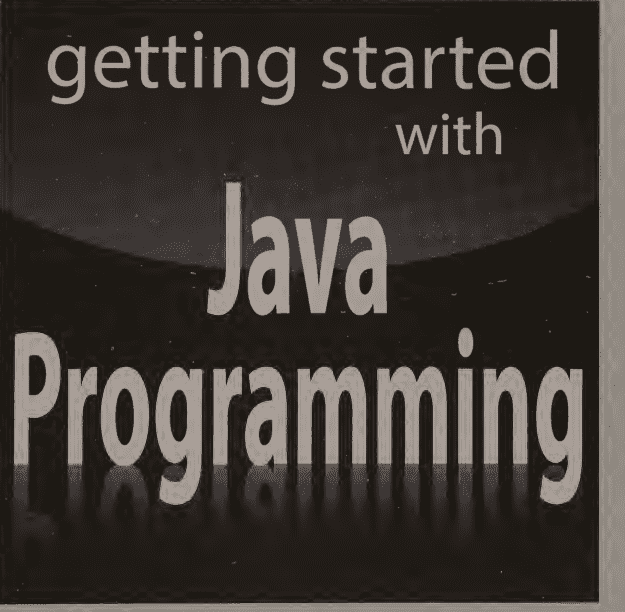

### 本部分内容

- 做好心理准备，成为一名Java开发者
- 安装软件
- 运行一些示例程序

## 第1章

## 开始

### 本章内容

- 了解计算机编程究竟是怎么回事
- 理解让你能够编写程序的软件
- 准备好使用集成开发环境

计算机编程？那是什么？它技术性强吗？会让人头疼吗？它政治正确吗？比尔·盖茨控制它吗？为什么会有人想做这件事？那我呢？我能学会吗？

## 这到底是怎么回事？

你可能用计算机做过文字处理。打一封信，打印出来，然后把打印稿寄给你爱的人。如果你能方便地使用计算机，那么你可能也上过网。访问一个页面，点击一个链接，再看到另一个页面。这很容易，对吧？

嗯，这很容易，只是因为有人准确地告诉了计算机该做什么。如果你把一台刚从工厂出来的计算机拿过来，不给它任何指令，这台计算机不能做文字处理，不能上网，什么也做不了。计算机能做的就是遵循人们给它的指令。

现在想象一下，你正在使用Microsoft Word写一部伟大的美国小说，你来到了一行的末尾。（你并不是在一个句子的末尾；只是到一行的末尾。）当你输入下一个单词时，计算机的光标自动跳到下一行。这是怎么回事？嗯，有人编写了一个计算机程序——一组告诉计算机该做什么的指令。程序（或程序的一部分）的另一个名称是代码。清单1-1显示了Microsoft Word的部分代码可能长什么样。


用于编写步骤的语言称为编程语言，而 Java 只是数千种有用的编程语言之一。清单 1-1 中的内容是用 Java 编程语言编写的。

## 选择你的毒药

本书并非关于编程语言之间的差异，但你应该看看其他语言中的代码，以便理解更大的整体。例如，还有另一种语言 Visual Basic，其代码看起来与用 Java 编写的代码有点不同。Visual Basic 程序的摘录可能看起来像这样：

```
If columnNumber > 60 Then
    Call wrapToNextLine
Else
    Call continueSameLine
End If
```

Visual Basic 代码看起来比清单 1-1 中的 Java 代码更像普通英语。但是，如果你认为 Visual Basic 就像英语，那么就看看用 COBOL 编写的代码吧：

```
IF COLUMN-NUMBER IS GREATER THAN 60 THEN
    PERFORM WRAP-TO-NEXT-LINE
ELSE
    PERFORM CONTINUE-SAME-LINE
END-IF.
```

在光谱的另一端，你会找到像 Haskell 这样的语言。下面是一个简短的 Haskell 程序，以及该程序的输入和输出：

```
median aList =
  [ x | x <- aList,
    length([y | y <- aList, y < x]) ==
    length([y | y <- aList, y > x])]
*Main> median [4,7,2,1,0,9,6]
[4]
```

计算机语言彼此之间可能非常不同，但在某些方面，它们都是一样的。当你习惯写 IF COLUMN-NUMBER IS GREATER THAN 60 时，你也可以习惯写 if (columnNumber > 60)。这只是将一组符号替换为另一组符号的心理转换。最终，像 if (columnNumber > 60) 这样的写法会变得自然。

## 从你的思维到计算机的处理器

当你创建一个新的计算机程序时，你会经历一个多步骤的过程。该过程涉及三个重要的工具：

- **编译器：** 编译器将你的代码翻译成计算机友好（人类不友好）的指令。
- **虚拟机：** 虚拟机逐步执行计算机友好的指令。
- **应用程序编程接口：** 应用程序编程接口包含有用的预写代码。

接下来三个部分描述了这三个工具。

### 翻译你的代码

你可能听说过计算机处理的是零和一。这当然是真的，但这意味着什么呢？好吧，首先，计算机电路并不直接处理字母表中的字母。当你在计算机屏幕上看到单词 Start 时，计算机在内部将其存储为 01010011 01110100 01100001 01110010 01110100。你看到一个友好外观的五字母单词所产生的感觉是你对计算机屏幕像素的解释，仅此而已。计算机将一切分解为非常低级、不友好的零和一序列，然后再将其重新组合起来，以便人类能够处理结果。

那么当你编写计算机程序时会发生什么呢？好吧，程序必须被翻译成零和一。翻译过程的官方名称是编译。没有编译，计算机就无法运行你的程序。

我编译了清单 1-1 中的代码。然后我做了一些无害的黑客操作，以便让我看到所得的零和一。我看到的是图 1-1 中的混乱。

图 1-1 中的编译后胡言乱语有许多不同的名称：

- 大多数 Java 程序员称之为字节码。
- 我经常称之为类文件。这是因为在 Java 中，字节码存储在名为 SomethingOrOther.class 的文件中。
- 为了强调区别，Java 程序员称清单 1-1 为源代码，并将图 1-1 中的零和一称为对象代码。

图 1-1：
我的计算机理解这些零和一，但我不理解。

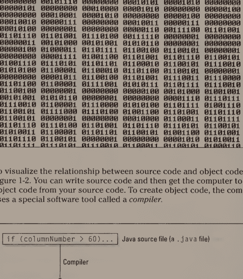

为了可视化源代码和对象代码之间的关系，请参阅图 1-2。你可以编写源代码，然后让计算机从你的源代码创建对象代码。要创建对象代码，计算机使用一种特殊的软件工具，称为编译器。

图 1-2：
计算机编译源代码以创建对象代码。

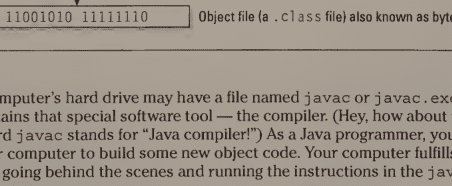


你的计算机硬盘上可能有一个名为 javac 或 javac.exe 的文件。该文件包含那个特殊的软件工具——编译器。（嘿，想想看？单词 javac 代表“Java compiler”）作为 Java 程序员，你经常告诉计算机构建一些新的对象代码。你的计算机通过在幕后运行 javac 文件中的指令来满足这个愿望。

### 运行代码

几年前，我在哥本哈根待了一周。我和一个朋友混在一起，她既流利地说丹麦语也流利地说英语。当我们在公共公园聊天时，我模糊地注意到一些孩子在我们周围盘旋。我不会说丹麦语的一个词，所以我假设孩子们在谈论普通的孩子话题。

### 什么是字节码，到底？

看看清单 1-1 以及该清单在图 1-1 中的字节码翻译。你可能会想，字节码文件只是一个密码——用零和一替换 if 和 else 等单词中的字母。但事实并非如此。事实上，字节码文件最重要的部分是对程序逻辑的编码。

图 1-1 中的零和一描述了数据从计算机的一个部分流向另一部分的流程。我在下面的图中说明了这种流程。但请记住，这张图只是一个说明。你的计算机不会查看这张特定的图，或类似的东西。相反，你的计算机读取一堆零和一来决定下一步做什么。

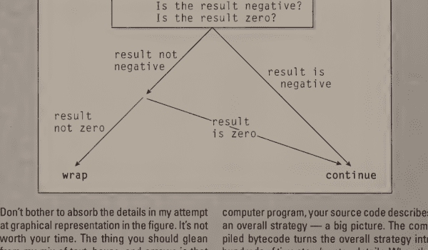

不要费心去吸收我试图在图中图形化表示的细节。这不值得你花时间。我从我对文本、框和箭头的混合中应该获得的东西是，字节码（.class 文件中的内容）包含计算机要执行的操作的完整描述。当你编写计算机程序时，你的源代码描述了一个整体策略——一个大局。编译后的字节码将整体策略转化为数百个微小、逐步的细节。当计算机“运行你的程序”时，计算机检查这个字节码并执行每一个小的逐步细节。

然后我的朋友告诉我孩子们并没有说丹麦语。“他们说的是什么语言？”我问道。

“他们在说胡话，”她说。“只是无意义的音节。他们不懂英语，所以他们在模仿你。”

现在回到当下。我看着图 1-1 中的内容，我很想嘲笑我计算机说话的方式。但那样我就和哥本哈根的孩子们一样了。对我来说毫无意义的东西对我的计算机来说可能完全有意义。当图 1-1 中的零和一流经我计算机的电路时，计算机“思考”图 1-3 所示的想法。

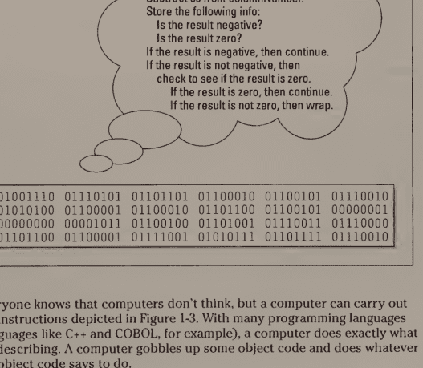

每个人都知道计算机不会思考，但计算机可以执行图 1-3 中描绘的指令。对于许多编程语言（例如 C++ 和 COBOL 等语言），计算机完全按照我描述的方式做。计算机吞下一些对象代码并做对象代码所说的事情。

这就是许多编程语言的工作方式，但在 Java 中并非如此。对于 Java，计算机执行另一组指令。计算机执行像图 1-4 中的指令。

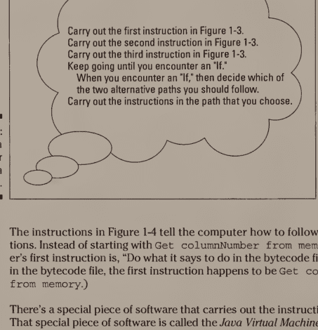

图 1-4 中的指令告诉计算机如何遵循其他指令。计算机的第一个指令不是从内存中获取 columnNumber，而是“做字节码文件中所说的事情”。（当然，在字节码文件中，第一个指令恰好是 Get columnNumber from memory。）

有一个特殊的软件执行图 1-4 中的指令。这个特殊的软件称为 Java 虚拟机（JVM）。JVM 引导你的计算机执行一些字节码指令。当你运行 Java 程序时，你的计算机实际上是在运行 JVM。该 JVM 检查你的字节码，逐个零、逐个一，并执行字节码中描述的指令。

许多好的隐喻可以描述 JVM。把 JVM 想象成代理、跑腿的人、中介。无论如何，你都有图 1-5 所示的情况。在（a）侧是大多数编程语言的故事——计算机运行一些对象代码。在（b）侧是 Java 的故事——计算机运行 JVM，而 JVM 遵循字节码的指令。


图 1-5：  
运行计算机程序的两种方式。

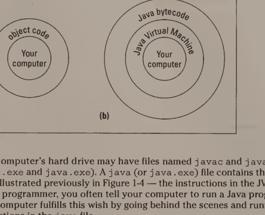


你的计算机硬盘上可能有一些名为 javac 和 java（或 javac.exe 和 java.exe）的文件。java（或 java.exe）文件包含前面图 1-4 中所示的指令——即 JVM 中的指令。作为 Java 程序员，你经常告诉你的计算机运行 Java 程序。你的计算机通过在后台运行 java 文件中的指令来实现这一愿望。

## 一次编写，到处运行

当 Java 在 1995 年首次登上科技舞台时，这门语言几乎立即流行起来。这部分归功于 JVM。JVM 就像一名外语翻译，将 Java 字节码转换成特定计算机所能理解的任何母语。因此，如果你把一个 Java 字节码文件交给我那台运行 Windows 的计算机，那么该计算机的 JVM 会为 Windows 环境解释该文件。如果你把同一个 Java 字节码文件交给我同事的 Macintosh，那么 Macintosh 的 JVM 会为该 Mac 环境解释相同的字节码。

再看图 1-5。如果没有虚拟机，你需要为每种操作系统提供一种不同的目标代码。但有了 JVM，一份字节码就可以在 Windows 机器、Unix 机器、Mac 或任何其他平台上运行。这被称为*可移植性*，而在计算机编程领域，可移植性是一种非常宝贵的财富。想想所有使用计算机浏览互联网的人。这些人并非都运行 Microsoft Windows，但每个人的计算机都可以有自己的字节码解释器——即自己的 JVM。

Oracle 的市场营销人员称之为*一次编写，到处运行*的计算模型。我称之为创建软件的绝佳方式。

## 可以复用的代码

在 20 世纪 80 年代早期，我的姻亲 Chris 在一家计算机软件公司工作。这家公司为文字处理机编写代码。（当时，如果你想不用打字机来撰写文档，你得买一台除了文字处理什么都不做的“计算机”。）Chris 抱怨说他被要求一遍又一遍地编写同样的老代码。“首先，我编写一个查找替换程序。然后我编写一个拼写检查器。接着我再编写一个查找替换程序。然后，一个不同种类的拼写检查器。再然后，一个更好的查找替换程序。”

Chris 是如何设法对自己的工作保持兴趣的？Chris 的雇主又是如何设法维持业务的？每隔几个月，Chris 就不得不重新发明轮子。抛弃旧的查找替换程序，从头编写一个新程序。这很低效。更糟糕的是，这很无聊。

多年来，计算机专业人士一直在寻找圣杯——一种让软件易于复用的编写方式。不要编写并重写你的查找替换代码。只需将任务分解成微小的部分。一个部分负责查找单个字符，另一个部分负责查找空格，第三个部分负责将一个字母替换为另一个字母。当你拥有所有部分后，只需将这些部分组装起来，形成一个查找替换程序。后来，当你想为文字处理软件添加新功能时，你可以用稍微不同的方式重新组装这些部分。这很合理，成本效益高，而且有趣得多。

20 世纪 80 年代末，软件开发取得了多项进展；到 20 世纪 90 年代初，许多大型编程项目都开始使用预制组件编写。Java 于 1995 年问世，因此该语言的创始人很自然地创建了一个可复用代码库。该库包含大约 250 个程序，包括处理磁盘文件的代码、创建窗口的代码以及通过互联网传递信息的代码。自 1995 年以来，这个库已经发展到包含 4000 多个程序。这个库被称为应用程序编程接口（API）。

每个 Java 程序，即使是最简单的程序，也会调用 Java API 中的代码。这个 Java API 既实用又强大。它实用，是因为你可以用 API 中的程序做各种各样的事情。它强大，是因为 API 内容非常丰富。没有人能记住 Java API 提供的所有功能。程序员会记住他们经常使用的功能，并在急需时查阅所需的功能。他们在一个名为 API 规范（大多数 Java 程序员亲切地称之为 API 文档或 Javadocs）的在线文档中查找这些功能。

API 文档（请参阅 http://docs.oracle.com/javase/8/docs/api/）描述了 Java API 中数以千计的功能。作为 Java 程序员，你每天都要查阅这份 API 文档。你可以将文档在 Oracle 网站上加入书签，并在需要查找内容时重新访问该网站；你也可以通过 www.oracle.com/technetwork/java/javase/downloads/index.html 上的链接下载自己的 API 文档副本，从而节省时间。

## 你的 Java 编程工具集

要编写 Java 程序，你需要本章前面描述的工具：

- 你需要一个 Java 编译器。（请参阅“翻译你的代码”一节。）
- 你需要一个 JVM。（请参阅“运行代码”一节。）
- 你需要 Java API。（请参阅“可以复用的代码”一节。）
- 你需要能够访问 Java API 文档。（再次请参阅“可以复用的代码”一节。）

你还需要一些不那么特别的工具：

- 你需要一个编辑器来编写你的 Java 程序。清单 1-1 包含计算机程序的一部分。归根结底，计算机程序就是一大堆文本。因此，要编写计算机程序，你需要一个编辑器——一种用于创建文本文档的工具。

  编辑器很像 Microsoft Word，或者像任何其他文字处理程序。最大的区别在于，编辑器不会为文本添加任何格式——没有粗体、斜体或字体之间的区别。计算机程序没有任何格式。它们只有普通的字母、数字和其他熟悉的键盘字符。

  当你编辑程序时，你可能会看到粗体文本、斜体文本和多种颜色的文本。但你的程序不包含任何此类格式。如果你看到看起来像格式的东西，那是因为你使用的编辑器具有语法高亮功能。通过语法高亮，编辑器让文本看起来像是被格式化，以帮助你理解程序的结构。相信我，语法高亮非常有用。

- 你需要一种发出命令的方式。你需要能够说“编译这个程序”和“运行 JVM”之类的话。每台计算机都提供了发出命令的方式。（你可以双击图标，或在“运行”对话框中输入冗长的命令。）但是当你使用计算机自带的功能时，你需要在不同窗口之间来回切换。你打开一个窗口阅读 Java 文档，另一个窗口编辑 Java 程序，第三个窗口启动 Java 编译器。这个过程可能非常繁琐。


在最理想的情况下，你可以通过一个美观的界面完成所有的程序编辑、文档阅读和命令发出。这个界面被称为集成开发环境（IDE）。

一个典型的 IDE 会将屏幕上的工作区划分为多个窗格——一个窗格用于编辑程序，另一个窗格用于列出程序名称，第三个窗格用于发出命令，还有其他窗格帮助你编写和测试程序。你可以安排窗格以便快速访问。更好的是，如果你更改一个窗格中的信息，IDE 会自动更新所有其他窗格中的信息。

IDE 帮助你毫无障碍地在编程工作的各个部分之间切换。使用 IDE，你不必担心编辑、编译和运行 JVM 的机制。相反，你可以专注于编写程序的逻辑。（你难道不知道吗？不管怎样，你总有需要担心的事情！）

## 你的硬盘上已经有什么？

你可能已经拥有创建 Java 程序所需的某些工具。但是，在较旧的计算机上，你的工具可能已经过时。本书中的大多数示例都可以在所有 Java 版本上运行。但有些示例不能在早于 Java 5.0 的版本上运行。其他示例只能在 Java 6、Java 7、Java 8 或更高版本上运行。

最稳妥的做法是从 java.com 或 Oracle 网站重新下载工具。有关下载的详细说明，请参阅第 2 章。

## Eclipse

本书中的程序适用于任何可以运行 Java 的 IDE。这包括 NetBeans、IntelliJ IDEA、JDeveloper、JCreator 等 IDE。你甚至可以在没有 IDE 的情况下运行这些程序。但是，为了说明本书中的示例，我使用了 Eclipse IDE。我选择 Eclipse 而非其他 IDE，原因如下：

- Eclipse 是免费的。
- 在所有 Java IDE 中，Eclipse 是专业程序员最常用的一种。
- Eclipse 有很多花哨的功能，但你可以忽略其中的大部分，学会重复几个常规的操作步骤。使用几次 Eclipse 之后，你的大脑会自动执行这些常规步骤。从此以后，你就可以不再为 Eclipse 操心，而专注于 Java 编程了。
- Eclipse 是免费的。（值得提两次。）


## 第 2 章：设置你的计算机

### 本章内容包括

- 安装 Java
- 下载并安装 Eclipse 集成开发环境
- 检查你的 Eclipse 配置
- 获取本书示例中的代码

本书告诉你如何编写 Java 程序，而在编写 Java 程序之前，你需要一些软件。至少，你需要我在第 1 章中描述的软件——一个 Java 编译器和一个 Java 虚拟机（简称 JVM）。你还可以使用一个优秀的集成开发环境（IDE）和一些示例代码来入门。

编写 Java 程序所需的全部软件都是免费的。这些软件分为三个下载来源——一个来自本书网站，另一个来自 Oracle，第三个来自 eclipse.org。


我在本章中描述的 Oracle 和 Eclipse 网站总在变化。你从这些网站下载的软件也在变化。类似“点击右上角的按钮”这样的具体说明很快就会过时（甚至产生误导）。因此，在本章中，我提供了长长的步骤列表，同时也描述了这些步骤背后的思路。请浏览每个建议的网站，寻找获取我所描述的软件的方法。当网站提供多个选项时，请查阅本章中的说明，以获取选择最佳选项的提示。如果你的电脑上的 Eclipse 窗口与本章图片中的窗口看起来不完全一样，请在电脑窗口中寻找我所描述的任何选项。如果经过所有这些尝试后仍然找不到你要找的内容，请查看本书网站（http://allmycode.com/BeginProg）或发送电子邮件至 BeginProg@allmycode.com。你也可以在 Facebook 上找到我（/allmycode）或在 Twitter 上找到我（@allmycode）。

### 如果你不喜欢阅读说明……

本章一开始，我先简要（但有用）地概述获取所需软件的步骤。如果你是安装软件的老手，而且你的电脑没有异常，这些步骤很可能就够用了。如果不是，你可以阅读接下来几节中的更详细说明。

下面是如何获取用于创建 Java 程序的软件：

1. 访问 http://allmycode.com/BeginProg 并下载一个包含本书所有程序示例的文件。

2. 访问 www.oracle.com/technetwork/java/javase/downloads，获取最新版本的 JDK。

   选择与你的操作系统（Windows、Macintosh 或其他）匹配的软件版本。如果你在 32 位软件和 64 位软件之间难以选择，32 位版本是更安全的选择。如果你在 JRE 和 JDK 之间难以选择，请选择 JDK。

如果你很赶时间（谁不是呢？），快速访问 http://java.com 可能会有所帮助。http://java.com 网站提供了一个无需麻烦、一键安装的 Java 安装程序。（只需点击一个大的 Java Download 按钮，你不可能错过它。）Java Download 按钮并非在所有电脑上都能工作。但如果它对你有效，就像挥动虚拟魔杖一样，你就完成这一步了。你可以绕过 oracle.com 网站的复杂性，直接进入第 3 步。


3. 访问 http://eclipse.org/downloads 并获取 Eclipse IDE。

   选择 Eclipse IDE for Java Developers。下载结果是一个压缩归档文件（对于 Windows，是 .zip 文件；对于其他操作系统，包括 Macintosh OS X，是 .tar.gz 文件）。

4. 解压所下载的 Eclipse 归档文件的内容。

   该归档文件包含一个名为 eclipse 的文件夹。将这个 eclipse 文件夹解压到电脑硬盘上一个方便的位置。例如，在我的 Windows 电脑上，我有一个 C:\eclipse 文件夹。在我的 Mac 上，我的 Applications 文件夹中有一个 eclipse 文件夹。

   在 Windows 中，Program Files 名称中的空格会导致一些 Java 软件混乱。我认为本书中的任何软件都不会出现这种问题，但我无法保证。因此，如果你愿意，可以将 Eclipse 解压到 C:\Program Files 或 C:\Program Files (x86) 文件夹。但请记住你的选择（以防以后遇到麻烦）。


5. 启动 Eclipse，并点击欢迎屏幕上的 Workbench 图标。

   最初，欢迎屏幕上的图标没有文本标签。但当你将鼠标悬停在图标上时，会出现一个工具提示。选择其工具提示标题为 Workbench 的图标。

6. 在 Eclipse 中，导入你在第 1 步中下载的代码。

有关这些内容的详细信息，请参阅接下来的几节。

### 那些讨厌的文件扩展名

Windows 文件资源管理器或 Finder 窗口中显示的文件名可能会产生误导。你可能浏览某个目录时看到名称 Mortgage。该文件的真实名称可能是 Mortgage.java、Mortgage.class、Mortgage.somethingElse 或者就是普通的 Mortgage。像 .zip、.java 和 .class 这样的文件名结尾称为文件扩展名。

糟糕的事实是，默认情况下，Windows 和 Mac 会隐藏许多文件扩展名。这个可恶的功能往往会令程序员困惑。因此，如果你不想被搞糊涂，请更改电脑的系统范围设置。具体方法如下：

- 在 Windows XP 中：选择“开始”→“控制面板”→“外观和主题”→“文件夹选项”。然后按照“在所有 Windows 版本中”这一条中的说明操作。
- 在 Windows 7 中：选择“开始”→“控制面板”→“外观和个性化”→“文件夹选项”。然后按照“在所有 Windows 版本中”这一条中的说明操作。
- 在 Windows 8 中：在“开始”屏幕上，按住 Windows 键的同时按 Q。

  在出现的搜索框中，输入“文件夹选项”，然后按 Enter。然后按照“在所有 Windows 版本中”这一条中的说明操作。

- 在所有 Windows 版本（XP 及更新版本）中：按照前面某一条中的说明操作。然后，在“文件夹选项”对话框中，单击“查看”选项卡。找到“隐藏已知文件类型的扩展名”选项。确保此复选框未被选中。
- 在 Mac OS X 中：在 Finder 应用程序的菜单中，选择“偏好设置”。在出现的对话框中，选择“高级”选项卡，并找到“显示所有文件扩展名”选项。确保此复选框已被选中。
- 在 Linux 中：Linux 发行版通常不会隐藏文件扩展名。所以，如果你使用 Linux，可能不必担心这个问题。但我并未检查所有 Linux 发行版。因此，如果你的文件命名为 Mortgage（而不是 Mortgage.java 或 Mortgage.class），请查看你的 Linux 发行版特有的文档。

### 获取本书的示例程序

要获取本书示例程序的副本，请访问 http://allmycode.com/BeginProg 并点击链接下载本书中的程序。将下载文件（BeginProgJavaDummies4.zip）保存到电脑的硬盘上。


在某些情况下，你点击下载链接，但浏览器不会提供保存文件的选项。如果遇到这种情况，请右键点击链接（或在 Mac 上按住 Control 键点击）。在出现的上下文菜单中，选择“目标另存为”、“链接另存为”、“下载链接文件为”或类似标签的菜单项。

大多数网络浏览器会将文件保存到电脑硬盘上的 Downloads（下载）目录中。但你的浏览器配置可能略有不同。无论如何，请记下包含下载的 BeginProgJavaDummies4.zip 文件的文件夹。

### 压缩归档文件

当你访问 http://allmycode.com/BeginProg 并下载本书的 Java 示例时，你下载的是一个名为 BeginProgJavaDummies4.zip 的文件。.zip 文件是一个单独的文件，它对许多较小的文件和文件夹进行编码。因此，例如，我的 BeginProgJavaDummies4.zip 文件编码了名为 06-01、06-02 等文件夹。06-02 文件夹包含一些子文件夹，这些子文件夹又包含文件。（名为 06-02 的文件夹包含清单 6-2 中的代码——即第 6 章中的第二个清单。）

.zip 文件是压缩归档文件的一个例子。压缩归档的其他例子包括 .tar.gz 文件、.rar 文件和 .cab 文件。解压文件意味着提取存储在大归档文件中的原始文件。（对于 .zip 文件，“解压”的另一个说法是“unzip”。）解压通常会重建归档文件中编码的文件夹结构。因此，在解压我的 BeginProgJavaDummies4.zip 文件后，你的硬盘上会有名为 06-01、06-02 的文件夹，其中包含名为 src 和 bin 的子文件夹，这些子文件夹又包含名为 SnitSoft.java、SnitSoft.class 等文件。

当你下载 BeginProgJavaDummies4.zip 时，你的浏览器可能会自动为你解压该文件。如果没有，你可以通过双击文件图标来查看 .zip 文件的内容。（实际上，双击文件图标后，你可以复制文件内容并执行一些其他文件操作。）无论如何，不用为解压我的 BeginProgJavaDummies4.zip 文件而担心。当你按照本章的说明操作时，你会将 BeginProgJavaDummies4.zip 文件的内容导入 Eclipse IDE。在幕后，Eclipse 的导入过程会解压 .zip 文件。


## 安装 Java

你可以访问 www.oracle.com/technetwork/java/javase/downloads 获取最新、最好的 Java 版本。查找最新版本的 JDK。选择适用于你计算机操作系统的版本。图 2-1 显示的是我在 Oracle 网站上点击“下载 JDK”按钮（大约在 2014 年 3 月）的情形。

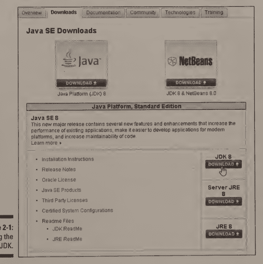

图 2-1：获取 Java JDK。

如果你无法确定最合适的 Java 版本，或者想知道 JRE 和 JDK 这两个缩写代表什么，请参阅标题为“点兵点将”的侧边栏。

在接受许可协议并点击 Java 安装文件的链接后，你的计算机会执行以下两种操作之一：

-   在系统上下载并安装 Java。
-   下载 Java 安装文件并将文件保存到计算机的硬盘上。

如果安装自动开始，请按照说明操作，对所有提示回答“是”，并（除非你有充分理由不这样做）接受默认设置。如果安装没有自动开始，请双击下载的安装文件来启动安装。

### 点兵点将

Java 标准版下载页面（www.oracle.com/technetwork/java/javase/downloads）有很多选项。如果你不熟悉这些选项，可能会觉得这个页面令人望而生畏。以下是页面上的一些选择：

### 字长：32 位还是 64 位

你可能需要在标有 32 位系统的链接和标有 64 位系统的链接之间做出选择。如果你不知道选哪个，请先尝试 32 位版本。（有关 32 位系统和 64 位系统的更多信息，请参阅“你的电脑是多少位的？”侧边栏。）

### Java 版本号

（J2SE 1.2）。是的，“Java 2”的编号与“1.x”的编号部分重叠。接下来是 1.3 和 1.4 版本。在 1.4.1 版本之后是 1.4.2 版本（中间还有 1.4.1_02 之类的版本）。在 1.4.2_06 之后，下一个版本是 1.5，也称为 5.0 版本。（这没有印刷错误。5.0 版本紧随 1.4 版本之后。）

### JDK 与 JRE

下载页面提供 JDK（Java 开发工具包）和 JRE（Java 运行时环境）之间的选择。JDK 下载包含的内容比 JRE 下载多。JRE 包括 Java 虚拟机（JVM）和应用程序编程接口（API）（参见第 1 章）。JDK 包含 JRE 中的所有内容，此外，JDK 还包含 Java 编译器（同样参见第 1 章）。

Eclipse IDE 包含自己的 Java 编译器。因此，你可以只下载较小的 JRE（避免下载庞大的 JDK）来应付。但我建议下载完整的 JDK。为什么？因为你永远不知道另一个编译器（独立于 Eclipse 的）什么时候会派上用场。此外，如果你没有安装完整的 JDK，在 Mac 上安装和配置 Eclipse 会很麻烦。所以，如果你想一路顺风，请下载 JDK 而不是 JRE。

顺便提一下，JDK 的另一个名称是 Java SDK——Java 软件开发工具包。有些人仍然使用 SDK 这个缩写，尽管 Oracle 的人已经不再使用它了。（实际上，最初的名字是 JDK。后来，Sun Microsystems 将其改为 SDK。几年之后，Java 的领导者们又改回 JDK 这个名字。这种不断的命名和改名让我作为作者感到很抓狂。）

### Java SE 与 Java EE 与 Java ME

当你在页面上浏览时，可能会注意到标有 Java EE 或 Java ME 的链接。如果你知道这些是什么，并且知道你需要它们，那么一定要下载这些好东西。但如果你不确定，就跳过 Java EE 和 Java ME 链接，直接点击 Java SE（Java 标准版）的链接。

缩写 Java EE 代表 Java 企业版（Java Enterprise Edition），Java ME 代表 Java 微型版（Java Micro Edition）。企业版具有面向大型企业的软件，微型版具有面向手持设备的软件。（谷歌的 Android 软件与 Java 微型版有几分相似，但在许多方面，Android 和 Java ME 是非常不同的东西。）

你不需要 Java EE 或 Java ME 来运行本书中的任何示例。

### 其他 Java 相关软件

你可以单独下载 Java，也可以下载带有 Oracle 的 NetBeans IDE 的 Java。你可以下载一组演示和示例。你甚至可以下载带薯条和软饮料的 Java。你可以下载很多额外的东西，但实际上，你只需要 Java JDK。

### 安装类型

系统可能会提示你在在线安装和离线安装之间进行选择。

使用离线安装时，你首先要下载一个大型安装文件。该文件会占用硬盘上的大量空间（取决于你选择的下载内容，大约 30MB 到 150MB）。如果你需要再次安装 JDK，你的电脑上已经有这个文件了。除非你想要更新版本的 JDK，否则你不需要再次下载 JDK。

为什么会有人想要第二次安装相同版本的 JDK？通常，我有两个原因。要么我想在另一台电脑上安装该软件，要么我把某些东西弄坏了，不得不卸载（然后重新安装）该软件。

使用在线安装时，你不必下载大型安装文件。相反，你下载一个很小的安装文件。然后，根据需要下载（并丢弃）30MB 到 150MB 的大文件中的各个部分。使用在线安装可以节省大量硬盘空间。但是，如果你想第二次安装相同版本的 JDK，你必须重新完成整个浏览/点击/下载过程。


如果你的电脑运行的是 Linux，下载的文件可能是一个 .tar.gz 文件。.tar.gz 文件是一种压缩归档文件。将归档内容解压到你选择的文件夹中，并按照 Oracle 网站上发布的安装说明进行操作。

有关文件名、文件类型和归档的更多信息，请参阅本章中标题为“那些烦人的文件扩展名”和“压缩归档文件”的侧边栏。


当你访问 www.oracle.com/technetwork/java/javase/downloads 时，你还可以下载一份 Java API 文档。查找标有 Java SE Development Kit Documentation（或类似内容）的下载。接受许可协议，点击下载链接，然后看着文件下载到你的电脑硬盘上。下载的文件是一个压缩的 .zip 归档，因此你可以像解压其他此类归档一样解压它。（解压后的文件夹包含一堆网页。要开始阅读 Java API 文档，请在该文件夹中查找 index.html 文件。双击该文件，你就可以开始了。）


有关 Java API 文档的介绍，请参阅第 1 章。

大多数人在访问 Oracle 网站 http://oracle.com/ 并使用网站的菜单安装 Java 时不会遇到困难。但如果你遇到的情况比多数人“有意思”，你可能需要做出一些决定并执行一些额外步骤。接下来的几节将描述其中一些“有意思”的场景。

### 你的电脑是多少位的？

在按照本章的说明操作时，系统可能会提示你在同一软件的两个版本之间进行选择——32 位版本和 64 位版本。有什么区别，你为什么要在意？

位（bit）是你能在计算机上存储的最小信息单位。大多数人认为一个位不是 0 就是 1，这种对“位”的描述非常有用。为了表示几乎任何数字，你需要将几个位排列在一起，并利用 2 的幂做一些巧妙的事情。这个编号系统的细节并不是什么大问题。要记住的重要一点是，计算机内部的每个电路部件存储相同数量的位。（当然，计算机内部有些电路是特殊情况，有自己特定的位数，但这没什么大不了的。）

在较旧的计算机中，每个电路部件存储 32 位。在较新的计算机中，每个电路部件存储 64 位。这个位数（32 或 64）就是计算机的字长。在较新的计算机中，一个字长 64 位。

“太棒了！”你说，“我上周才买了电脑。它一定是一台 64 位计算机。”嗯，事情可能没那么简单。除了计算机电路的字长之外，计算机上的操作系统也有字长。操作系统的指令处理特定数量的位。具有 32 位指令的操作系统可以在 32 位或 64 位计算机上运行，但具有 64 位指令的操作系统只能在 64 位计算机上运行。更复杂的是，你运行的每个程序（如网页浏览器、文字


处理器，或你自己的 Java 程序之一）要么是 32 位程序，要么是 64 位程序。你可以在运行在 64 位计算机上的 64 位操作系统上运行 32 位网页浏览器。或者，你可以在 64 位计算机上的 32 位操作系统上运行 32 位浏览器。（参见随本文附带的图。）

- 如果你运行的是 32 位操作系统，你只能运行 32 位软件。
- 如果你运行的是 64 位操作系统，你可能同时运行一些 32 位软件和一些 64 位软件。大多数 32 位软件在 64 位操作系统上运行良好。

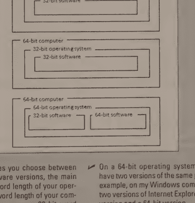

当网站让你在 32 位和 64 位软件版本之间选择时，主要考虑的是操作系统的字长，而不是计算机电路的字长。你可以在 64 位操作系统上运行 32 位文字处理器，但你不能在 32 位操作系统上运行 64 位文字处理器（无论计算机电路的字长如何）。选择 64 位软件有一个很大的优势——也就是说，64 位软件可以访问计算机超过三千兆字节的快速随机访问内存。在我的经验中，更多的内存意味着更快的处理速度。

所有这些关于字长的内容如何影响你的 Java 和 Eclipse 下载？以下是情况：

- 在 64 位操作系统上，你可能有同一程序的两个版本。例如，在我的 Windows 计算机上，我有两个版本的 Internet Explorer——一个 32 位版本和一个 64 位版本。
- 通常，Windows 将 32 位程序放在其 Program Files (x86) 目录中，并将 64 位程序放在其 Program Files 目录中。
- 字长链条的强度取决于其最弱的环节。例如，当我访问 http://java.com 并点击该网站的 Do I Have Java? 链接时，我得到的答案取决于我的计算机 Java 版本与我正在运行的网页浏览器之间的匹配程度。在我的计算机上仅安装了 64 位 Java 时，我的 32 位 Firefox 浏览器中的 Do I Have Java? 链接回答 未在你的系统上检测到可用的 Java。 但在我的 64 位 Internet Explorer 中，同一个链接回答 你已安装了推荐的 Java。 在 Mac 上，Safari 和 Firefox 是 64 位浏览器，但 Chrome 是 32 位浏览器。因此，在 Mac 上，使用 Firefox 与 Chrome 时，你可能会看到略有不同的行为。关于字长最重要的是要记住：当你按照本章的说明操作时，你会在计算机上获得 Java 软件和 Eclipse 软件。你的 Java 软件的字长必须与你的 Eclipse 软件的字长匹配。换句话说，32 位 Eclipse 与 32 位 Java 一起运行，64 位 Eclipse 与 64 位 Java 一起运行。我没有尝试所有可能的组合，但在我尝试用 64 位 Java 运行 32 位 Eclipse 时，我看到一个误导性的 未找到 Java 虚拟机 错误信息。最后，一些网站对其软件下载使用不直观的名称。如果你在下载名称中看到 i386 或 i586，这通常意味着 32 位。如果你在下载名称中看到 x86 而名称中任何地方都没有数字 64，这也意味着 32 位。如果名称中出现 64（有或没有 x86 标识），则表示 64 位程序。

## 在计算机上查找 Java

第 1 章描述了 Java 生态系统及其编译器、虚拟机和其他部分。你的计算机可能已经拥有其中一些 Java 小工具。如果是这样，你可以继续使用现有内容，也可以将最新版本的 Java 添加到系统已有的内容中。


Java 的版本不像室内猫。它们可以在同一台计算机上共存，而不会争斗或互相嘶叫。如果你有多个版本的 Java 在计算机上，这是可以的。你甚至可以在同一台计算机上混合 32 位版本和 64 位版本（只要你至少有一个 Java 版本的字长与你的 Eclipse 版本匹配）。我的 Windows 8 计算机上有三个版本的 Java，我从未遇到过麻烦。（偶尔，我会因把一个 Java 版本弄混成另一个版本而自找麻烦。但本章的“在 Eclipse 中配置 Java”部分帮助我理清了问题。没有这本书在我身边，我该怎么办？）

要了解你已经拥有什么并可能避免重新安装 Java，请继续阅读。

### 在 Windows 8 上

在开始屏幕中，按住 Windows 键同时按下 Q。在 resulting 搜索框中，输入 Programs and Features 然后按 Enter。然后继续执行“所有版本的 Windows（XP 及更新版本）”段落中的操作。

### 在 Windows 7 上

选择 开始→控制面板→程序→程序和功能。然后按照“所有版本的 Windows（XP 及更新版本）”段落中的说明操作。

### 在 Windows XP 上

选择 开始→控制面板→添加或删除程序。然后按照“所有版本的 Windows（XP 及更新版本）”段落中的说明操作。

### 在所有版本的 Windows（XP 及更新版本）上

在已安装程序列表中查找 Java（参见图 2-2）。如果看到 Java 8 或更高版本，你就没问题。如果看到的唯一 Java 版本号低于 8（例如 1.4.2、5.0 或 6），你的计算机可以运行本书中的一些（但不是全部）程序。

图 2-2：
Windows 8 上的“程序和功能”对话框。

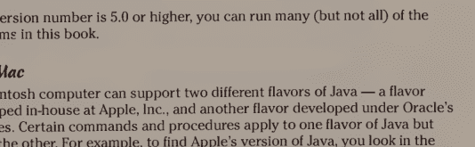

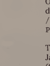

如果版本号为 5.0 或更高，你可以运行本书中的许多（但不是全部）程序。

### 在 Mac 上

Macintosh 计算机可以支持两种不同风格的 Java——一种是在 Apple Inc. 内部开发的风格，另一种是在 Oracle  auspices 下开发的风格。某些命令和程序适用于其中一种 Java 风格而不适用于另一种。例如，要查找 Apple 的 Java 版本，你在 /System/Library/Java/Java Virtual Machines 目录中查找。但要查找 Oracle 的 Java，你在 /Library/Java/JavaVirtualMachines 目录中查找。（一条路径以 /System/Library 开头；另一条路径以 /Library 开头。）你也可能在 /Library/Internet Plug-Ins/JavaAppletPlugin.plugin/Contents/Home 目录中找到 Oracle 的 Java。

Tiger、Leopard 和 Snow Leopard（OS X 10.4、OS X 10.5 和 OS X 10.6）预装了 Java。Lion、Mountain Lion 或 Mavericks（OS X 10.7、OS X 10.8 或 OS X 10.9）上未预装 Java。在 Lion、Mountain Lion 或 Mavericks 上，系统会在你第一次启动需要 Java 的应用程序时提示你安装 Apple 的 Java 或 Oracle 的 Java。（例如，本章后面你会安装 Eclipse。当你第一次尝试启动 Eclipse 时，如果尚未安装 Java，你的计算机会建议你进行安装。）

表 2-1 描述了 Mac OS 与 Java 版本之间的对应关系。

**表 2-1 Mac OS X 版本和 Java 版本**

| 如果你有这个 Mac OS X 版本... | 那么你有这个 Java 版本... | 你可以安装这个 Java 版本 |
|---|---|---|
| OS X 10.4.11 (Tiger) | 苹果的 Java 5.0 | 苹果的 Java 5.0 |
| OS X 10.5.8 (Leopard) PowerPC 和/或 32 位 | 苹果的 Java 5.0 | 苹果的 Java 5.0 |
| OS X 10.5.8 (Leopard) 基于 Intel 且 64 位 | 苹果的 Java 6 | 苹果的 Java 6 |
| OS X 10.6.8 (Snow Leopard) | 苹果的 Java 6 | 苹果的 Java 6 |
| OS X 10.7.5 (Lion) | （无 Java） | 苹果的 Java 6 |
|  |  | Oracle 的 Java 8 |
| OS X 10.8.5 (Mountain Lion) | （无 Java） | 苹果的 Java 6 |
|  |  | Oracle 的 Java 8 |
| OS X 10.9 (Mavericks) | （无 Java） | 苹果的 Java 6 |
|  |  | Oracle 的 Java 8 |

要了解你运行的是哪个版本的 OS X，请执行以下操作：

- 1. 选择 Apple→关于本机。
- 2. 在出现的“关于本机”对话框中，查找“版本”一词。

你会看到 Version 10.9.2（或类似内容）以非常浅灰色的文字显示。


表 2.1 中的信息适用于更新版本的 Mac OS X。如果你不定期应用软件更新，你可能运行的是 OS X 10.8.1 而不是 10.8.5。如果是这样，请在 Apple 菜单中选择“软件更新”并按照随后的提示操作。


在网上这里那里，我看到一些帖子描述了在 OS X 10.3 上安装 Java 5.0 的方法以及规避表 2-1 中限制的其他方法。但如果你不喜欢折腾，这些变通方法不适合你。（对于每项硬件或软件要求，总有人会尝试创建变通方法或黑客手段。无论如何，请自行承担使用黑客手段的风险。）


如果你不相信表2-1（坦白说，你不应该相信书中看到的一切），你可以在自己的计算机上进行测试，以发现Java是否存在，以及（如果你的Mac装有Java）Java的版本号。下面是一个适用于较旧版本Macintosh操作系统的测试：

- 1. 在Spotlight的搜索框中，输入“Java Preferences”。
- 2. 当Spotlight的“Top Hit”是Java Preferences时，按Enter键。

Java Preferences窗口随即出现（参见图2-3）。

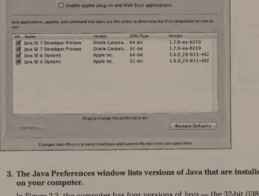

图2-3：
Java Preferences应用程序。

3. Java Preferences窗口会列出你计算机上安装的Java版本。

如图2-3所示，该计算机有四个Java版本——32位（i386）版本的Java 6和Java 7，以及64位（x86_64）版本的Java 6和Java 7。

对于较新版本的Macintosh操作系统，请尝试以下测试：

- 1. 在Apple菜单中，选择“系统偏好设置”。
- 2. 在“系统偏好设置”应用程序窗口中，查找Java图标（参见图2-4）。
- 3. 点击Java图标。

Java控制面板随即出现（参见图2-5）。

图2-4：
系统偏好设置应用程序中的Java图标。

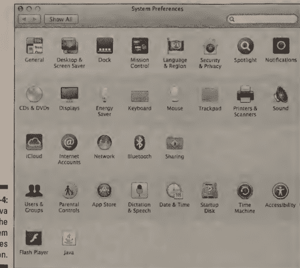

图2-5：
Java控制面板。

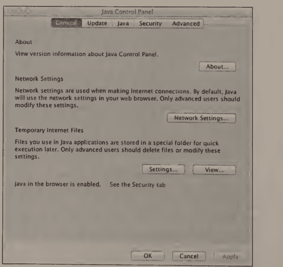

4. 在Java控制面板中，选择Java标签页（参见图2-6）。

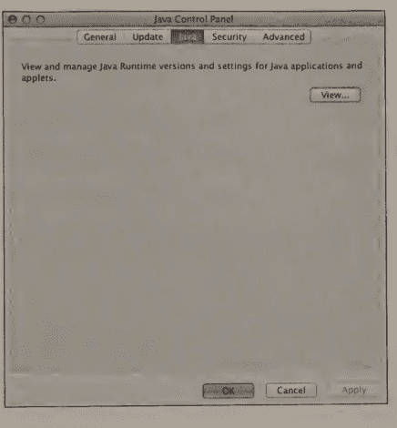

图2-6：
Java控制面板中的Java标签页。

5. 在Java标签页中，点击“查看”。

Java运行时环境设置窗口随即出现（参见图2-7）。

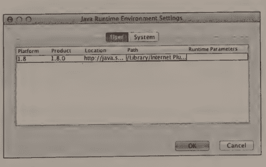

图2-7：
Java运行时环境设置窗口中的“用户”标签页。

根据Eclipse基金会的网站，*Eclipse*是“一个通用工具平台——一种开放、可扩展的IDE，可用于任何事物，也并非专门针对某一特定事物。”实际上，Eclipse确实用途广泛。程序员通常将Eclipse视为开发Java程序的IDE，但Eclipse还提供了使用C++、PHP和许多其他语言进行编程的工具。我甚至见过与程序开发毫无关系的Eclipse版本。（其中一款产品是*Lively Browser*——一种Web浏览器，其标签页由Eclipse组件构建而成。）

## 下载Eclipse

以下是下载Eclipse的方法：


- 1. 访问www.eclipse.org。
- 2. 寻找适合你操作系统的Eclipse下载方式。
  今天，我访问www.eclipse.org，看到一个醒目的按钮，上面写着“Get Started Now... Download Eclipse”（参见图2-8）。明天，谁知道这个不断变化的网站会是什么样子！
  点击“Download Eclipse”按钮后，我会看到针对我计算机操作系统的下载列表（参见图2-9）。
  Eclipse的下载页面会引导你选择特定于你计算机操作系统的Eclipse版本。例如，如果你在Windows计算机上访问该页面，页面只会显示适用于Windows的下载。如果你下载Eclipse是为了在另一台计算机上使用，你可能希望覆盖自动选择的操作系统。查找一个包含你计算机操作系统名称的小型下拉列表。你可以在该下拉列表中更改所选操作系统。
- 3. 从可用包中选择一个Eclipse发行版。
  无论使用何种操作系统，Eclipse都有多种形态、大小和颜色。Eclipse网站提供了Eclipse IDE for Java Developers、Eclipse IDE for Java EE Developers、Eclipse Classic以及许多其他专门下载（参见图2-9）。我通常选择Eclipse IDE for Java Developers，我推荐你也这样做。

图2-8：
eclipse.org的主页。


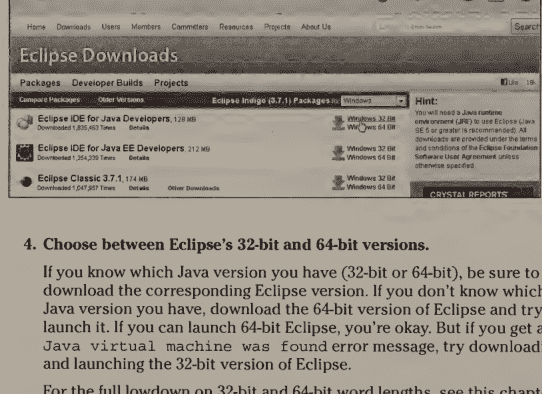

图2-9：
Eclipse.org列出了适用于Windows的下载。

4. 在Eclipse的32位和64位版本之间进行选择。

如果你知道自己所装的Java版本是32位还是64位，请务必下载对应的Eclipse版本。如果你不知道自己的Java版本，请下载64位版本的Eclipse并尝试启动它。如果你能启动64位Eclipse，那就没问题。但如果出现“No Java virtual machine was found”（未找到Java虚拟机）错误消息，请尝试下载并启动32位版本的Eclipse。

有关32位和64位字长的完整详细信息，请参阅本章的“你的计算机有多少位？”侧边栏。

5. 按照相关链接开始下载。

你点击的链接取决于Eclipse众多镜像站点中哪个为你的下载提供服务。只需在这些选项中找出可行路径，并开始下载。

## 安装Eclipse

安装Eclipse的具体方式取决于你的操作系统以及下载Eclipse时获得的文件类型。以下是一个简要总结：

- 如果你运行Windows且下载的是.exe文件：
  双击.exe文件的图标。
- 如果你运行Windows且下载的是.zip文件：
  将文件内容解压到你所选的目录。

换句话说，在Windows资源管理器（也称为文件资源管理器）中找到.zip文件的图标，然后双击.zip文件的图标。（结果，资源管理器会显示.zip文件的内容，其中只有一个文件夹——名为eclipse的文件夹。）将eclipse文件夹拖到你计算机硬盘上方便的位置。

有关.zip文件的更多信息，请参阅本章的“压缩归档文件”侧边栏。

我最喜欢将eclipse文件夹直接拖到C:驱动器上。因此，我的C:驱动器上有Program Files、Windows、eclipse等文件夹。我避免将eclipse文件夹作为Program Files的子文件夹，因为有时在处理Program Files名称中的空格时遇到过问题。

### 如果你运行Mac OS X：

下载Eclipse时，你会获得.tar.gz文件或.dmg文件。

- .tar.gz文件是一种压缩归档文件。下载该文件时，你的Web浏览器可能会自动为你进行一些解压缩。如果是这样，你不会在下载文件夹中找到.tar.gz文件。相反，你会找到一个.tar文件（因为你的Web浏览器解压了.gz部分）或一个eclipse文件夹（因为你的Web浏览器同时解压了.tar和.gz部分）。

  如果你在下载文件夹中发现了新的.tar文件或.tar.gz文件，请双击该文件，直到看到eclipse文件夹。将这个新的eclipse文件夹拖到你的应用程序文件夹中，就大功告成了。
- 如果你下载的是.dmg文件，你的Web浏览器可能会为你打开该文件。如果没有，请在下载文件夹中找到.dmg文件并双击。按照双击后出现的任何说明操作。如果需要你将Eclipse拖入应用程序文件夹，请照做。

### 如果你运行Linux：

你可能会获得.tar.gz文件，但也有可能获得自解压的.bin文件。将.tar.gz文件解压到你喜欢的目录，或执行自解压的.bin文件。

## 首次运行Eclipse

你第一次启动Eclipse时，需要执行几个额外的步骤。要让Eclipse运行起来，请执行以下操作：

- 1. 启动Eclipse。

  在Windows中，“开始”菜单可能没有Eclipse图标。在这种情况下，请在Windows资源管理器（又称文件资源管理器）中查找包含你解压后Eclipse文件的文件夹。双击代表eclipse.exe文件的图标。（如果你看到的是eclipse文件而不是eclipse.exe文件，请查阅本章的“那些讨厌的文件扩展名”侧边栏。）


在Mac上，前往Spotlight，在搜索框中输入Eclipse。当Eclipse在Spotlight列表中成为“Top Hit”时，按Enter键。

第一次尝试在Mac上运行Eclipse时，你可能会看到一条消息，提示Eclipse不是来自App Store，也不是来自已识别的开发者。这个世界上没有什么是100%安全的，但我下载并安装Eclipse的次数数不胜数，从未遇到过问题。因此，要绕过这个障碍，请在应用程序文件夹（或你安装Eclipse的任何其他位置）中找到Eclipse应用条目。按住Control键点击该应用条目，并在出现的上下文菜单中选择“打开”。此时会出现一个对话框。对话框询问你是否确定要打开该应用程序。你当然确定，因此点击“打开”。

启动Eclipse时，你会看到“Workspace Launcher”对话框（参见图2-10）。该对话框询问你希望在计算机硬盘上的哪个位置存储使用Eclipse创建的代码。

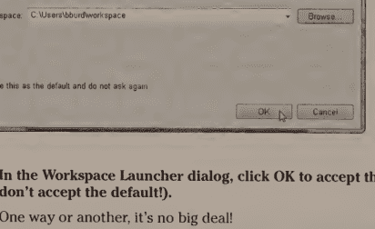

图2-10：Eclipse的Workspace Launcher。

- 2. 在“Workspace Launcher”对话框中，点击“确定”接受默认设置（或者不接受默认设置！）。

无论如何，这都不是什么大问题！

因为这是你第一次使用某个特定的Eclipse工作区，Eclipse会以欢迎屏幕开始（参见图2-11）。一直以来，大多数Eclipse欢迎屏幕都显示图标，但几乎没有或没有有用的文本。

- 3. 将鼠标悬停在Eclipse欢迎屏幕的图标上，直到找到一个工具提示中包含“Workbench”字样的图标。

- 4. 点击“Workbench”图标以打开Eclipse的主屏幕。

使用全新工作区打开Eclipse后，主屏幕的视图如图2-12所示。


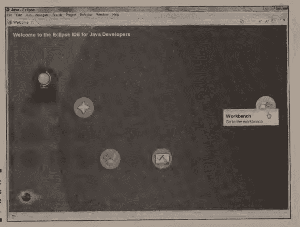

图 2-11：Eclipse 的欢迎屏幕。

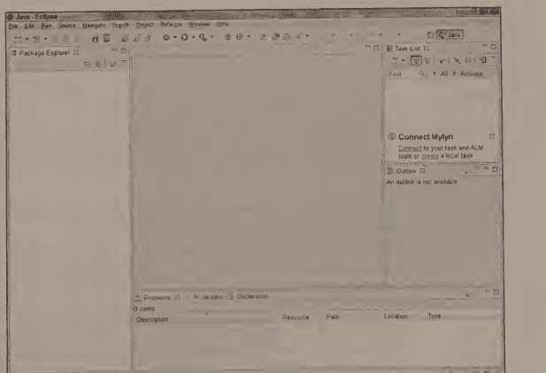

图 2-12：带有全新工作区的 Eclipse 工作台。

## 在 Eclipse 中配置 Java

Eclipse 通常会在你的电脑上查找 Java 安装，并选择一个已安装的 Java 版本来运行你的 Java 程序。你的电脑可能安装了多个 Java 版本，因此你可能想要再次确认 Eclipse 选择的 Java 版本。以下步骤将向你展示如何操作：

- 1. 在 Windows 或 Linux 上：在 Eclipse 的主菜单中，选择 Window→ Preferences。在 Mac 上：在 Eclipse 的主菜单中，选择 Eclipse→ Preferences。

   结果，Eclipse 的首选项对话框会出现。（你可以对照图 2-13。）

   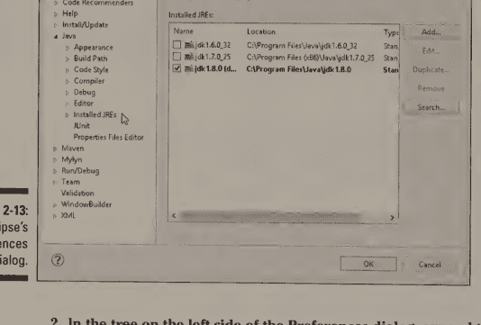

   图 2-13 Eclipse 的首选项对话框。

- 2. 在首选项对话框左侧的树中，展开 Java 分支。
- 3. 在 Java 分支中，选择 Installed JREs 子分支。
- 4. 查看首选项对话框主区域中的 Java 版本列表（Installed JREs）。

   在列表中，每个 Java 版本都有一个复选框。Eclipse 使用已勾选的版本。如果已勾选的版本不是你偏好的版本（例如，已勾选的版本不是 8 或更高版本），你可以进行一些更改。

- 5. 如果你偏好的 Java 版本出现在 Installed JREs 列表中，就在该版本的复选框中打上勾。

- 6. 如果你偏好的 Java 版本没有出现在 Installed JREs 列表中，点击 Add 按钮。

   点击 Add 按钮后，会出现一个 JRE Type 对话框（见图 2-14）。

   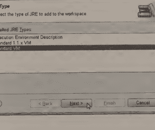

   图 2-14：JRE Type 对话框。

- 7. 在 JRE Type 对话框中，双击 Standard VM。

   结果，会出现一个 JRE Definition 对话框（见图 2-15）。接下来你要做什么取决于一些不同的因素。

- 8. 填写对话框的 JRE Home 字段。

   你如何操作取决于你的操作系统。

   - 在 Windows 上，浏览到你安装偏好 Java 版本的目录。在我的许多 Windows 电脑上，该目录要么是 `C:\Program Files\Java\jre8`，要么是 `C:\Program Files\Java\jdk1.8.0`，要么是 `C:\Program Files (x86)\Java\jre8`，或类似路径。
   - 在 Mac 上，使用 Finder 浏览到你安装偏好 Java 版本的目录。在对话框的 JRE Home 字段中输入该目录的名称。我的 Mac 上有一个名为 `/System/Library/Java/Java Virtual Machines/1.6.0.jdk/Contents/Home` 的 Java 目录，另一个名为 `/Library/Java/JavaVirtualMachines/jdk_1.8.0.jdk/Contents/Home` 的 Java 目录。（前者是 Apple 旧版 Java；后者是 Oracle 新版 Java。）你也可能在 `/Library/Internet Plug-Ins/JavaAppletPlugin.plugin/Contents/Home` 目录中找到 Oracle 的 Java。

   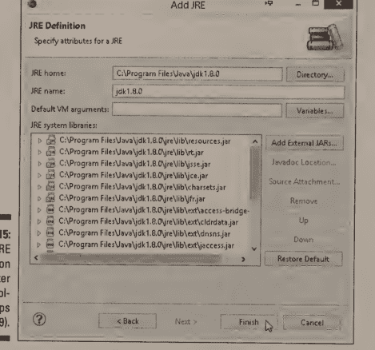

   图 2-15：在完成步骤 8 和 9 后，JRE Definition 对话框。

   

   

   类似 /System 和 /Library 的目录通常不会出现在 Finder 窗口中。要浏览其中一个目录（例如 /Library 目录），在 Finder 的菜单栏中选择 Go→Go to Folder。在弹出的对话框中，输入 /Library 然后按 Go。

   当你导航到包含偏好 Java 版本的目录时，你可能会遇到 JDK 1.8.0.jdk 图标或其他扩展名为 .jdk 的项目。要查看此项目的內容，请 control-click 该项目的图标，然后选择 Show Package Contents。

   - 在 Linux 上，浏览到你安装偏好 Java 版本的目录。如有疑问，搜索名称以 jre 或 jdk 开头的目录。

   在 JRE Definition 对话框中你可能还需做一件事。

- 9. 查看 JRE Definition 对话框的 JRE Name 字段；如果 Eclipse 没有自动填写名称，请在 JRE Name 字段中输入一个名称（几乎任何文本）。

- 10. 通过点击 Finish 关闭 JRE Definition 对话框。

   Eclipse 的首选项对话框重新回到前台。Installed JREs 列表中包含你新添加的 Java 版本。

- 11. 在你新添加的 Java 版本旁边的复选框中打上勾。

   你几乎完成了。（还有几个步骤需要跟进。）

- 12. 在首选项对话框左侧的 Java 分支中，选择 Compiler 子分支。

   在首选项对话框的主区域中，你会看到一个 Compiler Compliance Level 下拉列表（见图 2-16）。

   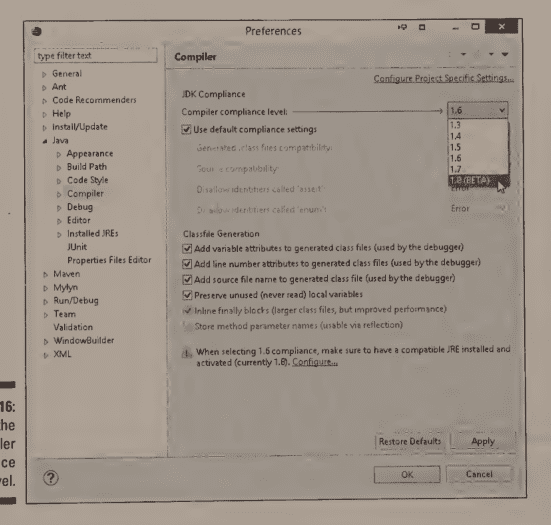

   图 2-16：设置编译器兼容级别。

- 13. 在 Compiler Compliance Level 下拉列表中，选择一个与你偏好的 Java 版本相匹配的数字。

   对于 Java 7，我选择兼容级别 1.7。对于 Java 8，我选择兼容级别 1.8。

- 14. 呼！点击首选项对话框的 OK 按钮返回到 Eclipse 工作台。

## 导入本书的示例程序

导入这件事可能有点棘手。随着你从一个对话框移动到下一个对话框，许多选项的名称相似。这是因为 Eclipse 提供了多种导入多种不同类型事物的方式。无论如何，如果你按照这些说明操作，就会没问题。

- 1. 按照本章前面“获取本书示例程序”部分中的步骤操作。
- 2. 在 Eclipse 的主菜单中，选择 File→Import（见图 2-17）。

   结果，Eclipse 显示一个 Import 对话框。

   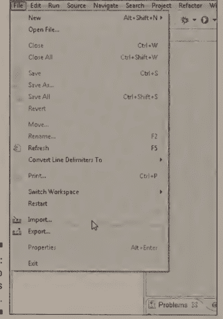

   图 2-17：开始导入本书的代码。

- 3. 在 Import 对话框的树中，展开 General 分支。
- 4. 在 General 分支中，双击 Existing Projects into Workspace 子分支（见图 2-18）。

   结果，会出现一个 Import Projects 对话框。

   图 2-18：在所有选项中，选择 Existing Projects into Workspace。

   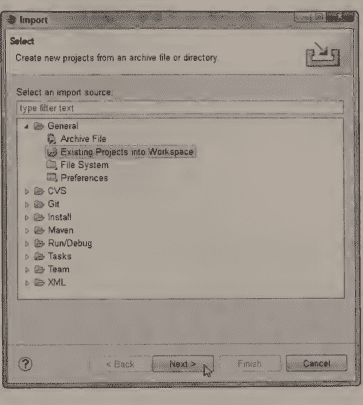

- 5. 在 Import Projects 对话框中，选择 Select Root Directory 单选按钮或 Select Archive File 单选按钮（见图 2-19）。

   你如何决定选择哪个单选框如下：

   首先，确保你注意到了我在题为“那些讨厌的文件名扩展名”的侧边栏中给出的建议。然后查看从本书网站下载的文件所在的文件夹。

   - 如果你的网页浏览器不会自动解压缩下载的 .zip 文件，你会发现本书的代码在一个名为 `BeginProgJavaDummies4.zip` 的归档文件中。在这种情况下，选择 Select Archive File 单选按钮。
   - 如果你的网页浏览器会自动解压缩下载的 .zip 文件，你会发现本书的代码在一个名为 `BeginProgJavaDummies4` 的目录（文件夹）中。在这种情况下，选择 Select Root Directory 单选按钮。

   为了确保你能区分文件夹和 .zip 文件，请查看本章的“那些讨厌的文件名扩展名”侧边栏。

   有关 .zip 文件和其他归档文件的完整信息，请参阅题为“压缩归档文件”的侧边栏。

- 6. 点击 Browse 按钮在你的电脑硬盘上找到 BeginProgJavaDummies4.zip 文件或 BeginProgJavaDummies4 目录。

   找到文件或目录后，Eclipse 的 Import Projects 对话框会显示文件内部的项目名称。（再次参考图 2-19。）

   

   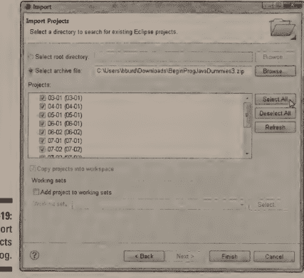

   图 2-19：Import Projects 对话框。

- 7. 点击 Select All 按钮。

   本书的示例如此令人兴奋，你想全部导入！

- 8. 点击 Finish 按钮。

   结果，主 Eclipse 工作台重新出现。工作台左侧显示本书的 Java 项目名称（见图 2-20）。

   现在真正的乐趣开始了。

   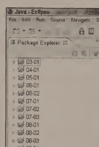

   图 2-20：Eclipse 显示了一堆 Java 项目。


## 下一步？

如果你正在阅读这一段，你可能已经按照本章中的一些说明操作了——这些说明用于在你的计算机上安装 Java 和 Eclipse IDE。那么迫切的问题是：你是否正确完成了安装？ 这个问题的答案在第 3 章，因为在该章中，你将使用这些工具来运行一个全新的 Java 程序。

## 第 3 章
## 运行程序

### 本章内容

- 编译并运行程序
- 使用工作区
- 编辑自己的 Java 代码

如果你是编程新手，对你来说，运行程序可能意味着点击鼠标。你想运行 Internet Explorer，于是你双击 Internet Explorer 图标。就这么简单。

当你创建自己的程序时，情况就有点不同了。对于一个新程序，程序员（或程序员公司的人）会创建程序的图标。在此之前，一个完全正常的程序可能根本没有图标。那么你该如何处理一个全新的 Java 程序呢？如何让程序运行？本章会告诉你需要知道的内容。

### 运行现成的 Java 程序

了解 Java 的最好方法就是实践 Java。当你在实践 Java 时，你就是在编写、测试和运行自己的 Java 程序。本节通过描述如何运行和测试程序来为你做准备。不要自己编写程序，而是运行我已经为你写好的程序。该程序计算你房屋抵押贷款的月付款额。

抵押贷款计算程序不会打开自己的窗口。相反，程序在 Eclipse 的 Console 视图中运行。Console 视图是 Eclipse 工作台右下部分的一个标签页（见图 3-1）。完全在此 Console 视图中运行的程序称为基于文本的程序。

图 3-1：本章基于文本的抵押贷款程序的运行。

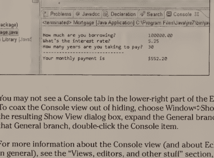


你可能在 Eclipse 工作台的右下部分看不到 Console 标签。要让 Console 视图显示出来，请选择 Window→Show View→Other。在出现的 Show View 对话框中，展开 General 分支。最后，在该 General 分支中，双击 Console 项目。

有关 Console 视图（以及 Eclipse 工作台的总体情况）的更多信息，请参阅本章后面的“Views, editors, and other stuff”部分。


你可以通过访问本书网站（allmycode.com/BeginProg）查看图 3-1 中程序的 GUI 版本，以及本书中许多其他示例的 GUI 版本。

实际上，当你运行抵押贷款程序时，你会在 Eclipse 的 Console 视图中看到两件事：

> 抵押贷款程序发送给你的消息和结果：消息包括诸如 How much are you borrowing? 之类的内容。结果包括诸如 Your monthly payment is $552.20 之类的行。

> 你在程序运行时给抵押贷款程序的响应：如果你在回答程序关于你借款金额的问题时输入 100000.00，你会看到该数字在 Eclipse 的 Console 视图中回显。

以下是运行抵押贷款程序的方法：

1. 确保你已按照第 2 章中的说明操作——安装 Java、安装和配置 Eclipse 以及获取本书示例程序的说明。
   太好了！你不必多次遵循这些说明。
2. 启动 Eclipse。
   Eclipse Workspace Launcher 对话框出现（见图 3-2）。

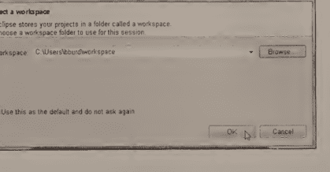

图 3-2：Eclipse Workspace Launcher。

工作区是你计算机硬盘上的一个文件夹。Eclipse 将你的 Java 程序存储在一个或多个工作区文件夹中。除了这些 Java 程序之外，每个工作区文件夹还包含一些 Eclipse 设置。这些设置存储诸如你使用的 Java 版本、你在编辑器中偏好的单词颜色、拖动编辑器区域边缘时编辑器区域的大小等信息，以及其他内容。你可以拥有多个工作区，每个工作区包含不同的程序和不同的设置。

默认情况下，Workspace Launcher 会提供打开上次运行 Eclipse 时打开的工作区。你想打开第 2 章中使用的那个工作区，所以不要修改 Launcher 的 Workspace 字段中的内容。

3. 在 Workspace Launcher 对话框中，点击 OK。
   大的 Eclipse 工作台出现在你的计算机屏幕上（见图 3-3）。

在图 3-3 中，工作台最左侧的部分是 Eclipse 的 Package Explorer，其中包含像 03-01、04-01 等这样的数字。每个数字实际上都是一个 Eclipse 项目的名称。正式地说，项目是工作区内的一组文件和文件夹。直观地说，项目是一个基本工作单元。例如，用于管理你的 CD 收藏（连同包含数据的）的一组自包含的 Java 程序文件可能构成一个单一的 Eclipse 项目。

再次查看图 3-3 中的 Package Explorer，你会看到名为 03-01、04-01 等的项目。我的项目 03-01 包含第 3 章（本章）的第一个也是唯一一个示例。项目 06-02 包含《本书第 6 章的第二个代码清单》中的 Java 程序 Listing 6-2。项目名称可以包含字母、数字、空白字符和其他字符，但对于本书示例的名称，我只使用数字和连字符。

要了解有关 Eclipse 的 Package Explorer 等内容的更多信息，请参阅即将到来的“What's All That Stuff in Eclipse's Window?”部分。

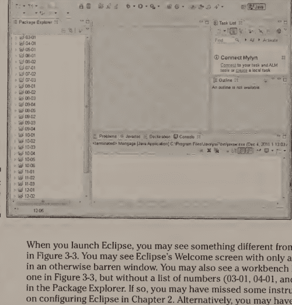

图 3-3：Eclipse 工作台。


当你启动 Eclipse 时，你可能会看到与图 3-3 中的内容不同的东西。你可能会看到只有几个图标的 Eclipse 欢迎屏幕，窗口其余部分空空如也。你也可能会看到像图 3-3 那样的一个工作台，但在 Package Explorer 中没有 03-01、04-01 等数字的列表。如果是这样，你可能错过了第 2 章中有关配置 Eclipse 的一些说明。或者，你可能在该节说明的第 2 步中修改了 Launcher 的 Workspace 字段中的内容。

无论如何，请确保你在 Package Explorer 中看到像 03-01 和 04-01 这样的数字。看到这些数字可确保 Eclipse 已准备好运行本书的示例程序。

4. 在 Package Explorer 中，点击 03-01 分支。
   本章的 Java 项目——03-01 项目——出现高亮。


你可能想先预览一些 Java 代码。要查看你在项目 03-01 中运行的 Java 程序，请在 Package Explorer 中展开 03-01 分支。在 03-01 分支内部，你会找到一个 src 分支，其中又包含一个（default package）分支。在（default package）分支内部，你会找到 Mortgage.java 分支。该 Mortgage.java 分支代表我的 Java 程序。双击 Mortgage.java 分支会使我的代码出现在 Eclipse 的编辑器中。

5. 从主菜单中选择 Run→Run As→Java Application，如图 3-4 所示。
   当你选择 Run As→Java Application 时，计算机运行项目的代码。（在此示例中，计算机运行我编写的 Java 程序。）作为运行的一部分，消息 How much are you borrowing? 出现在 Eclipse 的 Console 视图中。（Console 视图与 Problems 视图、Javadoc 视图、Declaration 视图以及可能的其他视图共享 Eclipse 工作台的右下区域。参考图 3-1。）

图 3-4：运行项目 03-01 中代码的一种方式。

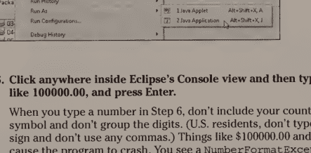

6. 在 Eclipse 的 Console 视图中单击任意位置，然后输入一个数字，如 100000.00，并按 Enter。


   当你在第 6 步输入数字时，不要包含你所在国家/地区的货币符号，也不要对数字进行分组。（美国居民，不要输入美元符号，也不要使用任何逗号。）诸如 $100000.00 和 1,000,000.00 之类的内容会导致程序崩溃。你会在 Console 视图中看到 NumberFormatException 消息。

分组分隔符因国家/地区而异。图 3-1 中显示的运行是针对配置为美国的计算机，其中 100000.00（带点）表示十万。但在配置为我所说的逗号国家/地区的计算机上，运行可能看起来不同——在该国家/地区，100000,00（带逗号）表示十万。如果你生活在逗号国家/地区，并且像图 3-1 中所示那样输入 100000.00，你可能会收到错误消息（InputMismatchException）。如果是这样，请将文件中的数字金额更改为与你所在国家/地区的数字格式相匹配。完成后，你应该没问题。

按 Enter 后，Java 程序会在 Console 视图中显示另一条消息（What's the interest rate?）。（再次参考图 3-1。）

7. 针对利率问题，输入一个数字，如 5.25，并按 Enter。
   按 Enter 后，Java 程序会在 Console 视图中显示另一条消息（How many years . . . ?）。


- 8. 输入一个数字，例如 30，然后按 Enter。

输入的数字对应的，Java 程序会显示一个月度付款金额。再次参考图 3-1。

免责声明：您当地的抵押贷款公司收取各种费用。现实生活中获得抵押贷款，您支付的金额会比我的 Java 程序计算的金额多。（多得多。）

在第 8 步输入数字时，不要包含小数点。像 30.0 这样的数字会导致程序崩溃。您会在 Console 视图中看到 NumberFormatException 消息。

有时，在程序运行过程中，您可能会决定自己犯了某种错误。您想立即停止程序的运行。只需单击 Console 视图上方的那个小红色矩形（参见图 3-5）。


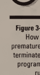

图 3-5：如何提前终止程序的运行。

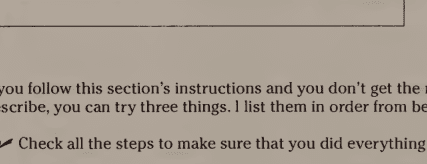

如果您按照本节的说明操作但没有得到我描述的结果，您可以尝试三件事。我按从最好到最差的顺序列出它们：

- 检查所有步骤，确保您已正确完成所有操作。
- 发送电子邮件至 BeginProg@allmycode.com，或在我的 Facebook 墙上发布（/allmycode），或向 Burd（@allmycode）发推。如果您描述发生了什么，我很可能能找出问题所在并告诉您如何纠正。
- 恐慌。

## 自己输入和运行代码

前一节内容是关于运行别人的 Java 代码（从本书网站下载的代码）。但最终，您将自己编写代码。本节向您展示如何使用 Eclipse IDE 创建代码。

### 将您的程序与我的程序分开

在第 2 章中，您从我的网站下载本书的示例。然后您创建一个 Eclipse 工作区并将本书的示例导入到工作区中。

您可以在同一工作区中创建自己的项目。但如果您想将自己的代码与我的代码分开，可以创建一个第二个工作区。以下是创建新工作区的两种方法：

- **启动 Eclipse 时，在 Eclipse 工作区启动器对话框的 Workspace 字段中输入一个新文件夹名称。**

  如果该文件夹尚不存在，Eclipse 会创建该文件夹。如果该文件夹已存在，Eclipse 的 Package Explorer 会列出该文件夹包含的任何项目。

- **在 Eclipse 工作台的主菜单中，选择 File > Switch Workspace（参见图 3-6）。**

  当您选择 File > Switch Workspace 时，Eclipse 会为您提供之前打开的一些工作区文件夹。如果您选择的文件夹不在列表中，请选择 Other 选项。响应后，Eclipse 会重新打开其 Workspace Launcher 对话框。

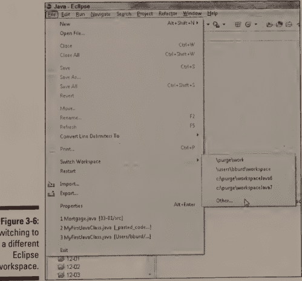

### 编写和运行您的程序

以下是创建新 Java 项目的方法：

- 1. 启动 Eclipse。
- 2. 从 Eclipse 的菜单栏中选择 File→New→Java Project。

  一个 New Java Project 对话框出现。

- 3. 在 New Java Project 对话框中，为您的项目输入一个名称，然后单击 Finish。

在图 3-7 中，我输入的名称为 `MyFirstProject`。

如果您单击 Next 而不是 Finish，您会看到一些现在不需要的其他选项。因此，为了避免任何混淆，只需单击 Finish 即可。

单击 Finish 会带您返回 Eclipse 的工作台，其中 `MyFirstProject` 显示在 Package Explorer 中，如图 3-8 所示。

下一步是创建一个新的 Java 源代码文件。


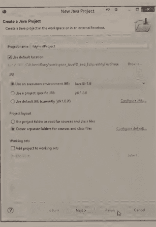

图 3-7：让 Eclipse 创建新项目。

图 3-8：您的项目出现在 Eclipse 的 Package Explorer 中。

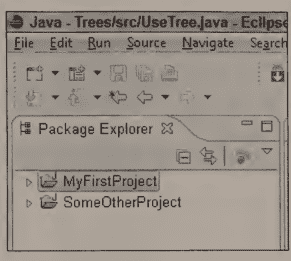

- 4. 在 Package Explorer 中选择您新创建的项目。

要创建图 3-8，我选择了 MyFirstProject 而不是 SomeOtherProject。

- 5. 在 Eclipse 的主菜单中选择 File→New→Class。

Eclipse 的 New Java Class 对话框出现（参见图 3-9）。

Java 程序员通常将代码划分为一个或多个包。典型的包名称类似于 java.util 或 org.allyourcode.images。在图 3-9 中，Eclipse 警告我没有为项目的代码命名一个包。因此代码进入一个名为 Java 默认包的不起眼的东西。Java 默认包是一个没有名称的包——代码未被其他方式打包时的一个总括位置。包对于管理大型编程项目非常有用，但本书不包含大型编程项目。因此，在本示例（以及本书所有示例中），我选择忽略该警告。有关 Java 包的更多信息，请参阅第 18 章。

**技术细节**

与其他所有窗口化环境一样，Eclipse 提供了多种完成同一任务的方法。除了选择 File→New→Class，您还可以在 Windows 中右键单击 Package Explorer 中的 MyFirstProject（或在 Mac 上 control-单击 Package Explorer 中的 MyFirstProject）。在 resulting 上下文菜单中，选择 New→Class。您也可以先按 Windows 上的 Alt+Shift+N（或 Mac 上的 Option+⌘+N）。点击和按键的选择由您决定。

**提示**

- 6. 在 New Java Class 对话框的 Name 字段中，输入新类的名称。

在本示例中，我使用名称 MyFirstJavaClass，名称中各词之间没有空白。（参见图 3-9。）

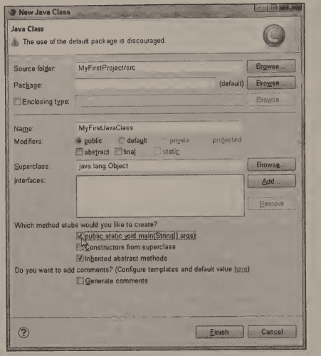

图 3-9：让 Eclipse 创建新的 Java 类。


New Java Class 对话框中的名称不得包含空白。唯一允许的标点符号是下划线字符（_）。您可以将类命名为 MyFirstJavaClass 或 My_First_Java_Class，但不能将其命名为 My First Java Class 或 Java Class, MyFirst。

- 7. 在 public static void main(String[] args) 复选框中打勾。

您的勾选告诉 Eclipse 创建一些样板 Java 代码。

- 8. 接受 New Java Class 对话框中所有其他内容的默认值（换句话说，单击 Finish）。

您甚至可以忽略对话框顶部附近的“Default Package Is Discouraged”警告。

单击 Finish 会带您返回 Eclipse 的工作台。现在 MyFirstProject 包含一个名为 MyFirstJavaClass.java 的文件。为了方便您，MyFirstJavaClass.java 文件中已有一些代码。Eclipse 的编辑器显示 Java 代码（参见图 3-10）。

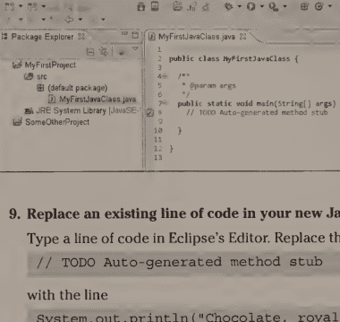

图 3-10：Eclipse 在编辑器中编写一些代码。

- 9. 替换您新 Java 程序中已有的代码行。

在 Eclipse 的 Editor 中输入一行代码。将以下行替换

```
// TODO Auto-generated method stub
```

为以下行

```
System.out.println("Chocolate, royalties, sleep");
```

完全按照 Listing 3-1 中的显示复制新代码行。

- 拼写每个单词的方式必须与 Listing 3-1 中的拼写完全相同。
- 大小写每个单词的方式必须与我在 Listing 3-1 中的做法完全相同。
- 包含所有标点符号——点号、引号、分号、所有内容。
- 区分小写字母 l 和数字 1。单词 println 告诉计算机打印整行。单词 println 中的每个字符都是小写字母。该单词不包含数字。

**Listing 3-1: 显示我喜欢的东西的程序**

```java
public class MyFirstJavaClass {

    /**
     * @param args
     */
    public static void main(String[] args) {
        System.out.println("Chocolate, royalties, sleep");
    }
}
```

### 我在 Java 程序中看到格式了吗？

当您使用 Eclipse 的编辑器编写 Java 程序时，您会看到各种颜色的单词。某些单词始终为蓝色。其他单词始终为黑色。您甚至会看到一些粗体和斜体短语。您可能认为您看到了格式，但实际上没有。您看到的被称为语法着色或语法高亮。

这种格式不是程序文件的一部分。相反，编辑器以便于阅读 Java 程序的方式显示每个单词。

例如，在 Java 程序中，某些单词（例如 class、public 和 void）具有其自身的特殊含义。因此 Eclipse 的编辑器以粗体、红色的字母显示 class、public 和 void。当我保存 Java 程序文件时，计算机不会在我的 Java 程序文件中存储有关粗体、彩色字母的任何信息。但编辑器会自行决定用红色着色突出显示特殊单词。

无论您如何称呼它，问题如下：

- 使用 Microsoft Word，诸如粗体格式之类的内容在文档内部标记。当您保存 myPersonalDiary.docx 时，使单词“love”和“hate”加粗的指令会记录在 MyPersonalDiary.docx 文件内部。
- 使用 Java 程序编辑器，诸如粗体和着色之类的内容不会在 Java 程序文件内部标记。相反，编辑器以便于阅读 Java 程序的方式显示每个单词。

其他一些编辑器可能会以蓝色字体显示相同的单词。另一个编辑器（如 Windows Notepad）以普通的黑色显示所有单词。


Java 是区分大小写的，这意味着 system.out.println 与 System.out.println 不同。如果您输入 system.out.println，您的程序将无法工作。请确保代码的大小写与 Listing 3-1 中的完全一致。

如果您从电子书中复制并粘贴代码，请检查代码中的引号是否为直引号 (" )，而不是弯引号（“ ”）。在 Java 程序中，直引号是好的；弯引号会带来麻烦。

如果您正确输入了所有内容，您会看到图 3-11 中的内容。

图 3-11：Eclipse 编辑器中的 Java 程序。

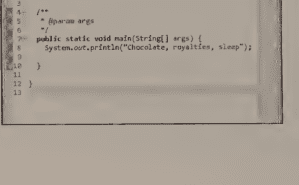


如果你没有完全按照清单 3-1 中所示的方式输入代码，可能会在编辑器中看到锯齿状的红色下划线、带有类似 X 标记的微小矩形，或其他红色标记（见图 3-12）。

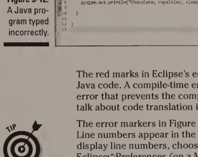

Eclipse 编辑器中的红色标记指的是你 Java 代码中的编译时错误。编译时错误（也称为编译器错误）是一种阻止计算机翻译你的代码的错误。（请参阅第 1 章中关于代码翻译的讨论。）


图 3-12 中的错误标记出现在 Java 程序的第 8 行。行号显示在编辑器的左侧空白处。要让 Eclipse 编辑器显示行号，请选择 Window→Preferences（在 Windows 上）或 Eclipse→Preferences（在 Mac 上）。然后选择 General→Editors→Text Editors。最后，在 Show Line Numbers 复选框中打上勾。

要修复编译时错误，你必须成为一名专注的侦探。你加入了一支精英队伍，名为“法律与秩序：Java 编程组”。你很少能找到简单的答案。相反，你慢慢仔细地梳理证据，寻找线索。你将编辑器中所看到的一切，逐字符地与我在清单 3-1 中的代码进行比较。你不会错过任何细节，包括拼写、标点以及大小写。

Eclipse 有一些不错的功能可以帮助你找到编译时错误的根源。例如，你可以将鼠标悬停在锯齿状的红色下划线上。此时你会看到错误的简要说明以及一些修复错误的建议——一些快速修复（见图 3-13）。

在图 3-13 中，一个弹出窗口告诉你 Java 不知道 `system` 这个词是什么意思——也就是说，`system` 无法解析。在图的底部附近，其中一个快速修复选项是将 `system` 改为 `System`。

当你点击那个“Change To 'System' (java.lang)”选项时，Eclipse 的编辑器会将 `system` 替换为 `System`。编辑器中的错误标记消失，你就从图 3-12 中的错误代码回到了图 3-11 中的正确代码。

图 3-13：Eclipse 提供了一些有用的建议。

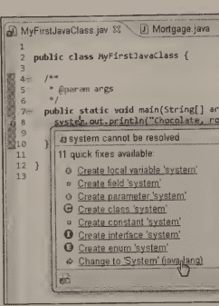

- 10. 在 Eclipse 编辑器中对代码进行任何修改或更正。

当你终于看到编辑器中不再有锯齿状下划线或斑块时，就可以尝试运行程序了。

- 11. 通过点击编辑器内部或点击 Package Explorer 中的 MyFirstProject 分支来选择 MyFirstJavaClass。

- 12. 在 Eclipse 的主菜单中，选择 Run→Run As→Java Application。

这样就成功了。你的新 Java 程序会在 Eclipse 的 Console 视图中运行。如果你运行的是清单 3-1 中的代码，你会看到图 3-14 中的 Chocolate, royalties, sleep 消息。简直就像在天堂一样！

图 3-14：运行清单 3-1 中的程序。

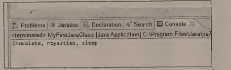

## 可能会出什么问题？

清除编辑器中的锯齿状下划线值得庆祝。Eclipse 喜欢你的代码外观，所以从那时起，一切都会顺利。对吧？

嗯，未必如此。除了那些明显的编译时错误之外，你的代码可能还有其他不太明显的错误。

想象有人告诉你“走到十字路口，然后向右转”。你立刻注意到说话者犯了错误，于是礼貌地回应“嗯？”这个毫无意义的 *turn tight*（错误的“向右转”）短语就像一个编译时错误。你的“嗯？”就像 Eclipse 编辑器中的锯齿状下划线。作为一个倾听的人类，你或许能猜到 *turn tight* 是什么意思，但 Eclipse 的编辑器从不敢替你修正代码中的错误。

除了编译时错误，其他一些“小恶魔”也可能隐藏在 Java 程序中：

**未检查的运行时异常：** 你没有编译时错误，但当你运行程序时，运行提前结束。在运行过程中的某个地方，你的指令告诉 Java 去做某件无法完成的事情。例如，当你在“运行一个现成的 Java 程序”一节中运行 Mortgage 程序时，你输入的是 1,000,000.00 而不是 1000000.00。Java 不喜欢数字中的逗号，所以你的程序崩溃并显示一条令人不快的消息，如图所示。

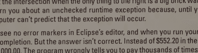

这是一个 *未检查的运行时异常* 的例子——相当于有人告诉你在十字路口向右转，而右边只有一堵大砖墙。Eclipse 的编辑器不会警告你未检查的运行时异常，因为在你运行程序之前，计算机无法预测该异常会发生。

**逻辑错误：** 你在 Eclipse 编辑器中看不到任何错误标记，当你运行代码时，程序运行到了结束。但答案不正确。不是图中的 $552.20，而是输出 $552,200,000.00。程序错误地告诉你要支付比你的房子价值高出数千倍的金额，并且告诉你要每月支付这么多！这相当于被告知向右转而不是向左转。你可能会在错误的方向上开很长时间的车。

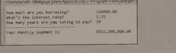

逻辑错误是最难发现和修复的错误。最糟糕的是，逻辑错误往往被忽视。1985 年 3 月，我收到了一张金额为 $1,328,932.21 的月度家庭取暖费账单。显然，某个计算机打印了错误的金额。当我打电话给燃气公司投诉时，电话客服代表说：“别难过，只付一半就行了。”

**编译时警告：** 警告不像错误消息那么严重。所以，当 Eclipse 在你的程序中注意到可疑之处时，编辑器会显示一条锯齿状的黄色下划线、一个包含感叹号的微小黄色图标，以及其他一些不那么显眼的线索。

例如，在下图中，我向清单 3-1 的代码中添加了 `amount = 10` 的内容（就是第 8 行的那部分）。问题是，我在程序中的任何地方都没有使用 `amount` 或数字 `10`。Eclipse 用淡淡的黄色标记有效地告诉我：“你的 `amount = 10` 代码还不至于坏到让程序无法运行，Eclipse 仍然可以运行你的程序。但你真的确定要把 `amount = 10`（这个似乎没有任何用途的东西）放在你的程序中吗？”

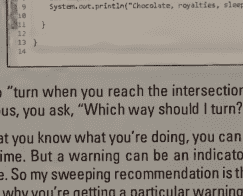

想象一下被告知“到了十字路口就转弯”。这个指令可能没什么问题。但如果你有疑虑，你会问：“我应该往哪个方向转？左边还是右边？”

当你确信自己知道自己在做什么时，可以忽略警告，以后再担心它们。但警告可能表明你的代码存在更严重的问题。所以我总体的建议是：注意警告。但是，如果你弄不清楚为什么会收到某个特定的警告，也不要让警告阻止你继续前进。

## Eclipse 窗口里那些乱七八糟的东西是什么？

信不信由你，曾经有一位编辑拒绝了我的一个书籍提案。在页边空白处，编辑在“can't”、“it's”和“I've”这样的词旁边潦草地写下“这不是一个词”。直到今天，我都不知道这位编辑为什么不喜欢缩略形式。我自己的观点是，语言总是需要扩展的。如果没有新词——比如 dotcom、infomercial 和 vaporware 这样的词——我们会是什么样子？

就连《牛津英语词典》（在任何关于词汇的争论中都是最后的权威）每年也会增加超过 4000 个词条。这意味着每年增长超过百分之一，大约每天新增 11 个新词！

事实上，人类的思想就像一栋高层建筑。在你至少建好四十九层的某部分之前，你无法建造第五十层。在你有了像 e-mail 这样的词之前，你无法谈论 spam。在当今这个时代，你需要语言构建模块。这就是本节包含一堆新术语的原因。

在本节中，每个新定义的术语都描述了 Eclipse IDE 的一个方面。因此，在你阅读所有这些 Eclipse 术语之前，我提供以下免责声明：

- **本节是可选阅读。** 如果你在理解本书中的某些说明时有困难，请参阅本节。但如果你在使用 Eclipse IDE 时没有困难，就不要纠结于本节中的术语，把事情复杂化。

- **本节提供的是术语的解释，而不是术语的正式定义。** 是的，我的解释相当精确，但并非滴水不漏。本节中几乎每个描述都有隐藏的例外、遗漏、豁免和排除。请把本节中的段落当作友好的提醒，而不是法律合同。

- **Eclipse 是一个非常实用的工具。** 但 Eclipse 并不是 Java 生态系统的官方组成部分。尽管我在本书中没有详细描述，但你完全可以不使用 Eclipse 来编写 Java 程序。

### 了解全局

你的 Eclipse 之旅从一个大范围的鸟瞰图开始。

- **工作台（Workbench）：** Eclipse 桌面（参见图 3-3）。工作台是你开发代码的环境。

- **区域（Area）：** 工作台的一个部分。图 3-3 中的工作台包含五个区域。为了说明这一点，我在每个区域周围绘制了边框（见图 3-15）。

- **窗口（Window）：** Eclipse 工作台的一个副本。使用 Eclipse 时，你可以同时打开多个工作台副本。每个副本显示在各自的窗口中。

- **动作（Action）：** 提供给你的一个选择，通常在你点击某个东西时出现。例如，当你选择 Eclipse 主菜单栏中的 File→New 时，你会看到可以创建的新事物列表。该列表通常包括 Project、Folder、File 和 Other，但也可能包括 Package、Class 和 Interface 等。其中每一项（菜单中的每个条目）都称为一个动作。


当你使用视图更改某些内容时，更改会立即生效。例如，当你在包资源管理器的上下文菜单中选择“删除”时，你选中的任何项目都会立即被删除。从某种意义上说，这种行为并不新鲜。当你在 Windows 资源管理器中回收文件，或在 Macintosh Finder 中删除文件时，也会发生同样的事情。

**编辑器：** Eclipse 工作台中用于显示信息供你修改的部分。典型的编辑器以文本形式显示信息。这些文本可以是文件的内容。例如，图 3-10 中的编辑器显示了 MyFirstJavaClass.java 文件的内容。

当你使用编辑器更改某些内容时，更改不会立即生效。例如，看看图 3-10 中的编辑器。这个编辑器显示的是 MyFirstJavaClass.java 文件的内容。你可以在编辑器中输入各种内容。在你从 Eclipse 菜单栏中选择“文件→保存”之前，MyFirstJavaClass.java 不会发生任何变化。当然，这种行为并不新鲜。当你在 Microsoft Word 或任何其他文字处理程序中工作时，也会发生同样的事情。

和其他作者一样，我偶尔也会偷懒，在真正想说“视图或编辑器”的时候只用了“视图”这个词。当你发现我这样写时，只需摇摇头继续往下读。当我非常注意措辞时，我会使用 Eclipse 的官方术语。我把视图和编辑器称为 Eclipse 工作台的组成部分。遗憾的是，“组成部分”这个术语并没那么容易让人记住。

Eclipse 工作台的一个区域可能包含多个视图或多个编辑器。大多数 Eclipse 用户即使完全不去想“多个视图”这回事，也能用得挺好。但如果你关心选项卡和活动视图相关的术语，那下面这些就是你要知道的：

**选项卡：** 除了把它叫作“选项卡”之外，几乎没办法描述的东西。不管我们把它叫作什么，它都能让我们从一个视图切换到另一个视图，或从一个编辑器切换到另一个编辑器。重要的是，视图可以一个叠一个地堆在一起。Eclipse 会把堆叠的视图显示成带选项卡的笔记本中的页面。例如，图 3-14 显示了 Eclipse 工作台的一个区域。该区域包含五个视图（“问题”视图、“Javadoc”视图、“声明”视图、“搜索”视图和“控制台”视图）。每个视图都有自己的选项卡。

一组堆叠在一起的视图叫作选项卡组。要把堆叠中的某个视图带到最前面，只需单击该视图的选项卡。顺便说一句，关于选项卡和视图的这些内容同样适用于选项卡和编辑器。唯一值得注意的是 Eclipse 对“编辑器”一词的使用方式。在 Eclipse 中，编辑器区域中每个带选项卡的页面都是一个独立的编辑器。例如，图 3-16 中的编辑器区域包含三个编辑器（而不是属于同一个编辑器的三个选项卡）。

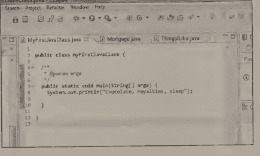

图 3-16：
编辑器区域包含三个编辑器。

**活动视图或活动编辑器：** 选项卡组中位于最前面的视图或编辑器。

在图 3-16 中，MyFirstJavaClass.java 编辑器是活动编辑器。Mortgage.java 和 ThingsILike.java 编辑器处于非活动状态。

## 视图或编辑器中有什么？

接下来几个术语涉及单个视图、单个编辑器和单个区域。

**工具栏：** 视图顶部的一排按钮（以及其他小控件）（见图 3-17）。

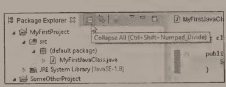

图 3-17：
包资源管理器视图的工具栏。

**菜单按钮：** 工具栏中一个向下的箭头。单击菜单按钮时，会出现一个包含操作的下拉列表（见图 3-18）。列表中显示哪些操作因视图而异。

图 3-18：
单击包资源管理器视图的菜单按钮。

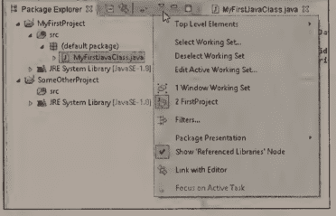

✓ **关闭按钮：** 用于关闭某个视图或编辑器的按钮（见图 3-19）。

图 3-19：
编辑器的“关闭”按钮。

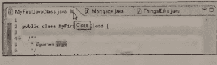

✓ **折叠箭头：** 一个双箭头，表示某个区域中还应该出现其他选项卡（但该区域不够宽）。图 3-20 中的折叠箭头旁边有一个小数字 2。这个 2 告诉你，除了两个可见的选项卡之外，还有两个选项卡不可见。单击折叠箭头会弹出一个悬停提示，其中包含所有选项卡的标签（见图 3-20）。

图 3-20：
折叠箭头表示有两个编辑器被隐藏了。


✓ **标记栏：** 编辑器区域左侧边缘的垂直标尺。Eclipse 会在标记栏中显示称为标记的小型警报图标。（例如，请参阅图 3-12。）

## 回到整体视角

接下来两个术语涉及 Eclipse 的整体观感。

**布局：** 某种视图的排列方式。图 3-3 中的布局有七个视图，其中四个很容易看到：

- 在最左侧，你可以看到包资源管理器视图。
- 在最右侧，你有任务列表视图和大纲视图。
- 靠近底部，你会看到问题、Javadoc、声明和控制台视图。

除了所有这些视图之外，该布局还包含一个编辑器区域。所有打开的编辑器都会出现在这个编辑器区域内。

**透视图：** 一种非常有用的布局。如果某种布局确实非常实用，就会有人给它起一个名字。如果一种布局有了名字，你就可以随时使用它。例如，图 3-3 中的工作台显示的是 Eclipse 的 Java 透视图。默认情况下，Java 透视图包含六个视图，其排列方式与图 3-3 所示的排列非常相似。

图 3-3 中出现了控制台视图，但控制台视图并不总是一定会出现在 Java 透视图中。通常，当你运行一个基于文本的 Java 程序时，控制台视图会自动出现。如果你想让控制台视图强制出现，请选择“窗口→显示视图→其他”。在随后出现的“显示视图”对话框中，展开“常规”分支。最后，在该“常规”分支中，双击“控制台”项。

除了所有这些视图之外，Java 透视图还包含一个编辑器区域。（当然，编辑器区域有几个选项卡，但选项卡的数量与 Java 透视图无关。）

你可以通过在 Eclipse 主菜单栏中选择“窗口→打开透视图”来切换透视图。本书几乎只关注 Eclipse 的 Java 透视图。但如果你喜欢到处探索，不妨看看其他透视图，初步感受一下 Eclipse 的强大和灵活。


# 第二部分

## 编写你自己的 Java 程序


## 本部分内容 . . .

- 剖析程序并检查其组成部分
- 处理数字
- 处理非数字内容

## 第 4 章

## 探索程序的组成部分

### 本章内容

- 识别 Java 程序中的单词
- 使用标点和缩进
- 理解 Java 语句和方法

我在一所文理学院的科学楼工作。每当我走过生物实验室，我都会低声说一句感谢的话。我很庆幸自己不必解剖小动物。在我的工作中，我解剖的是计算机程序。计算机程序闻起来比防腐处理过的动物尸体好多了。而且，解剖程序时，我也不会联想到自己的死亡。

在本章中，我邀请你和我一起解剖一个程序。我有一个名为 ThingsILike 的小程序。我会把这个程序拆开，仔细检查它的内部结构。请准备好你的解剖刀。我们开始吧！

## 初次查看 Java 代码

我得坦白一件事。当我第一次看别人的计算机程序时，我会感到有点不安。意识到自己不理解代码中的某个（或许多）地方，会让我感到紧张。我写过几百个（也许几千个）程序，但开始读别人的代码时，我仍然没有安全感。

事实上，了解一个计算机程序是一个逐步建立理解的过程。首先，我会敬畏地盯着程序看。然后运行程序，看看它会做什么。接着，我会盯着程序看一会儿，或者阅读别人对程序及其各个组成部分的解释。然后我会再多看一会儿，并再次运行程序。最终，我会弄懂这个程序。别信那些声称自己从不需要经历这些步骤的聪明人。即使是有经验的程序员，也会缓慢而谨慎地接触一个新项目。


## 看！一个程序！

在清单4-1中，你会看到一段Java代码。和所有新手程序员一样，你应当谦逊地敬畏这段代码。但别被吓到。一旦你掌握了窍门，编程其实很简单。是的，也很有趣。

### 清单4-1：一个简单的Java程序

```java
/*
 * A program to list the good things in life
 * Author: Barry Burd, BeginProg@allmycode.com
 * February 13, 2014
 */

class ThingsILike {
    public static void main(String args[]) {
        System.out.println("Chocolate, royalties, sleep");
    }
}
```

当我运行清单4-1中的程序时，我得到了图4-1所示的结果：计算机在屏幕上显示“Chocolate, royalties, sleep”这些单词。我承认，仅仅为了让“Chocolate, royalties, sleep”出现在某人电脑屏幕上而编写并运行一个Java程序，工作量很大，但任何事业都得有个起点。

图4-1：运行清单4-1中的程序。


本书中的大多数程序都是基于文本的程序。这些程序几乎只在Eclipse的控制台视图中进行输入和输出。相比之下，GUI（图形用户界面）程序会显示窗口、按钮、文本框和其他小部件来与用户交互。你可以在本书网站（http://allmycode.com/BeginProg）上看到清单4-1中程序的GUI版本，以及本书其他许多示例的GUI版本。

你可以自己在电脑上运行清单4-1中的代码。步骤如下：

1. 按照第2章的说明安装Eclipse。
2. 接着，按照第3章前半部分的说明操作。

这些说明告诉你如何运行名为03-01的项目，该项目可以从本书网站（http://allmycode.com/BeginProg）下载。要运行清单4-1中的代码，请对04-01项目按照相同的说明操作，该项目也在同一下载中。

### 程序各行的含义

如果清单4-1中的程序有朝一日出名了，会有人写一本CliffsNotes式的书来总结这个程序。这本书会非常短，因为你只需一句话就能概括清单4-1的行为。这句话是：

```
Display Chocolate, royalties, sleep
on the computer screen.
```

现在将前面这句话与清单4-1中的主体内容进行比较。由于清单4-1有更多的行，你可能会猜到清单4-1包含大量样板代码。好吧，你猜对了。不写样板代码，你就无法编写Java程序，但幸运的是，样板文本在不同的Java程序之间变化不大。我尽力用不超过66个词总结清单4-1的全部文本：

```
This program lists the good things in life.
Barry Burd wrote this program on February 13, 2014.
Barry realizes that you may have questions about this code, so you can reach him at BeginProg@allmycode.com, on Twitter at @allmycode, or on Facebook at /allmycode.

This code defines a Java class named ThingsILike.
Here's the main starting point for the instructions:
    Display Chocolate, royalties, sleep
    on the screen.
```

本章其余部分（还有约4500个词）将更详细地解释清单4-1中的代码。

### Java程序中的元素

英语和Java都被称为语言，这并非巧合。你用语言来表达思想。英语向人们表达思想，Java向计算机表达思想。而且，英语和Java都有词语、名称和标点符号之类的东西。实际上，两种语言最大的区别在于Java比英语更容易学。（如果英语容易，那么计算机就能理解英语了。可惜，它们不能。）

取一个普通的英语句子，与清单4-1中的代码进行比较。这个句子是：

Suzanne says "eh" because, as you know, she lives in Canada.

在高中语法课上，你为动词、形容词和诸如此类的东西而烦恼。但在本书中，你将按照关键字和标识符来思考，如图4-2所示。


Suzanne的句子中包含各种各样的东西。它们和你在计算机程序中发现的东西是同类。所以计划是这样的：将图4-2中的元素与清单4-1中的类似元素进行比较。你已经理解英语了，所以你用这种理解来弄清楚关于Java的一些新东西。

但首先，有个友好的提醒：在接下来的几段中，我会在英语和Java之间进行对比。当你阅读这些段落时，保持开放的心态很重要。例如，在比较Java和英语时，我可能会写道“事物的名称与字典中的单词不同”。当然，你可以争辩说某些字典列出了专有名词，有些人的名字叫Hope、Prudence和Spike，但请不要这样。如果你不吹毛求疵，你会从阅读中获得更多。好吗？我们还是朋友吗？

### 关键字

关键字是字典中的词——一个内置于语言中的词。

在图4-2中，像“says”这样的词是关键字，因为“says”在英语句子中使用时总是扮演相同的角色。Suzanne句子中的其他关键字是“because”、“as”、“you”、“know”、“she”、“lives”和“in”。

计算机程序也有关键字。事实上，清单4-1中的程序使用了Java的四个关键字（以粗体显示）：

```
class ThingsILike {
    public static void main(String args[]) {
```

每个Java关键字都有特定的含义——这个含义在不同程序之间保持不变。例如，每当我编写Java程序时，public这个词总是表示程序中任何其他代码都可以访问的那部分。


Java编程语言区分大小写。这意味着如果你把单词中的小写字母改成大写字母，就会改变单词的含义。改变大小写可能使整个单词从有意义变成无意义。在清单4-1中，你不能把public替换成Public。如果这样做，整个程序就会停止运行。

本章对关键字class、public、static和void的含义几乎没有详细介绍。你可以提前看看其他章节的内容，但也可以通过“作弊”来应付。编写程序时，只需以

```
class SomethingOrOther {
```

开头，然后将文本

```
public static void main(String args[]) {
```

粘贴到你的代码中。在你最初的几个程序中，这种策略会很好地为你服务。

表4-1列出了完整的Java关键字列表。

**表4-1 Java关键字**

| abstract | continue | for | new | switch |
| --- | --- | --- | --- | --- |
| assert | default | goto | package | synchronized |
| boolean | do | if | private | this |
| break | double | implements | protected | throw |
| byte | else | import | public | throws |
| case | enum | instanceof | return | transient |
| catch | extends | int | short | try |
| char | final | interface | static | void |
| class | finally | long | strictfp | volatile |
| const | float | native | super | while |


在Java中，单词true、false和null具有特定含义。与表4-1中的关键字一样，你不能把true、false和null用来表示Java程序中它们通常含义之外的任何东西。但由于某些只与最挑剔的Java专家有关的原因，true、false和null不被称作Java关键字。无论如何，如果你把true、false和null这几个词涂写在表4-1中，也没问题。

关于关键字，要记住一点：在Java中，每个关键字都有官方的、预定的含义。甲骨文公司的人对Java程序的构成有最终决定权，他们创建了Java的所有关键字。你不能为任何Java关键字编造自己的含义。例如，你不能在计算中使用public这个词：

```java
//This is BAD, BAD CODE:
public = 6;
```

如果你试图这样使用关键字，编译器将显示错误消息，并拒绝翻译你的源代码。这在英语中也是如此。生个孩子并给他取名“Because”。

> “让我们为今晚的主持人——Because O. Borel——献上热烈的掌声。”

你可以这样做，但这个孩子永远不会过上正常的生活。


尽管我在这节中热切地声称，但Java中有两个关键字在Java程序中没有含义。这两个关键字——const和goto——被保留在Java中不用于。如果你试图创建一个名为goto的变量，Eclipse会显示“Invalid VariableDeclaratorId”错误消息。Java的创造者认为，如果你在代码中使用了const或goto这两个词中的任何一个，你应该被礼貌地请到C++程序员的桌上。


## 你可以自己定义的标识符

我喜欢“苏珊娜”这个名字，但如果你不喜欢传统名字，那就创造一个全新的名字。你有了新宝宝，可以叫她“迪宁”或“克莉桑塔”，也可以叫他“贝尔顿”或“默克”。

名字是用来标识某物的词，所以我就不再称这些为名字，而改称它们为**标识符**。在计算机编程中，标识符就是某种名词。标识符可以引用一个值、程序的一部分、某种特定结构，或者任何数量的东西。

清单 4-1 中有两个可以由我们自己定义的标识符，它们就是虚构的词 `ThingsILike` 和 `args`。

```
class ThingsILike {
    public static void main(String args[]) {
}
```

正如“苏珊娜”和“克莉桑塔”这两个名字在英语中没有特殊含义一样，`ThingsILike` 和 `args` 在 Java 中也没有特殊含义。在清单 4-1 中，我用 `ThingsILike` 作为程序名，但我也可以用 `GooseGrease`、`Enzyme` 或 `Kalamazoo` 之类的名字。我必须在程序中写 `(String someName[])`，但我可以用 `(String args[])`、`(String commandLineArguments[])` 或 `(String cheese[])`。


照我说的做，别照我做的做。请为 Java 程序中的事物起一些合理且有意义的名字。像 `GooseGrease` 这样的名字虽然有趣，但无助于你把握编写程序的策略。


当我命名 Java 程序时，可以用 `ThingsILike` 或 `GooseGrease`，但不能用 `public` 这个词。像 `class`、`public`、`static` 和 `void` 这些词都是 Java 中的关键字。

`(String args[])` 中的 `args` 用于保存在运行 Java 程序的命令后输入的任何额外内容。例如，如果你通过输入 `java ThingsILike won too 3` 来运行程序，那么 `args` 就会存储额外的值 `won`、`too` 和 `3`。作为初学编程者，你不需要考虑 Java 的这个特性，只需将 `(String args[])` 粘贴到每个程序中即可。

## 具有约定俗成含义的标识符

很多人都叫苏珊娜，但只有一个国家叫加拿大。这是因为“Canada”这个词具有标准且广为人知的含义——那是一个国旗上有红色枫叶的国家。如果你建立自己的国家，应该避免把它命名为加拿大，因为命名为加拿大只会让大家困惑。（我知道，肯塔基州有一个小镇叫加拿大，但那不算数。记住，你应该忽略这类例外情况。）

大多数编程语言都有具有约定俗成含义的标识符。在 Java 中，几乎所有这类标识符都定义在 Java API（应用程序编程接口）中。清单 4-1 中有五个这样的标识符，它们是 `main`、`String`、`System`、`out` 和 `println`：

```
public static void main(String args[]) {
    System.out.println("Chocolate, royalties, sleep");
}
```

以下是对这些名称含义的快速介绍（更详细的描述贯穿本书）：

-   **main:** 每个 Java 程序执行时的主入口点。
-   **String:** 一串文本；一行字符，一个接一个。
-   **System:** Java API 中一个现成的程序。该程序可以访问你计算机上不受 Java 虚拟机（JVM）直接控制的某些功能。
-   **out:** 基于文本的程序显示文本的位置。（对于在 Eclipse 中运行的程序，`out` 一词代表控制台视图。要了解更多关于基于文本的程序的信息，请查看第 3 章的开头几段。）
-   **println:** 在计算机屏幕上显示文本。


`println` 这个名字来源于“print a line”（打印一行）这几个词。如果允许用大写字母写这个名字，它会是 PRINTLN，在单词末尾附近有一个字母 L。当计算机执行 `println` 时，计算机会在 Eclipse 的控制台视图中放置一些文本，然后立即移动到下一行的开头，为后续出现在控制台视图中的内容做准备。


严格来说，Java API 中标识符的含义并非一成不变。尽管你可以为 `System` 或 `println` 等词自定义含义，但这样做并不明智——因为这会让习惯了这些常见标识符标准 API 含义的其他程序员困惑不已。

## 字面量

字面量是一段看起来与其所表示的值相同的文本。在苏珊娜的句子中（参见图 4-2），“eh”就是一个字面量，因为“eh”所指的就是“eh”这个词本身。

编程语言也有字面量。例如，在清单 4-1 中，引号中的内容就是字面量：

```
System.out.println("Chocolate, royalties, sleep");
```

当你运行 `ThingsILike` 程序时，屏幕上会显示 Chocolate, royalties, sleep 这些文字。在清单 4-1 中，文本 `"Chocolate, royalties, sleep"` 所指的就是这些文字，与它们在屏幕上显示的内容完全一致（不含引号）。

在计算机程序中用到的大多数数字都是字面量。如果你在程序中写了语句：

```
mySalary = 1000000.00;
```

那么 `1000000.00` 就是一个字面量。它代表数字 1000000.00（一百万）。

如果你不喜欢数数字位数，你可以在 Java 7 程序中写如下语句：

```
mySalary = 1_000_000.00;
```

从 Java 7 开始，带下划线的数字可以作为字面量使用。

在 Java 7 之前的 Java 版本中，你不能在代码中使用像 `1_000_000.00` 这样的数字。


不同的国家使用不同的数字分隔符和数字格式。例如，在美国，你写 1,234,567,890.55。在法国，你写 1234567890,55。在印度，你会将数字按两位和三位分组，写为 1,23,45,67,890.55。你不能在 Java 程序中写像 `mySalary = 1,000,000.00` 这样的语句，因为 Java 的数值字面量中不允许有逗号。但是，在印度为了方便阅读编程，你可以写 `mySalary = 10_00_000.00`。而对于程序的输出，你可以使用 Java 的 `Locale` 和 `NumberFormat` 类来显示像 1234567890,55 这样的数字。（有关 `Locale` 和 `NumberFormat` 的更多信息，请参阅第 18 章。）

## 标点符号

一个典型的计算机程序包含大量标点符号。例如，考虑清单 4-1 中的程序：

```
class ThingsILike {
    public static void main(String args[]) {
        System.out.println("Chocolate, royalties, sleep");
    }
}
```

每个方括号、每个花括号、每个任何类型的符号都在使程序具有意义方面发挥作用。

在英语中，你从一行一直写到最后，然后将文本换行到下一行的开头。在编程中，你很少这样操作。相反，代码的标点符号引导着某些行的缩进。缩进显示了程序的哪些部分从属于哪些其他部分。这就像在英语里，你把苏珊娜的句子写成这样：

苏珊娜说“呃”，
    因为，你知道的，
她住在加拿大。

图 4-3 和图 4-4 中的图示展示了 `ThingsILike` 程序的各个部分如何包含在其他部分中。注意一对花括号就像一个盒子。为了让程序的结构一目了然，你需要缩进每个盒子内的所有内容。

**图 4-3：** 一对花括号像一个盒子。

```
class ThingsILike {
  public static void main(String args[]) {
    System.out.println("Chocolate, royalties, sleep");
  }
}
```

**图 4-4：** 计算机程序中的思想是嵌套在一起的。


我无论如何强调这一点都不为过。如果你不缩进代码，或者你虽然缩进了但没有仔细进行缩进，你的代码仍然可以正确编译和运行。但这次成功的运行会给你一种虚假的自信。当你试图更新一些缩进不当的代码时，你会变得困惑至极。所以请听从我的建议：在整个过程的每一步都保持代码的缩进工整。无论是编写一个快速测试程序，还是为亿万富翁客户编写代码，都要让你的缩进精确无误。


Eclipse 可以自动缩进代码。选择要缩进代码的 `.java` 文件，然后在 Eclipse 主菜单中选择 Source > Format。Eclipse 会重新排列编辑器中的各行，缩进应该缩进的部分，通常会让代码看起来美观整洁。


## 注释

注释是位于常规流程之外的文本。在图4-2中，“A comment:”这几个词并不是Suzanne句子的组成部分，而是对该句子的说明。

计算机程序中的注释也是如此。清单4-1中的前五行构成一大段注释。计算机不会执行这段注释，注释内没有任何让计算机执行的指令。相反，注释向其他程序员说明了有关你代码的某些信息。

注释对你自己也有好处。假设你将代码搁置一段时间，去处理其他事情。当你日后重新回来编写代码时，注释能帮你回忆起当时正在做什么。

Java编程语言有三种注释：

**传统注释：** 清单4-1中的注释就是传统注释。注释以`/*`开头，以`*/`结尾。开头`/*`和结尾`*/`之间的所有内容仅供人阅读。编译器不会编译`/*`和`*/`之间的任何内容。

清单4-1中的第二、三、四行有额外的星号。我称之为“额外”，因为创建注释时这些星号并非必需。它们只是让注释看起来更美观。我在清单4-1中包含它们，是因为出于某种我不完全理解的原因，大多数Java程序员都会添加这些额外的星号。

**行末注释：** 下面是一些带行末注释的代码：

```java
class ThingsILike {    // Two things are missing
    public static void main(String args[]) {
        System.out.println("sleep"); // Missing from here
    }
}
```

行末注释以两个斜杠开头，一直延伸到该文本行的末尾。

你可能会听到程序员谈论“注释掉”代码的某些部分。当你编写程序时，如果某些功能不能正常工作，尝试移除部分代码往往很有帮助。至少，你能知道移除可疑代码后会发生什么。当然，你可能不喜欢移除代码后的效果，因此不想彻底删除代码。这时，你可以将普通的Java语句变成注释。例如，将`System.out.println("Sleep");`变成`/* System.out.println("Sleep"); */`。这样，在你试图找出程序问题所在时，Java编译器不会看到这段代码。


**Javadoc注释：** 任何以额外星号开头的传统注释都是特殊的Javadoc注释。

```java
/**
 * Print a String and then terminate the line.
 */
```

这是一个很酷的Java特性。你可以从java.sun.com下载的软件中包含一个名为javadoc的小程序。javadoc程序会在你的代码中查找这些特殊注释，并利用它们创建全新的网页——为你的代码定制文档页面。想了解更多关于将Javadoc注释转换为网页的内容，请访问本书网站(http://allmycode.com/BeginProg)。

## 理解一个简单的Java程序

接下来的几节将展示、解释、分析、剖析并揭开清单4-1中Java程序的神秘面纱。

### 什么是方法？

你在一家高级修车厂当汽车修理工。你的老板总是匆匆忙忙，习惯把词连在一起说：“FixTheAlternator on that junkyOldFord.”（把那个破旧老福特上的交流发电机修好。）你在心里过了一遍任务清单：“把车开进工位，掀起引擎盖，拿把扳手，松开发电机皮带，”等等。这里发生了三件事：

- **你有一个名称来指代你要做的事情。** 这个名称是FixTheAlternator。
- **你脑海中有一个与名称FixTheAlternator相关联的任务清单。** 这些任务包括“把车开进工位，掀起引擎盖，拿把扳手，松开发电机皮带，”等等。
- **你有一个脾气暴躁的老板在吩咐你做所有这些工作。** 老板说“FixTheAlternator”让你开始工作。换句话说，老板说出你要做的事情的名称，你就要开始干活。

在这种情况下，使用“方法”这个词并不牵强。你有一个处理交流发电机的方法。老板把这个方法调用起来，你则通过执行与该方法关联的指令列表中的所有事项来响应。

### Java方法

如果你相信上一节的内容，那么你已准备好了解Java方法。在Java中，方法是要做的一系列事情的清单。每个方法都有名称，你在程序中通过使用方法的名称来让计算机执行清单中的事情。

我从未编写过程序让机器人修理交流发电机。但如果我要写，程序可能会包含一个名为FixTheAlternator的方法。我的FixTheAlternator方法中的指令清单看起来会像清单4-2中的文本那样。

**清单4-2：方法声明**

```java
void FixTheAlternator() {
    DriveInto(car, bay);
    Lift(hood);
    Get(wrench);
    Loosen(alternatorBelt);
    ...
}
```

在我的Java代码的其他地方（清单4-2之外的某处），我需要一条指令来调用FixTheAlternator方法。调用FixTheAlternator方法的指令可能看起来像清单4-3中的一行。

**清单4-3：调用方法**

```java
FixTheAlternator(junkyOldFord);
```


不要过于仔细地审视清单4-2和4-3。其中的所有代码行都是假的！我编造了这些代码，使它们看起来很像真正的Java代码，但并非真实代码。更重要的是，清单4-2和4-3中的代码并非要说明Java的所有规则。所以，如果你愿意半信半疑，就请对清单4-2和4-3持保留态度。


几乎每种计算机编程语言都有类似Java方法的东西。如果你用过其他语言，你可能会记得子程序、过程、函数、子例程、Sub过程或PERFORM语句等概念。无论你在最喜欢的编程语言中如何称呼它，方法都是一组收集在一起并被赋予新名称的指令。

### 声明、方法头和调用

如果你对方法是什么以及它如何工作有了基本了解（参见上一节），你就可以深入探讨一些有用的术语：

- 如果我偷懒，我会把清单4-2中的代码称为方法。如果我不偷懒，我会称之为方法声明。
- 清单4-2中的方法声明有两部分。第一行（包含名称FixTheAlternator、直到但不包括左花括号的部分）称为方法头。清单4-2的其余部分（用花括号包围的部分）是方法体。
- 术语“方法声明”将清单4-2中的指令清单与清单4-3中的指令区分开来，后者称为方法调用。

有关所有方法术语的直观说明，请参见图4-5。


**图4-5：描述方法的术语。**

```java
void FixTheAlternator() {
  DriveInto(car, bay);
  Lift(hood);
  Get(wrench);
  Loosen(alternatorBelt);
  ...
}
```

```java
FixTheAlternator(junkyOldFord);
```

方法头和方法体就像词典中的一个词条。词条并不是真正使用它所定义的词，而是告诉你使用这个词时会发生什么。

| 词典词条 | 方法声明 |
| --- | --- |
| chocolate (choc-o-late) n. 1. 地球上最容易上瘾的物质。2. 你用版税收入购买的东西。3. 一个人饮食中最重要的营养成分。 | FixTheAlternator() 把车开进工位，掀起引擎盖，拿把扳手，松开发电机皮带，然后吃点巧克力。 |

相比之下，方法调用就像在句子中使用一个词。方法调用会让某些代码开始运行。

| 使用该词的句子 | 方法调用 |
| --- | --- |
| “我想要些巧克力，不然我就大发脾气。” | "FixTheAlternator on that junkyOldFord." |

方法声明告诉计算机，如果你调用该方法，会发生什么。方法调用（一段独立的代码）告诉计算机实际去调用该方法。方法声明和方法调用通常位于Java程序的不同部分。


### 程序中的main方法

在清单4-1中，大部分代码是名为main的方法的声明。（只需在代码的方法头中找到单词main。）现在，不要担心方法头中的其他单词——public、static、void、String和args。我将在接下来的几章中（按需）解释这些词。

和任何Java方法一样，main方法就像一个配方：

```text
How to make biscuits:
Preheat the oven.
Roll the dough.
Bake the rolled dough.
```

或者

```text
How to follow the main instructions in
the ThingsILike code:
Display Chocolate, royalties, sleep on the screen.
```

单词main在Java中扮演着特殊角色。特别是，你永远不会编写代码显式调用main方法。main是当程序开始运行时被自动调用的方法的名称。


当 ThingsILike 程序运行时，计算机自动查找程序中的主方法（main method），并执行方法体中的所有指令。在 ThingsILike 程序中，主方法体只有一条指令。该指令告诉计算机在屏幕上打印 Chocolate, royalties, sleep（巧克力、版税、睡眠）。

方法中的指令在方法被调用之前都不会执行。但如果你给方法命名为 main，该方法会被自动调用。


## 你最终如何告诉计算机做某事

隐藏在清单 4-1 深处的，是真正向计算机发出直接指令的一行代码。这一行

```
System.out.println("Chocolate, royalties, sleep");
```

告诉计算机显示单词 Chocolate, royalties, sleep。（如果你使用 Eclipse，计算机会在控制台视图中显示 Chocolate, royalties, sleep。）我至少可以用两种不同的方式来描述这行代码：

- **它是一个语句。** 在 Java 中，告诉计算机做某事的直接指令称为语句。清单 4-1 中的语句告诉计算机显示一些文本。其他程序中的语句可能告诉计算机把 7 放入某个内存位置，或让窗口在屏幕上出现。计算机程序中的语句可以做各种各样的事情。
- **它是一个方法调用。** 在本章前面 “什么是方法？” 一节中，我描述了一种名为 “方法调用” 的东西。语句 FixTheAlternator(junkyOldFord); 是方法调用的一例，System.out.println("Chocolate, royalties, sleep"); 也是如此。

```
FixTheAlternator(junkyOldFord);
```

```
System.out.println("Chocolate, royalties, sleep");
```

Java 有许多不同种类的语句，方法调用只是其中一种。

## 用分号结束语句

在 Java 中，每个语句都以分号结尾。清单 4-1 中的代码只有一条语句，因此清单 4-1 中只有一行以分号结尾。

以清单 4-1 中其他任何一行代码为例，比如方法头。方法头（含 main 一词的那一行）并不直接告诉计算机做任何事情。相反，方法头是为将来参考而描述某种动作。该方法头宣布：“万一有人调用 main 方法，接下来的几行代码将告诉你如何响应这个调用。”


每一条完整的 Java 语句都以分号结尾。方法调用是一条语句，所以它也是以分号结尾的，但方法头和方法声明都不是语句。

## 名为 System.out.println 的方法

清单 4-1 中间的语句调用了一个名为 System.out.println 的方法。该方法定义在 Java API 中。每当你调用 System.out.println 方法时，计算机就会在屏幕上显示文本。

想一想名字。信不信由你，我认识两个名叫 Pauline Ott 的人。一个是修女，另一个是物理学家。当然，英语世界中有很多叫 Pauline 的人，正如 Java API 中有好几个名为 println 的东西一样。因此，为了区分物理学家 Pauline Ott 和影评人 Pauline Kael，我会写全名 “Pauline Ott”。为了区分修女和物理学家，我会写 “Sister Pauline Ott”。同样，我会写 System.out.println 或 DriverManager.println。前者（你经常使用）在计算机屏幕上写文本；后者（本书中完全不使用）写入数据库日志文件。

就像 Pauline 和 Ott 本身就是名字一样，System、out、println 也是 Java API 中的名字。但要使用 println，你必须写方法的全名。你绝不会只写 println。它总是 System.out.println 或某种其他 API 名称的组合。


Java 编程语言是区分大小写（cAsE-sEnSiTiVe）的。如果你把小写字母改成大写（或反过来），你就改变了单词的含义。你不能把 System.out.println 换成 system.out.Println。如果这样做，你的程序将无法运行。

## 到处都是方法

两个方法在 ThingsILike 程序中发挥作用。图 4-6 说明了这一情况，接下来的几个要点将带你逐一了解。

图 4-6：调用 System.out.println 方法。


- 有一个 main 方法的声明。main 方法是我自己编写的。每当我开始运行 ThingsILike 程序时，这个 main 方法都会被自动调用。
- 有一个对 System.out.println 方法的调用。对 System.out.println 方法的方法调用是 main 方法体中唯一的语句。换句话说，调用 System.out.println 方法是 main 方法待办事项列表上的唯一事项。

System.out.println 方法的声明隐藏在官方 Java API 中。如需复习 Java API，请参阅第 1 章。

**技术说明**

当我说 “System.out.println 隐藏在 API 内部” 这类话时，我并没有充分体现 API 的价值。没错，你可以忽略 API 中所有琐碎的 Java 代码。你只需要记住，System.out.println 是在这些代码中的某个地方定义的。但当我让 API 代码听起来像是某种神奇的东西时，我是不公平的。API 不过是另一堆 Java 代码。API 中那些告诉计算机如何执行 System.out.println 调用的语句，看起来和清单 4-1 中的 Java 代码非常相似。

## Java 类

你听说过面向对象编程（也称为 OOP）这个术语吗？OOP 是一种思考计算机编程问题的方式，这种方式得到多种不同编程语言的支持。OOP 始于 20 世纪 60 年代，当时有一种名为 Simula 的语言。20 世纪 70 年代，另一种名为 Smalltalk 的语言加强了这一理念。到了 20 世纪 80 年代，OOP 语言 C++ 大放异彩。

有些人想改变这个缩写，将其称为 COP——类导向编程。这是因为面向对象编程始于一种称为 “类” 的东西。在 Java 中，一切都始于类，一切都包含在类中，一切都基于类。在你创建了某种类之前，你无法在 Java 中做任何事情。这就好比你在参加《危险边缘》（Jeopardy），听到亚历克斯·特雷贝克说 “我们进段广告”，然后你打断他说：“对不起，亚历克斯。不把你的指令放进类里，你就无法发出指令。”

理解类的真正含义对你来说很重要，因此我不敢在本章中仓促地解释。相反，我会在第 17 章中用很大篇幅来回答 “什么是类？” 这个问题。无论如何，在 Java 中，你的 main 方法必须位于某个类内部。我编写了清单 4-1 中的代码，所以我可以为我的新类取一个名字。我选择了 ThingsILike，因此清单 4-1 中的代码以 class ThingsILike 开始。

再看一眼清单 4-1，注意在 class ThingsILike 这一行之后发生了什么。其余代码都用花括号括起来。这些花括号标明了类内部的所有内容。如果没有这些花括号，你会知道 ThingsILike 类的声明从哪里开始，却不知道声明在哪里结束。

就好像 ThingsILike 类中的内容被放在一个盒子里。（请参阅图 4-3。）要把一段代码框起来，你需要做两件事：

- 使用花括号。花括号告诉编译器一段代码从哪里开始、在哪里结束。
- 缩进代码。缩进让你的眼睛（以及其他程序员的眼睛）知道一段代码从哪里开始、在哪里结束。

别忘了，两件事你都得做。

## 第 5 章：编写程序

### 本章内容

- 从键盘读取输入
- 编辑程序
- 排查故障

就在昨天，我和我的仆人罗博吉夫斯（RoboJeeves）聊天。（RoboJeeves 是 RJ-3000 系列个人机器生命体中的高端型号。）我们的谈话内容如下：

我：罗博吉夫斯，告诉我一个物体在真空中下落三秒后的速度。

罗博吉夫斯：好的，我会的。“一个物体在真空中下落三秒后的速度。” 好了，我已经告诉你了。

我：罗博吉夫斯，别跟我耍小聪明。我要一个数字，我要实际速度。

罗博吉夫斯：行！“一个数字；实际速度。”

我：RJ，这种廉价笑话有失你的身份。你到底能不能回答我的问题？

罗博吉夫斯：能。

我：“能”，什么？

罗博吉夫斯：能，我确实能——或者不能——回答你的问题。

我：好吧，到底是哪个？你能不能？

罗博吉夫斯：能，我能。

我：那就做吧，告诉我答案。

罗博吉夫斯：速度是每小时 153,984,792 英里。

我：（停顿片刻思考……）RJ，我知道你从不犯错，但 153,984,792 这个数字也太高了吧。


> *RoboJeeves：太高了？不可能。在巨大的行星 Mangorrrrkhongo 上，物体下落得非常快。如果你想知道的是地球上物体下落的情况，你一开始就应该说明。*

有时候，那个机器人会让我不爽。事实上，RoboJeeves 只做我让他做的事——不多也不少。如果我说“喂猫”，RJ 就会问：“喂给谁？你的哪位客人今晚要吃猫？”

## 计算机很愚蠢

尽管它们很方便，但所有计算机都在做同样该死的事情：它们严格按你说的去做，而这有时非常糟糕。例如，1962 年，一艘前往金星的水手号航天器在其发射后仅四分钟就被摧毁了。为什么？因为 FORTRAN 程序中漏敲了一个键。差不多在同一时期，NASA 科学家发现了一个可能毁掉水星计划的错误。（没错！这些可是载人飞行啊！）这个错误是把一行中的逗号写成了句点。（一位程序员写的是 DO 10 I=1.10，而不是 DO 10 I=1,10。）

恕我直言，我的伙伴 RoboJeeves 和他那些计算机表亲们都极其愚蠢。有时他们看起来像是在质疑我们人类，但实际上他们只是在执行其他人类让他们做的事情。他们可以抛虚拟硬币，利用精心设计的方案来模仿创造性行为，但他们从来不会真正独立思考。如果你说“跳”，他们就会按照程序对 J-u-m-p 这几个字母做出回应。

所以，当你编写计算机程序时，你必须想象有精灵赐予了你三个愿望。不要祈求永恒的爱情，因为如果你这样做了，精灵会给你一个流着口水、对你崇拜得五体投地的伴侣——一个你完全不喜欢的人。也不要祈求一百万美元，除非你希望精灵把你变成银行抢劫犯。

你在计算机程序中写的每一个内容都必须非常精确。来看一个例子……

## 一个回显键盘输入的程序

清单 5-1 是一个小型 Java 程序。该程序允许你在键盘上输入一行字符。只要你按下回车键，程序就会显示第二行，内容是你刚才输入的东西。

### 清单 5-1：一个 Java 程序

```java
import java.util.Scanner;

class EchoLine {
    public static void main(String args[]) {
        Scanner keyboard = new Scanner(System.in);

        System.out.println(keyboard.nextLine());

        keyboard.close();
    }
}
```


本书中的大多数程序都是基于文本的程序。这些程序的输入和输出几乎只在 Eclipse 的控制台视图中进行。你可以通过访问本书网站 (http://allmycode.com/BeginProg) 查看清单 5-1 中程序以及本书许多其他示例的 GUI 版本。

图 5-1 展示了 EchoLine 代码（清单 5-1 中的代码）的一次运行。图中的文字混合了我自己的输入和计算机的响应。

### 图 5-1：
你不明白“don't”这个词的哪一部分？


在图 5-1 中，我输入了第一行（第一行是“请不要把这件事告诉任何人”），计算机显示第二行。运行清单 5-1 中的代码时，会发生以下情况：

- 1. **起初，计算机什么都不做。**
- 计算机在等待你输入内容。
- 2. **你点击 Eclipse 控制台视图内部。**
- 于是，你会看到光标出现在 Eclipse 控制台视图的左边缘，如图 5-2 所示。

### 图 5-2：
计算机等待你输入内容。


3. 你输入一行文本——任意文本都可以（见图 5-3）。

### 图 5-3：
你输入一个句子。


4. 你按下回车键，计算机就会显示你输入的那一行的另一个副本，如图 5-4 所示。

### 图 5-4：
计算机回显你的输入。


显示完你输入的副本后，程序运行结束。

## 输入并运行程序

本书网站 (http://allmycode.com/BeginProg) 上有下载本书所有 Java 程序的链接。下载这些程序后，你可以按照第 2 章的说明将这些程序添加到 Eclipse 工作区。然后，要测试清单 5-1 中的代码，你可以运行现成的 05-01 项目。

但我鼓励你不要运行现成的代码，而是从零开始——自己输入清单 5-1 的代码，然后测试你新建的代码。只需按照以下步骤操作：

- 1. **启动 Eclipse。**
- 
- 2. **从 Eclipse 的菜单栏中选择 File→New→Java Project。**
- Eclipse 的 New Java Project 对话框出现。
- 
- 3. **在对话框的 Project Name（项目名）字段中，输入 `MyNewProject`。**
- 
- 4. **单击 Finish。**
- 单击 Finish 后，你会回到 Eclipse 工作台，包资源管理器中会出现 `MyNewProject`。下一步是创建新的 Java 源代码文件。
- 
- 5. **在包资源管理器中选择 `MyNewProject`，然后在 Eclipse 的主菜单中选择 File→New→Class。**
- Eclipse 的 New Java Class 对话框出现。
- 
- 6. **在 New Java Class 对话框的 Name（名称）字段中，输入新类的名称。**
- 
- 在本示例中，使用名称 EchoLine。请严格按照清单 5-1 中我拼写 EchoLine 的方式来拼写：大写 E、大写 L，且没有空格。
- 
- 在 Java 中，拼写和大小写保持一致非常重要。如果在某个程序中不一致，该程序很可能会出现一些令人讨厌、烦人的编译错误。
- 
- （可选）你可以勾选标注为 `public static void main(String[] args)` 的复选框。如果不勾选，到第 8 步时你会多输入一些内容。无论勾选与否，都没什么大不了的。
- 
- 7. **单击 Finish。**
- 单击 Finish 后，你会回到 Eclipse 工作台。工作台中的一个编辑器会有一个名为 EchoLine.java 的选项卡。
- 
- 8. **在 EchoLine.java 编辑器中输入清单 5-1 的程序。**
- 请完全按照清单 5-1 中显示的样子复制代码。
- - 完全按照清单 5-1 中我拼写每个单词的方式来拼写。
- - 完全按照清单 5-1 中我使用每个单词的大小写方式来书写。
- - 包含所有标点符号——点号、分号，一切符号。
- - 仔细检查 `println` 的拼写，确保 `println` 中的每个字符都是小写字母。（尤其是 ln 中的 l 是字母，而不是数字。）


println 这个名字来源于“print a line”（打印一行）。如果允许你用大写字母书写这个名字，那将是 PRINTLN，单词末尾附近有一个字母 L。（遗憾的是，Java 区分大小写。所以你必须输入 println，它可能看起来像包含数字 1，但实际上不是。）

如果你输入的所有内容都正确，编辑器中不会出现任何错误标记。

如果看到错误标记，请回去把你输入的内容与清单 5-1 中的内容进行比较。比较每个字母、每个单词、每个弯弯曲曲的符号、每个墨点。


如果你阅读的是本书的电子版，可以尝试直接从清单 5-1 中复制内容并粘贴到 Eclipse 的编辑器中。这也许没问题，但你也可能会发现，本书的电子图片中包含一些不属于 Java 程序的字符。例如，许多书使用弯引号（“ 和 ”），这与 Java 的直引号（"）不同。另外请记住，你可以通过访问本书网站 http://allmycode.com/BeginProg 下载本书示例的正式电子副本。

- 9. **对编辑器中的代码做任何修改或更正。**
- 当你终于看不到任何错误标记时，就可以运行程序了。
- 
- 10. **通过单击编辑器内部，或单击包资源管理器中的 MyNewProject 分支，选择 EchoLine 类。**
- 
- 11. **在 Eclipse 的主菜单中选择 Run→Run As→Java Application。**
- 你的新 Java 程序运行了，但并没有发生什么明显的事情。
- 
- 12. **单击 Eclipse 控制台视图内部。**
- 结果，光标出现在 Eclipse 控制台视图的左边缘（参见图 5-2）。计算机在等待你输入内容。
- 如果你忘记单击控制台视图内部，Eclipse 可能不会把你的按键输入发送到正在运行的 Java 程序。相反，Eclipse 可能把你的按键输入发送给编辑器，或者（很奇怪地）发送给包资源管理器。
- 
- 13. **输入一行文本，然后按回车键。**
- 作为响应，计算机再显示一遍你输入的那行文本。
- 然后程序运行结束（参见图 5-4）。


如果这些步骤看起来有点简略，你可以在第 3 章找到更多详细信息。（请先查看第 3 章中关于编译和运行程序的部分。）第 5 章中的这些步骤在很大程度上是第 3 章内容的快速总结。最大的区别是，在第 3 章中，我不鼓励你自己输入程序。


那么当你自己输入程序时会有什么大不了的呢？嗯，当你把手指放到键盘上时，会发生很多有趣的事情。这就是为什么本章的后半部分专门用于故障排除。

## EchoLine 程序的工作原理

当你还是个小婴儿，舒适地躺在母亲怀里时，她告诉你如何向计算机屏幕发送字符：

```
System.out.println(whatever text you want displayed);
```

她没有告诉你的是如何从计算机键盘获取字符。有很多种方法可以做到这一点，但本章我推荐的是

```
keyboard.nextLine()
```

现在，有趣的部分来了。调用 nextLine 方法不仅仅是从键盘获取字符。当计算机运行你的程序时，计算机会用你在键盘上输入的内容替换文本 keyboard.nextLine()。

要理解这一点，请看清单 5-1 中的语句：

```
System.out.println(keyboard.nextLine());
```

运行程序时，计算机看到你对 nextLine 的调用并立即停下来。（参见图 5-2。）计算机等待你输入一行文本。所以（参见图 5-3）你输入这一行：

```
Hey, there's an echo in here.
```

计算机用这一整行 Hey 替换程序中 keyboard.nextLine() 的调用。该过程如图 5-5 所示。

keyboard.nextLine() 的调用嵌套在 System.out.println 调用内部。所以最终，计算机的行为就像清单 5-1 中的语句是这样：

```
System.out.println("Hey, there's an echo in here.");
```

计算机在屏幕上显示另一份文本 Hey, there's an echo in here. 这就是为什么你在图 5-4 中看到两份 Hey 行。


Figure 5-5:
计算机用文本替换 nextLine 调用处的内容。

## 获取数字、单词和其他内容

在清单 5-1 中，单词 keyboard.nextLine() 从计算机键盘获取整行文本。所以如果你输入

```
Testing 1 2 3
```

清单 5-1 中的程序会回显你整行 Testing 1 2 3 文本。

有时你并不希望程序获取整行文本。相反，你希望程序获取一行中的一部分。例如，当你输入 1 2 3 时，你可能希望计算机获取数字 1。（也许数字 1 代表一个客户之类的。）在这种情况下，你不要在程序中放入 keyboard.nextLine()。相反，你使用 keyboard.nextInt()。

表 5-1 向你展示了 keyboard.next 用法的一些变体。不幸的是，表格的条目并不十分可预测。要读取输入行，你调用 nextLine。但要读取输入单词，你不会调用 nextWord。（Java API 没有 nextWord 方法。）相反，要读取单词，你调用 next。

| 表 5-1 | 一些 Scanner 方法 |
|---|---|
| 读取此内容 ... | ... 调用此方法 |
| 没有小数点的数字 | nextInt() |
| 带小数点的数字 | nextDouble() |
| 单词（例如以空格结尾） | next() |
| 行（或在已从行中读取一些数据后剩余的部分） | nextLine() |
| 单个字符（例如字母、数字或标点字符） | findWithinHorizon(" ",0).charAt(0) |

此外，表格的故事有一个出人意料的结局。要读取单个字符，你不会调用 nextSomething。相反，你可以调用奇怪的 findWithinHorizon(" ",0).charAt(0) 方法组合。（你得原谅创建 Scanner 类的人。他们是从一个专门的角度创建 Scanner 的。）

要查看表格中一些方法的使用情况，请查看本书中的其他程序清单。第 6、7 和 8 章有一些特别好的示例。

## 输入三行代码然后不再回头

清单 5-1 中隐藏着三行额外的代码。这些行帮助计算机从键盘读取输入。这三行是

```java
import java.util.Scanner;
Scanner keyboard = new Scanner(System.in);
keyboard.close();
```

关于这三行，我有坏消息和好消息。

- **坏消息是，这些行的推理很难理解。** 这在第 5 章尤其如此，在这里我介绍 Java 最基本的概念。
- **好消息是，你不必理解这三行的推理。** 你可以将这些行复制并粘贴到任何从键盘获取输入的程序中。你不需要以任何方式更改这些行。这些行在各种 Java 程序中无需任何修改即可工作。

## 快速浏览 Scanner

在本章中，我建议你忽略 import java.util.Scanner 和 Scanner keyboard 等行的任何含义。只需无脑地将这两行粘贴到你的代码中，然后继续前进。

当然，你可能不想听我的建议。你可能不喜欢在代码中忽略东西。如果你恰好是这样固执的人，我有一些快速事实告诉你。

- The word Scanner is defined in the Java API.

A Scanner is something you can use for getting input.

This Scanner class belongs to Java versions 5.0 and higher. If you use version Java 1.4.2, you don't have access to the Scanner class. (You see an error marker when you type Listing 5-1.)

- 单词 Scanner 在 Java API 中有定义。

Scanner 是你可以用来自获取输入的东西。

这个 Scanner 类属于 Java 5.0 及更高版本。如果使用 Java 1.4.2 版本，你无法访问 Scanner 类。（当你输入清单 5-1 时，你会看到错误标记。）

- The words System and in are defined in the Java API.

Taken together, the words System.in stand for the computer keyboard.

In later chapters, you see things like new Scanner(new File("myData.txt")). In these chapters, I replace System.in with the words new File("myData.txt") because I'm not getting input from the keyboard. Instead, I'm getting input from a file on the computer's hard drive.

- 单词 System 和 in 在 Java API 中有定义。

合在一起，单词 System.in 代表计算机键盘。

在后面的章节中，你会看到类似 new Scanner(new File("myData.txt")) 的内容。在这些章节中，我用单词 new File("myData.txt") 替换 System.in，因为我不是从键盘获取输入。相反，我是从计算机硬盘上的文件获取输入。

- The word keyboard doesn't come from the Java API.

The word keyboard is a Barry Burd creation. Instead of keyboard, you can

use readingThingie (or any other name you want to use as long as you use the name consistently). So, if you want to be creative, you can write

- 单词 keyboard 不来自 Java API。

单词 keyboard 是 Barry Burd 的创作。代替 keyboard，你可以使用

readingThingie（或任何你想要使用的名称，只要你一致使用该名称）。所以，如果你想发挥创意，可以写

```
Scanner readingThingie =
    new Scanner(System.in);

System.out.println
    (readingThingie.nextLine());
```

修订后的清单 5-1（使用 readingThingie 代替 keyboard）可以顺利编译和运行。

- The line import java.util.Scanner is an example of an import declaration.

An optional import declaration allows you to abbreviate names in the rest of your program. You can remove the import declaration from Listing 5-1. But if you do, you must use the Scanner class's fully qualified name throughout your code. Here's how:

- 行 import java.util.Scanner 是 import 声明的一个例子。

可选的 import 声明允许你在程序其余部分中缩写名称。你可以从清单 5-1 中删除 import 声明。但如果你这样做，你必须在整个代码中使用 Scanner 类的完全限定名称。方法如下：

```
class EchoLine {

    public static void main
        (String args[]) {

        java.util.Scanner keyboard
            = new java.util.Scanner
                (System.in);

        System.out.println
            (keyboard.nextLine());

        keyboard.close();
    }
}
```

请确保将这些行放在正确的位置：

- 将 `import java.util.Scanner` 行作为程序的第一行。
- 将 `Scanner keyboard = new Scanner(System.in)` 行放在 main 方法内部，紧跟在 `public static void main(String args[]) {` 行之后。
- 将 `keyboard.close()` 行作为程序的最后一行。

在未来的某个时候，你可能需要更小心地处理这三行的位置。但就目前而言，我给出的规则对你很有帮助。

## 预期意外

不久前，我遇到了一位有有趣政策的讲师。他说，“有时候我在讲课时，会在电脑上从头开始编写程序。我就在学生面前做。如果程序第一次编译和运行就正确，我希望学生给我热烈鼓掌。”

起初，你可能会认为这个家伙自负极大，但你必须将事情放在适当的背景下。程序第一次编译和运行就正确的情况并不常见。几乎总是有拼写错误或其他某种错误。

所以本节讨论的是你在第一次编译和运行程序时看到的正常、预期错误。每个人都会犯这些错误，即使是最有经验的人。关键是保持冷静。以下是我的一般建议：

- **不要期望你输入的程序第一次就能编译成功。**
  准备好返回编辑器修复一些错误。
- **不要期望编译完美的程序就能正确运行。**
  即使在 Eclipse 编辑器中没有错误标记，你的程序仍可能包含缺陷。在 Eclipse 编译你的程序后，你仍需要成功运行程序。也就是说，你的程序应该完成运行并显示正确的输出。
  你先编译然后运行。让程序在没有错误的情况下编译是这两个任务中较容易的。
- **阅读 Eclipse 编辑器中的内容，而不是你假设 Eclipse 编辑器中的内容。**
  不要假设你已正确输入单词，已正确大写单词，或已正确匹配大括号或括号。比较你输入的代码与任何示例代码。确保每个细节都正确无误。


## 保持耐心。

每个优秀的编程工作都需要很长时间才能做好。如果你一时不理解某件事，要坚持下去。坚持下去（或先放一放，过段时间再回来）。只要投入足够的时间，就没有你不能理解的东西。

## 不要变得沮丧。

不要扔掉你的派皮。沮丧（而不是缺乏知识）是你的敌人。如果你沮丧，就什么也做不成。

## 不要认为自己是唯一理解缓慢的人。

我很慢，而且我为此感到自豪。（梅尔巴，第 6 章将晚一周。）

## 不要胆怯。

如果你的代码无法正常工作而你又搞不清原因，那就请教别人。在在线论坛上发帖。不要害怕任何人的挖苦或讽刺回答。（有关你可以对人们傲慢回答做出的手势列表，请参见附录 Z。）

要直接问我，请给我发电子邮件、给我发推文，或在 Facebook 上给我发帖。（发送电子邮件至 BeginProg@allmycode.com，发推文至 @allmycode，或在 Facebook 上发帖至 /allmycode。）

## 诊断问题

本章前面“键入和运行程序”部分告诉你如何运行 EchoLine 程序。如果一切顺利，你的屏幕最终会看起来像图 5-1 所示的那样。但事情并不总是顺利。有时你的手指会滑一下，在程序中插入一个错别字。有时你忽略了清单 5-1 中的某个细节，就会得到一个令人讨厌的错误信息。

当然，清单 5-1 中的某些内容是可以更改的。清单 5-1 中的每个词都不是一成不变的。所以这里有一个棘手的问题——我不能告诉你必须始终完全按照清单 5-1 的显示方式重新输入。有些更改是可以的；有些则不行。继续阅读以了解一些“实例”。

## 大小写敏感

Java 是大小写敏感的。其中之一就是，在 Java 程序中，字母 P 与字母 p 不同。如果你给我写粉丝邮件，开头写“Dear barry”而不是“Dear Barry”，我仍然知道你的意思。但 Java 不是这样工作的。所以只要在 Java 程序中更改一个字符，就不会是平静的编译，而是会给你带来大麻烦！将 p 改为 P 如下：

//The following line is incorrect:
System.out.Println(keyboard.nextLine());

当你在 Eclipse 编辑器中键入程序时，你会看到图 5-6 所示的丑陋情况。

图 5-6
Java 编译器理解 println，但不理解 Println。


当你看到像图 5-6 那样的错误标记和快速修复时，你最好的办法是保持冷静并仔细阅读信息。有时，这些信息包含有用的提示。（当然，有时也不包含。）图 5-6 中的信息是 The method Println(String) is undefined for the type PrintStream。用通俗的英语来说，这意味着“Java 编译器无法解释单词 Println。”（该信息没有说到，“不要输入单词 Println，你这个笨蛋！”无论如何，如果电脑说你是我们这些笨蛋之一，你应该把它当作赞美。）现在，编译器可能无法理解像 Println 这样的单词的原因有很多。但对于初学者来说，你应该立即检查两件重要的事情：

- ✓ 你拼写正确吗？
  - 你是否不小心输入了 print1n（带数字 1）而不是 println？
- ✓ 你是否正确大写了所有字母？
  - 你是否错误地输入了 Println 或 PrintLn 而不是 println？

这两种错误中的任何一种都可能让 Java 编译器陷入混乱。所以将你的输入与批准的输入逐字（以及逐字母）进行比较。当你发现不一致时，返回编辑器并修复问题。然后再次尝试编译程序。


当你在 Eclipse 编辑器中键入程序时，Eclipse 会尝试编译程序。当 Eclipse 发现编译时错误时，编辑器通常会显示至少三个红色错误标记（参见图 5-6）。编辑器左侧边距中的标记有一个类似 X 的标记，有时还有一个小灯泡。右侧边距中的标记是一个小矩形。中间的标记是一条锯齿状的红色下划线。

如果你将鼠标悬停在这些标记中的任何一个上，Eclipse 会显示一条试图描述错误性质的信息。如果你将鼠标悬停在锯齿线上，Eclipse 会显示一条信息以及可能的一系列建议解决方案。（每个建议解决方案称为快速修复。）如果你右键单击左侧边距的标记（或在 Mac 上 control-click），并在 resulting 上下文菜单中选择 Quick Fix，Eclipse 会显示建议的解决方案。要让 Eclipse 自动修改你的代码（使用快速修复列表中的建议），只需单击或双击快速修复列表中的项目即可。（也就是说，单击任何看起来像链接的东西；双击任何不像链接的东西。）

## 省略标点符号

在英语和 Java 中，使用正确的标点符号很重要。

例如，清单 5-1 中的分号。如果忘记输入分号会怎样？

//The following code is incorrect:
    System.out.println(keyboard.nextLine())
}

如果你省略分号，你会得到图 5-7 所示的信息。


像图 5-8 中的信息会让你的生活更简单。我不必解释信息，你也不必费解信息的含义。只需按字面意思接受信息 insert ";" to complete Statement。在 System.out.println(keyboard.nextLine()) 语句的末尾和语句后面的任何代码之间插入分号。（为了使代码更易于阅读和理解，请将分号附加在 System.out.println(keyboard.nextLine()) 语句的末尾。）

图 5-8：不需要的分号搞乱了事情。


## *使用太多标点符号*

在初中，我的英语老师说我应该在正常呼吸暂停时使用逗号。这个建议在过敏季节效果不佳，因为我的句子中逗号比单词还多。即使作为一名受薪作者，我也很难决定逗号应该放在哪里，所以我经常为了保险起见添加额外的逗号。这让我的校对编辑梅尔巴的工作更多，她办公室桌子旁有一个装满逗号的垃圾桶。

Java 程序也是如此。你可能会在标点符号上过度使用。例如，考虑清单 5-1 中的 main 方法头。这行对新手程序员来说是一个危险的弯道。

有关方法头和方法体术语的信息，请参阅第 4 章。

## 为什么计算机不能修复它？

你多久能完成别人的句子？“请，”你的主管说，“过去把……连接起来。”“电线，”你说。“我会连接电线。”如果你知道某人想说什么，为什么还要等他们说出来？这个问题在计算机错误信息中也会出现。

看看图 5-7 中的信息。计算机期望在第 8 行的语句后有一个分号。好吧，计算机先生，如果你知道想要分号的位置，那就直接加上分号吧。为什么要打扰我？

答案很简单。计算机不愿意冒险。如果你在第 8 行语句后真的不想要分号怎么办？如果缺少的分号代表一个更深层次的问题怎么办？如果计算机添加了额外的分号，可能弊大于利。

回到你和你的主管……砰！一声大爆炸。“不是电线，你这个笨蛋。是点。我想让你连接点。”“对不起，”你说。

通常，你不应该用分号结束方法头。但人们还是会添加分号。（也许，在某种微妙的方式上，方法头看起来应该以分号结束。）

//The following line is incorrect:
public static void main(String args[]); {

如果你将这个多余的分号添加到清单 5-1 的代码中，你会得到图 5-8 所示的信息。

图 5-8 中的错误信息和快速修复有点误导性。信息以 This method requires a body. 开始。但该方法有主体。不是吗？

当计算机尝试编译 public static void main(String args[]);（以分号结尾）时，计算机会感到困惑。我在图 5-9 中说明了这种困惑。你的眼睛看到一个额外的分号，但计算机的眼睛将其解释为没有主体的一个方法。所以这就是错误信息——计算机说 This method requires a body 而不是分号。

图 5-9：这台计算机在想什么？


如果你选择 Add Body 快速修复，Eclipse 会生成下面这段（非常糟糕的）代码：

```
import java.util.Scanner;

class EchoLine {
    public static void main(String args[]) {
    } {
        Scanner keyboard = new Scanner(System.in);
        System.out.println(keyboard.nextLine());
        keyboard.close();
    }
}
```

这段“修复后”的代码没有编译错误。但当你运行它时，什么也不会发生。程序开始运行然后停止，Eclipse 的 Console 视图中什么也没有。

我们都知道，计算机是一台非常耐心、非常富有同情心的机器。这就是为什么计算机会查看你的代码，并决定再给你一次机会。计算机记得 Java 有一个高级特性：你可以写一个方法头而不写方法体。当你这样做时，你会得到一个所谓的抽象方法——在本书中我完全不会用到它。总之，在图 5-9 中，计算机看到了一个没有方法体的方法头。于是计算机对自己说：“我知道了！也许程序员是在尝试写一个抽象方法。问题是，抽象方法的方法头必须包含 abstract 这个词。我应该提醒程序员这一点。”所以计算机在图 5-9 中提供了添加 'abstract' 修饰符的快速修复。

无论如何，你不能不解读图 5-9 中的错误消息和快速修复的弦外之音。下面是一些帮助你解读晦涩消息的技巧：

- **避免条件反射式的反应。** 有些人看到图 5-9 中的添加 'abstract' 修饰符快速修复，会想知道在哪里可以添加修饰符。不幸的是，这不是正确的方法。如果你不知道 'abstract' 修饰符是什么，那么很可能你一开始就没打算使用 abstract 修饰符。
- **长时间盯着出错的那行代码。** 如果你仔细看图 5-9 中的 public static . . . 这行，最终你会注意到它与清单 5-1 中的对应行不同。清单 5-1 中的行没有分号，但图 5-9 中的行有分号。

当然，你并不总是从一些预写好的代码（如清单 5-1 中的内容）开始。这正是熟能生巧的地方。你写的代码越多，你的眼睛对多余的分号和其他编程错误就会越敏感。

## 花括号太多

你正在寻找最近的加油站，于是问一个当地人。“到第一个红绿灯左转，”当地人说。你直行过了几条街，看到一个闪烁的黄色信号灯。你在信号灯处左转，行驶了大约一英里。什么？没有加油站？也许你把闪烁的信号灯误认为是真正的红绿灯。

你来到一个岔路口，对自己说：“指路信息没提到岔路。我该走哪条路？”你向右拐，但一分钟后，你被迫上了高速公路。你看到一个牌子写着：下一个出口 24 英里。现在你真的迷路了，油表指针指向“S”。（“S”代表“搁浅”。）

事情是这样的：你犯了一个无心之过。你不应该在黄色闪烁灯处左转。这个错误本身并不那么严重。但第一个错误导致了更多的困惑，最终你的选择完全失去了意义。如果你没有在闪烁信号灯处转弯，你永远不会遇到那个可恶的岔路口。然后上高速公路简直是彻底的灾难。

这个故事有什么意义吗？当然有。计算机可能让自己陷入同样的麻烦。计算机注意到你的程序中有一个错误。然后，打个比方说，计算机在道路上遇到了一个岔路口——一个基于原始错误的岔路口——在这个岔路口，任何一条路都不会带来好结果。

这里有一个例子。你正在重新输入清单 5-1 中的代码，却错误地输入了一个额外的花括号：

```
//The following code is incorrect:
import java.util.Scanner;

class EchoLine {
    public static void main(String args[]) {
        Scanner keyboard = new Scanner(System.in);
    }
    System.out.println(keyboard.nextLine());
    keyboard.close();
}
}
```

在 Eclipse 的编辑器中，你将鼠标悬停在左侧的标记上。你会看到如图 5-10 所示的消息。

图 5-10：
三条错误消息。


Eclipse 感到困惑，因为对 System.out.println 的调用完全放错了位置。Eclipse 显示了三条消息——一条与 println 有关，一条与括号有关，还有一条非常神秘的消息，涉及“放错位置的构造”。这些消息都没有指出问题的根源。Eclipse 正在努力在糟糕的情况下做到最好，但在这一点上，你不应该相信 Eclipse 说的任何一个字。

计算机不是聪明的动物，如果有人给 Eclipse 编程说“放错位置的构造”，Eclipse 就会那么说。（有些人说计算机让他们觉得自己很笨。对我来说恰恰相反。计算机提醒我机器可以有多蠢，而人可以有多聪明。我喜欢这一点。）

所以当你看到一堆错误消息时，仔细阅读每一条错误消息。问问自己能从每条消息中学到什么。但不要把每条消息都当作权威真理。当你在 Eclipse 的消息上耗尽精力后，回到你仔细盯着代码的努力上来。


如果你收到不止一条错误消息，一定要仔细查看这一堆中的每一条。有时一条非常有帮助的消息会藏在一堆帮助不大的消息中间。

## 拼写错误（以及其他小失误）

你找到了一份古老的家族食谱，是关于魔鬼蛋的（我的最爱之一）。你尽可能仔细地按照每一步操作，但因为祖母的高血压，你没有放盐。你把一个蛋（一件完成杰作）递给祖母。“胡椒不够，”她说，然后走开了。

下一道菜是勃艮第牛肉。你给亲爱的老奶奶拿了一片不加盐的。“不够甜，”她抱怨道，然后离开了房间。“但那不可能，”你想，“勃艮第牛肉里没有糖。我是不放盐。”即便如此，你还是回到厨房，准备土豆泥。你当然用了无盐黄油。“这次她会喜欢的，”你想。

“酸土豆！恶心！”奶奶说着，走到水槽边把土豆泥全吐了出来。因为你自尊心很强，祖母的行为并没有让你感到被冒犯。但你有点困惑。为什么她对三道不加盐的菜说了那么不同的话？也许有一些你不知道的细微差别。

嗯，当你编写计算机程序时，也会发生同样的事情。你可能犯两次同样的错误（或者至少，你以为自己犯了两次同样的错误），却每次得到不同的错误消息。

例如，如果你改变清单 5-1 中 println 的拼写或大小写，Eclipse 会告诉你该方法是未定义的类型 PrintStream。但如果你把 System 改成 system，Eclipse 会说 system 无法解析。而当 System 拼写错误时，Eclipse 不会注意 println 拼写是否正确。

在清单 5-1 中，如果你改变 args 的拼写，不会出任何问题。程序编译并正常运行。但如果你改变 main 的拼写，你就会面临一些不寻常的困难。（如果你不相信我，请阅读本章后面的“运行时错误消息”一节。）

还是在清单 5-1 中，改变 Scanner keyboard = new Scanner(System.in) 这一行中等号的数量。一个等号时，每个人都开心。如果你不小心输入了两个等号（Scanner keyboard == new Scanner(System.in)），Eclipse 会把你引导回正轨，告诉你在 "==" 上有语法错误，应为 =（见图 5-11）。但如果你发疯地输入四个等号，或者你一个等号都不输入，Eclipse 就会误解一切，并建议你插入 ";" 以完成 BlockStatements。不幸的是，插入分号毫无帮助（见图 5-12）。

图 5-11：
去掉两个等号中的第二个。


所以请记住：Java 对错误的反应多种多样。你代码中的两个修改可能看起来相似，但相似的修改并不总是导致相似的结果。代码中的每个问题都需要个别关注。


图 5-12：
你漏掉了一个等号，但 Eclipse 并未察觉。


这里有一个有用的练习：从一个可工作的 Java 程序开始。成功运行代码后，做一个有意引入错误的更改。仔细查看每条错误信息，并问自己这条信息是否有助于诊断问题。这个练习很好，因为它能帮助你把错误视为正常现象，并在不必承受让程序正确运行的压力时练习分析信息。

## 运行时错误信息

到本章为止，我描述的是编译程序时出现的错误。另一类错误要等到程序运行时才会显现。一个典型的例子就是单词 main 的拼写或大小写错误。

假设在某个狂放的时刻，你错误地把 main 写成了大写 M：

//The following line is incorrect:
public static void Main(String args[]) {
```

当你输入代码时，一切都很顺利。你看不到任何错误标记。

但随后你尝试运行程序。此时问题就爆发了。这种灾难在图 5-13 中有所说明。

图 5-13：
你说“Main method not found in class EchoLine？”是什么意思？


当然，你的程序里有某个叫 Main 的东西，但它有叫 main 的东西吗？（是的，我听说过一位著名诗人叫 e. e. cummings，但谁是 E. E. Cummings？）计算机不会认为你的单词 Main 与预期的单词 main 相同。你需要把 Main 改回 main。然后一切都会好起来。

但在此期间（或者说与此同时），这种大小写错误是如何通过编译器的？为什么编译程序时你得不到错误信息？如果大写 M 不会让编译器困扰，为什么这个大写 M 在运行时会搞砸一切？

答案要追溯到 Java 编程语言中不同种类的词。正如我在第 4 章中所说，Java 有标识符和关键字。

Java 中的关键字是铁板钉钉的。如果你把 class 改成 Class 或 public 改成 Public，你就得到了一种新东西——计算机可能无法理解的东西。这就是为什么编译器会在关键字大小写错误时卡住。编译器的职责就是确保所有关键字都被正确使用。

另一方面，标识符可以随意变动。当然有一个名为 main 的标识符，但你可以编造一个新的名为 Main 的标识符。（你不应该这么做。太容易让熟悉 Java 对单词 main 通常含义的人感到困惑。）当编译器看到拼写错误的语句，如 public static void Main 时，编译器只是假设你在创造一个全新的名字。所以编译器让这行代码通过。你不会得到你老朋友编译器的任何抱怨。

但随后，当你尝试运行代码时，计算机就会发狂。Java 虚拟机（JVM）运行你的代码。（详情见第 1 章。）JVM 需要找到在你的代码中开始执行语句的位置，所以 JVM 会寻找一个名为 main 的起始点，m 是小写的。如果 JVM 看不到任何名为 main 的东西，JVM 就会不高兴。“Main method not found in class EchoLine，”JVM 说。所以在运行时，是 JVM 而不是编译器给你错误信息。


更好的错误信息应该是 main method not found in class EchoLine，其中 main 中的 m 是小写字母。这里那里，创建错误信息的人偶尔会忽略一两个细节。

## 什么问题？我看不到问题

我以积极的基调结束本章，向你展示在不破坏大局的情况下可以对《清单 5-1》做出的一些更改。

## 你创建的标识符

如果你创建了一个标识符，那么这个名字就可以随意使用。例如，在《清单 5-1》中，你可以将 EchoLine 改为 RepeatAfterMe。

```
class RepeatAfterMe {
    public static void main ... etc.
```

只要你保持一致，就不会有任何问题。只需遵循本章前面“输入和运行程序”部分的大部分步骤。

- 在步骤 6 中，不要输入 EchoLine，在新建 Java 类对话框的 Name 字段中输入 RepeatAfterMe。
- 在步骤 8 中，当你从《清单 5-1》复制代码时，不要在列表顶部输入
  ```
  class EchoLine {
  ```
  。相反，输入以下文字
  ```
  class RepeatAfterMe {
  ```

## 空格和缩进

Java 对空格和缩进的使用并不挑剔。你需要做的只是让程序井井有条且可读。以下是《清单 5-1》中代码的空格和缩进的一种替代方案：

```
import java.util.Scanner;
class EchoLine
{
    public static void main( String args[] )
    {
        Scanner keyboard =
            new Scanner( System.in );
        System.out.println
            ( keyboard.nextLine() );
        keyboard.close();
    }
}
```

## 你选择做事的方式

程序就像指纹。没有两个程序看起来非常相似。假设我与同事讨论一个编程问题。然后我们分开，各自编写自己的程序来解决同一个问题。当然，我们在重复工作。但我们会创建完全相同的代码吗？绝对不会。每个人都有自己的风格，而且每个人的风格都是独特的。

我请 Java 程序员 David Herst 在不给他看我来自《清单 5-1》的代码的情况下写他自己的 EchoLine 程序。他写的是：

```
import java.io.BufferedReader;
import java.io.InputStreamReader;
import java.io.IOException;

public class EchoLine {
    public static void main(String[] args)
        throws IOException {
        InputStreamReader isr =
            new InputStreamReader(System.in);
        BufferedReader br = new BufferedReader(isr);
        String input = br.readLine();
        System.out.println(input);
    }
}
```

不用担心 BufferedReader、InputStreamReader 或类似的东西。只要注意到，就像雪花一样，没有两个程序是完全相同的，即使它们完成相同的任务。这很好。这意味着你的代码，无论多么不同，都可以和别人的代码一样好。这非常鼓舞人心。

## 第 6 章

## 使用构建块：变量、值和类型

## 本章内容

- 声明变量
- 为变量赋值
- 处理数字
- 使用 Java 类型

早在 1946 年，John von Neumann 就撰写了一篇关于计算机和计算这一新兴技术的开创性论文。在其他方面，他确立了一个基本事实：对于其复杂性而言，计算机的主要业务是从一个地方移动数据到另一个地方。取一个数字——某人银行账户中的余额。把这个数字从计算机的内存移动到计算机的处理单元。给余额加几美元，然后再把它移回计算机的内存。数据的移动……这就是全部；没有别的了。

足够好了！本章向你展示如何移动你的数据。

## 使用变量

以下是某软件公司网站上的摘录：

> SnitSoft 认识到其对信息技术社区的义务。出于这个原因，SnitSoft 以名义收费的方式提供其最受欢迎的应用程序。只需 $5.95 加上运费和手续费，你就能收到一张包含 SnitSoft 主要产品的 CD-ROM。

继续吧。点击 Order Now! 链接。看看会发生什么。你会得到一个订单表单，上面有两项。一项标为 $5.95（CD-ROM），另一项写着 $25.00（运费和手续费）。真是敲诈！多亏了 SnitSoft 的慷慨，你可以为十美分价值的软件支付 $30.95。

在 SnitSoft 网页的幕后，一台计算机程序做着一些无赖的算术。程序看起来像《清单 6-1》中的代码。

## 清单 6-1：SnitSoft 的大骗局

```
class SnitSoft {
    public static void main(String args[]) {
        double amount;
        amount = 5.95;
        amount = amount + 25.00;
        System.out.print("We will bill $");
        System.out.print(amount);
        System.out.println(" to your credit card.");
    }
}
```

当我在自己的电脑上（不是 SnitSoft 的电脑）运行《清单 6-1》代码时，我得到如图 6-1 所示的输出。

## 图 6-1：
运行《清单 6-1》中的代码。


## 使用变量

《清单 6-1》中的代码使用了名为 amount 的变量。变量是一个占位符。你可以把像 5.95 这样的数字塞进一个变量。在你把数字放入变量后，你可以改变主意，把另一个数字，比如 30.95，放进变量。（变量中的“变”就是这个意思。）当然，当你把新数字放入变量时，旧数字就不再存在了。如果你没有把旧数字保存在其他地方，旧数字就消失了。


图 6-2 给出了清单 6-1 中代码的执行前后对比。当计算机执行 amount = 5.95 时，变量 amount 中保存着数字 5.95。然后，在执行完 amount = amount + 25.00 语句后，变量 amount 突然变成了 30.95。当你思考变量时，可以想象计算机内存中的一个位置，由电线和晶体管存储 5.95、30.95 或其他内容。在图 6-2 中，想象每个方框周围都有数百万个类似的方框。

### 图 6-2：变量（前后对比）。


现在你需要一些术语。（你可以在图 6-3 中对照。）存储在变量中的东西称为值。变量的值在程序运行期间可能会发生变化（例如当 SnitSoft 添加运费和手续费时）。存储在变量中的值不一定是数字。（例如，你可以创建一个始终存储字母的变量。）存储在变量中的值的种类是变量的类型。（你可以在本章剩余部分以及接下来的两章中阅读更多关于类型的内容。）

### 图 6-3：变量、其值和其类型。


变量和变量名之间存在一种微妙、几乎难以察觉的区别。即使在正式写作中，我经常使用“变量”一词来指代变量名。严格来说，amount 是变量名，而与 amount 相关的所有内存存储（包括 amount 的值和类型）才是变量本身。如果你觉得变量和变量名之间的这种区别太微妙而不必担心，欢迎加入这个俱乐部。

每个变量名都是一个标识符——你在自己的代码中可以自行命名的名称（有关更多信息，请参阅第 4 章）。在准备清单 6-1 时，我编造了名称 amount。

## 理解赋值语句

清单 6-1 中带有等号的语句称为赋值语句。在赋值语句中，你将一个值赋给某物。在许多情况下，这个“某物”就是一个变量。

你应该养成从右到左阅读赋值语句的习惯。例如，清单 6-1 中的第一个赋值语句的意思是“将 5.95 赋给 amount 变量”。第二个赋值语句稍微复杂一点。从右到左阅读第二个赋值语句，你会得到“将 25.00 加到 amount 变量中已有的值上，并使该数字（30.95）成为 amount 变量的新值”。有关此内容的直观、令人印象深刻的说明，请参阅图 6-4。

图 6-4：从右到左阅读赋值语句。


在赋值语句中，被赋值的对象始终位于等号的左侧。

## 要不要换行？

清单 6-1 中的最后三条语句使用了一个巧妙的技巧。你希望程序在屏幕上只显示一行，但这一行包含三样不同的东西：

- 该行以 We will bill $ 开始。
- 该行继续显示 amount 变量的值。
- 该行以 to your credit card 结束。

这些是三件不同的事，所以你把它们放在三条单独的语句中。前两条语句是对 System.out.print 的调用。最后一条语句是对 System.out.println 的调用。

对 System.out.print 的调用会在一行的一部分显示文本，然后将光标留在当前行的末尾。执行 System.out.print 后，光标仍在同一行的末尾，因此下一个 System.out.whatever 可以继续在同一行打印。通过多个 print 调用以一次 println 调用结束，结果就是一条漂亮的输出行，如图 6-5 所示。

图 6-5：
System.out.print 和 System.out.println 所起的作用。


对 System.out.print 的调用会写入一些内容并将光标留在输出行末。对 System.out.println 的调用会写入内容，然后通过将光标移动到全新输出行的开头来完成工作。

## 那些零和一到底是什么意思？

下面有一个词：

gift

讨论的问题是，这个词是什么意思？好吧，这取决于谁来看这个词。例如，英语读者会说“gift”指的是一个人赠予另一个人、装在彩纸和丝带包裹的盒子里的东西。

看！我送你一份礼物！

但在德语中，“gift” 的意思是“毒药”。

亲爱的，让我给你一些 gift。

而在瑞典语中，“gift”可以表示“已婚”或“毒药”。

他们刚得到 gift，她就把一份 gift 偷偷放进他的饮料里。

然后是法语。在法国，有一种名为“Gift”的糖果棒。

他来过节，全给我的是一个 Gift 棒。

那么字母 g-i-f-t 到底是什么意思呢？好吧，直到你决定如何解释它们之前，它们什么都不表示。计算机电路内部的零和一也是如此。

例如，序列 01001010 可以代表字母 J，也可以代表数字 74。同一串零和一也可以代表 1.0369608636003646×10⁻⁴³。当解释为屏幕像素时，同一序列可以表示图 6-6 中所示的点。01001010 的含义完全取决于软件如何解释该序列。


这一段讨论一个非常挑剔的点，如果你没兴趣就跳过吧。人们经常用“十进制数”这个词来描述小数点右边的数字。问题是，“dec”这个音节代表数字 10，所以“decimal”这个词暗示了基数 10 的表示。因为计算机存储的是基数 2（而不是基数 10）的表示，所以用“decimal”来描述这样的数字是不恰当的。但在这本书里，我就是忍不住。我还是称它们为“十进制数”，技术人员喜欢也好不喜欢也罢。

## 从键盘读取十进制数

我不敢相信！SnitSoft 在搞促销！仅限一周，你可以以低至 $5.75 的价格购买 SnitSoft CD-ROM！快点下单吧。

等等！清单 6-1 中的价格固定为 $5.95。我必须修改程序。

我知道。我会让代码更通用。我会从键盘输入金额。清单 6-2 包含了修改后的代码，图 6-7 显示了新代码的运行情况。

## 清单 6-2：从键盘获取 Double 值

```
import java.util.Scanner;

class VersatileSnitSoft {
    public static void main(String args[]) {
        Scanner keyboard = new Scanner(System.in);
        double amount;

        System.out.print("What's the price of a CD-ROM? ");

        amount = keyboard.nextDouble();
        amount = amount + 25.00;

        System.out.print("We will bill $");
        System.out.print(amount);
        System.out.println(" to your credit card.");

        keyboard.close();
    }
}
```

图 6-7：
获取
double 变量的值。


分组分隔符因国家而异。图 6-7 所示的运行是在美国配置的计算机上进行的，在那里 5.75 表示“五点七五”。但在配置为我所说的“逗号国家”的计算机上，运行可能看起来不同——在这些国家 5,75 表示“五点七五”。如果你生活在逗号国家，并且像图 6-7 中所示那样输入 5.75，你很可能会收到错误信息（InputMismatchException）。如果是这样，请将文件中的数字金额更改为与你所在国家的数字格式相匹配。这样应该就没问题了。

## 虽然这些是方法，但其中仍有疯狂

注意清单 6-2 中对 nextDouble 方法的调用。在清单 5-1 中，我使用 nextLine，但在清单 6-2 中，我使用 nextDouble。

在 Java 中，每种类型的输入都需要其自己的特殊方法。如果你要获取一行文本，nextLine 就完全可以胜任。但如果你从键盘读取内容并希望将其解释为数字，你需要像 nextDouble 这样的方法。

从清单 6-1 到清单 6-2，我添加了一个 import 声明和一些关于 new Scanner (System.in) 的内容。你可以通过阅读第 5 章中关于输入和输出的部分了解更多关于这些内容。（你可以通过阅读第 13 章了解更多关于输入和输出的内容。）更多示例（更多 keyboard.nextSomething 方法）见第 7 章和第 8 章。

## 方法和赋值

注意我在清单 6-2 中如何使用 keyboard.nextDouble。对方法 keyboard.nextDouble 的调用是赋值语句的一部分。如果你查看第 5 章中关于 EchoLine 程序如何工作的部分，你会看到


计算机可以用某个东西来代替方法调用。在清单6-2中，计算机就是这样做的。当你在键盘上输入5.75时，计算机将

```
amount = keyboard.nextDouble();
```

变成

```
amount = 5.75;
```

（计算机并不是真的改写清单6-2中的代码。这行`amount = 5.75`只是用来示意计算机动作的效果。）在清单6-2的第二个赋值语句中，计算机将25.00加到存储在amount中的5.75上。

有些方法调用具有这种替换效果，而其他方法调用（比如`System.out.println`）则没有。想了解更多相关内容，请参阅第19章。

## 谁做什么，怎么做？

当你编写程序时，你被称为程序员；而当你运行程序时，你被称为用户。所以当你测试自己的代码时，你既是程序员又是用户。

假设你的程序包含一个`keyboard.nextSomething()`调用，就像清单5-1和清单6-2中的调用那样。那么你的程序会从用户那里获取输入。但是，当程序运行时，用户怎么知道要在键盘上输入什么呢？如果用户和程序员是同一个人，并且程序相当简单，那么知道该输入什么并不是什么大问题。例如，当你开始运行清单5-1中的代码时，你面前有这本书，书上写着“计算机正在等待你输入一些内容……”，于是你输入一行文本……然后按回车。一切顺利。

但很少有程序自带说明书。在很多情况下，当程序开始运行时，用户必须盯着屏幕才能弄清楚下一步该做什么。清单6-2中的代码就是这种“盯着屏幕”的场景。在清单6-2中，第一个`print`调用会在用户屏幕上显示一条提示信息（CD-ROM的价格是多少？）。这类消息称为**提示符**。

当你开始编写程序时，你很容易混淆提示符和用户输入的角色。所以请记住，提示符和后续输入之间并不存在先验的固定关系。要创建提示符，你可以调用`print`或`println`。然后，要读取用户的输入，你可以调用`nextLine`、`nextDouble`或`Scanner`类的其他`nextSomething`方法。这些`print`调用和`next`调用属于两个独立的语句。Java没有常用的单个语句能同时完成提示和“next”操作。

作为程序员，你的工作是将提示和next操作结合起来。你可以用各种方式组合提示和next操作。有些方式对用户有帮助，有些则没有。

- **如果没有调用`print`或`println`，那么用户就看不到提示。** 一个闪烁的光标静静地等着用户输入内容。用户不得不猜测该输入什么类型的内容。偶尔这样还行，但通常不行。
- **如果调用了`print`或`println`，但没有调用`keyboard.next...`方法，那么计算机不会等待用户输入任何内容。** 程序会飞快地执行紧接着`print`或`println`之后的语句。
- **如果提示符显示了一条误导性消息，那么你就会误导用户。** Java没有内置功能来检查提示符是否恰当。这并不奇怪。大多数计算机语言都没有检查提示符的功能。

所以，要小心处理你的提示符。要善待你的用户。记住，你也曾是一名卑微的计算机用户。

## 主题的变体

在清单6-1中，需要两行代码才能给amount变量赋予初始值：

```
double amount;
amount = 5.95;
```

你也可以只用一行来完成同样的事情：

```
double amount = 5.95;
```

这样做时，你不会说是在“赋值”给amount变量。这行`double amount = 5.95;`不叫“赋值语句”。相反，这行代码被称为带有初始化的声明。你正在初始化amount变量。你可以用初始化做各种各样的事情，甚至包括算术运算。

```
double gasBill  = 174.59;
double elecBill = 84.21;
double H2OBill   = 22.88;
double total     = gasBill + elecBill + H2OBill;
```

## 将变量从一处移到另一处

记住初始化和赋值之间的区别很有帮助。首先，你可以把带有初始化的声明拖到方法外面。

```
//这样是可以的：
class SnitSoft {
    static double amount = 5.95;

    public static void main(String args[]) {
        amount = amount + 25.00;

        System.out.print("We will bill $");
        System.out.print(amount);
        System.out.println(" to your credit card.");
    }
}
```

赋值语句则不能这样做。（请看下面的代码和图6-8。）

```
//这段代码无法编译：
class BadSnitSoftCode {
    static double amount;

    amount = 5.95;    //放错位置的语句

    public static void main(String args[]) {
        amount = amount + 25.00;

        System.out.print("We will bill $");
        System.out.print(amount);
        System.out.println(" to your credit card.");
    }
}
```

图6-8：
一次编译BadSnit-SoftCode的失败尝试。


你不能把语句拖到方法外面。（即使变量声明以分号结尾，变量声明也不被视为一条语句。奇怪吧！）

把声明放到方法外面的好处在第19章中有所说明。在你迫不及待地等待读到那一章的时候，请注意我是如何给每个从main方法中拉出来的声明加上`static`关键字的。我必须这样做，因为main方法的头部带有`static`这个词。并非所有方法都是static的。事实上，大多数方法都不是static的。但每当你从static方法中拉出一个声明时，你都必须在该声明的开头加上`static`这个词。围绕`static`这个词的所有神秘之处在第18章中都会得到解答。

## 合并变量声明

清单6-1中的代码只有一个变量（就好像变量供应紧张似的）。你也可以用多个变量达到同样的效果。

```
class SnitSoftNew {
    public static void main(String args[]) {
        double cdPrice;
        double shippingAndHandling;
        double total;
        
        cdPrice = 5.95;
        shippingAndHandling = 25.00;
        total = cdPrice + shippingAndHandling;
        
        System.out.print("We will bill $");
        System.out.print(total);
        System.out.println(" to your credit card.");
    }
}
```

这段新代码产生的输出与清单6-1中的代码相同。（请参阅图6-1。）

新代码中有三个声明——对应程序中三个变量各一个。因为这三个变量的类型相同（都是double类型），我可以修改代码，一次性地声明所有三个变量：

```
double cdPrice, shippingAndHandling, total;
```

那么哪一种更好呢，一个声明还是三个声明？两者都不更好。这属于个人风格的问题。

你甚至可以在合并声明中添加初始化。当你这样做时，每个初始化只应用于一个变量。例如，使用这行

```
double cdPrice, shippingAndHandling = 25.00, total;
```

shippingAndHandling的值变为25.00，但变量cdPrice和total没有获得特定的值。

## 第7章

## 数字与类型

## 本章内容

- 处理整数
- 从旧值中生成新值
- 理解Java中更奇特的类型

不久以前，人们认为计算机只会做大量数字计算。计算机解决算术问题，故事就这样结束了。

在20世纪80年代，随着文字处理程序的广泛使用，关于“大型金属数学大脑”的神话便不复存在了。但即便如此，计算机仍然是极好的计算器。毕竟，计算机非常快速且非常精确。计算机从来不需要用手指头数数。最重要的是，计算机在做算术时不会感到负担。我讨厌在一家好餐厅用餐结束时还要为税费和小费操心，但计算机根本不在乎这些东西。（即便如此，计算机也很少出去吃饭。）

## 使用整数

我跟你说，当大人可不好玩。现在我家的客厅里有四个小孩。他们都盯着我，因为我手里拿着满满一袋口香糖球。袋子里有30颗口香糖球，孩子们都在想：“谁最厉害？谁比其他人得到更多的口香糖球？谁会受到不公平的对待？”他们坚持要进行一次完整、正式的口香糖球分配，每个孩子得到完全一样多的美味小零食。我必须小心。如果我不小心，那这事儿就没完没了了。

30颗口香糖球，4个孩子，根本没办法平均分配。当然，如果我处理掉一个孩子，那我就可以给每个孩子10颗口香糖球。问题是，口香糖球是可以丢弃的，孩子可不是。所以我唯一的选择就是把能分的口香糖球尽量分掉，剩下的处理掉。“好吧，快想想，”我对自己说，“30颗口香糖球，4个孩子，我能保证每个孩子拿到多少颗？”


我不浪费时间让我的计算机帮我解决这个问题。完成后，我得到了第 7-1 节的代码。

### Listing 7-1: 如何防止四个孩子发脾气

```java
class KeepingKidsQuiet {
    public static void main(String args[]) {
        int gumballs;
        int kids;
        int gumballsPerKid;

        gumballs = 30;
        kids = 4;
        gumballsPerKid = gumballs / kids;

        System.out.print("Each kid gets ");
        System.out.print(gumballsPerKid);
        System.out.println(" gumballs.");
    }
}
```

图 7-1 显示了 KeepingKidsQuiet 程序的一次运行。如果每个孩子得到七颗泡泡糖，那么孩子们就不能抱怨我偏心。他们只能另找其他事情争吵。

### Figure 7-1:

公平公正。


在泡泡糖问题的核心，我处理的是整数——没有小数位后面的数字。当我把 30 除以 4 时，得到 7½，但我不能认真对待这个 ½。无论我多努力，我都无法把一颗泡泡糖分成两半，至少不是在不听到“我的半颗比他的大”的抱怨下。这点在 Java 中得到了很好的体现。在第 7-1 节中，全部三个变量（gumballs、kids 和 gumballsPerKid）都是 int 类型。int 值是一个整数。当你用一个 int 值除以另一个 int 值（就像在第 7-1 节中使用斜杠那样），你得到另一个 int。30 除以 4 得到 7——不是 7½。你可以在图 7-1 中看到这一点。合在一起，语句

```
gumballsPerKid = gumballs/kids;
System.out.print(gumballsPerKid);
```

把数字 7 放在计算机屏幕上。

## 从键盘读取整数

多么美好的生活！昨天我客厅里有 4 个孩子，我有 30 颗泡泡糖。今天我家有 6 个孩子，我有 80 颗泡泡糖。我该如何应对这一切变化？我知道！我将编写一个程序从键盘读取泡泡糖和孩子数量。程序在第 7-2 节中，程序的运行显示在图 7-2 中。

### Listing 7-2: 一个更通用的孩子和泡泡糖程序

```java
import java.util.Scanner;

class KeepingMoreKidsQuiet {
    public static void main(String args[]) {
        Scanner keyboard = new Scanner(System.in);
        int gumballs;
        int kids;
        int gumballsPerKid;

        System.out.print("How many gumballs? How many kids? ");

        gumballs = keyboard.nextInt();
        kids = keyboard.nextInt();

        gumballsPerKid = gumballs / kids;

        System.out.print("Each kid gets ");
        System.out.print(gumballsPerKid);
        System.out.println(" gumballs.");

        keyboard.close();
    }
}
```

### Figure 7-2:

下一刻你就知道，我会有 70 个孩子和 1,000 颗泡泡糖。


你应该注意到第 7-2 节的几件事。首先，你可以用 nextInt 方法读取 int 值。其次，你可以对 Scanner 方法进行连续调用。在第 7-2 节中，我两次调用 nextInt。我只需要用空白字符分隔我输入的数字。在图 7-2 中，我在 80 和 6 之间放了一个空白字符，但更多的空白字符也同样有效。

这个空白字符规则适用于许多 Scanner 方法。例如，这里有一些读取三个数值代码：

```
gumballs = keyboard.nextInt();
costOfGumballs = keyboard.nextDouble();
kids = keyboard.nextInt();
```

图 7-3 显示了这三个方法调用的有效输入。


## 你读到什么就得到什么

当你编写自己的代码时，你不应该把任何事情视为理所当然。假设你在第 7-2 节中不小心颠倒了 gumballs 和 kids 赋值语句的顺序：

```
//This code is misleading:
System.out.print("How many gumballs? How many kids? ");

kids = keyboard.nextInt();
gumballs = keyboard.nextInt();
```

这里，行 How many gumballs? How many kids? 非常具有误导性。因为 kids 赋值语句在 gumballs 赋值语句之前，所以你输入的第一个数字成为 kids 的值，你输入的第二个数字成为 gumballs 的值。你的程序是否显示消息 How many gumballs? How many kids? 并不重要。重要的是程序中赋值语句的顺序。

如果 kids 赋值语句不小心排在前面，你可能会得到奇怪的答案，比如图 7-4 中的零答案。这就是 int 除法的工作方式。它只是截断任何余数。将一个较小的数字（如 6）除以一个较大的数字（如 80），你得到 0。

### Figure 7-4:

如何让六个孩子非常不开心。


## 通过应用运算符创建新值

比起你老朋友加号，还有什么更让人安心呢？它是在小学数学中你学到的第一件事。几乎每个人都知道如何计算二加二。事实上，在英语用法中，二加二是一个容易做到的事情的隐喻。每当你看到加号时，你的大脑细胞就会说，“谢天谢地，它可能更复杂。”

所以 Java 有加号。你可以用加号来加两个数字：

```
int apples, oranges, fruit;
apples = 5;
oranges = 16;
fruit = apples + oranges;
```

当然，老的减号也可用：

```
apples = fruit - oranges;
```

使用星号进行乘法，使用正斜杠进行除法：

```
double rate, pay, withholding;
int hours;
rate = 6.25;
hours = 35;
pay = rate * hours;
withholding = pay / 3.0;
```

当你用一个 int 值除以另一个 int 值时，你得到一个 int 值。计算机不进行四舍五入。相反，计算机会截断任何余数。如果你把 System.out.println(11 / 4) 放在你的程序中，计算机打印 2，而不是 2.75。如果你需要小数答案，请使你要除的数字中至少一个（或两个）为 double 值。例如，如果你把 System.out.println(11.0 / 4) 放在你的程序中，计算机将一个 double 值 11.0 除以一个 int 值 4。因为两个值中至少有一个是 double，计算机打印 2.75。

## 寻找余数

有一个有用的算术运算符叫做余数运算符。余数运算符的符号是百分号（%）。当你在程序中放入 System.out.println(11 % 4) 时，计算机打印 3。它之所以这样做，是因为 4 可以整除 11 无数次，余数为 3。

余数运算符的另一个名字是取模运算符。

余数运算符被证明相当有用。毕竟，余数是在除两个数后剩下的量。如果你要找 $1.38 的零钱呢？将 138 除以 25 后，你剩下 13 美分，如图 7-5 所示。


Figure 7-5:
嘿，伙计！
找零
给 138
根？

第 7-3 节的代码使用了这个余数思想。

### Listing 7-3: 找零

```java
import java.util.Scanner;

class MakeChange {
    public static void main(String args[]) {
        Scanner keyboard = new Scanner(System.in);
        int quarters, dimes, nickels, cents;
        int whatsLeft, total;

        System.out.print("How many cents do you have? ");
        total = keyboard.nextInt();

        quarters = total / 25;
        whatsLeft = total % 25;

        dimes = whatsLeft / 10;
        whatsLeft = whatsLeft % 10;

        nickels = whatsLeft / 5;
        whatsLeft = whatsLeft % 5;

        cents = whatsLeft;

        System.out.println();
        System.out.println("From " + total + " cents you get");
        System.out.println(quarters + " quarters");
        System.out.println(dimes + " dimes");
        System.out.println(nickels + " nickels");
        System.out.println(cents + " cents");

        keyboard.close();
    }
}
```

第 7-3 节代码的运行显示在图 7-6 中。你从总共 138 美分开始。语句

```
quarters = total / 25;
```

将 138 除以 25，得到 5。这意味着你可以用 138 美分制作 5 个四分之一。接下来，语句

```
whatsLeft = total % 25;
```

再次将 138 除以 25，并仅将余数 13 放入 whatsLeft。现在你准备好进行下一步，即从 13 美分中取出尽可能多的十分之一硬币。


## 图7-6 为1.38美元找零

```
How many cents do you have? 138
From 138 cents you get
5 quarters
1 dime
0 nickels
3 cents
```

你继续这样做，直到把所有5美分硬币都扣除完毕。此时，`whatsLeft`的值就只剩下3（表示3美分）。


清单7-3中的代码使用以下硬币面额来为美元找零：1美分、5美分（一个nickel）、10美分（一个dime）和25美分（一个quarter）。使用这些面额，MakeChange程序给你的不仅仅是一组加起来等于138美分的硬币。MakeChange类给你的是加起来等于138美分的最少硬币数。只要稍作修改，你就可以让这段代码适用于任何国家的硬币体系。你总能得到一组加起来等于某个总额的硬币。但对于某些国家的硬币面额，你并不总能得到加起来等于某个总额的最少硬币数。事实上，我正在寻找这样的例子。如果你国家的硬币体系导致MakeChange不能总是给出最佳答案，请给我发电子邮件（BeginProg@allmycode.com），在推特上@allmycode，或者在Facebook上发布到/allmycode。谢谢。


当两个或多个变量具有相似的类型时，你可以用组合声明来创建这些变量。例如，清单7-3中有两个组合声明——一个用于变量quarters、dimes、nickels和cents（均为int类型）；另一个用于变量whatsLeft和total（均为int类型）。但要创建不同类型的变量，你需要分开声明。例如，要创建名为total的int变量和名为amount的double变量，你需要一个声明`int total;`和另一个声明`double amount;`。


清单7-3中有一个对`System.out.println()`的调用，括号里什么都没有。当计算机执行这条语句时，光标会跳到屏幕上的新一行。（我经常用这条语句在程序输出中加入一个空行。）

## 如果你的int冒犯了你，就把它cast掉

图7-6中的运行看起来有点刻意。为什么从138美分开始？为什么不使用更熟悉的1.38美元？原因是数字1.38不是整数，而整数比其他类型的数字更精确。事实上，没有整数，取余运算符就不是很有用。例如，`1.38 % 0.25`的值是0.129999999999999。所有这些9都很难处理。想象一下，你看到信用卡账单上写着欠款$0.129999999999999。你可能会支付$0.13，然后让信用卡公司保留找零。但经过多年的四舍五入，信用卡公司会发大财！第8章会更详细地描述使用double值所导致的不精确性。

在本书中，我用与金钱相关的程序来说明Java的double类型。许多作者也这样做。但为了更高的精度，避免将double值用于金钱。相反，你应该使用int值，或者使用我在本章最后一节中描述的long值。更好的是，在Java API文档中查阅BigInteger和BigDecimal。

这些BigSomethingOrOther类型用起来很麻烦，但它们提供了工业级的数值范围和精度。

那么，如果你想要输入1.38，然后让程序把你输入的1.38变成138美分，该怎么办？你如何让程序做到这一点？

我的第一个想法是将1.38乘以100：

```
//This doesn't quite work.
double amount;
int total;
amount=keyboard.nextDouble();
total=amount*100;
```

在日常算术中，乘以100就能解决问题。但计算机很挑剔。在使用计算机时，当你混合使用int值和double值时，你必须非常小心。（见本边注中的第一张图。）


要把一个double值塞进一个int变量，你需要一种叫做“强制转换”（casting）的东西。当你转换一个值时，你实际上是在说：“我知道我正在试图把一个double值挤进一个int变量。这很紧，但我无论如何都要这么做。”

要进行强制转换，你把一个类型的名字放在括号中，如下所示：

```
 //This works!
 total = (int) (amount * 100);
```

这种强制转换表示法把double值138.0变成了int值138，于是皆大欢喜。（见本边注中的第二张图。）

## 自增和自减运算符

Java有一些很巧妙的小运算符，能让生活更轻松（对计算机的处理器、你的大脑和你的手指来说都是如此）。总共有四个这样的运算符——两个自增运算符和两个自减运算符。自增运算符加1，自减运算符减1。要了解它们是如何工作的，你需要一些例子。

### 使用前置自增

第一个例子如图7-7所示。

```
class AddMoreGumballs {
    public static void main(String args[]) {
        int gumballs=27;

        ++gumballs;
        System.out.println(gumballs);
        System.out.println(++gumballs);
        System.out.println(gumballs);
    }
}
```

图7-7中的程序的一次运行如图7-8所示。在这次平淡无奇的运行中，gumballs的计数被显示了三次。

图7-8：前置自增代码（图7-7中的代码）的一次运行。


双加号根据你放置的位置有两个不同的名称。当你把`++`放在变量前面时，这个`++`被称为前置自增运算符。在“preincrement”这个词中，pre代表“之前”。在这种情境下，“之前”有两个不同的含义：

-   你把`++`放在变量之前。
-   计算机在变量用于语句中任何其他部分之前，先给变量的值加1。

图7-9展示了前置自增运算符动作的慢动作回放。在图7-9中，计算机遇到了`System.out.println(++gumballs)`这条语句。首先，计算机给gumballs加1（把gumballs的值提高到29）。然后，计算机使用gumballs的新值（29）执行`System.out.println`。

图7-9：前置自增运算符在动作中。


### 使用后置自增

前置自增的一个替代是后置自增。在后置自增中，post代表“之后”。“之后”这个词有两个不同的含义：

-   你把`++`放在变量之后。
-   计算机在变量用于语句中任何其他部分之后，才给变量的值加1。

图7-10展示了后置自增运算符动作的特写视图。在图7-10中，计算机遇到了`System.out.println(gumballs++)`这条语句。首先，计算机使用gumballs的旧值（28）执行`System.out.println`。然后，计算机给gumballs加1（把gumballs的值提高到29）。

图7-10：后置自增运算符在动作中。


看一下图7-11中的粗体代码行。计算机在屏幕上打印gumballs的旧值（28）。只有在打印了这个旧值之后，计算机才给gumballs加1（把gumballs的值从28提高到29）。

图7-11 使用后置自增。

```java
class AddEvenMoreGumballs {
    public static void main(String args[]) {
        int gumballs=27;
        gumballs++;
        System.out.println(gumballs);
        System.out.println(gumballs++);
        System.out.println(gumballs);
    }
}
```


使用`System.out.println(gumballs++)`时，计算机在打印gumballs已有的旧值之后，才给gumballs加1。

图7-11中的代码的一次运行如图7-12所示。将图7-12与图7-8中的运行进行比较。

图7-12：后置自增代码（图7-11中的代码）的一次运行。


-   在图7-8的前置自增中，显示的第二个数字是29。
-   在图7-12的后置自增中，显示的第二个数字是28。

在图7-12中，数字29直到运行结束才出现在屏幕上，那时计算机执行了最后一个`System.out.println(gumballs)`。


你是不是在纠结使用前置自增还是后置自增？不用再想了。大多数程序员使用后置自增。在典型的Java程序中，你经常看到像`gumballs++`这样的写法。你很少看到像`++gumballs`这样的写法。

除了前置自增和后置自增之外，Java还有两个使用`--`的运算符。这两个运算符被称为前置自减和后置自减：

-   使用前置自减（`--gumballs`）时，计算机在变量用于语句其余部分之前，先给变量的值减1。
-   使用后置自减（`gumballs--`）时，计算机在变量用于语句其余部分之后，才给变量的值减1。

## 赋值运算符

如果你读过上一节——关于加1运算符的那一节——你可能会想，你是否能够操纵这些运算符来实现加2、加5或加1000000。你能写出`gumballs+++`并且仍然称自己为Java程序员吗？嗯，你不能。如果你尝试这样做，Eclipse会给你一条错误消息：

```
Invalid argument to operation ++/--
```


## 语句和表达式

计算机程序中任何具有值的部分都称为表达式。如果你写 `gumballs = 30;`，那么 30 就是一个表达式（其值为数量 30 的表达式）。如果你写 `amount = 5.95 + 25.00;`，那么 5.95 + 25.00 就是一个表达式（因为 5.95 + 25.00 的值是 30.95）。如果你写 `gumballsPerKid = gumballs / kids;`，那么 gumballs / kids 就是一个表达式。（表达式 gumballs / kids 的值取决于当包含该表达式的语句被执行时变量 gumballs 和 kids 所具有的值。）

这就引出了前置、后置递增和递减运算符的话题。关于这些运算符有两种思考方式：人人都懂的方式和正确的方式。我在本节大部分内容中解释的方式（从时间角度，用之前和之后）就是人人都懂的方式。不幸的是，人人都懂的方式并不真的是正确的方式。当你看到 ++ 或 -- 时，你可以从时间序列的角度去思考。但偶尔有程序员以复杂的方式使用 ++ 或 --，这时“之前”和“之后”的概念就不成立了。所以如果你遇到棘手的情况，你应当从语句和表达式的角度来思考这些运算符。

首先，记住语句是让计算机做某事，而表达式具有值。（语句在第4章中描述，表达式在本边栏前面已经描述。）gumballs++ 属于哪一类？令人惊讶的答案是两者都算。Java 代码 gumballs++ 既是一条语句，也是一个表达式。

假设在执行代码 System.out.println(gumballs++) 之前，gumballs 的值是 28：

- 作为语句，gumballs++ 告诉计算机将 gumballs 加 1。
- 作为表达式，gumballs++ 的值是 28，而不是 29。

所以即使 gumballs 被加了 1，代码 System.out.println(gumballs++) 实际上表示 System.out.println(28)。（参见本边栏中的图。）

现在，你刚才读到的关于 gumballs++ 的内容几乎都适用于 ++gumballs。唯一的区别是，作为表达式，++gumballs 的行为更直观。假设在执行代码 System.out.println(++gumballs) 之前，gumballs 的值是 28：

- 作为语句，++gumballs 告诉计算机将 gumballs 加 1。
- 作为表达式，++gumballs 的值是 29。

所以对于 System.out.println(++gumballs) 来说，变量 gumballs 被加上 1，而代码 System.out.println(++gumballs) 实际上表示 System.out.println(29)。

### 后增量

```
System.out.println( gumballs++ );
```

... 顺便说一句，把 gumballs 加 1，将 gumballs 的值从 28 改为 29。

### 前增量

```
System.out.println( ++gumballs );
```

... 顺便说一句，把 gumballs 加 1，将 gumballs 的值从 28 改为 29。

如果你不使用 Eclipse，你可能会看到不同的错误消息：

```
unexpected type
required: variable
found   : value
gumballs++++;
```

无论是否使用 Eclipse，底线都是一样的：即你的代码中包含一个错误，你必须修复它。

那么，如何加一个不是 1 的值呢？幸运的是，Java 有许多赋值运算符可供你使用。使用赋值运算符，你可以按任意想要的值进行加、减、乘或除。你也可以进行其他很酷的操作。

例如，你可以通过以下方式将 kids 变量加 1：

```
kids += 1;
```

这比 kids++ 或 kids = kids + 1 更好吗？不，它并不更好。它只是另一种选择。但是你可以通过以下方式将 kids 变量加 5：

```
kids += 5;
```

你很难用前增量或后增量轻松地加 5。如果孩子们被困在一个邪恶科学家的克隆机里呢？语句

```
kids *= 2;
```

将孩子的数量乘以 2。

使用赋值运算符，你可以将变量加、减、乘或除以任何数字。该数字不一定是字面量。你可以在等号右侧使用一个值类型的表达式：

```
double amount = 5.95;
double shippingAndHandling = 25.00, discount = 0.15;
amount += shippingAndHandling;
amount -= discount * 2;
```

上述代码将 25.00（shippingAndHandling）加到 amount 的值上。然后代码从 amount 的值中减去 0.30（discount * 2）。多么慷慨！

如果你对“字面量”这个词没有印象，请参阅第4章。


## 大小很重要

下面是今天的新词汇：

**押金**（fore-gift）n. 承租人在取得租赁时向出租人支付的一笔额外费用。

**上文**（here-in-be-fore）adv. 在本文件前面的部分。

现在想象你正在扫描一些压缩文本。在这个文本中，为了节省存储空间，所有空格都被去掉了。你遇到下面这个字母序列：

hereinbeforegiftedit

问题是，这些字母是什么意思？如果你知道每个单词的长度，你就能回答这个问题。

- here in be foregift edit
- hereinbefore gifted it
- herein before gift Ed it

计算机面临同样的问题。当计算机在内存或磁盘上存储几个数字时，计算机不会在数字之间放置空格。所以想象一小块计算机内存看起来就像图7-13中的内容。（计算机完全使用零和一工作，但图7-13使用了普通数字。使用普通数字，更容易看出发生了什么。）

### 图7-13：
存储数字 4221。


图7-13中存储的是什么数字？是两个数字 42 和 21？还是一个数字 4,221？还是存储四个数字 4、2、2 和 1？这一切都取决于每个数字消耗的空间大小。

想象一个变量存储一个月的发薪日数量。这个数字永远不会大于 31。你可以只用 8 个零和一来表示这个较小的数字。但一个计算宇宙中星星数量的变量呢？这个数字很容易超过一万亿，而要准确表示一万亿，你需要 64 个零和一。

此时，Java 来救你了。Java 有四种整数类型。正如清单7-1中一样，我声明

```
int gumballsPerKid;
```

我也可以声明

```
byte paydaysInAMonth;
short sickDaysDuringYourEmployment;
long numberOfStars;
```

这些类型（byte、short、int 和 long）各有其可能的取值范围（参见表7-1）。

表7-1 Java 的基本数值类型

| 类型名称 | 取值范围 |
|---|---|
| 整数类型 | |
| byte | -128 到 127 |
| short | -32768 到 32767 |
| int | -2147483648 到 2147483647 |
| long | -9223372036854775808 到 9223372036854775807 |
| 小数类型 | |
| float | -3.4×10³⁸ 到 3.4×10³⁸ |
| double | -1.8×10³⁰⁸ 到 1.8×10³⁰⁸ |

Java 有两种小数类型（小数点右侧有数字的数字类型）。正如清单6-1（回到第6章）中一样，我声明

```
double amount;
```

我也可以声明

```
float monthlySalary;
```

在 double 和 float 之间做选择时，我总是选择 double。double 类型的变量有更大的取值范围和更高的精度。（参见表7-1。）

表7-1 列出了 Java 的六种基本类型（也称为简单类型）。Java 只有八种基本类型，所以表7-1只遗漏了 Java 的两种基本类型。

第8章描述了剩余的两种基本类型。第17章引入了非基本类型。

作为初学者，你不必在表7-1中的类型之间做选择。只需对整数使用 int，对小数使用 double。如果在你阅读代码的过程中，在别人的程序中看到 short 或 float 之类的类型，只需记住以下内容：

- byte、short、int 和 long 类型表示整数。
- float 和 double 类型表示小数。

大多数时候，你只需要知道这些。


## 第8章：数字？谁需要数字？

### 本章内容

- 使用字符
- 处理“真”或“假”值
- 完善你对 Java 基本类型的知识

我不太喜欢传真机。它们效率太低。发送一份简短的传真，你得到什么？你得到两片树——一端在发送端，另一端在接收端。你还有数百万个点——点在打印页上扫描细小的线条。点区分亮区和暗区。太浪费了！

把传真和电子邮件相比。用电子邮件，我可以用 2,500 个零和一发送一份 25 字的比赛参赛作品，而且不用浪费任何纸张。最重要的是，电子邮件并不描述亮点和暗点。电子邮件包含每个字母的代码——字母 A 的零和一的短序列，字母 B 的零和一的不同序列，等等。还能更简单吗？

现在想象发送一份一词传真。那个词是“true”，其含义被理解为，“true，我接受你撰写 *《用 Java 进行初级编程傻瓜书，第 4 版》* 的提议。” 带有此消息的传真会发送 t-r-u-e 四个字母的图片，纸上有污渍的地方线条模糊，墨粉用完的地方有小白点。

但说真的，“true”消息的本质是什么？可能性只有两种，对吧？消息可能是“true”或“false”，要表示这些可能性，我不需要太多铺张。0 代表“false”，1 代表“true”怎么样？

他们问：“你是否接受我们让你撰写 *《用 Java 进行初级编程傻瓜书，第 4 版》* 的提议？”

“我回复：”1“。

可惜我几个月前没想到这一点。无论如何，本章涉及字母、真、假以及其他类似的东西。

### 字符

在第 6 章和第 7 章中，你在所有变量中存储数字。这没问题，但生活不止有数字。例如，我用电脑写了这本书，这本书包含成千上万个非数字的东西，叫做字符。

用于存储字符的 Java 类型是 `char`。清单 8-1 有一个使用 `char` 类型的简单程序，图 8-1 显示了清单 8-1 程序的运行结果。

**清单 8-1：使用 char 类型**

```java
class LowerToUpper {
    public static void main(String args[]) {
        char smallLetter, bigLetter;

        smallLetter = 'b';
        bigLetter = Character.toUpperCase(smallLetter);
        System.out.println(bigLetter);
    }
}
```


在清单 8-1 中，第一个赋值语句将字母 `b` 存储在 `smallLetter` 变量中。在该语句中，注意 `b` 如何被单引号包围。在 Java 程序中，每个 `char` 字面量都以单引号开头和结尾。

当你用引号包围一个字母时，你告诉计算机该字母不是变量名。例如，在清单 8-1 中，不正确的语句 `smallLetter = b` 会告诉计算机查找名为 `b` 的变量。因为没有名为 `b` 的变量，你会得到一个 `b cannot be resolved to a variable` 消息。

在清单 8-1 的第二个赋值语句中，程序调用了一个名为 `Character.toUpperCase` 的 API 方法。方法 `Character.toUpperCase` 做了其名称所暗示的事情——该方法生成小写字母的大写等价物。在清单 8-1 中，这个大写等价物（字母 `B`）被赋给变量 `bigLetter`，并且 `bigLetter` 中的 `B` 被打印到屏幕上，如图 8-2 所示。


**图 8-2：** 清单 8-1 中的操作。

当计算机在屏幕上显示一个 `char` 值时，计算机不会用单引号包围该字符。

### 我离题了……

一段时间前，我想知道如果我调用 `Character.toUpperCase` 方法并向该方法提供一个一开始就不是小写的字符会发生什么。我翻出了 Java API 文档，但找不到有用的信息。文档说 `toUpperCase` “使用 UnicodeData 文件中的大小写映射信息将字符参数转换为大写。” 谢谢，但这对我没用。

说起来似乎很傻，我问自己如果我是 `toUpperCase` 方法会怎么做。如果有人递给我一个大写字母 `R` 并告诉我把该字母大写，我会说：“把你那该死的资本 R 拿回去。” 用计算的术语来说，我会向那个人发送一条错误消息。所以我想知道如果我对字母 `R` 应用 `Character.toUpperCase` 是否会得到错误消息。

我试过了。我在清单 8-2 中设计了这个实验。

**清单 8-2：探究 toUpperCase 的行为**

```java
class MyExperiment {
    public static void main(String args[]) {
        char smallLetter, bigLetter;
        smallLetter = 'R';
        bigLetter = Character.toUpperCase(smallLetter);
        System.out.println(bigLetter);
        smallLetter = '3';
        bigLetter = Character.toUpperCase(smallLetter);
        System.out.println(bigLetter);
    }
}
```

在我的实验中，我没有混合化学品并引爆东西。我做的是：

-   我将 `'R'` 赋给 `smallLetter`。

    `toUpperCase` 方法取了大写字母 `R` 并给了我另一个大写字母 `R`。（见图 8-3。）我没有得到错误消息。这告诉我 `toUpperCase` 方法对已经是大写的字母做什么。方法什么都不做。

-   我将 `'3'` 赋给 `smallLetter`。

    `toUpperCase` 方法取了数字 `3` 并给了我相同的数字 `3`（见图 8-3）。我没有得到错误消息。这告诉我 `toUpperCase` 方法对非字母字符做什么。它什么都不做，什么都没有，零， zilch，bupkis。

**图 8-3：** 运行清单 8-2 中的代码。


我写下这个实验是为了说明一个重要观点。当你不了解计算机编程的某些内容时，写一个测试程序往往会有所帮助。设计一个实验，看看计算机如何响应。

我猜把大写字母 `R` 交给 `toUpperCase` 方法会给我一个错误消息，但我错了。看？问题的答案不是从天上掉下来的。创建 Java API 的人们做出了决定。他们做出了一些显而易见的选择，也做出了一些出人意料的选择。没有人知道 Java 功能的一切，所以不要指望把所有答案都塞进你的脑袋。

Java 文档很棒，但对于文档回答的每一个问题，它忽略了另外三个问题。所以要大胆。不要害怕动手。写很多简短的实验性程序。你不会弄坏计算机，所以尽情地玩吧。你好奇的精神总会得到回报。

阅读和理解 Java 的 API 文档是一门艺术，而不是一门科学。有关如何充分利用这些文档的建议，请阅读我的文章“理解 Java 的 API 文档”，网址为 http://www.dummies.com/extras/beginningprogrammingwithjava。

### 一次只能一个字符，请

一个 `char` 变量只存储一个字符。所以如果你想写下面的语句

```java
char smallLetters;
smallLetters = 'barry'; //Don't do this
```

请抵制这种诱惑。你不能一次在一个 `char` 变量中存储多个字母，也不能把多个字母放在一对单引号之间。如果你想存储单词或句子（不仅仅是单个字母），那么你需要使用一种叫做 `String` 的东西。有关 Java 的 `String` 类型的介绍，请参阅第 18 章。

### 变量与回收

在清单 8-2 中，我两次使用了 `smallLetter`，两次使用了 `bigLetter`。这就是为什么它们被称为变量。首先，`smallLetter` 的值是 `R`。后来，我改变了 `smallLetter` 的值，使得 `smallLetter` 的值变为 `3`。

当我给 `smallLetter` 分配一个新值时，`smallLetter` 的旧值会被抹掉。例如，在图 8-4 中，第二个 `smallLetter` 赋值将 `3` 放入 `smallLetter`。当计算机执行这个第二个赋值语句时，旧值 `R` 就消失了。


## 图 8-4：
smallLetter 值的变化。


可以吗？你能承受忘记 smallLetter 曾经的值吗？是的，在清单 8-2 中，这样是可以的。在用以下语句为 bigLetter 分配值之后

```
bigLetter = Character.toUpperCase(smallLetter);
```

你可以完全忘记现有的 smallLetter 值。你不需要这样做：

// This code is cumbersome.
// The extra variables are unnecessary.
char smallLetter1, bigLetter1;
char smallLetter2, bigLetter2;

smallLetter1 = 'R';
bigLetter1 = Character.toUpperCase(smallLetter1);
System.out.println(bigLetter1);

smallLetter2 = '3';
bigLetter2 = Character.toUpperCase(smallLetter2);
System.out.println(bigLetter2);
```

你不需要将旧值和新值存储在单独的变量中。相反，你可以像清单 8-2 中那样重用变量 smallLetter 和 bigLetter。

这种变量重用并不会为你节省大量额外的输入。它也不会节省太多内存空间。但重用变量可以使程序更简洁。当你查看清单 8-2 时，你一眼就能看出代码有两个部分，并且你会看到这两个部分大致做着相同的事情。

清单 8-2 中的代码简单且易于管理。在这样一个小的程序中，简单性和可管理性并不很重要。但在大型程序中，仔细思考每个变量的使用是有帮助的。

## 何时不重用变量

上一节讨论了重用变量以使程序更简洁易读。本节展示了另一面。在本节中，手头的问题迫使你创建新的变量。

假设你正在编写代码来反转一个四字母单词中的字母。你将每个字母存储在其自己的单独变量中。清单 8-3 显示了代码，图 8-5 显示了代码的运行情况。

## 清单 8-3：让单词倒过来

```
import java.util.Scanner;

class ReverseWord {

    public static void main(String args[]) {
        Scanner keyboard = new Scanner(System.in);
        char c1, c2, c3, c4;

        c1 = keyboard.findWithinHorizon(".", 0).charAt(0);
        c2 = keyboard.findWithinHorizon(".", 0).charAt(0);
        c3 = keyboard.findWithinHorizon(".", 0).charAt(0);
        c4 = keyboard.findWithinHorizon(".", 0).charAt(0);

        System.out.print(c4);
        System.out.print(c3);
        System.out.print(c2);
        System.out.print(c1);
        System.out.println();

        keyboard.close();
    }
}
```

图 8-5：阻止那些 pots！


清单 8-3 中的技巧如下：

-   按顺序为变量 c1、c2、c3 和 c4 分配值。
-   以相反的顺序在屏幕上显示这些变量的值：c4、c3、c2，然后是 c1，如图 8-6 所示。

图 8-6：
使用四个变量。


如果你不使用四个单独的变量，那么你就得不到想要的结果。例如，想象一下你只用一个变量存储字符。你运行程序并输入单词 pots。当需要反向显示单词时，计算机记得单词 pots 中的最后一个 s。但计算机不记得 p、o 或 t，如图 8-7 所示。

图 8-7：
因为你只使用了一个变量而出错。


## 这所有 findWithinHorizon 乱七八糟的东西背后是什么？

不用陷入太多细节，这里就是 findWithinHorizon(".", 0).charAt(0) 技术的工作原理：

Java 的 findWithinHorizon 方法会在输入中查找内容。该方法找到的内容取决于你在括号中放入的内容。例如，对 findWithinHorizon("\\d\\d\\d", 0) 的调用会查找由三个数字组成的组。以下代码行

```
System.out.println(keyboard.
findWithinHorizon("\\d\\d\\d", 0));
```

我可以输入

Testing 123 Testing

计算机回应并显示

123

在调用 findWithinHorizon("\\d\\d\\d", 0) 中，每个 \\d 代表一个单独的数字。这种 \\d 业务是称为正则表达式的特殊代码中的众多缩写之一。

现在这里有一个奇怪的事情。在正则表达式的世界里，点代表任何字符。（也就是说，点代表“任何字符，不一定是点”。）因此 findWithinHorizon(".", 0) 告诉计算机找到用户在键盘上输入的任何种类的下一个字符。当你试图输入单个字符时，findWithinHorizon(".", 0) 非常有用。

在调用 findWithinHorizon("\\d\\d\\d", 0) 中，0 告诉 findWithinHorizon一直搜索到输入结束。这个值 0 是一个特殊情况，因为除 0 之外的任何值都会将搜索限制为特定数量的字符。（这就是方法名中包含 horizon 这个词的原因。horizon 是方法所能看到的最远距离。）这里有几个例子：

-   使用相同的输入 Testing 123 Testing Testing，调用 findWithinHorizon("\\d\\d\\d", 9) 返回 null。它返回 null，因为输入的前九个字符（字符 Testing 1 — 七个字母、一个空格和一个数字）不包含三个连续的数字。这九个字符与模式 \\d\\d\\d 不匹配。
-   使用相同的输入，调用 findWithinHorizon("\\d\\d\\d", 10) 也返回 null。它返回 null，因为输入的前十个字符（字符 Testing 12）不包含三个连续的数字。
-   使用相同的输入，调用 findWithinHorizon("\\d\\d\\d", 11) 返回 123。它返回 123，因为输入的前 11 个字符（字符 Testing 123）包含这 3 个连续的数字。
-   使用输入 A57B842123 Testing，调用 findWithinHorizon("\\d\\d\\d", 12) 返回 442。它返回 442，因为在输入的前 12 个字符（字符 A57B842123 Test）中，由 3 个连续数字组成的第一个序列是序列 442。

但是等等！要从键盘抓取单个字符，我调用 `findWithinHorizon(".", 0).charAt(0)`。在读取单个字符时，`charAt(0)` 的作用是什么？不幸的是，任何 `findWithinHorizon` 调用都表现得好像它在查找一堆字符，而不仅仅是单个字符。即使你调用 `findWithinHorizon(".", 0)`，并且计算机从键盘获取一个字母，Java 程序也会将该字母视为可能存在的多个输入字符之一。

对 `charAt(0)` 的调用解决了多字符问题。此 `charAt(0)` 调用告诉 Java 从 `findWithinHorizon` 获取的任何字符中挑选初始字符。

是的，这很复杂。是的，我不喜欢解释它。但不，你不必理解这个边栏中的任何细节。想读就读细节，不在乎就跳过细节。

我希望能给你 12 条简单的规则来帮助你决定何时重用变量、何时不重用变量。问题是，我做不到。这完全取决于你想要完成什么。那么你如何自己弄清楚何时重用变量、何时不重用变量呢？就像那个人对问如何到达卡内基音乐厅的人说的那样，“练习，练习，再练习。”

## 读取字符

创建 Java Scanner 类的人并没有为读取单个字符创建 next 方法。因此，要输入单个字符，我将两个 Java API 方法粘合在一起。我使用 `findWithinHorizon` 和 `charAt` 方法。

第 5 章中的表 5-1 介绍了此 `findWithinHorizon(".", 0).charAt(0)` 用于读取单个输入字符的技术，并且清单 8-3 使用该技术一次读取一个字符。（事实上，清单 8-3 使用该技术四次来读取四个单独的字符。）

注意图 8-5 中输入的格式。要输入单词 pots 中的字符，我一次输入四个字母，彼此之间没有空格，也没有引号。`findWithinHorizon(".", 0).charAt(0)` 技术就是这样工作的，但不要怪我或我的技术。其他开发人员的字符读取方法也以相同的方式工作。不管你使用谁的方法，读取字符与读取数字都不同。方法如下：

**使用像 nextDouble 和 nextInt 这样的方法时，你在数字之间输入空格。**

如果我输入 80 6，则两次对 nextInt 的调用会读取数字 80，然后是数字 6。如果我输入 806，则一次对 nextInt 的调用会读取数字 806（八百零六），如图 8-8 所示。


**使用 findWithinHorizon(".", 0).charAt(0) 时，你在字符之间不会输入空白。**

如果我输入 po，那么对 findWithinHorizon(".", 0).charAt(0) 的两次连续调用会读取字母 p，然后是字母 o。如果我输入 p o，那么对 findWithinHorizon(".", 0).charAt(0) 的两次调用会读取字母 p，然后是一个空白字符。（是的，空白也是一个字符！）再次参见图 8-8。

Figure 8-8:
读取数字和字符。


要在计算机程序的文本中表示单个字符，你需要用单引号将字符括起来。但是，当你作为程序输入的一部分输入一个字符时，你不会用引号将字符括起来。


假设你的程序先调用 nextInt 然后调用 findWithinHorizon(".", 0).charAt(0)。如果你在键盘上输入 80x，你会得到一个错误信息。（信息显示 InputMismatchException。nextInt 方法期望你在每个 int 值后输入一个空白。）那么，如果你不是输入 80x，而是在键盘上输入 80 x 会怎样？那么程序会得到 80 作为 int 值，然后是空白作为字符值。要让程序得到 x，程序必须再调用一次 findWithinHorizon(".", 0).charAt(0)。这看起来很浪费，但从长远来看是有道理的。

## 布尔类型

我遇到了大麻烦。我有 140 颗棒棒糖，15 个孩子在我客厅里跑来跑去大声尖叫。他们尖叫是因为每个孩子都想要 10 颗棒棒糖，他们跑来跑去是因为孩子们在拥挤的客厅里就是这样做的。我需要一个程序来告诉我是否能给每个孩子 10 颗棒棒糖。

我需要一个 boolean 类型的变量。布尔变量存储 2 个值之一——true 或 false（true，表示我可以给每个孩子 10 颗棒棒糖；或 false，表示我不能给每个孩子 10 颗棒棒糖）。不管怎样，孩子们快疯了，所以我写了一个简短的程序并放在了清单 8-4 中。程序的输出显示在图 8-9 中。

### 清单 8-4：使用布尔类型

```java
class CanIKeepKidsQuiet {
    public static void main(String args[]) {
        int gumballs;
        int kids;
        int gumballsPerKid;
        boolean eachKidGetsTen;
        
        gumballs = 140;
        kids = 15;
        gumballsPerKid = gumballs / kids;
        
        System.out.print("True or false? ");
        System.out.println("Each kid gets 10 gumballs.");
        eachKidGetsTen = gumballsPerKid >= 10;
        System.out.println(eachKidGetsTen);
    }
}
```

### 图 8-9：哦，不！


在清单 8-4 中，变量 eachKidGetsTen 的类型是 boolean。因此存储在 eachKidGetsTen 变量中的值可以是 true 或 false。（我不能在 eachKidGetsTen 变量中存储数字或字符。）

为了为变量 eachKidGetsTen 找到一个值，程序会检查 gumballsPerKid 是否大于或等于十。（符号 >= 代表“大于或等于”。真遗憾！标准计算机键盘上没有 ≥ 键。）因为 gumballsPerKid 只有九，所以 gumballsPerKid >= 10 为 false。因此 eachKidGetsTen 变为 false。糟糕！孩子们会把房子拆掉的！（在他们这样做之前，先看看图 8-10。）

### 图 8-10：
为 eachKidGetsTen 变量赋值。


## 表达式和条件

在清单 8-4 中，代码 gumballsPerKid >= 10 是一个表达式。表达式的值取决于存储在变量 gumballsPerKid 中的值。在糟糕的一天里，gumballsPerKid >= 10 的值为 false。因此变量 eachKidGetsTen 被赋值为 false。

一个像 gumballsPerKid >= 10 这样，其值是 true 或 false 的表达式，有时被称为条件。


true 和 false 之类的值看起来似乎包含字符，但实际上并不包含。内部来说，Java 虚拟机不会用字母 t-r-u-e 或 f-a-l-s-e 来存储布尔值。相反，JVM 存储的是代码，比如 false 为 0，true 为 1。当计算机显示一个布尔值（如 System.out.println(eachKidGetsTen) 中所示）时，Java 虚拟机会将像 0 这样的代码转换为五个字母的单词 false。

## 比较数字；比较字符

在清单 8-4 中，我将变量的值与数字 10 进行比较。我在表达式中使用 >= 运算符

```
gumballsPerKid >= 10
```

当然，大于或等于的比较只能做到这一步。表 8-1 显示了你可以用来自行比较事物的运算符。

### 表 8-1 比较运算符

| 操作符符号 | 含义 | 示例 |
|---|---|---|
| == | 等于 | yourGuess == winningNumber |
| != | 不等于 | 5 != numberOfCows |
| < | 小于 | strikes < 3 |
| > | 大于 | numberOfBoxtops > 1000 |
| <= | 小于或等于 | numberOfCows + numberOfBulls <= 5 |
| >= | 大于或等于 | gumballsPerKid >= 10 |

使用表 8-1 中的运算符，你可以比较数字和字符。


注意表 8-1 第一行中的双等号。不要尝试使用单个等号来比较两个值。表达式 yourGuess = winningNumber（使用单个等号）不会比较 yourGuess 和 winningNumber。相反，yourGuess = winningNumber 会改变 yourGuess 的值。（它将 winningNumber 的值赋给变量 yourGuess。）

你可以用 == 和 != 运算符比较其他事物（除了数字和字符）。但在这样做时，你必须小心。更多信息请参见第 18 章。

## 比较数字

没有什么比比较数字更枯燥的了。“真或假？五大于或等于十。”假。五既不大于也不等于十。你明白我的意思吗？无聊。

比较整数是显而易见的。但不幸的是，当你比较十进制数时，会出现一个问题。拿一个将摄氏度转换为华氏度的程序来说。等等！不要随便拿一个这样的程序；请使用清单 8-5 中的程序。

### 清单 8-5：这里温暖舒适

```
import java.util.Scanner;

class CelsiusToFahrenheit {
    public static void main(String args[]) {
        Scanner keyboard = new Scanner(System.in);
        double celsius, fahrenheit;
        System.out.print("Enter the Celsius temperature: ");
        celsius = keyboard.nextDouble();
        fahrenheit = 9.0 / 5.0 * celsius + 32.0;
        System.out.print("Room temperature? ");
        System.out.println(fahrenheit == 69.8);
        keyboard.close();
    }
}
```

如果你运行清单 8-5 中的代码并输入数字 21，计算机就会计算 9.0 / 5.0 * 21 + 32.0 的值。信不信由你，你想检查计算机的答案。（谁知道呢？也许计算机算错了！）你需要做一些算术，但请不要伸手去拿计算器。计算器只是一个小型计算机，而这类机器会互相袒护。为了检查计算机的工作，你需要手工做算术。什么？你说你害怕数学？好吧，别担心。我已经在图 8-11 中完成了所有的数学计算。

### 图 8-11：
华氏温度正好是 69.8


如果你手工做算术，你得到的 9.0 / 5.0 * 21 + 32.0 的值正好是 69.8。所以运行清单 8-5 中的代码并给 celsius 赋值为 21。你在显示 fahrenheit == 69.8 的值时应该得到 true，对吧？

好吧，不是。看看图 8-12 中的运行情况。当计算机计算 fahrenheit == 69.8 时，结果是 false，而不是 true。这里发生了什么？

### 图 8-12：
清单 8-5 代码的运行。


分组分隔符因国家而异。图 8-12 所示的运行在世界几乎每个地方都有效。但如果摄氏温度是二十一点五度，你在某些国家输入 21.5（带点），在其他国家输入 21,5（带逗号）。你的计算机硬件没有内置的“国家测量仪”，但在安装计算机操作系统时，你会告诉它你住在哪个国家。Java 程序访问此信息并用它来自定义 nextDouble 方法的工作方式。

一点侦探工作可以走得很远。所以回顾一下事实：

- 事实：fahrenheit 的值应该是正好 69.8。
- 事实：如果 fahrenheit 是 69.8，那么 fahrenheit == 69.8 为 true。
- 事实：在图 8-12 中，计算机显示单词 false。所以表达式 fahrenheit == 69.8 不是 true。

你如何调和这些事实？几乎可以肯定 fahrenheit == 69.8 为 false，那么这说明 fahrenheit 的值是什么？清单 8-5 中 nowhere 显示了 fahrenheit 的值。这可能是问题所在吗？

在这一点上，我使用了一个流行的程序员技巧。我添加语句来显示 fahrenheit 的值。

```
fahrenheit = 9.0 / 5.0 * celsius + 32.0;
System.out.print("fahrenheit: ");    //Added
System.out.println(fahrenheit);      //Added
```


增强代码的运行情况在图 8-13 中显示。正如你所见，计算机没有命中目标。与预期的值 69.8 不同，计算机对 9.0 / 5.0 * 21 + 32.0 的计算结果是 69.80000000000001。这就是没办法的事。计算机用零和一进行所有算术运算，所以计算机的算术运算看起来不像图 8-11 中的基数-10 算术运算。计算机的答案并不错误。答案只是稍微不准确。

## 图 8-13：
fahrenheit 变量的完整值。


在第 7 章的一个示例中，Java 的取余运算符 (%) 给出的答案是 0.1299999999999999，而不是你期望的 0.13。在本节的示例中也会发生同类奇怪的事情。但本节的代码并没有使用奇特的取余运算符。本节的代码使用了你的老朋友——除法、乘法和加法。

所以在你比较两个数字是否相等（使用 ==）或是否不相等（使用 !=）时要小心。当你使用 Java 的 double 类型或 Java 的 float 类型时，微小的误差几乎无处不在。而且几个微小的误差会相互累积，成为非常大的误差。当你比较两个 double 值或两个 float 值时，它们几乎永远不会完全相等。

如果你的程序没有按你认为应该的方式运行，请检查你对变量值的怀疑。向你的代码中添加 print 和 println 语句。

当你比较 double 值时，给自己一些余地。不要比较精确相等，而是问某个特定值是否合理地接近预期值。例如，使用类似 fahrenheit >= 69.8 - 0.01 && fahrenheit <= 69.8 + 0.01 的条件来判断 fahrenheit 是否在 69.8 的 0.01 范围内。要了解更多关于包含 Java 的 && 运算符的条件，请参阅第 10 章。

## 自动化调试

如果你的程序没有正确运行，你可以尝试一种叫做调试器的工具。调试器会自动向你可疑的代码中添加不可见的 print 和 println 调用。事实上，调试器有各种各样的功能来帮助你诊断问题。例如，调试器可以暂停你的程序运行并接受特殊命令来显示变量的值。使用某些调试器，你可以在暂停运行的同时更改变量的值（只是为了看看这样做是否会更好）。

Eclipse 透视图是一组视图，旨在帮助你进行程序开发的某个方面。默认情况下，Eclipse 启动于 Java 透视图——用于帮助你创建 Java 程序的视图排列。另一个透视图——调试透视图——帮助你诊断代码中的错误。

在这本书中，我并不提倡使用自动化调试器。但对于任何大型编程项目，自动化调试都是必不可少的工具。所以如果你计划编写更大更好的程序，请试试 Eclipse 的调试透视图。以下是一个调试透视图功能的小样本：

- 1. 在编辑器中（你可以在其中看到 Java 代码）在代码行左侧的边距中双击。
  
  边距中会出现一个小蓝点（见下方的第一个图）。该点表示代码中的断点。在接下来的步骤中，你将使程序运行在该断点处暂停。在图中，我点击了清单 8-5 的最后一行代码。


- 2. 在 Eclipse 的主菜单中，点击 Window→ Open Perspective→Debug。
  
  结果，Eclipse 显示了一个新的布局。新的布局包含一些熟悉的视图，例如 Console 视图和 Outline 视图。布局还包含一些新的视图，例如 Debug 视图、Variables 视图和 Breakpoints 视图（见下图）。

- 3. 在 Eclipse 的主菜单中，点击 Run→Debug As→Java Application。
  
  记得选择 Debug As 菜单项。选择该项可启用所有调试工具。你的代码开始运行。因为你正在使用清单 8-5 中的程序，代码会提示你输入摄氏温度。

- 4. 输入数字 21 然后按 Enter。
  
  你的代码继续运行，直到执行到达断点。在断点处，执行暂停以便你检查程序的状态。


- 5. 在 Eclipse 窗口的右上角，查找 Variables 视图。
  Variables 视图显示程序变量的值。（这并不奇怪。）在本侧边栏的第三个图中，fahrenheit 变量的值为 69.8000000000001。多好！使用调试工具，你可以在运行过程中检查变量的值！
- 6. 要完成程序的运行，请点击 Debug 视图顶部的 Resume 按钮。（见本侧边栏的最后一幅图。）
- 7. 要返回 Java 透视图，请点击 Window→Open Perspective→Java。


## 比较字符

表 8-1 中的比较运算符对字符工作过度。粗略地说，运算符 < 意味着“在字母表中更靠前”。但你需要注意以下几点：

- 因为 B 在字母表中早于 H，所以条件 'B' < 'H' 为真。这并不奇怪。
- 因为 b 在字母表中早于 h，所以条件 'b' < 'h' 为真。这也没什么惊讶的。
- 每个大写字母都在任何小写字母之前，所以条件 'b' < 'H' 为假。现在这就令人惊讶了（见图 8-14）。

图 8-14：
字母的
排序。


在实践中，你很少有理由比较一个字母与另一个字母。但在第 18 章，你可以阅读关于 Java 的 String 类型的介绍。使用 String 类型，你可以比较单词、名称和其他好东西。到了那时，你必须仔细思考字母顺序，而图 8-14 中的思想就派上用场了。


在底层，字母 A 到 Z 以数字代码 65 到 90 存储。字母 a 到 z 以代码 97 到 122 存储。这就是为什么每个大写字母都“小于”任何小写字母。

## 剩余的原始类型

在第 7 章，我告诉你 Java 有八种原始类型，但表 7-1 只列出了其中六种。表 8-2 描述了剩下的两种类型——类型 char 和 boolean。表 8-2 不太令人兴奋，但我不能就这样让你带着表 7-1 中的不完整故事离开。

| 表 8-2 | Java 的原始非数值类型 |
| 类型名称 | 值范围 |
| 字符类型 | |
| char | 数千个字符、字形和符号 |
| 逻辑类型 | |
| boolean | 只有 true 或 false |


如果你剖析 Java 虚拟机的部分内容，你会发现 Java 认为 char 是一种数值类型。这是因为 Java 使用一种叫做 Unicode 的东西来表示字符——一种用于表示世界各地语言字母的国际标准。例如，大写字母 C 的 Unicode 表示为 67。希伯来字母 aleph 的表示为 1488。并且（为了举一个更晦涩的例子）语音学中浊卷舌近音的表示为 635。但别担心这些。关于 char 类型是数值类型的唯一原因是我写出来是为了在我技术朋友面前挽回面子。


在看过表 8-2 后，你可能会想知道什么是字形。（事实上，我为写这个晦涩的概念而感到自豪，无论你是否需要这些信息。）字形是字符的一种特定表示。例如，a 和 a 是两个不同的字形，但这两个字形都代表罗马字母表的同一个小写字母。（因为这两个字形含义相同，所以这些字形被称为异体字。如果你想显得聪明，就想办法在闲聊中插入字形和异体字这两个词！）


# 第三部分：控制流程


### 本部分内容……

- 做出重大决策（或者更准确地说，做出不那么重大的决策）
- 重复自己，重复自己，再重复自己
- 从计算机硬盘上的文件中获取数据

## 第9章：岔路口

### 本章内容

- 编写在备选方案之间进行选择的语句
- 将语句嵌套在另一条语句中
- 编写几种不同类型的决策语句

以下内容摘自 *Java傻瓜编程入门（第4版）* 第8章：

> 如果你要存储单词或句子（不仅仅是单个字母），那么你需要使用一种叫做 String 的东西。

这段摘录说明了两个要点：第一，你可能必须使用一种叫做 String 的东西；第二，你的行动选择取决于某个条件为真或为假。

如果“你要存储单词或句子”为真，那么你就需要使用一种叫做 String 的东西。

本章讲述决策，它在指令的创建中发挥着基本作用。借助本章的内容，你的编程能力将突飞猛进。

### 决策，决策！

想象自己正沿着一条安静的乡间小路散步。你正享受一个愉快的夏日。天气不太热，北边吹来的微风让你神清气爽、精神警觉。你手里拿着这本书，翻到第9章。你读到关于存储单词或句子的段落，然后抬起头来。你看到路上有个岔路口。你看到两块路牌——一块指向右边；另一块指向左边。一块牌子上写着：“存储单词或句子？为真。”另一块牌子上写着：“存储单词或句子？为假。”你评估了单词或句子的情境，然后继续前行，根据你的软件情境向左或向右转。这个故事的示意图如图9-1所示。


**图9-1：** 该走哪条路？

生活中充满了岔路口。以一份普通的加热冷冻小吃说明为例：

- **微波炉加热说明：**
  - 放在微波炉专用盘上。
  - 高火微波加热2分钟。
  - 翻转产品。
  - 再高火微波加热2分钟。
- **传统烤箱加热说明：**
  - 将烤箱预热至350度。
  - 将产品放在烤盘上。
  - 烘焙25分钟。

同样，你在备选方案之间做出选择。如果你使用微波炉，就做这些。否则，就做那些。

事实上，很难想象不含选择的指令会有什么用处。如果你是房主，有两个被抚养人，年收入超过30,000美元，请在此处勾选。如果你忘了如何在Java程序中使用花括号，请看第4章。用户是否正确输入了他的密码？如果是，那就让用户登录；如果不是，就把那家伙赶出去。如果你认为市场会上涨，就买股票；否则，就买债券。如果你买股票，该买哪些？又该何时卖出？

### 做出决策（Java if 语句）

当你在编写计算机程序时，你会一个接一个地做决定。几乎每种编程语言都有一种在两条路径中分支的方式。在Java（以及许多其他语言）中，这种分支功能被称为 if 语句。请看清单9-1中的 if 语句。

**清单9-1：一个 if 语句**

```
if (randomNumber > 5) {
    System.out.println("Yes. Isn't it obvious?");
} else {
    System.out.println("No, and don't ask again.");
}
```

要查看包含清单9-1中代码的完整程序，请跳到清单9-2（或者，如果你愿意，可以走到、跳到或跑到清单9-2）。

清单9-1中的 if 语句代表一个分支、一个决策、两条备选行动路线。用平实的英语来说，这条语句的含义如下：

> 如果 randomNumber 变量的值大于5，
>     在屏幕上显示 "Yes. Isn't it obvious?"。
> 否则，
>     在屏幕上显示 "No, and don't ask again."。

用图示表示，你会得到图9-2所示的岔路。


**图9-2：** 一个随机数字决定你的命运。

要将 if 语句应用到现实生活中，可以用有意义的文本替换三个占位符 Condition、SomeStatements 和 OtherStatements。以下是我在清单9-1中进行的替换：

- ✓ 用 randomNumber > 5 替换 Condition。
- ✓ 用 System.out.println("Yes. Isn't it obvious?"); 替换 SomeStatements。
- ✓ 用 System.out.println("No, and don't ask again."); 替换 OtherStatements。

这些替换如图9-3所示。


**图9-3：** 一个 if 语句及其格式。

### 仔细审视 if 语句

有时我需要为 if 语句的各个部分使用不同的名称。我把它们称为 if 子句和 else 子句。

```
if (Condition) {
    if clause
} else {
    else clause
}
```

if 语句是复合语句的一个例子——即包含其他语句的语句。清单9-1中的 if 语句包含两个 println 调用，而这些 println 调用就是语句。

请注意我在清单9-1的 if 语句中如何使用括号和分号。特别要注意以下几点：

- 条件必须放在括号中。
- if 子句内的语句以分号结尾。else 子句内的语句也是如此。
- 条件之后没有分号。
- 单词 else 之后没有分号。

作为初学者，你可能认为这些规则是任意的。但事实并非如此。这些规则属于一种精心设计的文法。它们就像英语句子的语法规则，但比英语语法更有逻辑性！（抱歉，梅尔巴。）

表9-1展示了当你违反 if 语句的标点规则时可能出现的各种问题。表中最后两项是最臭名昭著的。在这两种情况下，编译器不会捕捉到错误。这会让你产生一种虚假的安全感。问题在于，当你运行程序时，代码的行为并不是你所期望的那样。

### 表9-1 常见的 if 语句错误消息

| 错误 | 示例 | 最常见的消息或结果 |
|---|---|---|
| 条件缺少括号 | if randomNumber > 5 { | 应为 '(' 此标记后应有 "if" 的语法错误，应为 "(" |
| if 子句或 else 子句内的语句后缺少分号 | if (randomNumber > 5) { System.out.println("Y") } | 应为 ';' 语法错误，插入 " ;" 以完成 BlockStatements |
| 条件后紧跟分号 | if (randomNumber > 5); { System.out.println("Y"); } else { | 'else' 没有对应的 'if' 此标记后应有 "else" 的语法错误，请删除此标记 |
| 单词 else 后紧跟分号 | } else; { | 程序编译时没有错误，但无论条件为真还是为假，单词 else 之后的语句总是会被执行。 |
| 缺少花括号 | if (randomNumber > 5) System.out.println("Y"); else System.out.println("N"); | 程序有时编译时没有错误，但程序的运行结果可能不符合你的预期。（所以底线是：不要省略花括号。） |

在编写代码时，将 if 语句视为一个不可分割的整体会有所帮助。不要先输入整行（包括条件和所有内容），而是尝试输入 if 语句的骨架轮廓。

```
if () {    //待办：填写条件。
            //待办：填写 SomeStatements。
} else {
            //待办：填写 OtherStatements。
}
```

有了完整的轮廓，你就可以开始处理待办事项列表中的项目了。当你将这种思维方式应用于复合语句时，就不容易犯错了。


## 一个完整的程序

清单 9-2 包含一个带有简单 if 语句的完整程序。该清单的代码表现得像一个电子神谕。向程序提出一个是非问题，程序会回答你。当然，你问题的答案是随机生成的。但谁在乎呢？反正问起来很有趣。

## Listing 9-2: 我无所不知

```
import java.util.Scanner;
import java.util.Random;

class AnswerYesOrNo {
    public static void main(String args[]) {
        Scanner keyboard = new Scanner(System.in);
        Random myRandom = new Random();
        int randomNumber;

        System.out.print("Type your question, my child: ");
        keyboard.nextLine();

        randomNumber = myRandom.nextInt(10) + 1;

        if (randomNumber > 5) {
            System.out.println("Yes. Isn't it obvious?");
        } else {
            System.out.println("No, and don't ask again.");
        }

        keyboard.close();
    }
}
```

图 9-4 显示了清单 9-2 程序的几次运行。程序的操作分为四个部分：

- 1. **提示用户。**
  调用 System.out.print，告诉用户输入一个问题。
- 2. **从键盘获取用户的问题。**
  在图 9-4 中，我运行 AnswerYesOrNo 程序四次，每次输入不同的问题。与此同时，在清单 9-2 中，语句
  `keyboard.nextLine();`
  吞掉了我的问题并且完全不做任何处理。这是一个异常，但你很聪明，所以你可以应付。

## 图 9-4：

全知的 Java 程序在运行中。


通常，当程序从键盘获取输入时，程序会处理该输入。例如，程序可以将输入赋给一个变量：

```
amount = keyboard.nextDouble();
```

或者，程序可以将输入显示在屏幕上：

```
System.out.println(keyboard.nextLine());
```

但清单 9-2 中的代码不同。当这个 AnswerYesOrNo 程序运行时，用户必须输入一些内容。 （调用 nextLine 会等待用户输入一些内容然后按 Enter。）但 AnswerYesOrNo 程序不需要存储输入以供进一步分析。 （计算机做的事情就像我妻子问我是否打算收拾好自己时我做的那样。我忽略这个问题并编造一个任意的答案。）因此，程序不做任何处理用户的输入。调用 keyboard.nextLine 只是单独放在一条语句中，什么也不做，像一个大黑洞一样。这对于程序来说是不寻常的，但电子神谕是一个不寻常的东西。它需要一些稍微不寻常的代码。

## 3. 获取一个随机数——任意 1 到 10 的 int 值。

好吧，聪明人。你刚刚抛弃了用户的输入。你将如何对用户的问题回答是或否？

没问题！完全没问题！你会随机显示一个答案。用户不会有区别。 （达，哈！）只要你能生成随机数就可以做到这一点。1 到 10 的数字就足够好了。

在清单 9-2 中，关于 Random 和 myRandom 的内容看起来很像熟悉的 Scanner 代码。从初学程序员的角度来看，Random 和 Scanner 的工作方式几乎相同。当然，有一个重要的区别。对 Random 类的 `nextInt(10)` 方法的调用不会从键盘获取任何内容。相反，这个 `nextInt(10)` 方法从天而降地获取一个数字。

名称 Random 在 Java API 中定义。清单 9-2 中对 `myRandom.nextInt(10)` 的调用获取一个 0 到 9 的数字。然后我的代码加上 1（得到 1 到 10 的数字）并将该数字赋给变量 `randomNumber`。完成后，你就可以回答用户的问题了。

在 Java 的 API 中，单词 Random 是一个 Java 类的名称，而 `nextInt` 是一个 Java 方法的名称。有关类与方法之间关系的更多信息，请参阅第 17、18 和 19 章。

## 4. 回答是或否。

调用 `myRandom.nextInt(10)` 就像在电视游戏节目上旋转一个轮子。轮子上标有 1 到 10 的槽。清单 9-2 中的 `if` 语句将你的数字转换为是或否的替代方案。如果你掷出大于 5 的数字，程序会回答是。否则（如果你掷出小于或等于 5 的数字），程序会回答否。

你可以相信我这一点。我已经根据我的 AnswerYesOrNo 程序做出了很多重要决定。

## 在代码中缩进 if 语句

注意，在清单 9-2 中，`if` 语句内部的 `println` 调用是缩进的。严格来说，你不必缩进 `if` 语句内部的语句。对编译器来说，你可以把整个程序写在一行上，或者把语句放在一种艺术化的、不成形的锯齿形中。问题是，如果你不以某种合乎逻辑的方式缩进语句，那么你或其他任何人都无法理解你的代码。在清单 9-2 中，`println` 调用的缩进有助于你的眼睛（和大脑）快速看出这些语句从属于整体的 `if/else` 流程。

在小型程序中，未缩进或缩进不良的代码勉强可以忍受。但在复杂的程序中，缩进不符合整洁、合乎逻辑的模式就是一个大而丑陋的噩梦。

始终缩进你的代码，以便程序的流程一目了然。


## 随机性让我头晕

当你调用 myRandom.nextInt(10) + 1 时，你会得到 1 到 10 的数字。作为测试，我编写了一个程序调用 myRandom.nextInt(10) + 1 20 次。

```
Random myRandom=new Random();
System.out.print((myRandom.nextInt(10) + 1));
System.out.print(" ");
System.out.print((myRandom.nextInt(10) + 1));
System.out.print(" ");
System.out.print((myRandom.nextInt(10) + 1));
//...And so on.
```

我多次运行该程序并得到了以下图所示的结果。 （实际上，我从 Eclipse 的 Console 视图复制了结果到 Windows Notepad。）短暂地凝视该图并注意两个趋势：

- 无法明显预测下一个数字是什么。
- 没有一个数字出现的频率明显高于其他数字。


Java 虚拟机费尽心机来维持这些趋势。这是因为以随机方式生成数字是一件非常棘手的事情。以下是该过程的一些有趣事实：

- 科学家和非科学家都使用随机数这个术语。但实际上，并不存在单一的随机数。毕竟，像 9 这样的数字有多随机呢？
- 只有当它是一个非常杂乱的数字集合中的一个时，数字才是随机的。更精确地说，如果用于生成该数字的过程遵循前述两个趋势，则该数字是随机的。当他们小心时，科学家会避免使用随机数这个术语，而改用随机生成数这个术语。
- 随机生成数字很难。计算机程序尽力而为，但最终，今天的计算机程序遵循一种模式，而这种模式并不是真正随机的。
- 要以真正随机的方式生成数字，你需要一个大桶的乒乓球，就像州彩票抽奖中使用的那种。问题是，大多数计算机的周边设备中并不附带大桶的乒乓球。因此严格来说，Java 的 Random 类生成的数字并不是随机的。相反，科学家称这些数字为伪随机。
- 这让我们所有人都感到惊讶，但知道一个随机生成的值对于预测下一个随机生成的值没有任何帮助。

例如，如果你抛硬币两次，两次都得到正面，第三次翻转时你是否更有可能得到反面？不。仍然是 50-50。

如果你有三个儿子，并且你期待第四个孩子，第四个孩子是否更有可能是一个女孩？不。孩子的性别与年长孩子的性别无关。 （我忽略了任何生物学效应，而我对此一无所知。等等！我确实知道一些生物学 trivia：新生儿更有可能是一个男孩而不是女孩。每 21 个新生男婴只有 20 个新生女婴。男孩更弱，所以我们死得更快。这就是为什么自然在出生时制造更多我们。）


你不必担心代码的缩进，因为 Eclipse 可以自动为你的代码缩进。详情请参阅第 4 章。

## 主题的变奏

我不喜欢剥猫皮。但我听说过，如果我真的需要剥一只猫皮，我有几种技术可选。下次我的猫组胺把地毯当成猫砂盆时，我会记住这一点。*

无论你是在剥鲶鱼皮、剥小猫皮，还是在编写计算机程序，同一个原则都适用。你总是有替代方案。第 9-2 节向你展示了一种编写 if 语句的方法。本章的其余部分（以及第 10 章的全部内容）向你展示了创建 if 语句的其他方法。

## ... 否则呢？

你可以创建一个没有 else 子句的 if 语句。例如，想象一个网页，其中每十个随机选择的访客中有一个会收到特别优惠。为了让访客保持猜测，我调用 Random 类的 nextInt 方法，并向幸运数字为 7 的任何人提供优惠。

- 如果 myRandom.nextInt(10) + 1 生成的数字是 7，则显示特别优惠信息。
- 如果 myRandom.nextInt(10) + 1 生成的数字不是 7，则什么也不做。不要显示特别优惠信息，也不要显示令人沮丧的“对不起，没有为你准备的优惠”信息。

* Rick Ross 在我另一本书中读到关于剥猫皮的内容，通过电子邮件向我发送了这些信息：“……你提到‘剥猫皮’然后继续讨论猫砂盆之类的东西。请注意，短语‘剥猫皮的方法不止一种’指的是从鲶鱼身上去除不可食用的皮肤的困难，并且有不止一种方法可以做到这一点。这些方法从把动物的尾巴钉在木板上并用钳子剥下来，到让毛茸茸的那种猫去处理这东西然后就不管它了不等。我在河上长大（那条从美国南北流经、名字以‘M’开头且有很多重复字母的大河），所以这对我们的经历至关重要。”另一位读者 Alan Wilson 对此讨论补充了他的看法：“……短语‘剥猫皮’……实际上有一个更古老且同样有趣的英国海军起源。它指的是将九根绳子系到鞭子上的活动，该鞭子在几百年前被用来惩罚顽固的水手。‘九尾猫’是那根鞭子的名字，而系绳子‘剥’鞭子的方法不止一种。”无论如何，是时候让我向我的小宠物道歉了。

实现这种策略的代码如第 9-3 节所示。该代码的几次运行结果如第 9-5 图所示。

### 图 9-5:
三次运行
的代码
在清单
9-3 中。


### 清单 9-3：你真幸运？

```
import java.util.Random;

class SpecialOffer {
    public static void main(String args[]) {
        Random myRandom = new Random();
        int randomNumber = myRandom.nextInt(10) + 1;

        if (randomNumber == 7) {
            System.out.println("An offer just for you!");
        }

        System.out.println(randomNumber);
    }
}
```

第 9-3 节中的 if 语句没有 else 子句。这个 if 语句的形式如下：

```
if (Condition) {
    SomeStatements
}
```

当 randomNumber 为 7 时，计算机显示 An offer just for you! 当 randomNumber 不是 7 时，计算机不显示 An offer just for you! 该操作如第 9-6 图所示。


> 总是（我是说总是）在 if 语句条件中比较两个数字或字符时使用双等号。永远（就是永远、永远、永远）不要使用单个等号来比较两个值。单个等号执行赋值，而不是比较。

图 9-6：
如果你没有什么好说的，那就不要说任何话。


在第 9-3 节中，我擅自添加了一个额外的 println。这个 println（在 main 方法的末尾）显示了我调用 nextInt 生成的随机数。在带有特别优惠的网页上，你可能看不到随机生成的数字，但如果不知道代码生成了什么数字，我就无法测试我的 SpecialOffer 代码。

无论如何，请注意 randomNumber 的值在每次运行中都会显示。randomNumber 的 println 不在 if 语句内部。（这个 println 在 if 语句之后。）因此计算机总是执行这个 println。无论 randomNumber == 7 为真还是假，计算机都会采取适当的 if 操作，然后继续执行 System.out.println(randomNumber)。

## 将更多内容打包到 if 语句中

这里有一个有趣的情况：你有两个棒球队——Hankees 和 Socks。你想在两行上分别显示球队的得分，并且获胜者的得分排在前面。（在计算机屏幕上，获胜者的得分显示在失败者得分之上。在平局的情况下，你将两个相同的得分一个显示在另一个之上。）第 9-4 节有代码。

```
Listing 9-4: May the Best Team Be Displayed First

import java.util.Scanner;
import static java.lang.System.in;
import static java.lang.System.out;

class TwoTeams {
    public static void main(String args[]) {
```

### 清单 9-4（续）

```java
Scanner keyboard = new Scanner(in);
int hankees, socks;

out.print("Hankees and Socks scores? ");
hankees = keyboard.nextInt();
socks = keyboard.nextInt();
out.println();

if (hankees > socks) {
    out.print("Hankees: ");
    out.println(hankees);
    out.print("Socks: ");
    out.println(socks);
} else {
    out.print("Socks: ");
    out.println(socks);
    out.print("Hankees: ");
    out.println(hankees);
}

keyboard.close();
}
```

第 9-7 图展示了代码的几次运行。（为了在一张图中展示几次运行，我将结果从 Eclipse 的 Console 视图复制到 Windows Notepad。）

有了大括号，一堆 print 和 println 调用被安全地隐藏在 if 子句内部。另一组 print 和 println 调用被挤在 else 子句内部。这就造成了第 9-8 图所示的分叉情况。

图 9-7：看？第 9-4 节中的代码真的有效！


图 9-8：
为你最喜欢的
队伍加油。

## 语句和块

思考 if 语句的一个优雅方式是认识到你只能在 if 语句的每个子句中放入一个语句。

在你第一次阅读这条单语句规则时，你可能会对这些问题感到不感兴趣。事实上，直到第 18 章我才能解释这些问题。在我解释静态导入声明之前，我需要介绍一些概念。我需要描述类、包和静态成员。

因此在你读到第 18 章之前，请耐心等待。只需将三个导入声明粘贴到你的 Java 程序顶部，并相信一切都会正常工作。


你可以用单个单词 out 来缩写 System.out。你也可以用单个单词 in 来缩写 System.in。只要确保将导入声明完全按照第 9-4 节中的显示复制即可。只要与第 9-4 节中的行有任何偏差，你可能会收到编译器错误。


所以要模拟一局西洋双陆棋游戏（以及许多其他更实际的情况），你需要组合条件。

```
If die1 + die2 equals 8 and die1 equals die2, ...
```

你需要诸如 and 和 or 之类的东西——可以把条件连接起来的东西。Java 有运算符来表示这些概念，它们在表 10-1 中描述，并在图 10-1 中示意。

表 10-1 逻辑运算符

| 运算符符号 | 含义 | 示例 | 图示 |
|---|---|---|---|
| && | 与 | 4 < age && age < 8 | 图 10-1(a) |
| || | 或 | age < 4 || 8 < age | 图 10-1(b) |
| ! | 非 | !eachKidGetsTen | 图 10-1(c) |


像表 10-1 中那样的组合条件可能非常令人困惑。这就是我在使用这类东西时格外谨慎的原因。下面是对表中每个示例的简短解释：

```
4 < age && age < 8
```

age 变量的值大于 4 且小于 8。数字 5、6、7、8、9 ... 都大于 4。但在这些数字中，只有 5、6 和 7 小于 8。所以只有数字 5、6 和 7 满足此组合条件。

```
age < 4 || 8 < age
```

age 变量的值小于 4 或大于 8。要创建或条件，你需要使用两个竖线符号。在许多美国英语键盘上，你可以在 Enter 键正上方找到竖线符号（与反斜杠同键，但需要 Shift）。

在此组合条件中，age 变量的值要么小于 4，要么大于 8。例如，如果一个数字小于 4，则该数字满足条件。像 1、2 和 3 这样的数字都小于 4，所以这些数字满足组合条件。

此外，如果一个数字大于 8，则该数字满足组合条件。像 9、10 和 11 这样的数字都大于 8，所以这些数字满足条件。

```
!eachKidGetsTen
```

如果我没有计算机编程语言的经验，我会被感叹号弄糊涂。我会认为 !eachKidGetsTen 的意思是，“是的，每个孩子确实得到十个。”但这不是该表达式的含义。该表达式的意思是，“变量 eachKidGetsTen 的值不是 true。”在 Java 和其他编程语言中，感叹号代表否定、代表不、代表非。

清单 8-4（参见第 8 章）有一个名为 eachKidGetsTen 的布尔变量。布尔变量的值要么是 true 要么是 false。因为 ! 表示非，所以表达式 eachKidGetsTen 和 !eachKidGetsTen 的值相反。因此当 eachKidGetsTen 为 true 时，!eachKidGetsTen 为 false（反之亦然）。


Java 的 || 运算符是包容性的。这意味着只要左侧为真、右侧为真，或两侧都为真，你就会得到 true。例如，条件 2 < 10 || 20 < 30 为真。


在 Java 中，你不能像在普通英语中那样组合比较。在英语中，你可能会说，“晚餐桌上会有三到十个人。”但在 Java 中，如果你写 3 <= people <= 10，你会得到错误信息。要进行此比较，你需要做类似 3 <= people && people <= 10 的操作。

## 组合条件：一个示例

下面是一个使用逻辑运算符的有用示例。电影院张贴了入场费的价格。

- 普通票价：$9.25
- 12 岁以下儿童：$5.25
- 老年人（65 岁及以上）：$5.25

由于儿童和老年人的价格相同，你可以将这些价格合并为一个类别。（这并不总是最佳的编程策略，但为了本示例这样做。）要找到某位影迷的票价，你需要一个或多个 if 语句。你可以用多种方式构建条件，我为清单 10-1 中的代码选择了其中一种方式。

## 清单 10-1：你付得太多吗？

```java
import java.util.Scanner;

class TicketPrice {

    public static void main(String args[]) {
        Scanner keyboard = new Scanner(System.in);
        int age;
        double price = 0.00;

        System.out.print("How old are you? ");
        age = keyboard.nextInt();

        if (age >= 12 && age < 65) {
            price = 9.25;
        }
        if (age < 12 || age >= 65) {
            price = 5.25;
        }

        System.out.print("Please pay $");
        System.out.print(price);
        System.out.print(". ");
        System.out.println("Enjoy the show!");

        keyboard.close();
    }
}
```

TicketPrice 程序（参见清单 10-1）的几次运行显示在图 10-2 中。（为了你的观赏愉快，我已将运行结果从 Eclipse 的 Console 视图复制到 Windows Notepad。）当你满 12 岁时，你开始支付全价。你一直支付全价直到你年满 65 岁。届时，你再次支付优惠价。

清单 10-1 的关键部分是中间那堆 if 语句，它们在图 10-3 中示意。

## 图 10-2：Beginning Programming with Java For Dummies: The Movie 的入场价格。

```
How old are you? 11
Please pay $5.25. Enjoy the show!
How old are you? 12
Please pay $9.25. Enjoy the show!
How old are you? 35
Please pay $9.25. Enjoy the show!
How old are you? 64
Please pay $9.25. Enjoy the show!
How old are you? 65
Please pay $5.25. Enjoy the show!
```

## 图 10-3：清单 10-1 中条件的含义。


- 第一个 if 语句的条件用于测试普通票价组。任何年龄至少 12 岁且小于 65 岁的人都属于这一组。
- 第二个 if 语句的条件用于测试边缘年龄。年龄小于 12 岁或 65 岁及以上的人属于此类。

当你形成现有条件的相反条件时，你通常可以遵循清单 10-1 中的模式。>= 的相反是 <。< 的相反是 >=。&& 的相反是 ||。

如果你更改清单 10-1 中的美元金额，你可能会遇到麻烦。例如，使用语句 price = 5.00，程序会显示 Please pay $5.0. Enjoy the show! 这是因为 Java 不存储小数点后两个零（Java 也不在乎或不关心 5.00 是一个美元金额）。要修复这类问题，请参阅第 18 章中关于 NumberFormat.getCurrencyInstance 的讨论。

## 何时初始化？

看看清单 10-1，注意 price 变量的初始化：

```
double price = 0.00;
```

这一行声明了 price 变量并将其起始值设为 0.00。当我省略此初始化时，我会收到错误信息：

```
The local variable price may not have been initialized
```

怎么回事？我没有初始化 age 变量，但编译器并没有抱怨。为什么编译器要为 price 变量大惊小怪？

答案在于代码赋值语句的放置位置。考虑以下两个事实：

为 age 赋值的语句（age = keyboard.nextInt()）不在 if 语句内部。

该赋值语句总是被执行，并且（只要没有异常情况）age 变量肯定会被赋一个值。

为 price 赋值的两个语句（price = 9.25 和 price = 5.25）都在 if 语句内部。

如果你查看图 10-3，你会看到每个年龄组都被覆盖了。没有人会带着使两个 if 条件都为假的年龄出现在售票处。因此，无论何时运行 TicketPrice 程序，第一个或第二个 price 赋值都会被执行。


图 10-4：
清单 10-1 中的选择。

## 越来越多的条件

昨晚我在附近的汉堡店吃了一顿美味的饭。作为促销活动，我随餐获得了一张折扣券。该券可在当地电影院的票价上减免 $2.00。

要在 TicketPrice 程序中使用这张券，我需要修改清单 10-1 中的代码。修订后的代码在清单 10-2 中。在图 10-5 中，我让那段新代码运行了几次。


### 图 10-5：运行清单 10-2 中的代码

```text
How old are you? 51
Have a coupon? (Y/N) Y
Please pay $7.25. Enjoy the show!

How old are you? 51
Have a coupon? (Y/N) y
Please pay $7.25. Enjoy the show!

How old are you? 51
Have a coupon? (Y/N) N
Please pay $9.25. Enjoy the show!

How old are you? 51
Have a coupon? (Y/N) X
Huh?
Please pay $9.25. Enjoy the show!
```

### 清单 10-2：你有优惠券吗？

```java
import java.util.Scanner;

class TicketPriceWithDiscount {
    public static void main(String args[]) {
        Scanner keyboard = new Scanner(System.in);
        int age;
        double price = 0.00;
        char reply;

        System.out.print("How old are you? ");
        age = keyboard.nextInt();

        System.out.print("Have a coupon? (Y/N) ");
        reply = keyboard.findWithinHorizon(".", 0).charAt(0);

        if (age >= 12 && age < 65) {
            price = 9.25;
        }
        if (age < 12 || age >= 65) {
            price = 5.25;
        }

        if (reply == 'Y' || reply == 'y') {
            price -= 2.00;
        }
        if (reply != 'Y' && reply != 'y' &&
            reply != 'N' && reply != 'n') {
            System.out.println("Huh?");
        }

        System.out.print("Please pay $");
        System.out.print(price);
        System.out.print(". ");
        System.out.println("Enjoy the show!");

        keyboard.close();
    }
}
```

清单 10-2 中有两个 if 语句，其条件涉及字符：

- 在第一个这样的语句中，计算机会检查 `reply` 变量存储的是字母 Y 还是字母 y。如果是其中任意一个，就从价格中减去 2.00。（关于类似 `-=` 运算符的信息，请参阅第 7 章。）
- 第二个语句有一个庞大的条件。该条件测试 `reply` 变量是否存储了任何合理的值。如果回复不是 'Y'，也不是 'y'，不是 'N'，也不是 'n'，计算机会显示“Huh?”来表达它的疑惑。（作为付费客户，自动售票机屏幕上的“Huh?”字样肯定会引起你的注意。）


当你创建一个大型的多部分条件时，你总是有几种方式来思考该条件。例如，你可以将清单 10-2 中的最后一个条件重写为 `if (! (reply == 'Y' || reply == 'y' || reply == 'N' || reply == 'n'))`。“如果回复不是 Y、y、N 或 n 中的任意一个，那么就显示‘Huh?’。”那么，哪种写法更好——是清单 10-2 中的写法，还是本提示中的写法？这取决于你的口味。哪种写法让你更容易理解逻辑，哪种就更好。

## 使用布尔变量

无论一个程序多么好，你总能让它变得更好一点。以清单 10-2 中的代码为例。大量的 if 语句是否让你感到紧张？阅读每个条件时，你是否会慢得像爬行一样？如果你能一眼看到某个条件并迅速理解其含义，那岂不是很好？

在某种程度上，你可以做到。如果你愿意创建一些额外的变量，就可以让代码更易于阅读。清单 10-3 展示了具体做法。

### 清单 10-3：乔治·布尔会感到骄傲

```java
import java.util.Scanner;

class NicePrice {
    public static void main(String args[]) {
        Scanner keyboard = new Scanner(System.in);
        int age;
        double price = 0.00;
        char reply;
        boolean isKid, isSenior, hasCoupon, hasNoCoupon;

        System.out.print("How old are you? ");
        age = keyboard.nextInt();

        System.out.print("Have a coupon? (Y/N) ");
        reply = keyboard.findWithinHorizon(".", 0)
            .charAt(0);

        isKid = age < 12;
        isSenior = age >= 65;
        hasCoupon = reply == 'Y' || reply == 'y';
        hasNoCoupon = reply == 'N' || reply == 'n';

        if (!isKid && !isSenior) {
            price = 9.25;
        }
        if (isKid || isSenior) {
            price = 5.25;
        }

        if (hasCoupon) {
            price -= 2.00;
        }
        if (!hasCoupon && !hasNoCoupon) {
            System.out.println("Huh?");
        }

        System.out.print("Please pay $");
        System.out.print(price);
        System.out.print(". ");
        System.out.println("Enjoy the show!");

        keyboard.close();
    }
}
```

清单 10-3 代码的运行结果看起来与图 10-5 中的内容一样。清单 10-2 和清单 10-3 之间唯一的区别是使用了布尔变量。在清单 10-3 中，你在遇到任何 if 语句之前，就已经处理完了所有小于号和双等号。当你遇到这两个 if 语句时，条件可以使用简单的词语——比如 `isKid`、`isSenior` 和 `hasCoupon`。有了这些布尔变量，表达每个 if 语句的条件就轻而易举了。你可以在第 8 章中阅读更多关于布尔变量的内容。

添加一个布尔变量可以让你的代码更易于管理。但有些编程语言没有布尔变量，因此许多程序员更喜欢即时创建 if 条件。这就是为什么我在本书中混合使用这两种技术（使用和不使用布尔变量的条件）。

## 混合使用不同的逻辑运算符

如果你读过关于清单 10-2 的内容，你会知道我当地的电影院提供折扣优惠券。问题是，我不能将优惠券与其他任何折扣一起使用。我试图说服检票员我不到 12 岁，但他没有接受。那招不奏效后，我尝试将优惠券与老年人折扣结合使用。那也不奏效。

影院一定使用了某种软件来检查像我这样的人。它的代码看起来有点像清单 10-4 中的代码。要观看代码运行，请查看图 10-6。

### 图 10-6：运行清单 10-4 中的代码。

```text
How old are you? 7
Have a coupon? (Y/N) Y
Please pay $5.25. Enjoy the show!

How old are you? 25
Have a coupon? (Y/N) y
Please pay $7.25. Enjoy the show!

How old are you? 25
Have a coupon? (Y/N) n
Please pay $9.25. Enjoy the show!

How old are you? 85
Have a coupon? (Y/N) y
Please pay $5.25. Enjoy the show!

How old are you? 85
Have a coupon? (Y/N) Y
Please pay $5.25. Enjoy the show!
```

### 清单 10-4：儿童或老年人不享受额外优惠

```java
import java.util.Scanner;

class CheckAgeForDiscount {
    public static void main(String args[]) {
        Scanner keyboard = new Scanner(System.in);
        int age;
        double price = 0.00;
        char reply;

        System.out.print("How old are you? ");
        age = keyboard.nextInt();

        System.out.print("Have a coupon? (Y/N) ");
        reply = keyboard.findWithinHorizon(".", 0).charAt(0);

        if (age >= 12 && age < 65) {
            price = 9.25;
        }
        if (age < 12 || age >= 65) {
            price = 5.25;
        }

        if ((reply == 'Y' || reply == 'y') &&
            (age >= 12 && age < 65)) {
            price -= 2.00;
        }

        System.out.print("Please pay $");
        System.out.print(price);
        System.out.print(". ");
        System.out.println("Enjoy the show!");

        keyboard.close();
    }
}
```

清单 10-4 与之前的清单 10-1 和 10-2 非常相似。最大的区别是加粗的 if 语句。这个 if 语句测试两件事，每件事又各有两部分：

- **顾客是否有优惠券？** 也就是说，顾客是否回复了 Y 或 y？
- **顾客是否属于常规年龄组？** 也就是说，顾客是否至少 12 岁且小于 65 岁？

在清单 10-4 中，我使用 && 运算符将条件 1 和条件 2 连接起来。我这样做是因为，顾客要想获得 2.00 美元的折扣，这两项（条件 1 和条件 2）都必须为真，如图 10-7 所示。

### 图 10-7：回复和年龄条件都必须为真。


### 使用括号

清单 10-4 演示了关于条件的一个重要内容。有时，你需要括号才能使条件正确工作。例如，下面这个不正确的 if 语句：

```java
//This code is incorrect:
if (reply == 'Y' || reply == 'y' &&
    age >= 12 && age < 65) {
    price -= 2.00;
}
```

将这段代码与清单 10-4 中的正确代码进行比较。这段不正确的代码没有使用括号将 `reply == 'Y'` 与 `reply == 'y'` 分组，也没有将 `age >= 12` 与 `age < 65` 分组。结果是图 10-8 中那对奇怪的运行结果。

### 图 10-8：一个严重的错误。


在图10-8中，请注意，即使两次运行时的年龄都是85，y和Y输入产生的票价却不同。这是因为在没有括号的情况下，任何&&运算符都会在任何||运算符之前被求值。（这是Java编程语言的规则——先求值&&，再求值||。）当reply为Y时，这个糟糕的if语句中的条件呈现以下形式：

```
reply == 'Y' || some-other-stuff-that-doesn't-matter
```

只要reply == 'Y'为真，整个条件就自动为真，如图10-9所示。


图10-9：
“真或假”结果为“真”。

## 构建嵌套结构

时间来到1968年，《囚徒》正在电视上播出。在最后一集中，剧中的英雄遇到了他的宿敌“一号”。起初，一号戴着一个怪异的笑脸/哭脸面具，当面具摘下后，里面还有一个猴子面具。要知道猴子面具后面是什么，你得看DVD版的剧集。但与此同时，请注意这种分层：面具之中还有面具。你可以对if语句做同样的事情。本节示例将向你展示如何操作。

但首先，看看代码清单10-4。在那段代码中，条件age >= 12 && age < 65被测试了两次。两次，计算机都将数字12、65和年龄值送入其复杂的电路中；两次，计算机得到相同的答案。这是一种浪费，但浪费并不是你唯一需要担心的问题。

如果你决定更改老年票的年龄限制呢？从现在起，100岁以下的人都不能享受老年折扣。你翻遍代码，看到了第一个age >= 12 && age < 65测试。你把65改成100，自我表扬一番，然后回家了。问题是，你改了这两个age >= 12 && age < 65测试中的一个，但另一个没改。把所有age >= 12 && age < 65的测试都放在一个地方不是更好吗？

代码清单10-5解决了这个问题。在代码清单10-5中，我把所有if语句都揉成了一团。代码很紧凑，但能很好地完成工作。

## 代码清单10-5：嵌套if语句

```java
import java.util.Scanner;

class AnotherAgeCheck {
    public static void main(String args[]) {
        Scanner keyboard = new Scanner(System.in);
        int age;
        double price = 0.00;
        char reply;

        System.out.print("How old are you? ");
        age = keyboard.nextInt();

        System.out.print("Have a coupon? (Y/N) ");
        reply = keyboard.findWithinHorizon(".", 0).charAt(0);

        if (age >= 12 && age < 65) {
            price = 9.25;
            if (reply == 'Y' || reply == 'y') {
                price -= 2.00;
            }
        } else {
            price = 5.25;
        }

        System.out.print("Please pay $");
        System.out.print(price);
        System.out.print(", ");
        System.out.println("Enjoy the show!");

        keyboard.close();
    }
}
```

## 嵌套if语句

代码清单10-5的运行结果看起来与代码清单10-4的运行结果完全相同。你可以在图10-6中看到几次运行。代码清单10-5的主要思想是将一个if语句放在另一个if语句内部。毕竟，第9章说过，if语句可以采取以下形式：

```
if (Condition) {
    SomeStatements
} else {
    OtherStatements
}
```

谁说SomeStatements不能包含if语句？同样，OtherStatements也可以包含if语句。而且，是的，你可以在if语句内部再创建if语句，甚至可以层层嵌套。对于可以拥有的if语句数量，没有预定义的限制。

```
if (age >= 12 && age < 65) {
    price = 9.25;
    if (reply == 'Y' || reply == 'y') {
        if (isSpecialFeature) {
            price -= 1.00;
        } else {
            price -= 2.00;
        }
    }
} else {
    price = 5.25;
}
```

当你把一个if语句放在另一个if语句内部时，你就创建了嵌套if语句。只要慢慢来，并在脑海中保持代码流程的清晰图景，嵌套语句并不难写。如果有帮助，可以像图10-10那样画一张图。


当你嵌套语句时，必须对缩进和大括号的使用一丝不苟。（见图10-11。）当代码的缩进具有误导性时，没有人（即使是编写代码的程序员）能弄清代码是如何工作的。缩进马虎的嵌套语句是程序员的噩梦。

图10-10：
代码清单10-5中的流程。


图10-11：
注意添加正确的缩进和大括号。


## 级联if语句

这里有一个谜语：你有两支棒球队——汉基队和袜子队。你想在单独的两行中显示两队的得分，胜者的得分在前。（在电脑屏幕上，胜者的得分显示在败者得分的上方。）当比分打平时会发生什么？

你放弃了吗？答案是，没有正确答案。发生什么取决于你编写程序的方式。回顾一下第9章的代码清单9-4。当比分相等时，条件hankees > socks为假。因此，程序的执行流程会落到else子句上。该子句先显示袜子队的得分，再显示汉基队的得分。（参见第9章的图9-7。）

程序不一定要这样工作。如果我把代码清单9-4中的hankees > socks改为hankees >= socks，那么在平局的情况下，汉基队的得分就会排在前面。

假设你想要更多的控制。当比分相等时，你想要一条“平局”消息。要做到这一点，可以从三叉分支的角度来思考。一个分支是汉基队获胜，另一个分支是袜子队获胜，第三个分支是平局。你可以用几种不同的方式编写这段代码，但代码清单10-6中的方式很有意义。关于代码清单10-6的三次运行，见图10-12。

## 代码清单10-6：如果平局……

```java
import java.util.Scanner;
import static java.lang.System.out;

class WinLoseOrTie {
    public static void main(String args[]) {
        Scanner keyboard = new Scanner(System.in);
        int hankees, socks;
        out.print("Hankees and Socks scores?  ");
        hankees = keyboard.nextInt();
        socks = keyboard.nextInt();
        out.println();
        if (hankees > socks) {
            out.println("Hankees win...");
            out.print("Hankees:  ");
            out.println(hankees);
            out.print("Socks:  ");
            out.println(socks);
        } else if (socks > hankees) {
            out.println("Socks win...");
            out.print("Socks:  ");
            out.println(socks);
            out.print("Hankees: ");
            out.println(hankees);
        } else {
            out.println("It's a tie...");
            out.print("Hankees: ");
            out.println(hankees);
            out.print("Socks:  ");
            out.println(socks);
        }
        keyboard.close();
    }
}
```

## 图10-12：
加油，球队，
加油！

```
Hankees and Socks scores? 9 4
Hankees win...
Hankees: 9
Socks: 4

Hankees and Socks scores? 3 8
Socks win...
Socks: 8
Hankees: 3

Hankees and Socks scores? 0 0
It's a tie...
Hankees: 0
Socks: 0
```

代码清单10-6展示了一种思考问题的方式。你有一个问题，它有多个答案。（在本节的棒球问题中，问题是“谁赢了？”，答案是“汉基队”“袜子队”或“没有平局”。）这个问题需要if语句，但if语句只有两个分支——真分支和假分支。因此，你将多个备选方案组合成级联if语句。

在代码清单10-6中，级联if语句的格式是

```
if (Condition1) {
    SomeStatements
} else if (Condition2) {
    OtherStatements
} else {
    EvenMoreStatements
}
```

一般来说，你可以根据需要多次使用else if：

```
if (hankeesWin) {
    out.println("Hankees win...");
    out.print("Hankees: ");
    out.println(hankees);
    out.print("Socks: ");
    out.println(socks);
} else if (socksWin) {
    out.println("Socks win...");
    out.print("Socks: ");
    out.println(socks);
    out.print("Hankees: ");
    out.println(hankees);
} else if (isATie) {
    out.println("It's a tie...");
    out.print("Hankees: ");


```
out.println(hankees);
out.print("Socks:  ");
out.println(socks);
} else if (gameCancelled) {
    out.println("Sorry, sports fans.");
} else {
    out.println("The game isn't over yet.");
}
```

级联 if 语句没有什么特别之处。这并非一种新的编程语言特性。级联 if 语句利用的是 Java 中的一个“漏洞”——在某些情况下可以省略花括号的漏洞。除此之外，级联 if 语句只是为你提供了一种在代码中思考决策的新方式。

注意：清单 10-6 使用了一个静态导入（static import）声明，以避免不必要地重复 System.out 这几个字。想稍微了解一下静态导入声明（同时我也为没有更详细地解释这个概念而道歉），请看第 9 章。然后，想真正弄懂静态导入声明，请看第 18 章。

## 枚举各种可能性

第 8 章描述了 Java 的 boolean 类型——一种只有两个值（true 和 false）的类型。boolean 类型非常方便，但有时你需要更多的值。毕竟，交通灯的值可以是绿色、黄色或红色。扑克牌的花色可以是黑桃、梅花、红心或方块。工作日可以是周一、周二、周三、周四或周五。

生活中充满了各种小的可能性集合，而 Java 有一个可以反映这些可能性的特性。这个特性称为枚举（enum）类型。它从 Java 5.0 版本起可用。

## 创建枚举类型

清单 10-6 中的故事有三种可能的结局——Hankees 队获胜、Socks 队获胜，或者比赛打平。你可以用下面这一行 Java 代码来表示这些可能性：

```
enum WhoWins {home, visitor, neither}
```

本周的比赛在 Hankeeville 的 SnitSoft 体育场举行，因此值 home 代表 Hankees 队获胜，值 visitor 代表 Socks 队获胜。

计算机编程的目标之一是让每个程序的结构都映射（mirror）它要解决的问题。当一个程序能让你联想到其背后的实际问题时，这个程序就容易理解，维护成本也低。例如，一个为客户账户制表的程序应该使用像 customer 和 account 这样的名称。而一个处理三种可能结果（主队胜、客队胜、平局）的程序，应该有一个具有三个可能值的变量。enum WhoWins {home, visitor, neither} 这一行创建了一个用于存储三个值的类型。

WhoWins 类型被称为枚举类型。你可以把新的 WhoWins 类型看作一个打了类固醇的 boolean。WhoWins 类型不是两个值（true 和 false），而是三个值（home、visitor 和 neither）。你可以创建一个 WhoWins 类型的变量：

```
WhoWins who;
```

然后给这个新变量赋值：

```
who = WhoWins.home;
```

在下一节中，我会好好利用 WhoWins 类型。

## 使用枚举类型

清单 10-7 向你展示了如何使用全新的 WhoWins 类型。

### 清单 10-7：得意的赢家和输不起的输家

```
import java.util.Scanner;
import static java.lang.System.out;

class Scoreboard {

    enum WhoWins {home, visitor, neither}

    public static void main(String args[]) {
        Scanner keyboard = new Scanner(System.in);
        int hankees, socks;
        WhoWins who;
        out.print("Hankees and Socks scores? ");
        hankees = keyboard.nextInt();
        socks = keyboard.nextInt();
        out.println();
    }
```

### 清单 10-7（续）

```
if (hankees > socks) {
    who = WhoWins.home;
    out.println("The Hankees win :-)");
} else if (socks > hankees) {
    who = WhoWins.visitor;
    out.println("The Socks win :-(");
} else {
    who = WhoWins.neither;
    out.println("It's a tie :-|");
}

out.println();
out.println("Today's game is brought to you by");
out.println("SnitSoft, the number one software");
out.println("vendor in the Hankeeville area.");
out.println("SnitSoft is featured proudly in");
out.println("Chapter 6. And remember, four out");
out.println("of five doctors recommend");
out.println("SnitSoft to their patients.");
out.println();

if (who == WhoWins.home) {
    out.println("We beat 'em good. Didn't we?");
}

if (who == WhoWins.visitor) {
    out.println("The umpire made an unfair");
    out.println("call.");
}

if (who == WhoWins.neither) {
    out.println("The game goes into overtime.");
}

keyboard.close();
}
```

清单 10-7 中程序的 3 次运行情况如图 10-13 所示。

## 第11章：使用 switch 语句

从入门到精通，掌握系统化投资策略


本课程专为希望系统学习量化交易的投资者设计，涵盖策略编写、回测、风控与实盘部署，助你构建属于自己的量化交易体系。

立即购买，开启你的量化之旅！

| 课程版本 | 价格 | 原价 | 说明 |
| --- | --- | --- | --- |
| 体验版 | ¥9.9 | ¥99 | 基础入门视频 + 电子书 |
| 专业版 | ¥199 | ¥399 | 完整课程 + 源码 + 社群答疑 |
| 企业版 | ¥999 | ¥1999 | 团队学习 + 定制策略 + 1V1 辅导 |

- ✅ 录播课程，随时学习
- ✅ 专属社群，交流答疑
- ✅ 源码级教学，实战演练
- ✅ 手机/电脑/平板随时随地学

## 适合人群

- 对量化交易感兴趣的投资者
- 有一定编程基础的程序员
- 希望提升投资效率的金融从业者

## 常见问题

- Q：课程有效期多久？
- A：课程购买后永久有效，可反复观看。
- Q：购买后如何学习？
- A：下载课程 App 或用网页版登录即可观看。
- Q：支持退款吗？
- A：虚拟产品暂不支持退款，请试看后再购买。

赋值语句。我要执行的语句取决于 if 语句中 hankees > socks 比较的结果。

注意，在清单 10-7 中，我引用了每一个 WhoWins 值。我会写 WhoWins.home、WhoWins.visitor 或 WhoWins.neither。如果我忘了 WhoWins 前缀并输入：

```
who = home; //This assignment doesn't work!
```

编译器就会给我一条“home cannot be resolved to a variable”错误消息。枚举类型就是这样工作的。

## 将变量值与各个 WhoWins 值进行比较

在一条 if 语句中，我检查 who == WhoWins.home 条件。在另外两条 if 语句中，我检查其他 WhoWins 值。

在清单 10-7 的末尾，我本可以不使用枚举值。我可以再测试一次像 hankees > socks 这样的条件。

```
if (hankees > socks) {
    out.println("The Hankees win :-)");
}

// And later in the program...

if (hankees > socks) {
    out.println("We beat 'em good. Didn't we?");
}
```

但这种做法会很笨拙。在更复杂的程序中，我可能会反复检查 hankees > socks 十几次。那就像一遍又一遍地问同一个问题。

与其反复检查 hankees > socks 条件，不如把比赛结果存储为一个枚举值。然后，我想检查多少次就检查多少次。这是解决“反复检查”问题的一个非常简洁的方法。

```
if (randomNumber == 4)
  .
  .
if (randomNumber < 1 || randomNumber > 10) {
    System.out.print("Sorry, the electronic oracle");
    System.out.println(" is closed for repairs.");
}
```

但这种方法似乎很浪费。为什么不创建一条只检查一次 randomNumber 的值、然后根据找到的值采取行动的语句呢？幸运的是，确实存在这样的语句：switch 语句。清单 11-1 中有一个 switch 语句的例子。

## 清单 11-1：应对各种场合的答案

```java
import java.util.Scanner;
import java.util.Random;
import static java.lang.System.out;

class TheOldSwitcheroo {
    public static void main(String args[]) {
        Scanner keyboard = new Scanner(System.in);
        Random myRandom = new Random();
        int randomNumber;

        out.print("Type your question, my child: ");
        keyboard.nextLine();

        randomNumber = myRandom.nextInt(10) + 1;

        switch (randomNumber) {
        case 1:
            out.println("Yes. Isn't it obvious?");
            break;

        case 2:
            out.println("No, and don't ask again.");
            break;

        case 3:
            out.print("Yessir, yessir!");
            out.println(" Three bags full.");
            break;

        case 4:
            out.print("What part of \"no\"!");
            out.println("I don't understand?");
            break;

        case 5:
            out.println("No chance, Lance.");
            break;

        case 6:
            out.println("Sure, whatever.");
            break;

        case 7:
            out.print("Yes, but only if");
            out.println(" you're nice to me.");
            break;

        case 8:
            out.println("Yes (as if I care).");
            break;

        case 9:
            out.print("No, not until");
            out.println(" Cromwell seizes Dover.");
            break;

        case 10:
            out.print("No, not until");
            out.println(" Nell squeezes Rover.");
            break;

        default:
            out.print("You think you have");
            out.print(" problems?");
            out.print(" My random number");
            out.println(" generator is broken!");
            break;
        }

        out.println("Goodbye");

        keyboard.close();
    }
}
```


## switch 语句中的 case

图 11-1 显示了程序在清单 11-1 中的三次运行。以下是其中一次运行发生的情况：

- 用户输入一个沉重的问题，变量 randomNumber 得到一个值。在图 11-1 的第二次运行中，该值为 2。
- Listing 11-1 代码的执行到达 switch 语句的顶部，因此计算机开始检查该语句的 case 子句。值 2 与最上面的 case 子句（case 1 子句）不匹配，因此计算机继续检查下一个 case 子句。
- 下一个 case 子句中的值（数字 2）与 randomNumber 变量的值匹配，因此计算机执行此 case 2 子句中的语句。这两个语句是
- 计算机显示 Goodbye，因为 switch 语句之后的语句就是告诉计算机这样做的。

```
out.println("No, and don't ask again.");
break;
```

前两个语句中的第一个在屏幕上显示 No, and don't ask again。第二个语句称为 break 语句。（真令人惊讶！）当计算机遇到 break 语句时，计算机就会跳出它所在的 switch 语句。因此在 Listing 11-1 中，计算机直接跳过 case 3、case 4 等。计算机跳转到 switch 语句结束后的语句。

Figure 11-1:
Running the code of Listing 11-1.


程序在清单 11-1 中的整体思想在图 11-2 中说明。


**Figure 11-2:** 一个有 11 个叉齿的叉子。

## switch 语句中的 default

如果在运行清单 11-1 程序时出现严重错误怎么办？假设表达式 `myRandom.nextInt(10) + 1` 生成的数字不在 1 到 10 范围内。那么计算机就会跳过所有 case 子句。与其落在某个 case 子句上，计算机就会跳转到 default 子句。在 default 子句中，计算机显示 `You think you have problems? ...`，然后跳出 switch 语句。计算机退出 switch 语句后，计算机显示 `Goodbye`。


你其实不需要在 switch 语句的最后放一个 break。在 Listing 11-1 中，最后一个 break（default 子句的一部分）只是为了整体整洁。

## switch 语句的挑剔细节

switch 语句可以采用以下形式：

```
switch (Expression) {
case FirstValue:
    Statements

case SecondValue:
    MoreStatements

// ... more cases...

default:
    EvenMoreStatements
}
```

这里有一些关于 switch 语句的小细节：

- Expression 不一定必须是 int 值。它可以是 char、byte、short 或 int。

例如，以下代码在 Java 5 及更高版本中有效：

```
char letterGrade;
letterGrade = keyboard.findWithinHorizon(".",0).charAt(0);

switch (letterGrade) {
case 'A':
    System.out.println("Excellent");
    break;

case 'B':
    System.out.println("Good");
    break;

case 'C':
    System.out.println("Average");
    break;
}
```

事实上，如果你避免使用 Scanner 类及其 findWithinHorizon 方法，这个项目符号的 switch 语句适用于所有版本的 Java——旧版和新版。

如果你使用 Java 7 或更高版本，Expression 可以是 String。例如，以下代码在 Java 6 中不起作用，但在 Java 7 中运行良好：

```
String description;
description = keyboard.next();

switch (description) {
case "Excellent":
    System.out.println('A');
    break;

case "Good":
    System.out.println('B');
    break;

case "Average":
    System.out.println('C');
    break;
}
```

Expression 不必是单个变量。它可以是 char、byte、short 或 int 类型的任何表达式。例如，你可以用以下代码模拟掷两个骰子：

```
int die1, die2;

die1 = myRandom.nextInt(6) + 1;
die2 = myRandom.nextInt(6) + 1;

switch (die1 + die2) {
    //...etc.
```

switch 语句中的 case 不必按顺序排列。这里有一些可接受的代码：

```
switch (randomNumber) {
case 2:
    System.out.println("No, and don't ask again.");
    break;

case 1:
    System.out.println("Yes. Isn't it obvious?");
    break;

case 3:
    System.out.print("Yessir, yessir!");
    System.out.println(" Three bags full.");
    break;

//...etc.
```

这种 case 的混合可能会在你尝试阅读程序时减慢你的速度，但它仍然是合法的。

你不需要为 Expression 的每个预期值提供一个 case。你可以将一些预期值留给 default。这里有一个例子：

```
switch (randomNumber) {
case 1:
    System.out.println("Yes. Isn't it obvious?");
    break;

case 5:
    System.out.println("No chance, Lance.");
    break;

case 7:
    System.out.print("Yes, but only if");
    System.out.println(" you're nice to me.");
    break;

case 10:
    System.out.print("No, not until");
    System.out.println(" Nell squeezes Rover.");
    break;

default:
    System.out.print("Sorry,");
    System.out.println(" I just can't decide.");
    break;
}
```

default 子句是可选的。

```
switch (randomNumber) {
case 1:
    System.out.println("Yes. Isn't it obvious?");
    break;

case 2:
    System.out.println("No, and don't ask again.");
    break;

case 3:
    System.out.print("I'm too tired.");
    System.out.println(" Go ask somebody else.");
}
System.out.println("Goodbye");
```

如果你没有 default 子句，并且出现一个未被任何 case 覆盖的值，switch 语句什么也不做。例如，如果 randomNumber 是 4，前面的代码会显示 Goodbye，而没有其他内容。

> 在某些方面，if 语句比 switch 语句更通用。例如，你不能在 switch 语句的 Expression 中使用条件：
> 
> ```
> //You can't do this:
> switch (age >= 12 && age < 65)
> ```
> 
> 你也不能使用条件作为 case 值：
> 
> ```
> //You can't do this:
> switch (age) {
> case age <= 12: //...etc.
> ```

## 要 break 还是不要 break

每个 Java 程序员在某个时候都会忘记使用 break 语句。起初，结果输出令人困惑，但随后程序员就会想起 fall-through。术语 fall-through 描述了你在没有 break 语句的情况下结束一个 case 时会发生什么。发生的情况是代码的执行会直接落到下一个 case。执行会一直落下去，直到最终到达一个 break 语句或整个 switch 语句的末尾。

如果你不相信我，就看看清单 11-2。这个清单的代码有一个坏掉的 switch 语句。

### 清单 11-2：请，给我一个 Break！

```
/*
 * This isn't good code. The programmer forgot some
 * of the break statements.
 */
import java.util.Scanner;
import java.util.Random;
import static java.lang.System.out;

class BadBreaks {

    public static void main(String args[]) {
        Scanner keyboard = new Scanner(System.in);
        Random myRandom = new Random();
        int randomNumber;

        out.print("Type your question, my child: ");
        keyboard.nextLine();

        randomNumber = myRandom.nextInt(10) + 1;
```

### 清单 11-2（续）

```
switch (randomNumber) {
case 1:
out.println("Yes. Isn't it obvious?");
case 2:
out.println("No, and don't ask again.");
case 3:
out.print("Yessir, yessir!");
out.println(" Three bags full.");
case 4:
out.print("What part of 'no'");
out.println(" don't you understand?");
break;
case 5:
out.println("No chance, Lance.");
case 6:
out.println("Sure, whatever.");
case 7:
out.print("Yes, but only if");
out.println(" you're nice to me.");
case 8:
out.println("Yes (as if I care).");
case 9:
out.print("No, not until");
out.println(" Cromwell seizes Dover.");
case 10:
out.print("No, not until");
out.println(" Nell squeezes Rover.");
default:
out.print("You think you have");
out.print(" problems?");
out.print(" My random number");
out.println(" generator is broken!");
}
out.println("Goodbye");
keyboard.close();
}
```


我在图11-3中展示了这段代码的两次运行结果。第一次运行时，randomNumber为7。程序执行了case 7到case 10，以及default分支。第二次运行时，randomNumber为3。程序执行了case 3和case 4。然后，由于case 4中有break语句，程序跳出switch并显示Goodbye。

## 图11-3：请下定决心。

```
Type your question, my child: Do good things happen to good people?
Yes, but only if you're nice to me.
Yes (as if I care).
No, not until Cromwell seizes Dover.
No, not until Nell squeezes Rover.
You think you have problems? My random number generator is broken!
Goodbye
Type your question, my child: Is your switch statement missing some breaks?
Yessir, yessir! Three bags full.
What part of 'no' don't you understand?
Goodbye
```


清单11-2中的switch语句缺少一些break语句。即使没有这些break语句，代码也能无错误地编译。但是，当你运行清单11-2中的代码时，不会得到你想要的结果。

## 善用穿透

通常，在使用switch语句时，你并不希望发生穿透，因此会在switch中到处添加break语句。但有时候，穿透恰恰是你所需要的。

以一个月有多少天为例。这里面有简单的规则吗？包含字母"r"的月份有31天？“i”在“e”之前（除了在“c”之后）的月份有30天？

你可以随心所欲地调整if条件。但为了处理所有可能性，我更喜欢用switch语句。清单11-3演示了这一想法。

## 清单11-3：计算一个月有多少天

```
import java.util.Scanner;

class DaysInEachMonth {

    public static void main(String args[]) {
        Scanner keyboard = new Scanner(System.in);
        int month, numberOfDays = 0;
        boolean isLeapYear;
```

## 清单11-3（续）

```
System.out.print("Which month? ");
month = keyboard.nextInt();

switch (month) {
case 1:
case 3:
case 5:
case 7:
case 8:
case 10:
case 12:
    numberOfDays = 31;
    break;

case 4:
case 6:
case 9:
case 11:
    numberOfDays = 30;
    break;

case 2:
    System.out.print("Leap year (true/false)? ");
    isLeapYear = keyboard.nextBoolean();
    if (isLeapYear) {
        numberOfDays = 29;
    } else {
        numberOfDays = 28;
    }
}

System.out.print(numberOfDays);
System.out.println(" days");

keyboard.close();
}
```

图11-4展示了清单11-3中程序的几次运行结果。对于月份6，计算机跳转到case 6。case 6子句中没有语句，所以程序运行的那一部分相当无聊。

## 图11-4
距离下一个重要截止日期还有多少天？

```
Which month? 1
31 days

Which month? 6
30 days

Which month? 2
Leap year (true/false)? false
28 days

Which month? 2
Leap year (true/false)? true
29 days
```

但由于case 6子句中没有break，计算机会直接走到case 9。同样，计算机发现没有语句也没有break，于是继续尝试下一个case，即case 11。到这时，计算机找到了有价值的内容。计算机将30赋给numberOfDays，并跳出整个switch语句（见图11-5）。

二月是所有月份中最棒的。首先，清单11-3中的二月case包含对Scanner类的nextBoolean方法的调用。该方法期望我输入true或false。代码用我输入的内容为布尔变量赋值。（在清单11-3中，我为isLeapYear变量赋值为true或false。）

## 图11-5
跟着弹跳球走。


二月还包含自己的if语句。在第10章中，我在其他if语句中嵌套if语句。但在二月的case中，我在switch语句中嵌套if语句。这很酷。

## 使用条件运算符

Java有一个精巧的特性，让我忍不住要写一写。使用这个特性，你可以以非常自然的方式思考各种选择。

那么我说“自然的方式”是什么意思呢？如果我一边模仿清单11-3末尾的if语句，一边大声思考，我会得出这样的结论：

```
//The thinking in Listing 11-3:
What should I do next?
If this is a leap year,
    I'll make the numberOfDays be 29;
Otherwise,
    I'll make the numberOfDays be 28.
```

我漫无目的地走进一个if语句，对自己接下来要做什么毫无头绪。这看起来很傻。现在是二月，每个人都知道二月要做什么。你要做的是问这个月有多少天。

在我看来，清单11-3中的代码并没有反映出思考二月问题的最自然方式。所以这里有一个更自然的方式：

```
//A more natural way to think about the problem:
The value of numberOfDays is...
Wait! Is this a leap year?
If yes, 29
If no, 28
```

在这种更自然的思考方式中，我一开始就知道我要选择一个天数。因此，当我走到岔路口时（这是闰年吗？），剩下的唯一任务就是在29和28之间做出选择。

我可以巧妙地做出选择：

```
case 2:
System.out.print("Leap year (true/false)? ");
isLeapYear = keyboard.nextBoolean();
numberOfDays = isLeapYear ? 29 : 28;
```

? : 组合被称为条件运算符。在图11-6中，我展示了我是如何将对二月的自然思考转变成条件运算符格式的。

## 图11-6：
从你的思维到计算机代码。


从整体上看，isLeapYear ? 29 : 28是一个带有值的表达式。那么这个表达式有什么值呢？isLeapYear ? 29 : 28的值要么是29，要么是28。这取决于isLeapYear是否为true。这就是条件运算符的工作方式：

- 如果问号前面的内容为true，整个表达式的值就是问号和冒号之间的内容。
- 如果问号前面的内容为false，整个表达式的值就是冒号后面的内容。

图11-7以一种有趣的方式帮你直观理解这些概念。

## 图11-7：
你见过表达式自言自语吗？


因此，条件运算符的整体效果就好像计算机在执行

```
numberOfDays = 29;
```

或

```
numberOfDays = 28;
```

不管怎样，numberOfDays都会得到一个值，而代码以一种优雅的方式解决了问题。

## 第12章

## 循环往复

## 本章内容

- 创建程序循环
- 使用循环制定问题解决方案
- 诊断循环问题

第8章中有代码用于反转用户输入的四字母单词。如果你还没有读过第8章，或者只是不想翻回去看，这里快速回顾一下代码：

```
c1 = keyboard.findWithinHorizon(".", 0).charAt(0);
c2 = keyboard.findWithinHorizon(".", 0).charAt(0);
c3 = keyboard.findWithinHorizon(".", 0).charAt(0);
c4 = keyboard.findWithinHorizon(".", 0).charAt(0);

System.out.print(c4);
System.out.print(c3);
System.out.print(c2);
System.out.print(c1);
```

这段代码对于恰好四个字母的单词来说非常合适，但如何反转一个五个字母的单词呢？就现有代码而言，你必须添加两条新语句：

```
c1 = keyboard.findWithinHorizon(".", 0).charAt(0);
c2 = keyboard.findWithinHorizon(".", 0).charAt(0);
c3 = keyboard.findWithinHorizon(".", 0).charAt(0);
c4 = keyboard.findWithinHorizon(".", 0).charAt(0);
c5 = keyboard.findWithinHorizon(".", 0).charAt(0);

System.out.print(c5);
System.out.print(c4);
System.out.print(c3);
System.out.print(c2);
System.out.print(c1);
```

真是麻烦！每当单词长度变化时，你都要向程序添加语句！输入变短时还要删除语句？这肯定不是解决问题的最佳方式。也许你可以命令计算机自动添加语句。（但话又说回来，也许你做不到。）


## 反复执行指令（Java while 语句）

幸运的是，你可以做得更好。你可以写一次语句，然后告诉计算机多次执行该语句。执行多少次？你可以告诉计算机按需执行语句的次数。

这就是核心思想。本章其余部分包含详细内容。

这里有一个简单的掷骰子游戏：一直掷两颗骰子，直到掷出 7 或 11 为止。清单 12-1 中的程序模拟了游戏中的操作，而图 12-1 显示了该程序的两次运行。


### 清单 12-1：掷出 7 或 11

```
import java.util.Random;
import static java.lang.System.out;

class SimpleDiceGame {

    public static void main(String args[]) {
        Random myRandom = new Random();
        int die1 = 0, die2 = 0;

        while (die1 + die2 != 7 && die1 + die2 != 11) {
            die1 = myRandom.nextInt(6) + 1;
            die2 = myRandom.nextInt(6) + 1;
            out.print(die1);
            out.print(" ");
            out.println(die2);
        }

        out.print("Rolled ");
        out.println(die1 + die2);
    }
}
```

清单 12-1 的核心是一个叫做 while 语句（也称为 while 循环）的东西。while 语句的形式如下：

```
while (Condition) {
    Statements
}
```

用英语重新表述，清单 12-1 中的 while 语句会说

```
while the sum of the two dice isn't 7 and isn't 11
keep doing all the stuff in curly braces: {
}
```

花括号中的内容（反复执行的内容）是获取两个新的随机数并显示这些随机数值 的代码。只要 die1 + die2 != 7 && die1 + die2 != 11 保持为真，花括号中的语句就会被重复。

循环中语句的每次重复称为循环的一次迭代。在图 12-1 中，第一次运行有 2 次迭代，第二次运行有 12 次迭代。

当 die1 + die2 != 7 && die1 + die2 != 11 不再为真时（即总和为 7 或 11 时），语句的重复会立即停止。计算机继续执行循环之后的语句。

### 跟踪循环中的操作

为了追踪清单 12-1 中代码的操作，我将借用图 12-1 中第一次运行的数字：

- ✔ 开始时，die1 和 die2 的值都为 0。
- ✔ 计算机到达 while 语句的顶部并检查 die1 + die2 != 7 && die1 + die2 != 11 是否为真（参见图 12-2）。条件为真，因此计算机在图 12-3 中走真分支。

计算机执行一次循环迭代。在此迭代期间，计算机为 die1 和 die2 获取新值并将其打印到屏幕上。在图 12-1 的第一次运行中，新值为 3 和 1。

计算机返回到 while 语句的顶部并检查 die1 + die2 != 7 && die1 + die2 != 11 是否仍然为真。条件为真，因此计算机在图 12-3 中走真分支。

计算机执行另一次循环迭代。在此迭代期间，计算机为 die1 和 die2 获取新值并将其打印到屏幕上。在图 12-1 中，新值为 4 和 3。

### 图 12-2：
两错不等于对，但两个真等于真。


### 图 12-3：
清单 12-1 中代码的执行路径。


```
int die1 = 0, die2 = 0;

? die1 + die2 != 7 && die1 + die2 != 11 ?

true

die1 = myRandom.nextInt(6) + 1;
die2 = myRandom.nextInt(6) + 1;

out.print(die1);
out.print(" ");
out.println(die2);

false

out.print("Rolled ");
out.println(die1 + die2);
```

计算机返回到 while 语句的顶部并检查 die1 + die2 != 7 && die1 + die2 != 11 是否仍然为真。瞧！这个条件已变为假！（参见图 12-4。）计算机在图 12-3 中走假分支。计算机跳到循环之后的语句。计算机显示 Rolled 7 并结束程序运行。


### 语句和块（抄袭我自己在第 9 章中的句子）

Java 的 while 语句与 if 语句有很多共同点。像 if 语句一样，while 语句是复合语句——也就是说，while 语句包含其他语句在其内部。此外，if 语句和 while 语句通常都包含语句块。当你用花括号包围一堆语句时，就得到所谓的块，而块在所有方面都像单个语句一样表现。在典型的 while 语句中，你希望计算机反复执行多个较小的语句。为了重复多个较小的语句，你将这些语句组合成一个大的语句。为此，你使用花括号创建一个块。在清单 12-1 中，块

```
{
    die1=myRandom.nextInt(6)+1;
    die2=myRandom.nextInt(6)+1;

    out.print(die1);
    out.print(" ");
    out.println(die2);
}
```

是一个单一的语句。它是一个语句，其中包含五个较小的语句。因此，这个大块（这个单一语句）在清单 12-1 的 while 语句内部充当一个大的语句。这就是关于 while 语句和块的故事。要了解这些内容如何适用于 if 语句，请参阅第 9 章末尾附近的“语句和块”侧边栏。

### 不提前退出

在清单 12-1 中，当计算机发现 die1 + die2 != 7 && die1 + die2 != 11 为真时，计算机继续执行并执行循环花括号内的全部五个语句。计算机执行

```
die1 = myRandom.nextInt(6) + 1;
die2 = myRandom.nextInt(6) + 1;
```

也许（只是也许），die1 和 die2 的新值加起来为 7。即使如此，计算机也不会在循环中途跳出。计算机完成迭代并执行

```
out.print(die1);
out.print(" ");
out.println(die2);
```

一次。计算机仅在完全执行循环中的全部五个语句后才再次进行测试（以查看 die1 + die2 != 7 && die1 + die2 != 11 是否仍然为真）。

### 思考循环（语句放在哪里）

这是一个简化版的纸牌游戏 Twenty-One：你不断抽牌，直到总和达到 21 或更高。然后，如果总和为 21，你就赢了。如果总和更高，你就输了。（顺便说一下，每张花牌计为 10。）要玩这个游戏，你希望程序的运行看起来像图 12-5 中的运行。


本书大多数章节中，我在描述程序功能之前先给出程序的清单。但本节不同。本节涉及代码组合的策略。因此在本节中，我先从头脑风暴策略开始。

### 寻找一些片段

如何编写一个简化版 Twenty-One 的程序？我首先在游戏规则中寻找线索，这些规则在本节的第一段中列出。大的“钓鱼”过程如图 12-6 所示。


图 12-6：
思考一个编程问题。

根据图 12-6 中的推理，我需要一个循环和一个 if 语句：

```
while (total < 21) {
    //do stuff
}

if (total == 21) {
    //You win
} else {
    //You lose
}
```

为了让这个程序工作，我还需要什么？看图 12-5 中的示例输出。我需要一个包含 Card 和 Total 词的标题。这是一个对 System.out.println 的调用：

```
System.out.println("Card      Total");
```

我还需要几行输出——每行包含两个数字。例如，在图 12-5 中，行 6 14 显示了两个变量的值。一个变量存储最近抽到的牌；另一个变量存储迄今为止抽到的所有牌的总和：

```
System.out.print(card);
System.out.print("      ");
System.out.println(total);
```

现在我有四个代码片段，但我还没有决定它们如何组合在一起。好吧，你可以尽情叫我疯子。但在这个过程中，我想象这四个代码片段像低成本电影中的梦境片段一样相互环绕。正如你可能想象的那样，我并不擅长在梦境片段中说明环绕的代码。即使如此，我还是把我的想法交给了 Wiley Publishing 的美术部门，他们制作了图 12-7 中的图片。


图 12-7：
……它们在哪里停止，没人知道。


## 组装各个部分

每段代码应该放在哪里？解决这个问题的最佳方法是问：每段代码应该执行多少次？

程序会多次显示牌面和总点数。例如，在图 12-5 的第一次运行中，程序显示了四次这些值（先是 8 8，然后是 6 14，依此类推）。为了重复显示，我把生成显示的代码放在了循环内部：

```
while (total < 21) {
    System.out.print(card);
    System.out.print("  ");
    System.out.println(total);
}
```

程序每次运行只显示一次“Card Total”标题。这个显示出现在任何重复的数字显示之前，所以我把标题代码放在循环之前：

```
System.out.println("Card      Total");

while (total < 21) {
    System.out.print(card);
    System.out.print("  ");
    System.out.println(total);
}
```

程序每次运行只显示一次“You win”或“You lose”。这条消息显示在重复的数字显示之后，所以我把输赢的代码放在循环之后：

```
//Preliminary draft code - NOT ready for prime time:
System.out.println("Card      Total");

while (total < 21) {
    System.out.print(card);
    System.out.print("  ");
    System.out.println(total);
}

if (total == 21) {
    System.out.println("You win :-)");
} else {
    System.out.println("You lose :-(");
}
```

## 为变量取值

我几乎已经有了一个可运行的程序。但是如果我把已经写好的代码在脑子里试运行一遍，我会遇到几个问题。要明白我的意思，请想象你暂时站在计算机的立场上。（好吧，计算机没有鞋。想象你站在计算机的靴子里。）

你从上一节展示的代码顶部开始（以“Preliminary draft”注释开头的那段代码）。在代码的第一条语句中，你显示“Card Total”这几个词。到目前为止一切顺利。但接着你遇到 while 循环并测试条件 `total < 21`。那么，total 是否小于 21？老实说，我很想编一个答案，因为我不知道 total 变量的值而感到尴尬。（我确信计算机也感到很尴尬。）

在计算机到达 while 循环顶部之前，变量 total 必须有一个已知值。因为玩家一开始没有任何牌，所以初始 total 值应该是 0。这就解决了问题。我在程序顶部声明 `int total = 0`。

但是我朋友 card 变量呢？我也应该把它设为零吗？不。一副牌里没有值为零的牌（至少在我公平玩的时候没有）。此外，card 在程序运行期间应该被赋多次新值。

等等！在上一句话中，“多次”这个短语触动了我的大脑中的某一根神经。它激发了“循环内部”的反射。于是我在 while 循环内部给 card 变量赋了一个值：

```
//This is a DRAFT - still NOT ready for prime time:
int card, total = 0;

System.out.println("Card  Total");

while (total < 21) {
    card = myRandom.nextInt(10) + 1;

    System.out.print(card);
    System.out.print("\t");
    System.out.println(total);
}

if (total == 21) {
    System.out.println("You win :-)");
} else {
    System.out.println("You lose :-(");
}
```

这段代码仍然有一个错误，我大概可以通过继续扮演计算机来找到错误。但相反，我决定大胆一点。我运行这段测试版代码，看看会发生什么。图 12-8 显示了运行的一部分。


**图 12-8：** 一次错误的运行。

不幸的是，图 12-8 中的运行不会自行停止。这种处理方式被称为*无限循环*。循环一遍又一遍地运行，直到有人被计算机的电源线绊倒。


你可以立即终止程序的运行。找一下 Eclipse 控制台视图顶部的那个红色小矩形。当你将鼠标悬停在该矩形上时，工具提示会显示“Terminate”。当你点击该矩形时，正在运行的 Java 程序就会停止，矩形会变成灰色。

## 从无限到亲和

对于某些问题，无限循环是正常且可取的。例如，考虑一个实时的关键任务应用程序——空中交通管制，或者心肺机的监控。在这些情况下，程序应该不停地运行、运行再运行。

但是二十一点游戏应该很快结束。在图 12-8 中，游戏没有结束，因为 total 从未达到 21 或更高。事实上，total 一直是零。问题在于我的代码中没有改变 total 变量值的语句。我应该把每张牌的值加到 total 上：

```
total += card;
```

我再次问自己，这条语句应该放在代码的什么位置。计算机应该执行这条赋值语句多少次？在程序开始时执行一次？在运行结束时执行一次？还是反复执行？

计算机应该反复将牌的值加到累计总数上。事实上，每抽一张牌，计算机就应该把牌值加到总数上。因此，前面的赋值语句应该在 while 循环内部，与获取新牌值的语句放在一起：

```
card = myRandom.nextInt(10) + 1;
total += card;
```

有了这个发现，我准备看完整的程序了。代码在清单 12-2 中，代码的两次运行结果如图 12-5 所示。

### 清单 12-2：二十一点游戏的简化版本

```
import java.util.Random;

class PlayTwentyOne {

    public static void main(String args[]) {
        Random myRandom = new Random();
        int card, total = 0;

        System.out.println("Card    Total");

        while (total < 21) {
            card = myRandom.nextInt(10) + 1;
            total += card;

            System.out.print(card);
            System.out.print("        ");
            System.out.println(total);
        }

        if (total == 21) {
            System.out.println("You win :-)");
        } else {
            System.out.println("You lose :-(");
        }
    }
}
```

如果你读完了这一整节，你大概已经筋疲力尽了。创建一个循环可能有很多工作要做。幸运的是，你练习得越多，它就会变得越容易。

## 转义

在图 12-5 中，你看到显示的数字是 8 8，然后是 6 14（依此类推）。我希望这些数字正好位于标题词 Card 和 Total 的下方，所以我用了一个技巧让数字正确对齐。通常，我可以通过按 Tab 键获得完美的垂直列，但图 12-5 中整齐对齐的输出是由计算机程序生成的。我是如何让计算机程序按 Tab 键的呢？

在 Java 中，有一种方法。你可以通过在双引号内放入 `\t` 来在输出中插入一个制表符。

```
System.out.println
    ("Card\tTotal");

System.out.print(card);
System.out.print("\t");
System.out.println(total);
```

在第一条语句中，计算机显示 Card，然后跳到屏幕上的下一个制表位，并显示 Total。在接下来的三条语句中，计算机显示一张牌的数字（比如 6），然后跳到下一个制表位（正好在 Total 一词的下方），并显示一个总数值（比如 14）。

`\t` 这种字符组合是转义序列的一个例子。Java 的另一个转义序列是 `\n`，它将光标移动到新的一行。换句话说，`System.out.print("Hello\n")` 与 `System.out.println("Hello")` 的作用相同。

## 思考循环（预启动）

我记得我小时候，我们住在费城的 Front 街上，靠近高架列车转向 Kensington 大道的地方。清晨时分，我得去外面从井里打水。我要压好几次水泵，水才会流出来。爸爸妈妈把这叫作“给水泵加水引水”。

如今我不再压水泵了，而是给 while 循环“预启动”。考虑一个忙碌的网络管理员的情形。她需要一个程序从电子邮件地址中提取用户名。例如，程序读取

```
John@BurdBrain.com
```

然后写出


程序会在找到@符号时停止重复。我来尝试编写这个程序。我的第一次尝试没有成功，但这是一个相当不错的开始。见清单12-3。

### 清单12-3：尝试从电子邮件地址获取用户名

```java
/*
 * 这段代码无法运行，但我并不气馁。
 */
import java.util.Scanner;

class FirstAttempt {
    public static void main(String args[]) {
        Scanner keyboard = new Scanner(System.in);
        char symbol = ' ';
        while (symbol != '@') {
            symbol = keyboard.findWithinHorizon(".", 0)
                .charAt(0);
            System.out.print(symbol);
        }
        System.out.println();
        keyboard.close();
    }
}
```

运行清单12-3中的代码时，你会得到如图12-9所示的输出。用户一个字符接一个字符地输入——先是字母J，然后是o，再是h，等等。起初，清单12-3中的程序什么也不做。（在用户按下Enter键之前，计算机不会把用户的任何输入发送给程序。）在用户输入完整的电子邮件地址并按下Enter键之后，程序才获取它的第一个字符（John中的J）。

**图12-9：哎呀！@符号也一并出现了。**


不幸的是，程序的输出并不是你所期望的。你得到的不仅仅是用户名John，而是用户名和@符号。

你可以尝试模仿下面的非正式模式：

```
输入一个字符。
该字符是否与@符号相同？
如果不同，则执行一次循环迭代。
打印该字符。
```

问题是，你不能把while循环的测试放在循环的中间：

```
// 这段代码不能按你想要的方式工作：
{
    symbol = keyboard.findWithinHorizon(".", 0).charAt(0);
    while (symbol != '@')
        System.out.print(symbol);
}
```

你不能把while语句的条件夹在你打算重复的两条语句之间。那么你能做什么呢？你需要遵循图12-11中的流程。因为每个while循环都是从测试开始的，所以那就是你跳入循环的地方：首先测试，然后打印，最后输入。


**图12-11：跳入循环。**

清单12-4展示了这种“测试，然后打印，然后输入”策略的体现。

### 清单12-4：不错，但……

```java
/*
 * 这段代码几乎可以工作，但有一个小错误：
 */
import java.util.Scanner;

class SecondAttempt {
    public static void main(String args[]) {
        Scanner keyboard = new Scanner(System.in);
        char symbol = ' ';

        while (symbol != '@') {
            System.out.print(symbol);
            symbol = keyboard.findWithinHorizon(".", 0)
                                              .charAt(0);
        }

        System.out.println();

        keyboard.close();
    }
}
```

清单12-4代码的一次运行如图12-12所示。代码几乎正确，但我仍然有一个小问题。注意用户输入之前有一个空格。程序过早地进入了循环。当计算机第一次执行这些语句时


```java
System.out.print(symbol);
symbol = keyboard.findWithinHorizon(".", 0).charAt(0);
```

计算机显示了一个不需要的空格。然后计算机获取John中的J。在某些应用中，多余的空格无关紧要。但在其他应用中，多余的输出可能是灾难性的。

### 解决问题

无论是否灾难性，不需要的空格都是逻辑缺陷的症状。程序在显示任何有意义的结果之前，不应该先显示结果。解决这个问题的方法叫做……（请击鼓）……*循环预置*。你预先调用一次`findWithinHorizon(".", 0).charAt(0)`来让一些数据流动起来。清单12-5向你展示了如何做。


**图12-14：清单12-5中代码的一次运行。**

循环预置是一项重要的编程技术。但这还不是故事的结局。在第14章、第15章和第16章中，你可以读到其他一些有用的循环技巧。

## 第13章：文件堆积如山：应对信息过载

### 本章内容

- 使用硬盘驱动器上的数据
- 编写代码来访问硬盘驱动器
- 排查输入/输出行为的问题

考虑以下场景：

- 你是一位拥有数百张发票的企业主。为了避免满箱的纸张，你将发票数据存储在硬盘驱动器上的一个文件中。你需要定制的代码来对发票进行排序和分类。
- 你是一位拥有夜空扫描数据的天文学家。当你准备分析一批数据时，你将这批数据加载到计算机的硬盘驱动器上。
- 你是一本流行的自助类书籍的作者。去年的潮流叫做“自我镜像法”。今年的热潮是“做你的蛋糕系统”。如果不按照出版商的新规格进行转换，你就无法修改你的手稿。你需要软件来使这项任务变得可以忍受。

每种情况都需要一个新的计算机程序，而每个程序都从大型数据文件中读取。更重要的是，每个程序都会创建一个包含崭新、闪亮结果的全新文件。

在前面的章节中，示例是从键盘获取输入，并将输出发送到Eclipse的控制台视图。这对于小任务来说没问题，但你不可能让计算机逐条提示你输入每一小块夜空数据。对于大问题，你需要大量数据，而存储数据的最佳位置就是计算机的硬盘驱动器。

### 运行一个面向磁盘的程序

为了处理大量数据，你需要用于从磁盘文件读取（和写入）的工具。只要一提到磁盘文件，有些人的心就开始因恐惧而怦怦直跳。毕竟，磁盘文件是难以捉摸和不可见的。它通过某种神奇的磁过程，存储在计算机内部的某个地方。

事实上，从磁盘获取数据与从键盘获取数据非常相似。而将数据打印到磁盘，就像将数据打印到计算机屏幕上一样。


在本书中，“在计算机屏幕上”显示程序的文本输出，意味着在Eclipse的控制台视图中显示文本。如果你不使用Eclipse，而使用其他IDE（如NetBeans或IntelliJ IDEA），或者你完全不用IDE，而使用系统自带命令行窗口，那么对你来说，“在计算机屏幕上”的含义会略有不同。请根据需要领会其中的含义。另外，我很清楚有些计算机配备的是闪存，内部并没有真正的磁盘。因此，“面向磁盘”和“磁盘文件”这类术语已经显得有些过时了。但让我们面对现实：“唱片店”不再销售黑胶唱片，而在美国的计量单位中，12英寸也不再是国王脚的长度。如今的LCD屏幕不再需要“保护”（saving）。而且，与旧式机械车载收音机不同，网页上的单选按钮（radio buttons）不会标记你最喜欢的电台。

考虑一下你在前面章节中运行代码时的场景。你在键盘上输入一些内容。程序获取这些内容，并吐出一些它自己的内容。程序将这些新内容发送到控制台视图。实际上，数据流从键盘进入计算机内部，再到屏幕，如图13-1所示。

当然，本章的目标是图13-2中的场景。你的硬盘驱动器上有一个包含数据的文件。程序从磁盘文件中获取数据，并吐出一些全新的数据。然后，程序将新数据发送到硬盘驱动器上的另一个文件。实际上，数据流从一个磁盘文件进入计算机内部，再到另一个磁盘文件。

图13-1和图13-2中的两种场景非常相似。事实上，记住这些基本要点会有所帮助：

> **磁盘文件中的内容与你键盘上输入的内容没有什么不同。**
>
> 如果一个读取键盘的程序期望你输入`19.95 5`，那么对应的读取磁盘的程序期望一个包含相同字符`19.95 5`的文件。如果一个读取键盘的程序期望你按Enter键然后输入更多字符，那么对应的读取磁盘的程序期望文件中下一行有更多字符。


**图 13-1：** 使用键盘和屏幕。

19.95 5

99.75


**图 13-2：** 使用磁盘文件。

`rawData.txt`  
19.95 5

`cookedData.txt`  
99.75

> ✓ **磁盘文件中的内容与你可以在 Eclipse 的 Console 视图中看到的内容并无不同。**
>
> 如果屏幕打印程序显示数字 99.75，那么相应的磁盘写入程序会将数字 99.75 写入一个文件。如果屏幕打印程序将光标移到下一行，那么相应的磁盘写入程序会在该文件中创建一个新行。

如果你难以想象磁盘文件中有什么，只需想象你会从键盘输入的文字，或者你在计算机屏幕上（即 Eclipse 的 Console 视图中）会看到的文字。同样的文字也可以出现在你磁盘上的一个文件中。

## 一个示例程序

清单 13-1 包含一个键盘/屏幕程序。这个程序将单价乘以数量得到总价。代码的一次运行结果如图 13-3 所示。

图 13-3：从键盘读取；写入屏幕。


### 清单 13-1：使用键盘和屏幕

```java
import java.util.Scanner;

class ComputeTotal {
    public static void main(String args[]) {
        Scanner keyboard = new Scanner(System.in);
        double unitPrice, quantity, total;

        unitPrice = keyboard.nextDouble();
        quantity = keyboard.nextInt();

        total = unitPrice * quantity;

        System.out.println(total);

        keyboard.close();
    }
}
```


分组分隔符因国家而异。图 13-3 中显示的运行结果在世界范围内几乎都适用。但如果单价是十九点九五，你在某些国家键入 19.95（带点），在另一些国家键入 19,95（带逗号）。当你安装计算机操作系统时，你会告诉它你住在哪个国家。Java 程序会访问这个信息，并用它来自定义 `nextDouble` 方法的运作方式。

目标是编写一个像清单 13-1 那样的程序。但这个新程序不是与你的键盘和屏幕对话，而是与你的硬盘驱动器对话。新程序从你的硬盘驱动器读取单价和数量，并将总价写回你的硬盘驱动器。

Java 的 API 拥有你与硬盘驱动器交互所需的一切。一个很好的例子在清单 13-2 中。

### 清单 13-2：使用输入和输出文件

```java
import java.util.Scanner;
import java.io.File;
import java.io.FileNotFoundException;
import java.io.PrintStream;

class ReadAndWrite {

    public static void main(String args[])
            throws FileNotFoundException {

        Scanner diskScanner =
            new Scanner(new File("rawData.txt"));
        PrintStream diskWriter =
            new PrintStream("cookedData.txt");
        double unitPrice, quantity, total;

        unitPrice = diskScanner.nextDouble();
        quantity = diskScanner.nextInt();

        total = unitPrice * quantity;

        diskWriter.println(total);

        diskScanner.close();
        diskWriter.close();
    }
}
```

关于 `rawData.txt` 文件（其名称出现在清单 13-2 中）的护理和喂养指南，请参见即将到来的“创建输入文件”一节。

清单 13-3 中的内容并不是一个完整的程序。相反，它是一个*代码模板*——一个半成品的代码，留出空格供你填写。

使用清单 13-3 中的模板，你可以从磁盘文件输入数据。使用类似的模板，你可以将输出写入一个文件。该模板在清单 13-4 中。

### 清单 13-4：将数据写入磁盘文件的模板

```java
/*
 * Before Eclipse can compile this code,
 * you must fill in the blanks.
 */
import java.io.File;
import java.io.FileNotFoundException;
import java.io.PrintStream;

class ________ {

    public static void main(String args[])
                         throws FileNotFoundException {

        PrintStream diskWriter =
                 new PrintStream("________");

        diskWriter.print(____);
        diskWriter.println(______);

        // Etc.

        diskWriter.close();
    }
}
```

要使用清单 13-4，请将你的类名插入第一个空格中。在引号之间的空格中键入输出文件的名称。然后，要将部分行写入输出文件，请调用 `diskWriter.print`。要将一行的其余部分写入输出文件，请调用 `diskWriter.println`。


Eclipse 有一个内置功能，用于创建和插入代码模板。要开始使用 Eclipse 模板，请选择 Window➜Preferences（在 Windows 中）或 Eclipse➜Preferences（在 Mac 上）。在出现的 Preferences 对话框中，选择 Java➜Editor➜Templates。创建新模板并不简单。但如果你稍微探索一下，你会收获很多。

如果你的程序从一个磁盘文件获取输入，并将输出写入另一个磁盘文件，请将清单 13-3 和 13-4 中的内容合并起来。当你这样做时，你会得到一个类似清单 13-2 中的程序。

## 快速查看 Java 的磁盘访问设施

像清单 13-3 和 13-4 中的模板非常好。但了解这些模板如何工作甚至更好。这里有一些描述 Java 磁盘访问代码内部工作的小知识。

- 一个 `PrintStream` 是 **你可以用于编写输出的东西。**

  一个 `PrintStream` 就像一个 Scanner。最大的区别是 Scanner 用于读取输入，而 `PrintStream` 用于写入输出。要明白我的意思，请看清单 13-2。注意使用 Scanner 的语句和使用 `PrintStream` 的语句之间的相似之处。

  单词 `PrintStream` 在 Java API 中有定义。

- 在清单 13-2 中，表达式 `new File("rawData.txt")` **扮演着与 `System.in` 在许多其他程序中相同的角色。**

  正如 `System.in` 代表计算机的键盘，表达式 `new File("rawData.txt")` 代表你的计算机硬盘驱动器上的一个文件。当你的计算机调用 `new File("rawData.txt")` 时，计算机会创建类似 `System.in` 的东西——你可以把它塞进新的 `Scanner()` 括号里。

  单词 `File` 在 Java API 中有定义。

- 一个 `FileNotFoundException` 是 **在尝试从磁盘文件读取输入（或尝试向磁盘文件写输出）时可能出错的情况。**

  磁盘文件访问充满了陷阱。即使是最好的程序偶尔也会遇到磁盘访问问题。因此，为了预防这些陷阱，Java 坚持要求你在代码中添加一些额外的词。

  在清单 13-2 中，添加的词 `throws FileNotFoundException` 构成了一个 **throws 子句**。throws 子句是一种免责声明。在你的代码中放置 throws 子句就像在说，“我意识到这段代码可能会遇到麻烦。”

  当然，在法律领域，你通常别无选择，只能签署免责声明。“如果你不签署这份免责声明，那么外科医生不会为你动手术。”好吧，那我就签。Java 的 throws 子句也是如此。如果你的代码中有像 `new PrintStream("cookedData.txt")` 这样的内容，并且你没有添加像 `throws FileNotFoundException` 这样的内容，那么 Java 编译器会拒绝编译你的代码。

  那么什么时候需要这个 `throws FileNotFoundException` 子句，什么时候应该不添加它呢？嗯，在你的代码中拥有某些东西——比如 `new PrintStream("cookedData.txt")`——会迫使你创建一个 throws 子句。你可以花一些时间学习所有需要 throws 子句的东西。但在这一点上，最好专注于其他编程问题。作为一个初学 Java 的程序员，最安全的事情是遵循清单 13-3 和 13-4 中的模板。

  单词 `FileNotFoundException` 是……你猜对了……在 Java API 中有定义。

- **为了创建本章的代码，我编造了这些名字** `diskScanner` **和** `diskWriter`。

  单词 `diskScanner` 和 `diskWriter` 并非来自 Java API。在 `diskScanner` 和


> **对 close 方法的调用结束了程序与文件之间的连接。**
> 
> `diskWriter`，你可以使用任何你想要的名称。唯一需要做的就是在每个 Java 程序中一致地使用这些名称。本书的示例相当简单。如果你在这些示例中的一个中省略了 `close` 方法调用，你可能会从 Eclipse 得到一个警告信息，但世界并不会因此终结。（也就是说，你的程序仍然能正确运行。）然而，在一个成败攸关的严肃应用中，`close` 调用的正确放置很重要。这些 close 调用确保程序的输入和输出操作得到妥善完成，并有助于释放磁盘资源供其他正在运行的程序使用。
> 
> 在本书的许多示例中，你通过调用 `keyboard.close()` 来切断程序与计算机键盘之间的连接。当你为磁盘文件的文件扫描器或磁盘文件的 `PrintStream` 实例调用 `close` 方法时也是如此。调用 `close` 方法提醒 Java 完成所有待处理的读写操作，并切断程序与磁盘文件、键盘或程序数据的其他来源之间的连接。

## 运行示例程序

测试《清单 13-2》中的代码是一个三步过程。以下是这三步的概述：

- 1. **创建** `rawData.txt` 文件。
- 2. **运行**《清单 13-2》中的代码。
- 3. **查看** `cookedData.txt` 文件的内容。

接下来的几节将详细介绍每一步。

## 创建输入文件

你可以使用任何普通的文本编辑器为《清单 13-2》中的代码创建输入文件。在本节中，我将向你展示如何使用 Eclipse 的内置编辑器。

创建输入文件：

- 1. **在 Eclipse 的 Package Explorer 中选择一个项目。**
  
  在此示例中，选择 13-02 项目（包含《清单 13-2》代码的项目）。
  
  在 Package Explorer 中，选择标签为项目名称的分支。（选择 13-02 分支以运行《清单 13-2》中的代码。）不要选择项目内的条目。（例如，不要选择 `src` 分支或 `(default package)` 分支。）


- 2. 在 Eclipse 的主菜单中，选择 File→New→File。

Eclipse 的 New File 对话框打开。

- 3. 在 File Name 字段中，输入你的新数据文件的名称。

你可以输入计算机认为有效的任何文件名。对于本节的示例，我使用了 rawData.txt 名称，但其他名称，如 rawData.dat、rawData 或 raw123.01.dataFile 也是可以的。我尽量避免使用麻烦的名称（包括简短、无信息性的名称和包含空格的名称），但你选择的名称完全由你决定（以及你的计算机操作系统、老板的喜好以及客户的规范）。

- 4. 单击 Finish。

文件名称出现在 Eclipse 的 Package Explorer 中。Eclipse 的编辑器区域中会出现一个空编辑器（其选项卡上显示新文件的名称）。

- 5. 在编辑器中输入文本。

为了创建本节的示例，我输入了文本 19.95 5，如图 13-4 所示。要创建你自己的示例，在运行期间输入程序所需的任何文本。

### 图 13-4：编辑输入文件。


本节的步骤适用于你使用 Eclipse 创建输入文件的情况。你也可以使用其他程序创建输入文件，例如 Windows Notepad 或 Macintosh TextEdit。但如果你这样做，就必须注意文件格式和文件扩展名。例如，要使用 Windows Notepad 创建名为 raw123.01.dataFile 的文件，在 Save As 对话框的 File Name 字段中输入 "raw123.01.dataFile"（带引号）。如果你没有用引号包围名称，Notepad 可能会在文件名称后添加 .txt（将 raw123.01.dataFile 变为 raw123.01.dataFile.txt）。类似的问题也适用于 Macintosh 的 TextEdit 程序。默认情况下，TextEdit 会为每个新文件添加 .rtf 扩展名。要为特定文件覆盖 .rtf 默认设置，请在保存文件前选择 Format→Make Plain Text。然后，当你保存文件时，TextEdit 会提供在文件名称后添加 .txt 扩展名的选项。在 Save As 对话框中，如果你不希望文件名称以 .txt 结尾，请取消选中标签为 If no extension is provided, use ".txt" 的复选框。

## 运行代码

要让 Eclipse 运行代码，就像运行任何其他 Java 程序一样。选择你要运行的项目（本示例中为项目 13-02）。然后选择 Run→Run As→Java Application。

当你运行《清单 13-2》中的程序时，Eclipse 的 Console 视图中不会出现任何文本。这种完全缺乏明显输出的情况会让一些人感到不安。事实是，像《清单 13-2》中的程序这样的工作都在幕后完成。程序没有任何从键盘读取的语句，也没有任何向屏幕打印的语句。因此，如果你有一台非常吵的硬盘，在你选择 Run→Run As→Java Application 时，你可能会听到一点啁啾声，但你不会输入任何程序输入，也不会看到任何程序输出。

程序将所有输出发送到硬盘上的一个文件。那么，你如何查看文件的内容呢？

## 查看输出文件

要查看《清单 13-2》程序的输出，请按照以下步骤操作：

- 1. **在 Project Explorer 中选择 `13-02` 项目分支。**
- 2. **在主菜单中选择 File→Refresh。**
- 3. **在 Project Explorer 中展开 `13-02` 项目分支。**
  
  Package Explorer 树中（在 13-02 项目中）会出现一个名为 `cookedData.txt` 的新文件。
  
- 4. **在 Project Explorer 树中双击 `cookedData.txt` 分支。**
  
  `cookedData.txt` 的内容会出现在 Eclipse 编辑器中。（参见图 13-5。）


## 磁盘文件问题的故障排除

当你运行《清单 13-2》中的代码时，计算机执行 new Scanner(new File("rawData.txt"))。如果 Java 虚拟机找不到 rawData.txt 文件，你会看到如图 13-6 所示的消息。此错误信息可能非常令人沮丧。在许多情况下，你确信硬盘上存在 rawData.txt 文件。愚蠢的计算机就是找不到它。

### 图 13-6：计算机找不到你的文件。


没有快速、万无一失的方法来修复此问题。但你应该首先检查以下事项：


- **再次检查是否存在名为 rawData.txt 的文件。**
  打开 My Computer（Windows）或 Finder（Mac）并查找该名称的文件。
  My Computer 和 Finder 中显示的文件名可能具有误导性。你可能会看到名称 rawData，即使文件的实际名称是 rawData.txt。要永久修复此问题，请参阅第 2 章。
- **检查文件名称的拼写。**
  确保程序中的名称与硬盘上的文件名完全相同。只要有一个字母放错位置，计算机就可能找不到文件。
- **如果你使用 Linux（或除 Mac OS X 之外的其他 UNIX 变体），请检查文件名称的大小写。**
  在 Linux 和许多版本的 UNIX 中，大写和小写的区别会让计算机困惑。
- **检查文件是否在正确的目录中。**
  当然，你有一个名为 rawData.txt 的文件。但不要指望你的 Java 程序会在硬盘上的每个文件夹中查找文件。你怎么知道 rawData.txt 之类的文件应该放在哪个文件夹？

其工作原理如下。每个 Eclipse 项目在计算机硬盘上都有自己的文件夹。你在图 13-5 中看到 13-02 项目文件夹及其 src 子文件夹。但在图 13-7 中，Windows Explorer 显示了 13-02 文件夹、其 src 子文件夹以及名为 .settings 和 bin 的其他子文件夹。（Mac 用户可以在 Finder 窗口中看到相同的子文件夹。）

src、bin 和 .settings 文件夹包含自己的文件。但在图 13-7 中，rawData.txt 和 cookedData.txt 文件直接位于 13-02 项目文件夹内部。换句话说，rawData.txt 和 cookedData.txt 文件位于 13-02 项目文件夹的根目录中。


当你运行本节的示例时，rawData.txt 文件应位于硬盘上 13-02 项目文件夹的根目录中。这就是为什么在“创建输入文件”部分的步骤 1 中，我提醒你选择 13-02 项目文件夹而不是项目的 src 子文件夹。

图 13-7 显示了输入和输出文件位于其 Eclipse 项目的根目录中。但通常情况下，文件位置可能很棘手，尤其是在你从 Eclipse 切换到不熟悉的 IDE 时。关于将输入和输出文件直接放在项目目录内的通用规则可能不适用于其他编程环境。

所以这里有一个技巧：无论你使用什么 IDE（甚至如果你不使用 IDE 创建 Java 程序），请运行《清单 13-2》中代码的这个精简版本：

```java
import java.io.File;
import java.io.FileNotFoundException;
import java.io.PrintStream;

class JustWrite {

    public static void main(String args[])
        throws FileNotFoundException {

        PrintStream diskWriter =
            new PrintStream("cookedData.txt");
        diskWriter.println(99.75);

        diskWriter.close();
    }
}
```

此程序不需要讨厌的 rawData.txt 文件。如果你运行此代码且没有错误信息，请在硬盘上搜索此程序的输出（cookedData.txt 文件）。记下包含 cookedData.txt 文件的文件夹名称。当你将 rawData.txt 放在同一文件夹中时，你在运行《清单 13-2》代码时遇到的任何问题都应该消失。


图13-7：计算机硬盘上13-02项目文件夹的内容。


## 检查 rawData.txt 文件的内容。

查看 rawData.txt 文件内部总是有好处的，可以确保文件包含数字 19.95 5。如果 rawData.txt 没有出现在 Eclipse 的编辑器区域中，请在 Package Explorer 中找到 Listing 13-2 项目（名为 13-02 的项目）。双击项目的 rawData.txt 分支，即可让该文件出现在 Eclipse 的编辑器区域中。

默认情况下，Java 的 Scanner 类会查找输入值之间的空白。因此，本示例的 rawData.txt 文件应包含 19.95 5，而不是 19.955，也不是 19.95,5。

Scanner 类会查找值之间任意类型的空白。这些空白字符可能包括空格、制表符和换行符。例如，rawData.txt 文件可以包含 19.95 5（19.95 和 5 之间有几个空格），也可以将 19.95 和 5 分别放在两行中。


## 编写面向磁盘的程序

Listing 13-2 与 Listing 13-1 非常相似。事实上，只需进行一些简单的编辑，就可以从 Listing 13-1 转到 Listing 13-2。具体方法如下：

1. 在代码开头添加以下 import 声明：

   ```java
   import java.io.File;
   import java.io.FileNotFoundException;
   import java.io.PrintStream;
   ```

2. 在方法头部添加以下 throws 子句：

   ```
   throws FileNotFoundException
   ```

3. 在调用 new Scanner 时，将 System.in 替换为对 new File 的调用，如下所示：

   ```java
   Scanner aVariableName =
       new Scanner(new File("inputFileName"))
   ```

4. 创建一个 PrintStream，用于将输出写入磁盘文件：

   ```java
   PrintStream anotherVariableName =
       new PrintStream("outputFileName");
   ```

5. 在调用 nextInt、nextLine 等时使用 Scanner 变量名。

   例如，要从 Listing 13-1 转到 Listing 13-2，我将

   ```java
   unitPrice = keyboard.nextDouble();
   quantity = keyboard.nextInt();
   ```

   改为

   ```java
   unitPrice = diskScanner.nextDouble();
   quantity = diskScanner.nextInt();
   ```

6. 在调用 print 和 println 时使用 PrintStream 变量名。

   例如，要从 Listing 13-1 转到 Listing 13-2，我将

   ```java
   System.out.println(total);
   ```

   改为

   ```java
   diskWriter.println(total);
   ```

7. 在调用 close 时使用 Scanner 变量名。

   例如，要从 Listing 13-1 转到 Listing 13-2，我将

   ```java
   keyboard.close();
   ```

   改为

   ```java
   diskScanner.close();
   ```

8. 在调用 close 时使用 PrintStream 变量名。

   例如，要从 Listing 13-1 转到 Listing 13-2，我在 main 方法的末尾添加

   ```java
   diskWriter.close();
   ```

## 从文件读取

所有 Scanner 方法都可以从现有磁盘文件读取。例如，要从名为 mySpeech 的文件中读取一个单词，可以使用如下代码：

```java
Scanner diskScanner =
    new Scanner(new File("mySpeech"));

String oneWord = diskScanner.next();
```

要从名为 letters.dat 的文件中读取一个字符，然后在屏幕上显示该字符，可以这样做：

```java
Scanner diskScanner =
    new Scanner(new File("letters.dat"));

System.out.println(
    diskScanner.findWithinHorizon(".", 0).charAt(0));
```


请注意，我读取的文件名为 mySpeech，而不是 mySpeech.txt 或 mySpeech.doc。点号之后的内容称为文件扩展名，对于充满数字和其他数据的文件，文件扩展名是可选的。当然，Java 程序必须命名为 something.java，但数据文件可以命名为 mySpeech.txt、mySpeech.reallymine.allmine，或者干脆命名为 mySpeech。只要 new File 调用中的名称与计算机硬盘上的文件名一致，一切都没问题。

## 写入文件

print 和 println 方法可以写入磁盘文件。以下是一些示例：

- 运行 Listing 13-2 中的代码时，变量 `total` 存储数字 99.75。要将 99.75 存入 `cookedData.txt` 文件，可以执行：

  ```java
  diskWriter.println(total);
  ```

  这个 `println` 调用之所以写入磁盘文件，是因为 Listing 13-2 中有下面这一行：

  ```java
  PrintStream diskWriter =
      new PrintStream("cookedData.txt");
  ```

- 在程序的另一个版本中，你可能会决定不使用 `total` 变量。要将 99.75 写入 `cookedData.txt` 文件，可以调用：

  ```java
  diskWriter.println(unitPrice * quantity);
  ```

要在屏幕上显示 OK，可以进行以下方法调用：

```java
System.out.print("OK");
```

要将 OK 写入名为 approval.txt 的文件，可以使用以下代码：

```java
PrintStream diskWriter =
    new PrintStream("approval.txt");

diskWriter.print("OK");
```

你可能会决定将 OK 写成两个单独的字符。要写入屏幕，可以进行以下调用：

```java
System.out.print('O');
System.out.print('K');
```

要将 OK 写入 approval.txt 文件，可以使用以下代码：

```java
PrintStream diskWriter =
    new PrintStream("approval.txt");

diskWriter.print('O');
diskWriter.print('K');
```

与面向 System.out 的对应方法一样，写入磁盘的 print 和 println 方法在行尾行为上有所不同。例如，你想在屏幕上显示以下文本：

```
Hankees  Socks
7         3
```

为此，你可以进行以下方法调用：

```java
System.out.print("Hankees  ");
System.out.println("Socks");
System.out.print(7);
System.out.print("   ");
System.out.println(3);
```

要将相同的文本写入名为 scores.dat 的文件，可以使用以下代码：

```java
PrintStream diskWriter =
    new PrintStream("scores.dat");

diskWriter.print("Hankees  ");
diskWriter.println("Socks");
diskWriter.print(7);
diskWriter.print("   ");
diskWriter.println(3);
```

## 写入、重写、再重写

出于我的捣蛋天性，我尝试了一个小实验。我问自己，如果同一个写入文件的程序运行不止一次会发生什么。于是我创建了一个小程序（Listing 13-5 中的程序），并将程序运行了两次。然后我检查了程序的输出文件。输出文件（如图13-8所示）只包含两个字母。

### Listing 13-5：一个小实验

```java
import java.io.File;
import java.io.FileNotFoundException;
import java.io.PrintStream;

class WriteOK {

    public static void main(String args[])
        throws FileNotFoundException {

        PrintStream diskWriter =
            new PrintStream(new File("approval.txt"));

        diskWriter.print('O');
        diskWriter.println('K');

        diskWriter.close();
    }
}
```


以下是实验从头到尾的事件顺序：

1. **在我运行 Listing 13-5 中的代码之前，计算机硬盘上没有 approval.txt 文件。**

   没关系。每个实验都要有个起点。

2. 我运行 Listing 13-5 中的代码。

   Listing 13-5 中对 new PrintStream 的调用创建了一个名为 approval.txt 的文件。最初，新建的 approval.txt 文件不包含任何字符。在 Listing 13-5 的后续部分，print 和 println 调用将字符放入文件。因此，运行代码后，approval.txt 文件包含两个字母：OK。

3. 我第二次运行 Listing 13-5 中的代码。

   此时，我可以想象在 approval.txt 文件中看到 OKOK。但我在图13-8中看到的并非如此。代码运行两次后，approval.txt 文件只包含一个 OK。原因如下：

   - Listing 13-5 中对 new PrintStream 的调用会删除现有的 approval.txt 文件。该调用会创建一个新的、空的 approval.txt 文件。
   - 创建新的 approval.txt 文件后，print 方法调用将字母 O 放入新文件中。
   - println 方法调用将字母 K 添加到同一个 approval.txt 文件中。

故事就是这样。每次运行该程序，它都会丢弃硬盘上已有的任何 approval.txt 文件。然后程序会将数据添加到新建的 approval.txt 文件中。


好吧，在计算机编程的世界里，这种事情时常发生。大多数五层循环都隐藏在方法调用之后，但循环内的两层循环却是司空见惯的事。所以本章告诉你如何在一个循环内组合另一个循环。这是非常有用的内容。

顺便说一下，如果你是 Wiley Publishing 的编辑，可以从此处重新开始阅读。

## 拜访一下旧代码

程序在清单 12-5 中提取电子邮件地址中的用户名。例如，程序读取

```
John@BurdBrain.com
```

从键盘读取，并写入

```
John
```

到屏幕上。让我告诉你……在这本书里，我有一些相当蹩脚的写程序借口，但这个简单的电子邮件示例名列前茅！你为什么要把东西打到键盘上，只让电脑显示你输入的一部分呢？这种代码一定有更好的用途。

确实有。BurdBrain.com 的网络管理员有一份 10,000 名员工的电子邮件地址列表。更准确地说，管理员的硬盘上有一个名为 email.txt 的文件。该文件包含 10,000 个电子邮件地址，每行一个，如图 14-1 所示。


公司的电子邮件软件有一个有趣的功能。在公司内部发送电子邮件时，你不需要输入完整的电子邮件地址。例如，要给 John 发邮件，你可以输入用户名 John 而不是 John@BurdBrain.com。（这个 @BurdBrain.com 部分称为主机名。）

因此公司的网络管理员希望提炼 email.txt 文件的内容。她想要一个新文件 usernames.txt，其中包含没有主机名的用户名，如图 14-2 所示。


## 重构一些现有代码

为了解决管理员的问题，你需要修改清单 12-5 中的代码。新版本从磁盘文件获取电子邮件地址并将用户名写入另一个磁盘文件。新版本在清单 14-1 中。

### 清单 14-1：从一个文件到另一个文件

```java
import java.util.Scanner;
import java.io.File;
import java.io.FileNotFoundException;
import java.io.PrintStream;

class ListOneUsername {

    public static void main(String args[])
                         throws FileNotFoundException {

        Scanner diskScanner =
                new Scanner(new File("email.txt"));
        PrintStream diskWriter =
                new PrintStream("usernames.txt");
        char symbol;

        symbol =
                diskScanner.findWithinHorizon(".", 0).charAt(0);

        while (symbol != '@') {
            diskWriter.print(symbol);
            symbol =
                diskScanner.findWithinHorizon(".", 0).charAt(0);
        }

        diskWriter.println();

        diskScanner.close();
        diskWriter.close();
    }
}
```

清单 14-1 与其前身清单 12-5 做的事情几乎相同。唯一的区别是清单 14-1 中的代码不与用户交互。相反，清单 14-1 中的代码与磁盘文件交互。

## 运行你的代码

以下是运行清单 14-1 中代码的方法：

- 1. **在你的 Eclipse 项目目录中创建一个名为 `email.txt` 的文件。**
- 在 `email.txt` 文件中，只放一个电子邮件地址。任何地址都可以，只要地址包含 @ 符号。
- 
- 2. **将 `ListOneUsername.java` 文件（清单 14-1 中的代码）放在项目的 `src/`（默认包）目录中。**
- 
- 3. **运行清单 14-1 中的代码。**
- 运行代码时，你在 Console 视图中看不到任何有趣的内容。可惜了！
- 
- 4. **查看 `usernames.txt` 文件的内容。**
- 如果你的 `email.txt` 文件包含 John@BurdBrain.com，则 `usernames.txt` 文件包含 John。

有关这些步骤的更多详细信息，请参阅第 13 章中清单 13-2、13-3 和 13-4 随附的讨论。（如果不知道如何查看 `usernames.txt` 文件的内容，该讨论尤其有用。）

## 创建有用的代码

上一节描述了网络管理员的问题——从一个充满电子邮件地址的文件中创建一个充满用户名的文件。清单 14-1 中的代码解决了部分问题——它只提取一个电子邮件地址。这是个不错的开始，但要获取一个用户名，你不需要计算机程序。用铅笔和纸就行。

所以不要再让网络管理员久等了。在本节中，你将开发一个程序，从硬盘上的文件中处理数十、数百甚至数千个电子邮件地址。

首先，你需要一个创建程序的策略。取出清单 14-1 中的语句，反复运行它们。更好的是，让语句自己反复运行。幸运的是，你已经知道如何反复做某事：你使用循环。（有关循环的基础知识，请参阅第 12 章。）

所以策略如下：取出清单 14-1 中的语句并将其包含在一个更大的循环中：

```text
while (not at the end of the email.txt file) {
    Execute the statements in Listing 14-1
}
```

回顾清单 14-1 中的代码，你会看到该代码中的语句本身就有一个 while 循环。因此，这个策略涉及把一个循环放在另一个循环内部：

```text
while (not at the end of the email.txt file) {
    //Blah-blah

    while (symbol != '@') {
        //Blah-blah-blah
    }

    //Blah-blah-blah-blah
}
```

因为一个循环在另一个循环内部，所以它们被称为嵌套循环。旧循环（symbol != '@' 循环）是内层循环。新循环（文件结束循环）称为外层循环。

## 检查文件末尾

现在你只需要一种方法来测试循环的条件。你如何知道何时到达 email.txt 文件的末尾？

**答案来自 Java 的 Scanner 类。** 该类的 hasNext 方法对以下问题回答 true 或 false：

email.txt 文件中是否还有可读取的内容（超出你已读取的内容）？

如果程序的 findWithinHorizon 调用尚未吃掉 email.txt 文件中的所有字符，则 diskScanner.hasNext() 的值为 true。因此，要在未到达 email.txt 文件末尾时保持循环，你这样做：

```text
while (diskScanner.hasNext()) {
    Execute the statements in Listing 14-1
}
```

## 解决问题

清单 14-3 给出了图 14-1 和图 14-2 中描述的问题的解决方案。此清单中的代码几乎与清单 14-2 中的代码相同。唯一的区别是添加了对 nextLine 的调用。当计算机到达 @ 符号时，此 nextLine 调用会吞掉输入行的其余部分，而实际上并不“品尝”它。（nextLine 调用获取电子邮件地址的其余部分，但不输出电子邮件地址的该部分。这个想法之所以有效，是因为每个电子邮件地址都在自己的单独行上。）在吞下 @BurdBrain.com 之后，计算机优雅地移动到下一行输入。

### 清单 14-3：好多了！

```java
/*
 * This code is correct!!
 */

import java.util.Scanner;
import java.io.File;
import java.io.FileNotFoundException;
import java.io.PrintStream;

class ListAllUsernames {

    public static void main(String args[])
            throws FileNotFoundException {

        Scanner diskScanner =
            new Scanner(new File("email.txt"));
        PrintStream diskWriter =
            new PrintStream("usernames.txt");
        char symbol;

        while (diskScanner.hasNext()) {
            symbol = diskScanner.findWithinHorizon("@", 0)
                    .charAt(0);

            while (symbol != '@') {
                diskWriter.print(symbol);
                symbol = diskScanner.findWithinHorizon(".", 0)
                        .charAt(0);
            }

            diskScanner.nextLine();
            diskWriter.println();
        }

        diskScanner.close();
        diskWriter.close();
    }
}
```


要运行清单14-3中的代码，你需要一个email.txt文件——一个类似于图14-1所示的文件。在email.txt文件中，输入几个电子邮件地址。只要每个地址包含@符号并且每个地址单独占一行，任何地址都可以。将email.txt文件与ListAllUsernames.java文件（来自清单14-3的代码）一起保存在你的项目目录中。更多细节，请参阅第13章中清单13-2、13-3和13-4的讨论。

通过清单14-3，你已经达到了一个重要的里程碑。你分析了一个微妙的编程问题，并找到了一个完整、可行的解决方案。你使用的工具包括用户提供的：
- 遍历枚举值

我清楚地记得——在去埃德娜姨妈家的路上，我会感到的那种恐惧。她是一位善良的老妇人，用意良好。但去她家做客总是那么令人痛苦。

首先，我们会坐在客厅里谈论其他亲戚。只要我明白人们在说什么，那还好。有时，八卦会涉及成人话题，我就会变得非常无聊。

在所有的家庭闲聊之后，我父亲会帮埃德娜姨妈处理账单。那看起来很有趣，因为埃德娜姨妈有一种遗传性的家族病。就像我和我的许多祖先一样，埃德娜姨妈根本无法保管好文件，简直要命。就好像纸张上有过敏原，让埃德娜姨妈的皮肤发毛。在支付了十分钟有用的账单后，我父亲会发现一个错误、一个不正确的计数，或者账本中其他需要注意的地方。他会问埃德娜姨妈，而她耸耸肩。他会变得焦躁不安地试图找出问题，而埃德娜姨妈则翻着白眼，带着无知的满足微笑。那是极好的消遣。

然后，当账单支付完毕，我们会坐下来吃晚饭。就在那时，我才想起为什么我害怕这些拜访。晚餐令人难以忍受。埃德娜姨妈信奉弗莱彻主义——一种健康运动，其追随者每吃一口食物都要咀嚼100次。更虔诚的追随者会使用一张图表，每种食物都有不同的咀嚼次数。任何食物的最低咀嚼次数是32——你嘴里每颗牙咬一口。这样做的人说他们是在“弗莱彻化”。

爸爸妈妈认为整个弗莱彻那套很傻，但他们尊重埃德娜姨妈，觉得像她这个年纪的人应该顺着，而不是违逆。至于我，我觉得自己会因为这种单调而爆炸。每顿饭都漫长无比。每一口都是折磨。我仍然记得我的口头禅——我无意中对自己说的话：

```
I've chewed 0 times so far.
Have I chewed 100 times yet? If not, then
    Chew!
        Add 1 to the number of times that I've chewed.
        Go back to "Have I chewed"
            to find out if I'm done yet.
```

### 重复执行语句一定次数（Java for 语句）

生活中充满了计数循环的例子。计算机编程也反映了生活（……还是反过来？）。当你告诉计算机要做什么时，你常常是在告诉计算机打印三行、处理十个账户、拨打一百万个电话号码，或者诸如此类。由于计数循环在编程中如此常见，创造编程语言的人专门为这类循环开发了语句。在 Java 中，重复某个动作一定次数的语句被称为 for 语句。for 语句的一个示例见清单 15-1。

### 清单 15-1：霍勒斯·弗莱彻的报复

```
import static java.lang.System.out;

class AuntEdnaSettlesForTen {

    public static void main(String args[]) {

        for (int count = 0; count < 10; count++) {
            out.print("I've chewed ");
            out.print(count);
            out.println(" time(s).");
        }

        out.println("10 times! Hooray!");
        out.println("I can swallow!");

    }
}
```

图 15-1 显示了运行清单 15-1 中程序时的输出：

- 清单 15-1 中的 `for` 语句首先将 count 变量设置为 0。
- 然后 `for` 语句测试以确保 count 小于 10（它当然小于 10）。
- 然后 `for` 语句继续向前，执行花括号之间的打印语句。在这个过程的早期阶段，计算机打印 `I've chewed 0 time(s).`
- 然后 `for` 语句执行 `count++` ——这是 `for` 语句括号中的最后一项。这最后一个动作将 count 的值加 1。


这结束了清单 15-1 中 `for` 语句的第一次迭代。当然，这个循环不止一次迭代：

- 现在 count 等于 1，`for` 语句再次检查以确保 count 小于 10。（是的，1 小于 10。）
- 因为测试结果没问题，`for` 语句回到花括号中的语句，并在屏幕上打印 `I've chewed 1 time(s)`。
- 然后 `for` 语句执行其括号内的最后一个 `count++`。该语句将 count 的值加 1，使 count 的值增加到 2。

以此类推。整个过程中反复重复，直到经过十次迭代后，count 的值终于达到 10。此时，count 小于 10 的检查失败，循环的执行结束。

计算机跳转到紧跟在 for 语句之后的任何语句。在清单 15-1 中，计算机打印“10次！万岁！我可以吞咽了！”整个过程如图 15-2 所示。


图 15-2：
清单 15-1 中 for 循环的动作。

### for 语句剖析

典型的 for 语句如下所示：

```
for (Initialization; Condition; Update) {
    Statements
}
```

在 for 关键字之后，你在括号中放入三项内容：初始化、条件和更新。

括号中的三项各有其独特作用：

- 初始化：当程序运行第一次到达 for 语句时，初始化只执行一次。
- 条件：条件会被测试多次（在每次迭代开始时）。
- 更新：更新也会被评估多次（在每次迭代结束时）。

如果这对你有帮助，可以把循环想象成文本被重新排列后的样子：

```java
//This is NOT real code
int count = 0
for count < 10 {
    out.print("I've chewed ");
    out.print(count);
    out.println(" time(s).");
    count++;
}
```

你不能用这种方式编写真正的 for 语句。（编译器会把这样的代码直接扔进垃圾箱。）即便如此，这就是 for 语句各部分执行的顺序。


for 语句的第一行（for 关键字后跟括号中的内容）不是一个完整的语句。所以几乎从不在括号中的内容后面放分号。如果你犯了错误，输入了一个分号，

```java
// DON'T DO THIS:
for (int count = 0; count < 10; count++) {
```

你通常会让计算机进入一个空循环。计算机在心里从 0 数到 9。数完后，计算机执行紧跟在左花括号之后的任何语句。（循环在分号处结束，所以左花括号之后的语句不在循环内。）

### 初始化 for 循环

查看清单 15-1 中 for 循环的第一行，注意声明 `int count = 0`。这是一项新内容。当你创建 for 循环时，你可以在循环初始化中声明一个变量（如 count）。

如果你在 for 循环的初始化中声明了一个变量，你就不能在循环外部使用该变量。例如，在清单 15-1 中，尝试在循环结束后放置 `out.println(count);`：

```java
//This code does not compile.
for (int count = 0; count < 10; count++) {
    out.print("I've chewed ");
    out.print(count);
    out.println(" time(s).");
}

out.print(count);   //The count variable doesn't
                    // exist here.
```


由于对 count 变量的额外引用，编译器会给出错误信息。你可以在图 15-3 中看到该信息。如果你对 for 语句不熟悉，这个信息可能会让你感到惊讶。“你什么意思‘count 无法解析为变量？’就在那条语句上方四行处有一个 count 变量声明。”啊，是的。但是 count 变量是在 for 循环的初始化中声明的。在 for 循环外部，该 count 变量不存在。


要在使用 for 语句外部使用变量，你必须在 for 语句外部声明该变量。甚至可以用 for 语句的计数变量来做到这一点。清单 15-2 给出了一个示例。

### Listing 15-2: 在 for 循环外部声明变量的使用

```
import static java.lang.System.out;

class AuntEdnaDoesItAgain {

    public static void main(String args[]) {
        int count;

        for (count = 0; count < 10; count++) {
            out.print("I've chewed ");
            out.print(count);
            out.println(" time(s).");
        }

        out.print(count);
        out.println(" times! Hooray!");
        out.println("I can swallow!");
    }
}
```

## 多用途的循环语句

如果你被困在荒岛上只能使用一种循环，你会想要哪一种？答案是，你可以用任何一种循环应付。while 循环和 for 循环之间的选择关乎代码的风格和效率，而非必要性。

for 循环能做的任何事，while 循环也能做到。例如，考虑清单 15-1 中的 for 循环。以下是如何使用 while 循环实现相同效果：

```java
int count = 0;
while (count < 10) {
    out.print("I've chewed ");
    out.print(count);
    out.println(" time(s).");
    count++;
}
```

在 while 循环中，你有显式的语句来声明、初始化和递增 count 变量。

同类的技巧反过来也适用。while 循环能做的任何事，for 循环也能做到。但把某些 while 循环转换为 for 循环看起来会很牵强、不自然。考虑清单 12-2 中的一个 while 循环：

```java
while (total < 21) {
    card =
        myRandom.nextInt(10) + 1;
    total += card;
    System.out.print(card);
    System.out.print(" ");
    System.out.println(total);
}
```

把这个循环转换为 for 循环意味着浪费 for 循环括号内的大部分内容：

```java
for ( ; total < 21 ; ) {
    card =
        myRandom.nextInt(10) + 1;
    total += card;
    System.out.print(card);
    System.out.print(" ");
    System.out.println(total);
}
```

前面的 for 循环有条件，但没有初始化也没有更新。这是可以的。没有初始化时，计算机首次进入 for 循环时不会发生特殊情况。而没有更新时，每次迭代结束时也不会发生特殊情况。这很奇怪，但它能工作。

通常，当你编写 for 语句时，你是在计算重复某事的次数。但实际上，你可以用 for 语句实现几乎任何种类的重复。

清单 15-2 中代码的运行结果与清单 15-1 完全相同。该运行结果如图 15-1 所示。与其前身不同，清单 15-2 享有使用 count 变量显示数字 10 的奢侈。这是因为在清单 15-2 中，count 变量属于整个 main 方法，而不仅仅属于 for 循环。

注意清单 15-2 中的 for (count = 0 这几个词。因为 count 在 for 语句之前就已声明，所以你不需要在 for 语句的初始化中再次声明 count。我尝试声明 count 两次，如以下代码所示：

```java
//This does NOT work:
int count;

for (int count = 0; count < 10; count++) {
    ...etc.
}
```

Eclipse 告诉我清理一下：

```
Duplicate local variable count
```

## 使用嵌套 for 循环

因为你正在阅读 *Beginning Programming with Java For Dummies* 第四版，我假设你管理着一家大酒店。下一章会告诉你有关酒店管理所需知道的一切。但在你开始阅读该章之前，你可以在本节中得到一点预览。

我恰好知道你的酒店有 9 层，每层有 20 间客房。在这个阳光明媚的下午，有人递给你一个包含满是数字的文件的闪存盘。你将这个 hotelData 文件复制到硬盘上，然后在 Eclipse 编辑器中显示该文件。你看到了图 15-4 所示的内容。

**Figure 15-4:** 包含酒店入住数据的文件。


这个文件给出了每间客房的客人数量。例如，在文件开头，你看到 2 1 2。这意味着，第一层，房间 1 有 2 位客人，房间 2 有 1 位客人，房间 3 有 2 位客人。读完 20 个这样的数字后，你看到 0 2 2。所以，第二层，房间 1 有 0 位客人，房间 2 有 2 位客人，房间 3 有 2 位客人。故事一直持续到文件中的最后一个数字。根据那个数字，九楼的 20 号房间有 4 位客人。

你希望这些数字有一个更有条理的显示——如图 15-5 所示的那种显示。所以你拿出键盘编写一个快速的 Java 程序。

**Figure 15-5:**  
图 15-5 中数据的可读显示。


与某些其他示例一样，你通过问自己每条语句应该执行多少次来决定哪些语句放在哪里。首先，图 15-5 的显示有 9 行，每行有 20 个数字：

```
for (each of 9 floors)
    for (each of 20 rooms on a floor)
        get a number from the file and
        display the number on the screen.
```

所以你的程序有一个 for 循环嵌套在另一个 for 循环中——一对嵌套的 for 循环。

接下来，你注意到图 15-5 中每行是如何开始的。每行都包含单词 Floor，后跟楼层号。因为这个 Floor 显示在图 15-5 中只出现 9 次，所以打印此显示的语句应放在 *for each of 9 floors* 循环中（而不是放在 *for each of 20 rooms* 循环中）。语句应放在 *for each of 20 rooms* 循环之前，因为这个 Floor 显示在每行 20 个数字显示之前出现一次：

```
for (each of 9 floors)
    display "Floor" and the floor number,
    for (each of 20 rooms on a floor)
        get a number from the file and
        display the number on the screen.
```

你几乎准备好编写代码了。但有一个很容易忘记的细节。（好吧，这是一个我总是会忘记的细节。）在显示 20 个数字后，程序会 advances 到新的一行。这个换行动作在程序运行期间只发生 9 次，并且总是在程序显示 20 个数字后发生：

```
for (each of 9 floors)
    display "Floor" and the floor number,
    for (each of 20 rooms on a floor)
        get a number from the file and
        display the number on the screen,
    Go to the next line.
```

就这样。这就是你所需的一切。创建图 15-5 显示的代码在清单 15-3 中。

### Listing 15-3: 嘿！这是 For-by-For 吗？

```java
import java.util.Scanner;
import java.io.File;
import java.io.FileNotFoundException;
import static java.lang.System.out;

class DisplayHotelData {

    public static void main(String args[])
        throws FileNotFoundException {

        Scanner diskScanner =
            new Scanner(new File("hotelData"));

        for (int floor = 1; floor <= 9; floor++) {
            out.print("Floor ");
            out.print(floor);
            out.print(": ");

            for (int roomNum = 1; roomNum <= 20; roomNum++) {
                out.print(diskScanner.nextInt());
                out.print(" ");
            }

            out.println();
        }

        diskScanner.close();
    }
}
```

清单 15-3 中的代码有变量 floor 从 1 到 9，变量 roomNum 从 1 到 20。因为 roomNum 循环在 floor 循环内部，所以 20 个数字的写入会发生 9 次。这很好。这正是我想要的。

## 重复直到你得到所需的内容（Java do 语句）

我在第 12 章介绍 Java 的 while 循环。当你创建一个 while 循环时，你首先编写循环的条件。在条件之后，你编写重复执行的代码。


暂停片刻，想一想操作的流程——当计算机执行这个循环时，应当发生什么，不应当发生什么。这种循环在获取用户的第一个响应之前不需要检查任何东西。事实上，在用户给出第一个响应之前，循环没有任何需要检查的内容。循环不应当以“只要用户的响应无效，就再从用户那里获取一个响应”开头。相反，循环应该直接向前跳跃，从用户那里获取一个响应，然后检查该响应是否有意义。完成这一切的代码见清单 15-4。

## 清单 15-4：删除前反复询问

```java
/*
 * DISCLAIMER: Neither the author nor Wiley Publishing,
 * Inc., nor anyone else ever remotely connected with the
 * creation of this book, assumes any responsibility
 * for any damage of any kind due to the use of this code,
 * or the use of any work derived from this code,
 * including any work created partially or in full by
 * the reader.
 *
 * Sign here:________________________
 */
import java.io.File;
import java.util.Scanner;

class IHopeYouKnowWhatYoureDoing {

    public static void main(String args[]) {

        Scanner keyboard = new Scanner(System.in);
        char reply;

        do {

            System.out.print("Reply with Y or N...");
            System.out.print
                (" Delete the importantData file? ");
            reply =
                keyboard.findWithinHorizon(".", 0).charAt(0);

        } while (reply != 'Y' && reply != 'N');

        if (reply == 'Y') {
            new File("importantData.txt").delete();
            System.out.println("Deleted!");
        } else {
            System.out.println("No harm in asking!");
        }

        keyboard.close();
    }
}
```

## 删除文件

清单 15-4 程序的一次运行如图 15-6 所示。在删除文件之前，程序会询问用户是否同意删除。如果用户给出了两个预期答案之一（Y 或 N），程序将按照用户的意愿继续执行。但如果用户输入任何其他字母（或任何数字、标点符号或其他任何内容），程序就会要求用户再次响应。


在图 15-6 中，用户犹豫了半天，先输入字母 U，然后是数字 8，接着是小写字母。最后，用户输入 Y，程序删除了 importantData.txt 文件。如果你比较一下硬盘上的文件（在程序运行前后），你会看到程序删除了名为 importantData.txt 的文件。

如果你使用 Eclipse，可以通过以下方式确认文件正在被删除：

- 1. 创建一个包含清单 15-4 代码的 Java 项目。
  - 如果你按照第 2 章的步骤导入了本书的示例，可以跳过创建项目这一步，直接使用现有的 15-04 项目。
- 2. 在包资源管理器中，选择该项目。
  - 不要选择项目的任何子文件夹。（例如，不要选择项目的 src 文件夹。）而是选择项目的根目录。关于项目根目录的更多信息，请参阅第 13 章。
- 3. 在 Eclipse 的主菜单中，选择“文件”→“新建”→“文件”。
  - 出现 Eclipse 的“新建文件”对话框。
  - 在“新建文件”对话框中，确保项目根文件夹的名称位于对话框的“输入或选择父文件夹”字段中。例如，如果你按照第 2 章的步骤导入了本书的示例，请确保“15-04”（且没有其他文本）出现在“输入或选择父文件夹”字段中。
- 4. 在对话框的“文件名”字段中，输入新文件的名称。
  - 输入 importantData.txt。
- 5. 单击“完成”。


- 6. 注意观察，文件名会出现在 Eclipse 的包资源管理器中。

该名称位于 15-04 项目的根目录中。你将其放在根目录中，是因为在清单 15-4 中，名为 importantData.txt（不带斜杠或反斜杠）的文件仅指项目根目录下的一个名称。程序的运行不会对根目录之外的任何文件产生影响，即使这些文件中有的也名为 importantData.txt。

要了解如何引用项目根目录之外的文件，请参阅第 13 章。

对于这个实验，你不需要向文件中添加任何文本。该文件的存在只是为了被删除。


- 7. 运行程序。

程序运行时，输入 Y 来删除 importantData.txt 文件。

运行程序后，你需要检查以确保程序删除了 importantData.txt 文件。

- 8. 在包资源管理器中，再次选择项目的根目录（为了确保万无一失）。

- 9. 在 Eclipse 的主菜单中，选择“文件”→“刷新”。

Eclipse 会重新查看项目目录，并在包资源管理器的树中列出该目录的文件。假设程序正确完成了工作，则名为 importantData.txt 的文件将不再出现在树中。

在清单 15-4 中，语句

```
new File("importantData.txt").delete();
```

很巧妙。乍一看，你似乎是在创建一个新文件，然后又在同一行代码中删除该文件！但实际上，`new File` 这几个词只是在你程序内部创建了一个文件的表示。更准确地说，`new File` 这几个词在你的程序内部创建了一个磁盘文件的表示，该文件在计算机硬盘上可能存在，也可能不存在。所以 `new File` 语句的真正含义是：

> “让 `new File("importantData.txt")` 引用一个名为 importantData.txt 的文件。如果这样的文件存在，那么就删除它。”

是的，魔鬼藏在细节中。但微笑存于精妙，高贵显于微妙。

## 使用 Java 的 do 语句

为了编写清单 15-4 中的程序，你需要一个循环——一个反复询问用户是否应删除 importantData.txt 文件的循环。（清单 15-4 中循环的动作如图 15-7 所示。）循环会一直询问，直到用户给出有意义的响应。循环在每次迭代结束时，即每次用户响应之后，测试其条件。


图 15-7：
我们开始
循环，do
循环。

这就是为什么清单 15-4 中的程序使用了 do 循环（也称为 do...while 循环）。使用 do 循环时，程序会直接进入循环，执行一些语句，然后检查条件。如果条件为真，程序回到循环顶部再走一轮。如果条件为假，计算机离开循环（并跳到紧随循环之后的任何代码）。

### 深入探讨 do 语句

do 循环的格式是

```
do {
    Statements
} while (Condition)
```

将“条件”写在循环末尾提醒我：计算机首先执行循环内部的“语句”。执行完“语句”后，计算机接着检查“条件”。如果“条件”为真，计算机返回去再次迭代“语句”。

使用 do 循环，计算机至少会执行循环内的语句一次：

```
//This code prints something:
int twoPlusTwo = 2 + 2;
do {
    System.out.println("Are you kidding?");
    System.out.println("2+2 doesn't equal 5.");
    System.out.print ("Everyone knows that");
    System.out.println(" 2+2 equals 3.");
} while (twoPlusTwo == 5);
```

这段代码显示“Are you kidding? 2+2 doesn't equal 5...”等等，然后测试条件 twoPlusTwo == 5。由于 twoPlusTwo == 5 为假，计算机不会返回去进行另一次迭代。相反，计算机跳到紧随循环之后的任何代码。

## 使用预定值重复（Java 增强 for 语句）

大多数人说自己“从没赢过任何东西”。其他人赢了抽奖、抽签和竞赛，但他们没有赢到东西。好吧，我要告诉这些人一个消息——其他人也没有赢到东西。没有人能赢到东西。这就是概率法则。你赢得美国热门彩票头奖的几率大约是 1/135,000,000。如果你卖掉你价值二十五万美元的房子，用所有钱去买彩票，你的中奖几率仍然只有 1/540。如果你在一个月的每一天都玩（每天卖掉一栋房子），你赢得头奖的几率仍然小于 1/15。

当然，前面一段中的任何内容都不适用于我。我不买彩票，但我经常赢到东西。我的连胜始于几年前。我在一次在线研讨会结束时赢得了一些昂贵的 Java 软件。那月晚些时候，我赢得了一枚带微芯片的小指戒指（1998 年 Java 大会的纪念品）。第二年，我赢得了一台无线 PDA。就在上周，我赢得了一台漂亮的商务级打印机。


我从不花钱参加任何比赛。所有这些奖金都是免费得来的。当全国计算机科学教育工作者大会在内华达州里诺召开时，同事们劝我去试试老虎机。我输了23美元，然后又赢回18美元。那时，我停手了。我只输了5美元，想趁早收手。

正因如此，我编写一个关于老虎机的Java程序就显得十分奇怪。典型的老虎机有三个转轮，每个转轮大约有20个符号。但为了说明本节的思想，我不需要20个符号。相反，我使用四种符号——樱桃、柠檬、金橘和芜菁甘蓝。

## 创建增强型 for 循环

当你玩我简化版的老虎机时，你可以旋转出超过60种组合中的任意一种——cherry•cherry•kumquat、rutabaga•rutabaga•rutabaga，或者别的什么。本章的目标是列出所有可能的组合。但首先，我要向你展示另一种循环。清单 15-5 为老虎机的符号定义了一个枚举类型，并显示了这些符号的列表。（关于枚举类型的介绍，请参见第 10 章。）

### 清单 15-5：老虎机符号

```
import static java.lang.System.out;

class ListSymbols {

enum Symbol {
    cherry, lemon, kumquat, rutabaga
}

public static void main(String args[]) {
    for (Symbol leftReel : Symbol.values()) {
        out.println(leftReel);
    }
}
}
```

清单 15-5 使用了 Java 的增强型 for 循环。“增强”一词意为“与 Java 早期版本中的循环相比有所增强”。增强型 for 循环是在 Java 5.0 中引入的。如果你运行的是 Java 1.4.2（或类似版本），则无法使用增强型 for 循环。

以下是增强型 for 循环的格式：

```
for (TypeName variableName : RangeOfValues) {
    Statements
}
```

以下是清单 15-5 中的循环如何遵循该格式：

- **在清单 15-5 中，单词 `Symbol` 是一种类型的名称。**

  `int` 类型描述的是像 −1、0、1 和 2 这样的值。`boolean` 类型描述的是 `true` 和 `false` 这样的值。由于清单 15-5 中的代码，`Symbol` 类型描述的是 cherry、lemon、kumquat 和 rutabaga 这些值。有关像 `Symbol` 这样的枚举类型的更多信息，请参见第 10 章。

- **在清单 15-5 中，单词 `leftReel` 是一个变量的名称。**

  清单 15-1 中的循环将 `count` 定义为 `int` 变量。类似地，清单 15-5 中的循环将 `leftReel` 定义为 `Symbol` 变量。因此，理论上，变量 `leftReel` 可以取四个 `Symbol` 值中的任意一个。
  
  顺便说一下，我把这个变量叫做 `leftReel`，是因为代码列出了可能出现在老虎机三个转轮最左侧的所有符号。因为老虎机的三个转轮具有相同的符号，我也可以把这个变量命名为 `middleReel` 或 `rightReel`。但转念一想，我要把 `middleReel` 和 `rightReel` 这两个名字留到后面的例子中使用。

- **在清单 15-5 中，表达式 `Symbol.values()` 表示清单 15-5 中的四个值。**

  引用我在上一个列表项中所说的话：“理论上，变量 `leftReel` 可以取四个 `Symbol` 值中的任意一个。”嗯，`for` 语句中的 `RangeOfValues` 部分将理论变成了实践。括号中的这第三项表示：“循环迭代的次数与 `Symbol` 值的数量相同，并且在每次循环迭代期间，让 `leftReel` 变量取不同的 `Symbol` 值。”
  
  因此，清单 15-5 中的循环会经历四次迭代——一次迭代中 `leftReel` 的值为 cherry，另一次迭代中 `leftReel` 的值为 lemon，第三次迭代中 `leftReel` 的值为 kumquat，第四次迭代中 `leftReel` 的值为 rutabaga。在每次迭代期间，程序都会打印 `leftReel` 变量的值。结果如图 15-8 所示。


**图 15-8：** 清单 15-5 中代码的输出。

一般来说，someEnumTypeName.values() 表达式表示特定枚举类型的变量可以拥有的值集合。例如，在清单 10-7 中，你可以使用表达式 WhoWins.values() 来表示 home、visitor 和 neither 这些值。


类型名称（如 Symbol）与类型值（如 Symbol.values()）之间的区别非常微妙。幸运的是，你不必担心这个区别。作为初学者程序员，你只需在增强型 for 循环的 RangeOfValues 部分中使用 .values() 后缀即可。

## 嵌套增强型 for 循环

清单 15-5 以一种非常优雅的方式解决了一个简单问题。所以在读完清单 15-5 之后，你可能会问更复杂的问题：“我能列出老虎机四个符号的所有可能三转轮组合吗？”是的，你可以。清单 15-6 展示了如何做到这一点。

### 清单 15-6：列出组合

```java
import static java.lang.System.out;

class ListCombinations {
    enum Symbol {
        cherry, lemon, kumquat, rutabaga
    }

    public static void main(String args[]) {
        for (Symbol leftReel : Symbol.values()) {
            for (Symbol middleReel : Symbol.values()) {
                for (Symbol rightReel : Symbol.values()) {
                    out.print(leftReel);
                    out.print(" ");
                    out.print(middleReel);
                    out.print(" ");
                    out.println(rightReel);
                }
            }
        }
    }
}
```

当你运行清单 15-6 中的程序时，会得到 64 行输出。其中一些行（来自一次运行的中部）如图 15-9 所示。

### 图 15-10：首次进入清单 15-6 程序中的循环


在显示 cherry cherry cherry 之后，你继续使用最内层循环的其他值。也就是说，你把右转轮的值从 cherry 改为 lemon。（见图 15-11。）现在三个转轮的值是 cherry cherry lemon，于是你在屏幕上显示这些值。

### 图 15-11：在最内层循环中从 cherry 改为 lemon。


在穷尽了最内层（右转轮）循环的四个值之后，你跳出该最内层循环。但这次跳转会让你回到中间循环的顶部，在那里你把 middleReel 的值从 cherry 改为 lemon。现在 leftReel 和 middleReel 的值分别是 cherry 和 lemon。（见图 15-12。）

### 图 15-12：在中间循环中从 cherry 改为 lemon。


在中间循环改为 lemon 之后，你再次一头冲进最内层循环。就好像你从未见过这个内层循环一样，你把循环变量设置为 cherry。（见图 15-13。）

### 图 15-13：重新开始内层循环。


在显示了美味的 cherry lemon cherry 组合之后，你开始改变最内层循环的值。（见图 15-14。）

### 图 15-14：第二次遍历最内层循环。


循环一直进行，直到显示全部 64 种组合。呼！

# 第四部分

## 使用程序单元


## 本部分内容 . . .

- 同时处理多个项目
- 将你的工作划分为可管理的部分
- 创建窗口和其他漂亮的东西


图 16-2：
运行清单 16-1 中的代码


这个示例的输入文件名为 occupancy —— 而不是 occupancy.txt。如果你使用 Windows 记事本创建 occupancy 文件，你必须在“另存为”对话框的“文件名”字段中使用引号。也就是说，你必须在“文件名”字段中输入“occupancy”（带引号）。如果你不用引号括住文件名，记事本会为该文件名添加一个默认扩展名（将 occupancy 变成 occupancy.txt）。类似的问题也适用于 Macintosh 的 TextEdit 程序。默认情况下，TextEdit 会为每个新文件添加 .rtf 扩展名。要为特定文件覆盖 .rtf 默认设置，请选择 格式→制作纯文本。然后，在“另存为”对话框中，取消选中标记为“如果没有提供扩展名，则使用 .txt”的复选框。（要覆盖所有新建文件的默认设置，请选择 TextEdit→偏好设置。然后，在“偏好设置”对话框的“新建文档”选项卡的“格式”部分，选择“纯文本”。）

## 在运行时决定循环的限制

有时，你可能想要比图 16-2 更简洁的报告。“别给我一份长长的房间列表，”你会说，“只告诉我 3 号房间的客人数量。”要得到这样的报告，你需要一个稍微聪明一点的程序。该程序位于清单 16-2 中，程序的运行情况如图 16-3 所示。

### 清单 16-2：请只报告一个房间

```
import java.util.Scanner;
import java.io.File;
import java.io.FileNotFoundException;
import static java.lang.System.out;

public class ShowOneRoomOccupancy {
    public static void main(String args[])
        throws FileNotFoundException {
```


## 清单 16-2 *（续）*

```java
        Scanner keyboard = new Scanner(System.in);
        Scanner diskScanner =
                new Scanner(new File("occupancy"));
        int whichRoom;

        out.print("Which room? ");
        whichRoom = keyboard.nextInt();

        for (int roomNum = 0;
             roomNum < whichRoom; roomNum++) {

                diskScanner.nextInt();
        }

        out.print("Room ");
        out.print(whichRoom);
        out.print(" has ");
        out.print(diskScanner.nextInt());
        out.println(" guest(s).");

        keyboard.close();
        diskScanner.close();
    }
}
```


如果说清单 16-2 有什么寓意的话，那就是 for 循环的迭代次数可以因每次运行而不同。清单 16-2 中的循环只要计数变量 `roomNum` 小于用户指定的房间号，就会一直运行。当 `roomNum` 与用户指定的数字相同（即 `roomNum` 等于 `whichRoom`）时，计算机跳出循环。然后，计算机从 occupancy 文件中再读取一个 int 值，并在屏幕上显示该值。

## 第16章：数组

### 16.1 数组简介

磁场是一种看不见、摸不着的特殊物质，它由运动的电荷或变化的电场产生。磁场对位于其中的磁极、运动电荷以及载流导体都会产生力的作用。1820年，奥斯特发现通电导线会使附近的小磁针发生偏转，首次揭示了电流的磁效应，即电流能够产生磁场。

实验表明，在真空中，一段长为 $\mathrm{d}l$ 的载流导线元中的电流 $I$ 在空间某点 $P$ 处所产生的磁感应强度为：

$$\mathrm{d}\vec{B} = \frac{\mu_0 I}{4\pi} \cdot \frac{\mathrm{d}\vec{l} \times \vec{r}}{r^3}$$

其中 $\mu_0 = 4\pi \times 10^{-7} \ \mathrm{T \cdot m/A}$ 称为真空磁导率，$\vec{r}$ 为从电流元指向场点 $P$ 的径矢。上式即为毕奥—萨伐尔定律的微分形式。对任意形状的载流导线所产生的磁场，可通过积分求出：

$$\vec{B} = \int \mathrm{d}\vec{B} = \frac{\mu_0}{4\pi} \int \frac{I \, \mathrm{d}\vec{l} \times \vec{r}}{r^3}$$

对于一段载流直导线，若导线两端到场点的连线与导线方向的夹角分别为 $\theta_1$ 和 $\theta_2$，则其在真空中产生的磁感应强度为：

$$B = \frac{\mu_0 I}{4\pi a} (\cos\theta_1 - \cos\theta_2)$$

其中 $a$ 为场点到导线的垂直距离。若导线为无限长，则 $\theta_1 = 0$，$\theta_2 = \pi$，可得无限长直导线周围的磁感应强度为 $B = \dfrac{\mu_0 I}{2\pi a}$。这一结果与实验事实相符，广泛应用于工程计算。

### 图 16-4：错误的房间号 10 没有任何响应。


在清单 16-3 中，我想知道 occupancy 文件是否还包含更多数据（我尚未读取的任何数据）。因此，我调用 Scanner 类的 hasNext 方法。hasNext 方法会预先查看是否还能读取任何类型的数据——int 值、double 值、单词、boolean 值，等等。对于本节示例来说，这没问题，但在某些情况下，你需要对输入数据更加挑剔。例如，你可能想知道能否调用 nextInt（而不是 nextDouble 或 nextLine）。幸运的是，Java 针对你最挑剔的输入需求提供了相应的方法。像 `diskScanner.hasNextInt()` 这样的方法会检查你是否能从磁盘文件中读取一个 int 值。Java 还有 hasNextLine、hasNextDouble 等方法。关于普通 hasNext 方法的更多信息，请参阅第 14 章。

清单 16-3 中有一个庞大的条件来维持 for 循环的运行：

```java
for (int roomNum = 0;
    roomNum < whichRoom && diskScanner.hasNext();
    roomNum++) {
```

许多 for 循环的条件都是简单的“小于”测试，但没有规定说所有 for 循环的条件都必须如此简单。事实上，任何表达式都可以作为 for 循环的条件，只要该表达式的值为 true 或 false。清单 16-3 中的条件将“小于”测试与对 Scanner 类的 hasNext 方法的调用结合在一起。

## 读者，认识数组；数组，认识读者

一位疲惫的旅行者走到 Java 汽车旅馆的前台。“我想要一个房间，”旅行者说。于是前台服务员运行了一份类似于图 16-2 的报告。注意到列表中的第一个空房后，服务员推荐了 2 号房。“我就要这间了，”旅行者说。

如今要找到好的帮手太难了。你告诉过服务员多少次要先安排房号较大的房间？房号较小的房间比较老旧，急需修缮。例如，3 号房带一个室内游泳池。（管道漏水，所以地毯湿透了。）2 号房没有暖气（至少冬天没有）。1 号房有严重的电路问题（所以那间房你总是要求预付房费）。此外，8 号房空着，而房号较大的房间你可以收更多钱。

这里，展示方式上的微妙变化可能会产生很大的不同。你需要一个按相反顺序列出空房的程序。这样，8 号房会比 2 号房更先引起服务员的注意。

想一想让程序逆向显示数据的策略。使用图 16-1 中的输入，程序的输出应如图 16-5 所示。

### 图 16-5：空房列表，房号较大的房间排在最前面。


下面是一个（糟糕的）编程策略的初步想法：

```
Get the last value in the occupancy file.
If the value is 0, print the room number.

Get the next-to-last value in the occupancy file.
If the value is 0, print the room number.

...And so on.
```

借助某些花哨的输入/输出程序，这种策略或许可行。但无论你使用哪种输入/输出程序，直接跳到文件末尾或中间都是非常麻烦的事。如果你打算反复跳转，情况尤其糟糕。所以还是回到绘图板前，想出更好的办法吧。

有个主意！读取 occupancy 文件中的所有值，并将每个值存储到各自的变量中。然后按相反顺序遍历这些变量，在合适时显示房间号。

这个主意可行，但代码太难看了，我不愿把它称为“清单”来抬举它。不，这只是在说“请看下面的代码”。所以，请看下面这段难看的代码：

```
/*
 * Ugh! I can't stand this ugly code!
 */
guestsIn0 = diskScanner.nextInt();
guestsIn1 = diskScanner.nextInt();
guestsIn2 = diskScanner.nextInt();
guestsIn3 = diskScanner.nextInt();
guestsIn4 = diskScanner.nextInt();
guestsIn5 = diskScanner.nextInt();
guestsIn6 = diskScanner.nextInt();
guestsIn7 = diskScanner.nextInt();
guestsIn8 = diskScanner.nextInt();
guestsIn9 = diskScanner.nextInt();

if (guestsIn9 == 0) {
    System.out.println(9);
}
if (guestsIn8 == 0) {
    System.out.println(8);
}
if (guestsIn7 == 0) {
    System.out.println(7);
}
if (guestsIn6 == 0) {
// ... And so on.
```

你缺少的是一种统一命名十个变量的方式。也就是说，如果能这样写就好了：

```
/*
 * Nice idea, but this is not real Java code:
 */

//Read forwards
for (int roomNum = 0; roomNum < 10; roomNum++) {
    guestsInroomNum = diskScanner.nextInt();
}

//Write backwards
for (int roomNum = 9; roomNum >= 0; roomNum--) {
    if (guestsInroomNum == 0) {
        System.out.println(roomNum);
    }
}
```

使用数组可以避免你声明十个单独的变量：`guestsIn0`、`guestsIn1`、`guestsIn2`，等等。要声明一个包含十个值的数组，你可以写两行相当简短的代码：

```
int guestsIn[];
guestsIn = new int[10];
```

你甚至可以把这两行压缩成一行更长的代码：

```
int guestsIn[] = new int[10];
```

在这两段代码片段中，注意数字 10 的使用。这个数字告诉计算机，让 guestsIn 数组有十个组件。数组的每个组件都有自己的名字。第一个组件名为 guestsIn[0]，下一个名为 guestsIn[1]，以此类推。十个组件中最后一个名为 guestsIn[9]。


在创建数组时，你总是要指定组件的数量。数组的下标始终从 0 开始，并以比组件总数少 1 的数字结束。例如，如果你的数组有十个组件（并且你使用 `new int[10]` 声明数组），那么数组的下标从 0 到 9。

### 在数组中存储值

创建数组之后，你可以将值放入数组的组件中。例如，6 号房的客人受够了你放在人床上的那些薄荷糖。于是他们退房了，6 号房空了出来。你应该把值 0 放入第 6 个组件。你可以用这条赋值语句来完成：

```
guestsIn[6] = 0;
```

某个工作日，生意糟透了。旅馆里没有人住。但这时你走运了。一辆大巴停在旅馆门前。大巴侧面写着“独行者大会”的牌子。车上下来 25 个人，每个人都朝旅馆的小办公室走去，谁也没注意车上的其他人。每个人都想要一个单间。他们中只有 10 个人能住进 Java 汽车旅馆，但这没关系，因为你可以把另外 15 位独行者送到路那头的旧 C-Side 度假村和汽车旅馆去。

总之，为了让这 10 位独行者登记入住 Java 汽车旅馆，你在十个房间中各安排一位客人。既然已经创建了数组，你可以利用数组的下标，写一个 for 循环，如下所示：

```
for (int roomNum = 0; roomNum < 10; roomNum++) {
    guestsIn[roomNum] = 1;
}
```


这个循环取代了十个赋值语句，因为计算机将语句 `guestsIn[roomNum] = 1` 执行了十次。第一次循环时，roomNum 的值为 0，因此实际上计算机执行的是

```
guestsIn[0] = 1;
```

在下一次循环迭代中，roomNum 的值为 1，因此计算机执行的是等效于以下语句的代码：

```
guestsIn[1] = 1;
```

在接下来的一次迭代中，计算机的行为就好像在执行

```
guestsIn[2] = 1;
```

以此类推。当 roomNum 变为 9 时，计算机执行的是等效于以下语句的代码：

```
guestsIn[9] = 1;
```

注意，循环的计数器从 0 到 9。请将此与图 16-6 进行对比，并记住，数组的下标是从 0 到数组元素个数减一。用房间号 0 到 9 进行循环，就能覆盖 Java Motel 中的所有房间。


使用数组，并用 `for` 循环遍历数组元素时，通常会将循环计数器变量初始化为 0。为了形成测试是否继续迭代的条件，通常会编写一个表达式，例如 `roomNum < arraySize`，其中 `arraySize` 是数组中的元素个数。

## 创建报告

图 16-5 中用于创建报告的代码如清单 16-4 所示。这个新程序使用了全世界最丑陋的代码（几页之前那个带有变量 `guestsIn0`、`guestsIn1` 等等的代码）中的思路。但是，清单 16-4 没有使用十个单独的变量，而是使用了一个数组。

### 清单 16-4：前后双向遍历数据

```
import java.util.Scanner;
import java.io.File;
import java.io.FileNotFoundException;

class VacanciesInReverse {

    public static void main(String args[])
        throws FileNotFoundException {
```

```
Scanner diskScanner =
    new Scanner(new File("occupancy"));
int guestsIn[];
guestsIn = new int[10];

for (int roomNum = 0; roomNum < 10; roomNum++) {
    guestsIn[roomNum] = diskScanner.nextInt();
}

for (int roomNum = 9; roomNum >= 0; roomNum--) {
    if (guestsIn[roomNum] == 0) {
        System.out.print("Room ");
        System.out.print(roomNum);
        System.out.println(" is vacant.");
    }
}

diskScanner.close();
}
```

请注意 VacanciesInReverse 程序的第二个 for 循环中括号里的内容。这些内容很容易出错。你要实现的目标是：先检查 9 号房间，再检查 8 号房间，依此类推。

```
if (guestsIn[9] == 0) {
    System.out.print(roomNum);
}
if (guestsIn[8] == 0) {
    System.out.print(roomNum);
}
if (guestsIn[7] == 0) {
    System.out.print(roomNum);
}

...And so on, until you get to...
if (guestsIn[0] == 0) {
    System.out.print(roomNum);
}
```

关于该代码的一些观察：

- ✓ 循环的计数器必须从 9 开始：

```
for (int roomNum = 9; roomNum >= 0; roomNum--)
```

每次循环时，计数器都会减 1：

```
for (int roomNum = 9; roomNum >= 0; roomNum--)
```

只要计数器大于或等于 0，循环就会继续：

```
for (int roomNum = 9; roomNum >= 0; roomNum--)
```

仔细思考以上三点，你就能写出完美的 for 循环。

## 使用数组

在本章前面，一巴士的独行客来到了你的汽车旅馆。当他们最终离开时，你很庆幸摆脱了他们，即使这意味着所有房间都要空置一段时间。但现在，另一辆巴士驶入停车场。这辆巴士上写着“格里加里安俱乐部”（Gregarian Club）。从巴士里走出 50 个人，一个比一个爱交际。现在，停车场里的每个人都嚷嚷着要认识其他人。他们一边见面打招呼，一边欢快地走向前台，唱着俱乐部的主题歌。（哦不！这是格里加里安圣咏！）

前五位格里加里安人都想要 7 号房间。虽然很挤，不过反正你从来就不太在意消防规范。接着来了一组三人，他们渴望住进 0 号房间。（他们是计算机程序员，觉得这个房间号很可爱。）然后是一群四位格里加里安人，想要 3 号房间。（室内泳池对他们来说很有吸引力。）

面对这么多客流，你最好打开电脑。你启动一个程序，用来输入新的入住数据。该程序包含五个部分：

创建数组，并在数组的每个元素中放入 0。

当独行客俱乐部成员离开后，汽车旅馆突然空荡荡的。（见鬼，其实在独行客俱乐部成员离开之前，旅馆就已经显得空荡荡了。）要声明一个数组并用 0 填充数组，可以执行如下代码：

```
int guestsIn[];
guestsIn = new int[10];

for (int roomNum = 0; roomNum < 10; roomNum++) {
    guestsIn[roomNum] = 0;
}
```

获取房间号，然后获取将入住该房间的客人数。


图 16-7：运行清单 16-5 中的代码。

嘿！清单 16-5 中的程序可真大！这可能是本书目前最大的程序。但大并不意味着难。如果程序的每个部分都合理，你可以分别创建每个部分，然后把所有部分拼在一起。瞧！代码就变得容易应付了。

## 优雅地循环

第 15 章的清单 15-6 使用增强型 for 循环来遍历一组值。在那个程序中，这些值属于枚举类型。而本章也涉及一组值——即数组中的值。所以，如果我展示一个用于遍历数组值的增强型 for 循环，你大概不会感到惊讶。

要了解这样的循环，从清单 16-5 中的代码开始。该程序中的最后一个循环大致如下：

```
for (int roomNum = 0; roomNum < 10; roomNum++) {
    out.println(guestsIn[roomNum]);
}
```

## 删除多个文件

第 15 章的一个程序删除了一个名为 `importantData.txt` 的文件。删除该文件的代码如下所示：

```java
new File("importantData.txt").delete();
```

在这段代码中，`new File` 调用指向单个文件。这是很不错的代码，但它并没有告诉你如何删除一批文件。你怎样才能编写一次处理多个文件的代码呢？

幸运的是，Java 提供了处理成批文件的方法。一种方法是使用 File 对象数组。清单 16-6 中包含一个说明此思想的程序。

### 清单 16-6：删除所有 .txt 文件

```java
import java.io.File;

class IHateTxtFiles {

    public static void main(String args[]) {

        File folder = new File(".");
        for (File file: folder.listFiles()) {
            if (file.getName().endsWith(".txt")) {
                file.delete();
            }
        }
    }
}
```

在许多操作系统（包括 Windows、Mac OS 和 Linux）中，单个点表示当前工作目录：即程序开始查找文件的位置。对于在 Eclipse 中运行的 Java 程序，这个工作目录就是项目的根目录。例如，假设清单 16-6 中的代码位于一个名为 `16-06` 的 Eclipse 项目中。那么你的硬盘上会有一个名为 `16-06` 的文件夹，该文件夹中又包含 `IHateTxtFiles.java` 文件。（参见图 16-8。）程序的工作目录就是 `16-06` 目录。因此，在清单 16-6 中，代码

```java
folder = new File(".")
```

使 folder 引用名为 `16-06` 的目录。

**图 16-9：**使用我们的 `.txt` 文件删除产品之前，你那糟糕的项目。


**图 16-10：**使用我们的 `.txt` 文件删除产品之后，你那漂亮的项目。


运行本节程序后，你可能不会在 Eclipse 的 Package Explorer 中看到任何变化。要验证项目目录中不再包含 `.txt` 文件，请在 Package Explorer 中选择 `16-06` 分支。然后，在 Eclipse 的主菜单中，单击“文件”→“刷新”。


Eclipse 的 Package Explorer 看起来像是在显示硬盘某个部分上的所有文件和文件夹。但表象可能具有欺骗性。Package Explorer 中的某些分支既不代表文件，也不代表文件夹。（例如，在图 16-9 和图 16-10 中，`JRE System Library` 分支代表一组相关文件——这些文件可能不一定都在同一个目录中。）而且，你的硬盘上的某些文件和文件夹不会出现在 Eclipse 的 Package Explorer 中。（除了像 `src` 这样出现在 Eclipse 的 Package Explorer 中的内容外，项目文件夹通常还包含名为 `.classpath` 和 `.project` 的文件，以及名为 `.settings` 和 `bin` 的文件夹。这些额外的文件和文件夹通常不会显示在 Eclipse 的 Package Explorer 中。）


当你调用 `folder.listFiles()` 时，生成的数组不会包含 folder 目录的子目录中的任何内容。为了确保这点，我在 `16-06` 项目的 `src` 目录中创建了 `dFile.txt`，然后运行了本节的示例。程序运行后，`dFile.txt` 没有被删除。


## 第17章
## 使用对象和类进行编程
### 本章内容
- 使用类进行编程（并兼具风格与技巧）
- 从类创建对象
- 加入“我懂类和对象”的精英圈

第6、7、8章介绍了Java的原始类型——比如int、double、char和boolean。这很好，但现实世界中的问题有多少只涉及如此简单的值呢？想想商家和顾客之间的交易。顾客进行购买，这涉及商品名称、型号、信用卡信息、销售税率以及许多其他东西。

在较老的计算机编程语言中，你把整个购买过程当成一大堆未打包的衣物来处理。想象一堆袜子、衬衫和其他衣服。你没有篮子，所以只能尽量多拿。当你走向洗衣机时，会掉几样东西——这里掉一只袜子，那里掉一块抹布。这就像老式语言中存储购买值的方式。在较老的语言中，没有“购买”这个概念。只有double值、char值和其他零散的东西。你把购买金额放在一个变量中，顾客姓名放在另一个变量中，销售税数据放在其他地方。但这很糟糕。你很容易在通往编译器的路上掉东西。程序中只要有一点小错误，你就可能在这里丢掉一个金额，在那里丢掉一个顾客姓名。

因此，无论是洗衣服还是计算机编程，有篮子总是更好的。较新的编程语言（如Java）允许你组合各种值，创造出新的、更有用的值。例如，在Java中，你可以组合double值、boolean值以及其他类型的值，创建出一种称为“Purchase”（购买）的东西。因为你的购买信息全部打包在一起，跟踪购买的各个部分就更容易了。这就是一个重要的计算机编程概念——面向对象编程——的开端。

## 创建类

我先从一个“传统”的例子开始。清单17-1中的程序处理简单的购买数据。程序两次运行的结果如图17-1所示。

### 清单17-1：用老式方法完成

```java
import java.util.Scanner;

class ProcessData {

    public static void main(String args[]) {
        Scanner keyboard = new Scanner(System.in);
        double amount;
        boolean taxable;
        double total;

        System.out.print("Amount: ");
        amount = keyboard.nextDouble();
        System.out.print("Taxable? (true/false) ");
        taxable = keyboard.nextBoolean();

        if (taxable) {
            total = amount * 1.05;
        } else {
            total = amount;
        }

        System.out.print("Total: ");
        System.out.println(total);

        keyboard.close();
    }
}
```


如果图17-1中的输出看起来有点奇怪，那是因为我没有在代码中控制小数点后的位数。所以在输出中，$20.00看起来像是20.0。没关系。我将在第18章告诉你如何解决这个问题。

## 引用类型和Java类

清单17-1中的代码涉及几个简单的值——amount、taxable和total。所以本章的重点是：通过组合几个简单的值，你可以得到一个单独的、更有用的值。就是这样运作的。你取一些Java的原始类型，把它们搅拌在一起做成一道原始类型炖菜，结果如何？你得到一种更有用的类型，称为引用类型。清单17-2中有一个例子。

### 清单17-2：成为Purchase意味着什么

```java
class Purchase {
    double amount;
    boolean taxable;
    double total;
}
```

清单17-2中的代码没有main方法，所以Eclipse可以编译这段代码，但你不能运行它。当你在Eclipse的主菜单中选择Run→Run As时，弹出的上下文菜单中没有Java Application条目。你可以点击Eclipse工具栏上的小Run As按钮，然后选择Java Application。但随后你会看到如图17-2所示的消息框。因为清单17-2没有main方法，就没有地方开始执行。（实际上，清单17-2中的代码根本没有任何语句。没有什么可执行的。）

图17-2：
清单17-2中的代码没有main方法。


## 使用新定义的类

要想用清单17-2中的代码做些有用的事情，你需要一个main方法。你可以把main方法放在另一个单独的文件中。清单17-3展示了这样一个文件。

### 清单17-3：使用你的Purchase类

```java
import java.util.Scanner;

class ProcessPurchase {
    public static void main(String args[]) {
        Scanner keyboard = new Scanner(System.in);
        Purchase onePurchase = new Purchase();

        System.out.print("Amount: ");
        onePurchase.amount = keyboard.nextDouble();
        System.out.print("Taxable? (true/false) ");
        onePurchase.taxable = keyboard.nextBoolean();

        if (onePurchase.taxable) {
            onePurchase.total = onePurchase.amount * 1.05;
        } else {
            onePurchase.total = onePurchase.amount;
        }

        System.out.print("Total: ");
        System.out.println(onePurchase.total);

        keyboard.close();
    }
}
```

理解清单17-3中代码的最佳方式，是把它与清单17-1中的代码逐行进行比较。实际上，有一个机械化的公式可以把清单17-1中的代码转换为清单17-3中的代码。表17-1描述了这个公式。

### 表17-1 将代码转换为使用类

| 清单17-1 | 清单17-3 |
|---|---|
| double amount; boolean taxable; double total; | Purchase onePurchase = new Purchase(); |
| amount | onePurchase.amount |
| taxable | onePurchase.taxable |
| total | onePurchase.total |

这两个程序（清单17-1和清单17-3）本质上做的是相同的事，但一个使用原始类型变量，另一个依赖于清单17-2中的Purchase代码。两个程序的运行结果都如图17-1所示。

## 从类到对象

清单17-2中的代码定义了一个类。类是设计方案；它描述了你打算如何组合和使用数据片段。例如，清单17-2中的代码声明了你打算组合double、boolean和double值来创建新的Purchase值。

类是所有Java编程的核心。但Java被称为面向对象的语言。Java并不叫面向类的语言。事实上，没有人使用“面向类的语言”这个术语。为什么？

嗯，你无法把类捧在手心里。类不是真实的。没有对象的类就像没有巧克力的日子。如果你现在正坐在一个房间里，看看房间里所有的椅子。房间里有几把椅子？两把？五把？二十把？在一个有五把椅子的房间里，你有五个椅子对象。每把椅子（每个对象）都是真实的东西，你可以使用的东西，你可以坐上去的东西。

像Java这样的语言有类和对象。那么类和对象之间有什么区别呢？

- 对象是具体的事物。
- 类是这类事物的设计方案。

例如，你会如何描述什么是椅子？嗯，椅子有座面、靠背和腿。在Java中，你可能会编写清单17-4中的内容。

### 清单17-4：成为椅子意味着什么

```java
/*
 * This is real Java code, but this code
 * cannot be compiled on its own:
 */

class Chair {
    FlatHorizontalPanel seat;
    FlatVerticalPanel back;
    LongSkinnyVerticalRods legs;
}
```

前面的代码是椅子的设计方案。代码告诉你每把椅子有三样东西。代码给这些东西命名（seat、back和legs），并告诉你每样东西的一些信息。（例如，座面是一个FlatHorizontalPanel。）同样，清单17-2中的代码告诉你每次购买有三样东西。代码给这些东西命名（amount、taxable和total），并告诉你每样东西的原始类型。

所以想象一个位于宇宙边缘的宏伟工厂。每晚当你入睡时，这个工厂会制造出有形的对象——你在接下来醒着的一天中会遇到的对象。明天你要去Sloshy Shoes公司面试。所以今晚，工厂为公司的办公室制造椅子。工厂根据清单17-4中几乎真实的代码制造椅子对象，如图17-3所示。

### 图17-3：来自Chair类的椅子对象。


在清单17-3中，这一行

```java
Purchase onePurchase = new Purchase();
```

表现得就像那个宇宙边缘的宏伟工厂。清单17-3中的这一行不是创建椅子对象，而是创建一个购买对象，如图17-4所示。清单17-3中的那一行是一个带初始化的声明。正如这行

```java
int count = 0;
```

声明了count变量并将count设置为0，清单17-3中的那一行声明了onePurchase变量并使onePurchase指向一个全新的对象。这个新对象包含三个部分：一个amount部分、一个taxable部分和一个total部分。


图 17-4：
由 Purchase 类创建的对象。


如果你非要较真，图 17-4 中的内容与清单 17-3 中粗体语句的行为之间存在差异。图 17-4 显示一个对象，其中存储了值 20.00、true 和 21.00。清单 17-3 中的语句创建了一个新对象，但没有用有用的值填充该对象。取值在清单 17-3 中稍后进行。

## 理解（或忽略）这些细微差别

有时，当你引用某个特定对象时，你想强调该对象来自哪个类。那么，强调上的细微差别需要用术语上的巨大差异来体现。因此，Java 程序员在术语上是这样使用的：

- 清单 17-3 中的粗体行创建了一个新对象。
- 清单 17-3 中的粗体行创建了 Purchase 类的一个新实例。

object 和 instance 这两个词几乎同义，但 Java 程序员从不说“Purchase 类的对象”（如果他们说了，会觉得很别扭）。

顺便说一句，如果你用错了术语，说了类似“Purchase 类的对象”这样的话，没人会对你兴师问罪。每个人都明白你的意思，一切照常。事实上，我经常使用像“Purchase 对象”这样的短语来描述 Purchase 类的一个实例。这个

## 创建并增强蒙版和蒙版图层

使用选择工具创建蒙版，通过“选择并遮罩”优化蒙版，并使用图层进行增强


- 1. 选择工具（选框、套索、快速选择、魔棒）创建蒙版
- 2. “选择并遮罩”工作区优化蒙版边缘
- 3. 图层蒙版以非破坏性方式调整可见性
- 4. 矢量蒙版创建清晰、可缩放的边缘

了解如何创建蒙版，以隐藏或显示图层的部分内容、组合多个图像以及应用有针对性的编辑。

> 蒙版是非破坏性编辑的一项基本技能。

| 购买 |  |  |
|---|---|---|
| 金额 | 是否计税 | 总计 |
| 20.00 | true | 21.00 |
| 20.00 | false | 20.00 |
| 95.00 | true | 99.75 |

```
aPurchase = new Purchase();
...
aPurchase.amount = myScanner.nextDouble();
...
aPurchase.taxable = myScanner.nextBoolean();
...
aPurchase.total = aPurchase.amount * 1.05;
```

图 17-8：一笔购买对应于表中的一行。

## 一些问题与解答

以下是最精简的面向对象编程常见问题解答：

- **可以不创建类就拥有一个对象吗？**
  不，不可以。在 Java 中，每个对象都是某个类的一个实例。

- **可以拥有一个不包含对象的类吗？**
  可以。事实上，本书中的几乎每个程序都创建了一个没有对象的类。以清单 17-5 为例。清单 17-5 中的代码定义了一个名为 ProcessPurchase 的类。在清单 17-5（或其他任何地方）中，我没有创建 ProcessPurchase 类的实例。我拥有一个没有对象的类。这完全没问题。一切照常。

- **创建了一个类及其实例后，还能向这个类添加更多实例吗？**
  可以。在清单 17-5 中，我创建了一个实例，然后是另一个，接着是第三个。如果我再多循环一次 for 循环，就会有第四个实例，并会在图 17-8 的表格中放入第四行。无论没有对象、三个对象、四个对象还是更多对象，我依然拥有同一个 Purchase 类。

- **一个对象可以来自多个类吗？**
  别瞎说！也许其他面向对象语言允许这种讨厌的类杂交，但在 Java 中，这是严格禁止的。这正是 Java 区别于一些前辈语言的特点之一。Java 更干净、更统一、更容易理解。

## 第 18 章

## 使用 Java 类中的方法和变量

## 本章内容

- 使用 Java 的 String 类
- 调用方法
- 理解静态与非静态方法和变量
- 让数字看起来更美观

我希望你没读过第 17 章，因为我在该章开头撒了一个大谎。其实，这不算撒谎。这是一种夸张。

实际上，这也不是夸张。而是一种措辞上的精心选择。在第 17 章中，我写到将数据收集到类中是面向对象编程的开端。嗯，这没错。只是许多编程语言在面向对象编程流行之前就已经有了数据收集功能。Pascal 有记录（record），C 有结构体（struct）。

严格来说，将数据分组为可用的块只是面向对象编程的前提。只有在类中同时结合数据和方法的编程，才算真正意义上的面向对象编程。

本章启动了“数据和方法”的进程，第 19 章将完整体现全貌。

## String 类

String 类在 Java API 中声明。这意味着，你从 java.com 下载的内容中某处有一个名为 String.java 的文件。如果你找到这个 String.java 文件并查看其代码，你会发现一些非常眼熟的东西：

```
class String {
    ...And so on...
```

清单 18-2 中代码的一次运行如图 18-2 所示。该代码将 Barry A. Burd 存储在一个名为 fullName 的变量中，并将 fullName 变量的内容作为输出的一部分显示出来。要使该程序工作，你必须将 Barry A. Burd 存储在某个地方。毕竟，该程序遵循一定的流程：

```
Get a name.
Get some other stuff.
Compute the total.
Display the name (along with some other stuff).
```


图 18-2：
进行购买。

如果程序没有将名字存储在某处，那么在它获取其他信息并计算总价时，就会忘记这个名字（因此程序无法显示该名字）。

## 读入和写出字符串

要从键盘读取一个 String 值，你可以调用 next 或 nextLine：

next 方法读取到下一个空白字符为止。

```
String firstName = keyboard.next();
String middleInit = keyboard.next();
String lastName = keyboard.next();
```

将 Barry 赋给 firstName，将 A. 赋给 middleInit，将 Burd 赋给 lastName。

nextLine 方法读取到当前行的末尾。

```
String fullName = keyboard.nextLine();
```

将 Barry A. Burd 赋给变量 fullName。（嘿，当作者还是有一些隐性好处的。）

## 清单 18-4：尝试调试清单 18-3 中的代码

```java
import java.util.Scanner;
import static java.lang.System.out;

class DebugCheckPassword {

    public static void main(String args[]) {
        Scanner keyboard = new Scanner(System.in);
        String password = "swordfish";
        String userInput;

        out.print("What's the password? ");
        userInput = keyboard.next();

        out.println();
        out.print("You typed           ");
        out.println(userInput);
        out.print("But the password is ");
        out.println(password);
        out.println();

        if (password == userInput) {
            out.println("You're okay!");
        } else {
            out.println("You're a menace.");
        }

        keyboard.close();
    }
}
```


图 18-4：
这看起来
更糟。

哎哟！这次我束手无策了。图 18-4 中的运行结果显示 userInput 和 password 变量的值都是 swordfish。那么为什么程序不接受用户的输入呢？

```
out.print("What's the password? ");
userInput = keyboard.next();

if (password.equals(userInput)) {
    out.println("You're okay!");
} else {
    out.println("You're a menace.");
}

keyboard.close();
}
```

新的密码检查代码的一次运行如图 18-5 所示，让我告诉你，这真是如释重负！清单 18-5 中的代码确实有效！当用户输入 swordfish 时，if 语句的条件为真。

图 18-5：
终于，Joe User 可以
登录了。


## 关于类和方法的真相

清单 18-5 中的神奇之处在于使用了名为 equals 的方法。对于 equals 方法，我有两种解释方式——一种简单，一种更详细。首先，简单的解释是：equals 方法将一个字符串中的字符与另一个字符串中的字符进行比较。如果字符相同，if 语句内的条件就为真。仅此而已。


不要使用双等号来比较两个 String 对象。相反，应该使用该对象的一个 equals 方法。

为了更详细地理解 equals 方法，请翻到第 17 章，查看图 17-7 和图 17-8。这些图说明了类、对象和表格各部分之间的相似性。在这些图中，每一行代表一笔购买，每一列代表购买所具有的一个特征。

你可以从任何类中观察到同样的相似性，包括 Java 的 String 类。事实上，图 17-7 针对购买展示的内容，图 18-6 针对字符串进行了同样的展示。


| 编号 | 金额 | 收款人 | 打印 |
|---|---:|---|---|
| 1705 | $25.09 | **屠夫** | (剪切支票的方法) |
| 1699 | $31.27 | **面包师** | (剪切支票的方法) |
| 1702 | $12.35 | **烛台制造商** | (剪切支票的方法) |

**图 18-7：** 支票类和一些支票对象。

你希望按数字顺序打印支票。因此你需要一个方法来 *排序* 支票。如果图 18-7 中的支票被排序，编号为 1699 的支票会排在最前面，而编号为 1705 的支票会排在最后。

大问题是，每张支票是否应该有自己的排序方法？编号为 1699 的支票需要自行排序吗？答案是否定的。有些方法根本就不应该属于类中的对象。

那么这类方法应该放在哪里？你如何在不为每张支票创建单独排序的情况下拥有一个排序方法？

答案如下。你将排序方法设为 *静态*。任何静态的东西都属于整个类，而不属于类的任何特定实例。如果排序方法是静态的，整个 Check 类只有一个排序方法的副本。这个副本与整个 Check 类一起存在。不管你创建多少个 Check 类的实例——三个、十个或零个——你只有一个排序方法。

为了说明这一概念，请参阅图 18-7。整个类只有一个排序方法。因此排序方法是静态的。不管你如何调用排序方法，该方法在执行工作时都使用相同的值。

当然，每张单独的支票（每个对象、图 18-7 中表格的每一行）仍然有自己的编号、自己的金额、自己的收款人以及自己的打印方法。打印第一张支票时，你得到一个金额，打印第二张支票时，你得到另一个金额。因为每个对象都有编号、金额、收款人和打印方法，我称这些东西为 *非静态*。我称它们为非静态，因为……嗯……因为它们不是静态的。

## 调用静态和非静态方法

在这本书中，我第一次使用单词 `static` 是在清单 3-1 中。我在每个 main 方法中使用 `static`（而这本书的清单中有很多 main 方法）。在 Java 中，你的 main 方法必须是 `static`。这就是规则。

因此在清单 18-6 中，你调用 Scanner 类的 nextLine 方法，允许用户输入任何字符——不仅仅是数字。如果用户输入 Not playing，你就不会给那个扫兴的人任何筹码。

如果用户输入一些数字，你就被迫将这些数字保存在名为 reply 的字符串变量中。你不能像对 reply 这样的字符串那样加上十。因此你调用 Integer 类的 parseInt 方法，它接受你的字符串并返回一个漂亮的 int 值。从那里，你就可以给 int 值加上十。


Java 有一个漏洞允许你将数字加到字符串上。问题是，你得不到真正的加法。将数字 10 加到字符串 "30" 上会得到 "3010"，而不是 40。


不要混淆 Integer 和 int。在 Java 中，int 是原始类型（一种我在整本书中使用的类型）的名称。但 Integer 是类的名称。Java 的 Integer 类包含处理 int 值的便捷方法。例如，在清单 18-6 中，Integer 类的 parseInt 方法从字符串创建 int 值。

## 将数字转换为字符串

在第 17 章，清单 17-1 将税添加到购买金额中。但运行清单 17-1 中的代码会出现异常。请参阅图 17-1。对 20 美元收取 5% 税后，程序显示总额为 21.0。这很奇怪。在我那里，货币金额通常不会只显示小数点后一位。

如果你不仔细选择购买金额，情况会更糟。例如，在图 18-9 中，我用购买金额 19.37 运行同一程序（清单 17-1 中的代码）。 resulting 显示看起来非常糟糕。

图 18-9：你有 20.3385000-00000003 的找零吗？


由于其内部的零和一，计算机的运算方式与你我习惯的不同。那么如何修复这个问题呢？

Java API 有一个名为 NumberFormat 的类，而 NumberFormat 类有一个名为 getCurrencyInstance 的静态方法。当你调用 NumberFormat.getCurrencyInstance() 且括号内为空时，你会得到一个可以将数字塑造成美国货币金额的对象的。清单 18-7 有一个示例。

## 清单 18-7：显示美元金额的正确方法

```java
import java.text.NumberFormat;
import java.util.Scanner;

class BetterProcessData {

    public static void main(String args[]) {
        Scanner keyboard = new Scanner(System.in);
        double amount;
        boolean taxable;
        double total;
        NumberFormat currency =
            NumberFormat.getCurrencyInstance();
        String niceTotal;

        System.out.print("Amount: ");
        amount = keyboard.nextDouble();
        System.out.print("Taxable? (true/false) ");
        taxable = keyboard.nextBoolean();

        if (taxable) {
            total = amount * 1.05;
        } else {
            total = amount;
        }

        niceTotal = currency.format(total);
        System.out.print("Total: ");
        System.out.println(niceTotal);

        keyboard.close();
    }
}
```

有关清单 18-7 代码的一些漂亮运行，请参阅图 18-10。现在你终于看到总额像 $20.34，而不是 20.338500000000003。啊！好多了。

2019年世界智能计算机大会于6月20日至22日在深圳举行。在21日上午举行的智能芯片专场，清华大学教授、寒武纪创始人兼首席执行官陈天石发表了《从学术前沿到产业发展》的主题报告。

陈天石在演讲中提到，过去几十年里计算机性能的提升主要依靠主频的提升，但是近年来由于功耗问题的限制，主频提升遇到了瓶颈，于是大家开始转向做并行处理、异构计算，智能芯片应运而生。

陈天石认为，智能芯片是人工智能的底层基石，学术前沿和产业发展之间的鸿沟必须打通。他还指出，2018年很多智能芯片公司取得了很好的成绩，但智能芯片的竞争才刚刚开始，未来还有很多挑战与机遇。

陈天石强调，没有生态的硬件是空中楼阁，人工智能需要繁荣的软件生态来支撑。他呼吁产学研各界共同努力，推动智能芯片的产业化进程。

以下为报告实录（节选）：

我今天报告的题目是《从学术前沿到产业发展》。刚才主持人介绍了一下我，我们做的智能芯片在很多地方已经有了应用。今天我想借这个机会讲一讲我们对智能芯片的看法，以及我们在学术和产业方面的一些思考。

在座很多朋友都知道，过去几十年计算机性能提升主要依靠主频的提升。大家回想自己的第一台电脑和现在的电脑，主频从几十兆到几G，提升了上百倍。但是近些年来，由于功耗问题的限制，主频的提升遇到了很大的瓶颈。大家开始转向做并行处理、异构计算，智能芯片应运而生。

为什么智能芯片这么重要？因为它是人工智能的底层基石。人工智能的三大支柱是算法、数据和计算能力。其中计算能力主要依靠芯片来提供。但同时，我们也看到，从学术前沿到产业发展之间还有一条很深的鸿沟。学术界的成果往往停留在论文阶段，而产业界需要的则是稳定、高效、低成本的解决方案。如何把学术前沿的成果转化到产业中去，是我们一直在思考的问题。

过去两年，特别是2018年，很多做智能芯片的公司都取得了很好的成绩。我相信在座的很多同行都有切身的体会。但是我想说的是，智能芯片的竞争才刚刚开始。未来还有很长的路要走，还有很多挑战等着我们。

同时，我也想强调，没有生态的硬件是空中楼阁。芯片只是一个载体，更重要的是围绕芯片建立起来的软件生态。人工智能需要繁荣的软件生态来支撑，这需要产学研各界共同努力。

## 类 `java.lang.System`

包 `java.lang` 包含大约 35 个类，包括广受欢迎的 System 类。（该类的完全限定名是 `java.lang.System`，类的简单名称是 `System`。）与其在代码中到处写 `java.lang.System`，你只需写 `System`。你甚至不需要 `import` 声明。

在 Java 的所有包中，`java.lang` 包很特殊。有无 import 声明，编译器都会导入 `java.lang` 包中的所有内容。你可以用 `import java.lang.System` 开始程序。但如果你不写，编译器会自动添加此声明。


## 静态 `System.out` 变量

为了缩写 `System.out.println` 你必须做哪种导入？如何将其缩短为 `out.println`？import 声明让你可以缩写类的名称。但在表达式 `System.out` 中，单词 `out` 不是一个类。单词 `out` 是一个静态变量。（`out` 变量指的是 Java 程序发送文本输出的位置。）因此你不能写

```java
//This code is bogus. Don't use it:
import java.lang.System.out;
```

那你该怎么做呢？你写

```java
import static java.lang.System.out;
```

要了解更多关于 out 变量是静态变量的信息，请阅读下一节。

## 你需要知道的一切

我可以用几句话总结 Java 的大部分复杂性：

- Java API 包含许多包。
- 一个包包含类。
- 从一个类，你可以创建对象。
- 一个对象可以有自己的方法。对象也可以有自己的变量。
- 一个类可以有自己的静态方法。类也可以有自己的静态变量。


## 揭示静态的黑暗

我喜欢引用自己。当我引用自己的话时，不需要书面许可。不必担心侵犯版权，也永远不会收到律师函。最棒的是，我可以随意更改和歪曲自己的话。当我转述自己的想法时，不可能被错误引用。

本着这种精神，以下是前一节的一段引文：

> “任何静态的东西都属于整个类，而不属于该类的任何特定实例……要调用静态方法，需要使用类名加上一个点。”

多么深刻！在清单18-6中，我介绍了一个名为parseInt的静态方法。下面同样的引文应用于静态parseInt方法：

> 静态parseInt方法属于整个Integer类，而不属于Integer类的任何特定实例……要调用静态parseInt方法，需要使用Integer类的名称加上一个点。你会编写类似Integer.parseInt(reply)的代码。

那太好了！我在第3章中介绍的System.out又是怎么回事呢？我也可以把我的引文应用上去。

> 静态out变量属于整个System类，而不属于System类的任何特定实例……要引用静态out变量，需要使用System类的名称加上一个点。你会编写类似System.out.println()的代码。

如果你想一想System.out的含义，这种静态的说法就讲得通了。毕竟，System.out这个名字指的是Java程序发送文本输出的地方。（当你使用Eclipse时，System.out这个名字指的是Eclipse的控制台视图。）一个典型的程序只有一个发送文本输出的地方。因此，一个Java程序只有一个out变量。无论你创建多少个对象——三个、十个还是没有——你只有一个out变量。当你把某个东西设为static时，你就确保了程序只有这样一个东西。

好，那么！out变量是静态的。

要缩写静态变量（或静态方法）的名称，你不使用普通的import声明。相反，你使用静态导入声明。这就是为什么在第9章及之后，我用static这个词来导入out变量：

```
import static java.lang.System.out;
```


图19-2：两个对象，每个都有自己的display方法。

## 调用方法

要把前一节的想法付诸实践，你需要更多代码。因此下一个清单（见清单19-3）创建Account类的实例。

### 清单19-3：使用清单19-1中的代码

```java
import java.util.Random;

class ProcessAccounts {

    public static void main(String args[]) {

        Random myRandom = new Random();
        Account anAccount;

        for (int i = 0; i < 3; i++) {
            anAccount = new Account();

            anAccount.lastName = "" +
                    (char) (myRandom.nextInt(26) + 'A') +
                    (char) (myRandom.nextInt(26) + 'a') +
                    (char) (myRandom.nextInt(26) + 'a');

            anAccount.id = myRandom.nextInt(10000);
            anAccount.balance = myRandom.nextInt(10000);
            anAccount.display();
        }
    }
}
```

以下是清单19-3中操作的总结：

```
Do the following three times:
    Create a new object (an instance of
        the Account class).
    Randomly generate values for the object's lastName,
        id and balance.
    Call the object's display method.
```

三个display调用中的第一个打印第一个对象的lastName、id和balance值。第二个display调用打印第二个对象的lastName、id和balance值。依此类推。

清单19-3代码的一次运行如图19-3所示。


**图19-3：** 运行清单19-3中的代码。


关于清单19-3中的代码，你的运行结果可能会有所不同。你不会看到与图19-3完全相同的值。事实上，如果你多次运行清单19-3，你（几乎肯定）每次都会得到不同的三字母名字、不同的ID号码和不同的账户余额。这就是程序随机生成值时发生的情况。

## 控制流

假设你正在运行清单19-3中的代码。计算机执行到display方法调用：

```
anAccount.display();
```

此时，计算机开始运行display方法内部的代码。换句话说，计算机跳转到Account类代码（清单19-1中的代码）的中间。

执行完display方法的代码（那一大片print和println调用）后，计算机返回到清单19-3中它离开的位置。也就是说，计算机回到display方法调用处，并从这里继续执行。

因此，当你运行清单19-3中的代码时，每次循环迭代中的操作流程并不完全是从上到下。相反，操作从`for`循环转到display方法，然后再回到`for`循环。整个过程如图19-4所示。


## 使用标点

在清单19-3中，注意点号的使用。要引用存储在anAccount对象中的lastName，你编写

```
anAccount.lastName
```

要让anAccount对象显示自身，你编写

```
anAccount.display();
```

太棒了！当你引用对象的变量或调用对象的方法时，唯一的区别是括号：

- 要引用对象的变量，不使用括号。
- 要调用对象的方法，使用括号。


当你调用方法时，在方法名后面加上括号。即使括号内没有任何内容，也要这样做。

## 多才多艺的加号

清单19-3中的程序使用了一些巧妙的小技巧。在Java中，你可以用加号做两件不同的事情：

- **你可以用加号对数字进行加法运算。** 例如，你可以编写

  ```
  numberOfSheep = 2 + 5;
  ```

- **你可以用加号连接字符串。** 当你连接字符串时，你把它们紧挨着挤在一起。例如，表达式

  ```
  "Barry" + " " + "Burd"
  ```

  把Barry、一个空格和Burd挤在一起。新的挤在一起的字符串是（你猜对了）Barry Burd。

在清单19-3中，语句

```
anAccount.lastName = "" +
    (char) (myRandom.nextInt(26) + 'A') +
    (char) (myRandom.nextInt(26) + 'a') +
    (char) (myRandom.nextInt(26) + 'a');
```

其中有许多加号，其中一些加号将内容连接在一起。第一个内容是一个神秘的空字符串（""）。这个空字符串是不可见的，所以它不会妨碍你看到第二、第三和第四个内容。

在空字符串之后，程序连接第二个内容。这第二个内容是表达式`(char) (myRandom.nextInt(26) + 'A')`的值。这个表达式看起来可能很复杂，但实际上没什么大不了的。这个表达式表示一个大写字母（随机生成的任意大写字母）。

在空字符串和大写字母之后，程序连接第三个内容。这第三个内容是表达式`(char) (myRandom.nextInt(26) + 'a')`的值。这个表达式表示一个小写字母（随机生成的任意小写字母）。

在所有这些内容之后，程序再连接另一个小写字母。所以总的来说，你得到了一个随机生成的三字母名字。更多细节，请参阅后面的侧边栏。

## 随机生成单词

大多数程序在第一次运行时都不能正确工作，而有些程序不经过大量反复试验也无法工作。本节中的代码就是一个很好的例子。

为了编写本节的代码，我需要一种随机生成三字母单词的方法。经过大约十几次尝试，我让代码运行起来了。但我没有就此止步。我继续工作了几个小时，寻找一种简单的随机生成三字母单词的方法。最后，我确定了以下代码（在清单19-3中）：

```
anAccount.lastName = "" +
    (char) (myRandom.nextInt(26) + 'A') +
    (char) (myRandom.nextInt(26) + 'a') +
    (char) (myRandom.nextInt(26) + 'a');
```

这段代码并不简单，但远没有我最初可运行的版本那么糟糕。总之，下面是这段代码的工作原理：

- **每次调用** `myRandom.nextInt(26)` **都会生成一个从0到25的数字。**
- **加上'A'会得到一个从65到90的数字。**

为了存储字母'A'，计算机在其内存中放入数字65。这就是为什么0加上'A'得到65，以及25加上'A'得到90的原因。（关于字母以数字形式存储的更多信息，请参阅第8章末尾关于Unicode字符的讨论。）

- **将`(char)`应用于数字会将该数字转换为char值。**

为了存储字母'A'到'Z'，计算机在其内存中放入数字65到90。因此，将`(char)`应用于65到90之间的数字会将该数字转换为大写字母。关于应用`(char)`这类转换的更多信息，请参阅第7章中关于类型转换的讨论。

稍作停顿，简要总结一下。表达式`(char) (myRandom.nextInt(26) + 'A')`表示一个随机生成的大写字母。类似地，`(char) (myRandom.nextInt(26) + 'a')`表示一个随机生成的小写字母。

注意！接下来的几步可能有点棘手。

- **Java不允许你将char值赋给字符串变量。**

所以清单19-3中的以下语句会导致编译错误：

```
//Bad statement:
anAccount.lastName = (char) (myRandom.nextInt(26) + 'A');
```

- **在Java中，你可以使用加号将char值添加到字符串中。这样做时，结果是字符串。**

所以`"" + (char) (myRandom.nextInt(26) + 'A')`是一个包含一个随机生成的大写字符的字符串。当你把`(char) (myRandom.nextInt(26) + 'a')`添加到该字符串的末尾时，你会得到另一个字符串——一个包含两个随机生成的字符的字符串。最后，当你再加上另一个`(char)`


*（续）*

把 `(myRandom.nextInt(26) + 'a')` 拼到该字符串末尾，你就得到了一个包含三个随机生成字符的字符串。因此你可以像这样把那个大字符串赋值给 `anAccount`。清单 19-3 中的语句就是这么工作的。

当你编写像清单 19-3 这样的程序时，必须非常小心地处理数字、`char` 值和字符串。我不是每天都做这类编程。所以在让本小节的示例正常工作之前，我经历了很多次失败的开头。没关系，我非常执着。


在清单 19-3 中，语句 `anAccount.balance = myRandom.nextInt(10000)` 将一个 `int` 值赋给了 `balance`。但 `balance` 是一个 `double` 变量，而不是 `int` 变量。这没问题。在罕见的宽容情况下，Java 允许你将 `int` 值赋给 `double` 变量。赋值的结果毫不意外。如果你将 `int` 值 8734 赋给 `double` 变量 `balance`，那么 `balance` 的值就变成了 8734.00。结果如图 19-3 的第一行所示。


使用 `double` 类型来存储金额通常不是一个好主意。在本书中，我使用 `double` 是为了尽可能让示例简单。但 `int` 类型更适合存储货币值，而 `BigDecimal` 类型则更佳。更多细节请参见第 7 章。

## 让对象自己干活

当我还是一个小对象时，我可没有你们现在拥有的对象那么聪明。例如，考虑清单 19-4 中的对象。这个对象不仅能显示自己，还能自己填充值。

### 清单 19-4：具有两个方法的类

```java
import java.util.Random;
import java.text.NumberFormat;
import static java.lang.System.out;

class BetterAccount {
    String lastName;
    int id;
    double balance;

    void fillWithData() {
        Random myRandom = new Random();
        lastName = "" +
            (char) (myRandom.nextInt(26) + 'A') +
            (char) (myRandom.nextInt(26) + 'a') +
            (char) (myRandom.nextInt(26) + 'a');

        id = myRandom.nextInt(10000);
        balance = myRandom.nextInt(10000);
    }

    void display() {
        NumberFormat currency =
            NumberFormat.getCurrencyInstance();

        out.print("The account with last name ");
        out.print(lastName);
        out.print(" and ID number ");
        out.print(id);
        out.print(" has balance ");
        out.println(currency.format(balance));
    }
}
```

我编写了一些代码来使用清单 19-4 中的类。这些新代码在清单 19-5 中。

### 清单 19-5：这太酷了！

```java
class ProcessBetterAccounts {

    public static void main(String args[]) {

        BetterAccount anAccount;

        for (int i = 0; i < 3; i++) {
            anAccount = new BetterAccount();
            anAccount.fillWithData();
            anAccount.display();
        }
    }
}
```

清单 19-5 相当巧妙。因为清单 19-4 中的代码非常聪明，所以清单 19-5 中的新代码几乎没什么工作要做。这段新代码只是创建一个 `BetterAccount` 对象，然后调用清单 19-4 中的方法。当你运行所有这些代码时，会得到类似图 19-3 的结果。

```java
out.print(id);
out.print(" has balance ");
out.println(currency.format(balance));
}
}
```

### 清单 19-7：调用 addInterest 方法

```java
import java.util.Random;

class ProcessNiceAccounts {

    public static void main(String args[]) {
        Random myRandom = new Random();
        NiceAccount anAccount;
        double interestRate;

        for (int i = 0; i < 3; i++) {
            anAccount = new NiceAccount();

            anAccount.lastName = "" +
                (char) (myRandom.nextInt(26) + 'A') +
                (char) (myRandom.nextInt(26) + 'A') +
                (char) (myRandom.nextInt(26) + 'a');
            anAccount.id = myRandom.nextInt(10000);
            anAccount.balance = myRandom.nextInt(10000);

            anAccount.display();

            interestRate = myRandom.nextInt(5);
            anAccount.addInterest(interestRate);

            anAccount.display();
            System.out.println();
        }
    }
}
```

在清单 19-7 中，这一行

```java
anAccount.addInterest(interestRate);
```

所扮演的角色，与我的小超市示例中的 `goToTheSupermarketAndBuySome (bread)` 这一行相同。单词 `addInterest` 是方法名，括号中的单词 `interestRate` 是参数。从整体上看，这个语句告诉清单 19-6 中的代码执行它的 `addInterest` 方法。这个语句还告诉清单 19-6 在方法的计算中使用某个数字（即 `interestRate` 变量中存储的任何值）。`interestRate` 的值可以是 1.0、2.0，或者你调用 `myRandom.nextInt(5)` 得到的任何其他值。同样，`goToTheSupermarketAndBuySome` 方法也适用于面包、香蕉，或者你从超市需要的任何其他东西。

下一节将详细描述 `addInterest` 及其行为。与此同时，清单 19-6 和 19-7 中代码的一次运行结果如图 19-5 所示。


**图 19-5：** 运行清单 19-7 中的代码。


Java 对类型的使用有非常严格的规定。例如，你不能将 `double` 值（如 3.14）赋给 `int` 变量。（编译器根本不会去掉 `.14` 部分。你会得到一条错误消息。那又有什么新鲜的呢？）但 Java 在类型使用上也不是完全不讲道理。Java 允许你将 `int` 值（如 `myRandom.nextInt(5)`）赋给 `double` 变量（如 `interestRate`）。如果你将 `int` 值 2 赋给 `double` 变量 `interestRate`，那么 `interestRate` 的值就变成了 2.0。结果如图 19-5 的第二行所示。

## 传递值

当你调用方法时，可以动态地向该方法传递信息。这些信息位于方法的参数列表中。清单 19-7 中有一个对 `addInterest` 方法的调用：

```java
anAccount.addInterest(interestRate);
```

在循环的第一次迭代中，`interestRate` 的值是 2.0。（记住，我使用的是图 19-5 中的数据。）所以在程序运行的该时刻，这个方法调用表现得就像下面的语句：

```java
anAccount.addInterest(2.0);
```

计算机即将运行 `addInterest` 方法内部的代码（清单 19-6 中的一个方法）。但首先，计算机将值 2.0 传递给 `addInterest` 方法头中的参数。因此在 `addInterest` 方法内部，`rate` 的值变成了 2.0。有关这个想法的图示，请参见图 19-6。

当你调用方法时，可以动态地向该方法传递信息。这些信息就是方法的参数列表。`addInterest` 方法的方法头表明，`addInterest` 方法接受一条信息，并且这条信息必须是 `double` 类型：

```java
void addInterest(double rate)
```

确实，如果你查看对 `addInterest` 的调用（在 `ProcessNiceAccounts` 类的 `main` 方法中），该调用中有变量 `interestRate`，而 `interestRate` 是 `double` 类型。当我调用 `getInterest` 时，我给该方法传递了一个 `double` 类型的值。

## 方法如何使用对象的值

清单 19-6 中的 `addInterest` 方法被清单 19-7 中的 `main` 方法调用了三次。每次实际的账户余额和利率都不同：

- **在图 19-5 的第一次调用中，`balance` 是 8983.00，利率是 2.0。**
当进行这次调用时，表达式 `balance * (rate / 100.0)` 代表 `8983.00 * (2.0 / 100.00)`。参见图 19-7。


**在图 19-5 的第二次调用中，余额是 3756.00，利率是 0.0。**

当进行调用时，表达式 `balance * (rate / 100.0)` 代表 3756.00 * (0.0 / 100.00)。同样参见图 19-7。

**在图 19-5 的第三次调用中，余额是 8474.00，利率是 3.0。**

当进行 `addInterest` 调用时，表达式 `balance * (rate / 100.0)` 代表 8474.00 * (3.0 / 100.00)。

## 从方法获取值

假设你派一位朋友去买杂货。你以方法调用的形式提出购物请求。你会发出这样的调用：

```
goToTheSupermarketAndBuySome (bread);
goToTheSupermarketAndBuySome (bananas);
```

括号里的东西就是参数。每次调用 `goToTheSupermarketAndBuySome` 方法时，你都在方法的参数列表中放入一个不同的值。

现在，当你的朋友从超市回来时会发生什么？“这是你让我买的面包，”你的朋友说。由于执行了你的愿望，你的朋友返回了一些东西给你。你发出了一个方法调用，方法返回了信息（或者更好的是，方法返回了一些食物）。

返回给你的东西叫做方法的*返回值*，返回给你的东西的类型叫做方法的*返回类型*。

## 一个示例

要了解返回值和返回类型在真实 Java 程序中的工作方式，请查看清单 19-8 和 19-9 中的代码。


```java
for (int i = 0; i < 3; i++) {
    anAccount = new GoodAccount();

    anAccount.lastName = ""
        + (char) (myRandom.nextInt(26) + 'A')
        + (char) (myRandom.nextInt(26) + 'a')
        + (char) (myRandom.nextInt(26) + 'a');
    anAccount.id = myRandom.nextInt(10000);
    anAccount.balance = myRandom.nextInt(10000);

    anAccount.display();

    interestRate = myRandom.nextInt(5);
    yearlyInterest =
        anAccount.getInterest(interestRate);

    System.out.print("This year's interest is ");
    System.out.println
        (currency.format(yearlyInterest));
    System.out.println();
}
```

要查看来自列表 19-8 和 19-9 的代码运行情况，请看图 19-8。


### 返回类型和返回值的工作原理

### 再次处理方法头

当你创建方法或方法调用时，必须小心一致地使用 Java 的类型。因此请确保检查以下内容：

- 在列表 19-8 中，getInterest 方法的头以单词 double 开始。因此当方法执行时，它应将一个 double 值发送回调用它的地方。
- 同样在列表 19-8 中，getInterest 方法中的最后一句语句是 return interest。因此方法返回存储在 interest 变量中的任何值，而 interest 变量的类型为 double。迄今为止，一切正常。
- 在列表 19-9 中，getInterest 调用返回的值被赋给名为 yearlyInterest 的变量。果然，yearlyInterest 的类型为 double。

这就确定了！在列表 19-8 和 19-9 中，对 getInterest 方法的处理中使用类型是一致的。我太兴奋了！

## 第 20 章: Oooey GUI Was a Worm

### 本章内容

- 开始 Swing 操作
- 显示图像
- 使用按钮和文本框

有一个关于马戏团杂技演员跳过老鼠的精彩老笑话。不幸的是，如果我把这个笑话收录进这本书，我会被控版权侵权。

不管怎样，这个笑话讲的是从小处着手，逐步迈向更大的事物。当你阅读 Beginning Programming with Java For Dummies 第 4 版时，你就是这样做的。

本书中的大多数程序都是基于文本的。基于文本的程序没有窗口，没有对话框，没有此类东西。在基于文本的程序中，用户在 Console 视图中输入字符，程序在同一个 Console 视图中显示输出。

如今，公开可用的基于文本的程序非常少。几乎所有程序都使用 GUI —— 图形用户界面。所以如果你到现在读完了本书的每一个字，你可能正在对自己说：“我什么时候才能知道如何创建 GUI？”

好吧，现在就是时候了！本章向你介绍 Java 中 GUI 编程的世界。

你可以通过访问本书的网站 (allmycode.com/BeginProg) 查看本书中许多示例的 GUI 版本。


### Java Swing 类

Java 的 *Swing* 类在计算机屏幕上创建图形对象。这些对象可以包括按钮、图标、文本字段、复选框以及使窗口如此有用的其他好东西。

名称“Swing”不是首字母缩写。当 Sun Microsystems 的人们最初为这些类创建代码时，其中一位开发者将其命名为“Swing”，因为摇摆音乐正经历怀旧复兴。是的，除了 `String` 和 `Swing` 之外，标准 Java API 还有一个 `Spring` 类。但那是另一个故事。

实际上，Java 的 API 有几套窗口组件。详情请参阅“Java GUIs”侧边栏。

### Java GUIs

Java 有四套（数数看，*四*套）用于创建 GUI 应用程序的类。

**抽象窗口工具包（AWT）：** 最初的一套类，可追溯到 JDK 1.0。

此集合中的类属于包名以 `java.awt` 开头的包。此集合中的组件名称像 `Button`、`TextField`、`Frame` 等等。

AWT 程序中的每个组件都有一个 *peer* —— 一个属于计算机自身操作系统的伴随组件。例如，当你创建一个 AWT `Button` 时，Mac 计算机会在用户屏幕上创建自己的按钮类型。当同一程序在 Windows 计算机上运行时，Windows 计算机会创建不同类型的按钮（Windows 按钮）以显示在计算机屏幕上。AWT 中的 Java 代码与 Mac 或 Windows 按钮交互，在需要功能的地方添加额外功能。

AWT 仅实现 20 世纪 90 年代中期所有常见操作系统上可用的组件类型。因此，使用 AWT，你可以向应用程序添加按钮，但不能轻松添加表格或树。

**Java Swing：** 一套为解决使用 AWT 带来的一些困难而创建的类。Swing 于 J2SE 1.2 中引入。

此集合中的类属于包名以 `javax.swing` 开头的包。此集合中的组件名称像 `JButton`、`JTextField`、`JFrame` 等等。

与旧的 AWT 组件不同，Swing 组件没有 peer。当你在 Java 程序中创建一个 `JButton` 时，计算机的操作系统不会创建自己的按钮。相反，你看到的 `JButton` 是一个纯 Java 对象。Java 的视觉渲染代码将此对象绘制在窗口上。这既是好消息也是坏消息。好消息是，Swing 程序

### 列表 20-1：创建一个带图像的窗口

```java
import javax.swing.JFrame;
import javax.swing.ImageIcon;
import javax.swing.JLabel;

class ShowPicture {
    public static void main(String args[]) {
        JFrame frame = new JFrame();
        ImageIcon icon = new ImageIcon("androidBook.jpg");
        JLabel label = new JLabel(icon);

        frame.add(label);
        frame.setDefaultCloseOperation
            (JFrame.EXIT_ON_CLOSE);

        frame.pack();
        frame.setVisible(true);
    }
}
```


图 20-1：多么漂亮的窗口！

回到列表 17-3（第 17 章），我用以下行创建了 Purchase 类的一个实例

```java
Purchase onePurchase = new Purchase();
```

因此在列表 20-1 中，我做了同样的事情。我用以下行创建了 JFrame、ImageIcon 和 JLabel 类的实例：

```java
JFrame frame = new JFrame();
ImageIcon icon = new ImageIcon("androidBook.jpg");
JLabel label = new JLabel(icon);
```

以下是关于这些行的一些八卦：

A JFrame 就像一个窗口（除了它被称为 JFrame，而不是“窗口”）。在列表 20-1 中，行

```java
JFrame frame = new JFrame();
```

创建了一个 JFrame 对象，但这一行不会在任何地方显示 JFrame 对象。（显示在代码后面的部分进行。）

An ImageIcon 对象是一张图片。在程序项目目录的根目录下，我有一个名为 androidBook.jpg 的文件。该文件包含图 20-1 中显示的图片。因此在列表 20-1 中，行

```java
ImageIcon icon = new ImageIcon("androidBook.jpg");
```

创建了一个 ImageIcon 对象 —— 一个包含 androidBook.jpg 图片的图标。


出于我永远无法理解的原因，当你运行列表 20-1 时，你可能不想使用我的 androidBook.jpg 图像文件。你可以用几乎任何 .gif、.jpg 或 .png 文件替换我的（漂亮的）Android 书籍封面图像。要这样做，将你自己的图像文件拖到 Eclipse 的 Package Explorer 中。（将其拖到此示例项目文件夹的根目录。）然后，在 Eclipse 编辑器中，将名称 androidBook.jpg 改为你自己的图像文件的名称。就这样！

我需要一个放置图标的地方。我可以把它放在一个叫做 JLabel 的东西上。因此在列表 20-1 中，行

```java
JLabel label = new JLabel(icon);
```

创建了一个 JLabel 对象并将 androidBook.jpg 图标放在新标签的表面上。

如果你阅读了之前的要点，你可能会产生错误的印象。措辞可能暗示每个组件（JFrame、ImageIcon、JLabel 等）的使用是你已知的逻辑扩展。“你把 ImageIcon 放在哪里？当然，你把它放在 JLabel 上。”当你长时间、努力地使用 Java 的 Swing 组件后，所有这些事情对你来说都变得自然了。但在那之前，你会查阅 Java API 文档中的所有内容。


## 使用 JavaFX
## 基于深度学习的污水处理过程软测量建模方法研究
答辩人：李伟
指导教师：张敏教授
答辩时间：2024年5月20日
答辩地点：环境工程学院 301 会议室
## 汇报提纲
- 1. 研究背景与意义
- 2. 国内外研究现状
- 3. 主要研究内容与方法
- 4. 实验设计与结果分析
- 5. 结论与展望


> 调用 `setVisible(true)` 会使框架出现在你的屏幕上。如果你忘记调用 `setVisible(true)`（我经常犯这个错），当你运行《清单 20-1》中的代码时，你的屏幕上将看不到任何东西。直到你弄清楚自己做错了什么，这总是让人非常不安。

## 构造函数调用
在《清单 17-3》（第 17 章）中，我使用以下行创建了 Purchase 类的一个实例

```
Purchase onePurchase = new Purchase();
```

《清单 20-1》中的代码做了同样的事情。在《清单 20-1》中，我使用以下行创建了 JFrame 类的一个实例：

```
JFrame frame = new JFrame();
```

将第 17 章中的图 17-4 与本章的图 20-4 进行比较。


当你输入 `MyFrame extends JFrame` 时，你声明你的新 `MyFrame` 类具有 Java 自身 `JFrame` 类内置的所有方法和其它内容，甚至更多。例如，`JFrame` 实例具有 `setDefaultCloseOperation`、`pack` 和 `setVisible` 方法，因此每个新的 `MyFrame` 实例也具有 `setDefaultCloseOperation`、`pack` 和 `setVisible` 方法（参见图 20-6）。


**图 20-6：** `MyFrame` 实例具有许多方法。

当你在代码中加入 `extends JFrame` 这一词时，你就可以免费获得所有 `JFrame` 方法。`MyFrame` 类的代码不需要对诸如 `setDefaultCloseOperation`、`pack` 和 `setVisible` 之类的方法进行声明。这些声明已经存在于 Java API 中的 `JFrame` 类里。`MyFrame` 类代码中唯一的声明是针对全新事物——特定于你新声明的 `MyFrame` 类的事物。就好像《清单 20-2》包含以下信息：

```java
public class MyFrame is a kind of JFrame {

    And in addition what's in JFrame, MyFrame also has
    a brand new constructor:
    public MyFrame() {
        // Etc.
    }
}
```

在 Mac 上，你会得到一个 .dmg 文件。根据 Mac 网页浏览器的设置，浏览器可能会或可能不会自动展开 .dmg 文件。如果没有，请双击 .dmg 文件开始安装。

- 5. **按照安装程序的说明进行操作。**

在 Windows 计算机上，你接受一堆默认值。

在 Mac 上，你将 Scene Builder 的图标拖到 Applications 文件夹中。

就这样！你已经安装了 Scene Builder。

## 安装 e(fx)clipse
Eclipse 拥有自己的复杂设施用于集成新功能。Eclipse 工具称为 *Eclipse 插件*。初次安装 Eclipse 时，你会默认获得许多插件。然后，为了增强 Eclipse 的功能，你可以安装许多额外的插件。

Eclipse 的 e(fx)clipse 插件促进了 JavaFX 应用程序的创建。你可以将插件添加到现有的 Eclipse 安装中，但下载一个全新的 Eclipse 副本（已预装 e(fx)clipse 的副本）要简单得多。以下是获取新 Eclipse 副本的方法：

- 1. 访问 `efxclipse.bestsolution.at`。
- 2. 查找包含 All-in-One 下载的页面。
- 3. 在 All-in-One 下载页面上，查找下载适用于你操作系统的 Eclipse 副本的方式。

你的 Eclipse 下载的位数（32 位或 64 位）必须与你的 Java 版本的位数匹配。有关 32 位和 64 位位数的完整说明，请参阅第 2 章。

- 4. **按照适当的链接或点击适当的按钮开始下载。**
- 5. **按照第 2 章中的说明在你的计算机上安装这个新副本的 Eclipse。**


将 Eclipse 的新副本放在一个全新的文件夹中。这样你就不必卸载旧的 Eclipse 副本（事实上，在你的计算机上拥有两个独立的 Eclipse 安装是有帮助的）。在我的 Windows 计算机上，我有 `c:\eclipse` 文件夹和一个 `c:\eclipsefx` 文件夹。两个文件夹都有各自名为 `configuration`、`features` 和 `plugins` 的子文件夹。两个文件夹都有各自的 eclipse.exe 文件。同样，我的 Mac 在 Applications 文件夹内同时拥有 eclipse 和 e(fx)clipse 文件夹。


当你打开任何一个 `eclipse` 副本时，程序会提示你在硬盘上为 Eclipse 工作区（你的 Eclipse 项目集合）选择一个位置。此时，你有以下选择：

- **你可以为两个不同的工作区使用两个不同的文件夹——一个工作区用于你的原始 Eclipse 副本，另一个工作区用于你的新 Eclipse 副本。**

这样做可以使你的原始工作（前几章的工作）与本章的工作分开。此外，使用两个不同的工作区，你可以同时运行两个 Eclipse 副本。

- **或者，你可以将两个版本的 Eclipse 都指向同一个文件夹（从而使用同一个工作区）。**

这样做可以使所有工作都集中在一个地方。你不必更改工作区即可在原始工作和本章工作之间切换。缺点是，你不能同时使用同一个工作区运行两个 Eclipse 副本。


不要为你对 Eclipse 工作区的决定而烦恼。在任何 Eclipse 副本中，你都可以从一个工作区切换到另一个工作区。你可以在每次启动 Eclipse 时决定使用特定的工作区。你也可以通过在 Eclipse 主菜单中选择 File>Switch Workspace 来在工作区之间切换。


你需要至少 JDK 7u7 才能运行 `e(fx)clipse`。

## 创建一个简易的 JavaFX 项目
有一句古老的格言：“一图胜千言。”如果把诸如 `javafx.application.Application` 对象之类的东西，以及关联视为三个独立的词，那么同一张图片就值 70 个词。在本节中，你将创建一个图片，Eclipse 将据此构建一个 70 词的 Java 程序。

- 1. **按照前几节（“安装 Scene Builder”和“安装 e(fx)clipse”部分）的说明进行操作。**
- 2. **启动你的新 Eclipse 副本并点击欢迎屏幕上的 Workbench 图标。**
- 3. **从 Eclipse 的菜单栏中选择 File>New>Project。**
  新建项目对话框出现。
- 4. **在对话框的列表中，展开 JavaFX 分支。在该分支中，选择 JavaFX project 然后点击 Next。**
  新建 Java 项目对话框出现。

- 5. 在新建 Java 项目对话框中，为你的项目输入一个名称。

如果你严格按照我的说明操作，请将项目命名为 MyFirstJavaFXProject。

- 6. 在新建 Java 项目对话框中，选择 JavaSE-1.7 或 JavaSE-1.8。

你可以用更早版本的 Java 运行 JavaFX 程序，但使用 Java 7 更新 7（JDK 7u7）或更高版本会更轻松。

- 7. 点击 Finish 关闭新建 Java 项目对话框。

点击 Finish 后，你可能会或可能不会看到一个对话框，警告你 Mercurial（无论那是什么）未正确配置。如果看到此对话框，请查找对话框中的 Restore Defaults 按钮。点击该按钮，然后点击 OK。

你会看到 Eclipse 工作台，其中在 Eclipse 的 Package Explorer 中显示了你新建的项目。


## 运行你的简易 JavaFX 项目
在上一节中，你使用 e(fx)clipse 创建了一个全新的 JavaFX 项目。当你运行新项目的代码时，你会看到图 20-8 中的内容。你会看到一个里面什么都没有的窗口。


图 20-8：
一个空窗口。


- 窗口的左下部分包含一个*文档面板*，其中包含一个层次结构区域和一个控制器区域。层次结构区域包含一个 AnchorPane 项。

层次结构区域中有一个树，显示窗口中的哪些元素位于哪些其他元素内部。控制器区域帮助你把自己设计的窗口与应用程序的 Java 代码联系起来。

- 窗口最右侧部分包含一个*检查器面板*，其中包含属性区域、布局区域和代码区域。

在属性区域中，你可以描述窗口中元素的特征。在代码区域中，你为与窗口中元素关联的 Java 方法命名。


你的情况可能有所不同！这些说明适用于 Scene Builder 2.0 的预览版。如果你使用的 Scene Builder 版本不同，操作步骤可能会略有不同。

- 8. 在层次结构区域中选择 AnchorPane 项。

Scene Builder 的内容面板中间会出现一个标记。

- 9. 拖动内容面板中的标记来放大 AnchorPane（参见图 20-11）。

- 12. **在主菜单中，选择“文件 → 保存”。**

这样做会保存新的 FXML 文件。

- 13. **关闭 Scene Builder 应用程序。**

当你返回 Eclipse 工作台时，可以在 Root.fxml 文件中看到新代码（参见图 20-13）。

双击“包资源管理器”中的 Root.fxml 分支以查看文件的代码。如果代码中没有看到 `TextField` 和 `Button` 字样，请在编辑器窗口内单击鼠标。（单击鼠标会更新编辑器，以反映 Scene Builder 所做的更改。）如果编辑器中的代码缩进似乎不正确，请在编辑器中的空白区域单击鼠标，然后按 `Ctrl-Shift-F`。

任何时候你想格式化 Eclipse 编辑器中的代码（使代码更易读、更易理解），请按 `Ctrl-Shift-F`。


- 14. **编辑项目的 `Main.java` 文件。**

注释掉 `BorderPane` root 语句，并添加一条 `Parent` root 语句，如清单 20-3 中的粗体字所示。

清单 20-3 中的编辑将应用程序连接到新设计的 `Root.fxml` 布局。

- 15. **运行项目。**

运行时，你会看到如图 20-14 所示的窗口。


## 清单 20-3：如何编辑 Main.java 文件

```java
package application;

import javafx.application.Application;
import javafx.fxml.FXMLLoader;
import javafx.scene.Parent;
import javafx.scene.Scene;
import javafx.stage.Stage;

public class Main extends Application {
    @Override
    public void start(Stage primaryStage) {
        try {
            // BorderPane root = new BorderPane();
            Parent root = FXMLLoader.load(getClass().
                    getResource("Root.fxml"));
            Scene scene = new Scene(root, 400, 400);
            scene.getStylesheets().
                    add(getClass().getResource("application.css")
                    .toExternalForm());
            primaryStage.setScene(scene);
            primaryStage.show();
        } catch (Exception e) {
            e.printStackTrace();
        }
    }

    public static void main(String[] args) {
        launch(args);
    }
}
```

按照本节步骤操作时，Scene Builder 会修改项目的 Java 代码。完成本节步骤后，你可以像往常一样运行项目（选择“运行➪运行方式➪Java 应用程序”）。但项目运行时，应用程序不会执行任何操作。单击按钮时，什么也不会发生。在文本字段中键入时，什么也不会发生。真是白费功夫！

在下一节中，你将让按钮和文本字段执行操作。

## 采取行动

本章中创建的程序大约有 50 行代码。但到目前为止，你只输入了一行代码。在本节的说明中，你将让按钮响应鼠标单击。你只需要再多输入几行代码！

- 5. **在检查器面板中，单击代码区域。**

- 6. **在代码区域中，找到标记为 _On Action_ 的字段。在该字段中，输入 _onClick_ 然后按 Enter（参见图 20-16）。**

在输入 onClick 之前，请确保在代码区域顶部看到“Button”字样。如果你看到的是其他字样（例如 TextField 或 AnchorPane），那么你即将更改错误组件的 On Action 字段。

你的 Button 控件就到这里！现在，你开始操作 TextField 控件。


- 7. **选择你的 TextField 控件（在内容面板或文档面板的层次结构区域中）。**

- 8. **在代码区域中，找到标记为 _fx:id_ 的字段。在该字段中，输入 textField 然后按 Enter（参见图 20-17）。**

在向 Scene Builder 道别之前，你需要将 Scene Builder 的工作与 Java 代码联系起来：


- 9. **单击文档面板中的控制器区域。**

这样做会展开控制器区域，同时折叠层次结构区域。

- 10. **在控制器类字段（位于控制器区域内部）中输入 `application.Main`（两个单词之间有一个点），然后按 Enter（参见图 20-18）。**

在执行本节中的其他一些步骤时，你有一定的自由。例如，如果在第 4 步中键入 `Click` 而不是 `Capitalize`，程序仍然可以运行。但在填写本步骤的控制器类字段时，你的自由非常有限。默认情况下，e(fx)clipse 工具将你的程序命名为 `Main.java`，并将你的程序放在名为 `application` 的包中。因此，在控制器类字段中，你必须指向这个 application.Main 程序。如果你指向其他地方，则必须重命名程序或包，或两者都重命名。而且，本章到目前为止已经有 40 多个步骤，你可能不想做不必要的重命名。

终于！你与 Scene Builder 的合作即将结束！


- 11. **在 Scene Builder 的主菜单中，选择“文件 › 保存”。**

- 12. **关闭 Scene Builder 应用程序。**

呼！你回到了 Eclipse 工作台。

当你关闭 Scene Builder 时，Eclipse 可能不会自动更新 `Root.fxml` 文件的内容。如果代码中没有看到 `Capitalize` 字样，请在编辑器窗口内单击鼠标。（单击鼠标会更新编辑器，以反映 Scene Builder 所做的更改。）

- 13. **在 `Main.java` 文件中，在清单 20-4 开头附近和结尾附近添加粗体代码。**

清单 20-4 中的编辑告诉 Java 在用户单击 Button 控件时更改 TextField 控件中显示的文本。

完成这一步后，你就拥有了一个真正的 GUI 应用程序！


- 14. **运行项目。**

## 清单 20-4：如何编辑 Main.java 文件

```java
package application;

import javafx.event.ActionEvent;
import javafx.scene.control.TextField;
import javafx.application.Application;
import javafx.fxml.FXML;
import javafx.fxml.FXMLLoader;
import javafx.scene.Parent;
import javafx.scene.Scene;
import javafx.stage.Stage;

public class Main extends Application {
    @Override
    public void start(Stage primaryStage) {
        try {
            // BorderPane root = new BorderPane();
            Parent root = FXMLLoader.load(getClass().
                        getResource("Root.fxml"));
            Scene scene = new Scene(root, 400, 400);
            scene.getStylesheets().
                add(getClass().getResource("application.css").
                        toExternalForm());

            primaryStage.setScene(scene);
            primaryStage.show();
        } catch (Exception e) {
            e.printStackTrace();
        }
    }

    public static void main(String[] args) {
        launch(args);
    }

    @FXML
    private TextField textField;

    @FXML
    protected void onClick(ActionEvent event) {
        textField.setText(textField.getText().toUpperCase());
    }
}
```

当你运行本节的程序时，你会看到类似图 20-19、20-20 和 20-21 中的屏幕截图。*瞧！* 当你单击按钮时，Java 会将你的文本转换为大写！


**图20-19：** 一个全新的框架。


**图20-20：** 用户在文本框中输入。


**图20-21：** 单击按钮可将文本框中的文本转换为大写。

# 第五部分：十大秘诀


### 本部分内容 . . .

- 使用网络上的资源
- 窥见冰山一角：Java 中一些最有用的类

## 第21章：Java 十大网站

### 本章内容

- 查看本书网站
- 从 Oracle 查找资源
- 了解更多 Java 信息

难怪网络如此流行。它既实用又有趣。本章通过列出十个实用又有趣的网站来证明这一事实。每个网站都有帮助你更有效地使用 Java 的资源。据我所知，这些网站都没有使用广告软件、弹窗或其他奇怪的东西。

### 本书网站

有关本书技术内容的所有问题，请访问 www.allmycode.com/BeginProg。

如有业务问题（例如，“我怎样才能再购买100本《Java 傻瓜编程入门》？”），请访问 www.dummies.com/go/beginningprogrammingwithjavafd4e。

### 官方权威

Oracle 官方的 Java 网站是 www.oracle.com/technetwork/java。

Java 技术的消费者应访问 www.java.com。

有兴趣分享 Java 技术的程序员和开发者可以访问 www.java.net。

### 查找新闻、评论和示例代码

要阅读专家的文章，请访问 InfoQ：`www.infoq.com`。

要参与大家的讨论（包括许多非常聪明的人），请访问 Java Ranch：`www.javaranch.com`。

### 寻找 Java 工作

要查看职位列表，请访问 `www.computerwork.com`。

### 人见人爱的网站

确实如此——这两个网站并非只专注于 Java。然而，如果没有 Slashdot 和 SourceForge，任何值得极客收藏的资源列表都不完整。

- Slashdot 的口号是“为极客提供新闻，关乎重要的东西”，这句话说明了一切。务请访问 `http://slashdot.org`。
- SourceForge 代码库（位于 `http://sourceforge.net`）拥有超过200,000个免费开源项目。去看看吧！

## ArrayList

第16章介绍了数组。这是好东西，但在任何编程语言中，数组都有其局限性。例如，假设有一个大小为100的数组。如果你突然需要存储第101个值，那你就完全没辙了。不重写一些代码就无法更改数组的大小。向数组中插入一个值则是另一个问题。为了按字母顺序将“Tim”塞进“Thom”和“Tom”之间，你可能不得不移动成千上万个“Tyler”、“Uriah”和“Victor”的名字来腾出空间。

但 Java 有一个 ArrayList 类。ArrayList 就像数组，只是 ArrayList 对象会根据需要增长和收缩。你还可以使用 ArrayList 类的 add 方法轻松插入新值。ArrayList 对象非常有用，因为它们能完成各种数组无法做到的好事。

## File

说到有用的 Java 类！File 类可以完成许多本书示例中未涉及的事情。canRead 方法告诉你能否读取某个文件。canWrite 方法告诉你能否写入某个文件。调用 setReadOnly 方法可以确保你不会意外写入文件。deleteOnExit 方法会删除文件，但要到程序停止运行后才删除。exists 方法用于检查你是否拥有某个特定文件。isHidden、lastModified 和 length 方法还会为你提供更多关于文件的信息。你甚至可以调用 mkdir 方法创建新目录。面对现实吧，File 类功能强大！

## Integer

第18章介绍了 Integer 类及其 parseInt 方法。Integer 类还有许多其他功能，在处理 int 值时非常有用。例如，Integer.MAX_VALUE 代表数字 2147483647。这是 int 变量可以存储的最大值。（请参阅第7章。）表达式 Integer.MIN_VALUE 代表数字 -2147483648（int 变量可以存储的最小值）。调用 Integer.toBinaryString 会接受一个 int 并返回其基数为2（二进制）的表示形式。Integer.toBinaryString 对基数2所做的，Integer.toHexString 对基数16（十六进制）也会做。

## Math

你有数字需要处理吗？你会用电脑进行奇特的计算吗？如果是，试试 Java 的 Math 类吧。（它是一段代码，而不是坐下来听代数讲座的地方。）Math 类处理 π、e、对数、三角函数、平方根，以及其他许多让大多数人毛骨悚然的数学内容。

## NumberFormat

第18章有一节介绍了 NumberFormat.getCurrencyInstance 方法。使用此方法，你可以将 20.33850000000003 变成 $20.34。如果你不在美国，或者你的公司面向全球销售产品，你可以使用 Java Locale 增强你的货币实例。例如，使用 euro = NumberFormat.getCurrencyInstance(Locale.FRANCE)，调用 euro.format(3) 会返回 3,00 € 而不是 $3.00。

NumberFormat 类也有用于显示非货币金额内容的方法。例如，你可以显示带或不带逗号的数字，带或不带前导零，以及小数点后任意位数的数字。

## Scanner

Java 的 Scanner 类能做的事情比本书示例中的更多。与 NumberFormat 类一样，Scanner 可以处理来自不同区域设置的数字。例如，要输入 3,5 并让它表示“三又二分之一”，你可以键入 myScanner.useLocale(Locale.FRANCE)。你还可以告诉 Scanner 跳过某些输入字符串，或使用10以外的数字基数。总而言之，Scanner 类非常通用。

## String

第18章研究了 Java 的 String 类。该章（非常详细地）描述了一个名为 equals 的方法。String 类还有许多其他有用的方法。例如，使用 length 方法可以查找字符串中的字符数。使用 replaceAll，你可以轻松地将字符串中出现的 "my fault" 全部替换为 "your fault"。使用 compareTo，你可以按字母顺序对字符串排序。

## StringTokenizer

我经常需要将字符串切成碎片。例如，我有一个 fullName 变量，存储着自恋的 "Barry A. Burd" 字符串。从这个 fullName 值中，我需要创建 firstName、middleInitial 和 lastName 值。我有一个大字符串（"Barry A. Burd"），需要三个小字符串——"Barry"、"A." 和 "Burd"。

幸运的是，StringTokenizer 类能完成这种苦力活。使用这个类，你可以将 "Barry A. Burd" 或 "Barry, A., Burd" 甚至 "Barry\tA.\tBurd" 分成碎片。你也可以将每个分隔符视为有价值的数据，或者像垃圾一样忽略每个分隔符。要使用字符串进行大量有趣的处理，请查看 Java 的 StringTokenizer 类。

## System

你可能熟悉 System.in 和 System.out。但 System.getProperty 呢？getProperty 方法会揭示关于你计算机的各种信息。你可以找到的一些信息包括：操作系统的名称、处理器的体系结构、Java 虚拟机版本、类路径、用户名，以及你的系统是使用反斜杠还是正斜杠来分隔文件夹名称。当然，你可能已经知道所有这些。但你的 Java 代码是否需要动态地发现这些信息呢？

## 索引

### 符号和数字

- +（加号）
  - 用于加法，139, 378
  - 用于连接字符串，378
- ++（前递增运算符），144–145
- ()（括号）
  - 调用方法，377
  - 调用对象的方法，377
  - 类型转换，144
  - 使用条件，205–206
  - 在 if 语句中，181
  - 方法与括号，161
- .（点）
  - 调用对象的方法，357
  - 用于引用对象的组成部分，341
  - 在正则表达式中，161
- ;（分号）
  - 在 for 语句之后，289
  - 以分号结束语句，93
  - 在 if 语句中，181, 182
- &&（与符号），194
- *（星号），用于乘法，139
- {}（花括号）
  - 像一个盒子，86
  - 在代码块中，191, 237
  - 与级联 if 语句相关，212
  - 在类中，95
  - if 语句中缺少花括号，182
  - 花括号中的语句，235, 237, 238
  - 花括号过多，114–115
  - 花括号的使用，85–86
- “（弯引号），64
- ==（等于），166
- <（小于），166
- <=（小于或等于），166
- >（大于），166
- >=（大于或等于），166
- !=（不等于），166
- -（减号），139
- %（百分号），作为取余运算符，140
- []（方括号），85
- "（直引号），引号，64
- _（下划线字符）
  - 在类名中，62
  - 数字中使用下划线，作为字面量，85
- ?:（问号冒号）条件运算符，230
- && 运算符（与），194
- ! 运算符（非、取反或否定），194, 195
- || 运算符（或），作为包含性，194, 195
- @ 符号，尝试从电子邮件地址获取用户名，246–250, 276, 279–283

### A

- 缩写，在导入声明中，192
- 抽象方法，113
- 抽象修饰符，113
- 抽象窗口工具包（AWT），394, 395
- Account 类，373–376
- 操作，Eclipse，69
- 活动编辑器，72
- 活动视图，72
- Add Body 快速修复，113
- addInterest 方法，383–386
- 加法，加号用于，139
- All-in-One 下载，409
- 异体字形，173
- amount 变量，122–123
  - double 关键字，127
  - 初始值，131
  - 初始化，131
- anAccount.display 方法，377


anAccount.lastName 方法，377, 380
AnchorPane 项，Scene Builder，414, 419
与（&&），194
Android 软件，一般情况，29
androidBook.jpg 图标，397, 399, 405
AnswerYesOrNo 程序，183–185
API 文档（API 规范）
    Applet 页面，427
    基本说明，20–21
    下载，21, 30
    在 Java 编程工具集中，21
    applets，427
应用程序编程接口
    （API）。*另请参阅* API 文档
    定义，14
    概述，20
Applications 文件夹，24, 41, 409
approval.txt 文件，269, 272
区域，工作台，69, 70
args
    解释，83
    拼写错误，116
数组元素（组件），320–322
ArrayList 类，428–429
数组
    ArrayList 类，428–429
    背景与概述，317–320
    组件，320–322
    创建报告，322–324
    声明具有十个值的数组，321
    定义，320
    输入新数据，324–327
    排序其中的值，321
为变量赋值，131, 165, 380
赋值运算符，147–150
赋值语句
    初始化与，198
    顺序，138
    概述，129–130
    从右向左读取，124
    理解，124
赋值，与初始化的区别，131–132
本书的假设，3–4
星号（*），用于乘法，139
本书作者
    Eclipse IDE 免责声明，69
    电子邮件地址，7
    Facebook 页面，7, 23
    Twitter 用户名，7
    Twitter 页面，23
AWT（抽象窗口工具包），394, 395
双陆棋游戏，193–194
反斜杠，双反斜杠（\）位于引号内，270
Beckstrom, Bob, 370
BeginProgJavaDummies4.zip 文件，26
BetterAccount 对象，381
BigDecimal 类型，143, 380
BigInteger，143
bigLetter 变量，155–158
二进制，428
32 位操作系统，31
64 位操作系统，31
32 位软件，24, 28, 30–32
64 位软件，24, 28, 30–32
位
    32 位与 64 位操作系统和软件，24, 28, 30–32
    定义，30
空行，142
额外（不需要的）空格，250–251
块
    if 语句的，191
    语句的，237
方法体，display 方法的，90, 374–375
布尔变量（boolean 类型）
    定义，164
    使用示例，164–165, 201–203
    概述，164–165
BorderPane 根语句，416
花括号 {}
    作用像一个盒子，86
    在块中，191, 237

## B
- 双陆棋游戏，234–238
- 目录，当前工作，329
- 磁盘访问工具，Java 的，260–261
- 磁盘文件
  - 从中读取，315
  - 排查问题，264–266
- 面向磁盘的程序
  - 创建输入文件，261–262
  - Java 的磁盘访问工具，260–261
  - 键盘读取程序与，254
  - 概述，253
  - 从磁盘文件读取，268
  - 从磁盘读取输入，258–259
  - 运行，254–256
  - 示例程序
    - 清单，256–257
    - 运行，261–263
    - 查看输出文件，263
  - 排查磁盘文件问题，264–266
  - 编写面向磁盘的程序，266–267
  - 写入文件，268–271
- diskScanner 方法，258, 260, 277, 315–317
- diskWriter.print 方法，259–261
- display 方法，372–377
- DISPOSE_ON_CLOSE 参数，399
- 除法
  - 一个 int 值除以另一个 int 值，139
  - 求余数，140–144
  - 使用正斜杠，139
- do 循环（do . . . while 循环）
  - 循环内语句的执行，300
  - 格式，299
- do 语句，294, 299
- “先做这个，然后再做那个”方法，406
- Donald Knuth，面板，Scene Builder，414
- DO_NOTHING_ON_CLOSE
  - 参数，399
- 点（.）
  - 调用对象的方法，357
  - 引用对象的部分，341
  - 在正则表达式中，161
- 双箭头（chevron），Eclipse IDE，73
- 双反斜杠（\\），位于引号内，270
- 双等号（==），比较
  - 使用，166, 188, 354, 355
- double 关键字，127
- 双引号，用于字面量，351
- double 类型
  - 不精确性，169
  - 概述，127, 143
  - 本书中的使用，380
- double 值
  - 避免用于金钱，143
  - 强制转换，144
  - 除法，140
- double 变量，组合声明
  - 和，142
- 下载
  - API 文档（API 规范），21, 30
  - 面向 Java 开发者的 Eclipse IDE，24, 39–40
  - 编程工具，22, 26
  - 示例程序，24
- DriverManager.println 方法，93

## E
- eachKidGetsTen 变量，164, 165, 195
- EchoLine 程序
  - 代码清单，98–100
  - 额外的代码行，105–107
  - 错误
    - 大小写敏感性，108–110
    - 诊断问题，108–111
    - 预期，107–108
    - 遗漏标点，110
    - 运行时错误消息，117–118
    - 拼写错误，115–117
    - 为什么计算机无法修复，111–115
  - 获取键盘输入，104–105
  - 程序如何工作，103–104
  - Scanner 类，106
  - 测试代码，100–103
  - 输入并运行，100–103
EchoLine.java 编辑器，101
Eclipse 编辑器
    逻辑错误，67–68
    未检查的运行时异常，67
Eclipse 文件夹，解压下载内容，24
Eclipse IDE
    32 位和 64 位版本，32, 40
    优点，22
    作者的免责声明，69
    Breakpoints 视图，170
    chevron（双箭头），73
    关闭按钮，73
    编译时错误，65
    在其中配置 Java，44–50
    Console 视图
        磁盘文件与，256
        在其中显示文本，254
        NumberFormatException 消息，58
        概述，74
        println 方法与，84
    创建新的 Java 项目，60–62
    Debug 透视图，170–172
    术语定义，69
    删除文件，297–298
    在 Console 视图中显示文本，254
    下载，39–40
    e(fx)clipse 插件，409–412, 420
    编辑器。另请参阅 Eclipse 编辑器
    编辑器区域，74
    其中的错误标记，65
    将 BeginProgJavaDummies4.zip 文件导入，26
    导入本书的示例程序，48–50
    自动缩进，86
    安装，40–41
    JRE 与 JDK 的选择，29
    启动，25
    布局，74, 170
    标记栏，73
    菜单按钮，72–73
    New File 对话框，262, 297
    Package Explorer。另请参阅 Package Explorer, Eclipse 透视图，74, 170
    插件，409
    Preferences 对话框，44, 46, 47, 259
    首次运行，42–43
    单独安装，409
    设置，38–39
    Show View 对话框，54, 74
    标准窗口小部件工具包（SWT），395
    切换到不同的工作空间，59
    工具栏，72
    Variables 视图，170
    欢迎屏幕，25, 42, 43, 56
    工作台
        Console 视图。另请参阅 Console 视图
        显示本书的 Java 项目，50
        启动 Eclipse 和，25
        概述，69
        首次运行 Eclipse，42, 43
    Workspace Launcher 对话框，42, 54, 55, 59
    其中的黄色标记，68, 403
面向 Java 开发者的 Eclipse IDE，下载，24
e(fx)clipse 插件，409–412, 420
Eclipse 网站
    经常查看的建议，23
    从中下载 Eclipse，39–40
编辑器，Eclipse
    活动，72
    对代码的更改或更正，66
    编译时警告，68
    错误与，107–108
    格式化，64
    需要，21
    概述，71–72
    快速修复，65, 109, 112, 113, 403
    红色标记，65
    语法高亮，21, 64
编辑器区域，Eclipse IDE，74
本书的电子版本，102


- else 子句，181, 182, 187, 188, 190, 191, 209
- 电子邮件地址
  - 作者的，7
  - 尝试从电子邮件地址获取用户名，246–250, 274–275
- 空字符串，378
- 文件末尾
  - 检查，277–279
  - 为什么计算机意外越过文件末尾，280–281
- 使用分号结束语句，93
- 行尾注释，87
- 增强型 for 循环
  - 与数组一起使用，327–329
  - 创建，301–303
  - 定义，301
  - 格式，301–302
  - 嵌套，303–307
- Java 企业版，29
- 枚举类型
  - 创建，212–213
  - 使用枚举类型列出，213–215
  - 用于老虎机符号，301–303
- 等号
  - 意外键入两个等号，116
  - 双等号（==）比较，166, 188, 354, 355
  - 等于（==）运算符，166
- equals 方法，355–357, 359, 371, 429
- 错误标记，65
- 错误（错误消息）
  - 编译器（编译时）错误，65
  - EchoLine 程序
    - 大小写敏感性，108–110
    - 诊断问题，108–111
    - 预期，107–108
    - 省略标点符号，110
    - 运行时错误消息，117–118
    - 拼写错误，115–117
  - 为什么计算机无法修复错误，111–115
  - 预期，107–108
  - if 语句，181–182
  - 逻辑错误，67–68

- 未检查的运行时异常，67
- 为什么计算机无法修复错误，111–115
- 转义序列，245
- 程序示例，下载，24
- 感叹号（非、否定或绝不），194, 195
- exists 方法，428
- EXIT_ON_CLOSE 参数，398, 399
- 表达式
  - 条件，165
  - 定义，148
  - 正则，161
  - 语句与表达式，148
- extends JFrame，403–405
- 文件扩展名，25

## • F •

- Facebook，作者页面，7, 23
- 华氏温度，从摄氏度转换的程序，166–169
- fall-through（穿透）和 default 子句，224–229
- false（保留字），82
- 二月，228–230
- File("rawData.txt")，260, 264
- File 类，用途，428
- 文件扩展名，25, 268
- 文件名，磁盘文件问题排查，264
- FileNotFoundException，260
- 文件
  - 删除
    - 用户响应与，295–298
    - 多个文件，329–331
  - .txt 文件，329–331
  - 末尾
    - 检查，277–279
    - 为什么计算机意外越过文件末尾，280–281
  - 输入和输出，257
  - listFiles 方法，330
  - 相关问题排查，264–266
- findWithinHorizon 方法，105, 161–163, 222, 250, 268, 277, 281
- Firefox，32

FixTheAlternator 方法，88–92
float 类型，152, 169
控制流，376–377
文件夹名称，270
本书使用的字体，2
for 循环
  数组与，322–324
  条件，315–317
  在运行时确定限制，313–315
  增强型
    与数组一起使用，327–329
    创建，301–303
    定义，301
    格式，301–302
    嵌套，303–307
  初始化，289–291
  while 循环与，291
for 语句，286–288. 另见 for 循环
  示例清单，286–288
  结构，288–289
Java 程序中的格式，64
正斜杠，用于除法，139
四字母单词，反转其中的字母，159–160, 233
frame.pack 方法，398, 399
框架（窗口）
  JFrame 类
    创建实例，400–401
    描述，398–400
    扩展，403–405
  JLabel 类，397
  收缩包裹，399, 405
frame.setDefaultCloseOperation 方法，398, 399
fullName 变量，350
完全限定名，Scanner 类，106, 365
FXML 文件，412–413, 416, 420
## ● G ●
getCurrencyInstance 方法，362, 429
getInterest 方法，386, 390, 391
getProperty 方法，430

GetUserName 程序，251
Giroux, Phillip，370
字形，173
goto 关键字，82
goToTheSupermarketAndBuySome 方法，382, 383, 387
大于（>）运算符，166
大于或等于（>=）运算符，166
GridLayout，406
分组分隔符，129, 168, 257
guestsIn 数组，321, 322, 325, 328
GUI（图形用户界面）
按钮控件和其他小部件，412–422
在屏幕上显示窗口，395–398
框架（窗口）
创建实例，400–401
描述，398–400
扩展，403–405
概述，78
用于创建 GUI 应用程序的 Java 类，394–395
JavaFX 类，395, 407–413, 418
JFrame 类
创建实例，400–401
描述，398–400
扩展，403–405
将 XML 与 Java 混合使用，406–408
概述，393
Scene Builder，408–409, 413, 414, 416–420
Swing 类，394–395, 403
窗口
声明式描述，406–407
在计算机屏幕上显示，395–398
Eclipse，69
在其中跳转，21
口香糖球问题，135–138

interestRate 参数，383–386
isHidden 方法，428
循环的迭代，235, 236

## • J •

Java（Java 生态系统）。*另见* Java 语言
  用于创建 GUI 应用程序的类，394–395
  复杂性，366
  在计算机上查找，32–38
  版本编号，28
  版本号，28, 32, 34
  版本，34–38
Java API
    文档（API 文档）
        Applet 页面，427
        基本描述，20–21
        下载，21, 30
        在 Java 编程工具集中，21
        介绍，20–21
    Java 类
        新建 Java 类对话框，61, 62, 101
        概述，95
    Java 编译器
        定义，14, 15
        Eclipse IDE，29
    Mac 上的 Java 控制面板，35–37
    Java 开发工具包（JDK）
        在 JRE 与 JDK 之间的选择，28–29
        下载最新版本，24
        在线与离线安装，29
    Java EE（Java 企业版），29
    Java 安装程序，24
    Java JDK，获取最新版本，27
    Java 语言。*另见* Java
        大小写敏感，81
        与英语的比较，80
        关键字，80–83, 118
        起源，20
    Java 库，20。*另见* 应用程序编程接口（API）
    Java ME（Java 微型版），29
    Java 方法。*另见* 方法
        概述，89

Java Motel，入住率报告，311–317
Eclipse 的 Java 透视图，74, 170
Mac 上的 Java 偏好设置，35, 36

Java 程序。*另见* 代码；清单
    初次查看 Java 代码，77–79
    不同的方法，119–120
    元素
        注释，87–88
        标识符，83–84
        关键字，81–82
        字面量，84–85
        概述，80
        标点符号，85–87
    获取本书的示例程序，26
    out 变量，366, 367
    示例程序，78–79
    语法高亮，64
    编写工具，21–22
    编写所需的工具，23–25
    理解简单程序，88–91
    编写面向磁盘的程序，266–267

Java 运行时环境（JRE）
    在 JDK 与 JRE 之间的选择，28–29
    在 Eclipse 中配置 Java 及 JRE，44–45
    概述，27
    设置，37–38

Java SDK。*参见* JDK（Java 开发工具包）

Java SE（Java 标准版）
    下载页面，28
    与 Java EE 和 Java ME 的比较，29
    版本，28

Java 软件开发工具包（Java SDK）。*参见* JDK（Java 开发工具包）

Java 虚拟机（JVM）
    布尔值，165
    描述，18–19
    “Main method not found”消息，118
    可移植性，19
    随机数，186
    一次编写、到处运行的模型，19


javac 文件, 15
java.exe, 15, 19
java.com, 从中下载工具, 22

javadoc
  javadoc 注释, 88
  javadoc 程序, 88
Javadocs, 20

java.exe, 19
JavaFX 类, 395, 407–413, 418

JavaFX 项目
  向其中添加内容, 412–418
  最简骨架
    创建, 410–411
    运行, 411

java.lang 包, 366
java.lang.System 类, 366
java.util 包, 365
java.util.Scanner 类, 365

JButton, 394, 395

JDK（Java 开发工具包）
  在 JRE 与 JDK 之间选择, 28–29
  下载最新版本, 24
  在线安装与离线安装, 29

JFrame 类
  创建其实例, 400–401
  描述, 398–400
  扩展, 403–405

JLabel 类, 397
JLabel 对象, 397, 405–407
工作列表, 426

JRE（Java 运行时环境）
  在 JDK 与 JRE 之间选择, 28–29
  在 Eclipse 中配置 Java，
    44–45
  概述, 27
  设置, 37–38

JRE 定义对话框, 45, 46
JRE 系统库, 331

## • K •

键盘
  从键盘获取输入, 104–105, 254, 315
  回显键盘输入的程序，
    98–100
  从键盘读取 String 值, 350

从键盘读取小数, 128–129
从键盘读取整数, 137
作为保留字, 106
System.in, 106

keyboard.nextLine 方法, 103, 104,
  184, 401

键盘读取程序，磁盘读取
  程序, 254
键盘/屏幕程序, 256–257

关键字。另见特定关键字
  区分大小写, 81, 118
  Java 与英语的对比, 80–81
  列表, 82
  在 Java 程序中无意义, 82
  官方的、预先定义的含义, 82
  保留字, 82

## • L •

Landscaping For Dummies, 370
lastModified 方法, 428

布局
  Eclipse IDE, 74
  GridLayout, 406

闰年，isLeapYear 变量, 227,
  228, 230

leftReel 变量, 302
length 方法, 428, 429

小于运算符（<）, 166
小于等于运算符（<=）, 166

字母。另见大小写敏感性；
  字符
    按字母顺序排列, 172

Levine, John R., 370
Library 面板，Scene Builder 窗口, 413
linen 变量, 348

Linux
  在 Linux 上检查 Java 安装, 38
  文件扩展名, 25
  安装 Eclipse, 41
  JRE 定义对话框, 46–47
  tar.gz 文件, 30
  磁盘问题排查
    文件, 264

listFiles 方法, 330, 331

## listings

- 添加利息, 382–383
- 一个账户类, 373
- 一个适用于各种场合的答案, 218–219
- 调试清单18-3中代码的一次尝试, 353
- 一条 if 语句, 179
- 你是否付得太多？, 196
- 你难道不幸运吗？, 188
- 调用对象的方法, 354–355
- 调用 addInterest 方法, 383
- 调用清单19-8中的方法, 388–389
- 如果打成平局……, 210–211
- 一个包含两个方法的类, 380–381
- 创建一个包含图像的窗口, 396–398
- 在 main 方法内声明变量, 368
- 删除所有 .txt 文件, 329
- 你有优惠券吗？, 200–201
- 用老式方法实现, 334–335
- 扩展 Java 的 JFrame 类, 403
- 一个有缺陷的密码检查器, 351–352
- 计算机程序中的几行代码, 12
- 计算一个月的天数, 227–228
- 乔治·布尔会为之自豪, 202–203
- 从键盘获取 double 值, 128
- 嘿！这是 For 嵌套 For 吗？, 294–295
- 霍勒斯·弗莱彻的复仇, 286
- 当无人关注时 Display 方法的行为, 374
- 如何编辑 Main.java 文件, 417, 421–422
- 如何让四个孩子不耍脾气, 136
- 如何初始化循环, 251–252
- 我什么都知道, 183
- 我又在重复自己了（又来了）, 348
- 探究 toUpperCase 的行为, 156
- 这里温暖舒适, 167
- 一个 Java 程序, 99
- 列出各种组合, 303–304
- 一个小实验, 271–272
- 让单词倒退, 159
- 找零, 141
- 使用清单19-1中的代码, 375–376
- 愿最好的团队排在前面, 189–190
- 两个循环的机械组合, 278
- 一个方法声明, 89
- 一个返回值的方法, 388
- 请再来点薯片, 359–361
- 单房间代码的更精致版本, 316
- 一个适用于孩子和口香糖球的多功能程序, 137
- 嵌套 if 语句, 207
- 不错的尝试，但是……, 249–250
- 儿童或老年人没有额外休息时间, 204
- 从一个文件到另一个文件, 275
- 拜托，给我个机会吧！, 225–226
- 处理购买, 341–343
- 一个显示我喜欢的事物的程序, 63
- 一个生成占用报告的程序, 312
- 自豪的赢家和失意的输家, 213–214
- 把变量移到 main 方法之外, 368
- 将名称放入 String 变量, 349–350
- 删除前请重复, 296
- 请只报告一个房间, 313–314
- 显示美元金额的正确方法, 362
- 掷出 7 或 11, 234–235
- 一个简单的 Java 程序, 78
- 二十一点游戏的简化版, 244
- 老虎机符号, 301–303
- SnitSoft 的大骗局, 122

- 编程语言, 13. 另见 Java 语言
- 程序（代码）. 另见 Java 程序；代码清单
  - 显示我喜欢的事物, 63
  - 导入本书中的程序, 48–50
- 对象
  - 定义, 14
  - 概述, 17
  - 源代码与对象之间的关系, 15
  - 概述, 11–13
  - 创建过程, 14
  - 重用, 20
  - 运行
    - 在几乎任何计算机上, 3
    - 现成的 Java 程序, 53–58
    - 概述, 15–19
    - 包含两个 Java 源文件的项目, 337
    - 将你的程序与本书的程序分开, 59
  - 示例, 11–12
  - 转换为 0 和 1, 14–17, 126
- 提示符
  - 定义, 130
  - 用户输入与提示符, 130–131
- 伪随机数, 186
- public，作为关键字, 81
- 标点符号
  - 逗号，添加多余的, 111
  - 用于注释, 87
  - 花括号
    - 像盒子一样, 86
    - 在代码块中, 191, 237
    - 级联 if 语句与, 212
    - 在类中, 95
    - 缺失，在 if 语句中, 182
    - 其中的语句, 235, 237, 238
    - 过多, 114–115
    - 使用, 85–86
  - 等号
    - 意外输入两个, 116
    - 双等号（==），用于比较, 166, 188, 354, 355
  - 示例, 85–86
  - 感叹号（表示否定、负面或不可能）, 194, 195
  - if 语句, 181
  - 省略, 110
  - 括号
    - 调用方法, 377
    - 调用对象的方法, 377
    - 类型转换, 144
    - 使用条件, 205–206
    - 在 if 语句中, 181
    - 方法与, 161
  - 引号
    - 弯引号（“”）, 64
    - 双引号，用于字面量, 351
    - 读取字符与引号, 162–163
    - 直引号（""）, 64
  - 分号
    - 在 for 语句之后, 289
    - 以分号结束语句, 93
    - 错误, 112
    - 在 if 语句中, 181, 182
    - 过多, 111
- Purchase 类, 336, 340, 341, 343–345, 397, 400, 401
- purchase 程序, 333–345

## • Q
- 问号冒号（? :）条件运算符, 230
- 快速修复，Eclipse 编辑器, 65, 109, 110, 112, 113, 403
- 引号
  - 弯引号（“”）, 64
  - 双引号，用于字面量, 351
  - 读取字符与引号, 162–163
  - 直引号（""）, 64

## • R
- Random 类, 185–187, 193
- 随机生成
  - myRandom.nextInt 方法, 185–188, 217, 220, 379, 383, 384

## • T •

## • U •

Java 版本, 222
列出, 218–219
概述, 217–218
Symbol 类型, 302
Symbol.values() 表达式, 302
语法着色（语法高亮），
  21, 64
System 类
  java.lang 包, 366
  static out 变量, 367
系统标识符, 84
系统偏好设置，在 Mac 上, 35–36
System.in，定义, 106
System.out 方法, 367
System.out 变量，静态, 366
System.out.println 方法
  调用对象的方法, 357
  在完整程序中, 183–184
  描述, 92, 93
  EchoLine 程序, 103
  错误消息, 115
  概述, 63, 92
  括号内无内容时, 142
  后增量运算符与, 146
  示例代码, 94
  显示行换行, 125

三字母名称，随机生成
  的, 372, 378, 379
throws 子句, 260, 266
TicketPrice 程序, 196, 198–200
工具栏, 72
total 变量，在 NumberFormat
  类中, 363
toUpperCase 方法, 154–156
传统注释, 87
tree 变量, 369
磁盘文件的问题排查，
  264–266
true（保留字）, 82
二十一点纸牌游戏, 238, 239,
  243, 244
Twitter
  作者的微博账号, 7
  作者的页面, 23
txt 扩展名, 313
.txt 文件，全部删除, 329–331
本书使用的字体, 2
类型（变量）
  定义, 123, 127
  类型名称与
    类型值之间的区别, 303
  原始, 151
  返回类型, 387–390

标签页组, 71–72
制表位，插入, 245
标签页，Eclipse IDE, 71
tar.gz 文件, 26
模板，代码, 258, 259
终端窗口，在 Linux
  计算机上, 38
“测试，然后打印，然后输入”策略，
  249–250
基于文本的程序, 53, 393
TextEdit 程序, 262, 313
TextField 控件, 412, 413, 417–421
ThingsILike 类, 78, 79, 83, 85, 87, 95
ThingsILike 程序, 77, 78, 85, 86,
  92, 94

未检查的运行时异常, 67
解压缩文件, 26
下划线字符（_）
  在类名中, 62
  数字中使用，作为字面量, 85
Unicode, 173
UNIX For Dummies: Quick
  Reference, 370
解压文件, 26
大写。另见大写
大写字母, 154–156, 158
userInput 变量（字符串）, 352, 353,
  356, 359


- 用户名
  - 到达...的末尾，279–280
  - 从电子邮件地址尝试获取一个，246–250，274–275
- 用户，定义，130
- 用户的输入，提示和，130–131

## • V •

- 值
  - 在数组中，320–321
  - 分配给变量，131，165，380
  - 定义，123
  - 双精度
    - 避免用于货币，143
    - 类型转换，144
    - 除法，140
    - 传递，384–385
    - 方法调用，387
    - 传递给方法，382
    - 返回，387–390
- 变量声明
  - 组合，133–134
  - 定义，127
- 变量名，定义，124
- 变量。*另见特定变量*
  - 分配值给，131，165，380
  - 布尔
    - 定义，164
    - 使用示例，164–165，201–203
    - 概述，164–165
  - 使用组合声明，142
  - 定义，122
  - 初始化，131–132，198
  - 从一处移动到另一处，131–133
  - 重用，157–160
  - 类型
    - 定义，123，127
    - 类型名称与其值之间的区别，303
    - 原始类型，151
    - 返回，387–390
    - 使用，121–124
- 变量视图，Eclipse IDE，170
- 版本，Java，28，34

## • W •

- 视图，Eclipse
  - 活动，72
  - 顶部按钮栏，72
  - 关闭按钮，73
  - 控制台视图
    - 磁盘文件和，256
    - 在其中显示文本，254
    - NumberFormatException 消息，58
    - 概述，74
    - println 方法和，84
  - 描述，70–71
  - 程序包资源管理器，73
  - 堆叠，71
- 虚拟机，定义，14
- Visual Basic，示例代码，13
- void 关键字，81
- Walheim，Lance，370
- 警告
  - 编译时，68
  - 需注意，68
- 网站
  - InfoQ，426
  - 工作列表，426
  - Oracle
    - 建议经常检查，23
    - 从中下载工具，22
    - 概述，425
  - SourceForge，426
  - 支持，7
  - 本书的，23，102，425
  - 软件下载名称不直观，32
- 欢迎屏幕，Eclipse IDE，25，42，43，56
- whatLeft 变量，141，142
- while 语句（while 循环）
  - 块和，237
  - 条件写在前面，294–295
  - do 语句和，294–295
  - 概述，234–237
  - 预处理，245，249–252
- 整数
  - 从键盘读取，137–138
  - 余数和，143
  - 类型，151
  - 使用，135–136
- WhoWins 类型，212–216
- Wilson，Alan，187
- 窗口
  - 描述性描述，406–407
  - 在计算机屏幕上显示，395–398
  - Eclipse，69
  - 在之间跳转，21
- Windows，Microsoft
  - 安装 Eclipse，40–41
  - JRE Home 字段，45
- Windows（XP 及更新版本）
  - 在其上检查 Java 安装，33
  - 文件名扩展名，25
- Windows 7
  - 在其上检查 Java 安装，33
  - 文件名扩展名，25
- Windows 8
  - 在其上检查 Java 安装，32
  - 文件名扩展名，25
- Windows 环境，19
- Windows 记事本，262，313
- Windows XP
  - 在其上检查 Java 安装，33
  - 文件名扩展名，25
- 单词长度，30–32
- 文字处理，20
- 文字处理程序，编辑器和，21
- 工作台，Eclipse。*另见特定部分*
  - 控制台视图
    - 磁盘文件和，256
    - 在其中显示文本，254
    - NumberFormatException 消息，58
    - 概述，74
    - println 方法和，84
  - 本书 Java 项目的显示，50
  - 启动 Eclipse 和，25
  - 概述，69
  - 首次运行 Eclipse，42，43
- 工作目录，329
- 工作区，Eclipse
  - 硬盘上的位置，410
  - 切换到不同的，59
- Workspace Launcher 对话框，Eclipse，42，54，55，59
- 换行显示，125
- 计算的“一次编写，到处运行”模型，19
- 写入磁盘文件，268–271

## • X •

- XML（可扩展标记语言），406–408

## • Y •

- yearlyInterest 变量，390
- 黄色标记，Eclipse 编辑器，68，403
- Young，Margaret Levine，370

## • Z •

- 零和一，14–17，126
- .zip 文件，26，41，49

## 注释

## 注释

## 注释

## 关于作者

**Dr. Barry Burd** 拥有罗格斯大学计算机科学硕士学位和伊利诺伊大学数学博士学位。在伊利诺伊州香槟-厄巴纳担任助教期间，他五次当选为校级“学生评选为优秀教师名单”。

自 1980 年以来，Dr. Burd 一直是新泽西州麦迪逊德鲁大学数学与计算机科学系的教授。当他不在德鲁大学讲课时，Dr. Burd 为企业和工业界的专业程序员提供培训课程。他曾在美国、欧洲、澳大利亚和亚洲的会议上演讲。他是多篇文章和书籍的作者，包括 *Java 傻瓜书* 和 *Android 应用开发一本通 傻瓜书*，均由 John Wiley & Sons, Inc. 出版。

Dr. Burd 与妻子和两个孩子（都在二十多岁，且大多独立）生活在新泽西州麦迪逊。作为一名狂热的室内爱好者，Dr. Burd 喜欢睡觉、交谈和吃饭。

## 致敬

献给 Harriet、Sam 和 Jennie，Sam 和 Ruth，Abram 和 Katie，Benjamin 和 Jennie。

## 作者致谢

作者待办清单，2014 年 2 月 13 日：

**项目：** 给 Paul Levesque（本书项目编辑）和 Melba Hopper（本书校对编辑）寄巧克力。正如阅读第 4 章的任何人所学到的那样，巧克力是地球上最珍贵的商品之一。所以当我赠送巧克力时，我会深思熟虑、有意地赠送。

**项目：** 为 Wiley 的收购编辑 Connie Santisteban 树立一块纪念牌。在你处理其他项目时，Connie 一直坚持让你撰写本书的第四版。（当然，你宁愿度长假也不愿再做一个书项目，但谁在乎？她是对的；你错了。）

**项目：** 给技术编辑 Russ Mullen 写一封感谢信，他帮助润色了你的原稿，并且奇迹般地没有给你带来太多额外工作。

**项目：** 访问 Temple University 的 Frank Thornton、Bonnie Averbach 和 Herbert Putz。感谢他们引导你走上教授的职业道路。在任何其他职业中，你就没有时间写作了。（顺便说一下，当你在费城时，别忘了停下来吃一个奶酪牛排。）

**项目：** 给伊利诺伊大学的 Gaisi Takeuti 发电子邮件，并给 Temple University 的 William Wisdom 和 Hughes LeBlanc 发电子邮件。感谢他们教你关于符号逻辑的知识。它让你的计算机科学家和数学家生活更加丰富。

**项目：** 多花时间陪伴家人。（提醒他们，你就是在开始写书之前在房子里到处游荡的那个人。）重申你清理自己杂物的承诺。不要太紧张，完成你开始的每一句话。记住你永远无法完全回报他们给予你的爱，但你应该始终努力尝试。

## 出版社致谢

- 高级收购编辑：Constance Santisteban
- 高级项目编辑：Paul Levesque
- 校对编辑：Melba Hopper
- 技术编辑：Russ Mullen
- 编辑助理：Annie Sullivan
- 高级编辑助理：Cherie Case
- 项目协调员：Erin Zeltner
- 封面图片：Spanic/iStockphoto

### 苹果和 Mac

- iPad 傻瓜书，第六版  
  978-1-118-72306-7
- iPhone 傻瓜书，第七版  
  978-1-118-69083-3
- Macs 一本通 傻瓜书，第四版  
  978-1-118-82210-4
- OS X Mavericks 傻瓜书  
  978-1-118-69188-5

### 博客和社交媒体

- Facebook 傻瓜书，第五版  
  978-1-118-63312-0
- 社交媒体参与 傻瓜书  
  978-1-118-53019-9
- WordPress 傻瓜书，第六版  
  978-1-118-79161-5

### 商业

- 股票投资 傻瓜书，第四版  
  978-1-118-37678-2
- 投资 傻瓜书，第六版  
  978-0-470-90545-6

### 个人理财

- 傻瓜书，第七版  
  978-1-118-11785-9
- QuickBooks 2014 傻瓜书  
  978-1-118-72005-9
- 小企业营销工具包 傻瓜书，第三版  
  978-1-118-31183-7

### 职业生涯

- 求职面试 傻瓜书，第四版  
  978-1-118-11290-8
- 使用社交媒体求职 傻瓜书，第二版  
  978-1-118-67856-5
- 个人品牌 傻瓜书  
  978-1-118-11792-7
- 简历 傻瓜书，第六版  
  978-0-470-87361-8
- 开设 Etsy 商店 傻瓜书，第二版  
  978-1-118-59024-9

### 饮食与营养

- 腹部脂肪饮食 傻瓜书  
  978-1-118-34585-6
- 地中海饮食 傻瓜书  
  978-1-118-71525-3
- 营养 傻瓜书，第五版  
  978-0-470-93231-5

### 数字摄影

- 数字单反摄影一本通 傻瓜书，第二版  
  978-1-118-59082-9
- 数字单反视频与电影制作 傻瓜书  
  978-1-118-36598-4
- Photoshop Elements 12 傻瓜书  
  978-1-118-72714-0

### 园艺

- 香草园艺 傻瓜书，第二版  
  978-0-470-61778-6
- 与散养鸡园艺 傻瓜书  
  978-1-118-54754-0

### 健康

- 增强免疫力 傻瓜书  
  978-1-118-40200-9
- 糖尿病 傻瓜书，第四版  
  978-1-118-29447-5
- 生酮饮食 傻瓜书  
  978-1-118-29405-5

### 大数据

- 大数据 傻瓜书  
  978-1-118-50422-2
- 数据可视化 傻瓜书  
  978-1-118-50289-1
- Hadoop 傻瓜书  
  978-1-118-60755-8

### 语言与外语

- 500 西班牙语动词 傻瓜书  
  978-1-118-02382-2
- 英语语法 傻瓜书，第二版  
  978-0-470-54664-2
- 法语一本通 傻瓜书  
  978-1-118-22815-9
- 德语精要 傻瓜书  
  978-1-118-18422-6
- 意大利语 傻瓜书，第二版  
  978-1-118-00465-4

有印刷版和电子书格式。


可在任何销售书籍的地方购买。**如需更多信息或直接订购，请访问 www.dummies.com**


## 数学与科学

- 代数 I 傻瓜书, 第2版 — 978-0-470-55964-2
- 解剖学与生理学傻瓜书, 第2版 — 978-0-470-92326-9
- 天文学傻瓜书, 第3版 — 978-1-118-37697-3
- 生物学傻瓜书, 第2版 — 978-0-470-59875-7
- 化学傻瓜书, 第2版 — 978-1-118-00730-3
- 1001 道代数 II 练习题傻瓜书 — 978-1-118-44662-1

## 微软 Office

- Excel 2013 傻瓜书 — 978-1-118-51012-4
- Office 2013 一站式傻瓜书 — 978-1-118-51636-2
- PowerPoint 2013 傻瓜书 — 978-1-118-50253-2
- Word 2013 傻瓜书 — 978-1-118-49123-2

## 音乐

- 蓝调口琴傻瓜书 — 978-1-118-25269-7
- 吉他傻瓜书, 第3版 — 978-1-118-11554-1
- iPod & iTunes 傻瓜书, 第10版 — 978-1-118-50864-0

## 编程

- C 语言编程入门傻瓜书 — 978-1-118-73763-7
- Excel VBA 编程傻瓜书, 第3版 — 978-1-118-49037-2
- Java 傻瓜书, 第6版 — 978-1-118-40780-6

## 宗教与灵感

- 《圣经》傻瓜书 — 978-0-7645-5296-0
- 佛教傻瓜书, 第2版 — 978-1-118-02379-2
- 天主教傻瓜书, 第2版 — 978-1-118-07778-8

## 自我帮助与人际关系

- 战胜糖瘾傻瓜书 — 978-1-118-54645-1
- 冥想傻瓜书, 第3版 — 978-1-118-29144-3

## 老年人

- 老年人笔记本电脑傻瓜书, 第3版 — 978-1-118-71105-7
- 老年人电脑傻瓜书, 第3版 — 978-1-118-11553-4
- 老年人 iPad 傻瓜书, 第6版 — 978-1-118-72826-0
- 社会保障傻瓜书 — 978-1-118-20573-0

## 智能手机与平板电脑

- Android 手机傻瓜书, 第2版 — 978-1-118-72030-1
- Nexus 平板电脑傻瓜书 — 978-1-118-77243-0
- Samsung Galaxy S 4 傻瓜书 — 978-1-118-64222-1
- Samsung Galaxy Tabs 傻瓜书 — 978-1-118-77294-2

## 考试准备

- ACT 傻瓜书, 第5版 — 978-1-118-01259-8
- ASVAB 傻瓜书, 第3版 — 978-0-470-63760-9
- GRE 傻瓜书, 第7版 — 978-0-470-88921-3
- 军官候选人考试傻瓜书 — 978-0-470-59876-4
- 医师助理考试傻瓜书 — 978-1-118-11556-5
- Series 7 考试傻瓜书 — 978-0-470-09932-2

## Windows 8

- Windows 8.1 一站式傻瓜书 — 978-1-118-82087-2
- Windows 8.1 傻瓜书 — 978-1-118-82121-3
- Windows 8.1 傻瓜书图书 + DVD 套装 — 978-1-118-82107-7

有印刷版和电子书格式。


## 随身携带 Dummies！

无论您对电子书充满热情，想要从网络中获得更多内容，必须拥有移动应用，还是沉迷于社交媒体，Dummies 都能让一切变得更简单。


## Dummies 产品让生活更轻松

- 自制
- 消费电子产品
- 手工艺
- 软件
- 烹饪用品
- 爱好
- 视频
- 音乐
- 游戏
- 等更多！


如需更多信息，请访问 Dummies.com 并按类别搜索商店。

## 完全更新以反映 Java 8 的新功能！

如果您是新程序员，或想成为程序员，这本不令人畏惧的指南将帮助您迈向 Java 精通之路。它探讨了创建程序所需的要素，如何将各个部分组合在一起、调试以及让一切正常工作。即使您从未写过一行代码，这本书也会让您在短时间内指挥电脑。

- **开始** — 深入了解整体编程体验，从了解编程是什么到为编写和测试程序准备好电脑
- **深入 Java** — 发现任何 Java 程序中的基本构建块，并快速掌握如何表示数据以及如何从现有值获取新值
- **顺流而行** — 了解如何将程序视为一座豪宅，并学习让电脑从一个房间导航到另一个房间
- **一次一个字节** — 学习将复杂编程问题分解成小块的最佳方法并创建解决方案来解决它们
- **写作要点** — 获取任何优秀 Java 程序员都不可或缺的重要文档

Barry Burd 博士是德鲁大学数学和计算机科学教授。他是《Android 应用开发一站式傻瓜书》和《Java 编程 for Android 开发者傻瓜书》的作者。

## 打开本书即可找到：

- 如何识别 Java 程序中的单词
- Java 语句和方法的大白话解释
- 使用窗口、按钮和其他图形项目编程的内幕
- Java 故障排除技巧
- 编写多种决策语句的方法
- 如何诊断循环问题
- 技巧、资源以及各种有趣的宝贝

封面图片：©iStockphoto.com/Spanic

## 访问 Dummies.com

获取视频、分步示例、如何文章或购物！

FOR DUMMIES  
Wiley 品牌

也可作为电子书提供。
